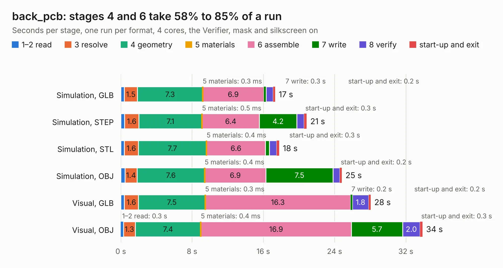

# 3108. back_pcb

Board 3,108 of the 3,111 of [Corpus Testing](../Corpus-Testing.md), on [Corpus Page 29](../CorpusTestingPages/Corpus-Testing-29.md#3108-back_pcb).

| Mode and format | 1–2 read | 3 resolve | 4 geometry | 5 materials | 6 assemble | 7 write | 8 verify | start-up and exit | Total |
|---|---:|---:|---:|---:|---:|---:|---:|---:|---:|
| Simulation, GLB | 0.4 | 1.5 | 7.3 | 0.3&nbsp;ms | 6.9 | 0.3 | 0.8 | 0.2 | 17.3 |
| Simulation, STEP | 0.4 | 1.6 | 7.1 | 0.5&nbsp;ms | 6.4 | 4.2 | 0.8 | 0.3 | 20.9 |
| Simulation, STL | 0.4 | 1.6 | 7.7 | 0.4&nbsp;ms | 6.6 | 0.5 | 0.8 | 0.3 | 17.8 |
| Simulation, OBJ | 0.5 | 1.4 | 7.6 | 0.4&nbsp;ms | 6.9 | 7.5 | 0.8 | 0.2 | 24.8 |
| Visual, GLB | 0.4 | 1.6 | 7.5 | 0.3&nbsp;ms | 16.3 | 0.2 | 1.8 | 0.2 | 28.1 |
| Visual, OBJ | 0.3 | 1.3 | 7.4 | 0.4&nbsp;ms | 16.9 | 5.7 | 2.0 | 0.3 | 33.9 |

<table align="center"><tr><td valign="top">

| Board | Repo: [ZeroPhone/ZeroPhone-PCBs](https://github.com/ZeroPhone/ZeroPhone-PCBs) Board: `back_pcb.kicad_pcb` |
|---|---|
| Folder | back_pcb |
| Complexity | 248&nbsp;/&nbsp;1000 (size&nbsp;193, features&nbsp;55) |
| KESE&nbsp;features | through vias, drill offsets, filled zones, curved board outline |
| Tested | 9th November 2026 |
| Copper&nbsp;layers | 2 |
| File&nbsp;format | KiCad 4 (4) |
| Parts,&nbsp;tracks,&nbsp;vias | 94, 1,491, 252 |
| Triangles,&nbsp;simulation | 1,666,214 in 94 parts |
| Verifier | PASS in all six runs |

</td><td valign="top">

<table>
<tr><th>File type</th><th>File size</th><th>Peak memory used</th></tr>
<tr><th colspan="3" align="left">Simulation</th></tr>
<tr><td>GLB</td><td align="right">59&nbsp;MB</td><td align="right">724&nbsp;MB</td></tr>
<tr><td>STEP</td><td align="right">309&nbsp;MB</td><td align="right">758&nbsp;MB</td></tr>
<tr><td>STL</td><td align="right">83&nbsp;MB</td><td align="right">724&nbsp;MB</td></tr>
<tr><td>OBJ</td><td align="right">176&nbsp;MB</td><td align="right">1.2&nbsp;GB</td></tr>
<tr><th colspan="3" align="left">Visual</th></tr>
<tr><td>GLB</td><td align="right">46&nbsp;MB</td><td align="right">820&nbsp;MB</td></tr>
<tr><td>OBJ</td><td align="right">139&nbsp;MB</td><td align="right">984&nbsp;MB</td></tr>
</table>

</td></tr></table>

| Previous | Next |
|:---|---:|
| [3107. 6p_separator](b3107b_ZeroPhone-PCBs_6p-separator.md) | [3109. front_prototype](b3109b_ZeroPhone-PCBs_front-prototype.md) |
