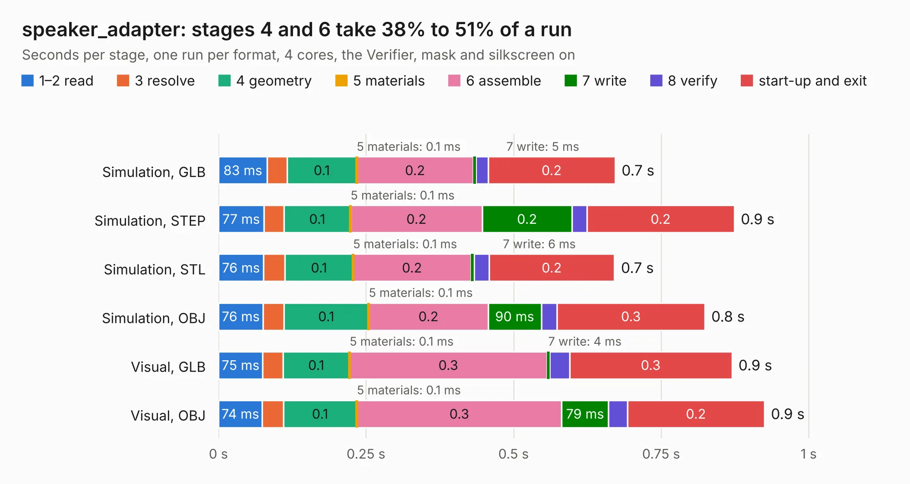

# 3112. speaker_adapter

Board 3,112 of the 3,112 of [Corpus Testing](../Corpus-Testing.md), on [Corpus Page 29](../CorpusTestingPages/Corpus-Testing-29.md#3112-speaker_adapter).

| Mode and format | 1–2 read | 3 resolve | 4 geometry | 5 materials | 6 assemble | 7 write | 8 verify | start-up and exit | Total |
|---|---:|---:|---:|---:|---:|---:|---:|---:|---:|
| Simulation, GLB | 83&nbsp;ms | 33&nbsp;ms | 0.1 | 0.1&nbsp;ms | 0.2 | 5&nbsp;ms | 20&nbsp;ms | 0.2 | 0.7 |
| Simulation, STEP | 77&nbsp;ms | 34&nbsp;ms | 0.1 | 0.1&nbsp;ms | 0.2 | 0.2 | 26&nbsp;ms | 0.2 | 0.9 |
| Simulation, STL | 76&nbsp;ms | 36&nbsp;ms | 0.1 | 0.1&nbsp;ms | 0.2 | 6&nbsp;ms | 25&nbsp;ms | 0.2 | 0.7 |
| Simulation, OBJ | 76&nbsp;ms | 35&nbsp;ms | 0.1 | 0.1&nbsp;ms | 0.2 | 90&nbsp;ms | 27&nbsp;ms | 0.3 | 0.8 |
| Visual, GLB | 75&nbsp;ms | 34&nbsp;ms | 0.1 | 0.1&nbsp;ms | 0.3 | 4&nbsp;ms | 34&nbsp;ms | 0.3 | 0.9 |
| Visual, OBJ | 74&nbsp;ms | 36&nbsp;ms | 0.1 | 0.1&nbsp;ms | 0.3 | 79&nbsp;ms | 32&nbsp;ms | 0.2 | 0.9 |

<table align="center"><tr><td valign="top">

| Board | Repo: [ZeroPhone/ZeroPhone-PCBs](https://github.com/ZeroPhone/ZeroPhone-PCBs) Board: `speaker_adapter.kicad_pcb` |
|---|---|
| Folder | speaker_adapter |
| Complexity | 98&nbsp;/&nbsp;1000 (size&nbsp;63, features&nbsp;35) |
| KESE&nbsp;features | through vias, filled zones |
| Tested | 9th November 2026 |
| Copper&nbsp;layers | 2 |
| File&nbsp;format | KiCad 4 (4) |
| Parts,&nbsp;tracks,&nbsp;vias | 0, 10, 2 |
| Triangles,&nbsp;simulation | 15,552 in 13 parts |
| Note | no components |
| Verifier | PASS in all six runs |

</td><td valign="top">

<table>
<tr><th>File type</th><th>File size</th><th>Peak memory used</th></tr>
<tr><th colspan="3" align="left">Simulation</th></tr>
<tr><td>GLB</td><td align="right">573&nbsp;kB</td><td align="right">61&nbsp;MB</td></tr>
<tr><td>STEP</td><td align="right">2.5&nbsp;MB</td><td align="right">65&nbsp;MB</td></tr>
<tr><td>STL</td><td align="right">779&nbsp;kB</td><td align="right">62&nbsp;MB</td></tr>
<tr><td>OBJ</td><td align="right">1.5&nbsp;MB</td><td align="right">64&nbsp;MB</td></tr>
<tr><th colspan="3" align="left">Visual</th></tr>
<tr><td>GLB</td><td align="right">425&nbsp;kB</td><td align="right">76&nbsp;MB</td></tr>
<tr><td>OBJ</td><td align="right">1.1&nbsp;MB</td><td align="right">81&nbsp;MB</td></tr>
</table>

</td></tr></table>

| Previous | Next |
|:---|---:|
| [3111. keypad_pcb](b3111b_ZeroPhone-PCBs_keypad-pcb.md) | [Corpus Testing](../Corpus-Testing.md) |
