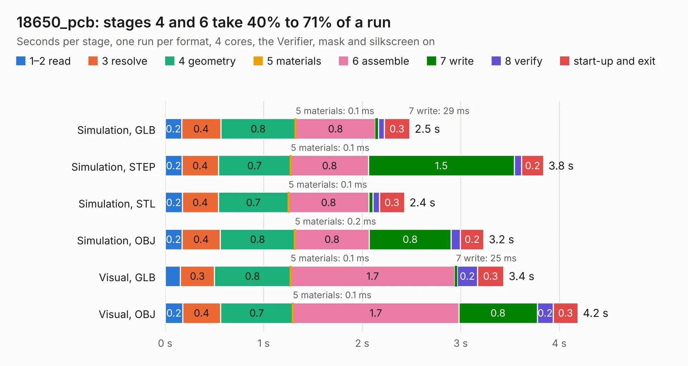

# 3114. 18650_pcb

Board 3,114 of the 3,119 of [Corpus Testing](../Corpus-Testing.md), on [Corpus Page 29](../CorpusTestingPages/Corpus-Testing-29.md#3114-18650_pcb).

| Mode and format | 1–2 read | 3 resolve | 4 geometry | 5 materials | 6 assemble | 7 write | 8 verify | start-up and exit | Total |
|---|---:|---:|---:|---:|---:|---:|---:|---:|---:|
| Simulation, GLB | 0.2 | 0.4 | 0.8 | 0.1&nbsp;ms | 0.8 | 29&nbsp;ms | 60&nbsp;ms | 0.3 | 2.5 |
| Simulation, STEP | 0.2 | 0.4 | 0.7 | 0.1&nbsp;ms | 0.8 | 1.5 | 74&nbsp;ms | 0.2 | 3.8 |
| Simulation, STL | 0.2 | 0.4 | 0.7 | 0.1&nbsp;ms | 0.8 | 43&nbsp;ms | 65&nbsp;ms | 0.3 | 2.4 |
| Simulation, OBJ | 0.2 | 0.4 | 0.8 | 0.2&nbsp;ms | 0.8 | 0.8 | 94&nbsp;ms | 0.2 | 3.2 |
| Visual, GLB | 0.2 | 0.3 | 0.8 | 0.1&nbsp;ms | 1.7 | 25&nbsp;ms | 0.2 | 0.3 | 3.4 |
| Visual, OBJ | 0.2 | 0.4 | 0.7 | 0.1&nbsp;ms | 1.7 | 0.8 | 0.2 | 0.3 | 4.2 |

<table align="center"><tr><td valign="top">

| Board | Repo: [ZeroPhone/ZeroPhone-PCBs](https://github.com/ZeroPhone/ZeroPhone-PCBs) Board: `18650_pcb.kicad_pcb` |
|---|---|
| Folder | 18650_pcb |
| Complexity | 118&nbsp;/&nbsp;1000 (size&nbsp;88, features&nbsp;30) |
| KESE&nbsp;features | filled zones, curved board outline |
| Tested | 10th November 2026 |
| Copper&nbsp;layers | 2 |
| File&nbsp;format | KiCad 4 (4) |
| Parts,&nbsp;tracks,&nbsp;vias | 4, 26, 0 |
| Triangles,&nbsp;simulation | 141,022 in 14 parts |
| Verifier | PASS in all six runs |

</td><td valign="top">

<table>
<tr><th>File type</th><th>File size</th><th>Peak memory used</th></tr>
<tr><th colspan="3" align="left">Simulation</th></tr>
<tr><td>GLB</td><td align="right">5.3&nbsp;MB</td><td align="right">211&nbsp;MB</td></tr>
<tr><td>STEP</td><td align="right">26&nbsp;MB</td><td align="right">224&nbsp;MB</td></tr>
<tr><td>STL</td><td align="right">7.1&nbsp;MB</td><td align="right">212&nbsp;MB</td></tr>
<tr><td>OBJ</td><td align="right">15&nbsp;MB</td><td align="right">211&nbsp;MB</td></tr>
<tr><th colspan="3" align="left">Visual</th></tr>
<tr><td>GLB</td><td align="right">4.6&nbsp;MB</td><td align="right">183&nbsp;MB</td></tr>
<tr><td>OBJ</td><td align="right">13&nbsp;MB</td><td align="right">181&nbsp;MB</td></tr>
</table>

</td></tr></table>

| Previous | Next |
|:---|---:|
| [3113. pcb](b3113b_nekoink_pcb-mainboard-gen2_pcb.md) | [3115. 6p_separator](b3115b_ZeroPhone-PCBs_6p-separator.md) |
