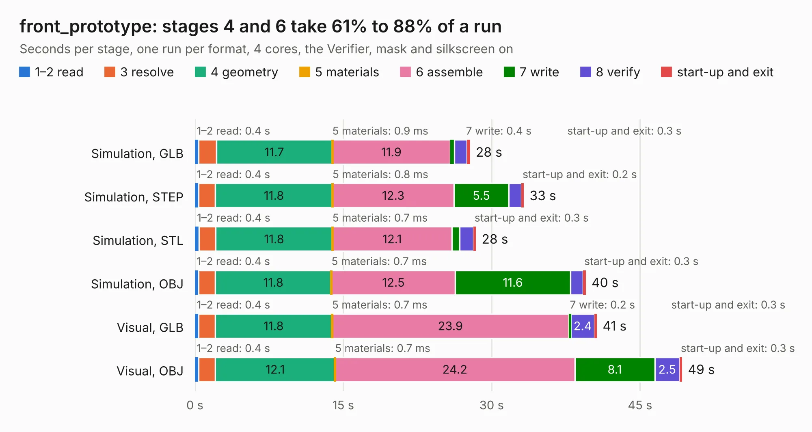

# 3114. front_prototype

Board 3,114 of the 3,116 of [Corpus Testing](../Corpus-Testing.md), on [Corpus Page 29](../CorpusTestingPages/Corpus-Testing-29.md#3114-front_prototype).

| Mode and format | 1–2 read | 3 resolve | 4 geometry | 5 materials | 6 assemble | 7 write | 8 verify | start-up and exit | Total |
|---|---:|---:|---:|---:|---:|---:|---:|---:|---:|
| Simulation, GLB | 0.4 | 1.8 | 11.7 | 0.9&nbsp;ms | 11.9 | 0.4 | 1.3 | 0.3 | 27.8 |
| Simulation, STEP | 0.4 | 1.7 | 11.8 | 0.8&nbsp;ms | 12.3 | 5.5 | 1.3 | 0.2 | 33.2 |
| Simulation, STL | 0.4 | 1.7 | 11.8 | 0.7&nbsp;ms | 12.1 | 0.8 | 1.4 | 0.3 | 28.4 |
| Simulation, OBJ | 0.4 | 1.7 | 11.8 | 0.7&nbsp;ms | 12.5 | 11.6 | 1.3 | 0.3 | 39.5 |
| Visual, GLB | 0.4 | 1.7 | 11.8 | 0.7&nbsp;ms | 23.9 | 0.2 | 2.4 | 0.3 | 40.6 |
| Visual, OBJ | 0.4 | 1.7 | 12.1 | 0.7&nbsp;ms | 24.2 | 8.1 | 2.5 | 0.3 | 49.3 |

<table align="center"><tr><td valign="top">

| Board | Repo: [ZeroPhone/ZeroPhone-PCBs](https://github.com/ZeroPhone/ZeroPhone-PCBs) Board: `front_prototype.kicad_pcb` |
|---|---|
| Folder | front_pcb |
| Complexity | 289&nbsp;/&nbsp;1000 (size&nbsp;234, features&nbsp;55) |
| KESE&nbsp;features | through vias, drill offsets, filled zones, curved board outline |
| Tested | 9th November 2026 |
| Copper&nbsp;layers | 2 |
| File&nbsp;format | KiCad 4 (4) |
| Parts,&nbsp;tracks,&nbsp;vias | 82, 1,522, 402 |
| Triangles,&nbsp;simulation | 2,078,644 in 97 parts |
| Verifier | PASS in all six runs |

</td><td valign="top">

<table>
<tr><th>File type</th><th>File size</th><th>Peak memory used</th></tr>
<tr><th colspan="3" align="left">Simulation</th></tr>
<tr><td>GLB</td><td align="right">75&nbsp;MB</td><td align="right">753&nbsp;MB</td></tr>
<tr><td>STEP</td><td align="right">401&nbsp;MB</td><td align="right">905&nbsp;MB</td></tr>
<tr><td>STL</td><td align="right">104&nbsp;MB</td><td align="right">795&nbsp;MB</td></tr>
<tr><td>OBJ</td><td align="right">226&nbsp;MB</td><td align="right">1.5&nbsp;GB</td></tr>
<tr><th colspan="3" align="left">Visual</th></tr>
<tr><td>GLB</td><td align="right">53&nbsp;MB</td><td align="right">999&nbsp;MB</td></tr>
<tr><td>OBJ</td><td align="right">162&nbsp;MB</td><td align="right">1.1&nbsp;GB</td></tr>
</table>

</td></tr></table>

| Previous | Next |
|:---|---:|
| [3113. back_pcb](b3113b_ZeroPhone-PCBs_back-pcb.md) | [3115. keypad_pcb](b3115b_ZeroPhone-PCBs_keypad-pcb.md) |
