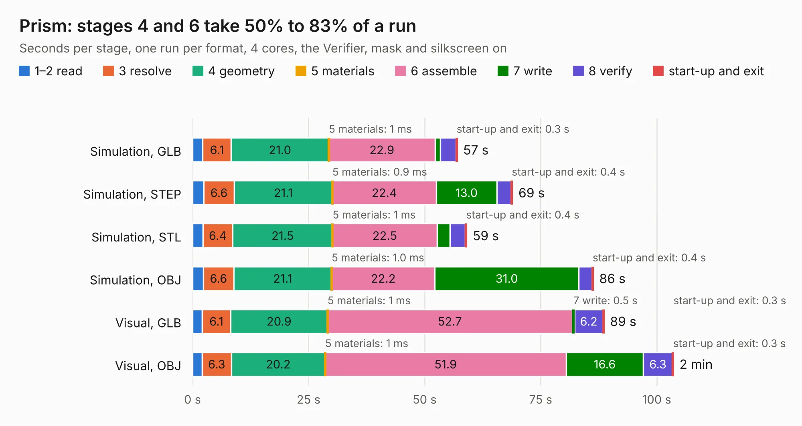

# 3114. Prism

Board 3,114 of the 3,125 of [Corpus Testing](../Corpus-Testing.md), on [Corpus Page 29](../CorpusTestingPages/Corpus-Testing-29.md#3114-prism).

| Mode and format | 1–2 read | 3 resolve | 4 geometry | 5 materials | 6 assemble | 7 write | 8 verify | start-up and exit | Total |
|---|---:|---:|---:|---:|---:|---:|---:|---:|---:|
| Simulation, GLB | 2.2 | 6.1 | 21.0 | 1&nbsp;ms | 22.9 | 1.2 | 3.3 | 0.3 | 57.1 |
| Simulation, STEP | 2.4 | 6.6 | 21.1 | 0.9&nbsp;ms | 22.4 | 13.0 | 3.1 | 0.4 | 69.0 |
| Simulation, STL | 2.2 | 6.4 | 21.5 | 1&nbsp;ms | 22.5 | 2.8 | 3.3 | 0.4 | 59.1 |
| Simulation, OBJ | 2.3 | 6.6 | 21.1 | 1.0&nbsp;ms | 22.2 | 31.0 | 2.8 | 0.4 | 86.4 |
| Visual, GLB | 2.1 | 6.1 | 20.9 | 1&nbsp;ms | 52.7 | 0.5 | 6.2 | 0.3 | 88.7 |
| Visual, OBJ | 2.1 | 6.3 | 20.2 | 1&nbsp;ms | 51.9 | 16.6 | 6.3 | 0.3 | 103.7 |

<table align="center"><tr><td valign="top">

| Board | Repo: [y10-labs/prism-pcb](https://github.com/y10-labs/prism-pcb) Board: `Prism.kicad_pcb` |
|---|---|
| Complexity | 422&nbsp;/&nbsp;1000 (size&nbsp;322, features&nbsp;100) |
| KESE&nbsp;features | through vias, custom pads, rounded, trapezoid or chamfered pads, filled zones, copper drawings, stack-up, dielectric εr and tanδ |
| Tested | 9th November 2026 |
| Copper&nbsp;layers | 8 |
| File&nbsp;format | KiCad 8 (20240108) |
| Parts,&nbsp;tracks,&nbsp;vias | 229, 8,893, 833 |
| Triangles,&nbsp;simulation | 6,877,892 in 355 parts |
| Verifier | PASS in all six runs |

</td><td valign="top">

<table>
<tr><th>File type</th><th>File size</th><th>Peak memory used</th></tr>
<tr><th colspan="3" align="left">Simulation</th></tr>
<tr><td>GLB</td><td align="right">226&nbsp;MB</td><td align="right">1.6&nbsp;GB</td></tr>
<tr><td>STEP</td><td align="right">992&nbsp;MB</td><td align="right">2.2&nbsp;GB</td></tr>
<tr><td>STL</td><td align="right">344&nbsp;MB</td><td align="right">1.6&nbsp;GB</td></tr>
<tr><td>OBJ</td><td align="right">753&nbsp;MB</td><td align="right">4.4&nbsp;GB</td></tr>
<tr><th colspan="3" align="left">Visual</th></tr>
<tr><td>GLB</td><td align="right">127&nbsp;MB</td><td align="right">2.2&nbsp;GB</td></tr>
<tr><td>OBJ</td><td align="right">426&nbsp;MB</td><td align="right">2.8&nbsp;GB</td></tr>
</table>

</td></tr></table>

| Previous | Next |
|:---|---:|
| [3113. hw-openmower-yardforce](b3113b_hw-openmower-yardforce_hw-openmower-yardforce.md) | [3115. 2063-Z80](b3115b_2063-Z80_2063-Z80.md) |
