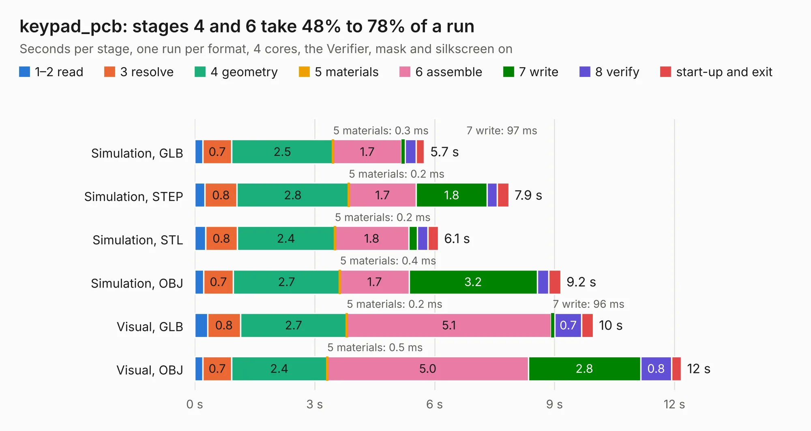

# 3118. keypad_pcb

Board 3,118 of the 3,119 of [Corpus Testing](../Corpus-Testing.md), on [Corpus Page 29](../CorpusTestingPages/Corpus-Testing-29.md#3118-keypad_pcb).

| Mode and format | 1–2 read | 3 resolve | 4 geometry | 5 materials | 6 assemble | 7 write | 8 verify | start-up and exit | Total |
|---|---:|---:|---:|---:|---:|---:|---:|---:|---:|
| Simulation, GLB | 0.2 | 0.7 | 2.5 | 0.3&nbsp;ms | 1.7 | 97&nbsp;ms | 0.3 | 0.2 | 5.7 |
| Simulation, STEP | 0.3 | 0.8 | 2.8 | 0.2&nbsp;ms | 1.7 | 1.8 | 0.3 | 0.3 | 7.9 |
| Simulation, STL | 0.3 | 0.8 | 2.4 | 0.2&nbsp;ms | 1.8 | 0.2 | 0.3 | 0.3 | 6.1 |
| Simulation, OBJ | 0.2 | 0.7 | 2.7 | 0.4&nbsp;ms | 1.7 | 3.2 | 0.3 | 0.3 | 9.2 |
| Visual, GLB | 0.3 | 0.8 | 2.7 | 0.2&nbsp;ms | 5.1 | 96&nbsp;ms | 0.7 | 0.3 | 10.0 |
| Visual, OBJ | 0.2 | 0.7 | 2.4 | 0.5&nbsp;ms | 5.0 | 2.8 | 0.8 | 0.2 | 12.2 |

<table align="center"><tr><td valign="top">

| Board | Repo: [ZeroPhone/ZeroPhone-PCBs](https://github.com/ZeroPhone/ZeroPhone-PCBs) Board: `keypad_pcb.kicad_pcb` |
|---|---|
| Folder | keypad_pcb |
| Complexity | 189&nbsp;/&nbsp;1000 (size&nbsp;164, features&nbsp;25) |
| KESE&nbsp;features | through vias, curved board outline |
| Tested | 9th November 2026 |
| Copper&nbsp;layers | 2 |
| File&nbsp;format | KiCad 4 (4) |
| Parts,&nbsp;tracks,&nbsp;vias | 31, 472, 104 |
| Triangles,&nbsp;simulation | 514,642 in 30 parts |
| Verifier | PASS in all six runs |

</td><td valign="top">

<table>
<tr><th>File type</th><th>File size</th><th>Peak memory used</th></tr>
<tr><th colspan="3" align="left">Simulation</th></tr>
<tr><td>GLB</td><td align="right">18&nbsp;MB</td><td align="right">330&nbsp;MB</td></tr>
<tr><td>STEP</td><td align="right">87&nbsp;MB</td><td align="right">353&nbsp;MB</td></tr>
<tr><td>STL</td><td align="right">26&nbsp;MB</td><td align="right">348&nbsp;MB</td></tr>
<tr><td>OBJ</td><td align="right">54&nbsp;MB</td><td align="right">397&nbsp;MB</td></tr>
<tr><th colspan="3" align="left">Visual</th></tr>
<tr><td>GLB</td><td align="right">16&nbsp;MB</td><td align="right">393&nbsp;MB</td></tr>
<tr><td>OBJ</td><td align="right">47&nbsp;MB</td><td align="right">400&nbsp;MB</td></tr>
</table>

</td></tr></table>

| Previous | Next |
|:---|---:|
| [3117. front_prototype](b3117b_ZeroPhone-PCBs_front-prototype.md) | [3119. speaker_adapter](b3119b_ZeroPhone-PCBs_speaker-adapter.md) |
