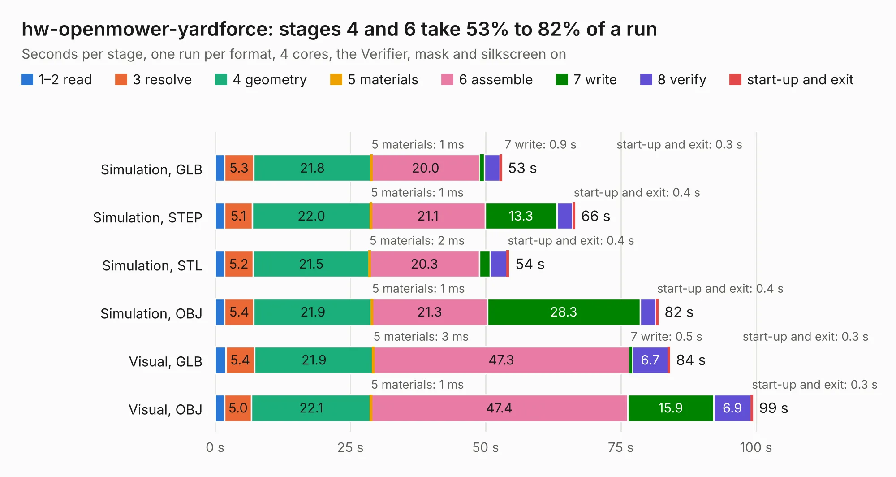

# 3120. hw-openmower-yardforce

Board 3,120 of the 3,132 of [Corpus Testing](../Corpus-Testing.md), on [Corpus Page 29](../CorpusTestingPages/Corpus-Testing-29.md#3120-hw-openmower-yardforce).

| Mode and format | 1–2 read | 3 resolve | 4 geometry | 5 materials | 6 assemble | 7 write | 8 verify | start-up and exit | Total |
|---|---:|---:|---:|---:|---:|---:|---:|---:|---:|
| Simulation, GLB | 1.8 | 5.3 | 21.8 | 1&nbsp;ms | 20.0 | 0.9 | 2.8 | 0.3 | 52.9 |
| Simulation, STEP | 1.8 | 5.1 | 22.0 | 1&nbsp;ms | 21.1 | 13.3 | 2.9 | 0.4 | 66.5 |
| Simulation, STL | 1.8 | 5.2 | 21.5 | 2&nbsp;ms | 20.3 | 2.0 | 3.0 | 0.4 | 54.3 |
| Simulation, OBJ | 1.7 | 5.4 | 21.9 | 1&nbsp;ms | 21.3 | 28.3 | 2.9 | 0.4 | 81.9 |
| Visual, GLB | 2.0 | 5.4 | 21.9 | 3&nbsp;ms | 47.3 | 0.5 | 6.7 | 0.3 | 84.0 |
| Visual, OBJ | 1.8 | 5.0 | 22.1 | 1&nbsp;ms | 47.4 | 15.9 | 6.9 | 0.3 | 99.4 |

<table align="center"><tr><td valign="top">

| Board | Repo: [xtech/hw-openmower-yardforce](https://github.com/xtech/hw-openmower-yardforce) Board: `hw-openmower-yardforce.kicad_pcb` |
|---|---|
| Complexity | 356&nbsp;/&nbsp;1000 (size&nbsp;231, features&nbsp;125) |
| KESE&nbsp;features | through vias, slotted holes, custom pads, rounded, trapezoid or chamfered pads, drill offsets, filled zones, knockout text, stack-up, dielectric εr and tanδ |
| Tested | 9th November 2026 |
| Copper&nbsp;layers | 4 |
| File&nbsp;format | KiCad 9 (20241229) |
| Parts,&nbsp;tracks,&nbsp;vias | 253, 2,513, 641 |
| Triangles,&nbsp;simulation | 6,269,352 in 356 parts |
| Verifier | PASS in all six runs |

</td><td valign="top">

<table>
<tr><th>File type</th><th>File size</th><th>Peak memory used</th></tr>
<tr><th colspan="3" align="left">Simulation</th></tr>
<tr><td>GLB</td><td align="right">213&nbsp;MB</td><td align="right">1.8&nbsp;GB</td></tr>
<tr><td>STEP</td><td align="right">804&nbsp;MB</td><td align="right">2.3&nbsp;GB</td></tr>
<tr><td>STL</td><td align="right">313&nbsp;MB</td><td align="right">1.8&nbsp;GB</td></tr>
<tr><td>OBJ</td><td align="right">667&nbsp;MB</td><td align="right">4.0&nbsp;GB</td></tr>
<tr><th colspan="3" align="left">Visual</th></tr>
<tr><td>GLB</td><td align="right">119&nbsp;MB</td><td align="right">2.1&nbsp;GB</td></tr>
<tr><td>OBJ</td><td align="right">381&nbsp;MB</td><td align="right">2.6&nbsp;GB</td></tr>
</table>

</td></tr></table>

| Previous | Next |
|:---|---:|
| [3119. hw-openmower-universal](b3119b_hw-openmower-universal_hw-openmower-universal.md) | [3121. Prism](b3121b_prism-pcb_Prism.md) |
