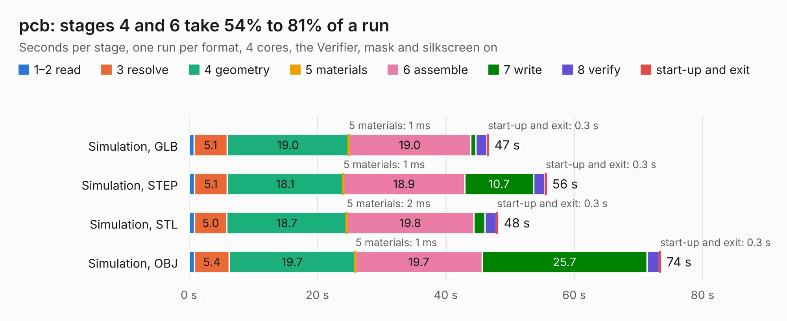

# 3133. pcb

Board 3,133 of the 3,139 of [Corpus Testing](../Corpus-Testing.md), on [Corpus Page 30](../CorpusTestingPages/Corpus-Testing-30.md#3133-pcb).

| Mode and format | 1–2 read | 3 resolve | 4 geometry | 5 materials | 6 assemble | 7 write | 8 verify | start-up and exit | Total |
|---|---:|---:|---:|---:|---:|---:|---:|---:|---:|
| Simulation, GLB | 0.8 | 5.1 | 19.0 | 1&nbsp;ms | 19.0 | 0.8 | 1.8 | 0.3 | 46.7 |
| Simulation, STEP | 0.9 | 5.1 | 18.1 | 1&nbsp;ms | 18.9 | 10.7 | 1.8 | 0.3 | 55.7 |
| Simulation, STL | 0.9 | 5.0 | 18.7 | 2&nbsp;ms | 19.8 | 1.7 | 1.8 | 0.3 | 48.2 |
| Simulation, OBJ | 0.9 | 5.4 | 19.7 | 1&nbsp;ms | 19.7 | 25.7 | 1.9 | 0.3 | 73.5 |
| Visual, GLB | 0.9 | 5.0 | 19.6 | 1&nbsp;ms | 38.6 | 0.4 | 4.0 | 0.3 | 68.8 |
| Visual, OBJ | 1.0 | 5.4 | 18.8 | 1&nbsp;ms | 37.7 | 14.1 | 4.5 | 0.3 | 81.9 |

<table align="center"><tr><td valign="top">

| Board | Repo: [zephray/nekoink](https://github.com/zephray/nekoink) Board: `pcb.kicad_pcb` |
|---|---|
| Folder | pcb / mainboard_gen2 |
| Complexity | 398&nbsp;/&nbsp;1000 (size&nbsp;308, features&nbsp;90) |
| KESE&nbsp;features | through vias, slotted holes, custom pads, rounded, trapezoid or chamfered pads, copper drawings, stack-up, dielectric εr and tanδ |
| Tested | 9th November 2026 |
| Copper&nbsp;layers | 6 |
| File&nbsp;format | KiCad 7 (20221018) |
| Parts,&nbsp;tracks,&nbsp;vias | 241, 4,190, 464 |
| Triangles,&nbsp;simulation | 4,419,766 in 427 parts |
| Verifier | PASS in all six runs |

</td><td valign="top">

<table>
<tr><th>File type</th><th>File size</th><th>Peak memory used</th></tr>
<tr><th colspan="3" align="left">Simulation</th></tr>
<tr><td>GLB</td><td align="right">150&nbsp;MB</td><td align="right">1.2&nbsp;GB</td></tr>
<tr><td>STEP</td><td align="right">623&nbsp;MB</td><td align="right">1.5&nbsp;GB</td></tr>
<tr><td>STL</td><td align="right">221&nbsp;MB</td><td align="right">1.2&nbsp;GB</td></tr>
<tr><td>OBJ</td><td align="right">469&nbsp;MB</td><td align="right">2.8&nbsp;GB</td></tr>
<tr><th colspan="3" align="left">Visual</th></tr>
<tr><td>GLB</td><td align="right">83&nbsp;MB</td><td align="right">1.7&nbsp;GB</td></tr>
<tr><td>OBJ</td><td align="right">266&nbsp;MB</td><td align="right">1.9&nbsp;GB</td></tr>
</table>

</td></tr></table>

| Previous | Next |
|:---|---:|
| [3132. pcb](b3132b_nekoink_pcb-mainboard-gen1_pcb.md) | [3134. 18650_pcb](b3134b_ZeroPhone-PCBs_18650-pcb.md) |
