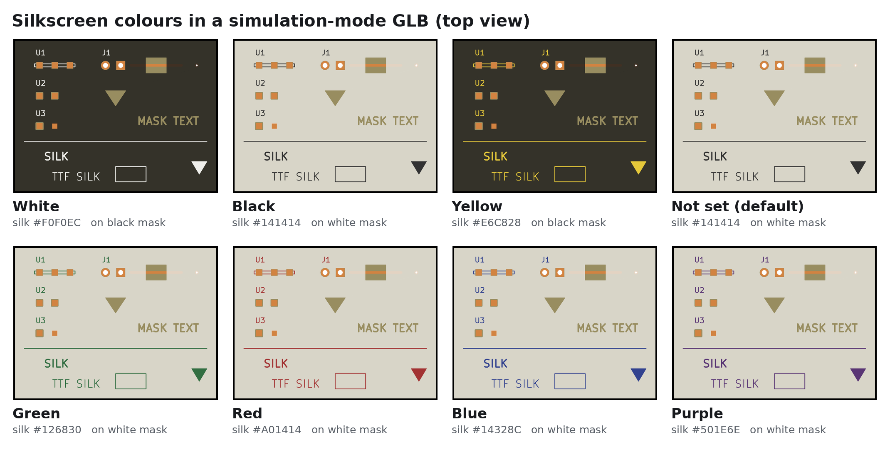
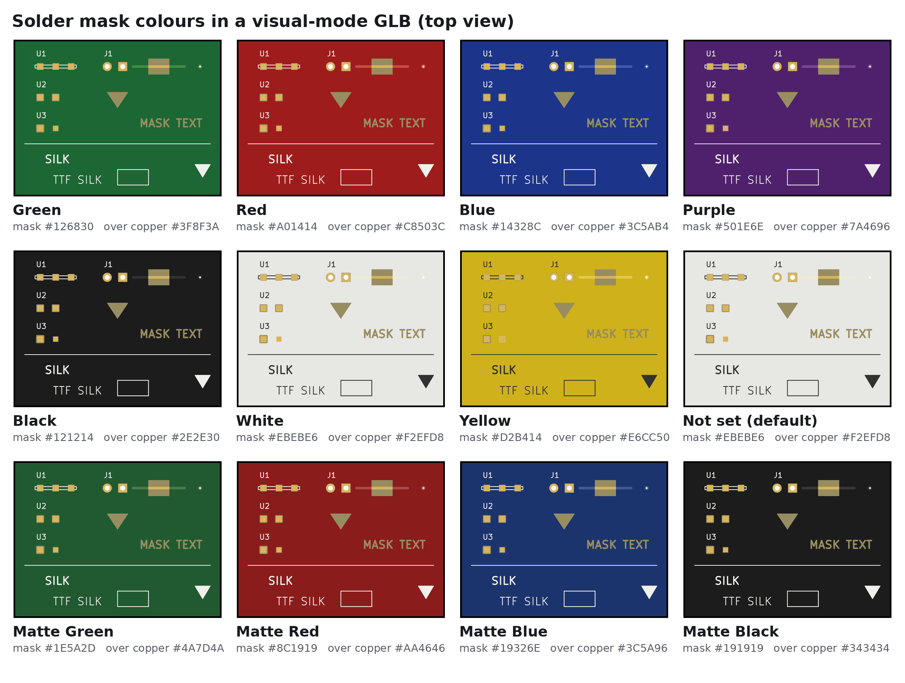

# 14. Colorizing

Colours decide only the look of the GLB and OBJ files (and the colour tag of each STEP solid).
They never change geometry or the physical properties in `materials.json`. Stage 5, materials
(`kese/s5_materials/materials.py`), gives every part one material. There is no file of colours:
each colour is a setting in the last section, "Color", of the file of the element it belongs to,
in `parameters/PCB_elements/`: `Board.py`, `Copper.py`, `Finish.py`, `SolderMask.py` and
`SilkScreen.py`.

## 14.1 Materials

Every colour setting is one dict of four values: `color`, an sRGB hex string, and the glTF PBR
values `alpha`, `metallic` and `roughness`. Alpha below 1 writes a glTF `BLEND` material.

```python
CORE_COLOR = {"color": "#968A58", "alpha": 1.0, "metallic": 0.0, "roughness": 0.80}
```

| Setting | Colour | Alpha | Metallic | Roughness | Material name | Used for |
|---|---|---|---|---|---|---|
| `Board.CORE_COLOR` |  `#968A58` | 1.0 | 0.0 | 0.80 | `Board_core` | the cores |
| `Board.PREPREG_COLOR` |  `#A89C66` | 1.0 | 0.0 | 0.80 | `Board_prepreg` | the prepregs and their plies |
| `Board.RESIN_COLOR` |  `#B8AC78` | 1.0 | 0.0 | 0.80 | `Board_resin` | the resin between the traces of the inner copper, with the plies separate |
| `Board.BOARD_COLOR` |  `#968A58` | 1.0 | 0.0 | 0.80 | `Board` | the laminate with `Board.DIELECTRIC_GROUPING = "merged"`, and a ply of no type |
| `Copper.COPPER_COLOR` |  `#CD803E` | 1.0 | 0.9 | 0.35 | `Copper` | copper, simulation mode |
| `Copper.PLATING_COLOR` |  `#CD803E` | 1.0 | 0.9 | 0.35 | `Plating` | the `Plating` part (`Copper.COPPER_GROUPING = "layer"`) |
| `Copper.EXPOSED_COPPER_COLOR` |  `#DEBA60` | 1.0 | 1.0 | 0.25 | `Copper_exposed` | all copper and plating, visual mode |
| `Copper.VIA_RESIN_COLOR` |  `#D8CFA0` | 1.0 | 0.0 | 0.60 | `Via Resin` | the resin of plugged and resin-filled vias (KiCad 10), both modes |
| `SolderMask.TOP_MASK_COLOR`, `SolderMask.BOTTOM_MASK_COLOR` |  `#EBEBE6` white | 0.80 | 0.0 | 0.30 | `Top Solder Mask`, `Bottom Solder Mask` | the mask parts |
| `SolderMask.TOP_MASK_OVER_COPPER_COLOR`, `SolderMask.BOTTOM_MASK_OVER_COPPER_COLOR` |  `#F2EFD8` | 1.0 | 0.0 | 0.30 | `Top Mask over Copper`, `Bottom Mask over Copper` | the mask on copper, visual mode only |
| `SilkScreen.TOP_SILK_COLOR`, `SilkScreen.BOTTOM_SILK_COLOR` |  `#141414` black | 1.0 | 0.0 | 0.75 | `Top Silkscreen`, `Bottom Silkscreen` | silkscreen |
| `Finish.FINISH_COLORS["Nickel"]` |  `#B8B8B0` | 1.0 | 1.0 | 0.40 | `Nickel` | finish |
| `Finish.FINISH_COLORS["Gold"]` |  `#E6C15A` | 1.0 | 1.0 | 0.20 | `Gold` | finish |
| `Finish.FINISH_COLORS["Tin"]` |  `#C9C9C9` | 1.0 | 1.0 | 0.45 | `Tin` | finish |
| `Finish.FINISH_COLORS["Silver"]` |  `#E4E4E0` | 1.0 | 1.0 | 0.25 | `Silver` | finish |
| `Finish.FINISH_COLORS["Palladium"]` |  `#DFDAD4` | 1.0 | 1.0 | 0.30 | `Palladium` | finish |
| `Finish.FINISH_COLORS["OSP"]` |  `#D9955A` | 1.0 | 0.8 | 0.35 | `OSP` | finish |

The material name is what the GLB, `materials.json` and `report.txt` call the look. How a part
finds its setting (`_key()` in `kese/s5_materials/materials.py`):

| Part role | Material name |
|---|---|
| `board` | `Board_<kind>` (`Board_core`, `Board_prepreg`, `Board_resin`) with `"layer"` grouping, else `Board` |
| `copper`, `plating` | `Copper_exposed` in visual mode, else `Copper` / `Plating` |
| `via_resin` | `Via Resin` |
| `mask`, `mask_over_copper`, `silk` | the part's own name, e.g. `Top Solder Mask` |
| `finish` | its metal, e.g. `Gold` |

A laminate solid of a kind with no setting of its own, and a finish metal that
`Finish.FINISH_COLORS` does not hold, take `Board.BOARD_COLOR`. With the plies fused the resin
beside the inner copper is a part of its prepreg's solid and has that solid's colour;
`Board_resin` is a part of its own with the plies separate (`Stackup.FUSION_BUILD = "PLIES_SEPARATE"`, the default)
([Board](Board.md#122-resin-between-the-traces-of-the-inner-copper)).

One setting of a colour is changed for one run with `--set` and the whole dict:

```bash
python run_KESE.py board.kicad_pcb --set 'Copper.COPPER_COLOR={"color": "#B87333", "alpha": 1.0, "metallic": 0.9, "roughness": 0.35}'
```

Before the parameters were sorted by element, all of these were entries of one dict,
`Color.MATERIALS`, in `parameters/color.py`. That file is not read any more and
`--set Color.MATERIALS=...` stops the run with the list of the settings that took its place; the
other settings of the old `Color` module are still understood under their old names, with a note
in `report.txt` ([Parameter Reference](Parameter-Reference.md)).

## 14.2 Colours From The Stack-Up

KiCad's Board Setup gives the mask and silkscreen layers a colour: one of its names (Green, Red,
Blue, Purple, Black, White, Yellow), written as the name (`(layer "F.Mask" ... (color "Green"))`),
or one picked under "User defined", written as `#RRGGBBAA` with its opacity last
(`(color "#1B5E20D4")`). With `SolderMask.USE_STACKUP_MASK_COLOR = True` and
`SilkScreen.USE_STACKUP_SILK_COLOR = True` (the defaults) a name, in lower case, is looked up in
three tables: two in `SolderMask.py` and one in `SilkScreen.py`. A name the mask or silkscreen
table does not have keeps the colour setting of its part, and `report.txt` warns about it.

| Name | `SolderMask.STACKUP_MASK_COLORS` | `SolderMask.STACKUP_MASK_OVER_COPPER_COLORS` (visual mode) | `SilkScreen.STACKUP_SILK_COLORS` |
|---|---|---|---|
| `green` |  `#126830` |  `#3F8F3A` |  `#126830` |
| `red` |  `#A01414` |  `#C8503C` |  `#A01414` |
| `blue` |  `#14328C` |  `#3C5AB4` |  `#14328C` |
| `purple` |  `#501E6E` |  `#7A4696` |  `#501E6E` |
| `black` |  `#121214` |  `#2E2E30` |  `#141414` |
| `white` |  `#EBEBE6` |  `#F2EFD8` |  `#F0F0EC` |
| `yellow` |  `#D2B414` |  `#E6CC50` |  `#E6C828` |
| `matte green` |  `#1E5A2D` |  `#4A7D4A` | |
| `matte black` |  `#191919` |  `#343434` | |
| `matte blue` |  `#19326E` |  `#3C5A96` | |
| `matte red` |  `#8C1919` |  `#AA4646` | |

The `six_layer` test board, for example, has a black mask in its stack-up, so its mask parts come
out
 `#121214`.
Set `SolderMask.USE_STACKUP_MASK_COLOR = False` to always use `TOP_MASK_COLOR` and
`BOTTOM_MASK_COLOR`, and `SilkScreen.USE_STACKUP_SILK_COLOR = False` to always use `TOP_SILK_COLOR`
and `BOTTOM_SILK_COLOR`. The two switches are apart, so a board can keep its mask colour and take
the silkscreen colour of the file.

A user-defined colour is used as it is, for the mask and the silkscreen alike. Its opacity is not:
the mask keeps the alpha of its colour setting, 0.8 in simulation mode and opaque in visual mode, as with
a named colour. In visual mode the mask over copper takes the colour mixed part of the way toward
white, each channel

```math
c' = c + L \cdot (255 - c) \qquad (14.1)
```

| Symbol | Meaning |
|---|---|
| $`c`$ | one channel of the user-defined colour, 0 to 255 |
| $`c'`$ | the same channel over copper, rounded |
| $`L`$ | `SolderMask.USER_MASK_OVER_COPPER_LIGHTEN`, 0.15 by default |

With $`L = 0.15`$, `#1B5E20D4` gives  `#1B5E20` for the mask and  `#3D7641` over copper.




## 14.3 Mode Differences

- **Simulation mode**: the mask is translucent (alpha 0.80) so the copper under it can be seen in
  a viewer. The mask on top of copper is part of the same mask solid and has the same colour.
- **Visual mode**: the mask is drawn opaque whatever its alpha (`SolderMask.VISUAL_MASK_OPAQUE =
  True`), because the skin has nothing behind it; the mask over copper is its own part with the
  lighter "over copper" colour, so traces read through the mask as on a real board; all copper
  takes `Copper.EXPOSED_COPPER_COLOR`.



## 14.4 Where The Colours Go

| File | How the colour is written |
|---|---|
| GLB | a PBR material with the part's material name (14.1), shared by parts with the same name and look (every `Copper_<net>` uses one `Copper` material; the top and bottom mask and silkscreen each keep their own): `baseColorFactor` (sRGB converted to linear, below), `metallicFactor`, `roughnessFactor`, `alphaMode: BLEND` when alpha < 1 |
| OBJ | an `.mtl` next to the `.obj` with `newmtl <part>` (the part name with spaces and other characters replaced by `_`, e.g. `Top_Solder_Mask`), `Kd r g b`, `d alpha` |
| STEP | the assembly colour of each solid (RGB and alpha) |
| STL | none (STL has no colour) |
| `materials.json` | `look: {color, alpha}` per part |
| `report.txt` | the material name, hex and alpha on every `parts` line |

glTF stores base colours in linear light, so `kese/s7_write/glb.py` converts each 8-bit sRGB
channel before it writes the GLB:

```python
def _srgb_to_linear(rgb):                    # rgb: the hex colour as three 0-255 values
    s = np.asarray(rgb, dtype=float) / 255
    return np.where(s <= 0.04045, s / 12.92, ((s + 0.055) / 1.055) ** 2.4)

factor = np.array([*np.round(_srgb_to_linear(mat["rgb"]), 5), round(float(mat["alpha"]), 4)])
```

The GLB writer then stores the factor in 8 bits, so the GLB holds the nearest step of 1/255:
 `#968A58`
is written as 0.30588, 0.25490, 0.09804 rather than 0.30499, 0.25415, 0.09759. The alpha is
stored in the same 1/255 steps (0.80 stays 0.80; 0.85 would become 0.85098). The OBJ `Kd` line
carries the sRGB values as they are, `s` above.

## 14.5 Settings

The colours themselves are the settings of 14.1. The rest, by file:

| Name | Default | Range | Meaning |
|---|---|---|---|
| `SolderMask.VISUAL_MASK_OPAQUE` | `True` | bool | Draw the mask opaque in visual mode |
| `SolderMask.USE_STACKUP_MASK_COLOR` | `True` | bool | Honour the mask colour in the board's stack-up, named or user-defined |
| `SolderMask.STACKUP_MASK_COLORS` | table above | name to hex | Stack-up colour names of the mask |
| `SolderMask.STACKUP_MASK_OVER_COPPER_COLORS` | table above | name to hex or `None` per entry | Visual-mode colour of the mask over copper per stack-up colour; an entry set to `None` keeps `TOP_MASK_OVER_COPPER_COLOR` or `BOTTOM_MASK_OVER_COPPER_COLOR` (the table itself must stay a dict) |
| `SolderMask.USER_MASK_OVER_COPPER_LIGHTEN` | `0.15` | 0 to 1 | With a user-defined mask colour, how far the visual-mode mask over copper is mixed toward white (0 the same colour, 1 white) |
| `SilkScreen.USE_STACKUP_SILK_COLOR` | `True` | bool | Honour the silkscreen colour in the board's stack-up, named or user-defined |
| `SilkScreen.STACKUP_SILK_COLORS` | table above | name to hex | Stack-up colour names of the silkscreen |

The old name `Color.USE_STACKUP_COLORS` sets both `USE_STACKUP_MASK_COLOR` and
`USE_STACKUP_SILK_COLOR`.

| Previous | Next |
|:---|---:|
| [Copper And Traces](Copper-And-Traces.md) | [Finish](Finish.md) |
