# 13. Copper And Traces

> [!WARNING]
> **Zones must be filled in KiCad.** KESE takes the fill polygons KiCad stores in the file,
> which exist only after the zones have been filled (press **B**) and the file saved. A zone with
> no stored fill produces **no copper**; the run warns and `report.txt` counts it under
> `zones with no fill (unfilled - press B in KiCad and save)`. Keep-out and rule areas are
> listed separately and are not an error.

Copper is what the model is for: one closed solid per net, with every layer's traces, pads and
zone fills joined to its vias and plated holes. `kese/s2_collect/` collects the copper per layer
and net and `kese/s3_resolve/` resolves it; `kese/s4_geometry/copper.py` and `plating.py` turn it
into prisms; the settings are in `parameters/copper.py`.

## 13.1 What Makes Copper

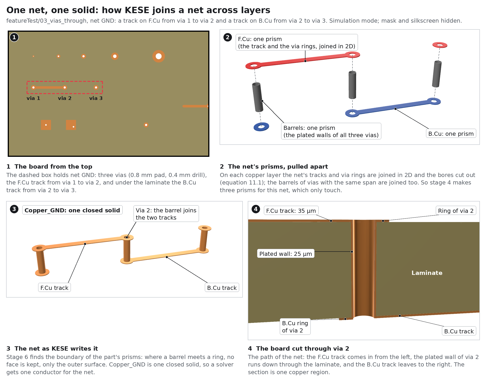

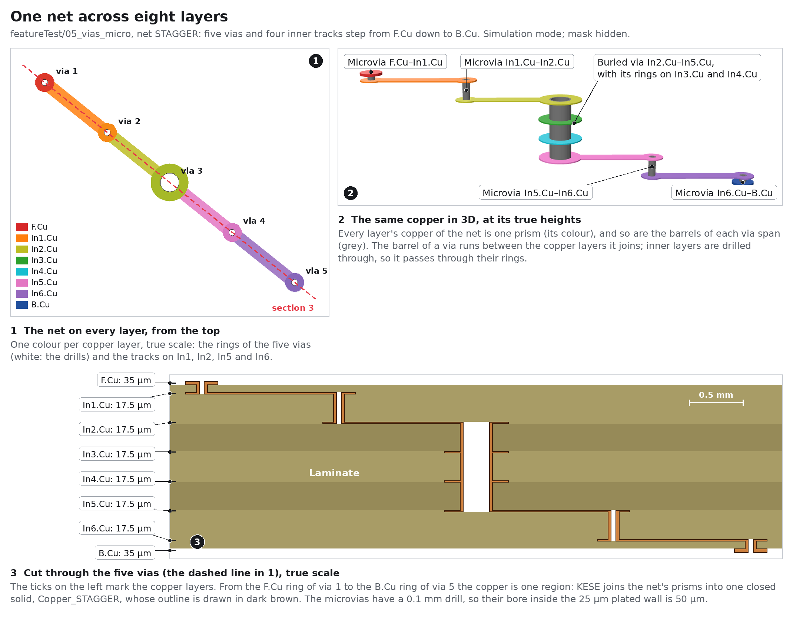

Per copper layer, these items are collected with their net (text always as no net, see 13.1.1):

| Item | Shape |
|---|---|
| `segment` (track) | the centre line thickened by the track width, round ends; a track left bare by the solder mask (KiCad 9 and later) also opens the mask, see [Solder Masks](Solder-Masks.md#171-kicads-mask-layers-are-negative) |
| `arc` (arc track) | the arc flattened to `Geometry.ARC_STEP_DEG` steps, thickened; left bare by the solder mask, it opens the mask as a track does |
| `via` | a disc of the via's size on every layer it spans, except rings dropped by KiCad's "remove unused layers" (see 13.3) |
| `pad` | the pad shape (circle, rect, oval, roundrect, trapezoid, custom with anchor and primitives; a chamfered rectangle has the corners its `chamfer` lists cut straight, legs `chamfer_ratio` x the shorter side, and those corners not rounded) at its position and angle, with the drill offset, on each copper layer the pad lists (`*.Cu`, `F&B.Cu` expanded), except inner rings of a through-hole pad dropped by "remove unused layers" (see 13.3.1); an NPTH pad gives its hole, and a copper ring only where KiCad flashes it (`PAD::FlashLayer`): not for a round (or oval) pad no bigger than its round (or oval) drill and not offset |
| `zone` fill | the `filled_polygon` polygons stored in the file; a fill KiCad 5 drew with a pen (a file older than format 20250210 without `(filled_areas_thickness no)`) grows by half the zone's `min_thickness`, round at the corners, as KiCad does when it opens such a file; a KiCad 4 or 5 zone stored only as `fill_segments` is those segments, each drawn with a pen of `min_thickness` |
| `gr_*` / `fp_*` graphics on a copper layer | lines and arcs thickened by their stroke width; filled shapes filled (with no `fill` in the file, as KiCad reads it: a circle or rectangle of width 0, and a polygon off Edge.Cuts); a self-crossing polygon keeps every lobe; unfilled closed shapes as their outline stroke; rectangles with their rounded corners (KiCad 10); a hatched circle, rectangle or polygon (KiCad 10) as its outline and the hatch inside it (12.1.2); a drawing left bare by the solder mask (KiCad 9 and later) also opens the mask, as a track does |
| text on a copper layer | the stroke-font glyphs, as on silkscreen; knockout text (`(layer "F.Cu" knockout)`) is the text's box, square to the text and grown by max(pen / 2, height / 9), with the letters cut out |

Then, per layer and per net: union, simplify, clip to the outline, subtract the holes, move to
the board frame ([7.3](Working-Principle.md#73-coordinate-frames)) and snap to the grid
([7.1](Working-Principle.md#71-the-design-choice-that-matters-most)). The union is simplified
before the outline and the holes cut it, so the copper's edge at the board edge and in every hole
is the very polygon of the laminate and of the barrel (a 0.05 mm via bore simplified after the
cut kept every other vertex, and the copper stood up to half a micron into the bore):

```math
C_{k,n} = \left( \mathrm{simplify}_{\varepsilon}\left( \bigcup_{j \in I_{k,n}} G_j \right) \cap O \right) \setminus X_k \qquad (13.1)
```

```math
X_k = \begin{cases} \bigcup_{h : a_h \le k \le b_h} \left( H_h \ominus w_h \right) & k = 0 \text{ or } k = N-1 \ \ \text{(outer: the bores)} \\ \bigcup_{h : a_h \le k \le b_h} H_h & 0 < k < N-1 \ \ \text{(inner: the drills)} \end{cases} \qquad (13.2)
```

| Symbol | Meaning | Parameter |
|---|---|---|
| $`C_{k,n}`$ | copper region of net $`n`$ on layer $`l_k`$ | |
| $`I_{k,n}`$ | the items of net $`n`$ on layer $`l_k`$ (tracks, pads, via rings, zone fills, graphics assigned to the net; text only in `no_net`) | |
| $`G_j`$ | the 2D shape of item $`j`$ | |
| $`O`$ | the board outline, equation (12.3) | |
| $`X_k`$ | the holes cut out of layer $`l_k`$ | |
| $`H_h`$, $`w_h`$ | drill region and plating wall of hole $`h`$ ($`w_h = 0`$ for an NPTH) | `Copper.VIA_WALL_MM`, `Copper.PTH_WALL_MM` |
| $`a_h, b_h`$ | first and last copper layer index hole $`h`$ spans | |
| $`\ominus w`$ | shrinks a region inward by $`w`$ (a negative buffer) | |
| $`\varepsilon`$ | simplification tolerance (0.5 µm) | `Geometry.SIMPLIFY_TOLERANCE_MM` |

Three clean-ups follow, all for shapes of one net that only just meet:

- The union is taken in floating point and then rounded to the grid as a whole, so two edges that
  run along one line only to within floating point (two zone fills, a fill and a pad) meet on the
  grid and join without a crack, and a crack narrower than the grid closes
  (`kese/s3_resolve/copper.py`, `net_union`). Each edge moves by less than a grid step. A union on
  the grid, which rounds every item first, costs about three times as much on a big board; it is
  still used where GEOS cannot join the items in floating point.
- A hole in $`C_{k,n}`$ whose mean width, twice its area over its perimeter, is under 1 µm
  (`Copper.HAIRLINE_HOLE_MM`) is filled. Such needle holes are left where a zone fill runs round a
  pad or via of its own net with other arcs than the pad's own polygon (on one KiCad 10 board 193
  of them, and no hole between 1 and 3 µm); they pinch the solid where they touch. Drills and
  clearances are far wider.
- Pieces of one net that come within two grid steps of each other are joined (grown and shrunk
  back by a grid step, mitred), so their walls cannot leave the solid open on the grid.

The layers are worked on `Parallel.WORKERS` at a time, the biggest first: in worker processes on a
board of `Parallel.PROCESS_MIN_NETS` nets or more (1,000, counted layer by layer) whose copper holds at least
`Parallel.PROCESS_MIN_COORDINATES` coordinates, else in threads
([Working Principle](Working-Principle.md#74-work-done-in-parallel)). Either way each net's region
comes out the same, byte for byte.

### 13.1.1 Nets

In KiCad 4 to 9 an item carries a net **number** that is looked up in the file's net table; KiCad 10
writes the net **name** directly, and KESE reads both. Net names in files older than format 20210606
write an overbar the old way, between two `~`; they are read as `~{...}`, as KiCad reads them. Copper with no net (pads without a net such
as mounting holes, net 0) is named `Copper.NO_NET_NAME`, `no_net` by default, so it becomes
`Copper_no_net`. A graphic shape on a copper layer (a line, arc, circle, rectangle or polygon drawn
as copper) takes the net KiCad stores on it, so a shape assigned to a net in KiCad joins that net's
part; a shape with no net goes to `no_net`. Text on a copper layer has no net and always goes there.
Pads of pins left unconnected in the schematic carry KiCad's own `unconnected-(...)` nets and become
parts of their own, such as `Copper_unconnected-(U5-OUT-Pad3)`.

Copper of different nets never overlaps on a real board. If the file has an overlap (two nets'
shapes drawn on top of each other), the net that was resolved first keeps the shared area, so the
solids stay disjoint:

```math
C_{k,n_j} \leftarrow C_{k,n_j} \setminus \bigcup_{i < j} C_{k,n_i} \qquad (13.3)
```

where $`n_1, n_2, \dots`$ are the nets of layer $`l_k`$ in the order of their first copper item
on that layer. Items are collected in file order (tracks, arcs, zones, graphics, footprints and
text as they come), then all vias, then the via rings kept by equation (13.8), so a net that
appears only on vias comes after every net with a track, zone or pad on that layer.

### 13.1.2 Hatched Fills

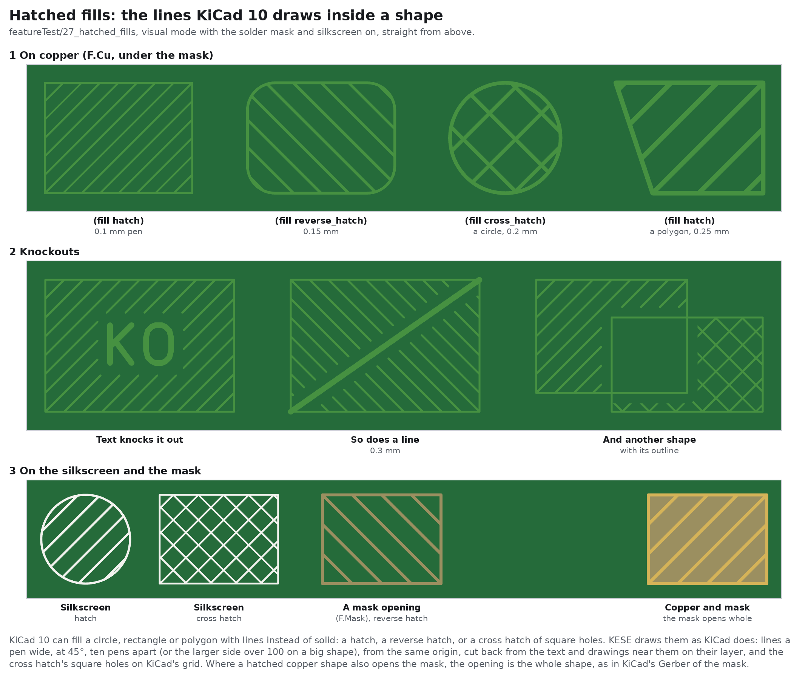

KiCad 10 can fill a circle, rectangle or polygon with lines instead of solid: `(fill hatch)`,
`(fill reverse_hatch)` or `(fill cross_hatch)`. KESE draws the hatch as KiCad does
(`EDA_SHAPE::UpdateHatching`, `PCB_SHAPE::getHatchingKnockouts`), on copper, silkscreen and mask
layers alike:

- the lines are one pen wide at 45 degrees (rising to the right for `hatch`, falling for
  `reverse_hatch`), ten pens apart, or the larger side of the shape over 100 when that would give
  more than 100 lines; they are laid from KiCad's origin, so they fall where KiCad's do;
- a cross hatch is the shape less square holes on the same pitch, turned 45 degrees;
- every other drawing, text and text box of the layer that meets the shape cuts the hatch back: a
  drawing by its stroke (its whole shape when filled or hatched) grown by half the pitch, a text by
  the box of its letters grown as much, a text box by its box; of the items in footprints only the
  drawings and fields (reference, value, ...) do, and not those of the shape's own footprint, as in
  KiCad;
- on copper the hatch belongs to the shape's net; a hatched copper shape the mask leaves bare opens
  the mask over the whole shape, as KiCad's mask Gerber does.

`report.txt` counts them as `hatched graphics on <layer>` and `hatched footprint graphics on <layer>`.

## 13.2 Grouping And Part Names

| `Copper.COPPER_GROUPING` | Part per | Name | Plating |
|---|---|---|---|
| `"net"` (default) | net | `Copper_<net>` | inside the net's part |
| `"layer"` | layer | `Copper_F.Cu`, `Copper_In1.Cu`, ... | separate `Plating` part |
| `"merged"` | all copper | `Copper` | inside it |

With `"net"` grouping the whole net is one part: every layer's copper, every annular ring and every
barrel, joined into one closed body where the copper connects in the file (`Copper_no_net` usually
holds many separate bodies). That is what a solver needs to assign one port or one conductor to a
net.

## 13.3 Vias And Plated Holes

A via contributes:

- a round **pad** (annular ring) of the via's size on every copper layer from its start layer to
  its end layer (through vias on all layers; blind, buried and micro vias on the layers they
  span);
- a **hole** of the via's drill through the same span;
- a plated **barrel**: the ring between the drill and the drill shrunk by the plating wall,
  running between the copper layers it joins, equations (13.4) to (12.6).

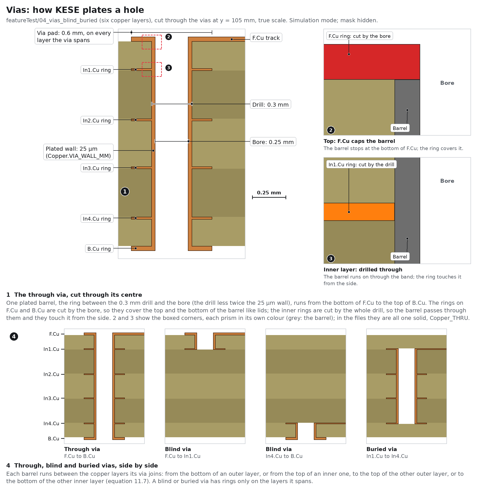

A through-hole pad contributes its pad shape on the listed layers and a barrel with
`Copper.PTH_WALL_MM`. Oval (slot) drills become slot-shaped barrels.

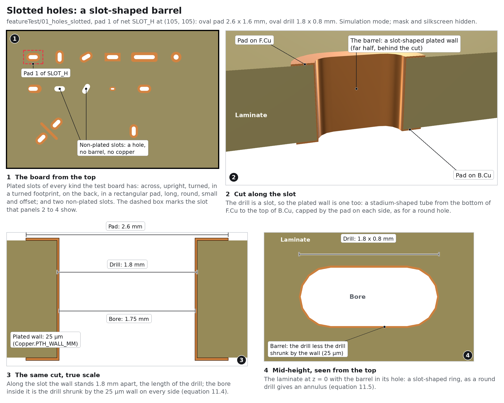

The bore (the open hole left inside the plating) and the barrel of hole $`h`$ are:

```math
B_h = H_h \ominus w_h \qquad (13.4)
```

```math
A_h = \left( H_h \setminus B_h \right) \cap O \qquad (13.5)
```

For a round drill of diameter $`D`$ this is an annulus between the radii

```math
r_{\mathrm{bore}} = \frac{D}{2} - w_h, \qquad r_{\mathrm{drill}} = \frac{D}{2} \qquad (13.6)
```

| Symbol | Meaning | Parameter |
|---|---|---|
| $`B_h`$ | bore of hole $`h`$ | |
| $`A_h`$ | barrel (plating ring) of hole $`h`$, clipped to the outline so a castellation keeps only its part-barrel | |
| $`H_h`$ | drill region (a disc, or a slot for an oval drill) | |
| $`D`$ | drill diameter | the via's or pad's `(drill ...)` |
| $`w_h`$ | plating wall | `Copper.VIA_WALL_MM` (vias), `Copper.PTH_WALL_MM` (pads), `Copper.CASTELLATION_WALL_MM` (castellations) |

How the barrel meets the layers (so that the solids only touch):

- **Outer layers cap the barrel.** The outer copper is cut by the *bore* (drill minus wall), so
  the annular ring's copper covers the top of the barrel like a lid. The barrel runs from the
  bottom of `F.Cu` to the top of `B.Cu`.
- **Inner layers are drilled through.** Inner copper is cut by the full *drill*, and the barrel
  continues through the inner layer's band. The inner ring touches the barrel from the side.

So the barrel of a hole spanning layers $`l_a`$ to $`l_b`$ is extruded over

```math
z_{\mathrm{top}}(A_h) = \begin{cases} z_{\mathrm{bot}}(l_0) = L/2 & a = 0 \\ z_{\mathrm{top}}(l_a) & a > 0 \end{cases}, \qquad z_{\mathrm{bot}}(A_h) = \begin{cases} z_{\mathrm{top}}(l_{N-1}) = -L/2 & b = N-1 \\ z_{\mathrm{bot}}(l_b) & b < N-1 \end{cases} \qquad (13.7)
```

with the copper bands of equations (8.4) to (8.7). Barrels of the same span and net are one
region; with `"net"` grouping they go into the net's part, with `"layer"` grouping into
`Plating`.

### 13.3.1 Remove Unused Layers

KiCad's via and through-hole pad option "remove unused layers" drops the annular rings on layers
where nothing connects. With `Copper.HONOUR_REMOVE_UNUSED_LAYERS = True` (the default), KESE keeps
a via's (or pad's) ring on such a layer only when copper of its net already touches it there, as
KiCad's `FlashLayer` (pad.cpp, pcb_track.cpp) decides:

```math
\text{keep } P_v \text{ on } l_k \iff l_k \in Z_v \;\lor\; P_v \cap \bigcup_{j \in I_k(n_v)} G_j \neq \varnothing \qquad (13.8)
```

where $`P_v`$ is the via's round pad (or the pad's shape on that layer), $`n_v`$ its net and
$`I_k(n)`$ every copper item of net $`n`$ already collected on $`l_k`$ (tracks, pads, graphics and
the vias' own rings, but not other conditional rings), tested before the outline and hole cuts. A
ring with no net is tested against all copper. $`Z_v`$ is the list KiCad 7+ writes as
`(zone_layer_connections "In1.Cu" ...)`: the layers where the zone filler found a zone meeting the
ring. KiCad flashes the ring there, and zones do not count in the test on the other layers. A
file older than KiCad 7 has no such list, and zones count like any copper.

The start and end layers are always kept when the via or pad says `keep_end_layers`. A KiCad 10
via with `(start_end_only yes)` keeps its rings on its start and end layers only, whatever meets
it. `report.txt` counts the rings removed under `via rings removed on unconnected layers` (pad
rings included).

### 13.3.2 Via Tenting

Tenting decides whether the solder mask covers the via's annular ring or leaves it open; the
bore (the drill minus the plating wall) is left open through the mask unless the via's protection
shuts it (12.3.4), see [Solder Masks](Solder-Masks.md#174-over-holes). `Copper.VIA_TENTING`:

| Value | Meaning |
|---|---|
| `"file"` (default) | follow the board: the default comes from KiCad 9 / 10 `(tenting ...)` in Board Setup, else the older plot setting `viasonmask`, else KiCad's default (tented); a via's own `(tenting ...)` then overrides that default for that via, whichever source it came from: KiCad 9's short form (`(tenting front back)`, `(tenting front)`, `(tenting none)`) is the complete list of tented sides, so `none` opens both; KiCad 10's `(tenting (front yes) (back no))` sets each side it names |
| `"tented"` | mask over every via's ring (the bore stays open) |
| `"open"` | mask open over every via's pad, with the pad-to-mask clearance |

`report.txt` names the board's own tenting source on the `vias:` line (`board setup (tenting)`,
`plot setting viasonmask`, `KiCad default (vias tented)`). That line does not change when
`VIA_TENTING` is `"tented"` or `"open"`; the override shows only in `parameters.txt`.

### 13.3.3 Backdrills


KiCad 10 can drill a plated hole out again from a face with a wider drill, to take off the stub of
the barrel that no signal uses: `(backdrill (size 0.6) (layers "B.Cu" "In3.Cu"))`, and from the
other face `(tertiary_drill ...)`. With `Board.BACKDRILLS = True` (the default) KESE drills it as
KiCad's Gerber and drill files have it:

- the backdrill is a hole of its size from its start layer through the layer it must cut: the
  laminate there, the plating and the copper inside its size go, and the hole's barrel stops at the
  far face of the must-cut layer (In3.Cu's top face for the backdrill above);
- the rings on the layers it passes keep their copper outside the backdrill;
- a through-hole pad is backdrilled the same way; a hole drilled out from both faces keeps the
  barrel between the two, and one drilled out through the whole board is left bare.

KiCad's STEP export drills each backdrill 1 µm further and takes the whole pad off the layers it
passes; KESE follows the fabrication files instead. `report.txt` counts `backdrills of vias`,
`tertiary drills of pads` and so on. Counterbores and countersinks, which KiCad 10 also cuts into a
hole's end, are in [Board](Board.md#1241-counterbores-and-countersinks).

### 13.3.4 Via Protection

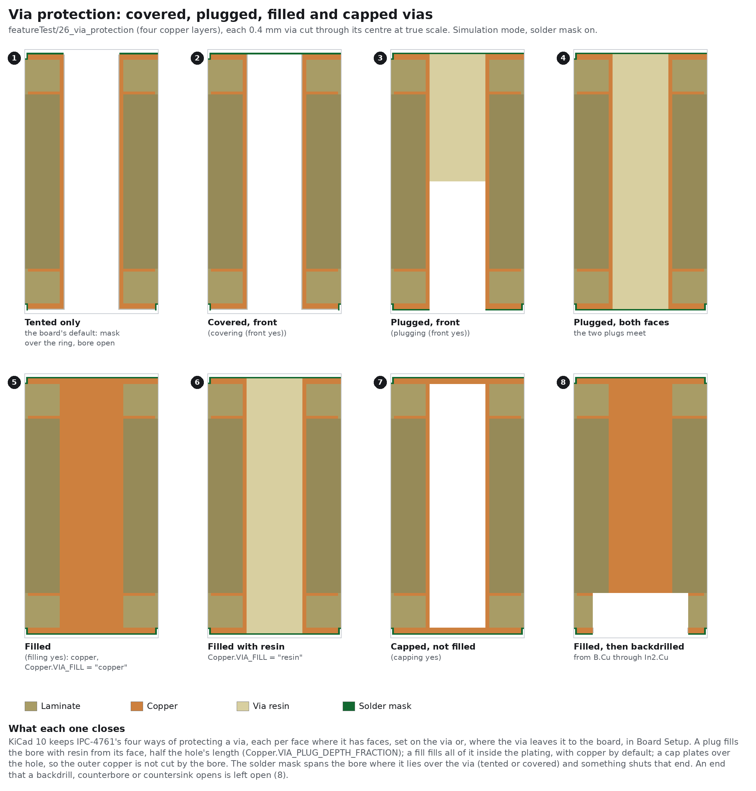

KiCad 10 keeps the four ways IPC-4761 protects a via: covering, plugging, capping and filling.
Each is set on the via (`(covering (front yes) (back no))`, `(plugging ...)`, `(capping yes)`,
`(filling yes)`) or, where the via leaves it out or says `none`, in Board Setup; covering and
plugging are per face, capping and filling for the whole via. With `Copper.VIA_PROTECTION = "file"`
(the default) KESE builds them:

| Protection | IPC-4761 | What KESE builds |
|---|---|---|
| covered | Types II, IV, VI | the solder mask spans the bore on that face, also inside a mask opening |
| plugged | Types III, IV | resin from that face into the bore, `Copper.VIA_PLUG_DEPTH_FRACTION` (0.5) of the hole's length, so plugs from both faces meet (IPC-4761 asks only for "partial penetration") |
| filled | Types V to VII | the whole bore inside the plating: copper joined to the via's net (`Copper.VIA_FILL = "copper"`, the default; KiCad calls the fill conductive) or resin (`"resin"`), flush with the outer copper |
| capped | Type VII | the outer copper is not cut by the bore, so the ring's copper closes the hole |

- The resin is its own part, `Via Resin`, with `Copper.VIA_RESIN_EPSILON_R` (4.4) and
  `Copper.VIA_RESIN_LOSS_TANGENT` (0.02) in `materials.json`, the values of San-Ei Kagaku's
  PHP-900 IR-6P plugging ink; `Copper.VIA_RESIN_ENABLED = False` leaves it out of the files.
- Only an end on a face can be covered, plugged or capped; a blind or buried via's end inside the
  board cannot, and `report.txt` counts that under `skipped`.
- An end that a backdrill, counterbore or countersink opens stays open, plug included, and a fill
  stays only where the barrel is left (via 8 above).
- The mask spans a bore where it lies over the via (tented or covered) and something shuts that
  end; a shut end takes no finish inside the bore.

`"off"` leaves every via open, as before KiCad 10, and counts the protection under `skipped` with
a warning. `report.txt` counts `covered vias, front`, `plugged vias, back`, `filled vias`,
`capped vias` and so on.

## 13.4 Copper Thickness And Plating

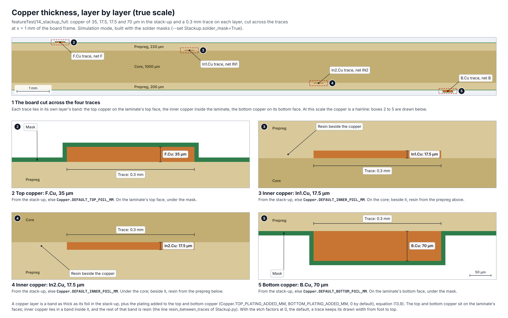

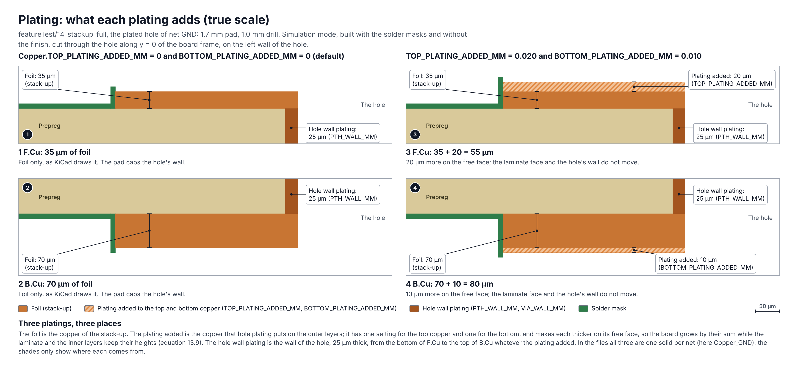

```math
t_k = \begin{cases} t_{\mathrm{foil},k} + t_{\mathrm{plate}} & k = 0 \text{ or } k = N-1 \ \ \text{(outer)} \\ t_{\mathrm{foil},k} & 0 < k < N-1 \ \ \text{(inner)} \end{cases} \qquad (13.9)
```

| Symbol | Meaning | Parameter |
|---|---|---|
| $`t_k`$ | copper thickness of layer $`l_k`$ | |
| $`t_{\mathrm{foil},k}`$ | foil thickness | stack-up, else `Copper.DEFAULT_OUTER_FOIL_MM` / `Copper.DEFAULT_INNER_FOIL_MM` |
| $`t_{\mathrm{plate}}`$ | plating added to outer layers | `Copper.OUTER_PLATING_ADDED_MM` |

$`t_{\mathrm{plate}}`$ is the copper that electroplating adds to the outer layers during hole
plating ("finished copper"), typically 20 µm. It is 0 by default so that the geometry matches
KiCad; set it for an as-fabricated model. Each copper part records `foil_mm` and
`plating_added_mm` in `materials.json`.

## 13.5 Etch Factor

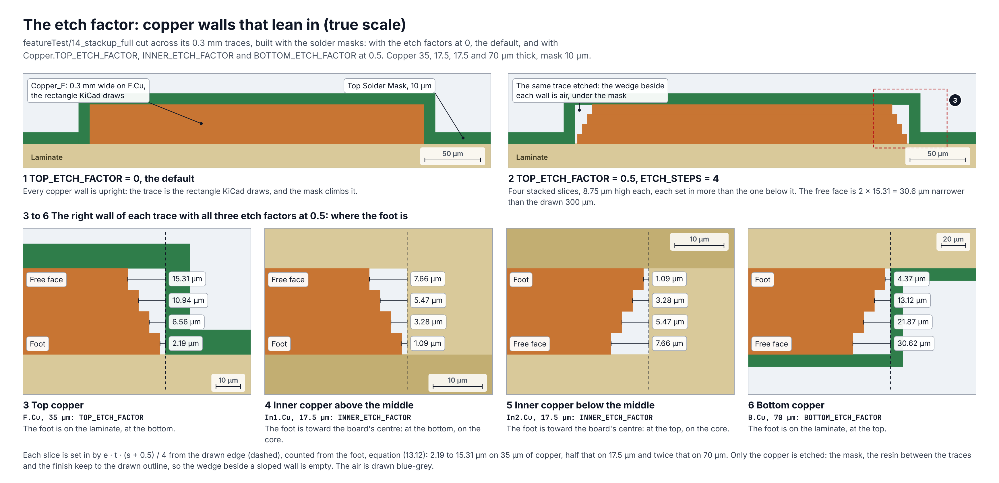

Real traces are trapezoids: etching undercuts the resist, so a trace is narrower at its free
face than at its foot. `Copper.ETCH_FACTOR` (0 by default, a rectangle as in KiCad) leans each
side wall in over the copper height. The trapezoid is built as `Copper.ETCH_STEPS` stacked
slices, each inset a little more than the one nearer the foot. Slice $`s`$ of $`m`$
($`s = 0 \dots m-1`$, counted from the bottom of the copper band) is:

```math
z_s \in \left[ z_0 + \frac{s}{m} t,\ z_0 + \frac{s+1}{m} t \right] \qquad (13.10)
```

```math
f_s = \begin{cases} \frac{s + 0.5}{m} & \text{foot at the bottom} \\ 1 - \frac{s + 0.5}{m} & \text{foot at the top} \end{cases} \qquad (13.11)
```

```math
\delta_s = e \cdot t \cdot f_s, \qquad R_s = \left( C_{k,n} \ominus \delta_s \right) \cup \left( C_{k,n} \cap \left( U_k \oplus \rho \, \delta_s \right) \right) \qquad (13.12)
```

| Symbol | Meaning | Parameter |
|---|---|---|
| $`m`$ | number of slices | `Copper.ETCH_STEPS` (4) |
| $`C_{k,n}`$ | copper of net $`n`$ on layer $`l_k`$, equation (13.1) | |
| $`z_0`$, $`t`$ | bottom and thickness of the copper band | equations (8.4) to (8.7), (12.9) |
| $`f_s`$ | height fraction of the middle of slice $`s`$, measured from the foot | |
| $`e`$ | etch factor | `Copper.ETCH_FACTOR` |
| $`\delta_s`$ | inward offset of slice $`s`$ on every side | |
| $`U_k`$ | the edges layer $`l_k`$ is not etched along: the drill walls of the holes through it and the board outline | |
| $`\rho`$ | how far from those edges, in insets, the copper keeps its drawn outline | `Copper.ETCH_UNETCHED_REACH` (1.5) |
| $`R_s`$ | region of slice $`s`$ (mitred corners) | |

The wall therefore leans in by close to $`e \cdot t`$ across the copper height: the slice at
the free face is inset by $`e \cdot t \cdot (m - 0.5)/m`$.

- On `F.Cu` the foot is at the bottom (on the laminate), on `B.Cu` at the top.
- Inner layers are etched only with `Copper.ETCH_APPLY_TO_INNER_LAYERS = True`; their foot faces
  the board centre (layers in the upper half have it at the bottom, layers in the lower half at
  the top), whichever dielectric is on that side.
- Copper is not etched along a hole wall or the board edge, where it is plated or cut: there it
  keeps its drawn outline out to $`\rho \, \delta_s`$ from the edge
  (`Copper.ETCH_UNETCHED_REACH`), so a via or pad ring still meets its barrel, and the edge
  plating and castellations still meet the copper.
- Only the copper is etched: the solder mask, the resin fill beside inner copper and the finish
  still follow the drawn outline, so the wedge between them and the sloped wall stays empty (air).

Example: $`e = 0.5`$, $`t = 35`$ µm, $`m = 4`$ gives offsets of 2.19, 6.56, 10.94 and 15.31 µm
from the foot to the free face.

## 13.6 Castellated Holes

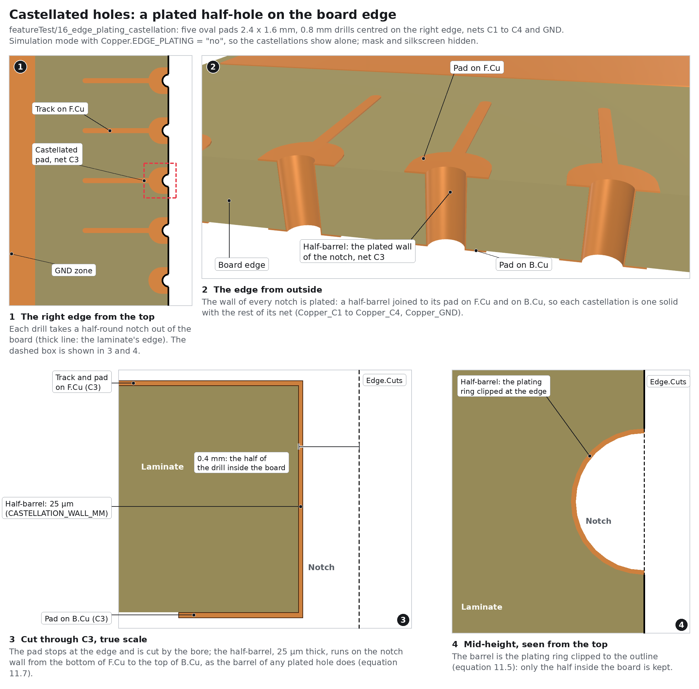

A castellation is a plated hole that the board edge cuts through (module edge connectors). KESE
does not read KiCad's "Castellated pad" fabrication property of a pad; it finds castellations from
the geometry, as plated holes whose drill crosses `Edge.Cuts`:

```math
h \text{ is a castellation} \iff h \text{ plated},\ H_h \not\subseteq O,\ H_h \cap O \neq \varnothing \qquad (13.13)
```

Then `Copper.CASTELLATION`:

| Value | Meaning |
|---|---|
| `"auto"` (default) | every plated hole crossing the outline is a castellation: the drill notches the edge and its plating is a part-barrel on the notch wall, joined to the hole's net, with wall `Copper.CASTELLATION_WALL_MM` |
| `"file"` | as `"auto"`, but only when the stack-up says `(castellated_pads yes)`; otherwise the holes are left unplated, as with `"off"`, and a note in `report.txt` says how to turn it on |
| `"off"` | holes crossing the edge are not plated at all |

`report.txt` counts them under `castellated holes (plated holes cut by the board edge)`.

## 13.7 Edge Plating

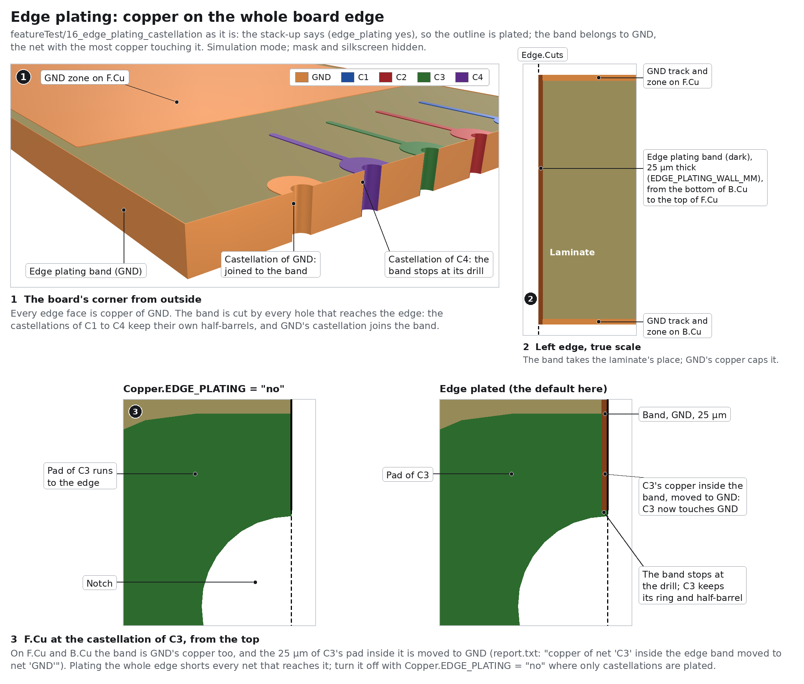


Edge plating is copper on the routed board edge (edge-card connectors, RF shielding).
`Copper.EDGE_PLATING`: `"file"` (default) follows the stack-up's `(edge_plating yes)`, `"yes"` and
`"no"` force it. When on:

- a band just inside the outline becomes copper, interrupted by every hole through the whole board
  and every castellation that crosses the edge, equation (13.14); it runs through the laminate from
  $`-L/2`$ to $`+L/2`$ and is part of the edge net's copper on the two outer layers, so it reaches
  from the bottom of `B.Cu` to the top of `F.Cu`;
- a hole that crosses the band but not the whole board (a blind or buried via, a backdrill or
  tertiary drill, a counterbore or countersink) cuts it only between its own heights, as it cuts a
  barrel: the band is kept above and below the cut, and the outer layers' copper loses it only where
  the hole takes that layer (board `28_plated_edge_machining`);
- the band takes the laminate's place at the edge, like a barrel in its drill;
- the band belongs to one net, `Copper.EDGE_PLATING_NET`: `"auto"` picks the named net with the
  most copper touching the band (or `no_net`), or give a net name such as `"GND"`;
- copper of **other** nets inside the band is moved to the edge net, since edge plating shorts
  everything that reaches the edge; `report.txt` lists what was moved;
- on the inner layers the band runs through the copper band as a barrel runs through its drill:
  the inner copper, by then all of it the edge net's, stops at the band and touches it, and the
  resin fill beside the inner copper stops there too.

```math
E = \left( O \setminus \left( O \ominus w_e \right) \right) \setminus \bigcup_{h \in T} H_h \qquad (13.14)
```

```math
n^{*} = \arg\max_{n \in S} \sum_{k=0}^{N-1} \mathrm{area}\left( C_{k,n} \cap E \right) \qquad (13.15)
```

| Symbol | Meaning | Parameter |
|---|---|---|
| $`E`$ | the edge plating band | |
| $`w_e`$ | width of the band | `Copper.EDGE_PLATING_WALL_MM` |
| $`T`$ | the holes through the whole board, castellations among them ($`H_h`$: equation (13.2)) | |
| $`S`$ | the named nets (every net except `no_net`) | |
| $`C_{k,n}`$, $`N`$ | copper of net $`n`$ on layer $`l_k`$, equation (13.1), and the number of copper layers | |
| $`n^{*}`$ | the edge net when `EDGE_PLATING_NET = "auto"` (`no_net` when no named net touches the band) | `Copper.EDGE_PLATING_NET` |

## 13.8 Electrical Properties

Every copper part carries `conductivity_S_per_m` (`Copper.COPPER_CONDUCTIVITY_S_PER_M`,
5.8 × 10⁷ S/m) and `surface_roughness_um` (`Copper.COPPER_SURFACE_ROUGHNESS_UM`, 0 = ignore; a
solver setting, not geometry) in `materials.json`. A separate `Plating` part (with
`Copper.COPPER_GROUPING = "layer"`) carries only `conductivity_S_per_m`. `thickness_mm`, `foil_mm`
and `plating_added_mm` are those of the part's first layer. See
[Material Properties](Material-Properties.md).

## 13.9 Settings

| Name | Default | Range | Meaning |
|---|---|---|---|
| `DEFAULT_OUTER_FOIL_MM`, `DEFAULT_INNER_FOIL_MM` | `0.035`, `0.035` | mm > 0 | Foil thickness when the stack-up gives none (1 oz = 0.035, 0.5 oz = 0.0175) |
| `USE_STACKUP_COPPER_THICKNESS` | `True` | bool | Stack-up copper thickness wins when present |
| `OUTER_PLATING_ADDED_MM` | `0.0` | mm ≥ 0 | Plating added to the outer layers (typical 0.020) |
| `VIA_WALL_MM`, `PTH_WALL_MM` | `0.025`, `0.025` | mm > 0 | Plated wall of vias and through-hole pads (typical 0.020 to 0.025) |
| `ETCH_FACTOR` | `0.0` | ≥ 0 | Side-wall lean per unit of copper thickness; 0 = rectangular |
| `ETCH_STEPS` | `4` | int ≥ 1 | Slices per trapezoid |
| `ETCH_APPLY_TO_INNER_LAYERS` | `False` | bool | Etch the inner layers too |
| `ETCH_UNETCHED_REACH` | `1.5` | ≥ 0 | Copper within this × the etch inset of a hole wall or the board edge keeps its outline (12.5) |
| `CASTELLATION` | `"auto"` | `"auto"` / `"file"` / `"off"` | How plated holes crossing the edge are treated |
| `CASTELLATION_WALL_MM` | `0.025` | mm > 0 | Plated wall of a castellation |
| `EDGE_PLATING` | `"file"` | `"file"` / `"yes"` / `"no"` | Copper on the board edge |
| `EDGE_PLATING_WALL_MM` | `0.025` | mm > 0 | Width of the edge band |
| `EDGE_PLATING_NET` | `"auto"` | `"auto"` or a net name | Which net the edge copper belongs to |
| `VIA_TENTING` | `"file"` | `"file"` / `"tented"` / `"open"` | Mask over vias |
| `VIA_PROTECTION` | `"file"` | `"file"` / `"off"` | KiCad 10's covered, plugged, capped and filled vias (12.3.4) |
| `VIA_FILL` | `"copper"` | `"copper"` / `"resin"` | What a filled via is filled with |
| `VIA_PLUG_DEPTH_FRACTION` | `0.5` | > 0, ≤ 1 | How far a plug reaches into the hole, as a share of its length |
| `VIA_RESIN_EPSILON_R`, `VIA_RESIN_LOSS_TANGENT` | `4.4`, `0.02` | ≥ 1, ≥ 0 | The plug and fill resin, written to `materials.json` |
| `VIA_RESIN_ENABLED` | `True` | bool | Build the `Via Resin` part and write it to the files |
| `HONOUR_REMOVE_UNUSED_LAYERS` | `True` | bool | Drop via and through-hole pad rings on layers nothing connects to |
| `COPPER_CONDUCTIVITY_S_PER_M` | `5.8e7` | S/m | Written to `materials.json` |
| `COPPER_SURFACE_ROUGHNESS_UM` | `0.0` | µm ≥ 0 | Written to `materials.json`; 0 = ignore |
| `NO_NET_NAME` | `"no_net"` | text | Name of copper that belongs to no net |
| `HAIRLINE_HOLE_MM` | `1e-3` | mm ≥ 0 | A hole in one net's copper narrower than this on average (2 × area / perimeter) is filled (12.1) |

| Previous | Next |
|:---|---:|
| [Board](Board.md) | [Colorizing](Colorizing.md) |
