# 23.2 Corpus Testing 2: alvaroalea To andrewpaterson

Part 2 of 29 of [Corpus Testing](../Corpus-Testing.md): every board of these projects, six runs each, one file format a run, as [Corpus Testing](../Corpus-Testing.md) describes.

## 23.2.1 plusd

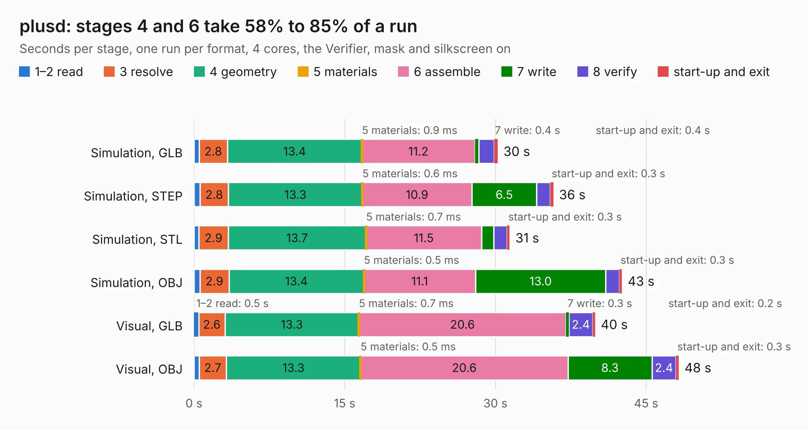

| Mode and format | 1–2 read | 3 resolve | 4 geometry | 5 materials | 6 assemble | 7 write | 8 verify | start-up and exit | Total |
|---|---:|---:|---:|---:|---:|---:|---:|---:|---:|
| Simulation, GLB | 0.5 | 2.8 | 13.4 | 0.9&nbsp;ms | 11.2 | 0.4 | 1.5 | 0.4 | 30.2 |
| Simulation, STEP | 0.6 | 2.8 | 13.3 | 0.6&nbsp;ms | 10.9 | 6.5 | 1.3 | 0.3 | 35.8 |
| Simulation, STL | 0.5 | 2.9 | 13.7 | 0.7&nbsp;ms | 11.5 | 1.2 | 1.3 | 0.3 | 31.4 |
| Simulation, OBJ | 0.6 | 2.9 | 13.4 | 0.5&nbsp;ms | 11.1 | 13.0 | 1.3 | 0.3 | 42.6 |
| Visual, GLB | 0.5 | 2.6 | 13.3 | 0.7&nbsp;ms | 20.6 | 0.3 | 2.4 | 0.2 | 39.9 |
| Visual, OBJ | 0.5 | 2.7 | 13.3 | 0.5&nbsp;ms | 20.6 | 8.3 | 2.4 | 0.3 | 48.2 |

<table align="center"><tr><td valign="top">

| Board | Repo: [alvaroalea/plusD-clone](https://github.com/alvaroalea/plusD-clone) Board: `plusd.kicad_pcb` |
|---|---|
| Complexity | 2,355, medium |
| Copper&nbsp;layers | 2 |
| File&nbsp;format | KiCad 6 (20211014) |
| Parts,&nbsp;tracks,&nbsp;vias | 62, 1,967, 88 |
| Triangles,&nbsp;simulation | 2,590,088 in 119 parts |
| Verifier | PASS in all six runs |

</td><td valign="top">

<table>
<tr><th>File type</th><th>File size</th><th>Peak memory used</th></tr>
<tr><th colspan="3" align="left">Simulation</th></tr>
<tr><td>GLB</td><td align="right">89&nbsp;MB</td><td align="right">789&nbsp;MB</td></tr>
<tr><td>STEP</td><td align="right">452&nbsp;MB</td><td align="right">1.0&nbsp;GB</td></tr>
<tr><td>STL</td><td align="right">130&nbsp;MB</td><td align="right">858&nbsp;MB</td></tr>
<tr><td>OBJ</td><td align="right">274&nbsp;MB</td><td align="right">1.7&nbsp;GB</td></tr>
<tr><th colspan="3" align="left">Visual</th></tr>
<tr><td>GLB</td><td align="right">54&nbsp;MB</td><td align="right">1.0&nbsp;GB</td></tr>
<tr><td>OBJ</td><td align="right">166&nbsp;MB</td><td align="right">1.2&nbsp;GB</td></tr>
</table>

</td></tr></table>

## 23.2.2 plusd_no_route

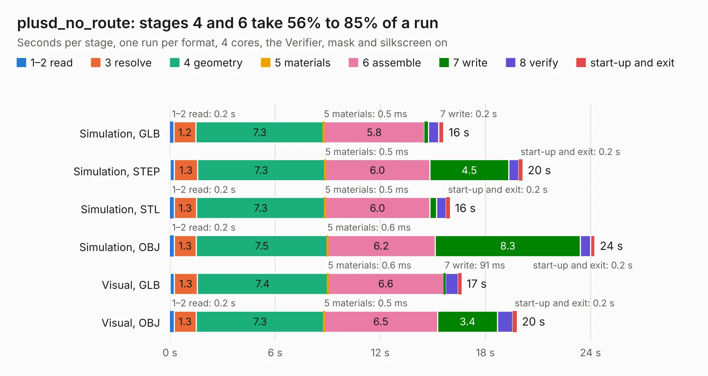

| Mode and format | 1–2 read | 3 resolve | 4 geometry | 5 materials | 6 assemble | 7 write | 8 verify | start-up and exit | Total |
|---|---:|---:|---:|---:|---:|---:|---:|---:|---:|
| Simulation, GLB | 0.2 | 1.2 | 7.3 | 0.5&nbsp;ms | 5.8 | 0.2 | 0.6 | 0.3 | 15.6 |
| Simulation, STEP | 0.3 | 1.3 | 7.3 | 0.5&nbsp;ms | 6.0 | 4.5 | 0.6 | 0.2 | 20.1 |
| Simulation, STL | 0.2 | 1.3 | 7.3 | 0.5&nbsp;ms | 6.0 | 0.4 | 0.5 | 0.2 | 16.0 |
| Simulation, OBJ | 0.2 | 1.3 | 7.5 | 0.6&nbsp;ms | 6.2 | 8.3 | 0.6 | 0.2 | 24.2 |
| Visual, GLB | 0.2 | 1.3 | 7.4 | 0.6&nbsp;ms | 6.6 | 91&nbsp;ms | 0.7 | 0.2 | 16.6 |
| Visual, OBJ | 0.2 | 1.3 | 7.3 | 0.5&nbsp;ms | 6.5 | 3.4 | 0.9 | 0.2 | 19.8 |

<table align="center"><tr><td valign="top">

| Board | Repo: [alvaroalea/plusD-clone](https://github.com/alvaroalea/plusD-clone) Board: `plusd_no_route.kicad_pcb` |
|---|---|
| Complexity | 94, simple |
| Copper&nbsp;layers | 2 |
| File&nbsp;format | KiCad 5 (20171130) |
| Parts,&nbsp;tracks,&nbsp;vias | 47, 0, 0 |
| Triangles,&nbsp;simulation | 1,550,978 in 100 parts |
| Note | mostly unrouted |
| Verifier | PASS in all six runs |

</td><td valign="top">

<table>
<tr><th>File type</th><th>File size</th><th>Peak memory used</th></tr>
<tr><th colspan="3" align="left">Simulation</th></tr>
<tr><td>GLB</td><td align="right">49&nbsp;MB</td><td align="right">537&nbsp;MB</td></tr>
<tr><td>STEP</td><td align="right">226&nbsp;MB</td><td align="right">688&nbsp;MB</td></tr>
<tr><td>STL</td><td align="right">78&nbsp;MB</td><td align="right">520&nbsp;MB</td></tr>
<tr><td>OBJ</td><td align="right">159&nbsp;MB</td><td align="right">1.0&nbsp;GB</td></tr>
<tr><th colspan="3" align="left">Visual</th></tr>
<tr><td>GLB</td><td align="right">23&nbsp;MB</td><td align="right">577&nbsp;MB</td></tr>
<tr><td>OBJ</td><td align="right">69&nbsp;MB</td><td align="right">605&nbsp;MB</td></tr>
</table>

</td></tr></table>

## 23.2.3 plusd

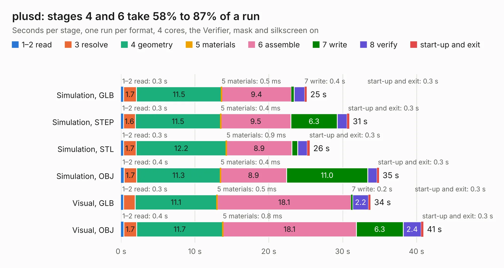

| Mode and format | 1–2 read | 3 resolve | 4 geometry | 5 materials | 6 assemble | 7 write | 8 verify | start-up and exit | Total |
|---|---:|---:|---:|---:|---:|---:|---:|---:|---:|
| Simulation, GLB | 0.3 | 1.7 | 11.5 | 0.5&nbsp;ms | 9.4 | 0.4 | 1.4 | 0.3 | 25.1 |
| Simulation, STEP | 0.3 | 1.6 | 11.5 | 0.4&nbsp;ms | 9.5 | 6.3 | 1.3 | 0.3 | 30.9 |
| Simulation, STL | 0.3 | 1.7 | 12.2 | 0.9&nbsp;ms | 8.9 | 0.8 | 1.3 | 0.3 | 25.5 |
| Simulation, OBJ | 0.4 | 1.7 | 11.3 | 0.4&nbsp;ms | 8.9 | 11.0 | 1.2 | 0.3 | 34.9 |
| Visual, GLB | 0.3 | 1.6 | 11.1 | 0.5&nbsp;ms | 18.1 | 0.2 | 2.2 | 0.3 | 33.8 |
| Visual, OBJ | 0.4 | 1.7 | 11.7 | 0.8&nbsp;ms | 18.1 | 6.3 | 2.4 | 0.3 | 40.9 |

<table align="center"><tr><td valign="top">

| Board | Repo: [alvaroalea/plusD-clone](https://github.com/alvaroalea/plusD-clone) Board: `plusd.kicad_pcb` |
|---|---|
| Folder | Rev_01 |
| Complexity | 1,654, medium |
| Copper&nbsp;layers | 2 |
| File&nbsp;format | KiCad 5 (20171130) |
| Parts,&nbsp;tracks,&nbsp;vias | 47, 1,452, 36 |
| Triangles,&nbsp;simulation | 2,080,546 in 100 parts |
| Verifier | PASS in all six runs |

</td><td valign="top">

<table>
<tr><th>File type</th><th>File size</th><th>Peak memory used</th></tr>
<tr><th colspan="3" align="left">Simulation</th></tr>
<tr><td>GLB</td><td align="right">72&nbsp;MB</td><td align="right">803&nbsp;MB</td></tr>
<tr><td>STEP</td><td align="right">369&nbsp;MB</td><td align="right">882&nbsp;MB</td></tr>
<tr><td>STL</td><td align="right">104&nbsp;MB</td><td align="right">800&nbsp;MB</td></tr>
<tr><td>OBJ</td><td align="right">219&nbsp;MB</td><td align="right">1.4&nbsp;GB</td></tr>
<tr><th colspan="3" align="left">Visual</th></tr>
<tr><td>GLB</td><td align="right">40&nbsp;MB</td><td align="right">897&nbsp;MB</td></tr>
<tr><td>OBJ</td><td align="right">121&nbsp;MB</td><td align="right">904&nbsp;MB</td></tr>
</table>

</td></tr></table>

## 23.2.4 plusd

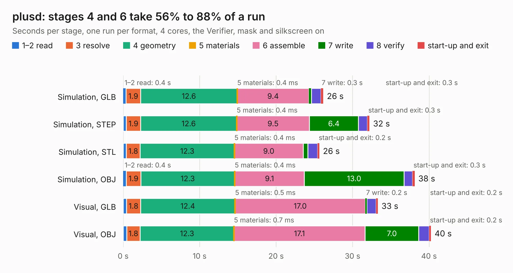

| Mode and format | 1–2 read | 3 resolve | 4 geometry | 5 materials | 6 assemble | 7 write | 8 verify | start-up and exit | Total |
|---|---:|---:|---:|---:|---:|---:|---:|---:|---:|
| Simulation, GLB | 0.4 | 1.9 | 12.6 | 0.4&nbsp;ms | 9.4 | 0.3 | 1.2 | 0.3 | 26.2 |
| Simulation, STEP | 0.4 | 1.9 | 12.6 | 0.4&nbsp;ms | 9.5 | 6.4 | 1.2 | 0.3 | 32.2 |
| Simulation, STL | 0.4 | 1.8 | 12.3 | 0.4&nbsp;ms | 9.0 | 0.6 | 1.3 | 0.2 | 25.7 |
| Simulation, OBJ | 0.4 | 1.9 | 12.3 | 0.4&nbsp;ms | 9.1 | 13.0 | 1.1 | 0.3 | 38.1 |
| Visual, GLB | 0.4 | 1.8 | 12.4 | 0.5&nbsp;ms | 17.0 | 0.2 | 1.2 | 0.2 | 33.3 |
| Visual, OBJ | 0.5 | 1.8 | 12.3 | 0.7&nbsp;ms | 17.1 | 7.0 | 1.3 | 0.2 | 40.3 |

<table align="center"><tr><td valign="top">

| Board | Repo: [alvaroalea/plusD-clone](https://github.com/alvaroalea/plusD-clone) Board: `plusd.kicad_pcb` |
|---|---|
| Folder | Rev_02 |
| Complexity | 2,210, medium |
| Copper&nbsp;layers | 2 |
| File&nbsp;format | KiCad 5 (20171130) |
| Parts,&nbsp;tracks,&nbsp;vias | 51, 1,835, 91 |
| Triangles,&nbsp;simulation | 2,206,132 in 102 parts |
| Verifier | PASS in all six runs |

</td><td valign="top">

<table>
<tr><th>File type</th><th>File size</th><th>Peak memory used</th></tr>
<tr><th colspan="3" align="left">Simulation</th></tr>
<tr><td>GLB</td><td align="right">76&nbsp;MB</td><td align="right">767&nbsp;MB</td></tr>
<tr><td>STEP</td><td align="right">380&nbsp;MB</td><td align="right">929&nbsp;MB</td></tr>
<tr><td>STL</td><td align="right">110&nbsp;MB</td><td align="right">812&nbsp;MB</td></tr>
<tr><td>OBJ</td><td align="right">232&nbsp;MB</td><td align="right">1.5&nbsp;GB</td></tr>
<tr><th colspan="3" align="left">Visual</th></tr>
<tr><td>GLB</td><td align="right">43&nbsp;MB</td><td align="right">940&nbsp;MB</td></tr>
<tr><td>OBJ</td><td align="right">129&nbsp;MB</td><td align="right">952&nbsp;MB</td></tr>
</table>

</td></tr></table>

## 23.2.5 situacion1

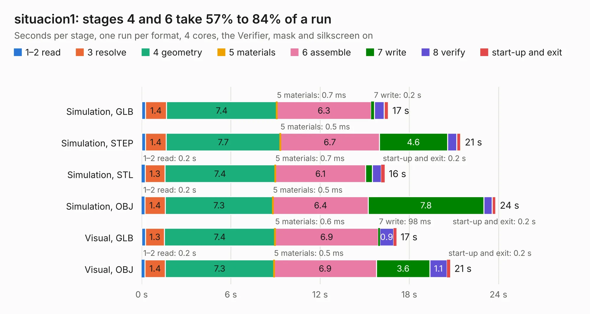

| Mode and format | 1–2 read | 3 resolve | 4 geometry | 5 materials | 6 assemble | 7 write | 8 verify | start-up and exit | Total |
|---|---:|---:|---:|---:|---:|---:|---:|---:|---:|
| Simulation, GLB | 0.3 | 1.4 | 7.4 | 0.7&nbsp;ms | 6.3 | 0.2 | 0.7 | 0.3 | 16.6 |
| Simulation, STEP | 0.3 | 1.4 | 7.7 | 0.5&nbsp;ms | 6.7 | 4.6 | 0.6 | 0.3 | 21.5 |
| Simulation, STL | 0.2 | 1.3 | 7.4 | 0.7&nbsp;ms | 6.1 | 0.5 | 0.6 | 0.2 | 16.3 |
| Simulation, OBJ | 0.2 | 1.4 | 7.3 | 0.5&nbsp;ms | 6.4 | 7.8 | 0.6 | 0.2 | 23.8 |
| Visual, GLB | 0.3 | 1.3 | 7.4 | 0.6&nbsp;ms | 6.9 | 98&nbsp;ms | 0.9 | 0.2 | 17.1 |
| Visual, OBJ | 0.2 | 1.4 | 7.3 | 0.5&nbsp;ms | 6.9 | 3.6 | 1.1 | 0.2 | 20.7 |

<table align="center"><tr><td valign="top">

| Board | Repo: [alvaroalea/plusD-clone](https://github.com/alvaroalea/plusD-clone) Board: `situacion1.kicad_pcb` |
|---|---|
| Complexity | 90, simple |
| Copper&nbsp;layers | 2 |
| File&nbsp;format | KiCad 5 (20171130) |
| Parts,&nbsp;tracks,&nbsp;vias | 45, 0, 0 |
| Triangles,&nbsp;simulation | 1,586,200 in 95 parts |
| Note | mostly unrouted |
| Verifier | PASS in all six runs |

</td><td valign="top">

<table>
<tr><th>File type</th><th>File size</th><th>Peak memory used</th></tr>
<tr><th colspan="3" align="left">Simulation</th></tr>
<tr><td>GLB</td><td align="right">50&nbsp;MB</td><td align="right">550&nbsp;MB</td></tr>
<tr><td>STEP</td><td align="right">231&nbsp;MB</td><td align="right">711&nbsp;MB</td></tr>
<tr><td>STL</td><td align="right">79&nbsp;MB</td><td align="right">526&nbsp;MB</td></tr>
<tr><td>OBJ</td><td align="right">162&nbsp;MB</td><td align="right">1.0&nbsp;GB</td></tr>
<tr><th colspan="3" align="left">Visual</th></tr>
<tr><td>GLB</td><td align="right">24&nbsp;MB</td><td align="right">661&nbsp;MB</td></tr>
<tr><td>OBJ</td><td align="right">71&nbsp;MB</td><td align="right">607&nbsp;MB</td></tr>
</table>

</td></tr></table>

## 23.2.6 SMD500

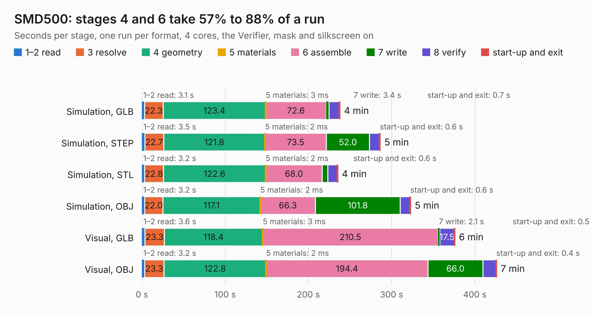

| Mode and format | 1–2 read | 3 resolve | 4 geometry | 5 materials | 6 assemble | 7 write | 8 verify | start-up and exit | Total |
|---|---:|---:|---:|---:|---:|---:|---:|---:|---:|
| Simulation, GLB | 3.1 | 22.3 | 123.4 | 3&nbsp;ms | 72.6 | 3.4 | 12.2 | 0.7 | 237.8 |
| Simulation, STEP | 3.5 | 22.7 | 121.8 | 2&nbsp;ms | 73.5 | 52.0 | 12.2 | 0.6 | 286.2 |
| Simulation, STL | 3.2 | 22.8 | 122.6 | 2&nbsp;ms | 68.0 | 6.6 | 11.3 | 0.6 | 235.1 |
| Simulation, OBJ | 3.2 | 22.0 | 117.1 | 2&nbsp;ms | 66.3 | 101.8 | 11.8 | 0.6 | 322.7 |
| Visual, GLB | 3.6 | 23.3 | 118.4 | 3&nbsp;ms | 210.5 | 2.1 | 17.5 | 0.5 | 375.8 |
| Visual, OBJ | 3.2 | 23.3 | 122.8 | 2&nbsp;ms | 194.4 | 66.0 | 15.9 | 0.4 | 426.0 |

<table align="center"><tr><td valign="top">

| Board | Repo: [amigalisa/Amiga-SMD-500](https://github.com/amigalisa/Amiga-SMD-500) Board: `SMD500.kicad_pcb` |
|---|---|
| Complexity | 24,877, extreme |
| Copper&nbsp;layers | 2 |
| File&nbsp;format | KiCad 5 (20171130) |
| Parts,&nbsp;tracks,&nbsp;vias | 582, 18,007, 1,862 |
| Triangles,&nbsp;simulation | 14,372,138 in 534 parts |
| Verifier | PASS in all six runs |

</td><td valign="top">

<table>
<tr><th>File type</th><th>File size</th><th>Peak memory used</th></tr>
<tr><th colspan="3" align="left">Simulation</th></tr>
<tr><td>GLB</td><td align="right">498&nbsp;MB</td><td align="right">3.7&nbsp;GB</td></tr>
<tr><td>STEP</td><td align="right">2.7&nbsp;GB</td><td align="right">5.2&nbsp;GB</td></tr>
<tr><td>STL</td><td align="right">719&nbsp;MB</td><td align="right">3.9&nbsp;GB</td></tr>
<tr><td>OBJ</td><td align="right">1.6&nbsp;GB</td><td align="right">9.3&nbsp;GB</td></tr>
<tr><th colspan="3" align="left">Visual</th></tr>
<tr><td>GLB</td><td align="right">354&nbsp;MB</td><td align="right">5.3&nbsp;GB</td></tr>
<tr><td>OBJ</td><td align="right">1.1&nbsp;GB</td><td align="right">7.0&nbsp;GB</td></tr>
</table>

</td></tr></table>

## 23.2.7 AmigaPCI 68040

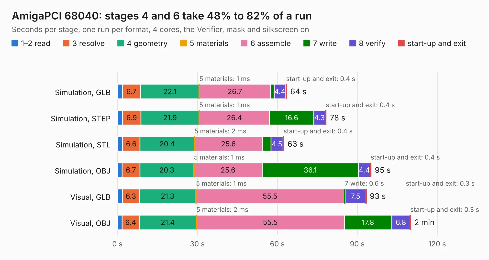

| Mode and format | 1–2 read | 3 resolve | 4 geometry | 5 materials | 6 assemble | 7 write | 8 verify | start-up and exit | Total |
|---|---:|---:|---:|---:|---:|---:|---:|---:|---:|
| Simulation, GLB | 1.9 | 6.7 | 22.1 | 1&nbsp;ms | 26.7 | 1.3 | 4.4 | 0.4 | 63.6 |
| Simulation, STEP | 1.9 | 6.9 | 21.9 | 1&nbsp;ms | 26.4 | 16.6 | 4.3 | 0.4 | 78.4 |
| Simulation, STL | 1.9 | 6.6 | 20.4 | 2&nbsp;ms | 25.6 | 3.1 | 4.5 | 0.4 | 62.5 |
| Simulation, OBJ | 1.7 | 6.7 | 20.3 | 1&nbsp;ms | 25.6 | 36.1 | 4.4 | 0.4 | 95.3 |
| Visual, GLB | 1.9 | 6.3 | 21.3 | 1&nbsp;ms | 55.5 | 0.6 | 7.5 | 0.3 | 93.4 |
| Visual, OBJ | 1.8 | 6.4 | 21.4 | 2&nbsp;ms | 55.5 | 17.8 | 6.8 | 0.3 | 110.1 |

<table align="center"><tr><td valign="top">

| Board | Repo: [AmigaPCI/AmigaPCI-LBC040](https://github.com/AmigaPCI/AmigaPCI-LBC040) Board: `AmigaPCI 68040.kicad_pcb` |
|---|---|
| Folder | KiCAD / AmigaPCI-LBC040-REV60 |
| Complexity | 6,581, high |
| Copper&nbsp;layers | 6 |
| File&nbsp;format | KiCad 8 (20240108) |
| Parts,&nbsp;tracks,&nbsp;vias | 126, 4,520, 563 |
| Triangles,&nbsp;simulation | 7,796,750 in 379 parts |
| Verifier | PASS in all six runs |

</td><td valign="top">

<table>
<tr><th>File type</th><th>File size</th><th>Peak memory used</th></tr>
<tr><th colspan="3" align="left">Simulation</th></tr>
<tr><td>GLB</td><td align="right">263&nbsp;MB</td><td align="right">1.8&nbsp;GB</td></tr>
<tr><td>STEP</td><td align="right">981&nbsp;MB</td><td align="right">2.5&nbsp;GB</td></tr>
<tr><td>STL</td><td align="right">390&nbsp;MB</td><td align="right">1.8&nbsp;GB</td></tr>
<tr><td>OBJ</td><td align="right">835&nbsp;MB</td><td align="right">4.9&nbsp;GB</td></tr>
<tr><th colspan="3" align="left">Visual</th></tr>
<tr><td>GLB</td><td align="right">133&nbsp;MB</td><td align="right">2.4&nbsp;GB</td></tr>
<tr><td>OBJ</td><td align="right">436&nbsp;MB</td><td align="right">2.9&nbsp;GB</td></tr>
</table>

</td></tr></table>

## 23.2.8 AmigaPCI Mainboard

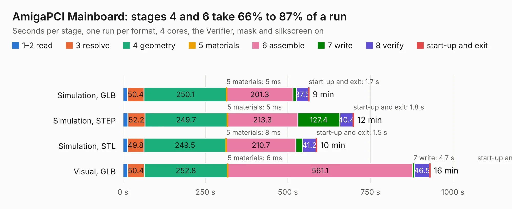

| Mode and format | 1–2 read | 3 resolve | 4 geometry | 5 materials | 6 assemble | 7 write | 8 verify | start-up and exit | Total |
|---|---:|---:|---:|---:|---:|---:|---:|---:|---:|
| Simulation, GLB | 13.6 | 50.4 | 250.1 | 5&nbsp;ms | 201.3 | 9.7 | 37.5 | 1.7 | 564.2 |
| Simulation, STEP | 14.6 | 52.2 | 249.7 | 5&nbsp;ms | 213.3 | 127.4 | 40.4 | 1.8 | 699.5 |
| Simulation, STL | 13.7 | 49.8 | 249.5 | 8&nbsp;ms | 210.7 | 21.3 | 41.2 | 1.5 | 587.6 |
| Simulation, OBJ |  |  |  |  |  |  |  |  | exceeded 11 GB on a 15 GB machine (stopped there, not a KESE failure) |
| Visual, GLB | 14.1 | 50.4 | 252.8 | 6&nbsp;ms | 561.1 | 4.7 | 46.5 | 1.5 | 931.2 |
| Visual, OBJ |  |  |  |  |  |  |  |  | exceeded 11 GB on a 15 GB machine (stopped there, not a KESE failure) |

<table align="center"><tr><td valign="top">

| Board | Repo: [AmigaPCI/AmigaPCI-MainBoard](https://github.com/AmigaPCI/AmigaPCI-MainBoard) Board: `AmigaPCI Mainboard.kicad_pcb` |
|---|---|
| Folder | KiCAD / AmigaPCI Mainboard-KiCAD REV 70 |
| Complexity | 29,804, extreme |
| Copper&nbsp;layers | 6 |
| File&nbsp;format | KiCad 8 (20240108) |
| Parts,&nbsp;tracks,&nbsp;vias | 723, 20,477, 2,447 |
| Triangles,&nbsp;simulation | 36,016,370 in 1274 parts |
| Verifier | Simulation, OBJ: exceeded 11 GB on a 15 GB machine (stopped there, not a KESE failure) Visual, OBJ: exceeded 11 GB on a 15 GB machine (stopped there, not a KESE failure) |

</td><td valign="top">

<table>
<tr><th>File type</th><th>File size</th><th>Peak memory used</th></tr>
<tr><th colspan="3" align="left">Simulation</th></tr>
<tr><td>GLB</td><td align="right">1.2&nbsp;GB</td><td align="right">7.2&nbsp;GB</td></tr>
<tr><td>STEP</td><td align="right">5.6&nbsp;GB</td><td align="right">9.7&nbsp;GB</td></tr>
<tr><td>STL</td><td align="right">1.8&nbsp;GB</td><td align="right">8.0&nbsp;GB</td></tr>
<tr><td>OBJ</td><td align="right">–</td><td align="right">11&nbsp;GB</td></tr>
<tr><th colspan="3" align="left">Visual</th></tr>
<tr><td>GLB</td><td align="right">644&nbsp;MB</td><td align="right">10&nbsp;GB</td></tr>
<tr><td>OBJ</td><td align="right">–</td><td align="right">11&nbsp;GB</td></tr>
</table>

</td></tr></table>

## 23.2.9 anavi-light-controller

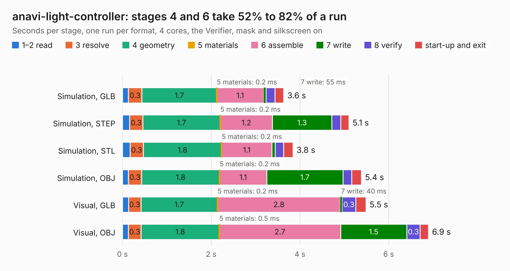

| Mode and format | 1–2 read | 3 resolve | 4 geometry | 5 materials | 6 assemble | 7 write | 8 verify | start-up and exit | Total |
|---|---:|---:|---:|---:|---:|---:|---:|---:|---:|
| Simulation, GLB | 0.1 | 0.3 | 1.7 | 0.2&nbsp;ms | 1.1 | 55&nbsp;ms | 0.2 | 0.2 | 3.6 |
| Simulation, STEP | 0.2 | 0.3 | 1.7 | 0.2&nbsp;ms | 1.2 | 1.3 | 0.2 | 0.2 | 5.1 |
| Simulation, STL | 0.2 | 0.3 | 1.8 | 0.2&nbsp;ms | 1.1 | 74&nbsp;ms | 0.2 | 0.2 | 3.8 |
| Simulation, OBJ | 0.1 | 0.3 | 1.8 | 0.2&nbsp;ms | 1.1 | 1.7 | 0.2 | 0.2 | 5.4 |
| Visual, GLB | 0.1 | 0.3 | 1.7 | 0.2&nbsp;ms | 2.8 | 40&nbsp;ms | 0.3 | 0.2 | 5.5 |
| Visual, OBJ | 0.1 | 0.3 | 1.8 | 0.5&nbsp;ms | 2.7 | 1.5 | 0.3 | 0.2 | 6.9 |

<table align="center"><tr><td valign="top">

| Board | Repo: [AnaviTechnology/anavi-light-controller](https://github.com/AnaviTechnology/anavi-light-controller) Board: `anavi-light-controller.kicad_pcb` |
|---|---|
| Complexity | 244, simple |
| Copper&nbsp;layers | 2 |
| File&nbsp;format | KiCad 4 (4) |
| Parts,&nbsp;tracks,&nbsp;vias | 22, 164, 12 |
| Triangles,&nbsp;simulation | 355,398 in 30 parts |
| Verifier | PASS in all six runs |

</td><td valign="top">

<table>
<tr><th>File type</th><th>File size</th><th>Peak memory used</th></tr>
<tr><th colspan="3" align="left">Simulation</th></tr>
<tr><td>GLB</td><td align="right">13&nbsp;MB</td><td align="right">267&nbsp;MB</td></tr>
<tr><td>STEP</td><td align="right">67&nbsp;MB</td><td align="right">292&nbsp;MB</td></tr>
<tr><td>STL</td><td align="right">18&nbsp;MB</td><td align="right">267&nbsp;MB</td></tr>
<tr><td>OBJ</td><td align="right">36&nbsp;MB</td><td align="right">270&nbsp;MB</td></tr>
<tr><th colspan="3" align="left">Visual</th></tr>
<tr><td>GLB</td><td align="right">8.9&nbsp;MB</td><td align="right">265&nbsp;MB</td></tr>
<tr><td>OBJ</td><td align="right">26&nbsp;MB</td><td align="right">265&nbsp;MB</td></tr>
</table>

</td></tr></table>

## 23.2.10 Board 2x06 W15.24

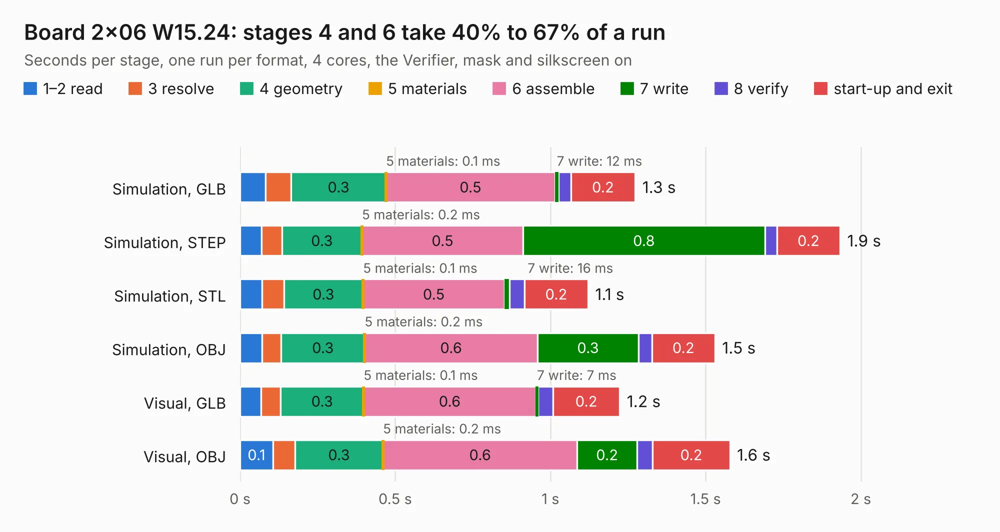

| Mode and format | 1–2 read | 3 resolve | 4 geometry | 5 materials | 6 assemble | 7 write | 8 verify | start-up and exit | Total |
|---|---:|---:|---:|---:|---:|---:|---:|---:|---:|
| Simulation, GLB | 82&nbsp;ms | 83&nbsp;ms | 0.3 | 0.1&nbsp;ms | 0.5 | 12&nbsp;ms | 39&nbsp;ms | 0.2 | 1.3 |
| Simulation, STEP | 70&nbsp;ms | 65&nbsp;ms | 0.3 | 0.2&nbsp;ms | 0.5 | 0.8 | 39&nbsp;ms | 0.2 | 1.9 |
| Simulation, STL | 71&nbsp;ms | 70&nbsp;ms | 0.3 | 0.1&nbsp;ms | 0.5 | 16&nbsp;ms | 49&nbsp;ms | 0.2 | 1.1 |
| Simulation, OBJ | 70&nbsp;ms | 62&nbsp;ms | 0.3 | 0.2&nbsp;ms | 0.6 | 0.3 | 43&nbsp;ms | 0.2 | 1.5 |
| Visual, GLB | 68&nbsp;ms | 63&nbsp;ms | 0.3 | 0.1&nbsp;ms | 0.6 | 7&nbsp;ms | 48&nbsp;ms | 0.2 | 1.2 |
| Visual, OBJ | 0.1 | 71&nbsp;ms | 0.3 | 0.2&nbsp;ms | 0.6 | 0.2 | 51&nbsp;ms | 0.2 | 1.6 |

<table align="center"><tr><td valign="top">

| Board | Repo: [andrewpaterson/658-Computer](https://github.com/andrewpaterson/658-Computer) Board: `Board 2x06 W15.24.kicad_pcb` |
|---|---|
| Folder | Kicad / Boards / Blank / Board 2x06 W15.24 |
| Complexity | 3, simple |
| Copper&nbsp;layers | 2 |
| File&nbsp;format | KiCad 9 (20241229) |
| Parts,&nbsp;tracks,&nbsp;vias | 4, 0, 0 |
| Triangles,&nbsp;simulation | 62,080 in 24 parts |
| Verifier | PASS in all six runs |

</td><td valign="top">

<table>
<tr><th>File type</th><th>File size</th><th>Peak memory used</th></tr>
<tr><th colspan="3" align="left">Simulation</th></tr>
<tr><td>GLB</td><td align="right">2.1&nbsp;MB</td><td align="right">70&nbsp;MB</td></tr>
<tr><td>STEP</td><td align="right">6.9&nbsp;MB</td><td align="right">171&nbsp;MB</td></tr>
<tr><td>STL</td><td align="right">3.1&nbsp;MB</td><td align="right">72&nbsp;MB</td></tr>
<tr><td>OBJ</td><td align="right">6.0&nbsp;MB</td><td align="right">83&nbsp;MB</td></tr>
<tr><th colspan="3" align="left">Visual</th></tr>
<tr><td>GLB</td><td align="right">1.3&nbsp;MB</td><td align="right">106&nbsp;MB</td></tr>
<tr><td>OBJ</td><td align="right">3.7&nbsp;MB</td><td align="right">107&nbsp;MB</td></tr>
</table>

</td></tr></table>

## 23.2.11 Board 2x06 W22.86

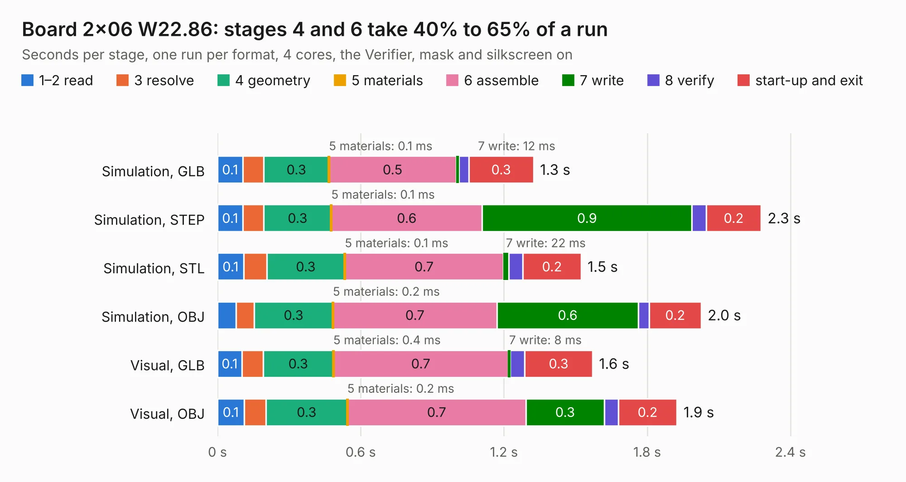

| Mode and format | 1–2 read | 3 resolve | 4 geometry | 5 materials | 6 assemble | 7 write | 8 verify | start-up and exit | Total |
|---|---:|---:|---:|---:|---:|---:|---:|---:|---:|
| Simulation, GLB | 0.1 | 88&nbsp;ms | 0.3 | 0.1&nbsp;ms | 0.5 | 12&nbsp;ms | 41&nbsp;ms | 0.3 | 1.3 |
| Simulation, STEP | 0.1 | 88&nbsp;ms | 0.3 | 0.1&nbsp;ms | 0.6 | 0.9 | 60&nbsp;ms | 0.2 | 2.3 |
| Simulation, STL | 0.1 | 97&nbsp;ms | 0.3 | 0.1&nbsp;ms | 0.7 | 22&nbsp;ms | 60&nbsp;ms | 0.2 | 1.5 |
| Simulation, OBJ | 78&nbsp;ms | 76&nbsp;ms | 0.3 | 0.2&nbsp;ms | 0.7 | 0.6 | 45&nbsp;ms | 0.2 | 2.0 |
| Visual, GLB | 0.1 | 90&nbsp;ms | 0.3 | 0.4&nbsp;ms | 0.7 | 8&nbsp;ms | 61&nbsp;ms | 0.3 | 1.6 |
| Visual, OBJ | 0.1 | 92&nbsp;ms | 0.3 | 0.2&nbsp;ms | 0.7 | 0.3 | 58&nbsp;ms | 0.2 | 1.9 |

<table align="center"><tr><td valign="top">

| Board | Repo: [andrewpaterson/658-Computer](https://github.com/andrewpaterson/658-Computer) Board: `Board 2x06 W22.86.kicad_pcb` |
|---|---|
| Folder | Kicad / Boards / Blank / Board 2x06 W22.86 |
| Complexity | 3, simple |
| Copper&nbsp;layers | 2 |
| File&nbsp;format | KiCad 9 (20241229) |
| Parts,&nbsp;tracks,&nbsp;vias | 4, 0, 0 |
| Triangles,&nbsp;simulation | 61,696 in 24 parts |
| Verifier | PASS in all six runs |

</td><td valign="top">

<table>
<tr><th>File type</th><th>File size</th><th>Peak memory used</th></tr>
<tr><th colspan="3" align="left">Simulation</th></tr>
<tr><td>GLB</td><td align="right">2.0&nbsp;MB</td><td align="right">70&nbsp;MB</td></tr>
<tr><td>STEP</td><td align="right">6.6&nbsp;MB</td><td align="right">171&nbsp;MB</td></tr>
<tr><td>STL</td><td align="right">3.1&nbsp;MB</td><td align="right">71&nbsp;MB</td></tr>
<tr><td>OBJ</td><td align="right">5.9&nbsp;MB</td><td align="right">94&nbsp;MB</td></tr>
<tr><th colspan="3" align="left">Visual</th></tr>
<tr><td>GLB</td><td align="right">1.3&nbsp;MB</td><td align="right">105&nbsp;MB</td></tr>
<tr><td>OBJ</td><td align="right">3.7&nbsp;MB</td><td align="right">104&nbsp;MB</td></tr>
</table>

</td></tr></table>

## 23.2.12 Board 2x12 W15.24

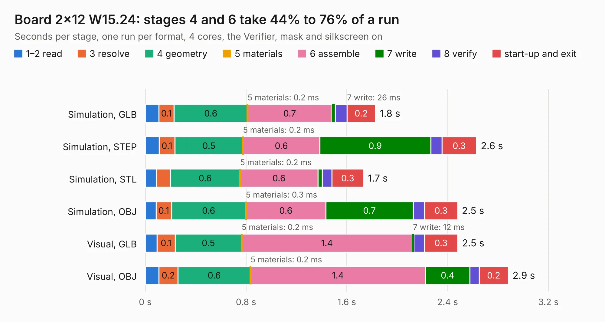

| Mode and format | 1–2 read | 3 resolve | 4 geometry | 5 materials | 6 assemble | 7 write | 8 verify | start-up and exit | Total |
|---|---:|---:|---:|---:|---:|---:|---:|---:|---:|
| Simulation, GLB | 0.1 | 0.1 | 0.6 | 0.2&nbsp;ms | 0.7 | 26&nbsp;ms | 93&nbsp;ms | 0.2 | 1.8 |
| Simulation, STEP | 0.1 | 0.1 | 0.5 | 0.2&nbsp;ms | 0.6 | 0.9 | 89&nbsp;ms | 0.3 | 2.6 |
| Simulation, STL | 88&nbsp;ms | 0.1 | 0.6 | 0.2&nbsp;ms | 0.6 | 34&nbsp;ms | 78&nbsp;ms | 0.3 | 1.7 |
| Simulation, OBJ | 86&nbsp;ms | 0.1 | 0.6 | 0.3&nbsp;ms | 0.6 | 0.7 | 90&nbsp;ms | 0.3 | 2.5 |
| Visual, GLB | 93&nbsp;ms | 0.1 | 0.5 | 0.2&nbsp;ms | 1.4 | 12&nbsp;ms | 83&nbsp;ms | 0.3 | 2.5 |
| Visual, OBJ | 0.1 | 0.2 | 0.6 | 0.2&nbsp;ms | 1.4 | 0.4 | 74&nbsp;ms | 0.2 | 2.9 |

<table align="center"><tr><td valign="top">

| Board | Repo: [andrewpaterson/658-Computer](https://github.com/andrewpaterson/658-Computer) Board: `Board 2x12 W15.24.kicad_pcb` |
|---|---|
| Folder | Kicad / Boards / Blank / Board 2x12 W15.24 |
| Complexity | 3, simple |
| Copper&nbsp;layers | 2 |
| File&nbsp;format | KiCad 9 (20241229) |
| Parts,&nbsp;tracks,&nbsp;vias | 4, 0, 0 |
| Triangles,&nbsp;simulation | 110,320 in 32 parts |
| Verifier | PASS in all six runs |

</td><td valign="top">

<table>
<tr><th>File type</th><th>File size</th><th>Peak memory used</th></tr>
<tr><th colspan="3" align="left">Simulation</th></tr>
<tr><td>GLB</td><td align="right">3.7&nbsp;MB</td><td align="right">178&nbsp;MB</td></tr>
<tr><td>STEP</td><td align="right">12&nbsp;MB</td><td align="right">188&nbsp;MB</td></tr>
<tr><td>STL</td><td align="right">5.5&nbsp;MB</td><td align="right">182&nbsp;MB</td></tr>
<tr><td>OBJ</td><td align="right">11&nbsp;MB</td><td align="right">175&nbsp;MB</td></tr>
<tr><th colspan="3" align="left">Visual</th></tr>
<tr><td>GLB</td><td align="right">2.2&nbsp;MB</td><td align="right">153&nbsp;MB</td></tr>
<tr><td>OBJ</td><td align="right">6.2&nbsp;MB</td><td align="right">153&nbsp;MB</td></tr>
</table>

</td></tr></table>

## 23.2.13 Board 2x12 W22.86

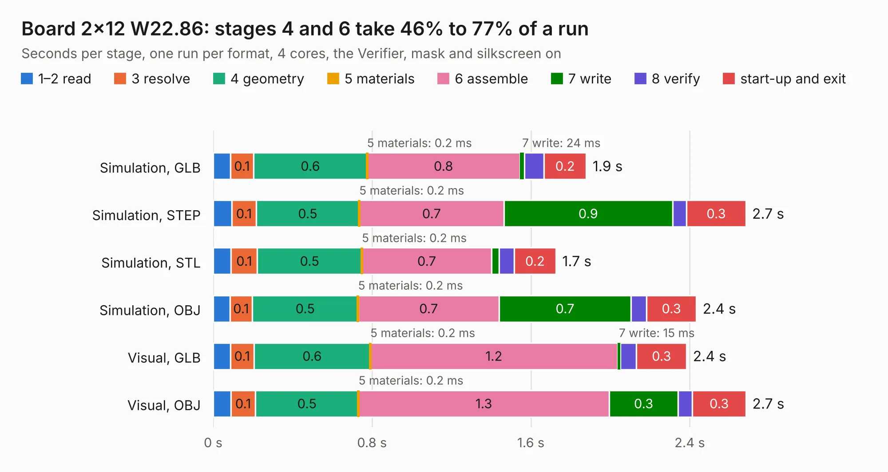

| Mode and format | 1–2 read | 3 resolve | 4 geometry | 5 materials | 6 assemble | 7 write | 8 verify | start-up and exit | Total |
|---|---:|---:|---:|---:|---:|---:|---:|---:|---:|
| Simulation, GLB | 86&nbsp;ms | 0.1 | 0.6 | 0.2&nbsp;ms | 0.8 | 24&nbsp;ms | 98&nbsp;ms | 0.2 | 1.9 |
| Simulation, STEP | 94&nbsp;ms | 0.1 | 0.5 | 0.2&nbsp;ms | 0.7 | 0.9 | 71&nbsp;ms | 0.3 | 2.7 |
| Simulation, STL | 90&nbsp;ms | 0.1 | 0.5 | 0.2&nbsp;ms | 0.7 | 38&nbsp;ms | 75&nbsp;ms | 0.2 | 1.7 |
| Simulation, OBJ | 84&nbsp;ms | 0.1 | 0.5 | 0.2&nbsp;ms | 0.7 | 0.7 | 78&nbsp;ms | 0.3 | 2.4 |
| Visual, GLB | 87&nbsp;ms | 0.1 | 0.6 | 0.2&nbsp;ms | 1.2 | 15&nbsp;ms | 81&nbsp;ms | 0.3 | 2.4 |
| Visual, OBJ | 89&nbsp;ms | 0.1 | 0.5 | 0.2&nbsp;ms | 1.3 | 0.3 | 71&nbsp;ms | 0.3 | 2.7 |

<table align="center"><tr><td valign="top">

| Board | Repo: [andrewpaterson/658-Computer](https://github.com/andrewpaterson/658-Computer) Board: `Board 2x12 W22.86.kicad_pcb` |
|---|---|
| Folder | Kicad / Boards / Blank / Board 2x12 W22.86 |
| Complexity | 3, simple |
| Copper&nbsp;layers | 2 |
| File&nbsp;format | KiCad 9 (20241229) |
| Parts,&nbsp;tracks,&nbsp;vias | 4, 0, 0 |
| Triangles,&nbsp;simulation | 109,716 in 32 parts |
| Verifier | PASS in all six runs |

</td><td valign="top">

<table>
<tr><th>File type</th><th>File size</th><th>Peak memory used</th></tr>
<tr><th colspan="3" align="left">Simulation</th></tr>
<tr><td>GLB</td><td align="right">3.6&nbsp;MB</td><td align="right">178&nbsp;MB</td></tr>
<tr><td>STEP</td><td align="right">12&nbsp;MB</td><td align="right">186&nbsp;MB</td></tr>
<tr><td>STL</td><td align="right">5.5&nbsp;MB</td><td align="right">175&nbsp;MB</td></tr>
<tr><td>OBJ</td><td align="right">11&nbsp;MB</td><td align="right">178&nbsp;MB</td></tr>
<tr><th colspan="3" align="left">Visual</th></tr>
<tr><td>GLB</td><td align="right">2.2&nbsp;MB</td><td align="right">153&nbsp;MB</td></tr>
<tr><td>OBJ</td><td align="right">6.1&nbsp;MB</td><td align="right">153&nbsp;MB</td></tr>
</table>

</td></tr></table>

## 23.2.14 Board 2x16 W15.24

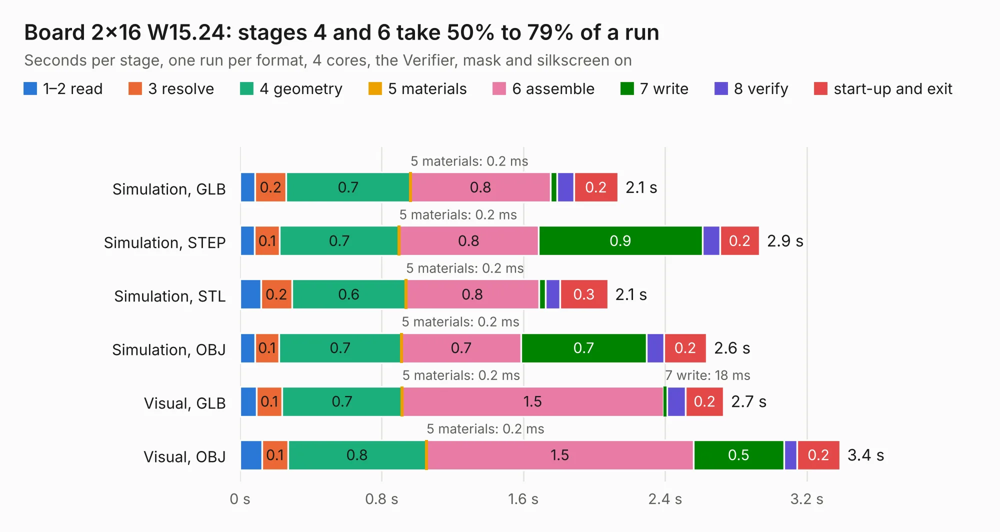

| Mode and format | 1–2 read | 3 resolve | 4 geometry | 5 materials | 6 assemble | 7 write | 8 verify | start-up and exit | Total |
|---|---:|---:|---:|---:|---:|---:|---:|---:|---:|
| Simulation, GLB | 86&nbsp;ms | 0.2 | 0.7 | 0.2&nbsp;ms | 0.8 | 36&nbsp;ms | 94&nbsp;ms | 0.2 | 2.1 |
| Simulation, STEP | 83&nbsp;ms | 0.1 | 0.7 | 0.2&nbsp;ms | 0.8 | 0.9 | 98&nbsp;ms | 0.2 | 2.9 |
| Simulation, STL | 0.1 | 0.2 | 0.6 | 0.2&nbsp;ms | 0.8 | 37&nbsp;ms | 84&nbsp;ms | 0.3 | 2.1 |
| Simulation, OBJ | 84&nbsp;ms | 0.1 | 0.7 | 0.2&nbsp;ms | 0.7 | 0.7 | 98&nbsp;ms | 0.2 | 2.6 |
| Visual, GLB | 92&nbsp;ms | 0.1 | 0.7 | 0.2&nbsp;ms | 1.5 | 18&nbsp;ms | 0.1 | 0.2 | 2.7 |
| Visual, OBJ | 0.1 | 0.1 | 0.8 | 0.2&nbsp;ms | 1.5 | 0.5 | 75&nbsp;ms | 0.2 | 3.4 |

<table align="center"><tr><td valign="top">

| Board | Repo: [andrewpaterson/658-Computer](https://github.com/andrewpaterson/658-Computer) Board: `Board 2x16 W15.24.kicad_pcb` |
|---|---|
| Folder | Kicad / Boards / Blank / Board 2x16 W15.24 |
| Complexity | 3, simple |
| Copper&nbsp;layers | 2 |
| File&nbsp;format | KiCad 9 (20241229) |
| Parts,&nbsp;tracks,&nbsp;vias | 4, 0, 0 |
| Triangles,&nbsp;simulation | 143,440 in 40 parts |
| Verifier | PASS in all six runs |

</td><td valign="top">

<table>
<tr><th>File type</th><th>File size</th><th>Peak memory used</th></tr>
<tr><th colspan="3" align="left">Simulation</th></tr>
<tr><td>GLB</td><td align="right">4.7&nbsp;MB</td><td align="right">184&nbsp;MB</td></tr>
<tr><td>STEP</td><td align="right">15&nbsp;MB</td><td align="right">197&nbsp;MB</td></tr>
<tr><td>STL</td><td align="right">7.2&nbsp;MB</td><td align="right">185&nbsp;MB</td></tr>
<tr><td>OBJ</td><td align="right">14&nbsp;MB</td><td align="right">181&nbsp;MB</td></tr>
<tr><th colspan="3" align="left">Visual</th></tr>
<tr><td>GLB</td><td align="right">2.8&nbsp;MB</td><td align="right">155&nbsp;MB</td></tr>
<tr><td>OBJ</td><td align="right">7.8&nbsp;MB</td><td align="right">157&nbsp;MB</td></tr>
</table>

</td></tr></table>

## 23.2.15 Board 2x16 W22.86

| Mode and format | 1–2 read | 3 resolve | 4 geometry | 5 materials | 6 assemble | 7 write | 8 verify | start-up and exit | Total |
|---|---:|---:|---:|---:|---:|---:|---:|---:|---:|
| Simulation, GLB | 84&nbsp;ms | 0.1 | 0.6 | 0.2&nbsp;ms | 0.8 | 26&nbsp;ms | 80&nbsp;ms | 0.2 | 1.9 |
| Simulation, STEP | 85&nbsp;ms | 0.1 | 0.6 | 0.2&nbsp;ms | 0.7 | 0.9 | 95&nbsp;ms | 0.2 | 2.8 |
| Simulation, STL | 84&nbsp;ms | 0.1 | 0.6 | 0.2&nbsp;ms | 0.8 | 36&nbsp;ms | 91&nbsp;ms | 0.2 | 1.9 |
| Simulation, OBJ | 0.1 | 0.1 | 0.6 | 0.2&nbsp;ms | 0.7 | 0.8 | 90&nbsp;ms | 0.3 | 2.7 |
| Visual, GLB | 87&nbsp;ms | 0.1 | 0.6 | 0.3&nbsp;ms | 1.3 | 13&nbsp;ms | 83&nbsp;ms | 0.2 | 2.5 |
| Visual, OBJ | 83&nbsp;ms | 0.1 | 0.6 | 0.2&nbsp;ms | 1.3 | 0.5 | 94&nbsp;ms | 0.2 | 2.9 |

<table align="center"><tr><td valign="top">

| Board | Repo: [andrewpaterson/658-Computer](https://github.com/andrewpaterson/658-Computer) Board: `Board 2x16 W22.86.kicad_pcb` |
|---|---|
| Folder | Kicad / Boards / Blank / Board 2x16 W22.86 |
| Complexity | 3, simple |
| Copper&nbsp;layers | 2 |
| File&nbsp;format | KiCad 9 (20241229) |
| Parts,&nbsp;tracks,&nbsp;vias | 4, 0, 0 |
| Triangles,&nbsp;simulation | 142,752 in 40 parts |
| Verifier | PASS in all six runs |

</td><td valign="top">

<table>
<tr><th>File type</th><th>File size</th><th>Peak memory used</th></tr>
<tr><th colspan="3" align="left">Simulation</th></tr>
<tr><td>GLB</td><td align="right">4.6&nbsp;MB</td><td align="right">184&nbsp;MB</td></tr>
<tr><td>STEP</td><td align="right">15&nbsp;MB</td><td align="right">201&nbsp;MB</td></tr>
<tr><td>STL</td><td align="right">7.1&nbsp;MB</td><td align="right">183&nbsp;MB</td></tr>
<tr><td>OBJ</td><td align="right">14&nbsp;MB</td><td align="right">183&nbsp;MB</td></tr>
<tr><th colspan="3" align="left">Visual</th></tr>
<tr><td>GLB</td><td align="right">2.8&nbsp;MB</td><td align="right">157&nbsp;MB</td></tr>
<tr><td>OBJ</td><td align="right">7.8&nbsp;MB</td><td align="right">154&nbsp;MB</td></tr>
</table>

</td></tr></table>

## 23.2.16 Board 2x20 W15.24

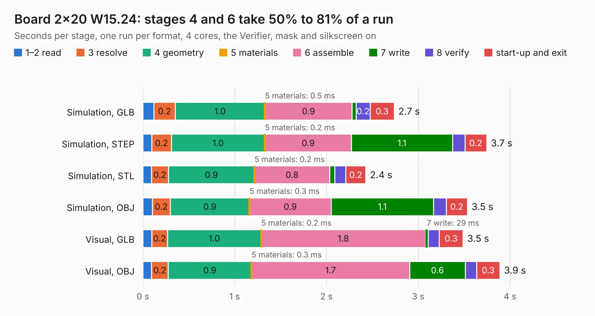

| Mode and format | 1–2 read | 3 resolve | 4 geometry | 5 materials | 6 assemble | 7 write | 8 verify | start-up and exit | Total |
|---|---:|---:|---:|---:|---:|---:|---:|---:|---:|
| Simulation, GLB | 0.1 | 0.2 | 1.0 | 0.5&nbsp;ms | 0.9 | 42&nbsp;ms | 0.2 | 0.3 | 2.7 |
| Simulation, STEP | 97&nbsp;ms | 0.2 | 1.0 | 0.2&nbsp;ms | 0.9 | 1.1 | 0.1 | 0.2 | 3.7 |
| Simulation, STL | 93&nbsp;ms | 0.2 | 0.9 | 0.2&nbsp;ms | 0.8 | 54&nbsp;ms | 0.1 | 0.2 | 2.4 |
| Simulation, OBJ | 0.1 | 0.2 | 0.9 | 0.3&nbsp;ms | 0.9 | 1.1 | 0.1 | 0.2 | 3.5 |
| Visual, GLB | 97&nbsp;ms | 0.2 | 1.0 | 0.2&nbsp;ms | 1.8 | 29&nbsp;ms | 0.1 | 0.3 | 3.5 |
| Visual, OBJ | 94&nbsp;ms | 0.2 | 0.9 | 0.3&nbsp;ms | 1.7 | 0.6 | 0.1 | 0.3 | 3.9 |

<table align="center"><tr><td valign="top">

| Board | Repo: [andrewpaterson/658-Computer](https://github.com/andrewpaterson/658-Computer) Board: `Board 2x20 W15.24.kicad_pcb` |
|---|---|
| Folder | Kicad / Boards / Blank / Board 2x20 W15.24 |
| Complexity | 3, simple |
| Copper&nbsp;layers | 2 |
| File&nbsp;format | KiCad 9 (20241229) |
| Parts,&nbsp;tracks,&nbsp;vias | 4, 0, 0 |
| Triangles,&nbsp;simulation | 176,560 in 48 parts |
| Verifier | PASS in all six runs |

</td><td valign="top">

<table>
<tr><th>File type</th><th>File size</th><th>Peak memory used</th></tr>
<tr><th colspan="3" align="left">Simulation</th></tr>
<tr><td>GLB</td><td align="right">5.8&nbsp;MB</td><td align="right">192&nbsp;MB</td></tr>
<tr><td>STEP</td><td align="right">18&nbsp;MB</td><td align="right">213&nbsp;MB</td></tr>
<tr><td>STL</td><td align="right">8.8&nbsp;MB</td><td align="right">194&nbsp;MB</td></tr>
<tr><td>OBJ</td><td align="right">17&nbsp;MB</td><td align="right">194&nbsp;MB</td></tr>
<tr><th colspan="3" align="left">Visual</th></tr>
<tr><td>GLB</td><td align="right">3.4&nbsp;MB</td><td align="right">171&nbsp;MB</td></tr>
<tr><td>OBJ</td><td align="right">9.5&nbsp;MB</td><td align="right">172&nbsp;MB</td></tr>
</table>

</td></tr></table>

## 23.2.17 Board 2x20 W22.86

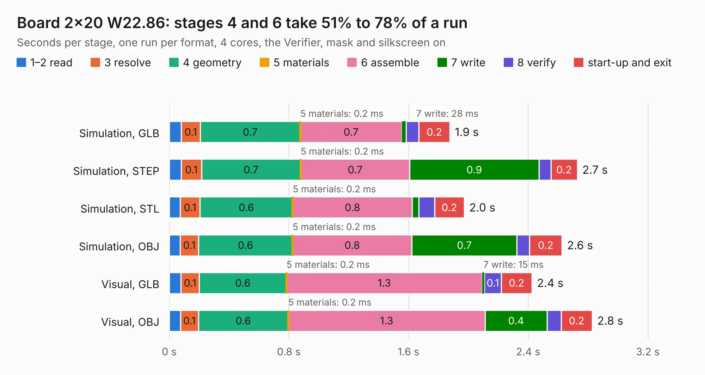

| Mode and format | 1–2 read | 3 resolve | 4 geometry | 5 materials | 6 assemble | 7 write | 8 verify | start-up and exit | Total |
|---|---:|---:|---:|---:|---:|---:|---:|---:|---:|
| Simulation, GLB | 81&nbsp;ms | 0.1 | 0.7 | 0.2&nbsp;ms | 0.7 | 28&nbsp;ms | 86&nbsp;ms | 0.2 | 1.9 |
| Simulation, STEP | 81&nbsp;ms | 0.1 | 0.7 | 0.2&nbsp;ms | 0.7 | 0.9 | 80&nbsp;ms | 0.2 | 2.7 |
| Simulation, STL | 73&nbsp;ms | 0.1 | 0.6 | 0.2&nbsp;ms | 0.8 | 44&nbsp;ms | 0.1 | 0.2 | 2.0 |
| Simulation, OBJ | 73&nbsp;ms | 0.1 | 0.6 | 0.2&nbsp;ms | 0.8 | 0.7 | 84&nbsp;ms | 0.2 | 2.6 |
| Visual, GLB | 78&nbsp;ms | 0.1 | 0.6 | 0.2&nbsp;ms | 1.3 | 15&nbsp;ms | 0.1 | 0.2 | 2.4 |
| Visual, OBJ | 75&nbsp;ms | 0.1 | 0.6 | 0.2&nbsp;ms | 1.3 | 0.4 | 94&nbsp;ms | 0.2 | 2.8 |

<table align="center"><tr><td valign="top">

| Board | Repo: [andrewpaterson/658-Computer](https://github.com/andrewpaterson/658-Computer) Board: `Board 2x20 W22.86.kicad_pcb` |
|---|---|
| Folder | Kicad / Boards / Blank / Board 2x20 W22.86 |
| Complexity | 3, simple |
| Copper&nbsp;layers | 2 |
| File&nbsp;format | KiCad 9 (20241229) |
| Parts,&nbsp;tracks,&nbsp;vias | 4, 0, 0 |
| Triangles,&nbsp;simulation | 175,844 in 48 parts |
| Verifier | PASS in all six runs |

</td><td valign="top">

<table>
<tr><th>File type</th><th>File size</th><th>Peak memory used</th></tr>
<tr><th colspan="3" align="left">Simulation</th></tr>
<tr><td>GLB</td><td align="right">5.7&nbsp;MB</td><td align="right">190&nbsp;MB</td></tr>
<tr><td>STEP</td><td align="right">18&nbsp;MB</td><td align="right">213&nbsp;MB</td></tr>
<tr><td>STL</td><td align="right">8.8&nbsp;MB</td><td align="right">194&nbsp;MB</td></tr>
<tr><td>OBJ</td><td align="right">17&nbsp;MB</td><td align="right">194&nbsp;MB</td></tr>
<tr><th colspan="3" align="left">Visual</th></tr>
<tr><td>GLB</td><td align="right">3.3&nbsp;MB</td><td align="right">162&nbsp;MB</td></tr>
<tr><td>OBJ</td><td align="right">9.4&nbsp;MB</td><td align="right">171&nbsp;MB</td></tr>
</table>

</td></tr></table>

## 23.2.18 Board 2x22 W15.24

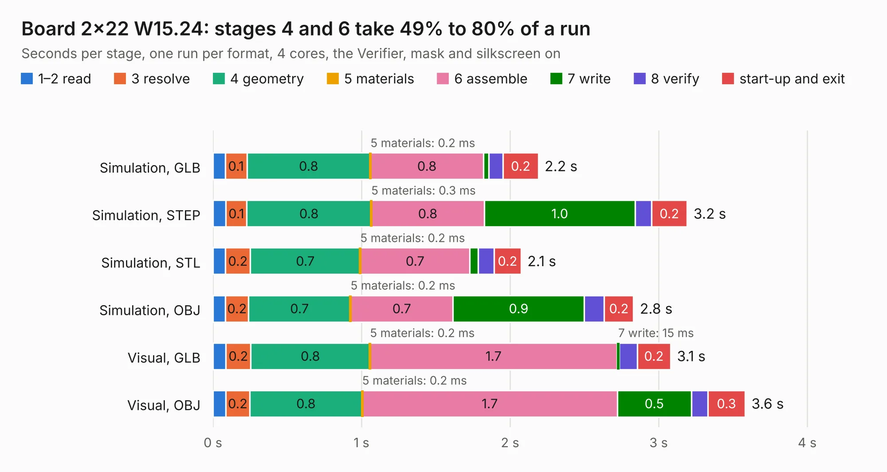

| Mode and format | 1–2 read | 3 resolve | 4 geometry | 5 materials | 6 assemble | 7 write | 8 verify | start-up and exit | Total |
|---|---:|---:|---:|---:|---:|---:|---:|---:|---:|
| Simulation, GLB | 83&nbsp;ms | 0.1 | 0.8 | 0.2&nbsp;ms | 0.8 | 37&nbsp;ms | 95&nbsp;ms | 0.2 | 2.2 |
| Simulation, STEP | 88&nbsp;ms | 0.1 | 0.8 | 0.3&nbsp;ms | 0.8 | 1.0 | 0.1 | 0.2 | 3.2 |
| Simulation, STL | 84&nbsp;ms | 0.2 | 0.7 | 0.2&nbsp;ms | 0.7 | 54&nbsp;ms | 0.1 | 0.2 | 2.1 |
| Simulation, OBJ | 85&nbsp;ms | 0.2 | 0.7 | 0.2&nbsp;ms | 0.7 | 0.9 | 0.1 | 0.2 | 2.8 |
| Visual, GLB | 87&nbsp;ms | 0.2 | 0.8 | 0.2&nbsp;ms | 1.7 | 15&nbsp;ms | 0.1 | 0.2 | 3.1 |
| Visual, OBJ | 86&nbsp;ms | 0.2 | 0.8 | 0.2&nbsp;ms | 1.7 | 0.5 | 0.1 | 0.3 | 3.6 |

<table align="center"><tr><td valign="top">

| Board | Repo: [andrewpaterson/658-Computer](https://github.com/andrewpaterson/658-Computer) Board: `Board 2x22 W15.24.kicad_pcb` |
|---|---|
| Folder | Kicad / Boards / Blank / Board 2x22 W15.24 |
| Complexity | 3, simple |
| Copper&nbsp;layers | 2 |
| File&nbsp;format | KiCad 9 (20241229) |
| Parts,&nbsp;tracks,&nbsp;vias | 4, 0, 0 |
| Triangles,&nbsp;simulation | 193,120 in 52 parts |
| Verifier | PASS in all six runs |

</td><td valign="top">

<table>
<tr><th>File type</th><th>File size</th><th>Peak memory used</th></tr>
<tr><th colspan="3" align="left">Simulation</th></tr>
<tr><td>GLB</td><td align="right">6.3&nbsp;MB</td><td align="right">198&nbsp;MB</td></tr>
<tr><td>STEP</td><td align="right">20&nbsp;MB</td><td align="right">219&nbsp;MB</td></tr>
<tr><td>STL</td><td align="right">9.7&nbsp;MB</td><td align="right">198&nbsp;MB</td></tr>
<tr><td>OBJ</td><td align="right">19&nbsp;MB</td><td align="right">198&nbsp;MB</td></tr>
<tr><th colspan="3" align="left">Visual</th></tr>
<tr><td>GLB</td><td align="right">3.6&nbsp;MB</td><td align="right">181&nbsp;MB</td></tr>
<tr><td>OBJ</td><td align="right">10&nbsp;MB</td><td align="right">177&nbsp;MB</td></tr>
</table>

</td></tr></table>

## 23.2.19 Board 2x24 W15.24

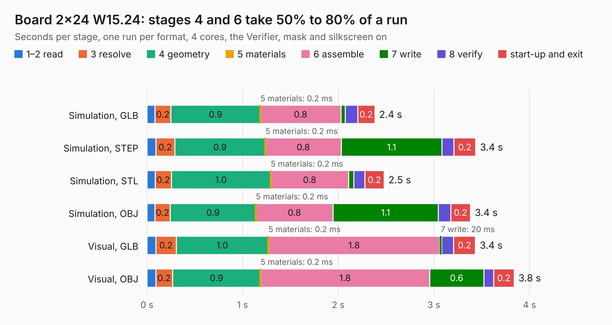

| Mode and format | 1–2 read | 3 resolve | 4 geometry | 5 materials | 6 assemble | 7 write | 8 verify | start-up and exit | Total |
|---|---:|---:|---:|---:|---:|---:|---:|---:|---:|
| Simulation, GLB | 84&nbsp;ms | 0.2 | 0.9 | 0.2&nbsp;ms | 0.8 | 46&nbsp;ms | 0.1 | 0.2 | 2.4 |
| Simulation, STEP | 93&nbsp;ms | 0.2 | 0.9 | 0.2&nbsp;ms | 0.8 | 1.1 | 0.1 | 0.2 | 3.4 |
| Simulation, STL | 87&nbsp;ms | 0.2 | 1.0 | 0.2&nbsp;ms | 0.8 | 54&nbsp;ms | 0.1 | 0.2 | 2.5 |
| Simulation, OBJ | 82&nbsp;ms | 0.2 | 0.9 | 0.2&nbsp;ms | 0.8 | 1.1 | 0.1 | 0.2 | 3.4 |
| Visual, GLB | 91&nbsp;ms | 0.2 | 1.0 | 0.2&nbsp;ms | 1.8 | 20&nbsp;ms | 0.1 | 0.2 | 3.4 |
| Visual, OBJ | 91&nbsp;ms | 0.2 | 0.9 | 0.2&nbsp;ms | 1.8 | 0.6 | 0.1 | 0.2 | 3.8 |

<table align="center"><tr><td valign="top">

| Board | Repo: [andrewpaterson/658-Computer](https://github.com/andrewpaterson/658-Computer) Board: `Board 2x24 W15.24.kicad_pcb` |
|---|---|
| Folder | Kicad / Boards / Blank / Board 2x24 W15.24 |
| Complexity | 3, simple |
| Copper&nbsp;layers | 2 |
| File&nbsp;format | KiCad 9 (20241229) |
| Parts,&nbsp;tracks,&nbsp;vias | 4, 0, 0 |
| Triangles,&nbsp;simulation | 209,680 in 56 parts |
| Verifier | PASS in all six runs |

</td><td valign="top">

<table>
<tr><th>File type</th><th>File size</th><th>Peak memory used</th></tr>
<tr><th colspan="3" align="left">Simulation</th></tr>
<tr><td>GLB</td><td align="right">6.9&nbsp;MB</td><td align="right">203&nbsp;MB</td></tr>
<tr><td>STEP</td><td align="right">22&nbsp;MB</td><td align="right">224&nbsp;MB</td></tr>
<tr><td>STL</td><td align="right">10&nbsp;MB</td><td align="right">200&nbsp;MB</td></tr>
<tr><td>OBJ</td><td align="right">21&nbsp;MB</td><td align="right">202&nbsp;MB</td></tr>
<tr><th colspan="3" align="left">Visual</th></tr>
<tr><td>GLB</td><td align="right">3.9&nbsp;MB</td><td align="right">190&nbsp;MB</td></tr>
<tr><td>OBJ</td><td align="right">11&nbsp;MB</td><td align="right">190&nbsp;MB</td></tr>
</table>

</td></tr></table>

## 23.2.20 Board 2x24 W22.86

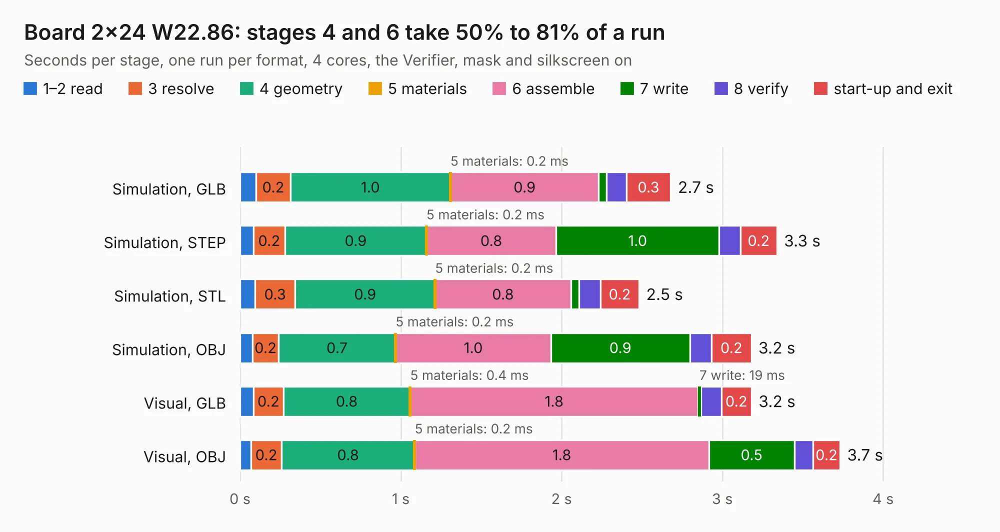

| Mode and format | 1–2 read | 3 resolve | 4 geometry | 5 materials | 6 assemble | 7 write | 8 verify | start-up and exit | Total |
|---|---:|---:|---:|---:|---:|---:|---:|---:|---:|
| Simulation, GLB | 0.1 | 0.2 | 1.0 | 0.2&nbsp;ms | 0.9 | 48&nbsp;ms | 0.1 | 0.3 | 2.7 |
| Simulation, STEP | 83&nbsp;ms | 0.2 | 0.9 | 0.2&nbsp;ms | 0.8 | 1.0 | 0.1 | 0.2 | 3.3 |
| Simulation, STL | 93&nbsp;ms | 0.3 | 0.9 | 0.2&nbsp;ms | 0.8 | 51&nbsp;ms | 0.1 | 0.2 | 2.5 |
| Simulation, OBJ | 78&nbsp;ms | 0.2 | 0.7 | 0.2&nbsp;ms | 1.0 | 0.9 | 0.1 | 0.2 | 3.2 |
| Visual, GLB | 84&nbsp;ms | 0.2 | 0.8 | 0.4&nbsp;ms | 1.8 | 19&nbsp;ms | 0.1 | 0.2 | 3.2 |
| Visual, OBJ | 69&nbsp;ms | 0.2 | 0.8 | 0.2&nbsp;ms | 1.8 | 0.5 | 0.1 | 0.2 | 3.7 |

<table align="center"><tr><td valign="top">

| Board | Repo: [andrewpaterson/658-Computer](https://github.com/andrewpaterson/658-Computer) Board: `Board 2x24 W22.86.kicad_pcb` |
|---|---|
| Folder | Kicad / Boards / Blank / Board 2x24 W22.86 |
| Complexity | 3, simple |
| Copper&nbsp;layers | 2 |
| File&nbsp;format | KiCad 9 (20241229) |
| Parts,&nbsp;tracks,&nbsp;vias | 4, 0, 0 |
| Triangles,&nbsp;simulation | 209,084 in 56 parts |
| Verifier | PASS in all six runs |

</td><td valign="top">

<table>
<tr><th>File type</th><th>File size</th><th>Peak memory used</th></tr>
<tr><th colspan="3" align="left">Simulation</th></tr>
<tr><td>GLB</td><td align="right">6.7&nbsp;MB</td><td align="right">203&nbsp;MB</td></tr>
<tr><td>STEP</td><td align="right">21&nbsp;MB</td><td align="right">223&nbsp;MB</td></tr>
<tr><td>STL</td><td align="right">10&nbsp;MB</td><td align="right">201&nbsp;MB</td></tr>
<tr><td>OBJ</td><td align="right">21&nbsp;MB</td><td align="right">202&nbsp;MB</td></tr>
<tr><th colspan="3" align="left">Visual</th></tr>
<tr><td>GLB</td><td align="right">3.9&nbsp;MB</td><td align="right">189&nbsp;MB</td></tr>
<tr><td>OBJ</td><td align="right">11&nbsp;MB</td><td align="right">191&nbsp;MB</td></tr>
</table>

</td></tr></table>

## 23.2.21 Board 2x28 W15.24

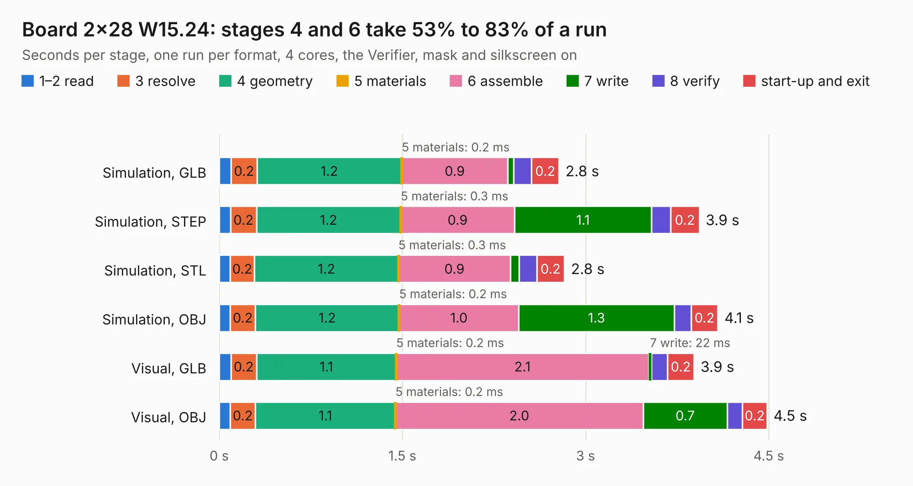

| Mode and format | 1–2 read | 3 resolve | 4 geometry | 5 materials | 6 assemble | 7 write | 8 verify | start-up and exit | Total |
|---|---:|---:|---:|---:|---:|---:|---:|---:|---:|
| Simulation, GLB | 98&nbsp;ms | 0.2 | 1.2 | 0.2&nbsp;ms | 0.9 | 47&nbsp;ms | 0.1 | 0.2 | 2.8 |
| Simulation, STEP | 93&nbsp;ms | 0.2 | 1.2 | 0.3&nbsp;ms | 0.9 | 1.1 | 0.2 | 0.2 | 3.9 |
| Simulation, STL | 89&nbsp;ms | 0.2 | 1.2 | 0.3&nbsp;ms | 0.9 | 69&nbsp;ms | 0.1 | 0.2 | 2.8 |
| Simulation, OBJ | 91&nbsp;ms | 0.2 | 1.2 | 0.2&nbsp;ms | 1.0 | 1.3 | 0.1 | 0.2 | 4.1 |
| Visual, GLB | 97&nbsp;ms | 0.2 | 1.1 | 0.2&nbsp;ms | 2.1 | 22&nbsp;ms | 0.1 | 0.2 | 3.9 |
| Visual, OBJ | 90&nbsp;ms | 0.2 | 1.1 | 0.2&nbsp;ms | 2.0 | 0.7 | 0.1 | 0.2 | 4.5 |

<table align="center"><tr><td valign="top">

| Board | Repo: [andrewpaterson/658-Computer](https://github.com/andrewpaterson/658-Computer) Board: `Board 2x28 W15.24.kicad_pcb` |
|---|---|
| Folder | Kicad / Boards / Blank / Board 2x28 W15.24 |
| Complexity | 3, simple |
| Copper&nbsp;layers | 2 |
| File&nbsp;format | KiCad 9 (20241229) |
| Parts,&nbsp;tracks,&nbsp;vias | 4, 0, 0 |
| Triangles,&nbsp;simulation | 242,800 in 64 parts |
| Verifier | PASS in all six runs |

</td><td valign="top">

<table>
<tr><th>File type</th><th>File size</th><th>Peak memory used</th></tr>
<tr><th colspan="3" align="left">Simulation</th></tr>
<tr><td>GLB</td><td align="right">7.9&nbsp;MB</td><td align="right">212&nbsp;MB</td></tr>
<tr><td>STEP</td><td align="right">25&nbsp;MB</td><td align="right">237&nbsp;MB</td></tr>
<tr><td>STL</td><td align="right">12&nbsp;MB</td><td align="right">212&nbsp;MB</td></tr>
<tr><td>OBJ</td><td align="right">24&nbsp;MB</td><td align="right">212&nbsp;MB</td></tr>
<tr><th colspan="3" align="left">Visual</th></tr>
<tr><td>GLB</td><td align="right">4.5&nbsp;MB</td><td align="right">214&nbsp;MB</td></tr>
<tr><td>OBJ</td><td align="right">13&nbsp;MB</td><td align="right">211&nbsp;MB</td></tr>
</table>

</td></tr></table>

## 23.2.22 Board 2x28 W22.86

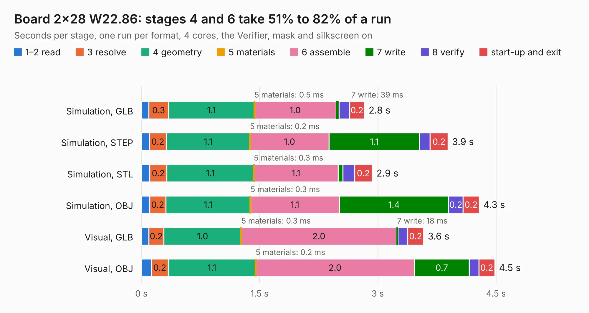

| Mode and format | 1–2 read | 3 resolve | 4 geometry | 5 materials | 6 assemble | 7 write | 8 verify | start-up and exit | Total |
|---|---:|---:|---:|---:|---:|---:|---:|---:|---:|
| Simulation, GLB | 94&nbsp;ms | 0.3 | 1.1 | 0.5&nbsp;ms | 1.0 | 39&nbsp;ms | 0.1 | 0.2 | 2.8 |
| Simulation, STEP | 0.1 | 0.2 | 1.1 | 0.2&nbsp;ms | 1.0 | 1.1 | 0.1 | 0.2 | 3.9 |
| Simulation, STL | 0.1 | 0.2 | 1.1 | 0.3&nbsp;ms | 1.1 | 61&nbsp;ms | 0.1 | 0.2 | 2.9 |
| Simulation, OBJ | 0.1 | 0.2 | 1.1 | 0.3&nbsp;ms | 1.1 | 1.4 | 0.2 | 0.2 | 4.3 |
| Visual, GLB | 94&nbsp;ms | 0.2 | 1.0 | 0.3&nbsp;ms | 2.0 | 18&nbsp;ms | 0.1 | 0.2 | 3.6 |
| Visual, OBJ | 0.1 | 0.2 | 1.1 | 0.2&nbsp;ms | 2.0 | 0.7 | 0.1 | 0.2 | 4.5 |

<table align="center"><tr><td valign="top">

| Board | Repo: [andrewpaterson/658-Computer](https://github.com/andrewpaterson/658-Computer) Board: `Board 2x28 W22.86.kicad_pcb` |
|---|---|
| Folder | Kicad / Boards / Blank / Board 2x28 W22.86 |
| Complexity | 3, simple |
| Copper&nbsp;layers | 2 |
| File&nbsp;format | KiCad 9 (20241229) |
| Parts,&nbsp;tracks,&nbsp;vias | 4, 0, 0 |
| Triangles,&nbsp;simulation | 242,128 in 64 parts |
| Verifier | PASS in all six runs |

</td><td valign="top">

<table>
<tr><th>File type</th><th>File size</th><th>Peak memory used</th></tr>
<tr><th colspan="3" align="left">Simulation</th></tr>
<tr><td>GLB</td><td align="right">7.7&nbsp;MB</td><td align="right">211&nbsp;MB</td></tr>
<tr><td>STEP</td><td align="right">25&nbsp;MB</td><td align="right">236&nbsp;MB</td></tr>
<tr><td>STL</td><td align="right">12&nbsp;MB</td><td align="right">211&nbsp;MB</td></tr>
<tr><td>OBJ</td><td align="right">24&nbsp;MB</td><td align="right">217&nbsp;MB</td></tr>
<tr><th colspan="3" align="left">Visual</th></tr>
<tr><td>GLB</td><td align="right">4.5&nbsp;MB</td><td align="right">211&nbsp;MB</td></tr>
<tr><td>OBJ</td><td align="right">13&nbsp;MB</td><td align="right">210&nbsp;MB</td></tr>
</table>

</td></tr></table>

## 23.2.23 Board 2x32 W15.24

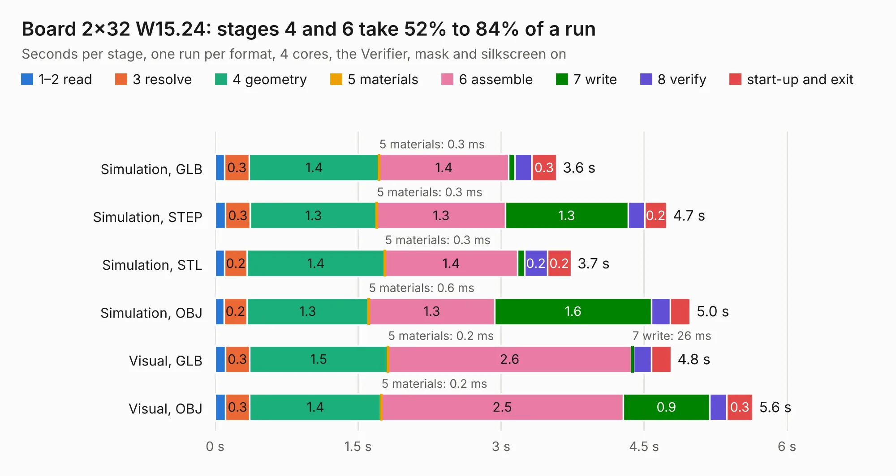

| Mode and format | 1–2 read | 3 resolve | 4 geometry | 5 materials | 6 assemble | 7 write | 8 verify | start-up and exit | Total |
|---|---:|---:|---:|---:|---:|---:|---:|---:|---:|
| Simulation, GLB | 0.1 | 0.3 | 1.4 | 0.3&nbsp;ms | 1.4 | 65&nbsp;ms | 0.2 | 0.3 | 3.6 |
| Simulation, STEP | 0.1 | 0.3 | 1.3 | 0.3&nbsp;ms | 1.3 | 1.3 | 0.2 | 0.2 | 4.7 |
| Simulation, STL | 0.1 | 0.2 | 1.4 | 0.3&nbsp;ms | 1.4 | 75&nbsp;ms | 0.2 | 0.2 | 3.7 |
| Simulation, OBJ | 94&nbsp;ms | 0.2 | 1.3 | 0.6&nbsp;ms | 1.3 | 1.6 | 0.2 | 0.2 | 5.0 |
| Visual, GLB | 0.1 | 0.3 | 1.5 | 0.2&nbsp;ms | 2.6 | 26&nbsp;ms | 0.2 | 0.2 | 4.8 |
| Visual, OBJ | 0.1 | 0.3 | 1.4 | 0.2&nbsp;ms | 2.5 | 0.9 | 0.2 | 0.3 | 5.6 |

<table align="center"><tr><td valign="top">

| Board | Repo: [andrewpaterson/658-Computer](https://github.com/andrewpaterson/658-Computer) Board: `Board 2x32 W15.24.kicad_pcb` |
|---|---|
| Folder | Kicad / Boards / Blank / Board 2x32 W15.24 |
| Complexity | 3, simple |
| Copper&nbsp;layers | 2 |
| File&nbsp;format | KiCad 9 (20241229) |
| Parts,&nbsp;tracks,&nbsp;vias | 4, 0, 0 |
| Triangles,&nbsp;simulation | 275,432 in 72 parts |
| Verifier | PASS in all six runs |

</td><td valign="top">

<table>
<tr><th>File type</th><th>File size</th><th>Peak memory used</th></tr>
<tr><th colspan="3" align="left">Simulation</th></tr>
<tr><td>GLB</td><td align="right">8.6&nbsp;MB</td><td align="right">221&nbsp;MB</td></tr>
<tr><td>STEP</td><td align="right">28&nbsp;MB</td><td align="right">248&nbsp;MB</td></tr>
<tr><td>STL</td><td align="right">14&nbsp;MB</td><td align="right">220&nbsp;MB</td></tr>
<tr><td>OBJ</td><td align="right">27&nbsp;MB</td><td align="right">241&nbsp;MB</td></tr>
<tr><th colspan="3" align="left">Visual</th></tr>
<tr><td>GLB</td><td align="right">5.1&nbsp;MB</td><td align="right">229&nbsp;MB</td></tr>
<tr><td>OBJ</td><td align="right">15&nbsp;MB</td><td align="right">233&nbsp;MB</td></tr>
</table>

</td></tr></table>

## 23.2.24 Board 2x32 W22.86

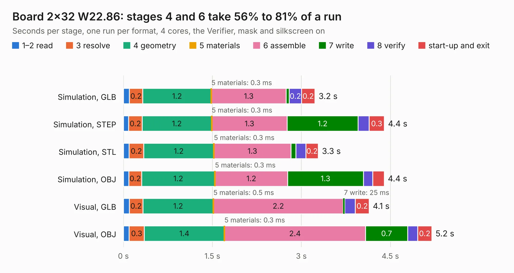

| Mode and format | 1–2 read | 3 resolve | 4 geometry | 5 materials | 6 assemble | 7 write | 8 verify | start-up and exit | Total |
|---|---:|---:|---:|---:|---:|---:|---:|---:|---:|
| Simulation, GLB | 0.1 | 0.2 | 1.2 | 0.3&nbsp;ms | 1.3 | 52&nbsp;ms | 0.2 | 0.2 | 3.2 |
| Simulation, STEP | 88&nbsp;ms | 0.2 | 1.2 | 0.3&nbsp;ms | 1.3 | 1.2 | 0.2 | 0.3 | 4.4 |
| Simulation, STL | 97&nbsp;ms | 0.2 | 1.2 | 0.3&nbsp;ms | 1.3 | 86&nbsp;ms | 0.2 | 0.2 | 3.3 |
| Simulation, OBJ | 91&nbsp;ms | 0.2 | 1.2 | 0.3&nbsp;ms | 1.2 | 1.3 | 0.2 | 0.2 | 4.4 |
| Visual, GLB | 98&nbsp;ms | 0.2 | 1.2 | 0.5&nbsp;ms | 2.2 | 25&nbsp;ms | 0.2 | 0.2 | 4.1 |
| Visual, OBJ | 96&nbsp;ms | 0.3 | 1.4 | 0.3&nbsp;ms | 2.4 | 0.7 | 0.2 | 0.2 | 5.2 |

<table align="center"><tr><td valign="top">

| Board | Repo: [andrewpaterson/658-Computer](https://github.com/andrewpaterson/658-Computer) Board: `Board 2x32 W22.86.kicad_pcb` |
|---|---|
| Folder | Kicad / Boards / Blank / Board 2x32 W22.86 |
| Complexity | 3, simple |
| Copper&nbsp;layers | 2 |
| File&nbsp;format | KiCad 9 (20241229) |
| Parts,&nbsp;tracks,&nbsp;vias | 4, 0, 0 |
| Triangles,&nbsp;simulation | 275,332 in 72 parts |
| Verifier | PASS in all six runs |

</td><td valign="top">

<table>
<tr><th>File type</th><th>File size</th><th>Peak memory used</th></tr>
<tr><th colspan="3" align="left">Simulation</th></tr>
<tr><td>GLB</td><td align="right">8.8&nbsp;MB</td><td align="right">217&nbsp;MB</td></tr>
<tr><td>STEP</td><td align="right">28&nbsp;MB</td><td align="right">248&nbsp;MB</td></tr>
<tr><td>STL</td><td align="right">14&nbsp;MB</td><td align="right">217&nbsp;MB</td></tr>
<tr><td>OBJ</td><td align="right">27&nbsp;MB</td><td align="right">236&nbsp;MB</td></tr>
<tr><th colspan="3" align="left">Visual</th></tr>
<tr><td>GLB</td><td align="right">5.1&nbsp;MB</td><td align="right">225&nbsp;MB</td></tr>
<tr><td>OBJ</td><td align="right">15&nbsp;MB</td><td align="right">222&nbsp;MB</td></tr>
</table>

</td></tr></table>

## 23.2.25 Board 2x36 W22.86

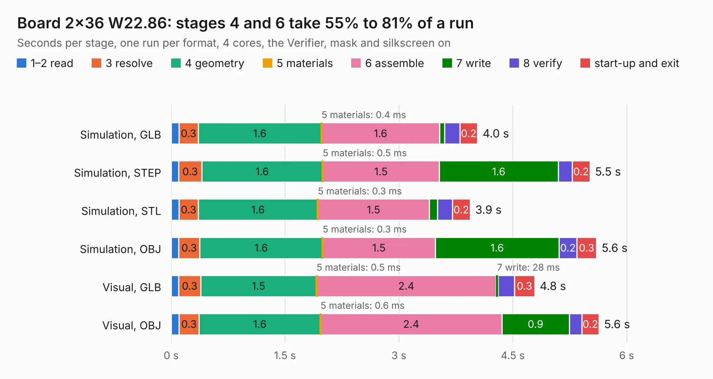

| Mode and format | 1–2 read | 3 resolve | 4 geometry | 5 materials | 6 assemble | 7 write | 8 verify | start-up and exit | Total |
|---|---:|---:|---:|---:|---:|---:|---:|---:|---:|
| Simulation, GLB | 0.1 | 0.3 | 1.6 | 0.4&nbsp;ms | 1.6 | 65&nbsp;ms | 0.2 | 0.2 | 4.0 |
| Simulation, STEP | 99&nbsp;ms | 0.3 | 1.6 | 0.5&nbsp;ms | 1.5 | 1.6 | 0.2 | 0.2 | 5.5 |
| Simulation, STL | 0.1 | 0.3 | 1.6 | 0.3&nbsp;ms | 1.5 | 0.1 | 0.2 | 0.2 | 3.9 |
| Simulation, OBJ | 99&nbsp;ms | 0.3 | 1.6 | 0.3&nbsp;ms | 1.5 | 1.6 | 0.2 | 0.3 | 5.6 |
| Visual, GLB | 0.1 | 0.3 | 1.5 | 0.5&nbsp;ms | 2.4 | 28&nbsp;ms | 0.2 | 0.3 | 4.8 |
| Visual, OBJ | 0.1 | 0.3 | 1.6 | 0.6&nbsp;ms | 2.4 | 0.9 | 0.2 | 0.2 | 5.6 |

<table align="center"><tr><td valign="top">

| Board | Repo: [andrewpaterson/658-Computer](https://github.com/andrewpaterson/658-Computer) Board: `Board 2x36 W22.86.kicad_pcb` |
|---|---|
| Folder | Kicad / Boards / Blank / Board 2x36 W22.86 |
| Complexity | 3, simple |
| Copper&nbsp;layers | 2 |
| File&nbsp;format | KiCad 9 (20241229) |
| Parts,&nbsp;tracks,&nbsp;vias | 4, 0, 0 |
| Triangles,&nbsp;simulation | 308,308 in 80 parts |
| Verifier | PASS in all six runs |

</td><td valign="top">

<table>
<tr><th>File type</th><th>File size</th><th>Peak memory used</th></tr>
<tr><th colspan="3" align="left">Simulation</th></tr>
<tr><td>GLB</td><td align="right">9.8&nbsp;MB</td><td align="right">228&nbsp;MB</td></tr>
<tr><td>STEP</td><td align="right">31&nbsp;MB</td><td align="right">260&nbsp;MB</td></tr>
<tr><td>STL</td><td align="right">15&nbsp;MB</td><td align="right">228&nbsp;MB</td></tr>
<tr><td>OBJ</td><td align="right">31&nbsp;MB</td><td align="right">235&nbsp;MB</td></tr>
<tr><th colspan="3" align="left">Visual</th></tr>
<tr><td>GLB</td><td align="right">5.7&nbsp;MB</td><td align="right">243&nbsp;MB</td></tr>
<tr><td>OBJ</td><td align="right">16&nbsp;MB</td><td align="right">247&nbsp;MB</td></tr>
</table>

</td></tr></table>

## 23.2.26 Board 2x06 W15.24

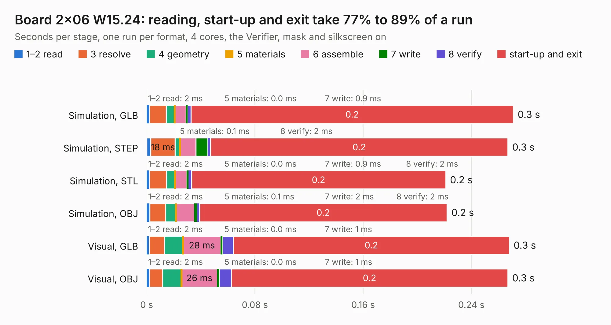

| Mode and format | 1–2 read | 3 resolve | 4 geometry | 5 materials | 6 assemble | 7 write | 8 verify | start-up and exit | Total |
|---|---:|---:|---:|---:|---:|---:|---:|---:|---:|
| Simulation, GLB | 2&nbsp;ms | 12&nbsp;ms | 6&nbsp;ms | 0.0&nbsp;ms | 8&nbsp;ms | 0.9&nbsp;ms | 3&nbsp;ms | 0.2 | 0.3 |
| Simulation, STEP | 3&nbsp;ms | 18&nbsp;ms | 4&nbsp;ms | 0.1&nbsp;ms | 12&nbsp;ms | 9&nbsp;ms | 2&nbsp;ms | 0.2 | 0.3 |
| Simulation, STL | 2&nbsp;ms | 13&nbsp;ms | 6&nbsp;ms | 0.0&nbsp;ms | 9&nbsp;ms | 0.9&nbsp;ms | 2&nbsp;ms | 0.2 | 0.2 |
| Simulation, OBJ | 2&nbsp;ms | 12&nbsp;ms | 8&nbsp;ms | 0.1&nbsp;ms | 13&nbsp;ms | 2&nbsp;ms | 2&nbsp;ms | 0.2 | 0.2 |
| Visual, GLB | 2&nbsp;ms | 11&nbsp;ms | 14&nbsp;ms | 0.0&nbsp;ms | 28&nbsp;ms | 1&nbsp;ms | 8&nbsp;ms | 0.2 | 0.3 |
| Visual, OBJ | 2&nbsp;ms | 10&nbsp;ms | 14&nbsp;ms | 0.0&nbsp;ms | 26&nbsp;ms | 1&nbsp;ms | 9&nbsp;ms | 0.2 | 0.3 |

<table align="center"><tr><td valign="top">

| Board | Repo: [andrewpaterson/658-Computer](https://github.com/andrewpaterson/658-Computer) Board: `Board 2x06 W15.24.kicad_pcb` |
|---|---|
| Folder | Kicad / Boards / Pins / Board 2x06 W15.24 |
| Complexity | 0, simple |
| Copper&nbsp;layers | 2 |
| File&nbsp;format | KiCad 9 (20241229) |
| Parts,&nbsp;tracks,&nbsp;vias | 0, 0, 0 |
| Triangles,&nbsp;simulation | 72 in 3 parts |
| Note | no components |
| Verifier | PASS in all six runs |

</td><td valign="top">

<table>
<tr><th>File type</th><th>File size</th><th>Peak memory used</th></tr>
<tr><th colspan="3" align="left">Simulation</th></tr>
<tr><td>GLB</td><td align="right">6.3&nbsp;kB</td><td align="right">37&nbsp;MB</td></tr>
<tr><td>STEP</td><td align="right">30&nbsp;kB</td><td align="right">37&nbsp;MB</td></tr>
<tr><td>STL</td><td align="right">3.9&nbsp;kB</td><td align="right">35&nbsp;MB</td></tr>
<tr><td>OBJ</td><td align="right">10&nbsp;kB</td><td align="right">37&nbsp;MB</td></tr>
<tr><th colspan="3" align="left">Visual</th></tr>
<tr><td>GLB</td><td align="right">7.7&nbsp;kB</td><td align="right">41&nbsp;MB</td></tr>
<tr><td>OBJ</td><td align="right">10&nbsp;kB</td><td align="right">41&nbsp;MB</td></tr>
</table>

</td></tr></table>

## 23.2.27 Board 2x06 W22.86

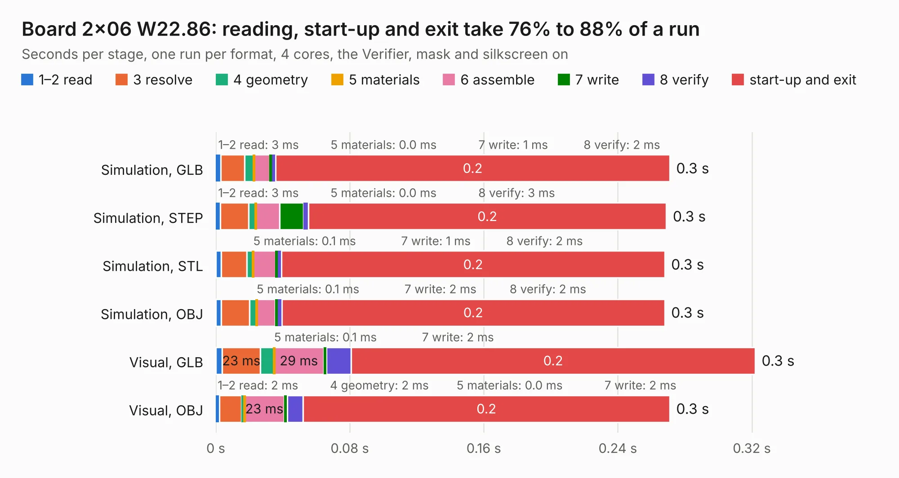

| Mode and format | 1–2 read | 3 resolve | 4 geometry | 5 materials | 6 assemble | 7 write | 8 verify | start-up and exit | Total |
|---|---:|---:|---:|---:|---:|---:|---:|---:|---:|
| Simulation, GLB | 3&nbsp;ms | 14&nbsp;ms | 6&nbsp;ms | 0.0&nbsp;ms | 9&nbsp;ms | 1&nbsp;ms | 2&nbsp;ms | 0.2 | 0.3 |
| Simulation, STEP | 3&nbsp;ms | 17&nbsp;ms | 4&nbsp;ms | 0.0&nbsp;ms | 14&nbsp;ms | 14&nbsp;ms | 3&nbsp;ms | 0.2 | 0.3 |
| Simulation, STL | 3&nbsp;ms | 15&nbsp;ms | 4&nbsp;ms | 0.1&nbsp;ms | 13&nbsp;ms | 1&nbsp;ms | 2&nbsp;ms | 0.2 | 0.3 |
| Simulation, OBJ | 3&nbsp;ms | 17&nbsp;ms | 4&nbsp;ms | 0.1&nbsp;ms | 11&nbsp;ms | 2&nbsp;ms | 2&nbsp;ms | 0.2 | 0.3 |
| Visual, GLB | 4&nbsp;ms | 23&nbsp;ms | 8&nbsp;ms | 0.1&nbsp;ms | 29&nbsp;ms | 2&nbsp;ms | 15&nbsp;ms | 0.2 | 0.3 |
| Visual, OBJ | 2&nbsp;ms | 13&nbsp;ms | 2&nbsp;ms | 0.0&nbsp;ms | 23&nbsp;ms | 2&nbsp;ms | 10&nbsp;ms | 0.2 | 0.3 |

<table align="center"><tr><td valign="top">

| Board | Repo: [andrewpaterson/658-Computer](https://github.com/andrewpaterson/658-Computer) Board: `Board 2x06 W22.86.kicad_pcb` |
|---|---|
| Folder | Kicad / Boards / Pins / Board 2x06 W22.86 |
| Complexity | 0, simple |
| Copper&nbsp;layers | 2 |
| File&nbsp;format | KiCad 9 (20241229) |
| Parts,&nbsp;tracks,&nbsp;vias | 0, 0, 0 |
| Triangles,&nbsp;simulation | 72 in 3 parts |
| Note | no components |
| Verifier | PASS in all six runs |

</td><td valign="top">

<table>
<tr><th>File type</th><th>File size</th><th>Peak memory used</th></tr>
<tr><th colspan="3" align="left">Simulation</th></tr>
<tr><td>GLB</td><td align="right">6.3&nbsp;kB</td><td align="right">37&nbsp;MB</td></tr>
<tr><td>STEP</td><td align="right">30&nbsp;kB</td><td align="right">37&nbsp;MB</td></tr>
<tr><td>STL</td><td align="right">3.9&nbsp;kB</td><td align="right">36&nbsp;MB</td></tr>
<tr><td>OBJ</td><td align="right">10&nbsp;kB</td><td align="right">36&nbsp;MB</td></tr>
<tr><th colspan="3" align="left">Visual</th></tr>
<tr><td>GLB</td><td align="right">7.7&nbsp;kB</td><td align="right">37&nbsp;MB</td></tr>
<tr><td>OBJ</td><td align="right">10&nbsp;kB</td><td align="right">42&nbsp;MB</td></tr>
</table>

</td></tr></table>

## 23.2.28 Board 2x12 W15.24

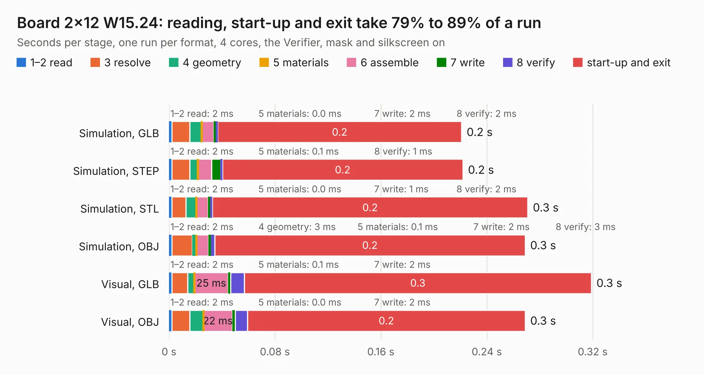

| Mode and format | 1–2 read | 3 resolve | 4 geometry | 5 materials | 6 assemble | 7 write | 8 verify | start-up and exit | Total |
|---|---:|---:|---:|---:|---:|---:|---:|---:|---:|
| Simulation, GLB | 2&nbsp;ms | 13&nbsp;ms | 9&nbsp;ms | 0.0&nbsp;ms | 9&nbsp;ms | 2&nbsp;ms | 2&nbsp;ms | 0.2 | 0.2 |
| Simulation, STEP | 2&nbsp;ms | 14&nbsp;ms | 6&nbsp;ms | 0.1&nbsp;ms | 10&nbsp;ms | 7&nbsp;ms | 1&nbsp;ms | 0.2 | 0.2 |
| Simulation, STL | 2&nbsp;ms | 11&nbsp;ms | 8&nbsp;ms | 0.0&nbsp;ms | 9&nbsp;ms | 1&nbsp;ms | 2&nbsp;ms | 0.2 | 0.3 |
| Simulation, OBJ | 2&nbsp;ms | 15&nbsp;ms | 3&nbsp;ms | 0.1&nbsp;ms | 9&nbsp;ms | 2&nbsp;ms | 3&nbsp;ms | 0.2 | 0.3 |
| Visual, GLB | 2&nbsp;ms | 12&nbsp;ms | 5&nbsp;ms | 0.1&nbsp;ms | 25&nbsp;ms | 2&nbsp;ms | 10&nbsp;ms | 0.3 | 0.3 |
| Visual, OBJ | 2&nbsp;ms | 14&nbsp;ms | 10&nbsp;ms | 0.0&nbsp;ms | 22&nbsp;ms | 2&nbsp;ms | 9&nbsp;ms | 0.2 | 0.3 |

<table align="center"><tr><td valign="top">

| Board | Repo: [andrewpaterson/658-Computer](https://github.com/andrewpaterson/658-Computer) Board: `Board 2x12 W15.24.kicad_pcb` |
|---|---|
| Folder | Kicad / Boards / Pins / Board 2x12 W15.24 |
| Complexity | 0, simple |
| Copper&nbsp;layers | 2 |
| File&nbsp;format | KiCad 9 (20241229) |
| Parts,&nbsp;tracks,&nbsp;vias | 0, 0, 0 |
| Triangles,&nbsp;simulation | 72 in 3 parts |
| Note | no components |
| Verifier | PASS in all six runs |

</td><td valign="top">

<table>
<tr><th>File type</th><th>File size</th><th>Peak memory used</th></tr>
<tr><th colspan="3" align="left">Simulation</th></tr>
<tr><td>GLB</td><td align="right">6.3&nbsp;kB</td><td align="right">37&nbsp;MB</td></tr>
<tr><td>STEP</td><td align="right">29&nbsp;kB</td><td align="right">37&nbsp;MB</td></tr>
<tr><td>STL</td><td align="right">3.9&nbsp;kB</td><td align="right">37&nbsp;MB</td></tr>
<tr><td>OBJ</td><td align="right">10&nbsp;kB</td><td align="right">37&nbsp;MB</td></tr>
<tr><th colspan="3" align="left">Visual</th></tr>
<tr><td>GLB</td><td align="right">7.7&nbsp;kB</td><td align="right">41&nbsp;MB</td></tr>
<tr><td>OBJ</td><td align="right">10&nbsp;kB</td><td align="right">41&nbsp;MB</td></tr>
</table>

</td></tr></table>

## 23.2.29 Board 2x12 W22.86

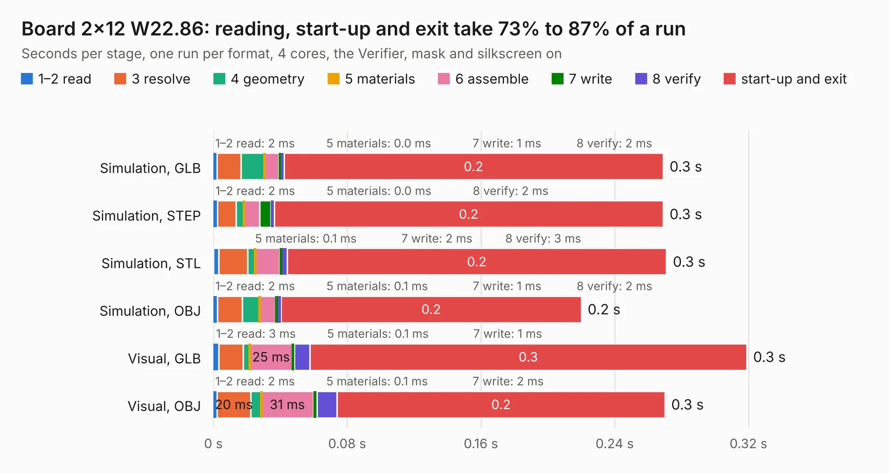

| Mode and format | 1–2 read | 3 resolve | 4 geometry | 5 materials | 6 assemble | 7 write | 8 verify | start-up and exit | Total |
|---|---:|---:|---:|---:|---:|---:|---:|---:|---:|
| Simulation, GLB | 2&nbsp;ms | 14&nbsp;ms | 14&nbsp;ms | 0.0&nbsp;ms | 9&nbsp;ms | 1&nbsp;ms | 2&nbsp;ms | 0.2 | 0.3 |
| Simulation, STEP | 2&nbsp;ms | 11&nbsp;ms | 5&nbsp;ms | 0.0&nbsp;ms | 9&nbsp;ms | 7&nbsp;ms | 2&nbsp;ms | 0.2 | 0.3 |
| Simulation, STL | 3&nbsp;ms | 17&nbsp;ms | 4&nbsp;ms | 0.1&nbsp;ms | 15&nbsp;ms | 2&nbsp;ms | 3&nbsp;ms | 0.2 | 0.3 |
| Simulation, OBJ | 2&nbsp;ms | 15&nbsp;ms | 10&nbsp;ms | 0.1&nbsp;ms | 10&nbsp;ms | 1&nbsp;ms | 2&nbsp;ms | 0.2 | 0.2 |
| Visual, GLB | 3&nbsp;ms | 15&nbsp;ms | 4&nbsp;ms | 0.1&nbsp;ms | 25&nbsp;ms | 1&nbsp;ms | 9&nbsp;ms | 0.3 | 0.3 |
| Visual, OBJ | 2&nbsp;ms | 20&nbsp;ms | 6&nbsp;ms | 0.1&nbsp;ms | 31&nbsp;ms | 2&nbsp;ms | 12&nbsp;ms | 0.2 | 0.3 |

<table align="center"><tr><td valign="top">

| Board | Repo: [andrewpaterson/658-Computer](https://github.com/andrewpaterson/658-Computer) Board: `Board 2x12 W22.86.kicad_pcb` |
|---|---|
| Folder | Kicad / Boards / Pins / Board 2x12 W22.86 |
| Complexity | 0, simple |
| Copper&nbsp;layers | 2 |
| File&nbsp;format | KiCad 9 (20241229) |
| Parts,&nbsp;tracks,&nbsp;vias | 0, 0, 0 |
| Triangles,&nbsp;simulation | 72 in 3 parts |
| Note | no components |
| Verifier | PASS in all six runs |

</td><td valign="top">

<table>
<tr><th>File type</th><th>File size</th><th>Peak memory used</th></tr>
<tr><th colspan="3" align="left">Simulation</th></tr>
<tr><td>GLB</td><td align="right">6.3&nbsp;kB</td><td align="right">35&nbsp;MB</td></tr>
<tr><td>STEP</td><td align="right">29&nbsp;kB</td><td align="right">37&nbsp;MB</td></tr>
<tr><td>STL</td><td align="right">3.9&nbsp;kB</td><td align="right">37&nbsp;MB</td></tr>
<tr><td>OBJ</td><td align="right">10&nbsp;kB</td><td align="right">35&nbsp;MB</td></tr>
<tr><th colspan="3" align="left">Visual</th></tr>
<tr><td>GLB</td><td align="right">7.7&nbsp;kB</td><td align="right">42&nbsp;MB</td></tr>
<tr><td>OBJ</td><td align="right">10&nbsp;kB</td><td align="right">38&nbsp;MB</td></tr>
</table>

</td></tr></table>

## 23.2.30 Board 2x16 W15.24

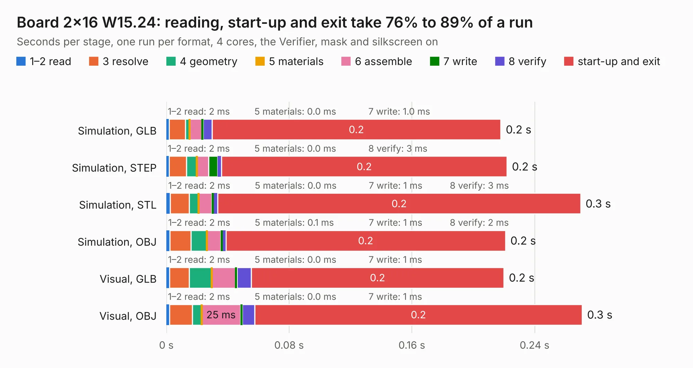

| Mode and format | 1–2 read | 3 resolve | 4 geometry | 5 materials | 6 assemble | 7 write | 8 verify | start-up and exit | Total |
|---|---:|---:|---:|---:|---:|---:|---:|---:|---:|
| Simulation, GLB | 2&nbsp;ms | 10&nbsp;ms | 3&nbsp;ms | 0.0&nbsp;ms | 8&nbsp;ms | 1.0&nbsp;ms | 6&nbsp;ms | 0.2 | 0.2 |
| Simulation, STEP | 2&nbsp;ms | 11&nbsp;ms | 7&nbsp;ms | 0.0&nbsp;ms | 8&nbsp;ms | 6&nbsp;ms | 3&nbsp;ms | 0.2 | 0.2 |
| Simulation, STL | 2&nbsp;ms | 12&nbsp;ms | 6&nbsp;ms | 0.0&nbsp;ms | 9&nbsp;ms | 1&nbsp;ms | 3&nbsp;ms | 0.2 | 0.3 |
| Simulation, OBJ | 2&nbsp;ms | 14&nbsp;ms | 10&nbsp;ms | 0.1&nbsp;ms | 9&nbsp;ms | 1&nbsp;ms | 2&nbsp;ms | 0.2 | 0.2 |
| Visual, GLB | 2&nbsp;ms | 13&nbsp;ms | 15&nbsp;ms | 0.0&nbsp;ms | 15&nbsp;ms | 1&nbsp;ms | 9&nbsp;ms | 0.2 | 0.2 |
| Visual, OBJ | 2&nbsp;ms | 15&nbsp;ms | 6&nbsp;ms | 0.0&nbsp;ms | 25&nbsp;ms | 1&nbsp;ms | 8&nbsp;ms | 0.2 | 0.3 |

<table align="center"><tr><td valign="top">

| Board | Repo: [andrewpaterson/658-Computer](https://github.com/andrewpaterson/658-Computer) Board: `Board 2x16 W15.24.kicad_pcb` |
|---|---|
| Folder | Kicad / Boards / Pins / Board 2x16 W15.24 |
| Complexity | 0, simple |
| Copper&nbsp;layers | 2 |
| File&nbsp;format | KiCad 9 (20241229) |
| Parts,&nbsp;tracks,&nbsp;vias | 0, 0, 0 |
| Triangles,&nbsp;simulation | 72 in 3 parts |
| Note | no components |
| Verifier | PASS in all six runs |

</td><td valign="top">

<table>
<tr><th>File type</th><th>File size</th><th>Peak memory used</th></tr>
<tr><th colspan="3" align="left">Simulation</th></tr>
<tr><td>GLB</td><td align="right">6.3&nbsp;kB</td><td align="right">37&nbsp;MB</td></tr>
<tr><td>STEP</td><td align="right">29&nbsp;kB</td><td align="right">37&nbsp;MB</td></tr>
<tr><td>STL</td><td align="right">3.9&nbsp;kB</td><td align="right">37&nbsp;MB</td></tr>
<tr><td>OBJ</td><td align="right">10&nbsp;kB</td><td align="right">35&nbsp;MB</td></tr>
<tr><th colspan="3" align="left">Visual</th></tr>
<tr><td>GLB</td><td align="right">7.7&nbsp;kB</td><td align="right">36&nbsp;MB</td></tr>
<tr><td>OBJ</td><td align="right">10&nbsp;kB</td><td align="right">41&nbsp;MB</td></tr>
</table>

</td></tr></table>

## 23.2.31 Board 2x16 W22.86

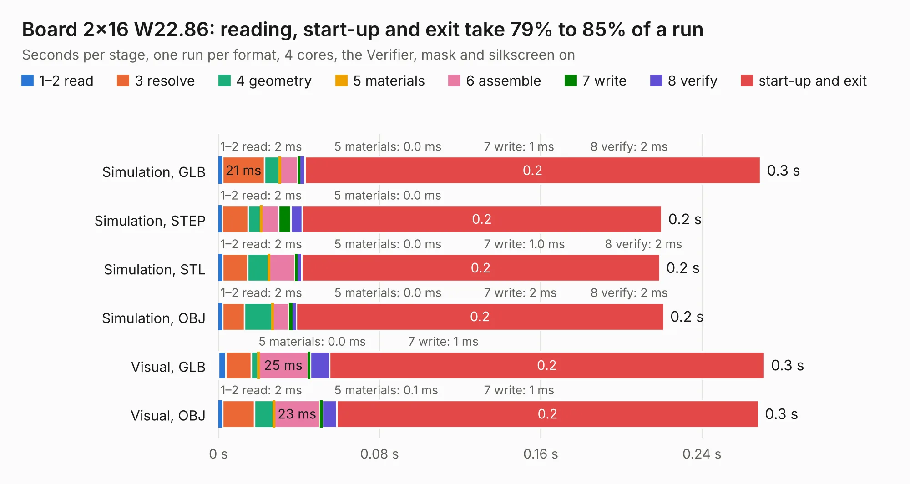

| Mode and format | 1–2 read | 3 resolve | 4 geometry | 5 materials | 6 assemble | 7 write | 8 verify | start-up and exit | Total |
|---|---:|---:|---:|---:|---:|---:|---:|---:|---:|
| Simulation, GLB | 2&nbsp;ms | 21&nbsp;ms | 8&nbsp;ms | 0.0&nbsp;ms | 9&nbsp;ms | 1&nbsp;ms | 2&nbsp;ms | 0.2 | 0.3 |
| Simulation, STEP | 2&nbsp;ms | 13&nbsp;ms | 7&nbsp;ms | 0.0&nbsp;ms | 9&nbsp;ms | 6&nbsp;ms | 6&nbsp;ms | 0.2 | 0.2 |
| Simulation, STL | 2&nbsp;ms | 12&nbsp;ms | 11&nbsp;ms | 0.0&nbsp;ms | 13&nbsp;ms | 1.0&nbsp;ms | 2&nbsp;ms | 0.2 | 0.2 |
| Simulation, OBJ | 2&nbsp;ms | 11&nbsp;ms | 14&nbsp;ms | 0.0&nbsp;ms | 8&nbsp;ms | 2&nbsp;ms | 2&nbsp;ms | 0.2 | 0.2 |
| Visual, GLB | 4&nbsp;ms | 13&nbsp;ms | 4&nbsp;ms | 0.0&nbsp;ms | 25&nbsp;ms | 1&nbsp;ms | 9&nbsp;ms | 0.2 | 0.3 |
| Visual, OBJ | 2&nbsp;ms | 16&nbsp;ms | 10&nbsp;ms | 0.1&nbsp;ms | 23&nbsp;ms | 1&nbsp;ms | 7&nbsp;ms | 0.2 | 0.3 |

<table align="center"><tr><td valign="top">

| Board | Repo: [andrewpaterson/658-Computer](https://github.com/andrewpaterson/658-Computer) Board: `Board 2x16 W22.86.kicad_pcb` |
|---|---|
| Folder | Kicad / Boards / Pins / Board 2x16 W22.86 |
| Complexity | 0, simple |
| Copper&nbsp;layers | 2 |
| File&nbsp;format | KiCad 9 (20241229) |
| Parts,&nbsp;tracks,&nbsp;vias | 0, 0, 0 |
| Triangles,&nbsp;simulation | 72 in 3 parts |
| Note | no components |
| Verifier | PASS in all six runs |

</td><td valign="top">

<table>
<tr><th>File type</th><th>File size</th><th>Peak memory used</th></tr>
<tr><th colspan="3" align="left">Simulation</th></tr>
<tr><td>GLB</td><td align="right">6.3&nbsp;kB</td><td align="right">37&nbsp;MB</td></tr>
<tr><td>STEP</td><td align="right">29&nbsp;kB</td><td align="right">37&nbsp;MB</td></tr>
<tr><td>STL</td><td align="right">3.9&nbsp;kB</td><td align="right">35&nbsp;MB</td></tr>
<tr><td>OBJ</td><td align="right">10&nbsp;kB</td><td align="right">35&nbsp;MB</td></tr>
<tr><th colspan="3" align="left">Visual</th></tr>
<tr><td>GLB</td><td align="right">7.7&nbsp;kB</td><td align="right">36&nbsp;MB</td></tr>
<tr><td>OBJ</td><td align="right">10&nbsp;kB</td><td align="right">41&nbsp;MB</td></tr>
</table>

</td></tr></table>

## 23.2.32 Board 2x20 W15.24

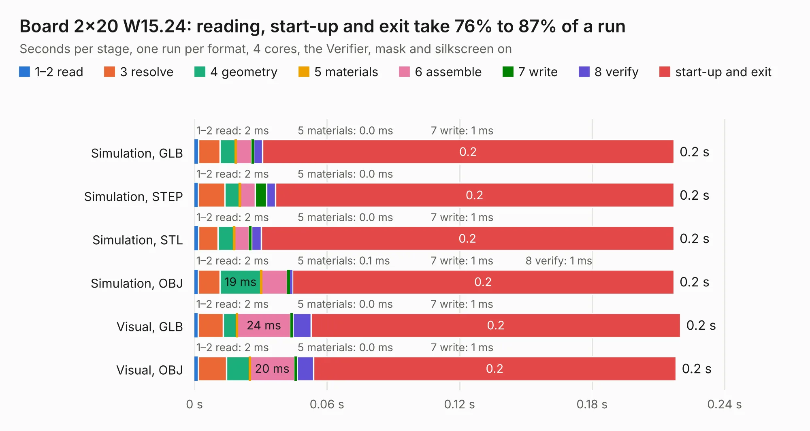

| Mode and format | 1–2 read | 3 resolve | 4 geometry | 5 materials | 6 assemble | 7 write | 8 verify | start-up and exit | Total |
|---|---:|---:|---:|---:|---:|---:|---:|---:|---:|
| Simulation, GLB | 2&nbsp;ms | 10&nbsp;ms | 7&nbsp;ms | 0.0&nbsp;ms | 7&nbsp;ms | 1&nbsp;ms | 4&nbsp;ms | 0.2 | 0.2 |
| Simulation, STEP | 2&nbsp;ms | 12&nbsp;ms | 7&nbsp;ms | 0.0&nbsp;ms | 7&nbsp;ms | 5&nbsp;ms | 4&nbsp;ms | 0.2 | 0.2 |
| Simulation, STL | 2&nbsp;ms | 9&nbsp;ms | 7&nbsp;ms | 0.0&nbsp;ms | 7&nbsp;ms | 1&nbsp;ms | 4&nbsp;ms | 0.2 | 0.2 |
| Simulation, OBJ | 2&nbsp;ms | 10&nbsp;ms | 19&nbsp;ms | 0.1&nbsp;ms | 12&nbsp;ms | 1&nbsp;ms | 1&nbsp;ms | 0.2 | 0.2 |
| Visual, GLB | 2&nbsp;ms | 11&nbsp;ms | 6&nbsp;ms | 0.0&nbsp;ms | 24&nbsp;ms | 1&nbsp;ms | 8&nbsp;ms | 0.2 | 0.2 |
| Visual, OBJ | 2&nbsp;ms | 13&nbsp;ms | 11&nbsp;ms | 0.0&nbsp;ms | 20&nbsp;ms | 1&nbsp;ms | 7&nbsp;ms | 0.2 | 0.2 |

<table align="center"><tr><td valign="top">

| Board | Repo: [andrewpaterson/658-Computer](https://github.com/andrewpaterson/658-Computer) Board: `Board 2x20 W15.24.kicad_pcb` |
|---|---|
| Folder | Kicad / Boards / Pins / Board 2x20 W15.24 |
| Complexity | 0, simple |
| Copper&nbsp;layers | 2 |
| File&nbsp;format | KiCad 9 (20241229) |
| Parts,&nbsp;tracks,&nbsp;vias | 0, 0, 0 |
| Triangles,&nbsp;simulation | 72 in 3 parts |
| Note | no components |
| Verifier | PASS in all six runs |

</td><td valign="top">

<table>
<tr><th>File type</th><th>File size</th><th>Peak memory used</th></tr>
<tr><th colspan="3" align="left">Simulation</th></tr>
<tr><td>GLB</td><td align="right">6.3&nbsp;kB</td><td align="right">37&nbsp;MB</td></tr>
<tr><td>STEP</td><td align="right">29&nbsp;kB</td><td align="right">37&nbsp;MB</td></tr>
<tr><td>STL</td><td align="right">3.9&nbsp;kB</td><td align="right">37&nbsp;MB</td></tr>
<tr><td>OBJ</td><td align="right">10&nbsp;kB</td><td align="right">37&nbsp;MB</td></tr>
<tr><th colspan="3" align="left">Visual</th></tr>
<tr><td>GLB</td><td align="right">7.7&nbsp;kB</td><td align="right">41&nbsp;MB</td></tr>
<tr><td>OBJ</td><td align="right">10&nbsp;kB</td><td align="right">36&nbsp;MB</td></tr>
</table>

</td></tr></table>

## 23.2.33 Board 2x20 W22.86

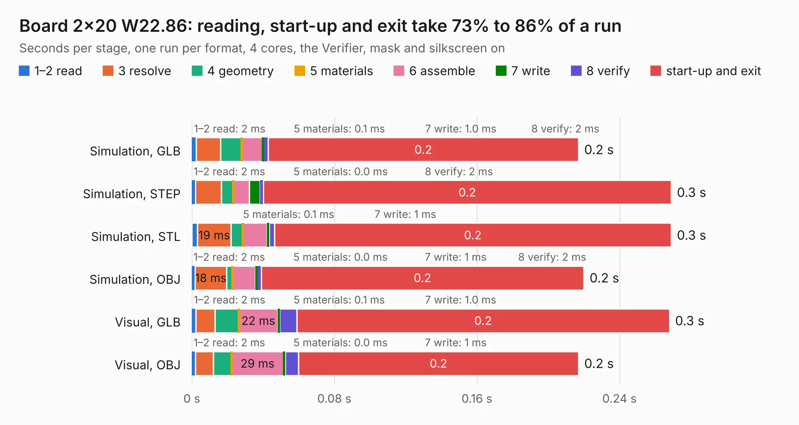

| Mode and format | 1–2 read | 3 resolve | 4 geometry | 5 materials | 6 assemble | 7 write | 8 verify | start-up and exit | Total |
|---|---:|---:|---:|---:|---:|---:|---:|---:|---:|
| Simulation, GLB | 2&nbsp;ms | 14&nbsp;ms | 12&nbsp;ms | 0.1&nbsp;ms | 11&nbsp;ms | 1.0&nbsp;ms | 2&nbsp;ms | 0.2 | 0.2 |
| Simulation, STEP | 2&nbsp;ms | 15&nbsp;ms | 7&nbsp;ms | 0.0&nbsp;ms | 9&nbsp;ms | 6&nbsp;ms | 2&nbsp;ms | 0.2 | 0.3 |
| Simulation, STL | 3&nbsp;ms | 19&nbsp;ms | 7&nbsp;ms | 0.1&nbsp;ms | 13&nbsp;ms | 1&nbsp;ms | 3&nbsp;ms | 0.2 | 0.3 |
| Simulation, OBJ | 2&nbsp;ms | 18&nbsp;ms | 3&nbsp;ms | 0.0&nbsp;ms | 13&nbsp;ms | 1&nbsp;ms | 2&nbsp;ms | 0.2 | 0.2 |
| Visual, GLB | 2&nbsp;ms | 11&nbsp;ms | 13&nbsp;ms | 0.1&nbsp;ms | 22&nbsp;ms | 1.0&nbsp;ms | 10&nbsp;ms | 0.2 | 0.3 |
| Visual, OBJ | 2&nbsp;ms | 10&nbsp;ms | 10&nbsp;ms | 0.0&nbsp;ms | 29&nbsp;ms | 1&nbsp;ms | 7&nbsp;ms | 0.2 | 0.2 |

<table align="center"><tr><td valign="top">

| Board | Repo: [andrewpaterson/658-Computer](https://github.com/andrewpaterson/658-Computer) Board: `Board 2x20 W22.86.kicad_pcb` |
|---|---|
| Folder | Kicad / Boards / Pins / Board 2x20 W22.86 |
| Complexity | 0, simple |
| Copper&nbsp;layers | 2 |
| File&nbsp;format | KiCad 9 (20241229) |
| Parts,&nbsp;tracks,&nbsp;vias | 0, 0, 0 |
| Triangles,&nbsp;simulation | 72 in 3 parts |
| Note | no components |
| Verifier | PASS in all six runs |

</td><td valign="top">

<table>
<tr><th>File type</th><th>File size</th><th>Peak memory used</th></tr>
<tr><th colspan="3" align="left">Simulation</th></tr>
<tr><td>GLB</td><td align="right">6.3&nbsp;kB</td><td align="right">35&nbsp;MB</td></tr>
<tr><td>STEP</td><td align="right">29&nbsp;kB</td><td align="right">37&nbsp;MB</td></tr>
<tr><td>STL</td><td align="right">3.9&nbsp;kB</td><td align="right">37&nbsp;MB</td></tr>
<tr><td>OBJ</td><td align="right">10&nbsp;kB</td><td align="right">36&nbsp;MB</td></tr>
<tr><th colspan="3" align="left">Visual</th></tr>
<tr><td>GLB</td><td align="right">7.7&nbsp;kB</td><td align="right">41&nbsp;MB</td></tr>
<tr><td>OBJ</td><td align="right">10&nbsp;kB</td><td align="right">36&nbsp;MB</td></tr>
</table>

</td></tr></table>

## 23.2.34 Board 2x22 W15.24

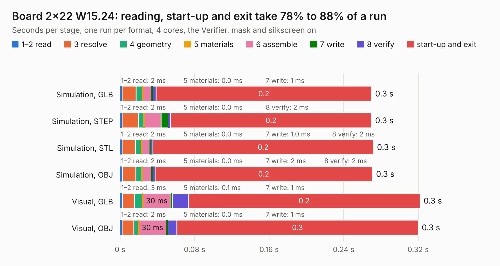

| Mode and format | 1–2 read | 3 resolve | 4 geometry | 5 materials | 6 assemble | 7 write | 8 verify | start-up and exit | Total |
|---|---:|---:|---:|---:|---:|---:|---:|---:|---:|
| Simulation, GLB | 2&nbsp;ms | 15&nbsp;ms | 7&nbsp;ms | 0.0&nbsp;ms | 9&nbsp;ms | 1&nbsp;ms | 4&nbsp;ms | 0.2 | 0.3 |
| Simulation, STEP | 2&nbsp;ms | 18&nbsp;ms | 6&nbsp;ms | 0.0&nbsp;ms | 18&nbsp;ms | 8&nbsp;ms | 2&nbsp;ms | 0.2 | 0.3 |
| Simulation, STL | 2&nbsp;ms | 14&nbsp;ms | 7&nbsp;ms | 0.0&nbsp;ms | 9&nbsp;ms | 1.0&nbsp;ms | 2&nbsp;ms | 0.2 | 0.3 |
| Simulation, OBJ | 2&nbsp;ms | 15&nbsp;ms | 6&nbsp;ms | 0.0&nbsp;ms | 10&nbsp;ms | 2&nbsp;ms | 2&nbsp;ms | 0.2 | 0.3 |
| Visual, GLB | 3&nbsp;ms | 13&nbsp;ms | 9&nbsp;ms | 0.1&nbsp;ms | 30&nbsp;ms | 1&nbsp;ms | 17&nbsp;ms | 0.2 | 0.3 |
| Visual, OBJ | 2&nbsp;ms | 13&nbsp;ms | 5&nbsp;ms | 0.0&nbsp;ms | 30&nbsp;ms | 1&nbsp;ms | 10&nbsp;ms | 0.3 | 0.3 |

<table align="center"><tr><td valign="top">

| Board | Repo: [andrewpaterson/658-Computer](https://github.com/andrewpaterson/658-Computer) Board: `Board 2x22 W15.24.kicad_pcb` |
|---|---|
| Folder | Kicad / Boards / Pins / Board 2x22 W15.24 |
| Complexity | 0, simple |
| Copper&nbsp;layers | 2 |
| File&nbsp;format | KiCad 9 (20241229) |
| Parts,&nbsp;tracks,&nbsp;vias | 0, 0, 0 |
| Triangles,&nbsp;simulation | 72 in 3 parts |
| Note | no components |
| Verifier | PASS in all six runs |

</td><td valign="top">

<table>
<tr><th>File type</th><th>File size</th><th>Peak memory used</th></tr>
<tr><th colspan="3" align="left">Simulation</th></tr>
<tr><td>GLB</td><td align="right">6.3&nbsp;kB</td><td align="right">36&nbsp;MB</td></tr>
<tr><td>STEP</td><td align="right">29&nbsp;kB</td><td align="right">37&nbsp;MB</td></tr>
<tr><td>STL</td><td align="right">3.9&nbsp;kB</td><td align="right">36&nbsp;MB</td></tr>
<tr><td>OBJ</td><td align="right">10&nbsp;kB</td><td align="right">36&nbsp;MB</td></tr>
<tr><th colspan="3" align="left">Visual</th></tr>
<tr><td>GLB</td><td align="right">7.7&nbsp;kB</td><td align="right">40&nbsp;MB</td></tr>
<tr><td>OBJ</td><td align="right">10&nbsp;kB</td><td align="right">41&nbsp;MB</td></tr>
</table>

</td></tr></table>

## 23.2.35 Board 2x24 W15.24

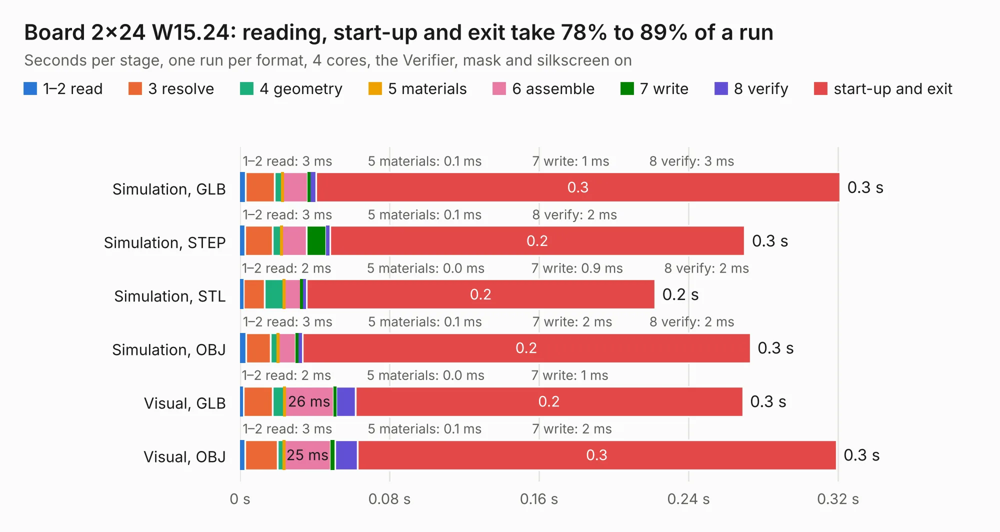

| Mode and format | 1–2 read | 3 resolve | 4 geometry | 5 materials | 6 assemble | 7 write | 8 verify | start-up and exit | Total |
|---|---:|---:|---:|---:|---:|---:|---:|---:|---:|
| Simulation, GLB | 3&nbsp;ms | 16&nbsp;ms | 4&nbsp;ms | 0.1&nbsp;ms | 14&nbsp;ms | 1&nbsp;ms | 3&nbsp;ms | 0.3 | 0.3 |
| Simulation, STEP | 3&nbsp;ms | 15&nbsp;ms | 5&nbsp;ms | 0.1&nbsp;ms | 14&nbsp;ms | 10&nbsp;ms | 2&nbsp;ms | 0.2 | 0.3 |
| Simulation, STL | 2&nbsp;ms | 11&nbsp;ms | 10&nbsp;ms | 0.0&nbsp;ms | 9&nbsp;ms | 0.9&nbsp;ms | 2&nbsp;ms | 0.2 | 0.2 |
| Simulation, OBJ | 3&nbsp;ms | 13&nbsp;ms | 4&nbsp;ms | 0.1&nbsp;ms | 9&nbsp;ms | 2&nbsp;ms | 2&nbsp;ms | 0.2 | 0.3 |
| Visual, GLB | 2&nbsp;ms | 15&nbsp;ms | 6&nbsp;ms | 0.0&nbsp;ms | 26&nbsp;ms | 1&nbsp;ms | 10&nbsp;ms | 0.2 | 0.3 |
| Visual, OBJ | 3&nbsp;ms | 17&nbsp;ms | 4&nbsp;ms | 0.1&nbsp;ms | 25&nbsp;ms | 2&nbsp;ms | 12&nbsp;ms | 0.3 | 0.3 |

<table align="center"><tr><td valign="top">

| Board | Repo: [andrewpaterson/658-Computer](https://github.com/andrewpaterson/658-Computer) Board: `Board 2x24 W15.24.kicad_pcb` |
|---|---|
| Folder | Kicad / Boards / Pins / Board 2x24 W15.24 |
| Complexity | 0, simple |
| Copper&nbsp;layers | 2 |
| File&nbsp;format | KiCad 9 (20241229) |
| Parts,&nbsp;tracks,&nbsp;vias | 0, 0, 0 |
| Triangles,&nbsp;simulation | 72 in 3 parts |
| Note | no components |
| Verifier | PASS in all six runs |

</td><td valign="top">

<table>
<tr><th>File type</th><th>File size</th><th>Peak memory used</th></tr>
<tr><th colspan="3" align="left">Simulation</th></tr>
<tr><td>GLB</td><td align="right">6.3&nbsp;kB</td><td align="right">37&nbsp;MB</td></tr>
<tr><td>STEP</td><td align="right">29&nbsp;kB</td><td align="right">37&nbsp;MB</td></tr>
<tr><td>STL</td><td align="right">3.9&nbsp;kB</td><td align="right">35&nbsp;MB</td></tr>
<tr><td>OBJ</td><td align="right">10&nbsp;kB</td><td align="right">37&nbsp;MB</td></tr>
<tr><th colspan="3" align="left">Visual</th></tr>
<tr><td>GLB</td><td align="right">7.7&nbsp;kB</td><td align="right">41&nbsp;MB</td></tr>
<tr><td>OBJ</td><td align="right">10&nbsp;kB</td><td align="right">41&nbsp;MB</td></tr>
</table>

</td></tr></table>

## 23.2.36 Board 2x24 W22.86

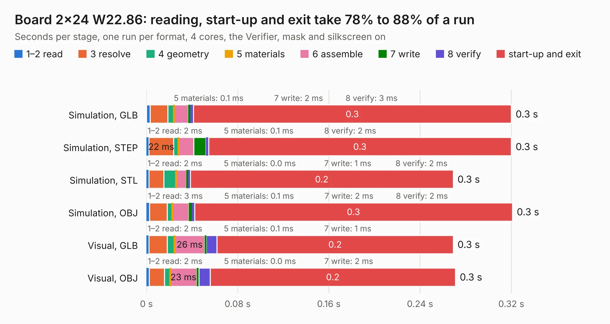

| Mode and format | 1–2 read | 3 resolve | 4 geometry | 5 materials | 6 assemble | 7 write | 8 verify | start-up and exit | Total |
|---|---:|---:|---:|---:|---:|---:|---:|---:|---:|
| Simulation, GLB | 3&nbsp;ms | 15&nbsp;ms | 5&nbsp;ms | 0.1&nbsp;ms | 13&nbsp;ms | 2&nbsp;ms | 3&nbsp;ms | 0.3 | 0.3 |
| Simulation, STEP | 2&nbsp;ms | 22&nbsp;ms | 4&nbsp;ms | 0.1&nbsp;ms | 13&nbsp;ms | 11&nbsp;ms | 2&nbsp;ms | 0.3 | 0.3 |
| Simulation, STL | 2&nbsp;ms | 13&nbsp;ms | 11&nbsp;ms | 0.0&nbsp;ms | 9&nbsp;ms | 1&nbsp;ms | 2&nbsp;ms | 0.2 | 0.3 |
| Simulation, OBJ | 3&nbsp;ms | 15&nbsp;ms | 4&nbsp;ms | 0.1&nbsp;ms | 15&nbsp;ms | 2&nbsp;ms | 2&nbsp;ms | 0.3 | 0.3 |
| Visual, GLB | 2&nbsp;ms | 16&nbsp;ms | 7&nbsp;ms | 0.1&nbsp;ms | 26&nbsp;ms | 1&nbsp;ms | 9&nbsp;ms | 0.2 | 0.3 |
| Visual, OBJ | 2&nbsp;ms | 13&nbsp;ms | 5&nbsp;ms | 0.0&nbsp;ms | 23&nbsp;ms | 2&nbsp;ms | 10&nbsp;ms | 0.2 | 0.3 |

<table align="center"><tr><td valign="top">

| Board | Repo: [andrewpaterson/658-Computer](https://github.com/andrewpaterson/658-Computer) Board: `Board 2x24 W22.86.kicad_pcb` |
|---|---|
| Folder | Kicad / Boards / Pins / Board 2x24 W22.86 |
| Complexity | 0, simple |
| Copper&nbsp;layers | 2 |
| File&nbsp;format | KiCad 9 (20241229) |
| Parts,&nbsp;tracks,&nbsp;vias | 0, 0, 0 |
| Triangles,&nbsp;simulation | 72 in 3 parts |
| Note | no components |
| Verifier | PASS in all six runs |

</td><td valign="top">

<table>
<tr><th>File type</th><th>File size</th><th>Peak memory used</th></tr>
<tr><th colspan="3" align="left">Simulation</th></tr>
<tr><td>GLB</td><td align="right">6.3&nbsp;kB</td><td align="right">37&nbsp;MB</td></tr>
<tr><td>STEP</td><td align="right">29&nbsp;kB</td><td align="right">37&nbsp;MB</td></tr>
<tr><td>STL</td><td align="right">3.9&nbsp;kB</td><td align="right">37&nbsp;MB</td></tr>
<tr><td>OBJ</td><td align="right">10&nbsp;kB</td><td align="right">37&nbsp;MB</td></tr>
<tr><th colspan="3" align="left">Visual</th></tr>
<tr><td>GLB</td><td align="right">7.7&nbsp;kB</td><td align="right">38&nbsp;MB</td></tr>
<tr><td>OBJ</td><td align="right">10&nbsp;kB</td><td align="right">41&nbsp;MB</td></tr>
</table>

</td></tr></table>

## 23.2.37 Board 2x28 W15.24

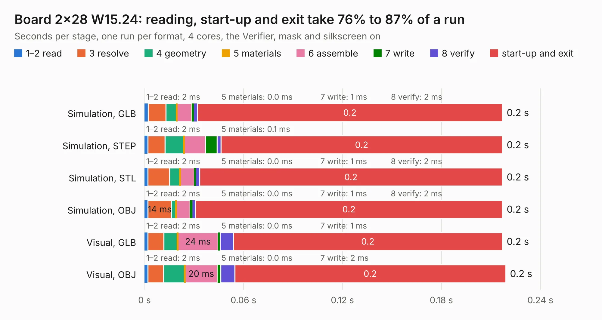

| Mode and format | 1–2 read | 3 resolve | 4 geometry | 5 materials | 6 assemble | 7 write | 8 verify | start-up and exit | Total |
|---|---:|---:|---:|---:|---:|---:|---:|---:|---:|
| Simulation, GLB | 2&nbsp;ms | 11&nbsp;ms | 7&nbsp;ms | 0.0&nbsp;ms | 9&nbsp;ms | 1&nbsp;ms | 2&nbsp;ms | 0.2 | 0.2 |
| Simulation, STEP | 2&nbsp;ms | 10&nbsp;ms | 11&nbsp;ms | 0.1&nbsp;ms | 13&nbsp;ms | 7&nbsp;ms | 2&nbsp;ms | 0.2 | 0.2 |
| Simulation, STL | 2&nbsp;ms | 13&nbsp;ms | 6&nbsp;ms | 0.0&nbsp;ms | 9&nbsp;ms | 1&nbsp;ms | 2&nbsp;ms | 0.2 | 0.2 |
| Simulation, OBJ | 2&nbsp;ms | 14&nbsp;ms | 3&nbsp;ms | 0.0&nbsp;ms | 8&nbsp;ms | 1&nbsp;ms | 2&nbsp;ms | 0.2 | 0.2 |
| Visual, GLB | 2&nbsp;ms | 10&nbsp;ms | 8&nbsp;ms | 0.0&nbsp;ms | 24&nbsp;ms | 1&nbsp;ms | 8&nbsp;ms | 0.2 | 0.2 |
| Visual, OBJ | 2&nbsp;ms | 10&nbsp;ms | 13&nbsp;ms | 0.0&nbsp;ms | 20&nbsp;ms | 2&nbsp;ms | 9&nbsp;ms | 0.2 | 0.2 |

<table align="center"><tr><td valign="top">

| Board | Repo: [andrewpaterson/658-Computer](https://github.com/andrewpaterson/658-Computer) Board: `Board 2x28 W15.24.kicad_pcb` |
|---|---|
| Folder | Kicad / Boards / Pins / Board 2x28 W15.24 |
| Complexity | 0, simple |
| Copper&nbsp;layers | 2 |
| File&nbsp;format | KiCad 9 (20241229) |
| Parts,&nbsp;tracks,&nbsp;vias | 0, 0, 0 |
| Triangles,&nbsp;simulation | 72 in 3 parts |
| Note | no components |
| Verifier | PASS in all six runs |

</td><td valign="top">

<table>
<tr><th>File type</th><th>File size</th><th>Peak memory used</th></tr>
<tr><th colspan="3" align="left">Simulation</th></tr>
<tr><td>GLB</td><td align="right">6.3&nbsp;kB</td><td align="right">35&nbsp;MB</td></tr>
<tr><td>STEP</td><td align="right">30&nbsp;kB</td><td align="right">36&nbsp;MB</td></tr>
<tr><td>STL</td><td align="right">3.9&nbsp;kB</td><td align="right">37&nbsp;MB</td></tr>
<tr><td>OBJ</td><td align="right">10&nbsp;kB</td><td align="right">37&nbsp;MB</td></tr>
<tr><th colspan="3" align="left">Visual</th></tr>
<tr><td>GLB</td><td align="right">7.7&nbsp;kB</td><td align="right">36&nbsp;MB</td></tr>
<tr><td>OBJ</td><td align="right">10&nbsp;kB</td><td align="right">41&nbsp;MB</td></tr>
</table>

</td></tr></table>

## 23.2.38 Board 2x28 W22.86

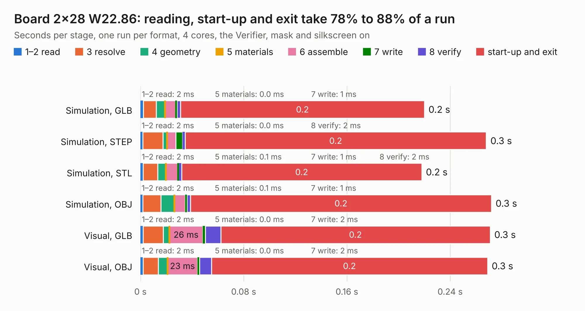

| Mode and format | 1–2 read | 3 resolve | 4 geometry | 5 materials | 6 assemble | 7 write | 8 verify | start-up and exit | Total |
|---|---:|---:|---:|---:|---:|---:|---:|---:|---:|
| Simulation, GLB | 2&nbsp;ms | 10&nbsp;ms | 7&nbsp;ms | 0.0&nbsp;ms | 8&nbsp;ms | 1&nbsp;ms | 3&nbsp;ms | 0.2 | 0.2 |
| Simulation, STEP | 2&nbsp;ms | 15&nbsp;ms | 3&nbsp;ms | 0.0&nbsp;ms | 7&nbsp;ms | 5&nbsp;ms | 2&nbsp;ms | 0.2 | 0.3 |
| Simulation, STL | 2&nbsp;ms | 11&nbsp;ms | 6&nbsp;ms | 0.1&nbsp;ms | 9&nbsp;ms | 1&nbsp;ms | 2&nbsp;ms | 0.2 | 0.2 |
| Simulation, OBJ | 2&nbsp;ms | 14&nbsp;ms | 10&nbsp;ms | 0.1&nbsp;ms | 8&nbsp;ms | 1&nbsp;ms | 3&nbsp;ms | 0.2 | 0.3 |
| Visual, GLB | 2&nbsp;ms | 15&nbsp;ms | 5&nbsp;ms | 0.0&nbsp;ms | 26&nbsp;ms | 2&nbsp;ms | 12&nbsp;ms | 0.2 | 0.3 |
| Visual, OBJ | 2&nbsp;ms | 12&nbsp;ms | 7&nbsp;ms | 0.0&nbsp;ms | 23&nbsp;ms | 2&nbsp;ms | 9&nbsp;ms | 0.2 | 0.3 |

<table align="center"><tr><td valign="top">

| Board | Repo: [andrewpaterson/658-Computer](https://github.com/andrewpaterson/658-Computer) Board: `Board 2x28 W22.86.kicad_pcb` |
|---|---|
| Folder | Kicad / Boards / Pins / Board 2x28 W22.86 |
| Complexity | 0, simple |
| Copper&nbsp;layers | 2 |
| File&nbsp;format | KiCad 9 (20241229) |
| Parts,&nbsp;tracks,&nbsp;vias | 0, 0, 0 |
| Triangles,&nbsp;simulation | 72 in 3 parts |
| Note | no components |
| Verifier | PASS in all six runs |

</td><td valign="top">

<table>
<tr><th>File type</th><th>File size</th><th>Peak memory used</th></tr>
<tr><th colspan="3" align="left">Simulation</th></tr>
<tr><td>GLB</td><td align="right">6.3&nbsp;kB</td><td align="right">37&nbsp;MB</td></tr>
<tr><td>STEP</td><td align="right">30&nbsp;kB</td><td align="right">37&nbsp;MB</td></tr>
<tr><td>STL</td><td align="right">3.9&nbsp;kB</td><td align="right">36&nbsp;MB</td></tr>
<tr><td>OBJ</td><td align="right">10&nbsp;kB</td><td align="right">37&nbsp;MB</td></tr>
<tr><th colspan="3" align="left">Visual</th></tr>
<tr><td>GLB</td><td align="right">7.7&nbsp;kB</td><td align="right">38&nbsp;MB</td></tr>
<tr><td>OBJ</td><td align="right">10&nbsp;kB</td><td align="right">41&nbsp;MB</td></tr>
</table>

</td></tr></table>

## 23.2.39 Board 2x32 W15.24

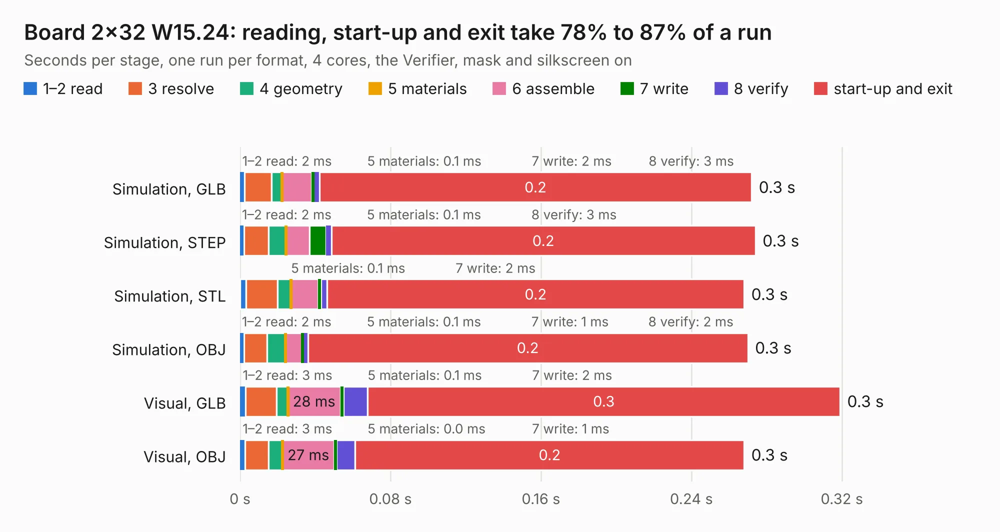

| Mode and format | 1–2 read | 3 resolve | 4 geometry | 5 materials | 6 assemble | 7 write | 8 verify | start-up and exit | Total |
|---|---:|---:|---:|---:|---:|---:|---:|---:|---:|
| Simulation, GLB | 2&nbsp;ms | 14&nbsp;ms | 5&nbsp;ms | 0.1&nbsp;ms | 16&nbsp;ms | 2&nbsp;ms | 3&nbsp;ms | 0.2 | 0.3 |
| Simulation, STEP | 2&nbsp;ms | 13&nbsp;ms | 9&nbsp;ms | 0.1&nbsp;ms | 12&nbsp;ms | 9&nbsp;ms | 3&nbsp;ms | 0.2 | 0.3 |
| Simulation, STL | 3&nbsp;ms | 17&nbsp;ms | 7&nbsp;ms | 0.1&nbsp;ms | 14&nbsp;ms | 2&nbsp;ms | 3&nbsp;ms | 0.2 | 0.3 |
| Simulation, OBJ | 2&nbsp;ms | 12&nbsp;ms | 10&nbsp;ms | 0.1&nbsp;ms | 8&nbsp;ms | 1&nbsp;ms | 2&nbsp;ms | 0.2 | 0.3 |
| Visual, GLB | 3&nbsp;ms | 17&nbsp;ms | 6&nbsp;ms | 0.1&nbsp;ms | 28&nbsp;ms | 2&nbsp;ms | 13&nbsp;ms | 0.3 | 0.3 |
| Visual, OBJ | 3&nbsp;ms | 12&nbsp;ms | 7&nbsp;ms | 0.0&nbsp;ms | 27&nbsp;ms | 1&nbsp;ms | 10&nbsp;ms | 0.2 | 0.3 |

<table align="center"><tr><td valign="top">

| Board | Repo: [andrewpaterson/658-Computer](https://github.com/andrewpaterson/658-Computer) Board: `Board 2x32 W15.24.kicad_pcb` |
|---|---|
| Folder | Kicad / Boards / Pins / Board 2x32 W15.24 |
| Complexity | 0, simple |
| Copper&nbsp;layers | 2 |
| File&nbsp;format | KiCad 9 (20241229) |
| Parts,&nbsp;tracks,&nbsp;vias | 0, 0, 0 |
| Triangles,&nbsp;simulation | 72 in 3 parts |
| Note | no components |
| Verifier | PASS in all six runs |

</td><td valign="top">

<table>
<tr><th>File type</th><th>File size</th><th>Peak memory used</th></tr>
<tr><th colspan="3" align="left">Simulation</th></tr>
<tr><td>GLB</td><td align="right">6.3&nbsp;kB</td><td align="right">37&nbsp;MB</td></tr>
<tr><td>STEP</td><td align="right">29&nbsp;kB</td><td align="right">37&nbsp;MB</td></tr>
<tr><td>STL</td><td align="right">3.9&nbsp;kB</td><td align="right">37&nbsp;MB</td></tr>
<tr><td>OBJ</td><td align="right">10&nbsp;kB</td><td align="right">37&nbsp;MB</td></tr>
<tr><th colspan="3" align="left">Visual</th></tr>
<tr><td>GLB</td><td align="right">7.7&nbsp;kB</td><td align="right">40&nbsp;MB</td></tr>
<tr><td>OBJ</td><td align="right">10&nbsp;kB</td><td align="right">41&nbsp;MB</td></tr>
</table>

</td></tr></table>

## 23.2.40 Board 2x32 W22.86

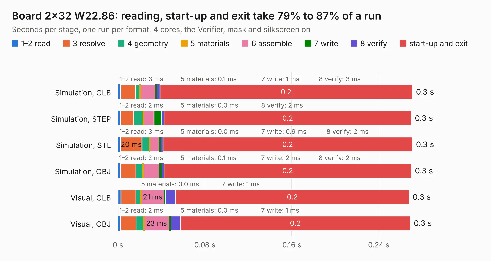

| Mode and format | 1–2 read | 3 resolve | 4 geometry | 5 materials | 6 assemble | 7 write | 8 verify | start-up and exit | Total |
|---|---:|---:|---:|---:|---:|---:|---:|---:|---:|
| Simulation, GLB | 3&nbsp;ms | 14&nbsp;ms | 4&nbsp;ms | 0.1&nbsp;ms | 14&nbsp;ms | 1&nbsp;ms | 3&nbsp;ms | 0.2 | 0.3 |
| Simulation, STEP | 2&nbsp;ms | 12&nbsp;ms | 9&nbsp;ms | 0.0&nbsp;ms | 10&nbsp;ms | 7&nbsp;ms | 2&nbsp;ms | 0.2 | 0.3 |
| Simulation, STL | 3&nbsp;ms | 20&nbsp;ms | 7&nbsp;ms | 0.0&nbsp;ms | 9&nbsp;ms | 0.9&nbsp;ms | 2&nbsp;ms | 0.2 | 0.3 |
| Simulation, OBJ | 2&nbsp;ms | 14&nbsp;ms | 7&nbsp;ms | 0.1&nbsp;ms | 15&nbsp;ms | 2&nbsp;ms | 2&nbsp;ms | 0.2 | 0.3 |
| Visual, GLB | 3&nbsp;ms | 14&nbsp;ms | 5&nbsp;ms | 0.0&nbsp;ms | 21&nbsp;ms | 1&nbsp;ms | 10&nbsp;ms | 0.2 | 0.3 |
| Visual, OBJ | 2&nbsp;ms | 14&nbsp;ms | 7&nbsp;ms | 0.0&nbsp;ms | 23&nbsp;ms | 1&nbsp;ms | 9&nbsp;ms | 0.2 | 0.3 |

<table align="center"><tr><td valign="top">

| Board | Repo: [andrewpaterson/658-Computer](https://github.com/andrewpaterson/658-Computer) Board: `Board 2x32 W22.86.kicad_pcb` |
|---|---|
| Folder | Kicad / Boards / Pins / Board 2x32 W22.86 |
| Complexity | 0, simple |
| Copper&nbsp;layers | 2 |
| File&nbsp;format | KiCad 9 (20241229) |
| Parts,&nbsp;tracks,&nbsp;vias | 0, 0, 0 |
| Triangles,&nbsp;simulation | 72 in 3 parts |
| Note | no components |
| Verifier | PASS in all six runs |

</td><td valign="top">

<table>
<tr><th>File type</th><th>File size</th><th>Peak memory used</th></tr>
<tr><th colspan="3" align="left">Simulation</th></tr>
<tr><td>GLB</td><td align="right">6.3&nbsp;kB</td><td align="right">37&nbsp;MB</td></tr>
<tr><td>STEP</td><td align="right">29&nbsp;kB</td><td align="right">37&nbsp;MB</td></tr>
<tr><td>STL</td><td align="right">3.9&nbsp;kB</td><td align="right">37&nbsp;MB</td></tr>
<tr><td>OBJ</td><td align="right">10&nbsp;kB</td><td align="right">37&nbsp;MB</td></tr>
<tr><th colspan="3" align="left">Visual</th></tr>
<tr><td>GLB</td><td align="right">7.7&nbsp;kB</td><td align="right">38&nbsp;MB</td></tr>
<tr><td>OBJ</td><td align="right">10&nbsp;kB</td><td align="right">37&nbsp;MB</td></tr>
</table>

</td></tr></table>

## 23.2.41 Board 2x36 W22.86

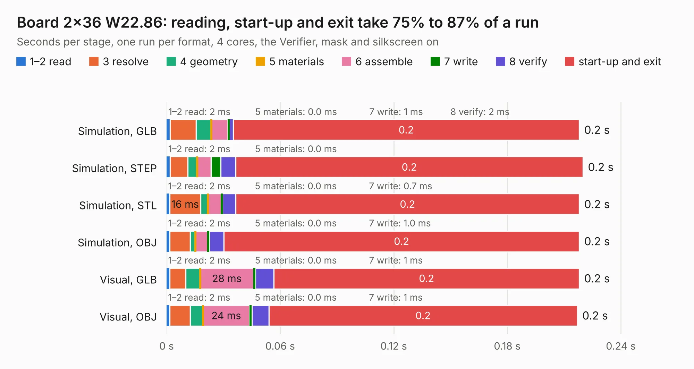

| Mode and format | 1–2 read | 3 resolve | 4 geometry | 5 materials | 6 assemble | 7 write | 8 verify | start-up and exit | Total |
|---|---:|---:|---:|---:|---:|---:|---:|---:|---:|
| Simulation, GLB | 2&nbsp;ms | 14&nbsp;ms | 8&nbsp;ms | 0.0&nbsp;ms | 8&nbsp;ms | 1&nbsp;ms | 2&nbsp;ms | 0.2 | 0.2 |
| Simulation, STEP | 2&nbsp;ms | 9&nbsp;ms | 5&nbsp;ms | 0.0&nbsp;ms | 7&nbsp;ms | 5&nbsp;ms | 8&nbsp;ms | 0.2 | 0.2 |
| Simulation, STL | 2&nbsp;ms | 16&nbsp;ms | 4&nbsp;ms | 0.0&nbsp;ms | 7&nbsp;ms | 0.7&nbsp;ms | 7&nbsp;ms | 0.2 | 0.2 |
| Simulation, OBJ | 2&nbsp;ms | 11&nbsp;ms | 3&nbsp;ms | 0.0&nbsp;ms | 6&nbsp;ms | 1.0&nbsp;ms | 8&nbsp;ms | 0.2 | 0.2 |
| Visual, GLB | 2&nbsp;ms | 8&nbsp;ms | 8&nbsp;ms | 0.0&nbsp;ms | 28&nbsp;ms | 1&nbsp;ms | 10&nbsp;ms | 0.2 | 0.2 |
| Visual, OBJ | 2&nbsp;ms | 11&nbsp;ms | 7&nbsp;ms | 0.0&nbsp;ms | 24&nbsp;ms | 1&nbsp;ms | 9&nbsp;ms | 0.2 | 0.2 |

<table align="center"><tr><td valign="top">

| Board | Repo: [andrewpaterson/658-Computer](https://github.com/andrewpaterson/658-Computer) Board: `Board 2x36 W22.86.kicad_pcb` |
|---|---|
| Folder | Kicad / Boards / Pins / Board 2x36 W22.86 |
| Complexity | 0, simple |
| Copper&nbsp;layers | 2 |
| File&nbsp;format | KiCad 9 (20241229) |
| Parts,&nbsp;tracks,&nbsp;vias | 0, 0, 0 |
| Triangles,&nbsp;simulation | 72 in 3 parts |
| Note | no components |
| Verifier | PASS in all six runs |

</td><td valign="top">

<table>
<tr><th>File type</th><th>File size</th><th>Peak memory used</th></tr>
<tr><th colspan="3" align="left">Simulation</th></tr>
<tr><td>GLB</td><td align="right">6.3&nbsp;kB</td><td align="right">37&nbsp;MB</td></tr>
<tr><td>STEP</td><td align="right">29&nbsp;kB</td><td align="right">37&nbsp;MB</td></tr>
<tr><td>STL</td><td align="right">3.9&nbsp;kB</td><td align="right">37&nbsp;MB</td></tr>
<tr><td>OBJ</td><td align="right">10&nbsp;kB</td><td align="right">37&nbsp;MB</td></tr>
<tr><th colspan="3" align="left">Visual</th></tr>
<tr><td>GLB</td><td align="right">7.7&nbsp;kB</td><td align="right">40&nbsp;MB</td></tr>
<tr><td>OBJ</td><td align="right">10&nbsp;kB</td><td align="right">38&nbsp;MB</td></tr>
</table>

</td></tr></table>

## 23.2.42 Audio Address Decode

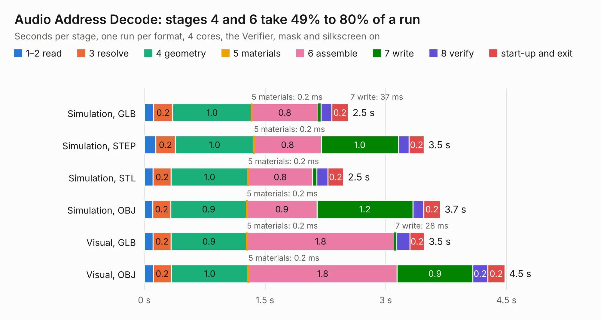

| Mode and format | 1–2 read | 3 resolve | 4 geometry | 5 materials | 6 assemble | 7 write | 8 verify | start-up and exit | Total |
|---|---:|---:|---:|---:|---:|---:|---:|---:|---:|
| Simulation, GLB | 0.1 | 0.2 | 1.0 | 0.2&nbsp;ms | 0.8 | 37&nbsp;ms | 0.1 | 0.2 | 2.5 |
| Simulation, STEP | 0.1 | 0.2 | 1.0 | 0.2&nbsp;ms | 0.8 | 1.0 | 0.1 | 0.2 | 3.5 |
| Simulation, STL | 0.1 | 0.2 | 1.0 | 0.2&nbsp;ms | 0.8 | 52&nbsp;ms | 0.1 | 0.2 | 2.5 |
| Simulation, OBJ | 0.1 | 0.2 | 0.9 | 0.2&nbsp;ms | 0.9 | 1.2 | 0.1 | 0.2 | 3.7 |
| Visual, GLB | 0.1 | 0.2 | 0.9 | 0.2&nbsp;ms | 1.8 | 28&nbsp;ms | 0.2 | 0.2 | 3.5 |
| Visual, OBJ | 0.1 | 0.2 | 1.0 | 0.2&nbsp;ms | 1.8 | 0.9 | 0.2 | 0.2 | 4.5 |

<table align="center"><tr><td valign="top">

| Board | Repo: [andrewpaterson/658-Computer](https://github.com/andrewpaterson/658-Computer) Board: `Audio Address Decode.kicad_pcb` |
|---|---|
| Folder | Kicad / Computer / Audio / Audio Address Decode |
| Complexity | 269, low |
| Copper&nbsp;layers | 2 |
| File&nbsp;format | KiCad 9 (20241229) |
| Parts,&nbsp;tracks,&nbsp;vias | 8, 237, 28 |
| Triangles,&nbsp;simulation | 236,188 in 37 parts |
| Verifier | PASS in all six runs |

</td><td valign="top">

<table>
<tr><th>File type</th><th>File size</th><th>Peak memory used</th></tr>
<tr><th colspan="3" align="left">Simulation</th></tr>
<tr><td>GLB</td><td align="right">8.2&nbsp;MB</td><td align="right">219&nbsp;MB</td></tr>
<tr><td>STEP</td><td align="right">37&nbsp;MB</td><td align="right">245&nbsp;MB</td></tr>
<tr><td>STL</td><td align="right">12&nbsp;MB</td><td align="right">216&nbsp;MB</td></tr>
<tr><td>OBJ</td><td align="right">24&nbsp;MB</td><td align="right">214&nbsp;MB</td></tr>
<tr><th colspan="3" align="left">Visual</th></tr>
<tr><td>GLB</td><td align="right">6.1&nbsp;MB</td><td align="right">211&nbsp;MB</td></tr>
<tr><td>OBJ</td><td align="right">18&nbsp;MB</td><td align="right">216&nbsp;MB</td></tr>
</table>

</td></tr></table>

## 23.2.43 Audio Board

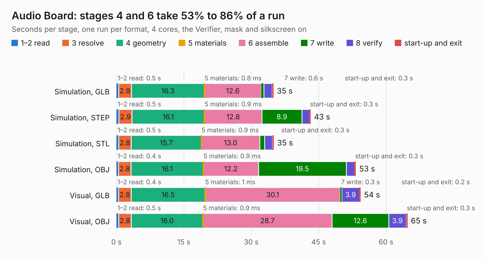

| Mode and format | 1–2 read | 3 resolve | 4 geometry | 5 materials | 6 assemble | 7 write | 8 verify | start-up and exit | Total |
|---|---:|---:|---:|---:|---:|---:|---:|---:|---:|
| Simulation, GLB | 0.5 | 2.9 | 16.3 | 0.8&nbsp;ms | 12.6 | 0.6 | 1.8 | 0.3 | 34.9 |
| Simulation, STEP | 0.5 | 2.9 | 16.1 | 0.9&nbsp;ms | 12.8 | 8.9 | 1.7 | 0.3 | 43.2 |
| Simulation, STL | 0.5 | 2.8 | 15.7 | 0.9&nbsp;ms | 13.0 | 1.0 | 1.8 | 0.3 | 35.0 |
| Simulation, OBJ | 0.4 | 2.8 | 16.1 | 0.9&nbsp;ms | 12.2 | 19.5 | 1.9 | 0.3 | 53.3 |
| Visual, GLB | 0.4 | 2.8 | 16.5 | 1&nbsp;ms | 30.1 | 0.3 | 3.9 | 0.2 | 54.3 |
| Visual, OBJ | 0.5 | 2.8 | 16.0 | 0.9&nbsp;ms | 28.7 | 12.6 | 3.9 | 0.3 | 64.8 |

<table align="center"><tr><td valign="top">

| Board | Repo: [andrewpaterson/658-Computer](https://github.com/andrewpaterson/658-Computer) Board: `Audio Board.kicad_pcb` |
|---|---|
| Folder | Kicad / Computer / Audio / Audio Board |
| Complexity | 3,240, high |
| Copper&nbsp;layers | 2 |
| File&nbsp;format | KiCad 9 (20241229) |
| Parts,&nbsp;tracks,&nbsp;vias | 23, 2,507, 229 |
| Triangles,&nbsp;simulation | 3,598,500 in 299 parts |
| Verifier | PASS in all six runs |

</td><td valign="top">

<table>
<tr><th>File type</th><th>File size</th><th>Peak memory used</th></tr>
<tr><th colspan="3" align="left">Simulation</th></tr>
<tr><td>GLB</td><td align="right">120&nbsp;MB</td><td align="right">1.2&nbsp;GB</td></tr>
<tr><td>STEP</td><td align="right">501&nbsp;MB</td><td align="right">1.4&nbsp;GB</td></tr>
<tr><td>STL</td><td align="right">180&nbsp;MB</td><td align="right">1.1&nbsp;GB</td></tr>
<tr><td>OBJ</td><td align="right">377&nbsp;MB</td><td align="right">2.3&nbsp;GB</td></tr>
<tr><th colspan="3" align="left">Visual</th></tr>
<tr><td>GLB</td><td align="right">78&nbsp;MB</td><td align="right">1.6&nbsp;GB</td></tr>
<tr><td>OBJ</td><td align="right">248&nbsp;MB</td><td align="right">1.7&nbsp;GB</td></tr>
</table>

</td></tr></table>

## 23.2.44 Audio Clock

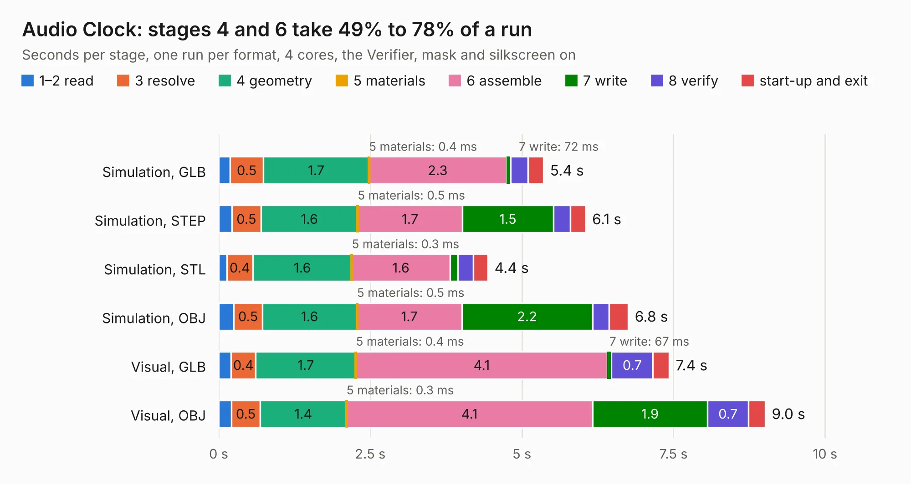

| Mode and format | 1–2 read | 3 resolve | 4 geometry | 5 materials | 6 assemble | 7 write | 8 verify | start-up and exit | Total |
|---|---:|---:|---:|---:|---:|---:|---:|---:|---:|
| Simulation, GLB | 0.2 | 0.5 | 1.7 | 0.4&nbsp;ms | 2.3 | 72&nbsp;ms | 0.3 | 0.3 | 5.4 |
| Simulation, STEP | 0.2 | 0.5 | 1.6 | 0.5&nbsp;ms | 1.7 | 1.5 | 0.3 | 0.3 | 6.1 |
| Simulation, STL | 0.1 | 0.4 | 1.6 | 0.3&nbsp;ms | 1.6 | 0.1 | 0.3 | 0.2 | 4.4 |
| Simulation, OBJ | 0.3 | 0.5 | 1.6 | 0.5&nbsp;ms | 1.7 | 2.2 | 0.3 | 0.3 | 6.8 |
| Visual, GLB | 0.2 | 0.4 | 1.7 | 0.4&nbsp;ms | 4.1 | 67&nbsp;ms | 0.7 | 0.3 | 7.4 |
| Visual, OBJ | 0.2 | 0.5 | 1.4 | 0.3&nbsp;ms | 4.1 | 1.9 | 0.7 | 0.3 | 9.0 |

<table align="center"><tr><td valign="top">

| Board | Repo: [andrewpaterson/658-Computer](https://github.com/andrewpaterson/658-Computer) Board: `Audio Clock.kicad_pcb` |
|---|---|
| Folder | Kicad / Computer / Audio / Audio Clock |
| Complexity | 696, low |
| Copper&nbsp;layers | 2 |
| File&nbsp;format | KiCad 9 (20241229) |
| Parts,&nbsp;tracks,&nbsp;vias | 23, 449, 67 |
| Triangles,&nbsp;simulation | 413,586 in 67 parts |
| Verifier | PASS in all six runs |

</td><td valign="top">

<table>
<tr><th>File type</th><th>File size</th><th>Peak memory used</th></tr>
<tr><th colspan="3" align="left">Simulation</th></tr>
<tr><td>GLB</td><td align="right">14&nbsp;MB</td><td align="right">268&nbsp;MB</td></tr>
<tr><td>STEP</td><td align="right">62&nbsp;MB</td><td align="right">323&nbsp;MB</td></tr>
<tr><td>STL</td><td align="right">21&nbsp;MB</td><td align="right">269&nbsp;MB</td></tr>
<tr><td>OBJ</td><td align="right">42&nbsp;MB</td><td align="right">330&nbsp;MB</td></tr>
<tr><th colspan="3" align="left">Visual</th></tr>
<tr><td>GLB</td><td align="right">11&nbsp;MB</td><td align="right">343&nbsp;MB</td></tr>
<tr><td>OBJ</td><td align="right">34&nbsp;MB</td><td align="right">329&nbsp;MB</td></tr>
</table>

</td></tr></table>

## 23.2.45 Blitter Board

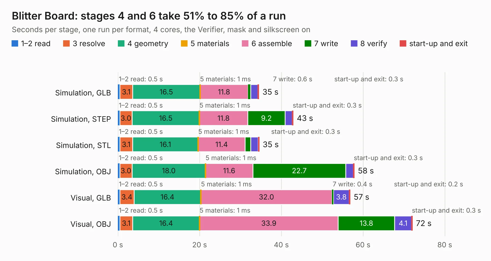

| Mode and format | 1–2 read | 3 resolve | 4 geometry | 5 materials | 6 assemble | 7 write | 8 verify | start-up and exit | Total |
|---|---:|---:|---:|---:|---:|---:|---:|---:|---:|
| Simulation, GLB | 0.5 | 3.1 | 16.5 | 1&nbsp;ms | 11.8 | 0.6 | 1.8 | 0.3 | 34.5 |
| Simulation, STEP | 0.5 | 3.0 | 16.5 | 1&nbsp;ms | 11.8 | 9.2 | 1.7 | 0.3 | 42.9 |
| Simulation, STL | 0.5 | 3.1 | 16.1 | 1&nbsp;ms | 11.4 | 1.4 | 1.8 | 0.3 | 34.6 |
| Simulation, OBJ | 0.5 | 3.0 | 18.0 | 1&nbsp;ms | 11.6 | 22.7 | 1.9 | 0.3 | 57.9 |
| Visual, GLB | 0.5 | 3.4 | 16.4 | 1&nbsp;ms | 32.0 | 0.4 | 3.8 | 0.2 | 56.9 |
| Visual, OBJ | 0.5 | 3.1 | 16.4 | 1&nbsp;ms | 33.9 | 13.8 | 4.1 | 0.3 | 72.1 |

<table align="center"><tr><td valign="top">

| Board | Repo: [andrewpaterson/658-Computer](https://github.com/andrewpaterson/658-Computer) Board: `Blitter Board.kicad_pcb` |
|---|---|
| Folder | Kicad / Computer / Blitter / Blitter Board |
| Complexity | 3,446, high |
| Copper&nbsp;layers | 2 |
| File&nbsp;format | KiCad 9 (20241229) |
| Parts,&nbsp;tracks,&nbsp;vias | 22, 2,712, 230 |
| Triangles,&nbsp;simulation | 3,921,994 in 339 parts |
| Verifier | PASS in all six runs |

</td><td valign="top">

<table>
<tr><th>File type</th><th>File size</th><th>Peak memory used</th></tr>
<tr><th colspan="3" align="left">Simulation</th></tr>
<tr><td>GLB</td><td align="right">131&nbsp;MB</td><td align="right">1.3&nbsp;GB</td></tr>
<tr><td>STEP</td><td align="right">550&nbsp;MB</td><td align="right">1.5&nbsp;GB</td></tr>
<tr><td>STL</td><td align="right">196&nbsp;MB</td><td align="right">1.3&nbsp;GB</td></tr>
<tr><td>OBJ</td><td align="right">412&nbsp;MB</td><td align="right">2.5&nbsp;GB</td></tr>
<tr><th colspan="3" align="left">Visual</th></tr>
<tr><td>GLB</td><td align="right">86&nbsp;MB</td><td align="right">1.5&nbsp;GB</td></tr>
<tr><td>OBJ</td><td align="right">272&nbsp;MB</td><td align="right">1.8&nbsp;GB</td></tr>
</table>

</td></tr></table>

## 23.2.46 Added 8bit

| Mode and format | 1–2 read | 3 resolve | 4 geometry | 5 materials | 6 assemble | 7 write | 8 verify | start-up and exit | Total |
|---|---:|---:|---:|---:|---:|---:|---:|---:|---:|
| Simulation, GLB | 0.1 | 0.3 | 1.2 | 0.1&nbsp;ms | 1.1 | 47&nbsp;ms | 0.2 | 0.2 | 3.0 |
| Simulation, STEP | 0.1 | 0.3 | 1.3 | 0.2&nbsp;ms | 1.0 | 1.2 | 0.2 | 0.2 | 4.3 |
| Simulation, STL | 0.1 | 0.3 | 1.2 | 0.2&nbsp;ms | 1.1 | 67&nbsp;ms | 0.2 | 0.2 | 3.3 |
| Simulation, OBJ | 0.1 | 0.3 | 1.2 | 0.1&nbsp;ms | 1.1 | 1.7 | 0.2 | 0.2 | 4.7 |
| Visual, GLB | 0.1 | 0.3 | 1.1 | 0.2&nbsp;ms | 2.4 | 33&nbsp;ms | 0.2 | 0.2 | 4.3 |
| Visual, OBJ | 0.1 | 0.3 | 1.1 | 0.2&nbsp;ms | 2.4 | 1.3 | 0.3 | 0.2 | 5.6 |

<table align="center"><tr><td valign="top">

| Board | Repo: [andrewpaterson/658-Computer](https://github.com/andrewpaterson/658-Computer) Board: `Added 8bit.kicad_pcb` |
|---|---|
| Folder | Kicad / Computer / Component Boards / Added 8bit |
| Complexity | 266, low |
| Copper&nbsp;layers | 2 |
| File&nbsp;format | KiCad 9 (20241229) |
| Parts,&nbsp;tracks,&nbsp;vias | 7, 238, 43 |
| Triangles,&nbsp;simulation | 301,014 in 39 parts |
| Verifier | PASS in all six runs |

</td><td valign="top">

<table>
<tr><th>File type</th><th>File size</th><th>Peak memory used</th></tr>
<tr><th colspan="3" align="left">Simulation</th></tr>
<tr><td>GLB</td><td align="right">10&nbsp;MB</td><td align="right">245&nbsp;MB</td></tr>
<tr><td>STEP</td><td align="right">46&nbsp;MB</td><td align="right">265&nbsp;MB</td></tr>
<tr><td>STL</td><td align="right">15&nbsp;MB</td><td align="right">245&nbsp;MB</td></tr>
<tr><td>OBJ</td><td align="right">30&nbsp;MB</td><td align="right">245&nbsp;MB</td></tr>
<tr><th colspan="3" align="left">Visual</th></tr>
<tr><td>GLB</td><td align="right">7.3&nbsp;MB</td><td align="right">245&nbsp;MB</td></tr>
<tr><td>OBJ</td><td align="right">22&nbsp;MB</td><td align="right">251&nbsp;MB</td></tr>
</table>

</td></tr></table>

## 23.2.47 Adder 16bit

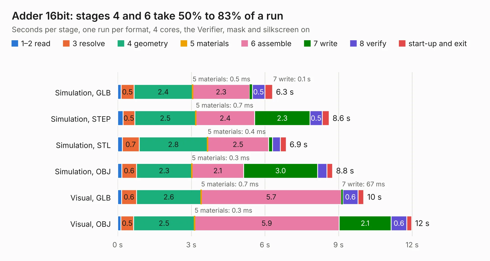

| Mode and format | 1–2 read | 3 resolve | 4 geometry | 5 materials | 6 assemble | 7 write | 8 verify | start-up and exit | Total |
|---|---:|---:|---:|---:|---:|---:|---:|---:|---:|
| Simulation, GLB | 0.1 | 0.5 | 2.4 | 0.5&nbsp;ms | 2.3 | 0.1 | 0.5 | 0.3 | 6.3 |
| Simulation, STEP | 0.2 | 0.5 | 2.5 | 0.7&nbsp;ms | 2.4 | 2.3 | 0.5 | 0.3 | 8.6 |
| Simulation, STL | 0.2 | 0.7 | 2.8 | 0.4&nbsp;ms | 2.5 | 0.2 | 0.3 | 0.2 | 6.9 |
| Simulation, OBJ | 0.2 | 0.6 | 2.3 | 0.3&nbsp;ms | 2.1 | 3.0 | 0.4 | 0.2 | 8.8 |
| Visual, GLB | 0.2 | 0.6 | 2.6 | 0.7&nbsp;ms | 5.7 | 67&nbsp;ms | 0.6 | 0.2 | 10.0 |
| Visual, OBJ | 0.1 | 0.5 | 2.5 | 0.3&nbsp;ms | 5.9 | 2.1 | 0.6 | 0.2 | 12.0 |

<table align="center"><tr><td valign="top">

| Board | Repo: [andrewpaterson/658-Computer](https://github.com/andrewpaterson/658-Computer) Board: `Adder 16bit.kicad_pcb` |
|---|---|
| Folder | Kicad / Computer / Component Boards / Adder 16bit |
| Complexity | 898, low |
| Copper&nbsp;layers | 2 |
| File&nbsp;format | KiCad 9 (20241229) |
| Parts,&nbsp;tracks,&nbsp;vias | 11, 627, 83 |
| Triangles,&nbsp;simulation | 565,568 in 65 parts |
| Verifier | PASS in all six runs |

</td><td valign="top">

<table>
<tr><th>File type</th><th>File size</th><th>Peak memory used</th></tr>
<tr><th colspan="3" align="left">Simulation</th></tr>
<tr><td>GLB</td><td align="right">20&nbsp;MB</td><td align="right">343&nbsp;MB</td></tr>
<tr><td>STEP</td><td align="right">90&nbsp;MB</td><td align="right">369&nbsp;MB</td></tr>
<tr><td>STL</td><td align="right">28&nbsp;MB</td><td align="right">335&nbsp;MB</td></tr>
<tr><td>OBJ</td><td align="right">57&nbsp;MB</td><td align="right">418&nbsp;MB</td></tr>
<tr><th colspan="3" align="left">Visual</th></tr>
<tr><td>GLB</td><td align="right">14&nbsp;MB</td><td align="right">388&nbsp;MB</td></tr>
<tr><td>OBJ</td><td align="right">42&nbsp;MB</td><td align="right">391&nbsp;MB</td></tr>
</table>

</td></tr></table>

## 23.2.48 Address Buffer 16bit

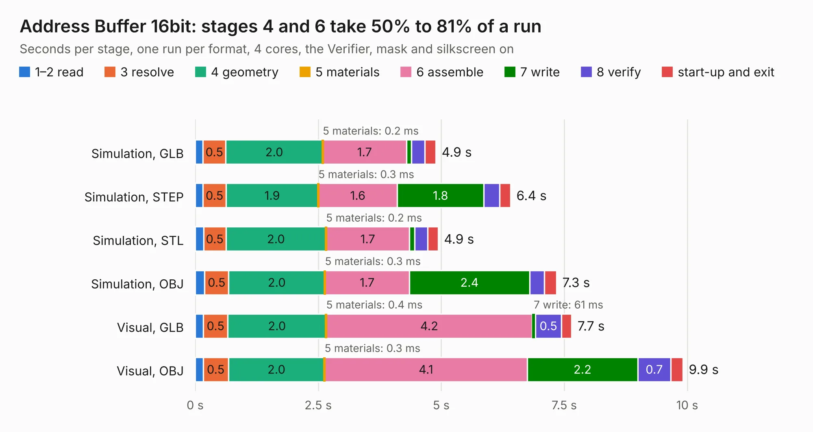

| Mode and format | 1–2 read | 3 resolve | 4 geometry | 5 materials | 6 assemble | 7 write | 8 verify | start-up and exit | Total |
|---|---:|---:|---:|---:|---:|---:|---:|---:|---:|
| Simulation, GLB | 0.2 | 0.5 | 2.0 | 0.2&nbsp;ms | 1.7 | 0.1 | 0.3 | 0.2 | 4.9 |
| Simulation, STEP | 0.2 | 0.5 | 1.9 | 0.3&nbsp;ms | 1.6 | 1.8 | 0.3 | 0.2 | 6.4 |
| Simulation, STL | 0.2 | 0.5 | 2.0 | 0.2&nbsp;ms | 1.7 | 0.1 | 0.3 | 0.2 | 4.9 |
| Simulation, OBJ | 0.2 | 0.5 | 2.0 | 0.3&nbsp;ms | 1.7 | 2.4 | 0.3 | 0.2 | 7.3 |
| Visual, GLB | 0.2 | 0.5 | 2.0 | 0.4&nbsp;ms | 4.2 | 61&nbsp;ms | 0.5 | 0.2 | 7.7 |
| Visual, OBJ | 0.2 | 0.5 | 2.0 | 0.3&nbsp;ms | 4.1 | 2.2 | 0.7 | 0.2 | 9.9 |

<table align="center"><tr><td valign="top">

| Board | Repo: [andrewpaterson/658-Computer](https://github.com/andrewpaterson/658-Computer) Board: `Address Buffer 16bit.kicad_pcb` |
|---|---|
| Folder | Kicad / Computer / Component Boards / Address Buffer 16bit |
| Complexity | 907, low |
| Copper&nbsp;layers | 2 |
| File&nbsp;format | KiCad 9 (20241229) |
| Parts,&nbsp;tracks,&nbsp;vias | 20, 636, 77 |
| Triangles,&nbsp;simulation | 484,576 in 63 parts |
| Verifier | PASS in all six runs |

</td><td valign="top">

<table>
<tr><th>File type</th><th>File size</th><th>Peak memory used</th></tr>
<tr><th colspan="3" align="left">Simulation</th></tr>
<tr><td>GLB</td><td align="right">17&nbsp;MB</td><td align="right">284&nbsp;MB</td></tr>
<tr><td>STEP</td><td align="right">80&nbsp;MB</td><td align="right">352&nbsp;MB</td></tr>
<tr><td>STL</td><td align="right">24&nbsp;MB</td><td align="right">287&nbsp;MB</td></tr>
<tr><td>OBJ</td><td align="right">49&nbsp;MB</td><td align="right">378&nbsp;MB</td></tr>
<tr><th colspan="3" align="left">Visual</th></tr>
<tr><td>GLB</td><td align="right">13&nbsp;MB</td><td align="right">367&nbsp;MB</td></tr>
<tr><td>OBJ</td><td align="right">39&nbsp;MB</td><td align="right">376&nbsp;MB</td></tr>
</table>

</td></tr></table>

## 23.2.49 Address Buffer 24bit

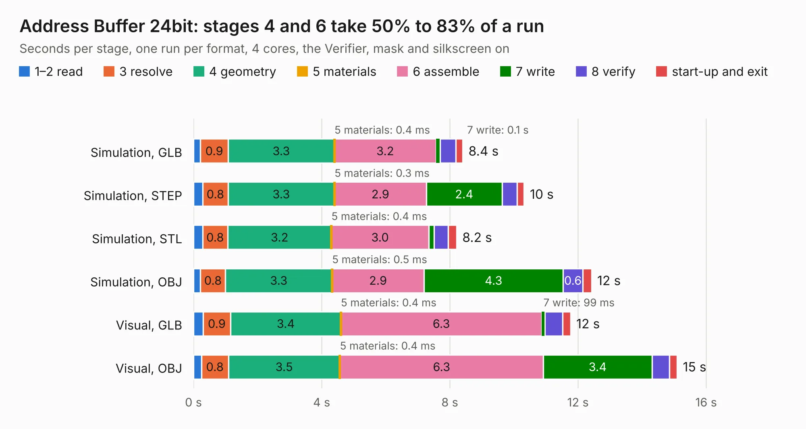

| Mode and format | 1–2 read | 3 resolve | 4 geometry | 5 materials | 6 assemble | 7 write | 8 verify | start-up and exit | Total |
|---|---:|---:|---:|---:|---:|---:|---:|---:|---:|
| Simulation, GLB | 0.2 | 0.9 | 3.3 | 0.4&nbsp;ms | 3.2 | 0.1 | 0.5 | 0.2 | 8.4 |
| Simulation, STEP | 0.3 | 0.8 | 3.3 | 0.3&nbsp;ms | 2.9 | 2.4 | 0.5 | 0.2 | 10.3 |
| Simulation, STL | 0.3 | 0.8 | 3.2 | 0.4&nbsp;ms | 3.0 | 0.2 | 0.4 | 0.3 | 8.2 |
| Simulation, OBJ | 0.2 | 0.8 | 3.3 | 0.5&nbsp;ms | 2.9 | 4.3 | 0.6 | 0.3 | 12.4 |
| Visual, GLB | 0.3 | 0.9 | 3.4 | 0.4&nbsp;ms | 6.3 | 99&nbsp;ms | 0.5 | 0.3 | 11.8 |
| Visual, OBJ | 0.2 | 0.8 | 3.5 | 0.4&nbsp;ms | 6.3 | 3.4 | 0.5 | 0.2 | 15.1 |

<table align="center"><tr><td valign="top">

| Board | Repo: [andrewpaterson/658-Computer](https://github.com/andrewpaterson/658-Computer) Board: `Address Buffer 24bit.kicad_pcb` |
|---|---|
| Folder | Kicad / Computer / Component Boards / Address Buffer 24bit |
| Complexity | 1,255, medium |
| Copper&nbsp;layers | 2 |
| File&nbsp;format | KiCad 9 (20241229) |
| Parts,&nbsp;tracks,&nbsp;vias | 28, 857, 114 |
| Triangles,&nbsp;simulation | 684,690 in 87 parts |
| Verifier | PASS in all six runs |

</td><td valign="top">

<table>
<tr><th>File type</th><th>File size</th><th>Peak memory used</th></tr>
<tr><th colspan="3" align="left">Simulation</th></tr>
<tr><td>GLB</td><td align="right">24&nbsp;MB</td><td align="right">344&nbsp;MB</td></tr>
<tr><td>STEP</td><td align="right">112&nbsp;MB</td><td align="right">427&nbsp;MB</td></tr>
<tr><td>STL</td><td align="right">34&nbsp;MB</td><td align="right">357&nbsp;MB</td></tr>
<tr><td>OBJ</td><td align="right">70&nbsp;MB</td><td align="right">510&nbsp;MB</td></tr>
<tr><th colspan="3" align="left">Visual</th></tr>
<tr><td>GLB</td><td align="right">18&nbsp;MB</td><td align="right">503&nbsp;MB</td></tr>
<tr><td>OBJ</td><td align="right">55&nbsp;MB</td><td align="right">495&nbsp;MB</td></tr>
</table>

</td></tr></table>

## 23.2.50 Audio DAC

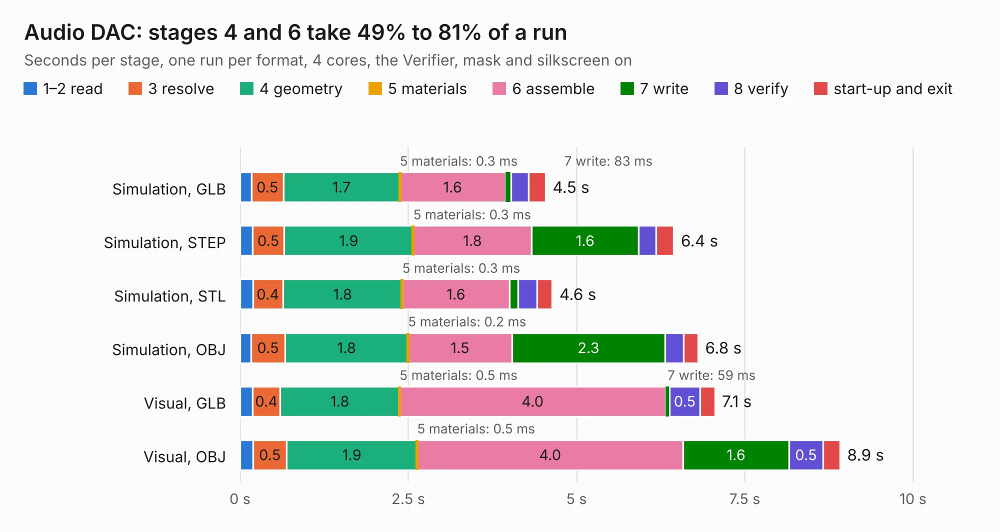

| Mode and format | 1–2 read | 3 resolve | 4 geometry | 5 materials | 6 assemble | 7 write | 8 verify | start-up and exit | Total |
|---|---:|---:|---:|---:|---:|---:|---:|---:|---:|
| Simulation, GLB | 0.2 | 0.5 | 1.7 | 0.3&nbsp;ms | 1.6 | 83&nbsp;ms | 0.3 | 0.2 | 4.5 |
| Simulation, STEP | 0.2 | 0.5 | 1.9 | 0.3&nbsp;ms | 1.8 | 1.6 | 0.3 | 0.3 | 6.4 |
| Simulation, STL | 0.2 | 0.4 | 1.8 | 0.3&nbsp;ms | 1.6 | 0.1 | 0.3 | 0.2 | 4.6 |
| Simulation, OBJ | 0.2 | 0.5 | 1.8 | 0.2&nbsp;ms | 1.5 | 2.3 | 0.3 | 0.2 | 6.8 |
| Visual, GLB | 0.2 | 0.4 | 1.8 | 0.5&nbsp;ms | 4.0 | 59&nbsp;ms | 0.5 | 0.2 | 7.1 |
| Visual, OBJ | 0.2 | 0.5 | 1.9 | 0.5&nbsp;ms | 4.0 | 1.6 | 0.5 | 0.3 | 8.9 |

<table align="center"><tr><td valign="top">

| Board | Repo: [andrewpaterson/658-Computer](https://github.com/andrewpaterson/658-Computer) Board: `Audio DAC.kicad_pcb` |
|---|---|
| Folder | Kicad / Computer / Component Boards / Audio DAC |
| Complexity | 618, low |
| Copper&nbsp;layers | 2 |
| File&nbsp;format | KiCad 9 (20241229) |
| Parts,&nbsp;tracks,&nbsp;vias | 30, 396, 54 |
| Triangles,&nbsp;simulation | 450,154 in 60 parts |
| Verifier | PASS in all six runs |

</td><td valign="top">

<table>
<tr><th>File type</th><th>File size</th><th>Peak memory used</th></tr>
<tr><th colspan="3" align="left">Simulation</th></tr>
<tr><td>GLB</td><td align="right">15&nbsp;MB</td><td align="right">287&nbsp;MB</td></tr>
<tr><td>STEP</td><td align="right">68&nbsp;MB</td><td align="right">336&nbsp;MB</td></tr>
<tr><td>STL</td><td align="right">23&nbsp;MB</td><td align="right">290&nbsp;MB</td></tr>
<tr><td>OBJ</td><td align="right">45&nbsp;MB</td><td align="right">353&nbsp;MB</td></tr>
<tr><th colspan="3" align="left">Visual</th></tr>
<tr><td>GLB</td><td align="right">12&nbsp;MB</td><td align="right">349&nbsp;MB</td></tr>
<tr><td>OBJ</td><td align="right">35&nbsp;MB</td><td align="right">343&nbsp;MB</td></tr>
</table>

</td></tr></table>

## 23.2.51 Big Board

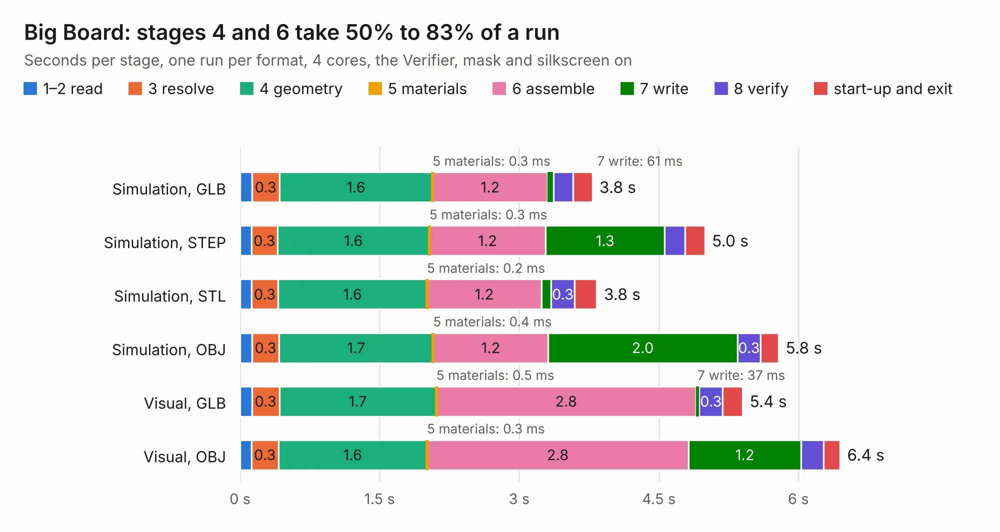

| Mode and format | 1–2 read | 3 resolve | 4 geometry | 5 materials | 6 assemble | 7 write | 8 verify | start-up and exit | Total |
|---|---:|---:|---:|---:|---:|---:|---:|---:|---:|
| Simulation, GLB | 0.1 | 0.3 | 1.6 | 0.3&nbsp;ms | 1.2 | 61&nbsp;ms | 0.2 | 0.2 | 3.8 |
| Simulation, STEP | 0.1 | 0.3 | 1.6 | 0.3&nbsp;ms | 1.2 | 1.3 | 0.2 | 0.2 | 5.0 |
| Simulation, STL | 0.1 | 0.3 | 1.6 | 0.2&nbsp;ms | 1.2 | 0.1 | 0.3 | 0.2 | 3.8 |
| Simulation, OBJ | 0.1 | 0.3 | 1.7 | 0.4&nbsp;ms | 1.2 | 2.0 | 0.3 | 0.2 | 5.8 |
| Visual, GLB | 0.1 | 0.3 | 1.7 | 0.5&nbsp;ms | 2.8 | 37&nbsp;ms | 0.3 | 0.2 | 5.4 |
| Visual, OBJ | 0.1 | 0.3 | 1.6 | 0.3&nbsp;ms | 2.8 | 1.2 | 0.2 | 0.2 | 6.4 |

<table align="center"><tr><td valign="top">

| Board | Repo: [andrewpaterson/658-Computer](https://github.com/andrewpaterson/658-Computer) Board: `Big Board.kicad_pcb` |
|---|---|
| Folder | Kicad / Computer / Component Boards / Big Board |
| Complexity | 13, simple |
| Copper&nbsp;layers | 2 |
| File&nbsp;format | KiCad 9 (20241229) |
| Parts,&nbsp;tracks,&nbsp;vias | 4, 23, 1 |
| Triangles,&nbsp;simulation | 402,342 in 72 parts |
| Verifier | PASS in all six runs |

</td><td valign="top">

<table>
<tr><th>File type</th><th>File size</th><th>Peak memory used</th></tr>
<tr><th colspan="3" align="left">Simulation</th></tr>
<tr><td>GLB</td><td align="right">13&nbsp;MB</td><td align="right">264&nbsp;MB</td></tr>
<tr><td>STEP</td><td align="right">46&nbsp;MB</td><td align="right">295&nbsp;MB</td></tr>
<tr><td>STL</td><td align="right">20&nbsp;MB</td><td align="right">272&nbsp;MB</td></tr>
<tr><td>OBJ</td><td align="right">40&nbsp;MB</td><td align="right">275&nbsp;MB</td></tr>
<tr><th colspan="3" align="left">Visual</th></tr>
<tr><td>GLB</td><td align="right">8.1&nbsp;MB</td><td align="right">273&nbsp;MB</td></tr>
<tr><td>OBJ</td><td align="right">24&nbsp;MB</td><td align="right">277&nbsp;MB</td></tr>
</table>

</td></tr></table>

## 23.2.52 Clock Doubler

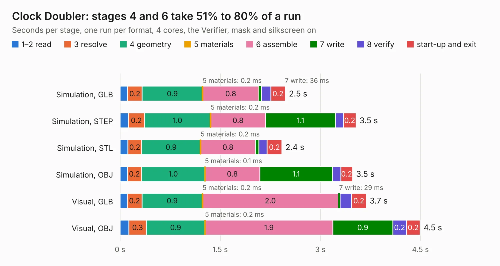

| Mode and format | 1–2 read | 3 resolve | 4 geometry | 5 materials | 6 assemble | 7 write | 8 verify | start-up and exit | Total |
|---|---:|---:|---:|---:|---:|---:|---:|---:|---:|
| Simulation, GLB | 0.1 | 0.2 | 0.9 | 0.2&nbsp;ms | 0.8 | 36&nbsp;ms | 0.1 | 0.2 | 2.5 |
| Simulation, STEP | 0.1 | 0.2 | 1.0 | 0.2&nbsp;ms | 0.8 | 1.1 | 0.1 | 0.2 | 3.5 |
| Simulation, STL | 0.1 | 0.2 | 0.9 | 0.2&nbsp;ms | 0.8 | 53&nbsp;ms | 0.1 | 0.2 | 2.4 |
| Simulation, OBJ | 0.1 | 0.2 | 1.0 | 0.1&nbsp;ms | 0.8 | 1.1 | 0.1 | 0.2 | 3.5 |
| Visual, GLB | 0.1 | 0.2 | 0.9 | 0.2&nbsp;ms | 2.0 | 29&nbsp;ms | 0.2 | 0.2 | 3.7 |
| Visual, OBJ | 0.1 | 0.3 | 0.9 | 0.2&nbsp;ms | 1.9 | 0.9 | 0.2 | 0.2 | 4.5 |

<table align="center"><tr><td valign="top">

| Board | Repo: [andrewpaterson/658-Computer](https://github.com/andrewpaterson/658-Computer) Board: `Clock Doubler.kicad_pcb` |
|---|---|
| Folder | Kicad / Computer / Component Boards / Clock Doubler |
| Complexity | 277, low |
| Copper&nbsp;layers | 2 |
| File&nbsp;format | KiCad 9 (20241229) |
| Parts,&nbsp;tracks,&nbsp;vias | 15, 178, 23 |
| Triangles,&nbsp;simulation | 220,574 in 38 parts |
| Verifier | PASS in all six runs |

</td><td valign="top">

<table>
<tr><th>File type</th><th>File size</th><th>Peak memory used</th></tr>
<tr><th colspan="3" align="left">Simulation</th></tr>
<tr><td>GLB</td><td align="right">7.5&nbsp;MB</td><td align="right">214&nbsp;MB</td></tr>
<tr><td>STEP</td><td align="right">32&nbsp;MB</td><td align="right">235&nbsp;MB</td></tr>
<tr><td>STL</td><td align="right">11&nbsp;MB</td><td align="right">212&nbsp;MB</td></tr>
<tr><td>OBJ</td><td align="right">22&nbsp;MB</td><td align="right">218&nbsp;MB</td></tr>
<tr><th colspan="3" align="left">Visual</th></tr>
<tr><td>GLB</td><td align="right">5.5&nbsp;MB</td><td align="right">218&nbsp;MB</td></tr>
<tr><td>OBJ</td><td align="right">16&nbsp;MB</td><td align="right">214&nbsp;MB</td></tr>
</table>

</td></tr></table>

## 23.2.53 Clock Hold Select

| Mode and format | 1–2 read | 3 resolve | 4 geometry | 5 materials | 6 assemble | 7 write | 8 verify | start-up and exit | Total |
|---|---:|---:|---:|---:|---:|---:|---:|---:|---:|
| Simulation, GLB | 0.2 | 0.5 | 2.4 | 0.6&nbsp;ms | 2.2 | 87&nbsp;ms | 0.3 | 0.2 | 6.0 |
| Simulation, STEP | 0.2 | 0.6 | 2.5 | 0.4&nbsp;ms | 2.1 | 1.9 | 0.3 | 0.2 | 7.8 |
| Simulation, STL | 0.2 | 0.5 | 2.4 | 0.4&nbsp;ms | 2.1 | 0.2 | 0.3 | 0.2 | 6.0 |
| Simulation, OBJ | 0.2 | 0.5 | 2.5 | 0.4&nbsp;ms | 2.0 | 2.6 | 0.3 | 0.2 | 8.3 |
| Visual, GLB | 0.2 | 0.5 | 2.5 | 0.4&nbsp;ms | 5.2 | 74&nbsp;ms | 0.5 | 0.2 | 9.3 |
| Visual, OBJ | 0.2 | 0.6 | 2.4 | 0.6&nbsp;ms | 5.3 | 2.3 | 0.6 | 0.3 | 11.8 |

<table align="center"><tr><td valign="top">

| Board | Repo: [andrewpaterson/658-Computer](https://github.com/andrewpaterson/658-Computer) Board: `Clock Hold Select.kicad_pcb` |
|---|---|
| Folder | Kicad / Computer / Component Boards / Clock Hold Select |
| Complexity | 943, low |
| Copper&nbsp;layers | 2 |
| File&nbsp;format | KiCad 9 (20241229) |
| Parts,&nbsp;tracks,&nbsp;vias | 23, 645, 84 |
| Triangles,&nbsp;simulation | 536,128 in 92 parts |
| Verifier | PASS in all six runs |

</td><td valign="top">

<table>
<tr><th>File type</th><th>File size</th><th>Peak memory used</th></tr>
<tr><th colspan="3" align="left">Simulation</th></tr>
<tr><td>GLB</td><td align="right">18&nbsp;MB</td><td align="right">313&nbsp;MB</td></tr>
<tr><td>STEP</td><td align="right">86&nbsp;MB</td><td align="right">379&nbsp;MB</td></tr>
<tr><td>STL</td><td align="right">27&nbsp;MB</td><td align="right">310&nbsp;MB</td></tr>
<tr><td>OBJ</td><td align="right">55&nbsp;MB</td><td align="right">415&nbsp;MB</td></tr>
<tr><th colspan="3" align="left">Visual</th></tr>
<tr><td>GLB</td><td align="right">15&nbsp;MB</td><td align="right">440&nbsp;MB</td></tr>
<tr><td>OBJ</td><td align="right">46&nbsp;MB</td><td align="right">404&nbsp;MB</td></tr>
</table>

</td></tr></table>

## 23.2.54 Clock Hold Standard

| Mode and format | 1–2 read | 3 resolve | 4 geometry | 5 materials | 6 assemble | 7 write | 8 verify | start-up and exit | Total |
|---|---:|---:|---:|---:|---:|---:|---:|---:|---:|
| Simulation, GLB | 0.2 | 0.3 | 1.5 | 0.4&nbsp;ms | 1.3 | 67&nbsp;ms | 0.2 | 0.2 | 3.7 |
| Simulation, STEP | 0.1 | 0.3 | 1.5 | 0.2&nbsp;ms | 1.4 | 1.4 | 0.2 | 0.2 | 5.2 |
| Simulation, STL | 0.2 | 0.3 | 1.5 | 0.2&nbsp;ms | 1.4 | 82&nbsp;ms | 0.2 | 0.2 | 4.0 |
| Simulation, OBJ | 0.2 | 0.3 | 1.6 | 0.2&nbsp;ms | 1.3 | 1.9 | 0.2 | 0.3 | 5.8 |
| Visual, GLB | 0.1 | 0.3 | 1.5 | 0.2&nbsp;ms | 3.1 | 46&nbsp;ms | 0.3 | 0.2 | 5.6 |
| Visual, OBJ | 0.1 | 0.3 | 1.5 | 3&nbsp;ms | 3.3 | 1.5 | 0.3 | 0.2 | 7.3 |

<table align="center"><tr><td valign="top">

| Board | Repo: [andrewpaterson/658-Computer](https://github.com/andrewpaterson/658-Computer) Board: `Clock Hold Standard.kicad_pcb` |
|---|---|
| Folder | Kicad / Computer / Component Boards / Clock Hold Standard |
| Complexity | 623, low |
| Copper&nbsp;layers | 2 |
| File&nbsp;format | KiCad 9 (20241229) |
| Parts,&nbsp;tracks,&nbsp;vias | 12, 434, 55 |
| Triangles,&nbsp;simulation | 321,760 in 47 parts |
| Verifier | PASS in all six runs |

</td><td valign="top">

<table>
<tr><th>File type</th><th>File size</th><th>Peak memory used</th></tr>
<tr><th colspan="3" align="left">Simulation</th></tr>
<tr><td>GLB</td><td align="right">11&nbsp;MB</td><td align="right">242&nbsp;MB</td></tr>
<tr><td>STEP</td><td align="right">52&nbsp;MB</td><td align="right">286&nbsp;MB</td></tr>
<tr><td>STL</td><td align="right">16&nbsp;MB</td><td align="right">243&nbsp;MB</td></tr>
<tr><td>OBJ</td><td align="right">33&nbsp;MB</td><td align="right">262&nbsp;MB</td></tr>
<tr><th colspan="3" align="left">Visual</th></tr>
<tr><td>GLB</td><td align="right">9.0&nbsp;MB</td><td align="right">280&nbsp;MB</td></tr>
<tr><td>OBJ</td><td align="right">26&nbsp;MB</td><td align="right">282&nbsp;MB</td></tr>
</table>

</td></tr></table>

## 23.2.55 Clock Transition

| Mode and format | 1–2 read | 3 resolve | 4 geometry | 5 materials | 6 assemble | 7 write | 8 verify | start-up and exit | Total |
|---|---:|---:|---:|---:|---:|---:|---:|---:|---:|
| Simulation, GLB | 0.1 | 0.2 | 0.9 | 0.2&nbsp;ms | 1.0 | 38&nbsp;ms | 0.1 | 0.2 | 2.6 |
| Simulation, STEP | 0.1 | 0.2 | 0.9 | 0.1&nbsp;ms | 0.9 | 1.0 | 0.1 | 0.2 | 3.5 |
| Simulation, STL | 0.1 | 0.2 | 0.9 | 0.1&nbsp;ms | 0.9 | 53&nbsp;ms | 0.1 | 0.2 | 2.6 |
| Simulation, OBJ | 0.1 | 0.3 | 0.9 | 0.2&nbsp;ms | 1.0 | 1.2 | 0.1 | 0.2 | 3.8 |
| Visual, GLB | 0.1 | 0.2 | 0.9 | 0.2&nbsp;ms | 1.9 | 32&nbsp;ms | 0.2 | 0.2 | 3.6 |
| Visual, OBJ | 0.1 | 0.2 | 0.9 | 0.2&nbsp;ms | 2.0 | 1.1 | 0.2 | 0.2 | 4.8 |

<table align="center"><tr><td valign="top">

| Board | Repo: [andrewpaterson/658-Computer](https://github.com/andrewpaterson/658-Computer) Board: `Clock Transition.kicad_pcb` |
|---|---|
| Folder | Kicad / Computer / Component Boards / Clock Transition |
| Complexity | 473, low |
| Copper&nbsp;layers | 2 |
| File&nbsp;format | KiCad 9 (20241229) |
| Parts,&nbsp;tracks,&nbsp;vias | 14, 298, 49 |
| Triangles,&nbsp;simulation | 238,130 in 35 parts |
| Verifier | PASS in all six runs |

</td><td valign="top">

<table>
<tr><th>File type</th><th>File size</th><th>Peak memory used</th></tr>
<tr><th colspan="3" align="left">Simulation</th></tr>
<tr><td>GLB</td><td align="right">8.2&nbsp;MB</td><td align="right">220&nbsp;MB</td></tr>
<tr><td>STEP</td><td align="right">37&nbsp;MB</td><td align="right">251&nbsp;MB</td></tr>
<tr><td>STL</td><td align="right">12&nbsp;MB</td><td align="right">220&nbsp;MB</td></tr>
<tr><td>OBJ</td><td align="right">24&nbsp;MB</td><td align="right">225&nbsp;MB</td></tr>
<tr><th colspan="3" align="left">Visual</th></tr>
<tr><td>GLB</td><td align="right">7.0&nbsp;MB</td><td align="right">233&nbsp;MB</td></tr>
<tr><td>OBJ</td><td align="right">20&nbsp;MB</td><td align="right">234&nbsp;MB</td></tr>
</table>

</td></tr></table>

## 23.2.56 Comparator 10bit

| Mode and format | 1–2 read | 3 resolve | 4 geometry | 5 materials | 6 assemble | 7 write | 8 verify | start-up and exit | Total |
|---|---:|---:|---:|---:|---:|---:|---:|---:|---:|
| Simulation, GLB | 0.1 | 0.3 | 1.4 | 0.2&nbsp;ms | 1.2 | 58&nbsp;ms | 0.2 | 0.2 | 3.4 |
| Simulation, STEP | 0.1 | 0.3 | 1.4 | 0.3&nbsp;ms | 1.3 | 1.2 | 0.2 | 0.2 | 4.7 |
| Simulation, STL | 0.1 | 0.4 | 1.4 | 0.2&nbsp;ms | 1.2 | 0.1 | 0.2 | 0.2 | 3.6 |
| Simulation, OBJ | 0.1 | 0.3 | 1.5 | 0.2&nbsp;ms | 1.1 | 1.6 | 0.2 | 0.2 | 5.1 |
| Visual, GLB | 0.1 | 0.3 | 1.4 | 0.3&nbsp;ms | 3.3 | 47&nbsp;ms | 0.4 | 0.2 | 5.7 |
| Visual, OBJ | 0.1 | 0.3 | 1.3 | 0.3&nbsp;ms | 3.2 | 1.2 | 0.3 | 0.2 | 6.8 |

<table align="center"><tr><td valign="top">

| Board | Repo: [andrewpaterson/658-Computer](https://github.com/andrewpaterson/658-Computer) Board: `Comparator 10bit.kicad_pcb` |
|---|---|
| Folder | Kicad / Computer / Component Boards / Comparator 10bit |
| Complexity | 699, low |
| Copper&nbsp;layers | 2 |
| File&nbsp;format | KiCad 9 (20241229) |
| Parts,&nbsp;tracks,&nbsp;vias | 14, 485, 62 |
| Triangles,&nbsp;simulation | 393,638 in 59 parts |
| Verifier | PASS in all six runs |

</td><td valign="top">

<table>
<tr><th>File type</th><th>File size</th><th>Peak memory used</th></tr>
<tr><th colspan="3" align="left">Simulation</th></tr>
<tr><td>GLB</td><td align="right">14&nbsp;MB</td><td align="right">265&nbsp;MB</td></tr>
<tr><td>STEP</td><td align="right">64&nbsp;MB</td><td align="right">309&nbsp;MB</td></tr>
<tr><td>STL</td><td align="right">20&nbsp;MB</td><td align="right">266&nbsp;MB</td></tr>
<tr><td>OBJ</td><td align="right">40&nbsp;MB</td><td align="right">320&nbsp;MB</td></tr>
<tr><th colspan="3" align="left">Visual</th></tr>
<tr><td>GLB</td><td align="right">10&nbsp;MB</td><td align="right">322&nbsp;MB</td></tr>
<tr><td>OBJ</td><td align="right">31&nbsp;MB</td><td align="right">316&nbsp;MB</td></tr>
</table>

</td></tr></table>

## 23.2.57 Comparator 16bit

| Mode and format | 1–2 read | 3 resolve | 4 geometry | 5 materials | 6 assemble | 7 write | 8 verify | start-up and exit | Total |
|---|---:|---:|---:|---:|---:|---:|---:|---:|---:|
| Simulation, GLB | 0.2 | 0.5 | 2.2 | 0.3&nbsp;ms | 1.9 | 74&nbsp;ms | 0.3 | 0.2 | 5.4 |
| Simulation, STEP | 0.1 | 0.5 | 2.1 | 0.2&nbsp;ms | 2.1 | 1.8 | 0.3 | 0.2 | 7.2 |
| Simulation, STL | 0.2 | 0.5 | 2.3 | 0.4&nbsp;ms | 2.0 | 0.2 | 0.3 | 0.2 | 5.7 |
| Simulation, OBJ | 0.2 | 0.6 | 2.2 | 0.2&nbsp;ms | 2.2 | 2.9 | 0.3 | 0.2 | 8.5 |
| Visual, GLB | 0.2 | 0.5 | 2.1 | 0.4&nbsp;ms | 4.4 | 78&nbsp;ms | 0.5 | 0.2 | 7.9 |
| Visual, OBJ | 0.2 | 0.5 | 2.2 | 0.2&nbsp;ms | 4.4 | 2.1 | 0.5 | 0.3 | 10.1 |

<table align="center"><tr><td valign="top">

| Board | Repo: [andrewpaterson/658-Computer](https://github.com/andrewpaterson/658-Computer) Board: `Comparator 16bit.kicad_pcb` |
|---|---|
| Folder | Kicad / Computer / Component Boards / Comparator 16bit |
| Complexity | 1,094, medium |
| Copper&nbsp;layers | 2 |
| File&nbsp;format | KiCad 9 (20241229) |
| Parts,&nbsp;tracks,&nbsp;vias | 13, 798, 90 |
| Triangles,&nbsp;simulation | 523,882 in 64 parts |
| Verifier | PASS in all six runs |

</td><td valign="top">

<table>
<tr><th>File type</th><th>File size</th><th>Peak memory used</th></tr>
<tr><th colspan="3" align="left">Simulation</th></tr>
<tr><td>GLB</td><td align="right">18&nbsp;MB</td><td align="right">319&nbsp;MB</td></tr>
<tr><td>STEP</td><td align="right">87&nbsp;MB</td><td align="right">363&nbsp;MB</td></tr>
<tr><td>STL</td><td align="right">26&nbsp;MB</td><td align="right">308&nbsp;MB</td></tr>
<tr><td>OBJ</td><td align="right">53&nbsp;MB</td><td align="right">403&nbsp;MB</td></tr>
<tr><th colspan="3" align="left">Visual</th></tr>
<tr><td>GLB</td><td align="right">14&nbsp;MB</td><td align="right">380&nbsp;MB</td></tr>
<tr><td>OBJ</td><td align="right">42&nbsp;MB</td><td align="right">382&nbsp;MB</td></tr>
</table>

</td></tr></table>

## 23.2.58 Counter 16bit with IO

| Mode and format | 1–2 read | 3 resolve | 4 geometry | 5 materials | 6 assemble | 7 write | 8 verify | start-up and exit | Total |
|---|---:|---:|---:|---:|---:|---:|---:|---:|---:|
| Simulation, GLB | 0.2 | 0.7 | 2.6 | 0.6&nbsp;ms | 3.0 | 0.1 | 0.4 | 0.2 | 7.2 |
| Simulation, STEP | 0.2 | 0.7 | 2.8 | 0.5&nbsp;ms | 2.8 | 2.2 | 0.5 | 0.2 | 9.4 |
| Simulation, STL | 0.2 | 0.7 | 2.6 | 0.4&nbsp;ms | 3.0 | 0.2 | 0.4 | 0.2 | 7.3 |
| Simulation, OBJ | 0.2 | 0.7 | 2.7 | 0.5&nbsp;ms | 3.0 | 3.3 | 0.4 | 0.2 | 10.5 |
| Visual, GLB | 0.2 | 0.8 | 2.8 | 0.3&nbsp;ms | 6.2 | 0.1 | 0.8 | 0.2 | 11.1 |
| Visual, OBJ | 0.2 | 0.7 | 2.7 | 0.6&nbsp;ms | 6.4 | 3.1 | 0.9 | 0.2 | 14.1 |

<table align="center"><tr><td valign="top">

| Board | Repo: [andrewpaterson/658-Computer](https://github.com/andrewpaterson/658-Computer) Board: `Counter 16bit with IO.kicad_pcb` |
|---|---|
| Folder | Kicad / Computer / Component Boards / Counter 16bit with IO |
| Complexity | 2,013, medium |
| Copper&nbsp;layers | 2 |
| File&nbsp;format | KiCad 9 (20241229) |
| Parts,&nbsp;tracks,&nbsp;vias | 24, 1,368, 199 |
| Triangles,&nbsp;simulation | 864,154 in 70 parts |
| Verifier | PASS in all six runs |

</td><td valign="top">

<table>
<tr><th>File type</th><th>File size</th><th>Peak memory used</th></tr>
<tr><th colspan="3" align="left">Simulation</th></tr>
<tr><td>GLB</td><td align="right">30&nbsp;MB</td><td align="right">436&nbsp;MB</td></tr>
<tr><td>STEP</td><td align="right">142&nbsp;MB</td><td align="right">501&nbsp;MB</td></tr>
<tr><td>STL</td><td align="right">43&nbsp;MB</td><td align="right">454&nbsp;MB</td></tr>
<tr><td>OBJ</td><td align="right">88&nbsp;MB</td><td align="right">623&nbsp;MB</td></tr>
<tr><th colspan="3" align="left">Visual</th></tr>
<tr><td>GLB</td><td align="right">25&nbsp;MB</td><td align="right">616&nbsp;MB</td></tr>
<tr><td>OBJ</td><td align="right">77&nbsp;MB</td><td align="right">649&nbsp;MB</td></tr>
</table>

</td></tr></table>

## 23.2.59 Counter 16bit

| Mode and format | 1–2 read | 3 resolve | 4 geometry | 5 materials | 6 assemble | 7 write | 8 verify | start-up and exit | Total |
|---|---:|---:|---:|---:|---:|---:|---:|---:|---:|
| Simulation, GLB | 0.1 | 0.5 | 2.1 | 0.4&nbsp;ms | 1.9 | 77&nbsp;ms | 0.3 | 0.2 | 5.3 |
| Simulation, STEP | 0.2 | 0.5 | 2.0 | 0.4&nbsp;ms | 1.9 | 1.7 | 0.3 | 0.2 | 6.8 |
| Simulation, STL | 0.2 | 0.5 | 2.0 | 0.3&nbsp;ms | 1.8 | 0.1 | 0.3 | 0.2 | 5.1 |
| Simulation, OBJ | 0.2 | 0.5 | 1.9 | 0.3&nbsp;ms | 1.8 | 2.3 | 0.3 | 0.2 | 7.3 |
| Visual, GLB | 0.2 | 0.5 | 2.0 | 0.3&nbsp;ms | 4.6 | 76&nbsp;ms | 0.7 | 0.3 | 8.3 |
| Visual, OBJ | 0.2 | 0.5 | 2.0 | 0.4&nbsp;ms | 4.5 | 1.9 | 0.7 | 0.3 | 10.0 |

<table align="center"><tr><td valign="top">

| Board | Repo: [andrewpaterson/658-Computer](https://github.com/andrewpaterson/658-Computer) Board: `Counter 16bit.kicad_pcb` |
|---|---|
| Folder | Kicad / Computer / Component Boards / Counter 16bit |
| Complexity | 770, low |
| Copper&nbsp;layers | 2 |
| File&nbsp;format | KiCad 9 (20241229) |
| Parts,&nbsp;tracks,&nbsp;vias | 14, 508, 78 |
| Triangles,&nbsp;simulation | 468,570 in 52 parts |
| Verifier | PASS in all six runs |

</td><td valign="top">

<table>
<tr><th>File type</th><th>File size</th><th>Peak memory used</th></tr>
<tr><th colspan="3" align="left">Simulation</th></tr>
<tr><td>GLB</td><td align="right">16&nbsp;MB</td><td align="right">294&nbsp;MB</td></tr>
<tr><td>STEP</td><td align="right">74&nbsp;MB</td><td align="right">347&nbsp;MB</td></tr>
<tr><td>STL</td><td align="right">23&nbsp;MB</td><td align="right">308&nbsp;MB</td></tr>
<tr><td>OBJ</td><td align="right">47&nbsp;MB</td><td align="right">366&nbsp;MB</td></tr>
<tr><th colspan="3" align="left">Visual</th></tr>
<tr><td>GLB</td><td align="right">12&nbsp;MB</td><td align="right">353&nbsp;MB</td></tr>
<tr><td>OBJ</td><td align="right">37&nbsp;MB</td><td align="right">356&nbsp;MB</td></tr>
</table>

</td></tr></table>

## 23.2.60 Counter 24bit with IO

| Mode and format | 1–2 read | 3 resolve | 4 geometry | 5 materials | 6 assemble | 7 write | 8 verify | start-up and exit | Total |
|---|---:|---:|---:|---:|---:|---:|---:|---:|---:|
| Simulation, GLB | 0.3 | 1.2 | 5.1 | 0.6&nbsp;ms | 5.2 | 0.2 | 0.6 | 0.3 | 12.8 |
| Simulation, STEP | 0.2 | 1.0 | 4.8 | 0.7&nbsp;ms | 4.6 | 3.5 | 0.6 | 0.2 | 15.1 |
| Simulation, STL | 0.3 | 1.2 | 5.0 | 0.7&nbsp;ms | 5.0 | 0.4 | 0.6 | 0.3 | 12.8 |
| Simulation, OBJ | 0.3 | 1.2 | 4.8 | 0.7&nbsp;ms | 4.8 | 5.3 | 0.6 | 0.2 | 17.3 |
| Visual, GLB | 0.3 | 1.1 | 4.8 | 0.7&nbsp;ms | 10.8 | 0.2 | 1.4 | 0.2 | 18.7 |
| Visual, OBJ | 0.3 | 1.0 | 4.6 | 0.6&nbsp;ms | 10.5 | 4.8 | 1.6 | 0.2 | 23.0 |

<table align="center"><tr><td valign="top">

| Board | Repo: [andrewpaterson/658-Computer](https://github.com/andrewpaterson/658-Computer) Board: `Counter 24bit with IO.kicad_pcb` |
|---|---|
| Folder | Kicad / Computer / Component Boards / Counter 24bit with IO |
| Complexity | 3,089, high |
| Copper&nbsp;layers | 2 |
| File&nbsp;format | KiCad 9 (20241229) |
| Parts,&nbsp;tracks,&nbsp;vias | 32, 2,287, 246 |
| Triangles,&nbsp;simulation | 1,167,700 in 106 parts |
| Verifier | PASS in all six runs |

</td><td valign="top">

<table>
<tr><th>File type</th><th>File size</th><th>Peak memory used</th></tr>
<tr><th colspan="3" align="left">Simulation</th></tr>
<tr><td>GLB</td><td align="right">40&nbsp;MB</td><td align="right">551&nbsp;MB</td></tr>
<tr><td>STEP</td><td align="right">192&nbsp;MB</td><td align="right">635&nbsp;MB</td></tr>
<tr><td>STL</td><td align="right">58&nbsp;MB</td><td align="right">555&nbsp;MB</td></tr>
<tr><td>OBJ</td><td align="right">119&nbsp;MB</td><td align="right">824&nbsp;MB</td></tr>
<tr><th colspan="3" align="left">Visual</th></tr>
<tr><td>GLB</td><td align="right">34&nbsp;MB</td><td align="right">693&nbsp;MB</td></tr>
<tr><td>OBJ</td><td align="right">102&nbsp;MB</td><td align="right">771&nbsp;MB</td></tr>
</table>

</td></tr></table>

## 23.2.61 Counter 24bit

| Mode and format | 1–2 read | 3 resolve | 4 geometry | 5 materials | 6 assemble | 7 write | 8 verify | start-up and exit | Total |
|---|---:|---:|---:|---:|---:|---:|---:|---:|---:|
| Simulation, GLB | 0.2 | 0.6 | 2.6 | 0.5&nbsp;ms | 2.4 | 0.1 | 0.3 | 0.2 | 6.5 |
| Simulation, STEP | 0.2 | 0.7 | 2.8 | 0.3&nbsp;ms | 2.2 | 2.0 | 0.4 | 0.2 | 8.5 |
| Simulation, STL | 0.2 | 0.6 | 2.6 | 0.4&nbsp;ms | 2.5 | 0.2 | 0.4 | 0.2 | 6.8 |
| Simulation, OBJ | 0.2 | 0.7 | 2.6 | 0.3&nbsp;ms | 2.4 | 3.1 | 0.4 | 0.2 | 9.6 |
| Visual, GLB | 0.2 | 0.7 | 2.7 | 0.5&nbsp;ms | 5.9 | 71&nbsp;ms | 0.5 | 0.2 | 10.3 |
| Visual, OBJ | 0.2 | 0.5 | 2.6 | 0.4&nbsp;ms | 5.6 | 2.4 | 0.7 | 0.2 | 12.3 |

<table align="center"><tr><td valign="top">

| Board | Repo: [andrewpaterson/658-Computer](https://github.com/andrewpaterson/658-Computer) Board: `Counter 24bit.kicad_pcb` |
|---|---|
| Folder | Kicad / Computer / Component Boards / Counter 24bit |
| Complexity | 1,194, medium |
| Copper&nbsp;layers | 2 |
| File&nbsp;format | KiCad 9 (20241229) |
| Parts,&nbsp;tracks,&nbsp;vias | 18, 816, 114 |
| Triangles,&nbsp;simulation | 673,350 in 71 parts |
| Verifier | PASS in all six runs |

</td><td valign="top">

<table>
<tr><th>File type</th><th>File size</th><th>Peak memory used</th></tr>
<tr><th colspan="3" align="left">Simulation</th></tr>
<tr><td>GLB</td><td align="right">23&nbsp;MB</td><td align="right">375&nbsp;MB</td></tr>
<tr><td>STEP</td><td align="right">108&nbsp;MB</td><td align="right">421&nbsp;MB</td></tr>
<tr><td>STL</td><td align="right">34&nbsp;MB</td><td align="right">361&nbsp;MB</td></tr>
<tr><td>OBJ</td><td align="right">68&nbsp;MB</td><td align="right">496&nbsp;MB</td></tr>
<tr><th colspan="3" align="left">Visual</th></tr>
<tr><td>GLB</td><td align="right">18&nbsp;MB</td><td align="right">481&nbsp;MB</td></tr>
<tr><td>OBJ</td><td align="right">53&nbsp;MB</td><td align="right">466&nbsp;MB</td></tr>
</table>

</td></tr></table>

## 23.2.62 D Flip Flop 16bit

| Mode and format | 1–2 read | 3 resolve | 4 geometry | 5 materials | 6 assemble | 7 write | 8 verify | start-up and exit | Total |
|---|---:|---:|---:|---:|---:|---:|---:|---:|---:|
| Simulation, GLB | 0.2 | 0.5 | 1.9 | 0.3&nbsp;ms | 1.7 | 89&nbsp;ms | 0.3 | 0.3 | 4.9 |
| Simulation, STEP | 0.2 | 0.4 | 2.0 | 0.2&nbsp;ms | 1.6 | 1.8 | 0.3 | 0.2 | 6.6 |
| Simulation, STL | 0.2 | 0.4 | 1.9 | 0.2&nbsp;ms | 1.6 | 0.1 | 0.3 | 0.3 | 4.9 |
| Simulation, OBJ | 0.2 | 0.4 | 1.8 | 0.3&nbsp;ms | 1.5 | 1.9 | 0.3 | 0.3 | 6.4 |
| Visual, GLB | 0.2 | 0.4 | 2.0 | 0.3&nbsp;ms | 3.6 | 48&nbsp;ms | 0.3 | 0.3 | 6.8 |
| Visual, OBJ | 0.2 | 0.4 | 1.9 | 0.2&nbsp;ms | 4.3 | 1.8 | 0.3 | 0.3 | 9.2 |

<table align="center"><tr><td valign="top">

| Board | Repo: [andrewpaterson/658-Computer](https://github.com/andrewpaterson/658-Computer) Board: `D Flip Flop 16bit.kicad_pcb` |
|---|---|
| Folder | Kicad / Computer / Component Boards / D Flip Flop 16bit |
| Complexity | 375, low |
| Copper&nbsp;layers | 2 |
| File&nbsp;format | KiCad 9 (20241229) |
| Parts,&nbsp;tracks,&nbsp;vias | 8, 360, 31 |
| Triangles,&nbsp;simulation | 343,422 in 48 parts |
| Verifier | PASS in all six runs |

</td><td valign="top">

<table>
<tr><th>File type</th><th>File size</th><th>Peak memory used</th></tr>
<tr><th colspan="3" align="left">Simulation</th></tr>
<tr><td>GLB</td><td align="right">12&nbsp;MB</td><td align="right">238&nbsp;MB</td></tr>
<tr><td>STEP</td><td align="right">56&nbsp;MB</td><td align="right">283&nbsp;MB</td></tr>
<tr><td>STL</td><td align="right">17&nbsp;MB</td><td align="right">250&nbsp;MB</td></tr>
<tr><td>OBJ</td><td align="right">35&nbsp;MB</td><td align="right">273&nbsp;MB</td></tr>
<tr><th colspan="3" align="left">Visual</th></tr>
<tr><td>GLB</td><td align="right">8.5&nbsp;MB</td><td align="right">273&nbsp;MB</td></tr>
<tr><td>OBJ</td><td align="right">25&nbsp;MB</td><td align="right">276&nbsp;MB</td></tr>
</table>

</td></tr></table>

## 23.2.63 D Flip Flop 24bit

| Mode and format | 1–2 read | 3 resolve | 4 geometry | 5 materials | 6 assemble | 7 write | 8 verify | start-up and exit | Total |
|---|---:|---:|---:|---:|---:|---:|---:|---:|---:|
| Simulation, GLB | 0.1 | 0.4 | 2.0 | 0.4&nbsp;ms | 1.6 | 76&nbsp;ms | 0.3 | 0.2 | 4.7 |
| Simulation, STEP | 0.1 | 0.4 | 1.8 | 0.2&nbsp;ms | 1.5 | 1.6 | 0.3 | 0.2 | 6.1 |
| Simulation, STL | 0.1 | 0.5 | 1.9 | 0.3&nbsp;ms | 1.5 | 0.1 | 0.4 | 0.3 | 4.9 |
| Simulation, OBJ | 0.2 | 0.5 | 2.1 | 0.2&nbsp;ms | 1.5 | 2.2 | 0.3 | 0.2 | 6.9 |
| Visual, GLB | 0.1 | 0.4 | 2.0 | 0.2&nbsp;ms | 4.1 | 53&nbsp;ms | 0.5 | 0.3 | 7.4 |
| Visual, OBJ | 0.2 | 0.5 | 2.0 | 0.3&nbsp;ms | 3.8 | 1.4 | 0.4 | 0.3 | 8.6 |

<table align="center"><tr><td valign="top">

| Board | Repo: [andrewpaterson/658-Computer](https://github.com/andrewpaterson/658-Computer) Board: `D Flip Flop 24bit.kicad_pcb` |
|---|---|
| Folder | Kicad / Computer / Component Boards / D Flip Flop 24bit |
| Complexity | 537, low |
| Copper&nbsp;layers | 2 |
| File&nbsp;format | KiCad 9 (20241229) |
| Parts,&nbsp;tracks,&nbsp;vias | 10, 400, 39 |
| Triangles,&nbsp;simulation | 463,344 in 64 parts |
| Verifier | PASS in all six runs |

</td><td valign="top">

<table>
<tr><th>File type</th><th>File size</th><th>Peak memory used</th></tr>
<tr><th colspan="3" align="left">Simulation</th></tr>
<tr><td>GLB</td><td align="right">16&nbsp;MB</td><td align="right">277&nbsp;MB</td></tr>
<tr><td>STEP</td><td align="right">75&nbsp;MB</td><td align="right">334&nbsp;MB</td></tr>
<tr><td>STL</td><td align="right">23&nbsp;MB</td><td align="right">286&nbsp;MB</td></tr>
<tr><td>OBJ</td><td align="right">47&nbsp;MB</td><td align="right">361&nbsp;MB</td></tr>
<tr><th colspan="3" align="left">Visual</th></tr>
<tr><td>GLB</td><td align="right">11&nbsp;MB</td><td align="right">342&nbsp;MB</td></tr>
<tr><td>OBJ</td><td align="right">34&nbsp;MB</td><td align="right">348&nbsp;MB</td></tr>
</table>

</td></tr></table>

## 23.2.64 Data and Signal Buffer

| Mode and format | 1–2 read | 3 resolve | 4 geometry | 5 materials | 6 assemble | 7 write | 8 verify | start-up and exit | Total |
|---|---:|---:|---:|---:|---:|---:|---:|---:|---:|
| Simulation, GLB | 0.2 | 0.6 | 2.2 | 0.3&nbsp;ms | 1.9 | 97&nbsp;ms | 0.3 | 0.2 | 5.5 |
| Simulation, STEP | 0.2 | 0.5 | 1.9 | 0.3&nbsp;ms | 1.8 | 1.7 | 0.3 | 0.2 | 6.6 |
| Simulation, STL | 0.2 | 0.5 | 2.1 | 0.4&nbsp;ms | 1.8 | 0.1 | 0.3 | 0.2 | 5.2 |
| Simulation, OBJ | 0.2 | 0.5 | 2.0 | 0.5&nbsp;ms | 1.8 | 2.3 | 0.3 | 0.2 | 7.2 |
| Visual, GLB | 0.2 | 0.6 | 2.1 | 0.4&nbsp;ms | 4.5 | 73&nbsp;ms | 0.4 | 0.3 | 8.3 |
| Visual, OBJ | 0.2 | 0.5 | 2.2 | 0.3&nbsp;ms | 4.5 | 1.7 | 0.4 | 0.2 | 9.8 |

<table align="center"><tr><td valign="top">

| Board | Repo: [andrewpaterson/658-Computer](https://github.com/andrewpaterson/658-Computer) Board: `Data and Signal Buffer.kicad_pcb` |
|---|---|
| Folder | Kicad / Computer / Component Boards / Data and Signal Buffer |
| Complexity | 849, low |
| Copper&nbsp;layers | 2 |
| File&nbsp;format | KiCad 9 (20241229) |
| Parts,&nbsp;tracks,&nbsp;vias | 20, 584, 75 |
| Triangles,&nbsp;simulation | 478,376 in 64 parts |
| Verifier | PASS in all six runs |

</td><td valign="top">

<table>
<tr><th>File type</th><th>File size</th><th>Peak memory used</th></tr>
<tr><th colspan="3" align="left">Simulation</th></tr>
<tr><td>GLB</td><td align="right">17&nbsp;MB</td><td align="right">288&nbsp;MB</td></tr>
<tr><td>STEP</td><td align="right">78&nbsp;MB</td><td align="right">345&nbsp;MB</td></tr>
<tr><td>STL</td><td align="right">24&nbsp;MB</td><td align="right">286&nbsp;MB</td></tr>
<tr><td>OBJ</td><td align="right">49&nbsp;MB</td><td align="right">378&nbsp;MB</td></tr>
<tr><th colspan="3" align="left">Visual</th></tr>
<tr><td>GLB</td><td align="right">13&nbsp;MB</td><td align="right">365&nbsp;MB</td></tr>
<tr><td>OBJ</td><td align="right">38&nbsp;MB</td><td align="right">363&nbsp;MB</td></tr>
</table>

</td></tr></table>

## 23.2.65 Device Buffer

| Mode and format | 1–2 read | 3 resolve | 4 geometry | 5 materials | 6 assemble | 7 write | 8 verify | start-up and exit | Total |
|---|---:|---:|---:|---:|---:|---:|---:|---:|---:|
| Simulation, GLB | 0.2 | 0.5 | 2.7 | 0.6&nbsp;ms | 2.0 | 85&nbsp;ms | 0.3 | 0.2 | 6.1 |
| Simulation, STEP | 0.2 | 0.6 | 2.7 | 0.2&nbsp;ms | 2.0 | 1.9 | 0.3 | 0.2 | 7.9 |
| Simulation, STL | 0.2 | 0.6 | 2.7 | 0.3&nbsp;ms | 1.9 | 0.1 | 0.3 | 0.2 | 5.9 |
| Simulation, OBJ | 0.2 | 0.6 | 2.7 | 0.3&nbsp;ms | 2.1 | 3.1 | 0.3 | 0.2 | 9.1 |
| Visual, GLB | 0.2 | 0.6 | 2.8 | 0.4&nbsp;ms | 4.8 | 60&nbsp;ms | 0.5 | 0.2 | 9.2 |
| Visual, OBJ | 0.2 | 0.5 | 2.8 | 0.3&nbsp;ms | 4.5 | 2.2 | 0.7 | 0.2 | 11.2 |

<table align="center"><tr><td valign="top">

| Board | Repo: [andrewpaterson/658-Computer](https://github.com/andrewpaterson/658-Computer) Board: `Device Buffer.kicad_pcb` |
|---|---|
| Folder | Kicad / Computer / Component Boards / Device Buffer |
| Complexity | 727, low |
| Copper&nbsp;layers | 2 |
| File&nbsp;format | KiCad 9 (20241229) |
| Parts,&nbsp;tracks,&nbsp;vias | 18, 571, 40 |
| Triangles,&nbsp;simulation | 557,548 in 75 parts |
| Verifier | PASS in all six runs |

</td><td valign="top">

<table>
<tr><th>File type</th><th>File size</th><th>Peak memory used</th></tr>
<tr><th colspan="3" align="left">Simulation</th></tr>
<tr><td>GLB</td><td align="right">19&nbsp;MB</td><td align="right">316&nbsp;MB</td></tr>
<tr><td>STEP</td><td align="right">98&nbsp;MB</td><td align="right">367&nbsp;MB</td></tr>
<tr><td>STL</td><td align="right">28&nbsp;MB</td><td align="right">310&nbsp;MB</td></tr>
<tr><td>OBJ</td><td align="right">57&nbsp;MB</td><td align="right">420&nbsp;MB</td></tr>
<tr><th colspan="3" align="left">Visual</th></tr>
<tr><td>GLB</td><td align="right">14&nbsp;MB</td><td align="right">412&nbsp;MB</td></tr>
<tr><td>OBJ</td><td align="right">41&nbsp;MB</td><td align="right">380&nbsp;MB</td></tr>
</table>

</td></tr></table>

## 23.2.66 Device Decode stage A

| Mode and format | 1–2 read | 3 resolve | 4 geometry | 5 materials | 6 assemble | 7 write | 8 verify | start-up and exit | Total |
|---|---:|---:|---:|---:|---:|---:|---:|---:|---:|
| Simulation, GLB | 0.1 | 0.3 | 1.7 | 0.3&nbsp;ms | 1.4 | 80&nbsp;ms | 0.3 | 0.2 | 4.0 |
| Simulation, STEP | 0.1 | 0.4 | 1.6 | 0.2&nbsp;ms | 1.5 | 1.4 | 0.2 | 0.2 | 5.4 |
| Simulation, STL | 0.1 | 0.4 | 1.6 | 0.2&nbsp;ms | 1.4 | 0.1 | 0.2 | 0.2 | 4.0 |
| Simulation, OBJ | 0.2 | 0.4 | 1.5 | 0.2&nbsp;ms | 1.4 | 2.0 | 0.2 | 0.2 | 6.0 |
| Visual, GLB | 0.1 | 0.4 | 1.7 | 0.3&nbsp;ms | 3.0 | 46&nbsp;ms | 0.3 | 0.2 | 5.8 |
| Visual, OBJ | 0.1 | 0.4 | 1.6 | 0.2&nbsp;ms | 3.3 | 1.6 | 0.4 | 0.2 | 7.6 |

<table align="center"><tr><td valign="top">

| Board | Repo: [andrewpaterson/658-Computer](https://github.com/andrewpaterson/658-Computer) Board: `Device Decode stage A.kicad_pcb` |
|---|---|
| Folder | Kicad / Computer / Component Boards / Device Decode stage A |
| Complexity | 660, low |
| Copper&nbsp;layers | 2 |
| File&nbsp;format | KiCad 9 (20241229) |
| Parts,&nbsp;tracks,&nbsp;vias | 16, 442, 62 |
| Triangles,&nbsp;simulation | 391,752 in 57 parts |
| Verifier | PASS in all six runs |

</td><td valign="top">

<table>
<tr><th>File type</th><th>File size</th><th>Peak memory used</th></tr>
<tr><th colspan="3" align="left">Simulation</th></tr>
<tr><td>GLB</td><td align="right">14&nbsp;MB</td><td align="right">259&nbsp;MB</td></tr>
<tr><td>STEP</td><td align="right">63&nbsp;MB</td><td align="right">313&nbsp;MB</td></tr>
<tr><td>STL</td><td align="right">20&nbsp;MB</td><td align="right">260&nbsp;MB</td></tr>
<tr><td>OBJ</td><td align="right">40&nbsp;MB</td><td align="right">317&nbsp;MB</td></tr>
<tr><th colspan="3" align="left">Visual</th></tr>
<tr><td>GLB</td><td align="right">11&nbsp;MB</td><td align="right">317&nbsp;MB</td></tr>
<tr><td>OBJ</td><td align="right">31&nbsp;MB</td><td align="right">326&nbsp;MB</td></tr>
</table>

</td></tr></table>

## 23.2.67 Device Decode stage B

| Mode and format | 1–2 read | 3 resolve | 4 geometry | 5 materials | 6 assemble | 7 write | 8 verify | start-up and exit | Total |
|---|---:|---:|---:|---:|---:|---:|---:|---:|---:|
| Simulation, GLB | 0.1 | 0.4 | 1.9 | 0.2&nbsp;ms | 1.6 | 93&nbsp;ms | 0.3 | 0.2 | 4.7 |
| Simulation, STEP | 0.1 | 0.4 | 1.9 | 0.2&nbsp;ms | 1.7 | 1.5 | 0.3 | 0.2 | 6.1 |
| Simulation, STL | 0.2 | 0.5 | 1.8 | 0.2&nbsp;ms | 1.7 | 95&nbsp;ms | 0.2 | 0.2 | 4.6 |
| Simulation, OBJ | 0.1 | 0.4 | 1.9 | 0.2&nbsp;ms | 1.7 | 2.5 | 0.3 | 0.2 | 7.2 |
| Visual, GLB | 0.2 | 0.4 | 2.0 | 0.2&nbsp;ms | 3.7 | 56&nbsp;ms | 0.4 | 0.2 | 6.9 |
| Visual, OBJ | 0.2 | 0.4 | 2.0 | 0.2&nbsp;ms | 3.9 | 1.9 | 0.4 | 0.3 | 9.1 |

<table align="center"><tr><td valign="top">

| Board | Repo: [andrewpaterson/658-Computer](https://github.com/andrewpaterson/658-Computer) Board: `Device Decode stage B.kicad_pcb` |
|---|---|
| Folder | Kicad / Computer / Component Boards / Device Decode stage B |
| Complexity | 838, low |
| Copper&nbsp;layers | 2 |
| File&nbsp;format | KiCad 9 (20241229) |
| Parts,&nbsp;tracks,&nbsp;vias | 16, 572, 78 |
| Triangles,&nbsp;simulation | 451,576 in 50 parts |
| Verifier | PASS in all six runs |

</td><td valign="top">

<table>
<tr><th>File type</th><th>File size</th><th>Peak memory used</th></tr>
<tr><th colspan="3" align="left">Simulation</th></tr>
<tr><td>GLB</td><td align="right">16&nbsp;MB</td><td align="right">318&nbsp;MB</td></tr>
<tr><td>STEP</td><td align="right">75&nbsp;MB</td><td align="right">334&nbsp;MB</td></tr>
<tr><td>STL</td><td align="right">23&nbsp;MB</td><td align="right">289&nbsp;MB</td></tr>
<tr><td>OBJ</td><td align="right">46&nbsp;MB</td><td align="right">311&nbsp;MB</td></tr>
<tr><th colspan="3" align="left">Visual</th></tr>
<tr><td>GLB</td><td align="right">13&nbsp;MB</td><td align="right">358&nbsp;MB</td></tr>
<tr><td>OBJ</td><td align="right">37&nbsp;MB</td><td align="right">359&nbsp;MB</td></tr>
</table>

</td></tr></table>

## 23.2.68 Dual Comparator 8bit

| Mode and format | 1–2 read | 3 resolve | 4 geometry | 5 materials | 6 assemble | 7 write | 8 verify | start-up and exit | Total |
|---|---:|---:|---:|---:|---:|---:|---:|---:|---:|
| Simulation, GLB | 0.2 | 0.5 | 2.3 | 0.3&nbsp;ms | 2.0 | 83&nbsp;ms | 0.3 | 0.3 | 5.7 |
| Simulation, STEP | 0.2 | 0.5 | 2.0 | 0.3&nbsp;ms | 2.2 | 1.7 | 0.3 | 0.2 | 7.2 |
| Simulation, STL | 0.2 | 0.5 | 2.1 | 0.4&nbsp;ms | 1.9 | 0.2 | 0.4 | 0.2 | 5.5 |
| Simulation, OBJ | 0.1 | 0.5 | 2.1 | 0.2&nbsp;ms | 2.0 | 2.6 | 0.3 | 0.2 | 8.0 |
| Visual, GLB | 0.2 | 0.5 | 2.2 | 0.3&nbsp;ms | 4.7 | 65&nbsp;ms | 0.5 | 0.2 | 8.3 |
| Visual, OBJ | 0.2 | 0.5 | 2.2 | 0.3&nbsp;ms | 4.7 | 2.4 | 0.4 | 0.2 | 10.7 |

<table align="center"><tr><td valign="top">

| Board | Repo: [andrewpaterson/658-Computer](https://github.com/andrewpaterson/658-Computer) Board: `Dual Comparator 8bit.kicad_pcb` |
|---|---|
| Folder | Kicad / Computer / Component Boards / Dual Comparator 8bit |
| Complexity | 1,023, medium |
| Copper&nbsp;layers | 2 |
| File&nbsp;format | KiCad 9 (20241229) |
| Parts,&nbsp;tracks,&nbsp;vias | 11, 728, 91 |
| Triangles,&nbsp;simulation | 503,120 in 64 parts |
| Verifier | PASS in all six runs |

</td><td valign="top">

<table>
<tr><th>File type</th><th>File size</th><th>Peak memory used</th></tr>
<tr><th colspan="3" align="left">Simulation</th></tr>
<tr><td>GLB</td><td align="right">17&nbsp;MB</td><td align="right">323&nbsp;MB</td></tr>
<tr><td>STEP</td><td align="right">80&nbsp;MB</td><td align="right">354&nbsp;MB</td></tr>
<tr><td>STL</td><td align="right">25&nbsp;MB</td><td align="right">291&nbsp;MB</td></tr>
<tr><td>OBJ</td><td align="right">51&nbsp;MB</td><td align="right">389&nbsp;MB</td></tr>
<tr><th colspan="3" align="left">Visual</th></tr>
<tr><td>GLB</td><td align="right">13&nbsp;MB</td><td align="right">363&nbsp;MB</td></tr>
<tr><td>OBJ</td><td align="right">40&nbsp;MB</td><td align="right">370&nbsp;MB</td></tr>
</table>

</td></tr></table>

## 23.2.69 Flags Enable Interrupt

| Mode and format | 1–2 read | 3 resolve | 4 geometry | 5 materials | 6 assemble | 7 write | 8 verify | start-up and exit | Total |
|---|---:|---:|---:|---:|---:|---:|---:|---:|---:|
| Simulation, GLB | 0.2 | 0.5 | 2.3 | 0.5&nbsp;ms | 1.8 | 96&nbsp;ms | 0.3 | 0.3 | 5.3 |
| Simulation, STEP | 0.2 | 0.5 | 2.1 | 0.4&nbsp;ms | 2.0 | 1.9 | 0.4 | 0.2 | 7.2 |
| Simulation, STL | 0.2 | 0.5 | 2.4 | 0.6&nbsp;ms | 1.9 | 0.2 | 0.3 | 0.3 | 5.7 |
| Simulation, OBJ | 0.2 | 0.5 | 2.2 | 0.3&nbsp;ms | 2.2 | 2.7 | 0.3 | 0.2 | 8.3 |
| Visual, GLB | 0.1 | 0.5 | 2.1 | 0.3&nbsp;ms | 4.7 | 70&nbsp;ms | 0.5 | 0.2 | 8.3 |
| Visual, OBJ | 0.2 | 0.5 | 2.0 | 0.3&nbsp;ms | 4.4 | 1.9 | 0.4 | 0.2 | 9.7 |

<table align="center"><tr><td valign="top">

| Board | Repo: [andrewpaterson/658-Computer](https://github.com/andrewpaterson/658-Computer) Board: `Flags Enable Interrupt.kicad_pcb` |
|---|---|
| Folder | Kicad / Computer / Component Boards / Flags Enable Interrupt |
| Complexity | 972, low |
| Copper&nbsp;layers | 2 |
| File&nbsp;format | KiCad 9 (20241229) |
| Parts,&nbsp;tracks,&nbsp;vias | 17, 674, 88 |
| Triangles,&nbsp;simulation | 478,496 in 56 parts |
| Verifier | PASS in all six runs |

</td><td valign="top">

<table>
<tr><th>File type</th><th>File size</th><th>Peak memory used</th></tr>
<tr><th colspan="3" align="left">Simulation</th></tr>
<tr><td>GLB</td><td align="right">17&nbsp;MB</td><td align="right">317&nbsp;MB</td></tr>
<tr><td>STEP</td><td align="right">80&nbsp;MB</td><td align="right">353&nbsp;MB</td></tr>
<tr><td>STL</td><td align="right">24&nbsp;MB</td><td align="right">319&nbsp;MB</td></tr>
<tr><td>OBJ</td><td align="right">49&nbsp;MB</td><td align="right">376&nbsp;MB</td></tr>
<tr><th colspan="3" align="left">Visual</th></tr>
<tr><td>GLB</td><td align="right">13&nbsp;MB</td><td align="right">379&nbsp;MB</td></tr>
<tr><td>OBJ</td><td align="right">40&nbsp;MB</td><td align="right">370&nbsp;MB</td></tr>
</table>

</td></tr></table>

## 23.2.70 GPIO 16bit

| Mode and format | 1–2 read | 3 resolve | 4 geometry | 5 materials | 6 assemble | 7 write | 8 verify | start-up and exit | Total |
|---|---:|---:|---:|---:|---:|---:|---:|---:|---:|
| Simulation, GLB | 0.3 | 1.1 | 4.7 | 0.3&nbsp;ms | 4.8 | 0.2 | 0.6 | 0.2 | 11.8 |
| Simulation, STEP | 0.3 | 1.1 | 4.8 | 0.3&nbsp;ms | 4.3 | 3.3 | 0.5 | 0.2 | 14.6 |
| Simulation, STL | 0.3 | 1.2 | 4.5 | 0.3&nbsp;ms | 4.4 | 0.3 | 0.5 | 0.2 | 11.4 |
| Simulation, OBJ | 0.3 | 1.1 | 4.6 | 0.8&nbsp;ms | 4.2 | 4.7 | 0.5 | 0.2 | 15.6 |
| Visual, GLB | 0.3 | 1.1 | 4.5 | 0.3&nbsp;ms | 10.5 | 0.1 | 1.8 | 0.2 | 18.6 |
| Visual, OBJ | 0.3 | 1.1 | 4.7 | 0.4&nbsp;ms | 9.0 | 4.3 | 1.2 | 0.2 | 20.8 |

<table align="center"><tr><td valign="top">

| Board | Repo: [andrewpaterson/658-Computer](https://github.com/andrewpaterson/658-Computer) Board: `GPIO 16bit.kicad_pcb` |
|---|---|
| Folder | Kicad / Computer / Component Boards / GPIO 16bit |
| Complexity | 2,955, medium |
| Copper&nbsp;layers | 2 |
| File&nbsp;format | KiCad 10 (20260206) |
| Parts,&nbsp;tracks,&nbsp;vias | 43, 2,026, 281 |
| Triangles,&nbsp;simulation | 1,188,690 in 130 parts |
| Verifier | PASS in all six runs |

</td><td valign="top">

<table>
<tr><th>File type</th><th>File size</th><th>Peak memory used</th></tr>
<tr><th colspan="3" align="left">Simulation</th></tr>
<tr><td>GLB</td><td align="right">41&nbsp;MB</td><td align="right">528&nbsp;MB</td></tr>
<tr><td>STEP</td><td align="right">200&nbsp;MB</td><td align="right">651&nbsp;MB</td></tr>
<tr><td>STL</td><td align="right">59&nbsp;MB</td><td align="right">514&nbsp;MB</td></tr>
<tr><td>OBJ</td><td align="right">122&nbsp;MB</td><td align="right">810&nbsp;MB</td></tr>
<tr><th colspan="3" align="left">Visual</th></tr>
<tr><td>GLB</td><td align="right">37&nbsp;MB</td><td align="right">831&nbsp;MB</td></tr>
<tr><td>OBJ</td><td align="right">111&nbsp;MB</td><td align="right">845&nbsp;MB</td></tr>
</table>

</td></tr></table>

## 23.2.71 GPIO 4bit

| Mode and format | 1–2 read | 3 resolve | 4 geometry | 5 materials | 6 assemble | 7 write | 8 verify | start-up and exit | Total |
|---|---:|---:|---:|---:|---:|---:|---:|---:|---:|
| Simulation, GLB | 0.1 | 0.4 | 1.8 | 0.3&nbsp;ms | 1.8 | 69&nbsp;ms | 0.3 | 0.2 | 4.8 |
| Simulation, STEP | 0.1 | 0.4 | 1.9 | 0.3&nbsp;ms | 1.5 | 1.4 | 0.3 | 0.2 | 5.9 |
| Simulation, STL | 0.1 | 0.4 | 1.7 | 0.3&nbsp;ms | 1.6 | 0.1 | 0.2 | 0.2 | 4.4 |
| Simulation, OBJ | 0.2 | 0.4 | 1.7 | 0.2&nbsp;ms | 1.7 | 2.1 | 0.3 | 0.3 | 6.5 |
| Visual, GLB | 0.1 | 0.4 | 1.8 | 0.2&nbsp;ms | 4.0 | 58&nbsp;ms | 0.4 | 0.2 | 7.0 |
| Visual, OBJ | 0.1 | 0.4 | 1.7 | 0.3&nbsp;ms | 4.0 | 1.6 | 0.4 | 0.3 | 8.5 |

<table align="center"><tr><td valign="top">

| Board | Repo: [andrewpaterson/658-Computer](https://github.com/andrewpaterson/658-Computer) Board: `GPIO 4bit.kicad_pcb` |
|---|---|
| Folder | Kicad / Computer / Component Boards / GPIO 4bit |
| Complexity | 789, low |
| Copper&nbsp;layers | 2 |
| File&nbsp;format | KiCad 9 (20241229) |
| Parts,&nbsp;tracks,&nbsp;vias | 14, 560, 67 |
| Triangles,&nbsp;simulation | 412,782 in 54 parts |
| Verifier | PASS in all six runs |

</td><td valign="top">

<table>
<tr><th>File type</th><th>File size</th><th>Peak memory used</th></tr>
<tr><th colspan="3" align="left">Simulation</th></tr>
<tr><td>GLB</td><td align="right">14&nbsp;MB</td><td align="right">272&nbsp;MB</td></tr>
<tr><td>STEP</td><td align="right">68&nbsp;MB</td><td align="right">320&nbsp;MB</td></tr>
<tr><td>STL</td><td align="right">21&nbsp;MB</td><td align="right">265&nbsp;MB</td></tr>
<tr><td>OBJ</td><td align="right">42&nbsp;MB</td><td align="right">330&nbsp;MB</td></tr>
<tr><th colspan="3" align="left">Visual</th></tr>
<tr><td>GLB</td><td align="right">11&nbsp;MB</td><td align="right">330&nbsp;MB</td></tr>
<tr><td>OBJ</td><td align="right">33&nbsp;MB</td><td align="right">336&nbsp;MB</td></tr>
</table>

</td></tr></table>

## 23.2.72 Main Address Buffer

| Mode and format | 1–2 read | 3 resolve | 4 geometry | 5 materials | 6 assemble | 7 write | 8 verify | start-up and exit | Total |
|---|---:|---:|---:|---:|---:|---:|---:|---:|---:|
| Simulation, GLB | 0.2 | 0.4 | 2.0 | 0.5&nbsp;ms | 1.4 | 73&nbsp;ms | 0.3 | 0.2 | 4.5 |
| Simulation, STEP | 0.1 | 0.4 | 2.1 | 0.3&nbsp;ms | 1.4 | 1.4 | 0.3 | 0.3 | 5.9 |
| Simulation, STL | 0.1 | 0.4 | 2.0 | 0.2&nbsp;ms | 1.4 | 0.1 | 0.3 | 0.3 | 4.6 |
| Simulation, OBJ | 0.1 | 0.4 | 1.9 | 0.3&nbsp;ms | 1.4 | 2.1 | 0.3 | 0.2 | 6.4 |
| Visual, GLB | 0.2 | 0.4 | 2.0 | 0.3&nbsp;ms | 3.5 | 44&nbsp;ms | 0.3 | 0.2 | 6.6 |
| Visual, OBJ | 0.2 | 0.5 | 2.1 | 0.6&nbsp;ms | 3.9 | 1.7 | 0.3 | 0.3 | 8.8 |

<table align="center"><tr><td valign="top">

| Board | Repo: [andrewpaterson/658-Computer](https://github.com/andrewpaterson/658-Computer) Board: `Main Address Buffer.kicad_pcb` |
|---|---|
| Folder | Kicad / Computer / Component Boards / Main Address Buffer |
| Complexity | 370, low |
| Copper&nbsp;layers | 2 |
| File&nbsp;format | KiCad 9 (20241229) |
| Parts,&nbsp;tracks,&nbsp;vias | 10, 290, 20 |
| Triangles,&nbsp;simulation | 411,660 in 64 parts |
| Verifier | PASS in all six runs |

</td><td valign="top">

<table>
<tr><th>File type</th><th>File size</th><th>Peak memory used</th></tr>
<tr><th colspan="3" align="left">Simulation</th></tr>
<tr><td>GLB</td><td align="right">14&nbsp;MB</td><td align="right">268&nbsp;MB</td></tr>
<tr><td>STEP</td><td align="right">67&nbsp;MB</td><td align="right">308&nbsp;MB</td></tr>
<tr><td>STL</td><td align="right">21&nbsp;MB</td><td align="right">268&nbsp;MB</td></tr>
<tr><td>OBJ</td><td align="right">42&nbsp;MB</td><td align="right">326&nbsp;MB</td></tr>
<tr><th colspan="3" align="left">Visual</th></tr>
<tr><td>GLB</td><td align="right">9.8&nbsp;MB</td><td align="right">318&nbsp;MB</td></tr>
<tr><td>OBJ</td><td align="right">29&nbsp;MB</td><td align="right">317&nbsp;MB</td></tr>
</table>

</td></tr></table>

## 23.2.73 Main Data Buffer

| Mode and format | 1–2 read | 3 resolve | 4 geometry | 5 materials | 6 assemble | 7 write | 8 verify | start-up and exit | Total |
|---|---:|---:|---:|---:|---:|---:|---:|---:|---:|
| Simulation, GLB | 94&nbsp;ms | 0.2 | 1.2 | 0.3&nbsp;ms | 1.0 | 43&nbsp;ms | 0.2 | 0.2 | 3.0 |
| Simulation, STEP | 0.1 | 0.3 | 1.3 | 0.3&nbsp;ms | 1.0 | 1.1 | 0.1 | 0.3 | 4.2 |
| Simulation, STL | 0.1 | 0.2 | 1.1 | 0.2&nbsp;ms | 1.0 | 55&nbsp;ms | 0.1 | 0.2 | 2.9 |
| Simulation, OBJ | 0.1 | 0.3 | 1.0 | 0.3&nbsp;ms | 0.9 | 1.5 | 0.2 | 0.3 | 4.3 |
| Visual, GLB | 93&nbsp;ms | 0.3 | 1.2 | 0.2&nbsp;ms | 2.5 | 25&nbsp;ms | 0.2 | 0.2 | 4.5 |
| Visual, OBJ | 0.1 | 0.3 | 1.1 | 0.2&nbsp;ms | 2.5 | 0.9 | 0.3 | 0.3 | 5.5 |

<table align="center"><tr><td valign="top">

| Board | Repo: [andrewpaterson/658-Computer](https://github.com/andrewpaterson/658-Computer) Board: `Main Data Buffer.kicad_pcb` |
|---|---|
| Folder | Kicad / Computer / Component Boards / Main Data Buffer |
| Complexity | 182, simple |
| Copper&nbsp;layers | 2 |
| File&nbsp;format | KiCad 9 (20241229) |
| Parts,&nbsp;tracks,&nbsp;vias | 8, 155, 19 |
| Triangles,&nbsp;simulation | 251,780 in 40 parts |
| Verifier | PASS in all six runs |

</td><td valign="top">

<table>
<tr><th>File type</th><th>File size</th><th>Peak memory used</th></tr>
<tr><th colspan="3" align="left">Simulation</th></tr>
<tr><td>GLB</td><td align="right">8.7&nbsp;MB</td><td align="right">222&nbsp;MB</td></tr>
<tr><td>STEP</td><td align="right">38&nbsp;MB</td><td align="right">246&nbsp;MB</td></tr>
<tr><td>STL</td><td align="right">13&nbsp;MB</td><td align="right">247&nbsp;MB</td></tr>
<tr><td>OBJ</td><td align="right">25&nbsp;MB</td><td align="right">234&nbsp;MB</td></tr>
<tr><th colspan="3" align="left">Visual</th></tr>
<tr><td>GLB</td><td align="right">6.1&nbsp;MB</td><td align="right">218&nbsp;MB</td></tr>
<tr><td>OBJ</td><td align="right">18&nbsp;MB</td><td align="right">219&nbsp;MB</td></tr>
</table>

</td></tr></table>

## 23.2.74 Memory 32KB with Output

| Mode and format | 1–2 read | 3 resolve | 4 geometry | 5 materials | 6 assemble | 7 write | 8 verify | start-up and exit | Total |
|---|---:|---:|---:|---:|---:|---:|---:|---:|---:|
| Simulation, GLB | 0.1 | 0.5 | 1.8 | 0.3&nbsp;ms | 1.7 | 85&nbsp;ms | 0.3 | 0.2 | 4.8 |
| Simulation, STEP | 0.1 | 0.4 | 1.9 | 0.4&nbsp;ms | 1.6 | 1.6 | 0.3 | 0.2 | 6.1 |
| Simulation, STL | 0.1 | 0.5 | 1.9 | 0.2&nbsp;ms | 1.8 | 0.2 | 0.3 | 0.2 | 4.9 |
| Simulation, OBJ | 0.1 | 0.5 | 1.8 | 0.2&nbsp;ms | 1.7 | 2.5 | 0.3 | 0.2 | 7.1 |
| Visual, GLB | 0.1 | 0.4 | 1.8 | 0.4&nbsp;ms | 3.9 | 52&nbsp;ms | 0.4 | 0.2 | 6.9 |
| Visual, OBJ | 0.2 | 0.5 | 1.9 | 0.3&nbsp;ms | 3.7 | 1.7 | 0.4 | 0.2 | 8.6 |

<table align="center"><tr><td valign="top">

| Board | Repo: [andrewpaterson/658-Computer](https://github.com/andrewpaterson/658-Computer) Board: `Memory 32KB with Output.kicad_pcb` |
|---|---|
| Folder | Kicad / Computer / Component Boards / Memory 32KB with Output |
| Complexity | 708, low |
| Copper&nbsp;layers | 2 |
| File&nbsp;format | KiCad 9 (20241229) |
| Parts,&nbsp;tracks,&nbsp;vias | 10, 502, 62 |
| Triangles,&nbsp;simulation | 431,984 in 59 parts |
| Verifier | PASS in all six runs |

</td><td valign="top">

<table>
<tr><th>File type</th><th>File size</th><th>Peak memory used</th></tr>
<tr><th colspan="3" align="left">Simulation</th></tr>
<tr><td>GLB</td><td align="right">15&nbsp;MB</td><td align="right">279&nbsp;MB</td></tr>
<tr><td>STEP</td><td align="right">70&nbsp;MB</td><td align="right">326&nbsp;MB</td></tr>
<tr><td>STL</td><td align="right">22&nbsp;MB</td><td align="right">277&nbsp;MB</td></tr>
<tr><td>OBJ</td><td align="right">44&nbsp;MB</td><td align="right">347&nbsp;MB</td></tr>
<tr><th colspan="3" align="left">Visual</th></tr>
<tr><td>GLB</td><td align="right">11&nbsp;MB</td><td align="right">336&nbsp;MB</td></tr>
<tr><td>OBJ</td><td align="right">34&nbsp;MB</td><td align="right">341&nbsp;MB</td></tr>
</table>

</td></tr></table>

## 23.2.75 Register 24bit with IO

| Mode and format | 1–2 read | 3 resolve | 4 geometry | 5 materials | 6 assemble | 7 write | 8 verify | start-up and exit | Total |
|---|---:|---:|---:|---:|---:|---:|---:|---:|---:|
| Simulation, GLB | 0.2 | 0.6 | 2.9 | 0.2&nbsp;ms | 2.6 | 0.1 | 0.5 | 0.2 | 7.1 |
| Simulation, STEP | 0.3 | 0.7 | 3.2 | 0.3&nbsp;ms | 2.7 | 2.2 | 0.4 | 0.2 | 9.8 |
| Simulation, STL | 0.2 | 0.7 | 3.0 | 0.2&nbsp;ms | 2.7 | 0.2 | 0.4 | 0.2 | 7.4 |
| Simulation, OBJ | 0.2 | 0.6 | 2.8 | 0.3&nbsp;ms | 2.4 | 3.7 | 0.4 | 0.2 | 10.3 |
| Visual, GLB | 0.2 | 0.6 | 2.7 | 0.3&nbsp;ms | 6.1 | 86&nbsp;ms | 0.6 | 0.2 | 10.5 |
| Visual, OBJ | 0.2 | 0.6 | 2.9 | 0.2&nbsp;ms | 5.9 | 2.8 | 0.8 | 0.2 | 13.4 |

<table align="center"><tr><td valign="top">

| Board | Repo: [andrewpaterson/658-Computer](https://github.com/andrewpaterson/658-Computer) Board: `Register 24bit with IO.kicad_pcb` |
|---|---|
| Folder | Kicad / Computer / Component Boards / Register 24bit with IO |
| Complexity | 1,236, medium |
| Copper&nbsp;layers | 2 |
| File&nbsp;format | KiCad 9 (20241229) |
| Parts,&nbsp;tracks,&nbsp;vias | 18, 903, 99 |
| Triangles,&nbsp;simulation | 668,102 in 67 parts |
| Verifier | PASS in all six runs |

</td><td valign="top">

<table>
<tr><th>File type</th><th>File size</th><th>Peak memory used</th></tr>
<tr><th colspan="3" align="left">Simulation</th></tr>
<tr><td>GLB</td><td align="right">23&nbsp;MB</td><td align="right">349&nbsp;MB</td></tr>
<tr><td>STEP</td><td align="right">113&nbsp;MB</td><td align="right">426&nbsp;MB</td></tr>
<tr><td>STL</td><td align="right">33&nbsp;MB</td><td align="right">342&nbsp;MB</td></tr>
<tr><td>OBJ</td><td align="right">68&nbsp;MB</td><td align="right">484&nbsp;MB</td></tr>
<tr><th colspan="3" align="left">Visual</th></tr>
<tr><td>GLB</td><td align="right">18&nbsp;MB</td><td align="right">497&nbsp;MB</td></tr>
<tr><td>OBJ</td><td align="right">54&nbsp;MB</td><td align="right">503&nbsp;MB</td></tr>
</table>

</td></tr></table>

## 23.2.76 Register 8bit with IO

| Mode and format | 1–2 read | 3 resolve | 4 geometry | 5 materials | 6 assemble | 7 write | 8 verify | start-up and exit | Total |
|---|---:|---:|---:|---:|---:|---:|---:|---:|---:|
| Simulation, GLB | 0.1 | 0.3 | 1.3 | 0.2&nbsp;ms | 1.2 | 59&nbsp;ms | 0.2 | 0.2 | 3.5 |
| Simulation, STEP | 0.1 | 0.3 | 1.2 | 0.2&nbsp;ms | 1.4 | 1.4 | 0.2 | 0.3 | 5.0 |
| Simulation, STL | 0.2 | 0.3 | 1.3 | 0.3&nbsp;ms | 1.4 | 0.1 | 0.2 | 0.3 | 3.7 |
| Simulation, OBJ | 0.2 | 0.3 | 1.6 | 0.1&nbsp;ms | 1.3 | 1.7 | 0.2 | 0.2 | 5.6 |
| Visual, GLB | 0.1 | 0.3 | 1.2 | 0.3&nbsp;ms | 3.3 | 38&nbsp;ms | 0.3 | 0.3 | 5.6 |
| Visual, OBJ | 0.1 | 0.3 | 1.1 | 0.2&nbsp;ms | 2.8 | 0.9 | 0.2 | 0.3 | 5.8 |

<table align="center"><tr><td valign="top">

| Board | Repo: [andrewpaterson/658-Computer](https://github.com/andrewpaterson/658-Computer) Board: `Register 8bit with IO.kicad_pcb` |
|---|---|
| Folder | Kicad / Computer / Component Boards / Register 8bit with IO |
| Complexity | 399, low |
| Copper&nbsp;layers | 2 |
| File&nbsp;format | KiCad 9 (20241229) |
| Parts,&nbsp;tracks,&nbsp;vias | 10, 289, 30 |
| Triangles,&nbsp;simulation | 290,342 in 42 parts |
| Verifier | PASS in all six runs |

</td><td valign="top">

<table>
<tr><th>File type</th><th>File size</th><th>Peak memory used</th></tr>
<tr><th colspan="3" align="left">Simulation</th></tr>
<tr><td>GLB</td><td align="right">10&nbsp;MB</td><td align="right">241&nbsp;MB</td></tr>
<tr><td>STEP</td><td align="right">46&nbsp;MB</td><td align="right">265&nbsp;MB</td></tr>
<tr><td>STL</td><td align="right">15&nbsp;MB</td><td align="right">228&nbsp;MB</td></tr>
<tr><td>OBJ</td><td align="right">29&nbsp;MB</td><td align="right">251&nbsp;MB</td></tr>
<tr><th colspan="3" align="left">Visual</th></tr>
<tr><td>GLB</td><td align="right">7.3&nbsp;MB</td><td align="right">251&nbsp;MB</td></tr>
<tr><td>OBJ</td><td align="right">21&nbsp;MB</td><td align="right">249&nbsp;MB</td></tr>
</table>

</td></tr></table>

## 23.2.77 Selector 1-of-4 4bit with Input

| Mode and format | 1–2 read | 3 resolve | 4 geometry | 5 materials | 6 assemble | 7 write | 8 verify | start-up and exit | Total |
|---|---:|---:|---:|---:|---:|---:|---:|---:|---:|
| Simulation, GLB | 0.1 | 0.3 | 1.4 | 0.3&nbsp;ms | 1.2 | 55&nbsp;ms | 0.2 | 0.2 | 3.6 |
| Simulation, STEP | 0.1 | 0.4 | 1.4 | 0.4&nbsp;ms | 1.2 | 1.3 | 0.2 | 0.2 | 4.9 |
| Simulation, STL | 0.1 | 0.3 | 1.4 | 0.3&nbsp;ms | 1.2 | 89&nbsp;ms | 0.2 | 0.3 | 3.6 |
| Simulation, OBJ | 0.1 | 0.3 | 1.4 | 0.3&nbsp;ms | 1.2 | 1.7 | 0.2 | 0.2 | 5.2 |
| Visual, GLB | 0.1 | 0.3 | 1.4 | 0.3&nbsp;ms | 3.0 | 39&nbsp;ms | 0.3 | 0.2 | 5.3 |
| Visual, OBJ | 0.1 | 0.3 | 1.4 | 0.2&nbsp;ms | 2.8 | 1.3 | 0.3 | 0.2 | 6.4 |

<table align="center"><tr><td valign="top">

| Board | Repo: [andrewpaterson/658-Computer](https://github.com/andrewpaterson/658-Computer) Board: `Selector 1-of-4 4bit with Input.kicad_pcb` |
|---|---|
| Folder | Kicad / Computer / Component Boards / Selector 1-of-4 4bit with Input |
| Complexity | 337, low |
| Copper&nbsp;layers | 2 |
| File&nbsp;format | KiCad 9 (20241229) |
| Parts,&nbsp;tracks,&nbsp;vias | 7, 321, 49 |
| Triangles,&nbsp;simulation | 367,886 in 54 parts |
| Verifier | PASS in all six runs |

</td><td valign="top">

<table>
<tr><th>File type</th><th>File size</th><th>Peak memory used</th></tr>
<tr><th colspan="3" align="left">Simulation</th></tr>
<tr><td>GLB</td><td align="right">13&nbsp;MB</td><td align="right">273&nbsp;MB</td></tr>
<tr><td>STEP</td><td align="right">56&nbsp;MB</td><td align="right">289&nbsp;MB</td></tr>
<tr><td>STL</td><td align="right">18&nbsp;MB</td><td align="right">270&nbsp;MB</td></tr>
<tr><td>OBJ</td><td align="right">37&nbsp;MB</td><td align="right">282&nbsp;MB</td></tr>
<tr><th colspan="3" align="left">Visual</th></tr>
<tr><td>GLB</td><td align="right">9.0&nbsp;MB</td><td align="right">283&nbsp;MB</td></tr>
<tr><td>OBJ</td><td align="right">27&nbsp;MB</td><td align="right">290&nbsp;MB</td></tr>
</table>

</td></tr></table>

## 23.2.78 Selector 1-of-4 4bit

| Mode and format | 1–2 read | 3 resolve | 4 geometry | 5 materials | 6 assemble | 7 write | 8 verify | start-up and exit | Total |
|---|---:|---:|---:|---:|---:|---:|---:|---:|---:|
| Simulation, GLB | 0.1 | 0.3 | 1.5 | 0.2&nbsp;ms | 1.3 | 78&nbsp;ms | 0.2 | 0.3 | 3.8 |
| Simulation, STEP | 0.1 | 0.3 | 1.2 | 0.4&nbsp;ms | 1.3 | 1.4 | 0.2 | 0.3 | 4.8 |
| Simulation, STL | 0.1 | 0.3 | 1.2 | 0.2&nbsp;ms | 1.2 | 67&nbsp;ms | 0.2 | 0.2 | 3.3 |
| Simulation, OBJ | 0.1 | 0.3 | 1.1 | 0.2&nbsp;ms | 1.2 | 1.6 | 0.2 | 0.2 | 4.7 |
| Visual, GLB | 0.1 | 0.3 | 1.2 | 0.2&nbsp;ms | 2.7 | 48&nbsp;ms | 0.3 | 0.3 | 4.9 |
| Visual, OBJ | 0.1 | 0.3 | 1.3 | 0.2&nbsp;ms | 2.7 | 1.1 | 0.2 | 0.3 | 6.1 |

<table align="center"><tr><td valign="top">

| Board | Repo: [andrewpaterson/658-Computer](https://github.com/andrewpaterson/658-Computer) Board: `Selector 1-of-4 4bit.kicad_pcb` |
|---|---|
| Folder | Kicad / Computer / Component Boards / Selector 1-of-4 4bit |
| Complexity | 176, simple |
| Copper&nbsp;layers | 2 |
| File&nbsp;format | KiCad 9 (20241229) |
| Parts,&nbsp;tracks,&nbsp;vias | 5, 253, 30 |
| Triangles,&nbsp;simulation | 267,396 in 38 parts |
| Verifier | PASS in all six runs |

</td><td valign="top">

<table>
<tr><th>File type</th><th>File size</th><th>Peak memory used</th></tr>
<tr><th colspan="3" align="left">Simulation</th></tr>
<tr><td>GLB</td><td align="right">9.2&nbsp;MB</td><td align="right">226&nbsp;MB</td></tr>
<tr><td>STEP</td><td align="right">41&nbsp;MB</td><td align="right">251&nbsp;MB</td></tr>
<tr><td>STL</td><td align="right">13&nbsp;MB</td><td align="right">227&nbsp;MB</td></tr>
<tr><td>OBJ</td><td align="right">27&nbsp;MB</td><td align="right">237&nbsp;MB</td></tr>
<tr><th colspan="3" align="left">Visual</th></tr>
<tr><td>GLB</td><td align="right">6.4&nbsp;MB</td><td align="right">223&nbsp;MB</td></tr>
<tr><td>OBJ</td><td align="right">19&nbsp;MB</td><td align="right">222&nbsp;MB</td></tr>
</table>

</td></tr></table>

## 23.2.79 Selector 12bit

| Mode and format | 1–2 read | 3 resolve | 4 geometry | 5 materials | 6 assemble | 7 write | 8 verify | start-up and exit | Total |
|---|---:|---:|---:|---:|---:|---:|---:|---:|---:|
| Simulation, GLB | 0.2 | 0.6 | 2.3 | 0.4&nbsp;ms | 2.1 | 0.1 | 0.3 | 0.2 | 5.8 |
| Simulation, STEP | 0.2 | 0.5 | 2.2 | 0.3&nbsp;ms | 1.9 | 1.8 | 0.3 | 0.3 | 7.2 |
| Simulation, STL | 0.2 | 0.5 | 2.7 | 0.3&nbsp;ms | 2.0 | 0.2 | 0.4 | 0.2 | 6.2 |
| Simulation, OBJ | 0.2 | 0.5 | 2.2 | 0.5&nbsp;ms | 1.9 | 2.9 | 0.3 | 0.3 | 8.3 |
| Visual, GLB | 0.2 | 0.5 | 2.3 | 0.5&nbsp;ms | 4.8 | 75&nbsp;ms | 0.5 | 0.2 | 8.5 |
| Visual, OBJ | 0.2 | 0.5 | 2.4 | 0.3&nbsp;ms | 4.6 | 2.5 | 0.6 | 0.2 | 11.0 |

<table align="center"><tr><td valign="top">

| Board | Repo: [andrewpaterson/658-Computer](https://github.com/andrewpaterson/658-Computer) Board: `Selector 12bit.kicad_pcb` |
|---|---|
| Folder | Kicad / Computer / Component Boards / Selector 12bit |
| Complexity | 768, low |
| Copper&nbsp;layers | 2 |
| File&nbsp;format | KiCad 9 (20241229) |
| Parts,&nbsp;tracks,&nbsp;vias | 10, 499, 83 |
| Triangles,&nbsp;simulation | 474,738 in 52 parts |
| Verifier | PASS in all six runs |

</td><td valign="top">

<table>
<tr><th>File type</th><th>File size</th><th>Peak memory used</th></tr>
<tr><th colspan="3" align="left">Simulation</th></tr>
<tr><td>GLB</td><td align="right">16&nbsp;MB</td><td align="right">281&nbsp;MB</td></tr>
<tr><td>STEP</td><td align="right">75&nbsp;MB</td><td align="right">343&nbsp;MB</td></tr>
<tr><td>STL</td><td align="right">24&nbsp;MB</td><td align="right">283&nbsp;MB</td></tr>
<tr><td>OBJ</td><td align="right">48&nbsp;MB</td><td align="right">369&nbsp;MB</td></tr>
<tr><th colspan="3" align="left">Visual</th></tr>
<tr><td>GLB</td><td align="right">12&nbsp;MB</td><td align="right">356&nbsp;MB</td></tr>
<tr><td>OBJ</td><td align="right">37&nbsp;MB</td><td align="right">356&nbsp;MB</td></tr>
</table>

</td></tr></table>

## 23.2.80 Selector 18bit

| Mode and format | 1–2 read | 3 resolve | 4 geometry | 5 materials | 6 assemble | 7 write | 8 verify | start-up and exit | Total |
|---|---:|---:|---:|---:|---:|---:|---:|---:|---:|
| Simulation, GLB | 0.2 | 0.6 | 2.8 | 0.3&nbsp;ms | 2.6 | 0.1 | 0.5 | 0.3 | 7.1 |
| Simulation, STEP | 0.2 | 0.7 | 2.6 | 0.3&nbsp;ms | 2.3 | 2.0 | 0.4 | 0.2 | 8.5 |
| Simulation, STL | 0.2 | 0.6 | 2.8 | 0.3&nbsp;ms | 2.7 | 0.2 | 0.4 | 0.2 | 7.0 |
| Simulation, OBJ | 0.2 | 0.5 | 2.6 | 0.7&nbsp;ms | 2.6 | 3.6 | 0.4 | 0.2 | 10.2 |
| Visual, GLB | 0.2 | 0.6 | 2.9 | 0.3&nbsp;ms | 6.0 | 87&nbsp;ms | 0.7 | 0.2 | 10.6 |
| Visual, OBJ | 0.2 | 0.6 | 2.7 | 0.6&nbsp;ms | 6.1 | 2.9 | 1.1 | 0.2 | 13.8 |

<table align="center"><tr><td valign="top">

| Board | Repo: [andrewpaterson/658-Computer](https://github.com/andrewpaterson/658-Computer) Board: `Selector 18bit.kicad_pcb` |
|---|---|
| Folder | Kicad / Computer / Component Boards / Selector 18bit |
| Complexity | 1,222, medium |
| Copper&nbsp;layers | 2 |
| File&nbsp;format | KiCad 9 (20241229) |
| Parts,&nbsp;tracks,&nbsp;vias | 14, 849, 115 |
| Triangles,&nbsp;simulation | 720,584 in 74 parts |
| Verifier | PASS in all six runs |

</td><td valign="top">

<table>
<tr><th>File type</th><th>File size</th><th>Peak memory used</th></tr>
<tr><th colspan="3" align="left">Simulation</th></tr>
<tr><td>GLB</td><td align="right">25&nbsp;MB</td><td align="right">390&nbsp;MB</td></tr>
<tr><td>STEP</td><td align="right">119&nbsp;MB</td><td align="right">444&nbsp;MB</td></tr>
<tr><td>STL</td><td align="right">36&nbsp;MB</td><td align="right">402&nbsp;MB</td></tr>
<tr><td>OBJ</td><td align="right">74&nbsp;MB</td><td align="right">530&nbsp;MB</td></tr>
<tr><th colspan="3" align="left">Visual</th></tr>
<tr><td>GLB</td><td align="right">18&nbsp;MB</td><td align="right">439&nbsp;MB</td></tr>
<tr><td>OBJ</td><td align="right">55&nbsp;MB</td><td align="right">484&nbsp;MB</td></tr>
</table>

</td></tr></table>

## 23.2.81 State Reader 16bit

| Mode and format | 1–2 read | 3 resolve | 4 geometry | 5 materials | 6 assemble | 7 write | 8 verify | start-up and exit | Total |
|---|---:|---:|---:|---:|---:|---:|---:|---:|---:|
| Simulation, GLB | 0.1 | 0.3 | 1.4 | 0.3&nbsp;ms | 1.3 | 50&nbsp;ms | 0.2 | 0.2 | 3.6 |
| Simulation, STEP | 0.1 | 0.3 | 1.4 | 0.1&nbsp;ms | 1.1 | 1.3 | 0.2 | 0.2 | 4.6 |
| Simulation, STL | 0.2 | 0.3 | 1.5 | 0.2&nbsp;ms | 1.3 | 91&nbsp;ms | 0.2 | 0.2 | 3.8 |
| Simulation, OBJ | 0.2 | 0.3 | 1.5 | 0.2&nbsp;ms | 1.2 | 1.6 | 0.2 | 0.2 | 5.1 |
| Visual, GLB | 0.1 | 0.3 | 1.5 | 0.2&nbsp;ms | 3.0 | 39&nbsp;ms | 0.4 | 0.3 | 5.5 |
| Visual, OBJ | 0.1 | 0.3 | 1.5 | 0.2&nbsp;ms | 3.0 | 1.3 | 0.3 | 0.2 | 6.7 |

<table align="center"><tr><td valign="top">

| Board | Repo: [andrewpaterson/658-Computer](https://github.com/andrewpaterson/658-Computer) Board: `State Reader 16bit.kicad_pcb` |
|---|---|
| Folder | Kicad / Computer / Component Boards / State Reader 16bit |
| Complexity | 448, low |
| Copper&nbsp;layers | 2 |
| File&nbsp;format | KiCad 9 (20241229) |
| Parts,&nbsp;tracks,&nbsp;vias | 10, 350, 26 |
| Triangles,&nbsp;simulation | 298,626 in 42 parts |
| Verifier | PASS in all six runs |

</td><td valign="top">

<table>
<tr><th>File type</th><th>File size</th><th>Peak memory used</th></tr>
<tr><th colspan="3" align="left">Simulation</th></tr>
<tr><td>GLB</td><td align="right">10&nbsp;MB</td><td align="right">236&nbsp;MB</td></tr>
<tr><td>STEP</td><td align="right">50&nbsp;MB</td><td align="right">270&nbsp;MB</td></tr>
<tr><td>STL</td><td align="right">15&nbsp;MB</td><td align="right">230&nbsp;MB</td></tr>
<tr><td>OBJ</td><td align="right">30&nbsp;MB</td><td align="right">235&nbsp;MB</td></tr>
<tr><th colspan="3" align="left">Visual</th></tr>
<tr><td>GLB</td><td align="right">7.7&nbsp;MB</td><td align="right">255&nbsp;MB</td></tr>
<tr><td>OBJ</td><td align="right">22&nbsp;MB</td><td align="right">256&nbsp;MB</td></tr>
</table>

</td></tr></table>

## 23.2.82 State Reader 8bit

| Mode and format | 1–2 read | 3 resolve | 4 geometry | 5 materials | 6 assemble | 7 write | 8 verify | start-up and exit | Total |
|---|---:|---:|---:|---:|---:|---:|---:|---:|---:|
| Simulation, GLB | 0.1 | 0.2 | 0.8 | 0.2&nbsp;ms | 0.8 | 30&nbsp;ms | 0.1 | 0.2 | 2.2 |
| Simulation, STEP | 94&nbsp;ms | 0.2 | 0.7 | 0.2&nbsp;ms | 0.8 | 0.9 | 98&nbsp;ms | 0.2 | 3.0 |
| Simulation, STL | 85&nbsp;ms | 0.2 | 0.8 | 0.2&nbsp;ms | 0.8 | 49&nbsp;ms | 0.1 | 0.2 | 2.2 |
| Simulation, OBJ | 0.1 | 0.2 | 0.8 | 0.3&nbsp;ms | 0.8 | 0.8 | 96&nbsp;ms | 0.2 | 2.9 |
| Visual, GLB | 0.1 | 0.2 | 0.8 | 0.2&nbsp;ms | 1.8 | 24&nbsp;ms | 0.2 | 0.2 | 3.3 |
| Visual, OBJ | 0.1 | 0.2 | 0.8 | 0.2&nbsp;ms | 1.6 | 0.6 | 0.1 | 0.2 | 3.6 |

<table align="center"><tr><td valign="top">

| Board | Repo: [andrewpaterson/658-Computer](https://github.com/andrewpaterson/658-Computer) Board: `State Reader 8bit.kicad_pcb` |
|---|---|
| Folder | Kicad / Computer / Component Boards / State Reader 8bit |
| Complexity | 156, simple |
| Copper&nbsp;layers | 2 |
| File&nbsp;format | KiCad 9 (20241229) |
| Parts,&nbsp;tracks,&nbsp;vias | 8, 147, 11 |
| Triangles,&nbsp;simulation | 187,430 in 35 parts |
| Verifier | PASS in all six runs |

</td><td valign="top">

<table>
<tr><th>File type</th><th>File size</th><th>Peak memory used</th></tr>
<tr><th colspan="3" align="left">Simulation</th></tr>
<tr><td>GLB</td><td align="right">6.5&nbsp;MB</td><td align="right">203&nbsp;MB</td></tr>
<tr><td>STEP</td><td align="right">30&nbsp;MB</td><td align="right">220&nbsp;MB</td></tr>
<tr><td>STL</td><td align="right">9.4&nbsp;MB</td><td align="right">205&nbsp;MB</td></tr>
<tr><td>OBJ</td><td align="right">19&nbsp;MB</td><td align="right">199&nbsp;MB</td></tr>
<tr><th colspan="3" align="left">Visual</th></tr>
<tr><td>GLB</td><td align="right">4.5&nbsp;MB</td><td align="right">193&nbsp;MB</td></tr>
<tr><td>OBJ</td><td align="right">13&nbsp;MB</td><td align="right">195&nbsp;MB</td></tr>
</table>

</td></tr></table>

## 23.2.83 Coprocessor Board - Additional

| Mode and format | 1–2 read | 3 resolve | 4 geometry | 5 materials | 6 assemble | 7 write | 8 verify | start-up and exit | Total |
|---|---:|---:|---:|---:|---:|---:|---:|---:|---:|
| Simulation, GLB | 0.5 | 3.3 | 17.1 | 0.8&nbsp;ms | 12.0 | 0.6 | 1.8 | 0.3 | 35.8 |
| Simulation, STEP | 0.5 | 3.2 | 17.1 | 0.8&nbsp;ms | 12.0 | 9.9 | 2.0 | 0.3 | 44.8 |
| Simulation, STL | 0.5 | 3.3 | 17.0 | 0.8&nbsp;ms | 12.0 | 1.2 | 1.9 | 0.3 | 36.2 |
| Simulation, OBJ | 0.5 | 3.3 | 17.3 | 3&nbsp;ms | 11.8 | 21.0 | 1.9 | 0.3 | 56.1 |
| Visual, GLB | 0.6 | 3.2 | 17.2 | 0.7&nbsp;ms | 28.4 | 0.4 | 2.8 | 0.3 | 52.8 |
| Visual, OBJ | 0.5 | 3.4 | 16.7 | 0.8&nbsp;ms | 28.5 | 13.3 | 3.0 | 0.3 | 65.6 |

<table align="center"><tr><td valign="top">

| Board | Repo: [andrewpaterson/658-Computer](https://github.com/andrewpaterson/658-Computer) Board: `Coprocessor Board - Additional.kicad_pcb` |
|---|---|
| Folder | Kicad / Computer / Coprocessor / Coprocessor Board - Additional |
| Complexity | 3,056, high |
| Copper&nbsp;layers | 2 |
| File&nbsp;format | KiCad 9 (20241229) |
| Parts,&nbsp;tracks,&nbsp;vias | 27, 2,198, 268 |
| Triangles,&nbsp;simulation | 3,637,522 in 233 parts |
| Verifier | PASS in all six runs |

</td><td valign="top">

<table>
<tr><th>File type</th><th>File size</th><th>Peak memory used</th></tr>
<tr><th colspan="3" align="left">Simulation</th></tr>
<tr><td>GLB</td><td align="right">124&nbsp;MB</td><td align="right">1.3&nbsp;GB</td></tr>
<tr><td>STEP</td><td align="right">583&nbsp;MB</td><td align="right">1.4&nbsp;GB</td></tr>
<tr><td>STL</td><td align="right">182&nbsp;MB</td><td align="right">1.3&nbsp;GB</td></tr>
<tr><td>OBJ</td><td align="right">388&nbsp;MB</td><td align="right">2.3&nbsp;GB</td></tr>
<tr><th colspan="3" align="left">Visual</th></tr>
<tr><td>GLB</td><td align="right">79&nbsp;MB</td><td align="right">1.5&nbsp;GB</td></tr>
<tr><td>OBJ</td><td align="right">249&nbsp;MB</td><td align="right">1.8&nbsp;GB</td></tr>
</table>

</td></tr></table>

## 23.2.84 Coprocessor Board - Main

| Mode and format | 1–2 read | 3 resolve | 4 geometry | 5 materials | 6 assemble | 7 write | 8 verify | start-up and exit | Total |
|---|---:|---:|---:|---:|---:|---:|---:|---:|---:|
| Simulation, GLB | 0.6 | 4.6 | 24.1 | 2&nbsp;ms | 18.2 | 0.8 | 2.5 | 0.3 | 51.2 |
| Simulation, STEP | 0.6 | 4.5 | 24.5 | 2&nbsp;ms | 18.3 | 12.3 | 2.6 | 0.3 | 62.9 |
| Simulation, STL | 0.6 | 4.8 | 24.0 | 2&nbsp;ms | 18.4 | 2.2 | 2.4 | 0.3 | 52.7 |
| Simulation, OBJ | 0.6 | 4.6 | 22.4 | 2&nbsp;ms | 18.6 | 24.8 | 2.7 | 0.3 | 74.0 |
| Visual, GLB | 0.7 | 5.2 | 24.2 | 2&nbsp;ms | 58.0 | 0.7 | 7.2 | 0.3 | 96.4 |
| Visual, OBJ | 0.6 | 5.3 | 24.0 | 1&nbsp;ms | 60.3 | 17.5 | 6.4 | 0.3 | 114.4 |

<table align="center"><tr><td valign="top">

| Board | Repo: [andrewpaterson/658-Computer](https://github.com/andrewpaterson/658-Computer) Board: `Coprocessor Board - Main.kicad_pcb` |
|---|---|
| Folder | Kicad / Computer / Coprocessor / Coprocessor Board - Main |
| Complexity | 5,572, high |
| Copper&nbsp;layers | 2 |
| File&nbsp;format | KiCad 9 (20241229) |
| Parts,&nbsp;tracks,&nbsp;vias | 42, 3,940, 516 |
| Triangles,&nbsp;simulation | 5,772,242 in 394 parts |
| Verifier | PASS in all six runs |

</td><td valign="top">

<table>
<tr><th>File type</th><th>File size</th><th>Peak memory used</th></tr>
<tr><th colspan="3" align="left">Simulation</th></tr>
<tr><td>GLB</td><td align="right">194&nbsp;MB</td><td align="right">1.8&nbsp;GB</td></tr>
<tr><td>STEP</td><td align="right">831&nbsp;MB</td><td align="right">2.2&nbsp;GB</td></tr>
<tr><td>STL</td><td align="right">289&nbsp;MB</td><td align="right">1.7&nbsp;GB</td></tr>
<tr><td>OBJ</td><td align="right">610&nbsp;MB</td><td align="right">3.6&nbsp;GB</td></tr>
<tr><th colspan="3" align="left">Visual</th></tr>
<tr><td>GLB</td><td align="right">132&nbsp;MB</td><td align="right">2.1&nbsp;GB</td></tr>
<tr><td>OBJ</td><td align="right">425&nbsp;MB</td><td align="right">2.7&nbsp;GB</td></tr>
</table>

</td></tr></table>

## 23.2.85 Coprocessor Clock

| Mode and format | 1–2 read | 3 resolve | 4 geometry | 5 materials | 6 assemble | 7 write | 8 verify | start-up and exit | Total |
|---|---:|---:|---:|---:|---:|---:|---:|---:|---:|
| Simulation, GLB | 0.1 | 0.2 | 0.9 | 0.2&nbsp;ms | 0.9 | 35&nbsp;ms | 0.1 | 0.3 | 2.6 |
| Simulation, STEP | 0.1 | 0.2 | 0.9 | 0.2&nbsp;ms | 0.9 | 1.1 | 0.1 | 0.2 | 3.6 |
| Simulation, STL | 0.1 | 0.2 | 0.9 | 0.2&nbsp;ms | 0.9 | 57&nbsp;ms | 0.1 | 0.2 | 2.6 |
| Simulation, OBJ | 0.1 | 0.2 | 0.9 | 0.2&nbsp;ms | 0.8 | 1.2 | 0.1 | 0.2 | 3.5 |
| Visual, GLB | 0.1 | 0.2 | 0.9 | 0.2&nbsp;ms | 2.0 | 32&nbsp;ms | 0.2 | 0.2 | 3.6 |
| Visual, OBJ | 0.1 | 0.2 | 0.9 | 0.2&nbsp;ms | 1.9 | 0.8 | 0.2 | 0.2 | 4.3 |

<table align="center"><tr><td valign="top">

| Board | Repo: [andrewpaterson/658-Computer](https://github.com/andrewpaterson/658-Computer) Board: `Coprocessor Clock.kicad_pcb` |
|---|---|
| Folder | Kicad / Computer / Coprocessor / Coprocessor Clock |
| Complexity | 230, simple |
| Copper&nbsp;layers | 2 |
| File&nbsp;format | KiCad 9 (20241229) |
| Parts,&nbsp;tracks,&nbsp;vias | 12, 170, 12 |
| Triangles,&nbsp;simulation | 199,224 in 41 parts |
| Verifier | PASS in all six runs |

</td><td valign="top">

<table>
<tr><th>File type</th><th>File size</th><th>Peak memory used</th></tr>
<tr><th colspan="3" align="left">Simulation</th></tr>
<tr><td>GLB</td><td align="right">6.9&nbsp;MB</td><td align="right">207&nbsp;MB</td></tr>
<tr><td>STEP</td><td align="right">30&nbsp;MB</td><td align="right">230&nbsp;MB</td></tr>
<tr><td>STL</td><td align="right">10.0&nbsp;MB</td><td align="right">206&nbsp;MB</td></tr>
<tr><td>OBJ</td><td align="right">20&nbsp;MB</td><td align="right">209&nbsp;MB</td></tr>
<tr><th colspan="3" align="left">Visual</th></tr>
<tr><td>GLB</td><td align="right">4.9&nbsp;MB</td><td align="right">200&nbsp;MB</td></tr>
<tr><td>OBJ</td><td align="right">14&nbsp;MB</td><td align="right">204&nbsp;MB</td></tr>
</table>

</td></tr></table>

## 23.2.86 Coprocessor Memory Select

| Mode and format | 1–2 read | 3 resolve | 4 geometry | 5 materials | 6 assemble | 7 write | 8 verify | start-up and exit | Total |
|---|---:|---:|---:|---:|---:|---:|---:|---:|---:|
| Simulation, GLB | 0.1 | 0.3 | 1.2 | 0.3&nbsp;ms | 1.1 | 51&nbsp;ms | 0.2 | 0.2 | 3.2 |
| Simulation, STEP | 0.1 | 0.3 | 1.2 | 0.3&nbsp;ms | 1.2 | 1.2 | 0.2 | 0.2 | 4.4 |
| Simulation, STL | 0.1 | 0.3 | 1.2 | 0.2&nbsp;ms | 1.2 | 87&nbsp;ms | 0.2 | 0.2 | 3.3 |
| Simulation, OBJ | 0.1 | 0.3 | 1.2 | 0.5&nbsp;ms | 1.2 | 1.4 | 0.2 | 0.2 | 4.7 |
| Visual, GLB | 0.1 | 0.3 | 1.3 | 0.2&nbsp;ms | 3.0 | 37&nbsp;ms | 0.3 | 0.3 | 5.4 |
| Visual, OBJ | 0.1 | 0.4 | 1.4 | 0.2&nbsp;ms | 3.1 | 1.1 | 0.3 | 0.2 | 6.5 |

<table align="center"><tr><td valign="top">

| Board | Repo: [andrewpaterson/658-Computer](https://github.com/andrewpaterson/658-Computer) Board: `Coprocessor Memory Select.kicad_pcb` |
|---|---|
| Folder | Kicad / Computer / Coprocessor / Coprocessor Memory Select |
| Complexity | 468, low |
| Copper&nbsp;layers | 2 |
| File&nbsp;format | KiCad 9 (20241229) |
| Parts,&nbsp;tracks,&nbsp;vias | 16, 304, 44 |
| Triangles,&nbsp;simulation | 348,694 in 53 parts |
| Verifier | PASS in all six runs |

</td><td valign="top">

<table>
<tr><th>File type</th><th>File size</th><th>Peak memory used</th></tr>
<tr><th colspan="3" align="left">Simulation</th></tr>
<tr><td>GLB</td><td align="right">12&nbsp;MB</td><td align="right">284&nbsp;MB</td></tr>
<tr><td>STEP</td><td align="right">52&nbsp;MB</td><td align="right">288&nbsp;MB</td></tr>
<tr><td>STL</td><td align="right">17&nbsp;MB</td><td align="right">278&nbsp;MB</td></tr>
<tr><td>OBJ</td><td align="right">35&nbsp;MB</td><td align="right">272&nbsp;MB</td></tr>
<tr><th colspan="3" align="left">Visual</th></tr>
<tr><td>GLB</td><td align="right">9.4&nbsp;MB</td><td align="right">296&nbsp;MB</td></tr>
<tr><td>OBJ</td><td align="right">28&nbsp;MB</td><td align="right">292&nbsp;MB</td></tr>
</table>

</td></tr></table>

## 23.2.87 Coprocessor Support

| Mode and format | 1–2 read | 3 resolve | 4 geometry | 5 materials | 6 assemble | 7 write | 8 verify | start-up and exit | Total |
|---|---:|---:|---:|---:|---:|---:|---:|---:|---:|
| Simulation, GLB | 0.1 | 0.3 | 1.3 | 0.3&nbsp;ms | 1.3 | 63&nbsp;ms | 0.2 | 0.2 | 3.6 |
| Simulation, STEP | 0.1 | 0.3 | 1.4 | 0.4&nbsp;ms | 1.4 | 1.3 | 0.2 | 0.2 | 4.9 |
| Simulation, STL | 0.1 | 0.3 | 1.3 | 0.2&nbsp;ms | 1.4 | 91&nbsp;ms | 0.2 | 0.2 | 3.7 |
| Simulation, OBJ | 0.1 | 0.4 | 1.5 | 0.3&nbsp;ms | 1.3 | 1.7 | 0.2 | 0.2 | 5.4 |
| Visual, GLB | 0.1 | 0.3 | 1.4 | 0.2&nbsp;ms | 3.1 | 57&nbsp;ms | 0.4 | 0.2 | 5.6 |
| Visual, OBJ | 0.1 | 0.4 | 1.3 | 0.2&nbsp;ms | 3.1 | 1.5 | 0.4 | 0.2 | 6.9 |

<table align="center"><tr><td valign="top">

| Board | Repo: [andrewpaterson/658-Computer](https://github.com/andrewpaterson/658-Computer) Board: `Coprocessor Support.kicad_pcb` |
|---|---|
| Folder | Kicad / Computer / Coprocessor / Coprocessor Support |
| Complexity | 705, low |
| Copper&nbsp;layers | 2 |
| File&nbsp;format | KiCad 9 (20241229) |
| Parts,&nbsp;tracks,&nbsp;vias | 18, 447, 74 |
| Triangles,&nbsp;simulation | 417,018 in 65 parts |
| Verifier | PASS in all six runs |

</td><td valign="top">

<table>
<tr><th>File type</th><th>File size</th><th>Peak memory used</th></tr>
<tr><th colspan="3" align="left">Simulation</th></tr>
<tr><td>GLB</td><td align="right">14&nbsp;MB</td><td align="right">267&nbsp;MB</td></tr>
<tr><td>STEP</td><td align="right">62&nbsp;MB</td><td align="right">322&nbsp;MB</td></tr>
<tr><td>STL</td><td align="right">21&nbsp;MB</td><td align="right">267&nbsp;MB</td></tr>
<tr><td>OBJ</td><td align="right">42&nbsp;MB</td><td align="right">332&nbsp;MB</td></tr>
<tr><th colspan="3" align="left">Visual</th></tr>
<tr><td>GLB</td><td align="right">11&nbsp;MB</td><td align="right">332&nbsp;MB</td></tr>
<tr><td>OBJ</td><td align="right">34&nbsp;MB</td><td align="right">324&nbsp;MB</td></tr>
</table>

</td></tr></table>

## 23.2.88 Coprocessor Transceiver

| Mode and format | 1–2 read | 3 resolve | 4 geometry | 5 materials | 6 assemble | 7 write | 8 verify | start-up and exit | Total |
|---|---:|---:|---:|---:|---:|---:|---:|---:|---:|
| Simulation, GLB | 0.1 | 0.3 | 1.2 | 0.4&nbsp;ms | 1.2 | 48&nbsp;ms | 0.2 | 0.2 | 3.2 |
| Simulation, STEP | 0.1 | 0.3 | 1.0 | 0.2&nbsp;ms | 1.1 | 1.2 | 0.2 | 0.2 | 4.1 |
| Simulation, STL | 0.1 | 0.3 | 1.2 | 0.2&nbsp;ms | 1.1 | 0.1 | 0.2 | 0.2 | 3.2 |
| Simulation, OBJ | 0.1 | 0.3 | 1.1 | 0.3&nbsp;ms | 1.2 | 1.5 | 0.2 | 0.2 | 4.6 |
| Visual, GLB | 83&nbsp;ms | 0.3 | 1.3 | 0.2&nbsp;ms | 2.7 | 35&nbsp;ms | 0.2 | 0.2 | 4.8 |
| Visual, OBJ | 96&nbsp;ms | 0.3 | 1.1 | 0.3&nbsp;ms | 2.5 | 1.0 | 0.2 | 0.2 | 5.4 |

<table align="center"><tr><td valign="top">

| Board | Repo: [andrewpaterson/658-Computer](https://github.com/andrewpaterson/658-Computer) Board: `Coprocessor Transceiver.kicad_pcb` |
|---|---|
| Folder | Kicad / Computer / Coprocessor / Coprocessor Transceiver |
| Complexity | 271, low |
| Copper&nbsp;layers | 2 |
| File&nbsp;format | KiCad 9 (20241229) |
| Parts,&nbsp;tracks,&nbsp;vias | 6, 284, 52 |
| Triangles,&nbsp;simulation | 315,966 in 38 parts |
| Verifier | PASS in all six runs |

</td><td valign="top">

<table>
<tr><th>File type</th><th>File size</th><th>Peak memory used</th></tr>
<tr><th colspan="3" align="left">Simulation</th></tr>
<tr><td>GLB</td><td align="right">11&nbsp;MB</td><td align="right">235&nbsp;MB</td></tr>
<tr><td>STEP</td><td align="right">48&nbsp;MB</td><td align="right">273&nbsp;MB</td></tr>
<tr><td>STL</td><td align="right">16&nbsp;MB</td><td align="right">241&nbsp;MB</td></tr>
<tr><td>OBJ</td><td align="right">32&nbsp;MB</td><td align="right">265&nbsp;MB</td></tr>
<tr><th colspan="3" align="left">Visual</th></tr>
<tr><td>GLB</td><td align="right">7.8&nbsp;MB</td><td align="right">254&nbsp;MB</td></tr>
<tr><td>OBJ</td><td align="right">23&nbsp;MB</td><td align="right">256&nbsp;MB</td></tr>
</table>

</td></tr></table>

## 23.2.89 Graphics Board

| Mode and format | 1–2 read | 3 resolve | 4 geometry | 5 materials | 6 assemble | 7 write | 8 verify | start-up and exit | Total |
|---|---:|---:|---:|---:|---:|---:|---:|---:|---:|
| Simulation, GLB | 0.5 | 4.1 | 21.8 | 2&nbsp;ms | 17.4 | 0.9 | 2.4 | 0.3 | 47.3 |
| Simulation, STEP | 0.6 | 4.2 | 21.5 | 1&nbsp;ms | 17.3 | 12.0 | 2.3 | 0.3 | 58.2 |
| Simulation, STL | 0.6 | 4.2 | 21.8 | 2&nbsp;ms | 17.1 | 1.8 | 2.4 | 0.4 | 48.3 |
| Simulation, OBJ | 0.6 | 4.3 | 22.0 | 2&nbsp;ms | 17.1 | 24.8 | 2.4 | 0.3 | 71.6 |
| Visual, GLB | 0.5 | 4.0 | 22.0 | 2&nbsp;ms | 43.0 | 0.5 | 6.0 | 0.2 | 76.4 |
| Visual, OBJ | 0.6 | 4.2 | 22.1 | 2&nbsp;ms | 44.3 | 16.5 | 6.7 | 0.2 | 94.6 |

<table align="center"><tr><td valign="top">

| Board | Repo: [andrewpaterson/658-Computer](https://github.com/andrewpaterson/658-Computer) Board: `Graphics Board.kicad_pcb` |
|---|---|
| Folder | Kicad / Computer / Graphics / Graphics Board |
| Complexity | 5,574, high |
| Copper&nbsp;layers | 2 |
| File&nbsp;format | KiCad 10 (20260206) |
| Parts,&nbsp;tracks,&nbsp;vias | 28, 4,219, 433 |
| Triangles,&nbsp;simulation | 5,741,322 in 422 parts |
| Verifier | PASS in all six runs |

</td><td valign="top">

<table>
<tr><th>File type</th><th>File size</th><th>Peak memory used</th></tr>
<tr><th colspan="3" align="left">Simulation</th></tr>
<tr><td>GLB</td><td align="right">189&nbsp;MB</td><td align="right">1.7&nbsp;GB</td></tr>
<tr><td>STEP</td><td align="right">816&nbsp;MB</td><td align="right">2.1&nbsp;GB</td></tr>
<tr><td>STL</td><td align="right">287&nbsp;MB</td><td align="right">1.7&nbsp;GB</td></tr>
<tr><td>OBJ</td><td align="right">606&nbsp;MB</td><td align="right">3.6&nbsp;GB</td></tr>
<tr><th colspan="3" align="left">Visual</th></tr>
<tr><td>GLB</td><td align="right">127&nbsp;MB</td><td align="right">2.1&nbsp;GB</td></tr>
<tr><td>OBJ</td><td align="right">409&nbsp;MB</td><td align="right">2.7&nbsp;GB</td></tr>
</table>

</td></tr></table>

## 23.2.90 Graphics Main Data

| Mode and format | 1–2 read | 3 resolve | 4 geometry | 5 materials | 6 assemble | 7 write | 8 verify | start-up and exit | Total |
|---|---:|---:|---:|---:|---:|---:|---:|---:|---:|
| Simulation, GLB | 0.1 | 0.2 | 1.0 | 0.2&nbsp;ms | 0.9 | 50&nbsp;ms | 0.2 | 0.3 | 2.7 |
| Simulation, STEP | 0.1 | 0.2 | 1.0 | 0.2&nbsp;ms | 0.9 | 1.1 | 0.1 | 0.2 | 3.7 |
| Simulation, STL | 99&nbsp;ms | 0.2 | 1.1 | 0.2&nbsp;ms | 0.9 | 65&nbsp;ms | 0.1 | 0.2 | 2.7 |
| Simulation, OBJ | 0.1 | 0.2 | 0.9 | 0.2&nbsp;ms | 1.0 | 1.3 | 0.2 | 0.2 | 3.9 |
| Visual, GLB | 0.1 | 0.2 | 1.1 | 0.2&nbsp;ms | 2.4 | 29&nbsp;ms | 0.2 | 0.2 | 4.2 |
| Visual, OBJ | 0.1 | 0.2 | 1.1 | 0.2&nbsp;ms | 2.3 | 0.8 | 0.2 | 0.2 | 4.9 |

<table align="center"><tr><td valign="top">

| Board | Repo: [andrewpaterson/658-Computer](https://github.com/andrewpaterson/658-Computer) Board: `Graphics Main Data.kicad_pcb` |
|---|---|
| Folder | Kicad / Computer / Graphics / Graphics Main Data |
| Complexity | 242, simple |
| Copper&nbsp;layers | 2 |
| File&nbsp;format | KiCad 9 (20241229) |
| Parts,&nbsp;tracks,&nbsp;vias | 8, 227, 20 |
| Triangles,&nbsp;simulation | 254,212 in 44 parts |
| Verifier | PASS in all six runs |

</td><td valign="top">

<table>
<tr><th>File type</th><th>File size</th><th>Peak memory used</th></tr>
<tr><th colspan="3" align="left">Simulation</th></tr>
<tr><td>GLB</td><td align="right">8.7&nbsp;MB</td><td align="right">238&nbsp;MB</td></tr>
<tr><td>STEP</td><td align="right">39&nbsp;MB</td><td align="right">249&nbsp;MB</td></tr>
<tr><td>STL</td><td align="right">13&nbsp;MB</td><td align="right">229&nbsp;MB</td></tr>
<tr><td>OBJ</td><td align="right">25&nbsp;MB</td><td align="right">233&nbsp;MB</td></tr>
<tr><th colspan="3" align="left">Visual</th></tr>
<tr><td>GLB</td><td align="right">6.2&nbsp;MB</td><td align="right">223&nbsp;MB</td></tr>
<tr><td>OBJ</td><td align="right">18&nbsp;MB</td><td align="right">216&nbsp;MB</td></tr>
</table>

</td></tr></table>

## 23.2.91 Graphics Signals

| Mode and format | 1–2 read | 3 resolve | 4 geometry | 5 materials | 6 assemble | 7 write | 8 verify | start-up and exit | Total |
|---|---:|---:|---:|---:|---:|---:|---:|---:|---:|
| Simulation, GLB | 0.2 | 0.5 | 2.1 | 0.5&nbsp;ms | 1.8 | 83&nbsp;ms | 0.3 | 0.2 | 5.3 |
| Simulation, STEP | 0.2 | 0.5 | 2.0 | 0.4&nbsp;ms | 1.8 | 1.7 | 0.3 | 0.2 | 6.7 |
| Simulation, STL | 0.2 | 0.5 | 1.9 | 0.3&nbsp;ms | 1.8 | 0.1 | 0.3 | 0.2 | 5.0 |
| Simulation, OBJ | 0.1 | 0.4 | 1.9 | 0.3&nbsp;ms | 1.7 | 2.5 | 0.3 | 0.2 | 7.1 |
| Visual, GLB | 0.2 | 0.5 | 2.0 | 0.3&nbsp;ms | 4.5 | 74&nbsp;ms | 0.6 | 0.2 | 7.9 |
| Visual, OBJ | 0.2 | 0.5 | 1.9 | 0.2&nbsp;ms | 4.0 | 2.0 | 0.7 | 0.2 | 9.6 |

<table align="center"><tr><td valign="top">

| Board | Repo: [andrewpaterson/658-Computer](https://github.com/andrewpaterson/658-Computer) Board: `Graphics Signals.kicad_pcb` |
|---|---|
| Folder | Kicad / Computer / Graphics / Graphics Signals |
| Complexity | 905, low |
| Copper&nbsp;layers | 2 |
| File&nbsp;format | KiCad 9 (20241229) |
| Parts,&nbsp;tracks,&nbsp;vias | 28, 597, 84 |
| Triangles,&nbsp;simulation | 491,460 in 57 parts |
| Verifier | PASS in all six runs |

</td><td valign="top">

<table>
<tr><th>File type</th><th>File size</th><th>Peak memory used</th></tr>
<tr><th colspan="3" align="left">Simulation</th></tr>
<tr><td>GLB</td><td align="right">17&nbsp;MB</td><td align="right">320&nbsp;MB</td></tr>
<tr><td>STEP</td><td align="right">78&nbsp;MB</td><td align="right">358&nbsp;MB</td></tr>
<tr><td>STL</td><td align="right">25&nbsp;MB</td><td align="right">297&nbsp;MB</td></tr>
<tr><td>OBJ</td><td align="right">50&nbsp;MB</td><td align="right">377&nbsp;MB</td></tr>
<tr><th colspan="3" align="left">Visual</th></tr>
<tr><td>GLB</td><td align="right">14&nbsp;MB</td><td align="right">381&nbsp;MB</td></tr>
<tr><td>OBJ</td><td align="right">41&nbsp;MB</td><td align="right">409&nbsp;MB</td></tr>
</table>

</td></tr></table>

## 23.2.92 Graphics Transparency

| Mode and format | 1–2 read | 3 resolve | 4 geometry | 5 materials | 6 assemble | 7 write | 8 verify | start-up and exit | Total |
|---|---:|---:|---:|---:|---:|---:|---:|---:|---:|
| Simulation, GLB | 0.2 | 0.6 | 2.1 | 0.2&nbsp;ms | 1.9 | 95&nbsp;ms | 0.3 | 0.3 | 5.4 |
| Simulation, STEP | 0.2 | 0.5 | 2.0 | 0.3&nbsp;ms | 2.0 | 1.9 | 0.4 | 0.2 | 7.2 |
| Simulation, STL | 0.2 | 0.6 | 2.2 | 0.7&nbsp;ms | 2.1 | 0.1 | 0.3 | 0.2 | 5.6 |
| Simulation, OBJ | 0.2 | 0.5 | 2.1 | 0.3&nbsp;ms | 1.9 | 3.3 | 0.3 | 0.2 | 8.6 |
| Visual, GLB | 0.2 | 0.6 | 2.3 | 0.5&nbsp;ms | 4.8 | 67&nbsp;ms | 0.4 | 0.2 | 8.6 |
| Visual, OBJ | 0.2 | 0.6 | 2.1 | 0.3&nbsp;ms | 4.6 | 2.3 | 0.5 | 0.2 | 10.5 |

<table align="center"><tr><td valign="top">

| Board | Repo: [andrewpaterson/658-Computer](https://github.com/andrewpaterson/658-Computer) Board: `Graphics Transparency.kicad_pcb` |
|---|---|
| Folder | Kicad / Computer / Graphics / Graphics Transparency |
| Complexity | 844, low |
| Copper&nbsp;layers | 2 |
| File&nbsp;format | KiCad 9 (20241229) |
| Parts,&nbsp;tracks,&nbsp;vias | 16, 545, 89 |
| Triangles,&nbsp;simulation | 469,960 in 55 parts |
| Verifier | PASS in all six runs |

</td><td valign="top">

<table>
<tr><th>File type</th><th>File size</th><th>Peak memory used</th></tr>
<tr><th colspan="3" align="left">Simulation</th></tr>
<tr><td>GLB</td><td align="right">16&nbsp;MB</td><td align="right">283&nbsp;MB</td></tr>
<tr><td>STEP</td><td align="right">73&nbsp;MB</td><td align="right">348&nbsp;MB</td></tr>
<tr><td>STL</td><td align="right">24&nbsp;MB</td><td align="right">293&nbsp;MB</td></tr>
<tr><td>OBJ</td><td align="right">47&nbsp;MB</td><td align="right">353&nbsp;MB</td></tr>
<tr><th colspan="3" align="left">Visual</th></tr>
<tr><td>GLB</td><td align="right">13&nbsp;MB</td><td align="right">373&nbsp;MB</td></tr>
<tr><td>OBJ</td><td align="right">39&nbsp;MB</td><td align="right">367&nbsp;MB</td></tr>
</table>

</td></tr></table>

## 23.2.93 LCD Board

| Mode and format | 1–2 read | 3 resolve | 4 geometry | 5 materials | 6 assemble | 7 write | 8 verify | start-up and exit | Total |
|---|---:|---:|---:|---:|---:|---:|---:|---:|---:|
| Simulation, GLB | 0.3 | 1.5 | 8.1 | 0.7&nbsp;ms | 5.7 | 0.3 | 0.9 | 0.2 | 16.9 |
| Simulation, STEP | 0.3 | 1.5 | 7.8 | 0.7&nbsp;ms | 5.9 | 4.4 | 0.9 | 0.3 | 21.0 |
| Simulation, STL | 0.3 | 1.4 | 7.8 | 0.7&nbsp;ms | 5.9 | 0.5 | 0.8 | 0.2 | 17.0 |
| Simulation, OBJ | 0.3 | 1.4 | 7.9 | 1&nbsp;ms | 5.7 | 8.8 | 0.8 | 0.2 | 25.2 |
| Visual, GLB | 0.3 | 1.5 | 7.9 | 0.7&nbsp;ms | 14.0 | 0.2 | 1.5 | 0.2 | 25.8 |
| Visual, OBJ | 0.3 | 1.5 | 7.8 | 0.6&nbsp;ms | 13.9 | 6.0 | 1.4 | 0.2 | 31.0 |

<table align="center"><tr><td valign="top">

| Board | Repo: [andrewpaterson/658-Computer](https://github.com/andrewpaterson/658-Computer) Board: `LCD Board.kicad_pcb` |
|---|---|
| Folder | Kicad / Computer / LCD / LCD Board |
| Complexity | 1,536, medium |
| Copper&nbsp;layers | 2 |
| File&nbsp;format | KiCad 9 (20241229) |
| Parts,&nbsp;tracks,&nbsp;vias | 17, 1,151, 117 |
| Triangles,&nbsp;simulation | 1,760,916 in 194 parts |
| Verifier | PASS in all six runs |

</td><td valign="top">

<table>
<tr><th>File type</th><th>File size</th><th>Peak memory used</th></tr>
<tr><th colspan="3" align="left">Simulation</th></tr>
<tr><td>GLB</td><td align="right">59&nbsp;MB</td><td align="right">680&nbsp;MB</td></tr>
<tr><td>STEP</td><td align="right">246&nbsp;MB</td><td align="right">795&nbsp;MB</td></tr>
<tr><td>STL</td><td align="right">88&nbsp;MB</td><td align="right">628&nbsp;MB</td></tr>
<tr><td>OBJ</td><td align="right">181&nbsp;MB</td><td align="right">1.2&nbsp;GB</td></tr>
<tr><th colspan="3" align="left">Visual</th></tr>
<tr><td>GLB</td><td align="right">39&nbsp;MB</td><td align="right">891&nbsp;MB</td></tr>
<tr><td>OBJ</td><td align="right">120&nbsp;MB</td><td align="right">923&nbsp;MB</td></tr>
</table>

</td></tr></table>

## 23.2.94 LCD Display

| Mode and format | 1–2 read | 3 resolve | 4 geometry | 5 materials | 6 assemble | 7 write | 8 verify | start-up and exit | Total |
|---|---:|---:|---:|---:|---:|---:|---:|---:|---:|
| Simulation, GLB | 0.3 | 0.7 | 3.0 | 0.4&nbsp;ms | 2.7 | 0.1 | 0.4 | 0.3 | 7.5 |
| Simulation, STEP | 0.2 | 0.6 | 3.0 | 0.4&nbsp;ms | 2.4 | 2.3 | 0.4 | 0.2 | 9.2 |
| Simulation, STL | 0.3 | 0.6 | 2.9 | 0.4&nbsp;ms | 2.8 | 0.2 | 0.4 | 0.2 | 7.4 |
| Simulation, OBJ | 0.2 | 0.7 | 3.0 | 0.5&nbsp;ms | 2.8 | 3.5 | 0.4 | 0.2 | 10.9 |
| Visual, GLB | 0.2 | 0.7 | 2.8 | 0.4&nbsp;ms | 6.4 | 88&nbsp;ms | 0.7 | 0.2 | 11.2 |
| Visual, OBJ | 0.2 | 0.6 | 3.2 | 0.5&nbsp;ms | 6.2 | 2.8 | 0.8 | 0.2 | 14.0 |

<table align="center"><tr><td valign="top">

| Board | Repo: [andrewpaterson/658-Computer](https://github.com/andrewpaterson/658-Computer) Board: `LCD Display.kicad_pcb` |
|---|---|
| Folder | Kicad / Computer / LCD / LCD Display |
| Complexity | 1,239, medium |
| Copper&nbsp;layers | 2 |
| File&nbsp;format | KiCad 9 (20241229) |
| Parts,&nbsp;tracks,&nbsp;vias | 20, 878, 107 |
| Triangles,&nbsp;simulation | 720,300 in 101 parts |
| Verifier | PASS in all six runs |

</td><td valign="top">

<table>
<tr><th>File type</th><th>File size</th><th>Peak memory used</th></tr>
<tr><th colspan="3" align="left">Simulation</th></tr>
<tr><td>GLB</td><td align="right">25&nbsp;MB</td><td align="right">348&nbsp;MB</td></tr>
<tr><td>STEP</td><td align="right">111&nbsp;MB</td><td align="right">442&nbsp;MB</td></tr>
<tr><td>STL</td><td align="right">36&nbsp;MB</td><td align="right">358&nbsp;MB</td></tr>
<tr><td>OBJ</td><td align="right">73&nbsp;MB</td><td align="right">527&nbsp;MB</td></tr>
<tr><th colspan="3" align="left">Visual</th></tr>
<tr><td>GLB</td><td align="right">19&nbsp;MB</td><td align="right">510&nbsp;MB</td></tr>
<tr><td>OBJ</td><td align="right">57&nbsp;MB</td><td align="right">514&nbsp;MB</td></tr>
</table>

</td></tr></table>

## 23.2.95 Clock Device

| Mode and format | 1–2 read | 3 resolve | 4 geometry | 5 materials | 6 assemble | 7 write | 8 verify | start-up and exit | Total |
|---|---:|---:|---:|---:|---:|---:|---:|---:|---:|
| Simulation, GLB | 0.2 | 0.5 | 2.0 | 0.4&nbsp;ms | 1.7 | 87&nbsp;ms | 0.3 | 0.2 | 4.9 |
| Simulation, STEP | 0.2 | 0.5 | 1.9 | 0.5&nbsp;ms | 1.5 | 1.5 | 0.3 | 0.2 | 6.2 |
| Simulation, STL | 0.2 | 0.5 | 1.9 | 0.3&nbsp;ms | 1.5 | 0.2 | 0.3 | 0.2 | 4.8 |
| Simulation, OBJ | 0.2 | 0.5 | 2.0 | 0.3&nbsp;ms | 1.6 | 2.4 | 0.3 | 0.2 | 7.2 |
| Visual, GLB | 0.2 | 0.5 | 2.0 | 0.3&nbsp;ms | 3.9 | 57&nbsp;ms | 0.4 | 0.2 | 7.2 |
| Visual, OBJ | 0.2 | 0.5 | 1.9 | 0.2&nbsp;ms | 3.9 | 2.0 | 0.4 | 0.3 | 9.1 |

<table align="center"><tr><td valign="top">

| Board | Repo: [andrewpaterson/658-Computer](https://github.com/andrewpaterson/658-Computer) Board: `Clock Device.kicad_pcb` |
|---|---|
| Folder | Kicad / Computer / Main / Clock Device |
| Complexity | 719, low |
| Copper&nbsp;layers | 2 |
| File&nbsp;format | KiCad 9 (20241229) |
| Parts,&nbsp;tracks,&nbsp;vias | 18, 446, 79 |
| Triangles,&nbsp;simulation | 474,398 in 72 parts |
| Verifier | PASS in all six runs |

</td><td valign="top">

<table>
<tr><th>File type</th><th>File size</th><th>Peak memory used</th></tr>
<tr><th colspan="3" align="left">Simulation</th></tr>
<tr><td>GLB</td><td align="right">16&nbsp;MB</td><td align="right">280&nbsp;MB</td></tr>
<tr><td>STEP</td><td align="right">73&nbsp;MB</td><td align="right">346&nbsp;MB</td></tr>
<tr><td>STL</td><td align="right">24&nbsp;MB</td><td align="right">278&nbsp;MB</td></tr>
<tr><td>OBJ</td><td align="right">48&nbsp;MB</td><td align="right">369&nbsp;MB</td></tr>
<tr><th colspan="3" align="left">Visual</th></tr>
<tr><td>GLB</td><td align="right">12&nbsp;MB</td><td align="right">351&nbsp;MB</td></tr>
<tr><td>OBJ</td><td align="right">37&nbsp;MB</td><td align="right">342&nbsp;MB</td></tr>
</table>

</td></tr></table>

## 23.2.96 Clock LTC6903

| Mode and format | 1–2 read | 3 resolve | 4 geometry | 5 materials | 6 assemble | 7 write | 8 verify | start-up and exit | Total |
|---|---:|---:|---:|---:|---:|---:|---:|---:|---:|
| Simulation, GLB | 0.1 | 0.1 | 0.3 | 0.2&nbsp;ms | 0.5 | 14&nbsp;ms | 47&nbsp;ms | 0.2 | 1.4 |
| Simulation, STEP | 97&nbsp;ms | 0.1 | 0.3 | 0.1&nbsp;ms | 0.5 | 0.8 | 43&nbsp;ms | 0.2 | 2.2 |
| Simulation, STL | 0.1 | 89&nbsp;ms | 0.3 | 0.2&nbsp;ms | 0.6 | 23&nbsp;ms | 54&nbsp;ms | 0.3 | 1.5 |
| Simulation, OBJ | 0.1 | 98&nbsp;ms | 0.3 | 0.1&nbsp;ms | 0.5 | 0.3 | 53&nbsp;ms | 0.3 | 1.7 |
| Visual, GLB | 94&nbsp;ms | 85&nbsp;ms | 0.3 | 0.1&nbsp;ms | 0.7 | 8&nbsp;ms | 54&nbsp;ms | 0.2 | 1.4 |
| Visual, OBJ | 97&nbsp;ms | 77&nbsp;ms | 0.3 | 0.1&nbsp;ms | 0.7 | 0.2 | 53&nbsp;ms | 0.2 | 1.7 |

<table align="center"><tr><td valign="top">

| Board | Repo: [andrewpaterson/658-Computer](https://github.com/andrewpaterson/658-Computer) Board: `Clock LTC6903.kicad_pcb` |
|---|---|
| Folder | Kicad / Computer / Main / Clock LTC6903 |
| Complexity | 15, simple |
| Copper&nbsp;layers | 2 |
| File&nbsp;format | KiCad 9 (20241229) |
| Parts,&nbsp;tracks,&nbsp;vias | 5, 20, 0 |
| Triangles,&nbsp;simulation | 54,786 in 21 parts |
| Verifier | PASS in all six runs |

</td><td valign="top">

<table>
<tr><th>File type</th><th>File size</th><th>Peak memory used</th></tr>
<tr><th colspan="3" align="left">Simulation</th></tr>
<tr><td>GLB</td><td align="right">1.9&nbsp;MB</td><td align="right">70&nbsp;MB</td></tr>
<tr><td>STEP</td><td align="right">7.5&nbsp;MB</td><td align="right">174&nbsp;MB</td></tr>
<tr><td>STL</td><td align="right">2.7&nbsp;MB</td><td align="right">71&nbsp;MB</td></tr>
<tr><td>OBJ</td><td align="right">5.3&nbsp;MB</td><td align="right">82&nbsp;MB</td></tr>
<tr><th colspan="3" align="left">Visual</th></tr>
<tr><td>GLB</td><td align="right">1.3&nbsp;MB</td><td align="right">103&nbsp;MB</td></tr>
<tr><td>OBJ</td><td align="right">3.7&nbsp;MB</td><td align="right">104&nbsp;MB</td></tr>
</table>

</td></tr></table>

## 23.2.97 Clock Oscillator

| Mode and format | 1–2 read | 3 resolve | 4 geometry | 5 materials | 6 assemble | 7 write | 8 verify | start-up and exit | Total |
|---|---:|---:|---:|---:|---:|---:|---:|---:|---:|
| Simulation, GLB | 82&nbsp;ms | 58&nbsp;ms | 0.2 | 0.1&nbsp;ms | 0.3 | 8&nbsp;ms | 28&nbsp;ms | 0.2 | 0.9 |
| Simulation, STEP | 0.1 | 68&nbsp;ms | 0.2 | 0.1&nbsp;ms | 0.4 | 0.3 | 36&nbsp;ms | 0.3 | 1.4 |
| Simulation, STL | 94&nbsp;ms | 58&nbsp;ms | 0.2 | 0.1&nbsp;ms | 0.4 | 11&nbsp;ms | 29&nbsp;ms | 0.2 | 1.0 |
| Simulation, OBJ | 81&nbsp;ms | 56&nbsp;ms | 0.2 | 0.2&nbsp;ms | 0.4 | 0.2 | 45&nbsp;ms | 0.3 | 1.2 |
| Visual, GLB | 82&nbsp;ms | 59&nbsp;ms | 0.2 | 0.1&nbsp;ms | 0.5 | 7&nbsp;ms | 50&nbsp;ms | 0.2 | 1.1 |
| Visual, OBJ | 77&nbsp;ms | 57&nbsp;ms | 0.2 | 0.1&nbsp;ms | 0.6 | 0.2 | 52&nbsp;ms | 0.3 | 1.5 |

<table align="center"><tr><td valign="top">

| Board | Repo: [andrewpaterson/658-Computer](https://github.com/andrewpaterson/658-Computer) Board: `Clock Oscillator.kicad_pcb` |
|---|---|
| Folder | Kicad / Computer / Main / Clock Oscillator |
| Complexity | 6, simple |
| Copper&nbsp;layers | 2 |
| File&nbsp;format | KiCad 9 (20241229) |
| Parts,&nbsp;tracks,&nbsp;vias | 4, 9, 0 |
| Triangles,&nbsp;simulation | 39,040 in 20 parts |
| Verifier | PASS in all six runs |

</td><td valign="top">

<table>
<tr><th>File type</th><th>File size</th><th>Peak memory used</th></tr>
<tr><th colspan="3" align="left">Simulation</th></tr>
<tr><td>GLB</td><td align="right">1.4&nbsp;MB</td><td align="right">66&nbsp;MB</td></tr>
<tr><td>STEP</td><td align="right">4.9&nbsp;MB</td><td align="right">71&nbsp;MB</td></tr>
<tr><td>STL</td><td align="right">2.0&nbsp;MB</td><td align="right">68&nbsp;MB</td></tr>
<tr><td>OBJ</td><td align="right">3.7&nbsp;MB</td><td align="right">74&nbsp;MB</td></tr>
<tr><th colspan="3" align="left">Visual</th></tr>
<tr><td>GLB</td><td align="right">977&nbsp;kB</td><td align="right">98&nbsp;MB</td></tr>
<tr><td>OBJ</td><td align="right">2.7&nbsp;MB</td><td align="right">98&nbsp;MB</td></tr>
</table>

</td></tr></table>

## 23.2.98 Clock Push Button

| Mode and format | 1–2 read | 3 resolve | 4 geometry | 5 materials | 6 assemble | 7 write | 8 verify | start-up and exit | Total |
|---|---:|---:|---:|---:|---:|---:|---:|---:|---:|
| Simulation, GLB | 0.1 | 87&nbsp;ms | 0.3 | 0.1&nbsp;ms | 0.5 | 15&nbsp;ms | 45&nbsp;ms | 0.2 | 1.2 |
| Simulation, STEP | 0.1 | 87&nbsp;ms | 0.3 | 0.1&nbsp;ms | 0.5 | 0.8 | 43&nbsp;ms | 0.2 | 2.0 |
| Simulation, STL | 80&nbsp;ms | 72&nbsp;ms | 0.3 | 0.1&nbsp;ms | 0.4 | 18&nbsp;ms | 63&nbsp;ms | 0.3 | 1.2 |
| Simulation, OBJ | 91&nbsp;ms | 0.1 | 0.3 | 0.2&nbsp;ms | 0.5 | 0.3 | 48&nbsp;ms | 0.2 | 1.5 |
| Visual, GLB | 95&nbsp;ms | 80&nbsp;ms | 0.3 | 0.1&nbsp;ms | 0.9 | 10&nbsp;ms | 69&nbsp;ms | 0.2 | 1.7 |
| Visual, OBJ | 88&nbsp;ms | 84&nbsp;ms | 0.3 | 0.1&nbsp;ms | 1.0 | 0.2 | 71&nbsp;ms | 0.2 | 2.0 |

<table align="center"><tr><td valign="top">

| Board | Repo: [andrewpaterson/658-Computer](https://github.com/andrewpaterson/658-Computer) Board: `Clock Push Button.kicad_pcb` |
|---|---|
| Folder | Kicad / Computer / Main / Clock Push Button |
| Complexity | 58, simple |
| Copper&nbsp;layers | 2 |
| File&nbsp;format | KiCad 9 (20241229) |
| Parts,&nbsp;tracks,&nbsp;vias | 7, 69, 0 |
| Triangles,&nbsp;simulation | 68,818 in 22 parts |
| Verifier | PASS in all six runs |

</td><td valign="top">

<table>
<tr><th>File type</th><th>File size</th><th>Peak memory used</th></tr>
<tr><th colspan="3" align="left">Simulation</th></tr>
<tr><td>GLB</td><td align="right">2.4&nbsp;MB</td><td align="right">170&nbsp;MB</td></tr>
<tr><td>STEP</td><td align="right">9.7&nbsp;MB</td><td align="right">177&nbsp;MB</td></tr>
<tr><td>STL</td><td align="right">3.4&nbsp;MB</td><td align="right">168&nbsp;MB</td></tr>
<tr><td>OBJ</td><td align="right">6.7&nbsp;MB</td><td align="right">174&nbsp;MB</td></tr>
<tr><th colspan="3" align="left">Visual</th></tr>
<tr><td>GLB</td><td align="right">1.8&nbsp;MB</td><td align="right">151&nbsp;MB</td></tr>
<tr><td>OBJ</td><td align="right">5.0&nbsp;MB</td><td align="right">151&nbsp;MB</td></tr>
</table>

</td></tr></table>

## 23.2.99 Default Board

| Mode and format | 1–2 read | 3 resolve | 4 geometry | 5 materials | 6 assemble | 7 write | 8 verify | start-up and exit | Total |
|---|---:|---:|---:|---:|---:|---:|---:|---:|---:|
| Simulation, GLB | 0.2 | 1.0 | 3.4 | 0.7&nbsp;ms | 2.1 | 97&nbsp;ms | 0.4 | 0.3 | 7.4 |
| Simulation, STEP | 0.2 | 1.0 | 3.5 | 0.6&nbsp;ms | 2.0 | 2.0 | 0.4 | 0.2 | 9.2 |
| Simulation, STL | 0.2 | 1.0 | 3.4 | 0.8&nbsp;ms | 2.1 | 0.2 | 0.4 | 0.2 | 7.6 |
| Simulation, OBJ | 0.2 | 1.0 | 3.5 | 0.9&nbsp;ms | 2.1 | 3.4 | 0.4 | 0.2 | 10.8 |
| Visual, GLB | 0.2 | 1.0 | 3.5 | 1&nbsp;ms | 5.0 | 65&nbsp;ms | 0.7 | 0.2 | 10.8 |
| Visual, OBJ | 0.2 | 0.9 | 3.4 | 0.9&nbsp;ms | 5.1 | 1.9 | 0.7 | 0.2 | 12.5 |

<table align="center"><tr><td valign="top">

| Board | Repo: [andrewpaterson/658-Computer](https://github.com/andrewpaterson/658-Computer) Board: `Default Board.kicad_pcb` |
|---|---|
| Folder | Kicad / Computer / Main / Default Board |
| Complexity | 30, simple |
| Copper&nbsp;layers | 2 |
| File&nbsp;format | KiCad 9 (20241229) |
| Parts,&nbsp;tracks,&nbsp;vias | 10, 10, 0 |
| Triangles,&nbsp;simulation | 768,296 in 146 parts |
| Verifier | PASS in all six runs |

</td><td valign="top">

<table>
<tr><th>File type</th><th>File size</th><th>Peak memory used</th></tr>
<tr><th colspan="3" align="left">Simulation</th></tr>
<tr><td>GLB</td><td align="right">25&nbsp;MB</td><td align="right">349&nbsp;MB</td></tr>
<tr><td>STEP</td><td align="right">82&nbsp;MB</td><td align="right">406&nbsp;MB</td></tr>
<tr><td>STL</td><td align="right">38&nbsp;MB</td><td align="right">357&nbsp;MB</td></tr>
<tr><td>OBJ</td><td align="right">78&nbsp;MB</td><td align="right">545&nbsp;MB</td></tr>
<tr><th colspan="3" align="left">Visual</th></tr>
<tr><td>GLB</td><td align="right">14&nbsp;MB</td><td align="right">433&nbsp;MB</td></tr>
<tr><td>OBJ</td><td align="right">42&nbsp;MB</td><td align="right">421&nbsp;MB</td></tr>
</table>

</td></tr></table>

## 23.2.100 Main Memory Channel

| Mode and format | 1–2 read | 3 resolve | 4 geometry | 5 materials | 6 assemble | 7 write | 8 verify | start-up and exit | Total |
|---|---:|---:|---:|---:|---:|---:|---:|---:|---:|
| Simulation, GLB | 0.2 | 0.5 | 2.0 | 0.2&nbsp;ms | 1.9 | 83&nbsp;ms | 0.3 | 0.2 | 5.1 |
| Simulation, STEP | 0.2 | 0.5 | 2.0 | 0.2&nbsp;ms | 1.8 | 1.7 | 0.3 | 0.2 | 6.6 |
| Simulation, STL | 0.2 | 0.5 | 2.1 | 1&nbsp;ms | 1.9 | 0.1 | 0.3 | 0.2 | 5.2 |
| Simulation, OBJ | 0.2 | 0.5 | 1.9 | 0.3&nbsp;ms | 1.8 | 2.4 | 0.3 | 0.2 | 7.3 |
| Visual, GLB | 0.2 | 0.5 | 2.1 | 0.2&nbsp;ms | 4.0 | 74&nbsp;ms | 0.4 | 0.2 | 7.4 |
| Visual, OBJ | 0.2 | 0.5 | 2.0 | 0.3&nbsp;ms | 3.8 | 2.0 | 0.4 | 0.2 | 9.1 |

<table align="center"><tr><td valign="top">

| Board | Repo: [andrewpaterson/658-Computer](https://github.com/andrewpaterson/658-Computer) Board: `Main Memory Channel.kicad_pcb` |
|---|---|
| Folder | Kicad / Computer / Main / Main Memory Channel |
| Complexity | 782, low |
| Copper&nbsp;layers | 2 |
| File&nbsp;format | KiCad 9 (20241229) |
| Parts,&nbsp;tracks,&nbsp;vias | 14, 541, 71 |
| Triangles,&nbsp;simulation | 461,016 in 65 parts |
| Verifier | PASS in all six runs |

</td><td valign="top">

<table>
<tr><th>File type</th><th>File size</th><th>Peak memory used</th></tr>
<tr><th colspan="3" align="left">Simulation</th></tr>
<tr><td>GLB</td><td align="right">16&nbsp;MB</td><td align="right">275&nbsp;MB</td></tr>
<tr><td>STEP</td><td align="right">75&nbsp;MB</td><td align="right">337&nbsp;MB</td></tr>
<tr><td>STL</td><td align="right">23&nbsp;MB</td><td align="right">289&nbsp;MB</td></tr>
<tr><td>OBJ</td><td align="right">47&nbsp;MB</td><td align="right">336&nbsp;MB</td></tr>
<tr><th colspan="3" align="left">Visual</th></tr>
<tr><td>GLB</td><td align="right">12&nbsp;MB</td><td align="right">339&nbsp;MB</td></tr>
<tr><td>OBJ</td><td align="right">36&nbsp;MB</td><td align="right">348&nbsp;MB</td></tr>
</table>

</td></tr></table>

## 23.2.101 Main Memory Full Abort

| Mode and format | 1–2 read | 3 resolve | 4 geometry | 5 materials | 6 assemble | 7 write | 8 verify | start-up and exit | Total |
|---|---:|---:|---:|---:|---:|---:|---:|---:|---:|
| Simulation, GLB | 0.2 | 0.7 | 2.9 | 0.4&nbsp;ms | 2.7 | 98&nbsp;ms | 0.5 | 0.2 | 7.4 |
| Simulation, STEP | 0.2 | 0.6 | 3.0 | 0.4&nbsp;ms | 2.7 | 2.2 | 0.4 | 0.2 | 9.4 |
| Simulation, STL | 0.2 | 0.7 | 2.9 | 0.5&nbsp;ms | 2.6 | 0.2 | 0.4 | 0.2 | 7.2 |
| Simulation, OBJ | 0.2 | 0.7 | 2.9 | 0.4&nbsp;ms | 2.6 | 3.7 | 0.4 | 0.2 | 10.7 |
| Visual, GLB | 0.2 | 0.6 | 2.9 | 0.3&nbsp;ms | 6.0 | 90&nbsp;ms | 0.7 | 0.2 | 10.7 |
| Visual, OBJ | 0.2 | 0.7 | 2.8 | 0.6&nbsp;ms | 6.3 | 3.4 | 0.9 | 0.3 | 14.4 |

<table align="center"><tr><td valign="top">

| Board | Repo: [andrewpaterson/658-Computer](https://github.com/andrewpaterson/658-Computer) Board: `Main Memory Full Abort.kicad_pcb` |
|---|---|
| Folder | Kicad / Computer / Main / Main Memory Full Abort |
| Complexity | 1,505, medium |
| Copper&nbsp;layers | 2 |
| File&nbsp;format | KiCad 9 (20241229) |
| Parts,&nbsp;tracks,&nbsp;vias | 31, 1,062, 127 |
| Triangles,&nbsp;simulation | 649,398 in 97 parts |
| Verifier | PASS in all six runs |

</td><td valign="top">

<table>
<tr><th>File type</th><th>File size</th><th>Peak memory used</th></tr>
<tr><th colspan="3" align="left">Simulation</th></tr>
<tr><td>GLB</td><td align="right">22&nbsp;MB</td><td align="right">344&nbsp;MB</td></tr>
<tr><td>STEP</td><td align="right">107&nbsp;MB</td><td align="right">436&nbsp;MB</td></tr>
<tr><td>STL</td><td align="right">32&nbsp;MB</td><td align="right">345&nbsp;MB</td></tr>
<tr><td>OBJ</td><td align="right">66&nbsp;MB</td><td align="right">488&nbsp;MB</td></tr>
<tr><th colspan="3" align="left">Visual</th></tr>
<tr><td>GLB</td><td align="right">19&nbsp;MB</td><td align="right">533&nbsp;MB</td></tr>
<tr><td>OBJ</td><td align="right">58&nbsp;MB</td><td align="right">530&nbsp;MB</td></tr>
</table>

</td></tr></table>

## 23.2.102 Main Memory Full Enable

| Mode and format | 1–2 read | 3 resolve | 4 geometry | 5 materials | 6 assemble | 7 write | 8 verify | start-up and exit | Total |
|---|---:|---:|---:|---:|---:|---:|---:|---:|---:|
| Simulation, GLB | 0.2 | 0.5 | 2.0 | 0.3&nbsp;ms | 1.7 | 72&nbsp;ms | 0.3 | 0.2 | 4.9 |
| Simulation, STEP | 0.2 | 0.5 | 2.0 | 0.3&nbsp;ms | 1.7 | 1.6 | 0.2 | 0.2 | 6.4 |
| Simulation, STL | 0.2 | 0.5 | 2.0 | 0.3&nbsp;ms | 1.7 | 0.1 | 0.3 | 0.2 | 5.0 |
| Simulation, OBJ | 0.2 | 0.6 | 2.1 | 0.2&nbsp;ms | 1.8 | 2.4 | 0.3 | 0.3 | 7.6 |
| Visual, GLB | 0.2 | 0.5 | 2.0 | 0.3&nbsp;ms | 3.7 | 58&nbsp;ms | 0.4 | 0.2 | 7.0 |
| Visual, OBJ | 0.2 | 0.5 | 1.9 | 0.5&nbsp;ms | 4.0 | 2.0 | 0.4 | 0.3 | 9.3 |

<table align="center"><tr><td valign="top">

| Board | Repo: [andrewpaterson/658-Computer](https://github.com/andrewpaterson/658-Computer) Board: `Main Memory Full Enable.kicad_pcb` |
|---|---|
| Folder | Kicad / Computer / Main / Main Memory Full Enable |
| Complexity | 642, low |
| Copper&nbsp;layers | 2 |
| File&nbsp;format | KiCad 9 (20241229) |
| Parts,&nbsp;tracks,&nbsp;vias | 18, 405, 67 |
| Triangles,&nbsp;simulation | 415,572 in 54 parts |
| Verifier | PASS in all six runs |

</td><td valign="top">

<table>
<tr><th>File type</th><th>File size</th><th>Peak memory used</th></tr>
<tr><th colspan="3" align="left">Simulation</th></tr>
<tr><td>GLB</td><td align="right">14&nbsp;MB</td><td align="right">279&nbsp;MB</td></tr>
<tr><td>STEP</td><td align="right">63&nbsp;MB</td><td align="right">325&nbsp;MB</td></tr>
<tr><td>STL</td><td align="right">21&nbsp;MB</td><td align="right">275&nbsp;MB</td></tr>
<tr><td>OBJ</td><td align="right">42&nbsp;MB</td><td align="right">298&nbsp;MB</td></tr>
<tr><th colspan="3" align="left">Visual</th></tr>
<tr><td>GLB</td><td align="right">12&nbsp;MB</td><td align="right">343&nbsp;MB</td></tr>
<tr><td>OBJ</td><td align="right">35&nbsp;MB</td><td align="right">348&nbsp;MB</td></tr>
</table>

</td></tr></table>

## 23.2.103 Main Memory Select

| Mode and format | 1–2 read | 3 resolve | 4 geometry | 5 materials | 6 assemble | 7 write | 8 verify | start-up and exit | Total |
|---|---:|---:|---:|---:|---:|---:|---:|---:|---:|
| Simulation, GLB | 0.2 | 0.7 | 2.8 | 0.4&nbsp;ms | 2.6 | 0.1 | 0.4 | 0.3 | 7.0 |
| Simulation, STEP | 0.2 | 0.6 | 3.2 | 0.6&nbsp;ms | 2.9 | 2.5 | 0.4 | 0.3 | 10.1 |
| Simulation, STL | 0.2 | 0.6 | 2.7 | 0.3&nbsp;ms | 2.7 | 0.2 | 0.5 | 0.3 | 7.2 |
| Simulation, OBJ | 0.3 | 0.8 | 2.9 | 0.5&nbsp;ms | 2.5 | 3.4 | 0.4 | 0.2 | 10.4 |
| Visual, GLB | 0.2 | 0.6 | 2.8 | 0.6&nbsp;ms | 5.8 | 84&nbsp;ms | 0.7 | 0.2 | 10.4 |
| Visual, OBJ | 0.2 | 0.6 | 2.8 | 0.5&nbsp;ms | 6.1 | 2.7 | 0.8 | 0.3 | 13.5 |

<table align="center"><tr><td valign="top">

| Board | Repo: [andrewpaterson/658-Computer](https://github.com/andrewpaterson/658-Computer) Board: `Main Memory Select.kicad_pcb` |
|---|---|
| Folder | Kicad / Computer / Main / Main Memory Select |
| Complexity | 973, low |
| Copper&nbsp;layers | 2 |
| File&nbsp;format | KiCad 9 (20241229) |
| Parts,&nbsp;tracks,&nbsp;vias | 16, 668, 91 |
| Triangles,&nbsp;simulation | 588,794 in 96 parts |
| Verifier | PASS in all six runs |

</td><td valign="top">

<table>
<tr><th>File type</th><th>File size</th><th>Peak memory used</th></tr>
<tr><th colspan="3" align="left">Simulation</th></tr>
<tr><td>GLB</td><td align="right">20&nbsp;MB</td><td align="right">311&nbsp;MB</td></tr>
<tr><td>STEP</td><td align="right">89&nbsp;MB</td><td align="right">390&nbsp;MB</td></tr>
<tr><td>STL</td><td align="right">29&nbsp;MB</td><td align="right">316&nbsp;MB</td></tr>
<tr><td>OBJ</td><td align="right">60&nbsp;MB</td><td align="right">433&nbsp;MB</td></tr>
<tr><th colspan="3" align="left">Visual</th></tr>
<tr><td>GLB</td><td align="right">15&nbsp;MB</td><td align="right">440&nbsp;MB</td></tr>
<tr><td>OBJ</td><td align="right">45&nbsp;MB</td><td align="right">430&nbsp;MB</td></tr>
</table>

</td></tr></table>

## 23.2.104 Main Memory Small Abort

| Mode and format | 1–2 read | 3 resolve | 4 geometry | 5 materials | 6 assemble | 7 write | 8 verify | start-up and exit | Total |
|---|---:|---:|---:|---:|---:|---:|---:|---:|---:|
| Simulation, GLB | 0.1 | 0.4 | 1.5 | 0.3&nbsp;ms | 1.3 | 60&nbsp;ms | 0.2 | 0.2 | 3.8 |
| Simulation, STEP | 0.1 | 0.4 | 1.5 | 0.3&nbsp;ms | 1.3 | 1.3 | 0.2 | 0.2 | 5.0 |
| Simulation, STL | 0.1 | 0.4 | 1.5 | 0.2&nbsp;ms | 1.3 | 89&nbsp;ms | 0.2 | 0.2 | 3.7 |
| Simulation, OBJ | 0.2 | 0.4 | 1.5 | 0.3&nbsp;ms | 1.4 | 2.0 | 0.2 | 0.2 | 5.8 |
| Visual, GLB | 0.2 | 0.4 | 1.5 | 0.3&nbsp;ms | 3.1 | 54&nbsp;ms | 0.3 | 0.2 | 5.7 |
| Visual, OBJ | 0.1 | 0.4 | 1.5 | 0.3&nbsp;ms | 3.0 | 1.5 | 0.3 | 0.2 | 7.0 |

<table align="center"><tr><td valign="top">

| Board | Repo: [andrewpaterson/658-Computer](https://github.com/andrewpaterson/658-Computer) Board: `Main Memory Small Abort.kicad_pcb` |
|---|---|
| Folder | Kicad / Computer / Main / Main Memory Small Abort |
| Complexity | 518, low |
| Copper&nbsp;layers | 2 |
| File&nbsp;format | KiCad 9 (20241229) |
| Parts,&nbsp;tracks,&nbsp;vias | 16, 339, 49 |
| Triangles,&nbsp;simulation | 348,420 in 61 parts |
| Verifier | PASS in all six runs |

</td><td valign="top">

<table>
<tr><th>File type</th><th>File size</th><th>Peak memory used</th></tr>
<tr><th colspan="3" align="left">Simulation</th></tr>
<tr><td>GLB</td><td align="right">12&nbsp;MB</td><td align="right">247&nbsp;MB</td></tr>
<tr><td>STEP</td><td align="right">51&nbsp;MB</td><td align="right">290&nbsp;MB</td></tr>
<tr><td>STL</td><td align="right">17&nbsp;MB</td><td align="right">245&nbsp;MB</td></tr>
<tr><td>OBJ</td><td align="right">35&nbsp;MB</td><td align="right">289&nbsp;MB</td></tr>
<tr><th colspan="3" align="left">Visual</th></tr>
<tr><td>GLB</td><td align="right">9.3&nbsp;MB</td><td align="right">290&nbsp;MB</td></tr>
<tr><td>OBJ</td><td align="right">27&nbsp;MB</td><td align="right">292&nbsp;MB</td></tr>
</table>

</td></tr></table>

## 23.2.105 Main Memory Small Enable

| Mode and format | 1–2 read | 3 resolve | 4 geometry | 5 materials | 6 assemble | 7 write | 8 verify | start-up and exit | Total |
|---|---:|---:|---:|---:|---:|---:|---:|---:|---:|
| Simulation, GLB | 0.1 | 0.4 | 1.5 | 0.4&nbsp;ms | 1.2 | 54&nbsp;ms | 0.2 | 0.2 | 3.8 |
| Simulation, STEP | 0.2 | 0.4 | 1.6 | 0.3&nbsp;ms | 1.3 | 1.4 | 0.2 | 0.2 | 5.2 |
| Simulation, STL | 0.1 | 0.3 | 1.5 | 0.2&nbsp;ms | 1.2 | 76&nbsp;ms | 0.2 | 0.2 | 3.7 |
| Simulation, OBJ | 0.2 | 0.3 | 1.4 | 0.4&nbsp;ms | 1.2 | 1.9 | 0.2 | 0.2 | 5.4 |
| Visual, GLB | 0.1 | 0.3 | 1.6 | 0.2&nbsp;ms | 2.9 | 41&nbsp;ms | 0.3 | 0.2 | 5.5 |
| Visual, OBJ | 0.1 | 0.3 | 1.5 | 0.4&nbsp;ms | 2.9 | 1.4 | 0.3 | 0.3 | 6.8 |

<table align="center"><tr><td valign="top">

| Board | Repo: [andrewpaterson/658-Computer](https://github.com/andrewpaterson/658-Computer) Board: `Main Memory Small Enable.kicad_pcb` |
|---|---|
| Folder | Kicad / Computer / Main / Main Memory Small Enable |
| Complexity | 463, low |
| Copper&nbsp;layers | 2 |
| File&nbsp;format | KiCad 9 (20241229) |
| Parts,&nbsp;tracks,&nbsp;vias | 14, 330, 35 |
| Triangles,&nbsp;simulation | 314,936 in 51 parts |
| Verifier | PASS in all six runs |

</td><td valign="top">

<table>
<tr><th>File type</th><th>File size</th><th>Peak memory used</th></tr>
<tr><th colspan="3" align="left">Simulation</th></tr>
<tr><td>GLB</td><td align="right">11&nbsp;MB</td><td align="right">240&nbsp;MB</td></tr>
<tr><td>STEP</td><td align="right">49&nbsp;MB</td><td align="right">280&nbsp;MB</td></tr>
<tr><td>STL</td><td align="right">16&nbsp;MB</td><td align="right">246&nbsp;MB</td></tr>
<tr><td>OBJ</td><td align="right">32&nbsp;MB</td><td align="right">258&nbsp;MB</td></tr>
<tr><th colspan="3" align="left">Visual</th></tr>
<tr><td>GLB</td><td align="right">8.2&nbsp;MB</td><td align="right">271&nbsp;MB</td></tr>
<tr><td>OBJ</td><td align="right">24&nbsp;MB</td><td align="right">263&nbsp;MB</td></tr>
</table>

</td></tr></table>

## 23.2.106 Mainboard Full

| Mode and format | 1–2 read | 3 resolve | 4 geometry | 5 materials | 6 assemble | 7 write | 8 verify | start-up and exit | Total |
|---|---:|---:|---:|---:|---:|---:|---:|---:|---:|
| Simulation, GLB | 1.3 | 10.3 | 63.9 | 5&nbsp;ms | 58.8 | 2.4 | 6.6 | 0.5 | 143.9 |
| Simulation, STEP | 1.4 | 10.6 | 63.2 | 4&nbsp;ms | 57.5 | 35.2 | 6.8 | 0.5 | 175.1 |
| Simulation, STL | 1.5 | 10.8 | 65.0 | 6&nbsp;ms | 58.8 | 6.6 | 7.1 | 0.5 | 150.3 |
| Simulation, OBJ | 1.4 | 11.1 | 65.6 | 3&nbsp;ms | 59.4 | 87.8 | 7.9 | 0.7 | 233.8 |
| Visual, GLB | 1.4 | 11.6 | 66.9 | 3&nbsp;ms | 131.4 | 1.3 | 14.1 | 0.6 | 227.3 |
| Visual, OBJ | 1.4 | 11.5 | 66.1 | 4&nbsp;ms | 130.4 | 44.6 | 12.7 | 0.4 | 267.0 |

<table align="center"><tr><td valign="top">

| Board | Repo: [andrewpaterson/658-Computer](https://github.com/andrewpaterson/658-Computer) Board: `Mainboard Full.kicad_pcb` |
|---|---|
| Folder | Kicad / Computer / Main / Mainboard Full |
| Complexity | 11,022, very high |
| Copper&nbsp;layers | 2 |
| File&nbsp;format | KiCad 9 (20241229) |
| Parts,&nbsp;tracks,&nbsp;vias | 87, 9,120, 576 |
| Triangles,&nbsp;simulation | 12,987,450 in 878 parts |
| Verifier | PASS in all six runs |

</td><td valign="top">

<table>
<tr><th>File type</th><th>File size</th><th>Peak memory used</th></tr>
<tr><th colspan="3" align="left">Simulation</th></tr>
<tr><td>GLB</td><td align="right">429&nbsp;MB</td><td align="right">3.2&nbsp;GB</td></tr>
<tr><td>STEP</td><td align="right">1.8&nbsp;GB</td><td align="right">4.5&nbsp;GB</td></tr>
<tr><td>STL</td><td align="right">649&nbsp;MB</td><td align="right">3.3&nbsp;GB</td></tr>
<tr><td>OBJ</td><td align="right">1.4&nbsp;GB</td><td align="right">8.0&nbsp;GB</td></tr>
<tr><th colspan="3" align="left">Visual</th></tr>
<tr><td>GLB</td><td align="right">245&nbsp;MB</td><td align="right">3.8&nbsp;GB</td></tr>
<tr><td>OBJ</td><td align="right">795&nbsp;MB</td><td align="right">4.9&nbsp;GB</td></tr>
</table>

</td></tr></table>

## 23.2.107 Mainboard Small

| Mode and format | 1–2 read | 3 resolve | 4 geometry | 5 materials | 6 assemble | 7 write | 8 verify | start-up and exit | Total |
|---|---:|---:|---:|---:|---:|---:|---:|---:|---:|
| Simulation, GLB | 0.8 | 5.8 | 34.4 | 2&nbsp;ms | 29.9 | 1.4 | 3.8 | 0.4 | 76.5 |
| Simulation, STEP | 0.8 | 5.8 | 34.4 | 2&nbsp;ms | 28.2 | 18.8 | 3.5 | 0.3 | 92.0 |
| Simulation, STL | 0.8 | 5.8 | 34.4 | 3&nbsp;ms | 29.0 | 2.7 | 3.7 | 0.4 | 76.7 |
| Simulation, OBJ | 0.8 | 5.7 | 34.8 | 3&nbsp;ms | 29.8 | 42.1 | 3.5 | 0.4 | 117.1 |
| Visual, GLB | 0.9 | 5.7 | 34.0 | 2&nbsp;ms | 59.8 | 0.7 | 7.2 | 0.3 | 108.5 |
| Visual, OBJ | 0.8 | 6.0 | 34.3 | 3&nbsp;ms | 61.6 | 22.8 | 7.5 | 0.3 | 133.3 |

<table align="center"><tr><td valign="top">

| Board | Repo: [andrewpaterson/658-Computer](https://github.com/andrewpaterson/658-Computer) Board: `Mainboard Small.kicad_pcb` |
|---|---|
| Folder | Kicad / Computer / Main / Mainboard Small |
| Complexity | 5,589, high |
| Copper&nbsp;layers | 2 |
| File&nbsp;format | KiCad 9 (20241229) |
| Parts,&nbsp;tracks,&nbsp;vias | 51, 4,728, 253 |
| Triangles,&nbsp;simulation | 6,784,078 in 504 parts |
| Verifier | PASS in all six runs |

</td><td valign="top">

<table>
<tr><th>File type</th><th>File size</th><th>Peak memory used</th></tr>
<tr><th colspan="3" align="left">Simulation</th></tr>
<tr><td>GLB</td><td align="right">224&nbsp;MB</td><td align="right">1.9&nbsp;GB</td></tr>
<tr><td>STEP</td><td align="right">930&nbsp;MB</td><td align="right">2.5&nbsp;GB</td></tr>
<tr><td>STL</td><td align="right">339&nbsp;MB</td><td align="right">1.9&nbsp;GB</td></tr>
<tr><td>OBJ</td><td align="right">714&nbsp;MB</td><td align="right">4.2&nbsp;GB</td></tr>
<tr><th colspan="3" align="left">Visual</th></tr>
<tr><td>GLB</td><td align="right">128&nbsp;MB</td><td align="right">2.1&nbsp;GB</td></tr>
<tr><td>OBJ</td><td align="right">409&nbsp;MB</td><td align="right">2.7&nbsp;GB</td></tr>
</table>

</td></tr></table>

## 23.2.108 Processor Full Device

| Mode and format | 1–2 read | 3 resolve | 4 geometry | 5 materials | 6 assemble | 7 write | 8 verify | start-up and exit | Total |
|---|---:|---:|---:|---:|---:|---:|---:|---:|---:|
| Simulation, GLB | 0.2 | 0.7 | 2.9 | 0.5&nbsp;ms | 2.7 | 0.1 | 0.3 | 0.2 | 7.2 |
| Simulation, STEP | 0.2 | 0.7 | 2.9 | 0.3&nbsp;ms | 2.5 | 2.1 | 0.3 | 0.2 | 8.9 |
| Simulation, STL | 0.2 | 0.7 | 2.8 | 0.7&nbsp;ms | 2.8 | 0.3 | 0.3 | 0.2 | 7.3 |
| Simulation, OBJ | 0.2 | 0.7 | 2.9 | 0.5&nbsp;ms | 2.8 | 3.3 | 0.3 | 0.2 | 10.4 |
| Visual, GLB | 0.2 | 0.7 | 2.9 | 0.5&nbsp;ms | 7.6 | 96&nbsp;ms | 0.7 | 0.2 | 12.5 |
| Visual, OBJ | 0.2 | 0.7 | 3.0 | 0.5&nbsp;ms | 7.5 | 2.8 | 0.8 | 0.2 | 15.3 |

<table align="center"><tr><td valign="top">

| Board | Repo: [andrewpaterson/658-Computer](https://github.com/andrewpaterson/658-Computer) Board: `Processor Full Device.kicad_pcb` |
|---|---|
| Folder | Kicad / Computer / Main / Processor Full Device |
| Complexity | 1,702, medium |
| Copper&nbsp;layers | 2 |
| File&nbsp;format | KiCad 9 (20241229) |
| Parts,&nbsp;tracks,&nbsp;vias | 34, 1,154, 160 |
| Triangles,&nbsp;simulation | 802,414 in 111 parts |
| Verifier | PASS in all six runs |

</td><td valign="top">

<table>
<tr><th>File type</th><th>File size</th><th>Peak memory used</th></tr>
<tr><th colspan="3" align="left">Simulation</th></tr>
<tr><td>GLB</td><td align="right">28&nbsp;MB</td><td align="right">428&nbsp;MB</td></tr>
<tr><td>STEP</td><td align="right">132&nbsp;MB</td><td align="right">509&nbsp;MB</td></tr>
<tr><td>STL</td><td align="right">40&nbsp;MB</td><td align="right">433&nbsp;MB</td></tr>
<tr><td>OBJ</td><td align="right">82&nbsp;MB</td><td align="right">568&nbsp;MB</td></tr>
<tr><th colspan="3" align="left">Visual</th></tr>
<tr><td>GLB</td><td align="right">24&nbsp;MB</td><td align="right">612&nbsp;MB</td></tr>
<tr><td>OBJ</td><td align="right">74&nbsp;MB</td><td align="right">609&nbsp;MB</td></tr>
</table>

</td></tr></table>

## 23.2.109 Processor Reset Device

| Mode and format | 1–2 read | 3 resolve | 4 geometry | 5 materials | 6 assemble | 7 write | 8 verify | start-up and exit | Total |
|---|---:|---:|---:|---:|---:|---:|---:|---:|---:|
| Simulation, GLB | 0.1 | 0.2 | 1.0 | 0.2&nbsp;ms | 0.9 | 44&nbsp;ms | 0.1 | 0.2 | 2.7 |
| Simulation, STEP | 0.1 | 0.2 | 1.0 | 0.2&nbsp;ms | 1.0 | 1.0 | 0.1 | 0.2 | 3.7 |
| Simulation, STL | 0.1 | 0.2 | 0.9 | 0.3&nbsp;ms | 0.9 | 60&nbsp;ms | 0.1 | 0.2 | 2.5 |
| Simulation, OBJ | 0.1 | 0.2 | 0.9 | 0.2&nbsp;ms | 1.0 | 1.2 | 0.1 | 0.3 | 3.8 |
| Visual, GLB | 0.1 | 0.2 | 0.9 | 0.2&nbsp;ms | 2.2 | 33&nbsp;ms | 0.2 | 0.2 | 3.9 |
| Visual, OBJ | 0.1 | 0.2 | 0.9 | 0.2&nbsp;ms | 2.0 | 0.9 | 0.3 | 0.2 | 4.7 |

<table align="center"><tr><td valign="top">

| Board | Repo: [andrewpaterson/658-Computer](https://github.com/andrewpaterson/658-Computer) Board: `Processor Reset Device.kicad_pcb` |
|---|---|
| Folder | Kicad / Computer / Main / Processor Reset Device |
| Complexity | 412, low |
| Copper&nbsp;layers | 2 |
| File&nbsp;format | KiCad 9 (20241229) |
| Parts,&nbsp;tracks,&nbsp;vias | 18, 265, 37 |
| Triangles,&nbsp;simulation | 284,136 in 52 parts |
| Verifier | PASS in all six runs |

</td><td valign="top">

<table>
<tr><th>File type</th><th>File size</th><th>Peak memory used</th></tr>
<tr><th colspan="3" align="left">Simulation</th></tr>
<tr><td>GLB</td><td align="right">9.6&nbsp;MB</td><td align="right">234&nbsp;MB</td></tr>
<tr><td>STEP</td><td align="right">43&nbsp;MB</td><td align="right">266&nbsp;MB</td></tr>
<tr><td>STL</td><td align="right">14&nbsp;MB</td><td align="right">230&nbsp;MB</td></tr>
<tr><td>OBJ</td><td align="right">28&nbsp;MB</td><td align="right">238&nbsp;MB</td></tr>
<tr><th colspan="3" align="left">Visual</th></tr>
<tr><td>GLB</td><td align="right">7.9&nbsp;MB</td><td align="right">261&nbsp;MB</td></tr>
<tr><td>OBJ</td><td align="right">23&nbsp;MB</td><td align="right">258&nbsp;MB</td></tr>
</table>

</td></tr></table>

## 23.2.110 Processor Small Device

| Mode and format | 1–2 read | 3 resolve | 4 geometry | 5 materials | 6 assemble | 7 write | 8 verify | start-up and exit | Total |
|---|---:|---:|---:|---:|---:|---:|---:|---:|---:|
| Simulation, GLB | 0.1 | 0.3 | 1.6 | 0.3&nbsp;ms | 1.2 | 59&nbsp;ms | 0.2 | 0.2 | 3.7 |
| Simulation, STEP | 0.1 | 0.3 | 1.4 | 0.2&nbsp;ms | 1.3 | 1.3 | 0.2 | 0.2 | 4.9 |
| Simulation, STL | 0.1 | 0.3 | 1.5 | 0.4&nbsp;ms | 1.2 | 81&nbsp;ms | 0.3 | 0.2 | 3.7 |
| Simulation, OBJ | 0.2 | 0.4 | 1.5 | 0.4&nbsp;ms | 1.3 | 1.8 | 0.2 | 0.2 | 5.5 |
| Visual, GLB | 0.1 | 0.3 | 1.5 | 0.3&nbsp;ms | 3.1 | 42&nbsp;ms | 0.3 | 0.2 | 5.6 |
| Visual, OBJ | 0.1 | 0.4 | 1.4 | 0.3&nbsp;ms | 3.3 | 1.4 | 0.3 | 0.2 | 7.1 |

<table align="center"><tr><td valign="top">

| Board | Repo: [andrewpaterson/658-Computer](https://github.com/andrewpaterson/658-Computer) Board: `Processor Small Device.kicad_pcb` |
|---|---|
| Folder | Kicad / Computer / Main / Processor Small Device |
| Complexity | 493, low |
| Copper&nbsp;layers | 2 |
| File&nbsp;format | KiCad 9 (20241229) |
| Parts,&nbsp;tracks,&nbsp;vias | 14, 339, 42 |
| Triangles,&nbsp;simulation | 342,214 in 59 parts |
| Verifier | PASS in all six runs |

</td><td valign="top">

<table>
<tr><th>File type</th><th>File size</th><th>Peak memory used</th></tr>
<tr><th colspan="3" align="left">Simulation</th></tr>
<tr><td>GLB</td><td align="right">12&nbsp;MB</td><td align="right">254&nbsp;MB</td></tr>
<tr><td>STEP</td><td align="right">55&nbsp;MB</td><td align="right">279&nbsp;MB</td></tr>
<tr><td>STL</td><td align="right">17&nbsp;MB</td><td align="right">266&nbsp;MB</td></tr>
<tr><td>OBJ</td><td align="right">35&nbsp;MB</td><td align="right">281&nbsp;MB</td></tr>
<tr><th colspan="3" align="left">Visual</th></tr>
<tr><td>GLB</td><td align="right">9.3&nbsp;MB</td><td align="right">288&nbsp;MB</td></tr>
<tr><td>OBJ</td><td align="right">27&nbsp;MB</td><td align="right">284&nbsp;MB</td></tr>
</table>

</td></tr></table>

## 23.2.111 Status Device

| Mode and format | 1–2 read | 3 resolve | 4 geometry | 5 materials | 6 assemble | 7 write | 8 verify | start-up and exit | Total |
|---|---:|---:|---:|---:|---:|---:|---:|---:|---:|
| Simulation, GLB | 0.2 | 0.9 | 3.2 | 0.5&nbsp;ms | 3.5 | 0.1 | 0.5 | 0.2 | 8.6 |
| Simulation, STEP | 0.2 | 1.0 | 3.3 | 0.5&nbsp;ms | 3.6 | 2.7 | 0.6 | 0.3 | 11.6 |
| Simulation, STL | 0.2 | 1.0 | 3.4 | 0.5&nbsp;ms | 3.6 | 0.3 | 0.4 | 0.2 | 9.2 |
| Simulation, OBJ | 0.2 | 0.9 | 3.4 | 0.7&nbsp;ms | 3.6 | 4.3 | 0.5 | 0.2 | 13.1 |
| Visual, GLB | 0.2 | 0.9 | 3.4 | 0.9&nbsp;ms | 7.5 | 0.1 | 0.8 | 0.2 | 13.3 |
| Visual, OBJ | 0.2 | 0.9 | 3.2 | 1.0&nbsp;ms | 7.4 | 3.8 | 1.1 | 0.3 | 16.9 |

<table align="center"><tr><td valign="top">

| Board | Repo: [andrewpaterson/658-Computer](https://github.com/andrewpaterson/658-Computer) Board: `Status Device.kicad_pcb` |
|---|---|
| Folder | Kicad / Computer / Main / Status Device |
| Complexity | 1,934, medium |
| Copper&nbsp;layers | 2 |
| File&nbsp;format | KiCad 9 (20241229) |
| Parts,&nbsp;tracks,&nbsp;vias | 33, 1,184, 228 |
| Triangles,&nbsp;simulation | 895,756 in 115 parts |
| Verifier | PASS in all six runs |

</td><td valign="top">

<table>
<tr><th>File type</th><th>File size</th><th>Peak memory used</th></tr>
<tr><th colspan="3" align="left">Simulation</th></tr>
<tr><td>GLB</td><td align="right">31&nbsp;MB</td><td align="right">416&nbsp;MB</td></tr>
<tr><td>STEP</td><td align="right">138&nbsp;MB</td><td align="right">539&nbsp;MB</td></tr>
<tr><td>STL</td><td align="right">45&nbsp;MB</td><td align="right">416&nbsp;MB</td></tr>
<tr><td>OBJ</td><td align="right">91&nbsp;MB</td><td align="right">783&nbsp;MB</td></tr>
<tr><th colspan="3" align="left">Visual</th></tr>
<tr><td>GLB</td><td align="right">26&nbsp;MB</td><td align="right">656&nbsp;MB</td></tr>
<tr><td>OBJ</td><td align="right">80&nbsp;MB</td><td align="right">705&nbsp;MB</td></tr>
</table>

</td></tr></table>

## 23.2.112 Triple MPU Clock Generator

| Mode and format | 1–2 read | 3 resolve | 4 geometry | 5 materials | 6 assemble | 7 write | 8 verify | start-up and exit | Total |
|---|---:|---:|---:|---:|---:|---:|---:|---:|---:|
| Simulation, GLB | 0.4 | 1.4 | 5.3 | 0.6&nbsp;ms | 4.8 | 0.2 | 0.7 | 0.3 | 13.2 |
| Simulation, STEP | 0.3 | 1.2 | 4.9 | 0.8&nbsp;ms | 4.3 | 3.6 | 0.6 | 0.3 | 15.3 |
| Simulation, STL | 0.3 | 1.1 | 4.7 | 0.6&nbsp;ms | 4.3 | 0.4 | 0.5 | 0.3 | 11.7 |
| Simulation, OBJ | 0.3 | 1.3 | 5.3 | 0.6&nbsp;ms | 4.5 | 6.5 | 0.6 | 0.3 | 18.9 |
| Visual, GLB | 0.3 | 1.3 | 4.9 | 7&nbsp;ms | 11.0 | 0.1 | 1.3 | 0.3 | 19.4 |
| Visual, OBJ | 0.3 | 1.1 | 5.0 | 0.5&nbsp;ms | 10.7 | 5.3 | 1.3 | 0.3 | 23.9 |

<table align="center"><tr><td valign="top">

| Board | Repo: [andrewpaterson/658-Computer](https://github.com/andrewpaterson/658-Computer) Board: `Triple MPU Clock Generator.kicad_pcb` |
|---|---|
| Folder | Kicad / Computer / Main / Triple MPU Clock Generator |
| Complexity | 1,882, medium |
| Copper&nbsp;layers | 2 |
| File&nbsp;format | KiCad 9 (20241229) |
| Parts,&nbsp;tracks,&nbsp;vias | 46, 1,232, 186 |
| Triangles,&nbsp;simulation | 947,040 in 148 parts |
| Verifier | PASS in all six runs |

</td><td valign="top">

<table>
<tr><th>File type</th><th>File size</th><th>Peak memory used</th></tr>
<tr><th colspan="3" align="left">Simulation</th></tr>
<tr><td>GLB</td><td align="right">32&nbsp;MB</td><td align="right">409&nbsp;MB</td></tr>
<tr><td>STEP</td><td align="right">147&nbsp;MB</td><td align="right">541&nbsp;MB</td></tr>
<tr><td>STL</td><td align="right">47&nbsp;MB</td><td align="right">414&nbsp;MB</td></tr>
<tr><td>OBJ</td><td align="right">96&nbsp;MB</td><td align="right">676&nbsp;MB</td></tr>
<tr><th colspan="3" align="left">Visual</th></tr>
<tr><td>GLB</td><td align="right">26&nbsp;MB</td><td align="right">597&nbsp;MB</td></tr>
<tr><td>OBJ</td><td align="right">80&nbsp;MB</td><td align="right">640&nbsp;MB</td></tr>
</table>

</td></tr></table>

## 23.2.113 Memory 1MB

| Mode and format | 1–2 read | 3 resolve | 4 geometry | 5 materials | 6 assemble | 7 write | 8 verify | start-up and exit | Total |
|---|---:|---:|---:|---:|---:|---:|---:|---:|---:|
| Simulation, GLB | 0.1 | 0.4 | 1.8 | 0.3&nbsp;ms | 1.7 | 70&nbsp;ms | 0.3 | 0.2 | 4.6 |
| Simulation, STEP | 0.1 | 0.4 | 1.9 | 0.3&nbsp;ms | 1.7 | 1.6 | 0.3 | 0.2 | 6.2 |
| Simulation, STL | 0.1 | 0.4 | 1.9 | 0.3&nbsp;ms | 1.8 | 0.1 | 0.3 | 0.2 | 4.9 |
| Simulation, OBJ | 0.2 | 0.4 | 1.8 | 2&nbsp;ms | 1.6 | 2.4 | 0.3 | 0.2 | 6.9 |
| Visual, GLB | 0.1 | 0.4 | 1.8 | 0.3&nbsp;ms | 3.8 | 53&nbsp;ms | 0.4 | 0.2 | 6.8 |
| Visual, OBJ | 0.1 | 0.4 | 1.9 | 0.3&nbsp;ms | 3.7 | 1.6 | 0.4 | 0.2 | 8.5 |

<table align="center"><tr><td valign="top">

| Board | Repo: [andrewpaterson/658-Computer](https://github.com/andrewpaterson/658-Computer) Board: `Memory 1MB.kicad_pcb` |
|---|---|
| Folder | Kicad / Computer / Memory / Memory 1MB |
| Complexity | 735, low |
| Copper&nbsp;layers | 2 |
| File&nbsp;format | KiCad 9 (20241229) |
| Parts,&nbsp;tracks,&nbsp;vias | 10, 493, 74 |
| Triangles,&nbsp;simulation | 449,086 in 68 parts |
| Verifier | PASS in all six runs |

</td><td valign="top">

<table>
<tr><th>File type</th><th>File size</th><th>Peak memory used</th></tr>
<tr><th colspan="3" align="left">Simulation</th></tr>
<tr><td>GLB</td><td align="right">15&nbsp;MB</td><td align="right">271&nbsp;MB</td></tr>
<tr><td>STEP</td><td align="right">67&nbsp;MB</td><td align="right">331&nbsp;MB</td></tr>
<tr><td>STL</td><td align="right">22&nbsp;MB</td><td align="right">268&nbsp;MB</td></tr>
<tr><td>OBJ</td><td align="right">45&nbsp;MB</td><td align="right">349&nbsp;MB</td></tr>
<tr><th colspan="3" align="left">Visual</th></tr>
<tr><td>GLB</td><td align="right">12&nbsp;MB</td><td align="right">339&nbsp;MB</td></tr>
<tr><td>OBJ</td><td align="right">35&nbsp;MB</td><td align="right">340&nbsp;MB</td></tr>
</table>

</td></tr></table>

## 23.2.114 Memory 4MB

| Mode and format | 1–2 read | 3 resolve | 4 geometry | 5 materials | 6 assemble | 7 write | 8 verify | start-up and exit | Total |
|---|---:|---:|---:|---:|---:|---:|---:|---:|---:|
| Simulation, GLB | 0.1 | 0.4 | 1.8 | 0.3&nbsp;ms | 1.7 | 83&nbsp;ms | 0.2 | 0.2 | 4.5 |
| Simulation, STEP | 0.1 | 0.5 | 1.7 | 0.4&nbsp;ms | 1.6 | 1.5 | 0.3 | 0.2 | 5.9 |
| Simulation, STL | 0.1 | 0.4 | 1.8 | 0.3&nbsp;ms | 1.5 | 0.1 | 0.3 | 0.2 | 4.5 |
| Simulation, OBJ | 0.1 | 0.4 | 1.8 | 0.5&nbsp;ms | 1.6 | 2.3 | 0.2 | 0.2 | 6.7 |
| Visual, GLB | 0.1 | 0.4 | 1.8 | 0.3&nbsp;ms | 3.3 | 56&nbsp;ms | 0.4 | 0.2 | 6.3 |
| Visual, OBJ | 0.1 | 0.4 | 1.8 | 0.3&nbsp;ms | 3.1 | 1.8 | 0.4 | 0.2 | 7.9 |

<table align="center"><tr><td valign="top">

| Board | Repo: [andrewpaterson/658-Computer](https://github.com/andrewpaterson/658-Computer) Board: `Memory 4MB.kicad_pcb` |
|---|---|
| Folder | Kicad / Computer / Memory / Memory 4MB |
| Complexity | 787, low |
| Copper&nbsp;layers | 2 |
| File&nbsp;format | KiCad 9 (20241229) |
| Parts,&nbsp;tracks,&nbsp;vias | 10, 536, 77 |
| Triangles,&nbsp;simulation | 456,748 in 64 parts |
| Verifier | PASS in all six runs |

</td><td valign="top">

<table>
<tr><th>File type</th><th>File size</th><th>Peak memory used</th></tr>
<tr><th colspan="3" align="left">Simulation</th></tr>
<tr><td>GLB</td><td align="right">15&nbsp;MB</td><td align="right">275&nbsp;MB</td></tr>
<tr><td>STEP</td><td align="right">68&nbsp;MB</td><td align="right">346&nbsp;MB</td></tr>
<tr><td>STL</td><td align="right">23&nbsp;MB</td><td align="right">277&nbsp;MB</td></tr>
<tr><td>OBJ</td><td align="right">46&nbsp;MB</td><td align="right">347&nbsp;MB</td></tr>
<tr><th colspan="3" align="left">Visual</th></tr>
<tr><td>GLB</td><td align="right">12&nbsp;MB</td><td align="right">353&nbsp;MB</td></tr>
<tr><td>OBJ</td><td align="right">36&nbsp;MB</td><td align="right">341&nbsp;MB</td></tr>
</table>

</td></tr></table>

## 23.2.115 Memory Board

| Mode and format | 1–2 read | 3 resolve | 4 geometry | 5 materials | 6 assemble | 7 write | 8 verify | start-up and exit | Total |
|---|---:|---:|---:|---:|---:|---:|---:|---:|---:|
| Simulation, GLB | 0.3 | 1.0 | 4.7 | 0.7&nbsp;ms | 3.7 | 0.2 | 0.7 | 0.3 | 10.7 |
| Simulation, STEP | 0.2 | 1.0 | 5.0 | 0.5&nbsp;ms | 3.6 | 2.8 | 0.6 | 0.3 | 13.5 |
| Simulation, STL | 0.3 | 1.0 | 5.2 | 0.7&nbsp;ms | 3.5 | 0.3 | 0.5 | 0.2 | 11.0 |
| Simulation, OBJ | 0.2 | 0.9 | 4.9 | 0.4&nbsp;ms | 3.6 | 5.3 | 0.5 | 0.3 | 15.7 |
| Visual, GLB | 0.2 | 1.0 | 4.8 | 0.5&nbsp;ms | 9.6 | 0.1 | 0.7 | 0.3 | 16.7 |
| Visual, OBJ | 0.3 | 0.9 | 4.6 | 0.4&nbsp;ms | 9.5 | 3.8 | 0.8 | 0.2 | 20.1 |

<table align="center"><tr><td valign="top">

| Board | Repo: [andrewpaterson/658-Computer](https://github.com/andrewpaterson/658-Computer) Board: `Memory Board.kicad_pcb` |
|---|---|
| Folder | Kicad / Computer / Memory / Memory Board |
| Complexity | 933, low |
| Copper&nbsp;layers | 2 |
| File&nbsp;format | KiCad 9 (20241229) |
| Parts,&nbsp;tracks,&nbsp;vias | 15, 699, 68 |
| Triangles,&nbsp;simulation | 1,006,212 in 144 parts |
| Verifier | PASS in all six runs |

</td><td valign="top">

<table>
<tr><th>File type</th><th>File size</th><th>Peak memory used</th></tr>
<tr><th colspan="3" align="left">Simulation</th></tr>
<tr><td>GLB</td><td align="right">34&nbsp;MB</td><td align="right">420&nbsp;MB</td></tr>
<tr><td>STEP</td><td align="right">148&nbsp;MB</td><td align="right">509&nbsp;MB</td></tr>
<tr><td>STL</td><td align="right">50&nbsp;MB</td><td align="right">441&nbsp;MB</td></tr>
<tr><td>OBJ</td><td align="right">102&nbsp;MB</td><td align="right">707&nbsp;MB</td></tr>
<tr><th colspan="3" align="left">Visual</th></tr>
<tr><td>GLB</td><td align="right">24&nbsp;MB</td><td align="right">641&nbsp;MB</td></tr>
<tr><td>OBJ</td><td align="right">74&nbsp;MB</td><td align="right">566&nbsp;MB</td></tr>
</table>

</td></tr></table>

## 23.2.116 Power and Reset

| Mode and format | 1–2 read | 3 resolve | 4 geometry | 5 materials | 6 assemble | 7 write | 8 verify | start-up and exit | Total |
|---|---:|---:|---:|---:|---:|---:|---:|---:|---:|
| Simulation, GLB | 0.2 | 0.5 | 2.6 | 0.2&nbsp;ms | 1.8 | 81&nbsp;ms | 0.3 | 0.2 | 5.7 |
| Simulation, STEP | 0.2 | 0.5 | 2.6 | 0.2&nbsp;ms | 1.7 | 1.6 | 0.3 | 0.3 | 7.2 |
| Simulation, STL | 0.2 | 0.5 | 2.5 | 0.2&nbsp;ms | 1.7 | 0.1 | 0.3 | 0.2 | 5.5 |
| Simulation, OBJ | 0.2 | 0.4 | 2.5 | 0.2&nbsp;ms | 1.7 | 2.9 | 0.3 | 0.2 | 8.2 |
| Visual, GLB | 0.2 | 0.5 | 2.5 | 0.4&nbsp;ms | 4.3 | 55&nbsp;ms | 0.4 | 0.2 | 8.2 |
| Visual, OBJ | 0.2 | 0.5 | 2.5 | 0.4&nbsp;ms | 4.3 | 1.8 | 0.4 | 0.2 | 9.8 |

<table align="center"><tr><td valign="top">

| Board | Repo: [andrewpaterson/658-Computer](https://github.com/andrewpaterson/658-Computer) Board: `Power and Reset.kicad_pcb` |
|---|---|
| Folder | Kicad / Computer / Power / Power and Reset |
| Complexity | 418, low |
| Copper&nbsp;layers | 2 |
| File&nbsp;format | KiCad 10 (20260206) |
| Parts,&nbsp;tracks,&nbsp;vias | 23, 285, 29 |
| Triangles,&nbsp;simulation | 503,998 in 51 parts |
| Verifier | PASS in all six runs |

</td><td valign="top">

<table>
<tr><th>File type</th><th>File size</th><th>Peak memory used</th></tr>
<tr><th colspan="3" align="left">Simulation</th></tr>
<tr><td>GLB</td><td align="right">17&nbsp;MB</td><td align="right">283&nbsp;MB</td></tr>
<tr><td>STEP</td><td align="right">70&nbsp;MB</td><td align="right">340&nbsp;MB</td></tr>
<tr><td>STL</td><td align="right">25&nbsp;MB</td><td align="right">292&nbsp;MB</td></tr>
<tr><td>OBJ</td><td align="right">50&nbsp;MB</td><td align="right">375&nbsp;MB</td></tr>
<tr><th colspan="3" align="left">Visual</th></tr>
<tr><td>GLB</td><td align="right">11&nbsp;MB</td><td align="right">342&nbsp;MB</td></tr>
<tr><td>OBJ</td><td align="right">34&nbsp;MB</td><td align="right">342&nbsp;MB</td></tr>
</table>

</td></tr></table>

## 23.2.117 Address Decode V2 to V3

| Mode and format | 1–2 read | 3 resolve | 4 geometry | 5 materials | 6 assemble | 7 write | 8 verify | start-up and exit | Total |
|---|---:|---:|---:|---:|---:|---:|---:|---:|---:|
| Simulation, GLB | 0.1 | 0.5 | 2.7 | 0.3&nbsp;ms | 1.7 | 91&nbsp;ms | 0.3 | 0.2 | 5.6 |
| Simulation, STEP | 0.1 | 0.5 | 2.6 | 0.5&nbsp;ms | 1.8 | 2.0 | 0.3 | 0.3 | 7.5 |
| Simulation, STL | 0.2 | 0.6 | 2.7 | 0.7&nbsp;ms | 1.9 | 0.2 | 0.3 | 0.2 | 6.0 |
| Simulation, OBJ | 0.1 | 0.6 | 2.7 | 0.4&nbsp;ms | 1.8 | 3.2 | 0.4 | 0.3 | 9.1 |
| Visual, GLB | 0.1 | 0.5 | 2.7 | 0.8&nbsp;ms | 3.4 | 57&nbsp;ms | 0.4 | 0.2 | 7.6 |
| Visual, OBJ | 0.2 | 0.5 | 2.7 | 0.5&nbsp;ms | 3.7 | 1.9 | 0.5 | 0.2 | 9.7 |

<table align="center"><tr><td valign="top">

| Board | Repo: [andrewpaterson/658-Computer](https://github.com/andrewpaterson/658-Computer) Board: `Address Decode V2 to V3.kicad_pcb` |
|---|---|
| Folder | Kicad / Computer / Processor / Address Decode V2 to V3 |
| Complexity | 13, simple |
| Copper&nbsp;layers | 2 |
| File&nbsp;format | KiCad 9 (20241229) |
| Parts,&nbsp;tracks,&nbsp;vias | 2, 65, 0 |
| Triangles,&nbsp;simulation | 556,592 in 64 parts |
| Verifier | PASS in all six runs |

</td><td valign="top">

<table>
<tr><th>File type</th><th>File size</th><th>Peak memory used</th></tr>
<tr><th colspan="3" align="left">Simulation</th></tr>
<tr><td>GLB</td><td align="right">17&nbsp;MB</td><td align="right">297&nbsp;MB</td></tr>
<tr><td>STEP</td><td align="right">67&nbsp;MB</td><td align="right">347&nbsp;MB</td></tr>
<tr><td>STL</td><td align="right">28&nbsp;MB</td><td align="right">294&nbsp;MB</td></tr>
<tr><td>OBJ</td><td align="right">55&nbsp;MB</td><td align="right">409&nbsp;MB</td></tr>
<tr><th colspan="3" align="left">Visual</th></tr>
<tr><td>GLB</td><td align="right">10&nbsp;MB</td><td align="right">334&nbsp;MB</td></tr>
<tr><td>OBJ</td><td align="right">30&nbsp;MB</td><td align="right">336&nbsp;MB</td></tr>
</table>

</td></tr></table>

## 23.2.118 Clock Hold V1 to V2

| Mode and format | 1–2 read | 3 resolve | 4 geometry | 5 materials | 6 assemble | 7 write | 8 verify | start-up and exit | Total |
|---|---:|---:|---:|---:|---:|---:|---:|---:|---:|
| Simulation, GLB | 0.1 | 0.4 | 1.9 | 0.2&nbsp;ms | 1.6 | 83&nbsp;ms | 0.3 | 0.3 | 4.7 |
| Simulation, STEP | 0.1 | 0.3 | 1.9 | 0.3&nbsp;ms | 1.9 | 1.8 | 0.3 | 0.3 | 6.6 |
| Simulation, STL | 0.1 | 0.4 | 2.1 | 0.5&nbsp;ms | 1.6 | 0.2 | 0.3 | 0.3 | 5.0 |
| Simulation, OBJ | 0.1 | 0.4 | 1.9 | 0.4&nbsp;ms | 1.7 | 2.3 | 0.3 | 0.3 | 6.9 |
| Visual, GLB | 0.1 | 0.3 | 2.1 | 0.4&nbsp;ms | 3.4 | 34&nbsp;ms | 0.5 | 0.2 | 6.7 |
| Visual, OBJ | 0.1 | 0.4 | 2.3 | 0.4&nbsp;ms | 3.6 | 1.4 | 0.6 | 0.3 | 8.7 |

<table align="center"><tr><td valign="top">

| Board | Repo: [andrewpaterson/658-Computer](https://github.com/andrewpaterson/658-Computer) Board: `Clock Hold V1 to V2.kicad_pcb` |
|---|---|
| Folder | Kicad / Computer / Processor / Clock Hold V1 to V2 |
| Complexity | 49, simple |
| Copper&nbsp;layers | 2 |
| File&nbsp;format | KiCad 9 (20241229) |
| Parts,&nbsp;tracks,&nbsp;vias | 3, 132, 9 |
| Triangles,&nbsp;simulation | 424,936 in 51 parts |
| Verifier | PASS in all six runs |

</td><td valign="top">

<table>
<tr><th>File type</th><th>File size</th><th>Peak memory used</th></tr>
<tr><th colspan="3" align="left">Simulation</th></tr>
<tr><td>GLB</td><td align="right">14&nbsp;MB</td><td align="right">260&nbsp;MB</td></tr>
<tr><td>STEP</td><td align="right">54&nbsp;MB</td><td align="right">303&nbsp;MB</td></tr>
<tr><td>STL</td><td align="right">21&nbsp;MB</td><td align="right">262&nbsp;MB</td></tr>
<tr><td>OBJ</td><td align="right">42&nbsp;MB</td><td align="right">329&nbsp;MB</td></tr>
<tr><th colspan="3" align="left">Visual</th></tr>
<tr><td>GLB</td><td align="right">8.2&nbsp;MB</td><td align="right">280&nbsp;MB</td></tr>
<tr><td>OBJ</td><td align="right">24&nbsp;MB</td><td align="right">275&nbsp;MB</td></tr>
</table>

</td></tr></table>

## 23.2.119 HCP65 Board Presence

| Mode and format | 1–2 read | 3 resolve | 4 geometry | 5 materials | 6 assemble | 7 write | 8 verify | start-up and exit | Total |
|---|---:|---:|---:|---:|---:|---:|---:|---:|---:|
| Simulation, GLB | 0.2 | 0.5 | 1.5 | 0.5&nbsp;ms | 1.4 | 95&nbsp;ms | 0.3 | 0.3 | 4.2 |
| Simulation, STEP | 0.2 | 0.4 | 1.4 | 0.4&nbsp;ms | 1.5 | 1.6 | 0.2 | 0.3 | 5.5 |
| Simulation, STL | 0.2 | 0.5 | 1.5 | 0.5&nbsp;ms | 1.5 | 0.1 | 0.2 | 0.2 | 4.2 |
| Simulation, OBJ | 0.2 | 0.4 | 1.5 | 2&nbsp;ms | 1.5 | 2.0 | 0.2 | 0.2 | 6.0 |
| Visual, GLB | 0.2 | 0.4 | 1.5 | 0.5&nbsp;ms | 3.7 | 56&nbsp;ms | 0.4 | 0.3 | 6.6 |
| Visual, OBJ | 0.2 | 0.4 | 1.6 | 0.3&nbsp;ms | 3.6 | 1.7 | 0.5 | 0.2 | 8.3 |

<table align="center"><tr><td valign="top">

| Board | Repo: [andrewpaterson/658-Computer](https://github.com/andrewpaterson/658-Computer) Board: `HCP65 Board Presence.kicad_pcb` |
|---|---|
| Folder | Kicad / Computer / Processor / HCP65 Board Presence |
| Complexity | 743, low |
| Copper&nbsp;layers | 2 |
| File&nbsp;format | KiCad 9 (20241229) |
| Parts,&nbsp;tracks,&nbsp;vias | 21, 509, 64 |
| Triangles,&nbsp;simulation | 391,638 in 50 parts |
| Verifier | PASS in all six runs |

</td><td valign="top">

<table>
<tr><th>File type</th><th>File size</th><th>Peak memory used</th></tr>
<tr><th colspan="3" align="left">Simulation</th></tr>
<tr><td>GLB</td><td align="right">14&nbsp;MB</td><td align="right">279&nbsp;MB</td></tr>
<tr><td>STEP</td><td align="right">62&nbsp;MB</td><td align="right">310&nbsp;MB</td></tr>
<tr><td>STL</td><td align="right">20&nbsp;MB</td><td align="right">290&nbsp;MB</td></tr>
<tr><td>OBJ</td><td align="right">40&nbsp;MB</td><td align="right">320&nbsp;MB</td></tr>
<tr><th colspan="3" align="left">Visual</th></tr>
<tr><td>GLB</td><td align="right">12&nbsp;MB</td><td align="right">332&nbsp;MB</td></tr>
<tr><td>OBJ</td><td align="right">34&nbsp;MB</td><td align="right">334&nbsp;MB</td></tr>
</table>

</td></tr></table>

## 23.2.120 HCP65 Device Interrupts

| Mode and format | 1–2 read | 3 resolve | 4 geometry | 5 materials | 6 assemble | 7 write | 8 verify | start-up and exit | Total |
|---|---:|---:|---:|---:|---:|---:|---:|---:|---:|
| Simulation, GLB | 0.3 | 0.7 | 3.0 | 0.5&nbsp;ms | 2.5 | 0.1 | 0.4 | 0.2 | 7.2 |
| Simulation, STEP | 0.2 | 0.7 | 3.0 | 0.3&nbsp;ms | 2.7 | 2.3 | 0.4 | 0.2 | 9.6 |
| Simulation, STL | 0.2 | 0.7 | 3.1 | 0.3&nbsp;ms | 2.7 | 0.2 | 0.5 | 0.2 | 7.6 |
| Simulation, OBJ | 0.2 | 0.7 | 3.1 | 0.4&nbsp;ms | 2.6 | 3.8 | 0.5 | 0.2 | 11.2 |
| Visual, GLB | 0.2 | 0.7 | 2.9 | 0.3&nbsp;ms | 7.0 | 0.1 | 0.8 | 0.2 | 12.0 |
| Visual, OBJ | 0.2 | 0.7 | 3.2 | 0.4&nbsp;ms | 6.8 | 3.5 | 0.7 | 0.2 | 15.3 |

<table align="center"><tr><td valign="top">

| Board | Repo: [andrewpaterson/658-Computer](https://github.com/andrewpaterson/658-Computer) Board: `HCP65 Device Interrupts.kicad_pcb` |
|---|---|
| Folder | Kicad / Computer / Processor / HCP65 Device Interrupts |
| Complexity | 1,475, medium |
| Copper&nbsp;layers | 2 |
| File&nbsp;format | KiCad 9 (20241229) |
| Parts,&nbsp;tracks,&nbsp;vias | 18, 1,070, 123 |
| Triangles,&nbsp;simulation | 656,798 in 59 parts |
| Verifier | PASS in all six runs |

</td><td valign="top">

<table>
<tr><th>File type</th><th>File size</th><th>Peak memory used</th></tr>
<tr><th colspan="3" align="left">Simulation</th></tr>
<tr><td>GLB</td><td align="right">23&nbsp;MB</td><td align="right">384&nbsp;MB</td></tr>
<tr><td>STEP</td><td align="right">112&nbsp;MB</td><td align="right">413&nbsp;MB</td></tr>
<tr><td>STL</td><td align="right">33&nbsp;MB</td><td align="right">359&nbsp;MB</td></tr>
<tr><td>OBJ</td><td align="right">67&nbsp;MB</td><td align="right">491&nbsp;MB</td></tr>
<tr><th colspan="3" align="left">Visual</th></tr>
<tr><td>GLB</td><td align="right">19&nbsp;MB</td><td align="right">533&nbsp;MB</td></tr>
<tr><td>OBJ</td><td align="right">59&nbsp;MB</td><td align="right">516&nbsp;MB</td></tr>
</table>

</td></tr></table>

## 23.2.121 HCP65 Device Reset

| Mode and format | 1–2 read | 3 resolve | 4 geometry | 5 materials | 6 assemble | 7 write | 8 verify | start-up and exit | Total |
|---|---:|---:|---:|---:|---:|---:|---:|---:|---:|
| Simulation, GLB | 0.1 | 0.5 | 1.9 | 0.2&nbsp;ms | 1.5 | 71&nbsp;ms | 0.3 | 0.2 | 4.5 |
| Simulation, STEP | 0.1 | 0.4 | 1.8 | 0.3&nbsp;ms | 1.5 | 1.4 | 0.3 | 0.2 | 5.7 |
| Simulation, STL | 0.1 | 0.5 | 1.9 | 0.5&nbsp;ms | 1.4 | 0.1 | 0.2 | 0.2 | 4.5 |
| Simulation, OBJ | 0.1 | 0.4 | 1.7 | 0.2&nbsp;ms | 1.4 | 1.9 | 0.3 | 0.2 | 6.0 |
| Visual, GLB | 0.1 | 0.4 | 1.7 | 0.2&nbsp;ms | 3.9 | 58&nbsp;ms | 0.5 | 0.2 | 7.0 |
| Visual, OBJ | 0.1 | 0.4 | 1.7 | 0.3&nbsp;ms | 3.8 | 1.6 | 0.6 | 0.2 | 8.4 |

<table align="center"><tr><td valign="top">

| Board | Repo: [andrewpaterson/658-Computer](https://github.com/andrewpaterson/658-Computer) Board: `HCP65 Device Reset.kicad_pcb` |
|---|---|
| Folder | Kicad / Computer / Processor / HCP65 Device Reset |
| Complexity | 927, low |
| Copper&nbsp;layers | 2 |
| File&nbsp;format | KiCad 9 (20241229) |
| Parts,&nbsp;tracks,&nbsp;vias | 14, 677, 74 |
| Triangles,&nbsp;simulation | 490,122 in 61 parts |
| Verifier | PASS in all six runs |

</td><td valign="top">

<table>
<tr><th>File type</th><th>File size</th><th>Peak memory used</th></tr>
<tr><th colspan="3" align="left">Simulation</th></tr>
<tr><td>GLB</td><td align="right">17&nbsp;MB</td><td align="right">309&nbsp;MB</td></tr>
<tr><td>STEP</td><td align="right">81&nbsp;MB</td><td align="right">349&nbsp;MB</td></tr>
<tr><td>STL</td><td align="right">25&nbsp;MB</td><td align="right">310&nbsp;MB</td></tr>
<tr><td>OBJ</td><td align="right">50&nbsp;MB</td><td align="right">377&nbsp;MB</td></tr>
<tr><th colspan="3" align="left">Visual</th></tr>
<tr><td>GLB</td><td align="right">14&nbsp;MB</td><td align="right">392&nbsp;MB</td></tr>
<tr><td>OBJ</td><td align="right">41&nbsp;MB</td><td align="right">388&nbsp;MB</td></tr>
</table>

</td></tr></table>

## 23.2.122 HCP65 Hold Count

| Mode and format | 1–2 read | 3 resolve | 4 geometry | 5 materials | 6 assemble | 7 write | 8 verify | start-up and exit | Total |
|---|---:|---:|---:|---:|---:|---:|---:|---:|---:|
| Simulation, GLB | 0.1 | 0.4 | 1.3 | 0.3&nbsp;ms | 1.2 | 57&nbsp;ms | 0.2 | 0.3 | 3.6 |
| Simulation, STEP | 0.1 | 0.4 | 1.3 | 0.3&nbsp;ms | 1.3 | 1.3 | 0.2 | 0.2 | 4.9 |
| Simulation, STL | 0.1 | 0.4 | 1.3 | 0.2&nbsp;ms | 1.2 | 82&nbsp;ms | 0.2 | 0.2 | 3.6 |
| Simulation, OBJ | 0.1 | 0.3 | 1.3 | 0.2&nbsp;ms | 1.3 | 1.9 | 0.2 | 0.2 | 5.4 |
| Visual, GLB | 0.1 | 0.4 | 1.3 | 0.3&nbsp;ms | 3.3 | 60&nbsp;ms | 0.3 | 0.3 | 5.8 |
| Visual, OBJ | 0.2 | 0.4 | 1.5 | 0.2&nbsp;ms | 3.3 | 1.7 | 0.4 | 0.3 | 7.6 |

<table align="center"><tr><td valign="top">

| Board | Repo: [andrewpaterson/658-Computer](https://github.com/andrewpaterson/658-Computer) Board: `HCP65 Hold Count.kicad_pcb` |
|---|---|
| Folder | Kicad / Computer / Processor / HCP65 Hold Count |
| Complexity | 536, low |
| Copper&nbsp;layers | 2 |
| File&nbsp;format | KiCad 9 (20241229) |
| Parts,&nbsp;tracks,&nbsp;vias | 12, 344, 56 |
| Triangles,&nbsp;simulation | 316,504 in 40 parts |
| Verifier | PASS in all six runs |

</td><td valign="top">

<table>
<tr><th>File type</th><th>File size</th><th>Peak memory used</th></tr>
<tr><th colspan="3" align="left">Simulation</th></tr>
<tr><td>GLB</td><td align="right">11&nbsp;MB</td><td align="right">244&nbsp;MB</td></tr>
<tr><td>STEP</td><td align="right">49&nbsp;MB</td><td align="right">273&nbsp;MB</td></tr>
<tr><td>STL</td><td align="right">16&nbsp;MB</td><td align="right">245&nbsp;MB</td></tr>
<tr><td>OBJ</td><td align="right">32&nbsp;MB</td><td align="right">245&nbsp;MB</td></tr>
<tr><th colspan="3" align="left">Visual</th></tr>
<tr><td>GLB</td><td align="right">9.0&nbsp;MB</td><td align="right">284&nbsp;MB</td></tr>
<tr><td>OBJ</td><td align="right">27&nbsp;MB</td><td align="right">279&nbsp;MB</td></tr>
</table>

</td></tr></table>

## 23.2.123 HCP65 Instruction Code

| Mode and format | 1–2 read | 3 resolve | 4 geometry | 5 materials | 6 assemble | 7 write | 8 verify | start-up and exit | Total |
|---|---:|---:|---:|---:|---:|---:|---:|---:|---:|
| Simulation, GLB | 0.3 | 1.1 | 4.7 | 0.5&nbsp;ms | 4.2 | 0.2 | 0.6 | 0.3 | 11.4 |
| Simulation, STEP | 0.3 | 1.1 | 4.7 | 0.4&nbsp;ms | 4.1 | 3.3 | 0.5 | 0.2 | 14.1 |
| Simulation, STL | 0.3 | 1.1 | 4.7 | 0.5&nbsp;ms | 4.1 | 0.3 | 0.5 | 0.2 | 11.3 |
| Simulation, OBJ | 0.3 | 1.1 | 4.7 | 0.5&nbsp;ms | 4.0 | 6.2 | 0.6 | 0.2 | 17.1 |
| Visual, GLB | 0.3 | 1.1 | 4.9 | 0.8&nbsp;ms | 11.3 | 0.2 | 1.1 | 0.2 | 19.0 |
| Visual, OBJ | 0.3 | 1.2 | 4.8 | 0.5&nbsp;ms | 10.6 | 5.4 | 1.1 | 0.2 | 23.6 |

<table align="center"><tr><td valign="top">

| Board | Repo: [andrewpaterson/658-Computer](https://github.com/andrewpaterson/658-Computer) Board: `HCP65 Instruction Code.kicad_pcb` |
|---|---|
| Folder | Kicad / Computer / Processor / HCP65 Instruction Code |
| Complexity | 2,773, medium |
| Copper&nbsp;layers | 2 |
| File&nbsp;format | KiCad 9 (20241229) |
| Parts,&nbsp;tracks,&nbsp;vias | 36, 2,035, 222 |
| Triangles,&nbsp;simulation | 1,150,168 in 107 parts |
| Verifier | PASS in all six runs |

</td><td valign="top">

<table>
<tr><th>File type</th><th>File size</th><th>Peak memory used</th></tr>
<tr><th colspan="3" align="left">Simulation</th></tr>
<tr><td>GLB</td><td align="right">40&nbsp;MB</td><td align="right">533&nbsp;MB</td></tr>
<tr><td>STEP</td><td align="right">194&nbsp;MB</td><td align="right">631&nbsp;MB</td></tr>
<tr><td>STL</td><td align="right">58&nbsp;MB</td><td align="right">534&nbsp;MB</td></tr>
<tr><td>OBJ</td><td align="right">118&nbsp;MB</td><td align="right">790&nbsp;MB</td></tr>
<tr><th colspan="3" align="left">Visual</th></tr>
<tr><td>GLB</td><td align="right">35&nbsp;MB</td><td align="right">759&nbsp;MB</td></tr>
<tr><td>OBJ</td><td align="right">106&nbsp;MB</td><td align="right">768&nbsp;MB</td></tr>
</table>

</td></tr></table>

## 23.2.124 HCP65 Kernal Mode

| Mode and format | 1–2 read | 3 resolve | 4 geometry | 5 materials | 6 assemble | 7 write | 8 verify | start-up and exit | Total |
|---|---:|---:|---:|---:|---:|---:|---:|---:|---:|
| Simulation, GLB | 0.3 | 1.3 | 5.0 | 0.6&nbsp;ms | 4.6 | 0.2 | 0.7 | 0.2 | 12.3 |
| Simulation, STEP | 0.3 | 1.3 | 5.0 | 0.7&nbsp;ms | 4.6 | 3.7 | 0.6 | 0.3 | 15.7 |
| Simulation, STL | 0.3 | 1.1 | 4.7 | 0.6&nbsp;ms | 4.4 | 0.3 | 0.7 | 0.3 | 11.8 |
| Simulation, OBJ | 0.4 | 1.4 | 5.0 | 0.8&nbsp;ms | 4.5 | 6.3 | 0.6 | 0.3 | 18.5 |
| Visual, GLB | 0.3 | 1.3 | 4.9 | 0.5&nbsp;ms | 11.3 | 0.2 | 1.1 | 0.2 | 19.3 |
| Visual, OBJ | 0.3 | 1.2 | 5.2 | 0.6&nbsp;ms | 11.0 | 5.8 | 1.3 | 0.2 | 25.0 |

<table align="center"><tr><td valign="top">

| Board | Repo: [andrewpaterson/658-Computer](https://github.com/andrewpaterson/658-Computer) Board: `HCP65 Kernal Mode.kicad_pcb` |
|---|---|
| Folder | Kicad / Computer / Processor / HCP65 Kernal Mode |
| Complexity | 2,728, medium |
| Copper&nbsp;layers | 2 |
| File&nbsp;format | KiCad 9 (20241229) |
| Parts,&nbsp;tracks,&nbsp;vias | 30, 1,942, 242 |
| Triangles,&nbsp;simulation | 1,154,594 in 103 parts |
| Verifier | PASS in all six runs |

</td><td valign="top">

<table>
<tr><th>File type</th><th>File size</th><th>Peak memory used</th></tr>
<tr><th colspan="3" align="left">Simulation</th></tr>
<tr><td>GLB</td><td align="right">40&nbsp;MB</td><td align="right">554&nbsp;MB</td></tr>
<tr><td>STEP</td><td align="right">188&nbsp;MB</td><td align="right">622&nbsp;MB</td></tr>
<tr><td>STL</td><td align="right">58&nbsp;MB</td><td align="right">527&nbsp;MB</td></tr>
<tr><td>OBJ</td><td align="right">118&nbsp;MB</td><td align="right">832&nbsp;MB</td></tr>
<tr><th colspan="3" align="left">Visual</th></tr>
<tr><td>GLB</td><td align="right">35&nbsp;MB</td><td align="right">746&nbsp;MB</td></tr>
<tr><td>OBJ</td><td align="right">106&nbsp;MB</td><td align="right">732&nbsp;MB</td></tr>
</table>

</td></tr></table>

## 23.2.125 HCP65 Main Memory Address

| Mode and format | 1–2 read | 3 resolve | 4 geometry | 5 materials | 6 assemble | 7 write | 8 verify | start-up and exit | Total |
|---|---:|---:|---:|---:|---:|---:|---:|---:|---:|
| Simulation, GLB | 0.2 | 0.6 | 2.8 | 0.4&nbsp;ms | 2.1 | 0.1 | 0.4 | 0.3 | 6.5 |
| Simulation, STEP | 0.2 | 0.6 | 2.8 | 0.3&nbsp;ms | 2.2 | 1.9 | 0.3 | 0.2 | 8.2 |
| Simulation, STL | 0.2 | 0.6 | 2.7 | 0.5&nbsp;ms | 2.2 | 0.1 | 0.4 | 0.2 | 6.3 |
| Simulation, OBJ | 0.2 | 0.6 | 2.6 | 0.5&nbsp;ms | 2.2 | 3.3 | 0.4 | 0.2 | 9.6 |
| Visual, GLB | 0.2 | 0.6 | 2.8 | 0.3&nbsp;ms | 5.1 | 71&nbsp;ms | 0.5 | 0.2 | 9.4 |
| Visual, OBJ | 0.2 | 0.5 | 2.5 | 0.5&nbsp;ms | 4.7 | 2.1 | 0.5 | 0.3 | 10.8 |

<table align="center"><tr><td valign="top">

| Board | Repo: [andrewpaterson/658-Computer](https://github.com/andrewpaterson/658-Computer) Board: `HCP65 Main Memory Address.kicad_pcb` |
|---|---|
| Folder | Kicad / Computer / Processor / HCP65 Main Memory Address |
| Complexity | 727, low |
| Copper&nbsp;layers | 2 |
| File&nbsp;format | KiCad 9 (20241229) |
| Parts,&nbsp;tracks,&nbsp;vias | 12, 559, 48 |
| Triangles,&nbsp;simulation | 548,882 in 78 parts |
| Verifier | PASS in all six runs |

</td><td valign="top">

<table>
<tr><th>File type</th><th>File size</th><th>Peak memory used</th></tr>
<tr><th colspan="3" align="left">Simulation</th></tr>
<tr><td>GLB</td><td align="right">19&nbsp;MB</td><td align="right">313&nbsp;MB</td></tr>
<tr><td>STEP</td><td align="right">93&nbsp;MB</td><td align="right">376&nbsp;MB</td></tr>
<tr><td>STL</td><td align="right">27&nbsp;MB</td><td align="right">297&nbsp;MB</td></tr>
<tr><td>OBJ</td><td align="right">56&nbsp;MB</td><td align="right">417&nbsp;MB</td></tr>
<tr><th colspan="3" align="left">Visual</th></tr>
<tr><td>GLB</td><td align="right">13&nbsp;MB</td><td align="right">385&nbsp;MB</td></tr>
<tr><td>OBJ</td><td align="right">40&nbsp;MB</td><td align="right">375&nbsp;MB</td></tr>
</table>

</td></tr></table>

## 23.2.126 HCP65 Main Memory Data

| Mode and format | 1–2 read | 3 resolve | 4 geometry | 5 materials | 6 assemble | 7 write | 8 verify | start-up and exit | Total |
|---|---:|---:|---:|---:|---:|---:|---:|---:|---:|
| Simulation, GLB | 0.1 | 0.3 | 1.4 | 1&nbsp;ms | 1.4 | 53&nbsp;ms | 0.3 | 0.3 | 3.7 |
| Simulation, STEP | 0.2 | 0.3 | 1.5 | 0.3&nbsp;ms | 1.2 | 1.3 | 0.3 | 0.3 | 5.1 |
| Simulation, STL | 0.2 | 0.3 | 1.3 | 0.3&nbsp;ms | 1.3 | 98&nbsp;ms | 0.2 | 0.2 | 3.6 |
| Simulation, OBJ | 0.1 | 0.3 | 1.5 | 0.2&nbsp;ms | 1.2 | 1.8 | 0.4 | 0.3 | 5.6 |
| Visual, GLB | 0.2 | 0.4 | 1.6 | 0.2&nbsp;ms | 3.3 | 46&nbsp;ms | 0.4 | 0.3 | 6.1 |
| Visual, OBJ | 0.2 | 0.3 | 1.6 | 0.2&nbsp;ms | 3.6 | 1.4 | 0.3 | 0.3 | 7.6 |

<table align="center"><tr><td valign="top">

| Board | Repo: [andrewpaterson/658-Computer](https://github.com/andrewpaterson/658-Computer) Board: `HCP65 Main Memory Data.kicad_pcb` |
|---|---|
| Folder | Kicad / Computer / Processor / HCP65 Main Memory Data |
| Complexity | 426, low |
| Copper&nbsp;layers | 2 |
| File&nbsp;format | KiCad 9 (20241229) |
| Parts,&nbsp;tracks,&nbsp;vias | 12, 312, 30 |
| Triangles,&nbsp;simulation | 299,074 in 46 parts |
| Verifier | PASS in all six runs |

</td><td valign="top">

<table>
<tr><th>File type</th><th>File size</th><th>Peak memory used</th></tr>
<tr><th colspan="3" align="left">Simulation</th></tr>
<tr><td>GLB</td><td align="right">10&nbsp;MB</td><td align="right">234&nbsp;MB</td></tr>
<tr><td>STEP</td><td align="right">48&nbsp;MB</td><td align="right">269&nbsp;MB</td></tr>
<tr><td>STL</td><td align="right">15&nbsp;MB</td><td align="right">234&nbsp;MB</td></tr>
<tr><td>OBJ</td><td align="right">30&nbsp;MB</td><td align="right">258&nbsp;MB</td></tr>
<tr><th colspan="3" align="left">Visual</th></tr>
<tr><td>GLB</td><td align="right">7.6&nbsp;MB</td><td align="right">252&nbsp;MB</td></tr>
<tr><td>OBJ</td><td align="right">22&nbsp;MB</td><td align="right">254&nbsp;MB</td></tr>
</table>

</td></tr></table>

## 23.2.127 HCP65 MPU Address Decode

| Mode and format | 1–2 read | 3 resolve | 4 geometry | 5 materials | 6 assemble | 7 write | 8 verify | start-up and exit | Total |
|---|---:|---:|---:|---:|---:|---:|---:|---:|---:|
| Simulation, GLB | 0.3 | 1.1 | 4.0 | 0.5&nbsp;ms | 3.8 | 0.2 | 0.5 | 0.3 | 10.1 |
| Simulation, STEP | 0.3 | 1.0 | 3.9 | 0.4&nbsp;ms | 3.7 | 2.9 | 0.6 | 0.3 | 12.6 |
| Simulation, STL | 0.3 | 1.0 | 3.9 | 0.5&nbsp;ms | 3.7 | 0.3 | 0.5 | 0.3 | 10.1 |
| Simulation, OBJ | 0.3 | 1.0 | 3.9 | 0.7&nbsp;ms | 3.6 | 4.7 | 0.6 | 0.3 | 14.3 |
| Visual, GLB | 0.3 | 1.0 | 4.0 | 0.9&nbsp;ms | 11.0 | 0.1 | 1.4 | 0.3 | 18.2 |
| Visual, OBJ | 0.3 | 1.1 | 4.0 | 0.5&nbsp;ms | 10.8 | 4.3 | 1.6 | 0.3 | 22.4 |

<table align="center"><tr><td valign="top">

| Board | Repo: [andrewpaterson/658-Computer](https://github.com/andrewpaterson/658-Computer) Board: `HCP65 MPU Address Decode.kicad_pcb` |
|---|---|
| Folder | Kicad / Computer / Processor / HCP65 MPU Address Decode |
| Complexity | 1,865, medium |
| Copper&nbsp;layers | 2 |
| File&nbsp;format | KiCad 9 (20241229) |
| Parts,&nbsp;tracks,&nbsp;vias | 44, 1,273, 168 |
| Triangles,&nbsp;simulation | 917,410 in 131 parts |
| Verifier | PASS in all six runs |

</td><td valign="top">

<table>
<tr><th>File type</th><th>File size</th><th>Peak memory used</th></tr>
<tr><th colspan="3" align="left">Simulation</th></tr>
<tr><td>GLB</td><td align="right">32&nbsp;MB</td><td align="right">475&nbsp;MB</td></tr>
<tr><td>STEP</td><td align="right">149&nbsp;MB</td><td align="right">530&nbsp;MB</td></tr>
<tr><td>STL</td><td align="right">46&nbsp;MB</td><td align="right">476&nbsp;MB</td></tr>
<tr><td>OBJ</td><td align="right">94&nbsp;MB</td><td align="right">661&nbsp;MB</td></tr>
<tr><th colspan="3" align="left">Visual</th></tr>
<tr><td>GLB</td><td align="right">27&nbsp;MB</td><td align="right">687&nbsp;MB</td></tr>
<tr><td>OBJ</td><td align="right">84&nbsp;MB</td><td align="right">644&nbsp;MB</td></tr>
</table>

</td></tr></table>

## 23.2.128 HCP65 MPU Memory

| Mode and format | 1–2 read | 3 resolve | 4 geometry | 5 materials | 6 assemble | 7 write | 8 verify | start-up and exit | Total |
|---|---:|---:|---:|---:|---:|---:|---:|---:|---:|
| Simulation, GLB | 0.1 | 0.5 | 2.4 | 0.2&nbsp;ms | 2.1 | 0.1 | 0.4 | 0.2 | 5.8 |
| Simulation, STEP | 0.1 | 0.5 | 2.4 | 0.3&nbsp;ms | 2.2 | 1.8 | 0.3 | 0.2 | 7.5 |
| Simulation, STL | 0.1 | 0.6 | 2.4 | 0.3&nbsp;ms | 2.2 | 0.2 | 0.4 | 0.2 | 6.0 |
| Simulation, OBJ | 0.2 | 0.5 | 2.3 | 0.3&nbsp;ms | 2.1 | 3.0 | 0.4 | 0.2 | 8.7 |
| Visual, GLB | 0.2 | 0.6 | 2.4 | 0.4&nbsp;ms | 5.4 | 81&nbsp;ms | 0.6 | 0.2 | 9.4 |
| Visual, OBJ | 0.1 | 0.5 | 2.3 | 0.3&nbsp;ms | 5.6 | 2.4 | 0.6 | 0.2 | 11.9 |

<table align="center"><tr><td valign="top">

| Board | Repo: [andrewpaterson/658-Computer](https://github.com/andrewpaterson/658-Computer) Board: `HCP65 MPU Memory.kicad_pcb` |
|---|---|
| Folder | Kicad / Computer / Processor / HCP65 MPU Memory |
| Complexity | 1,245, medium |
| Copper&nbsp;layers | 2 |
| File&nbsp;format | KiCad 9 (20241229) |
| Parts,&nbsp;tracks,&nbsp;vias | 13, 868, 117 |
| Triangles,&nbsp;simulation | 752,164 in 70 parts |
| Verifier | PASS in all six runs |

</td><td valign="top">

<table>
<tr><th>File type</th><th>File size</th><th>Peak memory used</th></tr>
<tr><th colspan="3" align="left">Simulation</th></tr>
<tr><td>GLB</td><td align="right">26&nbsp;MB</td><td align="right">420&nbsp;MB</td></tr>
<tr><td>STEP</td><td align="right">109&nbsp;MB</td><td align="right">442&nbsp;MB</td></tr>
<tr><td>STL</td><td align="right">38&nbsp;MB</td><td align="right">409&nbsp;MB</td></tr>
<tr><td>OBJ</td><td align="right">76&nbsp;MB</td><td align="right">531&nbsp;MB</td></tr>
<tr><th colspan="3" align="left">Visual</th></tr>
<tr><td>GLB</td><td align="right">20&nbsp;MB</td><td align="right">529&nbsp;MB</td></tr>
<tr><td>OBJ</td><td align="right">60&nbsp;MB</td><td align="right">526&nbsp;MB</td></tr>
</table>

</td></tr></table>

## 23.2.129 HCP65 MPU NMI

| Mode and format | 1–2 read | 3 resolve | 4 geometry | 5 materials | 6 assemble | 7 write | 8 verify | start-up and exit | Total |
|---|---:|---:|---:|---:|---:|---:|---:|---:|---:|
| Simulation, GLB | 0.2 | 0.5 | 2.0 | 0.3&nbsp;ms | 1.9 | 88&nbsp;ms | 0.3 | 0.2 | 5.2 |
| Simulation, STEP | 0.2 | 0.5 | 2.0 | 0.4&nbsp;ms | 1.9 | 1.5 | 0.3 | 0.2 | 6.7 |
| Simulation, STL | 0.2 | 0.5 | 2.0 | 0.3&nbsp;ms | 1.9 | 0.1 | 0.3 | 0.2 | 5.2 |
| Simulation, OBJ | 0.1 | 0.5 | 2.0 | 0.4&nbsp;ms | 2.1 | 2.5 | 0.3 | 0.2 | 7.6 |
| Visual, GLB | 0.2 | 0.5 | 2.1 | 0.4&nbsp;ms | 6.0 | 97&nbsp;ms | 0.7 | 0.3 | 9.8 |
| Visual, OBJ | 0.2 | 0.6 | 2.1 | 0.3&nbsp;ms | 5.2 | 2.3 | 0.8 | 0.2 | 11.4 |

<table align="center"><tr><td valign="top">

| Board | Repo: [andrewpaterson/658-Computer](https://github.com/andrewpaterson/658-Computer) Board: `HCP65 MPU NMI.kicad_pcb` |
|---|---|
| Folder | Kicad / Computer / Processor / HCP65 MPU NMI |
| Complexity | 1,375, medium |
| Copper&nbsp;layers | 2 |
| File&nbsp;format | KiCad 9 (20241229) |
| Parts,&nbsp;tracks,&nbsp;vias | 24, 916, 137 |
| Triangles,&nbsp;simulation | 628,840 in 68 parts |
| Verifier | PASS in all six runs |

</td><td valign="top">

<table>
<tr><th>File type</th><th>File size</th><th>Peak memory used</th></tr>
<tr><th colspan="3" align="left">Simulation</th></tr>
<tr><td>GLB</td><td align="right">22&nbsp;MB</td><td align="right">352&nbsp;MB</td></tr>
<tr><td>STEP</td><td align="right">101&nbsp;MB</td><td align="right">405&nbsp;MB</td></tr>
<tr><td>STL</td><td align="right">31&nbsp;MB</td><td align="right">376&nbsp;MB</td></tr>
<tr><td>OBJ</td><td align="right">64&nbsp;MB</td><td align="right">457&nbsp;MB</td></tr>
<tr><th colspan="3" align="left">Visual</th></tr>
<tr><td>GLB</td><td align="right">19&nbsp;MB</td><td align="right">479&nbsp;MB</td></tr>
<tr><td>OBJ</td><td align="right">58&nbsp;MB</td><td align="right">498&nbsp;MB</td></tr>
</table>

</td></tr></table>

## 23.2.130 HCP65 MPU Timer

| Mode and format | 1–2 read | 3 resolve | 4 geometry | 5 materials | 6 assemble | 7 write | 8 verify | start-up and exit | Total |
|---|---:|---:|---:|---:|---:|---:|---:|---:|---:|
| Simulation, GLB | 0.1 | 0.4 | 1.5 | 0.3&nbsp;ms | 1.4 | 75&nbsp;ms | 0.2 | 0.2 | 4.0 |
| Simulation, STEP | 0.1 | 0.4 | 1.6 | 0.4&nbsp;ms | 1.4 | 1.4 | 0.2 | 0.2 | 5.3 |
| Simulation, STL | 0.1 | 0.4 | 1.5 | 0.3&nbsp;ms | 1.4 | 0.1 | 0.2 | 0.2 | 4.0 |
| Simulation, OBJ | 0.1 | 0.4 | 1.5 | 0.3&nbsp;ms | 1.4 | 1.9 | 0.3 | 0.2 | 5.7 |
| Visual, GLB | 0.1 | 0.4 | 1.5 | 0.3&nbsp;ms | 3.8 | 58&nbsp;ms | 0.4 | 0.2 | 6.5 |
| Visual, OBJ | 0.1 | 0.3 | 1.5 | 0.5&nbsp;ms | 3.8 | 1.7 | 0.5 | 0.2 | 8.2 |

<table align="center"><tr><td valign="top">

| Board | Repo: [andrewpaterson/658-Computer](https://github.com/andrewpaterson/658-Computer) Board: `HCP65 MPU Timer.kicad_pcb` |
|---|---|
| Folder | Kicad / Computer / Processor / HCP65 MPU Timer |
| Complexity | 924, low |
| Copper&nbsp;layers | 2 |
| File&nbsp;format | KiCad 9 (20241229) |
| Parts,&nbsp;tracks,&nbsp;vias | 18, 645, 81 |
| Triangles,&nbsp;simulation | 471,844 in 75 parts |
| Verifier | PASS in all six runs |

</td><td valign="top">

<table>
<tr><th>File type</th><th>File size</th><th>Peak memory used</th></tr>
<tr><th colspan="3" align="left">Simulation</th></tr>
<tr><td>GLB</td><td align="right">16&nbsp;MB</td><td align="right">318&nbsp;MB</td></tr>
<tr><td>STEP</td><td align="right">79&nbsp;MB</td><td align="right">339&nbsp;MB</td></tr>
<tr><td>STL</td><td align="right">24&nbsp;MB</td><td align="right">318&nbsp;MB</td></tr>
<tr><td>OBJ</td><td align="right">48&nbsp;MB</td><td align="right">365&nbsp;MB</td></tr>
<tr><th colspan="3" align="left">Visual</th></tr>
<tr><td>GLB</td><td align="right">14&nbsp;MB</td><td align="right">381&nbsp;MB</td></tr>
<tr><td>OBJ</td><td align="right">41&nbsp;MB</td><td align="right">377&nbsp;MB</td></tr>
</table>

</td></tr></table>

## 23.2.131 Processor Board

| Mode and format | 1–2 read | 3 resolve | 4 geometry | 5 materials | 6 assemble | 7 write | 8 verify | start-up and exit | Total |
|---|---:|---:|---:|---:|---:|---:|---:|---:|---:|
| Simulation, GLB | 0.8 | 6.6 | 28.1 | 3&nbsp;ms | 24.1 | 1.1 | 3.3 | 0.3 | 64.3 |
| Simulation, STEP | 0.8 | 6.3 | 28.4 | 4&nbsp;ms | 23.4 | 15.6 | 3.3 | 0.4 | 78.0 |
| Simulation, STL | 0.8 | 6.0 | 27.7 | 2&nbsp;ms | 23.2 | 2.5 | 3.0 | 0.4 | 63.5 |
| Simulation, OBJ | 0.7 | 6.1 | 27.4 | 3&nbsp;ms | 23.0 | 33.7 | 2.6 | 0.3 | 93.9 |
| Visual, GLB | 0.8 | 6.2 | 27.3 | 3&nbsp;ms | 76.8 | 0.7 | 9.2 | 0.3 | 121.3 |
| Visual, OBJ | 0.8 | 5.8 | 26.7 | 2&nbsp;ms | 75.5 | 24.2 | 10.4 | 0.3 | 143.7 |

<table align="center"><tr><td valign="top">

| Board | Repo: [andrewpaterson/658-Computer](https://github.com/andrewpaterson/658-Computer) Board: `Processor Board.kicad_pcb` |
|---|---|
| Folder | Kicad / Computer / Processor / Processor Board |
| Complexity | 7,624, high |
| Copper&nbsp;layers | 2 |
| File&nbsp;format | KiCad 9 (20241229) |
| Parts,&nbsp;tracks,&nbsp;vias | 40, 4,940, 868 |
| Triangles,&nbsp;simulation | 7,131,364 in 393 parts |
| Verifier | PASS in all six runs |

</td><td valign="top">

<table>
<tr><th>File type</th><th>File size</th><th>Peak memory used</th></tr>
<tr><th colspan="3" align="left">Simulation</th></tr>
<tr><td>GLB</td><td align="right">240&nbsp;MB</td><td align="right">2.1&nbsp;GB</td></tr>
<tr><td>STEP</td><td align="right">1.1&nbsp;GB</td><td align="right">2.6&nbsp;GB</td></tr>
<tr><td>STL</td><td align="right">357&nbsp;MB</td><td align="right">2.1&nbsp;GB</td></tr>
<tr><td>OBJ</td><td align="right">758&nbsp;MB</td><td align="right">4.4&nbsp;GB</td></tr>
<tr><th colspan="3" align="left">Visual</th></tr>
<tr><td>GLB</td><td align="right">176&nbsp;MB</td><td align="right">2.9&nbsp;GB</td></tr>
<tr><td>OBJ</td><td align="right">566&nbsp;MB</td><td align="right">3.6&nbsp;GB</td></tr>
</table>

</td></tr></table>

## 23.2.132 W65C816 Breakout

| Mode and format | 1–2 read | 3 resolve | 4 geometry | 5 materials | 6 assemble | 7 write | 8 verify | start-up and exit | Total |
|---|---:|---:|---:|---:|---:|---:|---:|---:|---:|
| Simulation, GLB | 0.4 | 1.5 | 6.1 | 0.7&nbsp;ms | 5.0 | 0.3 | 0.6 | 0.2 | 14.0 |
| Simulation, STEP | 0.3 | 1.4 | 5.8 | 0.7&nbsp;ms | 4.9 | 4.0 | 0.6 | 0.3 | 17.3 |
| Simulation, STL | 0.4 | 1.4 | 5.8 | 0.6&nbsp;ms | 4.8 | 0.5 | 0.7 | 0.3 | 13.8 |
| Simulation, OBJ | 0.4 | 1.4 | 5.5 | 0.5&nbsp;ms | 5.0 | 7.7 | 0.6 | 0.3 | 20.9 |
| Visual, GLB | 0.3 | 1.4 | 5.9 | 0.9&nbsp;ms | 13.4 | 0.2 | 1.2 | 0.2 | 22.7 |
| Visual, OBJ | 0.4 | 1.5 | 5.9 | 0.8&nbsp;ms | 13.6 | 7.4 | 1.6 | 0.2 | 30.6 |

<table align="center"><tr><td valign="top">

| Board | Repo: [andrewpaterson/658-Computer](https://github.com/andrewpaterson/658-Computer) Board: `W65C816 Breakout.kicad_pcb` |
|---|---|
| Folder | Kicad / Computer / Processor / W65C816 Breakout |
| Complexity | 2,930, medium |
| Copper&nbsp;layers | 2 |
| File&nbsp;format | KiCad 9 (20241229) |
| Parts,&nbsp;tracks,&nbsp;vias | 51, 2,018, 270 |
| Triangles,&nbsp;simulation | 1,320,418 in 119 parts |
| Verifier | PASS in all six runs |

</td><td valign="top">

<table>
<tr><th>File type</th><th>File size</th><th>Peak memory used</th></tr>
<tr><th colspan="3" align="left">Simulation</th></tr>
<tr><td>GLB</td><td align="right">46&nbsp;MB</td><td align="right">610&nbsp;MB</td></tr>
<tr><td>STEP</td><td align="right">217&nbsp;MB</td><td align="right">675&nbsp;MB</td></tr>
<tr><td>STL</td><td align="right">66&nbsp;MB</td><td align="right">624&nbsp;MB</td></tr>
<tr><td>OBJ</td><td align="right">136&nbsp;MB</td><td align="right">889&nbsp;MB</td></tr>
<tr><th colspan="3" align="left">Visual</th></tr>
<tr><td>GLB</td><td align="right">40&nbsp;MB</td><td align="right">823&nbsp;MB</td></tr>
<tr><td>OBJ</td><td align="right">122&nbsp;MB</td><td align="right">964&nbsp;MB</td></tr>
</table>

</td></tr></table>

## 23.2.133 W65C816 Clock Hold

| Mode and format | 1–2 read | 3 resolve | 4 geometry | 5 materials | 6 assemble | 7 write | 8 verify | start-up and exit | Total |
|---|---:|---:|---:|---:|---:|---:|---:|---:|---:|
| Simulation, GLB | 0.2 | 0.4 | 1.6 | 0.4&nbsp;ms | 1.5 | 66&nbsp;ms | 0.2 | 0.2 | 4.1 |
| Simulation, STEP | 0.1 | 0.4 | 1.4 | 0.2&nbsp;ms | 1.3 | 1.5 | 0.3 | 0.3 | 5.2 |
| Simulation, STL | 0.1 | 0.3 | 1.5 | 0.3&nbsp;ms | 1.4 | 91&nbsp;ms | 0.2 | 0.2 | 3.9 |
| Simulation, OBJ | 0.2 | 0.4 | 1.4 | 0.3&nbsp;ms | 1.4 | 1.8 | 0.3 | 0.3 | 5.7 |
| Visual, GLB | 0.1 | 0.3 | 1.5 | 0.3&nbsp;ms | 3.7 | 54&nbsp;ms | 0.4 | 0.2 | 6.3 |
| Visual, OBJ | 0.1 | 0.3 | 1.4 | 0.3&nbsp;ms | 3.7 | 1.5 | 0.3 | 0.2 | 7.6 |

<table align="center"><tr><td valign="top">

| Board | Repo: [andrewpaterson/658-Computer](https://github.com/andrewpaterson/658-Computer) Board: `W65C816 Clock Hold.kicad_pcb` |
|---|---|
| Folder | Kicad / Computer / Processor / W65C816 Clock Hold |
| Complexity | 663, low |
| Copper&nbsp;layers | 2 |
| File&nbsp;format | KiCad 9 (20241229) |
| Parts,&nbsp;tracks,&nbsp;vias | 20, 458, 55 |
| Triangles,&nbsp;simulation | 357,774 in 45 parts |
| Verifier | PASS in all six runs |

</td><td valign="top">

<table>
<tr><th>File type</th><th>File size</th><th>Peak memory used</th></tr>
<tr><th colspan="3" align="left">Simulation</th></tr>
<tr><td>GLB</td><td align="right">12&nbsp;MB</td><td align="right">244&nbsp;MB</td></tr>
<tr><td>STEP</td><td align="right">61&nbsp;MB</td><td align="right">291&nbsp;MB</td></tr>
<tr><td>STL</td><td align="right">18&nbsp;MB</td><td align="right">261&nbsp;MB</td></tr>
<tr><td>OBJ</td><td align="right">36&nbsp;MB</td><td align="right">291&nbsp;MB</td></tr>
<tr><th colspan="3" align="left">Visual</th></tr>
<tr><td>GLB</td><td align="right">10&nbsp;MB</td><td align="right">307&nbsp;MB</td></tr>
<tr><td>OBJ</td><td align="right">31&nbsp;MB</td><td align="right">308&nbsp;MB</td></tr>
</table>

</td></tr></table>

## 23.2.134 W65C816 Debug Display

| Mode and format | 1–2 read | 3 resolve | 4 geometry | 5 materials | 6 assemble | 7 write | 8 verify | start-up and exit | Total |
|---|---:|---:|---:|---:|---:|---:|---:|---:|---:|
| Simulation, GLB | 0.5 | 1.9 | 6.7 | 0.9&nbsp;ms | 5.5 | 0.3 | 0.7 | 0.3 | 16.0 |
| Simulation, STEP | 0.6 | 2.0 | 6.9 | 0.9&nbsp;ms | 5.6 | 4.5 | 0.7 | 0.2 | 20.5 |
| Simulation, STL | 0.5 | 1.8 | 6.4 | 0.7&nbsp;ms | 5.2 | 0.4 | 0.6 | 0.2 | 15.1 |
| Simulation, OBJ | 0.5 | 1.7 | 6.5 | 0.9&nbsp;ms | 5.1 | 7.9 | 0.7 | 0.3 | 22.6 |
| Visual, GLB | 0.5 | 1.7 | 6.3 | 0.9&nbsp;ms | 15.1 | 0.2 | 1.2 | 0.2 | 25.3 |
| Visual, OBJ | 0.5 | 1.8 | 6.3 | 1&nbsp;ms | 14.8 | 7.4 | 1.3 | 0.2 | 32.3 |

<table align="center"><tr><td valign="top">

| Board | Repo: [andrewpaterson/658-Computer](https://github.com/andrewpaterson/658-Computer) Board: `W65C816 Debug Display.kicad_pcb` |
|---|---|
| Folder | Kicad / Computer / Processor / W65C816 Debug Display |
| Complexity | 2,772, medium |
| Copper&nbsp;layers | 2 |
| File&nbsp;format | KiCad 9 (20241229) |
| Parts,&nbsp;tracks,&nbsp;vias | 81, 1,782, 276 |
| Triangles,&nbsp;simulation | 1,312,130 in 243 parts |
| Verifier | PASS in all six runs |

</td><td valign="top">

<table>
<tr><th>File type</th><th>File size</th><th>Peak memory used</th></tr>
<tr><th colspan="3" align="left">Simulation</th></tr>
<tr><td>GLB</td><td align="right">46&nbsp;MB</td><td align="right">588&nbsp;MB</td></tr>
<tr><td>STEP</td><td align="right">216&nbsp;MB</td><td align="right">715&nbsp;MB</td></tr>
<tr><td>STL</td><td align="right">66&nbsp;MB</td><td align="right">572&nbsp;MB</td></tr>
<tr><td>OBJ</td><td align="right">137&nbsp;MB</td><td align="right">1.1&nbsp;GB</td></tr>
<tr><th colspan="3" align="left">Visual</th></tr>
<tr><td>GLB</td><td align="right">41&nbsp;MB</td><td align="right">868&nbsp;MB</td></tr>
<tr><td>OBJ</td><td align="right">126&nbsp;MB</td><td align="right">1.1&nbsp;GB</td></tr>
</table>

</td></tr></table>

## 23.2.135 W65C816 Latch

| Mode and format | 1–2 read | 3 resolve | 4 geometry | 5 materials | 6 assemble | 7 write | 8 verify | start-up and exit | Total |
|---|---:|---:|---:|---:|---:|---:|---:|---:|---:|
| Simulation, GLB | 0.1 | 0.1 | 0.5 | 0.1&nbsp;ms | 0.7 | 25&nbsp;ms | 82&nbsp;ms | 0.3 | 1.8 |
| Simulation, STEP | 0.1 | 0.1 | 0.5 | 0.2&nbsp;ms | 0.8 | 0.8 | 77&nbsp;ms | 0.2 | 2.7 |
| Simulation, STL | 96&nbsp;ms | 0.1 | 0.5 | 0.1&nbsp;ms | 0.6 | 34&nbsp;ms | 71&nbsp;ms | 0.2 | 1.7 |
| Simulation, OBJ | 98&nbsp;ms | 0.1 | 0.5 | 0.2&nbsp;ms | 0.7 | 0.6 | 85&nbsp;ms | 0.2 | 2.4 |
| Visual, GLB | 0.1 | 0.1 | 0.5 | 0.2&nbsp;ms | 1.6 | 19&nbsp;ms | 0.1 | 0.2 | 2.8 |
| Visual, OBJ | 0.1 | 0.1 | 0.5 | 0.2&nbsp;ms | 1.6 | 0.5 | 0.1 | 0.2 | 3.2 |

<table align="center"><tr><td valign="top">

| Board | Repo: [andrewpaterson/658-Computer](https://github.com/andrewpaterson/658-Computer) Board: `W65C816 Latch.kicad_pcb` |
|---|---|
| Folder | Kicad / Computer / Processor / W65C816 Latch |
| Complexity | 160, simple |
| Copper&nbsp;layers | 2 |
| File&nbsp;format | KiCad 9 (20241229) |
| Parts,&nbsp;tracks,&nbsp;vias | 11, 102, 12 |
| Triangles,&nbsp;simulation | 134,178 in 27 parts |
| Verifier | PASS in all six runs |

</td><td valign="top">

<table>
<tr><th>File type</th><th>File size</th><th>Peak memory used</th></tr>
<tr><th colspan="3" align="left">Simulation</th></tr>
<tr><td>GLB</td><td align="right">4.6&nbsp;MB</td><td align="right">190&nbsp;MB</td></tr>
<tr><td>STEP</td><td align="right">21&nbsp;MB</td><td align="right">204&nbsp;MB</td></tr>
<tr><td>STL</td><td align="right">6.7&nbsp;MB</td><td align="right">192&nbsp;MB</td></tr>
<tr><td>OBJ</td><td align="right">13&nbsp;MB</td><td align="right">190&nbsp;MB</td></tr>
<tr><th colspan="3" align="left">Visual</th></tr>
<tr><td>GLB</td><td align="right">3.4&nbsp;MB</td><td align="right">164&nbsp;MB</td></tr>
<tr><td>OBJ</td><td align="right">9.7&nbsp;MB</td><td align="right">164&nbsp;MB</td></tr>
</table>

</td></tr></table>

## 23.2.136 W65C816 Minimal

| Mode and format | 1–2 read | 3 resolve | 4 geometry | 5 materials | 6 assemble | 7 write | 8 verify | start-up and exit | Total |
|---|---:|---:|---:|---:|---:|---:|---:|---:|---:|
| Simulation, GLB | 0.2 | 0.6 | 2.1 | 0.4&nbsp;ms | 2.2 | 99&nbsp;ms | 0.3 | 0.2 | 5.6 |
| Simulation, STEP | 0.2 | 0.6 | 2.2 | 0.4&nbsp;ms | 2.2 | 1.8 | 0.3 | 0.2 | 7.5 |
| Simulation, STL | 0.2 | 0.6 | 2.2 | 0.4&nbsp;ms | 2.2 | 0.2 | 0.3 | 0.2 | 5.9 |
| Simulation, OBJ | 0.2 | 0.5 | 2.5 | 0.3&nbsp;ms | 2.3 | 2.7 | 0.4 | 0.3 | 8.9 |
| Visual, GLB | 0.2 | 0.5 | 2.2 | 0.3&nbsp;ms | 5.4 | 88&nbsp;ms | 0.6 | 0.2 | 9.2 |
| Visual, OBJ | 0.2 | 0.5 | 2.0 | 0.4&nbsp;ms | 5.7 | 2.2 | 0.7 | 0.2 | 11.4 |

<table align="center"><tr><td valign="top">

| Board | Repo: [andrewpaterson/658-Computer](https://github.com/andrewpaterson/658-Computer) Board: `W65C816 Minimal.kicad_pcb` |
|---|---|
| Folder | Kicad / Computer / Processor / W65C816 Minimal |
| Complexity | 1,216, medium |
| Copper&nbsp;layers | 2 |
| File&nbsp;format | KiCad 9 (20241229) |
| Parts,&nbsp;tracks,&nbsp;vias | 27, 868, 98 |
| Triangles,&nbsp;simulation | 641,526 in 93 parts |
| Verifier | PASS in all six runs |

</td><td valign="top">

<table>
<tr><th>File type</th><th>File size</th><th>Peak memory used</th></tr>
<tr><th colspan="3" align="left">Simulation</th></tr>
<tr><td>GLB</td><td align="right">22&nbsp;MB</td><td align="right">354&nbsp;MB</td></tr>
<tr><td>STEP</td><td align="right">103&nbsp;MB</td><td align="right">405&nbsp;MB</td></tr>
<tr><td>STL</td><td align="right">32&nbsp;MB</td><td align="right">354&nbsp;MB</td></tr>
<tr><td>OBJ</td><td align="right">65&nbsp;MB</td><td align="right">462&nbsp;MB</td></tr>
<tr><th colspan="3" align="left">Visual</th></tr>
<tr><td>GLB</td><td align="right">19&nbsp;MB</td><td align="right">452&nbsp;MB</td></tr>
<tr><td>OBJ</td><td align="right">56&nbsp;MB</td><td align="right">488&nbsp;MB</td></tr>
</table>

</td></tr></table>

## 23.2.137 W65C816 Opcode Display

| Mode and format | 1–2 read | 3 resolve | 4 geometry | 5 materials | 6 assemble | 7 write | 8 verify | start-up and exit | Total |
|---|---:|---:|---:|---:|---:|---:|---:|---:|---:|
| Simulation, GLB | 0.4 | 1.6 | 6.1 | 0.8&nbsp;ms | 6.1 | 0.3 | 0.8 | 0.2 | 15.4 |
| Simulation, STEP | 0.4 | 1.6 | 6.3 | 0.9&nbsp;ms | 6.0 | 4.7 | 0.7 | 0.2 | 19.9 |
| Simulation, STL | 0.4 | 1.6 | 6.2 | 1.0&nbsp;ms | 5.9 | 0.4 | 0.7 | 0.2 | 15.4 |
| Simulation, OBJ | 0.4 | 1.6 | 6.2 | 0.9&nbsp;ms | 6.2 | 7.3 | 0.7 | 0.2 | 22.7 |
| Visual, GLB | 0.4 | 1.6 | 6.0 | 0.8&nbsp;ms | 16.0 | 0.3 | 2.0 | 0.2 | 26.5 |
| Visual, OBJ | 0.4 | 1.6 | 6.2 | 0.9&nbsp;ms | 16.0 | 6.8 | 2.2 | 0.2 | 33.3 |

<table align="center"><tr><td valign="top">

| Board | Repo: [andrewpaterson/658-Computer](https://github.com/andrewpaterson/658-Computer) Board: `W65C816 Opcode Display.kicad_pcb` |
|---|---|
| Folder | Kicad / Computer / Processor / W65C816 Opcode Display |
| Complexity | 3,811, high |
| Copper&nbsp;layers | 2 |
| File&nbsp;format | KiCad 9 (20241229) |
| Parts,&nbsp;tracks,&nbsp;vias | 79, 2,531, 374 |
| Triangles,&nbsp;simulation | 1,650,672 in 283 parts |
| Verifier | PASS in all six runs |

</td><td valign="top">

<table>
<tr><th>File type</th><th>File size</th><th>Peak memory used</th></tr>
<tr><th colspan="3" align="left">Simulation</th></tr>
<tr><td>GLB</td><td align="right">58&nbsp;MB</td><td align="right">675&nbsp;MB</td></tr>
<tr><td>STEP</td><td align="right">304&nbsp;MB</td><td align="right">897&nbsp;MB</td></tr>
<tr><td>STL</td><td align="right">83&nbsp;MB</td><td align="right">692&nbsp;MB</td></tr>
<tr><td>OBJ</td><td align="right">174&nbsp;MB</td><td align="right">1.4&nbsp;GB</td></tr>
<tr><th colspan="3" align="left">Visual</th></tr>
<tr><td>GLB</td><td align="right">53&nbsp;MB</td><td align="right">1.1&nbsp;GB</td></tr>
<tr><td>OBJ</td><td align="right">163&nbsp;MB</td><td align="right">1.5&nbsp;GB</td></tr>
</table>

</td></tr></table>

## 23.2.138 W65C816 Power

| Mode and format | 1–2 read | 3 resolve | 4 geometry | 5 materials | 6 assemble | 7 write | 8 verify | start-up and exit | Total |
|---|---:|---:|---:|---:|---:|---:|---:|---:|---:|
| Simulation, GLB | 86&nbsp;ms | 0.1 | 0.4 | 0.1&nbsp;ms | 0.5 | 15&nbsp;ms | 52&nbsp;ms | 0.2 | 1.3 |
| Simulation, STEP | 86&nbsp;ms | 97&nbsp;ms | 0.4 | 0.2&nbsp;ms | 0.5 | 0.7 | 59&nbsp;ms | 0.2 | 2.1 |
| Simulation, STL | 92&nbsp;ms | 89&nbsp;ms | 0.4 | 0.1&nbsp;ms | 0.5 | 24&nbsp;ms | 51&nbsp;ms | 0.2 | 1.3 |
| Simulation, OBJ | 94&nbsp;ms | 85&nbsp;ms | 0.4 | 0.1&nbsp;ms | 0.5 | 0.4 | 53&nbsp;ms | 0.2 | 1.7 |
| Visual, GLB | 89&nbsp;ms | 89&nbsp;ms | 0.4 | 0.2&nbsp;ms | 1.0 | 11&nbsp;ms | 67&nbsp;ms | 0.2 | 1.8 |
| Visual, OBJ | 92&nbsp;ms | 96&nbsp;ms | 0.4 | 0.1&nbsp;ms | 1.0 | 0.3 | 56&nbsp;ms | 0.2 | 2.1 |

<table align="center"><tr><td valign="top">

| Board | Repo: [andrewpaterson/658-Computer](https://github.com/andrewpaterson/658-Computer) Board: `W65C816 Power.kicad_pcb` |
|---|---|
| Folder | Kicad / Computer / Processor / W65C816 Power |
| Complexity | 12, simple |
| Copper&nbsp;layers | 2 |
| File&nbsp;format | KiCad 9 (20241229) |
| Parts,&nbsp;tracks,&nbsp;vias | 4, 24, 0 |
| Triangles,&nbsp;simulation | 80,774 in 22 parts |
| Verifier | PASS in all six runs |

</td><td valign="top">

<table>
<tr><th>File type</th><th>File size</th><th>Peak memory used</th></tr>
<tr><th colspan="3" align="left">Simulation</th></tr>
<tr><td>GLB</td><td align="right">2.8&nbsp;MB</td><td align="right">173&nbsp;MB</td></tr>
<tr><td>STEP</td><td align="right">11&nbsp;MB</td><td align="right">178&nbsp;MB</td></tr>
<tr><td>STL</td><td align="right">4.0&nbsp;MB</td><td align="right">172&nbsp;MB</td></tr>
<tr><td>OBJ</td><td align="right">7.7&nbsp;MB</td><td align="right">171&nbsp;MB</td></tr>
<tr><th colspan="3" align="left">Visual</th></tr>
<tr><td>GLB</td><td align="right">1.7&nbsp;MB</td><td align="right">150&nbsp;MB</td></tr>
<tr><td>OBJ</td><td align="right">4.7&nbsp;MB</td><td align="right">151&nbsp;MB</td></tr>
</table>

</td></tr></table>

## 23.2.139 PS2 Board

| Mode and format | 1–2 read | 3 resolve | 4 geometry | 5 materials | 6 assemble | 7 write | 8 verify | start-up and exit | Total |
|---|---:|---:|---:|---:|---:|---:|---:|---:|---:|
| Simulation, GLB | 0.3 | 1.9 | 9.9 | 1&nbsp;ms | 7.7 | 0.4 | 1.1 | 0.3 | 21.7 |
| Simulation, STEP | 0.3 | 1.9 | 10.3 | 1&nbsp;ms | 7.8 | 6.3 | 1.1 | 0.3 | 28.0 |
| Simulation, STL | 0.4 | 2.0 | 10.3 | 0.8&nbsp;ms | 8.8 | 0.8 | 1.1 | 0.3 | 23.6 |
| Simulation, OBJ | 0.3 | 2.0 | 11.2 | 1&nbsp;ms | 8.0 | 12.1 | 1.1 | 0.3 | 35.1 |
| Visual, GLB | 0.3 | 2.0 | 10.4 | 1&nbsp;ms | 22.3 | 0.3 | 2.4 | 0.3 | 38.0 |
| Visual, OBJ | 0.3 | 2.0 | 10.2 | 2&nbsp;ms | 22.5 | 7.3 | 2.7 | 0.3 | 45.3 |

<table align="center"><tr><td valign="top">

| Board | Repo: [andrewpaterson/658-Computer](https://github.com/andrewpaterson/658-Computer) Board: `PS2 Board.kicad_pcb` |
|---|---|
| Folder | Kicad / Computer / PS2 / PS2 Board |
| Complexity | 1,895, medium |
| Copper&nbsp;layers | 2 |
| File&nbsp;format | KiCad 9 (20241229) |
| Parts,&nbsp;tracks,&nbsp;vias | 23, 1,396, 151 |
| Triangles,&nbsp;simulation | 2,527,776 in 268 parts |
| Verifier | PASS in all six runs |

</td><td valign="top">

<table>
<tr><th>File type</th><th>File size</th><th>Peak memory used</th></tr>
<tr><th colspan="3" align="left">Simulation</th></tr>
<tr><td>GLB</td><td align="right">84&nbsp;MB</td><td align="right">881&nbsp;MB</td></tr>
<tr><td>STEP</td><td align="right">348&nbsp;MB</td><td align="right">1.0&nbsp;GB</td></tr>
<tr><td>STL</td><td align="right">126&nbsp;MB</td><td align="right">831&nbsp;MB</td></tr>
<tr><td>OBJ</td><td align="right">263&nbsp;MB</td><td align="right">1.7&nbsp;GB</td></tr>
<tr><th colspan="3" align="left">Visual</th></tr>
<tr><td>GLB</td><td align="right">55&nbsp;MB</td><td align="right">1.2&nbsp;GB</td></tr>
<tr><td>OBJ</td><td align="right">170&nbsp;MB</td><td align="right">1.2&nbsp;GB</td></tr>
</table>

</td></tr></table>

## 23.2.140 PS2 FIFO

| Mode and format | 1–2 read | 3 resolve | 4 geometry | 5 materials | 6 assemble | 7 write | 8 verify | start-up and exit | Total |
|---|---:|---:|---:|---:|---:|---:|---:|---:|---:|
| Simulation, GLB | 0.2 | 0.5 | 2.2 | 0.3&nbsp;ms | 2.4 | 86&nbsp;ms | 0.3 | 0.3 | 6.1 |
| Simulation, STEP | 0.2 | 0.6 | 2.4 | 0.5&nbsp;ms | 2.2 | 2.1 | 0.4 | 0.3 | 8.1 |
| Simulation, STL | 0.2 | 0.6 | 2.7 | 0.3&nbsp;ms | 2.2 | 0.2 | 0.3 | 0.2 | 6.4 |
| Simulation, OBJ | 0.2 | 0.5 | 2.4 | 0.4&nbsp;ms | 2.3 | 2.8 | 0.3 | 0.3 | 8.7 |
| Visual, GLB | 0.2 | 0.6 | 2.8 | 0.6&nbsp;ms | 6.0 | 0.1 | 0.8 | 0.3 | 10.7 |
| Visual, OBJ | 0.2 | 0.6 | 2.4 | 0.4&nbsp;ms | 6.1 | 2.1 | 0.8 | 0.3 | 12.5 |

<table align="center"><tr><td valign="top">

| Board | Repo: [andrewpaterson/658-Computer](https://github.com/andrewpaterson/658-Computer) Board: `PS2 FIFO.kicad_pcb` |
|---|---|
| Folder | Kicad / Computer / PS2 / PS2 FIFO |
| Complexity | 1,023, medium |
| Copper&nbsp;layers | 2 |
| File&nbsp;format | KiCad 9 (20241229) |
| Parts,&nbsp;tracks,&nbsp;vias | 20, 710, 91 |
| Triangles,&nbsp;simulation | 502,188 in 79 parts |
| Verifier | PASS in all six runs |

</td><td valign="top">

<table>
<tr><th>File type</th><th>File size</th><th>Peak memory used</th></tr>
<tr><th colspan="3" align="left">Simulation</th></tr>
<tr><td>GLB</td><td align="right">17&nbsp;MB</td><td align="right">289&nbsp;MB</td></tr>
<tr><td>STEP</td><td align="right">81&nbsp;MB</td><td align="right">365&nbsp;MB</td></tr>
<tr><td>STL</td><td align="right">25&nbsp;MB</td><td align="right">298&nbsp;MB</td></tr>
<tr><td>OBJ</td><td align="right">51&nbsp;MB</td><td align="right">389&nbsp;MB</td></tr>
<tr><th colspan="3" align="left">Visual</th></tr>
<tr><td>GLB</td><td align="right">14&nbsp;MB</td><td align="right">391&nbsp;MB</td></tr>
<tr><td>OBJ</td><td align="right">43&nbsp;MB</td><td align="right">395&nbsp;MB</td></tr>
</table>

</td></tr></table>

## 23.2.141 PS2 Timing

| Mode and format | 1–2 read | 3 resolve | 4 geometry | 5 materials | 6 assemble | 7 write | 8 verify | start-up and exit | Total |
|---|---:|---:|---:|---:|---:|---:|---:|---:|---:|
| Simulation, GLB | 0.2 | 0.3 | 1.6 | 0.4&nbsp;ms | 1.5 | 85&nbsp;ms | 0.2 | 0.2 | 4.1 |
| Simulation, STEP | 0.2 | 0.4 | 1.7 | 0.2&nbsp;ms | 1.4 | 1.7 | 0.3 | 0.3 | 6.0 |
| Simulation, STL | 0.2 | 0.4 | 1.8 | 0.2&nbsp;ms | 1.4 | 98&nbsp;ms | 0.2 | 0.3 | 4.3 |
| Simulation, OBJ | 0.2 | 0.4 | 1.8 | 0.2&nbsp;ms | 1.5 | 1.9 | 0.2 | 0.3 | 6.2 |
| Visual, GLB | 0.2 | 0.3 | 1.7 | 0.2&nbsp;ms | 3.3 | 40&nbsp;ms | 0.3 | 0.3 | 6.1 |
| Visual, OBJ | 0.2 | 0.3 | 1.7 | 0.3&nbsp;ms | 3.3 | 1.3 | 0.2 | 0.2 | 7.2 |

<table align="center"><tr><td valign="top">

| Board | Repo: [andrewpaterson/658-Computer](https://github.com/andrewpaterson/658-Computer) Board: `PS2 Timing.kicad_pcb` |
|---|---|
| Folder | Kicad / Computer / PS2 / PS2 Timing |
| Complexity | 243, simple |
| Copper&nbsp;layers | 2 |
| File&nbsp;format | KiCad 9 (20241229) |
| Parts,&nbsp;tracks,&nbsp;vias | 15, 150, 21 |
| Triangles,&nbsp;simulation | 315,974 in 44 parts |
| Verifier | PASS in all six runs |

</td><td valign="top">

<table>
<tr><th>File type</th><th>File size</th><th>Peak memory used</th></tr>
<tr><th colspan="3" align="left">Simulation</th></tr>
<tr><td>GLB</td><td align="right">11&nbsp;MB</td><td align="right">249&nbsp;MB</td></tr>
<tr><td>STEP</td><td align="right">43&nbsp;MB</td><td align="right">265&nbsp;MB</td></tr>
<tr><td>STL</td><td align="right">16&nbsp;MB</td><td align="right">235&nbsp;MB</td></tr>
<tr><td>OBJ</td><td align="right">31&nbsp;MB</td><td align="right">257&nbsp;MB</td></tr>
<tr><th colspan="3" align="left">Visual</th></tr>
<tr><td>GLB</td><td align="right">7.5&nbsp;MB</td><td align="right">254&nbsp;MB</td></tr>
<tr><td>OBJ</td><td align="right">22&nbsp;MB</td><td align="right">252&nbsp;MB</td></tr>
</table>

</td></tr></table>

## 23.2.142 SD Card Board

| Mode and format | 1–2 read | 3 resolve | 4 geometry | 5 materials | 6 assemble | 7 write | 8 verify | start-up and exit | Total |
|---|---:|---:|---:|---:|---:|---:|---:|---:|---:|
| Simulation, GLB | 0.9 | 4.6 | 27.3 | 3&nbsp;ms | 21.5 | 1.0 | 3.0 | 0.4 | 58.6 |
| Simulation, STEP | 0.7 | 4.7 | 27.2 | 2&nbsp;ms | 20.4 | 14.0 | 3.0 | 0.4 | 70.5 |
| Simulation, STL | 0.6 | 4.6 | 28.3 | 3&nbsp;ms | 21.2 | 2.6 | 3.3 | 0.5 | 61.1 |
| Simulation, OBJ | 0.7 | 4.6 | 28.1 | 1&nbsp;ms | 21.8 | 33.7 | 3.6 | 0.4 | 92.8 |
| Visual, GLB | 0.9 | 5.4 | 31.5 | 3&nbsp;ms | 53.7 | 0.5 | 6.0 | 0.4 | 98.4 |
| Visual, OBJ | 0.7 | 4.9 | 27.5 | 1&nbsp;ms | 53.4 | 20.6 | 6.2 | 0.3 | 113.6 |

<table align="center"><tr><td valign="top">

| Board | Repo: [andrewpaterson/658-Computer](https://github.com/andrewpaterson/658-Computer) Board: `SD Card Board.kicad_pcb` |
|---|---|
| Folder | Kicad / Computer / SD Card / SD Card Board |
| Complexity | 3,900, high |
| Copper&nbsp;layers | 2 |
| File&nbsp;format | KiCad 9 (20241229) |
| Parts,&nbsp;tracks,&nbsp;vias | 30, 2,871, 323 |
| Triangles,&nbsp;simulation | 4,703,678 in 427 parts |
| Verifier | PASS in all six runs |

</td><td valign="top">

<table>
<tr><th>File type</th><th>File size</th><th>Peak memory used</th></tr>
<tr><th colspan="3" align="left">Simulation</th></tr>
<tr><td>GLB</td><td align="right">159&nbsp;MB</td><td align="right">1.6&nbsp;GB</td></tr>
<tr><td>STEP</td><td align="right">740&nbsp;MB</td><td align="right">1.8&nbsp;GB</td></tr>
<tr><td>STL</td><td align="right">235&nbsp;MB</td><td align="right">1.7&nbsp;GB</td></tr>
<tr><td>OBJ</td><td align="right">501&nbsp;MB</td><td align="right">3.0&nbsp;GB</td></tr>
<tr><th colspan="3" align="left">Visual</th></tr>
<tr><td>GLB</td><td align="right">101&nbsp;MB</td><td align="right">1.8&nbsp;GB</td></tr>
<tr><td>OBJ</td><td align="right">322&nbsp;MB</td><td align="right">2.2&nbsp;GB</td></tr>
</table>

</td></tr></table>

## 23.2.143 SD Card Clock

| Mode and format | 1–2 read | 3 resolve | 4 geometry | 5 materials | 6 assemble | 7 write | 8 verify | start-up and exit | Total |
|---|---:|---:|---:|---:|---:|---:|---:|---:|---:|
| Simulation, GLB | 0.1 | 0.3 | 1.3 | 0.1&nbsp;ms | 1.2 | 47&nbsp;ms | 0.2 | 0.2 | 3.3 |
| Simulation, STEP | 0.1 | 0.3 | 1.3 | 0.2&nbsp;ms | 1.3 | 1.3 | 0.2 | 0.2 | 4.6 |
| Simulation, STL | 0.1 | 0.3 | 1.2 | 0.2&nbsp;ms | 1.1 | 89&nbsp;ms | 0.2 | 0.3 | 3.3 |
| Simulation, OBJ | 0.1 | 0.3 | 1.2 | 0.2&nbsp;ms | 1.2 | 1.6 | 0.2 | 0.2 | 4.7 |
| Visual, GLB | 0.1 | 0.3 | 1.3 | 0.2&nbsp;ms | 2.5 | 38&nbsp;ms | 0.2 | 0.2 | 4.6 |
| Visual, OBJ | 0.1 | 0.3 | 1.2 | 0.2&nbsp;ms | 2.8 | 1.3 | 0.3 | 0.2 | 6.2 |

<table align="center"><tr><td valign="top">

| Board | Repo: [andrewpaterson/658-Computer](https://github.com/andrewpaterson/658-Computer) Board: `SD Card Clock.kicad_pcb` |
|---|---|
| Folder | Kicad / Computer / SD Card / SD Card Clock |
| Complexity | 554, low |
| Copper&nbsp;layers | 2 |
| File&nbsp;format | KiCad 9 (20241229) |
| Parts,&nbsp;tracks,&nbsp;vias | 14, 370, 52 |
| Triangles,&nbsp;simulation | 311,854 in 38 parts |
| Verifier | PASS in all six runs |

</td><td valign="top">

<table>
<tr><th>File type</th><th>File size</th><th>Peak memory used</th></tr>
<tr><th colspan="3" align="left">Simulation</th></tr>
<tr><td>GLB</td><td align="right">11&nbsp;MB</td><td align="right">242&nbsp;MB</td></tr>
<tr><td>STEP</td><td align="right">50&nbsp;MB</td><td align="right">275&nbsp;MB</td></tr>
<tr><td>STL</td><td align="right">16&nbsp;MB</td><td align="right">239&nbsp;MB</td></tr>
<tr><td>OBJ</td><td align="right">31&nbsp;MB</td><td align="right">252&nbsp;MB</td></tr>
<tr><th colspan="3" align="left">Visual</th></tr>
<tr><td>GLB</td><td align="right">8.6&nbsp;MB</td><td align="right">271&nbsp;MB</td></tr>
<tr><td>OBJ</td><td align="right">25&nbsp;MB</td><td align="right">272&nbsp;MB</td></tr>
</table>

</td></tr></table>

## 23.2.144 SD Card Full Socket

| Mode and format | 1–2 read | 3 resolve | 4 geometry | 5 materials | 6 assemble | 7 write | 8 verify | start-up and exit | Total |
|---|---:|---:|---:|---:|---:|---:|---:|---:|---:|
| Simulation, GLB | 0.1 | 0.3 | 1.1 | 0.2&nbsp;ms | 1.1 | 48&nbsp;ms | 0.2 | 0.3 | 3.0 |
| Simulation, STEP | 0.1 | 0.3 | 1.1 | 0.2&nbsp;ms | 1.0 | 1.1 | 0.2 | 0.2 | 3.9 |
| Simulation, STL | 0.1 | 0.3 | 1.1 | 0.2&nbsp;ms | 1.0 | 77&nbsp;ms | 0.2 | 0.2 | 2.9 |
| Simulation, OBJ | 0.1 | 0.3 | 1.2 | 0.4&nbsp;ms | 1.0 | 1.3 | 0.2 | 0.2 | 4.3 |
| Visual, GLB | 0.1 | 0.3 | 1.1 | 0.2&nbsp;ms | 2.6 | 35&nbsp;ms | 0.2 | 0.2 | 4.5 |
| Visual, OBJ | 0.1 | 0.3 | 1.1 | 0.2&nbsp;ms | 2.5 | 1.0 | 0.2 | 0.2 | 5.3 |

<table align="center"><tr><td valign="top">

| Board | Repo: [andrewpaterson/658-Computer](https://github.com/andrewpaterson/658-Computer) Board: `SD Card Full Socket.kicad_pcb` |
|---|---|
| Folder | Kicad / Computer / SD Card / SD Card Full Socket |
| Complexity | 414, low |
| Copper&nbsp;layers | 2 |
| File&nbsp;format | KiCad 9 (20241229) |
| Parts,&nbsp;tracks,&nbsp;vias | 15, 261, 41 |
| Triangles,&nbsp;simulation | 349,590 in 57 parts |
| Verifier | PASS in all six runs |

</td><td valign="top">

<table>
<tr><th>File type</th><th>File size</th><th>Peak memory used</th></tr>
<tr><th colspan="3" align="left">Simulation</th></tr>
<tr><td>GLB</td><td align="right">11&nbsp;MB</td><td align="right">249&nbsp;MB</td></tr>
<tr><td>STEP</td><td align="right">47&nbsp;MB</td><td align="right">285&nbsp;MB</td></tr>
<tr><td>STL</td><td align="right">17&nbsp;MB</td><td align="right">246&nbsp;MB</td></tr>
<tr><td>OBJ</td><td align="right">35&nbsp;MB</td><td align="right">281&nbsp;MB</td></tr>
<tr><th colspan="3" align="left">Visual</th></tr>
<tr><td>GLB</td><td align="right">8.4&nbsp;MB</td><td align="right">278&nbsp;MB</td></tr>
<tr><td>OBJ</td><td align="right">25&nbsp;MB</td><td align="right">268&nbsp;MB</td></tr>
</table>

</td></tr></table>

## 23.2.145 SD Card Micro Socket

| Mode and format | 1–2 read | 3 resolve | 4 geometry | 5 materials | 6 assemble | 7 write | 8 verify | start-up and exit | Total |
|---|---:|---:|---:|---:|---:|---:|---:|---:|---:|
| Simulation, GLB | 0.1 | 0.3 | 1.0 | 0.2&nbsp;ms | 1.0 | 44&nbsp;ms | 0.2 | 0.2 | 2.8 |
| Simulation, STEP | 0.1 | 0.3 | 1.2 | 0.2&nbsp;ms | 1.1 | 1.1 | 0.2 | 0.2 | 4.2 |
| Simulation, STL | 0.1 | 0.3 | 1.1 | 0.2&nbsp;ms | 1.1 | 74&nbsp;ms | 0.1 | 0.2 | 3.1 |
| Simulation, OBJ | 0.1 | 0.3 | 1.1 | 0.3&nbsp;ms | 1.1 | 1.5 | 0.2 | 0.3 | 4.5 |
| Visual, GLB | 0.1 | 0.3 | 1.2 | 0.2&nbsp;ms | 2.2 | 37&nbsp;ms | 0.3 | 0.2 | 4.3 |
| Visual, OBJ | 0.1 | 0.3 | 1.1 | 0.2&nbsp;ms | 2.6 | 1.3 | 0.2 | 0.2 | 5.9 |

<table align="center"><tr><td valign="top">

| Board | Repo: [andrewpaterson/658-Computer](https://github.com/andrewpaterson/658-Computer) Board: `SD Card Micro Socket.kicad_pcb` |
|---|---|
| Folder | Kicad / Computer / SD Card / SD Card Micro Socket |
| Complexity | 460, low |
| Copper&nbsp;layers | 2 |
| File&nbsp;format | KiCad 9 (20241229) |
| Parts,&nbsp;tracks,&nbsp;vias | 14, 285, 49 |
| Triangles,&nbsp;simulation | 292,164 in 45 parts |
| Verifier | PASS in all six runs |

</td><td valign="top">

<table>
<tr><th>File type</th><th>File size</th><th>Peak memory used</th></tr>
<tr><th colspan="3" align="left">Simulation</th></tr>
<tr><td>GLB</td><td align="right">9.9&nbsp;MB</td><td align="right">236&nbsp;MB</td></tr>
<tr><td>STEP</td><td align="right">42&nbsp;MB</td><td align="right">271&nbsp;MB</td></tr>
<tr><td>STL</td><td align="right">15&nbsp;MB</td><td align="right">238&nbsp;MB</td></tr>
<tr><td>OBJ</td><td align="right">29&nbsp;MB</td><td align="right">253&nbsp;MB</td></tr>
<tr><th colspan="3" align="left">Visual</th></tr>
<tr><td>GLB</td><td align="right">7.9&nbsp;MB</td><td align="right">259&nbsp;MB</td></tr>
<tr><td>OBJ</td><td align="right">23&nbsp;MB</td><td align="right">259&nbsp;MB</td></tr>
</table>

</td></tr></table>

## 23.2.146 SD Card Read Data

| Mode and format | 1–2 read | 3 resolve | 4 geometry | 5 materials | 6 assemble | 7 write | 8 verify | start-up and exit | Total |
|---|---:|---:|---:|---:|---:|---:|---:|---:|---:|
| Simulation, GLB | 0.1 | 0.3 | 1.1 | 0.2&nbsp;ms | 1.0 | 38&nbsp;ms | 0.1 | 0.2 | 2.9 |
| Simulation, STEP | 0.1 | 0.2 | 1.1 | 0.2&nbsp;ms | 1.0 | 1.2 | 0.1 | 0.2 | 4.0 |
| Simulation, STL | 0.1 | 0.2 | 1.1 | 0.3&nbsp;ms | 1.1 | 82&nbsp;ms | 0.1 | 0.2 | 3.0 |
| Simulation, OBJ | 0.1 | 0.2 | 1.2 | 0.2&nbsp;ms | 0.9 | 1.4 | 0.2 | 0.2 | 4.3 |
| Visual, GLB | 0.1 | 0.2 | 1.1 | 0.2&nbsp;ms | 2.3 | 34&nbsp;ms | 0.2 | 0.2 | 4.3 |
| Visual, OBJ | 0.1 | 0.3 | 1.2 | 0.4&nbsp;ms | 2.3 | 1.1 | 0.2 | 0.2 | 5.3 |

<table align="center"><tr><td valign="top">

| Board | Repo: [andrewpaterson/658-Computer](https://github.com/andrewpaterson/658-Computer) Board: `SD Card Read Data.kicad_pcb` |
|---|---|
| Folder | Kicad / Computer / SD Card / SD Card Read Data |
| Complexity | 235, simple |
| Copper&nbsp;layers | 2 |
| File&nbsp;format | KiCad 9 (20241229) |
| Parts,&nbsp;tracks,&nbsp;vias | 7, 235, 29 |
| Triangles,&nbsp;simulation | 225,026 in 40 parts |
| Verifier | PASS in all six runs |

</td><td valign="top">

<table>
<tr><th>File type</th><th>File size</th><th>Peak memory used</th></tr>
<tr><th colspan="3" align="left">Simulation</th></tr>
<tr><td>GLB</td><td align="right">7.8&nbsp;MB</td><td align="right">216&nbsp;MB</td></tr>
<tr><td>STEP</td><td align="right">35&nbsp;MB</td><td align="right">239&nbsp;MB</td></tr>
<tr><td>STL</td><td align="right">11&nbsp;MB</td><td align="right">213&nbsp;MB</td></tr>
<tr><td>OBJ</td><td align="right">22&nbsp;MB</td><td align="right">215&nbsp;MB</td></tr>
<tr><th colspan="3" align="left">Visual</th></tr>
<tr><td>GLB</td><td align="right">5.7&nbsp;MB</td><td align="right">204&nbsp;MB</td></tr>
<tr><td>OBJ</td><td align="right">16&nbsp;MB</td><td align="right">203&nbsp;MB</td></tr>
</table>

</td></tr></table>

## 23.2.147 SD Card Read Function

| Mode and format | 1–2 read | 3 resolve | 4 geometry | 5 materials | 6 assemble | 7 write | 8 verify | start-up and exit | Total |
|---|---:|---:|---:|---:|---:|---:|---:|---:|---:|
| Simulation, GLB | 0.2 | 0.7 | 2.6 | 0.5&nbsp;ms | 2.7 | 0.1 | 0.5 | 0.2 | 6.9 |
| Simulation, STEP | 0.2 | 0.7 | 2.7 | 0.3&nbsp;ms | 2.6 | 2.4 | 0.5 | 0.2 | 9.3 |
| Simulation, STL | 0.2 | 0.7 | 2.8 | 0.3&nbsp;ms | 2.8 | 0.2 | 0.5 | 0.2 | 7.4 |
| Simulation, OBJ | 0.2 | 0.7 | 2.7 | 0.5&nbsp;ms | 2.8 | 3.9 | 0.4 | 0.2 | 10.9 |
| Visual, GLB | 0.2 | 0.7 | 2.7 | 0.3&nbsp;ms | 6.5 | 93&nbsp;ms | 0.7 | 0.2 | 11.2 |
| Visual, OBJ | 0.2 | 0.7 | 2.7 | 0.6&nbsp;ms | 6.6 | 3.2 | 0.8 | 0.2 | 14.4 |

<table align="center"><tr><td valign="top">

| Board | Repo: [andrewpaterson/658-Computer](https://github.com/andrewpaterson/658-Computer) Board: `SD Card Read Function.kicad_pcb` |
|---|---|
| Folder | Kicad / Computer / SD Card / SD Card Read Function |
| Complexity | 1,624, medium |
| Copper&nbsp;layers | 2 |
| File&nbsp;format | KiCad 9 (20241229) |
| Parts,&nbsp;tracks,&nbsp;vias | 16, 1,121, 157 |
| Triangles,&nbsp;simulation | 707,944 in 71 parts |
| Verifier | PASS in all six runs |

</td><td valign="top">

<table>
<tr><th>File type</th><th>File size</th><th>Peak memory used</th></tr>
<tr><th colspan="3" align="left">Simulation</th></tr>
<tr><td>GLB</td><td align="right">24&nbsp;MB</td><td align="right">354&nbsp;MB</td></tr>
<tr><td>STEP</td><td align="right">114&nbsp;MB</td><td align="right">443&nbsp;MB</td></tr>
<tr><td>STL</td><td align="right">35&nbsp;MB</td><td align="right">360&nbsp;MB</td></tr>
<tr><td>OBJ</td><td align="right">72&nbsp;MB</td><td align="right">487&nbsp;MB</td></tr>
<tr><th colspan="3" align="left">Visual</th></tr>
<tr><td>GLB</td><td align="right">20&nbsp;MB</td><td align="right">549&nbsp;MB</td></tr>
<tr><td>OBJ</td><td align="right">61&nbsp;MB</td><td align="right">537&nbsp;MB</td></tr>
</table>

</td></tr></table>

## 23.2.148 SD Card Read Signals

| Mode and format | 1–2 read | 3 resolve | 4 geometry | 5 materials | 6 assemble | 7 write | 8 verify | start-up and exit | Total |
|---|---:|---:|---:|---:|---:|---:|---:|---:|---:|
| Simulation, GLB | 0.2 | 0.5 | 2.4 | 0.3&nbsp;ms | 2.1 | 79&nbsp;ms | 0.4 | 0.2 | 5.9 |
| Simulation, STEP | 0.2 | 0.6 | 2.7 | 0.4&nbsp;ms | 2.1 | 2.1 | 0.3 | 0.2 | 8.3 |
| Simulation, STL | 0.2 | 0.5 | 2.5 | 0.3&nbsp;ms | 2.3 | 0.2 | 0.4 | 0.3 | 6.3 |
| Simulation, OBJ | 0.3 | 0.7 | 2.7 | 0.2&nbsp;ms | 2.5 | 3.3 | 0.4 | 0.3 | 10.2 |
| Visual, GLB | 0.2 | 0.7 | 2.6 | 0.4&nbsp;ms | 5.4 | 84&nbsp;ms | 0.7 | 0.2 | 9.9 |
| Visual, OBJ | 0.2 | 0.6 | 2.6 | 0.4&nbsp;ms | 5.3 | 4.0 | 0.9 | 0.2 | 13.7 |

<table align="center"><tr><td valign="top">

| Board | Repo: [andrewpaterson/658-Computer](https://github.com/andrewpaterson/658-Computer) Board: `SD Card Read Signals.kicad_pcb` |
|---|---|
| Folder | Kicad / Computer / SD Card / SD Card Read Signals |
| Complexity | 938, low |
| Copper&nbsp;layers | 2 |
| File&nbsp;format | KiCad 9 (20241229) |
| Parts,&nbsp;tracks,&nbsp;vias | 18, 620, 94 |
| Triangles,&nbsp;simulation | 495,498 in 62 parts |
| Verifier | PASS in all six runs |

</td><td valign="top">

<table>
<tr><th>File type</th><th>File size</th><th>Peak memory used</th></tr>
<tr><th colspan="3" align="left">Simulation</th></tr>
<tr><td>GLB</td><td align="right">17&nbsp;MB</td><td align="right">288&nbsp;MB</td></tr>
<tr><td>STEP</td><td align="right">78&nbsp;MB</td><td align="right">356&nbsp;MB</td></tr>
<tr><td>STL</td><td align="right">25&nbsp;MB</td><td align="right">293&nbsp;MB</td></tr>
<tr><td>OBJ</td><td align="right">50&nbsp;MB</td><td align="right">384&nbsp;MB</td></tr>
<tr><th colspan="3" align="left">Visual</th></tr>
<tr><td>GLB</td><td align="right">14&nbsp;MB</td><td align="right">412&nbsp;MB</td></tr>
<tr><td>OBJ</td><td align="right">42&nbsp;MB</td><td align="right">392&nbsp;MB</td></tr>
</table>

</td></tr></table>

## 23.2.149 SD Card Write Data

| Mode and format | 1–2 read | 3 resolve | 4 geometry | 5 materials | 6 assemble | 7 write | 8 verify | start-up and exit | Total |
|---|---:|---:|---:|---:|---:|---:|---:|---:|---:|
| Simulation, GLB | 91&nbsp;ms | 0.2 | 0.8 | 0.2&nbsp;ms | 0.7 | 34&nbsp;ms | 0.1 | 0.2 | 2.1 |
| Simulation, STEP | 98&nbsp;ms | 0.2 | 0.8 | 0.2&nbsp;ms | 0.7 | 0.9 | 0.1 | 0.2 | 2.9 |
| Simulation, STL | 86&nbsp;ms | 0.2 | 0.7 | 0.2&nbsp;ms | 0.7 | 49&nbsp;ms | 0.1 | 0.2 | 2.0 |
| Simulation, OBJ | 95&nbsp;ms | 0.2 | 0.8 | 0.3&nbsp;ms | 0.7 | 0.9 | 0.1 | 0.2 | 3.0 |
| Visual, GLB | 89&nbsp;ms | 0.2 | 0.7 | 0.2&nbsp;ms | 1.8 | 24&nbsp;ms | 0.2 | 0.2 | 3.1 |
| Visual, OBJ | 95&nbsp;ms | 0.2 | 0.8 | 0.2&nbsp;ms | 1.8 | 0.6 | 0.2 | 0.2 | 3.8 |

<table align="center"><tr><td valign="top">

| Board | Repo: [andrewpaterson/658-Computer](https://github.com/andrewpaterson/658-Computer) Board: `SD Card Write Data.kicad_pcb` |
|---|---|
| Folder | Kicad / Computer / SD Card / SD Card Write Data |
| Complexity | 255, low |
| Copper&nbsp;layers | 2 |
| File&nbsp;format | KiCad 9 (20241229) |
| Parts,&nbsp;tracks,&nbsp;vias | 7, 255, 32 |
| Triangles,&nbsp;simulation | 231,652 in 40 parts |
| Verifier | PASS in all six runs |

</td><td valign="top">

<table>
<tr><th>File type</th><th>File size</th><th>Peak memory used</th></tr>
<tr><th colspan="3" align="left">Simulation</th></tr>
<tr><td>GLB</td><td align="right">8.0&nbsp;MB</td><td align="right">227&nbsp;MB</td></tr>
<tr><td>STEP</td><td align="right">36&nbsp;MB</td><td align="right">243&nbsp;MB</td></tr>
<tr><td>STL</td><td align="right">12&nbsp;MB</td><td align="right">222&nbsp;MB</td></tr>
<tr><td>OBJ</td><td align="right">23&nbsp;MB</td><td align="right">218&nbsp;MB</td></tr>
<tr><th colspan="3" align="left">Visual</th></tr>
<tr><td>GLB</td><td align="right">5.8&nbsp;MB</td><td align="right">212&nbsp;MB</td></tr>
<tr><td>OBJ</td><td align="right">17&nbsp;MB</td><td align="right">209&nbsp;MB</td></tr>
</table>

</td></tr></table>

## 23.2.150 SD Card Write Signals

| Mode and format | 1–2 read | 3 resolve | 4 geometry | 5 materials | 6 assemble | 7 write | 8 verify | start-up and exit | Total |
|---|---:|---:|---:|---:|---:|---:|---:|---:|---:|
| Simulation, GLB | 0.2 | 0.3 | 1.5 | 0.3&nbsp;ms | 1.4 | 65&nbsp;ms | 0.2 | 0.3 | 3.9 |
| Simulation, STEP | 0.2 | 0.3 | 1.5 | 0.2&nbsp;ms | 1.3 | 1.5 | 0.2 | 0.3 | 5.3 |
| Simulation, STL | 0.2 | 0.4 | 1.5 | 0.2&nbsp;ms | 1.4 | 91&nbsp;ms | 0.2 | 0.2 | 4.0 |
| Simulation, OBJ | 0.2 | 0.3 | 1.5 | 0.3&nbsp;ms | 1.3 | 1.9 | 0.2 | 0.3 | 5.7 |
| Visual, GLB | 0.1 | 0.3 | 1.6 | 0.3&nbsp;ms | 3.3 | 43&nbsp;ms | 0.3 | 0.2 | 6.0 |
| Visual, OBJ | 0.2 | 0.3 | 1.5 | 0.2&nbsp;ms | 3.4 | 1.4 | 0.3 | 0.2 | 7.3 |

<table align="center"><tr><td valign="top">

| Board | Repo: [andrewpaterson/658-Computer](https://github.com/andrewpaterson/658-Computer) Board: `SD Card Write Signals.kicad_pcb` |
|---|---|
| Folder | Kicad / Computer / SD Card / SD Card Write Signals |
| Complexity | 513, low |
| Copper&nbsp;layers | 2 |
| File&nbsp;format | KiCad 9 (20241229) |
| Parts,&nbsp;tracks,&nbsp;vias | 18, 348, 43 |
| Triangles,&nbsp;simulation | 334,140 in 58 parts |
| Verifier | PASS in all six runs |

</td><td valign="top">

<table>
<tr><th>File type</th><th>File size</th><th>Peak memory used</th></tr>
<tr><th colspan="3" align="left">Simulation</th></tr>
<tr><td>GLB</td><td align="right">11&nbsp;MB</td><td align="right">249&nbsp;MB</td></tr>
<tr><td>STEP</td><td align="right">51&nbsp;MB</td><td align="right">282&nbsp;MB</td></tr>
<tr><td>STL</td><td align="right">17&nbsp;MB</td><td align="right">243&nbsp;MB</td></tr>
<tr><td>OBJ</td><td align="right">34&nbsp;MB</td><td align="right">262&nbsp;MB</td></tr>
<tr><th colspan="3" align="left">Visual</th></tr>
<tr><td>GLB</td><td align="right">8.8&nbsp;MB</td><td align="right">277&nbsp;MB</td></tr>
<tr><td>OBJ</td><td align="right">26&nbsp;MB</td><td align="right">279&nbsp;MB</td></tr>
</table>

</td></tr></table>

## 23.2.151 SNES Controller Clock

| Mode and format | 1–2 read | 3 resolve | 4 geometry | 5 materials | 6 assemble | 7 write | 8 verify | start-up and exit | Total |
|---|---:|---:|---:|---:|---:|---:|---:|---:|---:|
| Simulation, GLB | 0.1 | 0.3 | 1.5 | 0.2&nbsp;ms | 1.3 | 50&nbsp;ms | 0.2 | 0.2 | 3.6 |
| Simulation, STEP | 0.1 | 0.3 | 1.5 | 0.3&nbsp;ms | 1.4 | 1.5 | 0.2 | 0.2 | 5.2 |
| Simulation, STL | 0.1 | 0.3 | 1.5 | 0.3&nbsp;ms | 1.4 | 98&nbsp;ms | 0.3 | 0.2 | 3.9 |
| Simulation, OBJ | 0.1 | 0.4 | 1.4 | 0.3&nbsp;ms | 1.4 | 1.8 | 0.2 | 0.2 | 5.5 |
| Visual, GLB | 0.2 | 0.3 | 1.5 | 0.2&nbsp;ms | 3.0 | 43&nbsp;ms | 0.3 | 0.3 | 5.6 |
| Visual, OBJ | 0.1 | 0.3 | 1.6 | 0.4&nbsp;ms | 2.9 | 1.3 | 0.3 | 0.2 | 6.6 |

<table align="center"><tr><td valign="top">

| Board | Repo: [andrewpaterson/658-Computer](https://github.com/andrewpaterson/658-Computer) Board: `SNES Controller Clock.kicad_pcb` |
|---|---|
| Folder | Kicad / Computer / SNES / SNES Controller Clock |
| Complexity | 485, low |
| Copper&nbsp;layers | 2 |
| File&nbsp;format | KiCad 9 (20241229) |
| Parts,&nbsp;tracks,&nbsp;vias | 14, 328, 43 |
| Triangles,&nbsp;simulation | 339,970 in 52 parts |
| Verifier | PASS in all six runs |

</td><td valign="top">

<table>
<tr><th>File type</th><th>File size</th><th>Peak memory used</th></tr>
<tr><th colspan="3" align="left">Simulation</th></tr>
<tr><td>GLB</td><td align="right">12&nbsp;MB</td><td align="right">245&nbsp;MB</td></tr>
<tr><td>STEP</td><td align="right">55&nbsp;MB</td><td align="right">288&nbsp;MB</td></tr>
<tr><td>STL</td><td align="right">17&nbsp;MB</td><td align="right">244&nbsp;MB</td></tr>
<tr><td>OBJ</td><td align="right">34&nbsp;MB</td><td align="right">259&nbsp;MB</td></tr>
<tr><th colspan="3" align="left">Visual</th></tr>
<tr><td>GLB</td><td align="right">9.1&nbsp;MB</td><td align="right">286&nbsp;MB</td></tr>
<tr><td>OBJ</td><td align="right">27&nbsp;MB</td><td align="right">290&nbsp;MB</td></tr>
</table>

</td></tr></table>

## 23.2.152 SNES Controller Reader

| Mode and format | 1–2 read | 3 resolve | 4 geometry | 5 materials | 6 assemble | 7 write | 8 verify | start-up and exit | Total |
|---|---:|---:|---:|---:|---:|---:|---:|---:|---:|
| Simulation, GLB | 0.2 | 0.3 | 1.5 | 0.2&nbsp;ms | 1.4 | 64&nbsp;ms | 0.2 | 0.3 | 4.0 |
| Simulation, STEP | 0.1 | 0.3 | 1.3 | 0.2&nbsp;ms | 1.3 | 1.3 | 0.2 | 0.3 | 4.8 |
| Simulation, STL | 0.1 | 0.3 | 1.3 | 0.2&nbsp;ms | 1.3 | 0.1 | 0.2 | 0.2 | 3.6 |
| Simulation, OBJ | 0.1 | 0.3 | 1.3 | 0.3&nbsp;ms | 1.3 | 2.0 | 0.2 | 0.2 | 5.5 |
| Visual, GLB | 0.1 | 0.3 | 1.4 | 0.2&nbsp;ms | 3.2 | 53&nbsp;ms | 0.3 | 0.3 | 5.7 |
| Visual, OBJ | 0.1 | 0.3 | 1.5 | 0.3&nbsp;ms | 3.1 | 1.5 | 0.3 | 0.2 | 7.0 |

<table align="center"><tr><td valign="top">

| Board | Repo: [andrewpaterson/658-Computer](https://github.com/andrewpaterson/658-Computer) Board: `SNES Controller Reader.kicad_pcb` |
|---|---|
| Folder | Kicad / Computer / SNES / SNES Controller Reader |
| Complexity | 473, low |
| Copper&nbsp;layers | 2 |
| File&nbsp;format | KiCad 9 (20241229) |
| Parts,&nbsp;tracks,&nbsp;vias | 12, 332, 39 |
| Triangles,&nbsp;simulation | 305,672 in 37 parts |
| Verifier | PASS in all six runs |

</td><td valign="top">

<table>
<tr><th>File type</th><th>File size</th><th>Peak memory used</th></tr>
<tr><th colspan="3" align="left">Simulation</th></tr>
<tr><td>GLB</td><td align="right">10&nbsp;MB</td><td align="right">244&nbsp;MB</td></tr>
<tr><td>STEP</td><td align="right">45&nbsp;MB</td><td align="right">272&nbsp;MB</td></tr>
<tr><td>STL</td><td align="right">15&nbsp;MB</td><td align="right">237&nbsp;MB</td></tr>
<tr><td>OBJ</td><td align="right">30&nbsp;MB</td><td align="right">268&nbsp;MB</td></tr>
<tr><th colspan="3" align="left">Visual</th></tr>
<tr><td>GLB</td><td align="right">7.9&nbsp;MB</td><td align="right">259&nbsp;MB</td></tr>
<tr><td>OBJ</td><td align="right">23&nbsp;MB</td><td align="right">255&nbsp;MB</td></tr>
</table>

</td></tr></table>

## 23.2.153 RS232

| Mode and format | 1–2 read | 3 resolve | 4 geometry | 5 materials | 6 assemble | 7 write | 8 verify | start-up and exit | Total |
|---|---:|---:|---:|---:|---:|---:|---:|---:|---:|
| Simulation, GLB | 0.2 | 0.5 | 2.2 | 0.4&nbsp;ms | 1.9 | 78&nbsp;ms | 0.3 | 0.2 | 5.3 |
| Simulation, STEP | 0.2 | 0.4 | 2.1 | 0.5&nbsp;ms | 2.0 | 1.6 | 0.3 | 0.2 | 6.9 |
| Simulation, STL | 0.2 | 0.5 | 2.2 | 0.4&nbsp;ms | 1.9 | 0.1 | 0.3 | 0.3 | 5.4 |
| Simulation, OBJ | 0.2 | 0.5 | 2.2 | 0.4&nbsp;ms | 1.9 | 2.5 | 0.3 | 0.2 | 7.8 |
| Visual, GLB | 0.1 | 0.5 | 2.1 | 0.4&nbsp;ms | 4.4 | 72&nbsp;ms | 0.5 | 0.2 | 8.0 |
| Visual, OBJ | 0.2 | 0.5 | 2.1 | 0.5&nbsp;ms | 4.5 | 2.0 | 0.6 | 0.2 | 10.1 |

<table align="center"><tr><td valign="top">

| Board | Repo: [andrewpaterson/658-Computer](https://github.com/andrewpaterson/658-Computer) Board: `RS232.kicad_pcb` |
|---|---|
| Folder | Kicad / Computer / UART / RS232 |
| Complexity | 974, low |
| Copper&nbsp;layers | 2 |
| File&nbsp;format | KiCad 9 (20241229) |
| Parts,&nbsp;tracks,&nbsp;vias | 21, 611, 87 |
| Triangles,&nbsp;simulation | 533,172 in 85 parts |
| Verifier | PASS in all six runs |

</td><td valign="top">

<table>
<tr><th>File type</th><th>File size</th><th>Peak memory used</th></tr>
<tr><th colspan="3" align="left">Simulation</th></tr>
<tr><td>GLB</td><td align="right">18&nbsp;MB</td><td align="right">303&nbsp;MB</td></tr>
<tr><td>STEP</td><td align="right">82&nbsp;MB</td><td align="right">372&nbsp;MB</td></tr>
<tr><td>STL</td><td align="right">27&nbsp;MB</td><td align="right">300&nbsp;MB</td></tr>
<tr><td>OBJ</td><td align="right">54&nbsp;MB</td><td align="right">410&nbsp;MB</td></tr>
<tr><th colspan="3" align="left">Visual</th></tr>
<tr><td>GLB</td><td align="right">14&nbsp;MB</td><td align="right">389&nbsp;MB</td></tr>
<tr><td>OBJ</td><td align="right">43&nbsp;MB</td><td align="right">382&nbsp;MB</td></tr>
</table>

</td></tr></table>

## 23.2.154 TTL5V

| Mode and format | 1–2 read | 3 resolve | 4 geometry | 5 materials | 6 assemble | 7 write | 8 verify | start-up and exit | Total |
|---|---:|---:|---:|---:|---:|---:|---:|---:|---:|
| Simulation, GLB | 0.2 | 0.4 | 1.8 | 0.2&nbsp;ms | 1.6 | 64&nbsp;ms | 0.3 | 0.3 | 4.6 |
| Simulation, STEP | 0.2 | 0.4 | 1.7 | 0.5&nbsp;ms | 1.6 | 1.5 | 0.2 | 0.2 | 5.7 |
| Simulation, STL | 0.2 | 0.4 | 1.8 | 0.2&nbsp;ms | 1.6 | 0.1 | 0.2 | 0.2 | 4.5 |
| Simulation, OBJ | 0.2 | 0.4 | 1.7 | 0.2&nbsp;ms | 1.7 | 2.3 | 0.3 | 0.2 | 6.7 |
| Visual, GLB | 0.2 | 0.4 | 1.6 | 0.3&nbsp;ms | 3.7 | 49&nbsp;ms | 0.4 | 0.2 | 6.6 |
| Visual, OBJ | 0.2 | 0.4 | 1.8 | 0.2&nbsp;ms | 3.5 | 1.8 | 0.5 | 0.3 | 8.5 |

<table align="center"><tr><td valign="top">

| Board | Repo: [andrewpaterson/658-Computer](https://github.com/andrewpaterson/658-Computer) Board: `TTL5V.kicad_pcb` |
|---|---|
| Folder | Kicad / Computer / UART / TTL5V |
| Complexity | 857, low |
| Copper&nbsp;layers | 2 |
| File&nbsp;format | KiCad 9 (20241229) |
| Parts,&nbsp;tracks,&nbsp;vias | 16, 558, 69 |
| Triangles,&nbsp;simulation | 432,350 in 70 parts |
| Verifier | PASS in all six runs |

</td><td valign="top">

<table>
<tr><th>File type</th><th>File size</th><th>Peak memory used</th></tr>
<tr><th colspan="3" align="left">Simulation</th></tr>
<tr><td>GLB</td><td align="right">15&nbsp;MB</td><td align="right">275&nbsp;MB</td></tr>
<tr><td>STEP</td><td align="right">65&nbsp;MB</td><td align="right">327&nbsp;MB</td></tr>
<tr><td>STL</td><td align="right">22&nbsp;MB</td><td align="right">272&nbsp;MB</td></tr>
<tr><td>OBJ</td><td align="right">44&nbsp;MB</td><td align="right">342&nbsp;MB</td></tr>
<tr><th colspan="3" align="left">Visual</th></tr>
<tr><td>GLB</td><td align="right">11&nbsp;MB</td><td align="right">328&nbsp;MB</td></tr>
<tr><td>OBJ</td><td align="right">34&nbsp;MB</td><td align="right">332&nbsp;MB</td></tr>
</table>

</td></tr></table>

## 23.2.155 UART Board

| Mode and format | 1–2 read | 3 resolve | 4 geometry | 5 materials | 6 assemble | 7 write | 8 verify | start-up and exit | Total |
|---|---:|---:|---:|---:|---:|---:|---:|---:|---:|
| Simulation, GLB | 0.4 | 1.7 | 8.3 | 0.7&nbsp;ms | 6.2 | 0.3 | 0.9 | 0.4 | 18.2 |
| Simulation, STEP | 0.3 | 1.3 | 8.5 | 0.9&nbsp;ms | 6.7 | 5.1 | 0.8 | 0.3 | 23.0 |
| Simulation, STL | 0.3 | 1.4 | 8.9 | 0.8&nbsp;ms | 6.3 | 0.9 | 0.8 | 0.2 | 18.8 |
| Simulation, OBJ | 0.3 | 1.4 | 9.0 | 0.9&nbsp;ms | 5.6 | 9.2 | 0.9 | 0.3 | 26.8 |
| Visual, GLB | 0.4 | 1.3 | 8.4 | 0.8&nbsp;ms | 15.5 | 0.2 | 1.7 | 0.2 | 27.7 |
| Visual, OBJ | 0.3 | 1.5 | 8.6 | 1&nbsp;ms | 15.9 | 5.5 | 2.2 | 0.3 | 34.3 |

<table align="center"><tr><td valign="top">

| Board | Repo: [andrewpaterson/658-Computer](https://github.com/andrewpaterson/658-Computer) Board: `UART Board.kicad_pcb` |
|---|---|
| Folder | Kicad / Computer / UART / UART Board |
| Complexity | 1,270, medium |
| Copper&nbsp;layers | 2 |
| File&nbsp;format | KiCad 9 (20241229) |
| Parts,&nbsp;tracks,&nbsp;vias | 14, 873, 123 |
| Triangles,&nbsp;simulation | 1,667,694 in 181 parts |
| Verifier | PASS in all six runs |

</td><td valign="top">

<table>
<tr><th>File type</th><th>File size</th><th>Peak memory used</th></tr>
<tr><th colspan="3" align="left">Simulation</th></tr>
<tr><td>GLB</td><td align="right">57&nbsp;MB</td><td align="right">728&nbsp;MB</td></tr>
<tr><td>STEP</td><td align="right">265&nbsp;MB</td><td align="right">728&nbsp;MB</td></tr>
<tr><td>STL</td><td align="right">83&nbsp;MB</td><td align="right">717&nbsp;MB</td></tr>
<tr><td>OBJ</td><td align="right">174&nbsp;MB</td><td align="right">1.1&nbsp;GB</td></tr>
<tr><th colspan="3" align="left">Visual</th></tr>
<tr><td>GLB</td><td align="right">37&nbsp;MB</td><td align="right">719&nbsp;MB</td></tr>
<tr><td>OBJ</td><td align="right">112&nbsp;MB</td><td align="right">843&nbsp;MB</td></tr>
</table>

</td></tr></table>

## 23.2.156 UART Signals

| Mode and format | 1–2 read | 3 resolve | 4 geometry | 5 materials | 6 assemble | 7 write | 8 verify | start-up and exit | Total |
|---|---:|---:|---:|---:|---:|---:|---:|---:|---:|
| Simulation, GLB | 0.1 | 0.1 | 0.6 | 0.2&nbsp;ms | 0.6 | 24&nbsp;ms | 94&nbsp;ms | 0.3 | 1.8 |
| Simulation, STEP | 0.1 | 0.2 | 0.7 | 0.2&nbsp;ms | 0.7 | 0.9 | 83&nbsp;ms | 0.2 | 2.8 |
| Simulation, STL | 0.1 | 0.1 | 0.6 | 0.2&nbsp;ms | 0.7 | 33&nbsp;ms | 0.1 | 0.2 | 2.0 |
| Simulation, OBJ | 0.1 | 0.1 | 0.7 | 0.2&nbsp;ms | 0.7 | 0.8 | 91&nbsp;ms | 0.2 | 2.7 |
| Visual, GLB | 0.1 | 0.1 | 0.6 | 0.2&nbsp;ms | 1.6 | 21&nbsp;ms | 0.1 | 0.3 | 2.9 |
| Visual, OBJ | 0.1 | 0.1 | 0.7 | 0.3&nbsp;ms | 1.5 | 0.6 | 0.1 | 0.3 | 3.4 |

<table align="center"><tr><td valign="top">

| Board | Repo: [andrewpaterson/658-Computer](https://github.com/andrewpaterson/658-Computer) Board: `UART Signals.kicad_pcb` |
|---|---|
| Folder | Kicad / Computer / UART / UART Signals |
| Complexity | 135, simple |
| Copper&nbsp;layers | 2 |
| File&nbsp;format | KiCad 9 (20241229) |
| Parts,&nbsp;tracks,&nbsp;vias | 9, 105, 9 |
| Triangles,&nbsp;simulation | 124,004 in 28 parts |
| Verifier | PASS in all six runs |

</td><td valign="top">

<table>
<tr><th>File type</th><th>File size</th><th>Peak memory used</th></tr>
<tr><th colspan="3" align="left">Simulation</th></tr>
<tr><td>GLB</td><td align="right">4.4&nbsp;MB</td><td align="right">195&nbsp;MB</td></tr>
<tr><td>STEP</td><td align="right">21&nbsp;MB</td><td align="right">196&nbsp;MB</td></tr>
<tr><td>STL</td><td align="right">6.2&nbsp;MB</td><td align="right">189&nbsp;MB</td></tr>
<tr><td>OBJ</td><td align="right">12&nbsp;MB</td><td align="right">189&nbsp;MB</td></tr>
<tr><th colspan="3" align="left">Visual</th></tr>
<tr><td>GLB</td><td align="right">3.4&nbsp;MB</td><td align="right">162&nbsp;MB</td></tr>
<tr><td>OBJ</td><td align="right">9.6&nbsp;MB</td><td align="right">160&nbsp;MB</td></tr>
</table>

</td></tr></table>

## 23.2.157 VIA Board

| Mode and format | 1–2 read | 3 resolve | 4 geometry | 5 materials | 6 assemble | 7 write | 8 verify | start-up and exit | Total |
|---|---:|---:|---:|---:|---:|---:|---:|---:|---:|
| Simulation, GLB | 0.7 | 4.1 | 20.1 | 2&nbsp;ms | 15.1 | 0.8 | 2.2 | 0.3 | 43.3 |
| Simulation, STEP | 0.7 | 4.3 | 19.8 | 2&nbsp;ms | 15.4 | 10.6 | 2.2 | 0.3 | 53.2 |
| Simulation, STL | 0.6 | 4.1 | 19.8 | 2&nbsp;ms | 14.7 | 1.3 | 2.0 | 0.3 | 42.9 |
| Simulation, OBJ | 0.7 | 4.2 | 20.0 | 1&nbsp;ms | 15.5 | 24.8 | 2.3 | 0.4 | 68.0 |
| Visual, GLB | 0.6 | 4.4 | 20.3 | 1&nbsp;ms | 47.4 | 0.5 | 3.9 | 0.3 | 77.5 |
| Visual, OBJ | 0.7 | 4.5 | 20.7 | 2&nbsp;ms | 46.6 | 16.0 | 3.8 | 0.3 | 92.6 |

<table align="center"><tr><td valign="top">

| Board | Repo: [andrewpaterson/658-Computer](https://github.com/andrewpaterson/658-Computer) Board: `VIA Board.kicad_pcb` |
|---|---|
| Folder | Kicad / Computer / VIA / VIA Board |
| Complexity | 4,079, high |
| Copper&nbsp;layers | 2 |
| File&nbsp;format | KiCad 9 (20241229) |
| Parts,&nbsp;tracks,&nbsp;vias | 28, 3,012, 337 |
| Triangles,&nbsp;simulation | 4,037,762 in 338 parts |
| Verifier | PASS in all six runs |

</td><td valign="top">

<table>
<tr><th>File type</th><th>File size</th><th>Peak memory used</th></tr>
<tr><th colspan="3" align="left">Simulation</th></tr>
<tr><td>GLB</td><td align="right">136&nbsp;MB</td><td align="right">1.3&nbsp;GB</td></tr>
<tr><td>STEP</td><td align="right">568&nbsp;MB</td><td align="right">1.6&nbsp;GB</td></tr>
<tr><td>STL</td><td align="right">202&nbsp;MB</td><td align="right">1.3&nbsp;GB</td></tr>
<tr><td>OBJ</td><td align="right">424&nbsp;MB</td><td align="right">2.5&nbsp;GB</td></tr>
<tr><th colspan="3" align="left">Visual</th></tr>
<tr><td>GLB</td><td align="right">92&nbsp;MB</td><td align="right">1.6&nbsp;GB</td></tr>
<tr><td>OBJ</td><td align="right">294&nbsp;MB</td><td align="right">2.0&nbsp;GB</td></tr>
</table>

</td></tr></table>

## 23.2.158 VIA Breakout

| Mode and format | 1–2 read | 3 resolve | 4 geometry | 5 materials | 6 assemble | 7 write | 8 verify | start-up and exit | Total |
|---|---:|---:|---:|---:|---:|---:|---:|---:|---:|
| Simulation, GLB | 0.2 | 0.5 | 2.5 | 0.5&nbsp;ms | 1.9 | 97&nbsp;ms | 0.4 | 0.2 | 5.8 |
| Simulation, STEP | 0.1 | 0.6 | 2.6 | 0.5&nbsp;ms | 1.9 | 1.7 | 0.4 | 0.2 | 7.4 |
| Simulation, STL | 0.2 | 0.5 | 2.8 | 0.4&nbsp;ms | 2.1 | 0.1 | 0.4 | 0.2 | 6.2 |
| Simulation, OBJ | 0.2 | 0.6 | 2.5 | 0.4&nbsp;ms | 1.9 | 2.7 | 0.3 | 0.2 | 8.3 |
| Visual, GLB | 0.2 | 0.5 | 2.6 | 0.4&nbsp;ms | 4.1 | 59&nbsp;ms | 0.4 | 0.3 | 8.1 |
| Visual, OBJ | 0.2 | 0.5 | 2.6 | 0.6&nbsp;ms | 4.0 | 2.0 | 0.4 | 0.2 | 9.8 |

<table align="center"><tr><td valign="top">

| Board | Repo: [andrewpaterson/658-Computer](https://github.com/andrewpaterson/658-Computer) Board: `VIA Breakout.kicad_pcb` |
|---|---|
| Folder | Kicad / Computer / VIA / VIA Breakout |
| Complexity | 399, low |
| Copper&nbsp;layers | 2 |
| File&nbsp;format | KiCad 9 (20241229) |
| Parts,&nbsp;tracks,&nbsp;vias | 6, 393, 47 |
| Triangles,&nbsp;simulation | 493,712 in 79 parts |
| Verifier | PASS in all six runs |

</td><td valign="top">

<table>
<tr><th>File type</th><th>File size</th><th>Peak memory used</th></tr>
<tr><th colspan="3" align="left">Simulation</th></tr>
<tr><td>GLB</td><td align="right">17&nbsp;MB</td><td align="right">297&nbsp;MB</td></tr>
<tr><td>STEP</td><td align="right">72&nbsp;MB</td><td align="right">344&nbsp;MB</td></tr>
<tr><td>STL</td><td align="right">25&nbsp;MB</td><td align="right">296&nbsp;MB</td></tr>
<tr><td>OBJ</td><td align="right">50&nbsp;MB</td><td align="right">354&nbsp;MB</td></tr>
<tr><th colspan="3" align="left">Visual</th></tr>
<tr><td>GLB</td><td align="right">12&nbsp;MB</td><td align="right">355&nbsp;MB</td></tr>
<tr><td>OBJ</td><td align="right">35&nbsp;MB</td><td align="right">343&nbsp;MB</td></tr>
</table>

</td></tr></table>

## 23.2.159 VIA Control

| Mode and format | 1–2 read | 3 resolve | 4 geometry | 5 materials | 6 assemble | 7 write | 8 verify | start-up and exit | Total |
|---|---:|---:|---:|---:|---:|---:|---:|---:|---:|
| Simulation, GLB | 0.2 | 0.9 | 3.4 | 0.5&nbsp;ms | 3.4 | 0.1 | 0.5 | 0.2 | 8.8 |
| Simulation, STEP | 0.2 | 0.9 | 3.5 | 0.4&nbsp;ms | 3.1 | 2.4 | 0.4 | 0.2 | 10.7 |
| Simulation, STL | 0.2 | 0.8 | 3.2 | 0.7&nbsp;ms | 3.3 | 0.3 | 0.4 | 0.3 | 8.4 |
| Simulation, OBJ | 0.2 | 0.9 | 3.2 | 0.5&nbsp;ms | 3.1 | 3.9 | 0.4 | 0.2 | 12.0 |
| Visual, GLB | 0.2 | 0.8 | 3.4 | 0.5&nbsp;ms | 7.4 | 0.1 | 0.9 | 0.3 | 13.2 |
| Visual, OBJ | 0.2 | 0.8 | 3.2 | 0.6&nbsp;ms | 7.4 | 2.7 | 1.0 | 0.3 | 15.5 |

<table align="center"><tr><td valign="top">

| Board | Repo: [andrewpaterson/658-Computer](https://github.com/andrewpaterson/658-Computer) Board: `VIA Control.kicad_pcb` |
|---|---|
| Folder | Kicad / Computer / VIA / VIA Control |
| Complexity | 1,538, medium |
| Copper&nbsp;layers | 2 |
| File&nbsp;format | KiCad 9 (20241229) |
| Parts,&nbsp;tracks,&nbsp;vias | 28, 1,020, 154 |
| Triangles,&nbsp;simulation | 807,056 in 106 parts |
| Verifier | PASS in all six runs |

</td><td valign="top">

<table>
<tr><th>File type</th><th>File size</th><th>Peak memory used</th></tr>
<tr><th colspan="3" align="left">Simulation</th></tr>
<tr><td>GLB</td><td align="right">28&nbsp;MB</td><td align="right">373&nbsp;MB</td></tr>
<tr><td>STEP</td><td align="right">126&nbsp;MB</td><td align="right">478&nbsp;MB</td></tr>
<tr><td>STL</td><td align="right">40&nbsp;MB</td><td align="right">387&nbsp;MB</td></tr>
<tr><td>OBJ</td><td align="right">82&nbsp;MB</td><td align="right">584&nbsp;MB</td></tr>
<tr><th colspan="3" align="left">Visual</th></tr>
<tr><td>GLB</td><td align="right">23&nbsp;MB</td><td align="right">559&nbsp;MB</td></tr>
<tr><td>OBJ</td><td align="right">68&nbsp;MB</td><td align="right">585&nbsp;MB</td></tr>
</table>

</td></tr></table>

## 23.2.160 Video Address Reader

| Mode and format | 1–2 read | 3 resolve | 4 geometry | 5 materials | 6 assemble | 7 write | 8 verify | start-up and exit | Total |
|---|---:|---:|---:|---:|---:|---:|---:|---:|---:|
| Simulation, GLB | 0.1 | 0.4 | 1.7 | 0.2&nbsp;ms | 1.4 | 70&nbsp;ms | 0.3 | 0.2 | 4.2 |
| Simulation, STEP | 0.1 | 0.4 | 1.6 | 0.2&nbsp;ms | 1.5 | 1.4 | 0.2 | 0.2 | 5.5 |
| Simulation, STL | 0.1 | 0.4 | 1.6 | 0.3&nbsp;ms | 1.5 | 0.1 | 0.3 | 0.2 | 4.1 |
| Simulation, OBJ | 0.1 | 0.4 | 1.6 | 0.2&nbsp;ms | 1.4 | 2.0 | 0.2 | 0.2 | 6.0 |
| Visual, GLB | 0.1 | 0.4 | 1.6 | 0.2&nbsp;ms | 3.4 | 68&nbsp;ms | 0.4 | 0.2 | 6.2 |
| Visual, OBJ | 0.1 | 0.4 | 1.7 | 0.2&nbsp;ms | 3.5 | 1.6 | 0.6 | 0.2 | 8.1 |

<table align="center"><tr><td valign="top">

| Board | Repo: [andrewpaterson/658-Computer](https://github.com/andrewpaterson/658-Computer) Board: `Video Address Reader.kicad_pcb` |
|---|---|
| Folder | Kicad / Computer / Video / Video Address Reader |
| Complexity | 904, low |
| Copper&nbsp;layers | 2 |
| File&nbsp;format | KiCad 9 (20241229) |
| Parts,&nbsp;tracks,&nbsp;vias | 14, 612, 88 |
| Triangles,&nbsp;simulation | 507,084 in 52 parts |
| Verifier | PASS in all six runs |

</td><td valign="top">

<table>
<tr><th>File type</th><th>File size</th><th>Peak memory used</th></tr>
<tr><th colspan="3" align="left">Simulation</th></tr>
<tr><td>GLB</td><td align="right">18&nbsp;MB</td><td align="right">320&nbsp;MB</td></tr>
<tr><td>STEP</td><td align="right">82&nbsp;MB</td><td align="right">354&nbsp;MB</td></tr>
<tr><td>STL</td><td align="right">25&nbsp;MB</td><td align="right">324&nbsp;MB</td></tr>
<tr><td>OBJ</td><td align="right">51&nbsp;MB</td><td align="right">391&nbsp;MB</td></tr>
<tr><th colspan="3" align="left">Visual</th></tr>
<tr><td>GLB</td><td align="right">13&nbsp;MB</td><td align="right">379&nbsp;MB</td></tr>
<tr><td>OBJ</td><td align="right">40&nbsp;MB</td><td align="right">381&nbsp;MB</td></tr>
</table>

</td></tr></table>

## 23.2.161 Video Blank and Sync

| Mode and format | 1–2 read | 3 resolve | 4 geometry | 5 materials | 6 assemble | 7 write | 8 verify | start-up and exit | Total |
|---|---:|---:|---:|---:|---:|---:|---:|---:|---:|
| Simulation, GLB | 0.1 | 0.3 | 1.4 | 0.2&nbsp;ms | 1.2 | 52&nbsp;ms | 0.2 | 0.3 | 3.5 |
| Simulation, STEP | 0.1 | 0.3 | 1.5 | 0.2&nbsp;ms | 1.2 | 1.3 | 0.2 | 0.2 | 4.8 |
| Simulation, STL | 0.2 | 0.3 | 1.4 | 0.2&nbsp;ms | 1.2 | 90&nbsp;ms | 0.2 | 0.3 | 3.6 |
| Simulation, OBJ | 0.1 | 0.3 | 1.4 | 0.2&nbsp;ms | 1.2 | 1.6 | 0.2 | 0.2 | 5.1 |
| Visual, GLB | 0.1 | 0.4 | 1.4 | 0.2&nbsp;ms | 3.4 | 49&nbsp;ms | 0.3 | 0.2 | 5.8 |
| Visual, OBJ | 0.1 | 0.3 | 1.4 | 0.2&nbsp;ms | 3.3 | 1.3 | 0.3 | 0.3 | 7.0 |

<table align="center"><tr><td valign="top">

| Board | Repo: [andrewpaterson/658-Computer](https://github.com/andrewpaterson/658-Computer) Board: `Video Blank and Sync.kicad_pcb` |
|---|---|
| Folder | Kicad / Computer / Video / Video Blank and Sync |
| Complexity | 468, low |
| Copper&nbsp;layers | 2 |
| File&nbsp;format | KiCad 9 (20241229) |
| Parts,&nbsp;tracks,&nbsp;vias | 10, 301, 49 |
| Triangles,&nbsp;simulation | 336,140 in 44 parts |
| Verifier | PASS in all six runs |

</td><td valign="top">

<table>
<tr><th>File type</th><th>File size</th><th>Peak memory used</th></tr>
<tr><th colspan="3" align="left">Simulation</th></tr>
<tr><td>GLB</td><td align="right">12&nbsp;MB</td><td align="right">246&nbsp;MB</td></tr>
<tr><td>STEP</td><td align="right">51&nbsp;MB</td><td align="right">287&nbsp;MB</td></tr>
<tr><td>STL</td><td align="right">17&nbsp;MB</td><td align="right">254&nbsp;MB</td></tr>
<tr><td>OBJ</td><td align="right">34&nbsp;MB</td><td align="right">270&nbsp;MB</td></tr>
<tr><th colspan="3" align="left">Visual</th></tr>
<tr><td>GLB</td><td align="right">8.8&nbsp;MB</td><td align="right">285&nbsp;MB</td></tr>
<tr><td>OBJ</td><td align="right">26&nbsp;MB</td><td align="right">277&nbsp;MB</td></tr>
</table>

</td></tr></table>

## 23.2.162 Video Board - Memory

| Mode and format | 1–2 read | 3 resolve | 4 geometry | 5 materials | 6 assemble | 7 write | 8 verify | start-up and exit | Total |
|---|---:|---:|---:|---:|---:|---:|---:|---:|---:|
| Simulation, GLB | 0.9 | 7.2 | 31.3 | 2&nbsp;ms | 24.9 | 1.2 | 3.7 | 0.3 | 69.6 |
| Simulation, STEP | 1.0 | 6.6 | 31.3 | 2&nbsp;ms | 25.4 | 17.8 | 3.6 | 0.4 | 86.1 |
| Simulation, STL | 1.0 | 7.0 | 33.4 | 3&nbsp;ms | 26.7 | 2.6 | 3.7 | 0.4 | 74.8 |
| Simulation, OBJ | 1.0 | 6.8 | 31.2 | 3&nbsp;ms | 26.2 | 40.6 | 3.9 | 0.4 | 110.1 |
| Visual, GLB | 0.9 | 6.6 | 31.3 | 2&nbsp;ms | 79.1 | 0.8 | 8.3 | 0.3 | 127.3 |
| Visual, OBJ | 1.0 | 6.7 | 32.0 | 3&nbsp;ms | 76.5 | 27.4 | 8.3 | 0.3 | 152.2 |

<table align="center"><tr><td valign="top">

| Board | Repo: [andrewpaterson/658-Computer](https://github.com/andrewpaterson/658-Computer) Board: `Video Board - Memory.kicad_pcb` |
|---|---|
| Folder | Kicad / Computer / Video / Video Board - Memory |
| Complexity | 8,469, very high |
| Copper&nbsp;layers | 2 |
| File&nbsp;format | KiCad 9 (20241229) |
| Parts,&nbsp;tracks,&nbsp;vias | 30, 6,354, 685 |
| Triangles,&nbsp;simulation | 7,111,072 in 328 parts |
| Verifier | PASS in all six runs |

</td><td valign="top">

<table>
<tr><th>File type</th><th>File size</th><th>Peak memory used</th></tr>
<tr><th colspan="3" align="left">Simulation</th></tr>
<tr><td>GLB</td><td align="right">240&nbsp;MB</td><td align="right">2.2&nbsp;GB</td></tr>
<tr><td>STEP</td><td align="right">1.1&nbsp;GB</td><td align="right">2.6&nbsp;GB</td></tr>
<tr><td>STL</td><td align="right">356&nbsp;MB</td><td align="right">2.1&nbsp;GB</td></tr>
<tr><td>OBJ</td><td align="right">755&nbsp;MB</td><td align="right">4.4&nbsp;GB</td></tr>
<tr><th colspan="3" align="left">Visual</th></tr>
<tr><td>GLB</td><td align="right">167&nbsp;MB</td><td align="right">2.7&nbsp;GB</td></tr>
<tr><td>OBJ</td><td align="right">542&nbsp;MB</td><td align="right">3.5&nbsp;GB</td></tr>
</table>

</td></tr></table>

## 23.2.163 Video Board - Signals

| Mode and format | 1–2 read | 3 resolve | 4 geometry | 5 materials | 6 assemble | 7 write | 8 verify | start-up and exit | Total |
|---|---:|---:|---:|---:|---:|---:|---:|---:|---:|
| Simulation, GLB | 0.7 | 5.3 | 26.6 | 2&nbsp;ms | 22.7 | 0.9 | 3.0 | 0.3 | 59.5 |
| Simulation, STEP | 0.7 | 5.4 | 26.5 | 2&nbsp;ms | 22.5 | 14.5 | 2.6 | 0.3 | 72.5 |
| Simulation, STL | 0.7 | 5.2 | 25.9 | 3&nbsp;ms | 21.9 | 2.4 | 3.0 | 0.3 | 59.5 |
| Simulation, OBJ | 0.7 | 5.2 | 27.0 | 3&nbsp;ms | 21.8 | 32.3 | 3.2 | 0.3 | 90.5 |
| Visual, GLB | 0.6 | 5.3 | 27.1 | 3&nbsp;ms | 63.0 | 0.7 | 8.5 | 0.3 | 105.4 |
| Visual, OBJ | 0.7 | 5.0 | 25.0 | 2&nbsp;ms | 61.5 | 19.7 | 8.8 | 0.3 | 121.0 |

<table align="center"><tr><td valign="top">

| Board | Repo: [andrewpaterson/658-Computer](https://github.com/andrewpaterson/658-Computer) Board: `Video Board - Signals.kicad_pcb` |
|---|---|
| Folder | Kicad / Computer / Video / Video Board - Signals |
| Complexity | 6,352, high |
| Copper&nbsp;layers | 2 |
| File&nbsp;format | KiCad 9 (20241229) |
| Parts,&nbsp;tracks,&nbsp;vias | 38, 4,452, 608 |
| Triangles,&nbsp;simulation | 6,820,772 in 505 parts |
| Verifier | PASS in all six runs |

</td><td valign="top">

<table>
<tr><th>File type</th><th>File size</th><th>Peak memory used</th></tr>
<tr><th colspan="3" align="left">Simulation</th></tr>
<tr><td>GLB</td><td align="right">228&nbsp;MB</td><td align="right">2.0&nbsp;GB</td></tr>
<tr><td>STEP</td><td align="right">968&nbsp;MB</td><td align="right">2.5&nbsp;GB</td></tr>
<tr><td>STL</td><td align="right">341&nbsp;MB</td><td align="right">1.9&nbsp;GB</td></tr>
<tr><td>OBJ</td><td align="right">720&nbsp;MB</td><td align="right">4.3&nbsp;GB</td></tr>
<tr><th colspan="3" align="left">Visual</th></tr>
<tr><td>GLB</td><td align="right">153&nbsp;MB</td><td align="right">2.5&nbsp;GB</td></tr>
<tr><td>OBJ</td><td align="right">492&nbsp;MB</td><td align="right">3.0&nbsp;GB</td></tr>
</table>

</td></tr></table>

## 23.2.164 Video Clock

| Mode and format | 1–2 read | 3 resolve | 4 geometry | 5 materials | 6 assemble | 7 write | 8 verify | start-up and exit | Total |
|---|---:|---:|---:|---:|---:|---:|---:|---:|---:|
| Simulation, GLB | 0.3 | 0.7 | 3.1 | 1.0&nbsp;ms | 2.9 | 0.1 | 0.4 | 0.3 | 7.7 |
| Simulation, STEP | 0.3 | 0.7 | 3.0 | 0.4&nbsp;ms | 2.9 | 2.4 | 0.4 | 0.2 | 9.9 |
| Simulation, STL | 0.2 | 0.7 | 2.9 | 0.5&nbsp;ms | 2.9 | 0.2 | 0.4 | 0.2 | 7.5 |
| Simulation, OBJ | 0.3 | 0.7 | 3.0 | 0.5&nbsp;ms | 2.8 | 4.2 | 0.5 | 0.3 | 11.7 |
| Visual, GLB | 0.3 | 0.8 | 3.2 | 0.7&nbsp;ms | 6.9 | 94&nbsp;ms | 0.7 | 0.2 | 12.3 |
| Visual, OBJ | 0.3 | 0.7 | 2.9 | 0.4&nbsp;ms | 6.6 | 3.5 | 0.8 | 0.2 | 14.9 |

<table align="center"><tr><td valign="top">

| Board | Repo: [andrewpaterson/658-Computer](https://github.com/andrewpaterson/658-Computer) Board: `Video Clock.kicad_pcb` |
|---|---|
| Folder | Kicad / Computer / Video / Video Clock |
| Complexity | 1,189, medium |
| Copper&nbsp;layers | 2 |
| File&nbsp;format | KiCad 9 (20241229) |
| Parts,&nbsp;tracks,&nbsp;vias | 39, 778, 111 |
| Triangles,&nbsp;simulation | 623,350 in 103 parts |
| Verifier | PASS in all six runs |

</td><td valign="top">

<table>
<tr><th>File type</th><th>File size</th><th>Peak memory used</th></tr>
<tr><th colspan="3" align="left">Simulation</th></tr>
<tr><td>GLB</td><td align="right">21&nbsp;MB</td><td align="right">343&nbsp;MB</td></tr>
<tr><td>STEP</td><td align="right">98&nbsp;MB</td><td align="right">414&nbsp;MB</td></tr>
<tr><td>STL</td><td align="right">31&nbsp;MB</td><td align="right">335&nbsp;MB</td></tr>
<tr><td>OBJ</td><td align="right">63&nbsp;MB</td><td align="right">459&nbsp;MB</td></tr>
<tr><th colspan="3" align="left">Visual</th></tr>
<tr><td>GLB</td><td align="right">18&nbsp;MB</td><td align="right">483&nbsp;MB</td></tr>
<tr><td>OBJ</td><td align="right">52&nbsp;MB</td><td align="right">480&nbsp;MB</td></tr>
</table>

</td></tr></table>

## 23.2.165 Video Counter 12bit

| Mode and format | 1–2 read | 3 resolve | 4 geometry | 5 materials | 6 assemble | 7 write | 8 verify | start-up and exit | Total |
|---|---:|---:|---:|---:|---:|---:|---:|---:|---:|
| Simulation, GLB | 0.2 | 0.7 | 2.7 | 0.3&nbsp;ms | 2.6 | 0.1 | 0.4 | 0.2 | 6.8 |
| Simulation, STEP | 0.2 | 0.6 | 2.4 | 0.4&nbsp;ms | 2.3 | 2.0 | 0.4 | 0.3 | 8.2 |
| Simulation, STL | 0.2 | 0.6 | 2.6 | 0.3&nbsp;ms | 2.2 | 0.2 | 0.3 | 0.2 | 6.4 |
| Simulation, OBJ | 0.2 | 0.6 | 2.5 | 0.4&nbsp;ms | 2.3 | 3.4 | 0.4 | 0.2 | 9.7 |
| Visual, GLB | 0.2 | 0.6 | 2.5 | 0.3&nbsp;ms | 5.2 | 79&nbsp;ms | 0.5 | 0.3 | 9.3 |
| Visual, OBJ | 0.2 | 0.7 | 2.7 | 0.3&nbsp;ms | 5.2 | 2.7 | 0.4 | 0.2 | 12.1 |

<table align="center"><tr><td valign="top">

| Board | Repo: [andrewpaterson/658-Computer](https://github.com/andrewpaterson/658-Computer) Board: `Video Counter 12bit.kicad_pcb` |
|---|---|
| Folder | Kicad / Computer / Video / Video Counter 12bit |
| Complexity | 1,109, medium |
| Copper&nbsp;layers | 2 |
| File&nbsp;format | KiCad 9 (20241229) |
| Parts,&nbsp;tracks,&nbsp;vias | 18, 761, 104 |
| Triangles,&nbsp;simulation | 561,818 in 51 parts |
| Verifier | PASS in all six runs |

</td><td valign="top">

<table>
<tr><th>File type</th><th>File size</th><th>Peak memory used</th></tr>
<tr><th colspan="3" align="left">Simulation</th></tr>
<tr><td>GLB</td><td align="right">19&nbsp;MB</td><td align="right">323&nbsp;MB</td></tr>
<tr><td>STEP</td><td align="right">92&nbsp;MB</td><td align="right">386&nbsp;MB</td></tr>
<tr><td>STL</td><td align="right">28&nbsp;MB</td><td align="right">312&nbsp;MB</td></tr>
<tr><td>OBJ</td><td align="right">57&nbsp;MB</td><td align="right">399&nbsp;MB</td></tr>
<tr><th colspan="3" align="left">Visual</th></tr>
<tr><td>GLB</td><td align="right">15&nbsp;MB</td><td align="right">404&nbsp;MB</td></tr>
<tr><td>OBJ</td><td align="right">46&nbsp;MB</td><td align="right">408&nbsp;MB</td></tr>
</table>

</td></tr></table>

## 23.2.166 Video DAC

| Mode and format | 1–2 read | 3 resolve | 4 geometry | 5 materials | 6 assemble | 7 write | 8 verify | start-up and exit | Total |
|---|---:|---:|---:|---:|---:|---:|---:|---:|---:|
| Simulation, GLB | 0.3 | 0.7 | 3.2 | 0.4&nbsp;ms | 3.1 | 0.1 | 0.5 | 0.3 | 8.2 |
| Simulation, STEP | 0.2 | 0.7 | 3.4 | 1&nbsp;ms | 3.0 | 2.7 | 0.5 | 0.3 | 10.8 |
| Simulation, STL | 0.2 | 0.7 | 3.3 | 0.5&nbsp;ms | 3.2 | 0.2 | 0.5 | 0.3 | 8.4 |
| Simulation, OBJ | 0.2 | 0.7 | 3.1 | 0.5&nbsp;ms | 3.2 | 3.5 | 0.5 | 0.3 | 11.4 |
| Visual, GLB | 0.2 | 0.7 | 3.3 | 0.4&nbsp;ms | 5.8 | 81&nbsp;ms | 0.7 | 0.2 | 11.0 |
| Visual, OBJ | 0.2 | 0.8 | 3.8 | 0.3&nbsp;ms | 6.5 | 2.9 | 0.7 | 0.3 | 15.2 |

<table align="center"><tr><td valign="top">

| Board | Repo: [andrewpaterson/658-Computer](https://github.com/andrewpaterson/658-Computer) Board: `Video DAC.kicad_pcb` |
|---|---|
| Folder | Kicad / Computer / Video / Video DAC |
| Complexity | 1,078, medium |
| Copper&nbsp;layers | 2 |
| File&nbsp;format | KiCad 9 (20241229) |
| Parts,&nbsp;tracks,&nbsp;vias | 26, 714, 84 |
| Triangles,&nbsp;simulation | 618,172 in 73 parts |
| Verifier | PASS in all six runs |

</td><td valign="top">

<table>
<tr><th>File type</th><th>File size</th><th>Peak memory used</th></tr>
<tr><th colspan="3" align="left">Simulation</th></tr>
<tr><td>GLB</td><td align="right">21&nbsp;MB</td><td align="right">322&nbsp;MB</td></tr>
<tr><td>STEP</td><td align="right">96&nbsp;MB</td><td align="right">407&nbsp;MB</td></tr>
<tr><td>STL</td><td align="right">31&nbsp;MB</td><td align="right">319&nbsp;MB</td></tr>
<tr><td>OBJ</td><td align="right">63&nbsp;MB</td><td align="right">453&nbsp;MB</td></tr>
<tr><th colspan="3" align="left">Visual</th></tr>
<tr><td>GLB</td><td align="right">16&nbsp;MB</td><td align="right">415&nbsp;MB</td></tr>
<tr><td>OBJ</td><td align="right">49&nbsp;MB</td><td align="right">451&nbsp;MB</td></tr>
</table>

</td></tr></table>

## 23.2.167 Video Data Select

| Mode and format | 1–2 read | 3 resolve | 4 geometry | 5 materials | 6 assemble | 7 write | 8 verify | start-up and exit | Total |
|---|---:|---:|---:|---:|---:|---:|---:|---:|---:|
| Simulation, GLB | 0.2 | 0.5 | 2.2 | 0.3&nbsp;ms | 1.8 | 75&nbsp;ms | 0.3 | 0.2 | 5.3 |
| Simulation, STEP | 0.1 | 0.5 | 2.2 | 0.2&nbsp;ms | 1.8 | 1.8 | 0.3 | 0.3 | 7.0 |
| Simulation, STL | 0.2 | 0.5 | 2.2 | 0.3&nbsp;ms | 1.8 | 0.1 | 0.3 | 0.2 | 5.3 |
| Simulation, OBJ | 0.2 | 0.5 | 2.3 | 0.4&nbsp;ms | 2.0 | 3.0 | 0.3 | 0.2 | 8.6 |
| Visual, GLB | 0.1 | 0.5 | 2.3 | 0.3&nbsp;ms | 4.9 | 62&nbsp;ms | 0.4 | 0.2 | 8.5 |
| Visual, OBJ | 0.2 | 0.5 | 2.4 | 0.3&nbsp;ms | 4.9 | 2.2 | 0.4 | 0.2 | 10.9 |

<table align="center"><tr><td valign="top">

| Board | Repo: [andrewpaterson/658-Computer](https://github.com/andrewpaterson/658-Computer) Board: `Video Data Select.kicad_pcb` |
|---|---|
| Folder | Kicad / Computer / Video / Video Data Select |
| Complexity | 929, low |
| Copper&nbsp;layers | 2 |
| File&nbsp;format | KiCad 9 (20241229) |
| Parts,&nbsp;tracks,&nbsp;vias | 18, 596, 99 |
| Triangles,&nbsp;simulation | 539,780 in 54 parts |
| Verifier | PASS in all six runs |

</td><td valign="top">

<table>
<tr><th>File type</th><th>File size</th><th>Peak memory used</th></tr>
<tr><th colspan="3" align="left">Simulation</th></tr>
<tr><td>GLB</td><td align="right">19&nbsp;MB</td><td align="right">327&nbsp;MB</td></tr>
<tr><td>STEP</td><td align="right">88&nbsp;MB</td><td align="right">370&nbsp;MB</td></tr>
<tr><td>STL</td><td align="right">27&nbsp;MB</td><td align="right">331&nbsp;MB</td></tr>
<tr><td>OBJ</td><td align="right">55&nbsp;MB</td><td align="right">413&nbsp;MB</td></tr>
<tr><th colspan="3" align="left">Visual</th></tr>
<tr><td>GLB</td><td align="right">15&nbsp;MB</td><td align="right">396&nbsp;MB</td></tr>
<tr><td>OBJ</td><td align="right">44&nbsp;MB</td><td align="right">401&nbsp;MB</td></tr>
</table>

</td></tr></table>

## 23.2.168 Video Device RAM Select

| Mode and format | 1–2 read | 3 resolve | 4 geometry | 5 materials | 6 assemble | 7 write | 8 verify | start-up and exit | Total |
|---|---:|---:|---:|---:|---:|---:|---:|---:|---:|
| Simulation, GLB | 0.2 | 0.4 | 2.0 | 0.3&nbsp;ms | 1.8 | 72&nbsp;ms | 0.3 | 0.2 | 4.9 |
| Simulation, STEP | 0.2 | 0.4 | 1.9 | 0.2&nbsp;ms | 1.6 | 1.7 | 0.3 | 0.2 | 6.3 |
| Simulation, STL | 0.2 | 0.5 | 1.9 | 0.3&nbsp;ms | 1.7 | 0.1 | 0.3 | 0.2 | 4.9 |
| Simulation, OBJ | 0.2 | 0.5 | 2.0 | 0.3&nbsp;ms | 1.7 | 2.4 | 0.3 | 0.2 | 7.2 |
| Visual, GLB | 0.2 | 0.4 | 1.9 | 0.2&nbsp;ms | 3.8 | 60&nbsp;ms | 0.3 | 0.2 | 6.9 |
| Visual, OBJ | 0.2 | 0.4 | 2.0 | 0.2&nbsp;ms | 3.7 | 2.0 | 0.3 | 0.2 | 8.9 |

<table align="center"><tr><td valign="top">

| Board | Repo: [andrewpaterson/658-Computer](https://github.com/andrewpaterson/658-Computer) Board: `Video Device RAM Select.kicad_pcb` |
|---|---|
| Folder | Kicad / Computer / Video / Video Device RAM Select |
| Complexity | 774, low |
| Copper&nbsp;layers | 2 |
| File&nbsp;format | KiCad 9 (20241229) |
| Parts,&nbsp;tracks,&nbsp;vias | 18, 519, 73 |
| Triangles,&nbsp;simulation | 431,068 in 55 parts |
| Verifier | PASS in all six runs |

</td><td valign="top">

<table>
<tr><th>File type</th><th>File size</th><th>Peak memory used</th></tr>
<tr><th colspan="3" align="left">Simulation</th></tr>
<tr><td>GLB</td><td align="right">15&nbsp;MB</td><td align="right">272&nbsp;MB</td></tr>
<tr><td>STEP</td><td align="right">70&nbsp;MB</td><td align="right">334&nbsp;MB</td></tr>
<tr><td>STL</td><td align="right">22&nbsp;MB</td><td align="right">271&nbsp;MB</td></tr>
<tr><td>OBJ</td><td align="right">44&nbsp;MB</td><td align="right">345&nbsp;MB</td></tr>
<tr><th colspan="3" align="left">Visual</th></tr>
<tr><td>GLB</td><td align="right">12&nbsp;MB</td><td align="right">342&nbsp;MB</td></tr>
<tr><td>OBJ</td><td align="right">35&nbsp;MB</td><td align="right">353&nbsp;MB</td></tr>
</table>

</td></tr></table>

## 23.2.169 Video Memory 2MB

| Mode and format | 1–2 read | 3 resolve | 4 geometry | 5 materials | 6 assemble | 7 write | 8 verify | start-up and exit | Total |
|---|---:|---:|---:|---:|---:|---:|---:|---:|---:|
| Simulation, GLB | 0.3 | 1.5 | 6.1 | 1&nbsp;ms | 5.3 | 0.2 | 0.8 | 0.3 | 14.5 |
| Simulation, STEP | 0.3 | 1.5 | 6.9 | 1.0&nbsp;ms | 5.7 | 4.1 | 0.7 | 0.3 | 19.5 |
| Simulation, STL | 0.4 | 1.4 | 6.3 | 0.6&nbsp;ms | 5.4 | 0.4 | 0.8 | 0.2 | 15.0 |
| Simulation, OBJ | 0.5 | 1.6 | 6.8 | 0.5&nbsp;ms | 5.8 | 7.7 | 0.7 | 0.3 | 23.4 |
| Visual, GLB | 0.3 | 1.5 | 6.4 | 0.8&nbsp;ms | 13.8 | 0.2 | 1.6 | 0.2 | 24.0 |
| Visual, OBJ | 0.3 | 1.4 | 5.9 | 0.8&nbsp;ms | 12.6 | 6.5 | 1.9 | 0.3 | 29.0 |

<table align="center"><tr><td valign="top">

| Board | Repo: [andrewpaterson/658-Computer](https://github.com/andrewpaterson/658-Computer) Board: `Video Memory 2MB.kicad_pcb` |
|---|---|
| Folder | Kicad / Computer / Video / Video Memory 2MB |
| Complexity | 2,594, medium |
| Copper&nbsp;layers | 2 |
| File&nbsp;format | KiCad 9 (20241229) |
| Parts,&nbsp;tracks,&nbsp;vias | 29, 1,720, 272 |
| Triangles,&nbsp;simulation | 1,213,368 in 122 parts |
| Verifier | PASS in all six runs |

</td><td valign="top">

<table>
<tr><th>File type</th><th>File size</th><th>Peak memory used</th></tr>
<tr><th colspan="3" align="left">Simulation</th></tr>
<tr><td>GLB</td><td align="right">41&nbsp;MB</td><td align="right">500&nbsp;MB</td></tr>
<tr><td>STEP</td><td align="right">190&nbsp;MB</td><td align="right">625&nbsp;MB</td></tr>
<tr><td>STL</td><td align="right">61&nbsp;MB</td><td align="right">536&nbsp;MB</td></tr>
<tr><td>OBJ</td><td align="right">124&nbsp;MB</td><td align="right">828&nbsp;MB</td></tr>
<tr><th colspan="3" align="left">Visual</th></tr>
<tr><td>GLB</td><td align="right">34&nbsp;MB</td><td align="right">690&nbsp;MB</td></tr>
<tr><td>OBJ</td><td align="right">105&nbsp;MB</td><td align="right">817&nbsp;MB</td></tr>
</table>

</td></tr></table>

## 23.2.170 Video Pixel Advance

| Mode and format | 1–2 read | 3 resolve | 4 geometry | 5 materials | 6 assemble | 7 write | 8 verify | start-up and exit | Total |
|---|---:|---:|---:|---:|---:|---:|---:|---:|---:|
| Simulation, GLB | 0.2 | 0.6 | 2.2 | 0.5&nbsp;ms | 2.0 | 96&nbsp;ms | 0.3 | 0.2 | 5.6 |
| Simulation, STEP | 0.2 | 0.5 | 2.2 | 0.3&nbsp;ms | 2.2 | 1.9 | 0.3 | 0.2 | 7.4 |
| Simulation, STL | 0.2 | 0.5 | 2.1 | 0.4&nbsp;ms | 2.2 | 0.2 | 0.4 | 0.2 | 5.8 |
| Simulation, OBJ | 0.2 | 0.6 | 2.2 | 0.3&nbsp;ms | 2.3 | 3.1 | 0.4 | 0.2 | 8.9 |
| Visual, GLB | 0.2 | 0.6 | 2.2 | 0.2&nbsp;ms | 4.3 | 89&nbsp;ms | 0.7 | 0.2 | 8.2 |
| Visual, OBJ | 0.2 | 0.5 | 2.2 | 0.3&nbsp;ms | 4.2 | 2.6 | 0.8 | 0.2 | 10.7 |

<table align="center"><tr><td valign="top">

| Board | Repo: [andrewpaterson/658-Computer](https://github.com/andrewpaterson/658-Computer) Board: `Video Pixel Advance.kicad_pcb` |
|---|---|
| Folder | Kicad / Computer / Video / Video Pixel Advance |
| Complexity | 1,039, medium |
| Copper&nbsp;layers | 2 |
| File&nbsp;format | KiCad 9 (20241229) |
| Parts,&nbsp;tracks,&nbsp;vias | 17, 711, 98 |
| Triangles,&nbsp;simulation | 498,308 in 66 parts |
| Verifier | PASS in all six runs |

</td><td valign="top">

<table>
<tr><th>File type</th><th>File size</th><th>Peak memory used</th></tr>
<tr><th colspan="3" align="left">Simulation</th></tr>
<tr><td>GLB</td><td align="right">17&nbsp;MB</td><td align="right">295&nbsp;MB</td></tr>
<tr><td>STEP</td><td align="right">78&nbsp;MB</td><td align="right">356&nbsp;MB</td></tr>
<tr><td>STL</td><td align="right">25&nbsp;MB</td><td align="right">297&nbsp;MB</td></tr>
<tr><td>OBJ</td><td align="right">50&nbsp;MB</td><td align="right">384&nbsp;MB</td></tr>
<tr><th colspan="3" align="left">Visual</th></tr>
<tr><td>GLB</td><td align="right">14&nbsp;MB</td><td align="right">388&nbsp;MB</td></tr>
<tr><td>OBJ</td><td align="right">43&nbsp;MB</td><td align="right">408&nbsp;MB</td></tr>
</table>

</td></tr></table>

## 23.2.171 Video Row Latch

| Mode and format | 1–2 read | 3 resolve | 4 geometry | 5 materials | 6 assemble | 7 write | 8 verify | start-up and exit | Total |
|---|---:|---:|---:|---:|---:|---:|---:|---:|---:|
| Simulation, GLB | 0.1 | 0.2 | 1.1 | 0.3&nbsp;ms | 1.0 | 46&nbsp;ms | 0.2 | 0.2 | 2.9 |
| Simulation, STEP | 0.1 | 0.2 | 1.0 | 0.2&nbsp;ms | 1.1 | 1.1 | 0.2 | 0.2 | 3.9 |
| Simulation, STL | 0.1 | 0.2 | 1.1 | 0.3&nbsp;ms | 1.0 | 73&nbsp;ms | 0.2 | 0.2 | 3.0 |
| Simulation, OBJ | 0.1 | 0.3 | 1.0 | 0.2&nbsp;ms | 1.1 | 1.4 | 0.2 | 0.2 | 4.3 |
| Visual, GLB | 0.1 | 0.3 | 1.0 | 0.2&nbsp;ms | 2.5 | 35&nbsp;ms | 0.2 | 0.2 | 4.4 |
| Visual, OBJ | 0.1 | 0.3 | 1.0 | 0.2&nbsp;ms | 2.6 | 1.0 | 0.3 | 0.3 | 5.4 |

<table align="center"><tr><td valign="top">

| Board | Repo: [andrewpaterson/658-Computer](https://github.com/andrewpaterson/658-Computer) Board: `Video Row Latch.kicad_pcb` |
|---|---|
| Folder | Kicad / Computer / Video / Video Row Latch |
| Complexity | 477, low |
| Copper&nbsp;layers | 2 |
| File&nbsp;format | KiCad 9 (20241229) |
| Parts,&nbsp;tracks,&nbsp;vias | 12, 327, 42 |
| Triangles,&nbsp;simulation | 277,850 in 49 parts |
| Verifier | PASS in all six runs |

</td><td valign="top">

<table>
<tr><th>File type</th><th>File size</th><th>Peak memory used</th></tr>
<tr><th colspan="3" align="left">Simulation</th></tr>
<tr><td>GLB</td><td align="right">9.6&nbsp;MB</td><td align="right">227&nbsp;MB</td></tr>
<tr><td>STEP</td><td align="right">43&nbsp;MB</td><td align="right">262&nbsp;MB</td></tr>
<tr><td>STL</td><td align="right">14&nbsp;MB</td><td align="right">245&nbsp;MB</td></tr>
<tr><td>OBJ</td><td align="right">28&nbsp;MB</td><td align="right">234&nbsp;MB</td></tr>
<tr><th colspan="3" align="left">Visual</th></tr>
<tr><td>GLB</td><td align="right">7.3&nbsp;MB</td><td align="right">246&nbsp;MB</td></tr>
<tr><td>OBJ</td><td align="right">21&nbsp;MB</td><td align="right">246&nbsp;MB</td></tr>
</table>

</td></tr></table>

## 23.2.172 Video Signal Dragger

| Mode and format | 1–2 read | 3 resolve | 4 geometry | 5 materials | 6 assemble | 7 write | 8 verify | start-up and exit | Total |
|---|---:|---:|---:|---:|---:|---:|---:|---:|---:|
| Simulation, GLB | 0.1 | 0.4 | 1.9 | 0.2&nbsp;ms | 1.8 | 79&nbsp;ms | 0.3 | 0.3 | 4.8 |
| Simulation, STEP | 0.2 | 0.4 | 1.9 | 0.3&nbsp;ms | 1.7 | 1.6 | 0.3 | 0.3 | 6.3 |
| Simulation, STL | 0.2 | 0.5 | 2.0 | 0.2&nbsp;ms | 1.7 | 0.1 | 0.2 | 0.2 | 5.0 |
| Simulation, OBJ | 0.2 | 0.4 | 1.9 | 0.3&nbsp;ms | 1.8 | 2.1 | 0.3 | 0.2 | 6.9 |
| Visual, GLB | 0.2 | 0.5 | 1.9 | 0.3&nbsp;ms | 4.3 | 60&nbsp;ms | 0.5 | 0.3 | 7.6 |
| Visual, OBJ | 0.1 | 0.5 | 1.9 | 0.4&nbsp;ms | 4.1 | 1.8 | 0.5 | 0.2 | 9.1 |

<table align="center"><tr><td valign="top">

| Board | Repo: [andrewpaterson/658-Computer](https://github.com/andrewpaterson/658-Computer) Board: `Video Signal Dragger.kicad_pcb` |
|---|---|
| Folder | Kicad / Computer / Video / Video Signal Dragger |
| Complexity | 855, low |
| Copper&nbsp;layers | 2 |
| File&nbsp;format | KiCad 9 (20241229) |
| Parts,&nbsp;tracks,&nbsp;vias | 12, 612, 73 |
| Triangles,&nbsp;simulation | 470,334 in 64 parts |
| Verifier | PASS in all six runs |

</td><td valign="top">

<table>
<tr><th>File type</th><th>File size</th><th>Peak memory used</th></tr>
<tr><th colspan="3" align="left">Simulation</th></tr>
<tr><td>GLB</td><td align="right">16&nbsp;MB</td><td align="right">287&nbsp;MB</td></tr>
<tr><td>STEP</td><td align="right">76&nbsp;MB</td><td align="right">346&nbsp;MB</td></tr>
<tr><td>STL</td><td align="right">24&nbsp;MB</td><td align="right">284&nbsp;MB</td></tr>
<tr><td>OBJ</td><td align="right">48&nbsp;MB</td><td align="right">369&nbsp;MB</td></tr>
<tr><th colspan="3" align="left">Visual</th></tr>
<tr><td>GLB</td><td align="right">13&nbsp;MB</td><td align="right">362&nbsp;MB</td></tr>
<tr><td>OBJ</td><td align="right">38&nbsp;MB</td><td align="right">357&nbsp;MB</td></tr>
</table>

</td></tr></table>

## 23.2.173 Video Signals Output

| Mode and format | 1–2 read | 3 resolve | 4 geometry | 5 materials | 6 assemble | 7 write | 8 verify | start-up and exit | Total |
|---|---:|---:|---:|---:|---:|---:|---:|---:|---:|
| Simulation, GLB | 0.1 | 0.3 | 1.1 | 0.2&nbsp;ms | 1.0 | 46&nbsp;ms | 0.2 | 0.2 | 3.0 |
| Simulation, STEP | 0.1 | 0.3 | 1.1 | 0.2&nbsp;ms | 1.0 | 1.1 | 0.2 | 0.3 | 4.1 |
| Simulation, STL | 0.1 | 0.2 | 1.1 | 0.2&nbsp;ms | 1.0 | 92&nbsp;ms | 0.2 | 0.2 | 3.0 |
| Simulation, OBJ | 0.1 | 0.2 | 1.1 | 0.5&nbsp;ms | 1.1 | 1.3 | 0.2 | 0.2 | 4.2 |
| Visual, GLB | 0.1 | 0.3 | 1.2 | 0.2&nbsp;ms | 2.7 | 33&nbsp;ms | 0.2 | 0.3 | 4.8 |
| Visual, OBJ | 0.1 | 0.3 | 1.1 | 0.3&nbsp;ms | 2.5 | 1.0 | 0.2 | 0.3 | 5.4 |

<table align="center"><tr><td valign="top">

| Board | Repo: [andrewpaterson/658-Computer](https://github.com/andrewpaterson/658-Computer) Board: `Video Signals Output.kicad_pcb` |
|---|---|
| Folder | Kicad / Computer / Video / Video Signals Output |
| Complexity | 306, low |
| Copper&nbsp;layers | 2 |
| File&nbsp;format | KiCad 9 (20241229) |
| Parts,&nbsp;tracks,&nbsp;vias | 10, 220, 22 |
| Triangles,&nbsp;simulation | 264,788 in 42 parts |
| Verifier | PASS in all six runs |

</td><td valign="top">

<table>
<tr><th>File type</th><th>File size</th><th>Peak memory used</th></tr>
<tr><th colspan="3" align="left">Simulation</th></tr>
<tr><td>GLB</td><td align="right">9.1&nbsp;MB</td><td align="right">229&nbsp;MB</td></tr>
<tr><td>STEP</td><td align="right">41&nbsp;MB</td><td align="right">250&nbsp;MB</td></tr>
<tr><td>STL</td><td align="right">13&nbsp;MB</td><td align="right">230&nbsp;MB</td></tr>
<tr><td>OBJ</td><td align="right">27&nbsp;MB</td><td align="right">229&nbsp;MB</td></tr>
<tr><th colspan="3" align="left">Visual</th></tr>
<tr><td>GLB</td><td align="right">6.4&nbsp;MB</td><td align="right">226&nbsp;MB</td></tr>
<tr><td>OBJ</td><td align="right">19&nbsp;MB</td><td align="right">225&nbsp;MB</td></tr>
</table>

</td></tr></table>

## 23.2.174 Keypad

| Mode and format | 1–2 read | 3 resolve | 4 geometry | 5 materials | 6 assemble | 7 write | 8 verify | start-up and exit | Total |
|---|---:|---:|---:|---:|---:|---:|---:|---:|---:|
| Simulation, GLB | 0.1 | 0.3 | 1.3 | 0.3&nbsp;ms | 1.0 | 44&nbsp;ms | 0.2 | 0.3 | 3.3 |
| Simulation, STEP | 0.1 | 0.3 | 1.4 | 0.3&nbsp;ms | 1.0 | 1.2 | 0.2 | 0.3 | 4.4 |
| Simulation, STL | 0.1 | 0.3 | 1.2 | 0.2&nbsp;ms | 1.0 | 61&nbsp;ms | 0.2 | 0.2 | 3.0 |
| Simulation, OBJ | 0.1 | 0.3 | 1.2 | 0.2&nbsp;ms | 1.0 | 1.4 | 0.2 | 0.2 | 4.4 |
| Visual, GLB | 0.2 | 0.3 | 1.3 | 0.2&nbsp;ms | 2.2 | 28&nbsp;ms | 0.2 | 0.2 | 4.4 |
| Visual, OBJ | 0.2 | 0.3 | 1.3 | 0.2&nbsp;ms | 2.3 | 1.0 | 0.3 | 0.3 | 5.5 |

<table align="center"><tr><td valign="top">

| Board | Repo: [andrewpaterson/658-Computer](https://github.com/andrewpaterson/658-Computer) Board: `Keypad.kicad_pcb` |
|---|---|
| Folder | Kicad / Keypad |
| Complexity | 203, simple |
| Copper&nbsp;layers | 2 |
| File&nbsp;format | KiCad 9 (20241229) |
| Parts,&nbsp;tracks,&nbsp;vias | 8, 205, 11 |
| Triangles,&nbsp;simulation | 239,644 in 40 parts |
| Verifier | PASS in all six runs |

</td><td valign="top">

<table>
<tr><th>File type</th><th>File size</th><th>Peak memory used</th></tr>
<tr><th colspan="3" align="left">Simulation</th></tr>
<tr><td>GLB</td><td align="right">8.0&nbsp;MB</td><td align="right">223&nbsp;MB</td></tr>
<tr><td>STEP</td><td align="right">33&nbsp;MB</td><td align="right">241&nbsp;MB</td></tr>
<tr><td>STL</td><td align="right">12&nbsp;MB</td><td align="right">227&nbsp;MB</td></tr>
<tr><td>OBJ</td><td align="right">24&nbsp;MB</td><td align="right">222&nbsp;MB</td></tr>
<tr><th colspan="3" align="left">Visual</th></tr>
<tr><td>GLB</td><td align="right">5.6&nbsp;MB</td><td align="right">225&nbsp;MB</td></tr>
<tr><td>OBJ</td><td align="right">16&nbsp;MB</td><td align="right">224&nbsp;MB</td></tr>
</table>

</td></tr></table>

## 23.2.175 GPIO 32bit Board

| Mode and format | 1–2 read | 3 resolve | 4 geometry | 5 materials | 6 assemble | 7 write | 8 verify | start-up and exit | Total |
|---|---:|---:|---:|---:|---:|---:|---:|---:|---:|
| Simulation, GLB | 0.2 | 0.9 | 5.6 | 0.5&nbsp;ms | 4.4 | 0.2 | 0.6 | 0.2 | 12.1 |
| Simulation, STEP | 0.3 | 0.9 | 5.6 | 0.5&nbsp;ms | 4.5 | 3.3 | 0.6 | 0.3 | 15.4 |
| Simulation, STL | 0.2 | 0.9 | 5.6 | 0.6&nbsp;ms | 4.3 | 0.3 | 0.5 | 0.2 | 12.2 |
| Simulation, OBJ | 0.2 | 0.8 | 5.6 | 0.7&nbsp;ms | 4.2 | 7.2 | 0.6 | 0.2 | 18.8 |
| Visual, GLB | 0.2 | 1.0 | 5.6 | 0.5&nbsp;ms | 7.4 | 0.1 | 0.8 | 0.2 | 15.4 |
| Visual, OBJ | 0.2 | 0.9 | 5.5 | 0.6&nbsp;ms | 7.3 | 3.7 | 0.9 | 0.2 | 18.7 |

<table align="center"><tr><td valign="top">

| Board | Repo: [andrewpaterson/658-Computer](https://github.com/andrewpaterson/658-Computer) Board: `GPIO 32bit Board.kicad_pcb` |
|---|---|
| Folder | Kicad / Pico / GPIO 32bit Board |
| Complexity | 900, low |
| Copper&nbsp;layers | 2 |
| File&nbsp;format | KiCad 10 (20260206) |
| Parts,&nbsp;tracks,&nbsp;vias | 12, 771, 35 |
| Triangles,&nbsp;simulation | 1,137,618 in 108 parts |
| Verifier | PASS in all six runs |

</td><td valign="top">

<table>
<tr><th>File type</th><th>File size</th><th>Peak memory used</th></tr>
<tr><th colspan="3" align="left">Simulation</th></tr>
<tr><td>GLB</td><td align="right">38&nbsp;MB</td><td align="right">482&nbsp;MB</td></tr>
<tr><td>STEP</td><td align="right">154&nbsp;MB</td><td align="right">569&nbsp;MB</td></tr>
<tr><td>STL</td><td align="right">57&nbsp;MB</td><td align="right">446&nbsp;MB</td></tr>
<tr><td>OBJ</td><td align="right">114&nbsp;MB</td><td align="right">1.0&nbsp;GB</td></tr>
<tr><th colspan="3" align="left">Visual</th></tr>
<tr><td>GLB</td><td align="right">22&nbsp;MB</td><td align="right">612&nbsp;MB</td></tr>
<tr><td>OBJ</td><td align="right">67&nbsp;MB</td><td align="right">651&nbsp;MB</td></tr>
</table>

</td></tr></table>

## 23.2.176 GPIO Address Decode

| Mode and format | 1–2 read | 3 resolve | 4 geometry | 5 materials | 6 assemble | 7 write | 8 verify | start-up and exit | Total |
|---|---:|---:|---:|---:|---:|---:|---:|---:|---:|
| Simulation, GLB | 0.2 | 0.6 | 2.6 | 0.8&nbsp;ms | 2.4 | 95&nbsp;ms | 0.4 | 0.3 | 6.7 |
| Simulation, STEP | 0.2 | 0.7 | 2.6 | 0.5&nbsp;ms | 2.5 | 1.9 | 0.4 | 0.2 | 8.5 |
| Simulation, STL | 0.3 | 0.6 | 2.5 | 0.3&nbsp;ms | 2.5 | 0.1 | 0.4 | 0.2 | 6.7 |
| Simulation, OBJ | 0.2 | 0.6 | 2.5 | 0.4&nbsp;ms | 2.4 | 3.2 | 0.4 | 0.2 | 9.5 |
| Visual, GLB | 0.2 | 0.6 | 2.7 | 0.4&nbsp;ms | 5.6 | 76&nbsp;ms | 0.5 | 0.2 | 10.0 |
| Visual, OBJ | 0.2 | 0.6 | 2.7 | 0.4&nbsp;ms | 5.8 | 2.7 | 0.6 | 0.2 | 12.9 |

<table align="center"><tr><td valign="top">

| Board | Repo: [andrewpaterson/658-Computer](https://github.com/andrewpaterson/658-Computer) Board: `GPIO Address Decode.kicad_pcb` |
|---|---|
| Folder | Kicad / Pico / GPIO Address Decode |
| Complexity | 1,209, medium |
| Copper&nbsp;layers | 2 |
| File&nbsp;format | KiCad 10 (20260206) |
| Parts,&nbsp;tracks,&nbsp;vias | 30, 882, 89 |
| Triangles,&nbsp;simulation | 601,896 in 108 parts |
| Verifier | PASS in all six runs |

</td><td valign="top">

<table>
<tr><th>File type</th><th>File size</th><th>Peak memory used</th></tr>
<tr><th colspan="3" align="left">Simulation</th></tr>
<tr><td>GLB</td><td align="right">21&nbsp;MB</td><td align="right">332&nbsp;MB</td></tr>
<tr><td>STEP</td><td align="right">100&nbsp;MB</td><td align="right">416&nbsp;MB</td></tr>
<tr><td>STL</td><td align="right">30&nbsp;MB</td><td align="right">331&nbsp;MB</td></tr>
<tr><td>OBJ</td><td align="right">62&nbsp;MB</td><td align="right">451&nbsp;MB</td></tr>
<tr><th colspan="3" align="left">Visual</th></tr>
<tr><td>GLB</td><td align="right">18&nbsp;MB</td><td align="right">440&nbsp;MB</td></tr>
<tr><td>OBJ</td><td align="right">53&nbsp;MB</td><td align="right">434&nbsp;MB</td></tr>
</table>

</td></tr></table>

## 23.2.177 GPIO Backplane Board

| Mode and format | 1–2 read | 3 resolve | 4 geometry | 5 materials | 6 assemble | 7 write | 8 verify | start-up and exit | Total |
|---|---:|---:|---:|---:|---:|---:|---:|---:|---:|
| Simulation, GLB | 0.2 | 0.8 | 6.1 | 0.5&nbsp;ms | 5.2 | 0.2 | 0.6 | 0.3 | 13.4 |
| Simulation, STEP | 0.2 | 0.9 | 6.3 | 0.5&nbsp;ms | 5.1 | 3.7 | 0.7 | 0.3 | 17.1 |
| Simulation, STL | 0.2 | 0.9 | 5.6 | 0.5&nbsp;ms | 4.6 | 0.4 | 0.7 | 0.3 | 12.6 |
| Simulation, OBJ | 0.2 | 0.9 | 6.0 | 0.5&nbsp;ms | 4.4 | 6.5 | 0.7 | 0.3 | 18.9 |
| Visual, GLB | 0.2 | 1.1 | 6.3 | 0.7&nbsp;ms | 8.7 | 0.1 | 1.1 | 0.3 | 17.7 |
| Visual, OBJ | 0.2 | 1.0 | 5.3 | 1&nbsp;ms | 9.1 | 4.3 | 1.3 | 0.3 | 21.5 |

<table align="center"><tr><td valign="top">

| Board | Repo: [andrewpaterson/658-Computer](https://github.com/andrewpaterson/658-Computer) Board: `GPIO Backplane Board.kicad_pcb` |
|---|---|
| Folder | Kicad / Pico / GPIO Backplane Board |
| Complexity | 535, low |
| Copper&nbsp;layers | 2 |
| File&nbsp;format | KiCad 9 (20241229) |
| Parts,&nbsp;tracks,&nbsp;vias | 6, 733, 49 |
| Triangles,&nbsp;simulation | 1,207,452 in 92 parts |
| Verifier | PASS in all six runs |

</td><td valign="top">

<table>
<tr><th>File type</th><th>File size</th><th>Peak memory used</th></tr>
<tr><th colspan="3" align="left">Simulation</th></tr>
<tr><td>GLB</td><td align="right">39&nbsp;MB</td><td align="right">477&nbsp;MB</td></tr>
<tr><td>STEP</td><td align="right">157&nbsp;MB</td><td align="right">603&nbsp;MB</td></tr>
<tr><td>STL</td><td align="right">60&nbsp;MB</td><td align="right">501&nbsp;MB</td></tr>
<tr><td>OBJ</td><td align="right">121&nbsp;MB</td><td align="right">810&nbsp;MB</td></tr>
<tr><th colspan="3" align="left">Visual</th></tr>
<tr><td>GLB</td><td align="right">23&nbsp;MB</td><td align="right">653&nbsp;MB</td></tr>
<tr><td>OBJ</td><td align="right">69&nbsp;MB</td><td align="right">572&nbsp;MB</td></tr>
</table>

</td></tr></table>

## 23.2.178 GPIO Bus

| Mode and format | 1–2 read | 3 resolve | 4 geometry | 5 materials | 6 assemble | 7 write | 8 verify | start-up and exit | Total |
|---|---:|---:|---:|---:|---:|---:|---:|---:|---:|
| Simulation, GLB | 0.2 | 0.7 | 2.2 | 0.3&nbsp;ms | 1.9 | 73&nbsp;ms | 0.3 | 0.3 | 5.5 |
| Simulation, STEP | 0.2 | 0.5 | 2.1 | 0.4&nbsp;ms | 2.1 | 2.1 | 0.3 | 0.2 | 7.5 |
| Simulation, STL | 0.3 | 0.6 | 2.3 | 0.5&nbsp;ms | 2.2 | 0.2 | 0.4 | 0.3 | 6.1 |
| Simulation, OBJ | 0.3 | 0.6 | 2.4 | 0.5&nbsp;ms | 2.1 | 3.1 | 0.3 | 0.3 | 9.1 |
| Visual, GLB | 0.2 | 0.6 | 2.1 | 0.4&nbsp;ms | 4.9 | 76&nbsp;ms | 0.6 | 0.3 | 8.8 |
| Visual, OBJ | 0.2 | 0.6 | 1.9 | 0.3&nbsp;ms | 5.1 | 3.1 | 0.7 | 0.2 | 11.8 |

<table align="center"><tr><td valign="top">

| Board | Repo: [andrewpaterson/658-Computer](https://github.com/andrewpaterson/658-Computer) Board: `GPIO Bus.kicad_pcb` |
|---|---|
| Folder | Kicad / Pico / GPIO Bus |
| Complexity | 714, low |
| Copper&nbsp;layers | 2 |
| File&nbsp;format | KiCad 10 (20260206) |
| Parts,&nbsp;tracks,&nbsp;vias | 19, 484, 64 |
| Triangles,&nbsp;simulation | 448,136 in 86 parts |
| Verifier | PASS in all six runs |

</td><td valign="top">

<table>
<tr><th>File type</th><th>File size</th><th>Peak memory used</th></tr>
<tr><th colspan="3" align="left">Simulation</th></tr>
<tr><td>GLB</td><td align="right">15&nbsp;MB</td><td align="right">297&nbsp;MB</td></tr>
<tr><td>STEP</td><td align="right">67&nbsp;MB</td><td align="right">331&nbsp;MB</td></tr>
<tr><td>STL</td><td align="right">22&nbsp;MB</td><td align="right">289&nbsp;MB</td></tr>
<tr><td>OBJ</td><td align="right">45&nbsp;MB</td><td align="right">355&nbsp;MB</td></tr>
<tr><th colspan="3" align="left">Visual</th></tr>
<tr><td>GLB</td><td align="right">12&nbsp;MB</td><td align="right">348&nbsp;MB</td></tr>
<tr><td>OBJ</td><td align="right">36&nbsp;MB</td><td align="right">347&nbsp;MB</td></tr>
</table>

</td></tr></table>

## 23.2.179 GPIO Controller Board

| Mode and format | 1–2 read | 3 resolve | 4 geometry | 5 materials | 6 assemble | 7 write | 8 verify | start-up and exit | Total |
|---|---:|---:|---:|---:|---:|---:|---:|---:|---:|
| Simulation, GLB | 0.3 | 1.4 | 7.6 | 0.8&nbsp;ms | 5.8 | 0.3 | 0.9 | 0.3 | 16.5 |
| Simulation, STEP | 0.3 | 1.4 | 7.8 | 0.7&nbsp;ms | 5.8 | 4.8 | 0.9 | 0.3 | 21.2 |
| Simulation, STL | 0.3 | 1.4 | 7.7 | 0.7&nbsp;ms | 6.0 | 0.6 | 1.0 | 0.3 | 17.3 |
| Simulation, OBJ | 0.3 | 1.4 | 7.5 | 1&nbsp;ms | 6.3 | 8.3 | 0.9 | 0.2 | 24.9 |
| Visual, GLB | 0.3 | 1.5 | 7.7 | 1&nbsp;ms | 15.2 | 0.2 | 1.6 | 0.2 | 26.6 |
| Visual, OBJ | 0.3 | 1.5 | 7.8 | 0.8&nbsp;ms | 15.9 | 6.0 | 1.6 | 0.3 | 33.2 |

<table align="center"><tr><td valign="top">

| Board | Repo: [andrewpaterson/658-Computer](https://github.com/andrewpaterson/658-Computer) Board: `GPIO Controller Board.kicad_pcb` |
|---|---|
| Folder | Kicad / Pico / GPIO Controller Board |
| Complexity | 1,790, medium |
| Copper&nbsp;layers | 2 |
| File&nbsp;format | KiCad 10 (20260206) |
| Parts,&nbsp;tracks,&nbsp;vias | 17, 1,375, 127 |
| Triangles,&nbsp;simulation | 1,707,516 in 183 parts |
| Verifier | PASS in all six runs |

</td><td valign="top">

<table>
<tr><th>File type</th><th>File size</th><th>Peak memory used</th></tr>
<tr><th colspan="3" align="left">Simulation</th></tr>
<tr><td>GLB</td><td align="right">57&nbsp;MB</td><td align="right">666&nbsp;MB</td></tr>
<tr><td>STEP</td><td align="right">237&nbsp;MB</td><td align="right">791&nbsp;MB</td></tr>
<tr><td>STL</td><td align="right">85&nbsp;MB</td><td align="right">649&nbsp;MB</td></tr>
<tr><td>OBJ</td><td align="right">175&nbsp;MB</td><td align="right">1.1&nbsp;GB</td></tr>
<tr><th colspan="3" align="left">Visual</th></tr>
<tr><td>GLB</td><td align="right">38&nbsp;MB</td><td align="right">828&nbsp;MB</td></tr>
<tr><td>OBJ</td><td align="right">116&nbsp;MB</td><td align="right">876&nbsp;MB</td></tr>
</table>

</td></tr></table>

## 23.2.180 GPIO Power Switch

| Mode and format | 1–2 read | 3 resolve | 4 geometry | 5 materials | 6 assemble | 7 write | 8 verify | start-up and exit | Total |
|---|---:|---:|---:|---:|---:|---:|---:|---:|---:|
| Simulation, GLB | 0.3 | 0.7 | 2.5 | 0.5&nbsp;ms | 2.0 | 92&nbsp;ms | 0.3 | 0.3 | 6.1 |
| Simulation, STEP | 0.3 | 0.7 | 2.6 | 0.4&nbsp;ms | 2.0 | 1.8 | 0.3 | 0.3 | 8.0 |
| Simulation, STL | 0.3 | 0.7 | 2.6 | 0.3&nbsp;ms | 2.0 | 0.1 | 0.3 | 0.2 | 6.2 |
| Simulation, OBJ | 0.3 | 0.7 | 2.9 | 0.4&nbsp;ms | 2.0 | 3.3 | 0.3 | 0.2 | 9.7 |
| Visual, GLB | 0.3 | 0.7 | 2.8 | 0.4&nbsp;ms | 5.1 | 0.1 | 0.9 | 0.2 | 10.1 |
| Visual, OBJ | 0.3 | 0.8 | 2.6 | 0.4&nbsp;ms | 4.5 | 2.7 | 0.5 | 0.2 | 11.6 |

<table align="center"><tr><td valign="top">

| Board | Repo: [andrewpaterson/658-Computer](https://github.com/andrewpaterson/658-Computer) Board: `GPIO Power Switch.kicad_pcb` |
|---|---|
| Folder | Kicad / Pico / GPIO Power Switch |
| Complexity | 706, low |
| Copper&nbsp;layers | 2 |
| File&nbsp;format | KiCad 9 (20241229) |
| Parts,&nbsp;tracks,&nbsp;vias | 48, 415, 65 |
| Triangles,&nbsp;simulation | 549,758 in 60 parts |
| Verifier | PASS in all six runs |

</td><td valign="top">

<table>
<tr><th>File type</th><th>File size</th><th>Peak memory used</th></tr>
<tr><th colspan="3" align="left">Simulation</th></tr>
<tr><td>GLB</td><td align="right">19&nbsp;MB</td><td align="right">325&nbsp;MB</td></tr>
<tr><td>STEP</td><td align="right">83&nbsp;MB</td><td align="right">378&nbsp;MB</td></tr>
<tr><td>STL</td><td align="right">27&nbsp;MB</td><td align="right">315&nbsp;MB</td></tr>
<tr><td>OBJ</td><td align="right">56&nbsp;MB</td><td align="right">410&nbsp;MB</td></tr>
<tr><th colspan="3" align="left">Visual</th></tr>
<tr><td>GLB</td><td align="right">15&nbsp;MB</td><td align="right">427&nbsp;MB</td></tr>
<tr><td>OBJ</td><td align="right">44&nbsp;MB</td><td align="right">360&nbsp;MB</td></tr>
</table>

</td></tr></table>

## 23.2.181 HCP65 24 Pin Tester

| Mode and format | 1–2 read | 3 resolve | 4 geometry | 5 materials | 6 assemble | 7 write | 8 verify | start-up and exit | Total |
|---|---:|---:|---:|---:|---:|---:|---:|---:|---:|
| Simulation, GLB | 0.3 | 1.1 | 4.6 | 0.6&nbsp;ms | 4.6 | 0.2 | 0.5 | 0.3 | 11.7 |
| Simulation, STEP | 0.3 | 1.2 | 4.8 | 0.6&nbsp;ms | 4.1 | 3.5 | 0.6 | 0.3 | 14.8 |
| Simulation, STL | 0.3 | 1.1 | 4.8 | 1.0&nbsp;ms | 4.0 | 0.4 | 0.5 | 0.3 | 11.4 |
| Simulation, OBJ | 0.3 | 1.1 | 4.6 | 0.5&nbsp;ms | 4.1 | 5.4 | 0.6 | 0.3 | 16.5 |
| Visual, GLB | 0.3 | 1.2 | 4.6 | 0.9&nbsp;ms | 9.4 | 0.1 | 1.1 | 0.3 | 17.1 |
| Visual, OBJ | 0.3 | 1.2 | 4.8 | 0.6&nbsp;ms | 9.3 | 4.5 | 1.3 | 0.2 | 21.6 |

<table align="center"><tr><td valign="top">

| Board | Repo: [andrewpaterson/658-Computer](https://github.com/andrewpaterson/658-Computer) Board: `HCP65 24 Pin Tester.kicad_pcb` |
|---|---|
| Folder | Kicad / Pico / HCP65 24 Pin Tester |
| Complexity | 1,723, medium |
| Copper&nbsp;layers | 2 |
| File&nbsp;format | KiCad 9 (20241229) |
| Parts,&nbsp;tracks,&nbsp;vias | 67, 1,028, 187 |
| Triangles,&nbsp;simulation | 1,062,808 in 104 parts |
| Verifier | PASS in all six runs |

</td><td valign="top">

<table>
<tr><th>File type</th><th>File size</th><th>Peak memory used</th></tr>
<tr><th colspan="3" align="left">Simulation</th></tr>
<tr><td>GLB</td><td align="right">37&nbsp;MB</td><td align="right">459&nbsp;MB</td></tr>
<tr><td>STEP</td><td align="right">167&nbsp;MB</td><td align="right">604&nbsp;MB</td></tr>
<tr><td>STL</td><td align="right">53&nbsp;MB</td><td align="right">470&nbsp;MB</td></tr>
<tr><td>OBJ</td><td align="right">109&nbsp;MB</td><td align="right">744&nbsp;MB</td></tr>
<tr><th colspan="3" align="left">Visual</th></tr>
<tr><td>GLB</td><td align="right">28&nbsp;MB</td><td align="right">673&nbsp;MB</td></tr>
<tr><td>OBJ</td><td align="right">86&nbsp;MB</td><td align="right">654&nbsp;MB</td></tr>
</table>

</td></tr></table>

## 23.2.182 HCP65 32 Pin Tester

| Mode and format | 1–2 read | 3 resolve | 4 geometry | 5 materials | 6 assemble | 7 write | 8 verify | start-up and exit | Total |
|---|---:|---:|---:|---:|---:|---:|---:|---:|---:|
| Simulation, GLB | 0.4 | 1.3 | 5.9 | 0.5&nbsp;ms | 4.5 | 0.2 | 0.6 | 0.3 | 13.1 |
| Simulation, STEP | 0.4 | 1.4 | 5.8 | 0.5&nbsp;ms | 4.3 | 4.2 | 0.6 | 0.3 | 16.9 |
| Simulation, STL | 0.4 | 1.2 | 6.1 | 0.5&nbsp;ms | 4.6 | 0.4 | 0.7 | 0.2 | 13.7 |
| Simulation, OBJ | 0.4 | 1.2 | 5.7 | 0.5&nbsp;ms | 4.3 | 7.1 | 0.7 | 0.2 | 19.7 |
| Visual, GLB | 0.4 | 1.4 | 5.7 | 0.9&nbsp;ms | 11.0 | 0.2 | 1.1 | 0.3 | 20.0 |
| Visual, OBJ | 0.4 | 1.3 | 5.5 | 0.7&nbsp;ms | 10.9 | 5.4 | 1.2 | 0.2 | 24.9 |

<table align="center"><tr><td valign="top">

| Board | Repo: [andrewpaterson/658-Computer](https://github.com/andrewpaterson/658-Computer) Board: `HCP65 32 Pin Tester.kicad_pcb` |
|---|---|
| Folder | Kicad / Pico / HCP65 32 Pin Tester |
| Complexity | 2,091, medium |
| Copper&nbsp;layers | 2 |
| File&nbsp;format | KiCad 9 (20241229) |
| Parts,&nbsp;tracks,&nbsp;vias | 80, 1,295, 212 |
| Triangles,&nbsp;simulation | 1,295,928 in 131 parts |
| Verifier | PASS in all six runs |

</td><td valign="top">

<table>
<tr><th>File type</th><th>File size</th><th>Peak memory used</th></tr>
<tr><th colspan="3" align="left">Simulation</th></tr>
<tr><td>GLB</td><td align="right">45&nbsp;MB</td><td align="right">548&nbsp;MB</td></tr>
<tr><td>STEP</td><td align="right">206&nbsp;MB</td><td align="right">674&nbsp;MB</td></tr>
<tr><td>STL</td><td align="right">65&nbsp;MB</td><td align="right">525&nbsp;MB</td></tr>
<tr><td>OBJ</td><td align="right">134&nbsp;MB</td><td align="right">880&nbsp;MB</td></tr>
<tr><th colspan="3" align="left">Visual</th></tr>
<tr><td>GLB</td><td align="right">34&nbsp;MB</td><td align="right">805&nbsp;MB</td></tr>
<tr><td>OBJ</td><td align="right">104&nbsp;MB</td><td align="right">778&nbsp;MB</td></tr>
</table>

</td></tr></table>

## 23.2.183 HCP65 40 Pin Tester

| Mode and format | 1–2 read | 3 resolve | 4 geometry | 5 materials | 6 assemble | 7 write | 8 verify | start-up and exit | Total |
|---|---:|---:|---:|---:|---:|---:|---:|---:|---:|
| Simulation, GLB | 0.4 | 1.5 | 6.9 | 0.9&nbsp;ms | 5.5 | 0.3 | 0.7 | 0.3 | 15.6 |
| Simulation, STEP | 0.4 | 1.4 | 7.2 | 0.9&nbsp;ms | 5.4 | 4.3 | 0.6 | 0.2 | 19.5 |
| Simulation, STL | 0.4 | 1.6 | 7.0 | 0.8&nbsp;ms | 5.0 | 0.4 | 0.6 | 0.3 | 15.2 |
| Simulation, OBJ | 0.4 | 1.6 | 7.1 | 0.8&nbsp;ms | 5.5 | 7.5 | 0.6 | 0.3 | 23.0 |
| Visual, GLB | 0.3 | 1.4 | 6.9 | 1&nbsp;ms | 13.0 | 0.2 | 1.9 | 0.2 | 24.0 |
| Visual, OBJ | 0.5 | 1.5 | 6.8 | 1&nbsp;ms | 13.4 | 6.5 | 2.0 | 0.3 | 30.9 |

<table align="center"><tr><td valign="top">

| Board | Repo: [andrewpaterson/658-Computer](https://github.com/andrewpaterson/658-Computer) Board: `HCP65 40 Pin Tester.kicad_pcb` |
|---|---|
| Folder | Kicad / Pico / HCP65 40 Pin Tester |
| Complexity | 2,549, medium |
| Copper&nbsp;layers | 2 |
| File&nbsp;format | KiCad 10 (20260206) |
| Parts,&nbsp;tracks,&nbsp;vias | 92, 1,612, 251 |
| Triangles,&nbsp;simulation | 1,612,774 in 173 parts |
| Verifier | PASS in all six runs |

</td><td valign="top">

<table>
<tr><th>File type</th><th>File size</th><th>Peak memory used</th></tr>
<tr><th colspan="3" align="left">Simulation</th></tr>
<tr><td>GLB</td><td align="right">56&nbsp;MB</td><td align="right">601&nbsp;MB</td></tr>
<tr><td>STEP</td><td align="right">256&nbsp;MB</td><td align="right">779&nbsp;MB</td></tr>
<tr><td>STL</td><td align="right">81&nbsp;MB</td><td align="right">639&nbsp;MB</td></tr>
<tr><td>OBJ</td><td align="right">168&nbsp;MB</td><td align="right">1.1&nbsp;GB</td></tr>
<tr><th colspan="3" align="left">Visual</th></tr>
<tr><td>GLB</td><td align="right">42&nbsp;MB</td><td align="right">840&nbsp;MB</td></tr>
<tr><td>OBJ</td><td align="right">128&nbsp;MB</td><td align="right">911&nbsp;MB</td></tr>
</table>

</td></tr></table>

## 23.2.184 HCP65 56 Pin Tester

| Mode and format | 1–2 read | 3 resolve | 4 geometry | 5 materials | 6 assemble | 7 write | 8 verify | start-up and exit | Total |
|---|---:|---:|---:|---:|---:|---:|---:|---:|---:|
| Simulation, GLB | 0.5 | 1.9 | 8.8 | 0.8&nbsp;ms | 6.6 | 0.3 | 0.8 | 0.3 | 19.3 |
| Simulation, STEP | 0.5 | 1.8 | 9.1 | 1.0&nbsp;ms | 6.5 | 5.7 | 0.9 | 0.2 | 24.7 |
| Simulation, STL | 0.5 | 1.9 | 9.2 | 0.9&nbsp;ms | 7.1 | 0.6 | 1.0 | 0.2 | 20.4 |
| Simulation, OBJ | 0.6 | 2.0 | 9.0 | 0.8&nbsp;ms | 6.9 | 10.7 | 1.0 | 0.3 | 30.4 |
| Visual, GLB | 0.5 | 2.0 | 9.3 | 2&nbsp;ms | 17.9 | 0.2 | 2.4 | 0.2 | 32.6 |
| Visual, OBJ | 0.5 | 1.9 | 9.2 | 1&nbsp;ms | 17.6 | 8.5 | 2.6 | 0.2 | 40.6 |

<table align="center"><tr><td valign="top">

| Board | Repo: [andrewpaterson/658-Computer](https://github.com/andrewpaterson/658-Computer) Board: `HCP65 56 Pin Tester.kicad_pcb` |
|---|---|
| Folder | Kicad / Pico / HCP65 56 Pin Tester |
| Complexity | 3,474, high |
| Copper&nbsp;layers | 2 |
| File&nbsp;format | KiCad 10 (20260206) |
| Parts,&nbsp;tracks,&nbsp;vias | 116, 2,318, 308 |
| Triangles,&nbsp;simulation | 1,963,298 in 205 parts |
| Verifier | PASS in all six runs |

</td><td valign="top">

<table>
<tr><th>File type</th><th>File size</th><th>Peak memory used</th></tr>
<tr><th colspan="3" align="left">Simulation</th></tr>
<tr><td>GLB</td><td align="right">68&nbsp;MB</td><td align="right">705&nbsp;MB</td></tr>
<tr><td>STEP</td><td align="right">322&nbsp;MB</td><td align="right">933&nbsp;MB</td></tr>
<tr><td>STL</td><td align="right">98&nbsp;MB</td><td align="right">706&nbsp;MB</td></tr>
<tr><td>OBJ</td><td align="right">207&nbsp;MB</td><td align="right">1.3&nbsp;GB</td></tr>
<tr><th colspan="3" align="left">Visual</th></tr>
<tr><td>GLB</td><td align="right">52&nbsp;MB</td><td align="right">1.0&nbsp;GB</td></tr>
<tr><td>OBJ</td><td align="right">161&nbsp;MB</td><td align="right">1.1&nbsp;GB</td></tr>
</table>

</td></tr></table>

## 23.2.185 HCP65 64 Pin Tester

| Mode and format | 1–2 read | 3 resolve | 4 geometry | 5 materials | 6 assemble | 7 write | 8 verify | start-up and exit | Total |
|---|---:|---:|---:|---:|---:|---:|---:|---:|---:|
| Simulation, GLB | 0.6 | 2.7 | 11.4 | 0.9&nbsp;ms | 8.9 | 0.4 | 1.3 | 0.3 | 25.6 |
| Simulation, STEP | 0.7 | 2.4 | 11.3 | 1&nbsp;ms | 10.1 | 7.1 | 1.2 | 0.3 | 33.2 |
| Simulation, STL | 1.0 | 2.7 | 10.9 | 1&nbsp;ms | 8.5 | 0.9 | 1.2 | 0.3 | 25.4 |
| Simulation, OBJ | 0.6 | 2.6 | 11.0 | 4&nbsp;ms | 8.5 | 14.1 | 1.2 | 0.3 | 38.4 |
| Visual, GLB | 0.7 | 2.6 | 11.7 | 1&nbsp;ms | 21.6 | 0.3 | 3.4 | 0.3 | 40.7 |
| Visual, OBJ | 0.8 | 2.8 | 11.3 | 2&nbsp;ms | 21.0 | 10.3 | 3.1 | 0.3 | 49.5 |

<table align="center"><tr><td valign="top">

| Board | Repo: [andrewpaterson/658-Computer](https://github.com/andrewpaterson/658-Computer) Board: `HCP65 64 Pin Tester.kicad_pcb` |
|---|---|
| Folder | Kicad / Pico / HCP65 64 Pin Tester |
| Complexity | 3,790, high |
| Copper&nbsp;layers | 2 |
| File&nbsp;format | KiCad 10 (20260206) |
| Parts,&nbsp;tracks,&nbsp;vias | 129, 2,539, 331 |
| Triangles,&nbsp;simulation | 2,145,474 in 232 parts |
| Verifier | PASS in all six runs |

</td><td valign="top">

<table>
<tr><th>File type</th><th>File size</th><th>Peak memory used</th></tr>
<tr><th colspan="3" align="left">Simulation</th></tr>
<tr><td>GLB</td><td align="right">74&nbsp;MB</td><td align="right">774&nbsp;MB</td></tr>
<tr><td>STEP</td><td align="right">332&nbsp;MB</td><td align="right">1.0&nbsp;GB</td></tr>
<tr><td>STL</td><td align="right">107&nbsp;MB</td><td align="right">750&nbsp;MB</td></tr>
<tr><td>OBJ</td><td align="right">225&nbsp;MB</td><td align="right">1.4&nbsp;GB</td></tr>
<tr><th colspan="3" align="left">Visual</th></tr>
<tr><td>GLB</td><td align="right">57&nbsp;MB</td><td align="right">1.0&nbsp;GB</td></tr>
<tr><td>OBJ</td><td align="right">177&nbsp;MB</td><td align="right">1.2&nbsp;GB</td></tr>
</table>

</td></tr></table>

## 23.2.186 HCP65 Board Tester

| Mode and format | 1–2 read | 3 resolve | 4 geometry | 5 materials | 6 assemble | 7 write | 8 verify | start-up and exit | Total |
|---|---:|---:|---:|---:|---:|---:|---:|---:|---:|
| Simulation, GLB | 0.4 | 2.3 | 9.6 | 1&nbsp;ms | 8.7 | 0.4 | 1.2 | 0.4 | 22.9 |
| Simulation, STEP | 0.4 | 2.2 | 10.0 | 2&nbsp;ms | 9.0 | 6.5 | 1.2 | 0.4 | 29.6 |
| Simulation, STL | 0.3 | 2.2 | 10.4 | 1&nbsp;ms | 8.3 | 0.7 | 1.2 | 0.3 | 23.3 |
| Simulation, OBJ | 0.4 | 2.1 | 10.0 | 0.9&nbsp;ms | 8.6 | 12.5 | 1.2 | 0.3 | 35.0 |
| Visual, GLB | 0.3 | 2.5 | 10.9 | 1&nbsp;ms | 18.8 | 0.2 | 2.2 | 0.3 | 35.2 |
| Visual, OBJ | 0.4 | 2.2 | 9.7 | 1&nbsp;ms | 18.5 | 7.5 | 2.8 | 0.3 | 41.3 |

<table align="center"><tr><td valign="top">

| Board | Repo: [andrewpaterson/658-Computer](https://github.com/andrewpaterson/658-Computer) Board: `HCP65 Board Tester.kicad_pcb` |
|---|---|
| Folder | Kicad / Pico / HCP65 Board Tester |
| Complexity | 1,373, medium |
| Copper&nbsp;layers | 2 |
| File&nbsp;format | KiCad 9 (20241229) |
| Parts,&nbsp;tracks,&nbsp;vias | 8, 1,437, 88 |
| Triangles,&nbsp;simulation | 2,280,818 in 161 parts |
| Verifier | PASS in all six runs |

</td><td valign="top">

<table>
<tr><th>File type</th><th>File size</th><th>Peak memory used</th></tr>
<tr><th colspan="3" align="left">Simulation</th></tr>
<tr><td>GLB</td><td align="right">77&nbsp;MB</td><td align="right">786&nbsp;MB</td></tr>
<tr><td>STEP</td><td align="right">313&nbsp;MB</td><td align="right">982&nbsp;MB</td></tr>
<tr><td>STL</td><td align="right">114&nbsp;MB</td><td align="right">804&nbsp;MB</td></tr>
<tr><td>OBJ</td><td align="right">236&nbsp;MB</td><td align="right">1.5&nbsp;GB</td></tr>
<tr><th colspan="3" align="left">Visual</th></tr>
<tr><td>GLB</td><td align="right">46&nbsp;MB</td><td align="right">1.1&nbsp;GB</td></tr>
<tr><td>OBJ</td><td align="right">141&nbsp;MB</td><td align="right">1.0&nbsp;GB</td></tr>
</table>

</td></tr></table>

## 23.2.187 HCP65 Narrow Analyser

| Mode and format | 1–2 read | 3 resolve | 4 geometry | 5 materials | 6 assemble | 7 write | 8 verify | start-up and exit | Total |
|---|---:|---:|---:|---:|---:|---:|---:|---:|---:|
| Simulation, GLB | 0.2 | 0.8 | 5.4 | 0.4&nbsp;ms | 5.4 | 0.2 | 0.5 | 0.3 | 12.7 |
| Simulation, STEP | 0.1 | 0.9 | 5.4 | 0.4&nbsp;ms | 5.1 | 3.6 | 0.5 | 0.2 | 15.8 |
| Simulation, STL | 0.2 | 0.9 | 5.4 | 0.5&nbsp;ms | 5.1 | 0.4 | 0.5 | 0.2 | 12.8 |
| Simulation, OBJ | 0.2 | 0.9 | 5.4 | 0.6&nbsp;ms | 5.0 | 5.6 | 0.5 | 0.2 | 17.9 |
| Visual, GLB | 0.2 | 0.8 | 5.6 | 0.4&nbsp;ms | 8.2 | 92&nbsp;ms | 0.9 | 0.3 | 16.2 |
| Visual, OBJ | 0.2 | 0.8 | 5.3 | 0.5&nbsp;ms | 7.7 | 2.9 | 0.9 | 0.3 | 18.0 |

<table align="center"><tr><td valign="top">

| Board | Repo: [andrewpaterson/658-Computer](https://github.com/andrewpaterson/658-Computer) Board: `HCP65 Narrow Analyser.kicad_pcb` |
|---|---|
| Folder | Kicad / Pico / HCP65 Narrow Analyser |
| Complexity | 151, simple |
| Copper&nbsp;layers | 2 |
| File&nbsp;format | KiCad 10 (20260206) |
| Parts,&nbsp;tracks,&nbsp;vias | 7, 203, 0 |
| Triangles,&nbsp;simulation | 1,202,636 in 75 parts |
| Verifier | PASS in all six runs |

</td><td valign="top">

<table>
<tr><th>File type</th><th>File size</th><th>Peak memory used</th></tr>
<tr><th colspan="3" align="left">Simulation</th></tr>
<tr><td>GLB</td><td align="right">38&nbsp;MB</td><td align="right">466&nbsp;MB</td></tr>
<tr><td>STEP</td><td align="right">147&nbsp;MB</td><td align="right">584&nbsp;MB</td></tr>
<tr><td>STL</td><td align="right">60&nbsp;MB</td><td align="right">471&nbsp;MB</td></tr>
<tr><td>OBJ</td><td align="right">120&nbsp;MB</td><td align="right">824&nbsp;MB</td></tr>
<tr><th colspan="3" align="left">Visual</th></tr>
<tr><td>GLB</td><td align="right">20&nbsp;MB</td><td align="right">582&nbsp;MB</td></tr>
<tr><td>OBJ</td><td align="right">60&nbsp;MB</td><td align="right">581&nbsp;MB</td></tr>
</table>

</td></tr></table>

## 23.2.188 HCP65 Wide Analyser

| Mode and format | 1–2 read | 3 resolve | 4 geometry | 5 materials | 6 assemble | 7 write | 8 verify | start-up and exit | Total |
|---|---:|---:|---:|---:|---:|---:|---:|---:|---:|
| Simulation, GLB | 0.2 | 0.9 | 5.8 | 0.4&nbsp;ms | 5.0 | 0.2 | 0.5 | 0.2 | 12.8 |
| Simulation, STEP | 0.2 | 0.8 | 5.9 | 0.3&nbsp;ms | 5.1 | 3.3 | 0.5 | 0.2 | 16.2 |
| Simulation, STL | 0.2 | 0.9 | 5.9 | 0.6&nbsp;ms | 5.0 | 0.3 | 0.5 | 0.2 | 13.0 |
| Simulation, OBJ | 0.2 | 0.9 | 5.7 | 0.4&nbsp;ms | 4.9 | 6.8 | 0.5 | 0.2 | 19.3 |
| Visual, GLB | 0.2 | 0.9 | 5.8 | 0.5&nbsp;ms | 7.1 | 0.1 | 0.6 | 0.2 | 14.8 |
| Visual, OBJ | 0.2 | 0.9 | 5.9 | 0.4&nbsp;ms | 7.0 | 3.3 | 0.7 | 0.2 | 18.2 |

<table align="center"><tr><td valign="top">

| Board | Repo: [andrewpaterson/658-Computer](https://github.com/andrewpaterson/658-Computer) Board: `HCP65 Wide Analyser.kicad_pcb` |
|---|---|
| Folder | Kicad / Pico / HCP65 Wide Analyser |
| Complexity | 151, simple |
| Copper&nbsp;layers | 2 |
| File&nbsp;format | KiCad 10 (20260206) |
| Parts,&nbsp;tracks,&nbsp;vias | 7, 203, 0 |
| Triangles,&nbsp;simulation | 1,203,908 in 75 parts |
| Verifier | PASS in all six runs |

</td><td valign="top">

<table>
<tr><th>File type</th><th>File size</th><th>Peak memory used</th></tr>
<tr><th colspan="3" align="left">Simulation</th></tr>
<tr><td>GLB</td><td align="right">38&nbsp;MB</td><td align="right">471&nbsp;MB</td></tr>
<tr><td>STEP</td><td align="right">147&nbsp;MB</td><td align="right">592&nbsp;MB</td></tr>
<tr><td>STL</td><td align="right">60&nbsp;MB</td><td align="right">466&nbsp;MB</td></tr>
<tr><td>OBJ</td><td align="right">120&nbsp;MB</td><td align="right">826&nbsp;MB</td></tr>
<tr><th colspan="3" align="left">Visual</th></tr>
<tr><td>GLB</td><td align="right">20&nbsp;MB</td><td align="right">552&nbsp;MB</td></tr>
<tr><td>OBJ</td><td align="right">60&nbsp;MB</td><td align="right">586&nbsp;MB</td></tr>
</table>

</td></tr></table>

## 23.2.189 LED Digit Tester

| Mode and format | 1–2 read | 3 resolve | 4 geometry | 5 materials | 6 assemble | 7 write | 8 verify | start-up and exit | Total |
|---|---:|---:|---:|---:|---:|---:|---:|---:|---:|
| Simulation, GLB | 0.2 | 0.5 | 2.3 | 0.3&nbsp;ms | 1.9 | 89&nbsp;ms | 0.4 | 0.2 | 5.6 |
| Simulation, STEP | 0.1 | 0.4 | 2.4 | 0.6&nbsp;ms | 1.8 | 1.6 | 0.3 | 0.2 | 6.9 |
| Simulation, STL | 0.2 | 0.4 | 2.4 | 0.3&nbsp;ms | 1.8 | 0.2 | 0.4 | 0.2 | 5.6 |
| Simulation, OBJ | 0.2 | 0.5 | 2.4 | 0.3&nbsp;ms | 1.8 | 3.1 | 0.4 | 0.2 | 8.6 |
| Visual, GLB | 0.2 | 0.5 | 2.7 | 0.5&nbsp;ms | 4.8 | 60&nbsp;ms | 0.6 | 0.2 | 9.1 |
| Visual, OBJ | 0.2 | 0.5 | 2.5 | 0.3&nbsp;ms | 4.6 | 1.9 | 0.6 | 0.2 | 10.6 |

<table align="center"><tr><td valign="top">

| Board | Repo: [andrewpaterson/658-Computer](https://github.com/andrewpaterson/658-Computer) Board: `LED Digit Tester.kicad_pcb` |
|---|---|
| Folder | Kicad / Pico / LED Digit Tester |
| Complexity | 614, low |
| Copper&nbsp;layers | 2 |
| File&nbsp;format | KiCad 9 (20241229) |
| Parts,&nbsp;tracks,&nbsp;vias | 21, 482, 30 |
| Triangles,&nbsp;simulation | 586,786 in 91 parts |
| Verifier | PASS in all six runs |

</td><td valign="top">

<table>
<tr><th>File type</th><th>File size</th><th>Peak memory used</th></tr>
<tr><th colspan="3" align="left">Simulation</th></tr>
<tr><td>GLB</td><td align="right">20&nbsp;MB</td><td align="right">340&nbsp;MB</td></tr>
<tr><td>STEP</td><td align="right">84&nbsp;MB</td><td align="right">374&nbsp;MB</td></tr>
<tr><td>STL</td><td align="right">29&nbsp;MB</td><td align="right">314&nbsp;MB</td></tr>
<tr><td>OBJ</td><td align="right">59&nbsp;MB</td><td align="right">544&nbsp;MB</td></tr>
<tr><th colspan="3" align="left">Visual</th></tr>
<tr><td>GLB</td><td align="right">13&nbsp;MB</td><td align="right">380&nbsp;MB</td></tr>
<tr><td>OBJ</td><td align="right">39&nbsp;MB</td><td align="right">380&nbsp;MB</td></tr>
</table>

</td></tr></table>

## 23.2.190 SDRAM

| Mode and format | 1–2 read | 3 resolve | 4 geometry | 5 materials | 6 assemble | 7 write | 8 verify | start-up and exit | Total |
|---|---:|---:|---:|---:|---:|---:|---:|---:|---:|
| Simulation, GLB | 0.2 | 0.7 | 3.3 | 0.6&nbsp;ms | 2.9 | 0.1 | 0.5 | 0.3 | 8.0 |
| Simulation, STEP | 0.2 | 0.7 | 3.2 | 0.5&nbsp;ms | 2.9 | 2.5 | 0.5 | 0.3 | 10.3 |
| Simulation, STL | 0.2 | 0.7 | 3.3 | 0.5&nbsp;ms | 2.8 | 0.3 | 0.4 | 0.3 | 8.0 |
| Simulation, OBJ | 0.2 | 0.7 | 3.1 | 2&nbsp;ms | 2.7 | 3.9 | 0.4 | 0.2 | 11.3 |
| Visual, GLB | 0.2 | 0.7 | 3.1 | 0.5&nbsp;ms | 7.3 | 0.1 | 0.7 | 0.2 | 12.4 |
| Visual, OBJ | 0.2 | 0.7 | 3.2 | 0.6&nbsp;ms | 7.2 | 2.9 | 0.8 | 0.2 | 15.1 |

<table align="center"><tr><td valign="top">

| Board | Repo: [andrewpaterson/658-Computer](https://github.com/andrewpaterson/658-Computer) Board: `SDRAM.kicad_pcb` |
|---|---|
| Folder | Kicad / Pico / SDRAM |
| Complexity | 1,266, medium |
| Copper&nbsp;layers | 2 |
| File&nbsp;format | KiCad 10 (20260206) |
| Parts,&nbsp;tracks,&nbsp;vias | 25, 928, 96 |
| Triangles,&nbsp;simulation | 791,702 in 138 parts |
| Verifier | PASS in all six runs |

</td><td valign="top">

<table>
<tr><th>File type</th><th>File size</th><th>Peak memory used</th></tr>
<tr><th colspan="3" align="left">Simulation</th></tr>
<tr><td>GLB</td><td align="right">27&nbsp;MB</td><td align="right">379&nbsp;MB</td></tr>
<tr><td>STEP</td><td align="right">118&nbsp;MB</td><td align="right">456&nbsp;MB</td></tr>
<tr><td>STL</td><td align="right">40&nbsp;MB</td><td align="right">363&nbsp;MB</td></tr>
<tr><td>OBJ</td><td align="right">80&nbsp;MB</td><td align="right">569&nbsp;MB</td></tr>
<tr><th colspan="3" align="left">Visual</th></tr>
<tr><td>GLB</td><td align="right">20&nbsp;MB</td><td align="right">497&nbsp;MB</td></tr>
<tr><td>OBJ</td><td align="right">62&nbsp;MB</td><td align="right">558&nbsp;MB</td></tr>
</table>

</td></tr></table>

## 23.2.191 Signal Protection

| Mode and format | 1–2 read | 3 resolve | 4 geometry | 5 materials | 6 assemble | 7 write | 8 verify | start-up and exit | Total |
|---|---:|---:|---:|---:|---:|---:|---:|---:|---:|
| Simulation, GLB | 0.2 | 0.5 | 2.0 | 0.2&nbsp;ms | 1.6 | 76&nbsp;ms | 0.2 | 0.2 | 4.8 |
| Simulation, STEP | 0.2 | 0.5 | 2.0 | 0.2&nbsp;ms | 1.7 | 1.6 | 0.3 | 0.2 | 6.5 |
| Simulation, STL | 0.2 | 0.5 | 2.1 | 0.5&nbsp;ms | 1.6 | 0.1 | 0.3 | 0.3 | 5.0 |
| Simulation, OBJ | 0.2 | 0.5 | 2.0 | 0.2&nbsp;ms | 1.6 | 2.6 | 0.3 | 0.2 | 7.5 |
| Visual, GLB | 0.2 | 0.5 | 2.0 | 0.2&nbsp;ms | 3.9 | 60&nbsp;ms | 0.4 | 0.3 | 7.3 |
| Visual, OBJ | 0.2 | 0.5 | 1.9 | 0.2&nbsp;ms | 3.6 | 2.0 | 0.4 | 0.2 | 8.8 |

<table align="center"><tr><td valign="top">

| Board | Repo: [andrewpaterson/658-Computer](https://github.com/andrewpaterson/658-Computer) Board: `Signal Protection.kicad_pcb` |
|---|---|
| Folder | Kicad / Pico / Signal Protection |
| Complexity | 637, low |
| Copper&nbsp;layers | 2 |
| File&nbsp;format | KiCad 9 (20241229) |
| Parts,&nbsp;tracks,&nbsp;vias | 49, 344, 65 |
| Triangles,&nbsp;simulation | 462,784 in 43 parts |
| Verifier | PASS in all six runs |

</td><td valign="top">

<table>
<tr><th>File type</th><th>File size</th><th>Peak memory used</th></tr>
<tr><th colspan="3" align="left">Simulation</th></tr>
<tr><td>GLB</td><td align="right">16&nbsp;MB</td><td align="right">283&nbsp;MB</td></tr>
<tr><td>STEP</td><td align="right">68&nbsp;MB</td><td align="right">344&nbsp;MB</td></tr>
<tr><td>STL</td><td align="right">23&nbsp;MB</td><td align="right">293&nbsp;MB</td></tr>
<tr><td>OBJ</td><td align="right">47&nbsp;MB</td><td align="right">417&nbsp;MB</td></tr>
<tr><th colspan="3" align="left">Visual</th></tr>
<tr><td>GLB</td><td align="right">12&nbsp;MB</td><td align="right">355&nbsp;MB</td></tr>
<tr><td>OBJ</td><td align="right">36&nbsp;MB</td><td align="right">357&nbsp;MB</td></tr>
</table>

</td></tr></table>

## 23.2.192 EPM570 Programmer

| Mode and format | 1–2 read | 3 resolve | 4 geometry | 5 materials | 6 assemble | 7 write | 8 verify | start-up and exit | Total |
|---|---:|---:|---:|---:|---:|---:|---:|---:|---:|
| Simulation, GLB | 0.2 | 0.9 | 4.0 | 0.6&nbsp;ms | 3.2 | 0.1 | 0.5 | 0.2 | 9.2 |
| Simulation, STEP | 0.3 | 0.9 | 4.3 | 0.6&nbsp;ms | 2.9 | 2.8 | 0.5 | 0.2 | 11.9 |
| Simulation, STL | 0.2 | 0.9 | 4.4 | 0.6&nbsp;ms | 3.0 | 0.4 | 0.5 | 0.3 | 9.6 |
| Simulation, OBJ | 0.3 | 0.9 | 4.3 | 0.5&nbsp;ms | 2.8 | 5.6 | 0.5 | 0.3 | 14.7 |
| Visual, GLB | 0.3 | 0.9 | 4.2 | 0.5&nbsp;ms | 6.4 | 77&nbsp;ms | 0.6 | 0.3 | 12.8 |
| Visual, OBJ | 0.3 | 0.8 | 4.4 | 0.5&nbsp;ms | 6.5 | 2.8 | 0.8 | 0.2 | 15.9 |

<table align="center"><tr><td valign="top">

| Board | Repo: [andrewpaterson/658-Computer](https://github.com/andrewpaterson/658-Computer) Board: `EPM570 Programmer.kicad_pcb` |
|---|---|
| Folder | Kicad / Programmers / EPM570 Programmer |
| Complexity | 342, low |
| Copper&nbsp;layers | 2 |
| File&nbsp;format | KiCad 9 (20241229) |
| Parts,&nbsp;tracks,&nbsp;vias | 19, 226, 6 |
| Triangles,&nbsp;simulation | 745,970 in 106 parts |
| Verifier | PASS in all six runs |

</td><td valign="top">

<table>
<tr><th>File type</th><th>File size</th><th>Peak memory used</th></tr>
<tr><th colspan="3" align="left">Simulation</th></tr>
<tr><td>GLB</td><td align="right">24&nbsp;MB</td><td align="right">350&nbsp;MB</td></tr>
<tr><td>STEP</td><td align="right">98&nbsp;MB</td><td align="right">408&nbsp;MB</td></tr>
<tr><td>STL</td><td align="right">37&nbsp;MB</td><td align="right">350&nbsp;MB</td></tr>
<tr><td>OBJ</td><td align="right">75&nbsp;MB</td><td align="right">534&nbsp;MB</td></tr>
<tr><th colspan="3" align="left">Visual</th></tr>
<tr><td>GLB</td><td align="right">15&nbsp;MB</td><td align="right">435&nbsp;MB</td></tr>
<tr><td>OBJ</td><td align="right">46&nbsp;MB</td><td align="right">448&nbsp;MB</td></tr>
</table>

</td></tr></table>

## 23.2.193 EPM7032S Programmer

| Mode and format | 1–2 read | 3 resolve | 4 geometry | 5 materials | 6 assemble | 7 write | 8 verify | start-up and exit | Total |
|---|---:|---:|---:|---:|---:|---:|---:|---:|---:|
| Simulation, GLB | 0.2 | 0.4 | 2.0 | 0.3&nbsp;ms | 1.5 | 66&nbsp;ms | 0.3 | 0.2 | 4.7 |
| Simulation, STEP | 0.2 | 0.4 | 2.0 | 0.3&nbsp;ms | 1.5 | 1.5 | 0.3 | 0.2 | 6.1 |
| Simulation, STL | 0.2 | 0.4 | 2.0 | 0.6&nbsp;ms | 1.6 | 0.2 | 0.3 | 0.2 | 4.8 |
| Simulation, OBJ | 0.2 | 0.5 | 2.0 | 0.3&nbsp;ms | 1.6 | 2.5 | 0.3 | 0.2 | 7.3 |
| Visual, GLB | 0.2 | 0.4 | 2.0 | 0.3&nbsp;ms | 3.0 | 39&nbsp;ms | 0.3 | 0.2 | 6.2 |
| Visual, OBJ | 0.2 | 0.4 | 2.1 | 0.5&nbsp;ms | 3.1 | 1.4 | 0.3 | 0.3 | 7.8 |

<table align="center"><tr><td valign="top">

| Board | Repo: [andrewpaterson/658-Computer](https://github.com/andrewpaterson/658-Computer) Board: `EPM7032S Programmer.kicad_pcb` |
|---|---|
| Folder | Kicad / Programmers / EPM7032S Programmer |
| Complexity | 176, simple |
| Copper&nbsp;layers | 2 |
| File&nbsp;format | KiCad 9 (20241229) |
| Parts,&nbsp;tracks,&nbsp;vias | 14, 130, 6 |
| Triangles,&nbsp;simulation | 411,288 in 55 parts |
| Verifier | PASS in all six runs |

</td><td valign="top">

<table>
<tr><th>File type</th><th>File size</th><th>Peak memory used</th></tr>
<tr><th colspan="3" align="left">Simulation</th></tr>
<tr><td>GLB</td><td align="right">14&nbsp;MB</td><td align="right">262&nbsp;MB</td></tr>
<tr><td>STEP</td><td align="right">52&nbsp;MB</td><td align="right">300&nbsp;MB</td></tr>
<tr><td>STL</td><td align="right">21&nbsp;MB</td><td align="right">263&nbsp;MB</td></tr>
<tr><td>OBJ</td><td align="right">41&nbsp;MB</td><td align="right">306&nbsp;MB</td></tr>
<tr><th colspan="3" align="left">Visual</th></tr>
<tr><td>GLB</td><td align="right">8.1&nbsp;MB</td><td align="right">282&nbsp;MB</td></tr>
<tr><td>OBJ</td><td align="right">24&nbsp;MB</td><td align="right">285&nbsp;MB</td></tr>
</table>

</td></tr></table>

## 23.2.194 EPM7160S Programmer

| Mode and format | 1–2 read | 3 resolve | 4 geometry | 5 materials | 6 assemble | 7 write | 8 verify | start-up and exit | Total |
|---|---:|---:|---:|---:|---:|---:|---:|---:|---:|
| Simulation, GLB | 0.2 | 0.7 | 3.3 | 0.9&nbsp;ms | 2.3 | 0.1 | 0.4 | 0.3 | 7.4 |
| Simulation, STEP | 0.2 | 0.7 | 3.4 | 0.7&nbsp;ms | 2.4 | 2.0 | 0.4 | 0.2 | 9.3 |
| Simulation, STL | 0.2 | 0.6 | 3.2 | 0.6&nbsp;ms | 2.4 | 0.2 | 0.4 | 0.2 | 7.2 |
| Simulation, OBJ | 0.2 | 0.6 | 3.3 | 0.3&nbsp;ms | 2.3 | 3.7 | 0.4 | 0.2 | 10.7 |
| Visual, GLB | 0.2 | 0.6 | 3.2 | 0.6&nbsp;ms | 5.7 | 68&nbsp;ms | 0.5 | 0.2 | 10.5 |
| Visual, OBJ | 0.2 | 0.7 | 3.6 | 0.4&nbsp;ms | 5.5 | 2.1 | 0.5 | 0.2 | 12.9 |

<table align="center"><tr><td valign="top">

| Board | Repo: [andrewpaterson/658-Computer](https://github.com/andrewpaterson/658-Computer) Board: `EPM7160S Programmer.kicad_pcb` |
|---|---|
| Folder | Kicad / Programmers / EPM7160S Programmer |
| Complexity | 310, low |
| Copper&nbsp;layers | 2 |
| File&nbsp;format | KiCad 9 (20241229) |
| Parts,&nbsp;tracks,&nbsp;vias | 16, 197, 7 |
| Triangles,&nbsp;simulation | 738,980 in 109 parts |
| Verifier | PASS in all six runs |

</td><td valign="top">

<table>
<tr><th>File type</th><th>File size</th><th>Peak memory used</th></tr>
<tr><th colspan="3" align="left">Simulation</th></tr>
<tr><td>GLB</td><td align="right">24&nbsp;MB</td><td align="right">352&nbsp;MB</td></tr>
<tr><td>STEP</td><td align="right">95&nbsp;MB</td><td align="right">408&nbsp;MB</td></tr>
<tr><td>STL</td><td align="right">37&nbsp;MB</td><td align="right">321&nbsp;MB</td></tr>
<tr><td>OBJ</td><td align="right">74&nbsp;MB</td><td align="right">525&nbsp;MB</td></tr>
<tr><th colspan="3" align="left">Visual</th></tr>
<tr><td>GLB</td><td align="right">15&nbsp;MB</td><td align="right">447&nbsp;MB</td></tr>
<tr><td>OBJ</td><td align="right">45&nbsp;MB</td><td align="right">438&nbsp;MB</td></tr>
</table>

</td></tr></table>

## 23.2.195 Speed

| Mode and format | 1–2 read | 3 resolve | 4 geometry | 5 materials | 6 assemble | 7 write | 8 verify | start-up and exit | Total |
|---|---:|---:|---:|---:|---:|---:|---:|---:|---:|
| Simulation, GLB | 0.5 | 2.3 | 11.3 | 1.0&nbsp;ms | 7.9 | 0.4 | 1.1 | 0.3 | 23.9 |
| Simulation, STEP | 0.5 | 2.2 | 11.2 | 0.9&nbsp;ms | 8.0 | 6.4 | 1.2 | 0.2 | 29.7 |
| Simulation, STL | 0.5 | 2.2 | 11.1 | 1&nbsp;ms | 7.8 | 0.7 | 1.0 | 0.3 | 23.8 |
| Simulation, OBJ | 0.4 | 2.1 | 11.1 | 0.9&nbsp;ms | 7.9 | 12.6 | 1.1 | 0.2 | 35.3 |
| Visual, GLB | 0.4 | 2.2 | 10.7 | 0.7&nbsp;ms | 21.0 | 0.3 | 2.4 | 0.3 | 37.2 |
| Visual, OBJ | 0.4 | 2.2 | 11.1 | 1&nbsp;ms | 21.5 | 9.9 | 2.8 | 0.3 | 48.1 |

<table align="center"><tr><td valign="top">

| Board | Repo: [andrewpaterson/658-Computer](https://github.com/andrewpaterson/658-Computer) Board: `Speed.kicad_pcb` |
|---|---|
| Folder | Kicad / Speed |
| Complexity | 2,701, medium |
| Copper&nbsp;layers | 2 |
| File&nbsp;format | KiCad 9 (20241229) |
| Parts,&nbsp;tracks,&nbsp;vias | 50, 1,767, 278 |
| Triangles,&nbsp;simulation | 2,444,740 in 242 parts |
| Verifier | PASS in all six runs |

</td><td valign="top">

<table>
<tr><th>File type</th><th>File size</th><th>Peak memory used</th></tr>
<tr><th colspan="3" align="left">Simulation</th></tr>
<tr><td>GLB</td><td align="right">82&nbsp;MB</td><td align="right">894&nbsp;MB</td></tr>
<tr><td>STEP</td><td align="right">347&nbsp;MB</td><td align="right">1.0&nbsp;GB</td></tr>
<tr><td>STL</td><td align="right">122&nbsp;MB</td><td align="right">896&nbsp;MB</td></tr>
<tr><td>OBJ</td><td align="right">254&nbsp;MB</td><td align="right">1.6&nbsp;GB</td></tr>
<tr><th colspan="3" align="left">Visual</th></tr>
<tr><td>GLB</td><td align="right">59&nbsp;MB</td><td align="right">1.1&nbsp;GB</td></tr>
<tr><td>OBJ</td><td align="right">184&nbsp;MB</td><td align="right">1.2&nbsp;GB</td></tr>
</table>

</td></tr></table>

## 23.2.196 LCD 14 Segment Tester

| Mode and format | 1–2 read | 3 resolve | 4 geometry | 5 materials | 6 assemble | 7 write | 8 verify | start-up and exit | Total |
|---|---:|---:|---:|---:|---:|---:|---:|---:|---:|
| Simulation, GLB | 0.2 | 0.6 | 3.3 | 0.4&nbsp;ms | 2.5 | 0.1 | 0.4 | 0.2 | 7.2 |
| Simulation, STEP | 0.2 | 0.5 | 3.3 | 0.6&nbsp;ms | 2.4 | 2.2 | 0.4 | 0.3 | 9.3 |
| Simulation, STL | 0.2 | 0.6 | 3.4 | 0.5&nbsp;ms | 2.3 | 0.2 | 0.4 | 0.2 | 7.3 |
| Simulation, OBJ | 0.2 | 0.5 | 3.2 | 0.5&nbsp;ms | 2.4 | 4.0 | 0.3 | 0.2 | 10.9 |
| Visual, GLB | 0.2 | 0.5 | 3.2 | 0.4&nbsp;ms | 5.0 | 70&nbsp;ms | 0.5 | 0.2 | 9.7 |
| Visual, OBJ | 0.2 | 0.6 | 3.2 | 0.5&nbsp;ms | 5.1 | 2.4 | 0.5 | 0.2 | 12.2 |

<table align="center"><tr><td valign="top">

| Board | Repo: [andrewpaterson/658-Computer](https://github.com/andrewpaterson/658-Computer) Board: `LCD 14 Segment Tester.kicad_pcb` |
|---|---|
| Folder | Kicad / Tester / LCD 14 Segment Tester |
| Complexity | 958, low |
| Copper&nbsp;layers | 2 |
| File&nbsp;format | KiCad 9 (20241229) |
| Parts,&nbsp;tracks,&nbsp;vias | 26, 660, 42 |
| Triangles,&nbsp;simulation | 730,016 in 81 parts |
| Verifier | PASS in all six runs |

</td><td valign="top">

<table>
<tr><th>File type</th><th>File size</th><th>Peak memory used</th></tr>
<tr><th colspan="3" align="left">Simulation</th></tr>
<tr><td>GLB</td><td align="right">25&nbsp;MB</td><td align="right">387&nbsp;MB</td></tr>
<tr><td>STEP</td><td align="right">125&nbsp;MB</td><td align="right">427&nbsp;MB</td></tr>
<tr><td>STL</td><td align="right">37&nbsp;MB</td><td align="right">381&nbsp;MB</td></tr>
<tr><td>OBJ</td><td align="right">75&nbsp;MB</td><td align="right">671&nbsp;MB</td></tr>
<tr><th colspan="3" align="left">Visual</th></tr>
<tr><td>GLB</td><td align="right">16&nbsp;MB</td><td align="right">425&nbsp;MB</td></tr>
<tr><td>OBJ</td><td align="right">48&nbsp;MB</td><td align="right">434&nbsp;MB</td></tr>
</table>

</td></tr></table>

## 23.2.197 LCD Dual 7 Segment Tester

| Mode and format | 1–2 read | 3 resolve | 4 geometry | 5 materials | 6 assemble | 7 write | 8 verify | start-up and exit | Total |
|---|---:|---:|---:|---:|---:|---:|---:|---:|---:|
| Simulation, GLB | 0.1 | 0.4 | 2.1 | 0.2&nbsp;ms | 1.5 | 72&nbsp;ms | 0.3 | 0.2 | 4.7 |
| Simulation, STEP | 0.1 | 0.4 | 2.2 | 0.5&nbsp;ms | 1.7 | 1.5 | 0.3 | 0.2 | 6.4 |
| Simulation, STL | 0.1 | 0.4 | 2.3 | 0.3&nbsp;ms | 1.6 | 0.1 | 0.3 | 0.2 | 4.9 |
| Simulation, OBJ | 0.1 | 0.4 | 2.2 | 0.4&nbsp;ms | 1.6 | 2.5 | 0.3 | 0.2 | 7.2 |
| Visual, GLB | 0.1 | 0.4 | 2.3 | 0.4&nbsp;ms | 3.6 | 50&nbsp;ms | 0.5 | 0.2 | 7.3 |
| Visual, OBJ | 0.1 | 0.4 | 2.3 | 0.4&nbsp;ms | 3.6 | 1.6 | 0.3 | 0.2 | 8.5 |

<table align="center"><tr><td valign="top">

| Board | Repo: [andrewpaterson/658-Computer](https://github.com/andrewpaterson/658-Computer) Board: `LCD Dual 7 Segment Tester.kicad_pcb` |
|---|---|
| Folder | Kicad / Tester / LCD Dual 7 Segment Tester |
| Complexity | 522, low |
| Copper&nbsp;layers | 2 |
| File&nbsp;format | KiCad 9 (20241229) |
| Parts,&nbsp;tracks,&nbsp;vias | 20, 386, 32 |
| Triangles,&nbsp;simulation | 566,016 in 60 parts |
| Verifier | PASS in all six runs |

</td><td valign="top">

<table>
<tr><th>File type</th><th>File size</th><th>Peak memory used</th></tr>
<tr><th colspan="3" align="left">Simulation</th></tr>
<tr><td>GLB</td><td align="right">20&nbsp;MB</td><td align="right">332&nbsp;MB</td></tr>
<tr><td>STEP</td><td align="right">93&nbsp;MB</td><td align="right">362&nbsp;MB</td></tr>
<tr><td>STL</td><td align="right">28&nbsp;MB</td><td align="right">331&nbsp;MB</td></tr>
<tr><td>OBJ</td><td align="right">58&nbsp;MB</td><td align="right">478&nbsp;MB</td></tr>
<tr><th colspan="3" align="left">Visual</th></tr>
<tr><td>GLB</td><td align="right">12&nbsp;MB</td><td align="right">363&nbsp;MB</td></tr>
<tr><td>OBJ</td><td align="right">36&nbsp;MB</td><td align="right">361&nbsp;MB</td></tr>
</table>

</td></tr></table>

## 23.2.198 RAM 48K Select

| Mode and format | 1–2 read | 3 resolve | 4 geometry | 5 materials | 6 assemble | 7 write | 8 verify | start-up and exit | Total |
|---|---:|---:|---:|---:|---:|---:|---:|---:|---:|
| Simulation, GLB | 71&nbsp;ms | 67&nbsp;ms | 0.3 | 0.1&nbsp;ms | 0.4 | 13&nbsp;ms | 43&nbsp;ms | 0.2 | 1.1 |
| Simulation, STEP | 72&nbsp;ms | 74&nbsp;ms | 0.3 | 0.1&nbsp;ms | 0.4 | 0.6 | 42&nbsp;ms | 0.2 | 1.8 |
| Simulation, STL | 67&nbsp;ms | 63&nbsp;ms | 0.3 | 0.1&nbsp;ms | 0.4 | 21&nbsp;ms | 46&nbsp;ms | 0.2 | 1.1 |
| Simulation, OBJ | 68&nbsp;ms | 66&nbsp;ms | 0.3 | 0.1&nbsp;ms | 0.4 | 0.4 | 46&nbsp;ms | 0.2 | 1.4 |
| Visual, GLB | 67&nbsp;ms | 62&nbsp;ms | 0.3 | 0.2&nbsp;ms | 0.8 | 8&nbsp;ms | 50&nbsp;ms | 0.2 | 1.5 |
| Visual, OBJ | 71&nbsp;ms | 64&nbsp;ms | 0.3 | 0.1&nbsp;ms | 0.8 | 0.2 | 48&nbsp;ms | 0.2 | 1.7 |

<table align="center"><tr><td valign="top">

| Board | Repo: [andrewpaterson/658-Computer](https://github.com/andrewpaterson/658-Computer) Board: `RAM 48K Select.kicad_pcb` |
|---|---|
| Folder | Kicad / Tester / RAM 48K Select |
| Complexity | 2, simple |
| Copper&nbsp;layers | 2 |
| File&nbsp;format | KiCad 9 (20241229) |
| Parts,&nbsp;tracks,&nbsp;vias | 1, 13, 4 |
| Triangles,&nbsp;simulation | 76,744 in 21 parts |
| Verifier | PASS in all six runs |

</td><td valign="top">

<table>
<tr><th>File type</th><th>File size</th><th>Peak memory used</th></tr>
<tr><th colspan="3" align="left">Simulation</th></tr>
<tr><td>GLB</td><td align="right">2.4&nbsp;MB</td><td align="right">171&nbsp;MB</td></tr>
<tr><td>STEP</td><td align="right">9.0&nbsp;MB</td><td align="right">177&nbsp;MB</td></tr>
<tr><td>STL</td><td align="right">3.8&nbsp;MB</td><td align="right">168&nbsp;MB</td></tr>
<tr><td>OBJ</td><td align="right">7.1&nbsp;MB</td><td align="right">169&nbsp;MB</td></tr>
<tr><th colspan="3" align="left">Visual</th></tr>
<tr><td>GLB</td><td align="right">1.5&nbsp;MB</td><td align="right">148&nbsp;MB</td></tr>
<tr><td>OBJ</td><td align="right">4.1&nbsp;MB</td><td align="right">149&nbsp;MB</td></tr>
</table>

</td></tr></table>

## 23.2.199 ROM 2316 to 2716

| Mode and format | 1–2 read | 3 resolve | 4 geometry | 5 materials | 6 assemble | 7 write | 8 verify | start-up and exit | Total |
|---|---:|---:|---:|---:|---:|---:|---:|---:|---:|
| Simulation, GLB | 0.1 | 0.2 | 1.1 | 0.3&nbsp;ms | 1.0 | 40&nbsp;ms | 0.2 | 0.2 | 2.8 |
| Simulation, STEP | 95&nbsp;ms | 0.2 | 1.0 | 0.2&nbsp;ms | 1.0 | 1.2 | 0.1 | 0.2 | 3.9 |
| Simulation, STL | 0.1 | 0.2 | 0.9 | 0.3&nbsp;ms | 1.0 | 67&nbsp;ms | 0.1 | 0.3 | 2.7 |
| Simulation, OBJ | 96&nbsp;ms | 0.2 | 0.9 | 0.2&nbsp;ms | 1.0 | 1.2 | 0.2 | 0.2 | 3.8 |
| Visual, GLB | 91&nbsp;ms | 0.2 | 0.9 | 0.2&nbsp;ms | 1.6 | 19&nbsp;ms | 0.1 | 0.2 | 3.2 |
| Visual, OBJ | 0.1 | 0.2 | 1.0 | 0.2&nbsp;ms | 1.7 | 0.6 | 0.1 | 0.2 | 3.9 |

<table align="center"><tr><td valign="top">

| Board | Repo: [andrewpaterson/658-Computer](https://github.com/andrewpaterson/658-Computer) Board: `ROM 2316 to 2716.kicad_pcb` |
|---|---|
| Folder | Kicad / Tester / ROM 2316 to 2716 |
| Complexity | 40, simple |
| Copper&nbsp;layers | 2 |
| File&nbsp;format | KiCad 9 (20241229) |
| Parts,&nbsp;tracks,&nbsp;vias | 6, 55, 0 |
| Triangles,&nbsp;simulation | 216,216 in 36 parts |
| Verifier | PASS in all six runs |

</td><td valign="top">

<table>
<tr><th>File type</th><th>File size</th><th>Peak memory used</th></tr>
<tr><th colspan="3" align="left">Simulation</th></tr>
<tr><td>GLB</td><td align="right">6.8&nbsp;MB</td><td align="right">204&nbsp;MB</td></tr>
<tr><td>STEP</td><td align="right">24&nbsp;MB</td><td align="right">224&nbsp;MB</td></tr>
<tr><td>STL</td><td align="right">11&nbsp;MB</td><td align="right">200&nbsp;MB</td></tr>
<tr><td>OBJ</td><td align="right">21&nbsp;MB</td><td align="right">203&nbsp;MB</td></tr>
<tr><th colspan="3" align="left">Visual</th></tr>
<tr><td>GLB</td><td align="right">3.8&nbsp;MB</td><td align="right">184&nbsp;MB</td></tr>
<tr><td>OBJ</td><td align="right">11&nbsp;MB</td><td align="right">184&nbsp;MB</td></tr>
</table>

</td></tr></table>

## 23.2.200 TSSOP32-14mm Adapter

| Mode and format | 1–2 read | 3 resolve | 4 geometry | 5 materials | 6 assemble | 7 write | 8 verify | start-up and exit | Total |
|---|---:|---:|---:|---:|---:|---:|---:|---:|---:|
| Simulation, GLB | 0.1 | 0.2 | 1.1 | 0.2&nbsp;ms | 0.9 | 34&nbsp;ms | 0.1 | 0.2 | 2.6 |
| Simulation, STEP | 94&nbsp;ms | 0.2 | 0.9 | 0.2&nbsp;ms | 0.8 | 1.0 | 0.1 | 0.2 | 3.4 |
| Simulation, STL | 89&nbsp;ms | 0.2 | 1.0 | 0.2&nbsp;ms | 0.9 | 68&nbsp;ms | 0.1 | 0.2 | 2.5 |
| Simulation, OBJ | 0.1 | 0.2 | 0.9 | 0.2&nbsp;ms | 0.9 | 1.0 | 0.1 | 0.3 | 3.4 |
| Visual, GLB | 0.1 | 0.2 | 1.0 | 0.2&nbsp;ms | 1.9 | 25&nbsp;ms | 0.2 | 0.2 | 3.5 |
| Visual, OBJ | 96&nbsp;ms | 0.2 | 0.9 | 0.3&nbsp;ms | 2.0 | 0.7 | 0.2 | 0.3 | 4.3 |

<table align="center"><tr><td valign="top">

| Board | Repo: [andrewpaterson/658-Computer](https://github.com/andrewpaterson/658-Computer) Board: `TSSOP32-14mm Adapter.kicad_pcb` |
|---|---|
| Folder | Kicad / Tester / TSSOP32-14mm Adapter |
| Complexity | 39, simple |
| Copper&nbsp;layers | 2 |
| File&nbsp;format | KiCad 9 (20241229) |
| Parts,&nbsp;tracks,&nbsp;vias | 2, 146, 15 |
| Triangles,&nbsp;simulation | 213,532 in 44 parts |
| Verifier | PASS in all six runs |

</td><td valign="top">

<table>
<tr><th>File type</th><th>File size</th><th>Peak memory used</th></tr>
<tr><th colspan="3" align="left">Simulation</th></tr>
<tr><td>GLB</td><td align="right">7.0&nbsp;MB</td><td align="right">218&nbsp;MB</td></tr>
<tr><td>STEP</td><td align="right">29&nbsp;MB</td><td align="right">227&nbsp;MB</td></tr>
<tr><td>STL</td><td align="right">11&nbsp;MB</td><td align="right">217&nbsp;MB</td></tr>
<tr><td>OBJ</td><td align="right">21&nbsp;MB</td><td align="right">208&nbsp;MB</td></tr>
<tr><th colspan="3" align="left">Visual</th></tr>
<tr><td>GLB</td><td align="right">4.8&nbsp;MB</td><td align="right">207&nbsp;MB</td></tr>
<tr><td>OBJ</td><td align="right">14&nbsp;MB</td><td align="right">205&nbsp;MB</td></tr>
</table>

</td></tr></table>

## 23.2.201 W65C64

| Mode and format | 1–2 read | 3 resolve | 4 geometry | 5 materials | 6 assemble | 7 write | 8 verify | start-up and exit | Total |
|---|---:|---:|---:|---:|---:|---:|---:|---:|---:|
| Simulation, GLB | 0.3 | 1.3 | 5.4 | 0.5&nbsp;ms | 4.9 | 0.2 | 0.5 | 0.2 | 12.9 |
| Simulation, STEP | 0.3 | 1.2 | 5.5 | 0.8&nbsp;ms | 4.9 | 4.1 | 0.7 | 0.2 | 16.9 |
| Simulation, STL | 0.4 | 1.4 | 5.2 | 0.8&nbsp;ms | 4.9 | 0.4 | 0.6 | 0.2 | 13.0 |
| Simulation, OBJ | 0.4 | 1.3 | 5.3 | 0.7&nbsp;ms | 4.8 | 6.4 | 0.6 | 0.3 | 19.0 |
| Visual, GLB | 0.3 | 1.3 | 5.8 | 0.5&nbsp;ms | 12.6 | 0.1 | 1.4 | 0.3 | 21.9 |
| Visual, OBJ | 0.3 | 1.4 | 5.3 | 0.8&nbsp;ms | 13.4 | 5.3 | 1.5 | 0.2 | 27.4 |

<table align="center"><tr><td valign="top">

| Board | Repo: [andrewpaterson/658-Computer](https://github.com/andrewpaterson/658-Computer) Board: `W65C64.kicad_pcb` |
|---|---|
| Folder | Kicad / W65C64 |
| Complexity | 2,930, medium |
| Copper&nbsp;layers | 2 |
| File&nbsp;format | KiCad 9 (20241229) |
| Parts,&nbsp;tracks,&nbsp;vias | 51, 2,018, 270 |
| Triangles,&nbsp;simulation | 1,320,418 in 119 parts |
| Verifier | PASS in all six runs |

</td><td valign="top">

<table>
<tr><th>File type</th><th>File size</th><th>Peak memory used</th></tr>
<tr><th colspan="3" align="left">Simulation</th></tr>
<tr><td>GLB</td><td align="right">46&nbsp;MB</td><td align="right">599&nbsp;MB</td></tr>
<tr><td>STEP</td><td align="right">217&nbsp;MB</td><td align="right">668&nbsp;MB</td></tr>
<tr><td>STL</td><td align="right">66&nbsp;MB</td><td align="right">594&nbsp;MB</td></tr>
<tr><td>OBJ</td><td align="right">136&nbsp;MB</td><td align="right">890&nbsp;MB</td></tr>
<tr><th colspan="3" align="left">Visual</th></tr>
<tr><td>GLB</td><td align="right">40&nbsp;MB</td><td align="right">746&nbsp;MB</td></tr>
<tr><td>OBJ</td><td align="right">122&nbsp;MB</td><td align="right">919&nbsp;MB</td></tr>
</table>

</td></tr></table>

| Previous | Next |
|:---|---:|
| [Corpus Testing 1: 01GOD To alphaonex86](Corpus-Testing-01.md) | [Corpus Testing 3: antevens To antmicro](Corpus-Testing-03.md) |
