# 23.4 Corpus Testing 4: antmicro To baldengineer

Part 4 of 29 of [Corpus Testing](../Corpus-Testing.md): every board of these projects, six runs each, one file format a run, as [Corpus Testing](../Corpus-Testing.md) describes.

## 23.4.1 sdi-fiber-adapter

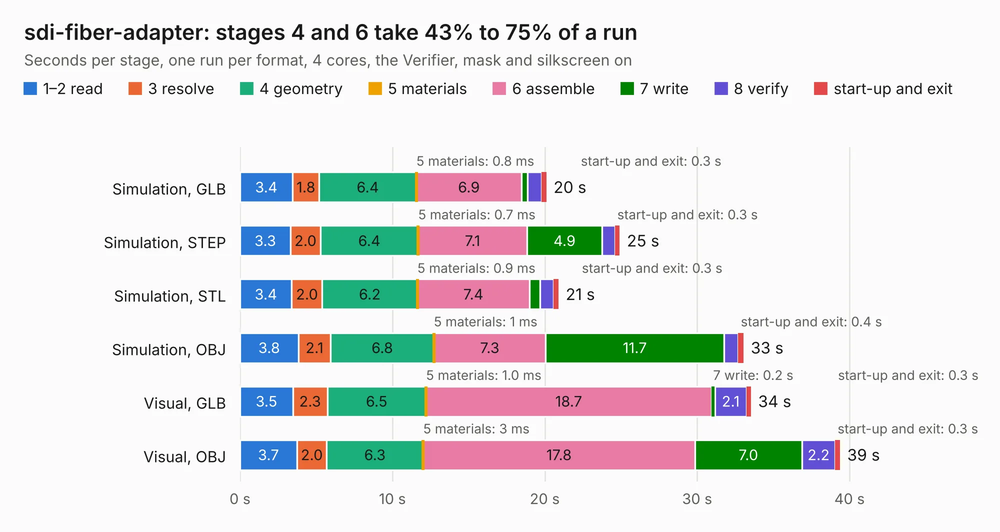

| Mode and format | 1–2 read | 3 resolve | 4 geometry | 5 materials | 6 assemble | 7 write | 8 verify | start-up and exit | Total |
|---|---:|---:|---:|---:|---:|---:|---:|---:|---:|
| Simulation, GLB | 3.4 | 1.8 | 6.4 | 0.8&nbsp;ms | 6.9 | 0.4 | 0.9 | 0.3 | 20.1 |
| Simulation, STEP | 3.3 | 2.0 | 6.4 | 0.7&nbsp;ms | 7.1 | 4.9 | 0.8 | 0.3 | 24.9 |
| Simulation, STL | 3.4 | 2.0 | 6.2 | 0.9&nbsp;ms | 7.4 | 0.7 | 0.9 | 0.3 | 20.9 |
| Simulation, OBJ | 3.8 | 2.1 | 6.8 | 1&nbsp;ms | 7.3 | 11.7 | 0.9 | 0.4 | 33.0 |
| Visual, GLB | 3.5 | 2.3 | 6.5 | 1.0&nbsp;ms | 18.7 | 0.2 | 2.1 | 0.3 | 33.5 |
| Visual, OBJ | 3.7 | 2.0 | 6.3 | 3&nbsp;ms | 17.8 | 7.0 | 2.2 | 0.3 | 39.4 |

<table align="center"><tr><td valign="top">

| Board | Repo: [antmicro/sdi-fiber-adapter](https://github.com/antmicro/sdi-fiber-adapter) Board: `sdi-fiber-adapter.kicad_pcb` |
|---|---|
| Complexity | 2,676, medium |
| Copper&nbsp;layers | 4 |
| File&nbsp;format | KiCad 9 (20241229) |
| Parts,&nbsp;tracks,&nbsp;vias | 183, 1,386, 268 |
| Triangles,&nbsp;simulation | 2,048,802 in 137 parts |
| Verifier | PASS in all six runs |

</td><td valign="top">

<table>
<tr><th>File type</th><th>File size</th><th>Peak memory used</th></tr>
<tr><th colspan="3" align="left">Simulation</th></tr>
<tr><td>GLB</td><td align="right">71&nbsp;MB</td><td align="right">889&nbsp;MB</td></tr>
<tr><td>STEP</td><td align="right">308&nbsp;MB</td><td align="right">988&nbsp;MB</td></tr>
<tr><td>STL</td><td align="right">102&nbsp;MB</td><td align="right">923&nbsp;MB</td></tr>
<tr><td>OBJ</td><td align="right">215&nbsp;MB</td><td align="right">1.4&nbsp;GB</td></tr>
<tr><th colspan="3" align="left">Visual</th></tr>
<tr><td>GLB</td><td align="right">47&nbsp;MB</td><td align="right">1.0&nbsp;GB</td></tr>
<tr><td>OBJ</td><td align="right">145&nbsp;MB</td><td align="right">1.1&nbsp;GB</td></tr>
</table>

</td></tr></table>

## 23.4.2 sdi-mipi-bridge

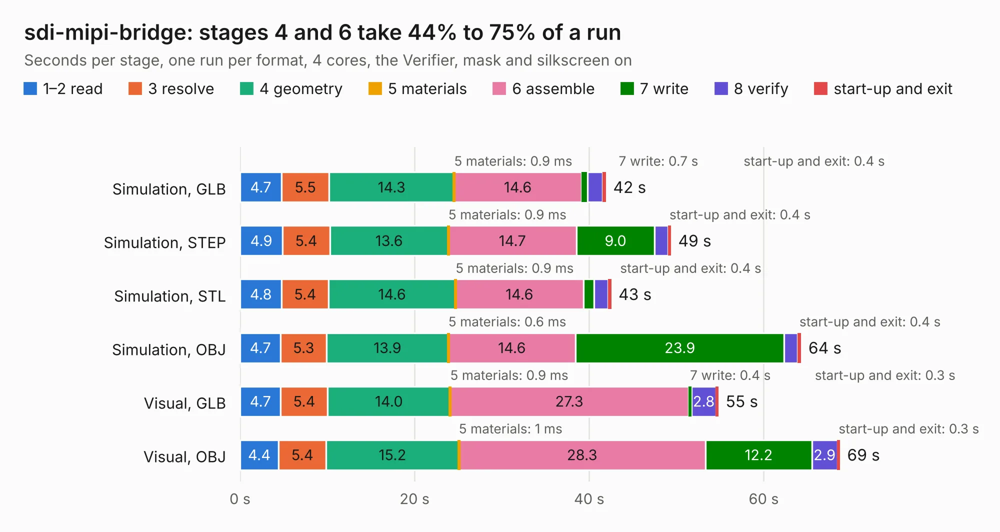

| Mode and format | 1–2 read | 3 resolve | 4 geometry | 5 materials | 6 assemble | 7 write | 8 verify | start-up and exit | Total |
|---|---:|---:|---:|---:|---:|---:|---:|---:|---:|
| Simulation, GLB | 4.7 | 5.5 | 14.3 | 0.9&nbsp;ms | 14.6 | 0.7 | 1.7 | 0.4 | 41.9 |
| Simulation, STEP | 4.9 | 5.4 | 13.6 | 0.9&nbsp;ms | 14.7 | 9.0 | 1.5 | 0.4 | 49.4 |
| Simulation, STL | 4.8 | 5.4 | 14.6 | 0.9&nbsp;ms | 14.6 | 1.2 | 1.6 | 0.4 | 42.5 |
| Simulation, OBJ | 4.7 | 5.3 | 13.9 | 0.6&nbsp;ms | 14.6 | 23.9 | 1.5 | 0.4 | 64.3 |
| Visual, GLB | 4.7 | 5.4 | 14.0 | 0.9&nbsp;ms | 27.3 | 0.4 | 2.8 | 0.3 | 54.8 |
| Visual, OBJ | 4.4 | 5.4 | 15.2 | 1&nbsp;ms | 28.3 | 12.2 | 2.9 | 0.3 | 68.7 |

<table align="center"><tr><td valign="top">

| Board | Repo: [antmicro/sdi-mipi-bridge-hw](https://github.com/antmicro/sdi-mipi-bridge-hw) Board: `sdi-mipi-bridge.kicad_pcb` |
|---|---|
| Complexity | 6,663, high |
| Copper&nbsp;layers | 6 |
| File&nbsp;format | KiCad 7 (20221018) |
| Parts,&nbsp;tracks,&nbsp;vias | 166, 4,789, 374 |
| Triangles,&nbsp;simulation | 3,614,688 in 191 parts |
| Verifier | PASS in all six runs |

</td><td valign="top">

<table>
<tr><th>File type</th><th>File size</th><th>Peak memory used</th></tr>
<tr><th colspan="3" align="left">Simulation</th></tr>
<tr><td>GLB</td><td align="right">125&nbsp;MB</td><td align="right">1.1&nbsp;GB</td></tr>
<tr><td>STEP</td><td align="right">535&nbsp;MB</td><td align="right">1.4&nbsp;GB</td></tr>
<tr><td>STL</td><td align="right">181&nbsp;MB</td><td align="right">1.1&nbsp;GB</td></tr>
<tr><td>OBJ</td><td align="right">388&nbsp;MB</td><td align="right">2.5&nbsp;GB</td></tr>
<tr><th colspan="3" align="left">Visual</th></tr>
<tr><td>GLB</td><td align="right">69&nbsp;MB</td><td align="right">1.5&nbsp;GB</td></tr>
<tr><td>OBJ</td><td align="right">218&nbsp;MB</td><td align="right">1.6&nbsp;GB</td></tr>
</table>

</td></tr></table>

## 23.4.3 sdi-mipi-video-converter

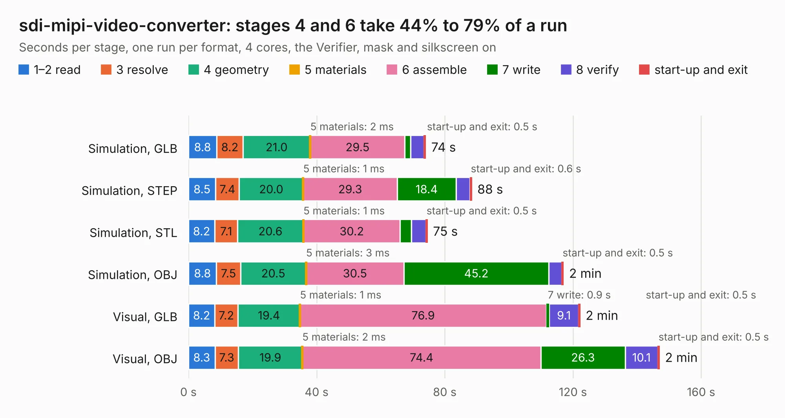

| Mode and format | 1–2 read | 3 resolve | 4 geometry | 5 materials | 6 assemble | 7 write | 8 verify | start-up and exit | Total |
|---|---:|---:|---:|---:|---:|---:|---:|---:|---:|
| Simulation, GLB | 8.8 | 8.2 | 21.0 | 2&nbsp;ms | 29.5 | 1.8 | 4.2 | 0.5 | 74.0 |
| Simulation, STEP | 8.5 | 7.4 | 20.0 | 1&nbsp;ms | 29.3 | 18.4 | 4.3 | 0.6 | 88.4 |
| Simulation, STL | 8.2 | 7.1 | 20.6 | 1&nbsp;ms | 30.2 | 3.5 | 4.5 | 0.5 | 74.6 |
| Simulation, OBJ | 8.8 | 7.5 | 20.5 | 3&nbsp;ms | 30.5 | 45.2 | 4.0 | 0.5 | 117.1 |
| Visual, GLB | 8.2 | 7.2 | 19.4 | 1&nbsp;ms | 76.9 | 0.9 | 9.1 | 0.5 | 122.2 |
| Visual, OBJ | 8.3 | 7.3 | 19.9 | 2&nbsp;ms | 74.4 | 26.3 | 10.1 | 0.5 | 147.0 |

<table align="center"><tr><td valign="top">

| Board | Repo: [antmicro/sdi-mipi-video-converter-hw](https://github.com/antmicro/sdi-mipi-video-converter-hw) Board: `sdi-mipi-video-converter.kicad_pcb` |
|---|---|
| Complexity | 12,900, very high |
| Copper&nbsp;layers | 8 |
| File&nbsp;format | KiCad 9 (20241229) |
| Parts,&nbsp;tracks,&nbsp;vias | 327, 8,337, 1,093 |
| Triangles,&nbsp;simulation | 8,040,594 in 419 parts |
| Verifier | PASS in all six runs |

</td><td valign="top">

<table>
<tr><th>File type</th><th>File size</th><th>Peak memory used</th></tr>
<tr><th colspan="3" align="left">Simulation</th></tr>
<tr><td>GLB</td><td align="right">259&nbsp;MB</td><td align="right">2.1&nbsp;GB</td></tr>
<tr><td>STEP</td><td align="right">908&nbsp;MB</td><td align="right">3.0&nbsp;GB</td></tr>
<tr><td>STL</td><td align="right">402&nbsp;MB</td><td align="right">2.1&nbsp;GB</td></tr>
<tr><td>OBJ</td><td align="right">840&nbsp;MB</td><td align="right">5.1&nbsp;GB</td></tr>
<tr><th colspan="3" align="left">Visual</th></tr>
<tr><td>GLB</td><td align="right">157&nbsp;MB</td><td align="right">2.8&nbsp;GB</td></tr>
<tr><td>OBJ</td><td align="right">515&nbsp;MB</td><td align="right">3.6&nbsp;GB</td></tr>
</table>

</td></tr></table>

## 23.4.4 si-simulation-test-board

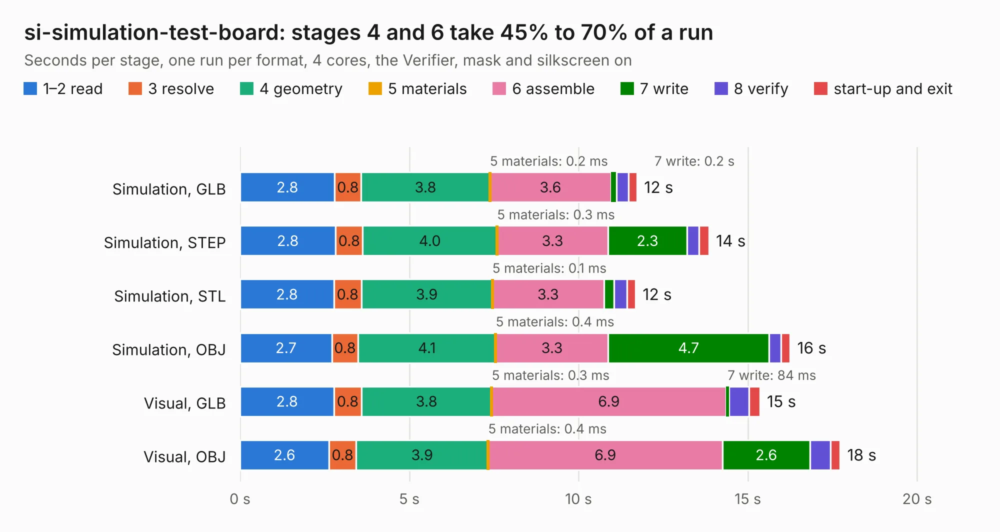

| Mode and format | 1–2 read | 3 resolve | 4 geometry | 5 materials | 6 assemble | 7 write | 8 verify | start-up and exit | Total |
|---|---:|---:|---:|---:|---:|---:|---:|---:|---:|
| Simulation, GLB | 2.8 | 0.8 | 3.8 | 0.2&nbsp;ms | 3.6 | 0.2 | 0.4 | 0.2 | 11.7 |
| Simulation, STEP | 2.8 | 0.8 | 4.0 | 0.3&nbsp;ms | 3.3 | 2.3 | 0.4 | 0.3 | 13.8 |
| Simulation, STL | 2.8 | 0.8 | 3.9 | 0.1&nbsp;ms | 3.3 | 0.3 | 0.4 | 0.3 | 11.7 |
| Simulation, OBJ | 2.7 | 0.8 | 4.1 | 0.4&nbsp;ms | 3.3 | 4.7 | 0.4 | 0.3 | 16.2 |
| Visual, GLB | 2.8 | 0.8 | 3.8 | 0.3&nbsp;ms | 6.9 | 84&nbsp;ms | 0.6 | 0.3 | 15.4 |
| Visual, OBJ | 2.6 | 0.8 | 3.9 | 0.4&nbsp;ms | 6.9 | 2.6 | 0.6 | 0.3 | 17.7 |

<table align="center"><tr><td valign="top">

| Board | Repo: [antmicro/signal-integrity-test-board](https://github.com/antmicro/signal-integrity-test-board) Board: `si-simulation-test-board.kicad_pcb` |
|---|---|
| Complexity | 999, low |
| Copper&nbsp;layers | 4 |
| File&nbsp;format | KiCad 6 (20211014) |
| Parts,&nbsp;tracks,&nbsp;vias | 27, 189, 252 |
| Triangles,&nbsp;simulation | 1,024,056 in 26 parts |
| Verifier | PASS in all six runs |

</td><td valign="top">

<table>
<tr><th>File type</th><th>File size</th><th>Peak memory used</th></tr>
<tr><th colspan="3" align="left">Simulation</th></tr>
<tr><td>GLB</td><td align="right">33&nbsp;MB</td><td align="right">533&nbsp;MB</td></tr>
<tr><td>STEP</td><td align="right">110&nbsp;MB</td><td align="right">584&nbsp;MB</td></tr>
<tr><td>STL</td><td align="right">51&nbsp;MB</td><td align="right">561&nbsp;MB</td></tr>
<tr><td>OBJ</td><td align="right">102&nbsp;MB</td><td align="right">749&nbsp;MB</td></tr>
<tr><th colspan="3" align="left">Visual</th></tr>
<tr><td>GLB</td><td align="right">17&nbsp;MB</td><td align="right">545&nbsp;MB</td></tr>
<tr><td>OBJ</td><td align="right">52&nbsp;MB</td><td align="right">545&nbsp;MB</td></tr>
</table>

</td></tr></table>

## 23.4.5 sc606-baseboard

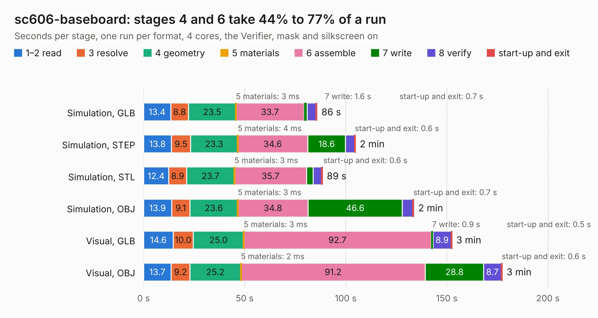

| Mode and format | 1–2 read | 3 resolve | 4 geometry | 5 materials | 6 assemble | 7 write | 8 verify | start-up and exit | Total |
|---|---:|---:|---:|---:|---:|---:|---:|---:|---:|
| Simulation, GLB | 13.4 | 8.8 | 23.5 | 3&nbsp;ms | 33.7 | 1.6 | 4.3 | 0.7 | 85.8 |
| Simulation, STEP | 13.8 | 9.5 | 23.3 | 4&nbsp;ms | 34.6 | 18.6 | 4.4 | 0.6 | 104.8 |
| Simulation, STL | 12.4 | 8.9 | 23.7 | 3&nbsp;ms | 35.7 | 3.2 | 4.1 | 0.6 | 88.5 |
| Simulation, OBJ | 13.9 | 9.1 | 23.6 | 3&nbsp;ms | 34.8 | 46.6 | 5.1 | 0.7 | 133.7 |
| Visual, GLB | 14.6 | 10.0 | 25.0 | 3&nbsp;ms | 92.7 | 0.9 | 8.9 | 0.5 | 152.6 |
| Visual, OBJ | 13.7 | 9.2 | 25.2 | 2&nbsp;ms | 91.2 | 28.8 | 8.7 | 0.6 | 177.4 |

<table align="center"><tr><td valign="top">

| Board | Repo: [antmicro/snapdragon-625-baseboard](https://github.com/antmicro/snapdragon-625-baseboard) Board: `sc606-baseboard.kicad_pcb` |
|---|---|
| Complexity | 12,540, very high |
| Copper&nbsp;layers | 6 |
| File&nbsp;format | KiCad 7 (20221018) |
| Parts,&nbsp;tracks,&nbsp;vias | 530, 8,510, 930 |
| Triangles,&nbsp;simulation | 7,974,702 in 672 parts |
| Verifier | PASS in all six runs |

</td><td valign="top">

<table>
<tr><th>File type</th><th>File size</th><th>Peak memory used</th></tr>
<tr><th colspan="3" align="left">Simulation</th></tr>
<tr><td>GLB</td><td align="right">269&nbsp;MB</td><td align="right">2.6&nbsp;GB</td></tr>
<tr><td>STEP</td><td align="right">1.1&nbsp;GB</td><td align="right">3.0&nbsp;GB</td></tr>
<tr><td>STL</td><td align="right">399&nbsp;MB</td><td align="right">2.6&nbsp;GB</td></tr>
<tr><td>OBJ</td><td align="right">850&nbsp;MB</td><td align="right">5.3&nbsp;GB</td></tr>
<tr><th colspan="3" align="left">Visual</th></tr>
<tr><td>GLB</td><td align="right">170&nbsp;MB</td><td align="right">3.0&nbsp;GB</td></tr>
<tr><td>OBJ</td><td align="right">550&nbsp;MB</td><td align="right">3.7&nbsp;GB</td></tr>
</table>

</td></tr></table>

## 23.4.6 sa800u-baseboard-hw

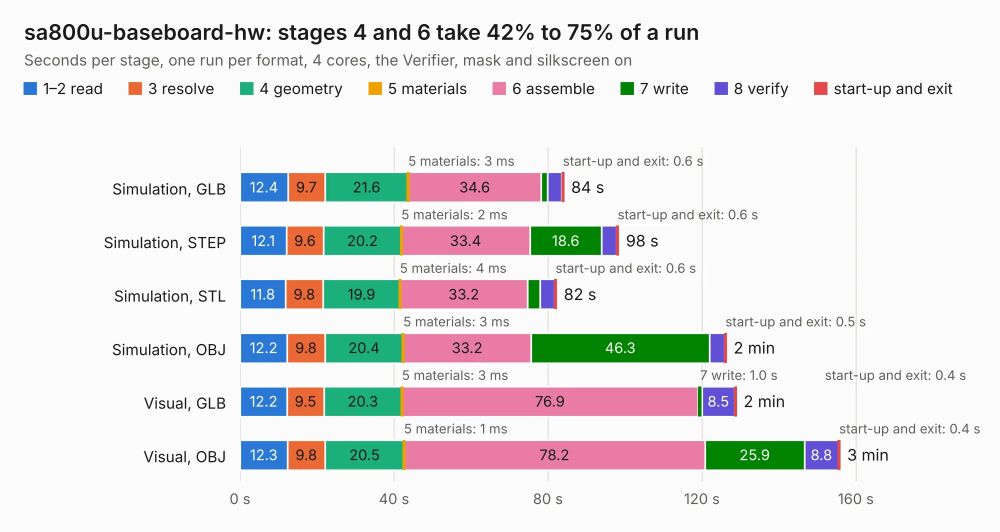

| Mode and format | 1–2 read | 3 resolve | 4 geometry | 5 materials | 6 assemble | 7 write | 8 verify | start-up and exit | Total |
|---|---:|---:|---:|---:|---:|---:|---:|---:|---:|
| Simulation, GLB | 12.4 | 9.7 | 21.6 | 3&nbsp;ms | 34.6 | 1.7 | 3.7 | 0.6 | 84.2 |
| Simulation, STEP | 12.1 | 9.6 | 20.2 | 2&nbsp;ms | 33.4 | 18.6 | 3.9 | 0.6 | 98.4 |
| Simulation, STL | 11.8 | 9.8 | 19.9 | 4&nbsp;ms | 33.2 | 3.3 | 3.7 | 0.6 | 82.3 |
| Simulation, OBJ | 12.2 | 9.8 | 20.4 | 3&nbsp;ms | 33.2 | 46.3 | 3.9 | 0.5 | 126.4 |
| Visual, GLB | 12.2 | 9.5 | 20.3 | 3&nbsp;ms | 76.9 | 1.0 | 8.5 | 0.4 | 129.0 |
| Visual, OBJ | 12.3 | 9.8 | 20.5 | 1&nbsp;ms | 78.2 | 25.9 | 8.8 | 0.4 | 155.9 |

<table align="center"><tr><td valign="top">

| Board | Repo: [antmicro/snapdragon-845-baseboard](https://github.com/antmicro/snapdragon-845-baseboard) Board: `sa800u-baseboard-hw.kicad_pcb` |
|---|---|
| Complexity | 17,142, very high |
| Copper&nbsp;layers | 6 |
| File&nbsp;format | KiCad 6 (20211014) |
| Parts,&nbsp;tracks,&nbsp;vias | 474, 13,038, 992 |
| Triangles,&nbsp;simulation | 8,203,048 in 683 parts |
| Verifier | PASS in all six runs |

</td><td valign="top">

<table>
<tr><th>File type</th><th>File size</th><th>Peak memory used</th></tr>
<tr><th colspan="3" align="left">Simulation</th></tr>
<tr><td>GLB</td><td align="right">275&nbsp;MB</td><td align="right">2.5&nbsp;GB</td></tr>
<tr><td>STEP</td><td align="right">1.1&nbsp;GB</td><td align="right">2.9&nbsp;GB</td></tr>
<tr><td>STL</td><td align="right">410&nbsp;MB</td><td align="right">2.4&nbsp;GB</td></tr>
<tr><td>OBJ</td><td align="right">881&nbsp;MB</td><td align="right">5.4&nbsp;GB</td></tr>
<tr><th colspan="3" align="left">Visual</th></tr>
<tr><td>GLB</td><td align="right">166&nbsp;MB</td><td align="right">2.9&nbsp;GB</td></tr>
<tr><td>OBJ</td><td align="right">538&nbsp;MB</td><td align="right">3.8&nbsp;GB</td></tr>
</table>

</td></tr></table>

## 23.4.7 snickerdoodle-hdmi-breakout

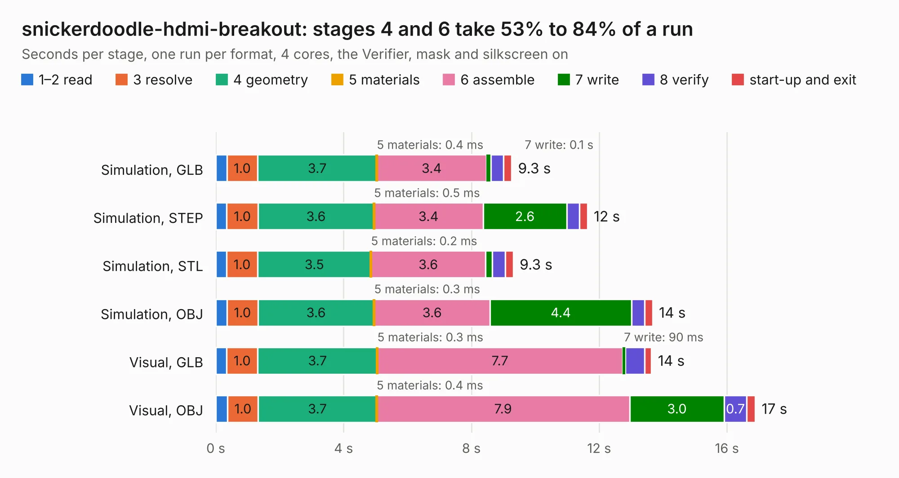

| Mode and format | 1–2 read | 3 resolve | 4 geometry | 5 materials | 6 assemble | 7 write | 8 verify | start-up and exit | Total |
|---|---:|---:|---:|---:|---:|---:|---:|---:|---:|
| Simulation, GLB | 0.3 | 1.0 | 3.7 | 0.4&nbsp;ms | 3.4 | 0.1 | 0.4 | 0.2 | 9.3 |
| Simulation, STEP | 0.3 | 1.0 | 3.6 | 0.5&nbsp;ms | 3.4 | 2.6 | 0.4 | 0.2 | 11.6 |
| Simulation, STL | 0.3 | 1.0 | 3.5 | 0.2&nbsp;ms | 3.6 | 0.2 | 0.4 | 0.2 | 9.3 |
| Simulation, OBJ | 0.3 | 1.0 | 3.6 | 0.3&nbsp;ms | 3.6 | 4.4 | 0.4 | 0.2 | 13.7 |
| Visual, GLB | 0.3 | 1.0 | 3.7 | 0.3&nbsp;ms | 7.7 | 90&nbsp;ms | 0.6 | 0.2 | 13.6 |
| Visual, OBJ | 0.4 | 1.0 | 3.7 | 0.4&nbsp;ms | 7.9 | 3.0 | 0.7 | 0.3 | 16.9 |

<table align="center"><tr><td valign="top">

| Board | Repo: [antmicro/snickerdoodle-hdmi-breakout](https://github.com/antmicro/snickerdoodle-hdmi-breakout) Board: `snickerdoodle-hdmi-breakout.kicad_pcb` |
|---|---|
| Complexity | 2,252, medium |
| Copper&nbsp;layers | 4 |
| File&nbsp;format | KiCad 5 (20171130) |
| Parts,&nbsp;tracks,&nbsp;vias | 37, 1,980, 66 |
| Triangles,&nbsp;simulation | 737,764 in 70 parts |
| Verifier | PASS in all six runs |

</td><td valign="top">

<table>
<tr><th>File type</th><th>File size</th><th>Peak memory used</th></tr>
<tr><th colspan="3" align="left">Simulation</th></tr>
<tr><td>GLB</td><td align="right">26&nbsp;MB</td><td align="right">412&nbsp;MB</td></tr>
<tr><td>STEP</td><td align="right">149&nbsp;MB</td><td align="right">478&nbsp;MB</td></tr>
<tr><td>STL</td><td align="right">37&nbsp;MB</td><td align="right">422&nbsp;MB</td></tr>
<tr><td>OBJ</td><td align="right">77&nbsp;MB</td><td align="right">573&nbsp;MB</td></tr>
<tr><th colspan="3" align="left">Visual</th></tr>
<tr><td>GLB</td><td align="right">17&nbsp;MB</td><td align="right">506&nbsp;MB</td></tr>
<tr><td>OBJ</td><td align="right">52&nbsp;MB</td><td align="right">512&nbsp;MB</td></tr>
</table>

</td></tr></table>

## 23.4.8 sodimm-ddr5-tester

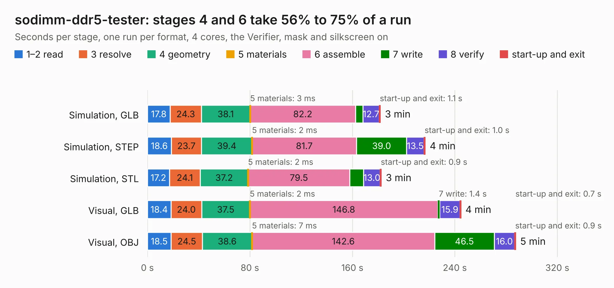

| Mode and format | 1–2 read | 3 resolve | 4 geometry | 5 materials | 6 assemble | 7 write | 8 verify | start-up and exit | Total |
|---|---:|---:|---:|---:|---:|---:|---:|---:|---:|
| Simulation, GLB | 17.8 | 24.3 | 38.1 | 3&nbsp;ms | 82.2 | 5.9 | 12.7 | 1.1 | 182.0 |
| Simulation, STEP | 18.6 | 23.7 | 39.4 | 2&nbsp;ms | 81.7 | 39.0 | 13.5 | 1.0 | 216.9 |
| Simulation, STL | 17.2 | 24.1 | 37.2 | 2&nbsp;ms | 79.5 | 10.8 | 13.0 | 0.9 | 182.7 |
| Simulation, OBJ |  |  |  |  |  |  |  |  | exceeded 11 GB on a 15 GB machine (stopped there, not a KESE failure) |
| Visual, GLB | 18.4 | 24.0 | 37.5 | 2&nbsp;ms | 146.8 | 1.4 | 15.9 | 0.7 | 244.8 |
| Visual, OBJ | 18.5 | 24.5 | 38.6 | 7&nbsp;ms | 142.6 | 46.5 | 16.0 | 0.9 | 287.6 |

<table align="center"><tr><td valign="top">

| Board | Repo: [antmicro/sodimm-ddr5-tester](https://github.com/antmicro/sodimm-ddr5-tester) Board: `sodimm-ddr5-tester.kicad_pcb` |
|---|---|
| Complexity | 25,077, extreme |
| Copper&nbsp;layers | 12 |
| File&nbsp;format | KiCad 9 (20241229) |
| Parts,&nbsp;tracks,&nbsp;vias | 546, 16,830, 2,115 |
| Triangles,&nbsp;simulation | 23,485,012 in 784 parts |
| Verifier | Simulation, OBJ: exceeded 11 GB on a 15 GB machine (stopped there, not a KESE failure) |

</td><td valign="top">

<table>
<tr><th>File type</th><th>File size</th><th>Peak memory used</th></tr>
<tr><th colspan="3" align="left">Simulation</th></tr>
<tr><td>GLB</td><td align="right">768&nbsp;MB</td><td align="right">5.0&nbsp;GB</td></tr>
<tr><td>STEP</td><td align="right">2.0&nbsp;GB</td><td align="right">6.8&nbsp;GB</td></tr>
<tr><td>STL</td><td align="right">1.2&nbsp;GB</td><td align="right">5.1&nbsp;GB</td></tr>
<tr><td>OBJ</td><td align="right">–</td><td align="right">11&nbsp;GB</td></tr>
<tr><th colspan="3" align="left">Visual</th></tr>
<tr><td>GLB</td><td align="right">269&nbsp;MB</td><td align="right">5.4&nbsp;GB</td></tr>
<tr><td>OBJ</td><td align="right">940&nbsp;MB</td><td align="right">6.7&nbsp;GB</td></tr>
</table>

</td></tr></table>

## 23.4.9 stm32h7-hdmi-board

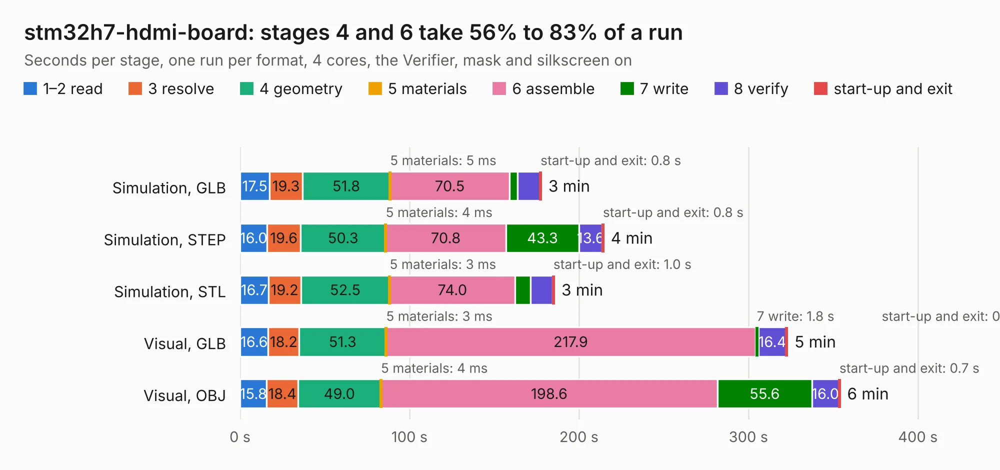

| Mode and format | 1–2 read | 3 resolve | 4 geometry | 5 materials | 6 assemble | 7 write | 8 verify | start-up and exit | Total |
|---|---:|---:|---:|---:|---:|---:|---:|---:|---:|
| Simulation, GLB | 17.5 | 19.3 | 51.8 | 5&nbsp;ms | 70.5 | 4.8 | 13.1 | 0.8 | 177.7 |
| Simulation, STEP | 16.0 | 19.6 | 50.3 | 4&nbsp;ms | 70.8 | 43.3 | 13.6 | 0.8 | 214.6 |
| Simulation, STL | 16.7 | 19.2 | 52.5 | 3&nbsp;ms | 74.0 | 9.2 | 12.9 | 1.0 | 185.4 |
| Simulation, OBJ |  |  |  |  |  |  |  |  | exceeded 11 GB on a 15 GB machine (stopped there, not a KESE failure) |
| Visual, GLB | 16.6 | 18.2 | 51.3 | 3&nbsp;ms | 217.9 | 1.8 | 16.4 | 0.7 | 323.0 |
| Visual, OBJ | 15.8 | 18.4 | 49.0 | 4&nbsp;ms | 198.6 | 55.6 | 16.0 | 0.7 | 354.1 |

<table align="center"><tr><td valign="top">

| Board | Repo: [antmicro/stm32h7-hdmi-board](https://github.com/antmicro/stm32h7-hdmi-board) Board: `stm32h7-hdmi-board.kicad_pcb` |
|---|---|
| Complexity | 23,011, extreme |
| Copper&nbsp;layers | 8 |
| File&nbsp;format | KiCad 9 (20241229) |
| Parts,&nbsp;tracks,&nbsp;vias | 749, 15,474, 1,703 |
| Triangles,&nbsp;simulation | 17,829,614 in 925 parts |
| Verifier | Simulation, OBJ: exceeded 11 GB on a 15 GB machine (stopped there, not a KESE failure) |

</td><td valign="top">

<table>
<tr><th>File type</th><th>File size</th><th>Peak memory used</th></tr>
<tr><th colspan="3" align="left">Simulation</th></tr>
<tr><td>GLB</td><td align="right">595&nbsp;MB</td><td align="right">4.0&nbsp;GB</td></tr>
<tr><td>STEP</td><td align="right">2.0&nbsp;GB</td><td align="right">5.2&nbsp;GB</td></tr>
<tr><td>STL</td><td align="right">892&nbsp;MB</td><td align="right">4.1&nbsp;GB</td></tr>
<tr><td>OBJ</td><td align="right">–</td><td align="right">11&nbsp;GB</td></tr>
<tr><th colspan="3" align="left">Visual</th></tr>
<tr><td>GLB</td><td align="right">290&nbsp;MB</td><td align="right">5.1&nbsp;GB</td></tr>
<tr><td>OBJ</td><td align="right">944&nbsp;MB</td><td align="right">6.1&nbsp;GB</td></tr>
</table>

</td></tr></table>

## 23.4.10 stm32h7-hdmi-board-sodimm-module

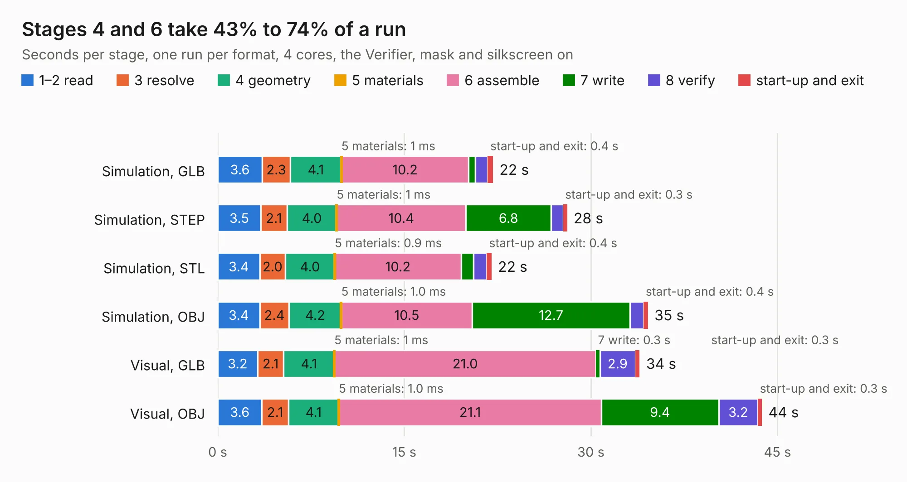

| Mode and format | 1–2 read | 3 resolve | 4 geometry | 5 materials | 6 assemble | 7 write | 8 verify | start-up and exit | Total |
|---|---:|---:|---:|---:|---:|---:|---:|---:|---:|
| Simulation, GLB | 3.6 | 2.3 | 4.1 | 1&nbsp;ms | 10.2 | 0.5 | 1.0 | 0.4 | 22.1 |
| Simulation, STEP | 3.5 | 2.1 | 4.0 | 1&nbsp;ms | 10.4 | 6.8 | 1.0 | 0.3 | 28.1 |
| Simulation, STL | 3.4 | 2.0 | 4.0 | 0.9&nbsp;ms | 10.2 | 1.0 | 1.1 | 0.4 | 22.0 |
| Simulation, OBJ | 3.4 | 2.4 | 4.2 | 1.0&nbsp;ms | 10.5 | 12.7 | 1.1 | 0.4 | 34.6 |
| Visual, GLB | 3.2 | 2.1 | 4.1 | 1&nbsp;ms | 21.0 | 0.3 | 2.9 | 0.3 | 33.9 |
| Visual, OBJ | 3.6 | 2.1 | 4.1 | 1.0&nbsp;ms | 21.1 | 9.4 | 3.2 | 0.3 | 43.7 |

<table align="center"><tr><td valign="top">

| Board | Repo: [antmicro/stm32h7-hdmi-board-sodimm](https://github.com/antmicro/stm32h7-hdmi-board-sodimm) Board: `stm32h7-hdmi-board-sodimm-module.kicad_pcb` |
|---|---|
| Complexity | 6,146, high |
| Copper&nbsp;layers | 6 |
| File&nbsp;format | KiCad 10 (20260206) |
| Parts,&nbsp;tracks,&nbsp;vias | 86, 5,173, 247 |
| Triangles,&nbsp;simulation | 2,444,492 in 235 parts |
| Verifier | PASS in all six runs |

</td><td valign="top">

<table>
<tr><th>File type</th><th>File size</th><th>Peak memory used</th></tr>
<tr><th colspan="3" align="left">Simulation</th></tr>
<tr><td>GLB</td><td align="right">83&nbsp;MB</td><td align="right">894&nbsp;MB</td></tr>
<tr><td>STEP</td><td align="right">354&nbsp;MB</td><td align="right">1.1&nbsp;GB</td></tr>
<tr><td>STL</td><td align="right">122&nbsp;MB</td><td align="right">870&nbsp;MB</td></tr>
<tr><td>OBJ</td><td align="right">258&nbsp;MB</td><td align="right">1.7&nbsp;GB</td></tr>
<tr><th colspan="3" align="left">Visual</th></tr>
<tr><td>GLB</td><td align="right">59&nbsp;MB</td><td align="right">1.2&nbsp;GB</td></tr>
<tr><td>OBJ</td><td align="right">183&nbsp;MB</td><td align="right">1.4&nbsp;GB</td></tr>
</table>

</td></tr></table>

## 23.4.11 thunderbolt-to-10gbe-adapter

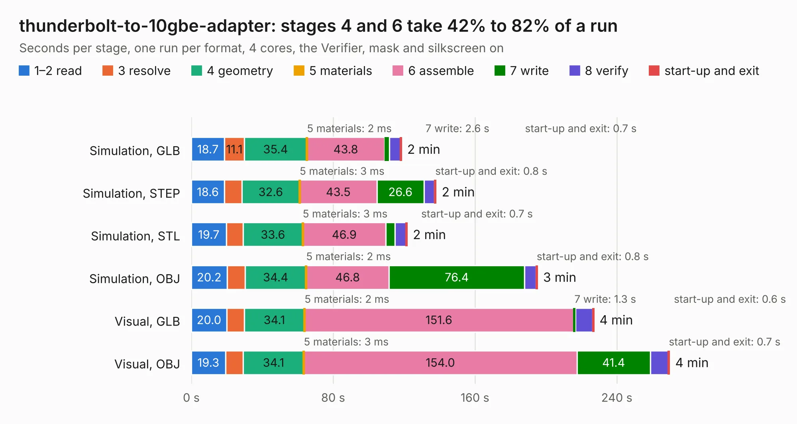

| Mode and format | 1–2 read | 3 resolve | 4 geometry | 5 materials | 6 assemble | 7 write | 8 verify | start-up and exit | Total |
|---|---:|---:|---:|---:|---:|---:|---:|---:|---:|
| Simulation, GLB | 18.7 | 11.1 | 35.4 | 2&nbsp;ms | 43.8 | 2.6 | 6.3 | 0.7 | 118.6 |
| Simulation, STEP | 18.6 | 9.8 | 32.6 | 3&nbsp;ms | 43.5 | 26.6 | 6.0 | 0.8 | 138.0 |
| Simulation, STL | 19.7 | 9.6 | 33.6 | 3&nbsp;ms | 46.9 | 5.1 | 6.3 | 0.7 | 121.8 |
| Simulation, OBJ | 20.2 | 10.2 | 34.4 | 2&nbsp;ms | 46.8 | 76.4 | 6.5 | 0.8 | 195.2 |
| Visual, GLB | 20.0 | 9.8 | 34.1 | 2&nbsp;ms | 151.6 | 1.3 | 9.7 | 0.6 | 227.0 |
| Visual, OBJ | 19.3 | 10.1 | 34.1 | 3&nbsp;ms | 154.0 | 41.4 | 10.1 | 0.7 | 269.7 |

<table align="center"><tr><td valign="top">

| Board | Repo: [antmicro/thunderbolt-10gbe-adapter](https://github.com/antmicro/thunderbolt-10gbe-adapter) Board: `thunderbolt-to-10gbe-adapter.kicad_pcb` |
|---|---|
| Complexity | 11,342, very high |
| Copper&nbsp;layers | 8 |
| File&nbsp;format | KiCad 9 (20241229) |
| Parts,&nbsp;tracks,&nbsp;vias | 652, 5,595, 1,411 |
| Triangles,&nbsp;simulation | 11,099,384 in 620 parts |
| Verifier | PASS in all six runs |

</td><td valign="top">

<table>
<tr><th>File type</th><th>File size</th><th>Peak memory used</th></tr>
<tr><th colspan="3" align="left">Simulation</th></tr>
<tr><td>GLB</td><td align="right">358&nbsp;MB</td><td align="right">3.3&nbsp;GB</td></tr>
<tr><td>STEP</td><td align="right">1.3&nbsp;GB</td><td align="right">4.1&nbsp;GB</td></tr>
<tr><td>STL</td><td align="right">555&nbsp;MB</td><td align="right">3.3&nbsp;GB</td></tr>
<tr><td>OBJ</td><td align="right">1.2&nbsp;GB</td><td align="right">7.1&nbsp;GB</td></tr>
<tr><th colspan="3" align="left">Visual</th></tr>
<tr><td>GLB</td><td align="right">216&nbsp;MB</td><td align="right">3.9&nbsp;GB</td></tr>
<tr><td>OBJ</td><td align="right">708&nbsp;MB</td><td align="right">5.0&nbsp;GB</td></tr>
</table>

</td></tr></table>

## 23.4.12 thunderbolt-gpu-adapter

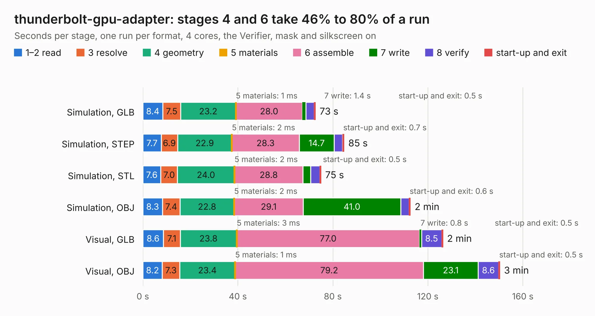

| Mode and format | 1–2 read | 3 resolve | 4 geometry | 5 materials | 6 assemble | 7 write | 8 verify | start-up and exit | Total |
|---|---:|---:|---:|---:|---:|---:|---:|---:|---:|
| Simulation, GLB | 8.4 | 7.5 | 23.2 | 1&nbsp;ms | 28.0 | 1.4 | 3.5 | 0.5 | 72.6 |
| Simulation, STEP | 7.7 | 6.9 | 22.9 | 2&nbsp;ms | 28.3 | 14.7 | 3.5 | 0.7 | 84.7 |
| Simulation, STL | 7.6 | 7.0 | 24.0 | 2&nbsp;ms | 28.8 | 3.2 | 3.9 | 0.5 | 75.0 |
| Simulation, OBJ | 8.3 | 7.4 | 22.8 | 2&nbsp;ms | 29.1 | 41.0 | 3.5 | 0.6 | 112.7 |
| Visual, GLB | 8.6 | 7.1 | 23.8 | 3&nbsp;ms | 77.0 | 0.8 | 8.5 | 0.5 | 126.3 |
| Visual, OBJ | 8.2 | 7.3 | 23.4 | 1&nbsp;ms | 79.2 | 23.1 | 8.6 | 0.5 | 150.3 |

<table align="center"><tr><td valign="top">

| Board | Repo: [antmicro/thunderbolt-gpu-adapter](https://github.com/antmicro/thunderbolt-gpu-adapter) Board: `thunderbolt-gpu-adapter.kicad_pcb` |
|---|---|
| Complexity | 8,569, very high |
| Copper&nbsp;layers | 6 |
| File&nbsp;format | KiCad 8 (20240108) |
| Parts,&nbsp;tracks,&nbsp;vias | 344, 4,545, 1,092 |
| Triangles,&nbsp;simulation | 7,315,338 in 378 parts |
| Verifier | PASS in all six runs |

</td><td valign="top">

<table>
<tr><th>File type</th><th>File size</th><th>Peak memory used</th></tr>
<tr><th colspan="3" align="left">Simulation</th></tr>
<tr><td>GLB</td><td align="right">245&nbsp;MB</td><td align="right">1.9&nbsp;GB</td></tr>
<tr><td>STEP</td><td align="right">811&nbsp;MB</td><td align="right">2.6&nbsp;GB</td></tr>
<tr><td>STL</td><td align="right">366&nbsp;MB</td><td align="right">1.9&nbsp;GB</td></tr>
<tr><td>OBJ</td><td align="right">779&nbsp;MB</td><td align="right">4.7&nbsp;GB</td></tr>
<tr><th colspan="3" align="left">Visual</th></tr>
<tr><td>GLB</td><td align="right">139&nbsp;MB</td><td align="right">2.5&nbsp;GB</td></tr>
<tr><td>OBJ</td><td align="right">448&nbsp;MB</td><td align="right">3.0&nbsp;GB</td></tr>
</table>

</td></tr></table>

## 23.4.13 thunderbolt-pcie-adapter

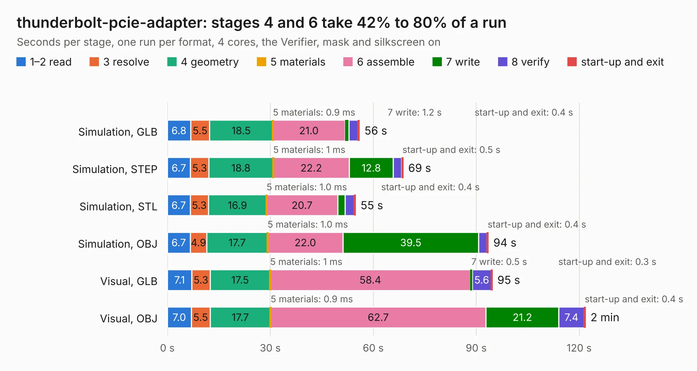

| Mode and format | 1–2 read | 3 resolve | 4 geometry | 5 materials | 6 assemble | 7 write | 8 verify | start-up and exit | Total |
|---|---:|---:|---:|---:|---:|---:|---:|---:|---:|
| Simulation, GLB | 6.8 | 5.5 | 18.5 | 0.9&nbsp;ms | 21.0 | 1.2 | 2.6 | 0.4 | 56.0 |
| Simulation, STEP | 6.7 | 5.3 | 18.8 | 1&nbsp;ms | 22.2 | 12.8 | 2.5 | 0.5 | 68.7 |
| Simulation, STL | 6.7 | 5.3 | 16.9 | 1.0&nbsp;ms | 20.7 | 2.2 | 2.6 | 0.4 | 54.8 |
| Simulation, OBJ | 6.7 | 4.9 | 17.7 | 1.0&nbsp;ms | 22.0 | 39.5 | 2.5 | 0.4 | 93.5 |
| Visual, GLB | 7.1 | 5.3 | 17.5 | 1&nbsp;ms | 58.4 | 0.5 | 5.6 | 0.3 | 94.7 |
| Visual, OBJ | 7.0 | 5.5 | 17.7 | 0.9&nbsp;ms | 62.7 | 21.2 | 7.4 | 0.4 | 121.8 |

<table align="center"><tr><td valign="top">

| Board | Repo: [antmicro/thunderbolt-pcie-adapter](https://github.com/antmicro/thunderbolt-pcie-adapter) Board: `thunderbolt-pcie-adapter.kicad_pcb` |
|---|---|
| Complexity | 5,690, high |
| Copper&nbsp;layers | 6 |
| File&nbsp;format | KiCad 7 (20221018) |
| Parts,&nbsp;tracks,&nbsp;vias | 250, 2,631, 833 |
| Triangles,&nbsp;simulation | 5,556,214 in 286 parts |
| Verifier | PASS in all six runs |

</td><td valign="top">

<table>
<tr><th>File type</th><th>File size</th><th>Peak memory used</th></tr>
<tr><th colspan="3" align="left">Simulation</th></tr>
<tr><td>GLB</td><td align="right">186&nbsp;MB</td><td align="right">1.9&nbsp;GB</td></tr>
<tr><td>STEP</td><td align="right">592&nbsp;MB</td><td align="right">2.1&nbsp;GB</td></tr>
<tr><td>STL</td><td align="right">278&nbsp;MB</td><td align="right">1.9&nbsp;GB</td></tr>
<tr><td>OBJ</td><td align="right">588&nbsp;MB</td><td align="right">3.6&nbsp;GB</td></tr>
<tr><th colspan="3" align="left">Visual</th></tr>
<tr><td>GLB</td><td align="right">103&nbsp;MB</td><td align="right">2.1&nbsp;GB</td></tr>
<tr><td>OBJ</td><td align="right">332&nbsp;MB</td><td align="right">2.3&nbsp;GB</td></tr>
</table>

</td></tr></table>

## 23.4.14 usb-c-power-adapter

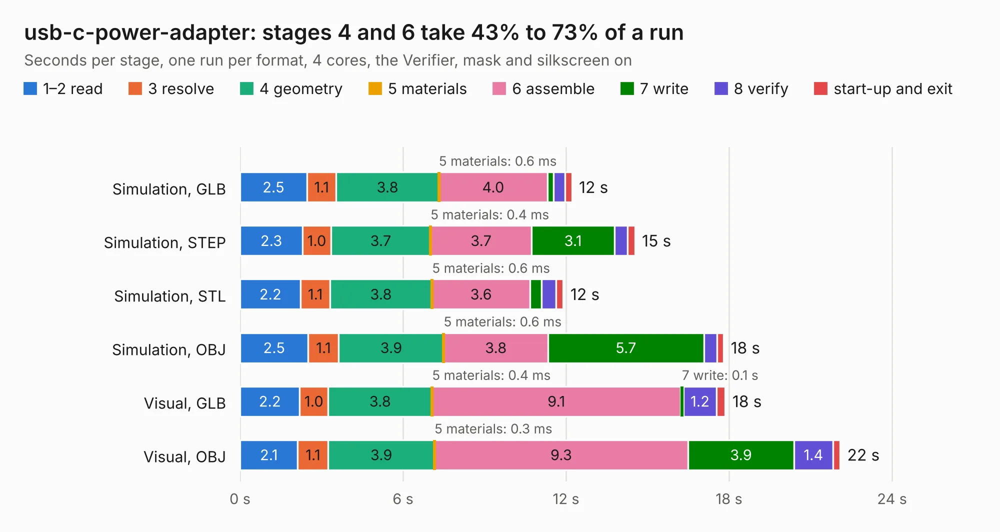

| Mode and format | 1–2 read | 3 resolve | 4 geometry | 5 materials | 6 assemble | 7 write | 8 verify | start-up and exit | Total |
|---|---:|---:|---:|---:|---:|---:|---:|---:|---:|
| Simulation, GLB | 2.5 | 1.1 | 3.8 | 0.6&nbsp;ms | 4.0 | 0.2 | 0.4 | 0.2 | 12.2 |
| Simulation, STEP | 2.3 | 1.0 | 3.7 | 0.4&nbsp;ms | 3.7 | 3.1 | 0.5 | 0.3 | 14.5 |
| Simulation, STL | 2.2 | 1.1 | 3.8 | 0.6&nbsp;ms | 3.6 | 0.4 | 0.5 | 0.3 | 11.9 |
| Simulation, OBJ | 2.5 | 1.1 | 3.9 | 0.6&nbsp;ms | 3.8 | 5.7 | 0.5 | 0.2 | 17.8 |
| Visual, GLB | 2.2 | 1.0 | 3.8 | 0.4&nbsp;ms | 9.1 | 0.1 | 1.2 | 0.3 | 17.9 |
| Visual, OBJ | 2.1 | 1.1 | 3.9 | 0.3&nbsp;ms | 9.3 | 3.9 | 1.4 | 0.3 | 22.1 |

<table align="center"><tr><td valign="top">

| Board | Repo: [antmicro/usb-c-power-adapter](https://github.com/antmicro/usb-c-power-adapter) Board: `usb-c-power-adapter.kicad_pcb` |
|---|---|
| Complexity | 1,503, medium |
| Copper&nbsp;layers | 4 |
| File&nbsp;format | KiCad 9 (20241229) |
| Parts,&nbsp;tracks,&nbsp;vias | 108, 600, 229 |
| Triangles,&nbsp;simulation | 1,245,326 in 84 parts |
| Verifier | PASS in all six runs |

</td><td valign="top">

<table>
<tr><th>File type</th><th>File size</th><th>Peak memory used</th></tr>
<tr><th colspan="3" align="left">Simulation</th></tr>
<tr><td>GLB</td><td align="right">43&nbsp;MB</td><td align="right">567&nbsp;MB</td></tr>
<tr><td>STEP</td><td align="right">174&nbsp;MB</td><td align="right">626&nbsp;MB</td></tr>
<tr><td>STL</td><td align="right">62&nbsp;MB</td><td align="right">549&nbsp;MB</td></tr>
<tr><td>OBJ</td><td align="right">128&nbsp;MB</td><td align="right">929&nbsp;MB</td></tr>
<tr><th colspan="3" align="left">Visual</th></tr>
<tr><td>GLB</td><td align="right">28&nbsp;MB</td><td align="right">736&nbsp;MB</td></tr>
<tr><td>OBJ</td><td align="right">85&nbsp;MB</td><td align="right">711&nbsp;MB</td></tr>
</table>

</td></tr></table>

## 23.4.15 video-latency-testing-probe

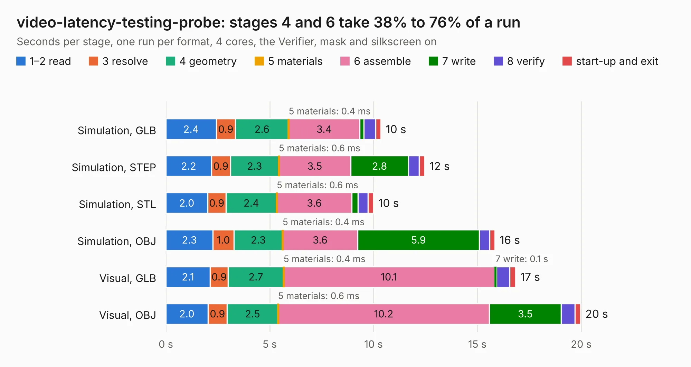

| Mode and format | 1–2 read | 3 resolve | 4 geometry | 5 materials | 6 assemble | 7 write | 8 verify | start-up and exit | Total |
|---|---:|---:|---:|---:|---:|---:|---:|---:|---:|
| Simulation, GLB | 2.4 | 0.9 | 2.6 | 0.4&nbsp;ms | 3.4 | 0.2 | 0.6 | 0.3 | 10.4 |
| Simulation, STEP | 2.2 | 0.9 | 2.3 | 0.6&nbsp;ms | 3.5 | 2.8 | 0.5 | 0.3 | 12.5 |
| Simulation, STL | 2.0 | 0.9 | 2.4 | 0.6&nbsp;ms | 3.6 | 0.3 | 0.5 | 0.3 | 10.0 |
| Simulation, OBJ | 2.3 | 1.0 | 2.3 | 0.4&nbsp;ms | 3.6 | 5.9 | 0.5 | 0.2 | 15.8 |
| Visual, GLB | 2.1 | 0.9 | 2.7 | 0.4&nbsp;ms | 10.1 | 0.1 | 0.6 | 0.3 | 16.8 |
| Visual, OBJ | 2.0 | 0.9 | 2.5 | 0.6&nbsp;ms | 10.2 | 3.5 | 0.7 | 0.3 | 20.0 |

<table align="center"><tr><td valign="top">

| Board | Repo: [antmicro/video-latency-testing-probe](https://github.com/antmicro/video-latency-testing-probe) Board: `video-latency-testing-probe.kicad_pcb` |
|---|---|
| Complexity | 1,644, medium |
| Copper&nbsp;layers | 6 |
| File&nbsp;format | KiCad 9 (20241229) |
| Parts,&nbsp;tracks,&nbsp;vias | 86, 1,028, 128 |
| Triangles,&nbsp;simulation | 1,121,652 in 114 parts |
| Verifier | PASS in all six runs |

</td><td valign="top">

<table>
<tr><th>File type</th><th>File size</th><th>Peak memory used</th></tr>
<tr><th colspan="3" align="left">Simulation</th></tr>
<tr><td>GLB</td><td align="right">38&nbsp;MB</td><td align="right">556&nbsp;MB</td></tr>
<tr><td>STEP</td><td align="right">159&nbsp;MB</td><td align="right">599&nbsp;MB</td></tr>
<tr><td>STL</td><td align="right">56&nbsp;MB</td><td align="right">558&nbsp;MB</td></tr>
<tr><td>OBJ</td><td align="right">114&nbsp;MB</td><td align="right">840&nbsp;MB</td></tr>
<tr><th colspan="3" align="left">Visual</th></tr>
<tr><td>GLB</td><td align="right">22&nbsp;MB</td><td align="right">630&nbsp;MB</td></tr>
<tr><td>OBJ</td><td align="right">68&nbsp;MB</td><td align="right">637&nbsp;MB</td></tr>
</table>

</td></tr></table>

## 23.4.16 video-booster-board

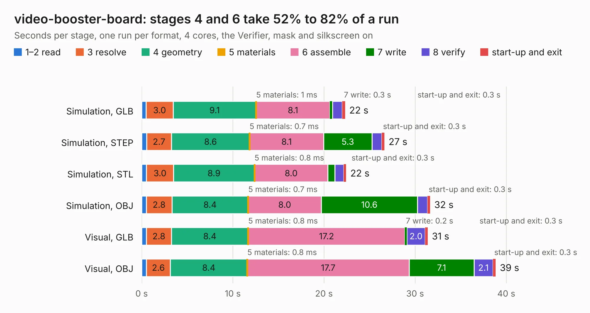

| Mode and format | 1–2 read | 3 resolve | 4 geometry | 5 materials | 6 assemble | 7 write | 8 verify | start-up and exit | Total |
|---|---:|---:|---:|---:|---:|---:|---:|---:|---:|
| Simulation, GLB | 0.5 | 3.0 | 9.1 | 1&nbsp;ms | 8.1 | 0.3 | 1.1 | 0.3 | 22.3 |
| Simulation, STEP | 0.5 | 2.7 | 8.6 | 0.7&nbsp;ms | 8.1 | 5.3 | 1.1 | 0.3 | 26.6 |
| Simulation, STL | 0.5 | 3.0 | 8.9 | 0.8&nbsp;ms | 8.0 | 0.8 | 1.0 | 0.3 | 22.4 |
| Simulation, OBJ | 0.5 | 2.8 | 8.4 | 0.7&nbsp;ms | 8.0 | 10.6 | 1.1 | 0.3 | 31.6 |
| Visual, GLB | 0.5 | 2.8 | 8.4 | 0.8&nbsp;ms | 17.2 | 0.2 | 2.0 | 0.3 | 31.4 |
| Visual, OBJ | 0.5 | 2.6 | 8.4 | 0.8&nbsp;ms | 17.7 | 7.1 | 2.1 | 0.3 | 38.8 |

<table align="center"><tr><td valign="top">

| Board | Repo: [antmicro/video-signal-booster-board](https://github.com/antmicro/video-signal-booster-board) Board: `video-booster-board.kicad_pcb` |
|---|---|
| Complexity | 3,980, high |
| Copper&nbsp;layers | 4 |
| File&nbsp;format | KiCad 5 (20171130) |
| Parts,&nbsp;tracks,&nbsp;vias | 141, 2,792, 242 |
| Triangles,&nbsp;simulation | 2,129,152 in 151 parts |
| Verifier | PASS in all six runs |

</td><td valign="top">

<table>
<tr><th>File type</th><th>File size</th><th>Peak memory used</th></tr>
<tr><th colspan="3" align="left">Simulation</th></tr>
<tr><td>GLB</td><td align="right">74&nbsp;MB</td><td align="right">788&nbsp;MB</td></tr>
<tr><td>STEP</td><td align="right">340&nbsp;MB</td><td align="right">876&nbsp;MB</td></tr>
<tr><td>STL</td><td align="right">106&nbsp;MB</td><td align="right">748&nbsp;MB</td></tr>
<tr><td>OBJ</td><td align="right">229&nbsp;MB</td><td align="right">1.5&nbsp;GB</td></tr>
<tr><th colspan="3" align="left">Visual</th></tr>
<tr><td>GLB</td><td align="right">45&nbsp;MB</td><td align="right">907&nbsp;MB</td></tr>
<tr><td>OBJ</td><td align="right">138&nbsp;MB</td><td align="right">1.0&nbsp;GB</td></tr>
</table>

</td></tr></table>

## 23.4.17 vna-se-probe

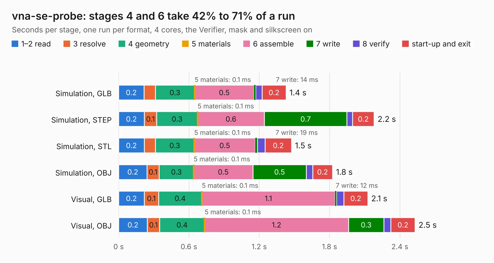

| Mode and format | 1–2 read | 3 resolve | 4 geometry | 5 materials | 6 assemble | 7 write | 8 verify | start-up and exit | Total |
|---|---:|---:|---:|---:|---:|---:|---:|---:|---:|
| Simulation, GLB | 0.2 | 96&nbsp;ms | 0.3 | 0.1&nbsp;ms | 0.5 | 14&nbsp;ms | 55&nbsp;ms | 0.2 | 1.4 |
| Simulation, STEP | 0.2 | 0.1 | 0.3 | 0.1&nbsp;ms | 0.6 | 0.7 | 49&nbsp;ms | 0.2 | 2.2 |
| Simulation, STL | 0.2 | 95&nbsp;ms | 0.3 | 0.1&nbsp;ms | 0.5 | 19&nbsp;ms | 65&nbsp;ms | 0.2 | 1.5 |
| Simulation, OBJ | 0.2 | 0.1 | 0.3 | 0.1&nbsp;ms | 0.5 | 0.5 | 55&nbsp;ms | 0.2 | 1.8 |
| Visual, GLB | 0.2 | 0.1 | 0.4 | 0.1&nbsp;ms | 1.1 | 12&nbsp;ms | 64&nbsp;ms | 0.2 | 2.1 |
| Visual, OBJ | 0.2 | 0.1 | 0.4 | 0.1&nbsp;ms | 1.2 | 0.3 | 60&nbsp;ms | 0.2 | 2.5 |

<table align="center"><tr><td valign="top">

| Board | Repo: [antmicro/vna-se-probe](https://github.com/antmicro/vna-se-probe) Board: `vna-se-probe.kicad_pcb` |
|---|---|
| Complexity | 15, simple |
| Copper&nbsp;layers | 4 |
| File&nbsp;format | KiCad 9 (20241229) |
| Parts,&nbsp;tracks,&nbsp;vias | 2, 5, 23 |
| Triangles,&nbsp;simulation | 90,012 in 17 parts |
| Verifier | PASS in all six runs |

</td><td valign="top">

<table>
<tr><th>File type</th><th>File size</th><th>Peak memory used</th></tr>
<tr><th colspan="3" align="left">Simulation</th></tr>
<tr><td>GLB</td><td align="right">3.1&nbsp;MB</td><td align="right">181&nbsp;MB</td></tr>
<tr><td>STEP</td><td align="right">9.3&nbsp;MB</td><td align="right">184&nbsp;MB</td></tr>
<tr><td>STL</td><td align="right">4.5&nbsp;MB</td><td align="right">184&nbsp;MB</td></tr>
<tr><td>OBJ</td><td align="right">8.6&nbsp;MB</td><td align="right">183&nbsp;MB</td></tr>
<tr><th colspan="3" align="left">Visual</th></tr>
<tr><td>GLB</td><td align="right">1.8&nbsp;MB</td><td align="right">162&nbsp;MB</td></tr>
<tr><td>OBJ</td><td align="right">5.1&nbsp;MB</td><td align="right">163&nbsp;MB</td></tr>
</table>

</td></tr></table>

## 23.4.18 ATMEGA328_Motor_Board

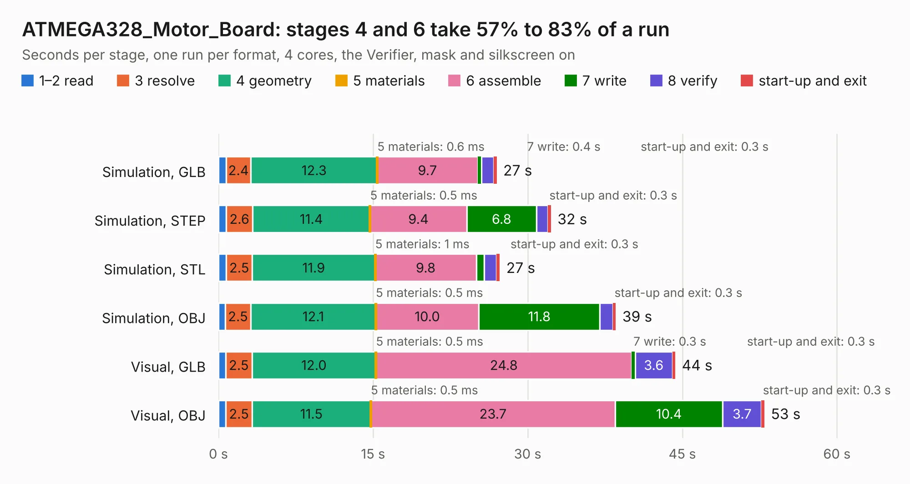

| Mode and format | 1–2 read | 3 resolve | 4 geometry | 5 materials | 6 assemble | 7 write | 8 verify | start-up and exit | Total |
|---|---:|---:|---:|---:|---:|---:|---:|---:|---:|
| Simulation, GLB | 0.7 | 2.4 | 12.3 | 0.6&nbsp;ms | 9.7 | 0.4 | 1.2 | 0.3 | 27.0 |
| Simulation, STEP | 0.8 | 2.6 | 11.4 | 0.5&nbsp;ms | 9.4 | 6.8 | 1.1 | 0.3 | 32.3 |
| Simulation, STL | 0.8 | 2.5 | 11.9 | 1&nbsp;ms | 9.8 | 0.8 | 1.2 | 0.3 | 27.3 |
| Simulation, OBJ | 0.7 | 2.5 | 12.1 | 0.5&nbsp;ms | 10.0 | 11.8 | 1.3 | 0.3 | 38.6 |
| Visual, GLB | 0.7 | 2.5 | 12.0 | 0.5&nbsp;ms | 24.8 | 0.3 | 3.6 | 0.3 | 44.3 |
| Visual, OBJ | 0.7 | 2.5 | 11.5 | 0.5&nbsp;ms | 23.7 | 10.4 | 3.7 | 0.3 | 53.0 |

<table align="center"><tr><td valign="top">

| Board | Repo: [AntonioMR/ATMEGA328-Motor-Board](https://github.com/AntonioMR/ATMEGA328-Motor-Board) Board: `ATMEGA328_Motor_Board.kicad_pcb` |
|---|---|
| Folder | pcb |
| Complexity | 4,944, high |
| Copper&nbsp;layers | 2 |
| File&nbsp;format | KiCad 4 (4) |
| Parts,&nbsp;tracks,&nbsp;vias | 171, 4,134, 136 |
| Triangles,&nbsp;simulation | 2,315,194 in 137 parts |
| Verifier | PASS in all six runs |

</td><td valign="top">

<table>
<tr><th>File type</th><th>File size</th><th>Peak memory used</th></tr>
<tr><th colspan="3" align="left">Simulation</th></tr>
<tr><td>GLB</td><td align="right">82&nbsp;MB</td><td align="right">823&nbsp;MB</td></tr>
<tr><td>STEP</td><td align="right">478&nbsp;MB</td><td align="right">1.1&nbsp;GB</td></tr>
<tr><td>STL</td><td align="right">116&nbsp;MB</td><td align="right">804&nbsp;MB</td></tr>
<tr><td>OBJ</td><td align="right">248&nbsp;MB</td><td align="right">1.6&nbsp;GB</td></tr>
<tr><th colspan="3" align="left">Visual</th></tr>
<tr><td>GLB</td><td align="right">71&nbsp;MB</td><td align="right">1.2&nbsp;GB</td></tr>
<tr><td>OBJ</td><td align="right">220&nbsp;MB</td><td align="right">1.5&nbsp;GB</td></tr>
</table>

</td></tr></table>

## 23.4.19 pcb

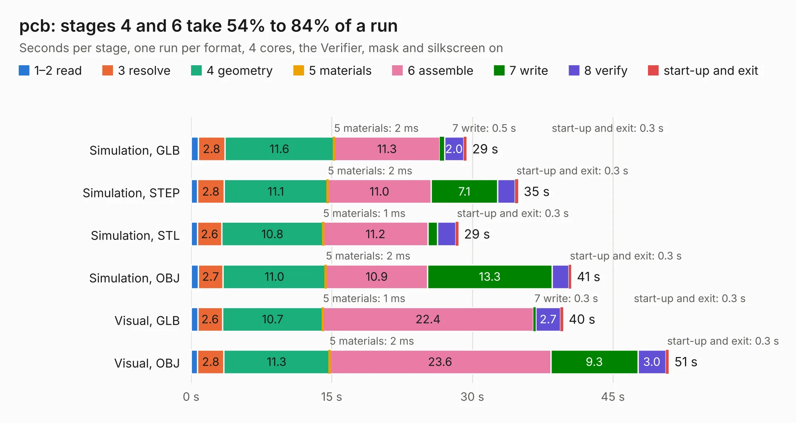

| Mode and format | 1–2 read | 3 resolve | 4 geometry | 5 materials | 6 assemble | 7 write | 8 verify | start-up and exit | Total |
|---|---:|---:|---:|---:|---:|---:|---:|---:|---:|
| Simulation, GLB | 0.8 | 2.8 | 11.6 | 2&nbsp;ms | 11.3 | 0.5 | 2.0 | 0.3 | 29.4 |
| Simulation, STEP | 0.7 | 2.8 | 11.1 | 2&nbsp;ms | 11.0 | 7.1 | 1.8 | 0.3 | 34.9 |
| Simulation, STL | 0.7 | 2.6 | 10.8 | 1&nbsp;ms | 11.2 | 1.0 | 1.9 | 0.3 | 28.5 |
| Simulation, OBJ | 0.7 | 2.7 | 11.0 | 2&nbsp;ms | 10.9 | 13.3 | 1.8 | 0.3 | 40.5 |
| Visual, GLB | 0.7 | 2.6 | 10.7 | 1&nbsp;ms | 22.4 | 0.3 | 2.7 | 0.3 | 39.7 |
| Visual, OBJ | 0.7 | 2.8 | 11.3 | 2&nbsp;ms | 23.6 | 9.3 | 3.0 | 0.3 | 51.0 |

<table align="center"><tr><td valign="top">

| Board | Repo: [apertus-open-source-cinema/axiom-micro-mainboard](https://github.com/apertus-open-source-cinema/axiom-micro-mainboard) Board: `pcb.kicad_pcb` |
|---|---|
| Folder | pcb |
| Complexity | 3,651, high |
| Copper&nbsp;layers | 4 |
| File&nbsp;format | KiCad 5 (20171130) |
| Parts,&nbsp;tracks,&nbsp;vias | 83, 2,555, 310 |
| Triangles,&nbsp;simulation | 2,695,538 in 165 parts |
| Verifier | PASS in all six runs |

</td><td valign="top">

<table>
<tr><th>File type</th><th>File size</th><th>Peak memory used</th></tr>
<tr><th colspan="3" align="left">Simulation</th></tr>
<tr><td>GLB</td><td align="right">92&nbsp;MB</td><td align="right">853&nbsp;MB</td></tr>
<tr><td>STEP</td><td align="right">376&nbsp;MB</td><td align="right">1.1&nbsp;GB</td></tr>
<tr><td>STL</td><td align="right">135&nbsp;MB</td><td align="right">864&nbsp;MB</td></tr>
<tr><td>OBJ</td><td align="right">282&nbsp;MB</td><td align="right">1.8&nbsp;GB</td></tr>
<tr><th colspan="3" align="left">Visual</th></tr>
<tr><td>GLB</td><td align="right">61&nbsp;MB</td><td align="right">1.1&nbsp;GB</td></tr>
<tr><td>OBJ</td><td align="right">189&nbsp;MB</td><td align="right">1.3&nbsp;GB</td></tr>
</table>

</td></tr></table>

## 23.4.20 NxtPX4

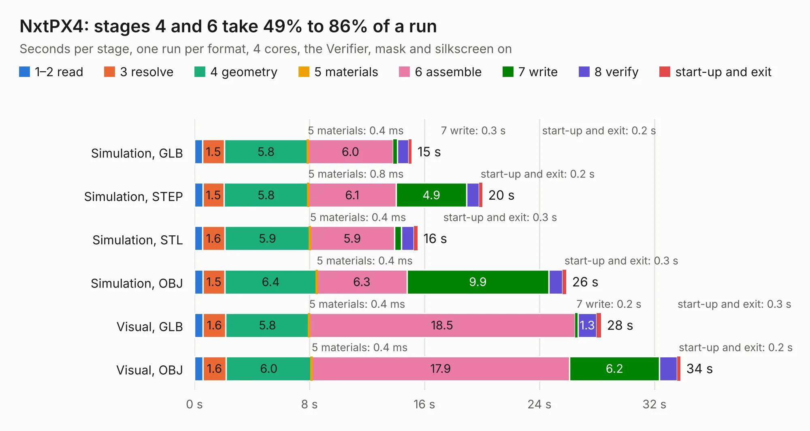

| Mode and format | 1–2 read | 3 resolve | 4 geometry | 5 materials | 6 assemble | 7 write | 8 verify | start-up and exit | Total |
|---|---:|---:|---:|---:|---:|---:|---:|---:|---:|
| Simulation, GLB | 0.6 | 1.5 | 5.8 | 0.4&nbsp;ms | 6.0 | 0.3 | 0.8 | 0.2 | 15.1 |
| Simulation, STEP | 0.6 | 1.5 | 5.8 | 0.8&nbsp;ms | 6.1 | 4.9 | 0.9 | 0.2 | 20.0 |
| Simulation, STL | 0.6 | 1.6 | 5.9 | 0.4&nbsp;ms | 5.9 | 0.5 | 0.9 | 0.3 | 15.5 |
| Simulation, OBJ | 0.6 | 1.5 | 6.4 | 0.4&nbsp;ms | 6.3 | 9.9 | 1.0 | 0.3 | 25.9 |
| Visual, GLB | 0.6 | 1.6 | 5.8 | 0.4&nbsp;ms | 18.5 | 0.2 | 1.3 | 0.3 | 28.3 |
| Visual, OBJ | 0.6 | 1.6 | 6.0 | 0.4&nbsp;ms | 17.9 | 6.2 | 1.2 | 0.2 | 33.8 |

<table align="center"><tr><td valign="top">

| Board | Repo: [ardupilot/hardware](https://github.com/ardupilot/hardware) Board: `NxtPX4.kicad_pcb` |
|---|---|
| Folder | HKUST-UAV-Group / NxtPX4v2 |
| Complexity | 2,535, medium |
| Copper&nbsp;layers | 4 |
| File&nbsp;format | KiCad 7 (20221018) |
| Parts,&nbsp;tracks,&nbsp;vias | 122, 1,193, 296 |
| Triangles,&nbsp;simulation | 1,917,514 in 147 parts |
| Verifier | PASS in all six runs |

</td><td valign="top">

<table>
<tr><th>File type</th><th>File size</th><th>Peak memory used</th></tr>
<tr><th colspan="3" align="left">Simulation</th></tr>
<tr><td>GLB</td><td align="right">65&nbsp;MB</td><td align="right">648&nbsp;MB</td></tr>
<tr><td>STEP</td><td align="right">281&nbsp;MB</td><td align="right">793&nbsp;MB</td></tr>
<tr><td>STL</td><td align="right">96&nbsp;MB</td><td align="right">642&nbsp;MB</td></tr>
<tr><td>OBJ</td><td align="right">200&nbsp;MB</td><td align="right">1.3&nbsp;GB</td></tr>
<tr><th colspan="3" align="left">Visual</th></tr>
<tr><td>GLB</td><td align="right">42&nbsp;MB</td><td align="right">809&nbsp;MB</td></tr>
<tr><td>OBJ</td><td align="right">130&nbsp;MB</td><td align="right">993&nbsp;MB</td></tr>
</table>

</td></tr></table>

## 23.4.21 Sparky2

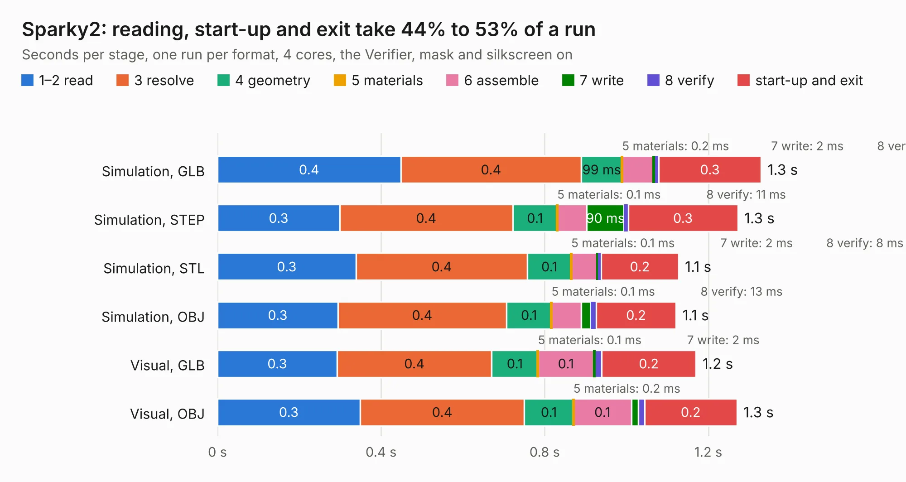

| Mode and format | 1–2 read | 3 resolve | 4 geometry | 5 materials | 6 assemble | 7 write | 8 verify | start-up and exit | Total |
|---|---:|---:|---:|---:|---:|---:|---:|---:|---:|
| Simulation, GLB | 0.4 | 0.4 | 99&nbsp;ms | 0.2&nbsp;ms | 76&nbsp;ms | 2&nbsp;ms | 11&nbsp;ms | 0.3 | 1.3 |
| Simulation, STEP | 0.3 | 0.4 | 0.1 | 0.1&nbsp;ms | 72&nbsp;ms | 90&nbsp;ms | 11&nbsp;ms | 0.3 | 1.3 |
| Simulation, STL | 0.3 | 0.4 | 0.1 | 0.1&nbsp;ms | 63&nbsp;ms | 2&nbsp;ms | 8&nbsp;ms | 0.2 | 1.1 |
| Simulation, OBJ | 0.3 | 0.4 | 0.1 | 0.1&nbsp;ms | 73&nbsp;ms | 23&nbsp;ms | 13&nbsp;ms | 0.2 | 1.1 |
| Visual, GLB | 0.3 | 0.4 | 0.1 | 0.1&nbsp;ms | 0.1 | 2&nbsp;ms | 17&nbsp;ms | 0.2 | 1.2 |
| Visual, OBJ | 0.3 | 0.4 | 0.1 | 0.2&nbsp;ms | 0.1 | 17&nbsp;ms | 15&nbsp;ms | 0.2 | 1.3 |

<table align="center"><tr><td valign="top">

| Board | Repo: [ardupilot/hardware](https://github.com/ardupilot/hardware) Board: `Sparky2.kicad_pcb` |
|---|---|
| Folder | TauLabs-Sparky / sparky2 / hw / kicad |
| Complexity | 1,257, medium |
| Copper&nbsp;layers | 4 |
| File&nbsp;format | KiCad 4 (4) |
| Parts,&nbsp;tracks,&nbsp;vias | 78, 864, 79 |
| Triangles,&nbsp;simulation | 3,856 in 9 parts |
| Verifier | PASS in all six runs |

</td><td valign="top">

<table>
<tr><th>File type</th><th>File size</th><th>Peak memory used</th></tr>
<tr><th colspan="3" align="left">Simulation</th></tr>
<tr><td>GLB</td><td align="right">143&nbsp;kB</td><td align="right">82&nbsp;MB</td></tr>
<tr><td>STEP</td><td align="right">895&nbsp;kB</td><td align="right">82&nbsp;MB</td></tr>
<tr><td>STL</td><td align="right">194&nbsp;kB</td><td align="right">82&nbsp;MB</td></tr>
<tr><td>OBJ</td><td align="right">374&nbsp;kB</td><td align="right">82&nbsp;MB</td></tr>
<tr><th colspan="3" align="left">Visual</th></tr>
<tr><td>GLB</td><td align="right">117&nbsp;kB</td><td align="right">82&nbsp;MB</td></tr>
<tr><td>OBJ</td><td align="right">281&nbsp;kB</td><td align="right">82&nbsp;MB</td></tr>
</table>

</td></tr></table>

## 23.4.22 motherboard-hk10

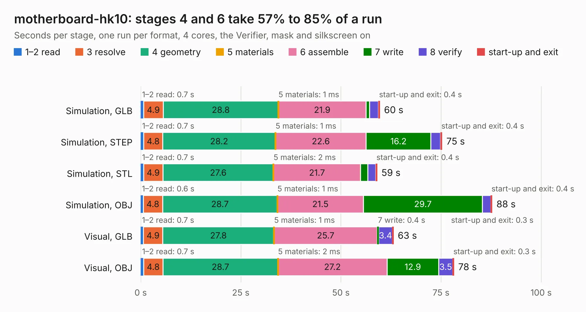

| Mode and format | 1–2 read | 3 resolve | 4 geometry | 5 materials | 6 assemble | 7 write | 8 verify | start-up and exit | Total |
|---|---:|---:|---:|---:|---:|---:|---:|---:|---:|
| Simulation, GLB | 0.7 | 4.9 | 28.8 | 1&nbsp;ms | 21.9 | 0.9 | 2.2 | 0.4 | 59.7 |
| Simulation, STEP | 0.7 | 4.8 | 28.2 | 1&nbsp;ms | 22.6 | 16.2 | 2.4 | 0.4 | 75.3 |
| Simulation, STL | 0.7 | 4.9 | 27.6 | 2&nbsp;ms | 21.7 | 1.8 | 2.0 | 0.4 | 59.1 |
| Simulation, OBJ | 0.6 | 4.8 | 28.7 | 1&nbsp;ms | 21.5 | 29.7 | 2.1 | 0.4 | 87.8 |
| Visual, GLB | 0.7 | 4.9 | 27.8 | 1&nbsp;ms | 25.7 | 0.4 | 3.4 | 0.3 | 63.2 |
| Visual, OBJ | 0.7 | 4.8 | 28.7 | 2&nbsp;ms | 27.2 | 12.9 | 3.5 | 0.3 | 78.3 |

<table align="center"><tr><td valign="top">

| Board | Repo: [artemisamsx/motherboard-hk10](https://github.com/artemisamsx/motherboard-hk10) Board: `motherboard-hk10.kicad_pcb` |
|---|---|
| Complexity | 222, simple |
| Copper&nbsp;layers | 2 |
| File&nbsp;format | KiCad 10 (20260206) |
| Parts,&nbsp;tracks,&nbsp;vias | 111, 0, 0 |
| Triangles,&nbsp;simulation | 4,952,416 in 256 parts |
| Note | mostly unrouted |
| Verifier | PASS in all six runs |

</td><td valign="top">

<table>
<tr><th>File type</th><th>File size</th><th>Peak memory used</th></tr>
<tr><th colspan="3" align="left">Simulation</th></tr>
<tr><td>GLB</td><td align="right">156&nbsp;MB</td><td align="right">1.4&nbsp;GB</td></tr>
<tr><td>STEP</td><td align="right">784&nbsp;MB</td><td align="right">1.9&nbsp;GB</td></tr>
<tr><td>STL</td><td align="right">248&nbsp;MB</td><td align="right">1.4&nbsp;GB</td></tr>
<tr><td>OBJ</td><td align="right">525&nbsp;MB</td><td align="right">3.2&nbsp;GB</td></tr>
<tr><th colspan="3" align="left">Visual</th></tr>
<tr><td>GLB</td><td align="right">73&nbsp;MB</td><td align="right">1.5&nbsp;GB</td></tr>
<tr><td>OBJ</td><td align="right">230&nbsp;MB</td><td align="right">1.7&nbsp;GB</td></tr>
</table>

</td></tr></table>

## 23.4.23 ICE40HXDevBoardHDMI

| Mode and format | 1–2 read | 3 resolve | 4 geometry | 5 materials | 6 assemble | 7 write | 8 verify | start-up and exit | Total |
|---|---:|---:|---:|---:|---:|---:|---:|---:|---:|
| Simulation, GLB | 0.3 | 0.9 | 3.1 | 0.4&nbsp;ms | 3.2 | 0.2 | 0.5 | 0.3 | 8.5 |
| Simulation, STEP | 0.3 | 0.9 | 3.1 | 0.4&nbsp;ms | 3.1 | 2.9 | 0.5 | 0.3 | 11.1 |
| Simulation, STL | 0.4 | 0.9 | 3.3 | 0.3&nbsp;ms | 3.4 | 0.3 | 0.5 | 0.3 | 9.0 |
| Simulation, OBJ | 0.3 | 0.9 | 3.4 | 0.3&nbsp;ms | 3.4 | 5.0 | 0.5 | 0.2 | 13.6 |
| Visual, GLB | 0.3 | 0.9 | 3.1 | 0.3&nbsp;ms | 7.1 | 85&nbsp;ms | 0.5 | 0.2 | 12.3 |
| Visual, OBJ | 0.4 | 0.9 | 3.1 | 0.5&nbsp;ms | 7.1 | 2.7 | 0.6 | 0.2 | 15.1 |

<table align="center"><tr><td valign="top">

| Board | Repo: [aslak3/ICE40HXDevBoard](https://github.com/aslak3/ICE40HXDevBoard) Board: `ICE40HXDevBoardHDMI.kicad_pcb` |
|---|---|
| Folder | ExpansionCards / ICE40HXDevBoardHDMI |
| Complexity | 890, low |
| Copper&nbsp;layers | 4 |
| File&nbsp;format | KiCad 9 (20241229) |
| Parts,&nbsp;tracks,&nbsp;vias | 48, 542, 64 |
| Triangles,&nbsp;simulation | 899,090 in 84 parts |
| Verifier | PASS in all six runs |

</td><td valign="top">

<table>
<tr><th>File type</th><th>File size</th><th>Peak memory used</th></tr>
<tr><th colspan="3" align="left">Simulation</th></tr>
<tr><td>GLB</td><td align="right">31&nbsp;MB</td><td align="right">414&nbsp;MB</td></tr>
<tr><td>STEP</td><td align="right">122&nbsp;MB</td><td align="right">457&nbsp;MB</td></tr>
<tr><td>STL</td><td align="right">45&nbsp;MB</td><td align="right">397&nbsp;MB</td></tr>
<tr><td>OBJ</td><td align="right">92&nbsp;MB</td><td align="right">633&nbsp;MB</td></tr>
<tr><th colspan="3" align="left">Visual</th></tr>
<tr><td>GLB</td><td align="right">17&nbsp;MB</td><td align="right">416&nbsp;MB</td></tr>
<tr><td>OBJ</td><td align="right">53&nbsp;MB</td><td align="right">500&nbsp;MB</td></tr>
</table>

</td></tr></table>

## 23.4.24 ICE40HXDevBoardVGA

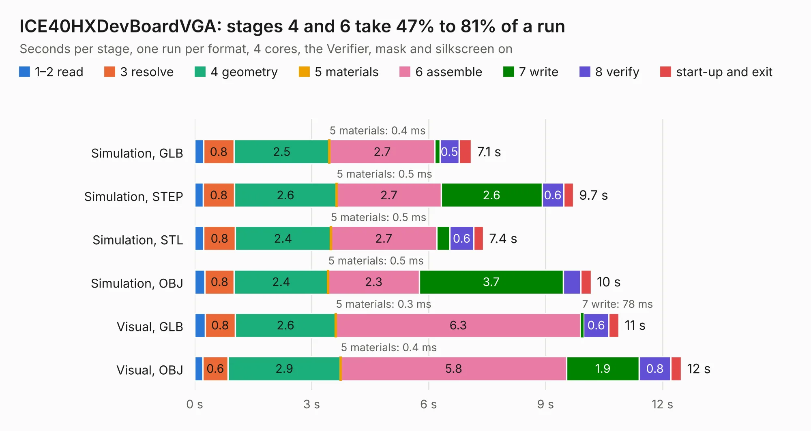

| Mode and format | 1–2 read | 3 resolve | 4 geometry | 5 materials | 6 assemble | 7 write | 8 verify | start-up and exit | Total |
|---|---:|---:|---:|---:|---:|---:|---:|---:|---:|
| Simulation, GLB | 0.2 | 0.8 | 2.5 | 0.4&nbsp;ms | 2.7 | 0.1 | 0.5 | 0.3 | 7.1 |
| Simulation, STEP | 0.2 | 0.8 | 2.6 | 0.5&nbsp;ms | 2.7 | 2.6 | 0.6 | 0.3 | 9.7 |
| Simulation, STL | 0.2 | 0.8 | 2.4 | 0.5&nbsp;ms | 2.7 | 0.3 | 0.6 | 0.2 | 7.4 |
| Simulation, OBJ | 0.3 | 0.8 | 2.4 | 0.5&nbsp;ms | 2.3 | 3.7 | 0.4 | 0.3 | 10.2 |
| Visual, GLB | 0.3 | 0.8 | 2.6 | 0.3&nbsp;ms | 6.3 | 78&nbsp;ms | 0.6 | 0.3 | 10.9 |
| Visual, OBJ | 0.2 | 0.6 | 2.9 | 0.4&nbsp;ms | 5.8 | 1.9 | 0.8 | 0.3 | 12.5 |

<table align="center"><tr><td valign="top">

| Board | Repo: [aslak3/ICE40HXDevBoard](https://github.com/aslak3/ICE40HXDevBoard) Board: `ICE40HXDevBoardVGA.kicad_pcb` |
|---|---|
| Folder | ExpansionCards / ICE40HXDevBoardVGA |
| Complexity | 628, low |
| Copper&nbsp;layers | 4 |
| File&nbsp;format | KiCad 9 (20241229) |
| Parts,&nbsp;tracks,&nbsp;vias | 36, 379, 39 |
| Triangles,&nbsp;simulation | 765,242 in 78 parts |
| Verifier | PASS in all six runs |

</td><td valign="top">

<table>
<tr><th>File type</th><th>File size</th><th>Peak memory used</th></tr>
<tr><th colspan="3" align="left">Simulation</th></tr>
<tr><td>GLB</td><td align="right">26&nbsp;MB</td><td align="right">346&nbsp;MB</td></tr>
<tr><td>STEP</td><td align="right">89&nbsp;MB</td><td align="right">392&nbsp;MB</td></tr>
<tr><td>STL</td><td align="right">38&nbsp;MB</td><td align="right">357&nbsp;MB</td></tr>
<tr><td>OBJ</td><td align="right">77&nbsp;MB</td><td align="right">553&nbsp;MB</td></tr>
<tr><th colspan="3" align="left">Visual</th></tr>
<tr><td>GLB</td><td align="right">15&nbsp;MB</td><td align="right">431&nbsp;MB</td></tr>
<tr><td>OBJ</td><td align="right">43&nbsp;MB</td><td align="right">411&nbsp;MB</td></tr>
</table>

</td></tr></table>

## 23.4.25 ICE40HXDevBoard

| Mode and format | 1–2 read | 3 resolve | 4 geometry | 5 materials | 6 assemble | 7 write | 8 verify | start-up and exit | Total |
|---|---:|---:|---:|---:|---:|---:|---:|---:|---:|
| Simulation, GLB | 0.6 | 2.6 | 7.3 | 1&nbsp;ms | 8.1 | 0.4 | 1.1 | 0.3 | 20.4 |
| Simulation, STEP | 0.8 | 2.3 | 7.3 | 0.8&nbsp;ms | 8.0 | 6.1 | 1.1 | 0.3 | 26.0 |
| Simulation, STL | 0.8 | 2.3 | 7.8 | 0.9&nbsp;ms | 7.9 | 0.6 | 1.1 | 0.3 | 20.8 |
| Simulation, OBJ | 0.6 | 2.2 | 7.0 | 0.9&nbsp;ms | 7.6 | 12.0 | 1.0 | 0.4 | 30.9 |
| Visual, GLB | 0.6 | 2.2 | 7.0 | 0.9&nbsp;ms | 17.4 | 0.2 | 1.7 | 0.3 | 29.5 |
| Visual, OBJ | 0.6 | 2.2 | 6.9 | 0.9&nbsp;ms | 17.7 | 7.6 | 2.0 | 0.3 | 37.3 |

<table align="center"><tr><td valign="top">

| Board | Repo: [aslak3/ICE40HXDevBoard](https://github.com/aslak3/ICE40HXDevBoard) Board: `ICE40HXDevBoard.kicad_pcb` |
|---|---|
| Complexity | 2,390, medium |
| Copper&nbsp;layers | 4 |
| File&nbsp;format | KiCad 9 (20241229) |
| Parts,&nbsp;tracks,&nbsp;vias | 111, 1,526, 194 |
| Triangles,&nbsp;simulation | 1,898,466 in 175 parts |
| Verifier | PASS in all six runs |

</td><td valign="top">

<table>
<tr><th>File type</th><th>File size</th><th>Peak memory used</th></tr>
<tr><th colspan="3" align="left">Simulation</th></tr>
<tr><td>GLB</td><td align="right">65&nbsp;MB</td><td align="right">636&nbsp;MB</td></tr>
<tr><td>STEP</td><td align="right">250&nbsp;MB</td><td align="right">818&nbsp;MB</td></tr>
<tr><td>STL</td><td align="right">95&nbsp;MB</td><td align="right">630&nbsp;MB</td></tr>
<tr><td>OBJ</td><td align="right">198&nbsp;MB</td><td align="right">1.2&nbsp;GB</td></tr>
<tr><th colspan="3" align="left">Visual</th></tr>
<tr><td>GLB</td><td align="right">43&nbsp;MB</td><td align="right">862&nbsp;MB</td></tr>
<tr><td>OBJ</td><td align="right">131&nbsp;MB</td><td align="right">953&nbsp;MB</td></tr>
</table>

</td></tr></table>

## 23.4.26 ICE40UPDevBoard

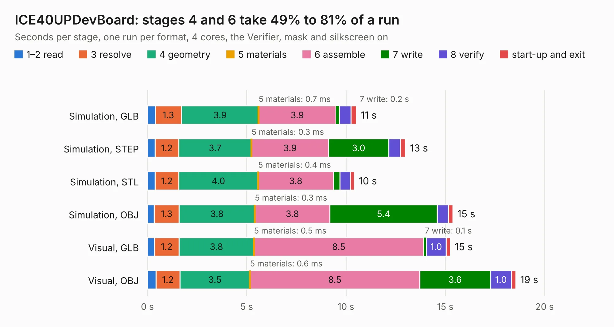

| Mode and format | 1–2 read | 3 resolve | 4 geometry | 5 materials | 6 assemble | 7 write | 8 verify | start-up and exit | Total |
|---|---:|---:|---:|---:|---:|---:|---:|---:|---:|
| Simulation, GLB | 0.4 | 1.3 | 3.9 | 0.7&nbsp;ms | 3.9 | 0.2 | 0.6 | 0.3 | 10.5 |
| Simulation, STEP | 0.4 | 1.2 | 3.7 | 0.3&nbsp;ms | 3.9 | 3.0 | 0.6 | 0.3 | 13.0 |
| Simulation, STL | 0.4 | 1.2 | 4.0 | 0.4&nbsp;ms | 3.8 | 0.3 | 0.5 | 0.2 | 10.4 |
| Simulation, OBJ | 0.3 | 1.3 | 3.8 | 0.3&nbsp;ms | 3.8 | 5.4 | 0.5 | 0.2 | 15.4 |
| Visual, GLB | 0.4 | 1.2 | 3.8 | 0.5&nbsp;ms | 8.5 | 0.1 | 1.0 | 0.2 | 15.3 |
| Visual, OBJ | 0.4 | 1.2 | 3.5 | 0.6&nbsp;ms | 8.5 | 3.6 | 1.0 | 0.2 | 18.6 |

<table align="center"><tr><td valign="top">

| Board | Repo: [aslak3/ICE40UPDevBoard](https://github.com/aslak3/ICE40UPDevBoard) Board: `ICE40UPDevBoard.kicad_pcb` |
|---|---|
| Complexity | 1,437, medium |
| Copper&nbsp;layers | 4 |
| File&nbsp;format | KiCad 7 (20221018) |
| Parts,&nbsp;tracks,&nbsp;vias | 92, 734, 133 |
| Triangles,&nbsp;simulation | 1,231,682 in 97 parts |
| Verifier | PASS in all six runs |

</td><td valign="top">

<table>
<tr><th>File type</th><th>File size</th><th>Peak memory used</th></tr>
<tr><th colspan="3" align="left">Simulation</th></tr>
<tr><td>GLB</td><td align="right">42&nbsp;MB</td><td align="right">496&nbsp;MB</td></tr>
<tr><td>STEP</td><td align="right">157&nbsp;MB</td><td align="right">561&nbsp;MB</td></tr>
<tr><td>STL</td><td align="right">62&nbsp;MB</td><td align="right">486&nbsp;MB</td></tr>
<tr><td>OBJ</td><td align="right">126&nbsp;MB</td><td align="right">843&nbsp;MB</td></tr>
<tr><th colspan="3" align="left">Visual</th></tr>
<tr><td>GLB</td><td align="right">27&nbsp;MB</td><td align="right">657&nbsp;MB</td></tr>
<tr><td>OBJ</td><td align="right">81&nbsp;MB</td><td align="right">646&nbsp;MB</td></tr>
</table>

</td></tr></table>

## 23.4.27 Printer+Sticks

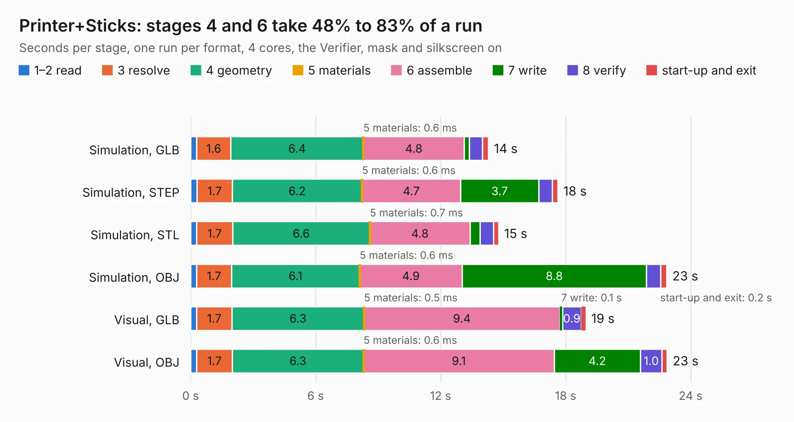

| Mode and format | 1–2 read | 3 resolve | 4 geometry | 5 materials | 6 assemble | 7 write | 8 verify | start-up and exit | Total |
|---|---:|---:|---:|---:|---:|---:|---:|---:|---:|
| Simulation, GLB | 0.3 | 1.6 | 6.4 | 0.6&nbsp;ms | 4.8 | 0.2 | 0.6 | 0.3 | 14.3 |
| Simulation, STEP | 0.3 | 1.7 | 6.2 | 0.6&nbsp;ms | 4.7 | 3.7 | 0.7 | 0.3 | 17.6 |
| Simulation, STL | 0.3 | 1.7 | 6.6 | 0.7&nbsp;ms | 4.8 | 0.5 | 0.7 | 0.2 | 14.8 |
| Simulation, OBJ | 0.3 | 1.7 | 6.1 | 0.6&nbsp;ms | 4.9 | 8.8 | 0.7 | 0.3 | 22.8 |
| Visual, GLB | 0.3 | 1.7 | 6.3 | 0.5&nbsp;ms | 9.4 | 0.1 | 0.9 | 0.2 | 19.0 |
| Visual, OBJ | 0.3 | 1.7 | 6.3 | 0.6&nbsp;ms | 9.1 | 4.2 | 1.0 | 0.2 | 22.9 |

<table align="center"><tr><td valign="top">

| Board | Repo: [aslak3/maxi030](https://github.com/aslak3/maxi030) Board: `Printer+Sticks.kicad_pcb` |
|---|---|
| Folder | ExpansionCards / Printer+Sticks |
| Complexity | 1,216, medium |
| Copper&nbsp;layers | 4 |
| File&nbsp;format | KiCad 6 (20211014) |
| Parts,&nbsp;tracks,&nbsp;vias | 26, 810, 98 |
| Triangles,&nbsp;simulation | 1,489,044 in 88 parts |
| Verifier | PASS in all six runs |

</td><td valign="top">

<table>
<tr><th>File type</th><th>File size</th><th>Peak memory used</th></tr>
<tr><th colspan="3" align="left">Simulation</th></tr>
<tr><td>GLB</td><td align="right">52&nbsp;MB</td><td align="right">526&nbsp;MB</td></tr>
<tr><td>STEP</td><td align="right">196&nbsp;MB</td><td align="right">596&nbsp;MB</td></tr>
<tr><td>STL</td><td align="right">74&nbsp;MB</td><td align="right">502&nbsp;MB</td></tr>
<tr><td>OBJ</td><td align="right">155&nbsp;MB</td><td align="right">1.0&nbsp;GB</td></tr>
<tr><th colspan="3" align="left">Visual</th></tr>
<tr><td>GLB</td><td align="right">25&nbsp;MB</td><td align="right">606&nbsp;MB</td></tr>
<tr><td>OBJ</td><td align="right">75&nbsp;MB</td><td align="right">604&nbsp;MB</td></tr>
</table>

</td></tr></table>

## 23.4.28 TestSRAM

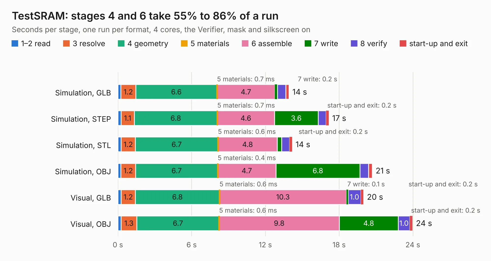

| Mode and format | 1–2 read | 3 resolve | 4 geometry | 5 materials | 6 assemble | 7 write | 8 verify | start-up and exit | Total |
|---|---:|---:|---:|---:|---:|---:|---:|---:|---:|
| Simulation, GLB | 0.2 | 1.2 | 6.6 | 0.7&nbsp;ms | 4.7 | 0.2 | 0.7 | 0.3 | 13.9 |
| Simulation, STEP | 0.3 | 1.1 | 6.8 | 0.7&nbsp;ms | 4.6 | 3.6 | 0.6 | 0.2 | 17.2 |
| Simulation, STL | 0.3 | 1.2 | 6.7 | 0.6&nbsp;ms | 4.8 | 0.3 | 0.6 | 0.2 | 14.2 |
| Simulation, OBJ | 0.2 | 1.2 | 6.7 | 0.4&nbsp;ms | 4.7 | 6.8 | 0.7 | 0.3 | 20.7 |
| Visual, GLB | 0.3 | 1.2 | 6.8 | 0.6&nbsp;ms | 10.3 | 0.1 | 1.0 | 0.2 | 20.0 |
| Visual, OBJ | 0.3 | 1.3 | 6.7 | 0.6&nbsp;ms | 9.8 | 4.8 | 1.0 | 0.2 | 24.0 |

<table align="center"><tr><td valign="top">

| Board | Repo: [aslak3/maxi030](https://github.com/aslak3/maxi030) Board: `TestSRAM.kicad_pcb` |
|---|---|
| Folder | ExpansionCards / TestSRAM |
| Complexity | 869, low |
| Copper&nbsp;layers | 2 |
| File&nbsp;format | KiCad 6 (20211014) |
| Parts,&nbsp;tracks,&nbsp;vias | 15, 683, 52 |
| Triangles,&nbsp;simulation | 1,299,500 in 71 parts |
| Verifier | PASS in all six runs |

</td><td valign="top">

<table>
<tr><th>File type</th><th>File size</th><th>Peak memory used</th></tr>
<tr><th colspan="3" align="left">Simulation</th></tr>
<tr><td>GLB</td><td align="right">45&nbsp;MB</td><td align="right">531&nbsp;MB</td></tr>
<tr><td>STEP</td><td align="right">216&nbsp;MB</td><td align="right">627&nbsp;MB</td></tr>
<tr><td>STL</td><td align="right">65&nbsp;MB</td><td align="right">523&nbsp;MB</td></tr>
<tr><td>OBJ</td><td align="right">134&nbsp;MB</td><td align="right">877&nbsp;MB</td></tr>
<tr><th colspan="3" align="left">Visual</th></tr>
<tr><td>GLB</td><td align="right">30&nbsp;MB</td><td align="right">713&nbsp;MB</td></tr>
<tr><td>OBJ</td><td align="right">90&nbsp;MB</td><td align="right">745&nbsp;MB</td></tr>
</table>

</td></tr></table>

## 23.4.29 Video+Sound

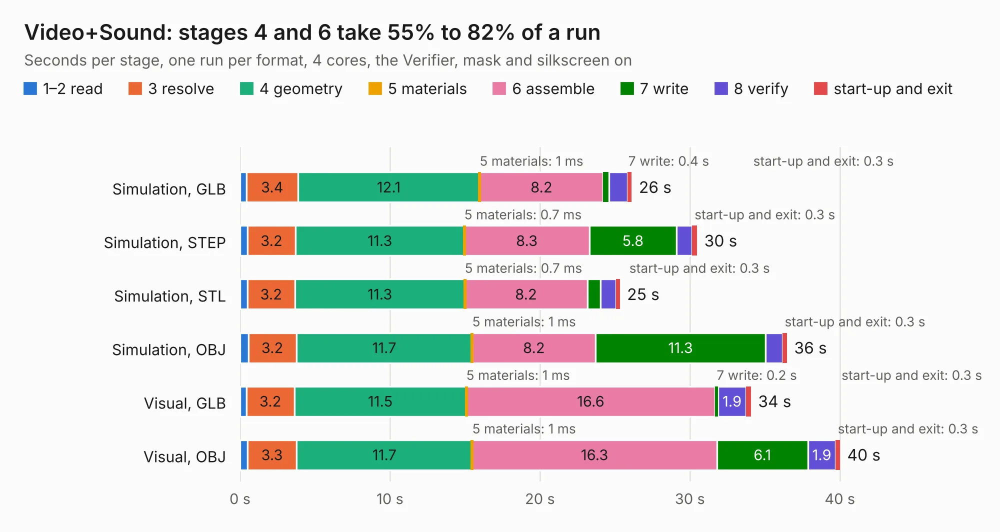

| Mode and format | 1–2 read | 3 resolve | 4 geometry | 5 materials | 6 assemble | 7 write | 8 verify | start-up and exit | Total |
|---|---:|---:|---:|---:|---:|---:|---:|---:|---:|
| Simulation, GLB | 0.4 | 3.4 | 12.1 | 1&nbsp;ms | 8.2 | 0.4 | 1.2 | 0.3 | 26.1 |
| Simulation, STEP | 0.5 | 3.2 | 11.3 | 0.7&nbsp;ms | 8.3 | 5.8 | 1.0 | 0.3 | 30.5 |
| Simulation, STL | 0.5 | 3.2 | 11.3 | 0.7&nbsp;ms | 8.2 | 0.9 | 1.0 | 0.3 | 25.3 |
| Simulation, OBJ | 0.6 | 3.2 | 11.7 | 1&nbsp;ms | 8.2 | 11.3 | 1.1 | 0.3 | 36.5 |
| Visual, GLB | 0.4 | 3.2 | 11.5 | 1&nbsp;ms | 16.6 | 0.2 | 1.9 | 0.3 | 34.1 |
| Visual, OBJ | 0.5 | 3.3 | 11.7 | 1&nbsp;ms | 16.3 | 6.1 | 1.9 | 0.3 | 40.0 |

<table align="center"><tr><td valign="top">

| Board | Repo: [aslak3/maxi030](https://github.com/aslak3/maxi030) Board: `Video+Sound.kicad_pcb` |
|---|---|
| Folder | ExpansionCards / Video+Sound |
| Complexity | 2,805, medium |
| Copper&nbsp;layers | 4 |
| File&nbsp;format | KiCad 6 (20211014) |
| Parts,&nbsp;tracks,&nbsp;vias | 100, 2,044, 147 |
| Triangles,&nbsp;simulation | 2,109,506 in 231 parts |
| Verifier | PASS in all six runs |

</td><td valign="top">

<table>
<tr><th>File type</th><th>File size</th><th>Peak memory used</th></tr>
<tr><th colspan="3" align="left">Simulation</th></tr>
<tr><td>GLB</td><td align="right">74&nbsp;MB</td><td align="right">724&nbsp;MB</td></tr>
<tr><td>STEP</td><td align="right">350&nbsp;MB</td><td align="right">866&nbsp;MB</td></tr>
<tr><td>STL</td><td align="right">105&nbsp;MB</td><td align="right">716&nbsp;MB</td></tr>
<tr><td>OBJ</td><td align="right">226&nbsp;MB</td><td align="right">1.5&nbsp;GB</td></tr>
<tr><th colspan="3" align="left">Visual</th></tr>
<tr><td>GLB</td><td align="right">41&nbsp;MB</td><td align="right">830&nbsp;MB</td></tr>
<tr><td>OBJ</td><td align="right">125&nbsp;MB</td><td align="right">922&nbsp;MB</td></tr>
</table>

</td></tr></table>

## 23.4.30 MAXI030

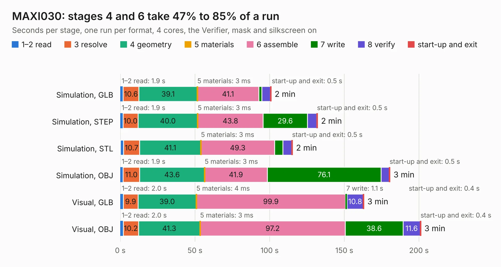

| Mode and format | 1–2 read | 3 resolve | 4 geometry | 5 materials | 6 assemble | 7 write | 8 verify | start-up and exit | Total |
|---|---:|---:|---:|---:|---:|---:|---:|---:|---:|
| Simulation, GLB | 1.9 | 10.6 | 39.1 | 3&nbsp;ms | 41.1 | 2.0 | 5.8 | 0.5 | 101.0 |
| Simulation, STEP | 1.9 | 10.0 | 40.0 | 3&nbsp;ms | 43.8 | 29.6 | 6.2 | 0.5 | 132.1 |
| Simulation, STL | 2.2 | 10.7 | 41.1 | 3&nbsp;ms | 49.3 | 5.6 | 5.9 | 0.5 | 115.3 |
| Simulation, OBJ | 1.9 | 11.0 | 43.6 | 3&nbsp;ms | 41.9 | 76.1 | 5.6 | 0.5 | 180.6 |
| Visual, GLB | 2.0 | 9.9 | 39.0 | 4&nbsp;ms | 99.9 | 1.1 | 10.8 | 0.4 | 163.1 |
| Visual, OBJ | 2.0 | 10.2 | 41.3 | 3&nbsp;ms | 97.2 | 38.6 | 11.6 | 0.4 | 201.3 |

<table align="center"><tr><td valign="top">

| Board | Repo: [aslak3/maxi030](https://github.com/aslak3/maxi030) Board: `MAXI030.kicad_pcb` |
|---|---|
| Complexity | 11,152, very high |
| Copper&nbsp;layers | 4 |
| File&nbsp;format | KiCad 6 (20211014) |
| Parts,&nbsp;tracks,&nbsp;vias | 194, 7,695, 923 |
| Triangles,&nbsp;simulation | 10,527,020 in 457 parts |
| Verifier | PASS in all six runs |

</td><td valign="top">

<table>
<tr><th>File type</th><th>File size</th><th>Peak memory used</th></tr>
<tr><th colspan="3" align="left">Simulation</th></tr>
<tr><td>GLB</td><td align="right">356&nbsp;MB</td><td align="right">2.3&nbsp;GB</td></tr>
<tr><td>STEP</td><td align="right">1.2&nbsp;GB</td><td align="right">3.3&nbsp;GB</td></tr>
<tr><td>STL</td><td align="right">526&nbsp;MB</td><td align="right">2.7&nbsp;GB</td></tr>
<tr><td>OBJ</td><td align="right">1.1&nbsp;GB</td><td align="right">6.5&nbsp;GB</td></tr>
<tr><th colspan="3" align="left">Visual</th></tr>
<tr><td>GLB</td><td align="right">191&nbsp;MB</td><td align="right">3.1&nbsp;GB</td></tr>
<tr><td>OBJ</td><td align="right">626&nbsp;MB</td><td align="right">4.0&nbsp;GB</td></tr>
</table>

</td></tr></table>

## 23.4.31 spreadout

| Mode and format | 1–2 read | 3 resolve | 4 geometry | 5 materials | 6 assemble | 7 write | 8 verify | start-up and exit | Total |
|---|---:|---:|---:|---:|---:|---:|---:|---:|---:|
| Simulation, GLB | 1.7 | 9.6 | 36.6 | 2&nbsp;ms | 38.6 | 2.4 | 5.7 | 0.6 | 95.2 |
| Simulation, STEP | 1.7 | 9.6 | 37.3 | 2&nbsp;ms | 38.5 | 25.0 | 5.4 | 0.5 | 118.3 |
| Simulation, STL | 1.6 | 9.2 | 36.1 | 3&nbsp;ms | 37.2 | 4.9 | 5.9 | 0.5 | 95.4 |
| Simulation, OBJ | 1.6 | 9.6 | 36.8 | 2&nbsp;ms | 37.9 | 61.0 | 6.0 | 0.5 | 153.5 |
| Visual, GLB | 1.9 | 9.6 | 37.0 | 4&nbsp;ms | 90.4 | 1.0 | 11.6 | 0.4 | 151.8 |
| Visual, OBJ | 1.7 | 9.5 | 35.5 | 2&nbsp;ms | 90.6 | 30.4 | 12.5 | 0.4 | 180.6 |

<table align="center"><tr><td valign="top">

| Board | Repo: [aslak3/maxi030](https://github.com/aslak3/maxi030) Board: `spreadout.kicad_pcb` |
|---|---|
| Complexity | 10,879, very high |
| Copper&nbsp;layers | 4 |
| File&nbsp;format | KiCad 5 (20171130) |
| Parts,&nbsp;tracks,&nbsp;vias | 187, 7,565, 880 |
| Triangles,&nbsp;simulation | 10,283,014 in 455 parts |
| Verifier | PASS in all six runs |

</td><td valign="top">

<table>
<tr><th>File type</th><th>File size</th><th>Peak memory used</th></tr>
<tr><th colspan="3" align="left">Simulation</th></tr>
<tr><td>GLB</td><td align="right">347&nbsp;MB</td><td align="right">2.7&nbsp;GB</td></tr>
<tr><td>STEP</td><td align="right">1.2&nbsp;GB</td><td align="right">3.2&nbsp;GB</td></tr>
<tr><td>STL</td><td align="right">514&nbsp;MB</td><td align="right">2.5&nbsp;GB</td></tr>
<tr><td>OBJ</td><td align="right">1.1&nbsp;GB</td><td align="right">6.3&nbsp;GB</td></tr>
<tr><th colspan="3" align="left">Visual</th></tr>
<tr><td>GLB</td><td align="right">185&nbsp;MB</td><td align="right">3.1&nbsp;GB</td></tr>
<tr><td>OBJ</td><td align="right">607&nbsp;MB</td><td align="right">3.8&nbsp;GB</td></tr>
</table>

</td></tr></table>

## 23.4.32 CTRL_L

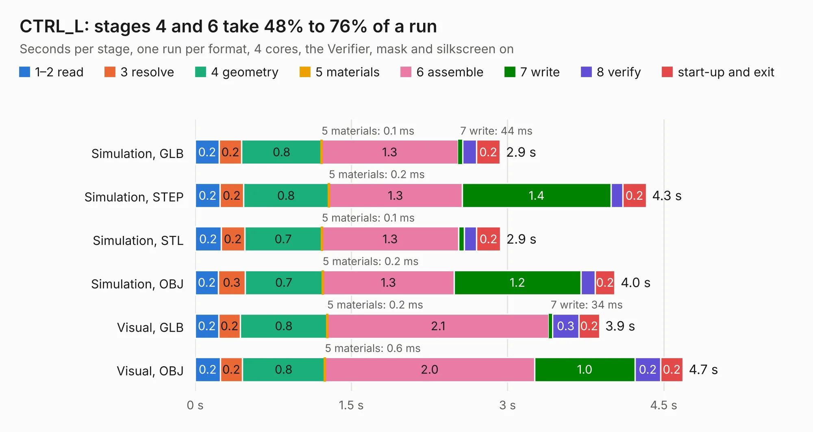

| Mode and format | 1–2 read | 3 resolve | 4 geometry | 5 materials | 6 assemble | 7 write | 8 verify | start-up and exit | Total |
|---|---:|---:|---:|---:|---:|---:|---:|---:|---:|
| Simulation, GLB | 0.2 | 0.2 | 0.8 | 0.1&nbsp;ms | 1.3 | 44&nbsp;ms | 0.1 | 0.2 | 2.9 |
| Simulation, STEP | 0.2 | 0.2 | 0.8 | 0.2&nbsp;ms | 1.3 | 1.4 | 0.1 | 0.2 | 4.3 |
| Simulation, STL | 0.2 | 0.2 | 0.7 | 0.1&nbsp;ms | 1.3 | 56&nbsp;ms | 0.1 | 0.2 | 2.9 |
| Simulation, OBJ | 0.2 | 0.3 | 0.7 | 0.2&nbsp;ms | 1.3 | 1.2 | 0.1 | 0.2 | 4.0 |
| Visual, GLB | 0.2 | 0.2 | 0.8 | 0.2&nbsp;ms | 2.1 | 34&nbsp;ms | 0.3 | 0.2 | 3.9 |
| Visual, OBJ | 0.2 | 0.2 | 0.8 | 0.6&nbsp;ms | 2.0 | 1.0 | 0.2 | 0.2 | 4.7 |

<table align="center"><tr><td valign="top">

| Board | Repo: [astronuat21/4ds](https://github.com/astronuat21/4ds) Board: `CTRL_L.kicad_pcb` |
|---|---|
| Folder | CTRL_L |
| Complexity | 320, low |
| Copper&nbsp;layers | 2 |
| File&nbsp;format | KiCad 10 (20260206) |
| Parts,&nbsp;tracks,&nbsp;vias | 25, 192, 26 |
| Triangles,&nbsp;simulation | 197,174 in 30 parts |
| Verifier | PASS in all six runs |

</td><td valign="top">

<table>
<tr><th>File type</th><th>File size</th><th>Peak memory used</th></tr>
<tr><th colspan="3" align="left">Simulation</th></tr>
<tr><td>GLB</td><td align="right">6.9&nbsp;MB</td><td align="right">229&nbsp;MB</td></tr>
<tr><td>STEP</td><td align="right">39&nbsp;MB</td><td align="right">247&nbsp;MB</td></tr>
<tr><td>STL</td><td align="right">9.9&nbsp;MB</td><td align="right">227&nbsp;MB</td></tr>
<tr><td>OBJ</td><td align="right">20&nbsp;MB</td><td align="right">226&nbsp;MB</td></tr>
<tr><th colspan="3" align="left">Visual</th></tr>
<tr><td>GLB</td><td align="right">6.0&nbsp;MB</td><td align="right">234&nbsp;MB</td></tr>
<tr><td>OBJ</td><td align="right">17&nbsp;MB</td><td align="right">237&nbsp;MB</td></tr>
</table>

</td></tr></table>

## 23.4.33 CTRL_panelized

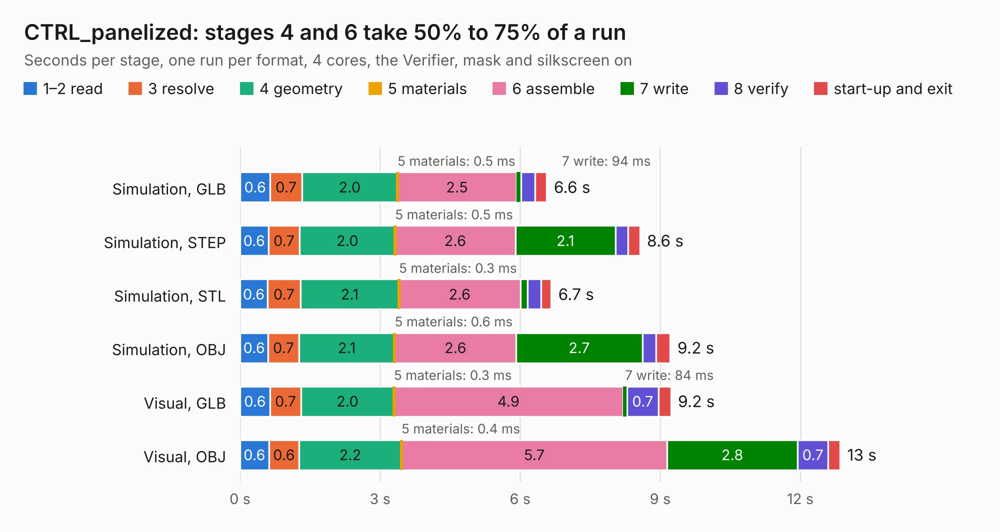

| Mode and format | 1–2 read | 3 resolve | 4 geometry | 5 materials | 6 assemble | 7 write | 8 verify | start-up and exit | Total |
|---|---:|---:|---:|---:|---:|---:|---:|---:|---:|
| Simulation, GLB | 0.6 | 0.7 | 2.0 | 0.5&nbsp;ms | 2.5 | 94&nbsp;ms | 0.3 | 0.2 | 6.6 |
| Simulation, STEP | 0.6 | 0.7 | 2.0 | 0.5&nbsp;ms | 2.6 | 2.1 | 0.3 | 0.2 | 8.6 |
| Simulation, STL | 0.6 | 0.7 | 2.1 | 0.3&nbsp;ms | 2.6 | 0.2 | 0.3 | 0.2 | 6.7 |
| Simulation, OBJ | 0.6 | 0.7 | 2.1 | 0.6&nbsp;ms | 2.6 | 2.7 | 0.3 | 0.3 | 9.2 |
| Visual, GLB | 0.6 | 0.7 | 2.0 | 0.3&nbsp;ms | 4.9 | 84&nbsp;ms | 0.7 | 0.3 | 9.2 |
| Visual, OBJ | 0.6 | 0.6 | 2.2 | 0.4&nbsp;ms | 5.7 | 2.8 | 0.7 | 0.3 | 12.9 |

<table align="center"><tr><td valign="top">

| Board | Repo: [astronuat21/4ds](https://github.com/astronuat21/4ds) Board: `CTRL_panelized.kicad_pcb` |
|---|---|
| Folder | CTRL_Panelized |
| Complexity | 888, low |
| Copper&nbsp;layers | 2 |
| File&nbsp;format | KiCad 10 (20260206) |
| Parts,&nbsp;tracks,&nbsp;vias | 80, 494, 78 |
| Triangles,&nbsp;simulation | 545,574 in 47 parts |
| Note | panel |
| Verifier | PASS in all six runs |

</td><td valign="top">

<table>
<tr><th>File type</th><th>File size</th><th>Peak memory used</th></tr>
<tr><th colspan="3" align="left">Simulation</th></tr>
<tr><td>GLB</td><td align="right">19&nbsp;MB</td><td align="right">332&nbsp;MB</td></tr>
<tr><td>STEP</td><td align="right">90&nbsp;MB</td><td align="right">403&nbsp;MB</td></tr>
<tr><td>STL</td><td align="right">27&nbsp;MB</td><td align="right">328&nbsp;MB</td></tr>
<tr><td>OBJ</td><td align="right">56&nbsp;MB</td><td align="right">424&nbsp;MB</td></tr>
<tr><th colspan="3" align="left">Visual</th></tr>
<tr><td>GLB</td><td align="right">17&nbsp;MB</td><td align="right">433&nbsp;MB</td></tr>
<tr><td>OBJ</td><td align="right">51&nbsp;MB</td><td align="right">492&nbsp;MB</td></tr>
</table>

</td></tr></table>

## 23.4.34 CTRL_PWR

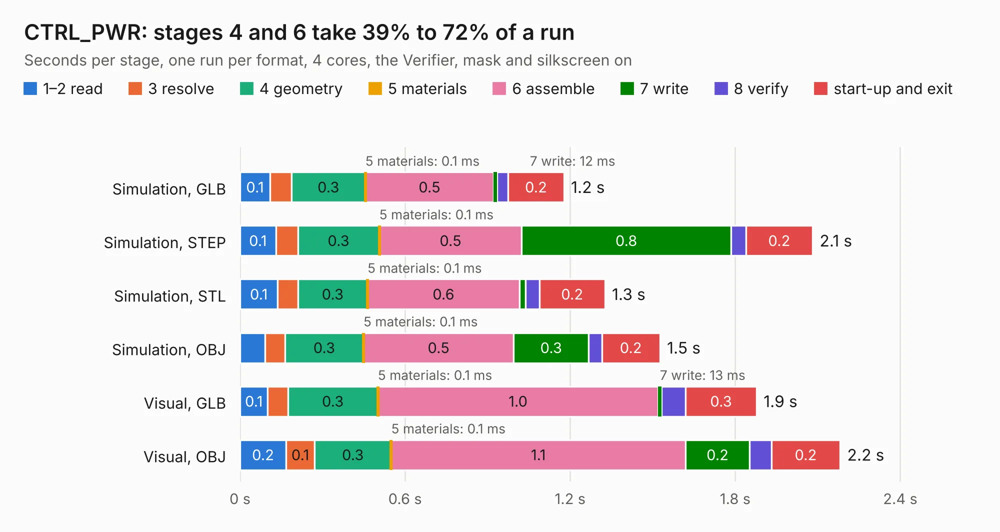

| Mode and format | 1–2 read | 3 resolve | 4 geometry | 5 materials | 6 assemble | 7 write | 8 verify | start-up and exit | Total |
|---|---:|---:|---:|---:|---:|---:|---:|---:|---:|
| Simulation, GLB | 0.1 | 78&nbsp;ms | 0.3 | 0.1&nbsp;ms | 0.5 | 12&nbsp;ms | 41&nbsp;ms | 0.2 | 1.2 |
| Simulation, STEP | 0.1 | 80&nbsp;ms | 0.3 | 0.1&nbsp;ms | 0.5 | 0.8 | 55&nbsp;ms | 0.2 | 2.1 |
| Simulation, STL | 0.1 | 73&nbsp;ms | 0.3 | 0.1&nbsp;ms | 0.6 | 23&nbsp;ms | 50&nbsp;ms | 0.2 | 1.3 |
| Simulation, OBJ | 90&nbsp;ms | 73&nbsp;ms | 0.3 | 0.1&nbsp;ms | 0.5 | 0.3 | 48&nbsp;ms | 0.2 | 1.5 |
| Visual, GLB | 0.1 | 73&nbsp;ms | 0.3 | 0.1&nbsp;ms | 1.0 | 13&nbsp;ms | 87&nbsp;ms | 0.3 | 1.9 |
| Visual, OBJ | 0.2 | 0.1 | 0.3 | 0.1&nbsp;ms | 1.1 | 0.2 | 79&nbsp;ms | 0.2 | 2.2 |

<table align="center"><tr><td valign="top">

| Board | Repo: [astronuat21/4ds](https://github.com/astronuat21/4ds) Board: `CTRL_PWR.kicad_pcb` |
|---|---|
| Folder | CTRL_PWR |
| Complexity | 28, simple |
| Copper&nbsp;layers | 2 |
| File&nbsp;format | KiCad 10 (20260206) |
| Parts,&nbsp;tracks,&nbsp;vias | 4, 38, 8 |
| Triangles,&nbsp;simulation | 66,856 in 18 parts |
| Verifier | PASS in all six runs |

</td><td valign="top">

<table>
<tr><th>File type</th><th>File size</th><th>Peak memory used</th></tr>
<tr><th colspan="3" align="left">Simulation</th></tr>
<tr><td>GLB</td><td align="right">2.3&nbsp;MB</td><td align="right">171&nbsp;MB</td></tr>
<tr><td>STEP</td><td align="right">11&nbsp;MB</td><td align="right">177&nbsp;MB</td></tr>
<tr><td>STL</td><td align="right">3.3&nbsp;MB</td><td align="right">174&nbsp;MB</td></tr>
<tr><td>OBJ</td><td align="right">6.4&nbsp;MB</td><td align="right">169&nbsp;MB</td></tr>
<tr><th colspan="3" align="left">Visual</th></tr>
<tr><td>GLB</td><td align="right">1.8&nbsp;MB</td><td align="right">151&nbsp;MB</td></tr>
<tr><td>OBJ</td><td align="right">4.9&nbsp;MB</td><td align="right">152&nbsp;MB</td></tr>
</table>

</td></tr></table>

## 23.4.35 CTRL_R

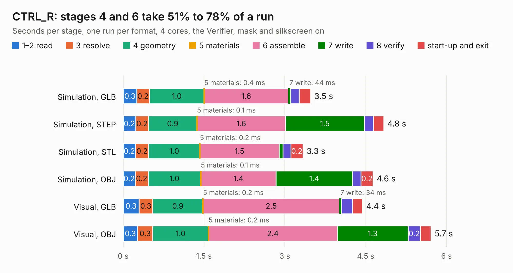

| Mode and format | 1–2 read | 3 resolve | 4 geometry | 5 materials | 6 assemble | 7 write | 8 verify | start-up and exit | Total |
|---|---:|---:|---:|---:|---:|---:|---:|---:|---:|
| Simulation, GLB | 0.3 | 0.2 | 1.0 | 0.4&nbsp;ms | 1.6 | 44&nbsp;ms | 0.2 | 0.2 | 3.5 |
| Simulation, STEP | 0.2 | 0.2 | 0.9 | 0.1&nbsp;ms | 1.6 | 1.5 | 0.2 | 0.2 | 4.8 |
| Simulation, STL | 0.2 | 0.2 | 1.0 | 0.2&nbsp;ms | 1.5 | 72&nbsp;ms | 0.1 | 0.2 | 3.3 |
| Simulation, OBJ | 0.2 | 0.2 | 1.0 | 0.1&nbsp;ms | 1.4 | 1.4 | 0.2 | 0.2 | 4.6 |
| Visual, GLB | 0.3 | 0.3 | 0.9 | 0.2&nbsp;ms | 2.5 | 34&nbsp;ms | 0.2 | 0.2 | 4.4 |
| Visual, OBJ | 0.3 | 0.3 | 1.0 | 0.2&nbsp;ms | 2.4 | 1.3 | 0.2 | 0.2 | 5.7 |

<table align="center"><tr><td valign="top">

| Board | Repo: [astronuat21/4ds](https://github.com/astronuat21/4ds) Board: `CTRL_R.kicad_pcb` |
|---|---|
| Folder | CTRL_R |
| Complexity | 375, low |
| Copper&nbsp;layers | 2 |
| File&nbsp;format | KiCad 10 (20260206) |
| Parts,&nbsp;tracks,&nbsp;vias | 28, 217, 34 |
| Triangles,&nbsp;simulation | 257,380 in 33 parts |
| Verifier | PASS in all six runs |

</td><td valign="top">

<table>
<tr><th>File type</th><th>File size</th><th>Peak memory used</th></tr>
<tr><th colspan="3" align="left">Simulation</th></tr>
<tr><td>GLB</td><td align="right">9.0&nbsp;MB</td><td align="right">247&nbsp;MB</td></tr>
<tr><td>STEP</td><td align="right">50&nbsp;MB</td><td align="right">279&nbsp;MB</td></tr>
<tr><td>STL</td><td align="right">13&nbsp;MB</td><td align="right">248&nbsp;MB</td></tr>
<tr><td>OBJ</td><td align="right">26&nbsp;MB</td><td align="right">248&nbsp;MB</td></tr>
<tr><th colspan="3" align="left">Visual</th></tr>
<tr><td>GLB</td><td align="right">7.8&nbsp;MB</td><td align="right">272&nbsp;MB</td></tr>
<tr><td>OBJ</td><td align="right">23&nbsp;MB</td><td align="right">275&nbsp;MB</td></tr>
</table>

</td></tr></table>

## 23.4.36 CTRL_Z

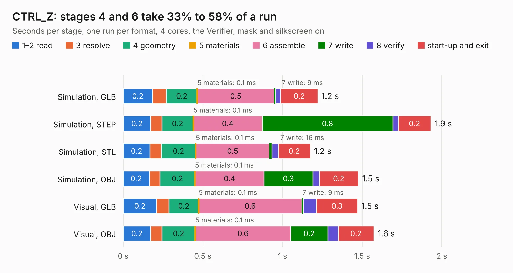

| Mode and format | 1–2 read | 3 resolve | 4 geometry | 5 materials | 6 assemble | 7 write | 8 verify | start-up and exit | Total |
|---|---:|---:|---:|---:|---:|---:|---:|---:|---:|
| Simulation, GLB | 0.2 | 87&nbsp;ms | 0.2 | 0.1&nbsp;ms | 0.5 | 9&nbsp;ms | 33&nbsp;ms | 0.2 | 1.2 |
| Simulation, STEP | 0.2 | 69&nbsp;ms | 0.2 | 0.1&nbsp;ms | 0.4 | 0.8 | 31&nbsp;ms | 0.2 | 1.9 |
| Simulation, STL | 0.2 | 71&nbsp;ms | 0.2 | 0.1&nbsp;ms | 0.5 | 16&nbsp;ms | 39&nbsp;ms | 0.2 | 1.2 |
| Simulation, OBJ | 0.2 | 66&nbsp;ms | 0.2 | 0.1&nbsp;ms | 0.4 | 0.3 | 39&nbsp;ms | 0.2 | 1.5 |
| Visual, GLB | 0.2 | 76&nbsp;ms | 0.2 | 0.1&nbsp;ms | 0.6 | 9&nbsp;ms | 83&nbsp;ms | 0.3 | 1.5 |
| Visual, OBJ | 0.2 | 70&nbsp;ms | 0.2 | 0.1&nbsp;ms | 0.6 | 0.2 | 65&nbsp;ms | 0.2 | 1.6 |

<table align="center"><tr><td valign="top">

| Board | Repo: [astronuat21/4ds](https://github.com/astronuat21/4ds) Board: `CTRL_Z.kicad_pcb` |
|---|---|
| Folder | CTRL_Z |
| Complexity | 43, simple |
| Copper&nbsp;layers | 2 |
| File&nbsp;format | KiCad 10 (20260206) |
| Parts,&nbsp;tracks,&nbsp;vias | 7, 33, 5 |
| Triangles,&nbsp;simulation | 49,064 in 11 parts |
| Verifier | PASS in all six runs |

</td><td valign="top">

<table>
<tr><th>File type</th><th>File size</th><th>Peak memory used</th></tr>
<tr><th colspan="3" align="left">Simulation</th></tr>
<tr><td>GLB</td><td align="right">1.8&nbsp;MB</td><td align="right">75&nbsp;MB</td></tr>
<tr><td>STEP</td><td align="right">9.8&nbsp;MB</td><td align="right">185&nbsp;MB</td></tr>
<tr><td>STL</td><td align="right">2.5&nbsp;MB</td><td align="right">76&nbsp;MB</td></tr>
<tr><td>OBJ</td><td align="right">4.8&nbsp;MB</td><td align="right">87&nbsp;MB</td></tr>
<tr><th colspan="3" align="left">Visual</th></tr>
<tr><td>GLB</td><td align="right">1.6&nbsp;MB</td><td align="right">116&nbsp;MB</td></tr>
<tr><td>OBJ</td><td align="right">4.3&nbsp;MB</td><td align="right">114&nbsp;MB</td></tr>
</table>

</td></tr></table>

## 23.4.37 Motherboard

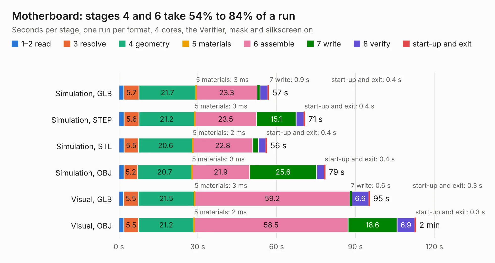

| Mode and format | 1–2 read | 3 resolve | 4 geometry | 5 materials | 6 assemble | 7 write | 8 verify | start-up and exit | Total |
|---|---:|---:|---:|---:|---:|---:|---:|---:|---:|
| Simulation, GLB | 1.9 | 5.7 | 21.7 | 3&nbsp;ms | 23.3 | 0.9 | 3.1 | 0.4 | 57.1 |
| Simulation, STEP | 2.0 | 5.6 | 21.2 | 3&nbsp;ms | 23.5 | 15.1 | 3.0 | 0.4 | 70.8 |
| Simulation, STL | 1.9 | 5.5 | 20.6 | 2&nbsp;ms | 22.8 | 2.2 | 2.9 | 0.4 | 56.3 |
| Simulation, OBJ | 2.0 | 5.2 | 20.7 | 3&nbsp;ms | 21.9 | 25.6 | 2.9 | 0.4 | 78.6 |
| Visual, GLB | 1.8 | 5.5 | 21.5 | 3&nbsp;ms | 59.2 | 0.6 | 6.6 | 0.3 | 95.5 |
| Visual, OBJ | 1.9 | 5.5 | 21.2 | 2&nbsp;ms | 58.5 | 18.6 | 6.9 | 0.3 | 113.0 |

<table align="center"><tr><td valign="top">

| Board | Repo: [astronuat21/4ds](https://github.com/astronuat21/4ds) Board: `Motherboard.kicad_pcb` |
|---|---|
| Folder | Motherboard |
| Complexity | 7,015, high |
| Copper&nbsp;layers | 4 |
| File&nbsp;format | KiCad 10 (20260206) |
| Parts,&nbsp;tracks,&nbsp;vias | 355, 4,274, 657 |
| Triangles,&nbsp;simulation | 5,230,646 in 623 parts |
| Verifier | PASS in all six runs |

</td><td valign="top">

<table>
<tr><th>File type</th><th>File size</th><th>Peak memory used</th></tr>
<tr><th colspan="3" align="left">Simulation</th></tr>
<tr><td>GLB</td><td align="right">181&nbsp;MB</td><td align="right">1.7&nbsp;GB</td></tr>
<tr><td>STEP</td><td align="right">920&nbsp;MB</td><td align="right">2.2&nbsp;GB</td></tr>
<tr><td>STL</td><td align="right">262&nbsp;MB</td><td align="right">1.7&nbsp;GB</td></tr>
<tr><td>OBJ</td><td align="right">566&nbsp;MB</td><td align="right">3.4&nbsp;GB</td></tr>
<tr><th colspan="3" align="left">Visual</th></tr>
<tr><td>GLB</td><td align="right">128&nbsp;MB</td><td align="right">2.1&nbsp;GB</td></tr>
<tr><td>OBJ</td><td align="right">414&nbsp;MB</td><td align="right">2.7&nbsp;GB</td></tr>
</table>

</td></tr></table>

## 23.4.38 usb-sniffer

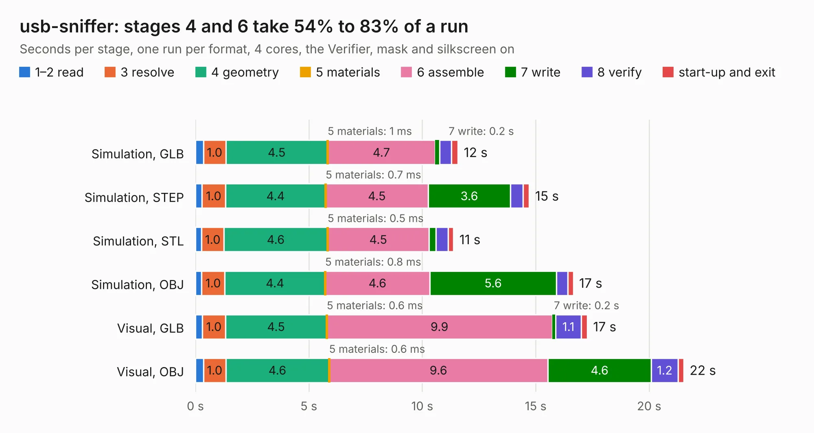

| Mode and format | 1–2 read | 3 resolve | 4 geometry | 5 materials | 6 assemble | 7 write | 8 verify | start-up and exit | Total |
|---|---:|---:|---:|---:|---:|---:|---:|---:|---:|
| Simulation, GLB | 0.4 | 1.0 | 4.5 | 1&nbsp;ms | 4.7 | 0.2 | 0.5 | 0.3 | 11.6 |
| Simulation, STEP | 0.3 | 1.0 | 4.4 | 0.7&nbsp;ms | 4.5 | 3.6 | 0.6 | 0.3 | 14.7 |
| Simulation, STL | 0.3 | 1.0 | 4.6 | 0.5&nbsp;ms | 4.5 | 0.3 | 0.5 | 0.2 | 11.4 |
| Simulation, OBJ | 0.3 | 1.0 | 4.4 | 0.8&nbsp;ms | 4.6 | 5.6 | 0.5 | 0.2 | 16.7 |
| Visual, GLB | 0.3 | 1.0 | 4.5 | 0.6&nbsp;ms | 9.9 | 0.2 | 1.1 | 0.3 | 17.3 |
| Visual, OBJ | 0.4 | 1.0 | 4.6 | 0.6&nbsp;ms | 9.6 | 4.6 | 1.2 | 0.3 | 21.5 |

<table align="center"><tr><td valign="top">

| Board | Repo: [ataradov/usb-sniffer](https://github.com/ataradov/usb-sniffer) Board: `usb-sniffer.kicad_pcb` |
|---|---|
| Folder | hardware |
| Complexity | 1,525, medium |
| Copper&nbsp;layers | 2 |
| File&nbsp;format | KiCad 7 (20221018) |
| Parts,&nbsp;tracks,&nbsp;vias | 72, 601, 220 |
| Triangles,&nbsp;simulation | 1,085,510 in 136 parts |
| Verifier | PASS in all six runs |

</td><td valign="top">

<table>
<tr><th>File type</th><th>File size</th><th>Peak memory used</th></tr>
<tr><th colspan="3" align="left">Simulation</th></tr>
<tr><td>GLB</td><td align="right">37&nbsp;MB</td><td align="right">489&nbsp;MB</td></tr>
<tr><td>STEP</td><td align="right">194&nbsp;MB</td><td align="right">628&nbsp;MB</td></tr>
<tr><td>STL</td><td align="right">54&nbsp;MB</td><td align="right">491&nbsp;MB</td></tr>
<tr><td>OBJ</td><td align="right">110&nbsp;MB</td><td align="right">797&nbsp;MB</td></tr>
<tr><th colspan="3" align="left">Visual</th></tr>
<tr><td>GLB</td><td align="right">32&nbsp;MB</td><td align="right">706&nbsp;MB</td></tr>
<tr><td>OBJ</td><td align="right">96&nbsp;MB</td><td align="right">728&nbsp;MB</td></tr>
</table>

</td></tr></table>

## 23.4.39 usb-sniffer-lite

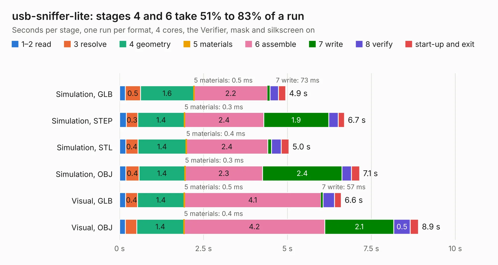

| Mode and format | 1–2 read | 3 resolve | 4 geometry | 5 materials | 6 assemble | 7 write | 8 verify | start-up and exit | Total |
|---|---:|---:|---:|---:|---:|---:|---:|---:|---:|
| Simulation, GLB | 0.2 | 0.5 | 1.6 | 0.5&nbsp;ms | 2.2 | 73&nbsp;ms | 0.3 | 0.2 | 4.9 |
| Simulation, STEP | 0.2 | 0.3 | 1.4 | 0.3&nbsp;ms | 2.4 | 1.9 | 0.3 | 0.2 | 6.7 |
| Simulation, STL | 0.2 | 0.4 | 1.4 | 0.4&nbsp;ms | 2.4 | 0.1 | 0.3 | 0.2 | 5.0 |
| Simulation, OBJ | 0.2 | 0.4 | 1.4 | 0.3&nbsp;ms | 2.3 | 2.4 | 0.3 | 0.2 | 7.1 |
| Visual, GLB | 0.2 | 0.4 | 1.4 | 0.5&nbsp;ms | 4.1 | 57&nbsp;ms | 0.3 | 0.2 | 6.6 |
| Visual, OBJ | 0.2 | 0.3 | 1.4 | 0.4&nbsp;ms | 4.2 | 2.1 | 0.5 | 0.2 | 8.9 |

<table align="center"><tr><td valign="top">

| Board | Repo: [ataradov/usb-sniffer-lite](https://github.com/ataradov/usb-sniffer-lite) Board: `usb-sniffer-lite.kicad_pcb` |
|---|---|
| Folder | hardware |
| Complexity | 522, low |
| Copper&nbsp;layers | 2 |
| File&nbsp;format | KiCad 7 (20221018) |
| Parts,&nbsp;tracks,&nbsp;vias | 34, 226, 56 |
| Triangles,&nbsp;simulation | 445,872 in 77 parts |
| Verifier | PASS in all six runs |

</td><td valign="top">

<table>
<tr><th>File type</th><th>File size</th><th>Peak memory used</th></tr>
<tr><th colspan="3" align="left">Simulation</th></tr>
<tr><td>GLB</td><td align="right">15&nbsp;MB</td><td align="right">304&nbsp;MB</td></tr>
<tr><td>STEP</td><td align="right">85&nbsp;MB</td><td align="right">347&nbsp;MB</td></tr>
<tr><td>STL</td><td align="right">22&nbsp;MB</td><td align="right">306&nbsp;MB</td></tr>
<tr><td>OBJ</td><td align="right">45&nbsp;MB</td><td align="right">356&nbsp;MB</td></tr>
<tr><th colspan="3" align="left">Visual</th></tr>
<tr><td>GLB</td><td align="right">13&nbsp;MB</td><td align="right">367&nbsp;MB</td></tr>
<tr><td>OBJ</td><td align="right">38&nbsp;MB</td><td align="right">372&nbsp;MB</td></tr>
</table>

</td></tr></table>

## 23.4.40 Atari TT030

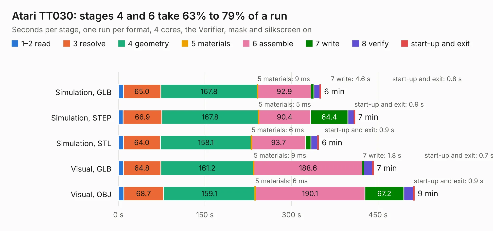

| Mode and format | 1–2 read | 3 resolve | 4 geometry | 5 materials | 6 assemble | 7 write | 8 verify | start-up and exit | Total |
|---|---:|---:|---:|---:|---:|---:|---:|---:|---:|
| Simulation, GLB | 8.4 | 65.0 | 167.8 | 9&nbsp;ms | 92.9 | 4.6 | 11.0 | 0.8 | 350.4 |
| Simulation, STEP | 8.2 | 66.9 | 167.8 | 5&nbsp;ms | 90.4 | 64.4 | 10.9 | 0.9 | 409.6 |
| Simulation, STL | 8.6 | 64.0 | 158.1 | 6&nbsp;ms | 93.7 | 9.2 | 11.9 | 0.9 | 346.4 |
| Simulation, OBJ |  |  |  |  |  |  |  |  | exceeded 11 GB on a 15 GB machine (stopped there, not a KESE failure) |
| Visual, GLB | 8.5 | 64.8 | 161.2 | 9&nbsp;ms | 188.6 | 1.8 | 16.1 | 0.7 | 441.7 |
| Visual, OBJ | 9.3 | 68.7 | 159.1 | 6&nbsp;ms | 190.1 | 67.2 | 17.2 | 0.9 | 512.6 |

<table align="center"><tr><td valign="top">

| Board | Repo: [AtarianComputing/Atari-TT030-PCB](https://github.com/AtarianComputing/Atari-TT030-PCB) Board: `Atari TT030.kicad_pcb` |
|---|---|
| Complexity | 1,997, medium |
| Copper&nbsp;layers | 2 |
| File&nbsp;format | KiCad 8 (20240108) |
| Parts,&nbsp;tracks,&nbsp;vias | 577, 3, 0 |
| Triangles,&nbsp;simulation | 19,979,304 in 1205 parts |
| Note | mostly unrouted |
| Verifier | Simulation, OBJ: exceeded 11 GB on a 15 GB machine (stopped there, not a KESE failure) |

</td><td valign="top">

<table>
<tr><th>File type</th><th>File size</th><th>Peak memory used</th></tr>
<tr><th colspan="3" align="left">Simulation</th></tr>
<tr><td>GLB</td><td align="right">674&nbsp;MB</td><td align="right">5.0&nbsp;GB</td></tr>
<tr><td>STEP</td><td align="right">3.4&nbsp;GB</td><td align="right">6.8&nbsp;GB</td></tr>
<tr><td>STL</td><td align="right">999&nbsp;MB</td><td align="right">4.7&nbsp;GB</td></tr>
<tr><td>OBJ</td><td align="right">–</td><td align="right">11&nbsp;GB</td></tr>
<tr><th colspan="3" align="left">Visual</th></tr>
<tr><td>GLB</td><td align="right">331&nbsp;MB</td><td align="right">5.6&nbsp;GB</td></tr>
<tr><td>OBJ</td><td align="right">1.1&nbsp;GB</td><td align="right">6.8&nbsp;GB</td></tr>
</table>

</td></tr></table>

## 23.4.41 esp32-s3-spectrum

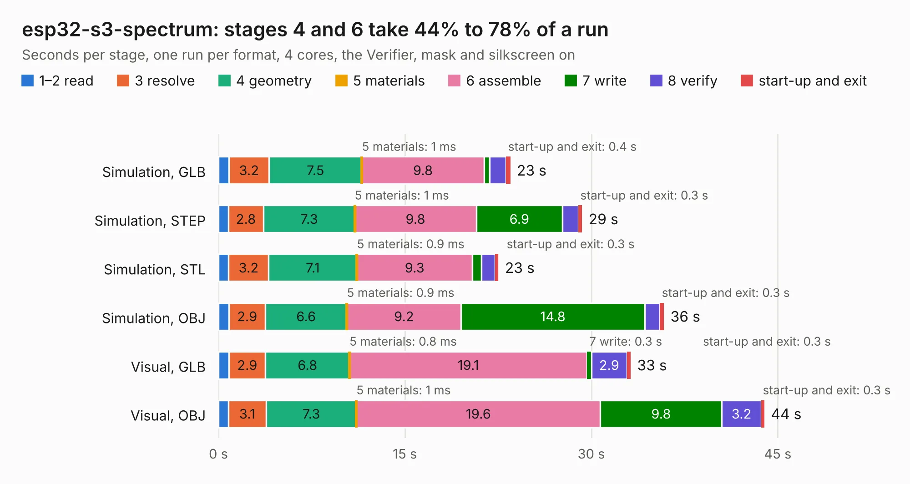

| Mode and format | 1–2 read | 3 resolve | 4 geometry | 5 materials | 6 assemble | 7 write | 8 verify | start-up and exit | Total |
|---|---:|---:|---:|---:|---:|---:|---:|---:|---:|
| Simulation, GLB | 0.9 | 3.2 | 7.5 | 1&nbsp;ms | 9.8 | 0.4 | 1.3 | 0.4 | 23.5 |
| Simulation, STEP | 0.8 | 2.8 | 7.3 | 1&nbsp;ms | 9.8 | 6.9 | 1.3 | 0.3 | 29.3 |
| Simulation, STL | 0.8 | 3.2 | 7.1 | 0.9&nbsp;ms | 9.3 | 0.7 | 1.1 | 0.3 | 22.5 |
| Simulation, OBJ | 0.9 | 2.9 | 6.6 | 0.9&nbsp;ms | 9.2 | 14.8 | 1.2 | 0.3 | 35.8 |
| Visual, GLB | 0.8 | 2.9 | 6.8 | 0.8&nbsp;ms | 19.1 | 0.3 | 2.9 | 0.3 | 33.2 |
| Visual, OBJ | 0.8 | 3.1 | 7.3 | 1&nbsp;ms | 19.6 | 9.8 | 3.2 | 0.3 | 43.9 |

<table align="center"><tr><td valign="top">

| Board | Repo: [atomic14/esp32-zxspectrum-hardware](https://github.com/atomic14/esp32-zxspectrum-hardware) Board: `esp32-s3-spectrum.kicad_pcb` |
|---|---|
| Complexity | 2,651, medium |
| Copper&nbsp;layers | 4 |
| File&nbsp;format | KiCad 8 (20240108) |
| Parts,&nbsp;tracks,&nbsp;vias | 71, 1,417, 364 |
| Triangles,&nbsp;simulation | 2,152,274 in 133 parts |
| Verifier | PASS in all six runs |

</td><td valign="top">

<table>
<tr><th>File type</th><th>File size</th><th>Peak memory used</th></tr>
<tr><th colspan="3" align="left">Simulation</th></tr>
<tr><td>GLB</td><td align="right">74&nbsp;MB</td><td align="right">757&nbsp;MB</td></tr>
<tr><td>STEP</td><td align="right">309&nbsp;MB</td><td align="right">991&nbsp;MB</td></tr>
<tr><td>STL</td><td align="right">108&nbsp;MB</td><td align="right">813&nbsp;MB</td></tr>
<tr><td>OBJ</td><td align="right">223&nbsp;MB</td><td align="right">1.5&nbsp;GB</td></tr>
<tr><th colspan="3" align="left">Visual</th></tr>
<tr><td>GLB</td><td align="right">48&nbsp;MB</td><td align="right">1.1&nbsp;GB</td></tr>
<tr><td>OBJ</td><td align="right">149&nbsp;MB</td><td align="right">1.1&nbsp;GB</td></tr>
</table>

</td></tr></table>

## 23.4.42 argo-v2

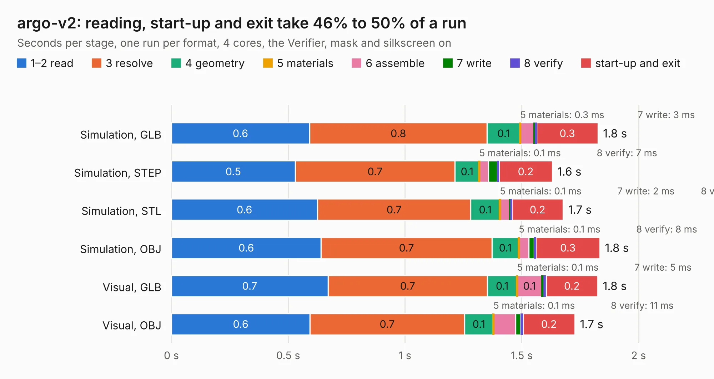

| Mode and format | 1–2 read | 3 resolve | 4 geometry | 5 materials | 6 assemble | 7 write | 8 verify | start-up and exit | Total |
|---|---:|---:|---:|---:|---:|---:|---:|---:|---:|
| Simulation, GLB | 0.6 | 0.8 | 0.1 | 0.3&nbsp;ms | 60&nbsp;ms | 3&nbsp;ms | 8&nbsp;ms | 0.3 | 1.8 |
| Simulation, STEP | 0.5 | 0.7 | 0.1 | 0.1&nbsp;ms | 39&nbsp;ms | 39&nbsp;ms | 7&nbsp;ms | 0.2 | 1.6 |
| Simulation, STL | 0.6 | 0.7 | 0.1 | 0.1&nbsp;ms | 43&nbsp;ms | 2&nbsp;ms | 7&nbsp;ms | 0.2 | 1.7 |
| Simulation, OBJ | 0.6 | 0.7 | 0.1 | 0.1&nbsp;ms | 43&nbsp;ms | 23&nbsp;ms | 8&nbsp;ms | 0.3 | 1.8 |
| Visual, GLB | 0.7 | 0.7 | 0.1 | 0.1&nbsp;ms | 0.1 | 5&nbsp;ms | 13&nbsp;ms | 0.2 | 1.8 |
| Visual, OBJ | 0.6 | 0.7 | 0.1 | 0.1&nbsp;ms | 95&nbsp;ms | 22&nbsp;ms | 11&nbsp;ms | 0.2 | 1.7 |

<table align="center"><tr><td valign="top">

| Board | Repo: [azlan-works/Argo](https://github.com/azlan-works/Argo) Board: `argo-v2.kicad_pcb` |
|---|---|
| Folder | KiCad |
| Complexity | 3,898, high |
| Copper&nbsp;layers | 6 |
| File&nbsp;format | KiCad 10 (20260206) |
| Parts,&nbsp;tracks,&nbsp;vias | 79, 2,792, 316 |
| Triangles,&nbsp;simulation | 5,016 in 7 parts |
| Verifier | PASS in all six runs |

</td><td valign="top">

<table>
<tr><th>File type</th><th>File size</th><th>Peak memory used</th></tr>
<tr><th colspan="3" align="left">Simulation</th></tr>
<tr><td>GLB</td><td align="right">106&nbsp;kB</td><td align="right">98&nbsp;MB</td></tr>
<tr><td>STEP</td><td align="right">142&nbsp;kB</td><td align="right">98&nbsp;MB</td></tr>
<tr><td>STL</td><td align="right">251&nbsp;kB</td><td align="right">98&nbsp;MB</td></tr>
<tr><td>OBJ</td><td align="right">448&nbsp;kB</td><td align="right">98&nbsp;MB</td></tr>
<tr><th colspan="3" align="left">Visual</th></tr>
<tr><td>GLB</td><td align="right">113&nbsp;kB</td><td align="right">98&nbsp;MB</td></tr>
<tr><td>OBJ</td><td align="right">342&nbsp;kB</td><td align="right">98&nbsp;MB</td></tr>
</table>

</td></tr></table>

## 23.4.43 latentpink

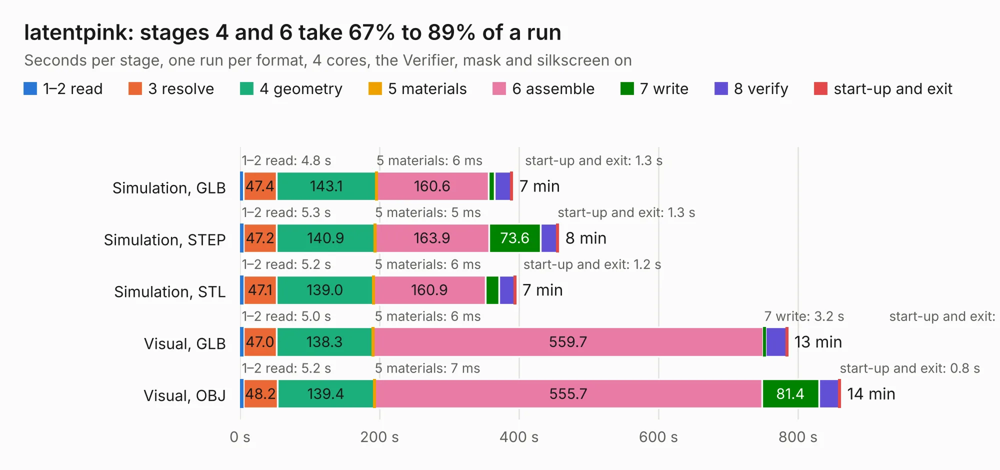

| Mode and format | 1–2 read | 3 resolve | 4 geometry | 5 materials | 6 assemble | 7 write | 8 verify | start-up and exit | Total |
|---|---:|---:|---:|---:|---:|---:|---:|---:|---:|
| Simulation, GLB | 4.8 | 47.4 | 143.1 | 6&nbsp;ms | 160.6 | 9.1 | 23.9 | 1.3 | 390.2 |
| Simulation, STEP | 5.3 | 47.2 | 140.9 | 5&nbsp;ms | 163.9 | 73.6 | 23.7 | 1.3 | 456.0 |
| Simulation, STL | 5.2 | 47.1 | 139.0 | 6&nbsp;ms | 160.9 | 19.0 | 22.2 | 1.2 | 394.5 |
| Simulation, OBJ |  |  |  |  |  |  |  |  | exceeded 11 GB on a 15 GB machine (stopped there, not a KESE failure) |
| Visual, GLB | 5.0 | 47.0 | 138.3 | 6&nbsp;ms | 559.7 | 3.2 | 30.5 | 0.7 | 784.4 |
| Visual, OBJ | 5.2 | 48.2 | 139.4 | 7&nbsp;ms | 555.7 | 81.4 | 29.6 | 0.8 | 860.2 |

<table align="center"><tr><td valign="top">

| Board | Repo: [azonenberg/latentpacket](https://github.com/azonenberg/latentpacket) Board: `latentpink.kicad_pcb` |
|---|---|
| Folder | latentpink / pcb |
| Complexity | 33,328, extreme |
| Copper&nbsp;layers | 8 |
| File&nbsp;format | KiCad 6 (20211014) |
| Parts,&nbsp;tracks,&nbsp;vias | 809, 18,528, 4,034 |
| Triangles,&nbsp;simulation | 35,643,884 in 971 parts |
| Verifier | Simulation, OBJ: exceeded 11 GB on a 15 GB machine (stopped there, not a KESE failure) |

</td><td valign="top">

<table>
<tr><th>File type</th><th>File size</th><th>Peak memory used</th></tr>
<tr><th colspan="3" align="left">Simulation</th></tr>
<tr><td>GLB</td><td align="right">1.2&nbsp;GB</td><td align="right">6.1&nbsp;GB</td></tr>
<tr><td>STEP</td><td align="right">3.6&nbsp;GB</td><td align="right">8.8&nbsp;GB</td></tr>
<tr><td>STL</td><td align="right">1.8&nbsp;GB</td><td align="right">6.7&nbsp;GB</td></tr>
<tr><td>OBJ</td><td align="right">–</td><td align="right">11&nbsp;GB</td></tr>
<tr><th colspan="3" align="left">Visual</th></tr>
<tr><td>GLB</td><td align="right">481&nbsp;MB</td><td align="right">8.1&nbsp;GB</td></tr>
<tr><td>OBJ</td><td align="right">1.6&nbsp;GB</td><td align="right">11&nbsp;GB</td></tr>
</table>

</td></tr></table>

## 23.4.44 entry-afe-characterization

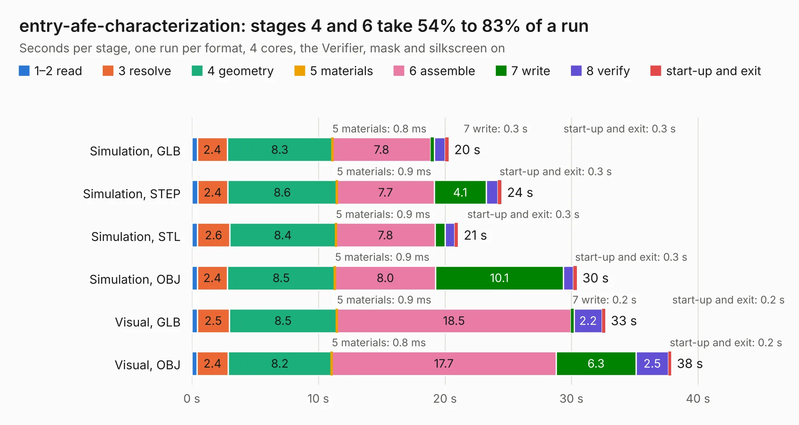

| Mode and format | 1–2 read | 3 resolve | 4 geometry | 5 materials | 6 assemble | 7 write | 8 verify | start-up and exit | Total |
|---|---:|---:|---:|---:|---:|---:|---:|---:|---:|
| Simulation, GLB | 0.4 | 2.4 | 8.3 | 0.8&nbsp;ms | 7.8 | 0.3 | 0.8 | 0.3 | 20.3 |
| Simulation, STEP | 0.5 | 2.4 | 8.6 | 0.9&nbsp;ms | 7.7 | 4.1 | 0.9 | 0.3 | 24.5 |
| Simulation, STL | 0.4 | 2.6 | 8.4 | 0.9&nbsp;ms | 7.8 | 0.8 | 0.8 | 0.3 | 21.0 |
| Simulation, OBJ | 0.4 | 2.4 | 8.5 | 0.9&nbsp;ms | 8.0 | 10.1 | 0.8 | 0.3 | 30.4 |
| Visual, GLB | 0.4 | 2.5 | 8.5 | 0.9&nbsp;ms | 18.5 | 0.2 | 2.2 | 0.2 | 32.7 |
| Visual, OBJ | 0.4 | 2.4 | 8.2 | 0.8&nbsp;ms | 17.7 | 6.3 | 2.5 | 0.2 | 37.9 |

<table align="center"><tr><td valign="top">

| Board | Repo: [azonenberg/starshipraider](https://github.com/azonenberg/starshipraider) Board: `entry-afe-characterization.kicad_pcb` |
|---|---|
| Folder | boards / BLONDEL / entry-afe-characterization |
| Complexity | 4,389, high |
| Copper&nbsp;layers | 4 |
| File&nbsp;format | KiCad 5 (20171130) |
| Parts,&nbsp;tracks,&nbsp;vias | 198, 2,553, 440 |
| Triangles,&nbsp;simulation | 2,344,926 in 130 parts |
| Verifier | PASS in all six runs |

</td><td valign="top">

<table>
<tr><th>File type</th><th>File size</th><th>Peak memory used</th></tr>
<tr><th colspan="3" align="left">Simulation</th></tr>
<tr><td>GLB</td><td align="right">82&nbsp;MB</td><td align="right">801&nbsp;MB</td></tr>
<tr><td>STEP</td><td align="right">274&nbsp;MB</td><td align="right">991&nbsp;MB</td></tr>
<tr><td>STL</td><td align="right">117&nbsp;MB</td><td align="right">790&nbsp;MB</td></tr>
<tr><td>OBJ</td><td align="right">249&nbsp;MB</td><td align="right">1.6&nbsp;GB</td></tr>
<tr><th colspan="3" align="left">Visual</th></tr>
<tr><td>GLB</td><td align="right">49&nbsp;MB</td><td align="right">935&nbsp;MB</td></tr>
<tr><td>OBJ</td><td align="right">152&nbsp;MB</td><td align="right">1.1&nbsp;GB</td></tr>
</table>

</td></tr></table>

## 23.4.45 hmcad-characterization

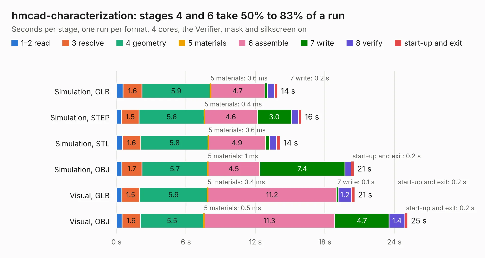

| Mode and format | 1–2 read | 3 resolve | 4 geometry | 5 materials | 6 assemble | 7 write | 8 verify | start-up and exit | Total |
|---|---:|---:|---:|---:|---:|---:|---:|---:|---:|
| Simulation, GLB | 0.6 | 1.6 | 5.9 | 0.6&nbsp;ms | 4.7 | 0.2 | 0.6 | 0.3 | 13.9 |
| Simulation, STEP | 0.4 | 1.5 | 5.6 | 0.4&nbsp;ms | 4.6 | 3.0 | 0.6 | 0.3 | 16.0 |
| Simulation, STL | 0.5 | 1.6 | 5.8 | 0.6&nbsp;ms | 4.9 | 0.4 | 0.6 | 0.3 | 14.1 |
| Simulation, OBJ | 0.5 | 1.7 | 5.7 | 1&nbsp;ms | 4.5 | 7.4 | 0.5 | 0.2 | 20.5 |
| Visual, GLB | 0.5 | 1.5 | 5.9 | 0.4&nbsp;ms | 11.2 | 0.1 | 1.2 | 0.2 | 20.6 |
| Visual, OBJ | 0.5 | 1.6 | 5.5 | 0.5&nbsp;ms | 11.3 | 4.7 | 1.4 | 0.2 | 25.1 |

<table align="center"><tr><td valign="top">

| Board | Repo: [azonenberg/starshipraider](https://github.com/azonenberg/starshipraider) Board: `hmcad-characterization.kicad_pcb` |
|---|---|
| Folder | boards / BLONDEL / hmcad-characterization |
| Complexity | 3,720, high |
| Copper&nbsp;layers | 4 |
| File&nbsp;format | KiCad 5 (20171130) |
| Parts,&nbsp;tracks,&nbsp;vias | 57, 2,886, 220 |
| Triangles,&nbsp;simulation | 1,340,912 in 76 parts |
| Verifier | PASS in all six runs |

</td><td valign="top">

<table>
<tr><th>File type</th><th>File size</th><th>Peak memory used</th></tr>
<tr><th colspan="3" align="left">Simulation</th></tr>
<tr><td>GLB</td><td align="right">47&nbsp;MB</td><td align="right">505&nbsp;MB</td></tr>
<tr><td>STEP</td><td align="right">188&nbsp;MB</td><td align="right">606&nbsp;MB</td></tr>
<tr><td>STL</td><td align="right">67&nbsp;MB</td><td align="right">528&nbsp;MB</td></tr>
<tr><td>OBJ</td><td align="right">139&nbsp;MB</td><td align="right">930&nbsp;MB</td></tr>
<tr><th colspan="3" align="left">Visual</th></tr>
<tr><td>GLB</td><td align="right">28&nbsp;MB</td><td align="right">610&nbsp;MB</td></tr>
<tr><td>OBJ</td><td align="right">84&nbsp;MB</td><td align="right">685&nbsp;MB</td></tr>
</table>

</td></tr></table>

## 23.4.46 host-x1

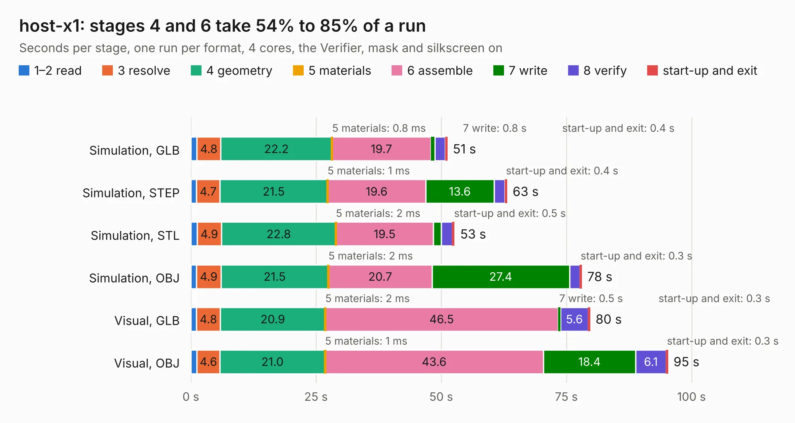

| Mode and format | 1–2 read | 3 resolve | 4 geometry | 5 materials | 6 assemble | 7 write | 8 verify | start-up and exit | Total |
|---|---:|---:|---:|---:|---:|---:|---:|---:|---:|
| Simulation, GLB | 1.2 | 4.8 | 22.2 | 0.8&nbsp;ms | 19.7 | 0.8 | 2.1 | 0.4 | 51.2 |
| Simulation, STEP | 1.1 | 4.7 | 21.5 | 1&nbsp;ms | 19.6 | 13.6 | 2.2 | 0.4 | 63.1 |
| Simulation, STL | 1.2 | 4.9 | 22.8 | 2&nbsp;ms | 19.5 | 1.6 | 2.2 | 0.5 | 52.7 |
| Simulation, OBJ | 1.1 | 4.9 | 21.5 | 2&nbsp;ms | 20.7 | 27.4 | 2.1 | 0.3 | 78.0 |
| Visual, GLB | 1.1 | 4.8 | 20.9 | 2&nbsp;ms | 46.5 | 0.5 | 5.6 | 0.3 | 79.7 |
| Visual, OBJ | 1.2 | 4.6 | 21.0 | 1&nbsp;ms | 43.6 | 18.4 | 6.1 | 0.3 | 95.3 |

<table align="center"><tr><td valign="top">

| Board | Repo: [azonenberg/starshipraider](https://github.com/azonenberg/starshipraider) Board: `host-x1.kicad_pcb` |
|---|---|
| Folder | boards / CLARKE / host-x1 |
| Complexity | 12,370, very high |
| Copper&nbsp;layers | 4 |
| File&nbsp;format | KiCad 5 (20170123) |
| Parts,&nbsp;tracks,&nbsp;vias | 215, 9,819, 597 |
| Triangles,&nbsp;simulation | 4,209,626 in 285 parts |
| Verifier | PASS in all six runs |

</td><td valign="top">

<table>
<tr><th>File type</th><th>File size</th><th>Peak memory used</th></tr>
<tr><th colspan="3" align="left">Simulation</th></tr>
<tr><td>GLB</td><td align="right">146&nbsp;MB</td><td align="right">1.4&nbsp;GB</td></tr>
<tr><td>STEP</td><td align="right">639&nbsp;MB</td><td align="right">1.6&nbsp;GB</td></tr>
<tr><td>STL</td><td align="right">211&nbsp;MB</td><td align="right">1.4&nbsp;GB</td></tr>
<tr><td>OBJ</td><td align="right">450&nbsp;MB</td><td align="right">2.8&nbsp;GB</td></tr>
<tr><th colspan="3" align="left">Visual</th></tr>
<tr><td>GLB</td><td align="right">96&nbsp;MB</td><td align="right">1.6&nbsp;GB</td></tr>
<tr><td>OBJ</td><td align="right">306&nbsp;MB</td><td align="right">2.1&nbsp;GB</td></tr>
</table>

</td></tr></table>

## 23.4.47 iob-characterization-v02

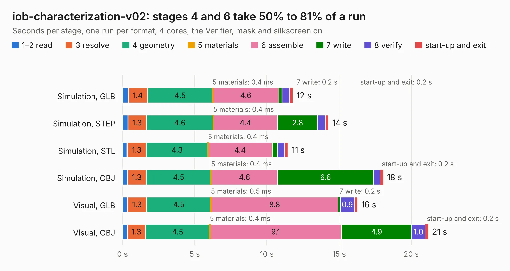

| Mode and format | 1–2 read | 3 resolve | 4 geometry | 5 materials | 6 assemble | 7 write | 8 verify | start-up and exit | Total |
|---|---:|---:|---:|---:|---:|---:|---:|---:|---:|
| Simulation, GLB | 0.4 | 1.4 | 4.5 | 0.4&nbsp;ms | 4.6 | 0.2 | 0.5 | 0.2 | 11.8 |
| Simulation, STEP | 0.4 | 1.3 | 4.6 | 0.4&nbsp;ms | 4.4 | 2.8 | 0.5 | 0.2 | 14.3 |
| Simulation, STL | 0.3 | 1.3 | 4.3 | 0.4&nbsp;ms | 4.4 | 0.4 | 0.5 | 0.2 | 11.5 |
| Simulation, OBJ | 0.4 | 1.3 | 4.5 | 0.4&nbsp;ms | 4.6 | 6.6 | 0.5 | 0.2 | 18.1 |
| Visual, GLB | 0.3 | 1.3 | 4.5 | 0.5&nbsp;ms | 8.8 | 0.2 | 0.9 | 0.2 | 16.3 |
| Visual, OBJ | 0.3 | 1.3 | 4.5 | 0.4&nbsp;ms | 9.1 | 4.9 | 1.0 | 0.2 | 21.2 |

<table align="center"><tr><td valign="top">

| Board | Repo: [azonenberg/starshipraider](https://github.com/azonenberg/starshipraider) Board: `iob-characterization-v02.kicad_pcb` |
|---|---|
| Folder | boards / CLARKE / iob-characterization-v02 |
| Complexity | 2,784, medium |
| Copper&nbsp;layers | 4 |
| File&nbsp;format | KiCad 5 (20171130) |
| Parts,&nbsp;tracks,&nbsp;vias | 122, 1,673, 269 |
| Triangles,&nbsp;simulation | 1,364,762 in 159 parts |
| Verifier | PASS in all six runs |

</td><td valign="top">

<table>
<tr><th>File type</th><th>File size</th><th>Peak memory used</th></tr>
<tr><th colspan="3" align="left">Simulation</th></tr>
<tr><td>GLB</td><td align="right">48&nbsp;MB</td><td align="right">639&nbsp;MB</td></tr>
<tr><td>STEP</td><td align="right">165&nbsp;MB</td><td align="right">718&nbsp;MB</td></tr>
<tr><td>STL</td><td align="right">68&nbsp;MB</td><td align="right">578&nbsp;MB</td></tr>
<tr><td>OBJ</td><td align="right">143&nbsp;MB</td><td align="right">945&nbsp;MB</td></tr>
<tr><th colspan="3" align="left">Visual</th></tr>
<tr><td>GLB</td><td align="right">32&nbsp;MB</td><td align="right">722&nbsp;MB</td></tr>
<tr><td>OBJ</td><td align="right">98&nbsp;MB</td><td align="right">752&nbsp;MB</td></tr>
</table>

</td></tr></table>

## 23.4.48 probecard-mmcx

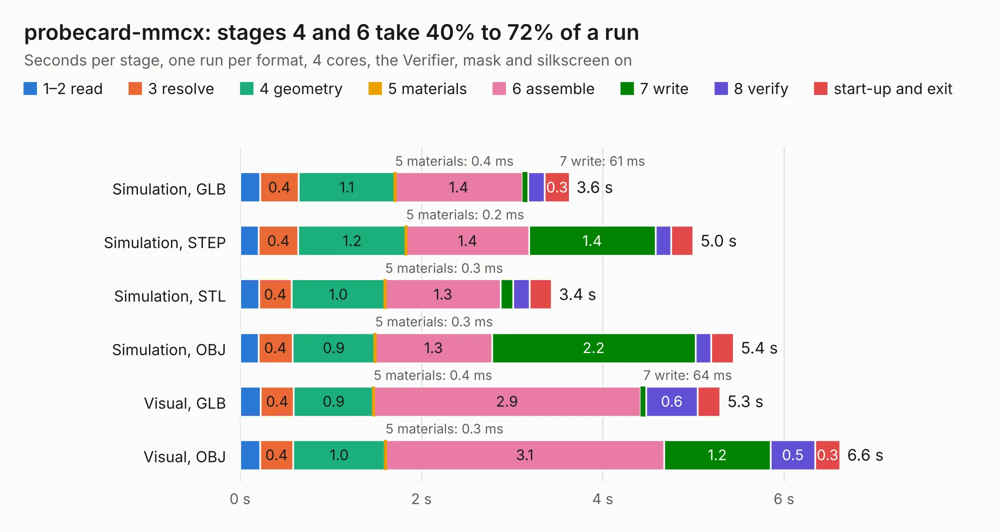

| Mode and format | 1–2 read | 3 resolve | 4 geometry | 5 materials | 6 assemble | 7 write | 8 verify | start-up and exit | Total |
|---|---:|---:|---:|---:|---:|---:|---:|---:|---:|
| Simulation, GLB | 0.2 | 0.4 | 1.1 | 0.4&nbsp;ms | 1.4 | 61&nbsp;ms | 0.2 | 0.3 | 3.6 |
| Simulation, STEP | 0.2 | 0.4 | 1.2 | 0.2&nbsp;ms | 1.4 | 1.4 | 0.2 | 0.2 | 5.0 |
| Simulation, STL | 0.2 | 0.4 | 1.0 | 0.3&nbsp;ms | 1.3 | 0.1 | 0.2 | 0.2 | 3.4 |
| Simulation, OBJ | 0.2 | 0.4 | 0.9 | 0.3&nbsp;ms | 1.3 | 2.2 | 0.2 | 0.2 | 5.4 |
| Visual, GLB | 0.2 | 0.4 | 0.9 | 0.4&nbsp;ms | 2.9 | 64&nbsp;ms | 0.6 | 0.2 | 5.3 |
| Visual, OBJ | 0.2 | 0.4 | 1.0 | 0.3&nbsp;ms | 3.1 | 1.2 | 0.5 | 0.3 | 6.6 |

<table align="center"><tr><td valign="top">

| Board | Repo: [azonenberg/starshipraider](https://github.com/azonenberg/starshipraider) Board: `probecard-mmcx.kicad_pcb` |
|---|---|
| Folder | boards / CLARKE / probecard-mmcx |
| Complexity | 1,041, medium |
| Copper&nbsp;layers | 4 |
| File&nbsp;format | KiCad 5 (20171130) |
| Parts,&nbsp;tracks,&nbsp;vias | 14, 824, 63 |
| Triangles,&nbsp;simulation | 347,308 in 50 parts |
| Verifier | PASS in all six runs |

</td><td valign="top">

<table>
<tr><th>File type</th><th>File size</th><th>Peak memory used</th></tr>
<tr><th colspan="3" align="left">Simulation</th></tr>
<tr><td>GLB</td><td align="right">12&nbsp;MB</td><td align="right">309&nbsp;MB</td></tr>
<tr><td>STEP</td><td align="right">48&nbsp;MB</td><td align="right">297&nbsp;MB</td></tr>
<tr><td>STL</td><td align="right">17&nbsp;MB</td><td align="right">295&nbsp;MB</td></tr>
<tr><td>OBJ</td><td align="right">35&nbsp;MB</td><td align="right">293&nbsp;MB</td></tr>
<tr><th colspan="3" align="left">Visual</th></tr>
<tr><td>GLB</td><td align="right">9.2&nbsp;MB</td><td align="right">286&nbsp;MB</td></tr>
<tr><td>OBJ</td><td align="right">27&nbsp;MB</td><td align="right">280&nbsp;MB</td></tr>
</table>

</td></tr></table>

## 23.4.49 probecard-pinheader

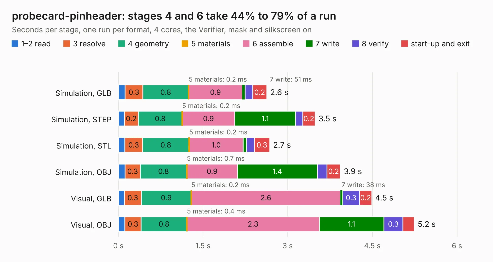

| Mode and format | 1–2 read | 3 resolve | 4 geometry | 5 materials | 6 assemble | 7 write | 8 verify | start-up and exit | Total |
|---|---:|---:|---:|---:|---:|---:|---:|---:|---:|
| Simulation, GLB | 0.1 | 0.3 | 0.8 | 0.2&nbsp;ms | 0.9 | 51&nbsp;ms | 0.1 | 0.2 | 2.6 |
| Simulation, STEP | 0.1 | 0.2 | 0.8 | 0.2&nbsp;ms | 0.9 | 1.1 | 0.1 | 0.2 | 3.5 |
| Simulation, STL | 0.1 | 0.3 | 0.8 | 0.2&nbsp;ms | 1.0 | 61&nbsp;ms | 0.1 | 0.3 | 2.7 |
| Simulation, OBJ | 0.1 | 0.3 | 0.8 | 0.7&nbsp;ms | 0.9 | 1.4 | 0.2 | 0.2 | 3.9 |
| Visual, GLB | 0.1 | 0.3 | 0.9 | 0.2&nbsp;ms | 2.6 | 38&nbsp;ms | 0.3 | 0.2 | 4.5 |
| Visual, OBJ | 0.1 | 0.3 | 0.8 | 0.4&nbsp;ms | 2.3 | 1.1 | 0.3 | 0.2 | 5.2 |

<table align="center"><tr><td valign="top">

| Board | Repo: [azonenberg/starshipraider](https://github.com/azonenberg/starshipraider) Board: `probecard-pinheader.kicad_pcb` |
|---|---|
| Folder | boards / CLARKE / probecard-pinheader |
| Complexity | 424, low |
| Copper&nbsp;layers | 4 |
| File&nbsp;format | KiCad 5 (20171130) |
| Parts,&nbsp;tracks,&nbsp;vias | 6, 521, 58 |
| Triangles,&nbsp;simulation | 293,160 in 50 parts |
| Verifier | PASS in all six runs |

</td><td valign="top">

<table>
<tr><th>File type</th><th>File size</th><th>Peak memory used</th></tr>
<tr><th colspan="3" align="left">Simulation</th></tr>
<tr><td>GLB</td><td align="right">10&nbsp;MB</td><td align="right">255&nbsp;MB</td></tr>
<tr><td>STEP</td><td align="right">36&nbsp;MB</td><td align="right">278&nbsp;MB</td></tr>
<tr><td>STL</td><td align="right">15&nbsp;MB</td><td align="right">241&nbsp;MB</td></tr>
<tr><td>OBJ</td><td align="right">30&nbsp;MB</td><td align="right">260&nbsp;MB</td></tr>
<tr><th colspan="3" align="left">Visual</th></tr>
<tr><td>GLB</td><td align="right">7.6&nbsp;MB</td><td align="right">251&nbsp;MB</td></tr>
<tr><td>OBJ</td><td align="right">23&nbsp;MB</td><td align="right">254&nbsp;MB</td></tr>
</table>

</td></tr></table>

## 23.4.50 maxwell-main

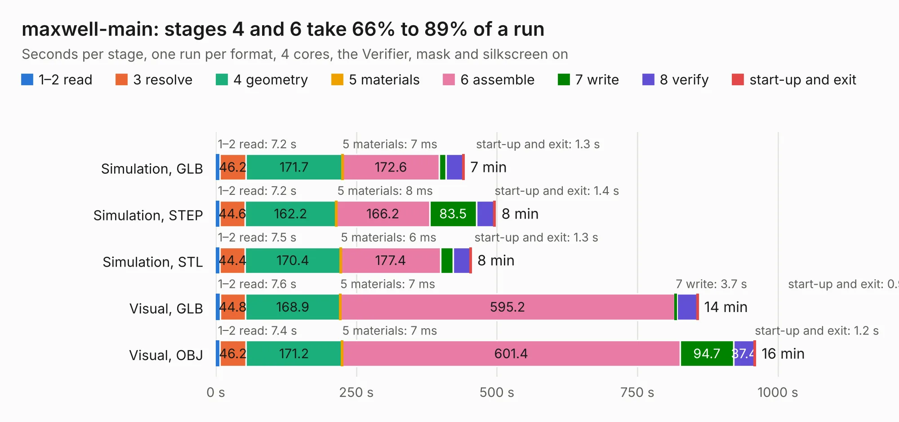

| Mode and format | 1–2 read | 3 resolve | 4 geometry | 5 materials | 6 assemble | 7 write | 8 verify | start-up and exit | Total |
|---|---:|---:|---:|---:|---:|---:|---:|---:|---:|
| Simulation, GLB | 7.2 | 46.2 | 171.7 | 7&nbsp;ms | 172.6 | 12.0 | 30.2 | 1.3 | 441.2 |
| Simulation, STEP | 7.2 | 44.6 | 162.2 | 8&nbsp;ms | 166.2 | 83.5 | 31.5 | 1.4 | 496.7 |
| Simulation, STL | 7.5 | 44.4 | 170.4 | 6&nbsp;ms | 177.4 | 22.9 | 29.9 | 1.3 | 453.8 |
| Simulation, OBJ |  |  |  |  |  |  |  |  | exceeded 11 GB on a 15 GB machine (stopped there, not a KESE failure) |
| Visual, GLB | 7.6 | 44.8 | 168.9 | 7&nbsp;ms | 595.2 | 3.7 | 36.3 | 0.9 | 857.4 |
| Visual, OBJ | 7.4 | 46.2 | 171.2 | 7&nbsp;ms | 601.4 | 94.7 | 37.4 | 1.2 | 959.6 |

<table align="center"><tr><td valign="top">

| Board | Repo: [azonenberg/starshipraider](https://github.com/azonenberg/starshipraider) Board: `maxwell-main.kicad_pcb` |
|---|---|
| Folder | boards / MAXWELL / maxwell-main |
| Complexity | 67,060, extreme |
| Copper&nbsp;layers | 8 |
| File&nbsp;format | KiCad 5 (20171130) |
| Parts,&nbsp;tracks,&nbsp;vias | 910, 53,306, 3,708 |
| Triangles,&nbsp;simulation | 36,532,372 in 936 parts |
| Verifier | Simulation, OBJ: exceeded 11 GB on a 15 GB machine (stopped there, not a KESE failure) |

</td><td valign="top">

<table>
<tr><th>File type</th><th>File size</th><th>Peak memory used</th></tr>
<tr><th colspan="3" align="left">Simulation</th></tr>
<tr><td>GLB</td><td align="right">1.2&nbsp;GB</td><td align="right">6.3&nbsp;GB</td></tr>
<tr><td>STEP</td><td align="right">3.7&nbsp;GB</td><td align="right">9.1&nbsp;GB</td></tr>
<tr><td>STL</td><td align="right">1.8&nbsp;GB</td><td align="right">7.2&nbsp;GB</td></tr>
<tr><td>OBJ</td><td align="right">–</td><td align="right">11&nbsp;GB</td></tr>
<tr><th colspan="3" align="left">Visual</th></tr>
<tr><td>GLB</td><td align="right">496&nbsp;MB</td><td align="right">8.4&nbsp;GB</td></tr>
<tr><td>OBJ</td><td align="right">1.7&nbsp;GB</td><td align="right">10&nbsp;GB</td></tr>
</table>

</td></tr></table>

## 23.4.51 la-pod

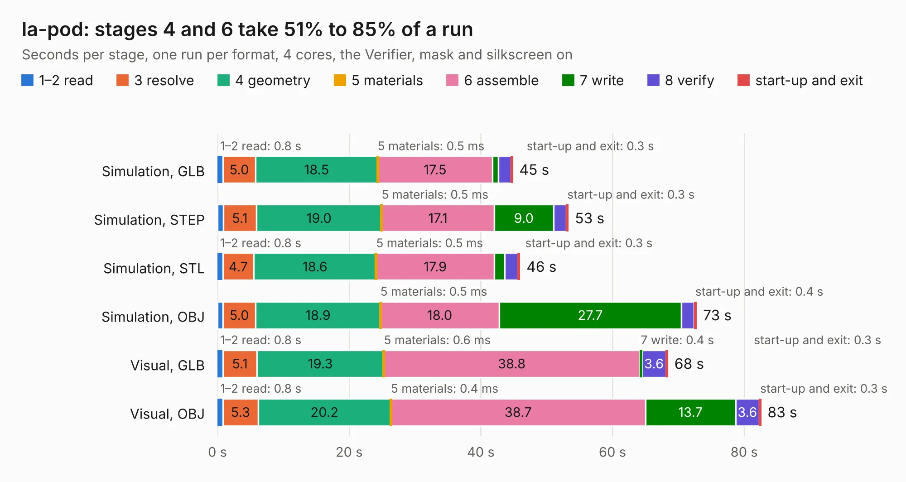

| Mode and format | 1–2 read | 3 resolve | 4 geometry | 5 materials | 6 assemble | 7 write | 8 verify | start-up and exit | Total |
|---|---:|---:|---:|---:|---:|---:|---:|---:|---:|
| Simulation, GLB | 0.8 | 5.0 | 18.5 | 0.5&nbsp;ms | 17.5 | 0.9 | 1.9 | 0.3 | 44.9 |
| Simulation, STEP | 0.9 | 5.1 | 19.0 | 0.5&nbsp;ms | 17.1 | 9.0 | 1.9 | 0.3 | 53.3 |
| Simulation, STL | 0.8 | 4.7 | 18.6 | 0.5&nbsp;ms | 17.9 | 1.6 | 2.0 | 0.3 | 46.0 |
| Simulation, OBJ | 0.8 | 5.0 | 18.9 | 0.5&nbsp;ms | 18.0 | 27.7 | 1.9 | 0.4 | 72.8 |
| Visual, GLB | 0.8 | 5.1 | 19.3 | 0.6&nbsp;ms | 38.8 | 0.4 | 3.6 | 0.3 | 68.4 |
| Visual, OBJ | 0.8 | 5.3 | 20.2 | 0.4&nbsp;ms | 38.7 | 13.7 | 3.6 | 0.3 | 82.6 |

<table align="center"><tr><td valign="top">

| Board | Repo: [azonenberg/starshipraider](https://github.com/azonenberg/starshipraider) Board: `la-pod.kicad_pcb` |
|---|---|
| Folder | boards / MEAD |
| Complexity | 8,376, very high |
| Copper&nbsp;layers | 4 |
| File&nbsp;format | KiCad 5 (20171130) |
| Parts,&nbsp;tracks,&nbsp;vias | 194, 5,003, 995 |
| Triangles,&nbsp;simulation | 4,824,904 in 124 parts |
| Verifier | PASS in all six runs |

</td><td valign="top">

<table>
<tr><th>File type</th><th>File size</th><th>Peak memory used</th></tr>
<tr><th colspan="3" align="left">Simulation</th></tr>
<tr><td>GLB</td><td align="right">165&nbsp;MB</td><td align="right">1.5&nbsp;GB</td></tr>
<tr><td>STEP</td><td align="right">540&nbsp;MB</td><td align="right">1.7&nbsp;GB</td></tr>
<tr><td>STL</td><td align="right">241&nbsp;MB</td><td align="right">1.6&nbsp;GB</td></tr>
<tr><td>OBJ</td><td align="right">514&nbsp;MB</td><td align="right">3.1&nbsp;GB</td></tr>
<tr><th colspan="3" align="left">Visual</th></tr>
<tr><td>GLB</td><td align="right">85&nbsp;MB</td><td align="right">1.5&nbsp;GB</td></tr>
<tr><td>OBJ</td><td align="right">271&nbsp;MB</td><td align="right">1.9&nbsp;GB</td></tr>
</table>

</td></tr></table>

## 23.4.52 active-host-test

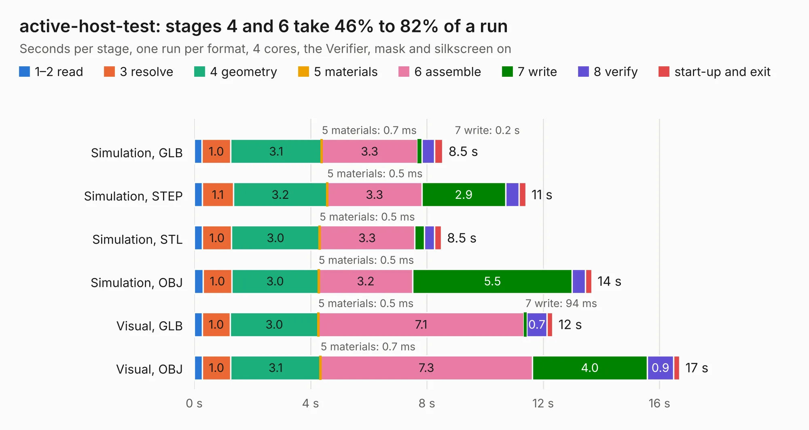

| Mode and format | 1–2 read | 3 resolve | 4 geometry | 5 materials | 6 assemble | 7 write | 8 verify | start-up and exit | Total |
|---|---:|---:|---:|---:|---:|---:|---:|---:|---:|
| Simulation, GLB | 0.3 | 1.0 | 3.1 | 0.7&nbsp;ms | 3.3 | 0.2 | 0.4 | 0.3 | 8.5 |
| Simulation, STEP | 0.3 | 1.1 | 3.2 | 0.5&nbsp;ms | 3.3 | 2.9 | 0.5 | 0.2 | 11.4 |
| Simulation, STL | 0.3 | 1.0 | 3.0 | 0.5&nbsp;ms | 3.3 | 0.3 | 0.4 | 0.2 | 8.5 |
| Simulation, OBJ | 0.3 | 1.0 | 3.0 | 0.5&nbsp;ms | 3.2 | 5.5 | 0.5 | 0.2 | 13.7 |
| Visual, GLB | 0.3 | 1.0 | 3.0 | 0.5&nbsp;ms | 7.1 | 94&nbsp;ms | 0.7 | 0.2 | 12.3 |
| Visual, OBJ | 0.3 | 1.0 | 3.1 | 0.7&nbsp;ms | 7.3 | 4.0 | 0.9 | 0.2 | 16.7 |

<table align="center"><tr><td valign="top">

| Board | Repo: [azonenberg/starshipraider](https://github.com/azonenberg/starshipraider) Board: `active-host-test.kicad_pcb` |
|---|---|
| Folder | boards / probes / active-host-test |
| Complexity | 1,350, medium |
| Copper&nbsp;layers | 4 |
| File&nbsp;format | KiCad 5 (20171130) |
| Parts,&nbsp;tracks,&nbsp;vias | 81, 654, 108 |
| Triangles,&nbsp;simulation | 953,894 in 151 parts |
| Verifier | PASS in all six runs |

</td><td valign="top">

<table>
<tr><th>File type</th><th>File size</th><th>Peak memory used</th></tr>
<tr><th colspan="3" align="left">Simulation</th></tr>
<tr><td>GLB</td><td align="right">33&nbsp;MB</td><td align="right">429&nbsp;MB</td></tr>
<tr><td>STEP</td><td align="right">128&nbsp;MB</td><td align="right">544&nbsp;MB</td></tr>
<tr><td>STL</td><td align="right">48&nbsp;MB</td><td align="right">422&nbsp;MB</td></tr>
<tr><td>OBJ</td><td align="right">96&nbsp;MB</td><td align="right">665&nbsp;MB</td></tr>
<tr><th colspan="3" align="left">Visual</th></tr>
<tr><td>GLB</td><td align="right">22&nbsp;MB</td><td align="right">515&nbsp;MB</td></tr>
<tr><td>OBJ</td><td align="right">66&nbsp;MB</td><td align="right">622&nbsp;MB</td></tr>
</table>

</td></tr></table>

## 23.4.53 active-probe-test

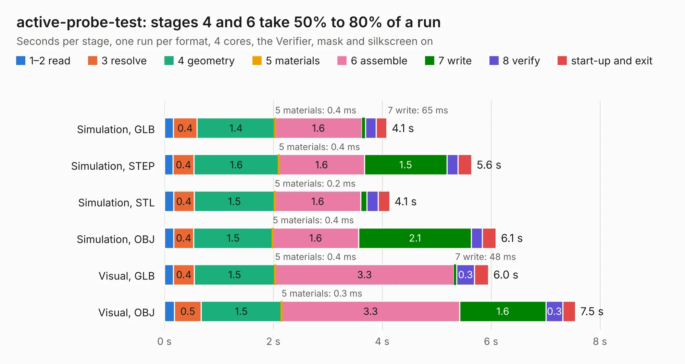

| Mode and format | 1–2 read | 3 resolve | 4 geometry | 5 materials | 6 assemble | 7 write | 8 verify | start-up and exit | Total |
|---|---:|---:|---:|---:|---:|---:|---:|---:|---:|
| Simulation, GLB | 0.2 | 0.4 | 1.4 | 0.4&nbsp;ms | 1.6 | 65&nbsp;ms | 0.2 | 0.2 | 4.1 |
| Simulation, STEP | 0.2 | 0.4 | 1.6 | 0.4&nbsp;ms | 1.6 | 1.5 | 0.2 | 0.3 | 5.6 |
| Simulation, STL | 0.2 | 0.4 | 1.5 | 0.2&nbsp;ms | 1.6 | 0.1 | 0.2 | 0.2 | 4.1 |
| Simulation, OBJ | 0.2 | 0.4 | 1.5 | 0.4&nbsp;ms | 1.6 | 2.1 | 0.2 | 0.3 | 6.1 |
| Visual, GLB | 0.2 | 0.4 | 1.5 | 0.4&nbsp;ms | 3.3 | 48&nbsp;ms | 0.3 | 0.3 | 6.0 |
| Visual, OBJ | 0.2 | 0.5 | 1.5 | 0.3&nbsp;ms | 3.3 | 1.6 | 0.3 | 0.2 | 7.5 |

<table align="center"><tr><td valign="top">

| Board | Repo: [azonenberg/starshipraider](https://github.com/azonenberg/starshipraider) Board: `active-probe-test.kicad_pcb` |
|---|---|
| Folder | boards / probes / active-probe-test |
| Complexity | 569, low |
| Copper&nbsp;layers | 2 |
| File&nbsp;format | KiCad 5 (20171130) |
| Parts,&nbsp;tracks,&nbsp;vias | 41, 349, 46 |
| Triangles,&nbsp;simulation | 380,072 in 55 parts |
| Verifier | PASS in all six runs |

</td><td valign="top">

<table>
<tr><th>File type</th><th>File size</th><th>Peak memory used</th></tr>
<tr><th colspan="3" align="left">Simulation</th></tr>
<tr><td>GLB</td><td align="right">13&nbsp;MB</td><td align="right">267&nbsp;MB</td></tr>
<tr><td>STEP</td><td align="right">62&nbsp;MB</td><td align="right">314&nbsp;MB</td></tr>
<tr><td>STL</td><td align="right">19&nbsp;MB</td><td align="right">269&nbsp;MB</td></tr>
<tr><td>OBJ</td><td align="right">38&nbsp;MB</td><td align="right">311&nbsp;MB</td></tr>
<tr><th colspan="3" align="left">Visual</th></tr>
<tr><td>GLB</td><td align="right">10&nbsp;MB</td><td align="right">322&nbsp;MB</td></tr>
<tr><td>OBJ</td><td align="right">30&nbsp;MB</td><td align="right">310&nbsp;MB</td></tr>
</table>

</td></tr></table>

## 23.4.54 akl-ad1

| Mode and format | 1–2 read | 3 resolve | 4 geometry | 5 materials | 6 assemble | 7 write | 8 verify | start-up and exit | Total |
|---|---:|---:|---:|---:|---:|---:|---:|---:|---:|
| Simulation, GLB | 0.3 | 1.3 | 5.5 | 0.4&nbsp;ms | 4.7 | 0.3 | 0.6 | 0.3 | 12.9 |
| Simulation, STEP | 0.3 | 1.3 | 5.5 | 0.5&nbsp;ms | 4.7 | 3.2 | 0.5 | 0.2 | 15.8 |
| Simulation, STL | 0.3 | 1.3 | 5.4 | 0.3&nbsp;ms | 4.5 | 0.4 | 0.5 | 0.3 | 12.6 |
| Simulation, OBJ | 0.3 | 1.3 | 5.3 | 0.4&nbsp;ms | 4.4 | 7.9 | 0.6 | 0.2 | 19.9 |
| Visual, GLB | 0.4 | 1.3 | 5.4 | 0.4&nbsp;ms | 9.8 | 0.1 | 1.0 | 0.3 | 18.4 |
| Visual, OBJ | 0.3 | 1.4 | 5.5 | 0.3&nbsp;ms | 10.5 | 4.0 | 0.7 | 0.3 | 22.6 |

<table align="center"><tr><td valign="top">

| Board | Repo: [azonenberg/starshipraider](https://github.com/azonenberg/starshipraider) Board: `akl-ad1.kicad_pcb` |
|---|---|
| Folder | boards / probes / akl-ad1 |
| Complexity | 1,654, medium |
| Copper&nbsp;layers | 4 |
| File&nbsp;format | KiCad 5 (20171130) |
| Parts,&nbsp;tracks,&nbsp;vias | 38, 702, 292 |
| Triangles,&nbsp;simulation | 1,301,788 in 41 parts |
| Verifier | PASS in all six runs |

</td><td valign="top">

<table>
<tr><th>File type</th><th>File size</th><th>Peak memory used</th></tr>
<tr><th colspan="3" align="left">Simulation</th></tr>
<tr><td>GLB</td><td align="right">44&nbsp;MB</td><td align="right">551&nbsp;MB</td></tr>
<tr><td>STEP</td><td align="right">134&nbsp;MB</td><td align="right">651&nbsp;MB</td></tr>
<tr><td>STL</td><td align="right">65&nbsp;MB</td><td align="right">535&nbsp;MB</td></tr>
<tr><td>OBJ</td><td align="right">133&nbsp;MB</td><td align="right">898&nbsp;MB</td></tr>
<tr><th colspan="3" align="left">Visual</th></tr>
<tr><td>GLB</td><td align="right">23&nbsp;MB</td><td align="right">569&nbsp;MB</td></tr>
<tr><td>OBJ</td><td align="right">69&nbsp;MB</td><td align="right">590&nbsp;MB</td></tr>
</table>

</td></tr></table>

## 23.4.55 amplifier

| Mode and format | 1–2 read | 3 resolve | 4 geometry | 5 materials | 6 assemble | 7 write | 8 verify | start-up and exit | Total |
|---|---:|---:|---:|---:|---:|---:|---:|---:|---:|
| Simulation, GLB | 0.2 | 1.0 | 4.2 | 0.2&nbsp;ms | 3.7 | 0.2 | 0.5 | 0.3 | 10.0 |
| Simulation, STEP | 0.2 | 1.0 | 4.3 | 0.2&nbsp;ms | 3.8 | 2.4 | 0.5 | 0.3 | 12.5 |
| Simulation, STL | 0.2 | 0.9 | 4.3 | 0.2&nbsp;ms | 3.5 | 0.4 | 0.5 | 0.3 | 10.0 |
| Simulation, OBJ | 0.2 | 1.0 | 4.1 | 0.2&nbsp;ms | 4.0 | 5.9 | 0.5 | 0.3 | 15.8 |
| Visual, GLB | 0.2 | 0.9 | 4.3 | 0.3&nbsp;ms | 7.9 | 67&nbsp;ms | 0.7 | 0.3 | 14.3 |
| Visual, OBJ | 0.2 | 0.9 | 4.0 | 0.3&nbsp;ms | 7.5 | 2.3 | 0.7 | 0.2 | 15.8 |

<table align="center"><tr><td valign="top">

| Board | Repo: [azonenberg/starshipraider](https://github.com/azonenberg/starshipraider) Board: `amplifier.kicad_pcb` |
|---|---|
| Folder | boards / probes / akl-ad3 / amplifier |
| Complexity | 1,229, medium |
| Copper&nbsp;layers | 4 |
| File&nbsp;format | KiCad 5 (20171130) |
| Parts,&nbsp;tracks,&nbsp;vias | 30, 515, 218 |
| Triangles,&nbsp;simulation | 995,906 in 28 parts |
| Verifier | PASS in all six runs |

</td><td valign="top">

<table>
<tr><th>File type</th><th>File size</th><th>Peak memory used</th></tr>
<tr><th colspan="3" align="left">Simulation</th></tr>
<tr><td>GLB</td><td align="right">34&nbsp;MB</td><td align="right">468&nbsp;MB</td></tr>
<tr><td>STEP</td><td align="right">94&nbsp;MB</td><td align="right">529&nbsp;MB</td></tr>
<tr><td>STL</td><td align="right">50&nbsp;MB</td><td align="right">475&nbsp;MB</td></tr>
<tr><td>OBJ</td><td align="right">100&nbsp;MB</td><td align="right">709&nbsp;MB</td></tr>
<tr><th colspan="3" align="left">Visual</th></tr>
<tr><td>GLB</td><td align="right">14&nbsp;MB</td><td align="right">466&nbsp;MB</td></tr>
<tr><td>OBJ</td><td align="right">43&nbsp;MB</td><td align="right">468&nbsp;MB</td></tr>
</table>

</td></tr></table>

## 23.4.56 tip

| Mode and format | 1–2 read | 3 resolve | 4 geometry | 5 materials | 6 assemble | 7 write | 8 verify | start-up and exit | Total |
|---|---:|---:|---:|---:|---:|---:|---:|---:|---:|
| Simulation, GLB | 0.1 | 0.5 | 1.2 | 0.3&nbsp;ms | 1.3 | 42&nbsp;ms | 0.2 | 0.3 | 3.6 |
| Simulation, STEP | 0.1 | 0.5 | 1.2 | 0.2&nbsp;ms | 1.3 | 1.0 | 0.1 | 0.2 | 4.3 |
| Simulation, STL | 0.1 | 0.5 | 1.1 | 0.3&nbsp;ms | 1.2 | 58&nbsp;ms | 0.2 | 0.2 | 3.3 |
| Simulation, OBJ | 0.1 | 0.5 | 1.2 | 0.2&nbsp;ms | 1.2 | 1.3 | 0.1 | 0.3 | 4.6 |
| Visual, GLB | 0.1 | 0.4 | 1.1 | 0.3&nbsp;ms | 2.2 | 30&nbsp;ms | 0.2 | 0.3 | 4.4 |
| Visual, OBJ | 0.1 | 0.5 | 1.1 | 0.3&nbsp;ms | 2.2 | 1.0 | 0.2 | 0.3 | 5.3 |

<table align="center"><tr><td valign="top">

| Board | Repo: [azonenberg/starshipraider](https://github.com/azonenberg/starshipraider) Board: `tip.kicad_pcb` |
|---|---|
| Folder | boards / probes / akl-ad3 / tip |
| Complexity | 583, low |
| Copper&nbsp;layers | 2 |
| File&nbsp;format | KiCad 5 (20171130) |
| Parts,&nbsp;tracks,&nbsp;vias | 7, 256, 188 |
| Triangles,&nbsp;simulation | 210,136 in 19 parts |
| Verifier | PASS in all six runs |

</td><td valign="top">

<table>
<tr><th>File type</th><th>File size</th><th>Peak memory used</th></tr>
<tr><th colspan="3" align="left">Simulation</th></tr>
<tr><td>GLB</td><td align="right">7.2&nbsp;MB</td><td align="right">240&nbsp;MB</td></tr>
<tr><td>STEP</td><td align="right">15&nbsp;MB</td><td align="right">266&nbsp;MB</td></tr>
<tr><td>STL</td><td align="right">11&nbsp;MB</td><td align="right">243&nbsp;MB</td></tr>
<tr><td>OBJ</td><td align="right">20&nbsp;MB</td><td align="right">241&nbsp;MB</td></tr>
<tr><th colspan="3" align="left">Visual</th></tr>
<tr><td>GLB</td><td align="right">6.2&nbsp;MB</td><td align="right">253&nbsp;MB</td></tr>
<tr><td>OBJ</td><td align="right">18&nbsp;MB</td><td align="right">255&nbsp;MB</td></tr>
</table>

</td></tr></table>

## 23.4.57 vna-amplifier

| Mode and format | 1–2 read | 3 resolve | 4 geometry | 5 materials | 6 assemble | 7 write | 8 verify | start-up and exit | Total |
|---|---:|---:|---:|---:|---:|---:|---:|---:|---:|
| Simulation, GLB | 0.1 | 0.1 | 0.4 | 0.2&nbsp;ms | 0.6 | 17&nbsp;ms | 42&nbsp;ms | 0.2 | 1.6 |
| Simulation, STEP | 0.2 | 0.2 | 0.3 | 0.1&nbsp;ms | 0.5 | 0.9 | 61&nbsp;ms | 0.3 | 2.4 |
| Simulation, STL | 0.1 | 0.1 | 0.4 | 0.1&nbsp;ms | 0.6 | 25&nbsp;ms | 42&nbsp;ms | 0.2 | 1.5 |
| Simulation, OBJ | 0.2 | 0.1 | 0.4 | 0.1&nbsp;ms | 0.6 | 0.7 | 60&nbsp;ms | 0.3 | 2.3 |
| Visual, GLB | 0.1 | 0.1 | 0.3 | 0.1&nbsp;ms | 1.1 | 12&nbsp;ms | 92&nbsp;ms | 0.2 | 2.1 |
| Visual, OBJ | 0.1 | 0.1 | 0.3 | 0.1&nbsp;ms | 1.1 | 0.4 | 0.1 | 0.3 | 2.5 |

<table align="center"><tr><td valign="top">

| Board | Repo: [azonenberg/starshipraider](https://github.com/azonenberg/starshipraider) Board: `vna-amplifier.kicad_pcb` |
|---|---|
| Folder | boards / probes / akl-ad3 / vna-amplifier |
| Complexity | 20, simple |
| Copper&nbsp;layers | 4 |
| File&nbsp;format | KiCad 5 (20171130) |
| Parts,&nbsp;tracks,&nbsp;vias | 3, 39, 8 |
| Triangles,&nbsp;simulation | 93,052 in 15 parts |
| Verifier | PASS in all six runs |

</td><td valign="top">

<table>
<tr><th>File type</th><th>File size</th><th>Peak memory used</th></tr>
<tr><th colspan="3" align="left">Simulation</th></tr>
<tr><td>GLB</td><td align="right">3.3&nbsp;MB</td><td align="right">180&nbsp;MB</td></tr>
<tr><td>STEP</td><td align="right">14&nbsp;MB</td><td align="right">187&nbsp;MB</td></tr>
<tr><td>STL</td><td align="right">4.7&nbsp;MB</td><td align="right">181&nbsp;MB</td></tr>
<tr><td>OBJ</td><td align="right">9.0&nbsp;MB</td><td align="right">182&nbsp;MB</td></tr>
<tr><th colspan="3" align="left">Visual</th></tr>
<tr><td>GLB</td><td align="right">2.1&nbsp;MB</td><td align="right">153&nbsp;MB</td></tr>
<tr><td>OBJ</td><td align="right">5.8&nbsp;MB</td><td align="right">155&nbsp;MB</td></tr>
</table>

</td></tr></table>

## 23.4.58 akl-ad4

| Mode and format | 1–2 read | 3 resolve | 4 geometry | 5 materials | 6 assemble | 7 write | 8 verify | start-up and exit | Total |
|---|---:|---:|---:|---:|---:|---:|---:|---:|---:|
| Simulation, GLB | 0.1 | 0.4 | 1.4 | 0.2&nbsp;ms | 1.0 | 52&nbsp;ms | 0.2 | 0.3 | 3.5 |
| Simulation, STEP | 0.2 | 0.3 | 1.1 | 0.2&nbsp;ms | 1.1 | 1.2 | 0.2 | 0.2 | 4.4 |
| Simulation, STL | 0.2 | 0.3 | 1.0 | 0.2&nbsp;ms | 1.2 | 78&nbsp;ms | 0.2 | 0.2 | 3.1 |
| Simulation, OBJ | 0.1 | 0.4 | 1.1 | 0.2&nbsp;ms | 1.3 | 1.8 | 0.2 | 0.2 | 5.0 |
| Visual, GLB | 0.1 | 0.3 | 1.1 | 0.3&nbsp;ms | 3.6 | 28&nbsp;ms | 0.2 | 0.2 | 5.6 |
| Visual, OBJ | 0.1 | 0.3 | 1.1 | 0.2&nbsp;ms | 3.5 | 0.9 | 0.3 | 0.2 | 6.6 |

<table align="center"><tr><td valign="top">

| Board | Repo: [azonenberg/starshipraider](https://github.com/azonenberg/starshipraider) Board: `akl-ad4.kicad_pcb` |
|---|---|
| Folder | boards / probes / akl-ad4 |
| Complexity | 468, low |
| Copper&nbsp;layers | 4 |
| File&nbsp;format | KiCad 6 (20211014) |
| Parts,&nbsp;tracks,&nbsp;vias | 30, 222, 62 |
| Triangles,&nbsp;simulation | 308,998 in 38 parts |
| Verifier | PASS in all six runs |

</td><td valign="top">

<table>
<tr><th>File type</th><th>File size</th><th>Peak memory used</th></tr>
<tr><th colspan="3" align="left">Simulation</th></tr>
<tr><td>GLB</td><td align="right">11&nbsp;MB</td><td align="right">252&nbsp;MB</td></tr>
<tr><td>STEP</td><td align="right">38&nbsp;MB</td><td align="right">254&nbsp;MB</td></tr>
<tr><td>STL</td><td align="right">15&nbsp;MB</td><td align="right">249&nbsp;MB</td></tr>
<tr><td>OBJ</td><td align="right">31&nbsp;MB</td><td align="right">262&nbsp;MB</td></tr>
<tr><th colspan="3" align="left">Visual</th></tr>
<tr><td>GLB</td><td align="right">6.4&nbsp;MB</td><td align="right">243&nbsp;MB</td></tr>
<tr><td>OBJ</td><td align="right">18&nbsp;MB</td><td align="right">241&nbsp;MB</td></tr>
</table>

</td></tr></table>

## 23.4.59 akl-av1

| Mode and format | 1–2 read | 3 resolve | 4 geometry | 5 materials | 6 assemble | 7 write | 8 verify | start-up and exit | Total |
|---|---:|---:|---:|---:|---:|---:|---:|---:|---:|
| Simulation, GLB | 0.1 | 0.3 | 1.3 | 0.3&nbsp;ms | 1.3 | 70&nbsp;ms | 0.2 | 0.2 | 3.6 |
| Simulation, STEP | 0.1 | 0.4 | 1.3 | 0.2&nbsp;ms | 1.3 | 1.2 | 0.2 | 0.2 | 4.7 |
| Simulation, STL | 0.1 | 0.3 | 1.4 | 0.2&nbsp;ms | 1.3 | 0.1 | 0.2 | 0.2 | 3.7 |
| Simulation, OBJ | 0.1 | 0.4 | 1.4 | 0.2&nbsp;ms | 1.3 | 1.8 | 0.2 | 0.2 | 5.4 |
| Visual, GLB | 0.1 | 0.4 | 1.4 | 0.2&nbsp;ms | 4.1 | 51&nbsp;ms | 0.3 | 0.2 | 6.6 |
| Visual, OBJ | 0.1 | 0.4 | 1.4 | 0.2&nbsp;ms | 4.2 | 1.2 | 0.3 | 0.2 | 7.9 |

<table align="center"><tr><td valign="top">

| Board | Repo: [azonenberg/starshipraider](https://github.com/azonenberg/starshipraider) Board: `akl-av1.kicad_pcb` |
|---|---|
| Folder | boards / probes / akl-av1 |
| Complexity | 624, low |
| Copper&nbsp;layers | 4 |
| File&nbsp;format | KiCad 6 (20211014) |
| Parts,&nbsp;tracks,&nbsp;vias | 44, 299, 79 |
| Triangles,&nbsp;simulation | 383,162 in 41 parts |
| Verifier | PASS in all six runs |

</td><td valign="top">

<table>
<tr><th>File type</th><th>File size</th><th>Peak memory used</th></tr>
<tr><th colspan="3" align="left">Simulation</th></tr>
<tr><td>GLB</td><td align="right">13&nbsp;MB</td><td align="right">266&nbsp;MB</td></tr>
<tr><td>STEP</td><td align="right">44&nbsp;MB</td><td align="right">283&nbsp;MB</td></tr>
<tr><td>STL</td><td align="right">19&nbsp;MB</td><td align="right">273&nbsp;MB</td></tr>
<tr><td>OBJ</td><td align="right">39&nbsp;MB</td><td align="right">297&nbsp;MB</td></tr>
<tr><th colspan="3" align="left">Visual</th></tr>
<tr><td>GLB</td><td align="right">8.3&nbsp;MB</td><td align="right">271&nbsp;MB</td></tr>
<tr><td>OBJ</td><td align="right">24&nbsp;MB</td><td align="right">265&nbsp;MB</td></tr>
</table>

</td></tr></table>

## 23.4.60 akl-pd1

| Mode and format | 1–2 read | 3 resolve | 4 geometry | 5 materials | 6 assemble | 7 write | 8 verify | start-up and exit | Total |
|---|---:|---:|---:|---:|---:|---:|---:|---:|---:|
| Simulation, GLB | 0.1 | 0.9 | 2.3 | 0.4&nbsp;ms | 2.2 | 69&nbsp;ms | 0.3 | 0.3 | 6.1 |
| Simulation, STEP | 0.1 | 0.9 | 2.2 | 0.3&nbsp;ms | 2.1 | 1.3 | 0.3 | 0.2 | 7.2 |
| Simulation, STL | 0.1 | 0.9 | 2.4 | 0.3&nbsp;ms | 2.1 | 0.2 | 0.3 | 0.2 | 6.3 |
| Simulation, OBJ | 0.1 | 0.9 | 2.3 | 0.4&nbsp;ms | 2.2 | 2.1 | 0.3 | 0.2 | 8.1 |
| Visual, GLB | 0.1 | 0.9 | 2.4 | 0.4&nbsp;ms | 3.9 | 57&nbsp;ms | 0.4 | 0.2 | 8.0 |
| Visual, OBJ | 0.1 | 0.9 | 2.3 | 0.4&nbsp;ms | 3.8 | 1.7 | 0.4 | 0.2 | 9.4 |

<table align="center"><tr><td valign="top">

| Board | Repo: [azonenberg/starshipraider](https://github.com/azonenberg/starshipraider) Board: `akl-pd1.kicad_pcb` |
|---|---|
| Folder | boards / probes / akl-pd1 |
| Complexity | 1,250, medium |
| Copper&nbsp;layers | 2 |
| File&nbsp;format | KiCad 5 (20171130) |
| Parts,&nbsp;tracks,&nbsp;vias | 7, 479, 431 |
| Triangles,&nbsp;simulation | 443,906 in 20 parts |
| Verifier | PASS in all six runs |

</td><td valign="top">

<table>
<tr><th>File type</th><th>File size</th><th>Peak memory used</th></tr>
<tr><th colspan="3" align="left">Simulation</th></tr>
<tr><td>GLB</td><td align="right">15&nbsp;MB</td><td align="right">334&nbsp;MB</td></tr>
<tr><td>STEP</td><td align="right">26&nbsp;MB</td><td align="right">402&nbsp;MB</td></tr>
<tr><td>STL</td><td align="right">22&nbsp;MB</td><td align="right">343&nbsp;MB</td></tr>
<tr><td>OBJ</td><td align="right">43&nbsp;MB</td><td align="right">359&nbsp;MB</td></tr>
<tr><th colspan="3" align="left">Visual</th></tr>
<tr><td>GLB</td><td align="right">12&nbsp;MB</td><td align="right">384&nbsp;MB</td></tr>
<tr><td>OBJ</td><td align="right">35&nbsp;MB</td><td align="right">367&nbsp;MB</td></tr>
</table>

</td></tr></table>

## 23.4.61 compensation

| Mode and format | 1–2 read | 3 resolve | 4 geometry | 5 materials | 6 assemble | 7 write | 8 verify | start-up and exit | Total |
|---|---:|---:|---:|---:|---:|---:|---:|---:|---:|
| Simulation, GLB | 62&nbsp;ms | 35&nbsp;ms | 84&nbsp;ms | 0.1&nbsp;ms | 0.1 | 3&nbsp;ms | 16&nbsp;ms | 0.2 | 0.5 |
| Simulation, STEP | 71&nbsp;ms | 40&nbsp;ms | 82&nbsp;ms | 0.1&nbsp;ms | 0.1 | 0.1 | 11&nbsp;ms | 0.2 | 0.6 |
| Simulation, STL | 60&nbsp;ms | 37&nbsp;ms | 81&nbsp;ms | 0.1&nbsp;ms | 0.1 | 5&nbsp;ms | 15&nbsp;ms | 0.2 | 0.5 |
| Simulation, OBJ | 61&nbsp;ms | 39&nbsp;ms | 91&nbsp;ms | 0.1&nbsp;ms | 0.1 | 59&nbsp;ms | 16&nbsp;ms | 0.2 | 0.6 |
| Visual, GLB | 63&nbsp;ms | 38&nbsp;ms | 82&nbsp;ms | 0.1&nbsp;ms | 0.2 | 3&nbsp;ms | 25&nbsp;ms | 0.2 | 0.7 |
| Visual, OBJ | 66&nbsp;ms | 38&nbsp;ms | 88&nbsp;ms | 0.1&nbsp;ms | 0.2 | 52&nbsp;ms | 26&nbsp;ms | 0.2 | 0.7 |

<table align="center"><tr><td valign="top">

| Board | Repo: [azonenberg/starshipraider](https://github.com/azonenberg/starshipraider) Board: `compensation.kicad_pcb` |
|---|---|
| Folder | boards / probes / akl-pr1 / compensation |
| Complexity | 3, simple |
| Copper&nbsp;layers | 2 |
| File&nbsp;format | KiCad 6 (20211014) |
| Parts,&nbsp;tracks,&nbsp;vias | 2, 8, 1 |
| Triangles,&nbsp;simulation | 14,080 in 13 parts |
| Verifier | PASS in all six runs |

</td><td valign="top">

<table>
<tr><th>File type</th><th>File size</th><th>Peak memory used</th></tr>
<tr><th colspan="3" align="left">Simulation</th></tr>
<tr><td>GLB</td><td align="right">547&nbsp;kB</td><td align="right">63&nbsp;MB</td></tr>
<tr><td>STEP</td><td align="right">2.6&nbsp;MB</td><td align="right">65&nbsp;MB</td></tr>
<tr><td>STL</td><td align="right">705&nbsp;kB</td><td align="right">63&nbsp;MB</td></tr>
<tr><td>OBJ</td><td align="right">1.4&nbsp;MB</td><td align="right">65&nbsp;MB</td></tr>
<tr><th colspan="3" align="left">Visual</th></tr>
<tr><td>GLB</td><td align="right">432&nbsp;kB</td><td align="right">82&nbsp;MB</td></tr>
<tr><td>OBJ</td><td align="right">1.1&nbsp;MB</td><td align="right">81&nbsp;MB</td></tr>
</table>

</td></tr></table>

## 23.4.62 head

| Mode and format | 1–2 read | 3 resolve | 4 geometry | 5 materials | 6 assemble | 7 write | 8 verify | start-up and exit | Total |
|---|---:|---:|---:|---:|---:|---:|---:|---:|---:|
| Simulation, GLB | 79&nbsp;ms | 0.1 | 0.4 | 0.2&nbsp;ms | 0.6 | 18&nbsp;ms | 52&nbsp;ms | 0.2 | 1.4 |
| Simulation, STEP | 99&nbsp;ms | 0.1 | 0.4 | 0.2&nbsp;ms | 0.6 | 0.7 | 52&nbsp;ms | 0.2 | 2.1 |
| Simulation, STL | 76&nbsp;ms | 95&nbsp;ms | 0.4 | 0.1&nbsp;ms | 0.6 | 23&nbsp;ms | 55&nbsp;ms | 0.2 | 1.4 |
| Simulation, OBJ | 77&nbsp;ms | 96&nbsp;ms | 0.3 | 0.2&nbsp;ms | 0.5 | 0.6 | 55&nbsp;ms | 0.2 | 1.8 |
| Visual, GLB | 74&nbsp;ms | 0.1 | 0.3 | 0.1&nbsp;ms | 1.0 | 12&nbsp;ms | 62&nbsp;ms | 0.2 | 1.8 |
| Visual, OBJ | 96&nbsp;ms | 0.1 | 0.4 | 0.1&nbsp;ms | 1.0 | 0.3 | 57&nbsp;ms | 0.2 | 2.1 |

<table align="center"><tr><td valign="top">

| Board | Repo: [azonenberg/starshipraider](https://github.com/azonenberg/starshipraider) Board: `head.kicad_pcb` |
|---|---|
| Folder | boards / probes / akl-pr1 / head |
| Complexity | 27, simple |
| Copper&nbsp;layers | 4 |
| File&nbsp;format | KiCad 6 (20211014) |
| Parts,&nbsp;tracks,&nbsp;vias | 3, 21, 21 |
| Triangles,&nbsp;simulation | 96,558 in 19 parts |
| Verifier | PASS in all six runs |

</td><td valign="top">

<table>
<tr><th>File type</th><th>File size</th><th>Peak memory used</th></tr>
<tr><th colspan="3" align="left">Simulation</th></tr>
<tr><td>GLB</td><td align="right">3.3&nbsp;MB</td><td align="right">181&nbsp;MB</td></tr>
<tr><td>STEP</td><td align="right">10&nbsp;MB</td><td align="right">183&nbsp;MB</td></tr>
<tr><td>STL</td><td align="right">4.8&nbsp;MB</td><td align="right">180&nbsp;MB</td></tr>
<tr><td>OBJ</td><td align="right">9.2&nbsp;MB</td><td align="right">181&nbsp;MB</td></tr>
<tr><th colspan="3" align="left">Visual</th></tr>
<tr><td>GLB</td><td align="right">1.9&nbsp;MB</td><td align="right">154&nbsp;MB</td></tr>
<tr><td>OBJ</td><td align="right">5.3&nbsp;MB</td><td align="right">152&nbsp;MB</td></tr>
</table>

</td></tr></table>

## 23.4.63 akl-pt1

| Mode and format | 1–2 read | 3 resolve | 4 geometry | 5 materials | 6 assemble | 7 write | 8 verify | start-up and exit | Total |
|---|---:|---:|---:|---:|---:|---:|---:|---:|---:|
| Simulation, GLB | 0.2 | 0.4 | 2.1 | 0.2&nbsp;ms | 1.7 | 79&nbsp;ms | 0.3 | 0.2 | 5.0 |
| Simulation, STEP | 0.2 | 0.5 | 2.3 | 0.4&nbsp;ms | 1.7 | 1.4 | 0.2 | 0.2 | 6.5 |
| Simulation, STL | 0.2 | 0.4 | 2.1 | 0.3&nbsp;ms | 1.7 | 0.1 | 0.3 | 0.2 | 4.9 |
| Simulation, OBJ | 0.3 | 0.4 | 2.2 | 0.2&nbsp;ms | 1.6 | 3.0 | 0.3 | 0.2 | 7.8 |
| Visual, GLB | 0.2 | 0.4 | 2.2 | 0.4&nbsp;ms | 4.6 | 50&nbsp;ms | 0.3 | 0.2 | 7.9 |
| Visual, OBJ | 0.2 | 0.4 | 1.9 | 0.3&nbsp;ms | 4.5 | 1.3 | 0.2 | 0.2 | 8.8 |

<table align="center"><tr><td valign="top">

| Board | Repo: [azonenberg/starshipraider](https://github.com/azonenberg/starshipraider) Board: `akl-pt1.kicad_pcb` |
|---|---|
| Folder | boards / probes / akl-pt1 |
| Complexity | 161, simple |
| Copper&nbsp;layers | 4 |
| File&nbsp;format | KiCad 6 (20211014) |
| Parts,&nbsp;tracks,&nbsp;vias | 3, 139, 131 |
| Triangles,&nbsp;simulation | 529,138 in 15 parts |
| Verifier | PASS in all six runs |

</td><td valign="top">

<table>
<tr><th>File type</th><th>File size</th><th>Peak memory used</th></tr>
<tr><th colspan="3" align="left">Simulation</th></tr>
<tr><td>GLB</td><td align="right">18&nbsp;MB</td><td align="right">348&nbsp;MB</td></tr>
<tr><td>STEP</td><td align="right">55&nbsp;MB</td><td align="right">380&nbsp;MB</td></tr>
<tr><td>STL</td><td align="right">26&nbsp;MB</td><td align="right">349&nbsp;MB</td></tr>
<tr><td>OBJ</td><td align="right">53&nbsp;MB</td><td align="right">405&nbsp;MB</td></tr>
<tr><th colspan="3" align="left">Visual</th></tr>
<tr><td>GLB</td><td align="right">8.7&nbsp;MB</td><td align="right">318&nbsp;MB</td></tr>
<tr><td>OBJ</td><td align="right">26&nbsp;MB</td><td align="right">329&nbsp;MB</td></tr>
</table>

</td></tr></table>

## 23.4.64 akl-pt2

| Mode and format | 1–2 read | 3 resolve | 4 geometry | 5 materials | 6 assemble | 7 write | 8 verify | start-up and exit | Total |
|---|---:|---:|---:|---:|---:|---:|---:|---:|---:|
| Simulation, GLB | 0.1 | 0.7 | 1.9 | 0.4&nbsp;ms | 1.4 | 44&nbsp;ms | 0.1 | 0.2 | 4.5 |
| Simulation, STEP | 0.1 | 0.6 | 1.8 | 0.3&nbsp;ms | 1.6 | 1.0 | 0.1 | 0.3 | 5.6 |
| Simulation, STL | 0.1 | 0.8 | 2.0 | 0.2&nbsp;ms | 1.6 | 85&nbsp;ms | 0.2 | 0.2 | 5.0 |
| Simulation, OBJ | 0.1 | 0.7 | 1.8 | 0.3&nbsp;ms | 1.6 | 1.5 | 0.2 | 0.2 | 6.1 |
| Visual, GLB | 0.1 | 0.7 | 1.9 | 0.3&nbsp;ms | 2.9 | 39&nbsp;ms | 0.2 | 0.3 | 6.1 |
| Visual, OBJ | 0.1 | 0.7 | 1.8 | 0.4&nbsp;ms | 2.8 | 1.4 | 0.2 | 0.2 | 7.2 |

<table align="center"><tr><td valign="top">

| Board | Repo: [azonenberg/starshipraider](https://github.com/azonenberg/starshipraider) Board: `akl-pt2.kicad_pcb` |
|---|---|
| Folder | boards / probes / akl-pt2 |
| Complexity | 482, low |
| Copper&nbsp;layers | 2 |
| File&nbsp;format | KiCad 5 (20171130) |
| Parts,&nbsp;tracks,&nbsp;vias | 4, 305, 298 |
| Triangles,&nbsp;simulation | 279,582 in 17 parts |
| Verifier | PASS in all six runs |

</td><td valign="top">

<table>
<tr><th>File type</th><th>File size</th><th>Peak memory used</th></tr>
<tr><th colspan="3" align="left">Simulation</th></tr>
<tr><td>GLB</td><td align="right">9.5&nbsp;MB</td><td align="right">265&nbsp;MB</td></tr>
<tr><td>STEP</td><td align="right">12&nbsp;MB</td><td align="right">297&nbsp;MB</td></tr>
<tr><td>STL</td><td align="right">14&nbsp;MB</td><td align="right">265&nbsp;MB</td></tr>
<tr><td>OBJ</td><td align="right">27&nbsp;MB</td><td align="right">261&nbsp;MB</td></tr>
<tr><th colspan="3" align="left">Visual</th></tr>
<tr><td>GLB</td><td align="right">7.4&nbsp;MB</td><td align="right">269&nbsp;MB</td></tr>
<tr><td>OBJ</td><td align="right">22&nbsp;MB</td><td align="right">276&nbsp;MB</td></tr>
</table>

</td></tr></table>

## 23.4.65 akl-pt3

| Mode and format | 1–2 read | 3 resolve | 4 geometry | 5 materials | 6 assemble | 7 write | 8 verify | start-up and exit | Total |
|---|---:|---:|---:|---:|---:|---:|---:|---:|---:|
| Simulation, GLB | 74&nbsp;ms | 39&nbsp;ms | 72&nbsp;ms | 0.1&nbsp;ms | 0.2 | 4&nbsp;ms | 15&nbsp;ms | 0.2 | 0.6 |
| Simulation, STEP | 80&nbsp;ms | 44&nbsp;ms | 89&nbsp;ms | 0.1&nbsp;ms | 0.2 | 0.1 | 15&nbsp;ms | 0.2 | 0.7 |
| Simulation, STL | 80&nbsp;ms | 41&nbsp;ms | 76&nbsp;ms | 0.1&nbsp;ms | 0.2 | 5&nbsp;ms | 16&nbsp;ms | 0.2 | 0.6 |
| Simulation, OBJ | 97&nbsp;ms | 53&nbsp;ms | 91&nbsp;ms | 0.1&nbsp;ms | 0.2 | 69&nbsp;ms | 15&nbsp;ms | 0.2 | 0.7 |
| Visual, GLB | 73&nbsp;ms | 37&nbsp;ms | 70&nbsp;ms | 0.1&nbsp;ms | 0.3 | 4&nbsp;ms | 29&nbsp;ms | 0.2 | 0.7 |
| Visual, OBJ | 71&nbsp;ms | 61&nbsp;ms | 89&nbsp;ms | 0.1&nbsp;ms | 0.3 | 46&nbsp;ms | 33&nbsp;ms | 0.2 | 0.8 |

<table align="center"><tr><td valign="top">

| Board | Repo: [azonenberg/starshipraider](https://github.com/azonenberg/starshipraider) Board: `akl-pt3.kicad_pcb` |
|---|---|
| Folder | boards / probes / akl-pt3 |
| Complexity | 10, simple |
| Copper&nbsp;layers | 2 |
| File&nbsp;format | KiCad 5 (20171130) |
| Parts,&nbsp;tracks,&nbsp;vias | 4, 9, 3 |
| Triangles,&nbsp;simulation | 12,174 in 13 parts |
| Verifier | PASS in all six runs |

</td><td valign="top">

<table>
<tr><th>File type</th><th>File size</th><th>Peak memory used</th></tr>
<tr><th colspan="3" align="left">Simulation</th></tr>
<tr><td>GLB</td><td align="right">450&nbsp;kB</td><td align="right">60&nbsp;MB</td></tr>
<tr><td>STEP</td><td align="right">1.5&nbsp;MB</td><td align="right">62&nbsp;MB</td></tr>
<tr><td>STL</td><td align="right">610&nbsp;kB</td><td align="right">64&nbsp;MB</td></tr>
<tr><td>OBJ</td><td align="right">1.1&nbsp;MB</td><td align="right">63&nbsp;MB</td></tr>
<tr><th colspan="3" align="left">Visual</th></tr>
<tr><td>GLB</td><td align="right">305&nbsp;kB</td><td align="right">71&nbsp;MB</td></tr>
<tr><td>OBJ</td><td align="right">747&nbsp;kB</td><td align="right">76&nbsp;MB</td></tr>
</table>

</td></tr></table>

## 23.4.66 akl-pt5

| Mode and format | 1–2 read | 3 resolve | 4 geometry | 5 materials | 6 assemble | 7 write | 8 verify | start-up and exit | Total |
|---|---:|---:|---:|---:|---:|---:|---:|---:|---:|
| Simulation, GLB | 0.1 | 86&nbsp;ms | 0.3 | 0.1&nbsp;ms | 0.5 | 15&nbsp;ms | 50&nbsp;ms | 0.2 | 1.4 |
| Simulation, STEP | 89&nbsp;ms | 0.1 | 0.4 | 0.3&nbsp;ms | 0.5 | 0.7 | 53&nbsp;ms | 0.2 | 2.1 |
| Simulation, STL | 76&nbsp;ms | 86&nbsp;ms | 0.4 | 0.3&nbsp;ms | 0.5 | 23&nbsp;ms | 79&nbsp;ms | 0.2 | 1.4 |
| Simulation, OBJ | 97&nbsp;ms | 0.1 | 0.4 | 0.1&nbsp;ms | 0.6 | 0.5 | 59&nbsp;ms | 0.2 | 2.0 |
| Visual, GLB | 81&nbsp;ms | 0.1 | 0.4 | 0.2&nbsp;ms | 1.2 | 11&nbsp;ms | 61&nbsp;ms | 0.2 | 2.1 |
| Visual, OBJ | 87&nbsp;ms | 0.1 | 0.4 | 0.1&nbsp;ms | 1.2 | 0.3 | 53&nbsp;ms | 0.2 | 2.3 |

<table align="center"><tr><td valign="top">

| Board | Repo: [azonenberg/starshipraider](https://github.com/azonenberg/starshipraider) Board: `akl-pt5.kicad_pcb` |
|---|---|
| Folder | boards / probes / akl-pt5 |
| Complexity | 7, simple |
| Copper&nbsp;layers | 4 |
| File&nbsp;format | KiCad 6 (20211014) |
| Parts,&nbsp;tracks,&nbsp;vias | 1, 20, 18 |
| Triangles,&nbsp;simulation | 81,990 in 18 parts |
| Verifier | PASS in all six runs |

</td><td valign="top">

<table>
<tr><th>File type</th><th>File size</th><th>Peak memory used</th></tr>
<tr><th colspan="3" align="left">Simulation</th></tr>
<tr><td>GLB</td><td align="right">2.8&nbsp;MB</td><td align="right">175&nbsp;MB</td></tr>
<tr><td>STEP</td><td align="right">9.1&nbsp;MB</td><td align="right">180&nbsp;MB</td></tr>
<tr><td>STL</td><td align="right">4.1&nbsp;MB</td><td align="right">173&nbsp;MB</td></tr>
<tr><td>OBJ</td><td align="right">7.8&nbsp;MB</td><td align="right">181&nbsp;MB</td></tr>
<tr><th colspan="3" align="left">Visual</th></tr>
<tr><td>GLB</td><td align="right">1.6&nbsp;MB</td><td align="right">156&nbsp;MB</td></tr>
<tr><td>OBJ</td><td align="right">4.5&nbsp;MB</td><td align="right">156&nbsp;MB</td></tr>
</table>

</td></tr></table>

## 23.4.67 akl-pt6

| Mode and format | 1–2 read | 3 resolve | 4 geometry | 5 materials | 6 assemble | 7 write | 8 verify | start-up and exit | Total |
|---|---:|---:|---:|---:|---:|---:|---:|---:|---:|
| Simulation, GLB | 79&nbsp;ms | 0.1 | 0.4 | 0.2&nbsp;ms | 0.5 | 15&nbsp;ms | 47&nbsp;ms | 0.2 | 1.3 |
| Simulation, STEP | 83&nbsp;ms | 81&nbsp;ms | 0.3 | 0.1&nbsp;ms | 0.4 | 0.6 | 45&nbsp;ms | 0.2 | 1.8 |
| Simulation, STL | 74&nbsp;ms | 96&nbsp;ms | 0.3 | 0.1&nbsp;ms | 0.5 | 22&nbsp;ms | 45&nbsp;ms | 0.2 | 1.3 |
| Simulation, OBJ | 72&nbsp;ms | 85&nbsp;ms | 0.3 | 0.1&nbsp;ms | 0.5 | 0.4 | 45&nbsp;ms | 0.2 | 1.6 |
| Visual, GLB | 81&nbsp;ms | 88&nbsp;ms | 0.4 | 0.2&nbsp;ms | 1.0 | 9&nbsp;ms | 51&nbsp;ms | 0.2 | 1.8 |
| Visual, OBJ | 99&nbsp;ms | 85&nbsp;ms | 0.3 | 0.2&nbsp;ms | 1.0 | 0.3 | 49&nbsp;ms | 0.2 | 2.0 |

<table align="center"><tr><td valign="top">

| Board | Repo: [azonenberg/starshipraider](https://github.com/azonenberg/starshipraider) Board: `akl-pt6.kicad_pcb` |
|---|---|
| Folder | boards / probes / akl-pt6 |
| Complexity | 24, simple |
| Copper&nbsp;layers | 4 |
| File&nbsp;format | KiCad 6 (20211014) |
| Parts,&nbsp;tracks,&nbsp;vias | 3, 17, 19 |
| Triangles,&nbsp;simulation | 81,620 in 19 parts |
| Verifier | PASS in all six runs |

</td><td valign="top">

<table>
<tr><th>File type</th><th>File size</th><th>Peak memory used</th></tr>
<tr><th colspan="3" align="left">Simulation</th></tr>
<tr><td>GLB</td><td align="right">2.7&nbsp;MB</td><td align="right">178&nbsp;MB</td></tr>
<tr><td>STEP</td><td align="right">8.1&nbsp;MB</td><td align="right">179&nbsp;MB</td></tr>
<tr><td>STL</td><td align="right">4.1&nbsp;MB</td><td align="right">176&nbsp;MB</td></tr>
<tr><td>OBJ</td><td align="right">7.7&nbsp;MB</td><td align="right">177&nbsp;MB</td></tr>
<tr><th colspan="3" align="left">Visual</th></tr>
<tr><td>GLB</td><td align="right">1.5&nbsp;MB</td><td align="right">153&nbsp;MB</td></tr>
<tr><td>OBJ</td><td align="right">4.1&nbsp;MB</td><td align="right">153&nbsp;MB</td></tr>
</table>

</td></tr></table>

## 23.4.68 attenuator-test

| Mode and format | 1–2 read | 3 resolve | 4 geometry | 5 materials | 6 assemble | 7 write | 8 verify | start-up and exit | Total |
|---|---:|---:|---:|---:|---:|---:|---:|---:|---:|
| Simulation, GLB | 78&nbsp;ms | 0.2 | 1.2 | 0.2&nbsp;ms | 1.1 | 46&nbsp;ms | 0.1 | 0.2 | 2.9 |
| Simulation, STEP | 75&nbsp;ms | 0.2 | 1.1 | 0.4&nbsp;ms | 1.1 | 1.0 | 0.2 | 0.2 | 3.9 |
| Simulation, STL | 77&nbsp;ms | 0.2 | 1.1 | 0.3&nbsp;ms | 1.1 | 0.1 | 0.1 | 0.2 | 2.9 |
| Simulation, OBJ | 72&nbsp;ms | 0.2 | 1.1 | 0.2&nbsp;ms | 1.0 | 1.4 | 0.1 | 0.2 | 4.1 |
| Visual, GLB | 76&nbsp;ms | 0.2 | 1.1 | 0.3&nbsp;ms | 1.5 | 18&nbsp;ms | 0.2 | 0.2 | 3.3 |
| Visual, OBJ | 79&nbsp;ms | 0.2 | 1.1 | 0.2&nbsp;ms | 1.4 | 0.5 | 0.2 | 0.2 | 3.7 |

<table align="center"><tr><td valign="top">

| Board | Repo: [azonenberg/starshipraider](https://github.com/azonenberg/starshipraider) Board: `attenuator-test.kicad_pcb` |
|---|---|
| Folder | boards / probes / attenuator-test |
| Complexity | 188, simple |
| Copper&nbsp;layers | 4 |
| File&nbsp;format | KiCad 5 (20171130) |
| Parts,&nbsp;tracks,&nbsp;vias | 5, 96, 90 |
| Triangles,&nbsp;simulation | 341,232 in 15 parts |
| Verifier | PASS in all six runs |

</td><td valign="top">

<table>
<tr><th>File type</th><th>File size</th><th>Peak memory used</th></tr>
<tr><th colspan="3" align="left">Simulation</th></tr>
<tr><td>GLB</td><td align="right">11&nbsp;MB</td><td align="right">294&nbsp;MB</td></tr>
<tr><td>STEP</td><td align="right">30&nbsp;MB</td><td align="right">310&nbsp;MB</td></tr>
<tr><td>STL</td><td align="right">17&nbsp;MB</td><td align="right">277&nbsp;MB</td></tr>
<tr><td>OBJ</td><td align="right">33&nbsp;MB</td><td align="right">288&nbsp;MB</td></tr>
<tr><th colspan="3" align="left">Visual</th></tr>
<tr><td>GLB</td><td align="right">4.4&nbsp;MB</td><td align="right">211&nbsp;MB</td></tr>
<tr><td>OBJ</td><td align="right">12&nbsp;MB</td><td align="right">214&nbsp;MB</td></tr>
</table>

</td></tr></table>

## 23.4.69 bnc-test

| Mode and format | 1–2 read | 3 resolve | 4 geometry | 5 materials | 6 assemble | 7 write | 8 verify | start-up and exit | Total |
|---|---:|---:|---:|---:|---:|---:|---:|---:|---:|
| Simulation, GLB | 75&nbsp;ms | 0.3 | 0.8 | 0.1&nbsp;ms | 1.2 | 55&nbsp;ms | 0.2 | 0.2 | 2.8 |
| Simulation, STEP | 83&nbsp;ms | 0.3 | 0.8 | 0.1&nbsp;ms | 1.3 | 1.1 | 0.1 | 0.2 | 3.9 |
| Simulation, STL | 86&nbsp;ms | 0.3 | 0.8 | 0.2&nbsp;ms | 1.4 | 0.1 | 0.1 | 0.2 | 3.0 |
| Simulation, OBJ | 85&nbsp;ms | 0.3 | 0.9 | 0.1&nbsp;ms | 1.2 | 1.8 | 0.1 | 0.2 | 4.7 |
| Visual, GLB | 76&nbsp;ms | 0.3 | 0.9 | 0.2&nbsp;ms | 2.1 | 33&nbsp;ms | 0.4 | 0.2 | 4.0 |
| Visual, OBJ | 83&nbsp;ms | 0.3 | 0.8 | 0.2&nbsp;ms | 2.1 | 1.4 | 0.3 | 0.2 | 5.1 |

<table align="center"><tr><td valign="top">

| Board | Repo: [azonenberg/starshipraider](https://github.com/azonenberg/starshipraider) Board: `bnc-test.kicad_pcb` |
|---|---|
| Folder | boards / probes / bnc-test |
| Complexity | 80, simple |
| Copper&nbsp;layers | 4 |
| File&nbsp;format | KiCad 5 (20171130) |
| Parts,&nbsp;tracks,&nbsp;vias | 2, 116, 94 |
| Triangles,&nbsp;simulation | 350,408 in 14 parts |
| Verifier | PASS in all six runs |

</td><td valign="top">

<table>
<tr><th>File type</th><th>File size</th><th>Peak memory used</th></tr>
<tr><th colspan="3" align="left">Simulation</th></tr>
<tr><td>GLB</td><td align="right">11&nbsp;MB</td><td align="right">294&nbsp;MB</td></tr>
<tr><td>STEP</td><td align="right">34&nbsp;MB</td><td align="right">316&nbsp;MB</td></tr>
<tr><td>STL</td><td align="right">18&nbsp;MB</td><td align="right">263&nbsp;MB</td></tr>
<tr><td>OBJ</td><td align="right">34&nbsp;MB</td><td align="right">283&nbsp;MB</td></tr>
<tr><th colspan="3" align="left">Visual</th></tr>
<tr><td>GLB</td><td align="right">8.1&nbsp;MB</td><td align="right">271&nbsp;MB</td></tr>
<tr><td>OBJ</td><td align="right">24&nbsp;MB</td><td align="right">272&nbsp;MB</td></tr>
</table>

</td></tr></table>

## 23.4.70 fixture-akl-pt2

| Mode and format | 1–2 read | 3 resolve | 4 geometry | 5 materials | 6 assemble | 7 write | 8 verify | start-up and exit | Total |
|---|---:|---:|---:|---:|---:|---:|---:|---:|---:|
| Simulation, GLB | 92&nbsp;ms | 0.3 | 1.6 | 0.2&nbsp;ms | 1.5 | 58&nbsp;ms | 0.2 | 0.2 | 3.9 |
| Simulation, STEP | 85&nbsp;ms | 0.3 | 1.8 | 0.1&nbsp;ms | 1.4 | 1.3 | 0.2 | 0.2 | 5.3 |
| Simulation, STL | 80&nbsp;ms | 0.3 | 1.7 | 0.2&nbsp;ms | 1.3 | 94&nbsp;ms | 0.2 | 0.2 | 3.8 |
| Simulation, OBJ | 84&nbsp;ms | 0.3 | 1.7 | 0.2&nbsp;ms | 1.3 | 1.9 | 0.2 | 0.2 | 5.7 |
| Visual, GLB | 0.1 | 0.3 | 1.8 | 0.2&nbsp;ms | 3.0 | 41&nbsp;ms | 0.3 | 0.2 | 5.8 |
| Visual, OBJ | 77&nbsp;ms | 0.3 | 1.8 | 0.2&nbsp;ms | 2.8 | 1.1 | 0.3 | 0.3 | 6.6 |

<table align="center"><tr><td valign="top">

| Board | Repo: [azonenberg/starshipraider](https://github.com/azonenberg/starshipraider) Board: `fixture-akl-pt2.kicad_pcb` |
|---|---|
| Folder | boards / probes / fixture-akl-pt2 |
| Complexity | 143, simple |
| Copper&nbsp;layers | 4 |
| File&nbsp;format | KiCad 5 (20171130) |
| Parts,&nbsp;tracks,&nbsp;vias | 3, 128, 115 |
| Triangles,&nbsp;simulation | 404,734 in 15 parts |
| Verifier | PASS in all six runs |

</td><td valign="top">

<table>
<tr><th>File type</th><th>File size</th><th>Peak memory used</th></tr>
<tr><th colspan="3" align="left">Simulation</th></tr>
<tr><td>GLB</td><td align="right">13&nbsp;MB</td><td align="right">287&nbsp;MB</td></tr>
<tr><td>STEP</td><td align="right">38&nbsp;MB</td><td align="right">340&nbsp;MB</td></tr>
<tr><td>STL</td><td align="right">20&nbsp;MB</td><td align="right">299&nbsp;MB</td></tr>
<tr><td>OBJ</td><td align="right">39&nbsp;MB</td><td align="right">318&nbsp;MB</td></tr>
<tr><th colspan="3" align="left">Visual</th></tr>
<tr><td>GLB</td><td align="right">6.9&nbsp;MB</td><td align="right">273&nbsp;MB</td></tr>
<tr><td>OBJ</td><td align="right">20&nbsp;MB</td><td align="right">277&nbsp;MB</td></tr>
</table>

</td></tr></table>

## 23.4.71 integralstick-mead

| Mode and format | 1–2 read | 3 resolve | 4 geometry | 5 materials | 6 assemble | 7 write | 8 verify | start-up and exit | Total |
|---|---:|---:|---:|---:|---:|---:|---:|---:|---:|
| Simulation, GLB | 0.4 | 1.2 | 5.3 | 0.3&nbsp;ms | 5.3 | 0.2 | 0.6 | 0.2 | 13.1 |
| Simulation, STEP | 0.4 | 1.2 | 5.2 | 0.2&nbsp;ms | 5.3 | 3.2 | 0.6 | 0.2 | 16.0 |
| Simulation, STL | 0.5 | 1.1 | 4.8 | 0.3&nbsp;ms | 5.1 | 0.3 | 0.5 | 0.2 | 12.6 |
| Simulation, OBJ | 0.4 | 1.2 | 5.4 | 0.3&nbsp;ms | 5.4 | 6.4 | 0.5 | 0.2 | 19.6 |
| Visual, GLB | 0.5 | 1.2 | 4.9 | 0.2&nbsp;ms | 7.8 | 0.1 | 0.8 | 0.3 | 15.5 |
| Visual, OBJ | 0.4 | 1.3 | 5.3 | 0.3&nbsp;ms | 7.9 | 3.7 | 0.8 | 0.2 | 19.7 |

<table align="center"><tr><td valign="top">

| Board | Repo: [azonenberg/starshipraider](https://github.com/azonenberg/starshipraider) Board: `integralstick-mead.kicad_pcb` |
|---|---|
| Folder | boards / probes / integralstick-mead |
| Complexity | 3,928, high |
| Copper&nbsp;layers | 4 |
| File&nbsp;format | KiCad 5 (20171130) |
| Parts,&nbsp;tracks,&nbsp;vias | 15, 3,442, 152 |
| Triangles,&nbsp;simulation | 1,189,638 in 45 parts |
| Verifier | PASS in all six runs |

</td><td valign="top">

<table>
<tr><th>File type</th><th>File size</th><th>Peak memory used</th></tr>
<tr><th colspan="3" align="left">Simulation</th></tr>
<tr><td>GLB</td><td align="right">41&nbsp;MB</td><td align="right">453&nbsp;MB</td></tr>
<tr><td>STEP</td><td align="right">199&nbsp;MB</td><td align="right">592&nbsp;MB</td></tr>
<tr><td>STL</td><td align="right">59&nbsp;MB</td><td align="right">453&nbsp;MB</td></tr>
<tr><td>OBJ</td><td align="right">123&nbsp;MB</td><td align="right">853&nbsp;MB</td></tr>
<tr><th colspan="3" align="left">Visual</th></tr>
<tr><td>GLB</td><td align="right">23&nbsp;MB</td><td align="right">569&nbsp;MB</td></tr>
<tr><td>OBJ</td><td align="right">70&nbsp;MB</td><td align="right">564&nbsp;MB</td></tr>
</table>

</td></tr></table>

## 23.4.72 la-pod-mmcx

| Mode and format | 1–2 read | 3 resolve | 4 geometry | 5 materials | 6 assemble | 7 write | 8 verify | start-up and exit | Total |
|---|---:|---:|---:|---:|---:|---:|---:|---:|---:|
| Simulation, GLB | 0.2 | 1.0 | 4.7 | 0.3&nbsp;ms | 3.8 | 0.2 | 0.5 | 0.2 | 10.7 |
| Simulation, STEP | 0.2 | 1.0 | 4.2 | 0.2&nbsp;ms | 3.7 | 2.5 | 0.6 | 0.3 | 12.6 |
| Simulation, STL | 0.3 | 0.9 | 4.5 | 0.2&nbsp;ms | 3.7 | 0.3 | 0.5 | 0.3 | 10.5 |
| Simulation, OBJ | 0.3 | 1.0 | 4.4 | 0.2&nbsp;ms | 3.4 | 5.1 | 0.5 | 0.2 | 15.0 |
| Visual, GLB | 0.3 | 0.9 | 4.0 | 0.2&nbsp;ms | 6.2 | 76&nbsp;ms | 0.6 | 0.3 | 12.4 |
| Visual, OBJ | 0.3 | 1.1 | 4.4 | 0.2&nbsp;ms | 6.7 | 2.2 | 0.5 | 0.2 | 15.4 |

<table align="center"><tr><td valign="top">

| Board | Repo: [azonenberg/starshipraider](https://github.com/azonenberg/starshipraider) Board: `la-pod-mmcx.kicad_pcb` |
|---|---|
| Folder | boards / probes / la-pod-mmcx |
| Complexity | 1,218, medium |
| Copper&nbsp;layers | 4 |
| File&nbsp;format | KiCad 5 (20171130) |
| Parts,&nbsp;tracks,&nbsp;vias | 11, 635, 187 |
| Triangles,&nbsp;simulation | 911,210 in 28 parts |
| Verifier | PASS in all six runs |

</td><td valign="top">

<table>
<tr><th>File type</th><th>File size</th><th>Peak memory used</th></tr>
<tr><th colspan="3" align="left">Simulation</th></tr>
<tr><td>GLB</td><td align="right">31&nbsp;MB</td><td align="right">424&nbsp;MB</td></tr>
<tr><td>STEP</td><td align="right">106&nbsp;MB</td><td align="right">476&nbsp;MB</td></tr>
<tr><td>STL</td><td align="right">46&nbsp;MB</td><td align="right">405&nbsp;MB</td></tr>
<tr><td>OBJ</td><td align="right">92&nbsp;MB</td><td align="right">650&nbsp;MB</td></tr>
<tr><th colspan="3" align="left">Visual</th></tr>
<tr><td>GLB</td><td align="right">12&nbsp;MB</td><td align="right">396&nbsp;MB</td></tr>
<tr><td>OBJ</td><td align="right">37&nbsp;MB</td><td align="right">428&nbsp;MB</td></tr>
</table>

</td></tr></table>

## 23.4.73 sma-test

| Mode and format | 1–2 read | 3 resolve | 4 geometry | 5 materials | 6 assemble | 7 write | 8 verify | start-up and exit | Total |
|---|---:|---:|---:|---:|---:|---:|---:|---:|---:|
| Simulation, GLB | 28&nbsp;ms | 0.3 | 1.6 | 0.3&nbsp;ms | 1.5 | 62&nbsp;ms | 0.2 | 0.2 | 3.8 |
| Simulation, STEP | 17&nbsp;ms | 0.3 | 1.5 | 0.4&nbsp;ms | 1.4 | 1.1 | 0.2 | 0.2 | 4.7 |
| Simulation, STL | 16&nbsp;ms | 0.3 | 1.4 | 0.2&nbsp;ms | 1.3 | 93&nbsp;ms | 0.2 | 0.2 | 3.5 |
| Simulation, OBJ | 16&nbsp;ms | 0.3 | 1.4 | 0.2&nbsp;ms | 1.3 | 1.9 | 0.2 | 0.2 | 5.2 |
| Visual, GLB | 23&nbsp;ms | 0.2 | 1.4 | 0.2&nbsp;ms | 1.8 | 21&nbsp;ms | 0.2 | 0.2 | 3.9 |
| Visual, OBJ | 14&nbsp;ms | 0.3 | 1.5 | 0.2&nbsp;ms | 1.8 | 0.7 | 0.2 | 0.3 | 4.7 |

<table align="center"><tr><td valign="top">

| Board | Repo: [azonenberg/starshipraider](https://github.com/azonenberg/starshipraider) Board: `sma-test.kicad_pcb` |
|---|---|
| Folder | boards / probes / oshpark-sma-test / sma-test |
| Complexity | 74, simple |
| Copper&nbsp;layers | 4 |
| File&nbsp;format | KiCad 5 (20171130) |
| Parts,&nbsp;tracks,&nbsp;vias | 2, 93, 91 |
| Triangles,&nbsp;simulation | 329,496 in 11 parts |
| Verifier | PASS in all six runs |

</td><td valign="top">

<table>
<tr><th>File type</th><th>File size</th><th>Peak memory used</th></tr>
<tr><th colspan="3" align="left">Simulation</th></tr>
<tr><td>GLB</td><td align="right">11&nbsp;MB</td><td align="right">237&nbsp;MB</td></tr>
<tr><td>STEP</td><td align="right">28&nbsp;MB</td><td align="right">277&nbsp;MB</td></tr>
<tr><td>STL</td><td align="right">16&nbsp;MB</td><td align="right">249&nbsp;MB</td></tr>
<tr><td>OBJ</td><td align="right">32&nbsp;MB</td><td align="right">248&nbsp;MB</td></tr>
<tr><th colspan="3" align="left">Visual</th></tr>
<tr><td>GLB</td><td align="right">4.0&nbsp;MB</td><td align="right">166&nbsp;MB</td></tr>
<tr><td>OBJ</td><td align="right">11&nbsp;MB</td><td align="right">176&nbsp;MB</td></tr>
</table>

</td></tr></table>

## 23.4.74 probe-characterization

| Mode and format | 1–2 read | 3 resolve | 4 geometry | 5 materials | 6 assemble | 7 write | 8 verify | start-up and exit | Total |
|---|---:|---:|---:|---:|---:|---:|---:|---:|---:|
| Simulation, GLB | 0.1 | 0.6 | 4.0 | 0.2&nbsp;ms | 3.2 | 0.1 | 0.3 | 0.2 | 8.6 |
| Simulation, STEP | 0.1 | 0.6 | 3.9 | 0.2&nbsp;ms | 3.2 | 2.3 | 0.2 | 0.2 | 10.6 |
| Simulation, STL | 0.1 | 0.6 | 3.8 | 0.2&nbsp;ms | 3.1 | 0.2 | 0.3 | 0.2 | 8.3 |
| Simulation, OBJ | 0.1 | 0.6 | 4.0 | 0.2&nbsp;ms | 3.1 | 3.0 | 0.2 | 0.2 | 11.2 |
| Visual, GLB | 0.1 | 0.6 | 4.0 | 0.2&nbsp;ms | 3.6 | 42&nbsp;ms | 0.3 | 0.2 | 9.0 |
| Visual, OBJ | 0.1 | 0.6 | 3.9 | 0.3&nbsp;ms | 3.7 | 1.2 | 0.3 | 0.2 | 10.1 |

<table align="center"><tr><td valign="top">

| Board | Repo: [azonenberg/starshipraider](https://github.com/azonenberg/starshipraider) Board: `probe-characterization.kicad_pcb` |
|---|---|
| Folder | boards / probes / probe-characterization |
| Complexity | 1,632, medium |
| Copper&nbsp;layers | 2 |
| File&nbsp;format | KiCad 5 (20171130) |
| Parts,&nbsp;tracks,&nbsp;vias | 15, 552, 350 |
| Triangles,&nbsp;simulation | 752,014 in 15 parts |
| Verifier | PASS in all six runs |

</td><td valign="top">

<table>
<tr><th>File type</th><th>File size</th><th>Peak memory used</th></tr>
<tr><th colspan="3" align="left">Simulation</th></tr>
<tr><td>GLB</td><td align="right">26&nbsp;MB</td><td align="right">401&nbsp;MB</td></tr>
<tr><td>STEP</td><td align="right">78&nbsp;MB</td><td align="right">512&nbsp;MB</td></tr>
<tr><td>STL</td><td align="right">38&nbsp;MB</td><td align="right">403&nbsp;MB</td></tr>
<tr><td>OBJ</td><td align="right">75&nbsp;MB</td><td align="right">537&nbsp;MB</td></tr>
<tr><th colspan="3" align="left">Visual</th></tr>
<tr><td>GLB</td><td align="right">10&nbsp;MB</td><td align="right">411&nbsp;MB</td></tr>
<tr><td>OBJ</td><td align="right">30&nbsp;MB</td><td align="right">408&nbsp;MB</td></tr>
</table>

</td></tr></table>

## 23.4.75 resistor-carrier

| Mode and format | 1–2 read | 3 resolve | 4 geometry | 5 materials | 6 assemble | 7 write | 8 verify | start-up and exit | Total |
|---|---:|---:|---:|---:|---:|---:|---:|---:|---:|
| Simulation, GLB | 74&nbsp;ms | 30&nbsp;ms | 61&nbsp;ms | 0.1&nbsp;ms | 47&nbsp;ms | 3&nbsp;ms | 10&nbsp;ms | 0.2 | 0.5 |
| Simulation, STEP | 73&nbsp;ms | 26&nbsp;ms | 50&nbsp;ms | 0.1&nbsp;ms | 50&nbsp;ms | 58&nbsp;ms | 7&nbsp;ms | 0.2 | 0.5 |
| Simulation, STL | 70&nbsp;ms | 24&nbsp;ms | 41&nbsp;ms | 0.1&nbsp;ms | 46&nbsp;ms | 3&nbsp;ms | 10&nbsp;ms | 0.2 | 0.4 |
| Simulation, OBJ | 73&nbsp;ms | 27&nbsp;ms | 39&nbsp;ms | 0.1&nbsp;ms | 48&nbsp;ms | 26&nbsp;ms | 7&nbsp;ms | 0.3 | 0.5 |
| Visual, GLB | 70&nbsp;ms | 28&nbsp;ms | 43&nbsp;ms | 0.1&nbsp;ms | 0.1 | 2&nbsp;ms | 22&nbsp;ms | 0.2 | 0.5 |
| Visual, OBJ | 91&nbsp;ms | 26&nbsp;ms | 46&nbsp;ms | 0.1&nbsp;ms | 0.1 | 33&nbsp;ms | 28&nbsp;ms | 0.2 | 0.6 |

<table align="center"><tr><td valign="top">

| Board | Repo: [azonenberg/starshipraider](https://github.com/azonenberg/starshipraider) Board: `resistor-carrier.kicad_pcb` |
|---|---|
| Folder | boards / probes / resistor-carrier |
| Complexity | 0, simple |
| Copper&nbsp;layers | 2 |
| File&nbsp;format | KiCad 6 (20211014) |
| Parts,&nbsp;tracks,&nbsp;vias | 1, 2, 0 |
| Triangles,&nbsp;simulation | 5,004 in 8 parts |
| Verifier | PASS in all six runs |

</td><td valign="top">

<table>
<tr><th>File type</th><th>File size</th><th>Peak memory used</th></tr>
<tr><th colspan="3" align="left">Simulation</th></tr>
<tr><td>GLB</td><td align="right">200&nbsp;kB</td><td align="right">63&nbsp;MB</td></tr>
<tr><td>STEP</td><td align="right">913&nbsp;kB</td><td align="right">60&nbsp;MB</td></tr>
<tr><td>STL</td><td align="right">251&nbsp;kB</td><td align="right">60&nbsp;MB</td></tr>
<tr><td>OBJ</td><td align="right">495&nbsp;kB</td><td align="right">61&nbsp;MB</td></tr>
<tr><th colspan="3" align="left">Visual</th></tr>
<tr><td>GLB</td><td align="right">184&nbsp;kB</td><td align="right">74&nbsp;MB</td></tr>
<tr><td>OBJ</td><td align="right">460&nbsp;kB</td><td align="right">74&nbsp;MB</td></tr>
</table>

</td></tr></table>

## 23.4.76 resistor-characterization

| Mode and format | 1–2 read | 3 resolve | 4 geometry | 5 materials | 6 assemble | 7 write | 8 verify | start-up and exit | Total |
|---|---:|---:|---:|---:|---:|---:|---:|---:|---:|
| Simulation, GLB | 0.2 | 0.4 | 1.6 | 0.1&nbsp;ms | 1.4 | 68&nbsp;ms | 0.2 | 0.3 | 4.1 |
| Simulation, STEP | 0.2 | 0.3 | 1.7 | 0.2&nbsp;ms | 1.4 | 1.4 | 0.2 | 0.3 | 5.5 |
| Simulation, STL | 0.2 | 0.4 | 1.7 | 0.1&nbsp;ms | 1.4 | 0.1 | 0.2 | 0.2 | 4.2 |
| Simulation, OBJ | 0.2 | 0.4 | 1.6 | 0.1&nbsp;ms | 1.2 | 2.5 | 0.2 | 0.3 | 6.4 |
| Visual, GLB | 0.2 | 0.4 | 1.7 | 0.2&nbsp;ms | 3.5 | 33&nbsp;ms | 0.2 | 0.2 | 6.4 |
| Visual, OBJ | 0.2 | 0.3 | 1.7 | 0.3&nbsp;ms | 3.6 | 1.0 | 0.2 | 0.3 | 7.3 |

<table align="center"><tr><td valign="top">

| Board | Repo: [azonenberg/starshipraider](https://github.com/azonenberg/starshipraider) Board: `resistor-characterization.kicad_pcb` |
|---|---|
| Folder | boards / probes / resistor-characterization |
| Complexity | 120, simple |
| Copper&nbsp;layers | 4 |
| File&nbsp;format | KiCad 6 (20211014) |
| Parts,&nbsp;tracks,&nbsp;vias | 4, 41, 84 |
| Triangles,&nbsp;simulation | 379,086 in 18 parts |
| Verifier | PASS in all six runs |

</td><td valign="top">

<table>
<tr><th>File type</th><th>File size</th><th>Peak memory used</th></tr>
<tr><th colspan="3" align="left">Simulation</th></tr>
<tr><td>GLB</td><td align="right">12&nbsp;MB</td><td align="right">253&nbsp;MB</td></tr>
<tr><td>STEP</td><td align="right">38&nbsp;MB</td><td align="right">284&nbsp;MB</td></tr>
<tr><td>STL</td><td align="right">19&nbsp;MB</td><td align="right">253&nbsp;MB</td></tr>
<tr><td>OBJ</td><td align="right">37&nbsp;MB</td><td align="right">297&nbsp;MB</td></tr>
<tr><th colspan="3" align="left">Visual</th></tr>
<tr><td>GLB</td><td align="right">6.2&nbsp;MB</td><td align="right">267&nbsp;MB</td></tr>
<tr><td>OBJ</td><td align="right">18&nbsp;MB</td><td align="right">247&nbsp;MB</td></tr>
</table>

</td></tr></table>

## 23.4.77 sma-test

| Mode and format | 1–2 read | 3 resolve | 4 geometry | 5 materials | 6 assemble | 7 write | 8 verify | start-up and exit | Total |
|---|---:|---:|---:|---:|---:|---:|---:|---:|---:|
| Simulation, GLB | 0.2 | 1.1 | 5.1 | 0.3&nbsp;ms | 4.9 | 0.2 | 0.5 | 0.2 | 12.2 |
| Simulation, STEP | 0.2 | 1.2 | 5.5 | 0.3&nbsp;ms | 4.7 | 3.1 | 0.5 | 0.2 | 15.4 |
| Simulation, STL | 0.2 | 1.1 | 5.3 | 0.2&nbsp;ms | 4.8 | 0.3 | 0.5 | 0.2 | 12.5 |
| Simulation, OBJ | 0.2 | 1.2 | 5.3 | 0.3&nbsp;ms | 4.9 | 6.9 | 0.4 | 0.2 | 19.1 |
| Visual, GLB | 0.2 | 1.1 | 5.3 | 0.2&nbsp;ms | 9.8 | 93&nbsp;ms | 0.7 | 0.2 | 17.4 |
| Visual, OBJ | 0.2 | 1.1 | 5.4 | 0.2&nbsp;ms | 10.1 | 3.2 | 0.8 | 0.2 | 21.2 |

<table align="center"><tr><td valign="top">

| Board | Repo: [azonenberg/starshipraider](https://github.com/azonenberg/starshipraider) Board: `sma-test.kicad_pcb` |
|---|---|
| Folder | boards / probes / sma-test |
| Complexity | 1,452, medium |
| Copper&nbsp;layers | 4 |
| File&nbsp;format | KiCad 5 (20171130) |
| Parts,&nbsp;tracks,&nbsp;vias | 11, 428, 334 |
| Triangles,&nbsp;simulation | 1,422,556 in 19 parts |
| Verifier | PASS in all six runs |

</td><td valign="top">

<table>
<tr><th>File type</th><th>File size</th><th>Peak memory used</th></tr>
<tr><th colspan="3" align="left">Simulation</th></tr>
<tr><td>GLB</td><td align="right">48&nbsp;MB</td><td align="right">620&nbsp;MB</td></tr>
<tr><td>STEP</td><td align="right">136&nbsp;MB</td><td align="right">764&nbsp;MB</td></tr>
<tr><td>STL</td><td align="right">71&nbsp;MB</td><td align="right">622&nbsp;MB</td></tr>
<tr><td>OBJ</td><td align="right">143&nbsp;MB</td><td align="right">960&nbsp;MB</td></tr>
<tr><th colspan="3" align="left">Visual</th></tr>
<tr><td>GLB</td><td align="right">22&nbsp;MB</td><td align="right">679&nbsp;MB</td></tr>
<tr><td>OBJ</td><td align="right">66&nbsp;MB</td><td align="right">666&nbsp;MB</td></tr>
</table>

</td></tr></table>

## 23.4.78 smpm-test

| Mode and format | 1–2 read | 3 resolve | 4 geometry | 5 materials | 6 assemble | 7 write | 8 verify | start-up and exit | Total |
|---|---:|---:|---:|---:|---:|---:|---:|---:|---:|
| Simulation, GLB | 0.2 | 0.3 | 1.4 | 0.2&nbsp;ms | 1.1 | 51&nbsp;ms | 0.1 | 0.2 | 3.4 |
| Simulation, STEP | 0.2 | 0.4 | 1.3 | 0.1&nbsp;ms | 1.2 | 1.2 | 0.2 | 0.2 | 4.6 |
| Simulation, STL | 0.2 | 0.4 | 1.4 | 0.2&nbsp;ms | 1.0 | 76&nbsp;ms | 0.1 | 0.2 | 3.4 |
| Simulation, OBJ | 0.2 | 0.3 | 1.3 | 0.1&nbsp;ms | 1.0 | 2.0 | 0.1 | 0.2 | 5.1 |
| Visual, GLB | 0.2 | 0.3 | 1.3 | 0.2&nbsp;ms | 2.1 | 27&nbsp;ms | 0.2 | 0.2 | 4.3 |
| Visual, OBJ | 0.2 | 0.3 | 1.3 | 0.1&nbsp;ms | 2.0 | 1.0 | 0.2 | 0.3 | 5.2 |

<table align="center"><tr><td valign="top">

| Board | Repo: [azonenberg/starshipraider](https://github.com/azonenberg/starshipraider) Board: `smpm-test.kicad_pcb` |
|---|---|
| Folder | boards / probes / smpm-test |
| Complexity | 109, simple |
| Copper&nbsp;layers | 4 |
| File&nbsp;format | KiCad 6 (20211014) |
| Parts,&nbsp;tracks,&nbsp;vias | 4, 50, 72 |
| Triangles,&nbsp;simulation | 341,168 in 18 parts |
| Verifier | PASS in all six runs |

</td><td valign="top">

<table>
<tr><th>File type</th><th>File size</th><th>Peak memory used</th></tr>
<tr><th colspan="3" align="left">Simulation</th></tr>
<tr><td>GLB</td><td align="right">11&nbsp;MB</td><td align="right">272&nbsp;MB</td></tr>
<tr><td>STEP</td><td align="right">37&nbsp;MB</td><td align="right">287&nbsp;MB</td></tr>
<tr><td>STL</td><td align="right">17&nbsp;MB</td><td align="right">275&nbsp;MB</td></tr>
<tr><td>OBJ</td><td align="right">34&nbsp;MB</td><td align="right">279&nbsp;MB</td></tr>
<tr><th colspan="3" align="left">Visual</th></tr>
<tr><td>GLB</td><td align="right">6.1&nbsp;MB</td><td align="right">229&nbsp;MB</td></tr>
<tr><td>OBJ</td><td align="right">18&nbsp;MB</td><td align="right">232&nbsp;MB</td></tr>
</table>

</td></tr></table>

## 23.4.79 solder-kf047-test

| Mode and format | 1–2 read | 3 resolve | 4 geometry | 5 materials | 6 assemble | 7 write | 8 verify | start-up and exit | Total |
|---|---:|---:|---:|---:|---:|---:|---:|---:|---:|
| Simulation, GLB | 5&nbsp;ms | 0.1 | 0.2 | 0.1&nbsp;ms | 0.6 | 21&nbsp;ms | 55&nbsp;ms | 0.2 | 1.3 |
| Simulation, STEP | 7&nbsp;ms | 0.1 | 0.2 | 0.1&nbsp;ms | 0.7 | 0.7 | 45&nbsp;ms | 0.2 | 2.0 |
| Simulation, STL | 6&nbsp;ms | 96&nbsp;ms | 0.2 | 0.1&nbsp;ms | 0.6 | 26&nbsp;ms | 38&nbsp;ms | 0.2 | 1.2 |
| Simulation, OBJ | 7&nbsp;ms | 0.1 | 0.2 | 0.1&nbsp;ms | 0.6 | 0.5 | 58&nbsp;ms | 0.2 | 1.7 |
| Visual, GLB | 9&nbsp;ms | 0.1 | 0.2 | 0.2&nbsp;ms | 0.9 | 8&nbsp;ms | 0.1 | 0.2 | 1.6 |
| Visual, OBJ | 7&nbsp;ms | 93&nbsp;ms | 0.2 | 0.1&nbsp;ms | 0.9 | 0.3 | 0.1 | 0.2 | 1.9 |

<table align="center"><tr><td valign="top">

| Board | Repo: [azonenberg/starshipraider](https://github.com/azonenberg/starshipraider) Board: `solder-kf047-test.kicad_pcb` |
|---|---|
| Folder | boards / probes / solder-kf047-test |
| Complexity | 11, simple |
| Copper&nbsp;layers | 4 |
| File&nbsp;format | KiCad 8 (20240108) |
| Parts,&nbsp;tracks,&nbsp;vias | 1, 3, 35 |
| Triangles,&nbsp;simulation | 96,710 in 12 parts |
| Verifier | PASS in all six runs |

</td><td valign="top">

<table>
<tr><th>File type</th><th>File size</th><th>Peak memory used</th></tr>
<tr><th colspan="3" align="left">Simulation</th></tr>
<tr><td>GLB</td><td align="right">3.1&nbsp;MB</td><td align="right">166&nbsp;MB</td></tr>
<tr><td>STEP</td><td align="right">6.5&nbsp;MB</td><td align="right">167&nbsp;MB</td></tr>
<tr><td>STL</td><td align="right">4.8&nbsp;MB</td><td align="right">166&nbsp;MB</td></tr>
<tr><td>OBJ</td><td align="right">8.9&nbsp;MB</td><td align="right">166&nbsp;MB</td></tr>
<tr><th colspan="3" align="left">Visual</th></tr>
<tr><td>GLB</td><td align="right">1.6&nbsp;MB</td><td align="right">131&nbsp;MB</td></tr>
<tr><td>OBJ</td><td align="right">4.3&nbsp;MB</td><td align="right">131&nbsp;MB</td></tr>
</table>

</td></tr></table>

## 23.4.80 tip-holder-base

| Mode and format | 1–2 read | 3 resolve | 4 geometry | 5 materials | 6 assemble | 7 write | 8 verify | start-up and exit | Total |
|---|---:|---:|---:|---:|---:|---:|---:|---:|---:|
| Simulation, GLB | 68&nbsp;ms | 72&nbsp;ms | 0.1 | 0.1&nbsp;ms | 0.3 | 7&nbsp;ms | 17&nbsp;ms | 0.2 | 0.7 |
| Simulation, STEP | 61&nbsp;ms | 78&nbsp;ms | 0.1 | 0.1&nbsp;ms | 0.3 | 0.6 | 17&nbsp;ms | 0.2 | 1.3 |
| Simulation, STL | 56&nbsp;ms | 67&nbsp;ms | 0.1 | 0.1&nbsp;ms | 0.3 | 11&nbsp;ms | 17&nbsp;ms | 0.2 | 0.7 |
| Simulation, OBJ | 60&nbsp;ms | 71&nbsp;ms | 0.1 | 0.1&nbsp;ms | 0.3 | 0.2 | 22&nbsp;ms | 0.2 | 1.0 |
| Visual, GLB | 64&nbsp;ms | 74&nbsp;ms | 0.1 | 0.1&nbsp;ms | 0.4 | 6&nbsp;ms | 44&nbsp;ms | 0.2 | 0.9 |
| Visual, OBJ | 59&nbsp;ms | 72&nbsp;ms | 0.1 | 0.1&nbsp;ms | 0.3 | 0.2 | 59&nbsp;ms | 0.2 | 1.1 |

<table align="center"><tr><td valign="top">

| Board | Repo: [azonenberg/starshipraider](https://github.com/azonenberg/starshipraider) Board: `tip-holder-base.kicad_pcb` |
|---|---|
| Folder | boards / probes / tip-holder-base |
| Complexity | 0, simple |
| Copper&nbsp;layers | 2 |
| File&nbsp;format | KiCad 6 (20211014) |
| Parts,&nbsp;tracks,&nbsp;vias | 0, 0, 36 |
| Triangles,&nbsp;simulation | 54,936 in 7 parts |
| Note | no components |
| Verifier | PASS in all six runs |

</td><td valign="top">

<table>
<tr><th>File type</th><th>File size</th><th>Peak memory used</th></tr>
<tr><th colspan="3" align="left">Simulation</th></tr>
<tr><td>GLB</td><td align="right">1.9&nbsp;MB</td><td align="right">73&nbsp;MB</td></tr>
<tr><td>STEP</td><td align="right">5.5&nbsp;MB</td><td align="right">184&nbsp;MB</td></tr>
<tr><td>STL</td><td align="right">2.7&nbsp;MB</td><td align="right">73&nbsp;MB</td></tr>
<tr><td>OBJ</td><td align="right">5.1&nbsp;MB</td><td align="right">84&nbsp;MB</td></tr>
<tr><th colspan="3" align="left">Visual</th></tr>
<tr><td>GLB</td><td align="right">1.5&nbsp;MB</td><td align="right">106&nbsp;MB</td></tr>
<tr><td>OBJ</td><td align="right">4.1&nbsp;MB</td><td align="right">107&nbsp;MB</td></tr>
</table>

</td></tr></table>

## 23.4.81 mch2022

| Mode and format | 1–2 read | 3 resolve | 4 geometry | 5 materials | 6 assemble | 7 write | 8 verify | start-up and exit | Total |
|---|---:|---:|---:|---:|---:|---:|---:|---:|---:|
| Simulation, GLB | 5.7 | 21.9 | 58.1 | 1&nbsp;ms | 95.2 | 1.3 | 5.7 | 0.5 | 188.4 |
| Simulation, STEP | 5.8 | 20.3 | 53.7 | 1&nbsp;ms | 87.4 | 20.7 | 4.4 | 0.4 | 192.6 |
| Simulation, STL | 4.7 | 20.9 | 53.0 | 0.8&nbsp;ms | 87.1 | 3.0 | 4.9 | 0.4 | 174.1 |
| Simulation, OBJ | 5.0 | 19.8 | 52.8 | 1&nbsp;ms | 90.7 | 38.9 | 4.2 | 0.4 | 211.8 |
| Visual, GLB | 5.4 | 18.6 | 51.9 | 0.8&nbsp;ms | 116.1 | 0.7 | 8.4 | 0.3 | 201.4 |
| Visual, OBJ | 4.8 | 20.7 | 56.7 | 0.7&nbsp;ms | 124.3 | 23.4 | 9.4 | 0.4 | 239.7 |

<table align="center"><tr><td valign="top">

| Board | Repo: [badgeteam/mch2022-badge-hardware](https://github.com/badgeteam/mch2022-badge-hardware) Board: `mch2022.kicad_pcb` |
|---|---|
| Complexity | 5,355, high |
| Copper&nbsp;layers | 4 |
| File&nbsp;format | KiCad 6 (20211014) |
| Parts,&nbsp;tracks,&nbsp;vias | 196, 3,130, 521 |
| Triangles,&nbsp;simulation | 5,499,232 in 219 parts |
| Verifier | Simulation, GLB: Verifier FAIL Simulation, STEP: Verifier FAIL Simulation, STL: Verifier FAIL Simulation, OBJ: Verifier FAIL |

</td><td valign="top">

<table>
<tr><th>File type</th><th>File size</th><th>Peak memory used</th></tr>
<tr><th colspan="3" align="left">Simulation</th></tr>
<tr><td>GLB</td><td align="right">197&nbsp;MB</td><td align="right">1.7&nbsp;GB</td></tr>
<tr><td>STEP</td><td align="right">1.3&nbsp;GB</td><td align="right">2.3&nbsp;GB</td></tr>
<tr><td>STL</td><td align="right">275&nbsp;MB</td><td align="right">1.7&nbsp;GB</td></tr>
<tr><td>OBJ</td><td align="right">614&nbsp;MB</td><td align="right">3.8&nbsp;GB</td></tr>
<tr><th colspan="3" align="left">Visual</th></tr>
<tr><td>GLB</td><td align="right">124&nbsp;MB</td><td align="right">2.1&nbsp;GB</td></tr>
<tr><td>OBJ</td><td align="right">392&nbsp;MB</td><td align="right">2.6&nbsp;GB</td></tr>
</table>

</td></tr></table>

## 23.4.82 Platinum IIe keyboard

| Mode and format | 1–2 read | 3 resolve | 4 geometry | 5 materials | 6 assemble | 7 write | 8 verify | start-up and exit | Total |
|---|---:|---:|---:|---:|---:|---:|---:|---:|---:|
| Simulation, GLB | 0.6 | 2.5 | 8.3 | 0.4&nbsp;ms | 14.4 | 0.3 | 1.3 | 0.3 | 27.9 |
| Simulation, STEP | 0.6 | 2.5 | 8.1 | 0.3&nbsp;ms | 14.0 | 7.9 | 1.2 | 0.3 | 34.5 |
| Simulation, STL | 0.6 | 2.6 | 8.2 | 0.4&nbsp;ms | 14.3 | 0.7 | 1.4 | 0.2 | 28.0 |
| Simulation, OBJ | 0.6 | 2.5 | 7.9 | 0.3&nbsp;ms | 13.8 | 10.8 | 1.1 | 0.3 | 37.0 |
| Visual, GLB | 0.6 | 2.5 | 8.3 | 0.4&nbsp;ms | 14.0 | 0.2 | 1.7 | 0.3 | 27.6 |
| Visual, OBJ | 0.6 | 2.7 | 7.9 | 0.3&nbsp;ms | 14.3 | 7.2 | 1.7 | 0.3 | 34.6 |

<table align="center"><tr><td valign="top">

| Board | Repo: [baldengineer/bit-preserve](https://github.com/baldengineer/bit-preserve) Board: `Platinum IIe keyboard.kicad_pcb` |
|---|---|
| Folder | Apple / Apple IIe / Apple IIe keyboard / Platinum IIe keyboard |
| Complexity | 2,995, medium |
| Copper&nbsp;layers | 2 |
| File&nbsp;format | KiCad 9 (20241229) |
| Parts,&nbsp;tracks,&nbsp;vias | 105, 2,551, 78 |
| Triangles,&nbsp;simulation | 1,816,130 in 43 parts |
| Verifier | PASS in all six runs |

</td><td valign="top">

<table>
<tr><th>File type</th><th>File size</th><th>Peak memory used</th></tr>
<tr><th colspan="3" align="left">Simulation</th></tr>
<tr><td>GLB</td><td align="right">62&nbsp;MB</td><td align="right">729&nbsp;MB</td></tr>
<tr><td>STEP</td><td align="right">320&nbsp;MB</td><td align="right">878&nbsp;MB</td></tr>
<tr><td>STL</td><td align="right">91&nbsp;MB</td><td align="right">704&nbsp;MB</td></tr>
<tr><td>OBJ</td><td align="right">187&nbsp;MB</td><td align="right">1.2&nbsp;GB</td></tr>
<tr><th colspan="3" align="left">Visual</th></tr>
<tr><td>GLB</td><td align="right">40&nbsp;MB</td><td align="right">746&nbsp;MB</td></tr>
<tr><td>OBJ</td><td align="right">120&nbsp;MB</td><td align="right">1.0&nbsp;GB</td></tr>
</table>

</td></tr></table>

## 23.4.83 ezcgi

| Mode and format | 1–2 read | 3 resolve | 4 geometry | 5 materials | 6 assemble | 7 write | 8 verify | start-up and exit | Total |
|---|---:|---:|---:|---:|---:|---:|---:|---:|---:|
| Simulation, GLB | 0.4 | 1.1 | 6.3 | 0.5&nbsp;ms | 5.8 | 0.2 | 0.7 | 0.3 | 14.8 |
| Simulation, STEP | 0.4 | 0.9 | 6.2 | 0.5&nbsp;ms | 5.8 | 4.3 | 0.7 | 0.3 | 18.5 |
| Simulation, STL | 0.4 | 1.0 | 6.1 | 0.5&nbsp;ms | 5.9 | 0.4 | 0.7 | 0.3 | 14.8 |
| Simulation, OBJ | 0.4 | 1.0 | 5.8 | 0.7&nbsp;ms | 5.8 | 7.8 | 1.0 | 0.3 | 22.0 |
| Visual, GLB | 0.5 | 1.4 | 6.2 | 0.5&nbsp;ms | 12.3 | 0.2 | 1.7 | 0.3 | 22.6 |
| Visual, OBJ | 0.3 | 1.1 | 6.1 | 0.5&nbsp;ms | 12.3 | 5.5 | 1.4 | 0.3 | 27.0 |

<table align="center"><tr><td valign="top">

| Board | Repo: [baldengineer/bit-preserve](https://github.com/baldengineer/bit-preserve) Board: `ezcgi.kicad_pcb` |
|---|---|
| Folder | Apple / Peripherals / ezcgi |
| Complexity | 1,003, medium |
| Copper&nbsp;layers | 2 |
| File&nbsp;format | KiCad 6 (20211014) |
| Parts,&nbsp;tracks,&nbsp;vias | 34, 749, 62 |
| Triangles,&nbsp;simulation | 1,628,824 in 94 parts |
| Verifier | PASS in all six runs |

</td><td valign="top">

<table>
<tr><th>File type</th><th>File size</th><th>Peak memory used</th></tr>
<tr><th colspan="3" align="left">Simulation</th></tr>
<tr><td>GLB</td><td align="right">55&nbsp;MB</td><td align="right">760&nbsp;MB</td></tr>
<tr><td>STEP</td><td align="right">255&nbsp;MB</td><td align="right">774&nbsp;MB</td></tr>
<tr><td>STL</td><td align="right">81&nbsp;MB</td><td align="right">751&nbsp;MB</td></tr>
<tr><td>OBJ</td><td align="right">166&nbsp;MB</td><td align="right">1.1&nbsp;GB</td></tr>
<tr><th colspan="3" align="left">Visual</th></tr>
<tr><td>GLB</td><td align="right">36&nbsp;MB</td><td align="right">726&nbsp;MB</td></tr>
<tr><td>OBJ</td><td align="right">109&nbsp;MB</td><td align="right">823&nbsp;MB</td></tr>
</table>

</td></tr></table>

## 23.4.84 PCPI_AppliCard

| Mode and format | 1–2 read | 3 resolve | 4 geometry | 5 materials | 6 assemble | 7 write | 8 verify | start-up and exit | Total |
|---|---:|---:|---:|---:|---:|---:|---:|---:|---:|
| Simulation, GLB | 0.8 | 3.7 | 18.9 | 0.8&nbsp;ms | 22.2 | 0.8 | 2.3 | 0.3 | 49.0 |
| Simulation, STEP | 0.8 | 3.5 | 18.9 | 0.9&nbsp;ms | 23.1 | 13.3 | 2.3 | 0.3 | 62.0 |
| Simulation, STL | 0.8 | 3.6 | 18.3 | 0.7&nbsp;ms | 22.6 | 1.8 | 2.4 | 0.3 | 49.9 |
| Simulation, OBJ | 0.8 | 3.8 | 19.1 | 0.8&nbsp;ms | 23.0 | 30.3 | 2.6 | 0.3 | 79.9 |
| Visual, GLB | 0.8 | 3.8 | 19.1 | 0.8&nbsp;ms | 49.7 | 0.5 | 6.3 | 0.3 | 80.5 |
| Visual, OBJ | 0.8 | 3.9 | 18.8 | 0.8&nbsp;ms | 50.9 | 20.5 | 6.6 | 0.3 | 101.7 |

<table align="center"><tr><td valign="top">

| Board | Repo: [baldengineer/bit-preserve](https://github.com/baldengineer/bit-preserve) Board: `PCPI_AppliCard.kicad_pcb` |
|---|---|
| Folder | Apple / Peripherals / PCPI_AppliCard |
| Complexity | 4,200, high |
| Copper&nbsp;layers | 2 |
| File&nbsp;format | KiCad 10 (20260206) |
| Parts,&nbsp;tracks,&nbsp;vias | 81, 2,775, 421 |
| Triangles,&nbsp;simulation | 5,225,206 in 209 parts |
| Verifier | PASS in all six runs |

</td><td valign="top">

<table>
<tr><th>File type</th><th>File size</th><th>Peak memory used</th></tr>
<tr><th colspan="3" align="left">Simulation</th></tr>
<tr><td>GLB</td><td align="right">176&nbsp;MB</td><td align="right">1.8&nbsp;GB</td></tr>
<tr><td>STEP</td><td align="right">803&nbsp;MB</td><td align="right">2.1&nbsp;GB</td></tr>
<tr><td>STL</td><td align="right">261&nbsp;MB</td><td align="right">1.8&nbsp;GB</td></tr>
<tr><td>OBJ</td><td align="right">550&nbsp;MB</td><td align="right">3.3&nbsp;GB</td></tr>
<tr><th colspan="3" align="left">Visual</th></tr>
<tr><td>GLB</td><td align="right">122&nbsp;MB</td><td align="right">2.0&nbsp;GB</td></tr>
<tr><td>OBJ</td><td align="right">391&nbsp;MB</td><td align="right">2.5&nbsp;GB</td></tr>
</table>

</td></tr></table>

## 23.4.85 KU-14194HB-REV-B-KiCad

| Mode and format | 1–2 read | 3 resolve | 4 geometry | 5 materials | 6 assemble | 7 write | 8 verify | start-up and exit | Total |
|---|---:|---:|---:|---:|---:|---:|---:|---:|---:|
| Simulation, GLB | 1.8 | 16.0 | 96.3 | 2&nbsp;ms | 78.9 | 2.7 | 11.9 | 0.8 | 208.4 |
| Simulation, STEP | 1.9 | 16.0 | 107.0 | 3&nbsp;ms | 85.2 | 52.8 | 16.4 | 0.9 | 280.2 |
| Simulation, STL | 2.5 | 21.3 | 154.7 | 2&nbsp;ms | 57.8 | 5.7 | 10.0 | 0.7 | 252.7 |
| Simulation, OBJ | 2.1 | 15.0 | 79.9 | 2&nbsp;ms | 54.1 | 71.1 | 8.8 | 0.6 | 231.6 |
| Visual, GLB | 1.6 | 13.6 | 84.6 | 2&nbsp;ms | 126.2 | 1.1 | 10.0 | 0.4 | 237.5 |
| Visual, OBJ | 2.1 | 14.3 | 87.0 | 2&nbsp;ms | 121.4 | 32.2 | 10.8 | 0.5 | 268.3 |

<table align="center"><tr><td valign="top">

| Board | Repo: [baldengineer/bit-preserve](https://github.com/baldengineer/bit-preserve) Board: `KU-14194HB-REV-B-KiCad.kicad_pcb` |
|---|---|
| Folder | Commodore / C64 / KU-14194HB-RevB-KiCad |
| Complexity | 8,767, very high |
| Copper&nbsp;layers | 2 |
| File&nbsp;format | KiCad 5 (20171130) |
| Parts,&nbsp;tracks,&nbsp;vias | 220, 6,422, 635 |
| Triangles,&nbsp;simulation | 10,051,830 in 262 parts |
| Verifier | PASS in all six runs |

</td><td valign="top">

<table>
<tr><th>File type</th><th>File size</th><th>Peak memory used</th></tr>
<tr><th colspan="3" align="left">Simulation</th></tr>
<tr><td>GLB</td><td align="right">346&nbsp;MB</td><td align="right">2.7&nbsp;GB</td></tr>
<tr><td>STEP</td><td align="right">1.8&nbsp;GB</td><td align="right">3.6&nbsp;GB</td></tr>
<tr><td>STL</td><td align="right">503&nbsp;MB</td><td align="right">2.9&nbsp;GB</td></tr>
<tr><td>OBJ</td><td align="right">1.1&nbsp;GB</td><td align="right">6.4&nbsp;GB</td></tr>
<tr><th colspan="3" align="left">Visual</th></tr>
<tr><td>GLB</td><td align="right">164&nbsp;MB</td><td align="right">2.8&nbsp;GB</td></tr>
<tr><td>OBJ</td><td align="right">522&nbsp;MB</td><td align="right">3.4&nbsp;GB</td></tr>
</table>

</td></tr></table>

## 23.4.86 Commodore Plus 4

| Mode and format | 1–2 read | 3 resolve | 4 geometry | 5 materials | 6 assemble | 7 write | 8 verify | start-up and exit | Total |
|---|---:|---:|---:|---:|---:|---:|---:|---:|---:|
| Simulation, GLB | 1.1 | 7.3 | 33.1 | 1&nbsp;ms | 24.6 | 1.1 | 2.2 | 0.4 | 69.8 |
| Simulation, STEP | 1.1 | 7.0 | 33.8 | 2&nbsp;ms | 24.2 | 16.2 | 2.2 | 0.4 | 84.9 |
| Simulation, STL | 1.0 | 7.1 | 32.3 | 2&nbsp;ms | 23.0 | 2.0 | 2.1 | 0.3 | 67.8 |
| Simulation, OBJ | 1.0 | 7.1 | 31.7 | 2&nbsp;ms | 23.3 | 35.8 | 2.5 | 0.4 | 101.7 |
| Visual, GLB | 1.0 | 7.1 | 31.3 | 1&nbsp;ms | 30.2 | 0.4 | 3.8 | 0.3 | 74.1 |
| Visual, OBJ | 0.9 | 6.9 | 30.5 | 2&nbsp;ms | 30.4 | 13.8 | 3.4 | 0.3 | 86.2 |

<table align="center"><tr><td valign="top">

| Board | Repo: [baldengineer/bit-preserve](https://github.com/baldengineer/bit-preserve) Board: `Commodore Plus 4.kicad_pcb` |
|---|---|
| Folder | Commodore / Plus4 |
| Complexity | 432, low |
| Copper&nbsp;layers | 2 |
| File&nbsp;format | KiCad 5 (20171130) |
| Parts,&nbsp;tracks,&nbsp;vias | 216, 0, 0 |
| Triangles,&nbsp;simulation | 5,682,046 in 249 parts |
| Note | mostly unrouted |
| Verifier | PASS in all six runs |

</td><td valign="top">

<table>
<tr><th>File type</th><th>File size</th><th>Peak memory used</th></tr>
<tr><th colspan="3" align="left">Simulation</th></tr>
<tr><td>GLB</td><td align="right">190&nbsp;MB</td><td align="right">1.5&nbsp;GB</td></tr>
<tr><td>STEP</td><td align="right">901&nbsp;MB</td><td align="right">2.1&nbsp;GB</td></tr>
<tr><td>STL</td><td align="right">284&nbsp;MB</td><td align="right">1.6&nbsp;GB</td></tr>
<tr><td>OBJ</td><td align="right">606&nbsp;MB</td><td align="right">4.8&nbsp;GB</td></tr>
<tr><th colspan="3" align="left">Visual</th></tr>
<tr><td>GLB</td><td align="right">86&nbsp;MB</td><td align="right">1.6&nbsp;GB</td></tr>
<tr><td>OBJ</td><td align="right">270&nbsp;MB</td><td align="right">1.9&nbsp;GB</td></tr>
</table>

</td></tr></table>

## 23.4.87 coco2

| Mode and format | 1–2 read | 3 resolve | 4 geometry | 5 materials | 6 assemble | 7 write | 8 verify | start-up and exit | Total |
|---|---:|---:|---:|---:|---:|---:|---:|---:|---:|
| Simulation, GLB | 1.1 | 6.1 | 34.1 | 2&nbsp;ms | 23.5 | 1.2 | 4.1 | 0.4 | 70.5 |
| Simulation, STEP | 1.2 | 6.2 | 33.3 | 2&nbsp;ms | 23.5 | 18.2 | 4.0 | 0.3 | 86.8 |
| Simulation, STL | 1.2 | 6.0 | 34.5 | 2&nbsp;ms | 24.6 | 2.4 | 4.3 | 0.4 | 73.2 |
| Simulation, OBJ | 1.4 | 6.1 | 34.5 | 2&nbsp;ms | 23.2 | 35.8 | 4.1 | 0.4 | 105.4 |
| Visual, GLB | 1.1 | 6.1 | 33.4 | 2&nbsp;ms | 61.9 | 0.7 | 6.3 | 0.3 | 109.7 |
| Visual, OBJ | 1.1 | 6.4 | 34.5 | 2&nbsp;ms | 63.6 | 25.2 | 6.1 | 0.3 | 137.2 |

<table align="center"><tr><td valign="top">

| Board | Repo: [baldengineer/bit-preserve](https://github.com/baldengineer/bit-preserve) Board: `coco2.kicad_pcb` |
|---|---|
| Folder | Tandy-RS / TRS-80 Color Computer / Color Computer 2 / 26-302x / coco2 |
| Complexity | 6,309, high |
| Copper&nbsp;layers | 2 |
| File&nbsp;format | KiCad 5 (20171130) |
| Parts,&nbsp;tracks,&nbsp;vias | 140, 4,973, 352 |
| Triangles,&nbsp;simulation | 5,905,724 in 206 parts |
| Verifier | PASS in all six runs |

</td><td valign="top">

<table>
<tr><th>File type</th><th>File size</th><th>Peak memory used</th></tr>
<tr><th colspan="3" align="left">Simulation</th></tr>
<tr><td>GLB</td><td align="right">200&nbsp;MB</td><td align="right">1.8&nbsp;GB</td></tr>
<tr><td>STEP</td><td align="right">928&nbsp;MB</td><td align="right">2.3&nbsp;GB</td></tr>
<tr><td>STL</td><td align="right">295&nbsp;MB</td><td align="right">1.9&nbsp;GB</td></tr>
<tr><td>OBJ</td><td align="right">625&nbsp;MB</td><td align="right">3.7&nbsp;GB</td></tr>
<tr><th colspan="3" align="left">Visual</th></tr>
<tr><td>GLB</td><td align="right">140&nbsp;MB</td><td align="right">2.2&nbsp;GB</td></tr>
<tr><td>OBJ</td><td align="right">444&nbsp;MB</td><td align="right">2.9&nbsp;GB</td></tr>
</table>

</td></tr></table>

## 23.4.88 coco2

| Mode and format | 1–2 read | 3 resolve | 4 geometry | 5 materials | 6 assemble | 7 write | 8 verify | start-up and exit | Total |
|---|---:|---:|---:|---:|---:|---:|---:|---:|---:|
| Simulation, GLB | 4.1 | 5.3 | 30.7 | 2&nbsp;ms | 23.1 | 1.2 | 4.4 | 0.4 | 69.2 |
| Simulation, STEP | 4.2 | 5.6 | 30.2 | 2&nbsp;ms | 22.8 | 17.1 | 3.8 | 0.5 | 84.1 |
| Simulation, STL | 4.1 | 5.4 | 33.3 | 2&nbsp;ms | 23.9 | 2.9 | 4.1 | 0.5 | 74.2 |
| Simulation, OBJ | 4.9 | 6.1 | 31.7 | 2&nbsp;ms | 23.9 | 38.6 | 4.2 | 0.4 | 109.8 |
| Visual, GLB | 4.3 | 5.5 | 32.5 | 1.0&nbsp;ms | 61.0 | 0.7 | 6.6 | 0.3 | 110.9 |
| Visual, OBJ | 4.3 | 5.8 | 32.5 | 2&nbsp;ms | 58.5 | 24.8 | 5.9 | 0.4 | 132.2 |

<table align="center"><tr><td valign="top">

| Board | Repo: [baldengineer/bit-preserve](https://github.com/baldengineer/bit-preserve) Board: `coco2.kicad_pcb` |
|---|---|
| Folder | Tandy-RS / TRS-80 Color Computer / Color Computer 2 / 26-313xA / coco2 |
| Complexity | 4,184, high |
| Copper&nbsp;layers | 2 |
| File&nbsp;format | KiCad 5 (20171130) |
| Parts,&nbsp;tracks,&nbsp;vias | 144, 3,233, 221 |
| Triangles,&nbsp;simulation | 5,592,220 in 199 parts |
| Verifier | PASS in all six runs |

</td><td valign="top">

<table>
<tr><th>File type</th><th>File size</th><th>Peak memory used</th></tr>
<tr><th colspan="3" align="left">Simulation</th></tr>
<tr><td>GLB</td><td align="right">189&nbsp;MB</td><td align="right">2.0&nbsp;GB</td></tr>
<tr><td>STEP</td><td align="right">853&nbsp;MB</td><td align="right">2.2&nbsp;GB</td></tr>
<tr><td>STL</td><td align="right">280&nbsp;MB</td><td align="right">2.0&nbsp;GB</td></tr>
<tr><td>OBJ</td><td align="right">589&nbsp;MB</td><td align="right">3.6&nbsp;GB</td></tr>
<tr><th colspan="3" align="left">Visual</th></tr>
<tr><td>GLB</td><td align="right">130&nbsp;MB</td><td align="right">2.1&nbsp;GB</td></tr>
<tr><td>OBJ</td><td align="right">414&nbsp;MB</td><td align="right">2.6&nbsp;GB</td></tr>
</table>

</td></tr></table>

## 23.4.89 coco2

| Mode and format | 1–2 read | 3 resolve | 4 geometry | 5 materials | 6 assemble | 7 write | 8 verify | start-up and exit | Total |
|---|---:|---:|---:|---:|---:|---:|---:|---:|---:|
| Simulation, GLB | 10.6 | 5.2 | 27.9 | 1&nbsp;ms | 22.0 | 1.1 | 4.0 | 0.4 | 71.3 |
| Simulation, STEP | 10.1 | 5.4 | 29.3 | 1&nbsp;ms | 22.6 | 16.8 | 3.9 | 0.4 | 88.5 |
| Simulation, STL | 10.0 | 5.4 | 28.7 | 2&nbsp;ms | 22.7 | 2.1 | 3.9 | 0.4 | 73.1 |
| Simulation, OBJ | 10.4 | 5.8 | 29.6 | 1&nbsp;ms | 22.5 | 35.8 | 4.0 | 0.4 | 108.6 |
| Visual, GLB | 10.7 | 5.5 | 28.6 | 1.0&nbsp;ms | 61.0 | 0.7 | 7.9 | 0.4 | 114.9 |
| Visual, OBJ | 10.8 | 5.5 | 28.0 | 1&nbsp;ms | 60.0 | 23.8 | 7.6 | 0.4 | 136.1 |

<table align="center"><tr><td valign="top">

| Board | Repo: [baldengineer/bit-preserve](https://github.com/baldengineer/bit-preserve) Board: `coco2.kicad_pcb` |
|---|---|
| Folder | Tandy-RS / TRS-80 Color Computer / Color Computer 2 / 26-313xB / coco2 |
| Complexity | 4,502, high |
| Copper&nbsp;layers | 2 |
| File&nbsp;format | KiCad 6 (20211014) |
| Parts,&nbsp;tracks,&nbsp;vias | 147, 3,563, 215 |
| Triangles,&nbsp;simulation | 5,999,852 in 211 parts |
| Verifier | PASS in all six runs |

</td><td valign="top">

<table>
<tr><th>File type</th><th>File size</th><th>Peak memory used</th></tr>
<tr><th colspan="3" align="left">Simulation</th></tr>
<tr><td>GLB</td><td align="right">203&nbsp;MB</td><td align="right">2.3&nbsp;GB</td></tr>
<tr><td>STEP</td><td align="right">1.0&nbsp;GB</td><td align="right">2.5&nbsp;GB</td></tr>
<tr><td>STL</td><td align="right">300&nbsp;MB</td><td align="right">2.4&nbsp;GB</td></tr>
<tr><td>OBJ</td><td align="right">633&nbsp;MB</td><td align="right">3.9&nbsp;GB</td></tr>
<tr><th colspan="3" align="left">Visual</th></tr>
<tr><td>GLB</td><td align="right">138&nbsp;MB</td><td align="right">2.4&nbsp;GB</td></tr>
<tr><td>OBJ</td><td align="right">437&nbsp;MB</td><td align="right">3.0&nbsp;GB</td></tr>
</table>

</td></tr></table>

## 23.4.90 coco3

| Mode and format | 1–2 read | 3 resolve | 4 geometry | 5 materials | 6 assemble | 7 write | 8 verify | start-up and exit | Total |
|---|---:|---:|---:|---:|---:|---:|---:|---:|---:|
| Simulation, GLB | 3.3 | 7.9 | 43.6 | 2&nbsp;ms | 45.3 | 1.4 | 5.4 | 0.4 | 107.4 |
| Simulation, STEP | 3.0 | 7.2 | 43.3 | 1&nbsp;ms | 45.1 | 26.2 | 5.5 | 0.4 | 130.9 |
| Simulation, STL | 3.3 | 8.0 | 45.0 | 2&nbsp;ms | 45.2 | 3.7 | 6.0 | 0.4 | 111.7 |
| Simulation, OBJ | 3.4 | 7.9 | 43.3 | 2&nbsp;ms | 46.0 | 68.6 | 6.1 | 0.5 | 175.9 |
| Visual, GLB | 3.2 | 8.3 | 48.6 | 1&nbsp;ms | 121.9 | 1.1 | 13.5 | 0.3 | 196.9 |
| Visual, OBJ | 3.7 | 8.9 | 45.4 | 2&nbsp;ms | 125.5 | 44.0 | 10.9 | 0.4 | 238.7 |

<table align="center"><tr><td valign="top">

| Board | Repo: [baldengineer/bit-preserve](https://github.com/baldengineer/bit-preserve) Board: `coco3.kicad_pcb` |
|---|---|
| Folder | Tandy-RS / TRS-80 Color Computer / Color Computer 3 / 26-3334 / coco3 |
| Complexity | 6,349, high |
| Copper&nbsp;layers | 2 |
| File&nbsp;format | KiCad 5 (20171130) |
| Parts,&nbsp;tracks,&nbsp;vias | 207, 5,167, 236 |
| Triangles,&nbsp;simulation | 7,786,556 in 252 parts |
| Verifier | PASS in all six runs |

</td><td valign="top">

<table>
<tr><th>File type</th><th>File size</th><th>Peak memory used</th></tr>
<tr><th colspan="3" align="left">Simulation</th></tr>
<tr><td>GLB</td><td align="right">263&nbsp;MB</td><td align="right">2.1&nbsp;GB</td></tr>
<tr><td>STEP</td><td align="right">1.3&nbsp;GB</td><td align="right">3.1&nbsp;GB</td></tr>
<tr><td>STL</td><td align="right">389&nbsp;MB</td><td align="right">2.1&nbsp;GB</td></tr>
<tr><td>OBJ</td><td align="right">825&nbsp;MB</td><td align="right">4.9&nbsp;GB</td></tr>
<tr><th colspan="3" align="left">Visual</th></tr>
<tr><td>GLB</td><td align="right">192&nbsp;MB</td><td align="right">2.9&nbsp;GB</td></tr>
<tr><td>OBJ</td><td align="right">615&nbsp;MB</td><td align="right">3.7&nbsp;GB</td></tr>
</table>

</td></tr></table>

## 23.4.91 gd 6502 proto pcb

| Mode and format | 1–2 read | 3 resolve | 4 geometry | 5 materials | 6 assemble | 7 write | 8 verify | start-up and exit | Total |
|---|---:|---:|---:|---:|---:|---:|---:|---:|---:|
| Simulation, GLB | 0.5 | 1.8 | 6.9 | 0.5&nbsp;ms | 6.0 | 0.3 | 1.0 | 0.3 | 16.7 |
| Simulation, STEP | 0.6 | 1.7 | 6.9 | 0.5&nbsp;ms | 5.8 | 4.9 | 1.0 | 0.3 | 21.1 |
| Simulation, STL | 0.5 | 1.7 | 6.9 | 0.5&nbsp;ms | 6.0 | 0.6 | 0.9 | 0.3 | 16.8 |
| Simulation, OBJ | 0.5 | 1.6 | 6.8 | 0.5&nbsp;ms | 6.0 | 9.3 | 0.9 | 0.3 | 25.5 |
| Visual, GLB | 0.5 | 1.7 | 6.8 | 0.8&nbsp;ms | 13.6 | 0.2 | 1.2 | 0.3 | 24.2 |
| Visual, OBJ | 0.6 | 1.8 | 7.0 | 0.9&nbsp;ms | 13.0 | 6.9 | 1.5 | 0.2 | 31.0 |

<table align="center"><tr><td valign="top">

| Board | Repo: [baldengineer/Mega-IIe](https://github.com/baldengineer/Mega-IIe) Board: `gd 6502 proto pcb.kicad_pcb` |
|---|---|
| Folder | kicad files / gd 6502 proto pcb |
| Complexity | 1,030, medium |
| Copper&nbsp;layers | 4 |
| File&nbsp;format | KiCad 7 (20221018) |
| Parts,&nbsp;tracks,&nbsp;vias | 37, 755, 47 |
| Triangles,&nbsp;simulation | 1,611,454 in 92 parts |
| Verifier | PASS in all six runs |

</td><td valign="top">

<table>
<tr><th>File type</th><th>File size</th><th>Peak memory used</th></tr>
<tr><th colspan="3" align="left">Simulation</th></tr>
<tr><td>GLB</td><td align="right">55&nbsp;MB</td><td align="right">633&nbsp;MB</td></tr>
<tr><td>STEP</td><td align="right">244&nbsp;MB</td><td align="right">703&nbsp;MB</td></tr>
<tr><td>STL</td><td align="right">81&nbsp;MB</td><td align="right">619&nbsp;MB</td></tr>
<tr><td>OBJ</td><td align="right">168&nbsp;MB</td><td align="right">1.1&nbsp;GB</td></tr>
<tr><th colspan="3" align="left">Visual</th></tr>
<tr><td>GLB</td><td align="right">35&nbsp;MB</td><td align="right">780&nbsp;MB</td></tr>
<tr><td>OBJ</td><td align="right">106&nbsp;MB</td><td align="right">817&nbsp;MB</td></tr>
</table>

</td></tr></table>

## 23.4.92 gd audio proto pcb-rev1 bad footprint

| Mode and format | 1–2 read | 3 resolve | 4 geometry | 5 materials | 6 assemble | 7 write | 8 verify | start-up and exit | Total |
|---|---:|---:|---:|---:|---:|---:|---:|---:|---:|
| Simulation, GLB | 0.2 | 0.2 | 0.9 | 0.2&nbsp;ms | 0.9 | 41&nbsp;ms | 0.1 | 0.2 | 2.6 |
| Simulation, STEP | 0.2 | 0.2 | 0.8 | 0.1&nbsp;ms | 0.8 | 1.1 | 0.1 | 0.2 | 3.6 |
| Simulation, STL | 0.2 | 0.2 | 0.9 | 0.1&nbsp;ms | 0.8 | 56&nbsp;ms | 0.1 | 0.2 | 2.5 |
| Simulation, OBJ | 0.2 | 0.2 | 0.8 | 0.2&nbsp;ms | 0.9 | 1.4 | 0.1 | 0.2 | 3.8 |
| Visual, GLB | 0.2 | 0.2 | 0.9 | 0.1&nbsp;ms | 2.5 | 41&nbsp;ms | 0.3 | 0.2 | 4.3 |
| Visual, OBJ | 0.2 | 0.2 | 0.8 | 0.2&nbsp;ms | 2.4 | 1.1 | 0.2 | 0.2 | 5.2 |

<table align="center"><tr><td valign="top">

| Board | Repo: [baldengineer/Mega-IIe](https://github.com/baldengineer/Mega-IIe) Board: `gd audio proto pcb-rev1 bad footprint.kicad_pcb` |
|---|---|
| Folder | kicad files / gd audio proto pcb |
| Complexity | 147, simple |
| Copper&nbsp;layers | 2 |
| File&nbsp;format | KiCad 6 (20211014) |
| Parts,&nbsp;tracks,&nbsp;vias | 17, 53, 20 |
| Triangles,&nbsp;simulation | 256,378 in 26 parts |
| Verifier | PASS in all six runs |

</td><td valign="top">

<table>
<tr><th>File type</th><th>File size</th><th>Peak memory used</th></tr>
<tr><th colspan="3" align="left">Simulation</th></tr>
<tr><td>GLB</td><td align="right">9.0&nbsp;MB</td><td align="right">240&nbsp;MB</td></tr>
<tr><td>STEP</td><td align="right">52&nbsp;MB</td><td align="right">254&nbsp;MB</td></tr>
<tr><td>STL</td><td align="right">13&nbsp;MB</td><td align="right">244&nbsp;MB</td></tr>
<tr><td>OBJ</td><td align="right">26&nbsp;MB</td><td align="right">243&nbsp;MB</td></tr>
<tr><th colspan="3" align="left">Visual</th></tr>
<tr><td>GLB</td><td align="right">7.2&nbsp;MB</td><td align="right">230&nbsp;MB</td></tr>
<tr><td>OBJ</td><td align="right">21&nbsp;MB</td><td align="right">235&nbsp;MB</td></tr>
</table>

</td></tr></table>

## 23.4.93 gd blackplane proto pcb

| Mode and format | 1–2 read | 3 resolve | 4 geometry | 5 materials | 6 assemble | 7 write | 8 verify | start-up and exit | Total |
|---|---:|---:|---:|---:|---:|---:|---:|---:|---:|
| Simulation, GLB | 0.7 | 2.5 | 13.3 | 0.7&nbsp;ms | 10.8 | 0.5 | 1.5 | 0.3 | 29.7 |
| Simulation, STEP | 0.6 | 2.4 | 12.7 | 0.5&nbsp;ms | 10.3 | 9.1 | 1.5 | 0.3 | 37.0 |
| Simulation, STL | 0.6 | 2.4 | 12.5 | 0.6&nbsp;ms | 11.0 | 0.9 | 1.5 | 0.3 | 29.2 |
| Simulation, OBJ | 0.6 | 2.4 | 13.1 | 0.7&nbsp;ms | 10.7 | 17.1 | 1.5 | 0.3 | 45.5 |
| Visual, GLB | 0.6 | 2.3 | 12.9 | 0.6&nbsp;ms | 25.4 | 0.3 | 3.5 | 0.2 | 45.3 |
| Visual, OBJ | 0.6 | 2.6 | 13.2 | 0.7&nbsp;ms | 25.2 | 12.1 | 3.6 | 0.3 | 57.5 |

<table align="center"><tr><td valign="top">

| Board | Repo: [baldengineer/Mega-IIe](https://github.com/baldengineer/Mega-IIe) Board: `gd blackplane proto pcb.kicad_pcb` |
|---|---|
| Folder | kicad files / gd backplane proto pcb |
| Complexity | 1,596, medium |
| Copper&nbsp;layers | 2 |
| File&nbsp;format | KiCad 5 (20171130) |
| Parts,&nbsp;tracks,&nbsp;vias | 33, 1,404, 42 |
| Triangles,&nbsp;simulation | 3,146,394 in 59 parts |
| Verifier | PASS in all six runs |

</td><td valign="top">

<table>
<tr><th>File type</th><th>File size</th><th>Peak memory used</th></tr>
<tr><th colspan="3" align="left">Simulation</th></tr>
<tr><td>GLB</td><td align="right">107&nbsp;MB</td><td align="right">1.1&nbsp;GB</td></tr>
<tr><td>STEP</td><td align="right">530&nbsp;MB</td><td align="right">1.3&nbsp;GB</td></tr>
<tr><td>STL</td><td align="right">157&nbsp;MB</td><td align="right">1.1&nbsp;GB</td></tr>
<tr><td>OBJ</td><td align="right">332&nbsp;MB</td><td align="right">2.0&nbsp;GB</td></tr>
<tr><th colspan="3" align="left">Visual</th></tr>
<tr><td>GLB</td><td align="right">76&nbsp;MB</td><td align="right">1.3&nbsp;GB</td></tr>
<tr><td>OBJ</td><td align="right">234&nbsp;MB</td><td align="right">1.6&nbsp;GB</td></tr>
</table>

</td></tr></table>

## 23.4.94 gd blackplane proto pcb

| Mode and format | 1–2 read | 3 resolve | 4 geometry | 5 materials | 6 assemble | 7 write | 8 verify | start-up and exit | Total |
|---|---:|---:|---:|---:|---:|---:|---:|---:|---:|
| Simulation, GLB | 0.5 | 2.3 | 11.6 | 0.5&nbsp;ms | 9.6 | 0.5 | 1.4 | 0.3 | 26.0 |
| Simulation, STEP | 0.5 | 2.2 | 11.7 | 0.8&nbsp;ms | 9.4 | 9.0 | 1.3 | 0.3 | 34.2 |
| Simulation, STL | 0.5 | 2.1 | 11.1 | 0.6&nbsp;ms | 9.4 | 0.8 | 1.3 | 0.3 | 25.6 |
| Simulation, OBJ | 0.5 | 2.2 | 11.4 | 0.5&nbsp;ms | 9.5 | 15.5 | 1.4 | 0.3 | 40.8 |
| Visual, GLB | 0.6 | 2.2 | 12.0 | 0.6&nbsp;ms | 22.7 | 0.4 | 2.8 | 0.3 | 41.0 |
| Visual, OBJ | 0.5 | 2.2 | 11.7 | 0.6&nbsp;ms | 22.9 | 11.7 | 2.8 | 0.3 | 52.0 |

<table align="center"><tr><td valign="top">

| Board | Repo: [baldengineer/Mega-IIe](https://github.com/baldengineer/Mega-IIe) Board: `gd blackplane proto pcb.kicad_pcb` |
|---|---|
| Folder | kicad files / gd backplane proto pcb / rev1 |
| Complexity | 1,165, medium |
| Copper&nbsp;layers | 2 |
| File&nbsp;format | KiCad 5 (20171130) |
| Parts,&nbsp;tracks,&nbsp;vias | 29, 930, 59 |
| Triangles,&nbsp;simulation | 2,625,784 in 58 parts |
| Verifier | PASS in all six runs |

</td><td valign="top">

<table>
<tr><th>File type</th><th>File size</th><th>Peak memory used</th></tr>
<tr><th colspan="3" align="left">Simulation</th></tr>
<tr><td>GLB</td><td align="right">88&nbsp;MB</td><td align="right">919&nbsp;MB</td></tr>
<tr><td>STEP</td><td align="right">437&nbsp;MB</td><td align="right">1.1&nbsp;GB</td></tr>
<tr><td>STL</td><td align="right">131&nbsp;MB</td><td align="right">882&nbsp;MB</td></tr>
<tr><td>OBJ</td><td align="right">275&nbsp;MB</td><td align="right">1.7&nbsp;GB</td></tr>
<tr><th colspan="3" align="left">Visual</th></tr>
<tr><td>GLB</td><td align="right">61&nbsp;MB</td><td align="right">1.1&nbsp;GB</td></tr>
<tr><td>OBJ</td><td align="right">189&nbsp;MB</td><td align="right">1.4&nbsp;GB</td></tr>
</table>

</td></tr></table>

## 23.4.95 gd interdeswizzlepozer

| Mode and format | 1–2 read | 3 resolve | 4 geometry | 5 materials | 6 assemble | 7 write | 8 verify | start-up and exit | Total |
|---|---:|---:|---:|---:|---:|---:|---:|---:|---:|
| Simulation, GLB | 0.2 | 0.9 | 4.6 | 0.6&nbsp;ms | 3.6 | 0.2 | 0.5 | 0.2 | 10.2 |
| Simulation, STEP | 0.2 | 0.9 | 4.5 | 0.6&nbsp;ms | 3.4 | 2.9 | 0.5 | 0.2 | 12.8 |
| Simulation, STL | 0.2 | 0.9 | 4.4 | 0.5&nbsp;ms | 3.4 | 0.3 | 0.5 | 0.3 | 10.0 |
| Simulation, OBJ | 0.2 | 0.9 | 4.4 | 0.5&nbsp;ms | 3.4 | 5.3 | 0.5 | 0.2 | 14.9 |
| Visual, GLB | 0.2 | 1.0 | 4.6 | 0.8&nbsp;ms | 7.6 | 0.1 | 0.8 | 0.3 | 14.5 |
| Visual, OBJ | 0.2 | 0.9 | 4.3 | 0.7&nbsp;ms | 7.7 | 3.3 | 0.9 | 0.2 | 17.4 |

<table align="center"><tr><td valign="top">

| Board | Repo: [baldengineer/Mega-IIe](https://github.com/baldengineer/Mega-IIe) Board: `gd interdeswizzlepozer.kicad_pcb` |
|---|---|
| Folder | kicad files / gd interdeswizzlepozer pcb |
| Complexity | 358, low |
| Copper&nbsp;layers | 2 |
| File&nbsp;format | KiCad 5 (20171130) |
| Parts,&nbsp;tracks,&nbsp;vias | 8, 336, 32 |
| Triangles,&nbsp;simulation | 1,091,766 in 55 parts |
| Verifier | PASS in all six runs |

</td><td valign="top">

<table>
<tr><th>File type</th><th>File size</th><th>Peak memory used</th></tr>
<tr><th colspan="3" align="left">Simulation</th></tr>
<tr><td>GLB</td><td align="right">38&nbsp;MB</td><td align="right">470&nbsp;MB</td></tr>
<tr><td>STEP</td><td align="right">195&nbsp;MB</td><td align="right">516&nbsp;MB</td></tr>
<tr><td>STL</td><td align="right">55&nbsp;MB</td><td align="right">446&nbsp;MB</td></tr>
<tr><td>OBJ</td><td align="right">112&nbsp;MB</td><td align="right">772&nbsp;MB</td></tr>
<tr><th colspan="3" align="left">Visual</th></tr>
<tr><td>GLB</td><td align="right">24&nbsp;MB</td><td align="right">520&nbsp;MB</td></tr>
<tr><td>OBJ</td><td align="right">71&nbsp;MB</td><td align="right">563&nbsp;MB</td></tr>
</table>

</td></tr></table>

## 23.4.96 gd io proto pcb

| Mode and format | 1–2 read | 3 resolve | 4 geometry | 5 materials | 6 assemble | 7 write | 8 verify | start-up and exit | Total |
|---|---:|---:|---:|---:|---:|---:|---:|---:|---:|
| Simulation, GLB | 0.6 | 2.0 | 11.8 | 0.8&nbsp;ms | 10.4 | 0.4 | 1.8 | 0.3 | 27.4 |
| Simulation, STEP | 0.7 | 2.1 | 11.9 | 0.6&nbsp;ms | 10.7 | 7.3 | 1.7 | 0.3 | 34.7 |
| Simulation, STL | 0.7 | 2.0 | 11.9 | 0.6&nbsp;ms | 10.1 | 0.8 | 1.6 | 0.2 | 27.3 |
| Simulation, OBJ | 0.6 | 2.1 | 11.9 | 0.6&nbsp;ms | 10.6 | 13.1 | 1.7 | 0.3 | 40.3 |
| Visual, GLB | 0.6 | 2.0 | 11.6 | 0.7&nbsp;ms | 25.6 | 0.2 | 2.8 | 0.3 | 43.1 |
| Visual, OBJ | 0.7 | 2.2 | 12.1 | 0.7&nbsp;ms | 25.5 | 9.5 | 2.6 | 0.2 | 52.9 |

<table align="center"><tr><td valign="top">

| Board | Repo: [baldengineer/Mega-IIe](https://github.com/baldengineer/Mega-IIe) Board: `gd io proto pcb.kicad_pcb` |
|---|---|
| Folder | kicad files / gd io proto pcb |
| Complexity | 1,232, medium |
| Copper&nbsp;layers | 2 |
| File&nbsp;format | KiCad 7 (20221018) |
| Parts,&nbsp;tracks,&nbsp;vias | 36, 920, 60 |
| Triangles,&nbsp;simulation | 2,448,548 in 115 parts |
| Verifier | PASS in all six runs |

</td><td valign="top">

<table>
<tr><th>File type</th><th>File size</th><th>Peak memory used</th></tr>
<tr><th colspan="3" align="left">Simulation</th></tr>
<tr><td>GLB</td><td align="right">85&nbsp;MB</td><td align="right">934&nbsp;MB</td></tr>
<tr><td>STEP</td><td align="right">475&nbsp;MB</td><td align="right">1.1&nbsp;GB</td></tr>
<tr><td>STL</td><td align="right">122&nbsp;MB</td><td align="right">932&nbsp;MB</td></tr>
<tr><td>OBJ</td><td align="right">260&nbsp;MB</td><td align="right">1.6&nbsp;GB</td></tr>
<tr><th colspan="3" align="left">Visual</th></tr>
<tr><td>GLB</td><td align="right">58&nbsp;MB</td><td align="right">1.1&nbsp;GB</td></tr>
<tr><td>OBJ</td><td align="right">178&nbsp;MB</td><td align="right">1.2&nbsp;GB</td></tr>
</table>

</td></tr></table>

## 23.4.97 gd io proto pcb

| Mode and format | 1–2 read | 3 resolve | 4 geometry | 5 materials | 6 assemble | 7 write | 8 verify | start-up and exit | Total |
|---|---:|---:|---:|---:|---:|---:|---:|---:|---:|
| Simulation, GLB | 0.4 | 1.9 | 11.0 | 0.6&nbsp;ms | 9.4 | 0.4 | 1.5 | 0.3 | 24.9 |
| Simulation, STEP | 0.4 | 1.9 | 10.9 | 0.7&nbsp;ms | 9.6 | 6.7 | 1.5 | 0.2 | 31.3 |
| Simulation, STL | 0.5 | 1.7 | 11.0 | 0.6&nbsp;ms | 9.7 | 0.6 | 1.5 | 0.2 | 25.4 |
| Simulation, OBJ | 0.5 | 1.7 | 11.5 | 0.6&nbsp;ms | 9.8 | 13.1 | 1.6 | 0.2 | 38.5 |
| Visual, GLB | 0.4 | 1.7 | 11.0 | 0.5&nbsp;ms | 22.7 | 0.3 | 2.1 | 0.3 | 38.4 |
| Visual, OBJ | 0.4 | 1.9 | 11.1 | 0.5&nbsp;ms | 23.9 | 9.0 | 2.5 | 0.2 | 49.1 |

<table align="center"><tr><td valign="top">

| Board | Repo: [baldengineer/Mega-IIe](https://github.com/baldengineer/Mega-IIe) Board: `gd io proto pcb.kicad_pcb` |
|---|---|
| Folder | kicad files / gd io proto pcb / mk1 |
| Complexity | 1,218, medium |
| Copper&nbsp;layers | 2 |
| File&nbsp;format | KiCad 5 (20171130) |
| Parts,&nbsp;tracks,&nbsp;vias | 35, 950, 46 |
| Triangles,&nbsp;simulation | 2,390,828 in 115 parts |
| Verifier | PASS in all six runs |

</td><td valign="top">

<table>
<tr><th>File type</th><th>File size</th><th>Peak memory used</th></tr>
<tr><th colspan="3" align="left">Simulation</th></tr>
<tr><td>GLB</td><td align="right">83&nbsp;MB</td><td align="right">994&nbsp;MB</td></tr>
<tr><td>STEP</td><td align="right">434&nbsp;MB</td><td align="right">1.0&nbsp;GB</td></tr>
<tr><td>STL</td><td align="right">120&nbsp;MB</td><td align="right">939&nbsp;MB</td></tr>
<tr><td>OBJ</td><td align="right">254&nbsp;MB</td><td align="right">1.6&nbsp;GB</td></tr>
<tr><th colspan="3" align="left">Visual</th></tr>
<tr><td>GLB</td><td align="right">58&nbsp;MB</td><td align="right">1.1&nbsp;GB</td></tr>
<tr><td>OBJ</td><td align="right">177&nbsp;MB</td><td align="right">1.2&nbsp;GB</td></tr>
</table>

</td></tr></table>

## 23.4.98 gd IWM proto pcb

| Mode and format | 1–2 read | 3 resolve | 4 geometry | 5 materials | 6 assemble | 7 write | 8 verify | start-up and exit | Total |
|---|---:|---:|---:|---:|---:|---:|---:|---:|---:|
| Simulation, GLB | 0.6 | 1.8 | 10.4 | 0.6&nbsp;ms | 8.7 | 0.4 | 1.3 | 0.3 | 23.4 |
| Simulation, STEP | 0.5 | 1.7 | 10.1 | 0.6&nbsp;ms | 8.6 | 6.3 | 1.3 | 0.2 | 28.9 |
| Simulation, STL | 0.6 | 1.7 | 10.2 | 0.6&nbsp;ms | 8.7 | 0.7 | 1.3 | 0.3 | 23.4 |
| Simulation, OBJ | 0.5 | 1.7 | 10.1 | 0.6&nbsp;ms | 8.7 | 12.6 | 1.3 | 0.3 | 35.2 |
| Visual, GLB | 0.6 | 1.8 | 10.2 | 0.6&nbsp;ms | 23.9 | 0.4 | 2.8 | 0.3 | 40.0 |
| Visual, OBJ | 0.6 | 1.7 | 10.1 | 0.6&nbsp;ms | 22.4 | 9.4 | 2.4 | 0.3 | 46.9 |

<table align="center"><tr><td valign="top">

| Board | Repo: [baldengineer/Mega-IIe](https://github.com/baldengineer/Mega-IIe) Board: `gd IWM proto pcb.kicad_pcb` |
|---|---|
| Folder | kicad files / gd IWM proto pcb |
| Complexity | 1,449, medium |
| Copper&nbsp;layers | 2 |
| File&nbsp;format | KiCad 5 (20171130) |
| Parts,&nbsp;tracks,&nbsp;vias | 60, 915, 138 |
| Triangles,&nbsp;simulation | 2,155,188 in 116 parts |
| Verifier | PASS in all six runs |

</td><td valign="top">

<table>
<tr><th>File type</th><th>File size</th><th>Peak memory used</th></tr>
<tr><th colspan="3" align="left">Simulation</th></tr>
<tr><td>GLB</td><td align="right">73&nbsp;MB</td><td align="right">905&nbsp;MB</td></tr>
<tr><td>STEP</td><td align="right">341&nbsp;MB</td><td align="right">952&nbsp;MB</td></tr>
<tr><td>STL</td><td align="right">108&nbsp;MB</td><td align="right">897&nbsp;MB</td></tr>
<tr><td>OBJ</td><td align="right">223&nbsp;MB</td><td align="right">1.4&nbsp;GB</td></tr>
<tr><th colspan="3" align="left">Visual</th></tr>
<tr><td>GLB</td><td align="right">56&nbsp;MB</td><td align="right">1.0&nbsp;GB</td></tr>
<tr><td>OBJ</td><td align="right">171&nbsp;MB</td><td align="right">1.2&nbsp;GB</td></tr>
</table>

</td></tr></table>

## 23.4.99 gd MEGA-65c02 proto pcb

| Mode and format | 1–2 read | 3 resolve | 4 geometry | 5 materials | 6 assemble | 7 write | 8 verify | start-up and exit | Total |
|---|---:|---:|---:|---:|---:|---:|---:|---:|---:|
| Simulation, GLB | 0.6 | 2.8 | 10.4 | 0.5&nbsp;ms | 10.3 | 0.5 | 1.6 | 0.3 | 26.5 |
| Simulation, STEP | 0.7 | 2.9 | 10.0 | 0.6&nbsp;ms | 10.6 | 6.9 | 1.6 | 0.3 | 32.9 |
| Simulation, STL | 0.6 | 2.8 | 10.2 | 0.6&nbsp;ms | 10.8 | 1.0 | 1.7 | 0.3 | 27.3 |
| Simulation, OBJ | 0.7 | 2.7 | 10.4 | 0.5&nbsp;ms | 10.4 | 13.6 | 1.6 | 0.3 | 39.7 |
| Visual, GLB | 0.7 | 2.8 | 10.3 | 0.5&nbsp;ms | 21.9 | 0.3 | 2.8 | 0.2 | 39.0 |
| Visual, OBJ | 0.7 | 3.0 | 9.7 | 0.4&nbsp;ms | 20.3 | 7.8 | 2.6 | 0.2 | 44.3 |

<table align="center"><tr><td valign="top">

| Board | Repo: [baldengineer/Mega-IIe](https://github.com/baldengineer/Mega-IIe) Board: `gd MEGA-65c02 proto pcb.kicad_pcb` |
|---|---|
| Folder | kicad files / gd MEGA-65c02 proto pcb |
| Complexity | 2,270, medium |
| Copper&nbsp;layers | 4 |
| File&nbsp;format | KiCad 7 (20221018) |
| Parts,&nbsp;tracks,&nbsp;vias | 51, 1,631, 139 |
| Triangles,&nbsp;simulation | 3,306,470 in 145 parts |
| Verifier | PASS in all six runs |

</td><td valign="top">

<table>
<tr><th>File type</th><th>File size</th><th>Peak memory used</th></tr>
<tr><th colspan="3" align="left">Simulation</th></tr>
<tr><td>GLB</td><td align="right">113&nbsp;MB</td><td align="right">1.0&nbsp;GB</td></tr>
<tr><td>STEP</td><td align="right">459&nbsp;MB</td><td align="right">1.2&nbsp;GB</td></tr>
<tr><td>STL</td><td align="right">165&nbsp;MB</td><td align="right">1.1&nbsp;GB</td></tr>
<tr><td>OBJ</td><td align="right">349&nbsp;MB</td><td align="right">2.1&nbsp;GB</td></tr>
<tr><th colspan="3" align="left">Visual</th></tr>
<tr><td>GLB</td><td align="right">65&nbsp;MB</td><td align="right">1.2&nbsp;GB</td></tr>
<tr><td>OBJ</td><td align="right">202&nbsp;MB</td><td align="right">1.4&nbsp;GB</td></tr>
</table>

</td></tr></table>

## 23.4.100 gd MegaII proto pcb

| Mode and format | 1–2 read | 3 resolve | 4 geometry | 5 materials | 6 assemble | 7 write | 8 verify | start-up and exit | Total |
|---|---:|---:|---:|---:|---:|---:|---:|---:|---:|
| Simulation, GLB | 1.0 | 4.6 | 16.8 | 0.6&nbsp;ms | 14.7 | 0.8 | 2.3 | 0.3 | 40.5 |
| Simulation, STEP | 1.2 | 4.4 | 16.6 | 2&nbsp;ms | 15.0 | 10.5 | 2.3 | 0.3 | 50.3 |
| Simulation, STL | 1.0 | 4.3 | 16.7 | 1&nbsp;ms | 14.9 | 1.4 | 2.7 | 0.3 | 41.3 |
| Simulation, OBJ | 1.0 | 4.6 | 16.5 | 2&nbsp;ms | 15.2 | 26.7 | 2.5 | 0.4 | 66.9 |
| Visual, GLB | 1.1 | 4.9 | 17.1 | 1&nbsp;ms | 33.2 | 0.4 | 3.7 | 0.3 | 60.7 |
| Visual, OBJ | 1.3 | 4.6 | 16.9 | 1&nbsp;ms | 32.6 | 14.8 | 3.6 | 0.3 | 74.1 |

<table align="center"><tr><td valign="top">

| Board | Repo: [baldengineer/Mega-IIe](https://github.com/baldengineer/Mega-IIe) Board: `gd MegaII proto pcb.kicad_pcb` |
|---|---|
| Folder | kicad files / gd MegaII proto pcb |
| Complexity | 2,231, medium |
| Copper&nbsp;layers | 4 |
| File&nbsp;format | KiCad 7 (20221018) |
| Parts,&nbsp;tracks,&nbsp;vias | 54, 1,412, 217 |
| Triangles,&nbsp;simulation | 4,075,592 in 145 parts |
| Verifier | PASS in all six runs |

</td><td valign="top">

<table>
<tr><th>File type</th><th>File size</th><th>Peak memory used</th></tr>
<tr><th colspan="3" align="left">Simulation</th></tr>
<tr><td>GLB</td><td align="right">139&nbsp;MB</td><td align="right">1.2&nbsp;GB</td></tr>
<tr><td>STEP</td><td align="right">562&nbsp;MB</td><td align="right">1.5&nbsp;GB</td></tr>
<tr><td>STL</td><td align="right">204&nbsp;MB</td><td align="right">1.3&nbsp;GB</td></tr>
<tr><td>OBJ</td><td align="right">433&nbsp;MB</td><td align="right">2.6&nbsp;GB</td></tr>
<tr><th colspan="3" align="left">Visual</th></tr>
<tr><td>GLB</td><td align="right">84&nbsp;MB</td><td align="right">1.4&nbsp;GB</td></tr>
<tr><td>OBJ</td><td align="right">265&nbsp;MB</td><td align="right">1.7&nbsp;GB</td></tr>
</table>

</td></tr></table>

## 23.4.101 gd power supply board pcb

| Mode and format | 1–2 read | 3 resolve | 4 geometry | 5 materials | 6 assemble | 7 write | 8 verify | start-up and exit | Total |
|---|---:|---:|---:|---:|---:|---:|---:|---:|---:|
| Simulation, GLB | 0.4 | 1.4 | 3.8 | 0.7&nbsp;ms | 3.6 | 0.2 | 0.5 | 0.2 | 10.3 |
| Simulation, STEP | 0.6 | 1.4 | 4.1 | 0.6&nbsp;ms | 4.0 | 2.5 | 0.4 | 0.3 | 13.2 |
| Simulation, STL | 0.5 | 1.4 | 4.0 | 0.5&nbsp;ms | 3.7 | 0.3 | 0.5 | 0.3 | 10.6 |
| Simulation, OBJ | 0.5 | 1.4 | 4.0 | 0.8&nbsp;ms | 3.4 | 5.0 | 0.4 | 0.2 | 15.1 |
| Visual, GLB | 0.5 | 1.5 | 4.2 | 0.6&nbsp;ms | 8.0 | 0.1 | 0.8 | 0.2 | 15.3 |
| Visual, OBJ | 0.4 | 1.3 | 3.8 | 0.5&nbsp;ms | 7.6 | 3.3 | 1.2 | 0.2 | 17.9 |

<table align="center"><tr><td valign="top">

| Board | Repo: [baldengineer/Mega-IIe](https://github.com/baldengineer/Mega-IIe) Board: `gd power supply board pcb.kicad_pcb` |
|---|---|
| Folder | kicad files / gd power supply board pcb |
| Complexity | 1,328, medium |
| Copper&nbsp;layers | 4 |
| File&nbsp;format | KiCad 7 (20221018) |
| Parts,&nbsp;tracks,&nbsp;vias | 93, 119, 341 |
| Triangles,&nbsp;simulation | 1,253,358 in 64 parts |
| Verifier | PASS in all six runs |

</td><td valign="top">

<table>
<tr><th>File type</th><th>File size</th><th>Peak memory used</th></tr>
<tr><th colspan="3" align="left">Simulation</th></tr>
<tr><td>GLB</td><td align="right">43&nbsp;MB</td><td align="right">576&nbsp;MB</td></tr>
<tr><td>STEP</td><td align="right">139&nbsp;MB</td><td align="right">637&nbsp;MB</td></tr>
<tr><td>STL</td><td align="right">63&nbsp;MB</td><td align="right">538&nbsp;MB</td></tr>
<tr><td>OBJ</td><td align="right">133&nbsp;MB</td><td align="right">904&nbsp;MB</td></tr>
<tr><th colspan="3" align="left">Visual</th></tr>
<tr><td>GLB</td><td align="right">27&nbsp;MB</td><td align="right">582&nbsp;MB</td></tr>
<tr><td>OBJ</td><td align="right">84&nbsp;MB</td><td align="right">652&nbsp;MB</td></tr>
</table>

</td></tr></table>

## 23.4.102 gd power supply board pcb

| Mode and format | 1–2 read | 3 resolve | 4 geometry | 5 materials | 6 assemble | 7 write | 8 verify | start-up and exit | Total |
|---|---:|---:|---:|---:|---:|---:|---:|---:|---:|
| Simulation, GLB | 0.4 | 0.5 | 2.1 | 0.4&nbsp;ms | 1.9 | 0.1 | 0.3 | 0.2 | 5.5 |
| Simulation, STEP | 0.3 | 0.6 | 2.3 | 0.3&nbsp;ms | 2.1 | 2.1 | 0.3 | 0.2 | 7.9 |
| Simulation, STL | 0.4 | 0.6 | 2.2 | 0.3&nbsp;ms | 1.8 | 0.2 | 0.3 | 0.3 | 5.7 |
| Simulation, OBJ | 0.5 | 0.7 | 2.3 | 1.0&nbsp;ms | 1.7 | 2.5 | 0.2 | 0.3 | 8.1 |
| Visual, GLB | 0.5 | 0.6 | 2.3 | 0.4&nbsp;ms | 5.1 | 70&nbsp;ms | 0.7 | 0.3 | 9.7 |
| Visual, OBJ | 0.3 | 0.6 | 2.6 | 0.3&nbsp;ms | 5.1 | 2.2 | 0.9 | 0.3 | 12.0 |

<table align="center"><tr><td valign="top">

| Board | Repo: [baldengineer/Mega-IIe](https://github.com/baldengineer/Mega-IIe) Board: `gd power supply board pcb.kicad_pcb` |
|---|---|
| Folder | kicad files / gd power supply board pcb / gd ps rev1 |
| Complexity | 473, low |
| Copper&nbsp;layers | 2 |
| File&nbsp;format | KiCad 7 (20221018) |
| Parts,&nbsp;tracks,&nbsp;vias | 73, 144, 61 |
| Triangles,&nbsp;simulation | 509,766 in 55 parts |
| Verifier | PASS in all six runs |

</td><td valign="top">

<table>
<tr><th>File type</th><th>File size</th><th>Peak memory used</th></tr>
<tr><th colspan="3" align="left">Simulation</th></tr>
<tr><td>GLB</td><td align="right">18&nbsp;MB</td><td align="right">350&nbsp;MB</td></tr>
<tr><td>STEP</td><td align="right">101&nbsp;MB</td><td align="right">380&nbsp;MB</td></tr>
<tr><td>STL</td><td align="right">25&nbsp;MB</td><td align="right">321&nbsp;MB</td></tr>
<tr><td>OBJ</td><td align="right">53&nbsp;MB</td><td align="right">402&nbsp;MB</td></tr>
<tr><th colspan="3" align="left">Visual</th></tr>
<tr><td>GLB</td><td align="right">15&nbsp;MB</td><td align="right">397&nbsp;MB</td></tr>
<tr><td>OBJ</td><td align="right">44&nbsp;MB</td><td align="right">397&nbsp;MB</td></tr>
</table>

</td></tr></table>

## 23.4.103 proto socket adapter

| Mode and format | 1–2 read | 3 resolve | 4 geometry | 5 materials | 6 assemble | 7 write | 8 verify | start-up and exit | Total |
|---|---:|---:|---:|---:|---:|---:|---:|---:|---:|
| Simulation, GLB | 0.1 | 0.2 | 1.0 | 0.2&nbsp;ms | 0.9 | 51&nbsp;ms | 0.2 | 0.2 | 2.7 |
| Simulation, STEP | 0.1 | 0.2 | 1.0 | 0.2&nbsp;ms | 0.9 | 1.1 | 0.2 | 0.2 | 3.7 |
| Simulation, STL | 0.1 | 0.2 | 1.0 | 0.2&nbsp;ms | 0.9 | 59&nbsp;ms | 0.1 | 0.2 | 2.6 |
| Simulation, OBJ | 0.1 | 0.2 | 1.0 | 0.1&nbsp;ms | 0.9 | 1.3 | 0.1 | 0.2 | 3.8 |
| Visual, GLB | 0.1 | 0.2 | 1.0 | 0.2&nbsp;ms | 2.5 | 29&nbsp;ms | 0.2 | 0.3 | 4.2 |
| Visual, OBJ | 0.1 | 0.2 | 1.0 | 0.2&nbsp;ms | 2.4 | 1.0 | 0.2 | 0.2 | 5.2 |

<table align="center"><tr><td valign="top">

| Board | Repo: [baldengineer/Mega-IIe](https://github.com/baldengineer/Mega-IIe) Board: `proto socket adapter.kicad_pcb` |
|---|---|
| Folder | kicad files / gd power supply board pcb / proto socket adapter |
| Complexity | 63, simple |
| Copper&nbsp;layers | 2 |
| File&nbsp;format | KiCad 6 (20211014) |
| Parts,&nbsp;tracks,&nbsp;vias | 11, 26, 5 |
| Triangles,&nbsp;simulation | 243,618 in 24 parts |
| Verifier | PASS in all six runs |

</td><td valign="top">

<table>
<tr><th>File type</th><th>File size</th><th>Peak memory used</th></tr>
<tr><th colspan="3" align="left">Simulation</th></tr>
<tr><td>GLB</td><td align="right">8.4&nbsp;MB</td><td align="right">226&nbsp;MB</td></tr>
<tr><td>STEP</td><td align="right">43&nbsp;MB</td><td align="right">240&nbsp;MB</td></tr>
<tr><td>STL</td><td align="right">12&nbsp;MB</td><td align="right">231&nbsp;MB</td></tr>
<tr><td>OBJ</td><td align="right">24&nbsp;MB</td><td align="right">227&nbsp;MB</td></tr>
<tr><th colspan="3" align="left">Visual</th></tr>
<tr><td>GLB</td><td align="right">5.5&nbsp;MB</td><td align="right">222&nbsp;MB</td></tr>
<tr><td>OBJ</td><td align="right">16&nbsp;MB</td><td align="right">219&nbsp;MB</td></tr>
</table>

</td></tr></table>

## 23.4.104 gd protoboard pcb

| Mode and format | 1–2 read | 3 resolve | 4 geometry | 5 materials | 6 assemble | 7 write | 8 verify | start-up and exit | Total |
|---|---:|---:|---:|---:|---:|---:|---:|---:|---:|
| Simulation, GLB | 0.5 | 2.2 | 14.1 | 0.8&nbsp;ms | 16.2 | 0.6 | 1.3 | 0.3 | 35.2 |
| Simulation, STEP | 0.5 | 2.1 | 13.7 | 0.6&nbsp;ms | 16.0 | 8.7 | 1.5 | 0.3 | 42.9 |
| Simulation, STL | 0.4 | 2.0 | 13.6 | 0.9&nbsp;ms | 15.0 | 0.9 | 1.3 | 0.3 | 33.6 |
| Simulation, OBJ | 0.5 | 1.9 | 13.7 | 0.5&nbsp;ms | 14.7 | 18.0 | 1.3 | 0.2 | 50.3 |
| Visual, GLB | 0.5 | 2.1 | 13.6 | 0.8&nbsp;ms | 24.2 | 0.2 | 2.0 | 0.3 | 42.9 |
| Visual, OBJ | 0.4 | 2.0 | 13.0 | 0.5&nbsp;ms | 23.9 | 9.2 | 2.0 | 0.3 | 50.8 |

<table align="center"><tr><td valign="top">

| Board | Repo: [baldengineer/Mega-IIe](https://github.com/baldengineer/Mega-IIe) Board: `gd protoboard pcb.kicad_pcb` |
|---|---|
| Folder | kicad files / gd protoboard pcb |
| Complexity | 545, low |
| Copper&nbsp;layers | 2 |
| File&nbsp;format | KiCad 7 (20221018) |
| Parts,&nbsp;tracks,&nbsp;vias | 120, 269, 12 |
| Triangles,&nbsp;simulation | 2,964,746 in 61 parts |
| Verifier | PASS in all six runs |

</td><td valign="top">

<table>
<tr><th>File type</th><th>File size</th><th>Peak memory used</th></tr>
<tr><th colspan="3" align="left">Simulation</th></tr>
<tr><td>GLB</td><td align="right">99&nbsp;MB</td><td align="right">915&nbsp;MB</td></tr>
<tr><td>STEP</td><td align="right">424&nbsp;MB</td><td align="right">1.2&nbsp;GB</td></tr>
<tr><td>STL</td><td align="right">148&nbsp;MB</td><td align="right">924&nbsp;MB</td></tr>
<tr><td>OBJ</td><td align="right">308&nbsp;MB</td><td align="right">1.9&nbsp;GB</td></tr>
<tr><th colspan="3" align="left">Visual</th></tr>
<tr><td>GLB</td><td align="right">48&nbsp;MB</td><td align="right">1.1&nbsp;GB</td></tr>
<tr><td>OBJ</td><td align="right">150&nbsp;MB</td><td align="right">1.1&nbsp;GB</td></tr>
</table>

</td></tr></table>

## 23.4.105 gd rev2 crystalposer

| Mode and format | 1–2 read | 3 resolve | 4 geometry | 5 materials | 6 assemble | 7 write | 8 verify | start-up and exit | Total |
|---|---:|---:|---:|---:|---:|---:|---:|---:|---:|
| Simulation, GLB | 83&nbsp;ms | 90&nbsp;ms | 0.3 | 0.1&nbsp;ms | 0.5 | 13&nbsp;ms | 46&nbsp;ms | 0.2 | 1.3 |
| Simulation, STEP | 75&nbsp;ms | 68&nbsp;ms | 0.2 | 0.1&nbsp;ms | 0.5 | 0.8 | 46&nbsp;ms | 0.3 | 1.9 |
| Simulation, STL | 83&nbsp;ms | 74&nbsp;ms | 0.2 | 0.1&nbsp;ms | 0.5 | 14&nbsp;ms | 42&nbsp;ms | 0.2 | 1.1 |
| Simulation, OBJ | 83&nbsp;ms | 69&nbsp;ms | 0.3 | 0.1&nbsp;ms | 0.5 | 0.3 | 47&nbsp;ms | 0.2 | 1.5 |
| Visual, GLB | 0.1 | 82&nbsp;ms | 0.3 | 0.1&nbsp;ms | 1.1 | 10&nbsp;ms | 65&nbsp;ms | 0.2 | 1.9 |
| Visual, OBJ | 94&nbsp;ms | 81&nbsp;ms | 0.3 | 0.1&nbsp;ms | 1.2 | 0.3 | 62&nbsp;ms | 0.3 | 2.2 |

<table align="center"><tr><td valign="top">

| Board | Repo: [baldengineer/Mega-IIe](https://github.com/baldengineer/Mega-IIe) Board: `gd rev2 crystalposer.kicad_pcb` |
|---|---|
| Folder | kicad files / gd rev2 crystalposer |
| Complexity | 20, simple |
| Copper&nbsp;layers | 2 |
| File&nbsp;format | KiCad 6 (20211014) |
| Parts,&nbsp;tracks,&nbsp;vias | 5, 10, 7 |
| Triangles,&nbsp;simulation | 68,552 in 16 parts |
| Verifier | PASS in all six runs |

</td><td valign="top">

<table>
<tr><th>File type</th><th>File size</th><th>Peak memory used</th></tr>
<tr><th colspan="3" align="left">Simulation</th></tr>
<tr><td>GLB</td><td align="right">2.4&nbsp;MB</td><td align="right">168&nbsp;MB</td></tr>
<tr><td>STEP</td><td align="right">12&nbsp;MB</td><td align="right">174&nbsp;MB</td></tr>
<tr><td>STL</td><td align="right">3.4&nbsp;MB</td><td align="right">170&nbsp;MB</td></tr>
<tr><td>OBJ</td><td align="right">6.6&nbsp;MB</td><td align="right">172&nbsp;MB</td></tr>
<tr><th colspan="3" align="left">Visual</th></tr>
<tr><td>GLB</td><td align="right">1.8&nbsp;MB</td><td align="right">152&nbsp;MB</td></tr>
<tr><td>OBJ</td><td align="right">5.1&nbsp;MB</td><td align="right">153&nbsp;MB</td></tr>
</table>

</td></tr></table>

## 23.4.106 gd rev3

| Mode and format | 1–2 read | 3 resolve | 4 geometry | 5 materials | 6 assemble | 7 write | 8 verify | start-up and exit | Total |
|---|---:|---:|---:|---:|---:|---:|---:|---:|---:|
| Simulation, GLB | 1.8 | 6.0 | 28.3 | 2&nbsp;ms | 32.6 | 1.2 | 4.6 | 0.4 | 74.9 |
| Simulation, STEP | 1.9 | 6.1 | 28.2 | 1&nbsp;ms | 31.4 | 17.9 | 4.9 | 0.4 | 90.6 |
| Simulation, STL | 1.9 | 6.1 | 28.7 | 2&nbsp;ms | 32.4 | 2.7 | 5.1 | 0.5 | 77.4 |
| Simulation, OBJ | 1.9 | 6.0 | 27.4 | 1&nbsp;ms | 34.3 | 37.6 | 4.7 | 0.4 | 112.3 |
| Visual, GLB | 2.1 | 5.8 | 28.9 | 2&nbsp;ms | 78.2 | 0.7 | 10.6 | 0.3 | 126.5 |
| Visual, OBJ | 1.9 | 6.1 | 27.5 | 2&nbsp;ms | 76.6 | 21.1 | 6.2 | 0.3 | 139.8 |

<table align="center"><tr><td valign="top">

| Board | Repo: [baldengineer/Mega-IIe](https://github.com/baldengineer/Mega-IIe) Board: `gd rev3.kicad_pcb` |
|---|---|
| Folder | kicad files / gd rev3 |
| Complexity | 6,589, high |
| Copper&nbsp;layers | 4 |
| File&nbsp;format | KiCad 7 (20221018) |
| Parts,&nbsp;tracks,&nbsp;vias | 292, 4,016, 543 |
| Triangles,&nbsp;simulation | 7,713,312 in 434 parts |
| Verifier | PASS in all six runs |

</td><td valign="top">

<table>
<tr><th>File type</th><th>File size</th><th>Peak memory used</th></tr>
<tr><th colspan="3" align="left">Simulation</th></tr>
<tr><td>GLB</td><td align="right">262&nbsp;MB</td><td align="right">2.0&nbsp;GB</td></tr>
<tr><td>STEP</td><td align="right">1.3&nbsp;GB</td><td align="right">2.8&nbsp;GB</td></tr>
<tr><td>STL</td><td align="right">386&nbsp;MB</td><td align="right">2.0&nbsp;GB</td></tr>
<tr><td>OBJ</td><td align="right">831&nbsp;MB</td><td align="right">4.9&nbsp;GB</td></tr>
<tr><th colspan="3" align="left">Visual</th></tr>
<tr><td>GLB</td><td align="right">164&nbsp;MB</td><td align="right">2.7&nbsp;GB</td></tr>
<tr><td>OBJ</td><td align="right">529&nbsp;MB</td><td align="right">3.5&nbsp;GB</td></tr>
</table>

</td></tr></table>

## 23.4.107 gd rev3b

| Mode and format | 1–2 read | 3 resolve | 4 geometry | 5 materials | 6 assemble | 7 write | 8 verify | start-up and exit | Total |
|---|---:|---:|---:|---:|---:|---:|---:|---:|---:|
| Simulation, GLB | 2.5 | 7.4 | 35.8 | 1&nbsp;ms | 41.2 | 1.7 | 6.3 | 0.5 | 95.2 |
| Simulation, STEP | 2.6 | 7.7 | 35.0 | 1&nbsp;ms | 39.2 | 23.7 | 5.9 | 0.4 | 114.4 |
| Simulation, STL | 2.4 | 7.5 | 36.6 | 2&nbsp;ms | 40.7 | 3.0 | 6.3 | 0.4 | 96.9 |
| Simulation, OBJ | 2.6 | 7.8 | 35.6 | 1&nbsp;ms | 40.9 | 60.4 | 6.2 | 0.4 | 153.9 |
| Visual, GLB | 2.5 | 7.6 | 36.6 | 3&nbsp;ms | 94.7 | 0.9 | 9.1 | 0.3 | 151.6 |
| Visual, OBJ | 2.4 | 7.5 | 35.0 | 1&nbsp;ms | 96.1 | 31.4 | 8.6 | 0.3 | 181.4 |

<table align="center"><tr><td valign="top">

| Board | Repo: [baldengineer/Mega-IIe](https://github.com/baldengineer/Mega-IIe) Board: `gd rev3b.kicad_pcb` |
|---|---|
| Folder | kicad files / gd rev3b |
| Complexity | 6,704, high |
| Copper&nbsp;layers | 4 |
| File&nbsp;format | KiCad 7 (20221018) |
| Parts,&nbsp;tracks,&nbsp;vias | 302, 4,102, 546 |
| Triangles,&nbsp;simulation | 7,783,106 in 438 parts |
| Verifier | PASS in all six runs |

</td><td valign="top">

<table>
<tr><th>File type</th><th>File size</th><th>Peak memory used</th></tr>
<tr><th colspan="3" align="left">Simulation</th></tr>
<tr><td>GLB</td><td align="right">265&nbsp;MB</td><td align="right">2.0&nbsp;GB</td></tr>
<tr><td>STEP</td><td align="right">1.3&nbsp;GB</td><td align="right">2.8&nbsp;GB</td></tr>
<tr><td>STL</td><td align="right">389&nbsp;MB</td><td align="right">2.0&nbsp;GB</td></tr>
<tr><td>OBJ</td><td align="right">839&nbsp;MB</td><td align="right">5.0&nbsp;GB</td></tr>
<tr><th colspan="3" align="left">Visual</th></tr>
<tr><td>GLB</td><td align="right">166&nbsp;MB</td><td align="right">2.7&nbsp;GB</td></tr>
<tr><td>OBJ</td><td align="right">535&nbsp;MB</td><td align="right">3.5&nbsp;GB</td></tr>
</table>

</td></tr></table>

## 23.4.108 gd rp2040 keyboard proto pcb

| Mode and format | 1–2 read | 3 resolve | 4 geometry | 5 materials | 6 assemble | 7 write | 8 verify | start-up and exit | Total |
|---|---:|---:|---:|---:|---:|---:|---:|---:|---:|
| Simulation, GLB | 0.5 | 1.8 | 10.7 | 0.8&nbsp;ms | 7.2 | 0.3 | 1.0 | 0.2 | 21.8 |
| Simulation, STEP | 0.6 | 1.9 | 10.2 | 0.5&nbsp;ms | 7.0 | 5.6 | 0.9 | 0.2 | 26.5 |
| Simulation, STL | 0.6 | 1.8 | 10.2 | 0.7&nbsp;ms | 7.1 | 0.6 | 1.0 | 0.2 | 21.5 |
| Simulation, OBJ | 0.6 | 1.9 | 10.5 | 1&nbsp;ms | 7.4 | 10.8 | 1.0 | 0.2 | 32.4 |
| Visual, GLB | 0.5 | 1.8 | 10.3 | 0.7&nbsp;ms | 15.4 | 0.2 | 1.5 | 0.2 | 30.0 |
| Visual, OBJ | 0.5 | 1.8 | 10.2 | 0.6&nbsp;ms | 15.6 | 7.7 | 1.6 | 0.2 | 37.6 |

<table align="center"><tr><td valign="top">

| Board | Repo: [baldengineer/Mega-IIe](https://github.com/baldengineer/Mega-IIe) Board: `gd rp2040 keyboard proto pcb.kicad_pcb` |
|---|---|
| Folder | kicad files / gd rp2040 keyboard proto pcb / kicad |
| Complexity | 1,254, medium |
| Copper&nbsp;layers | 2 |
| File&nbsp;format | KiCad 6 (20211014) |
| Parts,&nbsp;tracks,&nbsp;vias | 56, 743, 113 |
| Triangles,&nbsp;simulation | 2,035,154 in 118 parts |
| Verifier | PASS in all six runs |

</td><td valign="top">

<table>
<tr><th>File type</th><th>File size</th><th>Peak memory used</th></tr>
<tr><th colspan="3" align="left">Simulation</th></tr>
<tr><td>GLB</td><td align="right">71&nbsp;MB</td><td align="right">776&nbsp;MB</td></tr>
<tr><td>STEP</td><td align="right">423&nbsp;MB</td><td align="right">931&nbsp;MB</td></tr>
<tr><td>STL</td><td align="right">102&nbsp;MB</td><td align="right">799&nbsp;MB</td></tr>
<tr><td>OBJ</td><td align="right">217&nbsp;MB</td><td align="right">1.4&nbsp;GB</td></tr>
<tr><th colspan="3" align="left">Visual</th></tr>
<tr><td>GLB</td><td align="right">47&nbsp;MB</td><td align="right">883&nbsp;MB</td></tr>
<tr><td>OBJ</td><td align="right">145&nbsp;MB</td><td align="right">1.1&nbsp;GB</td></tr>
</table>

</td></tr></table>

## 23.4.109 gd slot extender

| Mode and format | 1–2 read | 3 resolve | 4 geometry | 5 materials | 6 assemble | 7 write | 8 verify | start-up and exit | Total |
|---|---:|---:|---:|---:|---:|---:|---:|---:|---:|
| Simulation, GLB | 0.1 | 0.5 | 2.6 | 0.4&nbsp;ms | 1.7 | 99&nbsp;ms | 0.3 | 0.2 | 5.4 |
| Simulation, STEP | 0.1 | 0.5 | 2.6 | 0.4&nbsp;ms | 1.7 | 1.7 | 0.3 | 0.2 | 7.1 |
| Simulation, STL | 0.1 | 0.4 | 2.7 | 0.4&nbsp;ms | 1.8 | 0.2 | 0.3 | 0.2 | 5.7 |
| Simulation, OBJ | 0.1 | 0.5 | 2.6 | 0.2&nbsp;ms | 1.8 | 2.8 | 0.3 | 0.2 | 8.2 |
| Visual, GLB | 0.1 | 0.5 | 2.7 | 0.4&nbsp;ms | 3.8 | 49&nbsp;ms | 0.5 | 0.2 | 7.8 |
| Visual, OBJ | 0.2 | 0.5 | 2.7 | 0.6&nbsp;ms | 3.8 | 1.5 | 0.6 | 0.2 | 9.4 |

<table align="center"><tr><td valign="top">

| Board | Repo: [baldengineer/Mega-IIe](https://github.com/baldengineer/Mega-IIe) Board: `gd slot extender.kicad_pcb` |
|---|---|
| Folder | kicad files / gd slot extender |
| Complexity | 133, simple |
| Copper&nbsp;layers | 2 |
| File&nbsp;format | KiCad 8 (20240108) |
| Parts,&nbsp;tracks,&nbsp;vias | 4, 326, 0 |
| Triangles,&nbsp;simulation | 648,746 in 63 parts |
| Verifier | PASS in all six runs |

</td><td valign="top">

<table>
<tr><th>File type</th><th>File size</th><th>Peak memory used</th></tr>
<tr><th colspan="3" align="left">Simulation</th></tr>
<tr><td>GLB</td><td align="right">22&nbsp;MB</td><td align="right">351&nbsp;MB</td></tr>
<tr><td>STEP</td><td align="right">112&nbsp;MB</td><td align="right">359&nbsp;MB</td></tr>
<tr><td>STL</td><td align="right">32&nbsp;MB</td><td align="right">333&nbsp;MB</td></tr>
<tr><td>OBJ</td><td align="right">67&nbsp;MB</td><td align="right">476&nbsp;MB</td></tr>
<tr><th colspan="3" align="left">Visual</th></tr>
<tr><td>GLB</td><td align="right">13&nbsp;MB</td><td align="right">351&nbsp;MB</td></tr>
<tr><td>OBJ</td><td align="right">38&nbsp;MB</td><td align="right">350&nbsp;MB</td></tr>
</table>

</td></tr></table>

## 23.4.110 gd vga pico proto pcb

| Mode and format | 1–2 read | 3 resolve | 4 geometry | 5 materials | 6 assemble | 7 write | 8 verify | start-up and exit | Total |
|---|---:|---:|---:|---:|---:|---:|---:|---:|---:|
| Simulation, GLB | 0.4 | 1.2 | 5.3 | 0.5&nbsp;ms | 4.7 | 0.2 | 0.5 | 0.2 | 12.5 |
| Simulation, STEP | 0.4 | 1.1 | 5.7 | 0.6&nbsp;ms | 4.6 | 3.4 | 0.6 | 0.3 | 16.1 |
| Simulation, STL | 0.5 | 1.2 | 6.1 | 0.5&nbsp;ms | 4.3 | 0.3 | 0.6 | 0.3 | 13.4 |
| Simulation, OBJ | 0.4 | 1.2 | 5.6 | 0.5&nbsp;ms | 4.5 | 6.0 | 0.6 | 0.2 | 18.6 |
| Visual, GLB | 0.4 | 1.2 | 5.9 | 0.5&nbsp;ms | 9.8 | 0.1 | 1.2 | 0.3 | 18.9 |
| Visual, OBJ | 0.4 | 1.2 | 5.5 | 0.7&nbsp;ms | 10.3 | 4.2 | 1.3 | 0.3 | 23.2 |

<table align="center"><tr><td valign="top">

| Board | Repo: [baldengineer/Mega-IIe](https://github.com/baldengineer/Mega-IIe) Board: `gd vga pico proto pcb.kicad_pcb` |
|---|---|
| Folder | kicad files / gd vga pico proto pcb |
| Complexity | 879, low |
| Copper&nbsp;layers | 2 |
| File&nbsp;format | KiCad 6 (20211014) |
| Parts,&nbsp;tracks,&nbsp;vias | 55, 481, 76 |
| Triangles,&nbsp;simulation | 1,015,088 in 97 parts |
| Verifier | PASS in all six runs |

</td><td valign="top">

<table>
<tr><th>File type</th><th>File size</th><th>Peak memory used</th></tr>
<tr><th colspan="3" align="left">Simulation</th></tr>
<tr><td>GLB</td><td align="right">36&nbsp;MB</td><td align="right">463&nbsp;MB</td></tr>
<tr><td>STEP</td><td align="right">217&nbsp;MB</td><td align="right">537&nbsp;MB</td></tr>
<tr><td>STL</td><td align="right">51&nbsp;MB</td><td align="right">461&nbsp;MB</td></tr>
<tr><td>OBJ</td><td align="right">105&nbsp;MB</td><td align="right">717&nbsp;MB</td></tr>
<tr><th colspan="3" align="left">Visual</th></tr>
<tr><td>GLB</td><td align="right">25&nbsp;MB</td><td align="right">539&nbsp;MB</td></tr>
<tr><td>OBJ</td><td align="right">74&nbsp;MB</td><td align="right">587&nbsp;MB</td></tr>
</table>

</td></tr></table>

## 23.4.111 gd VGC proto pcb

| Mode and format | 1–2 read | 3 resolve | 4 geometry | 5 materials | 6 assemble | 7 write | 8 verify | start-up and exit | Total |
|---|---:|---:|---:|---:|---:|---:|---:|---:|---:|
| Simulation, GLB | 1.0 | 3.4 | 11.6 | 1&nbsp;ms | 10.6 | 0.5 | 1.5 | 0.3 | 28.8 |
| Simulation, STEP | 0.8 | 3.0 | 11.9 | 1&nbsp;ms | 10.3 | 7.4 | 1.5 | 0.3 | 35.2 |
| Simulation, STL | 0.8 | 3.2 | 11.0 | 1&nbsp;ms | 10.2 | 1.0 | 1.5 | 0.3 | 27.8 |
| Simulation, OBJ | 0.8 | 3.2 | 12.0 | 0.8&nbsp;ms | 10.6 | 17.1 | 1.6 | 0.3 | 45.6 |
| Visual, GLB | 0.8 | 3.2 | 12.1 | 1.0&nbsp;ms | 24.3 | 0.3 | 2.8 | 0.3 | 44.0 |
| Visual, OBJ | 0.9 | 2.9 | 11.8 | 1&nbsp;ms | 24.2 | 9.7 | 3.3 | 0.3 | 53.1 |

<table align="center"><tr><td valign="top">

| Board | Repo: [baldengineer/Mega-IIe](https://github.com/baldengineer/Mega-IIe) Board: `gd VGC proto pcb.kicad_pcb` |
|---|---|
| Folder | kicad files / gd VGC proto pcb |
| Complexity | 1,349, medium |
| Copper&nbsp;layers | 4 |
| File&nbsp;format | KiCad 7 (20221018) |
| Parts,&nbsp;tracks,&nbsp;vias | 101, 856, 77 |
| Triangles,&nbsp;simulation | 3,225,426 in 136 parts |
| Verifier | PASS in all six runs |

</td><td valign="top">

<table>
<tr><th>File type</th><th>File size</th><th>Peak memory used</th></tr>
<tr><th colspan="3" align="left">Simulation</th></tr>
<tr><td>GLB</td><td align="right">110&nbsp;MB</td><td align="right">1.0&nbsp;GB</td></tr>
<tr><td>STEP</td><td align="right">456&nbsp;MB</td><td align="right">1.2&nbsp;GB</td></tr>
<tr><td>STL</td><td align="right">161&nbsp;MB</td><td align="right">1.0&nbsp;GB</td></tr>
<tr><td>OBJ</td><td align="right">340&nbsp;MB</td><td align="right">2.1&nbsp;GB</td></tr>
<tr><th colspan="3" align="left">Visual</th></tr>
<tr><td>GLB</td><td align="right">66&nbsp;MB</td><td align="right">1.5&nbsp;GB</td></tr>
<tr><td>OBJ</td><td align="right">204&nbsp;MB</td><td align="right">1.5&nbsp;GB</td></tr>
</table>

</td></tr></table>

## 23.4.112 MegaII Breakout

| Mode and format | 1–2 read | 3 resolve | 4 geometry | 5 materials | 6 assemble | 7 write | 8 verify | start-up and exit | Total |
|---|---:|---:|---:|---:|---:|---:|---:|---:|---:|
| Simulation, GLB | 0.6 | 2.5 | 13.1 | 0.6&nbsp;ms | 9.3 | 0.4 | 1.0 | 0.3 | 27.1 |
| Simulation, STEP | 0.5 | 2.4 | 13.1 | 0.6&nbsp;ms | 9.3 | 6.1 | 1.1 | 0.3 | 32.8 |
| Simulation, STL | 0.5 | 2.4 | 13.2 | 0.6&nbsp;ms | 9.1 | 0.7 | 1.1 | 0.2 | 27.2 |
| Simulation, OBJ | 0.5 | 2.5 | 13.5 | 1.0&nbsp;ms | 9.1 | 12.4 | 1.0 | 0.2 | 39.3 |
| Visual, GLB | 0.5 | 2.5 | 13.3 | 0.6&nbsp;ms | 19.5 | 0.2 | 2.0 | 0.3 | 38.3 |
| Visual, OBJ | 0.6 | 2.5 | 13.5 | 1.0&nbsp;ms | 19.7 | 8.9 | 2.3 | 0.3 | 47.7 |

<table align="center"><tr><td valign="top">

| Board | Repo: [baldengineer/Mega-IIe](https://github.com/baldengineer/Mega-IIe) Board: `MegaII Breakout.kicad_pcb` |
|---|---|
| Folder | kicad files / MegaII Breakout |
| Complexity | 731, low |
| Copper&nbsp;layers | 2 |
| File&nbsp;format | KiCad 7 (20221018) |
| Parts,&nbsp;tracks,&nbsp;vias | 21, 377, 84 |
| Triangles,&nbsp;simulation | 2,103,604 in 96 parts |
| Verifier | PASS in all six runs |

</td><td valign="top">

<table>
<tr><th>File type</th><th>File size</th><th>Peak memory used</th></tr>
<tr><th colspan="3" align="left">Simulation</th></tr>
<tr><td>GLB</td><td align="right">73&nbsp;MB</td><td align="right">658&nbsp;MB</td></tr>
<tr><td>STEP</td><td align="right">352&nbsp;MB</td><td align="right">856&nbsp;MB</td></tr>
<tr><td>STL</td><td align="right">105&nbsp;MB</td><td align="right">666&nbsp;MB</td></tr>
<tr><td>OBJ</td><td align="right">223&nbsp;MB</td><td align="right">1.5&nbsp;GB</td></tr>
<tr><th colspan="3" align="left">Visual</th></tr>
<tr><td>GLB</td><td align="right">48&nbsp;MB</td><td align="right">878&nbsp;MB</td></tr>
<tr><td>OBJ</td><td align="right">145&nbsp;MB</td><td align="right">1.1&nbsp;GB</td></tr>
</table>

</td></tr></table>

## 23.4.113 gd rev2 backplane

| Mode and format | 1–2 read | 3 resolve | 4 geometry | 5 materials | 6 assemble | 7 write | 8 verify | start-up and exit | Total |
|---|---:|---:|---:|---:|---:|---:|---:|---:|---:|
| Simulation, GLB | 0.2 | 1.1 | 7.2 | 0.9&nbsp;ms | 7.2 | 0.3 | 0.6 | 0.2 | 16.9 |
| Simulation, STEP | 0.2 | 1.2 | 6.9 | 0.5&nbsp;ms | 7.3 | 4.8 | 0.7 | 0.2 | 21.4 |
| Simulation, STL | 0.2 | 1.1 | 7.1 | 1&nbsp;ms | 7.1 | 0.5 | 0.6 | 0.2 | 16.9 |
| Simulation, OBJ | 0.2 | 1.1 | 6.9 | 0.4&nbsp;ms | 6.8 | 9.2 | 0.6 | 0.2 | 25.0 |
| Visual, GLB | 0.2 | 1.1 | 7.2 | 0.4&nbsp;ms | 8.6 | 0.1 | 1.1 | 0.3 | 18.6 |
| Visual, OBJ | 0.2 | 1.0 | 6.8 | 0.4&nbsp;ms | 8.0 | 4.2 | 1.5 | 0.3 | 22.0 |

<table align="center"><tr><td valign="top">

| Board | Repo: [baldengineer/Mega-IIe](https://github.com/baldengineer/Mega-IIe) Board: `gd rev2 backplane.kicad_pcb` |
|---|---|
| Folder | kicad files / not_used / gd rev2 backplane |
| Complexity | 170, simple |
| Copper&nbsp;layers | 2 |
| File&nbsp;format | KiCad 5 (20171130) |
| Parts,&nbsp;tracks,&nbsp;vias | 25, 120, 0 |
| Triangles,&nbsp;simulation | 1,573,568 in 62 parts |
| Verifier | PASS in all six runs |

</td><td valign="top">

<table>
<tr><th>File type</th><th>File size</th><th>Peak memory used</th></tr>
<tr><th colspan="3" align="left">Simulation</th></tr>
<tr><td>GLB</td><td align="right">48&nbsp;MB</td><td align="right">550&nbsp;MB</td></tr>
<tr><td>STEP</td><td align="right">183&nbsp;MB</td><td align="right">743&nbsp;MB</td></tr>
<tr><td>STL</td><td align="right">79&nbsp;MB</td><td align="right">558&nbsp;MB</td></tr>
<tr><td>OBJ</td><td align="right">158&nbsp;MB</td><td align="right">1.0&nbsp;GB</td></tr>
<tr><th colspan="3" align="left">Visual</th></tr>
<tr><td>GLB</td><td align="right">26&nbsp;MB</td><td align="right">709&nbsp;MB</td></tr>
<tr><td>OBJ</td><td align="right">78&nbsp;MB</td><td align="right">758&nbsp;MB</td></tr>
</table>

</td></tr></table>

## 23.4.114 PLCC44 to DIP44 Adapter

| Mode and format | 1–2 read | 3 resolve | 4 geometry | 5 materials | 6 assemble | 7 write | 8 verify | start-up and exit | Total |
|---|---:|---:|---:|---:|---:|---:|---:|---:|---:|
| Simulation, GLB | 0.1 | 0.4 | 2.4 | 1&nbsp;ms | 1.6 | 81&nbsp;ms | 0.3 | 0.3 | 5.1 |
| Simulation, STEP | 0.1 | 0.4 | 2.3 | 0.3&nbsp;ms | 1.8 | 1.7 | 0.2 | 0.2 | 6.8 |
| Simulation, STL | 0.1 | 0.4 | 2.3 | 0.2&nbsp;ms | 1.7 | 0.1 | 0.3 | 0.3 | 5.2 |
| Simulation, OBJ | 0.1 | 0.4 | 2.3 | 0.2&nbsp;ms | 1.7 | 2.7 | 0.2 | 0.2 | 7.7 |
| Visual, GLB | 0.1 | 0.4 | 2.3 | 0.3&nbsp;ms | 2.9 | 45&nbsp;ms | 0.3 | 0.3 | 6.3 |
| Visual, OBJ | 0.1 | 0.4 | 2.3 | 0.3&nbsp;ms | 3.0 | 1.6 | 0.3 | 0.2 | 8.1 |

<table align="center"><tr><td valign="top">

| Board | Repo: [baldengineer/Mega-IIe](https://github.com/baldengineer/Mega-IIe) Board: `PLCC44 to DIP44 Adapter.kicad_pcb` |
|---|---|
| Folder | kicad files / not_used / PLCC44 to DIP44 Adapter |
| Complexity | 67, simple |
| Copper&nbsp;layers | 2 |
| File&nbsp;format | KiCad 5 (20171130) |
| Parts,&nbsp;tracks,&nbsp;vias | 3, 160, 0 |
| Triangles,&nbsp;simulation | 439,398 in 12 parts |
| Verifier | PASS in all six runs |

</td><td valign="top">

<table>
<tr><th>File type</th><th>File size</th><th>Peak memory used</th></tr>
<tr><th colspan="3" align="left">Simulation</th></tr>
<tr><td>GLB</td><td align="right">15&nbsp;MB</td><td align="right">274&nbsp;MB</td></tr>
<tr><td>STEP</td><td align="right">53&nbsp;MB</td><td align="right">311&nbsp;MB</td></tr>
<tr><td>STL</td><td align="right">22&nbsp;MB</td><td align="right">277&nbsp;MB</td></tr>
<tr><td>OBJ</td><td align="right">44&nbsp;MB</td><td align="right">341&nbsp;MB</td></tr>
<tr><th colspan="3" align="left">Visual</th></tr>
<tr><td>GLB</td><td align="right">9.2&nbsp;MB</td><td align="right">304&nbsp;MB</td></tr>
<tr><td>OBJ</td><td align="right">27&nbsp;MB</td><td align="right">310&nbsp;MB</td></tr>
</table>

</td></tr></table>

## 23.4.115 gd 6502 proto pcb

| Mode and format | 1–2 read | 3 resolve | 4 geometry | 5 materials | 6 assemble | 7 write | 8 verify | start-up and exit | Total |
|---|---:|---:|---:|---:|---:|---:|---:|---:|---:|
| Simulation, GLB | 0.4 | 1.6 | 6.0 | 0.7&nbsp;ms | 5.5 | 0.3 | 0.8 | 0.3 | 14.9 |
| Simulation, STEP | 0.4 | 1.6 | 5.9 | 0.7&nbsp;ms | 5.3 | 4.1 | 0.9 | 0.3 | 18.5 |
| Simulation, STL | 0.4 | 1.6 | 5.8 | 0.6&nbsp;ms | 5.3 | 0.5 | 0.8 | 0.3 | 14.7 |
| Simulation, OBJ | 0.4 | 1.6 | 5.9 | 0.7&nbsp;ms | 5.6 | 8.3 | 0.9 | 0.3 | 22.9 |
| Visual, GLB | 0.4 | 1.6 | 5.7 | 0.5&nbsp;ms | 12.7 | 0.2 | 1.5 | 0.3 | 22.2 |
| Visual, OBJ | 0.4 | 1.6 | 6.0 | 0.5&nbsp;ms | 12.7 | 5.1 | 1.6 | 0.3 | 27.6 |

<table align="center"><tr><td valign="top">

| Board | Repo: [baldengineer/Mega-IIe](https://github.com/baldengineer/Mega-IIe) Board: `gd 6502 proto pcb.kicad_pcb` |
|---|---|
| Folder | kicad files / rev1 / gd 6502 proto pcb |
| Complexity | 1,030, medium |
| Copper&nbsp;layers | 4 |
| File&nbsp;format | KiCad 5 (20171130) |
| Parts,&nbsp;tracks,&nbsp;vias | 37, 755, 47 |
| Triangles,&nbsp;simulation | 1,686,854 in 92 parts |
| Verifier | PASS in all six runs |

</td><td valign="top">

<table>
<tr><th>File type</th><th>File size</th><th>Peak memory used</th></tr>
<tr><th colspan="3" align="left">Simulation</th></tr>
<tr><td>GLB</td><td align="right">58&nbsp;MB</td><td align="right">632&nbsp;MB</td></tr>
<tr><td>STEP</td><td align="right">245&nbsp;MB</td><td align="right">715&nbsp;MB</td></tr>
<tr><td>STL</td><td align="right">84&nbsp;MB</td><td align="right">648&nbsp;MB</td></tr>
<tr><td>OBJ</td><td align="right">175&nbsp;MB</td><td align="right">1.1&nbsp;GB</td></tr>
<tr><th colspan="3" align="left">Visual</th></tr>
<tr><td>GLB</td><td align="right">38&nbsp;MB</td><td align="right">729&nbsp;MB</td></tr>
<tr><td>OBJ</td><td align="right">113&nbsp;MB</td><td align="right">836&nbsp;MB</td></tr>
</table>

</td></tr></table>

## 23.4.116 gd MegaII proto pcb

| Mode and format | 1–2 read | 3 resolve | 4 geometry | 5 materials | 6 assemble | 7 write | 8 verify | start-up and exit | Total |
|---|---:|---:|---:|---:|---:|---:|---:|---:|---:|
| Simulation, GLB | 0.7 | 4.2 | 16.4 | 0.7&nbsp;ms | 15.4 | 0.9 | 2.3 | 0.3 | 40.2 |
| Simulation, STEP | 0.8 | 4.2 | 15.8 | 1&nbsp;ms | 15.1 | 10.7 | 2.4 | 0.4 | 49.3 |
| Simulation, STL | 0.8 | 4.1 | 15.9 | 0.7&nbsp;ms | 15.5 | 1.6 | 2.4 | 0.3 | 40.7 |
| Simulation, OBJ | 0.8 | 4.2 | 15.9 | 1&nbsp;ms | 15.6 | 23.4 | 2.3 | 0.4 | 62.6 |
| Visual, GLB | 0.8 | 4.1 | 15.9 | 1&nbsp;ms | 35.4 | 0.4 | 4.9 | 0.3 | 61.8 |
| Visual, OBJ | 0.7 | 4.3 | 16.1 | 0.8&nbsp;ms | 34.6 | 13.6 | 4.8 | 0.3 | 74.4 |

<table align="center"><tr><td valign="top">

| Board | Repo: [baldengineer/Mega-IIe](https://github.com/baldengineer/Mega-IIe) Board: `gd MegaII proto pcb.kicad_pcb` |
|---|---|
| Folder | kicad files / rev1 / gd MegaII proto pcb |
| Complexity | 2,231, medium |
| Copper&nbsp;layers | 4 |
| File&nbsp;format | KiCad 5 (20171130) |
| Parts,&nbsp;tracks,&nbsp;vias | 54, 1,412, 217 |
| Triangles,&nbsp;simulation | 4,368,550 in 145 parts |
| Verifier | PASS in all six runs |

</td><td valign="top">

<table>
<tr><th>File type</th><th>File size</th><th>Peak memory used</th></tr>
<tr><th colspan="3" align="left">Simulation</th></tr>
<tr><td>GLB</td><td align="right">149&nbsp;MB</td><td align="right">1.3&nbsp;GB</td></tr>
<tr><td>STEP</td><td align="right">575&nbsp;MB</td><td align="right">1.6&nbsp;GB</td></tr>
<tr><td>STL</td><td align="right">218&nbsp;MB</td><td align="right">1.3&nbsp;GB</td></tr>
<tr><td>OBJ</td><td align="right">463&nbsp;MB</td><td align="right">2.8&nbsp;GB</td></tr>
<tr><th colspan="3" align="left">Visual</th></tr>
<tr><td>GLB</td><td align="right">92&nbsp;MB</td><td align="right">1.5&nbsp;GB</td></tr>
<tr><td>OBJ</td><td align="right">289&nbsp;MB</td><td align="right">1.9&nbsp;GB</td></tr>
</table>

</td></tr></table>

## 23.4.117 gd VGC proto pcb

| Mode and format | 1–2 read | 3 resolve | 4 geometry | 5 materials | 6 assemble | 7 write | 8 verify | start-up and exit | Total |
|---|---:|---:|---:|---:|---:|---:|---:|---:|---:|
| Simulation, GLB | 0.9 | 4.1 | 14.7 | 1.0&nbsp;ms | 14.9 | 0.8 | 2.4 | 0.4 | 38.1 |
| Simulation, STEP | 1.1 | 5.3 | 16.0 | 1&nbsp;ms | 15.6 | 11.3 | 2.1 | 0.4 | 51.9 |
| Simulation, STL | 1.0 | 4.8 | 17.6 | 0.9&nbsp;ms | 14.8 | 1.3 | 2.2 | 0.4 | 42.0 |
| Simulation, OBJ | 1.1 | 4.2 | 15.8 | 1&nbsp;ms | 14.9 | 23.1 | 2.1 | 0.4 | 61.6 |
| Visual, GLB | 1.0 | 3.9 | 14.9 | 1&nbsp;ms | 32.5 | 0.4 | 4.2 | 0.3 | 57.3 |
| Visual, OBJ | 0.9 | 3.9 | 14.6 | 0.9&nbsp;ms | 31.6 | 14.4 | 4.4 | 0.3 | 70.1 |

<table align="center"><tr><td valign="top">

| Board | Repo: [baldengineer/Mega-IIe](https://github.com/baldengineer/Mega-IIe) Board: `gd VGC proto pcb.kicad_pcb` |
|---|---|
| Folder | kicad files / rev1 / gd VGC proto pcb |
| Complexity | 1,349, medium |
| Copper&nbsp;layers | 4 |
| File&nbsp;format | KiCad 5 (20171130) |
| Parts,&nbsp;tracks,&nbsp;vias | 101, 856, 77 |
| Triangles,&nbsp;simulation | 3,502,212 in 136 parts |
| Verifier | Simulation, GLB: Verifier FAIL Simulation, STEP: Verifier FAIL Simulation, STL: Verifier FAIL Simulation, OBJ: Verifier FAIL |

</td><td valign="top">

<table>
<tr><th>File type</th><th>File size</th><th>Peak memory used</th></tr>
<tr><th colspan="3" align="left">Simulation</th></tr>
<tr><td>GLB</td><td align="right">119&nbsp;MB</td><td align="right">1.1&nbsp;GB</td></tr>
<tr><td>STEP</td><td align="right">485&nbsp;MB</td><td align="right">1.3&nbsp;GB</td></tr>
<tr><td>STL</td><td align="right">175&nbsp;MB</td><td align="right">1.1&nbsp;GB</td></tr>
<tr><td>OBJ</td><td align="right">369&nbsp;MB</td><td align="right">2.3&nbsp;GB</td></tr>
<tr><th colspan="3" align="left">Visual</th></tr>
<tr><td>GLB</td><td align="right">74&nbsp;MB</td><td align="right">1.2&nbsp;GB</td></tr>
<tr><td>OBJ</td><td align="right">228&nbsp;MB</td><td align="right">1.6&nbsp;GB</td></tr>
</table>

</td></tr></table>

## 23.4.118 MegaII Breakout

| Mode and format | 1–2 read | 3 resolve | 4 geometry | 5 materials | 6 assemble | 7 write | 8 verify | start-up and exit | Total |
|---|---:|---:|---:|---:|---:|---:|---:|---:|---:|
| Simulation, GLB | 0.4 | 2.4 | 12.8 | 1&nbsp;ms | 9.9 | 0.4 | 1.2 | 0.3 | 27.4 |
| Simulation, STEP | 0.6 | 2.6 | 14.0 | 0.7&nbsp;ms | 9.9 | 6.1 | 1.1 | 0.3 | 34.7 |
| Simulation, STL | 0.5 | 2.5 | 13.7 | 0.9&nbsp;ms | 10.4 | 0.7 | 1.3 | 0.3 | 29.4 |
| Simulation, OBJ | 0.4 | 2.5 | 12.7 | 0.9&nbsp;ms | 9.7 | 13.2 | 1.2 | 0.4 | 40.1 |
| Visual, GLB | 0.5 | 2.6 | 14.2 | 0.7&nbsp;ms | 19.9 | 0.3 | 2.7 | 0.3 | 40.6 |
| Visual, OBJ | 0.5 | 2.4 | 12.7 | 1&nbsp;ms | 20.4 | 8.2 | 3.2 | 0.3 | 47.7 |

<table align="center"><tr><td valign="top">

| Board | Repo: [baldengineer/Mega-IIe](https://github.com/baldengineer/Mega-IIe) Board: `MegaII Breakout.kicad_pcb` |
|---|---|
| Folder | kicad files / rev1 / MegaII Breakout |
| Complexity | 731, low |
| Copper&nbsp;layers | 2 |
| File&nbsp;format | KiCad 5 (20171130) |
| Parts,&nbsp;tracks,&nbsp;vias | 21, 377, 84 |
| Triangles,&nbsp;simulation | 2,172,348 in 96 parts |
| Verifier | PASS in all six runs |

</td><td valign="top">

<table>
<tr><th>File type</th><th>File size</th><th>Peak memory used</th></tr>
<tr><th colspan="3" align="left">Simulation</th></tr>
<tr><td>GLB</td><td align="right">75&nbsp;MB</td><td align="right">692&nbsp;MB</td></tr>
<tr><td>STEP</td><td align="right">349&nbsp;MB</td><td align="right">891&nbsp;MB</td></tr>
<tr><td>STL</td><td align="right">109&nbsp;MB</td><td align="right">753&nbsp;MB</td></tr>
<tr><td>OBJ</td><td align="right">230&nbsp;MB</td><td align="right">1.5&nbsp;GB</td></tr>
<tr><th colspan="3" align="left">Visual</th></tr>
<tr><td>GLB</td><td align="right">50&nbsp;MB</td><td align="right">980&nbsp;MB</td></tr>
<tr><td>OBJ</td><td align="right">152&nbsp;MB</td><td align="right">1.1&nbsp;GB</td></tr>
</table>

</td></tr></table>

## 23.4.119 ROM Interposer board

| Mode and format | 1–2 read | 3 resolve | 4 geometry | 5 materials | 6 assemble | 7 write | 8 verify | start-up and exit | Total |
|---|---:|---:|---:|---:|---:|---:|---:|---:|---:|
| Simulation, GLB | 89&nbsp;ms | 0.2 | 1.3 | 0.3&nbsp;ms | 1.0 | 45&nbsp;ms | 0.2 | 0.2 | 3.0 |
| Simulation, STEP | 91&nbsp;ms | 0.2 | 1.3 | 0.2&nbsp;ms | 1.1 | 1.1 | 0.1 | 0.2 | 4.1 |
| Simulation, STL | 87&nbsp;ms | 0.2 | 1.3 | 0.2&nbsp;ms | 1.1 | 74&nbsp;ms | 0.2 | 0.2 | 3.2 |
| Simulation, OBJ | 92&nbsp;ms | 0.2 | 1.2 | 0.2&nbsp;ms | 1.1 | 1.4 | 0.1 | 0.2 | 4.3 |
| Visual, GLB | 88&nbsp;ms | 0.2 | 1.2 | 0.2&nbsp;ms | 2.0 | 29&nbsp;ms | 0.3 | 0.2 | 4.0 |
| Visual, OBJ | 99&nbsp;ms | 0.2 | 1.2 | 0.2&nbsp;ms | 2.0 | 0.8 | 0.2 | 0.2 | 4.7 |

<table align="center"><tr><td valign="top">

| Board | Repo: [baldengineer/Mega-IIe](https://github.com/baldengineer/Mega-IIe) Board: `ROM Interposer board.kicad_pcb` |
|---|---|
| Folder | kicad files / rev1 / ROM Interposer board |
| Complexity | 32, simple |
| Copper&nbsp;layers | 2 |
| File&nbsp;format | KiCad 5 (20171130) |
| Parts,&nbsp;tracks,&nbsp;vias | 4, 72, 0 |
| Triangles,&nbsp;simulation | 350,966 in 36 parts |
| Verifier | PASS in all six runs |

</td><td valign="top">

<table>
<tr><th>File type</th><th>File size</th><th>Peak memory used</th></tr>
<tr><th colspan="3" align="left">Simulation</th></tr>
<tr><td>GLB</td><td align="right">11&nbsp;MB</td><td align="right">236&nbsp;MB</td></tr>
<tr><td>STEP</td><td align="right">42&nbsp;MB</td><td align="right">272&nbsp;MB</td></tr>
<tr><td>STL</td><td align="right">18&nbsp;MB</td><td align="right">236&nbsp;MB</td></tr>
<tr><td>OBJ</td><td align="right">35&nbsp;MB</td><td align="right">259&nbsp;MB</td></tr>
<tr><th colspan="3" align="left">Visual</th></tr>
<tr><td>GLB</td><td align="right">7.0&nbsp;MB</td><td align="right">259&nbsp;MB</td></tr>
<tr><td>OBJ</td><td align="right">21&nbsp;MB</td><td align="right">260&nbsp;MB</td></tr>
</table>

</td></tr></table>

## 23.4.120 ROM Interposer board

| Mode and format | 1–2 read | 3 resolve | 4 geometry | 5 materials | 6 assemble | 7 write | 8 verify | start-up and exit | Total |
|---|---:|---:|---:|---:|---:|---:|---:|---:|---:|
| Simulation, GLB | 0.1 | 0.3 | 1.4 | 0.5&nbsp;ms | 1.1 | 54&nbsp;ms | 0.2 | 0.3 | 3.5 |
| Simulation, STEP | 0.1 | 0.2 | 1.3 | 0.2&nbsp;ms | 1.2 | 1.3 | 0.2 | 0.2 | 4.5 |
| Simulation, STL | 0.1 | 0.2 | 1.4 | 0.3&nbsp;ms | 1.3 | 0.1 | 0.2 | 0.2 | 3.5 |
| Simulation, OBJ | 0.1 | 0.3 | 1.2 | 0.4&nbsp;ms | 1.2 | 1.6 | 0.2 | 0.2 | 4.8 |
| Visual, GLB | 0.1 | 0.2 | 1.3 | 0.3&nbsp;ms | 2.4 | 39&nbsp;ms | 0.3 | 0.2 | 4.7 |
| Visual, OBJ | 93&nbsp;ms | 0.3 | 1.2 | 0.2&nbsp;ms | 2.3 | 1.2 | 0.3 | 0.2 | 5.6 |

<table align="center"><tr><td valign="top">

| Board | Repo: [baldengineer/Mega-IIe](https://github.com/baldengineer/Mega-IIe) Board: `ROM Interposer board.kicad_pcb` |
|---|---|
| Folder | kicad files / ROM Interposer board |
| Complexity | 32, simple |
| Copper&nbsp;layers | 2 |
| File&nbsp;format | KiCad 7 (20221018) |
| Parts,&nbsp;tracks,&nbsp;vias | 4, 72, 0 |
| Triangles,&nbsp;simulation | 350,958 in 36 parts |
| Verifier | PASS in all six runs |

</td><td valign="top">

<table>
<tr><th>File type</th><th>File size</th><th>Peak memory used</th></tr>
<tr><th colspan="3" align="left">Simulation</th></tr>
<tr><td>GLB</td><td align="right">11&nbsp;MB</td><td align="right">236&nbsp;MB</td></tr>
<tr><td>STEP</td><td align="right">42&nbsp;MB</td><td align="right">269&nbsp;MB</td></tr>
<tr><td>STL</td><td align="right">18&nbsp;MB</td><td align="right">236&nbsp;MB</td></tr>
<tr><td>OBJ</td><td align="right">35&nbsp;MB</td><td align="right">286&nbsp;MB</td></tr>
<tr><th colspan="3" align="left">Visual</th></tr>
<tr><td>GLB</td><td align="right">7.0&nbsp;MB</td><td align="right">257&nbsp;MB</td></tr>
<tr><td>OBJ</td><td align="right">21&nbsp;MB</td><td align="right">260&nbsp;MB</td></tr>
</table>

</td></tr></table>

## 23.4.121 servid-rp2040-hdmi proto rev1

| Mode and format | 1–2 read | 3 resolve | 4 geometry | 5 materials | 6 assemble | 7 write | 8 verify | start-up and exit | Total |
|---|---:|---:|---:|---:|---:|---:|---:|---:|---:|
| Simulation, GLB | 0.6 | 2.1 | 11.5 | 0.5&nbsp;ms | 10.8 | 0.5 | 1.2 | 0.3 | 27.0 |
| Simulation, STEP | 0.6 | 2.1 | 12.1 | 0.7&nbsp;ms | 11.2 | 6.8 | 1.3 | 0.3 | 34.4 |
| Simulation, STL | 0.6 | 2.1 | 11.5 | 0.7&nbsp;ms | 10.8 | 0.9 | 1.4 | 0.3 | 27.5 |
| Simulation, OBJ | 0.6 | 2.1 | 11.5 | 0.7&nbsp;ms | 10.8 | 12.6 | 1.3 | 0.3 | 39.2 |
| Visual, GLB | 0.6 | 2.1 | 11.2 | 1&nbsp;ms | 23.3 | 0.3 | 2.7 | 0.3 | 40.5 |
| Visual, OBJ | 0.6 | 2.1 | 11.3 | 0.7&nbsp;ms | 22.9 | 7.9 | 2.7 | 0.3 | 47.8 |

<table align="center"><tr><td valign="top">

| Board | Repo: [baldengineer/Mega-IIe](https://github.com/baldengineer/Mega-IIe) Board: `servid-rp2040-hdmi proto rev1.kicad_pcb` |
|---|---|
| Folder | kicad files / servid-rp2040-hdmi proto rev1 |
| Complexity | 1,782, medium |
| Copper&nbsp;layers | 4 |
| File&nbsp;format | KiCad 5 (20171130) |
| Parts,&nbsp;tracks,&nbsp;vias | 97, 880, 196 |
| Triangles,&nbsp;simulation | 2,549,040 in 113 parts |
| Verifier | PASS in all six runs |

</td><td valign="top">

<table>
<tr><th>File type</th><th>File size</th><th>Peak memory used</th></tr>
<tr><th colspan="3" align="left">Simulation</th></tr>
<tr><td>GLB</td><td align="right">89&nbsp;MB</td><td align="right">864&nbsp;MB</td></tr>
<tr><td>STEP</td><td align="right">413&nbsp;MB</td><td align="right">1.0&nbsp;GB</td></tr>
<tr><td>STL</td><td align="right">127&nbsp;MB</td><td align="right">854&nbsp;MB</td></tr>
<tr><td>OBJ</td><td align="right">273&nbsp;MB</td><td align="right">1.7&nbsp;GB</td></tr>
<tr><th colspan="3" align="left">Visual</th></tr>
<tr><td>GLB</td><td align="right">57&nbsp;MB</td><td align="right">1.1&nbsp;GB</td></tr>
<tr><td>OBJ</td><td align="right">175&nbsp;MB</td><td align="right">1.2&nbsp;GB</td></tr>
</table>

</td></tr></table>

| Previous | Next |
|:---|---:|
| [Corpus Testing 3: antevens To antmicro](Corpus-Testing-03.md) | [Corpus Testing 5: Bambelweeny57 To Board-Folk](Corpus-Testing-05.md) |
