# 23.11 Corpus Page 11

Part 11 of 29 of [Corpus Testing](../Corpus-Testing.md): every board of these projects, six runs each, one file format a run, as [Corpus Testing](../Corpus-Testing.md) describes.

## 23.11.1 throwing-star-pro

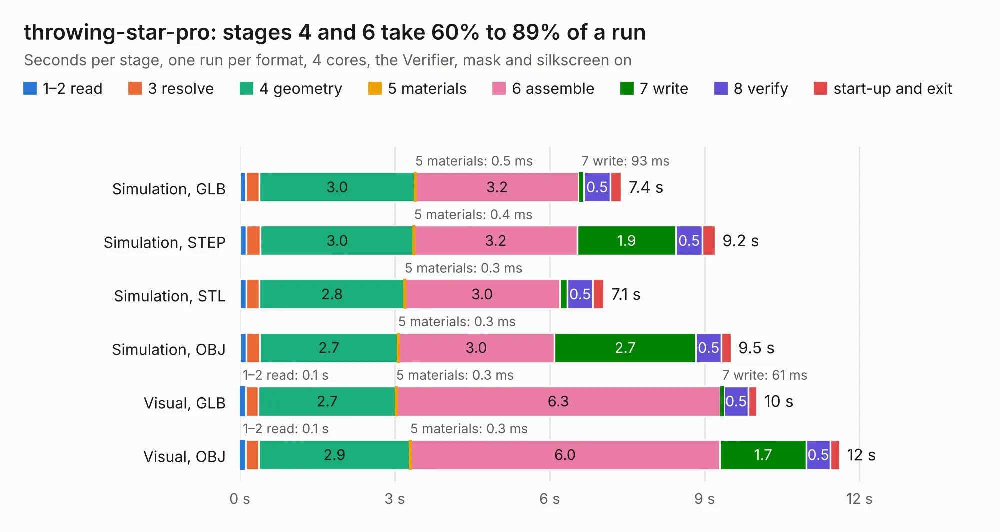

| Mode and format | 1–2 read | 3 resolve | 4 geometry | 5 materials | 6 assemble | 7 write | 8 verify | start-up and exit | Total |
|---|---:|---:|---:|---:|---:|---:|---:|---:|---:|
| Simulation, GLB | 0.1 | 0.3 | 3.0 | 0.5&nbsp;ms | 3.2 | 93&nbsp;ms | 0.5 | 0.2 | 7.4 |
| Simulation, STEP | 0.1 | 0.3 | 3.0 | 0.4&nbsp;ms | 3.2 | 1.9 | 0.5 | 0.2 | 9.2 |
| Simulation, STL | 0.1 | 0.3 | 2.8 | 0.3&nbsp;ms | 3.0 | 0.1 | 0.5 | 0.2 | 7.1 |
| Simulation, OBJ | 0.1 | 0.3 | 2.7 | 0.3&nbsp;ms | 3.0 | 2.7 | 0.5 | 0.2 | 9.5 |
| Visual, GLB | 0.1 | 0.2 | 2.7 | 0.3&nbsp;ms | 6.3 | 61&nbsp;ms | 0.5 | 0.2 | 10.0 |
| Visual, OBJ | 0.1 | 0.3 | 2.9 | 0.3&nbsp;ms | 6.0 | 1.7 | 0.5 | 0.2 | 11.6 |

<table align="center"><tr><td valign="top">

| Board | Repo: [greatscottgadgets/throwing-star-lan-tap](https://github.com/greatscottgadgets/throwing-star-lan-tap) Board: `throwing-star-pro.kicad_pcb` |
|---|---|
| Complexity | 152&nbsp;/&nbsp;1000 (size&nbsp;117, features&nbsp;35) |
| KESE&nbsp;features | through vias, filled zones |
| Tested | 9th November 2026 |
| Copper&nbsp;layers | 2 |
| File&nbsp;format | KiCad 5 (20171130) |
| Parts,&nbsp;tracks,&nbsp;vias | 6, 112, 4 |
| Triangles,&nbsp;simulation | 653,240 in 29 parts |
| Verifier | PASS in all six runs |

</td><td valign="top">

<table>
<tr><th>File type</th><th>File size</th><th>Peak memory used</th></tr>
<tr><th colspan="3" align="left">Simulation</th></tr>
<tr><td>GLB</td><td align="right">24&nbsp;MB</td><td align="right">342&nbsp;MB</td></tr>
<tr><td>STEP</td><td align="right">153&nbsp;MB</td><td align="right">432&nbsp;MB</td></tr>
<tr><td>STL</td><td align="right">33&nbsp;MB</td><td align="right">345&nbsp;MB</td></tr>
<tr><td>OBJ</td><td align="right">71&nbsp;MB</td><td align="right">509&nbsp;MB</td></tr>
<tr><th colspan="3" align="left">Visual</th></tr>
<tr><td>GLB</td><td align="right">16&nbsp;MB</td><td align="right">436&nbsp;MB</td></tr>
<tr><td>OBJ</td><td align="right">47&nbsp;MB</td><td align="right">436&nbsp;MB</td></tr>
</table>

</td></tr></table>

## 23.11.2 throwing-star

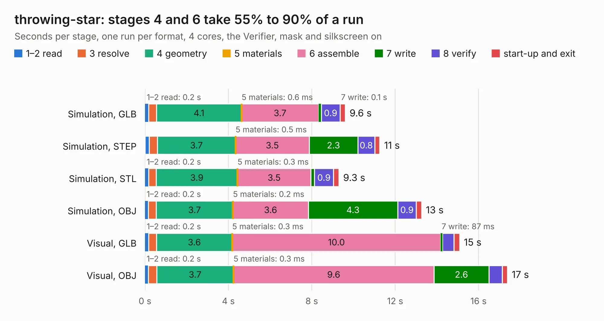

| Mode and format | 1–2 read | 3 resolve | 4 geometry | 5 materials | 6 assemble | 7 write | 8 verify | start-up and exit | Total |
|---|---:|---:|---:|---:|---:|---:|---:|---:|---:|
| Simulation, GLB | 0.2 | 0.4 | 4.1 | 0.6&nbsp;ms | 3.7 | 0.1 | 0.9 | 0.2 | 9.6 |
| Simulation, STEP | 0.2 | 0.4 | 3.7 | 0.5&nbsp;ms | 3.5 | 2.3 | 0.8 | 0.2 | 11.3 |
| Simulation, STL | 0.2 | 0.4 | 3.9 | 0.3&nbsp;ms | 3.5 | 0.2 | 0.9 | 0.3 | 9.3 |
| Simulation, OBJ | 0.2 | 0.4 | 3.7 | 0.2&nbsp;ms | 3.6 | 4.3 | 0.9 | 0.3 | 13.3 |
| Visual, GLB | 0.2 | 0.4 | 3.6 | 0.3&nbsp;ms | 10.0 | 87&nbsp;ms | 0.5 | 0.3 | 15.1 |
| Visual, OBJ | 0.2 | 0.4 | 3.7 | 0.3&nbsp;ms | 9.6 | 2.6 | 0.6 | 0.2 | 17.4 |

<table align="center"><tr><td valign="top">

| Board | Repo: [greatscottgadgets/throwing-star-lan-tap](https://github.com/greatscottgadgets/throwing-star-lan-tap) Board: `throwing-star.kicad_pcb` |
|---|---|
| Complexity | 171&nbsp;/&nbsp;1000 (size&nbsp;126, features&nbsp;45) |
| KESE&nbsp;features | through vias, filled zones, curved board outline |
| Tested | 9th November 2026 |
| Copper&nbsp;layers | 2 |
| File&nbsp;format | KiCad 5 (20171130) |
| Parts,&nbsp;tracks,&nbsp;vias | 6, 204, 4 |
| Triangles,&nbsp;simulation | 695,490 in 29 parts |
| Verifier | PASS in all six runs |

</td><td valign="top">

<table>
<tr><th>File type</th><th>File size</th><th>Peak memory used</th></tr>
<tr><th colspan="3" align="left">Simulation</th></tr>
<tr><td>GLB</td><td align="right">26&nbsp;MB</td><td align="right">380&nbsp;MB</td></tr>
<tr><td>STEP</td><td align="right">165&nbsp;MB</td><td align="right">460&nbsp;MB</td></tr>
<tr><td>STL</td><td align="right">35&nbsp;MB</td><td align="right">385&nbsp;MB</td></tr>
<tr><td>OBJ</td><td align="right">76&nbsp;MB</td><td align="right">534&nbsp;MB</td></tr>
<tr><th colspan="3" align="left">Visual</th></tr>
<tr><td>GLB</td><td align="right">17&nbsp;MB</td><td align="right">438&nbsp;MB</td></tr>
<tr><td>OBJ</td><td align="right">50&nbsp;MB</td><td align="right">435&nbsp;MB</td></tr>
</table>

</td></tr></table>

## 23.11.3 toorcamp2018badge

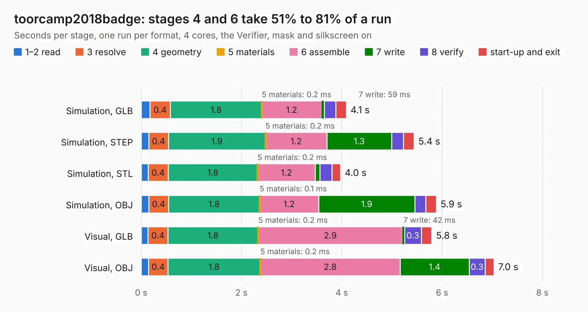

| Mode and format | 1–2 read | 3 resolve | 4 geometry | 5 materials | 6 assemble | 7 write | 8 verify | start-up and exit | Total |
|---|---:|---:|---:|---:|---:|---:|---:|---:|---:|
| Simulation, GLB | 0.2 | 0.4 | 1.8 | 0.2&nbsp;ms | 1.2 | 59&nbsp;ms | 0.2 | 0.2 | 4.1 |
| Simulation, STEP | 0.2 | 0.4 | 1.9 | 0.2&nbsp;ms | 1.2 | 1.3 | 0.2 | 0.2 | 5.4 |
| Simulation, STL | 0.1 | 0.4 | 1.8 | 0.2&nbsp;ms | 1.2 | 89&nbsp;ms | 0.2 | 0.2 | 4.0 |
| Simulation, OBJ | 0.2 | 0.4 | 1.8 | 0.1&nbsp;ms | 1.2 | 1.9 | 0.2 | 0.2 | 5.9 |
| Visual, GLB | 0.1 | 0.4 | 1.8 | 0.2&nbsp;ms | 2.9 | 42&nbsp;ms | 0.3 | 0.2 | 5.8 |
| Visual, OBJ | 0.1 | 0.4 | 1.8 | 0.2&nbsp;ms | 2.8 | 1.4 | 0.3 | 0.2 | 7.0 |

<table align="center"><tr><td valign="top">

| Board | Repo: [greatscottgadgets/toorcamp2018badge](https://github.com/greatscottgadgets/toorcamp2018badge) Board: `toorcamp2018badge.kicad_pcb` |
|---|---|
| Folder | hardware / badge |
| Complexity | 202&nbsp;/&nbsp;1000 (size&nbsp;147, features&nbsp;55) |
| KESE&nbsp;features | through vias, rounded, trapezoid or chamfered pads, filled zones, curved board outline |
| Tested | 9th November 2026 |
| Copper&nbsp;layers | 2 |
| File&nbsp;format | KiCad 4 (4) |
| Parts,&nbsp;tracks,&nbsp;vias | 30, 264, 8 |
| Triangles,&nbsp;simulation | 380,290 in 32 parts |
| Verifier | PASS in all six runs |

</td><td valign="top">

<table>
<tr><th>File type</th><th>File size</th><th>Peak memory used</th></tr>
<tr><th colspan="3" align="left">Simulation</th></tr>
<tr><td>GLB</td><td align="right">14&nbsp;MB</td><td align="right">265&nbsp;MB</td></tr>
<tr><td>STEP</td><td align="right">70&nbsp;MB</td><td align="right">288&nbsp;MB</td></tr>
<tr><td>STL</td><td align="right">19&nbsp;MB</td><td align="right">260&nbsp;MB</td></tr>
<tr><td>OBJ</td><td align="right">40&nbsp;MB</td><td align="right">302&nbsp;MB</td></tr>
<tr><th colspan="3" align="left">Visual</th></tr>
<tr><td>GLB</td><td align="right">9.8&nbsp;MB</td><td align="right">279&nbsp;MB</td></tr>
<tr><td>OBJ</td><td align="right">29&nbsp;MB</td><td align="right">273&nbsp;MB</td></tr>
</table>

</td></tr></table>

## 23.11.4 toorcamp2018jig

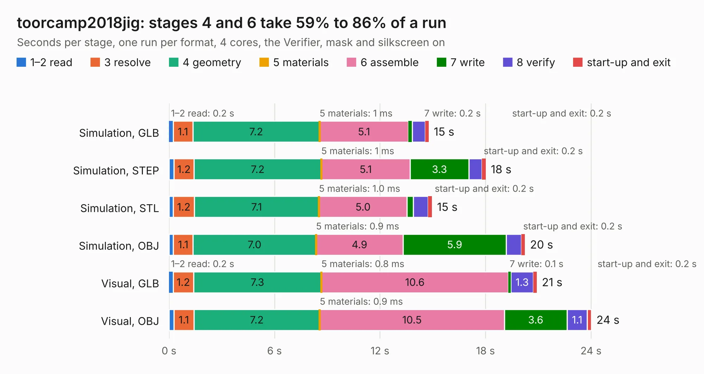

| Mode and format | 1–2 read | 3 resolve | 4 geometry | 5 materials | 6 assemble | 7 write | 8 verify | start-up and exit | Total |
|---|---:|---:|---:|---:|---:|---:|---:|---:|---:|
| Simulation, GLB | 0.2 | 1.1 | 7.2 | 1&nbsp;ms | 5.1 | 0.2 | 0.7 | 0.2 | 14.8 |
| Simulation, STEP | 0.3 | 1.2 | 7.2 | 1&nbsp;ms | 5.1 | 3.3 | 0.7 | 0.2 | 18.0 |
| Simulation, STL | 0.2 | 1.2 | 7.1 | 1.0&nbsp;ms | 5.0 | 0.3 | 0.8 | 0.2 | 15.0 |
| Simulation, OBJ | 0.2 | 1.1 | 7.0 | 0.9&nbsp;ms | 4.9 | 5.9 | 0.9 | 0.2 | 20.2 |
| Visual, GLB | 0.2 | 1.2 | 7.3 | 0.8&nbsp;ms | 10.6 | 0.1 | 1.3 | 0.2 | 20.9 |
| Visual, OBJ | 0.3 | 1.1 | 7.2 | 0.9&nbsp;ms | 10.5 | 3.6 | 1.1 | 0.2 | 24.0 |

<table align="center"><tr><td valign="top">

| Board | Repo: [greatscottgadgets/toorcamp2018badge](https://github.com/greatscottgadgets/toorcamp2018badge) Board: `toorcamp2018jig.kicad_pcb` |
|---|---|
| Folder | hardware / jig |
| Complexity | 218&nbsp;/&nbsp;1000 (size&nbsp;173, features&nbsp;45) |
| KESE&nbsp;features | through vias, filled zones, curved board outline |
| Tested | 9th November 2026 |
| Copper&nbsp;layers | 2 |
| File&nbsp;format | KiCad 4 (4) |
| Parts,&nbsp;tracks,&nbsp;vias | 75, 705, 26 |
| Triangles,&nbsp;simulation | 1,475,914 in 181 parts |
| Verifier | PASS in all six runs |

</td><td valign="top">

<table>
<tr><th>File type</th><th>File size</th><th>Peak memory used</th></tr>
<tr><th colspan="3" align="left">Simulation</th></tr>
<tr><td>GLB</td><td align="right">51&nbsp;MB</td><td align="right">573&nbsp;MB</td></tr>
<tr><td>STEP</td><td align="right">257&nbsp;MB</td><td align="right">651&nbsp;MB</td></tr>
<tr><td>STL</td><td align="right">74&nbsp;MB</td><td align="right">573&nbsp;MB</td></tr>
<tr><td>OBJ</td><td align="right">156&nbsp;MB</td><td align="right">1.0&nbsp;GB</td></tr>
<tr><th colspan="3" align="left">Visual</th></tr>
<tr><td>GLB</td><td align="right">31&nbsp;MB</td><td align="right">690&nbsp;MB</td></tr>
<tr><td>OBJ</td><td align="right">93&nbsp;MB</td><td align="right">679&nbsp;MB</td></tr>
</table>

</td></tr></table>

## 23.11.5 sasserides

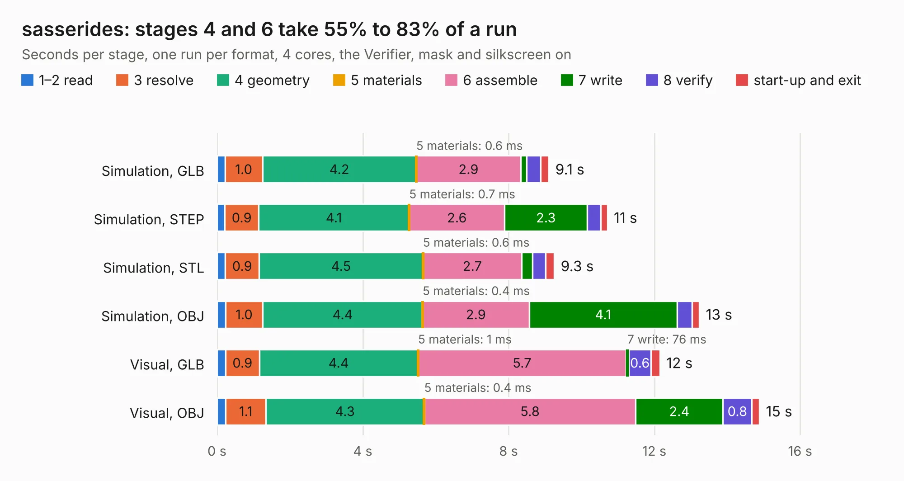

| Mode and format | 1–2 read | 3 resolve | 4 geometry | 5 materials | 6 assemble | 7 write | 8 verify | start-up and exit | Total |
|---|---:|---:|---:|---:|---:|---:|---:|---:|---:|
| Simulation, GLB | 0.2 | 1.0 | 4.2 | 0.6&nbsp;ms | 2.9 | 0.2 | 0.4 | 0.2 | 9.1 |
| Simulation, STEP | 0.2 | 0.9 | 4.1 | 0.7&nbsp;ms | 2.6 | 2.3 | 0.4 | 0.2 | 10.7 |
| Simulation, STL | 0.2 | 0.9 | 4.5 | 0.6&nbsp;ms | 2.7 | 0.3 | 0.4 | 0.2 | 9.3 |
| Simulation, OBJ | 0.2 | 1.0 | 4.4 | 0.4&nbsp;ms | 2.9 | 4.1 | 0.4 | 0.2 | 13.2 |
| Visual, GLB | 0.2 | 0.9 | 4.4 | 1&nbsp;ms | 5.7 | 76&nbsp;ms | 0.6 | 0.2 | 12.1 |
| Visual, OBJ | 0.2 | 1.1 | 4.3 | 0.4&nbsp;ms | 5.8 | 2.4 | 0.8 | 0.2 | 14.9 |

<table align="center"><tr><td valign="top">

| Board | Repo: [greatscottgadgets/tycho](https://github.com/greatscottgadgets/tycho) Board: `sasserides.kicad_pcb` |
|---|---|
| Folder | sasserides |
| Complexity | 230&nbsp;/&nbsp;1000 (size&nbsp;150, features&nbsp;80) |
| KESE&nbsp;features | through vias, rounded, trapezoid or chamfered pads, filled zones, stack-up, dielectric εr and tanδ, mask and silkscreen colours |
| Tested | 9th November 2026 |
| Copper&nbsp;layers | 2 |
| File&nbsp;format | KiCad 7 (20221018) |
| Parts,&nbsp;tracks,&nbsp;vias | 30, 324, 12 |
| Triangles,&nbsp;simulation | 970,818 in 113 parts |
| Verifier | PASS in all six runs |

</td><td valign="top">

<table>
<tr><th>File type</th><th>File size</th><th>Peak memory used</th></tr>
<tr><th colspan="3" align="left">Simulation</th></tr>
<tr><td>GLB</td><td align="right">33&nbsp;MB</td><td align="right">453&nbsp;MB</td></tr>
<tr><td>STEP</td><td align="right">170&nbsp;MB</td><td align="right">519&nbsp;MB</td></tr>
<tr><td>STL</td><td align="right">49&nbsp;MB</td><td align="right">438&nbsp;MB</td></tr>
<tr><td>OBJ</td><td align="right">100&nbsp;MB</td><td align="right">696&nbsp;MB</td></tr>
<tr><th colspan="3" align="left">Visual</th></tr>
<tr><td>GLB</td><td align="right">19&nbsp;MB</td><td align="right">483&nbsp;MB</td></tr>
<tr><td>OBJ</td><td align="right">58&nbsp;MB</td><td align="right">479&nbsp;MB</td></tr>
</table>

</td></tr></table>

## 23.11.6 tycho

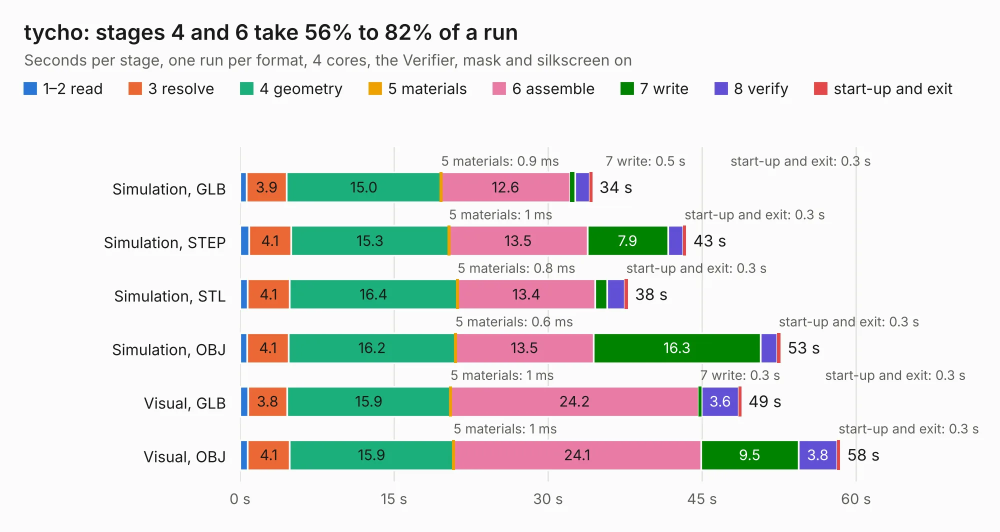

| Mode and format | 1–2 read | 3 resolve | 4 geometry | 5 materials | 6 assemble | 7 write | 8 verify | start-up and exit | Total |
|---|---:|---:|---:|---:|---:|---:|---:|---:|---:|
| Simulation, GLB | 0.7 | 3.9 | 15.0 | 0.9&nbsp;ms | 12.6 | 0.5 | 1.4 | 0.3 | 34.3 |
| Simulation, STEP | 0.9 | 4.1 | 15.3 | 1&nbsp;ms | 13.5 | 7.9 | 1.5 | 0.3 | 43.4 |
| Simulation, STL | 0.7 | 4.1 | 16.4 | 0.8&nbsp;ms | 13.4 | 1.2 | 1.7 | 0.3 | 37.8 |
| Simulation, OBJ | 0.7 | 4.1 | 16.2 | 0.6&nbsp;ms | 13.5 | 16.3 | 1.6 | 0.3 | 52.6 |
| Visual, GLB | 0.8 | 3.8 | 15.9 | 1&nbsp;ms | 24.2 | 0.3 | 3.6 | 0.3 | 48.8 |
| Visual, OBJ | 0.7 | 4.1 | 15.9 | 1&nbsp;ms | 24.1 | 9.5 | 3.8 | 0.3 | 58.4 |

<table align="center"><tr><td valign="top">

| Board | Repo: [greatscottgadgets/tycho](https://github.com/greatscottgadgets/tycho) Board: `tycho.kicad_pcb` |
|---|---|
| Folder | tycho |
| Complexity | 399&nbsp;/&nbsp;1000 (size&nbsp;259, features&nbsp;140) |
| KESE&nbsp;features | through vias, slotted holes, custom pads, rounded, trapezoid or chamfered pads, filled zones, copper drawings, copper text, stack-up, dielectric εr and tanδ, copper finish, mask and silkscreen colours |
| Tested | 9th November 2026 |
| Copper&nbsp;layers | 4 |
| File&nbsp;format | KiCad 7 (20221018) |
| Parts,&nbsp;tracks,&nbsp;vias | 164, 1,623, 399 |
| Triangles,&nbsp;simulation | 3,419,022 in 267 parts |
| Verifier | PASS in all six runs |

</td><td valign="top">

<table>
<tr><th>File type</th><th>File size</th><th>Peak memory used</th></tr>
<tr><th colspan="3" align="left">Simulation</th></tr>
<tr><td>GLB</td><td align="right">118&nbsp;MB</td><td align="right">1.1&nbsp;GB</td></tr>
<tr><td>STEP</td><td align="right">518&nbsp;MB</td><td align="right">1.3&nbsp;GB</td></tr>
<tr><td>STL</td><td align="right">171&nbsp;MB</td><td align="right">1.1&nbsp;GB</td></tr>
<tr><td>OBJ</td><td align="right">369&nbsp;MB</td><td align="right">2.3&nbsp;GB</td></tr>
<tr><th colspan="3" align="left">Visual</th></tr>
<tr><td>GLB</td><td align="right">67&nbsp;MB</td><td align="right">1.2&nbsp;GB</td></tr>
<tr><td>OBJ</td><td align="right">210&nbsp;MB</td><td align="right">1.5&nbsp;GB</td></tr>
</table>

</td></tr></table>

## 23.11.7 mainboard

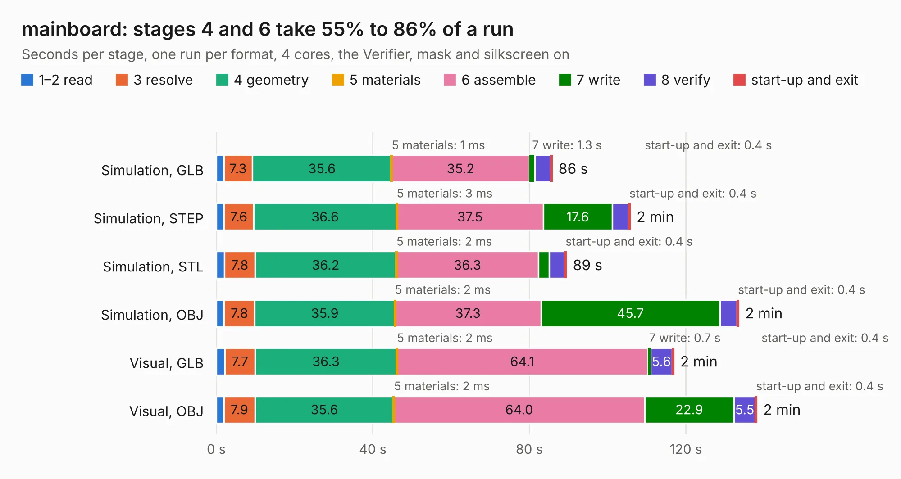

| Mode and format | 1–2 read | 3 resolve | 4 geometry | 5 materials | 6 assemble | 7 write | 8 verify | start-up and exit | Total |
|---|---:|---:|---:|---:|---:|---:|---:|---:|---:|
| Simulation, GLB | 1.9 | 7.3 | 35.6 | 1&nbsp;ms | 35.2 | 1.3 | 4.0 | 0.4 | 85.8 |
| Simulation, STEP | 2.0 | 7.6 | 36.6 | 3&nbsp;ms | 37.5 | 17.6 | 4.2 | 0.4 | 105.8 |
| Simulation, STL | 2.1 | 7.8 | 36.2 | 2&nbsp;ms | 36.3 | 2.7 | 4.0 | 0.4 | 89.5 |
| Simulation, OBJ | 2.0 | 7.8 | 35.9 | 2&nbsp;ms | 37.3 | 45.7 | 4.4 | 0.4 | 133.5 |
| Visual, GLB | 2.2 | 7.7 | 36.3 | 2&nbsp;ms | 64.1 | 0.7 | 5.6 | 0.4 | 116.9 |
| Visual, OBJ | 2.0 | 7.9 | 35.6 | 2&nbsp;ms | 64.0 | 22.9 | 5.5 | 0.4 | 138.1 |

<table align="center"><tr><td valign="top">

| Board | Repo: [greatscottgadgets/urti-mainboard](https://github.com/greatscottgadgets/urti-mainboard) Board: `mainboard.kicad_pcb` |
|---|---|
| Complexity | 465&nbsp;/&nbsp;1000 (size&nbsp;315, features&nbsp;150) |
| KESE&nbsp;features | through vias, slotted holes, custom pads, rounded, trapezoid or chamfered pads, arc tracks, filled zones, copper drawings, copper text, curved board outline, stack-up, dielectric εr and tanδ, mask and silkscreen colours |
| Tested | 9th November 2026 |
| Copper&nbsp;layers | 6 |
| File&nbsp;format | KiCad 7 (20221018) |
| Parts,&nbsp;tracks,&nbsp;vias | 440, 3,761, 899 |
| Triangles,&nbsp;simulation | 7,380,624 in 471 parts |
| Verifier | PASS in all six runs |

</td><td valign="top">

<table>
<tr><th>File type</th><th>File size</th><th>Peak memory used</th></tr>
<tr><th colspan="3" align="left">Simulation</th></tr>
<tr><td>GLB</td><td align="right">251&nbsp;MB</td><td align="right">1.9&nbsp;GB</td></tr>
<tr><td>STEP</td><td align="right">1.0&nbsp;GB</td><td align="right">2.7&nbsp;GB</td></tr>
<tr><td>STL</td><td align="right">369&nbsp;MB</td><td align="right">1.9&nbsp;GB</td></tr>
<tr><td>OBJ</td><td align="right">803&nbsp;MB</td><td align="right">4.7&nbsp;GB</td></tr>
<tr><th colspan="3" align="left">Visual</th></tr>
<tr><td>GLB</td><td align="right">127&nbsp;MB</td><td align="right">2.2&nbsp;GB</td></tr>
<tr><td>OBJ</td><td align="right">411&nbsp;MB</td><td align="right">2.8&nbsp;GB</td></tr>
</table>

</td></tr></table>

## 23.11.8 yardstickone

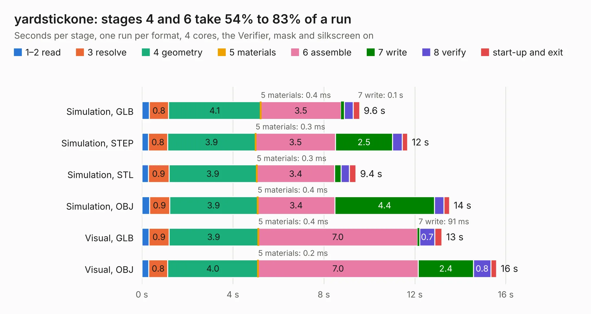

| Mode and format | 1–2 read | 3 resolve | 4 geometry | 5 materials | 6 assemble | 7 write | 8 verify | start-up and exit | Total |
|---|---:|---:|---:|---:|---:|---:|---:|---:|---:|
| Simulation, GLB | 0.3 | 0.8 | 4.1 | 0.4&nbsp;ms | 3.5 | 0.1 | 0.4 | 0.3 | 9.6 |
| Simulation, STEP | 0.3 | 0.8 | 3.9 | 0.3&nbsp;ms | 3.5 | 2.5 | 0.4 | 0.2 | 11.7 |
| Simulation, STL | 0.3 | 0.9 | 3.9 | 0.3&nbsp;ms | 3.4 | 0.3 | 0.4 | 0.3 | 9.4 |
| Simulation, OBJ | 0.3 | 0.9 | 3.9 | 0.4&nbsp;ms | 3.4 | 4.4 | 0.4 | 0.2 | 13.5 |
| Visual, GLB | 0.3 | 0.9 | 3.9 | 0.4&nbsp;ms | 7.0 | 91&nbsp;ms | 0.7 | 0.3 | 13.2 |
| Visual, OBJ | 0.3 | 0.8 | 4.0 | 0.2&nbsp;ms | 7.0 | 2.4 | 0.8 | 0.3 | 15.6 |

<table align="center"><tr><td valign="top">

| Board | Repo: [greatscottgadgets/yardstick](https://github.com/greatscottgadgets/yardstick) Board: `yardstickone.kicad_pcb` |
|---|---|
| Folder | yardstickone |
| Complexity | 317&nbsp;/&nbsp;1000 (size&nbsp;232, features&nbsp;85) |
| KESE&nbsp;features | through vias, rounded, trapezoid or chamfered pads, filled zones, copper text, stack-up, dielectric εr and tanδ |
| Tested | 9th November 2026 |
| Copper&nbsp;layers | 4 |
| File&nbsp;format | KiCad 6 (20211014) |
| Parts,&nbsp;tracks,&nbsp;vias | 74, 657, 83 |
| Triangles,&nbsp;simulation | 894,982 in 79 parts |
| Verifier | PASS in all six runs |

</td><td valign="top">

<table>
<tr><th>File type</th><th>File size</th><th>Peak memory used</th></tr>
<tr><th colspan="3" align="left">Simulation</th></tr>
<tr><td>GLB</td><td align="right">31&nbsp;MB</td><td align="right">423&nbsp;MB</td></tr>
<tr><td>STEP</td><td align="right">141&nbsp;MB</td><td align="right">497&nbsp;MB</td></tr>
<tr><td>STL</td><td align="right">45&nbsp;MB</td><td align="right">418&nbsp;MB</td></tr>
<tr><td>OBJ</td><td align="right">92&nbsp;MB</td><td align="right">672&nbsp;MB</td></tr>
<tr><th colspan="3" align="left">Visual</th></tr>
<tr><td>GLB</td><td align="right">18&nbsp;MB</td><td align="right">452&nbsp;MB</td></tr>
<tr><td>OBJ</td><td align="right">53&nbsp;MB</td><td align="right">455&nbsp;MB</td></tr>
</table>

</td></tr></table>

## 23.11.9 arm-watch

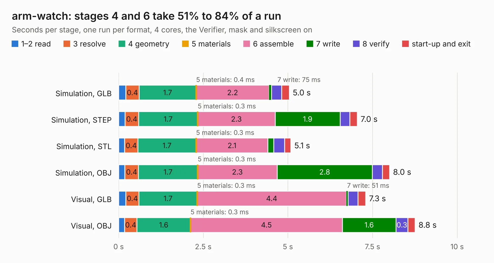

| Mode and format | 1–2 read | 3 resolve | 4 geometry | 5 materials | 6 assemble | 7 write | 8 verify | start-up and exit | Total |
|---|---:|---:|---:|---:|---:|---:|---:|---:|---:|
| Simulation, GLB | 0.2 | 0.4 | 1.7 | 0.4&nbsp;ms | 2.2 | 75&nbsp;ms | 0.3 | 0.2 | 5.0 |
| Simulation, STEP | 0.2 | 0.4 | 1.7 | 0.3&nbsp;ms | 2.3 | 1.9 | 0.3 | 0.2 | 7.0 |
| Simulation, STL | 0.2 | 0.4 | 1.7 | 0.3&nbsp;ms | 2.1 | 0.2 | 0.3 | 0.2 | 5.1 |
| Simulation, OBJ | 0.2 | 0.4 | 1.7 | 0.3&nbsp;ms | 2.3 | 2.8 | 0.3 | 0.2 | 8.0 |
| Visual, GLB | 0.2 | 0.4 | 1.7 | 0.3&nbsp;ms | 4.4 | 51&nbsp;ms | 0.3 | 0.2 | 7.3 |
| Visual, OBJ | 0.2 | 0.4 | 1.6 | 0.3&nbsp;ms | 4.5 | 1.6 | 0.3 | 0.2 | 8.8 |

<table align="center"><tr><td valign="top">

| Board | Repo: [gregdavill/advent-calendar-of-circuits-2020](https://github.com/gregdavill/advent-calendar-of-circuits-2020) Board: `arm-watch.kicad_pcb` |
|---|---|
| Folder | arm-watch / kicad-src |
| Complexity | 323&nbsp;/&nbsp;1000 (size&nbsp;223, features&nbsp;100) |
| KESE&nbsp;features | through vias, slotted holes, rounded, trapezoid or chamfered pads, filled zones, curved board outline, stack-up, dielectric εr and tanδ, mask and silkscreen colours |
| Tested | 9th November 2026 |
| Copper&nbsp;layers | 4 |
| File&nbsp;format | KiCad 6 (20201116) |
| Parts,&nbsp;tracks,&nbsp;vias | 17, 496, 51 |
| Triangles,&nbsp;simulation | 448,504 in 106 parts |
| Verifier | PASS in all six runs |

</td><td valign="top">

<table>
<tr><th>File type</th><th>File size</th><th>Peak memory used</th></tr>
<tr><th colspan="3" align="left">Simulation</th></tr>
<tr><td>GLB</td><td align="right">15&nbsp;MB</td><td align="right">303&nbsp;MB</td></tr>
<tr><td>STEP</td><td align="right">72&nbsp;MB</td><td align="right">343&nbsp;MB</td></tr>
<tr><td>STL</td><td align="right">22&nbsp;MB</td><td align="right">306&nbsp;MB</td></tr>
<tr><td>OBJ</td><td align="right">47&nbsp;MB</td><td align="right">374&nbsp;MB</td></tr>
<tr><th colspan="3" align="left">Visual</th></tr>
<tr><td>GLB</td><td align="right">11&nbsp;MB</td><td align="right">338&nbsp;MB</td></tr>
<tr><td>OBJ</td><td align="right">33&nbsp;MB</td><td align="right">339&nbsp;MB</td></tr>
</table>

</td></tr></table>

## 23.11.10 ecpbreaker

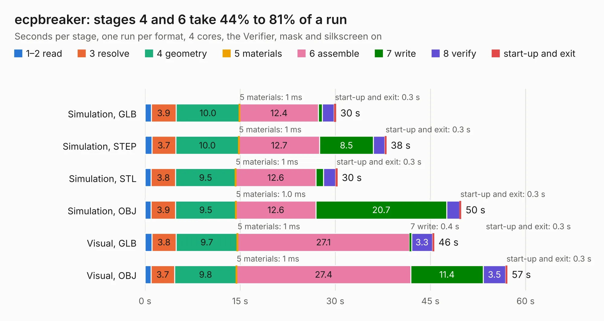

| Mode and format | 1–2 read | 3 resolve | 4 geometry | 5 materials | 6 assemble | 7 write | 8 verify | start-up and exit | Total |
|---|---:|---:|---:|---:|---:|---:|---:|---:|---:|
| Simulation, GLB | 1.0 | 3.9 | 10.0 | 1&nbsp;ms | 12.4 | 0.6 | 1.9 | 0.3 | 30.1 |
| Simulation, STEP | 1.1 | 3.7 | 10.0 | 1&nbsp;ms | 12.7 | 8.5 | 1.8 | 0.3 | 38.1 |
| Simulation, STL | 1.0 | 3.8 | 9.5 | 1&nbsp;ms | 12.6 | 1.2 | 1.9 | 0.3 | 30.4 |
| Simulation, OBJ | 1.0 | 3.9 | 9.5 | 1.0&nbsp;ms | 12.6 | 20.7 | 2.0 | 0.3 | 49.9 |
| Visual, GLB | 1.1 | 3.8 | 9.7 | 1&nbsp;ms | 27.1 | 0.4 | 3.3 | 0.3 | 45.6 |
| Visual, OBJ | 0.9 | 3.7 | 9.8 | 1&nbsp;ms | 27.4 | 11.4 | 3.5 | 0.3 | 57.1 |

<table align="center"><tr><td valign="top">

| Board | Repo: [gregdavill/advent-calendar-of-circuits-2020](https://github.com/gregdavill/advent-calendar-of-circuits-2020) Board: `ecpbreaker.kicad_pcb` |
|---|---|
| Folder | ecpbreaker / kicad-src |
| Complexity | 427&nbsp;/&nbsp;1000 (size&nbsp;287, features&nbsp;140) |
| KESE&nbsp;features | through vias, slotted holes, custom pads, rounded, trapezoid or chamfered pads, arc tracks, filled zones, copper drawings, curved board outline, stack-up, dielectric εr and tanδ, mask and silkscreen colours |
| Tested | 9th November 2026 |
| Copper&nbsp;layers | 6 |
| File&nbsp;format | KiCad 6 (20210126) |
| Parts,&nbsp;tracks,&nbsp;vias | 117, 3,175, 442 |
| Triangles,&nbsp;simulation | 3,875,838 in 294 parts |
| Verifier | PASS in all six runs |

</td><td valign="top">

<table>
<tr><th>File type</th><th>File size</th><th>Peak memory used</th></tr>
<tr><th colspan="3" align="left">Simulation</th></tr>
<tr><td>GLB</td><td align="right">129&nbsp;MB</td><td align="right">1.2&nbsp;GB</td></tr>
<tr><td>STEP</td><td align="right">499&nbsp;MB</td><td align="right">1.4&nbsp;GB</td></tr>
<tr><td>STL</td><td align="right">194&nbsp;MB</td><td align="right">1.3&nbsp;GB</td></tr>
<tr><td>OBJ</td><td align="right">409&nbsp;MB</td><td align="right">2.5&nbsp;GB</td></tr>
<tr><th colspan="3" align="left">Visual</th></tr>
<tr><td>GLB</td><td align="right">71&nbsp;MB</td><td align="right">1.3&nbsp;GB</td></tr>
<tr><td>OBJ</td><td align="right">229&nbsp;MB</td><td align="right">1.6&nbsp;GB</td></tr>
</table>

</td></tr></table>

## 23.11.11 esp32s2-breakout

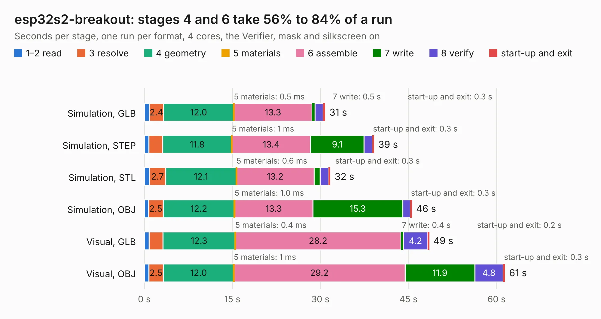

| Mode and format | 1–2 read | 3 resolve | 4 geometry | 5 materials | 6 assemble | 7 write | 8 verify | start-up and exit | Total |
|---|---:|---:|---:|---:|---:|---:|---:|---:|---:|
| Simulation, GLB | 0.8 | 2.4 | 12.0 | 0.5&nbsp;ms | 13.3 | 0.5 | 1.4 | 0.3 | 30.8 |
| Simulation, STEP | 0.8 | 2.4 | 11.8 | 1&nbsp;ms | 13.4 | 9.1 | 1.4 | 0.3 | 39.1 |
| Simulation, STL | 0.9 | 2.7 | 12.1 | 0.6&nbsp;ms | 13.2 | 1.1 | 1.4 | 0.3 | 31.7 |
| Simulation, OBJ | 0.7 | 2.5 | 12.2 | 1.0&nbsp;ms | 13.3 | 15.3 | 1.3 | 0.3 | 45.6 |
| Visual, GLB | 0.8 | 2.3 | 12.3 | 0.4&nbsp;ms | 28.2 | 0.4 | 4.2 | 0.2 | 48.5 |
| Visual, OBJ | 0.8 | 2.5 | 12.0 | 1&nbsp;ms | 29.2 | 11.9 | 4.8 | 0.3 | 61.4 |

<table align="center"><tr><td valign="top">

| Board | Repo: [gregdavill/advent-calendar-of-circuits-2020](https://github.com/gregdavill/advent-calendar-of-circuits-2020) Board: `esp32s2-breakout.kicad_pcb` |
|---|---|
| Folder | esp32s2-breakout / kicad-src |
| Complexity | 360&nbsp;/&nbsp;1000 (size&nbsp;245, features&nbsp;115) |
| KESE&nbsp;features | through vias, slotted holes, rounded, trapezoid or chamfered pads, arc tracks, filled zones, curved board outline, stack-up, dielectric εr and tanδ, mask and silkscreen colours |
| Tested | 9th November 2026 |
| Copper&nbsp;layers | 4 |
| File&nbsp;format | KiCad 6 (20201220) |
| Parts,&nbsp;tracks,&nbsp;vias | 64, 1,459, 252 |
| Triangles,&nbsp;simulation | 3,009,806 in 93 parts |
| Verifier | PASS in all six runs |

</td><td valign="top">

<table>
<tr><th>File type</th><th>File size</th><th>Peak memory used</th></tr>
<tr><th colspan="3" align="left">Simulation</th></tr>
<tr><td>GLB</td><td align="right">101&nbsp;MB</td><td align="right">988&nbsp;MB</td></tr>
<tr><td>STEP</td><td align="right">527&nbsp;MB</td><td align="right">1.2&nbsp;GB</td></tr>
<tr><td>STL</td><td align="right">150&nbsp;MB</td><td align="right">992&nbsp;MB</td></tr>
<tr><td>OBJ</td><td align="right">316&nbsp;MB</td><td align="right">1.9&nbsp;GB</td></tr>
<tr><th colspan="3" align="left">Visual</th></tr>
<tr><td>GLB</td><td align="right">75&nbsp;MB</td><td align="right">1.2&nbsp;GB</td></tr>
<tr><td>OBJ</td><td align="right">235&nbsp;MB</td><td align="right">1.5&nbsp;GB</td></tr>
</table>

</td></tr></table>

## 23.11.12 esp32s2-co2-monitor

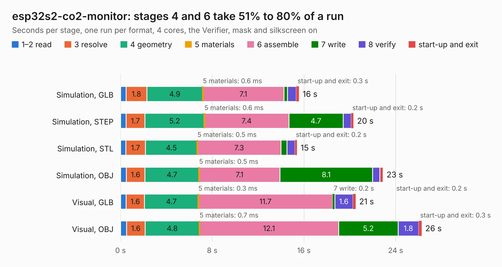

| Mode and format | 1–2 read | 3 resolve | 4 geometry | 5 materials | 6 assemble | 7 write | 8 verify | start-up and exit | Total |
|---|---:|---:|---:|---:|---:|---:|---:|---:|---:|
| Simulation, GLB | 0.5 | 1.8 | 4.9 | 0.6&nbsp;ms | 7.1 | 0.3 | 0.8 | 0.3 | 15.6 |
| Simulation, STEP | 0.5 | 1.7 | 5.2 | 0.6&nbsp;ms | 7.4 | 4.7 | 0.7 | 0.2 | 20.3 |
| Simulation, STL | 0.5 | 1.7 | 4.5 | 0.5&nbsp;ms | 7.3 | 0.5 | 0.7 | 0.2 | 15.4 |
| Simulation, OBJ | 0.5 | 1.6 | 4.7 | 0.5&nbsp;ms | 7.1 | 8.1 | 0.6 | 0.3 | 22.9 |
| Visual, GLB | 0.5 | 1.6 | 4.7 | 0.3&nbsp;ms | 11.7 | 0.2 | 1.6 | 0.2 | 20.5 |
| Visual, OBJ | 0.5 | 1.6 | 4.8 | 0.7&nbsp;ms | 12.1 | 5.2 | 1.8 | 0.3 | 26.3 |

<table align="center"><tr><td valign="top">

| Board | Repo: [gregdavill/advent-calendar-of-circuits-2020](https://github.com/gregdavill/advent-calendar-of-circuits-2020) Board: `esp32s2-co2-monitor.kicad_pcb` |
|---|---|
| Folder | esp32s2-co2-monitor / kicad-src |
| Complexity | 360&nbsp;/&nbsp;1000 (size&nbsp;245, features&nbsp;115) |
| KESE&nbsp;features | through vias, slotted holes, rounded, trapezoid or chamfered pads, arc tracks, filled zones, curved board outline, stack-up, dielectric εr and tanδ, mask and silkscreen colours |
| Tested | 9th November 2026 |
| Copper&nbsp;layers | 4 |
| File&nbsp;format | KiCad 6 (20201116) |
| Parts,&nbsp;tracks,&nbsp;vias | 67, 1,161, 346 |
| Triangles,&nbsp;simulation | 1,868,242 in 94 parts |
| Verifier | PASS in all six runs |

</td><td valign="top">

<table>
<tr><th>File type</th><th>File size</th><th>Peak memory used</th></tr>
<tr><th colspan="3" align="left">Simulation</th></tr>
<tr><td>GLB</td><td align="right">62&nbsp;MB</td><td align="right">710&nbsp;MB</td></tr>
<tr><td>STEP</td><td align="right">253&nbsp;MB</td><td align="right">871&nbsp;MB</td></tr>
<tr><td>STL</td><td align="right">93&nbsp;MB</td><td align="right">703&nbsp;MB</td></tr>
<tr><td>OBJ</td><td align="right">192&nbsp;MB</td><td align="right">1.2&nbsp;GB</td></tr>
<tr><th colspan="3" align="left">Visual</th></tr>
<tr><td>GLB</td><td align="right">41&nbsp;MB</td><td align="right">833&nbsp;MB</td></tr>
<tr><td>OBJ</td><td align="right">124&nbsp;MB</td><td align="right">873&nbsp;MB</td></tr>
</table>

</td></tr></table>

## 23.11.13 esp32s2-lepton

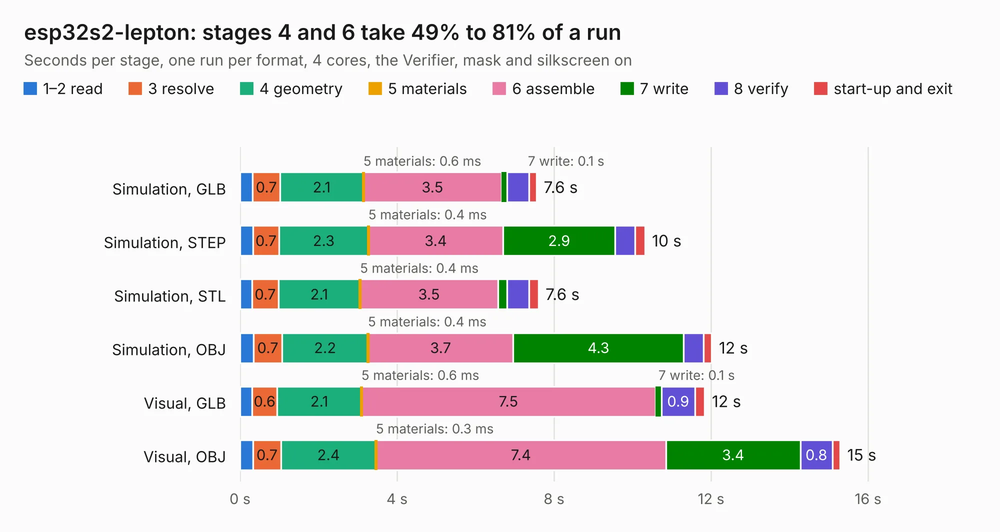

| Mode and format | 1–2 read | 3 resolve | 4 geometry | 5 materials | 6 assemble | 7 write | 8 verify | start-up and exit | Total |
|---|---:|---:|---:|---:|---:|---:|---:|---:|---:|
| Simulation, GLB | 0.3 | 0.7 | 2.1 | 0.6&nbsp;ms | 3.5 | 0.1 | 0.6 | 0.2 | 7.6 |
| Simulation, STEP | 0.3 | 0.7 | 2.3 | 0.4&nbsp;ms | 3.4 | 2.9 | 0.5 | 0.2 | 10.3 |
| Simulation, STL | 0.3 | 0.7 | 2.1 | 0.4&nbsp;ms | 3.5 | 0.2 | 0.6 | 0.2 | 7.6 |
| Simulation, OBJ | 0.3 | 0.7 | 2.2 | 0.4&nbsp;ms | 3.7 | 4.3 | 0.5 | 0.2 | 12.0 |
| Visual, GLB | 0.3 | 0.6 | 2.1 | 0.6&nbsp;ms | 7.5 | 0.1 | 0.9 | 0.2 | 11.8 |
| Visual, OBJ | 0.3 | 0.7 | 2.4 | 0.3&nbsp;ms | 7.4 | 3.4 | 0.8 | 0.2 | 15.3 |

<table align="center"><tr><td valign="top">

| Board | Repo: [gregdavill/advent-calendar-of-circuits-2020](https://github.com/gregdavill/advent-calendar-of-circuits-2020) Board: `esp32s2-lepton.kicad_pcb` |
|---|---|
| Folder | esp32s2-lepton / kicad-src |
| Complexity | 377&nbsp;/&nbsp;1000 (size&nbsp;237, features&nbsp;140) |
| KESE&nbsp;features | through vias, slotted holes, custom pads, rounded, trapezoid or chamfered pads, arc tracks, filled zones, copper drawings, curved board outline, stack-up, dielectric εr and tanδ, mask and silkscreen colours |
| Tested | 9th November 2026 |
| Copper&nbsp;layers | 4 |
| File&nbsp;format | KiCad 6 (20201220) |
| Parts,&nbsp;tracks,&nbsp;vias | 62, 1,082, 116 |
| Triangles,&nbsp;simulation | 888,094 in 97 parts |
| Verifier | PASS in all six runs |

</td><td valign="top">

<table>
<tr><th>File type</th><th>File size</th><th>Peak memory used</th></tr>
<tr><th colspan="3" align="left">Simulation</th></tr>
<tr><td>GLB</td><td align="right">30&nbsp;MB</td><td align="right">466&nbsp;MB</td></tr>
<tr><td>STEP</td><td align="right">138&nbsp;MB</td><td align="right">512&nbsp;MB</td></tr>
<tr><td>STL</td><td align="right">44&nbsp;MB</td><td align="right">428&nbsp;MB</td></tr>
<tr><td>OBJ</td><td align="right">89&nbsp;MB</td><td align="right">621&nbsp;MB</td></tr>
<tr><th colspan="3" align="left">Visual</th></tr>
<tr><td>GLB</td><td align="right">22&nbsp;MB</td><td align="right">607&nbsp;MB</td></tr>
<tr><td>OBJ</td><td align="right">66&nbsp;MB</td><td align="right">593&nbsp;MB</td></tr>
</table>

</td></tr></table>

## 23.11.14 gpdi-serdes

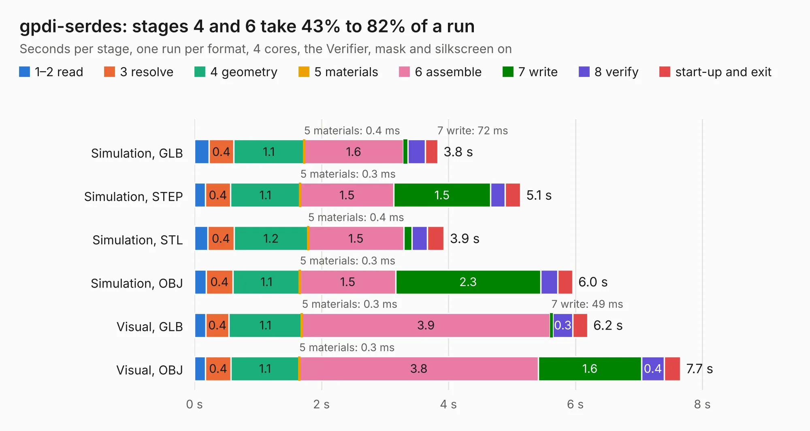

| Mode and format | 1–2 read | 3 resolve | 4 geometry | 5 materials | 6 assemble | 7 write | 8 verify | start-up and exit | Total |
|---|---:|---:|---:|---:|---:|---:|---:|---:|---:|
| Simulation, GLB | 0.2 | 0.4 | 1.1 | 0.4&nbsp;ms | 1.6 | 72&nbsp;ms | 0.3 | 0.2 | 3.8 |
| Simulation, STEP | 0.2 | 0.4 | 1.1 | 0.3&nbsp;ms | 1.5 | 1.5 | 0.2 | 0.2 | 5.1 |
| Simulation, STL | 0.2 | 0.4 | 1.2 | 0.4&nbsp;ms | 1.5 | 0.1 | 0.2 | 0.3 | 3.9 |
| Simulation, OBJ | 0.2 | 0.4 | 1.1 | 0.3&nbsp;ms | 1.5 | 2.3 | 0.3 | 0.2 | 6.0 |
| Visual, GLB | 0.2 | 0.4 | 1.1 | 0.3&nbsp;ms | 3.9 | 49&nbsp;ms | 0.3 | 0.2 | 6.2 |
| Visual, OBJ | 0.2 | 0.4 | 1.1 | 0.3&nbsp;ms | 3.8 | 1.6 | 0.4 | 0.3 | 7.7 |

<table align="center"><tr><td valign="top">

| Board | Repo: [gregdavill/advent-calendar-of-circuits-2020](https://github.com/gregdavill/advent-calendar-of-circuits-2020) Board: `gpdi-serdes.kicad_pcb` |
|---|---|
| Folder | gpdi-serdes / kicad-src |
| Complexity | 291&nbsp;/&nbsp;1000 (size&nbsp;166, features&nbsp;125) |
| KESE&nbsp;features | through vias, slotted holes, custom pads, rounded, trapezoid or chamfered pads, filled zones, copper drawings, curved board outline, stack-up, dielectric εr and tanδ, mask and silkscreen colours |
| Tested | 9th November 2026 |
| Copper&nbsp;layers | 4 |
| File&nbsp;format | KiCad 6 (20201116) |
| Parts,&nbsp;tracks,&nbsp;vias | 20, 300, 48 |
| Triangles,&nbsp;simulation | 418,796 in 84 parts |
| Verifier | PASS in all six runs |

</td><td valign="top">

<table>
<tr><th>File type</th><th>File size</th><th>Peak memory used</th></tr>
<tr><th colspan="3" align="left">Simulation</th></tr>
<tr><td>GLB</td><td align="right">14&nbsp;MB</td><td align="right">264&nbsp;MB</td></tr>
<tr><td>STEP</td><td align="right">57&nbsp;MB</td><td align="right">316&nbsp;MB</td></tr>
<tr><td>STL</td><td align="right">21&nbsp;MB</td><td align="right">287&nbsp;MB</td></tr>
<tr><td>OBJ</td><td align="right">41&nbsp;MB</td><td align="right">333&nbsp;MB</td></tr>
<tr><th colspan="3" align="left">Visual</th></tr>
<tr><td>GLB</td><td align="right">9.2&nbsp;MB</td><td align="right">307&nbsp;MB</td></tr>
<tr><td>OBJ</td><td align="right">28&nbsp;MB</td><td align="right">325&nbsp;MB</td></tr>
</table>

</td></tr></table>

## 23.11.15 gpdi

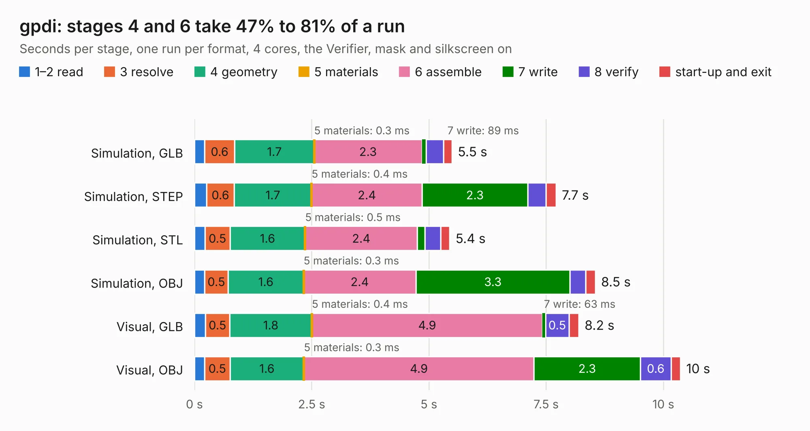

| Mode and format | 1–2 read | 3 resolve | 4 geometry | 5 materials | 6 assemble | 7 write | 8 verify | start-up and exit | Total |
|---|---:|---:|---:|---:|---:|---:|---:|---:|---:|
| Simulation, GLB | 0.2 | 0.6 | 1.7 | 0.3&nbsp;ms | 2.3 | 89&nbsp;ms | 0.4 | 0.2 | 5.5 |
| Simulation, STEP | 0.3 | 0.6 | 1.7 | 0.4&nbsp;ms | 2.4 | 2.3 | 0.4 | 0.2 | 7.7 |
| Simulation, STL | 0.2 | 0.5 | 1.6 | 0.5&nbsp;ms | 2.4 | 0.2 | 0.3 | 0.2 | 5.4 |
| Simulation, OBJ | 0.2 | 0.5 | 1.6 | 0.3&nbsp;ms | 2.4 | 3.3 | 0.3 | 0.2 | 8.5 |
| Visual, GLB | 0.2 | 0.5 | 1.8 | 0.4&nbsp;ms | 4.9 | 63&nbsp;ms | 0.5 | 0.2 | 8.2 |
| Visual, OBJ | 0.2 | 0.5 | 1.6 | 0.3&nbsp;ms | 4.9 | 2.3 | 0.6 | 0.2 | 10.4 |

<table align="center"><tr><td valign="top">

| Board | Repo: [gregdavill/advent-calendar-of-circuits-2020](https://github.com/gregdavill/advent-calendar-of-circuits-2020) Board: `gpdi.kicad_pcb` |
|---|---|
| Folder | gpdi / kicad-src |
| Complexity | 313&nbsp;/&nbsp;1000 (size&nbsp;188, features&nbsp;125) |
| KESE&nbsp;features | through vias, slotted holes, custom pads, rounded, trapezoid or chamfered pads, filled zones, copper drawings, curved board outline, stack-up, dielectric εr and tanδ, mask and silkscreen colours |
| Tested | 9th November 2026 |
| Copper&nbsp;layers | 4 |
| File&nbsp;format | KiCad 6 (20210126) |
| Parts,&nbsp;tracks,&nbsp;vias | 53, 679, 67 |
| Triangles,&nbsp;simulation | 676,432 in 104 parts |
| Verifier | PASS in all six runs |

</td><td valign="top">

<table>
<tr><th>File type</th><th>File size</th><th>Peak memory used</th></tr>
<tr><th colspan="3" align="left">Simulation</th></tr>
<tr><td>GLB</td><td align="right">23&nbsp;MB</td><td align="right">342&nbsp;MB</td></tr>
<tr><td>STEP</td><td align="right">96&nbsp;MB</td><td align="right">414&nbsp;MB</td></tr>
<tr><td>STL</td><td align="right">34&nbsp;MB</td><td align="right">343&nbsp;MB</td></tr>
<tr><td>OBJ</td><td align="right">67&nbsp;MB</td><td align="right">488&nbsp;MB</td></tr>
<tr><th colspan="3" align="left">Visual</th></tr>
<tr><td>GLB</td><td align="right">15&nbsp;MB</td><td align="right">466&nbsp;MB</td></tr>
<tr><td>OBJ</td><td align="right">45&nbsp;MB</td><td align="right">413&nbsp;MB</td></tr>
</table>

</td></tr></table>

## 23.11.16 hdmi-si

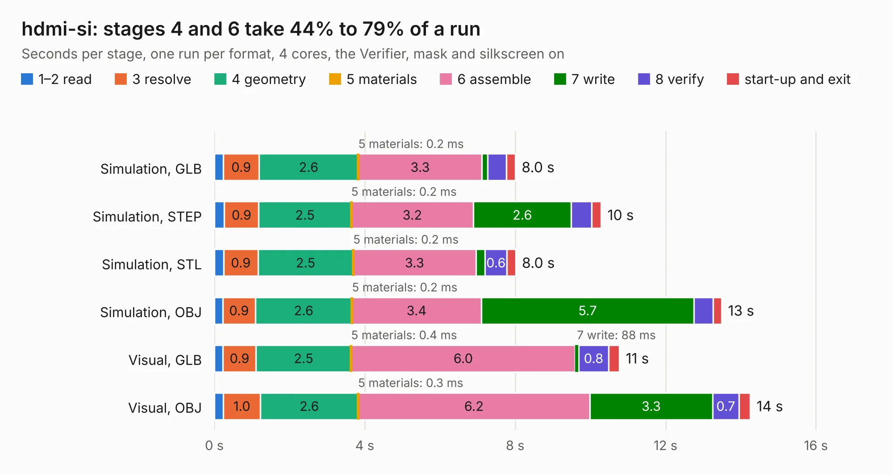

| Mode and format | 1–2 read | 3 resolve | 4 geometry | 5 materials | 6 assemble | 7 write | 8 verify | start-up and exit | Total |
|---|---:|---:|---:|---:|---:|---:|---:|---:|---:|
| Simulation, GLB | 0.2 | 0.9 | 2.6 | 0.2&nbsp;ms | 3.3 | 0.1 | 0.5 | 0.2 | 8.0 |
| Simulation, STEP | 0.3 | 0.9 | 2.5 | 0.2&nbsp;ms | 3.2 | 2.6 | 0.5 | 0.2 | 10.3 |
| Simulation, STL | 0.2 | 0.9 | 2.5 | 0.2&nbsp;ms | 3.3 | 0.2 | 0.6 | 0.2 | 8.0 |
| Simulation, OBJ | 0.2 | 0.9 | 2.6 | 0.2&nbsp;ms | 3.4 | 5.7 | 0.5 | 0.2 | 13.5 |
| Visual, GLB | 0.2 | 0.9 | 2.5 | 0.4&nbsp;ms | 6.0 | 88&nbsp;ms | 0.8 | 0.3 | 10.8 |
| Visual, OBJ | 0.2 | 1.0 | 2.6 | 0.3&nbsp;ms | 6.2 | 3.3 | 0.7 | 0.3 | 14.2 |

<table align="center"><tr><td valign="top">

| Board | Repo: [gregdavill/advent-calendar-of-circuits-2020](https://github.com/gregdavill/advent-calendar-of-circuits-2020) Board: `hdmi-si.kicad_pcb` |
|---|---|
| Folder | hdmi-si / kicad-src |
| Complexity | 278&nbsp;/&nbsp;1000 (size&nbsp;178, features&nbsp;100) |
| KESE&nbsp;features | through vias, slotted holes, rounded, trapezoid or chamfered pads, filled zones, curved board outline, stack-up, dielectric εr and tanδ, mask and silkscreen colours |
| Tested | 9th November 2026 |
| Copper&nbsp;layers | 4 |
| File&nbsp;format | KiCad 6 (20201116) |
| Parts,&nbsp;tracks,&nbsp;vias | 26, 335, 138 |
| Triangles,&nbsp;simulation | 987,308 in 42 parts |
| Verifier | PASS in all six runs |

</td><td valign="top">

<table>
<tr><th>File type</th><th>File size</th><th>Peak memory used</th></tr>
<tr><th colspan="3" align="left">Simulation</th></tr>
<tr><td>GLB</td><td align="right">32&nbsp;MB</td><td align="right">491&nbsp;MB</td></tr>
<tr><td>STEP</td><td align="right">121&nbsp;MB</td><td align="right">540&nbsp;MB</td></tr>
<tr><td>STL</td><td align="right">49&nbsp;MB</td><td align="right">498&nbsp;MB</td></tr>
<tr><td>OBJ</td><td align="right">98&nbsp;MB</td><td align="right">689&nbsp;MB</td></tr>
<tr><th colspan="3" align="left">Visual</th></tr>
<tr><td>GLB</td><td align="right">19&nbsp;MB</td><td align="right">547&nbsp;MB</td></tr>
<tr><td>OBJ</td><td align="right">59&nbsp;MB</td><td align="right">483&nbsp;MB</td></tr>
</table>

</td></tr></table>

## 23.11.17 icebreaker++

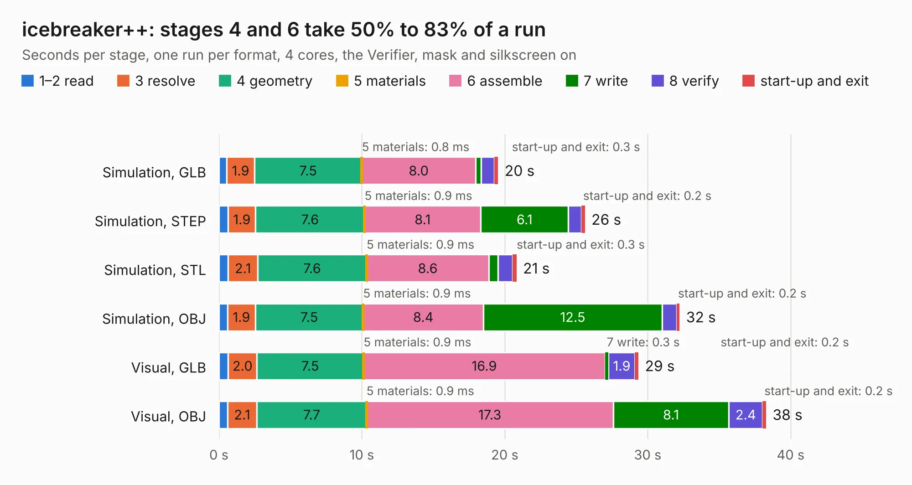

| Mode and format | 1–2 read | 3 resolve | 4 geometry | 5 materials | 6 assemble | 7 write | 8 verify | start-up and exit | Total |
|---|---:|---:|---:|---:|---:|---:|---:|---:|---:|
| Simulation, GLB | 0.5 | 1.9 | 7.5 | 0.8&nbsp;ms | 8.0 | 0.4 | 0.9 | 0.3 | 19.5 |
| Simulation, STEP | 0.6 | 1.9 | 7.6 | 0.9&nbsp;ms | 8.1 | 6.1 | 0.9 | 0.2 | 25.6 |
| Simulation, STL | 0.6 | 2.1 | 7.6 | 0.9&nbsp;ms | 8.6 | 0.6 | 1.0 | 0.3 | 20.8 |
| Simulation, OBJ | 0.6 | 1.9 | 7.5 | 0.9&nbsp;ms | 8.4 | 12.5 | 1.0 | 0.2 | 32.2 |
| Visual, GLB | 0.6 | 2.0 | 7.5 | 0.9&nbsp;ms | 16.9 | 0.3 | 1.9 | 0.2 | 29.4 |
| Visual, OBJ | 0.6 | 2.1 | 7.7 | 0.9&nbsp;ms | 17.3 | 8.1 | 2.4 | 0.2 | 38.3 |

<table align="center"><tr><td valign="top">

| Board | Repo: [gregdavill/advent-calendar-of-circuits-2020](https://github.com/gregdavill/advent-calendar-of-circuits-2020) Board: `icebreaker++.kicad_pcb` |
|---|---|
| Folder | icebreaker++ / kicad-src |
| Complexity | 365&nbsp;/&nbsp;1000 (size&nbsp;265, features&nbsp;100) |
| KESE&nbsp;features | through vias, slotted holes, rounded, trapezoid or chamfered pads, filled zones, curved board outline, stack-up, dielectric εr and tanδ, mask and silkscreen colours |
| Tested | 9th November 2026 |
| Copper&nbsp;layers | 4 |
| File&nbsp;format | KiCad 6 (20201116) |
| Parts,&nbsp;tracks,&nbsp;vias | 92, 1,852, 227 |
| Triangles,&nbsp;simulation | 2,188,308 in 276 parts |
| Verifier | PASS in all six runs |

</td><td valign="top">

<table>
<tr><th>File type</th><th>File size</th><th>Peak memory used</th></tr>
<tr><th colspan="3" align="left">Simulation</th></tr>
<tr><td>GLB</td><td align="right">74&nbsp;MB</td><td align="right">760&nbsp;MB</td></tr>
<tr><td>STEP</td><td align="right">341&nbsp;MB</td><td align="right">979&nbsp;MB</td></tr>
<tr><td>STL</td><td align="right">109&nbsp;MB</td><td align="right">770&nbsp;MB</td></tr>
<tr><td>OBJ</td><td align="right">229&nbsp;MB</td><td align="right">1.4&nbsp;GB</td></tr>
<tr><th colspan="3" align="left">Visual</th></tr>
<tr><td>GLB</td><td align="right">49&nbsp;MB</td><td align="right">945&nbsp;MB</td></tr>
<tr><td>OBJ</td><td align="right">150&nbsp;MB</td><td align="right">1.1&nbsp;GB</td></tr>
</table>

</td></tr></table>

## 23.11.18 jtag-programmer

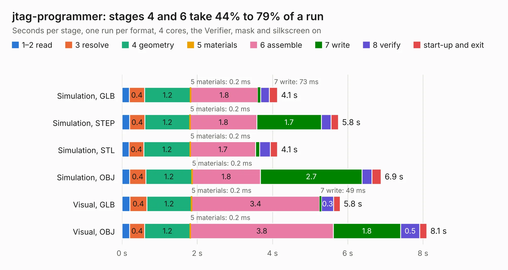

| Mode and format | 1–2 read | 3 resolve | 4 geometry | 5 materials | 6 assemble | 7 write | 8 verify | start-up and exit | Total |
|---|---:|---:|---:|---:|---:|---:|---:|---:|---:|
| Simulation, GLB | 0.2 | 0.4 | 1.2 | 0.2&nbsp;ms | 1.8 | 73&nbsp;ms | 0.2 | 0.2 | 4.1 |
| Simulation, STEP | 0.2 | 0.4 | 1.2 | 0.2&nbsp;ms | 1.8 | 1.7 | 0.3 | 0.2 | 5.8 |
| Simulation, STL | 0.2 | 0.4 | 1.2 | 0.2&nbsp;ms | 1.7 | 0.1 | 0.3 | 0.2 | 4.1 |
| Simulation, OBJ | 0.2 | 0.4 | 1.2 | 0.2&nbsp;ms | 1.8 | 2.7 | 0.3 | 0.2 | 6.9 |
| Visual, GLB | 0.2 | 0.4 | 1.2 | 0.2&nbsp;ms | 3.4 | 49&nbsp;ms | 0.3 | 0.2 | 5.8 |
| Visual, OBJ | 0.2 | 0.4 | 1.2 | 0.2&nbsp;ms | 3.8 | 1.8 | 0.5 | 0.2 | 8.1 |

<table align="center"><tr><td valign="top">

| Board | Repo: [gregdavill/advent-calendar-of-circuits-2020](https://github.com/gregdavill/advent-calendar-of-circuits-2020) Board: `jtag-programmer.kicad_pcb` |
|---|---|
| Folder | jtag-programmer / kicad-src |
| Complexity | 314&nbsp;/&nbsp;1000 (size&nbsp;214, features&nbsp;100) |
| KESE&nbsp;features | through vias, slotted holes, rounded, trapezoid or chamfered pads, filled zones, curved board outline, stack-up, dielectric εr and tanδ, mask and silkscreen colours |
| Tested | 9th November 2026 |
| Copper&nbsp;layers | 4 |
| File&nbsp;format | KiCad 6 (20201116) |
| Parts,&nbsp;tracks,&nbsp;vias | 25, 327, 92 |
| Triangles,&nbsp;simulation | 546,070 in 54 parts |
| Verifier | PASS in all six runs |

</td><td valign="top">

<table>
<tr><th>File type</th><th>File size</th><th>Peak memory used</th></tr>
<tr><th colspan="3" align="left">Simulation</th></tr>
<tr><td>GLB</td><td align="right">18&nbsp;MB</td><td align="right">310&nbsp;MB</td></tr>
<tr><td>STEP</td><td align="right">73&nbsp;MB</td><td align="right">372&nbsp;MB</td></tr>
<tr><td>STL</td><td align="right">27&nbsp;MB</td><td align="right">308&nbsp;MB</td></tr>
<tr><td>OBJ</td><td align="right">54&nbsp;MB</td><td align="right">411&nbsp;MB</td></tr>
<tr><th colspan="3" align="left">Visual</th></tr>
<tr><td>GLB</td><td align="right">12&nbsp;MB</td><td align="right">355&nbsp;MB</td></tr>
<tr><td>OBJ</td><td align="right">36&nbsp;MB</td><td align="right">386&nbsp;MB</td></tr>
</table>

</td></tr></table>

## 23.11.19 led-panel

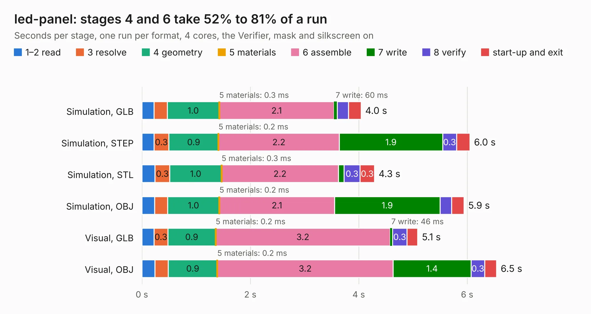

| Mode and format | 1–2 read | 3 resolve | 4 geometry | 5 materials | 6 assemble | 7 write | 8 verify | start-up and exit | Total |
|---|---:|---:|---:|---:|---:|---:|---:|---:|---:|
| Simulation, GLB | 0.2 | 0.2 | 1.0 | 0.3&nbsp;ms | 2.1 | 60&nbsp;ms | 0.2 | 0.2 | 4.0 |
| Simulation, STEP | 0.2 | 0.3 | 0.9 | 0.2&nbsp;ms | 2.2 | 1.9 | 0.3 | 0.2 | 6.0 |
| Simulation, STL | 0.2 | 0.3 | 1.0 | 0.3&nbsp;ms | 2.2 | 0.1 | 0.3 | 0.3 | 4.3 |
| Simulation, OBJ | 0.2 | 0.2 | 1.0 | 0.2&nbsp;ms | 2.1 | 1.9 | 0.2 | 0.2 | 5.9 |
| Visual, GLB | 0.2 | 0.3 | 0.9 | 0.2&nbsp;ms | 3.2 | 46&nbsp;ms | 0.3 | 0.2 | 5.1 |
| Visual, OBJ | 0.2 | 0.2 | 0.9 | 0.2&nbsp;ms | 3.2 | 1.4 | 0.3 | 0.2 | 6.5 |

<table align="center"><tr><td valign="top">

| Board | Repo: [gregdavill/advent-calendar-of-circuits-2020](https://github.com/gregdavill/advent-calendar-of-circuits-2020) Board: `led-panel.kicad_pcb` |
|---|---|
| Folder | led-panel / kicad-src |
| Complexity | 251&nbsp;/&nbsp;1000 (size&nbsp;161, features&nbsp;90) |
| KESE&nbsp;features | through vias, rounded, trapezoid or chamfered pads, filled zones, curved board outline, stack-up, dielectric εr and tanδ, mask and silkscreen colours |
| Tested | 9th November 2026 |
| Copper&nbsp;layers | 2 |
| File&nbsp;format | KiCad 6 (20201116) |
| Parts,&nbsp;tracks,&nbsp;vias | 58, 388, 16 |
| Triangles,&nbsp;simulation | 337,424 in 61 parts |
| Note | panel |
| Verifier | PASS in all six runs |

</td><td valign="top">

<table>
<tr><th>File type</th><th>File size</th><th>Peak memory used</th></tr>
<tr><th colspan="3" align="left">Simulation</th></tr>
<tr><td>GLB</td><td align="right">11&nbsp;MB</td><td align="right">295&nbsp;MB</td></tr>
<tr><td>STEP</td><td align="right">74&nbsp;MB</td><td align="right">324&nbsp;MB</td></tr>
<tr><td>STL</td><td align="right">17&nbsp;MB</td><td align="right">291&nbsp;MB</td></tr>
<tr><td>OBJ</td><td align="right">34&nbsp;MB</td><td align="right">294&nbsp;MB</td></tr>
<tr><th colspan="3" align="left">Visual</th></tr>
<tr><td>GLB</td><td align="right">9.0&nbsp;MB</td><td align="right">314&nbsp;MB</td></tr>
<tr><td>OBJ</td><td align="right">26&nbsp;MB</td><td align="right">316&nbsp;MB</td></tr>
</table>

</td></tr></table>

## 23.11.20 meiji-led-ring

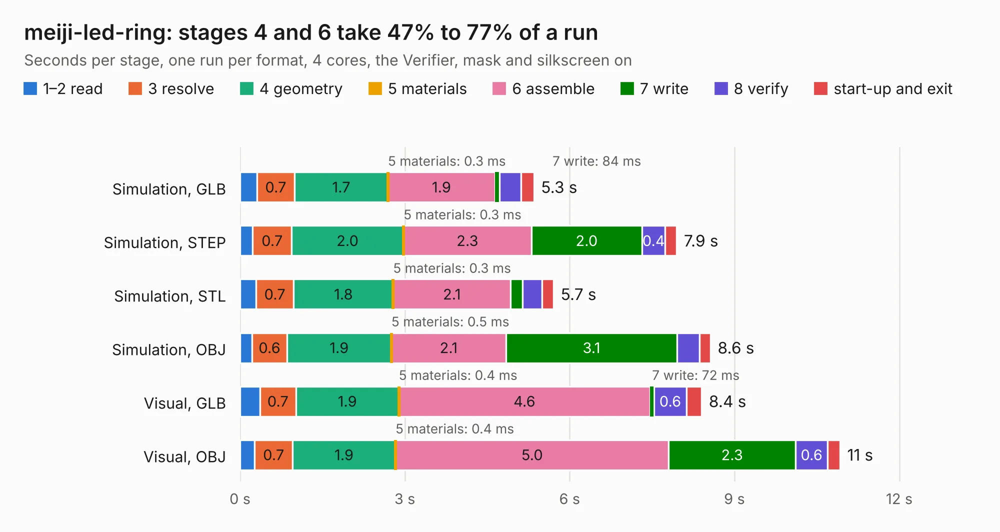

| Mode and format | 1–2 read | 3 resolve | 4 geometry | 5 materials | 6 assemble | 7 write | 8 verify | start-up and exit | Total |
|---|---:|---:|---:|---:|---:|---:|---:|---:|---:|
| Simulation, GLB | 0.3 | 0.7 | 1.7 | 0.3&nbsp;ms | 1.9 | 84&nbsp;ms | 0.4 | 0.2 | 5.3 |
| Simulation, STEP | 0.2 | 0.7 | 2.0 | 0.3&nbsp;ms | 2.3 | 2.0 | 0.4 | 0.2 | 7.9 |
| Simulation, STL | 0.3 | 0.7 | 1.8 | 0.3&nbsp;ms | 2.1 | 0.2 | 0.4 | 0.2 | 5.7 |
| Simulation, OBJ | 0.2 | 0.6 | 1.9 | 0.5&nbsp;ms | 2.1 | 3.1 | 0.4 | 0.2 | 8.6 |
| Visual, GLB | 0.4 | 0.7 | 1.9 | 0.4&nbsp;ms | 4.6 | 72&nbsp;ms | 0.6 | 0.3 | 8.4 |
| Visual, OBJ | 0.3 | 0.7 | 1.9 | 0.4&nbsp;ms | 5.0 | 2.3 | 0.6 | 0.2 | 10.9 |

<table align="center"><tr><td valign="top">

| Board | Repo: [gregdavill/advent-calendar-of-circuits-2020](https://github.com/gregdavill/advent-calendar-of-circuits-2020) Board: `meiji-led-ring.kicad_pcb` |
|---|---|
| Folder | meiji-led-ring / kicad-src |
| Complexity | 287&nbsp;/&nbsp;1000 (size&nbsp;187, features&nbsp;100) |
| KESE&nbsp;features | through vias, slotted holes, rounded, trapezoid or chamfered pads, filled zones, curved board outline, stack-up, dielectric εr and tanδ, mask and silkscreen colours |
| Tested | 9th November 2026 |
| Copper&nbsp;layers | 4 |
| File&nbsp;format | KiCad 6 (20210126) |
| Parts,&nbsp;tracks,&nbsp;vias | 61, 592, 59 |
| Triangles,&nbsp;simulation | 709,422 in 75 parts |
| Verifier | PASS in all six runs |

</td><td valign="top">

<table>
<tr><th>File type</th><th>File size</th><th>Peak memory used</th></tr>
<tr><th colspan="3" align="left">Simulation</th></tr>
<tr><td>GLB</td><td align="right">24&nbsp;MB</td><td align="right">399&nbsp;MB</td></tr>
<tr><td>STEP</td><td align="right">110&nbsp;MB</td><td align="right">424&nbsp;MB</td></tr>
<tr><td>STL</td><td align="right">35&nbsp;MB</td><td align="right">393&nbsp;MB</td></tr>
<tr><td>OBJ</td><td align="right">71&nbsp;MB</td><td align="right">510&nbsp;MB</td></tr>
<tr><th colspan="3" align="left">Visual</th></tr>
<tr><td>GLB</td><td align="right">16&nbsp;MB</td><td align="right">431&nbsp;MB</td></tr>
<tr><td>OBJ</td><td align="right">48&nbsp;MB</td><td align="right">434&nbsp;MB</td></tr>
</table>

</td></tr></table>

## 23.11.21 memory-lcd-wing

| Mode and format | 1–2 read | 3 resolve | 4 geometry | 5 materials | 6 assemble | 7 write | 8 verify | start-up and exit | Total |
|---|---:|---:|---:|---:|---:|---:|---:|---:|---:|
| Simulation, GLB | 0.1 | 0.2 | 0.7 | 0.2&nbsp;ms | 1.0 | 33&nbsp;ms | 0.1 | 0.2 | 2.4 |
| Simulation, STEP | 0.1 | 0.2 | 0.8 | 0.2&nbsp;ms | 0.9 | 1.1 | 0.1 | 0.3 | 3.5 |
| Simulation, STL | 0.1 | 0.2 | 0.7 | 0.3&nbsp;ms | 1.0 | 52&nbsp;ms | 0.1 | 0.2 | 2.4 |
| Simulation, OBJ | 0.1 | 0.2 | 0.8 | 0.2&nbsp;ms | 0.9 | 1.1 | 0.1 | 0.2 | 3.5 |
| Visual, GLB | 0.1 | 0.2 | 0.7 | 0.2&nbsp;ms | 1.8 | 33&nbsp;ms | 0.2 | 0.2 | 3.3 |
| Visual, OBJ | 0.1 | 0.2 | 0.9 | 0.2&nbsp;ms | 2.2 | 0.9 | 0.2 | 0.2 | 4.6 |

<table align="center"><tr><td valign="top">

| Board | Repo: [gregdavill/advent-calendar-of-circuits-2020](https://github.com/gregdavill/advent-calendar-of-circuits-2020) Board: `memory-lcd-wing.kicad_pcb` |
|---|---|
| Folder | memory-lcd-wing / kicad-src |
| Complexity | 196&nbsp;/&nbsp;1000 (size&nbsp;106, features&nbsp;90) |
| KESE&nbsp;features | through vias, rounded, trapezoid or chamfered pads, filled zones, curved board outline, stack-up, dielectric εr and tanδ, mask and silkscreen colours |
| Tested | 9th November 2026 |
| Copper&nbsp;layers | 2 |
| File&nbsp;format | KiCad 6 (20201116) |
| Parts,&nbsp;tracks,&nbsp;vias | 4, 68, 3 |
| Triangles,&nbsp;simulation | 192,292 in 39 parts |
| Verifier | PASS in all six runs |

</td><td valign="top">

<table>
<tr><th>File type</th><th>File size</th><th>Peak memory used</th></tr>
<tr><th colspan="3" align="left">Simulation</th></tr>
<tr><td>GLB</td><td align="right">6.2&nbsp;MB</td><td align="right">206&nbsp;MB</td></tr>
<tr><td>STEP</td><td align="right">28&nbsp;MB</td><td align="right">225&nbsp;MB</td></tr>
<tr><td>STL</td><td align="right">9.6&nbsp;MB</td><td align="right">207&nbsp;MB</td></tr>
<tr><td>OBJ</td><td align="right">19&nbsp;MB</td><td align="right">209&nbsp;MB</td></tr>
<tr><th colspan="3" align="left">Visual</th></tr>
<tr><td>GLB</td><td align="right">4.2&nbsp;MB</td><td align="right">188&nbsp;MB</td></tr>
<tr><td>OBJ</td><td align="right">12&nbsp;MB</td><td align="right">191&nbsp;MB</td></tr>
</table>

</td></tr></table>

## 23.11.22 pcie_x1

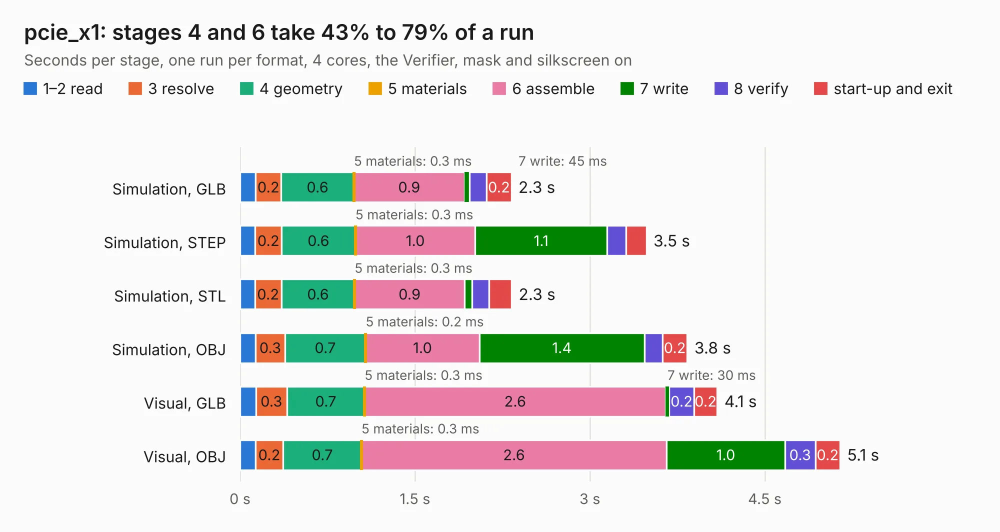

| Mode and format | 1–2 read | 3 resolve | 4 geometry | 5 materials | 6 assemble | 7 write | 8 verify | start-up and exit | Total |
|---|---:|---:|---:|---:|---:|---:|---:|---:|---:|
| Simulation, GLB | 0.1 | 0.2 | 0.6 | 0.3&nbsp;ms | 0.9 | 45&nbsp;ms | 0.1 | 0.2 | 2.3 |
| Simulation, STEP | 0.1 | 0.2 | 0.6 | 0.3&nbsp;ms | 1.0 | 1.1 | 0.2 | 0.2 | 3.5 |
| Simulation, STL | 0.1 | 0.2 | 0.6 | 0.3&nbsp;ms | 0.9 | 65&nbsp;ms | 0.1 | 0.2 | 2.3 |
| Simulation, OBJ | 0.1 | 0.3 | 0.7 | 0.2&nbsp;ms | 1.0 | 1.4 | 0.2 | 0.2 | 3.8 |
| Visual, GLB | 0.1 | 0.3 | 0.7 | 0.3&nbsp;ms | 2.6 | 30&nbsp;ms | 0.2 | 0.2 | 4.1 |
| Visual, OBJ | 0.1 | 0.2 | 0.7 | 0.3&nbsp;ms | 2.6 | 1.0 | 0.3 | 0.2 | 5.1 |

<table align="center"><tr><td valign="top">

| Board | Repo: [gregdavill/advent-calendar-of-circuits-2020](https://github.com/gregdavill/advent-calendar-of-circuits-2020) Board: `pcie_x1.kicad_pcb` |
|---|---|
| Folder | pcie_x1 / kicad-src |
| Complexity | 271&nbsp;/&nbsp;1000 (size&nbsp;156, features&nbsp;115) |
| KESE&nbsp;features | through vias, custom pads, rounded, trapezoid or chamfered pads, filled zones, copper drawings, curved board outline, stack-up, dielectric εr and tanδ, mask and silkscreen colours |
| Tested | 9th November 2026 |
| Copper&nbsp;layers | 4 |
| File&nbsp;format | KiCad 6 (20201116) |
| Parts,&nbsp;tracks,&nbsp;vias | 10, 248, 37 |
| Triangles,&nbsp;simulation | 286,956 in 84 parts |
| Verifier | PASS in all six runs |

</td><td valign="top">

<table>
<tr><th>File type</th><th>File size</th><th>Peak memory used</th></tr>
<tr><th colspan="3" align="left">Simulation</th></tr>
<tr><td>GLB</td><td align="right">9.6&nbsp;MB</td><td align="right">253&nbsp;MB</td></tr>
<tr><td>STEP</td><td align="right">41&nbsp;MB</td><td align="right">259&nbsp;MB</td></tr>
<tr><td>STL</td><td align="right">14&nbsp;MB</td><td align="right">249&nbsp;MB</td></tr>
<tr><td>OBJ</td><td align="right">28&nbsp;MB</td><td align="right">243&nbsp;MB</td></tr>
<tr><th colspan="3" align="left">Visual</th></tr>
<tr><td>GLB</td><td align="right">6.5&nbsp;MB</td><td align="right">235&nbsp;MB</td></tr>
<tr><td>OBJ</td><td align="right">19&nbsp;MB</td><td align="right">233&nbsp;MB</td></tr>
</table>

</td></tr></table>

## 23.11.23 pcie_x4

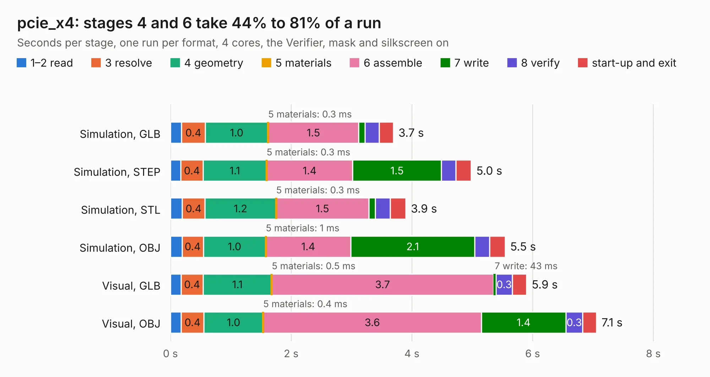

| Mode and format | 1–2 read | 3 resolve | 4 geometry | 5 materials | 6 assemble | 7 write | 8 verify | start-up and exit | Total |
|---|---:|---:|---:|---:|---:|---:|---:|---:|---:|
| Simulation, GLB | 0.2 | 0.4 | 1.0 | 0.3&nbsp;ms | 1.5 | 0.1 | 0.2 | 0.2 | 3.7 |
| Simulation, STEP | 0.2 | 0.4 | 1.1 | 0.3&nbsp;ms | 1.4 | 1.5 | 0.2 | 0.3 | 5.0 |
| Simulation, STL | 0.2 | 0.4 | 1.2 | 0.3&nbsp;ms | 1.5 | 0.1 | 0.2 | 0.3 | 3.9 |
| Simulation, OBJ | 0.2 | 0.4 | 1.0 | 1&nbsp;ms | 1.4 | 2.1 | 0.2 | 0.3 | 5.5 |
| Visual, GLB | 0.2 | 0.4 | 1.1 | 0.5&nbsp;ms | 3.7 | 43&nbsp;ms | 0.3 | 0.2 | 5.9 |
| Visual, OBJ | 0.2 | 0.4 | 1.0 | 0.4&nbsp;ms | 3.6 | 1.4 | 0.3 | 0.2 | 7.1 |

<table align="center"><tr><td valign="top">

| Board | Repo: [gregdavill/advent-calendar-of-circuits-2020](https://github.com/gregdavill/advent-calendar-of-circuits-2020) Board: `pcie_x4.kicad_pcb` |
|---|---|
| Folder | pcie_x4 / kicad-src |
| Complexity | 282&nbsp;/&nbsp;1000 (size&nbsp;167, features&nbsp;115) |
| KESE&nbsp;features | through vias, custom pads, rounded, trapezoid or chamfered pads, filled zones, copper drawings, curved board outline, stack-up, dielectric εr and tanδ, mask and silkscreen colours |
| Tested | 9th November 2026 |
| Copper&nbsp;layers | 4 |
| File&nbsp;format | KiCad 6 (20201116) |
| Parts,&nbsp;tracks,&nbsp;vias | 16, 374, 53 |
| Triangles,&nbsp;simulation | 370,874 in 94 parts |
| Verifier | PASS in all six runs |

</td><td valign="top">

<table>
<tr><th>File type</th><th>File size</th><th>Peak memory used</th></tr>
<tr><th colspan="3" align="left">Simulation</th></tr>
<tr><td>GLB</td><td align="right">12&nbsp;MB</td><td align="right">275&nbsp;MB</td></tr>
<tr><td>STEP</td><td align="right">52&nbsp;MB</td><td align="right">296&nbsp;MB</td></tr>
<tr><td>STL</td><td align="right">19&nbsp;MB</td><td align="right">273&nbsp;MB</td></tr>
<tr><td>OBJ</td><td align="right">37&nbsp;MB</td><td align="right">285&nbsp;MB</td></tr>
<tr><th colspan="3" align="left">Visual</th></tr>
<tr><td>GLB</td><td align="right">8.3&nbsp;MB</td><td align="right">282&nbsp;MB</td></tr>
<tr><td>OBJ</td><td align="right">25&nbsp;MB</td><td align="right">282&nbsp;MB</td></tr>
</table>

</td></tr></table>

## 23.11.24 pmod-gnss

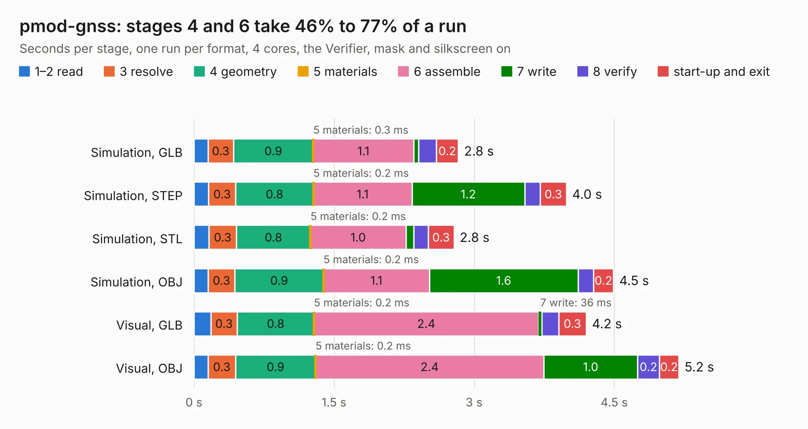

| Mode and format | 1–2 read | 3 resolve | 4 geometry | 5 materials | 6 assemble | 7 write | 8 verify | start-up and exit | Total |
|---|---:|---:|---:|---:|---:|---:|---:|---:|---:|
| Simulation, GLB | 0.2 | 0.3 | 0.9 | 0.3&nbsp;ms | 1.1 | 55&nbsp;ms | 0.2 | 0.2 | 2.8 |
| Simulation, STEP | 0.2 | 0.3 | 0.8 | 0.2&nbsp;ms | 1.1 | 1.2 | 0.2 | 0.3 | 4.0 |
| Simulation, STL | 0.2 | 0.3 | 0.8 | 0.2&nbsp;ms | 1.0 | 84&nbsp;ms | 0.2 | 0.3 | 2.8 |
| Simulation, OBJ | 0.2 | 0.3 | 0.9 | 0.2&nbsp;ms | 1.1 | 1.6 | 0.2 | 0.2 | 4.5 |
| Visual, GLB | 0.2 | 0.3 | 0.8 | 0.2&nbsp;ms | 2.4 | 36&nbsp;ms | 0.2 | 0.3 | 4.2 |
| Visual, OBJ | 0.1 | 0.3 | 0.9 | 0.2&nbsp;ms | 2.4 | 1.0 | 0.2 | 0.2 | 5.2 |

<table align="center"><tr><td valign="top">

| Board | Repo: [gregdavill/advent-calendar-of-circuits-2020](https://github.com/gregdavill/advent-calendar-of-circuits-2020) Board: `pmod-gnss.kicad_pcb` |
|---|---|
| Folder | pmod-gnss / kicad-src |
| Complexity | 261&nbsp;/&nbsp;1000 (size&nbsp;156, features&nbsp;105) |
| KESE&nbsp;features | through vias, rounded, trapezoid or chamfered pads, arc tracks, filled zones, curved board outline, stack-up, dielectric εr and tanδ, mask and silkscreen colours |
| Tested | 9th November 2026 |
| Copper&nbsp;layers | 4 |
| File&nbsp;format | KiCad 6 (20201116) |
| Parts,&nbsp;tracks,&nbsp;vias | 22, 135, 30 |
| Triangles,&nbsp;simulation | 281,488 in 41 parts |
| Verifier | PASS in all six runs |

</td><td valign="top">

<table>
<tr><th>File type</th><th>File size</th><th>Peak memory used</th></tr>
<tr><th colspan="3" align="left">Simulation</th></tr>
<tr><td>GLB</td><td align="right">9.3&nbsp;MB</td><td align="right">234&nbsp;MB</td></tr>
<tr><td>STEP</td><td align="right">34&nbsp;MB</td><td align="right">250&nbsp;MB</td></tr>
<tr><td>STL</td><td align="right">14&nbsp;MB</td><td align="right">234&nbsp;MB</td></tr>
<tr><td>OBJ</td><td align="right">28&nbsp;MB</td><td align="right">237&nbsp;MB</td></tr>
<tr><th colspan="3" align="left">Visual</th></tr>
<tr><td>GLB</td><td align="right">5.8&nbsp;MB</td><td align="right">218&nbsp;MB</td></tr>
<tr><td>OBJ</td><td align="right">17&nbsp;MB</td><td align="right">222&nbsp;MB</td></tr>
</table>

</td></tr></table>

## 23.11.25 pmod-quad-7segment

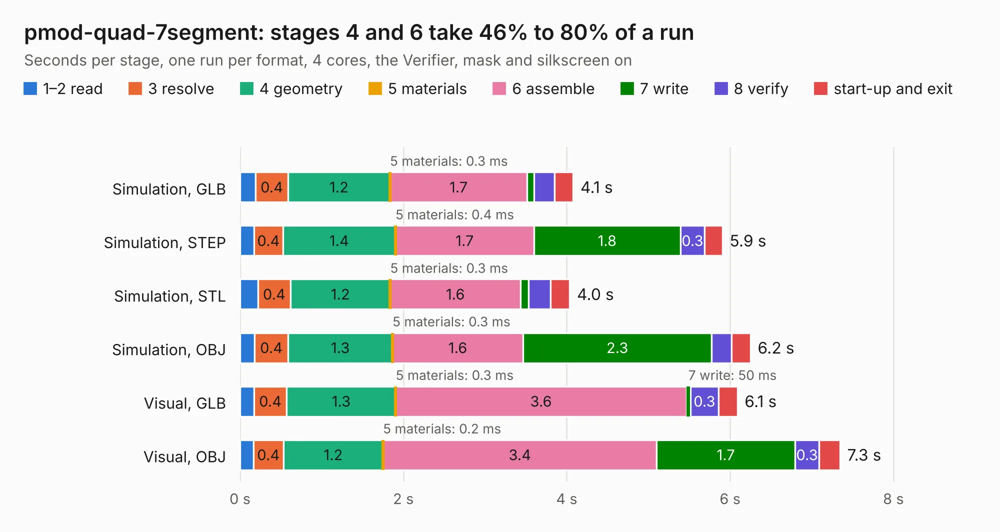

| Mode and format | 1–2 read | 3 resolve | 4 geometry | 5 materials | 6 assemble | 7 write | 8 verify | start-up and exit | Total |
|---|---:|---:|---:|---:|---:|---:|---:|---:|---:|
| Simulation, GLB | 0.2 | 0.4 | 1.2 | 0.3&nbsp;ms | 1.7 | 81&nbsp;ms | 0.3 | 0.2 | 4.1 |
| Simulation, STEP | 0.2 | 0.4 | 1.4 | 0.4&nbsp;ms | 1.7 | 1.8 | 0.3 | 0.2 | 5.9 |
| Simulation, STL | 0.2 | 0.4 | 1.2 | 0.3&nbsp;ms | 1.6 | 99&nbsp;ms | 0.3 | 0.2 | 4.0 |
| Simulation, OBJ | 0.2 | 0.4 | 1.3 | 0.3&nbsp;ms | 1.6 | 2.3 | 0.2 | 0.2 | 6.2 |
| Visual, GLB | 0.2 | 0.4 | 1.3 | 0.3&nbsp;ms | 3.6 | 50&nbsp;ms | 0.3 | 0.2 | 6.1 |
| Visual, OBJ | 0.2 | 0.4 | 1.2 | 0.2&nbsp;ms | 3.4 | 1.7 | 0.3 | 0.3 | 7.3 |

<table align="center"><tr><td valign="top">

| Board | Repo: [gregdavill/advent-calendar-of-circuits-2020](https://github.com/gregdavill/advent-calendar-of-circuits-2020) Board: `pmod-quad-7segment.kicad_pcb` |
|---|---|
| Folder | pmod-quad-7segment / kicad-src |
| Complexity | 244&nbsp;/&nbsp;1000 (size&nbsp;154, features&nbsp;90) |
| KESE&nbsp;features | through vias, rounded, trapezoid or chamfered pads, filled zones, curved board outline, stack-up, dielectric εr and tanδ, mask and silkscreen colours |
| Tested | 9th November 2026 |
| Copper&nbsp;layers | 2 |
| File&nbsp;format | KiCad 6 (20201116) |
| Parts,&nbsp;tracks,&nbsp;vias | 21, 385, 63 |
| Triangles,&nbsp;simulation | 398,938 in 49 parts |
| Verifier | PASS in all six runs |

</td><td valign="top">

<table>
<tr><th>File type</th><th>File size</th><th>Peak memory used</th></tr>
<tr><th colspan="3" align="left">Simulation</th></tr>
<tr><td>GLB</td><td align="right">13&nbsp;MB</td><td align="right">272&nbsp;MB</td></tr>
<tr><td>STEP</td><td align="right">67&nbsp;MB</td><td align="right">312&nbsp;MB</td></tr>
<tr><td>STL</td><td align="right">20&nbsp;MB</td><td align="right">272&nbsp;MB</td></tr>
<tr><td>OBJ</td><td align="right">40&nbsp;MB</td><td align="right">322&nbsp;MB</td></tr>
<tr><th colspan="3" align="left">Visual</th></tr>
<tr><td>GLB</td><td align="right">11&nbsp;MB</td><td align="right">333&nbsp;MB</td></tr>
<tr><td>OBJ</td><td align="right">33&nbsp;MB</td><td align="right">334&nbsp;MB</td></tr>
</table>

</td></tr></table>

## 23.11.26 sd-dummy

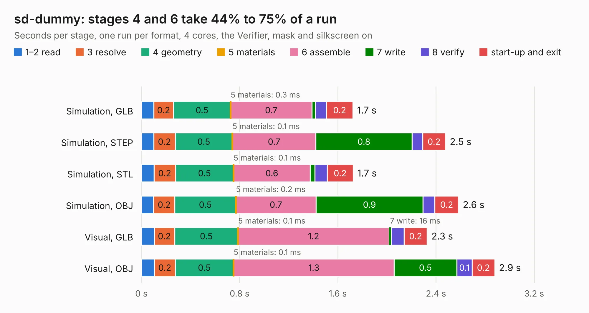

| Mode and format | 1–2 read | 3 resolve | 4 geometry | 5 materials | 6 assemble | 7 write | 8 verify | start-up and exit | Total |
|---|---:|---:|---:|---:|---:|---:|---:|---:|---:|
| Simulation, GLB | 0.1 | 0.2 | 0.5 | 0.3&nbsp;ms | 0.7 | 29&nbsp;ms | 90&nbsp;ms | 0.2 | 1.7 |
| Simulation, STEP | 0.1 | 0.2 | 0.5 | 0.1&nbsp;ms | 0.7 | 0.8 | 85&nbsp;ms | 0.2 | 2.5 |
| Simulation, STL | 0.1 | 0.2 | 0.5 | 0.1&nbsp;ms | 0.6 | 39&nbsp;ms | 0.1 | 0.2 | 1.7 |
| Simulation, OBJ | 99&nbsp;ms | 0.2 | 0.5 | 0.2&nbsp;ms | 0.7 | 0.9 | 96&nbsp;ms | 0.2 | 2.6 |
| Visual, GLB | 0.1 | 0.2 | 0.5 | 0.1&nbsp;ms | 1.2 | 16&nbsp;ms | 0.1 | 0.2 | 2.3 |
| Visual, OBJ | 0.1 | 0.2 | 0.5 | 0.1&nbsp;ms | 1.3 | 0.5 | 0.1 | 0.2 | 2.9 |

<table align="center"><tr><td valign="top">

| Board | Repo: [gregdavill/advent-calendar-of-circuits-2020](https://github.com/gregdavill/advent-calendar-of-circuits-2020) Board: `sd-dummy.kicad_pcb` |
|---|---|
| Folder | pmod-sd-dummy / kicad-src |
| Complexity | 212&nbsp;/&nbsp;1000 (size&nbsp;122, features&nbsp;90) |
| KESE&nbsp;features | through vias, rounded, trapezoid or chamfered pads, filled zones, curved board outline, stack-up, dielectric εr and tanδ, mask and silkscreen colours |
| Tested | 9th November 2026 |
| Copper&nbsp;layers | 4 |
| File&nbsp;format | KiCad 6 (20201116) |
| Parts,&nbsp;tracks,&nbsp;vias | 4, 57, 7 |
| Triangles,&nbsp;simulation | 165,454 in 23 parts |
| Verifier | PASS in all six runs |

</td><td valign="top">

<table>
<tr><th>File type</th><th>File size</th><th>Peak memory used</th></tr>
<tr><th colspan="3" align="left">Simulation</th></tr>
<tr><td>GLB</td><td align="right">5.6&nbsp;MB</td><td align="right">194&nbsp;MB</td></tr>
<tr><td>STEP</td><td align="right">24&nbsp;MB</td><td align="right">203&nbsp;MB</td></tr>
<tr><td>STL</td><td align="right">8.3&nbsp;MB</td><td align="right">196&nbsp;MB</td></tr>
<tr><td>OBJ</td><td align="right">16&nbsp;MB</td><td align="right">196&nbsp;MB</td></tr>
<tr><th colspan="3" align="left">Visual</th></tr>
<tr><td>GLB</td><td align="right">3.5&nbsp;MB</td><td align="right">165&nbsp;MB</td></tr>
<tr><td>OBJ</td><td align="right">9.9&nbsp;MB</td><td align="right">159&nbsp;MB</td></tr>
</table>

</td></tr></table>

## 23.11.27 resonance

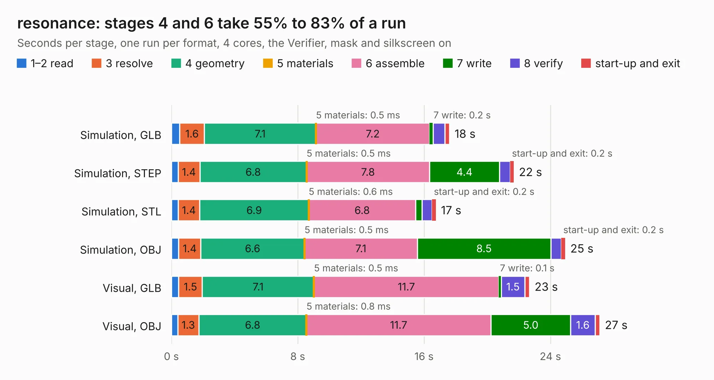

| Mode and format | 1–2 read | 3 resolve | 4 geometry | 5 materials | 6 assemble | 7 write | 8 verify | start-up and exit | Total |
|---|---:|---:|---:|---:|---:|---:|---:|---:|---:|
| Simulation, GLB | 0.5 | 1.6 | 7.1 | 0.5&nbsp;ms | 7.2 | 0.2 | 0.7 | 0.3 | 17.6 |
| Simulation, STEP | 0.4 | 1.4 | 6.8 | 0.5&nbsp;ms | 7.8 | 4.4 | 0.7 | 0.2 | 21.7 |
| Simulation, STL | 0.4 | 1.4 | 6.9 | 0.6&nbsp;ms | 6.8 | 0.4 | 0.6 | 0.2 | 16.7 |
| Simulation, OBJ | 0.5 | 1.4 | 6.6 | 0.5&nbsp;ms | 7.1 | 8.5 | 0.7 | 0.2 | 24.9 |
| Visual, GLB | 0.5 | 1.5 | 7.1 | 0.5&nbsp;ms | 11.7 | 0.1 | 1.5 | 0.3 | 22.7 |
| Visual, OBJ | 0.4 | 1.3 | 6.8 | 0.8&nbsp;ms | 11.7 | 5.0 | 1.6 | 0.3 | 27.1 |

<table align="center"><tr><td valign="top">

| Board | Repo: [gregdavill/advent-calendar-of-circuits-2020](https://github.com/gregdavill/advent-calendar-of-circuits-2020) Board: `resonance.kicad_pcb` |
|---|---|
| Folder | resonance / kicad-src |
| Complexity | 348&nbsp;/&nbsp;1000 (size&nbsp;248, features&nbsp;100) |
| KESE&nbsp;features | through vias, slotted holes, rounded, trapezoid or chamfered pads, filled zones, curved board outline, stack-up, dielectric εr and tanδ, mask and silkscreen colours |
| Tested | 9th November 2026 |
| Copper&nbsp;layers | 4 |
| File&nbsp;format | KiCad 6 (20201116) |
| Parts,&nbsp;tracks,&nbsp;vias | 64, 858, 149 |
| Triangles,&nbsp;simulation | 1,380,012 in 139 parts |
| Verifier | PASS in all six runs |

</td><td valign="top">

<table>
<tr><th>File type</th><th>File size</th><th>Peak memory used</th></tr>
<tr><th colspan="3" align="left">Simulation</th></tr>
<tr><td>GLB</td><td align="right">46&nbsp;MB</td><td align="right">548&nbsp;MB</td></tr>
<tr><td>STEP</td><td align="right">218&nbsp;MB</td><td align="right">674&nbsp;MB</td></tr>
<tr><td>STL</td><td align="right">69&nbsp;MB</td><td align="right">533&nbsp;MB</td></tr>
<tr><td>OBJ</td><td align="right">147&nbsp;MB</td><td align="right">942&nbsp;MB</td></tr>
<tr><th colspan="3" align="left">Visual</th></tr>
<tr><td>GLB</td><td align="right">28&nbsp;MB</td><td align="right">608&nbsp;MB</td></tr>
<tr><td>OBJ</td><td align="right">90&nbsp;MB</td><td align="right">699&nbsp;MB</td></tr>
</table>

</td></tr></table>

## 23.11.28 rpi-hq-camera

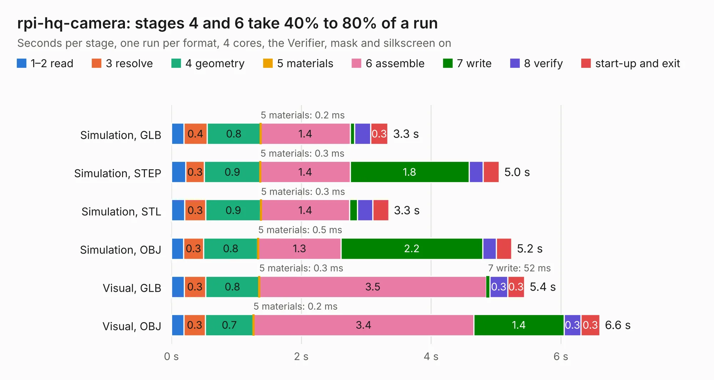

| Mode and format | 1–2 read | 3 resolve | 4 geometry | 5 materials | 6 assemble | 7 write | 8 verify | start-up and exit | Total |
|---|---:|---:|---:|---:|---:|---:|---:|---:|---:|
| Simulation, GLB | 0.2 | 0.4 | 0.8 | 0.2&nbsp;ms | 1.4 | 68&nbsp;ms | 0.2 | 0.3 | 3.3 |
| Simulation, STEP | 0.2 | 0.3 | 0.9 | 0.3&nbsp;ms | 1.4 | 1.8 | 0.2 | 0.2 | 5.0 |
| Simulation, STL | 0.2 | 0.3 | 0.9 | 0.3&nbsp;ms | 1.4 | 0.1 | 0.2 | 0.2 | 3.3 |
| Simulation, OBJ | 0.2 | 0.3 | 0.8 | 0.5&nbsp;ms | 1.3 | 2.2 | 0.2 | 0.2 | 5.2 |
| Visual, GLB | 0.2 | 0.3 | 0.8 | 0.3&nbsp;ms | 3.5 | 52&nbsp;ms | 0.3 | 0.3 | 5.4 |
| Visual, OBJ | 0.2 | 0.3 | 0.7 | 0.2&nbsp;ms | 3.4 | 1.4 | 0.3 | 0.3 | 6.6 |

<table align="center"><tr><td valign="top">

| Board | Repo: [gregdavill/advent-calendar-of-circuits-2020](https://github.com/gregdavill/advent-calendar-of-circuits-2020) Board: `rpi-hq-camera.kicad_pcb` |
|---|---|
| Folder | rpi-hq-camera / kicad-src |
| Complexity | 274&nbsp;/&nbsp;1000 (size&nbsp;159, features&nbsp;115) |
| KESE&nbsp;features | through vias, custom pads, rounded, trapezoid or chamfered pads, filled zones, copper drawings, curved board outline, stack-up, dielectric εr and tanδ, mask and silkscreen colours |
| Tested | 9th November 2026 |
| Copper&nbsp;layers | 4 |
| File&nbsp;format | KiCad 6 (20201116) |
| Parts,&nbsp;tracks,&nbsp;vias | 7, 453, 31 |
| Triangles,&nbsp;simulation | 341,220 in 70 parts |
| Verifier | PASS in all six runs |

</td><td valign="top">

<table>
<tr><th>File type</th><th>File size</th><th>Peak memory used</th></tr>
<tr><th colspan="3" align="left">Simulation</th></tr>
<tr><td>GLB</td><td align="right">11&nbsp;MB</td><td align="right">279&nbsp;MB</td></tr>
<tr><td>STEP</td><td align="right">57&nbsp;MB</td><td align="right">290&nbsp;MB</td></tr>
<tr><td>STL</td><td align="right">17&nbsp;MB</td><td align="right">262&nbsp;MB</td></tr>
<tr><td>OBJ</td><td align="right">34&nbsp;MB</td><td align="right">286&nbsp;MB</td></tr>
<tr><th colspan="3" align="left">Visual</th></tr>
<tr><td>GLB</td><td align="right">8.1&nbsp;MB</td><td align="right">270&nbsp;MB</td></tr>
<tr><td>OBJ</td><td align="right">24&nbsp;MB</td><td align="right">283&nbsp;MB</td></tr>
</table>

</td></tr></table>

## 23.11.29 SCD30-3d-model

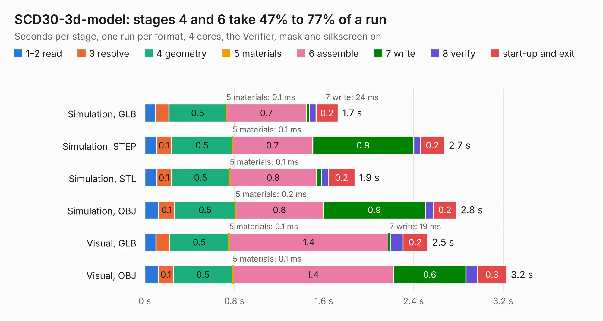

| Mode and format | 1–2 read | 3 resolve | 4 geometry | 5 materials | 6 assemble | 7 write | 8 verify | start-up and exit | Total |
|---|---:|---:|---:|---:|---:|---:|---:|---:|---:|
| Simulation, GLB | 98&nbsp;ms | 0.1 | 0.5 | 0.1&nbsp;ms | 0.7 | 24&nbsp;ms | 61&nbsp;ms | 0.2 | 1.7 |
| Simulation, STEP | 0.1 | 0.1 | 0.5 | 0.1&nbsp;ms | 0.7 | 0.9 | 60&nbsp;ms | 0.2 | 2.7 |
| Simulation, STL | 0.1 | 0.1 | 0.5 | 0.1&nbsp;ms | 0.8 | 41&nbsp;ms | 63&nbsp;ms | 0.2 | 1.9 |
| Simulation, OBJ | 0.1 | 0.1 | 0.5 | 0.2&nbsp;ms | 0.8 | 0.9 | 73&nbsp;ms | 0.2 | 2.8 |
| Visual, GLB | 0.1 | 0.1 | 0.5 | 0.1&nbsp;ms | 1.4 | 19&nbsp;ms | 0.1 | 0.2 | 2.5 |
| Visual, OBJ | 0.1 | 0.1 | 0.5 | 0.1&nbsp;ms | 1.4 | 0.6 | 0.1 | 0.3 | 3.2 |

<table align="center"><tr><td valign="top">

| Board | Repo: [gregdavill/advent-calendar-of-circuits-2020](https://github.com/gregdavill/advent-calendar-of-circuits-2020) Board: `SCD30-3d-model.kicad_pcb` |
|---|---|
| Folder | SCD30-3d-model / kicad-src |
| Complexity | 121&nbsp;/&nbsp;1000 (size&nbsp;66, features&nbsp;55) |
| KESE&nbsp;features | rounded, trapezoid or chamfered pads, curved board outline, stack-up, dielectric εr and tanδ, mask and silkscreen colours |
| Tested | 9th November 2026 |
| Copper&nbsp;layers | 4 |
| File&nbsp;format | KiCad 6 (20201116) |
| Parts,&nbsp;tracks,&nbsp;vias | 19, 0, 0 |
| Triangles,&nbsp;simulation | 138,320 in 13 parts |
| Verifier | PASS in all six runs |

</td><td valign="top">

<table>
<tr><th>File type</th><th>File size</th><th>Peak memory used</th></tr>
<tr><th colspan="3" align="left">Simulation</th></tr>
<tr><td>GLB</td><td align="right">4.7&nbsp;MB</td><td align="right">197&nbsp;MB</td></tr>
<tr><td>STEP</td><td align="right">18&nbsp;MB</td><td align="right">206&nbsp;MB</td></tr>
<tr><td>STL</td><td align="right">6.9&nbsp;MB</td><td align="right">196&nbsp;MB</td></tr>
<tr><td>OBJ</td><td align="right">14&nbsp;MB</td><td align="right">197&nbsp;MB</td></tr>
<tr><th colspan="3" align="left">Visual</th></tr>
<tr><td>GLB</td><td align="right">3.6&nbsp;MB</td><td align="right">173&nbsp;MB</td></tr>
<tr><td>OBJ</td><td align="right">10&nbsp;MB</td><td align="right">171&nbsp;MB</td></tr>
</table>

</td></tr></table>

## 23.11.30 syzygy-breakout

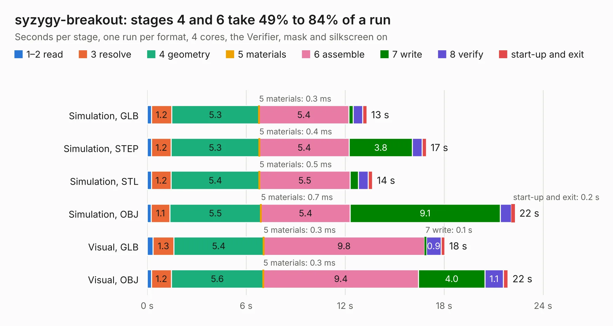

| Mode and format | 1–2 read | 3 resolve | 4 geometry | 5 materials | 6 assemble | 7 write | 8 verify | start-up and exit | Total |
|---|---:|---:|---:|---:|---:|---:|---:|---:|---:|
| Simulation, GLB | 0.3 | 1.2 | 5.3 | 0.3&nbsp;ms | 5.4 | 0.3 | 0.6 | 0.3 | 13.3 |
| Simulation, STEP | 0.3 | 1.2 | 5.3 | 0.4&nbsp;ms | 5.4 | 3.8 | 0.6 | 0.2 | 16.9 |
| Simulation, STL | 0.3 | 1.2 | 5.4 | 0.5&nbsp;ms | 5.5 | 0.5 | 0.6 | 0.3 | 13.7 |
| Simulation, OBJ | 0.2 | 1.1 | 5.5 | 0.7&nbsp;ms | 5.4 | 9.1 | 0.7 | 0.2 | 22.3 |
| Visual, GLB | 0.4 | 1.3 | 5.4 | 0.3&nbsp;ms | 9.8 | 0.1 | 0.9 | 0.2 | 18.0 |
| Visual, OBJ | 0.3 | 1.2 | 5.6 | 0.3&nbsp;ms | 9.4 | 4.0 | 1.1 | 0.3 | 21.9 |

<table align="center"><tr><td valign="top">

| Board | Repo: [gregdavill/advent-calendar-of-circuits-2020](https://github.com/gregdavill/advent-calendar-of-circuits-2020) Board: `syzygy-breakout.kicad_pcb` |
|---|---|
| Folder | syzygy-breakout / kicad-src |
| Complexity | 273&nbsp;/&nbsp;1000 (size&nbsp;158, features&nbsp;115) |
| KESE&nbsp;features | through vias, custom pads, rounded, trapezoid or chamfered pads, filled zones, copper drawings, curved board outline, stack-up, dielectric εr and tanδ, mask and silkscreen colours |
| Tested | 9th November 2026 |
| Copper&nbsp;layers | 4 |
| File&nbsp;format | KiCad 6 (20201116) |
| Parts,&nbsp;tracks,&nbsp;vias | 7, 399, 41 |
| Triangles,&nbsp;simulation | 1,777,548 in 70 parts |
| Verifier | PASS in all six runs |

</td><td valign="top">

<table>
<tr><th>File type</th><th>File size</th><th>Peak memory used</th></tr>
<tr><th colspan="3" align="left">Simulation</th></tr>
<tr><td>GLB</td><td align="right">58&nbsp;MB</td><td align="right">694&nbsp;MB</td></tr>
<tr><td>STEP</td><td align="right">216&nbsp;MB</td><td align="right">801&nbsp;MB</td></tr>
<tr><td>STL</td><td align="right">89&nbsp;MB</td><td align="right">673&nbsp;MB</td></tr>
<tr><td>OBJ</td><td align="right">181&nbsp;MB</td><td align="right">1.1&nbsp;GB</td></tr>
<tr><th colspan="3" align="left">Visual</th></tr>
<tr><td>GLB</td><td align="right">28&nbsp;MB</td><td align="right">682&nbsp;MB</td></tr>
<tr><td>OBJ</td><td align="right">85&nbsp;MB</td><td align="right">750&nbsp;MB</td></tr>
</table>

</td></tr></table>

## 23.11.31 syzygy-dual-atto320

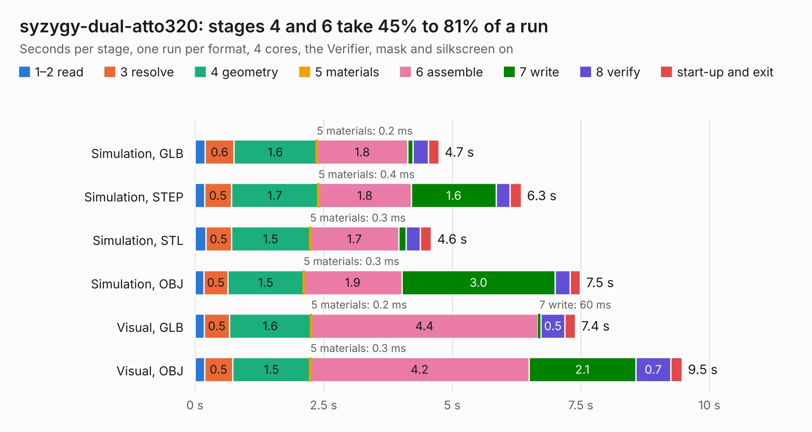

| Mode and format | 1–2 read | 3 resolve | 4 geometry | 5 materials | 6 assemble | 7 write | 8 verify | start-up and exit | Total |
|---|---:|---:|---:|---:|---:|---:|---:|---:|---:|
| Simulation, GLB | 0.2 | 0.6 | 1.6 | 0.2&nbsp;ms | 1.8 | 98&nbsp;ms | 0.3 | 0.2 | 4.7 |
| Simulation, STEP | 0.2 | 0.5 | 1.7 | 0.4&nbsp;ms | 1.8 | 1.6 | 0.3 | 0.2 | 6.3 |
| Simulation, STL | 0.2 | 0.5 | 1.5 | 0.3&nbsp;ms | 1.7 | 0.1 | 0.3 | 0.2 | 4.6 |
| Simulation, OBJ | 0.2 | 0.5 | 1.5 | 0.3&nbsp;ms | 1.9 | 3.0 | 0.3 | 0.2 | 7.5 |
| Visual, GLB | 0.2 | 0.5 | 1.6 | 0.2&nbsp;ms | 4.4 | 60&nbsp;ms | 0.5 | 0.2 | 7.4 |
| Visual, OBJ | 0.2 | 0.5 | 1.5 | 0.3&nbsp;ms | 4.2 | 2.1 | 0.7 | 0.2 | 9.5 |

<table align="center"><tr><td valign="top">

| Board | Repo: [gregdavill/advent-calendar-of-circuits-2020](https://github.com/gregdavill/advent-calendar-of-circuits-2020) Board: `syzygy-dual-atto320.kicad_pcb` |
|---|---|
| Folder | syzygy-dual-atto320 / kicad-src |
| Complexity | 275&nbsp;/&nbsp;1000 (size&nbsp;160, features&nbsp;115) |
| KESE&nbsp;features | through vias, custom pads, rounded, trapezoid or chamfered pads, filled zones, copper drawings, curved board outline, stack-up, dielectric εr and tanδ, mask and silkscreen colours |
| Tested | 9th November 2026 |
| Copper&nbsp;layers | 4 |
| File&nbsp;format | KiCad 6 (20201116) |
| Parts,&nbsp;tracks,&nbsp;vias | 8, 323, 73 |
| Triangles,&nbsp;simulation | 559,920 in 70 parts |
| Verifier | PASS in all six runs |

</td><td valign="top">

<table>
<tr><th>File type</th><th>File size</th><th>Peak memory used</th></tr>
<tr><th colspan="3" align="left">Simulation</th></tr>
<tr><td>GLB</td><td align="right">19&nbsp;MB</td><td align="right">324&nbsp;MB</td></tr>
<tr><td>STEP</td><td align="right">89&nbsp;MB</td><td align="right">351&nbsp;MB</td></tr>
<tr><td>STL</td><td align="right">28&nbsp;MB</td><td align="right">317&nbsp;MB</td></tr>
<tr><td>OBJ</td><td align="right">56&nbsp;MB</td><td align="right">402&nbsp;MB</td></tr>
<tr><th colspan="3" align="left">Visual</th></tr>
<tr><td>GLB</td><td align="right">13&nbsp;MB</td><td align="right">368&nbsp;MB</td></tr>
<tr><td>OBJ</td><td align="right">40&nbsp;MB</td><td align="right">361&nbsp;MB</td></tr>
</table>

</td></tr></table>

## 23.11.32 syzygy-epc901

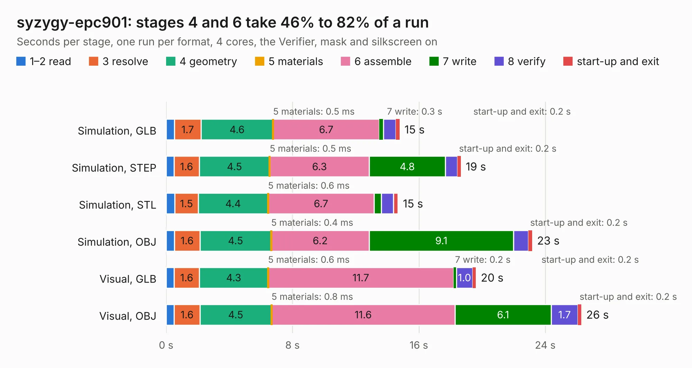

| Mode and format | 1–2 read | 3 resolve | 4 geometry | 5 materials | 6 assemble | 7 write | 8 verify | start-up and exit | Total |
|---|---:|---:|---:|---:|---:|---:|---:|---:|---:|
| Simulation, GLB | 0.5 | 1.7 | 4.6 | 0.5&nbsp;ms | 6.7 | 0.3 | 0.8 | 0.2 | 14.8 |
| Simulation, STEP | 0.5 | 1.6 | 4.5 | 0.5&nbsp;ms | 6.3 | 4.8 | 0.8 | 0.2 | 18.7 |
| Simulation, STL | 0.5 | 1.5 | 4.4 | 0.6&nbsp;ms | 6.7 | 0.5 | 0.8 | 0.3 | 14.7 |
| Simulation, OBJ | 0.5 | 1.6 | 4.5 | 0.4&nbsp;ms | 6.2 | 9.1 | 0.9 | 0.2 | 23.2 |
| Visual, GLB | 0.5 | 1.6 | 4.3 | 0.6&nbsp;ms | 11.7 | 0.2 | 1.0 | 0.2 | 19.6 |
| Visual, OBJ | 0.5 | 1.6 | 4.5 | 0.8&nbsp;ms | 11.6 | 6.1 | 1.7 | 0.2 | 26.3 |

<table align="center"><tr><td valign="top">

| Board | Repo: [gregdavill/advent-calendar-of-circuits-2020](https://github.com/gregdavill/advent-calendar-of-circuits-2020) Board: `syzygy-epc901.kicad_pcb` |
|---|---|
| Folder | syzygy-epc901 / kicad-src |
| Complexity | 380&nbsp;/&nbsp;1000 (size&nbsp;250, features&nbsp;130) |
| KESE&nbsp;features | through vias, custom pads, rounded, trapezoid or chamfered pads, arc tracks, filled zones, copper drawings, curved board outline, stack-up, dielectric εr and tanδ, mask and silkscreen colours |
| Tested | 9th November 2026 |
| Copper&nbsp;layers | 4 |
| File&nbsp;format | KiCad 6 (20210126) |
| Parts,&nbsp;tracks,&nbsp;vias | 97, 1,339, 308 |
| Triangles,&nbsp;simulation | 1,768,478 in 129 parts |
| Verifier | PASS in all six runs |

</td><td valign="top">

<table>
<tr><th>File type</th><th>File size</th><th>Peak memory used</th></tr>
<tr><th colspan="3" align="left">Simulation</th></tr>
<tr><td>GLB</td><td align="right">59&nbsp;MB</td><td align="right">645&nbsp;MB</td></tr>
<tr><td>STEP</td><td align="right">233&nbsp;MB</td><td align="right">869&nbsp;MB</td></tr>
<tr><td>STL</td><td align="right">88&nbsp;MB</td><td align="right">656&nbsp;MB</td></tr>
<tr><td>OBJ</td><td align="right">181&nbsp;MB</td><td align="right">1.2&nbsp;GB</td></tr>
<tr><th colspan="3" align="left">Visual</th></tr>
<tr><td>GLB</td><td align="right">39&nbsp;MB</td><td align="right">833&nbsp;MB</td></tr>
<tr><td>OBJ</td><td align="right">121&nbsp;MB</td><td align="right">895&nbsp;MB</td></tr>
</table>

</td></tr></table>

## 23.11.33 syzygy-flir-boson

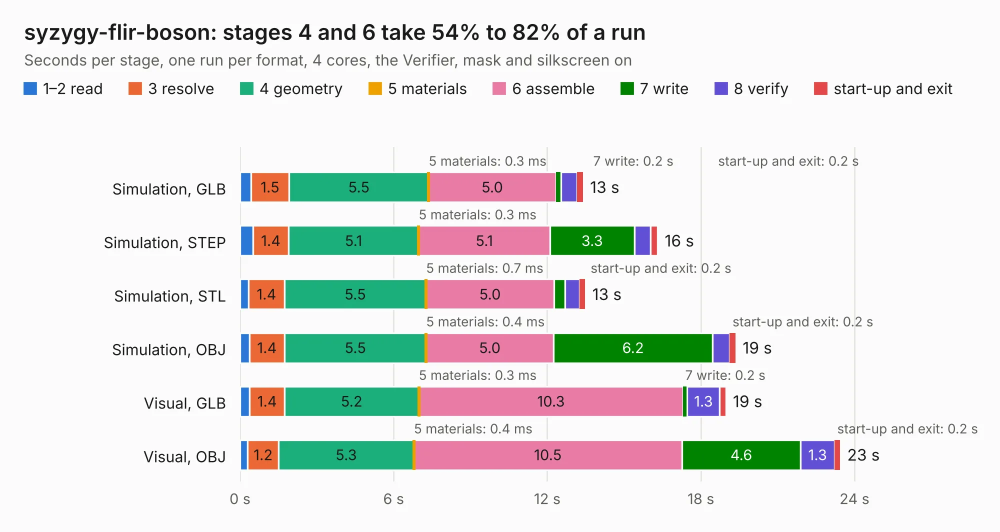

| Mode and format | 1–2 read | 3 resolve | 4 geometry | 5 materials | 6 assemble | 7 write | 8 verify | start-up and exit | Total |
|---|---:|---:|---:|---:|---:|---:|---:|---:|---:|
| Simulation, GLB | 0.4 | 1.5 | 5.5 | 0.3&nbsp;ms | 5.0 | 0.2 | 0.6 | 0.2 | 13.4 |
| Simulation, STEP | 0.5 | 1.4 | 5.1 | 0.3&nbsp;ms | 5.1 | 3.3 | 0.6 | 0.3 | 16.3 |
| Simulation, STL | 0.3 | 1.4 | 5.5 | 0.7&nbsp;ms | 5.0 | 0.4 | 0.6 | 0.2 | 13.5 |
| Simulation, OBJ | 0.4 | 1.4 | 5.5 | 0.4&nbsp;ms | 5.0 | 6.2 | 0.7 | 0.2 | 19.4 |
| Visual, GLB | 0.4 | 1.4 | 5.2 | 0.3&nbsp;ms | 10.3 | 0.2 | 1.3 | 0.2 | 19.0 |
| Visual, OBJ | 0.3 | 1.2 | 5.3 | 0.4&nbsp;ms | 10.5 | 4.6 | 1.3 | 0.2 | 23.4 |

<table align="center"><tr><td valign="top">

| Board | Repo: [gregdavill/advent-calendar-of-circuits-2020](https://github.com/gregdavill/advent-calendar-of-circuits-2020) Board: `syzygy-flir-boson.kicad_pcb` |
|---|---|
| Folder | syzygy-flir-boson / kicad-src |
| Complexity | 312&nbsp;/&nbsp;1000 (size&nbsp;197, features&nbsp;115) |
| KESE&nbsp;features | through vias, custom pads, rounded, trapezoid or chamfered pads, filled zones, copper drawings, curved board outline, stack-up, dielectric εr and tanδ, mask and silkscreen colours |
| Tested | 9th November 2026 |
| Copper&nbsp;layers | 4 |
| File&nbsp;format | KiCad 6 (20210126) |
| Parts,&nbsp;tracks,&nbsp;vias | 35, 906, 375 |
| Triangles,&nbsp;simulation | 1,359,476 in 105 parts |
| Verifier | PASS in all six runs |

</td><td valign="top">

<table>
<tr><th>File type</th><th>File size</th><th>Peak memory used</th></tr>
<tr><th colspan="3" align="left">Simulation</th></tr>
<tr><td>GLB</td><td align="right">45&nbsp;MB</td><td align="right">599&nbsp;MB</td></tr>
<tr><td>STEP</td><td align="right">179&nbsp;MB</td><td align="right">701&nbsp;MB</td></tr>
<tr><td>STL</td><td align="right">68&nbsp;MB</td><td align="right">606&nbsp;MB</td></tr>
<tr><td>OBJ</td><td align="right">137&nbsp;MB</td><td align="right">919&nbsp;MB</td></tr>
<tr><th colspan="3" align="left">Visual</th></tr>
<tr><td>GLB</td><td align="right">32&nbsp;MB</td><td align="right">758&nbsp;MB</td></tr>
<tr><td>OBJ</td><td align="right">98&nbsp;MB</td><td align="right">812&nbsp;MB</td></tr>
</table>

</td></tr></table>

## 23.11.34 syzygy-flir-tau2

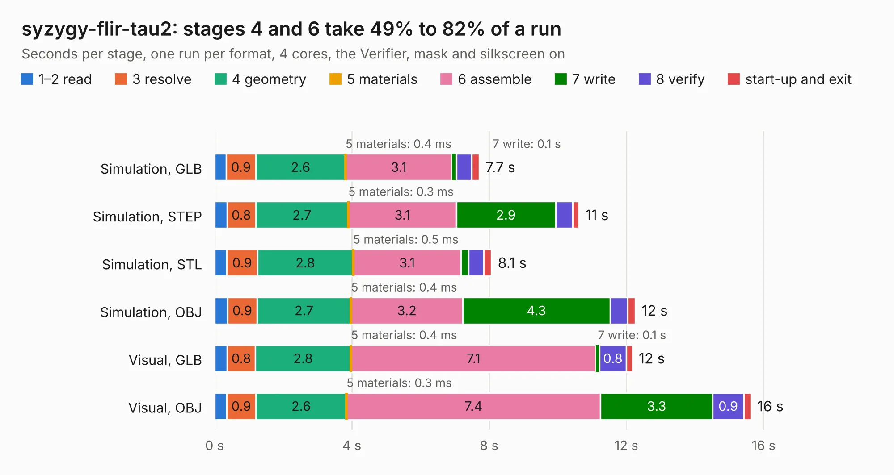

| Mode and format | 1–2 read | 3 resolve | 4 geometry | 5 materials | 6 assemble | 7 write | 8 verify | start-up and exit | Total |
|---|---:|---:|---:|---:|---:|---:|---:|---:|---:|
| Simulation, GLB | 0.3 | 0.9 | 2.6 | 0.4&nbsp;ms | 3.1 | 0.1 | 0.4 | 0.2 | 7.7 |
| Simulation, STEP | 0.4 | 0.8 | 2.7 | 0.3&nbsp;ms | 3.1 | 2.9 | 0.5 | 0.2 | 10.6 |
| Simulation, STL | 0.4 | 0.9 | 2.8 | 0.5&nbsp;ms | 3.1 | 0.2 | 0.5 | 0.2 | 8.1 |
| Simulation, OBJ | 0.4 | 0.9 | 2.7 | 0.4&nbsp;ms | 3.2 | 4.3 | 0.5 | 0.2 | 12.3 |
| Visual, GLB | 0.4 | 0.8 | 2.8 | 0.4&nbsp;ms | 7.1 | 0.1 | 0.8 | 0.2 | 12.2 |
| Visual, OBJ | 0.4 | 0.9 | 2.6 | 0.3&nbsp;ms | 7.4 | 3.3 | 0.9 | 0.2 | 15.6 |

<table align="center"><tr><td valign="top">

| Board | Repo: [gregdavill/advent-calendar-of-circuits-2020](https://github.com/gregdavill/advent-calendar-of-circuits-2020) Board: `syzygy-flir-tau2.kicad_pcb` |
|---|---|
| Folder | syzygy-flir-tau2 / kicad-src |
| Complexity | 310&nbsp;/&nbsp;1000 (size&nbsp;195, features&nbsp;115) |
| KESE&nbsp;features | through vias, custom pads, rounded, trapezoid or chamfered pads, filled zones, copper drawings, curved board outline, stack-up, dielectric εr and tanδ, mask and silkscreen colours |
| Tested | 9th November 2026 |
| Copper&nbsp;layers | 4 |
| File&nbsp;format | KiCad 6 (20201116) |
| Parts,&nbsp;tracks,&nbsp;vias | 32, 1,446, 138 |
| Triangles,&nbsp;simulation | 1,050,638 in 82 parts |
| Verifier | PASS in all six runs |

</td><td valign="top">

<table>
<tr><th>File type</th><th>File size</th><th>Peak memory used</th></tr>
<tr><th colspan="3" align="left">Simulation</th></tr>
<tr><td>GLB</td><td align="right">36&nbsp;MB</td><td align="right">541&nbsp;MB</td></tr>
<tr><td>STEP</td><td align="right">182&nbsp;MB</td><td align="right">589&nbsp;MB</td></tr>
<tr><td>STL</td><td align="right">53&nbsp;MB</td><td align="right">508&nbsp;MB</td></tr>
<tr><td>OBJ</td><td align="right">106&nbsp;MB</td><td align="right">737&nbsp;MB</td></tr>
<tr><th colspan="3" align="left">Visual</th></tr>
<tr><td>GLB</td><td align="right">26&nbsp;MB</td><td align="right">673&nbsp;MB</td></tr>
<tr><td>OBJ</td><td align="right">80&nbsp;MB</td><td align="right">676&nbsp;MB</td></tr>
</table>

</td></tr></table>

## 23.11.35 syzygy-pmod

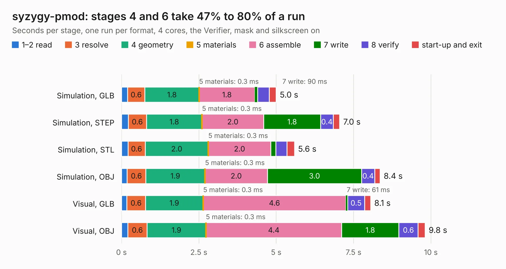

| Mode and format | 1–2 read | 3 resolve | 4 geometry | 5 materials | 6 assemble | 7 write | 8 verify | start-up and exit | Total |
|---|---:|---:|---:|---:|---:|---:|---:|---:|---:|
| Simulation, GLB | 0.2 | 0.6 | 1.8 | 0.3&nbsp;ms | 1.8 | 90&nbsp;ms | 0.4 | 0.2 | 5.0 |
| Simulation, STEP | 0.2 | 0.6 | 1.8 | 0.3&nbsp;ms | 2.0 | 1.8 | 0.4 | 0.2 | 7.0 |
| Simulation, STL | 0.2 | 0.6 | 2.0 | 0.3&nbsp;ms | 2.0 | 0.2 | 0.4 | 0.2 | 5.6 |
| Simulation, OBJ | 0.2 | 0.6 | 1.9 | 0.3&nbsp;ms | 2.0 | 3.0 | 0.4 | 0.2 | 8.4 |
| Visual, GLB | 0.2 | 0.6 | 1.9 | 0.3&nbsp;ms | 4.6 | 61&nbsp;ms | 0.5 | 0.2 | 8.1 |
| Visual, OBJ | 0.2 | 0.6 | 1.9 | 0.3&nbsp;ms | 4.4 | 1.8 | 0.6 | 0.2 | 9.8 |

<table align="center"><tr><td valign="top">

| Board | Repo: [gregdavill/advent-calendar-of-circuits-2020](https://github.com/gregdavill/advent-calendar-of-circuits-2020) Board: `syzygy-pmod.kicad_pcb` |
|---|---|
| Folder | syzygy-pmod / kicad-src |
| Complexity | 281&nbsp;/&nbsp;1000 (size&nbsp;166, features&nbsp;115) |
| KESE&nbsp;features | through vias, custom pads, rounded, trapezoid or chamfered pads, filled zones, copper drawings, curved board outline, stack-up, dielectric εr and tanδ, mask and silkscreen colours |
| Tested | 9th November 2026 |
| Copper&nbsp;layers | 4 |
| File&nbsp;format | KiCad 6 (20201116) |
| Parts,&nbsp;tracks,&nbsp;vias | 16, 387, 36 |
| Triangles,&nbsp;simulation | 702,838 in 70 parts |
| Verifier | PASS in all six runs |

</td><td valign="top">

<table>
<tr><th>File type</th><th>File size</th><th>Peak memory used</th></tr>
<tr><th colspan="3" align="left">Simulation</th></tr>
<tr><td>GLB</td><td align="right">23&nbsp;MB</td><td align="right">340&nbsp;MB</td></tr>
<tr><td>STEP</td><td align="right">93&nbsp;MB</td><td align="right">381&nbsp;MB</td></tr>
<tr><td>STL</td><td align="right">35&nbsp;MB</td><td align="right">331&nbsp;MB</td></tr>
<tr><td>OBJ</td><td align="right">71&nbsp;MB</td><td align="right">506&nbsp;MB</td></tr>
<tr><th colspan="3" align="left">Visual</th></tr>
<tr><td>GLB</td><td align="right">13&nbsp;MB</td><td align="right">392&nbsp;MB</td></tr>
<tr><td>OBJ</td><td align="right">39&nbsp;MB</td><td align="right">390&nbsp;MB</td></tr>
</table>

</td></tr></table>

## 23.11.36 syzygy-rgb888-lcd

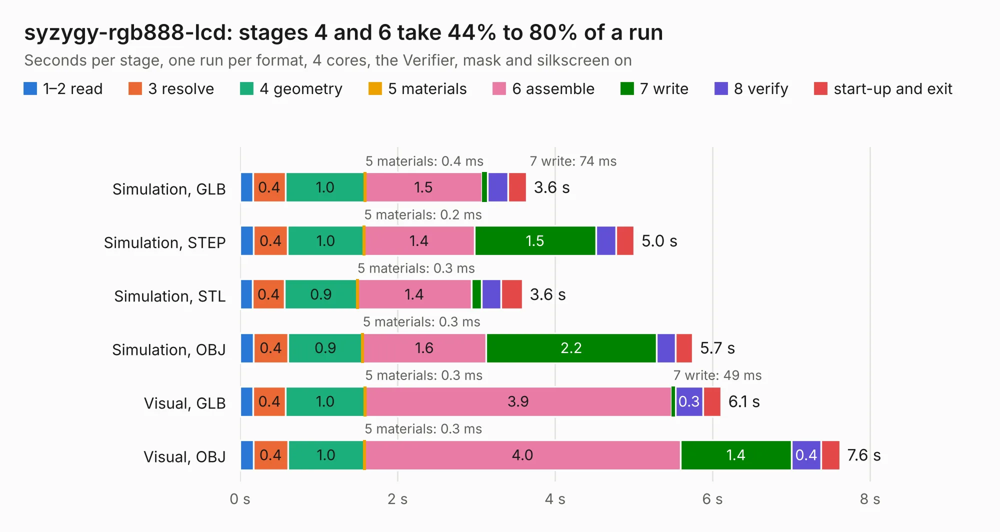

| Mode and format | 1–2 read | 3 resolve | 4 geometry | 5 materials | 6 assemble | 7 write | 8 verify | start-up and exit | Total |
|---|---:|---:|---:|---:|---:|---:|---:|---:|---:|
| Simulation, GLB | 0.2 | 0.4 | 1.0 | 0.4&nbsp;ms | 1.5 | 74&nbsp;ms | 0.3 | 0.2 | 3.6 |
| Simulation, STEP | 0.2 | 0.4 | 1.0 | 0.2&nbsp;ms | 1.4 | 1.5 | 0.3 | 0.2 | 5.0 |
| Simulation, STL | 0.2 | 0.4 | 0.9 | 0.3&nbsp;ms | 1.4 | 0.1 | 0.2 | 0.3 | 3.6 |
| Simulation, OBJ | 0.2 | 0.4 | 0.9 | 0.3&nbsp;ms | 1.6 | 2.2 | 0.2 | 0.2 | 5.7 |
| Visual, GLB | 0.2 | 0.4 | 1.0 | 0.3&nbsp;ms | 3.9 | 49&nbsp;ms | 0.3 | 0.2 | 6.1 |
| Visual, OBJ | 0.2 | 0.4 | 1.0 | 0.3&nbsp;ms | 4.0 | 1.4 | 0.4 | 0.2 | 7.6 |

<table align="center"><tr><td valign="top">

| Board | Repo: [gregdavill/advent-calendar-of-circuits-2020](https://github.com/gregdavill/advent-calendar-of-circuits-2020) Board: `syzygy-rgb888-lcd.kicad_pcb` |
|---|---|
| Folder | syzygy-rgb888-lcd / kicad-src |
| Complexity | 282&nbsp;/&nbsp;1000 (size&nbsp;167, features&nbsp;115) |
| KESE&nbsp;features | through vias, custom pads, rounded, trapezoid or chamfered pads, filled zones, copper drawings, curved board outline, stack-up, dielectric εr and tanδ, mask and silkscreen colours |
| Tested | 9th November 2026 |
| Copper&nbsp;layers | 4 |
| File&nbsp;format | KiCad 6 (20201116) |
| Parts,&nbsp;tracks,&nbsp;vias | 15, 359, 65 |
| Triangles,&nbsp;simulation | 448,792 in 79 parts |
| Verifier | PASS in all six runs |

</td><td valign="top">

<table>
<tr><th>File type</th><th>File size</th><th>Peak memory used</th></tr>
<tr><th colspan="3" align="left">Simulation</th></tr>
<tr><td>GLB</td><td align="right">15&nbsp;MB</td><td align="right">305&nbsp;MB</td></tr>
<tr><td>STEP</td><td align="right">62&nbsp;MB</td><td align="right">317&nbsp;MB</td></tr>
<tr><td>STL</td><td align="right">22&nbsp;MB</td><td align="right">299&nbsp;MB</td></tr>
<tr><td>OBJ</td><td align="right">45&nbsp;MB</td><td align="right">348&nbsp;MB</td></tr>
<tr><th colspan="3" align="left">Visual</th></tr>
<tr><td>GLB</td><td align="right">9.8&nbsp;MB</td><td align="right">317&nbsp;MB</td></tr>
<tr><td>OBJ</td><td align="right">30&nbsp;MB</td><td align="right">321&nbsp;MB</td></tr>
</table>

</td></tr></table>

## 23.11.37 syzygy-sgmii

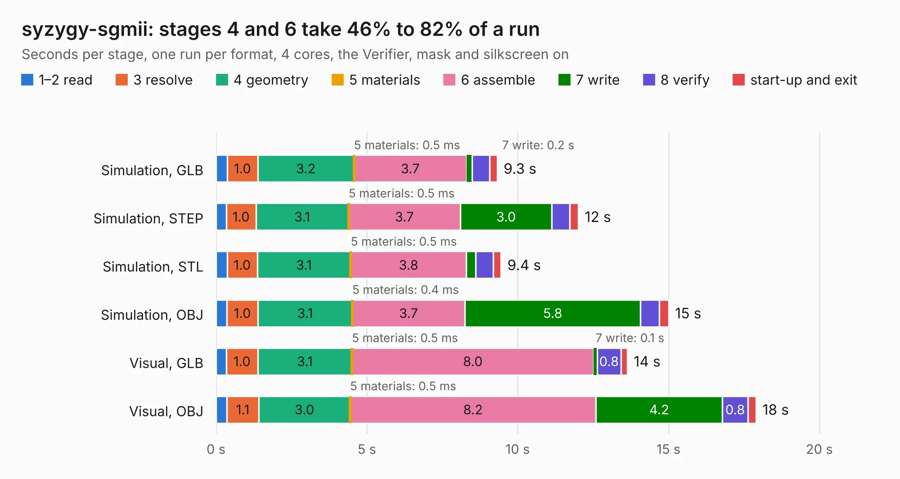

| Mode and format | 1–2 read | 3 resolve | 4 geometry | 5 materials | 6 assemble | 7 write | 8 verify | start-up and exit | Total |
|---|---:|---:|---:|---:|---:|---:|---:|---:|---:|
| Simulation, GLB | 0.4 | 1.0 | 3.2 | 0.5&nbsp;ms | 3.7 | 0.2 | 0.6 | 0.3 | 9.3 |
| Simulation, STEP | 0.3 | 1.0 | 3.1 | 0.5&nbsp;ms | 3.7 | 3.0 | 0.6 | 0.3 | 12.0 |
| Simulation, STL | 0.4 | 1.0 | 3.1 | 0.5&nbsp;ms | 3.8 | 0.3 | 0.6 | 0.3 | 9.4 |
| Simulation, OBJ | 0.4 | 1.0 | 3.1 | 0.4&nbsp;ms | 3.7 | 5.8 | 0.6 | 0.3 | 15.0 |
| Visual, GLB | 0.3 | 1.0 | 3.1 | 0.5&nbsp;ms | 8.0 | 0.1 | 0.8 | 0.2 | 13.6 |
| Visual, OBJ | 0.4 | 1.1 | 3.0 | 0.5&nbsp;ms | 8.2 | 4.2 | 0.8 | 0.3 | 17.9 |

<table align="center"><tr><td valign="top">

| Board | Repo: [gregdavill/advent-calendar-of-circuits-2020](https://github.com/gregdavill/advent-calendar-of-circuits-2020) Board: `syzygy-sgmii.kicad_pcb` |
|---|---|
| Folder | syzygy-sgmii / kicad-src |
| Complexity | 351&nbsp;/&nbsp;1000 (size&nbsp;236, features&nbsp;115) |
| KESE&nbsp;features | through vias, custom pads, rounded, trapezoid or chamfered pads, filled zones, copper drawings, curved board outline, stack-up, dielectric εr and tanδ, mask and silkscreen colours |
| Tested | 9th November 2026 |
| Copper&nbsp;layers | 4 |
| File&nbsp;format | KiCad 6 (20210126) |
| Parts,&nbsp;tracks,&nbsp;vias | 69, 850, 129 |
| Triangles,&nbsp;simulation | 1,034,760 in 118 parts |
| Verifier | PASS in all six runs |

</td><td valign="top">

<table>
<tr><th>File type</th><th>File size</th><th>Peak memory used</th></tr>
<tr><th colspan="3" align="left">Simulation</th></tr>
<tr><td>GLB</td><td align="right">34&nbsp;MB</td><td align="right">431&nbsp;MB</td></tr>
<tr><td>STEP</td><td align="right">137&nbsp;MB</td><td align="right">533&nbsp;MB</td></tr>
<tr><td>STL</td><td align="right">52&nbsp;MB</td><td align="right">434&nbsp;MB</td></tr>
<tr><td>OBJ</td><td align="right">104&nbsp;MB</td><td align="right">738&nbsp;MB</td></tr>
<tr><th colspan="3" align="left">Visual</th></tr>
<tr><td>GLB</td><td align="right">23&nbsp;MB</td><td align="right">621&nbsp;MB</td></tr>
<tr><td>OBJ</td><td align="right">70&nbsp;MB</td><td align="right">613&nbsp;MB</td></tr>
</table>

</td></tr></table>

## 23.11.38 syzygy-txr-breakout

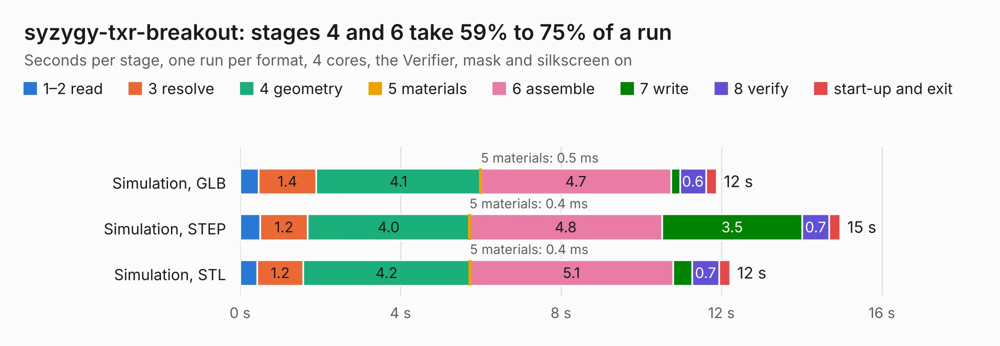

| Mode and format | 1–2 read | 3 resolve | 4 geometry | 5 materials | 6 assemble | 7 write | 8 verify | start-up and exit | Total |
|---|---:|---:|---:|---:|---:|---:|---:|---:|---:|
| Simulation, GLB | 0.5 | 1.4 | 4.1 | 0.5&nbsp;ms | 4.7 | 0.2 | 0.6 | 0.3 | 11.9 |
| Simulation, STEP | 0.5 | 1.2 | 4.0 | 0.4&nbsp;ms | 4.8 | 3.5 | 0.7 | 0.3 | 15.0 |
| Simulation, STL | 0.4 | 1.2 | 4.2 | 0.4&nbsp;ms | 5.1 | 0.5 | 0.7 | 0.3 | 12.2 |
| Simulation, OBJ | 0.5 | 1.4 | 4.2 | 0.4&nbsp;ms | 4.9 | 8.1 | 0.7 | 0.3 | 19.9 |
| Visual, GLB | 0.4 | 1.1 | 4.0 | 0.5&nbsp;ms | 10.3 | 0.1 | 1.1 | 0.3 | 17.3 |
| Visual, OBJ | 0.4 | 1.2 | 4.2 | 0.4&nbsp;ms | 11.1 | 4.4 | 1.3 | 0.3 | 22.9 |

<table align="center"><tr><td valign="top">

| Board | Repo: [gregdavill/advent-calendar-of-circuits-2020](https://github.com/gregdavill/advent-calendar-of-circuits-2020) Board: `syzygy-txr-breakout.kicad_pcb` |
|---|---|
| Folder | syzygy-txr-breakout / kicad-src |
| Complexity | 314&nbsp;/&nbsp;1000 (size&nbsp;199, features&nbsp;115) |
| KESE&nbsp;features | through vias, custom pads, rounded, trapezoid or chamfered pads, filled zones, copper drawings, curved board outline, stack-up, dielectric εr and tanδ, mask and silkscreen colours |
| Tested | 9th November 2026 |
| Copper&nbsp;layers | 4 |
| File&nbsp;format | KiCad 6 (20201116) |
| Parts,&nbsp;tracks,&nbsp;vias | 28, 2,385, 68 |
| Triangles,&nbsp;simulation | 1,349,284 in 70 parts |
| Verifier | PASS in all six runs |

</td><td valign="top">

<table>
<tr><th>File type</th><th>File size</th><th>Peak memory used</th></tr>
<tr><th colspan="3" align="left">Simulation</th></tr>
<tr><td>GLB</td><td align="right">45&nbsp;MB</td><td align="right">655&nbsp;MB</td></tr>
<tr><td>STEP</td><td align="right">196&nbsp;MB</td><td align="right">645&nbsp;MB</td></tr>
<tr><td>STL</td><td align="right">67&nbsp;MB</td><td align="right">602&nbsp;MB</td></tr>
<tr><td>OBJ</td><td align="right">137&nbsp;MB</td><td align="right">927&nbsp;MB</td></tr>
<tr><th colspan="3" align="left">Visual</th></tr>
<tr><td>GLB</td><td align="right">24&nbsp;MB</td><td align="right">684&nbsp;MB</td></tr>
<tr><td>OBJ</td><td align="right">74&nbsp;MB</td><td align="right">705&nbsp;MB</td></tr>
</table>

</td></tr></table>

## 23.11.39 obsidian-boa-r0.1

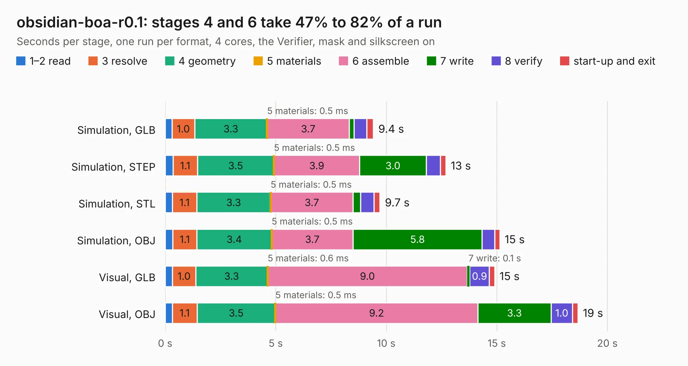

| Mode and format | 1–2 read | 3 resolve | 4 geometry | 5 materials | 6 assemble | 7 write | 8 verify | start-up and exit | Total |
|---|---:|---:|---:|---:|---:|---:|---:|---:|---:|
| Simulation, GLB | 0.3 | 1.0 | 3.3 | 0.5&nbsp;ms | 3.7 | 0.2 | 0.6 | 0.3 | 9.4 |
| Simulation, STEP | 0.4 | 1.1 | 3.5 | 0.5&nbsp;ms | 3.9 | 3.0 | 0.6 | 0.2 | 12.7 |
| Simulation, STL | 0.3 | 1.1 | 3.3 | 0.5&nbsp;ms | 3.7 | 0.3 | 0.6 | 0.3 | 9.7 |
| Simulation, OBJ | 0.3 | 1.1 | 3.4 | 0.5&nbsp;ms | 3.7 | 5.8 | 0.6 | 0.2 | 15.1 |
| Visual, GLB | 0.3 | 1.0 | 3.3 | 0.6&nbsp;ms | 9.0 | 0.1 | 0.9 | 0.2 | 14.9 |
| Visual, OBJ | 0.3 | 1.1 | 3.5 | 0.5&nbsp;ms | 9.2 | 3.3 | 1.0 | 0.2 | 18.7 |

<table align="center"><tr><td valign="top">

| Board | Repo: [gregdavill/obsidian-boa](https://github.com/gregdavill/obsidian-boa) Board: `obsidian-boa-r0.1.kicad_pcb` |
|---|---|
| Folder | hw / obsidian-boa-r0.1 |
| Complexity | 364&nbsp;/&nbsp;1000 (size&nbsp;239, features&nbsp;125) |
| KESE&nbsp;features | through vias, slotted holes, custom pads, rounded, trapezoid or chamfered pads, filled zones, copper drawings, curved board outline, stack-up, dielectric εr and tanδ, mask and silkscreen colours |
| Tested | 9th November 2026 |
| Copper&nbsp;layers | 4 |
| File&nbsp;format | KiCad 6 (20201002) |
| Parts,&nbsp;tracks,&nbsp;vias | 83, 975, 113 |
| Triangles,&nbsp;simulation | 1,191,616 in 87 parts |
| Verifier | PASS in all six runs |

</td><td valign="top">

<table>
<tr><th>File type</th><th>File size</th><th>Peak memory used</th></tr>
<tr><th colspan="3" align="left">Simulation</th></tr>
<tr><td>GLB</td><td align="right">40&nbsp;MB</td><td align="right">452&nbsp;MB</td></tr>
<tr><td>STEP</td><td align="right">180&nbsp;MB</td><td align="right">539&nbsp;MB</td></tr>
<tr><td>STL</td><td align="right">60&nbsp;MB</td><td align="right">450&nbsp;MB</td></tr>
<tr><td>OBJ</td><td align="right">121&nbsp;MB</td><td align="right">820&nbsp;MB</td></tr>
<tr><th colspan="3" align="left">Visual</th></tr>
<tr><td>GLB</td><td align="right">23&nbsp;MB</td><td align="right">644&nbsp;MB</td></tr>
<tr><td>OBJ</td><td align="right">71&nbsp;MB</td><td align="right">642&nbsp;MB</td></tr>
</table>

</td></tr></table>

## 23.11.40 FreshTwinkie

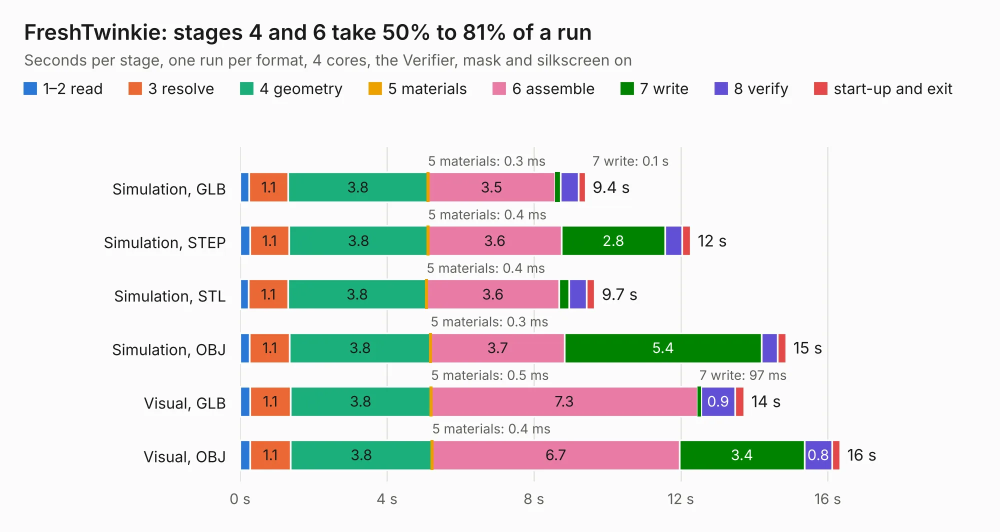

| Mode and format | 1–2 read | 3 resolve | 4 geometry | 5 materials | 6 assemble | 7 write | 8 verify | start-up and exit | Total |
|---|---:|---:|---:|---:|---:|---:|---:|---:|---:|
| Simulation, GLB | 0.2 | 1.1 | 3.8 | 0.3&nbsp;ms | 3.5 | 0.1 | 0.5 | 0.2 | 9.4 |
| Simulation, STEP | 0.3 | 1.1 | 3.8 | 0.4&nbsp;ms | 3.6 | 2.8 | 0.5 | 0.2 | 12.3 |
| Simulation, STL | 0.2 | 1.1 | 3.8 | 0.4&nbsp;ms | 3.6 | 0.3 | 0.5 | 0.2 | 9.7 |
| Simulation, OBJ | 0.3 | 1.1 | 3.8 | 0.3&nbsp;ms | 3.7 | 5.4 | 0.4 | 0.2 | 14.9 |
| Visual, GLB | 0.3 | 1.1 | 3.8 | 0.5&nbsp;ms | 7.3 | 97&nbsp;ms | 0.9 | 0.2 | 13.7 |
| Visual, OBJ | 0.3 | 1.1 | 3.8 | 0.4&nbsp;ms | 6.7 | 3.4 | 0.8 | 0.2 | 16.3 |

<table align="center"><tr><td valign="top">

| Board | Repo: [gregdavill/PD-sniffer](https://github.com/gregdavill/PD-sniffer) Board: `FreshTwinkie.kicad_pcb` |
|---|---|
| Folder | hw / FreshTwinkie_v0.1 |
| Complexity | 325&nbsp;/&nbsp;1000 (size&nbsp;235, features&nbsp;90) |
| KESE&nbsp;features | through vias, slotted holes, custom pads, rounded, trapezoid or chamfered pads, filled zones, copper drawings, curved board outline |
| Tested | 9th November 2026 |
| Copper&nbsp;layers | 4 |
| File&nbsp;format | KiCad 5 (20171130) |
| Parts,&nbsp;tracks,&nbsp;vias | 50, 1,014, 145 |
| Triangles,&nbsp;simulation | 1,049,192 in 93 parts |
| Verifier | PASS in all six runs |

</td><td valign="top">

<table>
<tr><th>File type</th><th>File size</th><th>Peak memory used</th></tr>
<tr><th colspan="3" align="left">Simulation</th></tr>
<tr><td>GLB</td><td align="right">36&nbsp;MB</td><td align="right">468&nbsp;MB</td></tr>
<tr><td>STEP</td><td align="right">155&nbsp;MB</td><td align="right">555&nbsp;MB</td></tr>
<tr><td>STL</td><td align="right">52&nbsp;MB</td><td align="right">484&nbsp;MB</td></tr>
<tr><td>OBJ</td><td align="right">109&nbsp;MB</td><td align="right">736&nbsp;MB</td></tr>
<tr><th colspan="3" align="left">Visual</th></tr>
<tr><td>GLB</td><td align="right">21&nbsp;MB</td><td align="right">501&nbsp;MB</td></tr>
<tr><td>OBJ</td><td align="right">65&nbsp;MB</td><td align="right">523&nbsp;MB</td></tr>
</table>

</td></tr></table>

## 23.11.41 FreshTwinkie_v0.1_panel

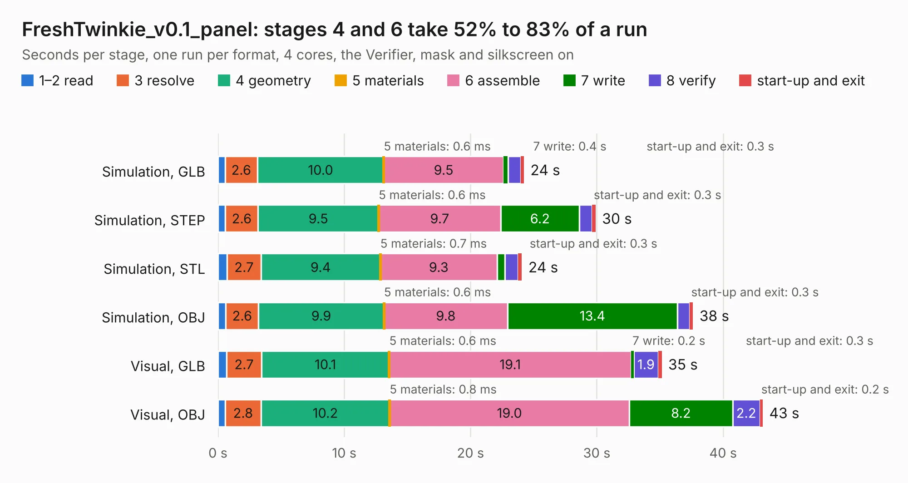

| Mode and format | 1–2 read | 3 resolve | 4 geometry | 5 materials | 6 assemble | 7 write | 8 verify | start-up and exit | Total |
|---|---:|---:|---:|---:|---:|---:|---:|---:|---:|
| Simulation, GLB | 0.6 | 2.6 | 10.0 | 0.6&nbsp;ms | 9.5 | 0.4 | 1.0 | 0.3 | 24.2 |
| Simulation, STEP | 0.6 | 2.6 | 9.5 | 0.6&nbsp;ms | 9.7 | 6.2 | 1.0 | 0.3 | 29.9 |
| Simulation, STL | 0.7 | 2.7 | 9.4 | 0.7&nbsp;ms | 9.3 | 0.6 | 1.0 | 0.3 | 24.1 |
| Simulation, OBJ | 0.6 | 2.6 | 9.9 | 0.6&nbsp;ms | 9.8 | 13.4 | 1.0 | 0.3 | 37.6 |
| Visual, GLB | 0.7 | 2.7 | 10.1 | 0.6&nbsp;ms | 19.1 | 0.2 | 1.9 | 0.3 | 35.1 |
| Visual, OBJ | 0.6 | 2.8 | 10.2 | 0.8&nbsp;ms | 19.0 | 8.2 | 2.2 | 0.2 | 43.1 |

<table align="center"><tr><td valign="top">

| Board | Repo: [gregdavill/PD-sniffer](https://github.com/gregdavill/PD-sniffer) Board: `FreshTwinkie_v0.1_panel.kicad_pcb` |
|---|---|
| Folder | hw / FreshTwinkie_v0.1_panel |
| Complexity | 361&nbsp;/&nbsp;1000 (size&nbsp;261, features&nbsp;100) |
| KESE&nbsp;features | through vias, slotted holes, custom pads, rounded, trapezoid or chamfered pads, filled zones, copper drawings, copper text, curved board outline |
| Tested | 9th November 2026 |
| Copper&nbsp;layers | 4 |
| File&nbsp;format | KiCad 5 (20171130) |
| Parts,&nbsp;tracks,&nbsp;vias | 100, 2,028, 290 |
| Triangles,&nbsp;simulation | 2,186,448 in 94 parts |
| Note | panel |
| Verifier | PASS in all six runs |

</td><td valign="top">

<table>
<tr><th>File type</th><th>File size</th><th>Peak memory used</th></tr>
<tr><th colspan="3" align="left">Simulation</th></tr>
<tr><td>GLB</td><td align="right">76&nbsp;MB</td><td align="right">752&nbsp;MB</td></tr>
<tr><td>STEP</td><td align="right">323&nbsp;MB</td><td align="right">941&nbsp;MB</td></tr>
<tr><td>STL</td><td align="right">109&nbsp;MB</td><td align="right">750&nbsp;MB</td></tr>
<tr><td>OBJ</td><td align="right">235&nbsp;MB</td><td align="right">1.5&nbsp;GB</td></tr>
<tr><th colspan="3" align="left">Visual</th></tr>
<tr><td>GLB</td><td align="right">46&nbsp;MB</td><td align="right">1.0&nbsp;GB</td></tr>
<tr><td>OBJ</td><td align="right">144&nbsp;MB</td><td align="right">1.0&nbsp;GB</td></tr>
</table>

</td></tr></table>

## 23.11.42 kimchi_micro

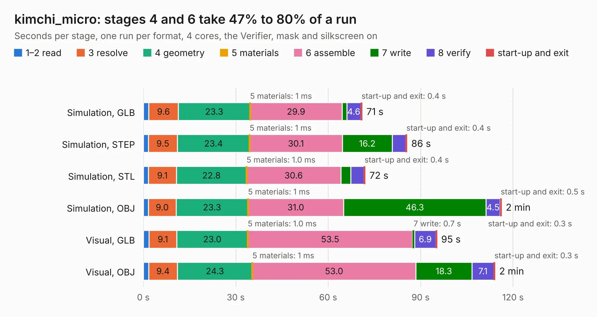

| Mode and format | 1–2 read | 3 resolve | 4 geometry | 5 materials | 6 assemble | 7 write | 8 verify | start-up and exit | Total |
|---|---:|---:|---:|---:|---:|---:|---:|---:|---:|
| Simulation, GLB | 1.7 | 9.6 | 23.3 | 1&nbsp;ms | 29.9 | 1.5 | 4.6 | 0.4 | 71.0 |
| Simulation, STEP | 1.6 | 9.5 | 23.4 | 1&nbsp;ms | 30.1 | 16.2 | 4.4 | 0.4 | 85.6 |
| Simulation, STL | 1.6 | 9.1 | 22.8 | 1.0&nbsp;ms | 30.6 | 3.3 | 4.3 | 0.4 | 72.0 |
| Simulation, OBJ | 1.6 | 9.0 | 23.3 | 1&nbsp;ms | 31.0 | 46.3 | 4.5 | 0.5 | 116.3 |
| Visual, GLB | 1.8 | 9.1 | 23.0 | 1.0&nbsp;ms | 53.5 | 0.7 | 6.9 | 0.3 | 95.3 |
| Visual, OBJ | 1.7 | 9.4 | 24.3 | 1&nbsp;ms | 53.0 | 18.3 | 7.1 | 0.3 | 114.1 |

<table align="center"><tr><td valign="top">

| Board | Repo: [groupgets/kimchi-micro](https://github.com/groupgets/kimchi-micro) Board: `kimchi_micro.kicad_pcb` |
|---|---|
| Folder | hardware_sbc |
| Complexity | 404&nbsp;/&nbsp;1000 (size&nbsp;334, features&nbsp;70) |
| KESE&nbsp;features | through vias, custom pads, rounded, trapezoid or chamfered pads, filled zones, copper drawings |
| Tested | 9th November 2026 |
| Copper&nbsp;layers | 8 |
| File&nbsp;format | KiCad 8 (20240108) |
| Parts,&nbsp;tracks,&nbsp;vias | 289, 10,738, 1,058 |
| Triangles,&nbsp;simulation | 9,560,528 in 411 parts |
| Verifier | PASS in all six runs |

</td><td valign="top">

<table>
<tr><th>File type</th><th>File size</th><th>Peak memory used</th></tr>
<tr><th colspan="3" align="left">Simulation</th></tr>
<tr><td>GLB</td><td align="right">330&nbsp;MB</td><td align="right">2.1&nbsp;GB</td></tr>
<tr><td>STEP</td><td align="right">1.2&nbsp;GB</td><td align="right">2.9&nbsp;GB</td></tr>
<tr><td>STL</td><td align="right">478&nbsp;MB</td><td align="right">2.1&nbsp;GB</td></tr>
<tr><td>OBJ</td><td align="right">1.1&nbsp;GB</td><td align="right">6.1&nbsp;GB</td></tr>
<tr><th colspan="3" align="left">Visual</th></tr>
<tr><td>GLB</td><td align="right">143&nbsp;MB</td><td align="right">2.5&nbsp;GB</td></tr>
<tr><td>OBJ</td><td align="right">480&nbsp;MB</td><td align="right">3.1&nbsp;GB</td></tr>
</table>

</td></tr></table>

## 23.11.43 LevelShifter

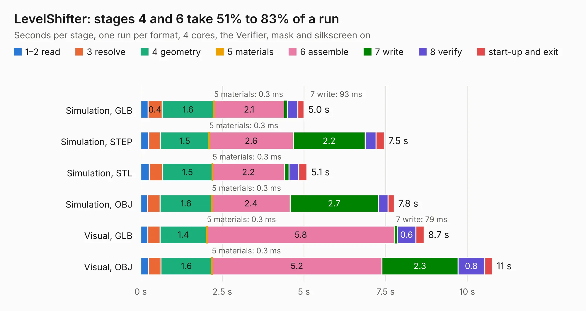

| Mode and format | 1–2 read | 3 resolve | 4 geometry | 5 materials | 6 assemble | 7 write | 8 verify | start-up and exit | Total |
|---|---:|---:|---:|---:|---:|---:|---:|---:|---:|
| Simulation, GLB | 0.2 | 0.4 | 1.6 | 0.3&nbsp;ms | 2.1 | 93&nbsp;ms | 0.3 | 0.2 | 5.0 |
| Simulation, STEP | 0.2 | 0.4 | 1.5 | 0.3&nbsp;ms | 2.6 | 2.2 | 0.3 | 0.3 | 7.5 |
| Simulation, STL | 0.3 | 0.4 | 1.5 | 0.3&nbsp;ms | 2.2 | 0.1 | 0.3 | 0.2 | 5.1 |
| Simulation, OBJ | 0.2 | 0.4 | 1.6 | 0.3&nbsp;ms | 2.4 | 2.7 | 0.3 | 0.2 | 7.8 |
| Visual, GLB | 0.2 | 0.4 | 1.4 | 0.3&nbsp;ms | 5.8 | 79&nbsp;ms | 0.6 | 0.2 | 8.7 |
| Visual, OBJ | 0.2 | 0.4 | 1.6 | 0.3&nbsp;ms | 5.2 | 2.3 | 0.8 | 0.2 | 10.8 |

<table align="center"><tr><td valign="top">

| Board | Repo: [gusmanb/logicanalyzer](https://github.com/gusmanb/logicanalyzer) Board: `LevelShifter.kicad_pcb` |
|---|---|
| Folder | Electronics / LogicAnalyzer / LevelShifter |
| Complexity | 224&nbsp;/&nbsp;1000 (size&nbsp;164, features&nbsp;60) |
| KESE&nbsp;features | through vias, rounded, trapezoid or chamfered pads, arc tracks, filled zones |
| Tested | 9th November 2026 |
| Copper&nbsp;layers | 2 |
| File&nbsp;format | KiCad 6 (20211014) |
| Parts,&nbsp;tracks,&nbsp;vias | 21, 986, 10 |
| Triangles,&nbsp;simulation | 659,382 in 76 parts |
| Verifier | PASS in all six runs |

</td><td valign="top">

<table>
<tr><th>File type</th><th>File size</th><th>Peak memory used</th></tr>
<tr><th colspan="3" align="left">Simulation</th></tr>
<tr><td>GLB</td><td align="right">22&nbsp;MB</td><td align="right">370&nbsp;MB</td></tr>
<tr><td>STEP</td><td align="right">114&nbsp;MB</td><td align="right">426&nbsp;MB</td></tr>
<tr><td>STL</td><td align="right">33&nbsp;MB</td><td align="right">346&nbsp;MB</td></tr>
<tr><td>OBJ</td><td align="right">66&nbsp;MB</td><td align="right">472&nbsp;MB</td></tr>
<tr><th colspan="3" align="left">Visual</th></tr>
<tr><td>GLB</td><td align="right">18&nbsp;MB</td><td align="right">512&nbsp;MB</td></tr>
<tr><td>OBJ</td><td align="right">54&nbsp;MB</td><td align="right">526&nbsp;MB</td></tr>
</table>

</td></tr></table>

## 23.11.44 LogicAnalyzer

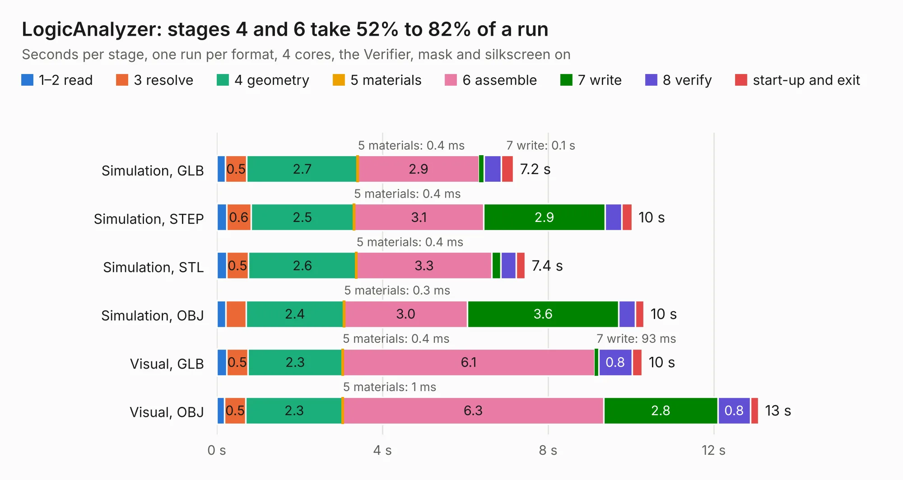

| Mode and format | 1–2 read | 3 resolve | 4 geometry | 5 materials | 6 assemble | 7 write | 8 verify | start-up and exit | Total |
|---|---:|---:|---:|---:|---:|---:|---:|---:|---:|
| Simulation, GLB | 0.2 | 0.5 | 2.7 | 0.4&nbsp;ms | 2.9 | 0.1 | 0.4 | 0.3 | 7.2 |
| Simulation, STEP | 0.2 | 0.6 | 2.5 | 0.4&nbsp;ms | 3.1 | 2.9 | 0.4 | 0.2 | 10.0 |
| Simulation, STL | 0.2 | 0.5 | 2.6 | 0.4&nbsp;ms | 3.3 | 0.2 | 0.4 | 0.2 | 7.4 |
| Simulation, OBJ | 0.2 | 0.5 | 2.4 | 0.3&nbsp;ms | 3.0 | 3.6 | 0.4 | 0.2 | 10.3 |
| Visual, GLB | 0.2 | 0.5 | 2.3 | 0.4&nbsp;ms | 6.1 | 93&nbsp;ms | 0.8 | 0.2 | 10.3 |
| Visual, OBJ | 0.2 | 0.5 | 2.3 | 1&nbsp;ms | 6.3 | 2.8 | 0.8 | 0.2 | 13.1 |

<table align="center"><tr><td valign="top">

| Board | Repo: [gusmanb/logicanalyzer](https://github.com/gusmanb/logicanalyzer) Board: `LogicAnalyzer.kicad_pcb` |
|---|---|
| Folder | Electronics / LogicAnalyzer / LogicAnalyzer |
| Complexity | 228&nbsp;/&nbsp;1000 (size&nbsp;158, features&nbsp;70) |
| KESE&nbsp;features | through vias, rounded, trapezoid or chamfered pads, drill offsets, arc tracks, filled zones |
| Tested | 9th November 2026 |
| Copper&nbsp;layers | 2 |
| File&nbsp;format | KiCad 6 (20211014) |
| Parts,&nbsp;tracks,&nbsp;vias | 10, 1,119, 1 |
| Triangles,&nbsp;simulation | 881,842 in 50 parts |
| Verifier | PASS in all six runs |

</td><td valign="top">

<table>
<tr><th>File type</th><th>File size</th><th>Peak memory used</th></tr>
<tr><th colspan="3" align="left">Simulation</th></tr>
<tr><td>GLB</td><td align="right">29&nbsp;MB</td><td align="right">423&nbsp;MB</td></tr>
<tr><td>STEP</td><td align="right">165&nbsp;MB</td><td align="right">502&nbsp;MB</td></tr>
<tr><td>STL</td><td align="right">44&nbsp;MB</td><td align="right">436&nbsp;MB</td></tr>
<tr><td>OBJ</td><td align="right">88&nbsp;MB</td><td align="right">598&nbsp;MB</td></tr>
<tr><th colspan="3" align="left">Visual</th></tr>
<tr><td>GLB</td><td align="right">24&nbsp;MB</td><td align="right">651&nbsp;MB</td></tr>
<tr><td>OBJ</td><td align="right">72&nbsp;MB</td><td align="right">649&nbsp;MB</td></tr>
</table>

</td></tr></table>

## 23.11.45 AnalyzerBoxPCB_fork

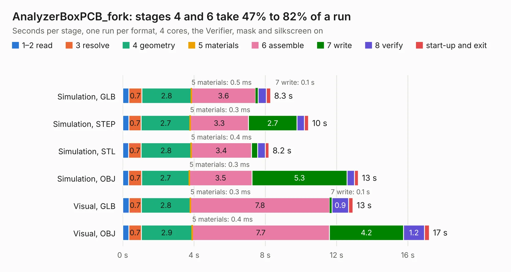

| Mode and format | 1–2 read | 3 resolve | 4 geometry | 5 materials | 6 assemble | 7 write | 8 verify | start-up and exit | Total |
|---|---:|---:|---:|---:|---:|---:|---:|---:|---:|
| Simulation, GLB | 0.3 | 0.7 | 2.8 | 0.5&nbsp;ms | 3.6 | 0.1 | 0.5 | 0.2 | 8.3 |
| Simulation, STEP | 0.3 | 0.7 | 2.7 | 0.3&nbsp;ms | 3.3 | 2.7 | 0.4 | 0.2 | 10.4 |
| Simulation, STL | 0.3 | 0.7 | 2.8 | 0.4&nbsp;ms | 3.4 | 0.3 | 0.4 | 0.2 | 8.2 |
| Simulation, OBJ | 0.3 | 0.7 | 2.7 | 0.3&nbsp;ms | 3.5 | 5.3 | 0.4 | 0.2 | 13.2 |
| Visual, GLB | 0.4 | 0.7 | 2.8 | 0.3&nbsp;ms | 7.8 | 0.1 | 0.9 | 0.3 | 12.9 |
| Visual, OBJ | 0.3 | 0.7 | 2.9 | 0.4&nbsp;ms | 7.7 | 4.2 | 1.2 | 0.3 | 17.2 |

<table align="center"><tr><td valign="top">

| Board | Repo: [gusmanb/logicanalyzer](https://github.com/gusmanb/logicanalyzer) Board: `AnalyzerBoxPCB_fork.kicad_pcb` |
|---|---|
| Folder | Electronics / LogicAnalyzer / LogicAnalyzer_JasonYANG170 / KiCad 8 |
| Complexity | 250&nbsp;/&nbsp;1000 (size&nbsp;190, features&nbsp;60) |
| KESE&nbsp;features | through vias, arc tracks, filled zones, curved board outline |
| Tested | 9th November 2026 |
| Copper&nbsp;layers | 4 |
| File&nbsp;format | KiCad 8 (20240108) |
| Parts,&nbsp;tracks,&nbsp;vias | 54, 796, 63 |
| Triangles,&nbsp;simulation | 935,662 in 67 parts |
| Verifier | PASS in all six runs |

</td><td valign="top">

<table>
<tr><th>File type</th><th>File size</th><th>Peak memory used</th></tr>
<tr><th colspan="3" align="left">Simulation</th></tr>
<tr><td>GLB</td><td align="right">32&nbsp;MB</td><td align="right">492&nbsp;MB</td></tr>
<tr><td>STEP</td><td align="right">145&nbsp;MB</td><td align="right">515&nbsp;MB</td></tr>
<tr><td>STL</td><td align="right">47&nbsp;MB</td><td align="right">485&nbsp;MB</td></tr>
<tr><td>OBJ</td><td align="right">94&nbsp;MB</td><td align="right">662&nbsp;MB</td></tr>
<tr><th colspan="3" align="left">Visual</th></tr>
<tr><td>GLB</td><td align="right">25&nbsp;MB</td><td align="right">582&nbsp;MB</td></tr>
<tr><td>OBJ</td><td align="right">75&nbsp;MB</td><td align="right">620&nbsp;MB</td></tr>
</table>

</td></tr></table>

## 23.11.46 jitx-design

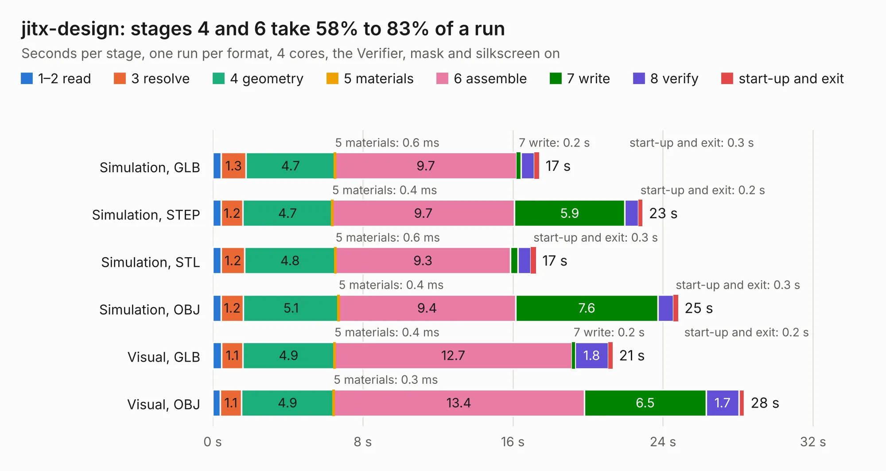

| Mode and format | 1–2 read | 3 resolve | 4 geometry | 5 materials | 6 assemble | 7 write | 8 verify | start-up and exit | Total |
|---|---:|---:|---:|---:|---:|---:|---:|---:|---:|
| Simulation, GLB | 0.4 | 1.3 | 4.7 | 0.6&nbsp;ms | 9.7 | 0.2 | 0.7 | 0.3 | 17.4 |
| Simulation, STEP | 0.5 | 1.2 | 4.7 | 0.4&nbsp;ms | 9.7 | 5.9 | 0.7 | 0.2 | 22.9 |
| Simulation, STL | 0.5 | 1.2 | 4.8 | 0.6&nbsp;ms | 9.3 | 0.4 | 0.7 | 0.3 | 17.2 |
| Simulation, OBJ | 0.4 | 1.2 | 5.1 | 0.4&nbsp;ms | 9.4 | 7.6 | 0.8 | 0.3 | 24.8 |
| Visual, GLB | 0.5 | 1.1 | 4.9 | 0.4&nbsp;ms | 12.7 | 0.2 | 1.8 | 0.2 | 21.3 |
| Visual, OBJ | 0.4 | 1.1 | 4.9 | 0.3&nbsp;ms | 13.4 | 6.5 | 1.7 | 0.3 | 28.3 |

<table align="center"><tr><td valign="top">

| Board | Repo: [gusmanb/logicanalyzer](https://github.com/gusmanb/logicanalyzer) Board: `jitx-design.kicad_pcb` |
|---|---|
| Folder | Electronics / LogicAnalyzer / LogicAnalyzerV2 / designs / jitx-design / kicad |
| Complexity | 308&nbsp;/&nbsp;1000 (size&nbsp;193, features&nbsp;115) |
| KESE&nbsp;features | through vias, slotted holes, arc tracks, filled zones, copper drawings, TrueType text, stack-up, dielectric εr and tanδ |
| Tested | 9th November 2026 |
| Copper&nbsp;layers | 4 |
| File&nbsp;format | KiCad 8 (20240108) |
| Parts,&nbsp;tracks,&nbsp;vias | 26, 1,778, 50 |
| Triangles,&nbsp;simulation | 1,448,730 in 69 parts |
| Verifier | PASS in all six runs |

</td><td valign="top">

<table>
<tr><th>File type</th><th>File size</th><th>Peak memory used</th></tr>
<tr><th colspan="3" align="left">Simulation</th></tr>
<tr><td>GLB</td><td align="right">49&nbsp;MB</td><td align="right">665&nbsp;MB</td></tr>
<tr><td>STEP</td><td align="right">274&nbsp;MB</td><td align="right">710&nbsp;MB</td></tr>
<tr><td>STL</td><td align="right">72&nbsp;MB</td><td align="right">670&nbsp;MB</td></tr>
<tr><td>OBJ</td><td align="right">150&nbsp;MB</td><td align="right">961&nbsp;MB</td></tr>
<tr><th colspan="3" align="left">Visual</th></tr>
<tr><td>GLB</td><td align="right">41&nbsp;MB</td><td align="right">694&nbsp;MB</td></tr>
<tr><td>OBJ</td><td align="right">123&nbsp;MB</td><td align="right">881&nbsp;MB</td></tr>
</table>

</td></tr></table>

## 23.11.47 StackLink

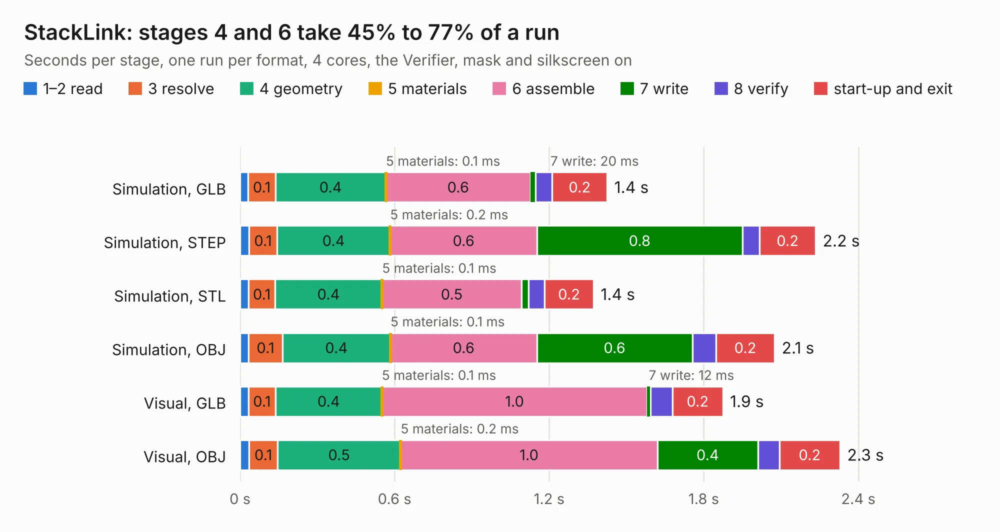

| Mode and format | 1–2 read | 3 resolve | 4 geometry | 5 materials | 6 assemble | 7 write | 8 verify | start-up and exit | Total |
|---|---:|---:|---:|---:|---:|---:|---:|---:|---:|
| Simulation, GLB | 32&nbsp;ms | 0.1 | 0.4 | 0.1&nbsp;ms | 0.6 | 20&nbsp;ms | 65&nbsp;ms | 0.2 | 1.4 |
| Simulation, STEP | 35&nbsp;ms | 0.1 | 0.4 | 0.2&nbsp;ms | 0.6 | 0.8 | 67&nbsp;ms | 0.2 | 2.2 |
| Simulation, STL | 34&nbsp;ms | 0.1 | 0.4 | 0.1&nbsp;ms | 0.5 | 27&nbsp;ms | 63&nbsp;ms | 0.2 | 1.4 |
| Simulation, OBJ | 34&nbsp;ms | 0.1 | 0.4 | 0.1&nbsp;ms | 0.6 | 0.6 | 92&nbsp;ms | 0.2 | 2.1 |
| Visual, GLB | 33&nbsp;ms | 0.1 | 0.4 | 0.1&nbsp;ms | 1.0 | 12&nbsp;ms | 86&nbsp;ms | 0.2 | 1.9 |
| Visual, OBJ | 36&nbsp;ms | 0.1 | 0.5 | 0.2&nbsp;ms | 1.0 | 0.4 | 83&nbsp;ms | 0.2 | 2.3 |

<table align="center"><tr><td valign="top">

| Board | Repo: [gusmanb/logicanalyzer](https://github.com/gusmanb/logicanalyzer) Board: `StackLink.kicad_pcb` |
|---|---|
| Folder | Electronics / LogicAnalyzer / StackLink / StackLink |
| Complexity | 137&nbsp;/&nbsp;1000 (size&nbsp;92, features&nbsp;45) |
| KESE&nbsp;features | through vias, slotted holes, filled zones |
| Tested | 9th November 2026 |
| Copper&nbsp;layers | 2 |
| File&nbsp;format | KiCad 8 (20240108) |
| Parts,&nbsp;tracks,&nbsp;vias | 5, 12, 6 |
| Triangles,&nbsp;simulation | 108,050 in 13 parts |
| Verifier | PASS in all six runs |

</td><td valign="top">

<table>
<tr><th>File type</th><th>File size</th><th>Peak memory used</th></tr>
<tr><th colspan="3" align="left">Simulation</th></tr>
<tr><td>GLB</td><td align="right">3.6&nbsp;MB</td><td align="right">170&nbsp;MB</td></tr>
<tr><td>STEP</td><td align="right">16&nbsp;MB</td><td align="right">170&nbsp;MB</td></tr>
<tr><td>STL</td><td align="right">5.4&nbsp;MB</td><td align="right">162&nbsp;MB</td></tr>
<tr><td>OBJ</td><td align="right">10&nbsp;MB</td><td align="right">169&nbsp;MB</td></tr>
<tr><th colspan="3" align="left">Visual</th></tr>
<tr><td>GLB</td><td align="right">2.4&nbsp;MB</td><td align="right">130&nbsp;MB</td></tr>
<tr><td>OBJ</td><td align="right">6.6&nbsp;MB</td><td align="right">133&nbsp;MB</td></tr>
</table>

</td></tr></table>

## 23.11.48 sprig_console

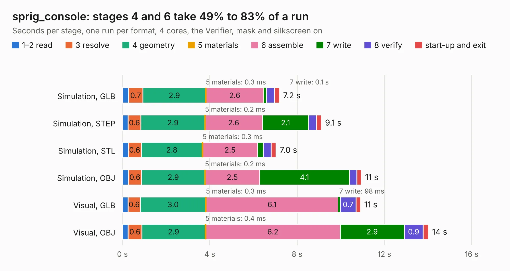

| Mode and format | 1–2 read | 3 resolve | 4 geometry | 5 materials | 6 assemble | 7 write | 8 verify | start-up and exit | Total |
|---|---:|---:|---:|---:|---:|---:|---:|---:|---:|
| Simulation, GLB | 0.3 | 0.7 | 2.9 | 0.3&nbsp;ms | 2.6 | 0.1 | 0.4 | 0.2 | 7.2 |
| Simulation, STEP | 0.3 | 0.6 | 2.9 | 0.2&nbsp;ms | 2.6 | 2.1 | 0.3 | 0.2 | 9.1 |
| Simulation, STL | 0.3 | 0.6 | 2.8 | 0.3&nbsp;ms | 2.5 | 0.3 | 0.4 | 0.2 | 7.0 |
| Simulation, OBJ | 0.3 | 0.6 | 2.9 | 0.2&nbsp;ms | 2.5 | 4.1 | 0.3 | 0.2 | 11.0 |
| Visual, GLB | 0.3 | 0.6 | 3.0 | 0.3&nbsp;ms | 6.1 | 98&nbsp;ms | 0.7 | 0.2 | 10.9 |
| Visual, OBJ | 0.3 | 0.6 | 2.9 | 0.4&nbsp;ms | 6.2 | 2.9 | 0.9 | 0.2 | 14.0 |

<table align="center"><tr><td valign="top">

| Board | Repo: [hackclub/sprig](https://github.com/hackclub/sprig) Board: `sprig_console.kicad_pcb` |
|---|---|
| Folder | hardware / mainboard_PCB / kicad |
| Complexity | 231&nbsp;/&nbsp;1000 (size&nbsp;146, features&nbsp;85) |
| KESE&nbsp;features | through vias, rounded, trapezoid or chamfered pads, filled zones, curved board outline, stack-up, dielectric εr and tanδ |
| Tested | 9th November 2026 |
| Copper&nbsp;layers | 2 |
| File&nbsp;format | KiCad 8 (20240108) |
| Parts,&nbsp;tracks,&nbsp;vias | 25, 254, 19 |
| Triangles,&nbsp;simulation | 808,388 in 55 parts |
| Verifier | PASS in all six runs |

</td><td valign="top">

<table>
<tr><th>File type</th><th>File size</th><th>Peak memory used</th></tr>
<tr><th colspan="3" align="left">Simulation</th></tr>
<tr><td>GLB</td><td align="right">28&nbsp;MB</td><td align="right">409&nbsp;MB</td></tr>
<tr><td>STEP</td><td align="right">137&nbsp;MB</td><td align="right">435&nbsp;MB</td></tr>
<tr><td>STL</td><td align="right">40&nbsp;MB</td><td align="right">408&nbsp;MB</td></tr>
<tr><td>OBJ</td><td align="right">82&nbsp;MB</td><td align="right">590&nbsp;MB</td></tr>
<tr><th colspan="3" align="left">Visual</th></tr>
<tr><td>GLB</td><td align="right">19&nbsp;MB</td><td align="right">502&nbsp;MB</td></tr>
<tr><td>OBJ</td><td align="right">58&nbsp;MB</td><td align="right">472&nbsp;MB</td></tr>
</table>

</td></tr></table>

## 23.11.49 pico-reset

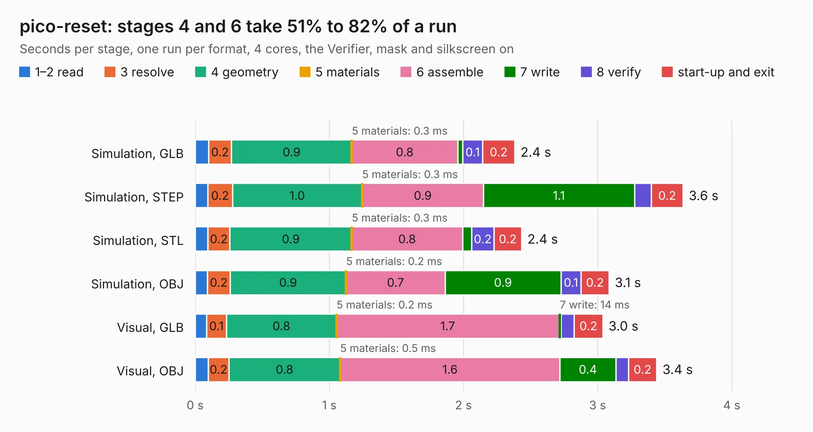

| Mode and format | 1–2 read | 3 resolve | 4 geometry | 5 materials | 6 assemble | 7 write | 8 verify | start-up and exit | Total |
|---|---:|---:|---:|---:|---:|---:|---:|---:|---:|
| Simulation, GLB | 0.1 | 0.2 | 0.9 | 0.3&nbsp;ms | 0.8 | 38&nbsp;ms | 0.1 | 0.2 | 2.4 |
| Simulation, STEP | 94&nbsp;ms | 0.2 | 1.0 | 0.3&nbsp;ms | 0.9 | 1.1 | 0.1 | 0.2 | 3.6 |
| Simulation, STL | 95&nbsp;ms | 0.2 | 0.9 | 0.3&nbsp;ms | 0.8 | 68&nbsp;ms | 0.2 | 0.2 | 2.4 |
| Simulation, OBJ | 91&nbsp;ms | 0.2 | 0.9 | 0.2&nbsp;ms | 0.7 | 0.9 | 0.1 | 0.2 | 3.1 |
| Visual, GLB | 85&nbsp;ms | 0.1 | 0.8 | 0.2&nbsp;ms | 1.7 | 14&nbsp;ms | 99&nbsp;ms | 0.2 | 3.0 |
| Visual, OBJ | 97&nbsp;ms | 0.2 | 0.8 | 0.5&nbsp;ms | 1.6 | 0.4 | 93&nbsp;ms | 0.2 | 3.4 |

<table align="center"><tr><td valign="top">

| Board | Repo: [hackclub/sprig](https://github.com/hackclub/sprig) Board: `pico-reset.kicad_pcb` |
|---|---|
| Folder | sprig-hax / hardware / DebugShimPCB |
| Complexity | 82&nbsp;/&nbsp;1000 (size&nbsp;82, features&nbsp;0) |
| Tested | 9th November 2026 |
| Copper&nbsp;layers | 2 |
| File&nbsp;format | KiCad 8 (20240108) |
| Parts,&nbsp;tracks,&nbsp;vias | 3, 21, 0 |
| Triangles,&nbsp;simulation | 162,188 in 52 parts |
| Verifier | PASS in all six runs |

</td><td valign="top">

<table>
<tr><th>File type</th><th>File size</th><th>Peak memory used</th></tr>
<tr><th colspan="3" align="left">Simulation</th></tr>
<tr><td>GLB</td><td align="right">5.1&nbsp;MB</td><td align="right">194&nbsp;MB</td></tr>
<tr><td>STEP</td><td align="right">22&nbsp;MB</td><td align="right">213&nbsp;MB</td></tr>
<tr><td>STL</td><td align="right">8.1&nbsp;MB</td><td align="right">194&nbsp;MB</td></tr>
<tr><td>OBJ</td><td align="right">16&nbsp;MB</td><td align="right">194&nbsp;MB</td></tr>
<tr><th colspan="3" align="left">Visual</th></tr>
<tr><td>GLB</td><td align="right">2.7&nbsp;MB</td><td align="right">158&nbsp;MB</td></tr>
<tr><td>OBJ</td><td align="right">7.6&nbsp;MB</td><td align="right">159&nbsp;MB</td></tr>
</table>

</td></tr></table>

## 23.11.50 sprig_console

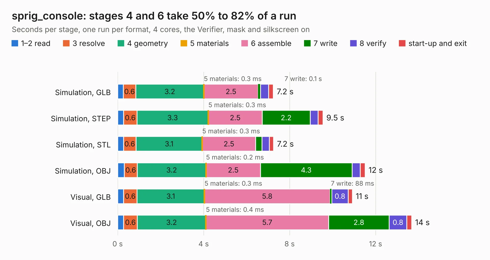

| Mode and format | 1–2 read | 3 resolve | 4 geometry | 5 materials | 6 assemble | 7 write | 8 verify | start-up and exit | Total |
|---|---:|---:|---:|---:|---:|---:|---:|---:|---:|
| Simulation, GLB | 0.3 | 0.6 | 3.2 | 0.3&nbsp;ms | 2.5 | 0.1 | 0.4 | 0.2 | 7.2 |
| Simulation, STEP | 0.3 | 0.6 | 3.3 | 0.3&nbsp;ms | 2.5 | 2.2 | 0.4 | 0.2 | 9.5 |
| Simulation, STL | 0.3 | 0.6 | 3.1 | 0.3&nbsp;ms | 2.5 | 0.3 | 0.4 | 0.2 | 7.2 |
| Simulation, OBJ | 0.3 | 0.6 | 3.2 | 0.2&nbsp;ms | 2.5 | 4.3 | 0.4 | 0.2 | 11.5 |
| Visual, GLB | 0.3 | 0.6 | 3.1 | 0.3&nbsp;ms | 5.8 | 88&nbsp;ms | 0.8 | 0.2 | 10.9 |
| Visual, OBJ | 0.3 | 0.6 | 3.2 | 0.4&nbsp;ms | 5.7 | 2.8 | 0.8 | 0.2 | 13.7 |

<table align="center"><tr><td valign="top">

| Board | Repo: [hackclub/sprig](https://github.com/hackclub/sprig) Board: `sprig_console.kicad_pcb` |
|---|---|
| Folder | sprig-hax / hardware / SprigHaxPCB / kicad |
| Complexity | 230&nbsp;/&nbsp;1000 (size&nbsp;145, features&nbsp;85) |
| KESE&nbsp;features | through vias, rounded, trapezoid or chamfered pads, filled zones, curved board outline, stack-up, dielectric εr and tanδ |
| Tested | 9th November 2026 |
| Copper&nbsp;layers | 2 |
| File&nbsp;format | KiCad 7 (20221018) |
| Parts,&nbsp;tracks,&nbsp;vias | 25, 242, 16 |
| Triangles,&nbsp;simulation | 816,372 in 55 parts |
| Verifier | PASS in all six runs |

</td><td valign="top">

<table>
<tr><th>File type</th><th>File size</th><th>Peak memory used</th></tr>
<tr><th colspan="3" align="left">Simulation</th></tr>
<tr><td>GLB</td><td align="right">28&nbsp;MB</td><td align="right">382&nbsp;MB</td></tr>
<tr><td>STEP</td><td align="right">144&nbsp;MB</td><td align="right">463&nbsp;MB</td></tr>
<tr><td>STL</td><td align="right">41&nbsp;MB</td><td align="right">399&nbsp;MB</td></tr>
<tr><td>OBJ</td><td align="right">83&nbsp;MB</td><td align="right">597&nbsp;MB</td></tr>
<tr><th colspan="3" align="left">Visual</th></tr>
<tr><td>GLB</td><td align="right">19&nbsp;MB</td><td align="right">439&nbsp;MB</td></tr>
<tr><td>OBJ</td><td align="right">58&nbsp;MB</td><td align="right">460&nbsp;MB</td></tr>
</table>

</td></tr></table>

## 23.11.51 ZU64DR_RFSOC_A5

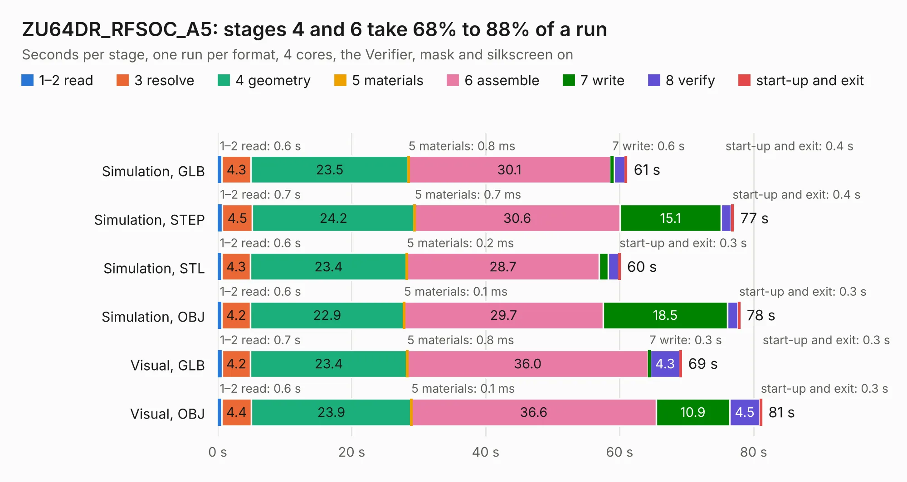

| Mode and format | 1–2 read | 3 resolve | 4 geometry | 5 materials | 6 assemble | 7 write | 8 verify | start-up and exit | Total |
|---|---:|---:|---:|---:|---:|---:|---:|---:|---:|
| Simulation, GLB | 0.6 | 4.3 | 23.5 | 0.8&nbsp;ms | 30.1 | 0.6 | 1.6 | 0.4 | 61.1 |
| Simulation, STEP | 0.7 | 4.5 | 24.2 | 0.7&nbsp;ms | 30.6 | 15.1 | 1.5 | 0.4 | 77.1 |
| Simulation, STL | 0.6 | 4.3 | 23.4 | 0.2&nbsp;ms | 28.7 | 1.4 | 1.5 | 0.3 | 60.1 |
| Simulation, OBJ | 0.6 | 4.2 | 22.9 | 0.1&nbsp;ms | 29.7 | 18.5 | 1.6 | 0.3 | 78.0 |
| Visual, GLB | 0.7 | 4.2 | 23.4 | 0.8&nbsp;ms | 36.0 | 0.3 | 4.3 | 0.3 | 69.3 |
| Visual, OBJ | 0.6 | 4.4 | 23.9 | 0.1&nbsp;ms | 36.6 | 10.9 | 4.5 | 0.3 | 81.2 |

<table align="center"><tr><td valign="top">

| Board | Repo: [hamedroghani/zu64dr_rfsoc_kicad](https://github.com/hamedroghani/zu64dr_rfsoc_kicad) Board: `ZU64DR_RFSOC_A5.kicad_pcb` |
|---|---|
| Complexity | 229&nbsp;/&nbsp;1000 (size&nbsp;184, features&nbsp;45) |
| KESE&nbsp;features | stack-up, dielectric εr and tanδ, copper finish |
| Tested | 9th November 2026 |
| Copper&nbsp;layers | 12 |
| File&nbsp;format | KiCad 8 (20231120) |
| Parts,&nbsp;tracks,&nbsp;vias | 75, 0, 0 |
| Triangles,&nbsp;simulation | 3,488,834 in 35 parts |
| Note | mostly unrouted |
| Verifier | PASS in all six runs |

</td><td valign="top">

<table>
<tr><th>File type</th><th>File size</th><th>Peak memory used</th></tr>
<tr><th colspan="3" align="left">Simulation</th></tr>
<tr><td>GLB</td><td align="right">123&nbsp;MB</td><td align="right">1.5&nbsp;GB</td></tr>
<tr><td>STEP</td><td align="right">685&nbsp;MB</td><td align="right">2.0&nbsp;GB</td></tr>
<tr><td>STL</td><td align="right">174&nbsp;MB</td><td align="right">1.5&nbsp;GB</td></tr>
<tr><td>OBJ</td><td align="right">374&nbsp;MB</td><td align="right">2.4&nbsp;GB</td></tr>
<tr><th colspan="3" align="left">Visual</th></tr>
<tr><td>GLB</td><td align="right">72&nbsp;MB</td><td align="right">1.6&nbsp;GB</td></tr>
<tr><td>OBJ</td><td align="right">221&nbsp;MB</td><td align="right">1.6&nbsp;GB</td></tr>
</table>

</td></tr></table>

## 23.11.52 Easyduino_Atmega_Nano

| Mode and format | 1–2 read | 3 resolve | 4 geometry | 5 materials | 6 assemble | 7 write | 8 verify | start-up and exit | Total |
|---|---:|---:|---:|---:|---:|---:|---:|---:|---:|
| Simulation, GLB | 0.2 | 0.5 | 1.6 | 0.3&nbsp;ms | 1.7 | 87&nbsp;ms | 0.3 | 0.2 | 4.5 |
| Simulation, STEP | 0.2 | 0.5 | 1.6 | 0.3&nbsp;ms | 1.8 | 1.6 | 0.3 | 0.2 | 6.1 |
| Simulation, STL | 0.2 | 0.5 | 1.5 | 0.2&nbsp;ms | 1.7 | 0.2 | 0.3 | 0.3 | 4.7 |
| Simulation, OBJ | 0.2 | 0.5 | 1.5 | 0.3&nbsp;ms | 1.6 | 2.5 | 0.3 | 0.2 | 6.9 |
| Visual, GLB | 0.2 | 0.5 | 1.5 | 0.2&nbsp;ms | 3.9 | 51&nbsp;ms | 0.5 | 0.2 | 6.9 |
| Visual, OBJ | 0.2 | 0.5 | 1.5 | 0.3&nbsp;ms | 3.8 | 1.5 | 0.5 | 0.2 | 8.3 |

<table align="center"><tr><td valign="top">

| Board | Repo: [Hanqaqa/Easyduino](https://github.com/Hanqaqa/Easyduino) Board: `Easyduino_Atmega_Nano.kicad_pcb` |
|---|---|
| Folder | Atmega328p Arduino Nano |
| Complexity | 304&nbsp;/&nbsp;1000 (size&nbsp;219, features&nbsp;85) |
| KESE&nbsp;features | through vias, slotted holes, rounded, trapezoid or chamfered pads, filled zones, stack-up, dielectric εr and tanδ |
| Tested | 9th November 2026 |
| Copper&nbsp;layers | 4 |
| File&nbsp;format | KiCad 10 (20260206) |
| Parts,&nbsp;tracks,&nbsp;vias | 31, 332, 57 |
| Triangles,&nbsp;simulation | 632,874 in 75 parts |
| Verifier | PASS in all six runs |

</td><td valign="top">

<table>
<tr><th>File type</th><th>File size</th><th>Peak memory used</th></tr>
<tr><th colspan="3" align="left">Simulation</th></tr>
<tr><td>GLB</td><td align="right">21&nbsp;MB</td><td align="right">312&nbsp;MB</td></tr>
<tr><td>STEP</td><td align="right">78&nbsp;MB</td><td align="right">369&nbsp;MB</td></tr>
<tr><td>STL</td><td align="right">32&nbsp;MB</td><td align="right">318&nbsp;MB</td></tr>
<tr><td>OBJ</td><td align="right">63&nbsp;MB</td><td align="right">462&nbsp;MB</td></tr>
<tr><th colspan="3" align="left">Visual</th></tr>
<tr><td>GLB</td><td align="right">13&nbsp;MB</td><td align="right">366&nbsp;MB</td></tr>
<tr><td>OBJ</td><td align="right">39&nbsp;MB</td><td align="right">363&nbsp;MB</td></tr>
</table>

</td></tr></table>

## 23.11.53 Easyduino_Atmega

| Mode and format | 1–2 read | 3 resolve | 4 geometry | 5 materials | 6 assemble | 7 write | 8 verify | start-up and exit | Total |
|---|---:|---:|---:|---:|---:|---:|---:|---:|---:|
| Simulation, GLB | 0.2 | 0.8 | 2.6 | 0.4&nbsp;ms | 2.8 | 0.2 | 0.5 | 0.2 | 7.3 |
| Simulation, STEP | 0.3 | 0.7 | 2.4 | 0.4&nbsp;ms | 2.8 | 2.4 | 0.5 | 0.2 | 9.4 |
| Simulation, STL | 0.3 | 0.8 | 2.5 | 0.3&nbsp;ms | 2.9 | 0.2 | 0.5 | 0.2 | 7.4 |
| Simulation, OBJ | 0.3 | 0.8 | 2.3 | 0.2&nbsp;ms | 2.8 | 4.2 | 0.5 | 0.2 | 11.3 |
| Visual, GLB | 0.3 | 0.8 | 2.6 | 0.3&nbsp;ms | 5.5 | 81&nbsp;ms | 0.8 | 0.3 | 10.2 |
| Visual, OBJ | 0.3 | 0.8 | 2.5 | 0.3&nbsp;ms | 5.3 | 2.4 | 0.8 | 0.2 | 12.3 |

<table align="center"><tr><td valign="top">

| Board | Repo: [Hanqaqa/Easyduino](https://github.com/Hanqaqa/Easyduino) Board: `Easyduino_Atmega.kicad_pcb` |
|---|---|
| Folder | Atmega328p Arduino Uno |
| Complexity | 320&nbsp;/&nbsp;1000 (size&nbsp;220, features&nbsp;100) |
| KESE&nbsp;features | through vias, slotted holes, rounded, trapezoid or chamfered pads, filled zones, knockout text, stack-up, dielectric εr and tanδ |
| Tested | 9th November 2026 |
| Copper&nbsp;layers | 4 |
| File&nbsp;format | KiCad 10 (20260206) |
| Parts,&nbsp;tracks,&nbsp;vias | 36, 391, 106 |
| Triangles,&nbsp;simulation | 859,494 in 68 parts |
| Verifier | PASS in all six runs |

</td><td valign="top">

<table>
<tr><th>File type</th><th>File size</th><th>Peak memory used</th></tr>
<tr><th colspan="3" align="left">Simulation</th></tr>
<tr><td>GLB</td><td align="right">29&nbsp;MB</td><td align="right">388&nbsp;MB</td></tr>
<tr><td>STEP</td><td align="right">99&nbsp;MB</td><td align="right">470&nbsp;MB</td></tr>
<tr><td>STL</td><td align="right">43&nbsp;MB</td><td align="right">382&nbsp;MB</td></tr>
<tr><td>OBJ</td><td align="right">86&nbsp;MB</td><td align="right">622&nbsp;MB</td></tr>
<tr><th colspan="3" align="left">Visual</th></tr>
<tr><td>GLB</td><td align="right">17&nbsp;MB</td><td align="right">498&nbsp;MB</td></tr>
<tr><td>OBJ</td><td align="right">52&nbsp;MB</td><td align="right">458&nbsp;MB</td></tr>
</table>

</td></tr></table>

## 23.11.54 Easyduino_ESP32

| Mode and format | 1–2 read | 3 resolve | 4 geometry | 5 materials | 6 assemble | 7 write | 8 verify | start-up and exit | Total |
|---|---:|---:|---:|---:|---:|---:|---:|---:|---:|
| Simulation, GLB | 0.3 | 0.7 | 2.3 | 0.5&nbsp;ms | 2.4 | 0.1 | 0.4 | 0.3 | 6.5 |
| Simulation, STEP | 0.2 | 0.7 | 2.5 | 0.3&nbsp;ms | 2.4 | 2.4 | 0.5 | 0.2 | 9.0 |
| Simulation, STL | 0.3 | 0.7 | 2.4 | 0.3&nbsp;ms | 2.4 | 0.2 | 0.5 | 0.2 | 6.6 |
| Simulation, OBJ | 0.2 | 0.7 | 2.5 | 0.3&nbsp;ms | 2.3 | 3.9 | 0.4 | 0.3 | 10.3 |
| Visual, GLB | 0.2 | 0.6 | 2.4 | 0.4&nbsp;ms | 5.8 | 67&nbsp;ms | 0.5 | 0.3 | 9.9 |
| Visual, OBJ | 0.3 | 0.7 | 2.5 | 0.3&nbsp;ms | 5.4 | 2.5 | 0.5 | 0.3 | 12.2 |

<table align="center"><tr><td valign="top">

| Board | Repo: [Hanqaqa/Easyduino](https://github.com/Hanqaqa/Easyduino) Board: `Easyduino_ESP32.kicad_pcb` |
|---|---|
| Folder | ESP32 |
| Complexity | 299&nbsp;/&nbsp;1000 (size&nbsp;214, features&nbsp;85) |
| KESE&nbsp;features | through vias, slotted holes, rounded, trapezoid or chamfered pads, filled zones, stack-up, dielectric εr and tanδ |
| Tested | 9th November 2026 |
| Copper&nbsp;layers | 4 |
| File&nbsp;format | KiCad 10 (20260206) |
| Parts,&nbsp;tracks,&nbsp;vias | 29, 372, 64 |
| Triangles,&nbsp;simulation | 663,478 in 86 parts |
| Verifier | PASS in all six runs |

</td><td valign="top">

<table>
<tr><th>File type</th><th>File size</th><th>Peak memory used</th></tr>
<tr><th colspan="3" align="left">Simulation</th></tr>
<tr><td>GLB</td><td align="right">23&nbsp;MB</td><td align="right">324&nbsp;MB</td></tr>
<tr><td>STEP</td><td align="right">98&nbsp;MB</td><td align="right">385&nbsp;MB</td></tr>
<tr><td>STL</td><td align="right">33&nbsp;MB</td><td align="right">324&nbsp;MB</td></tr>
<tr><td>OBJ</td><td align="right">67&nbsp;MB</td><td align="right">494&nbsp;MB</td></tr>
<tr><th colspan="3" align="left">Visual</th></tr>
<tr><td>GLB</td><td align="right">14&nbsp;MB</td><td align="right">412&nbsp;MB</td></tr>
<tr><td>OBJ</td><td align="right">42&nbsp;MB</td><td align="right">377&nbsp;MB</td></tr>
</table>

</td></tr></table>

## 23.11.55 Easyduino_ESP32S3

| Mode and format | 1–2 read | 3 resolve | 4 geometry | 5 materials | 6 assemble | 7 write | 8 verify | start-up and exit | Total |
|---|---:|---:|---:|---:|---:|---:|---:|---:|---:|
| Simulation, GLB | 0.3 | 0.9 | 2.6 | 0.5&nbsp;ms | 3.1 | 0.2 | 0.6 | 0.2 | 7.9 |
| Simulation, STEP | 0.2 | 0.9 | 2.5 | 0.4&nbsp;ms | 2.9 | 2.4 | 0.5 | 0.2 | 9.6 |
| Simulation, STL | 0.2 | 0.8 | 2.4 | 0.5&nbsp;ms | 3.0 | 0.3 | 0.5 | 0.2 | 7.5 |
| Simulation, OBJ | 0.3 | 0.8 | 2.4 | 0.6&nbsp;ms | 3.0 | 4.3 | 0.6 | 0.2 | 11.6 |
| Visual, GLB | 0.3 | 0.9 | 2.4 | 0.3&nbsp;ms | 6.2 | 0.1 | 0.9 | 0.2 | 11.1 |
| Visual, OBJ | 0.2 | 0.8 | 2.6 | 0.5&nbsp;ms | 6.2 | 2.5 | 0.7 | 0.2 | 13.3 |

<table align="center"><tr><td valign="top">

| Board | Repo: [Hanqaqa/Easyduino](https://github.com/Hanqaqa/Easyduino) Board: `Easyduino_ESP32S3.kicad_pcb` |
|---|---|
| Folder | ESP32S3 |
| Complexity | 312&nbsp;/&nbsp;1000 (size&nbsp;227, features&nbsp;85) |
| KESE&nbsp;features | through vias, slotted holes, rounded, trapezoid or chamfered pads, filled zones, stack-up, dielectric εr and tanδ |
| Tested | 9th November 2026 |
| Copper&nbsp;layers | 4 |
| File&nbsp;format | KiCad 10 (20260206) |
| Parts,&nbsp;tracks,&nbsp;vias | 35, 703, 137 |
| Triangles,&nbsp;simulation | 980,336 in 89 parts |
| Verifier | PASS in all six runs |

</td><td valign="top">

<table>
<tr><th>File type</th><th>File size</th><th>Peak memory used</th></tr>
<tr><th colspan="3" align="left">Simulation</th></tr>
<tr><td>GLB</td><td align="right">33&nbsp;MB</td><td align="right">420&nbsp;MB</td></tr>
<tr><td>STEP</td><td align="right">135&nbsp;MB</td><td align="right">519&nbsp;MB</td></tr>
<tr><td>STL</td><td align="right">49&nbsp;MB</td><td align="right">409&nbsp;MB</td></tr>
<tr><td>OBJ</td><td align="right">99&nbsp;MB</td><td align="right">696&nbsp;MB</td></tr>
<tr><th colspan="3" align="left">Visual</th></tr>
<tr><td>GLB</td><td align="right">19&nbsp;MB</td><td align="right">536&nbsp;MB</td></tr>
<tr><td>OBJ</td><td align="right">58&nbsp;MB</td><td align="right">509&nbsp;MB</td></tr>
</table>

</td></tr></table>

## 23.11.56 Easyduino_RP2040

| Mode and format | 1–2 read | 3 resolve | 4 geometry | 5 materials | 6 assemble | 7 write | 8 verify | start-up and exit | Total |
|---|---:|---:|---:|---:|---:|---:|---:|---:|---:|
| Simulation, GLB | 0.3 | 0.8 | 2.8 | 0.3&nbsp;ms | 3.0 | 0.2 | 0.6 | 0.2 | 7.7 |
| Simulation, STEP | 0.3 | 0.9 | 2.7 | 0.2&nbsp;ms | 3.0 | 2.8 | 0.6 | 0.3 | 10.4 |
| Simulation, STL | 0.3 | 0.8 | 2.7 | 0.2&nbsp;ms | 3.0 | 0.2 | 0.5 | 0.2 | 7.9 |
| Simulation, OBJ | 0.3 | 0.8 | 2.7 | 0.2&nbsp;ms | 3.0 | 5.1 | 0.6 | 0.2 | 12.7 |
| Visual, GLB | 0.3 | 0.8 | 2.7 | 0.3&nbsp;ms | 6.1 | 85&nbsp;ms | 0.5 | 0.3 | 10.6 |
| Visual, OBJ | 0.3 | 0.8 | 2.8 | 0.3&nbsp;ms | 6.0 | 3.1 | 0.5 | 0.2 | 13.6 |

<table align="center"><tr><td valign="top">

| Board | Repo: [Hanqaqa/Easyduino](https://github.com/Hanqaqa/Easyduino) Board: `Easyduino_RP2040.kicad_pcb` |
|---|---|
| Folder | Raspberry Pi Pico 2040 |
| Complexity | 325&nbsp;/&nbsp;1000 (size&nbsp;225, features&nbsp;100) |
| KESE&nbsp;features | through vias, slotted holes, rounded, trapezoid or chamfered pads, filled zones, curved board outline, stack-up, dielectric εr and tanδ, mask and silkscreen colours |
| Tested | 9th November 2026 |
| Copper&nbsp;layers | 4 |
| File&nbsp;format | KiCad 10 (20260206) |
| Parts,&nbsp;tracks,&nbsp;vias | 47, 570, 88 |
| Triangles,&nbsp;simulation | 947,692 in 74 parts |
| Verifier | PASS in all six runs |

</td><td valign="top">

<table>
<tr><th>File type</th><th>File size</th><th>Peak memory used</th></tr>
<tr><th colspan="3" align="left">Simulation</th></tr>
<tr><td>GLB</td><td align="right">32&nbsp;MB</td><td align="right">399&nbsp;MB</td></tr>
<tr><td>STEP</td><td align="right">133&nbsp;MB</td><td align="right">493&nbsp;MB</td></tr>
<tr><td>STL</td><td align="right">47&nbsp;MB</td><td align="right">399&nbsp;MB</td></tr>
<tr><td>OBJ</td><td align="right">95&nbsp;MB</td><td align="right">702&nbsp;MB</td></tr>
<tr><th colspan="3" align="left">Visual</th></tr>
<tr><td>GLB</td><td align="right">20&nbsp;MB</td><td align="right">492&nbsp;MB</td></tr>
<tr><td>OBJ</td><td align="right">61&nbsp;MB</td><td align="right">515&nbsp;MB</td></tr>
</table>

</td></tr></table>

## 23.11.57 Easyduino_STM32F103

| Mode and format | 1–2 read | 3 resolve | 4 geometry | 5 materials | 6 assemble | 7 write | 8 verify | start-up and exit | Total |
|---|---:|---:|---:|---:|---:|---:|---:|---:|---:|
| Simulation, GLB | 0.2 | 0.7 | 2.3 | 0.4&nbsp;ms | 3.0 | 0.1 | 0.5 | 0.2 | 7.2 |
| Simulation, STEP | 0.2 | 0.7 | 2.4 | 0.6&nbsp;ms | 3.0 | 2.2 | 0.4 | 0.3 | 9.3 |
| Simulation, STL | 0.2 | 0.7 | 2.3 | 0.3&nbsp;ms | 2.9 | 0.2 | 0.5 | 0.2 | 7.0 |
| Simulation, OBJ | 0.2 | 0.7 | 2.2 | 0.4&nbsp;ms | 3.0 | 3.9 | 0.5 | 0.3 | 10.8 |
| Visual, GLB | 0.2 | 0.7 | 2.4 | 0.5&nbsp;ms | 5.5 | 68&nbsp;ms | 0.6 | 0.3 | 9.8 |
| Visual, OBJ | 0.3 | 0.7 | 2.2 | 0.4&nbsp;ms | 5.9 | 2.2 | 0.6 | 0.2 | 12.1 |

<table align="center"><tr><td valign="top">

| Board | Repo: [Hanqaqa/Easyduino](https://github.com/Hanqaqa/Easyduino) Board: `Easyduino_STM32F103.kicad_pcb` |
|---|---|
| Folder | STM32F103 Bluepill |
| Complexity | 313&nbsp;/&nbsp;1000 (size&nbsp;218, features&nbsp;95) |
| KESE&nbsp;features | through vias, slotted holes, rounded, trapezoid or chamfered pads, filled zones, curved board outline, stack-up, dielectric εr and tanδ |
| Tested | 9th November 2026 |
| Copper&nbsp;layers | 4 |
| File&nbsp;format | KiCad 10 (20260206) |
| Parts,&nbsp;tracks,&nbsp;vias | 30, 484, 75 |
| Triangles,&nbsp;simulation | 780,722 in 62 parts |
| Verifier | PASS in all six runs |

</td><td valign="top">

<table>
<tr><th>File type</th><th>File size</th><th>Peak memory used</th></tr>
<tr><th colspan="3" align="left">Simulation</th></tr>
<tr><td>GLB</td><td align="right">26&nbsp;MB</td><td align="right">355&nbsp;MB</td></tr>
<tr><td>STEP</td><td align="right">93&nbsp;MB</td><td align="right">435&nbsp;MB</td></tr>
<tr><td>STL</td><td align="right">39&nbsp;MB</td><td align="right">355&nbsp;MB</td></tr>
<tr><td>OBJ</td><td align="right">78&nbsp;MB</td><td align="right">586&nbsp;MB</td></tr>
<tr><th colspan="3" align="left">Visual</th></tr>
<tr><td>GLB</td><td align="right">16&nbsp;MB</td><td align="right">388&nbsp;MB</td></tr>
<tr><td>OBJ</td><td align="right">48&nbsp;MB</td><td align="right">472&nbsp;MB</td></tr>
</table>

</td></tr></table>

## 23.11.58 stepperdriver front panel

| Mode and format | 1–2 read | 3 resolve | 4 geometry | 5 materials | 6 assemble | 7 write | 8 verify | start-up and exit | Total |
|---|---:|---:|---:|---:|---:|---:|---:|---:|---:|
| Simulation, GLB | 0.4 | 0.7 | 1.9 | 0.3&nbsp;ms | 1.5 | 67&nbsp;ms | 0.3 | 0.3 | 5.2 |
| Simulation, STEP | 0.4 | 0.6 | 1.6 | 0.2&nbsp;ms | 1.4 | 1.5 | 0.2 | 0.2 | 6.1 |
| Simulation, STL | 0.3 | 0.7 | 1.8 | 0.2&nbsp;ms | 1.4 | 0.1 | 0.2 | 0.2 | 4.7 |
| Simulation, OBJ | 0.4 | 0.7 | 1.8 | 0.3&nbsp;ms | 1.5 | 2.0 | 0.2 | 0.2 | 6.8 |
| Visual, GLB | 0.3 | 0.7 | 1.7 | 0.3&nbsp;ms | 3.9 | 59&nbsp;ms | 0.4 | 0.2 | 7.3 |
| Visual, OBJ | 0.3 | 0.8 | 1.8 | 0.2&nbsp;ms | 3.6 | 1.7 | 0.5 | 0.3 | 8.9 |

<table align="center"><tr><td valign="top">

| Board | Repo: [harp-tech/device.stepperdriver](https://github.com/harp-tech/device.stepperdriver) Board: `stepperdriver front panel.kicad_pcb` |
|---|---|
| Folder | Hardware / PCB / stepper driver front panel |
| Complexity | 239&nbsp;/&nbsp;1000 (size&nbsp;149, features&nbsp;90) |
| KESE&nbsp;features | through vias, rounded, trapezoid or chamfered pads, filled zones, curved board outline, stack-up, dielectric εr and tanδ, mask and silkscreen colours |
| Tested | 9th November 2026 |
| Copper&nbsp;layers | 2 |
| File&nbsp;format | KiCad 9 (20241229) |
| Parts,&nbsp;tracks,&nbsp;vias | 22, 219, 57 |
| Triangles,&nbsp;simulation | 410,638 in 37 parts |
| Note | panel |
| Verifier | PASS in all six runs |

</td><td valign="top">

<table>
<tr><th>File type</th><th>File size</th><th>Peak memory used</th></tr>
<tr><th colspan="3" align="left">Simulation</th></tr>
<tr><td>GLB</td><td align="right">14&nbsp;MB</td><td align="right">291&nbsp;MB</td></tr>
<tr><td>STEP</td><td align="right">73&nbsp;MB</td><td align="right">326&nbsp;MB</td></tr>
<tr><td>STL</td><td align="right">21&nbsp;MB</td><td align="right">290&nbsp;MB</td></tr>
<tr><td>OBJ</td><td align="right">42&nbsp;MB</td><td align="right">345&nbsp;MB</td></tr>
<tr><th colspan="3" align="left">Visual</th></tr>
<tr><td>GLB</td><td align="right">11&nbsp;MB</td><td align="right">326&nbsp;MB</td></tr>
<tr><td>OBJ</td><td align="right">34&nbsp;MB</td><td align="right">329&nbsp;MB</td></tr>
</table>

</td></tr></table>

## 23.11.59 stepper driver rear panel

| Mode and format | 1–2 read | 3 resolve | 4 geometry | 5 materials | 6 assemble | 7 write | 8 verify | start-up and exit | Total |
|---|---:|---:|---:|---:|---:|---:|---:|---:|---:|
| Simulation, GLB | 90&nbsp;ms | 88&nbsp;ms | 0.2 | 0.1&nbsp;ms | 0.4 | 11&nbsp;ms | 32&nbsp;ms | 0.2 | 1.1 |
| Simulation, STEP | 95&nbsp;ms | 89&nbsp;ms | 0.3 | 0.1&nbsp;ms | 0.4 | 0.7 | 28&nbsp;ms | 0.2 | 1.9 |
| Simulation, STL | 95&nbsp;ms | 89&nbsp;ms | 0.3 | 0.3&nbsp;ms | 0.4 | 20&nbsp;ms | 31&nbsp;ms | 0.2 | 1.1 |
| Simulation, OBJ | 90&nbsp;ms | 87&nbsp;ms | 0.3 | 0.1&nbsp;ms | 0.4 | 0.4 | 33&nbsp;ms | 0.2 | 1.5 |
| Visual, GLB | 92&nbsp;ms | 86&nbsp;ms | 0.3 | 0.1&nbsp;ms | 0.6 | 10&nbsp;ms | 65&nbsp;ms | 0.2 | 1.4 |
| Visual, OBJ | 91&nbsp;ms | 89&nbsp;ms | 0.3 | 0.1&nbsp;ms | 0.6 | 0.3 | 62&nbsp;ms | 0.3 | 1.6 |

<table align="center"><tr><td valign="top">

| Board | Repo: [harp-tech/device.stepperdriver](https://github.com/harp-tech/device.stepperdriver) Board: `stepper driver rear panel.kicad_pcb` |
|---|---|
| Folder | Hardware / PCB / stepper driver rear panel |
| Complexity | 156&nbsp;/&nbsp;1000 (size&nbsp;66, features&nbsp;90) |
| KESE&nbsp;features | through vias, rounded, trapezoid or chamfered pads, filled zones, curved board outline, stack-up, dielectric εr and tanδ, mask and silkscreen colours |
| Tested | 9th November 2026 |
| Copper&nbsp;layers | 2 |
| File&nbsp;format | KiCad 9 (20241229) |
| Parts,&nbsp;tracks,&nbsp;vias | 1, 0, 4 |
| Triangles,&nbsp;simulation | 61,040 in 12 parts |
| Note | panel |
| Verifier | PASS in all six runs |

</td><td valign="top">

<table>
<tr><th>File type</th><th>File size</th><th>Peak memory used</th></tr>
<tr><th colspan="3" align="left">Simulation</th></tr>
<tr><td>GLB</td><td align="right">2.1&nbsp;MB</td><td align="right">72&nbsp;MB</td></tr>
<tr><td>STEP</td><td align="right">8.5&nbsp;MB</td><td align="right">177&nbsp;MB</td></tr>
<tr><td>STL</td><td align="right">3.1&nbsp;MB</td><td align="right">74&nbsp;MB</td></tr>
<tr><td>OBJ</td><td align="right">5.9&nbsp;MB</td><td align="right">85&nbsp;MB</td></tr>
<tr><th colspan="3" align="left">Visual</th></tr>
<tr><td>GLB</td><td align="right">1.6&nbsp;MB</td><td align="right">109&nbsp;MB</td></tr>
<tr><td>OBJ</td><td align="right">4.5&nbsp;MB</td><td align="right">109&nbsp;MB</td></tr>
</table>

</td></tr></table>

## 23.11.60 stepper driver

| Mode and format | 1–2 read | 3 resolve | 4 geometry | 5 materials | 6 assemble | 7 write | 8 verify | start-up and exit | Total |
|---|---:|---:|---:|---:|---:|---:|---:|---:|---:|
| Simulation, GLB | 1.2 | 5.4 | 17.4 | 1&nbsp;ms | 16.8 | 0.8 | 2.7 | 0.3 | 44.5 |
| Simulation, STEP | 1.3 | 5.0 | 17.4 | 0.6&nbsp;ms | 17.3 | 12.4 | 3.0 | 0.3 | 56.7 |
| Simulation, STL | 1.2 | 5.1 | 17.6 | 1&nbsp;ms | 18.3 | 1.4 | 2.9 | 0.4 | 47.0 |
| Simulation, OBJ | 1.2 | 5.1 | 17.2 | 1&nbsp;ms | 17.0 | 25.4 | 2.8 | 0.3 | 68.9 |
| Visual, GLB | 1.1 | 5.0 | 16.9 | 0.7&nbsp;ms | 34.0 | 0.5 | 5.3 | 0.3 | 63.1 |
| Visual, OBJ | 1.2 | 4.8 | 16.5 | 0.7&nbsp;ms | 33.8 | 17.9 | 5.6 | 0.2 | 80.1 |

<table align="center"><tr><td valign="top">

| Board | Repo: [harp-tech/device.stepperdriver](https://github.com/harp-tech/device.stepperdriver) Board: `stepper driver.kicad_pcb` |
|---|---|
| Folder | Hardware / PCB / stepper driver |
| Complexity | 408&nbsp;/&nbsp;1000 (size&nbsp;283, features&nbsp;125) |
| KESE&nbsp;features | through vias, slotted holes, custom pads, rounded, trapezoid or chamfered pads, arc tracks, filled zones, copper drawings, stack-up, dielectric εr and tanδ |
| Tested | 9th November 2026 |
| Copper&nbsp;layers | 4 |
| File&nbsp;format | KiCad 9 (20241229) |
| Parts,&nbsp;tracks,&nbsp;vias | 207, 2,022, 900 |
| Triangles,&nbsp;simulation | 4,340,758 in 241 parts |
| Verifier | PASS in all six runs |

</td><td valign="top">

<table>
<tr><th>File type</th><th>File size</th><th>Peak memory used</th></tr>
<tr><th colspan="3" align="left">Simulation</th></tr>
<tr><td>GLB</td><td align="right">144&nbsp;MB</td><td align="right">1.3&nbsp;GB</td></tr>
<tr><td>STEP</td><td align="right">566&nbsp;MB</td><td align="right">1.9&nbsp;GB</td></tr>
<tr><td>STL</td><td align="right">217&nbsp;MB</td><td align="right">1.4&nbsp;GB</td></tr>
<tr><td>OBJ</td><td align="right">457&nbsp;MB</td><td align="right">2.7&nbsp;GB</td></tr>
<tr><th colspan="3" align="left">Visual</th></tr>
<tr><td>GLB</td><td align="right">100&nbsp;MB</td><td align="right">1.7&nbsp;GB</td></tr>
<tr><td>OBJ</td><td align="right">320&nbsp;MB</td><td align="right">2.1&nbsp;GB</td></tr>
</table>

</td></tr></table>

## 23.11.61 HALMET

| Mode and format | 1–2 read | 3 resolve | 4 geometry | 5 materials | 6 assemble | 7 write | 8 verify | start-up and exit | Total |
|---|---:|---:|---:|---:|---:|---:|---:|---:|---:|
| Simulation, GLB | 1.0 | 2.5 | 6.4 | 0.9&nbsp;ms | 8.1 | 0.4 | 0.9 | 0.3 | 19.5 |
| Simulation, STEP | 0.9 | 2.4 | 6.2 | 0.7&nbsp;ms | 8.0 | 5.8 | 0.9 | 0.2 | 24.5 |
| Simulation, STL | 1.0 | 2.4 | 6.1 | 0.8&nbsp;ms | 7.9 | 0.7 | 0.9 | 0.3 | 19.2 |
| Simulation, OBJ | 1.0 | 2.5 | 6.7 | 1.0&nbsp;ms | 8.4 | 13.1 | 0.9 | 0.3 | 32.9 |
| Visual, GLB | 1.0 | 2.4 | 6.2 | 0.8&nbsp;ms | 18.5 | 0.2 | 2.4 | 0.3 | 31.1 |
| Visual, OBJ | 1.0 | 2.4 | 7.5 | 2&nbsp;ms | 18.8 | 8.6 | 2.4 | 0.2 | 41.0 |

<table align="center"><tr><td valign="top">

| Board | Repo: [hatlabs/halmet-hardware](https://github.com/hatlabs/halmet-hardware) Board: `HALMET.kicad_pcb` |
|---|---|
| Complexity | 369&nbsp;/&nbsp;1000 (size&nbsp;219, features&nbsp;150) |
| KESE&nbsp;features | through vias, slotted holes, custom pads, rounded, trapezoid or chamfered pads, filled zones, copper drawings, curved board outline, knockout text, TrueType text, stack-up, dielectric εr and tanδ |
| Tested | 9th November 2026 |
| Copper&nbsp;layers | 4 |
| File&nbsp;format | KiCad 9 (20241229) |
| Parts,&nbsp;tracks,&nbsp;vias | 215, 1,395, 333 |
| Triangles,&nbsp;simulation | 2,383,058 in 156 parts |
| Verifier | PASS in all six runs |

</td><td valign="top">

<table>
<tr><th>File type</th><th>File size</th><th>Peak memory used</th></tr>
<tr><th colspan="3" align="left">Simulation</th></tr>
<tr><td>GLB</td><td align="right">80&nbsp;MB</td><td align="right">816&nbsp;MB</td></tr>
<tr><td>STEP</td><td align="right">325&nbsp;MB</td><td align="right">972&nbsp;MB</td></tr>
<tr><td>STL</td><td align="right">119&nbsp;MB</td><td align="right">800&nbsp;MB</td></tr>
<tr><td>OBJ</td><td align="right">249&nbsp;MB</td><td align="right">1.6&nbsp;GB</td></tr>
<tr><th colspan="3" align="left">Visual</th></tr>
<tr><td>GLB</td><td align="right">53&nbsp;MB</td><td align="right">1.1&nbsp;GB</td></tr>
<tr><td>OBJ</td><td align="right">164&nbsp;MB</td><td align="right">1.2&nbsp;GB</td></tr>
</table>

</td></tr></table>

## 23.11.62 HALPI2

| Mode and format | 1–2 read | 3 resolve | 4 geometry | 5 materials | 6 assemble | 7 write | 8 verify | start-up and exit | Total |
|---|---:|---:|---:|---:|---:|---:|---:|---:|---:|
| Simulation, GLB | 6.4 | 12.6 | 53.6 | 2&nbsp;ms | 62.7 | 3.2 | 10.0 | 0.6 | 149.2 |
| Simulation, STEP | 6.8 | 12.8 | 54.3 | 2&nbsp;ms | 63.7 | 40.2 | 10.4 | 0.7 | 188.9 |
| Simulation, STL | 6.8 | 13.0 | 53.1 | 2&nbsp;ms | 61.9 | 7.1 | 10.4 | 0.7 | 152.9 |
| Simulation, OBJ | 6.9 | 12.8 | 53.6 | 2&nbsp;ms | 63.8 | 96.8 | 10.0 | 0.7 | 244.6 |
| Visual, GLB | 7.0 | 13.0 | 54.5 | 2&nbsp;ms | 190.6 | 1.5 | 14.6 | 0.6 | 281.7 |
| Visual, OBJ | 6.7 | 12.6 | 51.9 | 2&nbsp;ms | 185.5 | 53.6 | 12.9 | 0.6 | 323.8 |

<table align="center"><tr><td valign="top">

| Board | Repo: [hatlabs/halpi2-hardware](https://github.com/hatlabs/halpi2-hardware) Board: `HALPI2.kicad_pcb` |
|---|---|
| Complexity | 495&nbsp;/&nbsp;1000 (size&nbsp;310, features&nbsp;185) |
| KESE&nbsp;features | through vias, slotted holes, custom pads, rounded, trapezoid or chamfered pads, arc tracks, filled zones, copper drawings, curved board outline, knockout text, TrueType text, stack-up, dielectric εr and tanδ, copper finish, mask and silkscreen colours |
| Tested | 9th November 2026 |
| Copper&nbsp;layers | 6 |
| File&nbsp;format | KiCad 10 (20260206) |
| Parts,&nbsp;tracks,&nbsp;vias | 552, 5,434, 1,660 |
| Triangles,&nbsp;simulation | 14,008,076 in 554 parts |
| Verifier | PASS in all six runs |

</td><td valign="top">

<table>
<tr><th>File type</th><th>File size</th><th>Peak memory used</th></tr>
<tr><th colspan="3" align="left">Simulation</th></tr>
<tr><td>GLB</td><td align="right">464&nbsp;MB</td><td align="right">3.5&nbsp;GB</td></tr>
<tr><td>STEP</td><td align="right">2.1&nbsp;GB</td><td align="right">4.7&nbsp;GB</td></tr>
<tr><td>STL</td><td align="right">700&nbsp;MB</td><td align="right">3.6&nbsp;GB</td></tr>
<tr><td>OBJ</td><td align="right">1.5&nbsp;GB</td><td align="right">8.8&nbsp;GB</td></tr>
<tr><th colspan="3" align="left">Visual</th></tr>
<tr><td>GLB</td><td align="right">283&nbsp;MB</td><td align="right">4.7&nbsp;GB</td></tr>
<tr><td>OBJ</td><td align="right">929&nbsp;MB</td><td align="right">6.1&nbsp;GB</td></tr>
</table>

</td></tr></table>

## 23.11.63 HALSER

| Mode and format | 1–2 read | 3 resolve | 4 geometry | 5 materials | 6 assemble | 7 write | 8 verify | start-up and exit | Total |
|---|---:|---:|---:|---:|---:|---:|---:|---:|---:|
| Simulation, GLB | 0.6 | 2.2 | 7.2 | 0.9&nbsp;ms | 8.2 | 0.4 | 0.8 | 0.3 | 19.7 |
| Simulation, STEP | 0.6 | 2.4 | 7.1 | 1&nbsp;ms | 7.4 | 5.3 | 0.9 | 0.3 | 24.1 |
| Simulation, STL | 0.6 | 2.4 | 6.9 | 0.8&nbsp;ms | 7.8 | 0.6 | 0.9 | 0.2 | 19.5 |
| Simulation, OBJ | 0.6 | 2.4 | 6.9 | 0.8&nbsp;ms | 7.7 | 10.8 | 0.8 | 0.3 | 29.6 |
| Visual, GLB | 0.6 | 2.3 | 7.3 | 0.9&nbsp;ms | 18.8 | 0.2 | 2.1 | 0.2 | 31.6 |
| Visual, OBJ | 0.6 | 2.3 | 7.2 | 0.8&nbsp;ms | 17.7 | 7.2 | 2.4 | 0.2 | 37.7 |

<table align="center"><tr><td valign="top">

| Board | Repo: [hatlabs/halser-hardware](https://github.com/hatlabs/halser-hardware) Board: `HALSER.kicad_pcb` |
|---|---|
| Complexity | 366&nbsp;/&nbsp;1000 (size&nbsp;216, features&nbsp;150) |
| KESE&nbsp;features | through vias, slotted holes, custom pads, rounded, trapezoid or chamfered pads, filled zones, copper drawings, curved board outline, knockout text, TrueType text, stack-up, dielectric εr and tanδ |
| Tested | 9th November 2026 |
| Copper&nbsp;layers | 4 |
| File&nbsp;format | KiCad 9 (20241229) |
| Parts,&nbsp;tracks,&nbsp;vias | 174, 1,183, 354 |
| Triangles,&nbsp;simulation | 2,423,634 in 129 parts |
| Verifier | PASS in all six runs |

</td><td valign="top">

<table>
<tr><th>File type</th><th>File size</th><th>Peak memory used</th></tr>
<tr><th colspan="3" align="left">Simulation</th></tr>
<tr><td>GLB</td><td align="right">81&nbsp;MB</td><td align="right">771&nbsp;MB</td></tr>
<tr><td>STEP</td><td align="right">301&nbsp;MB</td><td align="right">972&nbsp;MB</td></tr>
<tr><td>STL</td><td align="right">121&nbsp;MB</td><td align="right">767&nbsp;MB</td></tr>
<tr><td>OBJ</td><td align="right">252&nbsp;MB</td><td align="right">1.6&nbsp;GB</td></tr>
<tr><th colspan="3" align="left">Visual</th></tr>
<tr><td>GLB</td><td align="right">54&nbsp;MB</td><td align="right">1.1&nbsp;GB</td></tr>
<tr><td>OBJ</td><td align="right">165&nbsp;MB</td><td align="right">1.2&nbsp;GB</td></tr>
</table>

</td></tr></table>

## 23.11.64 SH-RPi

| Mode and format | 1–2 read | 3 resolve | 4 geometry | 5 materials | 6 assemble | 7 write | 8 verify | start-up and exit | Total |
|---|---:|---:|---:|---:|---:|---:|---:|---:|---:|
| Simulation, GLB | 0.6 | 2.5 | 7.8 | 0.9&nbsp;ms | 8.9 | 0.4 | 1.0 | 0.3 | 21.6 |
| Simulation, STEP | 0.9 | 2.9 | 7.5 | 0.7&nbsp;ms | 8.1 | 6.2 | 0.9 | 0.4 | 26.9 |
| Simulation, STL | 0.7 | 2.3 | 8.0 | 1.0&nbsp;ms | 8.0 | 0.7 | 1.0 | 0.3 | 21.0 |
| Simulation, OBJ | 0.8 | 2.5 | 7.7 | 1&nbsp;ms | 8.9 | 13.4 | 0.9 | 0.3 | 34.6 |
| Visual, GLB | 0.8 | 2.5 | 8.0 | 0.8&nbsp;ms | 19.2 | 0.2 | 2.0 | 0.3 | 33.0 |
| Visual, OBJ | 0.6 | 2.6 | 8.7 | 0.7&nbsp;ms | 21.7 | 10.6 | 2.2 | 0.3 | 46.7 |

<table align="center"><tr><td valign="top">

| Board | Repo: [hatlabs/sh-rpi-hardware](https://github.com/hatlabs/sh-rpi-hardware) Board: `SH-RPi.kicad_pcb` |
|---|---|
| Complexity | 343&nbsp;/&nbsp;1000 (size&nbsp;213, features&nbsp;130) |
| KESE&nbsp;features | through vias, custom pads, rounded, trapezoid or chamfered pads, filled zones, copper drawings, curved board outline, stack-up, dielectric εr and tanδ, copper finish, mask and silkscreen colours |
| Tested | 9th November 2026 |
| Copper&nbsp;layers | 4 |
| File&nbsp;format | KiCad 8 (20240108) |
| Parts,&nbsp;tracks,&nbsp;vias | 153, 925, 364 |
| Triangles,&nbsp;simulation | 2,241,942 in 132 parts |
| Verifier | PASS in all six runs |

</td><td valign="top">

<table>
<tr><th>File type</th><th>File size</th><th>Peak memory used</th></tr>
<tr><th colspan="3" align="left">Simulation</th></tr>
<tr><td>GLB</td><td align="right">75&nbsp;MB</td><td align="right">719&nbsp;MB</td></tr>
<tr><td>STEP</td><td align="right">275&nbsp;MB</td><td align="right">955&nbsp;MB</td></tr>
<tr><td>STL</td><td align="right">112&nbsp;MB</td><td align="right">743&nbsp;MB</td></tr>
<tr><td>OBJ</td><td align="right">234&nbsp;MB</td><td align="right">1.5&nbsp;GB</td></tr>
<tr><th colspan="3" align="left">Visual</th></tr>
<tr><td>GLB</td><td align="right">50&nbsp;MB</td><td align="right">926&nbsp;MB</td></tr>
<tr><td>OBJ</td><td align="right">155&nbsp;MB</td><td align="right">1.1&nbsp;GB</td></tr>
</table>

</td></tr></table>

## 23.11.65 motor-controller-hw

| Mode and format | 1–2 read | 3 resolve | 4 geometry | 5 materials | 6 assemble | 7 write | 8 verify | start-up and exit | Total |
|---|---:|---:|---:|---:|---:|---:|---:|---:|---:|
| Simulation, GLB | 0.7 | 3.4 | 12.1 | 0.6&nbsp;ms | 11.1 | 0.5 | 1.5 | 0.3 | 29.7 |
| Simulation, STEP | 0.6 | 3.5 | 12.6 | 0.6&nbsp;ms | 11.3 | 7.7 | 1.4 | 0.3 | 37.4 |
| Simulation, STL | 0.6 | 3.5 | 12.8 | 0.6&nbsp;ms | 11.4 | 0.8 | 1.6 | 0.3 | 31.1 |
| Simulation, OBJ | 0.6 | 3.8 | 12.9 | 0.6&nbsp;ms | 11.0 | 17.6 | 1.6 | 0.3 | 47.8 |
| Visual, GLB | 0.6 | 3.7 | 12.1 | 0.6&nbsp;ms | 23.3 | 0.3 | 2.7 | 0.3 | 43.1 |
| Visual, OBJ | 0.7 | 3.5 | 13.4 | 1.0&nbsp;ms | 23.3 | 10.8 | 2.6 | 0.2 | 54.4 |

<table align="center"><tr><td valign="top">

| Board | Repo: [heev/motor-controller-2018](https://github.com/heev/motor-controller-2018) Board: `motor-controller-hw.kicad_pcb` |
|---|---|
| Folder | motor-controller-hw |
| Complexity | 318&nbsp;/&nbsp;1000 (size&nbsp;263, features&nbsp;55) |
| KESE&nbsp;features | through vias, slotted holes, rounded, trapezoid or chamfered pads, filled zones |
| Tested | 9th November 2026 |
| Copper&nbsp;layers | 4 |
| File&nbsp;format | KiCad 5 (20171130) |
| Parts,&nbsp;tracks,&nbsp;vias | 156, 1,989, 192 |
| Triangles,&nbsp;simulation | 3,029,272 in 206 parts |
| Verifier | PASS in all six runs |

</td><td valign="top">

<table>
<tr><th>File type</th><th>File size</th><th>Peak memory used</th></tr>
<tr><th colspan="3" align="left">Simulation</th></tr>
<tr><td>GLB</td><td align="right">106&nbsp;MB</td><td align="right">1.0&nbsp;GB</td></tr>
<tr><td>STEP</td><td align="right">513&nbsp;MB</td><td align="right">1.1&nbsp;GB</td></tr>
<tr><td>STL</td><td align="right">151&nbsp;MB</td><td align="right">933&nbsp;MB</td></tr>
<tr><td>OBJ</td><td align="right">327&nbsp;MB</td><td align="right">2.0&nbsp;GB</td></tr>
<tr><th colspan="3" align="left">Visual</th></tr>
<tr><td>GLB</td><td align="right">65&nbsp;MB</td><td align="right">1.2&nbsp;GB</td></tr>
<tr><td>OBJ</td><td align="right">202&nbsp;MB</td><td align="right">1.3&nbsp;GB</td></tr>
</table>

</td></tr></table>

## 23.11.66 MotorControllerPowerBoard

| Mode and format | 1–2 read | 3 resolve | 4 geometry | 5 materials | 6 assemble | 7 write | 8 verify | start-up and exit | Total |
|---|---:|---:|---:|---:|---:|---:|---:|---:|---:|
| Simulation, GLB | 0.5 | 2.6 | 9.9 | 0.7&nbsp;ms | 7.5 | 0.3 | 1.0 | 0.2 | 22.1 |
| Simulation, STEP | 0.4 | 2.4 | 9.0 | 0.5&nbsp;ms | 7.0 | 5.0 | 0.9 | 0.3 | 25.1 |
| Simulation, STL | 0.5 | 2.4 | 9.5 | 0.5&nbsp;ms | 7.2 | 0.6 | 1.0 | 0.3 | 21.3 |
| Simulation, OBJ | 0.5 | 2.4 | 9.0 | 0.6&nbsp;ms | 7.2 | 11.7 | 1.0 | 0.3 | 32.1 |
| Visual, GLB | 0.4 | 2.4 | 9.2 | 0.7&nbsp;ms | 13.5 | 0.2 | 1.4 | 0.2 | 27.4 |
| Visual, OBJ | 0.4 | 2.5 | 9.0 | 0.6&nbsp;ms | 13.4 | 5.9 | 1.7 | 0.3 | 33.3 |

<table align="center"><tr><td valign="top">

| Board | Repo: [heev/motor-controller-2018](https://github.com/heev/motor-controller-2018) Board: `MotorControllerPowerBoard.kicad_pcb` |
|---|---|
| Folder | MotorControllerPowerBoardRev2 / MotorControllerPowerBoard |
| Complexity | 271&nbsp;/&nbsp;1000 (size&nbsp;201, features&nbsp;70) |
| KESE&nbsp;features | through vias, custom pads, rounded, trapezoid or chamfered pads, filled zones, copper drawings |
| Tested | 9th November 2026 |
| Copper&nbsp;layers | 4 |
| File&nbsp;format | KiCad 5 (20171130) |
| Parts,&nbsp;tracks,&nbsp;vias | 131, 747, 108 |
| Triangles,&nbsp;simulation | 2,114,558 in 108 parts |
| Verifier | PASS in all six runs |

</td><td valign="top">

<table>
<tr><th>File type</th><th>File size</th><th>Peak memory used</th></tr>
<tr><th colspan="3" align="left">Simulation</th></tr>
<tr><td>GLB</td><td align="right">72&nbsp;MB</td><td align="right">652&nbsp;MB</td></tr>
<tr><td>STEP</td><td align="right">303&nbsp;MB</td><td align="right">793&nbsp;MB</td></tr>
<tr><td>STL</td><td align="right">106&nbsp;MB</td><td align="right">635&nbsp;MB</td></tr>
<tr><td>OBJ</td><td align="right">222&nbsp;MB</td><td align="right">1.4&nbsp;GB</td></tr>
<tr><th colspan="3" align="left">Visual</th></tr>
<tr><td>GLB</td><td align="right">38&nbsp;MB</td><td align="right">764&nbsp;MB</td></tr>
<tr><td>OBJ</td><td align="right">115&nbsp;MB</td><td align="right">836&nbsp;MB</td></tr>
</table>

</td></tr></table>

## 23.11.67 voltage-regulator-module

| Mode and format | 1–2 read | 3 resolve | 4 geometry | 5 materials | 6 assemble | 7 write | 8 verify | start-up and exit | Total |
|---|---:|---:|---:|---:|---:|---:|---:|---:|---:|
| Simulation, GLB | 95&nbsp;ms | 82&nbsp;ms | 0.4 | 0.1&nbsp;ms | 0.5 | 18&nbsp;ms | 64&nbsp;ms | 0.2 | 1.3 |
| Simulation, STEP | 90&nbsp;ms | 84&nbsp;ms | 0.4 | 0.2&nbsp;ms | 0.5 | 0.7 | 54&nbsp;ms | 0.2 | 2.1 |
| Simulation, STL | 85&nbsp;ms | 74&nbsp;ms | 0.3 | 0.1&nbsp;ms | 0.5 | 20&nbsp;ms | 49&nbsp;ms | 0.2 | 1.2 |
| Simulation, OBJ | 86&nbsp;ms | 79&nbsp;ms | 0.3 | 0.2&nbsp;ms | 0.5 | 0.4 | 50&nbsp;ms | 0.2 | 1.7 |
| Visual, GLB | 84&nbsp;ms | 75&nbsp;ms | 0.4 | 0.1&nbsp;ms | 1.2 | 13&nbsp;ms | 0.1 | 0.2 | 2.0 |
| Visual, OBJ | 86&nbsp;ms | 76&nbsp;ms | 0.4 | 0.2&nbsp;ms | 1.1 | 0.3 | 91&nbsp;ms | 0.2 | 2.3 |

<table align="center"><tr><td valign="top">

| Board | Repo: [heev/motor-controller-2018](https://github.com/heev/motor-controller-2018) Board: `voltage-regulator-module.kicad_pcb` |
|---|---|
| Folder | voltage-regulator-module |
| Complexity | 174&nbsp;/&nbsp;1000 (size&nbsp;129, features&nbsp;45) |
| KESE&nbsp;features | through vias, rounded, trapezoid or chamfered pads, filled zones |
| Tested | 9th November 2026 |
| Copper&nbsp;layers | 2 |
| File&nbsp;format | KiCad 5 (20171130) |
| Parts,&nbsp;tracks,&nbsp;vias | 14, 127, 10 |
| Triangles,&nbsp;simulation | 107,936 in 21 parts |
| Verifier | PASS in all six runs |

</td><td valign="top">

<table>
<tr><th>File type</th><th>File size</th><th>Peak memory used</th></tr>
<tr><th colspan="3" align="left">Simulation</th></tr>
<tr><td>GLB</td><td align="right">3.8&nbsp;MB</td><td align="right">178&nbsp;MB</td></tr>
<tr><td>STEP</td><td align="right">21&nbsp;MB</td><td align="right">189&nbsp;MB</td></tr>
<tr><td>STL</td><td align="right">5.4&nbsp;MB</td><td align="right">185&nbsp;MB</td></tr>
<tr><td>OBJ</td><td align="right">11&nbsp;MB</td><td align="right">178&nbsp;MB</td></tr>
<tr><th colspan="3" align="left">Visual</th></tr>
<tr><td>GLB</td><td align="right">2.7&nbsp;MB</td><td align="right">156&nbsp;MB</td></tr>
<tr><td>OBJ</td><td align="right">7.4&nbsp;MB</td><td align="right">157&nbsp;MB</td></tr>
</table>

</td></tr></table>

## 23.11.68 ISA_CGA

| Mode and format | 1–2 read | 3 resolve | 4 geometry | 5 materials | 6 assemble | 7 write | 8 verify | start-up and exit | Total |
|---|---:|---:|---:|---:|---:|---:|---:|---:|---:|
| Simulation, GLB | 1.9 | 9.2 | 39.2 | 3&nbsp;ms | 42.4 | 2.4 | 7.3 | 0.5 | 103.0 |
| Simulation, STEP | 2.0 | 9.1 | 37.8 | 2&nbsp;ms | 40.1 | 25.2 | 6.8 | 0.5 | 121.7 |
| Simulation, STL | 1.9 | 9.3 | 39.7 | 4&nbsp;ms | 41.7 | 4.8 | 7.1 | 0.6 | 105.0 |
| Simulation, OBJ | 2.0 | 9.5 | 40.8 | 2&nbsp;ms | 41.1 | 67.3 | 7.2 | 0.6 | 168.6 |
| Visual, GLB | 2.3 | 9.4 | 42.0 | 3&nbsp;ms | 102.4 | 1.0 | 10.8 | 0.4 | 168.4 |
| Visual, OBJ | 2.0 | 9.4 | 39.8 | 2&nbsp;ms | 101.2 | 29.2 | 10.7 | 0.3 | 192.6 |

<table align="center"><tr><td valign="top">

| Board | Repo: [hkzlab/CGA_Redux](https://github.com/hkzlab/CGA_Redux) Board: `ISA_CGA.kicad_pcb` |
|---|---|
| Complexity | 307&nbsp;/&nbsp;1000 (size&nbsp;237, features&nbsp;70) |
| KESE&nbsp;features | through vias, custom pads, filled zones, copper drawings, curved board outline |
| Tested | 9th November 2026 |
| Copper&nbsp;layers | 4 |
| File&nbsp;format | KiCad 7 (20221018) |
| Parts,&nbsp;tracks,&nbsp;vias | 170, 7,503, 328 |
| Triangles,&nbsp;simulation | 11,388,894 in 316 parts |
| Verifier | PASS in all six runs |

</td><td valign="top">

<table>
<tr><th>File type</th><th>File size</th><th>Peak memory used</th></tr>
<tr><th colspan="3" align="left">Simulation</th></tr>
<tr><td>GLB</td><td align="right">387&nbsp;MB</td><td align="right">2.5&nbsp;GB</td></tr>
<tr><td>STEP</td><td align="right">1.5&nbsp;GB</td><td align="right">3.5&nbsp;GB</td></tr>
<tr><td>STL</td><td align="right">569&nbsp;MB</td><td align="right">2.4&nbsp;GB</td></tr>
<tr><td>OBJ</td><td align="right">1.2&nbsp;GB</td><td align="right">7.1&nbsp;GB</td></tr>
<tr><th colspan="3" align="left">Visual</th></tr>
<tr><td>GLB</td><td align="right">196&nbsp;MB</td><td align="right">3.2&nbsp;GB</td></tr>
<tr><td>OBJ</td><td align="right">634&nbsp;MB</td><td align="right">4.0&nbsp;GB</td></tr>
</table>

</td></tr></table>

## 23.11.69 ISA_ES1868

| Mode and format | 1–2 read | 3 resolve | 4 geometry | 5 materials | 6 assemble | 7 write | 8 verify | start-up and exit | Total |
|---|---:|---:|---:|---:|---:|---:|---:|---:|---:|
| Simulation, GLB | 1.0 | 3.1 | 11.8 | 0.7&nbsp;ms | 11.3 | 0.6 | 1.7 | 0.3 | 29.7 |
| Simulation, STEP | 0.9 | 3.0 | 11.7 | 1&nbsp;ms | 11.8 | 8.0 | 1.7 | 0.4 | 37.5 |
| Simulation, STL | 1.0 | 3.3 | 11.8 | 0.8&nbsp;ms | 11.7 | 1.1 | 1.9 | 0.3 | 30.9 |
| Simulation, OBJ | 1.2 | 3.1 | 11.7 | 0.8&nbsp;ms | 12.3 | 19.2 | 1.8 | 0.3 | 49.7 |
| Visual, GLB | 0.9 | 3.1 | 12.2 | 0.7&nbsp;ms | 26.8 | 0.3 | 3.1 | 0.3 | 46.8 |
| Visual, OBJ | 1.0 | 3.5 | 12.6 | 0.7&nbsp;ms | 28.4 | 11.3 | 3.6 | 0.2 | 60.5 |

<table align="center"><tr><td valign="top">

| Board | Repo: [hkzlab/ES1868_ISA8](https://github.com/hkzlab/ES1868_ISA8) Board: `ISA_ES1868.kicad_pcb` |
|---|---|
| Complexity | 329&nbsp;/&nbsp;1000 (size&nbsp;249, features&nbsp;80) |
| KESE&nbsp;features | through vias, custom pads, rounded, trapezoid or chamfered pads, filled zones, copper drawings, curved board outline |
| Tested | 9th November 2026 |
| Copper&nbsp;layers | 4 |
| File&nbsp;format | KiCad 7 (20221018) |
| Parts,&nbsp;tracks,&nbsp;vias | 119, 1,607, 85 |
| Triangles,&nbsp;simulation | 3,227,944 in 148 parts |
| Verifier | PASS in all six runs |

</td><td valign="top">

<table>
<tr><th>File type</th><th>File size</th><th>Peak memory used</th></tr>
<tr><th colspan="3" align="left">Simulation</th></tr>
<tr><td>GLB</td><td align="right">110&nbsp;MB</td><td align="right">1.1&nbsp;GB</td></tr>
<tr><td>STEP</td><td align="right">478&nbsp;MB</td><td align="right">1.3&nbsp;GB</td></tr>
<tr><td>STL</td><td align="right">161&nbsp;MB</td><td align="right">1.1&nbsp;GB</td></tr>
<tr><td>OBJ</td><td align="right">340&nbsp;MB</td><td align="right">2.1&nbsp;GB</td></tr>
<tr><th colspan="3" align="left">Visual</th></tr>
<tr><td>GLB</td><td align="right">65&nbsp;MB</td><td align="right">1.4&nbsp;GB</td></tr>
<tr><td>OBJ</td><td align="right">200&nbsp;MB</td><td align="right">1.3&nbsp;GB</td></tr>
</table>

</td></tr></table>

## 23.11.70 ISA_ES688

| Mode and format | 1–2 read | 3 resolve | 4 geometry | 5 materials | 6 assemble | 7 write | 8 verify | start-up and exit | Total |
|---|---:|---:|---:|---:|---:|---:|---:|---:|---:|
| Simulation, GLB | 1.0 | 3.3 | 11.5 | 1&nbsp;ms | 11.3 | 0.5 | 1.6 | 0.3 | 29.6 |
| Simulation, STEP | 0.9 | 3.1 | 11.5 | 0.9&nbsp;ms | 11.5 | 8.4 | 1.6 | 0.3 | 37.4 |
| Simulation, STL | 1.0 | 3.2 | 11.4 | 0.8&nbsp;ms | 11.6 | 1.0 | 1.7 | 0.3 | 30.2 |
| Simulation, OBJ | 1.1 | 3.3 | 12.5 | 0.8&nbsp;ms | 11.6 | 18.6 | 1.7 | 0.3 | 49.1 |
| Visual, GLB | 0.9 | 3.3 | 11.6 | 0.8&nbsp;ms | 27.8 | 0.3 | 3.3 | 0.3 | 47.5 |
| Visual, OBJ | 0.9 | 3.0 | 12.0 | 0.8&nbsp;ms | 26.8 | 11.4 | 3.6 | 0.2 | 58.1 |

<table align="center"><tr><td valign="top">

| Board | Repo: [hkzlab/ES688_ISA8](https://github.com/hkzlab/ES688_ISA8) Board: `ISA_ES688.kicad_pcb` |
|---|---|
| Complexity | 335&nbsp;/&nbsp;1000 (size&nbsp;255, features&nbsp;80) |
| KESE&nbsp;features | through vias, custom pads, rounded, trapezoid or chamfered pads, filled zones, copper drawings, curved board outline |
| Tested | 9th November 2026 |
| Copper&nbsp;layers | 4 |
| File&nbsp;format | KiCad 7 (20221018) |
| Parts,&nbsp;tracks,&nbsp;vias | 125, 2,157, 166 |
| Triangles,&nbsp;simulation | 3,361,666 in 167 parts |
| Verifier | PASS in all six runs |

</td><td valign="top">

<table>
<tr><th>File type</th><th>File size</th><th>Peak memory used</th></tr>
<tr><th colspan="3" align="left">Simulation</th></tr>
<tr><td>GLB</td><td align="right">115&nbsp;MB</td><td align="right">1.1&nbsp;GB</td></tr>
<tr><td>STEP</td><td align="right">512&nbsp;MB</td><td align="right">1.3&nbsp;GB</td></tr>
<tr><td>STL</td><td align="right">168&nbsp;MB</td><td align="right">1.1&nbsp;GB</td></tr>
<tr><td>OBJ</td><td align="right">355&nbsp;MB</td><td align="right">2.2&nbsp;GB</td></tr>
<tr><th colspan="3" align="left">Visual</th></tr>
<tr><td>GLB</td><td align="right">71&nbsp;MB</td><td align="right">1.4&nbsp;GB</td></tr>
<tr><td>OBJ</td><td align="right">221&nbsp;MB</td><td align="right">1.5&nbsp;GB</td></tr>
</table>

</td></tr></table>

## 23.11.71 allwinner-h3

| Mode and format | 1–2 read | 3 resolve | 4 geometry | 5 materials | 6 assemble | 7 write | 8 verify | start-up and exit | Total |
|---|---:|---:|---:|---:|---:|---:|---:|---:|---:|
| Simulation, GLB | 0.2 | 0.6 | 2.7 | 0.5&nbsp;ms | 5.2 | 0.1 | 0.5 | 0.2 | 9.6 |
| Simulation, STEP | 0.2 | 0.6 | 2.8 | 0.2&nbsp;ms | 5.1 | 3.5 | 0.5 | 0.2 | 13.0 |
| Simulation, STL | 0.2 | 0.6 | 2.7 | 0.4&nbsp;ms | 5.1 | 0.3 | 0.5 | 0.2 | 9.7 |
| Simulation, OBJ | 0.2 | 0.7 | 2.5 | 0.4&nbsp;ms | 5.0 | 3.7 | 0.4 | 0.2 | 12.7 |
| Visual, GLB | 0.2 | 0.7 | 2.6 | 0.2&nbsp;ms | 8.2 | 0.1 | 0.6 | 0.2 | 12.7 |
| Visual, OBJ | 0.2 | 0.6 | 2.8 | 0.2&nbsp;ms | 8.7 | 3.6 | 1.0 | 0.2 | 17.2 |

<table align="center"><tr><td valign="top">

| Board | Repo: [hvwyl/allwinner-h3-ddr3-16x1-kicad](https://github.com/hvwyl/allwinner-h3-ddr3-16x1-kicad) Board: `allwinner-h3.kicad_pcb` |
|---|---|
| Folder | project |
| Complexity | 293&nbsp;/&nbsp;1000 (size&nbsp;223, features&nbsp;70) |
| KESE&nbsp;features | through vias, rounded, trapezoid or chamfered pads, arc tracks, stack-up, dielectric εr and tanδ |
| Tested | 9th November 2026 |
| Copper&nbsp;layers | 2 |
| File&nbsp;format | KiCad 6 (20211014) |
| Parts,&nbsp;tracks,&nbsp;vias | 20, 1,320, 119 |
| Triangles,&nbsp;simulation | 867,728 in 91 parts |
| Verifier | PASS in all six runs |

</td><td valign="top">

<table>
<tr><th>File type</th><th>File size</th><th>Peak memory used</th></tr>
<tr><th colspan="3" align="left">Simulation</th></tr>
<tr><td>GLB</td><td align="right">29&nbsp;MB</td><td align="right">506&nbsp;MB</td></tr>
<tr><td>STEP</td><td align="right">137&nbsp;MB</td><td align="right">533&nbsp;MB</td></tr>
<tr><td>STL</td><td align="right">43&nbsp;MB</td><td align="right">494&nbsp;MB</td></tr>
<tr><td>OBJ</td><td align="right">86&nbsp;MB</td><td align="right">615&nbsp;MB</td></tr>
<tr><th colspan="3" align="left">Visual</th></tr>
<tr><td>GLB</td><td align="right">25&nbsp;MB</td><td align="right">683&nbsp;MB</td></tr>
<tr><td>OBJ</td><td align="right">76&nbsp;MB</td><td align="right">678&nbsp;MB</td></tr>
</table>

</td></tr></table>

## 23.11.72 FCCU-v2-schematic-pcb

| Mode and format | 1–2 read | 3 resolve | 4 geometry | 5 materials | 6 assemble | 7 write | 8 verify | start-up and exit | Total |
|---|---:|---:|---:|---:|---:|---:|---:|---:|---:|
| Simulation, GLB | 0.8 | 4.3 | 16.9 | 1&nbsp;ms | 17.4 | 0.9 | 1.8 | 0.3 | 42.6 |
| Simulation, STEP | 0.9 | 4.6 | 16.8 | 0.7&nbsp;ms | 18.0 | 9.3 | 1.8 | 0.3 | 51.6 |
| Simulation, STL | 0.9 | 4.6 | 17.2 | 2&nbsp;ms | 18.1 | 2.0 | 1.9 | 0.3 | 45.0 |
| Simulation, OBJ | 0.9 | 4.3 | 17.4 | 0.8&nbsp;ms | 18.1 | 20.0 | 1.7 | 0.2 | 62.7 |
| Visual, GLB | 0.9 | 4.6 | 16.4 | 0.7&nbsp;ms | 35.2 | 0.3 | 4.0 | 0.3 | 61.7 |
| Visual, OBJ | 0.9 | 4.4 | 17.0 | 2&nbsp;ms | 37.0 | 10.8 | 4.5 | 0.3 | 74.8 |

<table align="center"><tr><td valign="top">

| Board | Repo: [hydrogreenpollub/fuel_cell_control_unit_pcb_fccu_v2_1](https://github.com/hydrogreenpollub/fuel_cell_control_unit_pcb_fccu_v2_1) Board: `FCCU-v2-schematic-pcb.kicad_pcb` |
|---|---|
| Complexity | 400&nbsp;/&nbsp;1000 (size&nbsp;270, features&nbsp;130) |
| KESE&nbsp;features | through vias, padstacks, rounded, trapezoid or chamfered pads, drill offsets, filled zones, TrueType text, stack-up, dielectric εr and tanδ |
| Tested | 9th November 2026 |
| Copper&nbsp;layers | 4 |
| File&nbsp;format | KiCad 10 (20260206) |
| Parts,&nbsp;tracks,&nbsp;vias | 207, 3,324, 532 |
| Triangles,&nbsp;simulation | 4,737,866 in 182 parts |
| Verifier | PASS in all six runs |

</td><td valign="top">

<table>
<tr><th>File type</th><th>File size</th><th>Peak memory used</th></tr>
<tr><th colspan="3" align="left">Simulation</th></tr>
<tr><td>GLB</td><td align="right">161&nbsp;MB</td><td align="right">1.4&nbsp;GB</td></tr>
<tr><td>STEP</td><td align="right">635&nbsp;MB</td><td align="right">1.7&nbsp;GB</td></tr>
<tr><td>STL</td><td align="right">237&nbsp;MB</td><td align="right">1.4&nbsp;GB</td></tr>
<tr><td>OBJ</td><td align="right">501&nbsp;MB</td><td align="right">3.0&nbsp;GB</td></tr>
<tr><th colspan="3" align="left">Visual</th></tr>
<tr><td>GLB</td><td align="right">86&nbsp;MB</td><td align="right">1.6&nbsp;GB</td></tr>
<tr><td>OBJ</td><td align="right">268&nbsp;MB</td><td align="right">1.8&nbsp;GB</td></tr>
</table>

</td></tr></table>

## 23.11.73 FCCU-v21-schematic-pcb

| Mode and format | 1–2 read | 3 resolve | 4 geometry | 5 materials | 6 assemble | 7 write | 8 verify | start-up and exit | Total |
|---|---:|---:|---:|---:|---:|---:|---:|---:|---:|
| Simulation, GLB | 1.6 | 6.3 | 24.0 | 0.9&nbsp;ms | 23.4 | 0.8 | 2.8 | 0.4 | 59.3 |
| Simulation, STEP | 1.6 | 6.7 | 23.5 | 2&nbsp;ms | 23.2 | 13.0 | 2.7 | 0.4 | 71.1 |
| Simulation, STL | 1.7 | 6.3 | 24.5 | 0.9&nbsp;ms | 24.2 | 2.1 | 2.6 | 0.4 | 61.7 |
| Simulation, OBJ | 1.4 | 6.4 | 24.6 | 1&nbsp;ms | 24.1 | 30.8 | 2.7 | 0.4 | 90.5 |
| Visual, GLB | 1.4 | 6.3 | 23.2 | 1&nbsp;ms | 46.5 | 0.5 | 4.2 | 0.3 | 82.3 |
| Visual, OBJ | 1.4 | 6.3 | 23.6 | 1.0&nbsp;ms | 45.6 | 15.6 | 4.5 | 0.3 | 97.3 |

<table align="center"><tr><td valign="top">

| Board | Repo: [hydrogreenpollub/fuel_cell_control_unit_pcb_fccu_v2_1](https://github.com/hydrogreenpollub/fuel_cell_control_unit_pcb_fccu_v2_1) Board: `FCCU-v21-schematic-pcb.kicad_pcb` |
|---|---|
| Complexity | 404&nbsp;/&nbsp;1000 (size&nbsp;274, features&nbsp;130) |
| KESE&nbsp;features | through vias, padstacks, rounded, trapezoid or chamfered pads, drill offsets, filled zones, TrueType text, stack-up, dielectric εr and tanδ |
| Tested | 9th November 2026 |
| Copper&nbsp;layers | 4 |
| File&nbsp;format | KiCad 10 (20260206) |
| Parts,&nbsp;tracks,&nbsp;vias | 258, 3,794, 507 |
| Triangles,&nbsp;simulation | 4,809,760 in 228 parts |
| Verifier | PASS in all six runs |

</td><td valign="top">

<table>
<tr><th>File type</th><th>File size</th><th>Peak memory used</th></tr>
<tr><th colspan="3" align="left">Simulation</th></tr>
<tr><td>GLB</td><td align="right">165&nbsp;MB</td><td align="right">1.2&nbsp;GB</td></tr>
<tr><td>STEP</td><td align="right">677&nbsp;MB</td><td align="right">1.7&nbsp;GB</td></tr>
<tr><td>STL</td><td align="right">241&nbsp;MB</td><td align="right">1.2&nbsp;GB</td></tr>
<tr><td>OBJ</td><td align="right">511&nbsp;MB</td><td align="right">3.1&nbsp;GB</td></tr>
<tr><th colspan="3" align="left">Visual</th></tr>
<tr><td>GLB</td><td align="right">90&nbsp;MB</td><td align="right">1.6&nbsp;GB</td></tr>
<tr><td>OBJ</td><td align="right">280&nbsp;MB</td><td align="right">1.9&nbsp;GB</td></tr>
</table>

</td></tr></table>

## 23.11.74 Amiga 2000R6

| Mode and format | 1–2 read | 3 resolve | 4 geometry | 5 materials | 6 assemble | 7 write | 8 verify | start-up and exit | Total |
|---|---:|---:|---:|---:|---:|---:|---:|---:|---:|
| Simulation, GLB | 4.6 | 33.1 | 235.2 | 4&nbsp;ms | 166.1 | 8.0 | 25.6 | 1.0 | 473.6 |
| Simulation, STEP | 4.2 | 32.6 | 238.4 | 4&nbsp;ms | 168.2 | 106.9 | 27.7 | 1.2 | 579.1 |
| Simulation, STL | 4.7 | 33.9 | 239.0 | 6&nbsp;ms | 177.7 | 17.7 | 25.7 | 1.1 | 499.8 |
| Simulation, OBJ |  |  |  |  |  |  |  |  | exceeded 11 GB on a 15 GB machine (stopped there, not a KESE failure); it will be run again on a machine with more memory |
| Visual, GLB | 4.8 | 33.2 | 240.8 | 5&nbsp;ms | 422.0 | 4.3 | 43.4 | 1.0 | 749.6 |
| Visual, OBJ | 4.0 | 30.3 | 227.1 | 7&nbsp;ms | 366.9 | 98.2 | 35.3 | 0.9 | 762.7 |

<table align="center"><tr><td valign="top">

| Board | Repo: [iansbremner/Amiga-2000-KiCAD](https://github.com/iansbremner/Amiga-2000-KiCAD) Board: `Amiga 2000R6.kicad_pcb` |
|---|---|
| Complexity | 346&nbsp;/&nbsp;1000 (size&nbsp;291, features&nbsp;55) |
| KESE&nbsp;features | through vias, filled zones, copper drawings, curved board outline |
| Tested | 9th November 2026 to 10th November 2026 |
| Copper&nbsp;layers | 2 |
| File&nbsp;format | KiCad 5 (20171130) |
| Parts,&nbsp;tracks,&nbsp;vias | 543, 21,184, 1,195 |
| Triangles,&nbsp;simulation | 28,431,494 in 828 parts |
| Verifier | Simulation, OBJ: exceeded 11 GB on a 15 GB machine (stopped there, not a KESE failure); it will be run again on a machine with more memory |
| Run&nbsp;again | Visual, OBJ: failed in the corpus run, run again with the memory cap raised from 11 GB to 14.5 GB, and passed |

</td><td valign="top">

<table>
<tr><th>File type</th><th>File size</th><th>Peak memory used</th></tr>
<tr><th colspan="3" align="left">Simulation</th></tr>
<tr><td>GLB</td><td align="right">975&nbsp;MB</td><td align="right">6.2&nbsp;GB</td></tr>
<tr><td>STEP</td><td align="right">5.1&nbsp;GB</td><td align="right">8.9&nbsp;GB</td></tr>
<tr><td>STL</td><td align="right">1.4&nbsp;GB</td><td align="right">6.5&nbsp;GB</td></tr>
<tr><td>OBJ</td><td align="right">–</td><td align="right">11&nbsp;GB</td></tr>
<tr><th colspan="3" align="left">Visual</th></tr>
<tr><td>GLB</td><td align="right">548&nbsp;MB</td><td align="right">8.0&nbsp;GB</td></tr>
<tr><td>OBJ</td><td align="right">1.8&nbsp;GB</td><td align="right">11&nbsp;GB</td></tr>
</table>

</td></tr></table>

## 23.11.75 Daughterboard

| Mode and format | 1–2 read | 3 resolve | 4 geometry | 5 materials | 6 assemble | 7 write | 8 verify | start-up and exit | Total |
|---|---:|---:|---:|---:|---:|---:|---:|---:|---:|
| Simulation, GLB | 0.8 | 4.7 | 32.8 | 2&nbsp;ms | 26.8 | 1.5 | 4.4 | 0.3 | 71.4 |
| Simulation, STEP | 0.8 | 5.0 | 33.5 | 2&nbsp;ms | 27.0 | 17.3 | 4.2 | 0.4 | 88.2 |
| Simulation, STL | 0.8 | 4.9 | 32.8 | 2&nbsp;ms | 27.1 | 2.9 | 4.3 | 0.4 | 73.1 |
| Simulation, OBJ | 0.8 | 5.0 | 32.2 | 2&nbsp;ms | 26.9 | 40.0 | 4.1 | 0.4 | 109.5 |
| Visual, GLB | 0.8 | 5.1 | 33.5 | 2&nbsp;ms | 50.0 | 0.5 | 6.3 | 0.3 | 96.5 |
| Visual, OBJ | 0.8 | 5.1 | 33.4 | 2&nbsp;ms | 49.5 | 16.1 | 6.2 | 0.3 | 111.4 |

<table align="center"><tr><td valign="top">

| Board | Repo: [iansbremner/Amiga-3000-Daughterboard](https://github.com/iansbremner/Amiga-3000-Daughterboard) Board: `Daughterboard.kicad_pcb` |
|---|---|
| Complexity | 253&nbsp;/&nbsp;1000 (size&nbsp;218, features&nbsp;35) |
| KESE&nbsp;features | through vias, filled zones |
| Tested | 9th November 2026 |
| Copper&nbsp;layers | 4 |
| File&nbsp;format | KiCad 5 (20171130) |
| Parts,&nbsp;tracks,&nbsp;vias | 90, 3,667, 102 |
| Triangles,&nbsp;simulation | 8,425,376 in 307 parts |
| Verifier | PASS in all six runs |

</td><td valign="top">

<table>
<tr><th>File type</th><th>File size</th><th>Peak memory used</th></tr>
<tr><th colspan="3" align="left">Simulation</th></tr>
<tr><td>GLB</td><td align="right">285&nbsp;MB</td><td align="right">1.9&nbsp;GB</td></tr>
<tr><td>STEP</td><td align="right">1.2&nbsp;GB</td><td align="right">2.6&nbsp;GB</td></tr>
<tr><td>STL</td><td align="right">421&nbsp;MB</td><td align="right">1.9&nbsp;GB</td></tr>
<tr><td>OBJ</td><td align="right">908&nbsp;MB</td><td align="right">5.3&nbsp;GB</td></tr>
<tr><th colspan="3" align="left">Visual</th></tr>
<tr><td>GLB</td><td align="right">125&nbsp;MB</td><td align="right">2.3&nbsp;GB</td></tr>
<tr><td>OBJ</td><td align="right">396&nbsp;MB</td><td align="right">2.6&nbsp;GB</td></tr>
</table>

</td></tr></table>

## 23.11.76 A3000

| Mode and format | 1–2 read | 3 resolve | 4 geometry | 5 materials | 6 assemble | 7 write | 8 verify | start-up and exit | Total |
|---|---:|---:|---:|---:|---:|---:|---:|---:|---:|
| Simulation, GLB | 18.2 | 105.6 | 388.0 | 12&nbsp;ms | 408.8 | 19.7 | 62.2 | 2.5 | 1005.0 |
| Simulation, STEP | 12.6 | 82.6 | 279.5 | 9&nbsp;ms | 278.2 | 120.7 | 33.8 | 1.5 | 808.9 |
| Simulation, STL | 12.8 | 85.8 | 283.9 | 8&nbsp;ms | 295.1 | 19.9 | 35.1 | 1.7 | 734.4 |
| Simulation, OBJ |  |  |  |  |  |  |  |  | exceeded 11 GB on a 15 GB machine (stopped there, not a KESE failure); it will be run again on a machine with more memory |
| Visual, GLB |  |  |  |  |  |  |  |  | exceeded 11 GB on a 15 GB machine (stopped there, not a KESE failure); it will be run again on a machine with more memory |
| Visual, OBJ |  |  |  |  |  |  |  |  | exceeded 11 GB on a 15 GB machine (stopped there, not a KESE failure); it will be run again on a machine with more memory |

<table align="center"><tr><td valign="top">

| Board | Repo: [iansbremner/ReAmiga-3000---KiCAD](https://github.com/iansbremner/ReAmiga-3000---KiCAD) Board: `A3000.kicad_pcb` |
|---|---|
| Complexity | 400&nbsp;/&nbsp;1000 (size&nbsp;335, features&nbsp;65) |
| KESE&nbsp;features | through vias, rounded, trapezoid or chamfered pads, filled zones, copper drawings, copper text |
| Tested | 9th November 2026 to 10th November 2026 |
| Copper&nbsp;layers | 4 |
| File&nbsp;format | KiCad 5 (20171130) |
| Parts,&nbsp;tracks,&nbsp;vias | 606, 33,010, 2,132 |
| Triangles,&nbsp;simulation | 53,375,936 in 1039 parts |
| Verifier | Simulation, OBJ: exceeded 11 GB on a 15 GB machine (stopped there, not a KESE failure); it will be run again on a machine with more memory Visual, GLB: exceeded 11 GB on a 15 GB machine (stopped there, not a KESE failure); it will be run again on a machine with more memory Visual, OBJ: exceeded 11 GB on a 15 GB machine (stopped there, not a KESE failure); it will be run again on a machine with more memory |
| Run&nbsp;again | Simulation, STEP; Simulation, STL: failed in the corpus run, run again with the memory cap raised from 11 GB to 14.5 GB, and passed |

</td><td valign="top">

<table>
<tr><th>File type</th><th>File size</th><th>Peak memory used</th></tr>
<tr><th colspan="3" align="left">Simulation</th></tr>
<tr><td>GLB</td><td align="right">1.8&nbsp;GB</td><td align="right">9.8&nbsp;GB</td></tr>
<tr><td>STEP</td><td align="right">8.3&nbsp;GB</td><td align="right">14&nbsp;GB</td></tr>
<tr><td>STL</td><td align="right">2.7&nbsp;GB</td><td align="right">11&nbsp;GB</td></tr>
<tr><td>OBJ</td><td align="right">–</td><td align="right">11&nbsp;GB</td></tr>
<tr><th colspan="3" align="left">Visual</th></tr>
<tr><td>GLB</td><td align="right">–</td><td align="right">11&nbsp;GB</td></tr>
<tr><td>OBJ</td><td align="right">–</td><td align="right">11&nbsp;GB</td></tr>
</table>

</td></tr></table>

## 23.11.77 REAmiga3000

| Mode and format | 1–2 read | 3 resolve | 4 geometry | 5 materials | 6 assemble | 7 write | 8 verify | start-up and exit | Total |
|---|---:|---:|---:|---:|---:|---:|---:|---:|---:|
| Simulation, GLB | 11.6 | 73.0 | 221.1 | 6&nbsp;ms | 240.8 | 12.0 | 35.0 | 1.7 | 595.2 |
| Simulation, STEP | 15.0 | 85.4 | 267.8 | 9&nbsp;ms | 277.1 | 128.6 | 38.2 | 2.4 | 814.4 |
| Simulation, STL | 12.9 | 76.0 | 237.2 | 10&nbsp;ms | 248.3 | 22.9 | 32.4 | 1.8 | 631.6 |
| Simulation, OBJ |  |  |  |  |  |  |  |  | exceeded 11 GB on a 15 GB machine (stopped there, not a KESE failure); it will be run again on a machine with more memory |
| Visual, GLB | 16.2 | 87.5 | 272.0 | 12&nbsp;ms | 769.4 | 5.0 | 44.2 | 1.2 | 1195.6 |
| Visual, OBJ |  |  |  |  |  |  |  |  | exceeded 11 GB on a 15 GB machine (stopped there, not a KESE failure); it will be run again on a machine with more memory |

<table align="center"><tr><td valign="top">

| Board | Repo: [iansbremner/ReAmiga3000-SMD-for-KICAD](https://github.com/iansbremner/ReAmiga3000-SMD-for-KICAD) Board: `REAmiga3000.kicad_pcb` |
|---|---|
| Complexity | 407&nbsp;/&nbsp;1000 (size&nbsp;332, features&nbsp;75) |
| KESE&nbsp;features | through vias, slotted holes, rounded, trapezoid or chamfered pads, filled zones, copper drawings, curved board outline |
| Tested | 9th November 2026 to 10th November 2026 |
| Copper&nbsp;layers | 4 |
| File&nbsp;format | KiCad 5 (20171130) |
| Parts,&nbsp;tracks,&nbsp;vias | 470, 30,361, 2,572 |
| Triangles,&nbsp;simulation | 44,363,034 in 1001 parts |
| Verifier | Simulation, OBJ: exceeded 11 GB on a 15 GB machine (stopped there, not a KESE failure); it will be run again on a machine with more memory Visual, OBJ: exceeded 11 GB on a 15 GB machine (stopped there, not a KESE failure); it will be run again on a machine with more memory |
| Run&nbsp;again | Simulation, STEP; Visual, GLB: failed in the corpus run, run again with the memory cap raised from 11 GB to 14.5 GB, and passed |

</td><td valign="top">

<table>
<tr><th>File type</th><th>File size</th><th>Peak memory used</th></tr>
<tr><th colspan="3" align="left">Simulation</th></tr>
<tr><td>GLB</td><td align="right">1.5&nbsp;GB</td><td align="right">8.3&nbsp;GB</td></tr>
<tr><td>STEP</td><td align="right">6.9&nbsp;GB</td><td align="right">11&nbsp;GB</td></tr>
<tr><td>STL</td><td align="right">2.2&nbsp;GB</td><td align="right">9.3&nbsp;GB</td></tr>
<tr><td>OBJ</td><td align="right">–</td><td align="right">11&nbsp;GB</td></tr>
<tr><th colspan="3" align="left">Visual</th></tr>
<tr><td>GLB</td><td align="right">854&nbsp;MB</td><td align="right">13&nbsp;GB</td></tr>
<tr><td>OBJ</td><td align="right">–</td><td align="right">11&nbsp;GB</td></tr>
</table>

</td></tr></table>

## 23.11.78 Issue 4

| Mode and format | 1–2 read | 3 resolve | 4 geometry | 5 materials | 6 assemble | 7 write | 8 verify | start-up and exit | Total |
|---|---:|---:|---:|---:|---:|---:|---:|---:|---:|
| Simulation, GLB | 0.9 | 5.0 | 36.1 | 0.8&nbsp;ms | 21.9 | 1.0 | 2.8 | 0.3 | 68.0 |
| Simulation, STEP | 1.0 | 5.1 | 36.1 | 0.9&nbsp;ms | 22.0 | 16.3 | 3.0 | 0.3 | 83.8 |
| Simulation, STL | 0.9 | 5.0 | 36.5 | 0.5&nbsp;ms | 22.0 | 2.0 | 2.9 | 0.3 | 69.6 |
| Simulation, OBJ | 0.9 | 4.9 | 36.6 | 0.6&nbsp;ms | 21.9 | 34.3 | 2.8 | 0.3 | 101.8 |
| Visual, GLB | 1.0 | 5.1 | 36.2 | 0.7&nbsp;ms | 48.0 | 0.6 | 5.1 | 0.3 | 96.2 |
| Visual, OBJ | 0.9 | 5.1 | 36.3 | 0.7&nbsp;ms | 46.6 | 19.6 | 4.7 | 0.3 | 113.5 |

<table align="center"><tr><td valign="top">

| Board | Repo: [iansbremner/ZX-Spectrum-Issue-4B-KiCAD](https://github.com/iansbremner/ZX-Spectrum-Issue-4B-KiCAD) Board: `Issue 4.kicad_pcb` |
|---|---|
| Complexity | 283&nbsp;/&nbsp;1000 (size&nbsp;218, features&nbsp;65) |
| KESE&nbsp;features | through vias, slotted holes, rounded, trapezoid or chamfered pads, filled zones, curved board outline |
| Tested | 9th November 2026 |
| Copper&nbsp;layers | 2 |
| File&nbsp;format | KiCad 5 (20171130) |
| Parts,&nbsp;tracks,&nbsp;vias | 195, 5,111, 429 |
| Triangles,&nbsp;simulation | 6,255,428 in 166 parts |
| Verifier | PASS in all six runs |

</td><td valign="top">

<table>
<tr><th>File type</th><th>File size</th><th>Peak memory used</th></tr>
<tr><th colspan="3" align="left">Simulation</th></tr>
<tr><td>GLB</td><td align="right">215&nbsp;MB</td><td align="right">1.8&nbsp;GB</td></tr>
<tr><td>STEP</td><td align="right">1.1&nbsp;GB</td><td align="right">2.2&nbsp;GB</td></tr>
<tr><td>STL</td><td align="right">313&nbsp;MB</td><td align="right">1.8&nbsp;GB</td></tr>
<tr><td>OBJ</td><td align="right">673&nbsp;MB</td><td align="right">4.0&nbsp;GB</td></tr>
<tr><th colspan="3" align="left">Visual</th></tr>
<tr><td>GLB</td><td align="right">125&nbsp;MB</td><td align="right">2.0&nbsp;GB</td></tr>
<tr><td>OBJ</td><td align="right">397&nbsp;MB</td><td align="right">2.6&nbsp;GB</td></tr>
</table>

</td></tr></table>

## 23.11.79 tomu-fpga

| Mode and format | 1–2 read | 3 resolve | 4 geometry | 5 materials | 6 assemble | 7 write | 8 verify | start-up and exit | Total |
|---|---:|---:|---:|---:|---:|---:|---:|---:|---:|
| Simulation, GLB | 0.2 | 0.7 | 3.1 | 0.2&nbsp;ms | 2.0 | 84&nbsp;ms | 0.3 | 0.2 | 6.5 |
| Simulation, STEP | 0.2 | 0.7 | 2.9 | 0.2&nbsp;ms | 2.0 | 1.6 | 0.2 | 0.3 | 7.9 |
| Simulation, STL | 0.2 | 0.7 | 3.0 | 0.2&nbsp;ms | 1.8 | 0.2 | 0.2 | 0.2 | 6.3 |
| Simulation, OBJ | 0.2 | 0.8 | 3.1 | 0.2&nbsp;ms | 2.1 | 3.0 | 0.3 | 0.2 | 9.7 |
| Visual, GLB | 0.2 | 0.8 | 3.1 | 0.3&nbsp;ms | 3.6 | 48&nbsp;ms | 0.3 | 0.3 | 8.4 |
| Visual, OBJ | 0.2 | 0.8 | 3.7 | 0.2&nbsp;ms | 3.8 | 1.5 | 0.3 | 0.2 | 10.5 |

<table align="center"><tr><td valign="top">

| Board | Repo: [im-tomu/fomu-hardware](https://github.com/im-tomu/fomu-hardware) Board: `tomu-fpga.kicad_pcb` |
|---|---|
| Folder | archive / dvt / pcb |
| Complexity | 347&nbsp;/&nbsp;1000 (size&nbsp;192, features&nbsp;155) |
| KESE&nbsp;features | blind and buried vias, microvias, custom pads, rounded, trapezoid or chamfered pads, filled zones, copper drawings, copper text, curved board outline |
| Tested | 9th November 2026 |
| Copper&nbsp;layers | 4 |
| File&nbsp;format | KiCad 5 (20171130) |
| Parts,&nbsp;tracks,&nbsp;vias | 41, 579, 249 |
| Triangles,&nbsp;simulation | 513,942 in 44 parts |
| Verifier | PASS in all six runs |

</td><td valign="top">

<table>
<tr><th>File type</th><th>File size</th><th>Peak memory used</th></tr>
<tr><th colspan="3" align="left">Simulation</th></tr>
<tr><td>GLB</td><td align="right">18&nbsp;MB</td><td align="right">313&nbsp;MB</td></tr>
<tr><td>STEP</td><td align="right">74&nbsp;MB</td><td align="right">348&nbsp;MB</td></tr>
<tr><td>STL</td><td align="right">26&nbsp;MB</td><td align="right">312&nbsp;MB</td></tr>
<tr><td>OBJ</td><td align="right">53&nbsp;MB</td><td align="right">408&nbsp;MB</td></tr>
<tr><th colspan="3" align="left">Visual</th></tr>
<tr><td>GLB</td><td align="right">9.8&nbsp;MB</td><td align="right">310&nbsp;MB</td></tr>
<tr><td>OBJ</td><td align="right">29&nbsp;MB</td><td align="right">307&nbsp;MB</td></tr>
</table>

</td></tr></table>

## 23.11.80 tomu-fpga

| Mode and format | 1–2 read | 3 resolve | 4 geometry | 5 materials | 6 assemble | 7 write | 8 verify | start-up and exit | Total |
|---|---:|---:|---:|---:|---:|---:|---:|---:|---:|
| Simulation, GLB | 0.3 | 1.4 | 6.2 | 0.7&nbsp;ms | 6.3 | 0.2 | 0.6 | 0.3 | 15.3 |
| Simulation, STEP | 0.3 | 1.3 | 6.5 | 0.6&nbsp;ms | 6.3 | 3.7 | 0.5 | 0.2 | 18.9 |
| Simulation, STL | 0.3 | 1.3 | 6.3 | 0.5&nbsp;ms | 6.2 | 0.3 | 0.5 | 0.3 | 15.2 |
| Simulation, OBJ | 0.3 | 1.4 | 6.3 | 0.5&nbsp;ms | 6.2 | 6.3 | 0.6 | 0.2 | 21.2 |
| Visual, GLB | 0.3 | 1.4 | 6.2 | 0.3&nbsp;ms | 9.3 | 0.2 | 0.9 | 0.2 | 18.6 |
| Visual, OBJ | 0.3 | 1.4 | 6.3 | 0.5&nbsp;ms | 9.3 | 4.7 | 0.9 | 0.2 | 23.1 |

<table align="center"><tr><td valign="top">

| Board | Repo: [im-tomu/fomu-hardware](https://github.com/im-tomu/fomu-hardware) Board: `tomu-fpga.kicad_pcb` |
|---|---|
| Folder | archive / evt / pcb |
| Complexity | 265&nbsp;/&nbsp;1000 (size&nbsp;220, features&nbsp;45) |
| KESE&nbsp;features | through vias, rounded, trapezoid or chamfered pads, filled zones |
| Tested | 9th November 2026 |
| Copper&nbsp;layers | 2 |
| File&nbsp;format | KiCad 5 (20171130) |
| Parts,&nbsp;tracks,&nbsp;vias | 62, 919, 162 |
| Triangles,&nbsp;simulation | 1,100,316 in 79 parts |
| Verifier | PASS in all six runs |

</td><td valign="top">

<table>
<tr><th>File type</th><th>File size</th><th>Peak memory used</th></tr>
<tr><th colspan="3" align="left">Simulation</th></tr>
<tr><td>GLB</td><td align="right">38&nbsp;MB</td><td align="right">474&nbsp;MB</td></tr>
<tr><td>STEP</td><td align="right">194&nbsp;MB</td><td align="right">565&nbsp;MB</td></tr>
<tr><td>STL</td><td align="right">55&nbsp;MB</td><td align="right">466&nbsp;MB</td></tr>
<tr><td>OBJ</td><td align="right">113&nbsp;MB</td><td align="right">811&nbsp;MB</td></tr>
<tr><th colspan="3" align="left">Visual</th></tr>
<tr><td>GLB</td><td align="right">27&nbsp;MB</td><td align="right">613&nbsp;MB</td></tr>
<tr><td>OBJ</td><td align="right">80&nbsp;MB</td><td align="right">616&nbsp;MB</td></tr>
</table>

</td></tr></table>

## 23.11.81 tomu

| Mode and format | 1–2 read | 3 resolve | 4 geometry | 5 materials | 6 assemble | 7 write | 8 verify | start-up and exit | Total |
|---|---:|---:|---:|---:|---:|---:|---:|---:|---:|
| Simulation, GLB | 0.1 | 0.2 | 0.7 | 0.2&nbsp;ms | 0.8 | 30&nbsp;ms | 0.1 | 0.2 | 2.2 |
| Simulation, STEP | 0.1 | 0.2 | 0.8 | 0.2&nbsp;ms | 0.8 | 0.9 | 84&nbsp;ms | 0.2 | 3.0 |
| Simulation, STL | 0.1 | 0.2 | 0.8 | 0.2&nbsp;ms | 0.8 | 46&nbsp;ms | 0.1 | 0.2 | 2.3 |
| Simulation, OBJ | 0.1 | 0.2 | 0.6 | 0.2&nbsp;ms | 0.8 | 0.7 | 0.1 | 0.2 | 2.7 |
| Visual, GLB | 0.1 | 0.2 | 0.6 | 0.2&nbsp;ms | 1.8 | 21&nbsp;ms | 0.1 | 0.2 | 3.0 |
| Visual, OBJ | 99&nbsp;ms | 0.2 | 0.6 | 0.1&nbsp;ms | 1.9 | 0.6 | 0.1 | 0.3 | 3.7 |

<table align="center"><tr><td valign="top">

| Board | Repo: [im-tomu/tomu-hardware](https://github.com/im-tomu/tomu-hardware) Board: `tomu.kicad_pcb` |
|---|---|
| Folder | pcb |
| Complexity | 193&nbsp;/&nbsp;1000 (size&nbsp;138, features&nbsp;55) |
| KESE&nbsp;features | through vias, rounded, trapezoid or chamfered pads, filled zones, curved board outline |
| Tested | 9th November 2026 |
| Copper&nbsp;layers | 2 |
| File&nbsp;format | KiCad 4 (4) |
| Parts,&nbsp;tracks,&nbsp;vias | 14, 193, 25 |
| Triangles,&nbsp;simulation | 162,358 in 34 parts |
| Verifier | PASS in all six runs |

</td><td valign="top">

<table>
<tr><th>File type</th><th>File size</th><th>Peak memory used</th></tr>
<tr><th colspan="3" align="left">Simulation</th></tr>
<tr><td>GLB</td><td align="right">5.7&nbsp;MB</td><td align="right">206&nbsp;MB</td></tr>
<tr><td>STEP</td><td align="right">26&nbsp;MB</td><td align="right">212&nbsp;MB</td></tr>
<tr><td>STL</td><td align="right">8.1&nbsp;MB</td><td align="right">204&nbsp;MB</td></tr>
<tr><td>OBJ</td><td align="right">16&nbsp;MB</td><td align="right">204&nbsp;MB</td></tr>
<tr><th colspan="3" align="left">Visual</th></tr>
<tr><td>GLB</td><td align="right">3.9&nbsp;MB</td><td align="right">173&nbsp;MB</td></tr>
<tr><td>OBJ</td><td align="right">11&nbsp;MB</td><td align="right">172&nbsp;MB</td></tr>
</table>

</td></tr></table>

## 23.11.82 tomu

| Mode and format | 1–2 read | 3 resolve | 4 geometry | 5 materials | 6 assemble | 7 write | 8 verify | start-up and exit | Total |
|---|---:|---:|---:|---:|---:|---:|---:|---:|---:|
| Simulation, GLB | 0.1 | 0.2 | 0.6 | 0.2&nbsp;ms | 1.3 | 25&nbsp;ms | 87&nbsp;ms | 0.2 | 2.5 |
| Simulation, STEP | 0.1 | 0.2 | 0.6 | 0.2&nbsp;ms | 1.3 | 1.0 | 77&nbsp;ms | 0.2 | 3.5 |
| Simulation, STL | 0.1 | 0.2 | 0.6 | 0.2&nbsp;ms | 1.3 | 37&nbsp;ms | 79&nbsp;ms | 0.2 | 2.5 |
| Simulation, OBJ | 0.1 | 0.2 | 0.6 | 0.1&nbsp;ms | 1.3 | 0.8 | 84&nbsp;ms | 0.2 | 3.2 |
| Visual, GLB | 0.1 | 0.2 | 0.6 | 0.2&nbsp;ms | 1.6 | 20&nbsp;ms | 0.1 | 0.2 | 2.9 |
| Visual, OBJ | 0.1 | 0.2 | 0.6 | 0.2&nbsp;ms | 1.7 | 0.6 | 0.1 | 0.2 | 3.4 |

<table align="center"><tr><td valign="top">

| Board | Repo: [im-tomu/tomu-hardware](https://github.com/im-tomu/tomu-hardware) Board: `tomu.kicad_pcb` |
|---|---|
| Folder | releases / v0.0 / gerbers |
| Complexity | 211&nbsp;/&nbsp;1000 (size&nbsp;136, features&nbsp;75) |
| KESE&nbsp;features | through vias, slotted holes, rounded, trapezoid or chamfered pads, filled zones, copper text, curved board outline |
| Tested | 9th November 2026 |
| Copper&nbsp;layers | 2 |
| File&nbsp;format | KiCad 4 (4) |
| Parts,&nbsp;tracks,&nbsp;vias | 15, 198, 13 |
| Triangles,&nbsp;simulation | 122,700 in 35 parts |
| Verifier | PASS in all six runs |

</td><td valign="top">

<table>
<tr><th>File type</th><th>File size</th><th>Peak memory used</th></tr>
<tr><th colspan="3" align="left">Simulation</th></tr>
<tr><td>GLB</td><td align="right">4.4&nbsp;MB</td><td align="right">196&nbsp;MB</td></tr>
<tr><td>STEP</td><td align="right">24&nbsp;MB</td><td align="right">205&nbsp;MB</td></tr>
<tr><td>STL</td><td align="right">6.1&nbsp;MB</td><td align="right">195&nbsp;MB</td></tr>
<tr><td>OBJ</td><td align="right">12&nbsp;MB</td><td align="right">195&nbsp;MB</td></tr>
<tr><th colspan="3" align="left">Visual</th></tr>
<tr><td>GLB</td><td align="right">3.5&nbsp;MB</td><td align="right">163&nbsp;MB</td></tr>
<tr><td>OBJ</td><td align="right">9.8&nbsp;MB</td><td align="right">165&nbsp;MB</td></tr>
</table>

</td></tr></table>

## 23.11.83 tomu

| Mode and format | 1–2 read | 3 resolve | 4 geometry | 5 materials | 6 assemble | 7 write | 8 verify | start-up and exit | Total |
|---|---:|---:|---:|---:|---:|---:|---:|---:|---:|
| Simulation, GLB | 0.1 | 0.2 | 0.5 | 0.2&nbsp;ms | 1.2 | 24&nbsp;ms | 80&nbsp;ms | 0.2 | 2.3 |
| Simulation, STEP | 0.1 | 0.2 | 0.5 | 0.1&nbsp;ms | 1.2 | 0.8 | 70&nbsp;ms | 0.2 | 3.1 |
| Simulation, STL | 0.1 | 0.2 | 0.5 | 0.2&nbsp;ms | 1.2 | 37&nbsp;ms | 98&nbsp;ms | 0.2 | 2.3 |
| Simulation, OBJ | 0.1 | 0.2 | 0.7 | 0.2&nbsp;ms | 1.1 | 0.6 | 85&nbsp;ms | 0.2 | 3.0 |
| Visual, GLB | 0.1 | 0.2 | 0.5 | 0.2&nbsp;ms | 1.6 | 19&nbsp;ms | 0.1 | 0.3 | 2.8 |
| Visual, OBJ | 0.1 | 0.2 | 0.5 | 0.2&nbsp;ms | 1.6 | 0.5 | 0.1 | 0.2 | 3.2 |

<table align="center"><tr><td valign="top">

| Board | Repo: [im-tomu/tomu-hardware](https://github.com/im-tomu/tomu-hardware) Board: `tomu.kicad_pcb` |
|---|---|
| Folder | releases / v0.1 / gerbers |
| Complexity | 211&nbsp;/&nbsp;1000 (size&nbsp;136, features&nbsp;75) |
| KESE&nbsp;features | through vias, slotted holes, rounded, trapezoid or chamfered pads, filled zones, copper text, curved board outline |
| Tested | 9th November 2026 |
| Copper&nbsp;layers | 2 |
| File&nbsp;format | KiCad 4 (4) |
| Parts,&nbsp;tracks,&nbsp;vias | 15, 198, 13 |
| Triangles,&nbsp;simulation | 122,368 in 35 parts |
| Verifier | PASS in all six runs |

</td><td valign="top">

<table>
<tr><th>File type</th><th>File size</th><th>Peak memory used</th></tr>
<tr><th colspan="3" align="left">Simulation</th></tr>
<tr><td>GLB</td><td align="right">4.4&nbsp;MB</td><td align="right">195&nbsp;MB</td></tr>
<tr><td>STEP</td><td align="right">23&nbsp;MB</td><td align="right">214&nbsp;MB</td></tr>
<tr><td>STL</td><td align="right">6.1&nbsp;MB</td><td align="right">195&nbsp;MB</td></tr>
<tr><td>OBJ</td><td align="right">12&nbsp;MB</td><td align="right">195&nbsp;MB</td></tr>
<tr><th colspan="3" align="left">Visual</th></tr>
<tr><td>GLB</td><td align="right">3.5&nbsp;MB</td><td align="right">165&nbsp;MB</td></tr>
<tr><td>OBJ</td><td align="right">9.8&nbsp;MB</td><td align="right">163&nbsp;MB</td></tr>
</table>

</td></tr></table>

## 23.11.84 tomu

| Mode and format | 1–2 read | 3 resolve | 4 geometry | 5 materials | 6 assemble | 7 write | 8 verify | start-up and exit | Total |
|---|---:|---:|---:|---:|---:|---:|---:|---:|---:|
| Simulation, GLB | 0.1 | 0.2 | 0.4 | 0.2&nbsp;ms | 0.8 | 23&nbsp;ms | 72&nbsp;ms | 0.2 | 1.8 |
| Simulation, STEP | 0.1 | 0.2 | 0.5 | 0.1&nbsp;ms | 0.7 | 1.0 | 81&nbsp;ms | 0.2 | 2.7 |
| Simulation, STL | 0.1 | 0.2 | 0.5 | 0.2&nbsp;ms | 0.8 | 32&nbsp;ms | 70&nbsp;ms | 0.2 | 1.8 |
| Simulation, OBJ | 0.1 | 0.2 | 0.4 | 0.1&nbsp;ms | 0.7 | 0.6 | 66&nbsp;ms | 0.2 | 2.3 |
| Visual, GLB | 99&nbsp;ms | 0.2 | 0.5 | 0.1&nbsp;ms | 1.4 | 17&nbsp;ms | 99&nbsp;ms | 0.2 | 2.5 |
| Visual, OBJ | 0.1 | 0.2 | 0.4 | 0.2&nbsp;ms | 1.5 | 0.6 | 0.1 | 0.2 | 3.1 |

<table align="center"><tr><td valign="top">

| Board | Repo: [im-tomu/tomu-hardware](https://github.com/im-tomu/tomu-hardware) Board: `tomu.kicad_pcb` |
|---|---|
| Folder | releases / v0.2 / gerbers |
| Complexity | 210&nbsp;/&nbsp;1000 (size&nbsp;135, features&nbsp;75) |
| KESE&nbsp;features | through vias, slotted holes, rounded, trapezoid or chamfered pads, filled zones, copper text, curved board outline |
| Tested | 9th November 2026 |
| Copper&nbsp;layers | 2 |
| File&nbsp;format | KiCad 4 (4) |
| Parts,&nbsp;tracks,&nbsp;vias | 15, 176, 13 |
| Triangles,&nbsp;simulation | 121,252 in 34 parts |
| Verifier | PASS in all six runs |

</td><td valign="top">

<table>
<tr><th>File type</th><th>File size</th><th>Peak memory used</th></tr>
<tr><th colspan="3" align="left">Simulation</th></tr>
<tr><td>GLB</td><td align="right">4.3&nbsp;MB</td><td align="right">194&nbsp;MB</td></tr>
<tr><td>STEP</td><td align="right">24&nbsp;MB</td><td align="right">203&nbsp;MB</td></tr>
<tr><td>STL</td><td align="right">6.1&nbsp;MB</td><td align="right">193&nbsp;MB</td></tr>
<tr><td>OBJ</td><td align="right">12&nbsp;MB</td><td align="right">192&nbsp;MB</td></tr>
<tr><th colspan="3" align="left">Visual</th></tr>
<tr><td>GLB</td><td align="right">3.5&nbsp;MB</td><td align="right">162&nbsp;MB</td></tr>
<tr><td>OBJ</td><td align="right">9.7&nbsp;MB</td><td align="right">162&nbsp;MB</td></tr>
</table>

</td></tr></table>

## 23.11.85 tomu

| Mode and format | 1–2 read | 3 resolve | 4 geometry | 5 materials | 6 assemble | 7 write | 8 verify | start-up and exit | Total |
|---|---:|---:|---:|---:|---:|---:|---:|---:|---:|
| Simulation, GLB | 0.1 | 0.2 | 0.6 | 0.1&nbsp;ms | 0.8 | 25&nbsp;ms | 74&nbsp;ms | 0.2 | 1.9 |
| Simulation, STEP | 0.1 | 0.2 | 0.6 | 0.1&nbsp;ms | 0.8 | 1.0 | 78&nbsp;ms | 0.2 | 3.0 |
| Simulation, STL | 0.1 | 0.2 | 0.6 | 0.2&nbsp;ms | 0.8 | 37&nbsp;ms | 74&nbsp;ms | 0.2 | 1.9 |
| Simulation, OBJ | 0.1 | 0.1 | 0.5 | 0.1&nbsp;ms | 0.8 | 0.7 | 77&nbsp;ms | 0.2 | 2.5 |
| Visual, GLB | 0.1 | 0.1 | 0.5 | 0.1&nbsp;ms | 1.5 | 20&nbsp;ms | 0.1 | 0.2 | 2.7 |
| Visual, OBJ | 0.1 | 0.2 | 0.6 | 0.2&nbsp;ms | 1.5 | 0.5 | 0.1 | 0.2 | 3.2 |

<table align="center"><tr><td valign="top">

| Board | Repo: [im-tomu/tomu-hardware](https://github.com/im-tomu/tomu-hardware) Board: `tomu.kicad_pcb` |
|---|---|
| Folder | releases / v0.3 / gerber |
| Complexity | 200&nbsp;/&nbsp;1000 (size&nbsp;135, features&nbsp;65) |
| KESE&nbsp;features | through vias, rounded, trapezoid or chamfered pads, filled zones, copper text, curved board outline |
| Tested | 9th November 2026 |
| Copper&nbsp;layers | 2 |
| File&nbsp;format | KiCad 4 (4) |
| Parts,&nbsp;tracks,&nbsp;vias | 15, 177, 13 |
| Triangles,&nbsp;simulation | 132,304 in 34 parts |
| Verifier | PASS in all six runs |

</td><td valign="top">

<table>
<tr><th>File type</th><th>File size</th><th>Peak memory used</th></tr>
<tr><th colspan="3" align="left">Simulation</th></tr>
<tr><td>GLB</td><td align="right">4.7&nbsp;MB</td><td align="right">198&nbsp;MB</td></tr>
<tr><td>STEP</td><td align="right">26&nbsp;MB</td><td align="right">209&nbsp;MB</td></tr>
<tr><td>STL</td><td align="right">6.6&nbsp;MB</td><td align="right">196&nbsp;MB</td></tr>
<tr><td>OBJ</td><td align="right">13&nbsp;MB</td><td align="right">196&nbsp;MB</td></tr>
<tr><th colspan="3" align="left">Visual</th></tr>
<tr><td>GLB</td><td align="right">3.7&nbsp;MB</td><td align="right">168&nbsp;MB</td></tr>
<tr><td>OBJ</td><td align="right">10&nbsp;MB</td><td align="right">169&nbsp;MB</td></tr>
</table>

</td></tr></table>

## 23.11.86 alu

| Mode and format | 1–2 read | 3 resolve | 4 geometry | 5 materials | 6 assemble | 7 write | 8 verify | start-up and exit | Total |
|---|---:|---:|---:|---:|---:|---:|---:|---:|---:|
| Simulation, GLB | 0.4 | 3.5 | 14.5 | 1&nbsp;ms | 11.9 | 0.5 | 1.2 | 0.3 | 32.3 |
| Simulation, STEP | 0.4 | 3.3 | 14.1 | 1&nbsp;ms | 11.0 | 8.4 | 1.2 | 0.3 | 38.7 |
| Simulation, STL | 0.5 | 3.4 | 14.3 | 1.0&nbsp;ms | 11.7 | 1.0 | 1.3 | 0.3 | 32.5 |
| Simulation, OBJ | 0.5 | 3.6 | 13.9 | 1&nbsp;ms | 12.4 | 14.6 | 1.2 | 0.3 | 46.4 |
| Visual, GLB | 0.5 | 3.4 | 14.3 | 1&nbsp;ms | 32.2 | 0.4 | 4.6 | 0.3 | 55.6 |
| Visual, OBJ | 0.5 | 3.4 | 14.9 | 1&nbsp;ms | 31.3 | 13.3 | 5.5 | 0.2 | 69.3 |

<table align="center"><tr><td valign="top">

| Board | Repo: [imihajlow/ccpu](https://github.com/imihajlow/ccpu) Board: `alu.kicad_pcb` |
|---|---|
| Folder | boards / alu |
| Complexity | 262&nbsp;/&nbsp;1000 (size&nbsp;207, features&nbsp;55) |
| KESE&nbsp;features | through vias, rounded, trapezoid or chamfered pads, filled zones, copper text |
| Tested | 9th November 2026 |
| Copper&nbsp;layers | 2 |
| File&nbsp;format | KiCad 5 (20171130) |
| Parts,&nbsp;tracks,&nbsp;vias | 66, 4,386, 780 |
| Triangles,&nbsp;simulation | 3,122,734 in 178 parts |
| Verifier | PASS in all six runs |

</td><td valign="top">

<table>
<tr><th>File type</th><th>File size</th><th>Peak memory used</th></tr>
<tr><th colspan="3" align="left">Simulation</th></tr>
<tr><td>GLB</td><td align="right">108&nbsp;MB</td><td align="right">1.3&nbsp;GB</td></tr>
<tr><td>STEP</td><td align="right">542&nbsp;MB</td><td align="right">1.4&nbsp;GB</td></tr>
<tr><td>STL</td><td align="right">156&nbsp;MB</td><td align="right">1.3&nbsp;GB</td></tr>
<tr><td>OBJ</td><td align="right">332&nbsp;MB</td><td align="right">2.0&nbsp;GB</td></tr>
<tr><th colspan="3" align="left">Visual</th></tr>
<tr><td>GLB</td><td align="right">95&nbsp;MB</td><td align="right">1.7&nbsp;GB</td></tr>
<tr><td>OBJ</td><td align="right">300&nbsp;MB</td><td align="right">1.9&nbsp;GB</td></tr>
</table>

</td></tr></table>

## 23.11.87 control

| Mode and format | 1–2 read | 3 resolve | 4 geometry | 5 materials | 6 assemble | 7 write | 8 verify | start-up and exit | Total |
|---|---:|---:|---:|---:|---:|---:|---:|---:|---:|
| Simulation, GLB | 0.4 | 2.3 | 10.5 | 1&nbsp;ms | 9.7 | 0.3 | 0.8 | 0.3 | 24.3 |
| Simulation, STEP | 0.4 | 2.4 | 10.3 | 1&nbsp;ms | 9.5 | 6.2 | 0.8 | 0.3 | 29.9 |
| Simulation, STL | 0.4 | 2.3 | 10.7 | 1&nbsp;ms | 10.0 | 0.7 | 0.8 | 0.3 | 25.2 |
| Simulation, OBJ | 0.4 | 2.3 | 10.2 | 0.9&nbsp;ms | 9.6 | 9.8 | 0.8 | 0.3 | 33.5 |
| Visual, GLB | 0.4 | 2.3 | 10.3 | 0.9&nbsp;ms | 17.6 | 0.3 | 2.4 | 0.2 | 33.5 |
| Visual, OBJ | 0.4 | 2.3 | 10.3 | 1&nbsp;ms | 18.0 | 8.5 | 3.0 | 0.2 | 42.7 |

<table align="center"><tr><td valign="top">

| Board | Repo: [imihajlow/ccpu](https://github.com/imihajlow/ccpu) Board: `control.kicad_pcb` |
|---|---|
| Folder | boards / control |
| Complexity | 250&nbsp;/&nbsp;1000 (size&nbsp;195, features&nbsp;55) |
| KESE&nbsp;features | through vias, rounded, trapezoid or chamfered pads, filled zones, copper text |
| Tested | 9th November 2026 |
| Copper&nbsp;layers | 2 |
| File&nbsp;format | KiCad 5 (20171130) |
| Parts,&nbsp;tracks,&nbsp;vias | 89, 1,430, 408 |
| Triangles,&nbsp;simulation | 1,991,990 in 129 parts |
| Verifier | PASS in all six runs |

</td><td valign="top">

<table>
<tr><th>File type</th><th>File size</th><th>Peak memory used</th></tr>
<tr><th colspan="3" align="left">Simulation</th></tr>
<tr><td>GLB</td><td align="right">69&nbsp;MB</td><td align="right">733&nbsp;MB</td></tr>
<tr><td>STEP</td><td align="right">343&nbsp;MB</td><td align="right">942&nbsp;MB</td></tr>
<tr><td>STL</td><td align="right">100&nbsp;MB</td><td align="right">747&nbsp;MB</td></tr>
<tr><td>OBJ</td><td align="right">209&nbsp;MB</td><td align="right">1.3&nbsp;GB</td></tr>
<tr><th colspan="3" align="left">Visual</th></tr>
<tr><td>GLB</td><td align="right">57&nbsp;MB</td><td align="right">1.1&nbsp;GB</td></tr>
<tr><td>OBJ</td><td align="right">176&nbsp;MB</td><td align="right">1.2&nbsp;GB</td></tr>
</table>

</td></tr></table>

## 23.11.88 eth

| Mode and format | 1–2 read | 3 resolve | 4 geometry | 5 materials | 6 assemble | 7 write | 8 verify | start-up and exit | Total |
|---|---:|---:|---:|---:|---:|---:|---:|---:|---:|
| Simulation, GLB | 0.8 | 4.9 | 11.7 | 3&nbsp;ms | 21.3 | 0.7 | 1.7 | 0.4 | 41.6 |
| Simulation, STEP | 0.8 | 5.0 | 11.3 | 2&nbsp;ms | 21.4 | 11.0 | 1.6 | 0.4 | 51.7 |
| Simulation, STL | 0.8 | 4.8 | 11.1 | 2&nbsp;ms | 21.3 | 1.7 | 1.6 | 0.4 | 41.6 |
| Simulation, OBJ | 0.9 | 4.9 | 11.8 | 0.7&nbsp;ms | 21.3 | 22.4 | 1.6 | 0.3 | 63.3 |
| Visual, GLB | 0.9 | 5.1 | 11.5 | 2&nbsp;ms | 33.2 | 0.6 | 5.6 | 0.3 | 57.2 |
| Visual, OBJ | 0.9 | 4.8 | 11.5 | 2&nbsp;ms | 32.5 | 15.2 | 5.3 | 0.3 | 70.5 |

<table align="center"><tr><td valign="top">

| Board | Repo: [imihajlow/ccpu](https://github.com/imihajlow/ccpu) Board: `eth.kicad_pcb` |
|---|---|
| Folder | boards / eth |
| Complexity | 323&nbsp;/&nbsp;1000 (size&nbsp;223, features&nbsp;100) |
| KESE&nbsp;features | through vias, rounded, trapezoid or chamfered pads, filled zones, copper text, stack-up, dielectric εr and tanδ, copper finish |
| Tested | 9th November 2026 |
| Copper&nbsp;layers | 4 |
| File&nbsp;format | KiCad 7 (20221018) |
| Parts,&nbsp;tracks,&nbsp;vias | 92, 2,811, 853 |
| Triangles,&nbsp;simulation | 4,559,284 in 229 parts |
| Verifier | PASS in all six runs |

</td><td valign="top">

<table>
<tr><th>File type</th><th>File size</th><th>Peak memory used</th></tr>
<tr><th colspan="3" align="left">Simulation</th></tr>
<tr><td>GLB</td><td align="right">151&nbsp;MB</td><td align="right">1.4&nbsp;GB</td></tr>
<tr><td>STEP</td><td align="right">514&nbsp;MB</td><td align="right">1.7&nbsp;GB</td></tr>
<tr><td>STL</td><td align="right">228&nbsp;MB</td><td align="right">1.4&nbsp;GB</td></tr>
<tr><td>OBJ</td><td align="right">494&nbsp;MB</td><td align="right">2.9&nbsp;GB</td></tr>
<tr><th colspan="3" align="left">Visual</th></tr>
<tr><td>GLB</td><td align="right">98&nbsp;MB</td><td align="right">1.6&nbsp;GB</td></tr>
<tr><td>OBJ</td><td align="right">323&nbsp;MB</td><td align="right">2.1&nbsp;GB</td></tr>
</table>

</td></tr></table>

## 23.11.89 io

| Mode and format | 1–2 read | 3 resolve | 4 geometry | 5 materials | 6 assemble | 7 write | 8 verify | start-up and exit | Total |
|---|---:|---:|---:|---:|---:|---:|---:|---:|---:|
| Simulation, GLB | 0.6 | 2.9 | 14.5 | 1&nbsp;ms | 11.6 | 0.5 | 1.2 | 0.2 | 31.4 |
| Simulation, STEP | 0.5 | 2.9 | 14.9 | 1&nbsp;ms | 12.1 | 8.6 | 1.2 | 0.3 | 40.3 |
| Simulation, STL | 0.6 | 3.0 | 14.3 | 1&nbsp;ms | 11.6 | 0.7 | 1.3 | 0.3 | 31.9 |
| Simulation, OBJ | 0.5 | 3.0 | 14.7 | 0.9&nbsp;ms | 12.1 | 15.9 | 1.3 | 0.3 | 47.8 |
| Visual, GLB | 0.5 | 3.1 | 15.2 | 0.7&nbsp;ms | 23.3 | 0.3 | 3.2 | 0.3 | 46.0 |
| Visual, OBJ | 0.5 | 3.0 | 14.9 | 1&nbsp;ms | 21.4 | 11.0 | 2.5 | 0.4 | 53.7 |

<table align="center"><tr><td valign="top">

| Board | Repo: [imihajlow/ccpu](https://github.com/imihajlow/ccpu) Board: `io.kicad_pcb` |
|---|---|
| Folder | boards / io |
| Complexity | 306&nbsp;/&nbsp;1000 (size&nbsp;241, features&nbsp;65) |
| KESE&nbsp;features | through vias, slotted holes, rounded, trapezoid or chamfered pads, filled zones, copper text |
| Tested | 9th November 2026 |
| Copper&nbsp;layers | 2 |
| File&nbsp;format | KiCad 5 (20171130) |
| Parts,&nbsp;tracks,&nbsp;vias | 119, 1,990, 399 |
| Triangles,&nbsp;simulation | 2,577,618 in 121 parts |
| Verifier | PASS in all six runs |

</td><td valign="top">

<table>
<tr><th>File type</th><th>File size</th><th>Peak memory used</th></tr>
<tr><th colspan="3" align="left">Simulation</th></tr>
<tr><td>GLB</td><td align="right">89&nbsp;MB</td><td align="right">879&nbsp;MB</td></tr>
<tr><td>STEP</td><td align="right">447&nbsp;MB</td><td align="right">1.2&nbsp;GB</td></tr>
<tr><td>STL</td><td align="right">129&nbsp;MB</td><td align="right">832&nbsp;MB</td></tr>
<tr><td>OBJ</td><td align="right">272&nbsp;MB</td><td align="right">1.7&nbsp;GB</td></tr>
<tr><th colspan="3" align="left">Visual</th></tr>
<tr><td>GLB</td><td align="right">67&nbsp;MB</td><td align="right">1.2&nbsp;GB</td></tr>
<tr><td>OBJ</td><td align="right">208&nbsp;MB</td><td align="right">1.4&nbsp;GB</td></tr>
</table>

</td></tr></table>

## 23.11.90 registers

| Mode and format | 1–2 read | 3 resolve | 4 geometry | 5 materials | 6 assemble | 7 write | 8 verify | start-up and exit | Total |
|---|---:|---:|---:|---:|---:|---:|---:|---:|---:|
| Simulation, GLB | 0.8 | 5.6 | 20.2 | 2&nbsp;ms | 16.8 | 0.8 | 2.1 | 0.3 | 46.5 |
| Simulation, STEP | 0.7 | 5.5 | 21.5 | 2&nbsp;ms | 16.4 | 12.1 | 2.1 | 0.3 | 58.6 |
| Simulation, STL | 0.8 | 5.5 | 20.7 | 2&nbsp;ms | 16.6 | 1.7 | 2.2 | 0.4 | 47.9 |
| Simulation, OBJ | 0.9 | 5.8 | 21.1 | 2&nbsp;ms | 16.3 | 23.1 | 2.0 | 0.3 | 69.5 |
| Visual, GLB | 0.7 | 5.5 | 23.2 | 2&nbsp;ms | 52.8 | 0.7 | 7.6 | 0.3 | 90.8 |
| Visual, OBJ | 0.8 | 6.1 | 24.2 | 3&nbsp;ms | 52.9 | 20.0 | 7.5 | 0.4 | 111.8 |

<table align="center"><tr><td valign="top">

| Board | Repo: [imihajlow/ccpu](https://github.com/imihajlow/ccpu) Board: `registers.kicad_pcb` |
|---|---|
| Folder | boards / registers |
| Complexity | 278&nbsp;/&nbsp;1000 (size&nbsp;223, features&nbsp;55) |
| KESE&nbsp;features | through vias, rounded, trapezoid or chamfered pads, filled zones, copper text |
| Tested | 9th November 2026 |
| Copper&nbsp;layers | 2 |
| File&nbsp;format | KiCad 5 (20171130) |
| Parts,&nbsp;tracks,&nbsp;vias | 213, 5,186, 1,072 |
| Triangles,&nbsp;simulation | 4,822,450 in 238 parts |
| Verifier | PASS in all six runs |

</td><td valign="top">

<table>
<tr><th>File type</th><th>File size</th><th>Peak memory used</th></tr>
<tr><th colspan="3" align="left">Simulation</th></tr>
<tr><td>GLB</td><td align="right">166&nbsp;MB</td><td align="right">1.7&nbsp;GB</td></tr>
<tr><td>STEP</td><td align="right">859&nbsp;MB</td><td align="right">2.0&nbsp;GB</td></tr>
<tr><td>STL</td><td align="right">241&nbsp;MB</td><td align="right">2.0&nbsp;GB</td></tr>
<tr><td>OBJ</td><td align="right">517&nbsp;MB</td><td align="right">3.1&nbsp;GB</td></tr>
<tr><th colspan="3" align="left">Visual</th></tr>
<tr><td>GLB</td><td align="right">135&nbsp;MB</td><td align="right">2.2&nbsp;GB</td></tr>
<tr><td>OBJ</td><td align="right">434&nbsp;MB</td><td align="right">2.9&nbsp;GB</td></tr>
</table>

</td></tr></table>

## 23.11.91 stack

| Mode and format | 1–2 read | 3 resolve | 4 geometry | 5 materials | 6 assemble | 7 write | 8 verify | start-up and exit | Total |
|---|---:|---:|---:|---:|---:|---:|---:|---:|---:|
| Simulation, GLB | 0.5 | 2.5 | 10.3 | 2&nbsp;ms | 15.9 | 0.5 | 1.2 | 0.3 | 31.2 |
| Simulation, STEP | 0.4 | 2.5 | 10.8 | 1&nbsp;ms | 15.8 | 11.1 | 1.4 | 0.3 | 42.3 |
| Simulation, STL | 0.6 | 2.6 | 10.5 | 2&nbsp;ms | 16.4 | 1.2 | 1.3 | 0.3 | 32.8 |
| Simulation, OBJ | 0.5 | 2.6 | 10.9 | 1&nbsp;ms | 16.2 | 16.2 | 1.3 | 0.3 | 48.0 |
| Visual, GLB | 0.5 | 2.4 | 10.4 | 2&nbsp;ms | 32.8 | 0.5 | 5.0 | 0.3 | 51.9 |
| Visual, OBJ | 0.5 | 2.4 | 11.3 | 1&nbsp;ms | 32.3 | 13.7 | 5.5 | 0.3 | 65.8 |

<table align="center"><tr><td valign="top">

| Board | Repo: [imihajlow/ccpu](https://github.com/imihajlow/ccpu) Board: `stack.kicad_pcb` |
|---|---|
| Folder | boards / stack |
| Complexity | 293&nbsp;/&nbsp;1000 (size&nbsp;238, features&nbsp;55) |
| KESE&nbsp;features | through vias, rounded, trapezoid or chamfered pads, filled zones, copper text |
| Tested | 9th November 2026 |
| Copper&nbsp;layers | 2 |
| File&nbsp;format | KiCad 5 (20171130) |
| Parts,&nbsp;tracks,&nbsp;vias | 75, 2,008, 574 |
| Triangles,&nbsp;simulation | 3,306,378 in 155 parts |
| Verifier | PASS in all six runs |

</td><td valign="top">

<table>
<tr><th>File type</th><th>File size</th><th>Peak memory used</th></tr>
<tr><th colspan="3" align="left">Simulation</th></tr>
<tr><td>GLB</td><td align="right">110&nbsp;MB</td><td align="right">1.2&nbsp;GB</td></tr>
<tr><td>STEP</td><td align="right">477&nbsp;MB</td><td align="right">1.4&nbsp;GB</td></tr>
<tr><td>STL</td><td align="right">165&nbsp;MB</td><td align="right">1.2&nbsp;GB</td></tr>
<tr><td>OBJ</td><td align="right">343&nbsp;MB</td><td align="right">2.1&nbsp;GB</td></tr>
<tr><th colspan="3" align="left">Visual</th></tr>
<tr><td>GLB</td><td align="right">94&nbsp;MB</td><td align="right">1.5&nbsp;GB</td></tr>
<tr><td>OBJ</td><td align="right">297&nbsp;MB</td><td align="right">1.9&nbsp;GB</td></tr>
</table>

</td></tr></table>

## 23.11.92 vario

| Mode and format | 1–2 read | 3 resolve | 4 geometry | 5 materials | 6 assemble | 7 write | 8 verify | start-up and exit | Total |
|---|---:|---:|---:|---:|---:|---:|---:|---:|---:|
| Simulation, GLB | 0.6 | 2.7 | 12.9 | 0.5&nbsp;ms | 16.1 | 0.4 | 1.4 | 0.3 | 34.5 |
| Simulation, STEP | 0.6 | 2.6 | 12.3 | 1&nbsp;ms | 15.8 | 7.9 | 1.3 | 0.3 | 40.8 |
| Simulation, STL | 0.5 | 2.5 | 12.2 | 1&nbsp;ms | 15.8 | 1.0 | 1.3 | 0.3 | 33.6 |
| Simulation, OBJ | 0.5 | 2.6 | 12.2 | 1.0&nbsp;ms | 16.0 | 14.0 | 1.4 | 0.3 | 47.1 |
| Visual, GLB | 0.5 | 2.8 | 12.5 | 1&nbsp;ms | 30.0 | 0.4 | 4.7 | 0.2 | 51.2 |
| Visual, OBJ | 0.6 | 2.6 | 12.4 | 1&nbsp;ms | 28.8 | 13.2 | 5.3 | 0.3 | 63.2 |

<table align="center"><tr><td valign="top">

| Board | Repo: [imihajlow/ccpu](https://github.com/imihajlow/ccpu) Board: `vario.kicad_pcb` |
|---|---|
| Folder | boards / vario |
| Complexity | 263&nbsp;/&nbsp;1000 (size&nbsp;208, features&nbsp;55) |
| KESE&nbsp;features | through vias, rounded, trapezoid or chamfered pads, filled zones, copper text |
| Tested | 9th November 2026 |
| Copper&nbsp;layers | 2 |
| File&nbsp;format | KiCad 5 (20171130) |
| Parts,&nbsp;tracks,&nbsp;vias | 117, 2,905, 737 |
| Triangles,&nbsp;simulation | 3,018,872 in 181 parts |
| Verifier | PASS in all six runs |

</td><td valign="top">

<table>
<tr><th>File type</th><th>File size</th><th>Peak memory used</th></tr>
<tr><th colspan="3" align="left">Simulation</th></tr>
<tr><td>GLB</td><td align="right">105&nbsp;MB</td><td align="right">1.1&nbsp;GB</td></tr>
<tr><td>STEP</td><td align="right">485&nbsp;MB</td><td align="right">1.4&nbsp;GB</td></tr>
<tr><td>STL</td><td align="right">151&nbsp;MB</td><td align="right">1.1&nbsp;GB</td></tr>
<tr><td>OBJ</td><td align="right">322&nbsp;MB</td><td align="right">2.0&nbsp;GB</td></tr>
<tr><th colspan="3" align="left">Visual</th></tr>
<tr><td>GLB</td><td align="right">93&nbsp;MB</td><td align="right">1.5&nbsp;GB</td></tr>
<tr><td>OBJ</td><td align="right">296&nbsp;MB</td><td align="right">1.9&nbsp;GB</td></tr>
</table>

</td></tr></table>

## 23.11.93 vga

| Mode and format | 1–2 read | 3 resolve | 4 geometry | 5 materials | 6 assemble | 7 write | 8 verify | start-up and exit | Total |
|---|---:|---:|---:|---:|---:|---:|---:|---:|---:|
| Simulation, GLB | 0.8 | 3.7 | 19.1 | 1&nbsp;ms | 19.1 | 0.6 | 1.9 | 0.4 | 45.6 |
| Simulation, STEP | 0.6 | 3.5 | 20.4 | 1.0&nbsp;ms | 20.7 | 13.5 | 1.8 | 0.4 | 61.0 |
| Simulation, STL | 0.8 | 3.6 | 20.0 | 1&nbsp;ms | 19.8 | 1.4 | 1.6 | 0.3 | 47.5 |
| Simulation, OBJ | 0.7 | 3.4 | 19.6 | 0.6&nbsp;ms | 19.7 | 22.3 | 1.6 | 0.3 | 67.7 |
| Visual, GLB | 0.6 | 3.4 | 19.6 | 3&nbsp;ms | 39.9 | 0.5 | 4.7 | 0.4 | 69.0 |
| Visual, OBJ | 0.7 | 3.3 | 21.7 | 1&nbsp;ms | 39.0 | 16.9 | 4.6 | 0.3 | 86.5 |

<table align="center"><tr><td valign="top">

| Board | Repo: [imihajlow/ccpu](https://github.com/imihajlow/ccpu) Board: `vga.kicad_pcb` |
|---|---|
| Folder | boards / vga |
| Complexity | 300&nbsp;/&nbsp;1000 (size&nbsp;245, features&nbsp;55) |
| KESE&nbsp;features | through vias, rounded, trapezoid or chamfered pads, filled zones, copper text |
| Tested | 9th November 2026 |
| Copper&nbsp;layers | 2 |
| File&nbsp;format | KiCad 5 (20171130) |
| Parts,&nbsp;tracks,&nbsp;vias | 80, 3,075, 715 |
| Triangles,&nbsp;simulation | 3,380,028 in 171 parts |
| Verifier | PASS in all six runs |

</td><td valign="top">

<table>
<tr><th>File type</th><th>File size</th><th>Peak memory used</th></tr>
<tr><th colspan="3" align="left">Simulation</th></tr>
<tr><td>GLB</td><td align="right">116&nbsp;MB</td><td align="right">1.2&nbsp;GB</td></tr>
<tr><td>STEP</td><td align="right">593&nbsp;MB</td><td align="right">1.5&nbsp;GB</td></tr>
<tr><td>STL</td><td align="right">169&nbsp;MB</td><td align="right">1.1&nbsp;GB</td></tr>
<tr><td>OBJ</td><td align="right">358&nbsp;MB</td><td align="right">2.2&nbsp;GB</td></tr>
<tr><th colspan="3" align="left">Visual</th></tr>
<tr><td>GLB</td><td align="right">95&nbsp;MB</td><td align="right">1.6&nbsp;GB</td></tr>
<tr><td>OBJ</td><td align="right">302&nbsp;MB</td><td align="right">2.0&nbsp;GB</td></tr>
</table>

</td></tr></table>

## 23.11.94 4in1-panel

| Mode and format | 1–2 read | 3 resolve | 4 geometry | 5 materials | 6 assemble | 7 write | 8 verify | start-up and exit | Total |
|---|---:|---:|---:|---:|---:|---:|---:|---:|---:|
| Simulation, GLB | 1.5 | 51.4 | 65.0 | 2&nbsp;ms | 62.1 | 2.7 | 8.3 | 0.5 | 191.7 |
| Simulation, STEP | 1.6 | 51.7 | 64.6 | 2&nbsp;ms | 61.0 | 23.9 | 8.6 | 0.5 | 211.8 |
| Simulation, STL | 1.8 | 50.9 | 64.2 | 2&nbsp;ms | 62.6 | 5.8 | 8.6 | 0.6 | 194.4 |
| Simulation, OBJ | 1.6 | 53.4 | 63.9 | 2&nbsp;ms | 62.7 | 80.3 | 8.9 | 0.6 | 271.3 |
| Visual, GLB | 1.6 | 53.2 | 65.0 | 4&nbsp;ms | 215.5 | 1.0 | 11.5 | 0.4 | 348.3 |
| Visual, OBJ | 1.6 | 51.6 | 62.2 | 2&nbsp;ms | 212.4 | 29.0 | 11.5 | 0.4 | 368.7 |

<table align="center"><tr><td valign="top">

| Board | Repo: [incutec-hw/openesc-30x30](https://github.com/incutec-hw/openesc-30x30) Board: `4in1-panel.kicad_pcb` |
|---|---|
| Folder | hardware |
| Complexity | 464&nbsp;/&nbsp;1000 (size&nbsp;259, features&nbsp;205) |
| KESE&nbsp;features | through vias, padstacks, custom pads, rounded, trapezoid or chamfered pads, drill offsets, filled zones, copper drawings, curved board outline, TrueType text, stack-up, dielectric εr and tanδ, copper finish, plated board edge |
| Tested | 9th November 2026 |
| Copper&nbsp;layers | 6 |
| File&nbsp;format | KiCad 10 (20260206) |
| Parts,&nbsp;tracks,&nbsp;vias | 388, 2,655, 2,604 |
| Triangles,&nbsp;simulation | 13,067,554 in 279 parts |
| Note | panel |
| Verifier | PASS in all six runs |

</td><td valign="top">

<table>
<tr><th>File type</th><th>File size</th><th>Peak memory used</th></tr>
<tr><th colspan="3" align="left">Simulation</th></tr>
<tr><td>GLB</td><td align="right">427&nbsp;MB</td><td align="right">2.9&nbsp;GB</td></tr>
<tr><td>STEP</td><td align="right">1.4&nbsp;GB</td><td align="right">3.8&nbsp;GB</td></tr>
<tr><td>STL</td><td align="right">653&nbsp;MB</td><td align="right">2.8&nbsp;GB</td></tr>
<tr><td>OBJ</td><td align="right">1.4&nbsp;GB</td><td align="right">8.0&nbsp;GB</td></tr>
<tr><th colspan="3" align="left">Visual</th></tr>
<tr><td>GLB</td><td align="right">196&nbsp;MB</td><td align="right">3.4&nbsp;GB</td></tr>
<tr><td>OBJ</td><td align="right">636&nbsp;MB</td><td align="right">4.2&nbsp;GB</td></tr>
</table>

</td></tr></table>

## 23.11.95 4in1

| Mode and format | 1–2 read | 3 resolve | 4 geometry | 5 materials | 6 assemble | 7 write | 8 verify | start-up and exit | Total |
|---|---:|---:|---:|---:|---:|---:|---:|---:|---:|
| Simulation, GLB | 0.7 | 14.9 | 31.9 | 1&nbsp;ms | 29.5 | 1.4 | 3.5 | 0.3 | 82.3 |
| Simulation, STEP | 0.8 | 15.5 | 32.6 | 1&nbsp;ms | 29.9 | 12.2 | 3.9 | 0.4 | 95.3 |
| Simulation, STL | 0.7 | 15.9 | 32.9 | 1&nbsp;ms | 30.4 | 2.7 | 3.4 | 0.4 | 86.4 |
| Simulation, OBJ | 0.8 | 15.4 | 32.8 | 1&nbsp;ms | 29.0 | 35.4 | 3.8 | 0.3 | 117.5 |
| Visual, GLB | 0.8 | 14.9 | 33.3 | 1&nbsp;ms | 107.0 | 0.4 | 5.2 | 0.3 | 162.0 |
| Visual, OBJ | 0.8 | 15.1 | 32.7 | 1&nbsp;ms | 102.7 | 15.7 | 5.6 | 0.3 | 173.0 |

<table align="center"><tr><td valign="top">

| Board | Repo: [incutec-hw/openesc-30x30](https://github.com/incutec-hw/openesc-30x30) Board: `4in1.kicad_pcb` |
|---|---|
| Folder | hardware |
| Complexity | 415&nbsp;/&nbsp;1000 (size&nbsp;245, features&nbsp;170) |
| KESE&nbsp;features | through vias, padstacks, rounded, trapezoid or chamfered pads, drill offsets, filled zones, TrueType text, stack-up, dielectric εr and tanδ, copper finish, plated board edge |
| Tested | 9th November 2026 |
| Copper&nbsp;layers | 6 |
| File&nbsp;format | KiCad 10 (20260206) |
| Parts,&nbsp;tracks,&nbsp;vias | 214, 1,220, 1,702 |
| Triangles,&nbsp;simulation | 7,517,890 in 211 parts |
| Verifier | PASS in all six runs |

</td><td valign="top">

<table>
<tr><th>File type</th><th>File size</th><th>Peak memory used</th></tr>
<tr><th colspan="3" align="left">Simulation</th></tr>
<tr><td>GLB</td><td align="right">243&nbsp;MB</td><td align="right">1.6&nbsp;GB</td></tr>
<tr><td>STEP</td><td align="right">760&nbsp;MB</td><td align="right">2.2&nbsp;GB</td></tr>
<tr><td>STL</td><td align="right">376&nbsp;MB</td><td align="right">1.6&nbsp;GB</td></tr>
<tr><td>OBJ</td><td align="right">786&nbsp;MB</td><td align="right">4.6&nbsp;GB</td></tr>
<tr><th colspan="3" align="left">Visual</th></tr>
<tr><td>GLB</td><td align="right">113&nbsp;MB</td><td align="right">2.3&nbsp;GB</td></tr>
<tr><td>OBJ</td><td align="right">366&nbsp;MB</td><td align="right">2.4&nbsp;GB</td></tr>
</table>

</td></tr></table>

## 23.11.96 H745 CM4 module

| Mode and format | 1–2 read | 3 resolve | 4 geometry | 5 materials | 6 assemble | 7 write | 8 verify | start-up and exit | Total |
|---|---:|---:|---:|---:|---:|---:|---:|---:|---:|
| Simulation, GLB | 0.6 | 3.2 | 8.0 | 1&nbsp;ms | 10.2 | 0.6 | 1.6 | 0.3 | 24.5 |
| Simulation, STEP | 0.5 | 3.4 | 8.1 | 1&nbsp;ms | 10.6 | 6.3 | 1.6 | 0.3 | 30.8 |
| Simulation, STL | 0.5 | 3.1 | 8.2 | 1&nbsp;ms | 10.6 | 1.2 | 1.5 | 0.3 | 25.4 |
| Simulation, OBJ | 0.6 | 3.4 | 8.1 | 2&nbsp;ms | 10.3 | 14.6 | 1.5 | 0.3 | 38.7 |
| Visual, GLB | 0.5 | 3.2 | 8.1 | 1&nbsp;ms | 23.1 | 0.3 | 2.4 | 0.2 | 37.8 |
| Visual, OBJ | 0.5 | 3.3 | 7.6 | 1.0&nbsp;ms | 21.4 | 8.1 | 2.8 | 0.3 | 44.0 |

<table align="center"><tr><td valign="top">

| Board | Repo: [intergalaktik/bb3-cm4](https://github.com/intergalaktik/bb3-cm4) Board: `H745 CM4 module.kicad_pcb` |
|---|---|
| Folder | EEZ_BB3_CM4_H7 |
| Complexity | 356&nbsp;/&nbsp;1000 (size&nbsp;271, features&nbsp;85) |
| KESE&nbsp;features | through vias, rounded, trapezoid or chamfered pads, filled zones, curved board outline, stack-up, dielectric εr and tanδ |
| Tested | 9th November 2026 |
| Copper&nbsp;layers | 6 |
| File&nbsp;format | KiCad 7 (20221018) |
| Parts,&nbsp;tracks,&nbsp;vias | 110, 2,859, 483 |
| Triangles,&nbsp;simulation | 3,491,940 in 292 parts |
| Verifier | PASS in all six runs |

</td><td valign="top">

<table>
<tr><th>File type</th><th>File size</th><th>Peak memory used</th></tr>
<tr><th colspan="3" align="left">Simulation</th></tr>
<tr><td>GLB</td><td align="right">119&nbsp;MB</td><td align="right">1.1&nbsp;GB</td></tr>
<tr><td>STEP</td><td align="right">439&nbsp;MB</td><td align="right">1.3&nbsp;GB</td></tr>
<tr><td>STL</td><td align="right">175&nbsp;MB</td><td align="right">1.0&nbsp;GB</td></tr>
<tr><td>OBJ</td><td align="right">375&nbsp;MB</td><td align="right">2.3&nbsp;GB</td></tr>
<tr><th colspan="3" align="left">Visual</th></tr>
<tr><td>GLB</td><td align="right">65&nbsp;MB</td><td align="right">1.2&nbsp;GB</td></tr>
<tr><td>OBJ</td><td align="right">213&nbsp;MB</td><td align="right">1.5&nbsp;GB</td></tr>
</table>

</td></tr></table>

## 23.11.97 EEZ_BB3_CM4_R1B0

| Mode and format | 1–2 read | 3 resolve | 4 geometry | 5 materials | 6 assemble | 7 write | 8 verify | start-up and exit | Total |
|---|---:|---:|---:|---:|---:|---:|---:|---:|---:|
| Simulation, GLB | 1.7 | 8.0 | 38.2 | 1&nbsp;ms | 29.3 | 1.5 | 4.0 | 0.4 | 83.0 |
| Simulation, STEP | 1.7 | 7.7 | 38.0 | 1&nbsp;ms | 29.0 | 16.7 | 3.9 | 0.5 | 97.5 |
| Simulation, STL | 1.8 | 8.2 | 36.2 | 2&nbsp;ms | 29.2 | 3.2 | 3.4 | 0.4 | 82.5 |
| Simulation, OBJ | 1.6 | 7.6 | 35.5 | 1&nbsp;ms | 29.6 | 39.3 | 3.9 | 0.4 | 118.0 |
| Visual, GLB | 1.8 | 8.0 | 37.4 | 2&nbsp;ms | 71.5 | 0.8 | 7.8 | 0.3 | 127.6 |
| Visual, OBJ | 1.8 | 8.4 | 36.6 | 1&nbsp;ms | 72.0 | 23.1 | 9.2 | 0.4 | 151.5 |

<table align="center"><tr><td valign="top">

| Board | Repo: [intergalaktik/bb3-cm4](https://github.com/intergalaktik/bb3-cm4) Board: `EEZ_BB3_CM4_R1B0.kicad_pcb` |
|---|---|
| Folder | EEZ_BB3_CM4_R1B0 |
| Complexity | 376&nbsp;/&nbsp;1000 (size&nbsp;281, features&nbsp;95) |
| KESE&nbsp;features | through vias, rounded, trapezoid or chamfered pads, filled zones, copper text, curved board outline, stack-up, dielectric εr and tanδ |
| Tested | 9th November 2026 |
| Copper&nbsp;layers | 4 |
| File&nbsp;format | KiCad 6 (20211014) |
| Parts,&nbsp;tracks,&nbsp;vias | 239, 5,730, 914 |
| Triangles,&nbsp;simulation | 7,322,202 in 347 parts |
| Verifier | PASS in all six runs |

</td><td valign="top">

<table>
<tr><th>File type</th><th>File size</th><th>Peak memory used</th></tr>
<tr><th colspan="3" align="left">Simulation</th></tr>
<tr><td>GLB</td><td align="right">252&nbsp;MB</td><td align="right">2.0&nbsp;GB</td></tr>
<tr><td>STEP</td><td align="right">1.1&nbsp;GB</td><td align="right">2.5&nbsp;GB</td></tr>
<tr><td>STL</td><td align="right">366&nbsp;MB</td><td align="right">1.9&nbsp;GB</td></tr>
<tr><td>OBJ</td><td align="right">799&nbsp;MB</td><td align="right">4.7&nbsp;GB</td></tr>
<tr><th colspan="3" align="left">Visual</th></tr>
<tr><td>GLB</td><td align="right">149&nbsp;MB</td><td align="right">2.5&nbsp;GB</td></tr>
<tr><td>OBJ</td><td align="right">480&nbsp;MB</td><td align="right">3.2&nbsp;GB</td></tr>
</table>

</td></tr></table>

## 23.11.98 EEZ_DIB_BP3C_r3B3

| Mode and format | 1–2 read | 3 resolve | 4 geometry | 5 materials | 6 assemble | 7 write | 8 verify | start-up and exit | Total |
|---|---:|---:|---:|---:|---:|---:|---:|---:|---:|
| Simulation, GLB | 0.7 | 3.0 | 12.4 | 0.7&nbsp;ms | 10.9 | 0.5 | 1.6 | 0.3 | 29.4 |
| Simulation, STEP | 0.7 | 3.2 | 12.8 | 0.7&nbsp;ms | 10.8 | 6.4 | 1.6 | 0.3 | 35.9 |
| Simulation, STL | 0.8 | 3.2 | 12.9 | 0.7&nbsp;ms | 11.3 | 0.9 | 1.6 | 0.4 | 31.2 |
| Simulation, OBJ | 0.7 | 3.3 | 13.8 | 0.7&nbsp;ms | 10.8 | 15.8 | 1.9 | 0.4 | 46.7 |
| Visual, GLB | 0.8 | 3.2 | 14.2 | 0.7&nbsp;ms | 21.9 | 0.3 | 2.0 | 0.4 | 42.7 |
| Visual, OBJ | 0.9 | 4.2 | 13.7 | 0.8&nbsp;ms | 23.7 | 7.8 | 1.9 | 0.3 | 52.5 |

<table align="center"><tr><td valign="top">

| Board | Repo: [intergalaktik/bb3-cm4](https://github.com/intergalaktik/bb3-cm4) Board: `EEZ_DIB_BP3C_r3B3.kicad_pcb` |
|---|---|
| Folder | EEZ_BB3_CM4_R1B0 |
| Complexity | 288&nbsp;/&nbsp;1000 (size&nbsp;193, features&nbsp;95) |
| KESE&nbsp;features | through vias, rounded, trapezoid or chamfered pads, filled zones, copper text, curved board outline, stack-up, dielectric εr and tanδ |
| Tested | 9th November 2026 |
| Copper&nbsp;layers | 4 |
| File&nbsp;format | KiCad 6 (20211014) |
| Parts,&nbsp;tracks,&nbsp;vias | 55, 718, 161 |
| Triangles,&nbsp;simulation | 2,232,070 in 92 parts |
| Verifier | PASS in all six runs |

</td><td valign="top">

<table>
<tr><th>File type</th><th>File size</th><th>Peak memory used</th></tr>
<tr><th colspan="3" align="left">Simulation</th></tr>
<tr><td>GLB</td><td align="right">78&nbsp;MB</td><td align="right">652&nbsp;MB</td></tr>
<tr><td>STEP</td><td align="right">333&nbsp;MB</td><td align="right">847&nbsp;MB</td></tr>
<tr><td>STL</td><td align="right">112&nbsp;MB</td><td align="right">684&nbsp;MB</td></tr>
<tr><td>OBJ</td><td align="right">240&nbsp;MB</td><td align="right">1.5&nbsp;GB</td></tr>
<tr><th colspan="3" align="left">Visual</th></tr>
<tr><td>GLB</td><td align="right">43&nbsp;MB</td><td align="right">856&nbsp;MB</td></tr>
<tr><td>OBJ</td><td align="right">131&nbsp;MB</td><td align="right">974&nbsp;MB</td></tr>
</table>

</td></tr></table>

## 23.11.99 EEZ_DIB_MCU_r3B4

| Mode and format | 1–2 read | 3 resolve | 4 geometry | 5 materials | 6 assemble | 7 write | 8 verify | start-up and exit | Total |
|---|---:|---:|---:|---:|---:|---:|---:|---:|---:|
| Simulation, GLB | 1.2 | 5.9 | 21.7 | 0.8&nbsp;ms | 19.7 | 0.8 | 2.0 | 0.3 | 51.7 |
| Simulation, STEP | 1.2 | 5.9 | 21.2 | 0.8&nbsp;ms | 19.5 | 11.4 | 2.0 | 0.3 | 61.4 |
| Simulation, STL | 1.2 | 5.7 | 21.4 | 0.8&nbsp;ms | 19.5 | 1.4 | 2.0 | 0.3 | 51.7 |
| Simulation, OBJ | 1.2 | 5.6 | 21.6 | 2&nbsp;ms | 19.6 | 27.9 | 2.0 | 0.3 | 78.2 |
| Visual, GLB | 1.2 | 5.8 | 21.9 | 0.8&nbsp;ms | 41.4 | 0.5 | 3.7 | 0.3 | 74.8 |
| Visual, OBJ | 1.2 | 5.9 | 22.1 | 0.8&nbsp;ms | 42.0 | 16.5 | 3.6 | 0.3 | 91.6 |

<table align="center"><tr><td valign="top">

| Board | Repo: [intergalaktik/bb3-cm4](https://github.com/intergalaktik/bb3-cm4) Board: `EEZ_DIB_MCU_r3B4.kicad_pcb` |
|---|---|
| Folder | EEZ_BB3_CM4_R1B0 |
| Complexity | 371&nbsp;/&nbsp;1000 (size&nbsp;276, features&nbsp;95) |
| KESE&nbsp;features | through vias, rounded, trapezoid or chamfered pads, filled zones, copper text, curved board outline, stack-up, dielectric εr and tanδ |
| Tested | 9th November 2026 |
| Copper&nbsp;layers | 4 |
| File&nbsp;format | KiCad 6 (20211014) |
| Parts,&nbsp;tracks,&nbsp;vias | 185, 5,012, 755 |
| Triangles,&nbsp;simulation | 5,098,868 in 274 parts |
| Verifier | PASS in all six runs |

</td><td valign="top">

<table>
<tr><th>File type</th><th>File size</th><th>Peak memory used</th></tr>
<tr><th colspan="3" align="left">Simulation</th></tr>
<tr><td>GLB</td><td align="right">174&nbsp;MB</td><td align="right">1.4&nbsp;GB</td></tr>
<tr><td>STEP</td><td align="right">787&nbsp;MB</td><td align="right">1.9&nbsp;GB</td></tr>
<tr><td>STL</td><td align="right">255&nbsp;MB</td><td align="right">1.5&nbsp;GB</td></tr>
<tr><td>OBJ</td><td align="right">549&nbsp;MB</td><td align="right">3.3&nbsp;GB</td></tr>
<tr><th colspan="3" align="left">Visual</th></tr>
<tr><td>GLB</td><td align="right">106&nbsp;MB</td><td align="right">1.8&nbsp;GB</td></tr>
<tr><td>OBJ</td><td align="right">342&nbsp;MB</td><td align="right">2.4&nbsp;GB</td></tr>
</table>

</td></tr></table>

## 23.11.100 EEZ_BB3_CM4_SoM

| Mode and format | 1–2 read | 3 resolve | 4 geometry | 5 materials | 6 assemble | 7 write | 8 verify | start-up and exit | Total |
|---|---:|---:|---:|---:|---:|---:|---:|---:|---:|
| Simulation, GLB | 84&nbsp;ms | 87&nbsp;ms | 0.2 | 0.6&nbsp;ms | 0.7 | 17&nbsp;ms | 74&nbsp;ms | 0.2 | 1.4 |
| Simulation, STEP | 0.1 | 90&nbsp;ms | 0.3 | 0.3&nbsp;ms | 0.7 | 0.4 | 63&nbsp;ms | 0.2 | 1.8 |
| Simulation, STL | 99&nbsp;ms | 89&nbsp;ms | 0.2 | 0.3&nbsp;ms | 0.6 | 26&nbsp;ms | 66&nbsp;ms | 0.2 | 1.3 |
| Simulation, OBJ | 85&nbsp;ms | 75&nbsp;ms | 0.2 | 0.4&nbsp;ms | 0.6 | 0.2 | 56&nbsp;ms | 0.2 | 1.4 |
| Visual, GLB | 95&nbsp;ms | 89&nbsp;ms | 0.2 | 0.4&nbsp;ms | 1.5 | 11&nbsp;ms | 83&nbsp;ms | 0.2 | 2.2 |
| Visual, OBJ | 0.1 | 93&nbsp;ms | 0.2 | 0.5&nbsp;ms | 1.5 | 0.2 | 69&nbsp;ms | 0.2 | 2.4 |

<table align="center"><tr><td valign="top">

| Board | Repo: [intergalaktik/bb3-cm4](https://github.com/intergalaktik/bb3-cm4) Board: `EEZ_BB3_CM4_SoM.kicad_pcb` |
|---|---|
| Folder | EEZ_BB3_CM4_SoM |
| Complexity | 75&nbsp;/&nbsp;1000 (size&nbsp;45, features&nbsp;30) |
| KESE&nbsp;features | stack-up, dielectric εr and tanδ |
| Tested | 9th November 2026 |
| Copper&nbsp;layers | 4 |
| File&nbsp;format | KiCad 7 (20221018) |
| Parts,&nbsp;tracks,&nbsp;vias | 2, 0, 0 |
| Triangles,&nbsp;simulation | 32,988 in 181 parts |
| Verifier | PASS in all six runs |

</td><td valign="top">

<table>
<tr><th>File type</th><th>File size</th><th>Peak memory used</th></tr>
<tr><th colspan="3" align="left">Simulation</th></tr>
<tr><td>GLB</td><td align="right">1.3&nbsp;MB</td><td align="right">75&nbsp;MB</td></tr>
<tr><td>STEP</td><td align="right">6.6&nbsp;MB</td><td align="right">78&nbsp;MB</td></tr>
<tr><td>STL</td><td align="right">1.7&nbsp;MB</td><td align="right">74&nbsp;MB</td></tr>
<tr><td>OBJ</td><td align="right">3.8&nbsp;MB</td><td align="right">81&nbsp;MB</td></tr>
<tr><th colspan="3" align="left">Visual</th></tr>
<tr><td>GLB</td><td align="right">1.8&nbsp;MB</td><td align="right">118&nbsp;MB</td></tr>
<tr><td>OBJ</td><td align="right">5.0&nbsp;MB</td><td align="right">115&nbsp;MB</td></tr>
</table>

</td></tr></table>

## 23.11.101 EEZ_DIB_BP3C_r3B3

| Mode and format | 1–2 read | 3 resolve | 4 geometry | 5 materials | 6 assemble | 7 write | 8 verify | start-up and exit | Total |
|---|---:|---:|---:|---:|---:|---:|---:|---:|---:|
| Simulation, GLB | 0.6 | 2.5 | 10.6 | 0.4&nbsp;ms | 9.0 | 0.4 | 1.3 | 0.3 | 24.6 |
| Simulation, STEP | 0.6 | 2.5 | 10.5 | 0.7&nbsp;ms | 8.9 | 4.9 | 1.4 | 0.3 | 29.1 |
| Simulation, STL | 0.5 | 2.7 | 10.7 | 0.8&nbsp;ms | 9.0 | 0.7 | 1.4 | 0.3 | 25.4 |
| Simulation, OBJ | 0.6 | 2.6 | 10.7 | 0.5&nbsp;ms | 8.8 | 12.0 | 1.3 | 0.3 | 36.2 |
| Visual, GLB | 0.5 | 2.5 | 11.1 | 1&nbsp;ms | 20.0 | 0.2 | 1.7 | 0.2 | 36.3 |
| Visual, OBJ | 0.6 | 2.6 | 10.8 | 0.3&nbsp;ms | 19.2 | 6.4 | 2.3 | 0.3 | 42.2 |

<table align="center"><tr><td valign="top">

| Board | Repo: [intergalaktik/bb3-cm4](https://github.com/intergalaktik/bb3-cm4) Board: `EEZ_DIB_BP3C_r3B3.kicad_pcb` |
|---|---|
| Folder | EEZ_DIB_BP3C_R3B3 |
| Complexity | 288&nbsp;/&nbsp;1000 (size&nbsp;193, features&nbsp;95) |
| KESE&nbsp;features | through vias, rounded, trapezoid or chamfered pads, filled zones, copper text, curved board outline, stack-up, dielectric εr and tanδ |
| Tested | 9th November 2026 |
| Copper&nbsp;layers | 4 |
| File&nbsp;format | KiCad 6 (20211014) |
| Parts,&nbsp;tracks,&nbsp;vias | 55, 718, 161 |
| Triangles,&nbsp;simulation | 2,205,946 in 89 parts |
| Verifier | PASS in all six runs |

</td><td valign="top">

<table>
<tr><th>File type</th><th>File size</th><th>Peak memory used</th></tr>
<tr><th colspan="3" align="left">Simulation</th></tr>
<tr><td>GLB</td><td align="right">77&nbsp;MB</td><td align="right">660&nbsp;MB</td></tr>
<tr><td>STEP</td><td align="right">328&nbsp;MB</td><td align="right">851&nbsp;MB</td></tr>
<tr><td>STL</td><td align="right">110&nbsp;MB</td><td align="right">701&nbsp;MB</td></tr>
<tr><td>OBJ</td><td align="right">238&nbsp;MB</td><td align="right">1.5&nbsp;GB</td></tr>
<tr><th colspan="3" align="left">Visual</th></tr>
<tr><td>GLB</td><td align="right">42&nbsp;MB</td><td align="right">904&nbsp;MB</td></tr>
<tr><td>OBJ</td><td align="right">128&nbsp;MB</td><td align="right">958&nbsp;MB</td></tr>
</table>

</td></tr></table>

## 23.11.102 EEZ_DIB_MCU_r3B4

| Mode and format | 1–2 read | 3 resolve | 4 geometry | 5 materials | 6 assemble | 7 write | 8 verify | start-up and exit | Total |
|---|---:|---:|---:|---:|---:|---:|---:|---:|---:|
| Simulation, GLB | 0.9 | 4.6 | 14.6 | 0.9&nbsp;ms | 13.6 | 0.6 | 1.9 | 0.3 | 36.6 |
| Simulation, STEP | 0.7 | 4.6 | 13.8 | 1&nbsp;ms | 13.2 | 8.9 | 1.8 | 0.3 | 43.3 |
| Simulation, STL | 0.7 | 4.4 | 14.0 | 1&nbsp;ms | 12.9 | 1.3 | 1.8 | 0.4 | 35.5 |
| Simulation, OBJ | 0.9 | 4.8 | 13.9 | 0.9&nbsp;ms | 12.6 | 19.5 | 1.6 | 0.3 | 53.5 |
| Visual, GLB | 0.8 | 4.5 | 13.1 | 1&nbsp;ms | 32.6 | 0.3 | 4.1 | 0.3 | 55.7 |
| Visual, OBJ | 0.6 | 4.5 | 14.1 | 1&nbsp;ms | 34.4 | 12.6 | 5.0 | 0.2 | 71.4 |

<table align="center"><tr><td valign="top">

| Board | Repo: [intergalaktik/bb3-cm4](https://github.com/intergalaktik/bb3-cm4) Board: `EEZ_DIB_MCU_r3B4.kicad_pcb` |
|---|---|
| Folder | EEZ_DIB_MCU_r3B4 |
| Complexity | 359&nbsp;/&nbsp;1000 (size&nbsp;264, features&nbsp;95) |
| KESE&nbsp;features | through vias, rounded, trapezoid or chamfered pads, filled zones, copper text, curved board outline, stack-up, dielectric εr and tanδ |
| Tested | 9th November 2026 |
| Copper&nbsp;layers | 4 |
| File&nbsp;format | KiCad 7 (20221018) |
| Parts,&nbsp;tracks,&nbsp;vias | 118, 2,912, 638 |
| Triangles,&nbsp;simulation | 3,889,020 in 275 parts |
| Verifier | PASS in all six runs |

</td><td valign="top">

<table>
<tr><th>File type</th><th>File size</th><th>Peak memory used</th></tr>
<tr><th colspan="3" align="left">Simulation</th></tr>
<tr><td>GLB</td><td align="right">131&nbsp;MB</td><td align="right">1.1&nbsp;GB</td></tr>
<tr><td>STEP</td><td align="right">509&nbsp;MB</td><td align="right">1.6&nbsp;GB</td></tr>
<tr><td>STL</td><td align="right">194&nbsp;MB</td><td align="right">1.2&nbsp;GB</td></tr>
<tr><td>OBJ</td><td align="right">414&nbsp;MB</td><td align="right">2.6&nbsp;GB</td></tr>
<tr><th colspan="3" align="left">Visual</th></tr>
<tr><td>GLB</td><td align="right">86&nbsp;MB</td><td align="right">1.4&nbsp;GB</td></tr>
<tr><td>OBJ</td><td align="right">274&nbsp;MB</td><td align="right">1.8&nbsp;GB</td></tr>
</table>

</td></tr></table>

| Previous | Next |
|:---|---:|
| [Corpus Page 10](Corpus-Testing-10.md) | [Corpus Page 12](Corpus-Testing-12.md) |
