# 23.12 Corpus Testing 12: intergalaktik To issuiuc

Part 12 of 29 of [Corpus Testing](../Corpus-Testing.md): every board of these projects, six runs each, one file format a run, as [Corpus Testing](../Corpus-Testing.md) describes.

## 23.12.1 Intergalaktik_proto

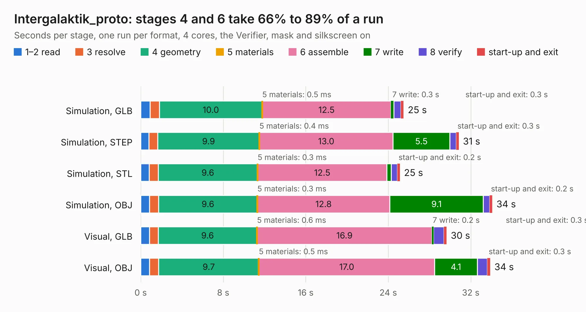

| Mode and format | 1–2 read | 3 resolve | 4 geometry | 5 materials | 6 assemble | 7 write | 8 verify | start-up and exit | Total |
|---|---:|---:|---:|---:|---:|---:|---:|---:|---:|
| Simulation, GLB | 0.9 | 0.9 | 10.0 | 0.5&nbsp;ms | 12.5 | 0.3 | 0.7 | 0.3 | 25.5 |
| Simulation, STEP | 0.8 | 0.9 | 9.9 | 0.4&nbsp;ms | 13.0 | 5.5 | 0.6 | 0.3 | 30.8 |
| Simulation, STL | 0.8 | 0.9 | 9.6 | 0.3&nbsp;ms | 12.5 | 0.4 | 0.6 | 0.2 | 25.1 |
| Simulation, OBJ | 0.8 | 0.9 | 9.6 | 0.3&nbsp;ms | 12.8 | 9.1 | 0.6 | 0.2 | 34.1 |
| Visual, GLB | 0.8 | 0.9 | 9.6 | 0.6&nbsp;ms | 16.9 | 0.2 | 1.0 | 0.3 | 29.7 |
| Visual, OBJ | 0.9 | 0.9 | 9.7 | 0.5&nbsp;ms | 17.0 | 4.1 | 1.0 | 0.3 | 33.9 |

<table align="center"><tr><td valign="top">

| Board | Repo: [intergalaktik/business-card-smd-proto](https://github.com/intergalaktik/business-card-smd-proto) Board: `Intergalaktik_proto.kicad_pcb` |
|---|---|
| Folder | KiCad / Intergalaktik_proto |
| Complexity | 183&nbsp;/&nbsp;1000 (size&nbsp;98, features&nbsp;85) |
| KESE&nbsp;features | through vias, rounded, trapezoid or chamfered pads, filled zones, copper drawings, stack-up, dielectric εr and tanδ |
| Tested | 9th November 2026 |
| Copper&nbsp;layers | 2 |
| File&nbsp;format | KiCad 8 (20240108) |
| Parts,&nbsp;tracks,&nbsp;vias | 0, 119, 8 |
| Triangles,&nbsp;simulation | 1,533,816 in 24 parts |
| Note | no components |
| Verifier | PASS in all six runs |

</td><td valign="top">

<table>
<tr><th>File type</th><th>File size</th><th>Peak memory used</th></tr>
<tr><th colspan="3" align="left">Simulation</th></tr>
<tr><td>GLB</td><td align="right">53&nbsp;MB</td><td align="right">649&nbsp;MB</td></tr>
<tr><td>STEP</td><td align="right">319&nbsp;MB</td><td align="right">826&nbsp;MB</td></tr>
<tr><td>STL</td><td align="right">77&nbsp;MB</td><td align="right">683&nbsp;MB</td></tr>
<tr><td>OBJ</td><td align="right">161&nbsp;MB</td><td align="right">1.1&nbsp;GB</td></tr>
<tr><th colspan="3" align="left">Visual</th></tr>
<tr><td>GLB</td><td align="right">24&nbsp;MB</td><td align="right">675&nbsp;MB</td></tr>
<tr><td>OBJ</td><td align="right">74&nbsp;MB</td><td align="right">652&nbsp;MB</td></tr>
</table>

</td></tr></table>

## 23.12.2 EMC_antenna

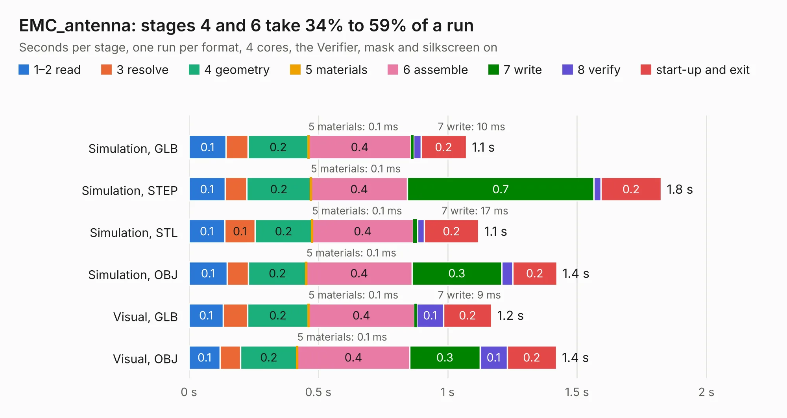

| Mode and format | 1–2 read | 3 resolve | 4 geometry | 5 materials | 6 assemble | 7 write | 8 verify | start-up and exit | Total |
|---|---:|---:|---:|---:|---:|---:|---:|---:|---:|
| Simulation, GLB | 0.1 | 85&nbsp;ms | 0.2 | 0.1&nbsp;ms | 0.4 | 10&nbsp;ms | 28&nbsp;ms | 0.2 | 1.1 |
| Simulation, STEP | 0.1 | 84&nbsp;ms | 0.2 | 0.1&nbsp;ms | 0.4 | 0.7 | 27&nbsp;ms | 0.2 | 1.8 |
| Simulation, STL | 0.1 | 0.1 | 0.2 | 0.1&nbsp;ms | 0.4 | 17&nbsp;ms | 25&nbsp;ms | 0.2 | 1.1 |
| Simulation, OBJ | 0.1 | 83&nbsp;ms | 0.2 | 0.1&nbsp;ms | 0.4 | 0.3 | 42&nbsp;ms | 0.2 | 1.4 |
| Visual, GLB | 0.1 | 93&nbsp;ms | 0.2 | 0.1&nbsp;ms | 0.4 | 9&nbsp;ms | 0.1 | 0.2 | 1.2 |
| Visual, OBJ | 0.1 | 79&nbsp;ms | 0.2 | 0.1&nbsp;ms | 0.4 | 0.3 | 0.1 | 0.2 | 1.4 |

<table align="center"><tr><td valign="top">

| Board | Repo: [intergalaktik/EMC-experiments](https://github.com/intergalaktik/EMC-experiments) Board: `EMC_antenna.kicad_pcb` |
|---|---|
| Folder | EMC_antenna |
| Complexity | 69&nbsp;/&nbsp;1000 (size&nbsp;24, features&nbsp;45) |
| KESE&nbsp;features | arc tracks, stack-up, dielectric εr and tanδ |
| Tested | 9th November 2026 |
| Copper&nbsp;layers | 2 |
| File&nbsp;format | KiCad 8 (20240108) |
| Parts,&nbsp;tracks,&nbsp;vias | 1, 0, 0 |
| Triangles,&nbsp;simulation | 75,346 in 9 parts |
| Verifier | PASS in all six runs |

</td><td valign="top">

<table>
<tr><th>File type</th><th>File size</th><th>Peak memory used</th></tr>
<tr><th colspan="3" align="left">Simulation</th></tr>
<tr><td>GLB</td><td align="right">2.8&nbsp;MB</td><td align="right">79&nbsp;MB</td></tr>
<tr><td>STEP</td><td align="right">19&nbsp;MB</td><td align="right">193&nbsp;MB</td></tr>
<tr><td>STL</td><td align="right">3.8&nbsp;MB</td><td align="right">76&nbsp;MB</td></tr>
<tr><td>OBJ</td><td align="right">7.6&nbsp;MB</td><td align="right">107&nbsp;MB</td></tr>
<tr><th colspan="3" align="left">Visual</th></tr>
<tr><td>GLB</td><td align="right">2.1&nbsp;MB</td><td align="right">115&nbsp;MB</td></tr>
<tr><td>OBJ</td><td align="right">5.7&nbsp;MB</td><td align="right">142&nbsp;MB</td></tr>
</table>

</td></tr></table>

## 23.12.3 adcIO

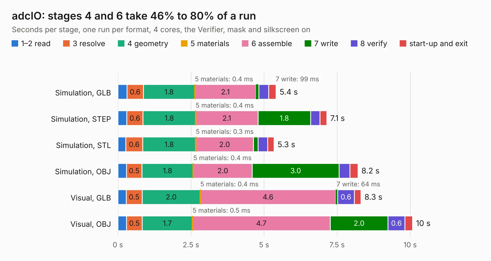

| Mode and format | 1–2 read | 3 resolve | 4 geometry | 5 materials | 6 assemble | 7 write | 8 verify | start-up and exit | Total |
|---|---:|---:|---:|---:|---:|---:|---:|---:|---:|
| Simulation, GLB | 0.3 | 0.6 | 1.8 | 0.4&nbsp;ms | 2.1 | 99&nbsp;ms | 0.3 | 0.3 | 5.4 |
| Simulation, STEP | 0.3 | 0.6 | 1.8 | 0.4&nbsp;ms | 2.1 | 1.8 | 0.3 | 0.2 | 7.1 |
| Simulation, STL | 0.3 | 0.6 | 1.8 | 0.3&nbsp;ms | 2.0 | 0.2 | 0.3 | 0.2 | 5.3 |
| Simulation, OBJ | 0.3 | 0.5 | 1.8 | 0.4&nbsp;ms | 2.0 | 3.0 | 0.4 | 0.3 | 8.2 |
| Visual, GLB | 0.3 | 0.5 | 2.0 | 0.4&nbsp;ms | 4.6 | 64&nbsp;ms | 0.6 | 0.2 | 8.3 |
| Visual, OBJ | 0.3 | 0.5 | 1.7 | 0.5&nbsp;ms | 4.7 | 2.0 | 0.6 | 0.3 | 10.1 |

<table align="center"><tr><td valign="top">

| Board | Repo: [intergalaktik/Extension_Boards_for_Olimex_GateMate](https://github.com/intergalaktik/Extension_Boards_for_Olimex_GateMate) Board: `adcIO.kicad_pcb` |
|---|---|
| Folder | adcIO |
| Complexity | 286&nbsp;/&nbsp;1000 (size&nbsp;171, features&nbsp;115) |
| KESE&nbsp;features | through vias, rounded, trapezoid or chamfered pads, filled zones, curved board outline, knockout text, stack-up, dielectric εr and tanδ, copper finish |
| Tested | 9th November 2026 |
| Copper&nbsp;layers | 4 |
| File&nbsp;format | KiCad 8 (20240108) |
| Parts,&nbsp;tracks,&nbsp;vias | 36, 212, 66 |
| Triangles,&nbsp;simulation | 640,134 in 52 parts |
| Verifier | PASS in all six runs |

</td><td valign="top">

<table>
<tr><th>File type</th><th>File size</th><th>Peak memory used</th></tr>
<tr><th colspan="3" align="left">Simulation</th></tr>
<tr><td>GLB</td><td align="right">22&nbsp;MB</td><td align="right">355&nbsp;MB</td></tr>
<tr><td>STEP</td><td align="right">96&nbsp;MB</td><td align="right">393&nbsp;MB</td></tr>
<tr><td>STL</td><td align="right">32&nbsp;MB</td><td align="right">390&nbsp;MB</td></tr>
<tr><td>OBJ</td><td align="right">65&nbsp;MB</td><td align="right">469&nbsp;MB</td></tr>
<tr><th colspan="3" align="left">Visual</th></tr>
<tr><td>GLB</td><td align="right">15&nbsp;MB</td><td align="right">392&nbsp;MB</td></tr>
<tr><td>OBJ</td><td align="right">43&nbsp;MB</td><td align="right">383&nbsp;MB</td></tr>
</table>

</td></tr></table>

## 23.12.4 camIO

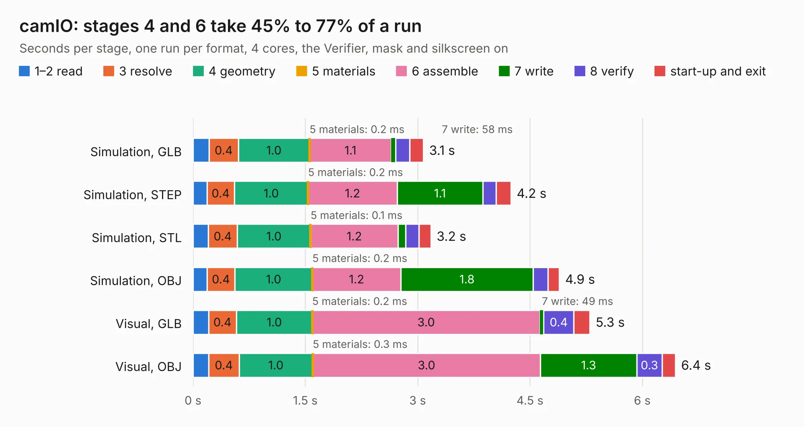

| Mode and format | 1–2 read | 3 resolve | 4 geometry | 5 materials | 6 assemble | 7 write | 8 verify | start-up and exit | Total |
|---|---:|---:|---:|---:|---:|---:|---:|---:|---:|
| Simulation, GLB | 0.2 | 0.4 | 1.0 | 0.2&nbsp;ms | 1.1 | 58&nbsp;ms | 0.2 | 0.2 | 3.1 |
| Simulation, STEP | 0.2 | 0.4 | 1.0 | 0.2&nbsp;ms | 1.2 | 1.1 | 0.2 | 0.2 | 4.2 |
| Simulation, STL | 0.2 | 0.4 | 1.0 | 0.1&nbsp;ms | 1.2 | 0.1 | 0.2 | 0.2 | 3.2 |
| Simulation, OBJ | 0.2 | 0.4 | 1.0 | 0.2&nbsp;ms | 1.2 | 1.8 | 0.2 | 0.2 | 4.9 |
| Visual, GLB | 0.2 | 0.4 | 1.0 | 0.2&nbsp;ms | 3.0 | 49&nbsp;ms | 0.4 | 0.2 | 5.3 |
| Visual, OBJ | 0.2 | 0.4 | 1.0 | 0.3&nbsp;ms | 3.0 | 1.3 | 0.3 | 0.2 | 6.4 |

<table align="center"><tr><td valign="top">

| Board | Repo: [intergalaktik/Extension_Boards_for_Olimex_GateMate](https://github.com/intergalaktik/Extension_Boards_for_Olimex_GateMate) Board: `camIO.kicad_pcb` |
|---|---|
| Folder | camIO |
| Complexity | 286&nbsp;/&nbsp;1000 (size&nbsp;171, features&nbsp;115) |
| KESE&nbsp;features | through vias, rounded, trapezoid or chamfered pads, filled zones, curved board outline, knockout text, stack-up, dielectric εr and tanδ, copper finish |
| Tested | 9th November 2026 |
| Copper&nbsp;layers | 4 |
| File&nbsp;format | KiCad 8 (20240108) |
| Parts,&nbsp;tracks,&nbsp;vias | 25, 296, 76 |
| Triangles,&nbsp;simulation | 422,226 in 40 parts |
| Verifier | PASS in all six runs |

</td><td valign="top">

<table>
<tr><th>File type</th><th>File size</th><th>Peak memory used</th></tr>
<tr><th colspan="3" align="left">Simulation</th></tr>
<tr><td>GLB</td><td align="right">15&nbsp;MB</td><td align="right">290&nbsp;MB</td></tr>
<tr><td>STEP</td><td align="right">66&nbsp;MB</td><td align="right">323&nbsp;MB</td></tr>
<tr><td>STL</td><td align="right">21&nbsp;MB</td><td align="right">303&nbsp;MB</td></tr>
<tr><td>OBJ</td><td align="right">43&nbsp;MB</td><td align="right">337&nbsp;MB</td></tr>
<tr><th colspan="3" align="left">Visual</th></tr>
<tr><td>GLB</td><td align="right">12&nbsp;MB</td><td align="right">321&nbsp;MB</td></tr>
<tr><td>OBJ</td><td align="right">34&nbsp;MB</td><td align="right">315&nbsp;MB</td></tr>
</table>

</td></tr></table>

## 23.12.5 dualTranslation

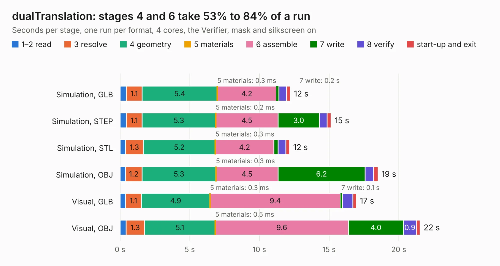

| Mode and format | 1–2 read | 3 resolve | 4 geometry | 5 materials | 6 assemble | 7 write | 8 verify | start-up and exit | Total |
|---|---:|---:|---:|---:|---:|---:|---:|---:|---:|
| Simulation, GLB | 0.4 | 1.1 | 5.4 | 0.3&nbsp;ms | 4.2 | 0.2 | 0.5 | 0.3 | 12.2 |
| Simulation, STEP | 0.4 | 1.1 | 5.3 | 0.2&nbsp;ms | 4.5 | 3.0 | 0.5 | 0.3 | 15.1 |
| Simulation, STL | 0.4 | 1.3 | 5.2 | 0.3&nbsp;ms | 4.2 | 0.3 | 0.6 | 0.3 | 12.2 |
| Simulation, OBJ | 0.4 | 1.2 | 5.3 | 0.3&nbsp;ms | 4.5 | 6.2 | 0.6 | 0.3 | 18.5 |
| Visual, GLB | 0.4 | 1.1 | 4.9 | 0.3&nbsp;ms | 9.4 | 0.1 | 0.8 | 0.2 | 17.0 |
| Visual, OBJ | 0.4 | 1.3 | 5.1 | 0.5&nbsp;ms | 9.6 | 4.0 | 0.9 | 0.3 | 21.5 |

<table align="center"><tr><td valign="top">

| Board | Repo: [intergalaktik/Extension_Boards_for_Olimex_GateMate](https://github.com/intergalaktik/Extension_Boards_for_Olimex_GateMate) Board: `dualTranslation.kicad_pcb` |
|---|---|
| Folder | dualTranslation |
| Complexity | 273&nbsp;/&nbsp;1000 (size&nbsp;188, features&nbsp;85) |
| KESE&nbsp;features | through vias, rounded, trapezoid or chamfered pads, filled zones, curved board outline, stack-up, dielectric εr and tanδ |
| Tested | 9th November 2026 |
| Copper&nbsp;layers | 4 |
| File&nbsp;format | KiCad 9 (20241229) |
| Parts,&nbsp;tracks,&nbsp;vias | 54, 521, 119 |
| Triangles,&nbsp;simulation | 941,732 in 56 parts |
| Verifier | PASS in all six runs |

</td><td valign="top">

<table>
<tr><th>File type</th><th>File size</th><th>Peak memory used</th></tr>
<tr><th colspan="3" align="left">Simulation</th></tr>
<tr><td>GLB</td><td align="right">33&nbsp;MB</td><td align="right">477&nbsp;MB</td></tr>
<tr><td>STEP</td><td align="right">153&nbsp;MB</td><td align="right">504&nbsp;MB</td></tr>
<tr><td>STL</td><td align="right">47&nbsp;MB</td><td align="right">443&nbsp;MB</td></tr>
<tr><td>OBJ</td><td align="right">97&nbsp;MB</td><td align="right">690&nbsp;MB</td></tr>
<tr><th colspan="3" align="left">Visual</th></tr>
<tr><td>GLB</td><td align="right">21&nbsp;MB</td><td align="right">537&nbsp;MB</td></tr>
<tr><td>OBJ</td><td align="right">64&nbsp;MB</td><td align="right">528&nbsp;MB</td></tr>
</table>

</td></tr></table>

## 23.12.6 dvi

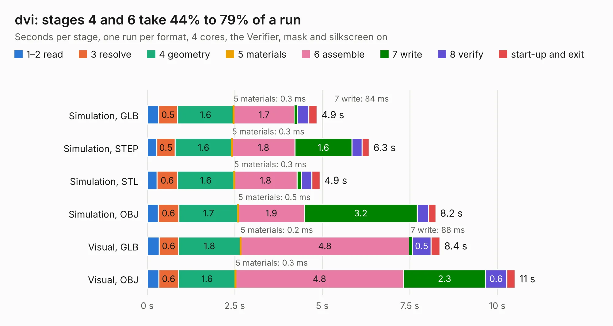

| Mode and format | 1–2 read | 3 resolve | 4 geometry | 5 materials | 6 assemble | 7 write | 8 verify | start-up and exit | Total |
|---|---:|---:|---:|---:|---:|---:|---:|---:|---:|
| Simulation, GLB | 0.3 | 0.5 | 1.6 | 0.3&nbsp;ms | 1.7 | 84&nbsp;ms | 0.3 | 0.2 | 4.9 |
| Simulation, STEP | 0.3 | 0.5 | 1.6 | 0.3&nbsp;ms | 1.8 | 1.6 | 0.3 | 0.2 | 6.3 |
| Simulation, STL | 0.3 | 0.6 | 1.6 | 0.3&nbsp;ms | 1.8 | 0.1 | 0.3 | 0.2 | 4.9 |
| Simulation, OBJ | 0.3 | 0.6 | 1.7 | 0.5&nbsp;ms | 1.9 | 3.2 | 0.3 | 0.2 | 8.2 |
| Visual, GLB | 0.3 | 0.6 | 1.8 | 0.2&nbsp;ms | 4.8 | 88&nbsp;ms | 0.5 | 0.3 | 8.4 |
| Visual, OBJ | 0.3 | 0.6 | 1.6 | 0.3&nbsp;ms | 4.8 | 2.3 | 0.6 | 0.2 | 10.5 |

<table align="center"><tr><td valign="top">

| Board | Repo: [intergalaktik/Extension_Boards_for_Olimex_GateMate](https://github.com/intergalaktik/Extension_Boards_for_Olimex_GateMate) Board: `dvi.kicad_pcb` |
|---|---|
| Folder | dvi |
| Complexity | 285&nbsp;/&nbsp;1000 (size&nbsp;185, features&nbsp;100) |
| KESE&nbsp;features | through vias, rounded, trapezoid or chamfered pads, filled zones, curved board outline, stack-up, dielectric εr and tanδ, copper finish |
| Tested | 9th November 2026 |
| Copper&nbsp;layers | 4 |
| File&nbsp;format | KiCad 8 (20240108) |
| Parts,&nbsp;tracks,&nbsp;vias | 47, 518, 89 |
| Triangles,&nbsp;simulation | 576,678 in 53 parts |
| Verifier | PASS in all six runs |

</td><td valign="top">

<table>
<tr><th>File type</th><th>File size</th><th>Peak memory used</th></tr>
<tr><th colspan="3" align="left">Simulation</th></tr>
<tr><td>GLB</td><td align="right">20&nbsp;MB</td><td align="right">339&nbsp;MB</td></tr>
<tr><td>STEP</td><td align="right">91&nbsp;MB</td><td align="right">384&nbsp;MB</td></tr>
<tr><td>STL</td><td align="right">29&nbsp;MB</td><td align="right">331&nbsp;MB</td></tr>
<tr><td>OBJ</td><td align="right">58&nbsp;MB</td><td align="right">439&nbsp;MB</td></tr>
<tr><th colspan="3" align="left">Visual</th></tr>
<tr><td>GLB</td><td align="right">15&nbsp;MB</td><td align="right">403&nbsp;MB</td></tr>
<tr><td>OBJ</td><td align="right">45&nbsp;MB</td><td align="right">403&nbsp;MB</td></tr>
</table>

</td></tr></table>

## 23.12.7 eduIO

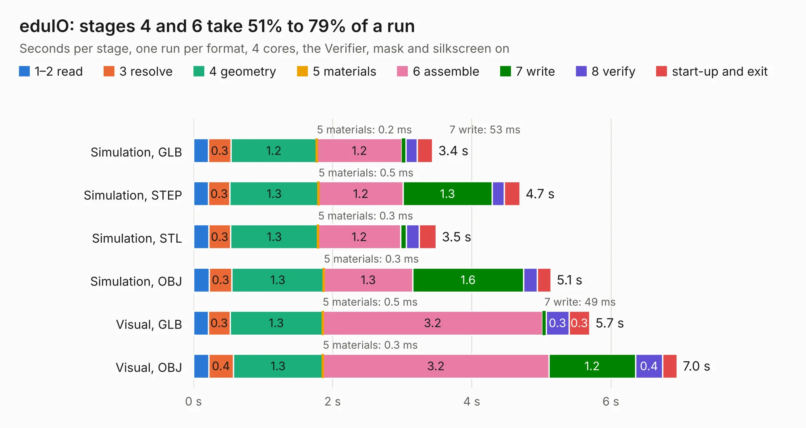

| Mode and format | 1–2 read | 3 resolve | 4 geometry | 5 materials | 6 assemble | 7 write | 8 verify | start-up and exit | Total |
|---|---:|---:|---:|---:|---:|---:|---:|---:|---:|
| Simulation, GLB | 0.2 | 0.3 | 1.2 | 0.2&nbsp;ms | 1.2 | 53&nbsp;ms | 0.2 | 0.2 | 3.4 |
| Simulation, STEP | 0.2 | 0.3 | 1.3 | 0.5&nbsp;ms | 1.2 | 1.3 | 0.2 | 0.2 | 4.7 |
| Simulation, STL | 0.2 | 0.3 | 1.3 | 0.3&nbsp;ms | 1.2 | 85&nbsp;ms | 0.2 | 0.2 | 3.5 |
| Simulation, OBJ | 0.2 | 0.3 | 1.3 | 0.3&nbsp;ms | 1.3 | 1.6 | 0.2 | 0.2 | 5.1 |
| Visual, GLB | 0.2 | 0.3 | 1.3 | 0.5&nbsp;ms | 3.2 | 49&nbsp;ms | 0.3 | 0.3 | 5.7 |
| Visual, OBJ | 0.2 | 0.4 | 1.3 | 0.3&nbsp;ms | 3.2 | 1.2 | 0.4 | 0.2 | 7.0 |

<table align="center"><tr><td valign="top">

| Board | Repo: [intergalaktik/Extension_Boards_for_Olimex_GateMate](https://github.com/intergalaktik/Extension_Boards_for_Olimex_GateMate) Board: `eduIO.kicad_pcb` |
|---|---|
| Folder | eduIO |
| Complexity | 257&nbsp;/&nbsp;1000 (size&nbsp;142, features&nbsp;115) |
| KESE&nbsp;features | through vias, rounded, trapezoid or chamfered pads, filled zones, curved board outline, knockout text, stack-up, dielectric εr and tanδ, copper finish |
| Tested | 9th November 2026 |
| Copper&nbsp;layers | 2 |
| File&nbsp;format | KiCad 8 (20240108) |
| Parts,&nbsp;tracks,&nbsp;vias | 22, 180, 25 |
| Triangles,&nbsp;simulation | 305,672 in 65 parts |
| Verifier | PASS in all six runs |

</td><td valign="top">

<table>
<tr><th>File type</th><th>File size</th><th>Peak memory used</th></tr>
<tr><th colspan="3" align="left">Simulation</th></tr>
<tr><td>GLB</td><td align="right">11&nbsp;MB</td><td align="right">246&nbsp;MB</td></tr>
<tr><td>STEP</td><td align="right">52&nbsp;MB</td><td align="right">279&nbsp;MB</td></tr>
<tr><td>STL</td><td align="right">15&nbsp;MB</td><td align="right">245&nbsp;MB</td></tr>
<tr><td>OBJ</td><td align="right">31&nbsp;MB</td><td align="right">270&nbsp;MB</td></tr>
<tr><th colspan="3" align="left">Visual</th></tr>
<tr><td>GLB</td><td align="right">8.7&nbsp;MB</td><td align="right">272&nbsp;MB</td></tr>
<tr><td>OBJ</td><td align="right">25&nbsp;MB</td><td align="right">271&nbsp;MB</td></tr>
</table>

</td></tr></table>

## 23.12.8 ethIO

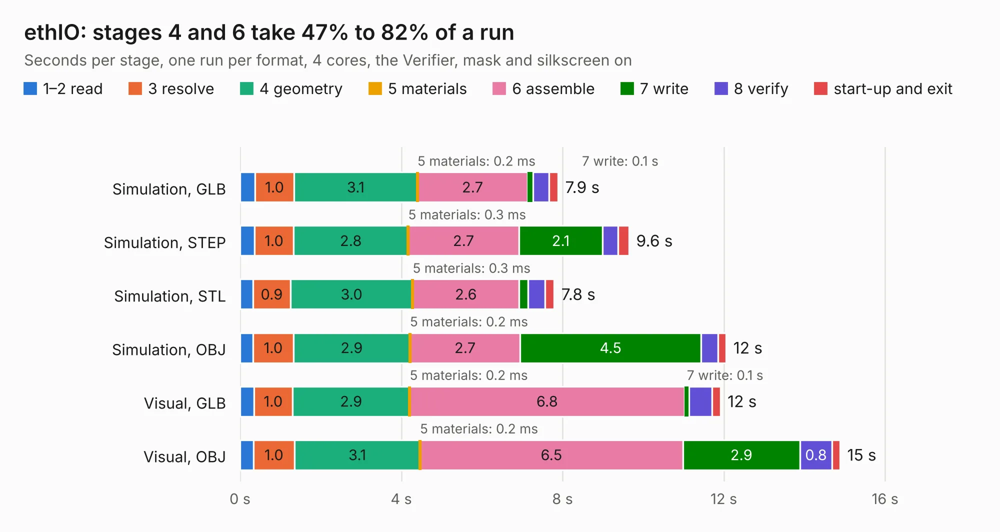

| Mode and format | 1–2 read | 3 resolve | 4 geometry | 5 materials | 6 assemble | 7 write | 8 verify | start-up and exit | Total |
|---|---:|---:|---:|---:|---:|---:|---:|---:|---:|
| Simulation, GLB | 0.4 | 1.0 | 3.1 | 0.2&nbsp;ms | 2.7 | 0.1 | 0.4 | 0.2 | 7.9 |
| Simulation, STEP | 0.4 | 1.0 | 2.8 | 0.3&nbsp;ms | 2.7 | 2.1 | 0.4 | 0.3 | 9.6 |
| Simulation, STL | 0.3 | 0.9 | 3.0 | 0.3&nbsp;ms | 2.6 | 0.2 | 0.4 | 0.2 | 7.8 |
| Simulation, OBJ | 0.3 | 1.0 | 2.9 | 0.2&nbsp;ms | 2.7 | 4.5 | 0.4 | 0.2 | 12.1 |
| Visual, GLB | 0.3 | 1.0 | 2.9 | 0.2&nbsp;ms | 6.8 | 0.1 | 0.6 | 0.2 | 11.9 |
| Visual, OBJ | 0.3 | 1.0 | 3.1 | 0.2&nbsp;ms | 6.5 | 2.9 | 0.8 | 0.2 | 14.9 |

<table align="center"><tr><td valign="top">

| Board | Repo: [intergalaktik/Extension_Boards_for_Olimex_GateMate](https://github.com/intergalaktik/Extension_Boards_for_Olimex_GateMate) Board: `ethIO.kicad_pcb` |
|---|---|
| Folder | ethIO |
| Complexity | 320&nbsp;/&nbsp;1000 (size&nbsp;190, features&nbsp;130) |
| KESE&nbsp;features | through vias, rounded, trapezoid or chamfered pads, filled zones, curved board outline, knockout text, TrueType text, stack-up, dielectric εr and tanδ, copper finish |
| Tested | 9th November 2026 |
| Copper&nbsp;layers | 4 |
| File&nbsp;format | KiCad 8 (20240108) |
| Parts,&nbsp;tracks,&nbsp;vias | 46, 708, 122 |
| Triangles,&nbsp;simulation | 860,620 in 62 parts |
| Verifier | PASS in all six runs |

</td><td valign="top">

<table>
<tr><th>File type</th><th>File size</th><th>Peak memory used</th></tr>
<tr><th colspan="3" align="left">Simulation</th></tr>
<tr><td>GLB</td><td align="right">30&nbsp;MB</td><td align="right">379&nbsp;MB</td></tr>
<tr><td>STEP</td><td align="right">141&nbsp;MB</td><td align="right">457&nbsp;MB</td></tr>
<tr><td>STL</td><td align="right">43&nbsp;MB</td><td align="right">379&nbsp;MB</td></tr>
<tr><td>OBJ</td><td align="right">89&nbsp;MB</td><td align="right">626&nbsp;MB</td></tr>
<tr><th colspan="3" align="left">Visual</th></tr>
<tr><td>GLB</td><td align="right">20&nbsp;MB</td><td align="right">466&nbsp;MB</td></tr>
<tr><td>OBJ</td><td align="right">61&nbsp;MB</td><td align="right">489&nbsp;MB</td></tr>
</table>

</td></tr></table>

## 23.12.9 extension_template

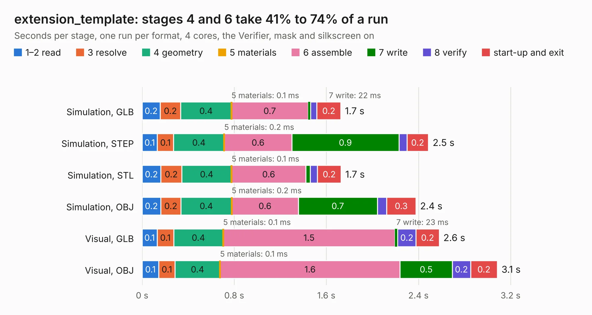

| Mode and format | 1–2 read | 3 resolve | 4 geometry | 5 materials | 6 assemble | 7 write | 8 verify | start-up and exit | Total |
|---|---:|---:|---:|---:|---:|---:|---:|---:|---:|
| Simulation, GLB | 0.2 | 0.2 | 0.4 | 0.1&nbsp;ms | 0.7 | 22&nbsp;ms | 55&nbsp;ms | 0.2 | 1.7 |
| Simulation, STEP | 0.1 | 0.1 | 0.4 | 0.2&nbsp;ms | 0.6 | 0.9 | 69&nbsp;ms | 0.2 | 2.5 |
| Simulation, STL | 0.2 | 0.2 | 0.4 | 0.1&nbsp;ms | 0.6 | 40&nbsp;ms | 61&nbsp;ms | 0.2 | 1.7 |
| Simulation, OBJ | 0.2 | 0.2 | 0.4 | 0.2&nbsp;ms | 0.6 | 0.7 | 80&nbsp;ms | 0.3 | 2.4 |
| Visual, GLB | 0.1 | 0.1 | 0.4 | 0.1&nbsp;ms | 1.5 | 23&nbsp;ms | 0.2 | 0.2 | 2.6 |
| Visual, OBJ | 0.1 | 0.1 | 0.4 | 0.1&nbsp;ms | 1.6 | 0.5 | 0.2 | 0.2 | 3.1 |

<table align="center"><tr><td valign="top">

| Board | Repo: [intergalaktik/Extension_Boards_for_Olimex_GateMate](https://github.com/intergalaktik/Extension_Boards_for_Olimex_GateMate) Board: `extension_template.kicad_pcb` |
|---|---|
| Folder | extension_template |
| Complexity | 241&nbsp;/&nbsp;1000 (size&nbsp;126, features&nbsp;115) |
| KESE&nbsp;features | through vias, rounded, trapezoid or chamfered pads, filled zones, curved board outline, knockout text, stack-up, dielectric εr and tanδ, copper finish |
| Tested | 9th November 2026 |
| Copper&nbsp;layers | 4 |
| File&nbsp;format | KiCad 8 (20240108) |
| Parts,&nbsp;tracks,&nbsp;vias | 7, 51, 6 |
| Triangles,&nbsp;simulation | 139,358 in 36 parts |
| Verifier | PASS in all six runs |

</td><td valign="top">

<table>
<tr><th>File type</th><th>File size</th><th>Peak memory used</th></tr>
<tr><th colspan="3" align="left">Simulation</th></tr>
<tr><td>GLB</td><td align="right">5.0&nbsp;MB</td><td align="right">213&nbsp;MB</td></tr>
<tr><td>STEP</td><td align="right">28&nbsp;MB</td><td align="right">220&nbsp;MB</td></tr>
<tr><td>STL</td><td align="right">7.0&nbsp;MB</td><td align="right">211&nbsp;MB</td></tr>
<tr><td>OBJ</td><td align="right">14&nbsp;MB</td><td align="right">205&nbsp;MB</td></tr>
<tr><th colspan="3" align="left">Visual</th></tr>
<tr><td>GLB</td><td align="right">4.4&nbsp;MB</td><td align="right">170&nbsp;MB</td></tr>
<tr><td>OBJ</td><td align="right">12&nbsp;MB</td><td align="right">179&nbsp;MB</td></tr>
</table>

</td></tr></table>

## 23.12.10 GamePad_I2S_audio

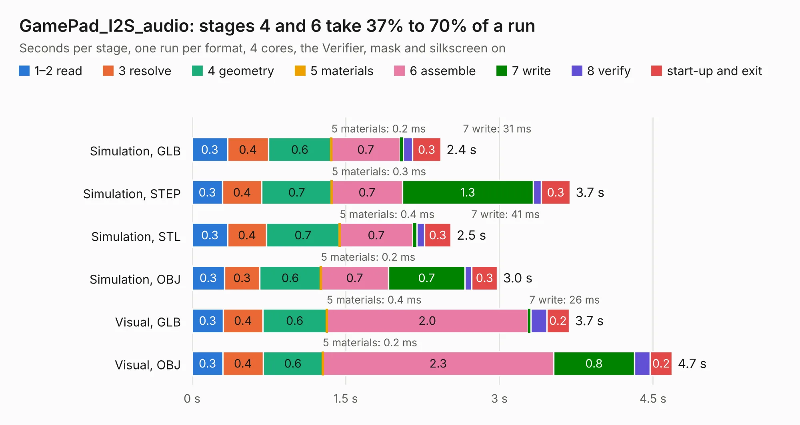

| Mode and format | 1–2 read | 3 resolve | 4 geometry | 5 materials | 6 assemble | 7 write | 8 verify | start-up and exit | Total |
|---|---:|---:|---:|---:|---:|---:|---:|---:|---:|
| Simulation, GLB | 0.3 | 0.4 | 0.6 | 0.2&nbsp;ms | 0.7 | 31&nbsp;ms | 91&nbsp;ms | 0.3 | 2.4 |
| Simulation, STEP | 0.3 | 0.4 | 0.7 | 0.3&nbsp;ms | 0.7 | 1.3 | 80&nbsp;ms | 0.3 | 3.7 |
| Simulation, STL | 0.3 | 0.4 | 0.7 | 0.4&nbsp;ms | 0.7 | 41&nbsp;ms | 73&nbsp;ms | 0.3 | 2.5 |
| Simulation, OBJ | 0.3 | 0.3 | 0.6 | 0.2&nbsp;ms | 0.7 | 0.7 | 67&nbsp;ms | 0.3 | 3.0 |
| Visual, GLB | 0.3 | 0.4 | 0.6 | 0.4&nbsp;ms | 2.0 | 26&nbsp;ms | 0.2 | 0.2 | 3.7 |
| Visual, OBJ | 0.3 | 0.4 | 0.6 | 0.2&nbsp;ms | 2.3 | 0.8 | 0.2 | 0.2 | 4.7 |

<table align="center"><tr><td valign="top">

| Board | Repo: [intergalaktik/Extension_Boards_for_Olimex_GateMate](https://github.com/intergalaktik/Extension_Boards_for_Olimex_GateMate) Board: `GamePad_I2S_audio.kicad_pcb` |
|---|---|
| Folder | GamePad_I2S_audio / KiCad |
| Complexity | 265&nbsp;/&nbsp;1000 (size&nbsp;180, features&nbsp;85) |
| KESE&nbsp;features | through vias, rounded, trapezoid or chamfered pads, filled zones, curved board outline, stack-up, dielectric εr and tanδ |
| Tested | 9th November 2026 |
| Copper&nbsp;layers | 4 |
| File&nbsp;format | KiCad 8 (20240108) |
| Parts,&nbsp;tracks,&nbsp;vias | 81, 268, 51 |
| Triangles,&nbsp;simulation | 131,540 in 65 parts |
| Verifier | PASS in all six runs |

</td><td valign="top">

<table>
<tr><th>File type</th><th>File size</th><th>Peak memory used</th></tr>
<tr><th colspan="3" align="left">Simulation</th></tr>
<tr><td>GLB</td><td align="right">4.8&nbsp;MB</td><td align="right">213&nbsp;MB</td></tr>
<tr><td>STEP</td><td align="right">21&nbsp;MB</td><td align="right">215&nbsp;MB</td></tr>
<tr><td>STL</td><td align="right">6.6&nbsp;MB</td><td align="right">212&nbsp;MB</td></tr>
<tr><td>OBJ</td><td align="right">14&nbsp;MB</td><td align="right">207&nbsp;MB</td></tr>
<tr><th colspan="3" align="left">Visual</th></tr>
<tr><td>GLB</td><td align="right">4.7&nbsp;MB</td><td align="right">197&nbsp;MB</td></tr>
<tr><td>OBJ</td><td align="right">13&nbsp;MB</td><td align="right">200&nbsp;MB</td></tr>
</table>

</td></tr></table>

## 23.12.11 GamePad_I2S_audio

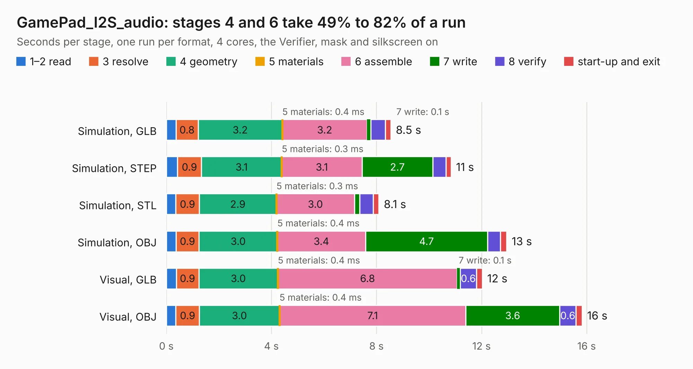

| Mode and format | 1–2 read | 3 resolve | 4 geometry | 5 materials | 6 assemble | 7 write | 8 verify | start-up and exit | Total |
|---|---:|---:|---:|---:|---:|---:|---:|---:|---:|
| Simulation, GLB | 0.4 | 0.8 | 3.2 | 0.4&nbsp;ms | 3.2 | 0.1 | 0.6 | 0.2 | 8.5 |
| Simulation, STEP | 0.4 | 0.9 | 3.1 | 0.3&nbsp;ms | 3.1 | 2.7 | 0.5 | 0.2 | 10.8 |
| Simulation, STL | 0.4 | 0.9 | 2.9 | 0.3&nbsp;ms | 3.0 | 0.2 | 0.5 | 0.2 | 8.1 |
| Simulation, OBJ | 0.4 | 0.9 | 3.0 | 0.4&nbsp;ms | 3.4 | 4.7 | 0.5 | 0.2 | 13.0 |
| Visual, GLB | 0.4 | 0.9 | 3.0 | 0.4&nbsp;ms | 6.8 | 0.1 | 0.6 | 0.2 | 12.0 |
| Visual, OBJ | 0.4 | 0.9 | 3.0 | 0.4&nbsp;ms | 7.1 | 3.6 | 0.6 | 0.2 | 15.8 |

<table align="center"><tr><td valign="top">

| Board | Repo: [intergalaktik/Extension_Boards_for_Olimex_GateMate](https://github.com/intergalaktik/Extension_Boards_for_Olimex_GateMate) Board: `GamePad_I2S_audio.kicad_pcb` |
|---|---|
| Folder | GamePad_I2S_audio_Buttons / KiCad |
| Complexity | 280&nbsp;/&nbsp;1000 (size&nbsp;195, features&nbsp;85) |
| KESE&nbsp;features | through vias, rounded, trapezoid or chamfered pads, filled zones, curved board outline, stack-up, dielectric εr and tanδ |
| Tested | 9th November 2026 |
| Copper&nbsp;layers | 4 |
| File&nbsp;format | KiCad 8 (20240108) |
| Parts,&nbsp;tracks,&nbsp;vias | 77, 713, 127 |
| Triangles,&nbsp;simulation | 866,552 in 91 parts |
| Verifier | PASS in all six runs |

</td><td valign="top">

<table>
<tr><th>File type</th><th>File size</th><th>Peak memory used</th></tr>
<tr><th colspan="3" align="left">Simulation</th></tr>
<tr><td>GLB</td><td align="right">30&nbsp;MB</td><td align="right">404&nbsp;MB</td></tr>
<tr><td>STEP</td><td align="right">135&nbsp;MB</td><td align="right">500&nbsp;MB</td></tr>
<tr><td>STL</td><td align="right">43&nbsp;MB</td><td align="right">405&nbsp;MB</td></tr>
<tr><td>OBJ</td><td align="right">88&nbsp;MB</td><td align="right">619&nbsp;MB</td></tr>
<tr><th colspan="3" align="left">Visual</th></tr>
<tr><td>GLB</td><td align="right">23&nbsp;MB</td><td align="right">579&nbsp;MB</td></tr>
<tr><td>OBJ</td><td align="right">69&nbsp;MB</td><td align="right">516&nbsp;MB</td></tr>
</table>

</td></tr></table>

## 23.12.12 MikroBusIO

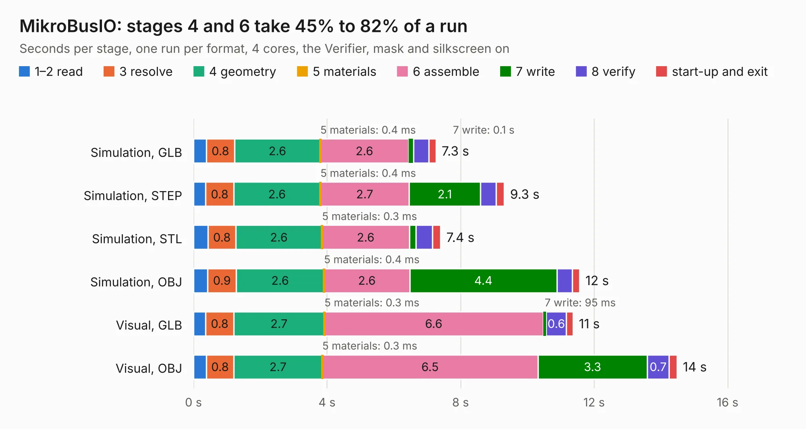

| Mode and format | 1–2 read | 3 resolve | 4 geometry | 5 materials | 6 assemble | 7 write | 8 verify | start-up and exit | Total |
|---|---:|---:|---:|---:|---:|---:|---:|---:|---:|
| Simulation, GLB | 0.4 | 0.8 | 2.6 | 0.4&nbsp;ms | 2.6 | 0.1 | 0.5 | 0.2 | 7.3 |
| Simulation, STEP | 0.4 | 0.8 | 2.6 | 0.4&nbsp;ms | 2.7 | 2.1 | 0.5 | 0.2 | 9.3 |
| Simulation, STL | 0.4 | 0.8 | 2.6 | 0.3&nbsp;ms | 2.6 | 0.2 | 0.5 | 0.2 | 7.4 |
| Simulation, OBJ | 0.4 | 0.9 | 2.6 | 0.4&nbsp;ms | 2.6 | 4.4 | 0.5 | 0.2 | 11.6 |
| Visual, GLB | 0.4 | 0.8 | 2.7 | 0.3&nbsp;ms | 6.6 | 95&nbsp;ms | 0.6 | 0.2 | 11.4 |
| Visual, OBJ | 0.4 | 0.8 | 2.7 | 0.3&nbsp;ms | 6.5 | 3.3 | 0.7 | 0.2 | 14.5 |

<table align="center"><tr><td valign="top">

| Board | Repo: [intergalaktik/Extension_Boards_for_Olimex_GateMate](https://github.com/intergalaktik/Extension_Boards_for_Olimex_GateMate) Board: `MikroBusIO.kicad_pcb` |
|---|---|
| Folder | MikroBusIO |
| Complexity | 300&nbsp;/&nbsp;1000 (size&nbsp;185, features&nbsp;115) |
| KESE&nbsp;features | through vias, rounded, trapezoid or chamfered pads, filled zones, curved board outline, knockout text, stack-up, dielectric εr and tanδ, copper finish |
| Tested | 9th November 2026 |
| Copper&nbsp;layers | 4 |
| File&nbsp;format | KiCad 8 (20240108) |
| Parts,&nbsp;tracks,&nbsp;vias | 55, 388, 109 |
| Triangles,&nbsp;simulation | 755,740 in 59 parts |
| Verifier | PASS in all six runs |

</td><td valign="top">

<table>
<tr><th>File type</th><th>File size</th><th>Peak memory used</th></tr>
<tr><th colspan="3" align="left">Simulation</th></tr>
<tr><td>GLB</td><td align="right">26&nbsp;MB</td><td align="right">382&nbsp;MB</td></tr>
<tr><td>STEP</td><td align="right">111&nbsp;MB</td><td align="right">432&nbsp;MB</td></tr>
<tr><td>STL</td><td align="right">38&nbsp;MB</td><td align="right">396&nbsp;MB</td></tr>
<tr><td>OBJ</td><td align="right">77&nbsp;MB</td><td align="right">537&nbsp;MB</td></tr>
<tr><th colspan="3" align="left">Visual</th></tr>
<tr><td>GLB</td><td align="right">19&nbsp;MB</td><td align="right">473&nbsp;MB</td></tr>
<tr><td>OBJ</td><td align="right">58&nbsp;MB</td><td align="right">479&nbsp;MB</td></tr>
</table>

</td></tr></table>

## 23.12.13 pwrIO

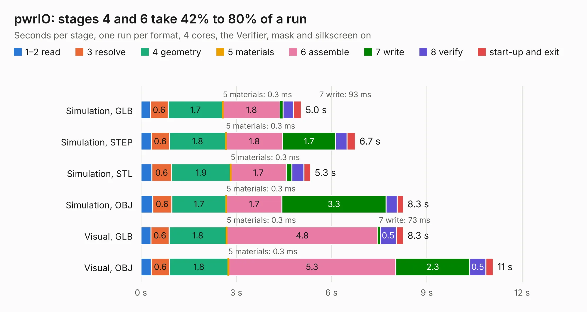

| Mode and format | 1–2 read | 3 resolve | 4 geometry | 5 materials | 6 assemble | 7 write | 8 verify | start-up and exit | Total |
|---|---:|---:|---:|---:|---:|---:|---:|---:|---:|
| Simulation, GLB | 0.3 | 0.6 | 1.7 | 0.3&nbsp;ms | 1.8 | 93&nbsp;ms | 0.3 | 0.2 | 5.0 |
| Simulation, STEP | 0.3 | 0.6 | 1.8 | 0.3&nbsp;ms | 1.8 | 1.7 | 0.4 | 0.3 | 6.7 |
| Simulation, STL | 0.3 | 0.6 | 1.9 | 0.3&nbsp;ms | 1.7 | 0.2 | 0.4 | 0.2 | 5.3 |
| Simulation, OBJ | 0.4 | 0.6 | 1.7 | 0.3&nbsp;ms | 1.7 | 3.3 | 0.4 | 0.2 | 8.3 |
| Visual, GLB | 0.3 | 0.6 | 1.8 | 0.3&nbsp;ms | 4.8 | 73&nbsp;ms | 0.5 | 0.2 | 8.3 |
| Visual, OBJ | 0.3 | 0.6 | 1.8 | 0.3&nbsp;ms | 5.3 | 2.3 | 0.5 | 0.2 | 11.1 |

<table align="center"><tr><td valign="top">

| Board | Repo: [intergalaktik/Extension_Boards_for_Olimex_GateMate](https://github.com/intergalaktik/Extension_Boards_for_Olimex_GateMate) Board: `pwrIO.kicad_pcb` |
|---|---|
| Folder | pwrIO |
| Complexity | 255&nbsp;/&nbsp;1000 (size&nbsp;180, features&nbsp;75) |
| KESE&nbsp;features | through vias, rounded, trapezoid or chamfered pads, filled zones, stack-up, dielectric εr and tanδ |
| Tested | 9th November 2026 |
| Copper&nbsp;layers | 4 |
| File&nbsp;format | KiCad 8 (20240108) |
| Parts,&nbsp;tracks,&nbsp;vias | 45, 441, 59 |
| Triangles,&nbsp;simulation | 577,794 in 60 parts |
| Verifier | PASS in all six runs |

</td><td valign="top">

<table>
<tr><th>File type</th><th>File size</th><th>Peak memory used</th></tr>
<tr><th colspan="3" align="left">Simulation</th></tr>
<tr><td>GLB</td><td align="right">20&nbsp;MB</td><td align="right">329&nbsp;MB</td></tr>
<tr><td>STEP</td><td align="right">94&nbsp;MB</td><td align="right">370&nbsp;MB</td></tr>
<tr><td>STL</td><td align="right">29&nbsp;MB</td><td align="right">324&nbsp;MB</td></tr>
<tr><td>OBJ</td><td align="right">59&nbsp;MB</td><td align="right">434&nbsp;MB</td></tr>
<tr><th colspan="3" align="left">Visual</th></tr>
<tr><td>GLB</td><td align="right">15&nbsp;MB</td><td align="right">394&nbsp;MB</td></tr>
<tr><td>OBJ</td><td align="right">44&nbsp;MB</td><td align="right">409&nbsp;MB</td></tr>
</table>

</td></tr></table>

## 23.12.14 simpleIO

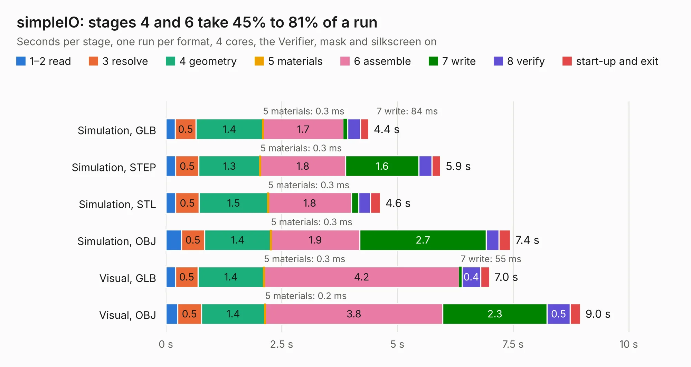

| Mode and format | 1–2 read | 3 resolve | 4 geometry | 5 materials | 6 assemble | 7 write | 8 verify | start-up and exit | Total |
|---|---:|---:|---:|---:|---:|---:|---:|---:|---:|
| Simulation, GLB | 0.2 | 0.5 | 1.4 | 0.3&nbsp;ms | 1.7 | 84&nbsp;ms | 0.3 | 0.2 | 4.4 |
| Simulation, STEP | 0.2 | 0.5 | 1.3 | 0.3&nbsp;ms | 1.8 | 1.6 | 0.3 | 0.2 | 5.9 |
| Simulation, STL | 0.2 | 0.5 | 1.5 | 0.3&nbsp;ms | 1.8 | 0.2 | 0.3 | 0.2 | 4.6 |
| Simulation, OBJ | 0.3 | 0.5 | 1.4 | 0.3&nbsp;ms | 1.9 | 2.7 | 0.3 | 0.2 | 7.4 |
| Visual, GLB | 0.2 | 0.5 | 1.4 | 0.3&nbsp;ms | 4.2 | 55&nbsp;ms | 0.4 | 0.2 | 7.0 |
| Visual, OBJ | 0.3 | 0.5 | 1.4 | 0.2&nbsp;ms | 3.8 | 2.3 | 0.5 | 0.2 | 9.0 |

<table align="center"><tr><td valign="top">

| Board | Repo: [intergalaktik/Extension_Boards_for_Olimex_GateMate](https://github.com/intergalaktik/Extension_Boards_for_Olimex_GateMate) Board: `simpleIO.kicad_pcb` |
|---|---|
| Folder | simpleIO / KiCad |
| Complexity | 252&nbsp;/&nbsp;1000 (size&nbsp;177, features&nbsp;75) |
| KESE&nbsp;features | through vias, rounded, trapezoid or chamfered pads, filled zones, stack-up, dielectric εr and tanδ |
| Tested | 9th November 2026 |
| Copper&nbsp;layers | 4 |
| File&nbsp;format | KiCad 8 (20240108) |
| Parts,&nbsp;tracks,&nbsp;vias | 48, 247, 82 |
| Triangles,&nbsp;simulation | 455,592 in 69 parts |
| Verifier | PASS in all six runs |

</td><td valign="top">

<table>
<tr><th>File type</th><th>File size</th><th>Peak memory used</th></tr>
<tr><th colspan="3" align="left">Simulation</th></tr>
<tr><td>GLB</td><td align="right">16&nbsp;MB</td><td align="right">289&nbsp;MB</td></tr>
<tr><td>STEP</td><td align="right">63&nbsp;MB</td><td align="right">350&nbsp;MB</td></tr>
<tr><td>STL</td><td align="right">23&nbsp;MB</td><td align="right">288&nbsp;MB</td></tr>
<tr><td>OBJ</td><td align="right">46&nbsp;MB</td><td align="right">370&nbsp;MB</td></tr>
<tr><th colspan="3" align="left">Visual</th></tr>
<tr><td>GLB</td><td align="right">12&nbsp;MB</td><td align="right">365&nbsp;MB</td></tr>
<tr><td>OBJ</td><td align="right">36&nbsp;MB</td><td align="right">345&nbsp;MB</td></tr>
</table>

</td></tr></table>

## 23.12.15 tmrIO

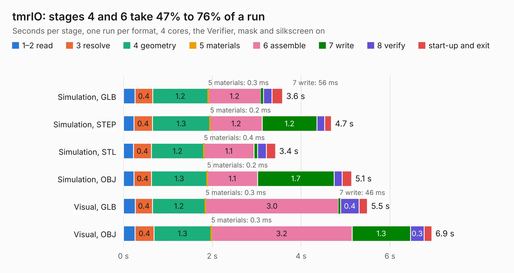

| Mode and format | 1–2 read | 3 resolve | 4 geometry | 5 materials | 6 assemble | 7 write | 8 verify | start-up and exit | Total |
|---|---:|---:|---:|---:|---:|---:|---:|---:|---:|
| Simulation, GLB | 0.3 | 0.4 | 1.2 | 0.3&nbsp;ms | 1.2 | 56&nbsp;ms | 0.2 | 0.2 | 3.6 |
| Simulation, STEP | 0.2 | 0.4 | 1.3 | 0.2&nbsp;ms | 1.2 | 1.2 | 0.2 | 0.2 | 4.7 |
| Simulation, STL | 0.2 | 0.4 | 1.2 | 0.4&nbsp;ms | 1.1 | 86&nbsp;ms | 0.2 | 0.2 | 3.4 |
| Simulation, OBJ | 0.2 | 0.4 | 1.3 | 0.2&nbsp;ms | 1.1 | 1.7 | 0.2 | 0.2 | 5.1 |
| Visual, GLB | 0.3 | 0.4 | 1.2 | 0.3&nbsp;ms | 3.0 | 46&nbsp;ms | 0.4 | 0.2 | 5.5 |
| Visual, OBJ | 0.3 | 0.4 | 1.3 | 0.3&nbsp;ms | 3.2 | 1.3 | 0.3 | 0.2 | 6.9 |

<table align="center"><tr><td valign="top">

| Board | Repo: [intergalaktik/Extension_Boards_for_Olimex_GateMate](https://github.com/intergalaktik/Extension_Boards_for_Olimex_GateMate) Board: `tmrIO.kicad_pcb` |
|---|---|
| Folder | tmrIO |
| Complexity | 270&nbsp;/&nbsp;1000 (size&nbsp;170, features&nbsp;100) |
| KESE&nbsp;features | through vias, rounded, trapezoid or chamfered pads, filled zones, curved board outline, stack-up, dielectric εr and tanδ, copper finish |
| Tested | 9th November 2026 |
| Copper&nbsp;layers | 4 |
| File&nbsp;format | KiCad 8 (20240108) |
| Parts,&nbsp;tracks,&nbsp;vias | 23, 282, 76 |
| Triangles,&nbsp;simulation | 442,664 in 51 parts |
| Verifier | PASS in all six runs |

</td><td valign="top">

<table>
<tr><th>File type</th><th>File size</th><th>Peak memory used</th></tr>
<tr><th colspan="3" align="left">Simulation</th></tr>
<tr><td>GLB</td><td align="right">15&nbsp;MB</td><td align="right">304&nbsp;MB</td></tr>
<tr><td>STEP</td><td align="right">62&nbsp;MB</td><td align="right">318&nbsp;MB</td></tr>
<tr><td>STL</td><td align="right">22&nbsp;MB</td><td align="right">291&nbsp;MB</td></tr>
<tr><td>OBJ</td><td align="right">45&nbsp;MB</td><td align="right">339&nbsp;MB</td></tr>
<tr><th colspan="3" align="left">Visual</th></tr>
<tr><td>GLB</td><td align="right">11&nbsp;MB</td><td align="right">309&nbsp;MB</td></tr>
<tr><td>OBJ</td><td align="right">33&nbsp;MB</td><td align="right">315&nbsp;MB</td></tr>
</table>

</td></tr></table>

## 23.12.16 USB

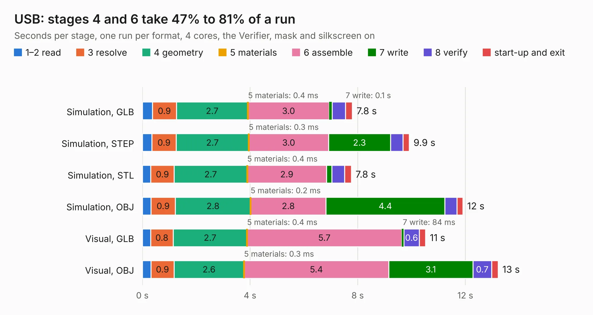

| Mode and format | 1–2 read | 3 resolve | 4 geometry | 5 materials | 6 assemble | 7 write | 8 verify | start-up and exit | Total |
|---|---:|---:|---:|---:|---:|---:|---:|---:|---:|
| Simulation, GLB | 0.4 | 0.9 | 2.7 | 0.4&nbsp;ms | 3.0 | 0.1 | 0.5 | 0.3 | 7.8 |
| Simulation, STEP | 0.4 | 0.9 | 2.7 | 0.3&nbsp;ms | 3.0 | 2.3 | 0.5 | 0.2 | 9.9 |
| Simulation, STL | 0.3 | 0.9 | 2.7 | 0.4&nbsp;ms | 2.9 | 0.2 | 0.5 | 0.2 | 7.8 |
| Simulation, OBJ | 0.3 | 0.9 | 2.8 | 0.2&nbsp;ms | 2.8 | 4.4 | 0.5 | 0.2 | 11.9 |
| Visual, GLB | 0.3 | 0.8 | 2.7 | 0.4&nbsp;ms | 5.7 | 84&nbsp;ms | 0.6 | 0.2 | 10.5 |
| Visual, OBJ | 0.3 | 0.9 | 2.6 | 0.3&nbsp;ms | 5.4 | 3.1 | 0.7 | 0.2 | 13.2 |

<table align="center"><tr><td valign="top">

| Board | Repo: [intergalaktik/Extension_Boards_for_Olimex_GateMate](https://github.com/intergalaktik/Extension_Boards_for_Olimex_GateMate) Board: `USB.kicad_pcb` |
|---|---|
| Folder | USB |
| Complexity | 285&nbsp;/&nbsp;1000 (size&nbsp;185, features&nbsp;100) |
| KESE&nbsp;features | through vias, rounded, trapezoid or chamfered pads, filled zones, curved board outline, stack-up, dielectric εr and tanδ, copper finish |
| Tested | 9th November 2026 |
| Copper&nbsp;layers | 4 |
| File&nbsp;format | KiCad 9 (20241229) |
| Parts,&nbsp;tracks,&nbsp;vias | 38, 364, 189 |
| Triangles,&nbsp;simulation | 760,970 in 51 parts |
| Verifier | PASS in all six runs |

</td><td valign="top">

<table>
<tr><th>File type</th><th>File size</th><th>Peak memory used</th></tr>
<tr><th colspan="3" align="left">Simulation</th></tr>
<tr><td>GLB</td><td align="right">26&nbsp;MB</td><td align="right">402&nbsp;MB</td></tr>
<tr><td>STEP</td><td align="right">102&nbsp;MB</td><td align="right">458&nbsp;MB</td></tr>
<tr><td>STL</td><td align="right">38&nbsp;MB</td><td align="right">421&nbsp;MB</td></tr>
<tr><td>OBJ</td><td align="right">77&nbsp;MB</td><td align="right">553&nbsp;MB</td></tr>
<tr><th colspan="3" align="left">Visual</th></tr>
<tr><td>GLB</td><td align="right">18&nbsp;MB</td><td align="right">482&nbsp;MB</td></tr>
<tr><td>OBJ</td><td align="right">55&nbsp;MB</td><td align="right">448&nbsp;MB</td></tr>
</table>

</td></tr></table>

## 23.12.17 intergalaktik

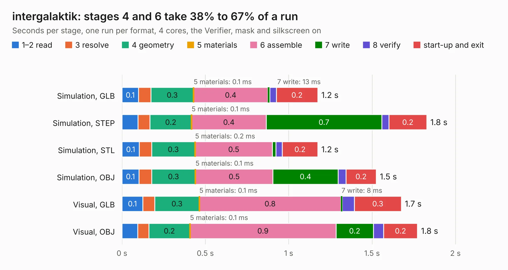

| Mode and format | 1–2 read | 3 resolve | 4 geometry | 5 materials | 6 assemble | 7 write | 8 verify | start-up and exit | Total |
|---|---:|---:|---:|---:|---:|---:|---:|---:|---:|
| Simulation, GLB | 0.1 | 74&nbsp;ms | 0.3 | 0.1&nbsp;ms | 0.4 | 13&nbsp;ms | 39&nbsp;ms | 0.2 | 1.2 |
| Simulation, STEP | 97&nbsp;ms | 71&nbsp;ms | 0.2 | 0.1&nbsp;ms | 0.4 | 0.7 | 43&nbsp;ms | 0.2 | 1.8 |
| Simulation, STL | 0.1 | 73&nbsp;ms | 0.3 | 0.2&nbsp;ms | 0.5 | 21&nbsp;ms | 39&nbsp;ms | 0.2 | 1.2 |
| Simulation, OBJ | 0.1 | 76&nbsp;ms | 0.3 | 0.1&nbsp;ms | 0.5 | 0.4 | 47&nbsp;ms | 0.2 | 1.5 |
| Visual, GLB | 0.1 | 71&nbsp;ms | 0.3 | 0.1&nbsp;ms | 0.8 | 8&nbsp;ms | 73&nbsp;ms | 0.3 | 1.7 |
| Visual, OBJ | 94&nbsp;ms | 67&nbsp;ms | 0.2 | 0.1&nbsp;ms | 0.9 | 0.2 | 61&nbsp;ms | 0.2 | 1.8 |

<table align="center"><tr><td valign="top">

| Board | Repo: [intergalaktik/KiCad-PCB](https://github.com/intergalaktik/KiCad-PCB) Board: `intergalaktik.kicad_pcb` |
|---|---|
| Folder | hardware |
| Complexity | 160&nbsp;/&nbsp;1000 (size&nbsp;80, features&nbsp;80) |
| KESE&nbsp;features | rounded, trapezoid or chamfered pads, filled zones, stack-up, dielectric εr and tanδ, copper finish, mask and silkscreen colours |
| Tested | 9th November 2026 |
| Copper&nbsp;layers | 4 |
| File&nbsp;format | KiCad 9 (20241229) |
| Parts,&nbsp;tracks,&nbsp;vias | 3, 6, 0 |
| Triangles,&nbsp;simulation | 68,008 in 16 parts |
| Verifier | PASS in all six runs |

</td><td valign="top">

<table>
<tr><th>File type</th><th>File size</th><th>Peak memory used</th></tr>
<tr><th colspan="3" align="left">Simulation</th></tr>
<tr><td>GLB</td><td align="right">2.4&nbsp;MB</td><td align="right">169&nbsp;MB</td></tr>
<tr><td>STEP</td><td align="right">9.1&nbsp;MB</td><td align="right">176&nbsp;MB</td></tr>
<tr><td>STL</td><td align="right">3.4&nbsp;MB</td><td align="right">167&nbsp;MB</td></tr>
<tr><td>OBJ</td><td align="right">6.6&nbsp;MB</td><td align="right">171&nbsp;MB</td></tr>
<tr><th colspan="3" align="left">Visual</th></tr>
<tr><td>GLB</td><td align="right">1.4&nbsp;MB</td><td align="right">152&nbsp;MB</td></tr>
<tr><td>OBJ</td><td align="right">4.0&nbsp;MB</td><td align="right">151&nbsp;MB</td></tr>
</table>

</td></tr></table>

## 23.12.18 mono_addon

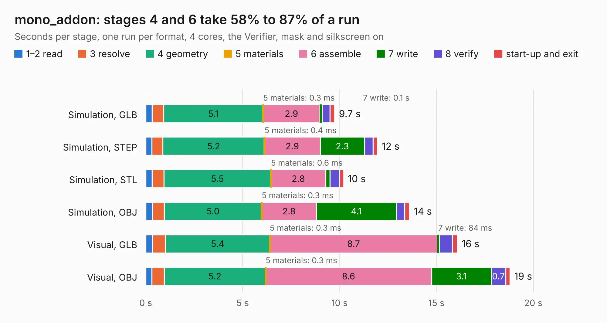

| Mode and format | 1–2 read | 3 resolve | 4 geometry | 5 materials | 6 assemble | 7 write | 8 verify | start-up and exit | Total |
|---|---:|---:|---:|---:|---:|---:|---:|---:|---:|
| Simulation, GLB | 0.3 | 0.6 | 5.1 | 0.3&nbsp;ms | 2.9 | 0.1 | 0.4 | 0.2 | 9.7 |
| Simulation, STEP | 0.3 | 0.6 | 5.2 | 0.4&nbsp;ms | 2.9 | 2.3 | 0.4 | 0.2 | 12.0 |
| Simulation, STL | 0.3 | 0.6 | 5.5 | 0.6&nbsp;ms | 2.8 | 0.2 | 0.5 | 0.2 | 10.2 |
| Simulation, OBJ | 0.3 | 0.6 | 5.0 | 0.3&nbsp;ms | 2.8 | 4.1 | 0.4 | 0.2 | 13.6 |
| Visual, GLB | 0.3 | 0.7 | 5.4 | 0.3&nbsp;ms | 8.7 | 84&nbsp;ms | 0.7 | 0.3 | 16.1 |
| Visual, OBJ | 0.3 | 0.6 | 5.2 | 0.3&nbsp;ms | 8.6 | 3.1 | 0.7 | 0.2 | 18.8 |

<table align="center"><tr><td valign="top">

| Board | Repo: [intergalaktik/mono_addon](https://github.com/intergalaktik/mono_addon) Board: `mono_addon.kicad_pcb` |
|---|---|
| Folder | KiCad / mono_addon |
| Complexity | 271&nbsp;/&nbsp;1000 (size&nbsp;161, features&nbsp;110) |
| KESE&nbsp;features | through vias, custom pads, rounded, trapezoid or chamfered pads, filled zones, copper drawings, curved board outline, stack-up, dielectric εr and tanδ |
| Tested | 9th November 2026 |
| Copper&nbsp;layers | 2 |
| File&nbsp;format | KiCad 8 (20240108) |
| Parts,&nbsp;tracks,&nbsp;vias | 44, 238, 95 |
| Triangles,&nbsp;simulation | 764,454 in 59 parts |
| Verifier | PASS in all six runs |

</td><td valign="top">

<table>
<tr><th>File type</th><th>File size</th><th>Peak memory used</th></tr>
<tr><th colspan="3" align="left">Simulation</th></tr>
<tr><td>GLB</td><td align="right">27&nbsp;MB</td><td align="right">399&nbsp;MB</td></tr>
<tr><td>STEP</td><td align="right">163&nbsp;MB</td><td align="right">475&nbsp;MB</td></tr>
<tr><td>STL</td><td align="right">38&nbsp;MB</td><td align="right">402&nbsp;MB</td></tr>
<tr><td>OBJ</td><td align="right">81&nbsp;MB</td><td align="right">579&nbsp;MB</td></tr>
<tr><th colspan="3" align="left">Visual</th></tr>
<tr><td>GLB</td><td align="right">20&nbsp;MB</td><td align="right">498&nbsp;MB</td></tr>
<tr><td>OBJ</td><td align="right">58&nbsp;MB</td><td align="right">509&nbsp;MB</td></tr>
</table>

</td></tr></table>

## 23.12.19 ulx4m-panel

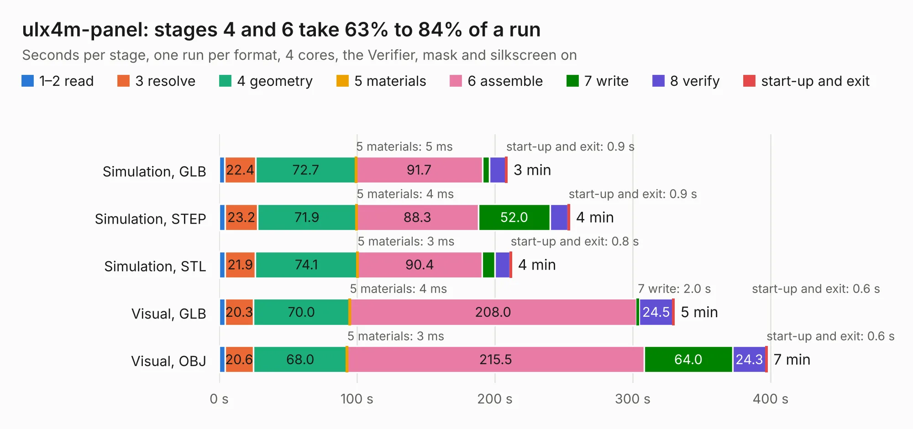

| Mode and format | 1–2 read | 3 resolve | 4 geometry | 5 materials | 6 assemble | 7 write | 8 verify | start-up and exit | Total |
|---|---:|---:|---:|---:|---:|---:|---:|---:|---:|
| Simulation, GLB | 4.0 | 22.4 | 72.7 | 5&nbsp;ms | 91.7 | 5.1 | 11.8 | 0.9 | 208.7 |
| Simulation, STEP | 4.5 | 23.2 | 71.9 | 4&nbsp;ms | 88.3 | 52.0 | 13.1 | 0.9 | 254.0 |
| Simulation, STL | 4.4 | 21.9 | 74.1 | 3&nbsp;ms | 90.4 | 9.4 | 11.0 | 0.8 | 211.9 |
| Simulation, OBJ |  |  |  |  |  |  |  |  | exceeded 11 GB on a 15 GB machine (stopped there, not a KESE failure) |
| Visual, GLB | 4.4 | 20.3 | 70.0 | 4&nbsp;ms | 208.0 | 2.0 | 24.5 | 0.6 | 329.9 |
| Visual, OBJ | 4.2 | 20.6 | 68.0 | 3&nbsp;ms | 215.5 | 64.0 | 24.3 | 0.6 | 397.4 |

<table align="center"><tr><td valign="top">

| Board | Repo: [intergalaktik/ULX4M](https://github.com/intergalaktik/ULX4M) Board: `ulx4m-panel.kicad_pcb` |
|---|---|
| Folder | plot / panel |
| Complexity | 402&nbsp;/&nbsp;1000 (size&nbsp;357, features&nbsp;45) |
| KESE&nbsp;features | through vias, rounded, trapezoid or chamfered pads, filled zones |
| Tested | 9th November 2026 |
| Copper&nbsp;layers | 6 |
| File&nbsp;format | KiCad 5 (20171130) |
| Parts,&nbsp;tracks,&nbsp;vias | 860, 35,844, 2,856 |
| Triangles,&nbsp;simulation | 23,814,454 in 1200 parts |
| Note | panel |
| Verifier | Simulation, OBJ: exceeded 11 GB on a 15 GB machine (stopped there, not a KESE failure) |

</td><td valign="top">

<table>
<tr><th>File type</th><th>File size</th><th>Peak memory used</th></tr>
<tr><th colspan="3" align="left">Simulation</th></tr>
<tr><td>GLB</td><td align="right">788&nbsp;MB</td><td align="right">5.3&nbsp;GB</td></tr>
<tr><td>STEP</td><td align="right">3.2&nbsp;GB</td><td align="right">6.4&nbsp;GB</td></tr>
<tr><td>STL</td><td align="right">1.2&nbsp;GB</td><td align="right">5.2&nbsp;GB</td></tr>
<tr><td>OBJ</td><td align="right">–</td><td align="right">11&nbsp;GB</td></tr>
<tr><th colspan="3" align="left">Visual</th></tr>
<tr><td>GLB</td><td align="right">446&nbsp;MB</td><td align="right">7.2&nbsp;GB</td></tr>
<tr><td>OBJ</td><td align="right">1.5&nbsp;GB</td><td align="right">9.5&nbsp;GB</td></tr>
</table>

</td></tr></table>

## 23.12.20 ulx4m

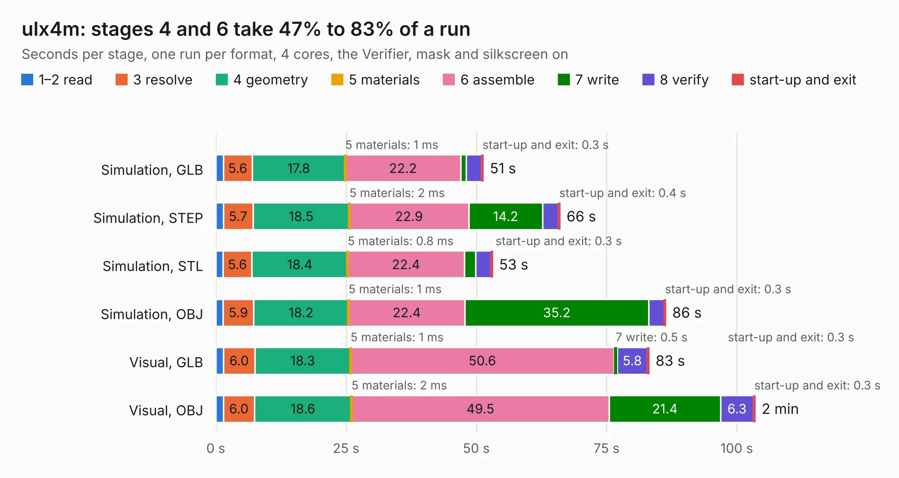

| Mode and format | 1–2 read | 3 resolve | 4 geometry | 5 materials | 6 assemble | 7 write | 8 verify | start-up and exit | Total |
|---|---:|---:|---:|---:|---:|---:|---:|---:|---:|
| Simulation, GLB | 1.4 | 5.6 | 17.8 | 1&nbsp;ms | 22.2 | 1.0 | 2.9 | 0.3 | 51.4 |
| Simulation, STEP | 1.4 | 5.7 | 18.5 | 2&nbsp;ms | 22.9 | 14.2 | 3.0 | 0.4 | 66.1 |
| Simulation, STL | 1.4 | 5.6 | 18.4 | 0.8&nbsp;ms | 22.4 | 2.1 | 3.0 | 0.3 | 53.1 |
| Simulation, OBJ | 1.4 | 5.9 | 18.2 | 1&nbsp;ms | 22.4 | 35.2 | 3.0 | 0.3 | 86.4 |
| Visual, GLB | 1.5 | 6.0 | 18.3 | 1&nbsp;ms | 50.6 | 0.5 | 5.8 | 0.3 | 83.2 |
| Visual, OBJ | 1.4 | 6.0 | 18.6 | 2&nbsp;ms | 49.5 | 21.4 | 6.3 | 0.3 | 103.5 |

<table align="center"><tr><td valign="top">

| Board | Repo: [intergalaktik/ULX4M](https://github.com/intergalaktik/ULX4M) Board: `ulx4m.kicad_pcb` |
|---|---|
| Folder | plot / panel |
| Complexity | 361&nbsp;/&nbsp;1000 (size&nbsp;306, features&nbsp;55) |
| KESE&nbsp;features | through vias, rounded, trapezoid or chamfered pads, filled zones, curved board outline |
| Tested | 9th November 2026 |
| Copper&nbsp;layers | 6 |
| File&nbsp;format | KiCad 5 (20171130) |
| Parts,&nbsp;tracks,&nbsp;vias | 215, 8,961, 714 |
| Triangles,&nbsp;simulation | 5,933,356 in 312 parts |
| Note | panel |
| Verifier | PASS in all six runs |

</td><td valign="top">

<table>
<tr><th>File type</th><th>File size</th><th>Peak memory used</th></tr>
<tr><th colspan="3" align="left">Simulation</th></tr>
<tr><td>GLB</td><td align="right">203&nbsp;MB</td><td align="right">1.5&nbsp;GB</td></tr>
<tr><td>STEP</td><td align="right">778&nbsp;MB</td><td align="right">2.0&nbsp;GB</td></tr>
<tr><td>STL</td><td align="right">297&nbsp;MB</td><td align="right">1.5&nbsp;GB</td></tr>
<tr><td>OBJ</td><td align="right">635&nbsp;MB</td><td align="right">3.8&nbsp;GB</td></tr>
<tr><th colspan="3" align="left">Visual</th></tr>
<tr><td>GLB</td><td align="right">112&nbsp;MB</td><td align="right">2.2&nbsp;GB</td></tr>
<tr><td>OBJ</td><td align="right">367&nbsp;MB</td><td align="right">2.4&nbsp;GB</td></tr>
</table>

</td></tr></table>

## 23.12.21 ulx4m

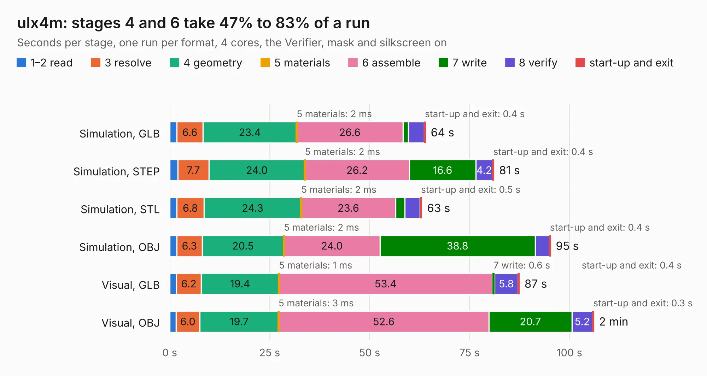

| Mode and format | 1–2 read | 3 resolve | 4 geometry | 5 materials | 6 assemble | 7 write | 8 verify | start-up and exit | Total |
|---|---:|---:|---:|---:|---:|---:|---:|---:|---:|
| Simulation, GLB | 1.8 | 6.6 | 23.4 | 2&nbsp;ms | 26.6 | 1.3 | 3.9 | 0.4 | 64.0 |
| Simulation, STEP | 2.1 | 7.7 | 24.0 | 2&nbsp;ms | 26.2 | 16.6 | 4.2 | 0.4 | 81.1 |
| Simulation, STL | 1.8 | 6.8 | 24.3 | 2&nbsp;ms | 23.6 | 2.3 | 3.8 | 0.5 | 63.1 |
| Simulation, OBJ | 1.8 | 6.3 | 20.5 | 2&nbsp;ms | 24.0 | 38.8 | 3.5 | 0.4 | 95.3 |
| Visual, GLB | 1.7 | 6.2 | 19.4 | 1&nbsp;ms | 53.4 | 0.6 | 5.8 | 0.4 | 87.5 |
| Visual, OBJ | 1.6 | 6.0 | 19.7 | 3&nbsp;ms | 52.6 | 20.7 | 5.2 | 0.3 | 106.1 |

<table align="center"><tr><td valign="top">

| Board | Repo: [intergalaktik/ULX4M](https://github.com/intergalaktik/ULX4M) Board: `ulx4m.kicad_pcb` |
|---|---|
| Complexity | 390&nbsp;/&nbsp;1000 (size&nbsp;305, features&nbsp;85) |
| KESE&nbsp;features | through vias, rounded, trapezoid or chamfered pads, filled zones, curved board outline, stack-up, dielectric εr and tanδ |
| Tested | 9th November 2026 |
| Copper&nbsp;layers | 6 |
| File&nbsp;format | KiCad 8 (20240108) |
| Parts,&nbsp;tracks,&nbsp;vias | 218, 8,560, 700 |
| Triangles,&nbsp;simulation | 5,597,444 in 372 parts |
| Verifier | PASS in all six runs |

</td><td valign="top">

<table>
<tr><th>File type</th><th>File size</th><th>Peak memory used</th></tr>
<tr><th colspan="3" align="left">Simulation</th></tr>
<tr><td>GLB</td><td align="right">187&nbsp;MB</td><td align="right">1.6&nbsp;GB</td></tr>
<tr><td>STEP</td><td align="right">777&nbsp;MB</td><td align="right">1.9&nbsp;GB</td></tr>
<tr><td>STL</td><td align="right">280&nbsp;MB</td><td align="right">1.6&nbsp;GB</td></tr>
<tr><td>OBJ</td><td align="right">598&nbsp;MB</td><td align="right">3.6&nbsp;GB</td></tr>
<tr><th colspan="3" align="left">Visual</th></tr>
<tr><td>GLB</td><td align="right">111&nbsp;MB</td><td align="right">1.9&nbsp;GB</td></tr>
<tr><td>OBJ</td><td align="right">361&nbsp;MB</td><td align="right">2.4&nbsp;GB</td></tr>
</table>

</td></tr></table>

## 23.12.22 ulx4m-cm4-hat

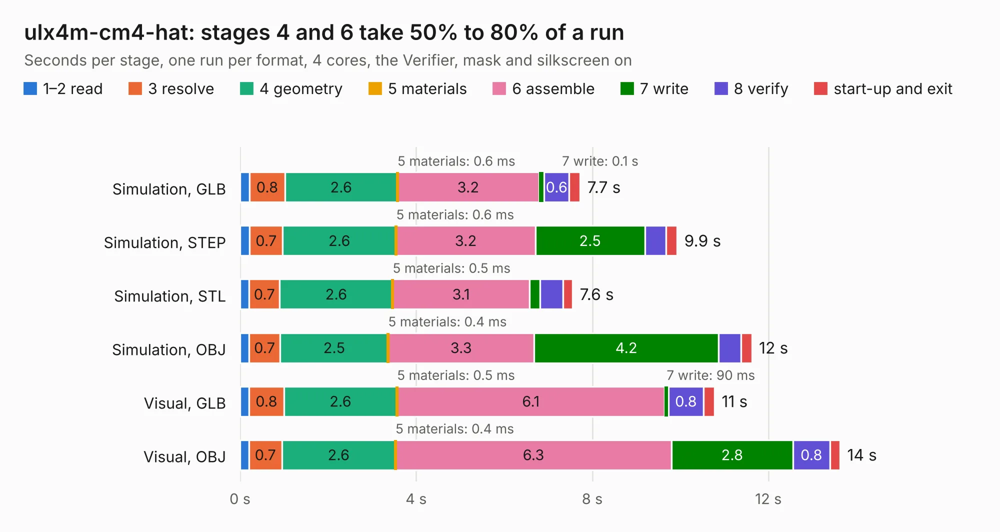

| Mode and format | 1–2 read | 3 resolve | 4 geometry | 5 materials | 6 assemble | 7 write | 8 verify | start-up and exit | Total |
|---|---:|---:|---:|---:|---:|---:|---:|---:|---:|
| Simulation, GLB | 0.2 | 0.8 | 2.6 | 0.6&nbsp;ms | 3.2 | 0.1 | 0.6 | 0.2 | 7.7 |
| Simulation, STEP | 0.2 | 0.7 | 2.6 | 0.6&nbsp;ms | 3.2 | 2.5 | 0.5 | 0.3 | 9.9 |
| Simulation, STL | 0.2 | 0.7 | 2.6 | 0.5&nbsp;ms | 3.1 | 0.2 | 0.5 | 0.2 | 7.6 |
| Simulation, OBJ | 0.2 | 0.7 | 2.5 | 0.4&nbsp;ms | 3.3 | 4.2 | 0.5 | 0.2 | 11.6 |
| Visual, GLB | 0.2 | 0.8 | 2.6 | 0.5&nbsp;ms | 6.1 | 90&nbsp;ms | 0.8 | 0.3 | 10.8 |
| Visual, OBJ | 0.2 | 0.7 | 2.6 | 0.4&nbsp;ms | 6.3 | 2.8 | 0.8 | 0.2 | 13.6 |

<table align="center"><tr><td valign="top">

| Board | Repo: [intergalaktik/ULX4M-CM4-HAT](https://github.com/intergalaktik/ULX4M-CM4-HAT) Board: `ulx4m-cm4-hat.kicad_pcb` |
|---|---|
| Complexity | 241&nbsp;/&nbsp;1000 (size&nbsp;186, features&nbsp;55) |
| KESE&nbsp;features | through vias, rounded, trapezoid or chamfered pads, filled zones, curved board outline |
| Tested | 9th November 2026 |
| Copper&nbsp;layers | 4 |
| File&nbsp;format | KiCad 5 (20171130) |
| Parts,&nbsp;tracks,&nbsp;vias | 37, 708, 95 |
| Triangles,&nbsp;simulation | 860,812 in 59 parts |
| Verifier | PASS in all six runs |

</td><td valign="top">

<table>
<tr><th>File type</th><th>File size</th><th>Peak memory used</th></tr>
<tr><th colspan="3" align="left">Simulation</th></tr>
<tr><td>GLB</td><td align="right">28&nbsp;MB</td><td align="right">374&nbsp;MB</td></tr>
<tr><td>STEP</td><td align="right">112&nbsp;MB</td><td align="right">460&nbsp;MB</td></tr>
<tr><td>STL</td><td align="right">43&nbsp;MB</td><td align="right">373&nbsp;MB</td></tr>
<tr><td>OBJ</td><td align="right">86&nbsp;MB</td><td align="right">622&nbsp;MB</td></tr>
<tr><th colspan="3" align="left">Visual</th></tr>
<tr><td>GLB</td><td align="right">19&nbsp;MB</td><td align="right">463&nbsp;MB</td></tr>
<tr><td>OBJ</td><td align="right">57&nbsp;MB</td><td align="right">509&nbsp;MB</td></tr>
</table>

</td></tr></table>

## 23.12.23 ulx4m-ld

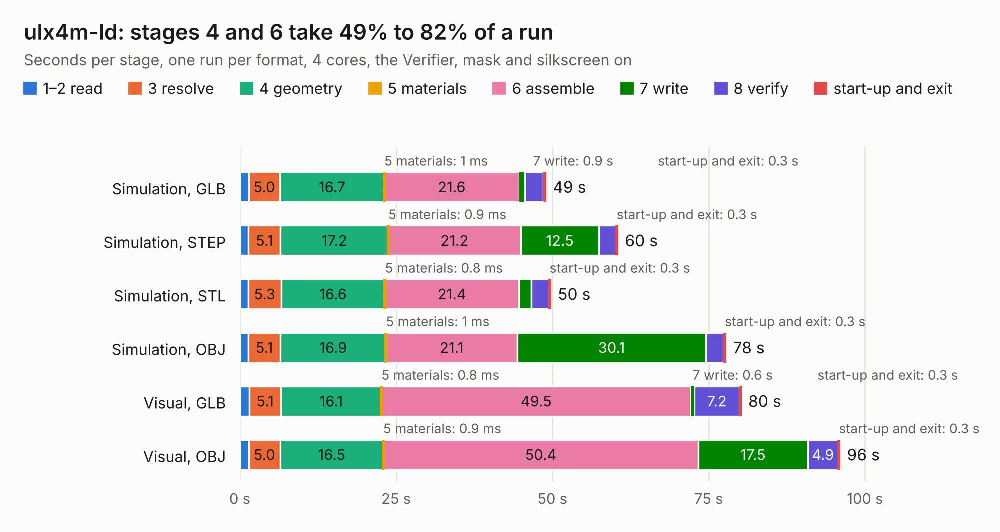

| Mode and format | 1–2 read | 3 resolve | 4 geometry | 5 materials | 6 assemble | 7 write | 8 verify | start-up and exit | Total |
|---|---:|---:|---:|---:|---:|---:|---:|---:|---:|
| Simulation, GLB | 1.4 | 5.0 | 16.7 | 1&nbsp;ms | 21.6 | 0.9 | 3.0 | 0.3 | 48.9 |
| Simulation, STEP | 1.4 | 5.1 | 17.2 | 0.9&nbsp;ms | 21.2 | 12.5 | 2.7 | 0.3 | 60.5 |
| Simulation, STL | 1.3 | 5.3 | 16.6 | 0.8&nbsp;ms | 21.4 | 2.0 | 2.7 | 0.3 | 49.7 |
| Simulation, OBJ | 1.3 | 5.1 | 16.9 | 1&nbsp;ms | 21.1 | 30.1 | 2.9 | 0.3 | 77.7 |
| Visual, GLB | 1.5 | 5.1 | 16.1 | 0.8&nbsp;ms | 49.5 | 0.6 | 7.2 | 0.3 | 80.2 |
| Visual, OBJ | 1.4 | 5.0 | 16.5 | 0.9&nbsp;ms | 50.4 | 17.5 | 4.9 | 0.3 | 96.0 |

<table align="center"><tr><td valign="top">

| Board | Repo: [intergalaktik/ULX4M-LD](https://github.com/intergalaktik/ULX4M-LD) Board: `ulx4m-ld.kicad_pcb` |
|---|---|
| Complexity | 409&nbsp;/&nbsp;1000 (size&nbsp;324, features&nbsp;85) |
| KESE&nbsp;features | through vias, rounded, trapezoid or chamfered pads, filled zones, curved board outline, stack-up, dielectric εr and tanδ |
| Tested | 9th November 2026 |
| Copper&nbsp;layers | 6 |
| File&nbsp;format | KiCad 8 (20240108) |
| Parts,&nbsp;tracks,&nbsp;vias | 253, 15,844, 801 |
| Triangles,&nbsp;simulation | 6,595,260 in 384 parts |
| Verifier | PASS in all six runs |

</td><td valign="top">

<table>
<tr><th>File type</th><th>File size</th><th>Peak memory used</th></tr>
<tr><th colspan="3" align="left">Simulation</th></tr>
<tr><td>GLB</td><td align="right">221&nbsp;MB</td><td align="right">1.8&nbsp;GB</td></tr>
<tr><td>STEP</td><td align="right">945&nbsp;MB</td><td align="right">2.2&nbsp;GB</td></tr>
<tr><td>STL</td><td align="right">330&nbsp;MB</td><td align="right">1.7&nbsp;GB</td></tr>
<tr><td>OBJ</td><td align="right">707&nbsp;MB</td><td align="right">4.2&nbsp;GB</td></tr>
<tr><th colspan="3" align="left">Visual</th></tr>
<tr><td>GLB</td><td align="right">135&nbsp;MB</td><td align="right">2.3&nbsp;GB</td></tr>
<tr><td>OBJ</td><td align="right">440&nbsp;MB</td><td align="right">3.0&nbsp;GB</td></tr>
</table>

</td></tr></table>

## 23.12.24 ulx4m_panel

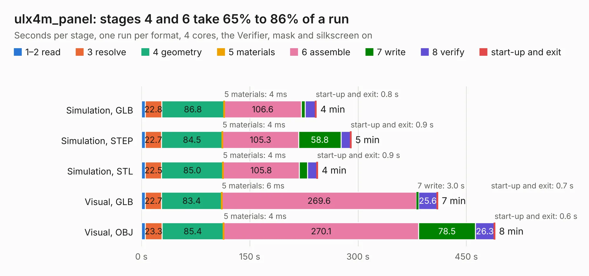

| Mode and format | 1–2 read | 3 resolve | 4 geometry | 5 materials | 6 assemble | 7 write | 8 verify | start-up and exit | Total |
|---|---:|---:|---:|---:|---:|---:|---:|---:|---:|
| Simulation, GLB | 5.2 | 22.8 | 86.8 | 4&nbsp;ms | 106.6 | 5.5 | 14.2 | 0.8 | 241.9 |
| Simulation, STEP | 5.1 | 22.7 | 84.5 | 4&nbsp;ms | 105.3 | 58.8 | 13.0 | 0.9 | 290.3 |
| Simulation, STL | 5.5 | 22.5 | 85.0 | 4&nbsp;ms | 105.8 | 11.2 | 13.0 | 0.9 | 243.9 |
| Simulation, OBJ |  |  |  |  |  |  |  |  | exceeded 11 GB on a 15 GB machine (stopped there, not a KESE failure) |
| Visual, GLB | 5.2 | 22.7 | 83.4 | 6&nbsp;ms | 269.6 | 3.0 | 25.6 | 0.7 | 410.2 |
| Visual, OBJ | 5.2 | 23.3 | 85.4 | 4&nbsp;ms | 270.1 | 78.5 | 26.3 | 0.6 | 489.4 |

<table align="center"><tr><td valign="top">

| Board | Repo: [intergalaktik/ULX4M-LS](https://github.com/intergalaktik/ULX4M-LS) Board: `ulx4m_panel.kicad_pcb` |
|---|---|
| Folder | panel |
| Complexity | 432&nbsp;/&nbsp;1000 (size&nbsp;357, features&nbsp;75) |
| KESE&nbsp;features | through vias, rounded, trapezoid or chamfered pads, filled zones, stack-up, dielectric εr and tanδ |
| Tested | 9th November 2026 |
| Copper&nbsp;layers | 6 |
| File&nbsp;format | KiCad 8 (20240108) |
| Parts,&nbsp;tracks,&nbsp;vias | 872, 34,240, 2,800 |
| Triangles,&nbsp;simulation | 23,074,944 in 1440 parts |
| Note | panel |
| Verifier | Simulation, OBJ: exceeded 11 GB on a 15 GB machine (stopped there, not a KESE failure) |

</td><td valign="top">

<table>
<tr><th>File type</th><th>File size</th><th>Peak memory used</th></tr>
<tr><th colspan="3" align="left">Simulation</th></tr>
<tr><td>GLB</td><td align="right">746&nbsp;MB</td><td align="right">4.8&nbsp;GB</td></tr>
<tr><td>STEP</td><td align="right">3.5&nbsp;GB</td><td align="right">6.8&nbsp;GB</td></tr>
<tr><td>STL</td><td align="right">1.2&nbsp;GB</td><td align="right">4.8&nbsp;GB</td></tr>
<tr><td>OBJ</td><td align="right">–</td><td align="right">11&nbsp;GB</td></tr>
<tr><th colspan="3" align="left">Visual</th></tr>
<tr><td>GLB</td><td align="right">451&nbsp;MB</td><td align="right">7.2&nbsp;GB</td></tr>
<tr><td>OBJ</td><td align="right">1.5&nbsp;GB</td><td align="right">9.5&nbsp;GB</td></tr>
</table>

</td></tr></table>

## 23.12.25 ULX4M-PCIe-IO_x4_half

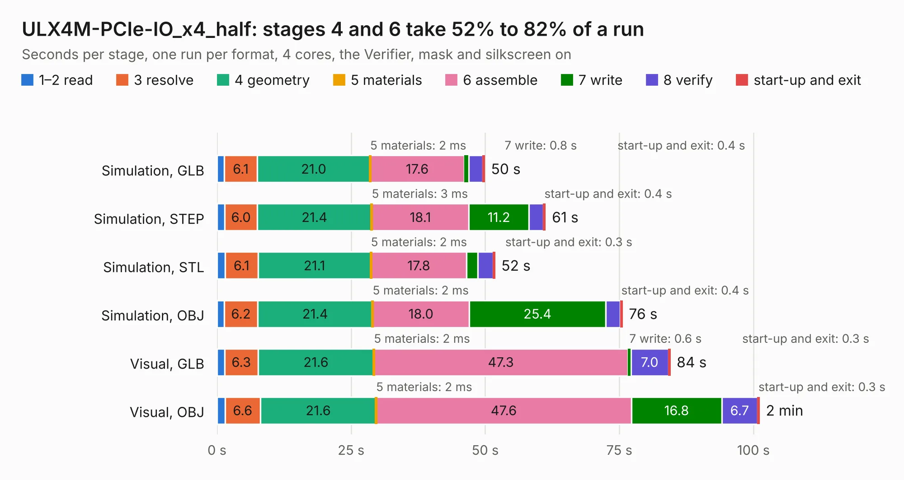

| Mode and format | 1–2 read | 3 resolve | 4 geometry | 5 materials | 6 assemble | 7 write | 8 verify | start-up and exit | Total |
|---|---:|---:|---:|---:|---:|---:|---:|---:|---:|
| Simulation, GLB | 1.4 | 6.1 | 21.0 | 2&nbsp;ms | 17.6 | 0.8 | 2.6 | 0.4 | 49.9 |
| Simulation, STEP | 1.5 | 6.0 | 21.4 | 3&nbsp;ms | 18.1 | 11.2 | 2.7 | 0.4 | 61.2 |
| Simulation, STL | 1.5 | 6.1 | 21.1 | 2&nbsp;ms | 17.8 | 2.1 | 2.8 | 0.3 | 51.8 |
| Simulation, OBJ | 1.4 | 6.2 | 21.4 | 2&nbsp;ms | 18.0 | 25.4 | 2.7 | 0.4 | 75.6 |
| Visual, GLB | 1.4 | 6.3 | 21.6 | 2&nbsp;ms | 47.3 | 0.6 | 7.0 | 0.3 | 84.5 |
| Visual, OBJ | 1.5 | 6.6 | 21.6 | 2&nbsp;ms | 47.6 | 16.8 | 6.7 | 0.3 | 101.1 |

<table align="center"><tr><td valign="top">

| Board | Repo: [intergalaktik/ULX4M-PCIe-IO](https://github.com/intergalaktik/ULX4M-PCIe-IO) Board: `ULX4M-PCIe-IO_x4_half.kicad_pcb` |
|---|---|
| Folder | kicad |
| Complexity | 341&nbsp;/&nbsp;1000 (size&nbsp;231, features&nbsp;110) |
| KESE&nbsp;features | through vias, slotted holes, rounded, trapezoid or chamfered pads, arc tracks, filled zones, curved board outline, stack-up, dielectric εr and tanδ |
| Tested | 9th November 2026 |
| Copper&nbsp;layers | 4 |
| File&nbsp;format | KiCad 8 (20240108) |
| Parts,&nbsp;tracks,&nbsp;vias | 118, 6,055, 477 |
| Triangles,&nbsp;simulation | 4,666,562 in 233 parts |
| Verifier | PASS in all six runs |

</td><td valign="top">

<table>
<tr><th>File type</th><th>File size</th><th>Peak memory used</th></tr>
<tr><th colspan="3" align="left">Simulation</th></tr>
<tr><td>GLB</td><td align="right">160&nbsp;MB</td><td align="right">1.6&nbsp;GB</td></tr>
<tr><td>STEP</td><td align="right">718&nbsp;MB</td><td align="right">1.7&nbsp;GB</td></tr>
<tr><td>STL</td><td align="right">233&nbsp;MB</td><td align="right">1.5&nbsp;GB</td></tr>
<tr><td>OBJ</td><td align="right">503&nbsp;MB</td><td align="right">3.1&nbsp;GB</td></tr>
<tr><th colspan="3" align="left">Visual</th></tr>
<tr><td>GLB</td><td align="right">112&nbsp;MB</td><td align="right">2.0&nbsp;GB</td></tr>
<tr><td>OBJ</td><td align="right">357&nbsp;MB</td><td align="right">2.4&nbsp;GB</td></tr>
</table>

</td></tr></table>

## 23.12.26 ULX4M_GPDI

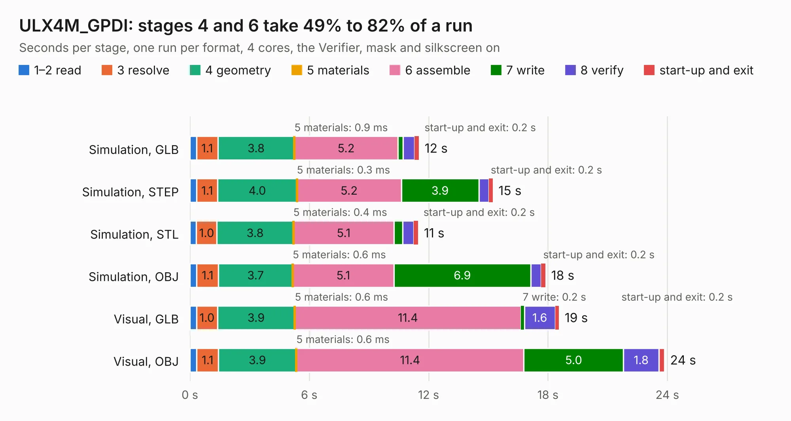

| Mode and format | 1–2 read | 3 resolve | 4 geometry | 5 materials | 6 assemble | 7 write | 8 verify | start-up and exit | Total |
|---|---:|---:|---:|---:|---:|---:|---:|---:|---:|
| Simulation, GLB | 0.3 | 1.1 | 3.8 | 0.9&nbsp;ms | 5.2 | 0.3 | 0.6 | 0.2 | 11.5 |
| Simulation, STEP | 0.3 | 1.1 | 4.0 | 0.3&nbsp;ms | 5.2 | 3.9 | 0.5 | 0.2 | 15.2 |
| Simulation, STL | 0.3 | 1.0 | 3.8 | 0.4&nbsp;ms | 5.1 | 0.4 | 0.6 | 0.2 | 11.5 |
| Simulation, OBJ | 0.3 | 1.1 | 3.7 | 0.6&nbsp;ms | 5.1 | 6.9 | 0.5 | 0.2 | 17.9 |
| Visual, GLB | 0.3 | 1.0 | 3.9 | 0.6&nbsp;ms | 11.4 | 0.2 | 1.6 | 0.2 | 18.6 |
| Visual, OBJ | 0.3 | 1.1 | 3.9 | 0.6&nbsp;ms | 11.4 | 5.0 | 1.8 | 0.3 | 23.9 |

<table align="center"><tr><td valign="top">

| Board | Repo: [intergalaktik/ULX4M_documents](https://github.com/intergalaktik/ULX4M_documents) Board: `ULX4M_GPDI.kicad_pcb` |
|---|---|
| Folder | ULX4M_test |
| Complexity | 240&nbsp;/&nbsp;1000 (size&nbsp;185, features&nbsp;55) |
| KESE&nbsp;features | through vias, slotted holes, filled zones, curved board outline |
| Tested | 9th November 2026 |
| Copper&nbsp;layers | 4 |
| File&nbsp;format | KiCad 5 (20171130) |
| Parts,&nbsp;tracks,&nbsp;vias | 27, 690, 156 |
| Triangles,&nbsp;simulation | 1,632,014 in 83 parts |
| Verifier | PASS in all six runs |

</td><td valign="top">

<table>
<tr><th>File type</th><th>File size</th><th>Peak memory used</th></tr>
<tr><th colspan="3" align="left">Simulation</th></tr>
<tr><td>GLB</td><td align="right">57&nbsp;MB</td><td align="right">675&nbsp;MB</td></tr>
<tr><td>STEP</td><td align="right">260&nbsp;MB</td><td align="right">849&nbsp;MB</td></tr>
<tr><td>STL</td><td align="right">82&nbsp;MB</td><td align="right">704&nbsp;MB</td></tr>
<tr><td>OBJ</td><td align="right">172&nbsp;MB</td><td align="right">1.2&nbsp;GB</td></tr>
<tr><th colspan="3" align="left">Visual</th></tr>
<tr><td>GLB</td><td align="right">41&nbsp;MB</td><td align="right">864&nbsp;MB</td></tr>
<tr><td>OBJ</td><td align="right">126&nbsp;MB</td><td align="right">929&nbsp;MB</td></tr>
</table>

</td></tr></table>

## 23.12.27 ulx5m-gs_panel_checked_v002

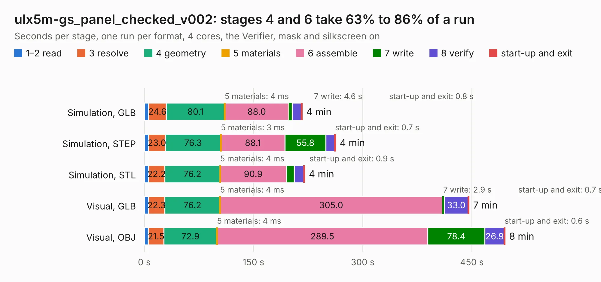

| Mode and format | 1–2 read | 3 resolve | 4 geometry | 5 materials | 6 assemble | 7 write | 8 verify | start-up and exit | Total |
|---|---:|---:|---:|---:|---:|---:|---:|---:|---:|
| Simulation, GLB | 5.7 | 24.6 | 80.1 | 4&nbsp;ms | 88.0 | 4.6 | 12.7 | 0.8 | 216.5 |
| Simulation, STEP | 5.9 | 23.0 | 76.3 | 3&nbsp;ms | 88.1 | 55.8 | 12.6 | 0.7 | 262.5 |
| Simulation, STL | 5.9 | 22.2 | 76.2 | 4&nbsp;ms | 90.9 | 10.7 | 13.4 | 0.9 | 220.1 |
| Simulation, OBJ |  |  |  |  |  |  |  |  | exceeded 11 GB on a 15 GB machine (stopped there, not a KESE failure) |
| Visual, GLB | 5.8 | 22.3 | 76.2 | 4&nbsp;ms | 305.0 | 2.9 | 33.0 | 0.7 | 445.8 |
| Visual, OBJ | 5.5 | 21.5 | 72.9 | 4&nbsp;ms | 289.5 | 78.4 | 26.9 | 0.6 | 495.3 |

<table align="center"><tr><td valign="top">

| Board | Repo: [intergalaktik/ulx5m-gs](https://github.com/intergalaktik/ulx5m-gs) Board: `ulx5m-gs_panel_checked_v002.kicad_pcb` |
|---|---|
| Folder | hardware / panel |
| Complexity | 501&nbsp;/&nbsp;1000 (size&nbsp;361, features&nbsp;140) |
| KESE&nbsp;features | through vias, slotted holes, custom pads, rounded, trapezoid or chamfered pads, arc tracks, filled zones, copper drawings, stack-up, dielectric εr and tanδ, copper finish |
| Tested | 9th November 2026 |
| Copper&nbsp;layers | 6 |
| File&nbsp;format | KiCad 9 (20241229) |
| Parts,&nbsp;tracks,&nbsp;vias | 1,148, 30,512, 3,416 |
| Triangles,&nbsp;simulation | 25,478,436 in 1392 parts |
| Note | panel |
| Verifier | Simulation, OBJ: exceeded 11 GB on a 15 GB machine (stopped there, not a KESE failure) |

</td><td valign="top">

<table>
<tr><th>File type</th><th>File size</th><th>Peak memory used</th></tr>
<tr><th colspan="3" align="left">Simulation</th></tr>
<tr><td>GLB</td><td align="right">822&nbsp;MB</td><td align="right">6.0&nbsp;GB</td></tr>
<tr><td>STEP</td><td align="right">3.5&nbsp;GB</td><td align="right">7.6&nbsp;GB</td></tr>
<tr><td>STL</td><td align="right">1.3&nbsp;GB</td><td align="right">6.1&nbsp;GB</td></tr>
<tr><td>OBJ</td><td align="right">–</td><td align="right">11&nbsp;GB</td></tr>
<tr><th colspan="3" align="left">Visual</th></tr>
<tr><td>GLB</td><td align="right">507&nbsp;MB</td><td align="right">8.0&nbsp;GB</td></tr>
<tr><td>OBJ</td><td align="right">1.7&nbsp;GB</td><td align="right">11&nbsp;GB</td></tr>
</table>

</td></tr></table>

## 23.12.28 ulx5m-gs

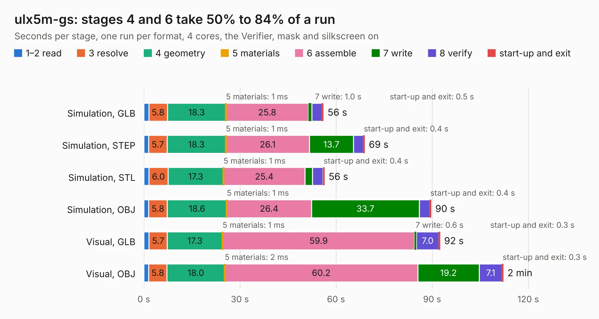

| Mode and format | 1–2 read | 3 resolve | 4 geometry | 5 materials | 6 assemble | 7 write | 8 verify | start-up and exit | Total |
|---|---:|---:|---:|---:|---:|---:|---:|---:|---:|
| Simulation, GLB | 1.5 | 5.8 | 18.3 | 1&nbsp;ms | 25.8 | 1.0 | 3.1 | 0.5 | 56.0 |
| Simulation, STEP | 1.5 | 5.7 | 18.3 | 1&nbsp;ms | 26.1 | 13.7 | 3.1 | 0.4 | 68.9 |
| Simulation, STL | 1.6 | 6.0 | 17.3 | 1&nbsp;ms | 25.4 | 2.3 | 3.3 | 0.4 | 56.3 |
| Simulation, OBJ | 1.5 | 5.8 | 18.6 | 1&nbsp;ms | 26.4 | 33.7 | 3.2 | 0.4 | 89.6 |
| Visual, GLB | 1.6 | 5.7 | 17.3 | 1&nbsp;ms | 59.9 | 0.6 | 7.0 | 0.3 | 92.4 |
| Visual, OBJ | 1.5 | 5.8 | 18.0 | 2&nbsp;ms | 60.2 | 19.2 | 7.1 | 0.3 | 112.2 |

<table align="center"><tr><td valign="top">

| Board | Repo: [intergalaktik/ulx5m-gs](https://github.com/intergalaktik/ulx5m-gs) Board: `ulx5m-gs.kicad_pcb` |
|---|---|
| Folder | hardware |
| Complexity | 460&nbsp;/&nbsp;1000 (size&nbsp;310, features&nbsp;150) |
| KESE&nbsp;features | through vias, slotted holes, custom pads, rounded, trapezoid or chamfered pads, arc tracks, filled zones, copper drawings, curved board outline, stack-up, dielectric εr and tanδ, copper finish |
| Tested | 9th November 2026 |
| Copper&nbsp;layers | 6 |
| File&nbsp;format | KiCad 9 (20241229) |
| Parts,&nbsp;tracks,&nbsp;vias | 287, 7,628, 854 |
| Triangles,&nbsp;simulation | 6,349,706 in 360 parts |
| Verifier | PASS in all six runs |

</td><td valign="top">

<table>
<tr><th>File type</th><th>File size</th><th>Peak memory used</th></tr>
<tr><th colspan="3" align="left">Simulation</th></tr>
<tr><td>GLB</td><td align="right">212&nbsp;MB</td><td align="right">1.5&nbsp;GB</td></tr>
<tr><td>STEP</td><td align="right">844&nbsp;MB</td><td align="right">2.2&nbsp;GB</td></tr>
<tr><td>STL</td><td align="right">318&nbsp;MB</td><td align="right">1.6&nbsp;GB</td></tr>
<tr><td>OBJ</td><td align="right">677&nbsp;MB</td><td align="right">4.0&nbsp;GB</td></tr>
<tr><th colspan="3" align="left">Visual</th></tr>
<tr><td>GLB</td><td align="right">127&nbsp;MB</td><td align="right">2.1&nbsp;GB</td></tr>
<tr><td>OBJ</td><td align="right">409&nbsp;MB</td><td align="right">2.6&nbsp;GB</td></tr>
</table>

</td></tr></table>

## 23.12.29 ulx5m-m2

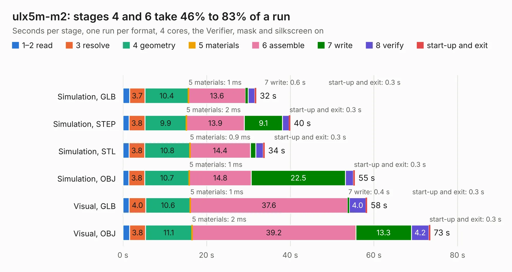

| Mode and format | 1–2 read | 3 resolve | 4 geometry | 5 materials | 6 assemble | 7 write | 8 verify | start-up and exit | Total |
|---|---:|---:|---:|---:|---:|---:|---:|---:|---:|
| Simulation, GLB | 1.6 | 3.7 | 10.4 | 1&nbsp;ms | 13.6 | 0.6 | 1.6 | 0.3 | 31.9 |
| Simulation, STEP | 1.4 | 3.8 | 9.9 | 2&nbsp;ms | 13.9 | 9.1 | 1.6 | 0.3 | 40.0 |
| Simulation, STL | 1.5 | 3.8 | 10.8 | 0.9&nbsp;ms | 14.4 | 1.3 | 1.8 | 0.3 | 33.9 |
| Simulation, OBJ | 1.4 | 3.8 | 10.7 | 1&nbsp;ms | 14.8 | 22.5 | 1.9 | 0.3 | 55.4 |
| Visual, GLB | 1.5 | 4.0 | 10.6 | 1&nbsp;ms | 37.6 | 0.4 | 4.0 | 0.3 | 58.4 |
| Visual, OBJ | 1.6 | 3.8 | 11.1 | 2&nbsp;ms | 39.2 | 13.3 | 4.2 | 0.3 | 73.4 |

<table align="center"><tr><td valign="top">

| Board | Repo: [intergalaktik/ulx5m-m2](https://github.com/intergalaktik/ulx5m-m2) Board: `ulx5m-m2.kicad_pcb` |
|---|---|
| Complexity | 405&nbsp;/&nbsp;1000 (size&nbsp;295, features&nbsp;110) |
| KESE&nbsp;features | through vias, slotted holes, custom pads, rounded, trapezoid or chamfered pads, filled zones, copper drawings, stack-up, dielectric εr and tanδ |
| Tested | 9th November 2026 |
| Copper&nbsp;layers | 6 |
| File&nbsp;format | KiCad 10 (20260206) |
| Parts,&nbsp;tracks,&nbsp;vias | 208, 4,044, 559 |
| Triangles,&nbsp;simulation | 3,982,396 in 294 parts |
| Verifier | PASS in all six runs |

</td><td valign="top">

<table>
<tr><th>File type</th><th>File size</th><th>Peak memory used</th></tr>
<tr><th colspan="3" align="left">Simulation</th></tr>
<tr><td>GLB</td><td align="right">134&nbsp;MB</td><td align="right">1.2&nbsp;GB</td></tr>
<tr><td>STEP</td><td align="right">534&nbsp;MB</td><td align="right">1.5&nbsp;GB</td></tr>
<tr><td>STL</td><td align="right">199&nbsp;MB</td><td align="right">1.1&nbsp;GB</td></tr>
<tr><td>OBJ</td><td align="right">429&nbsp;MB</td><td align="right">2.6&nbsp;GB</td></tr>
<tr><th colspan="3" align="left">Visual</th></tr>
<tr><td>GLB</td><td align="right">77&nbsp;MB</td><td align="right">1.5&nbsp;GB</td></tr>
<tr><td>OBJ</td><td align="right">249&nbsp;MB</td><td align="right">1.7&nbsp;GB</td></tr>
</table>

</td></tr></table>

## 23.12.30 arena_10_of_10_v1r1

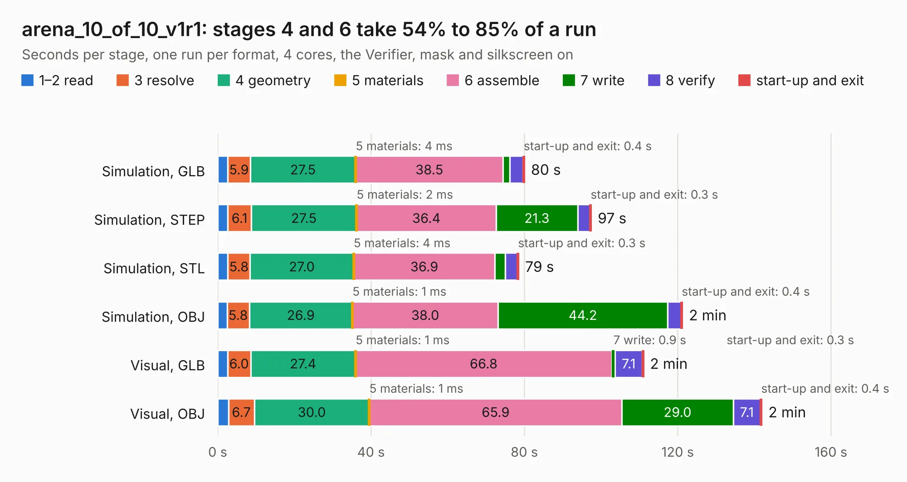

| Mode and format | 1–2 read | 3 resolve | 4 geometry | 5 materials | 6 assemble | 7 write | 8 verify | start-up and exit | Total |
|---|---:|---:|---:|---:|---:|---:|---:|---:|---:|
| Simulation, GLB | 2.6 | 5.9 | 27.5 | 4&nbsp;ms | 38.5 | 1.7 | 3.5 | 0.4 | 80.0 |
| Simulation, STEP | 2.7 | 6.1 | 27.5 | 2&nbsp;ms | 36.4 | 21.3 | 3.2 | 0.3 | 97.5 |
| Simulation, STL | 2.7 | 5.8 | 27.0 | 4&nbsp;ms | 36.9 | 2.7 | 3.1 | 0.3 | 78.5 |
| Simulation, OBJ | 2.4 | 5.8 | 26.9 | 1&nbsp;ms | 38.0 | 44.2 | 3.5 | 0.4 | 121.3 |
| Visual, GLB | 2.6 | 6.0 | 27.4 | 1&nbsp;ms | 66.8 | 0.9 | 7.1 | 0.3 | 111.1 |
| Visual, OBJ | 2.8 | 6.7 | 30.0 | 1&nbsp;ms | 65.9 | 29.0 | 7.1 | 0.4 | 142.0 |

<table align="center"><tr><td valign="top">

| Board | Repo: [iorodeo/led-display_g6_hardware_arena](https://github.com/iorodeo/led-display_g6_hardware_arena) Board: `arena_10_of_10_v1r1.kicad_pcb` |
|---|---|
| Folder | arena_10-10 / arena_10-10_v1 |
| Complexity | 402&nbsp;/&nbsp;1000 (size&nbsp;262, features&nbsp;140) |
| KESE&nbsp;features | through vias, slotted holes, rounded, trapezoid or chamfered pads, arc tracks, filled zones, curved board outline, tracks bare of mask, stack-up, dielectric εr and tanδ, copper finish |
| Tested | 9th November 2026 |
| Copper&nbsp;layers | 6 |
| File&nbsp;format | KiCad 9 (20241229) |
| Parts,&nbsp;tracks,&nbsp;vias | 509, 8,133, 666 |
| Triangles,&nbsp;simulation | 7,355,260 in 516 parts |
| Verifier | PASS in all six runs |

</td><td valign="top">

<table>
<tr><th>File type</th><th>File size</th><th>Peak memory used</th></tr>
<tr><th colspan="3" align="left">Simulation</th></tr>
<tr><td>GLB</td><td align="right">244&nbsp;MB</td><td align="right">2.2&nbsp;GB</td></tr>
<tr><td>STEP</td><td align="right">1.0&nbsp;GB</td><td align="right">2.7&nbsp;GB</td></tr>
<tr><td>STL</td><td align="right">368&nbsp;MB</td><td align="right">2.1&nbsp;GB</td></tr>
<tr><td>OBJ</td><td align="right">773&nbsp;MB</td><td align="right">4.6&nbsp;GB</td></tr>
<tr><th colspan="3" align="left">Visual</th></tr>
<tr><td>GLB</td><td align="right">168&nbsp;MB</td><td align="right">2.7&nbsp;GB</td></tr>
<tr><td>OBJ</td><td align="right">541&nbsp;MB</td><td align="right">3.5&nbsp;GB</td></tr>
</table>

</td></tr></table>

## 23.12.31 arena_10_of_10_v1r1

| Mode and format | 1–2 read | 3 resolve | 4 geometry | 5 materials | 6 assemble | 7 write | 8 verify | start-up and exit | Total |
|---|---:|---:|---:|---:|---:|---:|---:|---:|---:|
| Simulation, GLB | 0.9 | 1.9 | 9.8 | 1&nbsp;ms | 10.0 | 0.3 | 0.6 | 0.2 | 23.8 |
| Simulation, STEP | 0.8 | 2.0 | 9.7 | 2&nbsp;ms | 10.3 | 6.4 | 0.7 | 0.2 | 30.1 |
| Simulation, STL | 0.9 | 2.0 | 9.8 | 1&nbsp;ms | 10.4 | 0.6 | 0.7 | 0.2 | 24.5 |
| Simulation, OBJ | 0.8 | 2.1 | 10.3 | 1&nbsp;ms | 10.0 | 10.5 | 0.7 | 0.2 | 34.6 |
| Visual, GLB | 0.7 | 2.0 | 9.6 | 1&nbsp;ms | 22.6 | 0.2 | 2.6 | 0.2 | 38.0 |
| Visual, OBJ | 0.7 | 1.9 | 9.3 | 2&nbsp;ms | 21.8 | 8.4 | 3.6 | 0.2 | 46.0 |

<table align="center"><tr><td valign="top">

| Board | Repo: [iorodeo/led-display_g6_hardware_arena](https://github.com/iorodeo/led-display_g6_hardware_arena) Board: `arena_10_of_10_v1r1.kicad_pcb` |
|---|---|
| Folder | arena_10-10 / arena_10-10_v1 / layout_tool |
| Complexity | 94&nbsp;/&nbsp;1000 (size&nbsp;84, features&nbsp;10) |
| KESE&nbsp;features | rounded, trapezoid or chamfered pads |
| Tested | 9th November 2026 |
| Copper&nbsp;layers | 2 |
| File&nbsp;format | KiCad 9 (20241229) |
| Parts,&nbsp;tracks,&nbsp;vias | 495, 0, 0 |
| Triangles,&nbsp;simulation | 2,474,306 in 511 parts |
| Note | mostly unrouted |
| Verifier | PASS in all six runs |

</td><td valign="top">

<table>
<tr><th>File type</th><th>File size</th><th>Peak memory used</th></tr>
<tr><th colspan="3" align="left">Simulation</th></tr>
<tr><td>GLB</td><td align="right">83&nbsp;MB</td><td align="right">922&nbsp;MB</td></tr>
<tr><td>STEP</td><td align="right">344&nbsp;MB</td><td align="right">1.2&nbsp;GB</td></tr>
<tr><td>STL</td><td align="right">124&nbsp;MB</td><td align="right">931&nbsp;MB</td></tr>
<tr><td>OBJ</td><td align="right">264&nbsp;MB</td><td align="right">1.7&nbsp;GB</td></tr>
<tr><th colspan="3" align="left">Visual</th></tr>
<tr><td>GLB</td><td align="right">67&nbsp;MB</td><td align="right">1.3&nbsp;GB</td></tr>
<tr><td>OBJ</td><td align="right">208&nbsp;MB</td><td align="right">1.5&nbsp;GB</td></tr>
</table>

</td></tr></table>

## 23.12.32 modified_arena_10_of_10_v1r1

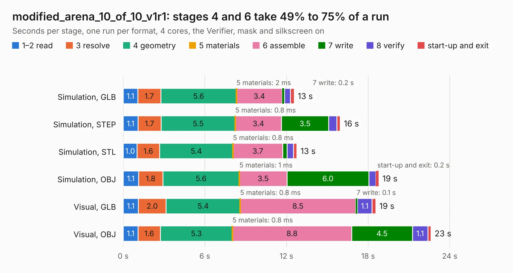

| Mode and format | 1–2 read | 3 resolve | 4 geometry | 5 materials | 6 assemble | 7 write | 8 verify | start-up and exit | Total |
|---|---:|---:|---:|---:|---:|---:|---:|---:|---:|
| Simulation, GLB | 1.1 | 1.7 | 5.6 | 2&nbsp;ms | 3.4 | 0.2 | 0.4 | 0.3 | 12.6 |
| Simulation, STEP | 1.1 | 1.7 | 5.5 | 0.8&nbsp;ms | 3.4 | 3.5 | 0.6 | 0.2 | 15.9 |
| Simulation, STL | 1.0 | 1.6 | 5.4 | 0.8&nbsp;ms | 3.7 | 0.3 | 0.5 | 0.3 | 12.8 |
| Simulation, OBJ | 1.1 | 1.8 | 5.6 | 1&nbsp;ms | 3.5 | 6.0 | 0.5 | 0.2 | 18.8 |
| Visual, GLB | 1.1 | 2.0 | 5.4 | 0.8&nbsp;ms | 8.5 | 0.1 | 1.1 | 0.3 | 18.6 |
| Visual, OBJ | 1.1 | 1.6 | 5.3 | 0.8&nbsp;ms | 8.8 | 4.5 | 1.1 | 0.2 | 22.6 |

<table align="center"><tr><td valign="top">

| Board | Repo: [iorodeo/led-display_g6_hardware_arena](https://github.com/iorodeo/led-display_g6_hardware_arena) Board: `modified_arena_10_of_10_v1r1.kicad_pcb` |
|---|---|
| Folder | arena_10-10 / arena_10-10_v1 / layout_tool |
| Complexity | 104&nbsp;/&nbsp;1000 (size&nbsp;84, features&nbsp;20) |
| KESE&nbsp;features | rounded, trapezoid or chamfered pads, curved board outline |
| Tested | 9th November 2026 |
| Copper&nbsp;layers | 2 |
| File&nbsp;format | KiCad 9 (20241229) |
| Parts,&nbsp;tracks,&nbsp;vias | 495, 0, 0 |
| Triangles,&nbsp;simulation | 990,208 in 253 parts |
| Note | mostly unrouted |
| Verifier | PASS in all six runs |

</td><td valign="top">

<table>
<tr><th>File type</th><th>File size</th><th>Peak memory used</th></tr>
<tr><th colspan="3" align="left">Simulation</th></tr>
<tr><td>GLB</td><td align="right">34&nbsp;MB</td><td align="right">473&nbsp;MB</td></tr>
<tr><td>STEP</td><td align="right">139&nbsp;MB</td><td align="right">576&nbsp;MB</td></tr>
<tr><td>STL</td><td align="right">50&nbsp;MB</td><td align="right">458&nbsp;MB</td></tr>
<tr><td>OBJ</td><td align="right">102&nbsp;MB</td><td align="right">715&nbsp;MB</td></tr>
<tr><th colspan="3" align="left">Visual</th></tr>
<tr><td>GLB</td><td align="right">26&nbsp;MB</td><td align="right">633&nbsp;MB</td></tr>
<tr><td>OBJ</td><td align="right">79&nbsp;MB</td><td align="right">671&nbsp;MB</td></tr>
</table>

</td></tr></table>

## 23.12.33 arena_10_of_10_v1r1

| Mode and format | 1–2 read | 3 resolve | 4 geometry | 5 materials | 6 assemble | 7 write | 8 verify | start-up and exit | Total |
|---|---:|---:|---:|---:|---:|---:|---:|---:|---:|
| Simulation, GLB | 1.4 | 4.8 | 23.2 | 2&nbsp;ms | 22.3 | 1.1 | 2.3 | 0.3 | 55.4 |
| Simulation, STEP | 1.3 | 5.0 | 22.9 | 3&nbsp;ms | 23.0 | 16.0 | 2.4 | 0.4 | 71.0 |
| Simulation, STL | 1.3 | 4.6 | 23.7 | 2&nbsp;ms | 23.4 | 2.6 | 2.5 | 0.3 | 58.6 |
| Simulation, OBJ | 1.3 | 5.1 | 24.3 | 2&nbsp;ms | 22.4 | 34.3 | 2.3 | 0.3 | 90.0 |
| Visual, GLB | 1.4 | 5.2 | 22.7 | 2&nbsp;ms | 48.3 | 0.5 | 5.9 | 0.3 | 84.2 |
| Visual, OBJ | 1.5 | 4.9 | 23.2 | 2&nbsp;ms | 47.6 | 18.7 | 6.8 | 0.3 | 103.1 |

<table align="center"><tr><td valign="top">

| Board | Repo: [iorodeo/led-display_g6_hardware_arena](https://github.com/iorodeo/led-display_g6_hardware_arena) Board: `arena_10_of_10_v1r1.kicad_pcb` |
|---|---|
| Folder | arena_10-10 / arena_10-10_v1 / manual_route / v1 |
| Complexity | 387&nbsp;/&nbsp;1000 (size&nbsp;242, features&nbsp;145) |
| KESE&nbsp;features | through vias, blind and buried vias, slotted holes, rounded, trapezoid or chamfered pads, arc tracks, curved board outline, tracks bare of mask, stack-up, dielectric εr and tanδ |
| Tested | 9th November 2026 |
| Copper&nbsp;layers | 6 |
| File&nbsp;format | KiCad 9 (20241229) |
| Parts,&nbsp;tracks,&nbsp;vias | 505, 1,743, 403 |
| Triangles,&nbsp;simulation | 5,647,298 in 516 parts |
| Verifier | PASS in all six runs |

</td><td valign="top">

<table>
<tr><th>File type</th><th>File size</th><th>Peak memory used</th></tr>
<tr><th colspan="3" align="left">Simulation</th></tr>
<tr><td>GLB</td><td align="right">186&nbsp;MB</td><td align="right">1.5&nbsp;GB</td></tr>
<tr><td>STEP</td><td align="right">659&nbsp;MB</td><td align="right">2.0&nbsp;GB</td></tr>
<tr><td>STL</td><td align="right">282&nbsp;MB</td><td align="right">1.5&nbsp;GB</td></tr>
<tr><td>OBJ</td><td align="right">591&nbsp;MB</td><td align="right">3.5&nbsp;GB</td></tr>
<tr><th colspan="3" align="left">Visual</th></tr>
<tr><td>GLB</td><td align="right">103&nbsp;MB</td><td align="right">2.0&nbsp;GB</td></tr>
<tr><td>OBJ</td><td align="right">327&nbsp;MB</td><td align="right">2.2&nbsp;GB</td></tr>
</table>

</td></tr></table>

## 23.12.34 arena_10_of_10_v1r1

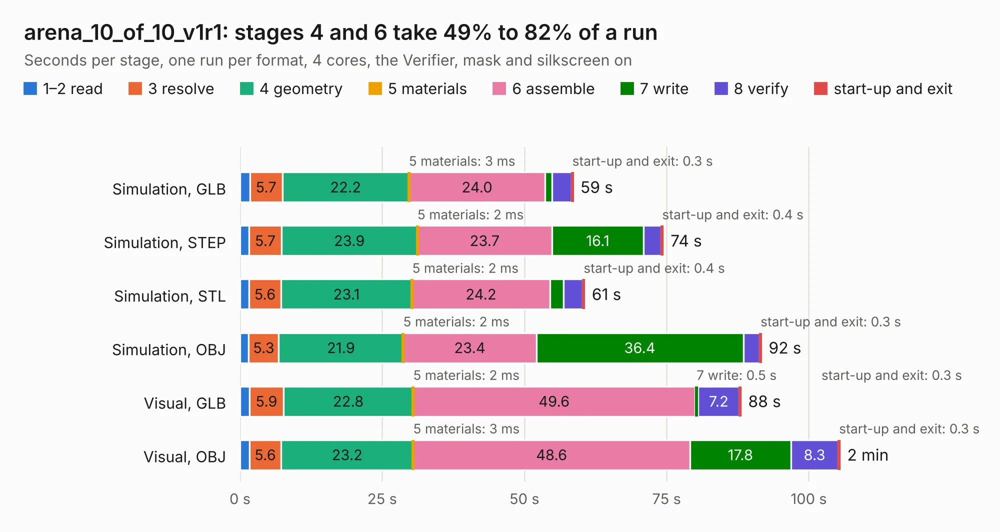

| Mode and format | 1–2 read | 3 resolve | 4 geometry | 5 materials | 6 assemble | 7 write | 8 verify | start-up and exit | Total |
|---|---:|---:|---:|---:|---:|---:|---:|---:|---:|
| Simulation, GLB | 1.7 | 5.7 | 22.2 | 3&nbsp;ms | 24.0 | 1.2 | 3.4 | 0.3 | 58.6 |
| Simulation, STEP | 1.6 | 5.7 | 23.9 | 2&nbsp;ms | 23.7 | 16.1 | 3.1 | 0.4 | 74.4 |
| Simulation, STL | 1.6 | 5.6 | 23.1 | 2&nbsp;ms | 24.2 | 2.4 | 3.4 | 0.4 | 60.6 |
| Simulation, OBJ | 1.5 | 5.3 | 21.9 | 2&nbsp;ms | 23.4 | 36.4 | 2.9 | 0.3 | 91.7 |
| Visual, GLB | 1.7 | 5.9 | 22.8 | 2&nbsp;ms | 49.6 | 0.5 | 7.2 | 0.3 | 88.1 |
| Visual, OBJ | 1.7 | 5.6 | 23.2 | 3&nbsp;ms | 48.6 | 17.8 | 8.3 | 0.3 | 105.5 |

<table align="center"><tr><td valign="top">

| Board | Repo: [iorodeo/led-display_g6_hardware_arena](https://github.com/iorodeo/led-display_g6_hardware_arena) Board: `arena_10_of_10_v1r1.kicad_pcb` |
|---|---|
| Folder | arena_10-10 / arena_10-10_v1 / manual_route / v1 / routed |
| Complexity | 364&nbsp;/&nbsp;1000 (size&nbsp;254, features&nbsp;110) |
| KESE&nbsp;features | through vias, slotted holes, rounded, trapezoid or chamfered pads, filled zones, curved board outline, tracks bare of mask, stack-up, dielectric εr and tanδ |
| Tested | 9th November 2026 |
| Copper&nbsp;layers | 6 |
| File&nbsp;format | KiCad 9 (20241229) |
| Parts,&nbsp;tracks,&nbsp;vias | 505, 4,090, 677 |
| Triangles,&nbsp;simulation | 7,459,160 in 516 parts |
| Verifier | PASS in all six runs |

</td><td valign="top">

<table>
<tr><th>File type</th><th>File size</th><th>Peak memory used</th></tr>
<tr><th colspan="3" align="left">Simulation</th></tr>
<tr><td>GLB</td><td align="right">248&nbsp;MB</td><td align="right">1.9&nbsp;GB</td></tr>
<tr><td>STEP</td><td align="right">815&nbsp;MB</td><td align="right">2.4&nbsp;GB</td></tr>
<tr><td>STL</td><td align="right">373&nbsp;MB</td><td align="right">1.9&nbsp;GB</td></tr>
<tr><td>OBJ</td><td align="right">787&nbsp;MB</td><td align="right">4.7&nbsp;GB</td></tr>
<tr><th colspan="3" align="left">Visual</th></tr>
<tr><td>GLB</td><td align="right">128&nbsp;MB</td><td align="right">2.3&nbsp;GB</td></tr>
<tr><td>OBJ</td><td align="right">413&nbsp;MB</td><td align="right">2.7&nbsp;GB</td></tr>
</table>

</td></tr></table>

## 23.12.35 arena_10_of_10_v1r1

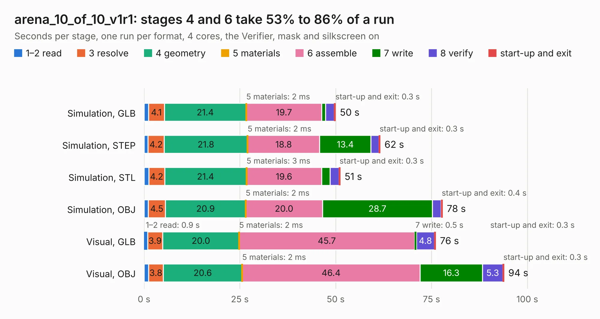

| Mode and format | 1–2 read | 3 resolve | 4 geometry | 5 materials | 6 assemble | 7 write | 8 verify | start-up and exit | Total |
|---|---:|---:|---:|---:|---:|---:|---:|---:|---:|
| Simulation, GLB | 1.2 | 4.1 | 21.4 | 2&nbsp;ms | 19.7 | 1.0 | 2.3 | 0.3 | 50.0 |
| Simulation, STEP | 1.0 | 4.2 | 21.8 | 2&nbsp;ms | 18.8 | 13.4 | 2.1 | 0.3 | 61.6 |
| Simulation, STL | 1.2 | 4.2 | 21.4 | 3&nbsp;ms | 19.6 | 2.2 | 2.3 | 0.3 | 51.2 |
| Simulation, OBJ | 1.1 | 4.5 | 20.9 | 2&nbsp;ms | 20.0 | 28.7 | 2.3 | 0.4 | 77.9 |
| Visual, GLB | 0.9 | 3.9 | 20.0 | 2&nbsp;ms | 45.7 | 0.5 | 4.8 | 0.3 | 76.1 |
| Visual, OBJ | 1.2 | 3.8 | 20.6 | 2&nbsp;ms | 46.4 | 16.3 | 5.3 | 0.3 | 93.9 |

<table align="center"><tr><td valign="top">

| Board | Repo: [iorodeo/led-display_g6_hardware_arena](https://github.com/iorodeo/led-display_g6_hardware_arena) Board: `arena_10_of_10_v1r1.kicad_pcb` |
|---|---|
| Folder | arena_10-10 / arena_10-10_v1 / manual_route / v2 |
| Complexity | 387&nbsp;/&nbsp;1000 (size&nbsp;242, features&nbsp;145) |
| KESE&nbsp;features | through vias, blind and buried vias, slotted holes, rounded, trapezoid or chamfered pads, arc tracks, curved board outline, tracks bare of mask, stack-up, dielectric εr and tanδ |
| Tested | 9th November 2026 |
| Copper&nbsp;layers | 6 |
| File&nbsp;format | KiCad 9 (20241229) |
| Parts,&nbsp;tracks,&nbsp;vias | 505, 1,744, 405 |
| Triangles,&nbsp;simulation | 5,657,426 in 516 parts |
| Verifier | PASS in all six runs |

</td><td valign="top">

<table>
<tr><th>File type</th><th>File size</th><th>Peak memory used</th></tr>
<tr><th colspan="3" align="left">Simulation</th></tr>
<tr><td>GLB</td><td align="right">186&nbsp;MB</td><td align="right">1.5&nbsp;GB</td></tr>
<tr><td>STEP</td><td align="right">660&nbsp;MB</td><td align="right">2.0&nbsp;GB</td></tr>
<tr><td>STL</td><td align="right">283&nbsp;MB</td><td align="right">1.6&nbsp;GB</td></tr>
<tr><td>OBJ</td><td align="right">592&nbsp;MB</td><td align="right">3.6&nbsp;GB</td></tr>
<tr><th colspan="3" align="left">Visual</th></tr>
<tr><td>GLB</td><td align="right">104&nbsp;MB</td><td align="right">2.0&nbsp;GB</td></tr>
<tr><td>OBJ</td><td align="right">327&nbsp;MB</td><td align="right">2.1&nbsp;GB</td></tr>
</table>

</td></tr></table>

## 23.12.36 arena_10_of_10_v1r1

| Mode and format | 1–2 read | 3 resolve | 4 geometry | 5 materials | 6 assemble | 7 write | 8 verify | start-up and exit | Total |
|---|---:|---:|---:|---:|---:|---:|---:|---:|---:|
| Simulation, GLB | 1.6 | 6.0 | 23.8 | 2&nbsp;ms | 24.5 | 1.1 | 3.6 | 0.4 | 61.0 |
| Simulation, STEP | 1.7 | 5.8 | 23.3 | 3&nbsp;ms | 24.6 | 15.8 | 3.2 | 0.4 | 74.8 |
| Simulation, STL | 1.8 | 5.8 | 23.1 | 3&nbsp;ms | 24.9 | 2.8 | 3.5 | 0.4 | 62.2 |
| Simulation, OBJ | 1.8 | 6.1 | 23.1 | 3&nbsp;ms | 25.3 | 41.0 | 3.6 | 0.4 | 101.3 |
| Visual, GLB | 1.9 | 5.9 | 22.9 | 2&nbsp;ms | 50.7 | 0.5 | 7.0 | 0.3 | 89.2 |
| Visual, OBJ | 1.7 | 5.8 | 23.3 | 2&nbsp;ms | 48.8 | 18.8 | 6.8 | 0.3 | 105.4 |

<table align="center"><tr><td valign="top">

| Board | Repo: [iorodeo/led-display_g6_hardware_arena](https://github.com/iorodeo/led-display_g6_hardware_arena) Board: `arena_10_of_10_v1r1.kicad_pcb` |
|---|---|
| Folder | arena_10-10 / arena_10-10_v1 / manual_route / v2 / routed |
| Complexity | 363&nbsp;/&nbsp;1000 (size&nbsp;253, features&nbsp;110) |
| KESE&nbsp;features | through vias, slotted holes, rounded, trapezoid or chamfered pads, filled zones, curved board outline, tracks bare of mask, stack-up, dielectric εr and tanδ |
| Tested | 9th November 2026 |
| Copper&nbsp;layers | 6 |
| File&nbsp;format | KiCad 9 (20241229) |
| Parts,&nbsp;tracks,&nbsp;vias | 505, 4,129, 652 |
| Triangles,&nbsp;simulation | 7,323,260 in 516 parts |
| Verifier | PASS in all six runs |

</td><td valign="top">

<table>
<tr><th>File type</th><th>File size</th><th>Peak memory used</th></tr>
<tr><th colspan="3" align="left">Simulation</th></tr>
<tr><td>GLB</td><td align="right">244&nbsp;MB</td><td align="right">1.8&nbsp;GB</td></tr>
<tr><td>STEP</td><td align="right">805&nbsp;MB</td><td align="right">2.5&nbsp;GB</td></tr>
<tr><td>STL</td><td align="right">366&nbsp;MB</td><td align="right">1.9&nbsp;GB</td></tr>
<tr><td>OBJ</td><td align="right">772&nbsp;MB</td><td align="right">4.6&nbsp;GB</td></tr>
<tr><th colspan="3" align="left">Visual</th></tr>
<tr><td>GLB</td><td align="right">126&nbsp;MB</td><td align="right">2.2&nbsp;GB</td></tr>
<tr><td>OBJ</td><td align="right">406&nbsp;MB</td><td align="right">2.8&nbsp;GB</td></tr>
</table>

</td></tr></table>

## 23.12.37 arena_top_10-10

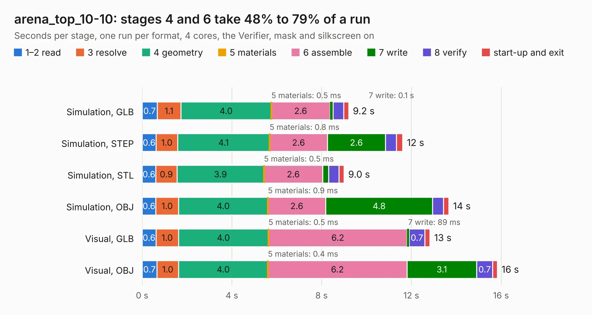

| Mode and format | 1–2 read | 3 resolve | 4 geometry | 5 materials | 6 assemble | 7 write | 8 verify | start-up and exit | Total |
|---|---:|---:|---:|---:|---:|---:|---:|---:|---:|
| Simulation, GLB | 0.7 | 1.1 | 4.0 | 0.5&nbsp;ms | 2.6 | 0.1 | 0.5 | 0.2 | 9.2 |
| Simulation, STEP | 0.6 | 1.0 | 4.1 | 0.8&nbsp;ms | 2.6 | 2.6 | 0.5 | 0.3 | 11.6 |
| Simulation, STL | 0.6 | 0.9 | 3.9 | 0.5&nbsp;ms | 2.6 | 0.3 | 0.5 | 0.2 | 9.0 |
| Simulation, OBJ | 0.6 | 1.0 | 4.0 | 0.9&nbsp;ms | 2.6 | 4.8 | 0.5 | 0.2 | 13.7 |
| Visual, GLB | 0.6 | 1.0 | 4.0 | 0.5&nbsp;ms | 6.2 | 89&nbsp;ms | 0.7 | 0.2 | 12.8 |
| Visual, OBJ | 0.7 | 1.0 | 4.0 | 0.4&nbsp;ms | 6.2 | 3.1 | 0.7 | 0.2 | 15.8 |

<table align="center"><tr><td valign="top">

| Board | Repo: [iorodeo/led-display_g6_hardware_arena](https://github.com/iorodeo/led-display_g6_hardware_arena) Board: `arena_top_10-10.kicad_pcb` |
|---|---|
| Folder | arena_10-10 / arena_top_10-10 |
| Complexity | 266&nbsp;/&nbsp;1000 (size&nbsp;136, features&nbsp;130) |
| KESE&nbsp;features | through vias, slotted holes, rounded, trapezoid or chamfered pads, filled zones, curved board outline, knockout text, stack-up, dielectric εr and tanδ, copper finish, mask and silkscreen colours |
| Tested | 9th November 2026 |
| Copper&nbsp;layers | 2 |
| File&nbsp;format | KiCad 10 (20260206) |
| Parts,&nbsp;tracks,&nbsp;vias | 32, 54, 30 |
| Triangles,&nbsp;simulation | 857,574 in 96 parts |
| Verifier | PASS in all six runs |

</td><td valign="top">

<table>
<tr><th>File type</th><th>File size</th><th>Peak memory used</th></tr>
<tr><th colspan="3" align="left">Simulation</th></tr>
<tr><td>GLB</td><td align="right">29&nbsp;MB</td><td align="right">467&nbsp;MB</td></tr>
<tr><td>STEP</td><td align="right">116&nbsp;MB</td><td align="right">483&nbsp;MB</td></tr>
<tr><td>STL</td><td align="right">43&nbsp;MB</td><td align="right">453&nbsp;MB</td></tr>
<tr><td>OBJ</td><td align="right">86&nbsp;MB</td><td align="right">617&nbsp;MB</td></tr>
<tr><th colspan="3" align="left">Visual</th></tr>
<tr><td>GLB</td><td align="right">19&nbsp;MB</td><td align="right">476&nbsp;MB</td></tr>
<tr><td>OBJ</td><td align="right">57&nbsp;MB</td><td align="right">489&nbsp;MB</td></tr>
</table>

</td></tr></table>

## 23.12.38 arena_10-10_v2r1

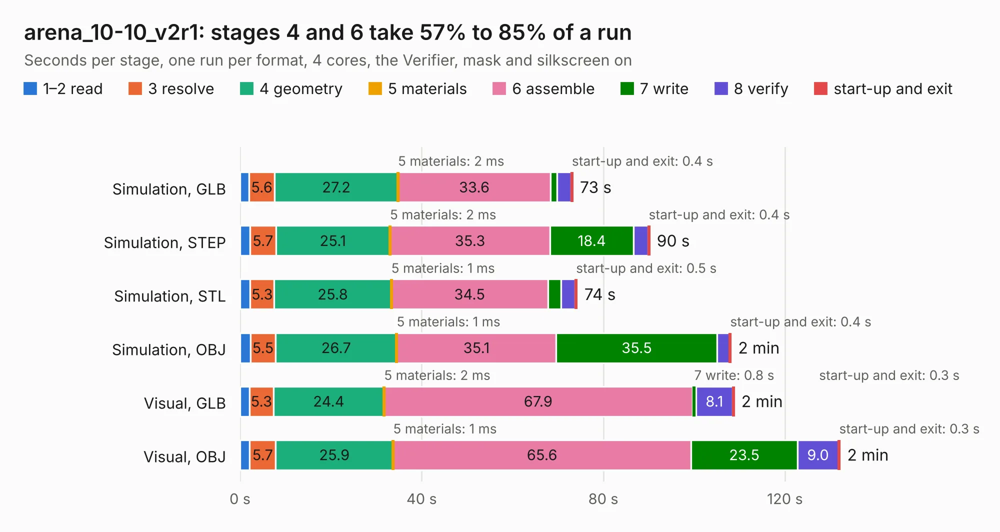

| Mode and format | 1–2 read | 3 resolve | 4 geometry | 5 materials | 6 assemble | 7 write | 8 verify | start-up and exit | Total |
|---|---:|---:|---:|---:|---:|---:|---:|---:|---:|
| Simulation, GLB | 2.0 | 5.6 | 27.2 | 2&nbsp;ms | 33.6 | 1.4 | 3.1 | 0.4 | 73.3 |
| Simulation, STEP | 2.2 | 5.7 | 25.1 | 2&nbsp;ms | 35.3 | 18.4 | 3.2 | 0.4 | 90.2 |
| Simulation, STL | 2.2 | 5.3 | 25.8 | 1&nbsp;ms | 34.5 | 2.8 | 3.1 | 0.5 | 74.2 |
| Simulation, OBJ | 2.3 | 5.5 | 26.7 | 1&nbsp;ms | 35.1 | 35.5 | 2.7 | 0.4 | 108.1 |
| Visual, GLB | 2.1 | 5.3 | 24.4 | 2&nbsp;ms | 67.9 | 0.8 | 8.1 | 0.3 | 108.8 |
| Visual, OBJ | 2.1 | 5.7 | 25.9 | 1&nbsp;ms | 65.6 | 23.5 | 9.0 | 0.3 | 132.1 |

<table align="center"><tr><td valign="top">

| Board | Repo: [iorodeo/led-display_g6_hardware_arena](https://github.com/iorodeo/led-display_g6_hardware_arena) Board: `arena_10-10_v2r1.kicad_pcb` |
|---|---|
| Folder | arena_10-10 / develop / with_reg / arena_10-10_v2r1 |
| Complexity | 403&nbsp;/&nbsp;1000 (size&nbsp;263, features&nbsp;140) |
| KESE&nbsp;features | through vias, slotted holes, rounded, trapezoid or chamfered pads, arc tracks, filled zones, curved board outline, tracks bare of mask, stack-up, dielectric εr and tanδ, copper finish |
| Tested | 9th November 2026 |
| Copper&nbsp;layers | 6 |
| File&nbsp;format | KiCad 10 (20260206) |
| Parts,&nbsp;tracks,&nbsp;vias | 521, 8,209, 732 |
| Triangles,&nbsp;simulation | 7,924,200 in 530 parts |
| Verifier | PASS in all six runs |

</td><td valign="top">

<table>
<tr><th>File type</th><th>File size</th><th>Peak memory used</th></tr>
<tr><th colspan="3" align="left">Simulation</th></tr>
<tr><td>GLB</td><td align="right">261&nbsp;MB</td><td align="right">2.2&nbsp;GB</td></tr>
<tr><td>STEP</td><td align="right">1.1&nbsp;GB</td><td align="right">2.8&nbsp;GB</td></tr>
<tr><td>STL</td><td align="right">396&nbsp;MB</td><td align="right">2.2&nbsp;GB</td></tr>
<tr><td>OBJ</td><td align="right">829&nbsp;MB</td><td align="right">4.9&nbsp;GB</td></tr>
<tr><th colspan="3" align="left">Visual</th></tr>
<tr><td>GLB</td><td align="right">174&nbsp;MB</td><td align="right">2.8&nbsp;GB</td></tr>
<tr><td>OBJ</td><td align="right">559&nbsp;MB</td><td align="right">3.5&nbsp;GB</td></tr>
</table>

</td></tr></table>

## 23.12.39 arena_10-10_v2r1

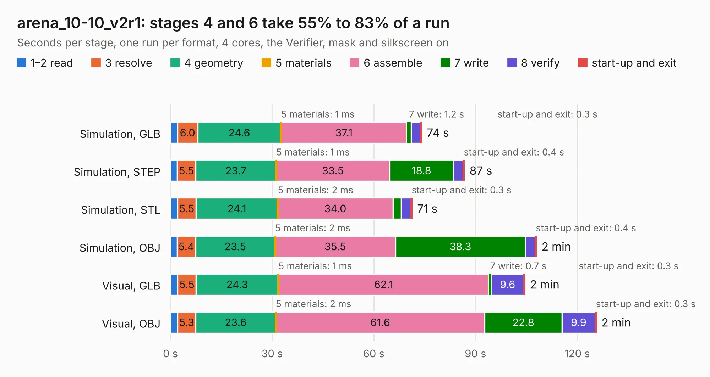

| Mode and format | 1–2 read | 3 resolve | 4 geometry | 5 materials | 6 assemble | 7 write | 8 verify | start-up and exit | Total |
|---|---:|---:|---:|---:|---:|---:|---:|---:|---:|
| Simulation, GLB | 2.1 | 6.0 | 24.6 | 1&nbsp;ms | 37.1 | 1.2 | 2.8 | 0.3 | 74.1 |
| Simulation, STEP | 2.0 | 5.5 | 23.7 | 1&nbsp;ms | 33.5 | 18.8 | 2.9 | 0.4 | 86.8 |
| Simulation, STL | 2.1 | 5.5 | 24.1 | 2&nbsp;ms | 34.0 | 2.5 | 2.9 | 0.3 | 71.3 |
| Simulation, OBJ | 1.9 | 5.4 | 23.5 | 2&nbsp;ms | 35.5 | 38.3 | 2.9 | 0.4 | 108.0 |
| Visual, GLB | 2.1 | 5.5 | 24.3 | 1&nbsp;ms | 62.1 | 0.7 | 9.6 | 0.3 | 104.6 |
| Visual, OBJ | 2.1 | 5.3 | 23.6 | 2&nbsp;ms | 61.6 | 22.8 | 9.9 | 0.3 | 125.7 |

<table align="center"><tr><td valign="top">

| Board | Repo: [iorodeo/led-display_g6_hardware_arena](https://github.com/iorodeo/led-display_g6_hardware_arena) Board: `arena_10-10_v2r1.kicad_pcb` |
|---|---|
| Folder | arena_10-10 / develop / without_reg / arena_10-10_v2r1 |
| Complexity | 388&nbsp;/&nbsp;1000 (size&nbsp;263, features&nbsp;125) |
| KESE&nbsp;features | through vias, slotted holes, rounded, trapezoid or chamfered pads, arc tracks, filled zones, curved board outline, stack-up, dielectric εr and tanδ, copper finish |
| Tested | 9th November 2026 |
| Copper&nbsp;layers | 6 |
| File&nbsp;format | KiCad 10 (20260206) |
| Parts,&nbsp;tracks,&nbsp;vias | 543, 8,276, 744 |
| Triangles,&nbsp;simulation | 8,057,822 in 539 parts |
| Verifier | PASS in all six runs |

</td><td valign="top">

<table>
<tr><th>File type</th><th>File size</th><th>Peak memory used</th></tr>
<tr><th colspan="3" align="left">Simulation</th></tr>
<tr><td>GLB</td><td align="right">264&nbsp;MB</td><td align="right">2.2&nbsp;GB</td></tr>
<tr><td>STEP</td><td align="right">1.1&nbsp;GB</td><td align="right">2.8&nbsp;GB</td></tr>
<tr><td>STL</td><td align="right">403&nbsp;MB</td><td align="right">2.3&nbsp;GB</td></tr>
<tr><td>OBJ</td><td align="right">840&nbsp;MB</td><td align="right">5.0&nbsp;GB</td></tr>
<tr><th colspan="3" align="left">Visual</th></tr>
<tr><td>GLB</td><td align="right">176&nbsp;MB</td><td align="right">2.8&nbsp;GB</td></tr>
<tr><td>OBJ</td><td align="right">566&nbsp;MB</td><td align="right">3.5&nbsp;GB</td></tr>
</table>

</td></tr></table>

## 23.12.40 arena_12-18

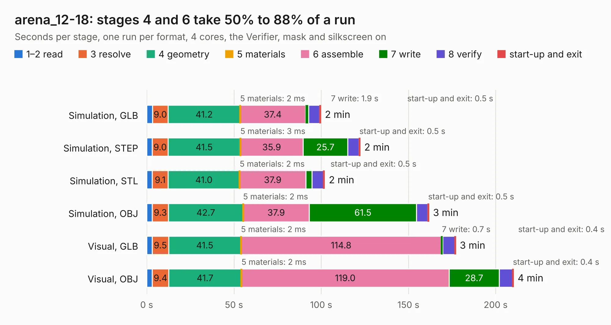

| Mode and format | 1–2 read | 3 resolve | 4 geometry | 5 materials | 6 assemble | 7 write | 8 verify | start-up and exit | Total |
|---|---:|---:|---:|---:|---:|---:|---:|---:|---:|
| Simulation, GLB | 3.3 | 9.0 | 41.2 | 2&nbsp;ms | 37.4 | 1.9 | 6.3 | 0.5 | 99.6 |
| Simulation, STEP | 3.2 | 9.0 | 41.5 | 3&nbsp;ms | 35.9 | 25.7 | 6.4 | 0.5 | 122.2 |
| Simulation, STL | 3.2 | 9.1 | 41.0 | 2&nbsp;ms | 37.9 | 3.6 | 6.6 | 0.5 | 101.9 |
| Simulation, OBJ | 3.2 | 9.3 | 42.7 | 2&nbsp;ms | 37.9 | 61.5 | 6.4 | 0.5 | 161.6 |
| Visual, GLB | 3.1 | 9.5 | 41.5 | 2&nbsp;ms | 114.8 | 0.7 | 7.0 | 0.4 | 176.9 |
| Visual, OBJ | 3.2 | 9.4 | 41.7 | 2&nbsp;ms | 119.0 | 28.7 | 7.7 | 0.4 | 210.1 |

<table align="center"><tr><td valign="top">

| Board | Repo: [iorodeo/led-display_g6_hardware_arena](https://github.com/iorodeo/led-display_g6_hardware_arena) Board: `arena_12-18.kicad_pcb` |
|---|---|
| Folder | arena_12-18 |
| Complexity | 381&nbsp;/&nbsp;1000 (size&nbsp;256, features&nbsp;125) |
| KESE&nbsp;features | through vias, slotted holes, rounded, trapezoid or chamfered pads, filled zones, curved board outline, knockout text, stack-up, dielectric εr and tanδ, copper finish |
| Tested | 9th November 2026 |
| Copper&nbsp;layers | 6 |
| File&nbsp;format | KiCad 10 (20260206) |
| Parts,&nbsp;tracks,&nbsp;vias | 604, 3,679, 855 |
| Triangles,&nbsp;simulation | 9,784,698 in 604 parts |
| Verifier | PASS in all six runs |

</td><td valign="top">

<table>
<tr><th>File type</th><th>File size</th><th>Peak memory used</th></tr>
<tr><th colspan="3" align="left">Simulation</th></tr>
<tr><td>GLB</td><td align="right">333&nbsp;MB</td><td align="right">2.3&nbsp;GB</td></tr>
<tr><td>STEP</td><td align="right">1.3&nbsp;GB</td><td align="right">3.1&nbsp;GB</td></tr>
<tr><td>STL</td><td align="right">489&nbsp;MB</td><td align="right">2.3&nbsp;GB</td></tr>
<tr><td>OBJ</td><td align="right">1.1&nbsp;GB</td><td align="right">6.2&nbsp;GB</td></tr>
<tr><th colspan="3" align="left">Visual</th></tr>
<tr><td>GLB</td><td align="right">161&nbsp;MB</td><td align="right">2.8&nbsp;GB</td></tr>
<tr><td>OBJ</td><td align="right">516&nbsp;MB</td><td align="right">3.4&nbsp;GB</td></tr>
</table>

</td></tr></table>

## 23.12.41 arena_12-18

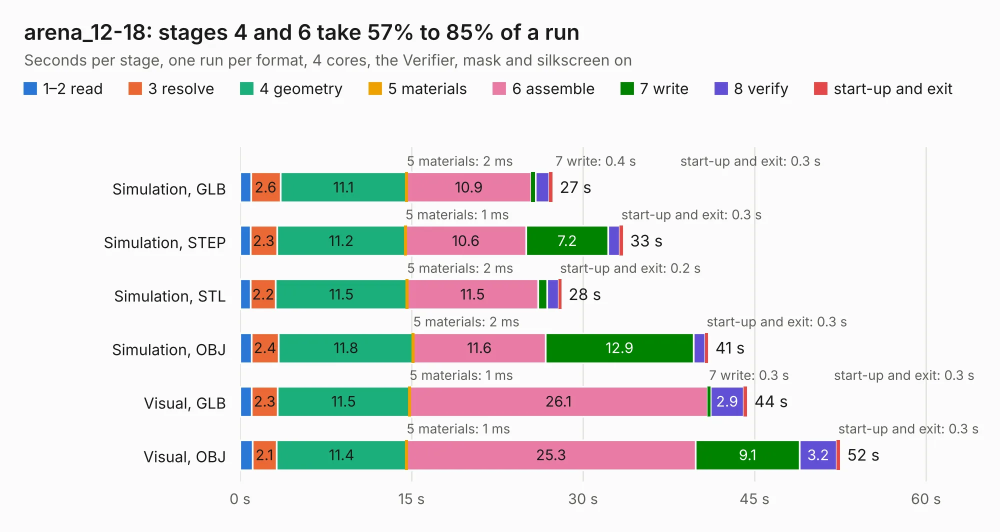

| Mode and format | 1–2 read | 3 resolve | 4 geometry | 5 materials | 6 assemble | 7 write | 8 verify | start-up and exit | Total |
|---|---:|---:|---:|---:|---:|---:|---:|---:|---:|
| Simulation, GLB | 0.9 | 2.6 | 11.1 | 2&nbsp;ms | 10.9 | 0.4 | 1.2 | 0.3 | 27.3 |
| Simulation, STEP | 0.9 | 2.3 | 11.2 | 1&nbsp;ms | 10.6 | 7.2 | 1.0 | 0.3 | 33.5 |
| Simulation, STL | 0.9 | 2.2 | 11.5 | 2&nbsp;ms | 11.5 | 0.8 | 1.0 | 0.2 | 28.1 |
| Simulation, OBJ | 1.0 | 2.4 | 11.8 | 2&nbsp;ms | 11.6 | 12.9 | 1.0 | 0.3 | 40.9 |
| Visual, GLB | 1.0 | 2.3 | 11.5 | 1&nbsp;ms | 26.1 | 0.3 | 2.9 | 0.3 | 44.4 |
| Visual, OBJ | 1.1 | 2.1 | 11.4 | 1&nbsp;ms | 25.3 | 9.1 | 3.2 | 0.3 | 52.5 |

<table align="center"><tr><td valign="top">

| Board | Repo: [iorodeo/led-display_g6_hardware_arena](https://github.com/iorodeo/led-display_g6_hardware_arena) Board: `arena_12-18.kicad_pcb` |
|---|---|
| Folder | arena_12-18 / layout_tool |
| Complexity | 94&nbsp;/&nbsp;1000 (size&nbsp;84, features&nbsp;10) |
| KESE&nbsp;features | rounded, trapezoid or chamfered pads |
| Tested | 9th November 2026 |
| Copper&nbsp;layers | 2 |
| File&nbsp;format | KiCad 9 (20241229) |
| Parts,&nbsp;tracks,&nbsp;vias | 495, 0, 0 |
| Triangles,&nbsp;simulation | 2,474,306 in 511 parts |
| Note | mostly unrouted |
| Verifier | PASS in all six runs |

</td><td valign="top">

<table>
<tr><th>File type</th><th>File size</th><th>Peak memory used</th></tr>
<tr><th colspan="3" align="left">Simulation</th></tr>
<tr><td>GLB</td><td align="right">83&nbsp;MB</td><td align="right">952&nbsp;MB</td></tr>
<tr><td>STEP</td><td align="right">344&nbsp;MB</td><td align="right">1.2&nbsp;GB</td></tr>
<tr><td>STL</td><td align="right">124&nbsp;MB</td><td align="right">953&nbsp;MB</td></tr>
<tr><td>OBJ</td><td align="right">264&nbsp;MB</td><td align="right">1.7&nbsp;GB</td></tr>
<tr><th colspan="3" align="left">Visual</th></tr>
<tr><td>GLB</td><td align="right">67&nbsp;MB</td><td align="right">1.4&nbsp;GB</td></tr>
<tr><td>OBJ</td><td align="right">208&nbsp;MB</td><td align="right">1.4&nbsp;GB</td></tr>
</table>

</td></tr></table>

## 23.12.42 modified_arena_10_of_10_v1r1

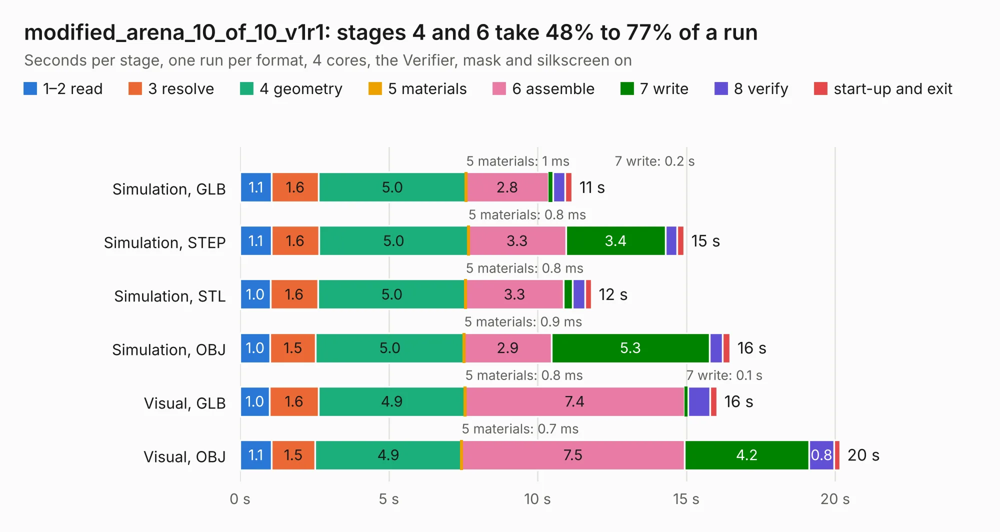

| Mode and format | 1–2 read | 3 resolve | 4 geometry | 5 materials | 6 assemble | 7 write | 8 verify | start-up and exit | Total |
|---|---:|---:|---:|---:|---:|---:|---:|---:|---:|
| Simulation, GLB | 1.1 | 1.6 | 5.0 | 1&nbsp;ms | 2.8 | 0.2 | 0.4 | 0.2 | 11.2 |
| Simulation, STEP | 1.1 | 1.6 | 5.0 | 0.8&nbsp;ms | 3.3 | 3.4 | 0.4 | 0.2 | 14.9 |
| Simulation, STL | 1.0 | 1.6 | 5.0 | 0.8&nbsp;ms | 3.3 | 0.3 | 0.4 | 0.2 | 11.8 |
| Simulation, OBJ | 1.0 | 1.5 | 5.0 | 0.9&nbsp;ms | 2.9 | 5.3 | 0.4 | 0.3 | 16.5 |
| Visual, GLB | 1.0 | 1.6 | 4.9 | 0.8&nbsp;ms | 7.4 | 0.1 | 0.7 | 0.2 | 16.0 |
| Visual, OBJ | 1.1 | 1.5 | 4.9 | 0.7&nbsp;ms | 7.5 | 4.2 | 0.8 | 0.2 | 20.2 |

<table align="center"><tr><td valign="top">

| Board | Repo: [iorodeo/led-display_g6_hardware_arena](https://github.com/iorodeo/led-display_g6_hardware_arena) Board: `modified_arena_10_of_10_v1r1.kicad_pcb` |
|---|---|
| Folder | arena_12-18 / layout_tool |
| Complexity | 104&nbsp;/&nbsp;1000 (size&nbsp;84, features&nbsp;20) |
| KESE&nbsp;features | rounded, trapezoid or chamfered pads, curved board outline |
| Tested | 9th November 2026 |
| Copper&nbsp;layers | 2 |
| File&nbsp;format | KiCad 9 (20241229) |
| Parts,&nbsp;tracks,&nbsp;vias | 495, 0, 0 |
| Triangles,&nbsp;simulation | 990,208 in 253 parts |
| Note | mostly unrouted |
| Verifier | PASS in all six runs |

</td><td valign="top">

<table>
<tr><th>File type</th><th>File size</th><th>Peak memory used</th></tr>
<tr><th colspan="3" align="left">Simulation</th></tr>
<tr><td>GLB</td><td align="right">34&nbsp;MB</td><td align="right">496&nbsp;MB</td></tr>
<tr><td>STEP</td><td align="right">139&nbsp;MB</td><td align="right">550&nbsp;MB</td></tr>
<tr><td>STL</td><td align="right">50&nbsp;MB</td><td align="right">489&nbsp;MB</td></tr>
<tr><td>OBJ</td><td align="right">102&nbsp;MB</td><td align="right">712&nbsp;MB</td></tr>
<tr><th colspan="3" align="left">Visual</th></tr>
<tr><td>GLB</td><td align="right">26&nbsp;MB</td><td align="right">737&nbsp;MB</td></tr>
<tr><td>OBJ</td><td align="right">79&nbsp;MB</td><td align="right">671&nbsp;MB</td></tr>
</table>

</td></tr></table>

## 23.12.43 arena_12-18

| Mode and format | 1–2 read | 3 resolve | 4 geometry | 5 materials | 6 assemble | 7 write | 8 verify | start-up and exit | Total |
|---|---:|---:|---:|---:|---:|---:|---:|---:|---:|
| Simulation, GLB | 1.2 | 4.3 | 20.1 | 2&nbsp;ms | 19.9 | 0.9 | 2.1 | 0.3 | 48.9 |
| Simulation, STEP | 1.1 | 4.2 | 19.9 | 3&nbsp;ms | 19.1 | 13.4 | 2.0 | 0.3 | 60.0 |
| Simulation, STL | 1.2 | 4.1 | 20.6 | 2&nbsp;ms | 19.9 | 1.7 | 2.0 | 0.3 | 49.9 |
| Simulation, OBJ | 1.2 | 4.2 | 19.6 | 2&nbsp;ms | 19.5 | 31.0 | 2.1 | 0.3 | 77.9 |
| Visual, GLB | 1.1 | 4.2 | 19.7 | 2&nbsp;ms | 40.2 | 0.4 | 4.5 | 0.3 | 70.5 |
| Visual, OBJ | 1.1 | 4.2 | 19.8 | 2&nbsp;ms | 40.9 | 16.8 | 5.1 | 0.3 | 88.1 |

<table align="center"><tr><td valign="top">

| Board | Repo: [iorodeo/led-display_g6_hardware_arena](https://github.com/iorodeo/led-display_g6_hardware_arena) Board: `arena_12-18.kicad_pcb` |
|---|---|
| Folder | arena_12-18 / manual_route / v1 |
| Complexity | 387&nbsp;/&nbsp;1000 (size&nbsp;242, features&nbsp;145) |
| KESE&nbsp;features | through vias, blind and buried vias, slotted holes, rounded, trapezoid or chamfered pads, arc tracks, curved board outline, tracks bare of mask, stack-up, dielectric εr and tanδ |
| Tested | 9th November 2026 |
| Copper&nbsp;layers | 6 |
| File&nbsp;format | KiCad 9 (20241229) |
| Parts,&nbsp;tracks,&nbsp;vias | 505, 1,743, 403 |
| Triangles,&nbsp;simulation | 5,647,298 in 516 parts |
| Verifier | PASS in all six runs |

</td><td valign="top">

<table>
<tr><th>File type</th><th>File size</th><th>Peak memory used</th></tr>
<tr><th colspan="3" align="left">Simulation</th></tr>
<tr><td>GLB</td><td align="right">186&nbsp;MB</td><td align="right">1.5&nbsp;GB</td></tr>
<tr><td>STEP</td><td align="right">659&nbsp;MB</td><td align="right">2.0&nbsp;GB</td></tr>
<tr><td>STL</td><td align="right">282&nbsp;MB</td><td align="right">1.5&nbsp;GB</td></tr>
<tr><td>OBJ</td><td align="right">591&nbsp;MB</td><td align="right">3.5&nbsp;GB</td></tr>
<tr><th colspan="3" align="left">Visual</th></tr>
<tr><td>GLB</td><td align="right">103&nbsp;MB</td><td align="right">2.0&nbsp;GB</td></tr>
<tr><td>OBJ</td><td align="right">327&nbsp;MB</td><td align="right">2.1&nbsp;GB</td></tr>
</table>

</td></tr></table>

## 23.12.44 arena_12-18

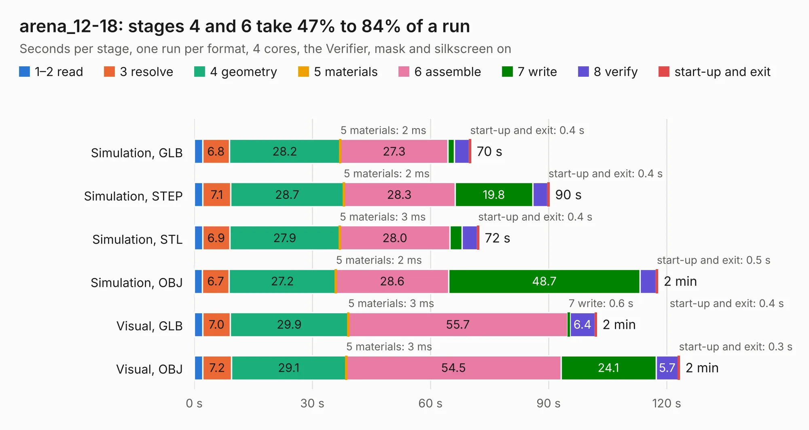

| Mode and format | 1–2 read | 3 resolve | 4 geometry | 5 materials | 6 assemble | 7 write | 8 verify | start-up and exit | Total |
|---|---:|---:|---:|---:|---:|---:|---:|---:|---:|
| Simulation, GLB | 2.1 | 6.8 | 28.2 | 2&nbsp;ms | 27.3 | 1.6 | 3.9 | 0.4 | 70.3 |
| Simulation, STEP | 2.2 | 7.1 | 28.7 | 2&nbsp;ms | 28.3 | 19.8 | 3.8 | 0.4 | 90.2 |
| Simulation, STL | 2.1 | 6.9 | 27.9 | 3&nbsp;ms | 28.0 | 3.0 | 4.0 | 0.4 | 72.3 |
| Simulation, OBJ | 2.1 | 6.7 | 27.2 | 2&nbsp;ms | 28.6 | 48.7 | 4.0 | 0.5 | 117.7 |
| Visual, GLB | 2.2 | 7.0 | 29.9 | 3&nbsp;ms | 55.7 | 0.6 | 6.4 | 0.4 | 102.2 |
| Visual, OBJ | 2.2 | 7.2 | 29.1 | 3&nbsp;ms | 54.5 | 24.1 | 5.7 | 0.3 | 123.3 |

<table align="center"><tr><td valign="top">

| Board | Repo: [iorodeo/led-display_g6_hardware_arena](https://github.com/iorodeo/led-display_g6_hardware_arena) Board: `arena_12-18.kicad_pcb` |
|---|---|
| Folder | arena_12-18 / manual_route / v1 / routed |
| Complexity | 364&nbsp;/&nbsp;1000 (size&nbsp;254, features&nbsp;110) |
| KESE&nbsp;features | through vias, slotted holes, rounded, trapezoid or chamfered pads, filled zones, curved board outline, tracks bare of mask, stack-up, dielectric εr and tanδ |
| Tested | 9th November 2026 |
| Copper&nbsp;layers | 6 |
| File&nbsp;format | KiCad 9 (20241229) |
| Parts,&nbsp;tracks,&nbsp;vias | 505, 4,090, 677 |
| Triangles,&nbsp;simulation | 7,459,160 in 516 parts |
| Verifier | PASS in all six runs |

</td><td valign="top">

<table>
<tr><th>File type</th><th>File size</th><th>Peak memory used</th></tr>
<tr><th colspan="3" align="left">Simulation</th></tr>
<tr><td>GLB</td><td align="right">248&nbsp;MB</td><td align="right">1.9&nbsp;GB</td></tr>
<tr><td>STEP</td><td align="right">815&nbsp;MB</td><td align="right">2.5&nbsp;GB</td></tr>
<tr><td>STL</td><td align="right">373&nbsp;MB</td><td align="right">1.9&nbsp;GB</td></tr>
<tr><td>OBJ</td><td align="right">787&nbsp;MB</td><td align="right">4.7&nbsp;GB</td></tr>
<tr><th colspan="3" align="left">Visual</th></tr>
<tr><td>GLB</td><td align="right">128&nbsp;MB</td><td align="right">2.3&nbsp;GB</td></tr>
<tr><td>OBJ</td><td align="right">413&nbsp;MB</td><td align="right">2.7&nbsp;GB</td></tr>
</table>

</td></tr></table>

## 23.12.45 arena_12-18

| Mode and format | 1–2 read | 3 resolve | 4 geometry | 5 materials | 6 assemble | 7 write | 8 verify | start-up and exit | Total |
|---|---:|---:|---:|---:|---:|---:|---:|---:|---:|
| Simulation, GLB | 1.2 | 4.4 | 20.5 | 2&nbsp;ms | 19.7 | 0.9 | 2.1 | 0.4 | 49.3 |
| Simulation, STEP | 1.1 | 4.5 | 20.2 | 2&nbsp;ms | 20.1 | 13.6 | 2.2 | 0.3 | 62.1 |
| Simulation, STL | 1.2 | 4.3 | 20.0 | 2&nbsp;ms | 20.9 | 2.2 | 2.2 | 0.3 | 51.1 |
| Simulation, OBJ | 1.2 | 4.4 | 20.3 | 2&nbsp;ms | 19.9 | 27.3 | 2.3 | 0.4 | 75.8 |
| Visual, GLB | 1.2 | 4.2 | 20.2 | 2&nbsp;ms | 42.2 | 0.5 | 5.4 | 0.3 | 74.1 |
| Visual, OBJ | 1.0 | 4.3 | 20.6 | 2&nbsp;ms | 42.6 | 14.9 | 4.8 | 0.3 | 88.4 |

<table align="center"><tr><td valign="top">

| Board | Repo: [iorodeo/led-display_g6_hardware_arena](https://github.com/iorodeo/led-display_g6_hardware_arena) Board: `arena_12-18.kicad_pcb` |
|---|---|
| Folder | arena_12-18 / manual_route / v2 |
| Complexity | 387&nbsp;/&nbsp;1000 (size&nbsp;242, features&nbsp;145) |
| KESE&nbsp;features | through vias, blind and buried vias, slotted holes, rounded, trapezoid or chamfered pads, arc tracks, curved board outline, tracks bare of mask, stack-up, dielectric εr and tanδ |
| Tested | 9th November 2026 |
| Copper&nbsp;layers | 6 |
| File&nbsp;format | KiCad 9 (20241229) |
| Parts,&nbsp;tracks,&nbsp;vias | 505, 1,744, 405 |
| Triangles,&nbsp;simulation | 5,657,426 in 516 parts |
| Verifier | PASS in all six runs |

</td><td valign="top">

<table>
<tr><th>File type</th><th>File size</th><th>Peak memory used</th></tr>
<tr><th colspan="3" align="left">Simulation</th></tr>
<tr><td>GLB</td><td align="right">186&nbsp;MB</td><td align="right">1.5&nbsp;GB</td></tr>
<tr><td>STEP</td><td align="right">660&nbsp;MB</td><td align="right">2.0&nbsp;GB</td></tr>
<tr><td>STL</td><td align="right">283&nbsp;MB</td><td align="right">1.5&nbsp;GB</td></tr>
<tr><td>OBJ</td><td align="right">592&nbsp;MB</td><td align="right">3.5&nbsp;GB</td></tr>
<tr><th colspan="3" align="left">Visual</th></tr>
<tr><td>GLB</td><td align="right">104&nbsp;MB</td><td align="right">1.9&nbsp;GB</td></tr>
<tr><td>OBJ</td><td align="right">327&nbsp;MB</td><td align="right">2.1&nbsp;GB</td></tr>
</table>

</td></tr></table>

## 23.12.46 arena_12-18

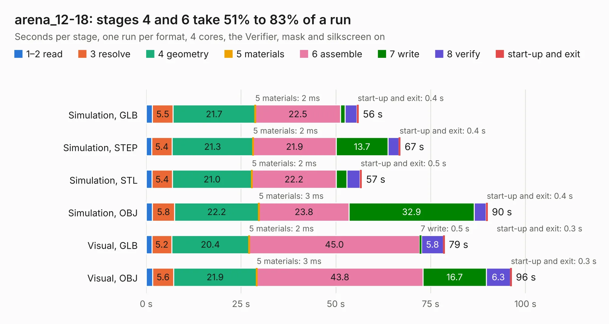

| Mode and format | 1–2 read | 3 resolve | 4 geometry | 5 materials | 6 assemble | 7 write | 8 verify | start-up and exit | Total |
|---|---:|---:|---:|---:|---:|---:|---:|---:|---:|
| Simulation, GLB | 1.6 | 5.5 | 21.7 | 2&nbsp;ms | 22.5 | 1.2 | 3.1 | 0.4 | 56.0 |
| Simulation, STEP | 1.4 | 5.4 | 21.3 | 2&nbsp;ms | 21.9 | 13.7 | 2.9 | 0.4 | 67.0 |
| Simulation, STL | 1.5 | 5.4 | 21.0 | 2&nbsp;ms | 22.2 | 2.8 | 3.4 | 0.5 | 56.8 |
| Simulation, OBJ | 1.6 | 5.8 | 22.2 | 3&nbsp;ms | 23.8 | 32.9 | 3.2 | 0.4 | 90.0 |
| Visual, GLB | 1.5 | 5.2 | 20.4 | 2&nbsp;ms | 45.0 | 0.5 | 5.8 | 0.3 | 78.7 |
| Visual, OBJ | 1.7 | 5.6 | 21.9 | 3&nbsp;ms | 43.8 | 16.7 | 6.3 | 0.3 | 96.4 |

<table align="center"><tr><td valign="top">

| Board | Repo: [iorodeo/led-display_g6_hardware_arena](https://github.com/iorodeo/led-display_g6_hardware_arena) Board: `arena_12-18.kicad_pcb` |
|---|---|
| Folder | arena_12-18 / manual_route / v2 / routed |
| Complexity | 363&nbsp;/&nbsp;1000 (size&nbsp;253, features&nbsp;110) |
| KESE&nbsp;features | through vias, slotted holes, rounded, trapezoid or chamfered pads, filled zones, curved board outline, tracks bare of mask, stack-up, dielectric εr and tanδ |
| Tested | 9th November 2026 |
| Copper&nbsp;layers | 6 |
| File&nbsp;format | KiCad 9 (20241229) |
| Parts,&nbsp;tracks,&nbsp;vias | 505, 4,129, 652 |
| Triangles,&nbsp;simulation | 7,323,260 in 516 parts |
| Verifier | PASS in all six runs |

</td><td valign="top">

<table>
<tr><th>File type</th><th>File size</th><th>Peak memory used</th></tr>
<tr><th colspan="3" align="left">Simulation</th></tr>
<tr><td>GLB</td><td align="right">244&nbsp;MB</td><td align="right">1.8&nbsp;GB</td></tr>
<tr><td>STEP</td><td align="right">805&nbsp;MB</td><td align="right">2.5&nbsp;GB</td></tr>
<tr><td>STL</td><td align="right">366&nbsp;MB</td><td align="right">1.9&nbsp;GB</td></tr>
<tr><td>OBJ</td><td align="right">772&nbsp;MB</td><td align="right">4.6&nbsp;GB</td></tr>
<tr><th colspan="3" align="left">Visual</th></tr>
<tr><td>GLB</td><td align="right">126&nbsp;MB</td><td align="right">2.2&nbsp;GB</td></tr>
<tr><td>OBJ</td><td align="right">406&nbsp;MB</td><td align="right">2.6&nbsp;GB</td></tr>
</table>

</td></tr></table>

## 23.12.47 E1S_10slot_80x45_12V

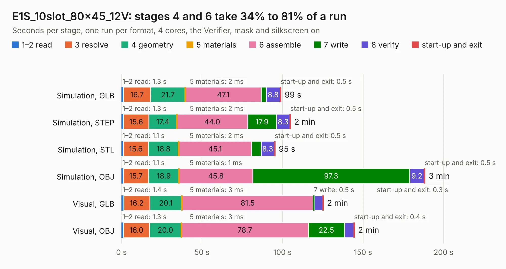

| Mode and format | 1–2 read | 3 resolve | 4 geometry | 5 materials | 6 assemble | 7 write | 8 verify | start-up and exit | Total |
|---|---:|---:|---:|---:|---:|---:|---:|---:|---:|
| Simulation, GLB | 1.3 | 16.7 | 21.7 | 2&nbsp;ms | 47.1 | 3.1 | 8.8 | 0.5 | 99.1 |
| Simulation, STEP | 1.3 | 15.6 | 17.4 | 2&nbsp;ms | 44.0 | 17.9 | 8.3 | 0.5 | 105.1 |
| Simulation, STL | 1.1 | 15.6 | 18.8 | 2&nbsp;ms | 45.1 | 6.0 | 8.3 | 0.5 | 95.5 |
| Simulation, OBJ | 1.1 | 15.7 | 18.9 | 1&nbsp;ms | 45.8 | 97.3 | 9.2 | 0.5 | 188.5 |
| Visual, GLB | 1.4 | 16.2 | 20.1 | 3&nbsp;ms | 81.5 | 0.5 | 5.4 | 0.3 | 125.4 |
| Visual, OBJ | 1.3 | 16.0 | 20.0 | 3&nbsp;ms | 78.7 | 22.5 | 5.8 | 0.4 | 144.7 |

<table align="center"><tr><td valign="top">

| Board | Repo: [isarmg/pcie-switch-2](https://github.com/isarmg/pcie-switch-2) Board: `E1S_10slot_80x45_12V.kicad_pcb` |
|---|---|
| Folder | outputs / E1S_10slot_80x45_12V |
| Complexity | 406&nbsp;/&nbsp;1000 (size&nbsp;321, features&nbsp;85) |
| KESE&nbsp;features | through vias, blind and buried vias, rounded, trapezoid or chamfered pads, filled zones |
| Tested | 9th November 2026 |
| Copper&nbsp;layers | 20 |
| File&nbsp;format | KiCad 10 (20260206) |
| Parts,&nbsp;tracks,&nbsp;vias | 124, 3,688, 1,081 |
| Triangles,&nbsp;simulation | 13,560,038 in 502 parts |
| Verifier | PASS in all six runs |

</td><td valign="top">

<table>
<tr><th>File type</th><th>File size</th><th>Peak memory used</th></tr>
<tr><th colspan="3" align="left">Simulation</th></tr>
<tr><td>GLB</td><td align="right">455&nbsp;MB</td><td align="right">2.3&nbsp;GB</td></tr>
<tr><td>STEP</td><td align="right">679&nbsp;MB</td><td align="right">3.1&nbsp;GB</td></tr>
<tr><td>STL</td><td align="right">678&nbsp;MB</td><td align="right">2.5&nbsp;GB</td></tr>
<tr><td>OBJ</td><td align="right">1.5&nbsp;GB</td><td align="right">8.3&nbsp;GB</td></tr>
<tr><th colspan="3" align="left">Visual</th></tr>
<tr><td>GLB</td><td align="right">96&nbsp;MB</td><td align="right">2.2&nbsp;GB</td></tr>
<tr><td>OBJ</td><td align="right">366&nbsp;MB</td><td align="right">2.5&nbsp;GB</td></tr>
</table>

</td></tr></table>

## 23.12.48 Assembly_View

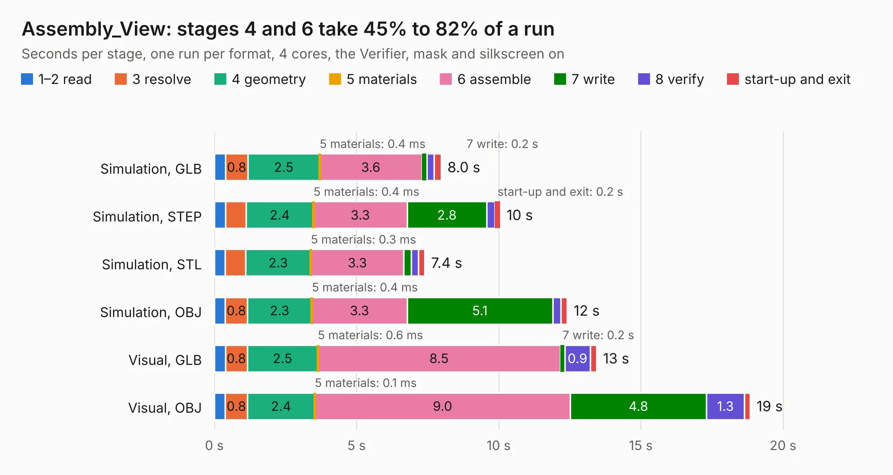

| Mode and format | 1–2 read | 3 resolve | 4 geometry | 5 materials | 6 assemble | 7 write | 8 verify | start-up and exit | Total |
|---|---:|---:|---:|---:|---:|---:|---:|---:|---:|
| Simulation, GLB | 0.4 | 0.8 | 2.5 | 0.4&nbsp;ms | 3.6 | 0.2 | 0.3 | 0.2 | 8.0 |
| Simulation, STEP | 0.4 | 0.7 | 2.4 | 0.4&nbsp;ms | 3.3 | 2.8 | 0.3 | 0.2 | 10.1 |
| Simulation, STL | 0.4 | 0.7 | 2.3 | 0.3&nbsp;ms | 3.3 | 0.3 | 0.3 | 0.2 | 7.4 |
| Simulation, OBJ | 0.4 | 0.8 | 2.3 | 0.4&nbsp;ms | 3.3 | 5.1 | 0.3 | 0.2 | 12.4 |
| Visual, GLB | 0.4 | 0.8 | 2.5 | 0.6&nbsp;ms | 8.5 | 0.2 | 0.9 | 0.2 | 13.4 |
| Visual, OBJ | 0.4 | 0.8 | 2.4 | 0.1&nbsp;ms | 9.0 | 4.8 | 1.3 | 0.2 | 18.8 |

<table align="center"><tr><td valign="top">

| Board | Repo: [isarmg/pcie-switch-2](https://github.com/isarmg/pcie-switch-2) Board: `Assembly_View.kicad_pcb` |
|---|---|
| Folder | outputs / PCIe_3board_RevI / Assembly_View |
| Complexity | 140&nbsp;/&nbsp;1000 (size&nbsp;130, features&nbsp;10) |
| KESE&nbsp;features | rounded, trapezoid or chamfered pads |
| Tested | 9th November 2026 |
| Copper&nbsp;layers | 2 |
| File&nbsp;format | KiCad 10 (20260206) |
| Parts,&nbsp;tracks,&nbsp;vias | 292, 0, 0 |
| Triangles,&nbsp;simulation | 929,848 in 9 parts |
| Note | mostly unrouted |
| Verifier | PASS in all six runs |

</td><td valign="top">

<table>
<tr><th>File type</th><th>File size</th><th>Peak memory used</th></tr>
<tr><th colspan="3" align="left">Simulation</th></tr>
<tr><td>GLB</td><td align="right">35&nbsp;MB</td><td align="right">548&nbsp;MB</td></tr>
<tr><td>STEP</td><td align="right">149&nbsp;MB</td><td align="right">592&nbsp;MB</td></tr>
<tr><td>STL</td><td align="right">46&nbsp;MB</td><td align="right">533&nbsp;MB</td></tr>
<tr><td>OBJ</td><td align="right">100&nbsp;MB</td><td align="right">680&nbsp;MB</td></tr>
<tr><th colspan="3" align="left">Visual</th></tr>
<tr><td>GLB</td><td align="right">32&nbsp;MB</td><td align="right">736&nbsp;MB</td></tr>
<tr><td>OBJ</td><td align="right">95&nbsp;MB</td><td align="right">814&nbsp;MB</td></tr>
</table>

</td></tr></table>

## 23.12.49 Left_2M2_Vertical

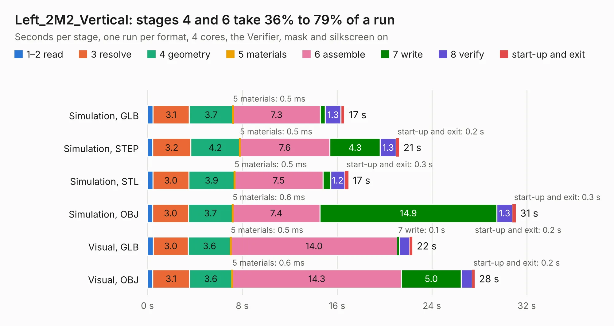

| Mode and format | 1–2 read | 3 resolve | 4 geometry | 5 materials | 6 assemble | 7 write | 8 verify | start-up and exit | Total |
|---|---:|---:|---:|---:|---:|---:|---:|---:|---:|
| Simulation, GLB | 0.5 | 3.1 | 3.7 | 0.5&nbsp;ms | 7.3 | 0.4 | 1.3 | 0.3 | 16.6 |
| Simulation, STEP | 0.5 | 3.2 | 4.2 | 0.5&nbsp;ms | 7.6 | 4.3 | 1.3 | 0.2 | 21.2 |
| Simulation, STL | 0.5 | 3.0 | 3.9 | 0.5&nbsp;ms | 7.5 | 0.6 | 1.2 | 0.3 | 17.0 |
| Simulation, OBJ | 0.4 | 3.0 | 3.7 | 0.6&nbsp;ms | 7.4 | 14.9 | 1.3 | 0.3 | 31.1 |
| Visual, GLB | 0.5 | 3.0 | 3.6 | 0.5&nbsp;ms | 14.0 | 0.1 | 0.9 | 0.2 | 22.4 |
| Visual, OBJ | 0.4 | 3.1 | 3.6 | 0.6&nbsp;ms | 14.3 | 5.0 | 0.9 | 0.2 | 27.6 |

<table align="center"><tr><td valign="top">

| Board | Repo: [isarmg/pcie-switch-2](https://github.com/isarmg/pcie-switch-2) Board: `Left_2M2_Vertical.kicad_pcb` |
|---|---|
| Folder | outputs / PCIe_3board_RevI / Left_2M2_Vertical |
| Complexity | 271&nbsp;/&nbsp;1000 (size&nbsp;226, features&nbsp;45) |
| KESE&nbsp;features | through vias, rounded, trapezoid or chamfered pads, filled zones |
| Tested | 9th November 2026 |
| Copper&nbsp;layers | 12 |
| File&nbsp;format | KiCad 10 (20260206) |
| Parts,&nbsp;tracks,&nbsp;vias | 62, 794, 266 |
| Triangles,&nbsp;simulation | 2,743,606 in 133 parts |
| Verifier | PASS in all six runs |

</td><td valign="top">

<table>
<tr><th>File type</th><th>File size</th><th>Peak memory used</th></tr>
<tr><th colspan="3" align="left">Simulation</th></tr>
<tr><td>GLB</td><td align="right">88&nbsp;MB</td><td align="right">761&nbsp;MB</td></tr>
<tr><td>STEP</td><td align="right">181&nbsp;MB</td><td align="right">866&nbsp;MB</td></tr>
<tr><td>STL</td><td align="right">137&nbsp;MB</td><td align="right">733&nbsp;MB</td></tr>
<tr><td>OBJ</td><td align="right">295&nbsp;MB</td><td align="right">1.8&nbsp;GB</td></tr>
<tr><th colspan="3" align="left">Visual</th></tr>
<tr><td>GLB</td><td align="right">30&nbsp;MB</td><td align="right">677&nbsp;MB</td></tr>
<tr><td>OBJ</td><td align="right">97&nbsp;MB</td><td align="right">801&nbsp;MB</td></tr>
</table>

</td></tr></table>

## 23.12.50 Main_10E1S

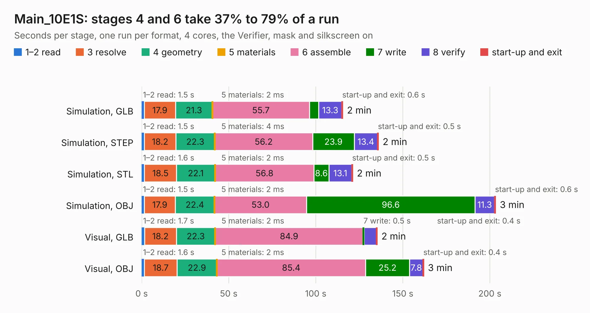

| Mode and format | 1–2 read | 3 resolve | 4 geometry | 5 materials | 6 assemble | 7 write | 8 verify | start-up and exit | Total |
|---|---:|---:|---:|---:|---:|---:|---:|---:|---:|
| Simulation, GLB | 1.5 | 17.9 | 21.3 | 2&nbsp;ms | 55.7 | 5.4 | 13.3 | 0.6 | 115.5 |
| Simulation, STEP | 1.5 | 18.2 | 22.3 | 4&nbsp;ms | 56.2 | 23.9 | 13.4 | 0.5 | 136.0 |
| Simulation, STL | 1.6 | 18.5 | 22.1 | 2&nbsp;ms | 56.8 | 8.6 | 13.1 | 0.5 | 121.2 |
| Simulation, OBJ |  |  |  |  |  |  |  |  | exceeded 11 GB on a 15 GB machine (stopped there, not a KESE failure) |
| Visual, GLB | 1.7 | 18.2 | 22.3 | 2&nbsp;ms | 84.9 | 0.5 | 7.2 | 0.4 | 135.3 |
| Visual, OBJ | 1.6 | 18.7 | 22.9 | 2&nbsp;ms | 85.4 | 25.2 | 7.8 | 0.4 | 162.0 |

<table align="center"><tr><td valign="top">

| Board | Repo: [isarmg/pcie-switch-2](https://github.com/isarmg/pcie-switch-2) Board: `Main_10E1S.kicad_pcb` |
|---|---|
| Folder | outputs / PCIe_3board_RevI / Main_10E1S |
| Complexity | 425&nbsp;/&nbsp;1000 (size&nbsp;340, features&nbsp;85) |
| KESE&nbsp;features | through vias, blind and buried vias, rounded, trapezoid or chamfered pads, filled zones |
| Tested | 9th November 2026 |
| Copper&nbsp;layers | 32 |
| File&nbsp;format | KiCad 10 (20260206) |
| Parts,&nbsp;tracks,&nbsp;vias | 180, 4,374, 1,354 |
| Triangles,&nbsp;simulation | 20,050,560 in 674 parts |
| Verifier | Simulation, OBJ: exceeded 11 GB on a 15 GB machine (stopped there, not a KESE failure) |

</td><td valign="top">

<table>
<tr><th>File type</th><th>File size</th><th>Peak memory used</th></tr>
<tr><th colspan="3" align="left">Simulation</th></tr>
<tr><td>GLB</td><td align="right">659&nbsp;MB</td><td align="right">3.4&nbsp;GB</td></tr>
<tr><td>STEP</td><td align="right">946&nbsp;MB</td><td align="right">4.1&nbsp;GB</td></tr>
<tr><td>STL</td><td align="right">1.0&nbsp;GB</td><td align="right">3.9&nbsp;GB</td></tr>
<tr><td>OBJ</td><td align="right">–</td><td align="right">11&nbsp;GB</td></tr>
<tr><th colspan="3" align="left">Visual</th></tr>
<tr><td>GLB</td><td align="right">123&nbsp;MB</td><td align="right">2.9&nbsp;GB</td></tr>
<tr><td>OBJ</td><td align="right">483&nbsp;MB</td><td align="right">3.2&nbsp;GB</td></tr>
</table>

</td></tr></table>

## 23.12.51 Right_M2_Upstream

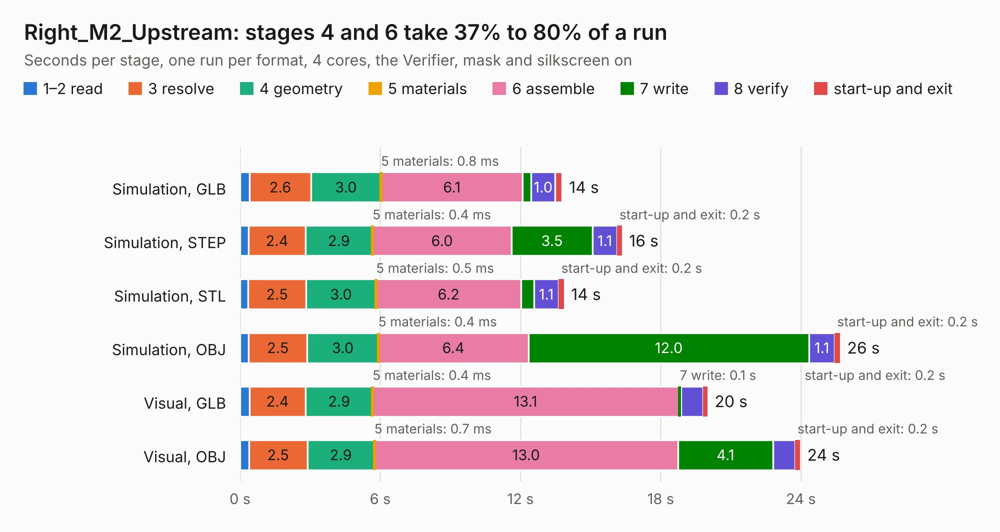

| Mode and format | 1–2 read | 3 resolve | 4 geometry | 5 materials | 6 assemble | 7 write | 8 verify | start-up and exit | Total |
|---|---:|---:|---:|---:|---:|---:|---:|---:|---:|
| Simulation, GLB | 0.4 | 2.6 | 3.0 | 0.8&nbsp;ms | 6.1 | 0.4 | 1.0 | 0.3 | 13.8 |
| Simulation, STEP | 0.4 | 2.4 | 2.9 | 0.4&nbsp;ms | 6.0 | 3.5 | 1.1 | 0.2 | 16.3 |
| Simulation, STL | 0.3 | 2.5 | 3.0 | 0.5&nbsp;ms | 6.2 | 0.5 | 1.1 | 0.2 | 13.9 |
| Simulation, OBJ | 0.4 | 2.5 | 3.0 | 0.4&nbsp;ms | 6.4 | 12.0 | 1.1 | 0.2 | 25.7 |
| Visual, GLB | 0.4 | 2.4 | 2.9 | 0.4&nbsp;ms | 13.1 | 0.1 | 0.9 | 0.2 | 20.0 |
| Visual, OBJ | 0.4 | 2.5 | 2.9 | 0.7&nbsp;ms | 13.0 | 4.1 | 0.9 | 0.2 | 24.0 |

<table align="center"><tr><td valign="top">

| Board | Repo: [isarmg/pcie-switch-2](https://github.com/isarmg/pcie-switch-2) Board: `Right_M2_Upstream.kicad_pcb` |
|---|---|
| Folder | outputs / PCIe_3board_RevI / Right_M2_Upstream |
| Complexity | 265&nbsp;/&nbsp;1000 (size&nbsp;220, features&nbsp;45) |
| KESE&nbsp;features | through vias, rounded, trapezoid or chamfered pads, filled zones |
| Tested | 9th November 2026 |
| Copper&nbsp;layers | 12 |
| File&nbsp;format | KiCad 10 (20260206) |
| Parts,&nbsp;tracks,&nbsp;vias | 50, 665, 225 |
| Triangles,&nbsp;simulation | 2,311,570 in 138 parts |
| Verifier | PASS in all six runs |

</td><td valign="top">

<table>
<tr><th>File type</th><th>File size</th><th>Peak memory used</th></tr>
<tr><th colspan="3" align="left">Simulation</th></tr>
<tr><td>GLB</td><td align="right">75&nbsp;MB</td><td align="right">673&nbsp;MB</td></tr>
<tr><td>STEP</td><td align="right">152&nbsp;MB</td><td align="right">773&nbsp;MB</td></tr>
<tr><td>STL</td><td align="right">116&nbsp;MB</td><td align="right">690&nbsp;MB</td></tr>
<tr><td>OBJ</td><td align="right">248&nbsp;MB</td><td align="right">1.5&nbsp;GB</td></tr>
<tr><th colspan="3" align="left">Visual</th></tr>
<tr><td>GLB</td><td align="right">24&nbsp;MB</td><td align="right">607&nbsp;MB</td></tr>
<tr><td>OBJ</td><td align="right">78&nbsp;MB</td><td align="right">643&nbsp;MB</td></tr>
</table>

</td></tr></table>

## 23.12.52 Assembly_View

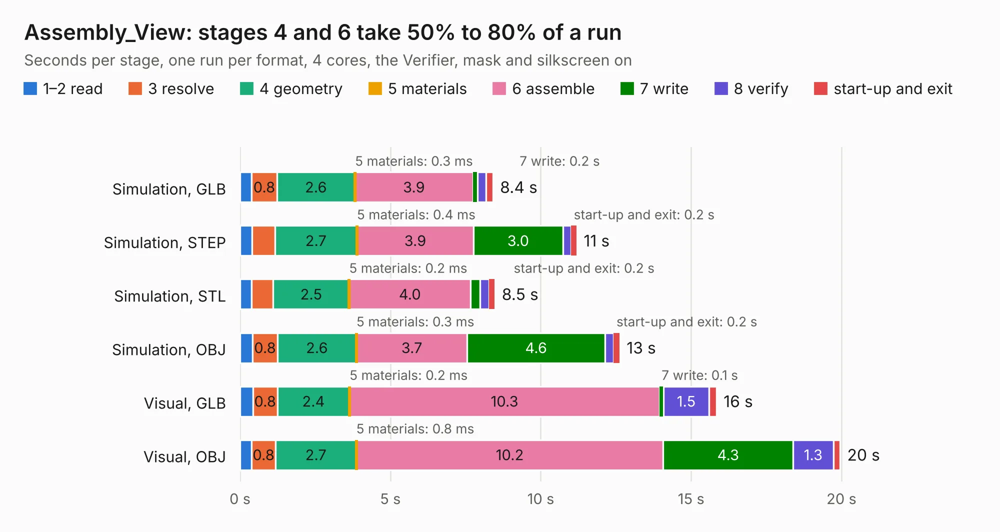

| Mode and format | 1–2 read | 3 resolve | 4 geometry | 5 materials | 6 assemble | 7 write | 8 verify | start-up and exit | Total |
|---|---:|---:|---:|---:|---:|---:|---:|---:|---:|
| Simulation, GLB | 0.4 | 0.8 | 2.6 | 0.3&nbsp;ms | 3.9 | 0.2 | 0.3 | 0.2 | 8.4 |
| Simulation, STEP | 0.4 | 0.8 | 2.7 | 0.4&nbsp;ms | 3.9 | 3.0 | 0.3 | 0.2 | 11.2 |
| Simulation, STL | 0.4 | 0.7 | 2.5 | 0.2&nbsp;ms | 4.0 | 0.3 | 0.3 | 0.2 | 8.5 |
| Simulation, OBJ | 0.4 | 0.8 | 2.6 | 0.3&nbsp;ms | 3.7 | 4.6 | 0.3 | 0.2 | 12.6 |
| Visual, GLB | 0.4 | 0.8 | 2.4 | 0.2&nbsp;ms | 10.3 | 0.1 | 1.5 | 0.3 | 15.8 |
| Visual, OBJ | 0.4 | 0.8 | 2.7 | 0.8&nbsp;ms | 10.2 | 4.3 | 1.3 | 0.2 | 20.0 |

<table align="center"><tr><td valign="top">

| Board | Repo: [isarmg/pcie-switch-2](https://github.com/isarmg/pcie-switch-2) Board: `Assembly_View.kicad_pcb` |
|---|---|
| Folder | outputs / PCIe_3board_RevJ / Assembly_View |
| Complexity | 143&nbsp;/&nbsp;1000 (size&nbsp;133, features&nbsp;10) |
| KESE&nbsp;features | rounded, trapezoid or chamfered pads |
| Tested | 9th November 2026 |
| Copper&nbsp;layers | 2 |
| File&nbsp;format | KiCad 10 (20260206) |
| Parts,&nbsp;tracks,&nbsp;vias | 370, 0, 0 |
| Triangles,&nbsp;simulation | 1,065,008 in 9 parts |
| Note | mostly unrouted |
| Verifier | PASS in all six runs |

</td><td valign="top">

<table>
<tr><th>File type</th><th>File size</th><th>Peak memory used</th></tr>
<tr><th colspan="3" align="left">Simulation</th></tr>
<tr><td>GLB</td><td align="right">40&nbsp;MB</td><td align="right">575&nbsp;MB</td></tr>
<tr><td>STEP</td><td align="right">174&nbsp;MB</td><td align="right">670&nbsp;MB</td></tr>
<tr><td>STL</td><td align="right">53&nbsp;MB</td><td align="right">580&nbsp;MB</td></tr>
<tr><td>OBJ</td><td align="right">116&nbsp;MB</td><td align="right">791&nbsp;MB</td></tr>
<tr><th colspan="3" align="left">Visual</th></tr>
<tr><td>GLB</td><td align="right">37&nbsp;MB</td><td align="right">726&nbsp;MB</td></tr>
<tr><td>OBJ</td><td align="right">110&nbsp;MB</td><td align="right">963&nbsp;MB</td></tr>
</table>

</td></tr></table>

## 23.12.53 Left_2M2_Vertical

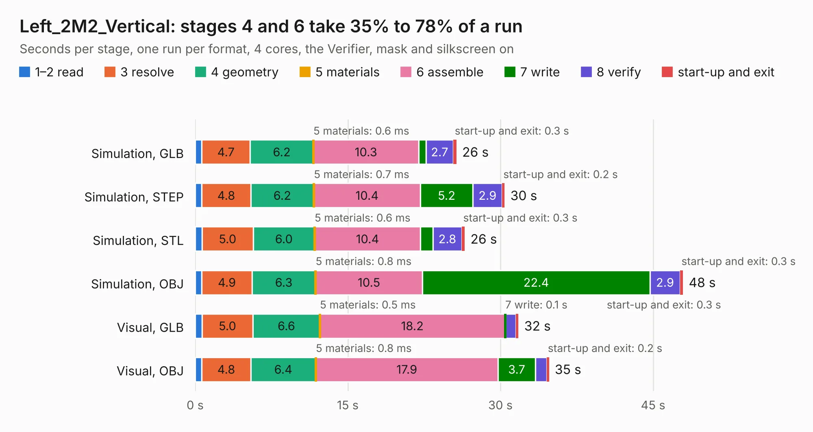

| Mode and format | 1–2 read | 3 resolve | 4 geometry | 5 materials | 6 assemble | 7 write | 8 verify | start-up and exit | Total |
|---|---:|---:|---:|---:|---:|---:|---:|---:|---:|
| Simulation, GLB | 0.7 | 4.7 | 6.2 | 0.6&nbsp;ms | 10.3 | 0.7 | 2.7 | 0.3 | 25.7 |
| Simulation, STEP | 0.7 | 4.8 | 6.2 | 0.7&nbsp;ms | 10.4 | 5.2 | 2.9 | 0.2 | 30.4 |
| Simulation, STL | 0.7 | 5.0 | 6.0 | 0.6&nbsp;ms | 10.4 | 1.2 | 2.8 | 0.3 | 26.5 |
| Simulation, OBJ | 0.7 | 4.9 | 6.3 | 0.8&nbsp;ms | 10.5 | 22.4 | 2.9 | 0.3 | 47.9 |
| Visual, GLB | 0.7 | 5.0 | 6.6 | 0.5&nbsp;ms | 18.2 | 0.1 | 1.0 | 0.3 | 31.8 |
| Visual, OBJ | 0.6 | 4.8 | 6.4 | 0.8&nbsp;ms | 17.9 | 3.7 | 1.1 | 0.2 | 34.8 |

<table align="center"><tr><td valign="top">

| Board | Repo: [isarmg/pcie-switch-2](https://github.com/isarmg/pcie-switch-2) Board: `Left_2M2_Vertical.kicad_pcb` |
|---|---|
| Folder | outputs / PCIe_3board_RevJ / Left_2M2_Vertical |
| Complexity | 345&nbsp;/&nbsp;1000 (size&nbsp;260, features&nbsp;85) |
| KESE&nbsp;features | through vias, blind and buried vias, rounded, trapezoid or chamfered pads, filled zones |
| Tested | 9th November 2026 |
| Copper&nbsp;layers | 32 |
| File&nbsp;format | KiCad 10 (20260206) |
| Parts,&nbsp;tracks,&nbsp;vias | 92, 1,023, 452 |
| Triangles,&nbsp;simulation | 5,219,168 in 207 parts |
| Verifier | PASS in all six runs |

</td><td valign="top">

<table>
<tr><th>File type</th><th>File size</th><th>Peak memory used</th></tr>
<tr><th colspan="3" align="left">Simulation</th></tr>
<tr><td>GLB</td><td align="right">177&nbsp;MB</td><td align="right">960&nbsp;MB</td></tr>
<tr><td>STEP</td><td align="right">229&nbsp;MB</td><td align="right">1.1&nbsp;GB</td></tr>
<tr><td>STL</td><td align="right">261&nbsp;MB</td><td align="right">1.1&nbsp;GB</td></tr>
<tr><td>OBJ</td><td align="right">577&nbsp;MB</td><td align="right">3.3&nbsp;GB</td></tr>
<tr><th colspan="3" align="left">Visual</th></tr>
<tr><td>GLB</td><td align="right">27&nbsp;MB</td><td align="right">808&nbsp;MB</td></tr>
<tr><td>OBJ</td><td align="right">93&nbsp;MB</td><td align="right">816&nbsp;MB</td></tr>
</table>

</td></tr></table>

## 23.12.54 Main_10E1S

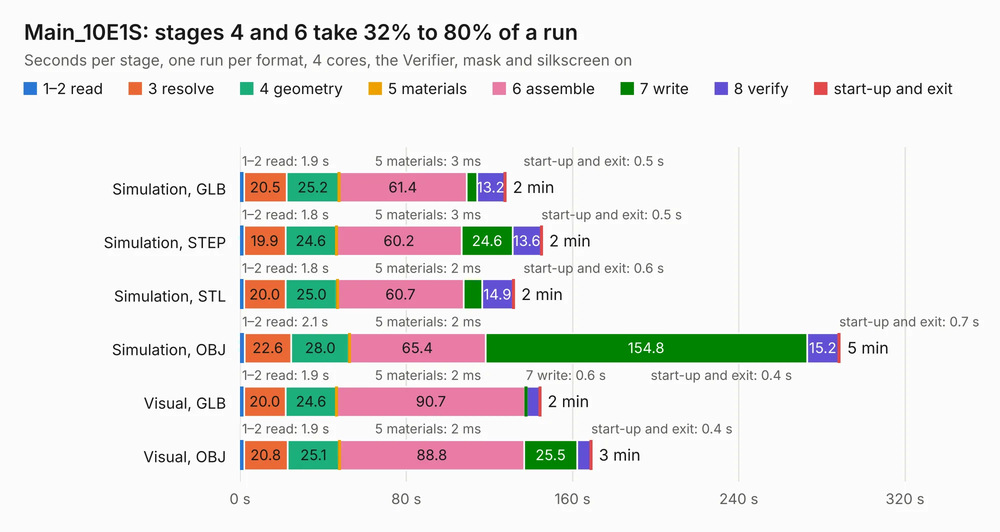

| Mode and format | 1–2 read | 3 resolve | 4 geometry | 5 materials | 6 assemble | 7 write | 8 verify | start-up and exit | Total |
|---|---:|---:|---:|---:|---:|---:|---:|---:|---:|
| Simulation, GLB | 1.9 | 20.5 | 25.2 | 3&nbsp;ms | 61.4 | 5.0 | 13.2 | 0.5 | 127.8 |
| Simulation, STEP | 1.8 | 19.9 | 24.6 | 3&nbsp;ms | 60.2 | 24.6 | 13.6 | 0.5 | 145.3 |
| Simulation, STL | 1.8 | 20.0 | 25.0 | 2&nbsp;ms | 60.7 | 8.9 | 14.9 | 0.6 | 131.9 |
| Simulation, OBJ |  |  |  |  |  |  |  |  | exceeded 11 GB on a 15 GB machine (stopped there, not a KESE failure) |
| Visual, GLB | 1.9 | 20.0 | 24.6 | 2&nbsp;ms | 90.7 | 0.6 | 6.3 | 0.4 | 144.5 |
| Visual, OBJ | 1.9 | 20.8 | 25.1 | 2&nbsp;ms | 88.8 | 25.5 | 6.7 | 0.4 | 169.2 |

<table align="center"><tr><td valign="top">

| Board | Repo: [isarmg/pcie-switch-2](https://github.com/isarmg/pcie-switch-2) Board: `Main_10E1S.kicad_pcb` |
|---|---|
| Folder | outputs / PCIe_3board_RevJ / Main_10E1S |
| Complexity | 428&nbsp;/&nbsp;1000 (size&nbsp;343, features&nbsp;85) |
| KESE&nbsp;features | through vias, blind and buried vias, rounded, trapezoid or chamfered pads, filled zones |
| Tested | 9th November 2026 |
| Copper&nbsp;layers | 32 |
| File&nbsp;format | KiCad 10 (20260206) |
| Parts,&nbsp;tracks,&nbsp;vias | 198, 5,142, 1,511 |
| Triangles,&nbsp;simulation | 21,580,684 in 674 parts |
| Verifier | Simulation, OBJ: exceeded 11 GB on a 15 GB machine (stopped there, not a KESE failure) |

</td><td valign="top">

<table>
<tr><th>File type</th><th>File size</th><th>Peak memory used</th></tr>
<tr><th colspan="3" align="left">Simulation</th></tr>
<tr><td>GLB</td><td align="right">708&nbsp;MB</td><td align="right">3.7&nbsp;GB</td></tr>
<tr><td>STEP</td><td align="right">1.0&nbsp;GB</td><td align="right">4.3&nbsp;GB</td></tr>
<tr><td>STL</td><td align="right">1.1&nbsp;GB</td><td align="right">4.2&nbsp;GB</td></tr>
<tr><td>OBJ</td><td align="right">–</td><td align="right">11&nbsp;GB</td></tr>
<tr><th colspan="3" align="left">Visual</th></tr>
<tr><td>GLB</td><td align="right">132&nbsp;MB</td><td align="right">3.0&nbsp;GB</td></tr>
<tr><td>OBJ</td><td align="right">518&nbsp;MB</td><td align="right">3.3&nbsp;GB</td></tr>
</table>

</td></tr></table>

## 23.12.55 Right_M2_Upstream

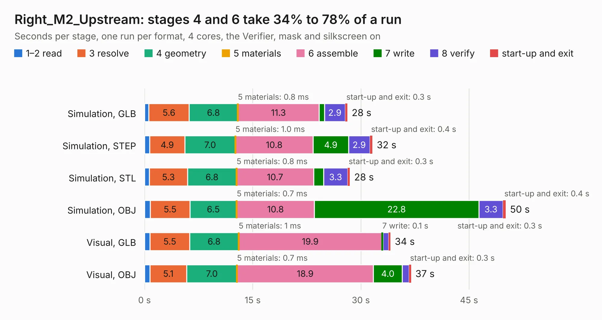

| Mode and format | 1–2 read | 3 resolve | 4 geometry | 5 materials | 6 assemble | 7 write | 8 verify | start-up and exit | Total |
|---|---:|---:|---:|---:|---:|---:|---:|---:|---:|
| Simulation, GLB | 0.6 | 5.6 | 6.8 | 0.8&nbsp;ms | 11.3 | 0.7 | 2.9 | 0.3 | 28.1 |
| Simulation, STEP | 0.7 | 4.9 | 7.0 | 1.0&nbsp;ms | 10.8 | 4.9 | 2.9 | 0.4 | 31.6 |
| Simulation, STL | 0.7 | 5.3 | 6.8 | 0.8&nbsp;ms | 10.7 | 1.4 | 3.3 | 0.3 | 28.5 |
| Simulation, OBJ | 0.8 | 5.5 | 6.5 | 0.7&nbsp;ms | 10.8 | 22.8 | 3.3 | 0.4 | 50.1 |
| Visual, GLB | 0.8 | 5.5 | 6.8 | 1&nbsp;ms | 19.9 | 0.1 | 0.8 | 0.3 | 34.1 |
| Visual, OBJ | 0.7 | 5.1 | 7.0 | 0.7&nbsp;ms | 18.9 | 4.0 | 1.0 | 0.3 | 37.0 |

<table align="center"><tr><td valign="top">

| Board | Repo: [isarmg/pcie-switch-2](https://github.com/isarmg/pcie-switch-2) Board: `Right_M2_Upstream.kicad_pcb` |
|---|---|
| Folder | outputs / PCIe_3board_RevJ / Right_M2_Upstream |
| Complexity | 342&nbsp;/&nbsp;1000 (size&nbsp;257, features&nbsp;85) |
| KESE&nbsp;features | through vias, blind and buried vias, rounded, trapezoid or chamfered pads, filled zones |
| Tested | 9th November 2026 |
| Copper&nbsp;layers | 32 |
| File&nbsp;format | KiCad 10 (20260206) |
| Parts,&nbsp;tracks,&nbsp;vias | 80, 866, 424 |
| Triangles,&nbsp;simulation | 4,790,716 in 212 parts |
| Verifier | PASS in all six runs |

</td><td valign="top">

<table>
<tr><th>File type</th><th>File size</th><th>Peak memory used</th></tr>
<tr><th colspan="3" align="left">Simulation</th></tr>
<tr><td>GLB</td><td align="right">162&nbsp;MB</td><td align="right">874&nbsp;MB</td></tr>
<tr><td>STEP</td><td align="right">208&nbsp;MB</td><td align="right">1.1&nbsp;GB</td></tr>
<tr><td>STL</td><td align="right">240&nbsp;MB</td><td align="right">1.0&nbsp;GB</td></tr>
<tr><td>OBJ</td><td align="right">531&nbsp;MB</td><td align="right">3.0&nbsp;GB</td></tr>
<tr><th colspan="3" align="left">Visual</th></tr>
<tr><td>GLB</td><td align="right">25&nbsp;MB</td><td align="right">759&nbsp;MB</td></tr>
<tr><td>OBJ</td><td align="right">86&nbsp;MB</td><td align="right">764&nbsp;MB</td></tr>
</table>

</td></tr></table>

## 23.12.56 Assembly_View

| Mode and format | 1–2 read | 3 resolve | 4 geometry | 5 materials | 6 assemble | 7 write | 8 verify | start-up and exit | Total |
|---|---:|---:|---:|---:|---:|---:|---:|---:|---:|
| Simulation, GLB | 0.6 | 2.6 | 16.5 | 0.6&nbsp;ms | 17.6 | 0.5 | 1.0 | 0.3 | 39.1 |
| Simulation, STEP | 0.7 | 2.9 | 17.1 | 0.1&nbsp;ms | 18.0 | 10.6 | 1.1 | 0.4 | 50.8 |
| Simulation, STL | 0.9 | 2.7 | 17.0 | 0.2&nbsp;ms | 16.9 | 0.9 | 0.9 | 0.3 | 39.6 |
| Simulation, OBJ | 0.8 | 2.7 | 17.0 | 3&nbsp;ms | 17.0 | 14.4 | 0.9 | 0.3 | 53.1 |
| Visual, GLB | 0.7 | 2.7 | 16.2 | 0.1&nbsp;ms | 21.7 | 0.3 | 3.2 | 0.2 | 45.2 |
| Visual, OBJ | 0.7 | 2.6 | 16.6 | 0.2&nbsp;ms | 21.7 | 9.7 | 3.5 | 0.3 | 55.1 |

<table align="center"><tr><td valign="top">

| Board | Repo: [isarmg/pcie-switch-2](https://github.com/isarmg/pcie-switch-2) Board: `Assembly_View.kicad_pcb` |
|---|---|
| Folder | outputs / PCIe_3board_RevK / Assembly_View |
| Complexity | 153&nbsp;/&nbsp;1000 (size&nbsp;133, features&nbsp;20) |
| KESE&nbsp;features | slotted holes, rounded, trapezoid or chamfered pads |
| Tested | 9th November 2026 |
| Copper&nbsp;layers | 2 |
| File&nbsp;format | KiCad 10 (20260206) |
| Parts,&nbsp;tracks,&nbsp;vias | 381, 0, 0 |
| Triangles,&nbsp;simulation | 2,771,572 in 11 parts |
| Note | mostly unrouted |
| Verifier | PASS in all six runs |

</td><td valign="top">

<table>
<tr><th>File type</th><th>File size</th><th>Peak memory used</th></tr>
<tr><th colspan="3" align="left">Simulation</th></tr>
<tr><td>GLB</td><td align="right">99&nbsp;MB</td><td align="right">1.1&nbsp;GB</td></tr>
<tr><td>STEP</td><td align="right">555&nbsp;MB</td><td align="right">1.5&nbsp;GB</td></tr>
<tr><td>STL</td><td align="right">139&nbsp;MB</td><td align="right">1.1&nbsp;GB</td></tr>
<tr><td>OBJ</td><td align="right">305&nbsp;MB</td><td align="right">1.9&nbsp;GB</td></tr>
<tr><th colspan="3" align="left">Visual</th></tr>
<tr><td>GLB</td><td align="right">65&nbsp;MB</td><td align="right">1.3&nbsp;GB</td></tr>
<tr><td>OBJ</td><td align="right">202&nbsp;MB</td><td align="right">1.4&nbsp;GB</td></tr>
</table>

</td></tr></table>

## 23.12.57 Main_10E1S

| Mode and format | 1–2 read | 3 resolve | 4 geometry | 5 materials | 6 assemble | 7 write | 8 verify | start-up and exit | Total |
|---|---:|---:|---:|---:|---:|---:|---:|---:|---:|
| Simulation, GLB | 0.6 | 3.1 | 14.0 | 2&nbsp;ms | 18.6 | 0.5 | 1.3 | 0.4 | 38.5 |
| Simulation, STEP | 0.6 | 2.9 | 14.8 | 2&nbsp;ms | 19.0 | 11.7 | 1.3 | 0.3 | 50.6 |
| Simulation, STL | 0.7 | 3.0 | 14.3 | 2&nbsp;ms | 18.8 | 1.2 | 1.7 | 0.3 | 40.0 |
| Simulation, OBJ | 0.6 | 3.0 | 14.8 | 2&nbsp;ms | 18.6 | 16.0 | 1.5 | 0.3 | 54.7 |
| Visual, GLB | 0.7 | 2.9 | 13.9 | 2&nbsp;ms | 41.5 | 0.2 | 2.2 | 0.3 | 61.7 |
| Visual, OBJ | 0.6 | 3.0 | 14.2 | 3&nbsp;ms | 41.5 | 9.3 | 2.6 | 0.3 | 71.4 |

<table align="center"><tr><td valign="top">

| Board | Repo: [isarmg/pcie-switch-2](https://github.com/isarmg/pcie-switch-2) Board: `Main_10E1S.kicad_pcb` |
|---|---|
| Folder | outputs / PCIe_3board_RevK / Main_10E1S |
| Complexity | 213&nbsp;/&nbsp;1000 (size&nbsp;193, features&nbsp;20) |
| KESE&nbsp;features | slotted holes, rounded, trapezoid or chamfered pads |
| Tested | 9th November 2026 |
| Copper&nbsp;layers | 32 |
| File&nbsp;format | KiCad 10 (20260206) |
| Parts,&nbsp;tracks,&nbsp;vias | 209, 0, 0 |
| Triangles,&nbsp;simulation | 2,545,900 in 1042 parts |
| Note | mostly unrouted |
| Verifier | PASS in all six runs |

</td><td valign="top">

<table>
<tr><th>File type</th><th>File size</th><th>Peak memory used</th></tr>
<tr><th colspan="3" align="left">Simulation</th></tr>
<tr><td>GLB</td><td align="right">88&nbsp;MB</td><td align="right">1.0&nbsp;GB</td></tr>
<tr><td>STEP</td><td align="right">499&nbsp;MB</td><td align="right">1.5&nbsp;GB</td></tr>
<tr><td>STL</td><td align="right">127&nbsp;MB</td><td align="right">997&nbsp;MB</td></tr>
<tr><td>OBJ</td><td align="right">278&nbsp;MB</td><td align="right">1.8&nbsp;GB</td></tr>
<tr><th colspan="3" align="left">Visual</th></tr>
<tr><td>GLB</td><td align="right">54&nbsp;MB</td><td align="right">1.1&nbsp;GB</td></tr>
<tr><td>OBJ</td><td align="right">167&nbsp;MB</td><td align="right">1.2&nbsp;GB</td></tr>
</table>

</td></tr></table>

## 23.12.58 Assembly_View

| Mode and format | 1–2 read | 3 resolve | 4 geometry | 5 materials | 6 assemble | 7 write | 8 verify | start-up and exit | Total |
|---|---:|---:|---:|---:|---:|---:|---:|---:|---:|
| Simulation, GLB | 1.8 | 8.1 | 48.0 | 0.1&nbsp;ms | 66.8 | 1.6 | 3.6 | 0.5 | 130.4 |
| Simulation, STEP | 1.9 | 9.3 | 48.7 | 0.1&nbsp;ms | 67.1 | 38.1 | 3.2 | 0.5 | 168.8 |
| Simulation, STL | 1.6 | 8.3 | 50.0 | 0.1&nbsp;ms | 64.5 | 4.2 | 3.2 | 0.5 | 132.4 |
| Simulation, OBJ | 1.7 | 8.7 | 49.8 | 0.1&nbsp;ms | 70.3 | 52.3 | 3.2 | 0.4 | 186.5 |
| Visual, GLB | 1.7 | 8.1 | 52.8 | 0.1&nbsp;ms | 79.9 | 0.7 | 8.2 | 0.4 | 151.8 |
| Visual, OBJ | 1.7 | 8.2 | 46.8 | 0.1&nbsp;ms | 77.1 | 27.9 | 8.5 | 0.4 | 170.5 |

<table align="center"><tr><td valign="top">

| Board | Repo: [isarmg/pcie-switch-2](https://github.com/isarmg/pcie-switch-2) Board: `Assembly_View.kicad_pcb` |
|---|---|
| Folder | outputs / PCIe_3board_RevL / Assembly_View |
| Complexity | 153&nbsp;/&nbsp;1000 (size&nbsp;143, features&nbsp;10) |
| KESE&nbsp;features | rounded, trapezoid or chamfered pads |
| Tested | 9th November 2026 |
| Copper&nbsp;layers | 2 |
| File&nbsp;format | KiCad 10 (20260206) |
| Parts,&nbsp;tracks,&nbsp;vias | 510, 0, 0 |
| Triangles,&nbsp;simulation | 6,665,036 in 9 parts |
| Note | mostly unrouted |
| Verifier | PASS in all six runs |

</td><td valign="top">

<table>
<tr><th>File type</th><th>File size</th><th>Peak memory used</th></tr>
<tr><th colspan="3" align="left">Simulation</th></tr>
<tr><td>GLB</td><td align="right">236&nbsp;MB</td><td align="right">3.1&nbsp;GB</td></tr>
<tr><td>STEP</td><td align="right">1.4&nbsp;GB</td><td align="right">3.7&nbsp;GB</td></tr>
<tr><td>STL</td><td align="right">333&nbsp;MB</td><td align="right">3.0&nbsp;GB</td></tr>
<tr><td>OBJ</td><td align="right">735&nbsp;MB</td><td align="right">4.5&nbsp;GB</td></tr>
<tr><th colspan="3" align="left">Visual</th></tr>
<tr><td>GLB</td><td align="right">138&nbsp;MB</td><td align="right">2.5&nbsp;GB</td></tr>
<tr><td>OBJ</td><td align="right">438&nbsp;MB</td><td align="right">2.8&nbsp;GB</td></tr>
</table>

</td></tr></table>

## 23.12.59 Main_10E1S

| Mode and format | 1–2 read | 3 resolve | 4 geometry | 5 materials | 6 assemble | 7 write | 8 verify | start-up and exit | Total |
|---|---:|---:|---:|---:|---:|---:|---:|---:|---:|
| Simulation, GLB | 1.3 | 6.8 | 51.7 | 3&nbsp;ms | 49.7 | 1.4 | 4.1 | 0.4 | 115.3 |
| Simulation, STEP | 1.2 | 6.9 | 51.4 | 3&nbsp;ms | 48.9 | 27.3 | 3.2 | 0.4 | 139.2 |
| Simulation, STL | 1.2 | 6.8 | 49.9 | 2&nbsp;ms | 49.2 | 2.6 | 4.2 | 0.4 | 114.2 |
| Simulation, OBJ | 1.2 | 6.6 | 50.6 | 4&nbsp;ms | 50.0 | 44.6 | 3.5 | 0.4 | 156.8 |
| Visual, GLB | 1.2 | 7.2 | 50.7 | 3&nbsp;ms | 87.5 | 0.6 | 7.0 | 0.3 | 154.5 |
| Visual, OBJ | 1.3 | 7.1 | 48.9 | 2&nbsp;ms | 85.7 | 20.3 | 7.1 | 0.3 | 170.7 |

<table align="center"><tr><td valign="top">

| Board | Repo: [isarmg/pcie-switch-2](https://github.com/isarmg/pcie-switch-2) Board: `Main_10E1S.kicad_pcb` |
|---|---|
| Folder | outputs / PCIe_3board_RevL / Main_10E1S |
| Complexity | 382&nbsp;/&nbsp;1000 (size&nbsp;312, features&nbsp;70) |
| KESE&nbsp;features | blind and buried vias, rounded, trapezoid or chamfered pads, filled zones |
| Tested | 9th November 2026 |
| Copper&nbsp;layers | 32 |
| File&nbsp;format | KiCad 10 (20260206) |
| Parts,&nbsp;tracks,&nbsp;vias | 338, 432, 78 |
| Triangles,&nbsp;simulation | 6,983,624 in 1582 parts |
| Verifier | PASS in all six runs |

</td><td valign="top">

<table>
<tr><th>File type</th><th>File size</th><th>Peak memory used</th></tr>
<tr><th colspan="3" align="left">Simulation</th></tr>
<tr><td>GLB</td><td align="right">243&nbsp;MB</td><td align="right">2.9&nbsp;GB</td></tr>
<tr><td>STEP</td><td align="right">1.3&nbsp;GB</td><td align="right">3.4&nbsp;GB</td></tr>
<tr><td>STL</td><td align="right">349&nbsp;MB</td><td align="right">2.9&nbsp;GB</td></tr>
<tr><td>OBJ</td><td align="right">769&nbsp;MB</td><td align="right">4.8&nbsp;GB</td></tr>
<tr><th colspan="3" align="left">Visual</th></tr>
<tr><td>GLB</td><td align="right">129&nbsp;MB</td><td align="right">2.5&nbsp;GB</td></tr>
<tr><td>OBJ</td><td align="right">412&nbsp;MB</td><td align="right">2.7&nbsp;GB</td></tr>
</table>

</td></tr></table>

## 23.12.60 Assembly_View

| Mode and format | 1–2 read | 3 resolve | 4 geometry | 5 materials | 6 assemble | 7 write | 8 verify | start-up and exit | Total |
|---|---:|---:|---:|---:|---:|---:|---:|---:|---:|
| Simulation, GLB | 1.6 | 7.0 | 37.8 | 0.9&nbsp;ms | 52.9 | 1.2 | 2.3 | 0.4 | 103.2 |
| Simulation, STEP | 1.5 | 6.9 | 37.2 | 1&nbsp;ms | 50.9 | 29.5 | 2.3 | 0.4 | 128.7 |
| Simulation, STL | 1.5 | 6.8 | 37.4 | 0.1&nbsp;ms | 52.1 | 2.8 | 2.5 | 0.4 | 103.5 |
| Simulation, OBJ | 1.6 | 7.3 | 37.6 | 0.7&nbsp;ms | 51.8 | 43.2 | 2.5 | 0.4 | 144.5 |
| Visual, GLB | 1.5 | 7.2 | 37.9 | 0.5&nbsp;ms | 72.5 | 0.7 | 8.1 | 0.3 | 128.3 |
| Visual, OBJ | 1.6 | 7.6 | 38.5 | 0.7&nbsp;ms | 70.3 | 26.0 | 8.5 | 0.3 | 152.8 |

<table align="center"><tr><td valign="top">

| Board | Repo: [isarmg/pcie-switch-2](https://github.com/isarmg/pcie-switch-2) Board: `Assembly_View.kicad_pcb` |
|---|---|
| Folder | outputs / PCIe_AllM2_RevN / Assembly_View |
| Complexity | 181&nbsp;/&nbsp;1000 (size&nbsp;146, features&nbsp;35) |
| KESE&nbsp;features | custom pads, rounded, trapezoid or chamfered pads, copper drawings |
| Tested | 9th November 2026 |
| Copper&nbsp;layers | 2 |
| File&nbsp;format | KiCad 10 (20260206) |
| Parts,&nbsp;tracks,&nbsp;vias | 696, 0, 0 |
| Triangles,&nbsp;simulation | 7,509,700 in 8 parts |
| Note | mostly unrouted |
| Verifier | PASS in all six runs |

</td><td valign="top">

<table>
<tr><th>File type</th><th>File size</th><th>Peak memory used</th></tr>
<tr><th colspan="3" align="left">Simulation</th></tr>
<tr><td>GLB</td><td align="right">266&nbsp;MB</td><td align="right">3.0&nbsp;GB</td></tr>
<tr><td>STEP</td><td align="right">1.5&nbsp;GB</td><td align="right">3.9&nbsp;GB</td></tr>
<tr><td>STL</td><td align="right">375&nbsp;MB</td><td align="right">3.3&nbsp;GB</td></tr>
<tr><td>OBJ</td><td align="right">830&nbsp;MB</td><td align="right">5.0&nbsp;GB</td></tr>
<tr><th colspan="3" align="left">Visual</th></tr>
<tr><td>GLB</td><td align="right">160&nbsp;MB</td><td align="right">2.7&nbsp;GB</td></tr>
<tr><td>OBJ</td><td align="right">506&nbsp;MB</td><td align="right">3.3&nbsp;GB</td></tr>
</table>

</td></tr></table>

## 23.12.61 Main_23M2

| Mode and format | 1–2 read | 3 resolve | 4 geometry | 5 materials | 6 assemble | 7 write | 8 verify | start-up and exit | Total |
|---|---:|---:|---:|---:|---:|---:|---:|---:|---:|
| Simulation, GLB | 1.6 | 8.0 | 52.7 | 4&nbsp;ms | 61.1 | 1.8 | 4.7 | 0.4 | 130.3 |
| Simulation, STEP | 1.4 | 8.1 | 53.5 | 4&nbsp;ms | 60.3 | 30.8 | 4.6 | 0.5 | 159.3 |
| Simulation, STL | 1.6 | 8.6 | 54.9 | 4&nbsp;ms | 62.2 | 4.3 | 5.0 | 0.5 | 137.2 |
| Simulation, OBJ | 1.5 | 8.9 | 54.3 | 4&nbsp;ms | 59.4 | 44.5 | 4.8 | 0.5 | 173.8 |
| Visual, GLB | 1.5 | 9.5 | 54.3 | 4&nbsp;ms | 121.8 | 0.9 | 8.9 | 0.4 | 197.3 |
| Visual, OBJ | 1.5 | 8.5 | 54.1 | 4&nbsp;ms | 121.6 | 23.8 | 8.8 | 0.4 | 218.7 |

<table align="center"><tr><td valign="top">

| Board | Repo: [isarmg/pcie-switch-2](https://github.com/isarmg/pcie-switch-2) Board: `Main_23M2.kicad_pcb` |
|---|---|
| Folder | outputs / PCIe_AllM2_RevN / Main_23M2 |
| Complexity | 415&nbsp;/&nbsp;1000 (size&nbsp;320, features&nbsp;95) |
| KESE&nbsp;features | blind and buried vias, custom pads, rounded, trapezoid or chamfered pads, filled zones, copper drawings |
| Tested | 9th November 2026 |
| Copper&nbsp;layers | 32 |
| File&nbsp;format | KiCad 10 (20260206) |
| Parts,&nbsp;tracks,&nbsp;vias | 696, 432, 78 |
| Triangles,&nbsp;simulation | 8,133,244 in 2246 parts |
| Verifier | PASS in all six runs |

</td><td valign="top">

<table>
<tr><th>File type</th><th>File size</th><th>Peak memory used</th></tr>
<tr><th colspan="3" align="left">Simulation</th></tr>
<tr><td>GLB</td><td align="right">283&nbsp;MB</td><td align="right">3.0&nbsp;GB</td></tr>
<tr><td>STEP</td><td align="right">1.5&nbsp;GB</td><td align="right">3.8&nbsp;GB</td></tr>
<tr><td>STL</td><td align="right">407&nbsp;MB</td><td align="right">3.2&nbsp;GB</td></tr>
<tr><td>OBJ</td><td align="right">899&nbsp;MB</td><td align="right">5.4&nbsp;GB</td></tr>
<tr><th colspan="3" align="left">Visual</th></tr>
<tr><td>GLB</td><td align="right">162&nbsp;MB</td><td align="right">2.7&nbsp;GB</td></tr>
<tr><td>OBJ</td><td align="right">518&nbsp;MB</td><td align="right">3.4&nbsp;GB</td></tr>
</table>

</td></tr></table>

## 23.12.62 Main_27M2

| Mode and format | 1–2 read | 3 resolve | 4 geometry | 5 materials | 6 assemble | 7 write | 8 verify | start-up and exit | Total |
|---|---:|---:|---:|---:|---:|---:|---:|---:|---:|
| Simulation, GLB | 1.8 | 8.7 | 59.1 | 4&nbsp;ms | 64.7 | 1.6 | 5.9 | 0.5 | 142.3 |
| Simulation, STEP | 1.7 | 8.6 | 58.3 | 4&nbsp;ms | 65.7 | 34.2 | 5.6 | 0.5 | 174.5 |
| Simulation, STL | 1.7 | 8.9 | 57.8 | 4&nbsp;ms | 66.5 | 4.3 | 5.9 | 0.5 | 145.5 |
| Simulation, OBJ | 1.7 | 8.7 | 57.7 | 5&nbsp;ms | 65.7 | 51.6 | 4.9 | 0.4 | 190.7 |
| Visual, GLB | 1.7 | 8.7 | 57.6 | 7&nbsp;ms | 142.2 | 0.8 | 10.0 | 0.4 | 221.4 |
| Visual, OBJ | 1.8 | 8.9 | 58.0 | 5&nbsp;ms | 142.9 | 24.9 | 10.0 | 0.4 | 246.9 |

<table align="center"><tr><td valign="top">

| Board | Repo: [isarmg/pcie-switch-2](https://github.com/isarmg/pcie-switch-2) Board: `Main_27M2.kicad_pcb` |
|---|---|
| Folder | outputs / PCIe_AllM2_RevO / Main_27M2 |
| Complexity | 415&nbsp;/&nbsp;1000 (size&nbsp;320, features&nbsp;95) |
| KESE&nbsp;features | blind and buried vias, custom pads, rounded, trapezoid or chamfered pads, filled zones, copper drawings |
| Tested | 9th November 2026 |
| Copper&nbsp;layers | 32 |
| File&nbsp;format | KiCad 10 (20260206) |
| Parts,&nbsp;tracks,&nbsp;vias | 717, 432, 78 |
| Triangles,&nbsp;simulation | 8,236,800 in 2442 parts |
| Verifier | PASS in all six runs |

</td><td valign="top">

<table>
<tr><th>File type</th><th>File size</th><th>Peak memory used</th></tr>
<tr><th colspan="3" align="left">Simulation</th></tr>
<tr><td>GLB</td><td align="right">287&nbsp;MB</td><td align="right">3.1&nbsp;GB</td></tr>
<tr><td>STEP</td><td align="right">1.6&nbsp;GB</td><td align="right">3.8&nbsp;GB</td></tr>
<tr><td>STL</td><td align="right">412&nbsp;MB</td><td align="right">3.2&nbsp;GB</td></tr>
<tr><td>OBJ</td><td align="right">912&nbsp;MB</td><td align="right">5.5&nbsp;GB</td></tr>
<tr><th colspan="3" align="left">Visual</th></tr>
<tr><td>GLB</td><td align="right">166&nbsp;MB</td><td align="right">2.8&nbsp;GB</td></tr>
<tr><td>OBJ</td><td align="right">529&nbsp;MB</td><td align="right">3.4&nbsp;GB</td></tr>
</table>

</td></tr></table>

## 23.12.63 Assembly_View

| Mode and format | 1–2 read | 3 resolve | 4 geometry | 5 materials | 6 assemble | 7 write | 8 verify | start-up and exit | Total |
|---|---:|---:|---:|---:|---:|---:|---:|---:|---:|
| Simulation, GLB | 1.5 | 7.2 | 39.8 | 0.1&nbsp;ms | 53.7 | 1.3 | 2.5 | 0.4 | 106.4 |
| Simulation, STEP | 1.5 | 7.5 | 41.1 | 0.1&nbsp;ms | 52.8 | 29.7 | 2.3 | 0.3 | 135.2 |
| Simulation, STL | 1.4 | 7.3 | 40.1 | 0.1&nbsp;ms | 54.7 | 2.7 | 2.4 | 0.4 | 108.8 |
| Simulation, OBJ | 1.4 | 7.1 | 40.7 | 0.1&nbsp;ms | 54.1 | 45.8 | 2.6 | 0.4 | 152.0 |
| Visual, GLB | 1.5 | 7.0 | 43.3 | 0.1&nbsp;ms | 75.6 | 0.8 | 7.8 | 0.3 | 136.2 |
| Visual, OBJ | 1.5 | 7.3 | 41.7 | 0.1&nbsp;ms | 72.9 | 25.0 | 8.0 | 0.3 | 156.7 |

<table align="center"><tr><td valign="top">

| Board | Repo: [isarmg/pcie-switch-2](https://github.com/isarmg/pcie-switch-2) Board: `Assembly_View.kicad_pcb` |
|---|---|
| Folder | outputs / PCIe_AllM2_RevP / Assembly_View |
| Complexity | 180&nbsp;/&nbsp;1000 (size&nbsp;145, features&nbsp;35) |
| KESE&nbsp;features | custom pads, rounded, trapezoid or chamfered pads, copper drawings |
| Tested | 9th November 2026 |
| Copper&nbsp;layers | 2 |
| File&nbsp;format | KiCad 10 (20260206) |
| Parts,&nbsp;tracks,&nbsp;vias | 630, 0, 0 |
| Triangles,&nbsp;simulation | 7,314,096 in 8 parts |
| Note | mostly unrouted |
| Verifier | PASS in all six runs |

</td><td valign="top">

<table>
<tr><th>File type</th><th>File size</th><th>Peak memory used</th></tr>
<tr><th colspan="3" align="left">Simulation</th></tr>
<tr><td>GLB</td><td align="right">259&nbsp;MB</td><td align="right">3.2&nbsp;GB</td></tr>
<tr><td>STEP</td><td align="right">1.5&nbsp;GB</td><td align="right">3.9&nbsp;GB</td></tr>
<tr><td>STL</td><td align="right">366&nbsp;MB</td><td align="right">3.1&nbsp;GB</td></tr>
<tr><td>OBJ</td><td align="right">807&nbsp;MB</td><td align="right">5.0&nbsp;GB</td></tr>
<tr><th colspan="3" align="left">Visual</th></tr>
<tr><td>GLB</td><td align="right">154&nbsp;MB</td><td align="right">2.8&nbsp;GB</td></tr>
<tr><td>OBJ</td><td align="right">486&nbsp;MB</td><td align="right">3.1&nbsp;GB</td></tr>
</table>

</td></tr></table>

## 23.12.64 Main_20M2

| Mode and format | 1–2 read | 3 resolve | 4 geometry | 5 materials | 6 assemble | 7 write | 8 verify | start-up and exit | Total |
|---|---:|---:|---:|---:|---:|---:|---:|---:|---:|
| Simulation, GLB | 1.5 | 7.9 | 50.1 | 5&nbsp;ms | 58.8 | 1.7 | 4.4 | 0.5 | 125.0 |
| Simulation, STEP | 1.6 | 8.2 | 51.3 | 4&nbsp;ms | 60.4 | 30.0 | 4.9 | 0.4 | 156.8 |
| Simulation, STL | 1.6 | 8.3 | 50.2 | 3&nbsp;ms | 60.2 | 3.7 | 4.7 | 0.5 | 129.2 |
| Simulation, OBJ | 1.5 | 8.3 | 51.1 | 3&nbsp;ms | 60.8 | 44.4 | 4.3 | 0.5 | 170.9 |
| Visual, GLB | 1.8 | 8.2 | 51.0 | 4&nbsp;ms | 121.7 | 0.9 | 9.0 | 0.4 | 192.9 |
| Visual, OBJ | 1.6 | 8.5 | 53.0 | 3&nbsp;ms | 122.3 | 25.0 | 8.7 | 0.4 | 219.4 |

<table align="center"><tr><td valign="top">

| Board | Repo: [isarmg/pcie-switch-2](https://github.com/isarmg/pcie-switch-2) Board: `Main_20M2.kicad_pcb` |
|---|---|
| Folder | outputs / PCIe_AllM2_RevP / Main_20M2 |
| Complexity | 455&nbsp;/&nbsp;1000 (size&nbsp;320, features&nbsp;135) |
| KESE&nbsp;features | blind and buried vias, microvias, custom pads, rounded, trapezoid or chamfered pads, filled zones, copper drawings |
| Tested | 9th November 2026 |
| Copper&nbsp;layers | 32 |
| File&nbsp;format | KiCad 10 (20260206) |
| Parts,&nbsp;tracks,&nbsp;vias | 634, 452, 94 |
| Triangles,&nbsp;simulation | 7,968,712 in 2129 parts |
| Verifier | PASS in all six runs |

</td><td valign="top">

<table>
<tr><th>File type</th><th>File size</th><th>Peak memory used</th></tr>
<tr><th colspan="3" align="left">Simulation</th></tr>
<tr><td>GLB</td><td align="right">277&nbsp;MB</td><td align="right">3.1&nbsp;GB</td></tr>
<tr><td>STEP</td><td align="right">1.5&nbsp;GB</td><td align="right">3.9&nbsp;GB</td></tr>
<tr><td>STL</td><td align="right">399&nbsp;MB</td><td align="right">3.1&nbsp;GB</td></tr>
<tr><td>OBJ</td><td align="right">881&nbsp;MB</td><td align="right">5.3&nbsp;GB</td></tr>
<tr><th colspan="3" align="left">Visual</th></tr>
<tr><td>GLB</td><td align="right">157&nbsp;MB</td><td align="right">2.9&nbsp;GB</td></tr>
<tr><td>OBJ</td><td align="right">500&nbsp;MB</td><td align="right">3.3&nbsp;GB</td></tr>
</table>

</td></tr></table>

## 23.12.65 Main_10E1S

| Mode and format | 1–2 read | 3 resolve | 4 geometry | 5 materials | 6 assemble | 7 write | 8 verify | start-up and exit | Total |
|---|---:|---:|---:|---:|---:|---:|---:|---:|---:|
| Simulation, GLB | 1.8 | 13.6 | 70.1 | 5&nbsp;ms | 55.3 | 2.4 | 8.1 | 0.5 | 151.8 |
| Simulation, STEP | 1.7 | 12.9 | 70.1 | 3&nbsp;ms | 54.2 | 27.2 | 8.8 | 0.6 | 175.5 |
| Simulation, STL | 1.8 | 13.1 | 69.2 | 4&nbsp;ms | 53.9 | 4.3 | 8.2 | 0.5 | 151.1 |
| Simulation, OBJ | 1.7 | 13.7 | 69.4 | 4&nbsp;ms | 58.2 | 78.6 | 8.9 | 0.5 | 231.1 |
| Visual, GLB | 2.0 | 12.8 | 69.6 | 4&nbsp;ms | 124.9 | 0.9 | 7.9 | 0.4 | 218.4 |
| Visual, OBJ | 1.8 | 13.1 | 70.4 | 4&nbsp;ms | 126.6 | 26.9 | 7.5 | 0.4 | 246.7 |

<table align="center"><tr><td valign="top">

| Board | Repo: [isarmg/pcie-switch-2](https://github.com/isarmg/pcie-switch-2) Board: `Main_10E1S.kicad_pcb` |
|---|---|
| Folder | outputs / PCIe_E1S_82x45_FakePEX90064_RevS / Main_10E1S |
| Complexity | 410&nbsp;/&nbsp;1000 (size&nbsp;340, features&nbsp;70) |
| KESE&nbsp;features | blind and buried vias, rounded, trapezoid or chamfered pads, filled zones |
| Tested | 9th November 2026 |
| Copper&nbsp;layers | 32 |
| File&nbsp;format | KiCad 10 (20260206) |
| Parts,&nbsp;tracks,&nbsp;vias | 344, 2,245, 488 |
| Triangles,&nbsp;simulation | 11,626,382 in 1479 parts |
| Verifier | PASS in all six runs |

</td><td valign="top">

<table>
<tr><th>File type</th><th>File size</th><th>Peak memory used</th></tr>
<tr><th colspan="3" align="left">Simulation</th></tr>
<tr><td>GLB</td><td align="right">396&nbsp;MB</td><td align="right">3.0&nbsp;GB</td></tr>
<tr><td>STEP</td><td align="right">1.3&nbsp;GB</td><td align="right">3.7&nbsp;GB</td></tr>
<tr><td>STL</td><td align="right">581&nbsp;MB</td><td align="right">2.8&nbsp;GB</td></tr>
<tr><td>OBJ</td><td align="right">1.3&nbsp;GB</td><td align="right">7.3&nbsp;GB</td></tr>
<tr><th colspan="3" align="left">Visual</th></tr>
<tr><td>GLB</td><td align="right">138&nbsp;MB</td><td align="right">2.8&nbsp;GB</td></tr>
<tr><td>OBJ</td><td align="right">476&nbsp;MB</td><td align="right">3.3&nbsp;GB</td></tr>
</table>

</td></tr></table>

## 23.12.66 Main_10E1S

| Mode and format | 1–2 read | 3 resolve | 4 geometry | 5 materials | 6 assemble | 7 write | 8 verify | start-up and exit | Total |
|---|---:|---:|---:|---:|---:|---:|---:|---:|---:|
| Simulation, GLB | 1.3 | 7.9 | 61.8 | 3&nbsp;ms | 56.6 | 1.5 | 3.9 | 0.5 | 133.3 |
| Simulation, STEP | 1.3 | 7.6 | 62.7 | 3&nbsp;ms | 56.2 | 32.3 | 3.9 | 0.4 | 164.4 |
| Simulation, STL | 1.4 | 7.4 | 60.3 | 3&nbsp;ms | 53.4 | 3.0 | 4.0 | 0.5 | 130.0 |
| Simulation, OBJ | 1.4 | 7.6 | 58.8 | 3&nbsp;ms | 53.0 | 45.8 | 3.8 | 0.4 | 170.7 |
| Visual, GLB | 1.4 | 7.5 | 59.5 | 5&nbsp;ms | 91.0 | 0.6 | 6.8 | 0.4 | 167.3 |
| Visual, OBJ | 1.4 | 7.6 | 59.4 | 3&nbsp;ms | 89.7 | 22.9 | 6.8 | 0.4 | 188.0 |

<table align="center"><tr><td valign="top">

| Board | Repo: [isarmg/pcie-switch-2](https://github.com/isarmg/pcie-switch-2) Board: `Main_10E1S.kicad_pcb` |
|---|---|
| Folder | outputs / PCIe_E1S_82x45_RevR / Main_10E1S |
| Complexity | 386&nbsp;/&nbsp;1000 (size&nbsp;316, features&nbsp;70) |
| KESE&nbsp;features | blind and buried vias, rounded, trapezoid or chamfered pads, filled zones |
| Tested | 9th November 2026 |
| Copper&nbsp;layers | 32 |
| File&nbsp;format | KiCad 10 (20260206) |
| Parts,&nbsp;tracks,&nbsp;vias | 264, 770, 78 |
| Triangles,&nbsp;simulation | 6,917,600 in 1546 parts |
| Verifier | PASS in all six runs |

</td><td valign="top">

<table>
<tr><th>File type</th><th>File size</th><th>Peak memory used</th></tr>
<tr><th colspan="3" align="left">Simulation</th></tr>
<tr><td>GLB</td><td align="right">240&nbsp;MB</td><td align="right">2.9&nbsp;GB</td></tr>
<tr><td>STEP</td><td align="right">1.3&nbsp;GB</td><td align="right">3.4&nbsp;GB</td></tr>
<tr><td>STL</td><td align="right">346&nbsp;MB</td><td align="right">2.7&nbsp;GB</td></tr>
<tr><td>OBJ</td><td align="right">761&nbsp;MB</td><td align="right">4.7&nbsp;GB</td></tr>
<tr><th colspan="3" align="left">Visual</th></tr>
<tr><td>GLB</td><td align="right">126&nbsp;MB</td><td align="right">2.6&nbsp;GB</td></tr>
<tr><td>OBJ</td><td align="right">402&nbsp;MB</td><td align="right">2.7&nbsp;GB</td></tr>
</table>

</td></tr></table>

## 23.12.67 Main_10E1S

| Mode and format | 1–2 read | 3 resolve | 4 geometry | 5 materials | 6 assemble | 7 write | 8 verify | start-up and exit | Total |
|---|---:|---:|---:|---:|---:|---:|---:|---:|---:|
| Simulation, GLB | 1.9 | 14.7 | 67.4 | 3&nbsp;ms | 58.1 | 2.6 | 11.1 | 0.5 | 156.3 |
| Simulation, STEP | 1.7 | 15.9 | 66.6 | 8&nbsp;ms | 65.2 | 28.2 | 10.0 | 0.7 | 188.3 |
| Simulation, STL | 1.8 | 15.7 | 65.9 | 3&nbsp;ms | 61.4 | 5.2 | 10.2 | 0.6 | 160.8 |
| Simulation, OBJ | 1.9 | 15.0 | 66.1 | 3&nbsp;ms | 60.3 | 76.1 | 8.9 | 0.6 | 228.7 |
| Visual, GLB | 1.9 | 15.4 | 66.2 | 4&nbsp;ms | 127.1 | 0.9 | 9.4 | 0.4 | 221.2 |
| Visual, OBJ | 1.7 | 14.9 | 64.3 | 3&nbsp;ms | 124.2 | 23.3 | 7.8 | 0.5 | 236.7 |

<table align="center"><tr><td valign="top">

| Board | Repo: [isarmg/pcie-switch-2](https://github.com/isarmg/pcie-switch-2) Board: `Main_10E1S.kicad_pcb` |
|---|---|
| Folder | outputs / PCIe_E1S_82x45_TB3Host_RevT / Main_10E1S |
| Complexity | 435&nbsp;/&nbsp;1000 (size&nbsp;365, features&nbsp;70) |
| KESE&nbsp;features | blind and buried vias, rounded, trapezoid or chamfered pads, filled zones |
| Tested | 9th November 2026 |
| Copper&nbsp;layers | 32 |
| File&nbsp;format | KiCad 10 (20260206) |
| Parts,&nbsp;tracks,&nbsp;vias | 479, 6,525, 802 |
| Triangles,&nbsp;simulation | 15,370,960 in 1670 parts |
| Verifier | PASS in all six runs |

</td><td valign="top">

<table>
<tr><th>File type</th><th>File size</th><th>Peak memory used</th></tr>
<tr><th colspan="3" align="left">Simulation</th></tr>
<tr><td>GLB</td><td align="right">522&nbsp;MB</td><td align="right">3.6&nbsp;GB</td></tr>
<tr><td>STEP</td><td align="right">1.6&nbsp;GB</td><td align="right">4.7&nbsp;GB</td></tr>
<tr><td>STL</td><td align="right">769&nbsp;MB</td><td align="right">3.7&nbsp;GB</td></tr>
<tr><td>OBJ</td><td align="right">1.7&nbsp;GB</td><td align="right">9.7&nbsp;GB</td></tr>
<tr><th colspan="3" align="left">Visual</th></tr>
<tr><td>GLB</td><td align="right">167&nbsp;MB</td><td align="right">3.2&nbsp;GB</td></tr>
<tr><td>OBJ</td><td align="right">591&nbsp;MB</td><td align="right">4.0&nbsp;GB</td></tr>
</table>

</td></tr></table>

## 23.12.68 Main_12E1S

| Mode and format | 1–2 read | 3 resolve | 4 geometry | 5 materials | 6 assemble | 7 write | 8 verify | start-up and exit | Total |
|---|---:|---:|---:|---:|---:|---:|---:|---:|---:|
| Simulation, GLB | 2.6 | 23.7 | 69.0 | 4&nbsp;ms | 77.5 | 5.1 | 20.9 | 0.8 | 199.6 |
| Simulation, STEP | 2.3 | 24.1 | 68.4 | 4&nbsp;ms | 80.5 | 35.7 | 23.2 | 0.9 | 235.1 |
| Simulation, STL | 2.7 | 25.0 | 70.3 | 4&nbsp;ms | 77.7 | 8.5 | 20.7 | 0.9 | 205.7 |
| Simulation, OBJ |  |  |  |  |  |  |  |  | exceeded 11 GB on a 15 GB machine (stopped there, not a KESE failure) |
| Visual, GLB | 2.5 | 22.7 | 70.9 | 4&nbsp;ms | 164.4 | 1.2 | 11.7 | 0.5 | 273.8 |
| Visual, OBJ | 2.8 | 24.2 | 73.5 | 4&nbsp;ms | 160.5 | 31.2 | 10.0 | 0.5 | 302.7 |

<table align="center"><tr><td valign="top">

| Board | Repo: [isarmg/pcie-switch-2](https://github.com/isarmg/pcie-switch-2) Board: `Main_12E1S.kicad_pcb` |
|---|---|
| Folder | outputs / PCIe_E1S_96x45_12slot_RevU / Main_12E1S |
| Complexity | 442&nbsp;/&nbsp;1000 (size&nbsp;372, features&nbsp;70) |
| KESE&nbsp;features | blind and buried vias, rounded, trapezoid or chamfered pads, filled zones |
| Tested | 9th November 2026 |
| Copper&nbsp;layers | 32 |
| File&nbsp;format | KiCad 10 (20260206) |
| Parts,&nbsp;tracks,&nbsp;vias | 513, 10,254, 906 |
| Triangles,&nbsp;simulation | 24,169,032 in 1730 parts |
| Verifier | Simulation, OBJ: exceeded 11 GB on a 15 GB machine (stopped there, not a KESE failure) |

</td><td valign="top">

<table>
<tr><th>File type</th><th>File size</th><th>Peak memory used</th></tr>
<tr><th colspan="3" align="left">Simulation</th></tr>
<tr><td>GLB</td><td align="right">815&nbsp;MB</td><td align="right">4.9&nbsp;GB</td></tr>
<tr><td>STEP</td><td align="right">2.0&nbsp;GB</td><td align="right">5.4&nbsp;GB</td></tr>
<tr><td>STL</td><td align="right">1.2&nbsp;GB</td><td align="right">5.5&nbsp;GB</td></tr>
<tr><td>OBJ</td><td align="right">–</td><td align="right">11&nbsp;GB</td></tr>
<tr><th colspan="3" align="left">Visual</th></tr>
<tr><td>GLB</td><td align="right">218&nbsp;MB</td><td align="right">4.4&nbsp;GB</td></tr>
<tr><td>OBJ</td><td align="right">745&nbsp;MB</td><td align="right">5.0&nbsp;GB</td></tr>
</table>

</td></tr></table>

## 23.12.69 Main_12E1S

| Mode and format | 1–2 read | 3 resolve | 4 geometry | 5 materials | 6 assemble | 7 write | 8 verify | start-up and exit | Total |
|---|---:|---:|---:|---:|---:|---:|---:|---:|---:|
| Simulation, GLB | 5.6 | 44.0 | 108.6 | 4&nbsp;ms | 110.7 | 7.7 | 28.6 | 1.2 | 306.5 |
| Simulation, STEP | 5.7 | 44.9 | 111.3 | 4&nbsp;ms | 112.8 | 55.6 | 34.7 | 1.1 | 366.1 |
| Simulation, STL | 5.9 | 44.9 | 111.8 | 4&nbsp;ms | 110.0 | 14.8 | 28.5 | 1.1 | 317.0 |
| Simulation, OBJ |  |  |  |  |  |  |  |  | exceeded 11 GB on a 15 GB machine (stopped there, not a KESE failure) |
| Visual, GLB | 5.4 | 41.6 | 106.0 | 5&nbsp;ms | 203.1 | 1.5 | 13.4 | 0.7 | 371.6 |
| Visual, OBJ | 5.4 | 42.7 | 112.6 | 4&nbsp;ms | 200.7 | 48.5 | 13.0 | 0.9 | 423.8 |

<table align="center"><tr><td valign="top">

| Board | Repo: [isarmg/pcie-switch-2](https://github.com/isarmg/pcie-switch-2) Board: `Main_12E1S.kicad_pcb` |
|---|---|
| Folder | outputs / PCIe_E1S_96x45_12VPower_RevV / Main_12E1S |
| Complexity | 447&nbsp;/&nbsp;1000 (size&nbsp;377, features&nbsp;70) |
| KESE&nbsp;features | blind and buried vias, rounded, trapezoid or chamfered pads, filled zones |
| Tested | 9th November 2026 |
| Copper&nbsp;layers | 32 |
| File&nbsp;format | KiCad 10 (20260206) |
| Parts,&nbsp;tracks,&nbsp;vias | 527, 11,010, 2,082 |
| Triangles,&nbsp;simulation | 30,382,184 in 1730 parts |
| Verifier | Simulation, OBJ: exceeded 11 GB on a 15 GB machine (stopped there, not a KESE failure) |

</td><td valign="top">

<table>
<tr><th>File type</th><th>File size</th><th>Peak memory used</th></tr>
<tr><th colspan="3" align="left">Simulation</th></tr>
<tr><td>GLB</td><td align="right">1.0&nbsp;GB</td><td align="right">6.7&nbsp;GB</td></tr>
<tr><td>STEP</td><td align="right">2.3&nbsp;GB</td><td align="right">6.6&nbsp;GB</td></tr>
<tr><td>STL</td><td align="right">1.5&nbsp;GB</td><td align="right">7.4&nbsp;GB</td></tr>
<tr><td>OBJ</td><td align="right">–</td><td align="right">11&nbsp;GB</td></tr>
<tr><th colspan="3" align="left">Visual</th></tr>
<tr><td>GLB</td><td align="right">250&nbsp;MB</td><td align="right">5.0&nbsp;GB</td></tr>
<tr><td>OBJ</td><td align="right">857&nbsp;MB</td><td align="right">6.1&nbsp;GB</td></tr>
</table>

</td></tr></table>

## 23.12.70 Main_12E1S

| Mode and format | 1–2 read | 3 resolve | 4 geometry | 5 materials | 6 assemble | 7 write | 8 verify | start-up and exit | Total |
|---|---:|---:|---:|---:|---:|---:|---:|---:|---:|
| Simulation, GLB | 4.9 | 61.1 | 130.7 | 6&nbsp;ms | 147.8 | 15.1 | 46.4 | 1.4 | 407.3 |
| Simulation, STEP | 5.3 | 62.9 | 133.7 | 7&nbsp;ms | 147.3 | 64.8 | 47.6 | 1.5 | 463.1 |
| Simulation, STL | 5.1 | 61.8 | 131.0 | 8&nbsp;ms | 146.8 | 25.7 | 53.7 | 1.5 | 425.7 |
| Simulation, OBJ |  |  |  |  |  |  |  |  | exceeded 11 GB on a 15 GB machine (stopped there, not a KESE failure) |
| Visual, GLB | 5.7 | 64.4 | 143.9 | 8&nbsp;ms | 309.9 | 1.7 | 21.5 | 0.9 | 548.0 |
| Visual, OBJ | 5.2 | 67.1 | 139.3 | 8&nbsp;ms | 295.3 | 56.2 | 19.8 | 0.9 | 583.7 |

<table align="center"><tr><td valign="top">

| Board | Repo: [isarmg/pcie-switch-2](https://github.com/isarmg/pcie-switch-2) Board: `Main_12E1S.kicad_pcb` |
|---|---|
| Folder | outputs / PCIe_E1S_96x45_USB12mm_RevW / Main_12E1S |
| Complexity | 465&nbsp;/&nbsp;1000 (size&nbsp;380, features&nbsp;85) |
| KESE&nbsp;features | through vias, blind and buried vias, rounded, trapezoid or chamfered pads, filled zones |
| Tested | 9th November 2026 |
| Copper&nbsp;layers | 32 |
| File&nbsp;format | KiCad 10 (20260206) |
| Parts,&nbsp;tracks,&nbsp;vias | 572, 9,065, 3,837 |
| Triangles,&nbsp;simulation | 41,775,980 in 1753 parts |
| Verifier | Simulation, OBJ: exceeded 11 GB on a 15 GB machine (stopped there, not a KESE failure) |

</td><td valign="top">

<table>
<tr><th>File type</th><th>File size</th><th>Peak memory used</th></tr>
<tr><th colspan="3" align="left">Simulation</th></tr>
<tr><td>GLB</td><td align="right">1.4&nbsp;GB</td><td align="right">9.1&nbsp;GB</td></tr>
<tr><td>STEP</td><td align="right">2.6&nbsp;GB</td><td align="right">9.0&nbsp;GB</td></tr>
<tr><td>STL</td><td align="right">2.1&nbsp;GB</td><td align="right">10.0&nbsp;GB</td></tr>
<tr><td>OBJ</td><td align="right">–</td><td align="right">11&nbsp;GB</td></tr>
<tr><th colspan="3" align="left">Visual</th></tr>
<tr><td>GLB</td><td align="right">325&nbsp;MB</td><td align="right">6.4&nbsp;GB</td></tr>
<tr><td>OBJ</td><td align="right">1.1&nbsp;GB</td><td align="right">7.6&nbsp;GB</td></tr>
</table>

</td></tr></table>

## 23.12.71 Main_10E1S

| Mode and format | 1–2 read | 3 resolve | 4 geometry | 5 materials | 6 assemble | 7 write | 8 verify | start-up and exit | Total |
|---|---:|---:|---:|---:|---:|---:|---:|---:|---:|
| Simulation, GLB | 1.1 | 7.0 | 53.7 | 3&nbsp;ms | 54.3 | 1.4 | 4.5 | 0.4 | 122.5 |
| Simulation, STEP | 1.2 | 7.7 | 53.0 | 5&nbsp;ms | 53.1 | 32.0 | 3.6 | 0.4 | 151.0 |
| Simulation, STL | 1.2 | 7.6 | 54.2 | 3&nbsp;ms | 52.9 | 3.7 | 4.3 | 0.4 | 124.2 |
| Simulation, OBJ | 1.3 | 7.1 | 53.0 | 3&nbsp;ms | 52.0 | 44.4 | 3.9 | 0.4 | 162.2 |
| Visual, GLB | 1.2 | 7.7 | 54.1 | 3&nbsp;ms | 86.3 | 0.7 | 6.0 | 0.4 | 156.4 |
| Visual, OBJ | 1.1 | 6.8 | 50.0 | 2&nbsp;ms | 85.7 | 22.2 | 7.3 | 0.3 | 173.5 |

<table align="center"><tr><td valign="top">

| Board | Repo: [isarmg/pcie-switch-2](https://github.com/isarmg/pcie-switch-2) Board: `Main_10E1S.kicad_pcb` |
|---|---|
| Folder | outputs / PCIe_E1S_Only_RevQ / Main_10E1S |
| Complexity | 379&nbsp;/&nbsp;1000 (size&nbsp;309, features&nbsp;70) |
| KESE&nbsp;features | blind and buried vias, rounded, trapezoid or chamfered pads, filled zones |
| Tested | 9th November 2026 |
| Copper&nbsp;layers | 32 |
| File&nbsp;format | KiCad 10 (20260206) |
| Parts,&nbsp;tracks,&nbsp;vias | 264, 432, 78 |
| Triangles,&nbsp;simulation | 6,915,136 in 1546 parts |
| Verifier | PASS in all six runs |

</td><td valign="top">

<table>
<tr><th>File type</th><th>File size</th><th>Peak memory used</th></tr>
<tr><th colspan="3" align="left">Simulation</th></tr>
<tr><td>GLB</td><td align="right">240&nbsp;MB</td><td align="right">2.8&nbsp;GB</td></tr>
<tr><td>STEP</td><td align="right">1.3&nbsp;GB</td><td align="right">3.6&nbsp;GB</td></tr>
<tr><td>STL</td><td align="right">346&nbsp;MB</td><td align="right">2.9&nbsp;GB</td></tr>
<tr><td>OBJ</td><td align="right">761&nbsp;MB</td><td align="right">4.7&nbsp;GB</td></tr>
<tr><th colspan="3" align="left">Visual</th></tr>
<tr><td>GLB</td><td align="right">126&nbsp;MB</td><td align="right">2.4&nbsp;GB</td></tr>
<tr><td>OBJ</td><td align="right">403&nbsp;MB</td><td align="right">2.5&nbsp;GB</td></tr>
</table>

</td></tr></table>

## 23.12.72 Assembly_View

| Mode and format | 1–2 read | 3 resolve | 4 geometry | 5 materials | 6 assemble | 7 write | 8 verify | start-up and exit | Total |
|---|---:|---:|---:|---:|---:|---:|---:|---:|---:|
| Simulation, GLB | 0.8 | 5.5 | 33.8 | 0.1&nbsp;ms | 45.8 | 0.9 | 1.7 | 0.3 | 89.0 |
| Simulation, STEP | 0.9 | 5.5 | 32.4 | 0.5&nbsp;ms | 44.8 | 23.6 | 1.7 | 0.3 | 109.4 |
| Simulation, STL | 0.8 | 5.5 | 31.6 | 0.1&nbsp;ms | 46.2 | 2.0 | 1.7 | 0.3 | 88.1 |
| Simulation, OBJ | 0.8 | 5.6 | 33.4 | 0.1&nbsp;ms | 44.7 | 30.8 | 2.0 | 0.3 | 117.6 |
| Visual, GLB | 0.9 | 5.5 | 32.0 | 0.1&nbsp;ms | 53.4 | 0.5 | 6.5 | 0.2 | 99.1 |
| Visual, OBJ | 0.9 | 5.4 | 31.8 | 0.1&nbsp;ms | 55.3 | 16.9 | 7.1 | 0.3 | 117.6 |

<table align="center"><tr><td valign="top">

| Board | Repo: [isarmg/pcie-switch-2](https://github.com/isarmg/pcie-switch-2) Board: `Assembly_View.kicad_pcb` |
|---|---|
| Folder | outputs / PCIe_Main_RevM / Assembly_View |
| Complexity | 149&nbsp;/&nbsp;1000 (size&nbsp;139, features&nbsp;10) |
| KESE&nbsp;features | rounded, trapezoid or chamfered pads |
| Tested | 9th November 2026 |
| Copper&nbsp;layers | 2 |
| File&nbsp;format | KiCad 10 (20260206) |
| Parts,&nbsp;tracks,&nbsp;vias | 364, 0, 0 |
| Triangles,&nbsp;simulation | 6,504,356 in 9 parts |
| Note | mostly unrouted |
| Verifier | PASS in all six runs |

</td><td valign="top">

<table>
<tr><th>File type</th><th>File size</th><th>Peak memory used</th></tr>
<tr><th colspan="3" align="left">Simulation</th></tr>
<tr><td>GLB</td><td align="right">229&nbsp;MB</td><td align="right">2.7&nbsp;GB</td></tr>
<tr><td>STEP</td><td align="right">1.3&nbsp;GB</td><td align="right">3.5&nbsp;GB</td></tr>
<tr><td>STL</td><td align="right">325&nbsp;MB</td><td align="right">2.9&nbsp;GB</td></tr>
<tr><td>OBJ</td><td align="right">715&nbsp;MB</td><td align="right">4.5&nbsp;GB</td></tr>
<tr><th colspan="3" align="left">Visual</th></tr>
<tr><td>GLB</td><td align="right">132&nbsp;MB</td><td align="right">2.4&nbsp;GB</td></tr>
<tr><td>OBJ</td><td align="right">417&nbsp;MB</td><td align="right">2.7&nbsp;GB</td></tr>
</table>

</td></tr></table>

## 23.12.73 Main_10E1S

| Mode and format | 1–2 read | 3 resolve | 4 geometry | 5 materials | 6 assemble | 7 write | 8 verify | start-up and exit | Total |
|---|---:|---:|---:|---:|---:|---:|---:|---:|---:|
| Simulation, GLB | 1.0 | 5.9 | 44.9 | 2&nbsp;ms | 45.2 | 1.2 | 3.1 | 0.3 | 101.6 |
| Simulation, STEP | 1.0 | 6.3 | 45.4 | 2&nbsp;ms | 45.6 | 22.9 | 3.2 | 0.4 | 124.8 |
| Simulation, STL | 1.0 | 6.4 | 44.6 | 2&nbsp;ms | 43.8 | 2.5 | 3.6 | 0.5 | 102.4 |
| Simulation, OBJ | 1.0 | 6.0 | 46.6 | 2&nbsp;ms | 44.4 | 32.8 | 3.0 | 0.4 | 134.2 |
| Visual, GLB | 1.0 | 5.9 | 43.7 | 2&nbsp;ms | 82.9 | 0.6 | 7.0 | 0.3 | 141.3 |
| Visual, OBJ | 1.0 | 6.1 | 45.5 | 2&nbsp;ms | 85.3 | 17.2 | 7.0 | 0.3 | 162.5 |

<table align="center"><tr><td valign="top">

| Board | Repo: [isarmg/pcie-switch-2](https://github.com/isarmg/pcie-switch-2) Board: `Main_10E1S.kicad_pcb` |
|---|---|
| Folder | outputs / PCIe_Main_RevM / Main_10E1S |
| Complexity | 383&nbsp;/&nbsp;1000 (size&nbsp;313, features&nbsp;70) |
| KESE&nbsp;features | blind and buried vias, rounded, trapezoid or chamfered pads, filled zones |
| Tested | 9th November 2026 |
| Copper&nbsp;layers | 32 |
| File&nbsp;format | KiCad 10 (20260206) |
| Parts,&nbsp;tracks,&nbsp;vias | 364, 432, 78 |
| Triangles,&nbsp;simulation | 7,157,680 in 1710 parts |
| Verifier | PASS in all six runs |

</td><td valign="top">

<table>
<tr><th>File type</th><th>File size</th><th>Peak memory used</th></tr>
<tr><th colspan="3" align="left">Simulation</th></tr>
<tr><td>GLB</td><td align="right">249&nbsp;MB</td><td align="right">2.8&nbsp;GB</td></tr>
<tr><td>STEP</td><td align="right">1.4&nbsp;GB</td><td align="right">3.5&nbsp;GB</td></tr>
<tr><td>STL</td><td align="right">358&nbsp;MB</td><td align="right">2.7&nbsp;GB</td></tr>
<tr><td>OBJ</td><td align="right">789&nbsp;MB</td><td align="right">4.8&nbsp;GB</td></tr>
<tr><th colspan="3" align="left">Visual</th></tr>
<tr><td>GLB</td><td align="right">135&nbsp;MB</td><td align="right">2.5&nbsp;GB</td></tr>
<tr><td>OBJ</td><td align="right">431&nbsp;MB</td><td align="right">2.9&nbsp;GB</td></tr>
</table>

</td></tr></table>

## 23.12.74 BAGEL-MK1

| Mode and format | 1–2 read | 3 resolve | 4 geometry | 5 materials | 6 assemble | 7 write | 8 verify | start-up and exit | Total |
|---|---:|---:|---:|---:|---:|---:|---:|---:|---:|
| Simulation, GLB | 1.1 | 3.4 | 11.9 | 0.9&nbsp;ms | 13.8 | 0.6 | 1.5 | 0.3 | 32.5 |
| Simulation, STEP | 1.1 | 3.3 | 11.9 | 0.8&nbsp;ms | 14.8 | 9.1 | 1.5 | 0.3 | 42.0 |
| Simulation, STL | 1.1 | 3.4 | 12.7 | 1&nbsp;ms | 14.5 | 0.9 | 1.5 | 0.3 | 34.6 |
| Simulation, OBJ | 1.1 | 3.3 | 12.3 | 0.9&nbsp;ms | 14.1 | 18.9 | 1.6 | 0.3 | 51.6 |
| Visual, GLB | 1.1 | 3.4 | 12.3 | 0.9&nbsp;ms | 25.5 | 0.4 | 2.4 | 0.3 | 45.4 |
| Visual, OBJ | 1.1 | 3.3 | 11.9 | 0.9&nbsp;ms | 25.3 | 11.2 | 2.6 | 0.3 | 55.6 |

<table align="center"><tr><td valign="top">

| Board | Repo: [issuiuc/iss-pcb](https://github.com/issuiuc/iss-pcb) Board: `BAGEL-MK1.kicad_pcb` |
|---|---|
| Folder | boards / BAGEL-MK1 / BAGEL-MK1-revA |
| Complexity | 402&nbsp;/&nbsp;1000 (size&nbsp;272, features&nbsp;130) |
| KESE&nbsp;features | through vias, custom pads, rounded, trapezoid or chamfered pads, arc tracks, filled zones, copper drawings, curved board outline, stack-up, dielectric εr and tanδ, mask and silkscreen colours |
| Tested | 9th November 2026 |
| Copper&nbsp;layers | 4 |
| File&nbsp;format | KiCad 9 (20241229) |
| Parts,&nbsp;tracks,&nbsp;vias | 192, 1,077, 525 |
| Triangles,&nbsp;simulation | 3,057,576 in 196 parts |
| Verifier | PASS in all six runs |

</td><td valign="top">

<table>
<tr><th>File type</th><th>File size</th><th>Peak memory used</th></tr>
<tr><th colspan="3" align="left">Simulation</th></tr>
<tr><td>GLB</td><td align="right">105&nbsp;MB</td><td align="right">923&nbsp;MB</td></tr>
<tr><td>STEP</td><td align="right">408&nbsp;MB</td><td align="right">1.2&nbsp;GB</td></tr>
<tr><td>STL</td><td align="right">153&nbsp;MB</td><td align="right">966&nbsp;MB</td></tr>
<tr><td>OBJ</td><td align="right">330&nbsp;MB</td><td align="right">2.1&nbsp;GB</td></tr>
<tr><th colspan="3" align="left">Visual</th></tr>
<tr><td>GLB</td><td align="right">61&nbsp;MB</td><td align="right">1.1&nbsp;GB</td></tr>
<tr><td>OBJ</td><td align="right">194&nbsp;MB</td><td align="right">1.3&nbsp;GB</td></tr>
</table>

</td></tr></table>

## 23.12.75 BAGEL-MK1.1-Avocado

| Mode and format | 1–2 read | 3 resolve | 4 geometry | 5 materials | 6 assemble | 7 write | 8 verify | start-up and exit | Total |
|---|---:|---:|---:|---:|---:|---:|---:|---:|---:|
| Simulation, GLB | 1.1 | 4.0 | 13.6 | 1&nbsp;ms | 18.7 | 0.6 | 1.7 | 0.3 | 40.0 |
| Simulation, STEP | 1.1 | 4.0 | 13.3 | 1.0&nbsp;ms | 18.1 | 9.2 | 1.7 | 0.3 | 47.6 |
| Simulation, STL | 1.0 | 4.0 | 13.3 | 1&nbsp;ms | 19.2 | 1.1 | 1.7 | 0.3 | 40.6 |
| Simulation, OBJ | 1.1 | 4.0 | 13.2 | 0.8&nbsp;ms | 18.5 | 21.8 | 1.9 | 0.3 | 60.8 |
| Visual, GLB | 1.2 | 4.1 | 14.9 | 1.0&nbsp;ms | 33.9 | 0.4 | 3.9 | 0.2 | 58.6 |
| Visual, OBJ | 1.3 | 4.5 | 15.3 | 1&nbsp;ms | 33.6 | 15.2 | 3.8 | 0.3 | 74.0 |

<table align="center"><tr><td valign="top">

| Board | Repo: [issuiuc/iss-pcb](https://github.com/issuiuc/iss-pcb) Board: `BAGEL-MK1.1-Avocado.kicad_pcb` |
|---|---|
| Folder | boards / BAGEL-MK1 / BAGEL-MK1.1-Avocado |
| Complexity | 411&nbsp;/&nbsp;1000 (size&nbsp;281, features&nbsp;130) |
| KESE&nbsp;features | through vias, custom pads, rounded, trapezoid or chamfered pads, arc tracks, filled zones, copper drawings, curved board outline, stack-up, dielectric εr and tanδ, mask and silkscreen colours |
| Tested | 9th November 2026 |
| Copper&nbsp;layers | 4 |
| File&nbsp;format | KiCad 9 (20241229) |
| Parts,&nbsp;tracks,&nbsp;vias | 204, 2,048, 820 |
| Triangles,&nbsp;simulation | 3,889,388 in 216 parts |
| Verifier | PASS in all six runs |

</td><td valign="top">

<table>
<tr><th>File type</th><th>File size</th><th>Peak memory used</th></tr>
<tr><th colspan="3" align="left">Simulation</th></tr>
<tr><td>GLB</td><td align="right">133&nbsp;MB</td><td align="right">1.1&nbsp;GB</td></tr>
<tr><td>STEP</td><td align="right">495&nbsp;MB</td><td align="right">1.4&nbsp;GB</td></tr>
<tr><td>STL</td><td align="right">194&nbsp;MB</td><td align="right">1.1&nbsp;GB</td></tr>
<tr><td>OBJ</td><td align="right">420&nbsp;MB</td><td align="right">2.6&nbsp;GB</td></tr>
<tr><th colspan="3" align="left">Visual</th></tr>
<tr><td>GLB</td><td align="right">78&nbsp;MB</td><td align="right">1.4&nbsp;GB</td></tr>
<tr><td>OBJ</td><td align="right">252&nbsp;MB</td><td align="right">1.8&nbsp;GB</td></tr>
</table>

</td></tr></table>

## 23.12.76 BAGEL-MK1.1-Butter

| Mode and format | 1–2 read | 3 resolve | 4 geometry | 5 materials | 6 assemble | 7 write | 8 verify | start-up and exit | Total |
|---|---:|---:|---:|---:|---:|---:|---:|---:|---:|
| Simulation, GLB | 0.6 | 1.9 | 6.3 | 0.7&nbsp;ms | 7.1 | 0.3 | 0.8 | 0.3 | 17.3 |
| Simulation, STEP | 0.6 | 1.8 | 5.9 | 0.6&nbsp;ms | 6.4 | 4.9 | 0.7 | 0.3 | 20.7 |
| Simulation, STL | 0.6 | 1.8 | 6.2 | 0.5&nbsp;ms | 6.7 | 0.5 | 0.7 | 0.2 | 16.7 |
| Simulation, OBJ | 0.6 | 1.8 | 6.1 | 0.6&nbsp;ms | 6.7 | 10.4 | 0.8 | 0.3 | 26.7 |
| Visual, GLB | 0.6 | 1.8 | 6.0 | 0.6&nbsp;ms | 13.0 | 0.2 | 1.2 | 0.2 | 22.8 |
| Visual, OBJ | 0.6 | 1.7 | 6.2 | 0.5&nbsp;ms | 12.8 | 6.1 | 1.3 | 0.3 | 29.0 |

<table align="center"><tr><td valign="top">

| Board | Repo: [issuiuc/iss-pcb](https://github.com/issuiuc/iss-pcb) Board: `BAGEL-MK1.1-Butter.kicad_pcb` |
|---|---|
| Folder | boards / BAGEL-MK1 / BAGEL-MK1.1-Butter |
| Complexity | 391&nbsp;/&nbsp;1000 (size&nbsp;261, features&nbsp;130) |
| KESE&nbsp;features | through vias, custom pads, rounded, trapezoid or chamfered pads, arc tracks, filled zones, copper drawings, curved board outline, stack-up, dielectric εr and tanδ, mask and silkscreen colours |
| Tested | 9th November 2026 |
| Copper&nbsp;layers | 4 |
| File&nbsp;format | KiCad 9 (20241229) |
| Parts,&nbsp;tracks,&nbsp;vias | 120, 754, 378 |
| Triangles,&nbsp;simulation | 1,967,478 in 123 parts |
| Verifier | PASS in all six runs |

</td><td valign="top">

<table>
<tr><th>File type</th><th>File size</th><th>Peak memory used</th></tr>
<tr><th colspan="3" align="left">Simulation</th></tr>
<tr><td>GLB</td><td align="right">68&nbsp;MB</td><td align="right">706&nbsp;MB</td></tr>
<tr><td>STEP</td><td align="right">248&nbsp;MB</td><td align="right">837&nbsp;MB</td></tr>
<tr><td>STL</td><td align="right">98&nbsp;MB</td><td align="right">698&nbsp;MB</td></tr>
<tr><td>OBJ</td><td align="right">209&nbsp;MB</td><td align="right">1.3&nbsp;GB</td></tr>
<tr><th colspan="3" align="left">Visual</th></tr>
<tr><td>GLB</td><td align="right">39&nbsp;MB</td><td align="right">855&nbsp;MB</td></tr>
<tr><td>OBJ</td><td align="right">123&nbsp;MB</td><td align="right">923&nbsp;MB</td></tr>
</table>

</td></tr></table>

## 23.12.77 SG_CAM

| Mode and format | 1–2 read | 3 resolve | 4 geometry | 5 materials | 6 assemble | 7 write | 8 verify | start-up and exit | Total |
|---|---:|---:|---:|---:|---:|---:|---:|---:|---:|
| Simulation, GLB | 0.4 | 0.9 | 3.6 | 0.5&nbsp;ms | 3.2 | 0.1 | 0.4 | 0.2 | 8.9 |
| Simulation, STEP | 0.4 | 0.8 | 3.5 | 0.4&nbsp;ms | 3.6 | 3.1 | 0.4 | 0.2 | 12.0 |
| Simulation, STL | 0.4 | 0.9 | 3.7 | 0.7&nbsp;ms | 3.5 | 0.3 | 0.4 | 0.3 | 9.5 |
| Simulation, OBJ | 0.5 | 0.8 | 3.2 | 0.4&nbsp;ms | 3.2 | 5.2 | 0.4 | 0.2 | 13.5 |
| Visual, GLB | 0.4 | 0.7 | 3.4 | 0.4&nbsp;ms | 8.1 | 0.1 | 1.0 | 0.2 | 14.0 |
| Visual, OBJ | 0.4 | 0.8 | 3.6 | 0.4&nbsp;ms | 8.1 | 4.1 | 0.9 | 0.3 | 18.3 |

<table align="center"><tr><td valign="top">

| Board | Repo: [issuiuc/iss-pcb](https://github.com/issuiuc/iss-pcb) Board: `SG_CAM.kicad_pcb` |
|---|---|
| Folder | boards / CAM-MK1 |
| Complexity | 326&nbsp;/&nbsp;1000 (size&nbsp;216, features&nbsp;110) |
| KESE&nbsp;features | through vias, slotted holes, rounded, trapezoid or chamfered pads, filled zones, curved board outline, TrueType text, stack-up, dielectric εr and tanδ |
| Tested | 9th November 2026 |
| Copper&nbsp;layers | 2 |
| File&nbsp;format | KiCad 7 (20221018) |
| Parts,&nbsp;tracks,&nbsp;vias | 113, 506, 78 |
| Triangles,&nbsp;simulation | 926,328 in 122 parts |
| Verifier | PASS in all six runs |

</td><td valign="top">

<table>
<tr><th>File type</th><th>File size</th><th>Peak memory used</th></tr>
<tr><th colspan="3" align="left">Simulation</th></tr>
<tr><td>GLB</td><td align="right">32&nbsp;MB</td><td align="right">458&nbsp;MB</td></tr>
<tr><td>STEP</td><td align="right">158&nbsp;MB</td><td align="right">514&nbsp;MB</td></tr>
<tr><td>STL</td><td align="right">46&nbsp;MB</td><td align="right">452&nbsp;MB</td></tr>
<tr><td>OBJ</td><td align="right">94&nbsp;MB</td><td align="right">672&nbsp;MB</td></tr>
<tr><th colspan="3" align="left">Visual</th></tr>
<tr><td>GLB</td><td align="right">24&nbsp;MB</td><td align="right">573&nbsp;MB</td></tr>
<tr><td>OBJ</td><td align="right">73&nbsp;MB</td><td align="right">604&nbsp;MB</td></tr>
</table>

</td></tr></table>

## 23.12.78 CAM-MK2

| Mode and format | 1–2 read | 3 resolve | 4 geometry | 5 materials | 6 assemble | 7 write | 8 verify | start-up and exit | Total |
|---|---:|---:|---:|---:|---:|---:|---:|---:|---:|
| Simulation, GLB | 0.5 | 1.2 | 3.8 | 0.6&nbsp;ms | 3.8 | 0.2 | 0.6 | 0.2 | 10.4 |
| Simulation, STEP | 0.4 | 1.1 | 3.8 | 0.6&nbsp;ms | 3.9 | 3.0 | 0.6 | 0.2 | 13.0 |
| Simulation, STL | 0.4 | 1.2 | 3.7 | 0.6&nbsp;ms | 3.8 | 0.3 | 0.7 | 0.2 | 10.2 |
| Simulation, OBJ | 0.4 | 1.2 | 3.8 | 0.5&nbsp;ms | 3.9 | 6.6 | 0.7 | 0.2 | 16.7 |
| Visual, GLB | 0.4 | 1.2 | 3.9 | 0.6&nbsp;ms | 8.9 | 0.1 | 0.7 | 0.2 | 15.5 |
| Visual, OBJ | 0.4 | 1.2 | 3.7 | 0.7&nbsp;ms | 8.8 | 4.5 | 0.9 | 0.2 | 19.7 |

<table align="center"><tr><td valign="top">

| Board | Repo: [issuiuc/iss-pcb](https://github.com/issuiuc/iss-pcb) Board: `CAM-MK2.kicad_pcb` |
|---|---|
| Folder | boards / CAM-MK2 / CAM-MK2-revA |
| Complexity | 334&nbsp;/&nbsp;1000 (size&nbsp;194, features&nbsp;140) |
| KESE&nbsp;features | through vias, slotted holes, custom pads, rounded, trapezoid or chamfered pads, filled zones, copper drawings, curved board outline, TrueType text, stack-up, dielectric εr and tanδ, mask and silkscreen colours |
| Tested | 9th November 2026 |
| Copper&nbsp;layers | 4 |
| File&nbsp;format | KiCad 8 (20240108) |
| Parts,&nbsp;tracks,&nbsp;vias | 99, 500, 123 |
| Triangles,&nbsp;simulation | 1,231,990 in 146 parts |
| Verifier | PASS in all six runs |

</td><td valign="top">

<table>
<tr><th>File type</th><th>File size</th><th>Peak memory used</th></tr>
<tr><th colspan="3" align="left">Simulation</th></tr>
<tr><td>GLB</td><td align="right">42&nbsp;MB</td><td align="right">492&nbsp;MB</td></tr>
<tr><td>STEP</td><td align="right">163&nbsp;MB</td><td align="right">583&nbsp;MB</td></tr>
<tr><td>STL</td><td align="right">62&nbsp;MB</td><td align="right">487&nbsp;MB</td></tr>
<tr><td>OBJ</td><td align="right">125&nbsp;MB</td><td align="right">875&nbsp;MB</td></tr>
<tr><th colspan="3" align="left">Visual</th></tr>
<tr><td>GLB</td><td align="right">26&nbsp;MB</td><td align="right">625&nbsp;MB</td></tr>
<tr><td>OBJ</td><td align="right">79&nbsp;MB</td><td align="right">656&nbsp;MB</td></tr>
</table>

</td></tr></table>

## 23.12.79 CAM-MK2.1

| Mode and format | 1–2 read | 3 resolve | 4 geometry | 5 materials | 6 assemble | 7 write | 8 verify | start-up and exit | Total |
|---|---:|---:|---:|---:|---:|---:|---:|---:|---:|
| Simulation, GLB | 0.5 | 1.5 | 4.6 | 0.7&nbsp;ms | 5.0 | 0.3 | 0.8 | 0.3 | 12.9 |
| Simulation, STEP | 0.5 | 1.6 | 5.2 | 0.6&nbsp;ms | 5.2 | 3.8 | 0.9 | 0.3 | 17.5 |
| Simulation, STL | 0.5 | 1.5 | 4.7 | 0.8&nbsp;ms | 4.8 | 0.4 | 0.8 | 0.3 | 13.1 |
| Simulation, OBJ | 0.5 | 1.5 | 4.5 | 1&nbsp;ms | 4.9 | 7.4 | 0.8 | 0.3 | 19.9 |
| Visual, GLB | 0.5 | 1.5 | 4.9 | 0.8&nbsp;ms | 10.8 | 0.2 | 1.1 | 0.3 | 19.3 |
| Visual, OBJ | 0.5 | 1.4 | 4.6 | 0.7&nbsp;ms | 11.6 | 5.1 | 1.1 | 0.3 | 24.6 |

<table align="center"><tr><td valign="top">

| Board | Repo: [issuiuc/iss-pcb](https://github.com/issuiuc/iss-pcb) Board: `CAM-MK2.1.kicad_pcb` |
|---|---|
| Folder | boards / CAM-MK2 / CAM-MK2.1-revA |
| Complexity | 337&nbsp;/&nbsp;1000 (size&nbsp;197, features&nbsp;140) |
| KESE&nbsp;features | through vias, slotted holes, custom pads, rounded, trapezoid or chamfered pads, filled zones, copper drawings, curved board outline, TrueType text, stack-up, dielectric εr and tanδ, mask and silkscreen colours |
| Tested | 9th November 2026 |
| Copper&nbsp;layers | 4 |
| File&nbsp;format | KiCad 8 (20240108) |
| Parts,&nbsp;tracks,&nbsp;vias | 110, 521, 142 |
| Triangles,&nbsp;simulation | 1,327,446 in 165 parts |
| Verifier | PASS in all six runs |

</td><td valign="top">

<table>
<tr><th>File type</th><th>File size</th><th>Peak memory used</th></tr>
<tr><th colspan="3" align="left">Simulation</th></tr>
<tr><td>GLB</td><td align="right">45&nbsp;MB</td><td align="right">530&nbsp;MB</td></tr>
<tr><td>STEP</td><td align="right">176&nbsp;MB</td><td align="right">621&nbsp;MB</td></tr>
<tr><td>STL</td><td align="right">66&nbsp;MB</td><td align="right">537&nbsp;MB</td></tr>
<tr><td>OBJ</td><td align="right">135&nbsp;MB</td><td align="right">912&nbsp;MB</td></tr>
<tr><th colspan="3" align="left">Visual</th></tr>
<tr><td>GLB</td><td align="right">28&nbsp;MB</td><td align="right">664&nbsp;MB</td></tr>
<tr><td>OBJ</td><td align="right">86&nbsp;MB</td><td align="right">693&nbsp;MB</td></tr>
</table>

</td></tr></table>

## 23.12.80 CAM-MK3-revA

| Mode and format | 1–2 read | 3 resolve | 4 geometry | 5 materials | 6 assemble | 7 write | 8 verify | start-up and exit | Total |
|---|---:|---:|---:|---:|---:|---:|---:|---:|---:|
| Simulation, GLB | 0.6 | 1.8 | 4.7 | 0.6&nbsp;ms | 5.3 | 0.3 | 0.8 | 0.2 | 13.8 |
| Simulation, STEP | 0.5 | 1.7 | 4.5 | 0.6&nbsp;ms | 5.8 | 4.6 | 0.9 | 0.3 | 18.3 |
| Simulation, STL | 0.4 | 1.6 | 4.6 | 0.6&nbsp;ms | 5.3 | 0.5 | 0.8 | 0.3 | 13.5 |
| Simulation, OBJ | 0.6 | 1.6 | 4.4 | 0.6&nbsp;ms | 5.3 | 8.4 | 0.9 | 0.3 | 21.5 |
| Visual, GLB | 0.5 | 1.8 | 4.7 | 0.5&nbsp;ms | 12.7 | 0.2 | 1.3 | 0.2 | 21.4 |
| Visual, OBJ | 0.5 | 1.7 | 4.6 | 0.8&nbsp;ms | 12.6 | 5.5 | 1.4 | 0.2 | 26.5 |

<table align="center"><tr><td valign="top">

| Board | Repo: [issuiuc/iss-pcb](https://github.com/issuiuc/iss-pcb) Board: `CAM-MK3-revA.kicad_pcb` |
|---|---|
| Folder | boards / CAM-MK3 / CAM-MK3-revA |
| Complexity | 381&nbsp;/&nbsp;1000 (size&nbsp;241, features&nbsp;140) |
| KESE&nbsp;features | through vias, slotted holes, custom pads, rounded, trapezoid or chamfered pads, filled zones, copper drawings, curved board outline, TrueType text, stack-up, dielectric εr and tanδ, mask and silkscreen colours |
| Tested | 9th November 2026 |
| Copper&nbsp;layers | 4 |
| File&nbsp;format | KiCad 9 (20241229) |
| Parts,&nbsp;tracks,&nbsp;vias | 110, 645, 197 |
| Triangles,&nbsp;simulation | 1,678,810 in 202 parts |
| Verifier | PASS in all six runs |

</td><td valign="top">

<table>
<tr><th>File type</th><th>File size</th><th>Peak memory used</th></tr>
<tr><th colspan="3" align="left">Simulation</th></tr>
<tr><td>GLB</td><td align="right">56&nbsp;MB</td><td align="right">686&nbsp;MB</td></tr>
<tr><td>STEP</td><td align="right">227&nbsp;MB</td><td align="right">756&nbsp;MB</td></tr>
<tr><td>STL</td><td align="right">84&nbsp;MB</td><td align="right">729&nbsp;MB</td></tr>
<tr><td>OBJ</td><td align="right">175&nbsp;MB</td><td align="right">1.1&nbsp;GB</td></tr>
<tr><th colspan="3" align="left">Visual</th></tr>
<tr><td>GLB</td><td align="right">36&nbsp;MB</td><td align="right">823&nbsp;MB</td></tr>
<tr><td>OBJ</td><td align="right">111&nbsp;MB</td><td align="right">853&nbsp;MB</td></tr>
</table>

</td></tr></table>

## 23.12.81 CAM-MK3-revB

| Mode and format | 1–2 read | 3 resolve | 4 geometry | 5 materials | 6 assemble | 7 write | 8 verify | start-up and exit | Total |
|---|---:|---:|---:|---:|---:|---:|---:|---:|---:|
| Simulation, GLB | 0.5 | 1.4 | 4.2 | 0.8&nbsp;ms | 5.4 | 0.3 | 0.7 | 0.2 | 12.8 |
| Simulation, STEP | 0.4 | 1.6 | 4.4 | 0.7&nbsp;ms | 5.0 | 3.9 | 0.8 | 0.2 | 16.4 |
| Simulation, STL | 0.5 | 1.6 | 4.3 | 0.7&nbsp;ms | 5.2 | 0.5 | 0.7 | 0.2 | 13.1 |
| Simulation, OBJ | 0.5 | 1.6 | 4.2 | 0.8&nbsp;ms | 5.2 | 8.2 | 0.7 | 0.2 | 20.6 |
| Visual, GLB | 0.4 | 1.6 | 4.4 | 0.7&nbsp;ms | 12.5 | 0.2 | 1.3 | 0.2 | 20.6 |
| Visual, OBJ | 0.5 | 1.6 | 4.3 | 0.8&nbsp;ms | 13.1 | 5.4 | 1.6 | 0.3 | 26.7 |

<table align="center"><tr><td valign="top">

| Board | Repo: [issuiuc/iss-pcb](https://github.com/issuiuc/iss-pcb) Board: `CAM-MK3-revB.kicad_pcb` |
|---|---|
| Folder | boards / CAM-MK3 / CAM-MK3-revB |
| Complexity | 381&nbsp;/&nbsp;1000 (size&nbsp;241, features&nbsp;140) |
| KESE&nbsp;features | through vias, slotted holes, custom pads, rounded, trapezoid or chamfered pads, filled zones, copper drawings, curved board outline, TrueType text, stack-up, dielectric εr and tanδ, mask and silkscreen colours |
| Tested | 9th November 2026 |
| Copper&nbsp;layers | 4 |
| File&nbsp;format | KiCad 9 (20241229) |
| Parts,&nbsp;tracks,&nbsp;vias | 110, 658, 196 |
| Triangles,&nbsp;simulation | 1,681,368 in 202 parts |
| Verifier | PASS in all six runs |

</td><td valign="top">

<table>
<tr><th>File type</th><th>File size</th><th>Peak memory used</th></tr>
<tr><th colspan="3" align="left">Simulation</th></tr>
<tr><td>GLB</td><td align="right">56&nbsp;MB</td><td align="right">740&nbsp;MB</td></tr>
<tr><td>STEP</td><td align="right">227&nbsp;MB</td><td align="right">773&nbsp;MB</td></tr>
<tr><td>STL</td><td align="right">84&nbsp;MB</td><td align="right">725&nbsp;MB</td></tr>
<tr><td>OBJ</td><td align="right">176&nbsp;MB</td><td align="right">1.1&nbsp;GB</td></tr>
<tr><th colspan="3" align="left">Visual</th></tr>
<tr><td>GLB</td><td align="right">36&nbsp;MB</td><td align="right">684&nbsp;MB</td></tr>
<tr><td>OBJ</td><td align="right">111&nbsp;MB</td><td align="right">852&nbsp;MB</td></tr>
</table>

</td></tr></table>

## 23.12.82 CAM-MK3-revC

| Mode and format | 1–2 read | 3 resolve | 4 geometry | 5 materials | 6 assemble | 7 write | 8 verify | start-up and exit | Total |
|---|---:|---:|---:|---:|---:|---:|---:|---:|---:|
| Simulation, GLB | 0.4 | 1.5 | 4.1 | 0.9&nbsp;ms | 5.1 | 0.2 | 0.7 | 0.2 | 12.2 |
| Simulation, STEP | 0.4 | 1.4 | 3.9 | 0.7&nbsp;ms | 5.1 | 4.0 | 0.7 | 0.2 | 15.7 |
| Simulation, STL | 0.4 | 1.5 | 4.0 | 0.7&nbsp;ms | 5.2 | 0.5 | 0.7 | 0.2 | 12.4 |
| Simulation, OBJ | 0.4 | 1.5 | 3.9 | 1&nbsp;ms | 5.2 | 7.1 | 0.8 | 0.2 | 19.1 |
| Visual, GLB | 0.4 | 1.4 | 4.2 | 0.8&nbsp;ms | 12.3 | 0.1 | 1.4 | 0.2 | 20.1 |
| Visual, OBJ | 0.5 | 1.7 | 4.1 | 0.7&nbsp;ms | 12.2 | 4.5 | 1.5 | 0.3 | 24.6 |

<table align="center"><tr><td valign="top">

| Board | Repo: [issuiuc/iss-pcb](https://github.com/issuiuc/iss-pcb) Board: `CAM-MK3-revC.kicad_pcb` |
|---|---|
| Folder | boards / CAM-MK3 / CAM-MK3-revC |
| Complexity | 382&nbsp;/&nbsp;1000 (size&nbsp;242, features&nbsp;140) |
| KESE&nbsp;features | through vias, slotted holes, custom pads, rounded, trapezoid or chamfered pads, filled zones, copper drawings, curved board outline, TrueType text, stack-up, dielectric εr and tanδ, mask and silkscreen colours |
| Tested | 9th November 2026 |
| Copper&nbsp;layers | 4 |
| File&nbsp;format | KiCad 9 (20241229) |
| Parts,&nbsp;tracks,&nbsp;vias | 110, 744, 198 |
| Triangles,&nbsp;simulation | 1,709,380 in 203 parts |
| Verifier | PASS in all six runs |

</td><td valign="top">

<table>
<tr><th>File type</th><th>File size</th><th>Peak memory used</th></tr>
<tr><th colspan="3" align="left">Simulation</th></tr>
<tr><td>GLB</td><td align="right">57&nbsp;MB</td><td align="right">723&nbsp;MB</td></tr>
<tr><td>STEP</td><td align="right">232&nbsp;MB</td><td align="right">757&nbsp;MB</td></tr>
<tr><td>STL</td><td align="right">85&nbsp;MB</td><td align="right">726&nbsp;MB</td></tr>
<tr><td>OBJ</td><td align="right">179&nbsp;MB</td><td align="right">1.2&nbsp;GB</td></tr>
<tr><th colspan="3" align="left">Visual</th></tr>
<tr><td>GLB</td><td align="right">36&nbsp;MB</td><td align="right">791&nbsp;MB</td></tr>
<tr><td>OBJ</td><td align="right">113&nbsp;MB</td><td align="right">846&nbsp;MB</td></tr>
</table>

</td></tr></table>

## 23.12.83 drone_power_2_screws

| Mode and format | 1–2 read | 3 resolve | 4 geometry | 5 materials | 6 assemble | 7 write | 8 verify | start-up and exit | Total |
|---|---:|---:|---:|---:|---:|---:|---:|---:|---:|
| Simulation, GLB | 0.1 | 0.2 | 1.0 | 0.2&nbsp;ms | 0.9 | 42&nbsp;ms | 0.1 | 0.2 | 2.7 |
| Simulation, STEP | 0.2 | 0.2 | 1.0 | 0.2&nbsp;ms | 0.9 | 1.1 | 0.1 | 0.2 | 3.7 |
| Simulation, STL | 0.1 | 0.3 | 0.9 | 0.2&nbsp;ms | 0.9 | 69&nbsp;ms | 0.1 | 0.2 | 2.5 |
| Simulation, OBJ | 0.2 | 0.2 | 0.9 | 0.2&nbsp;ms | 0.9 | 1.0 | 0.1 | 0.2 | 3.6 |
| Visual, GLB | 0.2 | 0.2 | 0.9 | 0.2&nbsp;ms | 1.7 | 33&nbsp;ms | 0.2 | 0.2 | 3.4 |
| Visual, OBJ | 0.1 | 0.2 | 0.9 | 0.2&nbsp;ms | 1.8 | 0.6 | 0.2 | 0.2 | 4.0 |

<table align="center"><tr><td valign="top">

| Board | Repo: [issuiuc/iss-pcb](https://github.com/issuiuc/iss-pcb) Board: `drone_power_2_screws.kicad_pcb` |
|---|---|
| Folder | boards / Drone_Power / drone_power_2_screws |
| Complexity | 197&nbsp;/&nbsp;1000 (size&nbsp;142, features&nbsp;55) |
| KESE&nbsp;features | through vias, rounded, trapezoid or chamfered pads, filled zones, curved board outline |
| Tested | 9th November 2026 |
| Copper&nbsp;layers | 2 |
| File&nbsp;format | KiCad 8 (20240108) |
| Parts,&nbsp;tracks,&nbsp;vias | 37, 109, 26 |
| Triangles,&nbsp;simulation | 259,008 in 47 parts |
| Verifier | PASS in all six runs |

</td><td valign="top">

<table>
<tr><th>File type</th><th>File size</th><th>Peak memory used</th></tr>
<tr><th colspan="3" align="left">Simulation</th></tr>
<tr><td>GLB</td><td align="right">9.0&nbsp;MB</td><td align="right">225&nbsp;MB</td></tr>
<tr><td>STEP</td><td align="right">41&nbsp;MB</td><td align="right">257&nbsp;MB</td></tr>
<tr><td>STL</td><td align="right">13&nbsp;MB</td><td align="right">225&nbsp;MB</td></tr>
<tr><td>OBJ</td><td align="right">26&nbsp;MB</td><td align="right">235&nbsp;MB</td></tr>
<tr><th colspan="3" align="left">Visual</th></tr>
<tr><td>GLB</td><td align="right">6.1&nbsp;MB</td><td align="right">213&nbsp;MB</td></tr>
<tr><td>OBJ</td><td align="right">17&nbsp;MB</td><td align="right">213&nbsp;MB</td></tr>
</table>

</td></tr></table>

## 23.12.84 drone_power_2_screws_V2

| Mode and format | 1–2 read | 3 resolve | 4 geometry | 5 materials | 6 assemble | 7 write | 8 verify | start-up and exit | Total |
|---|---:|---:|---:|---:|---:|---:|---:|---:|---:|
| Simulation, GLB | 0.2 | 0.8 | 2.2 | 0.5&nbsp;ms | 2.3 | 0.1 | 0.4 | 0.2 | 6.2 |
| Simulation, STEP | 0.3 | 0.8 | 2.1 | 0.5&nbsp;ms | 2.3 | 1.8 | 0.3 | 0.3 | 8.0 |
| Simulation, STL | 0.2 | 0.8 | 2.1 | 0.5&nbsp;ms | 2.2 | 0.2 | 0.4 | 0.3 | 6.3 |
| Simulation, OBJ | 0.2 | 0.8 | 2.2 | 0.7&nbsp;ms | 2.3 | 3.4 | 0.4 | 0.2 | 9.6 |
| Visual, GLB | 0.2 | 0.8 | 2.3 | 0.5&nbsp;ms | 4.4 | 59&nbsp;ms | 0.5 | 0.2 | 8.5 |
| Visual, OBJ | 0.2 | 0.8 | 2.1 | 0.3&nbsp;ms | 4.5 | 2.0 | 0.6 | 0.3 | 10.5 |

<table align="center"><tr><td valign="top">

| Board | Repo: [issuiuc/iss-pcb](https://github.com/issuiuc/iss-pcb) Board: `drone_power_2_screws_V2.kicad_pcb` |
|---|---|
| Folder | boards / Drone_Power / drone_power_2_screws_V2 |
| Complexity | 298&nbsp;/&nbsp;1000 (size&nbsp;183, features&nbsp;115) |
| KESE&nbsp;features | through vias, custom pads, rounded, trapezoid or chamfered pads, filled zones, copper drawings, curved board outline, stack-up, dielectric εr and tanδ, mask and silkscreen colours |
| Tested | 9th November 2026 |
| Copper&nbsp;layers | 4 |
| File&nbsp;format | KiCad 9 (20241229) |
| Parts,&nbsp;tracks,&nbsp;vias | 56, 129, 163 |
| Triangles,&nbsp;simulation | 688,940 in 78 parts |
| Verifier | PASS in all six runs |

</td><td valign="top">

<table>
<tr><th>File type</th><th>File size</th><th>Peak memory used</th></tr>
<tr><th colspan="3" align="left">Simulation</th></tr>
<tr><td>GLB</td><td align="right">23&nbsp;MB</td><td align="right">387&nbsp;MB</td></tr>
<tr><td>STEP</td><td align="right">62&nbsp;MB</td><td align="right">401&nbsp;MB</td></tr>
<tr><td>STL</td><td align="right">34&nbsp;MB</td><td align="right">387&nbsp;MB</td></tr>
<tr><td>OBJ</td><td align="right">69&nbsp;MB</td><td align="right">523&nbsp;MB</td></tr>
<tr><th colspan="3" align="left">Visual</th></tr>
<tr><td>GLB</td><td align="right">13&nbsp;MB</td><td align="right">393&nbsp;MB</td></tr>
<tr><td>OBJ</td><td align="right">40&nbsp;MB</td><td align="right">384&nbsp;MB</td></tr>
</table>

</td></tr></table>

## 23.12.85 drone_power_3_screws

| Mode and format | 1–2 read | 3 resolve | 4 geometry | 5 materials | 6 assemble | 7 write | 8 verify | start-up and exit | Total |
|---|---:|---:|---:|---:|---:|---:|---:|---:|---:|
| Simulation, GLB | 0.2 | 0.4 | 1.3 | 0.3&nbsp;ms | 1.2 | 58&nbsp;ms | 0.2 | 0.2 | 3.5 |
| Simulation, STEP | 0.2 | 0.4 | 1.2 | 0.3&nbsp;ms | 1.2 | 1.3 | 0.2 | 0.2 | 4.8 |
| Simulation, STL | 0.2 | 0.3 | 1.3 | 0.2&nbsp;ms | 1.1 | 0.1 | 0.2 | 0.2 | 3.4 |
| Simulation, OBJ | 0.2 | 0.3 | 1.3 | 0.3&nbsp;ms | 1.3 | 1.6 | 0.2 | 0.2 | 5.1 |
| Visual, GLB | 0.2 | 0.3 | 1.3 | 0.3&nbsp;ms | 2.9 | 38&nbsp;ms | 0.3 | 0.2 | 5.2 |
| Visual, OBJ | 0.2 | 0.3 | 1.4 | 0.3&nbsp;ms | 2.9 | 1.0 | 0.3 | 0.3 | 6.3 |

<table align="center"><tr><td valign="top">

| Board | Repo: [issuiuc/iss-pcb](https://github.com/issuiuc/iss-pcb) Board: `drone_power_3_screws.kicad_pcb` |
|---|---|
| Folder | boards / Drone_Power / drone_power_3_screws |
| Complexity | 193&nbsp;/&nbsp;1000 (size&nbsp;148, features&nbsp;45) |
| KESE&nbsp;features | through vias, rounded, trapezoid or chamfered pads, filled zones |
| Tested | 9th November 2026 |
| Copper&nbsp;layers | 2 |
| File&nbsp;format | KiCad 8 (20240108) |
| Parts,&nbsp;tracks,&nbsp;vias | 38, 102, 54 |
| Triangles,&nbsp;simulation | 316,950 in 64 parts |
| Verifier | PASS in all six runs |

</td><td valign="top">

<table>
<tr><th>File type</th><th>File size</th><th>Peak memory used</th></tr>
<tr><th colspan="3" align="left">Simulation</th></tr>
<tr><td>GLB</td><td align="right">11&nbsp;MB</td><td align="right">240&nbsp;MB</td></tr>
<tr><td>STEP</td><td align="right">45&nbsp;MB</td><td align="right">267&nbsp;MB</td></tr>
<tr><td>STL</td><td align="right">16&nbsp;MB</td><td align="right">240&nbsp;MB</td></tr>
<tr><td>OBJ</td><td align="right">32&nbsp;MB</td><td align="right">272&nbsp;MB</td></tr>
<tr><th colspan="3" align="left">Visual</th></tr>
<tr><td>GLB</td><td align="right">7.2&nbsp;MB</td><td align="right">241&nbsp;MB</td></tr>
<tr><td>OBJ</td><td align="right">21&nbsp;MB</td><td align="right">240&nbsp;MB</td></tr>
</table>

</td></tr></table>

## 23.12.86 EAGLE-MK1-revA

| Mode and format | 1–2 read | 3 resolve | 4 geometry | 5 materials | 6 assemble | 7 write | 8 verify | start-up and exit | Total |
|---|---:|---:|---:|---:|---:|---:|---:|---:|---:|
| Simulation, GLB | 0.7 | 1.8 | 4.7 | 0.9&nbsp;ms | 4.3 | 0.2 | 0.6 | 0.2 | 12.5 |
| Simulation, STEP | 0.6 | 1.7 | 4.6 | 0.6&nbsp;ms | 4.1 | 3.4 | 0.7 | 0.2 | 15.4 |
| Simulation, STL | 0.6 | 1.7 | 4.4 | 0.4&nbsp;ms | 4.3 | 0.5 | 0.6 | 0.2 | 12.3 |
| Simulation, OBJ | 0.6 | 1.7 | 4.9 | 0.6&nbsp;ms | 4.3 | 7.0 | 0.6 | 0.2 | 19.3 |
| Visual, GLB | 0.6 | 1.7 | 4.6 | 0.6&nbsp;ms | 8.7 | 0.1 | 1.1 | 0.2 | 17.0 |
| Visual, OBJ | 0.6 | 1.8 | 4.5 | 0.6&nbsp;ms | 8.7 | 4.4 | 1.2 | 0.2 | 21.5 |

<table align="center"><tr><td valign="top">

| Board | Repo: [issuiuc/iss-pcb](https://github.com/issuiuc/iss-pcb) Board: `EAGLE-MK1-revA.kicad_pcb` |
|---|---|
| Folder | boards / EAGLE-MK1 / EAGLE-MK1-revA |
| Complexity | 314&nbsp;/&nbsp;1000 (size&nbsp;194, features&nbsp;120) |
| KESE&nbsp;features | through vias, slotted holes, custom pads, rounded, trapezoid or chamfered pads, filled zones, copper drawings, curved board outline, stack-up, dielectric εr and tanδ |
| Tested | 9th November 2026 |
| Copper&nbsp;layers | 4 |
| File&nbsp;format | KiCad 9 (20241229) |
| Parts,&nbsp;tracks,&nbsp;vias | 68, 352, 259 |
| Triangles,&nbsp;simulation | 1,349,698 in 154 parts |
| Verifier | PASS in all six runs |

</td><td valign="top">

<table>
<tr><th>File type</th><th>File size</th><th>Peak memory used</th></tr>
<tr><th colspan="3" align="left">Simulation</th></tr>
<tr><td>GLB</td><td align="right">46&nbsp;MB</td><td align="right">631&nbsp;MB</td></tr>
<tr><td>STEP</td><td align="right">167&nbsp;MB</td><td align="right">679&nbsp;MB</td></tr>
<tr><td>STL</td><td align="right">67&nbsp;MB</td><td align="right">636&nbsp;MB</td></tr>
<tr><td>OBJ</td><td align="right">139&nbsp;MB</td><td align="right">944&nbsp;MB</td></tr>
<tr><th colspan="3" align="left">Visual</th></tr>
<tr><td>GLB</td><td align="right">29&nbsp;MB</td><td align="right">648&nbsp;MB</td></tr>
<tr><td>OBJ</td><td align="right">88&nbsp;MB</td><td align="right">683&nbsp;MB</td></tr>
</table>

</td></tr></table>

## 23.12.87 EAGLE-MK1-revB

| Mode and format | 1–2 read | 3 resolve | 4 geometry | 5 materials | 6 assemble | 7 write | 8 verify | start-up and exit | Total |
|---|---:|---:|---:|---:|---:|---:|---:|---:|---:|
| Simulation, GLB | 0.5 | 1.5 | 4.2 | 0.6&nbsp;ms | 3.8 | 0.2 | 0.6 | 0.2 | 11.1 |
| Simulation, STEP | 0.6 | 1.7 | 4.2 | 0.6&nbsp;ms | 3.7 | 3.0 | 0.6 | 0.2 | 13.9 |
| Simulation, STL | 0.6 | 1.5 | 4.2 | 0.7&nbsp;ms | 3.9 | 0.3 | 0.5 | 0.3 | 11.3 |
| Simulation, OBJ | 0.5 | 1.4 | 4.3 | 0.9&nbsp;ms | 3.8 | 5.7 | 0.6 | 0.2 | 16.4 |
| Visual, GLB | 0.6 | 1.6 | 4.2 | 1&nbsp;ms | 8.8 | 0.1 | 1.3 | 0.2 | 16.8 |
| Visual, OBJ | 0.6 | 1.5 | 4.1 | 0.7&nbsp;ms | 8.7 | 3.8 | 1.4 | 0.2 | 20.4 |

<table align="center"><tr><td valign="top">

| Board | Repo: [issuiuc/iss-pcb](https://github.com/issuiuc/iss-pcb) Board: `EAGLE-MK1-revB.kicad_pcb` |
|---|---|
| Folder | boards / EAGLE-MK1 / EAGLE-MK1-revB |
| Complexity | 308&nbsp;/&nbsp;1000 (size&nbsp;188, features&nbsp;120) |
| KESE&nbsp;features | through vias, slotted holes, custom pads, rounded, trapezoid or chamfered pads, filled zones, copper drawings, curved board outline, stack-up, dielectric εr and tanδ |
| Tested | 9th November 2026 |
| Copper&nbsp;layers | 4 |
| File&nbsp;format | KiCad 9 (20241229) |
| Parts,&nbsp;tracks,&nbsp;vias | 49, 296, 216 |
| Triangles,&nbsp;simulation | 1,248,210 in 143 parts |
| Verifier | PASS in all six runs |

</td><td valign="top">

<table>
<tr><th>File type</th><th>File size</th><th>Peak memory used</th></tr>
<tr><th colspan="3" align="left">Simulation</th></tr>
<tr><td>GLB</td><td align="right">42&nbsp;MB</td><td align="right">559&nbsp;MB</td></tr>
<tr><td>STEP</td><td align="right">160&nbsp;MB</td><td align="right">627&nbsp;MB</td></tr>
<tr><td>STL</td><td align="right">62&nbsp;MB</td><td align="right">559&nbsp;MB</td></tr>
<tr><td>OBJ</td><td align="right">128&nbsp;MB</td><td align="right">900&nbsp;MB</td></tr>
<tr><th colspan="3" align="left">Visual</th></tr>
<tr><td>GLB</td><td align="right">28&nbsp;MB</td><td align="right">635&nbsp;MB</td></tr>
<tr><td>OBJ</td><td align="right">83&nbsp;MB</td><td align="right">647&nbsp;MB</td></tr>
</table>

</td></tr></table>

## 23.12.88 Feather_Duo

| Mode and format | 1–2 read | 3 resolve | 4 geometry | 5 materials | 6 assemble | 7 write | 8 verify | start-up and exit | Total |
|---|---:|---:|---:|---:|---:|---:|---:|---:|---:|
| Simulation, GLB | 0.3 | 0.7 | 2.0 | 0.5&nbsp;ms | 2.0 | 0.1 | 0.4 | 0.2 | 5.7 |
| Simulation, STEP | 0.3 | 0.7 | 2.0 | 0.4&nbsp;ms | 2.0 | 1.7 | 0.4 | 0.2 | 7.4 |
| Simulation, STL | 0.4 | 0.7 | 2.1 | 0.3&nbsp;ms | 2.1 | 0.2 | 0.4 | 0.3 | 6.0 |
| Simulation, OBJ | 0.3 | 0.7 | 2.0 | 0.3&nbsp;ms | 2.0 | 3.0 | 0.4 | 0.2 | 8.7 |
| Visual, GLB | 0.3 | 0.7 | 2.0 | 0.3&nbsp;ms | 5.0 | 62&nbsp;ms | 0.5 | 0.2 | 8.8 |
| Visual, OBJ | 0.3 | 0.7 | 1.9 | 0.4&nbsp;ms | 4.8 | 1.8 | 0.6 | 0.3 | 10.3 |

<table align="center"><tr><td valign="top">

| Board | Repo: [issuiuc/iss-pcb](https://github.com/issuiuc/iss-pcb) Board: `Feather_Duo.kicad_pcb` |
|---|---|
| Folder | boards / Feather_Duo |
| Complexity | 285&nbsp;/&nbsp;1000 (size&nbsp;175, features&nbsp;110) |
| KESE&nbsp;features | through vias, slotted holes, rounded, trapezoid or chamfered pads, filled zones, curved board outline, TrueType text, stack-up, dielectric εr and tanδ |
| Tested | 9th November 2026 |
| Copper&nbsp;layers | 4 |
| File&nbsp;format | KiCad 8 (20240108) |
| Parts,&nbsp;tracks,&nbsp;vias | 42, 255, 75 |
| Triangles,&nbsp;simulation | 748,228 in 106 parts |
| Verifier | PASS in all six runs |

</td><td valign="top">

<table>
<tr><th>File type</th><th>File size</th><th>Peak memory used</th></tr>
<tr><th colspan="3" align="left">Simulation</th></tr>
<tr><td>GLB</td><td align="right">25&nbsp;MB</td><td align="right">363&nbsp;MB</td></tr>
<tr><td>STEP</td><td align="right">98&nbsp;MB</td><td align="right">404&nbsp;MB</td></tr>
<tr><td>STL</td><td align="right">37&nbsp;MB</td><td align="right">367&nbsp;MB</td></tr>
<tr><td>OBJ</td><td align="right">76&nbsp;MB</td><td align="right">533&nbsp;MB</td></tr>
<tr><th colspan="3" align="left">Visual</th></tr>
<tr><td>GLB</td><td align="right">16&nbsp;MB</td><td align="right">408&nbsp;MB</td></tr>
<tr><td>OBJ</td><td align="right">47&nbsp;MB</td><td align="right">410&nbsp;MB</td></tr>
</table>

</td></tr></table>

## 23.12.89 MIDAS-MK1

| Mode and format | 1–2 read | 3 resolve | 4 geometry | 5 materials | 6 assemble | 7 write | 8 verify | start-up and exit | Total |
|---|---:|---:|---:|---:|---:|---:|---:|---:|---:|
| Simulation, GLB | 0.9 | 2.3 | 7.6 | 1&nbsp;ms | 10.1 | 0.4 | 1.2 | 0.3 | 22.8 |
| Simulation, STEP | 0.7 | 2.4 | 8.1 | 1&nbsp;ms | 10.2 | 7.1 | 1.2 | 0.3 | 29.9 |
| Simulation, STL | 0.9 | 2.5 | 8.1 | 1&nbsp;ms | 10.4 | 0.9 | 1.3 | 0.3 | 24.4 |
| Simulation, OBJ | 0.8 | 2.4 | 7.9 | 1&nbsp;ms | 10.2 | 12.3 | 1.2 | 0.3 | 35.1 |
| Visual, GLB | 0.9 | 2.3 | 7.9 | 1&nbsp;ms | 23.4 | 0.3 | 3.2 | 0.3 | 38.3 |
| Visual, OBJ | 0.8 | 2.6 | 8.0 | 1&nbsp;ms | 23.9 | 9.1 | 3.0 | 0.3 | 47.6 |

<table align="center"><tr><td valign="top">

| Board | Repo: [issuiuc/iss-pcb](https://github.com/issuiuc/iss-pcb) Board: `MIDAS-MK1.kicad_pcb` |
|---|---|
| Folder | boards / MIDAS-MK1 / MIDAS-MK1-revA |
| Complexity | 412&nbsp;/&nbsp;1000 (size&nbsp;272, features&nbsp;140) |
| KESE&nbsp;features | through vias, slotted holes, rounded, trapezoid or chamfered pads, filled zones, copper text, curved board outline, TrueType text, stack-up, dielectric εr and tanδ, copper finish, mask and silkscreen colours |
| Tested | 9th November 2026 |
| Copper&nbsp;layers | 4 |
| File&nbsp;format | KiCad 7 (20221018) |
| Parts,&nbsp;tracks,&nbsp;vias | 206, 1,104, 275 |
| Triangles,&nbsp;simulation | 2,663,616 in 346 parts |
| Verifier | PASS in all six runs |

</td><td valign="top">

<table>
<tr><th>File type</th><th>File size</th><th>Peak memory used</th></tr>
<tr><th colspan="3" align="left">Simulation</th></tr>
<tr><td>GLB</td><td align="right">91&nbsp;MB</td><td align="right">847&nbsp;MB</td></tr>
<tr><td>STEP</td><td align="right">391&nbsp;MB</td><td align="right">1.1&nbsp;GB</td></tr>
<tr><td>STL</td><td align="right">133&nbsp;MB</td><td align="right">882&nbsp;MB</td></tr>
<tr><td>OBJ</td><td align="right">281&nbsp;MB</td><td align="right">1.7&nbsp;GB</td></tr>
<tr><th colspan="3" align="left">Visual</th></tr>
<tr><td>GLB</td><td align="right">61&nbsp;MB</td><td align="right">1.1&nbsp;GB</td></tr>
<tr><td>OBJ</td><td align="right">193&nbsp;MB</td><td align="right">1.4&nbsp;GB</td></tr>
</table>

</td></tr></table>

## 23.12.90 MIDAS-MK1

| Mode and format | 1–2 read | 3 resolve | 4 geometry | 5 materials | 6 assemble | 7 write | 8 verify | start-up and exit | Total |
|---|---:|---:|---:|---:|---:|---:|---:|---:|---:|
| Simulation, GLB | 1.0 | 2.7 | 9.4 | 1&nbsp;ms | 12.5 | 0.5 | 1.4 | 0.3 | 27.8 |
| Simulation, STEP | 1.0 | 2.7 | 9.0 | 1&nbsp;ms | 11.8 | 8.5 | 1.5 | 0.3 | 34.9 |
| Simulation, STL | 1.1 | 2.7 | 9.4 | 1&nbsp;ms | 12.4 | 1.3 | 1.6 | 0.3 | 28.8 |
| Simulation, OBJ | 1.1 | 2.8 | 9.3 | 1&nbsp;ms | 11.6 | 16.0 | 1.3 | 0.3 | 42.4 |
| Visual, GLB | 1.0 | 2.8 | 9.9 | 1&nbsp;ms | 26.6 | 0.3 | 3.2 | 0.2 | 44.1 |
| Visual, OBJ | 1.0 | 2.7 | 9.1 | 1&nbsp;ms | 25.1 | 10.8 | 3.2 | 0.3 | 52.1 |

<table align="center"><tr><td valign="top">

| Board | Repo: [issuiuc/iss-pcb](https://github.com/issuiuc/iss-pcb) Board: `MIDAS-MK1.kicad_pcb` |
|---|---|
| Folder | boards / MIDAS-MK1 / MIDAS-MK1-revB |
| Complexity | 413&nbsp;/&nbsp;1000 (size&nbsp;273, features&nbsp;140) |
| KESE&nbsp;features | through vias, slotted holes, rounded, trapezoid or chamfered pads, filled zones, copper text, curved board outline, TrueType text, stack-up, dielectric εr and tanδ, copper finish, mask and silkscreen colours |
| Tested | 9th November 2026 |
| Copper&nbsp;layers | 4 |
| File&nbsp;format | KiCad 7 (20221018) |
| Parts,&nbsp;tracks,&nbsp;vias | 206, 1,110, 281 |
| Triangles,&nbsp;simulation | 2,713,870 in 346 parts |
| Verifier | PASS in all six runs |

</td><td valign="top">

<table>
<tr><th>File type</th><th>File size</th><th>Peak memory used</th></tr>
<tr><th colspan="3" align="left">Simulation</th></tr>
<tr><td>GLB</td><td align="right">92&nbsp;MB</td><td align="right">867&nbsp;MB</td></tr>
<tr><td>STEP</td><td align="right">399&nbsp;MB</td><td align="right">1.1&nbsp;GB</td></tr>
<tr><td>STL</td><td align="right">136&nbsp;MB</td><td align="right">898&nbsp;MB</td></tr>
<tr><td>OBJ</td><td align="right">286&nbsp;MB</td><td align="right">1.8&nbsp;GB</td></tr>
<tr><th colspan="3" align="left">Visual</th></tr>
<tr><td>GLB</td><td align="right">63&nbsp;MB</td><td align="right">1.2&nbsp;GB</td></tr>
<tr><td>OBJ</td><td align="right">197&nbsp;MB</td><td align="right">1.4&nbsp;GB</td></tr>
</table>

</td></tr></table>

## 23.12.91 MIDAS-MK1.1

| Mode and format | 1–2 read | 3 resolve | 4 geometry | 5 materials | 6 assemble | 7 write | 8 verify | start-up and exit | Total |
|---|---:|---:|---:|---:|---:|---:|---:|---:|---:|
| Simulation, GLB | 1.1 | 3.1 | 11.0 | 1&nbsp;ms | 12.6 | 0.6 | 1.6 | 0.3 | 30.3 |
| Simulation, STEP | 1.1 | 3.1 | 10.3 | 2&nbsp;ms | 13.4 | 10.3 | 1.8 | 0.4 | 40.4 |
| Simulation, STL | 1.2 | 3.4 | 12.0 | 1&nbsp;ms | 12.6 | 1.0 | 1.6 | 0.3 | 32.1 |
| Simulation, OBJ | 1.0 | 3.2 | 12.0 | 2&nbsp;ms | 12.7 | 19.4 | 1.6 | 0.3 | 50.2 |
| Visual, GLB | 1.1 | 3.0 | 10.9 | 2&nbsp;ms | 30.7 | 0.4 | 3.1 | 0.3 | 49.5 |
| Visual, OBJ | 1.1 | 2.9 | 11.8 | 1&nbsp;ms | 30.7 | 11.4 | 3.0 | 0.3 | 61.4 |

<table align="center"><tr><td valign="top">

| Board | Repo: [issuiuc/iss-pcb](https://github.com/issuiuc/iss-pcb) Board: `MIDAS-MK1.1.kicad_pcb` |
|---|---|
| Folder | boards / MIDAS-MK1 / MIDAS-MK1.1-revA |
| Complexity | 412&nbsp;/&nbsp;1000 (size&nbsp;272, features&nbsp;140) |
| KESE&nbsp;features | through vias, slotted holes, rounded, trapezoid or chamfered pads, filled zones, copper text, curved board outline, TrueType text, stack-up, dielectric εr and tanδ, copper finish, mask and silkscreen colours |
| Tested | 9th November 2026 |
| Copper&nbsp;layers | 4 |
| File&nbsp;format | KiCad 7 (20221018) |
| Parts,&nbsp;tracks,&nbsp;vias | 198, 1,142, 273 |
| Triangles,&nbsp;simulation | 2,739,020 in 343 parts |
| Verifier | PASS in all six runs |

</td><td valign="top">

<table>
<tr><th>File type</th><th>File size</th><th>Peak memory used</th></tr>
<tr><th colspan="3" align="left">Simulation</th></tr>
<tr><td>GLB</td><td align="right">93&nbsp;MB</td><td align="right">861&nbsp;MB</td></tr>
<tr><td>STEP</td><td align="right">411&nbsp;MB</td><td align="right">1.1&nbsp;GB</td></tr>
<tr><td>STL</td><td align="right">137&nbsp;MB</td><td align="right">869&nbsp;MB</td></tr>
<tr><td>OBJ</td><td align="right">289&nbsp;MB</td><td align="right">1.8&nbsp;GB</td></tr>
<tr><th colspan="3" align="left">Visual</th></tr>
<tr><td>GLB</td><td align="right">64&nbsp;MB</td><td align="right">1.2&nbsp;GB</td></tr>
<tr><td>OBJ</td><td align="right">202&nbsp;MB</td><td align="right">1.4&nbsp;GB</td></tr>
</table>

</td></tr></table>

## 23.12.92 MIDAS-MK1.1

| Mode and format | 1–2 read | 3 resolve | 4 geometry | 5 materials | 6 assemble | 7 write | 8 verify | start-up and exit | Total |
|---|---:|---:|---:|---:|---:|---:|---:|---:|---:|
| Simulation, GLB | 0.9 | 2.3 | 8.6 | 1&nbsp;ms | 10.4 | 0.4 | 1.2 | 0.3 | 24.1 |
| Simulation, STEP | 0.9 | 2.3 | 8.7 | 2&nbsp;ms | 10.2 | 7.4 | 1.2 | 0.3 | 31.0 |
| Simulation, STL | 0.8 | 2.3 | 8.5 | 1&nbsp;ms | 10.3 | 0.9 | 1.2 | 0.3 | 24.3 |
| Simulation, OBJ | 0.7 | 2.4 | 8.2 | 2&nbsp;ms | 10.5 | 14.0 | 1.2 | 0.3 | 37.3 |
| Visual, GLB | 0.9 | 2.6 | 8.7 | 1&nbsp;ms | 26.1 | 0.4 | 2.9 | 0.2 | 41.7 |
| Visual, OBJ | 0.9 | 2.4 | 9.0 | 1&nbsp;ms | 24.4 | 9.6 | 3.3 | 0.3 | 49.8 |

<table align="center"><tr><td valign="top">

| Board | Repo: [issuiuc/iss-pcb](https://github.com/issuiuc/iss-pcb) Board: `MIDAS-MK1.1.kicad_pcb` |
|---|---|
| Folder | boards / MIDAS-MK1 / MIDAS-MK1.1-revB |
| Complexity | 413&nbsp;/&nbsp;1000 (size&nbsp;273, features&nbsp;140) |
| KESE&nbsp;features | through vias, slotted holes, rounded, trapezoid or chamfered pads, filled zones, copper text, curved board outline, TrueType text, stack-up, dielectric εr and tanδ, copper finish, mask and silkscreen colours |
| Tested | 9th November 2026 |
| Copper&nbsp;layers | 4 |
| File&nbsp;format | KiCad 7 (20221018) |
| Parts,&nbsp;tracks,&nbsp;vias | 203, 1,158, 279 |
| Triangles,&nbsp;simulation | 2,779,476 in 343 parts |
| Verifier | PASS in all six runs |

</td><td valign="top">

<table>
<tr><th>File type</th><th>File size</th><th>Peak memory used</th></tr>
<tr><th colspan="3" align="left">Simulation</th></tr>
<tr><td>GLB</td><td align="right">95&nbsp;MB</td><td align="right">895&nbsp;MB</td></tr>
<tr><td>STEP</td><td align="right">416&nbsp;MB</td><td align="right">1.1&nbsp;GB</td></tr>
<tr><td>STL</td><td align="right">139&nbsp;MB</td><td align="right">924&nbsp;MB</td></tr>
<tr><td>OBJ</td><td align="right">294&nbsp;MB</td><td align="right">1.8&nbsp;GB</td></tr>
<tr><th colspan="3" align="left">Visual</th></tr>
<tr><td>GLB</td><td align="right">65&nbsp;MB</td><td align="right">1.2&nbsp;GB</td></tr>
<tr><td>OBJ</td><td align="right">205&nbsp;MB</td><td align="right">1.4&nbsp;GB</td></tr>
</table>

</td></tr></table>

## 23.12.93 MIDAS-MK2

| Mode and format | 1–2 read | 3 resolve | 4 geometry | 5 materials | 6 assemble | 7 write | 8 verify | start-up and exit | Total |
|---|---:|---:|---:|---:|---:|---:|---:|---:|---:|
| Simulation, GLB | 0.8 | 2.5 | 7.7 | 1&nbsp;ms | 8.6 | 0.4 | 1.1 | 0.3 | 21.3 |
| Simulation, STEP | 0.7 | 2.6 | 7.8 | 1&nbsp;ms | 8.9 | 6.2 | 1.1 | 0.3 | 27.6 |
| Simulation, STL | 0.7 | 2.7 | 7.6 | 2&nbsp;ms | 8.4 | 0.8 | 1.0 | 0.3 | 21.6 |
| Simulation, OBJ | 0.7 | 2.6 | 7.8 | 1&nbsp;ms | 8.8 | 12.3 | 1.1 | 0.2 | 33.5 |
| Visual, GLB | 0.7 | 2.7 | 8.2 | 1&nbsp;ms | 20.1 | 0.3 | 3.2 | 0.2 | 35.4 |
| Visual, OBJ | 0.8 | 2.7 | 7.9 | 2&nbsp;ms | 20.6 | 8.2 | 2.9 | 0.3 | 43.3 |

<table align="center"><tr><td valign="top">

| Board | Repo: [issuiuc/iss-pcb](https://github.com/issuiuc/iss-pcb) Board: `MIDAS-MK2.kicad_pcb` |
|---|---|
| Folder | boards / MIDAS-MK2 / MIDAS-MK2-revA |
| Complexity | 432&nbsp;/&nbsp;1000 (size&nbsp;267, features&nbsp;165) |
| KESE&nbsp;features | through vias, slotted holes, custom pads, rounded, trapezoid or chamfered pads, filled zones, copper drawings, copper text, curved board outline, TrueType text, stack-up, dielectric εr and tanδ, copper finish, mask and silkscreen colours |
| Tested | 9th November 2026 |
| Copper&nbsp;layers | 4 |
| File&nbsp;format | KiCad 8 (20240108) |
| Parts,&nbsp;tracks,&nbsp;vias | 190, 1,192, 401 |
| Triangles,&nbsp;simulation | 2,793,012 in 259 parts |
| Verifier | PASS in all six runs |

</td><td valign="top">

<table>
<tr><th>File type</th><th>File size</th><th>Peak memory used</th></tr>
<tr><th colspan="3" align="left">Simulation</th></tr>
<tr><td>GLB</td><td align="right">95&nbsp;MB</td><td align="right">961&nbsp;MB</td></tr>
<tr><td>STEP</td><td align="right">378&nbsp;MB</td><td align="right">1.1&nbsp;GB</td></tr>
<tr><td>STL</td><td align="right">140&nbsp;MB</td><td align="right">834&nbsp;MB</td></tr>
<tr><td>OBJ</td><td align="right">293&nbsp;MB</td><td align="right">1.8&nbsp;GB</td></tr>
<tr><th colspan="3" align="left">Visual</th></tr>
<tr><td>GLB</td><td align="right">63&nbsp;MB</td><td align="right">1.2&nbsp;GB</td></tr>
<tr><td>OBJ</td><td align="right">197&nbsp;MB</td><td align="right">1.4&nbsp;GB</td></tr>
</table>

</td></tr></table>

## 23.12.94 MIDAS-MK2.1

| Mode and format | 1–2 read | 3 resolve | 4 geometry | 5 materials | 6 assemble | 7 write | 8 verify | start-up and exit | Total |
|---|---:|---:|---:|---:|---:|---:|---:|---:|---:|
| Simulation, GLB | 0.9 | 3.0 | 9.6 | 2&nbsp;ms | 10.0 | 0.5 | 1.3 | 0.3 | 25.6 |
| Simulation, STEP | 1.0 | 3.0 | 9.3 | 1&nbsp;ms | 10.1 | 7.4 | 1.4 | 0.3 | 32.5 |
| Simulation, STL | 1.0 | 3.1 | 9.4 | 2&nbsp;ms | 10.5 | 1.0 | 1.4 | 0.3 | 26.6 |
| Simulation, OBJ | 1.0 | 3.2 | 10.3 | 2&nbsp;ms | 10.6 | 14.4 | 1.4 | 0.3 | 41.3 |
| Visual, GLB | 0.9 | 3.2 | 9.1 | 2&nbsp;ms | 24.1 | 0.3 | 3.2 | 0.3 | 41.1 |
| Visual, OBJ | 0.9 | 3.1 | 9.5 | 2&nbsp;ms | 23.7 | 9.9 | 3.1 | 0.3 | 50.4 |

<table align="center"><tr><td valign="top">

| Board | Repo: [issuiuc/iss-pcb](https://github.com/issuiuc/iss-pcb) Board: `MIDAS-MK2.1.kicad_pcb` |
|---|---|
| Folder | boards / MIDAS-MK2 / MIDAS-MK2.1-revA |
| Complexity | 432&nbsp;/&nbsp;1000 (size&nbsp;267, features&nbsp;165) |
| KESE&nbsp;features | through vias, slotted holes, custom pads, rounded, trapezoid or chamfered pads, filled zones, copper drawings, copper text, curved board outline, TrueType text, stack-up, dielectric εr and tanδ, copper finish, mask and silkscreen colours |
| Tested | 9th November 2026 |
| Copper&nbsp;layers | 4 |
| File&nbsp;format | KiCad 8 (20240108) |
| Parts,&nbsp;tracks,&nbsp;vias | 193, 1,196, 432 |
| Triangles,&nbsp;simulation | 2,838,746 in 255 parts |
| Verifier | PASS in all six runs |

</td><td valign="top">

<table>
<tr><th>File type</th><th>File size</th><th>Peak memory used</th></tr>
<tr><th colspan="3" align="left">Simulation</th></tr>
<tr><td>GLB</td><td align="right">97&nbsp;MB</td><td align="right">948&nbsp;MB</td></tr>
<tr><td>STEP</td><td align="right">377&nbsp;MB</td><td align="right">1.1&nbsp;GB</td></tr>
<tr><td>STL</td><td align="right">142&nbsp;MB</td><td align="right">917&nbsp;MB</td></tr>
<tr><td>OBJ</td><td align="right">298&nbsp;MB</td><td align="right">1.8&nbsp;GB</td></tr>
<tr><th colspan="3" align="left">Visual</th></tr>
<tr><td>GLB</td><td align="right">64&nbsp;MB</td><td align="right">1.2&nbsp;GB</td></tr>
<tr><td>OBJ</td><td align="right">199&nbsp;MB</td><td align="right">1.4&nbsp;GB</td></tr>
</table>

</td></tr></table>

## 23.12.95 MIDAS-MK2.1

| Mode and format | 1–2 read | 3 resolve | 4 geometry | 5 materials | 6 assemble | 7 write | 8 verify | start-up and exit | Total |
|---|---:|---:|---:|---:|---:|---:|---:|---:|---:|
| Simulation, GLB | 0.9 | 3.0 | 9.3 | 1&nbsp;ms | 9.9 | 0.5 | 1.3 | 0.2 | 25.0 |
| Simulation, STEP | 0.9 | 3.0 | 9.3 | 1&nbsp;ms | 9.7 | 7.2 | 1.3 | 0.3 | 31.6 |
| Simulation, STL | 0.9 | 3.1 | 9.2 | 1&nbsp;ms | 9.8 | 0.8 | 1.3 | 0.3 | 25.3 |
| Simulation, OBJ | 0.9 | 3.0 | 9.2 | 1&nbsp;ms | 9.4 | 15.6 | 1.3 | 0.2 | 39.6 |
| Visual, GLB | 0.9 | 3.0 | 9.1 | 1&nbsp;ms | 20.7 | 0.3 | 1.6 | 0.2 | 35.7 |
| Visual, OBJ | 0.8 | 3.0 | 9.0 | 1&nbsp;ms | 20.3 | 9.8 | 1.7 | 0.2 | 44.9 |

<table align="center"><tr><td valign="top">

| Board | Repo: [issuiuc/iss-pcb](https://github.com/issuiuc/iss-pcb) Board: `MIDAS-MK2.1.kicad_pcb` |
|---|---|
| Folder | boards / MIDAS-MK2 / MIDAS-MK2.1-revB |
| Complexity | 433&nbsp;/&nbsp;1000 (size&nbsp;268, features&nbsp;165) |
| KESE&nbsp;features | through vias, slotted holes, custom pads, rounded, trapezoid or chamfered pads, filled zones, copper drawings, copper text, curved board outline, TrueType text, stack-up, dielectric εr and tanδ, copper finish, mask and silkscreen colours |
| Tested | 9th November 2026 |
| Copper&nbsp;layers | 4 |
| File&nbsp;format | KiCad 8 (20240108) |
| Parts,&nbsp;tracks,&nbsp;vias | 189, 1,223, 478 |
| Triangles,&nbsp;simulation | 2,942,062 in 250 parts |
| Verifier | PASS in all six runs |

</td><td valign="top">

<table>
<tr><th>File type</th><th>File size</th><th>Peak memory used</th></tr>
<tr><th colspan="3" align="left">Simulation</th></tr>
<tr><td>GLB</td><td align="right">100&nbsp;MB</td><td align="right">984&nbsp;MB</td></tr>
<tr><td>STEP</td><td align="right">381&nbsp;MB</td><td align="right">1.2&nbsp;GB</td></tr>
<tr><td>STL</td><td align="right">147&nbsp;MB</td><td align="right">980&nbsp;MB</td></tr>
<tr><td>OBJ</td><td align="right">309&nbsp;MB</td><td align="right">1.9&nbsp;GB</td></tr>
<tr><th colspan="3" align="left">Visual</th></tr>
<tr><td>GLB</td><td align="right">65&nbsp;MB</td><td align="right">1.2&nbsp;GB</td></tr>
<tr><td>OBJ</td><td align="right">205&nbsp;MB</td><td align="right">1.4&nbsp;GB</td></tr>
</table>

</td></tr></table>

## 23.12.96 Mini-MK1

| Mode and format | 1–2 read | 3 resolve | 4 geometry | 5 materials | 6 assemble | 7 write | 8 verify | start-up and exit | Total |
|---|---:|---:|---:|---:|---:|---:|---:|---:|---:|
| Simulation, GLB | 0.5 | 2.0 | 6.3 | 0.8&nbsp;ms | 6.4 | 0.3 | 0.8 | 0.2 | 16.6 |
| Simulation, STEP | 0.6 | 2.1 | 6.0 | 0.9&nbsp;ms | 6.7 | 4.9 | 0.8 | 0.3 | 21.4 |
| Simulation, STL | 0.6 | 1.8 | 6.1 | 0.8&nbsp;ms | 6.9 | 0.4 | 0.8 | 0.3 | 16.9 |
| Simulation, OBJ | 0.6 | 2.0 | 5.9 | 1&nbsp;ms | 6.7 | 10.0 | 0.9 | 0.3 | 26.4 |
| Visual, GLB | 0.6 | 2.1 | 6.3 | 1&nbsp;ms | 15.1 | 0.2 | 1.7 | 0.3 | 26.2 |
| Visual, OBJ | 0.7 | 2.2 | 6.1 | 0.9&nbsp;ms | 15.7 | 5.7 | 1.6 | 0.3 | 32.3 |

<table align="center"><tr><td valign="top">

| Board | Repo: [issuiuc/iss-pcb](https://github.com/issuiuc/iss-pcb) Board: `Mini-MK1.kicad_pcb` |
|---|---|
| Folder | boards / Mini-MK1 |
| Complexity | 348&nbsp;/&nbsp;1000 (size&nbsp;208, features&nbsp;140) |
| KESE&nbsp;features | through vias, slotted holes, custom pads, rounded, trapezoid or chamfered pads, filled zones, copper drawings, curved board outline, TrueType text, stack-up, dielectric εr and tanδ, mask and silkscreen colours |
| Tested | 9th November 2026 |
| Copper&nbsp;layers | 4 |
| File&nbsp;format | KiCad 9 (20241229) |
| Parts,&nbsp;tracks,&nbsp;vias | 125, 697, 353 |
| Triangles,&nbsp;simulation | 2,044,106 in 172 parts |
| Verifier | PASS in all six runs |

</td><td valign="top">

<table>
<tr><th>File type</th><th>File size</th><th>Peak memory used</th></tr>
<tr><th colspan="3" align="left">Simulation</th></tr>
<tr><td>GLB</td><td align="right">69&nbsp;MB</td><td align="right">728&nbsp;MB</td></tr>
<tr><td>STEP</td><td align="right">255&nbsp;MB</td><td align="right">905&nbsp;MB</td></tr>
<tr><td>STL</td><td align="right">102&nbsp;MB</td><td align="right">741&nbsp;MB</td></tr>
<tr><td>OBJ</td><td align="right">216&nbsp;MB</td><td align="right">1.4&nbsp;GB</td></tr>
<tr><th colspan="3" align="left">Visual</th></tr>
<tr><td>GLB</td><td align="right">44&nbsp;MB</td><td align="right">820&nbsp;MB</td></tr>
<tr><td>OBJ</td><td align="right">137&nbsp;MB</td><td align="right">1.0&nbsp;GB</td></tr>
</table>

</td></tr></table>

## 23.12.97 Motor-MK1

| Mode and format | 1–2 read | 3 resolve | 4 geometry | 5 materials | 6 assemble | 7 write | 8 verify | start-up and exit | Total |
|---|---:|---:|---:|---:|---:|---:|---:|---:|---:|
| Simulation, GLB | 0.4 | 1.7 | 4.8 | 0.8&nbsp;ms | 4.7 | 0.3 | 0.7 | 0.3 | 12.9 |
| Simulation, STEP | 0.4 | 1.6 | 4.9 | 0.6&nbsp;ms | 4.5 | 3.5 | 0.7 | 0.3 | 15.9 |
| Simulation, STL | 0.5 | 1.5 | 4.7 | 0.6&nbsp;ms | 4.4 | 0.5 | 0.6 | 0.2 | 12.4 |
| Simulation, OBJ | 0.4 | 1.6 | 4.5 | 1&nbsp;ms | 4.6 | 8.1 | 0.7 | 0.3 | 20.1 |
| Visual, GLB | 0.4 | 1.6 | 4.5 | 0.6&nbsp;ms | 9.2 | 0.1 | 0.9 | 0.2 | 17.0 |
| Visual, OBJ | 0.5 | 1.6 | 4.8 | 0.6&nbsp;ms | 8.9 | 4.3 | 1.0 | 0.2 | 21.3 |

<table align="center"><tr><td valign="top">

| Board | Repo: [issuiuc/iss-pcb](https://github.com/issuiuc/iss-pcb) Board: `Motor-MK1.kicad_pcb` |
|---|---|
| Folder | boards / Motor-MK1 |
| Complexity | 336&nbsp;/&nbsp;1000 (size&nbsp;241, features&nbsp;95) |
| KESE&nbsp;features | through vias, slotted holes, rounded, trapezoid or chamfered pads, filled zones, curved board outline, stack-up, dielectric εr and tanδ |
| Tested | 9th November 2026 |
| Copper&nbsp;layers | 4 |
| File&nbsp;format | KiCad 8 (20240108) |
| Parts,&nbsp;tracks,&nbsp;vias | 63, 431, 240 |
| Triangles,&nbsp;simulation | 1,392,234 in 139 parts |
| Verifier | PASS in all six runs |

</td><td valign="top">

<table>
<tr><th>File type</th><th>File size</th><th>Peak memory used</th></tr>
<tr><th colspan="3" align="left">Simulation</th></tr>
<tr><td>GLB</td><td align="right">46&nbsp;MB</td><td align="right">529&nbsp;MB</td></tr>
<tr><td>STEP</td><td align="right">145&nbsp;MB</td><td align="right">611&nbsp;MB</td></tr>
<tr><td>STL</td><td align="right">70&nbsp;MB</td><td align="right">527&nbsp;MB</td></tr>
<tr><td>OBJ</td><td align="right">142&nbsp;MB</td><td align="right">963&nbsp;MB</td></tr>
<tr><th colspan="3" align="left">Visual</th></tr>
<tr><td>GLB</td><td align="right">25&nbsp;MB</td><td align="right">638&nbsp;MB</td></tr>
<tr><td>OBJ</td><td align="right">78&nbsp;MB</td><td align="right">622&nbsp;MB</td></tr>
</table>

</td></tr></table>

## 23.12.98 GATOR

| Mode and format | 1–2 read | 3 resolve | 4 geometry | 5 materials | 6 assemble | 7 write | 8 verify | start-up and exit | Total |
|---|---:|---:|---:|---:|---:|---:|---:|---:|---:|
| Simulation, GLB | 1.7 | 2.8 | 7.2 | 0.8&nbsp;ms | 9.9 | 0.4 | 1.0 | 0.2 | 23.2 |
| Simulation, STEP | 1.8 | 2.9 | 6.9 | 1&nbsp;ms | 10.1 | 5.6 | 0.9 | 0.3 | 28.4 |
| Simulation, STL | 1.7 | 2.9 | 7.1 | 0.5&nbsp;ms | 9.4 | 0.7 | 1.0 | 0.2 | 23.0 |
| Simulation, OBJ | 1.6 | 2.7 | 7.1 | 0.9&nbsp;ms | 9.4 | 13.0 | 1.0 | 0.3 | 35.1 |
| Visual, GLB | 1.8 | 2.9 | 7.2 | 0.8&nbsp;ms | 19.0 | 0.2 | 2.4 | 0.3 | 33.8 |
| Visual, OBJ | 1.6 | 2.9 | 7.3 | 0.9&nbsp;ms | 19.3 | 8.9 | 2.7 | 0.3 | 43.0 |

<table align="center"><tr><td valign="top">

| Board | Repo: [issuiuc/iss-pcb](https://github.com/issuiuc/iss-pcb) Board: `GATOR.kicad_pcb` |
|---|---|
| Folder | boards / Motor-MK2 (GATOR) |
| Complexity | 376&nbsp;/&nbsp;1000 (size&nbsp;251, features&nbsp;125) |
| KESE&nbsp;features | through vias, slotted holes, custom pads, rounded, trapezoid or chamfered pads, filled zones, copper drawings, curved board outline, stack-up, dielectric εr and tanδ, mask and silkscreen colours |
| Tested | 9th November 2026 |
| Copper&nbsp;layers | 4 |
| File&nbsp;format | KiCad 10 (20260206) |
| Parts,&nbsp;tracks,&nbsp;vias | 79, 705, 397 |
| Triangles,&nbsp;simulation | 2,386,824 in 148 parts |
| Verifier | PASS in all six runs |

</td><td valign="top">

<table>
<tr><th>File type</th><th>File size</th><th>Peak memory used</th></tr>
<tr><th colspan="3" align="left">Simulation</th></tr>
<tr><td>GLB</td><td align="right">84&nbsp;MB</td><td align="right">870&nbsp;MB</td></tr>
<tr><td>STEP</td><td align="right">298&nbsp;MB</td><td align="right">1.1&nbsp;GB</td></tr>
<tr><td>STL</td><td align="right">119&nbsp;MB</td><td align="right">875&nbsp;MB</td></tr>
<tr><td>OBJ</td><td align="right">256&nbsp;MB</td><td align="right">1.7&nbsp;GB</td></tr>
<tr><th colspan="3" align="left">Visual</th></tr>
<tr><td>GLB</td><td align="right">56&nbsp;MB</td><td align="right">1.0&nbsp;GB</td></tr>
<tr><td>OBJ</td><td align="right">171&nbsp;MB</td><td align="right">1.2&nbsp;GB</td></tr>
</table>

</td></tr></table>

## 23.12.99 555-Timer-Demo-Circuit

| Mode and format | 1–2 read | 3 resolve | 4 geometry | 5 materials | 6 assemble | 7 write | 8 verify | start-up and exit | Total |
|---|---:|---:|---:|---:|---:|---:|---:|---:|---:|
| Simulation, GLB | 0.1 | 0.3 | 1.6 | 0.1&nbsp;ms | 1.1 | 56&nbsp;ms | 0.2 | 0.2 | 3.5 |
| Simulation, STEP | 0.1 | 0.3 | 1.5 | 0.1&nbsp;ms | 1.1 | 1.2 | 0.2 | 0.2 | 4.5 |
| Simulation, STL | 0.2 | 0.3 | 1.5 | 0.1&nbsp;ms | 1.1 | 77&nbsp;ms | 0.2 | 0.2 | 3.5 |
| Simulation, OBJ | 0.2 | 0.3 | 1.6 | 0.2&nbsp;ms | 1.1 | 1.7 | 0.2 | 0.2 | 5.1 |
| Visual, GLB | 0.1 | 0.3 | 1.6 | 0.2&nbsp;ms | 2.1 | 31&nbsp;ms | 0.2 | 0.2 | 4.6 |
| Visual, OBJ | 0.1 | 0.3 | 1.5 | 0.2&nbsp;ms | 2.0 | 1.1 | 0.2 | 0.2 | 5.5 |

<table align="center"><tr><td valign="top">

| Board | Repo: [issuiuc/iss-pcb](https://github.com/issuiuc/iss-pcb) Board: `555-Timer-Demo-Circuit.kicad_pcb` |
|---|---|
| Folder | boards / Onboarding / 555-Timer-Demo-Circuit |
| Complexity | 168&nbsp;/&nbsp;1000 (size&nbsp;118, features&nbsp;50) |
| KESE&nbsp;features | filled zones, stack-up, dielectric εr and tanδ |
| Tested | 9th November 2026 |
| Copper&nbsp;layers | 2 |
| File&nbsp;format | KiCad 7 (20221018) |
| Parts,&nbsp;tracks,&nbsp;vias | 20, 64, 0 |
| Triangles,&nbsp;simulation | 340,078 in 21 parts |
| Verifier | PASS in all six runs |

</td><td valign="top">

<table>
<tr><th>File type</th><th>File size</th><th>Peak memory used</th></tr>
<tr><th colspan="3" align="left">Simulation</th></tr>
<tr><td>GLB</td><td align="right">12&nbsp;MB</td><td align="right">248&nbsp;MB</td></tr>
<tr><td>STEP</td><td align="right">47&nbsp;MB</td><td align="right">281&nbsp;MB</td></tr>
<tr><td>STL</td><td align="right">17&nbsp;MB</td><td align="right">251&nbsp;MB</td></tr>
<tr><td>OBJ</td><td align="right">34&nbsp;MB</td><td align="right">265&nbsp;MB</td></tr>
<tr><th colspan="3" align="left">Visual</th></tr>
<tr><td>GLB</td><td align="right">7.2&nbsp;MB</td><td align="right">252&nbsp;MB</td></tr>
<tr><td>OBJ</td><td align="right">21&nbsp;MB</td><td align="right">245&nbsp;MB</td></tr>
</table>

</td></tr></table>

## 23.12.100 L1-Altimeter

| Mode and format | 1–2 read | 3 resolve | 4 geometry | 5 materials | 6 assemble | 7 write | 8 verify | start-up and exit | Total |
|---|---:|---:|---:|---:|---:|---:|---:|---:|---:|
| Simulation, GLB | 0.2 | 0.4 | 2.3 | 0.3&nbsp;ms | 1.7 | 78&nbsp;ms | 0.3 | 0.2 | 5.2 |
| Simulation, STEP | 0.2 | 0.4 | 2.2 | 0.2&nbsp;ms | 1.7 | 1.7 | 0.3 | 0.2 | 6.7 |
| Simulation, STL | 0.3 | 0.4 | 2.3 | 0.3&nbsp;ms | 1.7 | 0.2 | 0.3 | 0.2 | 5.3 |
| Simulation, OBJ | 0.2 | 0.4 | 2.3 | 0.3&nbsp;ms | 1.8 | 2.4 | 0.3 | 0.2 | 7.5 |
| Visual, GLB | 0.2 | 0.4 | 2.3 | 0.3&nbsp;ms | 4.5 | 53&nbsp;ms | 0.5 | 0.2 | 8.2 |
| Visual, OBJ | 0.2 | 0.4 | 2.3 | 0.3&nbsp;ms | 4.1 | 1.6 | 0.7 | 0.2 | 9.5 |

<table align="center"><tr><td valign="top">

| Board | Repo: [issuiuc/iss-pcb](https://github.com/issuiuc/iss-pcb) Board: `L1-Altimeter.kicad_pcb` |
|---|---|
| Folder | boards / Onboarding / L1-Altimeter |
| Complexity | 279&nbsp;/&nbsp;1000 (size&nbsp;204, features&nbsp;75) |
| KESE&nbsp;features | through vias, rounded, trapezoid or chamfered pads, filled zones, stack-up, dielectric εr and tanδ |
| Tested | 9th November 2026 |
| Copper&nbsp;layers | 2 |
| File&nbsp;format | KiCad 7 (20221018) |
| Parts,&nbsp;tracks,&nbsp;vias | 42, 260, 44 |
| Triangles,&nbsp;simulation | 574,084 in 67 parts |
| Verifier | PASS in all six runs |

</td><td valign="top">

<table>
<tr><th>File type</th><th>File size</th><th>Peak memory used</th></tr>
<tr><th colspan="3" align="left">Simulation</th></tr>
<tr><td>GLB</td><td align="right">20&nbsp;MB</td><td align="right">324&nbsp;MB</td></tr>
<tr><td>STEP</td><td align="right">86&nbsp;MB</td><td align="right">373&nbsp;MB</td></tr>
<tr><td>STL</td><td align="right">29&nbsp;MB</td><td align="right">339&nbsp;MB</td></tr>
<tr><td>OBJ</td><td align="right">58&nbsp;MB</td><td align="right">425&nbsp;MB</td></tr>
<tr><th colspan="3" align="left">Visual</th></tr>
<tr><td>GLB</td><td align="right">13&nbsp;MB</td><td align="right">394&nbsp;MB</td></tr>
<tr><td>OBJ</td><td align="right">40&nbsp;MB</td><td align="right">389&nbsp;MB</td></tr>
</table>

</td></tr></table>

## 23.12.101 SPARK-MK1

| Mode and format | 1–2 read | 3 resolve | 4 geometry | 5 materials | 6 assemble | 7 write | 8 verify | start-up and exit | Total |
|---|---:|---:|---:|---:|---:|---:|---:|---:|---:|
| Simulation, GLB | 0.4 | 1.1 | 5.2 | 0.6&nbsp;ms | 4.1 | 0.2 | 0.6 | 0.3 | 11.9 |
| Simulation, STEP | 0.5 | 1.1 | 5.2 | 0.7&nbsp;ms | 4.4 | 3.5 | 0.6 | 0.2 | 15.5 |
| Simulation, STL | 0.4 | 1.1 | 5.3 | 0.6&nbsp;ms | 4.2 | 0.4 | 0.6 | 0.3 | 12.4 |
| Simulation, OBJ | 0.5 | 1.1 | 5.1 | 0.5&nbsp;ms | 4.0 | 5.8 | 0.6 | 0.3 | 17.5 |
| Visual, GLB | 0.5 | 1.1 | 5.1 | 0.6&nbsp;ms | 8.9 | 0.1 | 1.0 | 0.2 | 17.0 |
| Visual, OBJ | 0.4 | 1.1 | 5.0 | 0.7&nbsp;ms | 8.8 | 3.7 | 1.0 | 0.3 | 20.2 |

<table align="center"><tr><td valign="top">

| Board | Repo: [issuiuc/iss-pcb](https://github.com/issuiuc/iss-pcb) Board: `SPARK-MK1.kicad_pcb` |
|---|---|
| Folder | boards / SPARK-MK1 |
| Complexity | 301&nbsp;/&nbsp;1000 (size&nbsp;161, features&nbsp;140) |
| KESE&nbsp;features | through vias, custom pads, rounded, trapezoid or chamfered pads, filled zones, copper drawings, curved board outline, knockout text, TrueType text, stack-up, dielectric εr and tanδ |
| Tested | 9th November 2026 |
| Copper&nbsp;layers | 2 |
| File&nbsp;format | KiCad 8 (20240108) |
| Parts,&nbsp;tracks,&nbsp;vias | 74, 254, 40 |
| Triangles,&nbsp;simulation | 1,005,830 in 128 parts |
| Verifier | PASS in all six runs |

</td><td valign="top">

<table>
<tr><th>File type</th><th>File size</th><th>Peak memory used</th></tr>
<tr><th colspan="3" align="left">Simulation</th></tr>
<tr><td>GLB</td><td align="right">34&nbsp;MB</td><td align="right">431&nbsp;MB</td></tr>
<tr><td>STEP</td><td align="right">162&nbsp;MB</td><td align="right">534&nbsp;MB</td></tr>
<tr><td>STL</td><td align="right">50&nbsp;MB</td><td align="right">409&nbsp;MB</td></tr>
<tr><td>OBJ</td><td align="right">102&nbsp;MB</td><td align="right">723&nbsp;MB</td></tr>
<tr><th colspan="3" align="left">Visual</th></tr>
<tr><td>GLB</td><td align="right">23&nbsp;MB</td><td align="right">568&nbsp;MB</td></tr>
<tr><td>OBJ</td><td align="right">68&nbsp;MB</td><td align="right">579&nbsp;MB</td></tr>
</table>

</td></tr></table>

## 23.12.102 TeleDecoder-revA

| Mode and format | 1–2 read | 3 resolve | 4 geometry | 5 materials | 6 assemble | 7 write | 8 verify | start-up and exit | Total |
|---|---:|---:|---:|---:|---:|---:|---:|---:|---:|
| Simulation, GLB | 1.6 | 1.6 | 5.1 | 0.4&nbsp;ms | 8.2 | 0.2 | 0.7 | 0.2 | 17.7 |
| Simulation, STEP | 1.4 | 1.9 | 5.1 | 0.4&nbsp;ms | 8.1 | 7.3 | 0.7 | 0.2 | 24.8 |
| Simulation, STL | 1.6 | 1.9 | 5.3 | 0.4&nbsp;ms | 8.1 | 0.6 | 0.8 | 0.2 | 18.4 |
| Simulation, OBJ | 1.5 | 1.8 | 5.5 | 0.3&nbsp;ms | 8.4 | 7.9 | 0.7 | 0.3 | 26.2 |
| Visual, GLB | 1.5 | 1.8 | 5.0 | 0.4&nbsp;ms | 14.4 | 0.2 | 1.4 | 0.3 | 24.5 |
| Visual, OBJ | 1.5 | 1.9 | 5.5 | 0.5&nbsp;ms | 14.4 | 6.9 | 1.8 | 0.2 | 32.2 |

<table align="center"><tr><td valign="top">

| Board | Repo: [issuiuc/iss-pcb](https://github.com/issuiuc/iss-pcb) Board: `TeleDecoder-revA.kicad_pcb` |
|---|---|
| Folder | boards / TeleDecoder / TeleDecoder-revA |
| Complexity | 337&nbsp;/&nbsp;1000 (size&nbsp;217, features&nbsp;120) |
| KESE&nbsp;features | through vias, slotted holes, custom pads, rounded, trapezoid or chamfered pads, filled zones, copper drawings, curved board outline, stack-up, dielectric εr and tanδ |
| Tested | 9th November 2026 |
| Copper&nbsp;layers | 4 |
| File&nbsp;format | KiCad 10 (20260206) |
| Parts,&nbsp;tracks,&nbsp;vias | 64, 282, 45 |
| Triangles,&nbsp;simulation | 1,445,822 in 92 parts |
| Verifier | PASS in all six runs |

</td><td valign="top">

<table>
<tr><th>File type</th><th>File size</th><th>Peak memory used</th></tr>
<tr><th colspan="3" align="left">Simulation</th></tr>
<tr><td>GLB</td><td align="right">51&nbsp;MB</td><td align="right">788&nbsp;MB</td></tr>
<tr><td>STEP</td><td align="right">178&nbsp;MB</td><td align="right">827&nbsp;MB</td></tr>
<tr><td>STL</td><td align="right">72&nbsp;MB</td><td align="right">779&nbsp;MB</td></tr>
<tr><td>OBJ</td><td align="right">152&nbsp;MB</td><td align="right">1.1&nbsp;GB</td></tr>
<tr><th colspan="3" align="left">Visual</th></tr>
<tr><td>GLB</td><td align="right">42&nbsp;MB</td><td align="right">833&nbsp;MB</td></tr>
<tr><td>OBJ</td><td align="right">126&nbsp;MB</td><td align="right">945&nbsp;MB</td></tr>
</table>

</td></tr></table>

## 23.12.103 TeleDecoder-revB

| Mode and format | 1–2 read | 3 resolve | 4 geometry | 5 materials | 6 assemble | 7 write | 8 verify | start-up and exit | Total |
|---|---:|---:|---:|---:|---:|---:|---:|---:|---:|
| Simulation, GLB | 2.0 | 2.3 | 6.5 | 0.6&nbsp;ms | 10.4 | 0.3 | 1.0 | 0.3 | 22.7 |
| Simulation, STEP | 2.0 | 2.2 | 6.4 | 0.4&nbsp;ms | 11.1 | 9.0 | 0.9 | 0.4 | 32.0 |
| Simulation, STL | 1.8 | 2.5 | 6.1 | 0.7&nbsp;ms | 10.3 | 0.7 | 0.9 | 0.4 | 22.6 |
| Simulation, OBJ | 2.0 | 2.2 | 6.1 | 0.8&nbsp;ms | 10.3 | 10.0 | 1.0 | 0.3 | 31.9 |
| Visual, GLB | 2.0 | 2.3 | 6.2 | 0.7&nbsp;ms | 18.1 | 0.2 | 1.9 | 0.3 | 31.0 |
| Visual, OBJ | 1.7 | 2.1 | 5.8 | 0.4&nbsp;ms | 18.2 | 9.4 | 1.9 | 0.3 | 39.5 |

<table align="center"><tr><td valign="top">

| Board | Repo: [issuiuc/iss-pcb](https://github.com/issuiuc/iss-pcb) Board: `TeleDecoder-revB.kicad_pcb` |
|---|---|
| Folder | boards / TeleDecoder / TeleDecoder-revB |
| Complexity | 346&nbsp;/&nbsp;1000 (size&nbsp;221, features&nbsp;125) |
| KESE&nbsp;features | through vias, slotted holes, custom pads, rounded, trapezoid or chamfered pads, filled zones, copper drawings, curved board outline, stack-up, dielectric εr and tanδ, mask and silkscreen colours |
| Tested | 9th November 2026 |
| Copper&nbsp;layers | 4 |
| File&nbsp;format | KiCad 10 (20260206) |
| Parts,&nbsp;tracks,&nbsp;vias | 64, 282, 81 |
| Triangles,&nbsp;simulation | 1,512,512 in 92 parts |
| Verifier | PASS in all six runs |

</td><td valign="top">

<table>
<tr><th>File type</th><th>File size</th><th>Peak memory used</th></tr>
<tr><th colspan="3" align="left">Simulation</th></tr>
<tr><td>GLB</td><td align="right">53&nbsp;MB</td><td align="right">788&nbsp;MB</td></tr>
<tr><td>STEP</td><td align="right">180&nbsp;MB</td><td align="right">820&nbsp;MB</td></tr>
<tr><td>STL</td><td align="right">76&nbsp;MB</td><td align="right">826&nbsp;MB</td></tr>
<tr><td>OBJ</td><td align="right">162&nbsp;MB</td><td align="right">1.1&nbsp;GB</td></tr>
<tr><th colspan="3" align="left">Visual</th></tr>
<tr><td>GLB</td><td align="right">43&nbsp;MB</td><td align="right">942&nbsp;MB</td></tr>
<tr><td>OBJ</td><td align="right">132&nbsp;MB</td><td align="right">975&nbsp;MB</td></tr>
</table>

</td></tr></table>

| Previous | Next |
|:---|---:|
| [Corpus Testing 11: greatscottgadgets To intergalaktik](Corpus-Testing-11.md) | [Corpus Testing](../Corpus-Testing.md) |
