# 23.13 Corpus Testing 13: istedman To KiCad

Part 13 of 29 of [Corpus Testing](../Corpus-Testing.md): every board of these projects, six runs each, one file format a run, as [Corpus Testing](../Corpus-Testing.md) describes.

## 23.13.1 Amiga600

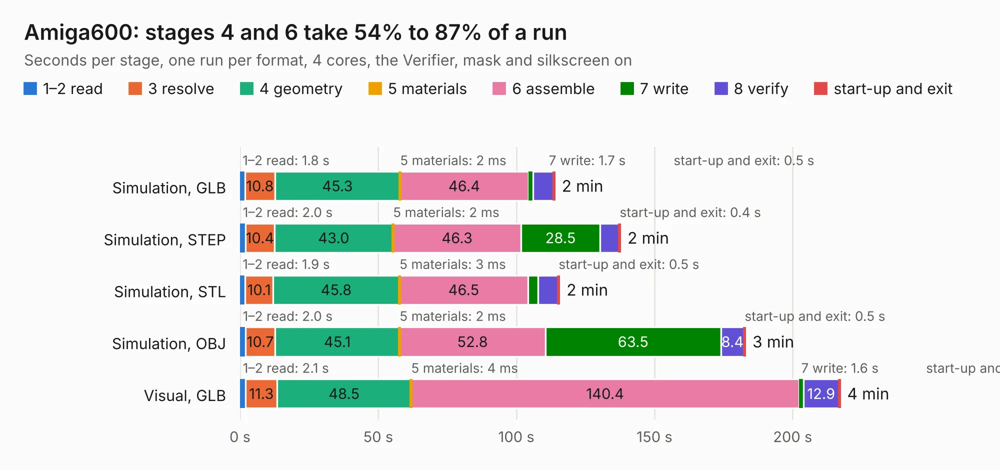

| Mode and format | 1–2 read | 3 resolve | 4 geometry | 5 materials | 6 assemble | 7 write | 8 verify | start-up and exit | Total |
|---|---:|---:|---:|---:|---:|---:|---:|---:|---:|
| Simulation, GLB | 1.8 | 10.8 | 45.3 | 2&nbsp;ms | 46.4 | 1.7 | 7.3 | 0.5 | 113.8 |
| Simulation, STEP | 2.0 | 10.4 | 43.0 | 2&nbsp;ms | 46.3 | 28.5 | 6.9 | 0.4 | 137.6 |
| Simulation, STL | 1.9 | 10.1 | 45.8 | 3&nbsp;ms | 46.5 | 3.6 | 7.3 | 0.5 | 115.6 |
| Simulation, OBJ | 2.0 | 10.7 | 45.1 | 2&nbsp;ms | 52.8 | 63.5 | 8.4 | 0.5 | 182.9 |
| Visual, GLB | 2.1 | 11.3 | 48.5 | 4&nbsp;ms | 140.4 | 1.6 | 12.9 | 0.4 | 217.1 |
| Visual, OBJ | 2.1 | 10.3 | 44.3 | 2&nbsp;ms | 147.3 | 64.4 | 14.9 | 0.4 | 283.7 |

<table align="center"><tr><td valign="top">

| Board | Repo: [istedman/A600Reborn](https://github.com/istedman/A600Reborn) Board: `Amiga600.kicad_pcb` |
|---|---|
| Folder | A600_Svideo_Working / KiCAD |
| Complexity | 386&nbsp;/&nbsp;1000 (size&nbsp;306, features&nbsp;80) |
| KESE&nbsp;features | through vias, slotted holes, custom pads, filled zones, copper drawings, curved board outline |
| Tested | 9th November 2026 |
| Copper&nbsp;layers | 2 |
| File&nbsp;format | KiCad 5 (20171130) |
| Parts,&nbsp;tracks,&nbsp;vias | 565, 13,837, 1,423 |
| Triangles,&nbsp;simulation | 8,472,872 in 626 parts |
| Verifier | PASS in all six runs |

</td><td valign="top">

<table>
<tr><th>File type</th><th>File size</th><th>Peak memory used</th></tr>
<tr><th colspan="3" align="left">Simulation</th></tr>
<tr><td>GLB</td><td align="right">293&nbsp;MB</td><td align="right">2.3&nbsp;GB</td></tr>
<tr><td>STEP</td><td align="right">1.6&nbsp;GB</td><td align="right">3.4&nbsp;GB</td></tr>
<tr><td>STL</td><td align="right">424&nbsp;MB</td><td align="right">2.3&nbsp;GB</td></tr>
<tr><td>OBJ</td><td align="right">911&nbsp;MB</td><td align="right">5.4&nbsp;GB</td></tr>
<tr><th colspan="3" align="left">Visual</th></tr>
<tr><td>GLB</td><td align="right">261&nbsp;MB</td><td align="right">3.8&nbsp;GB</td></tr>
<tr><td>OBJ</td><td align="right">837&nbsp;MB</td><td align="right">5.4&nbsp;GB</td></tr>
</table>

</td></tr></table>

## 23.13.2 M68000

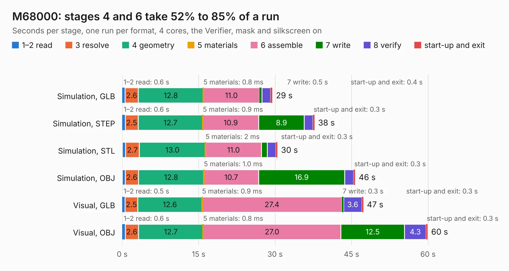

| Mode and format | 1–2 read | 3 resolve | 4 geometry | 5 materials | 6 assemble | 7 write | 8 verify | start-up and exit | Total |
|---|---:|---:|---:|---:|---:|---:|---:|---:|---:|
| Simulation, GLB | 0.6 | 2.6 | 12.8 | 0.8&nbsp;ms | 11.0 | 0.5 | 1.7 | 0.4 | 29.5 |
| Simulation, STEP | 0.6 | 2.5 | 12.7 | 0.9&nbsp;ms | 10.9 | 8.9 | 1.7 | 0.3 | 37.7 |
| Simulation, STL | 0.6 | 2.7 | 13.0 | 2&nbsp;ms | 11.0 | 1.2 | 1.7 | 0.3 | 30.5 |
| Simulation, OBJ | 0.6 | 2.6 | 12.8 | 1.0&nbsp;ms | 10.7 | 16.9 | 1.7 | 0.3 | 45.7 |
| Visual, GLB | 0.5 | 2.5 | 12.6 | 0.9&nbsp;ms | 27.4 | 0.3 | 3.6 | 0.3 | 47.3 |
| Visual, OBJ | 0.6 | 2.6 | 12.7 | 0.8&nbsp;ms | 27.0 | 12.5 | 4.3 | 0.3 | 59.9 |

<table align="center"><tr><td valign="top">

| Board | Repo: [jack-mil/mcd-pcb](https://github.com/jack-mil/mcd-pcb) Board: `M68000.kicad_pcb` |
|---|---|
| Complexity | 332&nbsp;/&nbsp;1000 (size&nbsp;247, features&nbsp;85) |
| KESE&nbsp;features | through vias, slotted holes, rounded, trapezoid or chamfered pads, filled zones, stack-up, dielectric εr and tanδ |
| Tested | 9th November 2026 |
| Copper&nbsp;layers | 2 |
| File&nbsp;format | KiCad 6 (20211014) |
| Parts,&nbsp;tracks,&nbsp;vias | 70, 1,709, 272 |
| Triangles,&nbsp;simulation | 2,985,686 in 191 parts |
| Verifier | PASS in all six runs |

</td><td valign="top">

<table>
<tr><th>File type</th><th>File size</th><th>Peak memory used</th></tr>
<tr><th colspan="3" align="left">Simulation</th></tr>
<tr><td>GLB</td><td align="right">100&nbsp;MB</td><td align="right">1.2&nbsp;GB</td></tr>
<tr><td>STEP</td><td align="right">460&nbsp;MB</td><td align="right">1.3&nbsp;GB</td></tr>
<tr><td>STL</td><td align="right">149&nbsp;MB</td><td align="right">1.2&nbsp;GB</td></tr>
<tr><td>OBJ</td><td align="right">311&nbsp;MB</td><td align="right">1.9&nbsp;GB</td></tr>
<tr><th colspan="3" align="left">Visual</th></tr>
<tr><td>GLB</td><td align="right">70&nbsp;MB</td><td align="right">1.2&nbsp;GB</td></tr>
<tr><td>OBJ</td><td align="right">221&nbsp;MB</td><td align="right">1.4&nbsp;GB</td></tr>
</table>

</td></tr></table>

## 23.13.3 mntcomp-keyboard

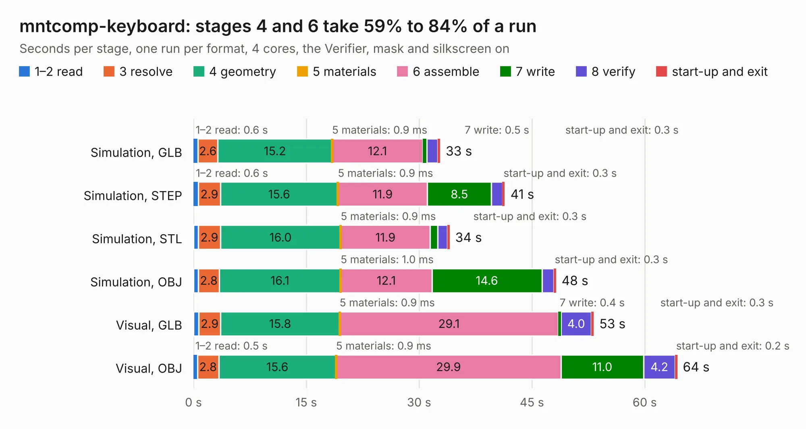

| Mode and format | 1–2 read | 3 resolve | 4 geometry | 5 materials | 6 assemble | 7 write | 8 verify | start-up and exit | Total |
|---|---:|---:|---:|---:|---:|---:|---:|---:|---:|
| Simulation, GLB | 0.6 | 2.6 | 15.2 | 0.9&nbsp;ms | 12.1 | 0.5 | 1.5 | 0.3 | 32.8 |
| Simulation, STEP | 0.6 | 2.9 | 15.6 | 0.9&nbsp;ms | 11.9 | 8.5 | 1.5 | 0.3 | 41.4 |
| Simulation, STL | 0.6 | 2.9 | 16.0 | 0.9&nbsp;ms | 11.9 | 1.0 | 1.3 | 0.3 | 34.0 |
| Simulation, OBJ | 0.7 | 2.8 | 16.1 | 1.0&nbsp;ms | 12.1 | 14.6 | 1.6 | 0.3 | 48.2 |
| Visual, GLB | 0.7 | 2.9 | 15.8 | 0.9&nbsp;ms | 29.1 | 0.4 | 4.0 | 0.3 | 53.2 |
| Visual, OBJ | 0.5 | 2.8 | 15.6 | 0.9&nbsp;ms | 29.9 | 11.0 | 4.2 | 0.2 | 64.3 |

<table align="center"><tr><td valign="top">

| Board | Repo: [jackhumbert/reform](https://github.com/jackhumbert/reform) Board: `mntcomp-keyboard.kicad_pcb` |
|---|---|
| Folder | historic-reform1 / reform-keyboard-pcb |
| Complexity | 265&nbsp;/&nbsp;1000 (size&nbsp;230, features&nbsp;35) |
| KESE&nbsp;features | through vias, filled zones |
| Tested | 9th November 2026 |
| Copper&nbsp;layers | 2 |
| File&nbsp;format | KiCad 4 (4) |
| Parts,&nbsp;tracks,&nbsp;vias | 173, 1,136, 55 |
| Triangles,&nbsp;simulation | 3,187,550 in 287 parts |
| Verifier | PASS in all six runs |

</td><td valign="top">

<table>
<tr><th>File type</th><th>File size</th><th>Peak memory used</th></tr>
<tr><th colspan="3" align="left">Simulation</th></tr>
<tr><td>GLB</td><td align="right">109&nbsp;MB</td><td align="right">1.0&nbsp;GB</td></tr>
<tr><td>STEP</td><td align="right">578&nbsp;MB</td><td align="right">1.2&nbsp;GB</td></tr>
<tr><td>STL</td><td align="right">159&nbsp;MB</td><td align="right">1.0&nbsp;GB</td></tr>
<tr><td>OBJ</td><td align="right">340&nbsp;MB</td><td align="right">2.1&nbsp;GB</td></tr>
<tr><th colspan="3" align="left">Visual</th></tr>
<tr><td>GLB</td><td align="right">76&nbsp;MB</td><td align="right">1.3&nbsp;GB</td></tr>
<tr><td>OBJ</td><td align="right">237&nbsp;MB</td><td align="right">1.6&nbsp;GB</td></tr>
</table>

</td></tr></table>

## 23.13.4 reform-motherboard

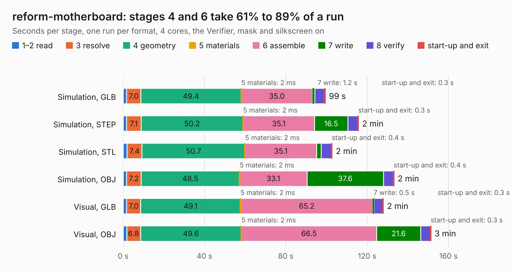

| Mode and format | 1–2 read | 3 resolve | 4 geometry | 5 materials | 6 assemble | 7 write | 8 verify | start-up and exit | Total |
|---|---:|---:|---:|---:|---:|---:|---:|---:|---:|
| Simulation, GLB | 1.7 | 7.0 | 49.4 | 2&nbsp;ms | 35.0 | 1.2 | 4.8 | 0.3 | 99.4 |
| Simulation, STEP | 1.7 | 7.1 | 50.2 | 2&nbsp;ms | 35.1 | 16.5 | 4.9 | 0.3 | 115.8 |
| Simulation, STL | 1.8 | 7.4 | 50.7 | 2&nbsp;ms | 35.1 | 2.3 | 5.0 | 0.4 | 102.8 |
| Simulation, OBJ | 1.7 | 7.2 | 48.5 | 2&nbsp;ms | 33.1 | 37.6 | 4.8 | 0.4 | 133.2 |
| Visual, GLB | 1.7 | 7.0 | 49.1 | 2&nbsp;ms | 65.2 | 0.5 | 4.3 | 0.3 | 128.0 |
| Visual, OBJ | 1.7 | 6.8 | 49.6 | 2&nbsp;ms | 66.5 | 21.6 | 4.8 | 0.3 | 151.4 |

<table align="center"><tr><td valign="top">

| Board | Repo: [jackhumbert/reform](https://github.com/jackhumbert/reform) Board: `reform-motherboard.kicad_pcb` |
|---|---|
| Folder | historic-reform1 / reform-motherboard |
| Complexity | 328&nbsp;/&nbsp;1000 (size&nbsp;283, features&nbsp;45) |
| KESE&nbsp;features | through vias, slotted holes, filled zones |
| Tested | 9th November 2026 |
| Copper&nbsp;layers | 4 |
| File&nbsp;format | KiCad 4 (4) |
| Parts,&nbsp;tracks,&nbsp;vias | 221, 3,746, 531 |
| Triangles,&nbsp;simulation | 6,884,110 in 445 parts |
| Verifier | PASS in all six runs |

</td><td valign="top">

<table>
<tr><th>File type</th><th>File size</th><th>Peak memory used</th></tr>
<tr><th colspan="3" align="left">Simulation</th></tr>
<tr><td>GLB</td><td align="right">241&nbsp;MB</td><td align="right">1.9&nbsp;GB</td></tr>
<tr><td>STEP</td><td align="right">1.0&nbsp;GB</td><td align="right">2.4&nbsp;GB</td></tr>
<tr><td>STL</td><td align="right">344&nbsp;MB</td><td align="right">1.8&nbsp;GB</td></tr>
<tr><td>OBJ</td><td align="right">747&nbsp;MB</td><td align="right">4.5&nbsp;GB</td></tr>
<tr><th colspan="3" align="left">Visual</th></tr>
<tr><td>GLB</td><td align="right">134&nbsp;MB</td><td align="right">2.2&nbsp;GB</td></tr>
<tr><td>OBJ</td><td align="right">426&nbsp;MB</td><td align="right">2.8&nbsp;GB</td></tr>
</table>

</td></tr></table>

## 23.13.5 reform-trackball

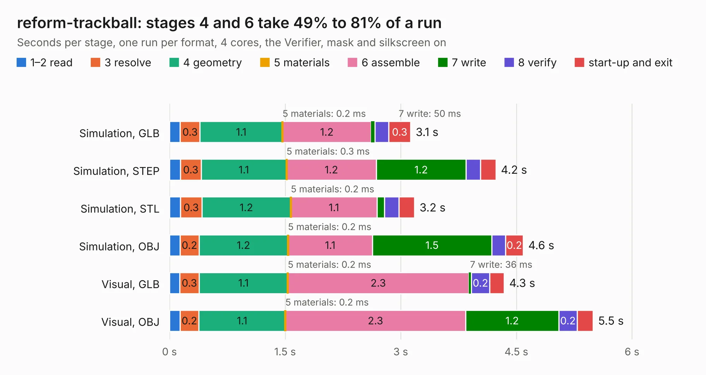

| Mode and format | 1–2 read | 3 resolve | 4 geometry | 5 materials | 6 assemble | 7 write | 8 verify | start-up and exit | Total |
|---|---:|---:|---:|---:|---:|---:|---:|---:|---:|
| Simulation, GLB | 0.1 | 0.3 | 1.1 | 0.2&nbsp;ms | 1.2 | 50&nbsp;ms | 0.2 | 0.3 | 3.1 |
| Simulation, STEP | 0.1 | 0.3 | 1.1 | 0.3&nbsp;ms | 1.2 | 1.2 | 0.2 | 0.2 | 4.2 |
| Simulation, STL | 0.1 | 0.3 | 1.2 | 0.2&nbsp;ms | 1.1 | 98&nbsp;ms | 0.2 | 0.2 | 3.2 |
| Simulation, OBJ | 0.1 | 0.2 | 1.2 | 0.2&nbsp;ms | 1.1 | 1.5 | 0.2 | 0.2 | 4.6 |
| Visual, GLB | 0.1 | 0.3 | 1.1 | 0.2&nbsp;ms | 2.3 | 36&nbsp;ms | 0.2 | 0.2 | 4.3 |
| Visual, OBJ | 0.1 | 0.2 | 1.1 | 0.2&nbsp;ms | 2.3 | 1.2 | 0.2 | 0.2 | 5.5 |

<table align="center"><tr><td valign="top">

| Board | Repo: [jackhumbert/reform](https://github.com/jackhumbert/reform) Board: `reform-trackball.kicad_pcb` |
|---|---|
| Folder | historic-reform1 / reform-trackball-pcb |
| Complexity | 229&nbsp;/&nbsp;1000 (size&nbsp;184, features&nbsp;45) |
| KESE&nbsp;features | through vias, filled zones, curved board outline |
| Tested | 9th November 2026 |
| Copper&nbsp;layers | 2 |
| File&nbsp;format | KiCad 5 (20171130) |
| Parts,&nbsp;tracks,&nbsp;vias | 15, 275, 35 |
| Triangles,&nbsp;simulation | 302,556 in 43 parts |
| Verifier | PASS in all six runs |

</td><td valign="top">

<table>
<tr><th>File type</th><th>File size</th><th>Peak memory used</th></tr>
<tr><th colspan="3" align="left">Simulation</th></tr>
<tr><td>GLB</td><td align="right">10&nbsp;MB</td><td align="right">238&nbsp;MB</td></tr>
<tr><td>STEP</td><td align="right">47&nbsp;MB</td><td align="right">274&nbsp;MB</td></tr>
<tr><td>STL</td><td align="right">15&nbsp;MB</td><td align="right">240&nbsp;MB</td></tr>
<tr><td>OBJ</td><td align="right">30&nbsp;MB</td><td align="right">259&nbsp;MB</td></tr>
<tr><th colspan="3" align="left">Visual</th></tr>
<tr><td>GLB</td><td align="right">8.0&nbsp;MB</td><td align="right">262&nbsp;MB</td></tr>
<tr><td>OBJ</td><td align="right">23&nbsp;MB</td><td align="right">259&nbsp;MB</td></tr>
</table>

</td></tr></table>

## 23.13.6 reform2-batterypack-upstream

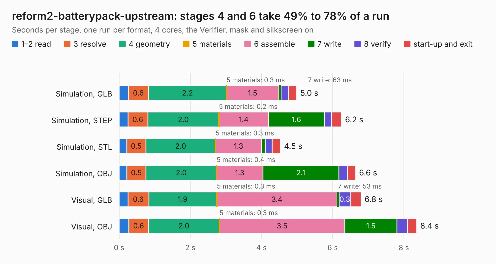

| Mode and format | 1–2 read | 3 resolve | 4 geometry | 5 materials | 6 assemble | 7 write | 8 verify | start-up and exit | Total |
|---|---:|---:|---:|---:|---:|---:|---:|---:|---:|
| Simulation, GLB | 0.3 | 0.6 | 2.2 | 0.3&nbsp;ms | 1.5 | 63&nbsp;ms | 0.2 | 0.2 | 5.0 |
| Simulation, STEP | 0.2 | 0.6 | 2.0 | 0.2&nbsp;ms | 1.4 | 1.6 | 0.2 | 0.3 | 6.2 |
| Simulation, STL | 0.2 | 0.5 | 2.0 | 0.3&nbsp;ms | 1.3 | 0.1 | 0.2 | 0.2 | 4.5 |
| Simulation, OBJ | 0.2 | 0.5 | 2.0 | 0.4&nbsp;ms | 1.3 | 2.1 | 0.2 | 0.2 | 6.6 |
| Visual, GLB | 0.2 | 0.6 | 1.9 | 0.3&nbsp;ms | 3.4 | 53&nbsp;ms | 0.3 | 0.3 | 6.8 |
| Visual, OBJ | 0.3 | 0.6 | 2.0 | 0.3&nbsp;ms | 3.5 | 1.5 | 0.3 | 0.3 | 8.4 |

<table align="center"><tr><td valign="top">

| Board | Repo: [jackhumbert/reform](https://github.com/jackhumbert/reform) Board: `reform2-batterypack-upstream.kicad_pcb` |
|---|---|
| Folder | reform2-batterypack-pcb |
| Complexity | 197&nbsp;/&nbsp;1000 (size&nbsp;152, features&nbsp;45) |
| KESE&nbsp;features | through vias, slotted holes, rounded, trapezoid or chamfered pads, curved board outline |
| Tested | 9th November 2026 |
| Copper&nbsp;layers | 2 |
| File&nbsp;format | KiCad 5 (20171130) |
| Parts,&nbsp;tracks,&nbsp;vias | 32, 288, 28 |
| Triangles,&nbsp;simulation | 344,852 in 41 parts |
| Verifier | PASS in all six runs |

</td><td valign="top">

<table>
<tr><th>File type</th><th>File size</th><th>Peak memory used</th></tr>
<tr><th colspan="3" align="left">Simulation</th></tr>
<tr><td>GLB</td><td align="right">12&nbsp;MB</td><td align="right">275&nbsp;MB</td></tr>
<tr><td>STEP</td><td align="right">70&nbsp;MB</td><td align="right">297&nbsp;MB</td></tr>
<tr><td>STL</td><td align="right">17&nbsp;MB</td><td align="right">269&nbsp;MB</td></tr>
<tr><td>OBJ</td><td align="right">36&nbsp;MB</td><td align="right">290&nbsp;MB</td></tr>
<tr><th colspan="3" align="left">Visual</th></tr>
<tr><td>GLB</td><td align="right">8.7&nbsp;MB</td><td align="right">260&nbsp;MB</td></tr>
<tr><td>OBJ</td><td align="right">25&nbsp;MB</td><td align="right">265&nbsp;MB</td></tr>
</table>

</td></tr></table>

## 23.13.7 reform2-batterypack

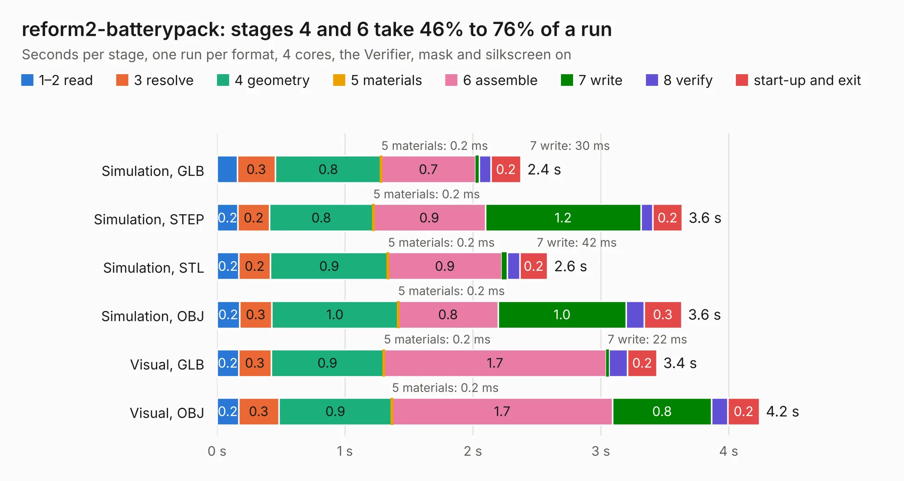

| Mode and format | 1–2 read | 3 resolve | 4 geometry | 5 materials | 6 assemble | 7 write | 8 verify | start-up and exit | Total |
|---|---:|---:|---:|---:|---:|---:|---:|---:|---:|
| Simulation, GLB | 0.2 | 0.3 | 0.8 | 0.2&nbsp;ms | 0.7 | 30&nbsp;ms | 92&nbsp;ms | 0.2 | 2.4 |
| Simulation, STEP | 0.2 | 0.2 | 0.8 | 0.2&nbsp;ms | 0.9 | 1.2 | 93&nbsp;ms | 0.2 | 3.6 |
| Simulation, STL | 0.2 | 0.2 | 0.9 | 0.2&nbsp;ms | 0.9 | 42&nbsp;ms | 98&nbsp;ms | 0.2 | 2.6 |
| Simulation, OBJ | 0.2 | 0.3 | 1.0 | 0.2&nbsp;ms | 0.8 | 1.0 | 0.1 | 0.3 | 3.6 |
| Visual, GLB | 0.2 | 0.3 | 0.9 | 0.2&nbsp;ms | 1.7 | 22&nbsp;ms | 0.1 | 0.2 | 3.4 |
| Visual, OBJ | 0.2 | 0.3 | 0.9 | 0.2&nbsp;ms | 1.7 | 0.8 | 0.1 | 0.2 | 4.2 |

<table align="center"><tr><td valign="top">

| Board | Repo: [jackhumbert/reform](https://github.com/jackhumbert/reform) Board: `reform2-batterypack.kicad_pcb` |
|---|---|
| Folder | reform2-batterypack-pcb |
| Complexity | 135&nbsp;/&nbsp;1000 (size&nbsp;105, features&nbsp;30) |
| KESE&nbsp;features | slotted holes, rounded, trapezoid or chamfered pads, curved board outline |
| Tested | 9th November 2026 |
| Copper&nbsp;layers | 2 |
| File&nbsp;format | KiCad 5 (20171130) |
| Parts,&nbsp;tracks,&nbsp;vias | 5, 64, 0 |
| Triangles,&nbsp;simulation | 172,212 in 16 parts |
| Verifier | PASS in all six runs |

</td><td valign="top">

<table>
<tr><th>File type</th><th>File size</th><th>Peak memory used</th></tr>
<tr><th colspan="3" align="left">Simulation</th></tr>
<tr><td>GLB</td><td align="right">6.1&nbsp;MB</td><td align="right">201&nbsp;MB</td></tr>
<tr><td>STEP</td><td align="right">37&nbsp;MB</td><td align="right">220&nbsp;MB</td></tr>
<tr><td>STL</td><td align="right">8.6&nbsp;MB</td><td align="right">202&nbsp;MB</td></tr>
<tr><td>OBJ</td><td align="right">17&nbsp;MB</td><td align="right">203&nbsp;MB</td></tr>
<tr><th colspan="3" align="left">Visual</th></tr>
<tr><td>GLB</td><td align="right">4.0&nbsp;MB</td><td align="right">173&nbsp;MB</td></tr>
<tr><td>OBJ</td><td align="right">11&nbsp;MB</td><td align="right">177&nbsp;MB</td></tr>
</table>

</td></tr></table>

## 23.13.8 reform2-imx8mplus

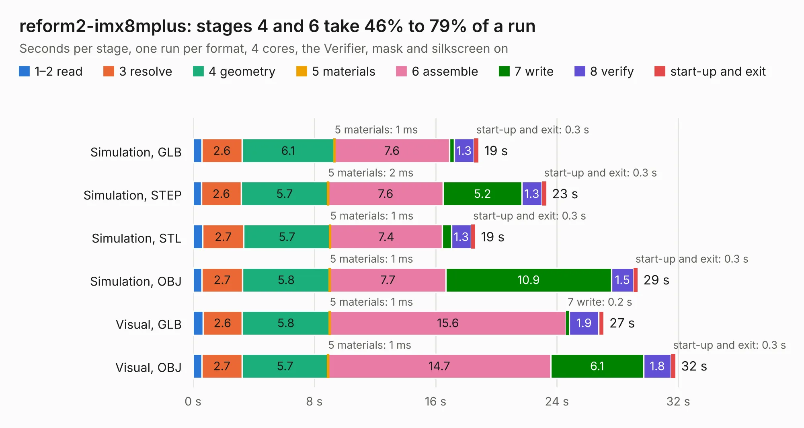

| Mode and format | 1–2 read | 3 resolve | 4 geometry | 5 materials | 6 assemble | 7 write | 8 verify | start-up and exit | Total |
|---|---:|---:|---:|---:|---:|---:|---:|---:|---:|
| Simulation, GLB | 0.6 | 2.6 | 6.1 | 1&nbsp;ms | 7.6 | 0.3 | 1.3 | 0.3 | 18.8 |
| Simulation, STEP | 0.6 | 2.6 | 5.7 | 2&nbsp;ms | 7.6 | 5.2 | 1.3 | 0.3 | 23.3 |
| Simulation, STL | 0.6 | 2.7 | 5.7 | 1&nbsp;ms | 7.4 | 0.6 | 1.3 | 0.3 | 18.6 |
| Simulation, OBJ | 0.6 | 2.7 | 5.8 | 1&nbsp;ms | 7.7 | 10.9 | 1.5 | 0.3 | 29.3 |
| Visual, GLB | 0.7 | 2.6 | 5.8 | 1&nbsp;ms | 15.6 | 0.2 | 1.9 | 0.3 | 27.1 |
| Visual, OBJ | 0.6 | 2.7 | 5.7 | 1&nbsp;ms | 14.7 | 6.1 | 1.8 | 0.3 | 31.8 |

<table align="center"><tr><td valign="top">

| Board | Repo: [jackhumbert/reform](https://github.com/jackhumbert/reform) Board: `reform2-imx8mplus.kicad_pcb` |
|---|---|
| Folder | reform2-imx8mplus |
| Complexity | 346&nbsp;/&nbsp;1000 (size&nbsp;246, features&nbsp;100) |
| KESE&nbsp;features | through vias, rounded, trapezoid or chamfered pads, arc tracks, filled zones, curved board outline, stack-up, dielectric εr and tanδ |
| Tested | 9th November 2026 |
| Copper&nbsp;layers | 6 |
| File&nbsp;format | KiCad 6 (20211014) |
| Parts,&nbsp;tracks,&nbsp;vias | 16, 2,171, 338 |
| Triangles,&nbsp;simulation | 2,120,290 in 326 parts |
| Verifier | PASS in all six runs |

</td><td valign="top">

<table>
<tr><th>File type</th><th>File size</th><th>Peak memory used</th></tr>
<tr><th colspan="3" align="left">Simulation</th></tr>
<tr><td>GLB</td><td align="right">70&nbsp;MB</td><td align="right">721&nbsp;MB</td></tr>
<tr><td>STEP</td><td align="right">257&nbsp;MB</td><td align="right">931&nbsp;MB</td></tr>
<tr><td>STL</td><td align="right">106&nbsp;MB</td><td align="right">726&nbsp;MB</td></tr>
<tr><td>OBJ</td><td align="right">221&nbsp;MB</td><td align="right">1.4&nbsp;GB</td></tr>
<tr><th colspan="3" align="left">Visual</th></tr>
<tr><td>GLB</td><td align="right">39&nbsp;MB</td><td align="right">772&nbsp;MB</td></tr>
<tr><td>OBJ</td><td align="right">124&nbsp;MB</td><td align="right">928&nbsp;MB</td></tr>
</table>

</td></tr></table>

## 23.13.9 reform2-keyboard

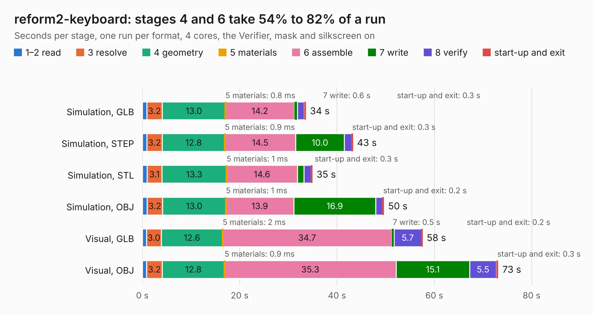

| Mode and format | 1–2 read | 3 resolve | 4 geometry | 5 materials | 6 assemble | 7 write | 8 verify | start-up and exit | Total |
|---|---:|---:|---:|---:|---:|---:|---:|---:|---:|
| Simulation, GLB | 0.9 | 3.2 | 13.0 | 0.8&nbsp;ms | 14.2 | 0.6 | 1.4 | 0.3 | 33.6 |
| Simulation, STEP | 0.9 | 3.2 | 12.8 | 0.9&nbsp;ms | 14.5 | 10.0 | 1.5 | 0.3 | 43.3 |
| Simulation, STL | 1.0 | 3.1 | 13.3 | 1&nbsp;ms | 14.6 | 1.3 | 1.5 | 0.3 | 34.9 |
| Simulation, OBJ | 1.0 | 3.2 | 13.0 | 1&nbsp;ms | 13.9 | 16.9 | 1.4 | 0.2 | 49.6 |
| Visual, GLB | 0.9 | 3.0 | 12.6 | 2&nbsp;ms | 34.7 | 0.5 | 5.7 | 0.2 | 57.6 |
| Visual, OBJ | 0.9 | 3.2 | 12.8 | 0.9&nbsp;ms | 35.3 | 15.1 | 5.5 | 0.3 | 73.1 |

<table align="center"><tr><td valign="top">

| Board | Repo: [jackhumbert/reform](https://github.com/jackhumbert/reform) Board: `reform2-keyboard.kicad_pcb` |
|---|---|
| Folder | reform2-keyboard-pcb |
| Complexity | 313&nbsp;/&nbsp;1000 (size&nbsp;258, features&nbsp;55) |
| KESE&nbsp;features | through vias, slotted holes, rounded, trapezoid or chamfered pads, filled zones |
| Tested | 9th November 2026 |
| Copper&nbsp;layers | 2 |
| File&nbsp;format | KiCad 5 (20171130) |
| Parts,&nbsp;tracks,&nbsp;vias | 293, 2,054, 411 |
| Triangles,&nbsp;simulation | 4,193,572 in 234 parts |
| Verifier | PASS in all six runs |

</td><td valign="top">

<table>
<tr><th>File type</th><th>File size</th><th>Peak memory used</th></tr>
<tr><th colspan="3" align="left">Simulation</th></tr>
<tr><td>GLB</td><td align="right">141&nbsp;MB</td><td align="right">1.6&nbsp;GB</td></tr>
<tr><td>STEP</td><td align="right">672&nbsp;MB</td><td align="right">1.8&nbsp;GB</td></tr>
<tr><td>STL</td><td align="right">210&nbsp;MB</td><td align="right">1.6&nbsp;GB</td></tr>
<tr><td>OBJ</td><td align="right">442&nbsp;MB</td><td align="right">2.7&nbsp;GB</td></tr>
<tr><th colspan="3" align="left">Visual</th></tr>
<tr><td>GLB</td><td align="right">122&nbsp;MB</td><td align="right">1.9&nbsp;GB</td></tr>
<tr><td>OBJ</td><td align="right">385&nbsp;MB</td><td align="right">2.4&nbsp;GB</td></tr>
</table>

</td></tr></table>

## 23.13.10 reform2-keyboard3

| Mode and format | 1–2 read | 3 resolve | 4 geometry | 5 materials | 6 assemble | 7 write | 8 verify | start-up and exit | Total |
|---|---:|---:|---:|---:|---:|---:|---:|---:|---:|
| Simulation, GLB | 1.3 | 3.1 | 12.7 | 0.7&nbsp;ms | 13.2 | 0.5 | 1.4 | 0.3 | 32.7 |
| Simulation, STEP | 1.2 | 3.4 | 12.9 | 1&nbsp;ms | 13.4 | 9.5 | 1.4 | 0.3 | 42.2 |
| Simulation, STL | 1.3 | 3.4 | 12.8 | 0.8&nbsp;ms | 12.9 | 1.1 | 1.4 | 0.3 | 33.2 |
| Simulation, OBJ | 1.3 | 3.4 | 12.9 | 0.9&nbsp;ms | 12.7 | 16.4 | 1.5 | 0.2 | 48.4 |
| Visual, GLB | 1.3 | 3.1 | 12.6 | 0.7&nbsp;ms | 31.5 | 0.4 | 3.7 | 0.3 | 52.9 |
| Visual, OBJ | 1.2 | 3.3 | 12.9 | 0.8&nbsp;ms | 32.3 | 13.6 | 4.2 | 0.2 | 67.9 |

<table align="center"><tr><td valign="top">

| Board | Repo: [jackhumbert/reform](https://github.com/jackhumbert/reform) Board: `reform2-keyboard3.kicad_pcb` |
|---|---|
| Folder | reform2-keyboard3-pcb |
| Complexity | 347&nbsp;/&nbsp;1000 (size&nbsp;257, features&nbsp;90) |
| KESE&nbsp;features | through vias, slotted holes, rounded, trapezoid or chamfered pads, filled zones, stack-up, dielectric εr and tanδ, mask and silkscreen colours |
| Tested | 9th November 2026 |
| Copper&nbsp;layers | 2 |
| File&nbsp;format | KiCad 6 (20211014) |
| Parts,&nbsp;tracks,&nbsp;vias | 289, 2,085, 383 |
| Triangles,&nbsp;simulation | 3,916,436 in 232 parts |
| Verifier | PASS in all six runs |

</td><td valign="top">

<table>
<tr><th>File type</th><th>File size</th><th>Peak memory used</th></tr>
<tr><th colspan="3" align="left">Simulation</th></tr>
<tr><td>GLB</td><td align="right">133&nbsp;MB</td><td align="right">1.5&nbsp;GB</td></tr>
<tr><td>STEP</td><td align="right">671&nbsp;MB</td><td align="right">1.7&nbsp;GB</td></tr>
<tr><td>STL</td><td align="right">196&nbsp;MB</td><td align="right">1.6&nbsp;GB</td></tr>
<tr><td>OBJ</td><td align="right">415&nbsp;MB</td><td align="right">2.6&nbsp;GB</td></tr>
<tr><th colspan="3" align="left">Visual</th></tr>
<tr><td>GLB</td><td align="right">112&nbsp;MB</td><td align="right">2.2&nbsp;GB</td></tr>
<tr><td>OBJ</td><td align="right">354&nbsp;MB</td><td align="right">2.3&nbsp;GB</td></tr>
</table>

</td></tr></table>

## 23.13.11 reform2-motherboard

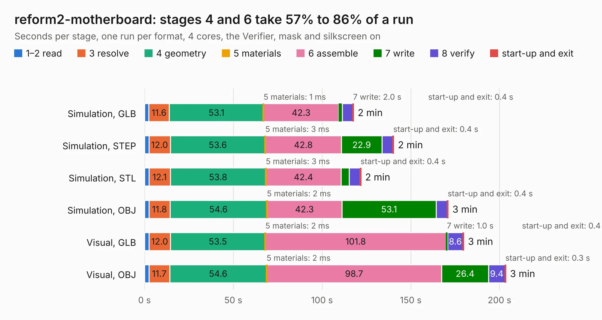

| Mode and format | 1–2 read | 3 resolve | 4 geometry | 5 materials | 6 assemble | 7 write | 8 verify | start-up and exit | Total |
|---|---:|---:|---:|---:|---:|---:|---:|---:|---:|
| Simulation, GLB | 2.4 | 11.6 | 53.1 | 1&nbsp;ms | 42.3 | 2.0 | 5.9 | 0.4 | 117.7 |
| Simulation, STEP | 2.5 | 12.0 | 53.6 | 3&nbsp;ms | 42.8 | 22.9 | 6.2 | 0.4 | 140.3 |
| Simulation, STL | 2.5 | 12.1 | 53.8 | 3&nbsp;ms | 42.4 | 4.6 | 6.2 | 0.4 | 121.9 |
| Simulation, OBJ | 2.5 | 11.8 | 54.6 | 2&nbsp;ms | 42.3 | 53.1 | 6.3 | 0.4 | 171.1 |
| Visual, GLB | 2.5 | 12.0 | 53.5 | 2&nbsp;ms | 101.8 | 1.0 | 8.6 | 0.4 | 179.8 |
| Visual, OBJ | 2.5 | 11.7 | 54.6 | 2&nbsp;ms | 98.7 | 26.4 | 9.4 | 0.3 | 203.5 |

<table align="center"><tr><td valign="top">

| Board | Repo: [jackhumbert/reform](https://github.com/jackhumbert/reform) Board: `reform2-motherboard.kicad_pcb` |
|---|---|
| Folder | reform2-motherboard-pcb |
| Complexity | 396&nbsp;/&nbsp;1000 (size&nbsp;326, features&nbsp;70) |
| KESE&nbsp;features | through vias, slotted holes, custom pads, rounded, trapezoid or chamfered pads, filled zones |
| Tested | 9th November 2026 |
| Copper&nbsp;layers | 6 |
| File&nbsp;format | KiCad 5 (20171130) |
| Parts,&nbsp;tracks,&nbsp;vias | 489, 11,666, 1,086 |
| Triangles,&nbsp;simulation | 11,131,628 in 664 parts |
| Verifier | PASS in all six runs |

</td><td valign="top">

<table>
<tr><th>File type</th><th>File size</th><th>Peak memory used</th></tr>
<tr><th colspan="3" align="left">Simulation</th></tr>
<tr><td>GLB</td><td align="right">385&nbsp;MB</td><td align="right">2.7&nbsp;GB</td></tr>
<tr><td>STEP</td><td align="right">1.6&nbsp;GB</td><td align="right">3.9&nbsp;GB</td></tr>
<tr><td>STL</td><td align="right">557&nbsp;MB</td><td align="right">2.5&nbsp;GB</td></tr>
<tr><td>OBJ</td><td align="right">1.2&nbsp;GB</td><td align="right">7.1&nbsp;GB</td></tr>
<tr><th colspan="3" align="left">Visual</th></tr>
<tr><td>GLB</td><td align="right">204&nbsp;MB</td><td align="right">3.2&nbsp;GB</td></tr>
<tr><td>OBJ</td><td align="right">661&nbsp;MB</td><td align="right">4.3&nbsp;GB</td></tr>
</table>

</td></tr></table>

## 23.13.12 reform2-motherboard25

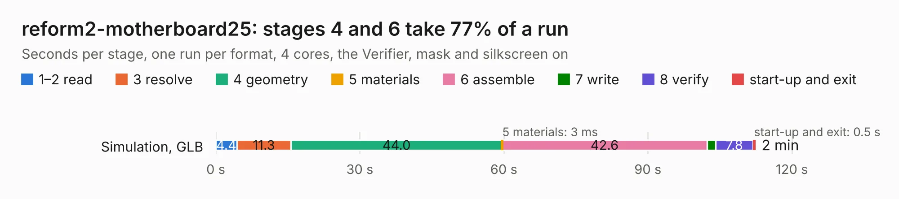

| Mode and format | 1–2 read | 3 resolve | 4 geometry | 5 materials | 6 assemble | 7 write | 8 verify | start-up and exit | Total |
|---|---:|---:|---:|---:|---:|---:|---:|---:|---:|
| Simulation, GLB | 4.4 | 11.3 | 44.0 | 3&nbsp;ms | 42.6 | 1.8 | 7.8 | 0.5 | 112.4 |
| Simulation, STEP | 4.4 | 11.1 | 43.4 | 2&nbsp;ms | 41.3 | 26.5 | 7.1 | 0.5 | 134.4 |
| Simulation, STL | 3.9 | 11.0 | 41.5 | 3&nbsp;ms | 41.0 | 3.8 | 7.4 | 0.5 | 109.0 |
| Simulation, OBJ | 3.8 | 10.6 | 40.2 | 4&nbsp;ms | 39.9 | 58.5 | 7.1 | 0.5 | 160.6 |
| Visual, GLB | 3.8 | 10.9 | 40.2 | 2&nbsp;ms | 92.0 | 1.0 | 8.6 | 0.4 | 156.9 |
| Visual, OBJ | 3.7 | 10.7 | 42.4 | 2&nbsp;ms | 93.4 | 36.9 | 11.2 | 0.4 | 198.7 |

<table align="center"><tr><td valign="top">

| Board | Repo: [jackhumbert/reform](https://github.com/jackhumbert/reform) Board: `reform2-motherboard25.kicad_pcb` |
|---|---|
| Folder | reform2-motherboard25-pcb |
| Complexity | 451&nbsp;/&nbsp;1000 (size&nbsp;326, features&nbsp;125) |
| KESE&nbsp;features | through vias, slotted holes, custom pads, rounded, trapezoid or chamfered pads, arc tracks, filled zones, copper drawings, stack-up, dielectric εr and tanδ |
| Tested | 9th November 2026 |
| Copper&nbsp;layers | 6 |
| File&nbsp;format | KiCad 6 (20211014) |
| Parts,&nbsp;tracks,&nbsp;vias | 486, 11,115, 1,079 |
| Triangles,&nbsp;simulation | 9,815,150 in 665 parts |
| Verifier | PASS in all six runs |

</td><td valign="top">

<table>
<tr><th>File type</th><th>File size</th><th>Peak memory used</th></tr>
<tr><th colspan="3" align="left">Simulation</th></tr>
<tr><td>GLB</td><td align="right">328&nbsp;MB</td><td align="right">2.5&nbsp;GB</td></tr>
<tr><td>STEP</td><td align="right">1.4&nbsp;GB</td><td align="right">3.6&nbsp;GB</td></tr>
<tr><td>STL</td><td align="right">491&nbsp;MB</td><td align="right">2.5&nbsp;GB</td></tr>
<tr><td>OBJ</td><td align="right">1.1&nbsp;GB</td><td align="right">6.2&nbsp;GB</td></tr>
<tr><th colspan="3" align="left">Visual</th></tr>
<tr><td>GLB</td><td align="right">187&nbsp;MB</td><td align="right">3.1&nbsp;GB</td></tr>
<tr><td>OBJ</td><td align="right">608&nbsp;MB</td><td align="right">4.0&nbsp;GB</td></tr>
</table>

</td></tr></table>

## 23.13.13 reform2-oled

| Mode and format | 1–2 read | 3 resolve | 4 geometry | 5 materials | 6 assemble | 7 write | 8 verify | start-up and exit | Total |
|---|---:|---:|---:|---:|---:|---:|---:|---:|---:|
| Simulation, GLB | 0.2 | 0.3 | 0.8 | 0.1&nbsp;ms | 0.8 | 33&nbsp;ms | 94&nbsp;ms | 0.2 | 2.4 |
| Simulation, STEP | 0.2 | 0.3 | 0.9 | 0.2&nbsp;ms | 0.8 | 1.1 | 0.1 | 0.2 | 3.5 |
| Simulation, STL | 0.2 | 0.2 | 0.8 | 0.2&nbsp;ms | 0.8 | 45&nbsp;ms | 88&nbsp;ms | 0.3 | 2.4 |
| Simulation, OBJ | 0.2 | 0.2 | 0.8 | 0.1&nbsp;ms | 0.7 | 1.0 | 81&nbsp;ms | 0.2 | 3.2 |
| Visual, GLB | 0.2 | 0.2 | 0.8 | 0.1&nbsp;ms | 2.0 | 26&nbsp;ms | 0.2 | 0.2 | 3.6 |
| Visual, OBJ | 0.2 | 0.2 | 0.9 | 0.2&nbsp;ms | 1.9 | 0.8 | 0.2 | 0.3 | 4.4 |

<table align="center"><tr><td valign="top">

| Board | Repo: [jackhumbert/reform](https://github.com/jackhumbert/reform) Board: `reform2-oled.kicad_pcb` |
|---|---|
| Folder | reform2-oled-pcb |
| Complexity | 172&nbsp;/&nbsp;1000 (size&nbsp;127, features&nbsp;45) |
| KESE&nbsp;features | through vias, rounded, trapezoid or chamfered pads, filled zones |
| Tested | 9th November 2026 |
| Copper&nbsp;layers | 2 |
| File&nbsp;format | KiCad 5 (20171130) |
| Parts,&nbsp;tracks,&nbsp;vias | 11, 77, 27 |
| Triangles,&nbsp;simulation | 163,598 in 25 parts |
| Verifier | PASS in all six runs |

</td><td valign="top">

<table>
<tr><th>File type</th><th>File size</th><th>Peak memory used</th></tr>
<tr><th colspan="3" align="left">Simulation</th></tr>
<tr><td>GLB</td><td align="right">5.8&nbsp;MB</td><td align="right">201&nbsp;MB</td></tr>
<tr><td>STEP</td><td align="right">30&nbsp;MB</td><td align="right">225&nbsp;MB</td></tr>
<tr><td>STL</td><td align="right">8.2&nbsp;MB</td><td align="right">204&nbsp;MB</td></tr>
<tr><td>OBJ</td><td align="right">16&nbsp;MB</td><td align="right">215&nbsp;MB</td></tr>
<tr><th colspan="3" align="left">Visual</th></tr>
<tr><td>GLB</td><td align="right">4.7&nbsp;MB</td><td align="right">191&nbsp;MB</td></tr>
<tr><td>OBJ</td><td align="right">14&nbsp;MB</td><td align="right">185&nbsp;MB</td></tr>
</table>

</td></tr></table>

## 23.13.14 reform2-protected-batterypack-pcb

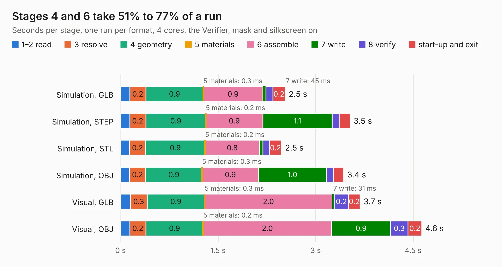

| Mode and format | 1–2 read | 3 resolve | 4 geometry | 5 materials | 6 assemble | 7 write | 8 verify | start-up and exit | Total |
|---|---:|---:|---:|---:|---:|---:|---:|---:|---:|
| Simulation, GLB | 0.1 | 0.2 | 0.9 | 0.3&nbsp;ms | 0.9 | 45&nbsp;ms | 0.1 | 0.2 | 2.5 |
| Simulation, STEP | 0.1 | 0.2 | 0.9 | 0.2&nbsp;ms | 0.9 | 1.1 | 0.1 | 0.2 | 3.5 |
| Simulation, STL | 0.1 | 0.2 | 0.9 | 0.2&nbsp;ms | 0.8 | 51&nbsp;ms | 0.1 | 0.2 | 2.5 |
| Simulation, OBJ | 0.1 | 0.2 | 0.9 | 0.3&nbsp;ms | 0.9 | 1.0 | 0.1 | 0.2 | 3.4 |
| Visual, GLB | 0.1 | 0.3 | 0.9 | 0.3&nbsp;ms | 2.0 | 31&nbsp;ms | 0.2 | 0.2 | 3.7 |
| Visual, OBJ | 0.1 | 0.2 | 0.9 | 0.2&nbsp;ms | 2.0 | 0.9 | 0.3 | 0.2 | 4.6 |

<table align="center"><tr><td valign="top">

| Board | Repo: [jackhumbert/reform](https://github.com/jackhumbert/reform) Board: `reform2-protected-batterypack-pcb.kicad_pcb` |
|---|---|
| Folder | reform2-protected-batterypack-pcb |
| Complexity | 196&nbsp;/&nbsp;1000 (size&nbsp;151, features&nbsp;45) |
| KESE&nbsp;features | through vias, slotted holes, rounded, trapezoid or chamfered pads, curved board outline |
| Tested | 9th November 2026 |
| Copper&nbsp;layers | 2 |
| File&nbsp;format | KiCad 6 (20211014) |
| Parts,&nbsp;tracks,&nbsp;vias | 33, 297, 19 |
| Triangles,&nbsp;simulation | 258,834 in 48 parts |
| Verifier | PASS in all six runs |

</td><td valign="top">

<table>
<tr><th>File type</th><th>File size</th><th>Peak memory used</th></tr>
<tr><th colspan="3" align="left">Simulation</th></tr>
<tr><td>GLB</td><td align="right">9.0&nbsp;MB</td><td align="right">233&nbsp;MB</td></tr>
<tr><td>STEP</td><td align="right">47&nbsp;MB</td><td align="right">268&nbsp;MB</td></tr>
<tr><td>STL</td><td align="right">13&nbsp;MB</td><td align="right">234&nbsp;MB</td></tr>
<tr><td>OBJ</td><td align="right">26&nbsp;MB</td><td align="right">235&nbsp;MB</td></tr>
<tr><th colspan="3" align="left">Visual</th></tr>
<tr><td>GLB</td><td align="right">7.2&nbsp;MB</td><td align="right">248&nbsp;MB</td></tr>
<tr><td>OBJ</td><td align="right">21&nbsp;MB</td><td align="right">245&nbsp;MB</td></tr>
</table>

</td></tr></table>

## 23.13.15 reform2-trackball

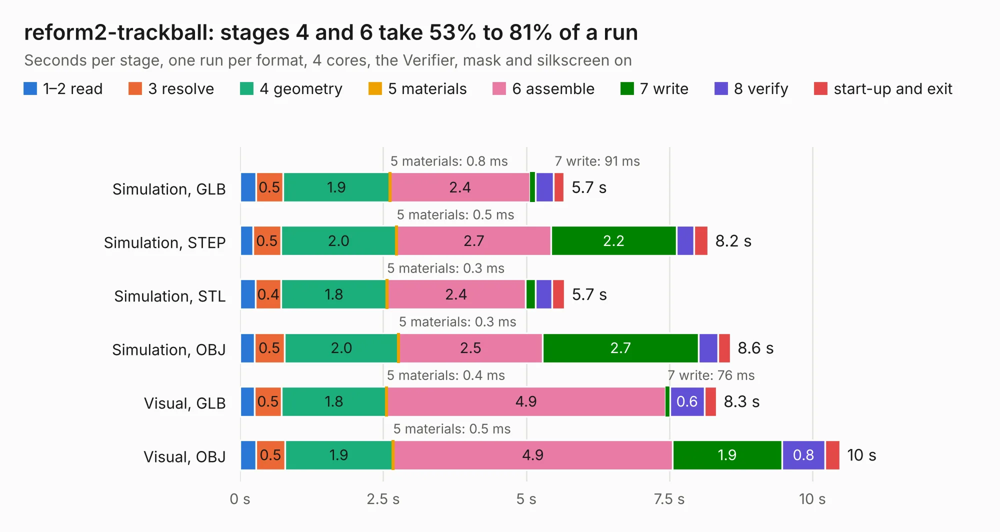

| Mode and format | 1–2 read | 3 resolve | 4 geometry | 5 materials | 6 assemble | 7 write | 8 verify | start-up and exit | Total |
|---|---:|---:|---:|---:|---:|---:|---:|---:|---:|
| Simulation, GLB | 0.3 | 0.5 | 1.9 | 0.8&nbsp;ms | 2.4 | 91&nbsp;ms | 0.3 | 0.2 | 5.7 |
| Simulation, STEP | 0.2 | 0.5 | 2.0 | 0.5&nbsp;ms | 2.7 | 2.2 | 0.3 | 0.2 | 8.2 |
| Simulation, STL | 0.3 | 0.4 | 1.8 | 0.3&nbsp;ms | 2.4 | 0.2 | 0.3 | 0.2 | 5.7 |
| Simulation, OBJ | 0.3 | 0.5 | 2.0 | 0.3&nbsp;ms | 2.5 | 2.7 | 0.3 | 0.2 | 8.6 |
| Visual, GLB | 0.3 | 0.5 | 1.8 | 0.4&nbsp;ms | 4.9 | 76&nbsp;ms | 0.6 | 0.2 | 8.3 |
| Visual, OBJ | 0.3 | 0.5 | 1.9 | 0.5&nbsp;ms | 4.9 | 1.9 | 0.8 | 0.3 | 10.5 |

<table align="center"><tr><td valign="top">

| Board | Repo: [jackhumbert/reform](https://github.com/jackhumbert/reform) Board: `reform2-trackball.kicad_pcb` |
|---|---|
| Folder | reform2-trackball-pcb |
| Complexity | 246&nbsp;/&nbsp;1000 (size&nbsp;201, features&nbsp;45) |
| KESE&nbsp;features | through vias, rounded, trapezoid or chamfered pads, filled zones |
| Tested | 9th November 2026 |
| Copper&nbsp;layers | 2 |
| File&nbsp;format | KiCad 5 (20171130) |
| Parts,&nbsp;tracks,&nbsp;vias | 37, 376, 74 |
| Triangles,&nbsp;simulation | 545,428 in 55 parts |
| Verifier | PASS in all six runs |

</td><td valign="top">

<table>
<tr><th>File type</th><th>File size</th><th>Peak memory used</th></tr>
<tr><th colspan="3" align="left">Simulation</th></tr>
<tr><td>GLB</td><td align="right">19&nbsp;MB</td><td align="right">328&nbsp;MB</td></tr>
<tr><td>STEP</td><td align="right">89&nbsp;MB</td><td align="right">410&nbsp;MB</td></tr>
<tr><td>STL</td><td align="right">27&nbsp;MB</td><td align="right">323&nbsp;MB</td></tr>
<tr><td>OBJ</td><td align="right">55&nbsp;MB</td><td align="right">414&nbsp;MB</td></tr>
<tr><th colspan="3" align="left">Visual</th></tr>
<tr><td>GLB</td><td align="right">16&nbsp;MB</td><td align="right">445&nbsp;MB</td></tr>
<tr><td>OBJ</td><td align="right">48&nbsp;MB</td><td align="right">444&nbsp;MB</td></tr>
</table>

</td></tr></table>

## 23.13.16 reform2-trackball-sensor

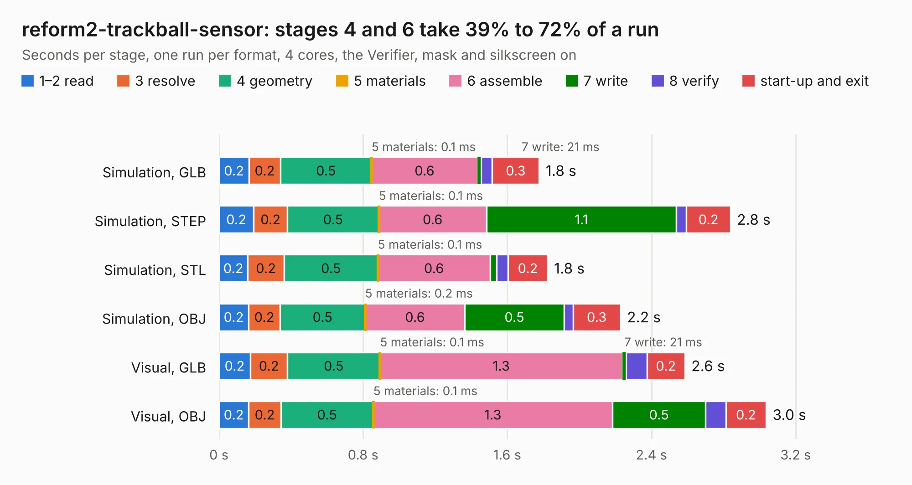

| Mode and format | 1–2 read | 3 resolve | 4 geometry | 5 materials | 6 assemble | 7 write | 8 verify | start-up and exit | Total |
|---|---:|---:|---:|---:|---:|---:|---:|---:|---:|
| Simulation, GLB | 0.2 | 0.2 | 0.5 | 0.1&nbsp;ms | 0.6 | 21&nbsp;ms | 60&nbsp;ms | 0.3 | 1.8 |
| Simulation, STEP | 0.2 | 0.2 | 0.5 | 0.1&nbsp;ms | 0.6 | 1.1 | 57&nbsp;ms | 0.2 | 2.8 |
| Simulation, STL | 0.2 | 0.2 | 0.5 | 0.1&nbsp;ms | 0.6 | 37&nbsp;ms | 64&nbsp;ms | 0.2 | 1.8 |
| Simulation, OBJ | 0.2 | 0.2 | 0.5 | 0.2&nbsp;ms | 0.6 | 0.5 | 51&nbsp;ms | 0.3 | 2.2 |
| Visual, GLB | 0.2 | 0.2 | 0.5 | 0.1&nbsp;ms | 1.3 | 21&nbsp;ms | 0.1 | 0.2 | 2.6 |
| Visual, OBJ | 0.2 | 0.2 | 0.5 | 0.1&nbsp;ms | 1.3 | 0.5 | 0.1 | 0.2 | 3.0 |

<table align="center"><tr><td valign="top">

| Board | Repo: [jackhumbert/reform](https://github.com/jackhumbert/reform) Board: `reform2-trackball-sensor.kicad_pcb` |
|---|---|
| Folder | reform2-trackball-sensor-pcb |
| Complexity | 151&nbsp;/&nbsp;1000 (size&nbsp;106, features&nbsp;45) |
| KESE&nbsp;features | through vias, rounded, trapezoid or chamfered pads, filled zones |
| Tested | 9th November 2026 |
| Copper&nbsp;layers | 2 |
| File&nbsp;format | KiCad 5 (20171130) |
| Parts,&nbsp;tracks,&nbsp;vias | 6, 41, 8 |
| Triangles,&nbsp;simulation | 88,568 in 17 parts |
| Verifier | PASS in all six runs |

</td><td valign="top">

<table>
<tr><th>File type</th><th>File size</th><th>Peak memory used</th></tr>
<tr><th colspan="3" align="left">Simulation</th></tr>
<tr><td>GLB</td><td align="right">3.2&nbsp;MB</td><td align="right">194&nbsp;MB</td></tr>
<tr><td>STEP</td><td align="right">18&nbsp;MB</td><td align="right">198&nbsp;MB</td></tr>
<tr><td>STL</td><td align="right">4.4&nbsp;MB</td><td align="right">190&nbsp;MB</td></tr>
<tr><td>OBJ</td><td align="right">8.9&nbsp;MB</td><td align="right">192&nbsp;MB</td></tr>
<tr><th colspan="3" align="left">Visual</th></tr>
<tr><td>GLB</td><td align="right">2.8&nbsp;MB</td><td align="right">159&nbsp;MB</td></tr>
<tr><td>OBJ</td><td align="right">7.8&nbsp;MB</td><td align="right">158&nbsp;MB</td></tr>
</table>

</td></tr></table>

## 23.13.17 reform2-trackball2

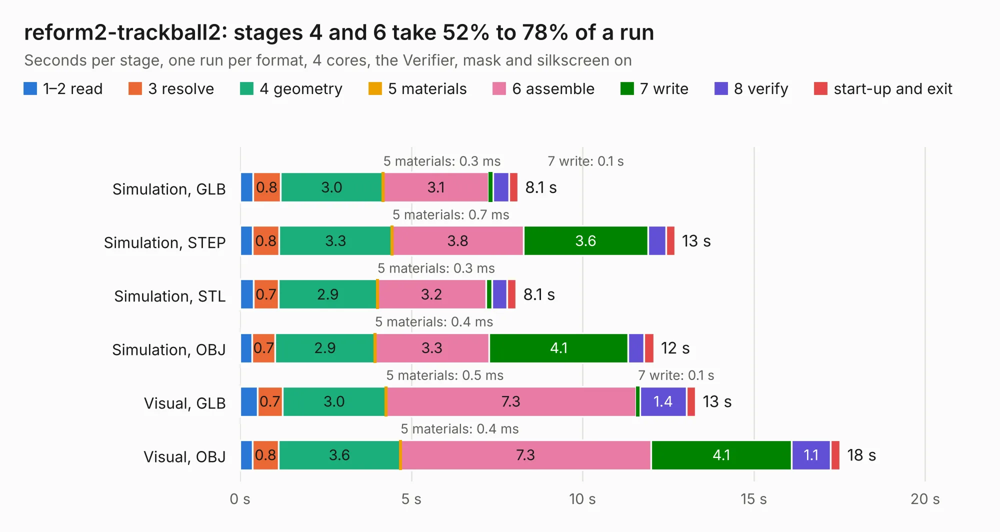

| Mode and format | 1–2 read | 3 resolve | 4 geometry | 5 materials | 6 assemble | 7 write | 8 verify | start-up and exit | Total |
|---|---:|---:|---:|---:|---:|---:|---:|---:|---:|
| Simulation, GLB | 0.4 | 0.8 | 3.0 | 0.3&nbsp;ms | 3.1 | 0.1 | 0.5 | 0.3 | 8.1 |
| Simulation, STEP | 0.4 | 0.8 | 3.3 | 0.7&nbsp;ms | 3.8 | 3.6 | 0.5 | 0.3 | 12.7 |
| Simulation, STL | 0.4 | 0.7 | 2.9 | 0.3&nbsp;ms | 3.2 | 0.2 | 0.4 | 0.3 | 8.1 |
| Simulation, OBJ | 0.4 | 0.7 | 2.9 | 0.4&nbsp;ms | 3.3 | 4.1 | 0.5 | 0.3 | 12.1 |
| Visual, GLB | 0.5 | 0.7 | 3.0 | 0.5&nbsp;ms | 7.3 | 0.1 | 1.4 | 0.3 | 13.3 |
| Visual, OBJ | 0.4 | 0.8 | 3.6 | 0.4&nbsp;ms | 7.3 | 4.1 | 1.1 | 0.3 | 17.5 |

<table align="center"><tr><td valign="top">

| Board | Repo: [jackhumbert/reform](https://github.com/jackhumbert/reform) Board: `reform2-trackball2.kicad_pcb` |
|---|---|
| Folder | reform2-trackball2-pcb |
| Complexity | 302&nbsp;/&nbsp;1000 (size&nbsp;207, features&nbsp;95) |
| KESE&nbsp;features | through vias, rounded, trapezoid or chamfered pads, filled zones, stack-up, dielectric εr and tanδ, copper finish, mask and silkscreen colours |
| Tested | 9th November 2026 |
| Copper&nbsp;layers | 2 |
| File&nbsp;format | KiCad 6 (20211014) |
| Parts,&nbsp;tracks,&nbsp;vias | 55, 473, 70 |
| Triangles,&nbsp;simulation | 665,254 in 76 parts |
| Verifier | PASS in all six runs |

</td><td valign="top">

<table>
<tr><th>File type</th><th>File size</th><th>Peak memory used</th></tr>
<tr><th colspan="3" align="left">Simulation</th></tr>
<tr><td>GLB</td><td align="right">23&nbsp;MB</td><td align="right">374&nbsp;MB</td></tr>
<tr><td>STEP</td><td align="right">121&nbsp;MB</td><td align="right">458&nbsp;MB</td></tr>
<tr><td>STL</td><td align="right">33&nbsp;MB</td><td align="right">373&nbsp;MB</td></tr>
<tr><td>OBJ</td><td align="right">67&nbsp;MB</td><td align="right">473&nbsp;MB</td></tr>
<tr><th colspan="3" align="left">Visual</th></tr>
<tr><td>GLB</td><td align="right">19&nbsp;MB</td><td align="right">524&nbsp;MB</td></tr>
<tr><td>OBJ</td><td align="right">57&nbsp;MB</td><td align="right">459&nbsp;MB</td></tr>
</table>

</td></tr></table>

## 23.13.18 reform2-trackpad

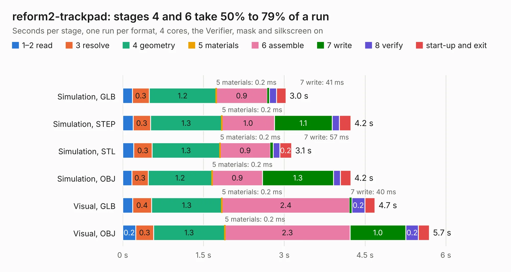

| Mode and format | 1–2 read | 3 resolve | 4 geometry | 5 materials | 6 assemble | 7 write | 8 verify | start-up and exit | Total |
|---|---:|---:|---:|---:|---:|---:|---:|---:|---:|
| Simulation, GLB | 0.2 | 0.3 | 1.2 | 0.2&nbsp;ms | 0.9 | 41&nbsp;ms | 0.1 | 0.2 | 3.0 |
| Simulation, STEP | 0.2 | 0.3 | 1.3 | 0.2&nbsp;ms | 1.0 | 1.1 | 0.1 | 0.2 | 4.2 |
| Simulation, STL | 0.2 | 0.3 | 1.3 | 0.2&nbsp;ms | 0.9 | 57&nbsp;ms | 0.1 | 0.2 | 3.1 |
| Simulation, OBJ | 0.2 | 0.3 | 1.2 | 0.2&nbsp;ms | 0.9 | 1.3 | 0.1 | 0.2 | 4.2 |
| Visual, GLB | 0.2 | 0.4 | 1.3 | 0.2&nbsp;ms | 2.4 | 40&nbsp;ms | 0.2 | 0.2 | 4.7 |
| Visual, OBJ | 0.2 | 0.3 | 1.3 | 0.2&nbsp;ms | 2.3 | 1.0 | 0.2 | 0.2 | 5.7 |

<table align="center"><tr><td valign="top">

| Board | Repo: [jackhumbert/reform](https://github.com/jackhumbert/reform) Board: `reform2-trackpad.kicad_pcb` |
|---|---|
| Folder | reform2-trackpad-pcb |
| Complexity | 225&nbsp;/&nbsp;1000 (size&nbsp;180, features&nbsp;45) |
| KESE&nbsp;features | through vias, rounded, trapezoid or chamfered pads, filled zones |
| Tested | 9th November 2026 |
| Copper&nbsp;layers | 2 |
| File&nbsp;format | KiCad 5 (20171130) |
| Parts,&nbsp;tracks,&nbsp;vias | 22, 148, 30 |
| Triangles,&nbsp;simulation | 252,768 in 50 parts |
| Verifier | PASS in all six runs |

</td><td valign="top">

<table>
<tr><th>File type</th><th>File size</th><th>Peak memory used</th></tr>
<tr><th colspan="3" align="left">Simulation</th></tr>
<tr><td>GLB</td><td align="right">9.1&nbsp;MB</td><td align="right">231&nbsp;MB</td></tr>
<tr><td>STEP</td><td align="right">48&nbsp;MB</td><td align="right">261&nbsp;MB</td></tr>
<tr><td>STL</td><td align="right">13&nbsp;MB</td><td align="right">231&nbsp;MB</td></tr>
<tr><td>OBJ</td><td align="right">26&nbsp;MB</td><td align="right">239&nbsp;MB</td></tr>
<tr><th colspan="3" align="left">Visual</th></tr>
<tr><td>GLB</td><td align="right">7.5&nbsp;MB</td><td align="right">237&nbsp;MB</td></tr>
<tr><td>OBJ</td><td align="right">22&nbsp;MB</td><td align="right">228&nbsp;MB</td></tr>
</table>

</td></tr></table>

## 23.13.19 bpm_dfe

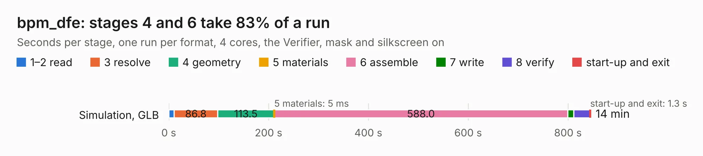

| Mode and format | 1–2 read | 3 resolve | 4 geometry | 5 materials | 6 assemble | 7 write | 8 verify | start-up and exit | Total |
|---|---:|---:|---:|---:|---:|---:|---:|---:|---:|
| Simulation, GLB | 10.9 | 86.8 | 113.5 | 5&nbsp;ms | 588.0 | 12.2 | 32.4 | 1.3 | 845.3 |
| Simulation, STEP |  |  |  |  |  |  |  |  | exceeded 11 GB on a 15 GB machine (stopped there, not a KESE failure); it will be run again on a machine with more memory |
| Simulation, STL |  |  |  |  |  |  |  |  | exceeded 11 GB on a 15 GB machine (stopped there, not a KESE failure); it will be run again on a machine with more memory |
| Simulation, OBJ |  |  |  |  |  |  |  |  | exceeded 11 GB on a 15 GB machine (stopped there, not a KESE failure); it will be run again on a machine with more memory |
| Visual, GLB |  |  |  |  |  |  |  |  | exceeded 11 GB on a 15 GB machine (stopped there, not a KESE failure); it will be run again on a machine with more memory |
| Visual, OBJ |  |  |  |  |  |  |  |  | exceeded 11 GB on a 15 GB machine (stopped there, not a KESE failure); it will be run again on a machine with more memory |

<table align="center"><tr><td valign="top">

| Board | Repo: [jamead/rfsocdfe-hw](https://github.com/jamead/rfsocdfe-hw) Board: `bpm_dfe.kicad_pcb` |
|---|---|
| Complexity | 548&nbsp;/&nbsp;1000 (size&nbsp;398, features&nbsp;150) |
| KESE&nbsp;features | through vias, padstacks, custom pads, rounded, trapezoid or chamfered pads, arc tracks, copper drawings, copper text, curved board outline, stack-up, dielectric εr and tanδ, mask and silkscreen colours |
| Tested | 9th November 2026 to 10th November 2026 |
| Copper&nbsp;layers | 20 |
| File&nbsp;format | KiCad 10 (20260206) |
| Parts,&nbsp;tracks,&nbsp;vias | 894, 28,449, 5,356 |
| Triangles,&nbsp;simulation | 63,452,914 in 1371 parts |
| Verifier | Simulation, STEP: exceeded 11 GB on a 15 GB machine (stopped there, not a KESE failure); it will be run again on a machine with more memory Simulation, STL: exceeded 11 GB on a 15 GB machine (stopped there, not a KESE failure); it will be run again on a machine with more memory Simulation, OBJ: exceeded 11 GB on a 15 GB machine (stopped there, not a KESE failure); it will be run again on a machine with more memory Visual, GLB: exceeded 11 GB on a 15 GB machine (stopped there, not a KESE failure); it will be run again on a machine with more memory Visual, OBJ: exceeded 11 GB on a 15 GB machine (stopped there, not a KESE failure); it will be run again on a machine with more memory |
| Run&nbsp;again | Simulation, GLB: failed in the corpus run, run again with the memory cap raised from 11 GB to 14.5 GB, and passed |

</td><td valign="top">

<table>
<tr><th>File type</th><th>File size</th><th>Peak memory used</th></tr>
<tr><th colspan="3" align="left">Simulation</th></tr>
<tr><td>GLB</td><td align="right">1.9&nbsp;GB</td><td align="right">14&nbsp;GB</td></tr>
<tr><td>STEP</td><td align="right">–</td><td align="right">11&nbsp;GB</td></tr>
<tr><td>STL</td><td align="right">–</td><td align="right">11&nbsp;GB</td></tr>
<tr><td>OBJ</td><td align="right">–</td><td align="right">11&nbsp;GB</td></tr>
<tr><th colspan="3" align="left">Visual</th></tr>
<tr><td>GLB</td><td align="right">–</td><td align="right">11&nbsp;GB</td></tr>
<tr><td>OBJ</td><td align="right">–</td><td align="right">11&nbsp;GB</td></tr>
</table>

</td></tr></table>

## 23.13.20 bench_stm32_esc

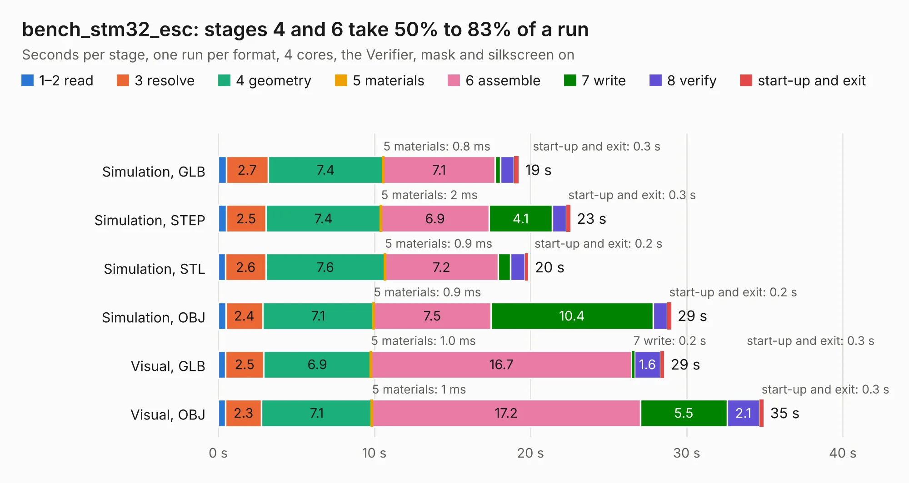

| Mode and format | 1–2 read | 3 resolve | 4 geometry | 5 materials | 6 assemble | 7 write | 8 verify | start-up and exit | Total |
|---|---:|---:|---:|---:|---:|---:|---:|---:|---:|
| Simulation, GLB | 0.5 | 2.7 | 7.4 | 0.8&nbsp;ms | 7.1 | 0.4 | 0.9 | 0.3 | 19.2 |
| Simulation, STEP | 0.5 | 2.5 | 7.4 | 2&nbsp;ms | 6.9 | 4.1 | 0.9 | 0.3 | 22.6 |
| Simulation, STL | 0.5 | 2.6 | 7.6 | 0.9&nbsp;ms | 7.2 | 0.8 | 0.9 | 0.2 | 19.9 |
| Simulation, OBJ | 0.5 | 2.4 | 7.1 | 0.9&nbsp;ms | 7.5 | 10.4 | 0.9 | 0.2 | 29.0 |
| Visual, GLB | 0.5 | 2.5 | 6.9 | 1.0&nbsp;ms | 16.7 | 0.2 | 1.6 | 0.3 | 28.6 |
| Visual, OBJ | 0.5 | 2.3 | 7.1 | 1&nbsp;ms | 17.2 | 5.5 | 2.1 | 0.3 | 34.9 |

<table align="center"><tr><td valign="top">

| Board | Repo: [jamesgossy/stm32-brushless-motor-controller](https://github.com/jamesgossy/stm32-brushless-motor-controller) Board: `bench_stm32_esc.kicad_pcb` |
|---|---|
| Folder | controller_hardware |
| Complexity | 366&nbsp;/&nbsp;1000 (size&nbsp;266, features&nbsp;100) |
| KESE&nbsp;features | through vias, slotted holes, custom pads, rounded, trapezoid or chamfered pads, filled zones, stack-up, dielectric εr and tanδ |
| Tested | 9th November 2026 |
| Copper&nbsp;layers | 4 |
| File&nbsp;format | KiCad 10 (20260206) |
| Parts,&nbsp;tracks,&nbsp;vias | 171, 752, 666 |
| Triangles,&nbsp;simulation | 2,472,356 in 153 parts |
| Verifier | PASS in all six runs |

</td><td valign="top">

<table>
<tr><th>File type</th><th>File size</th><th>Peak memory used</th></tr>
<tr><th colspan="3" align="left">Simulation</th></tr>
<tr><td>GLB</td><td align="right">84&nbsp;MB</td><td align="right">847&nbsp;MB</td></tr>
<tr><td>STEP</td><td align="right">276&nbsp;MB</td><td align="right">1.0&nbsp;GB</td></tr>
<tr><td>STL</td><td align="right">124&nbsp;MB</td><td align="right">905&nbsp;MB</td></tr>
<tr><td>OBJ</td><td align="right">259&nbsp;MB</td><td align="right">1.6&nbsp;GB</td></tr>
<tr><th colspan="3" align="left">Visual</th></tr>
<tr><td>GLB</td><td align="right">46&nbsp;MB</td><td align="right">904&nbsp;MB</td></tr>
<tr><td>OBJ</td><td align="right">144&nbsp;MB</td><td align="right">985&nbsp;MB</td></tr>
</table>

</td></tr></table>

## 23.13.21 LibreCAL

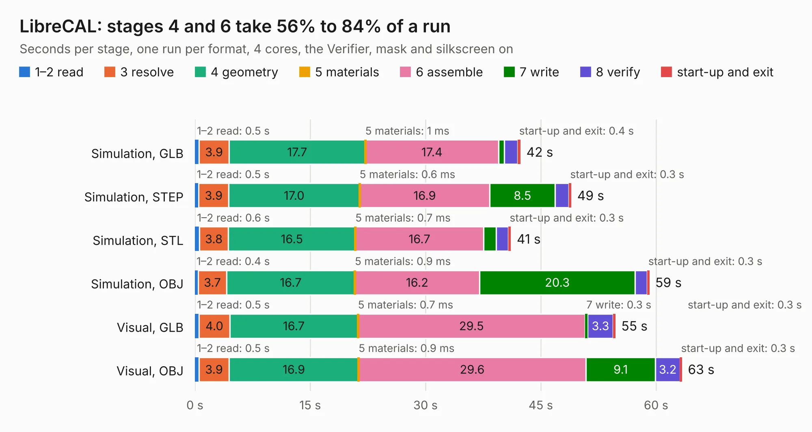

| Mode and format | 1–2 read | 3 resolve | 4 geometry | 5 materials | 6 assemble | 7 write | 8 verify | start-up and exit | Total |
|---|---:|---:|---:|---:|---:|---:|---:|---:|---:|
| Simulation, GLB | 0.5 | 3.9 | 17.7 | 1&nbsp;ms | 17.4 | 0.7 | 1.8 | 0.4 | 42.4 |
| Simulation, STEP | 0.5 | 3.9 | 17.0 | 0.6&nbsp;ms | 16.9 | 8.5 | 1.8 | 0.3 | 49.0 |
| Simulation, STL | 0.6 | 3.8 | 16.5 | 0.7&nbsp;ms | 16.7 | 1.6 | 1.6 | 0.3 | 41.1 |
| Simulation, OBJ | 0.4 | 3.7 | 16.7 | 0.9&nbsp;ms | 16.2 | 20.3 | 1.6 | 0.3 | 59.1 |
| Visual, GLB | 0.5 | 4.0 | 16.7 | 0.7&nbsp;ms | 29.5 | 0.3 | 3.3 | 0.3 | 54.7 |
| Visual, OBJ | 0.5 | 3.9 | 16.9 | 0.9&nbsp;ms | 29.6 | 9.1 | 3.2 | 0.3 | 63.4 |

<table align="center"><tr><td valign="top">

| Board | Repo: [jankae/LibreCAL](https://github.com/jankae/LibreCAL) Board: `LibreCAL.kicad_pcb` |
|---|---|
| Folder | Hardware / LibreCAL |
| Complexity | 350&nbsp;/&nbsp;1000 (size&nbsp;225, features&nbsp;125) |
| KESE&nbsp;features | through vias, slotted holes, rounded, trapezoid or chamfered pads, arc tracks, filled zones, curved board outline, stack-up, dielectric εr and tanδ, copper finish |
| Tested | 9th November 2026 |
| Copper&nbsp;layers | 4 |
| File&nbsp;format | KiCad 7 (20221018) |
| Parts,&nbsp;tracks,&nbsp;vias | 130, 1,232, 1,196 |
| Triangles,&nbsp;simulation | 4,302,336 in 137 parts |
| Verifier | PASS in all six runs |

</td><td valign="top">

<table>
<tr><th>File type</th><th>File size</th><th>Peak memory used</th></tr>
<tr><th colspan="3" align="left">Simulation</th></tr>
<tr><td>GLB</td><td align="right">143&nbsp;MB</td><td align="right">1.6&nbsp;GB</td></tr>
<tr><td>STEP</td><td align="right">426&nbsp;MB</td><td align="right">1.7&nbsp;GB</td></tr>
<tr><td>STL</td><td align="right">215&nbsp;MB</td><td align="right">1.5&nbsp;GB</td></tr>
<tr><td>OBJ</td><td align="right">445&nbsp;MB</td><td align="right">2.7&nbsp;GB</td></tr>
<tr><th colspan="3" align="left">Visual</th></tr>
<tr><td>GLB</td><td align="right">65&nbsp;MB</td><td align="right">1.2&nbsp;GB</td></tr>
<tr><td>OBJ</td><td align="right">207&nbsp;MB</td><td align="right">1.5&nbsp;GB</td></tr>
</table>

</td></tr></table>

## 23.13.22 VNA

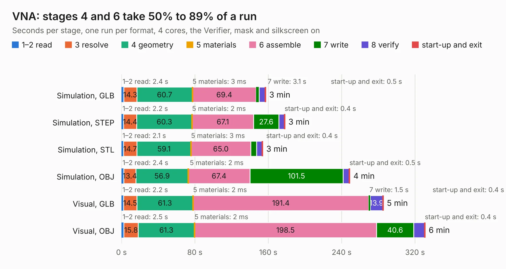

| Mode and format | 1–2 read | 3 resolve | 4 geometry | 5 materials | 6 assemble | 7 write | 8 verify | start-up and exit | Total |
|---|---:|---:|---:|---:|---:|---:|---:|---:|---:|
| Simulation, GLB | 2.4 | 14.3 | 60.7 | 3&nbsp;ms | 69.4 | 3.1 | 6.8 | 0.5 | 157.1 |
| Simulation, STEP | 2.2 | 14.4 | 60.3 | 2&nbsp;ms | 67.1 | 27.6 | 6.0 | 0.4 | 178.0 |
| Simulation, STL | 2.1 | 14.7 | 59.1 | 3&nbsp;ms | 65.0 | 6.6 | 6.1 | 0.4 | 153.9 |
| Simulation, OBJ | 2.4 | 13.4 | 56.9 | 2&nbsp;ms | 67.4 | 101.5 | 6.8 | 0.5 | 248.8 |
| Visual, GLB | 2.2 | 14.5 | 61.3 | 2&nbsp;ms | 191.4 | 1.5 | 13.9 | 0.4 | 285.3 |
| Visual, OBJ | 2.5 | 15.8 | 61.3 | 2&nbsp;ms | 198.5 | 40.6 | 11.9 | 0.4 | 330.9 |

<table align="center"><tr><td valign="top">

| Board | Repo: [jankae/LibreVNA](https://github.com/jankae/LibreVNA) Board: `VNA.kicad_pcb` |
|---|---|
| Folder | Hardware / Kicad |
| Complexity | 435&nbsp;/&nbsp;1000 (size&nbsp;320, features&nbsp;115) |
| KESE&nbsp;features | through vias, slotted holes, rounded, trapezoid or chamfered pads, arc tracks, filled zones, copper drawings, stack-up, dielectric εr and tanδ, mask and silkscreen colours |
| Tested | 9th November 2026 |
| Copper&nbsp;layers | 6 |
| File&nbsp;format | KiCad 9 (20241229) |
| Parts,&nbsp;tracks,&nbsp;vias | 571, 3,708, 2,932 |
| Triangles,&nbsp;simulation | 14,321,852 in 455 parts |
| Verifier | PASS in all six runs |

</td><td valign="top">

<table>
<tr><th>File type</th><th>File size</th><th>Peak memory used</th></tr>
<tr><th colspan="3" align="left">Simulation</th></tr>
<tr><td>GLB</td><td align="right">464&nbsp;MB</td><td align="right">3.8&nbsp;GB</td></tr>
<tr><td>STEP</td><td align="right">1.3&nbsp;GB</td><td align="right">5.1&nbsp;GB</td></tr>
<tr><td>STL</td><td align="right">716&nbsp;MB</td><td align="right">3.8&nbsp;GB</td></tr>
<tr><td>OBJ</td><td align="right">1.5&nbsp;GB</td><td align="right">8.8&nbsp;GB</td></tr>
<tr><th colspan="3" align="left">Visual</th></tr>
<tr><td>GLB</td><td align="right">202&nbsp;MB</td><td align="right">3.6&nbsp;GB</td></tr>
<tr><td>OBJ</td><td align="right">677&nbsp;MB</td><td align="right">4.3&nbsp;GB</td></tr>
</table>

</td></tr></table>

## 23.13.23 2000ATX

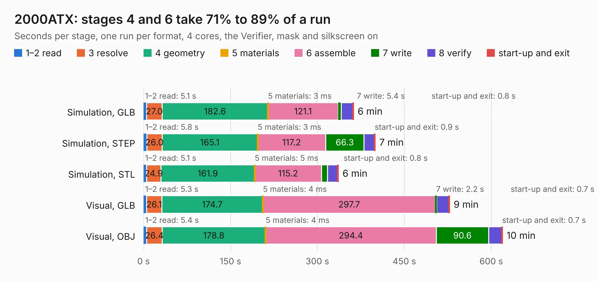

| Mode and format | 1–2 read | 3 resolve | 4 geometry | 5 materials | 6 assemble | 7 write | 8 verify | start-up and exit | Total |
|---|---:|---:|---:|---:|---:|---:|---:|---:|---:|
| Simulation, GLB | 5.1 | 27.0 | 182.6 | 3&nbsp;ms | 121.1 | 5.4 | 20.1 | 0.8 | 362.0 |
| Simulation, STEP | 5.8 | 26.0 | 165.1 | 3&nbsp;ms | 117.2 | 66.3 | 18.1 | 0.9 | 399.4 |
| Simulation, STL | 5.1 | 24.9 | 161.9 | 5&nbsp;ms | 115.2 | 10.2 | 17.8 | 0.8 | 336.0 |
| Simulation, OBJ |  |  |  |  |  |  |  |  | exceeded 11 GB on a 15 GB machine (stopped there, not a KESE failure); it will be run again on a machine with more memory |
| Visual, GLB | 5.3 | 26.1 | 174.7 | 4&nbsp;ms | 297.7 | 2.2 | 21.2 | 0.7 | 527.8 |
| Visual, OBJ | 5.4 | 26.4 | 178.8 | 4&nbsp;ms | 294.4 | 90.6 | 22.8 | 0.7 | 619.2 |

<table align="center"><tr><td valign="top">

| Board | Repo: [jasonsbeer/Amiga-2000-EATX](https://github.com/jasonsbeer/Amiga-2000-EATX) Board: `2000ATX.kicad_pcb` |
|---|---|
| Folder | 2000EATX-KiCAD-R31 |
| Complexity | 403&nbsp;/&nbsp;1000 (size&nbsp;303, features&nbsp;100) |
| KESE&nbsp;features | through vias, custom pads, rounded, trapezoid or chamfered pads, filled zones, copper drawings, stack-up, dielectric εr and tanδ |
| Tested | 9th November 2026 |
| Copper&nbsp;layers | 4 |
| File&nbsp;format | KiCad 8 (20240108) |
| Parts,&nbsp;tracks,&nbsp;vias | 601, 13,740, 1,212 |
| Triangles,&nbsp;simulation | 24,447,248 in 872 parts |
| Verifier | Simulation, OBJ: exceeded 11 GB on a 15 GB machine (stopped there, not a KESE failure); it will be run again on a machine with more memory |

</td><td valign="top">

<table>
<tr><th>File type</th><th>File size</th><th>Peak memory used</th></tr>
<tr><th colspan="3" align="left">Simulation</th></tr>
<tr><td>GLB</td><td align="right">834&nbsp;MB</td><td align="right">4.8&nbsp;GB</td></tr>
<tr><td>STEP</td><td align="right">3.9&nbsp;GB</td><td align="right">7.0&nbsp;GB</td></tr>
<tr><td>STL</td><td align="right">1.2&nbsp;GB</td><td align="right">5.2&nbsp;GB</td></tr>
<tr><td>OBJ</td><td align="right">–</td><td align="right">11&nbsp;GB</td></tr>
<tr><th colspan="3" align="left">Visual</th></tr>
<tr><td>GLB</td><td align="right">437&nbsp;MB</td><td align="right">6.9&nbsp;GB</td></tr>
<tr><td>OBJ</td><td align="right">1.4&nbsp;GB</td><td align="right">9.3&nbsp;GB</td></tr>
</table>

</td></tr></table>

## 23.13.24 TICK

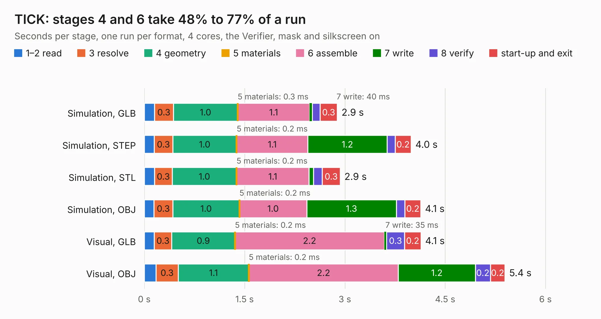

| Mode and format | 1–2 read | 3 resolve | 4 geometry | 5 materials | 6 assemble | 7 write | 8 verify | start-up and exit | Total |
|---|---:|---:|---:|---:|---:|---:|---:|---:|---:|
| Simulation, GLB | 0.2 | 0.3 | 1.0 | 0.3&nbsp;ms | 1.1 | 40&nbsp;ms | 0.1 | 0.3 | 2.9 |
| Simulation, STEP | 0.1 | 0.3 | 1.0 | 0.2&nbsp;ms | 1.1 | 1.2 | 0.1 | 0.2 | 4.0 |
| Simulation, STL | 0.2 | 0.3 | 1.0 | 0.2&nbsp;ms | 1.1 | 64&nbsp;ms | 0.1 | 0.3 | 2.9 |
| Simulation, OBJ | 0.1 | 0.3 | 1.0 | 0.2&nbsp;ms | 1.0 | 1.3 | 0.1 | 0.2 | 4.1 |
| Visual, GLB | 0.1 | 0.3 | 0.9 | 0.2&nbsp;ms | 2.2 | 35&nbsp;ms | 0.3 | 0.2 | 4.1 |
| Visual, OBJ | 0.2 | 0.3 | 1.1 | 0.2&nbsp;ms | 2.2 | 1.2 | 0.2 | 0.2 | 5.4 |

<table align="center"><tr><td valign="top">

| Board | Repo: [jasonsbeer/Amiga-2000-EATX](https://github.com/jasonsbeer/Amiga-2000-EATX) Board: `TICK.kicad_pcb` |
|---|---|
| Folder | TICK / TICK-Dual-0805 |
| Complexity | 207&nbsp;/&nbsp;1000 (size&nbsp;122, features&nbsp;85) |
| KESE&nbsp;features | through vias, blind and buried vias, rounded, trapezoid or chamfered pads, filled zones |
| Tested | 9th November 2026 |
| Copper&nbsp;layers | 2 |
| File&nbsp;format | KiCad 6 (20211014) |
| Parts,&nbsp;tracks,&nbsp;vias | 12, 74, 12 |
| Triangles,&nbsp;simulation | 226,536 in 36 parts |
| Verifier | PASS in all six runs |

</td><td valign="top">

<table>
<tr><th>File type</th><th>File size</th><th>Peak memory used</th></tr>
<tr><th colspan="3" align="left">Simulation</th></tr>
<tr><td>GLB</td><td align="right">7.8&nbsp;MB</td><td align="right">219&nbsp;MB</td></tr>
<tr><td>STEP</td><td align="right">39&nbsp;MB</td><td align="right">248&nbsp;MB</td></tr>
<tr><td>STL</td><td align="right">11&nbsp;MB</td><td align="right">219&nbsp;MB</td></tr>
<tr><td>OBJ</td><td align="right">23&nbsp;MB</td><td align="right">218&nbsp;MB</td></tr>
<tr><th colspan="3" align="left">Visual</th></tr>
<tr><td>GLB</td><td align="right">6.5&nbsp;MB</td><td align="right">216&nbsp;MB</td></tr>
<tr><td>OBJ</td><td align="right">19&nbsp;MB</td><td align="right">217&nbsp;MB</td></tr>
</table>

</td></tr></table>

## 23.13.25 TICK_AC

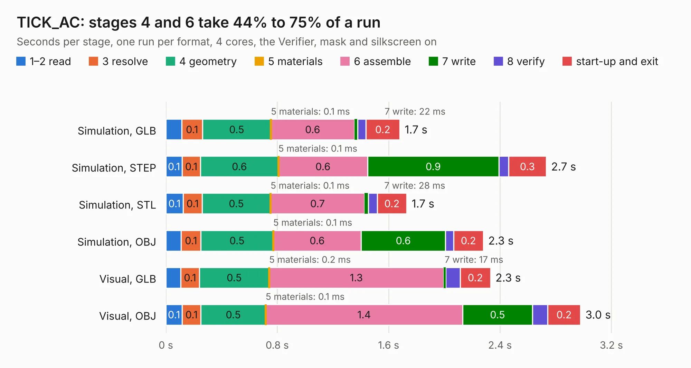

| Mode and format | 1–2 read | 3 resolve | 4 geometry | 5 materials | 6 assemble | 7 write | 8 verify | start-up and exit | Total |
|---|---:|---:|---:|---:|---:|---:|---:|---:|---:|
| Simulation, GLB | 0.1 | 0.1 | 0.5 | 0.1&nbsp;ms | 0.6 | 22&nbsp;ms | 60&nbsp;ms | 0.2 | 1.7 |
| Simulation, STEP | 0.1 | 0.1 | 0.6 | 0.1&nbsp;ms | 0.6 | 0.9 | 70&nbsp;ms | 0.3 | 2.7 |
| Simulation, STL | 0.1 | 0.1 | 0.5 | 0.1&nbsp;ms | 0.7 | 28&nbsp;ms | 63&nbsp;ms | 0.2 | 1.7 |
| Simulation, OBJ | 0.1 | 0.1 | 0.5 | 0.1&nbsp;ms | 0.6 | 0.6 | 58&nbsp;ms | 0.2 | 2.3 |
| Visual, GLB | 0.1 | 0.1 | 0.5 | 0.2&nbsp;ms | 1.3 | 17&nbsp;ms | 0.1 | 0.2 | 2.3 |
| Visual, OBJ | 0.1 | 0.1 | 0.5 | 0.1&nbsp;ms | 1.4 | 0.5 | 0.1 | 0.2 | 3.0 |

<table align="center"><tr><td valign="top">

| Board | Repo: [jasonsbeer/Amiga-2000-EATX](https://github.com/jasonsbeer/Amiga-2000-EATX) Board: `TICK_AC.kicad_pcb` |
|---|---|
| Folder | TICK / TICK_AC_KiCAD |
| Complexity | 155&nbsp;/&nbsp;1000 (size&nbsp;100, features&nbsp;55) |
| KESE&nbsp;features | through vias, slotted holes, rounded, trapezoid or chamfered pads, filled zones |
| Tested | 9th November 2026 |
| Copper&nbsp;layers | 2 |
| File&nbsp;format | KiCad 5 (20171130) |
| Parts,&nbsp;tracks,&nbsp;vias | 7, 12, 9 |
| Triangles,&nbsp;simulation | 101,752 in 19 parts |
| Verifier | PASS in all six runs |

</td><td valign="top">

<table>
<tr><th>File type</th><th>File size</th><th>Peak memory used</th></tr>
<tr><th colspan="3" align="left">Simulation</th></tr>
<tr><td>GLB</td><td align="right">3.5&nbsp;MB</td><td align="right">182&nbsp;MB</td></tr>
<tr><td>STEP</td><td align="right">16&nbsp;MB</td><td align="right">190&nbsp;MB</td></tr>
<tr><td>STL</td><td align="right">5.1&nbsp;MB</td><td align="right">180&nbsp;MB</td></tr>
<tr><td>OBJ</td><td align="right">9.9&nbsp;MB</td><td align="right">182&nbsp;MB</td></tr>
<tr><th colspan="3" align="left">Visual</th></tr>
<tr><td>GLB</td><td align="right">2.9&nbsp;MB</td><td align="right">154&nbsp;MB</td></tr>
<tr><td>OBJ</td><td align="right">8.1&nbsp;MB</td><td align="right">152&nbsp;MB</td></tr>
</table>

</td></tr></table>

## 23.13.26 TICK

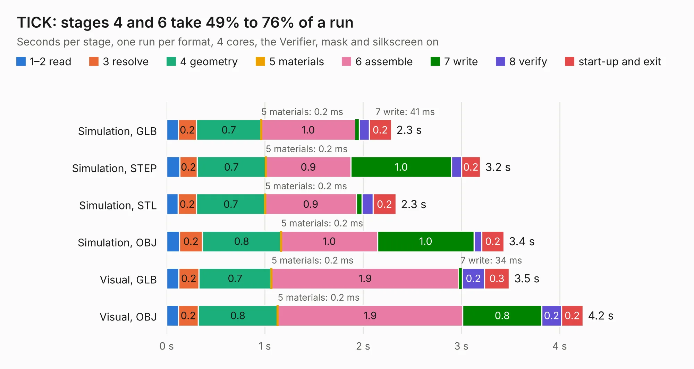

| Mode and format | 1–2 read | 3 resolve | 4 geometry | 5 materials | 6 assemble | 7 write | 8 verify | start-up and exit | Total |
|---|---:|---:|---:|---:|---:|---:|---:|---:|---:|
| Simulation, GLB | 0.1 | 0.2 | 0.7 | 0.2&nbsp;ms | 1.0 | 41&nbsp;ms | 0.1 | 0.2 | 2.3 |
| Simulation, STEP | 0.1 | 0.2 | 0.7 | 0.2&nbsp;ms | 0.9 | 1.0 | 0.1 | 0.2 | 3.2 |
| Simulation, STL | 0.1 | 0.2 | 0.7 | 0.2&nbsp;ms | 0.9 | 58&nbsp;ms | 0.1 | 0.2 | 2.3 |
| Simulation, OBJ | 0.1 | 0.2 | 0.8 | 0.2&nbsp;ms | 1.0 | 1.0 | 78&nbsp;ms | 0.2 | 3.4 |
| Visual, GLB | 0.1 | 0.2 | 0.7 | 0.2&nbsp;ms | 1.9 | 34&nbsp;ms | 0.2 | 0.3 | 3.5 |
| Visual, OBJ | 0.1 | 0.2 | 0.8 | 0.2&nbsp;ms | 1.9 | 0.8 | 0.2 | 0.2 | 4.2 |

<table align="center"><tr><td valign="top">

| Board | Repo: [jasonsbeer/Amiga-2000-EATX](https://github.com/jasonsbeer/Amiga-2000-EATX) Board: `TICK.kicad_pcb` |
|---|---|
| Folder | TICK / TICK_OSC_KiCAD |
| Complexity | 162&nbsp;/&nbsp;1000 (size&nbsp;117, features&nbsp;45) |
| KESE&nbsp;features | through vias, rounded, trapezoid or chamfered pads, filled zones |
| Tested | 9th November 2026 |
| Copper&nbsp;layers | 2 |
| File&nbsp;format | KiCad 5 (20171130) |
| Parts,&nbsp;tracks,&nbsp;vias | 10, 66, 9 |
| Triangles,&nbsp;simulation | 189,498 in 34 parts |
| Verifier | PASS in all six runs |

</td><td valign="top">

<table>
<tr><th>File type</th><th>File size</th><th>Peak memory used</th></tr>
<tr><th colspan="3" align="left">Simulation</th></tr>
<tr><td>GLB</td><td align="right">6.5&nbsp;MB</td><td align="right">212&nbsp;MB</td></tr>
<tr><td>STEP</td><td align="right">31&nbsp;MB</td><td align="right">232&nbsp;MB</td></tr>
<tr><td>STL</td><td align="right">9.5&nbsp;MB</td><td align="right">213&nbsp;MB</td></tr>
<tr><td>OBJ</td><td align="right">19&nbsp;MB</td><td align="right">212&nbsp;MB</td></tr>
<tr><th colspan="3" align="left">Visual</th></tr>
<tr><td>GLB</td><td align="right">5.6&nbsp;MB</td><td align="right">217&nbsp;MB</td></tr>
<tr><td>OBJ</td><td align="right">16&nbsp;MB</td><td align="right">212&nbsp;MB</td></tr>
</table>

</td></tr></table>

## 23.13.27 N2360

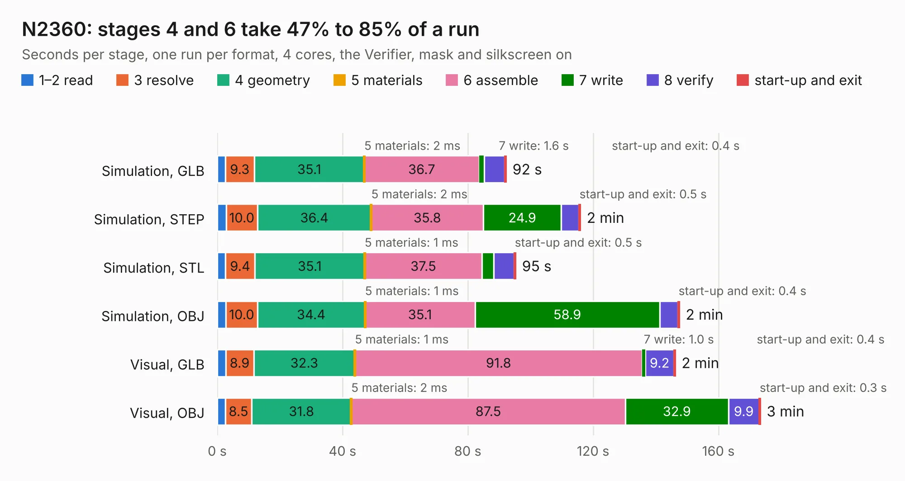

| Mode and format | 1–2 read | 3 resolve | 4 geometry | 5 materials | 6 assemble | 7 write | 8 verify | start-up and exit | Total |
|---|---:|---:|---:|---:|---:|---:|---:|---:|---:|
| Simulation, GLB | 2.6 | 9.3 | 35.1 | 2&nbsp;ms | 36.7 | 1.6 | 6.6 | 0.4 | 92.2 |
| Simulation, STEP | 2.9 | 10.0 | 36.4 | 2&nbsp;ms | 35.8 | 24.9 | 5.6 | 0.5 | 115.9 |
| Simulation, STL | 2.6 | 9.4 | 35.1 | 1&nbsp;ms | 37.5 | 3.7 | 6.6 | 0.5 | 95.2 |
| Simulation, OBJ | 2.8 | 10.0 | 34.4 | 1&nbsp;ms | 35.1 | 58.9 | 5.9 | 0.4 | 147.5 |
| Visual, GLB | 2.7 | 8.9 | 32.3 | 1&nbsp;ms | 91.8 | 1.0 | 9.2 | 0.4 | 146.2 |
| Visual, OBJ | 2.6 | 8.5 | 31.8 | 2&nbsp;ms | 87.5 | 32.9 | 9.9 | 0.3 | 173.4 |

<table align="center"><tr><td valign="top">

| Board | Repo: [jasonsbeer/Amiga-N2630](https://github.com/jasonsbeer/Amiga-N2630) Board: `N2360.kicad_pcb` |
|---|---|
| Folder | KiCAD / A2630-New-KiCAD-Rev410-PGA |
| Complexity | 389&nbsp;/&nbsp;1000 (size&nbsp;294, features&nbsp;95) |
| KESE&nbsp;features | through vias, rounded, trapezoid or chamfered pads, filled zones, copper text, curved board outline, stack-up, dielectric εr and tanδ |
| Tested | 9th November 2026 |
| Copper&nbsp;layers | 4 |
| File&nbsp;format | KiCad 8 (20240108) |
| Parts,&nbsp;tracks,&nbsp;vias | 233, 7,443, 844 |
| Triangles,&nbsp;simulation | 9,166,598 in 471 parts |
| Verifier | PASS in all six runs |

</td><td valign="top">

<table>
<tr><th>File type</th><th>File size</th><th>Peak memory used</th></tr>
<tr><th colspan="3" align="left">Simulation</th></tr>
<tr><td>GLB</td><td align="right">312&nbsp;MB</td><td align="right">2.2&nbsp;GB</td></tr>
<tr><td>STEP</td><td align="right">1.4&nbsp;GB</td><td align="right">3.2&nbsp;GB</td></tr>
<tr><td>STL</td><td align="right">458&nbsp;MB</td><td align="right">2.2&nbsp;GB</td></tr>
<tr><td>OBJ</td><td align="right">992&nbsp;MB</td><td align="right">5.8&nbsp;GB</td></tr>
<tr><th colspan="3" align="left">Visual</th></tr>
<tr><td>GLB</td><td align="right">200&nbsp;MB</td><td align="right">3.2&nbsp;GB</td></tr>
<tr><td>OBJ</td><td align="right">646&nbsp;MB</td><td align="right">4.1&nbsp;GB</td></tr>
</table>

</td></tr></table>

## 23.13.28 N2360

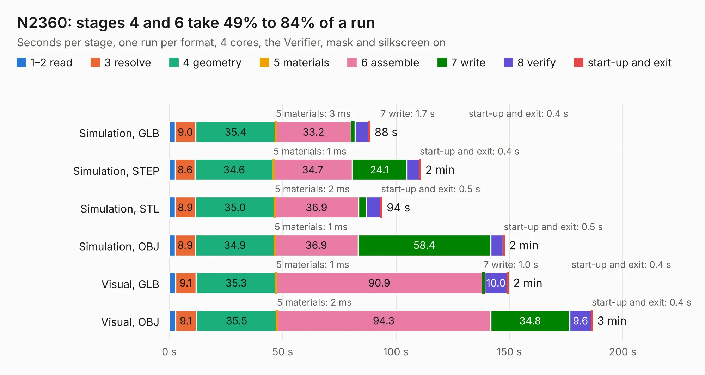

| Mode and format | 1–2 read | 3 resolve | 4 geometry | 5 materials | 6 assemble | 7 write | 8 verify | start-up and exit | Total |
|---|---:|---:|---:|---:|---:|---:|---:|---:|---:|
| Simulation, GLB | 2.6 | 9.0 | 35.4 | 3&nbsp;ms | 33.2 | 1.7 | 6.0 | 0.4 | 88.3 |
| Simulation, STEP | 2.7 | 8.6 | 34.6 | 1&nbsp;ms | 34.7 | 24.1 | 5.6 | 0.4 | 110.8 |
| Simulation, STL | 2.7 | 8.9 | 35.0 | 2&nbsp;ms | 36.9 | 3.5 | 6.3 | 0.5 | 93.7 |
| Simulation, OBJ | 2.6 | 8.9 | 34.9 | 1&nbsp;ms | 36.9 | 58.4 | 5.6 | 0.5 | 147.8 |
| Visual, GLB | 2.7 | 9.1 | 35.3 | 1&nbsp;ms | 90.9 | 1.0 | 10.0 | 0.4 | 149.5 |
| Visual, OBJ | 2.8 | 9.1 | 35.5 | 2&nbsp;ms | 94.3 | 34.8 | 9.6 | 0.4 | 186.6 |

<table align="center"><tr><td valign="top">

| Board | Repo: [jasonsbeer/Amiga-N2630](https://github.com/jasonsbeer/Amiga-N2630) Board: `N2360.kicad_pcb` |
|---|---|
| Folder | KiCAD / A2630-New-KiCAD-Rev410-PLCC |
| Complexity | 391&nbsp;/&nbsp;1000 (size&nbsp;296, features&nbsp;95) |
| KESE&nbsp;features | through vias, rounded, trapezoid or chamfered pads, filled zones, copper text, curved board outline, stack-up, dielectric εr and tanδ |
| Tested | 9th November 2026 |
| Copper&nbsp;layers | 4 |
| File&nbsp;format | KiCad 8 (20240108) |
| Parts,&nbsp;tracks,&nbsp;vias | 233, 7,314, 845 |
| Triangles,&nbsp;simulation | 9,182,036 in 471 parts |
| Verifier | PASS in all six runs |

</td><td valign="top">

<table>
<tr><th>File type</th><th>File size</th><th>Peak memory used</th></tr>
<tr><th colspan="3" align="left">Simulation</th></tr>
<tr><td>GLB</td><td align="right">313&nbsp;MB</td><td align="right">2.3&nbsp;GB</td></tr>
<tr><td>STEP</td><td align="right">1.4&nbsp;GB</td><td align="right">3.2&nbsp;GB</td></tr>
<tr><td>STL</td><td align="right">459&nbsp;MB</td><td align="right">2.3&nbsp;GB</td></tr>
<tr><td>OBJ</td><td align="right">993&nbsp;MB</td><td align="right">5.8&nbsp;GB</td></tr>
<tr><th colspan="3" align="left">Visual</th></tr>
<tr><td>GLB</td><td align="right">200&nbsp;MB</td><td align="right">3.2&nbsp;GB</td></tr>
<tr><td>OBJ</td><td align="right">647&nbsp;MB</td><td align="right">4.2&nbsp;GB</td></tr>
</table>

</td></tr></table>

## 23.13.29 N2360

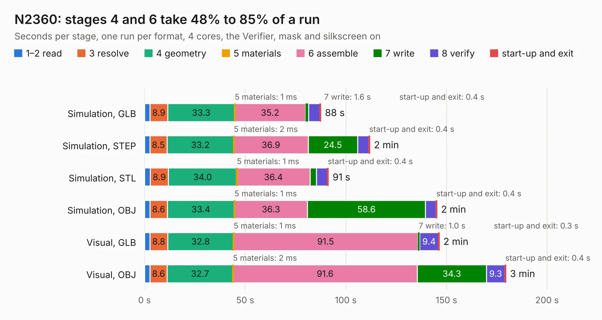

| Mode and format | 1–2 read | 3 resolve | 4 geometry | 5 materials | 6 assemble | 7 write | 8 verify | start-up and exit | Total |
|---|---:|---:|---:|---:|---:|---:|---:|---:|---:|
| Simulation, GLB | 2.7 | 8.9 | 33.3 | 1&nbsp;ms | 35.2 | 1.6 | 5.6 | 0.4 | 87.5 |
| Simulation, STEP | 2.6 | 8.5 | 33.2 | 2&nbsp;ms | 36.9 | 24.5 | 5.6 | 0.4 | 111.9 |
| Simulation, STL | 2.9 | 8.9 | 34.0 | 1&nbsp;ms | 36.4 | 3.1 | 5.5 | 0.4 | 91.3 |
| Simulation, OBJ | 2.7 | 8.6 | 33.4 | 1&nbsp;ms | 36.3 | 58.6 | 5.2 | 0.4 | 145.2 |
| Visual, GLB | 2.7 | 8.8 | 32.8 | 1&nbsp;ms | 91.5 | 1.0 | 9.4 | 0.3 | 146.3 |
| Visual, OBJ | 2.7 | 8.6 | 32.7 | 2&nbsp;ms | 91.6 | 34.3 | 9.3 | 0.4 | 179.4 |

<table align="center"><tr><td valign="top">

| Board | Repo: [jasonsbeer/Amiga-N2630](https://github.com/jasonsbeer/Amiga-N2630) Board: `N2360.kicad_pcb` |
|---|---|
| Folder | KiCAD / Archive / A2630-New-KiCAD-Rev401-PGA |
| Complexity | 389&nbsp;/&nbsp;1000 (size&nbsp;294, features&nbsp;95) |
| KESE&nbsp;features | through vias, rounded, trapezoid or chamfered pads, filled zones, copper text, curved board outline, stack-up, dielectric εr and tanδ |
| Tested | 9th November 2026 |
| Copper&nbsp;layers | 4 |
| File&nbsp;format | KiCad 6 (20211014) |
| Parts,&nbsp;tracks,&nbsp;vias | 230, 7,442, 838 |
| Triangles,&nbsp;simulation | 9,445,514 in 468 parts |
| Verifier | PASS in all six runs |

</td><td valign="top">

<table>
<tr><th>File type</th><th>File size</th><th>Peak memory used</th></tr>
<tr><th colspan="3" align="left">Simulation</th></tr>
<tr><td>GLB</td><td align="right">321&nbsp;MB</td><td align="right">2.4&nbsp;GB</td></tr>
<tr><td>STEP</td><td align="right">1.5&nbsp;GB</td><td align="right">3.3&nbsp;GB</td></tr>
<tr><td>STL</td><td align="right">472&nbsp;MB</td><td align="right">2.4&nbsp;GB</td></tr>
<tr><td>OBJ</td><td align="right">1.0&nbsp;GB</td><td align="right">6.0&nbsp;GB</td></tr>
<tr><th colspan="3" align="left">Visual</th></tr>
<tr><td>GLB</td><td align="right">206&nbsp;MB</td><td align="right">3.3&nbsp;GB</td></tr>
<tr><td>OBJ</td><td align="right">668&nbsp;MB</td><td align="right">4.3&nbsp;GB</td></tr>
</table>

</td></tr></table>

## 23.13.30 N2360

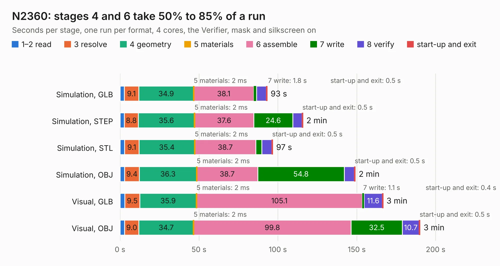

| Mode and format | 1–2 read | 3 resolve | 4 geometry | 5 materials | 6 assemble | 7 write | 8 verify | start-up and exit | Total |
|---|---:|---:|---:|---:|---:|---:|---:|---:|---:|
| Simulation, GLB | 2.7 | 9.1 | 34.9 | 2&nbsp;ms | 38.1 | 1.8 | 6.1 | 0.5 | 93.2 |
| Simulation, STEP | 2.8 | 8.8 | 35.6 | 2&nbsp;ms | 37.6 | 24.6 | 5.9 | 0.5 | 115.8 |
| Simulation, STL | 2.9 | 9.1 | 35.4 | 2&nbsp;ms | 38.7 | 3.8 | 6.4 | 0.5 | 96.7 |
| Simulation, OBJ | 2.9 | 9.4 | 36.3 | 2&nbsp;ms | 38.7 | 54.8 | 6.4 | 0.5 | 149.0 |
| Visual, GLB | 3.0 | 9.5 | 35.9 | 2&nbsp;ms | 105.1 | 1.1 | 11.6 | 0.4 | 166.6 |
| Visual, OBJ | 2.9 | 9.0 | 34.7 | 2&nbsp;ms | 99.8 | 32.5 | 10.7 | 0.5 | 190.1 |

<table align="center"><tr><td valign="top">

| Board | Repo: [jasonsbeer/Amiga-N2630](https://github.com/jasonsbeer/Amiga-N2630) Board: `N2360.kicad_pcb` |
|---|---|
| Folder | KiCAD / Archive / A2630-New-KiCAD-Rev401-PLCC |
| Complexity | 391&nbsp;/&nbsp;1000 (size&nbsp;296, features&nbsp;95) |
| KESE&nbsp;features | through vias, rounded, trapezoid or chamfered pads, filled zones, copper text, curved board outline, stack-up, dielectric εr and tanδ |
| Tested | 9th November 2026 |
| Copper&nbsp;layers | 4 |
| File&nbsp;format | KiCad 6 (20211014) |
| Parts,&nbsp;tracks,&nbsp;vias | 230, 7,313, 839 |
| Triangles,&nbsp;simulation | 9,464,140 in 468 parts |
| Verifier | PASS in all six runs |

</td><td valign="top">

<table>
<tr><th>File type</th><th>File size</th><th>Peak memory used</th></tr>
<tr><th colspan="3" align="left">Simulation</th></tr>
<tr><td>GLB</td><td align="right">322&nbsp;MB</td><td align="right">2.4&nbsp;GB</td></tr>
<tr><td>STEP</td><td align="right">1.5&nbsp;GB</td><td align="right">3.3&nbsp;GB</td></tr>
<tr><td>STL</td><td align="right">473&nbsp;MB</td><td align="right">2.4&nbsp;GB</td></tr>
<tr><td>OBJ</td><td align="right">1.0&nbsp;GB</td><td align="right">6.1&nbsp;GB</td></tr>
<tr><th colspan="3" align="left">Visual</th></tr>
<tr><td>GLB</td><td align="right">207&nbsp;MB</td><td align="right">3.3&nbsp;GB</td></tr>
<tr><td>OBJ</td><td align="right">670&nbsp;MB</td><td align="right">4.3&nbsp;GB</td></tr>
</table>

</td></tr></table>

## 23.13.31 BeamBender

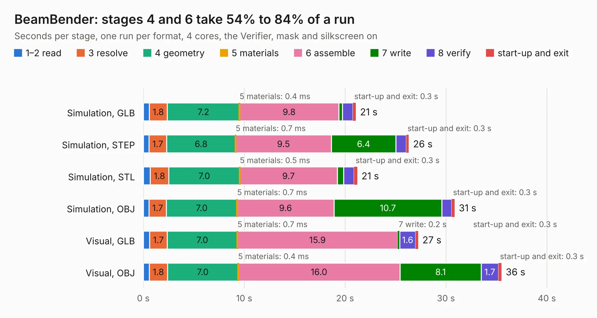

| Mode and format | 1–2 read | 3 resolve | 4 geometry | 5 materials | 6 assemble | 7 write | 8 verify | start-up and exit | Total |
|---|---:|---:|---:|---:|---:|---:|---:|---:|---:|
| Simulation, GLB | 0.6 | 1.8 | 7.2 | 0.4&nbsp;ms | 9.8 | 0.4 | 1.0 | 0.3 | 21.1 |
| Simulation, STEP | 0.6 | 1.7 | 6.8 | 0.7&nbsp;ms | 9.5 | 6.4 | 1.0 | 0.3 | 26.3 |
| Simulation, STL | 0.7 | 1.8 | 7.0 | 0.5&nbsp;ms | 9.7 | 0.6 | 1.0 | 0.3 | 21.2 |
| Simulation, OBJ | 0.6 | 1.7 | 7.0 | 0.7&nbsp;ms | 9.6 | 10.7 | 1.0 | 0.3 | 30.9 |
| Visual, GLB | 0.6 | 1.7 | 7.0 | 0.7&nbsp;ms | 15.9 | 0.2 | 1.6 | 0.3 | 27.2 |
| Visual, OBJ | 0.6 | 1.8 | 7.0 | 0.4&nbsp;ms | 16.0 | 8.1 | 1.7 | 0.3 | 35.5 |

<table align="center"><tr><td valign="top">

| Board | Repo: [jbilander/BeamBender](https://github.com/jbilander/BeamBender) Board: `BeamBender.kicad_pcb` |
|---|---|
| Folder | KiCad / A1200-A500 |
| Complexity | 310&nbsp;/&nbsp;1000 (size&nbsp;255, features&nbsp;55) |
| KESE&nbsp;features | through vias, rounded, trapezoid or chamfered pads, filled zones, curved board outline |
| Tested | 9th November 2026 |
| Copper&nbsp;layers | 4 |
| File&nbsp;format | KiCad 5 (20171130) |
| Parts,&nbsp;tracks,&nbsp;vias | 100, 1,402, 218 |
| Triangles,&nbsp;simulation | 1,833,394 in 186 parts |
| Verifier | PASS in all six runs |

</td><td valign="top">

<table>
<tr><th>File type</th><th>File size</th><th>Peak memory used</th></tr>
<tr><th colspan="3" align="left">Simulation</th></tr>
<tr><td>GLB</td><td align="right">63&nbsp;MB</td><td align="right">716&nbsp;MB</td></tr>
<tr><td>STEP</td><td align="right">268&nbsp;MB</td><td align="right">878&nbsp;MB</td></tr>
<tr><td>STL</td><td align="right">92&nbsp;MB</td><td align="right">706&nbsp;MB</td></tr>
<tr><td>OBJ</td><td align="right">190&nbsp;MB</td><td align="right">1.2&nbsp;GB</td></tr>
<tr><th colspan="3" align="left">Visual</th></tr>
<tr><td>GLB</td><td align="right">46&nbsp;MB</td><td align="right">826&nbsp;MB</td></tr>
<tr><td>OBJ</td><td align="right">138&nbsp;MB</td><td align="right">1.0&nbsp;GB</td></tr>
</table>

</td></tr></table>

## 23.13.32 SF2000

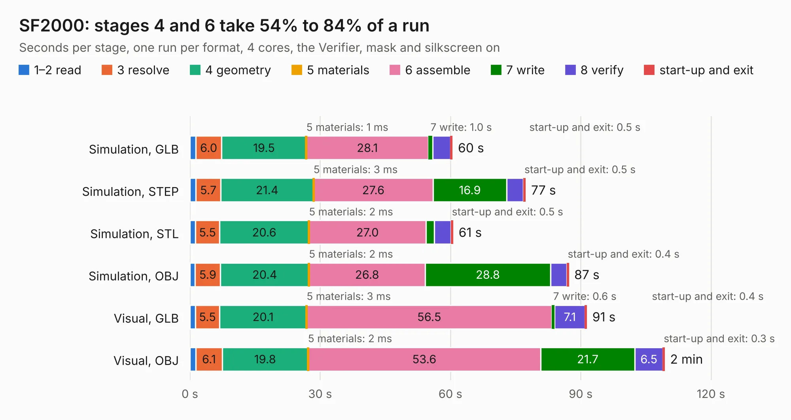

| Mode and format | 1–2 read | 3 resolve | 4 geometry | 5 materials | 6 assemble | 7 write | 8 verify | start-up and exit | Total |
|---|---:|---:|---:|---:|---:|---:|---:|---:|---:|
| Simulation, GLB | 1.3 | 6.0 | 19.5 | 1&nbsp;ms | 28.1 | 1.0 | 4.1 | 0.5 | 60.4 |
| Simulation, STEP | 1.4 | 5.7 | 21.4 | 3&nbsp;ms | 27.6 | 16.9 | 3.9 | 0.5 | 77.3 |
| Simulation, STL | 1.3 | 5.5 | 20.6 | 2&nbsp;ms | 27.0 | 1.9 | 3.8 | 0.5 | 60.6 |
| Simulation, OBJ | 1.2 | 5.9 | 20.4 | 2&nbsp;ms | 26.8 | 28.8 | 3.8 | 0.4 | 87.2 |
| Visual, GLB | 1.3 | 5.5 | 20.1 | 3&nbsp;ms | 56.5 | 0.6 | 7.1 | 0.4 | 91.4 |
| Visual, OBJ | 1.4 | 6.1 | 19.8 | 2&nbsp;ms | 53.6 | 21.7 | 6.5 | 0.3 | 109.3 |

<table align="center"><tr><td valign="top">

| Board | Repo: [jbilander/SF2000](https://github.com/jbilander/SF2000) Board: `SF2000.kicad_pcb` |
|---|---|
| Folder | KiCad |
| Complexity | 346&nbsp;/&nbsp;1000 (size&nbsp;291, features&nbsp;55) |
| KESE&nbsp;features | through vias, slotted holes, rounded, trapezoid or chamfered pads, filled zones |
| Tested | 9th November 2026 |
| Copper&nbsp;layers | 4 |
| File&nbsp;format | KiCad 5 (20171130) |
| Parts,&nbsp;tracks,&nbsp;vias | 134, 3,880, 579 |
| Triangles,&nbsp;simulation | 4,420,582 in 459 parts |
| Verifier | PASS in all six runs |

</td><td valign="top">

<table>
<tr><th>File type</th><th>File size</th><th>Peak memory used</th></tr>
<tr><th colspan="3" align="left">Simulation</th></tr>
<tr><td>GLB</td><td align="right">152&nbsp;MB</td><td align="right">1.4&nbsp;GB</td></tr>
<tr><td>STEP</td><td align="right">633&nbsp;MB</td><td align="right">1.8&nbsp;GB</td></tr>
<tr><td>STL</td><td align="right">221&nbsp;MB</td><td align="right">1.3&nbsp;GB</td></tr>
<tr><td>OBJ</td><td align="right">472&nbsp;MB</td><td align="right">2.9&nbsp;GB</td></tr>
<tr><th colspan="3" align="left">Visual</th></tr>
<tr><td>GLB</td><td align="right">113&nbsp;MB</td><td align="right">1.8&nbsp;GB</td></tr>
<tr><td>OBJ</td><td align="right">361&nbsp;MB</td><td align="right">2.3&nbsp;GB</td></tr>
</table>

</td></tr></table>

## 23.13.33 baseboard

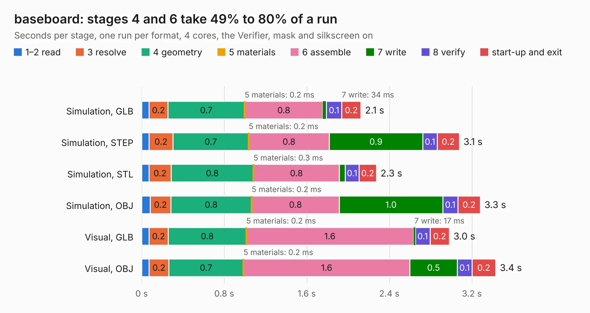

| Mode and format | 1–2 read | 3 resolve | 4 geometry | 5 materials | 6 assemble | 7 write | 8 verify | start-up and exit | Total |
|---|---:|---:|---:|---:|---:|---:|---:|---:|---:|
| Simulation, GLB | 72&nbsp;ms | 0.2 | 0.7 | 0.2&nbsp;ms | 0.8 | 34&nbsp;ms | 0.1 | 0.2 | 2.1 |
| Simulation, STEP | 72&nbsp;ms | 0.2 | 0.7 | 0.2&nbsp;ms | 0.8 | 0.9 | 0.1 | 0.2 | 3.1 |
| Simulation, STL | 71&nbsp;ms | 0.2 | 0.8 | 0.3&nbsp;ms | 0.8 | 56&nbsp;ms | 0.1 | 0.2 | 2.3 |
| Simulation, OBJ | 83&nbsp;ms | 0.2 | 0.8 | 0.2&nbsp;ms | 0.8 | 1.0 | 0.1 | 0.2 | 3.3 |
| Visual, GLB | 70&nbsp;ms | 0.2 | 0.8 | 0.2&nbsp;ms | 1.6 | 17&nbsp;ms | 0.1 | 0.2 | 3.0 |
| Visual, OBJ | 73&nbsp;ms | 0.2 | 0.7 | 0.2&nbsp;ms | 1.6 | 0.5 | 0.1 | 0.2 | 3.4 |

<table align="center"><tr><td valign="top">

| Board | Repo: [jescarri/baseboard](https://github.com/jescarri/baseboard) Board: `baseboard.kicad_pcb` |
|---|---|
| Complexity | 93&nbsp;/&nbsp;1000 (size&nbsp;53, features&nbsp;40) |
| KESE&nbsp;features | curved board outline, stack-up, dielectric εr and tanδ |
| Tested | 9th November 2026 |
| Copper&nbsp;layers | 4 |
| File&nbsp;format | KiCad 9 (20241229) |
| Parts,&nbsp;tracks,&nbsp;vias | 5, 0, 0 |
| Triangles,&nbsp;simulation | 249,774 in 50 parts |
| Verifier | PASS in all six runs |

</td><td valign="top">

<table>
<tr><th>File type</th><th>File size</th><th>Peak memory used</th></tr>
<tr><th colspan="3" align="left">Simulation</th></tr>
<tr><td>GLB</td><td align="right">7.2&nbsp;MB</td><td align="right">209&nbsp;MB</td></tr>
<tr><td>STEP</td><td align="right">20&nbsp;MB</td><td align="right">225&nbsp;MB</td></tr>
<tr><td>STL</td><td align="right">12&nbsp;MB</td><td align="right">208&nbsp;MB</td></tr>
<tr><td>OBJ</td><td align="right">25&nbsp;MB</td><td align="right">221&nbsp;MB</td></tr>
<tr><th colspan="3" align="left">Visual</th></tr>
<tr><td>GLB</td><td align="right">3.8&nbsp;MB</td><td align="right">187&nbsp;MB</td></tr>
<tr><td>OBJ</td><td align="right">11&nbsp;MB</td><td align="right">193&nbsp;MB</td></tr>
</table>

</td></tr></table>

## 23.13.34 Open128

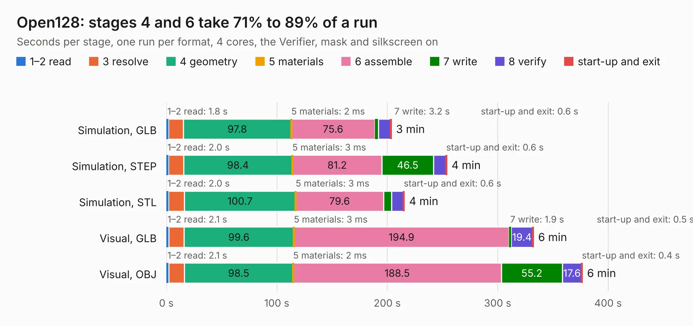

| Mode and format | 1–2 read | 3 resolve | 4 geometry | 5 materials | 6 assemble | 7 write | 8 verify | start-up and exit | Total |
|---|---:|---:|---:|---:|---:|---:|---:|---:|---:|
| Simulation, GLB | 1.8 | 13.4 | 97.8 | 2&nbsp;ms | 75.6 | 3.2 | 10.9 | 0.6 | 203.5 |
| Simulation, STEP | 2.0 | 13.8 | 98.4 | 3&nbsp;ms | 81.2 | 46.5 | 11.4 | 0.6 | 253.7 |
| Simulation, STL | 2.0 | 14.4 | 100.7 | 3&nbsp;ms | 79.6 | 7.4 | 10.6 | 0.6 | 215.3 |
| Simulation, OBJ |  |  |  |  |  |  |  |  | exceeded 11 GB on a 15 GB machine (stopped there, not a KESE failure); it will be run again on a machine with more memory |
| Visual, GLB | 2.1 | 13.8 | 99.6 | 3&nbsp;ms | 194.9 | 1.9 | 19.4 | 0.5 | 332.2 |
| Visual, OBJ | 2.1 | 14.2 | 98.5 | 2&nbsp;ms | 188.5 | 55.2 | 17.6 | 0.4 | 376.5 |

<table align="center"><tr><td valign="top">

| Board | Repo: [jgrip/open128](https://github.com/jgrip/open128) Board: `Open128.kicad_pcb` |
|---|---|
| Complexity | 333&nbsp;/&nbsp;1000 (size&nbsp;243, features&nbsp;90) |
| KESE&nbsp;features | through vias, slotted holes, custom pads, filled zones, copper drawings, copper text, curved board outline |
| Tested | 9th November 2026 |
| Copper&nbsp;layers | 2 |
| File&nbsp;format | KiCad 5 (20171130) |
| Parts,&nbsp;tracks,&nbsp;vias | 366, 16,410, 1,119 |
| Triangles,&nbsp;simulation | 16,912,120 in 459 parts |
| Verifier | Simulation, OBJ: exceeded 11 GB on a 15 GB machine (stopped there, not a KESE failure); it will be run again on a machine with more memory |

</td><td valign="top">

<table>
<tr><th>File type</th><th>File size</th><th>Peak memory used</th></tr>
<tr><th colspan="3" align="left">Simulation</th></tr>
<tr><td>GLB</td><td align="right">584&nbsp;MB</td><td align="right">3.6&nbsp;GB</td></tr>
<tr><td>STEP</td><td align="right">3.2&nbsp;GB</td><td align="right">5.5&nbsp;GB</td></tr>
<tr><td>STL</td><td align="right">846&nbsp;MB</td><td align="right">3.5&nbsp;GB</td></tr>
<tr><td>OBJ</td><td align="right">–</td><td align="right">11&nbsp;GB</td></tr>
<tr><th colspan="3" align="left">Visual</th></tr>
<tr><td>GLB</td><td align="right">363&nbsp;MB</td><td align="right">5.5&nbsp;GB</td></tr>
<tr><td>OBJ</td><td align="right">1.2&nbsp;GB</td><td align="right">9.8&nbsp;GB</td></tr>
</table>

</td></tr></table>

## 23.13.35 d1

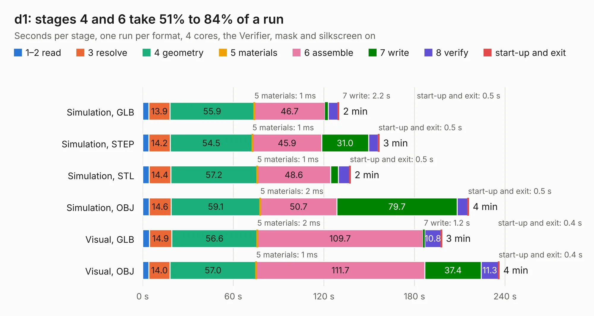

| Mode and format | 1–2 read | 3 resolve | 4 geometry | 5 materials | 6 assemble | 7 write | 8 verify | start-up and exit | Total |
|---|---:|---:|---:|---:|---:|---:|---:|---:|---:|
| Simulation, GLB | 4.2 | 13.9 | 55.9 | 1&nbsp;ms | 46.7 | 2.2 | 6.4 | 0.5 | 129.9 |
| Simulation, STEP | 4.1 | 14.2 | 54.5 | 1&nbsp;ms | 45.9 | 31.0 | 6.4 | 0.5 | 156.5 |
| Simulation, STL | 4.3 | 14.4 | 57.2 | 1&nbsp;ms | 48.6 | 5.0 | 7.5 | 0.5 | 137.6 |
| Simulation, OBJ | 4.3 | 14.6 | 59.1 | 2&nbsp;ms | 50.7 | 79.7 | 7.0 | 0.5 | 215.8 |
| Visual, GLB | 4.4 | 14.9 | 56.6 | 2&nbsp;ms | 109.7 | 1.2 | 10.8 | 0.4 | 198.0 |
| Visual, OBJ | 4.2 | 14.0 | 57.0 | 1&nbsp;ms | 111.7 | 37.4 | 11.3 | 0.4 | 236.0 |

<table align="center"><tr><td valign="top">

| Board | Repo: [jgw4/doppel-1](https://github.com/jgw4/doppel-1) Board: `d1.kicad_pcb` |
|---|---|
| Complexity | 437&nbsp;/&nbsp;1000 (size&nbsp;237, features&nbsp;200) |
| KESE&nbsp;features | through vias, padstacks, arc tracks, filled zones, copper drawings, copper text, curved board outline, TrueType text, hatched fills, stack-up, dielectric εr and tanδ, copper finish, mask and silkscreen colours |
| Tested | 9th November 2026 |
| Copper&nbsp;layers | 2 |
| File&nbsp;format | KiCad 10 (20260206) |
| Parts,&nbsp;tracks,&nbsp;vias | 165, 22,935, 299 |
| Triangles,&nbsp;simulation | 10,495,926 in 298 parts |
| Verifier | PASS in all six runs |

</td><td valign="top">

<table>
<tr><th>File type</th><th>File size</th><th>Peak memory used</th></tr>
<tr><th colspan="3" align="left">Simulation</th></tr>
<tr><td>GLB</td><td align="right">354&nbsp;MB</td><td align="right">2.8&nbsp;GB</td></tr>
<tr><td>STEP</td><td align="right">1.9&nbsp;GB</td><td align="right">3.9&nbsp;GB</td></tr>
<tr><td>STL</td><td align="right">525&nbsp;MB</td><td align="right">2.7&nbsp;GB</td></tr>
<tr><td>OBJ</td><td align="right">1.1&nbsp;GB</td><td align="right">8.8&nbsp;GB</td></tr>
<tr><th colspan="3" align="left">Visual</th></tr>
<tr><td>GLB</td><td align="right">205&nbsp;MB</td><td align="right">3.3&nbsp;GB</td></tr>
<tr><td>OBJ</td><td align="right">654&nbsp;MB</td><td align="right">4.2&nbsp;GB</td></tr>
</table>

</td></tr></table>

## 23.13.36 PCB-11

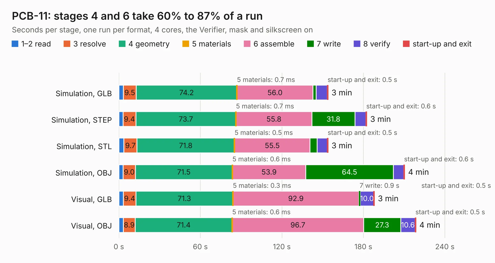

| Mode and format | 1–2 read | 3 resolve | 4 geometry | 5 materials | 6 assemble | 7 write | 8 verify | start-up and exit | Total |
|---|---:|---:|---:|---:|---:|---:|---:|---:|---:|
| Simulation, GLB | 3.3 | 9.5 | 74.2 | 0.7&nbsp;ms | 56.0 | 2.3 | 8.2 | 0.5 | 154.0 |
| Simulation, STEP | 3.1 | 9.4 | 73.7 | 0.7&nbsp;ms | 55.8 | 31.8 | 8.1 | 0.6 | 182.5 |
| Simulation, STL | 3.7 | 9.7 | 71.8 | 0.5&nbsp;ms | 55.5 | 5.2 | 7.6 | 0.5 | 154.0 |
| Simulation, OBJ | 3.2 | 9.0 | 71.5 | 0.6&nbsp;ms | 53.9 | 64.5 | 7.6 | 0.6 | 210.3 |
| Visual, GLB | 3.2 | 9.4 | 71.3 | 0.3&nbsp;ms | 92.9 | 0.9 | 10.0 | 0.5 | 188.1 |
| Visual, OBJ | 3.2 | 8.9 | 71.4 | 0.6&nbsp;ms | 96.7 | 27.3 | 10.6 | 0.5 | 218.6 |

<table align="center"><tr><td valign="top">

| Board | Repo: [jgw4/doppel-1](https://github.com/jgw4/doppel-1) Board: `PCB-11.kicad_pcb` |
|---|---|
| Folder | gerbers |
| Complexity | 214&nbsp;/&nbsp;1000 (size&nbsp;189, features&nbsp;25) |
| KESE&nbsp;features | through vias, copper drawings |
| Tested | 9th November 2026 |
| Copper&nbsp;layers | 2 |
| File&nbsp;format | KiCad 9 (20240928) |
| Parts,&nbsp;tracks,&nbsp;vias | 0, 31,410, 1,720 |
| Triangles,&nbsp;simulation | 10,815,304 in 11 parts |
| Note | no components |
| Verifier | PASS in all six runs |

</td><td valign="top">

<table>
<tr><th>File type</th><th>File size</th><th>Peak memory used</th></tr>
<tr><th colspan="3" align="left">Simulation</th></tr>
<tr><td>GLB</td><td align="right">369&nbsp;MB</td><td align="right">3.2&nbsp;GB</td></tr>
<tr><td>STEP</td><td align="right">2.0&nbsp;GB</td><td align="right">4.0&nbsp;GB</td></tr>
<tr><td>STL</td><td align="right">541&nbsp;MB</td><td align="right">3.3&nbsp;GB</td></tr>
<tr><td>OBJ</td><td align="right">1.2&nbsp;GB</td><td align="right">6.9&nbsp;GB</td></tr>
<tr><th colspan="3" align="left">Visual</th></tr>
<tr><td>GLB</td><td align="right">180&nbsp;MB</td><td align="right">3.2&nbsp;GB</td></tr>
<tr><td>OBJ</td><td align="right">576&nbsp;MB</td><td align="right">3.8&nbsp;GB</td></tr>
</table>

</td></tr></table>

## 23.13.37 pong

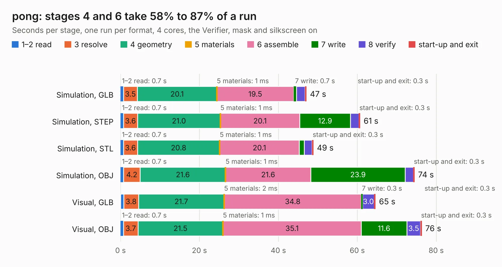

| Mode and format | 1–2 read | 3 resolve | 4 geometry | 5 materials | 6 assemble | 7 write | 8 verify | start-up and exit | Total |
|---|---:|---:|---:|---:|---:|---:|---:|---:|---:|
| Simulation, GLB | 0.7 | 3.5 | 20.1 | 1&nbsp;ms | 19.5 | 0.7 | 2.2 | 0.3 | 47.1 |
| Simulation, STEP | 0.7 | 3.6 | 21.0 | 1&nbsp;ms | 20.1 | 12.9 | 2.1 | 0.3 | 60.7 |
| Simulation, STL | 0.7 | 3.6 | 20.8 | 1&nbsp;ms | 20.1 | 1.3 | 2.0 | 0.3 | 48.9 |
| Simulation, OBJ | 0.7 | 4.2 | 21.6 | 1&nbsp;ms | 21.6 | 23.9 | 2.0 | 0.3 | 74.5 |
| Visual, GLB | 0.8 | 3.8 | 21.7 | 2&nbsp;ms | 34.8 | 0.3 | 3.0 | 0.3 | 64.6 |
| Visual, OBJ | 0.7 | 3.7 | 21.5 | 1&nbsp;ms | 35.1 | 11.6 | 3.5 | 0.3 | 76.3 |

<table align="center"><tr><td valign="top">

| Board | Repo: [jgw4/pong](https://github.com/jgw4/pong) Board: `pong.kicad_pcb` |
|---|---|
| Complexity | 251&nbsp;/&nbsp;1000 (size&nbsp;186, features&nbsp;65) |
| KESE&nbsp;features | through vias, rounded, trapezoid or chamfered pads, filled zones, copper text, curved board outline |
| Tested | 9th November 2026 |
| Copper&nbsp;layers | 2 |
| File&nbsp;format | KiCad 10 (20260206) |
| Parts,&nbsp;tracks,&nbsp;vias | 131, 1,133, 20 |
| Triangles,&nbsp;simulation | 4,215,822 in 374 parts |
| Verifier | PASS in all six runs |

</td><td valign="top">

<table>
<tr><th>File type</th><th>File size</th><th>Peak memory used</th></tr>
<tr><th colspan="3" align="left">Simulation</th></tr>
<tr><td>GLB</td><td align="right">140&nbsp;MB</td><td align="right">1.2&nbsp;GB</td></tr>
<tr><td>STEP</td><td align="right">663&nbsp;MB</td><td align="right">1.7&nbsp;GB</td></tr>
<tr><td>STL</td><td align="right">211&nbsp;MB</td><td align="right">1.2&nbsp;GB</td></tr>
<tr><td>OBJ</td><td align="right">443&nbsp;MB</td><td align="right">2.7&nbsp;GB</td></tr>
<tr><th colspan="3" align="left">Visual</th></tr>
<tr><td>GLB</td><td align="right">68&nbsp;MB</td><td align="right">1.2&nbsp;GB</td></tr>
<tr><td>OBJ</td><td align="right">216&nbsp;MB</td><td align="right">1.5&nbsp;GB</td></tr>
</table>

</td></tr></table>

## 23.13.38 Atari65XEC070067RevB

| Mode and format | 1–2 read | 3 resolve | 4 geometry | 5 materials | 6 assemble | 7 write | 8 verify | start-up and exit | Total |
|---|---:|---:|---:|---:|---:|---:|---:|---:|---:|
| Simulation, GLB | 2.9 | 9.0 | 37.6 | 2&nbsp;ms | 35.8 | 2.0 | 6.0 | 0.5 | 93.7 |
| Simulation, STEP | 2.9 | 8.4 | 38.5 | 2&nbsp;ms | 36.5 | 21.0 | 5.8 | 0.5 | 113.7 |
| Simulation, STL | 2.9 | 8.7 | 39.3 | 2&nbsp;ms | 37.8 | 4.3 | 5.9 | 0.5 | 99.3 |
| Simulation, OBJ | 3.0 | 8.7 | 37.4 | 2&nbsp;ms | 36.2 | 59.4 | 5.8 | 0.4 | 150.8 |
| Visual, GLB | 2.9 | 8.7 | 38.3 | 2&nbsp;ms | 73.8 | 0.7 | 9.0 | 0.4 | 133.8 |
| Visual, OBJ | 3.1 | 9.2 | 38.9 | 2&nbsp;ms | 74.7 | 23.2 | 9.0 | 0.4 | 158.5 |

<table align="center"><tr><td valign="top">

| Board | Repo: [jimbro1000/Atari65_130XE_C070067](https://github.com/jimbro1000/Atari65_130XE_C070067) Board: `Atari65XEC070067RevB.kicad_pcb` |
|---|---|
| Complexity | 338&nbsp;/&nbsp;1000 (size&nbsp;243, features&nbsp;95) |
| KESE&nbsp;features | through vias, slotted holes, rounded, trapezoid or chamfered pads, filled zones, copper text, stack-up, dielectric εr and tanδ |
| Tested | 9th November 2026 |
| Copper&nbsp;layers | 4 |
| File&nbsp;format | KiCad 9 (20241229) |
| Parts,&nbsp;tracks,&nbsp;vias | 340, 6,477, 429 |
| Triangles,&nbsp;simulation | 11,867,082 in 328 parts |
| Verifier | PASS in all six runs |

</td><td valign="top">

<table>
<tr><th>File type</th><th>File size</th><th>Peak memory used</th></tr>
<tr><th colspan="3" align="left">Simulation</th></tr>
<tr><td>GLB</td><td align="right">401&nbsp;MB</td><td align="right">2.6&nbsp;GB</td></tr>
<tr><td>STEP</td><td align="right">1.4&nbsp;GB</td><td align="right">3.5&nbsp;GB</td></tr>
<tr><td>STL</td><td align="right">593&nbsp;MB</td><td align="right">2.7&nbsp;GB</td></tr>
<tr><td>OBJ</td><td align="right">1.3&nbsp;GB</td><td align="right">7.4&nbsp;GB</td></tr>
<tr><th colspan="3" align="left">Visual</th></tr>
<tr><td>GLB</td><td align="right">179&nbsp;MB</td><td align="right">3.0&nbsp;GB</td></tr>
<tr><td>OBJ</td><td align="right">577&nbsp;MB</td><td align="right">3.6&nbsp;GB</td></tr>
</table>

</td></tr></table>

## 23.13.39 Commodore-Vic-20

| Mode and format | 1–2 read | 3 resolve | 4 geometry | 5 materials | 6 assemble | 7 write | 8 verify | start-up and exit | Total |
|---|---:|---:|---:|---:|---:|---:|---:|---:|---:|
| Simulation, GLB | 1.0 | 4.4 | 23.6 | 2&nbsp;ms | 19.8 | 0.9 | 2.8 | 0.4 | 52.9 |
| Simulation, STEP | 1.0 | 4.2 | 23.7 | 2&nbsp;ms | 19.4 | 13.7 | 2.8 | 0.4 | 65.2 |
| Simulation, STL | 1.0 | 4.3 | 23.2 | 2&nbsp;ms | 19.1 | 2.1 | 2.6 | 0.3 | 52.6 |
| Simulation, OBJ | 1.0 | 4.2 | 23.9 | 1&nbsp;ms | 19.4 | 28.8 | 2.8 | 0.4 | 80.4 |
| Visual, GLB | 1.0 | 4.4 | 23.2 | 2&nbsp;ms | 42.8 | 0.6 | 5.5 | 0.3 | 77.7 |
| Visual, OBJ | 0.9 | 4.4 | 23.4 | 2&nbsp;ms | 42.4 | 15.7 | 5.6 | 0.3 | 92.8 |

<table align="center"><tr><td valign="top">

| Board | Repo: [jimbro1000/Commodore-Vic-20](https://github.com/jimbro1000/Commodore-Vic-20) Board: `Commodore-Vic-20.kicad_pcb` |
|---|---|
| Complexity | 265&nbsp;/&nbsp;1000 (size&nbsp;210, features&nbsp;55) |
| KESE&nbsp;features | through vias, slotted holes, rounded, trapezoid or chamfered pads, filled zones |
| Tested | 9th November 2026 |
| Copper&nbsp;layers | 2 |
| File&nbsp;format | KiCad 8 (20240108) |
| Parts,&nbsp;tracks,&nbsp;vias | 142, 4,040, 354 |
| Triangles,&nbsp;simulation | 5,241,754 in 218 parts |
| Verifier | PASS in all six runs |

</td><td valign="top">

<table>
<tr><th>File type</th><th>File size</th><th>Peak memory used</th></tr>
<tr><th colspan="3" align="left">Simulation</th></tr>
<tr><td>GLB</td><td align="right">175&nbsp;MB</td><td align="right">1.6&nbsp;GB</td></tr>
<tr><td>STEP</td><td align="right">731&nbsp;MB</td><td align="right">2.1&nbsp;GB</td></tr>
<tr><td>STL</td><td align="right">262&nbsp;MB</td><td align="right">1.5&nbsp;GB</td></tr>
<tr><td>OBJ</td><td align="right">552&nbsp;MB</td><td align="right">4.4&nbsp;GB</td></tr>
<tr><th colspan="3" align="left">Visual</th></tr>
<tr><td>GLB</td><td align="right">106&nbsp;MB</td><td align="right">1.8&nbsp;GB</td></tr>
<tr><td>OBJ</td><td align="right">339&nbsp;MB</td><td align="right">2.2&nbsp;GB</td></tr>
</table>

</td></tr></table>

## 23.13.40 Dragon32

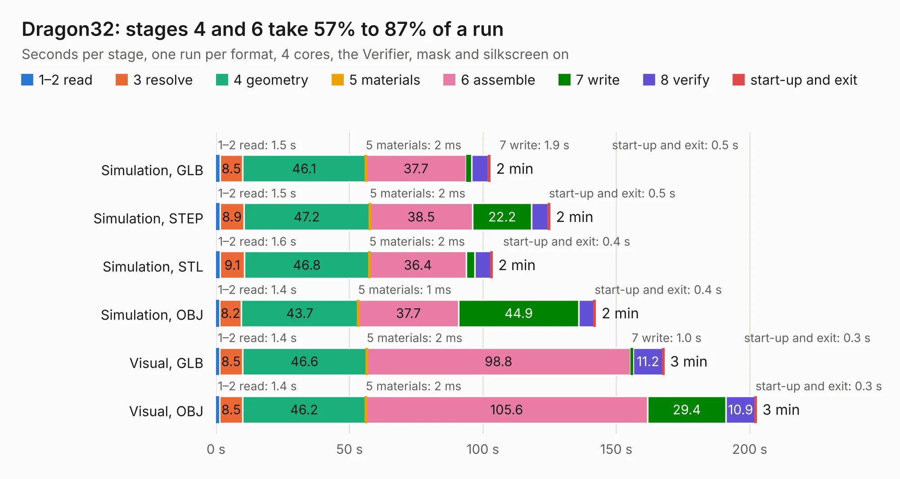

| Mode and format | 1–2 read | 3 resolve | 4 geometry | 5 materials | 6 assemble | 7 write | 8 verify | start-up and exit | Total |
|---|---:|---:|---:|---:|---:|---:|---:|---:|---:|
| Simulation, GLB | 1.5 | 8.5 | 46.1 | 2&nbsp;ms | 37.7 | 1.9 | 6.4 | 0.5 | 102.6 |
| Simulation, STEP | 1.5 | 8.9 | 47.2 | 2&nbsp;ms | 38.5 | 22.2 | 6.2 | 0.5 | 125.0 |
| Simulation, STL | 1.6 | 9.1 | 46.8 | 2&nbsp;ms | 36.4 | 3.1 | 6.0 | 0.4 | 103.4 |
| Simulation, OBJ | 1.4 | 8.2 | 43.7 | 1&nbsp;ms | 37.7 | 44.9 | 5.8 | 0.4 | 142.1 |
| Visual, GLB | 1.4 | 8.5 | 46.6 | 2&nbsp;ms | 98.8 | 1.0 | 11.2 | 0.3 | 167.8 |
| Visual, OBJ | 1.4 | 8.5 | 46.2 | 2&nbsp;ms | 105.6 | 29.4 | 10.9 | 0.3 | 202.4 |

<table align="center"><tr><td valign="top">

| Board | Repo: [jimbro1000/Dragon32Issue2](https://github.com/jimbro1000/Dragon32Issue2) Board: `Dragon32.kicad_pcb` |
|---|---|
| Complexity | 295&nbsp;/&nbsp;1000 (size&nbsp;220, features&nbsp;75) |
| KESE&nbsp;features | through vias, slotted holes, rounded, trapezoid or chamfered pads, filled zones, copper text, curved board outline |
| Tested | 9th November 2026 |
| Copper&nbsp;layers | 2 |
| File&nbsp;format | KiCad 9 (20241229) |
| Parts,&nbsp;tracks,&nbsp;vias | 208, 4,774, 755 |
| Triangles,&nbsp;simulation | 9,542,056 in 311 parts |
| Verifier | PASS in all six runs |

</td><td valign="top">

<table>
<tr><th>File type</th><th>File size</th><th>Peak memory used</th></tr>
<tr><th colspan="3" align="left">Simulation</th></tr>
<tr><td>GLB</td><td align="right">330&nbsp;MB</td><td align="right">2.8&nbsp;GB</td></tr>
<tr><td>STEP</td><td align="right">1.7&nbsp;GB</td><td align="right">3.4&nbsp;GB</td></tr>
<tr><td>STL</td><td align="right">477&nbsp;MB</td><td align="right">2.7&nbsp;GB</td></tr>
<tr><td>OBJ</td><td align="right">1.0&nbsp;GB</td><td align="right">6.1&nbsp;GB</td></tr>
<tr><th colspan="3" align="left">Visual</th></tr>
<tr><td>GLB</td><td align="right">229&nbsp;MB</td><td align="right">3.6&nbsp;GB</td></tr>
<tr><td>OBJ</td><td align="right">733&nbsp;MB</td><td align="right">4.7&nbsp;GB</td></tr>
</table>

</td></tr></table>

## 23.13.41 Dragon32

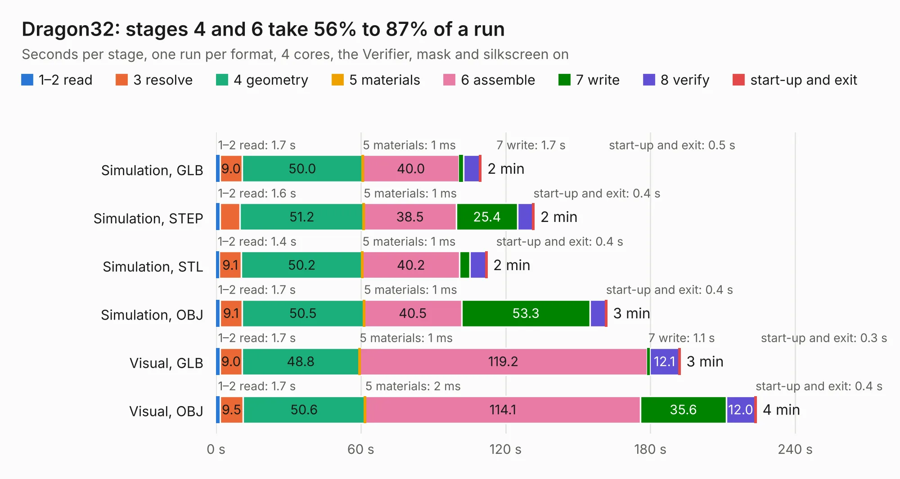

| Mode and format | 1–2 read | 3 resolve | 4 geometry | 5 materials | 6 assemble | 7 write | 8 verify | start-up and exit | Total |
|---|---:|---:|---:|---:|---:|---:|---:|---:|---:|
| Simulation, GLB | 1.7 | 9.0 | 50.0 | 1&nbsp;ms | 40.0 | 1.7 | 6.7 | 0.5 | 109.8 |
| Simulation, STEP | 1.6 | 8.4 | 51.2 | 1&nbsp;ms | 38.5 | 25.4 | 6.3 | 0.4 | 131.7 |
| Simulation, STL | 1.4 | 9.1 | 50.2 | 1&nbsp;ms | 40.2 | 4.3 | 6.6 | 0.4 | 112.2 |
| Simulation, OBJ | 1.7 | 9.1 | 50.5 | 1&nbsp;ms | 40.5 | 53.3 | 6.4 | 0.4 | 161.8 |
| Visual, GLB | 1.7 | 9.0 | 48.8 | 1&nbsp;ms | 119.2 | 1.1 | 12.1 | 0.3 | 192.2 |
| Visual, OBJ | 1.7 | 9.5 | 50.6 | 2&nbsp;ms | 114.1 | 35.6 | 12.0 | 0.4 | 223.8 |

<table align="center"><tr><td valign="top">

| Board | Repo: [jimbro1000/Dragon32Rev3](https://github.com/jimbro1000/Dragon32Rev3) Board: `Dragon32.kicad_pcb` |
|---|---|
| Complexity | 324&nbsp;/&nbsp;1000 (size&nbsp;219, features&nbsp;105) |
| KESE&nbsp;features | through vias, slotted holes, rounded, trapezoid or chamfered pads, filled zones, copper text, curved board outline, stack-up, dielectric εr and tanδ |
| Tested | 9th November 2026 |
| Copper&nbsp;layers | 2 |
| File&nbsp;format | KiCad 9 (20241229) |
| Parts,&nbsp;tracks,&nbsp;vias | 169, 4,819, 960 |
| Triangles,&nbsp;simulation | 9,734,010 in 275 parts |
| Verifier | PASS in all six runs |

</td><td valign="top">

<table>
<tr><th>File type</th><th>File size</th><th>Peak memory used</th></tr>
<tr><th colspan="3" align="left">Simulation</th></tr>
<tr><td>GLB</td><td align="right">335&nbsp;MB</td><td align="right">2.9&nbsp;GB</td></tr>
<tr><td>STEP</td><td align="right">1.7&nbsp;GB</td><td align="right">3.5&nbsp;GB</td></tr>
<tr><td>STL</td><td align="right">487&nbsp;MB</td><td align="right">3.1&nbsp;GB</td></tr>
<tr><td>OBJ</td><td align="right">1.1&nbsp;GB</td><td align="right">6.2&nbsp;GB</td></tr>
<tr><th colspan="3" align="left">Visual</th></tr>
<tr><td>GLB</td><td align="right">240&nbsp;MB</td><td align="right">3.7&nbsp;GB</td></tr>
<tr><td>OBJ</td><td align="right">773&nbsp;MB</td><td align="right">4.9&nbsp;GB</td></tr>
</table>

</td></tr></table>

## 23.13.42 cm4-carrier-net

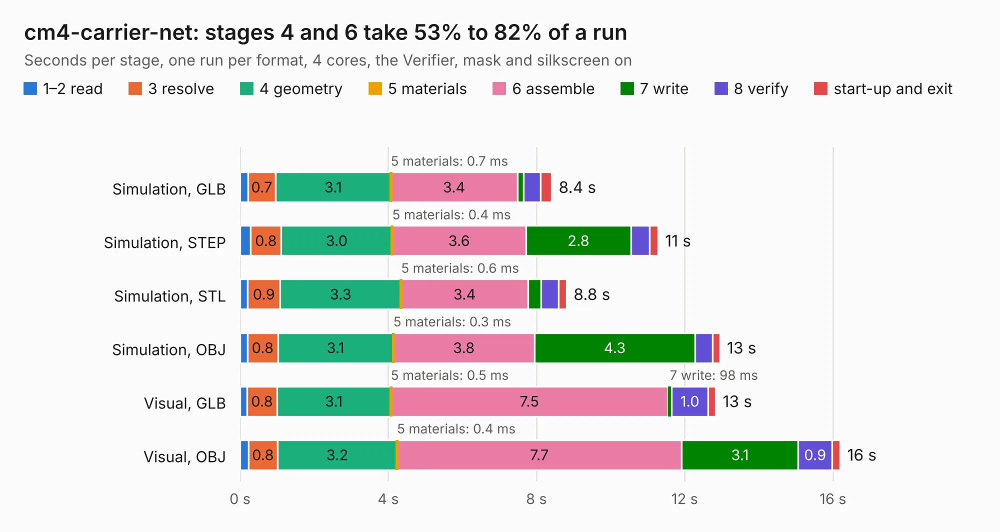

| Mode and format | 1–2 read | 3 resolve | 4 geometry | 5 materials | 6 assemble | 7 write | 8 verify | start-up and exit | Total |
|---|---:|---:|---:|---:|---:|---:|---:|---:|---:|
| Simulation, GLB | 0.2 | 0.7 | 3.1 | 0.7&nbsp;ms | 3.4 | 0.2 | 0.5 | 0.3 | 8.4 |
| Simulation, STEP | 0.3 | 0.8 | 3.0 | 0.4&nbsp;ms | 3.6 | 2.8 | 0.5 | 0.2 | 11.3 |
| Simulation, STL | 0.2 | 0.9 | 3.3 | 0.6&nbsp;ms | 3.4 | 0.4 | 0.5 | 0.2 | 8.8 |
| Simulation, OBJ | 0.2 | 0.8 | 3.1 | 0.3&nbsp;ms | 3.8 | 4.3 | 0.5 | 0.2 | 12.9 |
| Visual, GLB | 0.2 | 0.8 | 3.1 | 0.5&nbsp;ms | 7.5 | 98&nbsp;ms | 1.0 | 0.2 | 12.8 |
| Visual, OBJ | 0.2 | 0.8 | 3.2 | 0.4&nbsp;ms | 7.7 | 3.1 | 0.9 | 0.2 | 16.2 |

<table align="center"><tr><td valign="top">

| Board | Repo: [jkiv/cm4-carriers](https://github.com/jkiv/cm4-carriers) Board: `cm4-carrier-net.kicad_pcb` |
|---|---|
| Folder | hardware / cm4-carrier-net |
| Complexity | 272&nbsp;/&nbsp;1000 (size&nbsp;197, features&nbsp;75) |
| KESE&nbsp;features | through vias, slotted holes, rounded, trapezoid or chamfered pads, filled zones, copper text, curved board outline |
| Tested | 9th November 2026 |
| Copper&nbsp;layers | 4 |
| File&nbsp;format | KiCad 5 (20171130) |
| Parts,&nbsp;tracks,&nbsp;vias | 38, 1,560, 107 |
| Triangles,&nbsp;simulation | 930,710 in 109 parts |
| Verifier | PASS in all six runs |

</td><td valign="top">

<table>
<tr><th>File type</th><th>File size</th><th>Peak memory used</th></tr>
<tr><th colspan="3" align="left">Simulation</th></tr>
<tr><td>GLB</td><td align="right">31&nbsp;MB</td><td align="right">416&nbsp;MB</td></tr>
<tr><td>STEP</td><td align="right">133&nbsp;MB</td><td align="right">512&nbsp;MB</td></tr>
<tr><td>STL</td><td align="right">47&nbsp;MB</td><td align="right">446&nbsp;MB</td></tr>
<tr><td>OBJ</td><td align="right">94&nbsp;MB</td><td align="right">653&nbsp;MB</td></tr>
<tr><th colspan="3" align="left">Visual</th></tr>
<tr><td>GLB</td><td align="right">21&nbsp;MB</td><td align="right">563&nbsp;MB</td></tr>
<tr><td>OBJ</td><td align="right">63&nbsp;MB</td><td align="right">569&nbsp;MB</td></tr>
</table>

</td></tr></table>

## 23.13.43 cm4-carrier-template

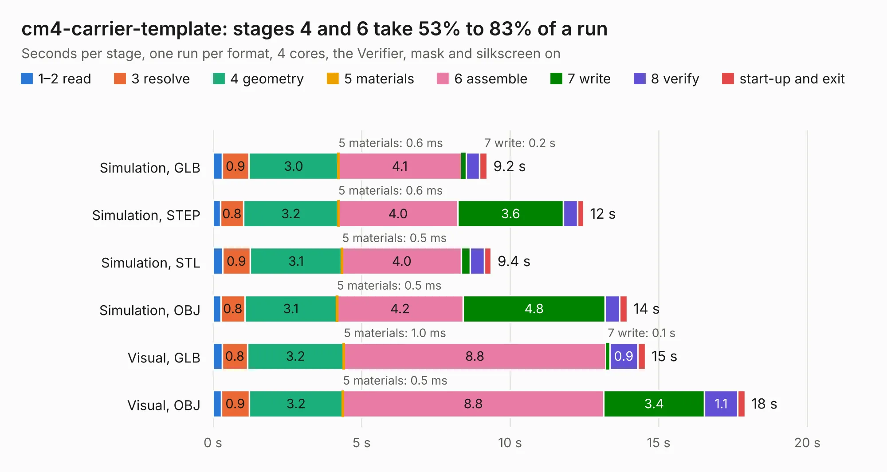

| Mode and format | 1–2 read | 3 resolve | 4 geometry | 5 materials | 6 assemble | 7 write | 8 verify | start-up and exit | Total |
|---|---:|---:|---:|---:|---:|---:|---:|---:|---:|
| Simulation, GLB | 0.3 | 0.9 | 3.0 | 0.6&nbsp;ms | 4.1 | 0.2 | 0.4 | 0.3 | 9.2 |
| Simulation, STEP | 0.2 | 0.8 | 3.2 | 0.6&nbsp;ms | 4.0 | 3.6 | 0.5 | 0.2 | 12.5 |
| Simulation, STL | 0.3 | 0.9 | 3.1 | 0.5&nbsp;ms | 4.0 | 0.3 | 0.5 | 0.2 | 9.4 |
| Simulation, OBJ | 0.3 | 0.8 | 3.1 | 0.5&nbsp;ms | 4.2 | 4.8 | 0.5 | 0.2 | 13.9 |
| Visual, GLB | 0.3 | 0.8 | 3.2 | 1.0&nbsp;ms | 8.8 | 0.1 | 0.9 | 0.2 | 14.5 |
| Visual, OBJ | 0.3 | 0.9 | 3.2 | 0.5&nbsp;ms | 8.8 | 3.4 | 1.1 | 0.2 | 17.9 |

<table align="center"><tr><td valign="top">

| Board | Repo: [jkiv/cm4-carriers](https://github.com/jkiv/cm4-carriers) Board: `cm4-carrier-template.kicad_pcb` |
|---|---|
| Folder | hardware / cm4-carrier-template |
| Complexity | 273&nbsp;/&nbsp;1000 (size&nbsp;208, features&nbsp;65) |
| KESE&nbsp;features | through vias, slotted holes, rounded, trapezoid or chamfered pads, filled zones, curved board outline |
| Tested | 9th November 2026 |
| Copper&nbsp;layers | 4 |
| File&nbsp;format | KiCad 5 (20171130) |
| Parts,&nbsp;tracks,&nbsp;vias | 35, 3,631, 107 |
| Triangles,&nbsp;simulation | 1,017,770 in 108 parts |
| Verifier | PASS in all six runs |

</td><td valign="top">

<table>
<tr><th>File type</th><th>File size</th><th>Peak memory used</th></tr>
<tr><th colspan="3" align="left">Simulation</th></tr>
<tr><td>GLB</td><td align="right">34&nbsp;MB</td><td align="right">474&nbsp;MB</td></tr>
<tr><td>STEP</td><td align="right">160&nbsp;MB</td><td align="right">547&nbsp;MB</td></tr>
<tr><td>STL</td><td align="right">51&nbsp;MB</td><td align="right">460&nbsp;MB</td></tr>
<tr><td>OBJ</td><td align="right">103&nbsp;MB</td><td align="right">704&nbsp;MB</td></tr>
<tr><th colspan="3" align="left">Visual</th></tr>
<tr><td>GLB</td><td align="right">23&nbsp;MB</td><td align="right">671&nbsp;MB</td></tr>
<tr><td>OBJ</td><td align="right">71&nbsp;MB</td><td align="right">684&nbsp;MB</td></tr>
</table>

</td></tr></table>

## 23.13.44 astra_piNas

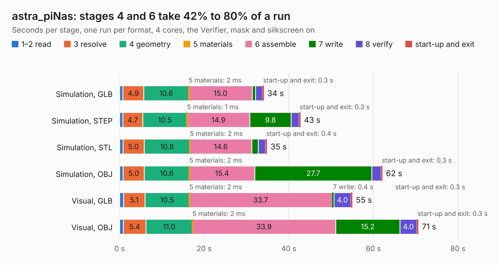

| Mode and format | 1–2 read | 3 resolve | 4 geometry | 5 materials | 6 assemble | 7 write | 8 verify | start-up and exit | Total |
|---|---:|---:|---:|---:|---:|---:|---:|---:|---:|
| Simulation, GLB | 0.8 | 4.9 | 10.6 | 2&nbsp;ms | 15.0 | 0.7 | 1.7 | 0.3 | 34.1 |
| Simulation, STEP | 0.8 | 4.7 | 10.5 | 1&nbsp;ms | 14.9 | 9.8 | 1.9 | 0.3 | 42.8 |
| Simulation, STL | 0.8 | 5.0 | 10.8 | 2&nbsp;ms | 14.6 | 1.5 | 1.7 | 0.4 | 34.9 |
| Simulation, OBJ | 0.8 | 5.0 | 10.6 | 2&nbsp;ms | 15.4 | 27.7 | 2.2 | 0.3 | 62.1 |
| Visual, GLB | 0.9 | 5.1 | 10.5 | 2&nbsp;ms | 33.7 | 0.4 | 4.0 | 0.3 | 55.0 |
| Visual, OBJ | 0.9 | 5.4 | 11.0 | 2&nbsp;ms | 33.9 | 15.2 | 4.0 | 0.3 | 70.6 |

<table align="center"><tr><td valign="top">

| Board | Repo: [jlcjak/astra_pinas](https://github.com/jlcjak/astra_pinas) Board: `astra_piNas.kicad_pcb` |
|---|---|
| Complexity | 402&nbsp;/&nbsp;1000 (size&nbsp;277, features&nbsp;125) |
| KESE&nbsp;features | through vias, slotted holes, custom pads, rounded, trapezoid or chamfered pads, filled zones, copper drawings, stack-up, dielectric εr and tanδ, copper finish |
| Tested | 9th November 2026 |
| Copper&nbsp;layers | 6 |
| File&nbsp;format | KiCad 10 (20260206) |
| Parts,&nbsp;tracks,&nbsp;vias | 170, 2,408, 692 |
| Triangles,&nbsp;simulation | 4,388,718 in 390 parts |
| Verifier | PASS in all six runs |

</td><td valign="top">

<table>
<tr><th>File type</th><th>File size</th><th>Peak memory used</th></tr>
<tr><th colspan="3" align="left">Simulation</th></tr>
<tr><td>GLB</td><td align="right">145&nbsp;MB</td><td align="right">1.3&nbsp;GB</td></tr>
<tr><td>STEP</td><td align="right">425&nbsp;MB</td><td align="right">1.7&nbsp;GB</td></tr>
<tr><td>STL</td><td align="right">219&nbsp;MB</td><td align="right">1.4&nbsp;GB</td></tr>
<tr><td>OBJ</td><td align="right">466&nbsp;MB</td><td align="right">2.8&nbsp;GB</td></tr>
<tr><th colspan="3" align="left">Visual</th></tr>
<tr><td>GLB</td><td align="right">78&nbsp;MB</td><td align="right">1.5&nbsp;GB</td></tr>
<tr><td>OBJ</td><td align="right">255&nbsp;MB</td><td align="right">1.8&nbsp;GB</td></tr>
</table>

</td></tr></table>

## 23.13.45 RK3576 SBCv2

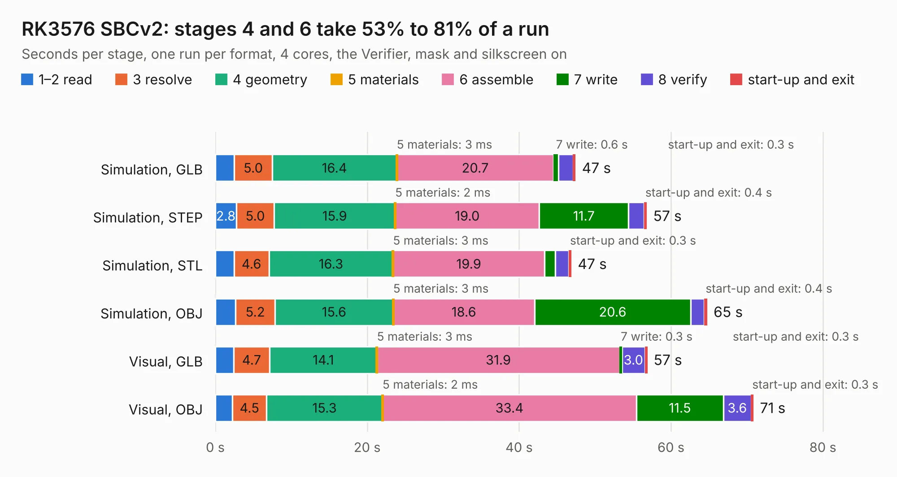

| Mode and format | 1–2 read | 3 resolve | 4 geometry | 5 materials | 6 assemble | 7 write | 8 verify | start-up and exit | Total |
|---|---:|---:|---:|---:|---:|---:|---:|---:|---:|
| Simulation, GLB | 2.5 | 5.0 | 16.4 | 3&nbsp;ms | 20.7 | 0.6 | 1.9 | 0.3 | 47.4 |
| Simulation, STEP | 2.8 | 5.0 | 15.9 | 2&nbsp;ms | 19.0 | 11.7 | 2.0 | 0.4 | 56.8 |
| Simulation, STL | 2.5 | 4.6 | 16.3 | 3&nbsp;ms | 19.9 | 1.4 | 1.7 | 0.3 | 46.9 |
| Simulation, OBJ | 2.7 | 5.2 | 15.6 | 3&nbsp;ms | 18.6 | 20.6 | 1.7 | 0.4 | 64.8 |
| Visual, GLB | 2.4 | 4.7 | 14.1 | 3&nbsp;ms | 31.9 | 0.3 | 3.0 | 0.3 | 56.9 |
| Visual, OBJ | 2.3 | 4.5 | 15.3 | 2&nbsp;ms | 33.4 | 11.5 | 3.6 | 0.3 | 70.9 |

<table align="center"><tr><td valign="top">

| Board | Repo: [joengineer656/open-source-sbc-board](https://github.com/joengineer656/open-source-sbc-board) Board: `RK3576 SBCv2.kicad_pcb` |
|---|---|
| Complexity | 302&nbsp;/&nbsp;1000 (size&nbsp;232, features&nbsp;70) |
| KESE&nbsp;features | slotted holes, rounded, trapezoid or chamfered pads, stack-up, dielectric εr and tanδ, copper finish, mask and silkscreen colours |
| Tested | 9th November 2026 |
| Copper&nbsp;layers | 8 |
| File&nbsp;format | KiCad 10 (20260206) |
| Parts,&nbsp;tracks,&nbsp;vias | 830, 18, 0 |
| Triangles,&nbsp;simulation | 3,262,282 in 739 parts |
| Note | mostly unrouted |
| Verifier | PASS in all six runs |

</td><td valign="top">

<table>
<tr><th>File type</th><th>File size</th><th>Peak memory used</th></tr>
<tr><th colspan="3" align="left">Simulation</th></tr>
<tr><td>GLB</td><td align="right">102&nbsp;MB</td><td align="right">1.1&nbsp;GB</td></tr>
<tr><td>STEP</td><td align="right">384&nbsp;MB</td><td align="right">1.3&nbsp;GB</td></tr>
<tr><td>STL</td><td align="right">163&nbsp;MB</td><td align="right">1.1&nbsp;GB</td></tr>
<tr><td>OBJ</td><td align="right">344&nbsp;MB</td><td align="right">2.1&nbsp;GB</td></tr>
<tr><th colspan="3" align="left">Visual</th></tr>
<tr><td>GLB</td><td align="right">65&nbsp;MB</td><td align="right">1.4&nbsp;GB</td></tr>
<tr><td>OBJ</td><td align="right">207&nbsp;MB</td><td align="right">1.4&nbsp;GB</td></tr>
</table>

</td></tr></table>

## 23.13.46 OSO-SWAT-B1-jig

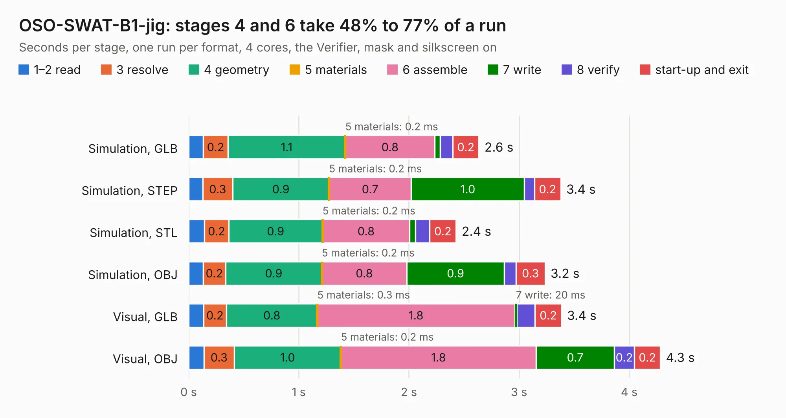

| Mode and format | 1–2 read | 3 resolve | 4 geometry | 5 materials | 6 assemble | 7 write | 8 verify | start-up and exit | Total |
|---|---:|---:|---:|---:|---:|---:|---:|---:|---:|
| Simulation, GLB | 0.1 | 0.2 | 1.1 | 0.2&nbsp;ms | 0.8 | 49&nbsp;ms | 0.1 | 0.2 | 2.6 |
| Simulation, STEP | 0.1 | 0.3 | 0.9 | 0.2&nbsp;ms | 0.7 | 1.0 | 91&nbsp;ms | 0.2 | 3.4 |
| Simulation, STL | 0.1 | 0.2 | 0.9 | 0.2&nbsp;ms | 0.8 | 54&nbsp;ms | 0.1 | 0.2 | 2.4 |
| Simulation, OBJ | 0.1 | 0.2 | 0.9 | 0.2&nbsp;ms | 0.8 | 0.9 | 0.1 | 0.3 | 3.2 |
| Visual, GLB | 0.1 | 0.2 | 0.8 | 0.3&nbsp;ms | 1.8 | 20&nbsp;ms | 0.2 | 0.2 | 3.4 |
| Visual, OBJ | 0.1 | 0.3 | 1.0 | 0.2&nbsp;ms | 1.8 | 0.7 | 0.2 | 0.2 | 4.3 |

<table align="center"><tr><td valign="top">

| Board | Repo: [joeycastillo/Sensor-Watch](https://github.com/joeycastillo/Sensor-Watch) Board: `OSO-SWAT-B1-jig.kicad_pcb` |
|---|---|
| Folder | PCB / Main Boards / OSO-SWAT-B1 / OSO-SWAT-B1-jig |
| Complexity | 45&nbsp;/&nbsp;1000 (size&nbsp;45, features&nbsp;0) |
| Tested | 9th November 2026 |
| Copper&nbsp;layers | 2 |
| File&nbsp;format | KiCad 10 (20260206) |
| Parts,&nbsp;tracks,&nbsp;vias | 12, 0, 0 |
| Triangles,&nbsp;simulation | 162,116 in 52 parts |
| Verifier | PASS in all six runs |

</td><td valign="top">

<table>
<tr><th>File type</th><th>File size</th><th>Peak memory used</th></tr>
<tr><th colspan="3" align="left">Simulation</th></tr>
<tr><td>GLB</td><td align="right">5.4&nbsp;MB</td><td align="right">199&nbsp;MB</td></tr>
<tr><td>STEP</td><td align="right">19&nbsp;MB</td><td align="right">209&nbsp;MB</td></tr>
<tr><td>STL</td><td align="right">8.1&nbsp;MB</td><td align="right">192&nbsp;MB</td></tr>
<tr><td>OBJ</td><td align="right">16&nbsp;MB</td><td align="right">197&nbsp;MB</td></tr>
<tr><th colspan="3" align="left">Visual</th></tr>
<tr><td>GLB</td><td align="right">3.7&nbsp;MB</td><td align="right">172&nbsp;MB</td></tr>
<tr><td>OBJ</td><td align="right">10&nbsp;MB</td><td align="right">172&nbsp;MB</td></tr>
</table>

</td></tr></table>

## 23.13.47 OSO-SWAT-B1

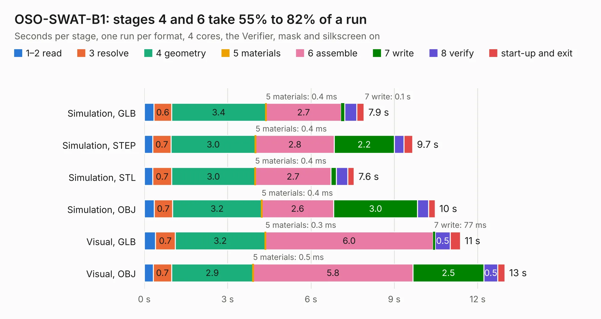

| Mode and format | 1–2 read | 3 resolve | 4 geometry | 5 materials | 6 assemble | 7 write | 8 verify | start-up and exit | Total |
|---|---:|---:|---:|---:|---:|---:|---:|---:|---:|
| Simulation, GLB | 0.4 | 0.6 | 3.4 | 0.4&nbsp;ms | 2.7 | 0.1 | 0.4 | 0.3 | 7.9 |
| Simulation, STEP | 0.3 | 0.7 | 3.0 | 0.4&nbsp;ms | 2.8 | 2.2 | 0.4 | 0.3 | 9.7 |
| Simulation, STL | 0.3 | 0.7 | 3.0 | 0.4&nbsp;ms | 2.7 | 0.2 | 0.4 | 0.2 | 7.6 |
| Simulation, OBJ | 0.4 | 0.7 | 3.2 | 0.4&nbsp;ms | 2.6 | 3.0 | 0.4 | 0.2 | 10.5 |
| Visual, GLB | 0.4 | 0.7 | 3.2 | 0.3&nbsp;ms | 6.0 | 77&nbsp;ms | 0.5 | 0.4 | 11.4 |
| Visual, OBJ | 0.3 | 0.7 | 2.9 | 0.5&nbsp;ms | 5.8 | 2.5 | 0.5 | 0.3 | 13.0 |

<table align="center"><tr><td valign="top">

| Board | Repo: [joeycastillo/Sensor-Watch](https://github.com/joeycastillo/Sensor-Watch) Board: `OSO-SWAT-B1.kicad_pcb` |
|---|---|
| Folder | PCB / Main Boards / OSO-SWAT-B1 |
| Complexity | 280&nbsp;/&nbsp;1000 (size&nbsp;200, features&nbsp;80) |
| KESE&nbsp;features | through vias, rounded, trapezoid or chamfered pads, filled zones, stack-up, dielectric εr and tanδ, mask and silkscreen colours |
| Tested | 9th November 2026 |
| Copper&nbsp;layers | 2 |
| File&nbsp;format | KiCad 10 (20260206) |
| Parts,&nbsp;tracks,&nbsp;vias | 23, 530, 79 |
| Triangles,&nbsp;simulation | 477,106 in 77 parts |
| Verifier | PASS in all six runs |

</td><td valign="top">

<table>
<tr><th>File type</th><th>File size</th><th>Peak memory used</th></tr>
<tr><th colspan="3" align="left">Simulation</th></tr>
<tr><td>GLB</td><td align="right">17&nbsp;MB</td><td align="right">308&nbsp;MB</td></tr>
<tr><td>STEP</td><td align="right">90&nbsp;MB</td><td align="right">367&nbsp;MB</td></tr>
<tr><td>STL</td><td align="right">24&nbsp;MB</td><td align="right">305&nbsp;MB</td></tr>
<tr><td>OBJ</td><td align="right">50&nbsp;MB</td><td align="right">394&nbsp;MB</td></tr>
<tr><th colspan="3" align="left">Visual</th></tr>
<tr><td>GLB</td><td align="right">15&nbsp;MB</td><td align="right">383&nbsp;MB</td></tr>
<tr><td>OBJ</td><td align="right">45&nbsp;MB</td><td align="right">388&nbsp;MB</td></tr>
</table>

</td></tr></table>

## 23.13.48 OSO-SWAT-C1-jig

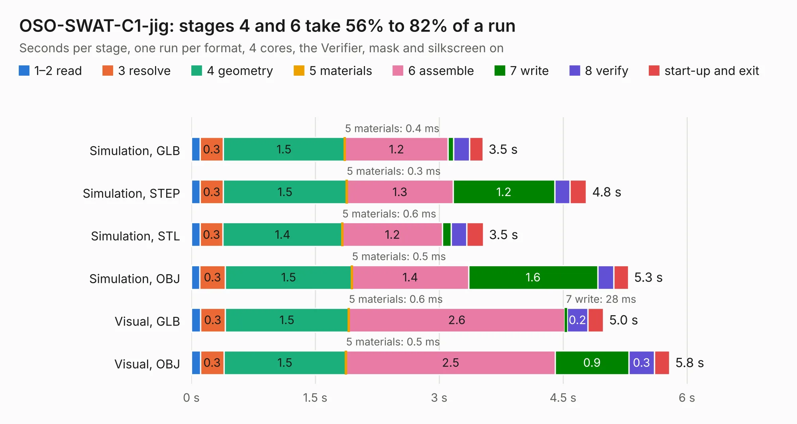

| Mode and format | 1–2 read | 3 resolve | 4 geometry | 5 materials | 6 assemble | 7 write | 8 verify | start-up and exit | Total |
|---|---:|---:|---:|---:|---:|---:|---:|---:|---:|
| Simulation, GLB | 0.1 | 0.3 | 1.5 | 0.4&nbsp;ms | 1.2 | 64&nbsp;ms | 0.2 | 0.2 | 3.5 |
| Simulation, STEP | 0.1 | 0.3 | 1.5 | 0.3&nbsp;ms | 1.3 | 1.2 | 0.2 | 0.2 | 4.8 |
| Simulation, STL | 0.1 | 0.3 | 1.4 | 0.6&nbsp;ms | 1.2 | 0.1 | 0.2 | 0.2 | 3.5 |
| Simulation, OBJ | 0.1 | 0.3 | 1.5 | 0.5&nbsp;ms | 1.4 | 1.6 | 0.2 | 0.2 | 5.3 |
| Visual, GLB | 0.1 | 0.3 | 1.5 | 0.6&nbsp;ms | 2.6 | 28&nbsp;ms | 0.2 | 0.2 | 5.0 |
| Visual, OBJ | 0.1 | 0.3 | 1.5 | 0.5&nbsp;ms | 2.5 | 0.9 | 0.3 | 0.2 | 5.8 |

<table align="center"><tr><td valign="top">

| Board | Repo: [joeycastillo/Sensor-Watch](https://github.com/joeycastillo/Sensor-Watch) Board: `OSO-SWAT-C1-jig.kicad_pcb` |
|---|---|
| Folder | PCB / Main Boards / OSO-SWAT-C1 / OSO-SWAT-C1-jig |
| Complexity | 44&nbsp;/&nbsp;1000 (size&nbsp;44, features&nbsp;0) |
| Tested | 9th November 2026 |
| Copper&nbsp;layers | 2 |
| File&nbsp;format | KiCad 10 (20260206) |
| Parts,&nbsp;tracks,&nbsp;vias | 11, 0, 0 |
| Triangles,&nbsp;simulation | 406,776 in 112 parts |
| Verifier | PASS in all six runs |

</td><td valign="top">

<table>
<tr><th>File type</th><th>File size</th><th>Peak memory used</th></tr>
<tr><th colspan="3" align="left">Simulation</th></tr>
<tr><td>GLB</td><td align="right">13&nbsp;MB</td><td align="right">249&nbsp;MB</td></tr>
<tr><td>STEP</td><td align="right">42&nbsp;MB</td><td align="right">292&nbsp;MB</td></tr>
<tr><td>STL</td><td align="right">20&nbsp;MB</td><td align="right">250&nbsp;MB</td></tr>
<tr><td>OBJ</td><td align="right">41&nbsp;MB</td><td align="right">326&nbsp;MB</td></tr>
<tr><th colspan="3" align="left">Visual</th></tr>
<tr><td>GLB</td><td align="right">7.9&nbsp;MB</td><td align="right">293&nbsp;MB</td></tr>
<tr><td>OBJ</td><td align="right">23&nbsp;MB</td><td align="right">288&nbsp;MB</td></tr>
</table>

</td></tr></table>

## 23.13.49 OSO-SWAT-C1-rounded

| Mode and format | 1–2 read | 3 resolve | 4 geometry | 5 materials | 6 assemble | 7 write | 8 verify | start-up and exit | Total |
|---|---:|---:|---:|---:|---:|---:|---:|---:|---:|
| Simulation, GLB | 1.0 | 1.0 | 3.6 | 0.3&nbsp;ms | 3.4 | 0.1 | 0.5 | 0.3 | 9.9 |
| Simulation, STEP | 0.9 | 0.9 | 3.4 | 0.3&nbsp;ms | 3.9 | 2.6 | 0.5 | 0.3 | 12.5 |
| Simulation, STL | 0.9 | 1.0 | 3.6 | 0.3&nbsp;ms | 3.8 | 0.3 | 0.7 | 0.2 | 10.6 |
| Simulation, OBJ | 0.9 | 1.0 | 3.5 | 0.3&nbsp;ms | 3.5 | 4.6 | 0.5 | 0.2 | 14.1 |
| Visual, GLB | 1.0 | 1.1 | 4.0 | 0.4&nbsp;ms | 8.3 | 0.1 | 0.9 | 0.3 | 15.6 |
| Visual, OBJ | 1.0 | 1.1 | 3.7 | 0.3&nbsp;ms | 8.2 | 3.5 | 0.7 | 0.3 | 18.6 |

<table align="center"><tr><td valign="top">

| Board | Repo: [joeycastillo/Sensor-Watch](https://github.com/joeycastillo/Sensor-Watch) Board: `OSO-SWAT-C1-rounded.kicad_pcb` |
|---|---|
| Folder | PCB / Main Boards / OSO-SWAT-C1 |
| Complexity | 347&nbsp;/&nbsp;1000 (size&nbsp;227, features&nbsp;120) |
| KESE&nbsp;features | through vias, rounded, trapezoid or chamfered pads, arc tracks, filled zones, stack-up, dielectric εr and tanδ, mask and silkscreen colours, castellated pads |
| Tested | 9th November 2026 |
| Copper&nbsp;layers | 4 |
| File&nbsp;format | KiCad 8 (20240108) |
| Parts,&nbsp;tracks,&nbsp;vias | 31, 939, 81 |
| Triangles,&nbsp;simulation | 768,128 in 80 parts |
| Verifier | PASS in all six runs |

</td><td valign="top">

<table>
<tr><th>File type</th><th>File size</th><th>Peak memory used</th></tr>
<tr><th colspan="3" align="left">Simulation</th></tr>
<tr><td>GLB</td><td align="right">27&nbsp;MB</td><td align="right">370&nbsp;MB</td></tr>
<tr><td>STEP</td><td align="right">114&nbsp;MB</td><td align="right">459&nbsp;MB</td></tr>
<tr><td>STL</td><td align="right">38&nbsp;MB</td><td align="right">373&nbsp;MB</td></tr>
<tr><td>OBJ</td><td align="right">79&nbsp;MB</td><td align="right">596&nbsp;MB</td></tr>
<tr><th colspan="3" align="left">Visual</th></tr>
<tr><td>GLB</td><td align="right">20&nbsp;MB</td><td align="right">481&nbsp;MB</td></tr>
<tr><td>OBJ</td><td align="right">59&nbsp;MB</td><td align="right">509&nbsp;MB</td></tr>
</table>

</td></tr></table>

## 23.13.50 OSO-SWAT-C1

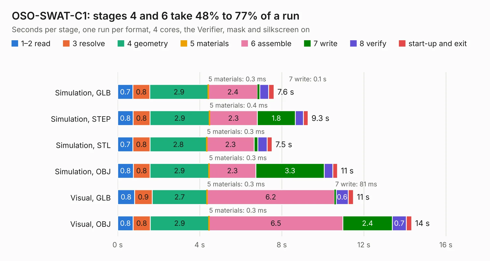

| Mode and format | 1–2 read | 3 resolve | 4 geometry | 5 materials | 6 assemble | 7 write | 8 verify | start-up and exit | Total |
|---|---:|---:|---:|---:|---:|---:|---:|---:|---:|
| Simulation, GLB | 0.7 | 0.8 | 2.9 | 0.3&nbsp;ms | 2.4 | 0.1 | 0.4 | 0.3 | 7.6 |
| Simulation, STEP | 0.8 | 0.8 | 2.9 | 0.4&nbsp;ms | 2.3 | 1.8 | 0.4 | 0.2 | 9.3 |
| Simulation, STL | 0.7 | 0.8 | 2.8 | 0.3&nbsp;ms | 2.3 | 0.2 | 0.5 | 0.2 | 7.5 |
| Simulation, OBJ | 0.8 | 0.8 | 2.9 | 0.3&nbsp;ms | 2.3 | 3.3 | 0.4 | 0.2 | 10.7 |
| Visual, GLB | 0.8 | 0.9 | 2.7 | 0.3&nbsp;ms | 6.2 | 81&nbsp;ms | 0.6 | 0.3 | 11.5 |
| Visual, OBJ | 0.8 | 0.8 | 2.9 | 0.3&nbsp;ms | 6.5 | 2.4 | 0.7 | 0.3 | 14.3 |

<table align="center"><tr><td valign="top">

| Board | Repo: [joeycastillo/Sensor-Watch](https://github.com/joeycastillo/Sensor-Watch) Board: `OSO-SWAT-C1.kicad_pcb` |
|---|---|
| Folder | PCB / Main Boards / OSO-SWAT-C1 |
| Complexity | 301&nbsp;/&nbsp;1000 (size&nbsp;221, features&nbsp;80) |
| KESE&nbsp;features | through vias, rounded, trapezoid or chamfered pads, filled zones, stack-up, dielectric εr and tanδ, mask and silkscreen colours |
| Tested | 9th November 2026 |
| Copper&nbsp;layers | 4 |
| File&nbsp;format | KiCad 10 (20260206) |
| Parts,&nbsp;tracks,&nbsp;vias | 30, 587, 81 |
| Triangles,&nbsp;simulation | 658,516 in 80 parts |
| Verifier | PASS in all six runs |

</td><td valign="top">

<table>
<tr><th>File type</th><th>File size</th><th>Peak memory used</th></tr>
<tr><th colspan="3" align="left">Simulation</th></tr>
<tr><td>GLB</td><td align="right">23&nbsp;MB</td><td align="right">352&nbsp;MB</td></tr>
<tr><td>STEP</td><td align="right">99&nbsp;MB</td><td align="right">406&nbsp;MB</td></tr>
<tr><td>STL</td><td align="right">33&nbsp;MB</td><td align="right">341&nbsp;MB</td></tr>
<tr><td>OBJ</td><td align="right">68&nbsp;MB</td><td align="right">499&nbsp;MB</td></tr>
<tr><th colspan="3" align="left">Visual</th></tr>
<tr><td>GLB</td><td align="right">16&nbsp;MB</td><td align="right">432&nbsp;MB</td></tr>
<tr><td>OBJ</td><td align="right">50&nbsp;MB</td><td align="right">431&nbsp;MB</td></tr>
</table>

</td></tr></table>

## 23.13.51 OSO-SWAB-B1-00 Sensor Watch Accelerometer

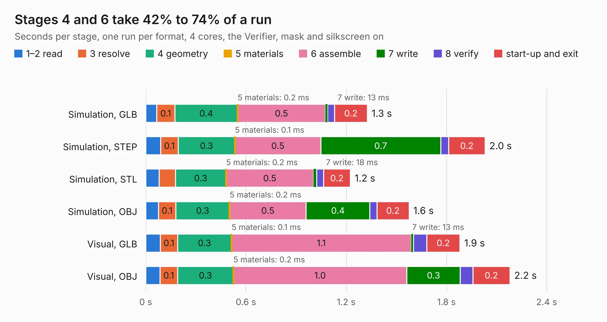

| Mode and format | 1–2 read | 3 resolve | 4 geometry | 5 materials | 6 assemble | 7 write | 8 verify | start-up and exit | Total |
|---|---:|---:|---:|---:|---:|---:|---:|---:|---:|
| Simulation, GLB | 65&nbsp;ms | 0.1 | 0.4 | 0.2&nbsp;ms | 0.5 | 13&nbsp;ms | 41&nbsp;ms | 0.2 | 1.3 |
| Simulation, STEP | 89&nbsp;ms | 0.1 | 0.3 | 0.1&nbsp;ms | 0.5 | 0.7 | 48&nbsp;ms | 0.2 | 2.0 |
| Simulation, STL | 80&nbsp;ms | 98&nbsp;ms | 0.3 | 0.2&nbsp;ms | 0.5 | 18&nbsp;ms | 42&nbsp;ms | 0.2 | 1.2 |
| Simulation, OBJ | 77&nbsp;ms | 0.1 | 0.3 | 0.2&nbsp;ms | 0.5 | 0.4 | 42&nbsp;ms | 0.2 | 1.6 |
| Visual, GLB | 88&nbsp;ms | 0.1 | 0.3 | 0.1&nbsp;ms | 1.1 | 13&nbsp;ms | 80&nbsp;ms | 0.2 | 1.9 |
| Visual, OBJ | 85&nbsp;ms | 0.1 | 0.3 | 0.2&nbsp;ms | 1.0 | 0.3 | 75&nbsp;ms | 0.2 | 2.2 |

<table align="center"><tr><td valign="top">

| Board | Repo: [joeycastillo/Sensor-Watch](https://github.com/joeycastillo/Sensor-Watch) Board: `OSO-SWAB-B1-00 Sensor Watch Accelerometer.kicad_pcb` |
|---|---|
| Folder | PCB / Sensor Boards / Kicad / OSO-SWAB-B1-00 Sensor Watch Accelerometer |
| Complexity | 182&nbsp;/&nbsp;1000 (size&nbsp;112, features&nbsp;70) |
| KESE&nbsp;features | through vias, rounded, trapezoid or chamfered pads, curved board outline, stack-up, dielectric εr and tanδ, mask and silkscreen colours |
| Tested | 9th November 2026 |
| Copper&nbsp;layers | 2 |
| File&nbsp;format | KiCad 6 (20211014) |
| Parts,&nbsp;tracks,&nbsp;vias | 4, 81, 12 |
| Triangles,&nbsp;simulation | 70,958 in 17 parts |
| Verifier | PASS in all six runs |

</td><td valign="top">

<table>
<tr><th>File type</th><th>File size</th><th>Peak memory used</th></tr>
<tr><th colspan="3" align="left">Simulation</th></tr>
<tr><td>GLB</td><td align="right">2.6&nbsp;MB</td><td align="right">177&nbsp;MB</td></tr>
<tr><td>STEP</td><td align="right">12&nbsp;MB</td><td align="right">177&nbsp;MB</td></tr>
<tr><td>STL</td><td align="right">3.5&nbsp;MB</td><td align="right">173&nbsp;MB</td></tr>
<tr><td>OBJ</td><td align="right">7.0&nbsp;MB</td><td align="right">182&nbsp;MB</td></tr>
<tr><th colspan="3" align="left">Visual</th></tr>
<tr><td>GLB</td><td align="right">2.2&nbsp;MB</td><td align="right">153&nbsp;MB</td></tr>
<tr><td>OBJ</td><td align="right">6.1&nbsp;MB</td><td align="right">153&nbsp;MB</td></tr>
</table>

</td></tr></table>

## 23.13.52 Q3Q-SWAB-A1-00 Temperature + Test Points + OPT3001

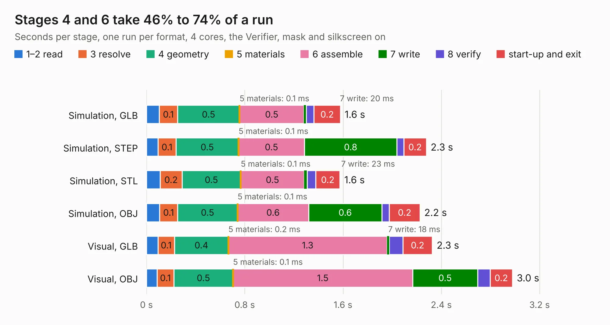

| Mode and format | 1–2 read | 3 resolve | 4 geometry | 5 materials | 6 assemble | 7 write | 8 verify | start-up and exit | Total |
|---|---:|---:|---:|---:|---:|---:|---:|---:|---:|
| Simulation, GLB | 0.1 | 0.1 | 0.5 | 0.1&nbsp;ms | 0.5 | 20&nbsp;ms | 62&nbsp;ms | 0.2 | 1.6 |
| Simulation, STEP | 95&nbsp;ms | 0.1 | 0.5 | 0.1&nbsp;ms | 0.5 | 0.8 | 56&nbsp;ms | 0.2 | 2.3 |
| Simulation, STL | 0.1 | 0.2 | 0.5 | 0.1&nbsp;ms | 0.5 | 23&nbsp;ms | 70&nbsp;ms | 0.2 | 1.6 |
| Simulation, OBJ | 0.1 | 0.1 | 0.5 | 0.1&nbsp;ms | 0.6 | 0.6 | 61&nbsp;ms | 0.2 | 2.2 |
| Visual, GLB | 93&nbsp;ms | 0.1 | 0.4 | 0.2&nbsp;ms | 1.3 | 18&nbsp;ms | 0.1 | 0.2 | 2.3 |
| Visual, OBJ | 87&nbsp;ms | 0.1 | 0.5 | 0.1&nbsp;ms | 1.5 | 0.5 | 0.1 | 0.2 | 3.0 |

<table align="center"><tr><td valign="top">

| Board | Repo: [joeycastillo/Sensor-Watch](https://github.com/joeycastillo/Sensor-Watch) Board: `Q3Q-SWAB-A1-00 Temperature + Test Points + OPT3001.kicad_pcb` |
|---|---|
| Folder | PCB / Sensor Boards / Q3Q-SWAB-A1-00 Temperature + Test Points + OPT3001 |
| Complexity | 147&nbsp;/&nbsp;1000 (size&nbsp;112, features&nbsp;35) |
| KESE&nbsp;features | through vias, rounded, trapezoid or chamfered pads, curved board outline |
| Tested | 9th November 2026 |
| Copper&nbsp;layers | 2 |
| File&nbsp;format | KiCad 5 (20171130) |
| Parts,&nbsp;tracks,&nbsp;vias | 4, 79, 11 |
| Triangles,&nbsp;simulation | 91,820 in 23 parts |
| Verifier | PASS in all six runs |

</td><td valign="top">

<table>
<tr><th>File type</th><th>File size</th><th>Peak memory used</th></tr>
<tr><th colspan="3" align="left">Simulation</th></tr>
<tr><td>GLB</td><td align="right">3.4&nbsp;MB</td><td align="right">182&nbsp;MB</td></tr>
<tr><td>STEP</td><td align="right">17&nbsp;MB</td><td align="right">193&nbsp;MB</td></tr>
<tr><td>STL</td><td align="right">4.6&nbsp;MB</td><td align="right">186&nbsp;MB</td></tr>
<tr><td>OBJ</td><td align="right">9.3&nbsp;MB</td><td align="right">177&nbsp;MB</td></tr>
<tr><th colspan="3" align="left">Visual</th></tr>
<tr><td>GLB</td><td align="right">3.2&nbsp;MB</td><td align="right">155&nbsp;MB</td></tr>
<tr><td>OBJ</td><td align="right">8.8&nbsp;MB</td><td align="right">155&nbsp;MB</td></tr>
</table>

</td></tr></table>

## 23.13.53 2057-ICE40HX4K-TQ144-breakout

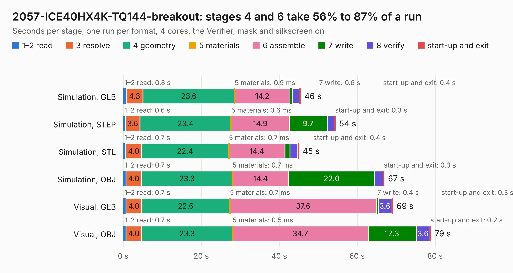

| Mode and format | 1–2 read | 3 resolve | 4 geometry | 5 materials | 6 assemble | 7 write | 8 verify | start-up and exit | Total |
|---|---:|---:|---:|---:|---:|---:|---:|---:|---:|
| Simulation, GLB | 0.8 | 4.3 | 23.6 | 0.9&nbsp;ms | 14.2 | 0.6 | 1.8 | 0.4 | 45.5 |
| Simulation, STEP | 0.6 | 3.6 | 23.4 | 0.6&nbsp;ms | 14.9 | 9.7 | 1.9 | 0.3 | 54.5 |
| Simulation, STL | 0.7 | 4.0 | 22.4 | 0.7&nbsp;ms | 14.4 | 1.3 | 1.9 | 0.4 | 45.1 |
| Simulation, OBJ | 0.7 | 4.0 | 23.3 | 0.7&nbsp;ms | 14.4 | 22.0 | 2.3 | 0.3 | 67.0 |
| Visual, GLB | 0.7 | 4.0 | 22.6 | 0.7&nbsp;ms | 37.6 | 0.4 | 3.6 | 0.3 | 69.2 |
| Visual, OBJ | 0.7 | 4.0 | 23.3 | 0.5&nbsp;ms | 34.7 | 12.3 | 3.6 | 0.2 | 78.9 |

<table align="center"><tr><td valign="top">

| Board | Repo: [johnwinans/2057-ICE40HX4K-TQ144-breakout](https://github.com/johnwinans/2057-ICE40HX4K-TQ144-breakout) Board: `2057-ICE40HX4K-TQ144-breakout.kicad_pcb` |
|---|---|
| Complexity | 310&nbsp;/&nbsp;1000 (size&nbsp;245, features&nbsp;65) |
| KESE&nbsp;features | through vias, slotted holes, rounded, trapezoid or chamfered pads, filled zones, curved board outline |
| Tested | 9th November 2026 |
| Copper&nbsp;layers | 4 |
| File&nbsp;format | KiCad 5 (20171130) |
| Parts,&nbsp;tracks,&nbsp;vias | 72, 1,453, 211 |
| Triangles,&nbsp;simulation | 3,669,038 in 195 parts |
| Verifier | PASS in all six runs |

</td><td valign="top">

<table>
<tr><th>File type</th><th>File size</th><th>Peak memory used</th></tr>
<tr><th colspan="3" align="left">Simulation</th></tr>
<tr><td>GLB</td><td align="right">126&nbsp;MB</td><td align="right">1.1&nbsp;GB</td></tr>
<tr><td>STEP</td><td align="right">556&nbsp;MB</td><td align="right">1.3&nbsp;GB</td></tr>
<tr><td>STL</td><td align="right">183&nbsp;MB</td><td align="right">1.1&nbsp;GB</td></tr>
<tr><td>OBJ</td><td align="right">394&nbsp;MB</td><td align="right">2.4&nbsp;GB</td></tr>
<tr><th colspan="3" align="left">Visual</th></tr>
<tr><td>GLB</td><td align="right">76&nbsp;MB</td><td align="right">1.2&nbsp;GB</td></tr>
<tr><td>OBJ</td><td align="right">236&nbsp;MB</td><td align="right">1.7&nbsp;GB</td></tr>
</table>

</td></tr></table>

## 23.13.54 gw

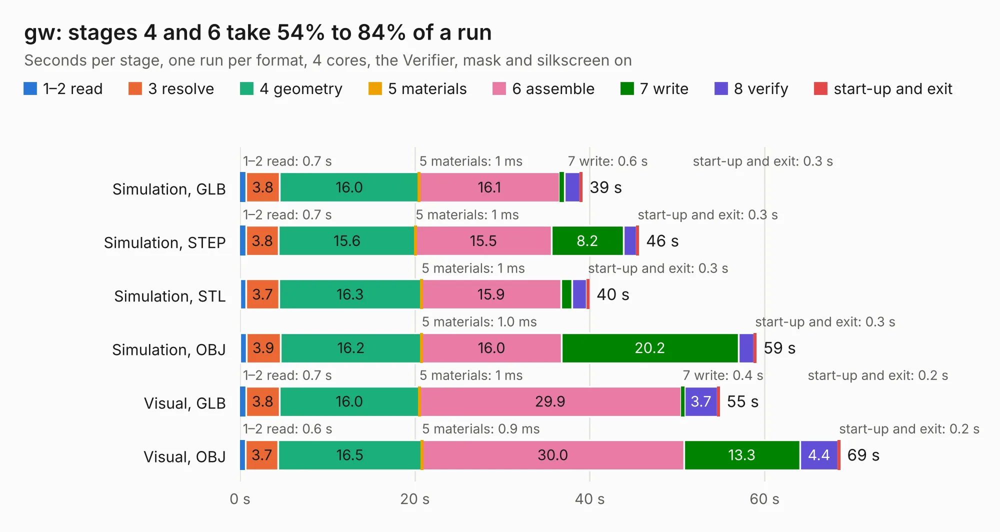

| Mode and format | 1–2 read | 3 resolve | 4 geometry | 5 materials | 6 assemble | 7 write | 8 verify | start-up and exit | Total |
|---|---:|---:|---:|---:|---:|---:|---:|---:|---:|
| Simulation, GLB | 0.7 | 3.8 | 16.0 | 1&nbsp;ms | 16.1 | 0.6 | 1.8 | 0.3 | 39.1 |
| Simulation, STEP | 0.7 | 3.8 | 15.6 | 1&nbsp;ms | 15.5 | 8.2 | 1.5 | 0.3 | 45.6 |
| Simulation, STL | 0.7 | 3.7 | 16.3 | 1&nbsp;ms | 15.9 | 1.3 | 1.7 | 0.3 | 39.9 |
| Simulation, OBJ | 0.7 | 3.9 | 16.2 | 1.0&nbsp;ms | 16.0 | 20.2 | 1.8 | 0.3 | 59.0 |
| Visual, GLB | 0.7 | 3.8 | 16.0 | 1&nbsp;ms | 29.9 | 0.4 | 3.7 | 0.2 | 54.8 |
| Visual, OBJ | 0.6 | 3.7 | 16.5 | 0.9&nbsp;ms | 30.0 | 13.3 | 4.4 | 0.2 | 68.6 |

<table align="center"><tr><td valign="top">

| Board | Repo: [jonpe960/blixten](https://github.com/jonpe960/blixten) Board: `gw.kicad_pcb` |
|---|---|
| Folder | Blixten Gateway |
| Complexity | 341&nbsp;/&nbsp;1000 (size&nbsp;296, features&nbsp;45) |
| KESE&nbsp;features | through vias, filled zones, copper text |
| Tested | 9th November 2026 |
| Copper&nbsp;layers | 4 |
| File&nbsp;format | KiCad 4 (4) |
| Parts,&nbsp;tracks,&nbsp;vias | 165, 3,785, 748 |
| Triangles,&nbsp;simulation | 3,831,544 in 277 parts |
| Verifier | PASS in all six runs |

</td><td valign="top">

<table>
<tr><th>File type</th><th>File size</th><th>Peak memory used</th></tr>
<tr><th colspan="3" align="left">Simulation</th></tr>
<tr><td>GLB</td><td align="right">131&nbsp;MB</td><td align="right">1.1&nbsp;GB</td></tr>
<tr><td>STEP</td><td align="right">509&nbsp;MB</td><td align="right">1.4&nbsp;GB</td></tr>
<tr><td>STL</td><td align="right">192&nbsp;MB</td><td align="right">1.1&nbsp;GB</td></tr>
<tr><td>OBJ</td><td align="right">405&nbsp;MB</td><td align="right">2.5&nbsp;GB</td></tr>
<tr><th colspan="3" align="left">Visual</th></tr>
<tr><td>GLB</td><td align="right">83&nbsp;MB</td><td align="right">1.4&nbsp;GB</td></tr>
<tr><td>OBJ</td><td align="right">262&nbsp;MB</td><td align="right">1.8&nbsp;GB</td></tr>
</table>

</td></tr></table>

## 23.13.55 Blixten

| Mode and format | 1–2 read | 3 resolve | 4 geometry | 5 materials | 6 assemble | 7 write | 8 verify | start-up and exit | Total |
|---|---:|---:|---:|---:|---:|---:|---:|---:|---:|
| Simulation, GLB | 0.2 | 0.9 | 3.2 | 0.5&nbsp;ms | 3.3 | 0.2 | 0.5 | 0.2 | 8.4 |
| Simulation, STEP | 0.2 | 0.8 | 2.8 | 0.4&nbsp;ms | 3.1 | 2.2 | 0.4 | 0.2 | 9.8 |
| Simulation, STL | 0.2 | 0.9 | 2.9 | 0.4&nbsp;ms | 3.3 | 0.3 | 0.5 | 0.2 | 8.3 |
| Simulation, OBJ | 0.2 | 0.9 | 2.9 | 0.4&nbsp;ms | 3.0 | 4.3 | 0.4 | 0.2 | 12.0 |
| Visual, GLB | 0.2 | 0.8 | 3.2 | 0.5&nbsp;ms | 6.2 | 83&nbsp;ms | 0.7 | 0.2 | 11.4 |
| Visual, OBJ | 0.2 | 0.8 | 3.0 | 0.3&nbsp;ms | 6.1 | 3.0 | 0.7 | 0.2 | 14.0 |

<table align="center"><tr><td valign="top">

| Board | Repo: [jonpe960/blixten](https://github.com/jonpe960/blixten) Board: `Blixten.kicad_pcb` |
|---|---|
| Folder | Blixten LED Device |
| Complexity | 282&nbsp;/&nbsp;1000 (size&nbsp;247, features&nbsp;35) |
| KESE&nbsp;features | through vias, filled zones |
| Tested | 9th November 2026 |
| Copper&nbsp;layers | 4 |
| File&nbsp;format | KiCad 4 (4) |
| Parts,&nbsp;tracks,&nbsp;vias | 60, 1,140, 201 |
| Triangles,&nbsp;simulation | 1,020,116 in 80 parts |
| Verifier | PASS in all six runs |

</td><td valign="top">

<table>
<tr><th>File type</th><th>File size</th><th>Peak memory used</th></tr>
<tr><th colspan="3" align="left">Simulation</th></tr>
<tr><td>GLB</td><td align="right">35&nbsp;MB</td><td align="right">419&nbsp;MB</td></tr>
<tr><td>STEP</td><td align="right">131&nbsp;MB</td><td align="right">546&nbsp;MB</td></tr>
<tr><td>STL</td><td align="right">51&nbsp;MB</td><td align="right">429&nbsp;MB</td></tr>
<tr><td>OBJ</td><td align="right">104&nbsp;MB</td><td align="right">709&nbsp;MB</td></tr>
<tr><th colspan="3" align="left">Visual</th></tr>
<tr><td>GLB</td><td align="right">22&nbsp;MB</td><td align="right">525&nbsp;MB</td></tr>
<tr><td>OBJ</td><td align="right">65&nbsp;MB</td><td align="right">540&nbsp;MB</td></tr>
</table>

</td></tr></table>

## 23.13.56 clock-test

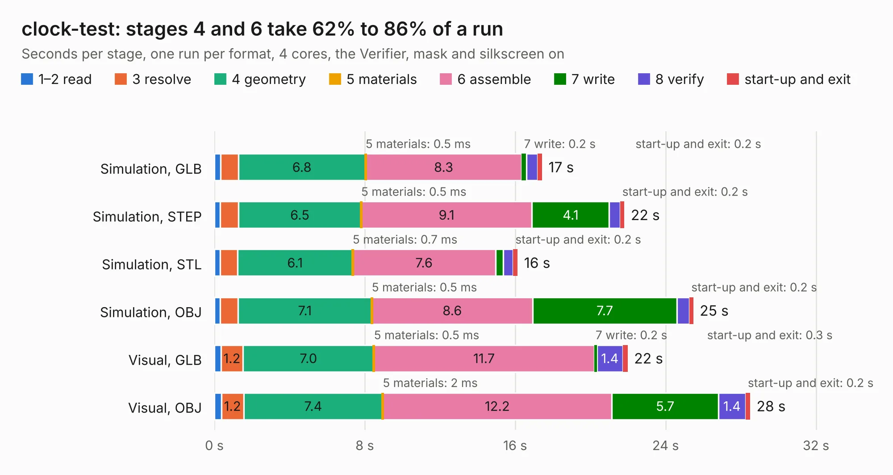

| Mode and format | 1–2 read | 3 resolve | 4 geometry | 5 materials | 6 assemble | 7 write | 8 verify | start-up and exit | Total |
|---|---:|---:|---:|---:|---:|---:|---:|---:|---:|
| Simulation, GLB | 0.3 | 0.9 | 6.8 | 0.5&nbsp;ms | 8.3 | 0.2 | 0.6 | 0.2 | 17.4 |
| Simulation, STEP | 0.3 | 1.0 | 6.5 | 0.5&nbsp;ms | 9.1 | 4.1 | 0.6 | 0.2 | 21.8 |
| Simulation, STL | 0.3 | 0.9 | 6.1 | 0.7&nbsp;ms | 7.6 | 0.4 | 0.5 | 0.2 | 16.1 |
| Simulation, OBJ | 0.3 | 0.9 | 7.1 | 0.5&nbsp;ms | 8.6 | 7.7 | 0.7 | 0.2 | 25.5 |
| Visual, GLB | 0.3 | 1.2 | 7.0 | 0.5&nbsp;ms | 11.7 | 0.2 | 1.4 | 0.3 | 22.0 |
| Visual, OBJ | 0.4 | 1.2 | 7.4 | 2&nbsp;ms | 12.2 | 5.7 | 1.4 | 0.2 | 28.5 |

<table align="center"><tr><td valign="top">

| Board | Repo: [joshajohnson/ecp5-mini](https://github.com/joshajohnson/ecp5-mini) Board: `clock-test.kicad_pcb` |
|---|---|
| Folder | breakouts / clock-test-0.1 |
| Complexity | 290&nbsp;/&nbsp;1000 (size&nbsp;185, features&nbsp;105) |
| KESE&nbsp;features | through vias, rounded, trapezoid or chamfered pads, filled zones, curved board outline, stack-up, dielectric εr and tanδ, copper finish, mask and silkscreen colours |
| Tested | 9th November 2026 |
| Copper&nbsp;layers | 2 |
| File&nbsp;format | KiCad 6 (20200916) |
| Parts,&nbsp;tracks,&nbsp;vias | 83, 1,218, 99 |
| Triangles,&nbsp;simulation | 1,195,948 in 141 parts |
| Verifier | PASS in all six runs |

</td><td valign="top">

<table>
<tr><th>File type</th><th>File size</th><th>Peak memory used</th></tr>
<tr><th colspan="3" align="left">Simulation</th></tr>
<tr><td>GLB</td><td align="right">43&nbsp;MB</td><td align="right">530&nbsp;MB</td></tr>
<tr><td>STEP</td><td align="right">233&nbsp;MB</td><td align="right">638&nbsp;MB</td></tr>
<tr><td>STL</td><td align="right">60&nbsp;MB</td><td align="right">524&nbsp;MB</td></tr>
<tr><td>OBJ</td><td align="right">127&nbsp;MB</td><td align="right">844&nbsp;MB</td></tr>
<tr><th colspan="3" align="left">Visual</th></tr>
<tr><td>GLB</td><td align="right">30&nbsp;MB</td><td align="right">598&nbsp;MB</td></tr>
<tr><td>OBJ</td><td align="right">89&nbsp;MB</td><td align="right">678&nbsp;MB</td></tr>
</table>

</td></tr></table>

## 23.13.57 octa-pmod

| Mode and format | 1–2 read | 3 resolve | 4 geometry | 5 materials | 6 assemble | 7 write | 8 verify | start-up and exit | Total |
|---|---:|---:|---:|---:|---:|---:|---:|---:|---:|
| Simulation, GLB | 0.3 | 0.9 | 5.2 | 0.6&nbsp;ms | 3.8 | 0.2 | 0.6 | 0.3 | 11.2 |
| Simulation, STEP | 0.3 | 0.9 | 5.1 | 0.5&nbsp;ms | 3.7 | 3.2 | 0.5 | 0.2 | 13.9 |
| Simulation, STL | 0.3 | 1.0 | 5.1 | 0.5&nbsp;ms | 3.8 | 0.3 | 0.5 | 0.3 | 11.3 |
| Simulation, OBJ | 0.3 | 0.9 | 5.4 | 0.8&nbsp;ms | 3.9 | 6.0 | 0.6 | 0.3 | 17.3 |
| Visual, GLB | 0.3 | 0.9 | 5.0 | 0.4&nbsp;ms | 6.4 | 0.1 | 0.8 | 0.2 | 13.7 |
| Visual, OBJ | 0.2 | 0.9 | 5.1 | 0.7&nbsp;ms | 6.7 | 3.5 | 0.8 | 0.3 | 17.6 |

<table align="center"><tr><td valign="top">

| Board | Repo: [joshajohnson/ecp5-mini](https://github.com/joshajohnson/ecp5-mini) Board: `octa-pmod.kicad_pcb` |
|---|---|
| Folder | breakouts / octa-pmod-0.1 |
| Complexity | 232&nbsp;/&nbsp;1000 (size&nbsp;142, features&nbsp;90) |
| KESE&nbsp;features | rounded, trapezoid or chamfered pads, filled zones, curved board outline, stack-up, dielectric εr and tanδ, copper finish, mask and silkscreen colours |
| Tested | 9th November 2026 |
| Copper&nbsp;layers | 2 |
| File&nbsp;format | KiCad 6 (20201002) |
| Parts,&nbsp;tracks,&nbsp;vias | 14, 343, 0 |
| Triangles,&nbsp;simulation | 1,044,278 in 78 parts |
| Verifier | PASS in all six runs |

</td><td valign="top">

<table>
<tr><th>File type</th><th>File size</th><th>Peak memory used</th></tr>
<tr><th colspan="3" align="left">Simulation</th></tr>
<tr><td>GLB</td><td align="right">34&nbsp;MB</td><td align="right">444&nbsp;MB</td></tr>
<tr><td>STEP</td><td align="right">140&nbsp;MB</td><td align="right">522&nbsp;MB</td></tr>
<tr><td>STL</td><td align="right">52&nbsp;MB</td><td align="right">447&nbsp;MB</td></tr>
<tr><td>OBJ</td><td align="right">104&nbsp;MB</td><td align="right">717&nbsp;MB</td></tr>
<tr><th colspan="3" align="left">Visual</th></tr>
<tr><td>GLB</td><td align="right">20&nbsp;MB</td><td align="right">523&nbsp;MB</td></tr>
<tr><td>OBJ</td><td align="right">60&nbsp;MB</td><td align="right">527&nbsp;MB</td></tr>
</table>

</td></tr></table>

## 23.13.58 octa-pmod

| Mode and format | 1–2 read | 3 resolve | 4 geometry | 5 materials | 6 assemble | 7 write | 8 verify | start-up and exit | Total |
|---|---:|---:|---:|---:|---:|---:|---:|---:|---:|
| Simulation, GLB | 0.2 | 0.7 | 4.5 | 2&nbsp;ms | 3.2 | 0.2 | 0.4 | 0.2 | 9.5 |
| Simulation, STEP | 0.2 | 0.7 | 4.3 | 0.8&nbsp;ms | 3.3 | 2.3 | 0.4 | 0.2 | 11.4 |
| Simulation, STL | 0.2 | 0.7 | 4.2 | 0.8&nbsp;ms | 3.3 | 0.3 | 0.4 | 0.2 | 9.4 |
| Simulation, OBJ | 0.2 | 0.7 | 3.9 | 0.8&nbsp;ms | 3.2 | 4.2 | 0.4 | 0.2 | 12.9 |
| Visual, GLB | 0.2 | 0.7 | 4.2 | 0.9&nbsp;ms | 6.1 | 90&nbsp;ms | 0.7 | 0.2 | 12.1 |
| Visual, OBJ | 0.2 | 0.7 | 4.1 | 0.6&nbsp;ms | 5.9 | 2.5 | 0.7 | 0.2 | 14.2 |

<table align="center"><tr><td valign="top">

| Board | Repo: [joshajohnson/ecp5-mini](https://github.com/joshajohnson/ecp5-mini) Board: `octa-pmod.kicad_pcb` |
|---|---|
| Folder | breakouts / octa-pmod-0.2 |
| Complexity | 241&nbsp;/&nbsp;1000 (size&nbsp;151, features&nbsp;90) |
| KESE&nbsp;features | rounded, trapezoid or chamfered pads, filled zones, curved board outline, stack-up, dielectric εr and tanδ, copper finish, mask and silkscreen colours |
| Tested | 9th November 2026 |
| Copper&nbsp;layers | 2 |
| File&nbsp;format | KiCad 6 (20201220) |
| Parts,&nbsp;tracks,&nbsp;vias | 14, 618, 0 |
| Triangles,&nbsp;simulation | 1,101,224 in 78 parts |
| Verifier | PASS in all six runs |

</td><td valign="top">

<table>
<tr><th>File type</th><th>File size</th><th>Peak memory used</th></tr>
<tr><th colspan="3" align="left">Simulation</th></tr>
<tr><td>GLB</td><td align="right">37&nbsp;MB</td><td align="right">484&nbsp;MB</td></tr>
<tr><td>STEP</td><td align="right">155&nbsp;MB</td><td align="right">547&nbsp;MB</td></tr>
<tr><td>STL</td><td align="right">55&nbsp;MB</td><td align="right">450&nbsp;MB</td></tr>
<tr><td>OBJ</td><td align="right">110&nbsp;MB</td><td align="right">775&nbsp;MB</td></tr>
<tr><th colspan="3" align="left">Visual</th></tr>
<tr><td>GLB</td><td align="right">22&nbsp;MB</td><td align="right">568&nbsp;MB</td></tr>
<tr><td>OBJ</td><td align="right">65&nbsp;MB</td><td align="right">558&nbsp;MB</td></tr>
</table>

</td></tr></table>

## 23.13.59 octa-pmod

| Mode and format | 1–2 read | 3 resolve | 4 geometry | 5 materials | 6 assemble | 7 write | 8 verify | start-up and exit | Total |
|---|---:|---:|---:|---:|---:|---:|---:|---:|---:|
| Simulation, GLB | 0.3 | 1.0 | 5.4 | 1&nbsp;ms | 3.9 | 0.2 | 0.6 | 0.3 | 11.6 |
| Simulation, STEP | 0.3 | 1.1 | 5.3 | 1&nbsp;ms | 3.8 | 2.9 | 0.6 | 0.3 | 14.2 |
| Simulation, STL | 0.3 | 1.0 | 5.5 | 0.8&nbsp;ms | 4.1 | 0.3 | 0.5 | 0.3 | 12.1 |
| Simulation, OBJ | 0.3 | 1.0 | 5.3 | 0.9&nbsp;ms | 3.7 | 5.3 | 0.5 | 0.3 | 16.3 |
| Visual, GLB | 0.3 | 1.1 | 5.6 | 0.9&nbsp;ms | 9.2 | 0.1 | 1.1 | 0.2 | 17.6 |
| Visual, OBJ | 0.2 | 1.0 | 5.2 | 0.6&nbsp;ms | 8.9 | 3.1 | 1.1 | 0.2 | 19.8 |

<table align="center"><tr><td valign="top">

| Board | Repo: [joshajohnson/ecp5-mini](https://github.com/joshajohnson/ecp5-mini) Board: `octa-pmod.kicad_pcb` |
|---|---|
| Folder | breakouts / octa-pmod-horizontal-0.1 |
| Complexity | 249&nbsp;/&nbsp;1000 (size&nbsp;144, features&nbsp;105) |
| KESE&nbsp;features | through vias, rounded, trapezoid or chamfered pads, filled zones, curved board outline, stack-up, dielectric εr and tanδ, copper finish, mask and silkscreen colours |
| Tested | 9th November 2026 |
| Copper&nbsp;layers | 2 |
| File&nbsp;format | KiCad 6 (20201002) |
| Parts,&nbsp;tracks,&nbsp;vias | 16, 338, 6 |
| Triangles,&nbsp;simulation | 1,159,322 in 78 parts |
| Verifier | PASS in all six runs |

</td><td valign="top">

<table>
<tr><th>File type</th><th>File size</th><th>Peak memory used</th></tr>
<tr><th colspan="3" align="left">Simulation</th></tr>
<tr><td>GLB</td><td align="right">38&nbsp;MB</td><td align="right">497&nbsp;MB</td></tr>
<tr><td>STEP</td><td align="right">164&nbsp;MB</td><td align="right">583&nbsp;MB</td></tr>
<tr><td>STL</td><td align="right">58&nbsp;MB</td><td align="right">496&nbsp;MB</td></tr>
<tr><td>OBJ</td><td align="right">117&nbsp;MB</td><td align="right">810&nbsp;MB</td></tr>
<tr><th colspan="3" align="left">Visual</th></tr>
<tr><td>GLB</td><td align="right">26&nbsp;MB</td><td align="right">705&nbsp;MB</td></tr>
<tr><td>OBJ</td><td align="right">77&nbsp;MB</td><td align="right">641&nbsp;MB</td></tr>
</table>

</td></tr></table>

## 23.13.60 octa-pmod

| Mode and format | 1–2 read | 3 resolve | 4 geometry | 5 materials | 6 assemble | 7 write | 8 verify | start-up and exit | Total |
|---|---:|---:|---:|---:|---:|---:|---:|---:|---:|
| Simulation, GLB | 0.3 | 1.1 | 6.0 | 0.8&nbsp;ms | 4.2 | 0.2 | 0.6 | 0.2 | 12.7 |
| Simulation, STEP | 0.3 | 1.2 | 6.2 | 0.5&nbsp;ms | 4.2 | 3.6 | 0.6 | 0.2 | 16.4 |
| Simulation, STL | 0.3 | 1.1 | 6.1 | 0.5&nbsp;ms | 4.2 | 0.3 | 0.6 | 0.2 | 12.9 |
| Simulation, OBJ | 0.3 | 1.2 | 5.9 | 0.6&nbsp;ms | 4.1 | 7.0 | 0.6 | 0.2 | 19.3 |
| Visual, GLB | 0.3 | 1.2 | 6.1 | 0.9&nbsp;ms | 9.8 | 0.1 | 0.9 | 0.3 | 18.7 |
| Visual, OBJ | 0.3 | 1.1 | 6.0 | 0.5&nbsp;ms | 10.0 | 4.7 | 1.2 | 0.3 | 23.5 |

<table align="center"><tr><td valign="top">

| Board | Repo: [joshajohnson/ecp5-mini](https://github.com/joshajohnson/ecp5-mini) Board: `octa-pmod.kicad_pcb` |
|---|---|
| Folder | breakouts / octa-pmod-horizontal-0.2 |
| Complexity | 256&nbsp;/&nbsp;1000 (size&nbsp;151, features&nbsp;105) |
| KESE&nbsp;features | through vias, rounded, trapezoid or chamfered pads, filled zones, curved board outline, stack-up, dielectric εr and tanδ, copper finish, mask and silkscreen colours |
| Tested | 9th November 2026 |
| Copper&nbsp;layers | 2 |
| File&nbsp;format | KiCad 6 (20201220) |
| Parts,&nbsp;tracks,&nbsp;vias | 16, 528, 6 |
| Triangles,&nbsp;simulation | 1,211,224 in 78 parts |
| Verifier | PASS in all six runs |

</td><td valign="top">

<table>
<tr><th>File type</th><th>File size</th><th>Peak memory used</th></tr>
<tr><th colspan="3" align="left">Simulation</th></tr>
<tr><td>GLB</td><td align="right">41&nbsp;MB</td><td align="right">491&nbsp;MB</td></tr>
<tr><td>STEP</td><td align="right">181&nbsp;MB</td><td align="right">594&nbsp;MB</td></tr>
<tr><td>STL</td><td align="right">61&nbsp;MB</td><td align="right">501&nbsp;MB</td></tr>
<tr><td>OBJ</td><td align="right">123&nbsp;MB</td><td align="right">853&nbsp;MB</td></tr>
<tr><th colspan="3" align="left">Visual</th></tr>
<tr><td>GLB</td><td align="right">27&nbsp;MB</td><td align="right">648&nbsp;MB</td></tr>
<tr><td>OBJ</td><td align="right">81&nbsp;MB</td><td align="right">664&nbsp;MB</td></tr>
</table>

</td></tr></table>

## 23.13.61 quad-pmod

| Mode and format | 1–2 read | 3 resolve | 4 geometry | 5 materials | 6 assemble | 7 write | 8 verify | start-up and exit | Total |
|---|---:|---:|---:|---:|---:|---:|---:|---:|---:|
| Simulation, GLB | 0.2 | 0.6 | 3.2 | 0.7&nbsp;ms | 2.4 | 0.1 | 0.3 | 0.3 | 7.2 |
| Simulation, STEP | 0.2 | 0.6 | 3.1 | 0.9&nbsp;ms | 2.3 | 2.1 | 0.4 | 0.2 | 8.8 |
| Simulation, STL | 0.2 | 0.6 | 3.0 | 0.5&nbsp;ms | 2.3 | 0.2 | 0.3 | 0.3 | 6.9 |
| Simulation, OBJ | 0.2 | 0.6 | 2.9 | 0.5&nbsp;ms | 2.4 | 3.2 | 0.4 | 0.3 | 9.9 |
| Visual, GLB | 0.2 | 0.5 | 3.0 | 0.4&nbsp;ms | 4.2 | 63&nbsp;ms | 0.6 | 0.2 | 8.8 |
| Visual, OBJ | 0.2 | 0.5 | 2.9 | 0.5&nbsp;ms | 4.5 | 2.0 | 0.6 | 0.2 | 10.9 |

<table align="center"><tr><td valign="top">

| Board | Repo: [joshajohnson/ecp5-mini](https://github.com/joshajohnson/ecp5-mini) Board: `quad-pmod.kicad_pcb` |
|---|---|
| Folder | breakouts / quad-pmod-0.1 |
| Complexity | 219&nbsp;/&nbsp;1000 (size&nbsp;129, features&nbsp;90) |
| KESE&nbsp;features | rounded, trapezoid or chamfered pads, filled zones, curved board outline, stack-up, dielectric εr and tanδ, copper finish, mask and silkscreen colours |
| Tested | 9th November 2026 |
| Copper&nbsp;layers | 2 |
| File&nbsp;format | KiCad 6 (20201002) |
| Parts,&nbsp;tracks,&nbsp;vias | 8, 218, 0 |
| Triangles,&nbsp;simulation | 730,390 in 78 parts |
| Verifier | PASS in all six runs |

</td><td valign="top">

<table>
<tr><th>File type</th><th>File size</th><th>Peak memory used</th></tr>
<tr><th colspan="3" align="left">Simulation</th></tr>
<tr><td>GLB</td><td align="right">23&nbsp;MB</td><td align="right">336&nbsp;MB</td></tr>
<tr><td>STEP</td><td align="right">96&nbsp;MB</td><td align="right">414&nbsp;MB</td></tr>
<tr><td>STL</td><td align="right">37&nbsp;MB</td><td align="right">352&nbsp;MB</td></tr>
<tr><td>OBJ</td><td align="right">73&nbsp;MB</td><td align="right">517&nbsp;MB</td></tr>
<tr><th colspan="3" align="left">Visual</th></tr>
<tr><td>GLB</td><td align="right">14&nbsp;MB</td><td align="right">423&nbsp;MB</td></tr>
<tr><td>OBJ</td><td align="right">42&nbsp;MB</td><td align="right">421&nbsp;MB</td></tr>
</table>

</td></tr></table>

## 23.13.62 quad-pmod

| Mode and format | 1–2 read | 3 resolve | 4 geometry | 5 materials | 6 assemble | 7 write | 8 verify | start-up and exit | Total |
|---|---:|---:|---:|---:|---:|---:|---:|---:|---:|
| Simulation, GLB | 0.3 | 0.6 | 3.0 | 0.6&nbsp;ms | 2.4 | 0.1 | 0.3 | 0.2 | 6.9 |
| Simulation, STEP | 0.2 | 0.5 | 3.1 | 0.8&nbsp;ms | 2.4 | 1.9 | 0.3 | 0.3 | 8.8 |
| Simulation, STL | 0.2 | 0.5 | 3.0 | 0.6&nbsp;ms | 2.5 | 0.2 | 0.3 | 0.2 | 7.0 |
| Simulation, OBJ | 0.2 | 0.5 | 3.2 | 0.7&nbsp;ms | 2.4 | 3.4 | 0.4 | 0.2 | 10.3 |
| Visual, GLB | 0.2 | 0.6 | 2.9 | 0.9&nbsp;ms | 4.5 | 81&nbsp;ms | 0.6 | 0.3 | 9.1 |
| Visual, OBJ | 0.2 | 0.6 | 3.0 | 0.5&nbsp;ms | 4.4 | 2.1 | 0.7 | 0.2 | 11.2 |

<table align="center"><tr><td valign="top">

| Board | Repo: [joshajohnson/ecp5-mini](https://github.com/joshajohnson/ecp5-mini) Board: `quad-pmod.kicad_pcb` |
|---|---|
| Folder | breakouts / quad-pmod-0.2 |
| Complexity | 224&nbsp;/&nbsp;1000 (size&nbsp;134, features&nbsp;90) |
| KESE&nbsp;features | rounded, trapezoid or chamfered pads, filled zones, curved board outline, stack-up, dielectric εr and tanδ, copper finish, mask and silkscreen colours |
| Tested | 9th November 2026 |
| Copper&nbsp;layers | 2 |
| File&nbsp;format | KiCad 6 (20201220) |
| Parts,&nbsp;tracks,&nbsp;vias | 8, 303, 0 |
| Triangles,&nbsp;simulation | 758,724 in 47 parts |
| Verifier | PASS in all six runs |

</td><td valign="top">

<table>
<tr><th>File type</th><th>File size</th><th>Peak memory used</th></tr>
<tr><th colspan="3" align="left">Simulation</th></tr>
<tr><td>GLB</td><td align="right">25&nbsp;MB</td><td align="right">352&nbsp;MB</td></tr>
<tr><td>STEP</td><td align="right">104&nbsp;MB</td><td align="right">422&nbsp;MB</td></tr>
<tr><td>STL</td><td align="right">38&nbsp;MB</td><td align="right">345&nbsp;MB</td></tr>
<tr><td>OBJ</td><td align="right">76&nbsp;MB</td><td align="right">539&nbsp;MB</td></tr>
<tr><th colspan="3" align="left">Visual</th></tr>
<tr><td>GLB</td><td align="right">15&nbsp;MB</td><td align="right">433&nbsp;MB</td></tr>
<tr><td>OBJ</td><td align="right">44&nbsp;MB</td><td align="right">434&nbsp;MB</td></tr>
</table>

</td></tr></table>

## 23.13.63 ecp5-mini

| Mode and format | 1–2 read | 3 resolve | 4 geometry | 5 materials | 6 assemble | 7 write | 8 verify | start-up and exit | Total |
|---|---:|---:|---:|---:|---:|---:|---:|---:|---:|
| Simulation, GLB | 0.7 | 2.1 | 10.8 | 0.6&nbsp;ms | 9.5 | 0.4 | 1.2 | 0.3 | 25.1 |
| Simulation, STEP | 0.7 | 2.0 | 11.2 | 0.6&nbsp;ms | 9.6 | 6.9 | 1.2 | 0.3 | 31.8 |
| Simulation, STL | 0.7 | 2.0 | 11.1 | 0.7&nbsp;ms | 9.7 | 0.9 | 1.2 | 0.3 | 25.9 |
| Simulation, OBJ | 0.7 | 2.1 | 11.2 | 0.7&nbsp;ms | 9.6 | 14.0 | 1.2 | 0.3 | 39.1 |
| Visual, GLB | 0.7 | 2.1 | 11.3 | 0.7&nbsp;ms | 22.8 | 0.3 | 2.0 | 0.3 | 39.5 |
| Visual, OBJ | 0.7 | 2.3 | 11.2 | 0.9&nbsp;ms | 22.6 | 9.1 | 2.4 | 0.3 | 48.6 |

<table align="center"><tr><td valign="top">

| Board | Repo: [joshajohnson/ecp5-mini](https://github.com/joshajohnson/ecp5-mini) Board: `ecp5-mini.kicad_pcb` |
|---|---|
| Folder | hardware / 0.1 |
| Complexity | 400&nbsp;/&nbsp;1000 (size&nbsp;275, features&nbsp;125) |
| KESE&nbsp;features | through vias, slotted holes, rounded, trapezoid or chamfered pads, filled zones, copper text, curved board outline, stack-up, dielectric εr and tanδ, copper finish, mask and silkscreen colours |
| Tested | 9th November 2026 |
| Copper&nbsp;layers | 4 |
| File&nbsp;format | KiCad 6 (20200909) |
| Parts,&nbsp;tracks,&nbsp;vias | 103, 4,312, 222 |
| Triangles,&nbsp;simulation | 2,419,314 in 263 parts |
| Verifier | PASS in all six runs |

</td><td valign="top">

<table>
<tr><th>File type</th><th>File size</th><th>Peak memory used</th></tr>
<tr><th colspan="3" align="left">Simulation</th></tr>
<tr><td>GLB</td><td align="right">81&nbsp;MB</td><td align="right">811&nbsp;MB</td></tr>
<tr><td>STEP</td><td align="right">377&nbsp;MB</td><td align="right">1.0&nbsp;GB</td></tr>
<tr><td>STL</td><td align="right">121&nbsp;MB</td><td align="right">828&nbsp;MB</td></tr>
<tr><td>OBJ</td><td align="right">252&nbsp;MB</td><td align="right">1.6&nbsp;GB</td></tr>
<tr><th colspan="3" align="left">Visual</th></tr>
<tr><td>GLB</td><td align="right">52&nbsp;MB</td><td align="right">1.2&nbsp;GB</td></tr>
<tr><td>OBJ</td><td align="right">163&nbsp;MB</td><td align="right">1.2&nbsp;GB</td></tr>
</table>

</td></tr></table>

## 23.13.64 ecp5-mini

| Mode and format | 1–2 read | 3 resolve | 4 geometry | 5 materials | 6 assemble | 7 write | 8 verify | start-up and exit | Total |
|---|---:|---:|---:|---:|---:|---:|---:|---:|---:|
| Simulation, GLB | 0.7 | 1.9 | 9.8 | 0.5&nbsp;ms | 9.4 | 0.4 | 1.3 | 0.3 | 23.8 |
| Simulation, STEP | 0.7 | 1.8 | 9.6 | 0.4&nbsp;ms | 9.6 | 6.4 | 1.2 | 0.3 | 29.6 |
| Simulation, STL | 0.6 | 1.7 | 9.6 | 0.8&nbsp;ms | 9.8 | 0.6 | 1.2 | 0.2 | 23.8 |
| Simulation, OBJ | 0.7 | 2.0 | 10.2 | 0.7&nbsp;ms | 9.5 | 12.8 | 1.1 | 0.3 | 36.6 |
| Visual, GLB | 0.7 | 2.0 | 9.6 | 0.5&nbsp;ms | 19.9 | 0.3 | 2.3 | 0.2 | 35.1 |
| Visual, OBJ | 0.7 | 2.0 | 10.0 | 0.5&nbsp;ms | 20.4 | 8.9 | 2.5 | 0.3 | 44.8 |

<table align="center"><tr><td valign="top">

| Board | Repo: [joshajohnson/ecp5-mini](https://github.com/joshajohnson/ecp5-mini) Board: `ecp5-mini.kicad_pcb` |
|---|---|
| Folder | hardware / 0.2 |
| Complexity | 423&nbsp;/&nbsp;1000 (size&nbsp;273, features&nbsp;150) |
| KESE&nbsp;features | through vias, slotted holes, custom pads, rounded, trapezoid or chamfered pads, filled zones, copper drawings, copper text, curved board outline, stack-up, dielectric εr and tanδ, copper finish, mask and silkscreen colours |
| Tested | 9th November 2026 |
| Copper&nbsp;layers | 4 |
| File&nbsp;format | KiCad 6 (20210228) |
| Parts,&nbsp;tracks,&nbsp;vias | 102, 3,883, 210 |
| Triangles,&nbsp;simulation | 2,372,054 in 162 parts |
| Verifier | PASS in all six runs |

</td><td valign="top">

<table>
<tr><th>File type</th><th>File size</th><th>Peak memory used</th></tr>
<tr><th colspan="3" align="left">Simulation</th></tr>
<tr><td>GLB</td><td align="right">80&nbsp;MB</td><td align="right">999&nbsp;MB</td></tr>
<tr><td>STEP</td><td align="right">394&nbsp;MB</td><td align="right">984&nbsp;MB</td></tr>
<tr><td>STL</td><td align="right">119&nbsp;MB</td><td align="right">968&nbsp;MB</td></tr>
<tr><td>OBJ</td><td align="right">248&nbsp;MB</td><td align="right">1.6&nbsp;GB</td></tr>
<tr><th colspan="3" align="left">Visual</th></tr>
<tr><td>GLB</td><td align="right">53&nbsp;MB</td><td align="right">1.1&nbsp;GB</td></tr>
<tr><td>OBJ</td><td align="right">166&nbsp;MB</td><td align="right">1.2&nbsp;GB</td></tr>
</table>

</td></tr></table>

## 23.13.65 adapter

| Mode and format | 1–2 read | 3 resolve | 4 geometry | 5 materials | 6 assemble | 7 write | 8 verify | start-up and exit | Total |
|---|---:|---:|---:|---:|---:|---:|---:|---:|---:|
| Simulation, GLB | 0.2 | 0.5 | 1.5 | 0.4&nbsp;ms | 1.3 | 72&nbsp;ms | 0.2 | 0.2 | 4.0 |
| Simulation, STEP | 0.2 | 0.6 | 1.5 | 0.2&nbsp;ms | 1.3 | 1.6 | 0.2 | 0.3 | 5.6 |
| Simulation, STL | 0.1 | 0.5 | 1.5 | 0.2&nbsp;ms | 1.4 | 0.1 | 0.2 | 0.2 | 4.1 |
| Simulation, OBJ | 0.2 | 0.6 | 1.7 | 0.3&nbsp;ms | 1.4 | 1.8 | 0.2 | 0.3 | 6.1 |
| Visual, GLB | 0.2 | 0.6 | 1.5 | 0.3&nbsp;ms | 3.7 | 63&nbsp;ms | 0.5 | 0.3 | 6.8 |
| Visual, OBJ | 0.2 | 0.6 | 1.6 | 0.2&nbsp;ms | 3.6 | 1.9 | 0.6 | 0.2 | 8.6 |

<table align="center"><tr><td valign="top">

| Board | Repo: [jotego/jtcores](https://github.com/jotego/jtcores) Board: `adapter.kicad_pcb` |
|---|---|
| Folder | cores / argus / sch / adapter |
| Complexity | 199&nbsp;/&nbsp;1000 (size&nbsp;134, features&nbsp;65) |
| KESE&nbsp;features | through vias, filled zones, stack-up, dielectric εr and tanδ |
| Tested | 9th November 2026 |
| Copper&nbsp;layers | 2 |
| File&nbsp;format | KiCad 8 (20240108) |
| Parts,&nbsp;tracks,&nbsp;vias | 2, 334, 97 |
| Triangles,&nbsp;simulation | 365,054 in 51 parts |
| Verifier | PASS in all six runs |

</td><td valign="top">

<table>
<tr><th>File type</th><th>File size</th><th>Peak memory used</th></tr>
<tr><th colspan="3" align="left">Simulation</th></tr>
<tr><td>GLB</td><td align="right">13&nbsp;MB</td><td align="right">277&nbsp;MB</td></tr>
<tr><td>STEP</td><td align="right">66&nbsp;MB</td><td align="right">331&nbsp;MB</td></tr>
<tr><td>STL</td><td align="right">18&nbsp;MB</td><td align="right">287&nbsp;MB</td></tr>
<tr><td>OBJ</td><td align="right">38&nbsp;MB</td><td align="right">314&nbsp;MB</td></tr>
<tr><th colspan="3" align="left">Visual</th></tr>
<tr><td>GLB</td><td align="right">13&nbsp;MB</td><td align="right">340&nbsp;MB</td></tr>
<tr><td>OBJ</td><td align="right">38&nbsp;MB</td><td align="right">339&nbsp;MB</td></tr>
</table>

</td></tr></table>

## 23.13.66 odyssey

| Mode and format | 1–2 read | 3 resolve | 4 geometry | 5 materials | 6 assemble | 7 write | 8 verify | start-up and exit | Total |
|---|---:|---:|---:|---:|---:|---:|---:|---:|---:|
| Simulation, GLB | 0.2 | 0.4 | 1.6 | 0.3&nbsp;ms | 1.6 | 71&nbsp;ms | 0.2 | 0.2 | 4.2 |
| Simulation, STEP | 0.2 | 0.4 | 1.6 | 0.3&nbsp;ms | 1.4 | 1.4 | 0.2 | 0.2 | 5.4 |
| Simulation, STL | 0.2 | 0.3 | 1.6 | 0.3&nbsp;ms | 1.5 | 0.1 | 0.2 | 0.2 | 4.0 |
| Simulation, OBJ | 0.2 | 0.4 | 1.6 | 0.4&nbsp;ms | 1.5 | 2.1 | 0.2 | 0.2 | 6.0 |
| Visual, GLB | 0.2 | 0.3 | 1.5 | 0.3&nbsp;ms | 3.8 | 47&nbsp;ms | 0.3 | 0.2 | 6.4 |
| Visual, OBJ | 0.2 | 0.3 | 1.5 | 0.3&nbsp;ms | 3.6 | 1.5 | 0.6 | 0.2 | 7.9 |

<table align="center"><tr><td valign="top">

| Board | Repo: [jotego/jtcores](https://github.com/jotego/jtcores) Board: `odyssey.kicad_pcb` |
|---|---|
| Folder | cores / odyssey / sch |
| Complexity | 250&nbsp;/&nbsp;1000 (size&nbsp;175, features&nbsp;75) |
| KESE&nbsp;features | through vias, rounded, trapezoid or chamfered pads, filled zones, stack-up, dielectric εr and tanδ |
| Tested | 9th November 2026 |
| Copper&nbsp;layers | 2 |
| File&nbsp;format | KiCad 7 (20221018) |
| Parts,&nbsp;tracks,&nbsp;vias | 22, 1,140, 257 |
| Triangles,&nbsp;simulation | 486,536 in 107 parts |
| Verifier | PASS in all six runs |

</td><td valign="top">

<table>
<tr><th>File type</th><th>File size</th><th>Peak memory used</th></tr>
<tr><th colspan="3" align="left">Simulation</th></tr>
<tr><td>GLB</td><td align="right">16&nbsp;MB</td><td align="right">299&nbsp;MB</td></tr>
<tr><td>STEP</td><td align="right">66&nbsp;MB</td><td align="right">354&nbsp;MB</td></tr>
<tr><td>STL</td><td align="right">24&nbsp;MB</td><td align="right">298&nbsp;MB</td></tr>
<tr><td>OBJ</td><td align="right">50&nbsp;MB</td><td align="right">378&nbsp;MB</td></tr>
<tr><th colspan="3" align="left">Visual</th></tr>
<tr><td>GLB</td><td align="right">13&nbsp;MB</td><td align="right">450&nbsp;MB</td></tr>
<tr><td>OBJ</td><td align="right">40&nbsp;MB</td><td align="right">396&nbsp;MB</td></tr>
</table>

</td></tr></table>

## 23.13.67 adapter

| Mode and format | 1–2 read | 3 resolve | 4 geometry | 5 materials | 6 assemble | 7 write | 8 verify | start-up and exit | Total |
|---|---:|---:|---:|---:|---:|---:|---:|---:|---:|
| Simulation, GLB | 0.1 | 0.3 | 1.4 | 0.4&nbsp;ms | 1.0 | 52&nbsp;ms | 0.2 | 0.2 | 3.3 |
| Simulation, STEP | 0.1 | 0.3 | 1.3 | 0.4&nbsp;ms | 1.1 | 1.3 | 0.2 | 0.2 | 4.6 |
| Simulation, STL | 0.1 | 0.3 | 1.3 | 0.3&nbsp;ms | 1.1 | 83&nbsp;ms | 0.2 | 0.2 | 3.3 |
| Simulation, OBJ | 0.1 | 0.4 | 1.4 | 0.3&nbsp;ms | 1.0 | 1.5 | 0.2 | 0.2 | 4.8 |
| Visual, GLB | 0.1 | 0.4 | 1.4 | 0.4&nbsp;ms | 2.6 | 26&nbsp;ms | 0.3 | 0.2 | 5.0 |
| Visual, OBJ | 0.1 | 0.3 | 1.4 | 0.6&nbsp;ms | 2.5 | 0.9 | 0.3 | 0.2 | 5.7 |

<table align="center"><tr><td valign="top">

| Board | Repo: [jotego/jtcores](https://github.com/jotego/jtcores) Board: `adapter.kicad_pcb` |
|---|---|
| Folder | cores / wc / sch / adapter |
| Complexity | 38&nbsp;/&nbsp;1000 (size&nbsp;38, features&nbsp;0) |
| Tested | 9th November 2026 |
| Copper&nbsp;layers | 2 |
| File&nbsp;format | KiCad 8 (20240108) |
| Parts,&nbsp;tracks,&nbsp;vias | 6, 0, 0 |
| Triangles,&nbsp;simulation | 308,694 in 123 parts |
| Verifier | PASS in all six runs |

</td><td valign="top">

<table>
<tr><th>File type</th><th>File size</th><th>Peak memory used</th></tr>
<tr><th colspan="3" align="left">Simulation</th></tr>
<tr><td>GLB</td><td align="right">9.9&nbsp;MB</td><td align="right">228&nbsp;MB</td></tr>
<tr><td>STEP</td><td align="right">32&nbsp;MB</td><td align="right">262&nbsp;MB</td></tr>
<tr><td>STL</td><td align="right">15&nbsp;MB</td><td align="right">228&nbsp;MB</td></tr>
<tr><td>OBJ</td><td align="right">31&nbsp;MB</td><td align="right">250&nbsp;MB</td></tr>
<tr><th colspan="3" align="left">Visual</th></tr>
<tr><td>GLB</td><td align="right">6.5&nbsp;MB</td><td align="right">275&nbsp;MB</td></tr>
<tr><td>OBJ</td><td align="right">19&nbsp;MB</td><td align="right">277&nbsp;MB</td></tr>
</table>

</td></tr></table>

## 23.13.68 QBusH723Z

| Mode and format | 1–2 read | 3 resolve | 4 geometry | 5 materials | 6 assemble | 7 write | 8 verify | start-up and exit | Total |
|---|---:|---:|---:|---:|---:|---:|---:|---:|---:|
| Simulation, GLB | 1.1 | 4.6 | 16.7 | 2&nbsp;ms | 24.8 | 0.8 | 2.8 | 0.3 | 51.1 |
| Simulation, STEP | 1.0 | 4.3 | 16.5 | 2&nbsp;ms | 24.6 | 13.1 | 2.8 | 0.3 | 62.6 |
| Simulation, STL | 1.1 | 4.4 | 16.9 | 3&nbsp;ms | 24.2 | 1.8 | 2.7 | 0.3 | 51.4 |
| Simulation, OBJ | 1.0 | 4.6 | 17.2 | 2&nbsp;ms | 25.0 | 23.0 | 2.6 | 0.3 | 73.7 |
| Visual, GLB | 1.0 | 4.6 | 16.6 | 2&nbsp;ms | 39.9 | 0.5 | 4.7 | 0.3 | 67.5 |
| Visual, OBJ | 1.1 | 4.5 | 16.8 | 2&nbsp;ms | 42.9 | 14.9 | 4.7 | 0.3 | 85.1 |

<table align="center"><tr><td valign="top">

| Board | Repo: [jrengdahl/MSCP](https://github.com/jrengdahl/MSCP) Board: `QBusH723Z.kicad_pcb` |
|---|---|
| Folder | QBusH723Z-JLCPCB-0.1 |
| Complexity | 402&nbsp;/&nbsp;1000 (size&nbsp;277, features&nbsp;125) |
| KESE&nbsp;features | through vias, slotted holes, custom pads, rounded, trapezoid or chamfered pads, arc tracks, filled zones, copper drawings, stack-up, dielectric εr and tanδ |
| Tested | 9th November 2026 |
| Copper&nbsp;layers | 4 |
| File&nbsp;format | KiCad 8 (20240108) |
| Parts,&nbsp;tracks,&nbsp;vias | 213, 2,741, 719 |
| Triangles,&nbsp;simulation | 5,270,402 in 348 parts |
| Verifier | PASS in all six runs |

</td><td valign="top">

<table>
<tr><th>File type</th><th>File size</th><th>Peak memory used</th></tr>
<tr><th colspan="3" align="left">Simulation</th></tr>
<tr><td>GLB</td><td align="right">179&nbsp;MB</td><td align="right">1.7&nbsp;GB</td></tr>
<tr><td>STEP</td><td align="right">751&nbsp;MB</td><td align="right">2.0&nbsp;GB</td></tr>
<tr><td>STL</td><td align="right">264&nbsp;MB</td><td align="right">1.6&nbsp;GB</td></tr>
<tr><td>OBJ</td><td align="right">559&nbsp;MB</td><td align="right">3.3&nbsp;GB</td></tr>
<tr><th colspan="3" align="left">Visual</th></tr>
<tr><td>GLB</td><td align="right">119&nbsp;MB</td><td align="right">2.0&nbsp;GB</td></tr>
<tr><td>OBJ</td><td align="right">385&nbsp;MB</td><td align="right">2.4&nbsp;GB</td></tr>
</table>

</td></tr></table>

## 23.13.69 x65-sbc-revA1

| Mode and format | 1–2 read | 3 resolve | 4 geometry | 5 materials | 6 assemble | 7 write | 8 verify | start-up and exit | Total |
|---|---:|---:|---:|---:|---:|---:|---:|---:|---:|
| Simulation, GLB | 1.3 | 6.6 | 19.8 | 2&nbsp;ms | 23.8 | 1.0 | 2.3 | 0.3 | 55.0 |
| Simulation, STEP | 1.2 | 6.9 | 20.4 | 2&nbsp;ms | 24.3 | 15.2 | 2.5 | 0.4 | 70.9 |
| Simulation, STL | 1.4 | 7.1 | 18.9 | 3&nbsp;ms | 24.5 | 2.0 | 2.5 | 0.4 | 56.7 |
| Simulation, OBJ | 1.4 | 7.1 | 20.1 | 2&nbsp;ms | 25.0 | 29.3 | 2.6 | 0.4 | 86.0 |
| Visual, GLB | 1.3 | 6.9 | 20.2 | 2&nbsp;ms | 58.3 | 0.8 | 7.9 | 0.3 | 95.6 |
| Visual, OBJ | 1.5 | 7.4 | 20.0 | 2&nbsp;ms | 60.1 | 21.5 | 8.0 | 0.3 | 118.8 |

<table align="center"><tr><td valign="top">

| Board | Repo: [jsyk/x65](https://github.com/jsyk/x65) Board: `x65-sbc-revA1.kicad_pcb` |
|---|---|
| Folder | pcb / x65-sbc-revA1 |
| Complexity | 442&nbsp;/&nbsp;1000 (size&nbsp;297, features&nbsp;145) |
| KESE&nbsp;features | through vias, slotted holes, custom pads, rounded, trapezoid or chamfered pads, filled zones, copper drawings, copper text, curved board outline, knockout text, stack-up, dielectric εr and tanδ |
| Tested | 9th November 2026 |
| Copper&nbsp;layers | 4 |
| File&nbsp;format | KiCad 7 (20221018) |
| Parts,&nbsp;tracks,&nbsp;vias | 332, 4,603, 625 |
| Triangles,&nbsp;simulation | 5,576,678 in 376 parts |
| Verifier | PASS in all six runs |

</td><td valign="top">

<table>
<tr><th>File type</th><th>File size</th><th>Peak memory used</th></tr>
<tr><th colspan="3" align="left">Simulation</th></tr>
<tr><td>GLB</td><td align="right">191&nbsp;MB</td><td align="right">1.6&nbsp;GB</td></tr>
<tr><td>STEP</td><td align="right">831&nbsp;MB</td><td align="right">2.1&nbsp;GB</td></tr>
<tr><td>STL</td><td align="right">279&nbsp;MB</td><td align="right">1.6&nbsp;GB</td></tr>
<tr><td>OBJ</td><td align="right">595&nbsp;MB</td><td align="right">3.6&nbsp;GB</td></tr>
<tr><th colspan="3" align="left">Visual</th></tr>
<tr><td>GLB</td><td align="right">137&nbsp;MB</td><td align="right">2.3&nbsp;GB</td></tr>
<tr><td>OBJ</td><td align="right">433&nbsp;MB</td><td align="right">2.8&nbsp;GB</td></tr>
</table>

</td></tr></table>

## 23.13.70 x65-sbc-revB1

| Mode and format | 1–2 read | 3 resolve | 4 geometry | 5 materials | 6 assemble | 7 write | 8 verify | start-up and exit | Total |
|---|---:|---:|---:|---:|---:|---:|---:|---:|---:|
| Simulation, GLB | 1.4 | 6.6 | 20.0 | 1&nbsp;ms | 22.3 | 0.9 | 2.2 | 0.3 | 53.7 |
| Simulation, STEP | 1.4 | 6.5 | 19.6 | 1&nbsp;ms | 22.4 | 14.8 | 2.2 | 0.3 | 67.3 |
| Simulation, STL | 1.4 | 6.8 | 19.4 | 1&nbsp;ms | 21.7 | 1.7 | 2.3 | 0.3 | 53.5 |
| Simulation, OBJ | 1.3 | 6.6 | 19.7 | 2&nbsp;ms | 21.4 | 29.2 | 2.3 | 0.3 | 80.7 |
| Visual, GLB | 1.4 | 6.7 | 19.5 | 2&nbsp;ms | 50.6 | 0.6 | 5.1 | 0.3 | 84.2 |
| Visual, OBJ | 1.4 | 6.7 | 19.7 | 2&nbsp;ms | 51.2 | 21.7 | 5.6 | 0.3 | 106.6 |

<table align="center"><tr><td valign="top">

| Board | Repo: [jsyk/x65](https://github.com/jsyk/x65) Board: `x65-sbc-revB1.kicad_pcb` |
|---|---|
| Folder | pcb / x65-sbc-revB1 |
| Complexity | 442&nbsp;/&nbsp;1000 (size&nbsp;297, features&nbsp;145) |
| KESE&nbsp;features | through vias, slotted holes, custom pads, rounded, trapezoid or chamfered pads, filled zones, copper drawings, copper text, curved board outline, knockout text, stack-up, dielectric εr and tanδ |
| Tested | 9th November 2026 |
| Copper&nbsp;layers | 4 |
| File&nbsp;format | KiCad 7 (20221018) |
| Parts,&nbsp;tracks,&nbsp;vias | 331, 4,600, 622 |
| Triangles,&nbsp;simulation | 5,550,440 in 375 parts |
| Verifier | PASS in all six runs |

</td><td valign="top">

<table>
<tr><th>File type</th><th>File size</th><th>Peak memory used</th></tr>
<tr><th colspan="3" align="left">Simulation</th></tr>
<tr><td>GLB</td><td align="right">190&nbsp;MB</td><td align="right">1.5&nbsp;GB</td></tr>
<tr><td>STEP</td><td align="right">826&nbsp;MB</td><td align="right">2.1&nbsp;GB</td></tr>
<tr><td>STL</td><td align="right">278&nbsp;MB</td><td align="right">1.6&nbsp;GB</td></tr>
<tr><td>OBJ</td><td align="right">592&nbsp;MB</td><td align="right">3.6&nbsp;GB</td></tr>
<tr><th colspan="3" align="left">Visual</th></tr>
<tr><td>GLB</td><td align="right">136&nbsp;MB</td><td align="right">2.1&nbsp;GB</td></tr>
<tr><td>OBJ</td><td align="right">430&nbsp;MB</td><td align="right">2.8&nbsp;GB</td></tr>
</table>

</td></tr></table>

## 23.13.71 DFTBoard

| Mode and format | 1–2 read | 3 resolve | 4 geometry | 5 materials | 6 assemble | 7 write | 8 verify | start-up and exit | Total |
|---|---:|---:|---:|---:|---:|---:|---:|---:|---:|
| Simulation, GLB | 2.6 | 12.8 | 34.2 | 2&nbsp;ms | 41.6 | 2.3 | 6.6 | 0.5 | 100.6 |
| Simulation, STEP | 2.5 | 12.4 | 33.1 | 1&nbsp;ms | 40.6 | 25.3 | 6.5 | 0.4 | 121.0 |
| Simulation, STL | 2.5 | 12.7 | 33.7 | 3&nbsp;ms | 41.4 | 4.9 | 6.5 | 0.4 | 102.2 |
| Simulation, OBJ | 2.7 | 12.4 | 33.8 | 2&nbsp;ms | 41.4 | 73.2 | 6.9 | 0.5 | 170.8 |
| Visual, GLB | 2.6 | 12.4 | 34.2 | 2&nbsp;ms | 87.2 | 1.0 | 8.5 | 0.3 | 146.4 |
| Visual, OBJ | 2.6 | 12.7 | 34.1 | 1&nbsp;ms | 87.7 | 32.7 | 8.1 | 0.4 | 178.2 |

<table align="center"><tr><td valign="top">

| Board | Repo: [julianfl0w/zynqpcb](https://github.com/julianfl0w/zynqpcb) Board: `DFTBoard.kicad_pcb` |
|---|---|
| Complexity | 395&nbsp;/&nbsp;1000 (size&nbsp;335, features&nbsp;60) |
| KESE&nbsp;features | through vias, custom pads, rounded, trapezoid or chamfered pads, filled zones |
| Tested | 9th November 2026 |
| Copper&nbsp;layers | 8 |
| File&nbsp;format | KiCad 5 (20171130) |
| Parts,&nbsp;tracks,&nbsp;vias | 295, 12,613, 964 |
| Triangles,&nbsp;simulation | 11,448,918 in 320 parts |
| Verifier | PASS in all six runs |

</td><td valign="top">

<table>
<tr><th>File type</th><th>File size</th><th>Peak memory used</th></tr>
<tr><th colspan="3" align="left">Simulation</th></tr>
<tr><td>GLB</td><td align="right">391&nbsp;MB</td><td align="right">2.4&nbsp;GB</td></tr>
<tr><td>STEP</td><td align="right">1.3&nbsp;GB</td><td align="right">3.3&nbsp;GB</td></tr>
<tr><td>STL</td><td align="right">572&nbsp;MB</td><td align="right">2.4&nbsp;GB</td></tr>
<tr><td>OBJ</td><td align="right">1.3&nbsp;GB</td><td align="right">7.2&nbsp;GB</td></tr>
<tr><th colspan="3" align="left">Visual</th></tr>
<tr><td>GLB</td><td align="right">179&nbsp;MB</td><td align="right">3.0&nbsp;GB</td></tr>
<tr><td>OBJ</td><td align="right">591&nbsp;MB</td><td align="right">3.8&nbsp;GB</td></tr>
</table>

</td></tr></table>

## 23.13.72 PCB

| Mode and format | 1–2 read | 3 resolve | 4 geometry | 5 materials | 6 assemble | 7 write | 8 verify | start-up and exit | Total |
|---|---:|---:|---:|---:|---:|---:|---:|---:|---:|
| Simulation, GLB | 2.2 | 6.2 | 21.9 | 1&nbsp;ms | 28.0 | 1.3 | 3.2 | 0.4 | 63.3 |
| Simulation, STEP | 2.3 | 6.3 | 23.1 | 2&nbsp;ms | 27.1 | 17.1 | 3.5 | 0.4 | 79.8 |
| Simulation, STL | 2.1 | 6.2 | 20.6 | 2&nbsp;ms | 27.4 | 2.9 | 3.6 | 0.4 | 63.1 |
| Simulation, OBJ | 2.0 | 6.1 | 19.4 | 1.0&nbsp;ms | 25.8 | 39.5 | 3.6 | 0.4 | 96.8 |
| Visual, GLB | 2.1 | 6.2 | 20.3 | 2&nbsp;ms | 52.1 | 0.6 | 5.7 | 0.3 | 87.3 |
| Visual, OBJ | 1.9 | 5.8 | 19.8 | 1&nbsp;ms | 50.5 | 20.9 | 5.5 | 0.3 | 104.7 |

<table align="center"><tr><td valign="top">

| Board | Repo: [kaipereira/m.2-fpga-accelerator](https://github.com/kaipereira/m.2-fpga-accelerator) Board: `PCB.kicad_pcb` |
|---|---|
| Folder | PCB |
| Complexity | 414&nbsp;/&nbsp;1000 (size&nbsp;314, features&nbsp;100) |
| KESE&nbsp;features | through vias, slotted holes, rounded, trapezoid or chamfered pads, arc tracks, filled zones, stack-up, dielectric εr and tanδ |
| Tested | 9th November 2026 |
| Copper&nbsp;layers | 6 |
| File&nbsp;format | KiCad 10 (20260206) |
| Parts,&nbsp;tracks,&nbsp;vias | 277, 6,345, 829 |
| Triangles,&nbsp;simulation | 6,455,524 in 441 parts |
| Verifier | PASS in all six runs |

</td><td valign="top">

<table>
<tr><th>File type</th><th>File size</th><th>Peak memory used</th></tr>
<tr><th colspan="3" align="left">Simulation</th></tr>
<tr><td>GLB</td><td align="right">217&nbsp;MB</td><td align="right">1.9&nbsp;GB</td></tr>
<tr><td>STEP</td><td align="right">936&nbsp;MB</td><td align="right">2.5&nbsp;GB</td></tr>
<tr><td>STL</td><td align="right">323&nbsp;MB</td><td align="right">1.9&nbsp;GB</td></tr>
<tr><td>OBJ</td><td align="right">685&nbsp;MB</td><td align="right">4.1&nbsp;GB</td></tr>
<tr><th colspan="3" align="left">Visual</th></tr>
<tr><td>GLB</td><td align="right">122&nbsp;MB</td><td align="right">2.1&nbsp;GB</td></tr>
<tr><td>OBJ</td><td align="right">396&nbsp;MB</td><td align="right">2.6&nbsp;GB</td></tr>
</table>

</td></tr></table>

## 23.13.73 ZYNQ7020_AD9364_V2

| Mode and format | 1–2 read | 3 resolve | 4 geometry | 5 materials | 6 assemble | 7 write | 8 verify | start-up and exit | Total |
|---|---:|---:|---:|---:|---:|---:|---:|---:|---:|
| Simulation, GLB | 1.0 | 8.2 | 27.4 | 1&nbsp;ms | 29.2 | 1.3 | 3.0 | 0.4 | 70.4 |
| Simulation, STEP | 0.8 | 7.9 | 26.3 | 2&nbsp;ms | 29.4 | 15.5 | 3.0 | 0.3 | 83.3 |
| Simulation, STL | 1.0 | 8.0 | 26.3 | 1&nbsp;ms | 31.2 | 3.1 | 3.2 | 0.4 | 73.2 |
| Simulation, OBJ | 1.0 | 7.9 | 27.1 | 2&nbsp;ms | 30.1 | 40.5 | 3.2 | 0.4 | 110.2 |
| Visual, GLB | 0.9 | 7.8 | 27.4 | 2&nbsp;ms | 77.6 | 0.8 | 10.0 | 0.4 | 124.9 |
| Visual, OBJ | 1.3 | 8.1 | 26.2 | 1&nbsp;ms | 72.0 | 25.5 | 8.5 | 0.4 | 142.1 |

<table align="center"><tr><td valign="top">

| Board | Repo: [kangyuzhe666/zynq7010-7020_ad9363](https://github.com/kangyuzhe666/zynq7010-7020_ad9363) Board: `ZYNQ7020_AD9364_V2.kicad_pcb` |
|---|---|
| Folder | kicad |
| Complexity | 318&nbsp;/&nbsp;1000 (size&nbsp;248, features&nbsp;70) |
| KESE&nbsp;features | through vias, slotted holes, drill offsets, arc tracks, copper drawings, curved board outline |
| Tested | 9th November 2026 |
| Copper&nbsp;layers | 4 |
| File&nbsp;format | KiCad 6 (20201116) |
| Parts,&nbsp;tracks,&nbsp;vias | 287, 6,546, 1,628 |
| Triangles,&nbsp;simulation | 7,777,178 in 292 parts |
| Verifier | PASS in all six runs |

</td><td valign="top">

<table>
<tr><th>File type</th><th>File size</th><th>Peak memory used</th></tr>
<tr><th colspan="3" align="left">Simulation</th></tr>
<tr><td>GLB</td><td align="right">264&nbsp;MB</td><td align="right">1.9&nbsp;GB</td></tr>
<tr><td>STEP</td><td align="right">929&nbsp;MB</td><td align="right">2.8&nbsp;GB</td></tr>
<tr><td>STL</td><td align="right">389&nbsp;MB</td><td align="right">2.0&nbsp;GB</td></tr>
<tr><td>OBJ</td><td align="right">829&nbsp;MB</td><td align="right">4.8&nbsp;GB</td></tr>
<tr><th colspan="3" align="left">Visual</th></tr>
<tr><td>GLB</td><td align="right">176&nbsp;MB</td><td align="right">2.8&nbsp;GB</td></tr>
<tr><td>OBJ</td><td align="right">574&nbsp;MB</td><td align="right">3.6&nbsp;GB</td></tr>
</table>

</td></tr></table>

## 23.13.74 Lily58_Lite_Rev3_TOP_Case

| Mode and format | 1–2 read | 3 resolve | 4 geometry | 5 materials | 6 assemble | 7 write | 8 verify | start-up and exit | Total |
|---|---:|---:|---:|---:|---:|---:|---:|---:|---:|
| Simulation, GLB | 59&nbsp;ms | 0.2 | 0.8 | 0.5&nbsp;ms | 1.3 | 58&nbsp;ms | 0.2 | 0.2 | 2.8 |
| Simulation, STEP | 55&nbsp;ms | 0.2 | 0.7 | 0.3&nbsp;ms | 1.2 | 1.4 | 0.2 | 0.2 | 4.0 |
| Simulation, STL | 57&nbsp;ms | 0.2 | 0.8 | 0.2&nbsp;ms | 1.2 | 0.1 | 0.2 | 0.2 | 2.7 |
| Simulation, OBJ | 58&nbsp;ms | 0.2 | 0.8 | 0.2&nbsp;ms | 1.1 | 1.8 | 0.2 | 0.2 | 4.3 |
| Visual, GLB | 49&nbsp;ms | 0.2 | 0.8 | 0.2&nbsp;ms | 2.2 | 36&nbsp;ms | 0.2 | 0.2 | 3.7 |
| Visual, OBJ | 52&nbsp;ms | 0.2 | 0.7 | 0.2&nbsp;ms | 2.2 | 0.9 | 0.2 | 0.2 | 4.5 |

<table align="center"><tr><td valign="top">

| Board | Repo: [kata0510/Lily58](https://github.com/kata0510/Lily58) Board: `Lily58_Lite_Rev3_TOP_Case.kicad_pcb` |
|---|---|
| Folder | case / top-plate |
| Complexity | 94&nbsp;/&nbsp;1000 (size&nbsp;54, features&nbsp;40) |
| KESE&nbsp;features | rounded, trapezoid or chamfered pads, filled zones, curved board outline |
| Tested | 9th November 2026 |
| Copper&nbsp;layers | 2 |
| File&nbsp;format | KiCad 8 (20240108) |
| Parts,&nbsp;tracks,&nbsp;vias | 29, 0, 0 |
| Triangles,&nbsp;simulation | 405,304 in 68 parts |
| Verifier | PASS in all six runs |

</td><td valign="top">

<table>
<tr><th>File type</th><th>File size</th><th>Peak memory used</th></tr>
<tr><th colspan="3" align="left">Simulation</th></tr>
<tr><td>GLB</td><td align="right">13&nbsp;MB</td><td align="right">277&nbsp;MB</td></tr>
<tr><td>STEP</td><td align="right">63&nbsp;MB</td><td align="right">283&nbsp;MB</td></tr>
<tr><td>STL</td><td align="right">20&nbsp;MB</td><td align="right">277&nbsp;MB</td></tr>
<tr><td>OBJ</td><td align="right">40&nbsp;MB</td><td align="right">295&nbsp;MB</td></tr>
<tr><th colspan="3" align="left">Visual</th></tr>
<tr><td>GLB</td><td align="right">7.6&nbsp;MB</td><td align="right">233&nbsp;MB</td></tr>
<tr><td>OBJ</td><td align="right">22&nbsp;MB</td><td align="right">235&nbsp;MB</td></tr>
</table>

</td></tr></table>

## 23.13.75 Lily58_Lite_Rev3

| Mode and format | 1–2 read | 3 resolve | 4 geometry | 5 materials | 6 assemble | 7 write | 8 verify | start-up and exit | Total |
|---|---:|---:|---:|---:|---:|---:|---:|---:|---:|
| Simulation, GLB | 0.6 | 2.0 | 9.0 | 0.5&nbsp;ms | 8.4 | 0.4 | 1.2 | 0.2 | 21.8 |
| Simulation, STEP | 0.6 | 1.8 | 8.8 | 0.8&nbsp;ms | 7.9 | 6.4 | 1.0 | 0.2 | 26.8 |
| Simulation, STL | 0.6 | 1.8 | 9.3 | 0.5&nbsp;ms | 8.0 | 0.6 | 1.0 | 0.2 | 21.7 |
| Simulation, OBJ | 0.6 | 1.8 | 8.7 | 0.4&nbsp;ms | 7.9 | 12.6 | 1.0 | 0.2 | 32.8 |
| Visual, GLB | 0.6 | 1.8 | 8.7 | 0.6&nbsp;ms | 18.5 | 0.3 | 2.1 | 0.2 | 32.2 |
| Visual, OBJ | 0.7 | 1.8 | 8.8 | 0.7&nbsp;ms | 18.8 | 9.3 | 2.9 | 0.2 | 42.5 |

<table align="center"><tr><td valign="top">

| Board | Repo: [kata0510/Lily58](https://github.com/kata0510/Lily58) Board: `Lily58_Lite_Rev3.kicad_pcb` |
|---|---|
| Folder | Lite_Rev3 |
| Complexity | 240&nbsp;/&nbsp;1000 (size&nbsp;175, features&nbsp;65) |
| KESE&nbsp;features | through vias, slotted holes, rounded, trapezoid or chamfered pads, filled zones, curved board outline |
| Tested | 9th November 2026 |
| Copper&nbsp;layers | 2 |
| File&nbsp;format | KiCad 8 (20240108) |
| Parts,&nbsp;tracks,&nbsp;vias | 102, 637, 29 |
| Triangles,&nbsp;simulation | 2,400,690 in 116 parts |
| Verifier | PASS in all six runs |

</td><td valign="top">

<table>
<tr><th>File type</th><th>File size</th><th>Peak memory used</th></tr>
<tr><th colspan="3" align="left">Simulation</th></tr>
<tr><td>GLB</td><td align="right">81&nbsp;MB</td><td align="right">951&nbsp;MB</td></tr>
<tr><td>STEP</td><td align="right">336&nbsp;MB</td><td align="right">1.0&nbsp;GB</td></tr>
<tr><td>STL</td><td align="right">120&nbsp;MB</td><td align="right">987&nbsp;MB</td></tr>
<tr><td>OBJ</td><td align="right">250&nbsp;MB</td><td align="right">1.5&nbsp;GB</td></tr>
<tr><th colspan="3" align="left">Visual</th></tr>
<tr><td>GLB</td><td align="right">60&nbsp;MB</td><td align="right">1.4&nbsp;GB</td></tr>
<tr><td>OBJ</td><td align="right">184&nbsp;MB</td><td align="right">1.3&nbsp;GB</td></tr>
</table>

</td></tr></table>

## 23.13.76 Lily58

| Mode and format | 1–2 read | 3 resolve | 4 geometry | 5 materials | 6 assemble | 7 write | 8 verify | start-up and exit | Total |
|---|---:|---:|---:|---:|---:|---:|---:|---:|---:|
| Simulation, GLB | 0.5 | 2.4 | 16.3 | 0.3&nbsp;ms | 12.4 | 0.5 | 1.6 | 0.3 | 34.0 |
| Simulation, STEP | 0.5 | 2.5 | 17.5 | 0.3&nbsp;ms | 12.9 | 10.1 | 1.7 | 0.3 | 45.4 |
| Simulation, STL | 0.6 | 2.4 | 17.0 | 0.3&nbsp;ms | 12.7 | 1.4 | 1.6 | 0.3 | 36.1 |
| Simulation, OBJ | 0.6 | 2.4 | 17.4 | 0.3&nbsp;ms | 13.2 | 17.9 | 1.8 | 0.3 | 53.8 |
| Visual, GLB | 0.6 | 2.6 | 17.6 | 0.3&nbsp;ms | 29.9 | 0.4 | 3.9 | 0.3 | 55.3 |
| Visual, OBJ | 0.5 | 2.6 | 18.3 | 0.3&nbsp;ms | 31.7 | 13.3 | 5.2 | 0.3 | 71.9 |

<table align="center"><tr><td valign="top">

| Board | Repo: [kata0510/Lily58](https://github.com/kata0510/Lily58) Board: `Lily58.kicad_pcb` |
|---|---|
| Folder | pcb |
| Complexity | 223&nbsp;/&nbsp;1000 (size&nbsp;178, features&nbsp;45) |
| KESE&nbsp;features | through vias, slotted holes, filled zones |
| Tested | 9th November 2026 |
| Copper&nbsp;layers | 2 |
| File&nbsp;format | KiCad 5 (20171130) |
| Parts,&nbsp;tracks,&nbsp;vias | 75, 991, 28 |
| Triangles,&nbsp;simulation | 2,925,400 in 69 parts |
| Verifier | PASS in all six runs |

</td><td valign="top">

<table>
<tr><th>File type</th><th>File size</th><th>Peak memory used</th></tr>
<tr><th colspan="3" align="left">Simulation</th></tr>
<tr><td>GLB</td><td align="right">100&nbsp;MB</td><td align="right">1.0&nbsp;GB</td></tr>
<tr><td>STEP</td><td align="right">533&nbsp;MB</td><td align="right">1.2&nbsp;GB</td></tr>
<tr><td>STL</td><td align="right">146&nbsp;MB</td><td align="right">1.0&nbsp;GB</td></tr>
<tr><td>OBJ</td><td align="right">311&nbsp;MB</td><td align="right">1.9&nbsp;GB</td></tr>
<tr><th colspan="3" align="left">Visual</th></tr>
<tr><td>GLB</td><td align="right">63&nbsp;MB</td><td align="right">1.4&nbsp;GB</td></tr>
<tr><td>OBJ</td><td align="right">195&nbsp;MB</td><td align="right">1.4&nbsp;GB</td></tr>
</table>

</td></tr></table>

## 23.13.77 Lily58_Pro_BOTTOM

| Mode and format | 1–2 read | 3 resolve | 4 geometry | 5 materials | 6 assemble | 7 write | 8 verify | start-up and exit | Total |
|---|---:|---:|---:|---:|---:|---:|---:|---:|---:|
| Simulation, GLB | 5&nbsp;ms | 29&nbsp;ms | 0.1 | 0.1&nbsp;ms | 0.2 | 6&nbsp;ms | 19&nbsp;ms | 0.2 | 0.6 |
| Simulation, STEP | 5&nbsp;ms | 31&nbsp;ms | 99&nbsp;ms | 0.1&nbsp;ms | 0.3 | 0.2 | 23&nbsp;ms | 0.2 | 0.9 |
| Simulation, STL | 5&nbsp;ms | 30&nbsp;ms | 0.1 | 0.1&nbsp;ms | 0.2 | 11&nbsp;ms | 32&nbsp;ms | 0.3 | 0.7 |
| Simulation, OBJ | 5&nbsp;ms | 35&nbsp;ms | 0.1 | 0.1&nbsp;ms | 0.2 | 0.1 | 19&nbsp;ms | 0.2 | 0.7 |
| Visual, GLB | 4&nbsp;ms | 30&nbsp;ms | 0.2 | 0.1&nbsp;ms | 0.2 | 3&nbsp;ms | 47&nbsp;ms | 0.2 | 0.7 |
| Visual, OBJ | 5&nbsp;ms | 47&nbsp;ms | 0.1 | 0.1&nbsp;ms | 0.2 | 57&nbsp;ms | 38&nbsp;ms | 0.2 | 0.7 |

<table align="center"><tr><td valign="top">

| Board | Repo: [kata0510/Lily58](https://github.com/kata0510/Lily58) Board: `Lily58_Pro_BOTTOM.kicad_pcb` |
|---|---|
| Folder | Pro / Case |
| Complexity | 17&nbsp;/&nbsp;1000 (size&nbsp;17, features&nbsp;0) |
| Tested | 9th November 2026 |
| Copper&nbsp;layers | 2 |
| File&nbsp;format | KiCad 5 (20171130) |
| Parts,&nbsp;tracks,&nbsp;vias | 0, 0, 0 |
| Triangles,&nbsp;simulation | 32,200 in 10 parts |
| Note | no components |
| Verifier | PASS in all six runs |

</td><td valign="top">

<table>
<tr><th>File type</th><th>File size</th><th>Peak memory used</th></tr>
<tr><th colspan="3" align="left">Simulation</th></tr>
<tr><td>GLB</td><td align="right">1.0&nbsp;MB</td><td align="right">43&nbsp;MB</td></tr>
<tr><td>STEP</td><td align="right">4.5&nbsp;MB</td><td align="right">46&nbsp;MB</td></tr>
<tr><td>STL</td><td align="right">1.6&nbsp;MB</td><td align="right">45&nbsp;MB</td></tr>
<tr><td>OBJ</td><td align="right">2.9&nbsp;MB</td><td align="right">51&nbsp;MB</td></tr>
<tr><th colspan="3" align="left">Visual</th></tr>
<tr><td>GLB</td><td align="right">447&nbsp;kB</td><td align="right">61&nbsp;MB</td></tr>
<tr><td>OBJ</td><td align="right">1.2&nbsp;MB</td><td align="right">70&nbsp;MB</td></tr>
</table>

</td></tr></table>

## 23.13.78 Lily58_Pro_TOP

| Mode and format | 1–2 read | 3 resolve | 4 geometry | 5 materials | 6 assemble | 7 write | 8 verify | start-up and exit | Total |
|---|---:|---:|---:|---:|---:|---:|---:|---:|---:|
| Simulation, GLB | 23&nbsp;ms | 42&nbsp;ms | 9&nbsp;ms | 0.0&nbsp;ms | 14&nbsp;ms | 1&nbsp;ms | 3&nbsp;ms | 0.2 | 0.3 |
| Simulation, STEP | 24&nbsp;ms | 41&nbsp;ms | 8&nbsp;ms | 0.0&nbsp;ms | 13&nbsp;ms | 12&nbsp;ms | 2&nbsp;ms | 0.2 | 0.3 |
| Simulation, STL | 22&nbsp;ms | 43&nbsp;ms | 8&nbsp;ms | 0.0&nbsp;ms | 14&nbsp;ms | 1.0&nbsp;ms | 3&nbsp;ms | 0.2 | 0.3 |
| Simulation, OBJ | 22&nbsp;ms | 44&nbsp;ms | 8&nbsp;ms | 0.0&nbsp;ms | 14&nbsp;ms | 7&nbsp;ms | 4&nbsp;ms | 0.2 | 0.3 |
| Visual, GLB | 25&nbsp;ms | 42&nbsp;ms | 9&nbsp;ms | 0.0&nbsp;ms | 37&nbsp;ms | 1&nbsp;ms | 10&nbsp;ms | 0.2 | 0.3 |
| Visual, OBJ | 22&nbsp;ms | 41&nbsp;ms | 8&nbsp;ms | 0.0&nbsp;ms | 44&nbsp;ms | 7&nbsp;ms | 10&nbsp;ms | 0.2 | 0.3 |

<table align="center"><tr><td valign="top">

| Board | Repo: [kata0510/Lily58](https://github.com/kata0510/Lily58) Board: `Lily58_Pro_TOP.kicad_pcb` |
|---|---|
| Folder | Pro / Case |
| Complexity | 37&nbsp;/&nbsp;1000 (size&nbsp;17, features&nbsp;20) |
| KESE&nbsp;features | filled zones |
| Tested | 9th November 2026 |
| Copper&nbsp;layers | 2 |
| File&nbsp;format | KiCad 5 (20171130) |
| Parts,&nbsp;tracks,&nbsp;vias | 0, 0, 0 |
| Triangles,&nbsp;simulation | 1,048 in 3 parts |
| Note | no components |
| Verifier | PASS in all six runs |

</td><td valign="top">

<table>
<tr><th>File type</th><th>File size</th><th>Peak memory used</th></tr>
<tr><th colspan="3" align="left">Simulation</th></tr>
<tr><td>GLB</td><td align="right">53&nbsp;kB</td><td align="right">40&nbsp;MB</td></tr>
<tr><td>STEP</td><td align="right">353&nbsp;kB</td><td align="right">40&nbsp;MB</td></tr>
<tr><td>STL</td><td align="right">53&nbsp;kB</td><td align="right">40&nbsp;MB</td></tr>
<tr><td>OBJ</td><td align="right">158&nbsp;kB</td><td align="right">40&nbsp;MB</td></tr>
<tr><th colspan="3" align="left">Visual</th></tr>
<tr><td>GLB</td><td align="right">69&nbsp;kB</td><td align="right">44&nbsp;MB</td></tr>
<tr><td>OBJ</td><td align="right">165&nbsp;kB</td><td align="right">44&nbsp;MB</td></tr>
</table>

</td></tr></table>

## 23.13.79 Lily58_Pro

| Mode and format | 1–2 read | 3 resolve | 4 geometry | 5 materials | 6 assemble | 7 write | 8 verify | start-up and exit | Total |
|---|---:|---:|---:|---:|---:|---:|---:|---:|---:|
| Simulation, GLB | 0.6 | 2.1 | 8.6 | 0.7&nbsp;ms | 7.1 | 0.3 | 0.8 | 0.3 | 19.8 |
| Simulation, STEP | 0.7 | 2.4 | 8.6 | 0.7&nbsp;ms | 7.2 | 5.8 | 0.8 | 0.3 | 25.7 |
| Simulation, STL | 0.5 | 2.1 | 8.5 | 0.6&nbsp;ms | 7.4 | 0.7 | 0.8 | 0.2 | 20.3 |
| Simulation, OBJ | 0.5 | 2.0 | 9.0 | 0.6&nbsp;ms | 7.5 | 11.1 | 0.7 | 0.2 | 31.2 |
| Visual, GLB | 0.5 | 2.1 | 8.8 | 0.7&nbsp;ms | 16.5 | 0.3 | 2.6 | 0.2 | 31.0 |
| Visual, OBJ | 0.6 | 2.1 | 8.4 | 0.8&nbsp;ms | 17.3 | 8.8 | 2.8 | 0.3 | 40.3 |

<table align="center"><tr><td valign="top">

| Board | Repo: [kata0510/Lily58](https://github.com/kata0510/Lily58) Board: `Lily58_Pro.kicad_pcb` |
|---|---|
| Folder | Pro / PCB |
| Complexity | 234&nbsp;/&nbsp;1000 (size&nbsp;189, features&nbsp;45) |
| KESE&nbsp;features | through vias, slotted holes, filled zones |
| Tested | 9th November 2026 |
| Copper&nbsp;layers | 2 |
| File&nbsp;format | KiCad 5 (20171130) |
| Parts,&nbsp;tracks,&nbsp;vias | 74, 1,658, 149 |
| Triangles,&nbsp;simulation | 2,025,324 in 69 parts |
| Verifier | PASS in all six runs |

</td><td valign="top">

<table>
<tr><th>File type</th><th>File size</th><th>Peak memory used</th></tr>
<tr><th colspan="3" align="left">Simulation</th></tr>
<tr><td>GLB</td><td align="right">71&nbsp;MB</td><td align="right">888&nbsp;MB</td></tr>
<tr><td>STEP</td><td align="right">389&nbsp;MB</td><td align="right">912&nbsp;MB</td></tr>
<tr><td>STL</td><td align="right">101&nbsp;MB</td><td align="right">891&nbsp;MB</td></tr>
<tr><td>OBJ</td><td align="right">217&nbsp;MB</td><td align="right">1.4&nbsp;GB</td></tr>
<tr><th colspan="3" align="left">Visual</th></tr>
<tr><td>GLB</td><td align="right">57&nbsp;MB</td><td align="right">1.0&nbsp;GB</td></tr>
<tr><td>OBJ</td><td align="right">177&nbsp;MB</td><td align="right">1.3&nbsp;GB</td></tr>
</table>

</td></tr></table>

## 23.13.80 Pro_V2

| Mode and format | 1–2 read | 3 resolve | 4 geometry | 5 materials | 6 assemble | 7 write | 8 verify | start-up and exit | Total |
|---|---:|---:|---:|---:|---:|---:|---:|---:|---:|
| Simulation, GLB | 1.6 | 5.4 | 14.8 | 1&nbsp;ms | 15.6 | 0.5 | 1.6 | 0.3 | 39.8 |
| Simulation, STEP | 1.7 | 5.3 | 14.9 | 1&nbsp;ms | 14.9 | 9.6 | 1.6 | 0.3 | 48.3 |
| Simulation, STL | 1.6 | 5.3 | 14.7 | 1&nbsp;ms | 16.0 | 1.4 | 1.5 | 0.3 | 41.1 |
| Simulation, OBJ | 1.7 | 5.6 | 15.2 | 1&nbsp;ms | 14.8 | 17.7 | 1.5 | 0.3 | 56.8 |
| Visual, GLB | 1.6 | 5.6 | 14.5 | 1&nbsp;ms | 35.0 | 0.5 | 4.7 | 0.3 | 62.1 |
| Visual, OBJ | 1.8 | 5.5 | 14.5 | 1&nbsp;ms | 35.2 | 14.9 | 5.0 | 0.3 | 77.1 |

<table align="center"><tr><td valign="top">

| Board | Repo: [kata0510/Lily58](https://github.com/kata0510/Lily58) Board: `Pro_V2.kicad_pcb` |
|---|---|
| Folder | Pro_V2 |
| Complexity | 394&nbsp;/&nbsp;1000 (size&nbsp;259, features&nbsp;135) |
| KESE&nbsp;features | through vias, slotted holes, custom pads, rounded, trapezoid or chamfered pads, filled zones, copper drawings, curved board outline, TrueType text, stack-up, dielectric εr and tanδ |
| Tested | 9th November 2026 |
| Copper&nbsp;layers | 2 |
| File&nbsp;format | KiCad 9 (20241229) |
| Parts,&nbsp;tracks,&nbsp;vias | 260, 2,389, 497 |
| Triangles,&nbsp;simulation | 3,913,124 in 252 parts |
| Verifier | PASS in all six runs |

</td><td valign="top">

<table>
<tr><th>File type</th><th>File size</th><th>Peak memory used</th></tr>
<tr><th colspan="3" align="left">Simulation</th></tr>
<tr><td>GLB</td><td align="right">138&nbsp;MB</td><td align="right">1.7&nbsp;GB</td></tr>
<tr><td>STEP</td><td align="right">746&nbsp;MB</td><td align="right">1.7&nbsp;GB</td></tr>
<tr><td>STL</td><td align="right">196&nbsp;MB</td><td align="right">1.7&nbsp;GB</td></tr>
<tr><td>OBJ</td><td align="right">425&nbsp;MB</td><td align="right">2.6&nbsp;GB</td></tr>
<tr><th colspan="3" align="left">Visual</th></tr>
<tr><td>GLB</td><td align="right">121&nbsp;MB</td><td align="right">2.1&nbsp;GB</td></tr>
<tr><td>OBJ</td><td align="right">380&nbsp;MB</td><td align="right">2.5&nbsp;GB</td></tr>
</table>

</td></tr></table>

## 23.13.81 Kilsyth

| Mode and format | 1–2 read | 3 resolve | 4 geometry | 5 materials | 6 assemble | 7 write | 8 verify | start-up and exit | Total |
|---|---:|---:|---:|---:|---:|---:|---:|---:|---:|
| Simulation, GLB | 1.0 | 6.1 | 24.4 | 1&nbsp;ms | 16.4 | 0.7 | 2.4 | 0.4 | 51.4 |
| Simulation, STEP | 0.9 | 5.0 | 22.0 | 0.8&nbsp;ms | 14.6 | 11.3 | 2.3 | 0.3 | 56.3 |
| Simulation, STL | 0.8 | 4.8 | 21.3 | 0.8&nbsp;ms | 14.0 | 1.1 | 2.0 | 0.3 | 44.4 |
| Simulation, OBJ | 0.8 | 4.7 | 21.1 | 1&nbsp;ms | 13.9 | 20.1 | 2.0 | 0.3 | 62.9 |
| Visual, GLB | 0.9 | 4.6 | 20.7 | 0.8&nbsp;ms | 32.6 | 0.4 | 3.5 | 0.3 | 63.0 |
| Visual, OBJ | 0.8 | 4.8 | 20.8 | 0.8&nbsp;ms | 33.3 | 13.6 | 3.5 | 0.3 | 77.1 |

<table align="center"><tr><td valign="top">

| Board | Repo: [kbeckmann/Kilsyth](https://github.com/kbeckmann/Kilsyth) Board: `Kilsyth.kicad_pcb` |
|---|---|
| Folder | hardware / RevA |
| Complexity | 344&nbsp;/&nbsp;1000 (size&nbsp;279, features&nbsp;65) |
| KESE&nbsp;features | through vias, slotted holes, rounded, trapezoid or chamfered pads, filled zones, curved board outline |
| Tested | 9th November 2026 |
| Copper&nbsp;layers | 4 |
| File&nbsp;format | KiCad 5 (20171130) |
| Parts,&nbsp;tracks,&nbsp;vias | 160, 2,415, 431 |
| Triangles,&nbsp;simulation | 3,456,240 in 342 parts |
| Verifier | PASS in all six runs |

</td><td valign="top">

<table>
<tr><th>File type</th><th>File size</th><th>Peak memory used</th></tr>
<tr><th colspan="3" align="left">Simulation</th></tr>
<tr><td>GLB</td><td align="right">120&nbsp;MB</td><td align="right">1.2&nbsp;GB</td></tr>
<tr><td>STEP</td><td align="right">570&nbsp;MB</td><td align="right">1.4&nbsp;GB</td></tr>
<tr><td>STL</td><td align="right">173&nbsp;MB</td><td align="right">1.2&nbsp;GB</td></tr>
<tr><td>OBJ</td><td align="right">369&nbsp;MB</td><td align="right">2.3&nbsp;GB</td></tr>
<tr><th colspan="3" align="left">Visual</th></tr>
<tr><td>GLB</td><td align="right">76&nbsp;MB</td><td align="right">1.3&nbsp;GB</td></tr>
<tr><td>OBJ</td><td align="right">240&nbsp;MB</td><td align="right">1.6&nbsp;GB</td></tr>
</table>

</td></tr></table>

## 23.13.82 Kilsyth

| Mode and format | 1–2 read | 3 resolve | 4 geometry | 5 materials | 6 assemble | 7 write | 8 verify | start-up and exit | Total |
|---|---:|---:|---:|---:|---:|---:|---:|---:|---:|
| Simulation, GLB | 0.7 | 3.5 | 13.1 | 0.3&nbsp;ms | 12.0 | 0.6 | 1.2 | 0.3 | 31.4 |
| Simulation, STEP | 0.7 | 3.5 | 13.2 | 0.6&nbsp;ms | 12.0 | 7.9 | 1.1 | 0.3 | 38.6 |
| Simulation, STL | 0.7 | 3.5 | 13.1 | 0.3&nbsp;ms | 12.2 | 0.9 | 1.2 | 0.3 | 31.9 |
| Simulation, OBJ | 0.7 | 3.5 | 13.3 | 0.4&nbsp;ms | 12.3 | 16.2 | 1.1 | 0.2 | 47.2 |
| Visual, GLB | 0.7 | 3.5 | 13.3 | 0.8&nbsp;ms | 23.1 | 0.3 | 2.5 | 0.3 | 43.6 |
| Visual, OBJ | 0.7 | 3.6 | 13.2 | 0.4&nbsp;ms | 22.9 | 10.7 | 2.9 | 0.3 | 54.2 |

<table align="center"><tr><td valign="top">

| Board | Repo: [kbeckmann/Kilsyth](https://github.com/kbeckmann/Kilsyth) Board: `Kilsyth.kicad_pcb` |
|---|---|
| Folder | hardware / RevB |
| Complexity | 335&nbsp;/&nbsp;1000 (size&nbsp;270, features&nbsp;65) |
| KESE&nbsp;features | through vias, slotted holes, rounded, trapezoid or chamfered pads, filled zones, curved board outline |
| Tested | 9th November 2026 |
| Copper&nbsp;layers | 4 |
| File&nbsp;format | KiCad 5 (20171130) |
| Parts,&nbsp;tracks,&nbsp;vias | 145, 1,393, 378 |
| Triangles,&nbsp;simulation | 2,713,328 in 113 parts |
| Verifier | PASS in all six runs |

</td><td valign="top">

<table>
<tr><th>File type</th><th>File size</th><th>Peak memory used</th></tr>
<tr><th colspan="3" align="left">Simulation</th></tr>
<tr><td>GLB</td><td align="right">93&nbsp;MB</td><td align="right">871&nbsp;MB</td></tr>
<tr><td>STEP</td><td align="right">406&nbsp;MB</td><td align="right">1.2&nbsp;GB</td></tr>
<tr><td>STL</td><td align="right">136&nbsp;MB</td><td align="right">831&nbsp;MB</td></tr>
<tr><td>OBJ</td><td align="right">286&nbsp;MB</td><td align="right">1.8&nbsp;GB</td></tr>
<tr><th colspan="3" align="left">Visual</th></tr>
<tr><td>GLB</td><td align="right">60&nbsp;MB</td><td align="right">1.3&nbsp;GB</td></tr>
<tr><td>OBJ</td><td align="right">187&nbsp;MB</td><td align="right">1.3&nbsp;GB</td></tr>
</table>

</td></tr></table>

## 23.13.83 usb-c-breakout

| Mode and format | 1–2 read | 3 resolve | 4 geometry | 5 materials | 6 assemble | 7 write | 8 verify | start-up and exit | Total |
|---|---:|---:|---:|---:|---:|---:|---:|---:|---:|
| Simulation, GLB | 0.1 | 0.9 | 2.8 | 0.3&nbsp;ms | 2.3 | 0.1 | 0.4 | 0.2 | 6.9 |
| Simulation, STEP | 0.2 | 0.8 | 2.9 | 0.3&nbsp;ms | 2.2 | 1.9 | 0.4 | 0.2 | 8.6 |
| Simulation, STL | 0.2 | 1.0 | 3.0 | 0.2&nbsp;ms | 2.2 | 0.2 | 0.3 | 0.2 | 7.0 |
| Simulation, OBJ | 0.1 | 0.8 | 2.7 | 0.2&nbsp;ms | 2.1 | 3.6 | 0.3 | 0.2 | 10.0 |
| Visual, GLB | 0.2 | 0.9 | 2.8 | 0.3&nbsp;ms | 5.1 | 70&nbsp;ms | 0.5 | 0.2 | 9.8 |
| Visual, OBJ | 0.2 | 0.8 | 3.0 | 0.3&nbsp;ms | 5.1 | 2.0 | 0.5 | 0.2 | 11.8 |

<table align="center"><tr><td valign="top">

| Board | Repo: [kbeckmann/Kilsyth](https://github.com/kbeckmann/Kilsyth) Board: `usb-c-breakout.kicad_pcb` |
|---|---|
| Folder | hardware / usb-c-breakout |
| Complexity | 245&nbsp;/&nbsp;1000 (size&nbsp;180, features&nbsp;65) |
| KESE&nbsp;features | through vias, slotted holes, rounded, trapezoid or chamfered pads, filled zones, curved board outline |
| Tested | 9th November 2026 |
| Copper&nbsp;layers | 4 |
| File&nbsp;format | KiCad 5 (20171130) |
| Parts,&nbsp;tracks,&nbsp;vias | 33, 602, 41 |
| Triangles,&nbsp;simulation | 823,370 in 66 parts |
| Verifier | PASS in all six runs |

</td><td valign="top">

<table>
<tr><th>File type</th><th>File size</th><th>Peak memory used</th></tr>
<tr><th colspan="3" align="left">Simulation</th></tr>
<tr><td>GLB</td><td align="right">29&nbsp;MB</td><td align="right">340&nbsp;MB</td></tr>
<tr><td>STEP</td><td align="right">124&nbsp;MB</td><td align="right">398&nbsp;MB</td></tr>
<tr><td>STL</td><td align="right">41&nbsp;MB</td><td align="right">336&nbsp;MB</td></tr>
<tr><td>OBJ</td><td align="right">84&nbsp;MB</td><td align="right">583&nbsp;MB</td></tr>
<tr><th colspan="3" align="left">Visual</th></tr>
<tr><td>GLB</td><td align="right">15&nbsp;MB</td><td align="right">401&nbsp;MB</td></tr>
<tr><td>OBJ</td><td align="right">45&nbsp;MB</td><td align="right">406&nbsp;MB</td></tr>
</table>

</td></tr></table>

## 23.13.84 doj

| Mode and format | 1–2 read | 3 resolve | 4 geometry | 5 materials | 6 assemble | 7 write | 8 verify | start-up and exit | Total |
|---|---:|---:|---:|---:|---:|---:|---:|---:|---:|
| Simulation, GLB | 0.4 | 1.6 | 11.1 | 1&nbsp;ms | 7.1 | 0.3 | 0.9 | 0.3 | 21.7 |
| Simulation, STEP | 0.2 | 1.6 | 10.9 | 0.8&nbsp;ms | 6.8 | 5.4 | 0.9 | 0.2 | 26.0 |
| Simulation, STL | 0.2 | 1.7 | 11.0 | 0.9&nbsp;ms | 7.2 | 0.6 | 0.9 | 0.2 | 21.8 |
| Simulation, OBJ | 0.2 | 1.7 | 10.7 | 0.7&nbsp;ms | 7.0 | 9.7 | 0.9 | 0.3 | 30.5 |
| Visual, GLB | 0.2 | 1.6 | 10.6 | 0.8&nbsp;ms | 13.7 | 0.2 | 1.7 | 0.2 | 28.2 |
| Visual, OBJ | 0.3 | 1.6 | 10.9 | 0.7&nbsp;ms | 13.7 | 5.5 | 1.8 | 0.2 | 33.9 |

<table align="center"><tr><td valign="top">

| Board | Repo: [kelu124/echomods](https://github.com/kelu124/echomods) Board: `doj.kicad_pcb` |
|---|---|
| Folder | doj / source / v1.1-kicad |
| Complexity | 197&nbsp;/&nbsp;1000 (size&nbsp;152, features&nbsp;45) |
| KESE&nbsp;features | through vias, slotted holes, filled zones |
| Tested | 9th November 2026 |
| Copper&nbsp;layers | 2 |
| File&nbsp;format | KiCad 4 (4) |
| Parts,&nbsp;tracks,&nbsp;vias | 17, 530, 8 |
| Triangles,&nbsp;simulation | 2,267,576 in 123 parts |
| Verifier | PASS in all six runs |

</td><td valign="top">

<table>
<tr><th>File type</th><th>File size</th><th>Peak memory used</th></tr>
<tr><th colspan="3" align="left">Simulation</th></tr>
<tr><td>GLB</td><td align="right">77&nbsp;MB</td><td align="right">871&nbsp;MB</td></tr>
<tr><td>STEP</td><td align="right">395&nbsp;MB</td><td align="right">901&nbsp;MB</td></tr>
<tr><td>STL</td><td align="right">113&nbsp;MB</td><td align="right">828&nbsp;MB</td></tr>
<tr><td>OBJ</td><td align="right">240&nbsp;MB</td><td align="right">1.5&nbsp;GB</td></tr>
<tr><th colspan="3" align="left">Visual</th></tr>
<tr><td>GLB</td><td align="right">45&nbsp;MB</td><td align="right">885&nbsp;MB</td></tr>
<tr><td>OBJ</td><td align="right">137&nbsp;MB</td><td align="right">978&nbsp;MB</td></tr>
</table>

</td></tr></table>

## 23.13.85 doj

| Mode and format | 1–2 read | 3 resolve | 4 geometry | 5 materials | 6 assemble | 7 write | 8 verify | start-up and exit | Total |
|---|---:|---:|---:|---:|---:|---:|---:|---:|---:|
| Simulation, GLB | 0.3 | 2.1 | 11.9 | 0.8&nbsp;ms | 7.9 | 0.4 | 0.9 | 0.2 | 23.7 |
| Simulation, STEP | 0.3 | 1.9 | 12.0 | 1.0&nbsp;ms | 7.8 | 6.2 | 1.0 | 0.3 | 29.5 |
| Simulation, STL | 0.3 | 2.0 | 11.8 | 1&nbsp;ms | 7.7 | 0.8 | 1.0 | 0.3 | 23.9 |
| Simulation, OBJ | 0.3 | 2.0 | 11.6 | 1&nbsp;ms | 7.9 | 10.7 | 1.1 | 0.3 | 33.9 |
| Visual, GLB | 0.3 | 2.2 | 11.4 | 0.9&nbsp;ms | 16.2 | 0.2 | 2.1 | 0.3 | 32.7 |
| Visual, OBJ | 0.3 | 2.1 | 12.2 | 1.0&nbsp;ms | 15.8 | 6.7 | 2.0 | 0.3 | 39.5 |

<table align="center"><tr><td valign="top">

| Board | Repo: [kelu124/echomods](https://github.com/kelu124/echomods) Board: `doj.kicad_pcb` |
|---|---|
| Folder | doj / source / v1.2-kicad |
| Complexity | 197&nbsp;/&nbsp;1000 (size&nbsp;152, features&nbsp;45) |
| KESE&nbsp;features | through vias, slotted holes, filled zones |
| Tested | 9th November 2026 |
| Copper&nbsp;layers | 2 |
| File&nbsp;format | KiCad 4 (4) |
| Parts,&nbsp;tracks,&nbsp;vias | 17, 557, 8 |
| Triangles,&nbsp;simulation | 2,371,252 in 118 parts |
| Verifier | PASS in all six runs |

</td><td valign="top">

<table>
<tr><th>File type</th><th>File size</th><th>Peak memory used</th></tr>
<tr><th colspan="3" align="left">Simulation</th></tr>
<tr><td>GLB</td><td align="right">81&nbsp;MB</td><td align="right">883&nbsp;MB</td></tr>
<tr><td>STEP</td><td align="right">416&nbsp;MB</td><td align="right">946&nbsp;MB</td></tr>
<tr><td>STL</td><td align="right">119&nbsp;MB</td><td align="right">828&nbsp;MB</td></tr>
<tr><td>OBJ</td><td align="right">252&nbsp;MB</td><td align="right">1.6&nbsp;GB</td></tr>
<tr><th colspan="3" align="left">Visual</th></tr>
<tr><td>GLB</td><td align="right">51&nbsp;MB</td><td align="right">923&nbsp;MB</td></tr>
<tr><td>OBJ</td><td align="right">156&nbsp;MB</td><td align="right">1.1&nbsp;GB</td></tr>
</table>

</td></tr></table>

## 23.13.86 doj_v2

| Mode and format | 1–2 read | 3 resolve | 4 geometry | 5 materials | 6 assemble | 7 write | 8 verify | start-up and exit | Total |
|---|---:|---:|---:|---:|---:|---:|---:|---:|---:|
| Simulation, GLB | 0.4 | 1.7 | 11.0 | 0.5&nbsp;ms | 7.4 | 0.3 | 1.0 | 0.2 | 22.1 |
| Simulation, STEP | 0.4 | 1.7 | 11.1 | 0.5&nbsp;ms | 7.5 | 5.9 | 0.9 | 0.2 | 27.9 |
| Simulation, STL | 0.4 | 1.7 | 11.0 | 0.6&nbsp;ms | 7.3 | 0.7 | 1.0 | 0.3 | 22.3 |
| Simulation, OBJ | 0.4 | 1.7 | 11.3 | 0.5&nbsp;ms | 7.7 | 11.4 | 1.0 | 0.3 | 33.9 |
| Visual, GLB | 0.4 | 1.8 | 11.0 | 0.5&nbsp;ms | 15.5 | 0.2 | 1.8 | 0.3 | 30.8 |
| Visual, OBJ | 0.5 | 1.7 | 10.8 | 0.5&nbsp;ms | 14.7 | 7.1 | 1.8 | 0.2 | 36.7 |

<table align="center"><tr><td valign="top">

| Board | Repo: [kelu124/echomods](https://github.com/kelu124/echomods) Board: `doj_v2.kicad_pcb` |
|---|---|
| Folder | doj / source / v2.0-kicad |
| Complexity | 208&nbsp;/&nbsp;1000 (size&nbsp;153, features&nbsp;55) |
| KESE&nbsp;features | through vias, slotted holes, rounded, trapezoid or chamfered pads, filled zones |
| Tested | 9th November 2026 |
| Copper&nbsp;layers | 2 |
| File&nbsp;format | KiCad 5 (20170123) |
| Parts,&nbsp;tracks,&nbsp;vias | 22, 497, 9 |
| Triangles,&nbsp;simulation | 1,926,826 in 53 parts |
| Verifier | PASS in all six runs |

</td><td valign="top">

<table>
<tr><th>File type</th><th>File size</th><th>Peak memory used</th></tr>
<tr><th colspan="3" align="left">Simulation</th></tr>
<tr><td>GLB</td><td align="right">67&nbsp;MB</td><td align="right">670&nbsp;MB</td></tr>
<tr><td>STEP</td><td align="right">331&nbsp;MB</td><td align="right">782&nbsp;MB</td></tr>
<tr><td>STL</td><td align="right">96&nbsp;MB</td><td align="right">706&nbsp;MB</td></tr>
<tr><td>OBJ</td><td align="right">204&nbsp;MB</td><td align="right">1.3&nbsp;GB</td></tr>
<tr><th colspan="3" align="left">Visual</th></tr>
<tr><td>GLB</td><td align="right">41&nbsp;MB</td><td align="right">811&nbsp;MB</td></tr>
<tr><td>OBJ</td><td align="right">124&nbsp;MB</td><td align="right">885&nbsp;MB</td></tr>
</table>

</td></tr></table>

## 23.13.87 goblin

| Mode and format | 1–2 read | 3 resolve | 4 geometry | 5 materials | 6 assemble | 7 write | 8 verify | start-up and exit | Total |
|---|---:|---:|---:|---:|---:|---:|---:|---:|---:|
| Simulation, GLB | 0.4 | 1.5 | 4.3 | 0.7&nbsp;ms | 3.9 | 0.1 | 0.6 | 0.3 | 11.1 |
| Simulation, STEP | 0.4 | 1.5 | 4.2 | 0.4&nbsp;ms | 3.8 | 2.5 | 0.5 | 0.2 | 13.1 |
| Simulation, STL | 0.3 | 1.6 | 4.2 | 0.3&nbsp;ms | 3.9 | 0.3 | 0.5 | 0.3 | 11.0 |
| Simulation, OBJ | 0.3 | 1.4 | 4.3 | 0.4&nbsp;ms | 3.6 | 4.1 | 0.5 | 0.3 | 14.6 |
| Visual, GLB | 0.3 | 1.5 | 4.4 | 0.3&nbsp;ms | 6.3 | 0.1 | 0.9 | 0.3 | 13.7 |
| Visual, OBJ | 0.4 | 1.5 | 4.5 | 0.5&nbsp;ms | 6.1 | 3.4 | 1.0 | 0.3 | 17.1 |

<table align="center"><tr><td valign="top">

| Board | Repo: [kelu124/echomods](https://github.com/kelu124/echomods) Board: `goblin.kicad_pcb` |
|---|---|
| Folder | goblin / source / Kicad |
| Complexity | 198&nbsp;/&nbsp;1000 (size&nbsp;163, features&nbsp;35) |
| KESE&nbsp;features | through vias, filled zones |
| Tested | 9th November 2026 |
| Copper&nbsp;layers | 2 |
| File&nbsp;format | KiCad 4 (4) |
| Parts,&nbsp;tracks,&nbsp;vias | 60, 459, 12 |
| Triangles,&nbsp;simulation | 718,532 in 94 parts |
| Verifier | PASS in all six runs |

</td><td valign="top">

<table>
<tr><th>File type</th><th>File size</th><th>Peak memory used</th></tr>
<tr><th colspan="3" align="left">Simulation</th></tr>
<tr><td>GLB</td><td align="right">25&nbsp;MB</td><td align="right">376&nbsp;MB</td></tr>
<tr><td>STEP</td><td align="right">123&nbsp;MB</td><td align="right">462&nbsp;MB</td></tr>
<tr><td>STL</td><td align="right">36&nbsp;MB</td><td align="right">370&nbsp;MB</td></tr>
<tr><td>OBJ</td><td align="right">74&nbsp;MB</td><td align="right">553&nbsp;MB</td></tr>
<tr><th colspan="3" align="left">Visual</th></tr>
<tr><td>GLB</td><td align="right">20&nbsp;MB</td><td align="right">471&nbsp;MB</td></tr>
<tr><td>OBJ</td><td align="right">58&nbsp;MB</td><td align="right">504&nbsp;MB</td></tr>
</table>

</td></tr></table>

## 23.13.88 tobo

| Mode and format | 1–2 read | 3 resolve | 4 geometry | 5 materials | 6 assemble | 7 write | 8 verify | start-up and exit | Total |
|---|---:|---:|---:|---:|---:|---:|---:|---:|---:|
| Simulation, GLB | 0.2 | 1.0 | 2.5 | 0.3&nbsp;ms | 2.4 | 72&nbsp;ms | 0.3 | 0.2 | 6.6 |
| Simulation, STEP | 0.2 | 0.9 | 2.5 | 0.3&nbsp;ms | 2.6 | 1.7 | 0.3 | 0.2 | 8.4 |
| Simulation, STL | 0.2 | 0.9 | 2.5 | 0.3&nbsp;ms | 2.5 | 0.1 | 0.3 | 0.2 | 6.7 |
| Simulation, OBJ | 0.2 | 0.9 | 2.5 | 0.3&nbsp;ms | 2.5 | 1.8 | 0.3 | 0.2 | 8.4 |
| Visual, GLB | 0.2 | 0.9 | 2.5 | 0.3&nbsp;ms | 2.9 | 40&nbsp;ms | 0.3 | 0.2 | 7.1 |
| Visual, OBJ | 0.2 | 0.9 | 2.5 | 0.3&nbsp;ms | 3.0 | 1.2 | 0.3 | 0.2 | 8.3 |

<table align="center"><tr><td valign="top">

| Board | Repo: [kelu124/echomods](https://github.com/kelu124/echomods) Board: `tobo.kicad_pcb` |
|---|---|
| Folder | retired / tobo / source / Kicad |
| Complexity | 156&nbsp;/&nbsp;1000 (size&nbsp;141, features&nbsp;15) |
| KESE&nbsp;features | through vias |
| Tested | 9th November 2026 |
| Copper&nbsp;layers | 2 |
| File&nbsp;format | KiCad 4 (4) |
| Parts,&nbsp;tracks,&nbsp;vias | 23, 227, 6 |
| Triangles,&nbsp;simulation | 443,022 in 60 parts |
| Verifier | PASS in all six runs |

</td><td valign="top">

<table>
<tr><th>File type</th><th>File size</th><th>Peak memory used</th></tr>
<tr><th colspan="3" align="left">Simulation</th></tr>
<tr><td>GLB</td><td align="right">16&nbsp;MB</td><td align="right">290&nbsp;MB</td></tr>
<tr><td>STEP</td><td align="right">67&nbsp;MB</td><td align="right">344&nbsp;MB</td></tr>
<tr><td>STL</td><td align="right">22&nbsp;MB</td><td align="right">286&nbsp;MB</td></tr>
<tr><td>OBJ</td><td align="right">46&nbsp;MB</td><td align="right">375&nbsp;MB</td></tr>
<tr><th colspan="3" align="left">Visual</th></tr>
<tr><td>GLB</td><td align="right">11&nbsp;MB</td><td align="right">324&nbsp;MB</td></tr>
<tr><td>OBJ</td><td align="right">31&nbsp;MB</td><td align="right">334&nbsp;MB</td></tr>
</table>

</td></tr></table>

## 23.13.89 CM5_MINIMA_3

| Mode and format | 1–2 read | 3 resolve | 4 geometry | 5 materials | 6 assemble | 7 write | 8 verify | start-up and exit | Total |
|---|---:|---:|---:|---:|---:|---:|---:|---:|---:|
| Simulation, GLB | 0.9 | 3.5 | 14.3 | 1&nbsp;ms | 15.6 | 0.8 | 2.2 | 0.3 | 37.6 |
| Simulation, STEP | 0.9 | 3.4 | 14.2 | 1&nbsp;ms | 15.7 | 8.8 | 2.2 | 0.3 | 45.4 |
| Simulation, STL | 0.9 | 3.5 | 14.2 | 1.0&nbsp;ms | 15.9 | 1.3 | 2.2 | 0.3 | 38.4 |
| Simulation, OBJ | 1.0 | 3.7 | 14.5 | 1&nbsp;ms | 15.7 | 23.5 | 2.2 | 0.3 | 60.9 |
| Visual, GLB | 1.0 | 3.8 | 14.7 | 1&nbsp;ms | 27.4 | 0.3 | 2.2 | 0.3 | 49.6 |
| Visual, OBJ | 0.9 | 3.7 | 14.9 | 1&nbsp;ms | 29.9 | 10.3 | 2.5 | 0.3 | 62.4 |

<table align="center"><tr><td valign="top">

| Board | Repo: [KiCad/kicad-source-mirror](https://github.com/KiCad/kicad-source-mirror) Board: `CM5_MINIMA_3.kicad_pcb` |
|---|---|
| Folder | demos / cm5_minima |
| Complexity | 348&nbsp;/&nbsp;1000 (size&nbsp;223, features&nbsp;125) |
| KESE&nbsp;features | through vias, slotted holes, rounded, trapezoid or chamfered pads, arc tracks, filled zones, curved board outline, stack-up, dielectric εr and tanδ, copper finish |
| Tested | 9th November 2026 |
| Copper&nbsp;layers | 6 |
| File&nbsp;format | KiCad 10 (20250513) |
| Parts,&nbsp;tracks,&nbsp;vias | 72, 2,084, 444 |
| Triangles,&nbsp;simulation | 4,184,934 in 236 parts |
| Verifier | PASS in all six runs |

</td><td valign="top">

<table>
<tr><th>File type</th><th>File size</th><th>Peak memory used</th></tr>
<tr><th colspan="3" align="left">Simulation</th></tr>
<tr><td>GLB</td><td align="right">143&nbsp;MB</td><td align="right">1.3&nbsp;GB</td></tr>
<tr><td>STEP</td><td align="right">541&nbsp;MB</td><td align="right">1.5&nbsp;GB</td></tr>
<tr><td>STL</td><td align="right">209&nbsp;MB</td><td align="right">1.1&nbsp;GB</td></tr>
<tr><td>OBJ</td><td align="right">451&nbsp;MB</td><td align="right">2.7&nbsp;GB</td></tr>
<tr><th colspan="3" align="left">Visual</th></tr>
<tr><td>GLB</td><td align="right">67&nbsp;MB</td><td align="right">1.3&nbsp;GB</td></tr>
<tr><td>OBJ</td><td align="right">211&nbsp;MB</td><td align="right">1.4&nbsp;GB</td></tr>
</table>

</td></tr></table>

## 23.13.90 complex_hierarchy

| Mode and format | 1–2 read | 3 resolve | 4 geometry | 5 materials | 6 assemble | 7 write | 8 verify | start-up and exit | Total |
|---|---:|---:|---:|---:|---:|---:|---:|---:|---:|
| Simulation, GLB | 0.5 | 0.8 | 4.1 | 0.6&nbsp;ms | 3.4 | 0.2 | 0.6 | 0.3 | 9.8 |
| Simulation, STEP | 0.3 | 0.9 | 4.1 | 0.6&nbsp;ms | 3.9 | 3.3 | 0.5 | 0.3 | 13.2 |
| Simulation, STL | 0.4 | 0.8 | 4.2 | 0.9&nbsp;ms | 3.9 | 0.3 | 0.6 | 0.3 | 10.5 |
| Simulation, OBJ | 0.4 | 0.8 | 4.3 | 0.7&nbsp;ms | 4.1 | 5.5 | 0.6 | 0.3 | 15.9 |
| Visual, GLB | 0.3 | 0.8 | 4.2 | 1.0&nbsp;ms | 7.0 | 80&nbsp;ms | 0.8 | 0.2 | 13.5 |
| Visual, OBJ | 0.3 | 0.8 | 4.0 | 0.5&nbsp;ms | 6.9 | 3.2 | 0.8 | 0.2 | 16.3 |

<table align="center"><tr><td valign="top">

| Board | Repo: [KiCad/kicad-source-mirror](https://github.com/KiCad/kicad-source-mirror) Board: `complex_hierarchy.kicad_pcb` |
|---|---|
| Folder | demos / complex_hierarchy |
| Complexity | 244&nbsp;/&nbsp;1000 (size&nbsp;159, features&nbsp;85) |
| KESE&nbsp;features | rounded, trapezoid or chamfered pads, drill offsets, filled zones, copper text, stack-up, dielectric εr and tanδ, mask and silkscreen colours |
| Tested | 9th November 2026 |
| Copper&nbsp;layers | 2 |
| File&nbsp;format | KiCad 9 (20241229) |
| Parts,&nbsp;tracks,&nbsp;vias | 68, 364, 0 |
| Triangles,&nbsp;simulation | 932,774 in 63 parts |
| Verifier | PASS in all six runs |

</td><td valign="top">

<table>
<tr><th>File type</th><th>File size</th><th>Peak memory used</th></tr>
<tr><th colspan="3" align="left">Simulation</th></tr>
<tr><td>GLB</td><td align="right">32&nbsp;MB</td><td align="right">450&nbsp;MB</td></tr>
<tr><td>STEP</td><td align="right">148&nbsp;MB</td><td align="right">515&nbsp;MB</td></tr>
<tr><td>STL</td><td align="right">47&nbsp;MB</td><td align="right">418&nbsp;MB</td></tr>
<tr><td>OBJ</td><td align="right">94&nbsp;MB</td><td align="right">677&nbsp;MB</td></tr>
<tr><th colspan="3" align="left">Visual</th></tr>
<tr><td>GLB</td><td align="right">19&nbsp;MB</td><td align="right">523&nbsp;MB</td></tr>
<tr><td>OBJ</td><td align="right">55&nbsp;MB</td><td align="right">538&nbsp;MB</td></tr>
</table>

</td></tr></table>

## 23.13.91 ecc83-pp

| Mode and format | 1–2 read | 3 resolve | 4 geometry | 5 materials | 6 assemble | 7 write | 8 verify | start-up and exit | Total |
|---|---:|---:|---:|---:|---:|---:|---:|---:|---:|
| Simulation, GLB | 0.1 | 0.2 | 0.7 | 0.1&nbsp;ms | 0.8 | 30&nbsp;ms | 0.1 | 0.2 | 2.2 |
| Simulation, STEP | 0.1 | 0.2 | 0.9 | 0.2&nbsp;ms | 0.9 | 1.1 | 0.1 | 0.2 | 3.4 |
| Simulation, STL | 0.1 | 0.2 | 0.8 | 0.3&nbsp;ms | 0.8 | 41&nbsp;ms | 96&nbsp;ms | 0.2 | 2.2 |
| Simulation, OBJ | 0.1 | 0.1 | 0.7 | 0.1&nbsp;ms | 0.8 | 1.0 | 0.1 | 0.2 | 3.1 |
| Visual, GLB | 0.1 | 0.1 | 0.7 | 0.1&nbsp;ms | 1.5 | 17&nbsp;ms | 0.1 | 0.2 | 2.8 |
| Visual, OBJ | 0.1 | 0.2 | 0.7 | 0.2&nbsp;ms | 1.5 | 0.6 | 0.1 | 0.2 | 3.4 |

<table align="center"><tr><td valign="top">

| Board | Repo: [KiCad/kicad-source-mirror](https://github.com/KiCad/kicad-source-mirror) Board: `ecc83-pp.kicad_pcb` |
|---|---|
| Folder | demos / ecc83 |
| Complexity | 166&nbsp;/&nbsp;1000 (size&nbsp;111, features&nbsp;55) |
| KESE&nbsp;features | filled zones, stack-up, dielectric εr and tanδ, mask and silkscreen colours |
| Tested | 9th November 2026 |
| Copper&nbsp;layers | 2 |
| File&nbsp;format | KiCad 9 (20241229) |
| Parts,&nbsp;tracks,&nbsp;vias | 11, 59, 0 |
| Triangles,&nbsp;simulation | 177,454 in 23 parts |
| Verifier | PASS in all six runs |

</td><td valign="top">

<table>
<tr><th>File type</th><th>File size</th><th>Peak memory used</th></tr>
<tr><th colspan="3" align="left">Simulation</th></tr>
<tr><td>GLB</td><td align="right">5.9&nbsp;MB</td><td align="right">201&nbsp;MB</td></tr>
<tr><td>STEP</td><td align="right">23&nbsp;MB</td><td align="right">214&nbsp;MB</td></tr>
<tr><td>STL</td><td align="right">8.9&nbsp;MB</td><td align="right">201&nbsp;MB</td></tr>
<tr><td>OBJ</td><td align="right">17&nbsp;MB</td><td align="right">200&nbsp;MB</td></tr>
<tr><th colspan="3" align="left">Visual</th></tr>
<tr><td>GLB</td><td align="right">3.5&nbsp;MB</td><td align="right">175&nbsp;MB</td></tr>
<tr><td>OBJ</td><td align="right">9.8&nbsp;MB</td><td align="right">172&nbsp;MB</td></tr>
</table>

</td></tr></table>

## 23.13.92 ecc83-pp_v2

| Mode and format | 1–2 read | 3 resolve | 4 geometry | 5 materials | 6 assemble | 7 write | 8 verify | start-up and exit | Total |
|---|---:|---:|---:|---:|---:|---:|---:|---:|---:|
| Simulation, GLB | 0.1 | 0.2 | 0.8 | 0.3&nbsp;ms | 0.9 | 30&nbsp;ms | 0.1 | 0.2 | 2.3 |
| Simulation, STEP | 0.1 | 0.2 | 0.7 | 0.2&nbsp;ms | 1.0 | 1.0 | 0.1 | 0.2 | 3.4 |
| Simulation, STL | 0.1 | 0.2 | 0.7 | 0.2&nbsp;ms | 0.9 | 45&nbsp;ms | 0.1 | 0.2 | 2.3 |
| Simulation, OBJ | 0.1 | 0.2 | 0.8 | 0.2&nbsp;ms | 1.0 | 0.9 | 0.1 | 0.2 | 3.2 |
| Visual, GLB | 0.1 | 0.1 | 0.7 | 0.3&nbsp;ms | 1.5 | 18&nbsp;ms | 0.1 | 0.2 | 2.8 |
| Visual, OBJ | 0.1 | 0.2 | 0.7 | 0.2&nbsp;ms | 1.5 | 0.6 | 0.1 | 0.2 | 3.4 |

<table align="center"><tr><td valign="top">

| Board | Repo: [KiCad/kicad-source-mirror](https://github.com/KiCad/kicad-source-mirror) Board: `ecc83-pp_v2.kicad_pcb` |
|---|---|
| Folder | demos / ecc83 |
| Complexity | 174&nbsp;/&nbsp;1000 (size&nbsp;109, features&nbsp;65) |
| KESE&nbsp;features | slotted holes, filled zones, stack-up, dielectric εr and tanδ, mask and silkscreen colours |
| Tested | 9th November 2026 |
| Copper&nbsp;layers | 2 |
| File&nbsp;format | KiCad 9 (20241229) |
| Parts,&nbsp;tracks,&nbsp;vias | 11, 53, 0 |
| Triangles,&nbsp;simulation | 167,764 in 24 parts |
| Verifier | PASS in all six runs |

</td><td valign="top">

<table>
<tr><th>File type</th><th>File size</th><th>Peak memory used</th></tr>
<tr><th colspan="3" align="left">Simulation</th></tr>
<tr><td>GLB</td><td align="right">5.6&nbsp;MB</td><td align="right">195&nbsp;MB</td></tr>
<tr><td>STEP</td><td align="right">25&nbsp;MB</td><td align="right">212&nbsp;MB</td></tr>
<tr><td>STL</td><td align="right">8.4&nbsp;MB</td><td align="right">199&nbsp;MB</td></tr>
<tr><td>OBJ</td><td align="right">16&nbsp;MB</td><td align="right">196&nbsp;MB</td></tr>
<tr><th colspan="3" align="left">Visual</th></tr>
<tr><td>GLB</td><td align="right">3.4&nbsp;MB</td><td align="right">169&nbsp;MB</td></tr>
<tr><td>OBJ</td><td align="right">9.5&nbsp;MB</td><td align="right">167&nbsp;MB</td></tr>
</table>

</td></tr></table>

## 23.13.93 interf_u

| Mode and format | 1–2 read | 3 resolve | 4 geometry | 5 materials | 6 assemble | 7 write | 8 verify | start-up and exit | Total |
|---|---:|---:|---:|---:|---:|---:|---:|---:|---:|
| Simulation, GLB | 0.3 | 1.4 | 7.9 | 0.8&nbsp;ms | 7.4 | 0.3 | 0.9 | 0.3 | 18.5 |
| Simulation, STEP | 0.3 | 1.3 | 7.8 | 0.7&nbsp;ms | 7.1 | 5.0 | 0.9 | 0.3 | 22.6 |
| Simulation, STL | 0.3 | 1.4 | 8.0 | 1&nbsp;ms | 6.9 | 0.8 | 0.9 | 0.3 | 18.5 |
| Simulation, OBJ | 0.3 | 1.4 | 7.8 | 0.7&nbsp;ms | 6.8 | 8.7 | 0.9 | 0.3 | 26.1 |
| Visual, GLB | 0.3 | 1.3 | 7.5 | 0.7&nbsp;ms | 13.1 | 0.2 | 1.6 | 0.2 | 24.2 |
| Visual, OBJ | 0.3 | 1.4 | 7.6 | 0.7&nbsp;ms | 13.0 | 5.3 | 2.0 | 0.3 | 29.7 |

<table align="center"><tr><td valign="top">

| Board | Repo: [KiCad/kicad-source-mirror](https://github.com/KiCad/kicad-source-mirror) Board: `interf_u.kicad_pcb` |
|---|---|
| Folder | demos / interf_u |
| Complexity | 245&nbsp;/&nbsp;1000 (size&nbsp;165, features&nbsp;80) |
| KESE&nbsp;features | through vias, filled zones, copper text, stack-up, dielectric εr and tanδ, mask and silkscreen colours |
| Tested | 9th November 2026 |
| Copper&nbsp;layers | 2 |
| File&nbsp;format | KiCad 9 (20241229) |
| Parts,&nbsp;tracks,&nbsp;vias | 24, 731, 84 |
| Triangles,&nbsp;simulation | 1,806,582 in 184 parts |
| Verifier | PASS in all six runs |

</td><td valign="top">

<table>
<tr><th>File type</th><th>File size</th><th>Peak memory used</th></tr>
<tr><th colspan="3" align="left">Simulation</th></tr>
<tr><td>GLB</td><td align="right">60&nbsp;MB</td><td align="right">680&nbsp;MB</td></tr>
<tr><td>STEP</td><td align="right">248&nbsp;MB</td><td align="right">817&nbsp;MB</td></tr>
<tr><td>STL</td><td align="right">90&nbsp;MB</td><td align="right">714&nbsp;MB</td></tr>
<tr><td>OBJ</td><td align="right">185&nbsp;MB</td><td align="right">1.2&nbsp;GB</td></tr>
<tr><th colspan="3" align="left">Visual</th></tr>
<tr><td>GLB</td><td align="right">35&nbsp;MB</td><td align="right">812&nbsp;MB</td></tr>
<tr><td>OBJ</td><td align="right">107&nbsp;MB</td><td align="right">790&nbsp;MB</td></tr>
</table>

</td></tr></table>

## 23.13.94 kit-dev-coldfire-xilinx_5213

| Mode and format | 1–2 read | 3 resolve | 4 geometry | 5 materials | 6 assemble | 7 write | 8 verify | start-up and exit | Total |
|---|---:|---:|---:|---:|---:|---:|---:|---:|---:|
| Simulation, GLB | 1.0 | 3.7 | 12.9 | 0.7&nbsp;ms | 14.9 | 0.7 | 1.9 | 0.3 | 35.4 |
| Simulation, STEP | 0.9 | 3.9 | 12.9 | 1&nbsp;ms | 15.6 | 10.3 | 1.9 | 0.3 | 45.8 |
| Simulation, STL | 0.9 | 3.8 | 12.9 | 1&nbsp;ms | 15.4 | 1.5 | 1.9 | 0.3 | 36.7 |
| Simulation, OBJ | 0.9 | 3.9 | 13.0 | 1&nbsp;ms | 15.4 | 23.2 | 2.0 | 0.3 | 58.9 |
| Visual, GLB | 1.0 | 4.1 | 13.3 | 1.0&nbsp;ms | 30.1 | 0.3 | 3.6 | 0.3 | 52.6 |
| Visual, OBJ | 1.0 | 4.0 | 13.1 | 0.9&nbsp;ms | 29.9 | 14.1 | 3.8 | 0.3 | 66.3 |

<table align="center"><tr><td valign="top">

| Board | Repo: [KiCad/kicad-source-mirror](https://github.com/KiCad/kicad-source-mirror) Board: `kit-dev-coldfire-xilinx_5213.kicad_pcb` |
|---|---|
| Folder | demos / kit-dev-coldfire-xilinx_5213 |
| Complexity | 384&nbsp;/&nbsp;1000 (size&nbsp;269, features&nbsp;115) |
| KESE&nbsp;features | through vias, slotted holes, rounded, trapezoid or chamfered pads, filled zones, copper text, stack-up, dielectric εr and tanδ, copper finish, mask and silkscreen colours |
| Tested | 9th November 2026 |
| Copper&nbsp;layers | 4 |
| File&nbsp;format | KiCad 9 (20241229) |
| Parts,&nbsp;tracks,&nbsp;vias | 154, 2,935, 253 |
| Triangles,&nbsp;simulation | 3,721,378 in 292 parts |
| Verifier | PASS in all six runs |

</td><td valign="top">

<table>
<tr><th>File type</th><th>File size</th><th>Peak memory used</th></tr>
<tr><th colspan="3" align="left">Simulation</th></tr>
<tr><td>GLB</td><td align="right">126&nbsp;MB</td><td align="right">1.0&nbsp;GB</td></tr>
<tr><td>STEP</td><td align="right">487&nbsp;MB</td><td align="right">1.4&nbsp;GB</td></tr>
<tr><td>STL</td><td align="right">186&nbsp;MB</td><td align="right">1.1&nbsp;GB</td></tr>
<tr><td>OBJ</td><td align="right">392&nbsp;MB</td><td align="right">2.4&nbsp;GB</td></tr>
<tr><th colspan="3" align="left">Visual</th></tr>
<tr><td>GLB</td><td align="right">76&nbsp;MB</td><td align="right">1.5&nbsp;GB</td></tr>
<tr><td>OBJ</td><td align="right">240&nbsp;MB</td><td align="right">1.6&nbsp;GB</td></tr>
</table>

</td></tr></table>

## 23.13.95 microwave

| Mode and format | 1–2 read | 3 resolve | 4 geometry | 5 materials | 6 assemble | 7 write | 8 verify | start-up and exit | Total |
|---|---:|---:|---:|---:|---:|---:|---:|---:|---:|
| Simulation, GLB | 94&nbsp;ms | 43&nbsp;ms | 0.1 | 0.1&nbsp;ms | 0.4 | 8&nbsp;ms | 27&nbsp;ms | 0.2 | 0.9 |
| Simulation, STEP | 0.1 | 44&nbsp;ms | 0.1 | 0.1&nbsp;ms | 0.4 | 0.9 | 25&nbsp;ms | 0.2 | 1.9 |
| Simulation, STL | 0.1 | 45&nbsp;ms | 0.1 | 0.1&nbsp;ms | 0.5 | 21&nbsp;ms | 29&nbsp;ms | 0.2 | 1.1 |
| Simulation, OBJ | 91&nbsp;ms | 42&nbsp;ms | 0.1 | 0.1&nbsp;ms | 0.4 | 0.3 | 26&nbsp;ms | 0.2 | 1.3 |
| Visual, GLB | 94&nbsp;ms | 44&nbsp;ms | 0.1 | 0.1&nbsp;ms | 0.5 | 13&nbsp;ms | 82&nbsp;ms | 0.2 | 1.1 |
| Visual, OBJ | 0.1 | 46&nbsp;ms | 0.2 | 0.1&nbsp;ms | 0.5 | 0.2 | 58&nbsp;ms | 0.2 | 1.3 |

<table align="center"><tr><td valign="top">

| Board | Repo: [KiCad/kicad-source-mirror](https://github.com/KiCad/kicad-source-mirror) Board: `microwave.kicad_pcb` |
|---|---|
| Folder | demos / microwave |
| Complexity | 34&nbsp;/&nbsp;1000 (size&nbsp;34, features&nbsp;0) |
| Tested | 9th November 2026 |
| Copper&nbsp;layers | 2 |
| File&nbsp;format | KiCad 9 (20241229) |
| Parts,&nbsp;tracks,&nbsp;vias | 4, 0, 0 |
| Triangles,&nbsp;simulation | 54,124 in 5 parts |
| Verifier | PASS in all six runs |

</td><td valign="top">

<table>
<tr><th>File type</th><th>File size</th><th>Peak memory used</th></tr>
<tr><th colspan="3" align="left">Simulation</th></tr>
<tr><td>GLB</td><td align="right">1.8&nbsp;MB</td><td align="right">81&nbsp;MB</td></tr>
<tr><td>STEP</td><td align="right">14&nbsp;MB</td><td align="right">205&nbsp;MB</td></tr>
<tr><td>STL</td><td align="right">2.7&nbsp;MB</td><td align="right">80&nbsp;MB</td></tr>
<tr><td>OBJ</td><td align="right">5.0&nbsp;MB</td><td align="right">92&nbsp;MB</td></tr>
<tr><th colspan="3" align="left">Visual</th></tr>
<tr><td>GLB</td><td align="right">1.1&nbsp;MB</td><td align="right">98&nbsp;MB</td></tr>
<tr><td>OBJ</td><td align="right">3.0&nbsp;MB</td><td align="right">106&nbsp;MB</td></tr>
</table>

</td></tr></table>

## 23.13.96 multichannel_mixer-unrouted

| Mode and format | 1–2 read | 3 resolve | 4 geometry | 5 materials | 6 assemble | 7 write | 8 verify | start-up and exit | Total |
|---|---:|---:|---:|---:|---:|---:|---:|---:|---:|
| Simulation, GLB | 0.5 | 1.0 | 4.2 | 0.6&nbsp;ms | 3.2 | 0.2 | 0.5 | 0.2 | 9.8 |
| Simulation, STEP | 0.5 | 0.9 | 4.0 | 1&nbsp;ms | 3.1 | 3.0 | 0.5 | 0.3 | 12.3 |
| Simulation, STL | 0.5 | 0.9 | 4.0 | 0.6&nbsp;ms | 3.1 | 0.3 | 0.5 | 0.3 | 9.7 |
| Simulation, OBJ | 0.5 | 0.9 | 4.1 | 0.6&nbsp;ms | 3.2 | 5.6 | 0.5 | 0.2 | 15.1 |
| Visual, GLB | 0.5 | 0.9 | 4.0 | 0.6&nbsp;ms | 7.9 | 0.1 | 0.9 | 0.2 | 14.4 |
| Visual, OBJ | 0.5 | 0.9 | 4.2 | 0.5&nbsp;ms | 7.8 | 4.1 | 1.0 | 0.2 | 18.8 |

<table align="center"><tr><td valign="top">

| Board | Repo: [KiCad/kicad-source-mirror](https://github.com/KiCad/kicad-source-mirror) Board: `multichannel_mixer-unrouted.kicad_pcb` |
|---|---|
| Folder | demos / multichannel |
| Complexity | 251&nbsp;/&nbsp;1000 (size&nbsp;196, features&nbsp;55) |
| KESE&nbsp;features | through vias, slotted holes, rounded, trapezoid or chamfered pads, filled zones |
| Tested | 9th November 2026 |
| Copper&nbsp;layers | 11 |
| File&nbsp;format | KiCad 9 (20241030) |
| Parts,&nbsp;tracks,&nbsp;vias | 114, 140, 19 |
| Triangles,&nbsp;simulation | 941,284 in 88 parts |
| Verifier | PASS in all six runs |

</td><td valign="top">

<table>
<tr><th>File type</th><th>File size</th><th>Peak memory used</th></tr>
<tr><th colspan="3" align="left">Simulation</th></tr>
<tr><td>GLB</td><td align="right">32&nbsp;MB</td><td align="right">466&nbsp;MB</td></tr>
<tr><td>STEP</td><td align="right">148&nbsp;MB</td><td align="right">526&nbsp;MB</td></tr>
<tr><td>STL</td><td align="right">47&nbsp;MB</td><td align="right">477&nbsp;MB</td></tr>
<tr><td>OBJ</td><td align="right">95&nbsp;MB</td><td align="right">673&nbsp;MB</td></tr>
<tr><th colspan="3" align="left">Visual</th></tr>
<tr><td>GLB</td><td align="right">23&nbsp;MB</td><td align="right">637&nbsp;MB</td></tr>
<tr><td>OBJ</td><td align="right">69&nbsp;MB</td><td align="right">623&nbsp;MB</td></tr>
</table>

</td></tr></table>

## 23.13.97 multichannel_mixer

| Mode and format | 1–2 read | 3 resolve | 4 geometry | 5 materials | 6 assemble | 7 write | 8 verify | start-up and exit | Total |
|---|---:|---:|---:|---:|---:|---:|---:|---:|---:|
| Simulation, GLB | 0.5 | 0.9 | 4.1 | 1&nbsp;ms | 3.4 | 0.2 | 0.5 | 0.2 | 9.7 |
| Simulation, STEP | 0.5 | 0.8 | 3.9 | 0.8&nbsp;ms | 3.1 | 2.8 | 0.4 | 0.2 | 11.8 |
| Simulation, STL | 0.5 | 0.9 | 4.0 | 0.6&nbsp;ms | 3.3 | 0.2 | 0.4 | 0.2 | 9.4 |
| Simulation, OBJ | 0.4 | 0.8 | 4.0 | 0.5&nbsp;ms | 3.3 | 5.3 | 0.4 | 0.2 | 14.4 |
| Visual, GLB | 0.4 | 0.8 | 3.9 | 0.5&nbsp;ms | 7.4 | 0.1 | 1.0 | 0.2 | 14.0 |
| Visual, OBJ | 0.4 | 0.9 | 3.9 | 0.6&nbsp;ms | 7.5 | 4.0 | 1.1 | 0.2 | 18.0 |

<table align="center"><tr><td valign="top">

| Board | Repo: [KiCad/kicad-source-mirror](https://github.com/KiCad/kicad-source-mirror) Board: `multichannel_mixer.kicad_pcb` |
|---|---|
| Folder | demos / multichannel |
| Complexity | 230&nbsp;/&nbsp;1000 (size&nbsp;175, features&nbsp;55) |
| KESE&nbsp;features | through vias, slotted holes, rounded, trapezoid or chamfered pads, filled zones |
| Tested | 9th November 2026 |
| Copper&nbsp;layers | 2 |
| File&nbsp;format | KiCad 9 (20241229) |
| Parts,&nbsp;tracks,&nbsp;vias | 114, 576, 29 |
| Triangles,&nbsp;simulation | 1,027,228 in 92 parts |
| Verifier | PASS in all six runs |

</td><td valign="top">

<table>
<tr><th>File type</th><th>File size</th><th>Peak memory used</th></tr>
<tr><th colspan="3" align="left">Simulation</th></tr>
<tr><td>GLB</td><td align="right">34&nbsp;MB</td><td align="right">449&nbsp;MB</td></tr>
<tr><td>STEP</td><td align="right">171&nbsp;MB</td><td align="right">548&nbsp;MB</td></tr>
<tr><td>STL</td><td align="right">51&nbsp;MB</td><td align="right">456&nbsp;MB</td></tr>
<tr><td>OBJ</td><td align="right">104&nbsp;MB</td><td align="right">741&nbsp;MB</td></tr>
<tr><th colspan="3" align="left">Visual</th></tr>
<tr><td>GLB</td><td align="right">26&nbsp;MB</td><td align="right">621&nbsp;MB</td></tr>
<tr><td>OBJ</td><td align="right">78&nbsp;MB</td><td align="right">649&nbsp;MB</td></tr>
</table>

</td></tr></table>

## 23.13.98 One-Air-Max

| Mode and format | 1–2 read | 3 resolve | 4 geometry | 5 materials | 6 assemble | 7 write | 8 verify | start-up and exit | Total |
|---|---:|---:|---:|---:|---:|---:|---:|---:|---:|
| Simulation, GLB | 0.8 | 3.0 | 8.4 | 1.0&nbsp;ms | 7.2 | 0.4 | 1.0 | 0.3 | 21.0 |
| Simulation, STEP | 0.8 | 3.0 | 8.5 | 0.8&nbsp;ms | 7.1 | 6.0 | 1.0 | 0.3 | 26.6 |
| Simulation, STL | 0.9 | 3.0 | 8.5 | 0.9&nbsp;ms | 7.3 | 0.7 | 1.0 | 0.3 | 21.6 |
| Simulation, OBJ | 0.8 | 3.0 | 8.6 | 1&nbsp;ms | 7.2 | 13.1 | 1.0 | 0.3 | 34.0 |
| Visual, GLB | 0.8 | 2.9 | 8.5 | 1&nbsp;ms | 18.7 | 0.2 | 2.2 | 0.2 | 33.6 |
| Visual, OBJ | 0.8 | 3.0 | 8.5 | 1&nbsp;ms | 19.1 | 9.3 | 2.6 | 0.3 | 43.6 |

<table align="center"><tr><td valign="top">

| Board | Repo: [KiCad/kicad-source-mirror](https://github.com/KiCad/kicad-source-mirror) Board: `One-Air-Max.kicad_pcb` |
|---|---|
| Folder | demos / openair-max |
| Complexity | 361&nbsp;/&nbsp;1000 (size&nbsp;221, features&nbsp;140) |
| KESE&nbsp;features | through vias, slotted holes, custom pads, arc tracks, filled zones, copper drawings, curved board outline, stack-up, dielectric εr and tanδ, copper finish |
| Tested | 9th November 2026 |
| Copper&nbsp;layers | 4 |
| File&nbsp;format | KiCad 9 (20241229) |
| Parts,&nbsp;tracks,&nbsp;vias | 199, 1,654, 410 |
| Triangles,&nbsp;simulation | 2,177,588 in 169 parts |
| Verifier | PASS in all six runs |

</td><td valign="top">

<table>
<tr><th>File type</th><th>File size</th><th>Peak memory used</th></tr>
<tr><th colspan="3" align="left">Simulation</th></tr>
<tr><td>GLB</td><td align="right">76&nbsp;MB</td><td align="right">790&nbsp;MB</td></tr>
<tr><td>STEP</td><td align="right">294&nbsp;MB</td><td align="right">1.0&nbsp;GB</td></tr>
<tr><td>STL</td><td align="right">109&nbsp;MB</td><td align="right">775&nbsp;MB</td></tr>
<tr><td>OBJ</td><td align="right">230&nbsp;MB</td><td align="right">1.4&nbsp;GB</td></tr>
<tr><th colspan="3" align="left">Visual</th></tr>
<tr><td>GLB</td><td align="right">55&nbsp;MB</td><td align="right">963&nbsp;MB</td></tr>
<tr><td>OBJ</td><td align="right">170&nbsp;MB</td><td align="right">1.2&nbsp;GB</td></tr>
</table>

</td></tr></table>

## 23.13.99 pic_programmer

| Mode and format | 1–2 read | 3 resolve | 4 geometry | 5 materials | 6 assemble | 7 write | 8 verify | start-up and exit | Total |
|---|---:|---:|---:|---:|---:|---:|---:|---:|---:|
| Simulation, GLB | 0.3 | 1.0 | 5.2 | 0.4&nbsp;ms | 4.7 | 0.2 | 0.6 | 0.2 | 12.2 |
| Simulation, STEP | 0.3 | 0.9 | 5.2 | 0.5&nbsp;ms | 4.6 | 3.7 | 0.6 | 0.3 | 15.4 |
| Simulation, STL | 0.3 | 0.9 | 5.1 | 0.4&nbsp;ms | 4.8 | 0.4 | 0.6 | 0.2 | 12.4 |
| Simulation, OBJ | 0.3 | 0.9 | 5.2 | 0.4&nbsp;ms | 4.7 | 6.5 | 0.5 | 0.2 | 18.4 |
| Visual, GLB | 0.3 | 0.9 | 5.1 | 0.7&nbsp;ms | 9.9 | 0.1 | 1.0 | 0.2 | 17.4 |
| Visual, OBJ | 0.3 | 0.9 | 5.7 | 0.4&nbsp;ms | 9.9 | 4.4 | 1.1 | 0.2 | 22.5 |

<table align="center"><tr><td valign="top">

| Board | Repo: [KiCad/kicad-source-mirror](https://github.com/KiCad/kicad-source-mirror) Board: `pic_programmer.kicad_pcb` |
|---|---|
| Folder | demos / pic_programmer |
| Complexity | 273&nbsp;/&nbsp;1000 (size&nbsp;158, features&nbsp;115) |
| KESE&nbsp;features | through vias, custom pads, rounded, trapezoid or chamfered pads, filled zones, copper drawings, copper text, stack-up, dielectric εr and tanδ, mask and silkscreen colours |
| Tested | 9th November 2026 |
| Copper&nbsp;layers | 2 |
| File&nbsp;format | KiCad 10 (20260206) |
| Parts,&nbsp;tracks,&nbsp;vias | 57, 370, 6 |
| Triangles,&nbsp;simulation | 1,330,386 in 123 parts |
| Verifier | PASS in all six runs |

</td><td valign="top">

<table>
<tr><th>File type</th><th>File size</th><th>Peak memory used</th></tr>
<tr><th colspan="3" align="left">Simulation</th></tr>
<tr><td>GLB</td><td align="right">44&nbsp;MB</td><td align="right">573&nbsp;MB</td></tr>
<tr><td>STEP</td><td align="right">211&nbsp;MB</td><td align="right">662&nbsp;MB</td></tr>
<tr><td>STL</td><td align="right">67&nbsp;MB</td><td align="right">546&nbsp;MB</td></tr>
<tr><td>OBJ</td><td align="right">134&nbsp;MB</td><td align="right">884&nbsp;MB</td></tr>
<tr><th colspan="3" align="left">Visual</th></tr>
<tr><td>GLB</td><td align="right">28&nbsp;MB</td><td align="right">792&nbsp;MB</td></tr>
<tr><td>OBJ</td><td align="right">84&nbsp;MB</td><td align="right">687&nbsp;MB</td></tr>
</table>

</td></tr></table>

## 23.13.100 RoyalBlue54L-NFC-Antenna

| Mode and format | 1–2 read | 3 resolve | 4 geometry | 5 materials | 6 assemble | 7 write | 8 verify | start-up and exit | Total |
|---|---:|---:|---:|---:|---:|---:|---:|---:|---:|
| Simulation, GLB | 28&nbsp;ms | 56&nbsp;ms | 0.1 | 0.1&nbsp;ms | 0.5 | 11&nbsp;ms | 25&nbsp;ms | 0.2 | 0.9 |
| Simulation, STEP | 30&nbsp;ms | 59&nbsp;ms | 0.1 | 0.1&nbsp;ms | 0.5 | 0.7 | 25&nbsp;ms | 0.2 | 1.6 |
| Simulation, STL | 31&nbsp;ms | 56&nbsp;ms | 0.1 | 0.1&nbsp;ms | 0.5 | 19&nbsp;ms | 26&nbsp;ms | 0.2 | 1.0 |
| Simulation, OBJ | 29&nbsp;ms | 56&nbsp;ms | 0.1 | 0.1&nbsp;ms | 0.5 | 0.3 | 32&nbsp;ms | 0.2 | 1.3 |
| Visual, GLB | 33&nbsp;ms | 62&nbsp;ms | 0.1 | 0.1&nbsp;ms | 0.9 | 11&nbsp;ms | 72&nbsp;ms | 0.2 | 1.4 |
| Visual, OBJ | 29&nbsp;ms | 61&nbsp;ms | 0.1 | 0.1&nbsp;ms | 0.8 | 0.3 | 64&nbsp;ms | 0.2 | 1.6 |

<table align="center"><tr><td valign="top">

| Board | Repo: [KiCad/kicad-source-mirror](https://github.com/KiCad/kicad-source-mirror) Board: `RoyalBlue54L-NFC-Antenna.kicad_pcb` |
|---|---|
| Folder | demos / royalblue54L_feather / nfc_antenna / RoyalBlue54L-NFC-Antenna |
| Complexity | 168&nbsp;/&nbsp;1000 (size&nbsp;108, features&nbsp;60) |
| KESE&nbsp;features | through vias, rounded, trapezoid or chamfered pads, arc tracks, copper drawings, curved board outline |
| Tested | 9th November 2026 |
| Copper&nbsp;layers | 2 |
| File&nbsp;format | KiCad 9 (20241229) |
| Parts,&nbsp;tracks,&nbsp;vias | 1, 160, 2 |
| Triangles,&nbsp;simulation | 67,926 in 7 parts |
| Verifier | PASS in all six runs |

</td><td valign="top">

<table>
<tr><th>File type</th><th>File size</th><th>Peak memory used</th></tr>
<tr><th colspan="3" align="left">Simulation</th></tr>
<tr><td>GLB</td><td align="right">2.3&nbsp;MB</td><td align="right">159&nbsp;MB</td></tr>
<tr><td>STEP</td><td align="right">7.9&nbsp;MB</td><td align="right">160&nbsp;MB</td></tr>
<tr><td>STL</td><td align="right">3.4&nbsp;MB</td><td align="right">154&nbsp;MB</td></tr>
<tr><td>OBJ</td><td align="right">6.4&nbsp;MB</td><td align="right">158&nbsp;MB</td></tr>
<tr><th colspan="3" align="left">Visual</th></tr>
<tr><td>GLB</td><td align="right">2.2&nbsp;MB</td><td align="right">132&nbsp;MB</td></tr>
<tr><td>OBJ</td><td align="right">6.2&nbsp;MB</td><td align="right">131&nbsp;MB</td></tr>
</table>

</td></tr></table>

## 23.13.101 RoyalBlue54L-Feather

| Mode and format | 1–2 read | 3 resolve | 4 geometry | 5 materials | 6 assemble | 7 write | 8 verify | start-up and exit | Total |
|---|---:|---:|---:|---:|---:|---:|---:|---:|---:|
| Simulation, GLB | 0.8 | 2.1 | 4.9 | 2&nbsp;ms | 6.5 | 0.3 | 1.1 | 0.3 | 16.0 |
| Simulation, STEP | 0.8 | 1.9 | 4.8 | 0.5&nbsp;ms | 6.2 | 4.4 | 1.1 | 0.3 | 19.4 |
| Simulation, STL | 0.9 | 1.9 | 4.8 | 0.6&nbsp;ms | 6.4 | 0.5 | 1.1 | 0.2 | 15.8 |
| Simulation, OBJ | 0.8 | 2.0 | 4.6 | 0.5&nbsp;ms | 6.0 | 9.6 | 1.1 | 0.3 | 24.3 |
| Visual, GLB | 0.7 | 1.8 | 4.6 | 0.6&nbsp;ms | 12.0 | 0.1 | 0.9 | 0.3 | 20.5 |
| Visual, OBJ | 0.8 | 1.9 | 4.6 | 0.5&nbsp;ms | 12.4 | 5.0 | 1.2 | 0.3 | 26.2 |

<table align="center"><tr><td valign="top">

| Board | Repo: [KiCad/kicad-source-mirror](https://github.com/KiCad/kicad-source-mirror) Board: `RoyalBlue54L-Feather.kicad_pcb` |
|---|---|
| Folder | demos / royalblue54L_feather |
| Complexity | 500&nbsp;/&nbsp;1000 (size&nbsp;270, features&nbsp;230) |
| KESE&nbsp;features | blind and buried vias, slotted holes, custom pads, rounded, trapezoid or chamfered pads, drill offsets, arc tracks, filled zones, copper drawings, curved board outline, TrueType text, stack-up, dielectric εr and tanδ, copper finish, mask and silkscreen colours, castellated pads |
| Tested | 9th November 2026 |
| Copper&nbsp;layers | 8 |
| File&nbsp;format | KiCad 9 (20241229) |
| Parts,&nbsp;tracks,&nbsp;vias | 54, 943, 183 |
| Triangles,&nbsp;simulation | 1,623,990 in 115 parts |
| Verifier | PASS in all six runs |

</td><td valign="top">

<table>
<tr><th>File type</th><th>File size</th><th>Peak memory used</th></tr>
<tr><th colspan="3" align="left">Simulation</th></tr>
<tr><td>GLB</td><td align="right">56&nbsp;MB</td><td align="right">547&nbsp;MB</td></tr>
<tr><td>STEP</td><td align="right">233&nbsp;MB</td><td align="right">667&nbsp;MB</td></tr>
<tr><td>STL</td><td align="right">81&nbsp;MB</td><td align="right">550&nbsp;MB</td></tr>
<tr><td>OBJ</td><td align="right">171&nbsp;MB</td><td align="right">1.1&nbsp;GB</td></tr>
<tr><th colspan="3" align="left">Visual</th></tr>
<tr><td>GLB</td><td align="right">27&nbsp;MB</td><td align="right">708&nbsp;MB</td></tr>
<tr><td>OBJ</td><td align="right">82&nbsp;MB</td><td align="right">652&nbsp;MB</td></tr>
</table>

</td></tr></table>

## 23.13.102 sonde xilinx

| Mode and format | 1–2 read | 3 resolve | 4 geometry | 5 materials | 6 assemble | 7 write | 8 verify | start-up and exit | Total |
|---|---:|---:|---:|---:|---:|---:|---:|---:|---:|
| Simulation, GLB | 0.1 | 0.3 | 1.3 | 0.2&nbsp;ms | 1.3 | 63&nbsp;ms | 0.2 | 0.2 | 3.5 |
| Simulation, STEP | 0.1 | 0.2 | 1.3 | 0.3&nbsp;ms | 1.2 | 1.3 | 0.2 | 0.2 | 4.5 |
| Simulation, STL | 0.1 | 0.2 | 1.3 | 0.3&nbsp;ms | 1.3 | 89&nbsp;ms | 0.2 | 0.2 | 3.4 |
| Simulation, OBJ | 0.1 | 0.2 | 1.3 | 0.2&nbsp;ms | 1.2 | 1.8 | 0.2 | 0.2 | 5.1 |
| Visual, GLB | 0.2 | 0.3 | 1.3 | 0.2&nbsp;ms | 3.3 | 36&nbsp;ms | 0.3 | 0.2 | 5.6 |
| Visual, OBJ | 0.1 | 0.3 | 1.3 | 0.3&nbsp;ms | 3.3 | 1.2 | 0.3 | 0.2 | 6.6 |

<table align="center"><tr><td valign="top">

| Board | Repo: [KiCad/kicad-source-mirror](https://github.com/KiCad/kicad-source-mirror) Board: `sonde xilinx.kicad_pcb` |
|---|---|
| Folder | demos / sonde xilinx |
| Complexity | 235&nbsp;/&nbsp;1000 (size&nbsp;140, features&nbsp;95) |
| KESE&nbsp;features | through vias, filled zones, copper text, stack-up, dielectric εr and tanδ, copper finish, mask and silkscreen colours |
| Tested | 9th November 2026 |
| Copper&nbsp;layers | 2 |
| File&nbsp;format | KiCad 9 (20241229) |
| Parts,&nbsp;tracks,&nbsp;vias | 25, 208, 3 |
| Triangles,&nbsp;simulation | 454,014 in 54 parts |
| Verifier | PASS in all six runs |

</td><td valign="top">

<table>
<tr><th>File type</th><th>File size</th><th>Peak memory used</th></tr>
<tr><th colspan="3" align="left">Simulation</th></tr>
<tr><td>GLB</td><td align="right">15&nbsp;MB</td><td align="right">311&nbsp;MB</td></tr>
<tr><td>STEP</td><td align="right">72&nbsp;MB</td><td align="right">333&nbsp;MB</td></tr>
<tr><td>STL</td><td align="right">23&nbsp;MB</td><td align="right">320&nbsp;MB</td></tr>
<tr><td>OBJ</td><td align="right">45&nbsp;MB</td><td align="right">347&nbsp;MB</td></tr>
<tr><th colspan="3" align="left">Visual</th></tr>
<tr><td>GLB</td><td align="right">10.0&nbsp;MB</td><td align="right">345&nbsp;MB</td></tr>
<tr><td>OBJ</td><td align="right">30&nbsp;MB</td><td align="right">343&nbsp;MB</td></tr>
</table>

</td></tr></table>

## 23.13.103 StickHub

| Mode and format | 1–2 read | 3 resolve | 4 geometry | 5 materials | 6 assemble | 7 write | 8 verify | start-up and exit | Total |
|---|---:|---:|---:|---:|---:|---:|---:|---:|---:|
| Simulation, GLB | 0.4 | 0.7 | 3.8 | 0.4&nbsp;ms | 4.7 | 0.2 | 0.5 | 0.2 | 10.5 |
| Simulation, STEP | 0.4 | 0.7 | 3.7 | 0.4&nbsp;ms | 4.9 | 2.8 | 0.4 | 0.3 | 13.2 |
| Simulation, STL | 0.4 | 0.7 | 3.9 | 0.7&nbsp;ms | 4.9 | 0.3 | 0.4 | 0.3 | 10.9 |
| Simulation, OBJ | 0.4 | 0.7 | 3.9 | 0.4&nbsp;ms | 4.8 | 6.0 | 0.5 | 0.2 | 16.6 |
| Visual, GLB | 0.5 | 0.7 | 4.0 | 0.4&nbsp;ms | 7.9 | 0.1 | 0.7 | 0.3 | 14.4 |
| Visual, OBJ | 0.4 | 0.7 | 3.9 | 0.5&nbsp;ms | 8.3 | 3.7 | 0.8 | 0.2 | 18.1 |

<table align="center"><tr><td valign="top">

| Board | Repo: [KiCad/kicad-source-mirror](https://github.com/KiCad/kicad-source-mirror) Board: `StickHub.kicad_pcb` |
|---|---|
| Folder | demos / stickhub |
| Complexity | 366&nbsp;/&nbsp;1000 (size&nbsp;226, features&nbsp;140) |
| KESE&nbsp;features | through vias, slotted holes, custom pads, rounded, trapezoid or chamfered pads, arc tracks, filled zones, copper drawings, curved board outline, stack-up, dielectric εr and tanδ, mask and silkscreen colours |
| Tested | 9th November 2026 |
| Copper&nbsp;layers | 2 |
| File&nbsp;format | KiCad 10 (20250907) |
| Parts,&nbsp;tracks,&nbsp;vias | 88, 1,293, 87 |
| Triangles,&nbsp;simulation | 930,590 in 58 parts |
| Verifier | PASS in all six runs |

</td><td valign="top">

<table>
<tr><th>File type</th><th>File size</th><th>Peak memory used</th></tr>
<tr><th colspan="3" align="left">Simulation</th></tr>
<tr><td>GLB</td><td align="right">32&nbsp;MB</td><td align="right">384&nbsp;MB</td></tr>
<tr><td>STEP</td><td align="right">166&nbsp;MB</td><td align="right">505&nbsp;MB</td></tr>
<tr><td>STL</td><td align="right">47&nbsp;MB</td><td align="right">396&nbsp;MB</td></tr>
<tr><td>OBJ</td><td align="right">95&nbsp;MB</td><td align="right">663&nbsp;MB</td></tr>
<tr><th colspan="3" align="left">Visual</th></tr>
<tr><td>GLB</td><td align="right">21&nbsp;MB</td><td align="right">547&nbsp;MB</td></tr>
<tr><td>OBJ</td><td align="right">62&nbsp;MB</td><td align="right">516&nbsp;MB</td></tr>
</table>

</td></tr></table>

## 23.13.104 tinytapeout-demo

| Mode and format | 1–2 read | 3 resolve | 4 geometry | 5 materials | 6 assemble | 7 write | 8 verify | start-up and exit | Total |
|---|---:|---:|---:|---:|---:|---:|---:|---:|---:|
| Simulation, GLB | 1.3 | 5.0 | 16.5 | 0.5&nbsp;ms | 16.1 | 0.8 | 2.2 | 0.4 | 42.2 |
| Simulation, STEP | 1.4 | 5.0 | 16.1 | 2&nbsp;ms | 16.1 | 11.3 | 2.2 | 0.3 | 52.5 |
| Simulation, STL | 1.3 | 4.9 | 15.8 | 0.6&nbsp;ms | 15.6 | 1.6 | 2.0 | 0.3 | 41.6 |
| Simulation, OBJ | 1.3 | 4.7 | 16.1 | 0.5&nbsp;ms | 15.7 | 22.7 | 2.2 | 0.3 | 62.9 |
| Visual, GLB | 1.3 | 4.8 | 16.0 | 1&nbsp;ms | 42.0 | 0.5 | 6.8 | 0.3 | 71.6 |
| Visual, OBJ | 1.5 | 5.0 | 16.3 | 0.8&nbsp;ms | 41.9 | 16.3 | 7.1 | 0.3 | 88.3 |

<table align="center"><tr><td valign="top">

| Board | Repo: [KiCad/kicad-source-mirror](https://github.com/KiCad/kicad-source-mirror) Board: `tinytapeout-demo.kicad_pcb` |
|---|---|
| Folder | demos / tiny_tapeout |
| Complexity | 415&nbsp;/&nbsp;1000 (size&nbsp;260, features&nbsp;155) |
| KESE&nbsp;features | through vias, slotted holes, custom pads, rounded, trapezoid or chamfered pads, filled zones, copper drawings, curved board outline, knockout text, TrueType text, stack-up, dielectric εr and tanδ, mask and silkscreen colours |
| Tested | 9th November 2026 |
| Copper&nbsp;layers | 4 |
| File&nbsp;format | KiCad 9 (20241229) |
| Parts,&nbsp;tracks,&nbsp;vias | 140, 2,143, 405 |
| Triangles,&nbsp;simulation | 4,352,312 in 127 parts |
| Verifier | PASS in all six runs |

</td><td valign="top">

<table>
<tr><th>File type</th><th>File size</th><th>Peak memory used</th></tr>
<tr><th colspan="3" align="left">Simulation</th></tr>
<tr><td>GLB</td><td align="right">150&nbsp;MB</td><td align="right">1.3&nbsp;GB</td></tr>
<tr><td>STEP</td><td align="right">672&nbsp;MB</td><td align="right">1.7&nbsp;GB</td></tr>
<tr><td>STL</td><td align="right">218&nbsp;MB</td><td align="right">1.4&nbsp;GB</td></tr>
<tr><td>OBJ</td><td align="right">472&nbsp;MB</td><td align="right">2.8&nbsp;GB</td></tr>
<tr><th colspan="3" align="left">Visual</th></tr>
<tr><td>GLB</td><td align="right">107&nbsp;MB</td><td align="right">1.7&nbsp;GB</td></tr>
<tr><td>OBJ</td><td align="right">340&nbsp;MB</td><td align="right">2.2&nbsp;GB</td></tr>
</table>

</td></tr></table>

## 23.13.105 video

| Mode and format | 1–2 read | 3 resolve | 4 geometry | 5 materials | 6 assemble | 7 write | 8 verify | start-up and exit | Total |
|---|---:|---:|---:|---:|---:|---:|---:|---:|---:|
| Simulation, GLB | 1.6 | 8.0 | 36.2 | 2&nbsp;ms | 36.9 | 1.8 | 5.1 | 0.4 | 90.1 |
| Simulation, STEP | 1.6 | 8.2 | 34.1 | 2&nbsp;ms | 35.9 | 23.5 | 4.7 | 0.4 | 108.3 |
| Simulation, STL | 1.6 | 7.7 | 36.3 | 2&nbsp;ms | 36.6 | 3.9 | 4.9 | 0.4 | 91.5 |
| Simulation, OBJ | 1.6 | 7.7 | 35.0 | 2&nbsp;ms | 36.4 | 62.0 | 4.9 | 0.4 | 148.0 |
| Visual, GLB | 1.6 | 7.9 | 34.5 | 2&nbsp;ms | 114.3 | 0.9 | 9.3 | 0.3 | 168.6 |
| Visual, OBJ | 1.8 | 8.0 | 35.5 | 2&nbsp;ms | 115.3 | 33.2 | 9.3 | 0.3 | 203.5 |

<table align="center"><tr><td valign="top">

| Board | Repo: [KiCad/kicad-source-mirror](https://github.com/KiCad/kicad-source-mirror) Board: `video.kicad_pcb` |
|---|---|
| Folder | demos / video |
| Complexity | 405&nbsp;/&nbsp;1000 (size&nbsp;300, features&nbsp;105) |
| KESE&nbsp;features | through vias, rounded, trapezoid or chamfered pads, filled zones, copper text, stack-up, dielectric εr and tanδ, copper finish, mask and silkscreen colours |
| Tested | 9th November 2026 |
| Copper&nbsp;layers | 4 |
| File&nbsp;format | KiCad 9 (20241229) |
| Parts,&nbsp;tracks,&nbsp;vias | 185, 7,932, 808 |
| Triangles,&nbsp;simulation | 10,648,432 in 602 parts |
| Verifier | PASS in all six runs |

</td><td valign="top">

<table>
<tr><th>File type</th><th>File size</th><th>Peak memory used</th></tr>
<tr><th colspan="3" align="left">Simulation</th></tr>
<tr><td>GLB</td><td align="right">352&nbsp;MB</td><td align="right">2.8&nbsp;GB</td></tr>
<tr><td>STEP</td><td align="right">1.3&nbsp;GB</td><td align="right">3.5&nbsp;GB</td></tr>
<tr><td>STL</td><td align="right">532&nbsp;MB</td><td align="right">2.8&nbsp;GB</td></tr>
<tr><td>OBJ</td><td align="right">1.2&nbsp;GB</td><td align="right">6.6&nbsp;GB</td></tr>
<tr><th colspan="3" align="left">Visual</th></tr>
<tr><td>GLB</td><td align="right">197&nbsp;MB</td><td align="right">3.3&nbsp;GB</td></tr>
<tr><td>OBJ</td><td align="right">660&nbsp;MB</td><td align="right">4.3&nbsp;GB</td></tr>
</table>

</td></tr></table>

| Previous | Next |
|:---|---:|
| [Corpus Testing 12: intergalaktik To issuiuc](Corpus-Testing-12.md) | [Corpus Testing 14: kitspace-forks To loxodes](Corpus-Testing-14.md) |
