# 23.14 Corpus Page 14

Part 14 of 29 of [Corpus Testing](../Corpus-Testing.md): every board of these projects, six runs each, one file format a run, as [Corpus Testing](../Corpus-Testing.md) describes.

## 23.14.1 reform-kintex-edp

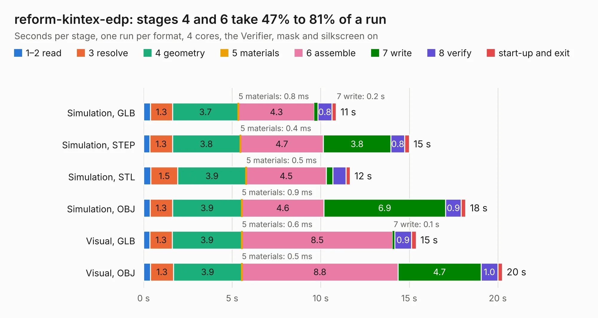

| Mode and format | 1–2 read | 3 resolve | 4 geometry | 5 materials | 6 assemble | 7 write | 8 verify | start-up and exit | Total |
|---|---:|---:|---:|---:|---:|---:|---:|---:|---:|
| Simulation, GLB | 0.4 | 1.3 | 3.7 | 0.8&nbsp;ms | 4.3 | 0.2 | 0.8 | 0.3 | 10.9 |
| Simulation, STEP | 0.4 | 1.3 | 3.8 | 0.4&nbsp;ms | 4.7 | 3.8 | 0.8 | 0.3 | 15.0 |
| Simulation, STL | 0.4 | 1.5 | 3.9 | 0.5&nbsp;ms | 4.5 | 0.4 | 0.7 | 0.2 | 11.7 |
| Simulation, OBJ | 0.4 | 1.3 | 3.9 | 0.9&nbsp;ms | 4.6 | 6.9 | 0.9 | 0.3 | 18.2 |
| Visual, GLB | 0.4 | 1.3 | 3.9 | 0.6&nbsp;ms | 8.5 | 0.1 | 0.9 | 0.3 | 15.4 |
| Visual, OBJ | 0.4 | 1.3 | 3.9 | 0.5&nbsp;ms | 8.8 | 4.7 | 1.0 | 0.3 | 20.3 |

<table align="center"><tr><td valign="top">

| Board | Repo: [kitspace-forks/reform-kintex-som](https://github.com/kitspace-forks/reform-kintex-som) Board: `reform-kintex-edp.kicad_pcb` |
|---|---|
| Folder | reform-kintex-edp-pcb |
| Complexity | 320&nbsp;/&nbsp;1000 (size&nbsp;245, features&nbsp;75) |
| KESE&nbsp;features | through vias, rounded, trapezoid or chamfered pads, filled zones, stack-up, dielectric εr and tanδ |
| Tested | 9th November 2026 |
| Copper&nbsp;layers | 4 |
| File&nbsp;format | KiCad 6 (20211014) |
| Parts,&nbsp;tracks,&nbsp;vias | 48, 715, 189 |
| Triangles,&nbsp;simulation | 1,185,508 in 100 parts |
| Verifier | PASS in all six runs |

</td><td valign="top">

<table>
<tr><th>File type</th><th>File size</th><th>Peak memory used</th></tr>
<tr><th colspan="3" align="left">Simulation</th></tr>
<tr><td>GLB</td><td align="right">39&nbsp;MB</td><td align="right">470&nbsp;MB</td></tr>
<tr><td>STEP</td><td align="right">159&nbsp;MB</td><td align="right">587&nbsp;MB</td></tr>
<tr><td>STL</td><td align="right">59&nbsp;MB</td><td align="right">493&nbsp;MB</td></tr>
<tr><td>OBJ</td><td align="right">119&nbsp;MB</td><td align="right">812&nbsp;MB</td></tr>
<tr><th colspan="3" align="left">Visual</th></tr>
<tr><td>GLB</td><td align="right">25&nbsp;MB</td><td align="right">674&nbsp;MB</td></tr>
<tr><td>OBJ</td><td align="right">77&nbsp;MB</td><td align="right">642&nbsp;MB</td></tr>
</table>

</td></tr></table>

## 23.14.2 reform-kintex

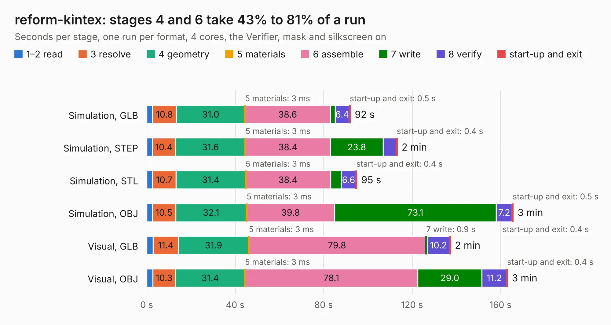

| Mode and format | 1–2 read | 3 resolve | 4 geometry | 5 materials | 6 assemble | 7 write | 8 verify | start-up and exit | Total |
|---|---:|---:|---:|---:|---:|---:|---:|---:|---:|
| Simulation, GLB | 2.7 | 10.8 | 31.0 | 3&nbsp;ms | 38.6 | 2.2 | 6.4 | 0.5 | 92.1 |
| Simulation, STEP | 2.6 | 10.4 | 31.6 | 3&nbsp;ms | 38.4 | 23.8 | 6.0 | 0.4 | 113.3 |
| Simulation, STL | 2.6 | 10.7 | 31.4 | 3&nbsp;ms | 38.4 | 4.9 | 6.6 | 0.4 | 95.0 |
| Simulation, OBJ | 2.6 | 10.5 | 32.1 | 3&nbsp;ms | 39.8 | 73.1 | 7.2 | 0.5 | 165.8 |
| Visual, GLB | 3.0 | 11.4 | 31.9 | 3&nbsp;ms | 79.8 | 0.9 | 10.2 | 0.4 | 137.4 |
| Visual, OBJ | 2.7 | 10.3 | 31.4 | 3&nbsp;ms | 78.1 | 29.0 | 11.2 | 0.4 | 163.2 |

<table align="center"><tr><td valign="top">

| Board | Repo: [kitspace-forks/reform-kintex-som](https://github.com/kitspace-forks/reform-kintex-som) Board: `reform-kintex.kicad_pcb` |
|---|---|
| Complexity | 407&nbsp;/&nbsp;1000 (size&nbsp;337, features&nbsp;70) |
| KESE&nbsp;features | through vias, rounded, trapezoid or chamfered pads, arc tracks, filled zones, curved board outline |
| Tested | 9th November 2026 |
| Copper&nbsp;layers | 8 |
| File&nbsp;format | KiCad 6 (20211014) |
| Parts,&nbsp;tracks,&nbsp;vias | 277, 14,859, 1,145 |
| Triangles,&nbsp;simulation | 10,654,866 in 669 parts |
| Verifier | PASS in all six runs |

</td><td valign="top">

<table>
<tr><th>File type</th><th>File size</th><th>Peak memory used</th></tr>
<tr><th colspan="3" align="left">Simulation</th></tr>
<tr><td>GLB</td><td align="right">361&nbsp;MB</td><td align="right">2.4&nbsp;GB</td></tr>
<tr><td>STEP</td><td align="right">1.3&nbsp;GB</td><td align="right">3.2&nbsp;GB</td></tr>
<tr><td>STL</td><td align="right">533&nbsp;MB</td><td align="right">2.3&nbsp;GB</td></tr>
<tr><td>OBJ</td><td align="right">1.1&nbsp;GB</td><td align="right">6.7&nbsp;GB</td></tr>
<tr><th colspan="3" align="left">Visual</th></tr>
<tr><td>GLB</td><td align="right">169&nbsp;MB</td><td align="right">2.9&nbsp;GB</td></tr>
<tr><td>OBJ</td><td align="right">563&nbsp;MB</td><td align="right">3.8&nbsp;GB</td></tr>
</table>

</td></tr></table>

## 23.14.3 meko

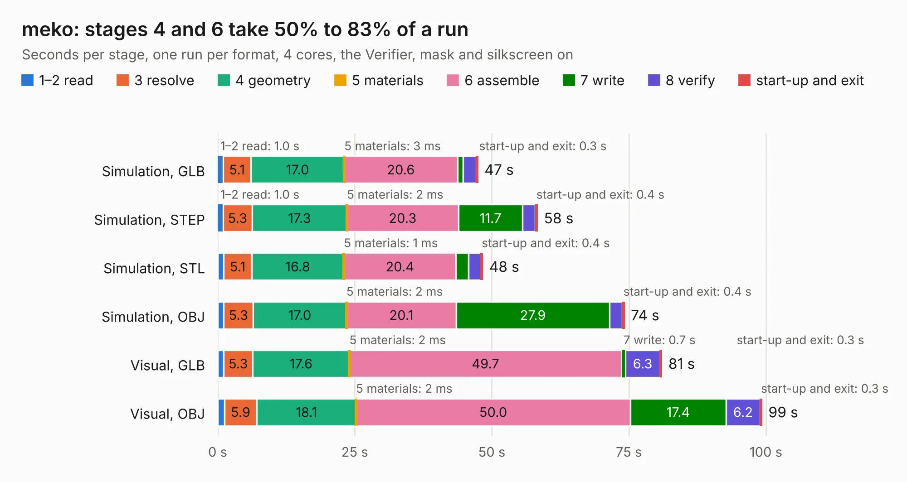

| Mode and format | 1–2 read | 3 resolve | 4 geometry | 5 materials | 6 assemble | 7 write | 8 verify | start-up and exit | Total |
|---|---:|---:|---:|---:|---:|---:|---:|---:|---:|
| Simulation, GLB | 1.0 | 5.1 | 17.0 | 3&nbsp;ms | 20.6 | 1.0 | 2.4 | 0.3 | 47.5 |
| Simulation, STEP | 1.0 | 5.3 | 17.3 | 2&nbsp;ms | 20.3 | 11.7 | 2.3 | 0.4 | 58.3 |
| Simulation, STL | 1.1 | 5.1 | 16.8 | 1&nbsp;ms | 20.4 | 2.3 | 2.2 | 0.4 | 48.3 |
| Simulation, OBJ | 1.1 | 5.3 | 17.0 | 2&nbsp;ms | 20.1 | 27.9 | 2.4 | 0.4 | 74.2 |
| Visual, GLB | 1.1 | 5.3 | 17.6 | 2&nbsp;ms | 49.7 | 0.7 | 6.3 | 0.3 | 81.0 |
| Visual, OBJ | 1.2 | 5.9 | 18.1 | 2&nbsp;ms | 50.0 | 17.4 | 6.2 | 0.3 | 99.3 |

<table align="center"><tr><td valign="top">

| Board | Repo: [koeglike/meko](https://github.com/koeglike/meko) Board: `meko.kicad_pcb` |
|---|---|
| Folder | hardware / pcb |
| Complexity | 479&nbsp;/&nbsp;1000 (size&nbsp;309, features&nbsp;170) |
| KESE&nbsp;features | through vias, slotted holes, custom pads, rounded, trapezoid or chamfered pads, arc tracks, filled zones, copper drawings, curved board outline, knockout text, TrueType text, stack-up, dielectric εr and tanδ, mask and silkscreen colours |
| Tested | 9th November 2026 |
| Copper&nbsp;layers | 6 |
| File&nbsp;format | KiCad 10 (20260206) |
| Parts,&nbsp;tracks,&nbsp;vias | 217, 4,129, 1,105 |
| Triangles,&nbsp;simulation | 5,914,532 in 361 parts |
| Verifier | PASS in all six runs |

</td><td valign="top">

<table>
<tr><th>File type</th><th>File size</th><th>Peak memory used</th></tr>
<tr><th colspan="3" align="left">Simulation</th></tr>
<tr><td>GLB</td><td align="right">194&nbsp;MB</td><td align="right">1.8&nbsp;GB</td></tr>
<tr><td>STEP</td><td align="right">736&nbsp;MB</td><td align="right">2.4&nbsp;GB</td></tr>
<tr><td>STL</td><td align="right">296&nbsp;MB</td><td align="right">1.9&nbsp;GB</td></tr>
<tr><td>OBJ</td><td align="right">623&nbsp;MB</td><td align="right">3.7&nbsp;GB</td></tr>
<tr><th colspan="3" align="left">Visual</th></tr>
<tr><td>GLB</td><td align="right">128&nbsp;MB</td><td align="right">2.2&nbsp;GB</td></tr>
<tr><td>OBJ</td><td align="right">418&nbsp;MB</td><td align="right">2.7&nbsp;GB</td></tr>
</table>

</td></tr></table>

## 23.14.4 touchpad

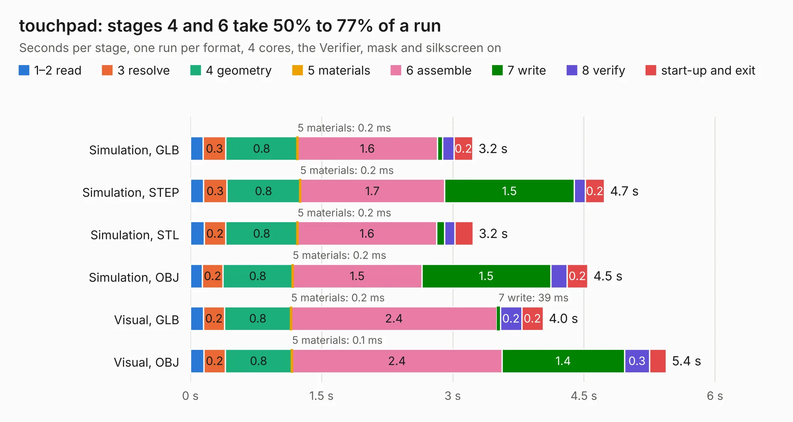

| Mode and format | 1–2 read | 3 resolve | 4 geometry | 5 materials | 6 assemble | 7 write | 8 verify | start-up and exit | Total |
|---|---:|---:|---:|---:|---:|---:|---:|---:|---:|
| Simulation, GLB | 0.1 | 0.3 | 0.8 | 0.2&nbsp;ms | 1.6 | 58&nbsp;ms | 0.1 | 0.2 | 3.2 |
| Simulation, STEP | 0.1 | 0.3 | 0.8 | 0.2&nbsp;ms | 1.7 | 1.5 | 0.1 | 0.2 | 4.7 |
| Simulation, STL | 0.2 | 0.2 | 0.8 | 0.2&nbsp;ms | 1.6 | 91&nbsp;ms | 0.1 | 0.2 | 3.2 |
| Simulation, OBJ | 0.1 | 0.2 | 0.8 | 0.2&nbsp;ms | 1.5 | 1.5 | 0.2 | 0.2 | 4.5 |
| Visual, GLB | 0.1 | 0.2 | 0.8 | 0.2&nbsp;ms | 2.4 | 39&nbsp;ms | 0.2 | 0.2 | 4.0 |
| Visual, OBJ | 0.2 | 0.2 | 0.8 | 0.1&nbsp;ms | 2.4 | 1.4 | 0.3 | 0.2 | 5.4 |

<table align="center"><tr><td valign="top">

| Board | Repo: [koeglike/meko](https://github.com/koeglike/meko) Board: `touchpad.kicad_pcb` |
|---|---|
| Folder | hardware / pcb_touchpad |
| Complexity | 232&nbsp;/&nbsp;1000 (size&nbsp;137, features&nbsp;95) |
| KESE&nbsp;features | through vias, rounded, trapezoid or chamfered pads, filled zones, knockout text, stack-up, dielectric εr and tanδ, mask and silkscreen colours |
| Tested | 9th November 2026 |
| Copper&nbsp;layers | 2 |
| File&nbsp;format | KiCad 10 (20260206) |
| Parts,&nbsp;tracks,&nbsp;vias | 5, 190, 90 |
| Triangles,&nbsp;simulation | 273,730 in 26 parts |
| Verifier | PASS in all six runs |

</td><td valign="top">

<table>
<tr><th>File type</th><th>File size</th><th>Peak memory used</th></tr>
<tr><th colspan="3" align="left">Simulation</th></tr>
<tr><td>GLB</td><td align="right">9.3&nbsp;MB</td><td align="right">252&nbsp;MB</td></tr>
<tr><td>STEP</td><td align="right">43&nbsp;MB</td><td align="right">276&nbsp;MB</td></tr>
<tr><td>STL</td><td align="right">14&nbsp;MB</td><td align="right">255&nbsp;MB</td></tr>
<tr><td>OBJ</td><td align="right">27&nbsp;MB</td><td align="right">253&nbsp;MB</td></tr>
<tr><th colspan="3" align="left">Visual</th></tr>
<tr><td>GLB</td><td align="right">7.7&nbsp;MB</td><td align="right">277&nbsp;MB</td></tr>
<tr><td>OBJ</td><td align="right">23&nbsp;MB</td><td align="right">276&nbsp;MB</td></tr>
</table>

</td></tr></table>

## 23.14.5 H616_devboard

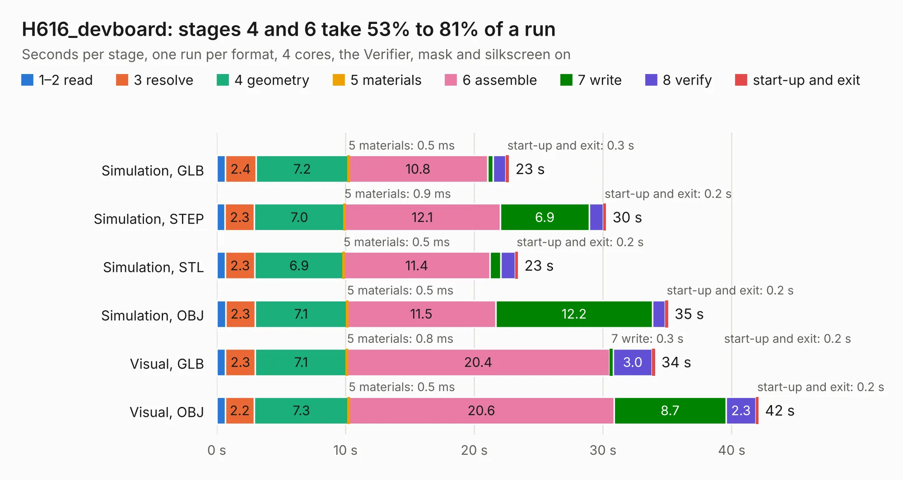

| Mode and format | 1–2 read | 3 resolve | 4 geometry | 5 materials | 6 assemble | 7 write | 8 verify | start-up and exit | Total |
|---|---:|---:|---:|---:|---:|---:|---:|---:|---:|
| Simulation, GLB | 0.7 | 2.4 | 7.2 | 0.5&nbsp;ms | 10.8 | 0.4 | 1.0 | 0.3 | 22.7 |
| Simulation, STEP | 0.6 | 2.3 | 7.0 | 0.9&nbsp;ms | 12.1 | 6.9 | 1.1 | 0.2 | 30.2 |
| Simulation, STL | 0.7 | 2.3 | 6.9 | 0.5&nbsp;ms | 11.4 | 0.8 | 1.1 | 0.2 | 23.4 |
| Simulation, OBJ | 0.7 | 2.3 | 7.1 | 0.5&nbsp;ms | 11.5 | 12.2 | 1.0 | 0.2 | 35.1 |
| Visual, GLB | 0.7 | 2.3 | 7.1 | 0.8&nbsp;ms | 20.4 | 0.3 | 3.0 | 0.2 | 34.0 |
| Visual, OBJ | 0.7 | 2.2 | 7.3 | 0.5&nbsp;ms | 20.6 | 8.7 | 2.3 | 0.2 | 42.1 |

<table align="center"><tr><td valign="top">

| Board | Repo: [kononenko-k/allwinner_h616_devboard](https://github.com/kononenko-k/allwinner_h616_devboard) Board: `H616_devboard.kicad_pcb` |
|---|---|
| Folder | Hardware / H616_DDR3 |
| Complexity | 411&nbsp;/&nbsp;1000 (size&nbsp;286, features&nbsp;125) |
| KESE&nbsp;features | through vias, slotted holes, rounded, trapezoid or chamfered pads, arc tracks, filled zones, curved board outline, stack-up, dielectric εr and tanδ, copper finish |
| Tested | 9th November 2026 |
| Copper&nbsp;layers | 4 |
| File&nbsp;format | KiCad 8 (20240108) |
| Parts,&nbsp;tracks,&nbsp;vias | 112, 4,034, 406 |
| Triangles,&nbsp;simulation | 2,861,090 in 279 parts |
| Verifier | PASS in all six runs |

</td><td valign="top">

<table>
<tr><th>File type</th><th>File size</th><th>Peak memory used</th></tr>
<tr><th colspan="3" align="left">Simulation</th></tr>
<tr><td>GLB</td><td align="right">97&nbsp;MB</td><td align="right">1.0&nbsp;GB</td></tr>
<tr><td>STEP</td><td align="right">451&nbsp;MB</td><td align="right">1.3&nbsp;GB</td></tr>
<tr><td>STL</td><td align="right">143&nbsp;MB</td><td align="right">1.0&nbsp;GB</td></tr>
<tr><td>OBJ</td><td align="right">300&nbsp;MB</td><td align="right">1.9&nbsp;GB</td></tr>
<tr><th colspan="3" align="left">Visual</th></tr>
<tr><td>GLB</td><td align="right">73&nbsp;MB</td><td align="right">1.4&nbsp;GB</td></tr>
<tr><td>OBJ</td><td align="right">229&nbsp;MB</td><td align="right">1.6&nbsp;GB</td></tr>
</table>

</td></tr></table>

## 23.14.6 ovio_core

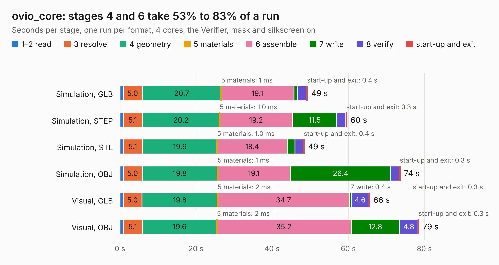

| Mode and format | 1–2 read | 3 resolve | 4 geometry | 5 materials | 6 assemble | 7 write | 8 verify | start-up and exit | Total |
|---|---:|---:|---:|---:|---:|---:|---:|---:|---:|
| Simulation, GLB | 0.9 | 5.0 | 20.7 | 1&nbsp;ms | 19.1 | 1.0 | 2.3 | 0.4 | 49.4 |
| Simulation, STEP | 0.8 | 5.1 | 20.2 | 1.0&nbsp;ms | 19.2 | 11.5 | 2.4 | 0.3 | 59.7 |
| Simulation, STL | 0.9 | 5.1 | 19.6 | 1.0&nbsp;ms | 18.4 | 2.0 | 2.1 | 0.4 | 48.5 |
| Simulation, OBJ | 0.9 | 5.0 | 19.8 | 1&nbsp;ms | 19.1 | 26.4 | 2.2 | 0.3 | 73.7 |
| Visual, GLB | 0.8 | 5.0 | 19.8 | 2&nbsp;ms | 34.7 | 0.4 | 4.6 | 0.3 | 65.7 |
| Visual, OBJ | 0.9 | 5.1 | 19.6 | 2&nbsp;ms | 35.2 | 12.8 | 4.8 | 0.3 | 78.6 |

<table align="center"><tr><td valign="top">

| Board | Repo: [korken89/ovio_core](https://github.com/korken89/ovio_core) Board: `ovio_core.kicad_pcb` |
|---|---|
| Complexity | 371&nbsp;/&nbsp;1000 (size&nbsp;306, features&nbsp;65) |
| KESE&nbsp;features | through vias, slotted holes, rounded, trapezoid or chamfered pads, filled zones, curved board outline |
| Tested | 9th November 2026 |
| Copper&nbsp;layers | 6 |
| File&nbsp;format | KiCad 5 (20171130) |
| Parts,&nbsp;tracks,&nbsp;vias | 194, 5,830, 552 |
| Triangles,&nbsp;simulation | 5,013,746 in 342 parts |
| Verifier | PASS in all six runs |

</td><td valign="top">

<table>
<tr><th>File type</th><th>File size</th><th>Peak memory used</th></tr>
<tr><th colspan="3" align="left">Simulation</th></tr>
<tr><td>GLB</td><td align="right">173&nbsp;MB</td><td align="right">1.4&nbsp;GB</td></tr>
<tr><td>STEP</td><td align="right">687&nbsp;MB</td><td align="right">1.8&nbsp;GB</td></tr>
<tr><td>STL</td><td align="right">251&nbsp;MB</td><td align="right">1.4&nbsp;GB</td></tr>
<tr><td>OBJ</td><td align="right">535&nbsp;MB</td><td align="right">3.2&nbsp;GB</td></tr>
<tr><th colspan="3" align="left">Visual</th></tr>
<tr><td>GLB</td><td align="right">89&nbsp;MB</td><td align="right">1.6&nbsp;GB</td></tr>
<tr><td>OBJ</td><td align="right">287&nbsp;MB</td><td align="right">2.0&nbsp;GB</td></tr>
</table>

</td></tr></table>

## 23.14.7 keyb2

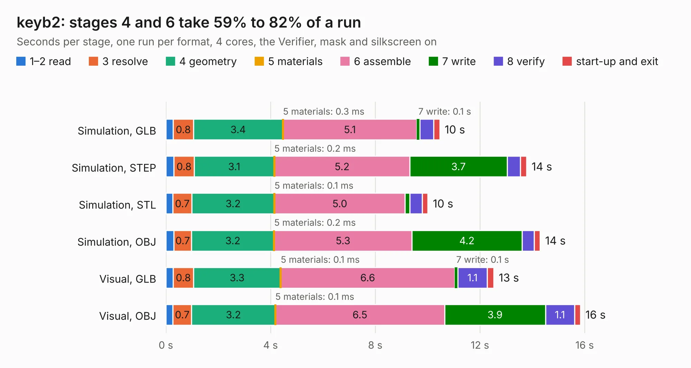

| Mode and format | 1–2 read | 3 resolve | 4 geometry | 5 materials | 6 assemble | 7 write | 8 verify | start-up and exit | Total |
|---|---:|---:|---:|---:|---:|---:|---:|---:|---:|
| Simulation, GLB | 0.3 | 0.8 | 3.4 | 0.3&nbsp;ms | 5.1 | 0.1 | 0.5 | 0.2 | 10.5 |
| Simulation, STEP | 0.3 | 0.8 | 3.1 | 0.2&nbsp;ms | 5.2 | 3.7 | 0.5 | 0.2 | 13.8 |
| Simulation, STL | 0.3 | 0.7 | 3.2 | 0.1&nbsp;ms | 5.0 | 0.2 | 0.5 | 0.2 | 10.0 |
| Simulation, OBJ | 0.3 | 0.7 | 3.2 | 0.2&nbsp;ms | 5.3 | 4.2 | 0.5 | 0.2 | 14.3 |
| Visual, GLB | 0.3 | 0.8 | 3.3 | 0.1&nbsp;ms | 6.6 | 0.1 | 1.1 | 0.3 | 12.5 |
| Visual, OBJ | 0.3 | 0.7 | 3.2 | 0.1&nbsp;ms | 6.5 | 3.9 | 1.1 | 0.2 | 15.8 |

<table align="center"><tr><td valign="top">

| Board | Repo: [krzys9876/ZX_Spectrum_diy](https://github.com/krzys9876/ZX_Spectrum_diy) Board: `keyb2.kicad_pcb` |
|---|---|
| Folder | Kicad4 / keyb2 |
| Complexity | 218&nbsp;/&nbsp;1000 (size&nbsp;173, features&nbsp;45) |
| KESE&nbsp;features | through vias, filled zones, copper text |
| Tested | 9th November 2026 |
| Copper&nbsp;layers | 2 |
| File&nbsp;format | KiCad 4 (4) |
| Parts,&nbsp;tracks,&nbsp;vias | 59, 667, 94 |
| Triangles,&nbsp;simulation | 676,712 in 30 parts |
| Verifier | PASS in all six runs |

</td><td valign="top">

<table>
<tr><th>File type</th><th>File size</th><th>Peak memory used</th></tr>
<tr><th colspan="3" align="left">Simulation</th></tr>
<tr><td>GLB</td><td align="right">24&nbsp;MB</td><td align="right">420&nbsp;MB</td></tr>
<tr><td>STEP</td><td align="right">135&nbsp;MB</td><td align="right">476&nbsp;MB</td></tr>
<tr><td>STL</td><td align="right">34&nbsp;MB</td><td align="right">430&nbsp;MB</td></tr>
<tr><td>OBJ</td><td align="right">70&nbsp;MB</td><td align="right">466&nbsp;MB</td></tr>
<tr><th colspan="3" align="left">Visual</th></tr>
<tr><td>GLB</td><td align="right">21&nbsp;MB</td><td align="right">519&nbsp;MB</td></tr>
<tr><td>OBJ</td><td align="right">64&nbsp;MB</td><td align="right">555&nbsp;MB</td></tr>
</table>

</td></tr></table>

## 23.14.8 keyb2_nofill

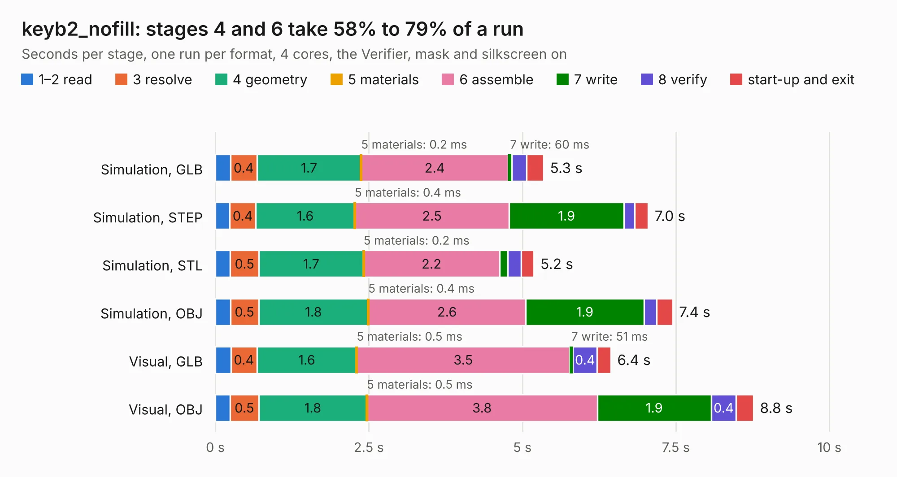

| Mode and format | 1–2 read | 3 resolve | 4 geometry | 5 materials | 6 assemble | 7 write | 8 verify | start-up and exit | Total |
|---|---:|---:|---:|---:|---:|---:|---:|---:|---:|
| Simulation, GLB | 0.2 | 0.4 | 1.7 | 0.2&nbsp;ms | 2.4 | 60&nbsp;ms | 0.2 | 0.3 | 5.3 |
| Simulation, STEP | 0.2 | 0.4 | 1.6 | 0.4&nbsp;ms | 2.5 | 1.9 | 0.2 | 0.2 | 7.0 |
| Simulation, STL | 0.2 | 0.5 | 1.7 | 0.2&nbsp;ms | 2.2 | 0.1 | 0.2 | 0.2 | 5.2 |
| Simulation, OBJ | 0.2 | 0.5 | 1.8 | 0.4&nbsp;ms | 2.6 | 1.9 | 0.2 | 0.3 | 7.4 |
| Visual, GLB | 0.3 | 0.4 | 1.6 | 0.5&nbsp;ms | 3.5 | 51&nbsp;ms | 0.4 | 0.2 | 6.4 |
| Visual, OBJ | 0.2 | 0.5 | 1.8 | 0.5&nbsp;ms | 3.8 | 1.9 | 0.4 | 0.3 | 8.8 |

<table align="center"><tr><td valign="top">

| Board | Repo: [krzys9876/ZX_Spectrum_diy](https://github.com/krzys9876/ZX_Spectrum_diy) Board: `keyb2_nofill.kicad_pcb` |
|---|---|
| Folder | Kicad4 / keyb2 |
| Complexity | 172&nbsp;/&nbsp;1000 (size&nbsp;162, features&nbsp;10) |
| KESE&nbsp;features | copper text |
| Tested | 9th November 2026 |
| Copper&nbsp;layers | 2 |
| File&nbsp;format | KiCad 4 (4) |
| Parts,&nbsp;tracks,&nbsp;vias | 59, 480, 0 |
| Triangles,&nbsp;simulation | 303,980 in 30 parts |
| Verifier | PASS in all six runs |

</td><td valign="top">

<table>
<tr><th>File type</th><th>File size</th><th>Peak memory used</th></tr>
<tr><th colspan="3" align="left">Simulation</th></tr>
<tr><td>GLB</td><td align="right">11&nbsp;MB</td><td align="right">296&nbsp;MB</td></tr>
<tr><td>STEP</td><td align="right">62&nbsp;MB</td><td align="right">319&nbsp;MB</td></tr>
<tr><td>STL</td><td align="right">15&nbsp;MB</td><td align="right">293&nbsp;MB</td></tr>
<tr><td>OBJ</td><td align="right">33&nbsp;MB</td><td align="right">294&nbsp;MB</td></tr>
<tr><th colspan="3" align="left">Visual</th></tr>
<tr><td>GLB</td><td align="right">10&nbsp;MB</td><td align="right">312&nbsp;MB</td></tr>
<tr><td>OBJ</td><td align="right">30&nbsp;MB</td><td align="right">349&nbsp;MB</td></tr>
</table>

</td></tr></table>

## 23.14.9 z2_io

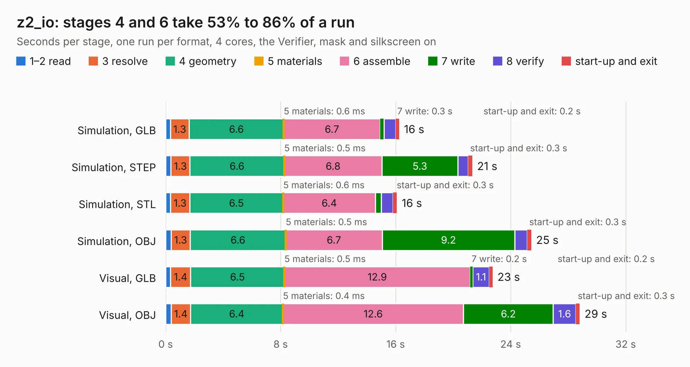

| Mode and format | 1–2 read | 3 resolve | 4 geometry | 5 materials | 6 assemble | 7 write | 8 verify | start-up and exit | Total |
|---|---:|---:|---:|---:|---:|---:|---:|---:|---:|
| Simulation, GLB | 0.3 | 1.3 | 6.6 | 0.6&nbsp;ms | 6.7 | 0.3 | 0.8 | 0.2 | 16.2 |
| Simulation, STEP | 0.4 | 1.3 | 6.6 | 0.5&nbsp;ms | 6.8 | 5.3 | 0.7 | 0.3 | 21.3 |
| Simulation, STL | 0.3 | 1.3 | 6.5 | 0.6&nbsp;ms | 6.4 | 0.4 | 0.8 | 0.3 | 16.1 |
| Simulation, OBJ | 0.4 | 1.3 | 6.6 | 0.5&nbsp;ms | 6.7 | 9.2 | 0.9 | 0.3 | 25.4 |
| Visual, GLB | 0.3 | 1.4 | 6.5 | 0.5&nbsp;ms | 12.9 | 0.2 | 1.1 | 0.2 | 22.7 |
| Visual, OBJ | 0.4 | 1.4 | 6.4 | 0.4&nbsp;ms | 12.6 | 6.2 | 1.6 | 0.3 | 28.8 |

<table align="center"><tr><td valign="top">

| Board | Repo: [krzys9876/ZX_Spectrum_diy](https://github.com/krzys9876/ZX_Spectrum_diy) Board: `z2_io.kicad_pcb` |
|---|---|
| Folder | Kicad5 / z2_io |
| Complexity | 221&nbsp;/&nbsp;1000 (size&nbsp;186, features&nbsp;35) |
| KESE&nbsp;features | through vias, rounded, trapezoid or chamfered pads, copper text |
| Tested | 9th November 2026 |
| Copper&nbsp;layers | 2 |
| File&nbsp;format | KiCad 5 (20171130) |
| Parts,&nbsp;tracks,&nbsp;vias | 65, 1,620, 97 |
| Triangles,&nbsp;simulation | 1,643,896 in 104 parts |
| Verifier | PASS in all six runs |

</td><td valign="top">

<table>
<tr><th>File type</th><th>File size</th><th>Peak memory used</th></tr>
<tr><th colspan="3" align="left">Simulation</th></tr>
<tr><td>GLB</td><td align="right">54&nbsp;MB</td><td align="right">582&nbsp;MB</td></tr>
<tr><td>STEP</td><td align="right">240&nbsp;MB</td><td align="right">732&nbsp;MB</td></tr>
<tr><td>STL</td><td align="right">82&nbsp;MB</td><td align="right">579&nbsp;MB</td></tr>
<tr><td>OBJ</td><td align="right">168&nbsp;MB</td><td align="right">1.1&nbsp;GB</td></tr>
<tr><th colspan="3" align="left">Visual</th></tr>
<tr><td>GLB</td><td align="right">38&nbsp;MB</td><td align="right">1.0&nbsp;GB</td></tr>
<tr><td>OBJ</td><td align="right">114&nbsp;MB</td><td align="right">828&nbsp;MB</td></tr>
</table>

</td></tr></table>

## 23.14.10 z2_io_test01

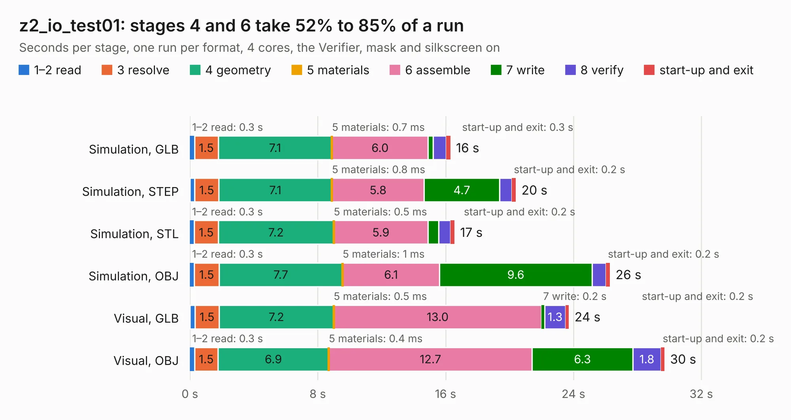

| Mode and format | 1–2 read | 3 resolve | 4 geometry | 5 materials | 6 assemble | 7 write | 8 verify | start-up and exit | Total |
|---|---:|---:|---:|---:|---:|---:|---:|---:|---:|
| Simulation, GLB | 0.3 | 1.5 | 7.1 | 0.7&nbsp;ms | 6.0 | 0.3 | 0.8 | 0.3 | 16.3 |
| Simulation, STEP | 0.3 | 1.5 | 7.1 | 0.8&nbsp;ms | 5.8 | 4.7 | 0.8 | 0.2 | 20.4 |
| Simulation, STL | 0.3 | 1.5 | 7.2 | 0.5&nbsp;ms | 5.9 | 0.7 | 0.8 | 0.2 | 16.6 |
| Simulation, OBJ | 0.3 | 1.5 | 7.7 | 1&nbsp;ms | 6.1 | 9.6 | 0.9 | 0.2 | 26.3 |
| Visual, GLB | 0.3 | 1.5 | 7.2 | 0.5&nbsp;ms | 13.0 | 0.2 | 1.3 | 0.2 | 23.7 |
| Visual, OBJ | 0.3 | 1.5 | 6.9 | 0.4&nbsp;ms | 12.7 | 6.3 | 1.8 | 0.2 | 29.7 |

<table align="center"><tr><td valign="top">

| Board | Repo: [krzys9876/ZX_Spectrum_diy](https://github.com/krzys9876/ZX_Spectrum_diy) Board: `z2_io_test01.kicad_pcb` |
|---|---|
| Folder | Kicad5 / z2_io |
| Complexity | 209&nbsp;/&nbsp;1000 (size&nbsp;184, features&nbsp;25) |
| KESE&nbsp;features | through vias, rounded, trapezoid or chamfered pads |
| Tested | 9th November 2026 |
| Copper&nbsp;layers | 2 |
| File&nbsp;format | KiCad 5 (20171130) |
| Parts,&nbsp;tracks,&nbsp;vias | 67, 1,203, 138 |
| Triangles,&nbsp;simulation | 1,836,454 in 107 parts |
| Verifier | PASS in all six runs |

</td><td valign="top">

<table>
<tr><th>File type</th><th>File size</th><th>Peak memory used</th></tr>
<tr><th colspan="3" align="left">Simulation</th></tr>
<tr><td>GLB</td><td align="right">63&nbsp;MB</td><td align="right">742&nbsp;MB</td></tr>
<tr><td>STEP</td><td align="right">302&nbsp;MB</td><td align="right">823&nbsp;MB</td></tr>
<tr><td>STL</td><td align="right">92&nbsp;MB</td><td align="right">812&nbsp;MB</td></tr>
<tr><td>OBJ</td><td align="right">192&nbsp;MB</td><td align="right">1.2&nbsp;GB</td></tr>
<tr><th colspan="3" align="left">Visual</th></tr>
<tr><td>GLB</td><td align="right">39&nbsp;MB</td><td align="right">921&nbsp;MB</td></tr>
<tr><td>OBJ</td><td align="right">120&nbsp;MB</td><td align="right">1.0&nbsp;GB</td></tr>
</table>

</td></tr></table>

## 23.14.11 z2_io_test02

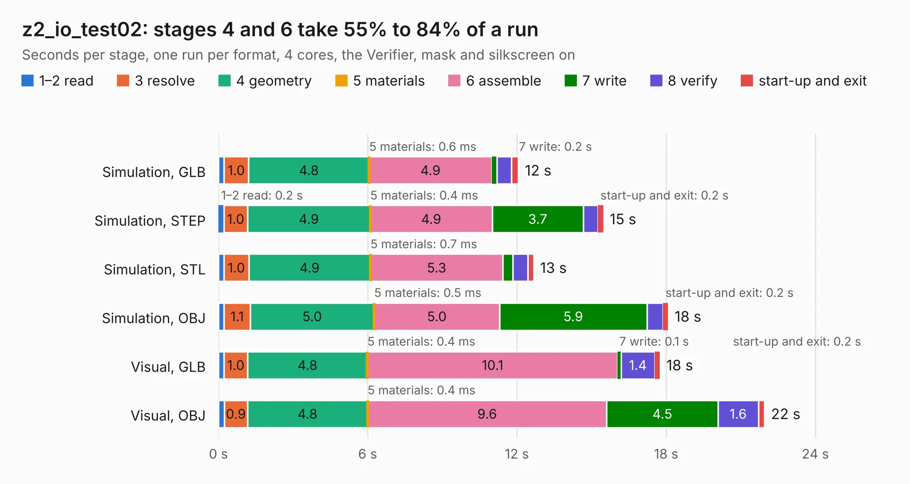

| Mode and format | 1–2 read | 3 resolve | 4 geometry | 5 materials | 6 assemble | 7 write | 8 verify | start-up and exit | Total |
|---|---:|---:|---:|---:|---:|---:|---:|---:|---:|
| Simulation, GLB | 0.2 | 1.0 | 4.8 | 0.6&nbsp;ms | 4.9 | 0.2 | 0.6 | 0.3 | 12.1 |
| Simulation, STEP | 0.2 | 1.0 | 4.9 | 0.4&nbsp;ms | 4.9 | 3.7 | 0.6 | 0.2 | 15.5 |
| Simulation, STL | 0.2 | 1.0 | 4.9 | 0.7&nbsp;ms | 5.3 | 0.4 | 0.6 | 0.2 | 12.7 |
| Simulation, OBJ | 0.2 | 1.1 | 5.0 | 0.5&nbsp;ms | 5.0 | 5.9 | 0.6 | 0.2 | 18.1 |
| Visual, GLB | 0.2 | 1.0 | 4.8 | 0.4&nbsp;ms | 10.1 | 0.1 | 1.4 | 0.2 | 17.7 |
| Visual, OBJ | 0.2 | 0.9 | 4.8 | 0.4&nbsp;ms | 9.6 | 4.5 | 1.6 | 0.2 | 22.0 |

<table align="center"><tr><td valign="top">

| Board | Repo: [krzys9876/ZX_Spectrum_diy](https://github.com/krzys9876/ZX_Spectrum_diy) Board: `z2_io_test02.kicad_pcb` |
|---|---|
| Folder | Kicad5 / z2_io |
| Complexity | 214&nbsp;/&nbsp;1000 (size&nbsp;179, features&nbsp;35) |
| KESE&nbsp;features | through vias, rounded, trapezoid or chamfered pads, copper text |
| Tested | 9th November 2026 |
| Copper&nbsp;layers | 2 |
| File&nbsp;format | KiCad 5 (20171130) |
| Parts,&nbsp;tracks,&nbsp;vias | 65, 1,038, 82 |
| Triangles,&nbsp;simulation | 1,564,634 in 104 parts |
| Verifier | PASS in all six runs |

</td><td valign="top">

<table>
<tr><th>File type</th><th>File size</th><th>Peak memory used</th></tr>
<tr><th colspan="3" align="left">Simulation</th></tr>
<tr><td>GLB</td><td align="right">52&nbsp;MB</td><td align="right">602&nbsp;MB</td></tr>
<tr><td>STEP</td><td align="right">223&nbsp;MB</td><td align="right">728&nbsp;MB</td></tr>
<tr><td>STL</td><td align="right">78&nbsp;MB</td><td align="right">585&nbsp;MB</td></tr>
<tr><td>OBJ</td><td align="right">159&nbsp;MB</td><td align="right">1.1&nbsp;GB</td></tr>
<tr><th colspan="3" align="left">Visual</th></tr>
<tr><td>GLB</td><td align="right">35&nbsp;MB</td><td align="right">722&nbsp;MB</td></tr>
<tr><td>OBJ</td><td align="right">106&nbsp;MB</td><td align="right">768&nbsp;MB</td></tr>
</table>

</td></tr></table>

## 23.14.12 zx2_backplane

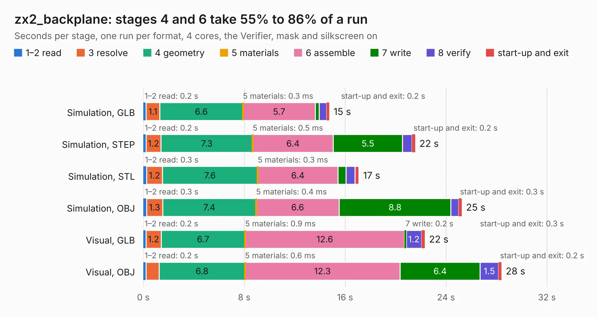

| Mode and format | 1–2 read | 3 resolve | 4 geometry | 5 materials | 6 assemble | 7 write | 8 verify | start-up and exit | Total |
|---|---:|---:|---:|---:|---:|---:|---:|---:|---:|
| Simulation, GLB | 0.2 | 1.1 | 6.6 | 0.3&nbsp;ms | 5.7 | 0.3 | 0.6 | 0.2 | 14.7 |
| Simulation, STEP | 0.2 | 1.2 | 7.3 | 0.5&nbsp;ms | 6.4 | 5.5 | 0.8 | 0.2 | 21.5 |
| Simulation, STL | 0.3 | 1.2 | 7.6 | 0.3&nbsp;ms | 6.4 | 0.6 | 0.7 | 0.3 | 17.1 |
| Simulation, OBJ | 0.3 | 1.3 | 7.4 | 0.4&nbsp;ms | 6.6 | 8.8 | 0.6 | 0.3 | 25.2 |
| Visual, GLB | 0.2 | 1.2 | 6.7 | 0.9&nbsp;ms | 12.6 | 0.2 | 1.2 | 0.3 | 22.3 |
| Visual, OBJ | 0.2 | 1.0 | 6.8 | 0.6&nbsp;ms | 12.3 | 6.4 | 1.5 | 0.2 | 28.4 |

<table align="center"><tr><td valign="top">

| Board | Repo: [krzys9876/ZX_Spectrum_diy](https://github.com/krzys9876/ZX_Spectrum_diy) Board: `zx2_backplane.kicad_pcb` |
|---|---|
| Folder | Kicad5 / zx2_backplane |
| Complexity | 187&nbsp;/&nbsp;1000 (size&nbsp;147, features&nbsp;40) |
| KESE&nbsp;features | rounded, trapezoid or chamfered pads, filled zones, copper text |
| Tested | 9th November 2026 |
| Copper&nbsp;layers | 2 |
| File&nbsp;format | KiCad 5 (20171130) |
| Parts,&nbsp;tracks,&nbsp;vias | 12, 532, 0 |
| Triangles,&nbsp;simulation | 1,561,198 in 55 parts |
| Verifier | PASS in all six runs |

</td><td valign="top">

<table>
<tr><th>File type</th><th>File size</th><th>Peak memory used</th></tr>
<tr><th colspan="3" align="left">Simulation</th></tr>
<tr><td>GLB</td><td align="right">51&nbsp;MB</td><td align="right">571&nbsp;MB</td></tr>
<tr><td>STEP</td><td align="right">226&nbsp;MB</td><td align="right">727&nbsp;MB</td></tr>
<tr><td>STL</td><td align="right">78&nbsp;MB</td><td align="right">593&nbsp;MB</td></tr>
<tr><td>OBJ</td><td align="right">161&nbsp;MB</td><td align="right">1.0&nbsp;GB</td></tr>
<tr><th colspan="3" align="left">Visual</th></tr>
<tr><td>GLB</td><td align="right">32&nbsp;MB</td><td align="right">955&nbsp;MB</td></tr>
<tr><td>OBJ</td><td align="right">98&nbsp;MB</td><td align="right">787&nbsp;MB</td></tr>
</table>

</td></tr></table>

## 23.14.13 zx2_clock

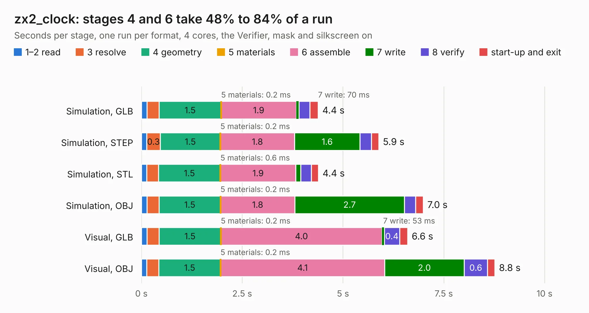

| Mode and format | 1–2 read | 3 resolve | 4 geometry | 5 materials | 6 assemble | 7 write | 8 verify | start-up and exit | Total |
|---|---:|---:|---:|---:|---:|---:|---:|---:|---:|
| Simulation, GLB | 0.1 | 0.3 | 1.5 | 0.2&nbsp;ms | 1.9 | 70&nbsp;ms | 0.3 | 0.2 | 4.4 |
| Simulation, STEP | 0.1 | 0.3 | 1.5 | 0.2&nbsp;ms | 1.8 | 1.6 | 0.3 | 0.2 | 5.9 |
| Simulation, STL | 0.1 | 0.3 | 1.5 | 0.6&nbsp;ms | 1.9 | 0.1 | 0.3 | 0.2 | 4.4 |
| Simulation, OBJ | 0.1 | 0.3 | 1.5 | 0.2&nbsp;ms | 1.8 | 2.7 | 0.3 | 0.2 | 7.0 |
| Visual, GLB | 0.1 | 0.3 | 1.5 | 0.2&nbsp;ms | 4.0 | 53&nbsp;ms | 0.4 | 0.2 | 6.6 |
| Visual, OBJ | 0.1 | 0.3 | 1.5 | 0.2&nbsp;ms | 4.1 | 2.0 | 0.6 | 0.2 | 8.8 |

<table align="center"><tr><td valign="top">

| Board | Repo: [krzys9876/ZX_Spectrum_diy](https://github.com/krzys9876/ZX_Spectrum_diy) Board: `zx2_clock.kicad_pcb` |
|---|---|
| Folder | Kicad5 / zx2_clock |
| Complexity | 198&nbsp;/&nbsp;1000 (size&nbsp;143, features&nbsp;55) |
| KESE&nbsp;features | through vias, rounded, trapezoid or chamfered pads, filled zones, copper text |
| Tested | 9th November 2026 |
| Copper&nbsp;layers | 2 |
| File&nbsp;format | KiCad 5 (20171130) |
| Parts,&nbsp;tracks,&nbsp;vias | 24, 221, 12 |
| Triangles,&nbsp;simulation | 552,368 in 32 parts |
| Verifier | PASS in all six runs |

</td><td valign="top">

<table>
<tr><th>File type</th><th>File size</th><th>Peak memory used</th></tr>
<tr><th colspan="3" align="left">Simulation</th></tr>
<tr><td>GLB</td><td align="right">18&nbsp;MB</td><td align="right">317&nbsp;MB</td></tr>
<tr><td>STEP</td><td align="right">84&nbsp;MB</td><td align="right">371&nbsp;MB</td></tr>
<tr><td>STL</td><td align="right">28&nbsp;MB</td><td align="right">313&nbsp;MB</td></tr>
<tr><td>OBJ</td><td align="right">55&nbsp;MB</td><td align="right">411&nbsp;MB</td></tr>
<tr><th colspan="3" align="left">Visual</th></tr>
<tr><td>GLB</td><td align="right">13&nbsp;MB</td><td align="right">399&nbsp;MB</td></tr>
<tr><td>OBJ</td><td align="right">40&nbsp;MB</td><td align="right">390&nbsp;MB</td></tr>
</table>

</td></tr></table>

## 23.14.14 zx2_clock_test01

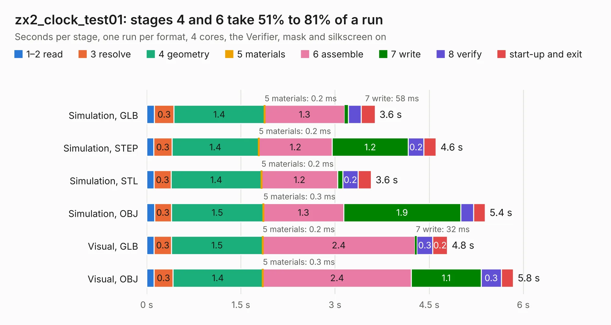

| Mode and format | 1–2 read | 3 resolve | 4 geometry | 5 materials | 6 assemble | 7 write | 8 verify | start-up and exit | Total |
|---|---:|---:|---:|---:|---:|---:|---:|---:|---:|
| Simulation, GLB | 0.1 | 0.3 | 1.4 | 0.2&nbsp;ms | 1.3 | 58&nbsp;ms | 0.2 | 0.2 | 3.6 |
| Simulation, STEP | 0.1 | 0.3 | 1.4 | 0.2&nbsp;ms | 1.2 | 1.2 | 0.2 | 0.2 | 4.6 |
| Simulation, STL | 0.1 | 0.3 | 1.4 | 0.2&nbsp;ms | 1.2 | 84&nbsp;ms | 0.2 | 0.2 | 3.6 |
| Simulation, OBJ | 0.1 | 0.3 | 1.5 | 0.3&nbsp;ms | 1.3 | 1.9 | 0.2 | 0.2 | 5.4 |
| Visual, GLB | 0.1 | 0.3 | 1.5 | 0.2&nbsp;ms | 2.4 | 32&nbsp;ms | 0.3 | 0.2 | 4.8 |
| Visual, OBJ | 0.1 | 0.3 | 1.4 | 0.3&nbsp;ms | 2.4 | 1.1 | 0.3 | 0.2 | 5.8 |

<table align="center"><tr><td valign="top">

| Board | Repo: [krzys9876/ZX_Spectrum_diy](https://github.com/krzys9876/ZX_Spectrum_diy) Board: `zx2_clock_test01.kicad_pcb` |
|---|---|
| Folder | Kicad5 / zx2_clock |
| Complexity | 163&nbsp;/&nbsp;1000 (size&nbsp;138, features&nbsp;25) |
| KESE&nbsp;features | through vias, rounded, trapezoid or chamfered pads |
| Tested | 9th November 2026 |
| Copper&nbsp;layers | 2 |
| File&nbsp;format | KiCad 5 (20171130) |
| Parts,&nbsp;tracks,&nbsp;vias | 21, 191, 5 |
| Triangles,&nbsp;simulation | 380,468 in 31 parts |
| Verifier | PASS in all six runs |

</td><td valign="top">

<table>
<tr><th>File type</th><th>File size</th><th>Peak memory used</th></tr>
<tr><th colspan="3" align="left">Simulation</th></tr>
<tr><td>GLB</td><td align="right">13&nbsp;MB</td><td align="right">248&nbsp;MB</td></tr>
<tr><td>STEP</td><td align="right">49&nbsp;MB</td><td align="right">288&nbsp;MB</td></tr>
<tr><td>STL</td><td align="right">19&nbsp;MB</td><td align="right">243&nbsp;MB</td></tr>
<tr><td>OBJ</td><td align="right">37&nbsp;MB</td><td align="right">279&nbsp;MB</td></tr>
<tr><th colspan="3" align="left">Visual</th></tr>
<tr><td>GLB</td><td align="right">7.6&nbsp;MB</td><td align="right">276&nbsp;MB</td></tr>
<tr><td>OBJ</td><td align="right">22&nbsp;MB</td><td align="right">278&nbsp;MB</td></tr>
</table>

</td></tr></table>

## 23.14.15 zx2_cpu

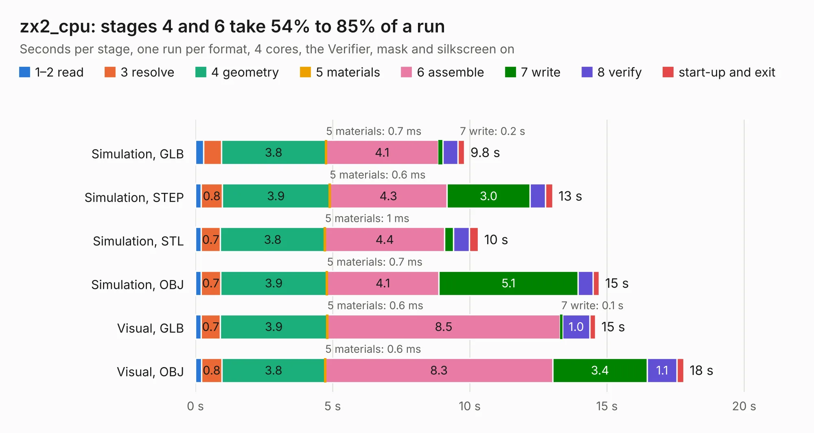

| Mode and format | 1–2 read | 3 resolve | 4 geometry | 5 materials | 6 assemble | 7 write | 8 verify | start-up and exit | Total |
|---|---:|---:|---:|---:|---:|---:|---:|---:|---:|
| Simulation, GLB | 0.3 | 0.7 | 3.8 | 0.7&nbsp;ms | 4.1 | 0.2 | 0.5 | 0.2 | 9.8 |
| Simulation, STEP | 0.2 | 0.8 | 3.9 | 0.6&nbsp;ms | 4.3 | 3.0 | 0.6 | 0.3 | 13.0 |
| Simulation, STL | 0.2 | 0.7 | 3.8 | 1&nbsp;ms | 4.4 | 0.3 | 0.6 | 0.3 | 10.3 |
| Simulation, OBJ | 0.2 | 0.7 | 3.9 | 0.7&nbsp;ms | 4.1 | 5.1 | 0.5 | 0.2 | 14.7 |
| Visual, GLB | 0.2 | 0.7 | 3.9 | 0.6&nbsp;ms | 8.5 | 0.1 | 1.0 | 0.2 | 14.6 |
| Visual, OBJ | 0.2 | 0.8 | 3.8 | 0.6&nbsp;ms | 8.3 | 3.4 | 1.1 | 0.2 | 17.8 |

<table align="center"><tr><td valign="top">

| Board | Repo: [krzys9876/ZX_Spectrum_diy](https://github.com/krzys9876/ZX_Spectrum_diy) Board: `zx2_cpu.kicad_pcb` |
|---|---|
| Folder | Kicad5 / zx2_cpu |
| Complexity | 213&nbsp;/&nbsp;1000 (size&nbsp;158, features&nbsp;55) |
| KESE&nbsp;features | through vias, rounded, trapezoid or chamfered pads, filled zones, copper text |
| Tested | 9th November 2026 |
| Copper&nbsp;layers | 2 |
| File&nbsp;format | KiCad 5 (20171130) |
| Parts,&nbsp;tracks,&nbsp;vias | 18, 716, 32 |
| Triangles,&nbsp;simulation | 1,132,234 in 83 parts |
| Verifier | PASS in all six runs |

</td><td valign="top">

<table>
<tr><th>File type</th><th>File size</th><th>Peak memory used</th></tr>
<tr><th colspan="3" align="left">Simulation</th></tr>
<tr><td>GLB</td><td align="right">37&nbsp;MB</td><td align="right">481&nbsp;MB</td></tr>
<tr><td>STEP</td><td align="right">164&nbsp;MB</td><td align="right">580&nbsp;MB</td></tr>
<tr><td>STL</td><td align="right">57&nbsp;MB</td><td align="right">470&nbsp;MB</td></tr>
<tr><td>OBJ</td><td align="right">113&nbsp;MB</td><td align="right">762&nbsp;MB</td></tr>
<tr><th colspan="3" align="left">Visual</th></tr>
<tr><td>GLB</td><td align="right">26&nbsp;MB</td><td align="right">684&nbsp;MB</td></tr>
<tr><td>OBJ</td><td align="right">80&nbsp;MB</td><td align="right">657&nbsp;MB</td></tr>
</table>

</td></tr></table>

## 23.14.16 zx2_cpu_test01

| Mode and format | 1–2 read | 3 resolve | 4 geometry | 5 materials | 6 assemble | 7 write | 8 verify | start-up and exit | Total |
|---|---:|---:|---:|---:|---:|---:|---:|---:|---:|
| Simulation, GLB | 0.2 | 0.8 | 4.0 | 0.6&nbsp;ms | 3.3 | 0.2 | 0.5 | 0.2 | 9.1 |
| Simulation, STEP | 0.2 | 0.8 | 3.8 | 0.6&nbsp;ms | 3.2 | 2.7 | 0.5 | 0.2 | 11.4 |
| Simulation, STL | 0.2 | 0.8 | 4.2 | 0.6&nbsp;ms | 3.3 | 0.2 | 0.5 | 0.2 | 9.5 |
| Simulation, OBJ | 0.2 | 0.8 | 4.0 | 0.5&nbsp;ms | 3.3 | 5.1 | 0.5 | 0.2 | 14.0 |
| Visual, GLB | 0.2 | 0.8 | 4.2 | 0.9&nbsp;ms | 6.9 | 81&nbsp;ms | 0.7 | 0.3 | 13.1 |
| Visual, OBJ | 0.2 | 0.8 | 4.0 | 0.5&nbsp;ms | 7.0 | 3.0 | 0.8 | 0.3 | 16.1 |

<table align="center"><tr><td valign="top">

| Board | Repo: [krzys9876/ZX_Spectrum_diy](https://github.com/krzys9876/ZX_Spectrum_diy) Board: `zx2_cpu_test01.kicad_pcb` |
|---|---|
| Folder | Kicad5 / zx2_cpu |
| Complexity | 190&nbsp;/&nbsp;1000 (size&nbsp;155, features&nbsp;35) |
| KESE&nbsp;features | through vias, rounded, trapezoid or chamfered pads, copper text |
| Tested | 9th November 2026 |
| Copper&nbsp;layers | 2 |
| File&nbsp;format | KiCad 5 (20171130) |
| Parts,&nbsp;tracks,&nbsp;vias | 18, 493, 51 |
| Triangles,&nbsp;simulation | 980,980 in 83 parts |
| Verifier | PASS in all six runs |

</td><td valign="top">

<table>
<tr><th>File type</th><th>File size</th><th>Peak memory used</th></tr>
<tr><th colspan="3" align="left">Simulation</th></tr>
<tr><td>GLB</td><td align="right">33&nbsp;MB</td><td align="right">460&nbsp;MB</td></tr>
<tr><td>STEP</td><td align="right">162&nbsp;MB</td><td align="right">513&nbsp;MB</td></tr>
<tr><td>STL</td><td align="right">49&nbsp;MB</td><td align="right">479&nbsp;MB</td></tr>
<tr><td>OBJ</td><td align="right">100&nbsp;MB</td><td align="right">701&nbsp;MB</td></tr>
<tr><th colspan="3" align="left">Visual</th></tr>
<tr><td>GLB</td><td align="right">20&nbsp;MB</td><td align="right">492&nbsp;MB</td></tr>
<tr><td>OBJ</td><td align="right">60&nbsp;MB</td><td align="right">557&nbsp;MB</td></tr>
</table>

</td></tr></table>

## 23.14.17 zx2_fpga_int

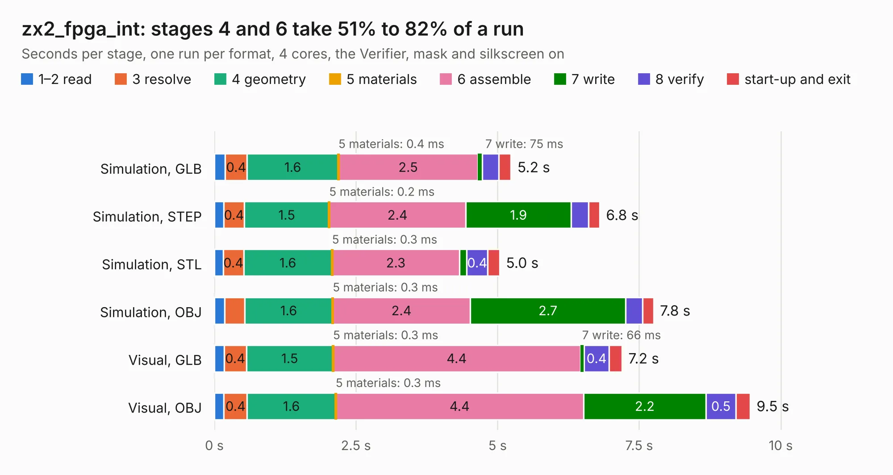

| Mode and format | 1–2 read | 3 resolve | 4 geometry | 5 materials | 6 assemble | 7 write | 8 verify | start-up and exit | Total |
|---|---:|---:|---:|---:|---:|---:|---:|---:|---:|
| Simulation, GLB | 0.2 | 0.4 | 1.6 | 0.4&nbsp;ms | 2.5 | 75&nbsp;ms | 0.3 | 0.2 | 5.2 |
| Simulation, STEP | 0.2 | 0.4 | 1.5 | 0.2&nbsp;ms | 2.4 | 1.9 | 0.3 | 0.2 | 6.8 |
| Simulation, STL | 0.2 | 0.4 | 1.6 | 0.3&nbsp;ms | 2.3 | 0.1 | 0.4 | 0.2 | 5.0 |
| Simulation, OBJ | 0.2 | 0.4 | 1.6 | 0.3&nbsp;ms | 2.4 | 2.7 | 0.3 | 0.2 | 7.8 |
| Visual, GLB | 0.2 | 0.4 | 1.5 | 0.3&nbsp;ms | 4.4 | 66&nbsp;ms | 0.4 | 0.2 | 7.2 |
| Visual, OBJ | 0.2 | 0.4 | 1.6 | 0.3&nbsp;ms | 4.4 | 2.2 | 0.5 | 0.3 | 9.5 |

<table align="center"><tr><td valign="top">

| Board | Repo: [krzys9876/ZX_Spectrum_diy](https://github.com/krzys9876/ZX_Spectrum_diy) Board: `zx2_fpga_int.kicad_pcb` |
|---|---|
| Folder | Kicad5 / zx2_fpga_int |
| Complexity | 209&nbsp;/&nbsp;1000 (size&nbsp;154, features&nbsp;55) |
| KESE&nbsp;features | through vias, rounded, trapezoid or chamfered pads, filled zones, copper text |
| Tested | 9th November 2026 |
| Copper&nbsp;layers | 2 |
| File&nbsp;format | KiCad 5 (20171130) |
| Parts,&nbsp;tracks,&nbsp;vias | 13, 618, 54 |
| Triangles,&nbsp;simulation | 547,074 in 56 parts |
| Verifier | PASS in all six runs |

</td><td valign="top">

<table>
<tr><th>File type</th><th>File size</th><th>Peak memory used</th></tr>
<tr><th colspan="3" align="left">Simulation</th></tr>
<tr><td>GLB</td><td align="right">18&nbsp;MB</td><td align="right">332&nbsp;MB</td></tr>
<tr><td>STEP</td><td align="right">87&nbsp;MB</td><td align="right">387&nbsp;MB</td></tr>
<tr><td>STL</td><td align="right">27&nbsp;MB</td><td align="right">332&nbsp;MB</td></tr>
<tr><td>OBJ</td><td align="right">55&nbsp;MB</td><td align="right">413&nbsp;MB</td></tr>
<tr><th colspan="3" align="left">Visual</th></tr>
<tr><td>GLB</td><td align="right">15&nbsp;MB</td><td align="right">447&nbsp;MB</td></tr>
<tr><td>OBJ</td><td align="right">44&nbsp;MB</td><td align="right">447&nbsp;MB</td></tr>
</table>

</td></tr></table>

## 23.14.18 zx2_keyb_conn

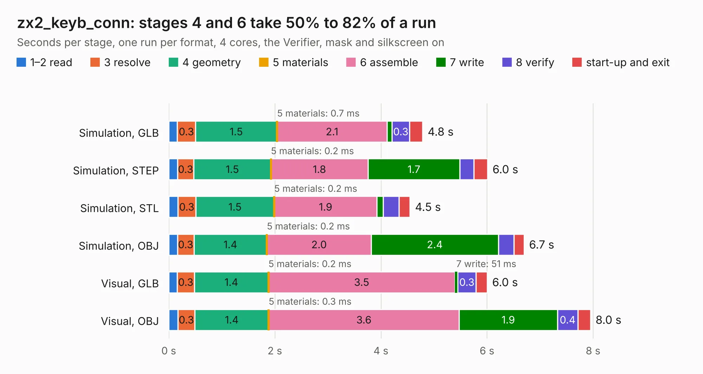

| Mode and format | 1–2 read | 3 resolve | 4 geometry | 5 materials | 6 assemble | 7 write | 8 verify | start-up and exit | Total |
|---|---:|---:|---:|---:|---:|---:|---:|---:|---:|
| Simulation, GLB | 0.2 | 0.3 | 1.5 | 0.7&nbsp;ms | 2.1 | 93&nbsp;ms | 0.3 | 0.2 | 4.8 |
| Simulation, STEP | 0.2 | 0.3 | 1.5 | 0.2&nbsp;ms | 1.8 | 1.7 | 0.3 | 0.3 | 6.0 |
| Simulation, STL | 0.2 | 0.3 | 1.5 | 0.2&nbsp;ms | 1.9 | 0.1 | 0.3 | 0.2 | 4.5 |
| Simulation, OBJ | 0.2 | 0.3 | 1.4 | 0.2&nbsp;ms | 2.0 | 2.4 | 0.3 | 0.2 | 6.7 |
| Visual, GLB | 0.2 | 0.3 | 1.4 | 0.2&nbsp;ms | 3.5 | 51&nbsp;ms | 0.3 | 0.2 | 6.0 |
| Visual, OBJ | 0.2 | 0.3 | 1.4 | 0.3&nbsp;ms | 3.6 | 1.9 | 0.4 | 0.2 | 8.0 |

<table align="center"><tr><td valign="top">

| Board | Repo: [krzys9876/ZX_Spectrum_diy](https://github.com/krzys9876/ZX_Spectrum_diy) Board: `zx2_keyb_conn.kicad_pcb` |
|---|---|
| Folder | Kicad5 / zx2_keyb_conn |
| Complexity | 200&nbsp;/&nbsp;1000 (size&nbsp;145, features&nbsp;55) |
| KESE&nbsp;features | through vias, rounded, trapezoid or chamfered pads, filled zones, copper text |
| Tested | 9th November 2026 |
| Copper&nbsp;layers | 2 |
| File&nbsp;format | KiCad 5 (20171130) |
| Parts,&nbsp;tracks,&nbsp;vias | 10, 474, 12 |
| Triangles,&nbsp;simulation | 440,002 in 47 parts |
| Verifier | PASS in all six runs |

</td><td valign="top">

<table>
<tr><th>File type</th><th>File size</th><th>Peak memory used</th></tr>
<tr><th colspan="3" align="left">Simulation</th></tr>
<tr><td>GLB</td><td align="right">15&nbsp;MB</td><td align="right">308&nbsp;MB</td></tr>
<tr><td>STEP</td><td align="right">68&nbsp;MB</td><td align="right">332&nbsp;MB</td></tr>
<tr><td>STL</td><td align="right">22&nbsp;MB</td><td align="right">293&nbsp;MB</td></tr>
<tr><td>OBJ</td><td align="right">44&nbsp;MB</td><td align="right">345&nbsp;MB</td></tr>
<tr><th colspan="3" align="left">Visual</th></tr>
<tr><td>GLB</td><td align="right">11&nbsp;MB</td><td align="right">351&nbsp;MB</td></tr>
<tr><td>OBJ</td><td align="right">32&nbsp;MB</td><td align="right">349&nbsp;MB</td></tr>
</table>

</td></tr></table>

## 23.14.19 zx2_keyb_idc

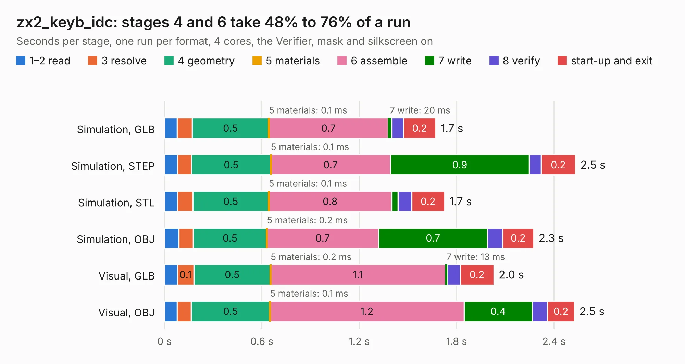

| Mode and format | 1–2 read | 3 resolve | 4 geometry | 5 materials | 6 assemble | 7 write | 8 verify | start-up and exit | Total |
|---|---:|---:|---:|---:|---:|---:|---:|---:|---:|
| Simulation, GLB | 78&nbsp;ms | 92&nbsp;ms | 0.5 | 0.1&nbsp;ms | 0.7 | 20&nbsp;ms | 74&nbsp;ms | 0.2 | 1.7 |
| Simulation, STEP | 80&nbsp;ms | 88&nbsp;ms | 0.5 | 0.1&nbsp;ms | 0.7 | 0.9 | 73&nbsp;ms | 0.2 | 2.5 |
| Simulation, STL | 81&nbsp;ms | 94&nbsp;ms | 0.5 | 0.1&nbsp;ms | 0.8 | 41&nbsp;ms | 84&nbsp;ms | 0.2 | 1.7 |
| Simulation, OBJ | 88&nbsp;ms | 89&nbsp;ms | 0.5 | 0.2&nbsp;ms | 0.7 | 0.7 | 92&nbsp;ms | 0.2 | 2.3 |
| Visual, GLB | 80&nbsp;ms | 0.1 | 0.5 | 0.2&nbsp;ms | 1.1 | 13&nbsp;ms | 78&nbsp;ms | 0.2 | 2.0 |
| Visual, OBJ | 78&nbsp;ms | 87&nbsp;ms | 0.5 | 0.1&nbsp;ms | 1.2 | 0.4 | 93&nbsp;ms | 0.2 | 2.5 |

<table align="center"><tr><td valign="top">

| Board | Repo: [krzys9876/ZX_Spectrum_diy](https://github.com/krzys9876/ZX_Spectrum_diy) Board: `zx2_keyb_idc.kicad_pcb` |
|---|---|
| Folder | Kicad5 / zx2_keyb_idc |
| Complexity | 141&nbsp;/&nbsp;1000 (size&nbsp;111, features&nbsp;30) |
| KESE&nbsp;features | filled zones, copper text |
| Tested | 9th November 2026 |
| Copper&nbsp;layers | 2 |
| File&nbsp;format | KiCad 5 (20171130) |
| Parts,&nbsp;tracks,&nbsp;vias | 4, 108, 0 |
| Triangles,&nbsp;simulation | 124,032 in 26 parts |
| Verifier | PASS in all six runs |

</td><td valign="top">

<table>
<tr><th>File type</th><th>File size</th><th>Peak memory used</th></tr>
<tr><th colspan="3" align="left">Simulation</th></tr>
<tr><td>GLB</td><td align="right">4.1&nbsp;MB</td><td align="right">189&nbsp;MB</td></tr>
<tr><td>STEP</td><td align="right">19&nbsp;MB</td><td align="right">197&nbsp;MB</td></tr>
<tr><td>STL</td><td align="right">6.2&nbsp;MB</td><td align="right">189&nbsp;MB</td></tr>
<tr><td>OBJ</td><td align="right">12&nbsp;MB</td><td align="right">189&nbsp;MB</td></tr>
<tr><th colspan="3" align="left">Visual</th></tr>
<tr><td>GLB</td><td align="right">2.8&nbsp;MB</td><td align="right">154&nbsp;MB</td></tr>
<tr><td>OBJ</td><td align="right">8.0&nbsp;MB</td><td align="right">153&nbsp;MB</td></tr>
</table>

</td></tr></table>

## 23.14.20 zx2_mem

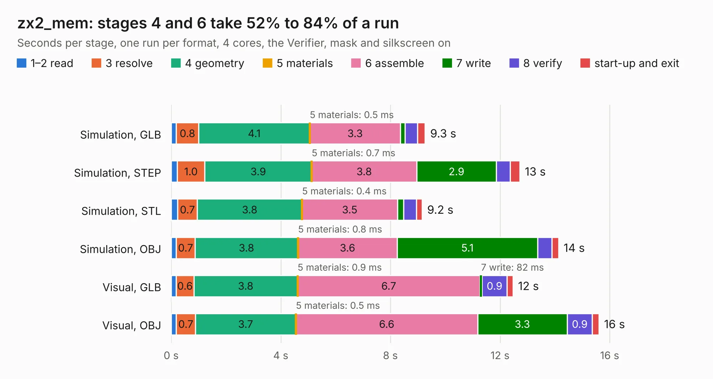

| Mode and format | 1–2 read | 3 resolve | 4 geometry | 5 materials | 6 assemble | 7 write | 8 verify | start-up and exit | Total |
|---|---:|---:|---:|---:|---:|---:|---:|---:|---:|
| Simulation, GLB | 0.2 | 0.8 | 4.1 | 0.5&nbsp;ms | 3.3 | 0.2 | 0.5 | 0.3 | 9.3 |
| Simulation, STEP | 0.2 | 1.0 | 3.9 | 0.7&nbsp;ms | 3.8 | 2.9 | 0.5 | 0.4 | 12.7 |
| Simulation, STL | 0.2 | 0.7 | 3.8 | 0.4&nbsp;ms | 3.5 | 0.2 | 0.5 | 0.2 | 9.2 |
| Simulation, OBJ | 0.2 | 0.7 | 3.8 | 0.8&nbsp;ms | 3.6 | 5.1 | 0.5 | 0.2 | 14.1 |
| Visual, GLB | 0.2 | 0.6 | 3.8 | 0.9&nbsp;ms | 6.7 | 82&nbsp;ms | 0.9 | 0.2 | 12.5 |
| Visual, OBJ | 0.2 | 0.7 | 3.7 | 0.5&nbsp;ms | 6.6 | 3.3 | 0.9 | 0.2 | 15.6 |

<table align="center"><tr><td valign="top">

| Board | Repo: [krzys9876/ZX_Spectrum_diy](https://github.com/krzys9876/ZX_Spectrum_diy) Board: `zx2_mem.kicad_pcb` |
|---|---|
| Folder | Kicad5 / zx2_mem |
| Complexity | 195&nbsp;/&nbsp;1000 (size&nbsp;160, features&nbsp;35) |
| KESE&nbsp;features | through vias, rounded, trapezoid or chamfered pads, copper text |
| Tested | 9th November 2026 |
| Copper&nbsp;layers | 2 |
| File&nbsp;format | KiCad 5 (20171130) |
| Parts,&nbsp;tracks,&nbsp;vias | 20, 687, 43 |
| Triangles,&nbsp;simulation | 932,552 in 57 parts |
| Verifier | PASS in all six runs |

</td><td valign="top">

<table>
<tr><th>File type</th><th>File size</th><th>Peak memory used</th></tr>
<tr><th colspan="3" align="left">Simulation</th></tr>
<tr><td>GLB</td><td align="right">31&nbsp;MB</td><td align="right">447&nbsp;MB</td></tr>
<tr><td>STEP</td><td align="right">129&nbsp;MB</td><td align="right">504&nbsp;MB</td></tr>
<tr><td>STL</td><td align="right">47&nbsp;MB</td><td align="right">441&nbsp;MB</td></tr>
<tr><td>OBJ</td><td align="right">93&nbsp;MB</td><td align="right">656&nbsp;MB</td></tr>
<tr><th colspan="3" align="left">Visual</th></tr>
<tr><td>GLB</td><td align="right">20&nbsp;MB</td><td align="right">589&nbsp;MB</td></tr>
<tr><td>OBJ</td><td align="right">60&nbsp;MB</td><td align="right">548&nbsp;MB</td></tr>
</table>

</td></tr></table>

## 23.14.21 zx2_mem_test01

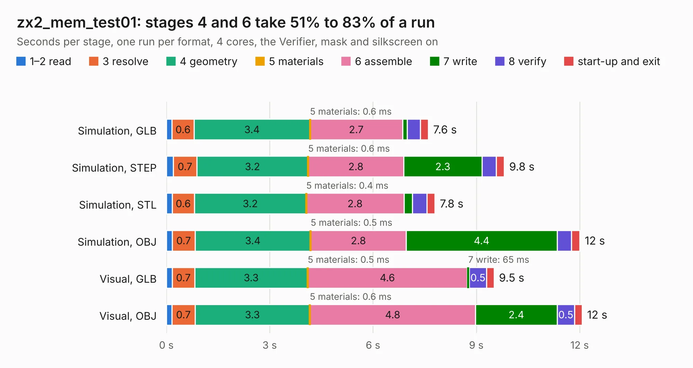

| Mode and format | 1–2 read | 3 resolve | 4 geometry | 5 materials | 6 assemble | 7 write | 8 verify | start-up and exit | Total |
|---|---:|---:|---:|---:|---:|---:|---:|---:|---:|
| Simulation, GLB | 0.2 | 0.6 | 3.4 | 0.6&nbsp;ms | 2.7 | 0.1 | 0.4 | 0.2 | 7.6 |
| Simulation, STEP | 0.2 | 0.7 | 3.2 | 0.6&nbsp;ms | 2.8 | 2.3 | 0.4 | 0.2 | 9.8 |
| Simulation, STL | 0.2 | 0.6 | 3.2 | 0.4&nbsp;ms | 2.8 | 0.2 | 0.4 | 0.2 | 7.8 |
| Simulation, OBJ | 0.2 | 0.7 | 3.4 | 0.5&nbsp;ms | 2.8 | 4.4 | 0.4 | 0.2 | 12.0 |
| Visual, GLB | 0.2 | 0.7 | 3.3 | 0.5&nbsp;ms | 4.6 | 65&nbsp;ms | 0.5 | 0.2 | 9.5 |
| Visual, OBJ | 0.2 | 0.7 | 3.3 | 0.6&nbsp;ms | 4.8 | 2.4 | 0.5 | 0.2 | 12.1 |

<table align="center"><tr><td valign="top">

| Board | Repo: [krzys9876/ZX_Spectrum_diy](https://github.com/krzys9876/ZX_Spectrum_diy) Board: `zx2_mem_test01.kicad_pcb` |
|---|---|
| Folder | Kicad5 / zx2_mem |
| Complexity | 176&nbsp;/&nbsp;1000 (size&nbsp;151, features&nbsp;25) |
| KESE&nbsp;features | through vias, rounded, trapezoid or chamfered pads |
| Tested | 9th November 2026 |
| Copper&nbsp;layers | 2 |
| File&nbsp;format | KiCad 5 (20171130) |
| Parts,&nbsp;tracks,&nbsp;vias | 18, 414, 29 |
| Triangles,&nbsp;simulation | 777,604 in 56 parts |
| Verifier | PASS in all six runs |

</td><td valign="top">

<table>
<tr><th>File type</th><th>File size</th><th>Peak memory used</th></tr>
<tr><th colspan="3" align="left">Simulation</th></tr>
<tr><td>GLB</td><td align="right">26&nbsp;MB</td><td align="right">376&nbsp;MB</td></tr>
<tr><td>STEP</td><td align="right">110&nbsp;MB</td><td align="right">440&nbsp;MB</td></tr>
<tr><td>STL</td><td align="right">39&nbsp;MB</td><td align="right">378&nbsp;MB</td></tr>
<tr><td>OBJ</td><td align="right">79&nbsp;MB</td><td align="right">555&nbsp;MB</td></tr>
<tr><th colspan="3" align="left">Visual</th></tr>
<tr><td>GLB</td><td align="right">14&nbsp;MB</td><td align="right">423&nbsp;MB</td></tr>
<tr><td>OBJ</td><td align="right">43&nbsp;MB</td><td align="right">429&nbsp;MB</td></tr>
</table>

</td></tr></table>

## 23.14.22 zx2_uart

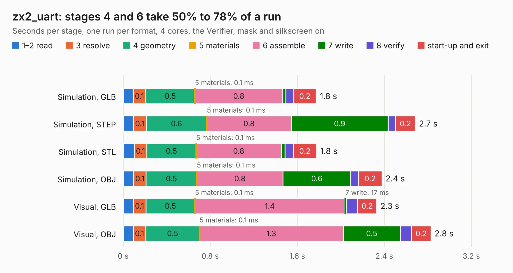

| Mode and format | 1–2 read | 3 resolve | 4 geometry | 5 materials | 6 assemble | 7 write | 8 verify | start-up and exit | Total |
|---|---:|---:|---:|---:|---:|---:|---:|---:|---:|
| Simulation, GLB | 93&nbsp;ms | 0.1 | 0.5 | 0.1&nbsp;ms | 0.8 | 29&nbsp;ms | 72&nbsp;ms | 0.2 | 1.8 |
| Simulation, STEP | 93&nbsp;ms | 0.1 | 0.6 | 0.1&nbsp;ms | 0.8 | 0.9 | 67&nbsp;ms | 0.2 | 2.7 |
| Simulation, STL | 0.1 | 0.1 | 0.5 | 0.1&nbsp;ms | 0.8 | 34&nbsp;ms | 75&nbsp;ms | 0.2 | 1.8 |
| Simulation, OBJ | 97&nbsp;ms | 0.1 | 0.5 | 0.1&nbsp;ms | 0.8 | 0.6 | 72&nbsp;ms | 0.2 | 2.4 |
| Visual, GLB | 93&nbsp;ms | 0.1 | 0.5 | 0.1&nbsp;ms | 1.4 | 17&nbsp;ms | 0.1 | 0.2 | 2.3 |
| Visual, OBJ | 94&nbsp;ms | 0.1 | 0.5 | 0.1&nbsp;ms | 1.3 | 0.5 | 0.1 | 0.2 | 2.8 |

<table align="center"><tr><td valign="top">

| Board | Repo: [krzys9876/ZX_Spectrum_diy](https://github.com/krzys9876/ZX_Spectrum_diy) Board: `zx2_uart.kicad_pcb` |
|---|---|
| Folder | Kicad5 / zx2_uart |
| Complexity | 176&nbsp;/&nbsp;1000 (size&nbsp;131, features&nbsp;45) |
| KESE&nbsp;features | through vias, rounded, trapezoid or chamfered pads, filled zones |
| Tested | 9th November 2026 |
| Copper&nbsp;layers | 2 |
| File&nbsp;format | KiCad 5 (20171130) |
| Parts,&nbsp;tracks,&nbsp;vias | 15, 152, 7 |
| Triangles,&nbsp;simulation | 131,734 in 27 parts |
| Verifier | PASS in all six runs |

</td><td valign="top">

<table>
<tr><th>File type</th><th>File size</th><th>Peak memory used</th></tr>
<tr><th colspan="3" align="left">Simulation</th></tr>
<tr><td>GLB</td><td align="right">4.5&nbsp;MB</td><td align="right">199&nbsp;MB</td></tr>
<tr><td>STEP</td><td align="right">22&nbsp;MB</td><td align="right">212&nbsp;MB</td></tr>
<tr><td>STL</td><td align="right">6.6&nbsp;MB</td><td align="right">199&nbsp;MB</td></tr>
<tr><td>OBJ</td><td align="right">13&nbsp;MB</td><td align="right">200&nbsp;MB</td></tr>
<tr><th colspan="3" align="left">Visual</th></tr>
<tr><td>GLB</td><td align="right">3.7&nbsp;MB</td><td align="right">180&nbsp;MB</td></tr>
<tr><td>OBJ</td><td align="right">10&nbsp;MB</td><td align="right">181&nbsp;MB</td></tr>
</table>

</td></tr></table>

## 23.14.23 rpi-cm4-LiM+-board

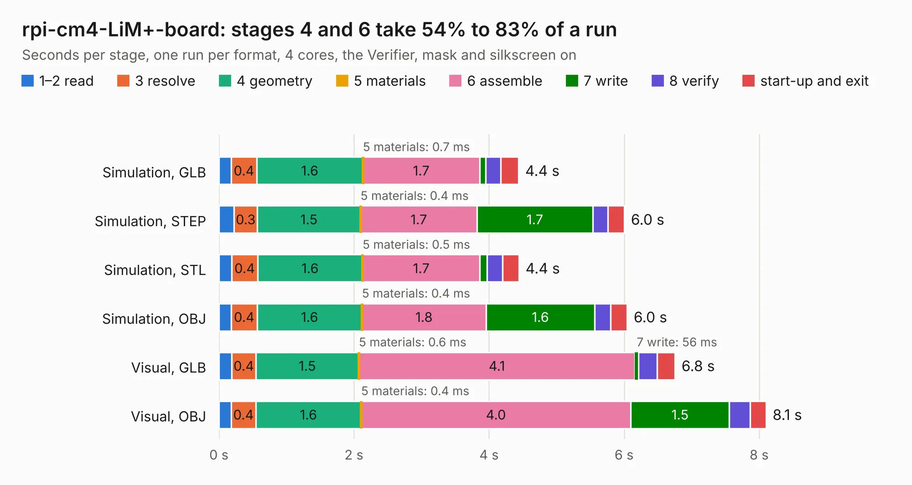

| Mode and format | 1–2 read | 3 resolve | 4 geometry | 5 materials | 6 assemble | 7 write | 8 verify | start-up and exit | Total |
|---|---:|---:|---:|---:|---:|---:|---:|---:|---:|
| Simulation, GLB | 0.2 | 0.4 | 1.6 | 0.7&nbsp;ms | 1.7 | 87&nbsp;ms | 0.2 | 0.3 | 4.4 |
| Simulation, STEP | 0.2 | 0.3 | 1.5 | 0.4&nbsp;ms | 1.7 | 1.7 | 0.2 | 0.2 | 6.0 |
| Simulation, STL | 0.2 | 0.4 | 1.6 | 0.5&nbsp;ms | 1.7 | 0.1 | 0.2 | 0.2 | 4.4 |
| Simulation, OBJ | 0.2 | 0.4 | 1.6 | 0.4&nbsp;ms | 1.8 | 1.6 | 0.2 | 0.2 | 6.0 |
| Visual, GLB | 0.2 | 0.4 | 1.5 | 0.6&nbsp;ms | 4.1 | 56&nbsp;ms | 0.3 | 0.3 | 6.8 |
| Visual, OBJ | 0.2 | 0.4 | 1.6 | 0.4&nbsp;ms | 4.0 | 1.5 | 0.3 | 0.2 | 8.1 |

<table align="center"><tr><td valign="top">

| Board | Repo: [l00nix/rpi-cm4-LiM-board](https://github.com/l00nix/rpi-cm4-LiM-board) Board: `rpi-cm4-LiM+-board.kicad_pcb` |
|---|---|
| Folder | hardware / rpi-cm4-LiM+-board / KiCad Files |
| Complexity | 268&nbsp;/&nbsp;1000 (size&nbsp;143, features&nbsp;125) |
| KESE&nbsp;features | through vias, slotted holes, custom pads, rounded, trapezoid or chamfered pads, filled zones, copper drawings, curved board outline, stack-up, dielectric εr and tanδ, mask and silkscreen colours |
| Tested | 9th November 2026 |
| Copper&nbsp;layers | 2 |
| File&nbsp;format | KiCad 6 (20210424) |
| Parts,&nbsp;tracks,&nbsp;vias | 12, 284, 45 |
| Triangles,&nbsp;simulation | 273,312 in 161 parts |
| Verifier | PASS in all six runs |

</td><td valign="top">

<table>
<tr><th>File type</th><th>File size</th><th>Peak memory used</th></tr>
<tr><th colspan="3" align="left">Simulation</th></tr>
<tr><td>GLB</td><td align="right">9.9&nbsp;MB</td><td align="right">260&nbsp;MB</td></tr>
<tr><td>STEP</td><td align="right">60&nbsp;MB</td><td align="right">288&nbsp;MB</td></tr>
<tr><td>STL</td><td align="right">14&nbsp;MB</td><td align="right">265&nbsp;MB</td></tr>
<tr><td>OBJ</td><td align="right">28&nbsp;MB</td><td align="right">264&nbsp;MB</td></tr>
<tr><th colspan="3" align="left">Visual</th></tr>
<tr><td>GLB</td><td align="right">8.9&nbsp;MB</td><td align="right">310&nbsp;MB</td></tr>
<tr><td>OBJ</td><td align="right">26&nbsp;MB</td><td align="right">308&nbsp;MB</td></tr>
</table>

</td></tr></table>

## 23.14.24 rpi-cm4-LiM-board

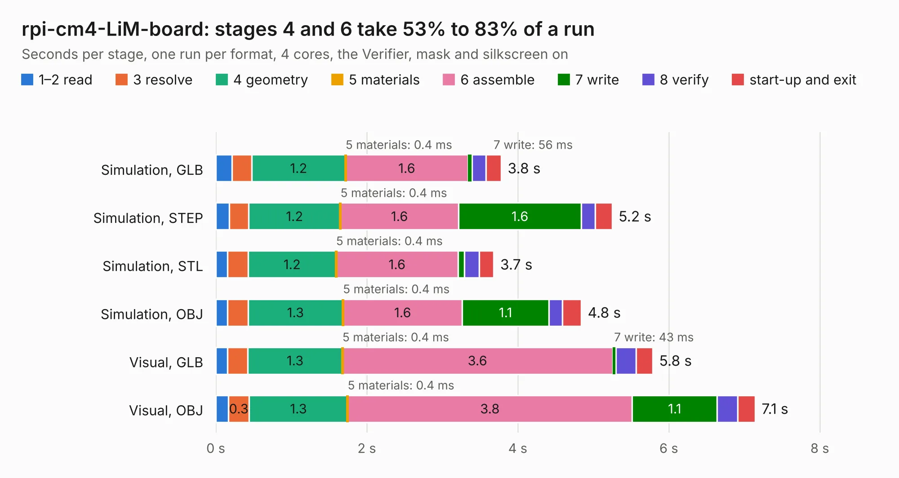

| Mode and format | 1–2 read | 3 resolve | 4 geometry | 5 materials | 6 assemble | 7 write | 8 verify | start-up and exit | Total |
|---|---:|---:|---:|---:|---:|---:|---:|---:|---:|
| Simulation, GLB | 0.2 | 0.3 | 1.2 | 0.4&nbsp;ms | 1.6 | 56&nbsp;ms | 0.2 | 0.2 | 3.8 |
| Simulation, STEP | 0.2 | 0.3 | 1.2 | 0.4&nbsp;ms | 1.6 | 1.6 | 0.2 | 0.2 | 5.2 |
| Simulation, STL | 0.2 | 0.3 | 1.2 | 0.4&nbsp;ms | 1.6 | 84&nbsp;ms | 0.2 | 0.2 | 3.7 |
| Simulation, OBJ | 0.2 | 0.3 | 1.3 | 0.4&nbsp;ms | 1.6 | 1.1 | 0.2 | 0.2 | 4.8 |
| Visual, GLB | 0.2 | 0.3 | 1.3 | 0.4&nbsp;ms | 3.6 | 43&nbsp;ms | 0.3 | 0.2 | 5.8 |
| Visual, OBJ | 0.2 | 0.3 | 1.3 | 0.4&nbsp;ms | 3.8 | 1.1 | 0.3 | 0.2 | 7.1 |

<table align="center"><tr><td valign="top">

| Board | Repo: [l00nix/rpi-cm4-LiM-board](https://github.com/l00nix/rpi-cm4-LiM-board) Board: `rpi-cm4-LiM-board.kicad_pcb` |
|---|---|
| Folder | hardware / rpi-cm4-LiM-board / KiCad Files |
| Complexity | 260&nbsp;/&nbsp;1000 (size&nbsp;135, features&nbsp;125) |
| KESE&nbsp;features | through vias, slotted holes, custom pads, rounded, trapezoid or chamfered pads, filled zones, copper drawings, curved board outline, stack-up, dielectric εr and tanδ, mask and silkscreen colours |
| Tested | 9th November 2026 |
| Copper&nbsp;layers | 2 |
| File&nbsp;format | KiCad 6 (20210424) |
| Parts,&nbsp;tracks,&nbsp;vias | 11, 147, 36 |
| Triangles,&nbsp;simulation | 258,546 in 165 parts |
| Verifier | PASS in all six runs |

</td><td valign="top">

<table>
<tr><th>File type</th><th>File size</th><th>Peak memory used</th></tr>
<tr><th colspan="3" align="left">Simulation</th></tr>
<tr><td>GLB</td><td align="right">9.4&nbsp;MB</td><td align="right">270&nbsp;MB</td></tr>
<tr><td>STEP</td><td align="right">60&nbsp;MB</td><td align="right">285&nbsp;MB</td></tr>
<tr><td>STL</td><td align="right">13&nbsp;MB</td><td align="right">266&nbsp;MB</td></tr>
<tr><td>OBJ</td><td align="right">27&nbsp;MB</td><td align="right">265&nbsp;MB</td></tr>
<tr><th colspan="3" align="left">Visual</th></tr>
<tr><td>GLB</td><td align="right">8.3&nbsp;MB</td><td align="right">289&nbsp;MB</td></tr>
<tr><td>OBJ</td><td align="right">24&nbsp;MB</td><td align="right">287&nbsp;MB</td></tr>
</table>

</td></tr></table>

## 23.14.25 LHCbit

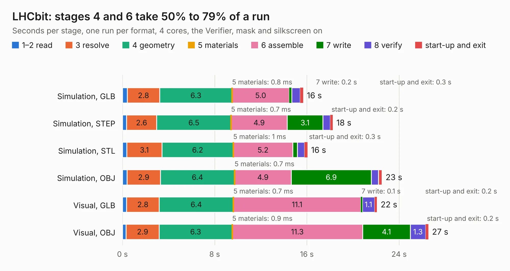

| Mode and format | 1–2 read | 3 resolve | 4 geometry | 5 materials | 6 assemble | 7 write | 8 verify | start-up and exit | Total |
|---|---:|---:|---:|---:|---:|---:|---:|---:|---:|
| Simulation, GLB | 0.4 | 2.8 | 6.3 | 0.8&nbsp;ms | 5.0 | 0.2 | 0.7 | 0.3 | 15.7 |
| Simulation, STEP | 0.4 | 2.6 | 6.5 | 0.7&nbsp;ms | 4.9 | 3.1 | 0.6 | 0.2 | 18.2 |
| Simulation, STL | 0.4 | 3.1 | 6.2 | 1&nbsp;ms | 5.2 | 0.4 | 0.6 | 0.3 | 16.1 |
| Simulation, OBJ | 0.4 | 2.9 | 6.4 | 0.7&nbsp;ms | 4.9 | 6.9 | 0.6 | 0.3 | 22.5 |
| Visual, GLB | 0.4 | 2.8 | 6.4 | 0.7&nbsp;ms | 11.1 | 0.1 | 1.1 | 0.2 | 22.1 |
| Visual, OBJ | 0.3 | 2.9 | 6.3 | 0.9&nbsp;ms | 11.3 | 4.1 | 1.3 | 0.2 | 26.5 |

<table align="center"><tr><td valign="top">

| Board | Repo: [lhc/hardware](https://github.com/lhc/hardware) Board: `LHCbit.kicad_pcb` |
|---|---|
| Folder | LHCbit / kicad |
| Complexity | 402&nbsp;/&nbsp;1000 (size&nbsp;197, features&nbsp;205) |
| KESE&nbsp;features | through vias, slotted holes, rounded, trapezoid or chamfered pads, arc tracks, filled zones, copper drawings, curved board outline, TrueType text, stack-up, dielectric εr and tanδ, copper finish, mask and silkscreen colours, castellated pads, plated board edge |
| Tested | 9th November 2026 |
| Copper&nbsp;layers | 4 |
| File&nbsp;format | KiCad 8 (20240108) |
| Parts,&nbsp;tracks,&nbsp;vias | 51, 743, 295 |
| Triangles,&nbsp;simulation | 1,407,910 in 124 parts |
| Verifier | PASS in all six runs |

</td><td valign="top">

<table>
<tr><th>File type</th><th>File size</th><th>Peak memory used</th></tr>
<tr><th colspan="3" align="left">Simulation</th></tr>
<tr><td>GLB</td><td align="right">48&nbsp;MB</td><td align="right">578&nbsp;MB</td></tr>
<tr><td>STEP</td><td align="right">180&nbsp;MB</td><td align="right">681&nbsp;MB</td></tr>
<tr><td>STL</td><td align="right">70&nbsp;MB</td><td align="right">607&nbsp;MB</td></tr>
<tr><td>OBJ</td><td align="right">147&nbsp;MB</td><td align="right">1.0&nbsp;GB</td></tr>
<tr><th colspan="3" align="left">Visual</th></tr>
<tr><td>GLB</td><td align="right">30&nbsp;MB</td><td align="right">667&nbsp;MB</td></tr>
<tr><td>OBJ</td><td align="right">91&nbsp;MB</td><td align="right">721&nbsp;MB</td></tr>
</table>

</td></tr></table>

## 23.14.26 lhc_tijolo32_board

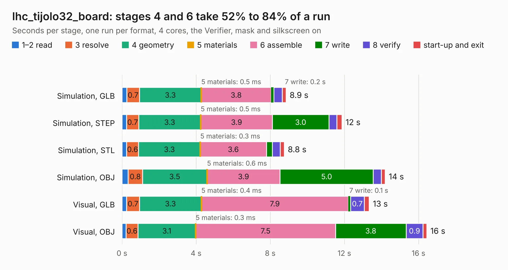

| Mode and format | 1–2 read | 3 resolve | 4 geometry | 5 materials | 6 assemble | 7 write | 8 verify | start-up and exit | Total |
|---|---:|---:|---:|---:|---:|---:|---:|---:|---:|
| Simulation, GLB | 0.3 | 0.7 | 3.3 | 0.5&nbsp;ms | 3.8 | 0.2 | 0.4 | 0.2 | 8.9 |
| Simulation, STEP | 0.2 | 0.7 | 3.3 | 0.5&nbsp;ms | 3.9 | 3.0 | 0.4 | 0.3 | 11.9 |
| Simulation, STL | 0.3 | 0.6 | 3.3 | 0.3&nbsp;ms | 3.6 | 0.3 | 0.4 | 0.2 | 8.8 |
| Simulation, OBJ | 0.3 | 0.8 | 3.5 | 0.6&nbsp;ms | 3.9 | 5.0 | 0.4 | 0.2 | 14.2 |
| Visual, GLB | 0.2 | 0.7 | 3.3 | 0.4&nbsp;ms | 7.9 | 0.1 | 0.7 | 0.3 | 13.3 |
| Visual, OBJ | 0.2 | 0.6 | 3.1 | 0.3&nbsp;ms | 7.5 | 3.8 | 0.9 | 0.2 | 16.4 |

<table align="center"><tr><td valign="top">

| Board | Repo: [lhc/hardware](https://github.com/lhc/hardware) Board: `lhc_tijolo32_board.kicad_pcb` |
|---|---|
| Folder | nodeLHC-ESP32 / projeto |
| Complexity | 239&nbsp;/&nbsp;1000 (size&nbsp;164, features&nbsp;75) |
| KESE&nbsp;features | through vias, slotted holes, rounded, trapezoid or chamfered pads, filled zones, copper text, curved board outline |
| Tested | 9th November 2026 |
| Copper&nbsp;layers | 2 |
| File&nbsp;format | KiCad 5 (20171130) |
| Parts,&nbsp;tracks,&nbsp;vias | 46, 405, 75 |
| Triangles,&nbsp;simulation | 901,160 in 76 parts |
| Verifier | PASS in all six runs |

</td><td valign="top">

<table>
<tr><th>File type</th><th>File size</th><th>Peak memory used</th></tr>
<tr><th colspan="3" align="left">Simulation</th></tr>
<tr><td>GLB</td><td align="right">31&nbsp;MB</td><td align="right">402&nbsp;MB</td></tr>
<tr><td>STEP</td><td align="right">148&nbsp;MB</td><td align="right">497&nbsp;MB</td></tr>
<tr><td>STL</td><td align="right">45&nbsp;MB</td><td align="right">417&nbsp;MB</td></tr>
<tr><td>OBJ</td><td align="right">91&nbsp;MB</td><td align="right">618&nbsp;MB</td></tr>
<tr><th colspan="3" align="left">Visual</th></tr>
<tr><td>GLB</td><td align="right">26&nbsp;MB</td><td align="right">589&nbsp;MB</td></tr>
<tr><td>OBJ</td><td align="right">77&nbsp;MB</td><td align="right">615&nbsp;MB</td></tr>
</table>

</td></tr></table>

## 23.14.27 placas-kicad

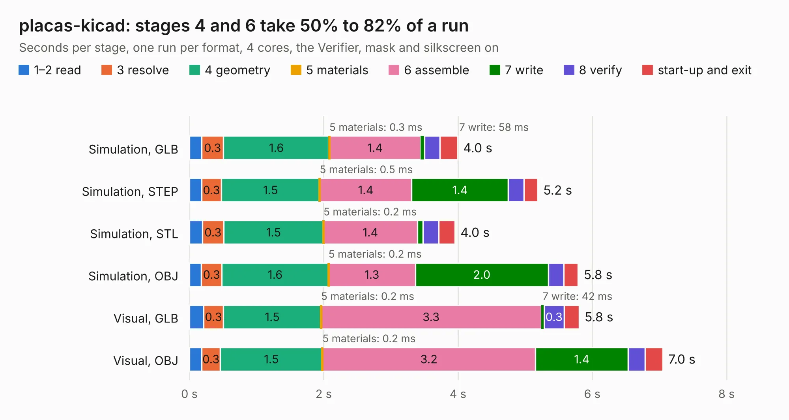

| Mode and format | 1–2 read | 3 resolve | 4 geometry | 5 materials | 6 assemble | 7 write | 8 verify | start-up and exit | Total |
|---|---:|---:|---:|---:|---:|---:|---:|---:|---:|
| Simulation, GLB | 0.2 | 0.3 | 1.6 | 0.3&nbsp;ms | 1.4 | 58&nbsp;ms | 0.2 | 0.3 | 4.0 |
| Simulation, STEP | 0.2 | 0.3 | 1.5 | 0.5&nbsp;ms | 1.4 | 1.4 | 0.2 | 0.2 | 5.2 |
| Simulation, STL | 0.2 | 0.3 | 1.5 | 0.2&nbsp;ms | 1.4 | 85&nbsp;ms | 0.2 | 0.2 | 4.0 |
| Simulation, OBJ | 0.2 | 0.3 | 1.6 | 0.2&nbsp;ms | 1.3 | 2.0 | 0.2 | 0.2 | 5.8 |
| Visual, GLB | 0.2 | 0.3 | 1.5 | 0.2&nbsp;ms | 3.3 | 42&nbsp;ms | 0.3 | 0.2 | 5.8 |
| Visual, OBJ | 0.2 | 0.3 | 1.5 | 0.2&nbsp;ms | 3.2 | 1.4 | 0.3 | 0.3 | 7.0 |

<table align="center"><tr><td valign="top">

| Board | Repo: [lhc/hardware](https://github.com/lhc/hardware) Board: `placas-kicad.kicad_pcb` |
|---|---|
| Folder | Oficinas / monte-sua-placa-kicad / Projeto Live |
| Complexity | 220&nbsp;/&nbsp;1000 (size&nbsp;140, features&nbsp;80) |
| KESE&nbsp;features | through vias, slotted holes, custom pads, rounded, trapezoid or chamfered pads, filled zones, copper drawings |
| Tested | 9th November 2026 |
| Copper&nbsp;layers | 2 |
| File&nbsp;format | KiCad 8 (20240108) |
| Parts,&nbsp;tracks,&nbsp;vias | 24, 139, 25 |
| Triangles,&nbsp;simulation | 344,872 in 43 parts |
| Verifier | PASS in all six runs |

</td><td valign="top">

<table>
<tr><th>File type</th><th>File size</th><th>Peak memory used</th></tr>
<tr><th colspan="3" align="left">Simulation</th></tr>
<tr><td>GLB</td><td align="right">12&nbsp;MB</td><td align="right">277&nbsp;MB</td></tr>
<tr><td>STEP</td><td align="right">53&nbsp;MB</td><td align="right">278&nbsp;MB</td></tr>
<tr><td>STL</td><td align="right">17&nbsp;MB</td><td align="right">287&nbsp;MB</td></tr>
<tr><td>OBJ</td><td align="right">34&nbsp;MB</td><td align="right">279&nbsp;MB</td></tr>
<tr><th colspan="3" align="left">Visual</th></tr>
<tr><td>GLB</td><td align="right">8.4&nbsp;MB</td><td align="right">282&nbsp;MB</td></tr>
<tr><td>OBJ</td><td align="right">25&nbsp;MB</td><td align="right">276&nbsp;MB</td></tr>
</table>

</td></tr></table>

## 23.14.28 lhc-esp

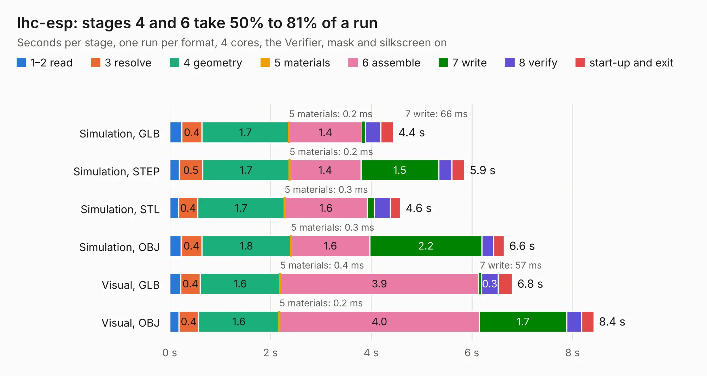

| Mode and format | 1–2 read | 3 resolve | 4 geometry | 5 materials | 6 assemble | 7 write | 8 verify | start-up and exit | Total |
|---|---:|---:|---:|---:|---:|---:|---:|---:|---:|
| Simulation, GLB | 0.2 | 0.4 | 1.7 | 0.2&nbsp;ms | 1.4 | 66&nbsp;ms | 0.3 | 0.2 | 4.4 |
| Simulation, STEP | 0.2 | 0.5 | 1.7 | 0.2&nbsp;ms | 1.4 | 1.5 | 0.3 | 0.3 | 5.9 |
| Simulation, STL | 0.2 | 0.4 | 1.7 | 0.3&nbsp;ms | 1.6 | 0.1 | 0.3 | 0.2 | 4.6 |
| Simulation, OBJ | 0.2 | 0.4 | 1.8 | 0.3&nbsp;ms | 1.6 | 2.2 | 0.2 | 0.2 | 6.6 |
| Visual, GLB | 0.2 | 0.4 | 1.6 | 0.4&nbsp;ms | 3.9 | 57&nbsp;ms | 0.3 | 0.3 | 6.8 |
| Visual, OBJ | 0.2 | 0.4 | 1.6 | 0.2&nbsp;ms | 4.0 | 1.7 | 0.3 | 0.2 | 8.4 |

<table align="center"><tr><td valign="top">

| Board | Repo: [lhc/hardware](https://github.com/lhc/hardware) Board: `lhc-esp.kicad_pcb` |
|---|---|
| Folder | Oficinas / monte-sua-placa-kicad / Projeto Referência |
| Complexity | 228&nbsp;/&nbsp;1000 (size&nbsp;148, features&nbsp;80) |
| KESE&nbsp;features | through vias, slotted holes, custom pads, rounded, trapezoid or chamfered pads, filled zones, copper drawings |
| Tested | 9th November 2026 |
| Copper&nbsp;layers | 2 |
| File&nbsp;format | KiCad 8 (20240108) |
| Parts,&nbsp;tracks,&nbsp;vias | 24, 194, 58 |
| Triangles,&nbsp;simulation | 398,364 in 43 parts |
| Verifier | PASS in all six runs |

</td><td valign="top">

<table>
<tr><th>File type</th><th>File size</th><th>Peak memory used</th></tr>
<tr><th colspan="3" align="left">Simulation</th></tr>
<tr><td>GLB</td><td align="right">14&nbsp;MB</td><td align="right">300&nbsp;MB</td></tr>
<tr><td>STEP</td><td align="right">61&nbsp;MB</td><td align="right">294&nbsp;MB</td></tr>
<tr><td>STL</td><td align="right">20&nbsp;MB</td><td align="right">276&nbsp;MB</td></tr>
<tr><td>OBJ</td><td align="right">40&nbsp;MB</td><td align="right">289&nbsp;MB</td></tr>
<tr><th colspan="3" align="left">Visual</th></tr>
<tr><td>GLB</td><td align="right">10&nbsp;MB</td><td align="right">314&nbsp;MB</td></tr>
<tr><td>OBJ</td><td align="right">30&nbsp;MB</td><td align="right">308&nbsp;MB</td></tr>
</table>

</td></tr></table>

## 23.14.29 BPS-Minion

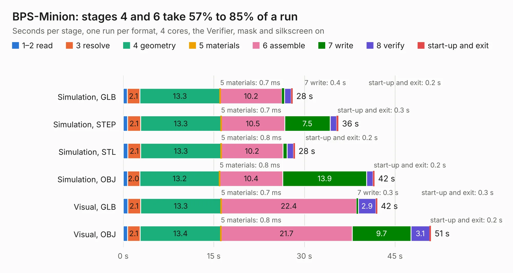

| Mode and format | 1–2 read | 3 resolve | 4 geometry | 5 materials | 6 assemble | 7 write | 8 verify | start-up and exit | Total |
|---|---:|---:|---:|---:|---:|---:|---:|---:|---:|
| Simulation, GLB | 0.7 | 2.1 | 13.3 | 0.7&nbsp;ms | 10.2 | 0.4 | 1.1 | 0.2 | 28.1 |
| Simulation, STEP | 0.7 | 2.1 | 13.3 | 0.7&nbsp;ms | 10.5 | 7.5 | 1.1 | 0.3 | 35.6 |
| Simulation, STL | 0.8 | 2.1 | 13.3 | 0.8&nbsp;ms | 10.2 | 0.7 | 1.1 | 0.2 | 28.4 |
| Simulation, OBJ | 0.7 | 2.0 | 13.2 | 0.8&nbsp;ms | 10.4 | 13.9 | 1.1 | 0.2 | 41.6 |
| Visual, GLB | 0.7 | 2.1 | 13.3 | 0.7&nbsp;ms | 22.4 | 0.3 | 2.9 | 0.3 | 42.1 |
| Visual, OBJ | 0.7 | 2.1 | 13.4 | 0.8&nbsp;ms | 21.7 | 9.7 | 3.1 | 0.2 | 51.0 |

<table align="center"><tr><td valign="top">

| Board | Repo: [lhr-solar/bps-voltagepcb](https://github.com/lhr-solar/bps-voltagepcb) Board: `BPS-Minion.kicad_pcb` |
|---|---|
| Complexity | 365&nbsp;/&nbsp;1000 (size&nbsp;255, features&nbsp;110) |
| KESE&nbsp;features | through vias, custom pads, rounded, trapezoid or chamfered pads, filled zones, copper drawings, curved board outline, stack-up, dielectric εr and tanδ |
| Tested | 9th November 2026 |
| Copper&nbsp;layers | 2 |
| File&nbsp;format | KiCad 8 (20240108) |
| Parts,&nbsp;tracks,&nbsp;vias | 218, 1,543, 223 |
| Triangles,&nbsp;simulation | 2,640,284 in 220 parts |
| Verifier | PASS in all six runs |

</td><td valign="top">

<table>
<tr><th>File type</th><th>File size</th><th>Peak memory used</th></tr>
<tr><th colspan="3" align="left">Simulation</th></tr>
<tr><td>GLB</td><td align="right">92&nbsp;MB</td><td align="right">884&nbsp;MB</td></tr>
<tr><td>STEP</td><td align="right">521&nbsp;MB</td><td align="right">1.1&nbsp;GB</td></tr>
<tr><td>STL</td><td align="right">132&nbsp;MB</td><td align="right">893&nbsp;MB</td></tr>
<tr><td>OBJ</td><td align="right">283&nbsp;MB</td><td align="right">1.8&nbsp;GB</td></tr>
<tr><th colspan="3" align="left">Visual</th></tr>
<tr><td>GLB</td><td align="right">62&nbsp;MB</td><td align="right">1.1&nbsp;GB</td></tr>
<tr><td>OBJ</td><td align="right">190&nbsp;MB</td><td align="right">1.4&nbsp;GB</td></tr>
</table>

</td></tr></table>

## 23.14.30 BPS-Leader

| Mode and format | 1–2 read | 3 resolve | 4 geometry | 5 materials | 6 assemble | 7 write | 8 verify | start-up and exit | Total |
|---|---:|---:|---:|---:|---:|---:|---:|---:|---:|
| Simulation, GLB | 1.7 | 4.3 | 15.0 | 1&nbsp;ms | 13.1 | 0.5 | 1.4 | 0.3 | 36.3 |
| Simulation, STEP | 1.7 | 4.3 | 14.8 | 1&nbsp;ms | 12.7 | 8.9 | 1.3 | 0.3 | 43.9 |
| Simulation, STL | 1.7 | 4.2 | 14.4 | 1&nbsp;ms | 13.2 | 0.8 | 1.4 | 0.3 | 36.1 |
| Simulation, OBJ | 1.6 | 4.3 | 15.0 | 1&nbsp;ms | 13.5 | 16.8 | 1.4 | 0.3 | 52.9 |
| Visual, GLB | 1.7 | 4.3 | 15.2 | 0.9&nbsp;ms | 30.7 | 0.5 | 3.7 | 0.3 | 56.4 |
| Visual, OBJ | 1.7 | 4.3 | 14.9 | 1.0&nbsp;ms | 30.1 | 14.6 | 3.2 | 0.3 | 69.1 |

<table align="center"><tr><td valign="top">

| Board | Repo: [lhr-solar/ps-bpsleader](https://github.com/lhr-solar/ps-bpsleader) Board: `BPS-Leader.kicad_pcb` |
|---|---|
| Folder | Hardware |
| Complexity | 344&nbsp;/&nbsp;1000 (size&nbsp;209, features&nbsp;135) |
| KESE&nbsp;features | through vias, slotted holes, custom pads, rounded, trapezoid or chamfered pads, filled zones, copper drawings, curved board outline, TrueType text, stack-up, dielectric εr and tanδ |
| Tested | 9th November 2026 |
| Copper&nbsp;layers | 2 |
| File&nbsp;format | KiCad 9 (20241229) |
| Parts,&nbsp;tracks,&nbsp;vias | 225, 1,999, 475 |
| Triangles,&nbsp;simulation | 2,710,942 in 222 parts |
| Verifier | PASS in all six runs |

</td><td valign="top">

<table>
<tr><th>File type</th><th>File size</th><th>Peak memory used</th></tr>
<tr><th colspan="3" align="left">Simulation</th></tr>
<tr><td>GLB</td><td align="right">95&nbsp;MB</td><td align="right">972&nbsp;MB</td></tr>
<tr><td>STEP</td><td align="right">496&nbsp;MB</td><td align="right">1.2&nbsp;GB</td></tr>
<tr><td>STL</td><td align="right">136&nbsp;MB</td><td align="right">960&nbsp;MB</td></tr>
<tr><td>OBJ</td><td align="right">290&nbsp;MB</td><td align="right">1.9&nbsp;GB</td></tr>
<tr><th colspan="3" align="left">Visual</th></tr>
<tr><td>GLB</td><td align="right">82&nbsp;MB</td><td align="right">1.4&nbsp;GB</td></tr>
<tr><td>OBJ</td><td align="right">253&nbsp;MB</td><td align="right">1.8&nbsp;GB</td></tr>
</table>

</td></tr></table>

## 23.14.31 PowerDistributionUnit

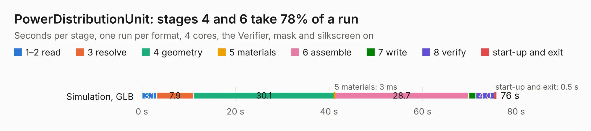

| Mode and format | 1–2 read | 3 resolve | 4 geometry | 5 materials | 6 assemble | 7 write | 8 verify | start-up and exit | Total |
|---|---:|---:|---:|---:|---:|---:|---:|---:|---:|
| Simulation, GLB | 3.1 | 7.9 | 30.1 | 3&nbsp;ms | 28.7 | 1.5 | 4.0 | 0.5 | 75.8 |
| Simulation, STEP | 3.3 | 7.9 | 31.0 | 4&nbsp;ms | 29.9 | 21.1 | 4.6 | 0.5 | 98.3 |
| Simulation, STL | 3.1 | 8.2 | 32.4 | 3&nbsp;ms | 31.5 | 3.5 | 4.1 | 0.5 | 83.3 |
| Simulation, OBJ | 3.1 | 8.1 | 31.4 | 2&nbsp;ms | 32.1 | 44.8 | 4.4 | 0.5 | 124.4 |
| Visual, GLB | 3.3 | 8.0 | 31.4 | 3&nbsp;ms | 84.8 | 0.8 | 10.8 | 0.4 | 139.5 |
| Visual, OBJ | 3.2 | 8.0 | 30.6 | 2&nbsp;ms | 81.7 | 26.7 | 10.7 | 0.4 | 161.3 |

<table align="center"><tr><td valign="top">

| Board | Repo: [lhr-solar/ps-powerdistributionunit](https://github.com/lhr-solar/ps-powerdistributionunit) Board: `PowerDistributionUnit.kicad_pcb` |
|---|---|
| Folder | hardware / archive / PowerDistributionUnit_TPS25983 |
| Complexity | 423&nbsp;/&nbsp;1000 (size&nbsp;298, features&nbsp;125) |
| KESE&nbsp;features | through vias, custom pads, rounded, trapezoid or chamfered pads, filled zones, copper drawings, curved board outline, knockout text, stack-up, dielectric εr and tanδ |
| Tested | 9th November 2026 |
| Copper&nbsp;layers | 4 |
| File&nbsp;format | KiCad 9 (20241229) |
| Parts,&nbsp;tracks,&nbsp;vias | 693, 5,070, 989 |
| Triangles,&nbsp;simulation | 7,888,204 in 445 parts |
| Verifier | PASS in all six runs |

</td><td valign="top">

<table>
<tr><th>File type</th><th>File size</th><th>Peak memory used</th></tr>
<tr><th colspan="3" align="left">Simulation</th></tr>
<tr><td>GLB</td><td align="right">265&nbsp;MB</td><td align="right">2.3&nbsp;GB</td></tr>
<tr><td>STEP</td><td align="right">1.1&nbsp;GB</td><td align="right">2.7&nbsp;GB</td></tr>
<tr><td>STL</td><td align="right">394&nbsp;MB</td><td align="right">2.5&nbsp;GB</td></tr>
<tr><td>OBJ</td><td align="right">838&nbsp;MB</td><td align="right">4.9&nbsp;GB</td></tr>
<tr><th colspan="3" align="left">Visual</th></tr>
<tr><td>GLB</td><td align="right">170&nbsp;MB</td><td align="right">2.7&nbsp;GB</td></tr>
<tr><td>OBJ</td><td align="right">546&nbsp;MB</td><td align="right">3.4&nbsp;GB</td></tr>
</table>

</td></tr></table>

## 23.14.32 PowerDistributionUnit_Mk1

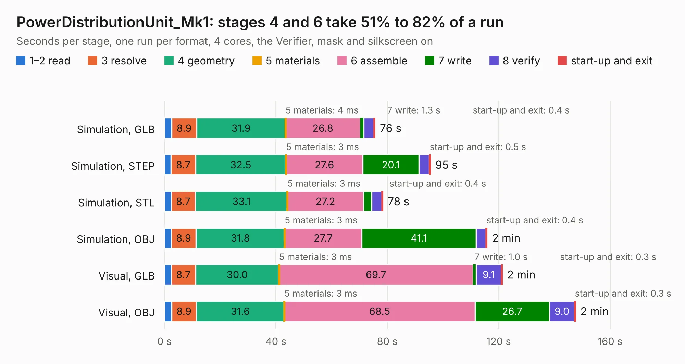

| Mode and format | 1–2 read | 3 resolve | 4 geometry | 5 materials | 6 assemble | 7 write | 8 verify | start-up and exit | Total |
|---|---:|---:|---:|---:|---:|---:|---:|---:|---:|
| Simulation, GLB | 2.6 | 8.9 | 31.9 | 4&nbsp;ms | 26.8 | 1.3 | 3.6 | 0.4 | 75.6 |
| Simulation, STEP | 2.4 | 8.7 | 32.5 | 3&nbsp;ms | 27.6 | 20.1 | 3.7 | 0.5 | 95.5 |
| Simulation, STL | 2.4 | 8.7 | 33.1 | 3&nbsp;ms | 27.2 | 3.0 | 3.6 | 0.4 | 78.4 |
| Simulation, OBJ | 2.4 | 8.9 | 31.8 | 3&nbsp;ms | 27.7 | 41.1 | 3.5 | 0.4 | 115.8 |
| Visual, GLB | 2.4 | 8.7 | 30.0 | 3&nbsp;ms | 69.7 | 1.0 | 9.1 | 0.3 | 121.3 |
| Visual, OBJ | 2.6 | 8.9 | 31.6 | 3&nbsp;ms | 68.5 | 26.7 | 9.0 | 0.3 | 147.5 |

<table align="center"><tr><td valign="top">

| Board | Repo: [lhr-solar/ps-powerdistributionunit](https://github.com/lhr-solar/ps-powerdistributionunit) Board: `PowerDistributionUnit_Mk1.kicad_pcb` |
|---|---|
| Folder | hardware / PowerDistributionUnit_Mk1 |
| Complexity | 440&nbsp;/&nbsp;1000 (size&nbsp;315, features&nbsp;125) |
| KESE&nbsp;features | through vias, custom pads, rounded, trapezoid or chamfered pads, filled zones, copper drawings, curved board outline, knockout text, stack-up, dielectric εr and tanδ |
| Tested | 9th November 2026 |
| Copper&nbsp;layers | 4 |
| File&nbsp;format | KiCad 9 (20241229) |
| Parts,&nbsp;tracks,&nbsp;vias | 518, 5,195, 762 |
| Triangles,&nbsp;simulation | 7,549,914 in 514 parts |
| Verifier | PASS in all six runs |

</td><td valign="top">

<table>
<tr><th>File type</th><th>File size</th><th>Peak memory used</th></tr>
<tr><th colspan="3" align="left">Simulation</th></tr>
<tr><td>GLB</td><td align="right">256&nbsp;MB</td><td align="right">2.2&nbsp;GB</td></tr>
<tr><td>STEP</td><td align="right">1.1&nbsp;GB</td><td align="right">2.7&nbsp;GB</td></tr>
<tr><td>STL</td><td align="right">378&nbsp;MB</td><td align="right">2.2&nbsp;GB</td></tr>
<tr><td>OBJ</td><td align="right">809&nbsp;MB</td><td align="right">4.8&nbsp;GB</td></tr>
<tr><th colspan="3" align="left">Visual</th></tr>
<tr><td>GLB</td><td align="right">178&nbsp;MB</td><td align="right">2.7&nbsp;GB</td></tr>
<tr><td>OBJ</td><td align="right">572&nbsp;MB</td><td align="right">3.5&nbsp;GB</td></tr>
</table>

</td></tr></table>

## 23.14.33 TestBoard_TPS27SA08-Q1

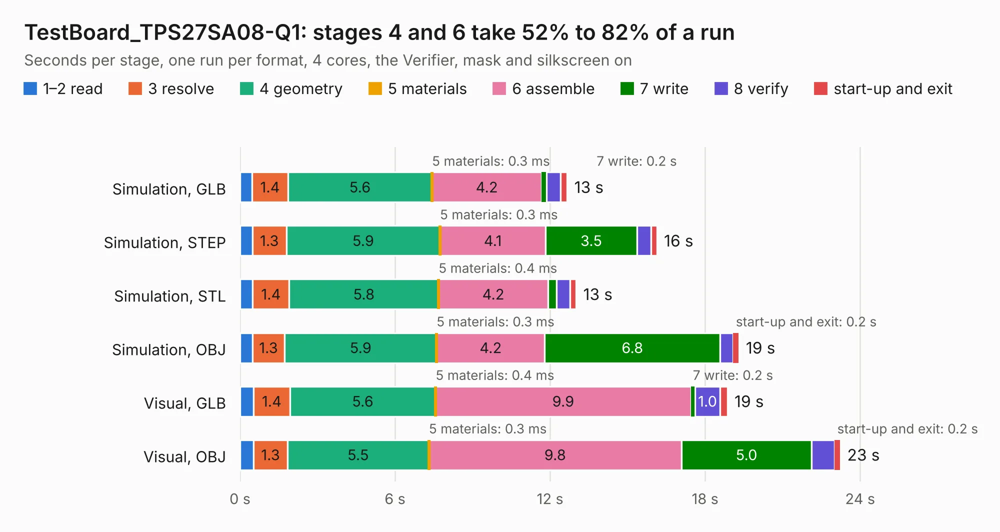

| Mode and format | 1–2 read | 3 resolve | 4 geometry | 5 materials | 6 assemble | 7 write | 8 verify | start-up and exit | Total |
|---|---:|---:|---:|---:|---:|---:|---:|---:|---:|
| Simulation, GLB | 0.5 | 1.4 | 5.6 | 0.3&nbsp;ms | 4.2 | 0.2 | 0.5 | 0.2 | 12.7 |
| Simulation, STEP | 0.5 | 1.3 | 5.9 | 0.3&nbsp;ms | 4.1 | 3.5 | 0.5 | 0.2 | 16.1 |
| Simulation, STL | 0.5 | 1.4 | 5.8 | 0.4&nbsp;ms | 4.2 | 0.3 | 0.5 | 0.2 | 13.0 |
| Simulation, OBJ | 0.5 | 1.3 | 5.9 | 0.3&nbsp;ms | 4.2 | 6.8 | 0.5 | 0.2 | 19.3 |
| Visual, GLB | 0.5 | 1.4 | 5.6 | 0.4&nbsp;ms | 9.9 | 0.2 | 1.0 | 0.3 | 18.9 |
| Visual, OBJ | 0.5 | 1.3 | 5.5 | 0.3&nbsp;ms | 9.8 | 5.0 | 0.9 | 0.2 | 23.2 |

<table align="center"><tr><td valign="top">

| Board | Repo: [lhr-solar/ps-powerdistributionunit](https://github.com/lhr-solar/ps-powerdistributionunit) Board: `TestBoard_TPS27SA08-Q1.kicad_pcb` |
|---|---|
| Folder | hardware / TestBoard_TPS27SA08-Q1 |
| Complexity | 310&nbsp;/&nbsp;1000 (size&nbsp;215, features&nbsp;95) |
| KESE&nbsp;features | through vias, custom pads, rounded, trapezoid or chamfered pads, filled zones, copper drawings, curved board outline, knockout text |
| Tested | 9th November 2026 |
| Copper&nbsp;layers | 2 |
| File&nbsp;format | KiCad 9 (20241229) |
| Parts,&nbsp;tracks,&nbsp;vias | 102, 576, 52 |
| Triangles,&nbsp;simulation | 1,255,072 in 114 parts |
| Verifier | PASS in all six runs |

</td><td valign="top">

<table>
<tr><th>File type</th><th>File size</th><th>Peak memory used</th></tr>
<tr><th colspan="3" align="left">Simulation</th></tr>
<tr><td>GLB</td><td align="right">43&nbsp;MB</td><td align="right">547&nbsp;MB</td></tr>
<tr><td>STEP</td><td align="right">203&nbsp;MB</td><td align="right">621&nbsp;MB</td></tr>
<tr><td>STL</td><td align="right">63&nbsp;MB</td><td align="right">538&nbsp;MB</td></tr>
<tr><td>OBJ</td><td align="right">129&nbsp;MB</td><td align="right">883&nbsp;MB</td></tr>
<tr><th colspan="3" align="left">Visual</th></tr>
<tr><td>GLB</td><td align="right">32&nbsp;MB</td><td align="right">753&nbsp;MB</td></tr>
<tr><td>OBJ</td><td align="right">94&nbsp;MB</td><td align="right">724&nbsp;MB</td></tr>
</table>

</td></tr></table>

## 23.14.34 LibreRouter_MegaBoard

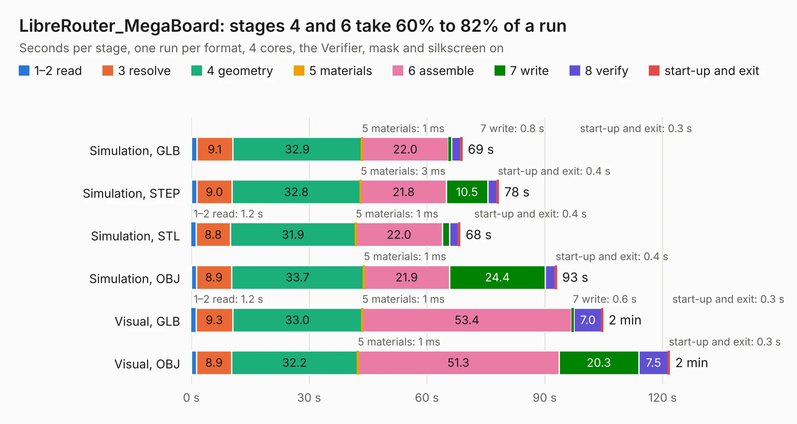

| Mode and format | 1–2 read | 3 resolve | 4 geometry | 5 materials | 6 assemble | 7 write | 8 verify | start-up and exit | Total |
|---|---:|---:|---:|---:|---:|---:|---:|---:|---:|
| Simulation, GLB | 1.4 | 9.1 | 32.9 | 1&nbsp;ms | 22.0 | 0.8 | 2.3 | 0.3 | 69.0 |
| Simulation, STEP | 1.4 | 9.0 | 32.8 | 3&nbsp;ms | 21.8 | 10.5 | 2.4 | 0.4 | 78.3 |
| Simulation, STL | 1.2 | 8.8 | 31.9 | 1&nbsp;ms | 22.0 | 1.8 | 2.3 | 0.4 | 68.4 |
| Simulation, OBJ | 1.3 | 8.9 | 33.7 | 1&nbsp;ms | 21.9 | 24.4 | 2.5 | 0.4 | 93.0 |
| Visual, GLB | 1.2 | 9.3 | 33.0 | 1&nbsp;ms | 53.4 | 0.6 | 7.0 | 0.3 | 104.8 |
| Visual, OBJ | 1.3 | 8.9 | 32.2 | 1&nbsp;ms | 51.3 | 20.3 | 7.5 | 0.3 | 121.8 |

<table align="center"><tr><td valign="top">

| Board | Repo: [libremesh/librerouter](https://github.com/libremesh/librerouter) Board: `LibreRouter_MegaBoard.kicad_pcb` |
|---|---|
| Folder | designs / mega_board |
| Complexity | 282&nbsp;/&nbsp;1000 (size&nbsp;227, features&nbsp;55) |
| KESE&nbsp;features | through vias, rounded, trapezoid or chamfered pads, filled zones, curved board outline |
| Tested | 9th November 2026 |
| Copper&nbsp;layers | 2 |
| File&nbsp;format | KiCad 5 (20171130) |
| Parts,&nbsp;tracks,&nbsp;vias | 234, 2,323, 2,552 |
| Triangles,&nbsp;simulation | 4,770,072 in 288 parts |
| Verifier | PASS in all six runs |

</td><td valign="top">

<table>
<tr><th>File type</th><th>File size</th><th>Peak memory used</th></tr>
<tr><th colspan="3" align="left">Simulation</th></tr>
<tr><td>GLB</td><td align="right">164&nbsp;MB</td><td align="right">1.6&nbsp;GB</td></tr>
<tr><td>STEP</td><td align="right">559&nbsp;MB</td><td align="right">2.1&nbsp;GB</td></tr>
<tr><td>STL</td><td align="right">239&nbsp;MB</td><td align="right">1.6&nbsp;GB</td></tr>
<tr><td>OBJ</td><td align="right">510&nbsp;MB</td><td align="right">3.1&nbsp;GB</td></tr>
<tr><th colspan="3" align="left">Visual</th></tr>
<tr><td>GLB</td><td align="right">136&nbsp;MB</td><td align="right">2.2&nbsp;GB</td></tr>
<tr><td>OBJ</td><td align="right">434&nbsp;MB</td><td align="right">2.8&nbsp;GB</td></tr>
</table>

</td></tr></table>

## 23.14.35 bms-8s50-ic

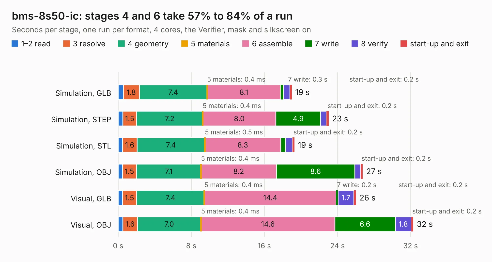

| Mode and format | 1–2 read | 3 resolve | 4 geometry | 5 materials | 6 assemble | 7 write | 8 verify | start-up and exit | Total |
|---|---:|---:|---:|---:|---:|---:|---:|---:|---:|
| Simulation, GLB | 0.6 | 1.8 | 7.4 | 0.4&nbsp;ms | 8.1 | 0.3 | 0.7 | 0.2 | 19.0 |
| Simulation, STEP | 0.5 | 1.5 | 7.2 | 0.4&nbsp;ms | 8.0 | 4.9 | 0.6 | 0.2 | 23.0 |
| Simulation, STL | 0.5 | 1.6 | 7.4 | 0.5&nbsp;ms | 8.3 | 0.6 | 0.7 | 0.2 | 19.3 |
| Simulation, OBJ | 0.5 | 1.5 | 7.1 | 0.4&nbsp;ms | 8.2 | 8.6 | 0.6 | 0.2 | 26.8 |
| Visual, GLB | 0.5 | 1.5 | 7.4 | 0.4&nbsp;ms | 14.4 | 0.2 | 1.7 | 0.2 | 26.0 |
| Visual, OBJ | 0.5 | 1.6 | 7.0 | 0.4&nbsp;ms | 14.6 | 6.6 | 1.8 | 0.2 | 32.3 |

<table align="center"><tr><td valign="top">

| Board | Repo: [libresolar/bms-8s50-ic](https://github.com/libresolar/bms-8s50-ic) Board: `bms-8s50-ic.kicad_pcb` |
|---|---|
| Folder | kicad |
| Complexity | 300&nbsp;/&nbsp;1000 (size&nbsp;245, features&nbsp;55) |
| KESE&nbsp;features | through vias, rounded, trapezoid or chamfered pads, filled zones, curved board outline |
| Tested | 9th November 2026 |
| Copper&nbsp;layers | 2 |
| File&nbsp;format | KiCad 5 (20171130) |
| Parts,&nbsp;tracks,&nbsp;vias | 160, 1,428, 275 |
| Triangles,&nbsp;simulation | 1,688,996 in 155 parts |
| Verifier | PASS in all six runs |

</td><td valign="top">

<table>
<tr><th>File type</th><th>File size</th><th>Peak memory used</th></tr>
<tr><th colspan="3" align="left">Simulation</th></tr>
<tr><td>GLB</td><td align="right">58&nbsp;MB</td><td align="right">624&nbsp;MB</td></tr>
<tr><td>STEP</td><td align="right">257&nbsp;MB</td><td align="right">802&nbsp;MB</td></tr>
<tr><td>STL</td><td align="right">84&nbsp;MB</td><td align="right">647&nbsp;MB</td></tr>
<tr><td>OBJ</td><td align="right">174&nbsp;MB</td><td align="right">1.1&nbsp;GB</td></tr>
<tr><th colspan="3" align="left">Visual</th></tr>
<tr><td>GLB</td><td align="right">44&nbsp;MB</td><td align="right">809&nbsp;MB</td></tr>
<tr><td>OBJ</td><td align="right">132&nbsp;MB</td><td align="right">918&nbsp;MB</td></tr>
</table>

</td></tr></table>

## 23.14.36 bms-c1

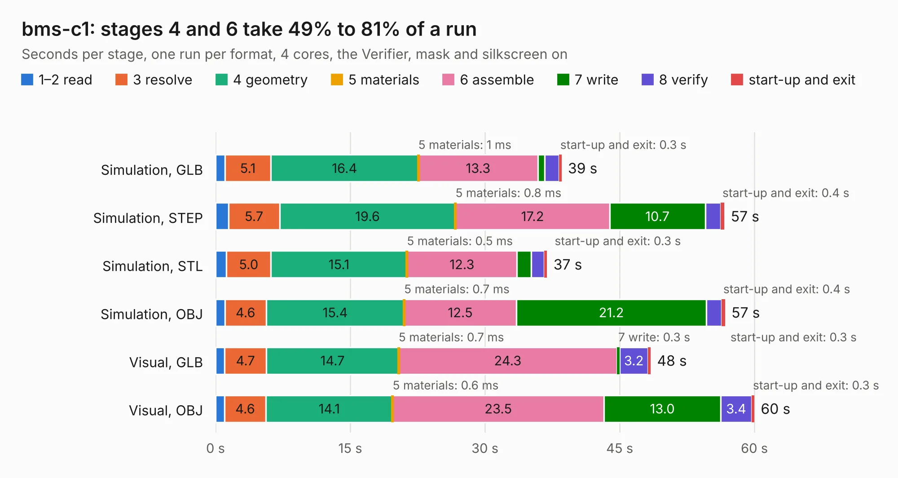

| Mode and format | 1–2 read | 3 resolve | 4 geometry | 5 materials | 6 assemble | 7 write | 8 verify | start-up and exit | Total |
|---|---:|---:|---:|---:|---:|---:|---:|---:|---:|
| Simulation, GLB | 1.1 | 5.1 | 16.4 | 1&nbsp;ms | 13.3 | 0.7 | 1.6 | 0.3 | 38.5 |
| Simulation, STEP | 1.4 | 5.7 | 19.6 | 0.8&nbsp;ms | 17.2 | 10.7 | 1.7 | 0.4 | 56.7 |
| Simulation, STL | 1.2 | 5.0 | 15.1 | 0.5&nbsp;ms | 12.3 | 1.6 | 1.4 | 0.3 | 36.9 |
| Simulation, OBJ | 1.0 | 4.6 | 15.4 | 0.7&nbsp;ms | 12.5 | 21.2 | 1.7 | 0.4 | 56.7 |
| Visual, GLB | 1.0 | 4.7 | 14.7 | 0.7&nbsp;ms | 24.3 | 0.3 | 3.2 | 0.3 | 48.4 |
| Visual, OBJ | 1.0 | 4.6 | 14.1 | 0.6&nbsp;ms | 23.5 | 13.0 | 3.4 | 0.3 | 60.0 |

<table align="center"><tr><td valign="top">

| Board | Repo: [LibreSolar/bms-c1](https://github.com/LibreSolar/bms-c1) Board: `bms-c1.kicad_pcb` |
|---|---|
| Folder | kicad |
| Complexity | 383&nbsp;/&nbsp;1000 (size&nbsp;263, features&nbsp;120) |
| KESE&nbsp;features | through vias, slotted holes, custom pads, rounded, trapezoid or chamfered pads, filled zones, copper drawings, curved board outline, stack-up, dielectric εr and tanδ |
| Tested | 9th November 2026 |
| Copper&nbsp;layers | 4 |
| File&nbsp;format | KiCad 9 (20241229) |
| Parts,&nbsp;tracks,&nbsp;vias | 169, 1,097, 805 |
| Triangles,&nbsp;simulation | 3,559,068 in 155 parts |
| Verifier | PASS in all six runs |

</td><td valign="top">

<table>
<tr><th>File type</th><th>File size</th><th>Peak memory used</th></tr>
<tr><th colspan="3" align="left">Simulation</th></tr>
<tr><td>GLB</td><td align="right">120&nbsp;MB</td><td align="right">1.1&nbsp;GB</td></tr>
<tr><td>STEP</td><td align="right">359&nbsp;MB</td><td align="right">1.2&nbsp;GB</td></tr>
<tr><td>STL</td><td align="right">178&nbsp;MB</td><td align="right">1.1&nbsp;GB</td></tr>
<tr><td>OBJ</td><td align="right">369&nbsp;MB</td><td align="right">2.3&nbsp;GB</td></tr>
<tr><th colspan="3" align="left">Visual</th></tr>
<tr><td>GLB</td><td align="right">71&nbsp;MB</td><td align="right">1.3&nbsp;GB</td></tr>
<tr><td>OBJ</td><td align="right">223&nbsp;MB</td><td align="right">1.5&nbsp;GB</td></tr>
</table>

</td></tr></table>

## 23.14.37 mppt-1210-hus

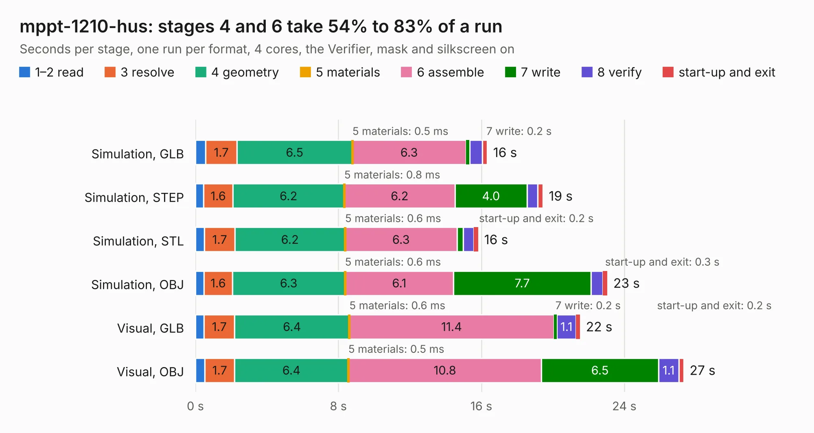

| Mode and format | 1–2 read | 3 resolve | 4 geometry | 5 materials | 6 assemble | 7 write | 8 verify | start-up and exit | Total |
|---|---:|---:|---:|---:|---:|---:|---:|---:|---:|
| Simulation, GLB | 0.6 | 1.7 | 6.5 | 0.5&nbsp;ms | 6.3 | 0.2 | 0.7 | 0.3 | 16.3 |
| Simulation, STEP | 0.5 | 1.6 | 6.2 | 0.8&nbsp;ms | 6.2 | 4.0 | 0.6 | 0.3 | 19.4 |
| Simulation, STL | 0.5 | 1.7 | 6.2 | 0.6&nbsp;ms | 6.3 | 0.4 | 0.6 | 0.2 | 15.8 |
| Simulation, OBJ | 0.5 | 1.6 | 6.3 | 0.6&nbsp;ms | 6.1 | 7.7 | 0.7 | 0.3 | 23.1 |
| Visual, GLB | 0.5 | 1.7 | 6.4 | 0.6&nbsp;ms | 11.4 | 0.2 | 1.1 | 0.2 | 21.5 |
| Visual, OBJ | 0.5 | 1.7 | 6.4 | 0.5&nbsp;ms | 10.8 | 6.5 | 1.1 | 0.3 | 27.3 |

<table align="center"><tr><td valign="top">

| Board | Repo: [LibreSolar/mppt-1210-hus](https://github.com/LibreSolar/mppt-1210-hus) Board: `mppt-1210-hus.kicad_pcb` |
|---|---|
| Folder | kicad |
| Complexity | 285&nbsp;/&nbsp;1000 (size&nbsp;230, features&nbsp;55) |
| KESE&nbsp;features | through vias, rounded, trapezoid or chamfered pads, filled zones, curved board outline |
| Tested | 9th November 2026 |
| Copper&nbsp;layers | 2 |
| File&nbsp;format | KiCad 5 (20171130) |
| Parts,&nbsp;tracks,&nbsp;vias | 118, 1,023, 212 |
| Triangles,&nbsp;simulation | 1,362,694 in 99 parts |
| Verifier | PASS in all six runs |

</td><td valign="top">

<table>
<tr><th>File type</th><th>File size</th><th>Peak memory used</th></tr>
<tr><th colspan="3" align="left">Simulation</th></tr>
<tr><td>GLB</td><td align="right">47&nbsp;MB</td><td align="right">546&nbsp;MB</td></tr>
<tr><td>STEP</td><td align="right">217&nbsp;MB</td><td align="right">686&nbsp;MB</td></tr>
<tr><td>STL</td><td align="right">68&nbsp;MB</td><td align="right">541&nbsp;MB</td></tr>
<tr><td>OBJ</td><td align="right">140&nbsp;MB</td><td align="right">917&nbsp;MB</td></tr>
<tr><th colspan="3" align="left">Visual</th></tr>
<tr><td>GLB</td><td align="right">39&nbsp;MB</td><td align="right">736&nbsp;MB</td></tr>
<tr><td>OBJ</td><td align="right">116&nbsp;MB</td><td align="right">866&nbsp;MB</td></tr>
</table>

</td></tr></table>

## 23.14.38 mppt-2420-hc

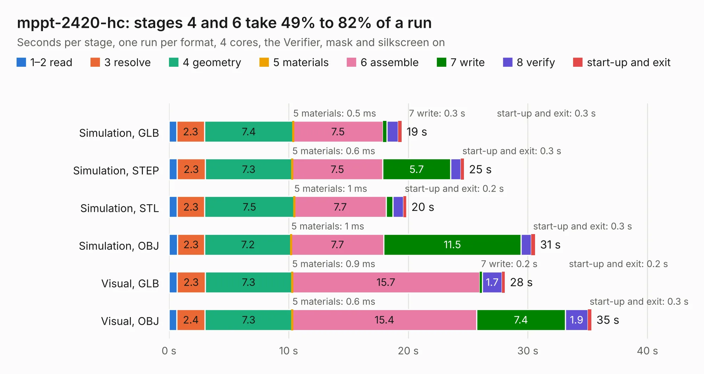

| Mode and format | 1–2 read | 3 resolve | 4 geometry | 5 materials | 6 assemble | 7 write | 8 verify | start-up and exit | Total |
|---|---:|---:|---:|---:|---:|---:|---:|---:|---:|
| Simulation, GLB | 0.6 | 2.3 | 7.4 | 0.5&nbsp;ms | 7.5 | 0.3 | 0.9 | 0.3 | 19.4 |
| Simulation, STEP | 0.7 | 2.3 | 7.3 | 0.6&nbsp;ms | 7.5 | 5.7 | 0.9 | 0.3 | 24.7 |
| Simulation, STL | 0.7 | 2.3 | 7.5 | 1&nbsp;ms | 7.7 | 0.6 | 0.9 | 0.2 | 19.8 |
| Simulation, OBJ | 0.7 | 2.3 | 7.2 | 1&nbsp;ms | 7.7 | 11.5 | 0.9 | 0.3 | 30.6 |
| Visual, GLB | 0.7 | 2.3 | 7.3 | 0.9&nbsp;ms | 15.7 | 0.2 | 1.7 | 0.2 | 28.1 |
| Visual, OBJ | 0.6 | 2.4 | 7.3 | 0.6&nbsp;ms | 15.4 | 7.4 | 1.9 | 0.3 | 35.3 |

<table align="center"><tr><td valign="top">

| Board | Repo: [LibreSolar/mppt-2420-hc](https://github.com/LibreSolar/mppt-2420-hc) Board: `mppt-2420-hc.kicad_pcb` |
|---|---|
| Folder | kicad |
| Complexity | 307&nbsp;/&nbsp;1000 (size&nbsp;252, features&nbsp;55) |
| KESE&nbsp;features | through vias, rounded, trapezoid or chamfered pads, filled zones, curved board outline |
| Tested | 9th November 2026 |
| Copper&nbsp;layers | 4 |
| File&nbsp;format | KiCad 5 (20171130) |
| Parts,&nbsp;tracks,&nbsp;vias | 140, 1,263, 282 |
| Triangles,&nbsp;simulation | 2,031,356 in 113 parts |
| Verifier | PASS in all six runs |

</td><td valign="top">

<table>
<tr><th>File type</th><th>File size</th><th>Peak memory used</th></tr>
<tr><th colspan="3" align="left">Simulation</th></tr>
<tr><td>GLB</td><td align="right">69&nbsp;MB</td><td align="right">658&nbsp;MB</td></tr>
<tr><td>STEP</td><td align="right">252&nbsp;MB</td><td align="right">834&nbsp;MB</td></tr>
<tr><td>STL</td><td align="right">102&nbsp;MB</td><td align="right">668&nbsp;MB</td></tr>
<tr><td>OBJ</td><td align="right">210&nbsp;MB</td><td align="right">1.4&nbsp;GB</td></tr>
<tr><th colspan="3" align="left">Visual</th></tr>
<tr><td>GLB</td><td align="right">45&nbsp;MB</td><td align="right">818&nbsp;MB</td></tr>
<tr><td>OBJ</td><td align="right">137&nbsp;MB</td><td align="right">994&nbsp;MB</td></tr>
</table>

</td></tr></table>

## 23.14.39 mppt-2420-hpx

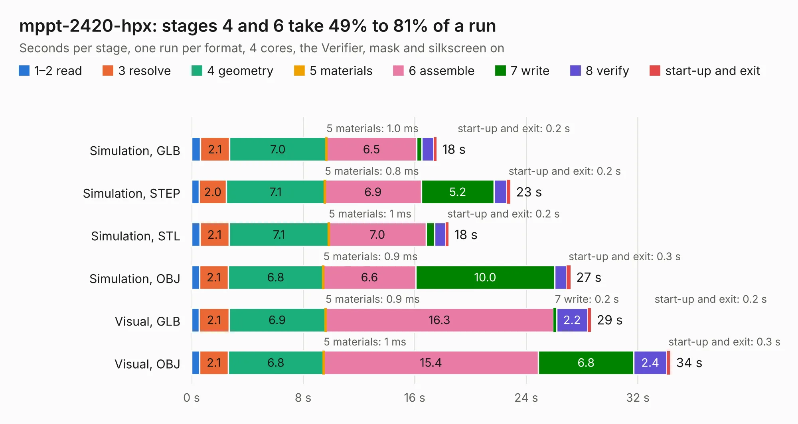

| Mode and format | 1–2 read | 3 resolve | 4 geometry | 5 materials | 6 assemble | 7 write | 8 verify | start-up and exit | Total |
|---|---:|---:|---:|---:|---:|---:|---:|---:|---:|
| Simulation, GLB | 0.6 | 2.1 | 7.0 | 1.0&nbsp;ms | 6.5 | 0.4 | 0.9 | 0.2 | 17.6 |
| Simulation, STEP | 0.5 | 2.0 | 7.1 | 0.8&nbsp;ms | 6.9 | 5.2 | 0.9 | 0.2 | 22.9 |
| Simulation, STL | 0.6 | 2.1 | 7.1 | 1&nbsp;ms | 7.0 | 0.6 | 0.8 | 0.2 | 18.4 |
| Simulation, OBJ | 0.6 | 2.1 | 6.8 | 0.9&nbsp;ms | 6.6 | 10.0 | 0.9 | 0.3 | 27.2 |
| Visual, GLB | 0.5 | 2.1 | 6.9 | 0.9&nbsp;ms | 16.3 | 0.2 | 2.2 | 0.2 | 28.6 |
| Visual, OBJ | 0.6 | 2.1 | 6.8 | 1&nbsp;ms | 15.4 | 6.8 | 2.4 | 0.3 | 34.3 |

<table align="center"><tr><td valign="top">

| Board | Repo: [libresolar/mppt-2420-hpx](https://github.com/libresolar/mppt-2420-hpx) Board: `mppt-2420-hpx.kicad_pcb` |
|---|---|
| Folder | kicad |
| Complexity | 301&nbsp;/&nbsp;1000 (size&nbsp;256, features&nbsp;45) |
| KESE&nbsp;features | through vias, rounded, trapezoid or chamfered pads, filled zones |
| Tested | 9th November 2026 |
| Copper&nbsp;layers | 4 |
| File&nbsp;format | KiCad 5 (20171130) |
| Parts,&nbsp;tracks,&nbsp;vias | 178, 1,413, 274 |
| Triangles,&nbsp;simulation | 2,395,966 in 170 parts |
| Verifier | PASS in all six runs |

</td><td valign="top">

<table>
<tr><th>File type</th><th>File size</th><th>Peak memory used</th></tr>
<tr><th colspan="3" align="left">Simulation</th></tr>
<tr><td>GLB</td><td align="right">82&nbsp;MB</td><td align="right">754&nbsp;MB</td></tr>
<tr><td>STEP</td><td align="right">300&nbsp;MB</td><td align="right">975&nbsp;MB</td></tr>
<tr><td>STL</td><td align="right">120&nbsp;MB</td><td align="right">789&nbsp;MB</td></tr>
<tr><td>OBJ</td><td align="right">250&nbsp;MB</td><td align="right">1.6&nbsp;GB</td></tr>
<tr><th colspan="3" align="left">Visual</th></tr>
<tr><td>GLB</td><td align="right">53&nbsp;MB</td><td align="right">1.0&nbsp;GB</td></tr>
<tr><td>OBJ</td><td align="right">163&nbsp;MB</td><td align="right">1.2&nbsp;GB</td></tr>
</table>

</td></tr></table>

## 23.14.40 cantact

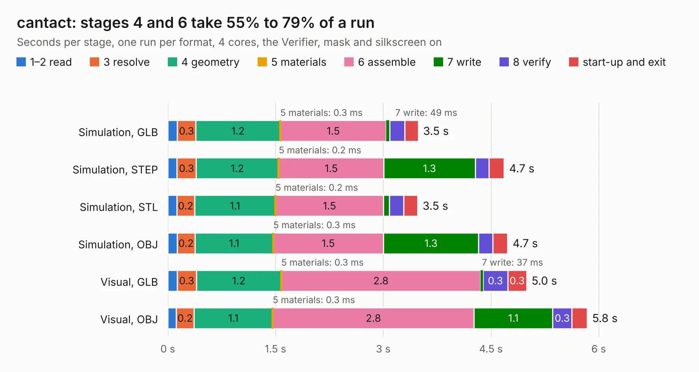

| Mode and format | 1–2 read | 3 resolve | 4 geometry | 5 materials | 6 assemble | 7 write | 8 verify | start-up and exit | Total |
|---|---:|---:|---:|---:|---:|---:|---:|---:|---:|
| Simulation, GLB | 0.1 | 0.3 | 1.2 | 0.3&nbsp;ms | 1.5 | 49&nbsp;ms | 0.2 | 0.2 | 3.5 |
| Simulation, STEP | 0.1 | 0.3 | 1.2 | 0.2&nbsp;ms | 1.5 | 1.3 | 0.2 | 0.2 | 4.7 |
| Simulation, STL | 0.1 | 0.2 | 1.1 | 0.2&nbsp;ms | 1.5 | 82&nbsp;ms | 0.2 | 0.2 | 3.5 |
| Simulation, OBJ | 0.1 | 0.2 | 1.1 | 0.3&nbsp;ms | 1.5 | 1.3 | 0.2 | 0.2 | 4.7 |
| Visual, GLB | 0.1 | 0.3 | 1.2 | 0.3&nbsp;ms | 2.8 | 37&nbsp;ms | 0.3 | 0.3 | 5.0 |
| Visual, OBJ | 0.1 | 0.2 | 1.1 | 0.3&nbsp;ms | 2.8 | 1.1 | 0.3 | 0.2 | 5.8 |

<table align="center"><tr><td valign="top">

| Board | Repo: [linklayer/cantact-hw](https://github.com/linklayer/cantact-hw) Board: `cantact.kicad_pcb` |
|---|---|
| Complexity | 228&nbsp;/&nbsp;1000 (size&nbsp;193, features&nbsp;35) |
| KESE&nbsp;features | through vias, filled zones |
| Tested | 9th November 2026 |
| Copper&nbsp;layers | 2 |
| File&nbsp;format | KiCad 4 (4) |
| Parts,&nbsp;tracks,&nbsp;vias | 34, 333, 22 |
| Triangles,&nbsp;simulation | 334,110 in 72 parts |
| Verifier | PASS in all six runs |

</td><td valign="top">

<table>
<tr><th>File type</th><th>File size</th><th>Peak memory used</th></tr>
<tr><th colspan="3" align="left">Simulation</th></tr>
<tr><td>GLB</td><td align="right">12&nbsp;MB</td><td align="right">256&nbsp;MB</td></tr>
<tr><td>STEP</td><td align="right">57&nbsp;MB</td><td align="right">297&nbsp;MB</td></tr>
<tr><td>STL</td><td align="right">17&nbsp;MB</td><td align="right">258&nbsp;MB</td></tr>
<tr><td>OBJ</td><td align="right">34&nbsp;MB</td><td align="right">263&nbsp;MB</td></tr>
<tr><th colspan="3" align="left">Visual</th></tr>
<tr><td>GLB</td><td align="right">9.4&nbsp;MB</td><td align="right">302&nbsp;MB</td></tr>
<tr><td>OBJ</td><td align="right">28&nbsp;MB</td><td align="right">300&nbsp;MB</td></tr>
</table>

</td></tr></table>

## 23.14.41 Issue3B

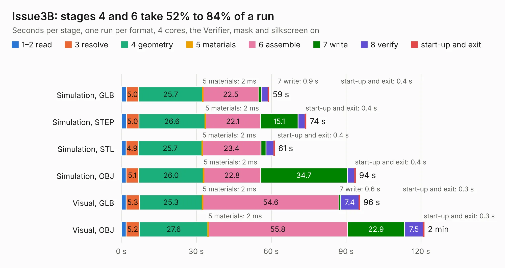

| Mode and format | 1–2 read | 3 resolve | 4 geometry | 5 materials | 6 assemble | 7 write | 8 verify | start-up and exit | Total |
|---|---:|---:|---:|---:|---:|---:|---:|---:|---:|
| Simulation, GLB | 2.0 | 5.0 | 25.7 | 2&nbsp;ms | 22.5 | 0.9 | 2.8 | 0.4 | 59.2 |
| Simulation, STEP | 2.0 | 5.0 | 26.6 | 2&nbsp;ms | 22.1 | 15.1 | 2.9 | 0.4 | 74.0 |
| Simulation, STL | 1.9 | 4.9 | 25.7 | 2&nbsp;ms | 23.4 | 2.1 | 3.1 | 0.4 | 61.4 |
| Simulation, OBJ | 1.9 | 5.1 | 26.0 | 2&nbsp;ms | 22.8 | 34.7 | 2.9 | 0.4 | 93.8 |
| Visual, GLB | 1.9 | 5.3 | 25.3 | 2&nbsp;ms | 54.6 | 0.6 | 7.4 | 0.3 | 95.5 |
| Visual, OBJ | 2.0 | 5.2 | 27.6 | 2&nbsp;ms | 55.8 | 22.9 | 7.5 | 0.3 | 121.3 |

<table align="center"><tr><td valign="top">

| Board | Repo: [liveboxandy/ZX-Spectrum-48K-Issue-3B---Based-on-Gerbers-by-PABB-on-PCBWay](https://github.com/liveboxandy/ZX-Spectrum-48K-Issue-3B---Based-on-Gerbers-by-PABB-on-PCBWay) Board: `Issue3B.kicad_pcb` |
|---|---|
| Complexity | 277&nbsp;/&nbsp;1000 (size&nbsp;222, features&nbsp;55) |
| KESE&nbsp;features | through vias, slotted holes, rounded, trapezoid or chamfered pads, copper drawings, curved board outline |
| Tested | 9th November 2026 |
| Copper&nbsp;layers | 2 |
| File&nbsp;format | KiCad 10 (20260206) |
| Parts,&nbsp;tracks,&nbsp;vias | 201, 7,150, 422 |
| Triangles,&nbsp;simulation | 5,693,544 in 181 parts |
| Verifier | PASS in all six runs |

</td><td valign="top">

<table>
<tr><th>File type</th><th>File size</th><th>Peak memory used</th></tr>
<tr><th colspan="3" align="left">Simulation</th></tr>
<tr><td>GLB</td><td align="right">193&nbsp;MB</td><td align="right">2.2&nbsp;GB</td></tr>
<tr><td>STEP</td><td align="right">842&nbsp;MB</td><td align="right">2.2&nbsp;GB</td></tr>
<tr><td>STL</td><td align="right">285&nbsp;MB</td><td align="right">2.1&nbsp;GB</td></tr>
<tr><td>OBJ</td><td align="right">604&nbsp;MB</td><td align="right">3.6&nbsp;GB</td></tr>
<tr><th colspan="3" align="left">Visual</th></tr>
<tr><td>GLB</td><td align="right">129&nbsp;MB</td><td align="right">2.2&nbsp;GB</td></tr>
<tr><td>OBJ</td><td align="right">412&nbsp;MB</td><td align="right">2.6&nbsp;GB</td></tr>
</table>

</td></tr></table>

## 23.14.42 dualpmod

| Mode and format | 1–2 read | 3 resolve | 4 geometry | 5 materials | 6 assemble | 7 write | 8 verify | start-up and exit | Total |
|---|---:|---:|---:|---:|---:|---:|---:|---:|---:|
| Simulation, GLB | 0.1 | 0.2 | 0.9 | 0.1&nbsp;ms | 0.7 | 29&nbsp;ms | 0.1 | 0.2 | 2.2 |
| Simulation, STEP | 0.1 | 0.2 | 0.9 | 0.1&nbsp;ms | 0.7 | 0.9 | 0.1 | 0.2 | 3.1 |
| Simulation, STL | 0.1 | 0.2 | 0.9 | 0.2&nbsp;ms | 0.7 | 38&nbsp;ms | 97&nbsp;ms | 0.2 | 2.3 |
| Simulation, OBJ | 0.1 | 0.2 | 0.9 | 0.2&nbsp;ms | 0.7 | 0.9 | 0.1 | 0.2 | 3.2 |
| Visual, GLB | 97&nbsp;ms | 0.2 | 0.9 | 0.2&nbsp;ms | 1.5 | 19&nbsp;ms | 0.1 | 0.2 | 3.0 |
| Visual, OBJ | 92&nbsp;ms | 0.2 | 0.9 | 0.1&nbsp;ms | 1.5 | 0.5 | 0.1 | 0.2 | 3.6 |

<table align="center"><tr><td valign="top">

| Board | Repo: [lowRISC/sonata-system](https://github.com/lowRISC/sonata-system) Board: `dualpmod.kicad_pcb` |
|---|---|
| Folder | vendor / lowrisc_ip / ip / usbdev / pmod / dualpmod-kicad |
| Complexity | 185&nbsp;/&nbsp;1000 (size&nbsp;130, features&nbsp;55) |
| KESE&nbsp;features | through vias, slotted holes, rounded, trapezoid or chamfered pads, filled zones |
| Tested | 9th November 2026 |
| Copper&nbsp;layers | 2 |
| File&nbsp;format | KiCad 5 (20171130) |
| Parts,&nbsp;tracks,&nbsp;vias | 13, 129, 17 |
| Triangles,&nbsp;simulation | 177,628 in 28 parts |
| Verifier | PASS in all six runs |

</td><td valign="top">

<table>
<tr><th>File type</th><th>File size</th><th>Peak memory used</th></tr>
<tr><th colspan="3" align="left">Simulation</th></tr>
<tr><td>GLB</td><td align="right">6.3&nbsp;MB</td><td align="right">207&nbsp;MB</td></tr>
<tr><td>STEP</td><td align="right">33&nbsp;MB</td><td align="right">216&nbsp;MB</td></tr>
<tr><td>STL</td><td align="right">8.9&nbsp;MB</td><td align="right">209&nbsp;MB</td></tr>
<tr><td>OBJ</td><td align="right">18&nbsp;MB</td><td align="right">211&nbsp;MB</td></tr>
<tr><th colspan="3" align="left">Visual</th></tr>
<tr><td>GLB</td><td align="right">3.9&nbsp;MB</td><td align="right">168&nbsp;MB</td></tr>
<tr><td>OBJ</td><td align="right">11&nbsp;MB</td><td align="right">171&nbsp;MB</td></tr>
</table>

</td></tr></table>

## 23.14.43 ad9864_breakout

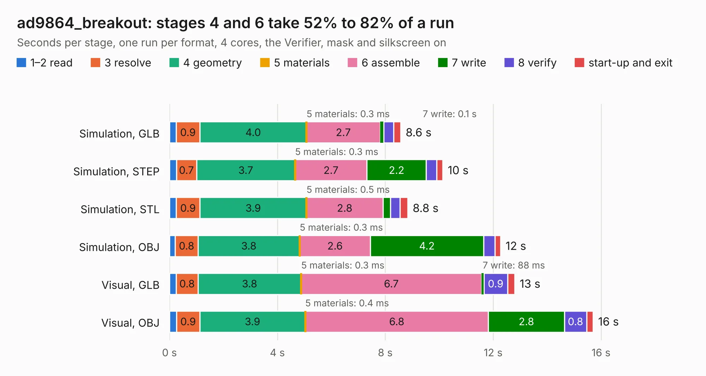

| Mode and format | 1–2 read | 3 resolve | 4 geometry | 5 materials | 6 assemble | 7 write | 8 verify | start-up and exit | Total |
|---|---:|---:|---:|---:|---:|---:|---:|---:|---:|
| Simulation, GLB | 0.2 | 0.9 | 4.0 | 0.3&nbsp;ms | 2.7 | 0.1 | 0.4 | 0.3 | 8.6 |
| Simulation, STEP | 0.3 | 0.7 | 3.7 | 0.3&nbsp;ms | 2.7 | 2.2 | 0.4 | 0.2 | 10.1 |
| Simulation, STL | 0.2 | 0.9 | 3.9 | 0.5&nbsp;ms | 2.8 | 0.3 | 0.4 | 0.3 | 8.8 |
| Simulation, OBJ | 0.2 | 0.8 | 3.8 | 0.3&nbsp;ms | 2.6 | 4.2 | 0.4 | 0.2 | 12.3 |
| Visual, GLB | 0.2 | 0.8 | 3.8 | 0.3&nbsp;ms | 6.7 | 88&nbsp;ms | 0.9 | 0.3 | 12.8 |
| Visual, OBJ | 0.3 | 0.9 | 3.9 | 0.4&nbsp;ms | 6.8 | 2.8 | 0.8 | 0.2 | 15.7 |

<table align="center"><tr><td valign="top">

| Board | Repo: [loxodes/vna](https://github.com/loxodes/vna) Board: `ad9864_breakout.kicad_pcb` |
|---|---|
| Folder | breakouts / ad9864 |
| Complexity | 264&nbsp;/&nbsp;1000 (size&nbsp;229, features&nbsp;35) |
| KESE&nbsp;features | through vias, filled zones |
| Tested | 9th November 2026 |
| Copper&nbsp;layers | 4 |
| File&nbsp;format | KiCad 4 (4) |
| Parts,&nbsp;tracks,&nbsp;vias | 82, 476, 74 |
| Triangles,&nbsp;simulation | 859,342 in 73 parts |
| Verifier | PASS in all six runs |

</td><td valign="top">

<table>
<tr><th>File type</th><th>File size</th><th>Peak memory used</th></tr>
<tr><th colspan="3" align="left">Simulation</th></tr>
<tr><td>GLB</td><td align="right">30&nbsp;MB</td><td align="right">384&nbsp;MB</td></tr>
<tr><td>STEP</td><td align="right">128&nbsp;MB</td><td align="right">434&nbsp;MB</td></tr>
<tr><td>STL</td><td align="right">43&nbsp;MB</td><td align="right">395&nbsp;MB</td></tr>
<tr><td>OBJ</td><td align="right">89&nbsp;MB</td><td align="right">633&nbsp;MB</td></tr>
<tr><th colspan="3" align="left">Visual</th></tr>
<tr><td>GLB</td><td align="right">19&nbsp;MB</td><td align="right">460&nbsp;MB</td></tr>
<tr><td>OBJ</td><td align="right">56&nbsp;MB</td><td align="right">461&nbsp;MB</td></tr>
</table>

</td></tr></table>

## 23.14.44 adc32xx_syzygy

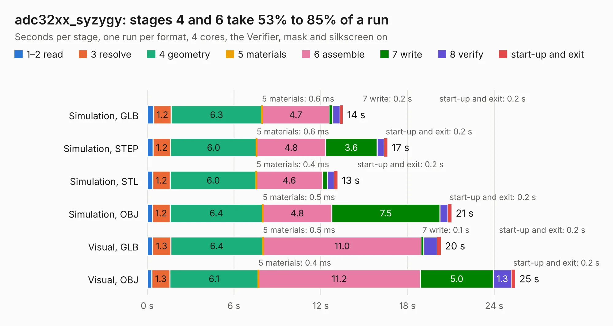

| Mode and format | 1–2 read | 3 resolve | 4 geometry | 5 materials | 6 assemble | 7 write | 8 verify | start-up and exit | Total |
|---|---:|---:|---:|---:|---:|---:|---:|---:|---:|
| Simulation, GLB | 0.4 | 1.2 | 6.3 | 0.6&nbsp;ms | 4.7 | 0.2 | 0.5 | 0.2 | 13.5 |
| Simulation, STEP | 0.4 | 1.2 | 6.0 | 0.6&nbsp;ms | 4.8 | 3.6 | 0.5 | 0.2 | 16.6 |
| Simulation, STL | 0.4 | 1.2 | 6.0 | 0.4&nbsp;ms | 4.6 | 0.4 | 0.5 | 0.2 | 13.2 |
| Simulation, OBJ | 0.4 | 1.2 | 6.4 | 0.5&nbsp;ms | 4.8 | 7.5 | 0.5 | 0.2 | 21.0 |
| Visual, GLB | 0.4 | 1.3 | 6.4 | 0.5&nbsp;ms | 11.0 | 0.1 | 0.9 | 0.2 | 20.3 |
| Visual, OBJ | 0.3 | 1.3 | 6.1 | 0.4&nbsp;ms | 11.2 | 5.0 | 1.3 | 0.2 | 25.4 |

<table align="center"><tr><td valign="top">

| Board | Repo: [loxodes/vna](https://github.com/loxodes/vna) Board: `adc32xx_syzygy.kicad_pcb` |
|---|---|
| Folder | breakouts / adc32xx_syzygy / adc32xx_syzygy |
| Complexity | 346&nbsp;/&nbsp;1000 (size&nbsp;246, features&nbsp;100) |
| KESE&nbsp;features | through vias, rounded, trapezoid or chamfered pads, arc tracks, filled zones, curved board outline, stack-up, dielectric εr and tanδ |
| Tested | 9th November 2026 |
| Copper&nbsp;layers | 4 |
| File&nbsp;format | KiCad 7 (20221018) |
| Parts,&nbsp;tracks,&nbsp;vias | 105, 1,115, 193 |
| Triangles,&nbsp;simulation | 1,389,302 in 112 parts |
| Verifier | PASS in all six runs |

</td><td valign="top">

<table>
<tr><th>File type</th><th>File size</th><th>Peak memory used</th></tr>
<tr><th colspan="3" align="left">Simulation</th></tr>
<tr><td>GLB</td><td align="right">48&nbsp;MB</td><td align="right">598&nbsp;MB</td></tr>
<tr><td>STEP</td><td align="right">220&nbsp;MB</td><td align="right">667&nbsp;MB</td></tr>
<tr><td>STL</td><td align="right">69&nbsp;MB</td><td align="right">613&nbsp;MB</td></tr>
<tr><td>OBJ</td><td align="right">145&nbsp;MB</td><td align="right">962&nbsp;MB</td></tr>
<tr><th colspan="3" align="left">Visual</th></tr>
<tr><td>GLB</td><td align="right">32&nbsp;MB</td><td align="right">716&nbsp;MB</td></tr>
<tr><td>OBJ</td><td align="right">96&nbsp;MB</td><td align="right">767&nbsp;MB</td></tr>
</table>

</td></tr></table>

## 23.14.45 adc344x

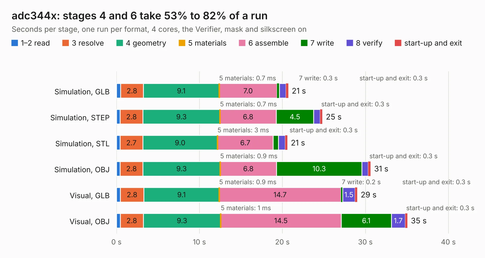

| Mode and format | 1–2 read | 3 resolve | 4 geometry | 5 materials | 6 assemble | 7 write | 8 verify | start-up and exit | Total |
|---|---:|---:|---:|---:|---:|---:|---:|---:|---:|
| Simulation, GLB | 0.5 | 2.8 | 9.1 | 0.7&nbsp;ms | 7.0 | 0.3 | 0.8 | 0.3 | 20.7 |
| Simulation, STEP | 0.4 | 2.8 | 9.3 | 0.7&nbsp;ms | 6.8 | 4.5 | 0.8 | 0.3 | 24.8 |
| Simulation, STL | 0.4 | 2.7 | 9.0 | 3&nbsp;ms | 6.7 | 0.6 | 0.8 | 0.3 | 20.6 |
| Simulation, OBJ | 0.4 | 2.8 | 9.3 | 0.9&nbsp;ms | 6.8 | 10.3 | 0.8 | 0.3 | 30.6 |
| Visual, GLB | 0.5 | 2.8 | 9.1 | 0.9&nbsp;ms | 14.7 | 0.2 | 1.5 | 0.3 | 29.0 |
| Visual, OBJ | 0.5 | 2.8 | 9.3 | 1&nbsp;ms | 14.5 | 6.1 | 1.7 | 0.3 | 35.1 |

<table align="center"><tr><td valign="top">

| Board | Repo: [loxodes/vna](https://github.com/loxodes/vna) Board: `adc344x.kicad_pcb` |
|---|---|
| Folder | breakouts / adc344x |
| Complexity | 296&nbsp;/&nbsp;1000 (size&nbsp;251, features&nbsp;45) |
| KESE&nbsp;features | through vias, rounded, trapezoid or chamfered pads, filled zones |
| Tested | 9th November 2026 |
| Copper&nbsp;layers | 4 |
| File&nbsp;format | KiCad 6 (20190516) |
| Parts,&nbsp;tracks,&nbsp;vias | 156, 1,475, 112 |
| Triangles,&nbsp;simulation | 1,762,408 in 160 parts |
| Verifier | PASS in all six runs |

</td><td valign="top">

<table>
<tr><th>File type</th><th>File size</th><th>Peak memory used</th></tr>
<tr><th colspan="3" align="left">Simulation</th></tr>
<tr><td>GLB</td><td align="right">61&nbsp;MB</td><td align="right">636&nbsp;MB</td></tr>
<tr><td>STEP</td><td align="right">262&nbsp;MB</td><td align="right">753&nbsp;MB</td></tr>
<tr><td>STL</td><td align="right">88&nbsp;MB</td><td align="right">588&nbsp;MB</td></tr>
<tr><td>OBJ</td><td align="right">186&nbsp;MB</td><td align="right">1.2&nbsp;GB</td></tr>
<tr><th colspan="3" align="left">Visual</th></tr>
<tr><td>GLB</td><td align="right">35&nbsp;MB</td><td align="right">829&nbsp;MB</td></tr>
<tr><td>OBJ</td><td align="right">105&nbsp;MB</td><td align="right">820&nbsp;MB</td></tr>
</table>

</td></tr></table>

## 23.14.46 adc_32xx

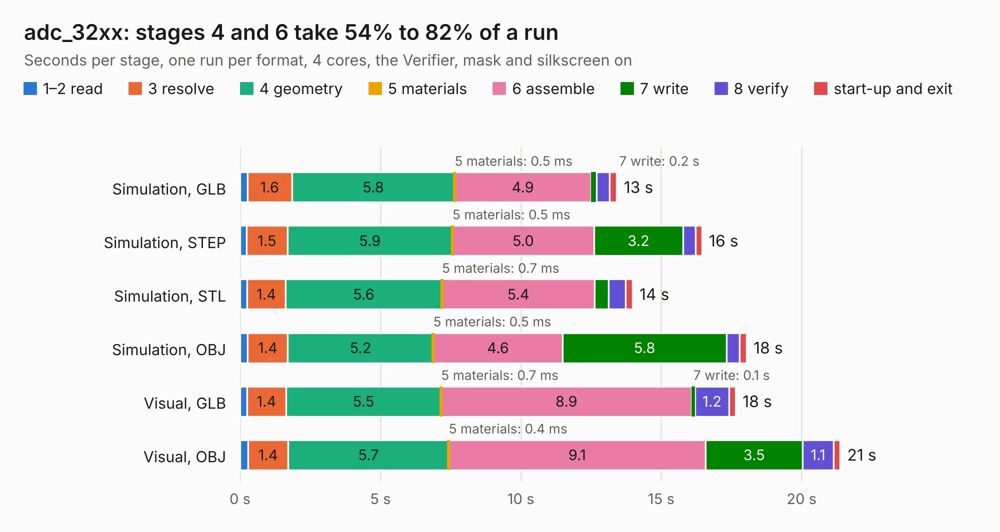

| Mode and format | 1–2 read | 3 resolve | 4 geometry | 5 materials | 6 assemble | 7 write | 8 verify | start-up and exit | Total |
|---|---:|---:|---:|---:|---:|---:|---:|---:|---:|
| Simulation, GLB | 0.3 | 1.6 | 5.8 | 0.5&nbsp;ms | 4.9 | 0.2 | 0.5 | 0.3 | 13.4 |
| Simulation, STEP | 0.2 | 1.5 | 5.9 | 0.5&nbsp;ms | 5.0 | 3.2 | 0.4 | 0.2 | 16.4 |
| Simulation, STL | 0.2 | 1.4 | 5.6 | 0.7&nbsp;ms | 5.4 | 0.5 | 0.6 | 0.2 | 14.0 |
| Simulation, OBJ | 0.3 | 1.4 | 5.2 | 0.5&nbsp;ms | 4.6 | 5.8 | 0.5 | 0.2 | 18.0 |
| Visual, GLB | 0.2 | 1.4 | 5.5 | 0.7&nbsp;ms | 8.9 | 0.1 | 1.2 | 0.2 | 17.6 |
| Visual, OBJ | 0.3 | 1.4 | 5.7 | 0.4&nbsp;ms | 9.1 | 3.5 | 1.1 | 0.2 | 21.4 |

<table align="center"><tr><td valign="top">

| Board | Repo: [loxodes/vna](https://github.com/loxodes/vna) Board: `adc_32xx.kicad_pcb` |
|---|---|
| Folder | breakouts / adc_32xx / ram_adc |
| Complexity | 296&nbsp;/&nbsp;1000 (size&nbsp;241, features&nbsp;55) |
| KESE&nbsp;features | through vias, rounded, trapezoid or chamfered pads, filled zones, curved board outline |
| Tested | 9th November 2026 |
| Copper&nbsp;layers | 4 |
| File&nbsp;format | KiCad 5 (20171130) |
| Parts,&nbsp;tracks,&nbsp;vias | 100, 933, 118 |
| Triangles,&nbsp;simulation | 1,439,468 in 97 parts |
| Verifier | PASS in all six runs |

</td><td valign="top">

<table>
<tr><th>File type</th><th>File size</th><th>Peak memory used</th></tr>
<tr><th colspan="3" align="left">Simulation</th></tr>
<tr><td>GLB</td><td align="right">50&nbsp;MB</td><td align="right">559&nbsp;MB</td></tr>
<tr><td>STEP</td><td align="right">230&nbsp;MB</td><td align="right">694&nbsp;MB</td></tr>
<tr><td>STL</td><td align="right">72&nbsp;MB</td><td align="right">575&nbsp;MB</td></tr>
<tr><td>OBJ</td><td align="right">150&nbsp;MB</td><td align="right">1.0&nbsp;GB</td></tr>
<tr><th colspan="3" align="left">Visual</th></tr>
<tr><td>GLB</td><td align="right">29&nbsp;MB</td><td align="right">626&nbsp;MB</td></tr>
<tr><td>OBJ</td><td align="right">86&nbsp;MB</td><td align="right">677&nbsp;MB</td></tr>
</table>

</td></tr></table>

## 23.14.47 adc_cape

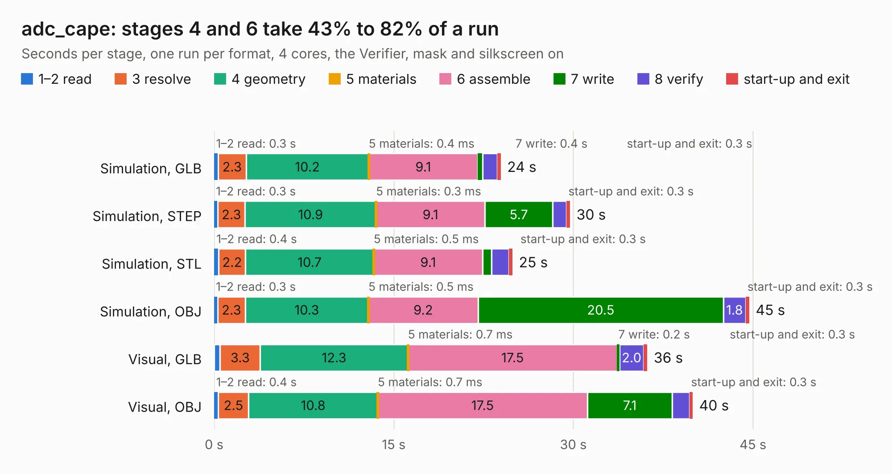

| Mode and format | 1–2 read | 3 resolve | 4 geometry | 5 materials | 6 assemble | 7 write | 8 verify | start-up and exit | Total |
|---|---:|---:|---:|---:|---:|---:|---:|---:|---:|
| Simulation, GLB | 0.3 | 2.3 | 10.2 | 0.4&nbsp;ms | 9.1 | 0.4 | 1.2 | 0.3 | 23.9 |
| Simulation, STEP | 0.3 | 2.3 | 10.9 | 0.3&nbsp;ms | 9.1 | 5.7 | 1.2 | 0.3 | 29.7 |
| Simulation, STL | 0.4 | 2.2 | 10.7 | 0.5&nbsp;ms | 9.1 | 0.8 | 1.5 | 0.3 | 24.9 |
| Simulation, OBJ | 0.3 | 2.3 | 10.3 | 0.5&nbsp;ms | 9.2 | 20.5 | 1.8 | 0.3 | 44.7 |
| Visual, GLB | 0.5 | 3.3 | 12.3 | 0.7&nbsp;ms | 17.5 | 0.2 | 2.0 | 0.3 | 36.2 |
| Visual, OBJ | 0.4 | 2.5 | 10.8 | 0.7&nbsp;ms | 17.5 | 7.1 | 1.4 | 0.3 | 40.0 |

<table align="center"><tr><td valign="top">

| Board | Repo: [loxodes/vna](https://github.com/loxodes/vna) Board: `adc_cape.kicad_pcb` |
|---|---|
| Folder | breakouts / adc_cape |
| Complexity | 231&nbsp;/&nbsp;1000 (size&nbsp;186, features&nbsp;45) |
| KESE&nbsp;features | through vias, filled zones, curved board outline |
| Tested | 9th November 2026 |
| Copper&nbsp;layers | 4 |
| File&nbsp;format | KiCad 4 (4) |
| Parts,&nbsp;tracks,&nbsp;vias | 22, 1,037, 129 |
| Triangles,&nbsp;simulation | 2,489,974 in 85 parts |
| Verifier | PASS in all six runs |

</td><td valign="top">

<table>
<tr><th>File type</th><th>File size</th><th>Peak memory used</th></tr>
<tr><th colspan="3" align="left">Simulation</th></tr>
<tr><td>GLB</td><td align="right">85&nbsp;MB</td><td align="right">740&nbsp;MB</td></tr>
<tr><td>STEP</td><td align="right">321&nbsp;MB</td><td align="right">859&nbsp;MB</td></tr>
<tr><td>STL</td><td align="right">125&nbsp;MB</td><td align="right">728&nbsp;MB</td></tr>
<tr><td>OBJ</td><td align="right">262&nbsp;MB</td><td align="right">1.7&nbsp;GB</td></tr>
<tr><th colspan="3" align="left">Visual</th></tr>
<tr><td>GLB</td><td align="right">37&nbsp;MB</td><td align="right">805&nbsp;MB</td></tr>
<tr><td>OBJ</td><td align="right">114&nbsp;MB</td><td align="right">835&nbsp;MB</td></tr>
</table>

</td></tr></table>

## 23.14.48 adc_dual

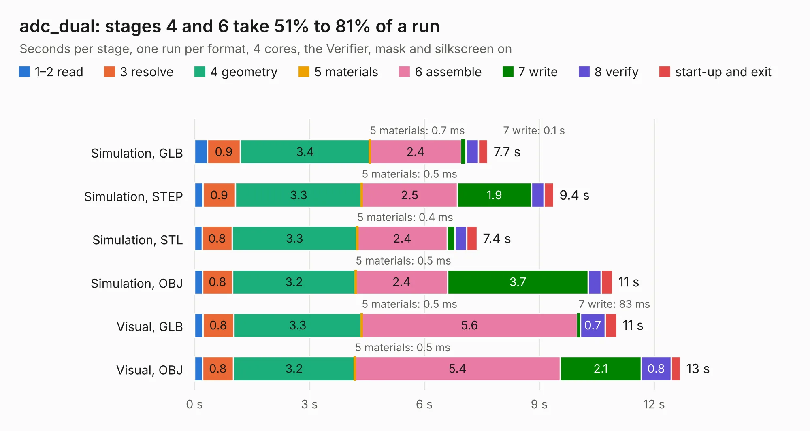

| Mode and format | 1–2 read | 3 resolve | 4 geometry | 5 materials | 6 assemble | 7 write | 8 verify | start-up and exit | Total |
|---|---:|---:|---:|---:|---:|---:|---:|---:|---:|
| Simulation, GLB | 0.3 | 0.9 | 3.4 | 0.7&nbsp;ms | 2.4 | 0.1 | 0.3 | 0.2 | 7.7 |
| Simulation, STEP | 0.2 | 0.9 | 3.3 | 0.5&nbsp;ms | 2.5 | 1.9 | 0.3 | 0.3 | 9.4 |
| Simulation, STL | 0.2 | 0.8 | 3.3 | 0.4&nbsp;ms | 2.4 | 0.2 | 0.3 | 0.3 | 7.4 |
| Simulation, OBJ | 0.2 | 0.8 | 3.2 | 0.5&nbsp;ms | 2.4 | 3.7 | 0.3 | 0.3 | 10.9 |
| Visual, GLB | 0.2 | 0.8 | 3.3 | 0.5&nbsp;ms | 5.6 | 83&nbsp;ms | 0.7 | 0.3 | 11.0 |
| Visual, OBJ | 0.2 | 0.8 | 3.2 | 0.5&nbsp;ms | 5.4 | 2.1 | 0.8 | 0.2 | 12.7 |

<table align="center"><tr><td valign="top">

| Board | Repo: [loxodes/vna](https://github.com/loxodes/vna) Board: `adc_dual.kicad_pcb` |
|---|---|
| Folder | breakouts / adc_dual |
| Complexity | 262&nbsp;/&nbsp;1000 (size&nbsp;227, features&nbsp;35) |
| KESE&nbsp;features | through vias, filled zones |
| Tested | 9th November 2026 |
| Copper&nbsp;layers | 4 |
| File&nbsp;format | KiCad 4 (4) |
| Parts,&nbsp;tracks,&nbsp;vias | 77, 465, 61 |
| Triangles,&nbsp;simulation | 697,788 in 69 parts |
| Verifier | PASS in all six runs |

</td><td valign="top">

<table>
<tr><th>File type</th><th>File size</th><th>Peak memory used</th></tr>
<tr><th colspan="3" align="left">Simulation</th></tr>
<tr><td>GLB</td><td align="right">25&nbsp;MB</td><td align="right">387&nbsp;MB</td></tr>
<tr><td>STEP</td><td align="right">96&nbsp;MB</td><td align="right">398&nbsp;MB</td></tr>
<tr><td>STL</td><td align="right">35&nbsp;MB</td><td align="right">375&nbsp;MB</td></tr>
<tr><td>OBJ</td><td align="right">72&nbsp;MB</td><td align="right">513&nbsp;MB</td></tr>
<tr><th colspan="3" align="left">Visual</th></tr>
<tr><td>GLB</td><td align="right">16&nbsp;MB</td><td align="right">421&nbsp;MB</td></tr>
<tr><td>OBJ</td><td align="right">46&nbsp;MB</td><td align="right">410&nbsp;MB</td></tr>
</table>

</td></tr></table>

## 23.14.49 adrf5020_breakout

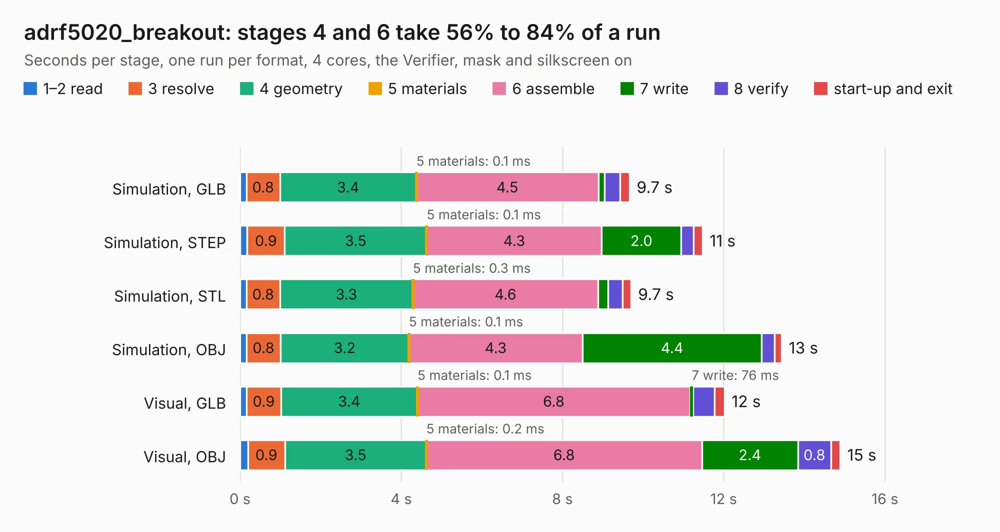

| Mode and format | 1–2 read | 3 resolve | 4 geometry | 5 materials | 6 assemble | 7 write | 8 verify | start-up and exit | Total |
|---|---:|---:|---:|---:|---:|---:|---:|---:|---:|
| Simulation, GLB | 0.2 | 0.8 | 3.4 | 0.1&nbsp;ms | 4.5 | 0.2 | 0.4 | 0.2 | 9.7 |
| Simulation, STEP | 0.2 | 0.9 | 3.5 | 0.1&nbsp;ms | 4.3 | 2.0 | 0.3 | 0.2 | 11.5 |
| Simulation, STL | 0.2 | 0.8 | 3.3 | 0.3&nbsp;ms | 4.6 | 0.2 | 0.4 | 0.2 | 9.7 |
| Simulation, OBJ | 0.2 | 0.8 | 3.2 | 0.1&nbsp;ms | 4.3 | 4.4 | 0.3 | 0.2 | 13.4 |
| Visual, GLB | 0.2 | 0.9 | 3.4 | 0.1&nbsp;ms | 6.8 | 76&nbsp;ms | 0.5 | 0.2 | 12.0 |
| Visual, OBJ | 0.2 | 0.9 | 3.5 | 0.2&nbsp;ms | 6.8 | 2.4 | 0.8 | 0.2 | 14.9 |

<table align="center"><tr><td valign="top">

| Board | Repo: [loxodes/vna](https://github.com/loxodes/vna) Board: `adrf5020_breakout.kicad_pcb` |
|---|---|
| Folder | breakouts / adrf5020_breakout |
| Complexity | 175&nbsp;/&nbsp;1000 (size&nbsp;140, features&nbsp;35) |
| KESE&nbsp;features | through vias, filled zones |
| Tested | 9th November 2026 |
| Copper&nbsp;layers | 4 |
| File&nbsp;format | KiCad 4 (4) |
| Parts,&nbsp;tracks,&nbsp;vias | 18, 78, 5 |
| Triangles,&nbsp;simulation | 1,154,838 in 28 parts |
| Verifier | PASS in all six runs |

</td><td valign="top">

<table>
<tr><th>File type</th><th>File size</th><th>Peak memory used</th></tr>
<tr><th colspan="3" align="left">Simulation</th></tr>
<tr><td>GLB</td><td align="right">39&nbsp;MB</td><td align="right">488&nbsp;MB</td></tr>
<tr><td>STEP</td><td align="right">106&nbsp;MB</td><td align="right">615&nbsp;MB</td></tr>
<tr><td>STL</td><td align="right">58&nbsp;MB</td><td align="right">516&nbsp;MB</td></tr>
<tr><td>OBJ</td><td align="right">115&nbsp;MB</td><td align="right">775&nbsp;MB</td></tr>
<tr><th colspan="3" align="left">Visual</th></tr>
<tr><td>GLB</td><td align="right">20&nbsp;MB</td><td align="right">561&nbsp;MB</td></tr>
<tr><td>OBJ</td><td align="right">61&nbsp;MB</td><td align="right">563&nbsp;MB</td></tr>
</table>

</td></tr></table>

## 23.14.50 ammp6120_breakout

| Mode and format | 1–2 read | 3 resolve | 4 geometry | 5 materials | 6 assemble | 7 write | 8 verify | start-up and exit | Total |
|---|---:|---:|---:|---:|---:|---:|---:|---:|---:|
| Simulation, GLB | 90&nbsp;ms | 0.2 | 0.7 | 0.1&nbsp;ms | 0.9 | 34&nbsp;ms | 0.1 | 0.2 | 2.3 |
| Simulation, STEP | 89&nbsp;ms | 0.2 | 0.8 | 0.1&nbsp;ms | 0.9 | 0.9 | 0.1 | 0.2 | 3.2 |
| Simulation, STL | 0.1 | 0.2 | 0.8 | 0.1&nbsp;ms | 0.9 | 57&nbsp;ms | 0.1 | 0.2 | 2.4 |
| Simulation, OBJ | 97&nbsp;ms | 0.2 | 0.8 | 0.1&nbsp;ms | 0.9 | 1.2 | 0.1 | 0.2 | 3.5 |
| Visual, GLB | 99&nbsp;ms | 0.2 | 0.8 | 0.2&nbsp;ms | 2.3 | 18&nbsp;ms | 0.1 | 0.2 | 3.7 |
| Visual, OBJ | 81&nbsp;ms | 0.2 | 0.8 | 0.2&nbsp;ms | 2.5 | 0.5 | 0.1 | 0.2 | 4.3 |

<table align="center"><tr><td valign="top">

| Board | Repo: [loxodes/vna](https://github.com/loxodes/vna) Board: `ammp6120_breakout.kicad_pcb` |
|---|---|
| Folder | breakouts / ammp6120_breakout |
| Complexity | 127&nbsp;/&nbsp;1000 (size&nbsp;107, features&nbsp;20) |
| KESE&nbsp;features | filled zones |
| Tested | 9th November 2026 |
| Copper&nbsp;layers | 4 |
| File&nbsp;format | KiCad 4 (4) |
| Parts,&nbsp;tracks,&nbsp;vias | 6, 24, 0 |
| Triangles,&nbsp;simulation | 275,826 in 18 parts |
| Verifier | PASS in all six runs |

</td><td valign="top">

<table>
<tr><th>File type</th><th>File size</th><th>Peak memory used</th></tr>
<tr><th colspan="3" align="left">Simulation</th></tr>
<tr><td>GLB</td><td align="right">9.3&nbsp;MB</td><td align="right">232&nbsp;MB</td></tr>
<tr><td>STEP</td><td align="right">25&nbsp;MB</td><td align="right">265&nbsp;MB</td></tr>
<tr><td>STL</td><td align="right">14&nbsp;MB</td><td align="right">242&nbsp;MB</td></tr>
<tr><td>OBJ</td><td align="right">27&nbsp;MB</td><td align="right">237&nbsp;MB</td></tr>
<tr><th colspan="3" align="left">Visual</th></tr>
<tr><td>GLB</td><td align="right">4.5&nbsp;MB</td><td align="right">200&nbsp;MB</td></tr>
<tr><td>OBJ</td><td align="right">13&nbsp;MB</td><td align="right">204&nbsp;MB</td></tr>
</table>

</td></tr></table>

## 23.14.51 amp_breakout

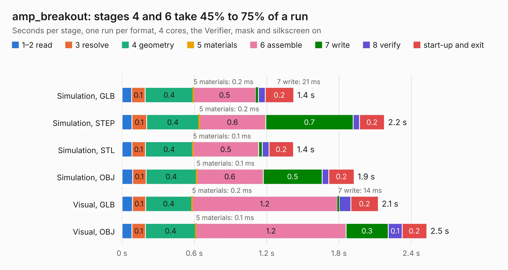

| Mode and format | 1–2 read | 3 resolve | 4 geometry | 5 materials | 6 assemble | 7 write | 8 verify | start-up and exit | Total |
|---|---:|---:|---:|---:|---:|---:|---:|---:|---:|
| Simulation, GLB | 79&nbsp;ms | 0.1 | 0.4 | 0.2&nbsp;ms | 0.5 | 21&nbsp;ms | 57&nbsp;ms | 0.2 | 1.4 |
| Simulation, STEP | 81&nbsp;ms | 0.1 | 0.4 | 0.2&nbsp;ms | 0.6 | 0.7 | 55&nbsp;ms | 0.2 | 2.2 |
| Simulation, STL | 81&nbsp;ms | 0.1 | 0.4 | 0.1&nbsp;ms | 0.5 | 29&nbsp;ms | 55&nbsp;ms | 0.2 | 1.4 |
| Simulation, OBJ | 88&nbsp;ms | 0.1 | 0.4 | 0.1&nbsp;ms | 0.6 | 0.5 | 55&nbsp;ms | 0.2 | 1.9 |
| Visual, GLB | 86&nbsp;ms | 0.1 | 0.4 | 0.2&nbsp;ms | 1.2 | 14&nbsp;ms | 97&nbsp;ms | 0.2 | 2.1 |
| Visual, OBJ | 83&nbsp;ms | 0.1 | 0.4 | 0.1&nbsp;ms | 1.2 | 0.3 | 0.1 | 0.2 | 2.5 |

<table align="center"><tr><td valign="top">

| Board | Repo: [loxodes/vna](https://github.com/loxodes/vna) Board: `amp_breakout.kicad_pcb` |
|---|---|
| Folder | breakouts / amp_breakout |
| Complexity | 184&nbsp;/&nbsp;1000 (size&nbsp;149, features&nbsp;35) |
| KESE&nbsp;features | through vias, filled zones |
| Tested | 9th November 2026 |
| Copper&nbsp;layers | 4 |
| File&nbsp;format | KiCad 4 (4) |
| Parts,&nbsp;tracks,&nbsp;vias | 19, 99, 20 |
| Triangles,&nbsp;simulation | 121,518 in 25 parts |
| Verifier | PASS in all six runs |

</td><td valign="top">

<table>
<tr><th>File type</th><th>File size</th><th>Peak memory used</th></tr>
<tr><th colspan="3" align="left">Simulation</th></tr>
<tr><td>GLB</td><td align="right">4.4&nbsp;MB</td><td align="right">197&nbsp;MB</td></tr>
<tr><td>STEP</td><td align="right">15&nbsp;MB</td><td align="right">197&nbsp;MB</td></tr>
<tr><td>STL</td><td align="right">6.1&nbsp;MB</td><td align="right">188&nbsp;MB</td></tr>
<tr><td>OBJ</td><td align="right">12&nbsp;MB</td><td align="right">198&nbsp;MB</td></tr>
<tr><th colspan="3" align="left">Visual</th></tr>
<tr><td>GLB</td><td align="right">3.0&nbsp;MB</td><td align="right">162&nbsp;MB</td></tr>
<tr><td>OBJ</td><td align="right">8.3&nbsp;MB</td><td align="right">160&nbsp;MB</td></tr>
</table>

</td></tr></table>

## 23.14.52 amp_cpw_hmc311

| Mode and format | 1–2 read | 3 resolve | 4 geometry | 5 materials | 6 assemble | 7 write | 8 verify | start-up and exit | Total |
|---|---:|---:|---:|---:|---:|---:|---:|---:|---:|
| Simulation, GLB | 86&nbsp;ms | 0.2 | 0.9 | 0.1&nbsp;ms | 0.8 | 34&nbsp;ms | 0.1 | 0.2 | 2.3 |
| Simulation, STEP | 0.1 | 0.2 | 1.0 | 0.4&nbsp;ms | 0.9 | 1.0 | 0.1 | 0.2 | 3.4 |
| Simulation, STL | 93&nbsp;ms | 0.2 | 0.9 | 0.1&nbsp;ms | 0.9 | 54&nbsp;ms | 0.1 | 0.2 | 2.4 |
| Simulation, OBJ | 93&nbsp;ms | 0.2 | 1.0 | 0.1&nbsp;ms | 0.8 | 1.2 | 0.1 | 0.2 | 3.6 |
| Visual, GLB | 89&nbsp;ms | 0.2 | 0.9 | 0.1&nbsp;ms | 2.2 | 18&nbsp;ms | 0.1 | 0.2 | 3.7 |
| Visual, OBJ | 86&nbsp;ms | 0.2 | 0.9 | 0.1&nbsp;ms | 2.1 | 0.5 | 0.1 | 0.2 | 4.0 |

<table align="center"><tr><td valign="top">

| Board | Repo: [loxodes/vna](https://github.com/loxodes/vna) Board: `amp_cpw_hmc311.kicad_pcb` |
|---|---|
| Folder | breakouts / amp_cpw_hmc311 |
| Complexity | 132&nbsp;/&nbsp;1000 (size&nbsp;112, features&nbsp;20) |
| KESE&nbsp;features | filled zones |
| Tested | 9th November 2026 |
| Copper&nbsp;layers | 4 |
| File&nbsp;format | KiCad 4 (4) |
| Parts,&nbsp;tracks,&nbsp;vias | 10, 24, 0 |
| Triangles,&nbsp;simulation | 250,288 in 19 parts |
| Verifier | PASS in all six runs |

</td><td valign="top">

<table>
<tr><th>File type</th><th>File size</th><th>Peak memory used</th></tr>
<tr><th colspan="3" align="left">Simulation</th></tr>
<tr><td>GLB</td><td align="right">8.5&nbsp;MB</td><td align="right">245&nbsp;MB</td></tr>
<tr><td>STEP</td><td align="right">26&nbsp;MB</td><td align="right">245&nbsp;MB</td></tr>
<tr><td>STL</td><td align="right">13&nbsp;MB</td><td align="right">243&nbsp;MB</td></tr>
<tr><td>OBJ</td><td align="right">24&nbsp;MB</td><td align="right">227&nbsp;MB</td></tr>
<tr><th colspan="3" align="left">Visual</th></tr>
<tr><td>GLB</td><td align="right">3.9&nbsp;MB</td><td align="right">190&nbsp;MB</td></tr>
<tr><td>OBJ</td><td align="right">11&nbsp;MB</td><td align="right">186&nbsp;MB</td></tr>
</table>

</td></tr></table>

## 23.14.53 amp_macom

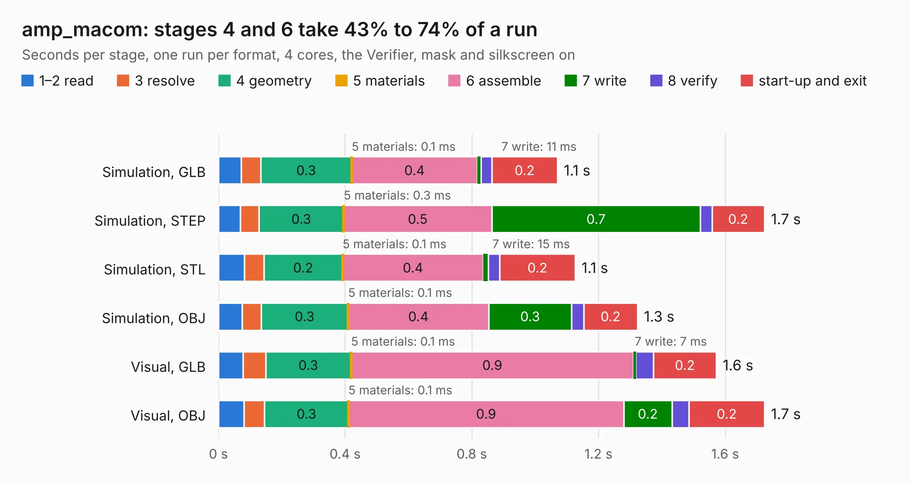

| Mode and format | 1–2 read | 3 resolve | 4 geometry | 5 materials | 6 assemble | 7 write | 8 verify | start-up and exit | Total |
|---|---:|---:|---:|---:|---:|---:|---:|---:|---:|
| Simulation, GLB | 72&nbsp;ms | 61&nbsp;ms | 0.3 | 0.1&nbsp;ms | 0.4 | 11&nbsp;ms | 35&nbsp;ms | 0.2 | 1.1 |
| Simulation, STEP | 69&nbsp;ms | 59&nbsp;ms | 0.3 | 0.3&nbsp;ms | 0.5 | 0.7 | 36&nbsp;ms | 0.2 | 1.7 |
| Simulation, STL | 82&nbsp;ms | 62&nbsp;ms | 0.2 | 0.1&nbsp;ms | 0.4 | 15&nbsp;ms | 37&nbsp;ms | 0.2 | 1.1 |
| Simulation, OBJ | 75&nbsp;ms | 60&nbsp;ms | 0.3 | 0.1&nbsp;ms | 0.4 | 0.3 | 38&nbsp;ms | 0.2 | 1.3 |
| Visual, GLB | 77&nbsp;ms | 72&nbsp;ms | 0.3 | 0.1&nbsp;ms | 0.9 | 7&nbsp;ms | 56&nbsp;ms | 0.2 | 1.6 |
| Visual, OBJ | 81&nbsp;ms | 65&nbsp;ms | 0.3 | 0.1&nbsp;ms | 0.9 | 0.2 | 54&nbsp;ms | 0.2 | 1.7 |

<table align="center"><tr><td valign="top">

| Board | Repo: [loxodes/vna](https://github.com/loxodes/vna) Board: `amp_macom.kicad_pcb` |
|---|---|
| Folder | breakouts / amp_macom |
| Complexity | 160&nbsp;/&nbsp;1000 (size&nbsp;125, features&nbsp;35) |
| KESE&nbsp;features | through vias, filled zones |
| Tested | 9th November 2026 |
| Copper&nbsp;layers | 4 |
| File&nbsp;format | KiCad 4 (4) |
| Parts,&nbsp;tracks,&nbsp;vias | 8, 43, 6 |
| Triangles,&nbsp;simulation | 63,682 in 19 parts |
| Verifier | PASS in all six runs |

</td><td valign="top">

<table>
<tr><th>File type</th><th>File size</th><th>Peak memory used</th></tr>
<tr><th colspan="3" align="left">Simulation</th></tr>
<tr><td>GLB</td><td align="right">2.3&nbsp;MB</td><td align="right">166&nbsp;MB</td></tr>
<tr><td>STEP</td><td align="right">9.5&nbsp;MB</td><td align="right">170&nbsp;MB</td></tr>
<tr><td>STL</td><td align="right">3.2&nbsp;MB</td><td align="right">169&nbsp;MB</td></tr>
<tr><td>OBJ</td><td align="right">6.3&nbsp;MB</td><td align="right">171&nbsp;MB</td></tr>
<tr><th colspan="3" align="left">Visual</th></tr>
<tr><td>GLB</td><td align="right">1.3&nbsp;MB</td><td align="right">154&nbsp;MB</td></tr>
<tr><td>OBJ</td><td align="right">3.6&nbsp;MB</td><td align="right">154&nbsp;MB</td></tr>
</table>

</td></tr></table>

## 23.14.54 amp_macom_vga

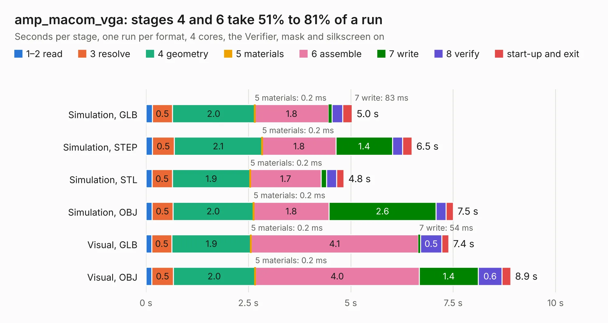

| Mode and format | 1–2 read | 3 resolve | 4 geometry | 5 materials | 6 assemble | 7 write | 8 verify | start-up and exit | Total |
|---|---:|---:|---:|---:|---:|---:|---:|---:|---:|
| Simulation, GLB | 0.2 | 0.5 | 2.0 | 0.2&nbsp;ms | 1.8 | 83&nbsp;ms | 0.3 | 0.2 | 5.0 |
| Simulation, STEP | 0.2 | 0.5 | 2.1 | 0.2&nbsp;ms | 1.8 | 1.4 | 0.2 | 0.2 | 6.5 |
| Simulation, STL | 0.1 | 0.5 | 1.9 | 0.2&nbsp;ms | 1.7 | 0.1 | 0.2 | 0.2 | 4.8 |
| Simulation, OBJ | 0.1 | 0.5 | 2.0 | 0.2&nbsp;ms | 1.8 | 2.6 | 0.2 | 0.2 | 7.5 |
| Visual, GLB | 0.1 | 0.5 | 1.9 | 0.2&nbsp;ms | 4.1 | 54&nbsp;ms | 0.5 | 0.2 | 7.4 |
| Visual, OBJ | 0.1 | 0.5 | 2.0 | 0.2&nbsp;ms | 4.0 | 1.4 | 0.6 | 0.2 | 8.9 |

<table align="center"><tr><td valign="top">

| Board | Repo: [loxodes/vna](https://github.com/loxodes/vna) Board: `amp_macom_vga.kicad_pcb` |
|---|---|
| Folder | breakouts / amp_macom_vga |
| Complexity | 218&nbsp;/&nbsp;1000 (size&nbsp;173, features&nbsp;45) |
| KESE&nbsp;features | through vias, filled zones, curved board outline |
| Tested | 9th November 2026 |
| Copper&nbsp;layers | 4 |
| File&nbsp;format | KiCad 4 (4) |
| Parts,&nbsp;tracks,&nbsp;vias | 48, 203, 57 |
| Triangles,&nbsp;simulation | 661,824 in 43 parts |
| Verifier | PASS in all six runs |

</td><td valign="top">

<table>
<tr><th>File type</th><th>File size</th><th>Peak memory used</th></tr>
<tr><th colspan="3" align="left">Simulation</th></tr>
<tr><td>GLB</td><td align="right">23&nbsp;MB</td><td align="right">347&nbsp;MB</td></tr>
<tr><td>STEP</td><td align="right">77&nbsp;MB</td><td align="right">369&nbsp;MB</td></tr>
<tr><td>STL</td><td align="right">33&nbsp;MB</td><td align="right">335&nbsp;MB</td></tr>
<tr><td>OBJ</td><td align="right">67&nbsp;MB</td><td align="right">476&nbsp;MB</td></tr>
<tr><th colspan="3" align="left">Visual</th></tr>
<tr><td>GLB</td><td align="right">13&nbsp;MB</td><td align="right">361&nbsp;MB</td></tr>
<tr><td>OBJ</td><td align="right">39&nbsp;MB</td><td align="right">352&nbsp;MB</td></tr>
</table>

</td></tr></table>

## 23.14.55 attenuator

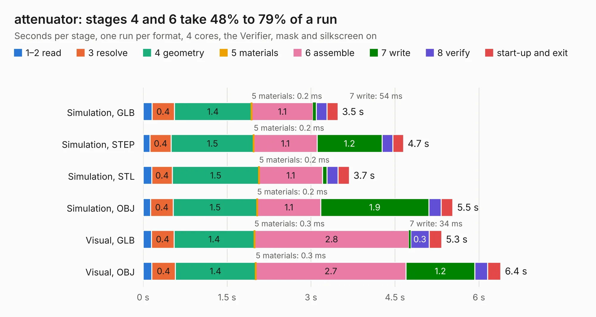

| Mode and format | 1–2 read | 3 resolve | 4 geometry | 5 materials | 6 assemble | 7 write | 8 verify | start-up and exit | Total |
|---|---:|---:|---:|---:|---:|---:|---:|---:|---:|
| Simulation, GLB | 0.2 | 0.4 | 1.4 | 0.2&nbsp;ms | 1.1 | 54&nbsp;ms | 0.2 | 0.2 | 3.5 |
| Simulation, STEP | 0.1 | 0.4 | 1.5 | 0.2&nbsp;ms | 1.1 | 1.2 | 0.2 | 0.2 | 4.7 |
| Simulation, STL | 0.2 | 0.4 | 1.5 | 0.2&nbsp;ms | 1.1 | 81&nbsp;ms | 0.2 | 0.2 | 3.7 |
| Simulation, OBJ | 0.1 | 0.4 | 1.5 | 0.2&nbsp;ms | 1.1 | 1.9 | 0.2 | 0.2 | 5.5 |
| Visual, GLB | 0.1 | 0.4 | 1.4 | 0.3&nbsp;ms | 2.8 | 34&nbsp;ms | 0.3 | 0.2 | 5.3 |
| Visual, OBJ | 0.2 | 0.4 | 1.4 | 0.3&nbsp;ms | 2.7 | 1.2 | 0.2 | 0.2 | 6.4 |

<table align="center"><tr><td valign="top">

| Board | Repo: [loxodes/vna](https://github.com/loxodes/vna) Board: `attenuator.kicad_pcb` |
|---|---|
| Folder | breakouts / attenuator |
| Complexity | 204&nbsp;/&nbsp;1000 (size&nbsp;169, features&nbsp;35) |
| KESE&nbsp;features | through vias, filled zones |
| Tested | 9th November 2026 |
| Copper&nbsp;layers | 4 |
| File&nbsp;format | KiCad 4 (4) |
| Parts,&nbsp;tracks,&nbsp;vias | 36, 232, 41 |
| Triangles,&nbsp;simulation | 357,776 in 47 parts |
| Verifier | PASS in all six runs |

</td><td valign="top">

<table>
<tr><th>File type</th><th>File size</th><th>Peak memory used</th></tr>
<tr><th colspan="3" align="left">Simulation</th></tr>
<tr><td>GLB</td><td align="right">13&nbsp;MB</td><td align="right">247&nbsp;MB</td></tr>
<tr><td>STEP</td><td align="right">47&nbsp;MB</td><td align="right">264&nbsp;MB</td></tr>
<tr><td>STL</td><td align="right">18&nbsp;MB</td><td align="right">236&nbsp;MB</td></tr>
<tr><td>OBJ</td><td align="right">37&nbsp;MB</td><td align="right">290&nbsp;MB</td></tr>
<tr><th colspan="3" align="left">Visual</th></tr>
<tr><td>GLB</td><td align="right">7.9&nbsp;MB</td><td align="right">248&nbsp;MB</td></tr>
<tr><td>OBJ</td><td align="right">23&nbsp;MB</td><td align="right">240&nbsp;MB</td></tr>
</table>

</td></tr></table>

## 23.14.56 balun

| Mode and format | 1–2 read | 3 resolve | 4 geometry | 5 materials | 6 assemble | 7 write | 8 verify | start-up and exit | Total |
|---|---:|---:|---:|---:|---:|---:|---:|---:|---:|
| Simulation, GLB | 94&nbsp;ms | 0.1 | 0.6 | 0.1&nbsp;ms | 0.6 | 24&nbsp;ms | 77&nbsp;ms | 0.3 | 1.8 |
| Simulation, STEP | 98&nbsp;ms | 0.1 | 0.6 | 0.1&nbsp;ms | 0.7 | 0.9 | 84&nbsp;ms | 0.2 | 2.8 |
| Simulation, STL | 87&nbsp;ms | 0.1 | 0.6 | 0.1&nbsp;ms | 0.7 | 35&nbsp;ms | 80&nbsp;ms | 0.2 | 1.8 |
| Simulation, OBJ | 0.1 | 0.1 | 0.7 | 0.1&nbsp;ms | 0.6 | 0.8 | 78&nbsp;ms | 0.2 | 2.6 |
| Visual, GLB | 83&nbsp;ms | 90&nbsp;ms | 0.6 | 0.2&nbsp;ms | 1.3 | 14&nbsp;ms | 0.1 | 0.2 | 2.4 |
| Visual, OBJ | 88&nbsp;ms | 93&nbsp;ms | 0.6 | 0.1&nbsp;ms | 1.3 | 0.4 | 0.1 | 0.2 | 2.8 |

<table align="center"><tr><td valign="top">

| Board | Repo: [loxodes/vna](https://github.com/loxodes/vna) Board: `balun.kicad_pcb` |
|---|---|
| Folder | breakouts / balun |
| Complexity | 121&nbsp;/&nbsp;1000 (size&nbsp;81, features&nbsp;40) |
| KESE&nbsp;features | rounded, trapezoid or chamfered pads, filled zones, curved board outline |
| Tested | 9th November 2026 |
| Copper&nbsp;layers | 2 |
| File&nbsp;format | KiCad 5 (20171130) |
| Parts,&nbsp;tracks,&nbsp;vias | 7, 12, 0 |
| Triangles,&nbsp;simulation | 133,858 in 18 parts |
| Verifier | PASS in all six runs |

</td><td valign="top">

<table>
<tr><th>File type</th><th>File size</th><th>Peak memory used</th></tr>
<tr><th colspan="3" align="left">Simulation</th></tr>
<tr><td>GLB</td><td align="right">4.7&nbsp;MB</td><td align="right">196&nbsp;MB</td></tr>
<tr><td>STEP</td><td align="right">24&nbsp;MB</td><td align="right">201&nbsp;MB</td></tr>
<tr><td>STL</td><td align="right">6.7&nbsp;MB</td><td align="right">199&nbsp;MB</td></tr>
<tr><td>OBJ</td><td align="right">13&nbsp;MB</td><td align="right">188&nbsp;MB</td></tr>
<tr><th colspan="3" align="left">Visual</th></tr>
<tr><td>GLB</td><td align="right">2.8&nbsp;MB</td><td align="right">157&nbsp;MB</td></tr>
<tr><td>OBJ</td><td align="right">7.7&nbsp;MB</td><td align="right">158&nbsp;MB</td></tr>
</table>

</td></tr></table>

## 23.14.57 bias_controller

| Mode and format | 1–2 read | 3 resolve | 4 geometry | 5 materials | 6 assemble | 7 write | 8 verify | start-up and exit | Total |
|---|---:|---:|---:|---:|---:|---:|---:|---:|---:|
| Simulation, GLB | 0.4 | 1.2 | 4.2 | 0.5&nbsp;ms | 4.8 | 0.2 | 0.4 | 0.3 | 11.4 |
| Simulation, STEP | 0.4 | 1.2 | 4.4 | 0.4&nbsp;ms | 4.6 | 4.0 | 0.4 | 0.2 | 15.3 |
| Simulation, STL | 0.5 | 1.2 | 4.5 | 0.4&nbsp;ms | 4.9 | 0.5 | 0.4 | 0.3 | 12.2 |
| Simulation, OBJ | 0.5 | 1.2 | 4.3 | 0.4&nbsp;ms | 5.1 | 4.4 | 0.3 | 0.3 | 16.1 |
| Visual, GLB | 0.5 | 1.1 | 4.3 | 0.5&nbsp;ms | 9.7 | 0.1 | 1.0 | 0.2 | 17.1 |
| Visual, OBJ | 0.5 | 1.1 | 4.1 | 0.4&nbsp;ms | 9.6 | 3.8 | 1.4 | 0.2 | 20.8 |

<table align="center"><tr><td valign="top">

| Board | Repo: [loxodes/vna](https://github.com/loxodes/vna) Board: `bias_controller.kicad_pcb` |
|---|---|
| Folder | breakouts / bias_controller / bias_controller |
| Complexity | 134&nbsp;/&nbsp;1000 (size&nbsp;114, features&nbsp;20) |
| KESE&nbsp;features | slotted holes, rounded, trapezoid or chamfered pads |
| Tested | 9th November 2026 |
| Copper&nbsp;layers | 2 |
| File&nbsp;format | KiCad 8 (20231212) |
| Parts,&nbsp;tracks,&nbsp;vias | 201, 0, 0 |
| Triangles,&nbsp;simulation | 939,990 in 182 parts |
| Note | mostly unrouted |
| Verifier | PASS in all six runs |

</td><td valign="top">

<table>
<tr><th>File type</th><th>File size</th><th>Peak memory used</th></tr>
<tr><th colspan="3" align="left">Simulation</th></tr>
<tr><td>GLB</td><td align="right">32&nbsp;MB</td><td align="right">544&nbsp;MB</td></tr>
<tr><td>STEP</td><td align="right">180&nbsp;MB</td><td align="right">637&nbsp;MB</td></tr>
<tr><td>STL</td><td align="right">47&nbsp;MB</td><td align="right">519&nbsp;MB</td></tr>
<tr><td>OBJ</td><td align="right">96&nbsp;MB</td><td align="right">642&nbsp;MB</td></tr>
<tr><th colspan="3" align="left">Visual</th></tr>
<tr><td>GLB</td><td align="right">27&nbsp;MB</td><td align="right">603&nbsp;MB</td></tr>
<tr><td>OBJ</td><td align="right">81&nbsp;MB</td><td align="right">636&nbsp;MB</td></tr>
</table>

</td></tr></table>

## 23.14.58 boosterpack

| Mode and format | 1–2 read | 3 resolve | 4 geometry | 5 materials | 6 assemble | 7 write | 8 verify | start-up and exit | Total |
|---|---:|---:|---:|---:|---:|---:|---:|---:|---:|
| Simulation, GLB | 0.2 | 0.6 | 3.8 | 0.3&nbsp;ms | 2.5 | 0.1 | 0.4 | 0.2 | 7.8 |
| Simulation, STEP | 0.2 | 0.6 | 3.7 | 0.3&nbsp;ms | 2.5 | 2.2 | 0.4 | 0.2 | 9.7 |
| Simulation, STL | 0.2 | 0.6 | 3.8 | 0.3&nbsp;ms | 2.4 | 0.2 | 0.4 | 0.3 | 7.8 |
| Simulation, OBJ | 0.2 | 0.6 | 3.8 | 0.2&nbsp;ms | 2.5 | 4.1 | 0.4 | 0.2 | 11.7 |
| Visual, GLB | 0.2 | 0.6 | 3.8 | 0.5&nbsp;ms | 5.1 | 66&nbsp;ms | 0.5 | 0.2 | 10.4 |
| Visual, OBJ | 0.2 | 0.6 | 3.8 | 0.3&nbsp;ms | 5.0 | 2.2 | 0.6 | 0.2 | 12.6 |

<table align="center"><tr><td valign="top">

| Board | Repo: [loxodes/vna](https://github.com/loxodes/vna) Board: `boosterpack.kicad_pcb` |
|---|---|
| Folder | breakouts / boosterpack |
| Complexity | 177&nbsp;/&nbsp;1000 (size&nbsp;142, features&nbsp;35) |
| KESE&nbsp;features | through vias, filled zones |
| Tested | 9th November 2026 |
| Copper&nbsp;layers | 2 |
| File&nbsp;format | KiCad 4 (4) |
| Parts,&nbsp;tracks,&nbsp;vias | 24, 227, 7 |
| Triangles,&nbsp;simulation | 696,784 in 52 parts |
| Verifier | PASS in all six runs |

</td><td valign="top">

<table>
<tr><th>File type</th><th>File size</th><th>Peak memory used</th></tr>
<tr><th colspan="3" align="left">Simulation</th></tr>
<tr><td>GLB</td><td align="right">24&nbsp;MB</td><td align="right">365&nbsp;MB</td></tr>
<tr><td>STEP</td><td align="right">117&nbsp;MB</td><td align="right">387&nbsp;MB</td></tr>
<tr><td>STL</td><td align="right">35&nbsp;MB</td><td align="right">336&nbsp;MB</td></tr>
<tr><td>OBJ</td><td align="right">71&nbsp;MB</td><td align="right">503&nbsp;MB</td></tr>
<tr><th colspan="3" align="left">Visual</th></tr>
<tr><td>GLB</td><td align="right">14&nbsp;MB</td><td align="right">386&nbsp;MB</td></tr>
<tr><td>OBJ</td><td align="right">41&nbsp;MB</td><td align="right">384&nbsp;MB</td></tr>
</table>

</td></tr></table>

## 23.14.59 clk_lo_buffer

| Mode and format | 1–2 read | 3 resolve | 4 geometry | 5 materials | 6 assemble | 7 write | 8 verify | start-up and exit | Total |
|---|---:|---:|---:|---:|---:|---:|---:|---:|---:|
| Simulation, GLB | 0.1 | 0.3 | 1.1 | 0.2&nbsp;ms | 1.0 | 30&nbsp;ms | 0.1 | 0.2 | 2.9 |
| Simulation, STEP | 0.1 | 0.4 | 1.1 | 0.2&nbsp;ms | 0.9 | 1.1 | 0.1 | 0.2 | 4.0 |
| Simulation, STL | 0.1 | 0.3 | 1.1 | 0.2&nbsp;ms | 0.9 | 58&nbsp;ms | 88&nbsp;ms | 0.2 | 2.8 |
| Simulation, OBJ | 0.1 | 0.3 | 1.0 | 0.2&nbsp;ms | 1.0 | 1.1 | 84&nbsp;ms | 0.2 | 3.9 |
| Visual, GLB | 0.1 | 0.3 | 1.1 | 0.3&nbsp;ms | 2.3 | 36&nbsp;ms | 0.3 | 0.2 | 4.4 |
| Visual, OBJ | 0.1 | 0.3 | 1.1 | 0.1&nbsp;ms | 2.0 | 0.9 | 0.2 | 0.2 | 4.8 |

<table align="center"><tr><td valign="top">

| Board | Repo: [loxodes/vna](https://github.com/loxodes/vna) Board: `clk_lo_buffer.kicad_pcb` |
|---|---|
| Folder | breakouts / clk_lo_buffer |
| Complexity | 214&nbsp;/&nbsp;1000 (size&nbsp;159, features&nbsp;55) |
| KESE&nbsp;features | through vias, rounded, trapezoid or chamfered pads, filled zones, curved board outline |
| Tested | 9th November 2026 |
| Copper&nbsp;layers | 2 |
| File&nbsp;format | KiCad 4 (4) |
| Parts,&nbsp;tracks,&nbsp;vias | 44, 318, 48 |
| Triangles,&nbsp;simulation | 214,972 in 36 parts |
| Verifier | PASS in all six runs |

</td><td valign="top">

<table>
<tr><th>File type</th><th>File size</th><th>Peak memory used</th></tr>
<tr><th colspan="3" align="left">Simulation</th></tr>
<tr><td>GLB</td><td align="right">7.9&nbsp;MB</td><td align="right">239&nbsp;MB</td></tr>
<tr><td>STEP</td><td align="right">31&nbsp;MB</td><td align="right">258&nbsp;MB</td></tr>
<tr><td>STL</td><td align="right">11&nbsp;MB</td><td align="right">233&nbsp;MB</td></tr>
<tr><td>OBJ</td><td align="right">22&nbsp;MB</td><td align="right">237&nbsp;MB</td></tr>
<tr><th colspan="3" align="left">Visual</th></tr>
<tr><td>GLB</td><td align="right">6.6&nbsp;MB</td><td align="right">224&nbsp;MB</td></tr>
<tr><td>OBJ</td><td align="right">19&nbsp;MB</td><td align="right">225&nbsp;MB</td></tr>
</table>

</td></tr></table>

## 23.14.60 coupler_test

| Mode and format | 1–2 read | 3 resolve | 4 geometry | 5 materials | 6 assemble | 7 write | 8 verify | start-up and exit | Total |
|---|---:|---:|---:|---:|---:|---:|---:|---:|---:|
| Simulation, GLB | 0.1 | 0.5 | 2.8 | 0.2&nbsp;ms | 2.2 | 84&nbsp;ms | 0.3 | 0.2 | 6.2 |
| Simulation, STEP | 0.1 | 0.4 | 2.6 | 0.3&nbsp;ms | 2.3 | 1.6 | 0.3 | 0.2 | 7.6 |
| Simulation, STL | 0.1 | 0.5 | 2.8 | 0.4&nbsp;ms | 2.2 | 0.1 | 0.3 | 0.2 | 6.2 |
| Simulation, OBJ | 0.1 | 0.5 | 2.6 | 0.4&nbsp;ms | 2.2 | 3.0 | 0.3 | 0.2 | 8.9 |
| Visual, GLB | 0.1 | 0.5 | 2.7 | 0.3&nbsp;ms | 3.1 | 30&nbsp;ms | 0.2 | 0.2 | 6.8 |
| Visual, OBJ | 0.1 | 0.4 | 2.8 | 0.6&nbsp;ms | 3.2 | 1.1 | 0.2 | 0.2 | 8.1 |

<table align="center"><tr><td valign="top">

| Board | Repo: [loxodes/vna](https://github.com/loxodes/vna) Board: `coupler_test.kicad_pcb` |
|---|---|
| Folder | breakouts / coupler_test |
| Complexity | 120&nbsp;/&nbsp;1000 (size&nbsp;90, features&nbsp;30) |
| KESE&nbsp;features | rounded, trapezoid or chamfered pads, filled zones |
| Tested | 9th November 2026 |
| Copper&nbsp;layers | 4 |
| File&nbsp;format | KiCad 4 (4) |
| Parts,&nbsp;tracks,&nbsp;vias | 4, 10, 0 |
| Triangles,&nbsp;simulation | 592,560 in 19 parts |
| Verifier | PASS in all six runs |

</td><td valign="top">

<table>
<tr><th>File type</th><th>File size</th><th>Peak memory used</th></tr>
<tr><th colspan="3" align="left">Simulation</th></tr>
<tr><td>GLB</td><td align="right">20&nbsp;MB</td><td align="right">354&nbsp;MB</td></tr>
<tr><td>STEP</td><td align="right">60&nbsp;MB</td><td align="right">389&nbsp;MB</td></tr>
<tr><td>STL</td><td align="right">30&nbsp;MB</td><td align="right">345&nbsp;MB</td></tr>
<tr><td>OBJ</td><td align="right">58&nbsp;MB</td><td align="right">409&nbsp;MB</td></tr>
<tr><th colspan="3" align="left">Visual</th></tr>
<tr><td>GLB</td><td align="right">7.2&nbsp;MB</td><td align="right">296&nbsp;MB</td></tr>
<tr><td>OBJ</td><td align="right">21&nbsp;MB</td><td align="right">290&nbsp;MB</td></tr>
</table>

</td></tr></table>

## 23.14.61 cpw_test

| Mode and format | 1–2 read | 3 resolve | 4 geometry | 5 materials | 6 assemble | 7 write | 8 verify | start-up and exit | Total |
|---|---:|---:|---:|---:|---:|---:|---:|---:|---:|
| Simulation, GLB | 62&nbsp;ms | 46&nbsp;ms | 0.2 | 0.1&nbsp;ms | 0.3 | 8&nbsp;ms | 29&nbsp;ms | 0.2 | 0.8 |
| Simulation, STEP | 67&nbsp;ms | 55&nbsp;ms | 0.2 | 0.1&nbsp;ms | 0.3 | 0.2 | 32&nbsp;ms | 0.2 | 1.0 |
| Simulation, STL | 71&nbsp;ms | 54&nbsp;ms | 0.2 | 0.1&nbsp;ms | 0.3 | 13&nbsp;ms | 29&nbsp;ms | 0.2 | 0.8 |
| Simulation, OBJ | 71&nbsp;ms | 54&nbsp;ms | 0.2 | 0.1&nbsp;ms | 0.3 | 0.2 | 32&nbsp;ms | 0.2 | 1.0 |
| Visual, GLB | 71&nbsp;ms | 60&nbsp;ms | 0.2 | 0.1&nbsp;ms | 0.5 | 5&nbsp;ms | 43&nbsp;ms | 0.2 | 1.0 |
| Visual, OBJ | 74&nbsp;ms | 50&nbsp;ms | 0.2 | 0.2&nbsp;ms | 0.5 | 97&nbsp;ms | 41&nbsp;ms | 0.2 | 1.1 |

<table align="center"><tr><td valign="top">

| Board | Repo: [loxodes/vna](https://github.com/loxodes/vna) Board: `cpw_test.kicad_pcb` |
|---|---|
| Folder | breakouts / cpw_test |
| Complexity | 78&nbsp;/&nbsp;1000 (size&nbsp;68, features&nbsp;10) |
| KESE&nbsp;features | rounded, trapezoid or chamfered pads |
| Tested | 9th November 2026 |
| Copper&nbsp;layers | 4 |
| File&nbsp;format | KiCad 4 (4) |
| Parts,&nbsp;tracks,&nbsp;vias | 2, 3, 0 |
| Triangles,&nbsp;simulation | 40,844 in 14 parts |
| Verifier | PASS in all six runs |

</td><td valign="top">

<table>
<tr><th>File type</th><th>File size</th><th>Peak memory used</th></tr>
<tr><th colspan="3" align="left">Simulation</th></tr>
<tr><td>GLB</td><td align="right">1.3&nbsp;MB</td><td align="right">65&nbsp;MB</td></tr>
<tr><td>STEP</td><td align="right">4.1&nbsp;MB</td><td align="right">69&nbsp;MB</td></tr>
<tr><td>STL</td><td align="right">2.0&nbsp;MB</td><td align="right">66&nbsp;MB</td></tr>
<tr><td>OBJ</td><td align="right">3.7&nbsp;MB</td><td align="right">74&nbsp;MB</td></tr>
<tr><th colspan="3" align="left">Visual</th></tr>
<tr><td>GLB</td><td align="right">731&nbsp;kB</td><td align="right">95&nbsp;MB</td></tr>
<tr><td>OBJ</td><td align="right">2.0&nbsp;MB</td><td align="right">94&nbsp;MB</td></tr>
</table>

</td></tr></table>

## 23.14.62 crystal_filter

| Mode and format | 1–2 read | 3 resolve | 4 geometry | 5 materials | 6 assemble | 7 write | 8 verify | start-up and exit | Total |
|---|---:|---:|---:|---:|---:|---:|---:|---:|---:|
| Simulation, GLB | 91&nbsp;ms | 96&nbsp;ms | 0.4 | 0.1&nbsp;ms | 0.5 | 17&nbsp;ms | 51&nbsp;ms | 0.2 | 1.4 |
| Simulation, STEP | 81&nbsp;ms | 0.1 | 0.5 | 0.2&nbsp;ms | 0.5 | 0.7 | 53&nbsp;ms | 0.2 | 2.1 |
| Simulation, STL | 0.1 | 96&nbsp;ms | 0.4 | 0.1&nbsp;ms | 0.5 | 23&nbsp;ms | 57&nbsp;ms | 0.2 | 1.5 |
| Simulation, OBJ | 80&nbsp;ms | 0.1 | 0.4 | 0.1&nbsp;ms | 0.5 | 0.6 | 63&nbsp;ms | 0.2 | 2.0 |
| Visual, GLB | 84&nbsp;ms | 0.1 | 0.4 | 0.1&nbsp;ms | 1.1 | 11&nbsp;ms | 77&nbsp;ms | 0.2 | 2.0 |
| Visual, OBJ | 86&nbsp;ms | 0.1 | 0.5 | 0.1&nbsp;ms | 1.0 | 0.3 | 67&nbsp;ms | 0.2 | 2.3 |

<table align="center"><tr><td valign="top">

| Board | Repo: [loxodes/vna](https://github.com/loxodes/vna) Board: `crystal_filter.kicad_pcb` |
|---|---|
| Folder | breakouts / crystal_filter |
| Complexity | 146&nbsp;/&nbsp;1000 (size&nbsp;111, features&nbsp;35) |
| KESE&nbsp;features | through vias, filled zones |
| Tested | 9th November 2026 |
| Copper&nbsp;layers | 2 |
| File&nbsp;format | KiCad 4 (4) |
| Parts,&nbsp;tracks,&nbsp;vias | 9, 31, 12 |
| Triangles,&nbsp;simulation | 99,888 in 15 parts |
| Verifier | PASS in all six runs |

</td><td valign="top">

<table>
<tr><th>File type</th><th>File size</th><th>Peak memory used</th></tr>
<tr><th colspan="3" align="left">Simulation</th></tr>
<tr><td>GLB</td><td align="right">3.6&nbsp;MB</td><td align="right">178&nbsp;MB</td></tr>
<tr><td>STEP</td><td align="right">15&nbsp;MB</td><td align="right">185&nbsp;MB</td></tr>
<tr><td>STL</td><td align="right">5.0&nbsp;MB</td><td align="right">179&nbsp;MB</td></tr>
<tr><td>OBJ</td><td align="right">9.8&nbsp;MB</td><td align="right">181&nbsp;MB</td></tr>
<tr><th colspan="3" align="left">Visual</th></tr>
<tr><td>GLB</td><td align="right">2.2&nbsp;MB</td><td align="right">157&nbsp;MB</td></tr>
<tr><td>OBJ</td><td align="right">6.1&nbsp;MB</td><td align="right">158&nbsp;MB</td></tr>
</table>

</td></tr></table>

## 23.14.63 demod_breakout

| Mode and format | 1–2 read | 3 resolve | 4 geometry | 5 materials | 6 assemble | 7 write | 8 verify | start-up and exit | Total |
|---|---:|---:|---:|---:|---:|---:|---:|---:|---:|
| Simulation, GLB | 0.2 | 0.6 | 2.6 | 0.4&nbsp;ms | 1.8 | 97&nbsp;ms | 0.3 | 0.2 | 5.8 |
| Simulation, STEP | 0.2 | 0.7 | 2.6 | 0.3&nbsp;ms | 1.9 | 1.7 | 0.3 | 0.2 | 7.6 |
| Simulation, STL | 0.2 | 0.6 | 2.7 | 0.3&nbsp;ms | 1.9 | 0.2 | 0.3 | 0.2 | 6.0 |
| Simulation, OBJ | 0.2 | 0.6 | 2.5 | 0.3&nbsp;ms | 1.9 | 3.3 | 0.3 | 0.2 | 9.1 |
| Visual, GLB | 0.2 | 0.7 | 2.6 | 0.3&nbsp;ms | 4.5 | 60&nbsp;ms | 0.5 | 0.2 | 8.8 |
| Visual, OBJ | 0.2 | 0.6 | 2.7 | 0.3&nbsp;ms | 4.4 | 2.1 | 0.5 | 0.2 | 10.8 |

<table align="center"><tr><td valign="top">

| Board | Repo: [loxodes/vna](https://github.com/loxodes/vna) Board: `demod_breakout.kicad_pcb` |
|---|---|
| Folder | breakouts / demod_breakout |
| Complexity | 220&nbsp;/&nbsp;1000 (size&nbsp;185, features&nbsp;35) |
| KESE&nbsp;features | through vias, filled zones |
| Tested | 9th November 2026 |
| Copper&nbsp;layers | 4 |
| File&nbsp;format | KiCad 4 (4) |
| Parts,&nbsp;tracks,&nbsp;vias | 67, 417, 72 |
| Triangles,&nbsp;simulation | 649,436 in 62 parts |
| Verifier | PASS in all six runs |

</td><td valign="top">

<table>
<tr><th>File type</th><th>File size</th><th>Peak memory used</th></tr>
<tr><th colspan="3" align="left">Simulation</th></tr>
<tr><td>GLB</td><td align="right">23&nbsp;MB</td><td align="right">330&nbsp;MB</td></tr>
<tr><td>STEP</td><td align="right">85&nbsp;MB</td><td align="right">374&nbsp;MB</td></tr>
<tr><td>STL</td><td align="right">32&nbsp;MB</td><td align="right">340&nbsp;MB</td></tr>
<tr><td>OBJ</td><td align="right">67&nbsp;MB</td><td align="right">482&nbsp;MB</td></tr>
<tr><th colspan="3" align="left">Visual</th></tr>
<tr><td>GLB</td><td align="right">14&nbsp;MB</td><td align="right">371&nbsp;MB</td></tr>
<tr><td>OBJ</td><td align="right">41&nbsp;MB</td><td align="right">371&nbsp;MB</td></tr>
</table>

</td></tr></table>

## 23.14.64 filter_bank

| Mode and format | 1–2 read | 3 resolve | 4 geometry | 5 materials | 6 assemble | 7 write | 8 verify | start-up and exit | Total |
|---|---:|---:|---:|---:|---:|---:|---:|---:|---:|
| Simulation, GLB | 0.1 | 0.4 | 1.5 | 0.2&nbsp;ms | 1.2 | 69&nbsp;ms | 0.2 | 0.2 | 3.7 |
| Simulation, STEP | 0.2 | 0.4 | 1.7 | 0.3&nbsp;ms | 1.2 | 1.2 | 0.2 | 0.2 | 5.1 |
| Simulation, STL | 0.1 | 0.4 | 1.5 | 0.3&nbsp;ms | 1.3 | 0.1 | 0.2 | 0.2 | 4.0 |
| Simulation, OBJ | 0.2 | 0.4 | 1.5 | 0.2&nbsp;ms | 1.2 | 1.9 | 0.2 | 0.2 | 5.5 |
| Visual, GLB | 0.2 | 0.4 | 1.5 | 0.3&nbsp;ms | 3.0 | 36&nbsp;ms | 0.4 | 0.3 | 5.7 |
| Visual, OBJ | 0.1 | 0.4 | 1.5 | 0.2&nbsp;ms | 3.2 | 1.3 | 0.3 | 0.2 | 7.0 |

<table align="center"><tr><td valign="top">

| Board | Repo: [loxodes/vna](https://github.com/loxodes/vna) Board: `filter_bank.kicad_pcb` |
|---|---|
| Folder | breakouts / filter_breakout |
| Complexity | 210&nbsp;/&nbsp;1000 (size&nbsp;175, features&nbsp;35) |
| KESE&nbsp;features | through vias, filled zones |
| Tested | 9th November 2026 |
| Copper&nbsp;layers | 4 |
| File&nbsp;format | KiCad 4 (4) |
| Parts,&nbsp;tracks,&nbsp;vias | 36, 361, 53 |
| Triangles,&nbsp;simulation | 321,342 in 56 parts |
| Verifier | PASS in all six runs |

</td><td valign="top">

<table>
<tr><th>File type</th><th>File size</th><th>Peak memory used</th></tr>
<tr><th colspan="3" align="left">Simulation</th></tr>
<tr><td>GLB</td><td align="right">11&nbsp;MB</td><td align="right">237&nbsp;MB</td></tr>
<tr><td>STEP</td><td align="right">40&nbsp;MB</td><td align="right">260&nbsp;MB</td></tr>
<tr><td>STL</td><td align="right">16&nbsp;MB</td><td align="right">253&nbsp;MB</td></tr>
<tr><td>OBJ</td><td align="right">33&nbsp;MB</td><td align="right">269&nbsp;MB</td></tr>
<tr><th colspan="3" align="left">Visual</th></tr>
<tr><td>GLB</td><td align="right">7.3&nbsp;MB</td><td align="right">235&nbsp;MB</td></tr>
<tr><td>OBJ</td><td align="right">21&nbsp;MB</td><td align="right">237&nbsp;MB</td></tr>
</table>

</td></tr></table>

## 23.14.65 trl_thru

| Mode and format | 1–2 read | 3 resolve | 4 geometry | 5 materials | 6 assemble | 7 write | 8 verify | start-up and exit | Total |
|---|---:|---:|---:|---:|---:|---:|---:|---:|---:|
| Simulation, GLB | 91&nbsp;ms | 0.3 | 0.8 | 0.2&nbsp;ms | 0.9 | 39&nbsp;ms | 0.1 | 0.2 | 2.4 |
| Simulation, STEP | 96&nbsp;ms | 0.3 | 0.7 | 0.1&nbsp;ms | 0.8 | 0.9 | 0.1 | 0.2 | 3.2 |
| Simulation, STL | 92&nbsp;ms | 0.3 | 0.8 | 0.1&nbsp;ms | 0.9 | 70&nbsp;ms | 0.1 | 0.3 | 2.5 |
| Simulation, OBJ | 98&nbsp;ms | 0.3 | 0.8 | 0.1&nbsp;ms | 0.9 | 1.1 | 0.1 | 0.2 | 3.4 |
| Visual, GLB | 0.1 | 0.3 | 0.9 | 0.1&nbsp;ms | 1.5 | 19&nbsp;ms | 0.1 | 0.2 | 3.1 |
| Visual, OBJ | 93&nbsp;ms | 0.3 | 0.8 | 0.1&nbsp;ms | 1.6 | 0.6 | 0.1 | 0.2 | 3.6 |

<table align="center"><tr><td valign="top">

| Board | Repo: [loxodes/vna](https://github.com/loxodes/vna) Board: `trl_thru.kicad_pcb` |
|---|---|
| Folder | breakouts / hmc576_breakout |
| Complexity | 185&nbsp;/&nbsp;1000 (size&nbsp;140, features&nbsp;45) |
| KESE&nbsp;features | through vias, rounded, trapezoid or chamfered pads, filled zones |
| Tested | 9th November 2026 |
| Copper&nbsp;layers | 4 |
| File&nbsp;format | KiCad 5 (20171130) |
| Parts,&nbsp;tracks,&nbsp;vias | 10, 55, 27 |
| Triangles,&nbsp;simulation | 254,354 in 18 parts |
| Verifier | PASS in all six runs |

</td><td valign="top">

<table>
<tr><th>File type</th><th>File size</th><th>Peak memory used</th></tr>
<tr><th colspan="3" align="left">Simulation</th></tr>
<tr><td>GLB</td><td align="right">8.6&nbsp;MB</td><td align="right">236&nbsp;MB</td></tr>
<tr><td>STEP</td><td align="right">27&nbsp;MB</td><td align="right">244&nbsp;MB</td></tr>
<tr><td>STL</td><td align="right">13&nbsp;MB</td><td align="right">254&nbsp;MB</td></tr>
<tr><td>OBJ</td><td align="right">25&nbsp;MB</td><td align="right">229&nbsp;MB</td></tr>
<tr><th colspan="3" align="left">Visual</th></tr>
<tr><td>GLB</td><td align="right">4.1&nbsp;MB</td><td align="right">184&nbsp;MB</td></tr>
<tr><td>OBJ</td><td align="right">12&nbsp;MB</td><td align="right">184&nbsp;MB</td></tr>
</table>

</td></tr></table>

## 23.14.66 hyperram_3p3v

| Mode and format | 1–2 read | 3 resolve | 4 geometry | 5 materials | 6 assemble | 7 write | 8 verify | start-up and exit | Total |
|---|---:|---:|---:|---:|---:|---:|---:|---:|---:|
| Simulation, GLB | 84&nbsp;ms | 0.3 | 1.3 | 0.2&nbsp;ms | 1.1 | 51&nbsp;ms | 0.2 | 0.2 | 3.2 |
| Simulation, STEP | 92&nbsp;ms | 0.3 | 1.3 | 0.2&nbsp;ms | 1.0 | 1.0 | 0.2 | 0.2 | 4.1 |
| Simulation, STL | 0.1 | 0.3 | 1.3 | 0.2&nbsp;ms | 1.1 | 81&nbsp;ms | 0.2 | 0.2 | 3.2 |
| Simulation, OBJ | 0.1 | 0.3 | 1.2 | 0.2&nbsp;ms | 1.0 | 1.5 | 0.2 | 0.2 | 4.6 |
| Visual, GLB | 91&nbsp;ms | 0.3 | 1.3 | 0.2&nbsp;ms | 1.9 | 24&nbsp;ms | 0.2 | 0.2 | 4.0 |
| Visual, OBJ | 96&nbsp;ms | 0.3 | 1.2 | 0.5&nbsp;ms | 1.8 | 0.6 | 0.1 | 0.2 | 4.3 |

<table align="center"><tr><td valign="top">

| Board | Repo: [loxodes/vna](https://github.com/loxodes/vna) Board: `hyperram_3p3v.kicad_pcb` |
|---|---|
| Folder | breakouts / hyperram / hyperram_3p3v |
| Complexity | 184&nbsp;/&nbsp;1000 (size&nbsp;139, features&nbsp;45) |
| KESE&nbsp;features | through vias, rounded, trapezoid or chamfered pads, filled zones |
| Tested | 9th November 2026 |
| Copper&nbsp;layers | 4 |
| File&nbsp;format | KiCad 5 (20171130) |
| Parts,&nbsp;tracks,&nbsp;vias | 6, 129, 16 |
| Triangles,&nbsp;simulation | 371,994 in 27 parts |
| Verifier | PASS in all six runs |

</td><td valign="top">

<table>
<tr><th>File type</th><th>File size</th><th>Peak memory used</th></tr>
<tr><th colspan="3" align="left">Simulation</th></tr>
<tr><td>GLB</td><td align="right">13&nbsp;MB</td><td align="right">245&nbsp;MB</td></tr>
<tr><td>STEP</td><td align="right">48&nbsp;MB</td><td align="right">263&nbsp;MB</td></tr>
<tr><td>STL</td><td align="right">19&nbsp;MB</td><td align="right">246&nbsp;MB</td></tr>
<tr><td>OBJ</td><td align="right">37&nbsp;MB</td><td align="right">289&nbsp;MB</td></tr>
<tr><th colspan="3" align="left">Visual</th></tr>
<tr><td>GLB</td><td align="right">5.4&nbsp;MB</td><td align="right">225&nbsp;MB</td></tr>
<tr><td>OBJ</td><td align="right">16&nbsp;MB</td><td align="right">224&nbsp;MB</td></tr>
</table>

</td></tr></table>

## 23.14.67 launchpad_synthcontrol

| Mode and format | 1–2 read | 3 resolve | 4 geometry | 5 materials | 6 assemble | 7 write | 8 verify | start-up and exit | Total |
|---|---:|---:|---:|---:|---:|---:|---:|---:|---:|
| Simulation, GLB | 0.1 | 0.4 | 2.5 | 0.4&nbsp;ms | 1.8 | 77&nbsp;ms | 0.2 | 0.2 | 5.4 |
| Simulation, STEP | 0.1 | 0.5 | 2.4 | 0.6&nbsp;ms | 1.8 | 1.7 | 0.2 | 0.3 | 6.9 |
| Simulation, STL | 0.1 | 0.4 | 2.5 | 0.4&nbsp;ms | 1.8 | 0.2 | 0.3 | 0.3 | 5.6 |
| Simulation, OBJ | 0.1 | 0.5 | 2.6 | 0.4&nbsp;ms | 1.9 | 2.7 | 0.3 | 0.2 | 8.2 |
| Visual, GLB | 0.1 | 0.4 | 2.5 | 0.4&nbsp;ms | 3.7 | 60&nbsp;ms | 0.5 | 0.2 | 7.5 |
| Visual, OBJ | 0.1 | 0.4 | 2.6 | 0.4&nbsp;ms | 3.7 | 1.5 | 0.4 | 0.2 | 8.9 |

<table align="center"><tr><td valign="top">

| Board | Repo: [loxodes/vna](https://github.com/loxodes/vna) Board: `launchpad_synthcontrol.kicad_pcb` |
|---|---|
| Folder | breakouts / launchpad_synthcontrol |
| Complexity | 147&nbsp;/&nbsp;1000 (size&nbsp;132, features&nbsp;15) |
| KESE&nbsp;features | through vias |
| Tested | 9th November 2026 |
| Copper&nbsp;layers | 2 |
| File&nbsp;format | KiCad 4 (4) |
| Parts,&nbsp;tracks,&nbsp;vias | 2, 308, 84 |
| Triangles,&nbsp;simulation | 603,278 in 50 parts |
| Verifier | PASS in all six runs |

</td><td valign="top">

<table>
<tr><th>File type</th><th>File size</th><th>Peak memory used</th></tr>
<tr><th colspan="3" align="left">Simulation</th></tr>
<tr><td>GLB</td><td align="right">21&nbsp;MB</td><td align="right">306&nbsp;MB</td></tr>
<tr><td>STEP</td><td align="right">92&nbsp;MB</td><td align="right">354&nbsp;MB</td></tr>
<tr><td>STL</td><td align="right">30&nbsp;MB</td><td align="right">309&nbsp;MB</td></tr>
<tr><td>OBJ</td><td align="right">61&nbsp;MB</td><td align="right">435&nbsp;MB</td></tr>
<tr><th colspan="3" align="left">Visual</th></tr>
<tr><td>GLB</td><td align="right">12&nbsp;MB</td><td align="right">342&nbsp;MB</td></tr>
<tr><td>OBJ</td><td align="right">35&nbsp;MB</td><td align="right">345&nbsp;MB</td></tr>
</table>

</td></tr></table>

## 23.14.68 maam_011109

| Mode and format | 1–2 read | 3 resolve | 4 geometry | 5 materials | 6 assemble | 7 write | 8 verify | start-up and exit | Total |
|---|---:|---:|---:|---:|---:|---:|---:|---:|---:|
| Simulation, GLB | 0.1 | 0.3 | 1.0 | 0.1&nbsp;ms | 1.0 | 45&nbsp;ms | 0.2 | 0.2 | 2.9 |
| Simulation, STEP | 0.1 | 0.3 | 1.1 | 0.1&nbsp;ms | 1.0 | 1.1 | 0.1 | 0.2 | 3.9 |
| Simulation, STL | 0.1 | 0.3 | 1.2 | 0.1&nbsp;ms | 1.0 | 68&nbsp;ms | 0.2 | 0.2 | 3.0 |
| Simulation, OBJ | 0.1 | 0.3 | 1.1 | 0.1&nbsp;ms | 1.0 | 1.6 | 0.2 | 0.2 | 4.4 |
| Visual, GLB | 0.1 | 0.3 | 1.1 | 0.1&nbsp;ms | 1.9 | 26&nbsp;ms | 0.2 | 0.3 | 3.8 |
| Visual, OBJ | 97&nbsp;ms | 0.3 | 1.0 | 0.2&nbsp;ms | 1.7 | 0.6 | 0.1 | 0.2 | 4.0 |

<table align="center"><tr><td valign="top">

| Board | Repo: [loxodes/vna](https://github.com/loxodes/vna) Board: `maam_011109.kicad_pcb` |
|---|---|
| Folder | breakouts / maam_011109 / maam_011109 |
| Complexity | 188&nbsp;/&nbsp;1000 (size&nbsp;143, features&nbsp;45) |
| KESE&nbsp;features | through vias, rounded, trapezoid or chamfered pads, filled zones |
| Tested | 9th November 2026 |
| Copper&nbsp;layers | 4 |
| File&nbsp;format | KiCad 5 (20171130) |
| Parts,&nbsp;tracks,&nbsp;vias | 8, 51, 47 |
| Triangles,&nbsp;simulation | 316,726 in 23 parts |
| Verifier | PASS in all six runs |

</td><td valign="top">

<table>
<tr><th>File type</th><th>File size</th><th>Peak memory used</th></tr>
<tr><th colspan="3" align="left">Simulation</th></tr>
<tr><td>GLB</td><td align="right">11&nbsp;MB</td><td align="right">247&nbsp;MB</td></tr>
<tr><td>STEP</td><td align="right">31&nbsp;MB</td><td align="right">265&nbsp;MB</td></tr>
<tr><td>STL</td><td align="right">16&nbsp;MB</td><td align="right">268&nbsp;MB</td></tr>
<tr><td>OBJ</td><td align="right">31&nbsp;MB</td><td align="right">271&nbsp;MB</td></tr>
<tr><th colspan="3" align="left">Visual</th></tr>
<tr><td>GLB</td><td align="right">4.4&nbsp;MB</td><td align="right">210&nbsp;MB</td></tr>
<tr><td>OBJ</td><td align="right">12&nbsp;MB</td><td align="right">214&nbsp;MB</td></tr>
</table>

</td></tr></table>

## 23.14.69 maam_011109_bias

| Mode and format | 1–2 read | 3 resolve | 4 geometry | 5 materials | 6 assemble | 7 write | 8 verify | start-up and exit | Total |
|---|---:|---:|---:|---:|---:|---:|---:|---:|---:|
| Simulation, GLB | 0.2 | 0.7 | 1.7 | 0.3&nbsp;ms | 1.4 | 61&nbsp;ms | 0.2 | 0.3 | 4.6 |
| Simulation, STEP | 0.2 | 0.7 | 1.8 | 0.2&nbsp;ms | 1.3 | 1.3 | 0.2 | 0.2 | 5.7 |
| Simulation, STL | 0.2 | 0.7 | 1.7 | 0.3&nbsp;ms | 1.3 | 0.1 | 0.2 | 0.2 | 4.4 |
| Simulation, OBJ | 0.2 | 0.7 | 1.8 | 0.4&nbsp;ms | 1.3 | 1.9 | 0.2 | 0.3 | 6.3 |
| Visual, GLB | 0.2 | 0.7 | 1.8 | 0.2&nbsp;ms | 3.5 | 47&nbsp;ms | 0.4 | 0.2 | 6.8 |
| Visual, OBJ | 0.2 | 0.7 | 1.8 | 0.3&nbsp;ms | 3.3 | 1.2 | 0.3 | 0.3 | 7.8 |

<table align="center"><tr><td valign="top">

| Board | Repo: [loxodes/vna](https://github.com/loxodes/vna) Board: `maam_011109_bias.kicad_pcb` |
|---|---|
| Folder | breakouts / maam_011109_bias |
| Complexity | 202&nbsp;/&nbsp;1000 (size&nbsp;157, features&nbsp;45) |
| KESE&nbsp;features | through vias, filled zones, curved board outline |
| Tested | 9th November 2026 |
| Copper&nbsp;layers | 2 |
| File&nbsp;format | KiCad 5 (20171130) |
| Parts,&nbsp;tracks,&nbsp;vias | 48, 287, 36 |
| Triangles,&nbsp;simulation | 368,514 in 38 parts |
| Verifier | PASS in all six runs |

</td><td valign="top">

<table>
<tr><th>File type</th><th>File size</th><th>Peak memory used</th></tr>
<tr><th colspan="3" align="left">Simulation</th></tr>
<tr><td>GLB</td><td align="right">13&nbsp;MB</td><td align="right">279&nbsp;MB</td></tr>
<tr><td>STEP</td><td align="right">63&nbsp;MB</td><td align="right">305&nbsp;MB</td></tr>
<tr><td>STL</td><td align="right">18&nbsp;MB</td><td align="right">288&nbsp;MB</td></tr>
<tr><td>OBJ</td><td align="right">38&nbsp;MB</td><td align="right">315&nbsp;MB</td></tr>
<tr><th colspan="3" align="left">Visual</th></tr>
<tr><td>GLB</td><td align="right">9.6&nbsp;MB</td><td align="right">274&nbsp;MB</td></tr>
<tr><td>OBJ</td><td align="right">28&nbsp;MB</td><td align="right">281&nbsp;MB</td></tr>
</table>

</td></tr></table>

## 23.14.70 mixer_breakout

| Mode and format | 1–2 read | 3 resolve | 4 geometry | 5 materials | 6 assemble | 7 write | 8 verify | start-up and exit | Total |
|---|---:|---:|---:|---:|---:|---:|---:|---:|---:|
| Simulation, GLB | 0.1 | 0.3 | 1.2 | 0.2&nbsp;ms | 1.0 | 52&nbsp;ms | 0.2 | 0.2 | 3.1 |
| Simulation, STEP | 0.1 | 0.3 | 1.2 | 0.1&nbsp;ms | 1.0 | 1.1 | 0.1 | 0.2 | 4.1 |
| Simulation, STL | 0.1 | 0.3 | 1.2 | 0.1&nbsp;ms | 1.0 | 68&nbsp;ms | 0.1 | 0.2 | 3.0 |
| Simulation, OBJ | 0.1 | 0.3 | 1.3 | 0.2&nbsp;ms | 1.0 | 1.5 | 0.1 | 0.2 | 4.5 |
| Visual, GLB | 0.1 | 0.3 | 1.2 | 0.2&nbsp;ms | 2.0 | 23&nbsp;ms | 0.1 | 0.3 | 4.0 |
| Visual, OBJ | 0.1 | 0.3 | 1.2 | 0.2&nbsp;ms | 2.0 | 0.8 | 0.2 | 0.2 | 4.7 |

<table align="center"><tr><td valign="top">

| Board | Repo: [loxodes/vna](https://github.com/loxodes/vna) Board: `mixer_breakout.kicad_pcb` |
|---|---|
| Folder | breakouts / mixer_breakout |
| Complexity | 170&nbsp;/&nbsp;1000 (size&nbsp;135, features&nbsp;35) |
| KESE&nbsp;features | through vias, filled zones |
| Tested | 9th November 2026 |
| Copper&nbsp;layers | 4 |
| File&nbsp;format | KiCad 4 (4) |
| Parts,&nbsp;tracks,&nbsp;vias | 11, 88, 2 |
| Triangles,&nbsp;simulation | 306,878 in 24 parts |
| Verifier | PASS in all six runs |

</td><td valign="top">

<table>
<tr><th>File type</th><th>File size</th><th>Peak memory used</th></tr>
<tr><th colspan="3" align="left">Simulation</th></tr>
<tr><td>GLB</td><td align="right">10&nbsp;MB</td><td align="right">244&nbsp;MB</td></tr>
<tr><td>STEP</td><td align="right">35&nbsp;MB</td><td align="right">267&nbsp;MB</td></tr>
<tr><td>STL</td><td align="right">15&nbsp;MB</td><td align="right">242&nbsp;MB</td></tr>
<tr><td>OBJ</td><td align="right">31&nbsp;MB</td><td align="right">253&nbsp;MB</td></tr>
<tr><th colspan="3" align="left">Visual</th></tr>
<tr><td>GLB</td><td align="right">5.3&nbsp;MB</td><td align="right">211&nbsp;MB</td></tr>
<tr><td>OBJ</td><td align="right">15&nbsp;MB</td><td align="right">214&nbsp;MB</td></tr>
</table>

</td></tr></table>

## 23.14.71 pe42520_breakout

| Mode and format | 1–2 read | 3 resolve | 4 geometry | 5 materials | 6 assemble | 7 write | 8 verify | start-up and exit | Total |
|---|---:|---:|---:|---:|---:|---:|---:|---:|---:|
| Simulation, GLB | 0.1 | 0.5 | 2.1 | 0.2&nbsp;ms | 2.2 | 0.1 | 0.3 | 0.2 | 5.6 |
| Simulation, STEP | 0.1 | 0.5 | 2.1 | 0.2&nbsp;ms | 2.3 | 1.4 | 0.3 | 0.2 | 6.8 |
| Simulation, STL | 0.1 | 0.5 | 2.1 | 0.2&nbsp;ms | 2.2 | 0.1 | 0.3 | 0.2 | 5.6 |
| Simulation, OBJ | 0.1 | 0.6 | 2.2 | 0.2&nbsp;ms | 2.3 | 3.0 | 0.3 | 0.2 | 8.8 |
| Visual, GLB | 0.1 | 0.5 | 1.9 | 0.2&nbsp;ms | 4.8 | 43&nbsp;ms | 0.3 | 0.2 | 7.9 |
| Visual, OBJ | 0.1 | 0.6 | 2.3 | 0.2&nbsp;ms | 4.6 | 1.3 | 0.4 | 0.2 | 9.4 |

<table align="center"><tr><td valign="top">

| Board | Repo: [loxodes/vna](https://github.com/loxodes/vna) Board: `pe42520_breakout.kicad_pcb` |
|---|---|
| Folder | breakouts / pe42540_breakout |
| Complexity | 210&nbsp;/&nbsp;1000 (size&nbsp;190, features&nbsp;20) |
| KESE&nbsp;features | filled zones |
| Tested | 9th November 2026 |
| Copper&nbsp;layers | 4 |
| File&nbsp;format | KiCad 4 (4) |
| Parts,&nbsp;tracks,&nbsp;vias | 19, 83, 0 |
| Triangles,&nbsp;simulation | 614,274 in 30 parts |
| Verifier | PASS in all six runs |

</td><td valign="top">

<table>
<tr><th>File type</th><th>File size</th><th>Peak memory used</th></tr>
<tr><th colspan="3" align="left">Simulation</th></tr>
<tr><td>GLB</td><td align="right">21&nbsp;MB</td><td align="right">344&nbsp;MB</td></tr>
<tr><td>STEP</td><td align="right">46&nbsp;MB</td><td align="right">413&nbsp;MB</td></tr>
<tr><td>STL</td><td align="right">31&nbsp;MB</td><td align="right">348&nbsp;MB</td></tr>
<tr><td>OBJ</td><td align="right">61&nbsp;MB</td><td align="right">450&nbsp;MB</td></tr>
<tr><th colspan="3" align="left">Visual</th></tr>
<tr><td>GLB</td><td align="right">9.2&nbsp;MB</td><td align="right">314&nbsp;MB</td></tr>
<tr><td>OBJ</td><td align="right">27&nbsp;MB</td><td align="right">315&nbsp;MB</td></tr>
</table>

</td></tr></table>

## 23.14.72 pe42543_breakout

| Mode and format | 1–2 read | 3 resolve | 4 geometry | 5 materials | 6 assemble | 7 write | 8 verify | start-up and exit | Total |
|---|---:|---:|---:|---:|---:|---:|---:|---:|---:|
| Simulation, GLB | 0.1 | 0.5 | 1.6 | 0.2&nbsp;ms | 1.7 | 59&nbsp;ms | 0.2 | 0.2 | 4.3 |
| Simulation, STEP | 0.2 | 0.6 | 1.6 | 0.2&nbsp;ms | 1.6 | 1.2 | 0.2 | 0.2 | 5.6 |
| Simulation, STL | 0.2 | 0.5 | 1.6 | 0.2&nbsp;ms | 1.6 | 0.1 | 0.2 | 0.2 | 4.3 |
| Simulation, OBJ | 0.1 | 0.5 | 1.7 | 0.2&nbsp;ms | 1.5 | 2.0 | 0.2 | 0.2 | 6.2 |
| Visual, GLB | 0.1 | 0.4 | 1.6 | 0.3&nbsp;ms | 2.4 | 29&nbsp;ms | 0.2 | 0.2 | 4.9 |
| Visual, OBJ | 0.1 | 0.5 | 1.7 | 0.2&nbsp;ms | 2.4 | 0.8 | 0.2 | 0.2 | 5.8 |

<table align="center"><tr><td valign="top">

| Board | Repo: [loxodes/vna](https://github.com/loxodes/vna) Board: `pe42543_breakout.kicad_pcb` |
|---|---|
| Folder | breakouts / pe42543_breakout |
| Complexity | 197&nbsp;/&nbsp;1000 (size&nbsp;152, features&nbsp;45) |
| KESE&nbsp;features | through vias, rounded, trapezoid or chamfered pads, filled zones |
| Tested | 9th November 2026 |
| Copper&nbsp;layers | 4 |
| File&nbsp;format | KiCad 5 (20171130) |
| Parts,&nbsp;tracks,&nbsp;vias | 21, 106, 23 |
| Triangles,&nbsp;simulation | 427,902 in 35 parts |
| Verifier | PASS in all six runs |

</td><td valign="top">

<table>
<tr><th>File type</th><th>File size</th><th>Peak memory used</th></tr>
<tr><th colspan="3" align="left">Simulation</th></tr>
<tr><td>GLB</td><td align="right">15&nbsp;MB</td><td align="right">279&nbsp;MB</td></tr>
<tr><td>STEP</td><td align="right">45&nbsp;MB</td><td align="right">315&nbsp;MB</td></tr>
<tr><td>STL</td><td align="right">21&nbsp;MB</td><td align="right">276&nbsp;MB</td></tr>
<tr><td>OBJ</td><td align="right">43&nbsp;MB</td><td align="right">345&nbsp;MB</td></tr>
<tr><th colspan="3" align="left">Visual</th></tr>
<tr><td>GLB</td><td align="right">6.0&nbsp;MB</td><td align="right">240&nbsp;MB</td></tr>
<tr><td>OBJ</td><td align="right">18&nbsp;MB</td><td align="right">238&nbsp;MB</td></tr>
</table>

</td></tr></table>

## 23.14.73 powerdet_breakout

| Mode and format | 1–2 read | 3 resolve | 4 geometry | 5 materials | 6 assemble | 7 write | 8 verify | start-up and exit | Total |
|---|---:|---:|---:|---:|---:|---:|---:|---:|---:|
| Simulation, GLB | 0.1 | 0.2 | 0.8 | 0.2&nbsp;ms | 0.7 | 29&nbsp;ms | 91&nbsp;ms | 0.2 | 2.1 |
| Simulation, STEP | 0.1 | 0.2 | 0.7 | 0.2&nbsp;ms | 0.7 | 0.9 | 93&nbsp;ms | 0.2 | 2.9 |
| Simulation, STL | 0.1 | 0.2 | 0.8 | 0.3&nbsp;ms | 0.7 | 49&nbsp;ms | 0.1 | 0.2 | 2.2 |
| Simulation, OBJ | 0.1 | 0.2 | 0.7 | 0.2&nbsp;ms | 0.7 | 0.9 | 83&nbsp;ms | 0.2 | 2.9 |
| Visual, GLB | 0.1 | 0.2 | 0.7 | 0.2&nbsp;ms | 1.6 | 20&nbsp;ms | 0.1 | 0.2 | 2.9 |
| Visual, OBJ | 0.1 | 0.2 | 0.8 | 0.2&nbsp;ms | 1.7 | 0.5 | 0.2 | 0.2 | 3.7 |

<table align="center"><tr><td valign="top">

| Board | Repo: [loxodes/vna](https://github.com/loxodes/vna) Board: `powerdet_breakout.kicad_pcb` |
|---|---|
| Folder | breakouts / powerdet_breakout |
| Complexity | 193&nbsp;/&nbsp;1000 (size&nbsp;158, features&nbsp;35) |
| KESE&nbsp;features | through vias, filled zones |
| Tested | 9th November 2026 |
| Copper&nbsp;layers | 4 |
| File&nbsp;format | KiCad 4 (4) |
| Parts,&nbsp;tracks,&nbsp;vias | 26, 157, 25 |
| Triangles,&nbsp;simulation | 202,000 in 30 parts |
| Verifier | PASS in all six runs |

</td><td valign="top">

<table>
<tr><th>File type</th><th>File size</th><th>Peak memory used</th></tr>
<tr><th colspan="3" align="left">Simulation</th></tr>
<tr><td>GLB</td><td align="right">7.2&nbsp;MB</td><td align="right">210&nbsp;MB</td></tr>
<tr><td>STEP</td><td align="right">26&nbsp;MB</td><td align="right">223&nbsp;MB</td></tr>
<tr><td>STL</td><td align="right">10&nbsp;MB</td><td align="right">208&nbsp;MB</td></tr>
<tr><td>OBJ</td><td align="right">20&nbsp;MB</td><td align="right">209&nbsp;MB</td></tr>
<tr><th colspan="3" align="left">Visual</th></tr>
<tr><td>GLB</td><td align="right">4.7&nbsp;MB</td><td align="right">186&nbsp;MB</td></tr>
<tr><td>OBJ</td><td align="right">13&nbsp;MB</td><td align="right">187&nbsp;MB</td></tr>
</table>

</td></tr></table>

## 23.14.74 refclk_breakout

| Mode and format | 1–2 read | 3 resolve | 4 geometry | 5 materials | 6 assemble | 7 write | 8 verify | start-up and exit | Total |
|---|---:|---:|---:|---:|---:|---:|---:|---:|---:|
| Simulation, GLB | 94&nbsp;ms | 0.2 | 0.6 | 0.2&nbsp;ms | 0.7 | 28&nbsp;ms | 99&nbsp;ms | 0.2 | 2.0 |
| Simulation, STEP | 87&nbsp;ms | 0.2 | 0.7 | 0.1&nbsp;ms | 0.7 | 0.8 | 0.1 | 0.2 | 2.8 |
| Simulation, STL | 90&nbsp;ms | 0.2 | 0.7 | 0.5&nbsp;ms | 0.7 | 37&nbsp;ms | 0.1 | 0.2 | 2.1 |
| Simulation, OBJ | 92&nbsp;ms | 0.2 | 0.6 | 0.1&nbsp;ms | 0.8 | 0.9 | 0.1 | 0.2 | 2.9 |
| Visual, GLB | 87&nbsp;ms | 0.2 | 0.7 | 0.2&nbsp;ms | 1.4 | 16&nbsp;ms | 0.2 | 0.2 | 2.7 |
| Visual, OBJ | 89&nbsp;ms | 0.2 | 0.6 | 0.2&nbsp;ms | 1.3 | 0.5 | 0.1 | 0.2 | 3.0 |

<table align="center"><tr><td valign="top">

| Board | Repo: [loxodes/vna](https://github.com/loxodes/vna) Board: `refclk_breakout.kicad_pcb` |
|---|---|
| Folder | breakouts / refclk_breakout |
| Complexity | 176&nbsp;/&nbsp;1000 (size&nbsp;141, features&nbsp;35) |
| KESE&nbsp;features | through vias, filled zones |
| Tested | 9th November 2026 |
| Copper&nbsp;layers | 4 |
| File&nbsp;format | KiCad 4 (4) |
| Parts,&nbsp;tracks,&nbsp;vias | 13, 92, 10 |
| Triangles,&nbsp;simulation | 184,948 in 22 parts |
| Verifier | PASS in all six runs |

</td><td valign="top">

<table>
<tr><th>File type</th><th>File size</th><th>Peak memory used</th></tr>
<tr><th colspan="3" align="left">Simulation</th></tr>
<tr><td>GLB</td><td align="right">6.3&nbsp;MB</td><td align="right">194&nbsp;MB</td></tr>
<tr><td>STEP</td><td align="right">26&nbsp;MB</td><td align="right">208&nbsp;MB</td></tr>
<tr><td>STL</td><td align="right">9.2&nbsp;MB</td><td align="right">196&nbsp;MB</td></tr>
<tr><td>OBJ</td><td align="right">18&nbsp;MB</td><td align="right">195&nbsp;MB</td></tr>
<tr><th colspan="3" align="left">Visual</th></tr>
<tr><td>GLB</td><td align="right">3.5&nbsp;MB</td><td align="right">163&nbsp;MB</td></tr>
<tr><td>OBJ</td><td align="right">9.9&nbsp;MB</td><td align="right">162&nbsp;MB</td></tr>
</table>

</td></tr></table>

## 23.14.75 trl_thru

| Mode and format | 1–2 read | 3 resolve | 4 geometry | 5 materials | 6 assemble | 7 write | 8 verify | start-up and exit | Total |
|---|---:|---:|---:|---:|---:|---:|---:|---:|---:|
| Simulation, GLB | 0.1 | 0.2 | 0.8 | 0.1&nbsp;ms | 1.2 | 47&nbsp;ms | 0.1 | 0.3 | 2.7 |
| Simulation, STEP | 95&nbsp;ms | 0.2 | 0.7 | 0.1&nbsp;ms | 1.1 | 1.0 | 0.1 | 0.3 | 3.5 |
| Simulation, STL | 0.1 | 0.2 | 0.9 | 0.1&nbsp;ms | 1.1 | 59&nbsp;ms | 0.1 | 0.2 | 2.7 |
| Simulation, OBJ | 97&nbsp;ms | 0.2 | 0.8 | 0.1&nbsp;ms | 1.1 | 1.0 | 0.1 | 0.2 | 3.6 |
| Visual, GLB | 99&nbsp;ms | 0.2 | 0.7 | 0.1&nbsp;ms | 1.4 | 15&nbsp;ms | 97&nbsp;ms | 0.2 | 2.8 |
| Visual, OBJ | 0.1 | 0.2 | 0.7 | 0.1&nbsp;ms | 1.4 | 0.3 | 64&nbsp;ms | 0.3 | 3.1 |

<table align="center"><tr><td valign="top">

| Board | Repo: [loxodes/vna](https://github.com/loxodes/vna) Board: `trl_thru.kicad_pcb` |
|---|---|
| Folder | breakouts / res_splitter |
| Complexity | 147&nbsp;/&nbsp;1000 (size&nbsp;102, features&nbsp;45) |
| KESE&nbsp;features | through vias, rounded, trapezoid or chamfered pads, filled zones |
| Tested | 9th November 2026 |
| Copper&nbsp;layers | 4 |
| File&nbsp;format | KiCad 5 (20171130) |
| Parts,&nbsp;tracks,&nbsp;vias | 4, 13, 3 |
| Triangles,&nbsp;simulation | 174,854 in 17 parts |
| Verifier | PASS in all six runs |

</td><td valign="top">

<table>
<tr><th>File type</th><th>File size</th><th>Peak memory used</th></tr>
<tr><th colspan="3" align="left">Simulation</th></tr>
<tr><td>GLB</td><td align="right">5.9&nbsp;MB</td><td align="right">209&nbsp;MB</td></tr>
<tr><td>STEP</td><td align="right">15&nbsp;MB</td><td align="right">227&nbsp;MB</td></tr>
<tr><td>STL</td><td align="right">8.7&nbsp;MB</td><td align="right">206&nbsp;MB</td></tr>
<tr><td>OBJ</td><td align="right">17&nbsp;MB</td><td align="right">208&nbsp;MB</td></tr>
<tr><th colspan="3" align="left">Visual</th></tr>
<tr><td>GLB</td><td align="right">1.8&nbsp;MB</td><td align="right">166&nbsp;MB</td></tr>
<tr><td>OBJ</td><td align="right">5.1&nbsp;MB</td><td align="right">169&nbsp;MB</td></tr>
</table>

</td></tr></table>

## 23.14.76 sequencing_ltc2937

| Mode and format | 1–2 read | 3 resolve | 4 geometry | 5 materials | 6 assemble | 7 write | 8 verify | start-up and exit | Total |
|---|---:|---:|---:|---:|---:|---:|---:|---:|---:|
| Simulation, GLB | 0.4 | 2.5 | 7.3 | 0.4&nbsp;ms | 6.2 | 0.3 | 0.8 | 0.3 | 17.8 |
| Simulation, STEP | 0.4 | 2.4 | 7.4 | 0.4&nbsp;ms | 6.0 | 4.0 | 0.6 | 0.3 | 21.2 |
| Simulation, STL | 0.4 | 2.5 | 7.0 | 0.9&nbsp;ms | 5.9 | 0.6 | 0.7 | 0.3 | 17.3 |
| Simulation, OBJ | 0.4 | 2.4 | 7.3 | 0.3&nbsp;ms | 5.9 | 10.1 | 0.8 | 0.3 | 27.2 |
| Visual, GLB | 0.4 | 2.2 | 7.2 | 0.6&nbsp;ms | 14.1 | 0.2 | 1.4 | 0.3 | 25.9 |
| Visual, OBJ | 0.5 | 2.4 | 7.4 | 0.5&nbsp;ms | 14.8 | 6.7 | 1.7 | 0.3 | 33.8 |

<table align="center"><tr><td valign="top">

| Board | Repo: [loxodes/vna](https://github.com/loxodes/vna) Board: `sequencing_ltc2937.kicad_pcb` |
|---|---|
| Folder | breakouts / sequencing_ltc2937 |
| Complexity | 308&nbsp;/&nbsp;1000 (size&nbsp;263, features&nbsp;45) |
| KESE&nbsp;features | through vias, filled zones, curved board outline |
| Tested | 9th November 2026 |
| Copper&nbsp;layers | 4 |
| File&nbsp;format | KiCad 5 (20171130) |
| Parts,&nbsp;tracks,&nbsp;vias | 127, 1,208, 292 |
| Triangles,&nbsp;simulation | 1,853,264 in 101 parts |
| Verifier | PASS in all six runs |

</td><td valign="top">

<table>
<tr><th>File type</th><th>File size</th><th>Peak memory used</th></tr>
<tr><th colspan="3" align="left">Simulation</th></tr>
<tr><td>GLB</td><td align="right">65&nbsp;MB</td><td align="right">678&nbsp;MB</td></tr>
<tr><td>STEP</td><td align="right">232&nbsp;MB</td><td align="right">793&nbsp;MB</td></tr>
<tr><td>STL</td><td align="right">93&nbsp;MB</td><td align="right">692&nbsp;MB</td></tr>
<tr><td>OBJ</td><td align="right">195&nbsp;MB</td><td align="right">1.3&nbsp;GB</td></tr>
<tr><th colspan="3" align="left">Visual</th></tr>
<tr><td>GLB</td><td align="right">40&nbsp;MB</td><td align="right">792&nbsp;MB</td></tr>
<tr><td>OBJ</td><td align="right">122&nbsp;MB</td><td align="right">909&nbsp;MB</td></tr>
</table>

</td></tr></table>

## 23.14.77 sot89_amp_test

| Mode and format | 1–2 read | 3 resolve | 4 geometry | 5 materials | 6 assemble | 7 write | 8 verify | start-up and exit | Total |
|---|---:|---:|---:|---:|---:|---:|---:|---:|---:|
| Simulation, GLB | 0.2 | 0.6 | 1.4 | 0.2&nbsp;ms | 2.2 | 78&nbsp;ms | 0.2 | 0.2 | 5.0 |
| Simulation, STEP | 0.2 | 0.7 | 1.6 | 0.1&nbsp;ms | 2.3 | 1.2 | 0.2 | 0.2 | 6.3 |
| Simulation, STL | 0.2 | 0.7 | 1.4 | 0.2&nbsp;ms | 2.3 | 0.2 | 0.2 | 0.2 | 5.1 |
| Simulation, OBJ | 0.1 | 0.6 | 1.5 | 0.1&nbsp;ms | 2.3 | 2.7 | 0.2 | 0.2 | 7.6 |
| Visual, GLB | 0.1 | 0.6 | 1.5 | 0.1&nbsp;ms | 3.5 | 42&nbsp;ms | 0.3 | 0.2 | 6.3 |
| Visual, OBJ | 0.2 | 0.8 | 1.5 | 0.2&nbsp;ms | 3.5 | 1.5 | 0.3 | 0.2 | 8.0 |

<table align="center"><tr><td valign="top">

| Board | Repo: [loxodes/vna](https://github.com/loxodes/vna) Board: `sot89_amp_test.kicad_pcb` |
|---|---|
| Folder | breakouts / sot89_amp_test |
| Complexity | 180&nbsp;/&nbsp;1000 (size&nbsp;135, features&nbsp;45) |
| KESE&nbsp;features | through vias, rounded, trapezoid or chamfered pads, filled zones |
| Tested | 9th November 2026 |
| Copper&nbsp;layers | 4 |
| File&nbsp;format | KiCad 4 (4) |
| Parts,&nbsp;tracks,&nbsp;vias | 20, 38, 9 |
| Triangles,&nbsp;simulation | 549,398 in 25 parts |
| Verifier | PASS in all six runs |

</td><td valign="top">

<table>
<tr><th>File type</th><th>File size</th><th>Peak memory used</th></tr>
<tr><th colspan="3" align="left">Simulation</th></tr>
<tr><td>GLB</td><td align="right">19&nbsp;MB</td><td align="right">353&nbsp;MB</td></tr>
<tr><td>STEP</td><td align="right">27&nbsp;MB</td><td align="right">399&nbsp;MB</td></tr>
<tr><td>STL</td><td align="right">27&nbsp;MB</td><td align="right">352&nbsp;MB</td></tr>
<tr><td>OBJ</td><td align="right">54&nbsp;MB</td><td align="right">404&nbsp;MB</td></tr>
<tr><th colspan="3" align="left">Visual</th></tr>
<tr><td>GLB</td><td align="right">9.9&nbsp;MB</td><td align="right">350&nbsp;MB</td></tr>
<tr><td>OBJ</td><td align="right">29&nbsp;MB</td><td align="right">354&nbsp;MB</td></tr>
</table>

</td></tr></table>

## 23.14.78 splitter_breakout

| Mode and format | 1–2 read | 3 resolve | 4 geometry | 5 materials | 6 assemble | 7 write | 8 verify | start-up and exit | Total |
|---|---:|---:|---:|---:|---:|---:|---:|---:|---:|
| Simulation, GLB | 80&nbsp;ms | 0.2 | 0.6 | 0.2&nbsp;ms | 1.0 | 35&nbsp;ms | 0.1 | 0.2 | 2.2 |
| Simulation, STEP | 92&nbsp;ms | 0.2 | 0.6 | 0.1&nbsp;ms | 0.9 | 0.9 | 0.1 | 0.2 | 3.0 |
| Simulation, STL | 91&nbsp;ms | 0.1 | 0.7 | 0.1&nbsp;ms | 0.8 | 58&nbsp;ms | 99&nbsp;ms | 0.2 | 2.1 |
| Simulation, OBJ | 86&nbsp;ms | 0.2 | 0.7 | 0.1&nbsp;ms | 0.8 | 1.0 | 0.1 | 0.2 | 3.1 |
| Visual, GLB | 79&nbsp;ms | 0.2 | 0.7 | 0.1&nbsp;ms | 1.8 | 16&nbsp;ms | 0.1 | 0.2 | 3.0 |
| Visual, OBJ | 78&nbsp;ms | 0.2 | 0.8 | 0.1&nbsp;ms | 1.7 | 0.4 | 0.1 | 0.2 | 3.4 |

<table align="center"><tr><td valign="top">

| Board | Repo: [loxodes/vna](https://github.com/loxodes/vna) Board: `splitter_breakout.kicad_pcb` |
|---|---|
| Folder | breakouts / splitter_breakout |
| Complexity | 115&nbsp;/&nbsp;1000 (size&nbsp;95, features&nbsp;20) |
| KESE&nbsp;features | filled zones |
| Tested | 9th November 2026 |
| Copper&nbsp;layers | 4 |
| File&nbsp;format | KiCad 4 (4) |
| Parts,&nbsp;tracks,&nbsp;vias | 4, 14, 0 |
| Triangles,&nbsp;simulation | 257,954 in 16 parts |
| Verifier | PASS in all six runs |

</td><td valign="top">

<table>
<tr><th>File type</th><th>File size</th><th>Peak memory used</th></tr>
<tr><th colspan="3" align="left">Simulation</th></tr>
<tr><td>GLB</td><td align="right">8.6&nbsp;MB</td><td align="right">230&nbsp;MB</td></tr>
<tr><td>STEP</td><td align="right">23&nbsp;MB</td><td align="right">256&nbsp;MB</td></tr>
<tr><td>STL</td><td align="right">13&nbsp;MB</td><td align="right">244&nbsp;MB</td></tr>
<tr><td>OBJ</td><td align="right">25&nbsp;MB</td><td align="right">246&nbsp;MB</td></tr>
<tr><th colspan="3" align="left">Visual</th></tr>
<tr><td>GLB</td><td align="right">3.6&nbsp;MB</td><td align="right">189&nbsp;MB</td></tr>
<tr><td>OBJ</td><td align="right">10&nbsp;MB</td><td align="right">185&nbsp;MB</td></tr>
</table>

</td></tr></table>

## 23.14.79 siw

| Mode and format | 1–2 read | 3 resolve | 4 geometry | 5 materials | 6 assemble | 7 write | 8 verify | start-up and exit | Total |
|---|---:|---:|---:|---:|---:|---:|---:|---:|---:|
| Simulation, GLB | 78&nbsp;ms | 84&nbsp;ms | 0.4 | 0.1&nbsp;ms | 0.6 | 18&nbsp;ms | 75&nbsp;ms | 0.2 | 1.5 |
| Simulation, STEP | 73&nbsp;ms | 85&nbsp;ms | 0.5 | 0.1&nbsp;ms | 0.6 | 0.7 | 52&nbsp;ms | 0.2 | 2.2 |
| Simulation, STL | 80&nbsp;ms | 0.1 | 0.4 | 0.1&nbsp;ms | 0.6 | 25&nbsp;ms | 58&nbsp;ms | 0.2 | 1.5 |
| Simulation, OBJ | 75&nbsp;ms | 0.1 | 0.4 | 0.1&nbsp;ms | 0.6 | 0.5 | 56&nbsp;ms | 0.2 | 1.9 |
| Visual, GLB | 78&nbsp;ms | 89&nbsp;ms | 0.4 | 0.2&nbsp;ms | 0.8 | 6&nbsp;ms | 44&nbsp;ms | 0.2 | 1.6 |
| Visual, OBJ | 81&nbsp;ms | 97&nbsp;ms | 0.4 | 0.1&nbsp;ms | 0.8 | 0.2 | 38&nbsp;ms | 0.2 | 1.7 |

<table align="center"><tr><td valign="top">

| Board | Repo: [loxodes/vna](https://github.com/loxodes/vna) Board: `siw.kicad_pcb` |
|---|---|
| Folder | breakouts / sw_edge_fr408_oshpark / lpf_20ghz |
| Complexity | 108&nbsp;/&nbsp;1000 (size&nbsp;78, features&nbsp;30) |
| KESE&nbsp;features | rounded, trapezoid or chamfered pads, filled zones |
| Tested | 9th November 2026 |
| Copper&nbsp;layers | 4 |
| File&nbsp;format | KiCad 5 (20171130) |
| Parts,&nbsp;tracks,&nbsp;vias | 3, 5, 0 |
| Triangles,&nbsp;simulation | 105,776 in 16 parts |
| Verifier | PASS in all six runs |

</td><td valign="top">

<table>
<tr><th>File type</th><th>File size</th><th>Peak memory used</th></tr>
<tr><th colspan="3" align="left">Simulation</th></tr>
<tr><td>GLB</td><td align="right">3.5&nbsp;MB</td><td align="right">192&nbsp;MB</td></tr>
<tr><td>STEP</td><td align="right">8.5&nbsp;MB</td><td align="right">196&nbsp;MB</td></tr>
<tr><td>STL</td><td align="right">5.3&nbsp;MB</td><td align="right">192&nbsp;MB</td></tr>
<tr><td>OBJ</td><td align="right">9.9&nbsp;MB</td><td align="right">188&nbsp;MB</td></tr>
<tr><th colspan="3" align="left">Visual</th></tr>
<tr><td>GLB</td><td align="right">969&nbsp;kB</td><td align="right">156&nbsp;MB</td></tr>
<tr><td>OBJ</td><td align="right">2.7&nbsp;MB</td><td align="right">153&nbsp;MB</td></tr>
</table>

</td></tr></table>

## 23.14.80 siw

| Mode and format | 1–2 read | 3 resolve | 4 geometry | 5 materials | 6 assemble | 7 write | 8 verify | start-up and exit | Total |
|---|---:|---:|---:|---:|---:|---:|---:|---:|---:|
| Simulation, GLB | 92&nbsp;ms | 0.1 | 0.4 | 0.2&nbsp;ms | 0.6 | 19&nbsp;ms | 56&nbsp;ms | 0.2 | 1.6 |
| Simulation, STEP | 95&nbsp;ms | 95&nbsp;ms | 0.4 | 0.2&nbsp;ms | 0.6 | 0.8 | 71&nbsp;ms | 0.2 | 2.3 |
| Simulation, STL | 85&nbsp;ms | 98&nbsp;ms | 0.4 | 0.1&nbsp;ms | 0.6 | 29&nbsp;ms | 66&nbsp;ms | 0.2 | 1.5 |
| Simulation, OBJ | 79&nbsp;ms | 96&nbsp;ms | 0.4 | 0.2&nbsp;ms | 0.6 | 0.5 | 66&nbsp;ms | 0.2 | 2.0 |
| Visual, GLB | 83&nbsp;ms | 0.1 | 0.4 | 0.2&nbsp;ms | 1.0 | 7&nbsp;ms | 61&nbsp;ms | 0.2 | 1.9 |
| Visual, OBJ | 81&nbsp;ms | 98&nbsp;ms | 0.5 | 0.2&nbsp;ms | 0.9 | 0.1 | 60&nbsp;ms | 0.2 | 2.0 |

<table align="center"><tr><td valign="top">

| Board | Repo: [loxodes/vna](https://github.com/loxodes/vna) Board: `siw.kicad_pcb` |
|---|---|
| Folder | breakouts / sw_edge_fr408_oshpark / lpf_8ghz |
| Complexity | 108&nbsp;/&nbsp;1000 (size&nbsp;78, features&nbsp;30) |
| KESE&nbsp;features | rounded, trapezoid or chamfered pads, filled zones |
| Tested | 9th November 2026 |
| Copper&nbsp;layers | 4 |
| File&nbsp;format | KiCad 5 (20171130) |
| Parts,&nbsp;tracks,&nbsp;vias | 3, 5, 0 |
| Triangles,&nbsp;simulation | 104,500 in 18 parts |
| Verifier | PASS in all six runs |

</td><td valign="top">

<table>
<tr><th>File type</th><th>File size</th><th>Peak memory used</th></tr>
<tr><th colspan="3" align="left">Simulation</th></tr>
<tr><td>GLB</td><td align="right">3.5&nbsp;MB</td><td align="right">183&nbsp;MB</td></tr>
<tr><td>STEP</td><td align="right">8.4&nbsp;MB</td><td align="right">197&nbsp;MB</td></tr>
<tr><td>STL</td><td align="right">5.2&nbsp;MB</td><td align="right">191&nbsp;MB</td></tr>
<tr><td>OBJ</td><td align="right">9.7&nbsp;MB</td><td align="right">191&nbsp;MB</td></tr>
<tr><th colspan="3" align="left">Visual</th></tr>
<tr><td>GLB</td><td align="right">969&nbsp;kB</td><td align="right">156&nbsp;MB</td></tr>
<tr><td>OBJ</td><td align="right">2.7&nbsp;MB</td><td align="right">154&nbsp;MB</td></tr>
</table>

</td></tr></table>

## 23.14.81 siw

| Mode and format | 1–2 read | 3 resolve | 4 geometry | 5 materials | 6 assemble | 7 write | 8 verify | start-up and exit | Total |
|---|---:|---:|---:|---:|---:|---:|---:|---:|---:|
| Simulation, GLB | 91&nbsp;ms | 0.3 | 1.2 | 0.2&nbsp;ms | 1.0 | 60&nbsp;ms | 0.2 | 0.2 | 3.0 |
| Simulation, STEP | 96&nbsp;ms | 0.3 | 1.2 | 0.2&nbsp;ms | 1.0 | 1.1 | 0.2 | 0.2 | 4.1 |
| Simulation, STL | 94&nbsp;ms | 0.3 | 1.3 | 0.2&nbsp;ms | 0.9 | 73&nbsp;ms | 0.1 | 0.2 | 3.0 |
| Simulation, OBJ | 99&nbsp;ms | 0.3 | 1.2 | 0.2&nbsp;ms | 1.1 | 1.5 | 0.1 | 0.2 | 4.4 |
| Visual, GLB | 96&nbsp;ms | 0.3 | 1.3 | 0.2&nbsp;ms | 1.5 | 16&nbsp;ms | 90&nbsp;ms | 0.2 | 3.5 |
| Visual, OBJ | 88&nbsp;ms | 0.3 | 1.2 | 0.2&nbsp;ms | 1.4 | 0.5 | 86&nbsp;ms | 0.2 | 3.7 |

<table align="center"><tr><td valign="top">

| Board | Repo: [loxodes/vna](https://github.com/loxodes/vna) Board: `siw.kicad_pcb` |
|---|---|
| Folder | breakouts / sw_edge_fr408_oshpark / siw |
| Complexity | 105&nbsp;/&nbsp;1000 (size&nbsp;75, features&nbsp;30) |
| KESE&nbsp;features | rounded, trapezoid or chamfered pads, filled zones |
| Tested | 9th November 2026 |
| Copper&nbsp;layers | 4 |
| File&nbsp;format | KiCad 5 (20171130) |
| Parts,&nbsp;tracks,&nbsp;vias | 3, 4, 0 |
| Triangles,&nbsp;simulation | 305,108 in 16 parts |
| Verifier | PASS in all six runs |

</td><td valign="top">

<table>
<tr><th>File type</th><th>File size</th><th>Peak memory used</th></tr>
<tr><th colspan="3" align="left">Simulation</th></tr>
<tr><td>GLB</td><td align="right">10&nbsp;MB</td><td align="right">253&nbsp;MB</td></tr>
<tr><td>STEP</td><td align="right">32&nbsp;MB</td><td align="right">270&nbsp;MB</td></tr>
<tr><td>STL</td><td align="right">15&nbsp;MB</td><td align="right">255&nbsp;MB</td></tr>
<tr><td>OBJ</td><td align="right">30&nbsp;MB</td><td align="right">257&nbsp;MB</td></tr>
<tr><th colspan="3" align="left">Visual</th></tr>
<tr><td>GLB</td><td align="right">3.1&nbsp;MB</td><td align="right">186&nbsp;MB</td></tr>
<tr><td>OBJ</td><td align="right">8.9&nbsp;MB</td><td align="right">186&nbsp;MB</td></tr>
</table>

</td></tr></table>

## 23.14.82 siw

| Mode and format | 1–2 read | 3 resolve | 4 geometry | 5 materials | 6 assemble | 7 write | 8 verify | start-up and exit | Total |
|---|---:|---:|---:|---:|---:|---:|---:|---:|---:|
| Simulation, GLB | 85&nbsp;ms | 0.1 | 0.5 | 0.2&nbsp;ms | 0.8 | 21&nbsp;ms | 75&nbsp;ms | 0.2 | 1.8 |
| Simulation, STEP | 86&nbsp;ms | 0.1 | 0.4 | 0.1&nbsp;ms | 0.7 | 0.7 | 63&nbsp;ms | 0.3 | 2.4 |
| Simulation, STL | 85&nbsp;ms | 0.1 | 0.4 | 0.1&nbsp;ms | 0.9 | 29&nbsp;ms | 66&nbsp;ms | 0.3 | 1.8 |
| Simulation, OBJ | 90&nbsp;ms | 0.1 | 0.5 | 0.1&nbsp;ms | 0.7 | 0.6 | 72&nbsp;ms | 0.3 | 2.4 |
| Visual, GLB | 91&nbsp;ms | 0.1 | 0.5 | 0.1&nbsp;ms | 1.0 | 7&nbsp;ms | 44&nbsp;ms | 0.2 | 2.0 |
| Visual, OBJ | 0.1 | 0.1 | 0.5 | 0.2&nbsp;ms | 0.9 | 0.2 | 41&nbsp;ms | 0.2 | 2.0 |

<table align="center"><tr><td valign="top">

| Board | Repo: [loxodes/vna](https://github.com/loxodes/vna) Board: `siw.kicad_pcb` |
|---|---|
| Folder | breakouts / sw_edge_fr408_oshpark / trl_0402_series |
| Complexity | 110&nbsp;/&nbsp;1000 (size&nbsp;80, features&nbsp;30) |
| KESE&nbsp;features | rounded, trapezoid or chamfered pads, filled zones |
| Tested | 9th November 2026 |
| Copper&nbsp;layers | 4 |
| File&nbsp;format | KiCad 5 (20171130) |
| Parts,&nbsp;tracks,&nbsp;vias | 3, 6, 0 |
| Triangles,&nbsp;simulation | 106,076 in 15 parts |
| Verifier | PASS in all six runs |

</td><td valign="top">

<table>
<tr><th>File type</th><th>File size</th><th>Peak memory used</th></tr>
<tr><th colspan="3" align="left">Simulation</th></tr>
<tr><td>GLB</td><td align="right">3.6&nbsp;MB</td><td align="right">186&nbsp;MB</td></tr>
<tr><td>STEP</td><td align="right">8.5&nbsp;MB</td><td align="right">197&nbsp;MB</td></tr>
<tr><td>STL</td><td align="right">5.3&nbsp;MB</td><td align="right">181&nbsp;MB</td></tr>
<tr><td>OBJ</td><td align="right">9.9&nbsp;MB</td><td align="right">186&nbsp;MB</td></tr>
<tr><th colspan="3" align="left">Visual</th></tr>
<tr><td>GLB</td><td align="right">985&nbsp;kB</td><td align="right">156&nbsp;MB</td></tr>
<tr><td>OBJ</td><td align="right">2.8&nbsp;MB</td><td align="right">156&nbsp;MB</td></tr>
</table>

</td></tr></table>

## 23.14.83 siw

| Mode and format | 1–2 read | 3 resolve | 4 geometry | 5 materials | 6 assemble | 7 write | 8 verify | start-up and exit | Total |
|---|---:|---:|---:|---:|---:|---:|---:|---:|---:|
| Simulation, GLB | 80&nbsp;ms | 76&nbsp;ms | 0.2 | 0.1&nbsp;ms | 0.5 | 12&nbsp;ms | 44&nbsp;ms | 0.3 | 1.3 |
| Simulation, STEP | 74&nbsp;ms | 77&nbsp;ms | 0.3 | 0.2&nbsp;ms | 0.5 | 0.7 | 40&nbsp;ms | 0.2 | 1.9 |
| Simulation, STL | 78&nbsp;ms | 70&nbsp;ms | 0.2 | 0.1&nbsp;ms | 0.5 | 18&nbsp;ms | 44&nbsp;ms | 0.2 | 1.2 |
| Simulation, OBJ | 91&nbsp;ms | 81&nbsp;ms | 0.2 | 0.1&nbsp;ms | 0.5 | 0.3 | 43&nbsp;ms | 0.3 | 1.5 |
| Visual, GLB | 80&nbsp;ms | 83&nbsp;ms | 0.2 | 0.2&nbsp;ms | 0.6 | 6&nbsp;ms | 47&nbsp;ms | 0.2 | 1.3 |
| Visual, OBJ | 85&nbsp;ms | 82&nbsp;ms | 0.3 | 0.1&nbsp;ms | 0.6 | 0.1 | 42&nbsp;ms | 0.3 | 1.5 |

<table align="center"><tr><td valign="top">

| Board | Repo: [loxodes/vna](https://github.com/loxodes/vna) Board: `siw.kicad_pcb` |
|---|---|
| Folder | breakouts / sw_edge_fr408_oshpark / trl_0402_shunt |
| Complexity | 109&nbsp;/&nbsp;1000 (size&nbsp;79, features&nbsp;30) |
| KESE&nbsp;features | rounded, trapezoid or chamfered pads, filled zones |
| Tested | 9th November 2026 |
| Copper&nbsp;layers | 4 |
| File&nbsp;format | KiCad 5 (20171130) |
| Parts,&nbsp;tracks,&nbsp;vias | 2, 7, 0 |
| Triangles,&nbsp;simulation | 63,998 in 14 parts |
| Verifier | PASS in all six runs |

</td><td valign="top">

<table>
<tr><th>File type</th><th>File size</th><th>Peak memory used</th></tr>
<tr><th colspan="3" align="left">Simulation</th></tr>
<tr><td>GLB</td><td align="right">2.2&nbsp;MB</td><td align="right">73&nbsp;MB</td></tr>
<tr><td>STEP</td><td align="right">5.3&nbsp;MB</td><td align="right">176&nbsp;MB</td></tr>
<tr><td>STL</td><td align="right">3.2&nbsp;MB</td><td align="right">74&nbsp;MB</td></tr>
<tr><td>OBJ</td><td align="right">6.0&nbsp;MB</td><td align="right">99&nbsp;MB</td></tr>
<tr><th colspan="3" align="left">Visual</th></tr>
<tr><td>GLB</td><td align="right">760&nbsp;kB</td><td align="right">100&nbsp;MB</td></tr>
<tr><td>OBJ</td><td align="right">2.1&nbsp;MB</td><td align="right">101&nbsp;MB</td></tr>
</table>

</td></tr></table>

## 23.14.84 siw

| Mode and format | 1–2 read | 3 resolve | 4 geometry | 5 materials | 6 assemble | 7 write | 8 verify | start-up and exit | Total |
|---|---:|---:|---:|---:|---:|---:|---:|---:|---:|
| Simulation, GLB | 0.1 | 0.2 | 0.9 | 0.3&nbsp;ms | 0.9 | 53&nbsp;ms | 0.2 | 0.2 | 2.7 |
| Simulation, STEP | 98&nbsp;ms | 0.2 | 0.9 | 0.2&nbsp;ms | 1.0 | 1.1 | 0.1 | 0.2 | 3.7 |
| Simulation, STL | 0.1 | 0.3 | 0.9 | 0.2&nbsp;ms | 1.0 | 70&nbsp;ms | 0.1 | 0.2 | 2.7 |
| Simulation, OBJ | 0.1 | 0.2 | 0.9 | 0.1&nbsp;ms | 0.9 | 1.2 | 0.1 | 0.2 | 3.8 |
| Visual, GLB | 0.1 | 0.3 | 1.0 | 0.1&nbsp;ms | 1.7 | 17&nbsp;ms | 0.1 | 0.2 | 3.4 |
| Visual, OBJ | 0.1 | 0.2 | 0.9 | 0.1&nbsp;ms | 1.7 | 0.5 | 0.1 | 0.3 | 3.8 |

<table align="center"><tr><td valign="top">

| Board | Repo: [loxodes/vna](https://github.com/loxodes/vna) Board: `siw.kicad_pcb` |
|---|---|
| Folder | breakouts / sw_edge_fr408_oshpark / trl_admv |
| Complexity | 214&nbsp;/&nbsp;1000 (size&nbsp;169, features&nbsp;45) |
| KESE&nbsp;features | through vias, rounded, trapezoid or chamfered pads, filled zones |
| Tested | 9th November 2026 |
| Copper&nbsp;layers | 4 |
| File&nbsp;format | KiCad 5 (20171130) |
| Parts,&nbsp;tracks,&nbsp;vias | 5, 98, 2 |
| Triangles,&nbsp;simulation | 276,854 in 19 parts |
| Verifier | PASS in all six runs |

</td><td valign="top">

<table>
<tr><th>File type</th><th>File size</th><th>Peak memory used</th></tr>
<tr><th colspan="3" align="left">Simulation</th></tr>
<tr><td>GLB</td><td align="right">9.5&nbsp;MB</td><td align="right">247&nbsp;MB</td></tr>
<tr><td>STEP</td><td align="right">29&nbsp;MB</td><td align="right">254&nbsp;MB</td></tr>
<tr><td>STL</td><td align="right">14&nbsp;MB</td><td align="right">244&nbsp;MB</td></tr>
<tr><td>OBJ</td><td align="right">27&nbsp;MB</td><td align="right">241&nbsp;MB</td></tr>
<tr><th colspan="3" align="left">Visual</th></tr>
<tr><td>GLB</td><td align="right">4.0&nbsp;MB</td><td align="right">193&nbsp;MB</td></tr>
<tr><td>OBJ</td><td align="right">11&nbsp;MB</td><td align="right">190&nbsp;MB</td></tr>
</table>

</td></tr></table>

## 23.14.85 siw

| Mode and format | 1–2 read | 3 resolve | 4 geometry | 5 materials | 6 assemble | 7 write | 8 verify | start-up and exit | Total |
|---|---:|---:|---:|---:|---:|---:|---:|---:|---:|
| Simulation, GLB | 84&nbsp;ms | 0.1 | 0.5 | 0.1&nbsp;ms | 0.8 | 22&nbsp;ms | 76&nbsp;ms | 0.2 | 1.8 |
| Simulation, STEP | 84&nbsp;ms | 0.1 | 0.4 | 0.1&nbsp;ms | 0.6 | 0.7 | 65&nbsp;ms | 0.2 | 2.3 |
| Simulation, STL | 75&nbsp;ms | 0.1 | 0.4 | 0.1&nbsp;ms | 0.8 | 35&nbsp;ms | 68&nbsp;ms | 0.2 | 1.7 |
| Simulation, OBJ | 86&nbsp;ms | 0.1 | 0.4 | 0.1&nbsp;ms | 0.8 | 0.6 | 68&nbsp;ms | 0.2 | 2.3 |
| Visual, GLB | 81&nbsp;ms | 0.1 | 0.4 | 0.1&nbsp;ms | 1.0 | 10&nbsp;ms | 62&nbsp;ms | 0.2 | 2.0 |
| Visual, OBJ | 80&nbsp;ms | 0.1 | 0.4 | 0.1&nbsp;ms | 1.0 | 0.2 | 54&nbsp;ms | 0.2 | 2.1 |

<table align="center"><tr><td valign="top">

| Board | Repo: [loxodes/vna](https://github.com/loxodes/vna) Board: `siw.kicad_pcb` |
|---|---|
| Folder | breakouts / sw_edge_fr408_oshpark / trl_att_hmc |
| Complexity | 114&nbsp;/&nbsp;1000 (size&nbsp;84, features&nbsp;30) |
| KESE&nbsp;features | rounded, trapezoid or chamfered pads, filled zones |
| Tested | 9th November 2026 |
| Copper&nbsp;layers | 4 |
| File&nbsp;format | KiCad 5 (20171130) |
| Parts,&nbsp;tracks,&nbsp;vias | 3, 8, 0 |
| Triangles,&nbsp;simulation | 139,976 in 15 parts |
| Verifier | PASS in all six runs |

</td><td valign="top">

<table>
<tr><th>File type</th><th>File size</th><th>Peak memory used</th></tr>
<tr><th colspan="3" align="left">Simulation</th></tr>
<tr><td>GLB</td><td align="right">4.7&nbsp;MB</td><td align="right">194&nbsp;MB</td></tr>
<tr><td>STEP</td><td align="right">11&nbsp;MB</td><td align="right">203&nbsp;MB</td></tr>
<tr><td>STL</td><td align="right">7.0&nbsp;MB</td><td align="right">194&nbsp;MB</td></tr>
<tr><td>OBJ</td><td align="right">13&nbsp;MB</td><td align="right">194&nbsp;MB</td></tr>
<tr><th colspan="3" align="left">Visual</th></tr>
<tr><td>GLB</td><td align="right">1.6&nbsp;MB</td><td align="right">157&nbsp;MB</td></tr>
<tr><td>OBJ</td><td align="right">4.5&nbsp;MB</td><td align="right">157&nbsp;MB</td></tr>
</table>

</td></tr></table>

## 23.14.86 siw

| Mode and format | 1–2 read | 3 resolve | 4 geometry | 5 materials | 6 assemble | 7 write | 8 verify | start-up and exit | Total |
|---|---:|---:|---:|---:|---:|---:|---:|---:|---:|
| Simulation, GLB | 87&nbsp;ms | 0.1 | 0.4 | 0.1&nbsp;ms | 0.6 | 18&nbsp;ms | 59&nbsp;ms | 0.2 | 1.5 |
| Simulation, STEP | 78&nbsp;ms | 97&nbsp;ms | 0.4 | 0.2&nbsp;ms | 0.6 | 0.7 | 55&nbsp;ms | 0.2 | 2.1 |
| Simulation, STL | 80&nbsp;ms | 95&nbsp;ms | 0.4 | 0.1&nbsp;ms | 0.6 | 27&nbsp;ms | 57&nbsp;ms | 0.2 | 1.4 |
| Simulation, OBJ | 74&nbsp;ms | 86&nbsp;ms | 0.4 | 0.1&nbsp;ms | 0.6 | 0.4 | 60&nbsp;ms | 0.2 | 1.8 |
| Visual, GLB | 79&nbsp;ms | 94&nbsp;ms | 0.4 | 0.1&nbsp;ms | 0.9 | 6&nbsp;ms | 46&nbsp;ms | 0.2 | 1.8 |
| Visual, OBJ | 78&nbsp;ms | 92&nbsp;ms | 0.4 | 0.1&nbsp;ms | 0.8 | 0.2 | 57&nbsp;ms | 0.2 | 1.8 |

<table align="center"><tr><td valign="top">

| Board | Repo: [loxodes/vna](https://github.com/loxodes/vna) Board: `siw.kicad_pcb` |
|---|---|
| Folder | breakouts / sw_edge_fr408_oshpark / trl_line_10p5mm |
| Complexity | 107&nbsp;/&nbsp;1000 (size&nbsp;77, features&nbsp;30) |
| KESE&nbsp;features | rounded, trapezoid or chamfered pads, filled zones |
| Tested | 9th November 2026 |
| Copper&nbsp;layers | 4 |
| File&nbsp;format | KiCad 5 (20171130) |
| Parts,&nbsp;tracks,&nbsp;vias | 2, 6, 0 |
| Triangles,&nbsp;simulation | 104,984 in 14 parts |
| Verifier | PASS in all six runs |

</td><td valign="top">

<table>
<tr><th>File type</th><th>File size</th><th>Peak memory used</th></tr>
<tr><th colspan="3" align="left">Simulation</th></tr>
<tr><td>GLB</td><td align="right">3.5&nbsp;MB</td><td align="right">193&nbsp;MB</td></tr>
<tr><td>STEP</td><td align="right">8.3&nbsp;MB</td><td align="right">195&nbsp;MB</td></tr>
<tr><td>STL</td><td align="right">5.3&nbsp;MB</td><td align="right">194&nbsp;MB</td></tr>
<tr><td>OBJ</td><td align="right">9.8&nbsp;MB</td><td align="right">193&nbsp;MB</td></tr>
<tr><th colspan="3" align="left">Visual</th></tr>
<tr><td>GLB</td><td align="right">956&nbsp;kB</td><td align="right">155&nbsp;MB</td></tr>
<tr><td>OBJ</td><td align="right">2.7&nbsp;MB</td><td align="right">154&nbsp;MB</td></tr>
</table>

</td></tr></table>

## 23.14.87 siw

| Mode and format | 1–2 read | 3 resolve | 4 geometry | 5 materials | 6 assemble | 7 write | 8 verify | start-up and exit | Total |
|---|---:|---:|---:|---:|---:|---:|---:|---:|---:|
| Simulation, GLB | 82&nbsp;ms | 93&nbsp;ms | 0.4 | 0.1&nbsp;ms | 0.6 | 17&nbsp;ms | 56&nbsp;ms | 0.2 | 1.4 |
| Simulation, STEP | 75&nbsp;ms | 82&nbsp;ms | 0.4 | 0.1&nbsp;ms | 0.6 | 0.8 | 55&nbsp;ms | 0.2 | 2.2 |
| Simulation, STL | 76&nbsp;ms | 93&nbsp;ms | 0.5 | 0.2&nbsp;ms | 0.6 | 24&nbsp;ms | 57&nbsp;ms | 0.2 | 1.5 |
| Simulation, OBJ | 71&nbsp;ms | 88&nbsp;ms | 0.4 | 0.2&nbsp;ms | 0.6 | 0.5 | 67&nbsp;ms | 0.2 | 1.8 |
| Visual, GLB | 78&nbsp;ms | 88&nbsp;ms | 0.4 | 0.2&nbsp;ms | 0.8 | 7&nbsp;ms | 54&nbsp;ms | 0.2 | 1.7 |
| Visual, OBJ | 75&nbsp;ms | 86&nbsp;ms | 0.4 | 0.1&nbsp;ms | 0.8 | 0.1 | 42&nbsp;ms | 0.2 | 1.8 |

<table align="center"><tr><td valign="top">

| Board | Repo: [loxodes/vna](https://github.com/loxodes/vna) Board: `siw.kicad_pcb` |
|---|---|
| Folder | breakouts / sw_edge_fr408_oshpark / trl_line_20mm |
| Complexity | 105&nbsp;/&nbsp;1000 (size&nbsp;75, features&nbsp;30) |
| KESE&nbsp;features | rounded, trapezoid or chamfered pads, filled zones |
| Tested | 9th November 2026 |
| Copper&nbsp;layers | 4 |
| File&nbsp;format | KiCad 5 (20171130) |
| Parts,&nbsp;tracks,&nbsp;vias | 2, 5, 0 |
| Triangles,&nbsp;simulation | 104,820 in 16 parts |
| Verifier | PASS in all six runs |

</td><td valign="top">

<table>
<tr><th>File type</th><th>File size</th><th>Peak memory used</th></tr>
<tr><th colspan="3" align="left">Simulation</th></tr>
<tr><td>GLB</td><td align="right">3.5&nbsp;MB</td><td align="right">183&nbsp;MB</td></tr>
<tr><td>STEP</td><td align="right">8.3&nbsp;MB</td><td align="right">194&nbsp;MB</td></tr>
<tr><td>STL</td><td align="right">5.2&nbsp;MB</td><td align="right">185&nbsp;MB</td></tr>
<tr><td>OBJ</td><td align="right">9.8&nbsp;MB</td><td align="right">184&nbsp;MB</td></tr>
<tr><th colspan="3" align="left">Visual</th></tr>
<tr><td>GLB</td><td align="right">943&nbsp;kB</td><td align="right">157&nbsp;MB</td></tr>
<tr><td>OBJ</td><td align="right">2.6&nbsp;MB</td><td align="right">157&nbsp;MB</td></tr>
</table>

</td></tr></table>

## 23.14.88 siw

| Mode and format | 1–2 read | 3 resolve | 4 geometry | 5 materials | 6 assemble | 7 write | 8 verify | start-up and exit | Total |
|---|---:|---:|---:|---:|---:|---:|---:|---:|---:|
| Simulation, GLB | 82&nbsp;ms | 97&nbsp;ms | 0.4 | 0.1&nbsp;ms | 0.6 | 19&nbsp;ms | 68&nbsp;ms | 0.2 | 1.5 |
| Simulation, STEP | 0.1 | 98&nbsp;ms | 0.4 | 0.1&nbsp;ms | 0.6 | 0.8 | 63&nbsp;ms | 0.3 | 2.4 |
| Simulation, STL | 98&nbsp;ms | 0.1 | 0.5 | 0.2&nbsp;ms | 0.7 | 40&nbsp;ms | 76&nbsp;ms | 0.3 | 1.8 |
| Simulation, OBJ | 0.1 | 0.1 | 0.4 | 0.2&nbsp;ms | 0.7 | 0.6 | 72&nbsp;ms | 0.3 | 2.2 |
| Visual, GLB | 0.1 | 0.1 | 0.5 | 0.2&nbsp;ms | 1.0 | 9&nbsp;ms | 58&nbsp;ms | 0.2 | 2.0 |
| Visual, OBJ | 85&nbsp;ms | 0.1 | 0.5 | 0.1&nbsp;ms | 1.0 | 0.2 | 41&nbsp;ms | 0.2 | 2.1 |

<table align="center"><tr><td valign="top">

| Board | Repo: [loxodes/vna](https://github.com/loxodes/vna) Board: `siw.kicad_pcb` |
|---|---|
| Folder | breakouts / sw_edge_fr408_oshpark / trl_line_2mm |
| Complexity | 105&nbsp;/&nbsp;1000 (size&nbsp;75, features&nbsp;30) |
| KESE&nbsp;features | rounded, trapezoid or chamfered pads, filled zones |
| Tested | 9th November 2026 |
| Copper&nbsp;layers | 4 |
| File&nbsp;format | KiCad 5 (20171130) |
| Parts,&nbsp;tracks,&nbsp;vias | 2, 5, 0 |
| Triangles,&nbsp;simulation | 104,412 in 16 parts |
| Verifier | PASS in all six runs |

</td><td valign="top">

<table>
<tr><th>File type</th><th>File size</th><th>Peak memory used</th></tr>
<tr><th colspan="3" align="left">Simulation</th></tr>
<tr><td>GLB</td><td align="right">3.5&nbsp;MB</td><td align="right">183&nbsp;MB</td></tr>
<tr><td>STEP</td><td align="right">8.2&nbsp;MB</td><td align="right">195&nbsp;MB</td></tr>
<tr><td>STL</td><td align="right">5.2&nbsp;MB</td><td align="right">184&nbsp;MB</td></tr>
<tr><td>OBJ</td><td align="right">9.7&nbsp;MB</td><td align="right">188&nbsp;MB</td></tr>
<tr><th colspan="3" align="left">Visual</th></tr>
<tr><td>GLB</td><td align="right">932&nbsp;kB</td><td align="right">155&nbsp;MB</td></tr>
<tr><td>OBJ</td><td align="right">2.6&nbsp;MB</td><td align="right">157&nbsp;MB</td></tr>
</table>

</td></tr></table>

## 23.14.89 siw

| Mode and format | 1–2 read | 3 resolve | 4 geometry | 5 materials | 6 assemble | 7 write | 8 verify | start-up and exit | Total |
|---|---:|---:|---:|---:|---:|---:|---:|---:|---:|
| Simulation, GLB | 63&nbsp;ms | 46&nbsp;ms | 0.2 | 0.1&nbsp;ms | 0.4 | 9&nbsp;ms | 37&nbsp;ms | 0.2 | 1.0 |
| Simulation, STEP | 74&nbsp;ms | 61&nbsp;ms | 0.2 | 0.1&nbsp;ms | 0.4 | 0.3 | 37&nbsp;ms | 0.2 | 1.3 |
| Simulation, STL | 70&nbsp;ms | 57&nbsp;ms | 0.2 | 0.1&nbsp;ms | 0.4 | 14&nbsp;ms | 36&nbsp;ms | 0.2 | 1.1 |
| Simulation, OBJ | 66&nbsp;ms | 54&nbsp;ms | 0.2 | 0.1&nbsp;ms | 0.4 | 0.2 | 33&nbsp;ms | 0.2 | 1.2 |
| Visual, GLB | 65&nbsp;ms | 52&nbsp;ms | 0.2 | 0.1&nbsp;ms | 0.4 | 4&nbsp;ms | 29&nbsp;ms | 0.2 | 1.0 |
| Visual, OBJ | 77&nbsp;ms | 49&nbsp;ms | 0.2 | 0.1&nbsp;ms | 0.5 | 84&nbsp;ms | 37&nbsp;ms | 0.2 | 1.1 |

<table align="center"><tr><td valign="top">

| Board | Repo: [loxodes/vna](https://github.com/loxodes/vna) Board: `siw.kicad_pcb` |
|---|---|
| Folder | breakouts / sw_edge_fr408_oshpark / trl_reflect |
| Complexity | 97&nbsp;/&nbsp;1000 (size&nbsp;67, features&nbsp;30) |
| KESE&nbsp;features | rounded, trapezoid or chamfered pads, filled zones |
| Tested | 9th November 2026 |
| Copper&nbsp;layers | 4 |
| File&nbsp;format | KiCad 5 (20171130) |
| Parts,&nbsp;tracks,&nbsp;vias | 1, 4, 0 |
| Triangles,&nbsp;simulation | 53,820 in 14 parts |
| Verifier | PASS in all six runs |

</td><td valign="top">

<table>
<tr><th>File type</th><th>File size</th><th>Peak memory used</th></tr>
<tr><th colspan="3" align="left">Simulation</th></tr>
<tr><td>GLB</td><td align="right">1.8&nbsp;MB</td><td align="right">70&nbsp;MB</td></tr>
<tr><td>STEP</td><td align="right">4.3&nbsp;MB</td><td align="right">74&nbsp;MB</td></tr>
<tr><td>STL</td><td align="right">2.7&nbsp;MB</td><td align="right">71&nbsp;MB</td></tr>
<tr><td>OBJ</td><td align="right">5.0&nbsp;MB</td><td align="right">82&nbsp;MB</td></tr>
<tr><th colspan="3" align="left">Visual</th></tr>
<tr><td>GLB</td><td align="right">514&nbsp;kB</td><td align="right">89&nbsp;MB</td></tr>
<tr><td>OBJ</td><td align="right">1.4&nbsp;MB</td><td align="right">90&nbsp;MB</td></tr>
</table>

</td></tr></table>

## 23.14.90 siw

| Mode and format | 1–2 read | 3 resolve | 4 geometry | 5 materials | 6 assemble | 7 write | 8 verify | start-up and exit | Total |
|---|---:|---:|---:|---:|---:|---:|---:|---:|---:|
| Simulation, GLB | 80&nbsp;ms | 88&nbsp;ms | 0.4 | 0.2&nbsp;ms | 0.5 | 15&nbsp;ms | 55&nbsp;ms | 0.2 | 1.3 |
| Simulation, STEP | 80&nbsp;ms | 97&nbsp;ms | 0.4 | 0.1&nbsp;ms | 0.6 | 0.8 | 60&nbsp;ms | 0.2 | 2.2 |
| Simulation, STL | 76&nbsp;ms | 88&nbsp;ms | 0.4 | 0.1&nbsp;ms | 0.5 | 28&nbsp;ms | 60&nbsp;ms | 0.2 | 1.4 |
| Simulation, OBJ | 81&nbsp;ms | 92&nbsp;ms | 0.4 | 0.2&nbsp;ms | 0.6 | 0.5 | 60&nbsp;ms | 0.2 | 1.9 |
| Visual, GLB | 92&nbsp;ms | 0.1 | 0.4 | 0.1&nbsp;ms | 0.9 | 6&nbsp;ms | 37&nbsp;ms | 0.2 | 1.7 |
| Visual, OBJ | 77&nbsp;ms | 93&nbsp;ms | 0.4 | 0.1&nbsp;ms | 0.8 | 98&nbsp;ms | 45&nbsp;ms | 0.2 | 1.8 |

<table align="center"><tr><td valign="top">

| Board | Repo: [loxodes/vna](https://github.com/loxodes/vna) Board: `siw.kicad_pcb` |
|---|---|
| Folder | breakouts / sw_edge_fr408_oshpark / trl_thru |
| Complexity | 102&nbsp;/&nbsp;1000 (size&nbsp;72, features&nbsp;30) |
| KESE&nbsp;features | rounded, trapezoid or chamfered pads, filled zones |
| Tested | 9th November 2026 |
| Copper&nbsp;layers | 4 |
| File&nbsp;format | KiCad 5 (20171130) |
| Parts,&nbsp;tracks,&nbsp;vias | 2, 4, 0 |
| Triangles,&nbsp;simulation | 103,060 in 16 parts |
| Verifier | PASS in all six runs |

</td><td valign="top">

<table>
<tr><th>File type</th><th>File size</th><th>Peak memory used</th></tr>
<tr><th colspan="3" align="left">Simulation</th></tr>
<tr><td>GLB</td><td align="right">3.4&nbsp;MB</td><td align="right">188&nbsp;MB</td></tr>
<tr><td>STEP</td><td align="right">8.0&nbsp;MB</td><td align="right">191&nbsp;MB</td></tr>
<tr><td>STL</td><td align="right">5.2&nbsp;MB</td><td align="right">190&nbsp;MB</td></tr>
<tr><td>OBJ</td><td align="right">9.6&nbsp;MB</td><td align="right">192&nbsp;MB</td></tr>
<tr><th colspan="3" align="left">Visual</th></tr>
<tr><td>GLB</td><td align="right">927&nbsp;kB</td><td align="right">154&nbsp;MB</td></tr>
<tr><td>OBJ</td><td align="right">2.6&nbsp;MB</td><td align="right">155&nbsp;MB</td></tr>
</table>

</td></tr></table>

## 23.14.91 siw

| Mode and format | 1–2 read | 3 resolve | 4 geometry | 5 materials | 6 assemble | 7 write | 8 verify | start-up and exit | Total |
|---|---:|---:|---:|---:|---:|---:|---:|---:|---:|
| Simulation, GLB | 0.2 | 0.3 | 1.3 | 0.2&nbsp;ms | 1.2 | 61&nbsp;ms | 0.2 | 0.3 | 3.5 |
| Simulation, STEP | 0.1 | 0.3 | 1.2 | 0.1&nbsp;ms | 1.2 | 1.2 | 0.2 | 0.2 | 4.4 |
| Simulation, STL | 0.1 | 0.4 | 1.2 | 0.2&nbsp;ms | 1.3 | 62&nbsp;ms | 0.2 | 0.3 | 3.5 |
| Simulation, OBJ | 0.2 | 0.3 | 1.1 | 0.1&nbsp;ms | 1.4 | 1.5 | 0.2 | 0.2 | 5.0 |
| Visual, GLB | 0.1 | 0.3 | 1.1 | 0.2&nbsp;ms | 2.1 | 21&nbsp;ms | 0.1 | 0.3 | 4.0 |
| Visual, OBJ | 0.1 | 0.3 | 1.1 | 0.5&nbsp;ms | 2.0 | 0.6 | 0.1 | 0.3 | 4.5 |

<table align="center"><tr><td valign="top">

| Board | Repo: [loxodes/vna](https://github.com/loxodes/vna) Board: `siw.kicad_pcb` |
|---|---|
| Folder | breakouts / sw_edge_fr408_oshpark / trl_vatt |
| Complexity | 177&nbsp;/&nbsp;1000 (size&nbsp;132, features&nbsp;45) |
| KESE&nbsp;features | through vias, rounded, trapezoid or chamfered pads, filled zones |
| Tested | 9th November 2026 |
| Copper&nbsp;layers | 4 |
| File&nbsp;format | KiCad 5 (20171130) |
| Parts,&nbsp;tracks,&nbsp;vias | 7, 95, 3 |
| Triangles,&nbsp;simulation | 234,680 in 23 parts |
| Verifier | PASS in all six runs |

</td><td valign="top">

<table>
<tr><th>File type</th><th>File size</th><th>Peak memory used</th></tr>
<tr><th colspan="3" align="left">Simulation</th></tr>
<tr><td>GLB</td><td align="right">8.0&nbsp;MB</td><td align="right">214&nbsp;MB</td></tr>
<tr><td>STEP</td><td align="right">25&nbsp;MB</td><td align="right">235&nbsp;MB</td></tr>
<tr><td>STL</td><td align="right">12&nbsp;MB</td><td align="right">215&nbsp;MB</td></tr>
<tr><td>OBJ</td><td align="right">23&nbsp;MB</td><td align="right">214&nbsp;MB</td></tr>
<tr><th colspan="3" align="left">Visual</th></tr>
<tr><td>GLB</td><td align="right">3.3&nbsp;MB</td><td align="right">172&nbsp;MB</td></tr>
<tr><td>OBJ</td><td align="right">9.3&nbsp;MB</td><td align="right">171&nbsp;MB</td></tr>
</table>

</td></tr></table>

## 23.14.92 switch_breakout

| Mode and format | 1–2 read | 3 resolve | 4 geometry | 5 materials | 6 assemble | 7 write | 8 verify | start-up and exit | Total |
|---|---:|---:|---:|---:|---:|---:|---:|---:|---:|
| Simulation, GLB | 95&nbsp;ms | 0.2 | 1.0 | 0.1&nbsp;ms | 1.1 | 42&nbsp;ms | 0.1 | 0.2 | 2.8 |
| Simulation, STEP | 89&nbsp;ms | 0.2 | 1.1 | 0.2&nbsp;ms | 1.2 | 0.9 | 0.2 | 0.2 | 3.8 |
| Simulation, STL | 90&nbsp;ms | 0.2 | 1.0 | 0.1&nbsp;ms | 1.0 | 70&nbsp;ms | 0.1 | 0.2 | 2.7 |
| Simulation, OBJ | 86&nbsp;ms | 0.2 | 1.0 | 0.1&nbsp;ms | 1.1 | 1.4 | 0.2 | 0.2 | 4.2 |
| Visual, GLB | 0.1 | 0.2 | 1.0 | 0.1&nbsp;ms | 2.5 | 29&nbsp;ms | 0.2 | 0.2 | 4.3 |
| Visual, OBJ | 0.1 | 0.2 | 1.0 | 0.1&nbsp;ms | 2.4 | 0.7 | 0.2 | 0.2 | 4.8 |

<table align="center"><tr><td valign="top">

| Board | Repo: [loxodes/vna](https://github.com/loxodes/vna) Board: `switch_breakout.kicad_pcb` |
|---|---|
| Folder | breakouts / switch_breakout |
| Complexity | 163&nbsp;/&nbsp;1000 (size&nbsp;128, features&nbsp;35) |
| KESE&nbsp;features | through vias, filled zones |
| Tested | 9th November 2026 |
| Copper&nbsp;layers | 4 |
| File&nbsp;format | KiCad 4 (4) |
| Parts,&nbsp;tracks,&nbsp;vias | 10, 54, 4 |
| Triangles,&nbsp;simulation | 371,498 in 22 parts |
| Verifier | PASS in all six runs |

</td><td valign="top">

<table>
<tr><th>File type</th><th>File size</th><th>Peak memory used</th></tr>
<tr><th colspan="3" align="left">Simulation</th></tr>
<tr><td>GLB</td><td align="right">12&nbsp;MB</td><td align="right">279&nbsp;MB</td></tr>
<tr><td>STEP</td><td align="right">35&nbsp;MB</td><td align="right">311&nbsp;MB</td></tr>
<tr><td>STL</td><td align="right">19&nbsp;MB</td><td align="right">279&nbsp;MB</td></tr>
<tr><td>OBJ</td><td align="right">36&nbsp;MB</td><td align="right">280&nbsp;MB</td></tr>
<tr><th colspan="3" align="left">Visual</th></tr>
<tr><td>GLB</td><td align="right">6.2&nbsp;MB</td><td align="right">262&nbsp;MB</td></tr>
<tr><td>OBJ</td><td align="right">18&nbsp;MB</td><td align="right">256&nbsp;MB</td></tr>
</table>

</td></tr></table>

## 23.14.93 synth

| Mode and format | 1–2 read | 3 resolve | 4 geometry | 5 materials | 6 assemble | 7 write | 8 verify | start-up and exit | Total |
|---|---:|---:|---:|---:|---:|---:|---:|---:|---:|
| Simulation, GLB | 0.2 | 0.6 | 2.3 | 0.3&nbsp;ms | 1.8 | 98&nbsp;ms | 0.2 | 0.2 | 5.3 |
| Simulation, STEP | 0.2 | 0.6 | 2.3 | 0.3&nbsp;ms | 1.8 | 1.6 | 0.2 | 0.2 | 6.7 |
| Simulation, STL | 0.2 | 0.6 | 2.2 | 0.3&nbsp;ms | 1.7 | 0.1 | 0.2 | 0.2 | 5.3 |
| Simulation, OBJ | 0.2 | 0.6 | 2.4 | 0.3&nbsp;ms | 1.8 | 2.8 | 0.2 | 0.2 | 8.2 |
| Visual, GLB | 0.2 | 0.6 | 2.3 | 0.3&nbsp;ms | 4.2 | 57&nbsp;ms | 0.5 | 0.2 | 8.1 |
| Visual, OBJ | 0.2 | 0.6 | 2.4 | 0.2&nbsp;ms | 4.5 | 1.8 | 0.6 | 0.2 | 10.3 |

<table align="center"><tr><td valign="top">

| Board | Repo: [loxodes/vna](https://github.com/loxodes/vna) Board: `synth.kicad_pcb` |
|---|---|
| Folder | breakouts / synth |
| Complexity | 261&nbsp;/&nbsp;1000 (size&nbsp;226, features&nbsp;35) |
| KESE&nbsp;features | through vias, filled zones |
| Tested | 9th November 2026 |
| Copper&nbsp;layers | 4 |
| File&nbsp;format | KiCad 4 (4) |
| Parts,&nbsp;tracks,&nbsp;vias | 79, 391, 73 |
| Triangles,&nbsp;simulation | 656,202 in 59 parts |
| Verifier | PASS in all six runs |

</td><td valign="top">

<table>
<tr><th>File type</th><th>File size</th><th>Peak memory used</th></tr>
<tr><th colspan="3" align="left">Simulation</th></tr>
<tr><td>GLB</td><td align="right">23&nbsp;MB</td><td align="right">339&nbsp;MB</td></tr>
<tr><td>STEP</td><td align="right">88&nbsp;MB</td><td align="right">377&nbsp;MB</td></tr>
<tr><td>STL</td><td align="right">33&nbsp;MB</td><td align="right">352&nbsp;MB</td></tr>
<tr><td>OBJ</td><td align="right">68&nbsp;MB</td><td align="right">467&nbsp;MB</td></tr>
<tr><th colspan="3" align="left">Visual</th></tr>
<tr><td>GLB</td><td align="right">14&nbsp;MB</td><td align="right">389&nbsp;MB</td></tr>
<tr><td>OBJ</td><td align="right">42&nbsp;MB</td><td align="right">389&nbsp;MB</td></tr>
</table>

</td></tr></table>

## 23.14.94 cpw_test

| Mode and format | 1–2 read | 3 resolve | 4 geometry | 5 materials | 6 assemble | 7 write | 8 verify | start-up and exit | Total |
|---|---:|---:|---:|---:|---:|---:|---:|---:|---:|
| Simulation, GLB | 90&nbsp;ms | 0.3 | 1.6 | 0.2&nbsp;ms | 1.4 | 58&nbsp;ms | 0.2 | 0.2 | 3.7 |
| Simulation, STEP | 90&nbsp;ms | 0.3 | 1.5 | 0.5&nbsp;ms | 1.3 | 1.2 | 0.2 | 0.2 | 4.8 |
| Simulation, STL | 92&nbsp;ms | 0.3 | 1.5 | 0.2&nbsp;ms | 1.4 | 0.1 | 0.2 | 0.2 | 3.8 |
| Simulation, OBJ | 90&nbsp;ms | 0.3 | 1.5 | 0.3&nbsp;ms | 1.3 | 1.9 | 0.2 | 0.2 | 5.5 |
| Visual, GLB | 89&nbsp;ms | 0.3 | 1.6 | 0.2&nbsp;ms | 2.7 | 24&nbsp;ms | 0.2 | 0.2 | 5.1 |
| Visual, OBJ | 89&nbsp;ms | 0.3 | 1.5 | 0.3&nbsp;ms | 2.7 | 0.7 | 0.2 | 0.2 | 5.7 |

<table align="center"><tr><td valign="top">

| Board | Repo: [loxodes/vna](https://github.com/loxodes/vna) Board: `cpw_test.kicad_pcb` |
|---|---|
| Folder | breakouts / ufl_test |
| Complexity | 133&nbsp;/&nbsp;1000 (size&nbsp;98, features&nbsp;35) |
| KESE&nbsp;features | through vias, filled zones |
| Tested | 9th November 2026 |
| Copper&nbsp;layers | 4 |
| File&nbsp;format | KiCad 4 (4) |
| Parts,&nbsp;tracks,&nbsp;vias | 2, 6, 6 |
| Triangles,&nbsp;simulation | 453,202 in 13 parts |
| Verifier | PASS in all six runs |

</td><td valign="top">

<table>
<tr><th>File type</th><th>File size</th><th>Peak memory used</th></tr>
<tr><th colspan="3" align="left">Simulation</th></tr>
<tr><td>GLB</td><td align="right">15&nbsp;MB</td><td align="right">322&nbsp;MB</td></tr>
<tr><td>STEP</td><td align="right">41&nbsp;MB</td><td align="right">362&nbsp;MB</td></tr>
<tr><td>STL</td><td align="right">23&nbsp;MB</td><td align="right">318&nbsp;MB</td></tr>
<tr><td>OBJ</td><td align="right">45&nbsp;MB</td><td align="right">356&nbsp;MB</td></tr>
<tr><th colspan="3" align="left">Visual</th></tr>
<tr><td>GLB</td><td align="right">6.0&nbsp;MB</td><td align="right">257&nbsp;MB</td></tr>
<tr><td>OBJ</td><td align="right">17&nbsp;MB</td><td align="right">256&nbsp;MB</td></tr>
</table>

</td></tr></table>

## 23.14.95 usb_pd

| Mode and format | 1–2 read | 3 resolve | 4 geometry | 5 materials | 6 assemble | 7 write | 8 verify | start-up and exit | Total |
|---|---:|---:|---:|---:|---:|---:|---:|---:|---:|
| Simulation, GLB | 0.2 | 0.3 | 0.9 | 0.2&nbsp;ms | 0.8 | 37&nbsp;ms | 0.1 | 0.2 | 2.5 |
| Simulation, STEP | 0.2 | 0.3 | 0.8 | 0.2&nbsp;ms | 1.0 | 1.1 | 0.1 | 0.2 | 3.7 |
| Simulation, STL | 0.2 | 0.3 | 0.9 | 0.3&nbsp;ms | 0.9 | 70&nbsp;ms | 0.1 | 0.2 | 2.7 |
| Simulation, OBJ | 0.2 | 0.3 | 0.9 | 0.4&nbsp;ms | 0.9 | 1.4 | 0.1 | 0.2 | 3.9 |
| Visual, GLB | 0.2 | 0.3 | 1.0 | 0.2&nbsp;ms | 2.2 | 31&nbsp;ms | 0.2 | 0.2 | 4.1 |
| Visual, OBJ | 0.1 | 0.3 | 0.9 | 0.2&nbsp;ms | 2.3 | 0.9 | 0.3 | 0.2 | 5.0 |

<table align="center"><tr><td valign="top">

| Board | Repo: [loxodes/vna](https://github.com/loxodes/vna) Board: `usb_pd.kicad_pcb` |
|---|---|
| Folder | breakouts / usb_pd / usb_pd |
| Complexity | 263&nbsp;/&nbsp;1000 (size&nbsp;163, features&nbsp;100) |
| KESE&nbsp;features | through vias, slotted holes, rounded, trapezoid or chamfered pads, filled zones, curved board outline, stack-up, dielectric εr and tanδ, mask and silkscreen colours |
| Tested | 9th November 2026 |
| Copper&nbsp;layers | 4 |
| File&nbsp;format | KiCad 6 (20210606) |
| Parts,&nbsp;tracks,&nbsp;vias | 29, 149, 43 |
| Triangles,&nbsp;simulation | 294,948 in 34 parts |
| Verifier | PASS in all six runs |

</td><td valign="top">

<table>
<tr><th>File type</th><th>File size</th><th>Peak memory used</th></tr>
<tr><th colspan="3" align="left">Simulation</th></tr>
<tr><td>GLB</td><td align="right">9.9&nbsp;MB</td><td align="right">232&nbsp;MB</td></tr>
<tr><td>STEP</td><td align="right">39&nbsp;MB</td><td align="right">270&nbsp;MB</td></tr>
<tr><td>STL</td><td align="right">15&nbsp;MB</td><td align="right">245&nbsp;MB</td></tr>
<tr><td>OBJ</td><td align="right">29&nbsp;MB</td><td align="right">258&nbsp;MB</td></tr>
<tr><th colspan="3" align="left">Visual</th></tr>
<tr><td>GLB</td><td align="right">7.0&nbsp;MB</td><td align="right">240&nbsp;MB</td></tr>
<tr><td>OBJ</td><td align="right">20&nbsp;MB</td><td align="right">237&nbsp;MB</td></tr>
</table>

</td></tr></table>

## 23.14.96 demod_module

| Mode and format | 1–2 read | 3 resolve | 4 geometry | 5 materials | 6 assemble | 7 write | 8 verify | start-up and exit | Total |
|---|---:|---:|---:|---:|---:|---:|---:|---:|---:|
| Simulation, GLB | 0.2 | 0.9 | 3.6 | 0.6&nbsp;ms | 3.1 | 0.1 | 0.3 | 0.2 | 8.5 |
| Simulation, STEP | 0.2 | 0.9 | 3.7 | 0.8&nbsp;ms | 2.8 | 2.0 | 0.3 | 0.2 | 10.1 |
| Simulation, STL | 0.2 | 0.9 | 3.4 | 0.3&nbsp;ms | 3.0 | 0.3 | 0.3 | 0.2 | 8.2 |
| Simulation, OBJ | 0.2 | 0.9 | 3.7 | 1&nbsp;ms | 3.0 | 4.2 | 0.3 | 0.2 | 12.6 |
| Visual, GLB | 0.2 | 0.9 | 3.5 | 0.6&nbsp;ms | 8.1 | 0.1 | 0.8 | 0.2 | 13.9 |
| Visual, OBJ | 0.2 | 1.0 | 3.5 | 0.5&nbsp;ms | 7.9 | 3.0 | 1.1 | 0.2 | 16.9 |

<table align="center"><tr><td valign="top">

| Board | Repo: [loxodes/vna](https://github.com/loxodes/vna) Board: `demod_module.kicad_pcb` |
|---|---|
| Folder | hardware / archive / demod_module |
| Complexity | 279&nbsp;/&nbsp;1000 (size&nbsp;234, features&nbsp;45) |
| KESE&nbsp;features | through vias, filled zones, curved board outline |
| Tested | 9th November 2026 |
| Copper&nbsp;layers | 4 |
| File&nbsp;format | KiCad 4 (4) |
| Parts,&nbsp;tracks,&nbsp;vias | 99, 554, 95 |
| Triangles,&nbsp;simulation | 1,061,928 in 84 parts |
| Verifier | PASS in all six runs |

</td><td valign="top">

<table>
<tr><th>File type</th><th>File size</th><th>Peak memory used</th></tr>
<tr><th colspan="3" align="left">Simulation</th></tr>
<tr><td>GLB</td><td align="right">37&nbsp;MB</td><td align="right">478&nbsp;MB</td></tr>
<tr><td>STEP</td><td align="right">131&nbsp;MB</td><td align="right">540&nbsp;MB</td></tr>
<tr><td>STL</td><td align="right">53&nbsp;MB</td><td align="right">464&nbsp;MB</td></tr>
<tr><td>OBJ</td><td align="right">109&nbsp;MB</td><td align="right">756&nbsp;MB</td></tr>
<tr><th colspan="3" align="left">Visual</th></tr>
<tr><td>GLB</td><td align="right">24&nbsp;MB</td><td align="right">548&nbsp;MB</td></tr>
<tr><td>OBJ</td><td align="right">71&nbsp;MB</td><td align="right">550&nbsp;MB</td></tr>
</table>

</td></tr></table>

## 23.14.97 doubler_switch

| Mode and format | 1–2 read | 3 resolve | 4 geometry | 5 materials | 6 assemble | 7 write | 8 verify | start-up and exit | Total |
|---|---:|---:|---:|---:|---:|---:|---:|---:|---:|
| Simulation, GLB | 0.4 | 1.6 | 8.1 | 0.4&nbsp;ms | 7.0 | 0.3 | 0.7 | 0.3 | 18.3 |
| Simulation, STEP | 0.4 | 1.5 | 8.2 | 0.5&nbsp;ms | 7.1 | 3.8 | 0.7 | 0.3 | 21.9 |
| Simulation, STL | 0.3 | 1.5 | 8.7 | 0.5&nbsp;ms | 7.5 | 0.5 | 0.7 | 0.3 | 19.5 |
| Simulation, OBJ | 0.3 | 1.6 | 8.4 | 0.5&nbsp;ms | 6.6 | 9.2 | 0.6 | 0.3 | 27.0 |
| Visual, GLB | 0.3 | 1.4 | 7.8 | 0.5&nbsp;ms | 14.1 | 0.1 | 1.6 | 0.3 | 25.7 |
| Visual, OBJ | 0.3 | 1.5 | 8.4 | 1&nbsp;ms | 13.9 | 5.9 | 1.7 | 0.3 | 32.0 |

<table align="center"><tr><td valign="top">

| Board | Repo: [loxodes/vna](https://github.com/loxodes/vna) Board: `doubler_switch.kicad_pcb` |
|---|---|
| Folder | hardware / archive / doubler_switch |
| Complexity | 215&nbsp;/&nbsp;1000 (size&nbsp;180, features&nbsp;35) |
| KESE&nbsp;features | through vias, filled zones |
| Tested | 9th November 2026 |
| Copper&nbsp;layers | 4 |
| File&nbsp;format | KiCad 4 (4) |
| Parts,&nbsp;tracks,&nbsp;vias | 50, 457, 42 |
| Triangles,&nbsp;simulation | 1,500,280 in 54 parts |
| Verifier | PASS in all six runs |

</td><td valign="top">

<table>
<tr><th>File type</th><th>File size</th><th>Peak memory used</th></tr>
<tr><th colspan="3" align="left">Simulation</th></tr>
<tr><td>GLB</td><td align="right">51&nbsp;MB</td><td align="right">641&nbsp;MB</td></tr>
<tr><td>STEP</td><td align="right">171&nbsp;MB</td><td align="right">725&nbsp;MB</td></tr>
<tr><td>STL</td><td align="right">75&nbsp;MB</td><td align="right">653&nbsp;MB</td></tr>
<tr><td>OBJ</td><td align="right">154&nbsp;MB</td><td align="right">994&nbsp;MB</td></tr>
<tr><th colspan="3" align="left">Visual</th></tr>
<tr><td>GLB</td><td align="right">31&nbsp;MB</td><td align="right">747&nbsp;MB</td></tr>
<tr><td>OBJ</td><td align="right">93&nbsp;MB</td><td align="right">695&nbsp;MB</td></tr>
</table>

</td></tr></table>

## 23.14.98 frequency_synth

| Mode and format | 1–2 read | 3 resolve | 4 geometry | 5 materials | 6 assemble | 7 write | 8 verify | start-up and exit | Total |
|---|---:|---:|---:|---:|---:|---:|---:|---:|---:|
| Simulation, GLB | 0.3 | 2.1 | 8.5 | 0.7&nbsp;ms | 6.4 | 0.3 | 0.8 | 0.2 | 18.7 |
| Simulation, STEP | 0.4 | 2.0 | 8.0 | 0.7&nbsp;ms | 6.3 | 4.1 | 0.7 | 0.3 | 21.8 |
| Simulation, STL | 0.4 | 1.9 | 8.3 | 0.7&nbsp;ms | 6.6 | 0.7 | 0.7 | 0.3 | 18.9 |
| Simulation, OBJ | 0.4 | 1.9 | 8.3 | 0.9&nbsp;ms | 6.4 | 8.9 | 0.8 | 0.3 | 26.9 |
| Visual, GLB | 0.4 | 2.3 | 8.2 | 0.8&nbsp;ms | 18.5 | 0.2 | 1.5 | 0.3 | 31.4 |
| Visual, OBJ | 0.4 | 2.2 | 8.8 | 0.7&nbsp;ms | 17.6 | 6.3 | 2.0 | 0.2 | 37.5 |

<table align="center"><tr><td valign="top">

| Board | Repo: [loxodes/vna](https://github.com/loxodes/vna) Board: `frequency_synth.kicad_pcb` |
|---|---|
| Folder | hardware / archive / frequency_synth |
| Complexity | 297&nbsp;/&nbsp;1000 (size&nbsp;252, features&nbsp;45) |
| KESE&nbsp;features | through vias, filled zones, curved board outline |
| Tested | 9th November 2026 |
| Copper&nbsp;layers | 4 |
| File&nbsp;format | KiCad 4 (4) |
| Parts,&nbsp;tracks,&nbsp;vias | 159, 1,274, 215 |
| Triangles,&nbsp;simulation | 1,978,440 in 151 parts |
| Verifier | PASS in all six runs |

</td><td valign="top">

<table>
<tr><th>File type</th><th>File size</th><th>Peak memory used</th></tr>
<tr><th colspan="3" align="left">Simulation</th></tr>
<tr><td>GLB</td><td align="right">69&nbsp;MB</td><td align="right">670&nbsp;MB</td></tr>
<tr><td>STEP</td><td align="right">252&nbsp;MB</td><td align="right">878&nbsp;MB</td></tr>
<tr><td>STL</td><td align="right">99&nbsp;MB</td><td align="right">712&nbsp;MB</td></tr>
<tr><td>OBJ</td><td align="right">209&nbsp;MB</td><td align="right">1.4&nbsp;GB</td></tr>
<tr><th colspan="3" align="left">Visual</th></tr>
<tr><td>GLB</td><td align="right">42&nbsp;MB</td><td align="right">827&nbsp;MB</td></tr>
<tr><td>OBJ</td><td align="right">128&nbsp;MB</td><td align="right">936&nbsp;MB</td></tr>
</table>

</td></tr></table>

## 23.14.99 trl_line

| Mode and format | 1–2 read | 3 resolve | 4 geometry | 5 materials | 6 assemble | 7 write | 8 verify | start-up and exit | Total |
|---|---:|---:|---:|---:|---:|---:|---:|---:|---:|
| Simulation, GLB | 0.1 | 0.2 | 1.1 | 0.2&nbsp;ms | 1.0 | 48&nbsp;ms | 0.1 | 0.2 | 2.9 |
| Simulation, STEP | 91&nbsp;ms | 0.2 | 1.0 | 0.2&nbsp;ms | 0.9 | 1.0 | 0.1 | 0.2 | 3.6 |
| Simulation, STL | 95&nbsp;ms | 0.2 | 1.0 | 0.2&nbsp;ms | 0.9 | 54&nbsp;ms | 0.1 | 0.2 | 2.7 |
| Simulation, OBJ | 0.1 | 0.2 | 1.1 | 0.2&nbsp;ms | 0.9 | 1.2 | 0.1 | 0.3 | 3.9 |
| Visual, GLB | 94&nbsp;ms | 0.2 | 1.1 | 0.2&nbsp;ms | 1.7 | 17&nbsp;ms | 0.1 | 0.3 | 3.5 |
| Visual, OBJ | 0.1 | 0.2 | 1.1 | 0.2&nbsp;ms | 1.7 | 0.5 | 0.1 | 0.2 | 3.9 |

<table align="center"><tr><td valign="top">

| Board | Repo: [loxodes/vna](https://github.com/loxodes/vna) Board: `trl_line.kicad_pcb` |
|---|---|
| Folder | hardware / archive / oshpark_4layer_trl_cal / cap_0201 |
| Complexity | 86&nbsp;/&nbsp;1000 (size&nbsp;66, features&nbsp;20) |
| KESE&nbsp;features | filled zones |
| Tested | 9th November 2026 |
| Copper&nbsp;layers | 4 |
| File&nbsp;format | KiCad 4 (4) |
| Parts,&nbsp;tracks,&nbsp;vias | 3, 2, 0 |
| Triangles,&nbsp;simulation | 227,180 in 15 parts |
| Verifier | PASS in all six runs |

</td><td valign="top">

<table>
<tr><th>File type</th><th>File size</th><th>Peak memory used</th></tr>
<tr><th colspan="3" align="left">Simulation</th></tr>
<tr><td>GLB</td><td align="right">7.5&nbsp;MB</td><td align="right">223&nbsp;MB</td></tr>
<tr><td>STEP</td><td align="right">22&nbsp;MB</td><td align="right">226&nbsp;MB</td></tr>
<tr><td>STL</td><td align="right">11&nbsp;MB</td><td align="right">231&nbsp;MB</td></tr>
<tr><td>OBJ</td><td align="right">22&nbsp;MB</td><td align="right">234&nbsp;MB</td></tr>
<tr><th colspan="3" align="left">Visual</th></tr>
<tr><td>GLB</td><td align="right">3.2&nbsp;MB</td><td align="right">167&nbsp;MB</td></tr>
<tr><td>OBJ</td><td align="right">9.0&nbsp;MB</td><td align="right">167&nbsp;MB</td></tr>
</table>

</td></tr></table>

## 23.14.100 trl_line

| Mode and format | 1–2 read | 3 resolve | 4 geometry | 5 materials | 6 assemble | 7 write | 8 verify | start-up and exit | Total |
|---|---:|---:|---:|---:|---:|---:|---:|---:|---:|
| Simulation, GLB | 86&nbsp;ms | 0.2 | 0.8 | 0.1&nbsp;ms | 0.7 | 30&nbsp;ms | 87&nbsp;ms | 0.2 | 2.1 |
| Simulation, STEP | 77&nbsp;ms | 0.2 | 0.8 | 0.2&nbsp;ms | 0.7 | 0.9 | 84&nbsp;ms | 0.2 | 2.9 |
| Simulation, STL | 83&nbsp;ms | 0.2 | 0.8 | 0.1&nbsp;ms | 0.7 | 65&nbsp;ms | 95&nbsp;ms | 0.2 | 2.2 |
| Simulation, OBJ | 75&nbsp;ms | 0.2 | 0.8 | 0.1&nbsp;ms | 0.8 | 0.9 | 0.1 | 0.2 | 3.1 |
| Visual, GLB | 84&nbsp;ms | 0.2 | 0.8 | 0.2&nbsp;ms | 1.4 | 14&nbsp;ms | 0.1 | 0.2 | 2.8 |
| Visual, OBJ | 81&nbsp;ms | 0.2 | 0.8 | 0.2&nbsp;ms | 1.4 | 0.4 | 94&nbsp;ms | 0.2 | 3.1 |

<table align="center"><tr><td valign="top">

| Board | Repo: [loxodes/vna](https://github.com/loxodes/vna) Board: `trl_line.kicad_pcb` |
|---|---|
| Folder | hardware / archive / oshpark_4layer_trl_cal / cap_0402 |
| Complexity | 86&nbsp;/&nbsp;1000 (size&nbsp;66, features&nbsp;20) |
| KESE&nbsp;features | filled zones |
| Tested | 9th November 2026 |
| Copper&nbsp;layers | 4 |
| File&nbsp;format | KiCad 4 (4) |
| Parts,&nbsp;tracks,&nbsp;vias | 3, 2, 0 |
| Triangles,&nbsp;simulation | 226,556 in 15 parts |
| Verifier | PASS in all six runs |

</td><td valign="top">

<table>
<tr><th>File type</th><th>File size</th><th>Peak memory used</th></tr>
<tr><th colspan="3" align="left">Simulation</th></tr>
<tr><td>GLB</td><td align="right">7.5&nbsp;MB</td><td align="right">234&nbsp;MB</td></tr>
<tr><td>STEP</td><td align="right">22&nbsp;MB</td><td align="right">238&nbsp;MB</td></tr>
<tr><td>STL</td><td align="right">11&nbsp;MB</td><td align="right">233&nbsp;MB</td></tr>
<tr><td>OBJ</td><td align="right">22&nbsp;MB</td><td align="right">220&nbsp;MB</td></tr>
<tr><th colspan="3" align="left">Visual</th></tr>
<tr><td>GLB</td><td align="right">3.2&nbsp;MB</td><td align="right">168&nbsp;MB</td></tr>
<tr><td>OBJ</td><td align="right">9.0&nbsp;MB</td><td align="right">167&nbsp;MB</td></tr>
</table>

</td></tr></table>

## 23.14.101 trl_line

| Mode and format | 1–2 read | 3 resolve | 4 geometry | 5 materials | 6 assemble | 7 write | 8 verify | start-up and exit | Total |
|---|---:|---:|---:|---:|---:|---:|---:|---:|---:|
| Simulation, GLB | 90&nbsp;ms | 0.2 | 1.0 | 0.1&nbsp;ms | 0.8 | 34&nbsp;ms | 0.1 | 0.3 | 2.5 |
| Simulation, STEP | 81&nbsp;ms | 0.2 | 0.9 | 0.1&nbsp;ms | 0.9 | 0.9 | 0.1 | 0.2 | 3.3 |
| Simulation, STL | 83&nbsp;ms | 0.2 | 0.9 | 0.1&nbsp;ms | 0.8 | 49&nbsp;ms | 0.1 | 0.2 | 2.3 |
| Simulation, OBJ | 88&nbsp;ms | 0.2 | 0.9 | 0.1&nbsp;ms | 0.8 | 1.2 | 0.1 | 0.2 | 3.5 |
| Visual, GLB | 83&nbsp;ms | 0.2 | 1.0 | 0.1&nbsp;ms | 1.4 | 16&nbsp;ms | 0.1 | 0.2 | 3.0 |
| Visual, OBJ | 82&nbsp;ms | 0.2 | 1.0 | 0.2&nbsp;ms | 1.5 | 0.6 | 96&nbsp;ms | 0.2 | 3.7 |

<table align="center"><tr><td valign="top">

| Board | Repo: [loxodes/vna](https://github.com/loxodes/vna) Board: `trl_line.kicad_pcb` |
|---|---|
| Folder | hardware / archive / oshpark_4layer_trl_cal / shunt_0402 |
| Complexity | 136&nbsp;/&nbsp;1000 (size&nbsp;101, features&nbsp;35) |
| KESE&nbsp;features | through vias, filled zones |
| Tested | 9th November 2026 |
| Copper&nbsp;layers | 4 |
| File&nbsp;format | KiCad 4 (4) |
| Parts,&nbsp;tracks,&nbsp;vias | 5, 12, 2 |
| Triangles,&nbsp;simulation | 236,544 in 15 parts |
| Verifier | PASS in all six runs |

</td><td valign="top">

<table>
<tr><th>File type</th><th>File size</th><th>Peak memory used</th></tr>
<tr><th colspan="3" align="left">Simulation</th></tr>
<tr><td>GLB</td><td align="right">7.8&nbsp;MB</td><td align="right">232&nbsp;MB</td></tr>
<tr><td>STEP</td><td align="right">23&nbsp;MB</td><td align="right">239&nbsp;MB</td></tr>
<tr><td>STL</td><td align="right">12&nbsp;MB</td><td align="right">230&nbsp;MB</td></tr>
<tr><td>OBJ</td><td align="right">23&nbsp;MB</td><td align="right">232&nbsp;MB</td></tr>
<tr><th colspan="3" align="left">Visual</th></tr>
<tr><td>GLB</td><td align="right">3.4&nbsp;MB</td><td align="right">171&nbsp;MB</td></tr>
<tr><td>OBJ</td><td align="right">9.6&nbsp;MB</td><td align="right">172&nbsp;MB</td></tr>
</table>

</td></tr></table>

## 23.14.102 trl_line

| Mode and format | 1–2 read | 3 resolve | 4 geometry | 5 materials | 6 assemble | 7 write | 8 verify | start-up and exit | Total |
|---|---:|---:|---:|---:|---:|---:|---:|---:|---:|
| Simulation, GLB | 81&nbsp;ms | 0.2 | 1.0 | 0.1&nbsp;ms | 0.8 | 31&nbsp;ms | 0.1 | 0.2 | 2.4 |
| Simulation, STEP | 81&nbsp;ms | 0.2 | 1.0 | 0.1&nbsp;ms | 0.8 | 0.9 | 0.1 | 0.2 | 3.2 |
| Simulation, STL | 80&nbsp;ms | 0.2 | 0.9 | 0.1&nbsp;ms | 0.8 | 51&nbsp;ms | 0.1 | 0.2 | 2.3 |
| Simulation, OBJ | 79&nbsp;ms | 0.2 | 0.9 | 0.2&nbsp;ms | 0.8 | 1.1 | 0.1 | 0.2 | 3.4 |
| Visual, GLB | 79&nbsp;ms | 0.2 | 0.9 | 0.1&nbsp;ms | 1.4 | 15&nbsp;ms | 0.1 | 0.3 | 3.0 |
| Visual, OBJ | 82&nbsp;ms | 0.2 | 1.0 | 0.2&nbsp;ms | 1.4 | 0.4 | 93&nbsp;ms | 0.2 | 3.4 |

<table align="center"><tr><td valign="top">

| Board | Repo: [loxodes/vna](https://github.com/loxodes/vna) Board: `trl_line.kicad_pcb` |
|---|---|
| Folder | hardware / archive / oshpark_4layer_trl_cal / trl_line |
| Complexity | 77&nbsp;/&nbsp;1000 (size&nbsp;57, features&nbsp;20) |
| KESE&nbsp;features | filled zones |
| Tested | 9th November 2026 |
| Copper&nbsp;layers | 4 |
| File&nbsp;format | KiCad 4 (4) |
| Parts,&nbsp;tracks,&nbsp;vias | 2, 1, 0 |
| Triangles,&nbsp;simulation | 227,780 in 14 parts |
| Verifier | PASS in all six runs |

</td><td valign="top">

<table>
<tr><th>File type</th><th>File size</th><th>Peak memory used</th></tr>
<tr><th colspan="3" align="left">Simulation</th></tr>
<tr><td>GLB</td><td align="right">7.5&nbsp;MB</td><td align="right">233&nbsp;MB</td></tr>
<tr><td>STEP</td><td align="right">22&nbsp;MB</td><td align="right">229&nbsp;MB</td></tr>
<tr><td>STL</td><td align="right">11&nbsp;MB</td><td align="right">224&nbsp;MB</td></tr>
<tr><td>OBJ</td><td align="right">22&nbsp;MB</td><td align="right">225&nbsp;MB</td></tr>
<tr><th colspan="3" align="left">Visual</th></tr>
<tr><td>GLB</td><td align="right">3.2&nbsp;MB</td><td align="right">169&nbsp;MB</td></tr>
<tr><td>OBJ</td><td align="right">9.1&nbsp;MB</td><td align="right">168&nbsp;MB</td></tr>
</table>

</td></tr></table>

## 23.14.103 trl_reflect

| Mode and format | 1–2 read | 3 resolve | 4 geometry | 5 materials | 6 assemble | 7 write | 8 verify | start-up and exit | Total |
|---|---:|---:|---:|---:|---:|---:|---:|---:|---:|
| Simulation, GLB | 75&nbsp;ms | 0.1 | 0.5 | 0.1&nbsp;ms | 0.5 | 18&nbsp;ms | 56&nbsp;ms | 0.2 | 1.4 |
| Simulation, STEP | 76&nbsp;ms | 0.1 | 0.5 | 0.1&nbsp;ms | 0.6 | 0.7 | 56&nbsp;ms | 0.2 | 2.2 |
| Simulation, STL | 88&nbsp;ms | 0.1 | 0.5 | 0.2&nbsp;ms | 0.6 | 26&nbsp;ms | 60&nbsp;ms | 0.2 | 1.6 |
| Simulation, OBJ | 75&nbsp;ms | 0.1 | 0.5 | 0.1&nbsp;ms | 0.7 | 0.6 | 68&nbsp;ms | 0.2 | 2.3 |
| Visual, GLB | 81&nbsp;ms | 0.1 | 0.5 | 0.1&nbsp;ms | 1.1 | 10&nbsp;ms | 68&nbsp;ms | 0.2 | 2.1 |
| Visual, OBJ | 75&nbsp;ms | 0.1 | 0.5 | 0.2&nbsp;ms | 1.0 | 0.2 | 65&nbsp;ms | 0.2 | 2.2 |

<table align="center"><tr><td valign="top">

| Board | Repo: [loxodes/vna](https://github.com/loxodes/vna) Board: `trl_reflect.kicad_pcb` |
|---|---|
| Folder | hardware / archive / oshpark_4layer_trl_cal / trl_reflect |
| Complexity | 84&nbsp;/&nbsp;1000 (size&nbsp;64, features&nbsp;20) |
| KESE&nbsp;features | filled zones |
| Tested | 9th November 2026 |
| Copper&nbsp;layers | 4 |
| File&nbsp;format | KiCad 4 (4) |
| Parts,&nbsp;tracks,&nbsp;vias | 1, 3, 0 |
| Triangles,&nbsp;simulation | 116,706 in 16 parts |
| Verifier | PASS in all six runs |

</td><td valign="top">

<table>
<tr><th>File type</th><th>File size</th><th>Peak memory used</th></tr>
<tr><th colspan="3" align="left">Simulation</th></tr>
<tr><td>GLB</td><td align="right">3.9&nbsp;MB</td><td align="right">186&nbsp;MB</td></tr>
<tr><td>STEP</td><td align="right">12&nbsp;MB</td><td align="right">190&nbsp;MB</td></tr>
<tr><td>STL</td><td align="right">5.8&nbsp;MB</td><td align="right">194&nbsp;MB</td></tr>
<tr><td>OBJ</td><td align="right">11&nbsp;MB</td><td align="right">184&nbsp;MB</td></tr>
<tr><th colspan="3" align="left">Visual</th></tr>
<tr><td>GLB</td><td align="right">1.7&nbsp;MB</td><td align="right">159&nbsp;MB</td></tr>
<tr><td>OBJ</td><td align="right">4.8&nbsp;MB</td><td align="right">159&nbsp;MB</td></tr>
</table>

</td></tr></table>

## 23.14.104 trl_line

| Mode and format | 1–2 read | 3 resolve | 4 geometry | 5 materials | 6 assemble | 7 write | 8 verify | start-up and exit | Total |
|---|---:|---:|---:|---:|---:|---:|---:|---:|---:|
| Simulation, GLB | 81&nbsp;ms | 0.2 | 0.9 | 0.2&nbsp;ms | 0.8 | 32&nbsp;ms | 98&nbsp;ms | 0.2 | 2.4 |
| Simulation, STEP | 77&nbsp;ms | 0.2 | 0.9 | 0.2&nbsp;ms | 0.8 | 0.9 | 0.1 | 0.2 | 3.1 |
| Simulation, STL | 78&nbsp;ms | 0.2 | 0.9 | 0.1&nbsp;ms | 0.8 | 47&nbsp;ms | 98&nbsp;ms | 0.2 | 2.3 |
| Simulation, OBJ | 79&nbsp;ms | 0.2 | 0.9 | 0.1&nbsp;ms | 0.8 | 1.1 | 0.1 | 0.2 | 3.4 |
| Visual, GLB | 83&nbsp;ms | 0.2 | 0.9 | 0.1&nbsp;ms | 1.4 | 14&nbsp;ms | 0.1 | 0.2 | 2.9 |
| Visual, OBJ | 77&nbsp;ms | 0.2 | 0.9 | 0.2&nbsp;ms | 1.4 | 0.5 | 0.1 | 0.2 | 3.3 |

<table align="center"><tr><td valign="top">

| Board | Repo: [loxodes/vna](https://github.com/loxodes/vna) Board: `trl_line.kicad_pcb` |
|---|---|
| Folder | hardware / archive / oshpark_4layer_trl_cal / trl_thru |
| Complexity | 77&nbsp;/&nbsp;1000 (size&nbsp;57, features&nbsp;20) |
| KESE&nbsp;features | filled zones |
| Tested | 9th November 2026 |
| Copper&nbsp;layers | 4 |
| File&nbsp;format | KiCad 4 (4) |
| Parts,&nbsp;tracks,&nbsp;vias | 2, 1, 0 |
| Triangles,&nbsp;simulation | 226,164 in 14 parts |
| Verifier | PASS in all six runs |

</td><td valign="top">

<table>
<tr><th>File type</th><th>File size</th><th>Peak memory used</th></tr>
<tr><th colspan="3" align="left">Simulation</th></tr>
<tr><td>GLB</td><td align="right">7.4&nbsp;MB</td><td align="right">228&nbsp;MB</td></tr>
<tr><td>STEP</td><td align="right">22&nbsp;MB</td><td align="right">243&nbsp;MB</td></tr>
<tr><td>STL</td><td align="right">11&nbsp;MB</td><td align="right">233&nbsp;MB</td></tr>
<tr><td>OBJ</td><td align="right">22&nbsp;MB</td><td align="right">233&nbsp;MB</td></tr>
<tr><th colspan="3" align="left">Visual</th></tr>
<tr><td>GLB</td><td align="right">3.2&nbsp;MB</td><td align="right">167&nbsp;MB</td></tr>
<tr><td>OBJ</td><td align="right">9.0&nbsp;MB</td><td align="right">168&nbsp;MB</td></tr>
</table>

</td></tr></table>

## 23.14.105 trl_line

| Mode and format | 1–2 read | 3 resolve | 4 geometry | 5 materials | 6 assemble | 7 write | 8 verify | start-up and exit | Total |
|---|---:|---:|---:|---:|---:|---:|---:|---:|---:|
| Simulation, GLB | 0.1 | 0.3 | 1.2 | 0.2&nbsp;ms | 1.1 | 48&nbsp;ms | 0.2 | 0.3 | 3.2 |
| Simulation, STEP | 0.1 | 0.3 | 1.3 | 0.1&nbsp;ms | 1.2 | 1.2 | 0.2 | 0.2 | 4.3 |
| Simulation, STL | 0.1 | 0.3 | 1.3 | 0.2&nbsp;ms | 1.1 | 68&nbsp;ms | 0.1 | 0.3 | 3.2 |
| Simulation, OBJ | 94&nbsp;ms | 0.2 | 1.2 | 0.1&nbsp;ms | 1.1 | 1.4 | 0.1 | 0.3 | 4.4 |
| Visual, GLB | 0.1 | 0.2 | 1.2 | 0.2&nbsp;ms | 1.9 | 22&nbsp;ms | 0.2 | 0.2 | 3.9 |
| Visual, OBJ | 0.1 | 0.3 | 1.3 | 0.2&nbsp;ms | 2.0 | 0.6 | 0.1 | 0.3 | 4.6 |

<table align="center"><tr><td valign="top">

| Board | Repo: [loxodes/vna](https://github.com/loxodes/vna) Board: `trl_line.kicad_pcb` |
|---|---|
| Folder | hardware / archive / oshpark_4layer_trl_cal / trl_ustrip_test |
| Complexity | 83&nbsp;/&nbsp;1000 (size&nbsp;63, features&nbsp;20) |
| KESE&nbsp;features | filled zones |
| Tested | 9th November 2026 |
| Copper&nbsp;layers | 4 |
| File&nbsp;format | KiCad 4 (4) |
| Parts,&nbsp;tracks,&nbsp;vias | 2, 2, 0 |
| Triangles,&nbsp;simulation | 228,296 in 14 parts |
| Verifier | PASS in all six runs |

</td><td valign="top">

<table>
<tr><th>File type</th><th>File size</th><th>Peak memory used</th></tr>
<tr><th colspan="3" align="left">Simulation</th></tr>
<tr><td>GLB</td><td align="right">7.5&nbsp;MB</td><td align="right">233&nbsp;MB</td></tr>
<tr><td>STEP</td><td align="right">22&nbsp;MB</td><td align="right">238&nbsp;MB</td></tr>
<tr><td>STL</td><td align="right">11&nbsp;MB</td><td align="right">233&nbsp;MB</td></tr>
<tr><td>OBJ</td><td align="right">22&nbsp;MB</td><td align="right">232&nbsp;MB</td></tr>
<tr><th colspan="3" align="left">Visual</th></tr>
<tr><td>GLB</td><td align="right">3.2&nbsp;MB</td><td align="right">167&nbsp;MB</td></tr>
<tr><td>OBJ</td><td align="right">9.2&nbsp;MB</td><td align="right">167&nbsp;MB</td></tr>
</table>

</td></tr></table>

## 23.14.106 switch_demod

| Mode and format | 1–2 read | 3 resolve | 4 geometry | 5 materials | 6 assemble | 7 write | 8 verify | start-up and exit | Total |
|---|---:|---:|---:|---:|---:|---:|---:|---:|---:|
| Simulation, GLB | 0.3 | 0.7 | 3.0 | 0.4&nbsp;ms | 1.5 | 60&nbsp;ms | 0.2 | 0.2 | 6.0 |
| Simulation, STEP | 0.2 | 0.8 | 3.0 | 0.3&nbsp;ms | 1.5 | 1.8 | 0.2 | 0.2 | 7.8 |
| Simulation, STL | 0.2 | 0.8 | 2.9 | 0.3&nbsp;ms | 1.5 | 0.1 | 0.2 | 0.2 | 6.0 |
| Simulation, OBJ | 0.3 | 0.8 | 3.0 | 0.3&nbsp;ms | 1.5 | 2.1 | 0.2 | 0.2 | 8.1 |
| Visual, GLB | 0.2 | 0.8 | 2.9 | 0.3&nbsp;ms | 4.0 | 51&nbsp;ms | 0.5 | 0.2 | 8.7 |
| Visual, OBJ | 0.3 | 0.8 | 3.2 | 0.4&nbsp;ms | 4.1 | 1.5 | 0.5 | 0.2 | 10.7 |

<table align="center"><tr><td valign="top">

| Board | Repo: [loxodes/vna](https://github.com/loxodes/vna) Board: `switch_demod.kicad_pcb` |
|---|---|
| Folder | hardware / archive / switch_demod |
| Complexity | 172&nbsp;/&nbsp;1000 (size&nbsp;172, features&nbsp;0) |
| Tested | 9th November 2026 |
| Copper&nbsp;layers | 4 |
| File&nbsp;format | KiCad 4 (4) |
| Parts,&nbsp;tracks,&nbsp;vias | 140, 15, 0 |
| Triangles,&nbsp;simulation | 355,876 in 111 parts |
| Note | mostly unrouted |
| Verifier | PASS in all six runs |

</td><td valign="top">

<table>
<tr><th>File type</th><th>File size</th><th>Peak memory used</th></tr>
<tr><th colspan="3" align="left">Simulation</th></tr>
<tr><td>GLB</td><td align="right">13&nbsp;MB</td><td align="right">328&nbsp;MB</td></tr>
<tr><td>STEP</td><td align="right">54&nbsp;MB</td><td align="right">366&nbsp;MB</td></tr>
<tr><td>STL</td><td align="right">18&nbsp;MB</td><td align="right">340&nbsp;MB</td></tr>
<tr><td>OBJ</td><td align="right">39&nbsp;MB</td><td align="right">349&nbsp;MB</td></tr>
<tr><th colspan="3" align="left">Visual</th></tr>
<tr><td>GLB</td><td align="right">11&nbsp;MB</td><td align="right">331&nbsp;MB</td></tr>
<tr><td>OBJ</td><td align="right">31&nbsp;MB</td><td align="right">330&nbsp;MB</td></tr>
</table>

</td></tr></table>

## 23.14.107 vna_control

| Mode and format | 1–2 read | 3 resolve | 4 geometry | 5 materials | 6 assemble | 7 write | 8 verify | start-up and exit | Total |
|---|---:|---:|---:|---:|---:|---:|---:|---:|---:|
| Simulation, GLB | 0.5 | 2.5 | 11.3 | 0.7&nbsp;ms | 8.8 | 0.4 | 1.2 | 0.3 | 24.9 |
| Simulation, STEP | 0.4 | 2.4 | 11.9 | 0.7&nbsp;ms | 9.0 | 5.4 | 1.1 | 0.3 | 30.5 |
| Simulation, STL | 0.5 | 2.4 | 11.0 | 0.7&nbsp;ms | 9.0 | 0.9 | 1.3 | 0.3 | 25.5 |
| Simulation, OBJ | 0.4 | 2.4 | 10.8 | 1&nbsp;ms | 9.0 | 13.1 | 1.2 | 0.3 | 37.3 |
| Visual, GLB | 0.4 | 2.3 | 11.1 | 0.9&nbsp;ms | 18.4 | 0.2 | 2.0 | 0.3 | 34.7 |
| Visual, OBJ | 0.4 | 2.5 | 11.4 | 0.9&nbsp;ms | 21.0 | 7.6 | 2.4 | 0.3 | 45.6 |

<table align="center"><tr><td valign="top">

| Board | Repo: [loxodes/vna](https://github.com/loxodes/vna) Board: `vna_control.kicad_pcb` |
|---|---|
| Folder | hardware / archive / vna_r0 / vna_control |
| Complexity | 300&nbsp;/&nbsp;1000 (size&nbsp;245, features&nbsp;55) |
| KESE&nbsp;features | through vias, slotted holes, filled zones, curved board outline |
| Tested | 9th November 2026 |
| Copper&nbsp;layers | 4 |
| File&nbsp;format | KiCad 4 (4) |
| Parts,&nbsp;tracks,&nbsp;vias | 110, 1,091, 157 |
| Triangles,&nbsp;simulation | 2,132,360 in 102 parts |
| Verifier | PASS in all six runs |

</td><td valign="top">

<table>
<tr><th>File type</th><th>File size</th><th>Peak memory used</th></tr>
<tr><th colspan="3" align="left">Simulation</th></tr>
<tr><td>GLB</td><td align="right">74&nbsp;MB</td><td align="right">654&nbsp;MB</td></tr>
<tr><td>STEP</td><td align="right">276&nbsp;MB</td><td align="right">778&nbsp;MB</td></tr>
<tr><td>STL</td><td align="right">107&nbsp;MB</td><td align="right">662&nbsp;MB</td></tr>
<tr><td>OBJ</td><td align="right">225&nbsp;MB</td><td align="right">1.4&nbsp;GB</td></tr>
<tr><th colspan="3" align="left">Visual</th></tr>
<tr><td>GLB</td><td align="right">41&nbsp;MB</td><td align="right">922&nbsp;MB</td></tr>
<tr><td>OBJ</td><td align="right">124&nbsp;MB</td><td align="right">944&nbsp;MB</td></tr>
</table>

</td></tr></table>

## 23.14.108 vna_demod

| Mode and format | 1–2 read | 3 resolve | 4 geometry | 5 materials | 6 assemble | 7 write | 8 verify | start-up and exit | Total |
|---|---:|---:|---:|---:|---:|---:|---:|---:|---:|
| Simulation, GLB | 0.8 | 5.6 | 19.7 | 2&nbsp;ms | 15.6 | 0.7 | 1.9 | 0.3 | 44.6 |
| Simulation, STEP | 0.9 | 5.7 | 19.5 | 0.8&nbsp;ms | 15.1 | 8.6 | 1.6 | 0.3 | 51.7 |
| Simulation, STL | 0.8 | 5.8 | 19.5 | 2&nbsp;ms | 15.4 | 1.7 | 1.7 | 0.3 | 45.2 |
| Simulation, OBJ | 0.8 | 5.7 | 19.7 | 2&nbsp;ms | 15.2 | 22.0 | 1.8 | 0.3 | 65.5 |
| Visual, GLB | 0.9 | 6.0 | 19.6 | 0.8&nbsp;ms | 49.1 | 0.5 | 4.6 | 0.3 | 80.9 |
| Visual, OBJ | 0.9 | 5.5 | 19.3 | 2&nbsp;ms | 48.8 | 14.0 | 4.3 | 0.3 | 93.2 |

<table align="center"><tr><td valign="top">

| Board | Repo: [loxodes/vna](https://github.com/loxodes/vna) Board: `vna_demod.kicad_pcb` |
|---|---|
| Folder | hardware / archive / vna_r0 / vna_demod |
| Complexity | 330&nbsp;/&nbsp;1000 (size&nbsp;285, features&nbsp;45) |
| KESE&nbsp;features | through vias, filled zones, curved board outline |
| Tested | 10th November 2026 |
| Copper&nbsp;layers | 4 |
| File&nbsp;format | KiCad 4 (4) |
| Parts,&nbsp;tracks,&nbsp;vias | 303, 2,447, 408 |
| Triangles,&nbsp;simulation | 4,214,150 in 243 parts |
| Verifier | PASS in all six runs |
| Run&nbsp;again | Simulation, GLB; Simulation, STEP; Simulation, STL; Simulation, OBJ; Visual, GLB; Visual, OBJ: failed in the corpus run, run again with fixes to KESE made after the corpus run, and passed |

</td><td valign="top">

<table>
<tr><th>File type</th><th>File size</th><th>Peak memory used</th></tr>
<tr><th colspan="3" align="left">Simulation</th></tr>
<tr><td>GLB</td><td align="right">146&nbsp;MB</td><td align="right">1.4&nbsp;GB</td></tr>
<tr><td>STEP</td><td align="right">498&nbsp;MB</td><td align="right">1.6&nbsp;GB</td></tr>
<tr><td>STL</td><td align="right">211&nbsp;MB</td><td align="right">1.3&nbsp;GB</td></tr>
<tr><td>OBJ</td><td align="right">451&nbsp;MB</td><td align="right">2.8&nbsp;GB</td></tr>
<tr><th colspan="3" align="left">Visual</th></tr>
<tr><td>GLB</td><td align="right">93&nbsp;MB</td><td align="right">1.5&nbsp;GB</td></tr>
<tr><td>OBJ</td><td align="right">294&nbsp;MB</td><td align="right">2.0&nbsp;GB</td></tr>
</table>

</td></tr></table>

## 23.14.109 vna_rf

| Mode and format | 1–2 read | 3 resolve | 4 geometry | 5 materials | 6 assemble | 7 write | 8 verify | start-up and exit | Total |
|---|---:|---:|---:|---:|---:|---:|---:|---:|---:|
| Simulation, GLB | 0.5 | 3.1 | 10.1 | 1.0&nbsp;ms | 9.7 | 0.4 | 1.0 | 0.3 | 25.1 |
| Simulation, STEP | 0.5 | 3.1 | 10.1 | 0.9&nbsp;ms | 9.6 | 5.3 | 0.9 | 0.3 | 29.7 |
| Simulation, STL | 0.5 | 2.9 | 10.2 | 0.8&nbsp;ms | 9.4 | 0.7 | 0.9 | 0.3 | 24.8 |
| Simulation, OBJ | 0.4 | 3.1 | 9.8 | 0.8&nbsp;ms | 9.7 | 12.3 | 0.9 | 0.3 | 36.6 |
| Visual, GLB | 0.4 | 3.0 | 10.1 | 0.8&nbsp;ms | 24.8 | 0.2 | 2.2 | 0.3 | 41.1 |
| Visual, OBJ | 0.5 | 3.1 | 10.1 | 1.0&nbsp;ms | 25.2 | 8.1 | 2.3 | 0.3 | 49.6 |

<table align="center"><tr><td valign="top">

| Board | Repo: [loxodes/vna](https://github.com/loxodes/vna) Board: `vna_rf.kicad_pcb` |
|---|---|
| Folder | hardware / archive / vna_r0 / vna_rf |
| Complexity | 292&nbsp;/&nbsp;1000 (size&nbsp;247, features&nbsp;45) |
| KESE&nbsp;features | through vias, filled zones, curved board outline |
| Tested | 10th November 2026 |
| Copper&nbsp;layers | 4 |
| File&nbsp;format | KiCad 4 (4) |
| Parts,&nbsp;tracks,&nbsp;vias | 130, 1,060, 171 |
| Triangles,&nbsp;simulation | 2,515,716 in 103 parts |
| Verifier | PASS in all six runs |
| Run&nbsp;again | Simulation, GLB; Simulation, STEP; Simulation, STL; Simulation, OBJ; Visual, GLB; Visual, OBJ: failed in the corpus run, run again with fixes to KESE made after the corpus run, and passed |

</td><td valign="top">

<table>
<tr><th>File type</th><th>File size</th><th>Peak memory used</th></tr>
<tr><th colspan="3" align="left">Simulation</th></tr>
<tr><td>GLB</td><td align="right">86&nbsp;MB</td><td align="right">968&nbsp;MB</td></tr>
<tr><td>STEP</td><td align="right">276&nbsp;MB</td><td align="right">1.1&nbsp;GB</td></tr>
<tr><td>STL</td><td align="right">126&nbsp;MB</td><td align="right">978&nbsp;MB</td></tr>
<tr><td>OBJ</td><td align="right">264&nbsp;MB</td><td align="right">1.7&nbsp;GB</td></tr>
<tr><th colspan="3" align="left">Visual</th></tr>
<tr><td>GLB</td><td align="right">54&nbsp;MB</td><td align="right">1.0&nbsp;GB</td></tr>
<tr><td>OBJ</td><td align="right">167&nbsp;MB</td><td align="right">1.2&nbsp;GB</td></tr>
</table>

</td></tr></table>

## 23.14.110 ecp5

| Mode and format | 1–2 read | 3 resolve | 4 geometry | 5 materials | 6 assemble | 7 write | 8 verify | start-up and exit | Total |
|---|---:|---:|---:|---:|---:|---:|---:|---:|---:|
| Simulation, GLB | 1.0 | 4.4 | 12.7 | 0.5&nbsp;ms | 14.8 | 0.6 | 1.7 | 0.3 | 35.6 |
| Simulation, STEP | 1.1 | 4.2 | 13.6 | 0.6&nbsp;ms | 15.6 | 9.4 | 1.9 | 0.3 | 46.1 |
| Simulation, STL | 1.1 | 4.3 | 13.4 | 0.6&nbsp;ms | 15.1 | 1.3 | 1.9 | 0.3 | 37.4 |
| Simulation, OBJ | 1.1 | 4.3 | 13.6 | 0.6&nbsp;ms | 14.5 | 20.2 | 1.9 | 0.3 | 55.9 |
| Visual, GLB | 1.2 | 4.2 | 13.7 | 1&nbsp;ms | 31.4 | 0.4 | 3.8 | 0.2 | 54.8 |
| Visual, OBJ | 0.8 | 4.5 | 13.7 | 0.7&nbsp;ms | 31.7 | 11.7 | 3.9 | 0.2 | 66.5 |

<table align="center"><tr><td valign="top">

| Board | Repo: [loxodes/vna](https://github.com/loxodes/vna) Board: `ecp5.kicad_pcb` |
|---|---|
| Folder | hardware / mm_reflectometer / evalboards / ecp5 |
| Complexity | 405&nbsp;/&nbsp;1000 (size&nbsp;290, features&nbsp;115) |
| KESE&nbsp;features | through vias, slotted holes, rounded, trapezoid or chamfered pads, filled zones, curved board outline, stack-up, dielectric εr and tanδ, copper finish, mask and silkscreen colours |
| Tested | 9th November 2026 |
| Copper&nbsp;layers | 6 |
| File&nbsp;format | KiCad 6 (20201220) |
| Parts,&nbsp;tracks,&nbsp;vias | 195, 2,373, 498 |
| Triangles,&nbsp;simulation | 4,130,736 in 192 parts |
| Verifier | PASS in all six runs |

</td><td valign="top">

<table>
<tr><th>File type</th><th>File size</th><th>Peak memory used</th></tr>
<tr><th colspan="3" align="left">Simulation</th></tr>
<tr><td>GLB</td><td align="right">138&nbsp;MB</td><td align="right">1.1&nbsp;GB</td></tr>
<tr><td>STEP</td><td align="right">545&nbsp;MB</td><td align="right">1.6&nbsp;GB</td></tr>
<tr><td>STL</td><td align="right">207&nbsp;MB</td><td align="right">1.2&nbsp;GB</td></tr>
<tr><td>OBJ</td><td align="right">439&nbsp;MB</td><td align="right">2.7&nbsp;GB</td></tr>
<tr><th colspan="3" align="left">Visual</th></tr>
<tr><td>GLB</td><td align="right">79&nbsp;MB</td><td align="right">1.3&nbsp;GB</td></tr>
<tr><td>OBJ</td><td align="right">252&nbsp;MB</td><td align="right">1.7&nbsp;GB</td></tr>
</table>

</td></tr></table>

## 23.14.111 ep2k1P

| Mode and format | 1–2 read | 3 resolve | 4 geometry | 5 materials | 6 assemble | 7 write | 8 verify | start-up and exit | Total |
|---|---:|---:|---:|---:|---:|---:|---:|---:|---:|
| Simulation, GLB | 98&nbsp;ms | 0.2 | 0.9 | 0.1&nbsp;ms | 1.1 | 38&nbsp;ms | 0.1 | 0.2 | 2.6 |
| Simulation, STEP | 85&nbsp;ms | 0.2 | 0.8 | 0.1&nbsp;ms | 1.1 | 1.0 | 0.1 | 0.2 | 3.5 |
| Simulation, STL | 91&nbsp;ms | 0.2 | 0.9 | 0.2&nbsp;ms | 1.1 | 69&nbsp;ms | 0.1 | 0.2 | 2.7 |
| Simulation, OBJ | 94&nbsp;ms | 0.2 | 0.9 | 0.2&nbsp;ms | 1.0 | 1.1 | 0.1 | 0.3 | 3.8 |
| Visual, GLB | 89&nbsp;ms | 0.2 | 0.9 | 0.2&nbsp;ms | 1.7 | 17&nbsp;ms | 91&nbsp;ms | 0.2 | 3.3 |
| Visual, OBJ | 93&nbsp;ms | 0.2 | 0.9 | 0.2&nbsp;ms | 1.7 | 0.4 | 86&nbsp;ms | 0.2 | 3.6 |

<table align="center"><tr><td valign="top">

| Board | Repo: [loxodes/vna](https://github.com/loxodes/vna) Board: `ep2k1P.kicad_pcb` |
|---|---|
| Folder | hardware / mm_reflectometer / evalboards / ep2k1P |
| Complexity | 243&nbsp;/&nbsp;1000 (size&nbsp;133, features&nbsp;110) |
| KESE&nbsp;features | through vias, rounded, trapezoid or chamfered pads, arc tracks, filled zones, stack-up, dielectric εr and tanδ, copper finish, mask and silkscreen colours |
| Tested | 9th November 2026 |
| Copper&nbsp;layers | 4 |
| File&nbsp;format | KiCad 6 (20201220) |
| Parts,&nbsp;tracks,&nbsp;vias | 4, 50, 33 |
| Triangles,&nbsp;simulation | 254,758 in 16 parts |
| Verifier | PASS in all six runs |

</td><td valign="top">

<table>
<tr><th>File type</th><th>File size</th><th>Peak memory used</th></tr>
<tr><th colspan="3" align="left">Simulation</th></tr>
<tr><td>GLB</td><td align="right">8.3&nbsp;MB</td><td align="right">238&nbsp;MB</td></tr>
<tr><td>STEP</td><td align="right">20&nbsp;MB</td><td align="right">257&nbsp;MB</td></tr>
<tr><td>STL</td><td align="right">13&nbsp;MB</td><td align="right">238&nbsp;MB</td></tr>
<tr><td>OBJ</td><td align="right">25&nbsp;MB</td><td align="right">238&nbsp;MB</td></tr>
<tr><th colspan="3" align="left">Visual</th></tr>
<tr><td>GLB</td><td align="right">3.0&nbsp;MB</td><td align="right">173&nbsp;MB</td></tr>
<tr><td>OBJ</td><td align="right">8.6&nbsp;MB</td><td align="right">173&nbsp;MB</td></tr>
</table>

</td></tr></table>

## 23.14.112 fpc07181

| Mode and format | 1–2 read | 3 resolve | 4 geometry | 5 materials | 6 assemble | 7 write | 8 verify | start-up and exit | Total |
|---|---:|---:|---:|---:|---:|---:|---:|---:|---:|
| Simulation, GLB | 92&nbsp;ms | 0.2 | 0.8 | 0.2&nbsp;ms | 1.0 | 31&nbsp;ms | 0.1 | 0.2 | 2.3 |
| Simulation, STEP | 91&nbsp;ms | 0.2 | 0.7 | 0.1&nbsp;ms | 1.0 | 0.9 | 0.1 | 0.2 | 3.2 |
| Simulation, STL | 90&nbsp;ms | 0.2 | 0.8 | 0.1&nbsp;ms | 1.0 | 45&nbsp;ms | 0.1 | 0.2 | 2.3 |
| Simulation, OBJ | 90&nbsp;ms | 0.2 | 0.8 | 0.1&nbsp;ms | 1.0 | 1.2 | 0.1 | 0.2 | 3.5 |
| Visual, GLB | 91&nbsp;ms | 0.2 | 0.8 | 0.2&nbsp;ms | 1.4 | 13&nbsp;ms | 66&nbsp;ms | 0.2 | 2.7 |
| Visual, OBJ | 92&nbsp;ms | 0.2 | 0.8 | 0.1&nbsp;ms | 1.3 | 0.4 | 62&nbsp;ms | 0.3 | 3.0 |

<table align="center"><tr><td valign="top">

| Board | Repo: [loxodes/vna](https://github.com/loxodes/vna) Board: `fpc07181.kicad_pcb` |
|---|---|
| Folder | hardware / mm_reflectometer / evalboards / fpc07181 |
| Complexity | 215&nbsp;/&nbsp;1000 (size&nbsp;120, features&nbsp;95) |
| KESE&nbsp;features | through vias, rounded, trapezoid or chamfered pads, filled zones, stack-up, dielectric εr and tanδ, copper finish, mask and silkscreen colours |
| Tested | 9th November 2026 |
| Copper&nbsp;layers | 4 |
| File&nbsp;format | KiCad 6 (20201220) |
| Parts,&nbsp;tracks,&nbsp;vias | 5, 20, 13 |
| Triangles,&nbsp;simulation | 192,820 in 17 parts |
| Verifier | PASS in all six runs |

</td><td valign="top">

<table>
<tr><th>File type</th><th>File size</th><th>Peak memory used</th></tr>
<tr><th colspan="3" align="left">Simulation</th></tr>
<tr><td>GLB</td><td align="right">6.3&nbsp;MB</td><td align="right">213&nbsp;MB</td></tr>
<tr><td>STEP</td><td align="right">16&nbsp;MB</td><td align="right">232&nbsp;MB</td></tr>
<tr><td>STL</td><td align="right">9.6&nbsp;MB</td><td align="right">214&nbsp;MB</td></tr>
<tr><td>OBJ</td><td align="right">19&nbsp;MB</td><td align="right">216&nbsp;MB</td></tr>
<tr><th colspan="3" align="left">Visual</th></tr>
<tr><td>GLB</td><td align="right">2.1&nbsp;MB</td><td align="right">166&nbsp;MB</td></tr>
<tr><td>OBJ</td><td align="right">6.1&nbsp;MB</td><td align="right">165&nbsp;MB</td></tr>
</table>

</td></tr></table>

## 23.14.113 maam-011132

| Mode and format | 1–2 read | 3 resolve | 4 geometry | 5 materials | 6 assemble | 7 write | 8 verify | start-up and exit | Total |
|---|---:|---:|---:|---:|---:|---:|---:|---:|---:|
| Simulation, GLB | 0.2 | 0.5 | 1.8 | 0.2&nbsp;ms | 1.8 | 84&nbsp;ms | 0.2 | 0.2 | 4.9 |
| Simulation, STEP | 0.2 | 0.5 | 1.8 | 0.2&nbsp;ms | 1.9 | 1.6 | 0.3 | 0.2 | 6.4 |
| Simulation, STL | 0.2 | 0.5 | 1.7 | 0.3&nbsp;ms | 1.8 | 0.1 | 0.3 | 0.3 | 4.8 |
| Simulation, OBJ | 0.2 | 0.5 | 1.7 | 0.2&nbsp;ms | 1.9 | 2.8 | 0.3 | 0.2 | 7.6 |
| Visual, GLB | 0.2 | 0.5 | 1.7 | 0.3&nbsp;ms | 3.4 | 49&nbsp;ms | 0.5 | 0.2 | 6.6 |
| Visual, OBJ | 0.2 | 0.5 | 1.8 | 0.2&nbsp;ms | 3.5 | 1.7 | 0.5 | 0.2 | 8.3 |

<table align="center"><tr><td valign="top">

| Board | Repo: [loxodes/vna](https://github.com/loxodes/vna) Board: `maam-011132.kicad_pcb` |
|---|---|
| Folder | hardware / mm_reflectometer / evalboards / maam-011132 |
| Complexity | 290&nbsp;/&nbsp;1000 (size&nbsp;185, features&nbsp;105) |
| KESE&nbsp;features | through vias, rounded, trapezoid or chamfered pads, filled zones, curved board outline, stack-up, dielectric εr and tanδ, copper finish, mask and silkscreen colours |
| Tested | 9th November 2026 |
| Copper&nbsp;layers | 4 |
| File&nbsp;format | KiCad 6 (20210228) |
| Parts,&nbsp;tracks,&nbsp;vias | 66, 379, 89 |
| Triangles,&nbsp;simulation | 574,998 in 46 parts |
| Verifier | PASS in all six runs |

</td><td valign="top">

<table>
<tr><th>File type</th><th>File size</th><th>Peak memory used</th></tr>
<tr><th colspan="3" align="left">Simulation</th></tr>
<tr><td>GLB</td><td align="right">19&nbsp;MB</td><td align="right">332&nbsp;MB</td></tr>
<tr><td>STEP</td><td align="right">66&nbsp;MB</td><td align="right">385&nbsp;MB</td></tr>
<tr><td>STL</td><td align="right">29&nbsp;MB</td><td align="right">327&nbsp;MB</td></tr>
<tr><td>OBJ</td><td align="right">60&nbsp;MB</td><td align="right">438&nbsp;MB</td></tr>
<tr><th colspan="3" align="left">Visual</th></tr>
<tr><td>GLB</td><td align="right">11&nbsp;MB</td><td align="right">332&nbsp;MB</td></tr>
<tr><td>OBJ</td><td align="right">35&nbsp;MB</td><td align="right">337&nbsp;MB</td></tr>
</table>

</td></tr></table>

## 23.14.114 maam_011101

| Mode and format | 1–2 read | 3 resolve | 4 geometry | 5 materials | 6 assemble | 7 write | 8 verify | start-up and exit | Total |
|---|---:|---:|---:|---:|---:|---:|---:|---:|---:|
| Simulation, GLB | 0.1 | 0.2 | 0.6 | 0.1&nbsp;ms | 0.9 | 34&nbsp;ms | 0.1 | 0.2 | 2.1 |
| Simulation, STEP | 0.1 | 0.1 | 0.6 | 0.2&nbsp;ms | 0.9 | 0.9 | 85&nbsp;ms | 0.2 | 2.9 |
| Simulation, STL | 94&nbsp;ms | 0.1 | 0.6 | 0.1&nbsp;ms | 0.8 | 52&nbsp;ms | 90&nbsp;ms | 0.2 | 2.0 |
| Simulation, OBJ | 97&nbsp;ms | 0.2 | 0.7 | 0.1&nbsp;ms | 0.9 | 0.9 | 0.1 | 0.2 | 3.0 |
| Visual, GLB | 0.1 | 0.2 | 0.6 | 0.1&nbsp;ms | 1.8 | 14&nbsp;ms | 83&nbsp;ms | 0.2 | 2.9 |
| Visual, OBJ | 98&nbsp;ms | 0.2 | 0.6 | 0.1&nbsp;ms | 1.7 | 0.3 | 92&nbsp;ms | 0.2 | 3.1 |

<table align="center"><tr><td valign="top">

| Board | Repo: [loxodes/vna](https://github.com/loxodes/vna) Board: `maam_011101.kicad_pcb` |
|---|---|
| Folder | hardware / mm_reflectometer / evalboards / maam_011101 |
| Complexity | 222&nbsp;/&nbsp;1000 (size&nbsp;127, features&nbsp;95) |
| KESE&nbsp;features | through vias, rounded, trapezoid or chamfered pads, filled zones, stack-up, dielectric εr and tanδ, copper finish, mask and silkscreen colours |
| Tested | 9th November 2026 |
| Copper&nbsp;layers | 4 |
| File&nbsp;format | KiCad 6 (20210108) |
| Parts,&nbsp;tracks,&nbsp;vias | 8, 24, 16 |
| Triangles,&nbsp;simulation | 159,606 in 18 parts |
| Verifier | PASS in all six runs |

</td><td valign="top">

<table>
<tr><th>File type</th><th>File size</th><th>Peak memory used</th></tr>
<tr><th colspan="3" align="left">Simulation</th></tr>
<tr><td>GLB</td><td align="right">5.2&nbsp;MB</td><td align="right">199&nbsp;MB</td></tr>
<tr><td>STEP</td><td align="right">14&nbsp;MB</td><td align="right">214&nbsp;MB</td></tr>
<tr><td>STL</td><td align="right">8.0&nbsp;MB</td><td align="right">201&nbsp;MB</td></tr>
<tr><td>OBJ</td><td align="right">16&nbsp;MB</td><td align="right">198&nbsp;MB</td></tr>
<tr><th colspan="3" align="left">Visual</th></tr>
<tr><td>GLB</td><td align="right">2.1&nbsp;MB</td><td align="right">166&nbsp;MB</td></tr>
<tr><td>OBJ</td><td align="right">5.8&nbsp;MB</td><td align="right">167&nbsp;MB</td></tr>
</table>

</td></tr></table>

## 23.14.115 mamx_011036

| Mode and format | 1–2 read | 3 resolve | 4 geometry | 5 materials | 6 assemble | 7 write | 8 verify | start-up and exit | Total |
|---|---:|---:|---:|---:|---:|---:|---:|---:|---:|
| Simulation, GLB | 0.2 | 0.5 | 1.9 | 0.2&nbsp;ms | 1.8 | 77&nbsp;ms | 0.3 | 0.2 | 4.9 |
| Simulation, STEP | 0.2 | 0.5 | 1.9 | 0.2&nbsp;ms | 1.8 | 1.5 | 0.3 | 0.2 | 6.4 |
| Simulation, STL | 0.2 | 0.5 | 1.8 | 0.2&nbsp;ms | 1.8 | 0.1 | 0.3 | 0.2 | 4.9 |
| Simulation, OBJ | 0.2 | 0.5 | 1.9 | 0.2&nbsp;ms | 1.7 | 3.2 | 0.3 | 0.2 | 7.9 |
| Visual, GLB | 0.2 | 0.5 | 1.8 | 0.2&nbsp;ms | 3.0 | 38&nbsp;ms | 0.3 | 0.2 | 6.0 |
| Visual, OBJ | 0.2 | 0.5 | 1.8 | 0.3&nbsp;ms | 2.9 | 1.3 | 0.2 | 0.2 | 7.2 |

<table align="center"><tr><td valign="top">

| Board | Repo: [loxodes/vna](https://github.com/loxodes/vna) Board: `mamx_011036.kicad_pcb` |
|---|---|
| Folder | hardware / mm_reflectometer / evalboards / mamx_011036 |
| Complexity | 266&nbsp;/&nbsp;1000 (size&nbsp;171, features&nbsp;95) |
| KESE&nbsp;features | through vias, rounded, trapezoid or chamfered pads, filled zones, stack-up, dielectric εr and tanδ, copper finish, mask and silkscreen colours |
| Tested | 9th November 2026 |
| Copper&nbsp;layers | 4 |
| File&nbsp;format | KiCad 6 (20201220) |
| Parts,&nbsp;tracks,&nbsp;vias | 31, 178, 90 |
| Triangles,&nbsp;simulation | 507,438 in 37 parts |
| Verifier | PASS in all six runs |

</td><td valign="top">

<table>
<tr><th>File type</th><th>File size</th><th>Peak memory used</th></tr>
<tr><th colspan="3" align="left">Simulation</th></tr>
<tr><td>GLB</td><td align="right">17&nbsp;MB</td><td align="right">305&nbsp;MB</td></tr>
<tr><td>STEP</td><td align="right">50&nbsp;MB</td><td align="right">345&nbsp;MB</td></tr>
<tr><td>STL</td><td align="right">25&nbsp;MB</td><td align="right">322&nbsp;MB</td></tr>
<tr><td>OBJ</td><td align="right">53&nbsp;MB</td><td align="right">343&nbsp;MB</td></tr>
<tr><th colspan="3" align="left">Visual</th></tr>
<tr><td>GLB</td><td align="right">7.9&nbsp;MB</td><td align="right">284&nbsp;MB</td></tr>
<tr><td>OBJ</td><td align="right">24&nbsp;MB</td><td align="right">286&nbsp;MB</td></tr>
</table>

</td></tr></table>

## 23.14.116 sumusu_ats2012

| Mode and format | 1–2 read | 3 resolve | 4 geometry | 5 materials | 6 assemble | 7 write | 8 verify | start-up and exit | Total |
|---|---:|---:|---:|---:|---:|---:|---:|---:|---:|
| Simulation, GLB | 75&nbsp;ms | 0.1 | 0.5 | 0.1&nbsp;ms | 0.7 | 41&nbsp;ms | 71&nbsp;ms | 0.2 | 1.7 |
| Simulation, STEP | 76&nbsp;ms | 0.1 | 0.5 | 0.1&nbsp;ms | 0.7 | 0.7 | 64&nbsp;ms | 0.2 | 2.4 |
| Simulation, STL | 81&nbsp;ms | 0.1 | 0.5 | 0.1&nbsp;ms | 0.8 | 28&nbsp;ms | 66&nbsp;ms | 0.2 | 1.8 |
| Simulation, OBJ | 75&nbsp;ms | 0.1 | 0.4 | 0.1&nbsp;ms | 0.7 | 0.6 | 70&nbsp;ms | 0.2 | 2.2 |
| Visual, GLB | 87&nbsp;ms | 0.1 | 0.5 | 0.1&nbsp;ms | 1.4 | 10&nbsp;ms | 56&nbsp;ms | 0.2 | 2.3 |
| Visual, OBJ | 77&nbsp;ms | 0.1 | 0.5 | 0.1&nbsp;ms | 1.3 | 0.2 | 57&nbsp;ms | 0.2 | 2.4 |

<table align="center"><tr><td valign="top">

| Board | Repo: [loxodes/vna](https://github.com/loxodes/vna) Board: `sumusu_ats2012.kicad_pcb` |
|---|---|
| Folder | hardware / mm_reflectometer / evalboards / sumusu_ats2012 |
| Complexity | 206&nbsp;/&nbsp;1000 (size&nbsp;111, features&nbsp;95) |
| KESE&nbsp;features | through vias, rounded, trapezoid or chamfered pads, filled zones, stack-up, dielectric εr and tanδ, copper finish, mask and silkscreen colours |
| Tested | 9th November 2026 |
| Copper&nbsp;layers | 4 |
| File&nbsp;format | KiCad 6 (20201220) |
| Parts,&nbsp;tracks,&nbsp;vias | 3, 7, 13 |
| Triangles,&nbsp;simulation | 140,684 in 15 parts |
| Verifier | PASS in all six runs |

</td><td valign="top">

<table>
<tr><th>File type</th><th>File size</th><th>Peak memory used</th></tr>
<tr><th colspan="3" align="left">Simulation</th></tr>
<tr><td>GLB</td><td align="right">4.6&nbsp;MB</td><td align="right">198&nbsp;MB</td></tr>
<tr><td>STEP</td><td align="right">12&nbsp;MB</td><td align="right">210&nbsp;MB</td></tr>
<tr><td>STL</td><td align="right">7.0&nbsp;MB</td><td align="right">197&nbsp;MB</td></tr>
<tr><td>OBJ</td><td align="right">14&nbsp;MB</td><td align="right">197&nbsp;MB</td></tr>
<tr><th colspan="3" align="left">Visual</th></tr>
<tr><td>GLB</td><td align="right">1.6&nbsp;MB</td><td align="right">166&nbsp;MB</td></tr>
<tr><td>OBJ</td><td align="right">4.6&nbsp;MB</td><td align="right">167&nbsp;MB</td></tr>
</table>

</td></tr></table>

## 23.14.117 xx1000-qt

| Mode and format | 1–2 read | 3 resolve | 4 geometry | 5 materials | 6 assemble | 7 write | 8 verify | start-up and exit | Total |
|---|---:|---:|---:|---:|---:|---:|---:|---:|---:|
| Simulation, GLB | 0.2 | 0.5 | 1.7 | 0.3&nbsp;ms | 1.6 | 65&nbsp;ms | 0.2 | 0.2 | 4.5 |
| Simulation, STEP | 0.2 | 0.5 | 1.7 | 0.3&nbsp;ms | 1.7 | 1.5 | 0.2 | 0.2 | 6.0 |
| Simulation, STL | 0.2 | 0.5 | 1.8 | 0.2&nbsp;ms | 1.6 | 0.2 | 0.2 | 0.2 | 4.7 |
| Simulation, OBJ | 0.2 | 0.4 | 1.6 | 0.2&nbsp;ms | 1.6 | 2.4 | 0.2 | 0.2 | 6.7 |
| Visual, GLB | 0.2 | 0.5 | 1.8 | 0.3&nbsp;ms | 3.4 | 50&nbsp;ms | 0.4 | 0.2 | 6.6 |
| Visual, OBJ | 0.2 | 0.5 | 1.6 | 0.2&nbsp;ms | 3.2 | 1.2 | 0.3 | 0.2 | 7.2 |

<table align="center"><tr><td valign="top">

| Board | Repo: [loxodes/vna](https://github.com/loxodes/vna) Board: `xx1000-qt.kicad_pcb` |
|---|---|
| Folder | hardware / mm_reflectometer / evalboards / xx1000-qt |
| Complexity | 287&nbsp;/&nbsp;1000 (size&nbsp;182, features&nbsp;105) |
| KESE&nbsp;features | through vias, rounded, trapezoid or chamfered pads, filled zones, curved board outline, stack-up, dielectric εr and tanδ, copper finish, mask and silkscreen colours |
| Tested | 9th November 2026 |
| Copper&nbsp;layers | 4 |
| File&nbsp;format | KiCad 6 (20210228) |
| Parts,&nbsp;tracks,&nbsp;vias | 58, 346, 84 |
| Triangles,&nbsp;simulation | 529,594 in 42 parts |
| Verifier | PASS in all six runs |

</td><td valign="top">

<table>
<tr><th>File type</th><th>File size</th><th>Peak memory used</th></tr>
<tr><th colspan="3" align="left">Simulation</th></tr>
<tr><td>GLB</td><td align="right">18&nbsp;MB</td><td align="right">324&nbsp;MB</td></tr>
<tr><td>STEP</td><td align="right">59&nbsp;MB</td><td align="right">356&nbsp;MB</td></tr>
<tr><td>STL</td><td align="right">26&nbsp;MB</td><td align="right">324&nbsp;MB</td></tr>
<tr><td>OBJ</td><td align="right">55&nbsp;MB</td><td align="right">405&nbsp;MB</td></tr>
<tr><th colspan="3" align="left">Visual</th></tr>
<tr><td>GLB</td><td align="right">11&nbsp;MB</td><td align="right">322&nbsp;MB</td></tr>
<tr><td>OBJ</td><td align="right">32&nbsp;MB</td><td align="right">326&nbsp;MB</td></tr>
</table>

</td></tr></table>

## 23.14.118 mm_synth

| Mode and format | 1–2 read | 3 resolve | 4 geometry | 5 materials | 6 assemble | 7 write | 8 verify | start-up and exit | Total |
|---|---:|---:|---:|---:|---:|---:|---:|---:|---:|
| Simulation, GLB | 1.7 | 4.1 | 13.1 | 1&nbsp;ms | 11.6 | 0.6 | 1.2 | 0.3 | 32.6 |
| Simulation, STEP | 1.5 | 4.4 | 13.2 | 1&nbsp;ms | 11.6 | 8.3 | 1.1 | 0.3 | 40.4 |
| Simulation, STL | 1.3 | 4.2 | 13.2 | 1&nbsp;ms | 11.5 | 1.2 | 1.1 | 0.3 | 32.9 |
| Simulation, OBJ | 1.3 | 4.2 | 13.0 | 1&nbsp;ms | 11.4 | 16.3 | 1.1 | 0.3 | 47.7 |
| Visual, GLB | 1.4 | 4.4 | 13.4 | 1&nbsp;ms | 31.3 | 0.3 | 3.4 | 0.3 | 54.4 |
| Visual, OBJ | 1.1 | 4.3 | 13.2 | 1&nbsp;ms | 30.4 | 9.6 | 3.8 | 0.3 | 62.7 |

<table align="center"><tr><td valign="top">

| Board | Repo: [loxodes/vna](https://github.com/loxodes/vna) Board: `mm_synth.kicad_pcb` |
|---|---|
| Folder | hardware / mm_reflectometer / synth / mm_synth |
| Complexity | 297&nbsp;/&nbsp;1000 (size&nbsp;192, features&nbsp;105) |
| KESE&nbsp;features | slotted holes, custom pads, rounded, trapezoid or chamfered pads, drill offsets, copper drawings, stack-up, dielectric εr and tanδ, copper finish, mask and silkscreen colours |
| Tested | 9th November 2026 |
| Copper&nbsp;layers | 8 |
| File&nbsp;format | KiCad 6 (20211014) |
| Parts,&nbsp;tracks,&nbsp;vias | 679, 0, 0 |
| Triangles,&nbsp;simulation | 3,436,034 in 332 parts |
| Note | mostly unrouted |
| Verifier | PASS in all six runs |

</td><td valign="top">

<table>
<tr><th>File type</th><th>File size</th><th>Peak memory used</th></tr>
<tr><th colspan="3" align="left">Simulation</th></tr>
<tr><td>GLB</td><td align="right">111&nbsp;MB</td><td align="right">1.3&nbsp;GB</td></tr>
<tr><td>STEP</td><td align="right">488&nbsp;MB</td><td align="right">1.4&nbsp;GB</td></tr>
<tr><td>STL</td><td align="right">172&nbsp;MB</td><td align="right">1.2&nbsp;GB</td></tr>
<tr><td>OBJ</td><td align="right">358&nbsp;MB</td><td align="right">2.2&nbsp;GB</td></tr>
<tr><th colspan="3" align="left">Visual</th></tr>
<tr><td>GLB</td><td align="right">68&nbsp;MB</td><td align="right">1.3&nbsp;GB</td></tr>
<tr><td>OBJ</td><td align="right">211&nbsp;MB</td><td align="right">1.4&nbsp;GB</td></tr>
</table>

</td></tr></table>

## 23.14.119 synth_pod

| Mode and format | 1–2 read | 3 resolve | 4 geometry | 5 materials | 6 assemble | 7 write | 8 verify | start-up and exit | Total |
|---|---:|---:|---:|---:|---:|---:|---:|---:|---:|
| Simulation, GLB | 1.1 | 4.2 | 16.6 | 1&nbsp;ms | 15.9 | 0.6 | 1.5 | 0.3 | 40.2 |
| Simulation, STEP | 1.1 | 4.3 | 16.8 | 1&nbsp;ms | 15.7 | 10.7 | 1.4 | 0.3 | 50.4 |
| Simulation, STL | 1.3 | 4.4 | 17.6 | 1&nbsp;ms | 15.9 | 1.4 | 1.5 | 0.3 | 42.3 |
| Simulation, OBJ | 1.1 | 4.3 | 16.8 | 0.9&nbsp;ms | 15.9 | 22.3 | 1.4 | 0.3 | 62.1 |
| Visual, GLB | 1.0 | 4.3 | 16.4 | 0.9&nbsp;ms | 35.0 | 0.4 | 3.0 | 0.3 | 60.4 |
| Visual, OBJ | 1.0 | 3.9 | 15.9 | 1.0&nbsp;ms | 35.1 | 12.5 | 3.2 | 0.3 | 72.0 |

<table align="center"><tr><td valign="top">

| Board | Repo: [loxodes/vna](https://github.com/loxodes/vna) Board: `synth_pod.kicad_pcb` |
|---|---|
| Folder | hardware / mm_reflectometer / synth / synth_pod |
| Complexity | 281&nbsp;/&nbsp;1000 (size&nbsp;186, features&nbsp;95) |
| KESE&nbsp;features | custom pads, rounded, trapezoid or chamfered pads, drill offsets, copper drawings, stack-up, dielectric εr and tanδ, copper finish, mask and silkscreen colours |
| Tested | 9th November 2026 |
| Copper&nbsp;layers | 8 |
| File&nbsp;format | KiCad 6 (20211014) |
| Parts,&nbsp;tracks,&nbsp;vias | 497, 0, 0 |
| Triangles,&nbsp;simulation | 4,161,276 in 367 parts |
| Note | mostly unrouted |
| Verifier | PASS in all six runs |

</td><td valign="top">

<table>
<tr><th>File type</th><th>File size</th><th>Peak memory used</th></tr>
<tr><th colspan="3" align="left">Simulation</th></tr>
<tr><td>GLB</td><td align="right">135&nbsp;MB</td><td align="right">1.2&nbsp;GB</td></tr>
<tr><td>STEP</td><td align="right">590&nbsp;MB</td><td align="right">1.8&nbsp;GB</td></tr>
<tr><td>STL</td><td align="right">208&nbsp;MB</td><td align="right">1.3&nbsp;GB</td></tr>
<tr><td>OBJ</td><td align="right">434&nbsp;MB</td><td align="right">2.6&nbsp;GB</td></tr>
<tr><th colspan="3" align="left">Visual</th></tr>
<tr><td>GLB</td><td align="right">82&nbsp;MB</td><td align="right">1.4&nbsp;GB</td></tr>
<tr><td>OBJ</td><td align="right">254&nbsp;MB</td><td align="right">1.7&nbsp;GB</td></tr>
</table>

</td></tr></table>

## 23.14.120 vna_mm_ref

| Mode and format | 1–2 read | 3 resolve | 4 geometry | 5 materials | 6 assemble | 7 write | 8 verify | start-up and exit | Total |
|---|---:|---:|---:|---:|---:|---:|---:|---:|---:|
| Simulation, GLB | 0.4 | 2.7 | 11.7 | 0.5&nbsp;ms | 9.0 | 0.4 | 0.9 | 0.3 | 25.4 |
| Simulation, STEP | 0.5 | 2.8 | 12.5 | 0.4&nbsp;ms | 8.9 | 5.4 | 0.9 | 0.2 | 31.3 |
| Simulation, STL | 0.4 | 3.0 | 12.6 | 0.7&nbsp;ms | 8.9 | 0.8 | 0.9 | 0.2 | 26.8 |
| Simulation, OBJ | 0.4 | 3.0 | 12.3 | 0.4&nbsp;ms | 8.7 | 11.7 | 0.9 | 0.3 | 37.2 |
| Visual, GLB | 0.4 | 3.0 | 12.6 | 0.8&nbsp;ms | 16.1 | 0.2 | 1.6 | 0.2 | 34.2 |
| Visual, OBJ | 0.4 | 2.8 | 12.7 | 0.5&nbsp;ms | 15.7 | 6.1 | 2.2 | 0.2 | 40.1 |

<table align="center"><tr><td valign="top">

| Board | Repo: [loxodes/vna](https://github.com/loxodes/vna) Board: `vna_mm_ref.kicad_pcb` |
|---|---|
| Folder | hardware / vna_mm_ref |
| Complexity | 274&nbsp;/&nbsp;1000 (size&nbsp;219, features&nbsp;55) |
| KESE&nbsp;features | through vias, rounded, trapezoid or chamfered pads, filled zones, curved board outline |
| Tested | 9th November 2026 |
| Copper&nbsp;layers | 4 |
| File&nbsp;format | KiCad 5 (20171130) |
| Parts,&nbsp;tracks,&nbsp;vias | 221, 1,166, 395 |
| Triangles,&nbsp;simulation | 2,863,846 in 134 parts |
| Verifier | PASS in all six runs |

</td><td valign="top">

<table>
<tr><th>File type</th><th>File size</th><th>Peak memory used</th></tr>
<tr><th colspan="3" align="left">Simulation</th></tr>
<tr><td>GLB</td><td align="right">98&nbsp;MB</td><td align="right">912&nbsp;MB</td></tr>
<tr><td>STEP</td><td align="right">372&nbsp;MB</td><td align="right">1.2&nbsp;GB</td></tr>
<tr><td>STL</td><td align="right">143&nbsp;MB</td><td align="right">894&nbsp;MB</td></tr>
<tr><td>OBJ</td><td align="right">303&nbsp;MB</td><td align="right">1.9&nbsp;GB</td></tr>
<tr><th colspan="3" align="left">Visual</th></tr>
<tr><td>GLB</td><td align="right">50&nbsp;MB</td><td align="right">975&nbsp;MB</td></tr>
<tr><td>OBJ</td><td align="right">155&nbsp;MB</td><td align="right">1.1&nbsp;GB</td></tr>
</table>

</td></tr></table>

## 23.14.121 vna_mm_synth

| Mode and format | 1–2 read | 3 resolve | 4 geometry | 5 materials | 6 assemble | 7 write | 8 verify | start-up and exit | Total |
|---|---:|---:|---:|---:|---:|---:|---:|---:|---:|
| Simulation, GLB | 0.9 | 5.5 | 22.6 | 1.0&nbsp;ms | 15.7 | 0.5 | 1.1 | 0.3 | 46.7 |
| Simulation, STEP | 1.0 | 5.6 | 23.7 | 1&nbsp;ms | 17.3 | 11.9 | 1.0 | 0.3 | 60.9 |
| Simulation, STL | 1.0 | 6.0 | 25.6 | 1&nbsp;ms | 18.5 | 1.4 | 1.1 | 0.4 | 54.0 |
| Simulation, OBJ | 1.1 | 6.1 | 25.7 | 1&nbsp;ms | 18.0 | 17.8 | 1.4 | 0.3 | 70.3 |
| Visual, GLB | 1.0 | 6.3 | 25.8 | 3&nbsp;ms | 26.0 | 0.3 | 3.2 | 0.3 | 62.9 |
| Visual, OBJ | 1.0 | 6.1 | 26.0 | 2&nbsp;ms | 27.3 | 9.7 | 3.4 | 0.3 | 73.9 |

<table align="center"><tr><td valign="top">

| Board | Repo: [loxodes/vna](https://github.com/loxodes/vna) Board: `vna_mm_synth.kicad_pcb` |
|---|---|
| Folder | hardware / vna_mm_synth |
| Complexity | 180&nbsp;/&nbsp;1000 (size&nbsp;170, features&nbsp;10) |
| KESE&nbsp;features | rounded, trapezoid or chamfered pads |
| Tested | 9th November 2026 |
| Copper&nbsp;layers | 6 |
| File&nbsp;format | KiCad 5 (20171130) |
| Parts,&nbsp;tracks,&nbsp;vias | 430, 0, 0 |
| Triangles,&nbsp;simulation | 2,684,964 in 356 parts |
| Note | mostly unrouted |
| Verifier | PASS in all six runs |

</td><td valign="top">

<table>
<tr><th>File type</th><th>File size</th><th>Peak memory used</th></tr>
<tr><th colspan="3" align="left">Simulation</th></tr>
<tr><td>GLB</td><td align="right">92&nbsp;MB</td><td align="right">1.0&nbsp;GB</td></tr>
<tr><td>STEP</td><td align="right">478&nbsp;MB</td><td align="right">1.3&nbsp;GB</td></tr>
<tr><td>STL</td><td align="right">134&nbsp;MB</td><td align="right">1.1&nbsp;GB</td></tr>
<tr><td>OBJ</td><td align="right">290&nbsp;MB</td><td align="right">1.9&nbsp;GB</td></tr>
<tr><th colspan="3" align="left">Visual</th></tr>
<tr><td>GLB</td><td align="right">54&nbsp;MB</td><td align="right">1.0&nbsp;GB</td></tr>
<tr><td>OBJ</td><td align="right">164&nbsp;MB</td><td align="right">1.2&nbsp;GB</td></tr>
</table>

</td></tr></table>

## 23.14.122 vna_r1

| Mode and format | 1–2 read | 3 resolve | 4 geometry | 5 materials | 6 assemble | 7 write | 8 verify | start-up and exit | Total |
|---|---:|---:|---:|---:|---:|---:|---:|---:|---:|
| Simulation, GLB | 1.1 | 10.6 | 33.6 | 1&nbsp;ms | 23.8 | 1.1 | 3.0 | 0.4 | 73.5 |
| Simulation, STEP | 1.0 | 10.1 | 31.7 | 2&nbsp;ms | 23.1 | 13.7 | 3.1 | 0.4 | 83.1 |
| Simulation, STL | 1.1 | 10.4 | 32.0 | 2&nbsp;ms | 22.4 | 2.3 | 2.8 | 0.4 | 71.5 |
| Simulation, OBJ | 1.1 | 10.2 | 31.9 | 2&nbsp;ms | 22.4 | 34.1 | 2.9 | 0.4 | 102.8 |
| Visual, GLB | 1.1 | 10.1 | 31.4 | 2&nbsp;ms | 57.7 | 0.6 | 8.4 | 0.3 | 109.7 |
| Visual, OBJ | 1.1 | 10.1 | 31.7 | 1&nbsp;ms | 58.9 | 20.1 | 8.6 | 0.3 | 131.0 |

<table align="center"><tr><td valign="top">

| Board | Repo: [loxodes/vna](https://github.com/loxodes/vna) Board: `vna_r1.kicad_pcb` |
|---|---|
| Folder | hardware / vna_rev1 / vna_r1_controller |
| Complexity | 361&nbsp;/&nbsp;1000 (size&nbsp;306, features&nbsp;55) |
| KESE&nbsp;features | through vias, slotted holes, filled zones, curved board outline |
| Tested | 9th November 2026 |
| Copper&nbsp;layers | 4 |
| File&nbsp;format | KiCad 5 (20171130) |
| Parts,&nbsp;tracks,&nbsp;vias | 428, 4,487, 806 |
| Triangles,&nbsp;simulation | 5,750,876 in 391 parts |
| Verifier | PASS in all six runs |

</td><td valign="top">

<table>
<tr><th>File type</th><th>File size</th><th>Peak memory used</th></tr>
<tr><th colspan="3" align="left">Simulation</th></tr>
<tr><td>GLB</td><td align="right">202&nbsp;MB</td><td align="right">1.7&nbsp;GB</td></tr>
<tr><td>STEP</td><td align="right">797&nbsp;MB</td><td align="right">2.1&nbsp;GB</td></tr>
<tr><td>STL</td><td align="right">288&nbsp;MB</td><td align="right">1.8&nbsp;GB</td></tr>
<tr><td>OBJ</td><td align="right">624&nbsp;MB</td><td align="right">3.7&nbsp;GB</td></tr>
<tr><th colspan="3" align="left">Visual</th></tr>
<tr><td>GLB</td><td align="right">131&nbsp;MB</td><td align="right">2.1&nbsp;GB</td></tr>
<tr><td>OBJ</td><td align="right">418&nbsp;MB</td><td align="right">2.7&nbsp;GB</td></tr>
</table>

</td></tr></table>

## 23.14.123 vna_r1_demod

| Mode and format | 1–2 read | 3 resolve | 4 geometry | 5 materials | 6 assemble | 7 write | 8 verify | start-up and exit | Total |
|---|---:|---:|---:|---:|---:|---:|---:|---:|---:|
| Simulation, GLB | 0.5 | 3.3 | 14.5 | 0.9&nbsp;ms | 18.3 | 0.6 | 1.4 | 0.3 | 38.9 |
| Simulation, STEP | 0.5 | 3.2 | 14.2 | 1.0&nbsp;ms | 17.7 | 7.3 | 1.3 | 0.3 | 44.5 |
| Simulation, STL | 0.5 | 3.2 | 14.4 | 0.9&nbsp;ms | 18.3 | 1.0 | 1.3 | 0.3 | 39.0 |
| Simulation, OBJ | 0.5 | 3.3 | 14.3 | 0.9&nbsp;ms | 19.1 | 19.4 | 1.4 | 0.3 | 58.3 |
| Visual, GLB | 0.6 | 3.3 | 14.1 | 0.9&nbsp;ms | 31.0 | 0.2 | 2.1 | 0.3 | 51.7 |
| Visual, OBJ | 0.5 | 3.4 | 16.0 | 1&nbsp;ms | 31.8 | 9.0 | 2.2 | 0.3 | 63.2 |

<table align="center"><tr><td valign="top">

| Board | Repo: [loxodes/vna](https://github.com/loxodes/vna) Board: `vna_r1_demod.kicad_pcb` |
|---|---|
| Folder | hardware / vna_rev1 / vna_r1_demod |
| Complexity | 255&nbsp;/&nbsp;1000 (size&nbsp;200, features&nbsp;55) |
| KESE&nbsp;features | through vias, rounded, trapezoid or chamfered pads, filled zones, curved board outline |
| Tested | 9th November 2026 |
| Copper&nbsp;layers | 4 |
| File&nbsp;format | KiCad 4 (4) |
| Parts,&nbsp;tracks,&nbsp;vias | 111, 678, 158 |
| Triangles,&nbsp;simulation | 3,341,808 in 93 parts |
| Verifier | PASS in all six runs |

</td><td valign="top">

<table>
<tr><th>File type</th><th>File size</th><th>Peak memory used</th></tr>
<tr><th colspan="3" align="left">Simulation</th></tr>
<tr><td>GLB</td><td align="right">113&nbsp;MB</td><td align="right">1.1&nbsp;GB</td></tr>
<tr><td>STEP</td><td align="right">344&nbsp;MB</td><td align="right">1.4&nbsp;GB</td></tr>
<tr><td>STL</td><td align="right">167&nbsp;MB</td><td align="right">1.0&nbsp;GB</td></tr>
<tr><td>OBJ</td><td align="right">349&nbsp;MB</td><td align="right">2.1&nbsp;GB</td></tr>
<tr><th colspan="3" align="left">Visual</th></tr>
<tr><td>GLB</td><td align="right">52&nbsp;MB</td><td align="right">1.1&nbsp;GB</td></tr>
<tr><td>OBJ</td><td align="right">161&nbsp;MB</td><td align="right">1.2&nbsp;GB</td></tr>
</table>

</td></tr></table>

## 23.14.124 vna_r1_synth

| Mode and format | 1–2 read | 3 resolve | 4 geometry | 5 materials | 6 assemble | 7 write | 8 verify | start-up and exit | Total |
|---|---:|---:|---:|---:|---:|---:|---:|---:|---:|
| Simulation, GLB | 0.4 | 2.7 | 10.4 | 0.8&nbsp;ms | 11.3 | 0.5 | 1.1 | 0.3 | 26.6 |
| Simulation, STEP | 0.5 | 2.6 | 10.0 | 0.7&nbsp;ms | 11.1 | 5.6 | 1.1 | 0.3 | 31.1 |
| Simulation, STL | 0.5 | 2.6 | 10.3 | 0.6&nbsp;ms | 11.0 | 1.0 | 1.1 | 0.3 | 26.9 |
| Simulation, OBJ | 0.4 | 2.8 | 10.3 | 0.8&nbsp;ms | 11.5 | 13.4 | 1.1 | 0.3 | 39.8 |
| Visual, GLB | 0.4 | 2.6 | 10.4 | 0.5&nbsp;ms | 24.7 | 0.3 | 2.7 | 0.3 | 41.4 |
| Visual, OBJ | 0.5 | 2.9 | 10.2 | 0.7&nbsp;ms | 25.3 | 7.6 | 2.6 | 0.3 | 49.3 |

<table align="center"><tr><td valign="top">

| Board | Repo: [loxodes/vna](https://github.com/loxodes/vna) Board: `vna_r1_synth.kicad_pcb` |
|---|---|
| Folder | hardware / vna_rev1 / vna_r1_synth |
| Complexity | 292&nbsp;/&nbsp;1000 (size&nbsp;247, features&nbsp;45) |
| KESE&nbsp;features | through vias, filled zones, curved board outline |
| Tested | 9th November 2026 |
| Copper&nbsp;layers | 4 |
| File&nbsp;format | KiCad 4 (4) |
| Parts,&nbsp;tracks,&nbsp;vias | 135, 1,070, 169 |
| Triangles,&nbsp;simulation | 2,886,442 in 106 parts |
| Verifier | PASS in all six runs |

</td><td valign="top">

<table>
<tr><th>File type</th><th>File size</th><th>Peak memory used</th></tr>
<tr><th colspan="3" align="left">Simulation</th></tr>
<tr><td>GLB</td><td align="right">98&nbsp;MB</td><td align="right">995&nbsp;MB</td></tr>
<tr><td>STEP</td><td align="right">312&nbsp;MB</td><td align="right">1.2&nbsp;GB</td></tr>
<tr><td>STL</td><td align="right">144&nbsp;MB</td><td align="right">1.0&nbsp;GB</td></tr>
<tr><td>OBJ</td><td align="right">302&nbsp;MB</td><td align="right">1.9&nbsp;GB</td></tr>
<tr><th colspan="3" align="left">Visual</th></tr>
<tr><td>GLB</td><td align="right">55&nbsp;MB</td><td align="right">1.1&nbsp;GB</td></tr>
<tr><td>OBJ</td><td align="right">172&nbsp;MB</td><td align="right">1.3&nbsp;GB</td></tr>
</table>

</td></tr></table>

| Previous | Next |
|:---|---:|
| [Corpus Page 13](Corpus-Testing-13.md) | [Corpus Page 15](Corpus-Testing-15.md) |
