# Corpus Page 15

Part 15 of 29 of [Corpus Testing](../Corpus-Testing.md): every board of these projects, six runs each, one file format a run, as [Corpus Testing](../Corpus-Testing.md) describes.

## 15.1 [DFR1142]Lite Carrier for LattePanda Mu

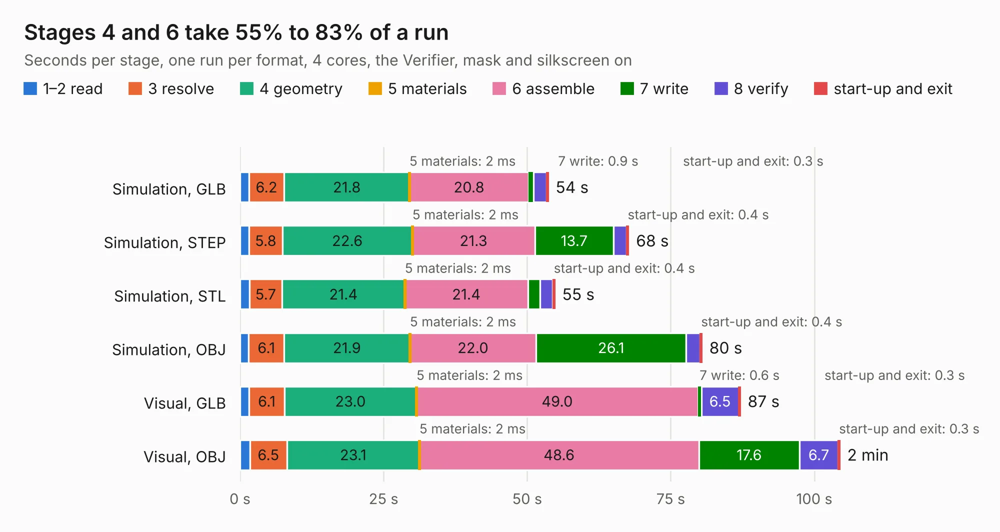

| Mode and format | 1–2 read | 3 resolve | 4 geometry | 5 materials | 6 assemble | 7 write | 8 verify | start-up and exit | Total |
|---|---:|---:|---:|---:|---:|---:|---:|---:|---:|
| Simulation, GLB | 1.5 | 6.2 | 21.8 | 2&nbsp;ms | 20.8 | 0.9 | 2.2 | 0.3 | 53.7 |
| Simulation, STEP | 1.6 | 5.8 | 22.6 | 2&nbsp;ms | 21.3 | 13.7 | 2.3 | 0.4 | 67.7 |
| Simulation, STL | 1.6 | 5.7 | 21.4 | 2&nbsp;ms | 21.4 | 2.1 | 2.2 | 0.4 | 54.8 |
| Simulation, OBJ | 1.5 | 6.1 | 21.9 | 2&nbsp;ms | 22.0 | 26.1 | 2.4 | 0.4 | 80.5 |
| Visual, GLB | 1.6 | 6.1 | 23.0 | 2&nbsp;ms | 49.0 | 0.6 | 6.5 | 0.3 | 87.2 |
| Visual, OBJ | 1.7 | 6.5 | 23.1 | 2&nbsp;ms | 48.6 | 17.6 | 6.7 | 0.3 | 104.5 |

<table align="center"><tr><td valign="top">

| Board | Repo: [ltbrain/mubook](https://github.com/ltbrain/mubook) Board: `[DFR1142]Lite Carrier for LattePanda Mu.kicad_pcb` |
|---|---|
| Folder | hardware / v.1 |
| Complexity | 406&nbsp;/&nbsp;1000 (size&nbsp;286, features&nbsp;120) |
| KESE&nbsp;features | through vias, slotted holes, custom pads, rounded, trapezoid or chamfered pads, filled zones, copper drawings, curved board outline, stack-up, dielectric εr and tanδ |
| Tested | 9th November 2026 |
| Copper&nbsp;layers | 4 |
| File&nbsp;format | KiCad 9 (20241229) |
| Parts,&nbsp;tracks,&nbsp;vias | 273, 4,113, 1,035 |
| Triangles,&nbsp;simulation | 5,358,896 in 432 parts |
| Verifier | PASS in all six runs |

</td><td valign="top">

<table>
<tr><th>File type</th><th>File size</th><th>Peak memory used</th></tr>
<tr><th colspan="3" align="left">Simulation</th></tr>
<tr><td>GLB</td><td align="right">183&nbsp;MB</td><td align="right">1.5&nbsp;GB</td></tr>
<tr><td>STEP</td><td align="right">764&nbsp;MB</td><td align="right">2.2&nbsp;GB</td></tr>
<tr><td>STL</td><td align="right">268&nbsp;MB</td><td align="right">1.5&nbsp;GB</td></tr>
<tr><td>OBJ</td><td align="right">577&nbsp;MB</td><td align="right">3.5&nbsp;GB</td></tr>
<tr><th colspan="3" align="left">Visual</th></tr>
<tr><td>GLB</td><td align="right">118&nbsp;MB</td><td align="right">2.0&nbsp;GB</td></tr>
<tr><td>OBJ</td><td align="right">384&nbsp;MB</td><td align="right">2.5&nbsp;GB</td></tr>
</table>

</td></tr></table>

## 15.2 Aleste520v4

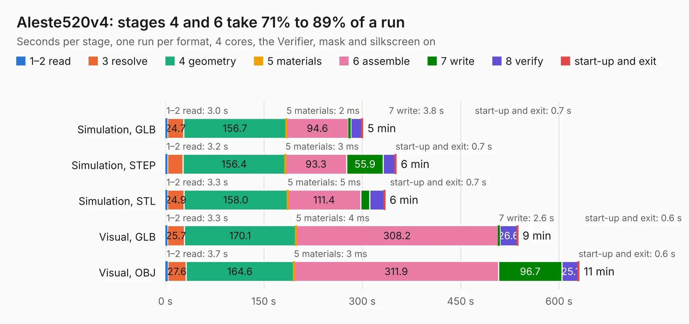

| Mode and format | 1–2 read | 3 resolve | 4 geometry | 5 materials | 6 assemble | 7 write | 8 verify | start-up and exit | Total |
|---|---:|---:|---:|---:|---:|---:|---:|---:|---:|
| Simulation, GLB | 3.0 | 24.7 | 156.7 | 2&nbsp;ms | 94.6 | 3.8 | 16.9 | 0.7 | 300.4 |
| Simulation, STEP | 3.2 | 23.4 | 156.4 | 3&nbsp;ms | 93.3 | 55.9 | 18.5 | 0.7 | 351.3 |
| Simulation, STL | 3.3 | 24.9 | 158.0 | 5&nbsp;ms | 111.4 | 14.0 | 21.9 | 0.7 | 334.3 |
| Simulation, OBJ | 2.9 | 24.5 | 152.4 | 6&nbsp;ms | 97.5 | 137.6 | 20.2 | 0.9 | 436.1 |
| Visual, GLB | 3.3 | 25.7 | 170.1 | 4&nbsp;ms | 308.2 | 2.6 | 26.6 | 0.6 | 536.9 |
| Visual, OBJ | 3.7 | 27.6 | 164.6 | 3&nbsp;ms | 311.9 | 96.7 | 25.1 | 0.6 | 630.2 |

<table align="center"><tr><td valign="top">

| Board | Repo: [lucedoriente/Aleste520ex](https://github.com/lucedoriente/Aleste520ex) Board: `Aleste520v4.kicad_pcb` |
|---|---|
| Folder | board |
| Complexity | 318&nbsp;/&nbsp;1000 (size&nbsp;243, features&nbsp;75) |
| KESE&nbsp;features | through vias, rounded, trapezoid or chamfered pads, filled zones, stack-up, dielectric εr and tanδ |
| Tested | 9th November 2026 to 10th November 2026 |
| Copper&nbsp;layers | 2 |
| File&nbsp;format | KiCad 9 (20241229) |
| Parts,&nbsp;tracks,&nbsp;vias | 326, 9,389, 4,195 |
| Triangles,&nbsp;simulation | 19,250,030 in 466 parts |
| Verifier | PASS in all six runs |
| Run&nbsp;again | Simulation, OBJ: failed in the corpus run, run again with the memory cap raised from 11 GB to 14.5 GB, and passed |

</td><td valign="top">

<table>
<tr><th>File type</th><th>File size</th><th>Peak memory used</th></tr>
<tr><th colspan="3" align="left">Simulation</th></tr>
<tr><td>GLB</td><td align="right">660&nbsp;MB</td><td align="right">5.3&nbsp;GB</td></tr>
<tr><td>STEP</td><td align="right">3.1&nbsp;GB</td><td align="right">6.9&nbsp;GB</td></tr>
<tr><td>STL</td><td align="right">963&nbsp;MB</td><td align="right">5.7&nbsp;GB</td></tr>
<tr><td>OBJ</td><td align="right">2.1&nbsp;GB</td><td align="right">12&nbsp;GB</td></tr>
<tr><th colspan="3" align="left">Visual</th></tr>
<tr><td>GLB</td><td align="right">430&nbsp;MB</td><td align="right">6.7&nbsp;GB</td></tr>
<tr><td>OBJ</td><td align="right">1.4&nbsp;GB</td><td align="right">8.4&nbsp;GB</td></tr>
</table>

</td></tr></table>

## 15.3 Aleste520_Keyboard

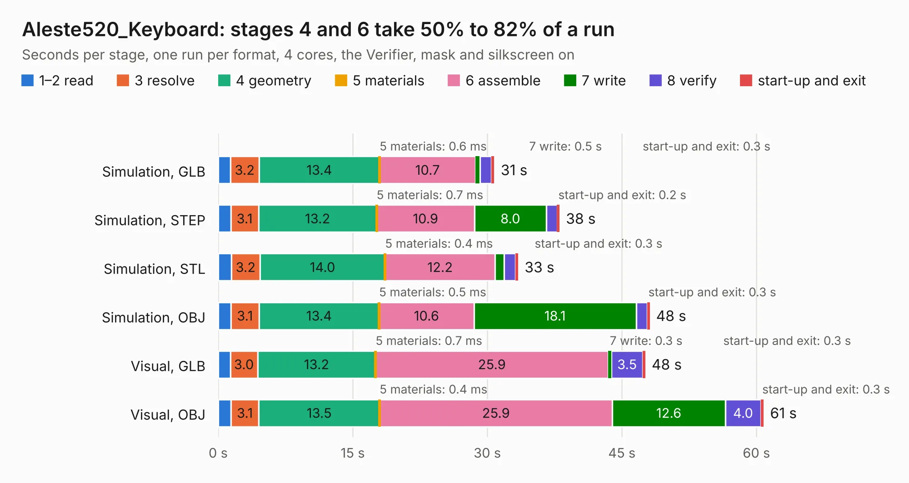

| Mode and format | 1–2 read | 3 resolve | 4 geometry | 5 materials | 6 assemble | 7 write | 8 verify | start-up and exit | Total |
|---|---:|---:|---:|---:|---:|---:|---:|---:|---:|
| Simulation, GLB | 1.4 | 3.2 | 13.4 | 0.6&nbsp;ms | 10.7 | 0.5 | 1.3 | 0.3 | 30.8 |
| Simulation, STEP | 1.4 | 3.1 | 13.2 | 0.7&nbsp;ms | 10.9 | 8.0 | 1.2 | 0.2 | 38.0 |
| Simulation, STL | 1.5 | 3.2 | 14.0 | 0.4&nbsp;ms | 12.2 | 1.0 | 1.2 | 0.3 | 33.4 |
| Simulation, OBJ | 1.4 | 3.1 | 13.4 | 0.5&nbsp;ms | 10.6 | 18.1 | 1.2 | 0.3 | 48.1 |
| Visual, GLB | 1.4 | 3.0 | 13.2 | 0.7&nbsp;ms | 25.9 | 0.3 | 3.5 | 0.3 | 47.6 |
| Visual, OBJ | 1.4 | 3.1 | 13.5 | 0.4&nbsp;ms | 25.9 | 12.6 | 4.0 | 0.3 | 60.8 |

<table align="center"><tr><td valign="top">

| Board | Repo: [lucedoriente/Aleste520ex](https://github.com/lucedoriente/Aleste520ex) Board: `Aleste520_Keyboard.kicad_pcb` |
|---|---|
| Folder | keyboard |
| Complexity | 268&nbsp;/&nbsp;1000 (size&nbsp;233, features&nbsp;35) |
| KESE&nbsp;features | through vias, filled zones |
| Tested | 9th November 2026 |
| Copper&nbsp;layers | 2 |
| File&nbsp;format | KiCad 9 (20241229) |
| Parts,&nbsp;tracks,&nbsp;vias | 167, 17,707, 141 |
| Triangles,&nbsp;simulation | 3,352,674 in 114 parts |
| Verifier | PASS in all six runs |

</td><td valign="top">

<table>
<tr><th>File type</th><th>File size</th><th>Peak memory used</th></tr>
<tr><th colspan="3" align="left">Simulation</th></tr>
<tr><td>GLB</td><td align="right">112&nbsp;MB</td><td align="right">1.4&nbsp;GB</td></tr>
<tr><td>STEP</td><td align="right">438&nbsp;MB</td><td align="right">1.5&nbsp;GB</td></tr>
<tr><td>STL</td><td align="right">168&nbsp;MB</td><td align="right">1.3&nbsp;GB</td></tr>
<tr><td>OBJ</td><td align="right">351&nbsp;MB</td><td align="right">2.2&nbsp;GB</td></tr>
<tr><th colspan="3" align="left">Visual</th></tr>
<tr><td>GLB</td><td align="right">79&nbsp;MB</td><td align="right">1.6&nbsp;GB</td></tr>
<tr><td>OBJ</td><td align="right">246&nbsp;MB</td><td align="right">1.7&nbsp;GB</td></tr>
</table>

</td></tr></table>

## 15.4 DepthABC

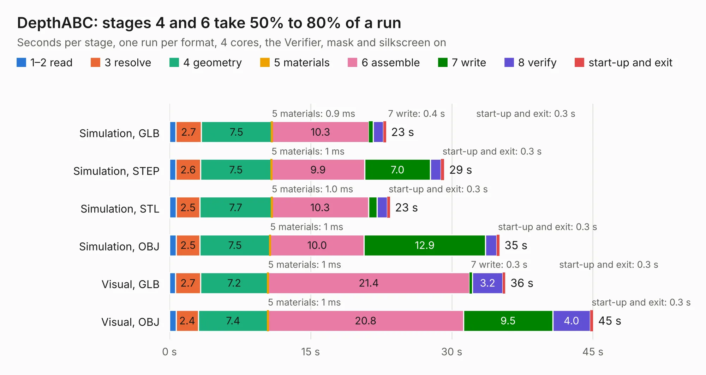

| Mode and format | 1–2 read | 3 resolve | 4 geometry | 5 materials | 6 assemble | 7 write | 8 verify | start-up and exit | Total |
|---|---:|---:|---:|---:|---:|---:|---:|---:|---:|
| Simulation, GLB | 0.7 | 2.7 | 7.5 | 0.9&nbsp;ms | 10.3 | 0.4 | 1.1 | 0.3 | 23.0 |
| Simulation, STEP | 0.7 | 2.6 | 7.5 | 1&nbsp;ms | 9.9 | 7.0 | 1.1 | 0.3 | 29.2 |
| Simulation, STL | 0.7 | 2.5 | 7.7 | 1.0&nbsp;ms | 10.3 | 0.9 | 1.1 | 0.3 | 23.4 |
| Simulation, OBJ | 0.7 | 2.5 | 7.5 | 1&nbsp;ms | 10.0 | 12.9 | 1.2 | 0.3 | 35.1 |
| Visual, GLB | 0.6 | 2.7 | 7.2 | 1&nbsp;ms | 21.4 | 0.3 | 3.2 | 0.3 | 35.7 |
| Visual, OBJ | 0.7 | 2.4 | 7.4 | 1&nbsp;ms | 20.8 | 9.5 | 4.0 | 0.3 | 45.0 |

<table align="center"><tr><td valign="top">

| Board | Repo: [luxonis/depthai-hardware](https://github.com/luxonis/depthai-hardware) Board: `DepthABC.kicad_pcb` |
|---|---|
| Folder | OSHW_KiCad_Community / Reference Designs (In Progress) / DepthABC |
| Complexity | 315&nbsp;/&nbsp;1000 (size&nbsp;225, features&nbsp;90) |
| KESE&nbsp;features | through vias, custom pads, rounded, trapezoid or chamfered pads, filled zones, copper drawings, copper text, curved board outline |
| Tested | 9th November 2026 |
| Copper&nbsp;layers | 4 |
| File&nbsp;format | KiCad 5 (20171130) |
| Parts,&nbsp;tracks,&nbsp;vias | 83, 5,199, 450 |
| Triangles,&nbsp;simulation | 2,455,628 in 177 parts |
| Verifier | PASS in all six runs |

</td><td valign="top">

<table>
<tr><th>File type</th><th>File size</th><th>Peak memory used</th></tr>
<tr><th colspan="3" align="left">Simulation</th></tr>
<tr><td>GLB</td><td align="right">84&nbsp;MB</td><td align="right">856&nbsp;MB</td></tr>
<tr><td>STEP</td><td align="right">332&nbsp;MB</td><td align="right">1.1&nbsp;GB</td></tr>
<tr><td>STL</td><td align="right">123&nbsp;MB</td><td align="right">859&nbsp;MB</td></tr>
<tr><td>OBJ</td><td align="right">257&nbsp;MB</td><td align="right">1.6&nbsp;GB</td></tr>
<tr><th colspan="3" align="left">Visual</th></tr>
<tr><td>GLB</td><td align="right">60&nbsp;MB</td><td align="right">1.1&nbsp;GB</td></tr>
<tr><td>OBJ</td><td align="right">190&nbsp;MB</td><td align="right">1.3&nbsp;GB</td></tr>
</table>

</td></tr></table>

## 15.5 payload_board

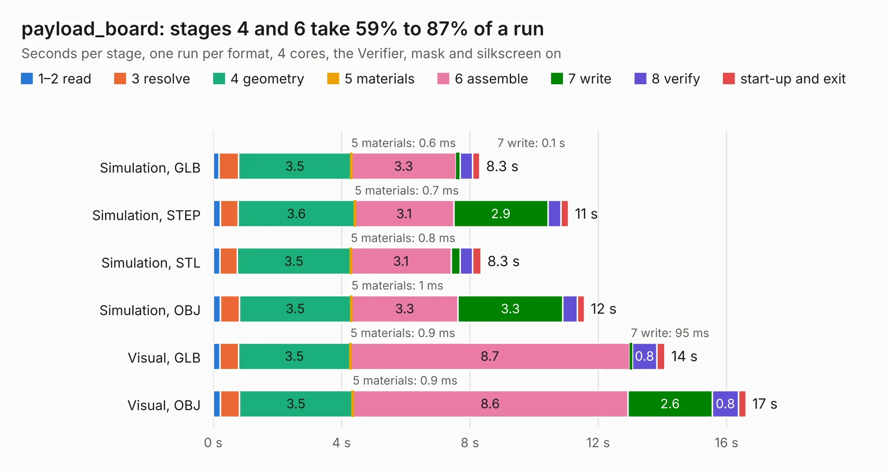

| Mode and format | 1–2 read | 3 resolve | 4 geometry | 5 materials | 6 assemble | 7 write | 8 verify | start-up and exit | Total |
|---|---:|---:|---:|---:|---:|---:|---:|---:|---:|
| Simulation, GLB | 0.2 | 0.6 | 3.5 | 0.6&nbsp;ms | 3.3 | 0.1 | 0.4 | 0.2 | 8.3 |
| Simulation, STEP | 0.2 | 0.6 | 3.6 | 0.7&nbsp;ms | 3.1 | 2.9 | 0.4 | 0.2 | 11.1 |
| Simulation, STL | 0.2 | 0.5 | 3.5 | 0.8&nbsp;ms | 3.1 | 0.3 | 0.4 | 0.3 | 8.3 |
| Simulation, OBJ | 0.2 | 0.6 | 3.5 | 1&nbsp;ms | 3.3 | 3.3 | 0.4 | 0.2 | 11.6 |
| Visual, GLB | 0.2 | 0.6 | 3.5 | 0.9&nbsp;ms | 8.7 | 95&nbsp;ms | 0.8 | 0.3 | 14.1 |
| Visual, OBJ | 0.2 | 0.6 | 3.5 | 0.9&nbsp;ms | 8.6 | 2.6 | 0.8 | 0.2 | 16.6 |

<table align="center"><tr><td valign="top">

| Board | Repo: [M2I-CySat/SDR-Carrier-Board](https://github.com/M2I-CySat/SDR-Carrier-Board) Board: `payload_board.kicad_pcb` |
|---|---|
| Folder | schematics / breakoutBoard |
| Complexity | 164&nbsp;/&nbsp;1000 (size&nbsp;129, features&nbsp;35) |
| KESE&nbsp;features | through vias, filled zones |
| Tested | 9th November 2026 |
| Copper&nbsp;layers | 2 |
| File&nbsp;format | KiCad 5 (20171130) |
| Parts,&nbsp;tracks,&nbsp;vias | 7, 172, 21 |
| Triangles,&nbsp;simulation | 714,524 in 392 parts |
| Verifier | PASS in all six runs |

</td><td valign="top">

<table>
<tr><th>File type</th><th>File size</th><th>Peak memory used</th></tr>
<tr><th colspan="3" align="left">Simulation</th></tr>
<tr><td>GLB</td><td align="right">24&nbsp;MB</td><td align="right">396&nbsp;MB</td></tr>
<tr><td>STEP</td><td align="right">126&nbsp;MB</td><td align="right">477&nbsp;MB</td></tr>
<tr><td>STL</td><td align="right">36&nbsp;MB</td><td align="right">405&nbsp;MB</td></tr>
<tr><td>OBJ</td><td align="right">72&nbsp;MB</td><td align="right">521&nbsp;MB</td></tr>
<tr><th colspan="3" align="left">Visual</th></tr>
<tr><td>GLB</td><td align="right">20&nbsp;MB</td><td align="right">551&nbsp;MB</td></tr>
<tr><td>OBJ</td><td align="right">59&nbsp;MB</td><td align="right">585&nbsp;MB</td></tr>
</table>

</td></tr></table>

## 15.6 Mupi

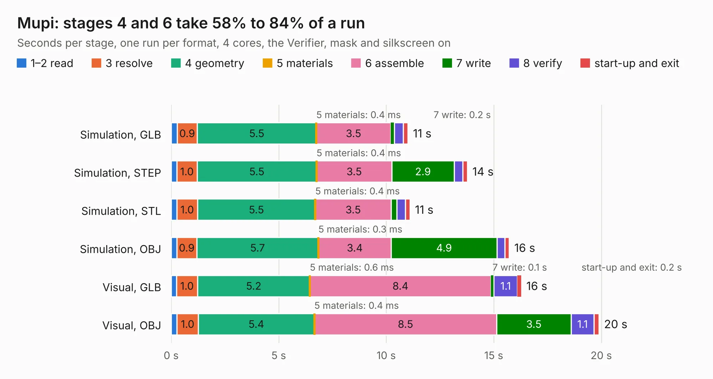

| Mode and format | 1–2 read | 3 resolve | 4 geometry | 5 materials | 6 assemble | 7 write | 8 verify | start-up and exit | Total |
|---|---:|---:|---:|---:|---:|---:|---:|---:|---:|
| Simulation, GLB | 0.3 | 0.9 | 5.5 | 0.4&nbsp;ms | 3.5 | 0.2 | 0.4 | 0.2 | 11.0 |
| Simulation, STEP | 0.3 | 1.0 | 5.5 | 0.4&nbsp;ms | 3.5 | 2.9 | 0.4 | 0.2 | 13.8 |
| Simulation, STL | 0.3 | 1.0 | 5.5 | 0.4&nbsp;ms | 3.5 | 0.3 | 0.4 | 0.2 | 11.1 |
| Simulation, OBJ | 0.3 | 0.9 | 5.7 | 0.3&nbsp;ms | 3.4 | 4.9 | 0.4 | 0.2 | 15.7 |
| Visual, GLB | 0.2 | 1.0 | 5.2 | 0.6&nbsp;ms | 8.4 | 0.1 | 1.1 | 0.2 | 16.3 |
| Visual, OBJ | 0.3 | 1.0 | 5.4 | 0.4&nbsp;ms | 8.5 | 3.5 | 1.1 | 0.2 | 19.9 |

<table align="center"><tr><td valign="top">

| Board | Repo: [m47812/custom-3d-printer-controller](https://github.com/m47812/custom-3d-printer-controller) Board: `Mupi.kicad_pcb` |
|---|---|
| Folder | 3D_Printer_Handheld |
| Complexity | 227&nbsp;/&nbsp;1000 (size&nbsp;172, features&nbsp;55) |
| KESE&nbsp;features | through vias, slotted holes, rounded, trapezoid or chamfered pads, filled zones |
| Tested | 9th November 2026 |
| Copper&nbsp;layers | 2 |
| File&nbsp;format | KiCad 5 (20171130) |
| Parts,&nbsp;tracks,&nbsp;vias | 84, 497, 68 |
| Triangles,&nbsp;simulation | 1,166,542 in 73 parts |
| Verifier | PASS in all six runs |

</td><td valign="top">

<table>
<tr><th>File type</th><th>File size</th><th>Peak memory used</th></tr>
<tr><th colspan="3" align="left">Simulation</th></tr>
<tr><td>GLB</td><td align="right">41&nbsp;MB</td><td align="right">562&nbsp;MB</td></tr>
<tr><td>STEP</td><td align="right">213&nbsp;MB</td><td align="right">621&nbsp;MB</td></tr>
<tr><td>STL</td><td align="right">58&nbsp;MB</td><td align="right">563&nbsp;MB</td></tr>
<tr><td>OBJ</td><td align="right">121&nbsp;MB</td><td align="right">801&nbsp;MB</td></tr>
<tr><th colspan="3" align="left">Visual</th></tr>
<tr><td>GLB</td><td align="right">29&nbsp;MB</td><td align="right">608&nbsp;MB</td></tr>
<tr><td>OBJ</td><td align="right">87&nbsp;MB</td><td align="right">665&nbsp;MB</td></tr>
</table>

</td></tr></table>

## 15.7 3D_Printer_Mainboard_STM32

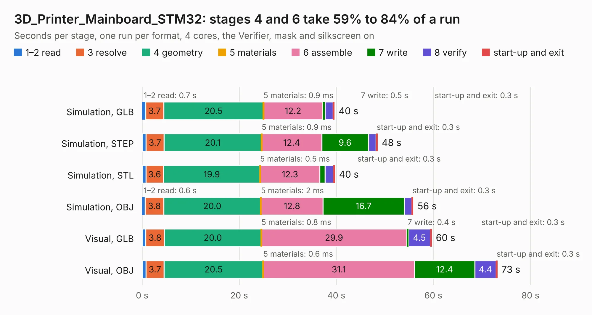

| Mode and format | 1–2 read | 3 resolve | 4 geometry | 5 materials | 6 assemble | 7 write | 8 verify | start-up and exit | Total |
|---|---:|---:|---:|---:|---:|---:|---:|---:|---:|
| Simulation, GLB | 0.7 | 3.7 | 20.5 | 0.9&nbsp;ms | 12.2 | 0.5 | 1.6 | 0.3 | 39.6 |
| Simulation, STEP | 0.8 | 3.7 | 20.1 | 0.9&nbsp;ms | 12.4 | 9.6 | 1.6 | 0.3 | 48.5 |
| Simulation, STL | 0.8 | 3.6 | 19.9 | 0.5&nbsp;ms | 12.3 | 1.1 | 1.7 | 0.3 | 39.7 |
| Simulation, OBJ | 0.6 | 3.8 | 20.0 | 2&nbsp;ms | 12.8 | 16.7 | 1.6 | 0.3 | 55.8 |
| Visual, GLB | 0.8 | 3.8 | 20.0 | 0.8&nbsp;ms | 29.9 | 0.4 | 4.5 | 0.3 | 59.6 |
| Visual, OBJ | 0.8 | 3.7 | 20.5 | 0.6&nbsp;ms | 31.1 | 12.4 | 4.4 | 0.3 | 73.2 |

<table align="center"><tr><td valign="top">

| Board | Repo: [m47812/custom-3d-printer-controller](https://github.com/m47812/custom-3d-printer-controller) Board: `3D_Printer_Mainboard_STM32.kicad_pcb` |
|---|---|
| Folder | 3D_Printer_Mainboard_STM32 |
| Complexity | 284&nbsp;/&nbsp;1000 (size&nbsp;239, features&nbsp;45) |
| KESE&nbsp;features | through vias, rounded, trapezoid or chamfered pads, filled zones |
| Tested | 9th November 2026 |
| Copper&nbsp;layers | 2 |
| File&nbsp;format | KiCad 5 (20171130) |
| Parts,&nbsp;tracks,&nbsp;vias | 191, 1,355, 233 |
| Triangles,&nbsp;simulation | 3,389,266 in 196 parts |
| Verifier | PASS in all six runs |

</td><td valign="top">

<table>
<tr><th>File type</th><th>File size</th><th>Peak memory used</th></tr>
<tr><th colspan="3" align="left">Simulation</th></tr>
<tr><td>GLB</td><td align="right">118&nbsp;MB</td><td align="right">1.2&nbsp;GB</td></tr>
<tr><td>STEP</td><td align="right">621&nbsp;MB</td><td align="right">1.4&nbsp;GB</td></tr>
<tr><td>STL</td><td align="right">169&nbsp;MB</td><td align="right">1.2&nbsp;GB</td></tr>
<tr><td>OBJ</td><td align="right">363&nbsp;MB</td><td align="right">2.3&nbsp;GB</td></tr>
<tr><th colspan="3" align="left">Visual</th></tr>
<tr><td>GLB</td><td align="right">86&nbsp;MB</td><td align="right">1.4&nbsp;GB</td></tr>
<tr><td>OBJ</td><td align="right">267&nbsp;MB</td><td align="right">1.8&nbsp;GB</td></tr>
</table>

</td></tr></table>

## 15.8 3D_Printer_Stepper_TMC2209

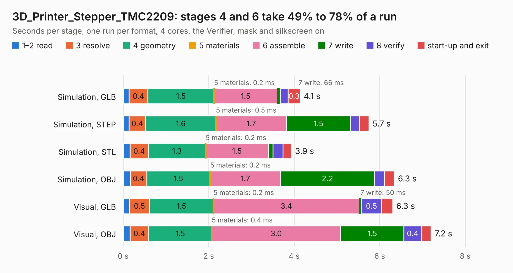

| Mode and format | 1–2 read | 3 resolve | 4 geometry | 5 materials | 6 assemble | 7 write | 8 verify | start-up and exit | Total |
|---|---:|---:|---:|---:|---:|---:|---:|---:|---:|
| Simulation, GLB | 0.1 | 0.4 | 1.5 | 0.2&nbsp;ms | 1.5 | 66&nbsp;ms | 0.2 | 0.3 | 4.1 |
| Simulation, STEP | 0.1 | 0.4 | 1.6 | 0.5&nbsp;ms | 1.7 | 1.5 | 0.2 | 0.2 | 5.7 |
| Simulation, STL | 0.2 | 0.4 | 1.3 | 0.2&nbsp;ms | 1.5 | 0.1 | 0.2 | 0.2 | 3.9 |
| Simulation, OBJ | 0.2 | 0.4 | 1.5 | 0.2&nbsp;ms | 1.7 | 2.2 | 0.2 | 0.2 | 6.3 |
| Visual, GLB | 0.1 | 0.5 | 1.5 | 0.2&nbsp;ms | 3.4 | 50&nbsp;ms | 0.5 | 0.3 | 6.3 |
| Visual, OBJ | 0.2 | 0.4 | 1.5 | 0.4&nbsp;ms | 3.0 | 1.5 | 0.4 | 0.2 | 7.2 |

<table align="center"><tr><td valign="top">

| Board | Repo: [m47812/custom-3d-printer-controller](https://github.com/m47812/custom-3d-printer-controller) Board: `3D_Printer_Stepper_TMC2209.kicad_pcb` |
|---|---|
| Folder | 3D_Printer_Motor_Driver |
| Complexity | 257&nbsp;/&nbsp;1000 (size&nbsp;187, features&nbsp;70) |
| KESE&nbsp;features | through vias, custom pads, rounded, trapezoid or chamfered pads, filled zones, copper drawings |
| Tested | 9th November 2026 |
| Copper&nbsp;layers | 2 |
| File&nbsp;format | KiCad 5 (20171130) |
| Parts,&nbsp;tracks,&nbsp;vias | 21, 227, 44 |
| Triangles,&nbsp;simulation | 417,724 in 38 parts |
| Verifier | PASS in all six runs |

</td><td valign="top">

<table>
<tr><th>File type</th><th>File size</th><th>Peak memory used</th></tr>
<tr><th colspan="3" align="left">Simulation</th></tr>
<tr><td>GLB</td><td align="right">14&nbsp;MB</td><td align="right">276&nbsp;MB</td></tr>
<tr><td>STEP</td><td align="right">77&nbsp;MB</td><td align="right">311&nbsp;MB</td></tr>
<tr><td>STL</td><td align="right">21&nbsp;MB</td><td align="right">291&nbsp;MB</td></tr>
<tr><td>OBJ</td><td align="right">42&nbsp;MB</td><td align="right">337&nbsp;MB</td></tr>
<tr><th colspan="3" align="left">Visual</th></tr>
<tr><td>GLB</td><td align="right">11&nbsp;MB</td><td align="right">289&nbsp;MB</td></tr>
<tr><td>OBJ</td><td align="right">31&nbsp;MB</td><td align="right">303&nbsp;MB</td></tr>
</table>

</td></tr></table>

## 15.9 blaustahl

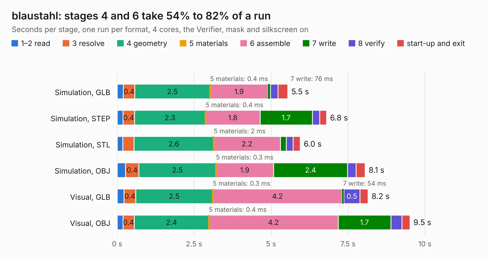

| Mode and format | 1–2 read | 3 resolve | 4 geometry | 5 materials | 6 assemble | 7 write | 8 verify | start-up and exit | Total |
|---|---:|---:|---:|---:|---:|---:|---:|---:|---:|
| Simulation, GLB | 0.2 | 0.4 | 2.5 | 0.4&nbsp;ms | 1.9 | 76&nbsp;ms | 0.2 | 0.3 | 5.5 |
| Simulation, STEP | 0.2 | 0.4 | 2.3 | 0.4&nbsp;ms | 1.8 | 1.7 | 0.2 | 0.2 | 6.8 |
| Simulation, STL | 0.2 | 0.4 | 2.6 | 2&nbsp;ms | 2.2 | 0.2 | 0.2 | 0.2 | 6.0 |
| Simulation, OBJ | 0.3 | 0.4 | 2.5 | 0.3&nbsp;ms | 1.9 | 2.4 | 0.3 | 0.3 | 8.1 |
| Visual, GLB | 0.2 | 0.4 | 2.5 | 0.3&nbsp;ms | 4.2 | 54&nbsp;ms | 0.5 | 0.3 | 8.2 |
| Visual, OBJ | 0.2 | 0.4 | 2.4 | 0.4&nbsp;ms | 4.2 | 1.7 | 0.4 | 0.3 | 9.5 |

<table align="center"><tr><td valign="top">

| Board | Repo: [machdyne/blaustahl](https://github.com/machdyne/blaustahl) Board: `blaustahl.kicad_pcb` |
|---|---|
| Folder | pcb / blaustahl_v0 |
| Complexity | 296&nbsp;/&nbsp;1000 (size&nbsp;201, features&nbsp;95) |
| KESE&nbsp;features | through vias, slotted holes, rounded, trapezoid or chamfered pads, filled zones, curved board outline, stack-up, dielectric εr and tanδ |
| Tested | 9th November 2026 |
| Copper&nbsp;layers | 2 |
| File&nbsp;format | KiCad 8 (20240108) |
| Parts,&nbsp;tracks,&nbsp;vias | 38, 388, 63 |
| Triangles,&nbsp;simulation | 388,128 in 64 parts |
| Verifier | PASS in all six runs |

</td><td valign="top">

<table>
<tr><th>File type</th><th>File size</th><th>Peak memory used</th></tr>
<tr><th colspan="3" align="left">Simulation</th></tr>
<tr><td>GLB</td><td align="right">14&nbsp;MB</td><td align="right">299&nbsp;MB</td></tr>
<tr><td>STEP</td><td align="right">75&nbsp;MB</td><td align="right">335&nbsp;MB</td></tr>
<tr><td>STL</td><td align="right">19&nbsp;MB</td><td align="right">285&nbsp;MB</td></tr>
<tr><td>OBJ</td><td align="right">40&nbsp;MB</td><td align="right">322&nbsp;MB</td></tr>
<tr><th colspan="3" align="left">Visual</th></tr>
<tr><td>GLB</td><td align="right">9.8&nbsp;MB</td><td align="right">299&nbsp;MB</td></tr>
<tr><td>OBJ</td><td align="right">29&nbsp;MB</td><td align="right">306&nbsp;MB</td></tr>
</table>

</td></tr></table>

## 15.10 eis

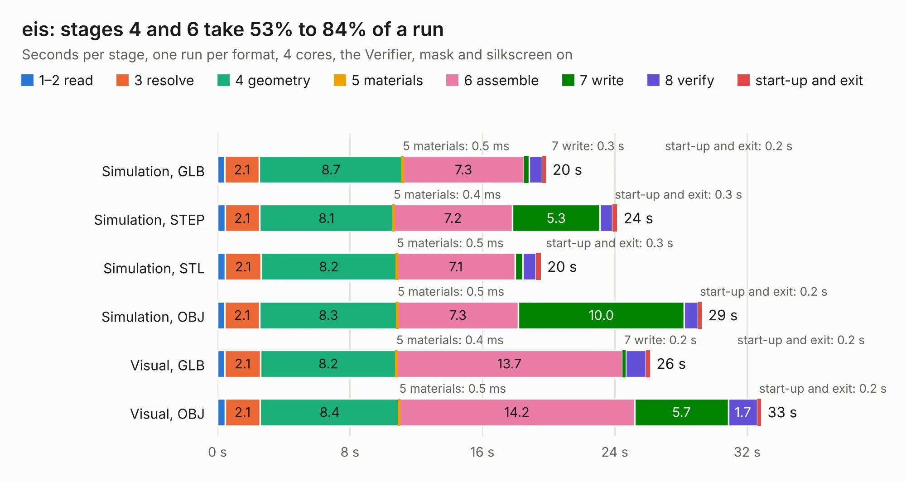

| Mode and format | 1–2 read | 3 resolve | 4 geometry | 5 materials | 6 assemble | 7 write | 8 verify | start-up and exit | Total |
|---|---:|---:|---:|---:|---:|---:|---:|---:|---:|
| Simulation, GLB | 0.4 | 2.1 | 8.7 | 0.5&nbsp;ms | 7.3 | 0.3 | 0.8 | 0.2 | 19.8 |
| Simulation, STEP | 0.5 | 2.1 | 8.1 | 0.4&nbsp;ms | 7.2 | 5.3 | 0.8 | 0.3 | 24.1 |
| Simulation, STL | 0.5 | 2.1 | 8.2 | 0.5&nbsp;ms | 7.1 | 0.5 | 0.8 | 0.3 | 19.5 |
| Simulation, OBJ | 0.4 | 2.1 | 8.3 | 0.5&nbsp;ms | 7.3 | 10.0 | 0.8 | 0.2 | 29.3 |
| Visual, GLB | 0.5 | 2.1 | 8.2 | 0.4&nbsp;ms | 13.7 | 0.2 | 1.2 | 0.2 | 26.1 |
| Visual, OBJ | 0.5 | 2.1 | 8.4 | 0.5&nbsp;ms | 14.2 | 5.7 | 1.7 | 0.2 | 32.8 |

<table align="center"><tr><td valign="top">

| Board | Repo: [machdyne/eis](https://github.com/machdyne/eis) Board: `eis.kicad_pcb` |
|---|---|
| Folder | pcb / eis_v0 |
| Complexity | 364&nbsp;/&nbsp;1000 (size&nbsp;269, features&nbsp;95) |
| KESE&nbsp;features | through vias, slotted holes, rounded, trapezoid or chamfered pads, filled zones, curved board outline, stack-up, dielectric εr and tanδ |
| Tested | 9th November 2026 |
| Copper&nbsp;layers | 4 |
| File&nbsp;format | KiCad 6 (20211014) |
| Parts,&nbsp;tracks,&nbsp;vias | 103, 1,474, 220 |
| Triangles,&nbsp;simulation | 1,893,902 in 185 parts |
| Verifier | PASS in all six runs |

</td><td valign="top">

<table>
<tr><th>File type</th><th>File size</th><th>Peak memory used</th></tr>
<tr><th colspan="3" align="left">Simulation</th></tr>
<tr><td>GLB</td><td align="right">65&nbsp;MB</td><td align="right">753&nbsp;MB</td></tr>
<tr><td>STEP</td><td align="right">306&nbsp;MB</td><td align="right">895&nbsp;MB</td></tr>
<tr><td>STL</td><td align="right">95&nbsp;MB</td><td align="right">762&nbsp;MB</td></tr>
<tr><td>OBJ</td><td align="right">200&nbsp;MB</td><td align="right">1.3&nbsp;GB</td></tr>
<tr><th colspan="3" align="left">Visual</th></tr>
<tr><td>GLB</td><td align="right">37&nbsp;MB</td><td align="right">759&nbsp;MB</td></tr>
<tr><td>OBJ</td><td align="right">116&nbsp;MB</td><td align="right">927&nbsp;MB</td></tr>
</table>

</td></tr></table>

## 15.11 ssx

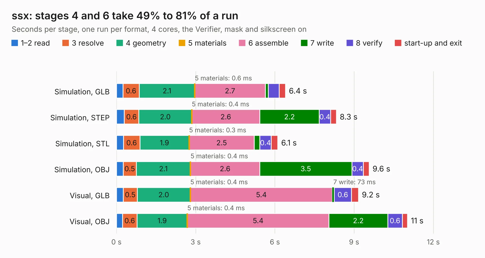

| Mode and format | 1–2 read | 3 resolve | 4 geometry | 5 materials | 6 assemble | 7 write | 8 verify | start-up and exit | Total |
|---|---:|---:|---:|---:|---:|---:|---:|---:|---:|
| Simulation, GLB | 0.2 | 0.6 | 2.1 | 0.6&nbsp;ms | 2.7 | 0.1 | 0.4 | 0.2 | 6.4 |
| Simulation, STEP | 0.3 | 0.6 | 2.0 | 0.4&nbsp;ms | 2.6 | 2.2 | 0.4 | 0.2 | 8.3 |
| Simulation, STL | 0.3 | 0.6 | 1.9 | 0.3&nbsp;ms | 2.5 | 0.2 | 0.4 | 0.2 | 6.1 |
| Simulation, OBJ | 0.3 | 0.5 | 2.1 | 0.4&nbsp;ms | 2.6 | 3.5 | 0.4 | 0.2 | 9.6 |
| Visual, GLB | 0.3 | 0.5 | 2.0 | 0.4&nbsp;ms | 5.4 | 73&nbsp;ms | 0.6 | 0.3 | 9.2 |
| Visual, OBJ | 0.2 | 0.6 | 1.9 | 0.4&nbsp;ms | 5.4 | 2.2 | 0.6 | 0.2 | 11.0 |

<table align="center"><tr><td valign="top">

| Board | Repo: [machdyne/ferrit](https://github.com/machdyne/ferrit) Board: `ssx.kicad_pcb` |
|---|---|
| Folder | hw / ferrit-1 |
| Complexity | 347&nbsp;/&nbsp;1000 (size&nbsp;222, features&nbsp;125) |
| KESE&nbsp;features | through vias, slotted holes, rounded, trapezoid or chamfered pads, arc tracks, filled zones, curved board outline, TrueType text, stack-up, dielectric εr and tanδ |
| Tested | 9th November 2026 |
| Copper&nbsp;layers | 4 |
| File&nbsp;format | KiCad 10 (20260206) |
| Parts,&nbsp;tracks,&nbsp;vias | 43, 546, 60 |
| Triangles,&nbsp;simulation | 719,896 in 85 parts |
| Verifier | PASS in all six runs |

</td><td valign="top">

<table>
<tr><th>File type</th><th>File size</th><th>Peak memory used</th></tr>
<tr><th colspan="3" align="left">Simulation</th></tr>
<tr><td>GLB</td><td align="right">24&nbsp;MB</td><td align="right">349&nbsp;MB</td></tr>
<tr><td>STEP</td><td align="right">97&nbsp;MB</td><td align="right">435&nbsp;MB</td></tr>
<tr><td>STL</td><td align="right">36&nbsp;MB</td><td align="right">350&nbsp;MB</td></tr>
<tr><td>OBJ</td><td align="right">72&nbsp;MB</td><td align="right">533&nbsp;MB</td></tr>
<tr><th colspan="3" align="left">Visual</th></tr>
<tr><td>GLB</td><td align="right">15&nbsp;MB</td><td align="right">378&nbsp;MB</td></tr>
<tr><td>OBJ</td><td align="right">44&nbsp;MB</td><td align="right">405&nbsp;MB</td></tr>
</table>

</td></tr></table>

## 15.12 ssu

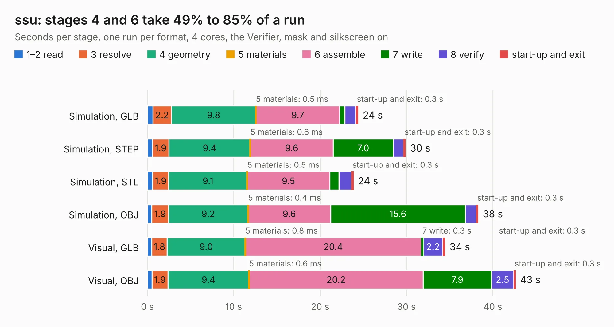

| Mode and format | 1–2 read | 3 resolve | 4 geometry | 5 materials | 6 assemble | 7 write | 8 verify | start-up and exit | Total |
|---|---:|---:|---:|---:|---:|---:|---:|---:|---:|
| Simulation, GLB | 0.6 | 2.2 | 9.8 | 0.5&nbsp;ms | 9.7 | 0.6 | 1.2 | 0.3 | 24.4 |
| Simulation, STEP | 0.6 | 1.9 | 9.4 | 0.6&nbsp;ms | 9.6 | 7.0 | 1.2 | 0.3 | 29.9 |
| Simulation, STL | 0.6 | 1.9 | 9.1 | 0.5&nbsp;ms | 9.5 | 1.1 | 1.4 | 0.3 | 23.9 |
| Simulation, OBJ | 0.5 | 1.9 | 9.2 | 0.4&nbsp;ms | 9.6 | 15.6 | 1.3 | 0.3 | 38.3 |
| Visual, GLB | 0.5 | 1.8 | 9.0 | 0.8&nbsp;ms | 20.4 | 0.3 | 2.2 | 0.3 | 34.5 |
| Visual, OBJ | 0.5 | 1.9 | 9.4 | 0.6&nbsp;ms | 20.2 | 7.9 | 2.5 | 0.3 | 42.7 |

<table align="center"><tr><td valign="top">

| Board | Repo: [machdyne/ferrit](https://github.com/machdyne/ferrit) Board: `ssu.kicad_pcb` |
|---|---|
| Folder | hw / ferrit-16 |
| Complexity | 306&nbsp;/&nbsp;1000 (size&nbsp;191, features&nbsp;115) |
| KESE&nbsp;features | through vias, rounded, trapezoid or chamfered pads, arc tracks, filled zones, curved board outline, TrueType text, stack-up, dielectric εr and tanδ |
| Tested | 9th November 2026 |
| Copper&nbsp;layers | 4 |
| File&nbsp;format | KiCad 8 (20240108) |
| Parts,&nbsp;tracks,&nbsp;vias | 37, 1,219, 50 |
| Triangles,&nbsp;simulation | 2,954,306 in 46 parts |
| Verifier | PASS in all six runs |

</td><td valign="top">

<table>
<tr><th>File type</th><th>File size</th><th>Peak memory used</th></tr>
<tr><th colspan="3" align="left">Simulation</th></tr>
<tr><td>GLB</td><td align="right">100&nbsp;MB</td><td align="right">1.1&nbsp;GB</td></tr>
<tr><td>STEP</td><td align="right">396&nbsp;MB</td><td align="right">1.2&nbsp;GB</td></tr>
<tr><td>STL</td><td align="right">148&nbsp;MB</td><td align="right">1.0&nbsp;GB</td></tr>
<tr><td>OBJ</td><td align="right">310&nbsp;MB</td><td align="right">1.9&nbsp;GB</td></tr>
<tr><th colspan="3" align="left">Visual</th></tr>
<tr><td>GLB</td><td align="right">52&nbsp;MB</td><td align="right">989&nbsp;MB</td></tr>
<tr><td>OBJ</td><td align="right">161&nbsp;MB</td><td align="right">1.2&nbsp;GB</td></tr>
</table>

</td></tr></table>

## 15.13 sxy

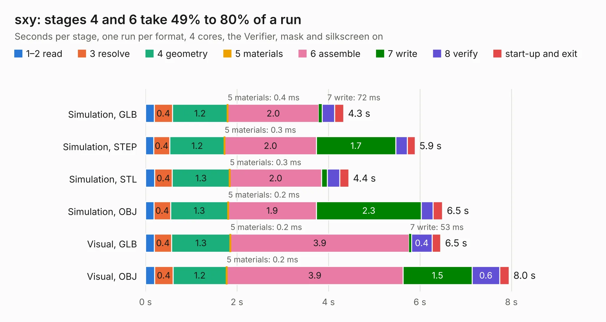

| Mode and format | 1–2 read | 3 resolve | 4 geometry | 5 materials | 6 assemble | 7 write | 8 verify | start-up and exit | Total |
|---|---:|---:|---:|---:|---:|---:|---:|---:|---:|
| Simulation, GLB | 0.2 | 0.4 | 1.2 | 0.4&nbsp;ms | 2.0 | 72&nbsp;ms | 0.3 | 0.2 | 4.3 |
| Simulation, STEP | 0.2 | 0.4 | 1.2 | 0.3&nbsp;ms | 2.0 | 1.7 | 0.3 | 0.2 | 5.9 |
| Simulation, STL | 0.2 | 0.4 | 1.3 | 0.3&nbsp;ms | 2.0 | 0.1 | 0.3 | 0.2 | 4.4 |
| Simulation, OBJ | 0.2 | 0.4 | 1.3 | 0.2&nbsp;ms | 1.9 | 2.3 | 0.3 | 0.2 | 6.5 |
| Visual, GLB | 0.2 | 0.4 | 1.3 | 0.2&nbsp;ms | 3.9 | 53&nbsp;ms | 0.4 | 0.2 | 6.5 |
| Visual, OBJ | 0.2 | 0.4 | 1.2 | 0.2&nbsp;ms | 3.9 | 1.5 | 0.6 | 0.2 | 8.0 |

<table align="center"><tr><td valign="top">

| Board | Repo: [machdyne/ferrit](https://github.com/machdyne/ferrit) Board: `sxy.kicad_pcb` |
|---|---|
| Folder | hw / ferrit-cy |
| Complexity | 349&nbsp;/&nbsp;1000 (size&nbsp;224, features&nbsp;125) |
| KESE&nbsp;features | through vias, slotted holes, rounded, trapezoid or chamfered pads, arc tracks, filled zones, curved board outline, TrueType text, stack-up, dielectric εr and tanδ |
| Tested | 9th November 2026 |
| Copper&nbsp;layers | 4 |
| File&nbsp;format | KiCad 8 (20240108) |
| Parts,&nbsp;tracks,&nbsp;vias | 45, 591, 64 |
| Triangles,&nbsp;simulation | 564,848 in 87 parts |
| Verifier | PASS in all six runs |

</td><td valign="top">

<table>
<tr><th>File type</th><th>File size</th><th>Peak memory used</th></tr>
<tr><th colspan="3" align="left">Simulation</th></tr>
<tr><td>GLB</td><td align="right">19&nbsp;MB</td><td align="right">329&nbsp;MB</td></tr>
<tr><td>STEP</td><td align="right">84&nbsp;MB</td><td align="right">385&nbsp;MB</td></tr>
<tr><td>STL</td><td align="right">28&nbsp;MB</td><td align="right">321&nbsp;MB</td></tr>
<tr><td>OBJ</td><td align="right">56&nbsp;MB</td><td align="right">415&nbsp;MB</td></tr>
<tr><th colspan="3" align="left">Visual</th></tr>
<tr><td>GLB</td><td align="right">13&nbsp;MB</td><td align="right">415&nbsp;MB</td></tr>
<tr><td>OBJ</td><td align="right">38&nbsp;MB</td><td align="right">352&nbsp;MB</td></tr>
</table>

</td></tr></table>

## 15.14 sxa

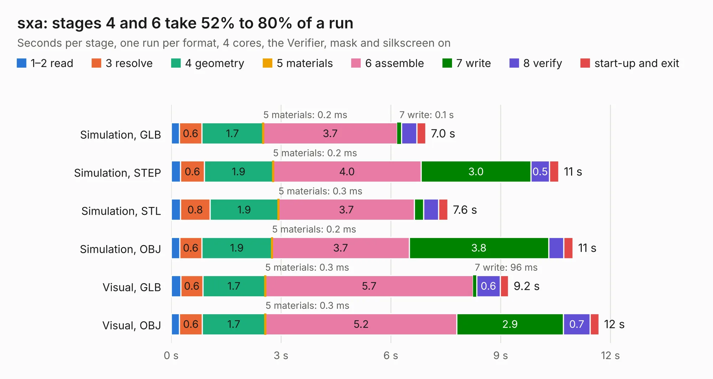

| Mode and format | 1–2 read | 3 resolve | 4 geometry | 5 materials | 6 assemble | 7 write | 8 verify | start-up and exit | Total |
|---|---:|---:|---:|---:|---:|---:|---:|---:|---:|
| Simulation, GLB | 0.2 | 0.6 | 1.7 | 0.2&nbsp;ms | 3.7 | 0.1 | 0.4 | 0.2 | 7.0 |
| Simulation, STEP | 0.3 | 0.6 | 1.9 | 0.2&nbsp;ms | 4.0 | 3.0 | 0.5 | 0.3 | 10.6 |
| Simulation, STL | 0.3 | 0.8 | 1.9 | 0.3&nbsp;ms | 3.7 | 0.3 | 0.4 | 0.3 | 7.6 |
| Simulation, OBJ | 0.2 | 0.6 | 1.9 | 0.2&nbsp;ms | 3.7 | 3.8 | 0.4 | 0.3 | 11.0 |
| Visual, GLB | 0.3 | 0.6 | 1.7 | 0.3&nbsp;ms | 5.7 | 96&nbsp;ms | 0.6 | 0.2 | 9.2 |
| Visual, OBJ | 0.2 | 0.6 | 1.7 | 0.3&nbsp;ms | 5.2 | 2.9 | 0.7 | 0.2 | 11.7 |

<table align="center"><tr><td valign="top">

| Board | Repo: [machdyne/ferrit](https://github.com/machdyne/ferrit) Board: `sxa.kicad_pcb` |
|---|---|
| Folder | hw / ferrit-m8 |
| Complexity | 281&nbsp;/&nbsp;1000 (size&nbsp;181, features&nbsp;100) |
| KESE&nbsp;features | through vias, rounded, trapezoid or chamfered pads, filled zones, curved board outline, TrueType text, stack-up, dielectric εr and tanδ |
| Tested | 9th November 2026 |
| Copper&nbsp;layers | 4 |
| File&nbsp;format | KiCad 8 (20240108) |
| Parts,&nbsp;tracks,&nbsp;vias | 30, 525, 103 |
| Triangles,&nbsp;simulation | 658,288 in 32 parts |
| Verifier | PASS in all six runs |

</td><td valign="top">

<table>
<tr><th>File type</th><th>File size</th><th>Peak memory used</th></tr>
<tr><th colspan="3" align="left">Simulation</th></tr>
<tr><td>GLB</td><td align="right">22&nbsp;MB</td><td align="right">357&nbsp;MB</td></tr>
<tr><td>STEP</td><td align="right">92&nbsp;MB</td><td align="right">429&nbsp;MB</td></tr>
<tr><td>STL</td><td align="right">33&nbsp;MB</td><td align="right">357&nbsp;MB</td></tr>
<tr><td>OBJ</td><td align="right">66&nbsp;MB</td><td align="right">466&nbsp;MB</td></tr>
<tr><th colspan="3" align="left">Visual</th></tr>
<tr><td>GLB</td><td align="right">16&nbsp;MB</td><td align="right">483&nbsp;MB</td></tr>
<tr><td>OBJ</td><td align="right">48&nbsp;MB</td><td align="right">484&nbsp;MB</td></tr>
</table>

</td></tr></table>

## 15.15 kaltstahl

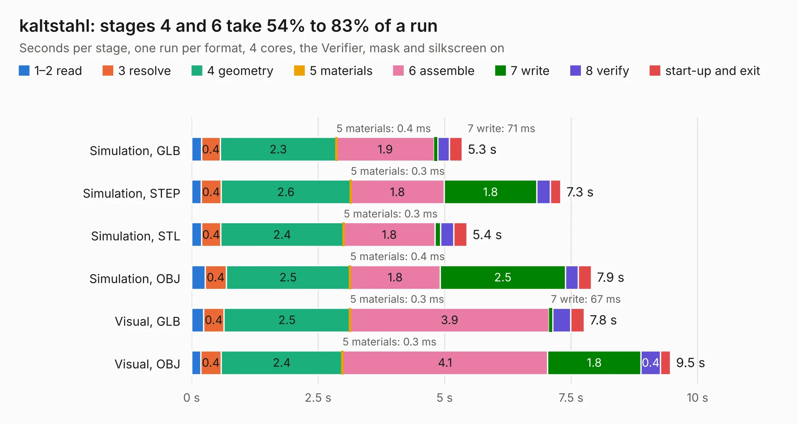

| Mode and format | 1–2 read | 3 resolve | 4 geometry | 5 materials | 6 assemble | 7 write | 8 verify | start-up and exit | Total |
|---|---:|---:|---:|---:|---:|---:|---:|---:|---:|
| Simulation, GLB | 0.2 | 0.4 | 2.3 | 0.4&nbsp;ms | 1.9 | 71&nbsp;ms | 0.2 | 0.3 | 5.3 |
| Simulation, STEP | 0.2 | 0.4 | 2.6 | 0.3&nbsp;ms | 1.8 | 1.8 | 0.3 | 0.2 | 7.3 |
| Simulation, STL | 0.2 | 0.4 | 2.4 | 0.3&nbsp;ms | 1.8 | 0.1 | 0.3 | 0.3 | 5.4 |
| Simulation, OBJ | 0.3 | 0.4 | 2.5 | 0.4&nbsp;ms | 1.8 | 2.5 | 0.2 | 0.3 | 7.9 |
| Visual, GLB | 0.2 | 0.4 | 2.5 | 0.3&nbsp;ms | 3.9 | 67&nbsp;ms | 0.4 | 0.3 | 7.8 |
| Visual, OBJ | 0.2 | 0.4 | 2.4 | 0.3&nbsp;ms | 4.1 | 1.8 | 0.4 | 0.2 | 9.5 |

<table align="center"><tr><td valign="top">

| Board | Repo: [machdyne/kaltstahl](https://github.com/machdyne/kaltstahl) Board: `kaltstahl.kicad_pcb` |
|---|---|
| Folder | pcb / kaltstahl_v0 |
| Complexity | 296&nbsp;/&nbsp;1000 (size&nbsp;201, features&nbsp;95) |
| KESE&nbsp;features | through vias, slotted holes, rounded, trapezoid or chamfered pads, filled zones, curved board outline, stack-up, dielectric εr and tanδ |
| Tested | 9th November 2026 |
| Copper&nbsp;layers | 2 |
| File&nbsp;format | KiCad 8 (20240108) |
| Parts,&nbsp;tracks,&nbsp;vias | 39, 409, 61 |
| Triangles,&nbsp;simulation | 393,460 in 66 parts |
| Verifier | PASS in all six runs |

</td><td valign="top">

<table>
<tr><th>File type</th><th>File size</th><th>Peak memory used</th></tr>
<tr><th colspan="3" align="left">Simulation</th></tr>
<tr><td>GLB</td><td align="right">14&nbsp;MB</td><td align="right">293&nbsp;MB</td></tr>
<tr><td>STEP</td><td align="right">76&nbsp;MB</td><td align="right">341&nbsp;MB</td></tr>
<tr><td>STL</td><td align="right">20&nbsp;MB</td><td align="right">287&nbsp;MB</td></tr>
<tr><td>OBJ</td><td align="right">40&nbsp;MB</td><td align="right">331&nbsp;MB</td></tr>
<tr><th colspan="3" align="left">Visual</th></tr>
<tr><td>GLB</td><td align="right">9.9&nbsp;MB</td><td align="right">313&nbsp;MB</td></tr>
<tr><td>OBJ</td><td align="right">29&nbsp;MB</td><td align="right">318&nbsp;MB</td></tr>
</table>

</td></tr></table>

## 15.16 pmod_ethernet

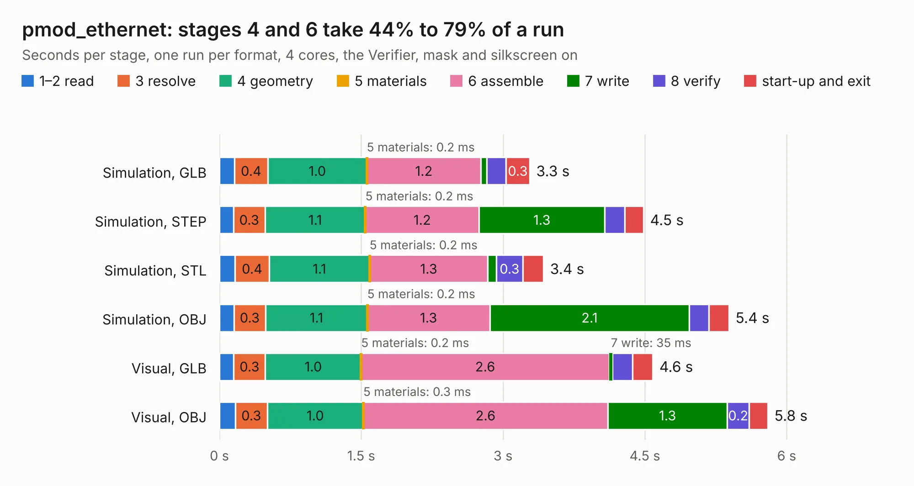

| Mode and format | 1–2 read | 3 resolve | 4 geometry | 5 materials | 6 assemble | 7 write | 8 verify | start-up and exit | Total |
|---|---:|---:|---:|---:|---:|---:|---:|---:|---:|
| Simulation, GLB | 0.2 | 0.4 | 1.0 | 0.2&nbsp;ms | 1.2 | 60&nbsp;ms | 0.2 | 0.3 | 3.3 |
| Simulation, STEP | 0.1 | 0.3 | 1.1 | 0.2&nbsp;ms | 1.2 | 1.3 | 0.2 | 0.2 | 4.5 |
| Simulation, STL | 0.2 | 0.4 | 1.1 | 0.2&nbsp;ms | 1.3 | 88&nbsp;ms | 0.3 | 0.2 | 3.4 |
| Simulation, OBJ | 0.2 | 0.3 | 1.1 | 0.2&nbsp;ms | 1.3 | 2.1 | 0.2 | 0.2 | 5.4 |
| Visual, GLB | 0.2 | 0.3 | 1.0 | 0.2&nbsp;ms | 2.6 | 35&nbsp;ms | 0.2 | 0.2 | 4.6 |
| Visual, OBJ | 0.2 | 0.3 | 1.0 | 0.3&nbsp;ms | 2.6 | 1.3 | 0.2 | 0.2 | 5.8 |

<table align="center"><tr><td valign="top">

| Board | Repo: [machdyne/katze](https://github.com/machdyne/katze) Board: `pmod_ethernet.kicad_pcb` |
|---|---|
| Folder | pcb / katze_v1 |
| Complexity | 248&nbsp;/&nbsp;1000 (size&nbsp;163, features&nbsp;85) |
| KESE&nbsp;features | through vias, rounded, trapezoid or chamfered pads, filled zones, curved board outline, stack-up, dielectric εr and tanδ |
| Tested | 9th November 2026 |
| Copper&nbsp;layers | 4 |
| File&nbsp;format | KiCad 6 (20211014) |
| Parts,&nbsp;tracks,&nbsp;vias | 21, 257, 30 |
| Triangles,&nbsp;simulation | 385,774 in 40 parts |
| Verifier | PASS in all six runs |

</td><td valign="top">

<table>
<tr><th>File type</th><th>File size</th><th>Peak memory used</th></tr>
<tr><th colspan="3" align="left">Simulation</th></tr>
<tr><td>GLB</td><td align="right">13&nbsp;MB</td><td align="right">261&nbsp;MB</td></tr>
<tr><td>STEP</td><td align="right">48&nbsp;MB</td><td align="right">273&nbsp;MB</td></tr>
<tr><td>STL</td><td align="right">19&nbsp;MB</td><td align="right">255&nbsp;MB</td></tr>
<tr><td>OBJ</td><td align="right">38&nbsp;MB</td><td align="right">278&nbsp;MB</td></tr>
<tr><th colspan="3" align="left">Visual</th></tr>
<tr><td>GLB</td><td align="right">7.7&nbsp;MB</td><td align="right">261&nbsp;MB</td></tr>
<tr><td>OBJ</td><td align="right">23&nbsp;MB</td><td align="right">259&nbsp;MB</td></tr>
</table>

</td></tr></table>

## 15.17 kuchen

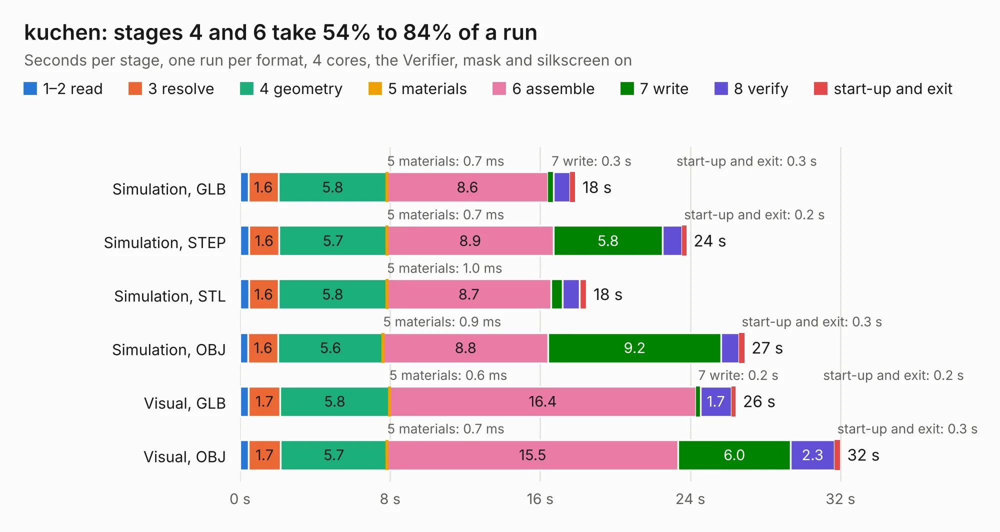

| Mode and format | 1–2 read | 3 resolve | 4 geometry | 5 materials | 6 assemble | 7 write | 8 verify | start-up and exit | Total |
|---|---:|---:|---:|---:|---:|---:|---:|---:|---:|
| Simulation, GLB | 0.4 | 1.6 | 5.8 | 0.7&nbsp;ms | 8.6 | 0.3 | 0.9 | 0.3 | 17.9 |
| Simulation, STEP | 0.5 | 1.6 | 5.7 | 0.7&nbsp;ms | 8.9 | 5.8 | 1.0 | 0.2 | 23.8 |
| Simulation, STL | 0.5 | 1.6 | 5.8 | 1.0&nbsp;ms | 8.7 | 0.6 | 0.9 | 0.4 | 18.5 |
| Simulation, OBJ | 0.4 | 1.6 | 5.6 | 0.9&nbsp;ms | 8.8 | 9.2 | 1.0 | 0.3 | 26.9 |
| Visual, GLB | 0.5 | 1.7 | 5.8 | 0.6&nbsp;ms | 16.4 | 0.2 | 1.7 | 0.2 | 26.4 |
| Visual, OBJ | 0.5 | 1.7 | 5.7 | 0.7&nbsp;ms | 15.5 | 6.0 | 2.3 | 0.3 | 32.0 |

<table align="center"><tr><td valign="top">

| Board | Repo: [machdyne/kuchen](https://github.com/machdyne/kuchen) Board: `kuchen.kicad_pcb` |
|---|---|
| Folder | pcb / kuchen_v0 |
| Complexity | 367&nbsp;/&nbsp;1000 (size&nbsp;257, features&nbsp;110) |
| KESE&nbsp;features | through vias, slotted holes, rounded, trapezoid or chamfered pads, arc tracks, filled zones, curved board outline, stack-up, dielectric εr and tanδ |
| Tested | 9th November 2026 |
| Copper&nbsp;layers | 4 |
| File&nbsp;format | KiCad 6 (20211014) |
| Parts,&nbsp;tracks,&nbsp;vias | 94, 1,189, 193 |
| Triangles,&nbsp;simulation | 1,833,026 in 266 parts |
| Verifier | PASS in all six runs |

</td><td valign="top">

<table>
<tr><th>File type</th><th>File size</th><th>Peak memory used</th></tr>
<tr><th colspan="3" align="left">Simulation</th></tr>
<tr><td>GLB</td><td align="right">61&nbsp;MB</td><td align="right">703&nbsp;MB</td></tr>
<tr><td>STEP</td><td align="right">267&nbsp;MB</td><td align="right">832&nbsp;MB</td></tr>
<tr><td>STL</td><td align="right">92&nbsp;MB</td><td align="right">698&nbsp;MB</td></tr>
<tr><td>OBJ</td><td align="right">194&nbsp;MB</td><td align="right">1.2&nbsp;GB</td></tr>
<tr><th colspan="3" align="left">Visual</th></tr>
<tr><td>GLB</td><td align="right">41&nbsp;MB</td><td align="right">981&nbsp;MB</td></tr>
<tr><td>OBJ</td><td align="right">130&nbsp;MB</td><td align="right">910&nbsp;MB</td></tr>
</table>

</td></tr></table>

## 15.18 lakritz

| Mode and format | 1–2 read | 3 resolve | 4 geometry | 5 materials | 6 assemble | 7 write | 8 verify | start-up and exit | Total |
|---|---:|---:|---:|---:|---:|---:|---:|---:|---:|
| Simulation, GLB | 0.4 | 1.6 | 7.2 | 0.8&nbsp;ms | 9.0 | 0.3 | 0.8 | 0.3 | 19.6 |
| Simulation, STEP | 0.5 | 1.6 | 7.3 | 0.9&nbsp;ms | 9.9 | 6.0 | 0.9 | 0.2 | 26.4 |
| Simulation, STL | 0.5 | 1.6 | 7.6 | 1&nbsp;ms | 10.1 | 0.6 | 0.9 | 0.3 | 21.5 |
| Simulation, OBJ | 0.5 | 1.6 | 7.3 | 0.9&nbsp;ms | 9.3 | 10.8 | 0.8 | 0.2 | 30.6 |
| Visual, GLB | 0.5 | 1.7 | 7.6 | 1&nbsp;ms | 15.7 | 0.3 | 1.6 | 0.2 | 27.5 |
| Visual, OBJ | 0.5 | 1.7 | 7.4 | 0.8&nbsp;ms | 16.7 | 6.8 | 1.9 | 0.3 | 35.3 |

<table align="center"><tr><td valign="top">

| Board | Repo: [machdyne/lakritz](https://github.com/machdyne/lakritz) Board: `lakritz.kicad_pcb` |
|---|---|
| Folder | pcb / v0 |
| Complexity | 390&nbsp;/&nbsp;1000 (size&nbsp;260, features&nbsp;130) |
| KESE&nbsp;features | through vias, slotted holes, rounded, trapezoid or chamfered pads, arc tracks, filled zones, curved board outline, stack-up, dielectric εr and tanδ, copper finish, mask and silkscreen colours |
| Tested | 9th November 2026 |
| Copper&nbsp;layers | 4 |
| File&nbsp;format | KiCad 8 (20240108) |
| Parts,&nbsp;tracks,&nbsp;vias | 103, 1,372, 209 |
| Triangles,&nbsp;simulation | 1,936,052 in 266 parts |
| Verifier | PASS in all six runs |

</td><td valign="top">

<table>
<tr><th>File type</th><th>File size</th><th>Peak memory used</th></tr>
<tr><th colspan="3" align="left">Simulation</th></tr>
<tr><td>GLB</td><td align="right">65&nbsp;MB</td><td align="right">711&nbsp;MB</td></tr>
<tr><td>STEP</td><td align="right">293&nbsp;MB</td><td align="right">891&nbsp;MB</td></tr>
<tr><td>STL</td><td align="right">97&nbsp;MB</td><td align="right">733&nbsp;MB</td></tr>
<tr><td>OBJ</td><td align="right">201&nbsp;MB</td><td align="right">1.3&nbsp;GB</td></tr>
<tr><th colspan="3" align="left">Visual</th></tr>
<tr><td>GLB</td><td align="right">42&nbsp;MB</td><td align="right">904&nbsp;MB</td></tr>
<tr><td>OBJ</td><td align="right">130&nbsp;MB</td><td align="right">944&nbsp;MB</td></tr>
</table>

</td></tr></table>

## 15.19 obst

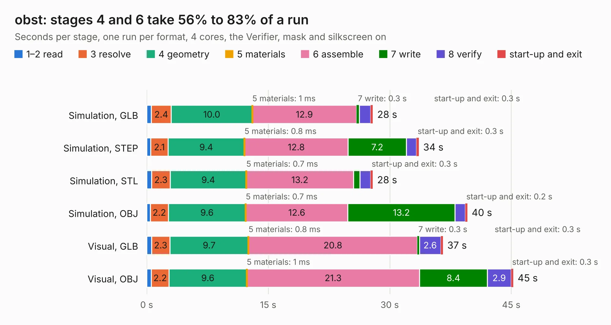

| Mode and format | 1–2 read | 3 resolve | 4 geometry | 5 materials | 6 assemble | 7 write | 8 verify | start-up and exit | Total |
|---|---:|---:|---:|---:|---:|---:|---:|---:|---:|
| Simulation, GLB | 0.6 | 2.4 | 10.0 | 1&nbsp;ms | 12.9 | 0.3 | 1.4 | 0.3 | 27.9 |
| Simulation, STEP | 0.5 | 2.1 | 9.4 | 0.8&nbsp;ms | 12.8 | 7.2 | 1.2 | 0.3 | 33.6 |
| Simulation, STL | 0.6 | 2.3 | 9.4 | 0.7&nbsp;ms | 13.2 | 0.8 | 1.3 | 0.3 | 27.9 |
| Simulation, OBJ | 0.5 | 2.2 | 9.6 | 0.7&nbsp;ms | 12.6 | 13.2 | 1.3 | 0.2 | 39.6 |
| Visual, GLB | 0.6 | 2.3 | 9.7 | 0.8&nbsp;ms | 20.8 | 0.3 | 2.6 | 0.3 | 36.6 |
| Visual, OBJ | 0.6 | 2.2 | 9.6 | 1&nbsp;ms | 21.3 | 8.4 | 2.9 | 0.3 | 45.3 |

<table align="center"><tr><td valign="top">

| Board | Repo: [machdyne/obst](https://github.com/machdyne/obst) Board: `obst.kicad_pcb` |
|---|---|
| Folder | pcb / mdr_v0b |
| Complexity | 363&nbsp;/&nbsp;1000 (size&nbsp;268, features&nbsp;95) |
| KESE&nbsp;features | through vias, slotted holes, rounded, trapezoid or chamfered pads, filled zones, curved board outline, stack-up, dielectric εr and tanδ |
| Tested | 9th November 2026 |
| Copper&nbsp;layers | 4 |
| File&nbsp;format | KiCad 8 (20240108) |
| Parts,&nbsp;tracks,&nbsp;vias | 142, 1,666, 308 |
| Triangles,&nbsp;simulation | 2,753,452 in 280 parts |
| Verifier | PASS in all six runs |

</td><td valign="top">

<table>
<tr><th>File type</th><th>File size</th><th>Peak memory used</th></tr>
<tr><th colspan="3" align="left">Simulation</th></tr>
<tr><td>GLB</td><td align="right">94&nbsp;MB</td><td align="right">922&nbsp;MB</td></tr>
<tr><td>STEP</td><td align="right">393&nbsp;MB</td><td align="right">1.1&nbsp;GB</td></tr>
<tr><td>STL</td><td align="right">138&nbsp;MB</td><td align="right">923&nbsp;MB</td></tr>
<tr><td>OBJ</td><td align="right">288&nbsp;MB</td><td align="right">1.8&nbsp;GB</td></tr>
<tr><th colspan="3" align="left">Visual</th></tr>
<tr><td>GLB</td><td align="right">58&nbsp;MB</td><td align="right">1.3&nbsp;GB</td></tr>
<tr><td>OBJ</td><td align="right">182&nbsp;MB</td><td align="right">1.2&nbsp;GB</td></tr>
</table>

</td></tr></table>

## 15.20 riegel

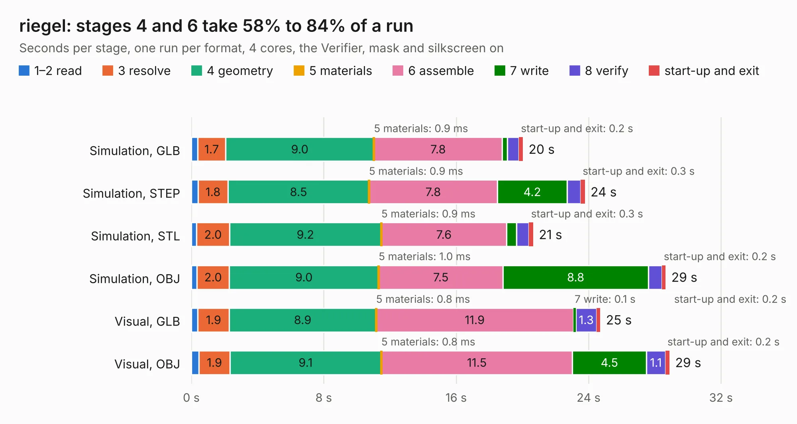

| Mode and format | 1–2 read | 3 resolve | 4 geometry | 5 materials | 6 assemble | 7 write | 8 verify | start-up and exit | Total |
|---|---:|---:|---:|---:|---:|---:|---:|---:|---:|
| Simulation, GLB | 0.4 | 1.7 | 9.0 | 0.9&nbsp;ms | 7.8 | 0.3 | 0.7 | 0.2 | 20.0 |
| Simulation, STEP | 0.4 | 1.8 | 8.5 | 0.9&nbsp;ms | 7.8 | 4.2 | 0.8 | 0.3 | 23.8 |
| Simulation, STL | 0.3 | 2.0 | 9.2 | 0.9&nbsp;ms | 7.6 | 0.6 | 0.8 | 0.3 | 20.7 |
| Simulation, OBJ | 0.3 | 2.0 | 9.0 | 1.0&nbsp;ms | 7.5 | 8.8 | 0.8 | 0.2 | 28.7 |
| Visual, GLB | 0.4 | 1.9 | 8.9 | 0.8&nbsp;ms | 11.9 | 0.1 | 1.3 | 0.2 | 24.7 |
| Visual, OBJ | 0.5 | 1.9 | 9.1 | 0.8&nbsp;ms | 11.5 | 4.5 | 1.1 | 0.2 | 28.9 |

<table align="center"><tr><td valign="top">

| Board | Repo: [machdyne/riegel](https://github.com/machdyne/riegel) Board: `riegel.kicad_pcb` |
|---|---|
| Folder | pcb / riegel_v4 |
| Complexity | 358&nbsp;/&nbsp;1000 (size&nbsp;263, features&nbsp;95) |
| KESE&nbsp;features | through vias, slotted holes, rounded, trapezoid or chamfered pads, filled zones, curved board outline, stack-up, dielectric εr and tanδ |
| Tested | 9th November 2026 |
| Copper&nbsp;layers | 4 |
| File&nbsp;format | KiCad 6 (20211014) |
| Parts,&nbsp;tracks,&nbsp;vias | 89, 1,297, 157 |
| Triangles,&nbsp;simulation | 1,733,082 in 152 parts |
| Verifier | PASS in all six runs |

</td><td valign="top">

<table>
<tr><th>File type</th><th>File size</th><th>Peak memory used</th></tr>
<tr><th colspan="3" align="left">Simulation</th></tr>
<tr><td>GLB</td><td align="right">59&nbsp;MB</td><td align="right">622&nbsp;MB</td></tr>
<tr><td>STEP</td><td align="right">278&nbsp;MB</td><td align="right">791&nbsp;MB</td></tr>
<tr><td>STL</td><td align="right">87&nbsp;MB</td><td align="right">617&nbsp;MB</td></tr>
<tr><td>OBJ</td><td align="right">182&nbsp;MB</td><td align="right">1.2&nbsp;GB</td></tr>
<tr><th colspan="3" align="left">Visual</th></tr>
<tr><td>GLB</td><td align="right">33&nbsp;MB</td><td align="right">682&nbsp;MB</td></tr>
<tr><td>OBJ</td><td align="right">100&nbsp;MB</td><td align="right">790&nbsp;MB</td></tr>
</table>

</td></tr></table>

## 15.21 schoko

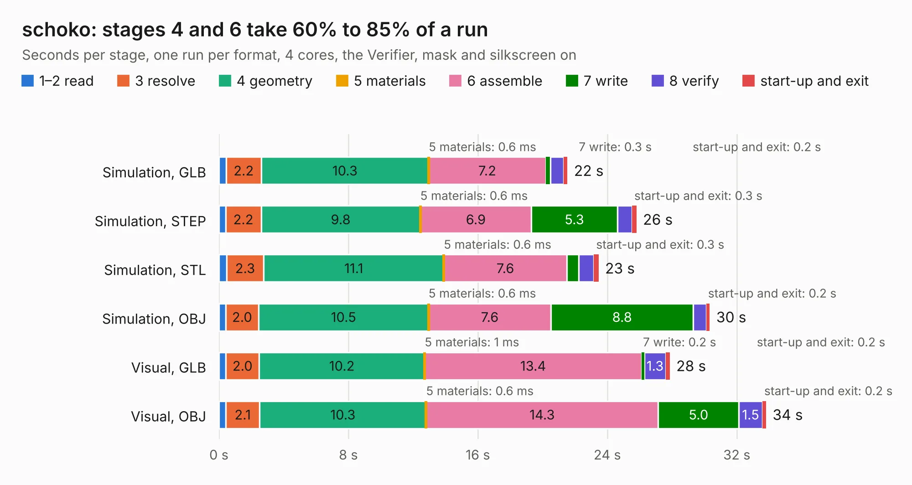

| Mode and format | 1–2 read | 3 resolve | 4 geometry | 5 materials | 6 assemble | 7 write | 8 verify | start-up and exit | Total |
|---|---:|---:|---:|---:|---:|---:|---:|---:|---:|
| Simulation, GLB | 0.4 | 2.2 | 10.3 | 0.6&nbsp;ms | 7.2 | 0.3 | 0.8 | 0.2 | 21.5 |
| Simulation, STEP | 0.4 | 2.2 | 9.8 | 0.6&nbsp;ms | 6.9 | 5.3 | 0.9 | 0.3 | 25.8 |
| Simulation, STL | 0.5 | 2.3 | 11.1 | 0.6&nbsp;ms | 7.6 | 0.7 | 0.9 | 0.3 | 23.5 |
| Simulation, OBJ | 0.4 | 2.0 | 10.5 | 0.6&nbsp;ms | 7.6 | 8.8 | 0.8 | 0.2 | 30.3 |
| Visual, GLB | 0.4 | 2.0 | 10.2 | 1&nbsp;ms | 13.4 | 0.2 | 1.3 | 0.2 | 27.9 |
| Visual, OBJ | 0.4 | 2.1 | 10.3 | 0.6&nbsp;ms | 14.3 | 5.0 | 1.5 | 0.2 | 33.8 |

<table align="center"><tr><td valign="top">

| Board | Repo: [machdyne/schoko](https://github.com/machdyne/schoko) Board: `schoko.kicad_pcb` |
|---|---|
| Folder | pcb / schoko_v2 |
| Complexity | 357&nbsp;/&nbsp;1000 (size&nbsp;262, features&nbsp;95) |
| KESE&nbsp;features | through vias, slotted holes, rounded, trapezoid or chamfered pads, filled zones, curved board outline, stack-up, dielectric εr and tanδ |
| Tested | 9th November 2026 |
| Copper&nbsp;layers | 4 |
| File&nbsp;format | KiCad 6 (20211014) |
| Parts,&nbsp;tracks,&nbsp;vias | 108, 1,544, 207 |
| Triangles,&nbsp;simulation | 2,133,590 in 269 parts |
| Verifier | PASS in all six runs |

</td><td valign="top">

<table>
<tr><th>File type</th><th>File size</th><th>Peak memory used</th></tr>
<tr><th colspan="3" align="left">Simulation</th></tr>
<tr><td>GLB</td><td align="right">73&nbsp;MB</td><td align="right">774&nbsp;MB</td></tr>
<tr><td>STEP</td><td align="right">349&nbsp;MB</td><td align="right">972&nbsp;MB</td></tr>
<tr><td>STL</td><td align="right">107&nbsp;MB</td><td align="right">728&nbsp;MB</td></tr>
<tr><td>OBJ</td><td align="right">227&nbsp;MB</td><td align="right">1.4&nbsp;GB</td></tr>
<tr><th colspan="3" align="left">Visual</th></tr>
<tr><td>GLB</td><td align="right">41&nbsp;MB</td><td align="right">978&nbsp;MB</td></tr>
<tr><td>OBJ</td><td align="right">127&nbsp;MB</td><td align="right">1.0&nbsp;GB</td></tr>
</table>

</td></tr></table>

## 15.22 Main

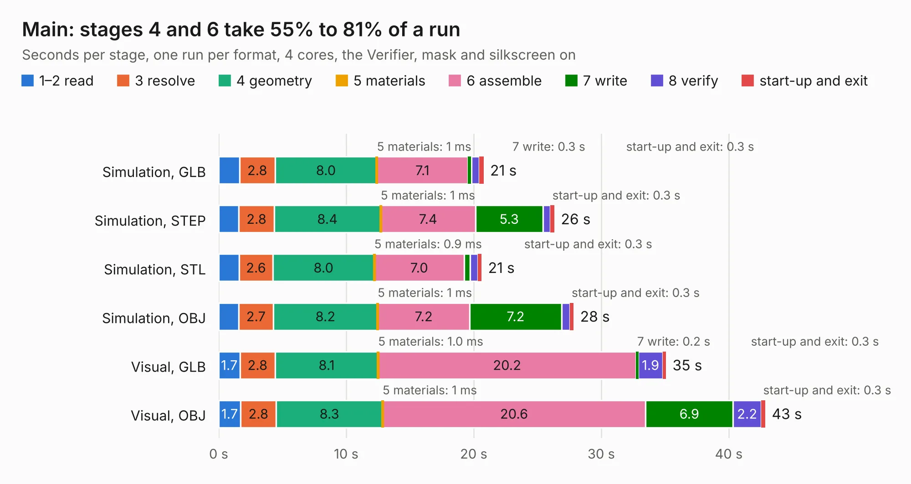

| Mode and format | 1–2 read | 3 resolve | 4 geometry | 5 materials | 6 assemble | 7 write | 8 verify | start-up and exit | Total |
|---|---:|---:|---:|---:|---:|---:|---:|---:|---:|
| Simulation, GLB | 1.6 | 2.8 | 8.0 | 1&nbsp;ms | 7.1 | 0.3 | 0.6 | 0.3 | 20.8 |
| Simulation, STEP | 1.6 | 2.8 | 8.4 | 1&nbsp;ms | 7.4 | 5.3 | 0.6 | 0.3 | 26.3 |
| Simulation, STL | 1.6 | 2.6 | 8.0 | 0.9&nbsp;ms | 7.0 | 0.5 | 0.6 | 0.3 | 20.6 |
| Simulation, OBJ | 1.6 | 2.7 | 8.2 | 1&nbsp;ms | 7.2 | 7.2 | 0.7 | 0.3 | 27.8 |
| Visual, GLB | 1.7 | 2.8 | 8.1 | 1.0&nbsp;ms | 20.2 | 0.2 | 1.9 | 0.3 | 35.1 |
| Visual, OBJ | 1.7 | 2.8 | 8.3 | 1&nbsp;ms | 20.6 | 6.9 | 2.2 | 0.3 | 42.9 |

<table align="center"><tr><td valign="top">

| Board | Repo: [makerspet/oomwoo-pcb](https://github.com/makerspet/oomwoo-pcb) Board: `Main.kicad_pcb` |
|---|---|
| Folder | kicad / main |
| Complexity | 228&nbsp;/&nbsp;1000 (size&nbsp;138, features&nbsp;90) |
| KESE&nbsp;features | slotted holes, custom pads, rounded, trapezoid or chamfered pads, copper drawings, copper text, stack-up, dielectric εr and tanδ, mask and silkscreen colours |
| Tested | 9th November 2026 |
| Copper&nbsp;layers | 4 |
| File&nbsp;format | KiCad 10 (20260206) |
| Parts,&nbsp;tracks,&nbsp;vias | 385, 0, 0 |
| Triangles,&nbsp;simulation | 1,448,360 in 433 parts |
| Note | mostly unrouted |
| Verifier | PASS in all six runs |

</td><td valign="top">

<table>
<tr><th>File type</th><th>File size</th><th>Peak memory used</th></tr>
<tr><th colspan="3" align="left">Simulation</th></tr>
<tr><td>GLB</td><td align="right">52&nbsp;MB</td><td align="right">861&nbsp;MB</td></tr>
<tr><td>STEP</td><td align="right">259&nbsp;MB</td><td align="right">904&nbsp;MB</td></tr>
<tr><td>STL</td><td align="right">72&nbsp;MB</td><td align="right">837&nbsp;MB</td></tr>
<tr><td>OBJ</td><td align="right">157&nbsp;MB</td><td align="right">1.1&nbsp;GB</td></tr>
<tr><th colspan="3" align="left">Visual</th></tr>
<tr><td>GLB</td><td align="right">47&nbsp;MB</td><td align="right">1.1&nbsp;GB</td></tr>
<tr><td>OBJ</td><td align="right">140&nbsp;MB</td><td align="right">1.1&nbsp;GB</td></tr>
</table>

</td></tr></table>

## 15.23 Main_PDB

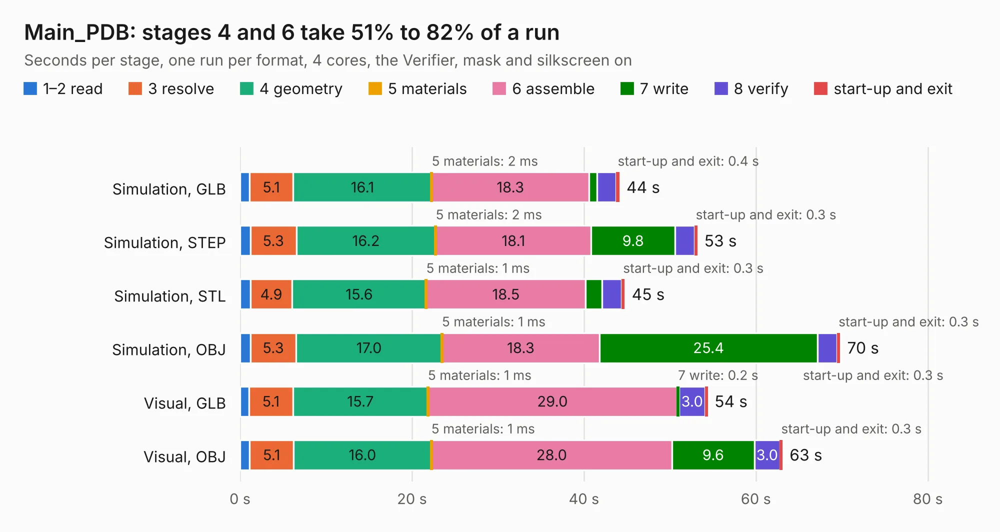

| Mode and format | 1–2 read | 3 resolve | 4 geometry | 5 materials | 6 assemble | 7 write | 8 verify | start-up and exit | Total |
|---|---:|---:|---:|---:|---:|---:|---:|---:|---:|
| Simulation, GLB | 1.1 | 5.1 | 16.1 | 2&nbsp;ms | 18.3 | 0.9 | 2.2 | 0.4 | 44.1 |
| Simulation, STEP | 1.2 | 5.3 | 16.2 | 2&nbsp;ms | 18.1 | 9.8 | 2.2 | 0.3 | 53.2 |
| Simulation, STL | 1.2 | 4.9 | 15.6 | 1&nbsp;ms | 18.5 | 1.9 | 2.3 | 0.3 | 44.7 |
| Simulation, OBJ | 1.2 | 5.3 | 17.0 | 1&nbsp;ms | 18.3 | 25.4 | 2.3 | 0.3 | 69.8 |
| Visual, GLB | 1.0 | 5.1 | 15.7 | 1&nbsp;ms | 29.0 | 0.2 | 3.0 | 0.3 | 54.4 |
| Visual, OBJ | 1.1 | 5.1 | 16.0 | 1&nbsp;ms | 28.0 | 9.6 | 3.0 | 0.3 | 63.1 |

<table align="center"><tr><td valign="top">

| Board | Repo: [malcollm/pdb](https://github.com/malcollm/pdb) Board: `Main_PDB.kicad_pcb` |
|---|---|
| Complexity | 325&nbsp;/&nbsp;1000 (size&nbsp;215, features&nbsp;110) |
| KESE&nbsp;features | through vias, slotted holes, custom pads, rounded, trapezoid or chamfered pads, filled zones, copper drawings, stack-up, dielectric εr and tanδ |
| Tested | 9th November 2026 |
| Copper&nbsp;layers | 6 |
| File&nbsp;format | KiCad 10 (20260206) |
| Parts,&nbsp;tracks,&nbsp;vias | 186, 454, 216 |
| Triangles,&nbsp;simulation | 5,174,936 in 122 parts |
| Verifier | PASS in all six runs |

</td><td valign="top">

<table>
<tr><th>File type</th><th>File size</th><th>Peak memory used</th></tr>
<tr><th colspan="3" align="left">Simulation</th></tr>
<tr><td>GLB</td><td align="right">171&nbsp;MB</td><td align="right">1.3&nbsp;GB</td></tr>
<tr><td>STEP</td><td align="right">574&nbsp;MB</td><td align="right">1.5&nbsp;GB</td></tr>
<tr><td>STL</td><td align="right">259&nbsp;MB</td><td align="right">1.3&nbsp;GB</td></tr>
<tr><td>OBJ</td><td align="right">543&nbsp;MB</td><td align="right">3.3&nbsp;GB</td></tr>
<tr><th colspan="3" align="left">Visual</th></tr>
<tr><td>GLB</td><td align="right">67&nbsp;MB</td><td align="right">1.3&nbsp;GB</td></tr>
<tr><td>OBJ</td><td align="right">211&nbsp;MB</td><td align="right">1.6&nbsp;GB</td></tr>
</table>

</td></tr></table>

## 15.24 homebrew_486

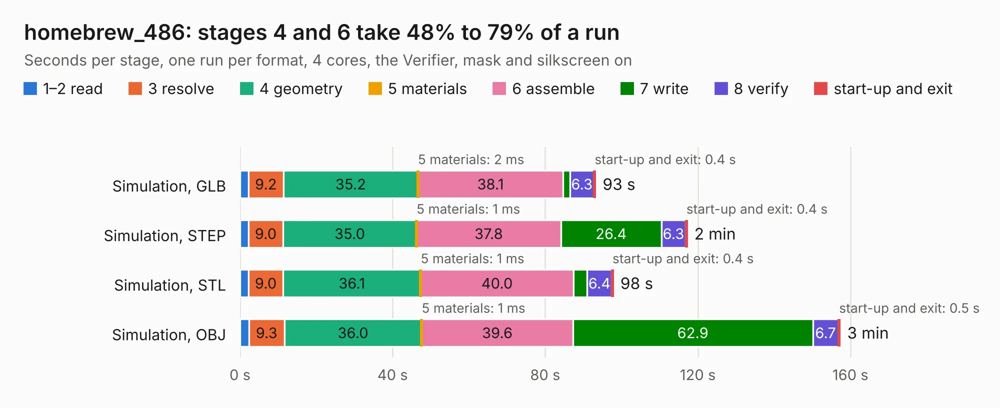

| Mode and format | 1–2 read | 3 resolve | 4 geometry | 5 materials | 6 assemble | 7 write | 8 verify | start-up and exit | Total |
|---|---:|---:|---:|---:|---:|---:|---:|---:|---:|
| Simulation, GLB | 2.2 | 9.2 | 35.2 | 2&nbsp;ms | 38.1 | 1.8 | 6.3 | 0.4 | 93.2 |
| Simulation, STEP | 2.2 | 9.0 | 35.0 | 1&nbsp;ms | 37.8 | 26.4 | 6.3 | 0.4 | 117.2 |
| Simulation, STL | 2.3 | 9.0 | 36.1 | 1&nbsp;ms | 40.0 | 3.6 | 6.4 | 0.4 | 97.8 |
| Simulation, OBJ | 2.3 | 9.3 | 36.0 | 1&nbsp;ms | 39.6 | 62.9 | 6.7 | 0.5 | 157.3 |
| Visual, GLB | 2.3 | 9.6 | 36.1 | 1&nbsp;ms | 90.1 | 1.0 | 9.1 | 0.3 | 148.5 |
| Visual, OBJ | 2.2 | 9.1 | 35.3 | 1&nbsp;ms | 87.3 | 38.3 | 9.1 | 0.3 | 181.6 |

<table align="center"><tr><td valign="top">

| Board | Repo: [maniekx86/m8sbc-486](https://github.com/maniekx86/m8sbc-486) Board: `homebrew_486.kicad_pcb` |
|---|---|
| Folder | pcb |
| Complexity | 393&nbsp;/&nbsp;1000 (size&nbsp;288, features&nbsp;105) |
| KESE&nbsp;features | through vias, slotted holes, rounded, trapezoid or chamfered pads, filled zones, TrueType text, stack-up, dielectric εr and tanδ, mask and silkscreen colours |
| Tested | 9th November 2026 |
| Copper&nbsp;layers | 4 |
| File&nbsp;format | KiCad 9 (20241229) |
| Parts,&nbsp;tracks,&nbsp;vias | 122, 10,279, 1,150 |
| Triangles,&nbsp;simulation | 10,969,982 in 348 parts |
| Verifier | PASS in all six runs |

</td><td valign="top">

<table>
<tr><th>File type</th><th>File size</th><th>Peak memory used</th></tr>
<tr><th colspan="3" align="left">Simulation</th></tr>
<tr><td>GLB</td><td align="right">372&nbsp;MB</td><td align="right">2.9&nbsp;GB</td></tr>
<tr><td>STEP</td><td align="right">1.5&nbsp;GB</td><td align="right">3.6&nbsp;GB</td></tr>
<tr><td>STL</td><td align="right">549&nbsp;MB</td><td align="right">2.8&nbsp;GB</td></tr>
<tr><td>OBJ</td><td align="right">1.2&nbsp;GB</td><td align="right">6.8&nbsp;GB</td></tr>
<tr><th colspan="3" align="left">Visual</th></tr>
<tr><td>GLB</td><td align="right">238&nbsp;MB</td><td align="right">3.7&nbsp;GB</td></tr>
<tr><td>OBJ</td><td align="right">768&nbsp;MB</td><td align="right">4.8&nbsp;GB</td></tr>
</table>

</td></tr></table>

## 15.25 pcb

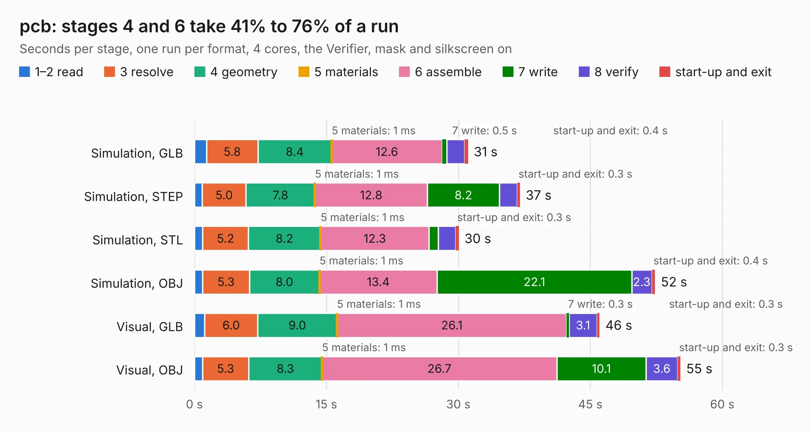

| Mode and format | 1–2 read | 3 resolve | 4 geometry | 5 materials | 6 assemble | 7 write | 8 verify | start-up and exit | Total |
|---|---:|---:|---:|---:|---:|---:|---:|---:|---:|
| Simulation, GLB | 1.4 | 5.8 | 8.4 | 1&nbsp;ms | 12.6 | 0.5 | 2.0 | 0.4 | 31.1 |
| Simulation, STEP | 0.9 | 5.0 | 7.8 | 1&nbsp;ms | 12.8 | 8.2 | 2.0 | 0.3 | 37.0 |
| Simulation, STL | 0.9 | 5.2 | 8.2 | 1&nbsp;ms | 12.3 | 1.1 | 2.0 | 0.3 | 30.0 |
| Simulation, OBJ | 0.9 | 5.3 | 8.0 | 1&nbsp;ms | 13.4 | 22.1 | 2.3 | 0.4 | 52.4 |
| Visual, GLB | 1.2 | 6.0 | 9.0 | 1&nbsp;ms | 26.1 | 0.3 | 3.1 | 0.3 | 46.1 |
| Visual, OBJ | 0.9 | 5.3 | 8.3 | 1&nbsp;ms | 26.7 | 10.1 | 3.6 | 0.3 | 55.2 |

<table align="center"><tr><td valign="top">

| Board | Repo: [manyetox/huma-rocket-flight-computer](https://github.com/manyetox/huma-rocket-flight-computer) Board: `pcb.kicad_pcb` |
|---|---|
| Folder | hardware |
| Complexity | 405&nbsp;/&nbsp;1000 (size&nbsp;270, features&nbsp;135) |
| KESE&nbsp;features | through vias, slotted holes, custom pads, rounded, trapezoid or chamfered pads, arc tracks, filled zones, copper drawings, curved board outline, stack-up, dielectric εr and tanδ |
| Tested | 9th November 2026 |
| Copper&nbsp;layers | 6 |
| File&nbsp;format | KiCad 9 (20241229) |
| Parts,&nbsp;tracks,&nbsp;vias | 151, 2,313, 327 |
| Triangles,&nbsp;simulation | 3,307,666 in 184 parts |
| Verifier | PASS in all six runs |

</td><td valign="top">

<table>
<tr><th>File type</th><th>File size</th><th>Peak memory used</th></tr>
<tr><th colspan="3" align="left">Simulation</th></tr>
<tr><td>GLB</td><td align="right">111&nbsp;MB</td><td align="right">949&nbsp;MB</td></tr>
<tr><td>STEP</td><td align="right">417&nbsp;MB</td><td align="right">1.3&nbsp;GB</td></tr>
<tr><td>STL</td><td align="right">165&nbsp;MB</td><td align="right">985&nbsp;MB</td></tr>
<tr><td>OBJ</td><td align="right">347&nbsp;MB</td><td align="right">2.1&nbsp;GB</td></tr>
<tr><th colspan="3" align="left">Visual</th></tr>
<tr><td>GLB</td><td align="right">61&nbsp;MB</td><td align="right">1.2&nbsp;GB</td></tr>
<tr><td>OBJ</td><td align="right">194&nbsp;MB</td><td align="right">1.3&nbsp;GB</td></tr>
</table>

</td></tr></table>

## 15.26 dexx_video_adapter

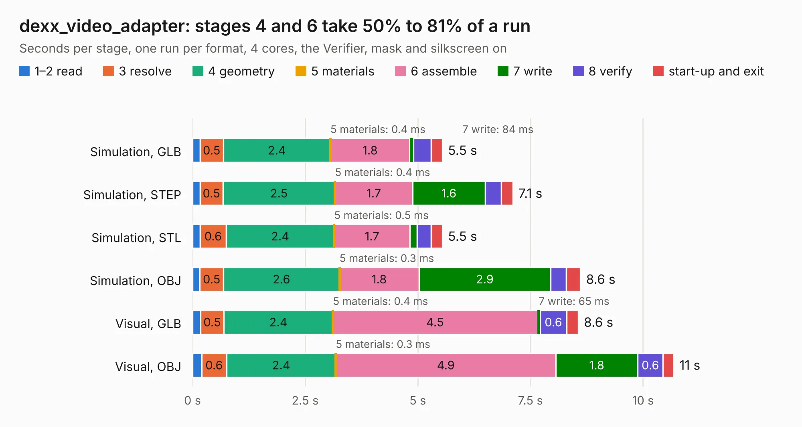

| Mode and format | 1–2 read | 3 resolve | 4 geometry | 5 materials | 6 assemble | 7 write | 8 verify | start-up and exit | Total |
|---|---:|---:|---:|---:|---:|---:|---:|---:|---:|
| Simulation, GLB | 0.2 | 0.5 | 2.4 | 0.4&nbsp;ms | 1.8 | 84&nbsp;ms | 0.4 | 0.2 | 5.5 |
| Simulation, STEP | 0.2 | 0.5 | 2.5 | 0.4&nbsp;ms | 1.7 | 1.6 | 0.4 | 0.3 | 7.1 |
| Simulation, STL | 0.2 | 0.6 | 2.4 | 0.5&nbsp;ms | 1.7 | 0.2 | 0.3 | 0.2 | 5.5 |
| Simulation, OBJ | 0.2 | 0.5 | 2.6 | 0.3&nbsp;ms | 1.8 | 2.9 | 0.3 | 0.3 | 8.6 |
| Visual, GLB | 0.2 | 0.5 | 2.4 | 0.4&nbsp;ms | 4.5 | 65&nbsp;ms | 0.6 | 0.3 | 8.6 |
| Visual, OBJ | 0.2 | 0.6 | 2.4 | 0.3&nbsp;ms | 4.9 | 1.8 | 0.6 | 0.2 | 10.7 |

<table align="center"><tr><td valign="top">

| Board | Repo: [marqs85/ossc_pro_hw](https://github.com/marqs85/ossc_pro_hw) Board: `dexx_video_adapter.kicad_pcb` |
|---|---|
| Folder | adapters / av_adapter |
| Complexity | 228&nbsp;/&nbsp;1000 (size&nbsp;143, features&nbsp;85) |
| KESE&nbsp;features | through vias, slotted holes, rounded, trapezoid or chamfered pads, filled zones, stack-up, dielectric εr and tanδ |
| Tested | 9th November 2026 |
| Copper&nbsp;layers | 2 |
| File&nbsp;format | KiCad 10 (20260206) |
| Parts,&nbsp;tracks,&nbsp;vias | 11, 107, 109 |
| Triangles,&nbsp;simulation | 538,966 in 36 parts |
| Verifier | PASS in all six runs |

</td><td valign="top">

<table>
<tr><th>File type</th><th>File size</th><th>Peak memory used</th></tr>
<tr><th colspan="3" align="left">Simulation</th></tr>
<tr><td>GLB</td><td align="right">18&nbsp;MB</td><td align="right">317&nbsp;MB</td></tr>
<tr><td>STEP</td><td align="right">64&nbsp;MB</td><td align="right">351&nbsp;MB</td></tr>
<tr><td>STL</td><td align="right">27&nbsp;MB</td><td align="right">331&nbsp;MB</td></tr>
<tr><td>OBJ</td><td align="right">54&nbsp;MB</td><td align="right">397&nbsp;MB</td></tr>
<tr><th colspan="3" align="left">Visual</th></tr>
<tr><td>GLB</td><td align="right">13&nbsp;MB</td><td align="right">366&nbsp;MB</td></tr>
<tr><td>OBJ</td><td align="right">38&nbsp;MB</td><td align="right">358&nbsp;MB</td></tr>
</table>

</td></tr></table>

## 15.27 pcb1p5_hv_syncfix

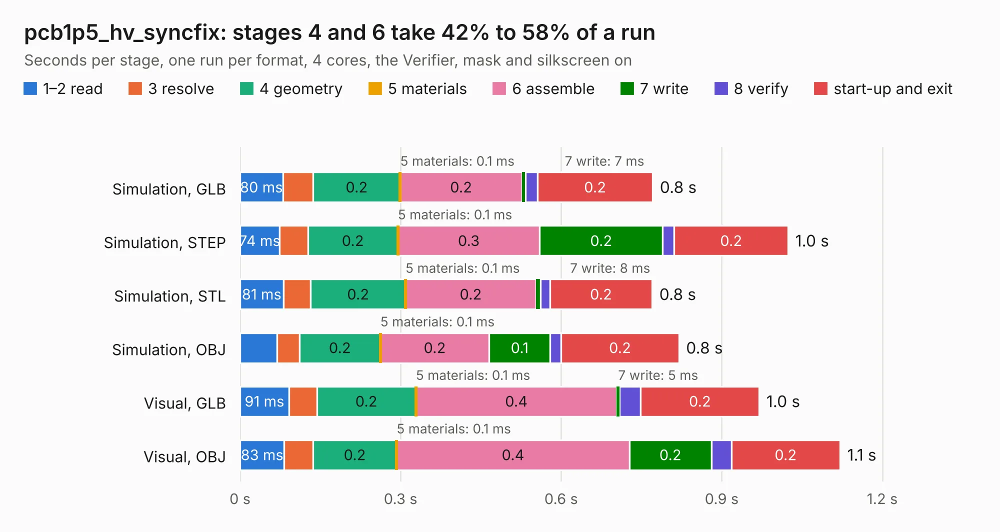

| Mode and format | 1–2 read | 3 resolve | 4 geometry | 5 materials | 6 assemble | 7 write | 8 verify | start-up and exit | Total |
|---|---:|---:|---:|---:|---:|---:|---:|---:|---:|
| Simulation, GLB | 80&nbsp;ms | 57&nbsp;ms | 0.2 | 0.1&nbsp;ms | 0.2 | 7&nbsp;ms | 23&nbsp;ms | 0.2 | 0.8 |
| Simulation, STEP | 74&nbsp;ms | 53&nbsp;ms | 0.2 | 0.1&nbsp;ms | 0.3 | 0.2 | 22&nbsp;ms | 0.2 | 1.0 |
| Simulation, STL | 81&nbsp;ms | 51&nbsp;ms | 0.2 | 0.1&nbsp;ms | 0.2 | 8&nbsp;ms | 18&nbsp;ms | 0.2 | 0.8 |
| Simulation, OBJ | 69&nbsp;ms | 42&nbsp;ms | 0.2 | 0.1&nbsp;ms | 0.2 | 0.1 | 20&nbsp;ms | 0.2 | 0.8 |
| Visual, GLB | 91&nbsp;ms | 52&nbsp;ms | 0.2 | 0.1&nbsp;ms | 0.4 | 5&nbsp;ms | 39&nbsp;ms | 0.2 | 1.0 |
| Visual, OBJ | 83&nbsp;ms | 54&nbsp;ms | 0.2 | 0.1&nbsp;ms | 0.4 | 0.2 | 37&nbsp;ms | 0.2 | 1.1 |

<table align="center"><tr><td valign="top">

| Board | Repo: [marqs85/ossc_pro_hw](https://github.com/marqs85/ossc_pro_hw) Board: `pcb1p5_hv_syncfix.kicad_pcb` |
|---|---|
| Folder | adapters / pcb1p5_hv_syncfix |
| Complexity | 170&nbsp;/&nbsp;1000 (size&nbsp;95, features&nbsp;75) |
| KESE&nbsp;features | through vias, rounded, trapezoid or chamfered pads, filled zones, stack-up, dielectric εr and tanδ |
| Tested | 9th November 2026 |
| Copper&nbsp;layers | 2 |
| File&nbsp;format | KiCad 9 (20241229) |
| Parts,&nbsp;tracks,&nbsp;vias | 2, 34, 8 |
| Triangles,&nbsp;simulation | 30,502 in 14 parts |
| Verifier | PASS in all six runs |

</td><td valign="top">

<table>
<tr><th>File type</th><th>File size</th><th>Peak memory used</th></tr>
<tr><th colspan="3" align="left">Simulation</th></tr>
<tr><td>GLB</td><td align="right">1.1&nbsp;MB</td><td align="right">66&nbsp;MB</td></tr>
<tr><td>STEP</td><td align="right">5.1&nbsp;MB</td><td align="right">70&nbsp;MB</td></tr>
<tr><td>STL</td><td align="right">1.5&nbsp;MB</td><td align="right">66&nbsp;MB</td></tr>
<tr><td>OBJ</td><td align="right">2.9&nbsp;MB</td><td align="right">71&nbsp;MB</td></tr>
<tr><th colspan="3" align="left">Visual</th></tr>
<tr><td>GLB</td><td align="right">954&nbsp;kB</td><td align="right">96&nbsp;MB</td></tr>
<tr><td>OBJ</td><td align="right">2.5&nbsp;MB</td><td align="right">98&nbsp;MB</td></tr>
</table>

</td></tr></table>

## 15.28 panel

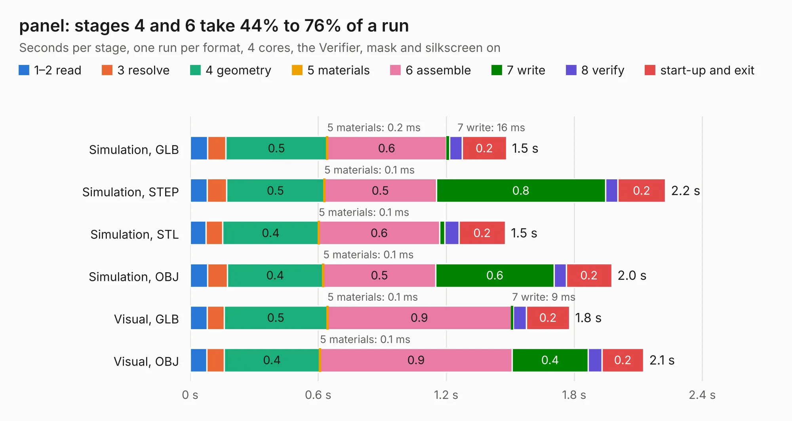

| Mode and format | 1–2 read | 3 resolve | 4 geometry | 5 materials | 6 assemble | 7 write | 8 verify | start-up and exit | Total |
|---|---:|---:|---:|---:|---:|---:|---:|---:|---:|
| Simulation, GLB | 82&nbsp;ms | 85&nbsp;ms | 0.5 | 0.2&nbsp;ms | 0.6 | 16&nbsp;ms | 59&nbsp;ms | 0.2 | 1.5 |
| Simulation, STEP | 80&nbsp;ms | 91&nbsp;ms | 0.5 | 0.1&nbsp;ms | 0.5 | 0.8 | 58&nbsp;ms | 0.2 | 2.2 |
| Simulation, STL | 74&nbsp;ms | 79&nbsp;ms | 0.4 | 0.1&nbsp;ms | 0.6 | 23&nbsp;ms | 67&nbsp;ms | 0.2 | 1.5 |
| Simulation, OBJ | 81&nbsp;ms | 93&nbsp;ms | 0.4 | 0.1&nbsp;ms | 0.5 | 0.6 | 57&nbsp;ms | 0.2 | 2.0 |
| Visual, GLB | 79&nbsp;ms | 80&nbsp;ms | 0.5 | 0.1&nbsp;ms | 0.9 | 9&nbsp;ms | 62&nbsp;ms | 0.2 | 1.8 |
| Visual, OBJ | 78&nbsp;ms | 81&nbsp;ms | 0.4 | 0.1&nbsp;ms | 0.9 | 0.4 | 65&nbsp;ms | 0.2 | 2.1 |

<table align="center"><tr><td valign="top">

| Board | Repo: [marqs85/ossc_pro_hw](https://github.com/marqs85/ossc_pro_hw) Board: `panel.kicad_pcb` |
|---|---|
| Folder | buttonpanel |
| Complexity | 87&nbsp;/&nbsp;1000 (size&nbsp;87, features&nbsp;0) |
| Tested | 9th November 2026 |
| Copper&nbsp;layers | 2 |
| File&nbsp;format | KiCad 5 (20171130) |
| Parts,&nbsp;tracks,&nbsp;vias | 5, 21, 0 |
| Triangles,&nbsp;simulation | 100,836 in 19 parts |
| Note | panel |
| Verifier | PASS in all six runs |

</td><td valign="top">

<table>
<tr><th>File type</th><th>File size</th><th>Peak memory used</th></tr>
<tr><th colspan="3" align="left">Simulation</th></tr>
<tr><td>GLB</td><td align="right">3.5&nbsp;MB</td><td align="right">176&nbsp;MB</td></tr>
<tr><td>STEP</td><td align="right">15&nbsp;MB</td><td align="right">182&nbsp;MB</td></tr>
<tr><td>STL</td><td align="right">5.0&nbsp;MB</td><td align="right">181&nbsp;MB</td></tr>
<tr><td>OBJ</td><td align="right">9.7&nbsp;MB</td><td align="right">178&nbsp;MB</td></tr>
<tr><th colspan="3" align="left">Visual</th></tr>
<tr><td>GLB</td><td align="right">1.7&nbsp;MB</td><td align="right">154&nbsp;MB</td></tr>
<tr><td>OBJ</td><td align="right">4.7&nbsp;MB</td><td align="right">153&nbsp;MB</td></tr>
</table>

</td></tr></table>

## 15.29 extra_av_out

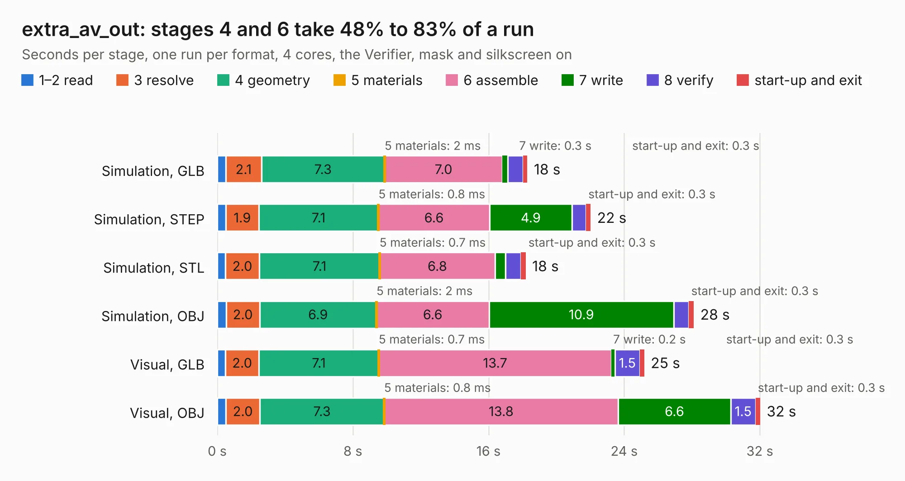

| Mode and format | 1–2 read | 3 resolve | 4 geometry | 5 materials | 6 assemble | 7 write | 8 verify | start-up and exit | Total |
|---|---:|---:|---:|---:|---:|---:|---:|---:|---:|
| Simulation, GLB | 0.5 | 2.1 | 7.3 | 2&nbsp;ms | 7.0 | 0.3 | 0.9 | 0.3 | 18.3 |
| Simulation, STEP | 0.5 | 1.9 | 7.1 | 0.8&nbsp;ms | 6.6 | 4.9 | 0.8 | 0.3 | 22.0 |
| Simulation, STL | 0.5 | 2.0 | 7.1 | 0.7&nbsp;ms | 6.8 | 0.6 | 0.9 | 0.3 | 18.2 |
| Simulation, OBJ | 0.5 | 2.0 | 6.9 | 2&nbsp;ms | 6.6 | 10.9 | 0.9 | 0.3 | 28.1 |
| Visual, GLB | 0.5 | 2.0 | 7.1 | 0.7&nbsp;ms | 13.7 | 0.2 | 1.5 | 0.3 | 25.2 |
| Visual, OBJ | 0.5 | 2.0 | 7.3 | 0.8&nbsp;ms | 13.8 | 6.6 | 1.5 | 0.3 | 32.0 |

<table align="center"><tr><td valign="top">

| Board | Repo: [marqs85/ossc_pro_hw](https://github.com/marqs85/ossc_pro_hw) Board: `extra_av_out.kicad_pcb` |
|---|---|
| Folder | expansions / extra_av_out |
| Complexity | 297&nbsp;/&nbsp;1000 (size&nbsp;242, features&nbsp;55) |
| KESE&nbsp;features | through vias, slotted holes, rounded, trapezoid or chamfered pads, filled zones |
| Tested | 9th November 2026 |
| Copper&nbsp;layers | 4 |
| File&nbsp;format | KiCad 10 (20260206) |
| Parts,&nbsp;tracks,&nbsp;vias | 73, 800, 316 |
| Triangles,&nbsp;simulation | 1,899,088 in 111 parts |
| Verifier | PASS in all six runs |

</td><td valign="top">

<table>
<tr><th>File type</th><th>File size</th><th>Peak memory used</th></tr>
<tr><th colspan="3" align="left">Simulation</th></tr>
<tr><td>GLB</td><td align="right">64&nbsp;MB</td><td align="right">723&nbsp;MB</td></tr>
<tr><td>STEP</td><td align="right">215&nbsp;MB</td><td align="right">860&nbsp;MB</td></tr>
<tr><td>STL</td><td align="right">95&nbsp;MB</td><td align="right">712&nbsp;MB</td></tr>
<tr><td>OBJ</td><td align="right">196&nbsp;MB</td><td align="right">1.3&nbsp;GB</td></tr>
<tr><th colspan="3" align="left">Visual</th></tr>
<tr><td>GLB</td><td align="right">38&nbsp;MB</td><td align="right">744&nbsp;MB</td></tr>
<tr><td>OBJ</td><td align="right">114&nbsp;MB</td><td align="right">861&nbsp;MB</td></tr>
</table>

</td></tr></table>

## 15.30 legacy_av_in

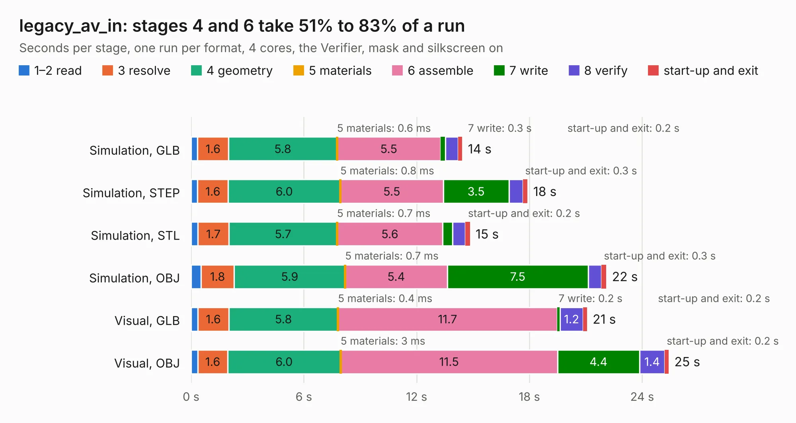

| Mode and format | 1–2 read | 3 resolve | 4 geometry | 5 materials | 6 assemble | 7 write | 8 verify | start-up and exit | Total |
|---|---:|---:|---:|---:|---:|---:|---:|---:|---:|
| Simulation, GLB | 0.3 | 1.6 | 5.8 | 0.6&nbsp;ms | 5.5 | 0.3 | 0.7 | 0.2 | 14.4 |
| Simulation, STEP | 0.3 | 1.6 | 6.0 | 0.8&nbsp;ms | 5.5 | 3.5 | 0.7 | 0.3 | 17.9 |
| Simulation, STL | 0.4 | 1.7 | 5.7 | 0.7&nbsp;ms | 5.6 | 0.5 | 0.7 | 0.2 | 14.8 |
| Simulation, OBJ | 0.5 | 1.8 | 5.9 | 0.7&nbsp;ms | 5.4 | 7.5 | 0.7 | 0.3 | 22.1 |
| Visual, GLB | 0.4 | 1.6 | 5.8 | 0.4&nbsp;ms | 11.7 | 0.2 | 1.2 | 0.2 | 21.1 |
| Visual, OBJ | 0.4 | 1.6 | 6.0 | 3&nbsp;ms | 11.5 | 4.4 | 1.4 | 0.2 | 25.4 |

<table align="center"><tr><td valign="top">

| Board | Repo: [marqs85/ossc_pro_hw](https://github.com/marqs85/ossc_pro_hw) Board: `legacy_av_in.kicad_pcb` |
|---|---|
| Folder | expansions / legacy_av_in |
| Complexity | 341&nbsp;/&nbsp;1000 (size&nbsp;261, features&nbsp;80) |
| KESE&nbsp;features | through vias, slotted holes, custom pads, rounded, trapezoid or chamfered pads, filled zones, copper drawings |
| Tested | 9th November 2026 |
| Copper&nbsp;layers | 4 |
| File&nbsp;format | KiCad 9 (20241229) |
| Parts,&nbsp;tracks,&nbsp;vias | 87, 786, 394 |
| Triangles,&nbsp;simulation | 1,904,396 in 119 parts |
| Verifier | PASS in all six runs |

</td><td valign="top">

<table>
<tr><th>File type</th><th>File size</th><th>Peak memory used</th></tr>
<tr><th colspan="3" align="left">Simulation</th></tr>
<tr><td>GLB</td><td align="right">64&nbsp;MB</td><td align="right">838&nbsp;MB</td></tr>
<tr><td>STEP</td><td align="right">192&nbsp;MB</td><td align="right">862&nbsp;MB</td></tr>
<tr><td>STL</td><td align="right">95&nbsp;MB</td><td align="right">820&nbsp;MB</td></tr>
<tr><td>OBJ</td><td align="right">197&nbsp;MB</td><td align="right">1.3&nbsp;GB</td></tr>
<tr><th colspan="3" align="left">Visual</th></tr>
<tr><td>GLB</td><td align="right">38&nbsp;MB</td><td align="right">744&nbsp;MB</td></tr>
<tr><td>OBJ</td><td align="right">114&nbsp;MB</td><td align="right">844&nbsp;MB</td></tr>
</table>

</td></tr></table>

## 15.31 ram_board

| Mode and format | 1–2 read | 3 resolve | 4 geometry | 5 materials | 6 assemble | 7 write | 8 verify | start-up and exit | Total |
|---|---:|---:|---:|---:|---:|---:|---:|---:|---:|
| Simulation, GLB | 0.2 | 0.8 | 2.6 | 0.3&nbsp;ms | 2.9 | 0.1 | 0.6 | 0.2 | 7.5 |
| Simulation, STEP | 0.2 | 0.8 | 2.6 | 0.3&nbsp;ms | 3.0 | 2.3 | 0.6 | 0.2 | 9.7 |
| Simulation, STL | 0.2 | 0.8 | 2.6 | 0.3&nbsp;ms | 3.0 | 0.2 | 0.5 | 0.2 | 7.5 |
| Simulation, OBJ | 0.2 | 0.9 | 2.6 | 0.3&nbsp;ms | 2.9 | 4.9 | 0.5 | 0.2 | 12.2 |
| Visual, GLB | 0.3 | 0.8 | 2.6 | 0.3&nbsp;ms | 5.9 | 71&nbsp;ms | 0.5 | 0.2 | 10.4 |
| Visual, OBJ | 0.2 | 0.8 | 2.6 | 0.3&nbsp;ms | 5.8 | 2.5 | 0.8 | 0.2 | 12.9 |

<table align="center"><tr><td valign="top">

| Board | Repo: [marqs85/ossc_pro_hw](https://github.com/marqs85/ossc_pro_hw) Board: `ram_board.kicad_pcb` |
|---|---|
| Folder | expansions / ram_board |
| Complexity | 254&nbsp;/&nbsp;1000 (size&nbsp;169, features&nbsp;85) |
| KESE&nbsp;features | through vias, slotted holes, rounded, trapezoid or chamfered pads, filled zones, stack-up, dielectric εr and tanδ |
| Tested | 9th November 2026 |
| Copper&nbsp;layers | 4 |
| File&nbsp;format | KiCad 6 (20211014) |
| Parts,&nbsp;tracks,&nbsp;vias | 11, 288, 153 |
| Triangles,&nbsp;simulation | 938,910 in 64 parts |
| Verifier | PASS in all six runs |

</td><td valign="top">

<table>
<tr><th>File type</th><th>File size</th><th>Peak memory used</th></tr>
<tr><th colspan="3" align="left">Simulation</th></tr>
<tr><td>GLB</td><td align="right">31&nbsp;MB</td><td align="right">439&nbsp;MB</td></tr>
<tr><td>STEP</td><td align="right">104&nbsp;MB</td><td align="right">509&nbsp;MB</td></tr>
<tr><td>STL</td><td align="right">47&nbsp;MB</td><td align="right">465&nbsp;MB</td></tr>
<tr><td>OBJ</td><td align="right">94&nbsp;MB</td><td align="right">644&nbsp;MB</td></tr>
<tr><th colspan="3" align="left">Visual</th></tr>
<tr><td>GLB</td><td align="right">17&nbsp;MB</td><td align="right">494&nbsp;MB</td></tr>
<tr><td>OBJ</td><td align="right">52&nbsp;MB</td><td align="right">448&nbsp;MB</td></tr>
</table>

</td></tr></table>

## 15.32 ossc_pro

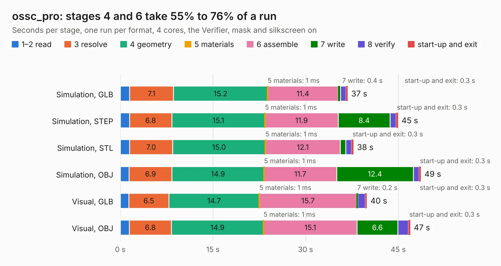

| Mode and format | 1–2 read | 3 resolve | 4 geometry | 5 materials | 6 assemble | 7 write | 8 verify | start-up and exit | Total |
|---|---:|---:|---:|---:|---:|---:|---:|---:|---:|
| Simulation, GLB | 1.5 | 7.1 | 15.2 | 1&nbsp;ms | 11.4 | 0.4 | 0.9 | 0.3 | 36.8 |
| Simulation, STEP | 1.5 | 6.8 | 15.1 | 1&nbsp;ms | 11.9 | 8.4 | 1.0 | 0.3 | 45.0 |
| Simulation, STL | 1.5 | 7.0 | 15.0 | 1&nbsp;ms | 12.1 | 0.9 | 1.0 | 0.3 | 37.8 |
| Simulation, OBJ | 1.4 | 6.9 | 14.9 | 1&nbsp;ms | 11.7 | 12.4 | 0.9 | 0.3 | 48.7 |
| Visual, GLB | 1.4 | 6.5 | 14.7 | 1&nbsp;ms | 15.7 | 0.2 | 1.2 | 0.3 | 39.9 |
| Visual, OBJ | 1.5 | 6.8 | 14.9 | 1&nbsp;ms | 15.1 | 6.6 | 1.7 | 0.3 | 47.0 |

<table align="center"><tr><td valign="top">

| Board | Repo: [marqs85/ossc_pro_hw](https://github.com/marqs85/ossc_pro_hw) Board: `ossc_pro.kicad_pcb` |
|---|---|
| Complexity | 154&nbsp;/&nbsp;1000 (size&nbsp;134, features&nbsp;20) |
| KESE&nbsp;features | slotted holes, rounded, trapezoid or chamfered pads |
| Tested | 9th November 2026 |
| Copper&nbsp;layers | 2 |
| File&nbsp;format | KiCad 9 (20241229) |
| Parts,&nbsp;tracks,&nbsp;vias | 492, 0, 0 |
| Triangles,&nbsp;simulation | 2,163,518 in 533 parts |
| Note | mostly unrouted |
| Verifier | PASS in all six runs |

</td><td valign="top">

<table>
<tr><th>File type</th><th>File size</th><th>Peak memory used</th></tr>
<tr><th colspan="3" align="left">Simulation</th></tr>
<tr><td>GLB</td><td align="right">74&nbsp;MB</td><td align="right">818&nbsp;MB</td></tr>
<tr><td>STEP</td><td align="right">389&nbsp;MB</td><td align="right">1.1&nbsp;GB</td></tr>
<tr><td>STL</td><td align="right">108&nbsp;MB</td><td align="right">828&nbsp;MB</td></tr>
<tr><td>OBJ</td><td align="right">229&nbsp;MB</td><td align="right">1.5&nbsp;GB</td></tr>
<tr><th colspan="3" align="left">Visual</th></tr>
<tr><td>GLB</td><td align="right">38&nbsp;MB</td><td align="right">1.1&nbsp;GB</td></tr>
<tr><td>OBJ</td><td align="right">114&nbsp;MB</td><td align="right">913&nbsp;MB</td></tr>
</table>

</td></tr></table>

## 15.33 aux_board

| Mode and format | 1–2 read | 3 resolve | 4 geometry | 5 materials | 6 assemble | 7 write | 8 verify | start-up and exit | Total |
|---|---:|---:|---:|---:|---:|---:|---:|---:|---:|
| Simulation, GLB | 0.5 | 1.7 | 7.4 | 1&nbsp;ms | 6.5 | 0.3 | 0.8 | 0.2 | 17.5 |
| Simulation, STEP | 0.5 | 1.8 | 7.4 | 0.8&nbsp;ms | 6.7 | 4.5 | 0.8 | 0.2 | 21.9 |
| Simulation, STL | 0.4 | 1.8 | 7.2 | 0.7&nbsp;ms | 6.6 | 0.6 | 0.8 | 0.2 | 17.7 |
| Simulation, OBJ | 0.4 | 1.8 | 7.4 | 1.0&nbsp;ms | 6.7 | 8.5 | 0.8 | 0.2 | 25.8 |
| Visual, GLB | 0.5 | 1.7 | 7.2 | 0.7&nbsp;ms | 12.9 | 0.2 | 1.5 | 0.2 | 24.2 |
| Visual, OBJ | 0.5 | 1.8 | 7.6 | 0.8&nbsp;ms | 12.5 | 5.4 | 1.5 | 0.2 | 29.4 |

<table align="center"><tr><td valign="top">

| Board | Repo: [matthiasgeorgimhof/hardware_csat](https://github.com/matthiasgeorgimhof/hardware_csat) Board: `aux_board.kicad_pcb` |
|---|---|
| Folder | aux_board |
| Complexity | 350&nbsp;/&nbsp;1000 (size&nbsp;245, features&nbsp;105) |
| KESE&nbsp;features | through vias, slotted holes, rounded, trapezoid or chamfered pads, drill offsets, filled zones, curved board outline, stack-up, dielectric εr and tanδ |
| Tested | 9th November 2026 |
| Copper&nbsp;layers | 4 |
| File&nbsp;format | KiCad 9 (20241229) |
| Parts,&nbsp;tracks,&nbsp;vias | 125, 825, 201 |
| Triangles,&nbsp;simulation | 2,157,750 in 180 parts |
| Verifier | PASS in all six runs |

</td><td valign="top">

<table>
<tr><th>File type</th><th>File size</th><th>Peak memory used</th></tr>
<tr><th colspan="3" align="left">Simulation</th></tr>
<tr><td>GLB</td><td align="right">72&nbsp;MB</td><td align="right">693&nbsp;MB</td></tr>
<tr><td>STEP</td><td align="right">266&nbsp;MB</td><td align="right">890&nbsp;MB</td></tr>
<tr><td>STL</td><td align="right">108&nbsp;MB</td><td align="right">709&nbsp;MB</td></tr>
<tr><td>OBJ</td><td align="right">224&nbsp;MB</td><td align="right">1.4&nbsp;GB</td></tr>
<tr><th colspan="3" align="left">Visual</th></tr>
<tr><td>GLB</td><td align="right">43&nbsp;MB</td><td align="right">955&nbsp;MB</td></tr>
<tr><td>OBJ</td><td align="right">130&nbsp;MB</td><td align="right">958&nbsp;MB</td></tr>
</table>

</td></tr></table>

## 15.34 auxio_board

| Mode and format | 1–2 read | 3 resolve | 4 geometry | 5 materials | 6 assemble | 7 write | 8 verify | start-up and exit | Total |
|---|---:|---:|---:|---:|---:|---:|---:|---:|---:|
| Simulation, GLB | 0.5 | 2.2 | 9.5 | 0.9&nbsp;ms | 8.5 | 0.3 | 1.1 | 0.2 | 22.4 |
| Simulation, STEP | 0.6 | 2.3 | 9.1 | 0.8&nbsp;ms | 8.7 | 5.6 | 1.0 | 0.2 | 27.6 |
| Simulation, STL | 0.5 | 2.2 | 9.6 | 0.9&nbsp;ms | 8.1 | 0.9 | 1.0 | 0.2 | 22.5 |
| Simulation, OBJ | 0.6 | 2.3 | 9.2 | 0.8&nbsp;ms | 8.1 | 10.7 | 1.2 | 0.3 | 32.2 |
| Visual, GLB | 0.6 | 2.4 | 9.9 | 1.0&nbsp;ms | 17.2 | 0.2 | 1.8 | 0.3 | 32.3 |
| Visual, OBJ | 0.5 | 2.4 | 9.6 | 1&nbsp;ms | 16.4 | 6.5 | 2.1 | 0.3 | 37.8 |

<table align="center"><tr><td valign="top">

| Board | Repo: [matthiasgeorgimhof/hardware_csat](https://github.com/matthiasgeorgimhof/hardware_csat) Board: `auxio_board.kicad_pcb` |
|---|---|
| Folder | auxio_board |
| Complexity | 351&nbsp;/&nbsp;1000 (size&nbsp;246, features&nbsp;105) |
| KESE&nbsp;features | through vias, slotted holes, rounded, trapezoid or chamfered pads, drill offsets, filled zones, curved board outline, stack-up, dielectric εr and tanδ |
| Tested | 9th November 2026 |
| Copper&nbsp;layers | 4 |
| File&nbsp;format | KiCad 9 (20241229) |
| Parts,&nbsp;tracks,&nbsp;vias | 128, 942, 204 |
| Triangles,&nbsp;simulation | 2,361,290 in 180 parts |
| Verifier | PASS in all six runs |

</td><td valign="top">

<table>
<tr><th>File type</th><th>File size</th><th>Peak memory used</th></tr>
<tr><th colspan="3" align="left">Simulation</th></tr>
<tr><td>GLB</td><td align="right">79&nbsp;MB</td><td align="right">766&nbsp;MB</td></tr>
<tr><td>STEP</td><td align="right">292&nbsp;MB</td><td align="right">986&nbsp;MB</td></tr>
<tr><td>STL</td><td align="right">118&nbsp;MB</td><td align="right">758&nbsp;MB</td></tr>
<tr><td>OBJ</td><td align="right">246&nbsp;MB</td><td align="right">1.6&nbsp;GB</td></tr>
<tr><th colspan="3" align="left">Visual</th></tr>
<tr><td>GLB</td><td align="right">47&nbsp;MB</td><td align="right">995&nbsp;MB</td></tr>
<tr><td>OBJ</td><td align="right">143&nbsp;MB</td><td align="right">1.0&nbsp;GB</td></tr>
</table>

</td></tr></table>

## 15.35 AVIONICS_BOARD

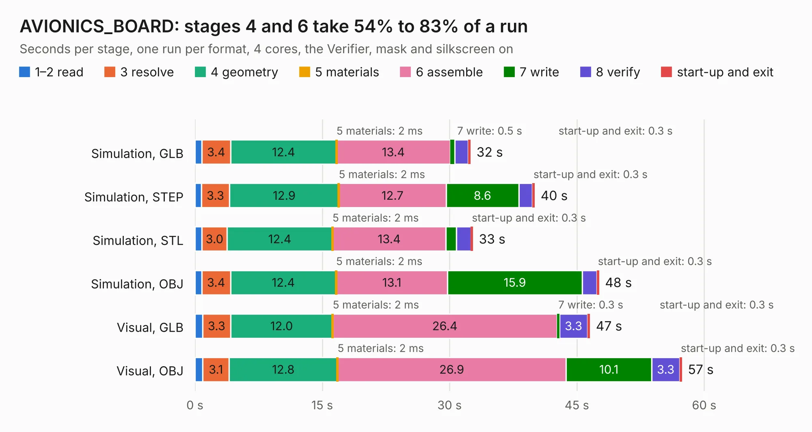

| Mode and format | 1–2 read | 3 resolve | 4 geometry | 5 materials | 6 assemble | 7 write | 8 verify | start-up and exit | Total |
|---|---:|---:|---:|---:|---:|---:|---:|---:|---:|
| Simulation, GLB | 0.8 | 3.4 | 12.4 | 2&nbsp;ms | 13.4 | 0.5 | 1.6 | 0.3 | 32.5 |
| Simulation, STEP | 0.7 | 3.3 | 12.9 | 2&nbsp;ms | 12.7 | 8.6 | 1.6 | 0.3 | 40.0 |
| Simulation, STL | 0.8 | 3.0 | 12.4 | 2&nbsp;ms | 13.4 | 1.2 | 1.7 | 0.3 | 32.8 |
| Simulation, OBJ | 0.8 | 3.4 | 12.4 | 2&nbsp;ms | 13.1 | 15.9 | 1.7 | 0.3 | 47.6 |
| Visual, GLB | 0.9 | 3.3 | 12.0 | 2&nbsp;ms | 26.4 | 0.3 | 3.3 | 0.3 | 46.6 |
| Visual, OBJ | 0.9 | 3.1 | 12.8 | 2&nbsp;ms | 26.9 | 10.1 | 3.3 | 0.3 | 57.4 |

<table align="center"><tr><td valign="top">

| Board | Repo: [matthiasgeorgimhof/hardware_csat](https://github.com/matthiasgeorgimhof/hardware_csat) Board: `AVIONICS_BOARD.kicad_pcb` |
|---|---|
| Folder | avionics_board |
| Complexity | 367&nbsp;/&nbsp;1000 (size&nbsp;262, features&nbsp;105) |
| KESE&nbsp;features | through vias, slotted holes, rounded, trapezoid or chamfered pads, drill offsets, filled zones, curved board outline, stack-up, dielectric εr and tanδ |
| Tested | 9th November 2026 |
| Copper&nbsp;layers | 4 |
| File&nbsp;format | KiCad 9 (20241229) |
| Parts,&nbsp;tracks,&nbsp;vias | 182, 2,001, 367 |
| Triangles,&nbsp;simulation | 3,369,990 in 275 parts |
| Verifier | PASS in all six runs |

</td><td valign="top">

<table>
<tr><th>File type</th><th>File size</th><th>Peak memory used</th></tr>
<tr><th colspan="3" align="left">Simulation</th></tr>
<tr><td>GLB</td><td align="right">113&nbsp;MB</td><td align="right">1.1&nbsp;GB</td></tr>
<tr><td>STEP</td><td align="right">435&nbsp;MB</td><td align="right">1.4&nbsp;GB</td></tr>
<tr><td>STL</td><td align="right">169&nbsp;MB</td><td align="right">1.1&nbsp;GB</td></tr>
<tr><td>OBJ</td><td align="right">355&nbsp;MB</td><td align="right">2.2&nbsp;GB</td></tr>
<tr><th colspan="3" align="left">Visual</th></tr>
<tr><td>GLB</td><td align="right">69&nbsp;MB</td><td align="right">1.3&nbsp;GB</td></tr>
<tr><td>OBJ</td><td align="right">217&nbsp;MB</td><td align="right">1.4&nbsp;GB</td></tr>
</table>

</td></tr></table>

## 15.36 comm_board

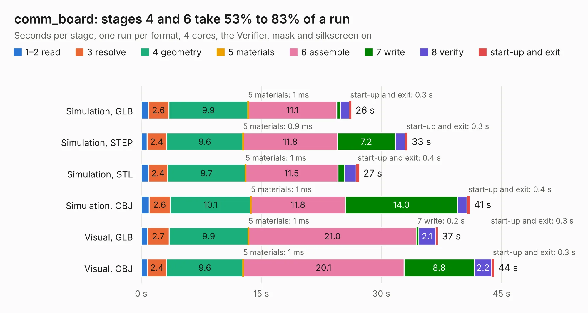

| Mode and format | 1–2 read | 3 resolve | 4 geometry | 5 materials | 6 assemble | 7 write | 8 verify | start-up and exit | Total |
|---|---:|---:|---:|---:|---:|---:|---:|---:|---:|
| Simulation, GLB | 0.9 | 2.6 | 9.9 | 1&nbsp;ms | 11.1 | 0.5 | 1.1 | 0.3 | 26.3 |
| Simulation, STEP | 0.8 | 2.4 | 9.6 | 0.9&nbsp;ms | 11.8 | 7.2 | 1.2 | 0.3 | 33.3 |
| Simulation, STL | 0.9 | 2.4 | 9.7 | 1&nbsp;ms | 11.5 | 0.8 | 1.5 | 0.4 | 27.2 |
| Simulation, OBJ | 1.0 | 2.6 | 10.1 | 1&nbsp;ms | 11.8 | 14.0 | 1.2 | 0.4 | 41.0 |
| Visual, GLB | 0.8 | 2.7 | 9.9 | 1&nbsp;ms | 21.0 | 0.2 | 2.1 | 0.3 | 37.1 |
| Visual, OBJ | 0.8 | 2.4 | 9.6 | 1&nbsp;ms | 20.1 | 8.8 | 2.2 | 0.3 | 44.1 |

<table align="center"><tr><td valign="top">

| Board | Repo: [matthiasgeorgimhof/hardware_csat](https://github.com/matthiasgeorgimhof/hardware_csat) Board: `comm_board.kicad_pcb` |
|---|---|
| Folder | comm_board |
| Complexity | 365&nbsp;/&nbsp;1000 (size&nbsp;260, features&nbsp;105) |
| KESE&nbsp;features | through vias, slotted holes, rounded, trapezoid or chamfered pads, drill offsets, filled zones, curved board outline, stack-up, dielectric εr and tanδ |
| Tested | 9th November 2026 |
| Copper&nbsp;layers | 4 |
| File&nbsp;format | KiCad 9 (20241229) |
| Parts,&nbsp;tracks,&nbsp;vias | 178, 1,254, 204 |
| Triangles,&nbsp;simulation | 2,325,158 in 222 parts |
| Verifier | PASS in all six runs |

</td><td valign="top">

<table>
<tr><th>File type</th><th>File size</th><th>Peak memory used</th></tr>
<tr><th colspan="3" align="left">Simulation</th></tr>
<tr><td>GLB</td><td align="right">78&nbsp;MB</td><td align="right">811&nbsp;MB</td></tr>
<tr><td>STEP</td><td align="right">326&nbsp;MB</td><td align="right">973&nbsp;MB</td></tr>
<tr><td>STL</td><td align="right">116&nbsp;MB</td><td align="right">822&nbsp;MB</td></tr>
<tr><td>OBJ</td><td align="right">243&nbsp;MB</td><td align="right">1.5&nbsp;GB</td></tr>
<tr><th colspan="3" align="left">Visual</th></tr>
<tr><td>GLB</td><td align="right">51&nbsp;MB</td><td align="right">1.1&nbsp;GB</td></tr>
<tr><td>OBJ</td><td align="right">158&nbsp;MB</td><td align="right">1.1&nbsp;GB</td></tr>
</table>

</td></tr></table>

## 15.37 EPS

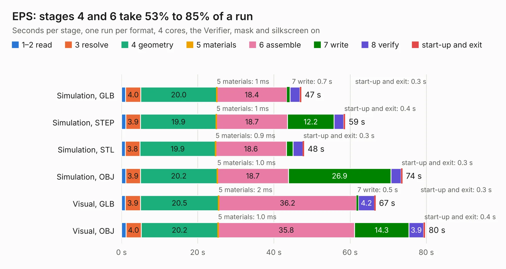

| Mode and format | 1–2 read | 3 resolve | 4 geometry | 5 materials | 6 assemble | 7 write | 8 verify | start-up and exit | Total |
|---|---:|---:|---:|---:|---:|---:|---:|---:|---:|
| Simulation, GLB | 1.1 | 4.0 | 20.0 | 1&nbsp;ms | 18.4 | 0.7 | 2.6 | 0.3 | 47.1 |
| Simulation, STEP | 1.1 | 3.9 | 19.9 | 1&nbsp;ms | 18.7 | 12.2 | 2.6 | 0.4 | 58.7 |
| Simulation, STL | 1.0 | 3.8 | 19.9 | 0.9&nbsp;ms | 18.6 | 1.7 | 2.6 | 0.3 | 47.9 |
| Simulation, OBJ | 1.1 | 3.9 | 20.2 | 1.0&nbsp;ms | 18.7 | 26.9 | 2.7 | 0.3 | 73.7 |
| Visual, GLB | 1.0 | 3.9 | 20.5 | 2&nbsp;ms | 36.2 | 0.5 | 4.2 | 0.3 | 66.6 |
| Visual, OBJ | 1.2 | 4.0 | 20.2 | 1.0&nbsp;ms | 35.8 | 14.3 | 3.9 | 0.4 | 79.7 |

<table align="center"><tr><td valign="top">

| Board | Repo: [matthiasgeorgimhof/hardware_csat](https://github.com/matthiasgeorgimhof/hardware_csat) Board: `EPS.kicad_pcb` |
|---|---|
| Folder | eps_board |
| Complexity | 372&nbsp;/&nbsp;1000 (size&nbsp;267, features&nbsp;105) |
| KESE&nbsp;features | through vias, slotted holes, rounded, trapezoid or chamfered pads, drill offsets, filled zones, curved board outline, stack-up, dielectric εr and tanδ |
| Tested | 9th November 2026 |
| Copper&nbsp;layers | 4 |
| File&nbsp;format | KiCad 9 (20241229) |
| Parts,&nbsp;tracks,&nbsp;vias | 242, 2,354, 416 |
| Triangles,&nbsp;simulation | 4,561,054 in 261 parts |
| Verifier | PASS in all six runs |

</td><td valign="top">

<table>
<tr><th>File type</th><th>File size</th><th>Peak memory used</th></tr>
<tr><th colspan="3" align="left">Simulation</th></tr>
<tr><td>GLB</td><td align="right">153&nbsp;MB</td><td align="right">1.4&nbsp;GB</td></tr>
<tr><td>STEP</td><td align="right">630&nbsp;MB</td><td align="right">1.6&nbsp;GB</td></tr>
<tr><td>STL</td><td align="right">228&nbsp;MB</td><td align="right">1.3&nbsp;GB</td></tr>
<tr><td>OBJ</td><td align="right">484&nbsp;MB</td><td align="right">2.9&nbsp;GB</td></tr>
<tr><th colspan="3" align="left">Visual</th></tr>
<tr><td>GLB</td><td align="right">82&nbsp;MB</td><td align="right">1.5&nbsp;GB</td></tr>
<tr><td>OBJ</td><td align="right">259&nbsp;MB</td><td align="right">1.7&nbsp;GB</td></tr>
</table>

</td></tr></table>

## 15.38 sci_board

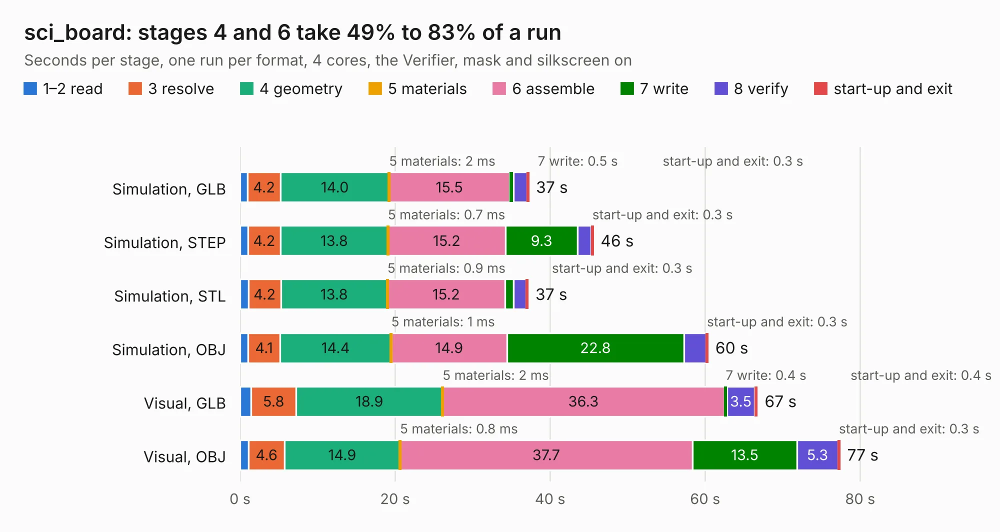

| Mode and format | 1–2 read | 3 resolve | 4 geometry | 5 materials | 6 assemble | 7 write | 8 verify | start-up and exit | Total |
|---|---:|---:|---:|---:|---:|---:|---:|---:|---:|
| Simulation, GLB | 1.0 | 4.2 | 14.0 | 2&nbsp;ms | 15.5 | 0.5 | 1.7 | 0.3 | 37.3 |
| Simulation, STEP | 1.0 | 4.2 | 13.8 | 0.7&nbsp;ms | 15.2 | 9.3 | 1.8 | 0.3 | 45.6 |
| Simulation, STL | 1.1 | 4.2 | 13.8 | 0.9&nbsp;ms | 15.2 | 1.1 | 1.6 | 0.3 | 37.2 |
| Simulation, OBJ | 1.1 | 4.1 | 14.4 | 1&nbsp;ms | 14.9 | 22.8 | 2.8 | 0.3 | 60.4 |
| Visual, GLB | 1.4 | 5.8 | 18.9 | 2&nbsp;ms | 36.3 | 0.4 | 3.5 | 0.4 | 66.8 |
| Visual, OBJ | 1.1 | 4.6 | 14.9 | 0.8&nbsp;ms | 37.7 | 13.5 | 5.3 | 0.3 | 77.4 |

<table align="center"><tr><td valign="top">

| Board | Repo: [matthiasgeorgimhof/hardware_csat](https://github.com/matthiasgeorgimhof/hardware_csat) Board: `sci_board.kicad_pcb` |
|---|---|
| Folder | sci_board.inactive |
| Complexity | 397&nbsp;/&nbsp;1000 (size&nbsp;267, features&nbsp;130) |
| KESE&nbsp;features | through vias, slotted holes, custom pads, rounded, trapezoid or chamfered pads, drill offsets, filled zones, copper drawings, curved board outline, stack-up, dielectric εr and tanδ |
| Tested | 9th November 2026 |
| Copper&nbsp;layers | 4 |
| File&nbsp;format | KiCad 9 (20241229) |
| Parts,&nbsp;tracks,&nbsp;vias | 210, 2,498, 466 |
| Triangles,&nbsp;simulation | 3,299,186 in 282 parts |
| Verifier | PASS in all six runs |

</td><td valign="top">

<table>
<tr><th>File type</th><th>File size</th><th>Peak memory used</th></tr>
<tr><th colspan="3" align="left">Simulation</th></tr>
<tr><td>GLB</td><td align="right">111&nbsp;MB</td><td align="right">1.1&nbsp;GB</td></tr>
<tr><td>STEP</td><td align="right">450&nbsp;MB</td><td align="right">1.4&nbsp;GB</td></tr>
<tr><td>STL</td><td align="right">165&nbsp;MB</td><td align="right">1.1&nbsp;GB</td></tr>
<tr><td>OBJ</td><td align="right">348&nbsp;MB</td><td align="right">2.2&nbsp;GB</td></tr>
<tr><th colspan="3" align="left">Visual</th></tr>
<tr><td>GLB</td><td align="right">75&nbsp;MB</td><td align="right">1.5&nbsp;GB</td></tr>
<tr><td>OBJ</td><td align="right">237&nbsp;MB</td><td align="right">1.6&nbsp;GB</td></tr>
</table>

</td></tr></table>

## 15.39 sci_board_wo_switches

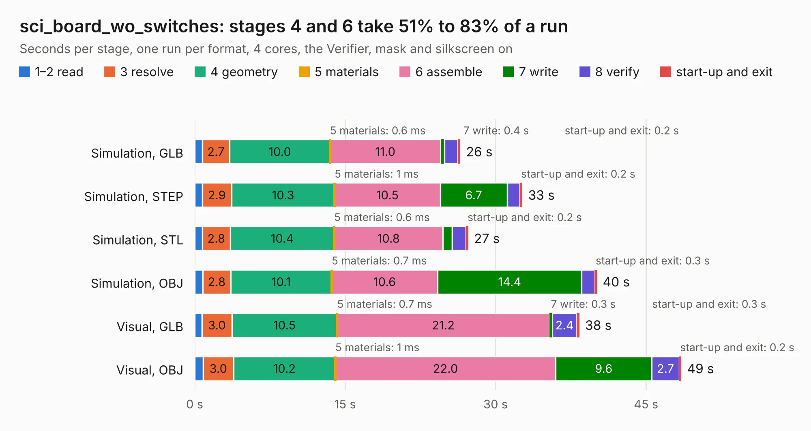

| Mode and format | 1–2 read | 3 resolve | 4 geometry | 5 materials | 6 assemble | 7 write | 8 verify | start-up and exit | Total |
|---|---:|---:|---:|---:|---:|---:|---:|---:|---:|
| Simulation, GLB | 0.8 | 2.7 | 10.0 | 0.6&nbsp;ms | 11.0 | 0.4 | 1.3 | 0.2 | 26.5 |
| Simulation, STEP | 0.8 | 2.9 | 10.3 | 1&nbsp;ms | 10.5 | 6.7 | 1.3 | 0.2 | 32.7 |
| Simulation, STL | 0.8 | 2.8 | 10.4 | 0.6&nbsp;ms | 10.8 | 0.9 | 1.4 | 0.2 | 27.3 |
| Simulation, OBJ | 0.8 | 2.8 | 10.1 | 0.7&nbsp;ms | 10.6 | 14.4 | 1.3 | 0.3 | 40.1 |
| Visual, GLB | 0.7 | 3.0 | 10.5 | 0.7&nbsp;ms | 21.2 | 0.3 | 2.4 | 0.3 | 38.3 |
| Visual, OBJ | 0.8 | 3.0 | 10.2 | 1&nbsp;ms | 22.0 | 9.6 | 2.7 | 0.2 | 48.5 |

<table align="center"><tr><td valign="top">

| Board | Repo: [matthiasgeorgimhof/hardware_csat](https://github.com/matthiasgeorgimhof/hardware_csat) Board: `sci_board_wo_switches.kicad_pcb` |
|---|---|
| Folder | sci_board_wo_switches |
| Complexity | 391&nbsp;/&nbsp;1000 (size&nbsp;261, features&nbsp;130) |
| KESE&nbsp;features | through vias, slotted holes, custom pads, rounded, trapezoid or chamfered pads, drill offsets, filled zones, copper drawings, curved board outline, stack-up, dielectric εr and tanδ |
| Tested | 9th November 2026 |
| Copper&nbsp;layers | 4 |
| File&nbsp;format | KiCad 9 (20241229) |
| Parts,&nbsp;tracks,&nbsp;vias | 181, 1,838, 364 |
| Triangles,&nbsp;simulation | 2,773,664 in 240 parts |
| Verifier | PASS in all six runs |

</td><td valign="top">

<table>
<tr><th>File type</th><th>File size</th><th>Peak memory used</th></tr>
<tr><th colspan="3" align="left">Simulation</th></tr>
<tr><td>GLB</td><td align="right">93&nbsp;MB</td><td align="right">918&nbsp;MB</td></tr>
<tr><td>STEP</td><td align="right">370&nbsp;MB</td><td align="right">1.1&nbsp;GB</td></tr>
<tr><td>STL</td><td align="right">139&nbsp;MB</td><td align="right">927&nbsp;MB</td></tr>
<tr><td>OBJ</td><td align="right">291&nbsp;MB</td><td align="right">1.8&nbsp;GB</td></tr>
<tr><th colspan="3" align="left">Visual</th></tr>
<tr><td>GLB</td><td align="right">62&nbsp;MB</td><td align="right">1.1&nbsp;GB</td></tr>
<tr><td>OBJ</td><td align="right">194&nbsp;MB</td><td align="right">1.3&nbsp;GB</td></tr>
</table>

</td></tr></table>

## 15.40 bodge

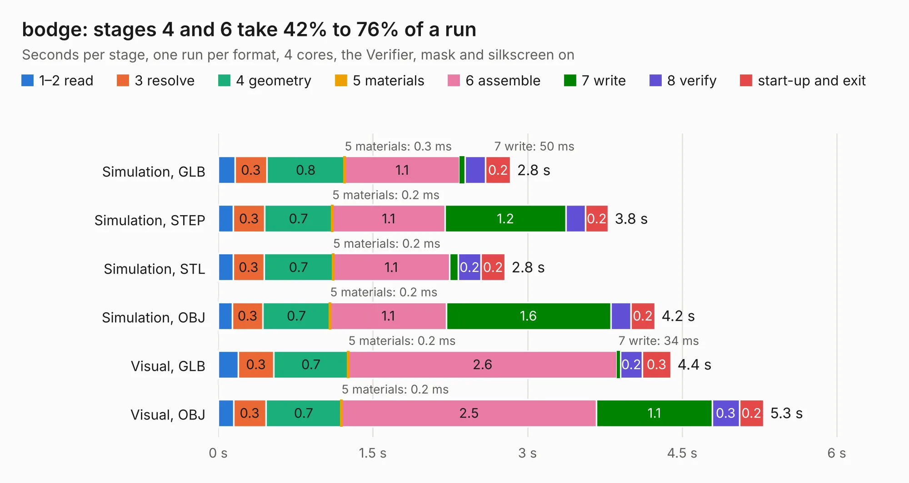

| Mode and format | 1–2 read | 3 resolve | 4 geometry | 5 materials | 6 assemble | 7 write | 8 verify | start-up and exit | Total |
|---|---:|---:|---:|---:|---:|---:|---:|---:|---:|
| Simulation, GLB | 0.2 | 0.3 | 0.8 | 0.3&nbsp;ms | 1.1 | 50&nbsp;ms | 0.2 | 0.2 | 2.8 |
| Simulation, STEP | 0.1 | 0.3 | 0.7 | 0.2&nbsp;ms | 1.1 | 1.2 | 0.2 | 0.2 | 3.8 |
| Simulation, STL | 0.1 | 0.3 | 0.7 | 0.2&nbsp;ms | 1.1 | 85&nbsp;ms | 0.2 | 0.2 | 2.8 |
| Simulation, OBJ | 0.1 | 0.3 | 0.7 | 0.2&nbsp;ms | 1.1 | 1.6 | 0.2 | 0.2 | 4.2 |
| Visual, GLB | 0.2 | 0.3 | 0.7 | 0.2&nbsp;ms | 2.6 | 34&nbsp;ms | 0.2 | 0.3 | 4.4 |
| Visual, OBJ | 0.1 | 0.3 | 0.7 | 0.2&nbsp;ms | 2.5 | 1.1 | 0.3 | 0.2 | 5.3 |

<table align="center"><tr><td valign="top">

| Board | Repo: [matthiasgeorgimhof/hardware_csat](https://github.com/matthiasgeorgimhof/hardware_csat) Board: `bodge.kicad_pcb` |
|---|---|
| Folder | sci_extra / bodge |
| Complexity | 234&nbsp;/&nbsp;1000 (size&nbsp;159, features&nbsp;75) |
| KESE&nbsp;features | through vias, rounded, trapezoid or chamfered pads, filled zones, stack-up, dielectric εr and tanδ |
| Tested | 9th November 2026 |
| Copper&nbsp;layers | 4 |
| File&nbsp;format | KiCad 9 (20241229) |
| Parts,&nbsp;tracks,&nbsp;vias | 9, 315, 48 |
| Triangles,&nbsp;simulation | 273,140 in 48 parts |
| Verifier | PASS in all six runs |

</td><td valign="top">

<table>
<tr><th>File type</th><th>File size</th><th>Peak memory used</th></tr>
<tr><th colspan="3" align="left">Simulation</th></tr>
<tr><td>GLB</td><td align="right">9.6&nbsp;MB</td><td align="right">239&nbsp;MB</td></tr>
<tr><td>STEP</td><td align="right">38&nbsp;MB</td><td align="right">247&nbsp;MB</td></tr>
<tr><td>STL</td><td align="right">14&nbsp;MB</td><td align="right">236&nbsp;MB</td></tr>
<tr><td>OBJ</td><td align="right">27&nbsp;MB</td><td align="right">235&nbsp;MB</td></tr>
<tr><th colspan="3" align="left">Visual</th></tr>
<tr><td>GLB</td><td align="right">6.4&nbsp;MB</td><td align="right">246&nbsp;MB</td></tr>
<tr><td>OBJ</td><td align="right">19&nbsp;MB</td><td align="right">242&nbsp;MB</td></tr>
</table>

</td></tr></table>

## 15.41 bodge_oshkosh

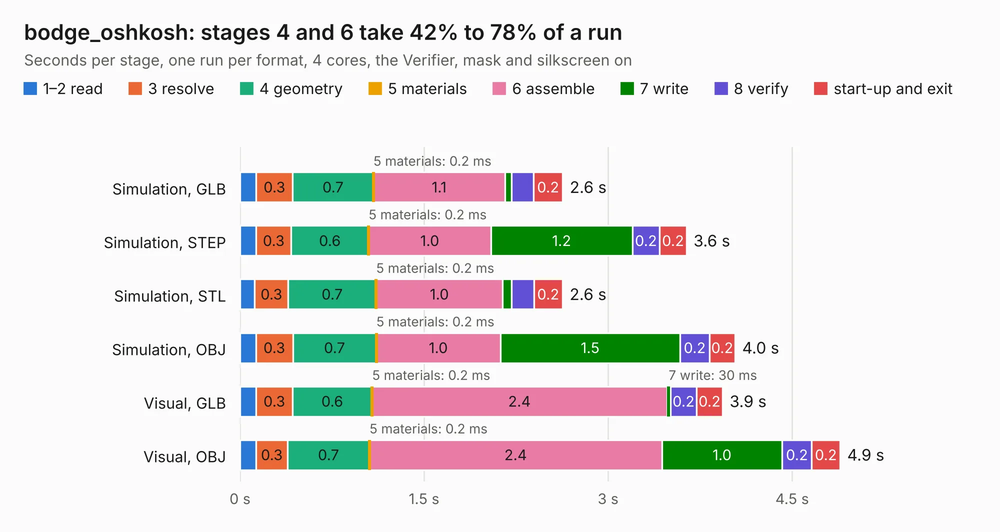

| Mode and format | 1–2 read | 3 resolve | 4 geometry | 5 materials | 6 assemble | 7 write | 8 verify | start-up and exit | Total |
|---|---:|---:|---:|---:|---:|---:|---:|---:|---:|
| Simulation, GLB | 0.1 | 0.3 | 0.7 | 0.2&nbsp;ms | 1.1 | 53&nbsp;ms | 0.2 | 0.2 | 2.6 |
| Simulation, STEP | 0.1 | 0.3 | 0.6 | 0.2&nbsp;ms | 1.0 | 1.2 | 0.2 | 0.2 | 3.6 |
| Simulation, STL | 0.1 | 0.3 | 0.7 | 0.2&nbsp;ms | 1.0 | 75&nbsp;ms | 0.2 | 0.2 | 2.6 |
| Simulation, OBJ | 0.1 | 0.3 | 0.7 | 0.2&nbsp;ms | 1.0 | 1.5 | 0.2 | 0.2 | 4.0 |
| Visual, GLB | 0.1 | 0.3 | 0.6 | 0.2&nbsp;ms | 2.4 | 30&nbsp;ms | 0.2 | 0.2 | 3.9 |
| Visual, OBJ | 0.1 | 0.3 | 0.7 | 0.2&nbsp;ms | 2.4 | 1.0 | 0.2 | 0.2 | 4.9 |

<table align="center"><tr><td valign="top">

| Board | Repo: [matthiasgeorgimhof/hardware_csat](https://github.com/matthiasgeorgimhof/hardware_csat) Board: `bodge_oshkosh.kicad_pcb` |
|---|---|
| Folder | sci_extra / bodge_oshkosh |
| Complexity | 234&nbsp;/&nbsp;1000 (size&nbsp;159, features&nbsp;75) |
| KESE&nbsp;features | through vias, rounded, trapezoid or chamfered pads, filled zones, stack-up, dielectric εr and tanδ |
| Tested | 9th November 2026 |
| Copper&nbsp;layers | 4 |
| File&nbsp;format | KiCad 9 (20241229) |
| Parts,&nbsp;tracks,&nbsp;vias | 9, 316, 48 |
| Triangles,&nbsp;simulation | 273,466 in 48 parts |
| Verifier | PASS in all six runs |

</td><td valign="top">

<table>
<tr><th>File type</th><th>File size</th><th>Peak memory used</th></tr>
<tr><th colspan="3" align="left">Simulation</th></tr>
<tr><td>GLB</td><td align="right">9.6&nbsp;MB</td><td align="right">241&nbsp;MB</td></tr>
<tr><td>STEP</td><td align="right">38&nbsp;MB</td><td align="right">247&nbsp;MB</td></tr>
<tr><td>STL</td><td align="right">14&nbsp;MB</td><td align="right">247&nbsp;MB</td></tr>
<tr><td>OBJ</td><td align="right">27&nbsp;MB</td><td align="right">239&nbsp;MB</td></tr>
<tr><th colspan="3" align="left">Visual</th></tr>
<tr><td>GLB</td><td align="right">6.4&nbsp;MB</td><td align="right">221&nbsp;MB</td></tr>
<tr><td>OBJ</td><td align="right">19&nbsp;MB</td><td align="right">243&nbsp;MB</td></tr>
</table>

</td></tr></table>

## 15.42 antenna_switch

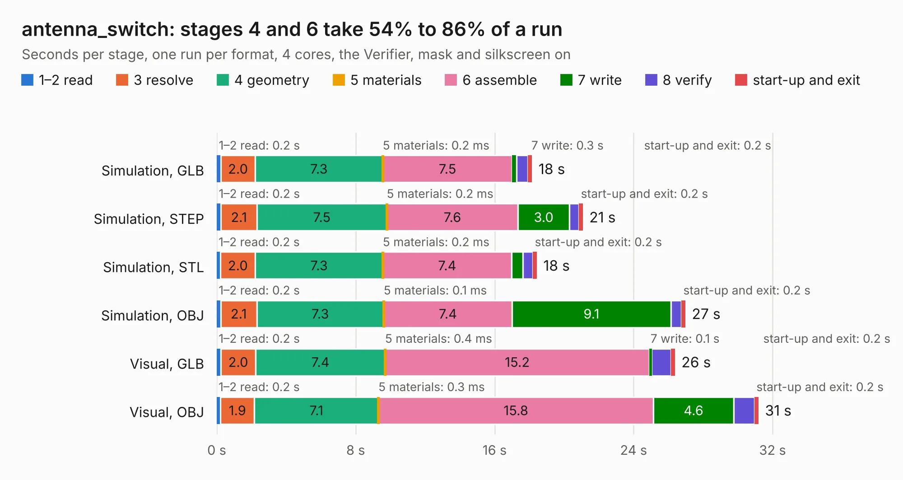

| Mode and format | 1–2 read | 3 resolve | 4 geometry | 5 materials | 6 assemble | 7 write | 8 verify | start-up and exit | Total |
|---|---:|---:|---:|---:|---:|---:|---:|---:|---:|
| Simulation, GLB | 0.2 | 2.0 | 7.3 | 0.2&nbsp;ms | 7.5 | 0.3 | 0.6 | 0.2 | 18.2 |
| Simulation, STEP | 0.2 | 2.1 | 7.5 | 0.2&nbsp;ms | 7.6 | 3.0 | 0.6 | 0.2 | 21.1 |
| Simulation, STL | 0.2 | 2.0 | 7.3 | 0.2&nbsp;ms | 7.4 | 0.7 | 0.6 | 0.2 | 18.4 |
| Simulation, OBJ | 0.2 | 2.1 | 7.3 | 0.1&nbsp;ms | 7.4 | 9.1 | 0.6 | 0.2 | 27.0 |
| Visual, GLB | 0.2 | 2.0 | 7.4 | 0.4&nbsp;ms | 15.2 | 0.1 | 1.1 | 0.2 | 26.4 |
| Visual, OBJ | 0.2 | 1.9 | 7.1 | 0.3&nbsp;ms | 15.8 | 4.6 | 1.2 | 0.2 | 31.2 |

<table align="center"><tr><td valign="top">

| Board | Repo: [matthuszagh/fmcw](https://github.com/matthuszagh/fmcw) Board: `antenna_switch.kicad_pcb` |
|---|---|
| Folder | hardware / antenna-switch |
| Complexity | 238&nbsp;/&nbsp;1000 (size&nbsp;193, features&nbsp;45) |
| KESE&nbsp;features | through vias, rounded, trapezoid or chamfered pads, filled zones |
| Tested | 9th November 2026 |
| Copper&nbsp;layers | 4 |
| File&nbsp;format | KiCad 6 (20190905) |
| Parts,&nbsp;tracks,&nbsp;vias | 32, 143, 525 |
| Triangles,&nbsp;simulation | 1,784,972 in 40 parts |
| Verifier | PASS in all six runs |

</td><td valign="top">

<table>
<tr><th>File type</th><th>File size</th><th>Peak memory used</th></tr>
<tr><th colspan="3" align="left">Simulation</th></tr>
<tr><td>GLB</td><td align="right">59&nbsp;MB</td><td align="right">786&nbsp;MB</td></tr>
<tr><td>STEP</td><td align="right">138&nbsp;MB</td><td align="right">845&nbsp;MB</td></tr>
<tr><td>STL</td><td align="right">89&nbsp;MB</td><td align="right">750&nbsp;MB</td></tr>
<tr><td>OBJ</td><td align="right">185&nbsp;MB</td><td align="right">1.2&nbsp;GB</td></tr>
<tr><th colspan="3" align="left">Visual</th></tr>
<tr><td>GLB</td><td align="right">29&nbsp;MB</td><td align="right">719&nbsp;MB</td></tr>
<tr><td>OBJ</td><td align="right">91&nbsp;MB</td><td align="right">777&nbsp;MB</td></tr>
</table>

</td></tr></table>

## 15.43 fmcw

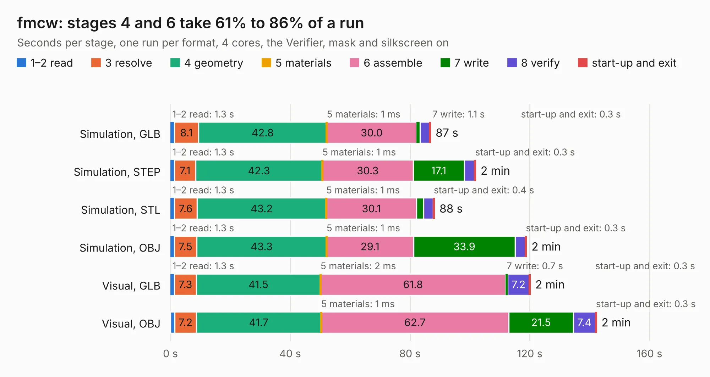

| Mode and format | 1–2 read | 3 resolve | 4 geometry | 5 materials | 6 assemble | 7 write | 8 verify | start-up and exit | Total |
|---|---:|---:|---:|---:|---:|---:|---:|---:|---:|
| Simulation, GLB | 1.3 | 8.1 | 42.8 | 1&nbsp;ms | 30.0 | 1.1 | 3.2 | 0.3 | 86.9 |
| Simulation, STEP | 1.3 | 7.1 | 42.3 | 1&nbsp;ms | 30.3 | 17.1 | 3.5 | 0.3 | 101.9 |
| Simulation, STL | 1.3 | 7.6 | 43.2 | 1&nbsp;ms | 30.1 | 2.3 | 3.3 | 0.4 | 88.2 |
| Simulation, OBJ | 1.3 | 7.5 | 43.3 | 1&nbsp;ms | 29.1 | 33.9 | 3.4 | 0.3 | 118.9 |
| Visual, GLB | 1.3 | 7.3 | 41.5 | 2&nbsp;ms | 61.8 | 0.7 | 7.2 | 0.3 | 120.2 |
| Visual, OBJ | 1.4 | 7.2 | 41.7 | 1&nbsp;ms | 62.7 | 21.5 | 7.4 | 0.3 | 142.3 |

<table align="center"><tr><td valign="top">

| Board | Repo: [matthuszagh/fmcw](https://github.com/matthuszagh/fmcw) Board: `fmcw.kicad_pcb` |
|---|---|
| Folder | hardware / boards / rev1 |
| Complexity | 387&nbsp;/&nbsp;1000 (size&nbsp;307, features&nbsp;80) |
| KESE&nbsp;features | through vias, slotted holes, custom pads, rounded, trapezoid or chamfered pads, filled zones, copper drawings |
| Tested | 9th November 2026 |
| Copper&nbsp;layers | 4 |
| File&nbsp;format | KiCad 5 (20171130) |
| Parts,&nbsp;tracks,&nbsp;vias | 406, 3,575, 947 |
| Triangles,&nbsp;simulation | 6,589,000 in 448 parts |
| Verifier | PASS in all six runs |

</td><td valign="top">

<table>
<tr><th>File type</th><th>File size</th><th>Peak memory used</th></tr>
<tr><th colspan="3" align="left">Simulation</th></tr>
<tr><td>GLB</td><td align="right">229&nbsp;MB</td><td align="right">1.9&nbsp;GB</td></tr>
<tr><td>STEP</td><td align="right">1.0&nbsp;GB</td><td align="right">2.5&nbsp;GB</td></tr>
<tr><td>STL</td><td align="right">329&nbsp;MB</td><td align="right">1.9&nbsp;GB</td></tr>
<tr><td>OBJ</td><td align="right">729&nbsp;MB</td><td align="right">4.3&nbsp;GB</td></tr>
<tr><th colspan="3" align="left">Visual</th></tr>
<tr><td>GLB</td><td align="right">143&nbsp;MB</td><td align="right">2.3&nbsp;GB</td></tr>
<tr><td>OBJ</td><td align="right">461&nbsp;MB</td><td align="right">3.0&nbsp;GB</td></tr>
</table>

</td></tr></table>

## 15.44 fmcw

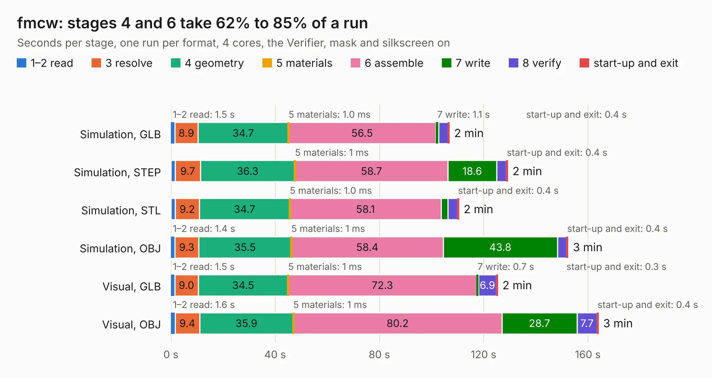

| Mode and format | 1–2 read | 3 resolve | 4 geometry | 5 materials | 6 assemble | 7 write | 8 verify | start-up and exit | Total |
|---|---:|---:|---:|---:|---:|---:|---:|---:|---:|
| Simulation, GLB | 1.5 | 8.9 | 34.7 | 1.0&nbsp;ms | 56.5 | 1.1 | 3.6 | 0.4 | 106.8 |
| Simulation, STEP | 1.6 | 9.7 | 36.3 | 1&nbsp;ms | 58.7 | 18.6 | 3.7 | 0.4 | 129.1 |
| Simulation, STL | 1.7 | 9.2 | 34.7 | 1.0&nbsp;ms | 58.1 | 2.6 | 3.7 | 0.4 | 110.4 |
| Simulation, OBJ | 1.4 | 9.3 | 35.5 | 1&nbsp;ms | 58.4 | 43.8 | 3.6 | 0.4 | 152.3 |
| Visual, GLB | 1.5 | 9.0 | 34.5 | 1&nbsp;ms | 72.3 | 0.7 | 6.9 | 0.3 | 125.3 |
| Visual, OBJ | 1.6 | 9.4 | 35.9 | 1&nbsp;ms | 80.2 | 28.7 | 7.7 | 0.4 | 163.9 |

<table align="center"><tr><td valign="top">

| Board | Repo: [matthuszagh/fmcw](https://github.com/matthuszagh/fmcw) Board: `fmcw.kicad_pcb` |
|---|---|
| Folder | hardware / boards / rev2a |
| Complexity | 400&nbsp;/&nbsp;1000 (size&nbsp;310, features&nbsp;90) |
| KESE&nbsp;features | through vias, slotted holes, custom pads, rounded, trapezoid or chamfered pads, filled zones, copper drawings, curved board outline |
| Tested | 9th November 2026 |
| Copper&nbsp;layers | 4 |
| File&nbsp;format | KiCad 5 (20171130) |
| Parts,&nbsp;tracks,&nbsp;vias | 436, 3,927, 835 |
| Triangles,&nbsp;simulation | 6,594,472 in 280 parts |
| Verifier | PASS in all six runs |

</td><td valign="top">

<table>
<tr><th>File type</th><th>File size</th><th>Peak memory used</th></tr>
<tr><th colspan="3" align="left">Simulation</th></tr>
<tr><td>GLB</td><td align="right">228&nbsp;MB</td><td align="right">1.7&nbsp;GB</td></tr>
<tr><td>STEP</td><td align="right">1.0&nbsp;GB</td><td align="right">2.4&nbsp;GB</td></tr>
<tr><td>STL</td><td align="right">330&nbsp;MB</td><td align="right">1.7&nbsp;GB</td></tr>
<tr><td>OBJ</td><td align="right">726&nbsp;MB</td><td align="right">4.3&nbsp;GB</td></tr>
<tr><th colspan="3" align="left">Visual</th></tr>
<tr><td>GLB</td><td align="right">138&nbsp;MB</td><td align="right">2.3&nbsp;GB</td></tr>
<tr><td>OBJ</td><td align="right">447&nbsp;MB</td><td align="right">2.8&nbsp;GB</td></tr>
</table>

</td></tr></table>

## 15.45 fmcw

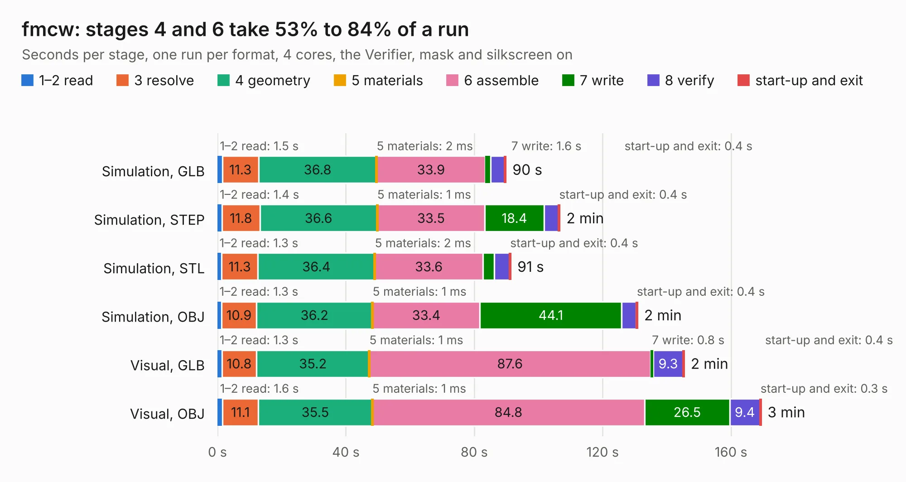

| Mode and format | 1–2 read | 3 resolve | 4 geometry | 5 materials | 6 assemble | 7 write | 8 verify | start-up and exit | Total |
|---|---:|---:|---:|---:|---:|---:|---:|---:|---:|
| Simulation, GLB | 1.5 | 11.3 | 36.8 | 2&nbsp;ms | 33.9 | 1.6 | 4.4 | 0.4 | 89.9 |
| Simulation, STEP | 1.4 | 11.8 | 36.6 | 1&nbsp;ms | 33.5 | 18.4 | 4.5 | 0.4 | 106.7 |
| Simulation, STL | 1.3 | 11.3 | 36.4 | 2&nbsp;ms | 33.6 | 3.6 | 4.7 | 0.4 | 91.4 |
| Simulation, OBJ | 1.3 | 10.9 | 36.2 | 1&nbsp;ms | 33.4 | 44.1 | 4.5 | 0.4 | 130.9 |
| Visual, GLB | 1.3 | 10.8 | 35.2 | 1&nbsp;ms | 87.6 | 0.8 | 9.3 | 0.4 | 145.4 |
| Visual, OBJ | 1.6 | 11.1 | 35.5 | 1&nbsp;ms | 84.8 | 26.5 | 9.4 | 0.3 | 169.4 |

<table align="center"><tr><td valign="top">

| Board | Repo: [matthuszagh/fmcw](https://github.com/matthuszagh/fmcw) Board: `fmcw.kicad_pcb` |
|---|---|
| Folder | hardware / boards / rev2b |
| Complexity | 406&nbsp;/&nbsp;1000 (size&nbsp;316, features&nbsp;90) |
| KESE&nbsp;features | through vias, slotted holes, custom pads, rounded, trapezoid or chamfered pads, filled zones, copper drawings, curved board outline |
| Tested | 9th November 2026 |
| Copper&nbsp;layers | 4 |
| File&nbsp;format | KiCad 5 (20171130) |
| Parts,&nbsp;tracks,&nbsp;vias | 436, 4,693, 1,437 |
| Triangles,&nbsp;simulation | 7,841,176 in 279 parts |
| Verifier | PASS in all six runs |

</td><td valign="top">

<table>
<tr><th>File type</th><th>File size</th><th>Peak memory used</th></tr>
<tr><th colspan="3" align="left">Simulation</th></tr>
<tr><td>GLB</td><td align="right">269&nbsp;MB</td><td align="right">2.8&nbsp;GB</td></tr>
<tr><td>STEP</td><td align="right">1.1&nbsp;GB</td><td align="right">2.9&nbsp;GB</td></tr>
<tr><td>STL</td><td align="right">392&nbsp;MB</td><td align="right">2.6&nbsp;GB</td></tr>
<tr><td>OBJ</td><td align="right">860&nbsp;MB</td><td align="right">5.0&nbsp;GB</td></tr>
<tr><th colspan="3" align="left">Visual</th></tr>
<tr><td>GLB</td><td align="right">170&nbsp;MB</td><td align="right">2.7&nbsp;GB</td></tr>
<tr><td>OBJ</td><td align="right">554&nbsp;MB</td><td align="right">3.5&nbsp;GB</td></tr>
</table>

</td></tr></table>

## 15.46 fmcw_nightly

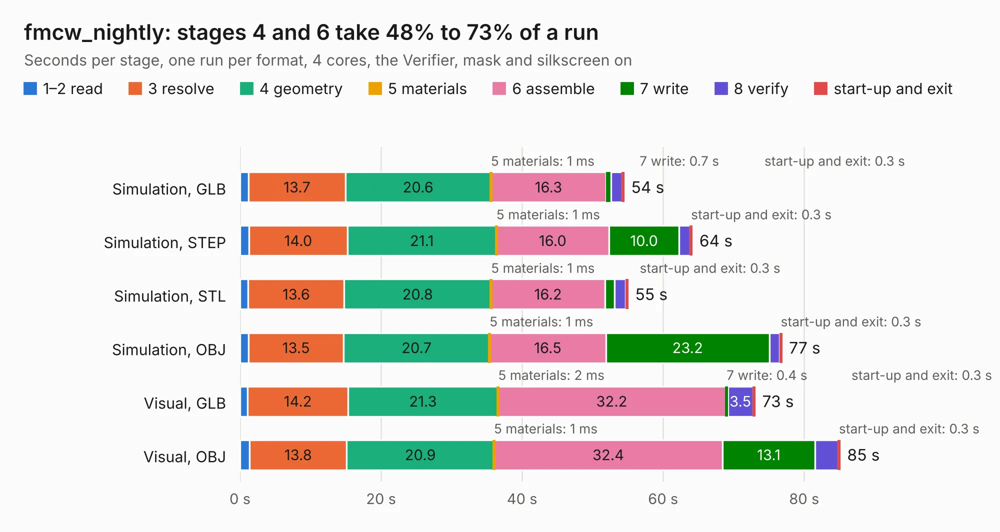

| Mode and format | 1–2 read | 3 resolve | 4 geometry | 5 materials | 6 assemble | 7 write | 8 verify | start-up and exit | Total |
|---|---:|---:|---:|---:|---:|---:|---:|---:|---:|
| Simulation, GLB | 1.2 | 13.7 | 20.6 | 1&nbsp;ms | 16.3 | 0.7 | 1.6 | 0.3 | 54.5 |
| Simulation, STEP | 1.3 | 14.0 | 21.1 | 1&nbsp;ms | 16.0 | 10.0 | 1.5 | 0.3 | 64.1 |
| Simulation, STL | 1.2 | 13.6 | 20.8 | 1&nbsp;ms | 16.2 | 1.3 | 1.6 | 0.3 | 55.0 |
| Simulation, OBJ | 1.2 | 13.5 | 20.7 | 1&nbsp;ms | 16.5 | 23.2 | 1.5 | 0.3 | 76.8 |
| Visual, GLB | 1.1 | 14.2 | 21.3 | 2&nbsp;ms | 32.2 | 0.4 | 3.5 | 0.3 | 73.0 |
| Visual, OBJ | 1.4 | 13.8 | 20.9 | 1&nbsp;ms | 32.4 | 13.1 | 3.2 | 0.3 | 85.1 |

<table align="center"><tr><td valign="top">

| Board | Repo: [matthuszagh/fmcw](https://github.com/matthuszagh/fmcw) Board: `fmcw_nightly.kicad_pcb` |
|---|---|
| Folder | hardware / boards / rev2b |
| Complexity | 435&nbsp;/&nbsp;1000 (size&nbsp;295, features&nbsp;140) |
| KESE&nbsp;features | through vias, slotted holes, custom pads, rounded, trapezoid or chamfered pads, filled zones, copper drawings, curved board outline, stack-up, dielectric εr and tanδ, copper finish, mask and silkscreen colours |
| Tested | 9th November 2026 |
| Copper&nbsp;layers | 4 |
| File&nbsp;format | KiCad 6 (20200119) |
| Parts,&nbsp;tracks,&nbsp;vias | 437, 1,170, 439 |
| Triangles,&nbsp;simulation | 3,680,954 in 245 parts |
| Verifier | PASS in all six runs |

</td><td valign="top">

<table>
<tr><th>File type</th><th>File size</th><th>Peak memory used</th></tr>
<tr><th colspan="3" align="left">Simulation</th></tr>
<tr><td>GLB</td><td align="right">126&nbsp;MB</td><td align="right">1.3&nbsp;GB</td></tr>
<tr><td>STEP</td><td align="right">586&nbsp;MB</td><td align="right">1.5&nbsp;GB</td></tr>
<tr><td>STL</td><td align="right">184&nbsp;MB</td><td align="right">1.2&nbsp;GB</td></tr>
<tr><td>OBJ</td><td align="right">395&nbsp;MB</td><td align="right">2.4&nbsp;GB</td></tr>
<tr><th colspan="3" align="left">Visual</th></tr>
<tr><td>GLB</td><td align="right">74&nbsp;MB</td><td align="right">1.3&nbsp;GB</td></tr>
<tr><td>OBJ</td><td align="right">235&nbsp;MB</td><td align="right">1.6&nbsp;GB</td></tr>
</table>

</td></tr></table>

## 15.47 caps

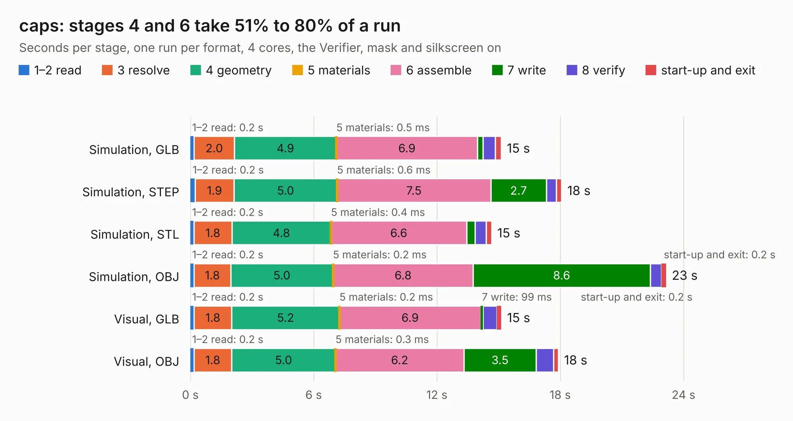

| Mode and format | 1–2 read | 3 resolve | 4 geometry | 5 materials | 6 assemble | 7 write | 8 verify | start-up and exit | Total |
|---|---:|---:|---:|---:|---:|---:|---:|---:|---:|
| Simulation, GLB | 0.2 | 2.0 | 4.9 | 0.5&nbsp;ms | 6.9 | 0.3 | 0.6 | 0.3 | 15.1 |
| Simulation, STEP | 0.2 | 1.9 | 5.0 | 0.6&nbsp;ms | 7.5 | 2.7 | 0.5 | 0.3 | 18.1 |
| Simulation, STL | 0.2 | 1.8 | 4.8 | 0.4&nbsp;ms | 6.6 | 0.4 | 0.5 | 0.3 | 14.7 |
| Simulation, OBJ | 0.2 | 1.8 | 5.0 | 0.2&nbsp;ms | 6.8 | 8.6 | 0.6 | 0.2 | 23.2 |
| Visual, GLB | 0.2 | 1.8 | 5.2 | 0.2&nbsp;ms | 6.9 | 99&nbsp;ms | 0.7 | 0.2 | 15.1 |
| Visual, OBJ | 0.2 | 1.8 | 5.0 | 0.3&nbsp;ms | 6.2 | 3.5 | 0.8 | 0.2 | 17.9 |

<table align="center"><tr><td valign="top">

| Board | Repo: [matthuszagh/fmcw](https://github.com/matthuszagh/fmcw) Board: `caps.kicad_pcb` |
|---|---|
| Folder | hardware / prototypes / caps |
| Complexity | 225&nbsp;/&nbsp;1000 (size&nbsp;180, features&nbsp;45) |
| KESE&nbsp;features | through vias, rounded, trapezoid or chamfered pads, filled zones |
| Tested | 9th November 2026 |
| Copper&nbsp;layers | 4 |
| File&nbsp;format | KiCad 5 (20171130) |
| Parts,&nbsp;tracks,&nbsp;vias | 11, 10, 492 |
| Triangles,&nbsp;simulation | 1,512,272 in 19 parts |
| Verifier | PASS in all six runs |

</td><td valign="top">

<table>
<tr><th>File type</th><th>File size</th><th>Peak memory used</th></tr>
<tr><th colspan="3" align="left">Simulation</th></tr>
<tr><td>GLB</td><td align="right">48&nbsp;MB</td><td align="right">646&nbsp;MB</td></tr>
<tr><td>STEP</td><td align="right">113&nbsp;MB</td><td align="right">753&nbsp;MB</td></tr>
<tr><td>STL</td><td align="right">76&nbsp;MB</td><td align="right">682&nbsp;MB</td></tr>
<tr><td>OBJ</td><td align="right">154&nbsp;MB</td><td align="right">992&nbsp;MB</td></tr>
<tr><th colspan="3" align="left">Visual</th></tr>
<tr><td>GLB</td><td align="right">21&nbsp;MB</td><td align="right">615&nbsp;MB</td></tr>
<tr><td>OBJ</td><td align="right">65&nbsp;MB</td><td align="right">663&nbsp;MB</td></tr>
</table>

</td></tr></table>

## 15.48 caps_nightly

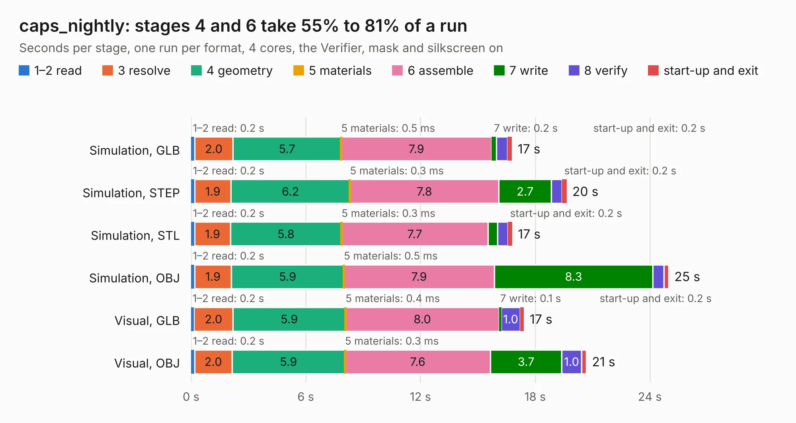

| Mode and format | 1–2 read | 3 resolve | 4 geometry | 5 materials | 6 assemble | 7 write | 8 verify | start-up and exit | Total |
|---|---:|---:|---:|---:|---:|---:|---:|---:|---:|
| Simulation, GLB | 0.2 | 2.0 | 5.7 | 0.5&nbsp;ms | 7.9 | 0.2 | 0.6 | 0.2 | 16.8 |
| Simulation, STEP | 0.2 | 1.9 | 6.2 | 0.3&nbsp;ms | 7.8 | 2.7 | 0.6 | 0.2 | 19.6 |
| Simulation, STL | 0.2 | 1.9 | 5.8 | 0.3&nbsp;ms | 7.7 | 0.5 | 0.6 | 0.2 | 16.8 |
| Simulation, OBJ | 0.2 | 1.9 | 5.9 | 0.5&nbsp;ms | 7.9 | 8.3 | 0.6 | 0.3 | 25.0 |
| Visual, GLB | 0.2 | 2.0 | 5.9 | 0.4&nbsp;ms | 8.0 | 0.1 | 1.0 | 0.2 | 17.4 |
| Visual, OBJ | 0.2 | 2.0 | 5.9 | 0.3&nbsp;ms | 7.6 | 3.7 | 1.0 | 0.3 | 20.7 |

<table align="center"><tr><td valign="top">

| Board | Repo: [matthuszagh/fmcw](https://github.com/matthuszagh/fmcw) Board: `caps_nightly.kicad_pcb` |
|---|---|
| Folder | hardware / prototypes / caps |
| Complexity | 264&nbsp;/&nbsp;1000 (size&nbsp;184, features&nbsp;80) |
| KESE&nbsp;features | through vias, rounded, trapezoid or chamfered pads, filled zones, stack-up, dielectric εr and tanδ, mask and silkscreen colours |
| Tested | 9th November 2026 |
| Copper&nbsp;layers | 4 |
| File&nbsp;format | KiCad 6 (20200119) |
| Parts,&nbsp;tracks,&nbsp;vias | 11, 11, 636 |
| Triangles,&nbsp;simulation | 1,737,368 in 19 parts |
| Verifier | PASS in all six runs |

</td><td valign="top">

<table>
<tr><th>File type</th><th>File size</th><th>Peak memory used</th></tr>
<tr><th colspan="3" align="left">Simulation</th></tr>
<tr><td>GLB</td><td align="right">55&nbsp;MB</td><td align="right">783&nbsp;MB</td></tr>
<tr><td>STEP</td><td align="right">118&nbsp;MB</td><td align="right">861&nbsp;MB</td></tr>
<tr><td>STL</td><td align="right">87&nbsp;MB</td><td align="right">770&nbsp;MB</td></tr>
<tr><td>OBJ</td><td align="right">176&nbsp;MB</td><td align="right">1.1&nbsp;GB</td></tr>
<tr><th colspan="3" align="left">Visual</th></tr>
<tr><td>GLB</td><td align="right">25&nbsp;MB</td><td align="right">706&nbsp;MB</td></tr>
<tr><td>OBJ</td><td align="right">77&nbsp;MB</td><td align="right">738&nbsp;MB</td></tr>
</table>

</td></tr></table>

## 15.49 coupler

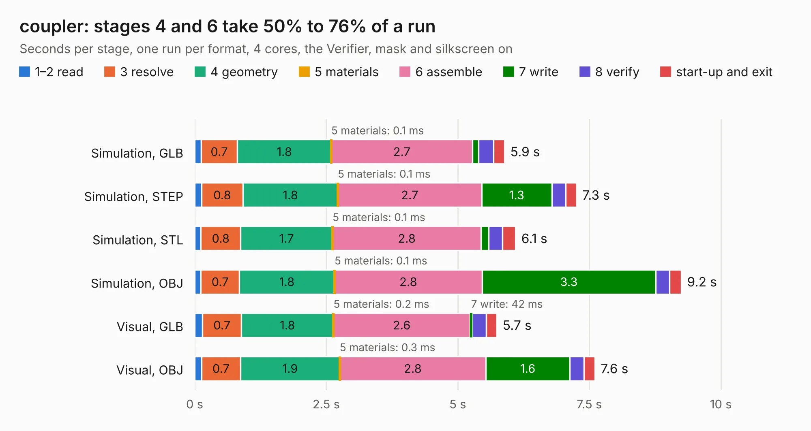

| Mode and format | 1–2 read | 3 resolve | 4 geometry | 5 materials | 6 assemble | 7 write | 8 verify | start-up and exit | Total |
|---|---:|---:|---:|---:|---:|---:|---:|---:|---:|
| Simulation, GLB | 0.1 | 0.7 | 1.8 | 0.1&nbsp;ms | 2.7 | 0.1 | 0.3 | 0.2 | 5.9 |
| Simulation, STEP | 0.1 | 0.8 | 1.8 | 0.1&nbsp;ms | 2.7 | 1.3 | 0.3 | 0.2 | 7.3 |
| Simulation, STL | 0.1 | 0.8 | 1.7 | 0.1&nbsp;ms | 2.8 | 0.1 | 0.3 | 0.2 | 6.1 |
| Simulation, OBJ | 0.1 | 0.7 | 1.8 | 0.1&nbsp;ms | 2.8 | 3.3 | 0.3 | 0.2 | 9.2 |
| Visual, GLB | 0.1 | 0.7 | 1.8 | 0.2&nbsp;ms | 2.6 | 42&nbsp;ms | 0.3 | 0.2 | 5.7 |
| Visual, OBJ | 0.1 | 0.7 | 1.9 | 0.3&nbsp;ms | 2.8 | 1.6 | 0.3 | 0.2 | 7.6 |

<table align="center"><tr><td valign="top">

| Board | Repo: [matthuszagh/fmcw](https://github.com/matthuszagh/fmcw) Board: `coupler.kicad_pcb` |
|---|---|
| Folder | hardware / prototypes / coupler |
| Complexity | 199&nbsp;/&nbsp;1000 (size&nbsp;164, features&nbsp;35) |
| KESE&nbsp;features | through vias, filled zones |
| Tested | 9th November 2026 |
| Copper&nbsp;layers | 4 |
| File&nbsp;format | KiCad 5 (20171130) |
| Parts,&nbsp;tracks,&nbsp;vias | 5, 72, 278 |
| Triangles,&nbsp;simulation | 647,556 in 18 parts |
| Verifier | PASS in all six runs |

</td><td valign="top">

<table>
<tr><th>File type</th><th>File size</th><th>Peak memory used</th></tr>
<tr><th colspan="3" align="left">Simulation</th></tr>
<tr><td>GLB</td><td align="right">21&nbsp;MB</td><td align="right">396&nbsp;MB</td></tr>
<tr><td>STEP</td><td align="right">38&nbsp;MB</td><td align="right">446&nbsp;MB</td></tr>
<tr><td>STL</td><td align="right">32&nbsp;MB</td><td align="right">404&nbsp;MB</td></tr>
<tr><td>OBJ</td><td align="right">65&nbsp;MB</td><td align="right">435&nbsp;MB</td></tr>
<tr><th colspan="3" align="left">Visual</th></tr>
<tr><td>GLB</td><td align="right">10&nbsp;MB</td><td align="right">377&nbsp;MB</td></tr>
<tr><td>OBJ</td><td align="right">31&nbsp;MB</td><td align="right">373&nbsp;MB</td></tr>
</table>

</td></tr></table>

## 15.50 coupler_nightly

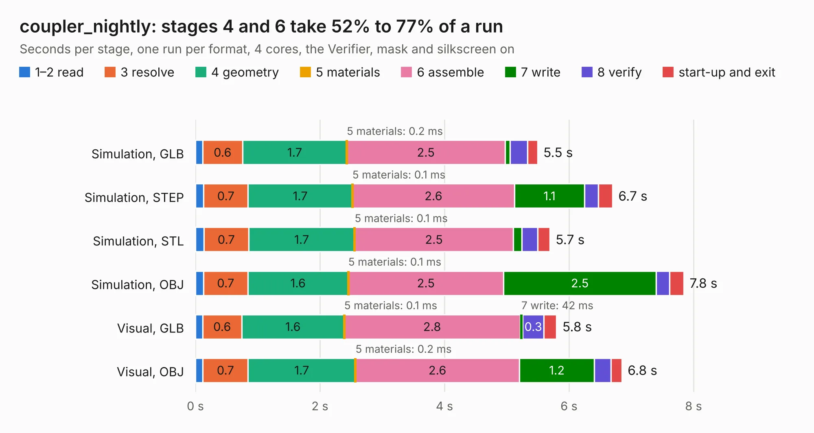

| Mode and format | 1–2 read | 3 resolve | 4 geometry | 5 materials | 6 assemble | 7 write | 8 verify | start-up and exit | Total |
|---|---:|---:|---:|---:|---:|---:|---:|---:|---:|
| Simulation, GLB | 0.1 | 0.6 | 1.7 | 0.2&nbsp;ms | 2.5 | 81&nbsp;ms | 0.3 | 0.2 | 5.5 |
| Simulation, STEP | 0.1 | 0.7 | 1.7 | 0.1&nbsp;ms | 2.6 | 1.1 | 0.2 | 0.2 | 6.7 |
| Simulation, STL | 0.1 | 0.7 | 1.7 | 0.1&nbsp;ms | 2.5 | 0.1 | 0.3 | 0.2 | 5.7 |
| Simulation, OBJ | 0.1 | 0.7 | 1.6 | 0.1&nbsp;ms | 2.5 | 2.5 | 0.2 | 0.2 | 7.8 |
| Visual, GLB | 0.1 | 0.6 | 1.6 | 0.1&nbsp;ms | 2.8 | 42&nbsp;ms | 0.3 | 0.2 | 5.8 |
| Visual, OBJ | 0.1 | 0.7 | 1.7 | 0.2&nbsp;ms | 2.6 | 1.2 | 0.3 | 0.2 | 6.8 |

<table align="center"><tr><td valign="top">

| Board | Repo: [matthuszagh/fmcw](https://github.com/matthuszagh/fmcw) Board: `coupler_nightly.kicad_pcb` |
|---|---|
| Folder | hardware / prototypes / coupler |
| Complexity | 237&nbsp;/&nbsp;1000 (size&nbsp;167, features&nbsp;70) |
| KESE&nbsp;features | through vias, filled zones, stack-up, dielectric εr and tanδ, mask and silkscreen colours |
| Tested | 9th November 2026 |
| Copper&nbsp;layers | 4 |
| File&nbsp;format | KiCad 6 (20200119) |
| Parts,&nbsp;tracks,&nbsp;vias | 5, 137, 305 |
| Triangles,&nbsp;simulation | 659,588 in 18 parts |
| Verifier | PASS in all six runs |

</td><td valign="top">

<table>
<tr><th>File type</th><th>File size</th><th>Peak memory used</th></tr>
<tr><th colspan="3" align="left">Simulation</th></tr>
<tr><td>GLB</td><td align="right">21&nbsp;MB</td><td align="right">412&nbsp;MB</td></tr>
<tr><td>STEP</td><td align="right">30&nbsp;MB</td><td align="right">458&nbsp;MB</td></tr>
<tr><td>STL</td><td align="right">33&nbsp;MB</td><td align="right">407&nbsp;MB</td></tr>
<tr><td>OBJ</td><td align="right">65&nbsp;MB</td><td align="right">434&nbsp;MB</td></tr>
<tr><th colspan="3" align="left">Visual</th></tr>
<tr><td>GLB</td><td align="right">11&nbsp;MB</td><td align="right">357&nbsp;MB</td></tr>
<tr><td>OBJ</td><td align="right">32&nbsp;MB</td><td align="right">382&nbsp;MB</td></tr>
</table>

</td></tr></table>

## 15.51 microstrip_width

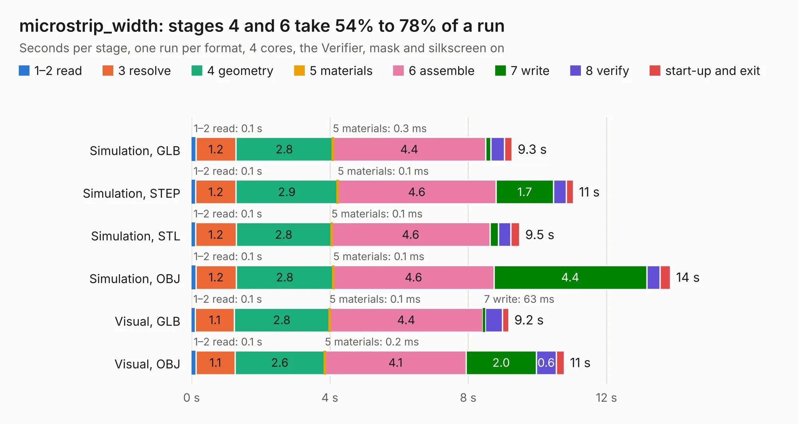

| Mode and format | 1–2 read | 3 resolve | 4 geometry | 5 materials | 6 assemble | 7 write | 8 verify | start-up and exit | Total |
|---|---:|---:|---:|---:|---:|---:|---:|---:|---:|
| Simulation, GLB | 0.1 | 1.2 | 2.8 | 0.3&nbsp;ms | 4.4 | 0.2 | 0.4 | 0.2 | 9.3 |
| Simulation, STEP | 0.1 | 1.2 | 2.9 | 0.1&nbsp;ms | 4.6 | 1.7 | 0.4 | 0.2 | 11.0 |
| Simulation, STL | 0.1 | 1.2 | 2.8 | 0.1&nbsp;ms | 4.6 | 0.2 | 0.4 | 0.3 | 9.5 |
| Simulation, OBJ | 0.1 | 1.2 | 2.8 | 0.1&nbsp;ms | 4.6 | 4.4 | 0.4 | 0.3 | 13.8 |
| Visual, GLB | 0.1 | 1.1 | 2.8 | 0.1&nbsp;ms | 4.4 | 63&nbsp;ms | 0.5 | 0.2 | 9.2 |
| Visual, OBJ | 0.1 | 1.1 | 2.6 | 0.2&nbsp;ms | 4.1 | 2.0 | 0.6 | 0.2 | 10.8 |

<table align="center"><tr><td valign="top">

| Board | Repo: [matthuszagh/fmcw](https://github.com/matthuszagh/fmcw) Board: `microstrip_width.kicad_pcb` |
|---|---|
| Folder | hardware / prototypes / microstrip_width |
| Complexity | 207&nbsp;/&nbsp;1000 (size&nbsp;172, features&nbsp;35) |
| KESE&nbsp;features | through vias, filled zones |
| Tested | 9th November 2026 |
| Copper&nbsp;layers | 4 |
| File&nbsp;format | KiCad 5 (20171130) |
| Parts,&nbsp;tracks,&nbsp;vias | 6, 3, 421 |
| Triangles,&nbsp;simulation | 947,684 in 16 parts |
| Verifier | PASS in all six runs |

</td><td valign="top">

<table>
<tr><th>File type</th><th>File size</th><th>Peak memory used</th></tr>
<tr><th colspan="3" align="left">Simulation</th></tr>
<tr><td>GLB</td><td align="right">30&nbsp;MB</td><td align="right">519&nbsp;MB</td></tr>
<tr><td>STEP</td><td align="right">49&nbsp;MB</td><td align="right">571&nbsp;MB</td></tr>
<tr><td>STL</td><td align="right">47&nbsp;MB</td><td align="right">510&nbsp;MB</td></tr>
<tr><td>OBJ</td><td align="right">95&nbsp;MB</td><td align="right">675&nbsp;MB</td></tr>
<tr><th colspan="3" align="left">Visual</th></tr>
<tr><td>GLB</td><td align="right">15&nbsp;MB</td><td align="right">428&nbsp;MB</td></tr>
<tr><td>OBJ</td><td align="right">45&nbsp;MB</td><td align="right">424&nbsp;MB</td></tr>
</table>

</td></tr></table>

## 15.52 microstrip_width_nightly

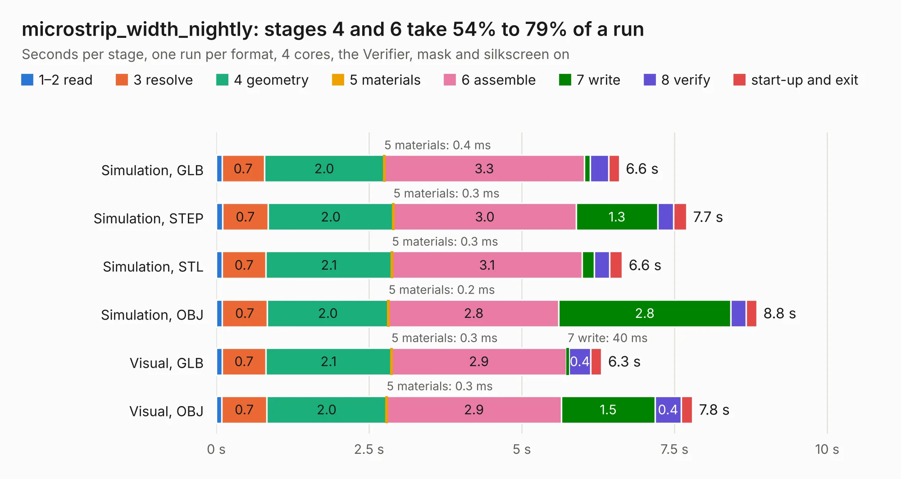

| Mode and format | 1–2 read | 3 resolve | 4 geometry | 5 materials | 6 assemble | 7 write | 8 verify | start-up and exit | Total |
|---|---:|---:|---:|---:|---:|---:|---:|---:|---:|
| Simulation, GLB | 93&nbsp;ms | 0.7 | 2.0 | 0.4&nbsp;ms | 3.3 | 94&nbsp;ms | 0.3 | 0.2 | 6.6 |
| Simulation, STEP | 0.1 | 0.7 | 2.0 | 0.3&nbsp;ms | 3.0 | 1.3 | 0.3 | 0.2 | 7.7 |
| Simulation, STL | 96&nbsp;ms | 0.7 | 2.1 | 0.3&nbsp;ms | 3.1 | 0.2 | 0.2 | 0.2 | 6.6 |
| Simulation, OBJ | 95&nbsp;ms | 0.7 | 2.0 | 0.2&nbsp;ms | 2.8 | 2.8 | 0.3 | 0.2 | 8.8 |
| Visual, GLB | 98&nbsp;ms | 0.7 | 2.1 | 0.3&nbsp;ms | 2.9 | 40&nbsp;ms | 0.4 | 0.2 | 6.3 |
| Visual, OBJ | 92&nbsp;ms | 0.7 | 2.0 | 0.3&nbsp;ms | 2.9 | 1.5 | 0.4 | 0.2 | 7.8 |

<table align="center"><tr><td valign="top">

| Board | Repo: [matthuszagh/fmcw](https://github.com/matthuszagh/fmcw) Board: `microstrip_width_nightly.kicad_pcb` |
|---|---|
| Folder | hardware / prototypes / microstrip_width |
| Complexity | 238&nbsp;/&nbsp;1000 (size&nbsp;168, features&nbsp;70) |
| KESE&nbsp;features | through vias, filled zones, stack-up, dielectric εr and tanδ, mask and silkscreen colours |
| Tested | 9th November 2026 |
| Copper&nbsp;layers | 4 |
| File&nbsp;format | KiCad 6 (20200119) |
| Parts,&nbsp;tracks,&nbsp;vias | 6, 3, 335 |
| Triangles,&nbsp;simulation | 749,524 in 16 parts |
| Verifier | PASS in all six runs |

</td><td valign="top">

<table>
<tr><th>File type</th><th>File size</th><th>Peak memory used</th></tr>
<tr><th colspan="3" align="left">Simulation</th></tr>
<tr><td>GLB</td><td align="right">23&nbsp;MB</td><td align="right">446&nbsp;MB</td></tr>
<tr><td>STEP</td><td align="right">30&nbsp;MB</td><td align="right">478&nbsp;MB</td></tr>
<tr><td>STL</td><td align="right">37&nbsp;MB</td><td align="right">448&nbsp;MB</td></tr>
<tr><td>OBJ</td><td align="right">74&nbsp;MB</td><td align="right">482&nbsp;MB</td></tr>
<tr><th colspan="3" align="left">Visual</th></tr>
<tr><td>GLB</td><td align="right">12&nbsp;MB</td><td align="right">372&nbsp;MB</td></tr>
<tr><td>OBJ</td><td align="right">35&nbsp;MB</td><td align="right">401&nbsp;MB</td></tr>
</table>

</td></tr></table>

## 15.53 basic-ecp5-pcb

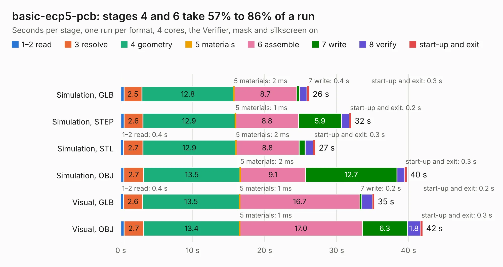

| Mode and format | 1–2 read | 3 resolve | 4 geometry | 5 materials | 6 assemble | 7 write | 8 verify | start-up and exit | Total |
|---|---:|---:|---:|---:|---:|---:|---:|---:|---:|
| Simulation, GLB | 0.4 | 2.5 | 12.8 | 2&nbsp;ms | 8.7 | 0.4 | 1.0 | 0.3 | 26.2 |
| Simulation, STEP | 0.4 | 2.6 | 12.9 | 1&nbsp;ms | 8.8 | 5.9 | 1.1 | 0.2 | 32.0 |
| Simulation, STL | 0.4 | 2.7 | 12.9 | 2&nbsp;ms | 8.8 | 0.8 | 1.1 | 0.3 | 27.0 |
| Simulation, OBJ | 0.4 | 2.7 | 13.5 | 2&nbsp;ms | 9.1 | 12.7 | 1.1 | 0.3 | 39.7 |
| Visual, GLB | 0.4 | 2.6 | 13.5 | 1&nbsp;ms | 16.7 | 0.2 | 1.6 | 0.2 | 35.2 |
| Visual, OBJ | 0.4 | 2.7 | 13.4 | 1&nbsp;ms | 17.0 | 6.3 | 1.8 | 0.3 | 42.0 |

<table align="center"><tr><td valign="top">

| Board | Repo: [mattvenn/basic-ecp5-pcb](https://github.com/mattvenn/basic-ecp5-pcb) Board: `basic-ecp5-pcb.kicad_pcb` |
|---|---|
| Folder | hardware |
| Complexity | 305&nbsp;/&nbsp;1000 (size&nbsp;250, features&nbsp;55) |
| KESE&nbsp;features | through vias, rounded, trapezoid or chamfered pads, filled zones, curved board outline |
| Tested | 9th November 2026 |
| Copper&nbsp;layers | 4 |
| File&nbsp;format | KiCad 5 (20171130) |
| Parts,&nbsp;tracks,&nbsp;vias | 62, 1,148, 130 |
| Triangles,&nbsp;simulation | 2,343,666 in 255 parts |
| Verifier | PASS in all six runs |

</td><td valign="top">

<table>
<tr><th>File type</th><th>File size</th><th>Peak memory used</th></tr>
<tr><th colspan="3" align="left">Simulation</th></tr>
<tr><td>GLB</td><td align="right">81&nbsp;MB</td><td align="right">707&nbsp;MB</td></tr>
<tr><td>STEP</td><td align="right">348&nbsp;MB</td><td align="right">928&nbsp;MB</td></tr>
<tr><td>STL</td><td align="right">117&nbsp;MB</td><td align="right">708&nbsp;MB</td></tr>
<tr><td>OBJ</td><td align="right">248&nbsp;MB</td><td align="right">1.6&nbsp;GB</td></tr>
<tr><th colspan="3" align="left">Visual</th></tr>
<tr><td>GLB</td><td align="right">42&nbsp;MB</td><td align="right">927&nbsp;MB</td></tr>
<tr><td>OBJ</td><td align="right">126&nbsp;MB</td><td align="right">925&nbsp;MB</td></tr>
</table>

</td></tr></table>

## 15.54 ai-camera

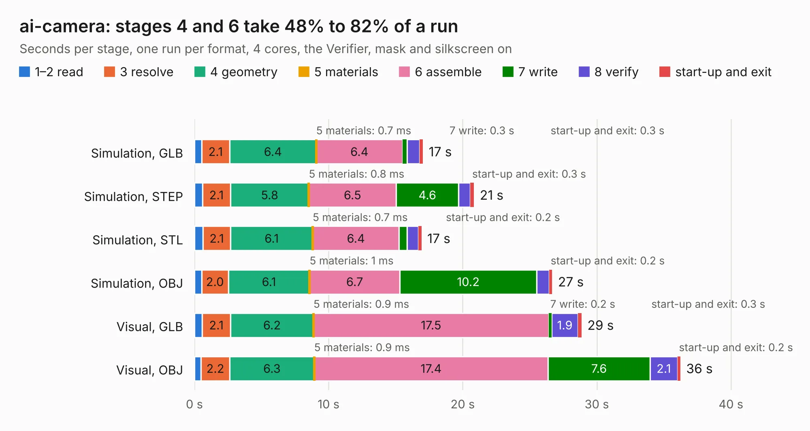

| Mode and format | 1–2 read | 3 resolve | 4 geometry | 5 materials | 6 assemble | 7 write | 8 verify | start-up and exit | Total |
|---|---:|---:|---:|---:|---:|---:|---:|---:|---:|
| Simulation, GLB | 0.5 | 2.1 | 6.4 | 0.7&nbsp;ms | 6.4 | 0.3 | 0.9 | 0.3 | 17.0 |
| Simulation, STEP | 0.6 | 2.1 | 5.8 | 0.8&nbsp;ms | 6.5 | 4.6 | 0.9 | 0.3 | 20.8 |
| Simulation, STL | 0.6 | 2.1 | 6.1 | 0.7&nbsp;ms | 6.4 | 0.6 | 0.8 | 0.2 | 16.9 |
| Simulation, OBJ | 0.5 | 2.0 | 6.1 | 1&nbsp;ms | 6.7 | 10.2 | 0.9 | 0.2 | 26.7 |
| Visual, GLB | 0.6 | 2.1 | 6.2 | 0.9&nbsp;ms | 17.5 | 0.2 | 1.9 | 0.3 | 28.9 |
| Visual, OBJ | 0.5 | 2.2 | 6.3 | 0.9&nbsp;ms | 17.4 | 7.6 | 2.1 | 0.2 | 36.2 |

<table align="center"><tr><td valign="top">

| Board | Repo: [maxlab-io/tokay-lite-pcb](https://github.com/maxlab-io/tokay-lite-pcb) Board: `ai-camera.kicad_pcb` |
|---|---|
| Folder | ai-camera-rev0 |
| Complexity | 339&nbsp;/&nbsp;1000 (size&nbsp;214, features&nbsp;125) |
| KESE&nbsp;features | through vias, slotted holes, custom pads, rounded, trapezoid or chamfered pads, filled zones, copper drawings, curved board outline, stack-up, dielectric εr and tanδ, mask and silkscreen colours |
| Tested | 9th November 2026 |
| Copper&nbsp;layers | 4 |
| File&nbsp;format | KiCad 6 (20211014) |
| Parts,&nbsp;tracks,&nbsp;vias | 130, 1,351, 340 |
| Triangles,&nbsp;simulation | 2,141,088 in 108 parts |
| Verifier | PASS in all six runs |

</td><td valign="top">

<table>
<tr><th>File type</th><th>File size</th><th>Peak memory used</th></tr>
<tr><th colspan="3" align="left">Simulation</th></tr>
<tr><td>GLB</td><td align="right">72&nbsp;MB</td><td align="right">876&nbsp;MB</td></tr>
<tr><td>STEP</td><td align="right">293&nbsp;MB</td><td align="right">965&nbsp;MB</td></tr>
<tr><td>STL</td><td align="right">107&nbsp;MB</td><td align="right">812&nbsp;MB</td></tr>
<tr><td>OBJ</td><td align="right">223&nbsp;MB</td><td align="right">1.4&nbsp;GB</td></tr>
<tr><th colspan="3" align="left">Visual</th></tr>
<tr><td>GLB</td><td align="right">51&nbsp;MB</td><td align="right">1.1&nbsp;GB</td></tr>
<tr><td>OBJ</td><td align="right">158&nbsp;MB</td><td align="right">1.2&nbsp;GB</td></tr>
</table>

</td></tr></table>

## 15.55 ai-camera

| Mode and format | 1–2 read | 3 resolve | 4 geometry | 5 materials | 6 assemble | 7 write | 8 verify | start-up and exit | Total |
|---|---:|---:|---:|---:|---:|---:|---:|---:|---:|
| Simulation, GLB | 0.7 | 2.3 | 7.5 | 0.6&nbsp;ms | 7.6 | 0.4 | 1.0 | 0.2 | 19.6 |
| Simulation, STEP | 0.6 | 2.3 | 7.4 | 0.6&nbsp;ms | 7.7 | 6.1 | 1.1 | 0.3 | 25.4 |
| Simulation, STL | 0.7 | 2.4 | 7.5 | 0.4&nbsp;ms | 7.6 | 0.6 | 1.0 | 0.3 | 20.0 |
| Simulation, OBJ | 0.7 | 2.2 | 7.4 | 0.7&nbsp;ms | 7.4 | 12.9 | 1.0 | 0.3 | 31.9 |
| Visual, GLB | 0.6 | 2.2 | 7.2 | 0.6&nbsp;ms | 19.1 | 0.3 | 2.0 | 0.2 | 31.7 |
| Visual, OBJ | 0.7 | 2.2 | 7.2 | 0.4&nbsp;ms | 19.2 | 9.6 | 2.2 | 0.3 | 41.3 |

<table align="center"><tr><td valign="top">

| Board | Repo: [maxlab-io/tokay-lite-pcb](https://github.com/maxlab-io/tokay-lite-pcb) Board: `ai-camera.kicad_pcb` |
|---|---|
| Folder | ai-camera-rev1 |
| Complexity | 339&nbsp;/&nbsp;1000 (size&nbsp;214, features&nbsp;125) |
| KESE&nbsp;features | through vias, slotted holes, custom pads, rounded, trapezoid or chamfered pads, filled zones, copper drawings, curved board outline, stack-up, dielectric εr and tanδ, mask and silkscreen colours |
| Tested | 9th November 2026 |
| Copper&nbsp;layers | 4 |
| File&nbsp;format | KiCad 7 (20221018) |
| Parts,&nbsp;tracks,&nbsp;vias | 151, 1,227, 305 |
| Triangles,&nbsp;simulation | 2,114,240 in 113 parts |
| Verifier | PASS in all six runs |

</td><td valign="top">

<table>
<tr><th>File type</th><th>File size</th><th>Peak memory used</th></tr>
<tr><th colspan="3" align="left">Simulation</th></tr>
<tr><td>GLB</td><td align="right">71&nbsp;MB</td><td align="right">818&nbsp;MB</td></tr>
<tr><td>STEP</td><td align="right">308&nbsp;MB</td><td align="right">943&nbsp;MB</td></tr>
<tr><td>STL</td><td align="right">106&nbsp;MB</td><td align="right">851&nbsp;MB</td></tr>
<tr><td>OBJ</td><td align="right">221&nbsp;MB</td><td align="right">1.4&nbsp;GB</td></tr>
<tr><th colspan="3" align="left">Visual</th></tr>
<tr><td>GLB</td><td align="right">52&nbsp;MB</td><td align="right">958&nbsp;MB</td></tr>
<tr><td>OBJ</td><td align="right">160&nbsp;MB</td><td align="right">1.1&nbsp;GB</td></tr>
</table>

</td></tr></table>

## 15.56 ai-camera-rev2

| Mode and format | 1–2 read | 3 resolve | 4 geometry | 5 materials | 6 assemble | 7 write | 8 verify | start-up and exit | Total |
|---|---:|---:|---:|---:|---:|---:|---:|---:|---:|
| Simulation, GLB | 0.6 | 2.0 | 6.6 | 1&nbsp;ms | 7.0 | 0.3 | 1.0 | 0.2 | 17.8 |
| Simulation, STEP | 0.6 | 2.2 | 6.2 | 0.3&nbsp;ms | 7.0 | 5.2 | 0.9 | 0.2 | 22.3 |
| Simulation, STL | 0.6 | 2.0 | 6.5 | 1.0&nbsp;ms | 6.8 | 0.5 | 0.9 | 0.2 | 17.4 |
| Simulation, OBJ | 0.6 | 1.9 | 6.5 | 0.5&nbsp;ms | 6.8 | 11.4 | 1.0 | 0.2 | 28.4 |
| Visual, GLB | 0.6 | 2.0 | 6.3 | 0.6&nbsp;ms | 17.2 | 0.2 | 2.2 | 0.2 | 28.6 |
| Visual, OBJ | 0.6 | 2.0 | 6.5 | 0.3&nbsp;ms | 17.0 | 8.2 | 2.4 | 0.2 | 36.9 |

<table align="center"><tr><td valign="top">

| Board | Repo: [maxlab-io/tokay-lite-pcb](https://github.com/maxlab-io/tokay-lite-pcb) Board: `ai-camera-rev2.kicad_pcb` |
|---|---|
| Folder | ai-camera-rev2 |
| Complexity | 314&nbsp;/&nbsp;1000 (size&nbsp;214, features&nbsp;100) |
| KESE&nbsp;features | through vias, slotted holes, rounded, trapezoid or chamfered pads, filled zones, curved board outline, stack-up, dielectric εr and tanδ, mask and silkscreen colours |
| Tested | 9th November 2026 |
| Copper&nbsp;layers | 4 |
| File&nbsp;format | KiCad 7 (20221018) |
| Parts,&nbsp;tracks,&nbsp;vias | 153, 1,208, 330 |
| Triangles,&nbsp;simulation | 2,131,926 in 113 parts |
| Verifier | PASS in all six runs |

</td><td valign="top">

<table>
<tr><th>File type</th><th>File size</th><th>Peak memory used</th></tr>
<tr><th colspan="3" align="left">Simulation</th></tr>
<tr><td>GLB</td><td align="right">72&nbsp;MB</td><td align="right">874&nbsp;MB</td></tr>
<tr><td>STEP</td><td align="right">309&nbsp;MB</td><td align="right">989&nbsp;MB</td></tr>
<tr><td>STL</td><td align="right">107&nbsp;MB</td><td align="right">793&nbsp;MB</td></tr>
<tr><td>OBJ</td><td align="right">222&nbsp;MB</td><td align="right">1.4&nbsp;GB</td></tr>
<tr><th colspan="3" align="left">Visual</th></tr>
<tr><td>GLB</td><td align="right">52&nbsp;MB</td><td align="right">1.0&nbsp;GB</td></tr>
<tr><td>OBJ</td><td align="right">159&nbsp;MB</td><td align="right">1.1&nbsp;GB</td></tr>
</table>

</td></tr></table>

## 15.57 ai-camera-rev3.1

| Mode and format | 1–2 read | 3 resolve | 4 geometry | 5 materials | 6 assemble | 7 write | 8 verify | start-up and exit | Total |
|---|---:|---:|---:|---:|---:|---:|---:|---:|---:|
| Simulation, GLB | 0.6 | 2.2 | 7.5 | 0.6&nbsp;ms | 7.4 | 0.3 | 1.1 | 0.3 | 19.4 |
| Simulation, STEP | 0.6 | 2.2 | 7.2 | 0.4&nbsp;ms | 7.4 | 5.3 | 0.9 | 0.3 | 23.9 |
| Simulation, STL | 0.6 | 2.2 | 7.0 | 0.7&nbsp;ms | 7.5 | 0.7 | 1.0 | 0.3 | 19.3 |
| Simulation, OBJ | 0.7 | 2.1 | 7.5 | 0.4&nbsp;ms | 7.5 | 12.2 | 1.0 | 0.3 | 31.3 |
| Visual, GLB | 0.6 | 2.3 | 7.6 | 0.7&nbsp;ms | 18.6 | 0.3 | 2.2 | 0.2 | 31.7 |
| Visual, OBJ | 0.6 | 2.4 | 7.8 | 0.4&nbsp;ms | 18.9 | 9.4 | 2.5 | 0.2 | 41.7 |

<table align="center"><tr><td valign="top">

| Board | Repo: [maxlab-io/tokay-lite-pcb](https://github.com/maxlab-io/tokay-lite-pcb) Board: `ai-camera-rev3.1.kicad_pcb` |
|---|---|
| Folder | ai-camera-rev3.1 |
| Complexity | 314&nbsp;/&nbsp;1000 (size&nbsp;214, features&nbsp;100) |
| KESE&nbsp;features | through vias, slotted holes, rounded, trapezoid or chamfered pads, filled zones, curved board outline, stack-up, dielectric εr and tanδ, mask and silkscreen colours |
| Tested | 9th November 2026 |
| Copper&nbsp;layers | 4 |
| File&nbsp;format | KiCad 7 (20221018) |
| Parts,&nbsp;tracks,&nbsp;vias | 153, 1,223, 330 |
| Triangles,&nbsp;simulation | 2,082,322 in 113 parts |
| Verifier | PASS in all six runs |

</td><td valign="top">

<table>
<tr><th>File type</th><th>File size</th><th>Peak memory used</th></tr>
<tr><th colspan="3" align="left">Simulation</th></tr>
<tr><td>GLB</td><td align="right">70&nbsp;MB</td><td align="right">809&nbsp;MB</td></tr>
<tr><td>STEP</td><td align="right">291&nbsp;MB</td><td align="right">929&nbsp;MB</td></tr>
<tr><td>STL</td><td align="right">104&nbsp;MB</td><td align="right">822&nbsp;MB</td></tr>
<tr><td>OBJ</td><td align="right">217&nbsp;MB</td><td align="right">1.4&nbsp;GB</td></tr>
<tr><th colspan="3" align="left">Visual</th></tr>
<tr><td>GLB</td><td align="right">51&nbsp;MB</td><td align="right">933&nbsp;MB</td></tr>
<tr><td>OBJ</td><td align="right">156&nbsp;MB</td><td align="right">1.1&nbsp;GB</td></tr>
</table>

</td></tr></table>

## 15.58 ai-camera-rev3.2

| Mode and format | 1–2 read | 3 resolve | 4 geometry | 5 materials | 6 assemble | 7 write | 8 verify | start-up and exit | Total |
|---|---:|---:|---:|---:|---:|---:|---:|---:|---:|
| Simulation, GLB | 0.6 | 2.1 | 6.5 | 0.4&nbsp;ms | 6.8 | 0.3 | 0.9 | 0.2 | 17.5 |
| Simulation, STEP | 0.6 | 2.0 | 6.3 | 0.3&nbsp;ms | 6.8 | 4.8 | 0.9 | 0.2 | 21.6 |
| Simulation, STL | 0.6 | 2.0 | 6.3 | 0.3&nbsp;ms | 6.9 | 0.5 | 0.9 | 0.3 | 17.5 |
| Simulation, OBJ | 0.6 | 2.1 | 6.6 | 0.7&nbsp;ms | 6.9 | 10.6 | 0.9 | 0.3 | 28.2 |
| Visual, GLB | 0.6 | 2.1 | 6.3 | 0.6&nbsp;ms | 16.2 | 0.2 | 1.5 | 0.2 | 27.2 |
| Visual, OBJ | 0.6 | 2.0 | 6.4 | 0.5&nbsp;ms | 16.1 | 7.8 | 1.5 | 0.2 | 34.6 |

<table align="center"><tr><td valign="top">

| Board | Repo: [maxlab-io/tokay-lite-pcb](https://github.com/maxlab-io/tokay-lite-pcb) Board: `ai-camera-rev3.2.kicad_pcb` |
|---|---|
| Folder | ai-camera-rev3.2 |
| Complexity | 315&nbsp;/&nbsp;1000 (size&nbsp;215, features&nbsp;100) |
| KESE&nbsp;features | through vias, slotted holes, rounded, trapezoid or chamfered pads, filled zones, curved board outline, stack-up, dielectric εr and tanδ, mask and silkscreen colours |
| Tested | 9th November 2026 |
| Copper&nbsp;layers | 4 |
| File&nbsp;format | KiCad 8 (20240108) |
| Parts,&nbsp;tracks,&nbsp;vias | 153, 1,274, 330 |
| Triangles,&nbsp;simulation | 2,092,308 in 113 parts |
| Verifier | PASS in all six runs |

</td><td valign="top">

<table>
<tr><th>File type</th><th>File size</th><th>Peak memory used</th></tr>
<tr><th colspan="3" align="left">Simulation</th></tr>
<tr><td>GLB</td><td align="right">70&nbsp;MB</td><td align="right">827&nbsp;MB</td></tr>
<tr><td>STEP</td><td align="right">294&nbsp;MB</td><td align="right">949&nbsp;MB</td></tr>
<tr><td>STL</td><td align="right">105&nbsp;MB</td><td align="right">874&nbsp;MB</td></tr>
<tr><td>OBJ</td><td align="right">218&nbsp;MB</td><td align="right">1.4&nbsp;GB</td></tr>
<tr><th colspan="3" align="left">Visual</th></tr>
<tr><td>GLB</td><td align="right">51&nbsp;MB</td><td align="right">919&nbsp;MB</td></tr>
<tr><td>OBJ</td><td align="right">157&nbsp;MB</td><td align="right">1.1&nbsp;GB</td></tr>
</table>

</td></tr></table>

## 15.59 ai-camera-rev3

| Mode and format | 1–2 read | 3 resolve | 4 geometry | 5 materials | 6 assemble | 7 write | 8 verify | start-up and exit | Total |
|---|---:|---:|---:|---:|---:|---:|---:|---:|---:|
| Simulation, GLB | 0.6 | 2.0 | 6.1 | 0.7&nbsp;ms | 7.0 | 0.3 | 0.9 | 0.3 | 17.2 |
| Simulation, STEP | 0.6 | 2.0 | 6.2 | 2&nbsp;ms | 6.8 | 4.9 | 0.9 | 0.2 | 21.6 |
| Simulation, STL | 0.6 | 2.1 | 6.2 | 0.6&nbsp;ms | 6.7 | 0.5 | 0.9 | 0.3 | 17.3 |
| Simulation, OBJ | 0.5 | 2.1 | 6.8 | 0.7&nbsp;ms | 6.7 | 11.8 | 0.8 | 0.2 | 29.1 |
| Visual, GLB | 0.6 | 2.0 | 6.5 | 0.7&nbsp;ms | 16.5 | 0.2 | 1.5 | 0.2 | 27.5 |
| Visual, OBJ | 0.6 | 2.1 | 6.3 | 0.3&nbsp;ms | 15.9 | 7.9 | 1.6 | 0.2 | 34.5 |

<table align="center"><tr><td valign="top">

| Board | Repo: [maxlab-io/tokay-lite-pcb](https://github.com/maxlab-io/tokay-lite-pcb) Board: `ai-camera-rev3.kicad_pcb` |
|---|---|
| Folder | ai-camera-rev3 |
| Complexity | 314&nbsp;/&nbsp;1000 (size&nbsp;214, features&nbsp;100) |
| KESE&nbsp;features | through vias, slotted holes, rounded, trapezoid or chamfered pads, filled zones, curved board outline, stack-up, dielectric εr and tanδ, mask and silkscreen colours |
| Tested | 9th November 2026 |
| Copper&nbsp;layers | 4 |
| File&nbsp;format | KiCad 7 (20221018) |
| Parts,&nbsp;tracks,&nbsp;vias | 153, 1,215, 330 |
| Triangles,&nbsp;simulation | 2,090,940 in 113 parts |
| Verifier | PASS in all six runs |

</td><td valign="top">

<table>
<tr><th>File type</th><th>File size</th><th>Peak memory used</th></tr>
<tr><th colspan="3" align="left">Simulation</th></tr>
<tr><td>GLB</td><td align="right">70&nbsp;MB</td><td align="right">807&nbsp;MB</td></tr>
<tr><td>STEP</td><td align="right">293&nbsp;MB</td><td align="right">903&nbsp;MB</td></tr>
<tr><td>STL</td><td align="right">105&nbsp;MB</td><td align="right">790&nbsp;MB</td></tr>
<tr><td>OBJ</td><td align="right">218&nbsp;MB</td><td align="right">1.4&nbsp;GB</td></tr>
<tr><th colspan="3" align="left">Visual</th></tr>
<tr><td>GLB</td><td align="right">51&nbsp;MB</td><td align="right">1.1&nbsp;GB</td></tr>
<tr><td>OBJ</td><td align="right">156&nbsp;MB</td><td align="right">1.1&nbsp;GB</td></tr>
</table>

</td></tr></table>

## 15.60 CM4_NAS

| Mode and format | 1–2 read | 3 resolve | 4 geometry | 5 materials | 6 assemble | 7 write | 8 verify | start-up and exit | Total |
|---|---:|---:|---:|---:|---:|---:|---:|---:|---:|
| Simulation, GLB | 0.5 | 1.4 | 6.0 | 1&nbsp;ms | 6.3 | 0.3 | 0.9 | 0.3 | 15.8 |
| Simulation, STEP | 0.5 | 1.5 | 5.8 | 1.0&nbsp;ms | 6.5 | 4.5 | 0.9 | 0.2 | 20.0 |
| Simulation, STL | 0.5 | 1.5 | 5.8 | 0.9&nbsp;ms | 6.3 | 0.5 | 0.9 | 0.2 | 15.8 |
| Simulation, OBJ | 0.5 | 1.6 | 5.8 | 0.9&nbsp;ms | 6.3 | 8.0 | 0.9 | 0.2 | 23.3 |
| Visual, GLB | 0.5 | 1.5 | 6.0 | 0.9&nbsp;ms | 12.9 | 0.2 | 1.5 | 0.2 | 22.8 |
| Visual, OBJ | 0.5 | 1.6 | 5.9 | 1&nbsp;ms | 12.9 | 4.9 | 1.6 | 0.2 | 27.5 |

<table align="center"><tr><td valign="top">

| Board | Repo: [mebs/CM4-NAS](https://github.com/mebs/CM4-NAS) Board: `CM4_NAS.kicad_pcb` |
|---|---|
| Complexity | 297&nbsp;/&nbsp;1000 (size&nbsp;197, features&nbsp;100) |
| KESE&nbsp;features | through vias, slotted holes, rounded, trapezoid or chamfered pads, filled zones, curved board outline, stack-up, dielectric εr and tanδ, mask and silkscreen colours |
| Tested | 9th November 2026 |
| Copper&nbsp;layers | 4 |
| File&nbsp;format | KiCad 6 (20201002) |
| Parts,&nbsp;tracks,&nbsp;vias | 32, 1,776, 141 |
| Triangles,&nbsp;simulation | 1,943,028 in 179 parts |
| Verifier | PASS in all six runs |

</td><td valign="top">

<table>
<tr><th>File type</th><th>File size</th><th>Peak memory used</th></tr>
<tr><th colspan="3" align="left">Simulation</th></tr>
<tr><td>GLB</td><td align="right">66&nbsp;MB</td><td align="right">675&nbsp;MB</td></tr>
<tr><td>STEP</td><td align="right">306&nbsp;MB</td><td align="right">880&nbsp;MB</td></tr>
<tr><td>STL</td><td align="right">97&nbsp;MB</td><td align="right">675&nbsp;MB</td></tr>
<tr><td>OBJ</td><td align="right">202&nbsp;MB</td><td align="right">1.3&nbsp;GB</td></tr>
<tr><th colspan="3" align="left">Visual</th></tr>
<tr><td>GLB</td><td align="right">41&nbsp;MB</td><td align="right">866&nbsp;MB</td></tr>
<tr><td>OBJ</td><td align="right">125&nbsp;MB</td><td align="right">934&nbsp;MB</td></tr>
</table>

</td></tr></table>

## 15.61 ecp5-dev-board

| Mode and format | 1–2 read | 3 resolve | 4 geometry | 5 materials | 6 assemble | 7 write | 8 verify | start-up and exit | Total |
|---|---:|---:|---:|---:|---:|---:|---:|---:|---:|
| Simulation, GLB | 0.8 | 3.3 | 13.7 | 1&nbsp;ms | 12.2 | 0.5 | 1.3 | 0.3 | 32.1 |
| Simulation, STEP | 0.5 | 3.2 | 13.8 | 0.9&nbsp;ms | 11.8 | 7.9 | 1.3 | 0.2 | 38.7 |
| Simulation, STL | 0.5 | 3.0 | 13.3 | 1&nbsp;ms | 11.9 | 0.8 | 1.2 | 0.3 | 31.0 |
| Simulation, OBJ | 0.5 | 2.8 | 13.9 | 1&nbsp;ms | 12.1 | 14.8 | 1.3 | 0.3 | 45.7 |
| Visual, GLB | 0.5 | 3.0 | 13.5 | 1&nbsp;ms | 24.5 | 0.3 | 3.0 | 0.3 | 45.0 |
| Visual, OBJ | 0.5 | 3.0 | 14.3 | 1&nbsp;ms | 25.0 | 8.6 | 2.9 | 0.3 | 54.6 |

<table align="center"><tr><td valign="top">

| Board | Repo: [medhyal/ecp5-dev-board](https://github.com/medhyal/ecp5-dev-board) Board: `ecp5-dev-board.kicad_pcb` |
|---|---|
| Folder | v0.1 |
| Complexity | 331&nbsp;/&nbsp;1000 (size&nbsp;276, features&nbsp;55) |
| KESE&nbsp;features | through vias, rounded, trapezoid or chamfered pads, filled zones, curved board outline |
| Tested | 9th November 2026 |
| Copper&nbsp;layers | 4 |
| File&nbsp;format | KiCad 5 (20171130) |
| Parts,&nbsp;tracks,&nbsp;vias | 107, 3,371, 336 |
| Triangles,&nbsp;simulation | 2,965,762 in 283 parts |
| Verifier | PASS in all six runs |

</td><td valign="top">

<table>
<tr><th>File type</th><th>File size</th><th>Peak memory used</th></tr>
<tr><th colspan="3" align="left">Simulation</th></tr>
<tr><td>GLB</td><td align="right">102&nbsp;MB</td><td align="right">1.0&nbsp;GB</td></tr>
<tr><td>STEP</td><td align="right">457&nbsp;MB</td><td align="right">1.2&nbsp;GB</td></tr>
<tr><td>STL</td><td align="right">148&nbsp;MB</td><td align="right">1.1&nbsp;GB</td></tr>
<tr><td>OBJ</td><td align="right">314&nbsp;MB</td><td align="right">1.9&nbsp;GB</td></tr>
<tr><th colspan="3" align="left">Visual</th></tr>
<tr><td>GLB</td><td align="right">60&nbsp;MB</td><td align="right">1.1&nbsp;GB</td></tr>
<tr><td>OBJ</td><td align="right">188&nbsp;MB</td><td align="right">1.3&nbsp;GB</td></tr>
</table>

</td></tr></table>

## 15.62 mega65-kbd

| Mode and format | 1–2 read | 3 resolve | 4 geometry | 5 materials | 6 assemble | 7 write | 8 verify | start-up and exit | Total |
|---|---:|---:|---:|---:|---:|---:|---:|---:|---:|
| Simulation, GLB | 1.4 | 5.3 | 22.9 | 1&nbsp;ms | 20.1 | 0.9 | 2.6 | 0.4 | 53.6 |
| Simulation, STEP | 1.5 | 5.2 | 22.1 | 1&nbsp;ms | 18.7 | 14.5 | 2.5 | 0.4 | 64.9 |
| Simulation, STL | 1.4 | 5.2 | 22.5 | 1&nbsp;ms | 19.3 | 1.8 | 2.4 | 0.4 | 53.0 |
| Simulation, OBJ | 1.5 | 5.1 | 22.0 | 1&nbsp;ms | 19.8 | 28.0 | 2.5 | 0.3 | 79.3 |
| Visual, GLB | 1.4 | 5.4 | 22.1 | 1&nbsp;ms | 48.7 | 0.6 | 5.8 | 0.3 | 84.3 |
| Visual, OBJ | 1.4 | 5.1 | 21.1 | 1.0&nbsp;ms | 46.4 | 20.9 | 7.3 | 0.3 | 102.5 |

<table align="center"><tr><td valign="top">

| Board | Repo: [MEGA65/mega65-kbd-pcb](https://github.com/MEGA65/mega65-kbd-pcb) Board: `mega65-kbd.kicad_pcb` |
|---|---|
| Complexity | 237&nbsp;/&nbsp;1000 (size&nbsp;192, features&nbsp;45) |
| KESE&nbsp;features | through vias, filled zones, curved board outline |
| Tested | 9th November 2026 |
| Copper&nbsp;layers | 2 |
| File&nbsp;format | KiCad 6 (20211014) |
| Parts,&nbsp;tracks,&nbsp;vias | 105, 1,364, 210 |
| Triangles,&nbsp;simulation | 4,669,240 in 287 parts |
| Verifier | PASS in all six runs |

</td><td valign="top">

<table>
<tr><th>File type</th><th>File size</th><th>Peak memory used</th></tr>
<tr><th colspan="3" align="left">Simulation</th></tr>
<tr><td>GLB</td><td align="right">157&nbsp;MB</td><td align="right">1.7&nbsp;GB</td></tr>
<tr><td>STEP</td><td align="right">680&nbsp;MB</td><td align="right">1.9&nbsp;GB</td></tr>
<tr><td>STL</td><td align="right">233&nbsp;MB</td><td align="right">1.7&nbsp;GB</td></tr>
<tr><td>OBJ</td><td align="right">493&nbsp;MB</td><td align="right">3.0&nbsp;GB</td></tr>
<tr><th colspan="3" align="left">Visual</th></tr>
<tr><td>GLB</td><td align="right">112&nbsp;MB</td><td align="right">2.0&nbsp;GB</td></tr>
<tr><td>OBJ</td><td align="right">357&nbsp;MB</td><td align="right">2.3&nbsp;GB</td></tr>
</table>

</td></tr></table>

## 15.63 expansion_connector_board

| Mode and format | 1–2 read | 3 resolve | 4 geometry | 5 materials | 6 assemble | 7 write | 8 verify | start-up and exit | Total |
|---|---:|---:|---:|---:|---:|---:|---:|---:|---:|
| Simulation, GLB | 0.3 | 0.9 | 4.8 | 0.4&nbsp;ms | 3.8 | 0.2 | 0.6 | 0.3 | 10.8 |
| Simulation, STEP | 0.3 | 0.9 | 4.8 | 0.6&nbsp;ms | 3.6 | 2.8 | 0.6 | 0.2 | 13.2 |
| Simulation, STL | 0.3 | 0.9 | 4.6 | 0.3&nbsp;ms | 3.6 | 0.3 | 0.6 | 0.3 | 10.5 |
| Simulation, OBJ | 0.3 | 0.8 | 4.6 | 0.6&nbsp;ms | 4.0 | 5.8 | 0.6 | 0.2 | 16.4 |
| Visual, GLB | 0.3 | 0.9 | 4.7 | 0.5&nbsp;ms | 8.7 | 0.1 | 0.9 | 0.2 | 15.7 |
| Visual, OBJ | 0.3 | 0.9 | 4.7 | 0.4&nbsp;ms | 8.7 | 4.0 | 1.0 | 0.2 | 19.8 |

<table align="center"><tr><td valign="top">

| Board | Repo: [MEGA65/mega65-r3-expansion-board](https://github.com/MEGA65/mega65-r3-expansion-board) Board: `expansion_connector_board.kicad_pcb` |
|---|---|
| Folder | expansion_connector_board |
| Complexity | 284&nbsp;/&nbsp;1000 (size&nbsp;159, features&nbsp;125) |
| KESE&nbsp;features | through vias, custom pads, rounded, trapezoid or chamfered pads, drill offsets, arc tracks, filled zones, copper drawings, stack-up, dielectric εr and tanδ |
| Tested | 9th November 2026 |
| Copper&nbsp;layers | 2 |
| File&nbsp;format | KiCad 9 (20241229) |
| Parts,&nbsp;tracks,&nbsp;vias | 18, 683, 47 |
| Triangles,&nbsp;simulation | 1,114,064 in 92 parts |
| Verifier | PASS in all six runs |

</td><td valign="top">

<table>
<tr><th>File type</th><th>File size</th><th>Peak memory used</th></tr>
<tr><th colspan="3" align="left">Simulation</th></tr>
<tr><td>GLB</td><td align="right">38&nbsp;MB</td><td align="right">511&nbsp;MB</td></tr>
<tr><td>STEP</td><td align="right">167&nbsp;MB</td><td align="right">568&nbsp;MB</td></tr>
<tr><td>STL</td><td align="right">56&nbsp;MB</td><td align="right">494&nbsp;MB</td></tr>
<tr><td>OBJ</td><td align="right">112&nbsp;MB</td><td align="right">768&nbsp;MB</td></tr>
<tr><th colspan="3" align="left">Visual</th></tr>
<tr><td>GLB</td><td align="right">26&nbsp;MB</td><td align="right">622&nbsp;MB</td></tr>
<tr><td>OBJ</td><td align="right">77&nbsp;MB</td><td align="right">605&nbsp;MB</td></tr>
</table>

</td></tr></table>

## 15.64 external_drive_board

| Mode and format | 1–2 read | 3 resolve | 4 geometry | 5 materials | 6 assemble | 7 write | 8 verify | start-up and exit | Total |
|---|---:|---:|---:|---:|---:|---:|---:|---:|---:|
| Simulation, GLB | 0.3 | 1.0 | 5.7 | 0.3&nbsp;ms | 4.2 | 0.2 | 0.6 | 0.2 | 12.2 |
| Simulation, STEP | 0.3 | 0.9 | 5.4 | 0.4&nbsp;ms | 4.2 | 3.2 | 0.6 | 0.2 | 14.7 |
| Simulation, STL | 0.2 | 0.9 | 5.5 | 0.3&nbsp;ms | 4.2 | 0.4 | 0.6 | 0.2 | 12.1 |
| Simulation, OBJ | 0.3 | 0.9 | 5.6 | 0.4&nbsp;ms | 4.4 | 5.9 | 0.6 | 0.2 | 17.8 |
| Visual, GLB | 0.2 | 1.0 | 5.8 | 0.3&nbsp;ms | 9.6 | 0.1 | 1.1 | 0.2 | 18.0 |
| Visual, OBJ | 0.2 | 1.0 | 5.7 | 0.4&nbsp;ms | 8.9 | 3.9 | 1.2 | 0.2 | 21.1 |

<table align="center"><tr><td valign="top">

| Board | Repo: [MEGA65/mega65-r3-expansion-board](https://github.com/MEGA65/mega65-r3-expansion-board) Board: `external_drive_board.kicad_pcb` |
|---|---|
| Folder | external_drive_board |
| Complexity | 208&nbsp;/&nbsp;1000 (size&nbsp;163, features&nbsp;45) |
| KESE&nbsp;features | through vias, slotted holes, filled zones |
| Tested | 9th November 2026 |
| Copper&nbsp;layers | 2 |
| File&nbsp;format | KiCad 7 (20221018) |
| Parts,&nbsp;tracks,&nbsp;vias | 30, 578, 60 |
| Triangles,&nbsp;simulation | 1,447,024 in 69 parts |
| Verifier | PASS in all six runs |

</td><td valign="top">

<table>
<tr><th>File type</th><th>File size</th><th>Peak memory used</th></tr>
<tr><th colspan="3" align="left">Simulation</th></tr>
<tr><td>GLB</td><td align="right">49&nbsp;MB</td><td align="right">612&nbsp;MB</td></tr>
<tr><td>STEP</td><td align="right">221&nbsp;MB</td><td align="right">666&nbsp;MB</td></tr>
<tr><td>STL</td><td align="right">72&nbsp;MB</td><td align="right">678&nbsp;MB</td></tr>
<tr><td>OBJ</td><td align="right">148&nbsp;MB</td><td align="right">971&nbsp;MB</td></tr>
<tr><th colspan="3" align="left">Visual</th></tr>
<tr><td>GLB</td><td align="right">33&nbsp;MB</td><td align="right">712&nbsp;MB</td></tr>
<tr><td>OBJ</td><td align="right">98&nbsp;MB</td><td align="right">773&nbsp;MB</td></tr>
</table>

</td></tr></table>

## 15.65 jtag_base_board

| Mode and format | 1–2 read | 3 resolve | 4 geometry | 5 materials | 6 assemble | 7 write | 8 verify | start-up and exit | Total |
|---|---:|---:|---:|---:|---:|---:|---:|---:|---:|
| Simulation, GLB | 0.2 | 0.6 | 4.4 | 0.5&nbsp;ms | 2.8 | 0.1 | 0.5 | 0.3 | 9.0 |
| Simulation, STEP | 0.2 | 0.7 | 4.3 | 0.8&nbsp;ms | 2.9 | 2.6 | 0.5 | 0.2 | 11.3 |
| Simulation, STL | 0.2 | 0.6 | 4.3 | 0.6&nbsp;ms | 3.1 | 0.2 | 0.5 | 0.2 | 9.2 |
| Simulation, OBJ | 0.2 | 0.7 | 4.4 | 0.6&nbsp;ms | 3.1 | 5.0 | 0.5 | 0.2 | 14.1 |
| Visual, GLB | 0.2 | 0.6 | 4.5 | 0.7&nbsp;ms | 6.4 | 91&nbsp;ms | 0.6 | 0.3 | 12.7 |
| Visual, OBJ | 0.2 | 0.6 | 4.3 | 0.5&nbsp;ms | 6.5 | 3.1 | 0.6 | 0.2 | 15.5 |

<table align="center"><tr><td valign="top">

| Board | Repo: [MEGA65/mega65-r3-expansion-board](https://github.com/MEGA65/mega65-r3-expansion-board) Board: `jtag_base_board.kicad_pcb` |
|---|---|
| Folder | jtag_base_board |
| Complexity | 197&nbsp;/&nbsp;1000 (size&nbsp;132, features&nbsp;65) |
| KESE&nbsp;features | through vias, filled zones, stack-up, dielectric εr and tanδ |
| Tested | 9th November 2026 |
| Copper&nbsp;layers | 2 |
| File&nbsp;format | KiCad 10 (20260206) |
| Parts,&nbsp;tracks,&nbsp;vias | 10, 229, 2 |
| Triangles,&nbsp;simulation | 936,044 in 72 parts |
| Verifier | PASS in all six runs |

</td><td valign="top">

<table>
<tr><th>File type</th><th>File size</th><th>Peak memory used</th></tr>
<tr><th colspan="3" align="left">Simulation</th></tr>
<tr><td>GLB</td><td align="right">32&nbsp;MB</td><td align="right">406&nbsp;MB</td></tr>
<tr><td>STEP</td><td align="right">139&nbsp;MB</td><td align="right">505&nbsp;MB</td></tr>
<tr><td>STL</td><td align="right">47&nbsp;MB</td><td align="right">416&nbsp;MB</td></tr>
<tr><td>OBJ</td><td align="right">95&nbsp;MB</td><td align="right">668&nbsp;MB</td></tr>
<tr><th colspan="3" align="left">Visual</th></tr>
<tr><td>GLB</td><td align="right">20&nbsp;MB</td><td align="right">530&nbsp;MB</td></tr>
<tr><td>OBJ</td><td align="right">59&nbsp;MB</td><td align="right">567&nbsp;MB</td></tr>
</table>

</td></tr></table>

## 15.66 mega65-r3-expansion-board.kicad

| Mode and format | 1–2 read | 3 resolve | 4 geometry | 5 materials | 6 assemble | 7 write | 8 verify | start-up and exit | Total |
|---|---:|---:|---:|---:|---:|---:|---:|---:|---:|
| Simulation, GLB | 0.9 | 4.5 | 14.8 | 0.9&nbsp;ms | 15.1 | 0.7 | 2.0 | 0.3 | 38.3 |
| Simulation, STEP | 0.9 | 4.4 | 15.4 | 0.7&nbsp;ms | 14.7 | 9.8 | 2.2 | 0.3 | 47.6 |
| Simulation, STL | 0.9 | 4.5 | 15.3 | 0.8&nbsp;ms | 14.6 | 1.9 | 2.0 | 0.3 | 39.6 |
| Simulation, OBJ | 1.0 | 4.4 | 14.7 | 0.8&nbsp;ms | 14.7 | 24.5 | 2.2 | 0.4 | 61.9 |
| Visual, GLB | 0.8 | 4.7 | 14.9 | 0.9&nbsp;ms | 32.6 | 0.4 | 4.3 | 0.3 | 58.0 |
| Visual, OBJ | 0.9 | 4.7 | 15.7 | 1.0&nbsp;ms | 30.5 | 12.3 | 4.6 | 0.3 | 68.9 |

<table align="center"><tr><td valign="top">

| Board | Repo: [MEGA65/mega65-r3-expansion-board](https://github.com/MEGA65/mega65-r3-expansion-board) Board: `mega65-r3-expansion-board.kicad.kicad_pcb` |
|---|---|
| Complexity | 304&nbsp;/&nbsp;1000 (size&nbsp;219, features&nbsp;85) |
| KESE&nbsp;features | through vias, slotted holes, filled zones, curved board outline, stack-up, dielectric εr and tanδ |
| Tested | 9th November 2026 |
| Copper&nbsp;layers | 4 |
| File&nbsp;format | KiCad 9 (20241229) |
| Parts,&nbsp;tracks,&nbsp;vias | 102, 2,880, 310 |
| Triangles,&nbsp;simulation | 5,028,540 in 186 parts |
| Verifier | PASS in all six runs |

</td><td valign="top">

<table>
<tr><th>File type</th><th>File size</th><th>Peak memory used</th></tr>
<tr><th colspan="3" align="left">Simulation</th></tr>
<tr><td>GLB</td><td align="right">169&nbsp;MB</td><td align="right">1.3&nbsp;GB</td></tr>
<tr><td>STEP</td><td align="right">591&nbsp;MB</td><td align="right">1.7&nbsp;GB</td></tr>
<tr><td>STL</td><td align="right">251&nbsp;MB</td><td align="right">1.3&nbsp;GB</td></tr>
<tr><td>OBJ</td><td align="right">538&nbsp;MB</td><td align="right">3.2&nbsp;GB</td></tr>
<tr><th colspan="3" align="left">Visual</th></tr>
<tr><td>GLB</td><td align="right">85&nbsp;MB</td><td align="right">1.6&nbsp;GB</td></tr>
<tr><td>OBJ</td><td align="right">272&nbsp;MB</td><td align="right">1.9&nbsp;GB</td></tr>
</table>

</td></tr></table>

## 15.67 pmod_connector_board

| Mode and format | 1–2 read | 3 resolve | 4 geometry | 5 materials | 6 assemble | 7 write | 8 verify | start-up and exit | Total |
|---|---:|---:|---:|---:|---:|---:|---:|---:|---:|
| Simulation, GLB | 0.1 | 0.3 | 1.5 | 0.2&nbsp;ms | 1.0 | 53&nbsp;ms | 0.2 | 0.2 | 3.4 |
| Simulation, STEP | 0.1 | 0.3 | 1.5 | 0.2&nbsp;ms | 1.1 | 1.3 | 0.2 | 0.3 | 4.7 |
| Simulation, STL | 0.1 | 0.3 | 1.6 | 0.2&nbsp;ms | 1.0 | 77&nbsp;ms | 0.2 | 0.2 | 3.6 |
| Simulation, OBJ | 0.1 | 0.3 | 1.5 | 0.3&nbsp;ms | 1.0 | 1.8 | 0.2 | 0.2 | 5.2 |
| Visual, GLB | 0.1 | 0.3 | 1.5 | 0.3&nbsp;ms | 2.6 | 36&nbsp;ms | 0.3 | 0.2 | 5.1 |
| Visual, OBJ | 0.1 | 0.3 | 1.5 | 0.4&nbsp;ms | 2.5 | 1.3 | 0.3 | 0.2 | 6.2 |

<table align="center"><tr><td valign="top">

| Board | Repo: [MEGA65/mega65-r3-expansion-board](https://github.com/MEGA65/mega65-r3-expansion-board) Board: `pmod_connector_board.kicad_pcb` |
|---|---|
| Folder | pmod_connector_board |
| Complexity | 170&nbsp;/&nbsp;1000 (size&nbsp;125, features&nbsp;45) |
| KESE&nbsp;features | through vias, stack-up, dielectric εr and tanδ |
| Tested | 9th November 2026 |
| Copper&nbsp;layers | 2 |
| File&nbsp;format | KiCad 6 (20211014) |
| Parts,&nbsp;tracks,&nbsp;vias | 4, 212, 16 |
| Triangles,&nbsp;simulation | 310,928 in 29 parts |
| Verifier | PASS in all six runs |

</td><td valign="top">

<table>
<tr><th>File type</th><th>File size</th><th>Peak memory used</th></tr>
<tr><th colspan="3" align="left">Simulation</th></tr>
<tr><td>GLB</td><td align="right">11&nbsp;MB</td><td align="right">227&nbsp;MB</td></tr>
<tr><td>STEP</td><td align="right">47&nbsp;MB</td><td align="right">258&nbsp;MB</td></tr>
<tr><td>STL</td><td align="right">16&nbsp;MB</td><td align="right">240&nbsp;MB</td></tr>
<tr><td>OBJ</td><td align="right">32&nbsp;MB</td><td align="right">259&nbsp;MB</td></tr>
<tr><th colspan="3" align="left">Visual</th></tr>
<tr><td>GLB</td><td align="right">7.5&nbsp;MB</td><td align="right">242&nbsp;MB</td></tr>
<tr><td>OBJ</td><td align="right">23&nbsp;MB</td><td align="right">245&nbsp;MB</td></tr>
</table>

</td></tr></table>

## 15.68 IIsi-to-ztex

| Mode and format | 1–2 read | 3 resolve | 4 geometry | 5 materials | 6 assemble | 7 write | 8 verify | start-up and exit | Total |
|---|---:|---:|---:|---:|---:|---:|---:|---:|---:|
| Simulation, GLB | 0.5 | 2.7 | 15.5 | 0.8&nbsp;ms | 13.3 | 0.6 | 2.1 | 0.3 | 35.1 |
| Simulation, STEP | 0.6 | 2.6 | 15.2 | 1&nbsp;ms | 12.8 | 8.7 | 2.2 | 0.3 | 42.4 |
| Simulation, STL | 0.6 | 2.7 | 14.9 | 1&nbsp;ms | 13.3 | 1.0 | 2.2 | 0.3 | 34.9 |
| Simulation, OBJ | 0.7 | 2.6 | 14.7 | 1&nbsp;ms | 13.0 | 16.0 | 2.2 | 0.3 | 49.5 |
| Visual, GLB | 0.7 | 2.6 | 15.3 | 0.9&nbsp;ms | 27.4 | 0.3 | 3.0 | 0.3 | 49.6 |
| Visual, OBJ | 0.6 | 2.8 | 15.7 | 1&nbsp;ms | 26.7 | 9.2 | 3.3 | 0.3 | 58.6 |

<table align="center"><tr><td valign="top">

| Board | Repo: [MelkhiorVintageComputing/IIsiFPGA](https://github.com/MelkhiorVintageComputing/IIsiFPGA) Board: `IIsi-to-ztex.kicad_pcb` |
|---|---|
| Folder | IIsi-to-ztex |
| Complexity | 256&nbsp;/&nbsp;1000 (size&nbsp;211, features&nbsp;45) |
| KESE&nbsp;features | through vias, rounded, trapezoid or chamfered pads, filled zones |
| Tested | 9th November 2026 |
| Copper&nbsp;layers | 4 |
| File&nbsp;format | KiCad 5 (20171130) |
| Parts,&nbsp;tracks,&nbsp;vias | 63, 2,837, 112 |
| Triangles,&nbsp;simulation | 3,427,216 in 267 parts |
| Verifier | PASS in all six runs |

</td><td valign="top">

<table>
<tr><th>File type</th><th>File size</th><th>Peak memory used</th></tr>
<tr><th colspan="3" align="left">Simulation</th></tr>
<tr><td>GLB</td><td align="right">114&nbsp;MB</td><td align="right">1.0&nbsp;GB</td></tr>
<tr><td>STEP</td><td align="right">444&nbsp;MB</td><td align="right">1.3&nbsp;GB</td></tr>
<tr><td>STL</td><td align="right">171&nbsp;MB</td><td align="right">1.0&nbsp;GB</td></tr>
<tr><td>OBJ</td><td align="right">359&nbsp;MB</td><td align="right">2.2&nbsp;GB</td></tr>
<tr><th colspan="3" align="left">Visual</th></tr>
<tr><td>GLB</td><td align="right">65&nbsp;MB</td><td align="right">1.3&nbsp;GB</td></tr>
<tr><td>OBJ</td><td align="right">204&nbsp;MB</td><td align="right">1.4&nbsp;GB</td></tr>
</table>

</td></tr></table>

## 15.69 IIsiA7_Mini

| Mode and format | 1–2 read | 3 resolve | 4 geometry | 5 materials | 6 assemble | 7 write | 8 verify | start-up and exit | Total |
|---|---:|---:|---:|---:|---:|---:|---:|---:|---:|
| Simulation, GLB | 1.3 | 4.7 | 21.1 | 1&nbsp;ms | 24.1 | 1.1 | 3.4 | 0.4 | 56.1 |
| Simulation, STEP | 1.4 | 4.9 | 20.7 | 1&nbsp;ms | 24.3 | 15.2 | 3.5 | 0.4 | 70.4 |
| Simulation, STL | 1.2 | 5.1 | 20.6 | 1&nbsp;ms | 23.3 | 2.5 | 3.7 | 0.4 | 57.0 |
| Simulation, OBJ | 1.3 | 4.7 | 20.5 | 1&nbsp;ms | 24.5 | 33.6 | 3.6 | 0.3 | 88.6 |
| Visual, GLB | 1.4 | 4.9 | 20.2 | 1&nbsp;ms | 51.7 | 0.6 | 6.5 | 0.3 | 85.6 |
| Visual, OBJ | 1.4 | 4.8 | 20.4 | 1&nbsp;ms | 51.3 | 18.6 | 6.3 | 0.3 | 103.1 |

<table align="center"><tr><td valign="top">

| Board | Repo: [MelkhiorVintageComputing/IIsiFPGA](https://github.com/MelkhiorVintageComputing/IIsiFPGA) Board: `IIsiA7_Mini.kicad_pcb` |
|---|---|
| Folder | IIsiA7_Mini |
| Complexity | 410&nbsp;/&nbsp;1000 (size&nbsp;310, features&nbsp;100) |
| KESE&nbsp;features | through vias, slotted holes, rounded, trapezoid or chamfered pads, arc tracks, filled zones, stack-up, dielectric εr and tanδ |
| Tested | 9th November 2026 |
| Copper&nbsp;layers | 6 |
| File&nbsp;format | KiCad 9 (20241229) |
| Parts,&nbsp;tracks,&nbsp;vias | 218, 5,573, 523 |
| Triangles,&nbsp;simulation | 6,574,296 in 382 parts |
| Verifier | PASS in all six runs |

</td><td valign="top">

<table>
<tr><th>File type</th><th>File size</th><th>Peak memory used</th></tr>
<tr><th colspan="3" align="left">Simulation</th></tr>
<tr><td>GLB</td><td align="right">219&nbsp;MB</td><td align="right">1.7&nbsp;GB</td></tr>
<tr><td>STEP</td><td align="right">881&nbsp;MB</td><td align="right">2.3&nbsp;GB</td></tr>
<tr><td>STL</td><td align="right">329&nbsp;MB</td><td align="right">1.7&nbsp;GB</td></tr>
<tr><td>OBJ</td><td align="right">695&nbsp;MB</td><td align="right">4.2&nbsp;GB</td></tr>
<tr><th colspan="3" align="left">Visual</th></tr>
<tr><td>GLB</td><td align="right">132&nbsp;MB</td><td align="right">2.1&nbsp;GB</td></tr>
<tr><td>OBJ</td><td align="right">419&nbsp;MB</td><td align="right">2.7&nbsp;GB</td></tr>
</table>

</td></tr></table>

## 15.70 nubus-to-ztex

| Mode and format | 1–2 read | 3 resolve | 4 geometry | 5 materials | 6 assemble | 7 write | 8 verify | start-up and exit | Total |
|---|---:|---:|---:|---:|---:|---:|---:|---:|---:|
| Simulation, GLB | 1.0 | 4.8 | 25.8 | 0.8&nbsp;ms | 16.3 | 0.7 | 2.5 | 0.3 | 51.5 |
| Simulation, STEP | 1.2 | 4.8 | 25.5 | 0.9&nbsp;ms | 16.3 | 12.7 | 2.6 | 0.3 | 63.4 |
| Simulation, STL | 1.2 | 4.9 | 25.5 | 0.7&nbsp;ms | 15.9 | 1.7 | 2.4 | 0.3 | 52.0 |
| Simulation, OBJ | 1.1 | 4.6 | 24.9 | 0.7&nbsp;ms | 16.2 | 24.6 | 2.5 | 0.3 | 74.3 |
| Visual, GLB | 1.2 | 4.8 | 25.7 | 1&nbsp;ms | 33.8 | 0.3 | 3.9 | 0.3 | 70.1 |
| Visual, OBJ | 1.2 | 4.7 | 24.9 | 0.7&nbsp;ms | 35.8 | 13.9 | 4.2 | 0.3 | 85.0 |

<table align="center"><tr><td valign="top">

| Board | Repo: [MelkhiorVintageComputing/NuBusFPGA](https://github.com/MelkhiorVintageComputing/NuBusFPGA) Board: `nubus-to-ztex.kicad_pcb` |
|---|---|
| Folder | nubus-to-ztex |
| Complexity | 290&nbsp;/&nbsp;1000 (size&nbsp;225, features&nbsp;65) |
| KESE&nbsp;features | through vias, slotted holes, rounded, trapezoid or chamfered pads, filled zones, curved board outline |
| Tested | 9th November 2026 |
| Copper&nbsp;layers | 4 |
| File&nbsp;format | KiCad 5 (20171130) |
| Parts,&nbsp;tracks,&nbsp;vias | 101, 5,227, 164 |
| Triangles,&nbsp;simulation | 4,022,564 in 220 parts |
| Verifier | PASS in all six runs |

</td><td valign="top">

<table>
<tr><th>File type</th><th>File size</th><th>Peak memory used</th></tr>
<tr><th colspan="3" align="left">Simulation</th></tr>
<tr><td>GLB</td><td align="right">138&nbsp;MB</td><td align="right">1.3&nbsp;GB</td></tr>
<tr><td>STEP</td><td align="right">640&nbsp;MB</td><td align="right">1.5&nbsp;GB</td></tr>
<tr><td>STL</td><td align="right">201&nbsp;MB</td><td align="right">1.3&nbsp;GB</td></tr>
<tr><td>OBJ</td><td align="right">430&nbsp;MB</td><td align="right">2.7&nbsp;GB</td></tr>
<tr><th colspan="3" align="left">Visual</th></tr>
<tr><td>GLB</td><td align="right">80&nbsp;MB</td><td align="right">1.4&nbsp;GB</td></tr>
<tr><td>OBJ</td><td align="right">251&nbsp;MB</td><td align="right">1.7&nbsp;GB</td></tr>
</table>

</td></tr></table>

## 15.71 PicoBerry_V1.0

| Mode and format | 1–2 read | 3 resolve | 4 geometry | 5 materials | 6 assemble | 7 write | 8 verify | start-up and exit | Total |
|---|---:|---:|---:|---:|---:|---:|---:|---:|---:|
| Simulation, GLB | 0.3 | 0.9 | 4.4 | 0.5&nbsp;ms | 3.0 | 0.2 | 0.4 | 0.2 | 9.3 |
| Simulation, STEP | 0.3 | 0.9 | 4.5 | 0.4&nbsp;ms | 3.0 | 2.6 | 0.4 | 0.2 | 11.9 |
| Simulation, STL | 0.2 | 0.8 | 4.2 | 0.4&nbsp;ms | 3.0 | 0.2 | 0.4 | 0.2 | 9.1 |
| Simulation, OBJ | 0.3 | 0.9 | 4.4 | 0.6&nbsp;ms | 3.1 | 4.3 | 0.4 | 0.2 | 13.6 |
| Visual, GLB | 0.3 | 0.9 | 4.5 | 0.4&nbsp;ms | 7.1 | 91&nbsp;ms | 0.8 | 0.2 | 13.9 |
| Visual, OBJ | 0.4 | 1.0 | 4.6 | 0.4&nbsp;ms | 6.8 | 3.0 | 0.8 | 0.2 | 16.8 |

<table align="center"><tr><td valign="top">

| Board | Repo: [mfolejewski/PicoBerry](https://github.com/mfolejewski/PicoBerry) Board: `PicoBerry_V1.0.kicad_pcb` |
|---|---|
| Folder | source files / KiCad |
| Complexity | 285&nbsp;/&nbsp;1000 (size&nbsp;160, features&nbsp;125) |
| KESE&nbsp;features | through vias, slotted holes, rounded, trapezoid or chamfered pads, arc tracks, filled zones, curved board outline, stack-up, dielectric εr and tanδ, copper finish |
| Tested | 9th November 2026 |
| Copper&nbsp;layers | 2 |
| File&nbsp;format | KiCad 6 (20211014) |
| Parts,&nbsp;tracks,&nbsp;vias | 21, 637, 52 |
| Triangles,&nbsp;simulation | 823,516 in 98 parts |
| Verifier | PASS in all six runs |

</td><td valign="top">

<table>
<tr><th>File type</th><th>File size</th><th>Peak memory used</th></tr>
<tr><th colspan="3" align="left">Simulation</th></tr>
<tr><td>GLB</td><td align="right">29&nbsp;MB</td><td align="right">398&nbsp;MB</td></tr>
<tr><td>STEP</td><td align="right">164&nbsp;MB</td><td align="right">495&nbsp;MB</td></tr>
<tr><td>STL</td><td align="right">41&nbsp;MB</td><td align="right">406&nbsp;MB</td></tr>
<tr><td>OBJ</td><td align="right">84&nbsp;MB</td><td align="right">592&nbsp;MB</td></tr>
<tr><th colspan="3" align="left">Visual</th></tr>
<tr><td>GLB</td><td align="right">20&nbsp;MB</td><td align="right">494&nbsp;MB</td></tr>
<tr><td>OBJ</td><td align="right">60&nbsp;MB</td><td align="right">533&nbsp;MB</td></tr>
</table>

</td></tr></table>

## 15.72 CM5IO

| Mode and format | 1–2 read | 3 resolve | 4 geometry | 5 materials | 6 assemble | 7 write | 8 verify | start-up and exit | Total |
|---|---:|---:|---:|---:|---:|---:|---:|---:|---:|
| Simulation, GLB | 0.8 | 4.1 | 16.0 | 1&nbsp;ms | 15.1 | 0.6 | 2.0 | 0.3 | 38.9 |
| Simulation, STEP | 0.9 | 4.1 | 15.5 | 1&nbsp;ms | 14.5 | 8.9 | 2.1 | 0.3 | 46.3 |
| Simulation, STL | 0.8 | 4.1 | 15.4 | 0.6&nbsp;ms | 14.8 | 1.1 | 2.1 | 0.3 | 38.6 |
| Simulation, OBJ | 0.9 | 4.0 | 16.0 | 0.6&nbsp;ms | 14.8 | 20.8 | 2.1 | 0.3 | 58.8 |
| Visual, GLB | 0.9 | 4.5 | 16.4 | 0.7&nbsp;ms | 31.5 | 0.5 | 4.3 | 0.3 | 58.2 |
| Visual, OBJ | 0.8 | 4.1 | 15.7 | 1&nbsp;ms | 32.2 | 14.7 | 4.1 | 0.2 | 71.8 |

<table align="center"><tr><td valign="top">

| Board | Repo: [mibs510/openxtcm5-head-unit](https://github.com/mibs510/openxtcm5-head-unit) Board: `CM5IO.kicad_pcb` |
|---|---|
| Folder | pcb / lib / RPI-CM5-IO |
| Complexity | 347&nbsp;/&nbsp;1000 (size&nbsp;222, features&nbsp;125) |
| KESE&nbsp;features | through vias, slotted holes, rounded, trapezoid or chamfered pads, arc tracks, filled zones, copper text, curved board outline, stack-up, dielectric εr and tanδ, mask and silkscreen colours |
| Tested | 9th November 2026 |
| Copper&nbsp;layers | 4 |
| File&nbsp;format | KiCad 8 (20240108) |
| Parts,&nbsp;tracks,&nbsp;vias | 64, 4,090, 703 |
| Triangles,&nbsp;simulation | 3,764,542 in 226 parts |
| Verifier | PASS in all six runs |

</td><td valign="top">

<table>
<tr><th>File type</th><th>File size</th><th>Peak memory used</th></tr>
<tr><th colspan="3" align="left">Simulation</th></tr>
<tr><td>GLB</td><td align="right">126&nbsp;MB</td><td align="right">1.2&nbsp;GB</td></tr>
<tr><td>STEP</td><td align="right">497&nbsp;MB</td><td align="right">1.6&nbsp;GB</td></tr>
<tr><td>STL</td><td align="right">188&nbsp;MB</td><td align="right">1.2&nbsp;GB</td></tr>
<tr><td>OBJ</td><td align="right">397&nbsp;MB</td><td align="right">2.5&nbsp;GB</td></tr>
<tr><th colspan="3" align="left">Visual</th></tr>
<tr><td>GLB</td><td align="right">86&nbsp;MB</td><td align="right">1.5&nbsp;GB</td></tr>
<tr><td>OBJ</td><td align="right">274&nbsp;MB</td><td align="right">1.8&nbsp;GB</td></tr>
</table>

</td></tr></table>

## 15.73 2070-S-100-bus-analyzer

| Mode and format | 1–2 read | 3 resolve | 4 geometry | 5 materials | 6 assemble | 7 write | 8 verify | start-up and exit | Total |
|---|---:|---:|---:|---:|---:|---:|---:|---:|---:|
| Simulation, GLB | 2.4 | 7.5 | 36.6 | 2&nbsp;ms | 28.9 | 1.5 | 4.9 | 0.4 | 82.1 |
| Simulation, STEP | 2.3 | 7.1 | 36.2 | 2&nbsp;ms | 28.2 | 20.1 | 4.5 | 0.4 | 98.7 |
| Simulation, STL | 2.2 | 7.0 | 36.1 | 2&nbsp;ms | 29.2 | 2.8 | 4.7 | 0.4 | 82.5 |
| Simulation, OBJ | 2.2 | 7.0 | 36.8 | 1&nbsp;ms | 28.4 | 43.9 | 4.7 | 0.3 | 123.3 |
| Visual, GLB | 2.3 | 7.3 | 36.9 | 1&nbsp;ms | 62.1 | 0.7 | 7.9 | 0.4 | 117.6 |
| Visual, OBJ | 2.2 | 7.6 | 37.0 | 1&nbsp;ms | 60.0 | 25.5 | 8.4 | 0.3 | 141.2 |

<table align="center"><tr><td valign="top">

| Board | Repo: [MichaelPetry/2070-S-100-bus-analyzer](https://github.com/MichaelPetry/2070-S-100-bus-analyzer) Board: `2070-S-100-bus-analyzer.kicad_pcb` |
|---|---|
| Complexity | 366&nbsp;/&nbsp;1000 (size&nbsp;216, features&nbsp;150) |
| KESE&nbsp;features | through vias, slotted holes, custom pads, rounded, trapezoid or chamfered pads, arc tracks, filled zones, copper drawings, curved board outline, stack-up, dielectric εr and tanδ, copper finish |
| Tested | 9th November 2026 |
| Copper&nbsp;layers | 4 |
| File&nbsp;format | KiCad 9 (20241229) |
| Parts,&nbsp;tracks,&nbsp;vias | 90, 1,959, 520 |
| Triangles,&nbsp;simulation | 7,342,844 in 412 parts |
| Verifier | PASS in all six runs |

</td><td valign="top">

<table>
<tr><th>File type</th><th>File size</th><th>Peak memory used</th></tr>
<tr><th colspan="3" align="left">Simulation</th></tr>
<tr><td>GLB</td><td align="right">244&nbsp;MB</td><td align="right">2.1&nbsp;GB</td></tr>
<tr><td>STEP</td><td align="right">1.0&nbsp;GB</td><td align="right">2.8&nbsp;GB</td></tr>
<tr><td>STL</td><td align="right">367&nbsp;MB</td><td align="right">2.0&nbsp;GB</td></tr>
<tr><td>OBJ</td><td align="right">780&nbsp;MB</td><td align="right">4.7&nbsp;GB</td></tr>
<tr><th colspan="3" align="left">Visual</th></tr>
<tr><td>GLB</td><td align="right">151&nbsp;MB</td><td align="right">2.4&nbsp;GB</td></tr>
<tr><td>OBJ</td><td align="right">479&nbsp;MB</td><td align="right">3.1&nbsp;GB</td></tr>
</table>

</td></tr></table>

## 15.74 EDA-02327-V2-0_pcb

| Mode and format | 1–2 read | 3 resolve | 4 geometry | 5 materials | 6 assemble | 7 write | 8 verify | start-up and exit | Total |
|---|---:|---:|---:|---:|---:|---:|---:|---:|---:|
| Simulation, GLB | 1.3 | 3.1 | 8.9 | 1&nbsp;ms | 11.2 | 0.5 | 1.5 | 0.3 | 26.8 |
| Simulation, STEP | 1.2 | 3.3 | 8.7 | 1&nbsp;ms | 11.3 | 8.8 | 1.5 | 0.3 | 35.1 |
| Simulation, STL | 1.3 | 3.3 | 9.0 | 0.9&nbsp;ms | 11.7 | 0.9 | 1.4 | 0.3 | 27.9 |
| Simulation, OBJ | 1.3 | 3.1 | 8.9 | 1&nbsp;ms | 10.8 | 17.1 | 1.4 | 0.3 | 42.9 |
| Visual, GLB | 1.4 | 3.1 | 8.5 | 1&nbsp;ms | 25.1 | 0.4 | 3.5 | 0.3 | 42.3 |
| Visual, OBJ | 1.2 | 3.2 | 8.7 | 0.9&nbsp;ms | 25.5 | 11.9 | 3.4 | 0.2 | 54.2 |

<table align="center"><tr><td valign="top">

| Board | Repo: [michalgaska/fmc-tester-v2](https://github.com/michalgaska/fmc-tester-v2) Board: `EDA-02327-V2-0_pcb.kicad_pcb` |
|---|---|
| Complexity | 377&nbsp;/&nbsp;1000 (size&nbsp;272, features&nbsp;105) |
| KESE&nbsp;features | through vias, rounded, trapezoid or chamfered pads, filled zones, copper drawings, copper text, curved board outline, stack-up, dielectric εr and tanδ |
| Tested | 9th November 2026 |
| Copper&nbsp;layers | 4 |
| File&nbsp;format | KiCad 6 (20211014) |
| Parts,&nbsp;tracks,&nbsp;vias | 169, 4,424, 556 |
| Triangles,&nbsp;simulation | 3,191,776 in 347 parts |
| Verifier | PASS in all six runs |

</td><td valign="top">

<table>
<tr><th>File type</th><th>File size</th><th>Peak memory used</th></tr>
<tr><th colspan="3" align="left">Simulation</th></tr>
<tr><td>GLB</td><td align="right">108&nbsp;MB</td><td align="right">945&nbsp;MB</td></tr>
<tr><td>STEP</td><td align="right">425&nbsp;MB</td><td align="right">1.4&nbsp;GB</td></tr>
<tr><td>STL</td><td align="right">160&nbsp;MB</td><td align="right">958&nbsp;MB</td></tr>
<tr><td>OBJ</td><td align="right">348&nbsp;MB</td><td align="right">2.1&nbsp;GB</td></tr>
<tr><th colspan="3" align="left">Visual</th></tr>
<tr><td>GLB</td><td align="right">74&nbsp;MB</td><td align="right">1.3&nbsp;GB</td></tr>
<tr><td>OBJ</td><td align="right">246&nbsp;MB</td><td align="right">1.7&nbsp;GB</td></tr>
</table>

</td></tr></table>

## 15.75 moteus_c1

| Mode and format | 1–2 read | 3 resolve | 4 geometry | 5 materials | 6 assemble | 7 write | 8 verify | start-up and exit | Total |
|---|---:|---:|---:|---:|---:|---:|---:|---:|---:|
| Simulation, GLB | 0.6 | 2.1 | 5.7 | 0.6&nbsp;ms | 6.2 | 0.3 | 0.8 | 0.2 | 15.8 |
| Simulation, STEP | 0.5 | 2.2 | 5.7 | 0.6&nbsp;ms | 6.1 | 4.3 | 0.8 | 0.3 | 19.9 |
| Simulation, STL | 0.5 | 2.2 | 5.7 | 0.6&nbsp;ms | 6.2 | 0.5 | 0.8 | 0.3 | 16.2 |
| Simulation, OBJ | 0.5 | 2.1 | 5.9 | 0.5&nbsp;ms | 6.3 | 10.0 | 0.8 | 0.3 | 25.9 |
| Visual, GLB | 0.7 | 2.1 | 5.7 | 0.8&nbsp;ms | 13.5 | 0.2 | 1.5 | 0.3 | 23.9 |
| Visual, OBJ | 0.5 | 2.2 | 5.9 | 0.9&nbsp;ms | 13.3 | 6.1 | 1.5 | 0.3 | 29.9 |

<table align="center"><tr><td valign="top">

| Board | Repo: [mjbots/moteus](https://github.com/mjbots/moteus) Board: `moteus_c1.kicad_pcb` |
|---|---|
| Folder | hw / c1 |
| Complexity | 340&nbsp;/&nbsp;1000 (size&nbsp;250, features&nbsp;90) |
| KESE&nbsp;features | through vias, rounded, trapezoid or chamfered pads, filled zones, curved board outline, stack-up, dielectric εr and tanδ, mask and silkscreen colours |
| Tested | 9th November 2026 |
| Copper&nbsp;layers | 4 |
| File&nbsp;format | KiCad 7 (20221018) |
| Parts,&nbsp;tracks,&nbsp;vias | 120, 1,099, 290 |
| Triangles,&nbsp;simulation | 1,697,714 in 114 parts |
| Verifier | PASS in all six runs |

</td><td valign="top">

<table>
<tr><th>File type</th><th>File size</th><th>Peak memory used</th></tr>
<tr><th colspan="3" align="left">Simulation</th></tr>
<tr><td>GLB</td><td align="right">58&nbsp;MB</td><td align="right">613&nbsp;MB</td></tr>
<tr><td>STEP</td><td align="right">200&nbsp;MB</td><td align="right">687&nbsp;MB</td></tr>
<tr><td>STL</td><td align="right">85&nbsp;MB</td><td align="right">589&nbsp;MB</td></tr>
<tr><td>OBJ</td><td align="right">175&nbsp;MB</td><td align="right">1.2&nbsp;GB</td></tr>
<tr><th colspan="3" align="left">Visual</th></tr>
<tr><td>GLB</td><td align="right">35&nbsp;MB</td><td align="right">738&nbsp;MB</td></tr>
<tr><td>OBJ</td><td align="right">107&nbsp;MB</td><td align="right">831&nbsp;MB</td></tr>
</table>

</td></tr></table>

## 15.76 moteus_c1

| Mode and format | 1–2 read | 3 resolve | 4 geometry | 5 materials | 6 assemble | 7 write | 8 verify | start-up and exit | Total |
|---|---:|---:|---:|---:|---:|---:|---:|---:|---:|
| Simulation, GLB | 0.4 | 1.6 | 4.4 | 0.7&nbsp;ms | 4.8 | 0.3 | 0.6 | 0.2 | 12.3 |
| Simulation, STEP | 0.4 | 1.5 | 4.3 | 0.6&nbsp;ms | 4.9 | 3.0 | 0.6 | 0.2 | 14.9 |
| Simulation, STL | 0.4 | 1.7 | 4.3 | 0.5&nbsp;ms | 4.6 | 0.5 | 0.6 | 0.2 | 12.3 |
| Simulation, OBJ | 0.4 | 1.5 | 4.6 | 0.8&nbsp;ms | 5.0 | 7.0 | 0.6 | 0.2 | 19.4 |
| Visual, GLB | 0.4 | 1.6 | 4.7 | 0.9&nbsp;ms | 11.3 | 0.1 | 1.1 | 0.2 | 19.5 |
| Visual, OBJ | 0.4 | 1.5 | 4.4 | 0.7&nbsp;ms | 11.3 | 4.2 | 1.1 | 0.2 | 23.1 |

<table align="center"><tr><td valign="top">

| Board | Repo: [mjbots/moteus](https://github.com/mjbots/moteus) Board: `moteus_c1.kicad_pcb` |
|---|---|
| Folder | hw / c1 / r1.0 |
| Complexity | 340&nbsp;/&nbsp;1000 (size&nbsp;250, features&nbsp;90) |
| KESE&nbsp;features | through vias, rounded, trapezoid or chamfered pads, filled zones, curved board outline, stack-up, dielectric εr and tanδ, mask and silkscreen colours |
| Tested | 9th November 2026 |
| Copper&nbsp;layers | 4 |
| File&nbsp;format | KiCad 7 (20221018) |
| Parts,&nbsp;tracks,&nbsp;vias | 130, 1,083, 286 |
| Triangles,&nbsp;simulation | 1,709,492 in 121 parts |
| Verifier | PASS in all six runs |

</td><td valign="top">

<table>
<tr><th>File type</th><th>File size</th><th>Peak memory used</th></tr>
<tr><th colspan="3" align="left">Simulation</th></tr>
<tr><td>GLB</td><td align="right">58&nbsp;MB</td><td align="right">599&nbsp;MB</td></tr>
<tr><td>STEP</td><td align="right">205&nbsp;MB</td><td align="right">681&nbsp;MB</td></tr>
<tr><td>STL</td><td align="right">85&nbsp;MB</td><td align="right">566&nbsp;MB</td></tr>
<tr><td>OBJ</td><td align="right">176&nbsp;MB</td><td align="right">1.1&nbsp;GB</td></tr>
<tr><th colspan="3" align="left">Visual</th></tr>
<tr><td>GLB</td><td align="right">36&nbsp;MB</td><td align="right">732&nbsp;MB</td></tr>
<tr><td>OBJ</td><td align="right">109&nbsp;MB</td><td align="right">866&nbsp;MB</td></tr>
</table>

</td></tr></table>

## 15.77 moteus_c1

| Mode and format | 1–2 read | 3 resolve | 4 geometry | 5 materials | 6 assemble | 7 write | 8 verify | start-up and exit | Total |
|---|---:|---:|---:|---:|---:|---:|---:|---:|---:|
| Simulation, GLB | 0.5 | 2.3 | 6.7 | 0.6&nbsp;ms | 7.0 | 0.3 | 0.8 | 0.3 | 18.0 |
| Simulation, STEP | 0.6 | 2.5 | 6.3 | 0.6&nbsp;ms | 7.3 | 4.5 | 0.9 | 0.3 | 22.4 |
| Simulation, STL | 0.6 | 2.6 | 7.5 | 0.6&nbsp;ms | 7.4 | 0.7 | 1.1 | 0.3 | 20.2 |
| Simulation, OBJ | 0.6 | 2.5 | 6.5 | 0.6&nbsp;ms | 6.6 | 10.3 | 0.9 | 0.4 | 27.7 |
| Visual, GLB | 0.5 | 2.2 | 6.0 | 0.9&nbsp;ms | 14.9 | 0.2 | 1.7 | 0.3 | 25.9 |
| Visual, OBJ | 0.6 | 2.4 | 6.3 | 0.6&nbsp;ms | 14.7 | 6.5 | 1.8 | 0.3 | 32.7 |

<table align="center"><tr><td valign="top">

| Board | Repo: [mjbots/moteus](https://github.com/mjbots/moteus) Board: `moteus_c1.kicad_pcb` |
|---|---|
| Folder | hw / c1 / r1.1 |
| Complexity | 339&nbsp;/&nbsp;1000 (size&nbsp;249, features&nbsp;90) |
| KESE&nbsp;features | through vias, rounded, trapezoid or chamfered pads, filled zones, curved board outline, stack-up, dielectric εr and tanδ, mask and silkscreen colours |
| Tested | 9th November 2026 |
| Copper&nbsp;layers | 4 |
| File&nbsp;format | KiCad 7 (20221018) |
| Parts,&nbsp;tracks,&nbsp;vias | 120, 1,088, 289 |
| Triangles,&nbsp;simulation | 1,693,562 in 114 parts |
| Verifier | PASS in all six runs |

</td><td valign="top">

<table>
<tr><th>File type</th><th>File size</th><th>Peak memory used</th></tr>
<tr><th colspan="3" align="left">Simulation</th></tr>
<tr><td>GLB</td><td align="right">58&nbsp;MB</td><td align="right">597&nbsp;MB</td></tr>
<tr><td>STEP</td><td align="right">199&nbsp;MB</td><td align="right">664&nbsp;MB</td></tr>
<tr><td>STL</td><td align="right">85&nbsp;MB</td><td align="right">609&nbsp;MB</td></tr>
<tr><td>OBJ</td><td align="right">174&nbsp;MB</td><td align="right">1.2&nbsp;GB</td></tr>
<tr><th colspan="3" align="left">Visual</th></tr>
<tr><td>GLB</td><td align="right">35&nbsp;MB</td><td align="right">767&nbsp;MB</td></tr>
<tr><td>OBJ</td><td align="right">107&nbsp;MB</td><td align="right">819&nbsp;MB</td></tr>
</table>

</td></tr></table>

## 15.78 mjuart

| Mode and format | 1–2 read | 3 resolve | 4 geometry | 5 materials | 6 assemble | 7 write | 8 verify | start-up and exit | Total |
|---|---:|---:|---:|---:|---:|---:|---:|---:|---:|
| Simulation, GLB | 0.1 | 0.3 | 0.7 | 0.2&nbsp;ms | 0.9 | 41&nbsp;ms | 0.1 | 0.3 | 2.5 |
| Simulation, STEP | 0.2 | 0.3 | 0.8 | 0.3&nbsp;ms | 1.0 | 1.1 | 0.1 | 0.3 | 3.8 |
| Simulation, STL | 0.2 | 0.3 | 0.7 | 0.2&nbsp;ms | 0.9 | 91&nbsp;ms | 0.2 | 0.2 | 2.6 |
| Simulation, OBJ | 0.2 | 0.3 | 0.7 | 0.2&nbsp;ms | 1.0 | 1.5 | 0.1 | 0.2 | 3.9 |
| Visual, GLB | 0.2 | 0.3 | 0.7 | 0.2&nbsp;ms | 2.4 | 39&nbsp;ms | 0.2 | 0.2 | 4.1 |
| Visual, OBJ | 0.1 | 0.3 | 0.7 | 0.4&nbsp;ms | 2.6 | 1.1 | 0.2 | 0.3 | 5.3 |

<table align="center"><tr><td valign="top">

| Board | Repo: [mjbots/moteus](https://github.com/mjbots/moteus) Board: `mjuart.kicad_pcb` |
|---|---|
| Folder | hw / mjuart |
| Complexity | 245&nbsp;/&nbsp;1000 (size&nbsp;155, features&nbsp;90) |
| KESE&nbsp;features | through vias, rounded, trapezoid or chamfered pads, filled zones, curved board outline, stack-up, dielectric εr and tanδ, mask and silkscreen colours |
| Tested | 9th November 2026 |
| Copper&nbsp;layers | 4 |
| File&nbsp;format | KiCad 9 (20241229) |
| Parts,&nbsp;tracks,&nbsp;vias | 16, 150, 37 |
| Triangles,&nbsp;simulation | 222,280 in 38 parts |
| Verifier | PASS in all six runs |

</td><td valign="top">

<table>
<tr><th>File type</th><th>File size</th><th>Peak memory used</th></tr>
<tr><th colspan="3" align="left">Simulation</th></tr>
<tr><td>GLB</td><td align="right">7.7&nbsp;MB</td><td align="right">220&nbsp;MB</td></tr>
<tr><td>STEP</td><td align="right">28&nbsp;MB</td><td align="right">232&nbsp;MB</td></tr>
<tr><td>STL</td><td align="right">11&nbsp;MB</td><td align="right">219&nbsp;MB</td></tr>
<tr><td>OBJ</td><td align="right">22&nbsp;MB</td><td align="right">226&nbsp;MB</td></tr>
<tr><th colspan="3" align="left">Visual</th></tr>
<tr><td>GLB</td><td align="right">5.4&nbsp;MB</td><td align="right">209&nbsp;MB</td></tr>
<tr><td>OBJ</td><td align="right">15&nbsp;MB</td><td align="right">212&nbsp;MB</td></tr>
</table>

</td></tr></table>

## 15.79 moteus_x1

| Mode and format | 1–2 read | 3 resolve | 4 geometry | 5 materials | 6 assemble | 7 write | 8 verify | start-up and exit | Total |
|---|---:|---:|---:|---:|---:|---:|---:|---:|---:|
| Simulation, GLB | 0.8 | 5.8 | 16.4 | 0.6&nbsp;ms | 18.2 | 0.8 | 2.2 | 0.3 | 44.5 |
| Simulation, STEP | 0.8 | 5.8 | 16.6 | 0.8&nbsp;ms | 17.7 | 8.7 | 2.2 | 0.3 | 52.1 |
| Simulation, STL | 0.8 | 6.0 | 15.8 | 1&nbsp;ms | 17.9 | 1.6 | 2.2 | 0.3 | 44.6 |
| Simulation, OBJ | 0.8 | 5.9 | 16.0 | 1.0&nbsp;ms | 18.0 | 31.1 | 2.3 | 0.3 | 74.6 |
| Visual, GLB | 0.9 | 6.0 | 16.6 | 0.7&nbsp;ms | 62.8 | 0.4 | 2.8 | 0.3 | 89.6 |
| Visual, OBJ | 0.9 | 5.9 | 16.4 | 0.7&nbsp;ms | 62.4 | 13.0 | 2.8 | 0.2 | 101.5 |

<table align="center"><tr><td valign="top">

| Board | Repo: [mjbots/moteus](https://github.com/mjbots/moteus) Board: `moteus_x1.kicad_pcb` |
|---|---|
| Folder | hw / x1 |
| Complexity | 408&nbsp;/&nbsp;1000 (size&nbsp;278, features&nbsp;130) |
| KESE&nbsp;features | through vias, custom pads, rounded, trapezoid or chamfered pads, arc tracks, filled zones, copper drawings, curved board outline, stack-up, dielectric εr and tanδ, mask and silkscreen colours |
| Tested | 9th November 2026 |
| Copper&nbsp;layers | 6 |
| File&nbsp;format | KiCad 8 (20240108) |
| Parts,&nbsp;tracks,&nbsp;vias | 183, 1,473, 1,087 |
| Triangles,&nbsp;simulation | 5,602,952 in 146 parts |
| Verifier | PASS in all six runs |

</td><td valign="top">

<table>
<tr><th>File type</th><th>File size</th><th>Peak memory used</th></tr>
<tr><th colspan="3" align="left">Simulation</th></tr>
<tr><td>GLB</td><td align="right">183&nbsp;MB</td><td align="right">1.2&nbsp;GB</td></tr>
<tr><td>STEP</td><td align="right">471&nbsp;MB</td><td align="right">1.6&nbsp;GB</td></tr>
<tr><td>STL</td><td align="right">280&nbsp;MB</td><td align="right">1.2&nbsp;GB</td></tr>
<tr><td>OBJ</td><td align="right">588&nbsp;MB</td><td align="right">3.5&nbsp;GB</td></tr>
<tr><th colspan="3" align="left">Visual</th></tr>
<tr><td>GLB</td><td align="right">86&nbsp;MB</td><td align="right">1.6&nbsp;GB</td></tr>
<tr><td>OBJ</td><td align="right">275&nbsp;MB</td><td align="right">1.9&nbsp;GB</td></tr>
</table>

</td></tr></table>

## 15.80 amiga-gfxcard-before-pour

| Mode and format | 1–2 read | 3 resolve | 4 geometry | 5 materials | 6 assemble | 7 write | 8 verify | start-up and exit | Total |
|---|---:|---:|---:|---:|---:|---:|---:|---:|---:|
| Simulation, GLB | 0.3 | 1.5 | 6.8 | 0.7&nbsp;ms | 5.3 | 0.3 | 0.8 | 0.2 | 15.2 |
| Simulation, STEP | 0.3 | 1.5 | 6.5 | 1&nbsp;ms | 5.1 | 4.1 | 0.8 | 0.3 | 18.6 |
| Simulation, STL | 0.3 | 1.5 | 6.8 | 0.9&nbsp;ms | 5.6 | 0.4 | 0.8 | 0.3 | 15.6 |
| Simulation, OBJ | 0.3 | 1.4 | 7.1 | 1&nbsp;ms | 5.4 | 8.3 | 0.8 | 0.3 | 23.5 |
| Visual, GLB | 0.4 | 1.5 | 6.9 | 1&nbsp;ms | 12.0 | 0.2 | 1.4 | 0.3 | 22.6 |
| Visual, OBJ | 0.3 | 1.5 | 6.8 | 0.8&nbsp;ms | 12.4 | 5.9 | 1.5 | 0.3 | 28.7 |

<table align="center"><tr><td valign="top">

| Board | Repo: [mntmn/amiga2000-gfxcard](https://github.com/mntmn/amiga2000-gfxcard) Board: `amiga-gfxcard-before-pour.kicad_pcb` |
|---|---|
| Folder | kicad |
| Complexity | 245&nbsp;/&nbsp;1000 (size&nbsp;230, features&nbsp;15) |
| KESE&nbsp;features | through vias |
| Tested | 9th November 2026 |
| Copper&nbsp;layers | 2 |
| File&nbsp;format | KiCad 4 (4) |
| Parts,&nbsp;tracks,&nbsp;vias | 21, 1,740, 290 |
| Triangles,&nbsp;simulation | 1,270,194 in 237 parts |
| Verifier | PASS in all six runs |

</td><td valign="top">

<table>
<tr><th>File type</th><th>File size</th><th>Peak memory used</th></tr>
<tr><th colspan="3" align="left">Simulation</th></tr>
<tr><td>GLB</td><td align="right">44&nbsp;MB</td><td align="right">525&nbsp;MB</td></tr>
<tr><td>STEP</td><td align="right">204&nbsp;MB</td><td align="right">645&nbsp;MB</td></tr>
<tr><td>STL</td><td align="right">64&nbsp;MB</td><td align="right">522&nbsp;MB</td></tr>
<tr><td>OBJ</td><td align="right">132&nbsp;MB</td><td align="right">881&nbsp;MB</td></tr>
<tr><th colspan="3" align="left">Visual</th></tr>
<tr><td>GLB</td><td align="right">33&nbsp;MB</td><td align="right">684&nbsp;MB</td></tr>
<tr><td>OBJ</td><td align="right">101&nbsp;MB</td><td align="right">768&nbsp;MB</td></tr>
</table>

</td></tr></table>

## 15.81 amiga-gfxcard

| Mode and format | 1–2 read | 3 resolve | 4 geometry | 5 materials | 6 assemble | 7 write | 8 verify | start-up and exit | Total |
|---|---:|---:|---:|---:|---:|---:|---:|---:|---:|
| Simulation, GLB | 0.2 | 0.9 | 4.3 | 0.8&nbsp;ms | 2.9 | 0.2 | 0.5 | 0.3 | 9.3 |
| Simulation, STEP | 0.2 | 0.8 | 4.3 | 0.7&nbsp;ms | 2.9 | 2.4 | 0.5 | 0.3 | 11.3 |
| Simulation, STL | 0.2 | 0.8 | 4.2 | 0.8&nbsp;ms | 2.9 | 0.2 | 0.5 | 0.2 | 9.2 |
| Simulation, OBJ | 0.2 | 0.9 | 4.3 | 0.7&nbsp;ms | 2.9 | 4.2 | 0.5 | 0.2 | 13.2 |
| Visual, GLB | 0.2 | 0.9 | 4.0 | 0.7&nbsp;ms | 7.1 | 0.1 | 0.9 | 0.3 | 13.5 |
| Visual, OBJ | 0.2 | 0.8 | 4.2 | 0.7&nbsp;ms | 7.5 | 3.1 | 0.9 | 0.2 | 16.9 |

<table align="center"><tr><td valign="top">

| Board | Repo: [mntmn/amiga2000-gfxcard](https://github.com/mntmn/amiga2000-gfxcard) Board: `amiga-gfxcard.kicad_pcb` |
|---|---|
| Folder | kicad |
| Complexity | 206&nbsp;/&nbsp;1000 (size&nbsp;171, features&nbsp;35) |
| KESE&nbsp;features | through vias, filled zones |
| Tested | 9th November 2026 |
| Copper&nbsp;layers | 2 |
| File&nbsp;format | KiCad 4 (4) |
| Parts,&nbsp;tracks,&nbsp;vias | 32, 871, 112 |
| Triangles,&nbsp;simulation | 842,260 in 159 parts |
| Verifier | PASS in all six runs |

</td><td valign="top">

<table>
<tr><th>File type</th><th>File size</th><th>Peak memory used</th></tr>
<tr><th colspan="3" align="left">Simulation</th></tr>
<tr><td>GLB</td><td align="right">30&nbsp;MB</td><td align="right">401&nbsp;MB</td></tr>
<tr><td>STEP</td><td align="right">147&nbsp;MB</td><td align="right">472&nbsp;MB</td></tr>
<tr><td>STL</td><td align="right">42&nbsp;MB</td><td align="right">423&nbsp;MB</td></tr>
<tr><td>OBJ</td><td align="right">87&nbsp;MB</td><td align="right">621&nbsp;MB</td></tr>
<tr><th colspan="3" align="left">Visual</th></tr>
<tr><td>GLB</td><td align="right">21&nbsp;MB</td><td align="right">538&nbsp;MB</td></tr>
<tr><td>OBJ</td><td align="right">65&nbsp;MB</td><td align="right">524&nbsp;MB</td></tr>
</table>

</td></tr></table>

## 15.82 videoslot

| Mode and format | 1–2 read | 3 resolve | 4 geometry | 5 materials | 6 assemble | 7 write | 8 verify | start-up and exit | Total |
|---|---:|---:|---:|---:|---:|---:|---:|---:|---:|
| Simulation, GLB | 0.2 | 0.7 | 3.6 | 0.5&nbsp;ms | 2.8 | 0.1 | 0.4 | 0.3 | 8.0 |
| Simulation, STEP | 0.2 | 0.6 | 3.6 | 0.4&nbsp;ms | 2.8 | 2.3 | 0.4 | 0.2 | 10.1 |
| Simulation, STL | 0.2 | 0.6 | 3.6 | 0.4&nbsp;ms | 2.7 | 0.2 | 0.4 | 0.3 | 8.0 |
| Simulation, OBJ | 0.2 | 0.6 | 3.6 | 0.4&nbsp;ms | 2.9 | 4.0 | 0.4 | 0.2 | 12.0 |
| Visual, GLB | 0.2 | 0.6 | 3.7 | 0.5&nbsp;ms | 6.0 | 81&nbsp;ms | 0.6 | 0.2 | 11.6 |
| Visual, OBJ | 0.2 | 0.7 | 3.6 | 0.8&nbsp;ms | 6.0 | 2.8 | 0.6 | 0.3 | 14.2 |

<table align="center"><tr><td valign="top">

| Board | Repo: [mntmn/amiga2000-gfxcard](https://github.com/mntmn/amiga2000-gfxcard) Board: `videoslot.kicad_pcb` |
|---|---|
| Folder | videoslot |
| Complexity | 184&nbsp;/&nbsp;1000 (size&nbsp;149, features&nbsp;35) |
| KESE&nbsp;features | through vias, filled zones |
| Tested | 9th November 2026 |
| Copper&nbsp;layers | 2 |
| File&nbsp;format | KiCad 5 (20160815) |
| Parts,&nbsp;tracks,&nbsp;vias | 13, 425, 49 |
| Triangles,&nbsp;simulation | 689,736 in 107 parts |
| Verifier | PASS in all six runs |

</td><td valign="top">

<table>
<tr><th>File type</th><th>File size</th><th>Peak memory used</th></tr>
<tr><th colspan="3" align="left">Simulation</th></tr>
<tr><td>GLB</td><td align="right">24&nbsp;MB</td><td align="right">343&nbsp;MB</td></tr>
<tr><td>STEP</td><td align="right">121&nbsp;MB</td><td align="right">403&nbsp;MB</td></tr>
<tr><td>STL</td><td align="right">34&nbsp;MB</td><td align="right">339&nbsp;MB</td></tr>
<tr><td>OBJ</td><td align="right">70&nbsp;MB</td><td align="right">495&nbsp;MB</td></tr>
<tr><th colspan="3" align="left">Visual</th></tr>
<tr><td>GLB</td><td align="right">16&nbsp;MB</td><td align="right">419&nbsp;MB</td></tr>
<tr><td>OBJ</td><td align="right">49&nbsp;MB</td><td align="right">420&nbsp;MB</td></tr>
</table>

</td></tr></table>

## 15.83 adapter

| Mode and format | 1–2 read | 3 resolve | 4 geometry | 5 materials | 6 assemble | 7 write | 8 verify | start-up and exit | Total |
|---|---:|---:|---:|---:|---:|---:|---:|---:|---:|
| Simulation, GLB | 0.5 | 0.3 | 0.8 | 0.4&nbsp;ms | 1.2 | 38&nbsp;ms | 0.2 | 0.2 | 3.2 |
| Simulation, STEP | 0.5 | 0.3 | 0.9 | 0.2&nbsp;ms | 1.2 | 1.3 | 0.1 | 0.2 | 4.5 |
| Simulation, STL | 0.5 | 0.3 | 0.8 | 0.3&nbsp;ms | 1.2 | 66&nbsp;ms | 0.1 | 0.3 | 3.3 |
| Simulation, OBJ | 0.5 | 0.3 | 0.8 | 0.2&nbsp;ms | 1.2 | 1.1 | 0.1 | 0.2 | 4.2 |
| Visual, GLB | 0.5 | 0.3 | 0.8 | 0.2&nbsp;ms | 2.1 | 29&nbsp;ms | 0.2 | 0.2 | 4.1 |
| Visual, OBJ | 0.5 | 0.3 | 0.8 | 0.3&nbsp;ms | 2.2 | 0.9 | 0.2 | 0.2 | 5.1 |

<table align="center"><tr><td valign="top">

| Board | Repo: [Modos-Labs/Glider](https://github.com/Modos-Labs/Glider) Board: `adapter.kicad_pcb` |
|---|---|
| Folder | pcb / 34p-adapter-a |
| Complexity | 214&nbsp;/&nbsp;1000 (size&nbsp;139, features&nbsp;75) |
| KESE&nbsp;features | through vias, filled zones, curved board outline, stack-up, dielectric εr and tanδ |
| Tested | 9th November 2026 |
| Copper&nbsp;layers | 2 |
| File&nbsp;format | KiCad 8 (20240108) |
| Parts,&nbsp;tracks,&nbsp;vias | 6, 255, 74 |
| Triangles,&nbsp;simulation | 197,086 in 71 parts |
| Verifier | PASS in all six runs |

</td><td valign="top">

<table>
<tr><th>File type</th><th>File size</th><th>Peak memory used</th></tr>
<tr><th colspan="3" align="left">Simulation</th></tr>
<tr><td>GLB</td><td align="right">6.9&nbsp;MB</td><td align="right">231&nbsp;MB</td></tr>
<tr><td>STEP</td><td align="right">32&nbsp;MB</td><td align="right">256&nbsp;MB</td></tr>
<tr><td>STL</td><td align="right">9.9&nbsp;MB</td><td align="right">232&nbsp;MB</td></tr>
<tr><td>OBJ</td><td align="right">20&nbsp;MB</td><td align="right">232&nbsp;MB</td></tr>
<tr><th colspan="3" align="left">Visual</th></tr>
<tr><td>GLB</td><td align="right">5.8&nbsp;MB</td><td align="right">226&nbsp;MB</td></tr>
<tr><td>OBJ</td><td align="right">17&nbsp;MB</td><td align="right">227&nbsp;MB</td></tr>
</table>

</td></tr></table>

## 15.84 adapter

| Mode and format | 1–2 read | 3 resolve | 4 geometry | 5 materials | 6 assemble | 7 write | 8 verify | start-up and exit | Total |
|---|---:|---:|---:|---:|---:|---:|---:|---:|---:|
| Simulation, GLB | 80&nbsp;ms | 0.1 | 0.4 | 0.1&nbsp;ms | 0.9 | 24&nbsp;ms | 82&nbsp;ms | 0.2 | 1.8 |
| Simulation, STEP | 0.1 | 0.1 | 0.4 | 0.1&nbsp;ms | 0.7 | 1.0 | 76&nbsp;ms | 0.2 | 2.5 |
| Simulation, STL | 94&nbsp;ms | 0.2 | 0.5 | 0.2&nbsp;ms | 0.8 | 41&nbsp;ms | 77&nbsp;ms | 0.2 | 1.9 |
| Simulation, OBJ | 84&nbsp;ms | 0.1 | 0.4 | 0.2&nbsp;ms | 0.8 | 0.5 | 89&nbsp;ms | 0.2 | 2.2 |
| Visual, GLB | 81&nbsp;ms | 0.1 | 0.4 | 0.3&nbsp;ms | 1.5 | 17&nbsp;ms | 0.1 | 0.2 | 2.4 |
| Visual, OBJ | 85&nbsp;ms | 0.1 | 0.4 | 0.3&nbsp;ms | 1.5 | 0.4 | 0.1 | 0.2 | 2.8 |

<table align="center"><tr><td valign="top">

| Board | Repo: [Modos-Labs/Glider](https://github.com/Modos-Labs/Glider) Board: `adapter.kicad_pcb` |
|---|---|
| Folder | pcb / 34p-adapter-b |
| Complexity | 189&nbsp;/&nbsp;1000 (size&nbsp;124, features&nbsp;65) |
| KESE&nbsp;features | through vias, filled zones, stack-up, dielectric εr and tanδ |
| Tested | 9th November 2026 |
| Copper&nbsp;layers | 2 |
| File&nbsp;format | KiCad 8 (20240108) |
| Parts,&nbsp;tracks,&nbsp;vias | 2, 216, 40 |
| Triangles,&nbsp;simulation | 123,848 in 47 parts |
| Verifier | PASS in all six runs |

</td><td valign="top">

<table>
<tr><th>File type</th><th>File size</th><th>Peak memory used</th></tr>
<tr><th colspan="3" align="left">Simulation</th></tr>
<tr><td>GLB</td><td align="right">4.3&nbsp;MB</td><td align="right">199&nbsp;MB</td></tr>
<tr><td>STEP</td><td align="right">21&nbsp;MB</td><td align="right">207&nbsp;MB</td></tr>
<tr><td>STL</td><td align="right">6.2&nbsp;MB</td><td align="right">201&nbsp;MB</td></tr>
<tr><td>OBJ</td><td align="right">12&nbsp;MB</td><td align="right">199&nbsp;MB</td></tr>
<tr><th colspan="3" align="left">Visual</th></tr>
<tr><td>GLB</td><td align="right">3.5&nbsp;MB</td><td align="right">173&nbsp;MB</td></tr>
<tr><td>OBJ</td><td align="right">10&nbsp;MB</td><td align="right">171&nbsp;MB</td></tr>
</table>

</td></tr></table>

## 15.85 adapter

| Mode and format | 1–2 read | 3 resolve | 4 geometry | 5 materials | 6 assemble | 7 write | 8 verify | start-up and exit | Total |
|---|---:|---:|---:|---:|---:|---:|---:|---:|---:|
| Simulation, GLB | 0.1 | 0.2 | 0.5 | 0.2&nbsp;ms | 1.1 | 33&nbsp;ms | 0.1 | 0.2 | 2.3 |
| Simulation, STEP | 0.1 | 0.2 | 0.5 | 0.3&nbsp;ms | 1.1 | 1.2 | 0.1 | 0.2 | 3.4 |
| Simulation, STL | 0.1 | 0.2 | 0.5 | 0.2&nbsp;ms | 1.1 | 49&nbsp;ms | 0.1 | 0.2 | 2.3 |
| Simulation, OBJ | 0.1 | 0.2 | 0.5 | 0.2&nbsp;ms | 1.0 | 0.8 | 0.1 | 0.2 | 3.1 |
| Visual, GLB | 0.1 | 0.2 | 0.5 | 0.2&nbsp;ms | 1.9 | 24&nbsp;ms | 0.2 | 0.2 | 3.1 |
| Visual, OBJ | 0.1 | 0.2 | 0.5 | 0.2&nbsp;ms | 1.9 | 0.7 | 0.1 | 0.2 | 3.8 |

<table align="center"><tr><td valign="top">

| Board | Repo: [Modos-Labs/Glider](https://github.com/Modos-Labs/Glider) Board: `adapter.kicad_pcb` |
|---|---|
| Folder | pcb / 35p-adapter-a |
| Complexity | 190&nbsp;/&nbsp;1000 (size&nbsp;125, features&nbsp;65) |
| KESE&nbsp;features | through vias, filled zones, stack-up, dielectric εr and tanδ |
| Tested | 9th November 2026 |
| Copper&nbsp;layers | 2 |
| File&nbsp;format | KiCad 7 (20221018) |
| Parts,&nbsp;tracks,&nbsp;vias | 2, 195, 53 |
| Triangles,&nbsp;simulation | 155,366 in 50 parts |
| Verifier | PASS in all six runs |

</td><td valign="top">

<table>
<tr><th>File type</th><th>File size</th><th>Peak memory used</th></tr>
<tr><th colspan="3" align="left">Simulation</th></tr>
<tr><td>GLB</td><td align="right">5.4&nbsp;MB</td><td align="right">210&nbsp;MB</td></tr>
<tr><td>STEP</td><td align="right">27&nbsp;MB</td><td align="right">223&nbsp;MB</td></tr>
<tr><td>STL</td><td align="right">7.8&nbsp;MB</td><td align="right">211&nbsp;MB</td></tr>
<tr><td>OBJ</td><td align="right">15&nbsp;MB</td><td align="right">210&nbsp;MB</td></tr>
<tr><th colspan="3" align="left">Visual</th></tr>
<tr><td>GLB</td><td align="right">4.5&nbsp;MB</td><td align="right">199&nbsp;MB</td></tr>
<tr><td>OBJ</td><td align="right">13&nbsp;MB</td><td align="right">199&nbsp;MB</td></tr>
</table>

</td></tr></table>

## 15.86 adapter

| Mode and format | 1–2 read | 3 resolve | 4 geometry | 5 materials | 6 assemble | 7 write | 8 verify | start-up and exit | Total |
|---|---:|---:|---:|---:|---:|---:|---:|---:|---:|
| Simulation, GLB | 0.1 | 0.1 | 0.4 | 0.1&nbsp;ms | 0.9 | 29&nbsp;ms | 0.1 | 0.2 | 1.9 |
| Simulation, STEP | 0.1 | 0.2 | 0.4 | 0.2&nbsp;ms | 0.9 | 1.0 | 0.1 | 0.2 | 3.0 |
| Simulation, STL | 0.1 | 0.2 | 0.4 | 0.3&nbsp;ms | 0.9 | 53&nbsp;ms | 0.1 | 0.2 | 1.9 |
| Simulation, OBJ | 0.1 | 0.2 | 0.4 | 0.1&nbsp;ms | 0.9 | 0.8 | 86&nbsp;ms | 0.2 | 2.7 |
| Visual, GLB | 0.1 | 0.2 | 0.4 | 0.2&nbsp;ms | 1.7 | 22&nbsp;ms | 0.1 | 0.2 | 2.7 |
| Visual, OBJ | 0.1 | 0.2 | 0.4 | 0.2&nbsp;ms | 1.6 | 0.6 | 0.1 | 0.2 | 3.3 |

<table align="center"><tr><td valign="top">

| Board | Repo: [Modos-Labs/Glider](https://github.com/Modos-Labs/Glider) Board: `adapter.kicad_pcb` |
|---|---|
| Folder | pcb / 39p-adapter-b |
| Complexity | 191&nbsp;/&nbsp;1000 (size&nbsp;126, features&nbsp;65) |
| KESE&nbsp;features | through vias, filled zones, stack-up, dielectric εr and tanδ |
| Tested | 9th November 2026 |
| Copper&nbsp;layers | 2 |
| File&nbsp;format | KiCad 8 (20240108) |
| Parts,&nbsp;tracks,&nbsp;vias | 2, 264, 42 |
| Triangles,&nbsp;simulation | 141,810 in 48 parts |
| Verifier | PASS in all six runs |

</td><td valign="top">

<table>
<tr><th>File type</th><th>File size</th><th>Peak memory used</th></tr>
<tr><th colspan="3" align="left">Simulation</th></tr>
<tr><td>GLB</td><td align="right">4.9&nbsp;MB</td><td align="right">216&nbsp;MB</td></tr>
<tr><td>STEP</td><td align="right">24&nbsp;MB</td><td align="right">216&nbsp;MB</td></tr>
<tr><td>STL</td><td align="right">7.1&nbsp;MB</td><td align="right">218&nbsp;MB</td></tr>
<tr><td>OBJ</td><td align="right">14&nbsp;MB</td><td align="right">217&nbsp;MB</td></tr>
<tr><th colspan="3" align="left">Visual</th></tr>
<tr><td>GLB</td><td align="right">3.9&nbsp;MB</td><td align="right">188&nbsp;MB</td></tr>
<tr><td>OBJ</td><td align="right">11&nbsp;MB</td><td align="right">186&nbsp;MB</td></tr>
</table>

</td></tr></table>

## 15.87 adapter

| Mode and format | 1–2 read | 3 resolve | 4 geometry | 5 materials | 6 assemble | 7 write | 8 verify | start-up and exit | Total |
|---|---:|---:|---:|---:|---:|---:|---:|---:|---:|
| Simulation, GLB | 0.1 | 0.2 | 0.4 | 0.2&nbsp;ms | 0.9 | 25&nbsp;ms | 0.1 | 0.2 | 1.9 |
| Simulation, STEP | 0.1 | 0.2 | 0.4 | 0.2&nbsp;ms | 0.8 | 1.0 | 0.1 | 0.2 | 2.9 |
| Simulation, STL | 95&nbsp;ms | 0.2 | 0.4 | 0.2&nbsp;ms | 0.9 | 39&nbsp;ms | 99&nbsp;ms | 0.2 | 1.9 |
| Simulation, OBJ | 98&nbsp;ms | 0.2 | 0.3 | 0.2&nbsp;ms | 0.9 | 0.7 | 0.1 | 0.2 | 2.6 |
| Visual, GLB | 0.1 | 0.2 | 0.3 | 0.2&nbsp;ms | 1.8 | 21&nbsp;ms | 0.1 | 0.2 | 2.7 |
| Visual, OBJ | 0.1 | 0.2 | 0.4 | 0.2&nbsp;ms | 1.7 | 0.6 | 0.1 | 0.2 | 3.3 |

<table align="center"><tr><td valign="top">

| Board | Repo: [Modos-Labs/Glider](https://github.com/Modos-Labs/Glider) Board: `adapter.kicad_pcb` |
|---|---|
| Folder | pcb / 39p-adapter-c |
| Complexity | 204&nbsp;/&nbsp;1000 (size&nbsp;129, features&nbsp;75) |
| KESE&nbsp;features | through vias, rounded, trapezoid or chamfered pads, filled zones, stack-up, dielectric εr and tanδ |
| Tested | 9th November 2026 |
| Copper&nbsp;layers | 2 |
| File&nbsp;format | KiCad 8 (20240108) |
| Parts,&nbsp;tracks,&nbsp;vias | 3, 259, 42 |
| Triangles,&nbsp;simulation | 145,288 in 59 parts |
| Verifier | PASS in all six runs |

</td><td valign="top">

<table>
<tr><th>File type</th><th>File size</th><th>Peak memory used</th></tr>
<tr><th colspan="3" align="left">Simulation</th></tr>
<tr><td>GLB</td><td align="right">5.1&nbsp;MB</td><td align="right">211&nbsp;MB</td></tr>
<tr><td>STEP</td><td align="right">24&nbsp;MB</td><td align="right">218&nbsp;MB</td></tr>
<tr><td>STL</td><td align="right">7.3&nbsp;MB</td><td align="right">206&nbsp;MB</td></tr>
<tr><td>OBJ</td><td align="right">14&nbsp;MB</td><td align="right">205&nbsp;MB</td></tr>
<tr><th colspan="3" align="left">Visual</th></tr>
<tr><td>GLB</td><td align="right">4.0&nbsp;MB</td><td align="right">187&nbsp;MB</td></tr>
<tr><td>OBJ</td><td align="right">12&nbsp;MB</td><td align="right">190&nbsp;MB</td></tr>
</table>

</td></tr></table>

## 15.88 adapter

| Mode and format | 1–2 read | 3 resolve | 4 geometry | 5 materials | 6 assemble | 7 write | 8 verify | start-up and exit | Total |
|---|---:|---:|---:|---:|---:|---:|---:|---:|---:|
| Simulation, GLB | 0.1 | 0.2 | 0.7 | 0.2&nbsp;ms | 1.0 | 37&nbsp;ms | 0.1 | 0.2 | 2.3 |
| Simulation, STEP | 0.1 | 0.2 | 0.7 | 0.3&nbsp;ms | 1.0 | 1.1 | 0.1 | 0.2 | 3.4 |
| Simulation, STL | 0.1 | 0.2 | 0.7 | 0.2&nbsp;ms | 1.0 | 50&nbsp;ms | 0.1 | 0.2 | 2.3 |
| Simulation, OBJ | 0.1 | 0.2 | 0.7 | 0.2&nbsp;ms | 1.0 | 0.9 | 0.1 | 0.2 | 3.2 |
| Visual, GLB | 0.1 | 0.2 | 0.7 | 0.2&nbsp;ms | 2.1 | 28&nbsp;ms | 0.2 | 0.2 | 3.6 |
| Visual, OBJ | 0.1 | 0.2 | 0.8 | 0.2&nbsp;ms | 2.2 | 0.8 | 0.2 | 0.2 | 4.4 |

<table align="center"><tr><td valign="top">

| Board | Repo: [Modos-Labs/Glider](https://github.com/Modos-Labs/Glider) Board: `adapter.kicad_pcb` |
|---|---|
| Folder | pcb / 40p-adapter-ab |
| Complexity | 211&nbsp;/&nbsp;1000 (size&nbsp;146, features&nbsp;65) |
| KESE&nbsp;features | through vias, filled zones, stack-up, dielectric εr and tanδ |
| Tested | 9th November 2026 |
| Copper&nbsp;layers | 2 |
| File&nbsp;format | KiCad 8 (20240108) |
| Parts,&nbsp;tracks,&nbsp;vias | 8, 401, 69 |
| Triangles,&nbsp;simulation | 232,152 in 79 parts |
| Verifier | PASS in all six runs |

</td><td valign="top">

<table>
<tr><th>File type</th><th>File size</th><th>Peak memory used</th></tr>
<tr><th colspan="3" align="left">Simulation</th></tr>
<tr><td>GLB</td><td align="right">8.2&nbsp;MB</td><td align="right">239&nbsp;MB</td></tr>
<tr><td>STEP</td><td align="right">41&nbsp;MB</td><td align="right">259&nbsp;MB</td></tr>
<tr><td>STL</td><td align="right">12&nbsp;MB</td><td align="right">239&nbsp;MB</td></tr>
<tr><td>OBJ</td><td align="right">23&nbsp;MB</td><td align="right">239&nbsp;MB</td></tr>
<tr><th colspan="3" align="left">Visual</th></tr>
<tr><td>GLB</td><td align="right">6.9&nbsp;MB</td><td align="right">246&nbsp;MB</td></tr>
<tr><td>OBJ</td><td align="right">20&nbsp;MB</td><td align="right">244&nbsp;MB</td></tr>
</table>

</td></tr></table>

## 15.89 adapter

| Mode and format | 1–2 read | 3 resolve | 4 geometry | 5 materials | 6 assemble | 7 write | 8 verify | start-up and exit | Total |
|---|---:|---:|---:|---:|---:|---:|---:|---:|---:|
| Simulation, GLB | 0.1 | 0.2 | 0.8 | 0.2&nbsp;ms | 1.1 | 33&nbsp;ms | 0.2 | 0.2 | 2.7 |
| Simulation, STEP | 0.1 | 0.2 | 0.7 | 0.2&nbsp;ms | 1.1 | 1.2 | 0.1 | 0.2 | 3.7 |
| Simulation, STL | 0.1 | 0.2 | 0.7 | 0.3&nbsp;ms | 1.2 | 66&nbsp;ms | 0.2 | 0.2 | 2.6 |
| Simulation, OBJ | 0.1 | 0.2 | 0.7 | 0.2&nbsp;ms | 1.1 | 1.0 | 0.1 | 0.2 | 3.5 |
| Visual, GLB | 0.1 | 0.2 | 0.7 | 0.2&nbsp;ms | 2.2 | 26&nbsp;ms | 0.2 | 0.2 | 3.7 |
| Visual, OBJ | 0.1 | 0.2 | 0.7 | 0.3&nbsp;ms | 2.0 | 0.9 | 0.2 | 0.2 | 4.2 |

<table align="center"><tr><td valign="top">

| Board | Repo: [Modos-Labs/Glider](https://github.com/Modos-Labs/Glider) Board: `adapter.kicad_pcb` |
|---|---|
| Folder | pcb / 50p-adapter-b |
| Complexity | 211&nbsp;/&nbsp;1000 (size&nbsp;136, features&nbsp;75) |
| KESE&nbsp;features | through vias, rounded, trapezoid or chamfered pads, filled zones, stack-up, dielectric εr and tanδ |
| Tested | 9th November 2026 |
| Copper&nbsp;layers | 2 |
| File&nbsp;format | KiCad 8 (20240108) |
| Parts,&nbsp;tracks,&nbsp;vias | 5, 311, 44 |
| Triangles,&nbsp;simulation | 190,560 in 62 parts |
| Verifier | PASS in all six runs |

</td><td valign="top">

<table>
<tr><th>File type</th><th>File size</th><th>Peak memory used</th></tr>
<tr><th colspan="3" align="left">Simulation</th></tr>
<tr><td>GLB</td><td align="right">6.6&nbsp;MB</td><td align="right">214&nbsp;MB</td></tr>
<tr><td>STEP</td><td align="right">31&nbsp;MB</td><td align="right">233&nbsp;MB</td></tr>
<tr><td>STL</td><td align="right">9.5&nbsp;MB</td><td align="right">217&nbsp;MB</td></tr>
<tr><td>OBJ</td><td align="right">19&nbsp;MB</td><td align="right">216&nbsp;MB</td></tr>
<tr><th colspan="3" align="left">Visual</th></tr>
<tr><td>GLB</td><td align="right">5.5&nbsp;MB</td><td align="right">215&nbsp;MB</td></tr>
<tr><td>OBJ</td><td align="right">16&nbsp;MB</td><td align="right">212&nbsp;MB</td></tr>
</table>

</td></tr></table>

## 15.90 adapter

| Mode and format | 1–2 read | 3 resolve | 4 geometry | 5 materials | 6 assemble | 7 write | 8 verify | start-up and exit | Total |
|---|---:|---:|---:|---:|---:|---:|---:|---:|---:|
| Simulation, GLB | 0.2 | 0.5 | 2.1 | 0.4&nbsp;ms | 2.6 | 92&nbsp;ms | 0.4 | 0.2 | 6.2 |
| Simulation, STEP | 0.2 | 0.5 | 2.1 | 0.3&nbsp;ms | 2.4 | 2.1 | 0.3 | 0.2 | 7.9 |
| Simulation, STL | 0.2 | 0.5 | 2.2 | 0.3&nbsp;ms | 2.7 | 0.2 | 0.4 | 0.2 | 6.3 |
| Simulation, OBJ | 0.2 | 0.5 | 2.2 | 0.4&nbsp;ms | 2.6 | 3.1 | 0.4 | 0.2 | 9.2 |
| Visual, GLB | 0.2 | 0.5 | 2.2 | 0.4&nbsp;ms | 4.3 | 78&nbsp;ms | 0.4 | 0.3 | 8.0 |
| Visual, OBJ | 0.2 | 0.5 | 2.1 | 0.4&nbsp;ms | 4.4 | 2.6 | 0.4 | 0.2 | 10.4 |

<table align="center"><tr><td valign="top">

| Board | Repo: [Modos-Labs/Glider](https://github.com/Modos-Labs/Glider) Board: `adapter.kicad_pcb` |
|---|---|
| Folder | pcb / 50p-adapter-c |
| Complexity | 244&nbsp;/&nbsp;1000 (size&nbsp;169, features&nbsp;75) |
| KESE&nbsp;features | through vias, rounded, trapezoid or chamfered pads, filled zones, stack-up, dielectric εr and tanδ |
| Tested | 9th November 2026 |
| Copper&nbsp;layers | 2 |
| File&nbsp;format | KiCad 6 (20211014) |
| Parts,&nbsp;tracks,&nbsp;vias | 26, 982, 90 |
| Triangles,&nbsp;simulation | 554,128 in 87 parts |
| Verifier | PASS in all six runs |

</td><td valign="top">

<table>
<tr><th>File type</th><th>File size</th><th>Peak memory used</th></tr>
<tr><th colspan="3" align="left">Simulation</th></tr>
<tr><td>GLB</td><td align="right">19&nbsp;MB</td><td align="right">328&nbsp;MB</td></tr>
<tr><td>STEP</td><td align="right">100&nbsp;MB</td><td align="right">395&nbsp;MB</td></tr>
<tr><td>STL</td><td align="right">28&nbsp;MB</td><td align="right">332&nbsp;MB</td></tr>
<tr><td>OBJ</td><td align="right">56&nbsp;MB</td><td align="right">424&nbsp;MB</td></tr>
<tr><th colspan="3" align="left">Visual</th></tr>
<tr><td>GLB</td><td align="right">16&nbsp;MB</td><td align="right">405&nbsp;MB</td></tr>
<tr><td>OBJ</td><td align="right">46&nbsp;MB</td><td align="right">464&nbsp;MB</td></tr>
</table>

</td></tr></table>

## 15.91 pcb

| Mode and format | 1–2 read | 3 resolve | 4 geometry | 5 materials | 6 assemble | 7 write | 8 verify | start-up and exit | Total |
|---|---:|---:|---:|---:|---:|---:|---:|---:|---:|
| Simulation, GLB | 1.5 | 6.0 | 22.6 | 1&nbsp;ms | 29.9 | 1.2 | 3.0 | 0.3 | 64.5 |
| Simulation, STEP | 1.6 | 6.1 | 22.9 | 1&nbsp;ms | 30.2 | 16.5 | 3.1 | 0.4 | 80.8 |
| Simulation, STL | 1.5 | 6.2 | 23.0 | 2&nbsp;ms | 31.0 | 2.4 | 3.1 | 0.5 | 67.6 |
| Simulation, OBJ | 1.5 | 5.9 | 23.9 | 2&nbsp;ms | 31.8 | 35.8 | 3.3 | 0.4 | 102.7 |
| Visual, GLB | 1.7 | 6.3 | 23.4 | 1&nbsp;ms | 58.4 | 0.7 | 8.1 | 0.4 | 98.9 |
| Visual, OBJ | 1.6 | 6.1 | 22.8 | 1&nbsp;ms | 57.5 | 20.0 | 8.1 | 0.3 | 116.5 |

<table align="center"><tr><td valign="top">

| Board | Repo: [Modos-Labs/Glider](https://github.com/Modos-Labs/Glider) Board: `pcb.kicad_pcb` |
|---|---|
| Folder | pcb / mainboard |
| Complexity | 464&nbsp;/&nbsp;1000 (size&nbsp;309, features&nbsp;155) |
| KESE&nbsp;features | through vias, slotted holes, custom pads, rounded, trapezoid or chamfered pads, filled zones, copper drawings, curved board outline, knockout text, stack-up, dielectric εr and tanδ, copper finish, mask and silkscreen colours |
| Tested | 9th November 2026 |
| Copper&nbsp;layers | 4 |
| File&nbsp;format | KiCad 8 (20240108) |
| Parts,&nbsp;tracks,&nbsp;vias | 375, 8,883, 900 |
| Triangles,&nbsp;simulation | 5,797,268 in 472 parts |
| Verifier | PASS in all six runs |

</td><td valign="top">

<table>
<tr><th>File type</th><th>File size</th><th>Peak memory used</th></tr>
<tr><th colspan="3" align="left">Simulation</th></tr>
<tr><td>GLB</td><td align="right">199&nbsp;MB</td><td align="right">1.7&nbsp;GB</td></tr>
<tr><td>STEP</td><td align="right">870&nbsp;MB</td><td align="right">2.2&nbsp;GB</td></tr>
<tr><td>STL</td><td align="right">290&nbsp;MB</td><td align="right">1.7&nbsp;GB</td></tr>
<tr><td>OBJ</td><td align="right">626&nbsp;MB</td><td align="right">3.7&nbsp;GB</td></tr>
<tr><th colspan="3" align="left">Visual</th></tr>
<tr><td>GLB</td><td align="right">127&nbsp;MB</td><td align="right">2.1&nbsp;GB</td></tr>
<tr><td>OBJ</td><td align="right">413&nbsp;MB</td><td align="right">2.6&nbsp;GB</td></tr>
</table>

</td></tr></table>

## 15.92 adapter

| Mode and format | 1–2 read | 3 resolve | 4 geometry | 5 materials | 6 assemble | 7 write | 8 verify | start-up and exit | Total |
|---|---:|---:|---:|---:|---:|---:|---:|---:|---:|
| Simulation, GLB | 0.2 | 0.6 | 1.6 | 0.4&nbsp;ms | 2.9 | 90&nbsp;ms | 0.3 | 0.2 | 5.9 |
| Simulation, STEP | 0.2 | 0.6 | 1.7 | 0.4&nbsp;ms | 2.8 | 2.3 | 0.3 | 0.2 | 8.0 |
| Simulation, STL | 0.2 | 0.5 | 1.7 | 0.4&nbsp;ms | 2.9 | 0.2 | 0.3 | 0.2 | 5.9 |
| Simulation, OBJ | 0.2 | 0.6 | 1.6 | 0.5&nbsp;ms | 2.9 | 2.6 | 0.3 | 0.2 | 8.3 |
| Visual, GLB | 0.2 | 0.6 | 1.7 | 0.4&nbsp;ms | 5.1 | 77&nbsp;ms | 0.7 | 0.2 | 8.7 |
| Visual, OBJ | 0.2 | 0.6 | 1.6 | 0.5&nbsp;ms | 5.3 | 2.2 | 0.8 | 0.2 | 10.9 |

<table align="center"><tr><td valign="top">

| Board | Repo: [Modos-Labs/Glider](https://github.com/Modos-Labs/Glider) Board: `adapter.kicad_pcb` |
|---|---|
| Folder | pcb / mega_adapter |
| Complexity | 261&nbsp;/&nbsp;1000 (size&nbsp;171, features&nbsp;90) |
| KESE&nbsp;features | through vias, rounded, trapezoid or chamfered pads, filled zones, knockout text, stack-up, dielectric εr and tanδ |
| Tested | 9th November 2026 |
| Copper&nbsp;layers | 2 |
| File&nbsp;format | KiCad 8 (20240108) |
| Parts,&nbsp;tracks,&nbsp;vias | 16, 1,300, 195 |
| Triangles,&nbsp;simulation | 655,760 in 108 parts |
| Verifier | PASS in all six runs |

</td><td valign="top">

<table>
<tr><th>File type</th><th>File size</th><th>Peak memory used</th></tr>
<tr><th colspan="3" align="left">Simulation</th></tr>
<tr><td>GLB</td><td align="right">23&nbsp;MB</td><td align="right">400&nbsp;MB</td></tr>
<tr><td>STEP</td><td align="right">117&nbsp;MB</td><td align="right">446&nbsp;MB</td></tr>
<tr><td>STL</td><td align="right">33&nbsp;MB</td><td align="right">403&nbsp;MB</td></tr>
<tr><td>OBJ</td><td align="right">66&nbsp;MB</td><td align="right">477&nbsp;MB</td></tr>
<tr><th colspan="3" align="left">Visual</th></tr>
<tr><td>GLB</td><td align="right">19&nbsp;MB</td><td align="right">428&nbsp;MB</td></tr>
<tr><td>OBJ</td><td align="right">57&nbsp;MB</td><td align="right">514&nbsp;MB</td></tr>
</table>

</td></tr></table>

## 15.93 adapter

| Mode and format | 1–2 read | 3 resolve | 4 geometry | 5 materials | 6 assemble | 7 write | 8 verify | start-up and exit | Total |
|---|---:|---:|---:|---:|---:|---:|---:|---:|---:|
| Simulation, GLB | 0.1 | 0.3 | 0.8 | 0.4&nbsp;ms | 1.3 | 44&nbsp;ms | 0.2 | 0.2 | 3.1 |
| Simulation, STEP | 0.1 | 0.3 | 1.0 | 0.3&nbsp;ms | 1.5 | 1.5 | 0.2 | 0.2 | 4.8 |
| Simulation, STL | 0.1 | 0.3 | 0.9 | 0.2&nbsp;ms | 1.4 | 0.1 | 0.2 | 0.2 | 3.3 |
| Simulation, OBJ | 0.1 | 0.3 | 0.8 | 0.2&nbsp;ms | 1.3 | 1.4 | 0.2 | 0.2 | 4.3 |
| Visual, GLB | 0.1 | 0.3 | 0.8 | 0.4&nbsp;ms | 2.7 | 40&nbsp;ms | 0.2 | 0.2 | 4.5 |
| Visual, OBJ | 0.1 | 0.3 | 0.9 | 0.2&nbsp;ms | 2.7 | 1.6 | 0.2 | 0.3 | 6.1 |

<table align="center"><tr><td valign="top">

| Board | Repo: [Modos-Labs/Glider](https://github.com/Modos-Labs/Glider) Board: `adapter.kicad_pcb` |
|---|---|
| Folder | pcb / u133_adapter |
| Complexity | 229&nbsp;/&nbsp;1000 (size&nbsp;144, features&nbsp;85) |
| KESE&nbsp;features | through vias, rounded, trapezoid or chamfered pads, filled zones, curved board outline, stack-up, dielectric εr and tanδ |
| Tested | 9th November 2026 |
| Copper&nbsp;layers | 2 |
| File&nbsp;format | KiCad 8 (20240108) |
| Parts,&nbsp;tracks,&nbsp;vias | 7, 340, 86 |
| Triangles,&nbsp;simulation | 229,622 in 70 parts |
| Verifier | PASS in all six runs |

</td><td valign="top">

<table>
<tr><th>File type</th><th>File size</th><th>Peak memory used</th></tr>
<tr><th colspan="3" align="left">Simulation</th></tr>
<tr><td>GLB</td><td align="right">8.0&nbsp;MB</td><td align="right">234&nbsp;MB</td></tr>
<tr><td>STEP</td><td align="right">35&nbsp;MB</td><td align="right">260&nbsp;MB</td></tr>
<tr><td>STL</td><td align="right">11&nbsp;MB</td><td align="right">233&nbsp;MB</td></tr>
<tr><td>OBJ</td><td align="right">23&nbsp;MB</td><td align="right">234&nbsp;MB</td></tr>
<tr><th colspan="3" align="left">Visual</th></tr>
<tr><td>GLB</td><td align="right">6.6&nbsp;MB</td><td align="right">243&nbsp;MB</td></tr>
<tr><td>OBJ</td><td align="right">20&nbsp;MB</td><td align="right">240&nbsp;MB</td></tr>
</table>

</td></tr></table>

## 15.94 pcb

| Mode and format | 1–2 read | 3 resolve | 4 geometry | 5 materials | 6 assemble | 7 write | 8 verify | start-up and exit | Total |
|---|---:|---:|---:|---:|---:|---:|---:|---:|---:|
| Simulation, GLB | 0.9 | 3.6 | 11.4 | 1&nbsp;ms | 12.9 | 0.6 | 1.4 | 0.3 | 31.2 |
| Simulation, STEP | 0.8 | 3.5 | 11.2 | 1&nbsp;ms | 12.1 | 8.4 | 1.3 | 0.3 | 37.6 |
| Simulation, STL | 0.8 | 3.5 | 11.9 | 1&nbsp;ms | 12.5 | 0.9 | 1.5 | 0.3 | 31.4 |
| Simulation, OBJ | 0.7 | 3.5 | 11.5 | 1&nbsp;ms | 12.0 | 18.7 | 1.5 | 0.3 | 48.2 |
| Visual, GLB | 0.8 | 3.7 | 11.5 | 1&nbsp;ms | 26.2 | 0.4 | 2.8 | 0.3 | 45.7 |
| Visual, OBJ | 0.8 | 3.5 | 11.6 | 1&nbsp;ms | 25.7 | 12.5 | 2.9 | 0.3 | 57.2 |

<table align="center"><tr><td valign="top">

| Board | Repo: [Modos-Labs/Lancer](https://github.com/Modos-Labs/Lancer) Board: `pcb.kicad_pcb` |
|---|---|
| Folder | pcb / epdc_poc_board |
| Complexity | 390&nbsp;/&nbsp;1000 (size&nbsp;285, features&nbsp;105) |
| KESE&nbsp;features | through vias, custom pads, rounded, trapezoid or chamfered pads, filled zones, copper drawings, stack-up, dielectric εr and tanδ, mask and silkscreen colours |
| Tested | 9th November 2026 |
| Copper&nbsp;layers | 4 |
| File&nbsp;format | KiCad 6 (20210824) |
| Parts,&nbsp;tracks,&nbsp;vias | 152, 2,972, 478 |
| Triangles,&nbsp;simulation | 2,984,120 in 302 parts |
| Verifier | PASS in all six runs |

</td><td valign="top">

<table>
<tr><th>File type</th><th>File size</th><th>Peak memory used</th></tr>
<tr><th colspan="3" align="left">Simulation</th></tr>
<tr><td>GLB</td><td align="right">103&nbsp;MB</td><td align="right">941&nbsp;MB</td></tr>
<tr><td>STEP</td><td align="right">437&nbsp;MB</td><td align="right">1.2&nbsp;GB</td></tr>
<tr><td>STL</td><td align="right">149&nbsp;MB</td><td align="right">929&nbsp;MB</td></tr>
<tr><td>OBJ</td><td align="right">315&nbsp;MB</td><td align="right">2.0&nbsp;GB</td></tr>
<tr><th colspan="3" align="left">Visual</th></tr>
<tr><td>GLB</td><td align="right">71&nbsp;MB</td><td align="right">1.2&nbsp;GB</td></tr>
<tr><td>OBJ</td><td align="right">225&nbsp;MB</td><td align="right">1.5&nbsp;GB</td></tr>
</table>

</td></tr></table>

## 15.95 pcb

| Mode and format | 1–2 read | 3 resolve | 4 geometry | 5 materials | 6 assemble | 7 write | 8 verify | start-up and exit | Total |
|---|---:|---:|---:|---:|---:|---:|---:|---:|---:|
| Simulation, GLB | 1.3 | 4.5 | 20.5 | 2&nbsp;ms | 22.0 | 0.6 | 2.5 | 0.3 | 51.6 |
| Simulation, STEP | 1.2 | 4.6 | 20.0 | 2&nbsp;ms | 21.8 | 13.5 | 2.5 | 0.3 | 63.8 |
| Simulation, STL | 1.3 | 4.7 | 20.4 | 2&nbsp;ms | 22.2 | 1.2 | 2.2 | 0.3 | 52.3 |
| Simulation, OBJ | 1.2 | 4.4 | 20.2 | 2&nbsp;ms | 21.5 | 19.1 | 2.3 | 0.3 | 69.0 |
| Visual, GLB | 1.3 | 4.5 | 20.1 | 2&nbsp;ms | 37.3 | 0.4 | 4.5 | 0.3 | 68.4 |
| Visual, OBJ | 1.3 | 4.7 | 20.7 | 2&nbsp;ms | 36.6 | 15.1 | 4.5 | 0.3 | 83.2 |

<table align="center"><tr><td valign="top">

| Board | Repo: [Modos-Labs/Lancer](https://github.com/Modos-Labs/Lancer) Board: `pcb.kicad_pcb` |
|---|---|
| Folder | pcb / mainboard |
| Complexity | 385&nbsp;/&nbsp;1000 (size&nbsp;270, features&nbsp;115) |
| KESE&nbsp;features | through vias, slotted holes, custom pads, rounded, trapezoid or chamfered pads, filled zones, copper drawings, stack-up, dielectric εr and tanδ, mask and silkscreen colours |
| Tested | 9th November 2026 |
| Copper&nbsp;layers | 2 |
| File&nbsp;format | KiCad 6 (20210824) |
| Parts,&nbsp;tracks,&nbsp;vias | 252, 3,168, 656 |
| Triangles,&nbsp;simulation | 3,434,270 in 443 parts |
| Verifier | PASS in all six runs |

</td><td valign="top">

<table>
<tr><th>File type</th><th>File size</th><th>Peak memory used</th></tr>
<tr><th colspan="3" align="left">Simulation</th></tr>
<tr><td>GLB</td><td align="right">119&nbsp;MB</td><td align="right">1.3&nbsp;GB</td></tr>
<tr><td>STEP</td><td align="right">679&nbsp;MB</td><td align="right">1.7&nbsp;GB</td></tr>
<tr><td>STL</td><td align="right">172&nbsp;MB</td><td align="right">1.3&nbsp;GB</td></tr>
<tr><td>OBJ</td><td align="right">368&nbsp;MB</td><td align="right">2.3&nbsp;GB</td></tr>
<tr><th colspan="3" align="left">Visual</th></tr>
<tr><td>GLB</td><td align="right">90&nbsp;MB</td><td align="right">1.7&nbsp;GB</td></tr>
<tr><td>OBJ</td><td align="right">282&nbsp;MB</td><td align="right">1.9&nbsp;GB</td></tr>
</table>

</td></tr></table>

## 15.96 pcb

| Mode and format | 1–2 read | 3 resolve | 4 geometry | 5 materials | 6 assemble | 7 write | 8 verify | start-up and exit | Total |
|---|---:|---:|---:|---:|---:|---:|---:|---:|---:|
| Simulation, GLB | 81&nbsp;ms | 77&nbsp;ms | 0.4 | 0.1&nbsp;ms | 0.5 | 19&nbsp;ms | 72&nbsp;ms | 0.2 | 1.4 |
| Simulation, STEP | 93&nbsp;ms | 86&nbsp;ms | 0.4 | 0.1&nbsp;ms | 0.5 | 0.8 | 73&nbsp;ms | 0.2 | 2.2 |
| Simulation, STL | 85&nbsp;ms | 86&nbsp;ms | 0.4 | 0.1&nbsp;ms | 0.6 | 28&nbsp;ms | 73&nbsp;ms | 0.2 | 1.4 |
| Simulation, OBJ | 84&nbsp;ms | 79&nbsp;ms | 0.4 | 0.2&nbsp;ms | 0.5 | 0.5 | 69&nbsp;ms | 0.2 | 1.9 |
| Visual, GLB | 98&nbsp;ms | 82&nbsp;ms | 0.4 | 0.1&nbsp;ms | 1.1 | 16&nbsp;ms | 88&nbsp;ms | 0.2 | 2.0 |
| Visual, OBJ | 0.1 | 81&nbsp;ms | 0.5 | 0.1&nbsp;ms | 1.1 | 0.3 | 65&nbsp;ms | 0.2 | 2.3 |

<table align="center"><tr><td valign="top">

| Board | Repo: [Modos-Labs/Lancer](https://github.com/Modos-Labs/Lancer) Board: `pcb.kicad_pcb` |
|---|---|
| Folder | pcb / usb_adapter_board |
| Complexity | 148&nbsp;/&nbsp;1000 (size&nbsp;93, features&nbsp;55) |
| KESE&nbsp;features | filled zones, stack-up, dielectric εr and tanδ, mask and silkscreen colours |
| Tested | 9th November 2026 |
| Copper&nbsp;layers | 2 |
| File&nbsp;format | KiCad 6 (20210824) |
| Parts,&nbsp;tracks,&nbsp;vias | 3, 40, 0 |
| Triangles,&nbsp;simulation | 109,756 in 17 parts |
| Verifier | PASS in all six runs |

</td><td valign="top">

<table>
<tr><th>File type</th><th>File size</th><th>Peak memory used</th></tr>
<tr><th colspan="3" align="left">Simulation</th></tr>
<tr><td>GLB</td><td align="right">3.6&nbsp;MB</td><td align="right">186&nbsp;MB</td></tr>
<tr><td>STEP</td><td align="right">16&nbsp;MB</td><td align="right">191&nbsp;MB</td></tr>
<tr><td>STL</td><td align="right">5.5&nbsp;MB</td><td align="right">188&nbsp;MB</td></tr>
<tr><td>OBJ</td><td align="right">10&nbsp;MB</td><td align="right">180&nbsp;MB</td></tr>
<tr><th colspan="3" align="left">Visual</th></tr>
<tr><td>GLB</td><td align="right">2.1&nbsp;MB</td><td align="right">153&nbsp;MB</td></tr>
<tr><td>OBJ</td><td align="right">5.7&nbsp;MB</td><td align="right">152&nbsp;MB</td></tr>
</table>

</td></tr></table>

## 15.97 Project NuXT

| Mode and format | 1–2 read | 3 resolve | 4 geometry | 5 materials | 6 assemble | 7 write | 8 verify | start-up and exit | Total |
|---|---:|---:|---:|---:|---:|---:|---:|---:|---:|
| Simulation, GLB | 3.7 | 17.5 | 73.2 | 2&nbsp;ms | 66.5 | 3.3 | 12.6 | 0.6 | 177.4 |
| Simulation, STEP | 3.5 | 15.6 | 71.9 | 1&nbsp;ms | 71.8 | 43.7 | 11.9 | 0.6 | 219.0 |
| Simulation, STL | 3.3 | 16.2 | 70.0 | 4&nbsp;ms | 66.4 | 6.8 | 11.9 | 0.6 | 175.1 |
| Simulation, OBJ | 3.0 | 15.5 | 71.4 | 4&nbsp;ms | 64.2 | 106.1 | 11.9 | 0.6 | 272.6 |
| Visual, GLB | 3.1 | 15.9 | 69.7 | 3&nbsp;ms | 176.1 | 1.8 | 16.1 | 0.5 | 283.3 |
| Visual, OBJ | 3.3 | 19.0 | 73.5 | 3&nbsp;ms | 174.4 | 61.4 | 16.1 | 0.4 | 348.1 |

<table align="center"><tr><td valign="top">

| Board | Repo: [monotech/NuXT](https://github.com/monotech/NuXT) Board: `Project NuXT.kicad_pcb` |
|---|---|
| Complexity | 302&nbsp;/&nbsp;1000 (size&nbsp;237, features&nbsp;65) |
| KESE&nbsp;features | through vias, rounded, trapezoid or chamfered pads, filled zones, copper text, curved board outline |
| Tested | 9th November 2026 |
| Copper&nbsp;layers | 4 |
| File&nbsp;format | KiCad 5 (20171130) |
| Parts,&nbsp;tracks,&nbsp;vias | 221, 6,262, 262 |
| Triangles,&nbsp;simulation | 15,376,478 in 341 parts |
| Verifier | PASS in all six runs |

</td><td valign="top">

<table>
<tr><th>File type</th><th>File size</th><th>Peak memory used</th></tr>
<tr><th colspan="3" align="left">Simulation</th></tr>
<tr><td>GLB</td><td align="right">521&nbsp;MB</td><td align="right">3.5&nbsp;GB</td></tr>
<tr><td>STEP</td><td align="right">2.1&nbsp;GB</td><td align="right">4.7&nbsp;GB</td></tr>
<tr><td>STL</td><td align="right">769&nbsp;MB</td><td align="right">3.5&nbsp;GB</td></tr>
<tr><td>OBJ</td><td align="right">1.7&nbsp;GB</td><td align="right">9.6&nbsp;GB</td></tr>
<tr><th colspan="3" align="left">Visual</th></tr>
<tr><td>GLB</td><td align="right">292&nbsp;MB</td><td align="right">4.5&nbsp;GB</td></tr>
<tr><td>OBJ</td><td align="right">941&nbsp;MB</td><td align="right">5.9&nbsp;GB</td></tr>
</table>

</td></tr></table>

## 15.98 96boards-robomezzi

| Mode and format | 1–2 read | 3 resolve | 4 geometry | 5 materials | 6 assemble | 7 write | 8 verify | start-up and exit | Total |
|---|---:|---:|---:|---:|---:|---:|---:|---:|---:|
| Simulation, GLB | 0.3 | 1.4 | 4.9 | 1.0&nbsp;ms | 4.2 | 0.2 | 0.7 | 0.3 | 11.9 |
| Simulation, STEP | 0.3 | 1.4 | 4.9 | 0.6&nbsp;ms | 4.3 | 3.3 | 0.6 | 0.2 | 15.0 |
| Simulation, STL | 0.3 | 1.4 | 4.8 | 1&nbsp;ms | 4.3 | 0.4 | 0.7 | 0.2 | 12.1 |
| Simulation, OBJ | 0.3 | 1.4 | 4.9 | 0.6&nbsp;ms | 4.3 | 7.4 | 0.6 | 0.2 | 19.1 |
| Visual, GLB | 0.3 | 1.4 | 4.9 | 0.7&nbsp;ms | 10.3 | 0.1 | 1.1 | 0.3 | 18.5 |
| Visual, OBJ | 0.4 | 1.6 | 5.1 | 0.8&nbsp;ms | 9.8 | 4.4 | 1.1 | 0.2 | 22.6 |

<table align="center"><tr><td valign="top">

| Board | Repo: [mwelling/96boards-robomezzi](https://github.com/mwelling/96boards-robomezzi) Board: `96boards-robomezzi.kicad_pcb` |
|---|---|
| Complexity | 247&nbsp;/&nbsp;1000 (size&nbsp;202, features&nbsp;45) |
| KESE&nbsp;features | through vias, slotted holes, filled zones |
| Tested | 9th November 2026 |
| Copper&nbsp;layers | 4 |
| File&nbsp;format | KiCad 4 (4) |
| Parts,&nbsp;tracks,&nbsp;vias | 112, 968, 113 |
| Triangles,&nbsp;simulation | 1,414,434 in 142 parts |
| Verifier | PASS in all six runs |

</td><td valign="top">

<table>
<tr><th>File type</th><th>File size</th><th>Peak memory used</th></tr>
<tr><th colspan="3" align="left">Simulation</th></tr>
<tr><td>GLB</td><td align="right">48&nbsp;MB</td><td align="right">532&nbsp;MB</td></tr>
<tr><td>STEP</td><td align="right">195&nbsp;MB</td><td align="right">598&nbsp;MB</td></tr>
<tr><td>STL</td><td align="right">71&nbsp;MB</td><td align="right">490&nbsp;MB</td></tr>
<tr><td>OBJ</td><td align="right">147&nbsp;MB</td><td align="right">982&nbsp;MB</td></tr>
<tr><th colspan="3" align="left">Visual</th></tr>
<tr><td>GLB</td><td align="right">28&nbsp;MB</td><td align="right">712&nbsp;MB</td></tr>
<tr><td>OBJ</td><td align="right">86&nbsp;MB</td><td align="right">693&nbsp;MB</td></tr>
</table>

</td></tr></table>

## 15.99 beagle-wire

| Mode and format | 1–2 read | 3 resolve | 4 geometry | 5 materials | 6 assemble | 7 write | 8 verify | start-up and exit | Total |
|---|---:|---:|---:|---:|---:|---:|---:|---:|---:|
| Simulation, GLB | 0.4 | 2.2 | 6.4 | 0.9&nbsp;ms | 7.5 | 0.3 | 1.1 | 0.3 | 18.2 |
| Simulation, STEP | 0.5 | 2.3 | 6.3 | 0.8&nbsp;ms | 7.1 | 5.4 | 1.1 | 0.2 | 22.8 |
| Simulation, STL | 0.4 | 2.3 | 6.3 | 0.8&nbsp;ms | 7.3 | 0.5 | 1.2 | 0.3 | 18.3 |
| Simulation, OBJ | 0.4 | 2.4 | 6.7 | 0.9&nbsp;ms | 7.4 | 10.6 | 1.0 | 0.3 | 28.9 |
| Visual, GLB | 0.5 | 2.2 | 6.2 | 0.9&nbsp;ms | 14.8 | 0.2 | 1.5 | 0.2 | 25.7 |
| Visual, OBJ | 0.4 | 2.3 | 6.3 | 0.9&nbsp;ms | 15.3 | 7.1 | 1.7 | 0.2 | 33.3 |

<table align="center"><tr><td valign="top">

| Board | Repo: [mwelling/beagle-wire](https://github.com/mwelling/beagle-wire) Board: `beagle-wire.kicad_pcb` |
|---|---|
| Complexity | 316&nbsp;/&nbsp;1000 (size&nbsp;261, features&nbsp;55) |
| KESE&nbsp;features | through vias, rounded, trapezoid or chamfered pads, filled zones, curved board outline |
| Tested | 9th November 2026 |
| Copper&nbsp;layers | 4 |
| File&nbsp;format | KiCad 5 (20171130) |
| Parts,&nbsp;tracks,&nbsp;vias | 104, 2,019, 289 |
| Triangles,&nbsp;simulation | 2,045,158 in 200 parts |
| Verifier | PASS in all six runs |

</td><td valign="top">

<table>
<tr><th>File type</th><th>File size</th><th>Peak memory used</th></tr>
<tr><th colspan="3" align="left">Simulation</th></tr>
<tr><td>GLB</td><td align="right">70&nbsp;MB</td><td align="right">691&nbsp;MB</td></tr>
<tr><td>STEP</td><td align="right">302&nbsp;MB</td><td align="right">893&nbsp;MB</td></tr>
<tr><td>STL</td><td align="right">102&nbsp;MB</td><td align="right">668&nbsp;MB</td></tr>
<tr><td>OBJ</td><td align="right">216&nbsp;MB</td><td align="right">1.4&nbsp;GB</td></tr>
<tr><th colspan="3" align="left">Visual</th></tr>
<tr><td>GLB</td><td align="right">46&nbsp;MB</td><td align="right">875&nbsp;MB</td></tr>
<tr><td>OBJ</td><td align="right">145&nbsp;MB</td><td align="right">1.0&nbsp;GB</td></tr>
</table>

</td></tr></table>

## 15.100 icebreaker++

| Mode and format | 1–2 read | 3 resolve | 4 geometry | 5 materials | 6 assemble | 7 write | 8 verify | start-up and exit | Total |
|---|---:|---:|---:|---:|---:|---:|---:|---:|---:|
| Simulation, GLB | 0.7 | 2.5 | 9.1 | 1&nbsp;ms | 11.2 | 0.5 | 1.3 | 0.3 | 25.6 |
| Simulation, STEP | 0.7 | 2.7 | 9.2 | 1&nbsp;ms | 10.9 | 7.1 | 1.3 | 0.3 | 32.1 |
| Simulation, STL | 0.7 | 2.5 | 9.0 | 1&nbsp;ms | 11.2 | 1.1 | 1.3 | 0.3 | 26.1 |
| Simulation, OBJ | 0.7 | 2.6 | 9.2 | 1&nbsp;ms | 10.7 | 13.1 | 1.3 | 0.3 | 37.9 |
| Visual, GLB | 0.7 | 2.7 | 9.3 | 1&nbsp;ms | 22.2 | 0.3 | 3.1 | 0.3 | 38.5 |
| Visual, OBJ | 0.6 | 2.8 | 9.2 | 1&nbsp;ms | 21.8 | 8.6 | 3.2 | 0.3 | 46.4 |

<table align="center"><tr><td valign="top">

| Board | Repo: [mwelling/icecrusher](https://github.com/mwelling/icecrusher) Board: `icebreaker++.kicad_pcb` |
|---|---|
| Folder | kicad-src |
| Complexity | 369&nbsp;/&nbsp;1000 (size&nbsp;269, features&nbsp;100) |
| KESE&nbsp;features | through vias, slotted holes, rounded, trapezoid or chamfered pads, filled zones, curved board outline, stack-up, dielectric εr and tanδ, mask and silkscreen colours |
| Tested | 9th November 2026 |
| Copper&nbsp;layers | 4 |
| File&nbsp;format | KiCad 6 (20201116) |
| Parts,&nbsp;tracks,&nbsp;vias | 99, 2,201, 284 |
| Triangles,&nbsp;simulation | 2,479,698 in 300 parts |
| Verifier | PASS in all six runs |

</td><td valign="top">

<table>
<tr><th>File type</th><th>File size</th><th>Peak memory used</th></tr>
<tr><th colspan="3" align="left">Simulation</th></tr>
<tr><td>GLB</td><td align="right">83&nbsp;MB</td><td align="right">864&nbsp;MB</td></tr>
<tr><td>STEP</td><td align="right">381&nbsp;MB</td><td align="right">1.1&nbsp;GB</td></tr>
<tr><td>STL</td><td align="right">124&nbsp;MB</td><td align="right">854&nbsp;MB</td></tr>
<tr><td>OBJ</td><td align="right">260&nbsp;MB</td><td align="right">1.7&nbsp;GB</td></tr>
<tr><th colspan="3" align="left">Visual</th></tr>
<tr><td>GLB</td><td align="right">55&nbsp;MB</td><td align="right">1.1&nbsp;GB</td></tr>
<tr><td>OBJ</td><td align="right">172&nbsp;MB</td><td align="right">1.2&nbsp;GB</td></tr>
</table>

</td></tr></table>

| Previous | Next |
|:---|---:|
| [Corpus Page 14](Corpus-Testing-14.md) | [Corpus Page 16](Corpus-Testing-16.md) |
