# 23.17 Corpus Testing 17: NUSGreyhats To OLIMEX

Part 17 of 29 of [Corpus Testing](../Corpus-Testing.md): every board of these projects, six runs each, one file format a run, as [Corpus Testing](../Corpus-Testing.md) describes.

## 23.17.1 greybadge_pcb

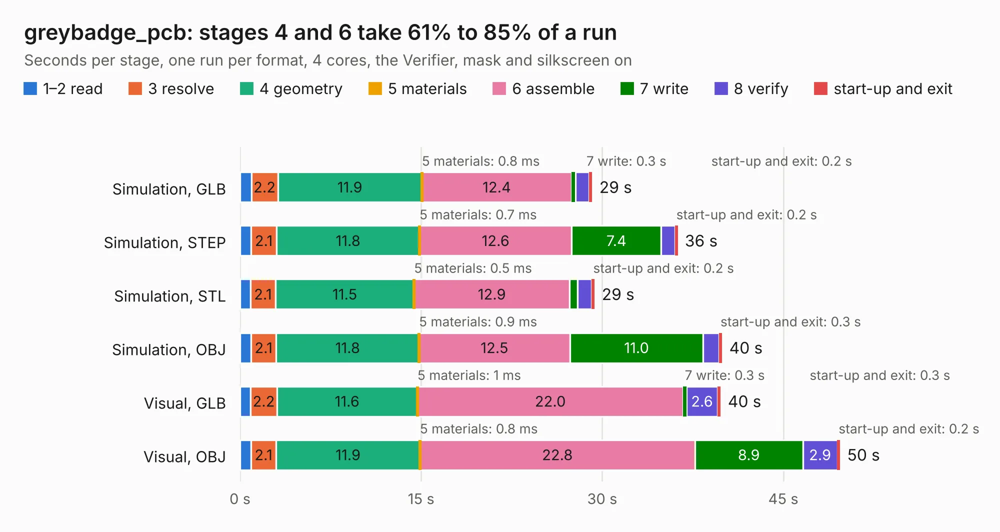

| Mode and format | 1–2 read | 3 resolve | 4 geometry | 5 materials | 6 assemble | 7 write | 8 verify | start-up and exit | Total |
|---|---:|---:|---:|---:|---:|---:|---:|---:|---:|
| Simulation, GLB | 0.9 | 2.2 | 11.9 | 0.8&nbsp;ms | 12.4 | 0.3 | 1.1 | 0.2 | 29.2 |
| Simulation, STEP | 0.9 | 2.1 | 11.8 | 0.7&nbsp;ms | 12.6 | 7.4 | 1.1 | 0.2 | 36.3 |
| Simulation, STL | 0.9 | 2.1 | 11.5 | 0.5&nbsp;ms | 12.9 | 0.6 | 1.2 | 0.2 | 29.4 |
| Simulation, OBJ | 0.9 | 2.1 | 11.8 | 0.9&nbsp;ms | 12.5 | 11.0 | 1.3 | 0.3 | 39.9 |
| Visual, GLB | 0.9 | 2.2 | 11.6 | 1&nbsp;ms | 22.0 | 0.3 | 2.6 | 0.3 | 39.8 |
| Visual, OBJ | 0.9 | 2.1 | 11.9 | 0.8&nbsp;ms | 22.8 | 8.9 | 2.9 | 0.2 | 49.7 |

<table align="center"><tr><td valign="top">

| Board | Repo: [NUSGreyhats/greybadge25](https://github.com/NUSGreyhats/greybadge25) Board: `greybadge_pcb.kicad_pcb` |
|---|---|
| Folder | hardware / greybadge_pcb |
| Complexity | 386&nbsp;/&nbsp;1000 (size&nbsp;251, features&nbsp;135) |
| KESE&nbsp;features | through vias, slotted holes, custom pads, rounded, trapezoid or chamfered pads, arc tracks, filled zones, copper drawings, curved board outline, knockout text, TrueType text |
| Tested | 9th November 2026 |
| Copper&nbsp;layers | 2 |
| File&nbsp;format | KiCad 9 (20241229) |
| Parts,&nbsp;tracks,&nbsp;vias | 135, 1,721, 176 |
| Triangles,&nbsp;simulation | 2,062,768 in 300 parts |
| Verifier | PASS in all six runs |

</td><td valign="top">

<table>
<tr><th>File type</th><th>File size</th><th>Peak memory used</th></tr>
<tr><th colspan="3" align="left">Simulation</th></tr>
<tr><td>GLB</td><td align="right">72&nbsp;MB</td><td align="right">814&nbsp;MB</td></tr>
<tr><td>STEP</td><td align="right">442&nbsp;MB</td><td align="right">1.0&nbsp;GB</td></tr>
<tr><td>STL</td><td align="right">103&nbsp;MB</td><td align="right">832&nbsp;MB</td></tr>
<tr><td>OBJ</td><td align="right">220&nbsp;MB</td><td align="right">1.4&nbsp;GB</td></tr>
<tr><th colspan="3" align="left">Visual</th></tr>
<tr><td>GLB</td><td align="right">60&nbsp;MB</td><td align="right">1.1&nbsp;GB</td></tr>
<tr><td>OBJ</td><td align="right">184&nbsp;MB</td><td align="right">1.2&nbsp;GB</td></tr>
</table>

</td></tr></table>

## 23.17.2 battery

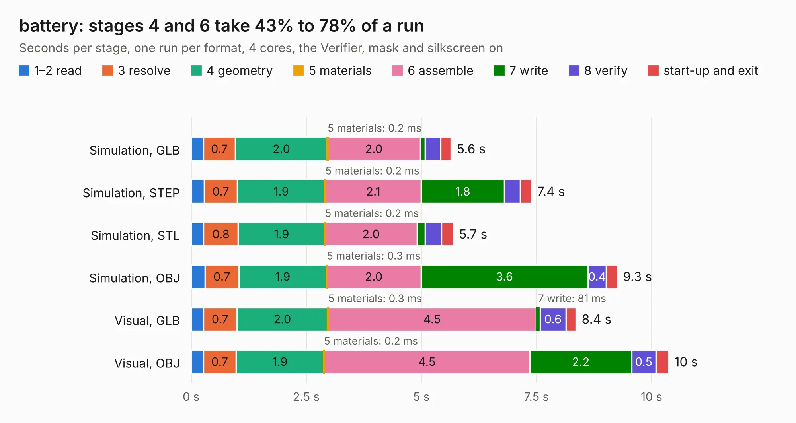

| Mode and format | 1–2 read | 3 resolve | 4 geometry | 5 materials | 6 assemble | 7 write | 8 verify | start-up and exit | Total |
|---|---:|---:|---:|---:|---:|---:|---:|---:|---:|
| Simulation, GLB | 0.3 | 0.7 | 2.0 | 0.2&nbsp;ms | 2.0 | 0.1 | 0.3 | 0.2 | 5.6 |
| Simulation, STEP | 0.3 | 0.7 | 1.9 | 0.2&nbsp;ms | 2.1 | 1.8 | 0.3 | 0.2 | 7.4 |
| Simulation, STL | 0.3 | 0.8 | 1.9 | 0.2&nbsp;ms | 2.0 | 0.2 | 0.3 | 0.3 | 5.7 |
| Simulation, OBJ | 0.3 | 0.7 | 1.9 | 0.3&nbsp;ms | 2.0 | 3.6 | 0.4 | 0.2 | 9.3 |
| Visual, GLB | 0.3 | 0.7 | 2.0 | 0.3&nbsp;ms | 4.5 | 81&nbsp;ms | 0.6 | 0.2 | 8.4 |
| Visual, OBJ | 0.3 | 0.7 | 1.9 | 0.2&nbsp;ms | 4.5 | 2.2 | 0.5 | 0.3 | 10.4 |

<table align="center"><tr><td valign="top">

| Board | Repo: [nzevh/barebones](https://github.com/nzevh/barebones) Board: `battery.kicad_pcb` |
|---|---|
| Folder | hardware / battery |
| Complexity | 326&nbsp;/&nbsp;1000 (size&nbsp;221, features&nbsp;105) |
| KESE&nbsp;features | through vias, rounded, trapezoid or chamfered pads, filled zones, knockout text, TrueType text, stack-up, dielectric εr and tanδ |
| Tested | 9th November 2026 |
| Copper&nbsp;layers | 4 |
| File&nbsp;format | KiCad 10 (20260206) |
| Parts,&nbsp;tracks,&nbsp;vias | 39, 348, 129 |
| Triangles,&nbsp;simulation | 658,698 in 60 parts |
| Verifier | PASS in all six runs |

</td><td valign="top">

<table>
<tr><th>File type</th><th>File size</th><th>Peak memory used</th></tr>
<tr><th colspan="3" align="left">Simulation</th></tr>
<tr><td>GLB</td><td align="right">23&nbsp;MB</td><td align="right">331&nbsp;MB</td></tr>
<tr><td>STEP</td><td align="right">80&nbsp;MB</td><td align="right">359&nbsp;MB</td></tr>
<tr><td>STL</td><td align="right">33&nbsp;MB</td><td align="right">342&nbsp;MB</td></tr>
<tr><td>OBJ</td><td align="right">66&nbsp;MB</td><td align="right">474&nbsp;MB</td></tr>
<tr><th colspan="3" align="left">Visual</th></tr>
<tr><td>GLB</td><td align="right">14&nbsp;MB</td><td align="right">377&nbsp;MB</td></tr>
<tr><td>OBJ</td><td align="right">42&nbsp;MB</td><td align="right">369&nbsp;MB</td></tr>
</table>

</td></tr></table>

## 23.17.3 barebones

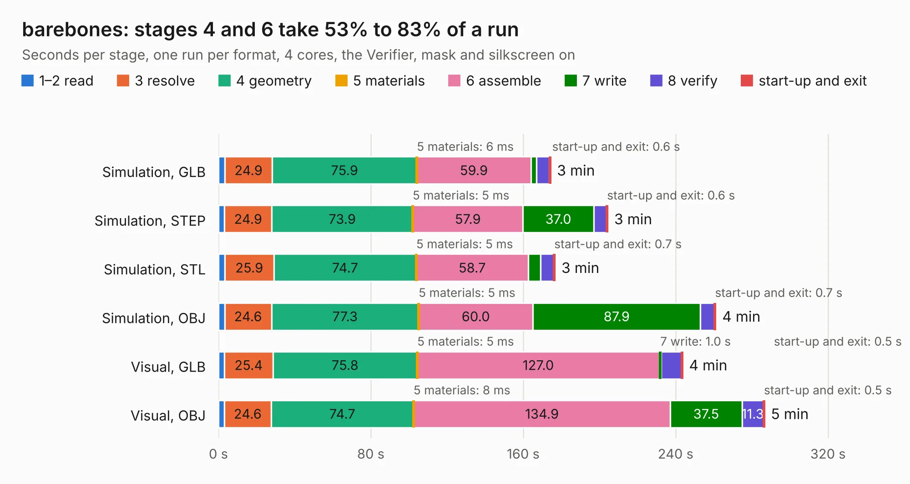

| Mode and format | 1–2 read | 3 resolve | 4 geometry | 5 materials | 6 assemble | 7 write | 8 verify | start-up and exit | Total |
|---|---:|---:|---:|---:|---:|---:|---:|---:|---:|
| Simulation, GLB | 3.3 | 24.9 | 75.9 | 6&nbsp;ms | 59.9 | 3.0 | 6.7 | 0.6 | 174.3 |
| Simulation, STEP | 3.2 | 24.9 | 73.9 | 5&nbsp;ms | 57.9 | 37.0 | 6.8 | 0.6 | 204.3 |
| Simulation, STL | 3.2 | 25.9 | 74.7 | 5&nbsp;ms | 58.7 | 6.5 | 6.9 | 0.7 | 176.6 |
| Simulation, OBJ | 3.3 | 24.6 | 77.3 | 5&nbsp;ms | 60.0 | 87.9 | 7.3 | 0.7 | 261.0 |
| Visual, GLB | 3.1 | 25.4 | 75.8 | 5&nbsp;ms | 127.0 | 1.0 | 10.7 | 0.5 | 243.6 |
| Visual, OBJ | 3.1 | 24.6 | 74.7 | 8&nbsp;ms | 134.9 | 37.5 | 11.3 | 0.5 | 286.6 |

<table align="center"><tr><td valign="top">

| Board | Repo: [nzevh/barebones](https://github.com/nzevh/barebones) Board: `barebones.kicad_pcb` |
|---|---|
| Folder | hardware / motherboard |
| Complexity | 651&nbsp;/&nbsp;1000 (size&nbsp;341, features&nbsp;310) |
| KESE&nbsp;features | through vias, blind and buried vias, microvias, covered, plugged, capped or filled vias, slotted holes, custom pads, rounded, trapezoid or chamfered pads, arc tracks, filled zones, copper drawings, knockout text, TrueType text, hatched fills, stack-up, dielectric εr and tanδ, copper finish, mask and silkscreen colours |
| Tested | 9th November 2026 |
| Copper&nbsp;layers | 8 |
| File&nbsp;format | KiCad 10 (20260206) |
| Parts,&nbsp;tracks,&nbsp;vias | 1,031, 2,098, 1,881 |
| Triangles,&nbsp;simulation | 12,973,364 in 1327 parts |
| Verifier | PASS in all six runs |

</td><td valign="top">

<table>
<tr><th>File type</th><th>File size</th><th>Peak memory used</th></tr>
<tr><th colspan="3" align="left">Simulation</th></tr>
<tr><td>GLB</td><td align="right">442&nbsp;MB</td><td align="right">3.0&nbsp;GB</td></tr>
<tr><td>STEP</td><td align="right">2.0&nbsp;GB</td><td align="right">4.2&nbsp;GB</td></tr>
<tr><td>STL</td><td align="right">649&nbsp;MB</td><td align="right">3.0&nbsp;GB</td></tr>
<tr><td>OBJ</td><td align="right">1.4&nbsp;GB</td><td align="right">8.3&nbsp;GB</td></tr>
<tr><th colspan="3" align="left">Visual</th></tr>
<tr><td>GLB</td><td align="right">196&nbsp;MB</td><td align="right">3.3&nbsp;GB</td></tr>
<tr><td>OBJ</td><td align="right">632&nbsp;MB</td><td align="right">4.2&nbsp;GB</td></tr>
</table>

</td></tr></table>

## 23.17.4 m3

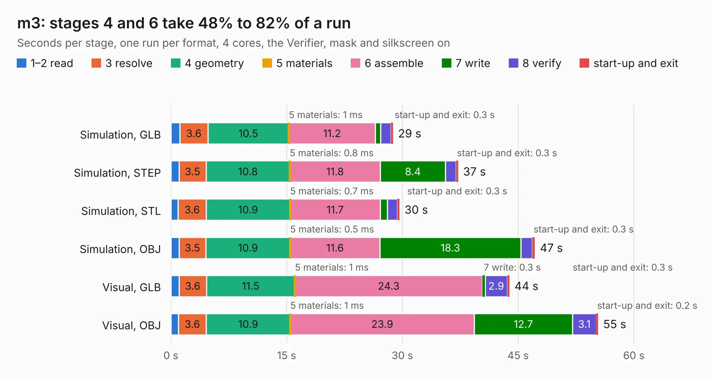

| Mode and format | 1–2 read | 3 resolve | 4 geometry | 5 materials | 6 assemble | 7 write | 8 verify | start-up and exit | Total |
|---|---:|---:|---:|---:|---:|---:|---:|---:|---:|
| Simulation, GLB | 1.2 | 3.6 | 10.5 | 1&nbsp;ms | 11.2 | 0.7 | 1.3 | 0.3 | 28.8 |
| Simulation, STEP | 1.0 | 3.5 | 10.8 | 0.8&nbsp;ms | 11.8 | 8.4 | 1.4 | 0.3 | 37.2 |
| Simulation, STL | 0.9 | 3.6 | 10.9 | 0.7&nbsp;ms | 11.7 | 0.9 | 1.3 | 0.3 | 29.6 |
| Simulation, OBJ | 1.0 | 3.5 | 10.9 | 0.5&nbsp;ms | 11.6 | 18.3 | 1.5 | 0.3 | 47.2 |
| Visual, GLB | 1.0 | 3.6 | 11.5 | 1&nbsp;ms | 24.3 | 0.3 | 2.9 | 0.3 | 43.9 |
| Visual, OBJ | 1.0 | 3.6 | 10.9 | 1&nbsp;ms | 23.9 | 12.7 | 3.1 | 0.2 | 55.4 |

<table align="center"><tr><td valign="top">

| Board | Repo: [oak-wjr/rocket-flight-computer](https://github.com/oak-wjr/rocket-flight-computer) Board: `m3.kicad_pcb` |
|---|---|
| Folder | m3_design / assembly_review |
| Complexity | 355&nbsp;/&nbsp;1000 (size&nbsp;265, features&nbsp;90) |
| KESE&nbsp;features | through vias, slotted holes, custom pads, rounded, trapezoid or chamfered pads, filled zones, copper drawings, curved board outline |
| Tested | 9th November 2026 |
| Copper&nbsp;layers | 4 |
| File&nbsp;format | KiCad 10 (20260206) |
| Parts,&nbsp;tracks,&nbsp;vias | 183, 2,037, 608 |
| Triangles,&nbsp;simulation | 2,975,214 in 175 parts |
| Verifier | PASS in all six runs |

</td><td valign="top">

<table>
<tr><th>File type</th><th>File size</th><th>Peak memory used</th></tr>
<tr><th colspan="3" align="left">Simulation</th></tr>
<tr><td>GLB</td><td align="right">102&nbsp;MB</td><td align="right">980&nbsp;MB</td></tr>
<tr><td>STEP</td><td align="right">404&nbsp;MB</td><td align="right">1.3&nbsp;GB</td></tr>
<tr><td>STL</td><td align="right">149&nbsp;MB</td><td align="right">1.0&nbsp;GB</td></tr>
<tr><td>OBJ</td><td align="right">313&nbsp;MB</td><td align="right">2.0&nbsp;GB</td></tr>
<tr><th colspan="3" align="left">Visual</th></tr>
<tr><td>GLB</td><td align="right">71&nbsp;MB</td><td align="right">1.2&nbsp;GB</td></tr>
<tr><td>OBJ</td><td align="right">220&nbsp;MB</td><td align="right">1.4&nbsp;GB</td></tr>
</table>

</td></tr></table>

## 23.17.5 m1

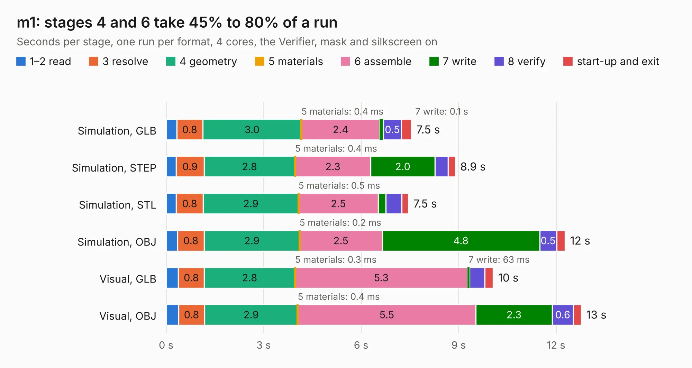

| Mode and format | 1–2 read | 3 resolve | 4 geometry | 5 materials | 6 assemble | 7 write | 8 verify | start-up and exit | Total |
|---|---:|---:|---:|---:|---:|---:|---:|---:|---:|
| Simulation, GLB | 0.3 | 0.8 | 3.0 | 0.4&nbsp;ms | 2.4 | 0.1 | 0.5 | 0.3 | 7.5 |
| Simulation, STEP | 0.3 | 0.9 | 2.8 | 0.4&nbsp;ms | 2.3 | 2.0 | 0.4 | 0.2 | 8.9 |
| Simulation, STL | 0.3 | 0.8 | 2.9 | 0.5&nbsp;ms | 2.5 | 0.2 | 0.5 | 0.2 | 7.5 |
| Simulation, OBJ | 0.4 | 0.8 | 2.9 | 0.2&nbsp;ms | 2.5 | 4.8 | 0.5 | 0.3 | 12.3 |
| Visual, GLB | 0.4 | 0.8 | 2.8 | 0.3&nbsp;ms | 5.3 | 63&nbsp;ms | 0.5 | 0.3 | 10.1 |
| Visual, OBJ | 0.4 | 0.8 | 2.9 | 0.4&nbsp;ms | 5.5 | 2.3 | 0.6 | 0.2 | 12.8 |

<table align="center"><tr><td valign="top">

| Board | Repo: [oak-wjr/rocket-flight-computer](https://github.com/oak-wjr/rocket-flight-computer) Board: `m1.kicad_pcb` |
|---|---|
| Folder | reference / m1_power_actuator |
| Complexity | 212&nbsp;/&nbsp;1000 (size&nbsp;167, features&nbsp;45) |
| KESE&nbsp;features | through vias, filled zones, curved board outline |
| Tested | 9th November 2026 |
| Copper&nbsp;layers | 4 |
| File&nbsp;format | KiCad 10 (20260206) |
| Parts,&nbsp;tracks,&nbsp;vias | 36, 84, 76 |
| Triangles,&nbsp;simulation | 778,592 in 40 parts |
| Verifier | PASS in all six runs |

</td><td valign="top">

<table>
<tr><th>File type</th><th>File size</th><th>Peak memory used</th></tr>
<tr><th colspan="3" align="left">Simulation</th></tr>
<tr><td>GLB</td><td align="right">27&nbsp;MB</td><td align="right">359&nbsp;MB</td></tr>
<tr><td>STEP</td><td align="right">82&nbsp;MB</td><td align="right">406&nbsp;MB</td></tr>
<tr><td>STL</td><td align="right">39&nbsp;MB</td><td align="right">352&nbsp;MB</td></tr>
<tr><td>OBJ</td><td align="right">78&nbsp;MB</td><td align="right">551&nbsp;MB</td></tr>
<tr><th colspan="3" align="left">Visual</th></tr>
<tr><td>GLB</td><td align="right">15&nbsp;MB</td><td align="right">410&nbsp;MB</td></tr>
<tr><td>OBJ</td><td align="right">45&nbsp;MB</td><td align="right">415&nbsp;MB</td></tr>
</table>

</td></tr></table>

## 23.17.6 m3

| Mode and format | 1–2 read | 3 resolve | 4 geometry | 5 materials | 6 assemble | 7 write | 8 verify | start-up and exit | Total |
|---|---:|---:|---:|---:|---:|---:|---:|---:|---:|
| Simulation, GLB | 0.7 | 2.6 | 7.9 | 0.5&nbsp;ms | 7.8 | 0.3 | 1.1 | 0.2 | 20.7 |
| Simulation, STEP | 0.7 | 2.4 | 7.7 | 0.4&nbsp;ms | 7.9 | 5.9 | 1.0 | 0.3 | 25.9 |
| Simulation, STL | 0.8 | 2.6 | 7.7 | 0.4&nbsp;ms | 7.9 | 0.6 | 1.1 | 0.3 | 20.9 |
| Simulation, OBJ | 0.7 | 2.5 | 8.0 | 1&nbsp;ms | 7.9 | 12.3 | 1.1 | 0.2 | 32.7 |
| Visual, GLB | 0.7 | 2.7 | 8.0 | 0.4&nbsp;ms | 17.1 | 0.2 | 2.1 | 0.2 | 31.1 |
| Visual, OBJ | 0.8 | 2.5 | 7.8 | 0.4&nbsp;ms | 16.8 | 8.5 | 2.2 | 0.3 | 38.9 |

<table align="center"><tr><td valign="top">

| Board | Repo: [oak-wjr/rocket-flight-computer](https://github.com/oak-wjr/rocket-flight-computer) Board: `m3.kicad_pcb` |
|---|---|
| Folder | reference / m3_assy_r1 |
| Complexity | 322&nbsp;/&nbsp;1000 (size&nbsp;257, features&nbsp;65) |
| KESE&nbsp;features | through vias, slotted holes, rounded, trapezoid or chamfered pads, filled zones, curved board outline |
| Tested | 9th November 2026 |
| Copper&nbsp;layers | 4 |
| File&nbsp;format | KiCad 10 (20260206) |
| Parts,&nbsp;tracks,&nbsp;vias | 115, 1,707, 494 |
| Triangles,&nbsp;simulation | 2,125,432 in 151 parts |
| Verifier | PASS in all six runs |

</td><td valign="top">

<table>
<tr><th>File type</th><th>File size</th><th>Peak memory used</th></tr>
<tr><th colspan="3" align="left">Simulation</th></tr>
<tr><td>GLB</td><td align="right">72&nbsp;MB</td><td align="right">882&nbsp;MB</td></tr>
<tr><td>STEP</td><td align="right">277&nbsp;MB</td><td align="right">1.0&nbsp;GB</td></tr>
<tr><td>STL</td><td align="right">106&nbsp;MB</td><td align="right">810&nbsp;MB</td></tr>
<tr><td>OBJ</td><td align="right">220&nbsp;MB</td><td align="right">1.4&nbsp;GB</td></tr>
<tr><th colspan="3" align="left">Visual</th></tr>
<tr><td>GLB</td><td align="right">49&nbsp;MB</td><td align="right">944&nbsp;MB</td></tr>
<tr><td>OBJ</td><td align="right">151&nbsp;MB</td><td align="right">1.1&nbsp;GB</td></tr>
</table>

</td></tr></table>

## 23.17.7 A20-CAN_Rev_A

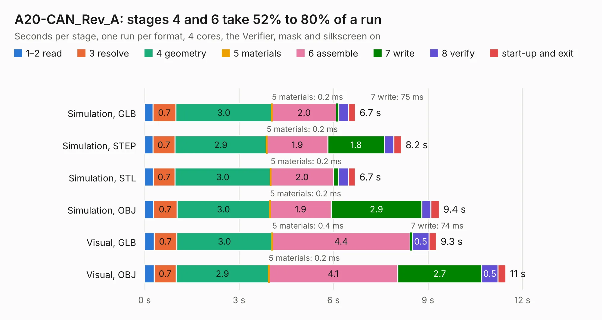

| Mode and format | 1–2 read | 3 resolve | 4 geometry | 5 materials | 6 assemble | 7 write | 8 verify | start-up and exit | Total |
|---|---:|---:|---:|---:|---:|---:|---:|---:|---:|
| Simulation, GLB | 0.3 | 0.7 | 3.0 | 0.2&nbsp;ms | 2.0 | 75&nbsp;ms | 0.3 | 0.2 | 6.7 |
| Simulation, STEP | 0.3 | 0.7 | 2.9 | 0.2&nbsp;ms | 1.9 | 1.8 | 0.3 | 0.2 | 8.2 |
| Simulation, STL | 0.3 | 0.7 | 3.0 | 0.2&nbsp;ms | 2.0 | 0.2 | 0.3 | 0.2 | 6.7 |
| Simulation, OBJ | 0.3 | 0.7 | 3.0 | 0.2&nbsp;ms | 1.9 | 2.9 | 0.3 | 0.3 | 9.4 |
| Visual, GLB | 0.3 | 0.7 | 3.0 | 0.4&nbsp;ms | 4.4 | 74&nbsp;ms | 0.5 | 0.2 | 9.3 |
| Visual, OBJ | 0.3 | 0.7 | 2.9 | 0.2&nbsp;ms | 4.1 | 2.7 | 0.5 | 0.2 | 11.5 |

<table align="center"><tr><td valign="top">

| Board | Repo: [OLIMEX/A20-CAN](https://github.com/OLIMEX/A20-CAN) Board: `A20-CAN_Rev_A.kicad_pcb` |
|---|---|
| Complexity | 192&nbsp;/&nbsp;1000 (size&nbsp;157, features&nbsp;35) |
| KESE&nbsp;features | through vias, filled zones |
| Tested | 9th November 2026 |
| Copper&nbsp;layers | 2 |
| File&nbsp;format | KiCad 4 (4) |
| Parts,&nbsp;tracks,&nbsp;vias | 18, 411, 117 |
| Triangles,&nbsp;simulation | 492,504 in 27 parts |
| Verifier | PASS in all six runs |

</td><td valign="top">

<table>
<tr><th>File type</th><th>File size</th><th>Peak memory used</th></tr>
<tr><th colspan="3" align="left">Simulation</th></tr>
<tr><td>GLB</td><td align="right">17&nbsp;MB</td><td align="right">318&nbsp;MB</td></tr>
<tr><td>STEP</td><td align="right">87&nbsp;MB</td><td align="right">389&nbsp;MB</td></tr>
<tr><td>STL</td><td align="right">25&nbsp;MB</td><td align="right">337&nbsp;MB</td></tr>
<tr><td>OBJ</td><td align="right">51&nbsp;MB</td><td align="right">392&nbsp;MB</td></tr>
<tr><th colspan="3" align="left">Visual</th></tr>
<tr><td>GLB</td><td align="right">16&nbsp;MB</td><td align="right">407&nbsp;MB</td></tr>
<tr><td>OBJ</td><td align="right">46&nbsp;MB</td><td align="right">396&nbsp;MB</td></tr>
</table>

</td></tr></table>

## 23.17.8 A20-CAN-ISO_Rev_B

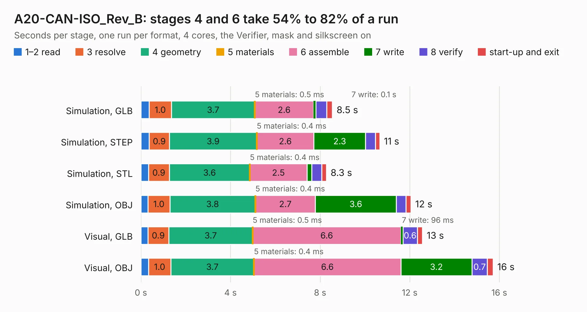

| Mode and format | 1–2 read | 3 resolve | 4 geometry | 5 materials | 6 assemble | 7 write | 8 verify | start-up and exit | Total |
|---|---:|---:|---:|---:|---:|---:|---:|---:|---:|
| Simulation, GLB | 0.4 | 1.0 | 3.7 | 0.5&nbsp;ms | 2.6 | 0.1 | 0.5 | 0.3 | 8.5 |
| Simulation, STEP | 0.4 | 0.9 | 3.9 | 0.4&nbsp;ms | 2.6 | 2.3 | 0.4 | 0.2 | 10.7 |
| Simulation, STL | 0.3 | 0.9 | 3.6 | 0.4&nbsp;ms | 2.5 | 0.2 | 0.4 | 0.2 | 8.3 |
| Simulation, OBJ | 0.3 | 1.0 | 3.8 | 0.4&nbsp;ms | 2.7 | 3.6 | 0.4 | 0.2 | 12.1 |
| Visual, GLB | 0.3 | 0.9 | 3.7 | 0.5&nbsp;ms | 6.6 | 96&nbsp;ms | 0.6 | 0.2 | 12.6 |
| Visual, OBJ | 0.3 | 1.0 | 3.7 | 0.4&nbsp;ms | 6.6 | 3.2 | 0.7 | 0.3 | 15.7 |

<table align="center"><tr><td valign="top">

| Board | Repo: [OLIMEX/A20-CAN-ISO](https://github.com/OLIMEX/A20-CAN-ISO) Board: `A20-CAN-ISO_Rev_B.kicad_pcb` |
|---|---|
| Folder | HARDWARE / A20-CAN-ISO-Rev_B |
| Complexity | 206&nbsp;/&nbsp;1000 (size&nbsp;171, features&nbsp;35) |
| KESE&nbsp;features | through vias, filled zones |
| Tested | 9th November 2026 |
| Copper&nbsp;layers | 2 |
| File&nbsp;format | KiCad 5 (20171130) |
| Parts,&nbsp;tracks,&nbsp;vias | 28, 758, 184 |
| Triangles,&nbsp;simulation | 702,972 in 130 parts |
| Verifier | PASS in all six runs |

</td><td valign="top">

<table>
<tr><th>File type</th><th>File size</th><th>Peak memory used</th></tr>
<tr><th colspan="3" align="left">Simulation</th></tr>
<tr><td>GLB</td><td align="right">25&nbsp;MB</td><td align="right">417&nbsp;MB</td></tr>
<tr><td>STEP</td><td align="right">111&nbsp;MB</td><td align="right">477&nbsp;MB</td></tr>
<tr><td>STL</td><td align="right">35&nbsp;MB</td><td align="right">433&nbsp;MB</td></tr>
<tr><td>OBJ</td><td align="right">72&nbsp;MB</td><td align="right">530&nbsp;MB</td></tr>
<tr><th colspan="3" align="left">Visual</th></tr>
<tr><td>GLB</td><td align="right">22&nbsp;MB</td><td align="right">527&nbsp;MB</td></tr>
<tr><td>OBJ</td><td align="right">64&nbsp;MB</td><td align="right">539&nbsp;MB</td></tr>
</table>

</td></tr></table>

## 23.17.9 AgonLight2_Rev_A

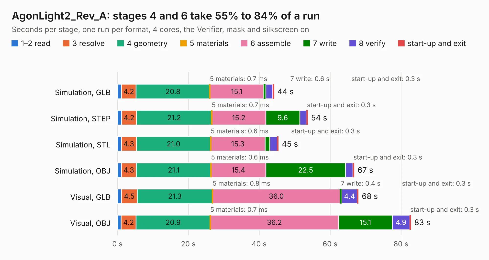

| Mode and format | 1–2 read | 3 resolve | 4 geometry | 5 materials | 6 assemble | 7 write | 8 verify | start-up and exit | Total |
|---|---:|---:|---:|---:|---:|---:|---:|---:|---:|
| Simulation, GLB | 1.1 | 4.2 | 20.8 | 0.7&nbsp;ms | 15.1 | 0.6 | 2.0 | 0.3 | 44.1 |
| Simulation, STEP | 1.2 | 4.2 | 21.2 | 0.7&nbsp;ms | 15.2 | 9.6 | 1.9 | 0.3 | 53.7 |
| Simulation, STL | 1.1 | 4.3 | 21.0 | 0.6&nbsp;ms | 15.3 | 1.4 | 2.1 | 0.3 | 45.4 |
| Simulation, OBJ | 1.1 | 4.3 | 21.1 | 0.6&nbsp;ms | 15.4 | 22.5 | 2.1 | 0.3 | 66.8 |
| Visual, GLB | 1.1 | 4.5 | 21.3 | 0.8&nbsp;ms | 36.0 | 0.4 | 4.4 | 0.3 | 68.0 |
| Visual, OBJ | 1.1 | 4.2 | 20.9 | 0.7&nbsp;ms | 36.2 | 15.1 | 4.9 | 0.3 | 82.8 |

<table align="center"><tr><td valign="top">

| Board | Repo: [OLIMEX/AgonLight2](https://github.com/OLIMEX/AgonLight2) Board: `AgonLight2_Rev_A.kicad_pcb` |
|---|---|
| Folder | HARDWARE / AgonLight2_Rev_A |
| Complexity | 313&nbsp;/&nbsp;1000 (size&nbsp;268, features&nbsp;45) |
| KESE&nbsp;features | through vias, slotted holes, filled zones |
| Tested | 9th November 2026 |
| Copper&nbsp;layers | 4 |
| File&nbsp;format | KiCad 5 (20171130) |
| Parts,&nbsp;tracks,&nbsp;vias | 229, 2,772, 400 |
| Triangles,&nbsp;simulation | 3,712,430 in 227 parts |
| Verifier | PASS in all six runs |

</td><td valign="top">

<table>
<tr><th>File type</th><th>File size</th><th>Peak memory used</th></tr>
<tr><th colspan="3" align="left">Simulation</th></tr>
<tr><td>GLB</td><td align="right">130&nbsp;MB</td><td align="right">1.3&nbsp;GB</td></tr>
<tr><td>STEP</td><td align="right">559&nbsp;MB</td><td align="right">1.5&nbsp;GB</td></tr>
<tr><td>STL</td><td align="right">186&nbsp;MB</td><td align="right">1.3&nbsp;GB</td></tr>
<tr><td>OBJ</td><td align="right">400&nbsp;MB</td><td align="right">2.5&nbsp;GB</td></tr>
<tr><th colspan="3" align="left">Visual</th></tr>
<tr><td>GLB</td><td align="right">88&nbsp;MB</td><td align="right">1.4&nbsp;GB</td></tr>
<tr><td>OBJ</td><td align="right">275&nbsp;MB</td><td align="right">1.8&nbsp;GB</td></tr>
</table>

</td></tr></table>

## 23.17.10 AgonLight2_Rev_B

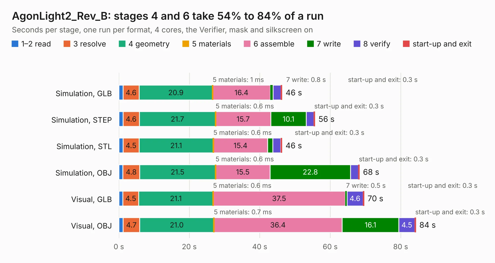

| Mode and format | 1–2 read | 3 resolve | 4 geometry | 5 materials | 6 assemble | 7 write | 8 verify | start-up and exit | Total |
|---|---:|---:|---:|---:|---:|---:|---:|---:|---:|
| Simulation, GLB | 1.2 | 4.6 | 20.9 | 1&nbsp;ms | 16.4 | 0.8 | 2.3 | 0.3 | 46.3 |
| Simulation, STEP | 1.2 | 4.6 | 21.7 | 0.6&nbsp;ms | 15.7 | 10.1 | 2.1 | 0.3 | 55.6 |
| Simulation, STL | 1.2 | 4.5 | 21.1 | 0.6&nbsp;ms | 15.4 | 1.5 | 2.3 | 0.3 | 46.3 |
| Simulation, OBJ | 1.1 | 4.8 | 21.5 | 0.6&nbsp;ms | 15.5 | 22.8 | 2.3 | 0.3 | 68.3 |
| Visual, GLB | 1.1 | 4.5 | 21.1 | 0.6&nbsp;ms | 37.5 | 0.5 | 4.6 | 0.3 | 69.6 |
| Visual, OBJ | 1.2 | 4.7 | 21.0 | 0.7&nbsp;ms | 36.4 | 16.1 | 4.5 | 0.3 | 84.3 |

<table align="center"><tr><td valign="top">

| Board | Repo: [OLIMEX/AgonLight2](https://github.com/OLIMEX/AgonLight2) Board: `AgonLight2_Rev_B.kicad_pcb` |
|---|---|
| Folder | HARDWARE / AgonLight2_Rev_B |
| Complexity | 313&nbsp;/&nbsp;1000 (size&nbsp;268, features&nbsp;45) |
| KESE&nbsp;features | through vias, slotted holes, filled zones |
| Tested | 9th November 2026 |
| Copper&nbsp;layers | 4 |
| File&nbsp;format | KiCad 5 (20171130) |
| Parts,&nbsp;tracks,&nbsp;vias | 229, 2,796, 400 |
| Triangles,&nbsp;simulation | 3,844,256 in 225 parts |
| Verifier | PASS in all six runs |

</td><td valign="top">

<table>
<tr><th>File type</th><th>File size</th><th>Peak memory used</th></tr>
<tr><th colspan="3" align="left">Simulation</th></tr>
<tr><td>GLB</td><td align="right">135&nbsp;MB</td><td align="right">1.4&nbsp;GB</td></tr>
<tr><td>STEP</td><td align="right">596&nbsp;MB</td><td align="right">1.6&nbsp;GB</td></tr>
<tr><td>STL</td><td align="right">192&nbsp;MB</td><td align="right">1.3&nbsp;GB</td></tr>
<tr><td>OBJ</td><td align="right">416&nbsp;MB</td><td align="right">2.6&nbsp;GB</td></tr>
<tr><th colspan="3" align="left">Visual</th></tr>
<tr><td>GLB</td><td align="right">94&nbsp;MB</td><td align="right">1.4&nbsp;GB</td></tr>
<tr><td>OBJ</td><td align="right">294&nbsp;MB</td><td align="right">2.0&nbsp;GB</td></tr>
</table>

</td></tr></table>

## 23.17.11 AgonLight2-HvIO_Rev_A

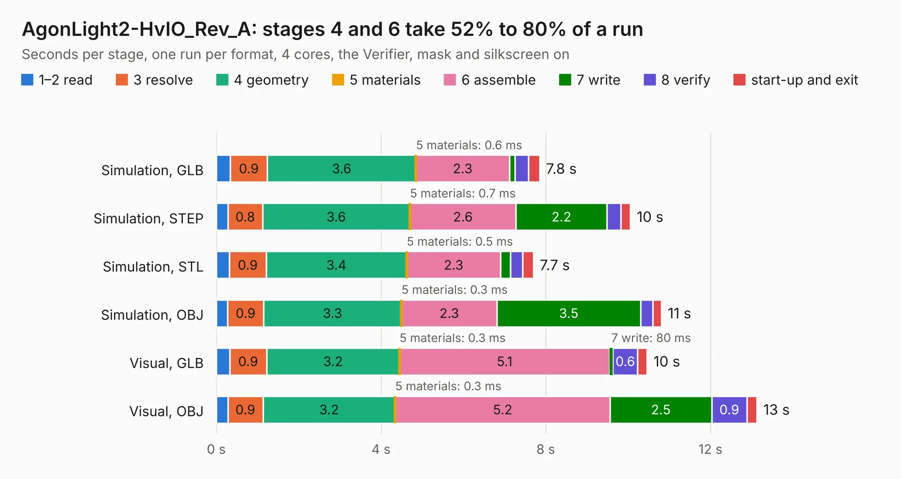

| Mode and format | 1–2 read | 3 resolve | 4 geometry | 5 materials | 6 assemble | 7 write | 8 verify | start-up and exit | Total |
|---|---:|---:|---:|---:|---:|---:|---:|---:|---:|
| Simulation, GLB | 0.3 | 0.9 | 3.6 | 0.6&nbsp;ms | 2.3 | 0.1 | 0.3 | 0.3 | 7.8 |
| Simulation, STEP | 0.3 | 0.8 | 3.6 | 0.7&nbsp;ms | 2.6 | 2.2 | 0.3 | 0.2 | 10.1 |
| Simulation, STL | 0.3 | 0.9 | 3.4 | 0.5&nbsp;ms | 2.3 | 0.2 | 0.3 | 0.3 | 7.7 |
| Simulation, OBJ | 0.3 | 0.9 | 3.3 | 0.3&nbsp;ms | 2.3 | 3.5 | 0.3 | 0.2 | 10.8 |
| Visual, GLB | 0.3 | 0.9 | 3.2 | 0.3&nbsp;ms | 5.1 | 80&nbsp;ms | 0.6 | 0.2 | 10.5 |
| Visual, OBJ | 0.3 | 0.9 | 3.2 | 0.3&nbsp;ms | 5.2 | 2.5 | 0.9 | 0.2 | 13.1 |

<table align="center"><tr><td valign="top">

| Board | Repo: [OLIMEX/AgonLight2-HvIO](https://github.com/OLIMEX/AgonLight2-HvIO) Board: `AgonLight2-HvIO_Rev_A.kicad_pcb` |
|---|---|
| Folder | HARDWARE / AgonLight2-HvIO_Rev_A |
| Complexity | 267&nbsp;/&nbsp;1000 (size&nbsp;177, features&nbsp;90) |
| KESE&nbsp;features | through vias, filled zones, copper text, knockout text, stack-up, dielectric εr and tanδ |
| Tested | 9th November 2026 |
| Copper&nbsp;layers | 2 |
| File&nbsp;format | KiCad 7 (20221018) |
| Parts,&nbsp;tracks,&nbsp;vias | 62, 586, 180 |
| Triangles,&nbsp;simulation | 770,540 in 91 parts |
| Verifier | PASS in all six runs |

</td><td valign="top">

<table>
<tr><th>File type</th><th>File size</th><th>Peak memory used</th></tr>
<tr><th colspan="3" align="left">Simulation</th></tr>
<tr><td>GLB</td><td align="right">27&nbsp;MB</td><td align="right">423&nbsp;MB</td></tr>
<tr><td>STEP</td><td align="right">131&nbsp;MB</td><td align="right">482&nbsp;MB</td></tr>
<tr><td>STL</td><td align="right">39&nbsp;MB</td><td align="right">444&nbsp;MB</td></tr>
<tr><td>OBJ</td><td align="right">80&nbsp;MB</td><td align="right">584&nbsp;MB</td></tr>
<tr><th colspan="3" align="left">Visual</th></tr>
<tr><td>GLB</td><td align="right">21&nbsp;MB</td><td align="right">503&nbsp;MB</td></tr>
<tr><td>OBJ</td><td align="right">62&nbsp;MB</td><td align="right">537&nbsp;MB</td></tr>
</table>

</td></tr></table>

## 23.17.12 AgonLight2-HvIO_Rev_A1

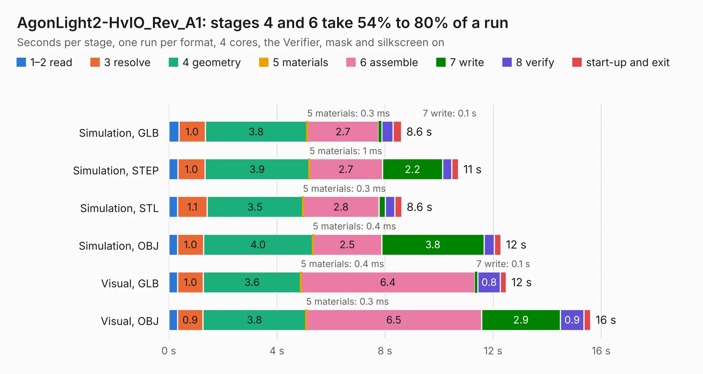

| Mode and format | 1–2 read | 3 resolve | 4 geometry | 5 materials | 6 assemble | 7 write | 8 verify | start-up and exit | Total |
|---|---:|---:|---:|---:|---:|---:|---:|---:|---:|
| Simulation, GLB | 0.4 | 1.0 | 3.8 | 0.3&nbsp;ms | 2.7 | 0.1 | 0.4 | 0.3 | 8.6 |
| Simulation, STEP | 0.3 | 1.0 | 3.9 | 1&nbsp;ms | 2.7 | 2.2 | 0.3 | 0.2 | 10.7 |
| Simulation, STL | 0.3 | 1.1 | 3.5 | 0.3&nbsp;ms | 2.8 | 0.2 | 0.4 | 0.2 | 8.6 |
| Simulation, OBJ | 0.3 | 1.0 | 4.0 | 0.4&nbsp;ms | 2.5 | 3.8 | 0.4 | 0.2 | 12.3 |
| Visual, GLB | 0.3 | 1.0 | 3.6 | 0.4&nbsp;ms | 6.4 | 0.1 | 0.8 | 0.2 | 12.5 |
| Visual, OBJ | 0.3 | 0.9 | 3.8 | 0.3&nbsp;ms | 6.5 | 2.9 | 0.9 | 0.2 | 15.6 |

<table align="center"><tr><td valign="top">

| Board | Repo: [OLIMEX/AgonLight2-HvIO](https://github.com/OLIMEX/AgonLight2-HvIO) Board: `AgonLight2-HvIO_Rev_A1.kicad_pcb` |
|---|---|
| Folder | HARDWARE / AgonLight2-HvIO_Rev_A1 |
| Complexity | 267&nbsp;/&nbsp;1000 (size&nbsp;177, features&nbsp;90) |
| KESE&nbsp;features | through vias, filled zones, copper text, knockout text, stack-up, dielectric εr and tanδ |
| Tested | 9th November 2026 |
| Copper&nbsp;layers | 2 |
| File&nbsp;format | KiCad 7 (20221018) |
| Parts,&nbsp;tracks,&nbsp;vias | 62, 586, 180 |
| Triangles,&nbsp;simulation | 770,556 in 91 parts |
| Verifier | PASS in all six runs |

</td><td valign="top">

<table>
<tr><th>File type</th><th>File size</th><th>Peak memory used</th></tr>
<tr><th colspan="3" align="left">Simulation</th></tr>
<tr><td>GLB</td><td align="right">27&nbsp;MB</td><td align="right">425&nbsp;MB</td></tr>
<tr><td>STEP</td><td align="right">131&nbsp;MB</td><td align="right">475&nbsp;MB</td></tr>
<tr><td>STL</td><td align="right">39&nbsp;MB</td><td align="right">419&nbsp;MB</td></tr>
<tr><td>OBJ</td><td align="right">80&nbsp;MB</td><td align="right">582&nbsp;MB</td></tr>
<tr><th colspan="3" align="left">Visual</th></tr>
<tr><td>GLB</td><td align="right">21&nbsp;MB</td><td align="right">542&nbsp;MB</td></tr>
<tr><td>OBJ</td><td align="right">62&nbsp;MB</td><td align="right">502&nbsp;MB</td></tr>
</table>

</td></tr></table>

## 23.17.13 AgonLight2-PROTO_Rev_A

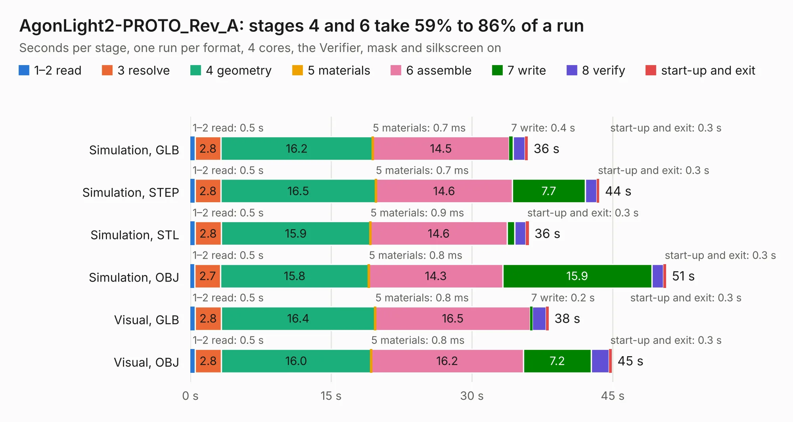

| Mode and format | 1–2 read | 3 resolve | 4 geometry | 5 materials | 6 assemble | 7 write | 8 verify | start-up and exit | Total |
|---|---:|---:|---:|---:|---:|---:|---:|---:|---:|
| Simulation, GLB | 0.5 | 2.8 | 16.2 | 0.7&nbsp;ms | 14.5 | 0.4 | 1.3 | 0.3 | 36.0 |
| Simulation, STEP | 0.5 | 2.8 | 16.5 | 0.7&nbsp;ms | 14.6 | 7.7 | 1.2 | 0.3 | 43.6 |
| Simulation, STL | 0.5 | 2.8 | 15.9 | 0.9&nbsp;ms | 14.6 | 0.8 | 1.2 | 0.3 | 36.1 |
| Simulation, OBJ | 0.5 | 2.7 | 15.8 | 0.8&nbsp;ms | 14.3 | 15.9 | 1.2 | 0.3 | 50.7 |
| Visual, GLB | 0.5 | 2.8 | 16.4 | 0.8&nbsp;ms | 16.5 | 0.2 | 1.5 | 0.3 | 38.2 |
| Visual, OBJ | 0.5 | 2.8 | 16.0 | 0.8&nbsp;ms | 16.2 | 7.2 | 1.9 | 0.3 | 44.9 |

<table align="center"><tr><td valign="top">

| Board | Repo: [OLIMEX/AgonLight2-Proto](https://github.com/OLIMEX/AgonLight2-Proto) Board: `AgonLight2-PROTO_Rev_A.kicad_pcb` |
|---|---|
| Folder | HARDWARE / AgonLight2-PROTO_Rev_A |
| Complexity | 224&nbsp;/&nbsp;1000 (size&nbsp;149, features&nbsp;75) |
| KESE&nbsp;features | through vias, filled zones, copper text, stack-up, dielectric εr and tanδ |
| Tested | 9th November 2026 |
| Copper&nbsp;layers | 2 |
| File&nbsp;format | KiCad 7 (20221018) |
| Parts,&nbsp;tracks,&nbsp;vias | 6, 649, 71 |
| Triangles,&nbsp;simulation | 2,595,312 in 45 parts |
| Verifier | PASS in all six runs |

</td><td valign="top">

<table>
<tr><th>File type</th><th>File size</th><th>Peak memory used</th></tr>
<tr><th colspan="3" align="left">Simulation</th></tr>
<tr><td>GLB</td><td align="right">89&nbsp;MB</td><td align="right">885&nbsp;MB</td></tr>
<tr><td>STEP</td><td align="right">320&nbsp;MB</td><td align="right">1.2&nbsp;GB</td></tr>
<tr><td>STL</td><td align="right">130&nbsp;MB</td><td align="right">891&nbsp;MB</td></tr>
<tr><td>OBJ</td><td align="right">275&nbsp;MB</td><td align="right">1.7&nbsp;GB</td></tr>
<tr><th colspan="3" align="left">Visual</th></tr>
<tr><td>GLB</td><td align="right">42&nbsp;MB</td><td align="right">1.1&nbsp;GB</td></tr>
<tr><td>OBJ</td><td align="right">129&nbsp;MB</td><td align="right">994&nbsp;MB</td></tr>
</table>

</td></tr></table>

## 23.17.14 bb-ads1220

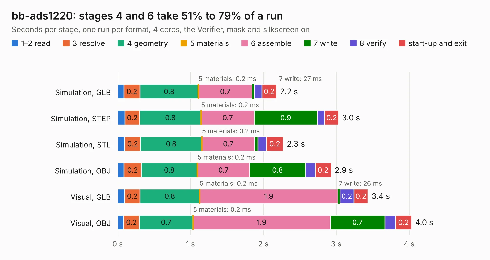

| Mode and format | 1–2 read | 3 resolve | 4 geometry | 5 materials | 6 assemble | 7 write | 8 verify | start-up and exit | Total |
|---|---:|---:|---:|---:|---:|---:|---:|---:|---:|
| Simulation, GLB | 88&nbsp;ms | 0.2 | 0.8 | 0.2&nbsp;ms | 0.7 | 27&nbsp;ms | 0.1 | 0.2 | 2.2 |
| Simulation, STEP | 0.1 | 0.2 | 0.8 | 0.2&nbsp;ms | 0.7 | 0.9 | 0.1 | 0.2 | 3.0 |
| Simulation, STL | 99&nbsp;ms | 0.2 | 0.8 | 0.2&nbsp;ms | 0.7 | 45&nbsp;ms | 0.1 | 0.2 | 2.3 |
| Simulation, OBJ | 88&nbsp;ms | 0.2 | 0.8 | 0.2&nbsp;ms | 0.7 | 0.8 | 0.1 | 0.2 | 2.9 |
| Visual, GLB | 98&nbsp;ms | 0.2 | 0.8 | 0.2&nbsp;ms | 1.9 | 26&nbsp;ms | 0.2 | 0.2 | 3.4 |
| Visual, OBJ | 86&nbsp;ms | 0.2 | 0.7 | 0.2&nbsp;ms | 1.9 | 0.7 | 0.1 | 0.2 | 4.0 |

<table align="center"><tr><td valign="top">

| Board | Repo: [OLIMEX/BB-ADS1220](https://github.com/OLIMEX/BB-ADS1220) Board: `bb-ads1220.kicad_pcb` |
|---|---|
| Folder | HARDWARE / BB-ADS1220_Rev.A |
| Complexity | 153&nbsp;/&nbsp;1000 (size&nbsp;118, features&nbsp;35) |
| KESE&nbsp;features | through vias, filled zones |
| Tested | 9th November 2026 |
| Copper&nbsp;layers | 2 |
| File&nbsp;format | KiCad 4 (4) |
| Parts,&nbsp;tracks,&nbsp;vias | 6, 101, 10 |
| Triangles,&nbsp;simulation | 190,968 in 27 parts |
| Verifier | PASS in all six runs |

</td><td valign="top">

<table>
<tr><th>File type</th><th>File size</th><th>Peak memory used</th></tr>
<tr><th colspan="3" align="left">Simulation</th></tr>
<tr><td>GLB</td><td align="right">6.8&nbsp;MB</td><td align="right">208&nbsp;MB</td></tr>
<tr><td>STEP</td><td align="right">35&nbsp;MB</td><td align="right">215&nbsp;MB</td></tr>
<tr><td>STL</td><td align="right">9.6&nbsp;MB</td><td align="right">203&nbsp;MB</td></tr>
<tr><td>OBJ</td><td align="right">19&nbsp;MB</td><td align="right">200&nbsp;MB</td></tr>
<tr><th colspan="3" align="left">Visual</th></tr>
<tr><td>GLB</td><td align="right">5.3&nbsp;MB</td><td align="right">188&nbsp;MB</td></tr>
<tr><td>OBJ</td><td align="right">15&nbsp;MB</td><td align="right">187&nbsp;MB</td></tr>
</table>

</td></tr></table>

## 23.17.15 BB-ADS1262-Rev.A

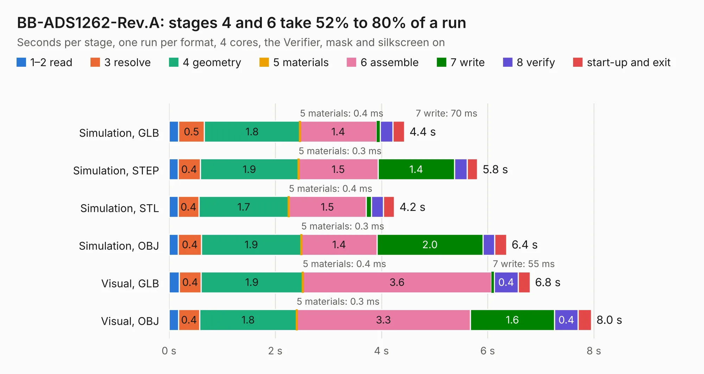

| Mode and format | 1–2 read | 3 resolve | 4 geometry | 5 materials | 6 assemble | 7 write | 8 verify | start-up and exit | Total |
|---|---:|---:|---:|---:|---:|---:|---:|---:|---:|
| Simulation, GLB | 0.2 | 0.5 | 1.8 | 0.4&nbsp;ms | 1.4 | 70&nbsp;ms | 0.2 | 0.2 | 4.4 |
| Simulation, STEP | 0.2 | 0.4 | 1.9 | 0.3&nbsp;ms | 1.5 | 1.4 | 0.2 | 0.2 | 5.8 |
| Simulation, STL | 0.2 | 0.4 | 1.7 | 0.4&nbsp;ms | 1.5 | 0.1 | 0.2 | 0.2 | 4.2 |
| Simulation, OBJ | 0.2 | 0.4 | 1.9 | 0.3&nbsp;ms | 1.4 | 2.0 | 0.2 | 0.2 | 6.4 |
| Visual, GLB | 0.2 | 0.4 | 1.9 | 0.4&nbsp;ms | 3.6 | 55&nbsp;ms | 0.4 | 0.2 | 6.8 |
| Visual, OBJ | 0.2 | 0.4 | 1.8 | 0.3&nbsp;ms | 3.3 | 1.6 | 0.4 | 0.2 | 8.0 |

<table align="center"><tr><td valign="top">

| Board | Repo: [OLIMEX/BB-ADS1262](https://github.com/OLIMEX/BB-ADS1262) Board: `BB-ADS1262-Rev.A.kicad_pcb` |
|---|---|
| Folder | HARDWARE / BB-ADS1262_Rev.A1 |
| Complexity | 184&nbsp;/&nbsp;1000 (size&nbsp;149, features&nbsp;35) |
| KESE&nbsp;features | through vias, filled zones |
| Tested | 9th November 2026 |
| Copper&nbsp;layers | 2 |
| File&nbsp;format | KiCad 5 (20171114) |
| Parts,&nbsp;tracks,&nbsp;vias | 27, 326, 9 |
| Triangles,&nbsp;simulation | 402,106 in 51 parts |
| Verifier | PASS in all six runs |

</td><td valign="top">

<table>
<tr><th>File type</th><th>File size</th><th>Peak memory used</th></tr>
<tr><th colspan="3" align="left">Simulation</th></tr>
<tr><td>GLB</td><td align="right">14&nbsp;MB</td><td align="right">279&nbsp;MB</td></tr>
<tr><td>STEP</td><td align="right">75&nbsp;MB</td><td align="right">310&nbsp;MB</td></tr>
<tr><td>STL</td><td align="right">20&nbsp;MB</td><td align="right">275&nbsp;MB</td></tr>
<tr><td>OBJ</td><td align="right">42&nbsp;MB</td><td align="right">333&nbsp;MB</td></tr>
<tr><th colspan="3" align="left">Visual</th></tr>
<tr><td>GLB</td><td align="right">12&nbsp;MB</td><td align="right">310&nbsp;MB</td></tr>
<tr><td>OBJ</td><td align="right">34&nbsp;MB</td><td align="right">305&nbsp;MB</td></tr>
</table>

</td></tr></table>

## 23.17.16 bb-ch340t

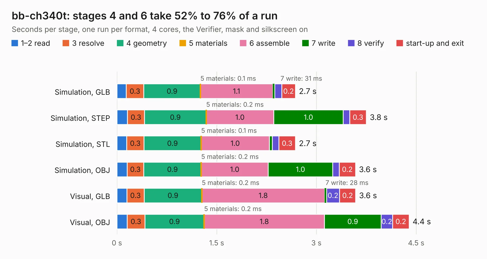

| Mode and format | 1–2 read | 3 resolve | 4 geometry | 5 materials | 6 assemble | 7 write | 8 verify | start-up and exit | Total |
|---|---:|---:|---:|---:|---:|---:|---:|---:|---:|
| Simulation, GLB | 0.1 | 0.3 | 0.9 | 0.1&nbsp;ms | 1.1 | 31&nbsp;ms | 0.1 | 0.2 | 2.7 |
| Simulation, STEP | 0.2 | 0.3 | 0.9 | 0.2&nbsp;ms | 1.0 | 1.0 | 97&nbsp;ms | 0.3 | 3.8 |
| Simulation, STL | 0.1 | 0.3 | 0.9 | 0.1&nbsp;ms | 1.0 | 45&nbsp;ms | 99&nbsp;ms | 0.3 | 2.7 |
| Simulation, OBJ | 0.2 | 0.3 | 0.9 | 0.2&nbsp;ms | 1.0 | 1.0 | 97&nbsp;ms | 0.2 | 3.6 |
| Visual, GLB | 0.1 | 0.3 | 0.9 | 0.2&nbsp;ms | 1.8 | 28&nbsp;ms | 0.2 | 0.2 | 3.6 |
| Visual, OBJ | 0.2 | 0.3 | 0.9 | 0.2&nbsp;ms | 1.8 | 0.9 | 0.2 | 0.2 | 4.4 |

<table align="center"><tr><td valign="top">

| Board | Repo: [OLIMEX/BB-CH340T](https://github.com/OLIMEX/BB-CH340T) Board: `bb-ch340t.kicad_pcb` |
|---|---|
| Folder | HARDWARE / BB-CH340T-Rev.A |
| Complexity | 179&nbsp;/&nbsp;1000 (size&nbsp;124, features&nbsp;55) |
| KESE&nbsp;features | through vias, filled zones, copper text, curved board outline |
| Tested | 9th November 2026 |
| Copper&nbsp;layers | 2 |
| File&nbsp;format | KiCad 4 (4) |
| Parts,&nbsp;tracks,&nbsp;vias | 10, 109, 12 |
| Triangles,&nbsp;simulation | 159,360 in 31 parts |
| Verifier | PASS in all six runs |

</td><td valign="top">

<table>
<tr><th>File type</th><th>File size</th><th>Peak memory used</th></tr>
<tr><th colspan="3" align="left">Simulation</th></tr>
<tr><td>GLB</td><td align="right">5.8&nbsp;MB</td><td align="right">202&nbsp;MB</td></tr>
<tr><td>STEP</td><td align="right">30&nbsp;MB</td><td align="right">219&nbsp;MB</td></tr>
<tr><td>STL</td><td align="right">8.0&nbsp;MB</td><td align="right">202&nbsp;MB</td></tr>
<tr><td>OBJ</td><td align="right">16&nbsp;MB</td><td align="right">202&nbsp;MB</td></tr>
<tr><th colspan="3" align="left">Visual</th></tr>
<tr><td>GLB</td><td align="right">5.0&nbsp;MB</td><td align="right">192&nbsp;MB</td></tr>
<tr><td>OBJ</td><td align="right">14&nbsp;MB</td><td align="right">191&nbsp;MB</td></tr>
</table>

</td></tr></table>

## 23.17.17 bb-ch340t

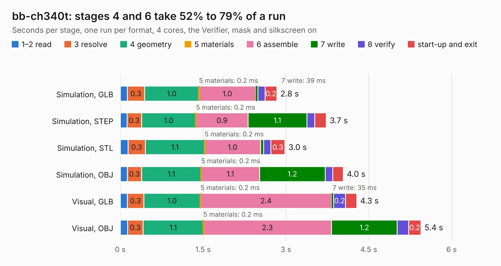

| Mode and format | 1–2 read | 3 resolve | 4 geometry | 5 materials | 6 assemble | 7 write | 8 verify | start-up and exit | Total |
|---|---:|---:|---:|---:|---:|---:|---:|---:|---:|
| Simulation, GLB | 0.1 | 0.3 | 1.0 | 0.2&nbsp;ms | 1.0 | 39&nbsp;ms | 0.1 | 0.2 | 2.8 |
| Simulation, STEP | 0.1 | 0.3 | 1.0 | 0.2&nbsp;ms | 0.9 | 1.1 | 0.1 | 0.2 | 3.7 |
| Simulation, STL | 0.1 | 0.3 | 1.1 | 0.2&nbsp;ms | 1.0 | 55&nbsp;ms | 0.1 | 0.3 | 3.0 |
| Simulation, OBJ | 0.1 | 0.3 | 1.1 | 0.2&nbsp;ms | 1.1 | 1.2 | 0.1 | 0.2 | 4.0 |
| Visual, GLB | 0.1 | 0.3 | 1.0 | 0.2&nbsp;ms | 2.4 | 35&nbsp;ms | 0.2 | 0.2 | 4.3 |
| Visual, OBJ | 0.1 | 0.3 | 1.1 | 0.2&nbsp;ms | 2.3 | 1.2 | 0.2 | 0.2 | 5.4 |

<table align="center"><tr><td valign="top">

| Board | Repo: [OLIMEX/BB-CH340T](https://github.com/OLIMEX/BB-CH340T) Board: `bb-ch340t.kicad_pcb` |
|---|---|
| Folder | HARDWARE / BB-CH340T-Rev.B |
| Complexity | 190&nbsp;/&nbsp;1000 (size&nbsp;135, features&nbsp;55) |
| KESE&nbsp;features | through vias, slotted holes, filled zones, curved board outline |
| Tested | 9th November 2026 |
| Copper&nbsp;layers | 2 |
| File&nbsp;format | KiCad 5 (20171114) |
| Parts,&nbsp;tracks,&nbsp;vias | 15, 176, 12 |
| Triangles,&nbsp;simulation | 250,586 in 32 parts |
| Verifier | PASS in all six runs |

</td><td valign="top">

<table>
<tr><th>File type</th><th>File size</th><th>Peak memory used</th></tr>
<tr><th colspan="3" align="left">Simulation</th></tr>
<tr><td>GLB</td><td align="right">9.0&nbsp;MB</td><td align="right">222&nbsp;MB</td></tr>
<tr><td>STEP</td><td align="right">48&nbsp;MB</td><td align="right">262&nbsp;MB</td></tr>
<tr><td>STL</td><td align="right">13&nbsp;MB</td><td align="right">223&nbsp;MB</td></tr>
<tr><td>OBJ</td><td align="right">26&nbsp;MB</td><td align="right">229&nbsp;MB</td></tr>
<tr><th colspan="3" align="left">Visual</th></tr>
<tr><td>GLB</td><td align="right">7.3&nbsp;MB</td><td align="right">228&nbsp;MB</td></tr>
<tr><td>OBJ</td><td align="right">21&nbsp;MB</td><td align="right">218&nbsp;MB</td></tr>
</table>

</td></tr></table>

## 23.17.18 BB-LVL-SHIFT_Rev_A

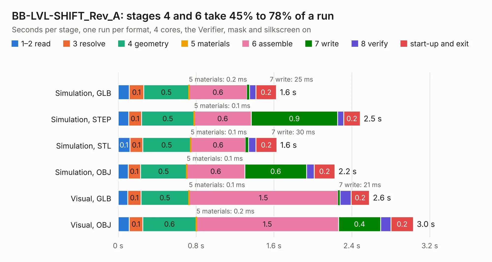

| Mode and format | 1–2 read | 3 resolve | 4 geometry | 5 materials | 6 assemble | 7 write | 8 verify | start-up and exit | Total |
|---|---:|---:|---:|---:|---:|---:|---:|---:|---:|
| Simulation, GLB | 0.1 | 0.1 | 0.5 | 0.2&nbsp;ms | 0.6 | 25&nbsp;ms | 66&nbsp;ms | 0.2 | 1.6 |
| Simulation, STEP | 0.1 | 0.1 | 0.5 | 0.1&nbsp;ms | 0.6 | 0.9 | 63&nbsp;ms | 0.2 | 2.5 |
| Simulation, STL | 0.1 | 0.1 | 0.5 | 0.1&nbsp;ms | 0.6 | 30&nbsp;ms | 76&nbsp;ms | 0.2 | 1.6 |
| Simulation, OBJ | 0.1 | 0.1 | 0.5 | 0.1&nbsp;ms | 0.6 | 0.6 | 79&nbsp;ms | 0.2 | 2.2 |
| Visual, GLB | 99&nbsp;ms | 0.1 | 0.5 | 0.1&nbsp;ms | 1.5 | 21&nbsp;ms | 0.1 | 0.2 | 2.6 |
| Visual, OBJ | 0.1 | 0.1 | 0.6 | 0.2&nbsp;ms | 1.5 | 0.4 | 0.1 | 0.2 | 3.0 |

<table align="center"><tr><td valign="top">

| Board | Repo: [OLIMEX/BB-LVL-SHIFT](https://github.com/OLIMEX/BB-LVL-SHIFT) Board: `BB-LVL-SHIFT_Rev_A.kicad_pcb` |
|---|---|
| Folder | HARDWARE / BB-LVL-SHIFT_Rev.A |
| Complexity | 202&nbsp;/&nbsp;1000 (size&nbsp;122, features&nbsp;80) |
| KESE&nbsp;features | through vias, filled zones, knockout text, stack-up, dielectric εr and tanδ |
| Tested | 9th November 2026 |
| Copper&nbsp;layers | 2 |
| File&nbsp;format | KiCad 10 (20260206) |
| Parts,&nbsp;tracks,&nbsp;vias | 13, 85, 8 |
| Triangles,&nbsp;simulation | 128,976 in 23 parts |
| Verifier | PASS in all six runs |

</td><td valign="top">

<table>
<tr><th>File type</th><th>File size</th><th>Peak memory used</th></tr>
<tr><th colspan="3" align="left">Simulation</th></tr>
<tr><td>GLB</td><td align="right">4.6&nbsp;MB</td><td align="right">201&nbsp;MB</td></tr>
<tr><td>STEP</td><td align="right">25&nbsp;MB</td><td align="right">205&nbsp;MB</td></tr>
<tr><td>STL</td><td align="right">6.5&nbsp;MB</td><td align="right">192&nbsp;MB</td></tr>
<tr><td>OBJ</td><td align="right">13&nbsp;MB</td><td align="right">190&nbsp;MB</td></tr>
<tr><th colspan="3" align="left">Visual</th></tr>
<tr><td>GLB</td><td align="right">3.6&nbsp;MB</td><td align="right">159&nbsp;MB</td></tr>
<tr><td>OBJ</td><td align="right">10&nbsp;MB</td><td align="right">160&nbsp;MB</td></tr>
</table>

</td></tr></table>

## 23.17.19 BB-PWR-3608_revA

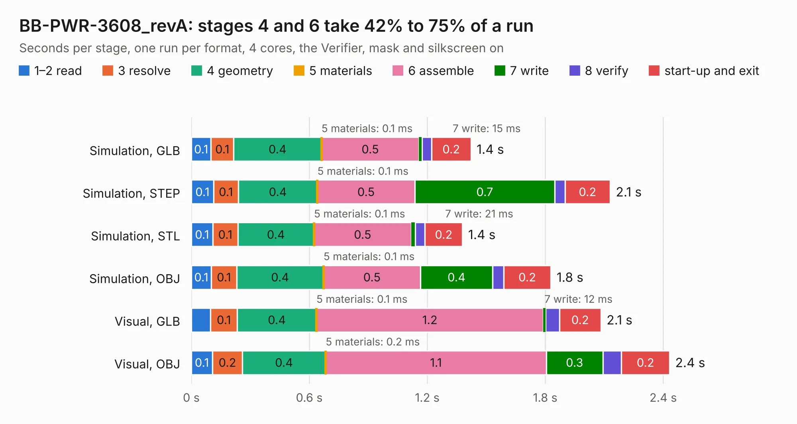

| Mode and format | 1–2 read | 3 resolve | 4 geometry | 5 materials | 6 assemble | 7 write | 8 verify | start-up and exit | Total |
|---|---:|---:|---:|---:|---:|---:|---:|---:|---:|
| Simulation, GLB | 0.1 | 0.1 | 0.4 | 0.1&nbsp;ms | 0.5 | 15&nbsp;ms | 49&nbsp;ms | 0.2 | 1.4 |
| Simulation, STEP | 0.1 | 0.1 | 0.4 | 0.1&nbsp;ms | 0.5 | 0.7 | 51&nbsp;ms | 0.2 | 2.1 |
| Simulation, STL | 0.1 | 0.1 | 0.4 | 0.1&nbsp;ms | 0.5 | 21&nbsp;ms | 49&nbsp;ms | 0.2 | 1.4 |
| Simulation, OBJ | 0.1 | 0.1 | 0.4 | 0.1&nbsp;ms | 0.5 | 0.4 | 56&nbsp;ms | 0.2 | 1.8 |
| Visual, GLB | 97&nbsp;ms | 0.1 | 0.4 | 0.1&nbsp;ms | 1.2 | 12&nbsp;ms | 70&nbsp;ms | 0.2 | 2.1 |
| Visual, OBJ | 0.1 | 0.2 | 0.4 | 0.2&nbsp;ms | 1.1 | 0.3 | 94&nbsp;ms | 0.2 | 2.4 |

<table align="center"><tr><td valign="top">

| Board | Repo: [OLIMEX/BB-PWR-3608](https://github.com/OLIMEX/BB-PWR-3608) Board: `BB-PWR-3608_revA.kicad_pcb` |
|---|---|
| Complexity | 163&nbsp;/&nbsp;1000 (size&nbsp;118, features&nbsp;45) |
| KESE&nbsp;features | through vias, rounded, trapezoid or chamfered pads, filled zones |
| Tested | 9th November 2026 |
| Copper&nbsp;layers | 2 |
| File&nbsp;format | KiCad 4 (4) |
| Parts,&nbsp;tracks,&nbsp;vias | 13, 73, 3 |
| Triangles,&nbsp;simulation | 76,018 in 19 parts |
| Verifier | PASS in all six runs |

</td><td valign="top">

<table>
<tr><th>File type</th><th>File size</th><th>Peak memory used</th></tr>
<tr><th colspan="3" align="left">Simulation</th></tr>
<tr><td>GLB</td><td align="right">2.8&nbsp;MB</td><td align="right">179&nbsp;MB</td></tr>
<tr><td>STEP</td><td align="right">13&nbsp;MB</td><td align="right">179&nbsp;MB</td></tr>
<tr><td>STL</td><td align="right">3.8&nbsp;MB</td><td align="right">175&nbsp;MB</td></tr>
<tr><td>OBJ</td><td align="right">7.7&nbsp;MB</td><td align="right">174&nbsp;MB</td></tr>
<tr><th colspan="3" align="left">Visual</th></tr>
<tr><td>GLB</td><td align="right">2.1&nbsp;MB</td><td align="right">156&nbsp;MB</td></tr>
<tr><td>OBJ</td><td align="right">5.8&nbsp;MB</td><td align="right">156&nbsp;MB</td></tr>
</table>

</td></tr></table>

## 23.17.20 BB-PWR-8009_revA

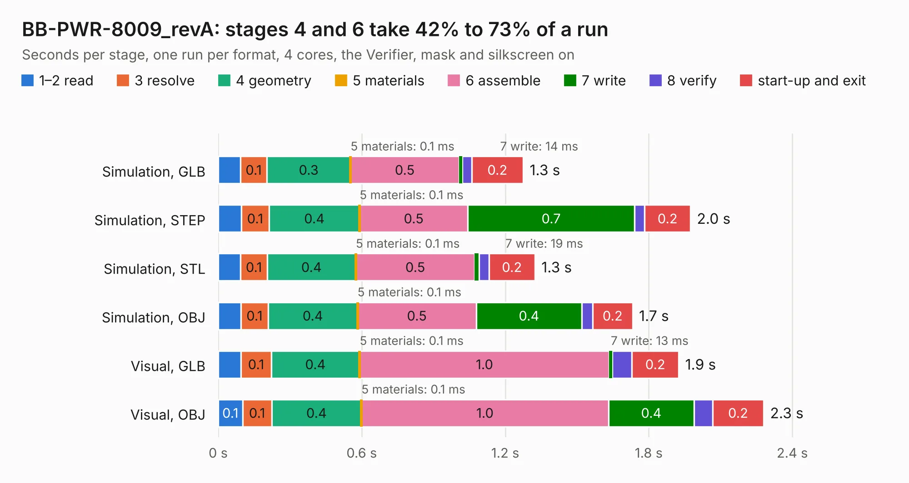

| Mode and format | 1–2 read | 3 resolve | 4 geometry | 5 materials | 6 assemble | 7 write | 8 verify | start-up and exit | Total |
|---|---:|---:|---:|---:|---:|---:|---:|---:|---:|
| Simulation, GLB | 93&nbsp;ms | 0.1 | 0.3 | 0.1&nbsp;ms | 0.5 | 14&nbsp;ms | 39&nbsp;ms | 0.2 | 1.3 |
| Simulation, STEP | 96&nbsp;ms | 0.1 | 0.4 | 0.1&nbsp;ms | 0.5 | 0.7 | 43&nbsp;ms | 0.2 | 2.0 |
| Simulation, STL | 94&nbsp;ms | 0.1 | 0.4 | 0.1&nbsp;ms | 0.5 | 19&nbsp;ms | 40&nbsp;ms | 0.2 | 1.3 |
| Simulation, OBJ | 95&nbsp;ms | 0.1 | 0.4 | 0.1&nbsp;ms | 0.5 | 0.4 | 46&nbsp;ms | 0.2 | 1.7 |
| Visual, GLB | 96&nbsp;ms | 0.1 | 0.4 | 0.1&nbsp;ms | 1.0 | 13&nbsp;ms | 82&nbsp;ms | 0.2 | 1.9 |
| Visual, OBJ | 0.1 | 0.1 | 0.4 | 0.1&nbsp;ms | 1.0 | 0.4 | 77&nbsp;ms | 0.2 | 2.3 |

<table align="center"><tr><td valign="top">

| Board | Repo: [OLIMEX/BB-PWR-8009](https://github.com/OLIMEX/BB-PWR-8009) Board: `BB-PWR-8009_revA.kicad_pcb` |
|---|---|
| Complexity | 149&nbsp;/&nbsp;1000 (size&nbsp;114, features&nbsp;35) |
| KESE&nbsp;features | through vias, filled zones |
| Tested | 9th November 2026 |
| Copper&nbsp;layers | 2 |
| File&nbsp;format | KiCad 4 (4) |
| Parts,&nbsp;tracks,&nbsp;vias | 12, 63, 2 |
| Triangles,&nbsp;simulation | 80,210 in 17 parts |
| Verifier | PASS in all six runs |

</td><td valign="top">

<table>
<tr><th>File type</th><th>File size</th><th>Peak memory used</th></tr>
<tr><th colspan="3" align="left">Simulation</th></tr>
<tr><td>GLB</td><td align="right">3.0&nbsp;MB</td><td align="right">182&nbsp;MB</td></tr>
<tr><td>STEP</td><td align="right">15&nbsp;MB</td><td align="right">186&nbsp;MB</td></tr>
<tr><td>STL</td><td align="right">4.0&nbsp;MB</td><td align="right">176&nbsp;MB</td></tr>
<tr><td>OBJ</td><td align="right">8.1&nbsp;MB</td><td align="right">180&nbsp;MB</td></tr>
<tr><th colspan="3" align="left">Visual</th></tr>
<tr><td>GLB</td><td align="right">2.4&nbsp;MB</td><td align="right">158&nbsp;MB</td></tr>
<tr><td>OBJ</td><td align="right">6.6&nbsp;MB</td><td align="right">158&nbsp;MB</td></tr>
</table>

</td></tr></table>

## 23.17.21 BB-PWR-8113_revA

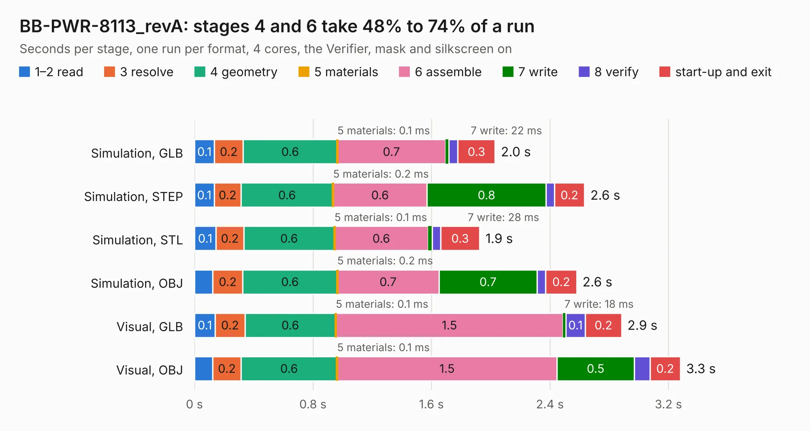

| Mode and format | 1–2 read | 3 resolve | 4 geometry | 5 materials | 6 assemble | 7 write | 8 verify | start-up and exit | Total |
|---|---:|---:|---:|---:|---:|---:|---:|---:|---:|
| Simulation, GLB | 0.1 | 0.2 | 0.6 | 0.1&nbsp;ms | 0.7 | 22&nbsp;ms | 62&nbsp;ms | 0.3 | 2.0 |
| Simulation, STEP | 0.1 | 0.2 | 0.6 | 0.2&nbsp;ms | 0.6 | 0.8 | 56&nbsp;ms | 0.2 | 2.6 |
| Simulation, STL | 0.1 | 0.2 | 0.6 | 0.1&nbsp;ms | 0.6 | 28&nbsp;ms | 56&nbsp;ms | 0.3 | 1.9 |
| Simulation, OBJ | 0.1 | 0.2 | 0.6 | 0.2&nbsp;ms | 0.7 | 0.7 | 58&nbsp;ms | 0.2 | 2.6 |
| Visual, GLB | 0.1 | 0.2 | 0.6 | 0.1&nbsp;ms | 1.5 | 18&nbsp;ms | 0.1 | 0.2 | 2.9 |
| Visual, OBJ | 0.1 | 0.2 | 0.6 | 0.1&nbsp;ms | 1.5 | 0.5 | 0.1 | 0.2 | 3.3 |

<table align="center"><tr><td valign="top">

| Board | Repo: [OLIMEX/BB-PWR-8113](https://github.com/OLIMEX/BB-PWR-8113) Board: `BB-PWR-8113_revA.kicad_pcb` |
|---|---|
| Complexity | 139&nbsp;/&nbsp;1000 (size&nbsp;119, features&nbsp;20) |
| KESE&nbsp;features | filled zones |
| Tested | 9th November 2026 |
| Copper&nbsp;layers | 2 |
| File&nbsp;format | KiCad 4 (4) |
| Parts,&nbsp;tracks,&nbsp;vias | 15, 81, 0 |
| Triangles,&nbsp;simulation | 112,386 in 20 parts |
| Verifier | PASS in all six runs |

</td><td valign="top">

<table>
<tr><th>File type</th><th>File size</th><th>Peak memory used</th></tr>
<tr><th colspan="3" align="left">Simulation</th></tr>
<tr><td>GLB</td><td align="right">4.1&nbsp;MB</td><td align="right">191&nbsp;MB</td></tr>
<tr><td>STEP</td><td align="right">21&nbsp;MB</td><td align="right">198&nbsp;MB</td></tr>
<tr><td>STL</td><td align="right">5.6&nbsp;MB</td><td align="right">191&nbsp;MB</td></tr>
<tr><td>OBJ</td><td align="right">11&nbsp;MB</td><td align="right">182&nbsp;MB</td></tr>
<tr><th colspan="3" align="left">Visual</th></tr>
<tr><td>GLB</td><td align="right">3.4&nbsp;MB</td><td align="right">159&nbsp;MB</td></tr>
<tr><td>OBJ</td><td align="right">9.3&nbsp;MB</td><td align="right">159&nbsp;MB</td></tr>
</table>

</td></tr></table>

## 23.17.22 BB-TB6612FNG-Rev_A

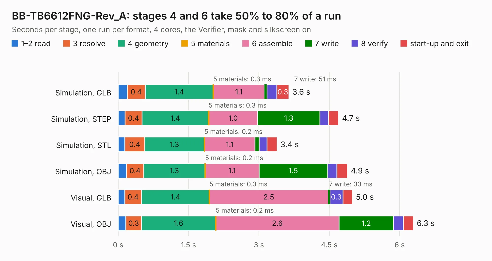

| Mode and format | 1–2 read | 3 resolve | 4 geometry | 5 materials | 6 assemble | 7 write | 8 verify | start-up and exit | Total |
|---|---:|---:|---:|---:|---:|---:|---:|---:|---:|
| Simulation, GLB | 0.2 | 0.4 | 1.4 | 0.3&nbsp;ms | 1.1 | 51&nbsp;ms | 0.2 | 0.3 | 3.6 |
| Simulation, STEP | 0.1 | 0.4 | 1.4 | 0.3&nbsp;ms | 1.0 | 1.3 | 0.2 | 0.2 | 4.7 |
| Simulation, STL | 0.1 | 0.4 | 1.3 | 0.2&nbsp;ms | 1.1 | 88&nbsp;ms | 0.2 | 0.2 | 3.4 |
| Simulation, OBJ | 0.2 | 0.4 | 1.3 | 0.2&nbsp;ms | 1.1 | 1.5 | 0.2 | 0.2 | 4.9 |
| Visual, GLB | 0.1 | 0.4 | 1.4 | 0.3&nbsp;ms | 2.5 | 33&nbsp;ms | 0.3 | 0.2 | 5.0 |
| Visual, OBJ | 0.2 | 0.3 | 1.6 | 0.2&nbsp;ms | 2.6 | 1.2 | 0.2 | 0.2 | 6.3 |

<table align="center"><tr><td valign="top">

| Board | Repo: [OLIMEX/BB-TB6612](https://github.com/OLIMEX/BB-TB6612) Board: `BB-TB6612FNG-Rev_A.kicad_pcb` |
|---|---|
| Folder | HARDWARE / BB-TB6612-Rev.A |
| Complexity | 167&nbsp;/&nbsp;1000 (size&nbsp;132, features&nbsp;35) |
| KESE&nbsp;features | through vias, filled zones |
| Tested | 9th November 2026 |
| Copper&nbsp;layers | 2 |
| File&nbsp;format | KiCad 5 (20171114) |
| Parts,&nbsp;tracks,&nbsp;vias | 15, 159, 7 |
| Triangles,&nbsp;simulation | 273,036 in 27 parts |
| Verifier | PASS in all six runs |

</td><td valign="top">

<table>
<tr><th>File type</th><th>File size</th><th>Peak memory used</th></tr>
<tr><th colspan="3" align="left">Simulation</th></tr>
<tr><td>GLB</td><td align="right">9.6&nbsp;MB</td><td align="right">232&nbsp;MB</td></tr>
<tr><td>STEP</td><td align="right">46&nbsp;MB</td><td align="right">248&nbsp;MB</td></tr>
<tr><td>STL</td><td align="right">14&nbsp;MB</td><td align="right">222&nbsp;MB</td></tr>
<tr><td>OBJ</td><td align="right">28&nbsp;MB</td><td align="right">231&nbsp;MB</td></tr>
<tr><th colspan="3" align="left">Visual</th></tr>
<tr><td>GLB</td><td align="right">7.1&nbsp;MB</td><td align="right">211&nbsp;MB</td></tr>
<tr><td>OBJ</td><td align="right">21&nbsp;MB</td><td align="right">221&nbsp;MB</td></tr>
</table>

</td></tr></table>

## 23.17.23 Bike-TSL-Kit_RevA

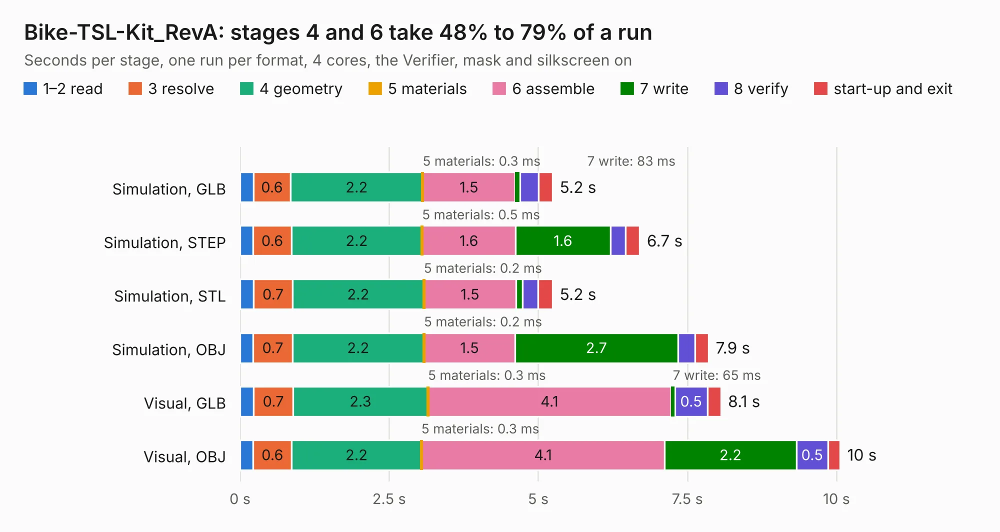

| Mode and format | 1–2 read | 3 resolve | 4 geometry | 5 materials | 6 assemble | 7 write | 8 verify | start-up and exit | Total |
|---|---:|---:|---:|---:|---:|---:|---:|---:|---:|
| Simulation, GLB | 0.2 | 0.6 | 2.2 | 0.3&nbsp;ms | 1.5 | 83&nbsp;ms | 0.3 | 0.2 | 5.2 |
| Simulation, STEP | 0.2 | 0.6 | 2.2 | 0.5&nbsp;ms | 1.6 | 1.6 | 0.3 | 0.2 | 6.7 |
| Simulation, STL | 0.2 | 0.7 | 2.2 | 0.2&nbsp;ms | 1.5 | 0.1 | 0.3 | 0.2 | 5.2 |
| Simulation, OBJ | 0.2 | 0.7 | 2.2 | 0.2&nbsp;ms | 1.5 | 2.7 | 0.3 | 0.2 | 7.9 |
| Visual, GLB | 0.2 | 0.7 | 2.3 | 0.3&nbsp;ms | 4.1 | 65&nbsp;ms | 0.5 | 0.2 | 8.1 |
| Visual, OBJ | 0.2 | 0.6 | 2.2 | 0.3&nbsp;ms | 4.1 | 2.2 | 0.5 | 0.2 | 10.1 |

<table align="center"><tr><td valign="top">

| Board | Repo: [OLIMEX/Bike-TSL-Kit](https://github.com/OLIMEX/Bike-TSL-Kit) Board: `Bike-TSL-Kit_RevA.kicad_pcb` |
|---|---|
| Folder | HARDWARE / Bike-TSL-Kit.Rev-A |
| Complexity | 206&nbsp;/&nbsp;1000 (size&nbsp;161, features&nbsp;45) |
| KESE&nbsp;features | through vias, filled zones, curved board outline |
| Tested | 9th November 2026 |
| Copper&nbsp;layers | 2 |
| File&nbsp;format | KiCad 5 (20171130) |
| Parts,&nbsp;tracks,&nbsp;vias | 46, 390, 45 |
| Triangles,&nbsp;simulation | 445,982 in 50 parts |
| Verifier | PASS in all six runs |

</td><td valign="top">

<table>
<tr><th>File type</th><th>File size</th><th>Peak memory used</th></tr>
<tr><th colspan="3" align="left">Simulation</th></tr>
<tr><td>GLB</td><td align="right">16&nbsp;MB</td><td align="right">300&nbsp;MB</td></tr>
<tr><td>STEP</td><td align="right">82&nbsp;MB</td><td align="right">338&nbsp;MB</td></tr>
<tr><td>STL</td><td align="right">22&nbsp;MB</td><td align="right">299&nbsp;MB</td></tr>
<tr><td>OBJ</td><td align="right">47&nbsp;MB</td><td align="right">360&nbsp;MB</td></tr>
<tr><th colspan="3" align="left">Visual</th></tr>
<tr><td>GLB</td><td align="right">14&nbsp;MB</td><td align="right">351&nbsp;MB</td></tr>
<tr><td>OBJ</td><td align="right">40&nbsp;MB</td><td align="right">362&nbsp;MB</td></tr>
</table>

</td></tr></table>

## 23.17.24 DCDC-50-5-12_Rev_A1

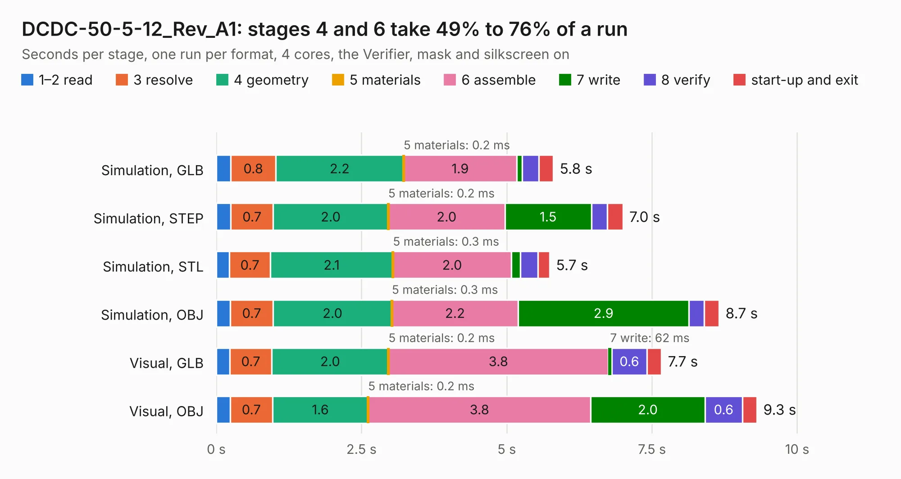

| Mode and format | 1–2 read | 3 resolve | 4 geometry | 5 materials | 6 assemble | 7 write | 8 verify | start-up and exit | Total |
|---|---:|---:|---:|---:|---:|---:|---:|---:|---:|
| Simulation, GLB | 0.3 | 0.8 | 2.2 | 0.2&nbsp;ms | 1.9 | 94&nbsp;ms | 0.3 | 0.3 | 5.8 |
| Simulation, STEP | 0.3 | 0.7 | 2.0 | 0.2&nbsp;ms | 2.0 | 1.5 | 0.3 | 0.3 | 7.0 |
| Simulation, STL | 0.2 | 0.7 | 2.1 | 0.3&nbsp;ms | 2.0 | 0.2 | 0.3 | 0.2 | 5.7 |
| Simulation, OBJ | 0.2 | 0.7 | 2.0 | 0.3&nbsp;ms | 2.2 | 2.9 | 0.3 | 0.3 | 8.7 |
| Visual, GLB | 0.2 | 0.7 | 2.0 | 0.2&nbsp;ms | 3.8 | 62&nbsp;ms | 0.6 | 0.3 | 7.7 |
| Visual, OBJ | 0.2 | 0.7 | 1.6 | 0.2&nbsp;ms | 3.8 | 2.0 | 0.6 | 0.2 | 9.3 |

<table align="center"><tr><td valign="top">

| Board | Repo: [OLIMEX/DCDC-50-5-12](https://github.com/OLIMEX/DCDC-50-5-12) Board: `DCDC-50-5-12_Rev_A1.kicad_pcb` |
|---|---|
| Folder | HARDWARE / DCDC50-5-12-Rev.A1 |
| Complexity | 233&nbsp;/&nbsp;1000 (size&nbsp;178, features&nbsp;55) |
| KESE&nbsp;features | through vias, slotted holes, filled zones, copper text |
| Tested | 9th November 2026 |
| Copper&nbsp;layers | 4 |
| File&nbsp;format | KiCad 5 (20171130) |
| Parts,&nbsp;tracks,&nbsp;vias | 28, 295, 142 |
| Triangles,&nbsp;simulation | 636,148 in 35 parts |
| Verifier | PASS in all six runs |

</td><td valign="top">

<table>
<tr><th>File type</th><th>File size</th><th>Peak memory used</th></tr>
<tr><th colspan="3" align="left">Simulation</th></tr>
<tr><td>GLB</td><td align="right">22&nbsp;MB</td><td align="right">337&nbsp;MB</td></tr>
<tr><td>STEP</td><td align="right">68&nbsp;MB</td><td align="right">410&nbsp;MB</td></tr>
<tr><td>STL</td><td align="right">32&nbsp;MB</td><td align="right">351&nbsp;MB</td></tr>
<tr><td>OBJ</td><td align="right">65&nbsp;MB</td><td align="right">467&nbsp;MB</td></tr>
<tr><th colspan="3" align="left">Visual</th></tr>
<tr><td>GLB</td><td align="right">13&nbsp;MB</td><td align="right">346&nbsp;MB</td></tr>
<tr><td>OBJ</td><td align="right">40&nbsp;MB</td><td align="right">359&nbsp;MB</td></tr>
</table>

</td></tr></table>

## 23.17.25 TERES_PCB1-A64-MAIN_Rev.B

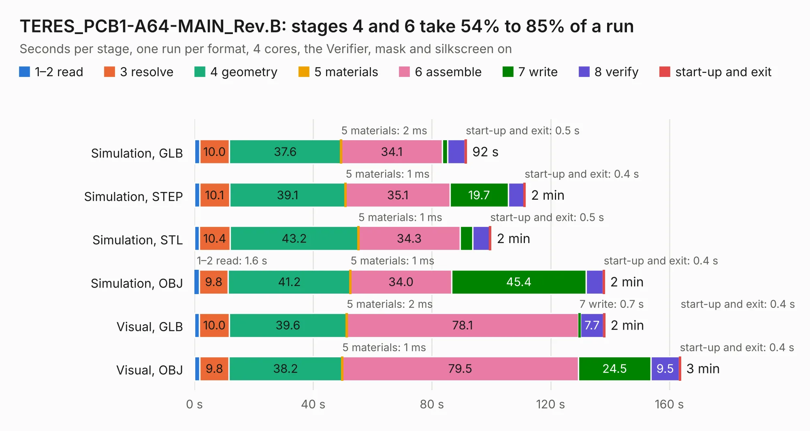

| Mode and format | 1–2 read | 3 resolve | 4 geometry | 5 materials | 6 assemble | 7 write | 8 verify | start-up and exit | Total |
|---|---:|---:|---:|---:|---:|---:|---:|---:|---:|
| Simulation, GLB | 1.7 | 10.0 | 37.6 | 2&nbsp;ms | 34.1 | 1.8 | 5.9 | 0.5 | 91.7 |
| Simulation, STEP | 1.7 | 10.1 | 39.1 | 1&nbsp;ms | 35.1 | 19.7 | 5.3 | 0.4 | 111.4 |
| Simulation, STL | 1.6 | 10.4 | 43.2 | 1&nbsp;ms | 34.3 | 4.2 | 5.7 | 0.5 | 99.9 |
| Simulation, OBJ | 1.6 | 9.8 | 41.2 | 1&nbsp;ms | 34.0 | 45.4 | 5.7 | 0.4 | 138.1 |
| Visual, GLB | 1.7 | 10.0 | 39.6 | 2&nbsp;ms | 78.1 | 0.7 | 7.7 | 0.4 | 138.2 |
| Visual, OBJ | 1.8 | 9.8 | 38.2 | 1&nbsp;ms | 79.5 | 24.5 | 9.5 | 0.4 | 163.7 |

<table align="center"><tr><td valign="top">

| Board | Repo: [OLIMEX/DIY-LAPTOP](https://github.com/OLIMEX/DIY-LAPTOP) Board: `TERES_PCB1-A64-MAIN_Rev.B.kicad_pcb` |
|---|---|
| Folder | HARDWARE / A64-TERES / TERES-PCB1-A64-MAIN / Rev.B |
| Complexity | 381&nbsp;/&nbsp;1000 (size&nbsp;336, features&nbsp;45) |
| KESE&nbsp;features | through vias, slotted holes, filled zones |
| Tested | 9th November 2026 |
| Copper&nbsp;layers | 6 |
| File&nbsp;format | KiCad 5 (20160815) |
| Parts,&nbsp;tracks,&nbsp;vias | 400, 13,060, 1,291 |
| Triangles,&nbsp;simulation | 9,712,620 in 480 parts |
| Verifier | PASS in all six runs |

</td><td valign="top">

<table>
<tr><th>File type</th><th>File size</th><th>Peak memory used</th></tr>
<tr><th colspan="3" align="left">Simulation</th></tr>
<tr><td>GLB</td><td align="right">337&nbsp;MB</td><td align="right">2.4&nbsp;GB</td></tr>
<tr><td>STEP</td><td align="right">1.3&nbsp;GB</td><td align="right">3.1&nbsp;GB</td></tr>
<tr><td>STL</td><td align="right">486&nbsp;MB</td><td align="right">2.4&nbsp;GB</td></tr>
<tr><td>OBJ</td><td align="right">1.1&nbsp;GB</td><td align="right">6.2&nbsp;GB</td></tr>
<tr><th colspan="3" align="left">Visual</th></tr>
<tr><td>GLB</td><td align="right">186&nbsp;MB</td><td align="right">2.9&nbsp;GB</td></tr>
<tr><td>OBJ</td><td align="right">607&nbsp;MB</td><td align="right">4.0&nbsp;GB</td></tr>
</table>

</td></tr></table>

## 23.17.26 TERES_PCB1-A64-MAIN_Rev.C

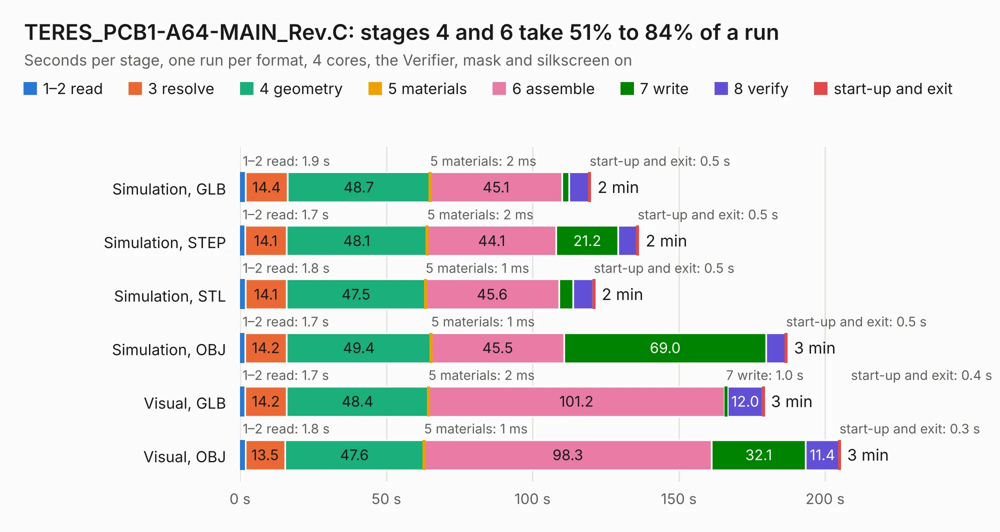

| Mode and format | 1–2 read | 3 resolve | 4 geometry | 5 materials | 6 assemble | 7 write | 8 verify | start-up and exit | Total |
|---|---:|---:|---:|---:|---:|---:|---:|---:|---:|
| Simulation, GLB | 1.9 | 14.4 | 48.7 | 2&nbsp;ms | 45.1 | 2.3 | 6.9 | 0.5 | 119.8 |
| Simulation, STEP | 1.7 | 14.1 | 48.1 | 2&nbsp;ms | 44.1 | 21.2 | 6.4 | 0.5 | 136.2 |
| Simulation, STL | 1.8 | 14.1 | 47.5 | 1&nbsp;ms | 45.6 | 4.8 | 6.9 | 0.5 | 121.2 |
| Simulation, OBJ | 1.7 | 14.2 | 49.4 | 1&nbsp;ms | 45.5 | 69.0 | 6.6 | 0.5 | 186.9 |
| Visual, GLB | 1.7 | 14.2 | 48.4 | 2&nbsp;ms | 101.2 | 1.0 | 12.0 | 0.4 | 179.1 |
| Visual, OBJ | 1.8 | 13.5 | 47.6 | 1&nbsp;ms | 98.3 | 32.1 | 11.4 | 0.3 | 205.1 |

<table align="center"><tr><td valign="top">

| Board | Repo: [OLIMEX/DIY-LAPTOP](https://github.com/OLIMEX/DIY-LAPTOP) Board: `TERES_PCB1-A64-MAIN_Rev.C.kicad_pcb` |
|---|---|
| Folder | HARDWARE / A64-TERES / TERES-PCB1-A64-MAIN / Rev.C |
| Complexity | 364&nbsp;/&nbsp;1000 (size&nbsp;339, features&nbsp;25) |
| KESE&nbsp;features | through vias, slotted holes |
| Tested | 9th November 2026 |
| Copper&nbsp;layers | 6 |
| File&nbsp;format | KiCad 5 (20171114) |
| Parts,&nbsp;tracks,&nbsp;vias | 416, 15,612, 1,594 |
| Triangles,&nbsp;simulation | 10,472,450 in 492 parts |
| Verifier | PASS in all six runs |

</td><td valign="top">

<table>
<tr><th>File type</th><th>File size</th><th>Peak memory used</th></tr>
<tr><th colspan="3" align="left">Simulation</th></tr>
<tr><td>GLB</td><td align="right">362&nbsp;MB</td><td align="right">2.3&nbsp;GB</td></tr>
<tr><td>STEP</td><td align="right">1.3&nbsp;GB</td><td align="right">3.3&nbsp;GB</td></tr>
<tr><td>STL</td><td align="right">524&nbsp;MB</td><td align="right">2.4&nbsp;GB</td></tr>
<tr><td>OBJ</td><td align="right">1.1&nbsp;GB</td><td align="right">6.5&nbsp;GB</td></tr>
<tr><th colspan="3" align="left">Visual</th></tr>
<tr><td>GLB</td><td align="right">197&nbsp;MB</td><td align="right">3.2&nbsp;GB</td></tr>
<tr><td>OBJ</td><td align="right">648&nbsp;MB</td><td align="right">4.3&nbsp;GB</td></tr>
</table>

</td></tr></table>

## 23.17.27 TERES-PCB2-IO_Rev.B

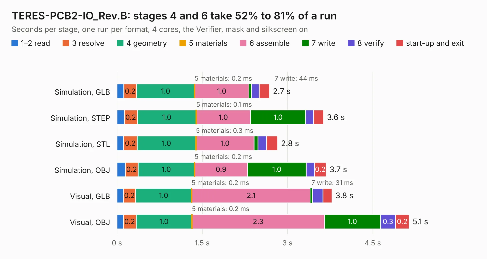

| Mode and format | 1–2 read | 3 resolve | 4 geometry | 5 materials | 6 assemble | 7 write | 8 verify | start-up and exit | Total |
|---|---:|---:|---:|---:|---:|---:|---:|---:|---:|
| Simulation, GLB | 0.1 | 0.2 | 1.0 | 0.2&nbsp;ms | 1.0 | 44&nbsp;ms | 0.1 | 0.2 | 2.7 |
| Simulation, STEP | 0.1 | 0.2 | 1.0 | 0.1&nbsp;ms | 1.0 | 1.0 | 0.1 | 0.2 | 3.6 |
| Simulation, STL | 0.1 | 0.2 | 1.0 | 0.3&nbsp;ms | 1.0 | 71&nbsp;ms | 0.2 | 0.2 | 2.8 |
| Simulation, OBJ | 0.1 | 0.2 | 1.0 | 0.2&nbsp;ms | 0.9 | 1.0 | 0.1 | 0.2 | 3.7 |
| Visual, GLB | 0.1 | 0.2 | 1.0 | 0.2&nbsp;ms | 2.1 | 31&nbsp;ms | 0.2 | 0.2 | 3.8 |
| Visual, OBJ | 0.1 | 0.2 | 1.0 | 0.2&nbsp;ms | 2.3 | 1.0 | 0.3 | 0.2 | 5.1 |

<table align="center"><tr><td valign="top">

| Board | Repo: [OLIMEX/DIY-LAPTOP](https://github.com/OLIMEX/DIY-LAPTOP) Board: `TERES-PCB2-IO_Rev.B.kicad_pcb` |
|---|---|
| Folder | HARDWARE / A64-TERES / TERES-PCB2-IO / Rev.B |
| Complexity | 194&nbsp;/&nbsp;1000 (size&nbsp;149, features&nbsp;45) |
| KESE&nbsp;features | through vias, slotted holes, filled zones |
| Tested | 9th November 2026 |
| Copper&nbsp;layers | 2 |
| File&nbsp;format | KiCad 5 (20160815) |
| Parts,&nbsp;tracks,&nbsp;vias | 18, 379, 24 |
| Triangles,&nbsp;simulation | 271,896 in 41 parts |
| Verifier | PASS in all six runs |

</td><td valign="top">

<table>
<tr><th>File type</th><th>File size</th><th>Peak memory used</th></tr>
<tr><th colspan="3" align="left">Simulation</th></tr>
<tr><td>GLB</td><td align="right">9.8&nbsp;MB</td><td align="right">236&nbsp;MB</td></tr>
<tr><td>STEP</td><td align="right">51&nbsp;MB</td><td align="right">264&nbsp;MB</td></tr>
<tr><td>STL</td><td align="right">14&nbsp;MB</td><td align="right">235&nbsp;MB</td></tr>
<tr><td>OBJ</td><td align="right">28&nbsp;MB</td><td align="right">236&nbsp;MB</td></tr>
<tr><th colspan="3" align="left">Visual</th></tr>
<tr><td>GLB</td><td align="right">7.9&nbsp;MB</td><td align="right">248&nbsp;MB</td></tr>
<tr><td>OBJ</td><td align="right">23&nbsp;MB</td><td align="right">244&nbsp;MB</td></tr>
</table>

</td></tr></table>

## 23.17.28 TERES-PCB3-TOUCH-BTN_Rev.A

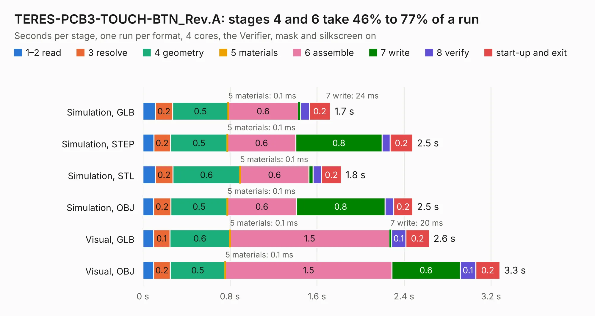

| Mode and format | 1–2 read | 3 resolve | 4 geometry | 5 materials | 6 assemble | 7 write | 8 verify | start-up and exit | Total |
|---|---:|---:|---:|---:|---:|---:|---:|---:|---:|
| Simulation, GLB | 0.1 | 0.2 | 0.5 | 0.1&nbsp;ms | 0.6 | 24&nbsp;ms | 80&nbsp;ms | 0.2 | 1.7 |
| Simulation, STEP | 0.1 | 0.2 | 0.5 | 0.1&nbsp;ms | 0.6 | 0.8 | 74&nbsp;ms | 0.2 | 2.5 |
| Simulation, STL | 0.1 | 0.2 | 0.6 | 0.1&nbsp;ms | 0.6 | 38&nbsp;ms | 78&nbsp;ms | 0.2 | 1.8 |
| Simulation, OBJ | 99&nbsp;ms | 0.2 | 0.5 | 0.1&nbsp;ms | 0.6 | 0.8 | 78&nbsp;ms | 0.2 | 2.5 |
| Visual, GLB | 98&nbsp;ms | 0.1 | 0.6 | 0.1&nbsp;ms | 1.5 | 20&nbsp;ms | 0.1 | 0.2 | 2.6 |
| Visual, OBJ | 0.1 | 0.2 | 0.5 | 0.1&nbsp;ms | 1.5 | 0.6 | 0.1 | 0.2 | 3.3 |

<table align="center"><tr><td valign="top">

| Board | Repo: [OLIMEX/DIY-LAPTOP](https://github.com/OLIMEX/DIY-LAPTOP) Board: `TERES-PCB3-TOUCH-BTN_Rev.A.kicad_pcb` |
|---|---|
| Folder | HARDWARE / A64-TERES / TERES-PCB3-TOUCH-BTN / Rev.A |
| Complexity | 153&nbsp;/&nbsp;1000 (size&nbsp;118, features&nbsp;35) |
| KESE&nbsp;features | through vias, filled zones |
| Tested | 9th November 2026 |
| Copper&nbsp;layers | 2 |
| File&nbsp;format | KiCad 5 (20160815) |
| Parts,&nbsp;tracks,&nbsp;vias | 6, 87, 14 |
| Triangles,&nbsp;simulation | 150,842 in 20 parts |
| Verifier | PASS in all six runs |

</td><td valign="top">

<table>
<tr><th>File type</th><th>File size</th><th>Peak memory used</th></tr>
<tr><th colspan="3" align="left">Simulation</th></tr>
<tr><td>GLB</td><td align="right">5.4&nbsp;MB</td><td align="right">207&nbsp;MB</td></tr>
<tr><td>STEP</td><td align="right">26&nbsp;MB</td><td align="right">214&nbsp;MB</td></tr>
<tr><td>STL</td><td align="right">7.5&nbsp;MB</td><td align="right">202&nbsp;MB</td></tr>
<tr><td>OBJ</td><td align="right">15&nbsp;MB</td><td align="right">209&nbsp;MB</td></tr>
<tr><th colspan="3" align="left">Visual</th></tr>
<tr><td>GLB</td><td align="right">4.6&nbsp;MB</td><td align="right">177&nbsp;MB</td></tr>
<tr><td>OBJ</td><td align="right">13&nbsp;MB</td><td align="right">181&nbsp;MB</td></tr>
</table>

</td></tr></table>

## 23.17.29 PCB4-PWR-BTN_Rev.A

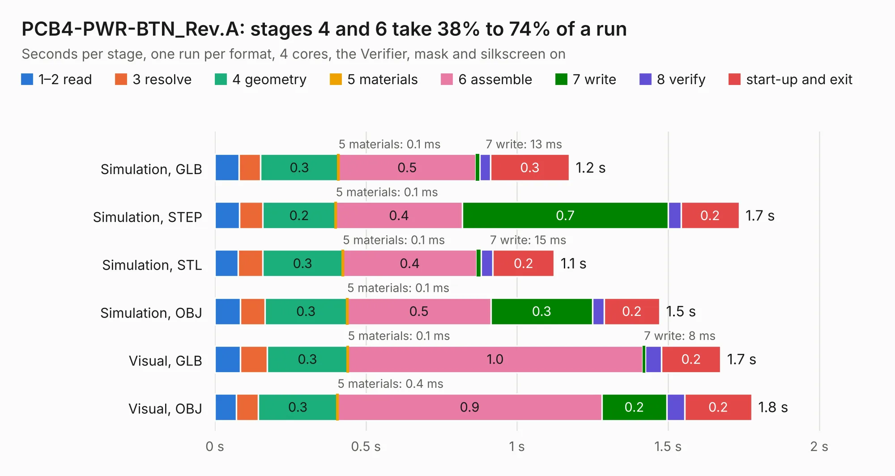

| Mode and format | 1–2 read | 3 resolve | 4 geometry | 5 materials | 6 assemble | 7 write | 8 verify | start-up and exit | Total |
|---|---:|---:|---:|---:|---:|---:|---:|---:|---:|
| Simulation, GLB | 79&nbsp;ms | 71&nbsp;ms | 0.3 | 0.1&nbsp;ms | 0.5 | 13&nbsp;ms | 35&nbsp;ms | 0.3 | 1.2 |
| Simulation, STEP | 82&nbsp;ms | 76&nbsp;ms | 0.2 | 0.1&nbsp;ms | 0.4 | 0.7 | 42&nbsp;ms | 0.2 | 1.7 |
| Simulation, STL | 77&nbsp;ms | 81&nbsp;ms | 0.3 | 0.1&nbsp;ms | 0.4 | 15&nbsp;ms | 39&nbsp;ms | 0.2 | 1.1 |
| Simulation, OBJ | 85&nbsp;ms | 80&nbsp;ms | 0.3 | 0.1&nbsp;ms | 0.5 | 0.3 | 38&nbsp;ms | 0.2 | 1.5 |
| Visual, GLB | 85&nbsp;ms | 88&nbsp;ms | 0.3 | 0.1&nbsp;ms | 1.0 | 8&nbsp;ms | 54&nbsp;ms | 0.2 | 1.7 |
| Visual, OBJ | 72&nbsp;ms | 72&nbsp;ms | 0.3 | 0.4&nbsp;ms | 0.9 | 0.2 | 60&nbsp;ms | 0.2 | 1.8 |

<table align="center"><tr><td valign="top">

| Board | Repo: [OLIMEX/DIY-LAPTOP](https://github.com/OLIMEX/DIY-LAPTOP) Board: `PCB4-PWR-BTN_Rev.A.kicad_pcb` |
|---|---|
| Folder | HARDWARE / A64-TERES / TERES-PCB4-PWR-BTN / Rev.A |
| Complexity | 137&nbsp;/&nbsp;1000 (size&nbsp;102, features&nbsp;35) |
| KESE&nbsp;features | through vias, filled zones |
| Tested | 9th November 2026 |
| Copper&nbsp;layers | 2 |
| File&nbsp;format | KiCad 5 (20160815) |
| Parts,&nbsp;tracks,&nbsp;vias | 2, 43, 14 |
| Triangles,&nbsp;simulation | 68,078 in 14 parts |
| Verifier | PASS in all six runs |

</td><td valign="top">

<table>
<tr><th>File type</th><th>File size</th><th>Peak memory used</th></tr>
<tr><th colspan="3" align="left">Simulation</th></tr>
<tr><td>GLB</td><td align="right">2.4&nbsp;MB</td><td align="right">171&nbsp;MB</td></tr>
<tr><td>STEP</td><td align="right">11&nbsp;MB</td><td align="right">176&nbsp;MB</td></tr>
<tr><td>STL</td><td align="right">3.4&nbsp;MB</td><td align="right">170&nbsp;MB</td></tr>
<tr><td>OBJ</td><td align="right">6.6&nbsp;MB</td><td align="right">170&nbsp;MB</td></tr>
<tr><th colspan="3" align="left">Visual</th></tr>
<tr><td>GLB</td><td align="right">2.0&nbsp;MB</td><td align="right">151&nbsp;MB</td></tr>
<tr><td>OBJ</td><td align="right">5.4&nbsp;MB</td><td align="right">152&nbsp;MB</td></tr>
</table>

</td></tr></table>

## 23.17.30 TERES-PCB5-KEYBOARD_Rev.A

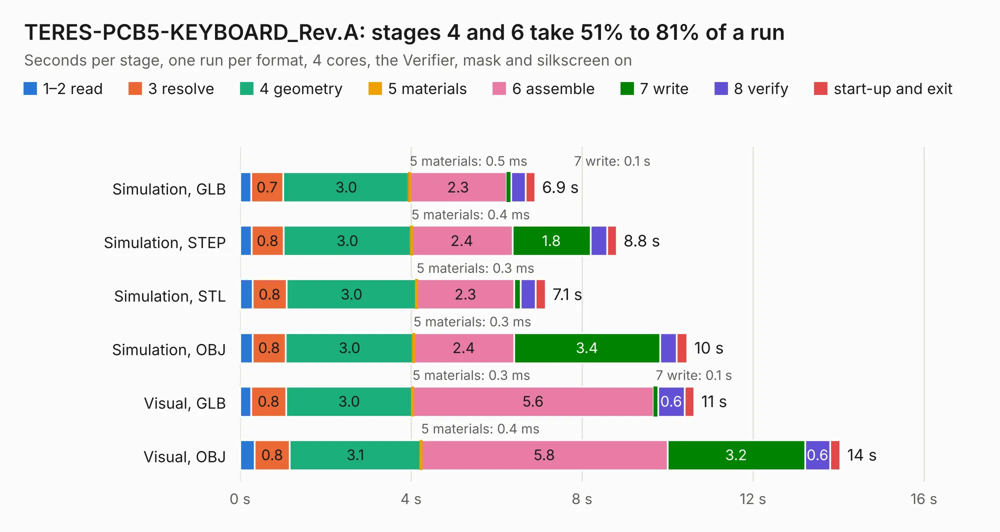

| Mode and format | 1–2 read | 3 resolve | 4 geometry | 5 materials | 6 assemble | 7 write | 8 verify | start-up and exit | Total |
|---|---:|---:|---:|---:|---:|---:|---:|---:|---:|
| Simulation, GLB | 0.3 | 0.7 | 3.0 | 0.5&nbsp;ms | 2.3 | 0.1 | 0.3 | 0.2 | 6.9 |
| Simulation, STEP | 0.3 | 0.8 | 3.0 | 0.4&nbsp;ms | 2.4 | 1.8 | 0.4 | 0.2 | 8.8 |
| Simulation, STL | 0.3 | 0.8 | 3.0 | 0.3&nbsp;ms | 2.3 | 0.1 | 0.3 | 0.2 | 7.1 |
| Simulation, OBJ | 0.3 | 0.8 | 3.0 | 0.3&nbsp;ms | 2.4 | 3.4 | 0.4 | 0.2 | 10.5 |
| Visual, GLB | 0.3 | 0.8 | 3.0 | 0.3&nbsp;ms | 5.6 | 0.1 | 0.6 | 0.2 | 10.6 |
| Visual, OBJ | 0.3 | 0.8 | 3.1 | 0.4&nbsp;ms | 5.8 | 3.2 | 0.6 | 0.2 | 14.0 |

<table align="center"><tr><td valign="top">

| Board | Repo: [OLIMEX/DIY-LAPTOP](https://github.com/OLIMEX/DIY-LAPTOP) Board: `TERES-PCB5-KEYBOARD_Rev.A.kicad_pcb` |
|---|---|
| Folder | HARDWARE / A64-TERES / TERES-PCB5-KEYBOARD / Rev.A |
| Complexity | 247&nbsp;/&nbsp;1000 (size&nbsp;212, features&nbsp;35) |
| KESE&nbsp;features | through vias, filled zones |
| Tested | 9th November 2026 |
| Copper&nbsp;layers | 2 |
| File&nbsp;format | KiCad 5 (20170123) |
| Parts,&nbsp;tracks,&nbsp;vias | 46, 778, 76 |
| Triangles,&nbsp;simulation | 600,674 in 55 parts |
| Verifier | PASS in all six runs |

</td><td valign="top">

<table>
<tr><th>File type</th><th>File size</th><th>Peak memory used</th></tr>
<tr><th colspan="3" align="left">Simulation</th></tr>
<tr><td>GLB</td><td align="right">22&nbsp;MB</td><td align="right">350&nbsp;MB</td></tr>
<tr><td>STEP</td><td align="right">117&nbsp;MB</td><td align="right">421&nbsp;MB</td></tr>
<tr><td>STL</td><td align="right">30&nbsp;MB</td><td align="right">365&nbsp;MB</td></tr>
<tr><td>OBJ</td><td align="right">64&nbsp;MB</td><td align="right">460&nbsp;MB</td></tr>
<tr><th colspan="3" align="left">Visual</th></tr>
<tr><td>GLB</td><td align="right">20&nbsp;MB</td><td align="right">482&nbsp;MB</td></tr>
<tr><td>OBJ</td><td align="right">59&nbsp;MB</td><td align="right">482&nbsp;MB</td></tr>
</table>

</td></tr></table>

## 23.17.31 eduArdu_Rev_A

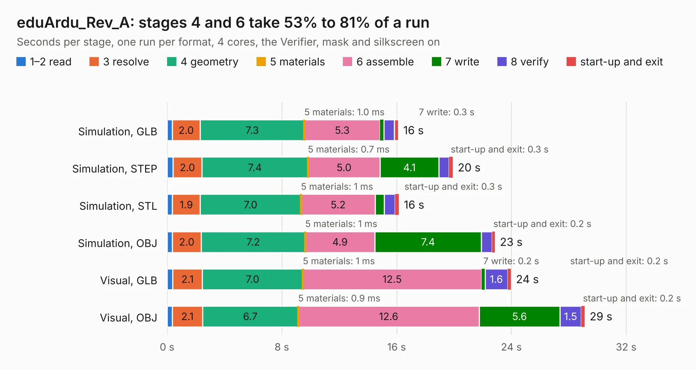

| Mode and format | 1–2 read | 3 resolve | 4 geometry | 5 materials | 6 assemble | 7 write | 8 verify | start-up and exit | Total |
|---|---:|---:|---:|---:|---:|---:|---:|---:|---:|
| Simulation, GLB | 0.4 | 2.0 | 7.3 | 1.0&nbsp;ms | 5.3 | 0.3 | 0.7 | 0.3 | 16.1 |
| Simulation, STEP | 0.4 | 2.0 | 7.4 | 0.7&nbsp;ms | 5.0 | 4.1 | 0.7 | 0.3 | 19.9 |
| Simulation, STL | 0.4 | 1.9 | 7.0 | 1&nbsp;ms | 5.2 | 0.6 | 0.7 | 0.3 | 16.2 |
| Simulation, OBJ | 0.4 | 2.0 | 7.2 | 1&nbsp;ms | 4.9 | 7.4 | 0.7 | 0.2 | 22.9 |
| Visual, GLB | 0.4 | 2.1 | 7.0 | 1&nbsp;ms | 12.5 | 0.2 | 1.6 | 0.2 | 24.0 |
| Visual, OBJ | 0.4 | 2.1 | 6.7 | 0.9&nbsp;ms | 12.6 | 5.6 | 1.5 | 0.2 | 29.1 |

<table align="center"><tr><td valign="top">

| Board | Repo: [OLIMEX/eduArdu](https://github.com/OLIMEX/eduArdu) Board: `eduArdu_Rev_A.kicad_pcb` |
|---|---|
| Folder | HARDWARE / eduArdu_Rev_A |
| Complexity | 285&nbsp;/&nbsp;1000 (size&nbsp;230, features&nbsp;55) |
| KESE&nbsp;features | through vias, slotted holes, filled zones, curved board outline |
| Tested | 9th November 2026 |
| Copper&nbsp;layers | 2 |
| File&nbsp;format | KiCad 5 (20171130) |
| Parts,&nbsp;tracks,&nbsp;vias | 101, 1,356, 158 |
| Triangles,&nbsp;simulation | 1,603,596 in 116 parts |
| Verifier | PASS in all six runs |

</td><td valign="top">

<table>
<tr><th>File type</th><th>File size</th><th>Peak memory used</th></tr>
<tr><th colspan="3" align="left">Simulation</th></tr>
<tr><td>GLB</td><td align="right">56&nbsp;MB</td><td align="right">624&nbsp;MB</td></tr>
<tr><td>STEP</td><td align="right">292&nbsp;MB</td><td align="right">728&nbsp;MB</td></tr>
<tr><td>STL</td><td align="right">80&nbsp;MB</td><td align="right">628&nbsp;MB</td></tr>
<tr><td>OBJ</td><td align="right">170&nbsp;MB</td><td align="right">1.1&nbsp;GB</td></tr>
<tr><th colspan="3" align="left">Visual</th></tr>
<tr><td>GLB</td><td align="right">42&nbsp;MB</td><td align="right">753&nbsp;MB</td></tr>
<tr><td>OBJ</td><td align="right">128&nbsp;MB</td><td align="right">950&nbsp;MB</td></tr>
</table>

</td></tr></table>

## 23.17.32 eduArdu_Rev_B

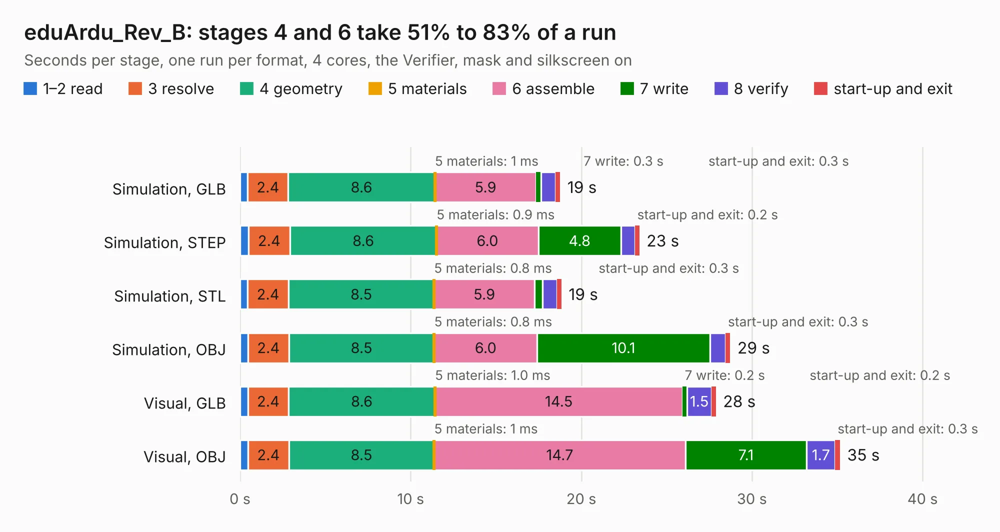

| Mode and format | 1–2 read | 3 resolve | 4 geometry | 5 materials | 6 assemble | 7 write | 8 verify | start-up and exit | Total |
|---|---:|---:|---:|---:|---:|---:|---:|---:|---:|
| Simulation, GLB | 0.4 | 2.4 | 8.6 | 1&nbsp;ms | 5.9 | 0.3 | 0.8 | 0.3 | 18.8 |
| Simulation, STEP | 0.5 | 2.4 | 8.6 | 0.9&nbsp;ms | 6.0 | 4.8 | 0.8 | 0.2 | 23.4 |
| Simulation, STL | 0.4 | 2.4 | 8.5 | 0.8&nbsp;ms | 5.9 | 0.5 | 0.8 | 0.3 | 18.8 |
| Simulation, OBJ | 0.5 | 2.4 | 8.5 | 0.8&nbsp;ms | 6.0 | 10.1 | 0.9 | 0.3 | 28.7 |
| Visual, GLB | 0.5 | 2.4 | 8.6 | 1.0&nbsp;ms | 14.5 | 0.2 | 1.5 | 0.2 | 27.9 |
| Visual, OBJ | 0.5 | 2.4 | 8.5 | 1&nbsp;ms | 14.7 | 7.1 | 1.7 | 0.3 | 35.2 |

<table align="center"><tr><td valign="top">

| Board | Repo: [OLIMEX/eduArdu](https://github.com/OLIMEX/eduArdu) Board: `eduArdu_Rev_B.kicad_pcb` |
|---|---|
| Folder | HARDWARE / eduArdu_Rev_B |
| Complexity | 285&nbsp;/&nbsp;1000 (size&nbsp;230, features&nbsp;55) |
| KESE&nbsp;features | through vias, slotted holes, filled zones, curved board outline |
| Tested | 9th November 2026 |
| Copper&nbsp;layers | 2 |
| File&nbsp;format | KiCad 5 (20171130) |
| Parts,&nbsp;tracks,&nbsp;vias | 101, 1,377, 168 |
| Triangles,&nbsp;simulation | 1,628,488 in 116 parts |
| Verifier | PASS in all six runs |

</td><td valign="top">

<table>
<tr><th>File type</th><th>File size</th><th>Peak memory used</th></tr>
<tr><th colspan="3" align="left">Simulation</th></tr>
<tr><td>GLB</td><td align="right">57&nbsp;MB</td><td align="right">646&nbsp;MB</td></tr>
<tr><td>STEP</td><td align="right">296&nbsp;MB</td><td align="right">754&nbsp;MB</td></tr>
<tr><td>STL</td><td align="right">81&nbsp;MB</td><td align="right">673&nbsp;MB</td></tr>
<tr><td>OBJ</td><td align="right">172&nbsp;MB</td><td align="right">1.1&nbsp;GB</td></tr>
<tr><th colspan="3" align="left">Visual</th></tr>
<tr><td>GLB</td><td align="right">43&nbsp;MB</td><td align="right">814&nbsp;MB</td></tr>
<tr><td>OBJ</td><td align="right">131&nbsp;MB</td><td align="right">979&nbsp;MB</td></tr>
</table>

</td></tr></table>

## 23.17.33 ESP-PROG_Rev.C

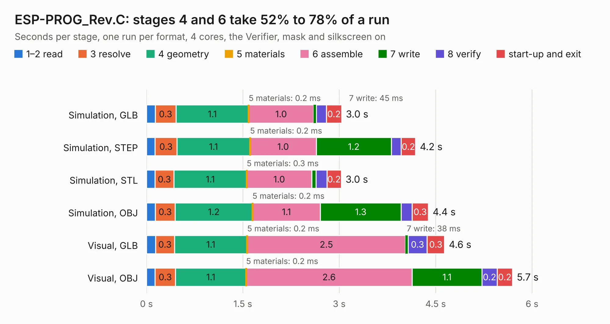

| Mode and format | 1–2 read | 3 resolve | 4 geometry | 5 materials | 6 assemble | 7 write | 8 verify | start-up and exit | Total |
|---|---:|---:|---:|---:|---:|---:|---:|---:|---:|
| Simulation, GLB | 0.1 | 0.3 | 1.1 | 0.2&nbsp;ms | 1.0 | 45&nbsp;ms | 0.2 | 0.2 | 3.0 |
| Simulation, STEP | 0.1 | 0.3 | 1.1 | 0.2&nbsp;ms | 1.0 | 1.2 | 0.2 | 0.2 | 4.2 |
| Simulation, STL | 0.1 | 0.3 | 1.1 | 0.3&nbsp;ms | 1.0 | 69&nbsp;ms | 0.2 | 0.2 | 3.0 |
| Simulation, OBJ | 0.1 | 0.3 | 1.2 | 0.2&nbsp;ms | 1.1 | 1.3 | 0.2 | 0.3 | 4.4 |
| Visual, GLB | 0.1 | 0.3 | 1.1 | 0.2&nbsp;ms | 2.5 | 38&nbsp;ms | 0.3 | 0.3 | 4.6 |
| Visual, OBJ | 0.1 | 0.3 | 1.1 | 0.2&nbsp;ms | 2.6 | 1.1 | 0.2 | 0.2 | 5.7 |

<table align="center"><tr><td valign="top">

| Board | Repo: [OLIMEX/ESP-PROG](https://github.com/OLIMEX/ESP-PROG) Board: `ESP-PROG_Rev.C.kicad_pcb` |
|---|---|
| Folder | HARDWARE / ESP-PROG-Rev.C |
| Complexity | 184&nbsp;/&nbsp;1000 (size&nbsp;139, features&nbsp;45) |
| KESE&nbsp;features | through vias, slotted holes, filled zones |
| Tested | 9th November 2026 |
| Copper&nbsp;layers | 2 |
| File&nbsp;format | KiCad 5 (20171130) |
| Parts,&nbsp;tracks,&nbsp;vias | 16, 204, 19 |
| Triangles,&nbsp;simulation | 277,428 in 36 parts |
| Verifier | PASS in all six runs |

</td><td valign="top">

<table>
<tr><th>File type</th><th>File size</th><th>Peak memory used</th></tr>
<tr><th colspan="3" align="left">Simulation</th></tr>
<tr><td>GLB</td><td align="right">9.9&nbsp;MB</td><td align="right">245&nbsp;MB</td></tr>
<tr><td>STEP</td><td align="right">53&nbsp;MB</td><td align="right">256&nbsp;MB</td></tr>
<tr><td>STL</td><td align="right">14&nbsp;MB</td><td align="right">237&nbsp;MB</td></tr>
<tr><td>OBJ</td><td align="right">28&nbsp;MB</td><td align="right">243&nbsp;MB</td></tr>
<tr><th colspan="3" align="left">Visual</th></tr>
<tr><td>GLB</td><td align="right">7.9&nbsp;MB</td><td align="right">235&nbsp;MB</td></tr>
<tr><td>OBJ</td><td align="right">23&nbsp;MB</td><td align="right">234&nbsp;MB</td></tr>
</table>

</td></tr></table>

## 23.17.34 ESP32-C3-DevKit-Lipo_Rev_A

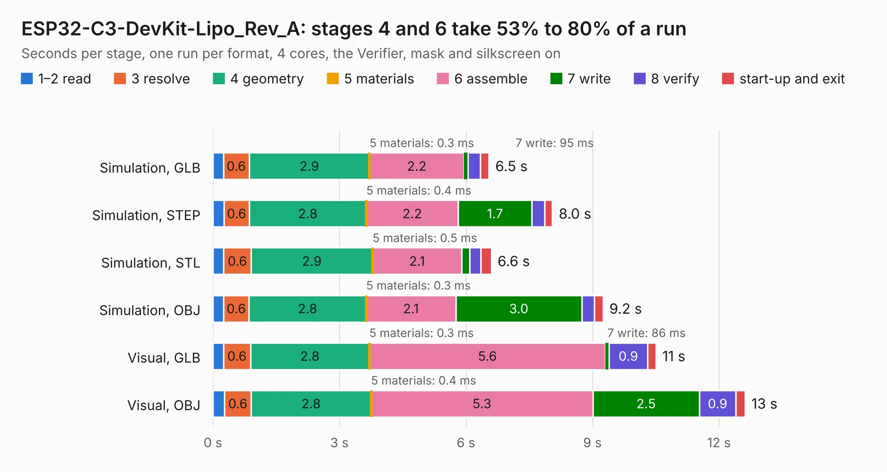

| Mode and format | 1–2 read | 3 resolve | 4 geometry | 5 materials | 6 assemble | 7 write | 8 verify | start-up and exit | Total |
|---|---:|---:|---:|---:|---:|---:|---:|---:|---:|
| Simulation, GLB | 0.2 | 0.6 | 2.9 | 0.3&nbsp;ms | 2.2 | 95&nbsp;ms | 0.3 | 0.2 | 6.5 |
| Simulation, STEP | 0.3 | 0.6 | 2.8 | 0.4&nbsp;ms | 2.2 | 1.7 | 0.3 | 0.2 | 8.0 |
| Simulation, STL | 0.3 | 0.6 | 2.9 | 0.5&nbsp;ms | 2.1 | 0.2 | 0.3 | 0.2 | 6.6 |
| Simulation, OBJ | 0.3 | 0.6 | 2.8 | 0.3&nbsp;ms | 2.1 | 3.0 | 0.3 | 0.2 | 9.2 |
| Visual, GLB | 0.3 | 0.6 | 2.8 | 0.3&nbsp;ms | 5.6 | 86&nbsp;ms | 0.9 | 0.2 | 10.5 |
| Visual, OBJ | 0.3 | 0.6 | 2.8 | 0.4&nbsp;ms | 5.3 | 2.5 | 0.9 | 0.2 | 12.6 |

<table align="center"><tr><td valign="top">

| Board | Repo: [OLIMEX/ESP32-C3-DevKit-Lipo](https://github.com/OLIMEX/ESP32-C3-DevKit-Lipo) Board: `ESP32-C3-DevKit-Lipo_Rev_A.kicad_pcb` |
|---|---|
| Folder | HARDWARE / ESP32-C3-DevKit-Lipo_Rev_A |
| Complexity | 224&nbsp;/&nbsp;1000 (size&nbsp;169, features&nbsp;55) |
| KESE&nbsp;features | through vias, slotted holes, filled zones, copper text |
| Tested | 9th November 2026 |
| Copper&nbsp;layers | 2 |
| File&nbsp;format | KiCad 5 (20171130) |
| Parts,&nbsp;tracks,&nbsp;vias | 41, 713, 63 |
| Triangles,&nbsp;simulation | 711,980 in 67 parts |
| Verifier | PASS in all six runs |

</td><td valign="top">

<table>
<tr><th>File type</th><th>File size</th><th>Peak memory used</th></tr>
<tr><th colspan="3" align="left">Simulation</th></tr>
<tr><td>GLB</td><td align="right">25&nbsp;MB</td><td align="right">372&nbsp;MB</td></tr>
<tr><td>STEP</td><td align="right">140&nbsp;MB</td><td align="right">455&nbsp;MB</td></tr>
<tr><td>STL</td><td align="right">36&nbsp;MB</td><td align="right">387&nbsp;MB</td></tr>
<tr><td>OBJ</td><td align="right">74&nbsp;MB</td><td align="right">537&nbsp;MB</td></tr>
<tr><th colspan="3" align="left">Visual</th></tr>
<tr><td>GLB</td><td align="right">21&nbsp;MB</td><td align="right">484&nbsp;MB</td></tr>
<tr><td>OBJ</td><td align="right">63&nbsp;MB</td><td align="right">475&nbsp;MB</td></tr>
</table>

</td></tr></table>

## 23.17.35 ESP32-C3-DevKit-Lipo_Rev_B

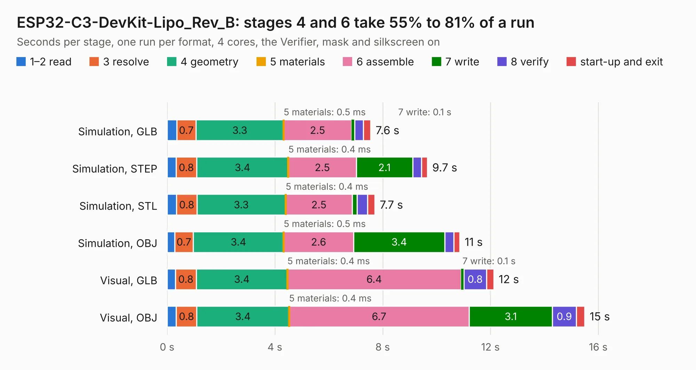

| Mode and format | 1–2 read | 3 resolve | 4 geometry | 5 materials | 6 assemble | 7 write | 8 verify | start-up and exit | Total |
|---|---:|---:|---:|---:|---:|---:|---:|---:|---:|
| Simulation, GLB | 0.4 | 0.7 | 3.3 | 0.5&nbsp;ms | 2.5 | 0.1 | 0.3 | 0.3 | 7.6 |
| Simulation, STEP | 0.3 | 0.8 | 3.4 | 0.4&nbsp;ms | 2.5 | 2.1 | 0.3 | 0.2 | 9.7 |
| Simulation, STL | 0.4 | 0.8 | 3.3 | 0.4&nbsp;ms | 2.5 | 0.2 | 0.4 | 0.3 | 7.7 |
| Simulation, OBJ | 0.3 | 0.7 | 3.4 | 0.5&nbsp;ms | 2.6 | 3.4 | 0.3 | 0.2 | 10.9 |
| Visual, GLB | 0.3 | 0.8 | 3.4 | 0.4&nbsp;ms | 6.4 | 0.1 | 0.8 | 0.3 | 12.1 |
| Visual, OBJ | 0.3 | 0.8 | 3.4 | 0.4&nbsp;ms | 6.7 | 3.1 | 0.9 | 0.3 | 15.5 |

<table align="center"><tr><td valign="top">

| Board | Repo: [OLIMEX/ESP32-C3-DevKit-Lipo](https://github.com/OLIMEX/ESP32-C3-DevKit-Lipo) Board: `ESP32-C3-DevKit-Lipo_Rev_B.kicad_pcb` |
|---|---|
| Folder | HARDWARE / ESP32-C3-DevKit-Lipo_Rev_B |
| Complexity | 224&nbsp;/&nbsp;1000 (size&nbsp;169, features&nbsp;55) |
| KESE&nbsp;features | through vias, slotted holes, filled zones, copper text |
| Tested | 9th November 2026 |
| Copper&nbsp;layers | 2 |
| File&nbsp;format | KiCad 5 (20171130) |
| Parts,&nbsp;tracks,&nbsp;vias | 42, 740, 61 |
| Triangles,&nbsp;simulation | 712,360 in 68 parts |
| Verifier | PASS in all six runs |

</td><td valign="top">

<table>
<tr><th>File type</th><th>File size</th><th>Peak memory used</th></tr>
<tr><th colspan="3" align="left">Simulation</th></tr>
<tr><td>GLB</td><td align="right">25&nbsp;MB</td><td align="right">367&nbsp;MB</td></tr>
<tr><td>STEP</td><td align="right">141&nbsp;MB</td><td align="right">452&nbsp;MB</td></tr>
<tr><td>STL</td><td align="right">36&nbsp;MB</td><td align="right">388&nbsp;MB</td></tr>
<tr><td>OBJ</td><td align="right">74&nbsp;MB</td><td align="right">525&nbsp;MB</td></tr>
<tr><th colspan="3" align="left">Visual</th></tr>
<tr><td>GLB</td><td align="right">21&nbsp;MB</td><td align="right">502&nbsp;MB</td></tr>
<tr><td>OBJ</td><td align="right">63&nbsp;MB</td><td align="right">499&nbsp;MB</td></tr>
</table>

</td></tr></table>

## 23.17.36 ESP32-C3-DevKit-Lipo_Rev_C

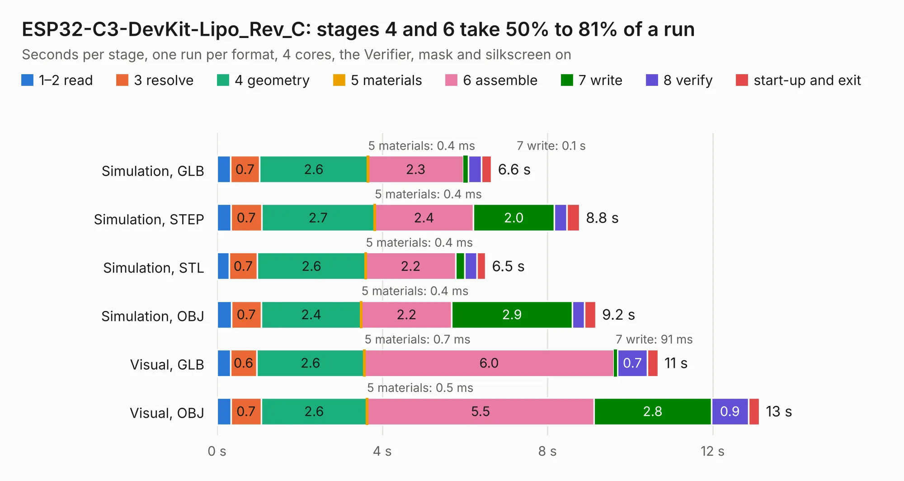

| Mode and format | 1–2 read | 3 resolve | 4 geometry | 5 materials | 6 assemble | 7 write | 8 verify | start-up and exit | Total |
|---|---:|---:|---:|---:|---:|---:|---:|---:|---:|
| Simulation, GLB | 0.3 | 0.7 | 2.6 | 0.4&nbsp;ms | 2.3 | 0.1 | 0.3 | 0.2 | 6.6 |
| Simulation, STEP | 0.3 | 0.7 | 2.7 | 0.4&nbsp;ms | 2.4 | 2.0 | 0.3 | 0.3 | 8.8 |
| Simulation, STL | 0.3 | 0.7 | 2.6 | 0.4&nbsp;ms | 2.2 | 0.2 | 0.3 | 0.2 | 6.5 |
| Simulation, OBJ | 0.3 | 0.7 | 2.4 | 0.4&nbsp;ms | 2.2 | 2.9 | 0.3 | 0.3 | 9.2 |
| Visual, GLB | 0.3 | 0.6 | 2.6 | 0.7&nbsp;ms | 6.0 | 91&nbsp;ms | 0.7 | 0.3 | 10.7 |
| Visual, OBJ | 0.3 | 0.7 | 2.6 | 0.5&nbsp;ms | 5.5 | 2.8 | 0.9 | 0.3 | 13.1 |

<table align="center"><tr><td valign="top">

| Board | Repo: [OLIMEX/ESP32-C3-DevKit-Lipo](https://github.com/OLIMEX/ESP32-C3-DevKit-Lipo) Board: `ESP32-C3-DevKit-Lipo_Rev_C.kicad_pcb` |
|---|---|
| Folder | HARDWARE / ESP32-C3-DevKit-Lipo_Rev_C |
| Complexity | 241&nbsp;/&nbsp;1000 (size&nbsp;171, features&nbsp;70) |
| KESE&nbsp;features | through vias, slotted holes, rounded, trapezoid or chamfered pads, filled zones, knockout text |
| Tested | 9th November 2026 |
| Copper&nbsp;layers | 2 |
| File&nbsp;format | KiCad 7 (20221018) |
| Parts,&nbsp;tracks,&nbsp;vias | 43, 768, 88 |
| Triangles,&nbsp;simulation | 667,752 in 67 parts |
| Verifier | PASS in all six runs |

</td><td valign="top">

<table>
<tr><th>File type</th><th>File size</th><th>Peak memory used</th></tr>
<tr><th colspan="3" align="left">Simulation</th></tr>
<tr><td>GLB</td><td align="right">24&nbsp;MB</td><td align="right">409&nbsp;MB</td></tr>
<tr><td>STEP</td><td align="right">135&nbsp;MB</td><td align="right">425&nbsp;MB</td></tr>
<tr><td>STL</td><td align="right">33&nbsp;MB</td><td align="right">410&nbsp;MB</td></tr>
<tr><td>OBJ</td><td align="right">70&nbsp;MB</td><td align="right">498&nbsp;MB</td></tr>
<tr><th colspan="3" align="left">Visual</th></tr>
<tr><td>GLB</td><td align="right">20&nbsp;MB</td><td align="right">479&nbsp;MB</td></tr>
<tr><td>OBJ</td><td align="right">60&nbsp;MB</td><td align="right">485&nbsp;MB</td></tr>
</table>

</td></tr></table>

## 23.17.37 ESP32-C3-DevKit-Lipo_Rev_D

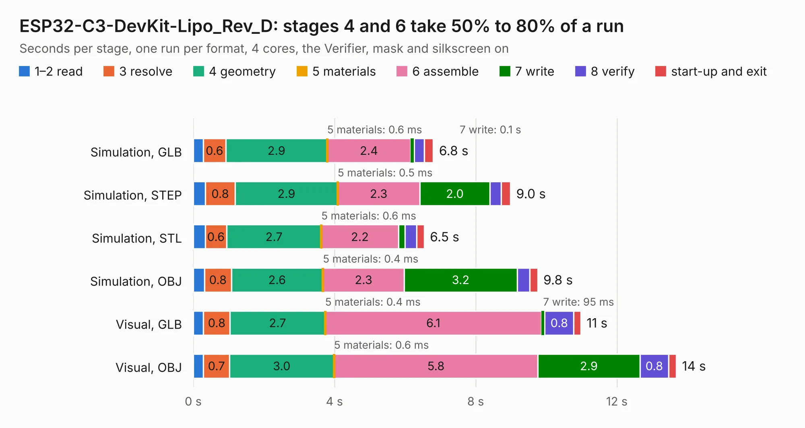

| Mode and format | 1–2 read | 3 resolve | 4 geometry | 5 materials | 6 assemble | 7 write | 8 verify | start-up and exit | Total |
|---|---:|---:|---:|---:|---:|---:|---:|---:|---:|
| Simulation, GLB | 0.3 | 0.6 | 2.9 | 0.6&nbsp;ms | 2.4 | 0.1 | 0.3 | 0.3 | 6.8 |
| Simulation, STEP | 0.3 | 0.8 | 2.9 | 0.5&nbsp;ms | 2.3 | 2.0 | 0.3 | 0.3 | 9.0 |
| Simulation, STL | 0.3 | 0.6 | 2.7 | 0.6&nbsp;ms | 2.2 | 0.2 | 0.3 | 0.2 | 6.5 |
| Simulation, OBJ | 0.3 | 0.8 | 2.6 | 0.4&nbsp;ms | 2.3 | 3.2 | 0.4 | 0.2 | 9.8 |
| Visual, GLB | 0.3 | 0.8 | 2.7 | 0.4&nbsp;ms | 6.1 | 95&nbsp;ms | 0.8 | 0.2 | 11.0 |
| Visual, OBJ | 0.3 | 0.7 | 3.0 | 0.6&nbsp;ms | 5.8 | 2.9 | 0.8 | 0.2 | 13.7 |

<table align="center"><tr><td valign="top">

| Board | Repo: [OLIMEX/ESP32-C3-DevKit-Lipo](https://github.com/OLIMEX/ESP32-C3-DevKit-Lipo) Board: `ESP32-C3-DevKit-Lipo_Rev_D.kicad_pcb` |
|---|---|
| Folder | HARDWARE / ESP32-C3-DevKit-Lipo_Rev_D |
| Complexity | 242&nbsp;/&nbsp;1000 (size&nbsp;172, features&nbsp;70) |
| KESE&nbsp;features | through vias, slotted holes, rounded, trapezoid or chamfered pads, filled zones, knockout text |
| Tested | 9th November 2026 |
| Copper&nbsp;layers | 2 |
| File&nbsp;format | KiCad 7 (20221018) |
| Parts,&nbsp;tracks,&nbsp;vias | 43, 799, 88 |
| Triangles,&nbsp;simulation | 676,008 in 67 parts |
| Verifier | PASS in all six runs |

</td><td valign="top">

<table>
<tr><th>File type</th><th>File size</th><th>Peak memory used</th></tr>
<tr><th colspan="3" align="left">Simulation</th></tr>
<tr><td>GLB</td><td align="right">24&nbsp;MB</td><td align="right">386&nbsp;MB</td></tr>
<tr><td>STEP</td><td align="right">138&nbsp;MB</td><td align="right">441&nbsp;MB</td></tr>
<tr><td>STL</td><td align="right">34&nbsp;MB</td><td align="right">421&nbsp;MB</td></tr>
<tr><td>OBJ</td><td align="right">71&nbsp;MB</td><td align="right">506&nbsp;MB</td></tr>
<tr><th colspan="3" align="left">Visual</th></tr>
<tr><td>GLB</td><td align="right">21&nbsp;MB</td><td align="right">508&nbsp;MB</td></tr>
<tr><td>OBJ</td><td align="right">61&nbsp;MB</td><td align="right">491&nbsp;MB</td></tr>
</table>

</td></tr></table>

## 23.17.38 ESP32-C5-DevKit-Lipo_Rev_A

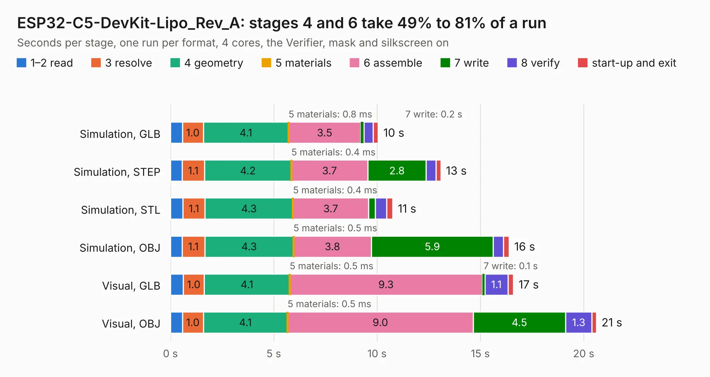

| Mode and format | 1–2 read | 3 resolve | 4 geometry | 5 materials | 6 assemble | 7 write | 8 verify | start-up and exit | Total |
|---|---:|---:|---:|---:|---:|---:|---:|---:|---:|
| Simulation, GLB | 0.6 | 1.0 | 4.1 | 0.8&nbsp;ms | 3.5 | 0.2 | 0.4 | 0.3 | 10.1 |
| Simulation, STEP | 0.6 | 1.1 | 4.2 | 0.4&nbsp;ms | 3.7 | 2.8 | 0.5 | 0.2 | 13.1 |
| Simulation, STL | 0.6 | 1.1 | 4.3 | 0.4&nbsp;ms | 3.7 | 0.3 | 0.6 | 0.3 | 10.8 |
| Simulation, OBJ | 0.6 | 1.1 | 4.3 | 0.5&nbsp;ms | 3.8 | 5.9 | 0.5 | 0.3 | 16.4 |
| Visual, GLB | 0.6 | 1.0 | 4.1 | 0.5&nbsp;ms | 9.3 | 0.1 | 1.1 | 0.3 | 16.6 |
| Visual, OBJ | 0.6 | 1.0 | 4.1 | 0.5&nbsp;ms | 9.0 | 4.5 | 1.3 | 0.2 | 20.6 |

<table align="center"><tr><td valign="top">

| Board | Repo: [OLIMEX/ESP32-C5-DevKit-Lipo](https://github.com/OLIMEX/ESP32-C5-DevKit-Lipo) Board: `ESP32-C5-DevKit-Lipo_Rev_A.kicad_pcb` |
|---|---|
| Folder | HARDWARE / ESP32-C5-DevKit-Lipo-Rev.A |
| Complexity | 296&nbsp;/&nbsp;1000 (size&nbsp;191, features&nbsp;105) |
| KESE&nbsp;features | through vias, slotted holes, rounded, trapezoid or chamfered pads, filled zones, knockout text, stack-up, dielectric εr and tanδ, mask and silkscreen colours |
| Tested | 9th November 2026 |
| Copper&nbsp;layers | 2 |
| File&nbsp;format | KiCad 7 (20221018) |
| Parts,&nbsp;tracks,&nbsp;vias | 72, 2,143, 108 |
| Triangles,&nbsp;simulation | 906,752 in 84 parts |
| Verifier | PASS in all six runs |

</td><td valign="top">

<table>
<tr><th>File type</th><th>File size</th><th>Peak memory used</th></tr>
<tr><th colspan="3" align="left">Simulation</th></tr>
<tr><td>GLB</td><td align="right">32&nbsp;MB</td><td align="right">457&nbsp;MB</td></tr>
<tr><td>STEP</td><td align="right">175&nbsp;MB</td><td align="right">509&nbsp;MB</td></tr>
<tr><td>STL</td><td align="right">45&nbsp;MB</td><td align="right">449&nbsp;MB</td></tr>
<tr><td>OBJ</td><td align="right">95&nbsp;MB</td><td align="right">670&nbsp;MB</td></tr>
<tr><th colspan="3" align="left">Visual</th></tr>
<tr><td>GLB</td><td align="right">26&nbsp;MB</td><td align="right">592&nbsp;MB</td></tr>
<tr><td>OBJ</td><td align="right">76&nbsp;MB</td><td align="right">598&nbsp;MB</td></tr>
</table>

</td></tr></table>

## 23.17.39 ESP32-C5-EVB_Rev_A

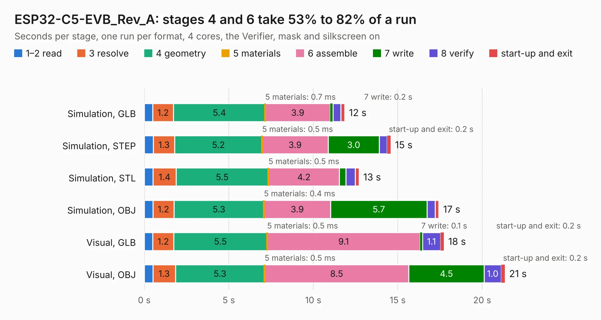

| Mode and format | 1–2 read | 3 resolve | 4 geometry | 5 materials | 6 assemble | 7 write | 8 verify | start-up and exit | Total |
|---|---:|---:|---:|---:|---:|---:|---:|---:|---:|
| Simulation, GLB | 0.5 | 1.2 | 5.4 | 0.7&nbsp;ms | 3.9 | 0.2 | 0.5 | 0.2 | 11.9 |
| Simulation, STEP | 0.5 | 1.3 | 5.2 | 0.5&nbsp;ms | 3.9 | 3.0 | 0.5 | 0.2 | 14.6 |
| Simulation, STL | 0.5 | 1.4 | 5.5 | 0.5&nbsp;ms | 4.2 | 0.4 | 0.5 | 0.2 | 12.7 |
| Simulation, OBJ | 0.5 | 1.2 | 5.3 | 0.4&nbsp;ms | 3.9 | 5.7 | 0.5 | 0.2 | 17.4 |
| Visual, GLB | 0.5 | 1.2 | 5.5 | 0.5&nbsp;ms | 9.1 | 0.1 | 1.1 | 0.2 | 17.7 |
| Visual, OBJ | 0.5 | 1.3 | 5.3 | 0.5&nbsp;ms | 8.5 | 4.5 | 1.0 | 0.2 | 21.3 |

<table align="center"><tr><td valign="top">

| Board | Repo: [OLIMEX/ESP32-C5-EVB](https://github.com/OLIMEX/ESP32-C5-EVB) Board: `ESP32-C5-EVB_Rev_A.kicad_pcb` |
|---|---|
| Folder | HARDWARE / ESP32-C5-EVB-Rev.A |
| Complexity | 291&nbsp;/&nbsp;1000 (size&nbsp;191, features&nbsp;100) |
| KESE&nbsp;features | through vias, slotted holes, rounded, trapezoid or chamfered pads, filled zones, knockout text, stack-up, dielectric εr and tanδ |
| Tested | 9th November 2026 |
| Copper&nbsp;layers | 2 |
| File&nbsp;format | KiCad 7 (20221018) |
| Parts,&nbsp;tracks,&nbsp;vias | 113, 1,157, 208 |
| Triangles,&nbsp;simulation | 1,127,592 in 105 parts |
| Verifier | PASS in all six runs |

</td><td valign="top">

<table>
<tr><th>File type</th><th>File size</th><th>Peak memory used</th></tr>
<tr><th colspan="3" align="left">Simulation</th></tr>
<tr><td>GLB</td><td align="right">40&nbsp;MB</td><td align="right">502&nbsp;MB</td></tr>
<tr><td>STEP</td><td align="right">212&nbsp;MB</td><td align="right">602&nbsp;MB</td></tr>
<tr><td>STL</td><td align="right">56&nbsp;MB</td><td align="right">492&nbsp;MB</td></tr>
<tr><td>OBJ</td><td align="right">118&nbsp;MB</td><td align="right">798&nbsp;MB</td></tr>
<tr><th colspan="3" align="left">Visual</th></tr>
<tr><td>GLB</td><td align="right">32&nbsp;MB</td><td align="right">630&nbsp;MB</td></tr>
<tr><td>OBJ</td><td align="right">95&nbsp;MB</td><td align="right">687&nbsp;MB</td></tr>
</table>

</td></tr></table>

## 23.17.40 ESP32-C6-DevKit-Lipo_Rev_A

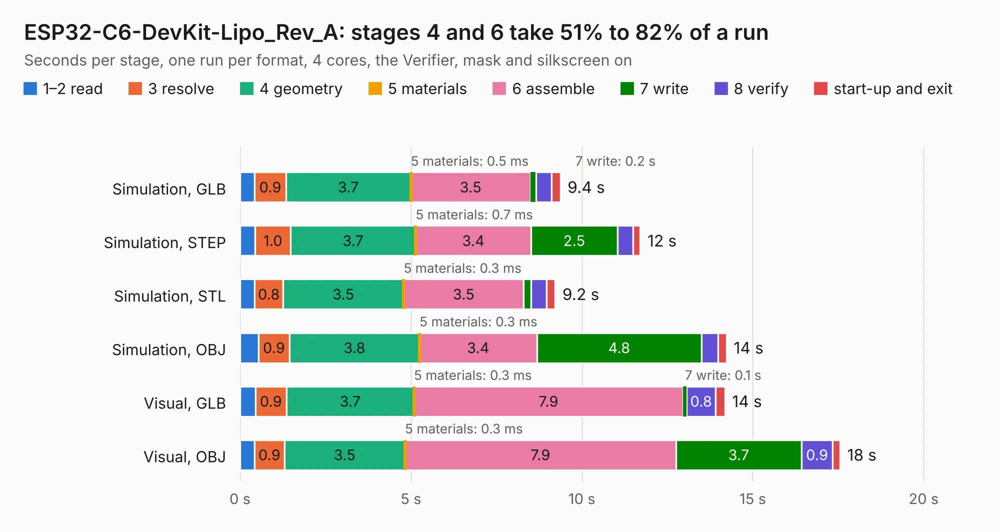

| Mode and format | 1–2 read | 3 resolve | 4 geometry | 5 materials | 6 assemble | 7 write | 8 verify | start-up and exit | Total |
|---|---:|---:|---:|---:|---:|---:|---:|---:|---:|
| Simulation, GLB | 0.4 | 0.9 | 3.7 | 0.5&nbsp;ms | 3.5 | 0.2 | 0.5 | 0.3 | 9.4 |
| Simulation, STEP | 0.4 | 1.0 | 3.7 | 0.7&nbsp;ms | 3.4 | 2.5 | 0.5 | 0.2 | 11.7 |
| Simulation, STL | 0.4 | 0.8 | 3.5 | 0.3&nbsp;ms | 3.5 | 0.2 | 0.5 | 0.2 | 9.2 |
| Simulation, OBJ | 0.5 | 0.9 | 3.8 | 0.3&nbsp;ms | 3.4 | 4.8 | 0.5 | 0.2 | 14.2 |
| Visual, GLB | 0.4 | 0.9 | 3.7 | 0.3&nbsp;ms | 7.9 | 0.1 | 0.8 | 0.3 | 14.2 |
| Visual, OBJ | 0.4 | 0.9 | 3.5 | 0.3&nbsp;ms | 7.9 | 3.7 | 0.9 | 0.2 | 17.6 |

<table align="center"><tr><td valign="top">

| Board | Repo: [OLIMEX/ESP32-C6-DevKit-Lipo](https://github.com/OLIMEX/ESP32-C6-DevKit-Lipo) Board: `ESP32-C6-DevKit-Lipo_Rev_A.kicad_pcb` |
|---|---|
| Folder | HARDWARE / ESP32-C6-DevKit-Lipo.Rev.A |
| Complexity | 250&nbsp;/&nbsp;1000 (size&nbsp;180, features&nbsp;70) |
| KESE&nbsp;features | through vias, slotted holes, rounded, trapezoid or chamfered pads, filled zones, knockout text |
| Tested | 9th November 2026 |
| Copper&nbsp;layers | 2 |
| File&nbsp;format | KiCad 7 (20221018) |
| Parts,&nbsp;tracks,&nbsp;vias | 71, 924, 115 |
| Triangles,&nbsp;simulation | 791,576 in 88 parts |
| Verifier | PASS in all six runs |

</td><td valign="top">

<table>
<tr><th>File type</th><th>File size</th><th>Peak memory used</th></tr>
<tr><th colspan="3" align="left">Simulation</th></tr>
<tr><td>GLB</td><td align="right">28&nbsp;MB</td><td align="right">400&nbsp;MB</td></tr>
<tr><td>STEP</td><td align="right">156&nbsp;MB</td><td align="right">464&nbsp;MB</td></tr>
<tr><td>STL</td><td align="right">40&nbsp;MB</td><td align="right">433&nbsp;MB</td></tr>
<tr><td>OBJ</td><td align="right">83&nbsp;MB</td><td align="right">578&nbsp;MB</td></tr>
<tr><th colspan="3" align="left">Visual</th></tr>
<tr><td>GLB</td><td align="right">22&nbsp;MB</td><td align="right">517&nbsp;MB</td></tr>
<tr><td>OBJ</td><td align="right">67&nbsp;MB</td><td align="right">519&nbsp;MB</td></tr>
</table>

</td></tr></table>

## 23.17.41 ESP32-C6-EVB_DIMM_Rev_A

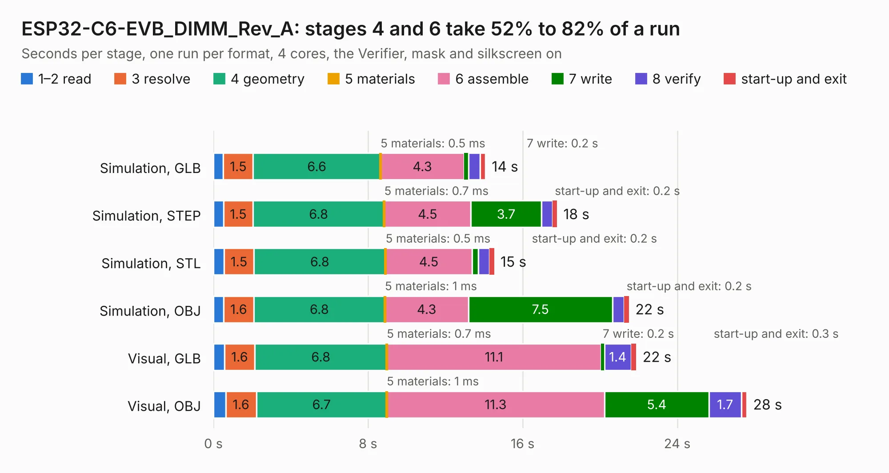

| Mode and format | 1–2 read | 3 resolve | 4 geometry | 5 materials | 6 assemble | 7 write | 8 verify | start-up and exit | Total |
|---|---:|---:|---:|---:|---:|---:|---:|---:|---:|
| Simulation, GLB | 0.5 | 1.5 | 6.6 | 0.5&nbsp;ms | 4.3 | 0.2 | 0.6 | 0.3 | 14.1 |
| Simulation, STEP | 0.5 | 1.5 | 6.8 | 0.7&nbsp;ms | 4.5 | 3.7 | 0.6 | 0.2 | 17.8 |
| Simulation, STL | 0.5 | 1.5 | 6.8 | 0.5&nbsp;ms | 4.5 | 0.3 | 0.6 | 0.2 | 14.5 |
| Simulation, OBJ | 0.5 | 1.6 | 6.8 | 1&nbsp;ms | 4.3 | 7.5 | 0.6 | 0.2 | 21.5 |
| Visual, GLB | 0.6 | 1.6 | 6.8 | 0.7&nbsp;ms | 11.1 | 0.2 | 1.4 | 0.3 | 21.9 |
| Visual, OBJ | 0.6 | 1.6 | 6.7 | 1&nbsp;ms | 11.3 | 5.4 | 1.7 | 0.3 | 27.6 |

<table align="center"><tr><td valign="top">

| Board | Repo: [OLIMEX/ESP32-C6-EVB](https://github.com/OLIMEX/ESP32-C6-EVB) Board: `ESP32-C6-EVB_DIMM_Rev_A.kicad_pcb` |
|---|---|
| Folder | HARDWARE / Dimensions |
| Complexity | 252&nbsp;/&nbsp;1000 (size&nbsp;187, features&nbsp;65) |
| KESE&nbsp;features | through vias, slotted holes, rounded, trapezoid or chamfered pads, filled zones, curved board outline |
| Tested | 9th November 2026 |
| Copper&nbsp;layers | 2 |
| File&nbsp;format | KiCad 7 (20221018) |
| Parts,&nbsp;tracks,&nbsp;vias | 102, 1,162, 124 |
| Triangles,&nbsp;simulation | 1,212,336 in 99 parts |
| Verifier | PASS in all six runs |

</td><td valign="top">

<table>
<tr><th>File type</th><th>File size</th><th>Peak memory used</th></tr>
<tr><th colspan="3" align="left">Simulation</th></tr>
<tr><td>GLB</td><td align="right">43&nbsp;MB</td><td align="right">563&nbsp;MB</td></tr>
<tr><td>STEP</td><td align="right">226&nbsp;MB</td><td align="right">643&nbsp;MB</td></tr>
<tr><td>STL</td><td align="right">61&nbsp;MB</td><td align="right">512&nbsp;MB</td></tr>
<tr><td>OBJ</td><td align="right">128&nbsp;MB</td><td align="right">846&nbsp;MB</td></tr>
<tr><th colspan="3" align="left">Visual</th></tr>
<tr><td>GLB</td><td align="right">34&nbsp;MB</td><td align="right">644&nbsp;MB</td></tr>
<tr><td>OBJ</td><td align="right">102&nbsp;MB</td><td align="right">736&nbsp;MB</td></tr>
</table>

</td></tr></table>

## 23.17.42 ESP32-C6-EVB_Rev_A

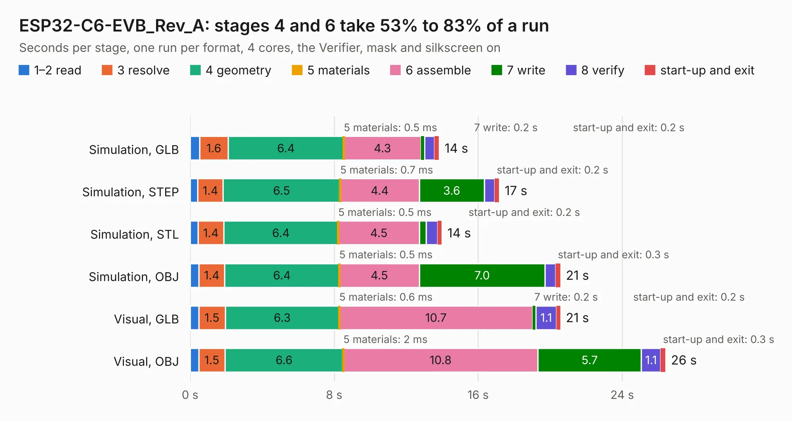

| Mode and format | 1–2 read | 3 resolve | 4 geometry | 5 materials | 6 assemble | 7 write | 8 verify | start-up and exit | Total |
|---|---:|---:|---:|---:|---:|---:|---:|---:|---:|
| Simulation, GLB | 0.5 | 1.6 | 6.4 | 0.5&nbsp;ms | 4.3 | 0.2 | 0.6 | 0.2 | 13.8 |
| Simulation, STEP | 0.4 | 1.4 | 6.5 | 0.7&nbsp;ms | 4.4 | 3.6 | 0.6 | 0.2 | 17.2 |
| Simulation, STL | 0.4 | 1.4 | 6.4 | 0.5&nbsp;ms | 4.5 | 0.4 | 0.6 | 0.2 | 14.0 |
| Simulation, OBJ | 0.5 | 1.4 | 6.4 | 0.5&nbsp;ms | 4.5 | 7.0 | 0.6 | 0.3 | 20.6 |
| Visual, GLB | 0.5 | 1.5 | 6.3 | 0.6&nbsp;ms | 10.7 | 0.2 | 1.1 | 0.2 | 20.6 |
| Visual, OBJ | 0.5 | 1.5 | 6.6 | 2&nbsp;ms | 10.8 | 5.7 | 1.1 | 0.3 | 26.4 |

<table align="center"><tr><td valign="top">

| Board | Repo: [OLIMEX/ESP32-C6-EVB](https://github.com/OLIMEX/ESP32-C6-EVB) Board: `ESP32-C6-EVB_Rev_A.kicad_pcb` |
|---|---|
| Folder | HARDWARE / Hardware-revision-A |
| Complexity | 252&nbsp;/&nbsp;1000 (size&nbsp;187, features&nbsp;65) |
| KESE&nbsp;features | through vias, slotted holes, rounded, trapezoid or chamfered pads, filled zones, curved board outline |
| Tested | 9th November 2026 |
| Copper&nbsp;layers | 2 |
| File&nbsp;format | KiCad 5 (20171130) |
| Parts,&nbsp;tracks,&nbsp;vias | 102, 1,162, 124 |
| Triangles,&nbsp;simulation | 1,271,824 in 99 parts |
| Verifier | PASS in all six runs |

</td><td valign="top">

<table>
<tr><th>File type</th><th>File size</th><th>Peak memory used</th></tr>
<tr><th colspan="3" align="left">Simulation</th></tr>
<tr><td>GLB</td><td align="right">45&nbsp;MB</td><td align="right">543&nbsp;MB</td></tr>
<tr><td>STEP</td><td align="right">237&nbsp;MB</td><td align="right">662&nbsp;MB</td></tr>
<tr><td>STL</td><td align="right">64&nbsp;MB</td><td align="right">551&nbsp;MB</td></tr>
<tr><td>OBJ</td><td align="right">134&nbsp;MB</td><td align="right">876&nbsp;MB</td></tr>
<tr><th colspan="3" align="left">Visual</th></tr>
<tr><td>GLB</td><td align="right">36&nbsp;MB</td><td align="right">767&nbsp;MB</td></tr>
<tr><td>OBJ</td><td align="right">108&nbsp;MB</td><td align="right">791&nbsp;MB</td></tr>
</table>

</td></tr></table>

## 23.17.43 ESP32-DevKit-Lipo_Rev_A1

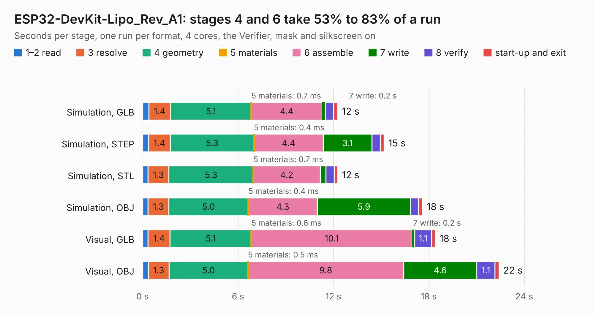

| Mode and format | 1–2 read | 3 resolve | 4 geometry | 5 materials | 6 assemble | 7 write | 8 verify | start-up and exit | Total |
|---|---:|---:|---:|---:|---:|---:|---:|---:|---:|
| Simulation, GLB | 0.4 | 1.4 | 5.1 | 0.7&nbsp;ms | 4.4 | 0.2 | 0.5 | 0.3 | 12.3 |
| Simulation, STEP | 0.4 | 1.4 | 5.3 | 0.4&nbsp;ms | 4.4 | 3.1 | 0.5 | 0.2 | 15.2 |
| Simulation, STL | 0.3 | 1.3 | 5.3 | 0.7&nbsp;ms | 4.2 | 0.4 | 0.5 | 0.2 | 12.3 |
| Simulation, OBJ | 0.3 | 1.3 | 5.0 | 0.4&nbsp;ms | 4.3 | 5.9 | 0.5 | 0.3 | 17.6 |
| Visual, GLB | 0.3 | 1.4 | 5.1 | 0.6&nbsp;ms | 10.1 | 0.2 | 1.1 | 0.2 | 18.4 |
| Visual, OBJ | 0.4 | 1.3 | 5.0 | 0.5&nbsp;ms | 9.8 | 4.6 | 1.1 | 0.3 | 22.4 |

<table align="center"><tr><td valign="top">

| Board | Repo: [OLIMEX/ESP32-DevKit-LiPo](https://github.com/OLIMEX/ESP32-DevKit-LiPo) Board: `ESP32-DevKit-Lipo_Rev_A1.kicad_pcb` |
|---|---|
| Folder | HARDWARE / ESP32-DevKit-LiPo-Rev.A1 |
| Complexity | 221&nbsp;/&nbsp;1000 (size&nbsp;176, features&nbsp;45) |
| KESE&nbsp;features | through vias, slotted holes, filled zones |
| Tested | 9th November 2026 |
| Copper&nbsp;layers | 2 |
| File&nbsp;format | KiCad 5 (20171130) |
| Parts,&nbsp;tracks,&nbsp;vias | 40, 1,154, 96 |
| Triangles,&nbsp;simulation | 957,920 in 79 parts |
| Verifier | PASS in all six runs |

</td><td valign="top">

<table>
<tr><th>File type</th><th>File size</th><th>Peak memory used</th></tr>
<tr><th colspan="3" align="left">Simulation</th></tr>
<tr><td>GLB</td><td align="right">34&nbsp;MB</td><td align="right">448&nbsp;MB</td></tr>
<tr><td>STEP</td><td align="right">194&nbsp;MB</td><td align="right">521&nbsp;MB</td></tr>
<tr><td>STL</td><td align="right">48&nbsp;MB</td><td align="right">433&nbsp;MB</td></tr>
<tr><td>OBJ</td><td align="right">100&nbsp;MB</td><td align="right">691&nbsp;MB</td></tr>
<tr><th colspan="3" align="left">Visual</th></tr>
<tr><td>GLB</td><td align="right">28&nbsp;MB</td><td align="right">619&nbsp;MB</td></tr>
<tr><td>OBJ</td><td align="right">82&nbsp;MB</td><td align="right">629&nbsp;MB</td></tr>
</table>

</td></tr></table>

## 23.17.44 ESP32-DevKit-Lipo_Rev_B

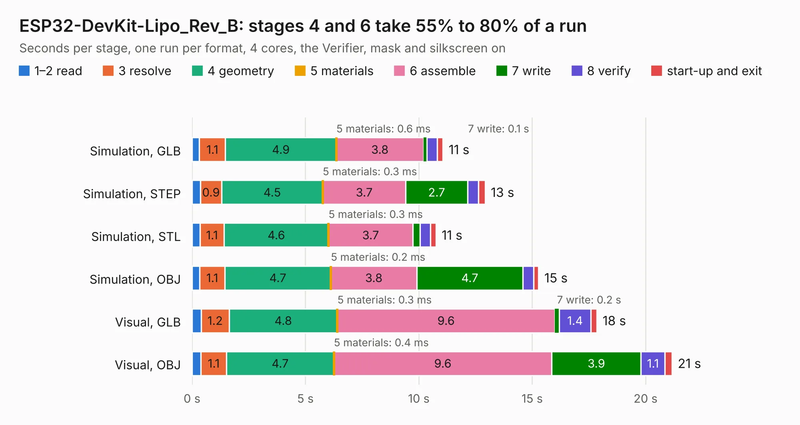

| Mode and format | 1–2 read | 3 resolve | 4 geometry | 5 materials | 6 assemble | 7 write | 8 verify | start-up and exit | Total |
|---|---:|---:|---:|---:|---:|---:|---:|---:|---:|
| Simulation, GLB | 0.3 | 1.1 | 4.9 | 0.6&nbsp;ms | 3.8 | 0.1 | 0.5 | 0.3 | 11.1 |
| Simulation, STEP | 0.4 | 0.9 | 4.5 | 0.3&nbsp;ms | 3.7 | 2.7 | 0.5 | 0.3 | 12.9 |
| Simulation, STL | 0.3 | 1.1 | 4.6 | 0.3&nbsp;ms | 3.7 | 0.3 | 0.5 | 0.2 | 10.8 |
| Simulation, OBJ | 0.3 | 1.1 | 4.7 | 0.2&nbsp;ms | 3.8 | 4.7 | 0.5 | 0.2 | 15.3 |
| Visual, GLB | 0.4 | 1.2 | 4.8 | 0.3&nbsp;ms | 9.6 | 0.2 | 1.4 | 0.3 | 17.9 |
| Visual, OBJ | 0.4 | 1.1 | 4.7 | 0.4&nbsp;ms | 9.6 | 3.9 | 1.1 | 0.3 | 21.2 |

<table align="center"><tr><td valign="top">

| Board | Repo: [OLIMEX/ESP32-DevKit-LiPo](https://github.com/OLIMEX/ESP32-DevKit-LiPo) Board: `ESP32-DevKit-Lipo_Rev_B.kicad_pcb` |
|---|---|
| Folder | HARDWARE / ESP32-DevKit-LiPo-Rev.B |
| Complexity | 237&nbsp;/&nbsp;1000 (size&nbsp;182, features&nbsp;55) |
| KESE&nbsp;features | through vias, slotted holes, filled zones, copper text |
| Tested | 9th November 2026 |
| Copper&nbsp;layers | 2 |
| File&nbsp;format | KiCad 5 (20171130) |
| Parts,&nbsp;tracks,&nbsp;vias | 47, 1,463, 112 |
| Triangles,&nbsp;simulation | 1,008,518 in 84 parts |
| Verifier | PASS in all six runs |

</td><td valign="top">

<table>
<tr><th>File type</th><th>File size</th><th>Peak memory used</th></tr>
<tr><th colspan="3" align="left">Simulation</th></tr>
<tr><td>GLB</td><td align="right">36&nbsp;MB</td><td align="right">466&nbsp;MB</td></tr>
<tr><td>STEP</td><td align="right">197&nbsp;MB</td><td align="right">569&nbsp;MB</td></tr>
<tr><td>STL</td><td align="right">50&nbsp;MB</td><td align="right">466&nbsp;MB</td></tr>
<tr><td>OBJ</td><td align="right">105&nbsp;MB</td><td align="right">712&nbsp;MB</td></tr>
<tr><th colspan="3" align="left">Visual</th></tr>
<tr><td>GLB</td><td align="right">30&nbsp;MB</td><td align="right">624&nbsp;MB</td></tr>
<tr><td>OBJ</td><td align="right">90&nbsp;MB</td><td align="right">696&nbsp;MB</td></tr>
</table>

</td></tr></table>

## 23.17.45 ESP32-DevKit-Lipo_Rev_C

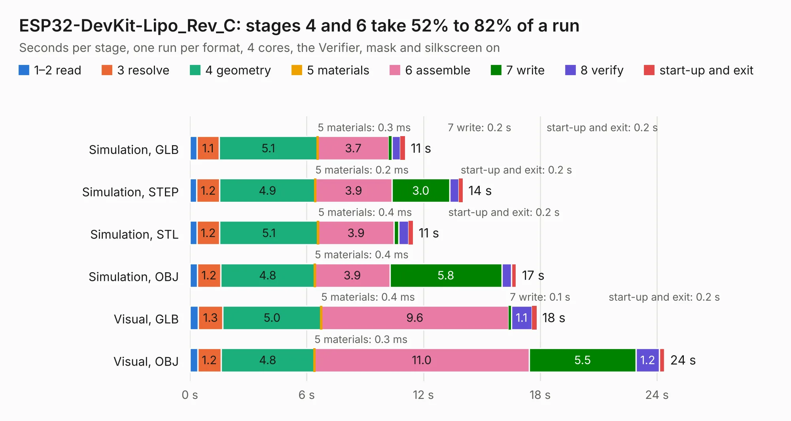

| Mode and format | 1–2 read | 3 resolve | 4 geometry | 5 materials | 6 assemble | 7 write | 8 verify | start-up and exit | Total |
|---|---:|---:|---:|---:|---:|---:|---:|---:|---:|
| Simulation, GLB | 0.4 | 1.1 | 5.1 | 0.3&nbsp;ms | 3.7 | 0.2 | 0.4 | 0.2 | 11.1 |
| Simulation, STEP | 0.4 | 1.2 | 4.9 | 0.2&nbsp;ms | 3.9 | 3.0 | 0.5 | 0.2 | 14.0 |
| Simulation, STL | 0.4 | 1.2 | 5.1 | 0.4&nbsp;ms | 3.9 | 0.2 | 0.5 | 0.2 | 11.5 |
| Simulation, OBJ | 0.4 | 1.2 | 4.8 | 0.4&nbsp;ms | 3.9 | 5.8 | 0.5 | 0.3 | 16.8 |
| Visual, GLB | 0.4 | 1.3 | 5.0 | 0.4&nbsp;ms | 9.6 | 0.1 | 1.1 | 0.2 | 17.8 |
| Visual, OBJ | 0.4 | 1.2 | 4.8 | 0.3&nbsp;ms | 11.0 | 5.5 | 1.2 | 0.3 | 24.4 |

<table align="center"><tr><td valign="top">

| Board | Repo: [OLIMEX/ESP32-DevKit-LiPo](https://github.com/OLIMEX/ESP32-DevKit-LiPo) Board: `ESP32-DevKit-Lipo_Rev_C.kicad_pcb` |
|---|---|
| Folder | HARDWARE / ESP32-DevKit-LiPo-Rev.C |
| Complexity | 237&nbsp;/&nbsp;1000 (size&nbsp;182, features&nbsp;55) |
| KESE&nbsp;features | through vias, slotted holes, filled zones, copper text |
| Tested | 9th November 2026 |
| Copper&nbsp;layers | 2 |
| File&nbsp;format | KiCad 5 (20171130) |
| Parts,&nbsp;tracks,&nbsp;vias | 48, 1,469, 112 |
| Triangles,&nbsp;simulation | 991,152 in 84 parts |
| Verifier | PASS in all six runs |

</td><td valign="top">

<table>
<tr><th>File type</th><th>File size</th><th>Peak memory used</th></tr>
<tr><th colspan="3" align="left">Simulation</th></tr>
<tr><td>GLB</td><td align="right">35&nbsp;MB</td><td align="right">461&nbsp;MB</td></tr>
<tr><td>STEP</td><td align="right">192&nbsp;MB</td><td align="right">554&nbsp;MB</td></tr>
<tr><td>STL</td><td align="right">50&nbsp;MB</td><td align="right">453&nbsp;MB</td></tr>
<tr><td>OBJ</td><td align="right">104&nbsp;MB</td><td align="right">714&nbsp;MB</td></tr>
<tr><th colspan="3" align="left">Visual</th></tr>
<tr><td>GLB</td><td align="right">30&nbsp;MB</td><td align="right">624&nbsp;MB</td></tr>
<tr><td>OBJ</td><td align="right">88&nbsp;MB</td><td align="right">688&nbsp;MB</td></tr>
</table>

</td></tr></table>

## 23.17.46 ESP32-DevKit-Lipo_Rev_D

| Mode and format | 1–2 read | 3 resolve | 4 geometry | 5 materials | 6 assemble | 7 write | 8 verify | start-up and exit | Total |
|---|---:|---:|---:|---:|---:|---:|---:|---:|---:|
| Simulation, GLB | 0.3 | 1.1 | 4.8 | 0.6&nbsp;ms | 3.7 | 0.2 | 0.5 | 0.2 | 10.9 |
| Simulation, STEP | 0.3 | 1.1 | 4.8 | 0.6&nbsp;ms | 3.8 | 3.0 | 0.4 | 0.3 | 13.8 |
| Simulation, STL | 0.4 | 1.1 | 4.8 | 0.6&nbsp;ms | 3.9 | 0.4 | 0.6 | 0.3 | 11.4 |
| Simulation, OBJ | 0.3 | 1.1 | 4.9 | 0.6&nbsp;ms | 3.7 | 5.0 | 0.5 | 0.2 | 15.8 |
| Visual, GLB | 0.3 | 1.1 | 4.8 | 0.4&nbsp;ms | 9.5 | 0.2 | 1.4 | 0.2 | 17.6 |
| Visual, OBJ | 0.3 | 1.1 | 4.8 | 0.5&nbsp;ms | 9.6 | 4.1 | 1.3 | 0.3 | 21.6 |

<table align="center"><tr><td valign="top">

| Board | Repo: [OLIMEX/ESP32-DevKit-LiPo](https://github.com/OLIMEX/ESP32-DevKit-LiPo) Board: `ESP32-DevKit-Lipo_Rev_D.kicad_pcb` |
|---|---|
| Folder | HARDWARE / ESP32-DevKit-LiPo-Rev.D |
| Complexity | 223&nbsp;/&nbsp;1000 (size&nbsp;178, features&nbsp;45) |
| KESE&nbsp;features | through vias, slotted holes, filled zones |
| Tested | 9th November 2026 |
| Copper&nbsp;layers | 2 |
| File&nbsp;format | KiCad 5 (20171130) |
| Parts,&nbsp;tracks,&nbsp;vias | 44, 1,221, 108 |
| Triangles,&nbsp;simulation | 989,400 in 76 parts |
| Verifier | PASS in all six runs |

</td><td valign="top">

<table>
<tr><th>File type</th><th>File size</th><th>Peak memory used</th></tr>
<tr><th colspan="3" align="left">Simulation</th></tr>
<tr><td>GLB</td><td align="right">35&nbsp;MB</td><td align="right">504&nbsp;MB</td></tr>
<tr><td>STEP</td><td align="right">195&nbsp;MB</td><td align="right">559&nbsp;MB</td></tr>
<tr><td>STL</td><td align="right">49&nbsp;MB</td><td align="right">474&nbsp;MB</td></tr>
<tr><td>OBJ</td><td align="right">103&nbsp;MB</td><td align="right">697&nbsp;MB</td></tr>
<tr><th colspan="3" align="left">Visual</th></tr>
<tr><td>GLB</td><td align="right">30&nbsp;MB</td><td align="right">653&nbsp;MB</td></tr>
<tr><td>OBJ</td><td align="right">89&nbsp;MB</td><td align="right">676&nbsp;MB</td></tr>
</table>

</td></tr></table>

## 23.17.47 ESP32-EVB_Rev_A

| Mode and format | 1–2 read | 3 resolve | 4 geometry | 5 materials | 6 assemble | 7 write | 8 verify | start-up and exit | Total |
|---|---:|---:|---:|---:|---:|---:|---:|---:|---:|
| Simulation, GLB | 0.5 | 2.0 | 8.3 | 2&nbsp;ms | 6.3 | 0.3 | 1.0 | 0.2 | 18.6 |
| Simulation, STEP | 0.5 | 2.1 | 8.1 | 0.8&nbsp;ms | 6.7 | 4.5 | 1.0 | 0.2 | 23.1 |
| Simulation, STL | 0.6 | 2.1 | 8.6 | 0.6&nbsp;ms | 6.8 | 0.5 | 0.9 | 0.2 | 19.8 |
| Simulation, OBJ | 0.5 | 2.0 | 8.0 | 0.6&nbsp;ms | 6.5 | 10.6 | 1.1 | 0.2 | 28.9 |
| Visual, GLB | 0.5 | 2.3 | 8.3 | 0.7&nbsp;ms | 16.3 | 0.2 | 1.2 | 0.2 | 29.1 |
| Visual, OBJ | 0.6 | 2.1 | 8.1 | 0.6&nbsp;ms | 16.8 | 7.3 | 1.4 | 0.3 | 36.6 |

<table align="center"><tr><td valign="top">

| Board | Repo: [OLIMEX/ESP32-EVB](https://github.com/OLIMEX/ESP32-EVB) Board: `ESP32-EVB_Rev_A.kicad_pcb` |
|---|---|
| Folder | HARDWARE / REV-A |
| Complexity | 269&nbsp;/&nbsp;1000 (size&nbsp;234, features&nbsp;35) |
| KESE&nbsp;features | through vias, slotted holes, copper text |
| Tested | 9th November 2026 |
| Copper&nbsp;layers | 2 |
| File&nbsp;format | KiCad 5 (20160815) |
| Parts,&nbsp;tracks,&nbsp;vias | 106, 1,818, 162 |
| Triangles,&nbsp;simulation | 1,854,502 in 105 parts |
| Verifier | PASS in all six runs |

</td><td valign="top">

<table>
<tr><th>File type</th><th>File size</th><th>Peak memory used</th></tr>
<tr><th colspan="3" align="left">Simulation</th></tr>
<tr><td>GLB</td><td align="right">65&nbsp;MB</td><td align="right">617&nbsp;MB</td></tr>
<tr><td>STEP</td><td align="right">284&nbsp;MB</td><td align="right">725&nbsp;MB</td></tr>
<tr><td>STL</td><td align="right">93&nbsp;MB</td><td align="right">622&nbsp;MB</td></tr>
<tr><td>OBJ</td><td align="right">200&nbsp;MB</td><td align="right">1.3&nbsp;GB</td></tr>
<tr><th colspan="3" align="left">Visual</th></tr>
<tr><td>GLB</td><td align="right">42&nbsp;MB</td><td align="right">763&nbsp;MB</td></tr>
<tr><td>OBJ</td><td align="right">128&nbsp;MB</td><td align="right">938&nbsp;MB</td></tr>
</table>

</td></tr></table>

## 23.17.48 ESP32-EVB_Rev_B

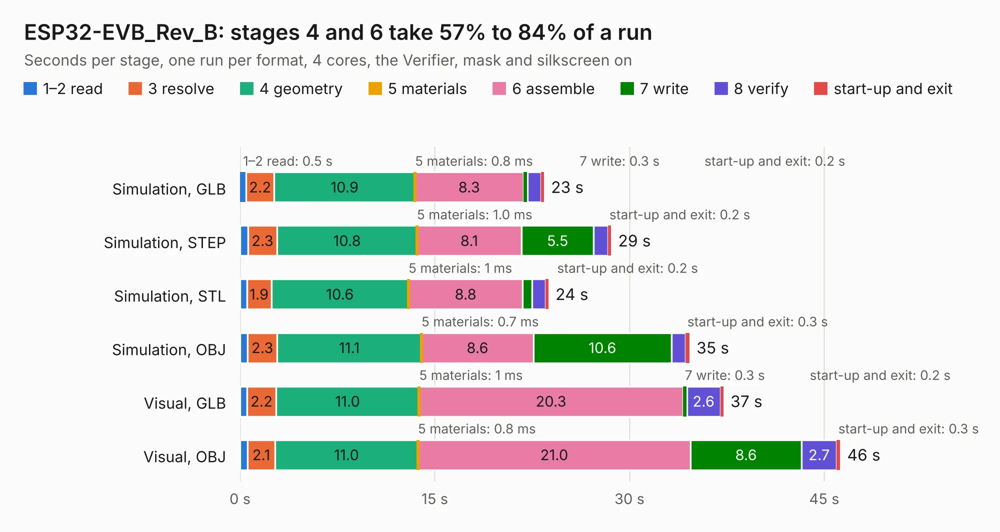

| Mode and format | 1–2 read | 3 resolve | 4 geometry | 5 materials | 6 assemble | 7 write | 8 verify | start-up and exit | Total |
|---|---:|---:|---:|---:|---:|---:|---:|---:|---:|
| Simulation, GLB | 0.5 | 2.2 | 10.9 | 0.8&nbsp;ms | 8.3 | 0.3 | 1.0 | 0.2 | 23.4 |
| Simulation, STEP | 0.6 | 2.3 | 10.8 | 1.0&nbsp;ms | 8.1 | 5.5 | 1.1 | 0.2 | 28.6 |
| Simulation, STL | 0.5 | 1.9 | 10.6 | 1&nbsp;ms | 8.8 | 0.7 | 1.1 | 0.2 | 23.8 |
| Simulation, OBJ | 0.6 | 2.3 | 11.1 | 0.7&nbsp;ms | 8.6 | 10.6 | 1.1 | 0.3 | 34.6 |
| Visual, GLB | 0.5 | 2.2 | 11.0 | 1&nbsp;ms | 20.3 | 0.3 | 2.6 | 0.2 | 37.2 |
| Visual, OBJ | 0.6 | 2.1 | 11.0 | 0.8&nbsp;ms | 21.0 | 8.6 | 2.7 | 0.3 | 46.2 |

<table align="center"><tr><td valign="top">

| Board | Repo: [OLIMEX/ESP32-EVB](https://github.com/OLIMEX/ESP32-EVB) Board: `ESP32-EVB_Rev_B.kicad_pcb` |
|---|---|
| Folder | HARDWARE / REV-B |
| Complexity | 300&nbsp;/&nbsp;1000 (size&nbsp;245, features&nbsp;55) |
| KESE&nbsp;features | through vias, slotted holes, filled zones, copper text |
| Tested | 9th November 2026 |
| Copper&nbsp;layers | 2 |
| File&nbsp;format | KiCad 5 (20170123) |
| Parts,&nbsp;tracks,&nbsp;vias | 144, 2,751, 310 |
| Triangles,&nbsp;simulation | 2,202,244 in 143 parts |
| Verifier | PASS in all six runs |

</td><td valign="top">

<table>
<tr><th>File type</th><th>File size</th><th>Peak memory used</th></tr>
<tr><th colspan="3" align="left">Simulation</th></tr>
<tr><td>GLB</td><td align="right">78&nbsp;MB</td><td align="right">918&nbsp;MB</td></tr>
<tr><td>STEP</td><td align="right">424&nbsp;MB</td><td align="right">965&nbsp;MB</td></tr>
<tr><td>STL</td><td align="right">110&nbsp;MB</td><td align="right">872&nbsp;MB</td></tr>
<tr><td>OBJ</td><td align="right">237&nbsp;MB</td><td align="right">1.5&nbsp;GB</td></tr>
<tr><th colspan="3" align="left">Visual</th></tr>
<tr><td>GLB</td><td align="right">61&nbsp;MB</td><td align="right">1.0&nbsp;GB</td></tr>
<tr><td>OBJ</td><td align="right">188&nbsp;MB</td><td align="right">1.3&nbsp;GB</td></tr>
</table>

</td></tr></table>

## 23.17.49 ESP32-EVB_Rev_C

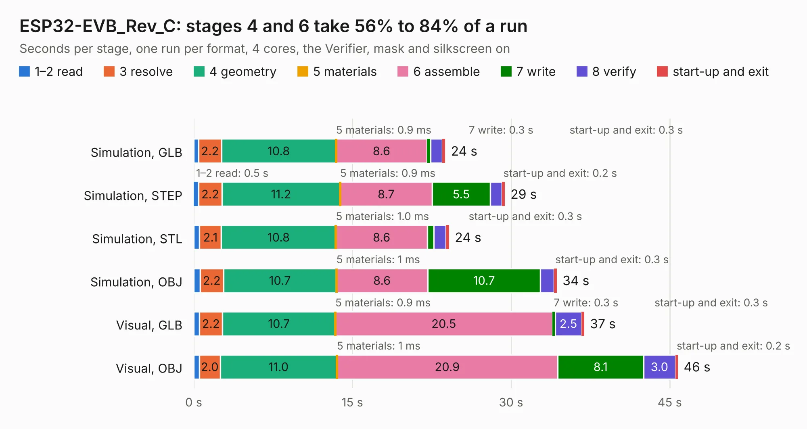

| Mode and format | 1–2 read | 3 resolve | 4 geometry | 5 materials | 6 assemble | 7 write | 8 verify | start-up and exit | Total |
|---|---:|---:|---:|---:|---:|---:|---:|---:|---:|
| Simulation, GLB | 0.5 | 2.2 | 10.8 | 0.9&nbsp;ms | 8.6 | 0.3 | 1.1 | 0.3 | 23.8 |
| Simulation, STEP | 0.5 | 2.2 | 11.2 | 0.9&nbsp;ms | 8.7 | 5.5 | 1.1 | 0.2 | 29.4 |
| Simulation, STL | 0.6 | 2.1 | 10.8 | 1.0&nbsp;ms | 8.6 | 0.6 | 1.2 | 0.3 | 24.1 |
| Simulation, OBJ | 0.6 | 2.2 | 10.7 | 1&nbsp;ms | 8.6 | 10.7 | 1.3 | 0.3 | 34.3 |
| Visual, GLB | 0.5 | 2.2 | 10.7 | 0.9&nbsp;ms | 20.5 | 0.3 | 2.5 | 0.3 | 36.9 |
| Visual, OBJ | 0.5 | 2.0 | 11.0 | 1&nbsp;ms | 20.9 | 8.1 | 3.0 | 0.2 | 45.8 |

<table align="center"><tr><td valign="top">

| Board | Repo: [OLIMEX/ESP32-EVB](https://github.com/OLIMEX/ESP32-EVB) Board: `ESP32-EVB_Rev_C.kicad_pcb` |
|---|---|
| Folder | HARDWARE / REV-C |
| Complexity | 300&nbsp;/&nbsp;1000 (size&nbsp;245, features&nbsp;55) |
| KESE&nbsp;features | through vias, slotted holes, filled zones, copper text |
| Tested | 9th November 2026 |
| Copper&nbsp;layers | 2 |
| File&nbsp;format | KiCad 5 (20170123) |
| Parts,&nbsp;tracks,&nbsp;vias | 144, 2,790, 317 |
| Triangles,&nbsp;simulation | 2,217,096 in 143 parts |
| Verifier | PASS in all six runs |

</td><td valign="top">

<table>
<tr><th>File type</th><th>File size</th><th>Peak memory used</th></tr>
<tr><th colspan="3" align="left">Simulation</th></tr>
<tr><td>GLB</td><td align="right">78&nbsp;MB</td><td align="right">774&nbsp;MB</td></tr>
<tr><td>STEP</td><td align="right">427&nbsp;MB</td><td align="right">995&nbsp;MB</td></tr>
<tr><td>STL</td><td align="right">111&nbsp;MB</td><td align="right">836&nbsp;MB</td></tr>
<tr><td>OBJ</td><td align="right">238&nbsp;MB</td><td align="right">1.5&nbsp;GB</td></tr>
<tr><th colspan="3" align="left">Visual</th></tr>
<tr><td>GLB</td><td align="right">62&nbsp;MB</td><td align="right">1.2&nbsp;GB</td></tr>
<tr><td>OBJ</td><td align="right">190&nbsp;MB</td><td align="right">1.3&nbsp;GB</td></tr>
</table>

</td></tr></table>

## 23.17.50 ESP32-EVB_Rev_D

| Mode and format | 1–2 read | 3 resolve | 4 geometry | 5 materials | 6 assemble | 7 write | 8 verify | start-up and exit | Total |
|---|---:|---:|---:|---:|---:|---:|---:|---:|---:|
| Simulation, GLB | 0.6 | 2.4 | 12.4 | 1&nbsp;ms | 9.6 | 0.4 | 1.3 | 0.3 | 26.9 |
| Simulation, STEP | 0.5 | 2.2 | 12.1 | 1.0&nbsp;ms | 9.5 | 6.3 | 1.3 | 0.3 | 32.2 |
| Simulation, STL | 0.7 | 2.4 | 12.6 | 0.8&nbsp;ms | 10.0 | 0.9 | 1.4 | 0.3 | 28.1 |
| Simulation, OBJ | 0.6 | 2.4 | 12.3 | 1.0&nbsp;ms | 9.7 | 11.1 | 1.4 | 0.3 | 37.8 |
| Visual, GLB | 0.6 | 2.4 | 12.5 | 1&nbsp;ms | 23.9 | 0.3 | 3.6 | 0.3 | 43.5 |
| Visual, OBJ | 0.7 | 2.4 | 12.2 | 1&nbsp;ms | 23.7 | 9.4 | 3.6 | 0.3 | 52.3 |

<table align="center"><tr><td valign="top">

| Board | Repo: [OLIMEX/ESP32-EVB](https://github.com/OLIMEX/ESP32-EVB) Board: `ESP32-EVB_Rev_D.kicad_pcb` |
|---|---|
| Folder | HARDWARE / REV-D |
| Complexity | 301&nbsp;/&nbsp;1000 (size&nbsp;246, features&nbsp;55) |
| KESE&nbsp;features | through vias, slotted holes, filled zones, copper text |
| Tested | 9th November 2026 |
| Copper&nbsp;layers | 2 |
| File&nbsp;format | KiCad 5 (20170123) |
| Parts,&nbsp;tracks,&nbsp;vias | 146, 2,818, 315 |
| Triangles,&nbsp;simulation | 2,219,460 in 143 parts |
| Verifier | PASS in all six runs |

</td><td valign="top">

<table>
<tr><th>File type</th><th>File size</th><th>Peak memory used</th></tr>
<tr><th colspan="3" align="left">Simulation</th></tr>
<tr><td>GLB</td><td align="right">78&nbsp;MB</td><td align="right">775&nbsp;MB</td></tr>
<tr><td>STEP</td><td align="right">428&nbsp;MB</td><td align="right">1.0&nbsp;GB</td></tr>
<tr><td>STL</td><td align="right">111&nbsp;MB</td><td align="right">801&nbsp;MB</td></tr>
<tr><td>OBJ</td><td align="right">239&nbsp;MB</td><td align="right">1.5&nbsp;GB</td></tr>
<tr><th colspan="3" align="left">Visual</th></tr>
<tr><td>GLB</td><td align="right">62&nbsp;MB</td><td align="right">1.1&nbsp;GB</td></tr>
<tr><td>OBJ</td><td align="right">190&nbsp;MB</td><td align="right">1.3&nbsp;GB</td></tr>
</table>

</td></tr></table>

## 23.17.51 ESP32-EVB_Rev_F

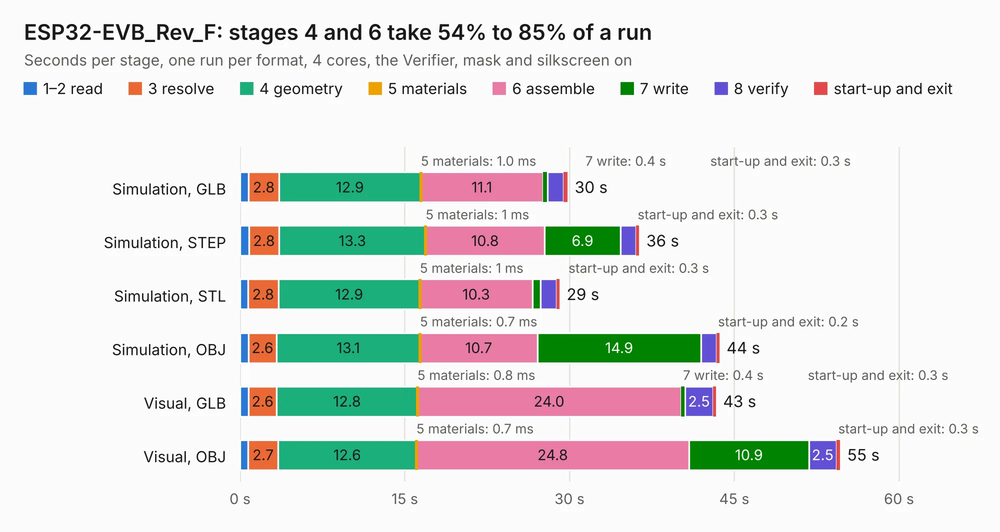

| Mode and format | 1–2 read | 3 resolve | 4 geometry | 5 materials | 6 assemble | 7 write | 8 verify | start-up and exit | Total |
|---|---:|---:|---:|---:|---:|---:|---:|---:|---:|
| Simulation, GLB | 0.8 | 2.8 | 12.9 | 1.0&nbsp;ms | 11.1 | 0.4 | 1.5 | 0.3 | 29.8 |
| Simulation, STEP | 0.8 | 2.8 | 13.3 | 1&nbsp;ms | 10.8 | 6.9 | 1.4 | 0.3 | 36.3 |
| Simulation, STL | 0.7 | 2.8 | 12.9 | 1&nbsp;ms | 10.3 | 0.7 | 1.4 | 0.3 | 29.1 |
| Simulation, OBJ | 0.8 | 2.6 | 13.1 | 0.7&nbsp;ms | 10.7 | 14.9 | 1.4 | 0.2 | 43.6 |
| Visual, GLB | 0.8 | 2.6 | 12.8 | 0.8&nbsp;ms | 24.0 | 0.4 | 2.5 | 0.3 | 43.3 |
| Visual, OBJ | 0.7 | 2.7 | 12.6 | 0.7&nbsp;ms | 24.8 | 10.9 | 2.5 | 0.3 | 54.6 |

<table align="center"><tr><td valign="top">

| Board | Repo: [OLIMEX/ESP32-EVB](https://github.com/OLIMEX/ESP32-EVB) Board: `ESP32-EVB_Rev_F.kicad_pcb` |
|---|---|
| Folder | HARDWARE / REV-F |
| Complexity | 301&nbsp;/&nbsp;1000 (size&nbsp;246, features&nbsp;55) |
| KESE&nbsp;features | through vias, slotted holes, filled zones, copper text |
| Tested | 9th November 2026 |
| Copper&nbsp;layers | 2 |
| File&nbsp;format | KiCad 5 (20171130) |
| Parts,&nbsp;tracks,&nbsp;vias | 148, 2,880, 303 |
| Triangles,&nbsp;simulation | 2,246,438 in 143 parts |
| Verifier | PASS in all six runs |

</td><td valign="top">

<table>
<tr><th>File type</th><th>File size</th><th>Peak memory used</th></tr>
<tr><th colspan="3" align="left">Simulation</th></tr>
<tr><td>GLB</td><td align="right">79&nbsp;MB</td><td align="right">931&nbsp;MB</td></tr>
<tr><td>STEP</td><td align="right">438&nbsp;MB</td><td align="right">1.0&nbsp;GB</td></tr>
<tr><td>STL</td><td align="right">112&nbsp;MB</td><td align="right">916&nbsp;MB</td></tr>
<tr><td>OBJ</td><td align="right">242&nbsp;MB</td><td align="right">1.5&nbsp;GB</td></tr>
<tr><th colspan="3" align="left">Visual</th></tr>
<tr><td>GLB</td><td align="right">63&nbsp;MB</td><td align="right">1.1&nbsp;GB</td></tr>
<tr><td>OBJ</td><td align="right">193&nbsp;MB</td><td align="right">1.4&nbsp;GB</td></tr>
</table>

</td></tr></table>

## 23.17.52 ESP32-EVB_Rev_H

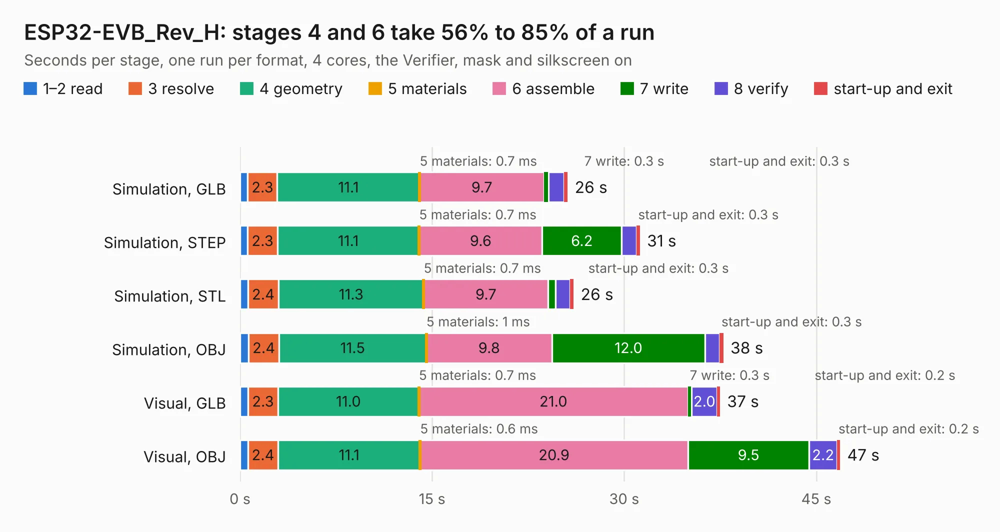

| Mode and format | 1–2 read | 3 resolve | 4 geometry | 5 materials | 6 assemble | 7 write | 8 verify | start-up and exit | Total |
|---|---:|---:|---:|---:|---:|---:|---:|---:|---:|
| Simulation, GLB | 0.6 | 2.3 | 11.1 | 0.7&nbsp;ms | 9.7 | 0.3 | 1.2 | 0.3 | 25.6 |
| Simulation, STEP | 0.6 | 2.3 | 11.1 | 0.7&nbsp;ms | 9.6 | 6.2 | 1.2 | 0.3 | 31.2 |
| Simulation, STL | 0.6 | 2.4 | 11.3 | 0.7&nbsp;ms | 9.7 | 0.6 | 1.1 | 0.3 | 26.0 |
| Simulation, OBJ | 0.7 | 2.4 | 11.5 | 1&nbsp;ms | 9.8 | 12.0 | 1.1 | 0.3 | 37.7 |
| Visual, GLB | 0.6 | 2.3 | 11.0 | 0.7&nbsp;ms | 21.0 | 0.3 | 2.0 | 0.2 | 37.5 |
| Visual, OBJ | 0.6 | 2.4 | 11.1 | 0.6&nbsp;ms | 20.9 | 9.5 | 2.2 | 0.2 | 46.9 |

<table align="center"><tr><td valign="top">

| Board | Repo: [OLIMEX/ESP32-EVB](https://github.com/OLIMEX/ESP32-EVB) Board: `ESP32-EVB_Rev_H.kicad_pcb` |
|---|---|
| Folder | HARDWARE / REV-H |
| Complexity | 291&nbsp;/&nbsp;1000 (size&nbsp;246, features&nbsp;45) |
| KESE&nbsp;features | through vias, slotted holes, filled zones |
| Tested | 9th November 2026 |
| Copper&nbsp;layers | 2 |
| File&nbsp;format | KiCad 5 (20171130) |
| Parts,&nbsp;tracks,&nbsp;vias | 146, 2,965, 310 |
| Triangles,&nbsp;simulation | 2,248,598 in 140 parts |
| Verifier | PASS in all six runs |

</td><td valign="top">

<table>
<tr><th>File type</th><th>File size</th><th>Peak memory used</th></tr>
<tr><th colspan="3" align="left">Simulation</th></tr>
<tr><td>GLB</td><td align="right">79&nbsp;MB</td><td align="right">846&nbsp;MB</td></tr>
<tr><td>STEP</td><td align="right">430&nbsp;MB</td><td align="right">1.0&nbsp;GB</td></tr>
<tr><td>STL</td><td align="right">112&nbsp;MB</td><td align="right">936&nbsp;MB</td></tr>
<tr><td>OBJ</td><td align="right">242&nbsp;MB</td><td align="right">1.5&nbsp;GB</td></tr>
<tr><th colspan="3" align="left">Visual</th></tr>
<tr><td>GLB</td><td align="right">64&nbsp;MB</td><td align="right">1.1&nbsp;GB</td></tr>
<tr><td>OBJ</td><td align="right">197&nbsp;MB</td><td align="right">1.3&nbsp;GB</td></tr>
</table>

</td></tr></table>

## 23.17.53 ESP32-EVB_Rev_I

| Mode and format | 1–2 read | 3 resolve | 4 geometry | 5 materials | 6 assemble | 7 write | 8 verify | start-up and exit | Total |
|---|---:|---:|---:|---:|---:|---:|---:|---:|---:|
| Simulation, GLB | 0.5 | 2.1 | 9.9 | 0.8&nbsp;ms | 8.5 | 0.3 | 1.0 | 0.2 | 22.5 |
| Simulation, STEP | 0.5 | 1.9 | 9.5 | 0.8&nbsp;ms | 8.7 | 5.2 | 1.0 | 0.2 | 27.1 |
| Simulation, STL | 0.6 | 1.9 | 9.7 | 0.9&nbsp;ms | 8.3 | 0.6 | 1.0 | 0.2 | 22.3 |
| Simulation, OBJ | 0.5 | 1.9 | 9.4 | 1&nbsp;ms | 8.5 | 9.2 | 1.1 | 0.2 | 30.9 |
| Visual, GLB | 0.6 | 1.8 | 9.5 | 0.8&nbsp;ms | 19.3 | 0.2 | 2.8 | 0.3 | 34.5 |
| Visual, OBJ | 0.5 | 1.9 | 9.4 | 0.9&nbsp;ms | 19.5 | 7.8 | 3.1 | 0.2 | 42.4 |

<table align="center"><tr><td valign="top">

| Board | Repo: [OLIMEX/ESP32-EVB](https://github.com/OLIMEX/ESP32-EVB) Board: `ESP32-EVB_Rev_I.kicad_pcb` |
|---|---|
| Folder | HARDWARE / REV-I |
| Complexity | 301&nbsp;/&nbsp;1000 (size&nbsp;246, features&nbsp;55) |
| KESE&nbsp;features | through vias, slotted holes, filled zones, copper text |
| Tested | 9th November 2026 |
| Copper&nbsp;layers | 2 |
| File&nbsp;format | KiCad 5 (20171130) |
| Parts,&nbsp;tracks,&nbsp;vias | 147, 2,960, 310 |
| Triangles,&nbsp;simulation | 2,199,014 in 140 parts |
| Verifier | PASS in all six runs |

</td><td valign="top">

<table>
<tr><th>File type</th><th>File size</th><th>Peak memory used</th></tr>
<tr><th colspan="3" align="left">Simulation</th></tr>
<tr><td>GLB</td><td align="right">78&nbsp;MB</td><td align="right">858&nbsp;MB</td></tr>
<tr><td>STEP</td><td align="right">417&nbsp;MB</td><td align="right">1.0&nbsp;GB</td></tr>
<tr><td>STL</td><td align="right">110&nbsp;MB</td><td align="right">899&nbsp;MB</td></tr>
<tr><td>OBJ</td><td align="right">236&nbsp;MB</td><td align="right">1.5&nbsp;GB</td></tr>
<tr><th colspan="3" align="left">Visual</th></tr>
<tr><td>GLB</td><td align="right">63&nbsp;MB</td><td align="right">1.1&nbsp;GB</td></tr>
<tr><td>OBJ</td><td align="right">193&nbsp;MB</td><td align="right">1.4&nbsp;GB</td></tr>
</table>

</td></tr></table>

## 23.17.54 ESP32-EVB_Rev_J

| Mode and format | 1–2 read | 3 resolve | 4 geometry | 5 materials | 6 assemble | 7 write | 8 verify | start-up and exit | Total |
|---|---:|---:|---:|---:|---:|---:|---:|---:|---:|
| Simulation, GLB | 0.7 | 2.6 | 11.0 | 0.8&nbsp;ms | 9.1 | 0.4 | 1.2 | 0.3 | 25.3 |
| Simulation, STEP | 0.8 | 2.3 | 11.6 | 1&nbsp;ms | 9.3 | 6.3 | 1.2 | 0.3 | 31.7 |
| Simulation, STL | 0.8 | 2.5 | 11.1 | 1&nbsp;ms | 9.1 | 0.6 | 1.3 | 0.3 | 25.7 |
| Simulation, OBJ | 0.7 | 2.7 | 11.3 | 1.0&nbsp;ms | 9.2 | 10.5 | 1.2 | 0.2 | 35.8 |
| Visual, GLB | 0.7 | 2.5 | 11.4 | 0.9&nbsp;ms | 22.5 | 0.3 | 2.6 | 0.3 | 40.3 |
| Visual, OBJ | 0.7 | 2.2 | 11.0 | 0.9&nbsp;ms | 23.5 | 8.8 | 2.7 | 0.3 | 49.2 |

<table align="center"><tr><td valign="top">

| Board | Repo: [OLIMEX/ESP32-EVB](https://github.com/OLIMEX/ESP32-EVB) Board: `ESP32-EVB_Rev_J.kicad_pcb` |
|---|---|
| Folder | HARDWARE / REV-J |
| Complexity | 303&nbsp;/&nbsp;1000 (size&nbsp;248, features&nbsp;55) |
| KESE&nbsp;features | through vias, slotted holes, filled zones, copper text |
| Tested | 9th November 2026 |
| Copper&nbsp;layers | 2 |
| File&nbsp;format | KiCad 5 (20171130) |
| Parts,&nbsp;tracks,&nbsp;vias | 157, 3,235, 315 |
| Triangles,&nbsp;simulation | 2,334,232 in 145 parts |
| Verifier | PASS in all six runs |

</td><td valign="top">

<table>
<tr><th>File type</th><th>File size</th><th>Peak memory used</th></tr>
<tr><th colspan="3" align="left">Simulation</th></tr>
<tr><td>GLB</td><td align="right">82&nbsp;MB</td><td align="right">886&nbsp;MB</td></tr>
<tr><td>STEP</td><td align="right">445&nbsp;MB</td><td align="right">1.1&nbsp;GB</td></tr>
<tr><td>STL</td><td align="right">117&nbsp;MB</td><td align="right">890&nbsp;MB</td></tr>
<tr><td>OBJ</td><td align="right">251&nbsp;MB</td><td align="right">1.6&nbsp;GB</td></tr>
<tr><th colspan="3" align="left">Visual</th></tr>
<tr><td>GLB</td><td align="right">66&nbsp;MB</td><td align="right">1.2&nbsp;GB</td></tr>
<tr><td>OBJ</td><td align="right">203&nbsp;MB</td><td align="right">1.4&nbsp;GB</td></tr>
</table>

</td></tr></table>

## 23.17.55 ESP32-EVB_Rev_K

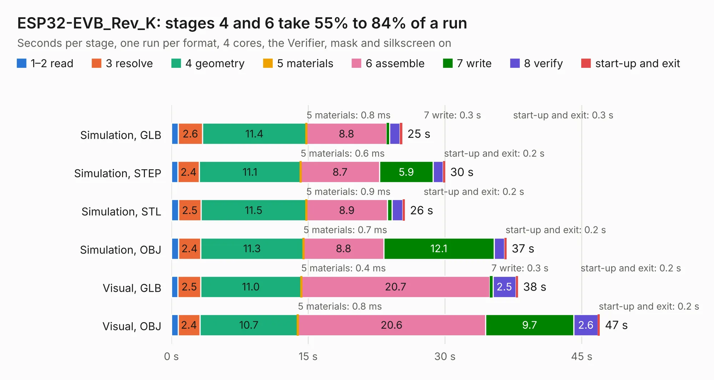

| Mode and format | 1–2 read | 3 resolve | 4 geometry | 5 materials | 6 assemble | 7 write | 8 verify | start-up and exit | Total |
|---|---:|---:|---:|---:|---:|---:|---:|---:|---:|
| Simulation, GLB | 0.8 | 2.6 | 11.4 | 0.8&nbsp;ms | 8.8 | 0.3 | 1.1 | 0.3 | 25.3 |
| Simulation, STEP | 0.7 | 2.4 | 11.1 | 0.6&nbsp;ms | 8.7 | 5.9 | 1.1 | 0.2 | 30.0 |
| Simulation, STL | 0.8 | 2.5 | 11.5 | 0.9&nbsp;ms | 8.9 | 0.5 | 1.2 | 0.2 | 25.6 |
| Simulation, OBJ | 0.8 | 2.4 | 11.3 | 0.7&nbsp;ms | 8.8 | 12.1 | 1.2 | 0.2 | 36.8 |
| Visual, GLB | 0.7 | 2.5 | 11.0 | 0.4&nbsp;ms | 20.7 | 0.3 | 2.5 | 0.2 | 38.0 |
| Visual, OBJ | 0.7 | 2.4 | 10.7 | 0.8&nbsp;ms | 20.6 | 9.7 | 2.6 | 0.2 | 47.0 |

<table align="center"><tr><td valign="top">

| Board | Repo: [OLIMEX/ESP32-EVB](https://github.com/OLIMEX/ESP32-EVB) Board: `ESP32-EVB_Rev_K.kicad_pcb` |
|---|---|
| Folder | HARDWARE / REV-K |
| Complexity | 303&nbsp;/&nbsp;1000 (size&nbsp;248, features&nbsp;55) |
| KESE&nbsp;features | through vias, slotted holes, filled zones, copper text |
| Tested | 9th November 2026 |
| Copper&nbsp;layers | 2 |
| File&nbsp;format | KiCad 5 (20171130) |
| Parts,&nbsp;tracks,&nbsp;vias | 157, 3,236, 315 |
| Triangles,&nbsp;simulation | 2,291,902 in 145 parts |
| Verifier | PASS in all six runs |

</td><td valign="top">

<table>
<tr><th>File type</th><th>File size</th><th>Peak memory used</th></tr>
<tr><th colspan="3" align="left">Simulation</th></tr>
<tr><td>GLB</td><td align="right">81&nbsp;MB</td><td align="right">890&nbsp;MB</td></tr>
<tr><td>STEP</td><td align="right">430&nbsp;MB</td><td align="right">1.1&nbsp;GB</td></tr>
<tr><td>STL</td><td align="right">115&nbsp;MB</td><td align="right">886&nbsp;MB</td></tr>
<tr><td>OBJ</td><td align="right">247&nbsp;MB</td><td align="right">1.6&nbsp;GB</td></tr>
<tr><th colspan="3" align="left">Visual</th></tr>
<tr><td>GLB</td><td align="right">66&nbsp;MB</td><td align="right">1.1&nbsp;GB</td></tr>
<tr><td>OBJ</td><td align="right">203&nbsp;MB</td><td align="right">1.4&nbsp;GB</td></tr>
</table>

</td></tr></table>

## 23.17.56 ESP32-EVB_Rev_K1

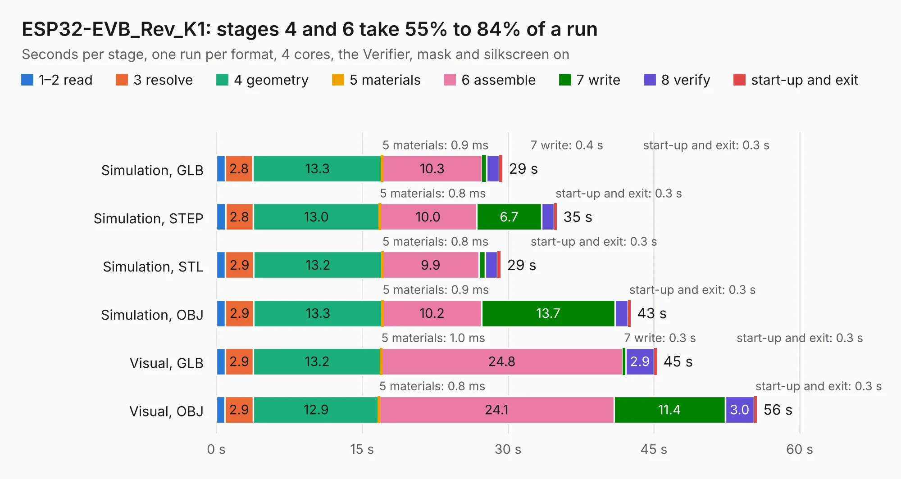

| Mode and format | 1–2 read | 3 resolve | 4 geometry | 5 materials | 6 assemble | 7 write | 8 verify | start-up and exit | Total |
|---|---:|---:|---:|---:|---:|---:|---:|---:|---:|
| Simulation, GLB | 0.9 | 2.8 | 13.3 | 0.9&nbsp;ms | 10.3 | 0.4 | 1.3 | 0.3 | 29.4 |
| Simulation, STEP | 1.0 | 2.8 | 13.0 | 0.8&nbsp;ms | 10.0 | 6.7 | 1.3 | 0.3 | 35.0 |
| Simulation, STL | 0.9 | 2.9 | 13.2 | 0.8&nbsp;ms | 9.9 | 0.7 | 1.2 | 0.3 | 29.2 |
| Simulation, OBJ | 0.9 | 2.9 | 13.3 | 0.9&nbsp;ms | 10.2 | 13.7 | 1.3 | 0.3 | 42.6 |
| Visual, GLB | 0.9 | 2.9 | 13.2 | 1.0&nbsp;ms | 24.8 | 0.3 | 2.9 | 0.3 | 45.3 |
| Visual, OBJ | 0.9 | 2.9 | 12.9 | 0.8&nbsp;ms | 24.1 | 11.4 | 3.0 | 0.3 | 55.6 |

<table align="center"><tr><td valign="top">

| Board | Repo: [OLIMEX/ESP32-EVB](https://github.com/OLIMEX/ESP32-EVB) Board: `ESP32-EVB_Rev_K1.kicad_pcb` |
|---|---|
| Folder | HARDWARE / REV-K1 |
| Complexity | 303&nbsp;/&nbsp;1000 (size&nbsp;248, features&nbsp;55) |
| KESE&nbsp;features | through vias, slotted holes, filled zones, copper text |
| Tested | 9th November 2026 |
| Copper&nbsp;layers | 2 |
| File&nbsp;format | KiCad 5 (20171130) |
| Parts,&nbsp;tracks,&nbsp;vias | 157, 3,236, 315 |
| Triangles,&nbsp;simulation | 2,292,316 in 145 parts |
| Verifier | PASS in all six runs |

</td><td valign="top">

<table>
<tr><th>File type</th><th>File size</th><th>Peak memory used</th></tr>
<tr><th colspan="3" align="left">Simulation</th></tr>
<tr><td>GLB</td><td align="right">81&nbsp;MB</td><td align="right">865&nbsp;MB</td></tr>
<tr><td>STEP</td><td align="right">430&nbsp;MB</td><td align="right">1.0&nbsp;GB</td></tr>
<tr><td>STL</td><td align="right">115&nbsp;MB</td><td align="right">852&nbsp;MB</td></tr>
<tr><td>OBJ</td><td align="right">247&nbsp;MB</td><td align="right">1.6&nbsp;GB</td></tr>
<tr><th colspan="3" align="left">Visual</th></tr>
<tr><td>GLB</td><td align="right">66&nbsp;MB</td><td align="right">1.1&nbsp;GB</td></tr>
<tr><td>OBJ</td><td align="right">203&nbsp;MB</td><td align="right">1.4&nbsp;GB</td></tr>
</table>

</td></tr></table>

## 23.17.57 ESP32-EVB_Rev_K2

| Mode and format | 1–2 read | 3 resolve | 4 geometry | 5 materials | 6 assemble | 7 write | 8 verify | start-up and exit | Total |
|---|---:|---:|---:|---:|---:|---:|---:|---:|---:|
| Simulation, GLB | 0.7 | 2.3 | 11.6 | 1.0&nbsp;ms | 8.9 | 0.3 | 1.1 | 0.3 | 25.4 |
| Simulation, STEP | 0.7 | 2.5 | 11.4 | 0.9&nbsp;ms | 8.7 | 6.0 | 1.1 | 0.3 | 30.7 |
| Simulation, STL | 0.7 | 2.5 | 11.7 | 1&nbsp;ms | 9.2 | 0.6 | 1.2 | 0.3 | 26.2 |
| Simulation, OBJ | 0.7 | 2.5 | 11.1 | 1.0&nbsp;ms | 9.0 | 11.1 | 1.3 | 0.2 | 36.0 |
| Visual, GLB | 0.8 | 2.4 | 11.1 | 1&nbsp;ms | 22.8 | 0.3 | 3.2 | 0.3 | 40.9 |
| Visual, OBJ | 0.8 | 2.4 | 11.7 | 0.9&nbsp;ms | 24.4 | 9.9 | 3.6 | 0.3 | 53.0 |

<table align="center"><tr><td valign="top">

| Board | Repo: [OLIMEX/ESP32-EVB](https://github.com/OLIMEX/ESP32-EVB) Board: `ESP32-EVB_Rev_K2.kicad_pcb` |
|---|---|
| Folder | HARDWARE / REV-K2 |
| Complexity | 293&nbsp;/&nbsp;1000 (size&nbsp;248, features&nbsp;45) |
| KESE&nbsp;features | through vias, slotted holes, filled zones |
| Tested | 9th November 2026 |
| Copper&nbsp;layers | 2 |
| File&nbsp;format | KiCad 5 (20171130) |
| Parts,&nbsp;tracks,&nbsp;vias | 157, 3,236, 315 |
| Triangles,&nbsp;simulation | 2,292,312 in 145 parts |
| Verifier | PASS in all six runs |

</td><td valign="top">

<table>
<tr><th>File type</th><th>File size</th><th>Peak memory used</th></tr>
<tr><th colspan="3" align="left">Simulation</th></tr>
<tr><td>GLB</td><td align="right">81&nbsp;MB</td><td align="right">972&nbsp;MB</td></tr>
<tr><td>STEP</td><td align="right">430&nbsp;MB</td><td align="right">1.1&nbsp;GB</td></tr>
<tr><td>STL</td><td align="right">115&nbsp;MB</td><td align="right">900&nbsp;MB</td></tr>
<tr><td>OBJ</td><td align="right">247&nbsp;MB</td><td align="right">1.6&nbsp;GB</td></tr>
<tr><th colspan="3" align="left">Visual</th></tr>
<tr><td>GLB</td><td align="right">66&nbsp;MB</td><td align="right">1.1&nbsp;GB</td></tr>
<tr><td>OBJ</td><td align="right">203&nbsp;MB</td><td align="right">1.3&nbsp;GB</td></tr>
</table>

</td></tr></table>

## 23.17.58 ESP32-EVB_Rev_L

| Mode and format | 1–2 read | 3 resolve | 4 geometry | 5 materials | 6 assemble | 7 write | 8 verify | start-up and exit | Total |
|---|---:|---:|---:|---:|---:|---:|---:|---:|---:|
| Simulation, GLB | 0.8 | 2.5 | 10.8 | 0.7&nbsp;ms | 8.9 | 0.3 | 1.1 | 0.2 | 24.7 |
| Simulation, STEP | 0.8 | 2.4 | 10.9 | 0.7&nbsp;ms | 9.2 | 5.9 | 1.0 | 0.2 | 30.6 |
| Simulation, STL | 1.0 | 2.3 | 11.1 | 0.8&nbsp;ms | 9.0 | 0.5 | 1.0 | 0.2 | 25.1 |
| Simulation, OBJ | 0.9 | 2.3 | 10.7 | 0.6&nbsp;ms | 9.0 | 11.6 | 1.2 | 0.3 | 36.0 |
| Visual, GLB | 0.9 | 2.3 | 11.2 | 0.8&nbsp;ms | 21.8 | 0.3 | 2.4 | 0.2 | 39.2 |
| Visual, OBJ | 0.9 | 2.5 | 11.0 | 0.7&nbsp;ms | 21.9 | 9.9 | 3.0 | 0.3 | 49.4 |

<table align="center"><tr><td valign="top">

| Board | Repo: [OLIMEX/ESP32-EVB](https://github.com/OLIMEX/ESP32-EVB) Board: `ESP32-EVB_Rev_L.kicad_pcb` |
|---|---|
| Folder | HARDWARE / REV-L |
| Complexity | 307&nbsp;/&nbsp;1000 (size&nbsp;247, features&nbsp;60) |
| KESE&nbsp;features | through vias, slotted holes, filled zones, knockout text |
| Tested | 9th November 2026 |
| Copper&nbsp;layers | 2 |
| File&nbsp;format | KiCad 7 (20221018) |
| Parts,&nbsp;tracks,&nbsp;vias | 155, 3,066, 307 |
| Triangles,&nbsp;simulation | 2,193,876 in 144 parts |
| Verifier | PASS in all six runs |

</td><td valign="top">

<table>
<tr><th>File type</th><th>File size</th><th>Peak memory used</th></tr>
<tr><th colspan="3" align="left">Simulation</th></tr>
<tr><td>GLB</td><td align="right">78&nbsp;MB</td><td align="right">830&nbsp;MB</td></tr>
<tr><td>STEP</td><td align="right">424&nbsp;MB</td><td align="right">981&nbsp;MB</td></tr>
<tr><td>STL</td><td align="right">110&nbsp;MB</td><td align="right">807&nbsp;MB</td></tr>
<tr><td>OBJ</td><td align="right">237&nbsp;MB</td><td align="right">1.5&nbsp;GB</td></tr>
<tr><th colspan="3" align="left">Visual</th></tr>
<tr><td>GLB</td><td align="right">62&nbsp;MB</td><td align="right">1.1&nbsp;GB</td></tr>
<tr><td>OBJ</td><td align="right">191&nbsp;MB</td><td align="right">1.4&nbsp;GB</td></tr>
</table>

</td></tr></table>

## 23.17.59 ESP32-GATEWAY_Rev_A

| Mode and format | 1–2 read | 3 resolve | 4 geometry | 5 materials | 6 assemble | 7 write | 8 verify | start-up and exit | Total |
|---|---:|---:|---:|---:|---:|---:|---:|---:|---:|
| Simulation, GLB | 0.5 | 1.6 | 7.6 | 0.9&nbsp;ms | 5.3 | 0.3 | 0.7 | 0.3 | 16.2 |
| Simulation, STEP | 0.5 | 1.6 | 7.7 | 0.6&nbsp;ms | 5.2 | 4.0 | 0.7 | 0.3 | 20.0 |
| Simulation, STL | 0.5 | 1.6 | 7.3 | 0.5&nbsp;ms | 5.1 | 0.4 | 0.7 | 0.2 | 15.8 |
| Simulation, OBJ | 0.4 | 1.6 | 7.3 | 0.6&nbsp;ms | 5.3 | 8.0 | 0.7 | 0.2 | 23.7 |
| Visual, GLB | 0.4 | 1.5 | 7.6 | 0.6&nbsp;ms | 12.7 | 0.2 | 1.7 | 0.2 | 24.4 |
| Visual, OBJ | 0.5 | 1.6 | 7.2 | 0.5&nbsp;ms | 13.1 | 6.6 | 1.8 | 0.2 | 30.9 |

<table align="center"><tr><td valign="top">

| Board | Repo: [OLIMEX/ESP32-GATEWAY](https://github.com/OLIMEX/ESP32-GATEWAY) Board: `ESP32-GATEWAY_Rev_A.kicad_pcb` |
|---|---|
| Folder | HARDWARE / Hardware revision A |
| Complexity | 288&nbsp;/&nbsp;1000 (size&nbsp;233, features&nbsp;55) |
| KESE&nbsp;features | through vias, slotted holes, filled zones, copper text |
| Tested | 9th November 2026 |
| Copper&nbsp;layers | 2 |
| File&nbsp;format | KiCad 5 (20170123) |
| Parts,&nbsp;tracks,&nbsp;vias | 82, 1,876, 230 |
| Triangles,&nbsp;simulation | 1,311,668 in 104 parts |
| Verifier | PASS in all six runs |

</td><td valign="top">

<table>
<tr><th>File type</th><th>File size</th><th>Peak memory used</th></tr>
<tr><th colspan="3" align="left">Simulation</th></tr>
<tr><td>GLB</td><td align="right">47&nbsp;MB</td><td align="right">544&nbsp;MB</td></tr>
<tr><td>STEP</td><td align="right">241&nbsp;MB</td><td align="right">642&nbsp;MB</td></tr>
<tr><td>STL</td><td align="right">66&nbsp;MB</td><td align="right">551&nbsp;MB</td></tr>
<tr><td>OBJ</td><td align="right">139&nbsp;MB</td><td align="right">933&nbsp;MB</td></tr>
<tr><th colspan="3" align="left">Visual</th></tr>
<tr><td>GLB</td><td align="right">38&nbsp;MB</td><td align="right">716&nbsp;MB</td></tr>
<tr><td>OBJ</td><td align="right">114&nbsp;MB</td><td align="right">783&nbsp;MB</td></tr>
</table>

</td></tr></table>

## 23.17.60 ESP32-GATEWAY_Rev_B

| Mode and format | 1–2 read | 3 resolve | 4 geometry | 5 materials | 6 assemble | 7 write | 8 verify | start-up and exit | Total |
|---|---:|---:|---:|---:|---:|---:|---:|---:|---:|
| Simulation, GLB | 0.4 | 1.4 | 6.7 | 0.6&nbsp;ms | 4.7 | 0.2 | 0.7 | 0.3 | 14.4 |
| Simulation, STEP | 0.4 | 1.4 | 6.5 | 0.6&nbsp;ms | 4.6 | 3.4 | 0.6 | 0.2 | 17.1 |
| Simulation, STL | 0.4 | 1.4 | 6.3 | 0.6&nbsp;ms | 4.8 | 0.5 | 0.6 | 0.3 | 14.3 |
| Simulation, OBJ | 0.5 | 1.4 | 6.3 | 0.5&nbsp;ms | 4.7 | 6.6 | 0.8 | 0.3 | 20.6 |
| Visual, GLB | 0.7 | 1.8 | 7.9 | 0.6&nbsp;ms | 12.6 | 0.2 | 1.6 | 0.3 | 25.0 |
| Visual, OBJ | 0.4 | 1.2 | 6.7 | 0.6&nbsp;ms | 12.7 | 5.8 | 1.9 | 0.2 | 28.9 |

<table align="center"><tr><td valign="top">

| Board | Repo: [OLIMEX/ESP32-GATEWAY](https://github.com/OLIMEX/ESP32-GATEWAY) Board: `ESP32-GATEWAY_Rev_B.kicad_pcb` |
|---|---|
| Folder | HARDWARE / Hardware revision B |
| Complexity | 288&nbsp;/&nbsp;1000 (size&nbsp;233, features&nbsp;55) |
| KESE&nbsp;features | through vias, slotted holes, filled zones, copper text |
| Tested | 9th November 2026 |
| Copper&nbsp;layers | 2 |
| File&nbsp;format | KiCad 5 (20170123) |
| Parts,&nbsp;tracks,&nbsp;vias | 83, 1,858, 229 |
| Triangles,&nbsp;simulation | 1,306,382 in 104 parts |
| Verifier | PASS in all six runs |

</td><td valign="top">

<table>
<tr><th>File type</th><th>File size</th><th>Peak memory used</th></tr>
<tr><th colspan="3" align="left">Simulation</th></tr>
<tr><td>GLB</td><td align="right">46&nbsp;MB</td><td align="right">547&nbsp;MB</td></tr>
<tr><td>STEP</td><td align="right">240&nbsp;MB</td><td align="right">637&nbsp;MB</td></tr>
<tr><td>STL</td><td align="right">65&nbsp;MB</td><td align="right">535&nbsp;MB</td></tr>
<tr><td>OBJ</td><td align="right">138&nbsp;MB</td><td align="right">942&nbsp;MB</td></tr>
<tr><th colspan="3" align="left">Visual</th></tr>
<tr><td>GLB</td><td align="right">38&nbsp;MB</td><td align="right">685&nbsp;MB</td></tr>
<tr><td>OBJ</td><td align="right">114&nbsp;MB</td><td align="right">796&nbsp;MB</td></tr>
</table>

</td></tr></table>

## 23.17.61 ESP32-GATEWAY_Rev_C

| Mode and format | 1–2 read | 3 resolve | 4 geometry | 5 materials | 6 assemble | 7 write | 8 verify | start-up and exit | Total |
|---|---:|---:|---:|---:|---:|---:|---:|---:|---:|
| Simulation, GLB | 0.4 | 1.5 | 7.0 | 0.5&nbsp;ms | 4.8 | 0.2 | 0.6 | 0.3 | 14.9 |
| Simulation, STEP | 0.5 | 1.4 | 6.8 | 0.5&nbsp;ms | 4.6 | 3.8 | 0.6 | 0.2 | 17.9 |
| Simulation, STL | 0.5 | 1.5 | 6.9 | 0.6&nbsp;ms | 4.8 | 0.5 | 0.7 | 0.2 | 15.1 |
| Simulation, OBJ | 0.5 | 1.5 | 7.1 | 0.6&nbsp;ms | 4.8 | 7.4 | 0.6 | 0.3 | 22.1 |
| Visual, GLB | 0.4 | 1.6 | 6.8 | 0.5&nbsp;ms | 13.1 | 0.2 | 1.4 | 0.3 | 23.7 |
| Visual, OBJ | 0.5 | 1.6 | 6.9 | 0.5&nbsp;ms | 12.6 | 6.2 | 1.7 | 0.3 | 29.8 |

<table align="center"><tr><td valign="top">

| Board | Repo: [OLIMEX/ESP32-GATEWAY](https://github.com/OLIMEX/ESP32-GATEWAY) Board: `ESP32-GATEWAY_Rev_C.kicad_pcb` |
|---|---|
| Folder | HARDWARE / Hardware revision C |
| Complexity | 288&nbsp;/&nbsp;1000 (size&nbsp;233, features&nbsp;55) |
| KESE&nbsp;features | through vias, slotted holes, filled zones, copper text |
| Tested | 9th November 2026 |
| Copper&nbsp;layers | 2 |
| File&nbsp;format | KiCad 5 (20171130) |
| Parts,&nbsp;tracks,&nbsp;vias | 84, 1,868, 232 |
| Triangles,&nbsp;simulation | 1,333,358 in 104 parts |
| Verifier | PASS in all six runs |

</td><td valign="top">

<table>
<tr><th>File type</th><th>File size</th><th>Peak memory used</th></tr>
<tr><th colspan="3" align="left">Simulation</th></tr>
<tr><td>GLB</td><td align="right">47&nbsp;MB</td><td align="right">554&nbsp;MB</td></tr>
<tr><td>STEP</td><td align="right">246&nbsp;MB</td><td align="right">670&nbsp;MB</td></tr>
<tr><td>STL</td><td align="right">67&nbsp;MB</td><td align="right">558&nbsp;MB</td></tr>
<tr><td>OBJ</td><td align="right">141&nbsp;MB</td><td align="right">950&nbsp;MB</td></tr>
<tr><th colspan="3" align="left">Visual</th></tr>
<tr><td>GLB</td><td align="right">39&nbsp;MB</td><td align="right">758&nbsp;MB</td></tr>
<tr><td>OBJ</td><td align="right">117&nbsp;MB</td><td align="right">822&nbsp;MB</td></tr>
</table>

</td></tr></table>

## 23.17.62 ESP32-GATEWAY_Rev_D

| Mode and format | 1–2 read | 3 resolve | 4 geometry | 5 materials | 6 assemble | 7 write | 8 verify | start-up and exit | Total |
|---|---:|---:|---:|---:|---:|---:|---:|---:|---:|
| Simulation, GLB | 0.5 | 1.9 | 7.2 | 0.5&nbsp;ms | 5.1 | 0.2 | 0.7 | 0.3 | 15.9 |
| Simulation, STEP | 0.5 | 1.9 | 7.1 | 0.5&nbsp;ms | 4.8 | 3.7 | 0.7 | 0.2 | 18.8 |
| Simulation, STL | 0.4 | 1.8 | 7.0 | 0.4&nbsp;ms | 4.8 | 0.4 | 0.7 | 0.3 | 15.4 |
| Simulation, OBJ | 0.5 | 1.9 | 6.9 | 0.4&nbsp;ms | 4.8 | 7.5 | 0.6 | 0.3 | 22.5 |
| Visual, GLB | 0.4 | 2.0 | 7.2 | 0.5&nbsp;ms | 11.8 | 0.2 | 1.4 | 0.2 | 23.2 |
| Visual, OBJ | 0.5 | 1.9 | 7.3 | 0.6&nbsp;ms | 12.2 | 6.4 | 1.5 | 0.3 | 30.0 |

<table align="center"><tr><td valign="top">

| Board | Repo: [OLIMEX/ESP32-GATEWAY](https://github.com/OLIMEX/ESP32-GATEWAY) Board: `ESP32-GATEWAY_Rev_D.kicad_pcb` |
|---|---|
| Folder | HARDWARE / Hardware revision D |
| Complexity | 288&nbsp;/&nbsp;1000 (size&nbsp;233, features&nbsp;55) |
| KESE&nbsp;features | through vias, slotted holes, filled zones, copper text |
| Tested | 9th November 2026 |
| Copper&nbsp;layers | 2 |
| File&nbsp;format | KiCad 5 (20171130) |
| Parts,&nbsp;tracks,&nbsp;vias | 82, 1,793, 226 |
| Triangles,&nbsp;simulation | 1,276,634 in 102 parts |
| Verifier | PASS in all six runs |

</td><td valign="top">

<table>
<tr><th>File type</th><th>File size</th><th>Peak memory used</th></tr>
<tr><th colspan="3" align="left">Simulation</th></tr>
<tr><td>GLB</td><td align="right">45&nbsp;MB</td><td align="right">541&nbsp;MB</td></tr>
<tr><td>STEP</td><td align="right">236&nbsp;MB</td><td align="right">642&nbsp;MB</td></tr>
<tr><td>STL</td><td align="right">64&nbsp;MB</td><td align="right">544&nbsp;MB</td></tr>
<tr><td>OBJ</td><td align="right">135&nbsp;MB</td><td align="right">888&nbsp;MB</td></tr>
<tr><th colspan="3" align="left">Visual</th></tr>
<tr><td>GLB</td><td align="right">37&nbsp;MB</td><td align="right">697&nbsp;MB</td></tr>
<tr><td>OBJ</td><td align="right">111&nbsp;MB</td><td align="right">803&nbsp;MB</td></tr>
</table>

</td></tr></table>

## 23.17.63 ESP32-GATEWAY_Rev_E

| Mode and format | 1–2 read | 3 resolve | 4 geometry | 5 materials | 6 assemble | 7 write | 8 verify | start-up and exit | Total |
|---|---:|---:|---:|---:|---:|---:|---:|---:|---:|
| Simulation, GLB | 0.4 | 1.5 | 5.9 | 0.5&nbsp;ms | 4.1 | 0.2 | 0.6 | 0.2 | 12.9 |
| Simulation, STEP | 0.4 | 1.6 | 5.8 | 0.5&nbsp;ms | 4.0 | 3.2 | 0.5 | 0.2 | 15.7 |
| Simulation, STL | 0.4 | 1.6 | 5.6 | 0.3&nbsp;ms | 4.0 | 0.3 | 0.5 | 0.2 | 12.7 |
| Simulation, OBJ | 0.4 | 1.6 | 5.7 | 0.3&nbsp;ms | 4.1 | 6.2 | 0.6 | 0.2 | 18.6 |
| Visual, GLB | 0.4 | 1.6 | 6.0 | 0.4&nbsp;ms | 9.9 | 0.2 | 1.1 | 0.2 | 19.3 |
| Visual, OBJ | 0.4 | 1.5 | 5.8 | 0.4&nbsp;ms | 10.3 | 5.3 | 1.2 | 0.2 | 24.8 |

<table align="center"><tr><td valign="top">

| Board | Repo: [OLIMEX/ESP32-GATEWAY](https://github.com/OLIMEX/ESP32-GATEWAY) Board: `ESP32-GATEWAY_Rev_E.kicad_pcb` |
|---|---|
| Folder | HARDWARE / Hardware revision E |
| Complexity | 288&nbsp;/&nbsp;1000 (size&nbsp;233, features&nbsp;55) |
| KESE&nbsp;features | through vias, slotted holes, filled zones, copper text |
| Tested | 9th November 2026 |
| Copper&nbsp;layers | 2 |
| File&nbsp;format | KiCad 5 (20171130) |
| Parts,&nbsp;tracks,&nbsp;vias | 82, 1,795, 226 |
| Triangles,&nbsp;simulation | 1,276,018 in 103 parts |
| Verifier | PASS in all six runs |

</td><td valign="top">

<table>
<tr><th>File type</th><th>File size</th><th>Peak memory used</th></tr>
<tr><th colspan="3" align="left">Simulation</th></tr>
<tr><td>GLB</td><td align="right">45&nbsp;MB</td><td align="right">541&nbsp;MB</td></tr>
<tr><td>STEP</td><td align="right">236&nbsp;MB</td><td align="right">645&nbsp;MB</td></tr>
<tr><td>STL</td><td align="right">64&nbsp;MB</td><td align="right">535&nbsp;MB</td></tr>
<tr><td>OBJ</td><td align="right">134&nbsp;MB</td><td align="right">881&nbsp;MB</td></tr>
<tr><th colspan="3" align="left">Visual</th></tr>
<tr><td>GLB</td><td align="right">37&nbsp;MB</td><td align="right">685&nbsp;MB</td></tr>
<tr><td>OBJ</td><td align="right">111&nbsp;MB</td><td align="right">839&nbsp;MB</td></tr>
</table>

</td></tr></table>

## 23.17.64 ESP32-GATEWAY_Rev_F

| Mode and format | 1–2 read | 3 resolve | 4 geometry | 5 materials | 6 assemble | 7 write | 8 verify | start-up and exit | Total |
|---|---:|---:|---:|---:|---:|---:|---:|---:|---:|
| Simulation, GLB | 0.5 | 1.8 | 7.6 | 0.4&nbsp;ms | 5.4 | 0.2 | 0.7 | 0.3 | 16.5 |
| Simulation, STEP | 0.5 | 1.8 | 7.6 | 0.4&nbsp;ms | 5.5 | 4.0 | 0.7 | 0.2 | 20.3 |
| Simulation, STL | 0.5 | 1.8 | 7.8 | 0.4&nbsp;ms | 5.3 | 0.4 | 0.7 | 0.2 | 16.8 |
| Simulation, OBJ | 0.5 | 1.7 | 7.7 | 0.5&nbsp;ms | 5.4 | 8.4 | 0.7 | 0.2 | 24.7 |
| Visual, GLB | 0.5 | 1.8 | 7.8 | 0.3&nbsp;ms | 14.2 | 0.2 | 1.5 | 0.3 | 26.3 |
| Visual, OBJ | 0.5 | 1.8 | 7.8 | 0.7&nbsp;ms | 14.0 | 7.0 | 1.6 | 0.3 | 33.0 |

<table align="center"><tr><td valign="top">

| Board | Repo: [OLIMEX/ESP32-GATEWAY](https://github.com/OLIMEX/ESP32-GATEWAY) Board: `ESP32-GATEWAY_Rev_F.kicad_pcb` |
|---|---|
| Folder | HARDWARE / Hardware revision F |
| Complexity | 291&nbsp;/&nbsp;1000 (size&nbsp;236, features&nbsp;55) |
| KESE&nbsp;features | through vias, slotted holes, filled zones, copper text |
| Tested | 9th November 2026 |
| Copper&nbsp;layers | 2 |
| File&nbsp;format | KiCad 6 (20190331) |
| Parts,&nbsp;tracks,&nbsp;vias | 90, 1,929, 320 |
| Triangles,&nbsp;simulation | 1,424,536 in 110 parts |
| Verifier | PASS in all six runs |

</td><td valign="top">

<table>
<tr><th>File type</th><th>File size</th><th>Peak memory used</th></tr>
<tr><th colspan="3" align="left">Simulation</th></tr>
<tr><td>GLB</td><td align="right">50&nbsp;MB</td><td align="right">608&nbsp;MB</td></tr>
<tr><td>STEP</td><td align="right">242&nbsp;MB</td><td align="right">696&nbsp;MB</td></tr>
<tr><td>STL</td><td align="right">71&nbsp;MB</td><td align="right">603&nbsp;MB</td></tr>
<tr><td>OBJ</td><td align="right">150&nbsp;MB</td><td align="right">1.0&nbsp;GB</td></tr>
<tr><th colspan="3" align="left">Visual</th></tr>
<tr><td>GLB</td><td align="right">42&nbsp;MB</td><td align="right">772&nbsp;MB</td></tr>
<tr><td>OBJ</td><td align="right">126&nbsp;MB</td><td align="right">959&nbsp;MB</td></tr>
</table>

</td></tr></table>

## 23.17.65 ESP32-GATEWAY_Rev_G

| Mode and format | 1–2 read | 3 resolve | 4 geometry | 5 materials | 6 assemble | 7 write | 8 verify | start-up and exit | Total |
|---|---:|---:|---:|---:|---:|---:|---:|---:|---:|
| Simulation, GLB | 0.5 | 1.8 | 8.2 | 0.5&nbsp;ms | 5.8 | 0.3 | 0.8 | 0.3 | 17.7 |
| Simulation, STEP | 0.6 | 1.8 | 8.2 | 0.6&nbsp;ms | 5.7 | 4.1 | 0.7 | 0.3 | 21.5 |
| Simulation, STL | 0.5 | 1.9 | 8.6 | 0.8&nbsp;ms | 5.8 | 0.5 | 0.7 | 0.3 | 18.2 |
| Simulation, OBJ | 0.5 | 1.8 | 8.2 | 0.3&nbsp;ms | 5.6 | 8.4 | 0.7 | 0.2 | 25.5 |
| Visual, GLB | 0.5 | 1.9 | 8.4 | 0.4&nbsp;ms | 15.2 | 0.2 | 1.7 | 0.3 | 28.1 |
| Visual, OBJ | 0.5 | 1.9 | 8.2 | 0.6&nbsp;ms | 14.1 | 7.3 | 1.8 | 0.3 | 34.1 |

<table align="center"><tr><td valign="top">

| Board | Repo: [OLIMEX/ESP32-GATEWAY](https://github.com/OLIMEX/ESP32-GATEWAY) Board: `ESP32-GATEWAY_Rev_G.kicad_pcb` |
|---|---|
| Folder | HARDWARE / Hardware revision G |
| Complexity | 291&nbsp;/&nbsp;1000 (size&nbsp;236, features&nbsp;55) |
| KESE&nbsp;features | through vias, slotted holes, filled zones, copper text |
| Tested | 9th November 2026 |
| Copper&nbsp;layers | 2 |
| File&nbsp;format | KiCad 5 (20171130) |
| Parts,&nbsp;tracks,&nbsp;vias | 90, 1,944, 322 |
| Triangles,&nbsp;simulation | 1,438,022 in 110 parts |
| Verifier | PASS in all six runs |

</td><td valign="top">

<table>
<tr><th>File type</th><th>File size</th><th>Peak memory used</th></tr>
<tr><th colspan="3" align="left">Simulation</th></tr>
<tr><td>GLB</td><td align="right">51&nbsp;MB</td><td align="right">607&nbsp;MB</td></tr>
<tr><td>STEP</td><td align="right">245&nbsp;MB</td><td align="right">713&nbsp;MB</td></tr>
<tr><td>STL</td><td align="right">72&nbsp;MB</td><td align="right">591&nbsp;MB</td></tr>
<tr><td>OBJ</td><td align="right">151&nbsp;MB</td><td align="right">999&nbsp;MB</td></tr>
<tr><th colspan="3" align="left">Visual</th></tr>
<tr><td>GLB</td><td align="right">42&nbsp;MB</td><td align="right">811&nbsp;MB</td></tr>
<tr><td>OBJ</td><td align="right">127&nbsp;MB</td><td align="right">971&nbsp;MB</td></tr>
</table>

</td></tr></table>

## 23.17.66 ESP32-GATEWAY_Rev_H

| Mode and format | 1–2 read | 3 resolve | 4 geometry | 5 materials | 6 assemble | 7 write | 8 verify | start-up and exit | Total |
|---|---:|---:|---:|---:|---:|---:|---:|---:|---:|
| Simulation, GLB | 0.5 | 1.8 | 7.8 | 0.3&nbsp;ms | 6.0 | 0.3 | 0.7 | 0.2 | 17.3 |
| Simulation, STEP | 0.5 | 1.8 | 7.9 | 0.4&nbsp;ms | 6.0 | 4.2 | 0.7 | 0.3 | 21.5 |
| Simulation, STL | 0.6 | 1.8 | 7.9 | 0.3&nbsp;ms | 5.8 | 0.4 | 0.8 | 0.2 | 17.4 |
| Simulation, OBJ | 0.5 | 1.9 | 7.8 | 0.4&nbsp;ms | 6.1 | 9.2 | 0.8 | 0.3 | 26.4 |
| Visual, GLB | 0.5 | 1.8 | 7.6 | 0.4&nbsp;ms | 15.5 | 0.2 | 2.0 | 0.2 | 27.8 |
| Visual, OBJ | 0.5 | 1.7 | 7.6 | 0.4&nbsp;ms | 15.7 | 8.6 | 1.9 | 0.3 | 36.3 |

<table align="center"><tr><td valign="top">

| Board | Repo: [OLIMEX/ESP32-GATEWAY](https://github.com/OLIMEX/ESP32-GATEWAY) Board: `ESP32-GATEWAY_Rev_H.kicad_pcb` |
|---|---|
| Folder | HARDWARE / Hardware revision H |
| Complexity | 281&nbsp;/&nbsp;1000 (size&nbsp;236, features&nbsp;45) |
| KESE&nbsp;features | through vias, slotted holes, filled zones |
| Tested | 9th November 2026 |
| Copper&nbsp;layers | 2 |
| File&nbsp;format | KiCad 5 (20171130) |
| Parts,&nbsp;tracks,&nbsp;vias | 97, 1,920, 287 |
| Triangles,&nbsp;simulation | 1,463,584 in 110 parts |
| Verifier | PASS in all six runs |

</td><td valign="top">

<table>
<tr><th>File type</th><th>File size</th><th>Peak memory used</th></tr>
<tr><th colspan="3" align="left">Simulation</th></tr>
<tr><td>GLB</td><td align="right">52&nbsp;MB</td><td align="right">604&nbsp;MB</td></tr>
<tr><td>STEP</td><td align="right">256&nbsp;MB</td><td align="right">724&nbsp;MB</td></tr>
<tr><td>STL</td><td align="right">73&nbsp;MB</td><td align="right">651&nbsp;MB</td></tr>
<tr><td>OBJ</td><td align="right">154&nbsp;MB</td><td align="right">1.0&nbsp;GB</td></tr>
<tr><th colspan="3" align="left">Visual</th></tr>
<tr><td>GLB</td><td align="right">43&nbsp;MB</td><td align="right">788&nbsp;MB</td></tr>
<tr><td>OBJ</td><td align="right">130&nbsp;MB</td><td align="right">920&nbsp;MB</td></tr>
</table>

</td></tr></table>

## 23.17.67 ESP32-GATEWAY_Rev_I

| Mode and format | 1–2 read | 3 resolve | 4 geometry | 5 materials | 6 assemble | 7 write | 8 verify | start-up and exit | Total |
|---|---:|---:|---:|---:|---:|---:|---:|---:|---:|
| Simulation, GLB | 0.5 | 1.5 | 6.6 | 0.6&nbsp;ms | 5.3 | 0.2 | 0.6 | 0.3 | 15.1 |
| Simulation, STEP | 0.5 | 1.5 | 6.8 | 0.6&nbsp;ms | 5.2 | 3.9 | 0.6 | 0.3 | 18.8 |
| Simulation, STL | 0.4 | 1.6 | 6.8 | 0.7&nbsp;ms | 5.8 | 0.4 | 0.7 | 0.3 | 16.1 |
| Simulation, OBJ | 0.4 | 1.7 | 6.7 | 0.7&nbsp;ms | 5.3 | 7.7 | 0.6 | 0.3 | 22.7 |
| Visual, GLB | 0.4 | 1.6 | 6.6 | 0.7&nbsp;ms | 14.3 | 0.2 | 1.9 | 0.2 | 25.3 |
| Visual, OBJ | 0.5 | 1.3 | 6.8 | 0.9&nbsp;ms | 14.4 | 5.8 | 2.0 | 0.3 | 31.2 |

<table align="center"><tr><td valign="top">

| Board | Repo: [OLIMEX/ESP32-GATEWAY](https://github.com/OLIMEX/ESP32-GATEWAY) Board: `ESP32-GATEWAY_Rev_I.kicad_pcb` |
|---|---|
| Folder | HARDWARE / Hardware revision I |
| Complexity | 281&nbsp;/&nbsp;1000 (size&nbsp;236, features&nbsp;45) |
| KESE&nbsp;features | through vias, slotted holes, filled zones |
| Tested | 9th November 2026 |
| Copper&nbsp;layers | 2 |
| File&nbsp;format | KiCad 5 (20171130) |
| Parts,&nbsp;tracks,&nbsp;vias | 98, 1,934, 287 |
| Triangles,&nbsp;simulation | 1,474,380 in 111 parts |
| Verifier | PASS in all six runs |

</td><td valign="top">

<table>
<tr><th>File type</th><th>File size</th><th>Peak memory used</th></tr>
<tr><th colspan="3" align="left">Simulation</th></tr>
<tr><td>GLB</td><td align="right">52&nbsp;MB</td><td align="right">608&nbsp;MB</td></tr>
<tr><td>STEP</td><td align="right">259&nbsp;MB</td><td align="right">722&nbsp;MB</td></tr>
<tr><td>STL</td><td align="right">74&nbsp;MB</td><td align="right">620&nbsp;MB</td></tr>
<tr><td>OBJ</td><td align="right">156&nbsp;MB</td><td align="right">1.0&nbsp;GB</td></tr>
<tr><th colspan="3" align="left">Visual</th></tr>
<tr><td>GLB</td><td align="right">43&nbsp;MB</td><td align="right">783&nbsp;MB</td></tr>
<tr><td>OBJ</td><td align="right">131&nbsp;MB</td><td align="right">941&nbsp;MB</td></tr>
</table>

</td></tr></table>

## 23.17.68 ESP32-H2-DevKit-LiPo_Rev_A

| Mode and format | 1–2 read | 3 resolve | 4 geometry | 5 materials | 6 assemble | 7 write | 8 verify | start-up and exit | Total |
|---|---:|---:|---:|---:|---:|---:|---:|---:|---:|
| Simulation, GLB | 0.5 | 1.1 | 4.5 | 0.4&nbsp;ms | 3.9 | 0.2 | 0.5 | 0.2 | 10.9 |
| Simulation, STEP | 0.4 | 1.1 | 4.4 | 0.4&nbsp;ms | 4.0 | 3.0 | 0.5 | 0.2 | 13.5 |
| Simulation, STL | 0.5 | 1.1 | 4.5 | 0.4&nbsp;ms | 3.9 | 0.4 | 0.5 | 0.3 | 11.2 |
| Simulation, OBJ | 0.5 | 1.0 | 4.4 | 0.4&nbsp;ms | 3.8 | 5.6 | 0.5 | 0.2 | 16.1 |
| Visual, GLB | 0.4 | 1.1 | 4.4 | 0.4&nbsp;ms | 9.6 | 0.1 | 1.1 | 0.2 | 16.9 |
| Visual, OBJ | 0.4 | 1.1 | 4.4 | 0.4&nbsp;ms | 9.4 | 4.3 | 1.3 | 0.2 | 21.1 |

<table align="center"><tr><td valign="top">

| Board | Repo: [OLIMEX/ESP32-H2-DevKit-Lipo](https://github.com/OLIMEX/ESP32-H2-DevKit-Lipo) Board: `ESP32-H2-DevKit-LiPo_Rev_A.kicad_pcb` |
|---|---|
| Folder | HARDWARE / ESP32-H2-DevKit-Lipo-Rev.A |
| Complexity | 282&nbsp;/&nbsp;1000 (size&nbsp;182, features&nbsp;100) |
| KESE&nbsp;features | through vias, slotted holes, rounded, trapezoid or chamfered pads, filled zones, knockout text, stack-up, dielectric εr and tanδ |
| Tested | 9th November 2026 |
| Copper&nbsp;layers | 2 |
| File&nbsp;format | KiCad 7 (20221018) |
| Parts,&nbsp;tracks,&nbsp;vias | 68, 1,096, 124 |
| Triangles,&nbsp;simulation | 1,066,038 in 83 parts |
| Verifier | PASS in all six runs |

</td><td valign="top">

<table>
<tr><th>File type</th><th>File size</th><th>Peak memory used</th></tr>
<tr><th colspan="3" align="left">Simulation</th></tr>
<tr><td>GLB</td><td align="right">38&nbsp;MB</td><td align="right">552&nbsp;MB</td></tr>
<tr><td>STEP</td><td align="right">224&nbsp;MB</td><td align="right">574&nbsp;MB</td></tr>
<tr><td>STL</td><td align="right">53&nbsp;MB</td><td align="right">517&nbsp;MB</td></tr>
<tr><td>OBJ</td><td align="right">113&nbsp;MB</td><td align="right">790&nbsp;MB</td></tr>
<tr><th colspan="3" align="left">Visual</th></tr>
<tr><td>GLB</td><td align="right">32&nbsp;MB</td><td align="right">694&nbsp;MB</td></tr>
<tr><td>OBJ</td><td align="right">95&nbsp;MB</td><td align="right">719&nbsp;MB</td></tr>
</table>

</td></tr></table>

## 23.17.69 ESP32-P4-DevKit_Rev_B

| Mode and format | 1–2 read | 3 resolve | 4 geometry | 5 materials | 6 assemble | 7 write | 8 verify | start-up and exit | Total |
|---|---:|---:|---:|---:|---:|---:|---:|---:|---:|
| Simulation, GLB | 0.8 | 2.3 | 8.9 | 0.8&nbsp;ms | 8.8 | 0.4 | 1.4 | 0.3 | 22.9 |
| Simulation, STEP | 0.8 | 2.4 | 9.0 | 1&nbsp;ms | 8.8 | 6.1 | 1.4 | 0.2 | 28.7 |
| Simulation, STL | 0.8 | 2.2 | 9.0 | 1&nbsp;ms | 9.2 | 0.7 | 1.3 | 0.3 | 23.5 |
| Simulation, OBJ | 0.8 | 2.2 | 9.3 | 1&nbsp;ms | 9.0 | 11.6 | 1.5 | 0.3 | 34.7 |
| Visual, GLB | 0.9 | 2.3 | 9.1 | 1&nbsp;ms | 22.2 | 0.3 | 3.0 | 0.3 | 38.0 |
| Visual, OBJ | 0.9 | 2.4 | 9.2 | 1.0&nbsp;ms | 20.7 | 8.4 | 3.0 | 0.3 | 44.7 |

<table align="center"><tr><td valign="top">

| Board | Repo: [OLIMEX/ESP32-P4-DevKit](https://github.com/OLIMEX/ESP32-P4-DevKit) Board: `ESP32-P4-DevKit_Rev_B.kicad_pcb` |
|---|---|
| Folder | HARDWARE / ESP32-P4-DevKit-Rev.B |
| Complexity | 363&nbsp;/&nbsp;1000 (size&nbsp;268, features&nbsp;95) |
| KESE&nbsp;features | through vias, slotted holes, filled zones, knockout text, stack-up, dielectric εr and tanδ, mask and silkscreen colours |
| Tested | 9th November 2026 |
| Copper&nbsp;layers | 4 |
| File&nbsp;format | KiCad 7 (20221018) |
| Parts,&nbsp;tracks,&nbsp;vias | 138, 2,985, 213 |
| Triangles,&nbsp;simulation | 2,254,720 in 189 parts |
| Verifier | PASS in all six runs |

</td><td valign="top">

<table>
<tr><th>File type</th><th>File size</th><th>Peak memory used</th></tr>
<tr><th colspan="3" align="left">Simulation</th></tr>
<tr><td>GLB</td><td align="right">80&nbsp;MB</td><td align="right">789&nbsp;MB</td></tr>
<tr><td>STEP</td><td align="right">407&nbsp;MB</td><td align="right">988&nbsp;MB</td></tr>
<tr><td>STL</td><td align="right">113&nbsp;MB</td><td align="right">773&nbsp;MB</td></tr>
<tr><td>OBJ</td><td align="right">245&nbsp;MB</td><td align="right">1.6&nbsp;GB</td></tr>
<tr><th colspan="3" align="left">Visual</th></tr>
<tr><td>GLB</td><td align="right">57&nbsp;MB</td><td align="right">978&nbsp;MB</td></tr>
<tr><td>OBJ</td><td align="right">175&nbsp;MB</td><td align="right">1.2&nbsp;GB</td></tr>
</table>

</td></tr></table>

## 23.17.70 ESP32-P4-DevKit_Rev_C

| Mode and format | 1–2 read | 3 resolve | 4 geometry | 5 materials | 6 assemble | 7 write | 8 verify | start-up and exit | Total |
|---|---:|---:|---:|---:|---:|---:|---:|---:|---:|
| Simulation, GLB | 0.7 | 1.9 | 7.4 | 0.9&nbsp;ms | 7.9 | 0.3 | 1.0 | 0.2 | 19.4 |
| Simulation, STEP | 0.7 | 1.9 | 7.5 | 0.8&nbsp;ms | 7.5 | 5.1 | 1.0 | 0.3 | 24.0 |
| Simulation, STL | 0.7 | 1.9 | 7.4 | 0.7&nbsp;ms | 7.9 | 0.7 | 1.1 | 0.3 | 19.9 |
| Simulation, OBJ | 0.7 | 2.0 | 7.5 | 0.8&nbsp;ms | 7.7 | 10.0 | 1.3 | 0.3 | 29.5 |
| Visual, GLB | 0.7 | 2.0 | 7.6 | 1.0&nbsp;ms | 19.2 | 0.2 | 2.8 | 0.3 | 32.8 |
| Visual, OBJ | 0.7 | 2.0 | 7.8 | 1&nbsp;ms | 19.2 | 6.9 | 2.8 | 0.2 | 39.7 |

<table align="center"><tr><td valign="top">

| Board | Repo: [OLIMEX/ESP32-P4-DevKit](https://github.com/OLIMEX/ESP32-P4-DevKit) Board: `ESP32-P4-DevKit_Rev_C.kicad_pcb` |
|---|---|
| Folder | HARDWARE / ESP32-P4-DevKit-Rev.C |
| Complexity | 374&nbsp;/&nbsp;1000 (size&nbsp;269, features&nbsp;105) |
| KESE&nbsp;features | through vias, slotted holes, filled zones, copper text, knockout text, stack-up, dielectric εr and tanδ, mask and silkscreen colours |
| Tested | 9th November 2026 |
| Copper&nbsp;layers | 4 |
| File&nbsp;format | KiCad 7 (20221018) |
| Parts,&nbsp;tracks,&nbsp;vias | 138, 3,235, 216 |
| Triangles,&nbsp;simulation | 2,286,940 in 189 parts |
| Verifier | PASS in all six runs |

</td><td valign="top">

<table>
<tr><th>File type</th><th>File size</th><th>Peak memory used</th></tr>
<tr><th colspan="3" align="left">Simulation</th></tr>
<tr><td>GLB</td><td align="right">82&nbsp;MB</td><td align="right">859&nbsp;MB</td></tr>
<tr><td>STEP</td><td align="right">413&nbsp;MB</td><td align="right">978&nbsp;MB</td></tr>
<tr><td>STL</td><td align="right">114&nbsp;MB</td><td align="right">820&nbsp;MB</td></tr>
<tr><td>OBJ</td><td align="right">249&nbsp;MB</td><td align="right">1.6&nbsp;GB</td></tr>
<tr><th colspan="3" align="left">Visual</th></tr>
<tr><td>GLB</td><td align="right">57&nbsp;MB</td><td align="right">1.0&nbsp;GB</td></tr>
<tr><td>OBJ</td><td align="right">177&nbsp;MB</td><td align="right">1.2&nbsp;GB</td></tr>
</table>

</td></tr></table>

## 23.17.71 ESP32-P4-DevKit_Rev_D

| Mode and format | 1–2 read | 3 resolve | 4 geometry | 5 materials | 6 assemble | 7 write | 8 verify | start-up and exit | Total |
|---|---:|---:|---:|---:|---:|---:|---:|---:|---:|
| Simulation, GLB | 1.0 | 2.7 | 9.8 | 0.9&nbsp;ms | 9.9 | 0.5 | 1.5 | 0.3 | 25.8 |
| Simulation, STEP | 1.0 | 2.7 | 9.9 | 0.8&nbsp;ms | 9.9 | 6.9 | 1.6 | 0.3 | 32.2 |
| Simulation, STL | 1.0 | 2.7 | 9.9 | 1&nbsp;ms | 10.4 | 0.8 | 1.5 | 0.3 | 26.6 |
| Simulation, OBJ | 1.0 | 2.5 | 9.9 | 4&nbsp;ms | 11.1 | 14.8 | 1.7 | 0.3 | 41.2 |
| Visual, GLB | 1.0 | 2.6 | 10.6 | 1&nbsp;ms | 24.8 | 0.3 | 2.8 | 0.3 | 42.4 |
| Visual, OBJ | 1.1 | 3.0 | 10.8 | 1&nbsp;ms | 25.4 | 10.8 | 2.9 | 0.3 | 54.3 |

<table align="center"><tr><td valign="top">

| Board | Repo: [OLIMEX/ESP32-P4-DevKit](https://github.com/OLIMEX/ESP32-P4-DevKit) Board: `ESP32-P4-DevKit_Rev_D.kicad_pcb` |
|---|---|
| Folder | HARDWARE / ESP32-P4-DevKit-Rev.D |
| Complexity | 375&nbsp;/&nbsp;1000 (size&nbsp;270, features&nbsp;105) |
| KESE&nbsp;features | through vias, slotted holes, filled zones, copper text, knockout text, stack-up, dielectric εr and tanδ, mask and silkscreen colours |
| Tested | 9th November 2026 |
| Copper&nbsp;layers | 4 |
| File&nbsp;format | KiCad 7 (20221018) |
| Parts,&nbsp;tracks,&nbsp;vias | 142, 3,494, 216 |
| Triangles,&nbsp;simulation | 2,292,888 in 191 parts |
| Verifier | PASS in all six runs |

</td><td valign="top">

<table>
<tr><th>File type</th><th>File size</th><th>Peak memory used</th></tr>
<tr><th colspan="3" align="left">Simulation</th></tr>
<tr><td>GLB</td><td align="right">82&nbsp;MB</td><td align="right">831&nbsp;MB</td></tr>
<tr><td>STEP</td><td align="right">414&nbsp;MB</td><td align="right">951&nbsp;MB</td></tr>
<tr><td>STL</td><td align="right">115&nbsp;MB</td><td align="right">779&nbsp;MB</td></tr>
<tr><td>OBJ</td><td align="right">249&nbsp;MB</td><td align="right">1.6&nbsp;GB</td></tr>
<tr><th colspan="3" align="left">Visual</th></tr>
<tr><td>GLB</td><td align="right">58&nbsp;MB</td><td align="right">1.0&nbsp;GB</td></tr>
<tr><td>OBJ</td><td align="right">178&nbsp;MB</td><td align="right">1.3&nbsp;GB</td></tr>
</table>

</td></tr></table>

## 23.17.72 ESP32-P4-DevKit_Rev_D1

| Mode and format | 1–2 read | 3 resolve | 4 geometry | 5 materials | 6 assemble | 7 write | 8 verify | start-up and exit | Total |
|---|---:|---:|---:|---:|---:|---:|---:|---:|---:|
| Simulation, GLB | 1.0 | 2.5 | 9.8 | 0.8&nbsp;ms | 9.8 | 0.4 | 1.5 | 0.3 | 25.3 |
| Simulation, STEP | 1.0 | 2.6 | 9.3 | 1&nbsp;ms | 9.2 | 6.2 | 1.4 | 0.3 | 30.0 |
| Simulation, STL | 1.7 | 3.7 | 11.0 | 0.8&nbsp;ms | 9.7 | 0.8 | 1.4 | 0.4 | 28.7 |
| Simulation, OBJ | 0.9 | 2.5 | 9.1 | 0.7&nbsp;ms | 9.2 | 12.4 | 1.5 | 0.3 | 35.8 |
| Visual, GLB | 0.8 | 2.3 | 8.6 | 0.7&nbsp;ms | 20.4 | 0.2 | 2.3 | 0.2 | 34.8 |
| Visual, OBJ | 0.8 | 2.3 | 8.6 | 0.9&nbsp;ms | 20.3 | 9.2 | 2.5 | 0.3 | 44.0 |

<table align="center"><tr><td valign="top">

| Board | Repo: [OLIMEX/ESP32-P4-DevKit](https://github.com/OLIMEX/ESP32-P4-DevKit) Board: `ESP32-P4-DevKit_Rev_D1.kicad_pcb` |
|---|---|
| Folder | HARDWARE / ESP32-P4-DevKit-Rev.D1 |
| Complexity | 375&nbsp;/&nbsp;1000 (size&nbsp;270, features&nbsp;105) |
| KESE&nbsp;features | through vias, slotted holes, filled zones, copper text, knockout text, stack-up, dielectric εr and tanδ, mask and silkscreen colours |
| Tested | 9th November 2026 |
| Copper&nbsp;layers | 4 |
| File&nbsp;format | KiCad 7 (20221018) |
| Parts,&nbsp;tracks,&nbsp;vias | 142, 3,494, 216 |
| Triangles,&nbsp;simulation | 2,292,888 in 191 parts |
| Verifier | PASS in all six runs |

</td><td valign="top">

<table>
<tr><th>File type</th><th>File size</th><th>Peak memory used</th></tr>
<tr><th colspan="3" align="left">Simulation</th></tr>
<tr><td>GLB</td><td align="right">82&nbsp;MB</td><td align="right">841&nbsp;MB</td></tr>
<tr><td>STEP</td><td align="right">414&nbsp;MB</td><td align="right">992&nbsp;MB</td></tr>
<tr><td>STL</td><td align="right">115&nbsp;MB</td><td align="right">831&nbsp;MB</td></tr>
<tr><td>OBJ</td><td align="right">249&nbsp;MB</td><td align="right">1.6&nbsp;GB</td></tr>
<tr><th colspan="3" align="left">Visual</th></tr>
<tr><td>GLB</td><td align="right">58&nbsp;MB</td><td align="right">1.0&nbsp;GB</td></tr>
<tr><td>OBJ</td><td align="right">178&nbsp;MB</td><td align="right">1.3&nbsp;GB</td></tr>
</table>

</td></tr></table>

## 23.17.73 ESP32-P4-PC_Rev_B

| Mode and format | 1–2 read | 3 resolve | 4 geometry | 5 materials | 6 assemble | 7 write | 8 verify | start-up and exit | Total |
|---|---:|---:|---:|---:|---:|---:|---:|---:|---:|
| Simulation, GLB | 1.3 | 3.6 | 13.1 | 2&nbsp;ms | 14.8 | 0.6 | 1.8 | 0.3 | 35.3 |
| Simulation, STEP | 1.2 | 3.7 | 13.2 | 0.7&nbsp;ms | 15.0 | 8.3 | 1.9 | 0.3 | 43.5 |
| Simulation, STL | 1.2 | 3.8 | 13.4 | 0.8&nbsp;ms | 14.9 | 1.5 | 2.1 | 0.3 | 37.2 |
| Simulation, OBJ | 1.3 | 3.7 | 13.5 | 1&nbsp;ms | 14.8 | 18.1 | 2.0 | 0.3 | 53.5 |
| Visual, GLB | 1.3 | 3.6 | 13.0 | 0.8&nbsp;ms | 33.4 | 0.4 | 4.4 | 0.2 | 56.4 |
| Visual, OBJ | 1.2 | 3.7 | 13.3 | 0.8&nbsp;ms | 34.4 | 11.9 | 5.0 | 0.3 | 69.8 |

<table align="center"><tr><td valign="top">

| Board | Repo: [OLIMEX/ESP32-P4-PC](https://github.com/OLIMEX/ESP32-P4-PC) Board: `ESP32-P4-PC_Rev_B.kicad_pcb` |
|---|---|
| Folder | HARDWARE / ESP32-P4-PC-Rev.B |
| Complexity | 408&nbsp;/&nbsp;1000 (size&nbsp;293, features&nbsp;115) |
| KESE&nbsp;features | through vias, slotted holes, rounded, trapezoid or chamfered pads, filled zones, copper text, knockout text, stack-up, dielectric εr and tanδ, mask and silkscreen colours |
| Tested | 9th November 2026 |
| Copper&nbsp;layers | 4 |
| File&nbsp;format | KiCad 7 (20221018) |
| Parts,&nbsp;tracks,&nbsp;vias | 312, 5,090, 549 |
| Triangles,&nbsp;simulation | 4,020,402 in 316 parts |
| Verifier | PASS in all six runs |

</td><td valign="top">

<table>
<tr><th>File type</th><th>File size</th><th>Peak memory used</th></tr>
<tr><th colspan="3" align="left">Simulation</th></tr>
<tr><td>GLB</td><td align="right">142&nbsp;MB</td><td align="right">1.3&nbsp;GB</td></tr>
<tr><td>STEP</td><td align="right">676&nbsp;MB</td><td align="right">1.6&nbsp;GB</td></tr>
<tr><td>STL</td><td align="right">201&nbsp;MB</td><td align="right">1.3&nbsp;GB</td></tr>
<tr><td>OBJ</td><td align="right">440&nbsp;MB</td><td align="right">2.7&nbsp;GB</td></tr>
<tr><th colspan="3" align="left">Visual</th></tr>
<tr><td>GLB</td><td align="right">96&nbsp;MB</td><td align="right">1.5&nbsp;GB</td></tr>
<tr><td>OBJ</td><td align="right">303&nbsp;MB</td><td align="right">2.0&nbsp;GB</td></tr>
</table>

</td></tr></table>

## 23.17.74 ESP32-P4-PC_Rev_C

| Mode and format | 1–2 read | 3 resolve | 4 geometry | 5 materials | 6 assemble | 7 write | 8 verify | start-up and exit | Total |
|---|---:|---:|---:|---:|---:|---:|---:|---:|---:|
| Simulation, GLB | 1.5 | 4.3 | 15.3 | 2&nbsp;ms | 15.6 | 0.8 | 2.2 | 0.3 | 39.9 |
| Simulation, STEP | 1.3 | 4.0 | 14.9 | 1&nbsp;ms | 16.5 | 9.4 | 2.2 | 0.4 | 48.8 |
| Simulation, STL | 1.5 | 4.0 | 14.5 | 0.7&nbsp;ms | 15.9 | 1.4 | 2.1 | 0.3 | 39.8 |
| Simulation, OBJ | 1.3 | 4.2 | 14.8 | 1.0&nbsp;ms | 15.7 | 19.0 | 2.1 | 0.3 | 57.6 |
| Visual, GLB | 1.3 | 4.0 | 15.0 | 0.9&nbsp;ms | 35.4 | 0.5 | 4.6 | 0.3 | 61.0 |
| Visual, OBJ | 1.5 | 4.1 | 15.1 | 2&nbsp;ms | 36.4 | 13.7 | 4.8 | 0.3 | 76.0 |

<table align="center"><tr><td valign="top">

| Board | Repo: [OLIMEX/ESP32-P4-PC](https://github.com/OLIMEX/ESP32-P4-PC) Board: `ESP32-P4-PC_Rev_C.kicad_pcb` |
|---|---|
| Folder | HARDWARE / ESP32-P4-PC-Rev.C |
| Complexity | 409&nbsp;/&nbsp;1000 (size&nbsp;294, features&nbsp;115) |
| KESE&nbsp;features | through vias, slotted holes, rounded, trapezoid or chamfered pads, filled zones, copper text, knockout text, stack-up, dielectric εr and tanδ, mask and silkscreen colours |
| Tested | 9th November 2026 |
| Copper&nbsp;layers | 4 |
| File&nbsp;format | KiCad 7 (20221018) |
| Parts,&nbsp;tracks,&nbsp;vias | 312, 5,436, 553 |
| Triangles,&nbsp;simulation | 4,016,618 in 316 parts |
| Verifier | PASS in all six runs |

</td><td valign="top">

<table>
<tr><th>File type</th><th>File size</th><th>Peak memory used</th></tr>
<tr><th colspan="3" align="left">Simulation</th></tr>
<tr><td>GLB</td><td align="right">142&nbsp;MB</td><td align="right">1.3&nbsp;GB</td></tr>
<tr><td>STEP</td><td align="right">671&nbsp;MB</td><td align="right">1.5&nbsp;GB</td></tr>
<tr><td>STL</td><td align="right">201&nbsp;MB</td><td align="right">1.3&nbsp;GB</td></tr>
<tr><td>OBJ</td><td align="right">439&nbsp;MB</td><td align="right">2.7&nbsp;GB</td></tr>
<tr><th colspan="3" align="left">Visual</th></tr>
<tr><td>GLB</td><td align="right">95&nbsp;MB</td><td align="right">1.5&nbsp;GB</td></tr>
<tr><td>OBJ</td><td align="right">302&nbsp;MB</td><td align="right">2.0&nbsp;GB</td></tr>
</table>

</td></tr></table>

## 23.17.75 ESP32-PoE_Rev_B1

| Mode and format | 1–2 read | 3 resolve | 4 geometry | 5 materials | 6 assemble | 7 write | 8 verify | start-up and exit | Total |
|---|---:|---:|---:|---:|---:|---:|---:|---:|---:|
| Simulation, GLB | 0.4 | 1.4 | 6.7 | 0.4&nbsp;ms | 6.5 | 0.2 | 0.7 | 0.2 | 16.2 |
| Simulation, STEP | 0.5 | 1.4 | 6.4 | 0.4&nbsp;ms | 6.2 | 3.9 | 0.7 | 0.2 | 19.4 |
| Simulation, STL | 0.5 | 1.4 | 6.4 | 0.6&nbsp;ms | 6.5 | 0.4 | 0.7 | 0.2 | 16.0 |
| Simulation, OBJ | 0.4 | 1.4 | 6.4 | 0.6&nbsp;ms | 6.3 | 7.3 | 0.7 | 0.2 | 22.7 |
| Visual, GLB | 0.4 | 1.3 | 6.3 | 0.6&nbsp;ms | 13.3 | 0.2 | 1.0 | 0.2 | 22.8 |
| Visual, OBJ | 0.4 | 1.4 | 6.6 | 0.9&nbsp;ms | 13.1 | 6.5 | 1.0 | 0.2 | 29.2 |

<table align="center"><tr><td valign="top">

| Board | Repo: [OLIMEX/ESP32-POE](https://github.com/OLIMEX/ESP32-POE) Board: `ESP32-PoE_Rev_B1.kicad_pcb` |
|---|---|
| Folder | HARDWARE / ESP32-PoE-hardware-revision-B1 |
| Complexity | 294&nbsp;/&nbsp;1000 (size&nbsp;239, features&nbsp;55) |
| KESE&nbsp;features | through vias, slotted holes, filled zones, copper text |
| Tested | 9th November 2026 |
| Copper&nbsp;layers | 2 |
| File&nbsp;format | KiCad 5 (20171130) |
| Parts,&nbsp;tracks,&nbsp;vias | 111, 2,429, 176 |
| Triangles,&nbsp;simulation | 1,444,926 in 144 parts |
| Verifier | PASS in all six runs |

</td><td valign="top">

<table>
<tr><th>File type</th><th>File size</th><th>Peak memory used</th></tr>
<tr><th colspan="3" align="left">Simulation</th></tr>
<tr><td>GLB</td><td align="right">52&nbsp;MB</td><td align="right">554&nbsp;MB</td></tr>
<tr><td>STEP</td><td align="right">288&nbsp;MB</td><td align="right">719&nbsp;MB</td></tr>
<tr><td>STL</td><td align="right">72&nbsp;MB</td><td align="right">540&nbsp;MB</td></tr>
<tr><td>OBJ</td><td align="right">154&nbsp;MB</td><td align="right">1.0&nbsp;GB</td></tr>
<tr><th colspan="3" align="left">Visual</th></tr>
<tr><td>GLB</td><td align="right">43&nbsp;MB</td><td align="right">782&nbsp;MB</td></tr>
<tr><td>OBJ</td><td align="right">129&nbsp;MB</td><td align="right">893&nbsp;MB</td></tr>
</table>

</td></tr></table>

## 23.17.76 ESP32-PoE_Rev_B2

| Mode and format | 1–2 read | 3 resolve | 4 geometry | 5 materials | 6 assemble | 7 write | 8 verify | start-up and exit | Total |
|---|---:|---:|---:|---:|---:|---:|---:|---:|---:|
| Simulation, GLB | 0.4 | 1.4 | 5.4 | 0.6&nbsp;ms | 5.6 | 0.2 | 0.7 | 0.2 | 13.9 |
| Simulation, STEP | 0.4 | 1.4 | 5.2 | 0.4&nbsp;ms | 5.4 | 3.3 | 0.6 | 0.2 | 16.5 |
| Simulation, STL | 0.4 | 1.5 | 5.3 | 0.3&nbsp;ms | 5.5 | 0.5 | 0.6 | 0.2 | 14.0 |
| Simulation, OBJ | 0.4 | 1.4 | 5.2 | 0.3&nbsp;ms | 5.7 | 5.9 | 0.7 | 0.2 | 19.5 |
| Visual, GLB | 0.4 | 1.5 | 5.2 | 0.4&nbsp;ms | 12.4 | 0.2 | 1.4 | 0.2 | 21.3 |
| Visual, OBJ | 0.4 | 1.5 | 5.3 | 0.6&nbsp;ms | 12.0 | 5.0 | 1.8 | 0.2 | 26.2 |

<table align="center"><tr><td valign="top">

| Board | Repo: [OLIMEX/ESP32-POE](https://github.com/OLIMEX/ESP32-POE) Board: `ESP32-PoE_Rev_B2.kicad_pcb` |
|---|---|
| Folder | HARDWARE / ESP32-PoE-hardware-revision-B2 |
| Complexity | 294&nbsp;/&nbsp;1000 (size&nbsp;239, features&nbsp;55) |
| KESE&nbsp;features | through vias, slotted holes, filled zones, copper text |
| Tested | 9th November 2026 |
| Copper&nbsp;layers | 2 |
| File&nbsp;format | KiCad 5 (20171130) |
| Parts,&nbsp;tracks,&nbsp;vias | 112, 2,429, 176 |
| Triangles,&nbsp;simulation | 1,427,864 in 144 parts |
| Verifier | PASS in all six runs |

</td><td valign="top">

<table>
<tr><th>File type</th><th>File size</th><th>Peak memory used</th></tr>
<tr><th colspan="3" align="left">Simulation</th></tr>
<tr><td>GLB</td><td align="right">51&nbsp;MB</td><td align="right">545&nbsp;MB</td></tr>
<tr><td>STEP</td><td align="right">286&nbsp;MB</td><td align="right">746&nbsp;MB</td></tr>
<tr><td>STL</td><td align="right">71&nbsp;MB</td><td align="right">531&nbsp;MB</td></tr>
<tr><td>OBJ</td><td align="right">152&nbsp;MB</td><td align="right">996&nbsp;MB</td></tr>
<tr><th colspan="3" align="left">Visual</th></tr>
<tr><td>GLB</td><td align="right">42&nbsp;MB</td><td align="right">811&nbsp;MB</td></tr>
<tr><td>OBJ</td><td align="right">127&nbsp;MB</td><td align="right">902&nbsp;MB</td></tr>
</table>

</td></tr></table>

## 23.17.77 ESP32-PoE_Rev_C

| Mode and format | 1–2 read | 3 resolve | 4 geometry | 5 materials | 6 assemble | 7 write | 8 verify | start-up and exit | Total |
|---|---:|---:|---:|---:|---:|---:|---:|---:|---:|
| Simulation, GLB | 0.4 | 1.8 | 6.3 | 1&nbsp;ms | 6.5 | 0.2 | 0.8 | 0.3 | 16.2 |
| Simulation, STEP | 0.4 | 1.8 | 6.5 | 0.6&nbsp;ms | 6.3 | 3.9 | 0.8 | 0.3 | 20.0 |
| Simulation, STL | 0.4 | 1.8 | 6.6 | 0.9&nbsp;ms | 6.6 | 0.5 | 0.8 | 0.3 | 17.0 |
| Simulation, OBJ | 0.5 | 1.8 | 7.1 | 0.6&nbsp;ms | 6.6 | 7.4 | 0.9 | 0.2 | 24.5 |
| Visual, GLB | 0.4 | 1.9 | 6.3 | 0.6&nbsp;ms | 15.2 | 0.2 | 2.1 | 0.3 | 26.4 |
| Visual, OBJ | 0.5 | 1.8 | 6.6 | 0.7&nbsp;ms | 14.6 | 6.1 | 2.1 | 0.3 | 31.8 |

<table align="center"><tr><td valign="top">

| Board | Repo: [OLIMEX/ESP32-POE](https://github.com/OLIMEX/ESP32-POE) Board: `ESP32-PoE_Rev_C.kicad_pcb` |
|---|---|
| Folder | HARDWARE / ESP32-PoE-hardware-revision-C |
| Complexity | 294&nbsp;/&nbsp;1000 (size&nbsp;239, features&nbsp;55) |
| KESE&nbsp;features | through vias, slotted holes, filled zones, copper text |
| Tested | 9th November 2026 |
| Copper&nbsp;layers | 2 |
| File&nbsp;format | KiCad 5 (20171130) |
| Parts,&nbsp;tracks,&nbsp;vias | 111, 2,500, 173 |
| Triangles,&nbsp;simulation | 1,413,496 in 139 parts |
| Verifier | PASS in all six runs |

</td><td valign="top">

<table>
<tr><th>File type</th><th>File size</th><th>Peak memory used</th></tr>
<tr><th colspan="3" align="left">Simulation</th></tr>
<tr><td>GLB</td><td align="right">50&nbsp;MB</td><td align="right">524&nbsp;MB</td></tr>
<tr><td>STEP</td><td align="right">284&nbsp;MB</td><td align="right">716&nbsp;MB</td></tr>
<tr><td>STL</td><td align="right">71&nbsp;MB</td><td align="right">563&nbsp;MB</td></tr>
<tr><td>OBJ</td><td align="right">151&nbsp;MB</td><td align="right">979&nbsp;MB</td></tr>
<tr><th colspan="3" align="left">Visual</th></tr>
<tr><td>GLB</td><td align="right">42&nbsp;MB</td><td align="right">787&nbsp;MB</td></tr>
<tr><td>OBJ</td><td align="right">126&nbsp;MB</td><td align="right">928&nbsp;MB</td></tr>
</table>

</td></tr></table>

## 23.17.78 ESP32-PoE_Rev_C

| Mode and format | 1–2 read | 3 resolve | 4 geometry | 5 materials | 6 assemble | 7 write | 8 verify | start-up and exit | Total |
|---|---:|---:|---:|---:|---:|---:|---:|---:|---:|
| Simulation, GLB | 0.6 | 2.0 | 7.2 | 0.6&nbsp;ms | 7.3 | 0.3 | 0.7 | 0.3 | 18.5 |
| Simulation, STEP | 0.6 | 1.9 | 7.1 | 0.7&nbsp;ms | 7.7 | 4.8 | 1.0 | 0.3 | 23.3 |
| Simulation, STL | 0.6 | 2.2 | 8.1 | 0.7&nbsp;ms | 7.9 | 0.5 | 0.8 | 0.3 | 20.4 |
| Simulation, OBJ | 0.5 | 2.0 | 7.5 | 0.9&nbsp;ms | 7.7 | 9.1 | 0.9 | 0.3 | 28.1 |
| Visual, GLB | 0.6 | 2.1 | 7.3 | 0.7&nbsp;ms | 17.3 | 0.2 | 2.2 | 0.3 | 29.9 |
| Visual, OBJ | 0.6 | 2.0 | 7.4 | 0.7&nbsp;ms | 15.9 | 7.7 | 2.3 | 0.3 | 36.3 |

<table align="center"><tr><td valign="top">

| Board | Repo: [OLIMEX/ESP32-POE](https://github.com/OLIMEX/ESP32-POE) Board: `ESP32-PoE_Rev_C.kicad_pcb` |
|---|---|
| Folder | HARDWARE / ESP32-PoE-hardware-revision-C1 |
| Complexity | 284&nbsp;/&nbsp;1000 (size&nbsp;239, features&nbsp;45) |
| KESE&nbsp;features | through vias, slotted holes, filled zones |
| Tested | 9th November 2026 |
| Copper&nbsp;layers | 2 |
| File&nbsp;format | KiCad 5 (20171130) |
| Parts,&nbsp;tracks,&nbsp;vias | 111, 2,500, 173 |
| Triangles,&nbsp;simulation | 1,379,052 in 139 parts |
| Verifier | PASS in all six runs |

</td><td valign="top">

<table>
<tr><th>File type</th><th>File size</th><th>Peak memory used</th></tr>
<tr><th colspan="3" align="left">Simulation</th></tr>
<tr><td>GLB</td><td align="right">49&nbsp;MB</td><td align="right">574&nbsp;MB</td></tr>
<tr><td>STEP</td><td align="right">274&nbsp;MB</td><td align="right">672&nbsp;MB</td></tr>
<tr><td>STL</td><td align="right">69&nbsp;MB</td><td align="right">578&nbsp;MB</td></tr>
<tr><td>OBJ</td><td align="right">147&nbsp;MB</td><td align="right">981&nbsp;MB</td></tr>
<tr><th colspan="3" align="left">Visual</th></tr>
<tr><td>GLB</td><td align="right">41&nbsp;MB</td><td align="right">783&nbsp;MB</td></tr>
<tr><td>OBJ</td><td align="right">125&nbsp;MB</td><td align="right">908&nbsp;MB</td></tr>
</table>

</td></tr></table>

## 23.17.79 ESP32-PoE_Rev_D

| Mode and format | 1–2 read | 3 resolve | 4 geometry | 5 materials | 6 assemble | 7 write | 8 verify | start-up and exit | Total |
|---|---:|---:|---:|---:|---:|---:|---:|---:|---:|
| Simulation, GLB | 0.6 | 1.8 | 7.4 | 0.5&nbsp;ms | 6.1 | 0.2 | 0.9 | 0.3 | 17.4 |
| Simulation, STEP | 0.6 | 1.7 | 7.0 | 0.5&nbsp;ms | 6.1 | 4.4 | 1.0 | 0.3 | 21.2 |
| Simulation, STL | 0.7 | 1.7 | 7.3 | 0.6&nbsp;ms | 6.2 | 0.5 | 0.9 | 0.3 | 17.6 |
| Simulation, OBJ | 0.6 | 1.8 | 7.2 | 0.7&nbsp;ms | 6.3 | 9.2 | 0.9 | 0.2 | 26.2 |
| Visual, GLB | 0.5 | 1.7 | 7.2 | 0.8&nbsp;ms | 16.5 | 0.2 | 1.8 | 0.3 | 28.3 |
| Visual, OBJ | 0.5 | 1.7 | 7.1 | 0.7&nbsp;ms | 16.0 | 7.8 | 2.1 | 0.3 | 35.5 |

<table align="center"><tr><td valign="top">

| Board | Repo: [OLIMEX/ESP32-POE](https://github.com/OLIMEX/ESP32-POE) Board: `ESP32-PoE_Rev_D.kicad_pcb` |
|---|---|
| Folder | HARDWARE / ESP32-PoE-hardware-revision-D |
| Complexity | 307&nbsp;/&nbsp;1000 (size&nbsp;242, features&nbsp;65) |
| KESE&nbsp;features | through vias, slotted holes, rounded, trapezoid or chamfered pads, filled zones, copper text |
| Tested | 9th November 2026 |
| Copper&nbsp;layers | 2 |
| File&nbsp;format | KiCad 5 (20171130) |
| Parts,&nbsp;tracks,&nbsp;vias | 117, 2,882, 234 |
| Triangles,&nbsp;simulation | 1,515,032 in 139 parts |
| Verifier | PASS in all six runs |

</td><td valign="top">

<table>
<tr><th>File type</th><th>File size</th><th>Peak memory used</th></tr>
<tr><th colspan="3" align="left">Simulation</th></tr>
<tr><td>GLB</td><td align="right">54&nbsp;MB</td><td align="right">653&nbsp;MB</td></tr>
<tr><td>STEP</td><td align="right">292&nbsp;MB</td><td align="right">748&nbsp;MB</td></tr>
<tr><td>STL</td><td align="right">76&nbsp;MB</td><td align="right">640&nbsp;MB</td></tr>
<tr><td>OBJ</td><td align="right">161&nbsp;MB</td><td align="right">1.1&nbsp;GB</td></tr>
<tr><th colspan="3" align="left">Visual</th></tr>
<tr><td>GLB</td><td align="right">45&nbsp;MB</td><td align="right">798&nbsp;MB</td></tr>
<tr><td>OBJ</td><td align="right">137&nbsp;MB</td><td align="right">1.0&nbsp;GB</td></tr>
</table>

</td></tr></table>

## 23.17.80 ESP32-PoE_Rev_E

| Mode and format | 1–2 read | 3 resolve | 4 geometry | 5 materials | 6 assemble | 7 write | 8 verify | start-up and exit | Total |
|---|---:|---:|---:|---:|---:|---:|---:|---:|---:|
| Simulation, GLB | 0.5 | 1.6 | 6.6 | 1&nbsp;ms | 6.1 | 0.3 | 0.8 | 0.3 | 16.2 |
| Simulation, STEP | 0.5 | 1.6 | 6.5 | 0.8&nbsp;ms | 6.0 | 4.0 | 0.8 | 0.3 | 19.6 |
| Simulation, STL | 0.5 | 1.5 | 6.6 | 1&nbsp;ms | 6.0 | 0.5 | 0.9 | 0.3 | 16.2 |
| Simulation, OBJ | 0.4 | 1.5 | 6.8 | 0.9&nbsp;ms | 6.1 | 7.5 | 0.8 | 0.3 | 23.4 |
| Visual, GLB | 0.5 | 1.6 | 6.3 | 0.7&nbsp;ms | 15.5 | 0.3 | 2.0 | 0.3 | 26.3 |
| Visual, OBJ | 0.5 | 1.6 | 6.6 | 0.8&nbsp;ms | 15.1 | 6.2 | 2.1 | 0.3 | 32.3 |

<table align="center"><tr><td valign="top">

| Board | Repo: [OLIMEX/ESP32-POE](https://github.com/OLIMEX/ESP32-POE) Board: `ESP32-PoE_Rev_E.kicad_pcb` |
|---|---|
| Folder | HARDWARE / ESP32-PoE-hardware-revision-E |
| Complexity | 308&nbsp;/&nbsp;1000 (size&nbsp;243, features&nbsp;65) |
| KESE&nbsp;features | through vias, slotted holes, rounded, trapezoid or chamfered pads, filled zones, copper text |
| Tested | 9th November 2026 |
| Copper&nbsp;layers | 2 |
| File&nbsp;format | KiCad 5 (20171130) |
| Parts,&nbsp;tracks,&nbsp;vias | 118, 2,894, 234 |
| Triangles,&nbsp;simulation | 1,515,626 in 139 parts |
| Verifier | PASS in all six runs |

</td><td valign="top">

<table>
<tr><th>File type</th><th>File size</th><th>Peak memory used</th></tr>
<tr><th colspan="3" align="left">Simulation</th></tr>
<tr><td>GLB</td><td align="right">54&nbsp;MB</td><td align="right">670&nbsp;MB</td></tr>
<tr><td>STEP</td><td align="right">292&nbsp;MB</td><td align="right">760&nbsp;MB</td></tr>
<tr><td>STL</td><td align="right">76&nbsp;MB</td><td align="right">661&nbsp;MB</td></tr>
<tr><td>OBJ</td><td align="right">162&nbsp;MB</td><td align="right">1.1&nbsp;GB</td></tr>
<tr><th colspan="3" align="left">Visual</th></tr>
<tr><td>GLB</td><td align="right">45&nbsp;MB</td><td align="right">826&nbsp;MB</td></tr>
<tr><td>OBJ</td><td align="right">137&nbsp;MB</td><td align="right">949&nbsp;MB</td></tr>
</table>

</td></tr></table>

## 23.17.81 ESP32-PoE_Rev_G1

| Mode and format | 1–2 read | 3 resolve | 4 geometry | 5 materials | 6 assemble | 7 write | 8 verify | start-up and exit | Total |
|---|---:|---:|---:|---:|---:|---:|---:|---:|---:|
| Simulation, GLB | 0.5 | 1.5 | 6.4 | 0.6&nbsp;ms | 5.5 | 0.2 | 0.8 | 0.2 | 15.1 |
| Simulation, STEP | 0.5 | 1.5 | 6.5 | 0.6&nbsp;ms | 5.7 | 3.9 | 0.8 | 0.2 | 19.0 |
| Simulation, STL | 0.5 | 1.6 | 6.3 | 0.7&nbsp;ms | 5.9 | 0.6 | 0.8 | 0.3 | 16.1 |
| Simulation, OBJ | 0.5 | 1.5 | 6.3 | 0.6&nbsp;ms | 5.6 | 8.5 | 0.8 | 0.2 | 23.5 |
| Visual, GLB | 0.6 | 1.5 | 6.6 | 0.5&nbsp;ms | 14.6 | 0.2 | 1.6 | 0.2 | 25.3 |
| Visual, OBJ | 0.5 | 1.5 | 6.5 | 0.9&nbsp;ms | 14.4 | 6.9 | 1.8 | 0.2 | 31.8 |

<table align="center"><tr><td valign="top">

| Board | Repo: [OLIMEX/ESP32-POE](https://github.com/OLIMEX/ESP32-POE) Board: `ESP32-PoE_Rev_G1.kicad_pcb` |
|---|---|
| Folder | HARDWARE / ESP32-PoE-hardware-revision-G1 |
| Complexity | 297&nbsp;/&nbsp;1000 (size&nbsp;242, features&nbsp;55) |
| KESE&nbsp;features | through vias, slotted holes, rounded, trapezoid or chamfered pads, filled zones |
| Tested | 9th November 2026 |
| Copper&nbsp;layers | 2 |
| File&nbsp;format | KiCad 5 (20171130) |
| Parts,&nbsp;tracks,&nbsp;vias | 120, 2,717, 212 |
| Triangles,&nbsp;simulation | 1,477,504 in 135 parts |
| Verifier | PASS in all six runs |

</td><td valign="top">

<table>
<tr><th>File type</th><th>File size</th><th>Peak memory used</th></tr>
<tr><th colspan="3" align="left">Simulation</th></tr>
<tr><td>GLB</td><td align="right">53&nbsp;MB</td><td align="right">634&nbsp;MB</td></tr>
<tr><td>STEP</td><td align="right">287&nbsp;MB</td><td align="right">744&nbsp;MB</td></tr>
<tr><td>STL</td><td align="right">74&nbsp;MB</td><td align="right">642&nbsp;MB</td></tr>
<tr><td>OBJ</td><td align="right">158&nbsp;MB</td><td align="right">1.0&nbsp;GB</td></tr>
<tr><th colspan="3" align="left">Visual</th></tr>
<tr><td>GLB</td><td align="right">45&nbsp;MB</td><td align="right">783&nbsp;MB</td></tr>
<tr><td>OBJ</td><td align="right">137&nbsp;MB</td><td align="right">982&nbsp;MB</td></tr>
</table>

</td></tr></table>

## 23.17.82 ESP32-PoE_Rev_I

| Mode and format | 1–2 read | 3 resolve | 4 geometry | 5 materials | 6 assemble | 7 write | 8 verify | start-up and exit | Total |
|---|---:|---:|---:|---:|---:|---:|---:|---:|---:|
| Simulation, GLB | 0.6 | 1.9 | 7.1 | 0.6&nbsp;ms | 7.0 | 0.3 | 1.0 | 0.3 | 18.2 |
| Simulation, STEP | 0.6 | 1.8 | 7.0 | 0.5&nbsp;ms | 7.0 | 4.8 | 0.9 | 0.2 | 22.3 |
| Simulation, STL | 0.6 | 2.0 | 7.0 | 0.6&nbsp;ms | 7.0 | 0.5 | 1.0 | 0.2 | 18.3 |
| Simulation, OBJ | 0.6 | 1.9 | 6.8 | 0.6&nbsp;ms | 6.8 | 10.0 | 1.0 | 0.2 | 27.5 |
| Visual, GLB | 0.6 | 1.9 | 7.0 | 0.6&nbsp;ms | 15.1 | 0.2 | 1.3 | 0.2 | 26.3 |
| Visual, OBJ | 0.6 | 1.8 | 6.8 | 0.7&nbsp;ms | 15.1 | 7.6 | 1.3 | 0.2 | 33.4 |

<table align="center"><tr><td valign="top">

| Board | Repo: [OLIMEX/ESP32-POE](https://github.com/OLIMEX/ESP32-POE) Board: `ESP32-PoE_Rev_I.kicad_pcb` |
|---|---|
| Folder | HARDWARE / ESP32-PoE-hardware-revision-I |
| Complexity | 324&nbsp;/&nbsp;1000 (size&nbsp;259, features&nbsp;65) |
| KESE&nbsp;features | through vias, slotted holes, rounded, trapezoid or chamfered pads, filled zones, copper text |
| Tested | 9th November 2026 |
| Copper&nbsp;layers | 4 |
| File&nbsp;format | KiCad 5 (20171130) |
| Parts,&nbsp;tracks,&nbsp;vias | 123, 2,830, 219 |
| Triangles,&nbsp;simulation | 1,907,268 in 138 parts |
| Verifier | PASS in all six runs |

</td><td valign="top">

<table>
<tr><th>File type</th><th>File size</th><th>Peak memory used</th></tr>
<tr><th colspan="3" align="left">Simulation</th></tr>
<tr><td>GLB</td><td align="right">67&nbsp;MB</td><td align="right">694&nbsp;MB</td></tr>
<tr><td>STEP</td><td align="right">306&nbsp;MB</td><td align="right">846&nbsp;MB</td></tr>
<tr><td>STL</td><td align="right">95&nbsp;MB</td><td align="right">691&nbsp;MB</td></tr>
<tr><td>OBJ</td><td align="right">204&nbsp;MB</td><td align="right">1.3&nbsp;GB</td></tr>
<tr><th colspan="3" align="left">Visual</th></tr>
<tr><td>GLB</td><td align="right">48&nbsp;MB</td><td align="right">859&nbsp;MB</td></tr>
<tr><td>OBJ</td><td align="right">147&nbsp;MB</td><td align="right">1.1&nbsp;GB</td></tr>
</table>

</td></tr></table>

## 23.17.83 ESP32-PoE_Rev_J

| Mode and format | 1–2 read | 3 resolve | 4 geometry | 5 materials | 6 assemble | 7 write | 8 verify | start-up and exit | Total |
|---|---:|---:|---:|---:|---:|---:|---:|---:|---:|
| Simulation, GLB | 0.6 | 2.0 | 6.4 | 0.6&nbsp;ms | 7.0 | 0.3 | 1.0 | 0.3 | 17.5 |
| Simulation, STEP | 0.5 | 2.1 | 6.6 | 0.7&nbsp;ms | 6.9 | 4.3 | 0.9 | 0.2 | 21.6 |
| Simulation, STL | 0.5 | 1.7 | 6.5 | 0.6&nbsp;ms | 6.9 | 0.6 | 0.9 | 0.3 | 17.5 |
| Simulation, OBJ | 0.6 | 2.1 | 6.7 | 0.9&nbsp;ms | 7.0 | 9.7 | 0.9 | 0.3 | 27.3 |
| Visual, GLB | 0.6 | 1.8 | 6.7 | 0.8&nbsp;ms | 17.0 | 0.2 | 2.1 | 0.3 | 28.7 |
| Visual, OBJ | 0.6 | 2.0 | 6.5 | 0.7&nbsp;ms | 17.5 | 7.1 | 2.4 | 0.3 | 36.4 |

<table align="center"><tr><td valign="top">

| Board | Repo: [OLIMEX/ESP32-POE](https://github.com/OLIMEX/ESP32-POE) Board: `ESP32-PoE_Rev_J.kicad_pcb` |
|---|---|
| Folder | HARDWARE / ESP32-PoE-hardware-revision-J |
| Complexity | 323&nbsp;/&nbsp;1000 (size&nbsp;258, features&nbsp;65) |
| KESE&nbsp;features | through vias, slotted holes, rounded, trapezoid or chamfered pads, filled zones, copper text |
| Tested | 9th November 2026 |
| Copper&nbsp;layers | 4 |
| File&nbsp;format | KiCad 5 (20171130) |
| Parts,&nbsp;tracks,&nbsp;vias | 126, 2,532, 219 |
| Triangles,&nbsp;simulation | 2,002,088 in 139 parts |
| Verifier | PASS in all six runs |

</td><td valign="top">

<table>
<tr><th>File type</th><th>File size</th><th>Peak memory used</th></tr>
<tr><th colspan="3" align="left">Simulation</th></tr>
<tr><td>GLB</td><td align="right">71&nbsp;MB</td><td align="right">687&nbsp;MB</td></tr>
<tr><td>STEP</td><td align="right">310&nbsp;MB</td><td align="right">840&nbsp;MB</td></tr>
<tr><td>STL</td><td align="right">100&nbsp;MB</td><td align="right">708&nbsp;MB</td></tr>
<tr><td>OBJ</td><td align="right">214&nbsp;MB</td><td align="right">1.4&nbsp;GB</td></tr>
<tr><th colspan="3" align="left">Visual</th></tr>
<tr><td>GLB</td><td align="right">48&nbsp;MB</td><td align="right">854&nbsp;MB</td></tr>
<tr><td>OBJ</td><td align="right">147&nbsp;MB</td><td align="right">1.1&nbsp;GB</td></tr>
</table>

</td></tr></table>

## 23.17.84 ESP32-PoE_Rev_K

| Mode and format | 1–2 read | 3 resolve | 4 geometry | 5 materials | 6 assemble | 7 write | 8 verify | start-up and exit | Total |
|---|---:|---:|---:|---:|---:|---:|---:|---:|---:|
| Simulation, GLB | 0.7 | 2.1 | 7.1 | 0.8&nbsp;ms | 7.3 | 0.3 | 1.0 | 0.3 | 18.8 |
| Simulation, STEP | 0.7 | 2.0 | 6.8 | 0.9&nbsp;ms | 7.2 | 4.8 | 1.0 | 0.3 | 22.8 |
| Simulation, STL | 0.6 | 2.0 | 7.0 | 0.6&nbsp;ms | 7.3 | 0.6 | 0.9 | 0.2 | 18.7 |
| Simulation, OBJ | 0.5 | 2.0 | 7.1 | 0.7&nbsp;ms | 7.3 | 10.6 | 1.0 | 0.3 | 28.8 |
| Visual, GLB | 0.5 | 2.2 | 7.2 | 0.8&nbsp;ms | 17.4 | 0.2 | 2.0 | 0.2 | 29.8 |
| Visual, OBJ | 0.6 | 2.0 | 6.6 | 0.9&nbsp;ms | 17.6 | 6.7 | 2.3 | 0.3 | 36.2 |

<table align="center"><tr><td valign="top">

| Board | Repo: [OLIMEX/ESP32-POE](https://github.com/OLIMEX/ESP32-POE) Board: `ESP32-PoE_Rev_K.kicad_pcb` |
|---|---|
| Folder | HARDWARE / ESP32-PoE-hardware-revision-K |
| Complexity | 323&nbsp;/&nbsp;1000 (size&nbsp;258, features&nbsp;65) |
| KESE&nbsp;features | through vias, slotted holes, rounded, trapezoid or chamfered pads, filled zones, copper text |
| Tested | 9th November 2026 |
| Copper&nbsp;layers | 4 |
| File&nbsp;format | KiCad 5 (20171130) |
| Parts,&nbsp;tracks,&nbsp;vias | 128, 2,562, 219 |
| Triangles,&nbsp;simulation | 2,011,184 in 139 parts |
| Verifier | PASS in all six runs |

</td><td valign="top">

<table>
<tr><th>File type</th><th>File size</th><th>Peak memory used</th></tr>
<tr><th colspan="3" align="left">Simulation</th></tr>
<tr><td>GLB</td><td align="right">71&nbsp;MB</td><td align="right">782&nbsp;MB</td></tr>
<tr><td>STEP</td><td align="right">312&nbsp;MB</td><td align="right">870&nbsp;MB</td></tr>
<tr><td>STL</td><td align="right">101&nbsp;MB</td><td align="right">734&nbsp;MB</td></tr>
<tr><td>OBJ</td><td align="right">215&nbsp;MB</td><td align="right">1.4&nbsp;GB</td></tr>
<tr><th colspan="3" align="left">Visual</th></tr>
<tr><td>GLB</td><td align="right">49&nbsp;MB</td><td align="right">877&nbsp;MB</td></tr>
<tr><td>OBJ</td><td align="right">148&nbsp;MB</td><td align="right">1.1&nbsp;GB</td></tr>
</table>

</td></tr></table>

## 23.17.85 ESP32-PoE_Rev_L

| Mode and format | 1–2 read | 3 resolve | 4 geometry | 5 materials | 6 assemble | 7 write | 8 verify | start-up and exit | Total |
|---|---:|---:|---:|---:|---:|---:|---:|---:|---:|
| Simulation, GLB | 0.7 | 2.3 | 7.8 | 0.7&nbsp;ms | 7.9 | 0.3 | 1.1 | 0.3 | 20.4 |
| Simulation, STEP | 0.7 | 2.2 | 7.8 | 0.6&nbsp;ms | 7.8 | 5.3 | 1.1 | 0.3 | 25.1 |
| Simulation, STL | 0.7 | 2.3 | 7.6 | 0.6&nbsp;ms | 7.8 | 0.6 | 1.0 | 0.3 | 20.3 |
| Simulation, OBJ | 0.7 | 2.2 | 7.7 | 0.6&nbsp;ms | 7.8 | 11.5 | 1.1 | 0.3 | 31.3 |
| Visual, GLB | 0.7 | 2.2 | 7.7 | 0.6&nbsp;ms | 17.8 | 0.2 | 1.8 | 0.2 | 30.6 |
| Visual, OBJ | 0.7 | 2.2 | 7.7 | 0.6&nbsp;ms | 18.1 | 8.5 | 1.8 | 0.3 | 39.3 |

<table align="center"><tr><td valign="top">

| Board | Repo: [OLIMEX/ESP32-POE](https://github.com/OLIMEX/ESP32-POE) Board: `ESP32-PoE_Rev_L.kicad_pcb` |
|---|---|
| Folder | HARDWARE / ESP32-PoE-hardware-revision-L |
| Complexity | 323&nbsp;/&nbsp;1000 (size&nbsp;258, features&nbsp;65) |
| KESE&nbsp;features | through vias, slotted holes, rounded, trapezoid or chamfered pads, filled zones, copper text |
| Tested | 9th November 2026 |
| Copper&nbsp;layers | 4 |
| File&nbsp;format | KiCad 5 (20171130) |
| Parts,&nbsp;tracks,&nbsp;vias | 128, 2,574, 221 |
| Triangles,&nbsp;simulation | 2,018,962 in 139 parts |
| Verifier | PASS in all six runs |

</td><td valign="top">

<table>
<tr><th>File type</th><th>File size</th><th>Peak memory used</th></tr>
<tr><th colspan="3" align="left">Simulation</th></tr>
<tr><td>GLB</td><td align="right">71&nbsp;MB</td><td align="right">669&nbsp;MB</td></tr>
<tr><td>STEP</td><td align="right">313&nbsp;MB</td><td align="right">857&nbsp;MB</td></tr>
<tr><td>STL</td><td align="right">101&nbsp;MB</td><td align="right">677&nbsp;MB</td></tr>
<tr><td>OBJ</td><td align="right">216&nbsp;MB</td><td align="right">1.4&nbsp;GB</td></tr>
<tr><th colspan="3" align="left">Visual</th></tr>
<tr><td>GLB</td><td align="right">49&nbsp;MB</td><td align="right">864&nbsp;MB</td></tr>
<tr><td>OBJ</td><td align="right">149&nbsp;MB</td><td align="right">1.1&nbsp;GB</td></tr>
</table>

</td></tr></table>

## 23.17.86 ESP32-PoE_Rev_L1

| Mode and format | 1–2 read | 3 resolve | 4 geometry | 5 materials | 6 assemble | 7 write | 8 verify | start-up and exit | Total |
|---|---:|---:|---:|---:|---:|---:|---:|---:|---:|
| Simulation, GLB | 0.7 | 2.1 | 7.4 | 0.6&nbsp;ms | 7.4 | 0.3 | 1.0 | 0.2 | 19.2 |
| Simulation, STEP | 0.7 | 2.1 | 7.3 | 0.6&nbsp;ms | 7.3 | 5.0 | 1.0 | 0.3 | 23.7 |
| Simulation, STL | 0.7 | 2.3 | 7.6 | 0.6&nbsp;ms | 7.4 | 0.6 | 0.9 | 0.3 | 19.8 |
| Simulation, OBJ | 0.7 | 2.0 | 7.5 | 0.6&nbsp;ms | 7.3 | 11.4 | 1.0 | 0.3 | 30.2 |
| Visual, GLB | 0.7 | 2.2 | 7.6 | 0.6&nbsp;ms | 17.3 | 0.3 | 2.0 | 0.3 | 30.4 |
| Visual, OBJ | 0.7 | 2.0 | 7.2 | 0.6&nbsp;ms | 16.6 | 8.2 | 2.2 | 0.3 | 37.2 |

<table align="center"><tr><td valign="top">

| Board | Repo: [OLIMEX/ESP32-POE](https://github.com/OLIMEX/ESP32-POE) Board: `ESP32-PoE_Rev_L1.kicad_pcb` |
|---|---|
| Folder | HARDWARE / ESP32-PoE-hardware-revision-L1 |
| Complexity | 323&nbsp;/&nbsp;1000 (size&nbsp;258, features&nbsp;65) |
| KESE&nbsp;features | through vias, slotted holes, rounded, trapezoid or chamfered pads, filled zones, copper text |
| Tested | 9th November 2026 |
| Copper&nbsp;layers | 4 |
| File&nbsp;format | KiCad 5 (20171130) |
| Parts,&nbsp;tracks,&nbsp;vias | 128, 2,574, 221 |
| Triangles,&nbsp;simulation | 2,024,004 in 139 parts |
| Verifier | PASS in all six runs |

</td><td valign="top">

<table>
<tr><th>File type</th><th>File size</th><th>Peak memory used</th></tr>
<tr><th colspan="3" align="left">Simulation</th></tr>
<tr><td>GLB</td><td align="right">71&nbsp;MB</td><td align="right">673&nbsp;MB</td></tr>
<tr><td>STEP</td><td align="right">314&nbsp;MB</td><td align="right">826&nbsp;MB</td></tr>
<tr><td>STL</td><td align="right">101&nbsp;MB</td><td align="right">703&nbsp;MB</td></tr>
<tr><td>OBJ</td><td align="right">216&nbsp;MB</td><td align="right">1.4&nbsp;GB</td></tr>
<tr><th colspan="3" align="left">Visual</th></tr>
<tr><td>GLB</td><td align="right">49&nbsp;MB</td><td align="right">860&nbsp;MB</td></tr>
<tr><td>OBJ</td><td align="right">149&nbsp;MB</td><td align="right">1.1&nbsp;GB</td></tr>
</table>

</td></tr></table>

## 23.17.87 ESP32-PoE_Rev_M

| Mode and format | 1–2 read | 3 resolve | 4 geometry | 5 materials | 6 assemble | 7 write | 8 verify | start-up and exit | Total |
|---|---:|---:|---:|---:|---:|---:|---:|---:|---:|
| Simulation, GLB | 0.8 | 2.0 | 6.8 | 0.6&nbsp;ms | 6.9 | 0.3 | 1.0 | 0.3 | 18.0 |
| Simulation, STEP | 0.7 | 2.0 | 6.7 | 0.8&nbsp;ms | 6.7 | 4.6 | 1.0 | 0.3 | 22.1 |
| Simulation, STL | 0.7 | 2.1 | 6.9 | 0.5&nbsp;ms | 6.9 | 0.5 | 0.9 | 0.2 | 18.3 |
| Simulation, OBJ | 0.8 | 2.0 | 6.8 | 0.6&nbsp;ms | 6.7 | 10.4 | 1.0 | 0.3 | 28.0 |
| Visual, GLB | 0.8 | 2.1 | 6.8 | 0.6&nbsp;ms | 14.8 | 0.2 | 1.3 | 0.2 | 26.2 |
| Visual, OBJ | 0.7 | 2.0 | 6.9 | 0.7&nbsp;ms | 14.8 | 7.2 | 1.2 | 0.2 | 33.0 |

<table align="center"><tr><td valign="top">

| Board | Repo: [OLIMEX/ESP32-POE](https://github.com/OLIMEX/ESP32-POE) Board: `ESP32-PoE_Rev_M.kicad_pcb` |
|---|---|
| Folder | HARDWARE / ESP32-PoE-hardware-revision-M |
| Complexity | 368&nbsp;/&nbsp;1000 (size&nbsp;258, features&nbsp;110) |
| KESE&nbsp;features | through vias, slotted holes, rounded, trapezoid or chamfered pads, filled zones, copper text, knockout text, stack-up, dielectric εr and tanδ |
| Tested | 9th November 2026 |
| Copper&nbsp;layers | 4 |
| File&nbsp;format | KiCad 7 (20221018) |
| Parts,&nbsp;tracks,&nbsp;vias | 127, 2,528, 233 |
| Triangles,&nbsp;simulation | 1,971,162 in 133 parts |
| Verifier | PASS in all six runs |

</td><td valign="top">

<table>
<tr><th>File type</th><th>File size</th><th>Peak memory used</th></tr>
<tr><th colspan="3" align="left">Simulation</th></tr>
<tr><td>GLB</td><td align="right">69&nbsp;MB</td><td align="right">722&nbsp;MB</td></tr>
<tr><td>STEP</td><td align="right">335&nbsp;MB</td><td align="right">887&nbsp;MB</td></tr>
<tr><td>STL</td><td align="right">99&nbsp;MB</td><td align="right">694&nbsp;MB</td></tr>
<tr><td>OBJ</td><td align="right">211&nbsp;MB</td><td align="right">1.4&nbsp;GB</td></tr>
<tr><th colspan="3" align="left">Visual</th></tr>
<tr><td>GLB</td><td align="right">47&nbsp;MB</td><td align="right">874&nbsp;MB</td></tr>
<tr><td>OBJ</td><td align="right">144&nbsp;MB</td><td align="right">1.1&nbsp;GB</td></tr>
</table>

</td></tr></table>

## 23.17.88 ESP32-PoE_Rev_M1

| Mode and format | 1–2 read | 3 resolve | 4 geometry | 5 materials | 6 assemble | 7 write | 8 verify | start-up and exit | Total |
|---|---:|---:|---:|---:|---:|---:|---:|---:|---:|
| Simulation, GLB | 0.7 | 1.7 | 5.7 | 0.7&nbsp;ms | 6.4 | 0.3 | 0.9 | 0.2 | 16.0 |
| Simulation, STEP | 0.6 | 1.7 | 5.5 | 0.6&nbsp;ms | 6.2 | 4.1 | 0.9 | 0.2 | 19.3 |
| Simulation, STL | 0.7 | 1.8 | 5.8 | 0.8&nbsp;ms | 6.5 | 0.6 | 1.0 | 0.3 | 16.6 |
| Simulation, OBJ | 0.6 | 1.8 | 5.7 | 1&nbsp;ms | 6.5 | 8.4 | 0.8 | 0.2 | 24.0 |
| Visual, GLB | 0.6 | 1.9 | 5.7 | 0.6&nbsp;ms | 14.9 | 0.2 | 1.9 | 0.2 | 25.4 |
| Visual, OBJ | 0.6 | 1.6 | 5.6 | 0.6&nbsp;ms | 14.2 | 6.0 | 1.9 | 0.2 | 30.1 |

<table align="center"><tr><td valign="top">

| Board | Repo: [OLIMEX/ESP32-POE](https://github.com/OLIMEX/ESP32-POE) Board: `ESP32-PoE_Rev_M1.kicad_pcb` |
|---|---|
| Folder | HARDWARE / ESP32-PoE-hardware-revision-M1 |
| Complexity | 368&nbsp;/&nbsp;1000 (size&nbsp;258, features&nbsp;110) |
| KESE&nbsp;features | through vias, slotted holes, rounded, trapezoid or chamfered pads, filled zones, copper text, knockout text, stack-up, dielectric εr and tanδ |
| Tested | 9th November 2026 |
| Copper&nbsp;layers | 4 |
| File&nbsp;format | KiCad 7 (20221018) |
| Parts,&nbsp;tracks,&nbsp;vias | 127, 2,528, 233 |
| Triangles,&nbsp;simulation | 1,971,162 in 133 parts |
| Verifier | PASS in all six runs |

</td><td valign="top">

<table>
<tr><th>File type</th><th>File size</th><th>Peak memory used</th></tr>
<tr><th colspan="3" align="left">Simulation</th></tr>
<tr><td>GLB</td><td align="right">69&nbsp;MB</td><td align="right">741&nbsp;MB</td></tr>
<tr><td>STEP</td><td align="right">335&nbsp;MB</td><td align="right">835&nbsp;MB</td></tr>
<tr><td>STL</td><td align="right">99&nbsp;MB</td><td align="right">745&nbsp;MB</td></tr>
<tr><td>OBJ</td><td align="right">211&nbsp;MB</td><td align="right">1.4&nbsp;GB</td></tr>
<tr><th colspan="3" align="left">Visual</th></tr>
<tr><td>GLB</td><td align="right">47&nbsp;MB</td><td align="right">848&nbsp;MB</td></tr>
<tr><td>OBJ</td><td align="right">144&nbsp;MB</td><td align="right">1.1&nbsp;GB</td></tr>
</table>

</td></tr></table>

## 23.17.89 ESP32-PoE_Rev_M2

| Mode and format | 1–2 read | 3 resolve | 4 geometry | 5 materials | 6 assemble | 7 write | 8 verify | start-up and exit | Total |
|---|---:|---:|---:|---:|---:|---:|---:|---:|---:|
| Simulation, GLB | 0.9 | 2.2 | 7.6 | 0.6&nbsp;ms | 7.7 | 0.3 | 1.0 | 0.3 | 20.1 |
| Simulation, STEP | 0.8 | 2.3 | 7.1 | 0.6&nbsp;ms | 7.7 | 5.2 | 1.0 | 0.3 | 24.4 |
| Simulation, STL | 0.8 | 2.4 | 7.7 | 0.6&nbsp;ms | 8.0 | 0.7 | 1.0 | 0.3 | 20.8 |
| Simulation, OBJ | 0.9 | 2.1 | 7.4 | 0.9&nbsp;ms | 7.6 | 11.6 | 1.1 | 0.3 | 31.1 |
| Visual, GLB | 0.8 | 2.3 | 8.3 | 0.9&nbsp;ms | 17.3 | 0.2 | 1.7 | 0.3 | 31.0 |
| Visual, OBJ | 0.8 | 2.2 | 7.9 | 0.7&nbsp;ms | 17.6 | 8.3 | 2.3 | 0.2 | 39.3 |

<table align="center"><tr><td valign="top">

| Board | Repo: [OLIMEX/ESP32-POE](https://github.com/OLIMEX/ESP32-POE) Board: `ESP32-PoE_Rev_M2.kicad_pcb` |
|---|---|
| Folder | HARDWARE / ESP32-PoE-hardware-revision-M2 |
| Complexity | 368&nbsp;/&nbsp;1000 (size&nbsp;258, features&nbsp;110) |
| KESE&nbsp;features | through vias, slotted holes, rounded, trapezoid or chamfered pads, filled zones, copper text, knockout text, stack-up, dielectric εr and tanδ |
| Tested | 9th November 2026 |
| Copper&nbsp;layers | 4 |
| File&nbsp;format | KiCad 7 (20221018) |
| Parts,&nbsp;tracks,&nbsp;vias | 128, 2,528, 233 |
| Triangles,&nbsp;simulation | 1,972,166 in 133 parts |
| Verifier | PASS in all six runs |

</td><td valign="top">

<table>
<tr><th>File type</th><th>File size</th><th>Peak memory used</th></tr>
<tr><th colspan="3" align="left">Simulation</th></tr>
<tr><td>GLB</td><td align="right">69&nbsp;MB</td><td align="right">713&nbsp;MB</td></tr>
<tr><td>STEP</td><td align="right">335&nbsp;MB</td><td align="right">843&nbsp;MB</td></tr>
<tr><td>STL</td><td align="right">99&nbsp;MB</td><td align="right">761&nbsp;MB</td></tr>
<tr><td>OBJ</td><td align="right">211&nbsp;MB</td><td align="right">1.4&nbsp;GB</td></tr>
<tr><th colspan="3" align="left">Visual</th></tr>
<tr><td>GLB</td><td align="right">47&nbsp;MB</td><td align="right">835&nbsp;MB</td></tr>
<tr><td>OBJ</td><td align="right">145&nbsp;MB</td><td align="right">1.0&nbsp;GB</td></tr>
</table>

</td></tr></table>

## 23.17.90 ESP32-PoE-ISO_Rev_B

| Mode and format | 1–2 read | 3 resolve | 4 geometry | 5 materials | 6 assemble | 7 write | 8 verify | start-up and exit | Total |
|---|---:|---:|---:|---:|---:|---:|---:|---:|---:|
| Simulation, GLB | 0.7 | 3.1 | 9.7 | 2&nbsp;ms | 11.2 | 0.4 | 1.3 | 0.4 | 26.9 |
| Simulation, STEP | 0.8 | 3.0 | 10.4 | 1&nbsp;ms | 11.3 | 6.9 | 1.5 | 0.3 | 34.2 |
| Simulation, STL | 0.9 | 3.8 | 10.1 | 1&nbsp;ms | 10.4 | 1.0 | 1.5 | 0.4 | 28.2 |
| Simulation, OBJ | 0.8 | 3.2 | 9.1 | 1&nbsp;ms | 10.4 | 14.2 | 1.1 | 0.3 | 39.2 |
| Visual, GLB | 0.7 | 2.9 | 8.6 | 1&nbsp;ms | 22.2 | 0.3 | 2.9 | 0.2 | 37.7 |
| Visual, OBJ | 0.7 | 2.6 | 8.3 | 1&nbsp;ms | 21.5 | 9.5 | 3.0 | 0.3 | 46.0 |

<table align="center"><tr><td valign="top">

| Board | Repo: [OLIMEX/ESP32-POE-ISO](https://github.com/OLIMEX/ESP32-POE-ISO) Board: `ESP32-PoE-ISO_Rev_B.kicad_pcb` |
|---|---|
| Folder | HARDWARE / ESP32-PoE-ISO-Rev.B |
| Complexity | 325&nbsp;/&nbsp;1000 (size&nbsp;260, features&nbsp;65) |
| KESE&nbsp;features | through vias, slotted holes, rounded, trapezoid or chamfered pads, filled zones, curved board outline |
| Tested | 9th November 2026 |
| Copper&nbsp;layers | 4 |
| File&nbsp;format | KiCad 5 (20171130) |
| Parts,&nbsp;tracks,&nbsp;vias | 118, 2,830, 332 |
| Triangles,&nbsp;simulation | 2,271,626 in 142 parts |
| Verifier | PASS in all six runs |

</td><td valign="top">

<table>
<tr><th>File type</th><th>File size</th><th>Peak memory used</th></tr>
<tr><th colspan="3" align="left">Simulation</th></tr>
<tr><td>GLB</td><td align="right">79&nbsp;MB</td><td align="right">817&nbsp;MB</td></tr>
<tr><td>STEP</td><td align="right">312&nbsp;MB</td><td align="right">892&nbsp;MB</td></tr>
<tr><td>STL</td><td align="right">114&nbsp;MB</td><td align="right">805&nbsp;MB</td></tr>
<tr><td>OBJ</td><td align="right">242&nbsp;MB</td><td align="right">1.5&nbsp;GB</td></tr>
<tr><th colspan="3" align="left">Visual</th></tr>
<tr><td>GLB</td><td align="right">51&nbsp;MB</td><td align="right">892&nbsp;MB</td></tr>
<tr><td>OBJ</td><td align="right">157&nbsp;MB</td><td align="right">1.1&nbsp;GB</td></tr>
</table>

</td></tr></table>

## 23.17.91 ESP32-PoE-ISO_Rev_C

| Mode and format | 1–2 read | 3 resolve | 4 geometry | 5 materials | 6 assemble | 7 write | 8 verify | start-up and exit | Total |
|---|---:|---:|---:|---:|---:|---:|---:|---:|---:|
| Simulation, GLB | 0.6 | 2.2 | 6.8 | 0.5&nbsp;ms | 8.0 | 0.4 | 1.0 | 0.3 | 19.3 |
| Simulation, STEP | 0.6 | 2.3 | 7.1 | 0.9&nbsp;ms | 8.1 | 5.0 | 1.0 | 0.2 | 24.2 |
| Simulation, STL | 0.7 | 2.4 | 7.1 | 0.4&nbsp;ms | 8.2 | 0.8 | 1.0 | 0.3 | 20.3 |
| Simulation, OBJ | 0.6 | 2.4 | 7.2 | 1&nbsp;ms | 7.9 | 11.7 | 1.0 | 0.3 | 31.1 |
| Visual, GLB | 0.6 | 2.3 | 7.3 | 0.6&nbsp;ms | 18.3 | 0.3 | 2.3 | 0.2 | 31.2 |
| Visual, OBJ | 0.5 | 2.3 | 6.9 | 0.6&nbsp;ms | 18.3 | 7.4 | 2.5 | 0.2 | 38.2 |

<table align="center"><tr><td valign="top">

| Board | Repo: [OLIMEX/ESP32-POE-ISO](https://github.com/OLIMEX/ESP32-POE-ISO) Board: `ESP32-PoE-ISO_Rev_C.kicad_pcb` |
|---|---|
| Folder | HARDWARE / ESP32-PoE-ISO-Rev.C |
| Complexity | 336&nbsp;/&nbsp;1000 (size&nbsp;261, features&nbsp;75) |
| KESE&nbsp;features | through vias, slotted holes, rounded, trapezoid or chamfered pads, filled zones, copper text, curved board outline |
| Tested | 9th November 2026 |
| Copper&nbsp;layers | 4 |
| File&nbsp;format | KiCad 6 (20190516) |
| Parts,&nbsp;tracks,&nbsp;vias | 117, 2,943, 326 |
| Triangles,&nbsp;simulation | 2,260,980 in 142 parts |
| Verifier | PASS in all six runs |

</td><td valign="top">

<table>
<tr><th>File type</th><th>File size</th><th>Peak memory used</th></tr>
<tr><th colspan="3" align="left">Simulation</th></tr>
<tr><td>GLB</td><td align="right">79&nbsp;MB</td><td align="right">840&nbsp;MB</td></tr>
<tr><td>STEP</td><td align="right">321&nbsp;MB</td><td align="right">905&nbsp;MB</td></tr>
<tr><td>STL</td><td align="right">113&nbsp;MB</td><td align="right">788&nbsp;MB</td></tr>
<tr><td>OBJ</td><td align="right">240&nbsp;MB</td><td align="right">1.5&nbsp;GB</td></tr>
<tr><th colspan="3" align="left">Visual</th></tr>
<tr><td>GLB</td><td align="right">52&nbsp;MB</td><td align="right">920&nbsp;MB</td></tr>
<tr><td>OBJ</td><td align="right">159&nbsp;MB</td><td align="right">1.1&nbsp;GB</td></tr>
</table>

</td></tr></table>

## 23.17.92 ESP32-PoE-ISO_Rev_D

| Mode and format | 1–2 read | 3 resolve | 4 geometry | 5 materials | 6 assemble | 7 write | 8 verify | start-up and exit | Total |
|---|---:|---:|---:|---:|---:|---:|---:|---:|---:|
| Simulation, GLB | 0.7 | 2.3 | 7.5 | 0.6&nbsp;ms | 7.6 | 0.4 | 0.9 | 0.3 | 19.9 |
| Simulation, STEP | 0.7 | 2.2 | 7.1 | 0.7&nbsp;ms | 7.8 | 5.0 | 1.0 | 0.3 | 24.0 |
| Simulation, STL | 0.6 | 2.2 | 7.5 | 0.5&nbsp;ms | 7.6 | 0.8 | 1.0 | 0.3 | 19.9 |
| Simulation, OBJ | 0.6 | 2.2 | 7.2 | 0.5&nbsp;ms | 7.9 | 11.7 | 0.9 | 0.2 | 30.8 |
| Visual, GLB | 0.6 | 2.4 | 7.2 | 0.5&nbsp;ms | 17.4 | 0.2 | 1.8 | 0.3 | 29.9 |
| Visual, OBJ | 0.6 | 2.2 | 7.5 | 0.5&nbsp;ms | 17.5 | 8.1 | 2.0 | 0.3 | 38.2 |

<table align="center"><tr><td valign="top">

| Board | Repo: [OLIMEX/ESP32-POE-ISO](https://github.com/OLIMEX/ESP32-POE-ISO) Board: `ESP32-PoE-ISO_Rev_D.kicad_pcb` |
|---|---|
| Folder | HARDWARE / ESP32-PoE-ISO-Rev.D |
| Complexity | 336&nbsp;/&nbsp;1000 (size&nbsp;261, features&nbsp;75) |
| KESE&nbsp;features | through vias, slotted holes, rounded, trapezoid or chamfered pads, filled zones, copper text, curved board outline |
| Tested | 9th November 2026 |
| Copper&nbsp;layers | 4 |
| File&nbsp;format | KiCad 6 (20191123) |
| Parts,&nbsp;tracks,&nbsp;vias | 118, 2,957, 326 |
| Triangles,&nbsp;simulation | 2,205,456 in 142 parts |
| Verifier | PASS in all six runs |

</td><td valign="top">

<table>
<tr><th>File type</th><th>File size</th><th>Peak memory used</th></tr>
<tr><th colspan="3" align="left">Simulation</th></tr>
<tr><td>GLB</td><td align="right">77&nbsp;MB</td><td align="right">799&nbsp;MB</td></tr>
<tr><td>STEP</td><td align="right">311&nbsp;MB</td><td align="right">874&nbsp;MB</td></tr>
<tr><td>STL</td><td align="right">110&nbsp;MB</td><td align="right">787&nbsp;MB</td></tr>
<tr><td>OBJ</td><td align="right">234&nbsp;MB</td><td align="right">1.5&nbsp;GB</td></tr>
<tr><th colspan="3" align="left">Visual</th></tr>
<tr><td>GLB</td><td align="right">51&nbsp;MB</td><td align="right">894&nbsp;MB</td></tr>
<tr><td>OBJ</td><td align="right">156&nbsp;MB</td><td align="right">1.1&nbsp;GB</td></tr>
</table>

</td></tr></table>

## 23.17.93 ESP32-PoE-ISO_Rev_G1

| Mode and format | 1–2 read | 3 resolve | 4 geometry | 5 materials | 6 assemble | 7 write | 8 verify | start-up and exit | Total |
|---|---:|---:|---:|---:|---:|---:|---:|---:|---:|
| Simulation, GLB | 0.7 | 2.6 | 9.2 | 0.9&nbsp;ms | 11.0 | 0.4 | 1.2 | 0.3 | 25.4 |
| Simulation, STEP | 0.8 | 2.7 | 8.4 | 0.5&nbsp;ms | 10.0 | 5.8 | 1.2 | 0.3 | 29.1 |
| Simulation, STL | 0.7 | 2.7 | 8.3 | 0.6&nbsp;ms | 9.7 | 1.0 | 1.1 | 0.3 | 23.8 |
| Simulation, OBJ | 0.7 | 2.7 | 8.2 | 1.0&nbsp;ms | 9.6 | 13.7 | 1.0 | 0.3 | 36.3 |
| Visual, GLB | 0.7 | 2.7 | 8.4 | 0.6&nbsp;ms | 23.4 | 0.3 | 3.2 | 0.3 | 38.9 |
| Visual, OBJ | 0.7 | 2.9 | 9.2 | 0.8&nbsp;ms | 23.6 | 10.6 | 3.4 | 0.3 | 50.7 |

<table align="center"><tr><td valign="top">

| Board | Repo: [OLIMEX/ESP32-POE-ISO](https://github.com/OLIMEX/ESP32-POE-ISO) Board: `ESP32-PoE-ISO_Rev_G1.kicad_pcb` |
|---|---|
| Folder | HARDWARE / ESP32-PoE-ISO-Rev.G1 |
| Complexity | 337&nbsp;/&nbsp;1000 (size&nbsp;262, features&nbsp;75) |
| KESE&nbsp;features | through vias, slotted holes, rounded, trapezoid or chamfered pads, filled zones, copper text, curved board outline |
| Tested | 9th November 2026 |
| Copper&nbsp;layers | 4 |
| File&nbsp;format | KiCad 5 (20171130) |
| Parts,&nbsp;tracks,&nbsp;vias | 122, 3,042, 331 |
| Triangles,&nbsp;simulation | 2,274,334 in 138 parts |
| Verifier | PASS in all six runs |

</td><td valign="top">

<table>
<tr><th>File type</th><th>File size</th><th>Peak memory used</th></tr>
<tr><th colspan="3" align="left">Simulation</th></tr>
<tr><td>GLB</td><td align="right">80&nbsp;MB</td><td align="right">818&nbsp;MB</td></tr>
<tr><td>STEP</td><td align="right">318&nbsp;MB</td><td align="right">887&nbsp;MB</td></tr>
<tr><td>STL</td><td align="right">114&nbsp;MB</td><td align="right">742&nbsp;MB</td></tr>
<tr><td>OBJ</td><td align="right">242&nbsp;MB</td><td align="right">1.6&nbsp;GB</td></tr>
<tr><th colspan="3" align="left">Visual</th></tr>
<tr><td>GLB</td><td align="right">52&nbsp;MB</td><td align="right">934&nbsp;MB</td></tr>
<tr><td>OBJ</td><td align="right">160&nbsp;MB</td><td align="right">1.1&nbsp;GB</td></tr>
</table>

</td></tr></table>

## 23.17.94 ESP32-PoE-ISO_Rev_H

| Mode and format | 1–2 read | 3 resolve | 4 geometry | 5 materials | 6 assemble | 7 write | 8 verify | start-up and exit | Total |
|---|---:|---:|---:|---:|---:|---:|---:|---:|---:|
| Simulation, GLB | 0.5 | 1.9 | 6.1 | 0.4&nbsp;ms | 6.9 | 0.3 | 0.8 | 0.2 | 16.8 |
| Simulation, STEP | 0.5 | 2.0 | 6.0 | 0.3&nbsp;ms | 7.0 | 4.2 | 0.9 | 0.2 | 20.8 |
| Simulation, STL | 0.6 | 1.9 | 5.9 | 0.5&nbsp;ms | 7.4 | 0.6 | 0.9 | 0.2 | 17.4 |
| Simulation, OBJ | 0.5 | 1.9 | 5.9 | 0.6&nbsp;ms | 7.3 | 9.4 | 0.9 | 0.2 | 26.1 |
| Visual, GLB | 0.5 | 2.0 | 6.0 | 0.3&nbsp;ms | 16.5 | 0.2 | 2.4 | 0.2 | 27.9 |
| Visual, OBJ | 0.5 | 2.0 | 6.1 | 0.5&nbsp;ms | 16.8 | 6.4 | 2.4 | 0.2 | 34.5 |

<table align="center"><tr><td valign="top">

| Board | Repo: [OLIMEX/ESP32-POE-ISO](https://github.com/OLIMEX/ESP32-POE-ISO) Board: `ESP32-PoE-ISO_Rev_H.kicad_pcb` |
|---|---|
| Folder | HARDWARE / ESP32-PoE-ISO-Rev.H |
| Complexity | 337&nbsp;/&nbsp;1000 (size&nbsp;262, features&nbsp;75) |
| KESE&nbsp;features | through vias, slotted holes, rounded, trapezoid or chamfered pads, filled zones, copper text, curved board outline |
| Tested | 9th November 2026 |
| Copper&nbsp;layers | 4 |
| File&nbsp;format | KiCad 5 (20171130) |
| Parts,&nbsp;tracks,&nbsp;vias | 123, 3,089, 329 |
| Triangles,&nbsp;simulation | 2,272,098 in 138 parts |
| Verifier | PASS in all six runs |

</td><td valign="top">

<table>
<tr><th>File type</th><th>File size</th><th>Peak memory used</th></tr>
<tr><th colspan="3" align="left">Simulation</th></tr>
<tr><td>GLB</td><td align="right">80&nbsp;MB</td><td align="right">801&nbsp;MB</td></tr>
<tr><td>STEP</td><td align="right">318&nbsp;MB</td><td align="right">881&nbsp;MB</td></tr>
<tr><td>STL</td><td align="right">114&nbsp;MB</td><td align="right">787&nbsp;MB</td></tr>
<tr><td>OBJ</td><td align="right">242&nbsp;MB</td><td align="right">1.6&nbsp;GB</td></tr>
<tr><th colspan="3" align="left">Visual</th></tr>
<tr><td>GLB</td><td align="right">52&nbsp;MB</td><td align="right">945&nbsp;MB</td></tr>
<tr><td>OBJ</td><td align="right">160&nbsp;MB</td><td align="right">1.1&nbsp;GB</td></tr>
</table>

</td></tr></table>

## 23.17.95 ESP32-PoE-ISO_Rev_I

| Mode and format | 1–2 read | 3 resolve | 4 geometry | 5 materials | 6 assemble | 7 write | 8 verify | start-up and exit | Total |
|---|---:|---:|---:|---:|---:|---:|---:|---:|---:|
| Simulation, GLB | 0.7 | 2.3 | 7.2 | 0.4&nbsp;ms | 7.9 | 0.4 | 1.0 | 0.3 | 19.6 |
| Simulation, STEP | 0.6 | 2.3 | 7.2 | 0.4&nbsp;ms | 8.0 | 5.0 | 1.0 | 0.2 | 24.4 |
| Simulation, STL | 0.6 | 2.2 | 7.3 | 0.4&nbsp;ms | 8.1 | 0.6 | 1.0 | 0.2 | 20.1 |
| Simulation, OBJ | 0.6 | 2.3 | 7.5 | 0.6&nbsp;ms | 8.0 | 12.0 | 1.0 | 0.3 | 31.7 |
| Visual, GLB | 0.6 | 2.3 | 7.2 | 0.6&nbsp;ms | 18.2 | 0.3 | 1.7 | 0.2 | 30.4 |
| Visual, OBJ | 0.7 | 2.4 | 7.4 | 0.5&nbsp;ms | 17.9 | 7.9 | 1.7 | 0.3 | 38.3 |

<table align="center"><tr><td valign="top">

| Board | Repo: [OLIMEX/ESP32-POE-ISO](https://github.com/OLIMEX/ESP32-POE-ISO) Board: `ESP32-PoE-ISO_Rev_I.kicad_pcb` |
|---|---|
| Folder | HARDWARE / ESP32-PoE-ISO-Rev.I |
| Complexity | 337&nbsp;/&nbsp;1000 (size&nbsp;262, features&nbsp;75) |
| KESE&nbsp;features | through vias, slotted holes, rounded, trapezoid or chamfered pads, filled zones, copper text, curved board outline |
| Tested | 9th November 2026 |
| Copper&nbsp;layers | 4 |
| File&nbsp;format | KiCad 5 (20171130) |
| Parts,&nbsp;tracks,&nbsp;vias | 123, 3,108, 329 |
| Triangles,&nbsp;simulation | 2,285,522 in 138 parts |
| Verifier | PASS in all six runs |

</td><td valign="top">

<table>
<tr><th>File type</th><th>File size</th><th>Peak memory used</th></tr>
<tr><th colspan="3" align="left">Simulation</th></tr>
<tr><td>GLB</td><td align="right">80&nbsp;MB</td><td align="right">800&nbsp;MB</td></tr>
<tr><td>STEP</td><td align="right">321&nbsp;MB</td><td align="right">908&nbsp;MB</td></tr>
<tr><td>STL</td><td align="right">114&nbsp;MB</td><td align="right">773&nbsp;MB</td></tr>
<tr><td>OBJ</td><td align="right">244&nbsp;MB</td><td align="right">1.5&nbsp;GB</td></tr>
<tr><th colspan="3" align="left">Visual</th></tr>
<tr><td>GLB</td><td align="right">53&nbsp;MB</td><td align="right">925&nbsp;MB</td></tr>
<tr><td>OBJ</td><td align="right">161&nbsp;MB</td><td align="right">1.1&nbsp;GB</td></tr>
</table>

</td></tr></table>

## 23.17.96 ESP32-PoE-ISO_Rev_J

| Mode and format | 1–2 read | 3 resolve | 4 geometry | 5 materials | 6 assemble | 7 write | 8 verify | start-up and exit | Total |
|---|---:|---:|---:|---:|---:|---:|---:|---:|---:|
| Simulation, GLB | 0.6 | 2.5 | 7.7 | 0.4&nbsp;ms | 8.8 | 0.4 | 1.0 | 0.2 | 21.3 |
| Simulation, STEP | 0.7 | 2.3 | 7.8 | 0.6&nbsp;ms | 8.8 | 5.3 | 1.1 | 0.3 | 26.3 |
| Simulation, STL | 0.7 | 2.2 | 7.7 | 0.6&nbsp;ms | 8.7 | 0.6 | 1.0 | 0.3 | 21.3 |
| Simulation, OBJ | 0.6 | 2.0 | 7.6 | 0.6&nbsp;ms | 8.9 | 11.9 | 1.0 | 0.2 | 32.3 |
| Visual, GLB | 0.6 | 2.6 | 7.2 | 0.4&nbsp;ms | 19.3 | 0.2 | 2.1 | 0.3 | 32.2 |
| Visual, OBJ | 0.7 | 2.3 | 7.2 | 0.5&nbsp;ms | 18.5 | 7.4 | 2.3 | 0.3 | 38.7 |

<table align="center"><tr><td valign="top">

| Board | Repo: [OLIMEX/ESP32-POE-ISO](https://github.com/OLIMEX/ESP32-POE-ISO) Board: `ESP32-PoE-ISO_Rev_J.kicad_pcb` |
|---|---|
| Folder | HARDWARE / ESP32-PoE-ISO-Rev.J |
| Complexity | 337&nbsp;/&nbsp;1000 (size&nbsp;262, features&nbsp;75) |
| KESE&nbsp;features | through vias, slotted holes, rounded, trapezoid or chamfered pads, filled zones, copper text, curved board outline |
| Tested | 9th November 2026 |
| Copper&nbsp;layers | 4 |
| File&nbsp;format | KiCad 5 (20171130) |
| Parts,&nbsp;tracks,&nbsp;vias | 126, 3,029, 319 |
| Triangles,&nbsp;simulation | 2,413,834 in 139 parts |
| Verifier | PASS in all six runs |

</td><td valign="top">

<table>
<tr><th>File type</th><th>File size</th><th>Peak memory used</th></tr>
<tr><th colspan="3" align="left">Simulation</th></tr>
<tr><td>GLB</td><td align="right">84&nbsp;MB</td><td align="right">765&nbsp;MB</td></tr>
<tr><td>STEP</td><td align="right">345&nbsp;MB</td><td align="right">965&nbsp;MB</td></tr>
<tr><td>STL</td><td align="right">121&nbsp;MB</td><td align="right">762&nbsp;MB</td></tr>
<tr><td>OBJ</td><td align="right">257&nbsp;MB</td><td align="right">1.6&nbsp;GB</td></tr>
<tr><th colspan="3" align="left">Visual</th></tr>
<tr><td>GLB</td><td align="right">56&nbsp;MB</td><td align="right">1.0&nbsp;GB</td></tr>
<tr><td>OBJ</td><td align="right">171&nbsp;MB</td><td align="right">1.2&nbsp;GB</td></tr>
</table>

</td></tr></table>

## 23.17.97 ESP32-PoE-ISO_Rev_K

| Mode and format | 1–2 read | 3 resolve | 4 geometry | 5 materials | 6 assemble | 7 write | 8 verify | start-up and exit | Total |
|---|---:|---:|---:|---:|---:|---:|---:|---:|---:|
| Simulation, GLB | 0.7 | 2.4 | 7.7 | 0.7&nbsp;ms | 9.3 | 0.4 | 1.1 | 0.3 | 22.0 |
| Simulation, STEP | 0.7 | 2.4 | 7.5 | 0.3&nbsp;ms | 9.6 | 5.6 | 1.1 | 0.3 | 27.3 |
| Simulation, STL | 0.8 | 2.6 | 8.0 | 0.4&nbsp;ms | 9.6 | 0.8 | 1.1 | 0.3 | 23.1 |
| Simulation, OBJ | 0.7 | 2.4 | 7.7 | 0.5&nbsp;ms | 9.7 | 12.1 | 1.1 | 0.3 | 33.9 |
| Visual, GLB | 0.7 | 2.4 | 7.5 | 0.4&nbsp;ms | 21.5 | 0.3 | 3.2 | 0.3 | 35.9 |
| Visual, OBJ | 0.8 | 2.4 | 7.9 | 0.9&nbsp;ms | 21.1 | 8.2 | 3.2 | 0.3 | 43.8 |

<table align="center"><tr><td valign="top">

| Board | Repo: [OLIMEX/ESP32-POE-ISO](https://github.com/OLIMEX/ESP32-POE-ISO) Board: `ESP32-PoE-ISO_Rev_K.kicad_pcb` |
|---|---|
| Folder | HARDWARE / ESP32-PoE-ISO-Rev.K |
| Complexity | 337&nbsp;/&nbsp;1000 (size&nbsp;262, features&nbsp;75) |
| KESE&nbsp;features | through vias, slotted holes, rounded, trapezoid or chamfered pads, filled zones, copper text, curved board outline |
| Tested | 9th November 2026 |
| Copper&nbsp;layers | 4 |
| File&nbsp;format | KiCad 5 (20171130) |
| Parts,&nbsp;tracks,&nbsp;vias | 128, 3,057, 320 |
| Triangles,&nbsp;simulation | 2,423,136 in 139 parts |
| Verifier | PASS in all six runs |

</td><td valign="top">

<table>
<tr><th>File type</th><th>File size</th><th>Peak memory used</th></tr>
<tr><th colspan="3" align="left">Simulation</th></tr>
<tr><td>GLB</td><td align="right">85&nbsp;MB</td><td align="right">782&nbsp;MB</td></tr>
<tr><td>STEP</td><td align="right">346&nbsp;MB</td><td align="right">978&nbsp;MB</td></tr>
<tr><td>STL</td><td align="right">121&nbsp;MB</td><td align="right">780&nbsp;MB</td></tr>
<tr><td>OBJ</td><td align="right">258&nbsp;MB</td><td align="right">1.6&nbsp;GB</td></tr>
<tr><th colspan="3" align="left">Visual</th></tr>
<tr><td>GLB</td><td align="right">56&nbsp;MB</td><td align="right">982&nbsp;MB</td></tr>
<tr><td>OBJ</td><td align="right">172&nbsp;MB</td><td align="right">1.2&nbsp;GB</td></tr>
</table>

</td></tr></table>

## 23.17.98 ESP32-PoE-ISO_Rev_L

| Mode and format | 1–2 read | 3 resolve | 4 geometry | 5 materials | 6 assemble | 7 write | 8 verify | start-up and exit | Total |
|---|---:|---:|---:|---:|---:|---:|---:|---:|---:|
| Simulation, GLB | 0.9 | 2.9 | 9.0 | 0.7&nbsp;ms | 10.7 | 0.4 | 1.3 | 0.3 | 25.3 |
| Simulation, STEP | 0.8 | 2.6 | 8.9 | 0.4&nbsp;ms | 10.9 | 6.6 | 1.1 | 0.3 | 31.3 |
| Simulation, STL | 0.8 | 2.7 | 8.8 | 0.7&nbsp;ms | 11.6 | 1.0 | 1.3 | 0.3 | 26.7 |
| Simulation, OBJ | 0.9 | 2.9 | 9.3 | 0.5&nbsp;ms | 11.4 | 15.8 | 1.4 | 0.3 | 42.0 |
| Visual, GLB | 0.9 | 2.9 | 8.6 | 0.5&nbsp;ms | 24.2 | 0.3 | 3.1 | 0.3 | 40.3 |
| Visual, OBJ | 0.9 | 2.8 | 8.5 | 0.4&nbsp;ms | 24.6 | 10.1 | 3.2 | 0.3 | 50.4 |

<table align="center"><tr><td valign="top">

| Board | Repo: [OLIMEX/ESP32-POE-ISO](https://github.com/OLIMEX/ESP32-POE-ISO) Board: `ESP32-PoE-ISO_Rev_L.kicad_pcb` |
|---|---|
| Folder | HARDWARE / ESP32-PoE-ISO-Rev.L |
| Complexity | 337&nbsp;/&nbsp;1000 (size&nbsp;262, features&nbsp;75) |
| KESE&nbsp;features | through vias, slotted holes, rounded, trapezoid or chamfered pads, filled zones, copper text, curved board outline |
| Tested | 9th November 2026 |
| Copper&nbsp;layers | 4 |
| File&nbsp;format | KiCad 5 (20171130) |
| Parts,&nbsp;tracks,&nbsp;vias | 128, 3,103, 321 |
| Triangles,&nbsp;simulation | 2,428,460 in 139 parts |
| Verifier | PASS in all six runs |

</td><td valign="top">

<table>
<tr><th>File type</th><th>File size</th><th>Peak memory used</th></tr>
<tr><th colspan="3" align="left">Simulation</th></tr>
<tr><td>GLB</td><td align="right">85&nbsp;MB</td><td align="right">755&nbsp;MB</td></tr>
<tr><td>STEP</td><td align="right">347&nbsp;MB</td><td align="right">987&nbsp;MB</td></tr>
<tr><td>STL</td><td align="right">121&nbsp;MB</td><td align="right">805&nbsp;MB</td></tr>
<tr><td>OBJ</td><td align="right">259&nbsp;MB</td><td align="right">1.7&nbsp;GB</td></tr>
<tr><th colspan="3" align="left">Visual</th></tr>
<tr><td>GLB</td><td align="right">56&nbsp;MB</td><td align="right">994&nbsp;MB</td></tr>
<tr><td>OBJ</td><td align="right">172&nbsp;MB</td><td align="right">1.2&nbsp;GB</td></tr>
</table>

</td></tr></table>

## 23.17.99 ESP32-PoE-ISO_Rev_M

| Mode and format | 1–2 read | 3 resolve | 4 geometry | 5 materials | 6 assemble | 7 write | 8 verify | start-up and exit | Total |
|---|---:|---:|---:|---:|---:|---:|---:|---:|---:|
| Simulation, GLB | 1.0 | 2.7 | 8.1 | 0.6&nbsp;ms | 9.6 | 0.4 | 1.1 | 0.3 | 23.2 |
| Simulation, STEP | 1.0 | 2.7 | 8.1 | 0.8&nbsp;ms | 9.5 | 5.8 | 1.2 | 0.3 | 28.6 |
| Simulation, STL | 1.0 | 2.7 | 8.0 | 0.6&nbsp;ms | 9.6 | 0.9 | 1.2 | 0.3 | 23.7 |
| Simulation, OBJ | 1.0 | 2.7 | 8.2 | 0.4&nbsp;ms | 9.8 | 15.0 | 1.4 | 0.3 | 38.5 |
| Visual, GLB | 1.1 | 2.8 | 8.3 | 0.6&nbsp;ms | 22.2 | 0.3 | 3.1 | 0.3 | 38.1 |
| Visual, OBJ | 1.1 | 3.0 | 8.7 | 0.9&nbsp;ms | 25.0 | 10.2 | 3.1 | 0.3 | 51.5 |

<table align="center"><tr><td valign="top">

| Board | Repo: [OLIMEX/ESP32-POE-ISO](https://github.com/OLIMEX/ESP32-POE-ISO) Board: `ESP32-PoE-ISO_Rev_M.kicad_pcb` |
|---|---|
| Folder | HARDWARE / ESP32-PoE-ISO-Rev.M |
| Complexity | 389&nbsp;/&nbsp;1000 (size&nbsp;264, features&nbsp;125) |
| KESE&nbsp;features | through vias, slotted holes, rounded, trapezoid or chamfered pads, filled zones, copper text, curved board outline, knockout text, stack-up, dielectric εr and tanδ, mask and silkscreen colours |
| Tested | 9th November 2026 |
| Copper&nbsp;layers | 4 |
| File&nbsp;format | KiCad 7 (20221018) |
| Parts,&nbsp;tracks,&nbsp;vias | 125, 3,737, 325 |
| Triangles,&nbsp;simulation | 2,278,208 in 134 parts |
| Verifier | PASS in all six runs |

</td><td valign="top">

<table>
<tr><th>File type</th><th>File size</th><th>Peak memory used</th></tr>
<tr><th colspan="3" align="left">Simulation</th></tr>
<tr><td>GLB</td><td align="right">80&nbsp;MB</td><td align="right">861&nbsp;MB</td></tr>
<tr><td>STEP</td><td align="right">342&nbsp;MB</td><td align="right">907&nbsp;MB</td></tr>
<tr><td>STL</td><td align="right">114&nbsp;MB</td><td align="right">874&nbsp;MB</td></tr>
<tr><td>OBJ</td><td align="right">244&nbsp;MB</td><td align="right">1.5&nbsp;GB</td></tr>
<tr><th colspan="3" align="left">Visual</th></tr>
<tr><td>GLB</td><td align="right">53&nbsp;MB</td><td align="right">959&nbsp;MB</td></tr>
<tr><td>OBJ</td><td align="right">162&nbsp;MB</td><td align="right">1.1&nbsp;GB</td></tr>
</table>

</td></tr></table>

## 23.17.100 ESP32-PoE-ISO_Rev_M1

| Mode and format | 1–2 read | 3 resolve | 4 geometry | 5 materials | 6 assemble | 7 write | 8 verify | start-up and exit | Total |
|---|---:|---:|---:|---:|---:|---:|---:|---:|---:|
| Simulation, GLB | 1.1 | 3.0 | 8.7 | 0.6&nbsp;ms | 9.7 | 0.4 | 1.2 | 0.3 | 24.5 |
| Simulation, STEP | 1.3 | 2.5 | 8.7 | 0.5&nbsp;ms | 9.8 | 6.3 | 1.2 | 0.4 | 30.1 |
| Simulation, STL | 1.1 | 2.7 | 8.8 | 0.6&nbsp;ms | 9.7 | 0.7 | 1.2 | 0.3 | 24.6 |
| Simulation, OBJ | 1.0 | 2.7 | 8.8 | 0.5&nbsp;ms | 9.3 | 14.0 | 1.2 | 0.3 | 37.3 |
| Visual, GLB | 1.2 | 2.6 | 8.5 | 0.4&nbsp;ms | 21.0 | 0.2 | 1.9 | 0.3 | 35.7 |
| Visual, OBJ | 1.1 | 2.9 | 8.4 | 0.7&nbsp;ms | 20.7 | 9.4 | 2.1 | 0.3 | 44.9 |

<table align="center"><tr><td valign="top">

| Board | Repo: [OLIMEX/ESP32-POE-ISO](https://github.com/OLIMEX/ESP32-POE-ISO) Board: `ESP32-PoE-ISO_Rev_M1.kicad_pcb` |
|---|---|
| Folder | HARDWARE / ESP32-PoE-ISO-Rev.M1 |
| Complexity | 389&nbsp;/&nbsp;1000 (size&nbsp;264, features&nbsp;125) |
| KESE&nbsp;features | through vias, slotted holes, rounded, trapezoid or chamfered pads, filled zones, copper text, curved board outline, knockout text, stack-up, dielectric εr and tanδ, mask and silkscreen colours |
| Tested | 9th November 2026 |
| Copper&nbsp;layers | 4 |
| File&nbsp;format | KiCad 7 (20221018) |
| Parts,&nbsp;tracks,&nbsp;vias | 126, 3,737, 325 |
| Triangles,&nbsp;simulation | 2,279,540 in 134 parts |
| Verifier | PASS in all six runs |

</td><td valign="top">

<table>
<tr><th>File type</th><th>File size</th><th>Peak memory used</th></tr>
<tr><th colspan="3" align="left">Simulation</th></tr>
<tr><td>GLB</td><td align="right">80&nbsp;MB</td><td align="right">823&nbsp;MB</td></tr>
<tr><td>STEP</td><td align="right">343&nbsp;MB</td><td align="right">902&nbsp;MB</td></tr>
<tr><td>STL</td><td align="right">114&nbsp;MB</td><td align="right">854&nbsp;MB</td></tr>
<tr><td>OBJ</td><td align="right">244&nbsp;MB</td><td align="right">1.6&nbsp;GB</td></tr>
<tr><th colspan="3" align="left">Visual</th></tr>
<tr><td>GLB</td><td align="right">53&nbsp;MB</td><td align="right">953&nbsp;MB</td></tr>
<tr><td>OBJ</td><td align="right">163&nbsp;MB</td><td align="right">1.2&nbsp;GB</td></tr>
</table>

</td></tr></table>

## 23.17.101 ESP32-PoE-ISO_Rev_N

| Mode and format | 1–2 read | 3 resolve | 4 geometry | 5 materials | 6 assemble | 7 write | 8 verify | start-up and exit | Total |
|---|---:|---:|---:|---:|---:|---:|---:|---:|---:|
| Simulation, GLB | 1.2 | 2.7 | 9.0 | 1&nbsp;ms | 9.8 | 0.4 | 1.2 | 0.3 | 24.5 |
| Simulation, STEP | 1.0 | 2.7 | 8.4 | 0.9&nbsp;ms | 9.5 | 6.0 | 1.3 | 0.3 | 29.0 |
| Simulation, STL | 1.0 | 2.8 | 8.7 | 1&nbsp;ms | 10.1 | 1.0 | 1.4 | 0.4 | 25.4 |
| Simulation, OBJ | 1.0 | 2.9 | 9.1 | 0.9&nbsp;ms | 9.7 | 14.4 | 1.2 | 0.3 | 38.7 |
| Visual, GLB | 1.1 | 2.7 | 8.4 | 0.9&nbsp;ms | 22.2 | 0.3 | 2.5 | 0.3 | 37.4 |
| Visual, OBJ | 1.0 | 2.6 | 8.3 | 0.9&nbsp;ms | 22.3 | 9.4 | 2.5 | 0.3 | 46.4 |

<table align="center"><tr><td valign="top">

| Board | Repo: [OLIMEX/ESP32-POE-ISO](https://github.com/OLIMEX/ESP32-POE-ISO) Board: `ESP32-PoE-ISO_Rev_N.kicad_pcb` |
|---|---|
| Folder | HARDWARE / ESP32-PoE-ISO-Rev.N |
| Complexity | 389&nbsp;/&nbsp;1000 (size&nbsp;264, features&nbsp;125) |
| KESE&nbsp;features | through vias, slotted holes, rounded, trapezoid or chamfered pads, filled zones, copper text, curved board outline, knockout text, stack-up, dielectric εr and tanδ, mask and silkscreen colours |
| Tested | 9th November 2026 |
| Copper&nbsp;layers | 4 |
| File&nbsp;format | KiCad 7 (20221018) |
| Parts,&nbsp;tracks,&nbsp;vias | 127, 3,683, 326 |
| Triangles,&nbsp;simulation | 2,294,172 in 134 parts |
| Verifier | PASS in all six runs |

</td><td valign="top">

<table>
<tr><th>File type</th><th>File size</th><th>Peak memory used</th></tr>
<tr><th colspan="3" align="left">Simulation</th></tr>
<tr><td>GLB</td><td align="right">80&nbsp;MB</td><td align="right">860&nbsp;MB</td></tr>
<tr><td>STEP</td><td align="right">347&nbsp;MB</td><td align="right">917&nbsp;MB</td></tr>
<tr><td>STL</td><td align="right">115&nbsp;MB</td><td align="right">844&nbsp;MB</td></tr>
<tr><td>OBJ</td><td align="right">246&nbsp;MB</td><td align="right">1.6&nbsp;GB</td></tr>
<tr><th colspan="3" align="left">Visual</th></tr>
<tr><td>GLB</td><td align="right">53&nbsp;MB</td><td align="right">955&nbsp;MB</td></tr>
<tr><td>OBJ</td><td align="right">164&nbsp;MB</td><td align="right">1.1&nbsp;GB</td></tr>
</table>

</td></tr></table>

## 23.17.102 ESP32-PoE-ISO_Rev_N1

| Mode and format | 1–2 read | 3 resolve | 4 geometry | 5 materials | 6 assemble | 7 write | 8 verify | start-up and exit | Total |
|---|---:|---:|---:|---:|---:|---:|---:|---:|---:|
| Simulation, GLB | 1.0 | 2.6 | 8.1 | 0.8&nbsp;ms | 9.4 | 0.4 | 1.1 | 0.3 | 22.9 |
| Simulation, STEP | 1.0 | 2.7 | 8.3 | 0.7&nbsp;ms | 9.2 | 5.8 | 1.2 | 0.3 | 28.5 |
| Simulation, STL | 1.1 | 2.7 | 8.3 | 0.8&nbsp;ms | 9.2 | 0.7 | 1.1 | 0.3 | 23.3 |
| Simulation, OBJ | 1.0 | 2.7 | 8.2 | 0.9&nbsp;ms | 9.4 | 13.7 | 1.1 | 0.3 | 36.4 |
| Visual, GLB | 1.0 | 2.6 | 8.3 | 0.9&nbsp;ms | 21.1 | 0.3 | 2.2 | 0.3 | 35.8 |
| Visual, OBJ | 1.0 | 2.6 | 8.2 | 0.9&nbsp;ms | 21.1 | 9.2 | 2.4 | 0.3 | 45.0 |

<table align="center"><tr><td valign="top">

| Board | Repo: [OLIMEX/ESP32-POE-ISO](https://github.com/OLIMEX/ESP32-POE-ISO) Board: `ESP32-PoE-ISO_Rev_N1.kicad_pcb` |
|---|---|
| Folder | HARDWARE / ESP32-PoE-ISO-Rev.N1 |
| Complexity | 389&nbsp;/&nbsp;1000 (size&nbsp;264, features&nbsp;125) |
| KESE&nbsp;features | through vias, slotted holes, rounded, trapezoid or chamfered pads, filled zones, copper text, curved board outline, knockout text, stack-up, dielectric εr and tanδ, mask and silkscreen colours |
| Tested | 9th November 2026 |
| Copper&nbsp;layers | 4 |
| File&nbsp;format | KiCad 7 (20221018) |
| Parts,&nbsp;tracks,&nbsp;vias | 128, 3,683, 326 |
| Triangles,&nbsp;simulation | 2,295,698 in 134 parts |
| Verifier | PASS in all six runs |

</td><td valign="top">

<table>
<tr><th>File type</th><th>File size</th><th>Peak memory used</th></tr>
<tr><th colspan="3" align="left">Simulation</th></tr>
<tr><td>GLB</td><td align="right">81&nbsp;MB</td><td align="right">838&nbsp;MB</td></tr>
<tr><td>STEP</td><td align="right">348&nbsp;MB</td><td align="right">949&nbsp;MB</td></tr>
<tr><td>STL</td><td align="right">115&nbsp;MB</td><td align="right">791&nbsp;MB</td></tr>
<tr><td>OBJ</td><td align="right">246&nbsp;MB</td><td align="right">1.6&nbsp;GB</td></tr>
<tr><th colspan="3" align="left">Visual</th></tr>
<tr><td>GLB</td><td align="right">53&nbsp;MB</td><td align="right">959&nbsp;MB</td></tr>
<tr><td>OBJ</td><td align="right">164&nbsp;MB</td><td align="right">1.2&nbsp;GB</td></tr>
</table>

</td></tr></table>

## 23.17.103 ESP32-PoE-ISO_Rev_O

| Mode and format | 1–2 read | 3 resolve | 4 geometry | 5 materials | 6 assemble | 7 write | 8 verify | start-up and exit | Total |
|---|---:|---:|---:|---:|---:|---:|---:|---:|---:|
| Simulation, GLB | 0.9 | 2.2 | 7.4 | 1.0&nbsp;ms | 8.2 | 0.3 | 1.0 | 0.2 | 20.3 |
| Simulation, STEP | 0.9 | 2.3 | 7.5 | 0.7&nbsp;ms | 8.3 | 5.3 | 1.0 | 0.2 | 25.7 |
| Simulation, STL | 0.9 | 2.4 | 7.7 | 0.7&nbsp;ms | 8.5 | 0.7 | 1.0 | 0.3 | 21.4 |
| Simulation, OBJ | 0.8 | 2.5 | 7.5 | 0.7&nbsp;ms | 8.8 | 12.4 | 1.0 | 0.3 | 33.2 |
| Visual, GLB | 1.0 | 2.4 | 7.4 | 0.8&nbsp;ms | 19.0 | 0.3 | 1.8 | 0.3 | 32.1 |
| Visual, OBJ | 1.1 | 2.5 | 7.9 | 0.8&nbsp;ms | 18.6 | 8.8 | 1.6 | 0.3 | 40.7 |

<table align="center"><tr><td valign="top">

| Board | Repo: [OLIMEX/ESP32-POE-ISO](https://github.com/OLIMEX/ESP32-POE-ISO) Board: `ESP32-PoE-ISO_Rev_O.kicad_pcb` |
|---|---|
| Folder | HARDWARE / ESP32-PoE-ISO-Rev.O |
| Complexity | 379&nbsp;/&nbsp;1000 (size&nbsp;264, features&nbsp;115) |
| KESE&nbsp;features | through vias, slotted holes, filled zones, copper text, curved board outline, knockout text, stack-up, dielectric εr and tanδ, mask and silkscreen colours |
| Tested | 9th November 2026 |
| Copper&nbsp;layers | 4 |
| File&nbsp;format | KiCad 7 (20221018) |
| Parts,&nbsp;tracks,&nbsp;vias | 129, 3,704, 322 |
| Triangles,&nbsp;simulation | 2,304,726 in 134 parts |
| Verifier | PASS in all six runs |

</td><td valign="top">

<table>
<tr><th>File type</th><th>File size</th><th>Peak memory used</th></tr>
<tr><th colspan="3" align="left">Simulation</th></tr>
<tr><td>GLB</td><td align="right">81&nbsp;MB</td><td align="right">806&nbsp;MB</td></tr>
<tr><td>STEP</td><td align="right">353&nbsp;MB</td><td align="right">940&nbsp;MB</td></tr>
<tr><td>STL</td><td align="right">115&nbsp;MB</td><td align="right">789&nbsp;MB</td></tr>
<tr><td>OBJ</td><td align="right">247&nbsp;MB</td><td align="right">1.6&nbsp;GB</td></tr>
<tr><th colspan="3" align="left">Visual</th></tr>
<tr><td>GLB</td><td align="right">54&nbsp;MB</td><td align="right">990&nbsp;MB</td></tr>
<tr><td>OBJ</td><td align="right">167&nbsp;MB</td><td align="right">1.2&nbsp;GB</td></tr>
</table>

</td></tr></table>

| Previous | Next |
|:---|---:|
| [Corpus Testing 16: mwelling To nuclearfutureslab](Corpus-Testing-16.md) | [Corpus Testing 18: OLIMEX To OLIMEX](Corpus-Testing-18.md) |
