# 23.19 Corpus Testing 19: OLIMEX To open-ephys

Part 19 of 29 of [Corpus Testing](../Corpus-Testing.md): every board of these projects, six runs each, one file format a run, as [Corpus Testing](../Corpus-Testing.md) describes.

## 23.19.1 STMP1-OLinuXino_Rev_A

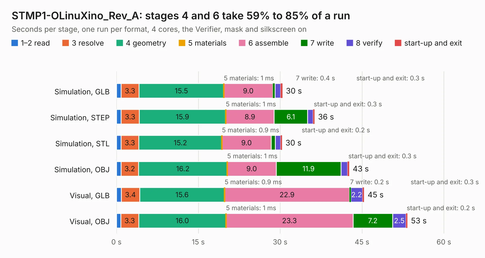

| Mode and format | 1–2 read | 3 resolve | 4 geometry | 5 materials | 6 assemble | 7 write | 8 verify | start-up and exit | Total |
|---|---:|---:|---:|---:|---:|---:|---:|---:|---:|
| Simulation, GLB | 0.8 | 3.3 | 15.5 | 1&nbsp;ms | 9.0 | 0.4 | 1.1 | 0.3 | 30.4 |
| Simulation, STEP | 0.8 | 3.3 | 15.9 | 1&nbsp;ms | 8.9 | 6.1 | 1.0 | 0.3 | 36.3 |
| Simulation, STL | 0.8 | 3.3 | 15.2 | 0.9&nbsp;ms | 9.0 | 0.8 | 1.0 | 0.2 | 30.3 |
| Simulation, OBJ | 0.8 | 3.2 | 16.2 | 1&nbsp;ms | 9.0 | 11.9 | 1.2 | 0.3 | 42.7 |
| Visual, GLB | 0.9 | 3.4 | 15.6 | 0.9&nbsp;ms | 22.9 | 0.2 | 2.2 | 0.3 | 45.4 |
| Visual, OBJ | 0.8 | 3.3 | 16.0 | 1&nbsp;ms | 23.3 | 7.2 | 2.5 | 0.2 | 53.3 |

<table align="center"><tr><td valign="top">

| Board | Repo: [OLIMEX/STMP1-OLinuXino](https://github.com/OLIMEX/STMP1-OLinuXino) Board: `STMP1-OLinuXino_Rev_A.kicad_pcb` |
|---|---|
| Folder | HARDWARE / STMP1-OLinuXino-REV.A |
| Complexity | 299&nbsp;/&nbsp;1000 (size&nbsp;274, features&nbsp;25) |
| KESE&nbsp;features | through vias, slotted holes |
| Tested | 9th November 2026 |
| Copper&nbsp;layers | 8 |
| File&nbsp;format | KiCad 5 (20171130) |
| Parts,&nbsp;tracks,&nbsp;vias | 388, 248, 25 |
| Triangles,&nbsp;simulation | 2,715,802 in 504 parts |
| Verifier | PASS in all six runs |

</td><td valign="top">

<table>
<tr><th>File type</th><th>File size</th><th>Peak memory used</th></tr>
<tr><th colspan="3" align="left">Simulation</th></tr>
<tr><td>GLB</td><td align="right">94&nbsp;MB</td><td align="right">895&nbsp;MB</td></tr>
<tr><td>STEP</td><td align="right">392&nbsp;MB</td><td align="right">1.1&nbsp;GB</td></tr>
<tr><td>STL</td><td align="right">136&nbsp;MB</td><td align="right">935&nbsp;MB</td></tr>
<tr><td>OBJ</td><td align="right">298&nbsp;MB</td><td align="right">1.9&nbsp;GB</td></tr>
<tr><th colspan="3" align="left">Visual</th></tr>
<tr><td>GLB</td><td align="right">57&nbsp;MB</td><td align="right">1.1&nbsp;GB</td></tr>
<tr><td>OBJ</td><td align="right">177&nbsp;MB</td><td align="right">1.3&nbsp;GB</td></tr>
</table>

</td></tr></table>

## 23.19.2 STMP15x-BASE-SOM-EVB_Rev_B

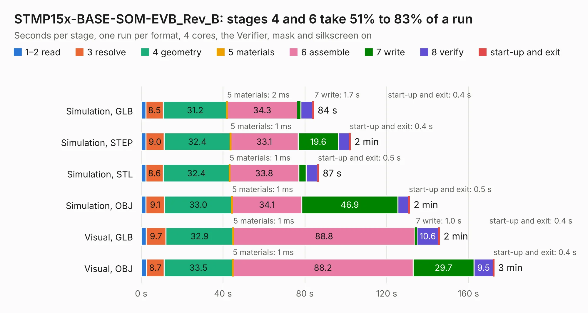

| Mode and format | 1–2 read | 3 resolve | 4 geometry | 5 materials | 6 assemble | 7 write | 8 verify | start-up and exit | Total |
|---|---:|---:|---:|---:|---:|---:|---:|---:|---:|
| Simulation, GLB | 2.3 | 8.5 | 31.2 | 2&nbsp;ms | 34.3 | 1.7 | 5.7 | 0.4 | 84.2 |
| Simulation, STEP | 2.3 | 9.0 | 32.4 | 1&nbsp;ms | 33.1 | 19.6 | 5.4 | 0.4 | 102.2 |
| Simulation, STL | 2.3 | 8.6 | 32.4 | 1&nbsp;ms | 33.8 | 3.5 | 5.7 | 0.5 | 86.7 |
| Simulation, OBJ | 2.3 | 9.1 | 33.0 | 1&nbsp;ms | 34.1 | 46.9 | 5.2 | 0.5 | 131.1 |
| Visual, GLB | 2.4 | 9.7 | 32.9 | 1&nbsp;ms | 88.8 | 1.0 | 10.6 | 0.4 | 145.8 |
| Visual, OBJ | 2.6 | 8.7 | 33.5 | 1&nbsp;ms | 88.2 | 29.7 | 9.5 | 0.4 | 172.5 |

<table align="center"><tr><td valign="top">

| Board | Repo: [OLIMEX/STMP157-BASE-SOM-EVB](https://github.com/OLIMEX/STMP157-BASE-SOM-EVB) Board: `STMP15x-BASE-SOM-EVB_Rev_B.kicad_pcb` |
|---|---|
| Folder | HARDWARE / STMP157-BASE-SOM-EVB-Rev.B |
| Complexity | 363&nbsp;/&nbsp;1000 (size&nbsp;298, features&nbsp;65) |
| KESE&nbsp;features | through vias, slotted holes, rounded, trapezoid or chamfered pads, filled zones, copper text |
| Tested | 9th November 2026 |
| Copper&nbsp;layers | 4 |
| File&nbsp;format | KiCad 5 (20171130) |
| Parts,&nbsp;tracks,&nbsp;vias | 263, 7,876, 1,294 |
| Triangles,&nbsp;simulation | 8,488,618 in 387 parts |
| Verifier | PASS in all six runs |

</td><td valign="top">

<table>
<tr><th>File type</th><th>File size</th><th>Peak memory used</th></tr>
<tr><th colspan="3" align="left">Simulation</th></tr>
<tr><td>GLB</td><td align="right">294&nbsp;MB</td><td align="right">2.4&nbsp;GB</td></tr>
<tr><td>STEP</td><td align="right">1.3&nbsp;GB</td><td align="right">3.1&nbsp;GB</td></tr>
<tr><td>STL</td><td align="right">424&nbsp;MB</td><td align="right">2.3&nbsp;GB</td></tr>
<tr><td>OBJ</td><td align="right">930&nbsp;MB</td><td align="right">5.4&nbsp;GB</td></tr>
<tr><th colspan="3" align="left">Visual</th></tr>
<tr><td>GLB</td><td align="right">203&nbsp;MB</td><td align="right">3.1&nbsp;GB</td></tr>
<tr><td>OBJ</td><td align="right">652&nbsp;MB</td><td align="right">4.2&nbsp;GB</td></tr>
</table>

</td></tr></table>

## 23.19.3 STMP15x-SHIELD_Rev_A

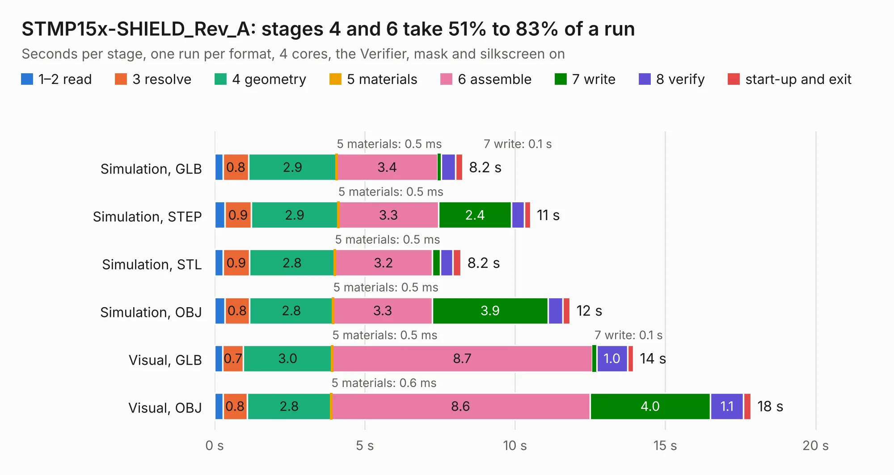

| Mode and format | 1–2 read | 3 resolve | 4 geometry | 5 materials | 6 assemble | 7 write | 8 verify | start-up and exit | Total |
|---|---:|---:|---:|---:|---:|---:|---:|---:|---:|
| Simulation, GLB | 0.3 | 0.8 | 2.9 | 0.5&nbsp;ms | 3.4 | 0.1 | 0.5 | 0.2 | 8.2 |
| Simulation, STEP | 0.3 | 0.9 | 2.9 | 0.5&nbsp;ms | 3.3 | 2.4 | 0.4 | 0.2 | 10.5 |
| Simulation, STL | 0.3 | 0.9 | 2.8 | 0.5&nbsp;ms | 3.2 | 0.3 | 0.4 | 0.3 | 8.2 |
| Simulation, OBJ | 0.3 | 0.8 | 2.8 | 0.5&nbsp;ms | 3.3 | 3.9 | 0.5 | 0.2 | 11.8 |
| Visual, GLB | 0.3 | 0.7 | 3.0 | 0.5&nbsp;ms | 8.7 | 0.1 | 1.0 | 0.2 | 13.9 |
| Visual, OBJ | 0.3 | 0.8 | 2.8 | 0.6&nbsp;ms | 8.6 | 4.0 | 1.1 | 0.2 | 17.8 |

<table align="center"><tr><td valign="top">

| Board | Repo: [OLIMEX/STMP15X-SHIELD](https://github.com/OLIMEX/STMP15X-SHIELD) Board: `STMP15x-SHIELD_Rev_A.kicad_pcb` |
|---|---|
| Folder | HARDWARE / STMP15x-SHIELD_Rev_A |
| Complexity | 226&nbsp;/&nbsp;1000 (size&nbsp;171, features&nbsp;55) |
| KESE&nbsp;features | through vias, rounded, trapezoid or chamfered pads, filled zones, copper text |
| Tested | 9th November 2026 |
| Copper&nbsp;layers | 2 |
| File&nbsp;format | KiCad 5 (20171130) |
| Parts,&nbsp;tracks,&nbsp;vias | 20, 1,155, 170 |
| Triangles,&nbsp;simulation | 883,270 in 132 parts |
| Verifier | PASS in all six runs |

</td><td valign="top">

<table>
<tr><th>File type</th><th>File size</th><th>Peak memory used</th></tr>
<tr><th colspan="3" align="left">Simulation</th></tr>
<tr><td>GLB</td><td align="right">31&nbsp;MB</td><td align="right">494&nbsp;MB</td></tr>
<tr><td>STEP</td><td align="right">162&nbsp;MB</td><td align="right">566&nbsp;MB</td></tr>
<tr><td>STL</td><td align="right">44&nbsp;MB</td><td align="right">494&nbsp;MB</td></tr>
<tr><td>OBJ</td><td align="right">91&nbsp;MB</td><td align="right">634&nbsp;MB</td></tr>
<tr><th colspan="3" align="left">Visual</th></tr>
<tr><td>GLB</td><td align="right">29&nbsp;MB</td><td align="right">638&nbsp;MB</td></tr>
<tr><td>OBJ</td><td align="right">89&nbsp;MB</td><td align="right">690&nbsp;MB</td></tr>
</table>

</td></tr></table>

## 23.19.4 TuxCon_Kitty_Rev_A

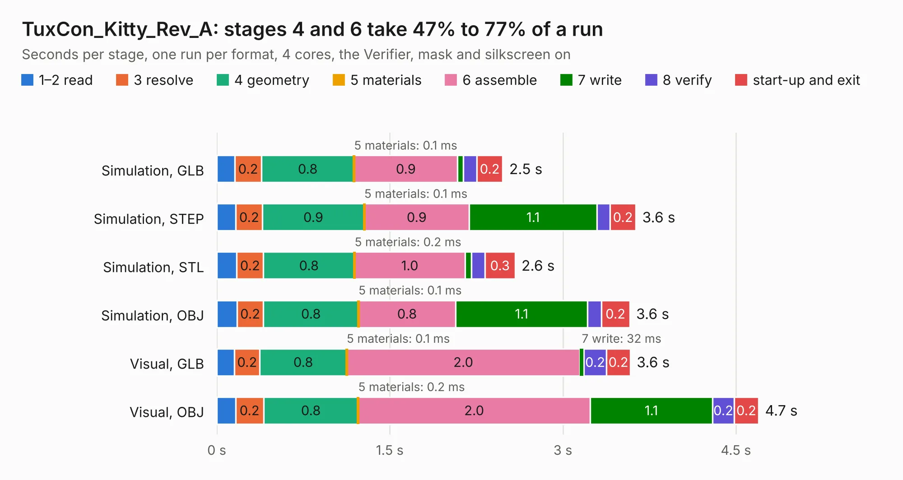

| Mode and format | 1–2 read | 3 resolve | 4 geometry | 5 materials | 6 assemble | 7 write | 8 verify | start-up and exit | Total |
|---|---:|---:|---:|---:|---:|---:|---:|---:|---:|
| Simulation, GLB | 0.2 | 0.2 | 0.8 | 0.1&nbsp;ms | 0.9 | 47&nbsp;ms | 0.1 | 0.2 | 2.5 |
| Simulation, STEP | 0.2 | 0.2 | 0.9 | 0.1&nbsp;ms | 0.9 | 1.1 | 0.1 | 0.2 | 3.6 |
| Simulation, STL | 0.2 | 0.2 | 0.8 | 0.2&nbsp;ms | 1.0 | 55&nbsp;ms | 0.1 | 0.3 | 2.6 |
| Simulation, OBJ | 0.2 | 0.2 | 0.8 | 0.1&nbsp;ms | 0.8 | 1.1 | 0.1 | 0.2 | 3.6 |
| Visual, GLB | 0.2 | 0.2 | 0.8 | 0.1&nbsp;ms | 2.0 | 32&nbsp;ms | 0.2 | 0.2 | 3.6 |
| Visual, OBJ | 0.2 | 0.2 | 0.8 | 0.2&nbsp;ms | 2.0 | 1.1 | 0.2 | 0.2 | 4.7 |

<table align="center"><tr><td valign="top">

| Board | Repo: [OLIMEX/TuxCon-Kitty](https://github.com/OLIMEX/TuxCon-Kitty) Board: `TuxCon_Kitty_Rev_A.kicad_pcb` |
|---|---|
| Folder | HARDWARE / REV-A |
| Complexity | 168&nbsp;/&nbsp;1000 (size&nbsp;123, features&nbsp;45) |
| KESE&nbsp;features | through vias, slotted holes, filled zones |
| Tested | 9th November 2026 |
| Copper&nbsp;layers | 2 |
| File&nbsp;format | KiCad 5 (20170922) |
| Parts,&nbsp;tracks,&nbsp;vias | 18, 74, 7 |
| Triangles,&nbsp;simulation | 205,834 in 28 parts |
| Verifier | PASS in all six runs |

</td><td valign="top">

<table>
<tr><th>File type</th><th>File size</th><th>Peak memory used</th></tr>
<tr><th colspan="3" align="left">Simulation</th></tr>
<tr><td>GLB</td><td align="right">7.3&nbsp;MB</td><td align="right">221&nbsp;MB</td></tr>
<tr><td>STEP</td><td align="right">45&nbsp;MB</td><td align="right">249&nbsp;MB</td></tr>
<tr><td>STL</td><td align="right">10&nbsp;MB</td><td align="right">211&nbsp;MB</td></tr>
<tr><td>OBJ</td><td align="right">21&nbsp;MB</td><td align="right">218&nbsp;MB</td></tr>
<tr><th colspan="3" align="left">Visual</th></tr>
<tr><td>GLB</td><td align="right">6.1&nbsp;MB</td><td align="right">217&nbsp;MB</td></tr>
<tr><td>OBJ</td><td align="right">18&nbsp;MB</td><td align="right">218&nbsp;MB</td></tr>
</table>

</td></tr></table>

## 23.19.5 UEXT-3TO5V_Rev_A

| Mode and format | 1–2 read | 3 resolve | 4 geometry | 5 materials | 6 assemble | 7 write | 8 verify | start-up and exit | Total |
|---|---:|---:|---:|---:|---:|---:|---:|---:|---:|
| Simulation, GLB | 0.2 | 0.3 | 1.0 | 0.2&nbsp;ms | 1.0 | 47&nbsp;ms | 0.1 | 0.2 | 2.9 |
| Simulation, STEP | 0.2 | 0.3 | 1.0 | 0.2&nbsp;ms | 1.0 | 1.1 | 0.1 | 0.2 | 3.9 |
| Simulation, STL | 0.2 | 0.3 | 1.0 | 0.2&nbsp;ms | 1.0 | 73&nbsp;ms | 0.1 | 0.2 | 2.9 |
| Simulation, OBJ | 0.2 | 0.3 | 1.0 | 0.2&nbsp;ms | 1.0 | 1.3 | 0.1 | 0.2 | 4.1 |
| Visual, GLB | 0.2 | 0.3 | 1.1 | 0.2&nbsp;ms | 2.3 | 39&nbsp;ms | 0.3 | 0.2 | 4.4 |
| Visual, OBJ | 0.2 | 0.3 | 1.1 | 0.2&nbsp;ms | 2.3 | 1.1 | 0.3 | 0.2 | 5.5 |

<table align="center"><tr><td valign="top">

| Board | Repo: [OLIMEX/UEXT-3TO5V](https://github.com/OLIMEX/UEXT-3TO5V) Board: `UEXT-3TO5V_Rev_A.kicad_pcb` |
|---|---|
| Folder | HARDWARE / UEXT-3TO5V-Rev.A |
| Complexity | 253&nbsp;/&nbsp;1000 (size&nbsp;158, features&nbsp;95) |
| KESE&nbsp;features | through vias, rounded, trapezoid or chamfered pads, filled zones, knockout text, stack-up, dielectric εr and tanδ, mask and silkscreen colours |
| Tested | 9th November 2026 |
| Copper&nbsp;layers | 2 |
| File&nbsp;format | KiCad 7 (20221018) |
| Parts,&nbsp;tracks,&nbsp;vias | 26, 419, 65 |
| Triangles,&nbsp;simulation | 331,836 in 33 parts |
| Verifier | PASS in all six runs |

</td><td valign="top">

<table>
<tr><th>File type</th><th>File size</th><th>Peak memory used</th></tr>
<tr><th colspan="3" align="left">Simulation</th></tr>
<tr><td>GLB</td><td align="right">12&nbsp;MB</td><td align="right">261&nbsp;MB</td></tr>
<tr><td>STEP</td><td align="right">66&nbsp;MB</td><td align="right">307&nbsp;MB</td></tr>
<tr><td>STL</td><td align="right">17&nbsp;MB</td><td align="right">274&nbsp;MB</td></tr>
<tr><td>OBJ</td><td align="right">35&nbsp;MB</td><td align="right">283&nbsp;MB</td></tr>
<tr><th colspan="3" align="left">Visual</th></tr>
<tr><td>GLB</td><td align="right">10.0&nbsp;MB</td><td align="right">277&nbsp;MB</td></tr>
<tr><td>OBJ</td><td align="right">29&nbsp;MB</td><td align="right">279&nbsp;MB</td></tr>
</table>

</td></tr></table>

## 23.19.6 RPI-UEXT-MPQ_Rev_A

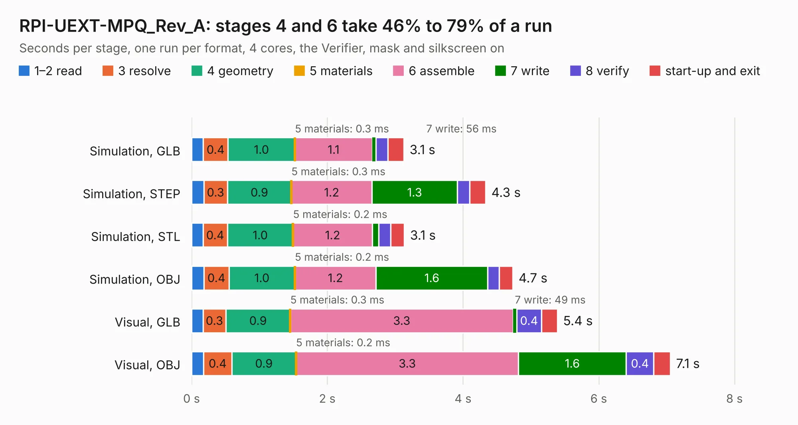

| Mode and format | 1–2 read | 3 resolve | 4 geometry | 5 materials | 6 assemble | 7 write | 8 verify | start-up and exit | Total |
|---|---:|---:|---:|---:|---:|---:|---:|---:|---:|
| Simulation, GLB | 0.2 | 0.4 | 1.0 | 0.3&nbsp;ms | 1.1 | 56&nbsp;ms | 0.2 | 0.2 | 3.1 |
| Simulation, STEP | 0.2 | 0.3 | 0.9 | 0.3&nbsp;ms | 1.2 | 1.3 | 0.2 | 0.2 | 4.3 |
| Simulation, STL | 0.2 | 0.4 | 1.0 | 0.2&nbsp;ms | 1.2 | 94&nbsp;ms | 0.2 | 0.2 | 3.1 |
| Simulation, OBJ | 0.2 | 0.4 | 1.0 | 0.2&nbsp;ms | 1.2 | 1.6 | 0.2 | 0.2 | 4.7 |
| Visual, GLB | 0.2 | 0.3 | 0.9 | 0.3&nbsp;ms | 3.3 | 49&nbsp;ms | 0.4 | 0.2 | 5.4 |
| Visual, OBJ | 0.2 | 0.4 | 0.9 | 0.2&nbsp;ms | 3.3 | 1.6 | 0.4 | 0.2 | 7.1 |

<table align="center"><tr><td valign="top">

| Board | Repo: [OLIMEX/UEXT-ADAPTERS](https://github.com/OLIMEX/UEXT-ADAPTERS) Board: `RPI-UEXT-MPQ_Rev_A.kicad_pcb` |
|---|---|
| Folder | RPI-UEXT-MPQ / Hardware |
| Complexity | 185&nbsp;/&nbsp;1000 (size&nbsp;140, features&nbsp;45) |
| KESE&nbsp;features | through vias, rounded, trapezoid or chamfered pads, filled zones |
| Tested | 9th November 2026 |
| Copper&nbsp;layers | 2 |
| File&nbsp;format | KiCad 5 (20171130) |
| Parts,&nbsp;tracks,&nbsp;vias | 5, 320, 77 |
| Triangles,&nbsp;simulation | 348,874 in 47 parts |
| Verifier | PASS in all six runs |

</td><td valign="top">

<table>
<tr><th>File type</th><th>File size</th><th>Peak memory used</th></tr>
<tr><th colspan="3" align="left">Simulation</th></tr>
<tr><td>GLB</td><td align="right">12&nbsp;MB</td><td align="right">302&nbsp;MB</td></tr>
<tr><td>STEP</td><td align="right">60&nbsp;MB</td><td align="right">309&nbsp;MB</td></tr>
<tr><td>STL</td><td align="right">17&nbsp;MB</td><td align="right">296&nbsp;MB</td></tr>
<tr><td>OBJ</td><td align="right">35&nbsp;MB</td><td align="right">294&nbsp;MB</td></tr>
<tr><th colspan="3" align="left">Visual</th></tr>
<tr><td>GLB</td><td align="right">11&nbsp;MB</td><td align="right">310&nbsp;MB</td></tr>
<tr><td>OBJ</td><td align="right">33&nbsp;MB</td><td align="right">309&nbsp;MB</td></tr>
</table>

</td></tr></table>

## 23.19.7 UEXT-MPQ_Rev_A

| Mode and format | 1–2 read | 3 resolve | 4 geometry | 5 materials | 6 assemble | 7 write | 8 verify | start-up and exit | Total |
|---|---:|---:|---:|---:|---:|---:|---:|---:|---:|
| Simulation, GLB | 0.1 | 0.2 | 0.7 | 0.1&nbsp;ms | 0.8 | 41&nbsp;ms | 96&nbsp;ms | 0.2 | 2.2 |
| Simulation, STEP | 0.1 | 0.2 | 0.7 | 0.1&nbsp;ms | 0.8 | 1.1 | 0.1 | 0.2 | 3.2 |
| Simulation, STL | 0.2 | 0.3 | 0.7 | 0.2&nbsp;ms | 0.9 | 59&nbsp;ms | 0.1 | 0.2 | 2.4 |
| Simulation, OBJ | 0.1 | 0.2 | 0.7 | 0.2&nbsp;ms | 0.8 | 1.0 | 0.1 | 0.2 | 3.3 |
| Visual, GLB | 0.1 | 0.2 | 0.7 | 0.1&nbsp;ms | 1.8 | 27&nbsp;ms | 0.2 | 0.2 | 3.2 |
| Visual, OBJ | 0.1 | 0.2 | 0.7 | 0.2&nbsp;ms | 1.7 | 0.9 | 0.2 | 0.2 | 4.1 |

<table align="center"><tr><td valign="top">

| Board | Repo: [OLIMEX/UEXT-ADAPTERS](https://github.com/OLIMEX/UEXT-ADAPTERS) Board: `UEXT-MPQ_Rev_A.kicad_pcb` |
|---|---|
| Folder | UEXT-MPQ / Hardware |
| Complexity | 182&nbsp;/&nbsp;1000 (size&nbsp;127, features&nbsp;55) |
| KESE&nbsp;features | through vias, rounded, trapezoid or chamfered pads, filled zones, curved board outline |
| Tested | 9th November 2026 |
| Copper&nbsp;layers | 2 |
| File&nbsp;format | KiCad 5 (20171130) |
| Parts,&nbsp;tracks,&nbsp;vias | 4, 149, 45 |
| Triangles,&nbsp;simulation | 215,276 in 21 parts |
| Verifier | PASS in all six runs |

</td><td valign="top">

<table>
<tr><th>File type</th><th>File size</th><th>Peak memory used</th></tr>
<tr><th colspan="3" align="left">Simulation</th></tr>
<tr><td>GLB</td><td align="right">7.6&nbsp;MB</td><td align="right">221&nbsp;MB</td></tr>
<tr><td>STEP</td><td align="right">37&nbsp;MB</td><td align="right">248&nbsp;MB</td></tr>
<tr><td>STL</td><td align="right">11&nbsp;MB</td><td align="right">219&nbsp;MB</td></tr>
<tr><td>OBJ</td><td align="right">22&nbsp;MB</td><td align="right">220&nbsp;MB</td></tr>
<tr><th colspan="3" align="left">Visual</th></tr>
<tr><td>GLB</td><td align="right">6.2&nbsp;MB</td><td align="right">199&nbsp;MB</td></tr>
<tr><td>OBJ</td><td align="right">18&nbsp;MB</td><td align="right">201&nbsp;MB</td></tr>
</table>

</td></tr></table>

## 23.19.8 UEXT-P4Q_Rev_A

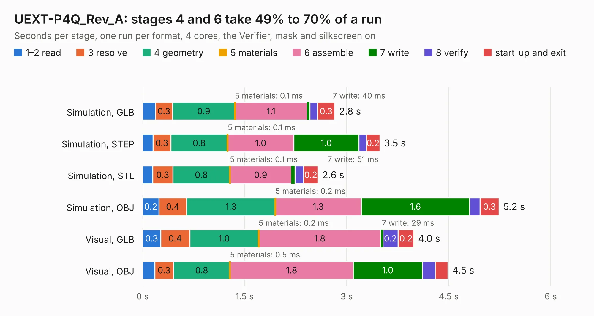

| Mode and format | 1–2 read | 3 resolve | 4 geometry | 5 materials | 6 assemble | 7 write | 8 verify | start-up and exit | Total |
|---|---:|---:|---:|---:|---:|---:|---:|---:|---:|
| Simulation, GLB | 0.2 | 0.3 | 0.9 | 0.1&nbsp;ms | 1.1 | 40&nbsp;ms | 0.1 | 0.3 | 2.8 |
| Simulation, STEP | 0.2 | 0.3 | 0.8 | 0.1&nbsp;ms | 1.0 | 1.0 | 0.1 | 0.2 | 3.5 |
| Simulation, STL | 0.1 | 0.3 | 0.8 | 0.1&nbsp;ms | 0.9 | 51&nbsp;ms | 0.1 | 0.2 | 2.6 |
| Simulation, OBJ | 0.2 | 0.4 | 1.3 | 0.2&nbsp;ms | 1.3 | 1.6 | 0.2 | 0.3 | 5.2 |
| Visual, GLB | 0.3 | 0.4 | 1.0 | 0.2&nbsp;ms | 1.8 | 29&nbsp;ms | 0.2 | 0.2 | 4.0 |
| Visual, OBJ | 0.2 | 0.3 | 0.8 | 0.5&nbsp;ms | 1.8 | 1.0 | 0.2 | 0.2 | 4.5 |

<table align="center"><tr><td valign="top">

| Board | Repo: [OLIMEX/UEXT-ADAPTERS](https://github.com/OLIMEX/UEXT-ADAPTERS) Board: `UEXT-P4Q_Rev_A.kicad_pcb` |
|---|---|
| Folder | UEXT-P4Q / Hardware |
| Complexity | 185&nbsp;/&nbsp;1000 (size&nbsp;130, features&nbsp;55) |
| KESE&nbsp;features | through vias, rounded, trapezoid or chamfered pads, filled zones, curved board outline |
| Tested | 9th November 2026 |
| Copper&nbsp;layers | 2 |
| File&nbsp;format | KiCad 5 (20171130) |
| Parts,&nbsp;tracks,&nbsp;vias | 6, 149, 44 |
| Triangles,&nbsp;simulation | 216,154 in 21 parts |
| Verifier | PASS in all six runs |

</td><td valign="top">

<table>
<tr><th>File type</th><th>File size</th><th>Peak memory used</th></tr>
<tr><th colspan="3" align="left">Simulation</th></tr>
<tr><td>GLB</td><td align="right">7.8&nbsp;MB</td><td align="right">222&nbsp;MB</td></tr>
<tr><td>STEP</td><td align="right">37&nbsp;MB</td><td align="right">250&nbsp;MB</td></tr>
<tr><td>STL</td><td align="right">11&nbsp;MB</td><td align="right">222&nbsp;MB</td></tr>
<tr><td>OBJ</td><td align="right">22&nbsp;MB</td><td align="right">222&nbsp;MB</td></tr>
<tr><th colspan="3" align="left">Visual</th></tr>
<tr><td>GLB</td><td align="right">6.5&nbsp;MB</td><td align="right">202&nbsp;MB</td></tr>
<tr><td>OBJ</td><td align="right">19&nbsp;MB</td><td align="right">200&nbsp;MB</td></tr>
</table>

</td></tr></table>

## 23.19.9 UEXT-PQ_Rev_A

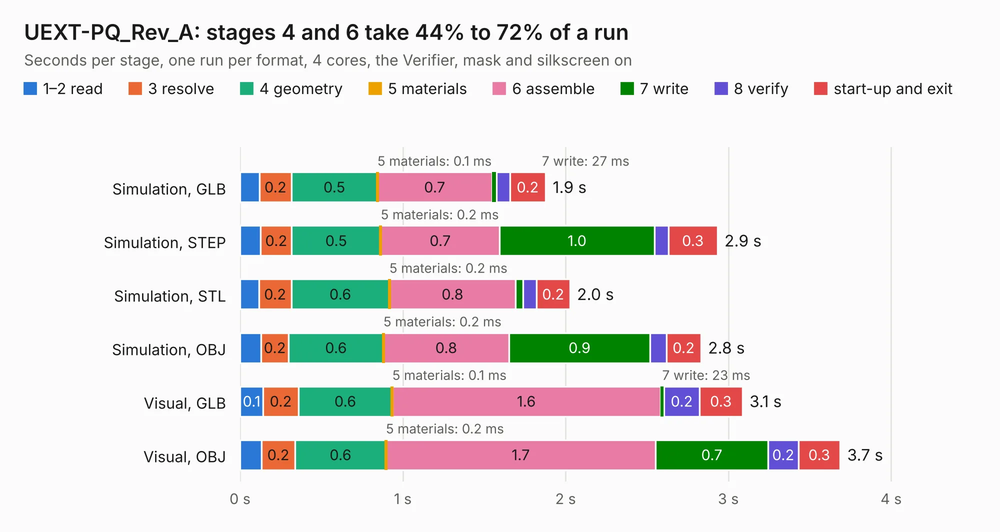

| Mode and format | 1–2 read | 3 resolve | 4 geometry | 5 materials | 6 assemble | 7 write | 8 verify | start-up and exit | Total |
|---|---:|---:|---:|---:|---:|---:|---:|---:|---:|
| Simulation, GLB | 0.1 | 0.2 | 0.5 | 0.1&nbsp;ms | 0.7 | 27&nbsp;ms | 83&nbsp;ms | 0.2 | 1.9 |
| Simulation, STEP | 0.1 | 0.2 | 0.5 | 0.2&nbsp;ms | 0.7 | 1.0 | 86&nbsp;ms | 0.3 | 2.9 |
| Simulation, STL | 0.1 | 0.2 | 0.6 | 0.2&nbsp;ms | 0.8 | 46&nbsp;ms | 82&nbsp;ms | 0.2 | 2.0 |
| Simulation, OBJ | 0.1 | 0.2 | 0.6 | 0.2&nbsp;ms | 0.8 | 0.9 | 0.1 | 0.2 | 2.8 |
| Visual, GLB | 0.1 | 0.2 | 0.6 | 0.1&nbsp;ms | 1.6 | 23&nbsp;ms | 0.2 | 0.3 | 3.1 |
| Visual, OBJ | 0.1 | 0.2 | 0.6 | 0.2&nbsp;ms | 1.7 | 0.7 | 0.2 | 0.3 | 3.7 |

<table align="center"><tr><td valign="top">

| Board | Repo: [OLIMEX/UEXT-ADAPTERS](https://github.com/OLIMEX/UEXT-ADAPTERS) Board: `UEXT-PQ_Rev_A.kicad_pcb` |
|---|---|
| Folder | UEXT-PQ / Hardware |
| Complexity | 171&nbsp;/&nbsp;1000 (size&nbsp;116, features&nbsp;55) |
| KESE&nbsp;features | through vias, rounded, trapezoid or chamfered pads, filled zones, curved board outline |
| Tested | 9th November 2026 |
| Copper&nbsp;layers | 2 |
| File&nbsp;format | KiCad 5 (20171130) |
| Parts,&nbsp;tracks,&nbsp;vias | 3, 82, 29 |
| Triangles,&nbsp;simulation | 160,958 in 21 parts |
| Verifier | PASS in all six runs |

</td><td valign="top">

<table>
<tr><th>File type</th><th>File size</th><th>Peak memory used</th></tr>
<tr><th colspan="3" align="left">Simulation</th></tr>
<tr><td>GLB</td><td align="right">5.7&nbsp;MB</td><td align="right">211&nbsp;MB</td></tr>
<tr><td>STEP</td><td align="right">28&nbsp;MB</td><td align="right">222&nbsp;MB</td></tr>
<tr><td>STL</td><td align="right">8.0&nbsp;MB</td><td align="right">204&nbsp;MB</td></tr>
<tr><td>OBJ</td><td align="right">16&nbsp;MB</td><td align="right">207&nbsp;MB</td></tr>
<tr><th colspan="3" align="left">Visual</th></tr>
<tr><td>GLB</td><td align="right">4.7&nbsp;MB</td><td align="right">173&nbsp;MB</td></tr>
<tr><td>OBJ</td><td align="right">13&nbsp;MB</td><td align="right">183&nbsp;MB</td></tr>
</table>

</td></tr></table>

## 23.19.10 UEXT-LVL-SHIFT_Rev_A

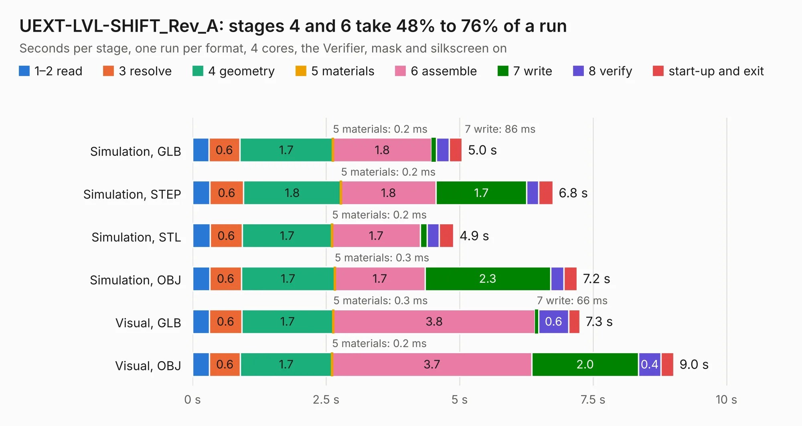

| Mode and format | 1–2 read | 3 resolve | 4 geometry | 5 materials | 6 assemble | 7 write | 8 verify | start-up and exit | Total |
|---|---:|---:|---:|---:|---:|---:|---:|---:|---:|
| Simulation, GLB | 0.3 | 0.6 | 1.7 | 0.2&nbsp;ms | 1.8 | 86&nbsp;ms | 0.2 | 0.2 | 5.0 |
| Simulation, STEP | 0.3 | 0.6 | 1.8 | 0.2&nbsp;ms | 1.8 | 1.7 | 0.2 | 0.3 | 6.8 |
| Simulation, STL | 0.3 | 0.6 | 1.7 | 0.2&nbsp;ms | 1.7 | 0.1 | 0.2 | 0.3 | 4.9 |
| Simulation, OBJ | 0.3 | 0.6 | 1.7 | 0.3&nbsp;ms | 1.7 | 2.3 | 0.3 | 0.2 | 7.2 |
| Visual, GLB | 0.3 | 0.6 | 1.7 | 0.3&nbsp;ms | 3.8 | 66&nbsp;ms | 0.6 | 0.2 | 7.3 |
| Visual, OBJ | 0.3 | 0.6 | 1.7 | 0.2&nbsp;ms | 3.7 | 2.0 | 0.4 | 0.2 | 9.0 |

<table align="center"><tr><td valign="top">

| Board | Repo: [OLIMEX/UEXT-LVL-SHIFT](https://github.com/OLIMEX/UEXT-LVL-SHIFT) Board: `UEXT-LVL-SHIFT_Rev_A.kicad_pcb` |
|---|---|
| Folder | HARDWARE / UEXT-LVL-SHIFT_Rev_A |
| Complexity | 264&nbsp;/&nbsp;1000 (size&nbsp;169, features&nbsp;95) |
| KESE&nbsp;features | through vias, rounded, trapezoid or chamfered pads, filled zones, knockout text, stack-up, dielectric εr and tanδ, mask and silkscreen colours |
| Tested | 9th November 2026 |
| Copper&nbsp;layers | 2 |
| File&nbsp;format | KiCad 10 (20260206) |
| Parts,&nbsp;tracks,&nbsp;vias | 28, 746, 130 |
| Triangles,&nbsp;simulation | 418,196 in 35 parts |
| Verifier | PASS in all six runs |

</td><td valign="top">

<table>
<tr><th>File type</th><th>File size</th><th>Peak memory used</th></tr>
<tr><th colspan="3" align="left">Simulation</th></tr>
<tr><td>GLB</td><td align="right">15&nbsp;MB</td><td align="right">295&nbsp;MB</td></tr>
<tr><td>STEP</td><td align="right">74&nbsp;MB</td><td align="right">336&nbsp;MB</td></tr>
<tr><td>STL</td><td align="right">21&nbsp;MB</td><td align="right">296&nbsp;MB</td></tr>
<tr><td>OBJ</td><td align="right">43&nbsp;MB</td><td align="right">342&nbsp;MB</td></tr>
<tr><th colspan="3" align="left">Visual</th></tr>
<tr><td>GLB</td><td align="right">12&nbsp;MB</td><td align="right">328&nbsp;MB</td></tr>
<tr><td>OBJ</td><td align="right">36&nbsp;MB</td><td align="right">327&nbsp;MB</td></tr>
</table>

</td></tr></table>

## 23.19.11 mod-gyro

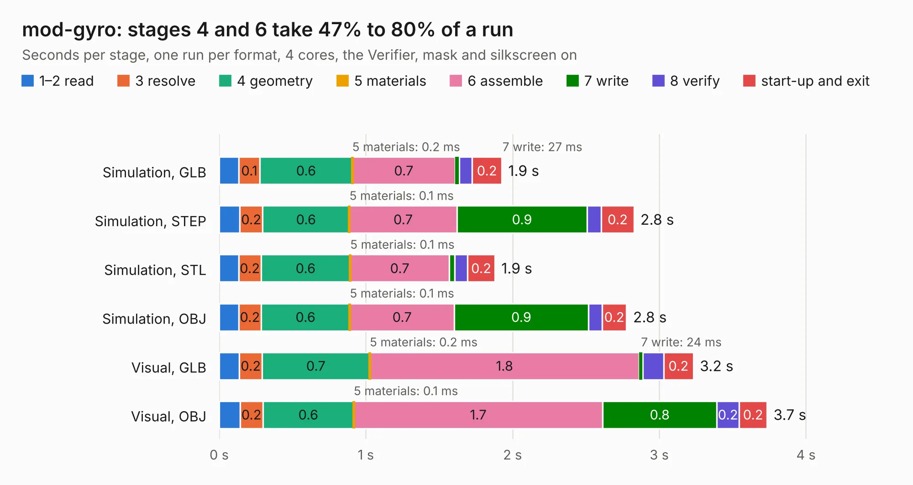

| Mode and format | 1–2 read | 3 resolve | 4 geometry | 5 materials | 6 assemble | 7 write | 8 verify | start-up and exit | Total |
|---|---:|---:|---:|---:|---:|---:|---:|---:|---:|
| Simulation, GLB | 0.1 | 0.1 | 0.6 | 0.2&nbsp;ms | 0.7 | 27&nbsp;ms | 88&nbsp;ms | 0.2 | 1.9 |
| Simulation, STEP | 0.1 | 0.2 | 0.6 | 0.1&nbsp;ms | 0.7 | 0.9 | 97&nbsp;ms | 0.2 | 2.8 |
| Simulation, STL | 0.1 | 0.2 | 0.6 | 0.1&nbsp;ms | 0.7 | 38&nbsp;ms | 87&nbsp;ms | 0.2 | 1.9 |
| Simulation, OBJ | 0.1 | 0.2 | 0.6 | 0.1&nbsp;ms | 0.7 | 0.9 | 94&nbsp;ms | 0.2 | 2.8 |
| Visual, GLB | 0.1 | 0.2 | 0.7 | 0.2&nbsp;ms | 1.8 | 24&nbsp;ms | 0.1 | 0.2 | 3.2 |
| Visual, OBJ | 0.1 | 0.2 | 0.6 | 0.1&nbsp;ms | 1.7 | 0.8 | 0.2 | 0.2 | 3.7 |

<table align="center"><tr><td valign="top">

| Board | Repo: [OLIMEX/UEXT-MODULES](https://github.com/OLIMEX/UEXT-MODULES) Board: `mod-gyro.kicad_pcb` |
|---|---|
| Folder | MOD-MPU9150 |
| Complexity | 164&nbsp;/&nbsp;1000 (size&nbsp;129, features&nbsp;35) |
| KESE&nbsp;features | through vias, filled zones |
| Tested | 9th November 2026 |
| Copper&nbsp;layers | 2 |
| File&nbsp;format | KiCad 4 (4) |
| Parts,&nbsp;tracks,&nbsp;vias | 14, 131, 9 |
| Triangles,&nbsp;simulation | 173,536 in 37 parts |
| Verifier | PASS in all six runs |

</td><td valign="top">

<table>
<tr><th>File type</th><th>File size</th><th>Peak memory used</th></tr>
<tr><th colspan="3" align="left">Simulation</th></tr>
<tr><td>GLB</td><td align="right">6.2&nbsp;MB</td><td align="right">209&nbsp;MB</td></tr>
<tr><td>STEP</td><td align="right">35&nbsp;MB</td><td align="right">234&nbsp;MB</td></tr>
<tr><td>STL</td><td align="right">8.7&nbsp;MB</td><td align="right">220&nbsp;MB</td></tr>
<tr><td>OBJ</td><td align="right">17&nbsp;MB</td><td align="right">212&nbsp;MB</td></tr>
<tr><th colspan="3" align="left">Visual</th></tr>
<tr><td>GLB</td><td align="right">5.6&nbsp;MB</td><td align="right">209&nbsp;MB</td></tr>
<tr><td>OBJ</td><td align="right">16&nbsp;MB</td><td align="right">208&nbsp;MB</td></tr>
</table>

</td></tr></table>

## 23.19.12 mod-oled-128x64

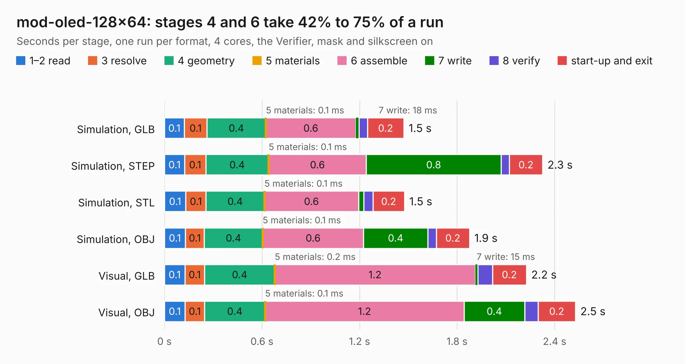

| Mode and format | 1–2 read | 3 resolve | 4 geometry | 5 materials | 6 assemble | 7 write | 8 verify | start-up and exit | Total |
|---|---:|---:|---:|---:|---:|---:|---:|---:|---:|
| Simulation, GLB | 0.1 | 0.1 | 0.4 | 0.1&nbsp;ms | 0.6 | 18&nbsp;ms | 53&nbsp;ms | 0.2 | 1.5 |
| Simulation, STEP | 0.1 | 0.1 | 0.4 | 0.1&nbsp;ms | 0.6 | 0.8 | 51&nbsp;ms | 0.2 | 2.3 |
| Simulation, STL | 0.1 | 0.1 | 0.4 | 0.1&nbsp;ms | 0.6 | 32&nbsp;ms | 56&nbsp;ms | 0.2 | 1.5 |
| Simulation, OBJ | 0.1 | 0.1 | 0.4 | 0.1&nbsp;ms | 0.6 | 0.4 | 53&nbsp;ms | 0.2 | 1.9 |
| Visual, GLB | 0.1 | 0.1 | 0.4 | 0.2&nbsp;ms | 1.2 | 15&nbsp;ms | 90&nbsp;ms | 0.2 | 2.2 |
| Visual, OBJ | 0.1 | 0.1 | 0.4 | 0.1&nbsp;ms | 1.2 | 0.4 | 82&nbsp;ms | 0.2 | 2.5 |

<table align="center"><tr><td valign="top">

| Board | Repo: [OLIMEX/UEXT-MODULES](https://github.com/OLIMEX/UEXT-MODULES) Board: `mod-oled-128x64.kicad_pcb` |
|---|---|
| Folder | MOD-OLED-128x64 |
| Complexity | 165&nbsp;/&nbsp;1000 (size&nbsp;130, features&nbsp;35) |
| KESE&nbsp;features | through vias, filled zones |
| Tested | 9th November 2026 |
| Copper&nbsp;layers | 2 |
| File&nbsp;format | KiCad 4 (4) |
| Parts,&nbsp;tracks,&nbsp;vias | 11, 174, 7 |
| Triangles,&nbsp;simulation | 69,228 in 29 parts |
| Verifier | PASS in all six runs |

</td><td valign="top">

<table>
<tr><th>File type</th><th>File size</th><th>Peak memory used</th></tr>
<tr><th colspan="3" align="left">Simulation</th></tr>
<tr><td>GLB</td><td align="right">2.6&nbsp;MB</td><td align="right">181&nbsp;MB</td></tr>
<tr><td>STEP</td><td align="right">15&nbsp;MB</td><td align="right">189&nbsp;MB</td></tr>
<tr><td>STL</td><td align="right">3.5&nbsp;MB</td><td align="right">179&nbsp;MB</td></tr>
<tr><td>OBJ</td><td align="right">7.0&nbsp;MB</td><td align="right">185&nbsp;MB</td></tr>
<tr><th colspan="3" align="left">Visual</th></tr>
<tr><td>GLB</td><td align="right">2.5&nbsp;MB</td><td align="right">153&nbsp;MB</td></tr>
<tr><td>OBJ</td><td align="right">6.8&nbsp;MB</td><td align="right">154&nbsp;MB</td></tr>
</table>

</td></tr></table>

## 23.19.13 Ultra_Sound_Levitation_Rev_B

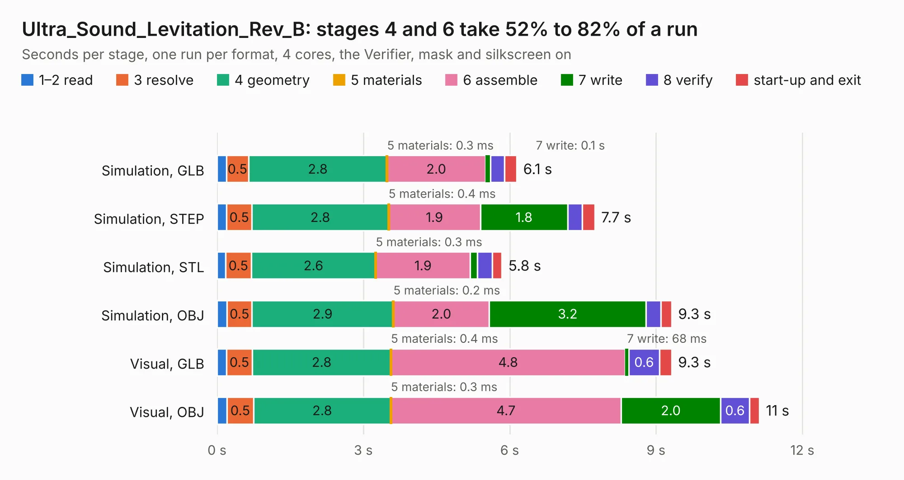

| Mode and format | 1–2 read | 3 resolve | 4 geometry | 5 materials | 6 assemble | 7 write | 8 verify | start-up and exit | Total |
|---|---:|---:|---:|---:|---:|---:|---:|---:|---:|
| Simulation, GLB | 0.2 | 0.5 | 2.8 | 0.3&nbsp;ms | 2.0 | 0.1 | 0.3 | 0.2 | 6.1 |
| Simulation, STEP | 0.2 | 0.5 | 2.8 | 0.4&nbsp;ms | 1.9 | 1.8 | 0.3 | 0.3 | 7.7 |
| Simulation, STL | 0.2 | 0.5 | 2.6 | 0.3&nbsp;ms | 1.9 | 0.1 | 0.3 | 0.2 | 5.8 |
| Simulation, OBJ | 0.2 | 0.5 | 2.9 | 0.2&nbsp;ms | 2.0 | 3.2 | 0.3 | 0.2 | 9.3 |
| Visual, GLB | 0.2 | 0.5 | 2.8 | 0.4&nbsp;ms | 4.8 | 68&nbsp;ms | 0.6 | 0.2 | 9.3 |
| Visual, OBJ | 0.2 | 0.5 | 2.8 | 0.3&nbsp;ms | 4.7 | 2.0 | 0.6 | 0.2 | 11.1 |

<table align="center"><tr><td valign="top">

| Board | Repo: [OLIMEX/Ultra-Sound-Levitation](https://github.com/OLIMEX/Ultra-Sound-Levitation) Board: `Ultra_Sound_Levitation_Rev_B.kicad_pcb` |
|---|---|
| Folder | HARDWARE / Ultra_Sound_Levitation_Rev_B |
| Complexity | 183&nbsp;/&nbsp;1000 (size&nbsp;148, features&nbsp;35) |
| KESE&nbsp;features | through vias, filled zones |
| Tested | 9th November 2026 |
| Copper&nbsp;layers | 2 |
| File&nbsp;format | KiCad 5 (20171130) |
| Parts,&nbsp;tracks,&nbsp;vias | 22, 220, 50 |
| Triangles,&nbsp;simulation | 641,300 in 37 parts |
| Verifier | PASS in all six runs |

</td><td valign="top">

<table>
<tr><th>File type</th><th>File size</th><th>Peak memory used</th></tr>
<tr><th colspan="3" align="left">Simulation</th></tr>
<tr><td>GLB</td><td align="right">22&nbsp;MB</td><td align="right">330&nbsp;MB</td></tr>
<tr><td>STEP</td><td align="right">106&nbsp;MB</td><td align="right">373&nbsp;MB</td></tr>
<tr><td>STL</td><td align="right">32&nbsp;MB</td><td align="right">322&nbsp;MB</td></tr>
<tr><td>OBJ</td><td align="right">66&nbsp;MB</td><td align="right">467&nbsp;MB</td></tr>
<tr><th colspan="3" align="left">Visual</th></tr>
<tr><td>GLB</td><td align="right">15&nbsp;MB</td><td align="right">391&nbsp;MB</td></tr>
<tr><td>OBJ</td><td align="right">45&nbsp;MB</td><td align="right">393&nbsp;MB</td></tr>
</table>

</td></tr></table>

## 23.19.14 URC_revB

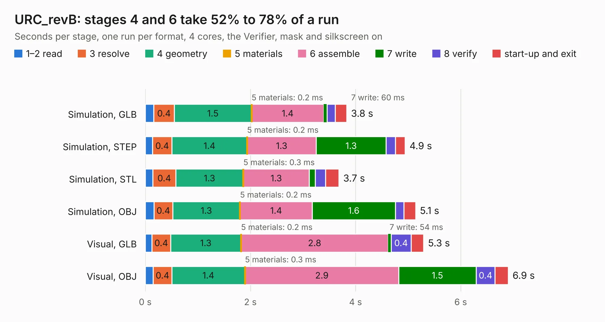

| Mode and format | 1–2 read | 3 resolve | 4 geometry | 5 materials | 6 assemble | 7 write | 8 verify | start-up and exit | Total |
|---|---:|---:|---:|---:|---:|---:|---:|---:|---:|
| Simulation, GLB | 0.2 | 0.4 | 1.5 | 0.2&nbsp;ms | 1.4 | 60&nbsp;ms | 0.2 | 0.2 | 3.8 |
| Simulation, STEP | 0.1 | 0.4 | 1.4 | 0.2&nbsp;ms | 1.3 | 1.3 | 0.2 | 0.2 | 4.9 |
| Simulation, STL | 0.1 | 0.4 | 1.3 | 0.3&nbsp;ms | 1.3 | 0.1 | 0.2 | 0.3 | 3.7 |
| Simulation, OBJ | 0.2 | 0.4 | 1.3 | 0.2&nbsp;ms | 1.4 | 1.6 | 0.2 | 0.2 | 5.1 |
| Visual, GLB | 0.1 | 0.4 | 1.3 | 0.2&nbsp;ms | 2.8 | 54&nbsp;ms | 0.4 | 0.2 | 5.3 |
| Visual, OBJ | 0.2 | 0.4 | 1.4 | 0.3&nbsp;ms | 2.9 | 1.5 | 0.4 | 0.3 | 6.9 |

<table align="center"><tr><td valign="top">

| Board | Repo: [OLIMEX/URC](https://github.com/OLIMEX/URC) Board: `URC_revB.kicad_pcb` |
|---|---|
| Folder | HARDWARE |
| Complexity | 204&nbsp;/&nbsp;1000 (size&nbsp;149, features&nbsp;55) |
| KESE&nbsp;features | through vias, rounded, trapezoid or chamfered pads, filled zones, curved board outline |
| Tested | 9th November 2026 |
| Copper&nbsp;layers | 2 |
| File&nbsp;format | KiCad 6 (20190421) |
| Parts,&nbsp;tracks,&nbsp;vias | 31, 215, 34 |
| Triangles,&nbsp;simulation | 328,142 in 31 parts |
| Verifier | PASS in all six runs |

</td><td valign="top">

<table>
<tr><th>File type</th><th>File size</th><th>Peak memory used</th></tr>
<tr><th colspan="3" align="left">Simulation</th></tr>
<tr><td>GLB</td><td align="right">12&nbsp;MB</td><td align="right">248&nbsp;MB</td></tr>
<tr><td>STEP</td><td align="right">60&nbsp;MB</td><td align="right">290&nbsp;MB</td></tr>
<tr><td>STL</td><td align="right">16&nbsp;MB</td><td align="right">255&nbsp;MB</td></tr>
<tr><td>OBJ</td><td align="right">34&nbsp;MB</td><td align="right">277&nbsp;MB</td></tr>
<tr><th colspan="3" align="left">Visual</th></tr>
<tr><td>GLB</td><td align="right">9.6&nbsp;MB</td><td align="right">276&nbsp;MB</td></tr>
<tr><td>OBJ</td><td align="right">28&nbsp;MB</td><td align="right">280&nbsp;MB</td></tr>
</table>

</td></tr></table>

## 23.19.15 USB-4SERIAL_Rev_B

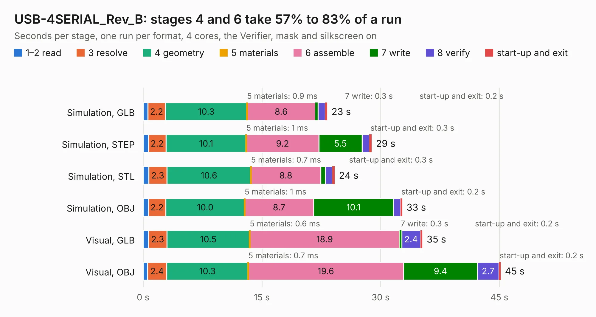

| Mode and format | 1–2 read | 3 resolve | 4 geometry | 5 materials | 6 assemble | 7 write | 8 verify | start-up and exit | Total |
|---|---:|---:|---:|---:|---:|---:|---:|---:|---:|
| Simulation, GLB | 0.6 | 2.2 | 10.3 | 0.9&nbsp;ms | 8.6 | 0.3 | 0.9 | 0.2 | 23.3 |
| Simulation, STEP | 0.7 | 2.2 | 10.1 | 1&nbsp;ms | 9.2 | 5.5 | 0.9 | 0.3 | 28.9 |
| Simulation, STL | 0.7 | 2.3 | 10.6 | 0.7&nbsp;ms | 8.8 | 0.6 | 0.9 | 0.3 | 24.2 |
| Simulation, OBJ | 0.7 | 2.2 | 10.0 | 1&nbsp;ms | 8.7 | 10.1 | 0.9 | 0.2 | 32.7 |
| Visual, GLB | 0.7 | 2.3 | 10.5 | 0.6&nbsp;ms | 18.9 | 0.3 | 2.4 | 0.2 | 35.3 |
| Visual, OBJ | 0.6 | 2.4 | 10.3 | 0.7&nbsp;ms | 19.6 | 9.4 | 2.7 | 0.2 | 45.2 |

<table align="center"><tr><td valign="top">

| Board | Repo: [OLIMEX/USB-4SERIAL](https://github.com/OLIMEX/USB-4SERIAL) Board: `USB-4SERIAL_Rev_B.kicad_pcb` |
|---|---|
| Folder | HARDWARE / USB-4SERIAL_Rev_B |
| Complexity | 288&nbsp;/&nbsp;1000 (size&nbsp;233, features&nbsp;55) |
| KESE&nbsp;features | through vias, slotted holes, filled zones, copper text |
| Tested | 9th November 2026 |
| Copper&nbsp;layers | 2 |
| File&nbsp;format | KiCad 5 (20171130) |
| Parts,&nbsp;tracks,&nbsp;vias | 88, 1,588, 271 |
| Triangles,&nbsp;simulation | 1,964,302 in 140 parts |
| Verifier | PASS in all six runs |

</td><td valign="top">

<table>
<tr><th>File type</th><th>File size</th><th>Peak memory used</th></tr>
<tr><th colspan="3" align="left">Simulation</th></tr>
<tr><td>GLB</td><td align="right">69&nbsp;MB</td><td align="right">689&nbsp;MB</td></tr>
<tr><td>STEP</td><td align="right">368&nbsp;MB</td><td align="right">930&nbsp;MB</td></tr>
<tr><td>STL</td><td align="right">98&nbsp;MB</td><td align="right">694&nbsp;MB</td></tr>
<tr><td>OBJ</td><td align="right">209&nbsp;MB</td><td align="right">1.3&nbsp;GB</td></tr>
<tr><th colspan="3" align="left">Visual</th></tr>
<tr><td>GLB</td><td align="right">58&nbsp;MB</td><td align="right">975&nbsp;MB</td></tr>
<tr><td>OBJ</td><td align="right">176&nbsp;MB</td><td align="right">1.3&nbsp;GB</td></tr>
</table>

</td></tr></table>

## 23.19.16 USB-GIGABIT_Rev_C

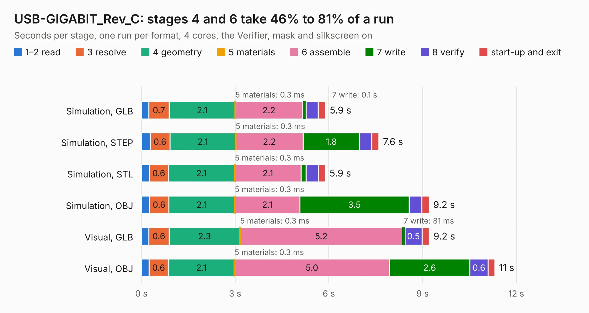

| Mode and format | 1–2 read | 3 resolve | 4 geometry | 5 materials | 6 assemble | 7 write | 8 verify | start-up and exit | Total |
|---|---:|---:|---:|---:|---:|---:|---:|---:|---:|
| Simulation, GLB | 0.2 | 0.7 | 2.1 | 0.3&nbsp;ms | 2.2 | 0.1 | 0.4 | 0.2 | 5.9 |
| Simulation, STEP | 0.3 | 0.6 | 2.1 | 0.3&nbsp;ms | 2.2 | 1.8 | 0.4 | 0.2 | 7.6 |
| Simulation, STL | 0.3 | 0.6 | 2.1 | 0.3&nbsp;ms | 2.1 | 0.2 | 0.4 | 0.2 | 5.9 |
| Simulation, OBJ | 0.3 | 0.6 | 2.1 | 0.3&nbsp;ms | 2.1 | 3.5 | 0.4 | 0.2 | 9.2 |
| Visual, GLB | 0.2 | 0.6 | 2.3 | 0.3&nbsp;ms | 5.2 | 81&nbsp;ms | 0.5 | 0.2 | 9.2 |
| Visual, OBJ | 0.2 | 0.6 | 2.1 | 0.3&nbsp;ms | 5.0 | 2.6 | 0.6 | 0.2 | 11.3 |

<table align="center"><tr><td valign="top">

| Board | Repo: [OLIMEX/USB-GIGABIT](https://github.com/OLIMEX/USB-GIGABIT) Board: `USB-GIGABIT_Rev_C.kicad_pcb` |
|---|---|
| Folder | HARDWARE / USB-GIGABIT-Rev.C |
| Complexity | 269&nbsp;/&nbsp;1000 (size&nbsp;224, features&nbsp;45) |
| KESE&nbsp;features | through vias, slotted holes, filled zones |
| Tested | 9th November 2026 |
| Copper&nbsp;layers | 4 |
| File&nbsp;format | KiCad 6 (20190905) |
| Parts,&nbsp;tracks,&nbsp;vias | 48, 582, 54 |
| Triangles,&nbsp;simulation | 637,954 in 61 parts |
| Verifier | PASS in all six runs |

</td><td valign="top">

<table>
<tr><th>File type</th><th>File size</th><th>Peak memory used</th></tr>
<tr><th colspan="3" align="left">Simulation</th></tr>
<tr><td>GLB</td><td align="right">22&nbsp;MB</td><td align="right">335&nbsp;MB</td></tr>
<tr><td>STEP</td><td align="right">98&nbsp;MB</td><td align="right">371&nbsp;MB</td></tr>
<tr><td>STL</td><td align="right">32&nbsp;MB</td><td align="right">343&nbsp;MB</td></tr>
<tr><td>OBJ</td><td align="right">66&nbsp;MB</td><td align="right">470&nbsp;MB</td></tr>
<tr><th colspan="3" align="left">Visual</th></tr>
<tr><td>GLB</td><td align="right">16&nbsp;MB</td><td align="right">394&nbsp;MB</td></tr>
<tr><td>OBJ</td><td align="right">47&nbsp;MB</td><td align="right">410&nbsp;MB</td></tr>
</table>

</td></tr></table>

## 23.19.17 USB-GIGABIT_Rev_D

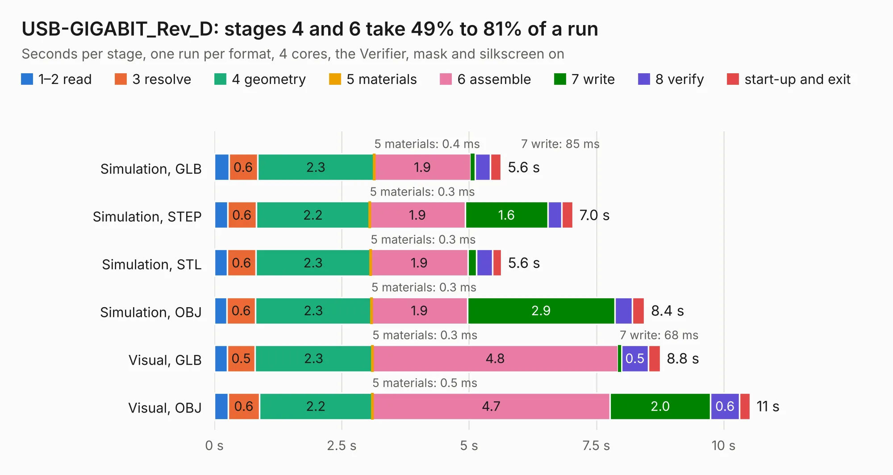

| Mode and format | 1–2 read | 3 resolve | 4 geometry | 5 materials | 6 assemble | 7 write | 8 verify | start-up and exit | Total |
|---|---:|---:|---:|---:|---:|---:|---:|---:|---:|
| Simulation, GLB | 0.3 | 0.6 | 2.3 | 0.4&nbsp;ms | 1.9 | 85&nbsp;ms | 0.3 | 0.2 | 5.6 |
| Simulation, STEP | 0.3 | 0.6 | 2.2 | 0.3&nbsp;ms | 1.9 | 1.6 | 0.3 | 0.2 | 7.0 |
| Simulation, STL | 0.3 | 0.6 | 2.3 | 0.3&nbsp;ms | 1.9 | 0.2 | 0.3 | 0.2 | 5.6 |
| Simulation, OBJ | 0.2 | 0.6 | 2.3 | 0.3&nbsp;ms | 1.9 | 2.9 | 0.3 | 0.2 | 8.4 |
| Visual, GLB | 0.3 | 0.5 | 2.3 | 0.3&nbsp;ms | 4.8 | 68&nbsp;ms | 0.5 | 0.2 | 8.8 |
| Visual, OBJ | 0.3 | 0.6 | 2.2 | 0.5&nbsp;ms | 4.7 | 2.0 | 0.6 | 0.2 | 10.5 |

<table align="center"><tr><td valign="top">

| Board | Repo: [OLIMEX/USB-GIGABIT](https://github.com/OLIMEX/USB-GIGABIT) Board: `USB-GIGABIT_Rev_D.kicad_pcb` |
|---|---|
| Folder | HARDWARE / USB-GIGABIT-Rev.D |
| Complexity | 300&nbsp;/&nbsp;1000 (size&nbsp;225, features&nbsp;75) |
| KESE&nbsp;features | through vias, slotted holes, filled zones, stack-up, dielectric εr and tanδ |
| Tested | 9th November 2026 |
| Copper&nbsp;layers | 4 |
| File&nbsp;format | KiCad 7 (20221018) |
| Parts,&nbsp;tracks,&nbsp;vias | 48, 612, 70 |
| Triangles,&nbsp;simulation | 686,004 in 64 parts |
| Verifier | PASS in all six runs |

</td><td valign="top">

<table>
<tr><th>File type</th><th>File size</th><th>Peak memory used</th></tr>
<tr><th colspan="3" align="left">Simulation</th></tr>
<tr><td>GLB</td><td align="right">24&nbsp;MB</td><td align="right">352&nbsp;MB</td></tr>
<tr><td>STEP</td><td align="right">114&nbsp;MB</td><td align="right">392&nbsp;MB</td></tr>
<tr><td>STL</td><td align="right">34&nbsp;MB</td><td align="right">358&nbsp;MB</td></tr>
<tr><td>OBJ</td><td align="right">71&nbsp;MB</td><td align="right">511&nbsp;MB</td></tr>
<tr><th colspan="3" align="left">Visual</th></tr>
<tr><td>GLB</td><td align="right">17&nbsp;MB</td><td align="right">408&nbsp;MB</td></tr>
<tr><td>OBJ</td><td align="right">49&nbsp;MB</td><td align="right">410&nbsp;MB</td></tr>
</table>

</td></tr></table>

## 23.19.18 USB-GIGABIT_Rev_E

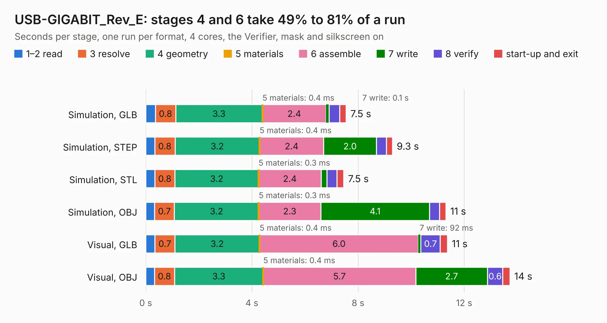

| Mode and format | 1–2 read | 3 resolve | 4 geometry | 5 materials | 6 assemble | 7 write | 8 verify | start-up and exit | Total |
|---|---:|---:|---:|---:|---:|---:|---:|---:|---:|
| Simulation, GLB | 0.4 | 0.8 | 3.3 | 0.4&nbsp;ms | 2.4 | 0.1 | 0.4 | 0.2 | 7.5 |
| Simulation, STEP | 0.3 | 0.8 | 3.2 | 0.4&nbsp;ms | 2.4 | 2.0 | 0.4 | 0.2 | 9.3 |
| Simulation, STL | 0.3 | 0.8 | 3.2 | 0.3&nbsp;ms | 2.4 | 0.2 | 0.4 | 0.3 | 7.5 |
| Simulation, OBJ | 0.3 | 0.7 | 3.2 | 0.3&nbsp;ms | 2.3 | 4.1 | 0.4 | 0.2 | 11.3 |
| Visual, GLB | 0.3 | 0.7 | 3.2 | 0.4&nbsp;ms | 6.0 | 92&nbsp;ms | 0.7 | 0.3 | 11.4 |
| Visual, OBJ | 0.3 | 0.8 | 3.3 | 0.4&nbsp;ms | 5.7 | 2.7 | 0.6 | 0.3 | 13.7 |

<table align="center"><tr><td valign="top">

| Board | Repo: [OLIMEX/USB-GIGABIT](https://github.com/OLIMEX/USB-GIGABIT) Board: `USB-GIGABIT_Rev_E.kicad_pcb` |
|---|---|
| Folder | HARDWARE / USB-GIGABIT-Rev.E |
| Complexity | 311&nbsp;/&nbsp;1000 (size&nbsp;226, features&nbsp;85) |
| KESE&nbsp;features | through vias, slotted holes, filled zones, copper text, stack-up, dielectric εr and tanδ |
| Tested | 9th November 2026 |
| Copper&nbsp;layers | 4 |
| File&nbsp;format | KiCad 7 (20221018) |
| Parts,&nbsp;tracks,&nbsp;vias | 48, 637, 69 |
| Triangles,&nbsp;simulation | 685,636 in 65 parts |
| Verifier | PASS in all six runs |

</td><td valign="top">

<table>
<tr><th>File type</th><th>File size</th><th>Peak memory used</th></tr>
<tr><th colspan="3" align="left">Simulation</th></tr>
<tr><td>GLB</td><td align="right">24&nbsp;MB</td><td align="right">354&nbsp;MB</td></tr>
<tr><td>STEP</td><td align="right">115&nbsp;MB</td><td align="right">401&nbsp;MB</td></tr>
<tr><td>STL</td><td align="right">34&nbsp;MB</td><td align="right">338&nbsp;MB</td></tr>
<tr><td>OBJ</td><td align="right">71&nbsp;MB</td><td align="right">513&nbsp;MB</td></tr>
<tr><th colspan="3" align="left">Visual</th></tr>
<tr><td>GLB</td><td align="right">17&nbsp;MB</td><td align="right">408&nbsp;MB</td></tr>
<tr><td>OBJ</td><td align="right">49&nbsp;MB</td><td align="right">427&nbsp;MB</td></tr>
</table>

</td></tr></table>

## 23.19.19 USB-gLINK_Rev_C

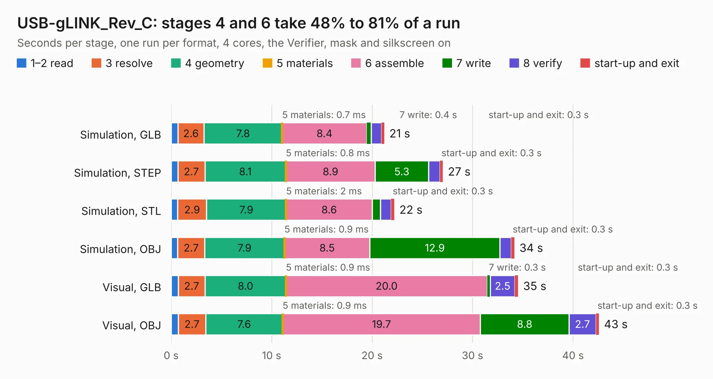

| Mode and format | 1–2 read | 3 resolve | 4 geometry | 5 materials | 6 assemble | 7 write | 8 verify | start-up and exit | Total |
|---|---:|---:|---:|---:|---:|---:|---:|---:|---:|
| Simulation, GLB | 0.7 | 2.6 | 7.8 | 0.7&nbsp;ms | 8.4 | 0.4 | 1.0 | 0.3 | 21.2 |
| Simulation, STEP | 0.7 | 2.7 | 8.1 | 0.8&nbsp;ms | 8.9 | 5.3 | 1.2 | 0.3 | 27.0 |
| Simulation, STL | 0.7 | 2.9 | 7.9 | 2&nbsp;ms | 8.6 | 0.8 | 1.1 | 0.3 | 22.2 |
| Simulation, OBJ | 0.7 | 2.7 | 7.9 | 0.9&nbsp;ms | 8.5 | 12.9 | 1.1 | 0.3 | 34.2 |
| Visual, GLB | 0.7 | 2.7 | 8.0 | 0.9&nbsp;ms | 20.0 | 0.3 | 2.5 | 0.3 | 34.5 |
| Visual, OBJ | 0.7 | 2.7 | 7.6 | 0.9&nbsp;ms | 19.7 | 8.8 | 2.7 | 0.3 | 42.6 |

<table align="center"><tr><td valign="top">

| Board | Repo: [OLIMEX/USB-gLINK](https://github.com/OLIMEX/USB-gLINK) Board: `USB-gLINK_Rev_C.kicad_pcb` |
|---|---|
| Folder | HARDWARE / USB-gLINK_Rev.C |
| Complexity | 338&nbsp;/&nbsp;1000 (size&nbsp;273, features&nbsp;65) |
| KESE&nbsp;features | through vias, slotted holes, rounded, trapezoid or chamfered pads, filled zones, copper text |
| Tested | 9th November 2026 |
| Copper&nbsp;layers | 4 |
| File&nbsp;format | KiCad 5 (20171130) |
| Parts,&nbsp;tracks,&nbsp;vias | 96, 3,212, 435 |
| Triangles,&nbsp;simulation | 2,140,928 in 143 parts |
| Verifier | PASS in all six runs |

</td><td valign="top">

<table>
<tr><th>File type</th><th>File size</th><th>Peak memory used</th></tr>
<tr><th colspan="3" align="left">Simulation</th></tr>
<tr><td>GLB</td><td align="right">75&nbsp;MB</td><td align="right">797&nbsp;MB</td></tr>
<tr><td>STEP</td><td align="right">272&nbsp;MB</td><td align="right">919&nbsp;MB</td></tr>
<tr><td>STL</td><td align="right">107&nbsp;MB</td><td align="right">818&nbsp;MB</td></tr>
<tr><td>OBJ</td><td align="right">228&nbsp;MB</td><td align="right">1.5&nbsp;GB</td></tr>
<tr><th colspan="3" align="left">Visual</th></tr>
<tr><td>GLB</td><td align="right">49&nbsp;MB</td><td align="right">883&nbsp;MB</td></tr>
<tr><td>OBJ</td><td align="right">151&nbsp;MB</td><td align="right">1.1&nbsp;GB</td></tr>
</table>

</td></tr></table>

## 23.19.20 USB-gLINK_Rev_D

| Mode and format | 1–2 read | 3 resolve | 4 geometry | 5 materials | 6 assemble | 7 write | 8 verify | start-up and exit | Total |
|---|---:|---:|---:|---:|---:|---:|---:|---:|---:|
| Simulation, GLB | 0.6 | 2.3 | 7.1 | 0.8&nbsp;ms | 7.8 | 0.3 | 1.0 | 0.3 | 19.5 |
| Simulation, STEP | 0.6 | 2.3 | 7.2 | 0.9&nbsp;ms | 7.5 | 4.8 | 1.0 | 0.3 | 23.8 |
| Simulation, STL | 0.6 | 2.3 | 7.1 | 1&nbsp;ms | 7.5 | 0.9 | 1.1 | 0.3 | 19.7 |
| Simulation, OBJ | 0.7 | 2.3 | 7.1 | 0.9&nbsp;ms | 7.0 | 10.8 | 1.1 | 0.2 | 29.2 |
| Visual, GLB | 0.6 | 2.3 | 6.9 | 0.9&nbsp;ms | 18.3 | 0.2 | 2.5 | 0.2 | 31.0 |
| Visual, OBJ | 0.6 | 2.2 | 6.8 | 0.9&nbsp;ms | 17.8 | 7.2 | 2.8 | 0.3 | 37.8 |

<table align="center"><tr><td valign="top">

| Board | Repo: [OLIMEX/USB-gLINK](https://github.com/OLIMEX/USB-gLINK) Board: `USB-gLINK_Rev_D.kicad_pcb` |
|---|---|
| Folder | HARDWARE / USB-gLINK_Rev.D |
| Complexity | 337&nbsp;/&nbsp;1000 (size&nbsp;272, features&nbsp;65) |
| KESE&nbsp;features | through vias, slotted holes, rounded, trapezoid or chamfered pads, filled zones, copper text |
| Tested | 9th November 2026 |
| Copper&nbsp;layers | 4 |
| File&nbsp;format | KiCad 5 (20171130) |
| Parts,&nbsp;tracks,&nbsp;vias | 102, 3,024, 408 |
| Triangles,&nbsp;simulation | 2,188,064 in 143 parts |
| Verifier | PASS in all six runs |

</td><td valign="top">

<table>
<tr><th>File type</th><th>File size</th><th>Peak memory used</th></tr>
<tr><th colspan="3" align="left">Simulation</th></tr>
<tr><td>GLB</td><td align="right">77&nbsp;MB</td><td align="right">830&nbsp;MB</td></tr>
<tr><td>STEP</td><td align="right">295&nbsp;MB</td><td align="right">978&nbsp;MB</td></tr>
<tr><td>STL</td><td align="right">109&nbsp;MB</td><td align="right">909&nbsp;MB</td></tr>
<tr><td>OBJ</td><td align="right">233&nbsp;MB</td><td align="right">1.5&nbsp;GB</td></tr>
<tr><th colspan="3" align="left">Visual</th></tr>
<tr><td>GLB</td><td align="right">51&nbsp;MB</td><td align="right">941&nbsp;MB</td></tr>
<tr><td>OBJ</td><td align="right">159&nbsp;MB</td><td align="right">1.2&nbsp;GB</td></tr>
</table>

</td></tr></table>

## 23.19.21 USB-NeoHUB_Rev_A

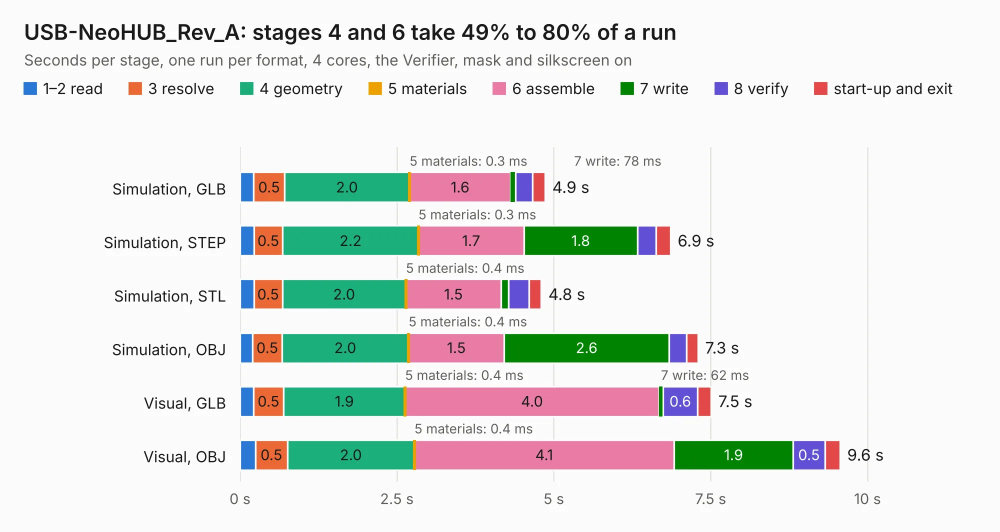

| Mode and format | 1–2 read | 3 resolve | 4 geometry | 5 materials | 6 assemble | 7 write | 8 verify | start-up and exit | Total |
|---|---:|---:|---:|---:|---:|---:|---:|---:|---:|
| Simulation, GLB | 0.2 | 0.5 | 2.0 | 0.3&nbsp;ms | 1.6 | 78&nbsp;ms | 0.3 | 0.2 | 4.9 |
| Simulation, STEP | 0.2 | 0.5 | 2.2 | 0.3&nbsp;ms | 1.7 | 1.8 | 0.3 | 0.2 | 6.9 |
| Simulation, STL | 0.2 | 0.5 | 2.0 | 0.4&nbsp;ms | 1.5 | 0.1 | 0.3 | 0.2 | 4.8 |
| Simulation, OBJ | 0.2 | 0.5 | 2.0 | 0.4&nbsp;ms | 1.5 | 2.6 | 0.3 | 0.2 | 7.3 |
| Visual, GLB | 0.2 | 0.5 | 1.9 | 0.4&nbsp;ms | 4.0 | 62&nbsp;ms | 0.6 | 0.2 | 7.5 |
| Visual, OBJ | 0.2 | 0.5 | 2.0 | 0.4&nbsp;ms | 4.1 | 1.9 | 0.5 | 0.2 | 9.6 |

<table align="center"><tr><td valign="top">

| Board | Repo: [OLIMEX/USB-NeoHub](https://github.com/OLIMEX/USB-NeoHub) Board: `USB-NeoHUB_Rev_A.kicad_pcb` |
|---|---|
| Folder | HARDWARE / USB-NeoHub-Rev.A |
| Complexity | 233&nbsp;/&nbsp;1000 (size&nbsp;158, features&nbsp;75) |
| KESE&nbsp;features | through vias, slotted holes, filled zones, stack-up, dielectric εr and tanδ |
| Tested | 9th November 2026 |
| Copper&nbsp;layers | 2 |
| File&nbsp;format | KiCad 7 (20221018) |
| Parts,&nbsp;tracks,&nbsp;vias | 23, 433, 75 |
| Triangles,&nbsp;simulation | 478,372 in 51 parts |
| Verifier | PASS in all six runs |

</td><td valign="top">

<table>
<tr><th>File type</th><th>File size</th><th>Peak memory used</th></tr>
<tr><th colspan="3" align="left">Simulation</th></tr>
<tr><td>GLB</td><td align="right">17&nbsp;MB</td><td align="right">300&nbsp;MB</td></tr>
<tr><td>STEP</td><td align="right">88&nbsp;MB</td><td align="right">324&nbsp;MB</td></tr>
<tr><td>STL</td><td align="right">24&nbsp;MB</td><td align="right">307&nbsp;MB</td></tr>
<tr><td>OBJ</td><td align="right">50&nbsp;MB</td><td align="right">376&nbsp;MB</td></tr>
<tr><th colspan="3" align="left">Visual</th></tr>
<tr><td>GLB</td><td align="right">13&nbsp;MB</td><td align="right">327&nbsp;MB</td></tr>
<tr><td>OBJ</td><td align="right">39&nbsp;MB</td><td align="right">342&nbsp;MB</td></tr>
</table>

</td></tr></table>

## 23.19.22 usb-sata_Rev.A

| Mode and format | 1–2 read | 3 resolve | 4 geometry | 5 materials | 6 assemble | 7 write | 8 verify | start-up and exit | Total |
|---|---:|---:|---:|---:|---:|---:|---:|---:|---:|
| Simulation, GLB | 0.2 | 0.4 | 1.8 | 0.5&nbsp;ms | 1.4 | 70&nbsp;ms | 0.2 | 0.2 | 4.3 |
| Simulation, STEP | 0.2 | 0.4 | 1.7 | 0.2&nbsp;ms | 1.4 | 1.3 | 0.2 | 0.2 | 5.4 |
| Simulation, STL | 0.2 | 0.4 | 1.7 | 0.2&nbsp;ms | 1.4 | 0.1 | 0.2 | 0.2 | 4.1 |
| Simulation, OBJ | 0.2 | 0.4 | 1.6 | 0.2&nbsp;ms | 1.3 | 1.9 | 0.2 | 0.2 | 5.9 |
| Visual, GLB | 0.2 | 0.4 | 1.7 | 0.2&nbsp;ms | 3.4 | 51&nbsp;ms | 0.4 | 0.2 | 6.3 |
| Visual, OBJ | 0.2 | 0.4 | 1.6 | 0.2&nbsp;ms | 3.3 | 1.4 | 0.5 | 0.2 | 7.5 |

<table align="center"><tr><td valign="top">

| Board | Repo: [OLIMEX/USB-SATA](https://github.com/OLIMEX/USB-SATA) Board: `usb-sata_Rev.A.kicad_pcb` |
|---|---|
| Folder | HARDWARE / USB-SATA-REV.A |
| Complexity | 267&nbsp;/&nbsp;1000 (size&nbsp;222, features&nbsp;45) |
| KESE&nbsp;features | through vias, slotted holes, filled zones |
| Tested | 9th November 2026 |
| Copper&nbsp;layers | 4 |
| File&nbsp;format | KiCad 6 (20190516) |
| Parts,&nbsp;tracks,&nbsp;vias | 48, 506, 51 |
| Triangles,&nbsp;simulation | 453,362 in 55 parts |
| Verifier | PASS in all six runs |

</td><td valign="top">

<table>
<tr><th>File type</th><th>File size</th><th>Peak memory used</th></tr>
<tr><th colspan="3" align="left">Simulation</th></tr>
<tr><td>GLB</td><td align="right">16&nbsp;MB</td><td align="right">288&nbsp;MB</td></tr>
<tr><td>STEP</td><td align="right">73&nbsp;MB</td><td align="right">328&nbsp;MB</td></tr>
<tr><td>STL</td><td align="right">23&nbsp;MB</td><td align="right">275&nbsp;MB</td></tr>
<tr><td>OBJ</td><td align="right">47&nbsp;MB</td><td align="right">371&nbsp;MB</td></tr>
<tr><th colspan="3" align="left">Visual</th></tr>
<tr><td>GLB</td><td align="right">12&nbsp;MB</td><td align="right">319&nbsp;MB</td></tr>
<tr><td>OBJ</td><td align="right">35&nbsp;MB</td><td align="right">317&nbsp;MB</td></tr>
</table>

</td></tr></table>

## 23.19.23 USB-SERIAL-L_Rev_B

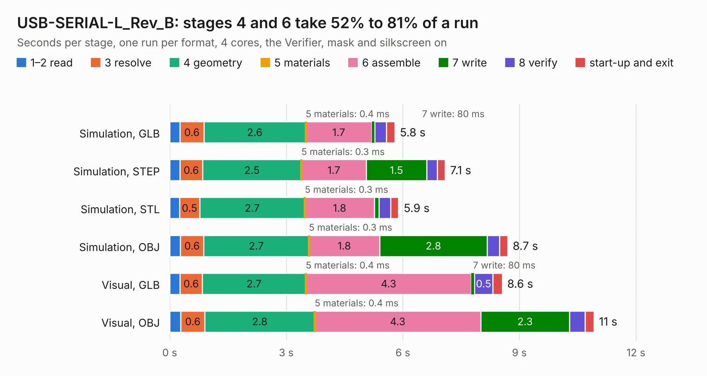

| Mode and format | 1–2 read | 3 resolve | 4 geometry | 5 materials | 6 assemble | 7 write | 8 verify | start-up and exit | Total |
|---|---:|---:|---:|---:|---:|---:|---:|---:|---:|
| Simulation, GLB | 0.3 | 0.6 | 2.6 | 0.4&nbsp;ms | 1.7 | 80&nbsp;ms | 0.3 | 0.2 | 5.8 |
| Simulation, STEP | 0.3 | 0.6 | 2.5 | 0.3&nbsp;ms | 1.7 | 1.5 | 0.3 | 0.2 | 7.1 |
| Simulation, STL | 0.3 | 0.5 | 2.7 | 0.3&nbsp;ms | 1.8 | 0.1 | 0.3 | 0.2 | 5.9 |
| Simulation, OBJ | 0.3 | 0.6 | 2.7 | 0.3&nbsp;ms | 1.8 | 2.8 | 0.3 | 0.2 | 8.7 |
| Visual, GLB | 0.3 | 0.6 | 2.7 | 0.4&nbsp;ms | 4.3 | 80&nbsp;ms | 0.5 | 0.2 | 8.6 |
| Visual, OBJ | 0.3 | 0.6 | 2.8 | 0.4&nbsp;ms | 4.3 | 2.3 | 0.4 | 0.2 | 10.9 |

<table align="center"><tr><td valign="top">

| Board | Repo: [OLIMEX/USB-SERIAL-L](https://github.com/OLIMEX/USB-SERIAL-L) Board: `USB-SERIAL-L_Rev_B.kicad_pcb` |
|---|---|
| Folder | HARDWARE / USB-SERIAL-L_Rev_B |
| Complexity | 280&nbsp;/&nbsp;1000 (size&nbsp;205, features&nbsp;75) |
| KESE&nbsp;features | through vias, slotted holes, filled zones, stack-up, dielectric εr and tanδ |
| Tested | 9th November 2026 |
| Copper&nbsp;layers | 2 |
| File&nbsp;format | KiCad 7 (20221018) |
| Parts,&nbsp;tracks,&nbsp;vias | 42, 517, 63 |
| Triangles,&nbsp;simulation | 509,116 in 52 parts |
| Verifier | PASS in all six runs |

</td><td valign="top">

<table>
<tr><th>File type</th><th>File size</th><th>Peak memory used</th></tr>
<tr><th colspan="3" align="left">Simulation</th></tr>
<tr><td>GLB</td><td align="right">18&nbsp;MB</td><td align="right">315&nbsp;MB</td></tr>
<tr><td>STEP</td><td align="right">95&nbsp;MB</td><td align="right">349&nbsp;MB</td></tr>
<tr><td>STL</td><td align="right">25&nbsp;MB</td><td align="right">314&nbsp;MB</td></tr>
<tr><td>OBJ</td><td align="right">53&nbsp;MB</td><td align="right">400&nbsp;MB</td></tr>
<tr><th colspan="3" align="left">Visual</th></tr>
<tr><td>GLB</td><td align="right">14&nbsp;MB</td><td align="right">359&nbsp;MB</td></tr>
<tr><td>OBJ</td><td align="right">41&nbsp;MB</td><td align="right">356&nbsp;MB</td></tr>
</table>

</td></tr></table>

## 23.19.24 VGA2HDMI_Rev_C

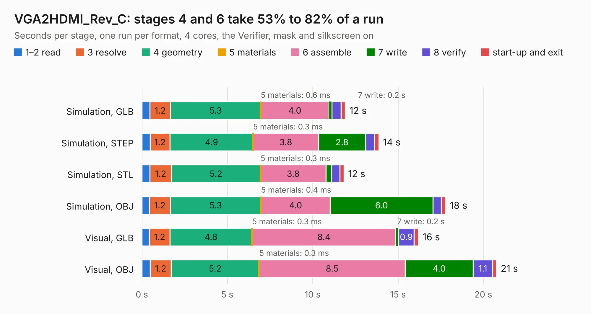

| Mode and format | 1–2 read | 3 resolve | 4 geometry | 5 materials | 6 assemble | 7 write | 8 verify | start-up and exit | Total |
|---|---:|---:|---:|---:|---:|---:|---:|---:|---:|
| Simulation, GLB | 0.5 | 1.2 | 5.3 | 0.6&nbsp;ms | 4.0 | 0.2 | 0.5 | 0.3 | 11.9 |
| Simulation, STEP | 0.5 | 1.2 | 4.9 | 0.3&nbsp;ms | 3.8 | 2.8 | 0.5 | 0.3 | 13.9 |
| Simulation, STL | 0.5 | 1.2 | 5.2 | 0.3&nbsp;ms | 3.8 | 0.3 | 0.5 | 0.2 | 11.8 |
| Simulation, OBJ | 0.4 | 1.2 | 5.3 | 0.4&nbsp;ms | 4.0 | 6.0 | 0.5 | 0.3 | 17.8 |
| Visual, GLB | 0.4 | 1.2 | 4.8 | 0.3&nbsp;ms | 8.4 | 0.2 | 0.9 | 0.2 | 16.2 |
| Visual, OBJ | 0.5 | 1.2 | 5.2 | 0.3&nbsp;ms | 8.5 | 4.0 | 1.1 | 0.2 | 20.8 |

<table align="center"><tr><td valign="top">

| Board | Repo: [OLIMEX/VGA2HDMI](https://github.com/OLIMEX/VGA2HDMI) Board: `VGA2HDMI_Rev_C.kicad_pcb` |
|---|---|
| Folder | HARDWARE / VGA2HDMI-REV.C |
| Complexity | 312&nbsp;/&nbsp;1000 (size&nbsp;237, features&nbsp;75) |
| KESE&nbsp;features | through vias, slotted holes, filled zones, stack-up, dielectric εr and tanδ |
| Tested | 9th November 2026 |
| Copper&nbsp;layers | 4 |
| File&nbsp;format | KiCad 7 (20221018) |
| Parts,&nbsp;tracks,&nbsp;vias | 75, 881, 131 |
| Triangles,&nbsp;simulation | 1,066,580 in 85 parts |
| Verifier | PASS in all six runs |

</td><td valign="top">

<table>
<tr><th>File type</th><th>File size</th><th>Peak memory used</th></tr>
<tr><th colspan="3" align="left">Simulation</th></tr>
<tr><td>GLB</td><td align="right">38&nbsp;MB</td><td align="right">476&nbsp;MB</td></tr>
<tr><td>STEP</td><td align="right">168&nbsp;MB</td><td align="right">529&nbsp;MB</td></tr>
<tr><td>STL</td><td align="right">53&nbsp;MB</td><td align="right">481&nbsp;MB</td></tr>
<tr><td>OBJ</td><td align="right">111&nbsp;MB</td><td align="right">766&nbsp;MB</td></tr>
<tr><th colspan="3" align="left">Visual</th></tr>
<tr><td>GLB</td><td align="right">25&nbsp;MB</td><td align="right">570&nbsp;MB</td></tr>
<tr><td>OBJ</td><td align="right">74&nbsp;MB</td><td align="right">607&nbsp;MB</td></tr>
</table>

</td></tr></table>

## 23.19.25 firmware_tester_board

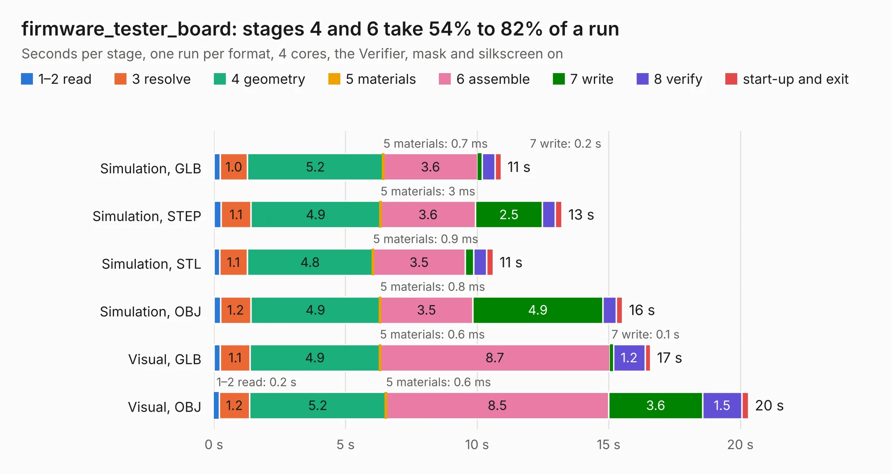

| Mode and format | 1–2 read | 3 resolve | 4 geometry | 5 materials | 6 assemble | 7 write | 8 verify | start-up and exit | Total |
|---|---:|---:|---:|---:|---:|---:|---:|---:|---:|
| Simulation, GLB | 0.2 | 1.0 | 5.2 | 0.7&nbsp;ms | 3.6 | 0.2 | 0.5 | 0.2 | 10.9 |
| Simulation, STEP | 0.3 | 1.1 | 4.9 | 3&nbsp;ms | 3.6 | 2.5 | 0.5 | 0.3 | 13.2 |
| Simulation, STL | 0.2 | 1.1 | 4.8 | 0.9&nbsp;ms | 3.5 | 0.3 | 0.5 | 0.3 | 10.6 |
| Simulation, OBJ | 0.2 | 1.2 | 4.9 | 0.8&nbsp;ms | 3.5 | 4.9 | 0.5 | 0.2 | 15.5 |
| Visual, GLB | 0.2 | 1.1 | 4.9 | 0.6&nbsp;ms | 8.7 | 0.1 | 1.2 | 0.2 | 16.6 |
| Visual, OBJ | 0.2 | 1.2 | 5.2 | 0.6&nbsp;ms | 8.5 | 3.6 | 1.5 | 0.3 | 20.3 |

<table align="center"><tr><td valign="top">

| Board | Repo: [olin-electric-motorsports/olin-electric-motorsports](https://github.com/olin-electric-motorsports/olin-electric-motorsports) Board: `firmware_tester_board.kicad_pcb` |
|---|---|
| Folder | projects / hitl / firmware_tester_board |
| Complexity | 260&nbsp;/&nbsp;1000 (size&nbsp;215, features&nbsp;45) |
| KESE&nbsp;features | through vias, filled zones, curved board outline |
| Tested | 9th November 2026 |
| Copper&nbsp;layers | 2 |
| File&nbsp;format | KiCad 6 (20211014) |
| Parts,&nbsp;tracks,&nbsp;vias | 55, 813, 100 |
| Triangles,&nbsp;simulation | 996,486 in 97 parts |
| Verifier | PASS in all six runs |

</td><td valign="top">

<table>
<tr><th>File type</th><th>File size</th><th>Peak memory used</th></tr>
<tr><th colspan="3" align="left">Simulation</th></tr>
<tr><td>GLB</td><td align="right">35&nbsp;MB</td><td align="right">465&nbsp;MB</td></tr>
<tr><td>STEP</td><td align="right">168&nbsp;MB</td><td align="right">518&nbsp;MB</td></tr>
<tr><td>STL</td><td align="right">50&nbsp;MB</td><td align="right">468&nbsp;MB</td></tr>
<tr><td>OBJ</td><td align="right">103&nbsp;MB</td><td align="right">714&nbsp;MB</td></tr>
<tr><th colspan="3" align="left">Visual</th></tr>
<tr><td>GLB</td><td align="right">25&nbsp;MB</td><td align="right">531&nbsp;MB</td></tr>
<tr><td>OBJ</td><td align="right">77&nbsp;MB</td><td align="right">590&nbsp;MB</td></tr>
</table>

</td></tr></table>

## 23.19.26 hitl-primary

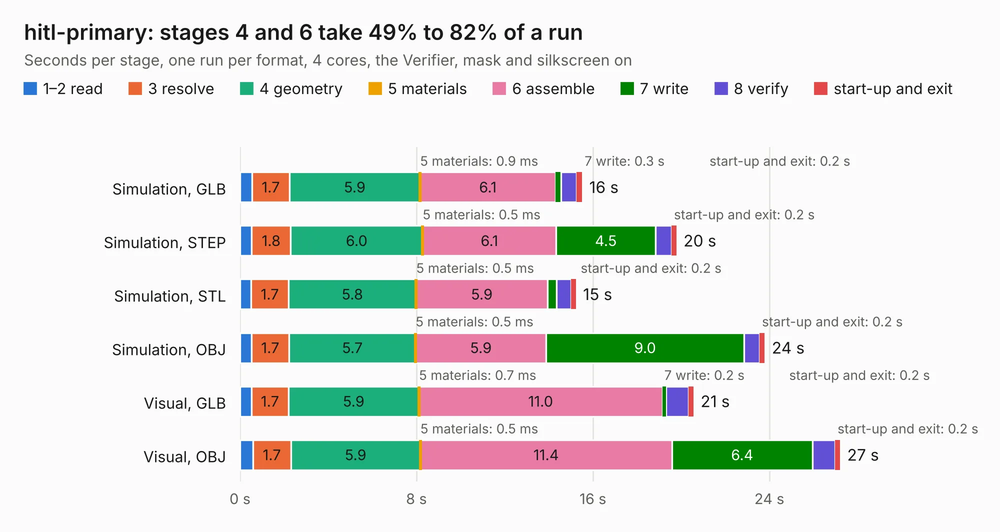

| Mode and format | 1–2 read | 3 resolve | 4 geometry | 5 materials | 6 assemble | 7 write | 8 verify | start-up and exit | Total |
|---|---:|---:|---:|---:|---:|---:|---:|---:|---:|
| Simulation, GLB | 0.5 | 1.7 | 5.9 | 0.9&nbsp;ms | 6.1 | 0.3 | 0.7 | 0.2 | 15.5 |
| Simulation, STEP | 0.5 | 1.8 | 6.0 | 0.5&nbsp;ms | 6.1 | 4.5 | 0.7 | 0.2 | 19.8 |
| Simulation, STL | 0.5 | 1.7 | 5.8 | 0.5&nbsp;ms | 5.9 | 0.4 | 0.7 | 0.2 | 15.2 |
| Simulation, OBJ | 0.5 | 1.7 | 5.7 | 0.5&nbsp;ms | 5.9 | 9.0 | 0.7 | 0.2 | 23.8 |
| Visual, GLB | 0.5 | 1.7 | 5.9 | 0.7&nbsp;ms | 11.0 | 0.2 | 1.0 | 0.2 | 20.6 |
| Visual, OBJ | 0.6 | 1.7 | 5.9 | 0.5&nbsp;ms | 11.4 | 6.4 | 1.0 | 0.2 | 27.2 |

<table align="center"><tr><td valign="top">

| Board | Repo: [olin-electric-motorsports/olin-electric-motorsports](https://github.com/olin-electric-motorsports/olin-electric-motorsports) Board: `hitl-primary.kicad_pcb` |
|---|---|
| Folder | projects / hitl / hitl / hardware / primary_board |
| Complexity | 388&nbsp;/&nbsp;1000 (size&nbsp;248, features&nbsp;140) |
| KESE&nbsp;features | through vias, slotted holes, custom pads, rounded, trapezoid or chamfered pads, arc tracks, filled zones, copper drawings, curved board outline, stack-up, dielectric εr and tanδ, mask and silkscreen colours |
| Tested | 9th November 2026 |
| Copper&nbsp;layers | 4 |
| File&nbsp;format | KiCad 6 (20211014) |
| Parts,&nbsp;tracks,&nbsp;vias | 121, 1,290, 177 |
| Triangles,&nbsp;simulation | 1,750,536 in 141 parts |
| Verifier | PASS in all six runs |

</td><td valign="top">

<table>
<tr><th>File type</th><th>File size</th><th>Peak memory used</th></tr>
<tr><th colspan="3" align="left">Simulation</th></tr>
<tr><td>GLB</td><td align="right">58&nbsp;MB</td><td align="right">649&nbsp;MB</td></tr>
<tr><td>STEP</td><td align="right">231&nbsp;MB</td><td align="right">779&nbsp;MB</td></tr>
<tr><td>STL</td><td align="right">88&nbsp;MB</td><td align="right">657&nbsp;MB</td></tr>
<tr><td>OBJ</td><td align="right">181&nbsp;MB</td><td align="right">1.2&nbsp;GB</td></tr>
<tr><th colspan="3" align="left">Visual</th></tr>
<tr><td>GLB</td><td align="right">40&nbsp;MB</td><td align="right">812&nbsp;MB</td></tr>
<tr><td>OBJ</td><td align="right">122&nbsp;MB</td><td align="right">856&nbsp;MB</td></tr>
</table>

</td></tr></table>

## 23.19.27 breakout_pcie

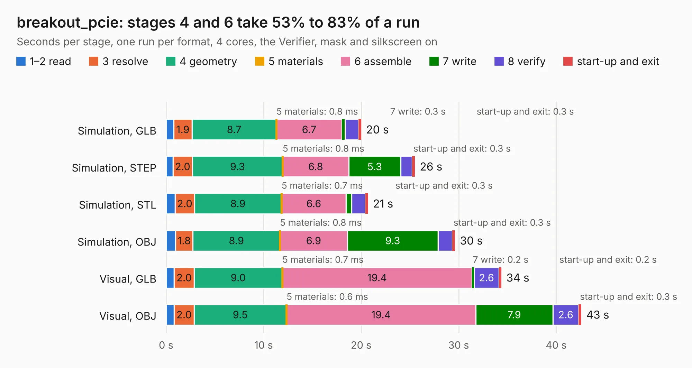

| Mode and format | 1–2 read | 3 resolve | 4 geometry | 5 materials | 6 assemble | 7 write | 8 verify | start-up and exit | Total |
|---|---:|---:|---:|---:|---:|---:|---:|---:|---:|
| Simulation, GLB | 0.8 | 1.9 | 8.7 | 0.8&nbsp;ms | 6.7 | 0.3 | 1.4 | 0.3 | 20.0 |
| Simulation, STEP | 0.7 | 2.0 | 9.3 | 0.8&nbsp;ms | 6.8 | 5.3 | 1.2 | 0.3 | 25.5 |
| Simulation, STL | 0.9 | 2.0 | 8.9 | 0.7&nbsp;ms | 6.6 | 0.6 | 1.4 | 0.3 | 20.7 |
| Simulation, OBJ | 1.0 | 1.8 | 8.9 | 0.8&nbsp;ms | 6.9 | 9.3 | 1.4 | 0.3 | 29.6 |
| Visual, GLB | 0.8 | 2.0 | 9.0 | 0.7&nbsp;ms | 19.4 | 0.2 | 2.6 | 0.2 | 34.4 |
| Visual, OBJ | 0.8 | 2.0 | 9.5 | 0.6&nbsp;ms | 19.4 | 7.9 | 2.6 | 0.3 | 42.6 |

<table align="center"><tr><td valign="top">

| Board | Repo: [olin-electric-motorsports/olin-electric-motorsports](https://github.com/olin-electric-motorsports/olin-electric-motorsports) Board: `breakout_pcie.kicad_pcb` |
|---|---|
| Folder | projects / PCIe Development / pcie_breakout |
| Complexity | 292&nbsp;/&nbsp;1000 (size&nbsp;172, features&nbsp;120) |
| KESE&nbsp;features | through vias, rounded, trapezoid or chamfered pads, filled zones, curved board outline, knockout text, TrueType text, stack-up, dielectric εr and tanδ, mask and silkscreen colours |
| Tested | 9th November 2026 |
| Copper&nbsp;layers | 2 |
| File&nbsp;format | KiCad 7 (20221018) |
| Parts,&nbsp;tracks,&nbsp;vias | 24, 1,292, 74 |
| Triangles,&nbsp;simulation | 2,137,812 in 95 parts |
| Verifier | PASS in all six runs |

</td><td valign="top">

<table>
<tr><th>File type</th><th>File size</th><th>Peak memory used</th></tr>
<tr><th colspan="3" align="left">Simulation</th></tr>
<tr><td>GLB</td><td align="right">74&nbsp;MB</td><td align="right">797&nbsp;MB</td></tr>
<tr><td>STEP</td><td align="right">354&nbsp;MB</td><td align="right">917&nbsp;MB</td></tr>
<tr><td>STL</td><td align="right">107&nbsp;MB</td><td align="right">794&nbsp;MB</td></tr>
<tr><td>OBJ</td><td align="right">226&nbsp;MB</td><td align="right">1.5&nbsp;GB</td></tr>
<tr><th colspan="3" align="left">Visual</th></tr>
<tr><td>GLB</td><td align="right">54&nbsp;MB</td><td align="right">1.0&nbsp;GB</td></tr>
<tr><td>OBJ</td><td align="right">165&nbsp;MB</td><td align="right">1.2&nbsp;GB</td></tr>
</table>

</td></tr></table>

## 23.19.28 pcie_x1_passthrough

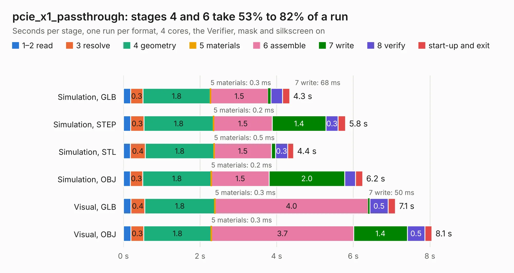

| Mode and format | 1–2 read | 3 resolve | 4 geometry | 5 materials | 6 assemble | 7 write | 8 verify | start-up and exit | Total |
|---|---:|---:|---:|---:|---:|---:|---:|---:|---:|
| Simulation, GLB | 0.2 | 0.3 | 1.8 | 0.3&nbsp;ms | 1.5 | 68&nbsp;ms | 0.3 | 0.2 | 4.3 |
| Simulation, STEP | 0.2 | 0.3 | 1.8 | 0.2&nbsp;ms | 1.5 | 1.4 | 0.3 | 0.2 | 5.8 |
| Simulation, STL | 0.2 | 0.4 | 1.8 | 0.5&nbsp;ms | 1.5 | 0.1 | 0.3 | 0.2 | 4.4 |
| Simulation, OBJ | 0.2 | 0.3 | 1.8 | 0.2&nbsp;ms | 1.5 | 2.0 | 0.3 | 0.2 | 6.2 |
| Visual, GLB | 0.2 | 0.4 | 1.8 | 0.3&nbsp;ms | 4.0 | 50&nbsp;ms | 0.5 | 0.2 | 7.1 |
| Visual, OBJ | 0.2 | 0.3 | 1.8 | 0.3&nbsp;ms | 3.7 | 1.4 | 0.5 | 0.2 | 8.1 |

<table align="center"><tr><td valign="top">

| Board | Repo: [olin-electric-motorsports/olin-electric-motorsports](https://github.com/olin-electric-motorsports/olin-electric-motorsports) Board: `pcie_x1_passthrough.kicad_pcb` |
|---|---|
| Folder | projects / PCIe Development / x1_passthrough |
| Complexity | 143&nbsp;/&nbsp;1000 (size&nbsp;133, features&nbsp;10) |
| KESE&nbsp;features | curved board outline |
| Tested | 9th November 2026 |
| Copper&nbsp;layers | 2 |
| File&nbsp;format | KiCad 7 (20221018) |
| Parts,&nbsp;tracks,&nbsp;vias | 3, 493, 0 |
| Triangles,&nbsp;simulation | 494,168 in 50 parts |
| Verifier | PASS in all six runs |

</td><td valign="top">

<table>
<tr><th>File type</th><th>File size</th><th>Peak memory used</th></tr>
<tr><th colspan="3" align="left">Simulation</th></tr>
<tr><td>GLB</td><td align="right">17&nbsp;MB</td><td align="right">311&nbsp;MB</td></tr>
<tr><td>STEP</td><td align="right">88&nbsp;MB</td><td align="right">340&nbsp;MB</td></tr>
<tr><td>STL</td><td align="right">25&nbsp;MB</td><td align="right">287&nbsp;MB</td></tr>
<tr><td>OBJ</td><td align="right">51&nbsp;MB</td><td align="right">374&nbsp;MB</td></tr>
<tr><th colspan="3" align="left">Visual</th></tr>
<tr><td>GLB</td><td align="right">13&nbsp;MB</td><td align="right">365&nbsp;MB</td></tr>
<tr><td>OBJ</td><td align="right">38&nbsp;MB</td><td align="right">370&nbsp;MB</td></tr>
</table>

</td></tr></table>

## 23.19.29 imu

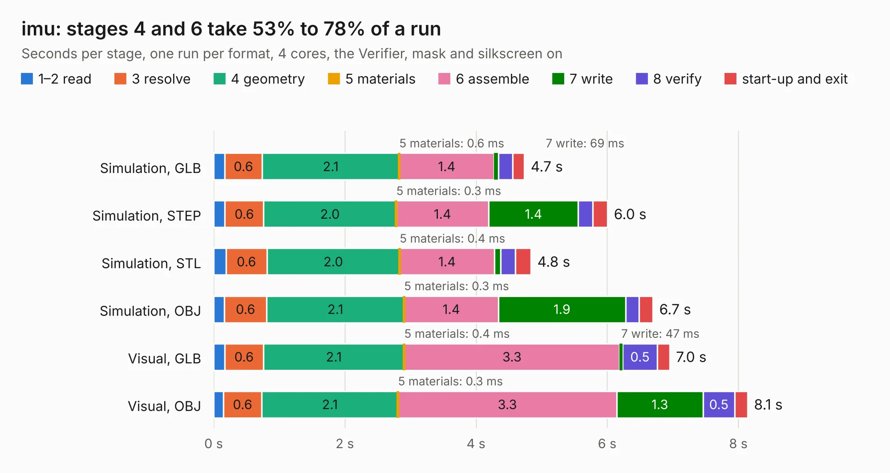

| Mode and format | 1–2 read | 3 resolve | 4 geometry | 5 materials | 6 assemble | 7 write | 8 verify | start-up and exit | Total |
|---|---:|---:|---:|---:|---:|---:|---:|---:|---:|
| Simulation, GLB | 0.2 | 0.6 | 2.1 | 0.6&nbsp;ms | 1.4 | 69&nbsp;ms | 0.2 | 0.2 | 4.7 |
| Simulation, STEP | 0.2 | 0.6 | 2.0 | 0.3&nbsp;ms | 1.4 | 1.4 | 0.2 | 0.2 | 6.0 |
| Simulation, STL | 0.2 | 0.6 | 2.0 | 0.4&nbsp;ms | 1.4 | 95&nbsp;ms | 0.2 | 0.2 | 4.8 |
| Simulation, OBJ | 0.2 | 0.6 | 2.1 | 0.3&nbsp;ms | 1.4 | 1.9 | 0.2 | 0.2 | 6.7 |
| Visual, GLB | 0.2 | 0.6 | 2.1 | 0.4&nbsp;ms | 3.3 | 47&nbsp;ms | 0.5 | 0.2 | 7.0 |
| Visual, OBJ | 0.1 | 0.6 | 2.1 | 0.3&nbsp;ms | 3.3 | 1.3 | 0.5 | 0.2 | 8.1 |

<table align="center"><tr><td valign="top">

| Board | Repo: [olin-electric-motorsports/olin-electric-motorsports](https://github.com/olin-electric-motorsports/olin-electric-motorsports) Board: `imu.kicad_pcb` |
|---|---|
| Folder | projects / telemetry / imu |
| Complexity | 282&nbsp;/&nbsp;1000 (size&nbsp;202, features&nbsp;80) |
| KESE&nbsp;features | through vias, custom pads, rounded, trapezoid or chamfered pads, filled zones, copper drawings, curved board outline |
| Tested | 9th November 2026 |
| Copper&nbsp;layers | 2 |
| File&nbsp;format | KiCad 6 (20211014) |
| Parts,&nbsp;tracks,&nbsp;vias | 46, 411, 45 |
| Triangles,&nbsp;simulation | 480,786 in 73 parts |
| Verifier | PASS in all six runs |

</td><td valign="top">

<table>
<tr><th>File type</th><th>File size</th><th>Peak memory used</th></tr>
<tr><th colspan="3" align="left">Simulation</th></tr>
<tr><td>GLB</td><td align="right">17&nbsp;MB</td><td align="right">302&nbsp;MB</td></tr>
<tr><td>STEP</td><td align="right">83&nbsp;MB</td><td align="right">326&nbsp;MB</td></tr>
<tr><td>STL</td><td align="right">24&nbsp;MB</td><td align="right">293&nbsp;MB</td></tr>
<tr><td>OBJ</td><td align="right">50&nbsp;MB</td><td align="right">378&nbsp;MB</td></tr>
<tr><th colspan="3" align="left">Visual</th></tr>
<tr><td>GLB</td><td align="right">12&nbsp;MB</td><td align="right">316&nbsp;MB</td></tr>
<tr><td>OBJ</td><td align="right">34&nbsp;MB</td><td align="right">312&nbsp;MB</td></tr>
</table>

</td></tr></table>

## 23.19.30 telemetry_core

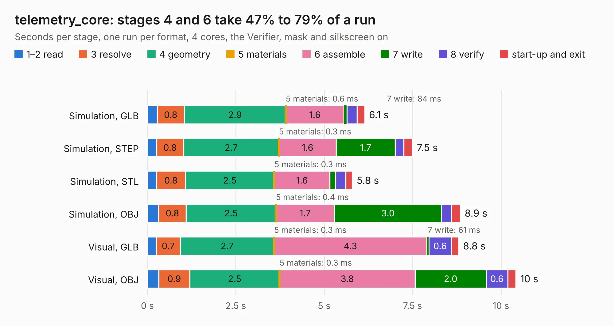

| Mode and format | 1–2 read | 3 resolve | 4 geometry | 5 materials | 6 assemble | 7 write | 8 verify | start-up and exit | Total |
|---|---:|---:|---:|---:|---:|---:|---:|---:|---:|
| Simulation, GLB | 0.3 | 0.8 | 2.9 | 0.6&nbsp;ms | 1.6 | 84&nbsp;ms | 0.3 | 0.2 | 6.1 |
| Simulation, STEP | 0.3 | 0.8 | 2.7 | 0.3&nbsp;ms | 1.6 | 1.7 | 0.2 | 0.2 | 7.5 |
| Simulation, STL | 0.3 | 0.8 | 2.5 | 0.3&nbsp;ms | 1.6 | 0.2 | 0.3 | 0.2 | 5.8 |
| Simulation, OBJ | 0.3 | 0.8 | 2.5 | 0.4&nbsp;ms | 1.7 | 3.0 | 0.3 | 0.3 | 8.9 |
| Visual, GLB | 0.3 | 0.7 | 2.7 | 0.3&nbsp;ms | 4.3 | 61&nbsp;ms | 0.6 | 0.2 | 8.8 |
| Visual, OBJ | 0.3 | 0.9 | 2.5 | 0.3&nbsp;ms | 3.8 | 2.0 | 0.6 | 0.2 | 10.4 |

<table align="center"><tr><td valign="top">

| Board | Repo: [olin-electric-motorsports/olin-electric-motorsports](https://github.com/olin-electric-motorsports/olin-electric-motorsports) Board: `telemetry_core.kicad_pcb` |
|---|---|
| Folder | projects / telemetry / telemetry_core |
| Complexity | 259&nbsp;/&nbsp;1000 (size&nbsp;204, features&nbsp;55) |
| KESE&nbsp;features | through vias, rounded, trapezoid or chamfered pads, filled zones, curved board outline |
| Tested | 9th November 2026 |
| Copper&nbsp;layers | 2 |
| File&nbsp;format | KiCad 6 (20211014) |
| Parts,&nbsp;tracks,&nbsp;vias | 51, 413, 54 |
| Triangles,&nbsp;simulation | 511,422 in 72 parts |
| Verifier | PASS in all six runs |

</td><td valign="top">

<table>
<tr><th>File type</th><th>File size</th><th>Peak memory used</th></tr>
<tr><th colspan="3" align="left">Simulation</th></tr>
<tr><td>GLB</td><td align="right">18&nbsp;MB</td><td align="right">329&nbsp;MB</td></tr>
<tr><td>STEP</td><td align="right">90&nbsp;MB</td><td align="right">335&nbsp;MB</td></tr>
<tr><td>STL</td><td align="right">26&nbsp;MB</td><td align="right">318&nbsp;MB</td></tr>
<tr><td>OBJ</td><td align="right">54&nbsp;MB</td><td align="right">399&nbsp;MB</td></tr>
<tr><th colspan="3" align="left">Visual</th></tr>
<tr><td>GLB</td><td align="right">13&nbsp;MB</td><td align="right">346&nbsp;MB</td></tr>
<tr><td>OBJ</td><td align="right">40&nbsp;MB</td><td align="right">356&nbsp;MB</td></tr>
</table>

</td></tr></table>

## 23.19.31 bms_core

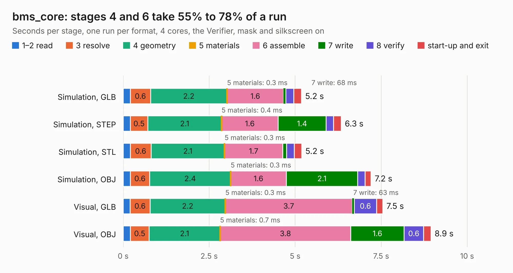

| Mode and format | 1–2 read | 3 resolve | 4 geometry | 5 materials | 6 assemble | 7 write | 8 verify | start-up and exit | Total |
|---|---:|---:|---:|---:|---:|---:|---:|---:|---:|
| Simulation, GLB | 0.2 | 0.6 | 2.2 | 0.3&nbsp;ms | 1.6 | 68&nbsp;ms | 0.2 | 0.2 | 5.2 |
| Simulation, STEP | 0.2 | 0.5 | 2.1 | 0.4&nbsp;ms | 1.6 | 1.4 | 0.2 | 0.2 | 6.3 |
| Simulation, STL | 0.2 | 0.6 | 2.1 | 0.3&nbsp;ms | 1.7 | 0.1 | 0.2 | 0.2 | 5.2 |
| Simulation, OBJ | 0.2 | 0.6 | 2.4 | 0.3&nbsp;ms | 1.6 | 2.1 | 0.2 | 0.2 | 7.2 |
| Visual, GLB | 0.2 | 0.6 | 2.2 | 0.3&nbsp;ms | 3.7 | 63&nbsp;ms | 0.6 | 0.2 | 7.5 |
| Visual, OBJ | 0.2 | 0.5 | 2.1 | 0.7&nbsp;ms | 3.8 | 1.6 | 0.6 | 0.2 | 8.9 |

<table align="center"><tr><td valign="top">

| Board | Repo: [olin-electric-motorsports/olin-electric-motorsports](https://github.com/olin-electric-motorsports/olin-electric-motorsports) Board: `bms_core.kicad_pcb` |
|---|---|
| Folder | vehicle / gokart / hardware / bms_core |
| Complexity | 258&nbsp;/&nbsp;1000 (size&nbsp;203, features&nbsp;55) |
| KESE&nbsp;features | through vias, rounded, trapezoid or chamfered pads, filled zones, curved board outline |
| Tested | 9th November 2026 |
| Copper&nbsp;layers | 2 |
| File&nbsp;format | KiCad 6 (20211014) |
| Parts,&nbsp;tracks,&nbsp;vias | 64, 375, 36 |
| Triangles,&nbsp;simulation | 483,212 in 77 parts |
| Verifier | PASS in all six runs |

</td><td valign="top">

<table>
<tr><th>File type</th><th>File size</th><th>Peak memory used</th></tr>
<tr><th colspan="3" align="left">Simulation</th></tr>
<tr><td>GLB</td><td align="right">18&nbsp;MB</td><td align="right">307&nbsp;MB</td></tr>
<tr><td>STEP</td><td align="right">83&nbsp;MB</td><td align="right">339&nbsp;MB</td></tr>
<tr><td>STL</td><td align="right">24&nbsp;MB</td><td align="right">301&nbsp;MB</td></tr>
<tr><td>OBJ</td><td align="right">51&nbsp;MB</td><td align="right">354&nbsp;MB</td></tr>
<tr><th colspan="3" align="left">Visual</th></tr>
<tr><td>GLB</td><td align="right">13&nbsp;MB</td><td align="right">332&nbsp;MB</td></tr>
<tr><td>OBJ</td><td align="right">37&nbsp;MB</td><td align="right">354&nbsp;MB</td></tr>
</table>

</td></tr></table>

## 23.19.32 motor_ctrl_interface

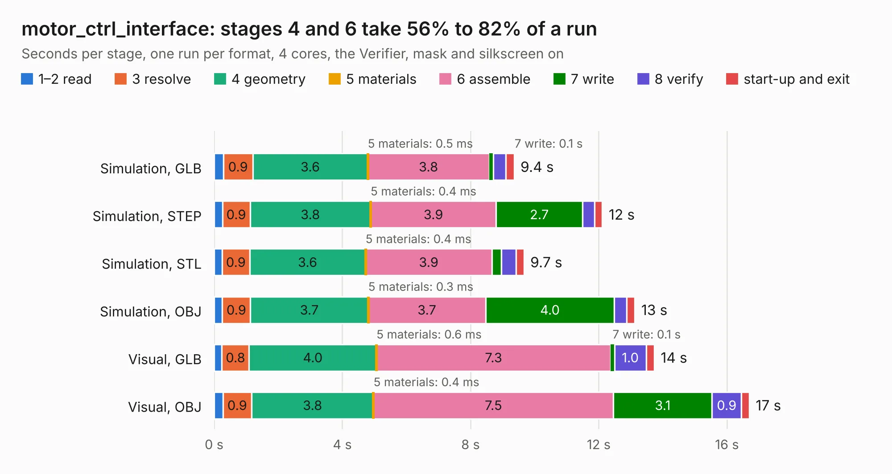

| Mode and format | 1–2 read | 3 resolve | 4 geometry | 5 materials | 6 assemble | 7 write | 8 verify | start-up and exit | Total |
|---|---:|---:|---:|---:|---:|---:|---:|---:|---:|
| Simulation, GLB | 0.3 | 0.9 | 3.6 | 0.5&nbsp;ms | 3.8 | 0.1 | 0.4 | 0.3 | 9.4 |
| Simulation, STEP | 0.3 | 0.9 | 3.8 | 0.4&nbsp;ms | 3.9 | 2.7 | 0.4 | 0.2 | 12.1 |
| Simulation, STL | 0.3 | 0.9 | 3.6 | 0.4&nbsp;ms | 3.9 | 0.3 | 0.5 | 0.2 | 9.7 |
| Simulation, OBJ | 0.3 | 0.9 | 3.7 | 0.3&nbsp;ms | 3.7 | 4.0 | 0.4 | 0.3 | 13.1 |
| Visual, GLB | 0.2 | 0.8 | 4.0 | 0.6&nbsp;ms | 7.3 | 0.1 | 1.0 | 0.3 | 13.7 |
| Visual, OBJ | 0.3 | 0.9 | 3.8 | 0.4&nbsp;ms | 7.5 | 3.1 | 0.9 | 0.2 | 16.7 |

<table align="center"><tr><td valign="top">

| Board | Repo: [olin-electric-motorsports/olin-electric-motorsports](https://github.com/olin-electric-motorsports/olin-electric-motorsports) Board: `motor_ctrl_interface.kicad_pcb` |
|---|---|
| Folder | vehicle / gokart / hardware / motor_ctrl_interface |
| Complexity | 257&nbsp;/&nbsp;1000 (size&nbsp;202, features&nbsp;55) |
| KESE&nbsp;features | through vias, rounded, trapezoid or chamfered pads, filled zones, copper text |
| Tested | 9th November 2026 |
| Copper&nbsp;layers | 2 |
| File&nbsp;format | KiCad 6 (20211014) |
| Parts,&nbsp;tracks,&nbsp;vias | 49, 364, 53 |
| Triangles,&nbsp;simulation | 824,476 in 79 parts |
| Verifier | PASS in all six runs |

</td><td valign="top">

<table>
<tr><th>File type</th><th>File size</th><th>Peak memory used</th></tr>
<tr><th colspan="3" align="left">Simulation</th></tr>
<tr><td>GLB</td><td align="right">29&nbsp;MB</td><td align="right">409&nbsp;MB</td></tr>
<tr><td>STEP</td><td align="right">144&nbsp;MB</td><td align="right">520&nbsp;MB</td></tr>
<tr><td>STL</td><td align="right">41&nbsp;MB</td><td align="right">415&nbsp;MB</td></tr>
<tr><td>OBJ</td><td align="right">85&nbsp;MB</td><td align="right">607&nbsp;MB</td></tr>
<tr><th colspan="3" align="left">Visual</th></tr>
<tr><td>GLB</td><td align="right">23&nbsp;MB</td><td align="right">586&nbsp;MB</td></tr>
<tr><td>OBJ</td><td align="right">68&nbsp;MB</td><td align="right">572&nbsp;MB</td></tr>
</table>

</td></tr></table>

## 23.19.33 throttle

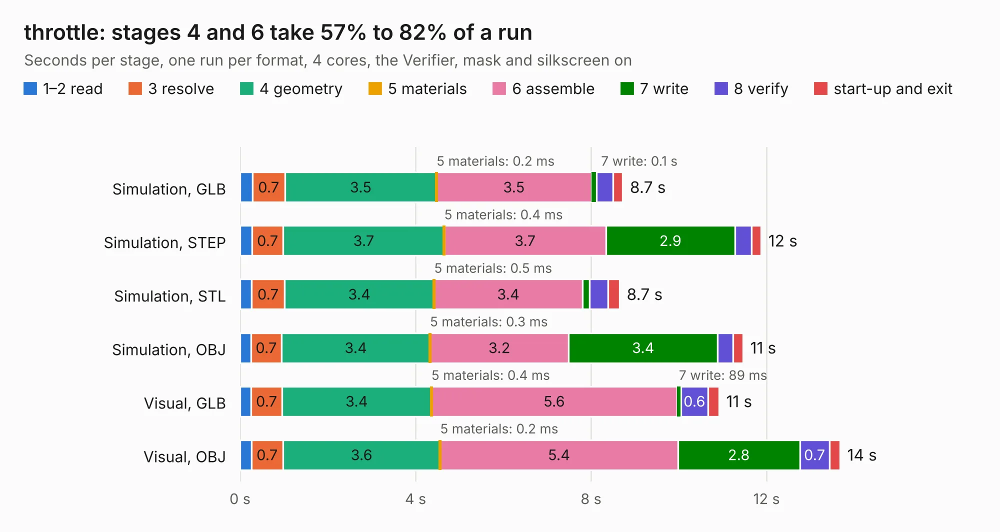

| Mode and format | 1–2 read | 3 resolve | 4 geometry | 5 materials | 6 assemble | 7 write | 8 verify | start-up and exit | Total |
|---|---:|---:|---:|---:|---:|---:|---:|---:|---:|
| Simulation, GLB | 0.3 | 0.7 | 3.5 | 0.2&nbsp;ms | 3.5 | 0.1 | 0.4 | 0.2 | 8.7 |
| Simulation, STEP | 0.3 | 0.7 | 3.7 | 0.4&nbsp;ms | 3.7 | 2.9 | 0.4 | 0.2 | 11.9 |
| Simulation, STL | 0.3 | 0.7 | 3.4 | 0.5&nbsp;ms | 3.4 | 0.2 | 0.4 | 0.3 | 8.7 |
| Simulation, OBJ | 0.2 | 0.7 | 3.4 | 0.3&nbsp;ms | 3.2 | 3.4 | 0.4 | 0.2 | 11.5 |
| Visual, GLB | 0.3 | 0.7 | 3.4 | 0.4&nbsp;ms | 5.6 | 89&nbsp;ms | 0.6 | 0.3 | 10.9 |
| Visual, OBJ | 0.3 | 0.7 | 3.6 | 0.2&nbsp;ms | 5.4 | 2.8 | 0.7 | 0.2 | 13.7 |

<table align="center"><tr><td valign="top">

| Board | Repo: [olin-electric-motorsports/olin-electric-motorsports](https://github.com/olin-electric-motorsports/olin-electric-motorsports) Board: `throttle.kicad_pcb` |
|---|---|
| Folder | vehicle / gokart / hardware / throttle |
| Complexity | 251&nbsp;/&nbsp;1000 (size&nbsp;196, features&nbsp;55) |
| KESE&nbsp;features | through vias, rounded, trapezoid or chamfered pads, filled zones, curved board outline |
| Tested | 9th November 2026 |
| Copper&nbsp;layers | 2 |
| File&nbsp;format | KiCad 6 (20211014) |
| Parts,&nbsp;tracks,&nbsp;vias | 52, 263, 31 |
| Triangles,&nbsp;simulation | 606,876 in 62 parts |
| Verifier | PASS in all six runs |

</td><td valign="top">

<table>
<tr><th>File type</th><th>File size</th><th>Peak memory used</th></tr>
<tr><th colspan="3" align="left">Simulation</th></tr>
<tr><td>GLB</td><td align="right">21&nbsp;MB</td><td align="right">397&nbsp;MB</td></tr>
<tr><td>STEP</td><td align="right">102&nbsp;MB</td><td align="right">416&nbsp;MB</td></tr>
<tr><td>STL</td><td align="right">30&nbsp;MB</td><td align="right">363&nbsp;MB</td></tr>
<tr><td>OBJ</td><td align="right">63&nbsp;MB</td><td align="right">457&nbsp;MB</td></tr>
<tr><th colspan="3" align="left">Visual</th></tr>
<tr><td>GLB</td><td align="right">17&nbsp;MB</td><td align="right">481&nbsp;MB</td></tr>
<tr><td>OBJ</td><td align="right">50&nbsp;MB</td><td align="right">483&nbsp;MB</td></tr>
</table>

</td></tr></table>

## 23.19.34 dashboard

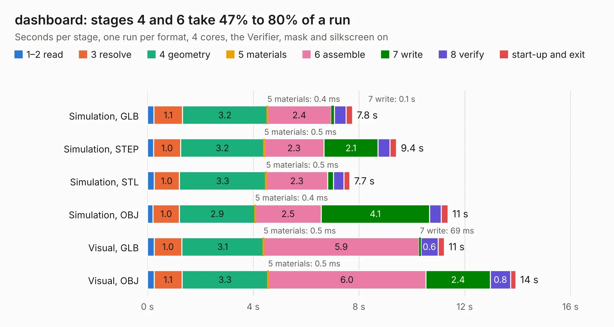

| Mode and format | 1–2 read | 3 resolve | 4 geometry | 5 materials | 6 assemble | 7 write | 8 verify | start-up and exit | Total |
|---|---:|---:|---:|---:|---:|---:|---:|---:|---:|
| Simulation, GLB | 0.2 | 1.1 | 3.2 | 0.4&nbsp;ms | 2.4 | 0.1 | 0.4 | 0.2 | 7.8 |
| Simulation, STEP | 0.2 | 1.0 | 3.2 | 0.5&nbsp;ms | 2.3 | 2.1 | 0.5 | 0.2 | 9.4 |
| Simulation, STL | 0.3 | 1.0 | 3.3 | 0.5&nbsp;ms | 2.3 | 0.2 | 0.4 | 0.2 | 7.7 |
| Simulation, OBJ | 0.2 | 1.0 | 2.9 | 0.4&nbsp;ms | 2.5 | 4.1 | 0.4 | 0.3 | 11.4 |
| Visual, GLB | 0.3 | 1.0 | 3.1 | 0.5&nbsp;ms | 5.9 | 69&nbsp;ms | 0.6 | 0.2 | 11.2 |
| Visual, OBJ | 0.3 | 1.1 | 3.3 | 0.5&nbsp;ms | 6.0 | 2.4 | 0.8 | 0.2 | 13.9 |

<table align="center"><tr><td valign="top">

| Board | Repo: [olin-electric-motorsports/olin-electric-motorsports](https://github.com/olin-electric-motorsports/olin-electric-motorsports) Board: `dashboard.kicad_pcb` |
|---|---|
| Folder | vehicle / mkv / hardware / dashboard / dux |
| Complexity | 282&nbsp;/&nbsp;1000 (size&nbsp;237, features&nbsp;45) |
| KESE&nbsp;features | through vias, rounded, trapezoid or chamfered pads, filled zones |
| Tested | 9th November 2026 |
| Copper&nbsp;layers | 4 |
| File&nbsp;format | KiCad 6 (20211014) |
| Parts,&nbsp;tracks,&nbsp;vias | 65, 683, 69 |
| Triangles,&nbsp;simulation | 856,406 in 101 parts |
| Verifier | PASS in all six runs |

</td><td valign="top">

<table>
<tr><th>File type</th><th>File size</th><th>Peak memory used</th></tr>
<tr><th colspan="3" align="left">Simulation</th></tr>
<tr><td>GLB</td><td align="right">30&nbsp;MB</td><td align="right">366&nbsp;MB</td></tr>
<tr><td>STEP</td><td align="right">124&nbsp;MB</td><td align="right">413&nbsp;MB</td></tr>
<tr><td>STL</td><td align="right">43&nbsp;MB</td><td align="right">352&nbsp;MB</td></tr>
<tr><td>OBJ</td><td align="right">89&nbsp;MB</td><td align="right">611&nbsp;MB</td></tr>
<tr><th colspan="3" align="left">Visual</th></tr>
<tr><td>GLB</td><td align="right">18&nbsp;MB</td><td align="right">432&nbsp;MB</td></tr>
<tr><td>OBJ</td><td align="right">54&nbsp;MB</td><td align="right">463&nbsp;MB</td></tr>
</table>

</td></tr></table>

## 23.19.35 interface

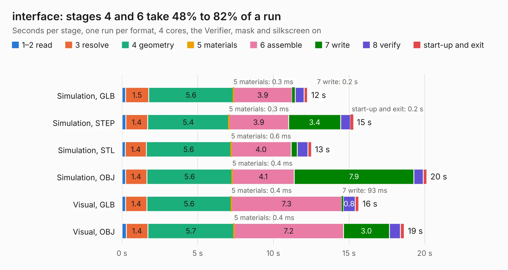

| Mode and format | 1–2 read | 3 resolve | 4 geometry | 5 materials | 6 assemble | 7 write | 8 verify | start-up and exit | Total |
|---|---:|---:|---:|---:|---:|---:|---:|---:|---:|
| Simulation, GLB | 0.2 | 1.5 | 5.6 | 0.3&nbsp;ms | 3.9 | 0.2 | 0.6 | 0.2 | 12.3 |
| Simulation, STEP | 0.3 | 1.4 | 5.4 | 0.3&nbsp;ms | 3.9 | 3.4 | 0.6 | 0.2 | 15.3 |
| Simulation, STL | 0.2 | 1.4 | 5.6 | 0.6&nbsp;ms | 4.0 | 0.4 | 0.7 | 0.2 | 12.5 |
| Simulation, OBJ | 0.2 | 1.4 | 5.6 | 0.4&nbsp;ms | 4.1 | 7.9 | 0.6 | 0.2 | 20.1 |
| Visual, GLB | 0.2 | 1.4 | 5.6 | 0.4&nbsp;ms | 7.3 | 93&nbsp;ms | 0.8 | 0.2 | 15.6 |
| Visual, OBJ | 0.3 | 1.4 | 5.7 | 0.4&nbsp;ms | 7.2 | 3.0 | 0.7 | 0.3 | 18.6 |

<table align="center"><tr><td valign="top">

| Board | Repo: [olin-electric-motorsports/olin-electric-motorsports](https://github.com/olin-electric-motorsports/olin-electric-motorsports) Board: `interface.kicad_pcb` |
|---|---|
| Folder | vehicle / mkv / hardware / dashboard / dux_interface |
| Complexity | 237&nbsp;/&nbsp;1000 (size&nbsp;167, features&nbsp;70) |
| KESE&nbsp;features | through vias, custom pads, rounded, trapezoid or chamfered pads, filled zones, copper drawings |
| Tested | 9th November 2026 |
| Copper&nbsp;layers | 4 |
| File&nbsp;format | KiCad 6 (20211014) |
| Parts,&nbsp;tracks,&nbsp;vias | 15, 515, 10 |
| Triangles,&nbsp;simulation | 1,329,794 in 61 parts |
| Verifier | PASS in all six runs |

</td><td valign="top">

<table>
<tr><th>File type</th><th>File size</th><th>Peak memory used</th></tr>
<tr><th colspan="3" align="left">Simulation</th></tr>
<tr><td>GLB</td><td align="right">46&nbsp;MB</td><td align="right">489&nbsp;MB</td></tr>
<tr><td>STEP</td><td align="right">181&nbsp;MB</td><td align="right">545&nbsp;MB</td></tr>
<tr><td>STL</td><td align="right">66&nbsp;MB</td><td align="right">486&nbsp;MB</td></tr>
<tr><td>OBJ</td><td align="right">138&nbsp;MB</td><td align="right">923&nbsp;MB</td></tr>
<tr><th colspan="3" align="left">Visual</th></tr>
<tr><td>GLB</td><td align="right">20&nbsp;MB</td><td align="right">531&nbsp;MB</td></tr>
<tr><td>OBJ</td><td align="right">59&nbsp;MB</td><td align="right">514&nbsp;MB</td></tr>
</table>

</td></tr></table>

## 23.19.36 throttle

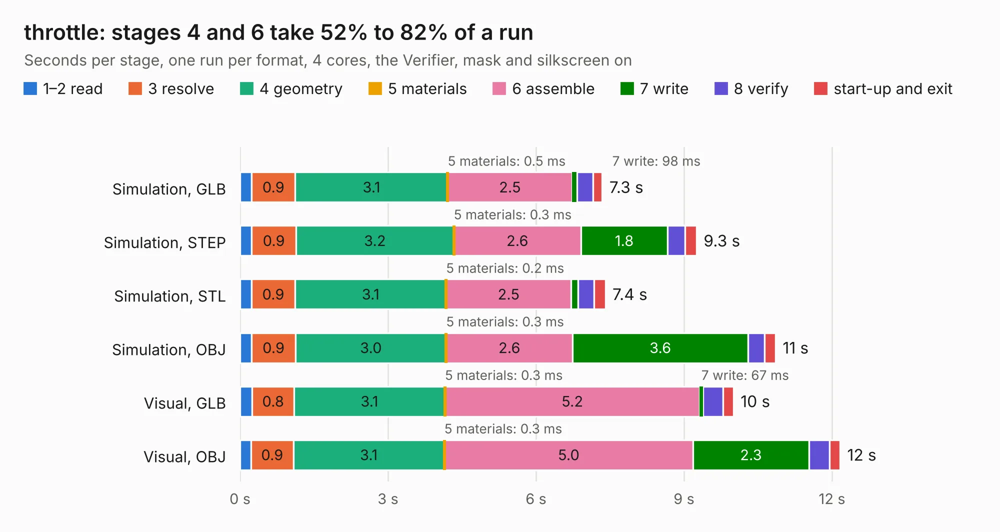

| Mode and format | 1–2 read | 3 resolve | 4 geometry | 5 materials | 6 assemble | 7 write | 8 verify | start-up and exit | Total |
|---|---:|---:|---:|---:|---:|---:|---:|---:|---:|
| Simulation, GLB | 0.2 | 0.9 | 3.1 | 0.5&nbsp;ms | 2.5 | 98&nbsp;ms | 0.3 | 0.2 | 7.3 |
| Simulation, STEP | 0.2 | 0.9 | 3.2 | 0.3&nbsp;ms | 2.6 | 1.8 | 0.4 | 0.2 | 9.3 |
| Simulation, STL | 0.2 | 0.9 | 3.1 | 0.2&nbsp;ms | 2.5 | 0.1 | 0.3 | 0.2 | 7.4 |
| Simulation, OBJ | 0.2 | 0.9 | 3.0 | 0.3&nbsp;ms | 2.6 | 3.6 | 0.3 | 0.2 | 10.9 |
| Visual, GLB | 0.2 | 0.8 | 3.1 | 0.3&nbsp;ms | 5.2 | 67&nbsp;ms | 0.4 | 0.2 | 10.0 |
| Visual, OBJ | 0.2 | 0.9 | 3.1 | 0.3&nbsp;ms | 5.0 | 2.3 | 0.4 | 0.2 | 12.2 |

<table align="center"><tr><td valign="top">

| Board | Repo: [olin-electric-motorsports/olin-electric-motorsports](https://github.com/olin-electric-motorsports/olin-electric-motorsports) Board: `throttle.kicad_pcb` |
|---|---|
| Folder | vehicle / mkv / hardware / dashboard / throttle |
| Complexity | 277&nbsp;/&nbsp;1000 (size&nbsp;232, features&nbsp;45) |
| KESE&nbsp;features | through vias, rounded, trapezoid or chamfered pads, filled zones |
| Tested | 9th November 2026 |
| Copper&nbsp;layers | 4 |
| File&nbsp;format | KiCad 6 (20211014) |
| Parts,&nbsp;tracks,&nbsp;vias | 68, 810, 47 |
| Triangles,&nbsp;simulation | 647,824 in 76 parts |
| Verifier | PASS in all six runs |

</td><td valign="top">

<table>
<tr><th>File type</th><th>File size</th><th>Peak memory used</th></tr>
<tr><th colspan="3" align="left">Simulation</th></tr>
<tr><td>GLB</td><td align="right">23&nbsp;MB</td><td align="right">329&nbsp;MB</td></tr>
<tr><td>STEP</td><td align="right">98&nbsp;MB</td><td align="right">390&nbsp;MB</td></tr>
<tr><td>STL</td><td align="right">32&nbsp;MB</td><td align="right">324&nbsp;MB</td></tr>
<tr><td>OBJ</td><td align="right">68&nbsp;MB</td><td align="right">449&nbsp;MB</td></tr>
<tr><th colspan="3" align="left">Visual</th></tr>
<tr><td>GLB</td><td align="right">15&nbsp;MB</td><td align="right">392&nbsp;MB</td></tr>
<tr><td>OBJ</td><td align="right">45&nbsp;MB</td><td align="right">395&nbsp;MB</td></tr>
</table>

</td></tr></table>

## 23.19.37 bspd_brakelight

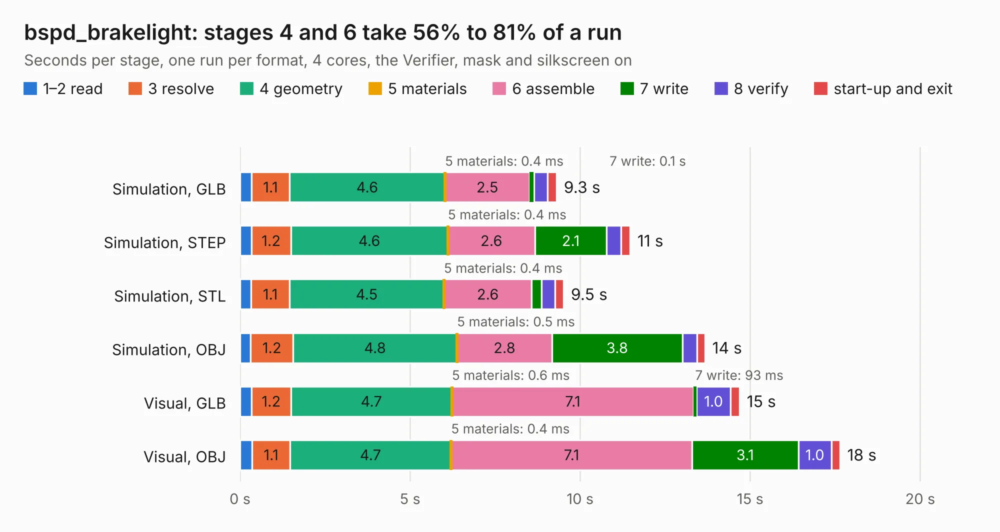

| Mode and format | 1–2 read | 3 resolve | 4 geometry | 5 materials | 6 assemble | 7 write | 8 verify | start-up and exit | Total |
|---|---:|---:|---:|---:|---:|---:|---:|---:|---:|
| Simulation, GLB | 0.3 | 1.1 | 4.6 | 0.4&nbsp;ms | 2.5 | 0.1 | 0.4 | 0.3 | 9.3 |
| Simulation, STEP | 0.3 | 1.2 | 4.6 | 0.4&nbsp;ms | 2.6 | 2.1 | 0.4 | 0.3 | 11.5 |
| Simulation, STL | 0.3 | 1.1 | 4.5 | 0.4&nbsp;ms | 2.6 | 0.3 | 0.4 | 0.3 | 9.5 |
| Simulation, OBJ | 0.3 | 1.2 | 4.8 | 0.5&nbsp;ms | 2.8 | 3.8 | 0.4 | 0.2 | 13.7 |
| Visual, GLB | 0.3 | 1.2 | 4.7 | 0.6&nbsp;ms | 7.1 | 93&nbsp;ms | 1.0 | 0.3 | 14.7 |
| Visual, OBJ | 0.4 | 1.1 | 4.7 | 0.4&nbsp;ms | 7.1 | 3.1 | 1.0 | 0.3 | 17.6 |

<table align="center"><tr><td valign="top">

| Board | Repo: [olin-electric-motorsports/olin-electric-motorsports](https://github.com/olin-electric-motorsports/olin-electric-motorsports) Board: `bspd_brakelight.kicad_pcb` |
|---|---|
| Folder | vehicle / mkv / hardware / lvbox / bspd |
| Complexity | 277&nbsp;/&nbsp;1000 (size&nbsp;222, features&nbsp;55) |
| KESE&nbsp;features | through vias, rounded, trapezoid or chamfered pads, filled zones, curved board outline |
| Tested | 9th November 2026 |
| Copper&nbsp;layers | 2 |
| File&nbsp;format | KiCad 6 (20211014) |
| Parts,&nbsp;tracks,&nbsp;vias | 86, 1,018, 71 |
| Triangles,&nbsp;simulation | 626,612 in 79 parts |
| Verifier | PASS in all six runs |

</td><td valign="top">

<table>
<tr><th>File type</th><th>File size</th><th>Peak memory used</th></tr>
<tr><th colspan="3" align="left">Simulation</th></tr>
<tr><td>GLB</td><td align="right">23&nbsp;MB</td><td align="right">379&nbsp;MB</td></tr>
<tr><td>STEP</td><td align="right">106&nbsp;MB</td><td align="right">437&nbsp;MB</td></tr>
<tr><td>STL</td><td align="right">31&nbsp;MB</td><td align="right">377&nbsp;MB</td></tr>
<tr><td>OBJ</td><td align="right">67&nbsp;MB</td><td align="right">495&nbsp;MB</td></tr>
<tr><th colspan="3" align="left">Visual</th></tr>
<tr><td>GLB</td><td align="right">19&nbsp;MB</td><td align="right">437&nbsp;MB</td></tr>
<tr><td>OBJ</td><td align="right">55&nbsp;MB</td><td align="right">473&nbsp;MB</td></tr>
</table>

</td></tr></table>

## 23.19.38 cooling_sense

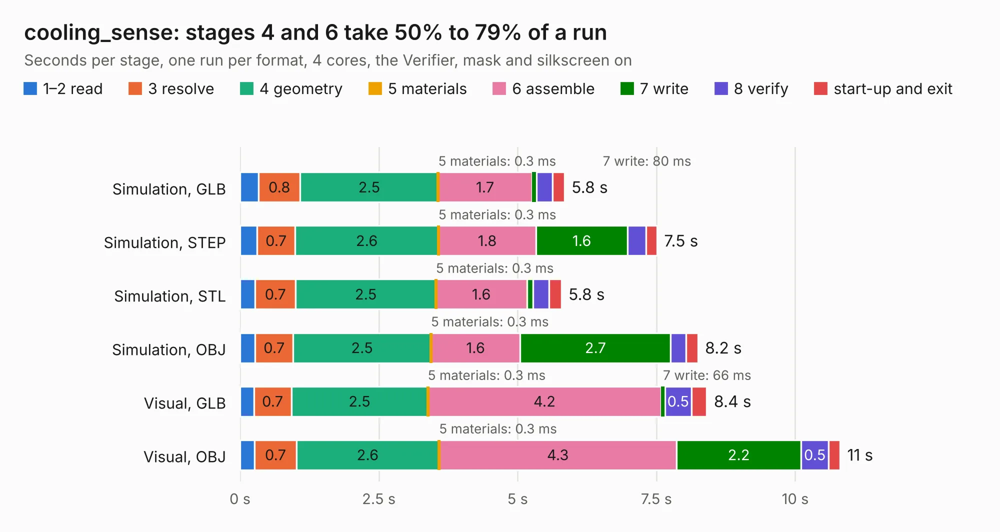

| Mode and format | 1–2 read | 3 resolve | 4 geometry | 5 materials | 6 assemble | 7 write | 8 verify | start-up and exit | Total |
|---|---:|---:|---:|---:|---:|---:|---:|---:|---:|
| Simulation, GLB | 0.3 | 0.8 | 2.5 | 0.3&nbsp;ms | 1.7 | 80&nbsp;ms | 0.3 | 0.2 | 5.8 |
| Simulation, STEP | 0.3 | 0.7 | 2.6 | 0.3&nbsp;ms | 1.8 | 1.6 | 0.3 | 0.2 | 7.5 |
| Simulation, STL | 0.3 | 0.7 | 2.5 | 0.3&nbsp;ms | 1.6 | 0.1 | 0.3 | 0.2 | 5.8 |
| Simulation, OBJ | 0.3 | 0.7 | 2.5 | 0.3&nbsp;ms | 1.6 | 2.7 | 0.3 | 0.2 | 8.2 |
| Visual, GLB | 0.2 | 0.7 | 2.5 | 0.3&nbsp;ms | 4.2 | 66&nbsp;ms | 0.5 | 0.3 | 8.4 |
| Visual, OBJ | 0.3 | 0.7 | 2.6 | 0.3&nbsp;ms | 4.3 | 2.2 | 0.5 | 0.2 | 10.8 |

<table align="center"><tr><td valign="top">

| Board | Repo: [olin-electric-motorsports/olin-electric-motorsports](https://github.com/olin-electric-motorsports/olin-electric-motorsports) Board: `cooling_sense.kicad_pcb` |
|---|---|
| Folder | vehicle / mkv / hardware / lvbox / cooling |
| Complexity | 242&nbsp;/&nbsp;1000 (size&nbsp;207, features&nbsp;35) |
| KESE&nbsp;features | through vias, rounded, trapezoid or chamfered pads, curved board outline |
| Tested | 9th November 2026 |
| Copper&nbsp;layers | 2 |
| File&nbsp;format | KiCad 6 (20211014) |
| Parts,&nbsp;tracks,&nbsp;vias | 51, 554, 55 |
| Triangles,&nbsp;simulation | 488,928 in 59 parts |
| Verifier | PASS in all six runs |

</td><td valign="top">

<table>
<tr><th>File type</th><th>File size</th><th>Peak memory used</th></tr>
<tr><th colspan="3" align="left">Simulation</th></tr>
<tr><td>GLB</td><td align="right">18&nbsp;MB</td><td align="right">311&nbsp;MB</td></tr>
<tr><td>STEP</td><td align="right">88&nbsp;MB</td><td align="right">338&nbsp;MB</td></tr>
<tr><td>STL</td><td align="right">24&nbsp;MB</td><td align="right">323&nbsp;MB</td></tr>
<tr><td>OBJ</td><td align="right">51&nbsp;MB</td><td align="right">384&nbsp;MB</td></tr>
<tr><th colspan="3" align="left">Visual</th></tr>
<tr><td>GLB</td><td align="right">14&nbsp;MB</td><td align="right">357&nbsp;MB</td></tr>
<tr><td>OBJ</td><td align="right">41&nbsp;MB</td><td align="right">363&nbsp;MB</td></tr>
</table>

</td></tr></table>

## 23.19.39 lv_interface

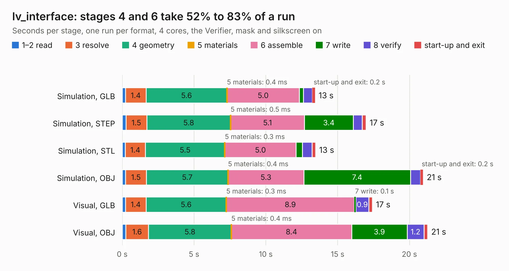

| Mode and format | 1–2 read | 3 resolve | 4 geometry | 5 materials | 6 assemble | 7 write | 8 verify | start-up and exit | Total |
|---|---:|---:|---:|---:|---:|---:|---:|---:|---:|
| Simulation, GLB | 0.2 | 1.4 | 5.6 | 0.4&nbsp;ms | 5.0 | 0.3 | 0.6 | 0.2 | 13.4 |
| Simulation, STEP | 0.3 | 1.5 | 5.8 | 0.5&nbsp;ms | 5.1 | 3.4 | 0.6 | 0.3 | 17.0 |
| Simulation, STL | 0.2 | 1.4 | 5.5 | 0.3&nbsp;ms | 5.0 | 0.4 | 0.7 | 0.2 | 13.5 |
| Simulation, OBJ | 0.2 | 1.5 | 5.7 | 0.4&nbsp;ms | 5.3 | 7.4 | 0.7 | 0.2 | 21.0 |
| Visual, GLB | 0.2 | 1.4 | 5.6 | 0.3&nbsp;ms | 8.9 | 0.1 | 0.9 | 0.2 | 17.4 |
| Visual, OBJ | 0.2 | 1.6 | 5.8 | 0.4&nbsp;ms | 8.4 | 3.9 | 1.2 | 0.3 | 21.3 |

<table align="center"><tr><td valign="top">

| Board | Repo: [olin-electric-motorsports/olin-electric-motorsports](https://github.com/olin-electric-motorsports/olin-electric-motorsports) Board: `lv_interface.kicad_pcb` |
|---|---|
| Folder | vehicle / mkv / hardware / lvbox / interface |
| Complexity | 238&nbsp;/&nbsp;1000 (size&nbsp;183, features&nbsp;55) |
| KESE&nbsp;features | through vias, rounded, trapezoid or chamfered pads, filled zones, curved board outline |
| Tested | 9th November 2026 |
| Copper&nbsp;layers | 4 |
| File&nbsp;format | KiCad 6 (20211014) |
| Parts,&nbsp;tracks,&nbsp;vias | 22, 1,054, 31 |
| Triangles,&nbsp;simulation | 1,827,706 in 63 parts |
| Verifier | PASS in all six runs |

</td><td valign="top">

<table>
<tr><th>File type</th><th>File size</th><th>Peak memory used</th></tr>
<tr><th colspan="3" align="left">Simulation</th></tr>
<tr><td>GLB</td><td align="right">62&nbsp;MB</td><td align="right">594&nbsp;MB</td></tr>
<tr><td>STEP</td><td align="right">234&nbsp;MB</td><td align="right">739&nbsp;MB</td></tr>
<tr><td>STL</td><td align="right">91&nbsp;MB</td><td align="right">630&nbsp;MB</td></tr>
<tr><td>OBJ</td><td align="right">189&nbsp;MB</td><td align="right">1.2&nbsp;GB</td></tr>
<tr><th colspan="3" align="left">Visual</th></tr>
<tr><td>GLB</td><td align="right">29&nbsp;MB</td><td align="right">746&nbsp;MB</td></tr>
<tr><td>OBJ</td><td align="right">87&nbsp;MB</td><td align="right">689&nbsp;MB</td></tr>
</table>

</td></tr></table>

## 23.19.40 lvbms

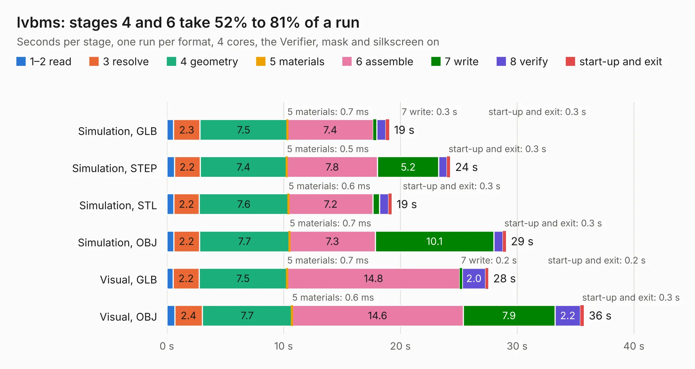

| Mode and format | 1–2 read | 3 resolve | 4 geometry | 5 materials | 6 assemble | 7 write | 8 verify | start-up and exit | Total |
|---|---:|---:|---:|---:|---:|---:|---:|---:|---:|
| Simulation, GLB | 0.6 | 2.3 | 7.5 | 0.7&nbsp;ms | 7.4 | 0.3 | 0.8 | 0.3 | 19.0 |
| Simulation, STEP | 0.6 | 2.2 | 7.4 | 0.5&nbsp;ms | 7.8 | 5.2 | 0.7 | 0.3 | 24.3 |
| Simulation, STL | 0.6 | 2.2 | 7.6 | 0.6&nbsp;ms | 7.2 | 0.6 | 0.8 | 0.3 | 19.3 |
| Simulation, OBJ | 0.6 | 2.2 | 7.7 | 0.7&nbsp;ms | 7.3 | 10.1 | 0.8 | 0.3 | 29.0 |
| Visual, GLB | 0.5 | 2.2 | 7.5 | 0.7&nbsp;ms | 14.8 | 0.2 | 2.0 | 0.2 | 27.5 |
| Visual, OBJ | 0.7 | 2.4 | 7.7 | 0.6&nbsp;ms | 14.6 | 7.9 | 2.2 | 0.3 | 35.7 |

<table align="center"><tr><td valign="top">

| Board | Repo: [olin-electric-motorsports/olin-electric-motorsports](https://github.com/olin-electric-motorsports/olin-electric-motorsports) Board: `lvbms.kicad_pcb` |
|---|---|
| Folder | vehicle / mkv / hardware / lvbox / lvbms |
| Complexity | 295&nbsp;/&nbsp;1000 (size&nbsp;240, features&nbsp;55) |
| KESE&nbsp;features | through vias, rounded, trapezoid or chamfered pads, filled zones, curved board outline |
| Tested | 9th November 2026 |
| Copper&nbsp;layers | 4 |
| File&nbsp;format | KiCad 6 (20211014) |
| Parts,&nbsp;tracks,&nbsp;vias | 107, 763, 148 |
| Triangles,&nbsp;simulation | 1,795,438 in 106 parts |
| Verifier | PASS in all six runs |

</td><td valign="top">

<table>
<tr><th>File type</th><th>File size</th><th>Peak memory used</th></tr>
<tr><th colspan="3" align="left">Simulation</th></tr>
<tr><td>GLB</td><td align="right">63&nbsp;MB</td><td align="right">664&nbsp;MB</td></tr>
<tr><td>STEP</td><td align="right">257&nbsp;MB</td><td align="right">850&nbsp;MB</td></tr>
<tr><td>STL</td><td align="right">90&nbsp;MB</td><td align="right">660&nbsp;MB</td></tr>
<tr><td>OBJ</td><td align="right">190&nbsp;MB</td><td align="right">1.2&nbsp;GB</td></tr>
<tr><th colspan="3" align="left">Visual</th></tr>
<tr><td>GLB</td><td align="right">45&nbsp;MB</td><td align="right">864&nbsp;MB</td></tr>
<tr><td>OBJ</td><td align="right">138&nbsp;MB</td><td align="right">980&nbsp;MB</td></tr>
</table>

</td></tr></table>

## 23.19.41 lv_bms_tester_board

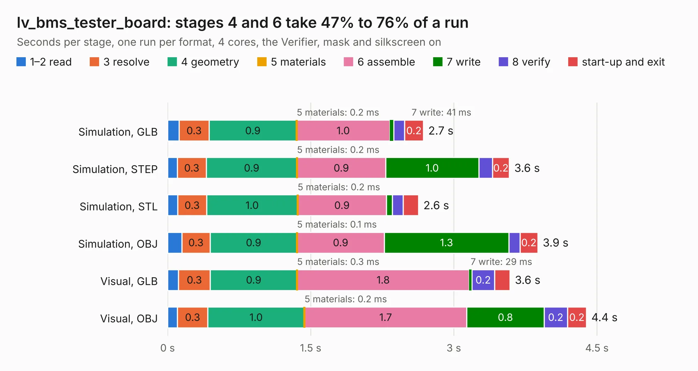

| Mode and format | 1–2 read | 3 resolve | 4 geometry | 5 materials | 6 assemble | 7 write | 8 verify | start-up and exit | Total |
|---|---:|---:|---:|---:|---:|---:|---:|---:|---:|
| Simulation, GLB | 0.1 | 0.3 | 0.9 | 0.2&nbsp;ms | 1.0 | 41&nbsp;ms | 0.1 | 0.2 | 2.7 |
| Simulation, STEP | 0.1 | 0.3 | 0.9 | 0.2&nbsp;ms | 0.9 | 1.0 | 0.1 | 0.2 | 3.6 |
| Simulation, STL | 0.1 | 0.3 | 1.0 | 0.2&nbsp;ms | 0.9 | 64&nbsp;ms | 0.1 | 0.2 | 2.6 |
| Simulation, OBJ | 0.1 | 0.3 | 0.9 | 0.1&nbsp;ms | 0.9 | 1.3 | 0.1 | 0.2 | 3.9 |
| Visual, GLB | 0.1 | 0.3 | 0.9 | 0.3&nbsp;ms | 1.8 | 29&nbsp;ms | 0.2 | 0.2 | 3.6 |
| Visual, OBJ | 0.1 | 0.3 | 1.0 | 0.2&nbsp;ms | 1.7 | 0.8 | 0.2 | 0.2 | 4.4 |

<table align="center"><tr><td valign="top">

| Board | Repo: [olin-electric-motorsports/olin-electric-motorsports](https://github.com/olin-electric-motorsports/olin-electric-motorsports) Board: `lv_bms_tester_board.kicad_pcb` |
|---|---|
| Folder | vehicle / mkv / hardware / lvbox / lvbms / tester_board |
| Complexity | 202&nbsp;/&nbsp;1000 (size&nbsp;147, features&nbsp;55) |
| KESE&nbsp;features | through vias, rounded, trapezoid or chamfered pads, filled zones, curved board outline |
| Tested | 9th November 2026 |
| Copper&nbsp;layers | 4 |
| File&nbsp;format | KiCad 6 (20211014) |
| Parts,&nbsp;tracks,&nbsp;vias | 8, 69, 58 |
| Triangles,&nbsp;simulation | 329,298 in 19 parts |
| Verifier | PASS in all six runs |

</td><td valign="top">

<table>
<tr><th>File type</th><th>File size</th><th>Peak memory used</th></tr>
<tr><th colspan="3" align="left">Simulation</th></tr>
<tr><td>GLB</td><td align="right">11&nbsp;MB</td><td align="right">235&nbsp;MB</td></tr>
<tr><td>STEP</td><td align="right">45&nbsp;MB</td><td align="right">260&nbsp;MB</td></tr>
<tr><td>STL</td><td align="right">16&nbsp;MB</td><td align="right">234&nbsp;MB</td></tr>
<tr><td>OBJ</td><td align="right">33&nbsp;MB</td><td align="right">268&nbsp;MB</td></tr>
<tr><th colspan="3" align="left">Visual</th></tr>
<tr><td>GLB</td><td align="right">7.2&nbsp;MB</td><td align="right">221&nbsp;MB</td></tr>
<tr><td>OBJ</td><td align="right">21&nbsp;MB</td><td align="right">224&nbsp;MB</td></tr>
</table>

</td></tr></table>

## 23.19.42 accelerometer

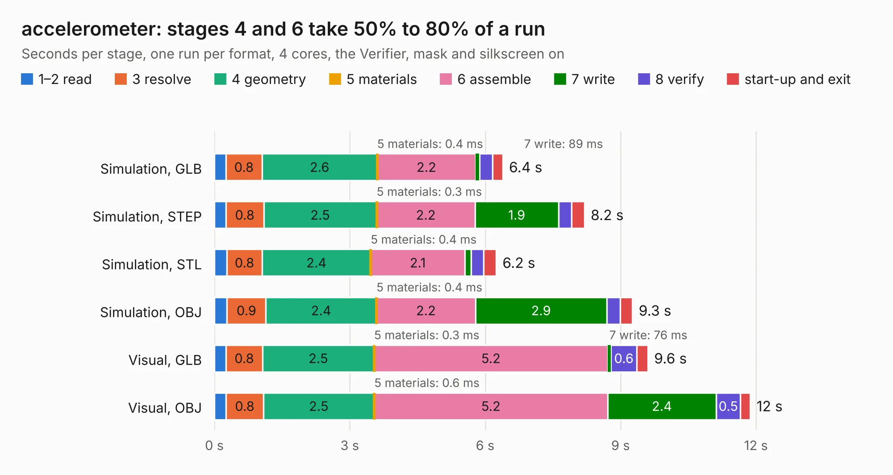

| Mode and format | 1–2 read | 3 resolve | 4 geometry | 5 materials | 6 assemble | 7 write | 8 verify | start-up and exit | Total |
|---|---:|---:|---:|---:|---:|---:|---:|---:|---:|
| Simulation, GLB | 0.3 | 0.8 | 2.6 | 0.4&nbsp;ms | 2.2 | 89&nbsp;ms | 0.3 | 0.2 | 6.4 |
| Simulation, STEP | 0.3 | 0.8 | 2.5 | 0.3&nbsp;ms | 2.2 | 1.9 | 0.3 | 0.3 | 8.2 |
| Simulation, STL | 0.3 | 0.8 | 2.4 | 0.4&nbsp;ms | 2.1 | 0.1 | 0.3 | 0.3 | 6.2 |
| Simulation, OBJ | 0.3 | 0.9 | 2.4 | 0.4&nbsp;ms | 2.2 | 2.9 | 0.3 | 0.3 | 9.3 |
| Visual, GLB | 0.3 | 0.8 | 2.5 | 0.3&nbsp;ms | 5.2 | 76&nbsp;ms | 0.6 | 0.2 | 9.6 |
| Visual, OBJ | 0.3 | 0.8 | 2.5 | 0.6&nbsp;ms | 5.2 | 2.4 | 0.5 | 0.2 | 11.9 |

<table align="center"><tr><td valign="top">

| Board | Repo: [olin-electric-motorsports/olin-electric-motorsports](https://github.com/olin-electric-motorsports/olin-electric-motorsports) Board: `accelerometer.kicad_pcb` |
|---|---|
| Folder | vehicle / mkv / hardware / sensing / accelerometer |
| Complexity | 263&nbsp;/&nbsp;1000 (size&nbsp;208, features&nbsp;55) |
| KESE&nbsp;features | through vias, rounded, trapezoid or chamfered pads, filled zones, curved board outline |
| Tested | 9th November 2026 |
| Copper&nbsp;layers | 2 |
| File&nbsp;format | KiCad 6 (20211014) |
| Parts,&nbsp;tracks,&nbsp;vias | 54, 512, 73 |
| Triangles,&nbsp;simulation | 493,092 in 66 parts |
| Verifier | PASS in all six runs |

</td><td valign="top">

<table>
<tr><th>File type</th><th>File size</th><th>Peak memory used</th></tr>
<tr><th colspan="3" align="left">Simulation</th></tr>
<tr><td>GLB</td><td align="right">18&nbsp;MB</td><td align="right">314&nbsp;MB</td></tr>
<tr><td>STEP</td><td align="right">85&nbsp;MB</td><td align="right">358&nbsp;MB</td></tr>
<tr><td>STL</td><td align="right">25&nbsp;MB</td><td align="right">334&nbsp;MB</td></tr>
<tr><td>OBJ</td><td align="right">52&nbsp;MB</td><td align="right">395&nbsp;MB</td></tr>
<tr><th colspan="3" align="left">Visual</th></tr>
<tr><td>GLB</td><td align="right">15&nbsp;MB</td><td align="right">373&nbsp;MB</td></tr>
<tr><td>OBJ</td><td align="right">45&nbsp;MB</td><td align="right">397&nbsp;MB</td></tr>
</table>

</td></tr></table>

## 23.19.43 sensing_module_interface

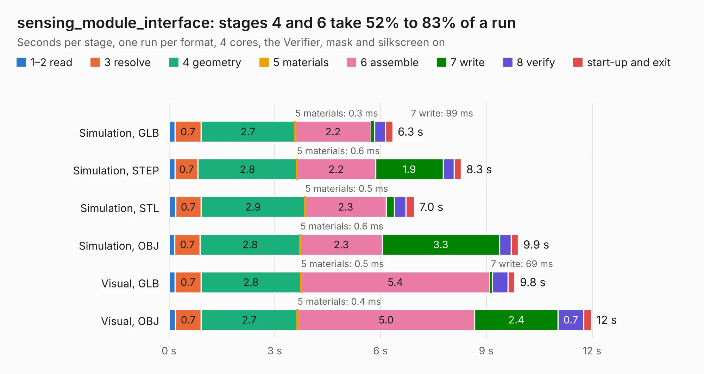

| Mode and format | 1–2 read | 3 resolve | 4 geometry | 5 materials | 6 assemble | 7 write | 8 verify | start-up and exit | Total |
|---|---:|---:|---:|---:|---:|---:|---:|---:|---:|
| Simulation, GLB | 0.2 | 0.7 | 2.7 | 0.3&nbsp;ms | 2.2 | 99&nbsp;ms | 0.3 | 0.2 | 6.3 |
| Simulation, STEP | 0.2 | 0.7 | 2.8 | 0.6&nbsp;ms | 2.2 | 1.9 | 0.3 | 0.2 | 8.3 |
| Simulation, STL | 0.2 | 0.7 | 2.9 | 0.5&nbsp;ms | 2.3 | 0.2 | 0.3 | 0.2 | 7.0 |
| Simulation, OBJ | 0.2 | 0.7 | 2.8 | 0.6&nbsp;ms | 2.3 | 3.3 | 0.3 | 0.2 | 9.9 |
| Visual, GLB | 0.2 | 0.7 | 2.8 | 0.5&nbsp;ms | 5.4 | 69&nbsp;ms | 0.5 | 0.2 | 9.8 |
| Visual, OBJ | 0.2 | 0.7 | 2.7 | 0.4&nbsp;ms | 5.0 | 2.4 | 0.7 | 0.2 | 12.0 |

<table align="center"><tr><td valign="top">

| Board | Repo: [olin-electric-motorsports/olin-electric-motorsports](https://github.com/olin-electric-motorsports/olin-electric-motorsports) Board: `sensing_module_interface.kicad_pcb` |
|---|---|
| Folder | vehicle / mkv / hardware / sensing / controller |
| Complexity | 200&nbsp;/&nbsp;1000 (size&nbsp;155, features&nbsp;45) |
| KESE&nbsp;features | through vias, filled zones, curved board outline |
| Tested | 9th November 2026 |
| Copper&nbsp;layers | 2 |
| File&nbsp;format | KiCad 6 (20211014) |
| Parts,&nbsp;tracks,&nbsp;vias | 17, 543, 42 |
| Triangles,&nbsp;simulation | 810,508 in 45 parts |
| Verifier | PASS in all six runs |

</td><td valign="top">

<table>
<tr><th>File type</th><th>File size</th><th>Peak memory used</th></tr>
<tr><th colspan="3" align="left">Simulation</th></tr>
<tr><td>GLB</td><td align="right">28&nbsp;MB</td><td align="right">397&nbsp;MB</td></tr>
<tr><td>STEP</td><td align="right">130&nbsp;MB</td><td align="right">437&nbsp;MB</td></tr>
<tr><td>STL</td><td align="right">41&nbsp;MB</td><td align="right">413&nbsp;MB</td></tr>
<tr><td>OBJ</td><td align="right">83&nbsp;MB</td><td align="right">579&nbsp;MB</td></tr>
<tr><th colspan="3" align="left">Visual</th></tr>
<tr><td>GLB</td><td align="right">18&nbsp;MB</td><td align="right">458&nbsp;MB</td></tr>
<tr><td>OBJ</td><td align="right">55&nbsp;MB</td><td align="right">460&nbsp;MB</td></tr>
</table>

</td></tr></table>

## 23.19.44 sensing_controller1

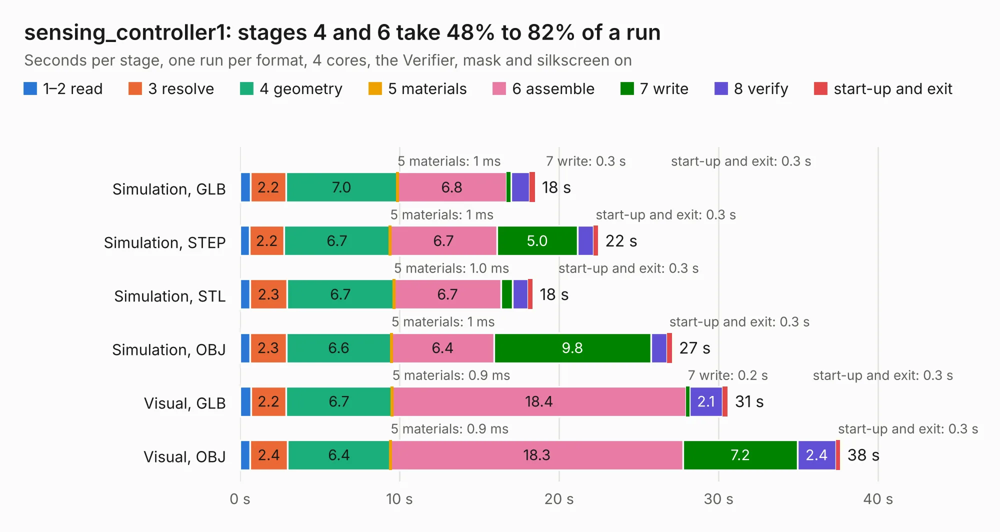

| Mode and format | 1–2 read | 3 resolve | 4 geometry | 5 materials | 6 assemble | 7 write | 8 verify | start-up and exit | Total |
|---|---:|---:|---:|---:|---:|---:|---:|---:|---:|
| Simulation, GLB | 0.7 | 2.2 | 7.0 | 1&nbsp;ms | 6.8 | 0.3 | 1.2 | 0.3 | 18.5 |
| Simulation, STEP | 0.6 | 2.2 | 6.7 | 1&nbsp;ms | 6.7 | 5.0 | 1.0 | 0.3 | 22.4 |
| Simulation, STL | 0.6 | 2.3 | 6.7 | 1.0&nbsp;ms | 6.7 | 0.7 | 1.0 | 0.3 | 18.3 |
| Simulation, OBJ | 0.6 | 2.3 | 6.6 | 1&nbsp;ms | 6.4 | 9.8 | 1.0 | 0.3 | 27.1 |
| Visual, GLB | 0.7 | 2.2 | 6.7 | 0.9&nbsp;ms | 18.4 | 0.2 | 2.1 | 0.3 | 30.6 |
| Visual, OBJ | 0.6 | 2.4 | 6.4 | 0.9&nbsp;ms | 18.3 | 7.2 | 2.4 | 0.3 | 37.6 |

<table align="center"><tr><td valign="top">

| Board | Repo: [olin-electric-motorsports/olin-electric-motorsports](https://github.com/olin-electric-motorsports/olin-electric-motorsports) Board: `sensing_controller1.kicad_pcb` |
|---|---|
| Folder | vehicle / mkv / hardware / sensing_controller |
| Complexity | 348&nbsp;/&nbsp;1000 (size&nbsp;263, features&nbsp;85) |
| KESE&nbsp;features | through vias, rounded, trapezoid or chamfered pads, filled zones, curved board outline, stack-up, dielectric εr and tanδ |
| Tested | 9th November 2026 |
| Copper&nbsp;layers | 4 |
| File&nbsp;format | KiCad 6 (20211014) |
| Parts,&nbsp;tracks,&nbsp;vias | 183, 1,732, 190 |
| Triangles,&nbsp;simulation | 1,872,730 in 204 parts |
| Verifier | PASS in all six runs |

</td><td valign="top">

<table>
<tr><th>File type</th><th>File size</th><th>Peak memory used</th></tr>
<tr><th colspan="3" align="left">Simulation</th></tr>
<tr><td>GLB</td><td align="right">64&nbsp;MB</td><td align="right">672&nbsp;MB</td></tr>
<tr><td>STEP</td><td align="right">292&nbsp;MB</td><td align="right">840&nbsp;MB</td></tr>
<tr><td>STL</td><td align="right">94&nbsp;MB</td><td align="right">715&nbsp;MB</td></tr>
<tr><td>OBJ</td><td align="right">197&nbsp;MB</td><td align="right">1.3&nbsp;GB</td></tr>
<tr><th colspan="3" align="left">Visual</th></tr>
<tr><td>GLB</td><td align="right">44&nbsp;MB</td><td align="right">826&nbsp;MB</td></tr>
<tr><td>OBJ</td><td align="right">136&nbsp;MB</td><td align="right">988&nbsp;MB</td></tr>
</table>

</td></tr></table>

## 23.19.45 discharge

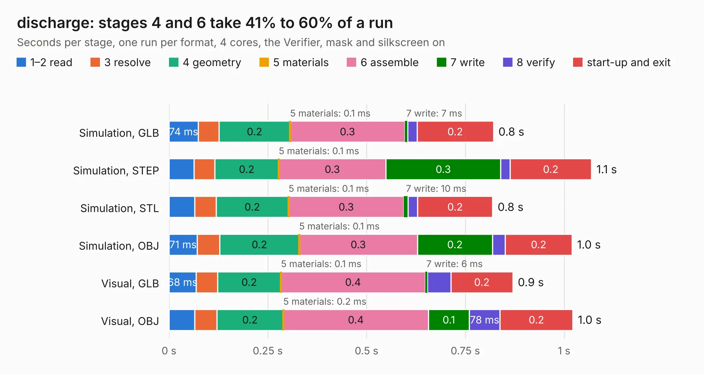

| Mode and format | 1–2 read | 3 resolve | 4 geometry | 5 materials | 6 assemble | 7 write | 8 verify | start-up and exit | Total |
|---|---:|---:|---:|---:|---:|---:|---:|---:|---:|
| Simulation, GLB | 74&nbsp;ms | 53&nbsp;ms | 0.2 | 0.1&nbsp;ms | 0.3 | 7&nbsp;ms | 24&nbsp;ms | 0.2 | 0.8 |
| Simulation, STEP | 63&nbsp;ms | 53&nbsp;ms | 0.2 | 0.1&nbsp;ms | 0.3 | 0.3 | 24&nbsp;ms | 0.2 | 1.1 |
| Simulation, STL | 65&nbsp;ms | 54&nbsp;ms | 0.2 | 0.1&nbsp;ms | 0.3 | 10&nbsp;ms | 24&nbsp;ms | 0.2 | 0.8 |
| Simulation, OBJ | 71&nbsp;ms | 57&nbsp;ms | 0.2 | 0.1&nbsp;ms | 0.3 | 0.2 | 32&nbsp;ms | 0.2 | 1.0 |
| Visual, GLB | 68&nbsp;ms | 54&nbsp;ms | 0.2 | 0.1&nbsp;ms | 0.4 | 6&nbsp;ms | 59&nbsp;ms | 0.2 | 0.9 |
| Visual, OBJ | 65&nbsp;ms | 56&nbsp;ms | 0.2 | 0.2&nbsp;ms | 0.4 | 0.1 | 78&nbsp;ms | 0.2 | 1.0 |

<table align="center"><tr><td valign="top">

| Board | Repo: [olin-electric-motorsports/olin-electric-motorsports](https://github.com/olin-electric-motorsports/olin-electric-motorsports) Board: `discharge.kicad_pcb` |
|---|---|
| Folder | vehicle / mkv / hardware / service_section / airs / discharge |
| Complexity | 47&nbsp;/&nbsp;1000 (size&nbsp;47, features&nbsp;0) |
| Tested | 9th November 2026 |
| Copper&nbsp;layers | 2 |
| File&nbsp;format | KiCad 6 (20211014) |
| Parts,&nbsp;tracks,&nbsp;vias | 1, 3, 0 |
| Triangles,&nbsp;simulation | 41,376 in 13 parts |
| Verifier | PASS in all six runs |

</td><td valign="top">

<table>
<tr><th>File type</th><th>File size</th><th>Peak memory used</th></tr>
<tr><th colspan="3" align="left">Simulation</th></tr>
<tr><td>GLB</td><td align="right">1.4&nbsp;MB</td><td align="right">66&nbsp;MB</td></tr>
<tr><td>STEP</td><td align="right">6.2&nbsp;MB</td><td align="right">69&nbsp;MB</td></tr>
<tr><td>STL</td><td align="right">2.1&nbsp;MB</td><td align="right">68&nbsp;MB</td></tr>
<tr><td>OBJ</td><td align="right">3.9&nbsp;MB</td><td align="right">84&nbsp;MB</td></tr>
<tr><th colspan="3" align="left">Visual</th></tr>
<tr><td>GLB</td><td align="right">756&nbsp;kB</td><td align="right">115&nbsp;MB</td></tr>
<tr><td>OBJ</td><td align="right">2.0&nbsp;MB</td><td align="right">103&nbsp;MB</td></tr>
</table>

</td></tr></table>

## 23.19.46 air_minus

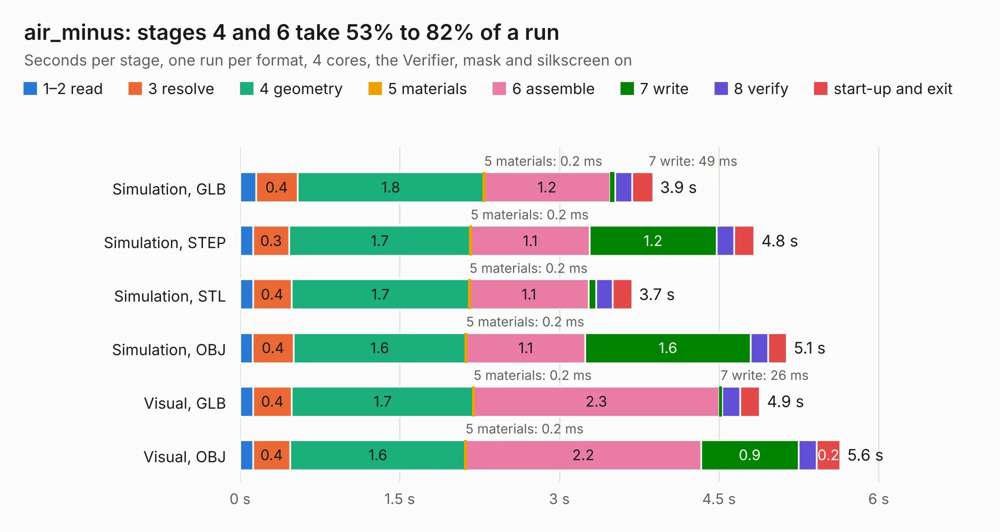

| Mode and format | 1–2 read | 3 resolve | 4 geometry | 5 materials | 6 assemble | 7 write | 8 verify | start-up and exit | Total |
|---|---:|---:|---:|---:|---:|---:|---:|---:|---:|
| Simulation, GLB | 0.1 | 0.4 | 1.8 | 0.2&nbsp;ms | 1.2 | 49&nbsp;ms | 0.2 | 0.2 | 3.9 |
| Simulation, STEP | 0.1 | 0.3 | 1.7 | 0.2&nbsp;ms | 1.1 | 1.2 | 0.2 | 0.2 | 4.8 |
| Simulation, STL | 0.1 | 0.4 | 1.7 | 0.2&nbsp;ms | 1.1 | 71&nbsp;ms | 0.2 | 0.2 | 3.7 |
| Simulation, OBJ | 0.1 | 0.4 | 1.6 | 0.2&nbsp;ms | 1.1 | 1.6 | 0.2 | 0.2 | 5.1 |
| Visual, GLB | 0.1 | 0.4 | 1.7 | 0.2&nbsp;ms | 2.3 | 26&nbsp;ms | 0.2 | 0.2 | 4.9 |
| Visual, OBJ | 0.1 | 0.4 | 1.6 | 0.2&nbsp;ms | 2.2 | 0.9 | 0.2 | 0.2 | 5.6 |

<table align="center"><tr><td valign="top">

| Board | Repo: [olin-electric-motorsports/olin-electric-motorsports](https://github.com/olin-electric-motorsports/olin-electric-motorsports) Board: `air_minus.kicad_pcb` |
|---|---|
| Folder | vehicle / mkv / hardware / service_section / airs / minus |
| Complexity | 135&nbsp;/&nbsp;1000 (size&nbsp;115, features&nbsp;20) |
| KESE&nbsp;features | rounded, trapezoid or chamfered pads, curved board outline |
| Tested | 9th November 2026 |
| Copper&nbsp;layers | 2 |
| File&nbsp;format | KiCad 6 (20211014) |
| Parts,&nbsp;tracks,&nbsp;vias | 12, 75, 0 |
| Triangles,&nbsp;simulation | 319,448 in 35 parts |
| Verifier | PASS in all six runs |

</td><td valign="top">

<table>
<tr><th>File type</th><th>File size</th><th>Peak memory used</th></tr>
<tr><th colspan="3" align="left">Simulation</th></tr>
<tr><td>GLB</td><td align="right">11&nbsp;MB</td><td align="right">238&nbsp;MB</td></tr>
<tr><td>STEP</td><td align="right">48&nbsp;MB</td><td align="right">261&nbsp;MB</td></tr>
<tr><td>STL</td><td align="right">16&nbsp;MB</td><td align="right">252&nbsp;MB</td></tr>
<tr><td>OBJ</td><td align="right">32&nbsp;MB</td><td align="right">249&nbsp;MB</td></tr>
<tr><th colspan="3" align="left">Visual</th></tr>
<tr><td>GLB</td><td align="right">5.7&nbsp;MB</td><td align="right">228&nbsp;MB</td></tr>
<tr><td>OBJ</td><td align="right">16&nbsp;MB</td><td align="right">222&nbsp;MB</td></tr>
</table>

</td></tr></table>

## 23.19.47 air_plus

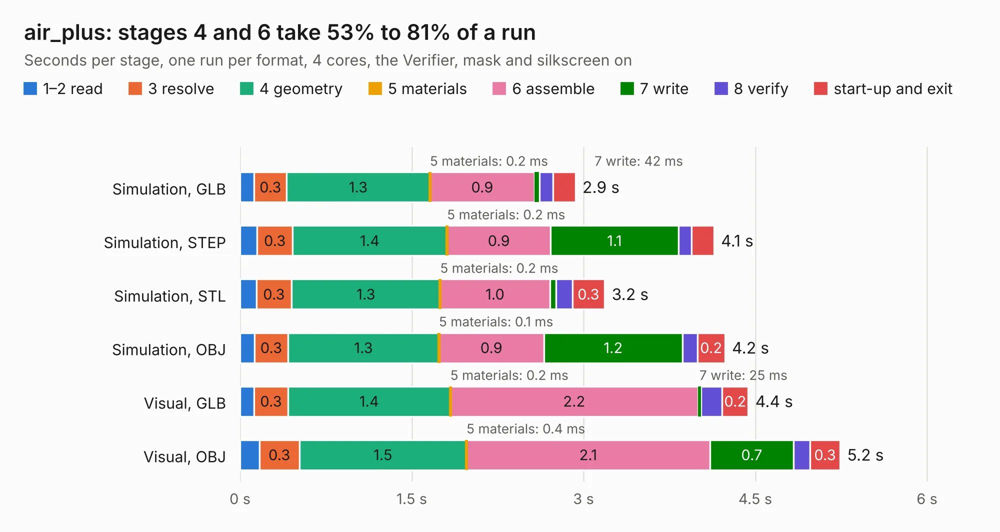

| Mode and format | 1–2 read | 3 resolve | 4 geometry | 5 materials | 6 assemble | 7 write | 8 verify | start-up and exit | Total |
|---|---:|---:|---:|---:|---:|---:|---:|---:|---:|
| Simulation, GLB | 0.1 | 0.3 | 1.3 | 0.2&nbsp;ms | 0.9 | 42&nbsp;ms | 0.1 | 0.2 | 2.9 |
| Simulation, STEP | 0.2 | 0.3 | 1.4 | 0.2&nbsp;ms | 0.9 | 1.1 | 0.1 | 0.2 | 4.1 |
| Simulation, STL | 0.1 | 0.3 | 1.3 | 0.2&nbsp;ms | 1.0 | 56&nbsp;ms | 0.1 | 0.3 | 3.2 |
| Simulation, OBJ | 0.1 | 0.3 | 1.3 | 0.1&nbsp;ms | 0.9 | 1.2 | 0.1 | 0.2 | 4.2 |
| Visual, GLB | 0.1 | 0.3 | 1.4 | 0.2&nbsp;ms | 2.2 | 25&nbsp;ms | 0.2 | 0.2 | 4.4 |
| Visual, OBJ | 0.2 | 0.3 | 1.5 | 0.4&nbsp;ms | 2.1 | 0.7 | 0.1 | 0.3 | 5.2 |

<table align="center"><tr><td valign="top">

| Board | Repo: [olin-electric-motorsports/olin-electric-motorsports](https://github.com/olin-electric-motorsports/olin-electric-motorsports) Board: `air_plus.kicad_pcb` |
|---|---|
| Folder | vehicle / mkv / hardware / service_section / airs / plus |
| Complexity | 126&nbsp;/&nbsp;1000 (size&nbsp;106, features&nbsp;20) |
| KESE&nbsp;features | rounded, trapezoid or chamfered pads, curved board outline |
| Tested | 9th November 2026 |
| Copper&nbsp;layers | 2 |
| File&nbsp;format | KiCad 6 (20211014) |
| Parts,&nbsp;tracks,&nbsp;vias | 10, 48, 0 |
| Triangles,&nbsp;simulation | 225,108 in 23 parts |
| Verifier | PASS in all six runs |

</td><td valign="top">

<table>
<tr><th>File type</th><th>File size</th><th>Peak memory used</th></tr>
<tr><th colspan="3" align="left">Simulation</th></tr>
<tr><td>GLB</td><td align="right">7.8&nbsp;MB</td><td align="right">216&nbsp;MB</td></tr>
<tr><td>STEP</td><td align="right">34&nbsp;MB</td><td align="right">227&nbsp;MB</td></tr>
<tr><td>STL</td><td align="right">11&nbsp;MB</td><td align="right">217&nbsp;MB</td></tr>
<tr><td>OBJ</td><td align="right">23&nbsp;MB</td><td align="right">211&nbsp;MB</td></tr>
<tr><th colspan="3" align="left">Visual</th></tr>
<tr><td>GLB</td><td align="right">4.3&nbsp;MB</td><td align="right">184&nbsp;MB</td></tr>
<tr><td>OBJ</td><td align="right">12&nbsp;MB</td><td align="right">180&nbsp;MB</td></tr>
</table>

</td></tr></table>

## 23.19.48 precharge

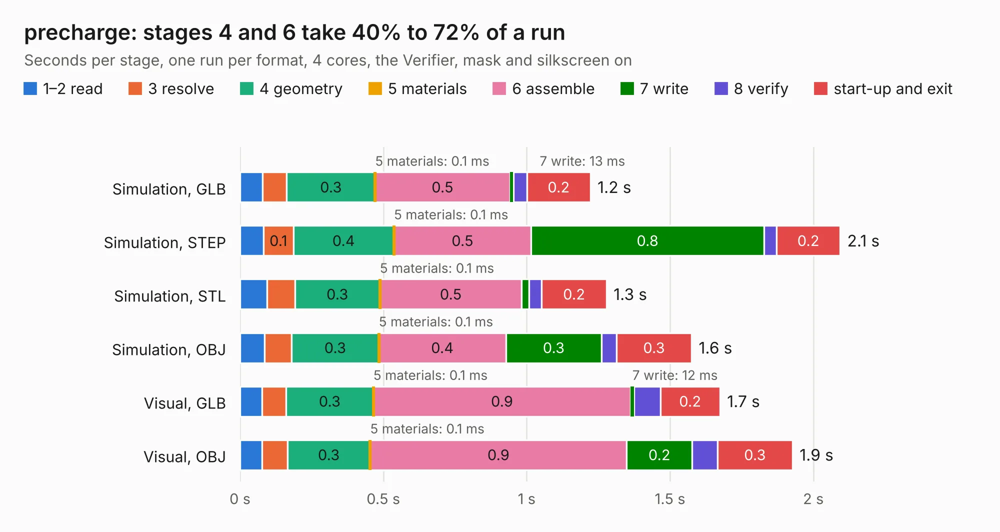

| Mode and format | 1–2 read | 3 resolve | 4 geometry | 5 materials | 6 assemble | 7 write | 8 verify | start-up and exit | Total |
|---|---:|---:|---:|---:|---:|---:|---:|---:|---:|
| Simulation, GLB | 78&nbsp;ms | 85&nbsp;ms | 0.3 | 0.1&nbsp;ms | 0.5 | 13&nbsp;ms | 47&nbsp;ms | 0.2 | 1.2 |
| Simulation, STEP | 82&nbsp;ms | 0.1 | 0.4 | 0.1&nbsp;ms | 0.5 | 0.8 | 44&nbsp;ms | 0.2 | 2.1 |
| Simulation, STL | 94&nbsp;ms | 98&nbsp;ms | 0.3 | 0.1&nbsp;ms | 0.5 | 25&nbsp;ms | 45&nbsp;ms | 0.2 | 1.3 |
| Simulation, OBJ | 85&nbsp;ms | 94&nbsp;ms | 0.3 | 0.1&nbsp;ms | 0.4 | 0.3 | 52&nbsp;ms | 0.3 | 1.6 |
| Visual, GLB | 76&nbsp;ms | 85&nbsp;ms | 0.3 | 0.1&nbsp;ms | 0.9 | 12&nbsp;ms | 92&nbsp;ms | 0.2 | 1.7 |
| Visual, OBJ | 77&nbsp;ms | 88&nbsp;ms | 0.3 | 0.1&nbsp;ms | 0.9 | 0.2 | 89&nbsp;ms | 0.3 | 1.9 |

<table align="center"><tr><td valign="top">

| Board | Repo: [olin-electric-motorsports/olin-electric-motorsports](https://github.com/olin-electric-motorsports/olin-electric-motorsports) Board: `precharge.kicad_pcb` |
|---|---|
| Folder | vehicle / mkv / hardware / service_section / airs / precharge |
| Complexity | 60&nbsp;/&nbsp;1000 (size&nbsp;60, features&nbsp;0) |
| Tested | 9th November 2026 |
| Copper&nbsp;layers | 2 |
| File&nbsp;format | KiCad 6 (20211014) |
| Parts,&nbsp;tracks,&nbsp;vias | 2, 6, 0 |
| Triangles,&nbsp;simulation | 65,448 in 14 parts |
| Verifier | PASS in all six runs |

</td><td valign="top">

<table>
<tr><th>File type</th><th>File size</th><th>Peak memory used</th></tr>
<tr><th colspan="3" align="left">Simulation</th></tr>
<tr><td>GLB</td><td align="right">2.2&nbsp;MB</td><td align="right">169&nbsp;MB</td></tr>
<tr><td>STEP</td><td align="right">9.9&nbsp;MB</td><td align="right">173&nbsp;MB</td></tr>
<tr><td>STL</td><td align="right">3.3&nbsp;MB</td><td align="right">167&nbsp;MB</td></tr>
<tr><td>OBJ</td><td align="right">6.2&nbsp;MB</td><td align="right">169&nbsp;MB</td></tr>
<tr><th colspan="3" align="left">Visual</th></tr>
<tr><td>GLB</td><td align="right">1.1&nbsp;MB</td><td align="right">152&nbsp;MB</td></tr>
<tr><td>OBJ</td><td align="right">3.2&nbsp;MB</td><td align="right">153&nbsp;MB</td></tr>
</table>

</td></tr></table>

## 23.19.49 data_acquisition_1

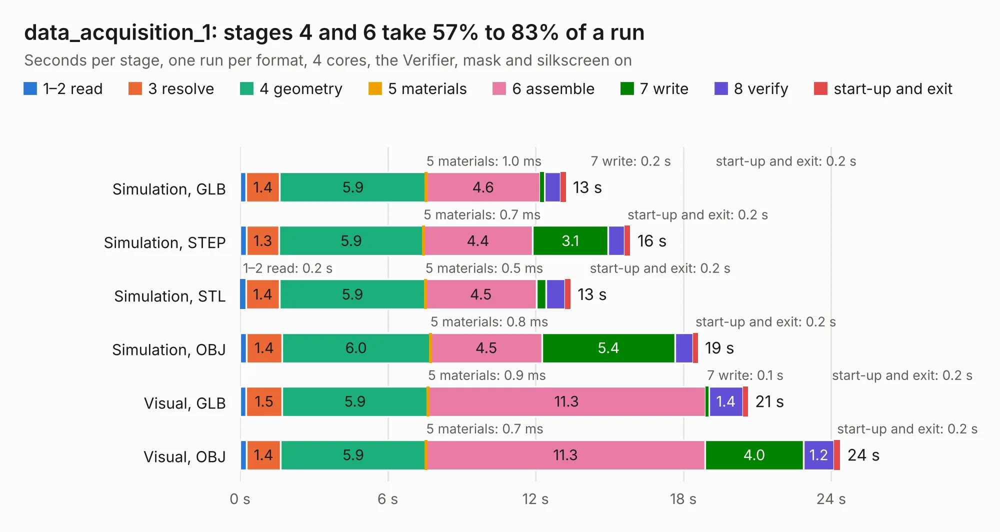

| Mode and format | 1–2 read | 3 resolve | 4 geometry | 5 materials | 6 assemble | 7 write | 8 verify | start-up and exit | Total |
|---|---:|---:|---:|---:|---:|---:|---:|---:|---:|
| Simulation, GLB | 0.3 | 1.4 | 5.9 | 1.0&nbsp;ms | 4.6 | 0.2 | 0.7 | 0.2 | 13.2 |
| Simulation, STEP | 0.3 | 1.3 | 5.9 | 0.7&nbsp;ms | 4.4 | 3.1 | 0.7 | 0.2 | 15.8 |
| Simulation, STL | 0.2 | 1.4 | 5.9 | 0.5&nbsp;ms | 4.5 | 0.4 | 0.8 | 0.2 | 13.4 |
| Simulation, OBJ | 0.3 | 1.4 | 6.0 | 0.8&nbsp;ms | 4.5 | 5.4 | 0.7 | 0.2 | 18.6 |
| Visual, GLB | 0.2 | 1.5 | 5.9 | 0.9&nbsp;ms | 11.3 | 0.1 | 1.4 | 0.2 | 20.6 |
| Visual, OBJ | 0.3 | 1.4 | 5.9 | 0.7&nbsp;ms | 11.3 | 4.0 | 1.2 | 0.2 | 24.4 |

<table align="center"><tr><td valign="top">

| Board | Repo: [olin-electric-motorsports/olin-electric-motorsports](https://github.com/olin-electric-motorsports/olin-electric-motorsports) Board: `data_acquisition_1.kicad_pcb` |
|---|---|
| Folder | vehicle / mkv / hardware / service_section / bms / da1 |
| Complexity | 242&nbsp;/&nbsp;1000 (size&nbsp;187, features&nbsp;55) |
| KESE&nbsp;features | through vias, rounded, trapezoid or chamfered pads, filled zones, curved board outline |
| Tested | 9th November 2026 |
| Copper&nbsp;layers | 2 |
| File&nbsp;format | KiCad 6 (20211014) |
| Parts,&nbsp;tracks,&nbsp;vias | 76, 1,548, 110 |
| Triangles,&nbsp;simulation | 1,333,082 in 128 parts |
| Verifier | PASS in all six runs |

</td><td valign="top">

<table>
<tr><th>File type</th><th>File size</th><th>Peak memory used</th></tr>
<tr><th colspan="3" align="left">Simulation</th></tr>
<tr><td>GLB</td><td align="right">47&nbsp;MB</td><td align="right">541&nbsp;MB</td></tr>
<tr><td>STEP</td><td align="right">242&nbsp;MB</td><td align="right">619&nbsp;MB</td></tr>
<tr><td>STL</td><td align="right">67&nbsp;MB</td><td align="right">518&nbsp;MB</td></tr>
<tr><td>OBJ</td><td align="right">139&nbsp;MB</td><td align="right">935&nbsp;MB</td></tr>
<tr><th colspan="3" align="left">Visual</th></tr>
<tr><td>GLB</td><td align="right">33&nbsp;MB</td><td align="right">658&nbsp;MB</td></tr>
<tr><td>OBJ</td><td align="right">100&nbsp;MB</td><td align="right">725&nbsp;MB</td></tr>
</table>

</td></tr></table>

## 23.19.50 data_acquisition_2

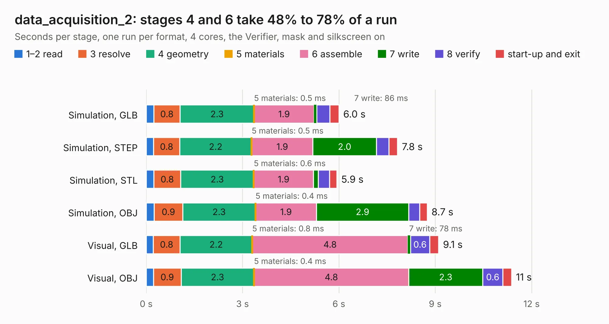

| Mode and format | 1–2 read | 3 resolve | 4 geometry | 5 materials | 6 assemble | 7 write | 8 verify | start-up and exit | Total |
|---|---:|---:|---:|---:|---:|---:|---:|---:|---:|
| Simulation, GLB | 0.2 | 0.8 | 2.3 | 0.5&nbsp;ms | 1.9 | 86&nbsp;ms | 0.4 | 0.3 | 6.0 |
| Simulation, STEP | 0.2 | 0.8 | 2.2 | 0.5&nbsp;ms | 1.9 | 2.0 | 0.4 | 0.3 | 7.8 |
| Simulation, STL | 0.2 | 0.8 | 2.3 | 0.6&nbsp;ms | 1.9 | 0.1 | 0.4 | 0.2 | 5.9 |
| Simulation, OBJ | 0.2 | 0.9 | 2.3 | 0.4&nbsp;ms | 1.9 | 2.9 | 0.3 | 0.2 | 8.7 |
| Visual, GLB | 0.2 | 0.8 | 2.2 | 0.8&nbsp;ms | 4.8 | 78&nbsp;ms | 0.6 | 0.3 | 9.1 |
| Visual, OBJ | 0.2 | 0.9 | 2.3 | 0.4&nbsp;ms | 4.8 | 2.3 | 0.6 | 0.3 | 11.4 |

<table align="center"><tr><td valign="top">

| Board | Repo: [olin-electric-motorsports/olin-electric-motorsports](https://github.com/olin-electric-motorsports/olin-electric-motorsports) Board: `data_acquisition_2.kicad_pcb` |
|---|---|
| Folder | vehicle / mkv / hardware / service_section / bms / da2 |
| Complexity | 226&nbsp;/&nbsp;1000 (size&nbsp;171, features&nbsp;55) |
| KESE&nbsp;features | through vias, rounded, trapezoid or chamfered pads, filled zones, curved board outline |
| Tested | 9th November 2026 |
| Copper&nbsp;layers | 2 |
| File&nbsp;format | KiCad 6 (20211014) |
| Parts,&nbsp;tracks,&nbsp;vias | 64, 645, 51 |
| Triangles,&nbsp;simulation | 511,290 in 89 parts |
| Verifier | PASS in all six runs |

</td><td valign="top">

<table>
<tr><th>File type</th><th>File size</th><th>Peak memory used</th></tr>
<tr><th colspan="3" align="left">Simulation</th></tr>
<tr><td>GLB</td><td align="right">18&nbsp;MB</td><td align="right">312&nbsp;MB</td></tr>
<tr><td>STEP</td><td align="right">76&nbsp;MB</td><td align="right">355&nbsp;MB</td></tr>
<tr><td>STL</td><td align="right">26&nbsp;MB</td><td align="right">323&nbsp;MB</td></tr>
<tr><td>OBJ</td><td align="right">52&nbsp;MB</td><td align="right">395&nbsp;MB</td></tr>
<tr><th colspan="3" align="left">Visual</th></tr>
<tr><td>GLB</td><td align="right">13&nbsp;MB</td><td align="right">369&nbsp;MB</td></tr>
<tr><td>OBJ</td><td align="right">40&nbsp;MB</td><td align="right">370&nbsp;MB</td></tr>
</table>

</td></tr></table>

## 23.19.51 bms_core

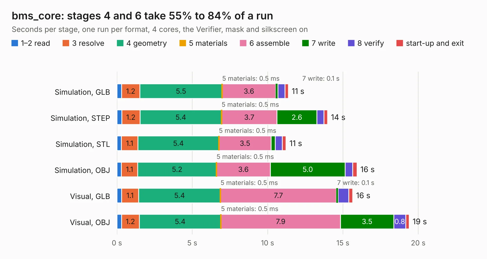

| Mode and format | 1–2 read | 3 resolve | 4 geometry | 5 materials | 6 assemble | 7 write | 8 verify | start-up and exit | Total |
|---|---:|---:|---:|---:|---:|---:|---:|---:|---:|
| Simulation, GLB | 0.3 | 1.2 | 5.5 | 0.5&nbsp;ms | 3.6 | 0.1 | 0.5 | 0.2 | 11.4 |
| Simulation, STEP | 0.3 | 1.2 | 5.4 | 0.5&nbsp;ms | 3.7 | 2.6 | 0.5 | 0.2 | 14.0 |
| Simulation, STL | 0.3 | 1.1 | 5.4 | 0.5&nbsp;ms | 3.5 | 0.3 | 0.5 | 0.2 | 11.2 |
| Simulation, OBJ | 0.3 | 1.1 | 5.2 | 0.5&nbsp;ms | 3.6 | 5.0 | 0.5 | 0.3 | 15.9 |
| Visual, GLB | 0.3 | 1.1 | 5.4 | 0.5&nbsp;ms | 7.7 | 0.1 | 0.7 | 0.3 | 15.6 |
| Visual, OBJ | 0.3 | 1.2 | 5.4 | 0.5&nbsp;ms | 7.9 | 3.5 | 0.8 | 0.2 | 19.4 |

<table align="center"><tr><td valign="top">

| Board | Repo: [olin-electric-motorsports/olin-electric-motorsports](https://github.com/olin-electric-motorsports/olin-electric-motorsports) Board: `bms_core.kicad_pcb` |
|---|---|
| Folder | vehicle / mkv / hardware / service_section / controller |
| Complexity | 283&nbsp;/&nbsp;1000 (size&nbsp;218, features&nbsp;65) |
| KESE&nbsp;features | through vias, slotted holes, rounded, trapezoid or chamfered pads, filled zones, curved board outline |
| Tested | 9th November 2026 |
| Copper&nbsp;layers | 2 |
| File&nbsp;format | KiCad 6 (20211014) |
| Parts,&nbsp;tracks,&nbsp;vias | 74, 799, 89 |
| Triangles,&nbsp;simulation | 820,468 in 86 parts |
| Verifier | PASS in all six runs |

</td><td valign="top">

<table>
<tr><th>File type</th><th>File size</th><th>Peak memory used</th></tr>
<tr><th colspan="3" align="left">Simulation</th></tr>
<tr><td>GLB</td><td align="right">29&nbsp;MB</td><td align="right">400&nbsp;MB</td></tr>
<tr><td>STEP</td><td align="right">146&nbsp;MB</td><td align="right">457&nbsp;MB</td></tr>
<tr><td>STL</td><td align="right">41&nbsp;MB</td><td align="right">388&nbsp;MB</td></tr>
<tr><td>OBJ</td><td align="right">86&nbsp;MB</td><td align="right">594&nbsp;MB</td></tr>
<tr><th colspan="3" align="left">Visual</th></tr>
<tr><td>GLB</td><td align="right">21&nbsp;MB</td><td align="right">472&nbsp;MB</td></tr>
<tr><td>OBJ</td><td align="right">62&nbsp;MB</td><td align="right">518&nbsp;MB</td></tr>
</table>

</td></tr></table>

## 23.19.52 external_interface

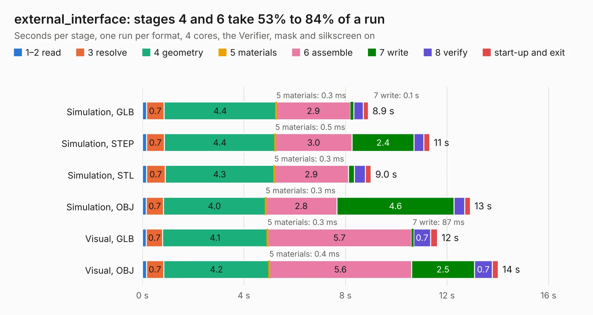

| Mode and format | 1–2 read | 3 resolve | 4 geometry | 5 materials | 6 assemble | 7 write | 8 verify | start-up and exit | Total |
|---|---:|---:|---:|---:|---:|---:|---:|---:|---:|
| Simulation, GLB | 0.2 | 0.7 | 4.4 | 0.3&nbsp;ms | 2.9 | 0.1 | 0.4 | 0.2 | 8.9 |
| Simulation, STEP | 0.2 | 0.7 | 4.4 | 0.5&nbsp;ms | 3.0 | 2.4 | 0.4 | 0.2 | 11.3 |
| Simulation, STL | 0.2 | 0.7 | 4.3 | 0.3&nbsp;ms | 2.9 | 0.2 | 0.4 | 0.2 | 9.0 |
| Simulation, OBJ | 0.2 | 0.7 | 4.0 | 0.3&nbsp;ms | 2.8 | 4.6 | 0.4 | 0.2 | 12.9 |
| Visual, GLB | 0.1 | 0.7 | 4.1 | 0.3&nbsp;ms | 5.7 | 87&nbsp;ms | 0.7 | 0.3 | 11.6 |
| Visual, OBJ | 0.2 | 0.7 | 4.2 | 0.4&nbsp;ms | 5.6 | 2.5 | 0.7 | 0.2 | 14.0 |

<table align="center"><tr><td valign="top">

| Board | Repo: [olin-electric-motorsports/olin-electric-motorsports](https://github.com/olin-electric-motorsports/olin-electric-motorsports) Board: `external_interface.kicad_pcb` |
|---|---|
| Folder | vehicle / mkv / hardware / service_section / interface / external |
| Complexity | 157&nbsp;/&nbsp;1000 (size&nbsp;127, features&nbsp;30) |
| KESE&nbsp;features | filled zones, curved board outline |
| Tested | 9th November 2026 |
| Copper&nbsp;layers | 2 |
| File&nbsp;format | KiCad 6 (20211014) |
| Parts,&nbsp;tracks,&nbsp;vias | 6, 227, 0 |
| Triangles,&nbsp;simulation | 797,256 in 52 parts |
| Verifier | PASS in all six runs |

</td><td valign="top">

<table>
<tr><th>File type</th><th>File size</th><th>Peak memory used</th></tr>
<tr><th colspan="3" align="left">Simulation</th></tr>
<tr><td>GLB</td><td align="right">27&nbsp;MB</td><td align="right">368&nbsp;MB</td></tr>
<tr><td>STEP</td><td align="right">134&nbsp;MB</td><td align="right">439&nbsp;MB</td></tr>
<tr><td>STL</td><td align="right">40&nbsp;MB</td><td align="right">376&nbsp;MB</td></tr>
<tr><td>OBJ</td><td align="right">82&nbsp;MB</td><td align="right">589&nbsp;MB</td></tr>
<tr><th colspan="3" align="left">Visual</th></tr>
<tr><td>GLB</td><td align="right">15&nbsp;MB</td><td align="right">417&nbsp;MB</td></tr>
<tr><td>OBJ</td><td align="right">44&nbsp;MB</td><td align="right">422&nbsp;MB</td></tr>
</table>

</td></tr></table>

## 23.19.53 internal_interface

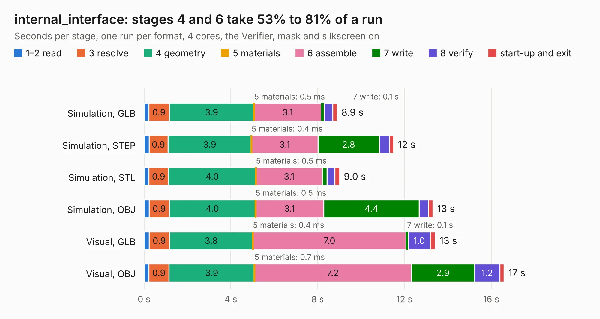

| Mode and format | 1–2 read | 3 resolve | 4 geometry | 5 materials | 6 assemble | 7 write | 8 verify | start-up and exit | Total |
|---|---:|---:|---:|---:|---:|---:|---:|---:|---:|
| Simulation, GLB | 0.2 | 0.9 | 3.9 | 0.5&nbsp;ms | 3.1 | 0.1 | 0.4 | 0.2 | 8.9 |
| Simulation, STEP | 0.2 | 0.9 | 3.9 | 0.4&nbsp;ms | 3.1 | 2.8 | 0.5 | 0.2 | 11.5 |
| Simulation, STL | 0.2 | 0.9 | 4.0 | 0.5&nbsp;ms | 3.1 | 0.2 | 0.4 | 0.2 | 9.0 |
| Simulation, OBJ | 0.2 | 0.9 | 4.0 | 0.5&nbsp;ms | 3.1 | 4.4 | 0.4 | 0.2 | 13.3 |
| Visual, GLB | 0.2 | 0.9 | 3.8 | 0.4&nbsp;ms | 7.0 | 0.1 | 1.0 | 0.2 | 13.4 |
| Visual, OBJ | 0.2 | 0.9 | 3.9 | 0.7&nbsp;ms | 7.2 | 2.9 | 1.2 | 0.2 | 16.6 |

<table align="center"><tr><td valign="top">

| Board | Repo: [olin-electric-motorsports/olin-electric-motorsports](https://github.com/olin-electric-motorsports/olin-electric-motorsports) Board: `internal_interface.kicad_pcb` |
|---|---|
| Folder | vehicle / mkv / hardware / service_section / interface / internal |
| Complexity | 227&nbsp;/&nbsp;1000 (size&nbsp;172, features&nbsp;55) |
| KESE&nbsp;features | through vias, rounded, trapezoid or chamfered pads, filled zones, curved board outline |
| Tested | 9th November 2026 |
| Copper&nbsp;layers | 2 |
| File&nbsp;format | KiCad 6 (20211014) |
| Parts,&nbsp;tracks,&nbsp;vias | 23, 1,610, 6 |
| Triangles,&nbsp;simulation | 1,076,704 in 74 parts |
| Verifier | PASS in all six runs |

</td><td valign="top">

<table>
<tr><th>File type</th><th>File size</th><th>Peak memory used</th></tr>
<tr><th colspan="3" align="left">Simulation</th></tr>
<tr><td>GLB</td><td align="right">37&nbsp;MB</td><td align="right">483&nbsp;MB</td></tr>
<tr><td>STEP</td><td align="right">200&nbsp;MB</td><td align="right">548&nbsp;MB</td></tr>
<tr><td>STL</td><td align="right">54&nbsp;MB</td><td align="right">495&nbsp;MB</td></tr>
<tr><td>OBJ</td><td align="right">110&nbsp;MB</td><td align="right">744&nbsp;MB</td></tr>
<tr><th colspan="3" align="left">Visual</th></tr>
<tr><td>GLB</td><td align="right">25&nbsp;MB</td><td align="right">563&nbsp;MB</td></tr>
<tr><td>OBJ</td><td align="right">75&nbsp;MB</td><td align="right">597&nbsp;MB</td></tr>
</table>

</td></tr></table>

## 23.19.54 bms_peripheral

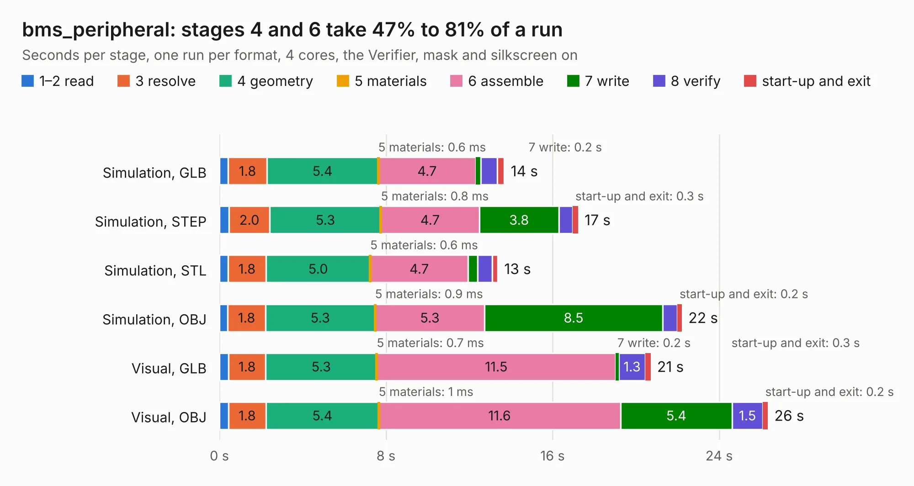

| Mode and format | 1–2 read | 3 resolve | 4 geometry | 5 materials | 6 assemble | 7 write | 8 verify | start-up and exit | Total |
|---|---:|---:|---:|---:|---:|---:|---:|---:|---:|
| Simulation, GLB | 0.4 | 1.8 | 5.4 | 0.6&nbsp;ms | 4.7 | 0.2 | 0.8 | 0.3 | 13.7 |
| Simulation, STEP | 0.5 | 2.0 | 5.3 | 0.8&nbsp;ms | 4.7 | 3.8 | 0.7 | 0.3 | 17.2 |
| Simulation, STL | 0.4 | 1.8 | 5.0 | 0.6&nbsp;ms | 4.7 | 0.4 | 0.7 | 0.3 | 13.4 |
| Simulation, OBJ | 0.4 | 1.8 | 5.3 | 0.9&nbsp;ms | 5.3 | 8.5 | 0.7 | 0.2 | 22.2 |
| Visual, GLB | 0.4 | 1.8 | 5.3 | 0.7&nbsp;ms | 11.5 | 0.2 | 1.3 | 0.3 | 20.7 |
| Visual, OBJ | 0.4 | 1.8 | 5.4 | 1&nbsp;ms | 11.6 | 5.4 | 1.5 | 0.2 | 26.3 |

<table align="center"><tr><td valign="top">

| Board | Repo: [olin-electric-motorsports/olin-electric-motorsports](https://github.com/olin-electric-motorsports/olin-electric-motorsports) Board: `bms_peripheral.kicad_pcb` |
|---|---|
| Folder | vehicle / mkv / hardware / service_section / peripheral |
| Complexity | 302&nbsp;/&nbsp;1000 (size&nbsp;257, features&nbsp;45) |
| KESE&nbsp;features | through vias, filled zones, curved board outline |
| Tested | 9th November 2026 |
| Copper&nbsp;layers | 4 |
| File&nbsp;format | KiCad 6 (20211014) |
| Parts,&nbsp;tracks,&nbsp;vias | 133, 1,467, 152 |
| Triangles,&nbsp;simulation | 1,351,570 in 178 parts |
| Verifier | PASS in all six runs |

</td><td valign="top">

<table>
<tr><th>File type</th><th>File size</th><th>Peak memory used</th></tr>
<tr><th colspan="3" align="left">Simulation</th></tr>
<tr><td>GLB</td><td align="right">47&nbsp;MB</td><td align="right">510&nbsp;MB</td></tr>
<tr><td>STEP</td><td align="right">175&nbsp;MB</td><td align="right">662&nbsp;MB</td></tr>
<tr><td>STL</td><td align="right">68&nbsp;MB</td><td align="right">534&nbsp;MB</td></tr>
<tr><td>OBJ</td><td align="right">140&nbsp;MB</td><td align="right">959&nbsp;MB</td></tr>
<tr><th colspan="3" align="left">Visual</th></tr>
<tr><td>GLB</td><td align="right">31&nbsp;MB</td><td align="right">662&nbsp;MB</td></tr>
<tr><td>OBJ</td><td align="right">97&nbsp;MB</td><td align="right">746&nbsp;MB</td></tr>
</table>

</td></tr></table>

## 23.19.55 bms_peripheral_v2

| Mode and format | 1–2 read | 3 resolve | 4 geometry | 5 materials | 6 assemble | 7 write | 8 verify | start-up and exit | Total |
|---|---:|---:|---:|---:|---:|---:|---:|---:|---:|
| Simulation, GLB | 0.5 | 2.6 | 7.0 | 0.9&nbsp;ms | 5.8 | 0.3 | 0.9 | 0.2 | 17.2 |
| Simulation, STEP | 0.5 | 2.4 | 6.8 | 1&nbsp;ms | 5.9 | 4.4 | 0.8 | 0.3 | 21.1 |
| Simulation, STL | 0.5 | 2.4 | 6.8 | 0.9&nbsp;ms | 5.5 | 0.4 | 0.9 | 0.2 | 16.7 |
| Simulation, OBJ | 0.4 | 2.3 | 6.6 | 0.9&nbsp;ms | 5.6 | 7.6 | 0.8 | 0.2 | 23.5 |
| Visual, GLB | 0.4 | 2.3 | 7.2 | 0.6&nbsp;ms | 13.6 | 0.2 | 1.4 | 0.2 | 25.3 |
| Visual, OBJ | 0.4 | 2.6 | 7.4 | 1.0&nbsp;ms | 13.8 | 6.1 | 1.6 | 0.3 | 32.3 |

<table align="center"><tr><td valign="top">

| Board | Repo: [olin-electric-motorsports/olin-electric-motorsports](https://github.com/olin-electric-motorsports/olin-electric-motorsports) Board: `bms_peripheral_v2.kicad_pcb` |
|---|---|
| Folder | vehicle / mkv / hardware / service_section / peripheral |
| Complexity | 304&nbsp;/&nbsp;1000 (size&nbsp;259, features&nbsp;45) |
| KESE&nbsp;features | through vias, filled zones, curved board outline |
| Tested | 9th November 2026 |
| Copper&nbsp;layers | 4 |
| File&nbsp;format | KiCad 6 (20211014) |
| Parts,&nbsp;tracks,&nbsp;vias | 134, 1,595, 199 |
| Triangles,&nbsp;simulation | 1,760,720 in 182 parts |
| Verifier | PASS in all six runs |

</td><td valign="top">

<table>
<tr><th>File type</th><th>File size</th><th>Peak memory used</th></tr>
<tr><th colspan="3" align="left">Simulation</th></tr>
<tr><td>GLB</td><td align="right">61&nbsp;MB</td><td align="right">635&nbsp;MB</td></tr>
<tr><td>STEP</td><td align="right">230&nbsp;MB</td><td align="right">747&nbsp;MB</td></tr>
<tr><td>STL</td><td align="right">88&nbsp;MB</td><td align="right">631&nbsp;MB</td></tr>
<tr><td>OBJ</td><td align="right">186&nbsp;MB</td><td align="right">1.2&nbsp;GB</td></tr>
<tr><th colspan="3" align="left">Visual</th></tr>
<tr><td>GLB</td><td align="right">40&nbsp;MB</td><td align="right">731&nbsp;MB</td></tr>
<tr><td>OBJ</td><td align="right">123&nbsp;MB</td><td align="right">884&nbsp;MB</td></tr>
</table>

</td></tr></table>

## 23.19.56 service_section_controller

| Mode and format | 1–2 read | 3 resolve | 4 geometry | 5 materials | 6 assemble | 7 write | 8 verify | start-up and exit | Total |
|---|---:|---:|---:|---:|---:|---:|---:|---:|---:|
| Simulation, GLB | 0.8 | 3.8 | 9.9 | 1.0&nbsp;ms | 9.6 | 0.4 | 1.2 | 0.2 | 26.0 |
| Simulation, STEP | 0.7 | 3.5 | 9.7 | 1&nbsp;ms | 9.8 | 7.2 | 1.4 | 0.2 | 32.5 |
| Simulation, STL | 0.8 | 3.5 | 10.3 | 1&nbsp;ms | 10.2 | 0.8 | 1.1 | 0.4 | 27.2 |
| Simulation, OBJ | 0.8 | 3.4 | 10.4 | 1&nbsp;ms | 10.5 | 12.7 | 1.3 | 0.3 | 39.4 |
| Visual, GLB | 0.9 | 3.8 | 10.8 | 1&nbsp;ms | 27.2 | 0.3 | 4.0 | 0.3 | 47.3 |
| Visual, OBJ | 0.9 | 3.7 | 10.8 | 2&nbsp;ms | 27.1 | 9.5 | 4.5 | 0.2 | 56.8 |

<table align="center"><tr><td valign="top">

| Board | Repo: [olin-electric-motorsports/olin-electric-motorsports](https://github.com/olin-electric-motorsports/olin-electric-motorsports) Board: `service_section_controller.kicad_pcb` |
|---|---|
| Folder | vehicle / mkv / hardware / service_section_controller |
| Complexity | 335&nbsp;/&nbsp;1000 (size&nbsp;270, features&nbsp;65) |
| KESE&nbsp;features | through vias, slotted holes, rounded, trapezoid or chamfered pads, filled zones, curved board outline |
| Tested | 9th November 2026 |
| Copper&nbsp;layers | 4 |
| File&nbsp;format | KiCad 6 (20211014) |
| Parts,&nbsp;tracks,&nbsp;vias | 223, 2,061, 312 |
| Triangles,&nbsp;simulation | 2,994,678 in 189 parts |
| Verifier | PASS in all six runs |

</td><td valign="top">

<table>
<tr><th>File type</th><th>File size</th><th>Peak memory used</th></tr>
<tr><th colspan="3" align="left">Simulation</th></tr>
<tr><td>GLB</td><td align="right">105&nbsp;MB</td><td align="right">1.0&nbsp;GB</td></tr>
<tr><td>STEP</td><td align="right">424&nbsp;MB</td><td align="right">1.3&nbsp;GB</td></tr>
<tr><td>STL</td><td align="right">150&nbsp;MB</td><td align="right">987&nbsp;MB</td></tr>
<tr><td>OBJ</td><td align="right">322&nbsp;MB</td><td align="right">2.0&nbsp;GB</td></tr>
<tr><th colspan="3" align="left">Visual</th></tr>
<tr><td>GLB</td><td align="right">78&nbsp;MB</td><td align="right">1.3&nbsp;GB</td></tr>
<tr><td>OBJ</td><td align="right">242&nbsp;MB</td><td align="right">1.5&nbsp;GB</td></tr>
</table>

</td></tr></table>

## 23.19.57 bms_core

| Mode and format | 1–2 read | 3 resolve | 4 geometry | 5 materials | 6 assemble | 7 write | 8 verify | start-up and exit | Total |
|---|---:|---:|---:|---:|---:|---:|---:|---:|---:|
| Simulation, GLB | 0.4 | 0.8 | 2.7 | 0.5&nbsp;ms | 2.9 | 0.1 | 0.5 | 0.3 | 7.7 |
| Simulation, STEP | 0.4 | 0.9 | 2.4 | 0.8&nbsp;ms | 2.9 | 2.1 | 0.5 | 0.2 | 9.3 |
| Simulation, STL | 0.3 | 0.7 | 2.5 | 0.5&nbsp;ms | 2.9 | 0.2 | 0.4 | 0.3 | 7.4 |
| Simulation, OBJ | 0.5 | 0.9 | 2.4 | 0.5&nbsp;ms | 2.8 | 3.3 | 0.4 | 0.3 | 10.4 |
| Visual, GLB | 0.3 | 0.6 | 2.3 | 0.5&nbsp;ms | 6.6 | 71&nbsp;ms | 0.6 | 0.2 | 10.8 |
| Visual, OBJ | 0.3 | 0.6 | 2.3 | 0.4&nbsp;ms | 6.8 | 2.3 | 0.7 | 0.2 | 13.3 |

<table align="center"><tr><td valign="top">

| Board | Repo: [olin-electric-motorsports/olin-electric-motorsports](https://github.com/olin-electric-motorsports/olin-electric-motorsports) Board: `bms_core.kicad_pcb` |
|---|---|
| Folder | vehicle / mkvi / hardware / bms / bms_core |
| Complexity | 315&nbsp;/&nbsp;1000 (size&nbsp;225, features&nbsp;90) |
| KESE&nbsp;features | through vias, rounded, trapezoid or chamfered pads, filled zones, curved board outline, stack-up, dielectric εr and tanδ, mask and silkscreen colours |
| Tested | 9th November 2026 |
| Copper&nbsp;layers | 4 |
| File&nbsp;format | KiCad 7 (20221018) |
| Parts,&nbsp;tracks,&nbsp;vias | 50, 542, 75 |
| Triangles,&nbsp;simulation | 621,672 in 125 parts |
| Verifier | PASS in all six runs |

</td><td valign="top">

<table>
<tr><th>File type</th><th>File size</th><th>Peak memory used</th></tr>
<tr><th colspan="3" align="left">Simulation</th></tr>
<tr><td>GLB</td><td align="right">21&nbsp;MB</td><td align="right">326&nbsp;MB</td></tr>
<tr><td>STEP</td><td align="right">91&nbsp;MB</td><td align="right">397&nbsp;MB</td></tr>
<tr><td>STL</td><td align="right">31&nbsp;MB</td><td align="right">323&nbsp;MB</td></tr>
<tr><td>OBJ</td><td align="right">64&nbsp;MB</td><td align="right">467&nbsp;MB</td></tr>
<tr><th colspan="3" align="left">Visual</th></tr>
<tr><td>GLB</td><td align="right">15&nbsp;MB</td><td align="right">426&nbsp;MB</td></tr>
<tr><td>OBJ</td><td align="right">44&nbsp;MB</td><td align="right">427&nbsp;MB</td></tr>
</table>

</td></tr></table>

## 23.19.58 bms_csc

| Mode and format | 1–2 read | 3 resolve | 4 geometry | 5 materials | 6 assemble | 7 write | 8 verify | start-up and exit | Total |
|---|---:|---:|---:|---:|---:|---:|---:|---:|---:|
| Simulation, GLB | 0.5 | 0.9 | 3.9 | 0.6&nbsp;ms | 4.5 | 0.1 | 0.5 | 0.2 | 10.8 |
| Simulation, STEP | 0.5 | 0.9 | 4.2 | 0.5&nbsp;ms | 4.8 | 3.2 | 0.5 | 0.3 | 14.4 |
| Simulation, STL | 0.5 | 0.9 | 4.3 | 1&nbsp;ms | 4.2 | 0.2 | 0.5 | 0.3 | 10.8 |
| Simulation, OBJ | 0.5 | 0.9 | 4.1 | 0.5&nbsp;ms | 4.6 | 4.1 | 0.5 | 0.3 | 14.9 |
| Visual, GLB | 0.4 | 0.8 | 4.1 | 0.6&nbsp;ms | 10.2 | 0.1 | 1.4 | 0.2 | 17.2 |
| Visual, OBJ | 0.5 | 0.8 | 3.9 | 0.6&nbsp;ms | 9.9 | 3.4 | 1.3 | 0.3 | 20.1 |

<table align="center"><tr><td valign="top">

| Board | Repo: [olin-electric-motorsports/olin-electric-motorsports](https://github.com/olin-electric-motorsports/olin-electric-motorsports) Board: `bms_csc.kicad_pcb` |
|---|---|
| Folder | vehicle / mkvi / hardware / bms / bms_csc |
| Complexity | 349&nbsp;/&nbsp;1000 (size&nbsp;234, features&nbsp;115) |
| KESE&nbsp;features | through vias, custom pads, rounded, trapezoid or chamfered pads, filled zones, copper drawings, curved board outline, stack-up, dielectric εr and tanδ, mask and silkscreen colours |
| Tested | 9th November 2026 |
| Copper&nbsp;layers | 2 |
| File&nbsp;format | KiCad 7 (20221018) |
| Parts,&nbsp;tracks,&nbsp;vias | 133, 1,535, 128 |
| Triangles,&nbsp;simulation | 863,206 in 168 parts |
| Verifier | PASS in all six runs |

</td><td valign="top">

<table>
<tr><th>File type</th><th>File size</th><th>Peak memory used</th></tr>
<tr><th colspan="3" align="left">Simulation</th></tr>
<tr><td>GLB</td><td align="right">31&nbsp;MB</td><td align="right">485&nbsp;MB</td></tr>
<tr><td>STEP</td><td align="right">172&nbsp;MB</td><td align="right">529&nbsp;MB</td></tr>
<tr><td>STL</td><td align="right">43&nbsp;MB</td><td align="right">475&nbsp;MB</td></tr>
<tr><td>OBJ</td><td align="right">90&nbsp;MB</td><td align="right">632&nbsp;MB</td></tr>
<tr><th colspan="3" align="left">Visual</th></tr>
<tr><td>GLB</td><td align="right">28&nbsp;MB</td><td align="right">566&nbsp;MB</td></tr>
<tr><td>OBJ</td><td align="right">84&nbsp;MB</td><td align="right">697&nbsp;MB</td></tr>
</table>

</td></tr></table>

## 23.19.59 bms_csc

| Mode and format | 1–2 read | 3 resolve | 4 geometry | 5 materials | 6 assemble | 7 write | 8 verify | start-up and exit | Total |
|---|---:|---:|---:|---:|---:|---:|---:|---:|---:|
| Simulation, GLB | 0.5 | 1.1 | 4.5 | 0.4&nbsp;ms | 4.8 | 0.1 | 0.6 | 0.3 | 11.9 |
| Simulation, STEP | 0.5 | 1.1 | 4.3 | 0.6&nbsp;ms | 4.8 | 3.8 | 0.6 | 0.3 | 15.3 |
| Simulation, STL | 0.5 | 0.9 | 4.3 | 0.4&nbsp;ms | 4.3 | 0.2 | 0.7 | 0.4 | 11.3 |
| Simulation, OBJ | 0.5 | 1.0 | 4.3 | 0.5&nbsp;ms | 5.0 | 4.0 | 0.7 | 0.3 | 15.7 |
| Visual, GLB | 0.5 | 1.0 | 4.4 | 0.3&nbsp;ms | 11.8 | 0.1 | 1.0 | 0.3 | 19.1 |
| Visual, OBJ | 0.5 | 0.9 | 4.3 | 0.5&nbsp;ms | 11.1 | 4.0 | 1.2 | 0.3 | 22.2 |

<table align="center"><tr><td valign="top">

| Board | Repo: [olin-electric-motorsports/olin-electric-motorsports](https://github.com/olin-electric-motorsports/olin-electric-motorsports) Board: `bms_csc.kicad_pcb` |
|---|---|
| Folder | vehicle / mkvi / hardware / bms / bms_csc / rev_1 |
| Complexity | 349&nbsp;/&nbsp;1000 (size&nbsp;234, features&nbsp;115) |
| KESE&nbsp;features | through vias, custom pads, rounded, trapezoid or chamfered pads, filled zones, copper drawings, curved board outline, stack-up, dielectric εr and tanδ, mask and silkscreen colours |
| Tested | 9th November 2026 |
| Copper&nbsp;layers | 2 |
| File&nbsp;format | KiCad 7 (20221018) |
| Parts,&nbsp;tracks,&nbsp;vias | 133, 1,573, 120 |
| Triangles,&nbsp;simulation | 843,322 in 168 parts |
| Verifier | PASS in all six runs |

</td><td valign="top">

<table>
<tr><th>File type</th><th>File size</th><th>Peak memory used</th></tr>
<tr><th colspan="3" align="left">Simulation</th></tr>
<tr><td>GLB</td><td align="right">30&nbsp;MB</td><td align="right">479&nbsp;MB</td></tr>
<tr><td>STEP</td><td align="right">170&nbsp;MB</td><td align="right">535&nbsp;MB</td></tr>
<tr><td>STL</td><td align="right">42&nbsp;MB</td><td align="right">482&nbsp;MB</td></tr>
<tr><td>OBJ</td><td align="right">88&nbsp;MB</td><td align="right">621&nbsp;MB</td></tr>
<tr><th colspan="3" align="left">Visual</th></tr>
<tr><td>GLB</td><td align="right">27&nbsp;MB</td><td align="right">673&nbsp;MB</td></tr>
<tr><td>OBJ</td><td align="right">81&nbsp;MB</td><td align="right">662&nbsp;MB</td></tr>
</table>

</td></tr></table>

## 23.19.60 data_acquisition_module

| Mode and format | 1–2 read | 3 resolve | 4 geometry | 5 materials | 6 assemble | 7 write | 8 verify | start-up and exit | Total |
|---|---:|---:|---:|---:|---:|---:|---:|---:|---:|
| Simulation, GLB | 0.2 | 0.4 | 1.3 | 0.3&nbsp;ms | 1.7 | 57&nbsp;ms | 0.2 | 0.3 | 4.2 |
| Simulation, STEP | 0.3 | 0.4 | 1.4 | 0.4&nbsp;ms | 1.6 | 1.5 | 0.2 | 0.2 | 5.5 |
| Simulation, STL | 0.2 | 0.4 | 1.4 | 0.2&nbsp;ms | 1.7 | 90&nbsp;ms | 0.2 | 0.2 | 4.2 |
| Simulation, OBJ | 0.3 | 0.4 | 1.3 | 0.4&nbsp;ms | 1.6 | 1.9 | 0.2 | 0.2 | 6.0 |
| Visual, GLB | 0.2 | 0.4 | 1.4 | 0.2&nbsp;ms | 3.5 | 51&nbsp;ms | 0.3 | 0.2 | 6.2 |
| Visual, OBJ | 0.2 | 0.4 | 1.5 | 0.2&nbsp;ms | 3.5 | 1.4 | 0.3 | 0.2 | 7.5 |

<table align="center"><tr><td valign="top">

| Board | Repo: [olin-electric-motorsports/olin-electric-motorsports](https://github.com/olin-electric-motorsports/olin-electric-motorsports) Board: `data_acquisition_module.kicad_pcb` |
|---|---|
| Folder | vehicle / mkvi / hardware / bms / data_acquisition_module |
| Complexity | 256&nbsp;/&nbsp;1000 (size&nbsp;166, features&nbsp;90) |
| KESE&nbsp;features | through vias, rounded, trapezoid or chamfered pads, filled zones, curved board outline, stack-up, dielectric εr and tanδ, mask and silkscreen colours |
| Tested | 9th November 2026 |
| Copper&nbsp;layers | 2 |
| File&nbsp;format | KiCad 7 (20221018) |
| Parts,&nbsp;tracks,&nbsp;vias | 38, 654, 47 |
| Triangles,&nbsp;simulation | 292,426 in 68 parts |
| Verifier | PASS in all six runs |

</td><td valign="top">

<table>
<tr><th>File type</th><th>File size</th><th>Peak memory used</th></tr>
<tr><th colspan="3" align="left">Simulation</th></tr>
<tr><td>GLB</td><td align="right">11&nbsp;MB</td><td align="right">257&nbsp;MB</td></tr>
<tr><td>STEP</td><td align="right">56&nbsp;MB</td><td align="right">285&nbsp;MB</td></tr>
<tr><td>STL</td><td align="right">15&nbsp;MB</td><td align="right">256&nbsp;MB</td></tr>
<tr><td>OBJ</td><td align="right">30&nbsp;MB</td><td align="right">258&nbsp;MB</td></tr>
<tr><th colspan="3" align="left">Visual</th></tr>
<tr><td>GLB</td><td align="right">9.4&nbsp;MB</td><td align="right">291&nbsp;MB</td></tr>
<tr><td>OBJ</td><td align="right">27&nbsp;MB</td><td align="right">292&nbsp;MB</td></tr>
</table>

</td></tr></table>

## 23.19.61 J1772

| Mode and format | 1–2 read | 3 resolve | 4 geometry | 5 materials | 6 assemble | 7 write | 8 verify | start-up and exit | Total |
|---|---:|---:|---:|---:|---:|---:|---:|---:|---:|
| Simulation, GLB | 0.2 | 0.4 | 1.5 | 0.3&nbsp;ms | 1.9 | 95&nbsp;ms | 0.3 | 0.2 | 4.6 |
| Simulation, STEP | 0.2 | 0.4 | 1.3 | 0.3&nbsp;ms | 1.8 | 1.7 | 0.2 | 0.2 | 5.8 |
| Simulation, STL | 0.2 | 0.4 | 1.4 | 0.5&nbsp;ms | 1.9 | 0.2 | 0.2 | 0.2 | 4.5 |
| Simulation, OBJ | 0.2 | 0.4 | 1.4 | 0.5&nbsp;ms | 2.0 | 1.9 | 0.2 | 0.3 | 6.3 |
| Visual, GLB | 0.3 | 0.4 | 1.6 | 0.6&nbsp;ms | 4.1 | 62&nbsp;ms | 0.6 | 0.2 | 7.2 |
| Visual, OBJ | 0.2 | 0.4 | 1.3 | 0.5&nbsp;ms | 4.2 | 1.7 | 0.6 | 0.2 | 8.7 |

<table align="center"><tr><td valign="top">

| Board | Repo: [olin-electric-motorsports/olin-electric-motorsports](https://github.com/olin-electric-motorsports/olin-electric-motorsports) Board: `J1772.kicad_pcb` |
|---|---|
| Folder | vehicle / mkvi / hardware / charging-cart / J1772 |
| Complexity | 287&nbsp;/&nbsp;1000 (size&nbsp;207, features&nbsp;80) |
| KESE&nbsp;features | through vias, rounded, trapezoid or chamfered pads, filled zones, stack-up, dielectric εr and tanδ, mask and silkscreen colours |
| Tested | 9th November 2026 |
| Copper&nbsp;layers | 2 |
| File&nbsp;format | KiCad 6 (20211014) |
| Parts,&nbsp;tracks,&nbsp;vias | 55, 440, 72 |
| Triangles,&nbsp;simulation | 429,352 in 89 parts |
| Verifier | PASS in all six runs |

</td><td valign="top">

<table>
<tr><th>File type</th><th>File size</th><th>Peak memory used</th></tr>
<tr><th colspan="3" align="left">Simulation</th></tr>
<tr><td>GLB</td><td align="right">15&nbsp;MB</td><td align="right">293&nbsp;MB</td></tr>
<tr><td>STEP</td><td align="right">66&nbsp;MB</td><td align="right">339&nbsp;MB</td></tr>
<tr><td>STL</td><td align="right">21&nbsp;MB</td><td align="right">295&nbsp;MB</td></tr>
<tr><td>OBJ</td><td align="right">43&nbsp;MB</td><td align="right">346&nbsp;MB</td></tr>
<tr><th colspan="3" align="left">Visual</th></tr>
<tr><td>GLB</td><td align="right">12&nbsp;MB</td><td align="right">348&nbsp;MB</td></tr>
<tr><td>OBJ</td><td align="right">36&nbsp;MB</td><td align="right">355&nbsp;MB</td></tr>
</table>

</td></tr></table>

## 23.19.62 J1772_V2

| Mode and format | 1–2 read | 3 resolve | 4 geometry | 5 materials | 6 assemble | 7 write | 8 verify | start-up and exit | Total |
|---|---:|---:|---:|---:|---:|---:|---:|---:|---:|
| Simulation, GLB | 0.2 | 0.4 | 1.7 | 0.3&nbsp;ms | 2.2 | 91&nbsp;ms | 0.3 | 0.3 | 5.2 |
| Simulation, STEP | 0.2 | 0.5 | 1.8 | 0.3&nbsp;ms | 2.1 | 1.7 | 0.2 | 0.2 | 6.8 |
| Simulation, STL | 0.2 | 0.4 | 1.6 | 0.3&nbsp;ms | 2.1 | 0.1 | 0.4 | 0.2 | 5.1 |
| Simulation, OBJ | 0.2 | 0.5 | 1.7 | 0.3&nbsp;ms | 2.0 | 2.4 | 0.2 | 0.2 | 7.3 |
| Visual, GLB | 0.2 | 0.4 | 1.6 | 0.3&nbsp;ms | 3.7 | 57&nbsp;ms | 0.4 | 0.2 | 6.6 |
| Visual, OBJ | 0.2 | 0.4 | 1.8 | 0.3&nbsp;ms | 3.9 | 1.9 | 0.5 | 0.3 | 9.0 |

<table align="center"><tr><td valign="top">

| Board | Repo: [olin-electric-motorsports/olin-electric-motorsports](https://github.com/olin-electric-motorsports/olin-electric-motorsports) Board: `J1772_V2.kicad_pcb` |
|---|---|
| Folder | vehicle / mkvi / hardware / charging-cart / J1772 |
| Complexity | 250&nbsp;/&nbsp;1000 (size&nbsp;205, features&nbsp;45) |
| KESE&nbsp;features | through vias, rounded, trapezoid or chamfered pads, filled zones |
| Tested | 9th November 2026 |
| Copper&nbsp;layers | 2 |
| File&nbsp;format | KiCad 7 (20221018) |
| Parts,&nbsp;tracks,&nbsp;vias | 53, 433, 54 |
| Triangles,&nbsp;simulation | 426,424 in 80 parts |
| Verifier | PASS in all six runs |

</td><td valign="top">

<table>
<tr><th>File type</th><th>File size</th><th>Peak memory used</th></tr>
<tr><th colspan="3" align="left">Simulation</th></tr>
<tr><td>GLB</td><td align="right">15&nbsp;MB</td><td align="right">289&nbsp;MB</td></tr>
<tr><td>STEP</td><td align="right">63&nbsp;MB</td><td align="right">328&nbsp;MB</td></tr>
<tr><td>STL</td><td align="right">21&nbsp;MB</td><td align="right">286&nbsp;MB</td></tr>
<tr><td>OBJ</td><td align="right">43&nbsp;MB</td><td align="right">349&nbsp;MB</td></tr>
<tr><th colspan="3" align="left">Visual</th></tr>
<tr><td>GLB</td><td align="right">12&nbsp;MB</td><td align="right">379&nbsp;MB</td></tr>
<tr><td>OBJ</td><td align="right">35&nbsp;MB</td><td align="right">337&nbsp;MB</td></tr>
</table>

</td></tr></table>

## 23.19.63 cooling-board

| Mode and format | 1–2 read | 3 resolve | 4 geometry | 5 materials | 6 assemble | 7 write | 8 verify | start-up and exit | Total |
|---|---:|---:|---:|---:|---:|---:|---:|---:|---:|
| Simulation, GLB | 0.2 | 0.3 | 1.3 | 0.4&nbsp;ms | 1.3 | 59&nbsp;ms | 0.2 | 0.2 | 3.5 |
| Simulation, STEP | 0.1 | 0.3 | 1.4 | 0.5&nbsp;ms | 1.3 | 1.3 | 0.2 | 0.2 | 4.7 |
| Simulation, STL | 0.2 | 0.4 | 1.3 | 0.3&nbsp;ms | 1.4 | 0.1 | 0.2 | 0.2 | 3.7 |
| Simulation, OBJ | 0.2 | 0.3 | 1.3 | 0.3&nbsp;ms | 1.4 | 1.5 | 0.2 | 0.2 | 4.9 |
| Visual, GLB | 0.1 | 0.2 | 1.2 | 0.3&nbsp;ms | 3.3 | 38&nbsp;ms | 0.3 | 0.2 | 5.3 |
| Visual, OBJ | 0.2 | 0.3 | 1.0 | 0.3&nbsp;ms | 3.4 | 1.1 | 0.3 | 0.2 | 6.5 |

<table align="center"><tr><td valign="top">

| Board | Repo: [olin-electric-motorsports/olin-electric-motorsports](https://github.com/olin-electric-motorsports/olin-electric-motorsports) Board: `cooling-board.kicad_pcb` |
|---|---|
| Folder | vehicle / mkvi / hardware / cooling-board |
| Complexity | 284&nbsp;/&nbsp;1000 (size&nbsp;194, features&nbsp;90) |
| KESE&nbsp;features | through vias, rounded, trapezoid or chamfered pads, filled zones, curved board outline, stack-up, dielectric εr and tanδ, mask and silkscreen colours |
| Tested | 9th November 2026 |
| Copper&nbsp;layers | 2 |
| File&nbsp;format | KiCad 7 (20221018) |
| Parts,&nbsp;tracks,&nbsp;vias | 32, 307, 42 |
| Triangles,&nbsp;simulation | 308,960 in 109 parts |
| Verifier | PASS in all six runs |

</td><td valign="top">

<table>
<tr><th>File type</th><th>File size</th><th>Peak memory used</th></tr>
<tr><th colspan="3" align="left">Simulation</th></tr>
<tr><td>GLB</td><td align="right">11&nbsp;MB</td><td align="right">247&nbsp;MB</td></tr>
<tr><td>STEP</td><td align="right">54&nbsp;MB</td><td align="right">275&nbsp;MB</td></tr>
<tr><td>STL</td><td align="right">15&nbsp;MB</td><td align="right">245&nbsp;MB</td></tr>
<tr><td>OBJ</td><td align="right">32&nbsp;MB</td><td align="right">268&nbsp;MB</td></tr>
<tr><th colspan="3" align="left">Visual</th></tr>
<tr><td>GLB</td><td align="right">8.0&nbsp;MB</td><td align="right">272&nbsp;MB</td></tr>
<tr><td>OBJ</td><td align="right">23&nbsp;MB</td><td align="right">273&nbsp;MB</td></tr>
</table>

</td></tr></table>

## 23.19.64 imu

| Mode and format | 1–2 read | 3 resolve | 4 geometry | 5 materials | 6 assemble | 7 write | 8 verify | start-up and exit | Total |
|---|---:|---:|---:|---:|---:|---:|---:|---:|---:|
| Simulation, GLB | 0.3 | 0.4 | 1.3 | 0.3&nbsp;ms | 1.7 | 84&nbsp;ms | 0.3 | 0.2 | 4.3 |
| Simulation, STEP | 0.3 | 0.4 | 1.3 | 0.5&nbsp;ms | 1.8 | 1.7 | 0.3 | 0.2 | 6.0 |
| Simulation, STL | 0.3 | 0.4 | 1.3 | 0.3&nbsp;ms | 1.7 | 0.1 | 0.3 | 0.3 | 4.4 |
| Simulation, OBJ | 0.3 | 0.4 | 1.3 | 0.3&nbsp;ms | 1.7 | 2.4 | 0.3 | 0.2 | 6.5 |
| Visual, GLB | 0.3 | 0.4 | 1.3 | 0.3&nbsp;ms | 4.0 | 52&nbsp;ms | 0.4 | 0.3 | 6.6 |
| Visual, OBJ | 0.3 | 0.5 | 1.3 | 0.3&nbsp;ms | 4.2 | 1.8 | 0.3 | 0.2 | 8.6 |

<table align="center"><tr><td valign="top">

| Board | Repo: [olin-electric-motorsports/olin-electric-motorsports](https://github.com/olin-electric-motorsports/olin-electric-motorsports) Board: `imu.kicad_pcb` |
|---|---|
| Folder | vehicle / mkvi / hardware / imu |
| Complexity | 345&nbsp;/&nbsp;1000 (size&nbsp;215, features&nbsp;130) |
| KESE&nbsp;features | through vias, custom pads, rounded, trapezoid or chamfered pads, arc tracks, filled zones, copper drawings, stack-up, dielectric εr and tanδ, copper finish |
| Tested | 9th November 2026 |
| Copper&nbsp;layers | 4 |
| File&nbsp;format | KiCad 7 (20221018) |
| Parts,&nbsp;tracks,&nbsp;vias | 34, 383, 51 |
| Triangles,&nbsp;simulation | 421,836 in 72 parts |
| Verifier | PASS in all six runs |

</td><td valign="top">

<table>
<tr><th>File type</th><th>File size</th><th>Peak memory used</th></tr>
<tr><th colspan="3" align="left">Simulation</th></tr>
<tr><td>GLB</td><td align="right">15&nbsp;MB</td><td align="right">302&nbsp;MB</td></tr>
<tr><td>STEP</td><td align="right">67&nbsp;MB</td><td align="right">312&nbsp;MB</td></tr>
<tr><td>STL</td><td align="right">21&nbsp;MB</td><td align="right">307&nbsp;MB</td></tr>
<tr><td>OBJ</td><td align="right">44&nbsp;MB</td><td align="right">342&nbsp;MB</td></tr>
<tr><th colspan="3" align="left">Visual</th></tr>
<tr><td>GLB</td><td align="right">9.8&nbsp;MB</td><td align="right">306&nbsp;MB</td></tr>
<tr><td>OBJ</td><td align="right">30&nbsp;MB</td><td align="right">314&nbsp;MB</td></tr>
</table>

</td></tr></table>

## 23.19.65 imu_panelized

| Mode and format | 1–2 read | 3 resolve | 4 geometry | 5 materials | 6 assemble | 7 write | 8 verify | start-up and exit | Total |
|---|---:|---:|---:|---:|---:|---:|---:|---:|---:|
| Simulation, GLB | 3.3 | 7.7 | 23.6 | 2&nbsp;ms | 35.3 | 1.3 | 2.5 | 0.5 | 74.2 |
| Simulation, STEP | 2.8 | 7.4 | 23.1 | 2&nbsp;ms | 34.0 | 17.6 | 2.8 | 0.4 | 88.2 |
| Simulation, STL | 2.9 | 7.1 | 22.4 | 0.7&nbsp;ms | 32.4 | 2.9 | 2.8 | 0.5 | 71.1 |
| Simulation, OBJ | 3.1 | 6.9 | 23.3 | 1&nbsp;ms | 34.9 | 44.7 | 2.7 | 0.4 | 116.0 |
| Visual, GLB | 3.1 | 7.4 | 23.7 | 0.7&nbsp;ms | 67.3 | 0.8 | 9.9 | 0.3 | 112.4 |
| Visual, OBJ | 3.0 | 7.0 | 21.9 | 1&nbsp;ms | 65.9 | 26.3 | 9.9 | 0.3 | 134.5 |

<table align="center"><tr><td valign="top">

| Board | Repo: [olin-electric-motorsports/olin-electric-motorsports](https://github.com/olin-electric-motorsports/olin-electric-motorsports) Board: `imu_panelized.kicad_pcb` |
|---|---|
| Folder | vehicle / mkvi / hardware / imu |
| Complexity | 458&nbsp;/&nbsp;1000 (size&nbsp;318, features&nbsp;140) |
| KESE&nbsp;features | through vias, custom pads, rounded, trapezoid or chamfered pads, arc tracks, filled zones, copper drawings, curved board outline, stack-up, dielectric εr and tanδ, copper finish |
| Tested | 9th November 2026 |
| Copper&nbsp;layers | 4 |
| File&nbsp;format | KiCad 7 (20221018) |
| Parts,&nbsp;tracks,&nbsp;vias | 588, 6,144, 816 |
| Triangles,&nbsp;simulation | 7,414,440 in 72 parts |
| Note | panel |
| Verifier | PASS in all six runs |

</td><td valign="top">

<table>
<tr><th>File type</th><th>File size</th><th>Peak memory used</th></tr>
<tr><th colspan="3" align="left">Simulation</th></tr>
<tr><td>GLB</td><td align="right">255&nbsp;MB</td><td align="right">2.4&nbsp;GB</td></tr>
<tr><td>STEP</td><td align="right">1.2&nbsp;GB</td><td align="right">2.9&nbsp;GB</td></tr>
<tr><td>STL</td><td align="right">371&nbsp;MB</td><td align="right">2.4&nbsp;GB</td></tr>
<tr><td>OBJ</td><td align="right">819&nbsp;MB</td><td align="right">4.9&nbsp;GB</td></tr>
<tr><th colspan="3" align="left">Visual</th></tr>
<tr><td>GLB</td><td align="right">175&nbsp;MB</td><td align="right">2.8&nbsp;GB</td></tr>
<tr><td>OBJ</td><td align="right">566&nbsp;MB</td><td align="right">3.7&nbsp;GB</td></tr>
</table>

</td></tr></table>

## 23.19.66 mock-inverter

| Mode and format | 1–2 read | 3 resolve | 4 geometry | 5 materials | 6 assemble | 7 write | 8 verify | start-up and exit | Total |
|---|---:|---:|---:|---:|---:|---:|---:|---:|---:|
| Simulation, GLB | 0.3 | 1.0 | 3.9 | 0.3&nbsp;ms | 2.5 | 0.1 | 0.3 | 0.2 | 8.3 |
| Simulation, STEP | 0.3 | 0.8 | 4.1 | 0.4&nbsp;ms | 2.4 | 2.0 | 0.3 | 0.3 | 10.2 |
| Simulation, STL | 0.3 | 0.8 | 3.7 | 0.4&nbsp;ms | 2.4 | 0.2 | 0.3 | 0.2 | 7.9 |
| Simulation, OBJ | 0.3 | 0.8 | 3.8 | 0.5&nbsp;ms | 2.4 | 3.6 | 0.4 | 0.2 | 11.4 |
| Visual, GLB | 0.3 | 0.8 | 3.9 | 0.5&nbsp;ms | 5.8 | 73&nbsp;ms | 0.7 | 0.2 | 11.9 |
| Visual, OBJ | 0.3 | 0.8 | 3.9 | 0.4&nbsp;ms | 5.4 | 2.1 | 0.7 | 0.2 | 13.4 |

<table align="center"><tr><td valign="top">

| Board | Repo: [olin-electric-motorsports/olin-electric-motorsports](https://github.com/olin-electric-motorsports/olin-electric-motorsports) Board: `mock-inverter.kicad_pcb` |
|---|---|
| Folder | vehicle / mkvi / hardware / mock-inverter |
| Complexity | 311&nbsp;/&nbsp;1000 (size&nbsp;211, features&nbsp;100) |
| KESE&nbsp;features | through vias, rounded, trapezoid or chamfered pads, filled zones, curved board outline, stack-up, dielectric εr and tanδ, copper finish |
| Tested | 9th November 2026 |
| Copper&nbsp;layers | 2 |
| File&nbsp;format | KiCad 7 (20221018) |
| Parts,&nbsp;tracks,&nbsp;vias | 63, 614, 52 |
| Triangles,&nbsp;simulation | 840,918 in 97 parts |
| Verifier | PASS in all six runs |

</td><td valign="top">

<table>
<tr><th>File type</th><th>File size</th><th>Peak memory used</th></tr>
<tr><th colspan="3" align="left">Simulation</th></tr>
<tr><td>GLB</td><td align="right">30&nbsp;MB</td><td align="right">403&nbsp;MB</td></tr>
<tr><td>STEP</td><td align="right">146&nbsp;MB</td><td align="right">466&nbsp;MB</td></tr>
<tr><td>STL</td><td align="right">42&nbsp;MB</td><td align="right">393&nbsp;MB</td></tr>
<tr><td>OBJ</td><td align="right">87&nbsp;MB</td><td align="right">611&nbsp;MB</td></tr>
<tr><th colspan="3" align="left">Visual</th></tr>
<tr><td>GLB</td><td align="right">18&nbsp;MB</td><td align="right">461&nbsp;MB</td></tr>
<tr><td>OBJ</td><td align="right">54&nbsp;MB</td><td align="right">462&nbsp;MB</td></tr>
</table>

</td></tr></table>

## 23.19.67 brakes

| Mode and format | 1–2 read | 3 resolve | 4 geometry | 5 materials | 6 assemble | 7 write | 8 verify | start-up and exit | Total |
|---|---:|---:|---:|---:|---:|---:|---:|---:|---:|
| Simulation, GLB | 0.4 | 0.7 | 2.8 | 0.5&nbsp;ms | 3.1 | 0.1 | 0.4 | 0.3 | 7.7 |
| Simulation, STEP | 0.4 | 0.7 | 2.6 | 0.4&nbsp;ms | 3.1 | 2.4 | 0.4 | 0.3 | 9.8 |
| Simulation, STL | 0.4 | 0.7 | 2.7 | 0.5&nbsp;ms | 3.2 | 0.2 | 0.4 | 0.2 | 7.8 |
| Simulation, OBJ | 0.4 | 0.7 | 2.7 | 0.5&nbsp;ms | 3.2 | 3.2 | 0.5 | 0.2 | 10.9 |
| Visual, GLB | 0.4 | 0.7 | 2.8 | 0.5&nbsp;ms | 7.6 | 93&nbsp;ms | 0.9 | 0.3 | 12.8 |
| Visual, OBJ | 0.4 | 0.7 | 2.8 | 0.6&nbsp;ms | 7.1 | 3.0 | 1.0 | 0.2 | 15.0 |

<table align="center"><tr><td valign="top">

| Board | Repo: [olin-electric-motorsports/olin-electric-motorsports](https://github.com/olin-electric-motorsports/olin-electric-motorsports) Board: `brakes.kicad_pcb` |
|---|---|
| Folder | vehicle / mkvi / hardware / nostril / brakes |
| Complexity | 299&nbsp;/&nbsp;1000 (size&nbsp;219, features&nbsp;80) |
| KESE&nbsp;features | through vias, rounded, trapezoid or chamfered pads, filled zones, stack-up, dielectric εr and tanδ, mask and silkscreen colours |
| Tested | 9th November 2026 |
| Copper&nbsp;layers | 2 |
| File&nbsp;format | KiCad 7 (20221018) |
| Parts,&nbsp;tracks,&nbsp;vias | 78, 759, 120 |
| Triangles,&nbsp;simulation | 614,202 in 122 parts |
| Verifier | PASS in all six runs |

</td><td valign="top">

<table>
<tr><th>File type</th><th>File size</th><th>Peak memory used</th></tr>
<tr><th colspan="3" align="left">Simulation</th></tr>
<tr><td>GLB</td><td align="right">22&nbsp;MB</td><td align="right">355&nbsp;MB</td></tr>
<tr><td>STEP</td><td align="right">107&nbsp;MB</td><td align="right">436&nbsp;MB</td></tr>
<tr><td>STL</td><td align="right">31&nbsp;MB</td><td align="right">359&nbsp;MB</td></tr>
<tr><td>OBJ</td><td align="right">63&nbsp;MB</td><td align="right">465&nbsp;MB</td></tr>
<tr><th colspan="3" align="left">Visual</th></tr>
<tr><td>GLB</td><td align="right">18&nbsp;MB</td><td align="right">449&nbsp;MB</td></tr>
<tr><td>OBJ</td><td align="right">55&nbsp;MB</td><td align="right">517&nbsp;MB</td></tr>
</table>

</td></tr></table>

## 23.19.68 dashboard

| Mode and format | 1–2 read | 3 resolve | 4 geometry | 5 materials | 6 assemble | 7 write | 8 verify | start-up and exit | Total |
|---|---:|---:|---:|---:|---:|---:|---:|---:|---:|
| Simulation, GLB | 0.3 | 0.9 | 3.8 | 2&nbsp;ms | 2.4 | 0.1 | 0.4 | 0.2 | 8.1 |
| Simulation, STEP | 0.3 | 0.8 | 3.7 | 0.4&nbsp;ms | 2.2 | 2.1 | 0.3 | 0.2 | 9.7 |
| Simulation, STL | 0.2 | 0.8 | 3.7 | 0.4&nbsp;ms | 2.3 | 0.2 | 0.4 | 0.2 | 7.9 |
| Simulation, OBJ | 0.3 | 0.8 | 3.8 | 0.5&nbsp;ms | 2.3 | 3.4 | 0.3 | 0.3 | 11.2 |
| Visual, GLB | 0.3 | 0.8 | 3.8 | 0.4&nbsp;ms | 5.8 | 70&nbsp;ms | 0.7 | 0.2 | 11.6 |
| Visual, OBJ | 0.3 | 0.8 | 3.9 | 0.4&nbsp;ms | 5.3 | 2.3 | 0.6 | 0.3 | 13.5 |

<table align="center"><tr><td valign="top">

| Board | Repo: [olin-electric-motorsports/olin-electric-motorsports](https://github.com/olin-electric-motorsports/olin-electric-motorsports) Board: `dashboard.kicad_pcb` |
|---|---|
| Folder | vehicle / mkvi / hardware / nostril / dashboard |
| Complexity | 298&nbsp;/&nbsp;1000 (size&nbsp;168, features&nbsp;130) |
| KESE&nbsp;features | through vias, rounded, trapezoid or chamfered pads, filled zones, curved board outline, stack-up, dielectric εr and tanδ, copper finish, mask and silkscreen colours, castellated pads |
| Tested | 9th November 2026 |
| Copper&nbsp;layers | 2 |
| File&nbsp;format | KiCad 7 (20221018) |
| Parts,&nbsp;tracks,&nbsp;vias | 45, 548, 90 |
| Triangles,&nbsp;simulation | 610,400 in 118 parts |
| Verifier | PASS in all six runs |

</td><td valign="top">

<table>
<tr><th>File type</th><th>File size</th><th>Peak memory used</th></tr>
<tr><th colspan="3" align="left">Simulation</th></tr>
<tr><td>GLB</td><td align="right">21&nbsp;MB</td><td align="right">347&nbsp;MB</td></tr>
<tr><td>STEP</td><td align="right">104&nbsp;MB</td><td align="right">387&nbsp;MB</td></tr>
<tr><td>STL</td><td align="right">31&nbsp;MB</td><td align="right">345&nbsp;MB</td></tr>
<tr><td>OBJ</td><td align="right">63&nbsp;MB</td><td align="right">458&nbsp;MB</td></tr>
<tr><th colspan="3" align="left">Visual</th></tr>
<tr><td>GLB</td><td align="right">14&nbsp;MB</td><td align="right">384&nbsp;MB</td></tr>
<tr><td>OBJ</td><td align="right">43&nbsp;MB</td><td align="right">406&nbsp;MB</td></tr>
</table>

</td></tr></table>

## 23.19.69 nostril

| Mode and format | 1–2 read | 3 resolve | 4 geometry | 5 materials | 6 assemble | 7 write | 8 verify | start-up and exit | Total |
|---|---:|---:|---:|---:|---:|---:|---:|---:|---:|
| Simulation, GLB | 0.5 | 1.4 | 8.4 | 0.8&nbsp;ms | 6.2 | 0.2 | 1.1 | 0.3 | 18.1 |
| Simulation, STEP | 0.6 | 1.4 | 8.0 | 0.7&nbsp;ms | 6.3 | 4.6 | 1.0 | 0.3 | 22.2 |
| Simulation, STL | 0.5 | 1.4 | 8.2 | 0.8&nbsp;ms | 6.3 | 0.4 | 1.0 | 0.3 | 18.2 |
| Simulation, OBJ | 0.6 | 1.3 | 7.9 | 0.8&nbsp;ms | 6.4 | 7.9 | 1.0 | 0.3 | 25.3 |
| Visual, GLB | 0.6 | 1.3 | 7.9 | 1&nbsp;ms | 15.4 | 0.2 | 1.7 | 0.3 | 27.3 |
| Visual, OBJ | 0.5 | 1.4 | 7.8 | 0.7&nbsp;ms | 15.2 | 6.4 | 1.9 | 0.2 | 33.4 |

<table align="center"><tr><td valign="top">

| Board | Repo: [olin-electric-motorsports/olin-electric-motorsports](https://github.com/olin-electric-motorsports/olin-electric-motorsports) Board: `nostril.kicad_pcb` |
|---|---|
| Folder | vehicle / mkvi / hardware / nostril / motherboard |
| Complexity | 308&nbsp;/&nbsp;1000 (size&nbsp;168, features&nbsp;140) |
| KESE&nbsp;features | through vias, slotted holes, custom pads, rounded, trapezoid or chamfered pads, filled zones, copper drawings, curved board outline, stack-up, dielectric εr and tanδ, copper finish, mask and silkscreen colours |
| Tested | 9th November 2026 |
| Copper&nbsp;layers | 2 |
| File&nbsp;format | KiCad 7 (20221018) |
| Parts,&nbsp;tracks,&nbsp;vias | 30, 591, 164 |
| Triangles,&nbsp;simulation | 1,288,630 in 284 parts |
| Verifier | PASS in all six runs |

</td><td valign="top">

<table>
<tr><th>File type</th><th>File size</th><th>Peak memory used</th></tr>
<tr><th colspan="3" align="left">Simulation</th></tr>
<tr><td>GLB</td><td align="right">45&nbsp;MB</td><td align="right">553&nbsp;MB</td></tr>
<tr><td>STEP</td><td align="right">229&nbsp;MB</td><td align="right">679&nbsp;MB</td></tr>
<tr><td>STL</td><td align="right">64&nbsp;MB</td><td align="right">559&nbsp;MB</td></tr>
<tr><td>OBJ</td><td align="right">134&nbsp;MB</td><td align="right">888&nbsp;MB</td></tr>
<tr><th colspan="3" align="left">Visual</th></tr>
<tr><td>GLB</td><td align="right">36&nbsp;MB</td><td align="right">711&nbsp;MB</td></tr>
<tr><td>OBJ</td><td align="right">108&nbsp;MB</td><td align="right">790&nbsp;MB</td></tr>
</table>

</td></tr></table>

## 23.19.70 throttle

| Mode and format | 1–2 read | 3 resolve | 4 geometry | 5 materials | 6 assemble | 7 write | 8 verify | start-up and exit | Total |
|---|---:|---:|---:|---:|---:|---:|---:|---:|---:|
| Simulation, GLB | 0.2 | 0.3 | 0.9 | 0.3&nbsp;ms | 1.2 | 48&nbsp;ms | 0.1 | 0.2 | 3.0 |
| Simulation, STEP | 0.2 | 0.2 | 0.9 | 0.3&nbsp;ms | 1.3 | 1.1 | 0.1 | 0.2 | 4.1 |
| Simulation, STL | 0.2 | 0.3 | 1.0 | 0.4&nbsp;ms | 1.2 | 71&nbsp;ms | 0.2 | 0.2 | 3.1 |
| Simulation, OBJ | 0.2 | 0.3 | 0.9 | 0.5&nbsp;ms | 1.3 | 1.4 | 0.2 | 0.2 | 4.4 |
| Visual, GLB | 0.2 | 0.3 | 1.0 | 0.3&nbsp;ms | 2.7 | 33&nbsp;ms | 0.2 | 0.2 | 4.7 |
| Visual, OBJ | 0.2 | 0.3 | 1.0 | 0.3&nbsp;ms | 2.8 | 1.1 | 0.2 | 0.2 | 5.8 |

<table align="center"><tr><td valign="top">

| Board | Repo: [olin-electric-motorsports/olin-electric-motorsports](https://github.com/olin-electric-motorsports/olin-electric-motorsports) Board: `throttle.kicad_pcb` |
|---|---|
| Folder | vehicle / mkvi / hardware / nostril / throttle |
| Complexity | 323&nbsp;/&nbsp;1000 (size&nbsp;193, features&nbsp;130) |
| KESE&nbsp;features | through vias, rounded, trapezoid or chamfered pads, filled zones, curved board outline, stack-up, dielectric εr and tanδ, copper finish, mask and silkscreen colours, castellated pads |
| Tested | 9th November 2026 |
| Copper&nbsp;layers | 2 |
| File&nbsp;format | KiCad 7 (20221018) |
| Parts,&nbsp;tracks,&nbsp;vias | 31, 303, 39 |
| Triangles,&nbsp;simulation | 263,092 in 109 parts |
| Verifier | PASS in all six runs |

</td><td valign="top">

<table>
<tr><th>File type</th><th>File size</th><th>Peak memory used</th></tr>
<tr><th colspan="3" align="left">Simulation</th></tr>
<tr><td>GLB</td><td align="right">9.3&nbsp;MB</td><td align="right">237&nbsp;MB</td></tr>
<tr><td>STEP</td><td align="right">47&nbsp;MB</td><td align="right">267&nbsp;MB</td></tr>
<tr><td>STL</td><td align="right">13&nbsp;MB</td><td align="right">241&nbsp;MB</td></tr>
<tr><td>OBJ</td><td align="right">27&nbsp;MB</td><td align="right">238&nbsp;MB</td></tr>
<tr><th colspan="3" align="left">Visual</th></tr>
<tr><td>GLB</td><td align="right">7.4&nbsp;MB</td><td align="right">247&nbsp;MB</td></tr>
<tr><td>OBJ</td><td align="right">22&nbsp;MB</td><td align="right">248&nbsp;MB</td></tr>
</table>

</td></tr></table>

## 23.19.71 rkh

| Mode and format | 1–2 read | 3 resolve | 4 geometry | 5 materials | 6 assemble | 7 write | 8 verify | start-up and exit | Total |
|---|---:|---:|---:|---:|---:|---:|---:|---:|---:|
| Simulation, GLB | 1.3 | 3.5 | 12.3 | 2&nbsp;ms | 10.9 | 0.6 | 1.4 | 0.3 | 30.4 |
| Simulation, STEP | 1.3 | 3.5 | 12.4 | 2&nbsp;ms | 10.9 | 7.7 | 1.5 | 0.3 | 37.5 |
| Simulation, STL | 1.3 | 3.4 | 12.4 | 2&nbsp;ms | 11.0 | 1.1 | 1.6 | 0.4 | 31.1 |
| Simulation, OBJ | 1.3 | 3.6 | 12.4 | 2&nbsp;ms | 11.0 | 18.1 | 1.5 | 0.3 | 48.2 |
| Visual, GLB | 1.3 | 3.5 | 12.6 | 2&nbsp;ms | 23.5 | 0.3 | 2.6 | 0.3 | 44.1 |
| Visual, OBJ | 1.3 | 3.5 | 12.3 | 2&nbsp;ms | 23.3 | 10.6 | 2.6 | 0.3 | 53.8 |

<table align="center"><tr><td valign="top">

| Board | Repo: [olin-electric-motorsports/olin-electric-motorsports](https://github.com/olin-electric-motorsports/olin-electric-motorsports) Board: `rkh.kicad_pcb` |
|---|---|
| Folder | vehicle / mkvi / hardware / rkh |
| Complexity | 351&nbsp;/&nbsp;1000 (size&nbsp;211, features&nbsp;140) |
| KESE&nbsp;features | through vias, slotted holes, custom pads, rounded, trapezoid or chamfered pads, filled zones, copper drawings, curved board outline, stack-up, dielectric εr and tanδ, copper finish, mask and silkscreen colours |
| Tested | 9th November 2026 |
| Copper&nbsp;layers | 4 |
| File&nbsp;format | KiCad 7 (20221018) |
| Parts,&nbsp;tracks,&nbsp;vias | 104, 1,199, 360 |
| Triangles,&nbsp;simulation | 3,088,646 in 478 parts |
| Verifier | PASS in all six runs |

</td><td valign="top">

<table>
<tr><th>File type</th><th>File size</th><th>Peak memory used</th></tr>
<tr><th colspan="3" align="left">Simulation</th></tr>
<tr><td>GLB</td><td align="right">102&nbsp;MB</td><td align="right">993&nbsp;MB</td></tr>
<tr><td>STEP</td><td align="right">382&nbsp;MB</td><td align="right">1.2&nbsp;GB</td></tr>
<tr><td>STL</td><td align="right">154&nbsp;MB</td><td align="right">1.0&nbsp;GB</td></tr>
<tr><td>OBJ</td><td align="right">327&nbsp;MB</td><td align="right">2.0&nbsp;GB</td></tr>
<tr><th colspan="3" align="left">Visual</th></tr>
<tr><td>GLB</td><td align="right">60&nbsp;MB</td><td align="right">1.2&nbsp;GB</td></tr>
<tr><td>OBJ</td><td align="right">187&nbsp;MB</td><td align="right">1.4&nbsp;GB</td></tr>
</table>

</td></tr></table>

## 23.19.72 carrier-fix

| Mode and format | 1–2 read | 3 resolve | 4 geometry | 5 materials | 6 assemble | 7 write | 8 verify | start-up and exit | Total |
|---|---:|---:|---:|---:|---:|---:|---:|---:|---:|
| Simulation, GLB | 0.1 | 0.4 | 2.0 | 0.4&nbsp;ms | 1.3 | 70&nbsp;ms | 0.2 | 0.2 | 4.3 |
| Simulation, STEP | 0.1 | 0.4 | 1.8 | 0.3&nbsp;ms | 1.3 | 1.3 | 0.2 | 0.2 | 5.4 |
| Simulation, STL | 0.1 | 0.4 | 1.9 | 0.3&nbsp;ms | 1.4 | 0.1 | 0.3 | 0.2 | 4.4 |
| Simulation, OBJ | 0.1 | 0.4 | 1.9 | 0.2&nbsp;ms | 1.3 | 2.1 | 0.2 | 0.2 | 6.2 |
| Visual, GLB | 0.1 | 0.4 | 1.9 | 0.3&nbsp;ms | 3.1 | 41&nbsp;ms | 0.3 | 0.2 | 6.0 |
| Visual, OBJ | 0.2 | 0.4 | 1.9 | 0.3&nbsp;ms | 3.2 | 1.5 | 0.3 | 0.2 | 7.7 |

<table align="center"><tr><td valign="top">

| Board | Repo: [olin-electric-motorsports/olin-electric-motorsports](https://github.com/olin-electric-motorsports/olin-electric-motorsports) Board: `carrier-fix.kicad_pcb` |
|---|---|
| Folder | vehicle / mkvi / hardware / segment / carrier-fix |
| Complexity | 255&nbsp;/&nbsp;1000 (size&nbsp;125, features&nbsp;130) |
| KESE&nbsp;features | through vias, slotted holes, rounded, trapezoid or chamfered pads, arc tracks, filled zones, curved board outline, stack-up, dielectric εr and tanδ, copper finish, mask and silkscreen colours |
| Tested | 9th November 2026 |
| Copper&nbsp;layers | 2 |
| File&nbsp;format | KiCad 7 (20221018) |
| Parts,&nbsp;tracks,&nbsp;vias | 4, 217, 11 |
| Triangles,&nbsp;simulation | 389,046 in 88 parts |
| Verifier | PASS in all six runs |

</td><td valign="top">

<table>
<tr><th>File type</th><th>File size</th><th>Peak memory used</th></tr>
<tr><th colspan="3" align="left">Simulation</th></tr>
<tr><td>GLB</td><td align="right">13&nbsp;MB</td><td align="right">260&nbsp;MB</td></tr>
<tr><td>STEP</td><td align="right">57&nbsp;MB</td><td align="right">291&nbsp;MB</td></tr>
<tr><td>STL</td><td align="right">19&nbsp;MB</td><td align="right">269&nbsp;MB</td></tr>
<tr><td>OBJ</td><td align="right">41&nbsp;MB</td><td align="right">297&nbsp;MB</td></tr>
<tr><th colspan="3" align="left">Visual</th></tr>
<tr><td>GLB</td><td align="right">9.3&nbsp;MB</td><td align="right">298&nbsp;MB</td></tr>
<tr><td>OBJ</td><td align="right">29&nbsp;MB</td><td align="right">299&nbsp;MB</td></tr>
</table>

</td></tr></table>

## 23.19.73 power

| Mode and format | 1–2 read | 3 resolve | 4 geometry | 5 materials | 6 assemble | 7 write | 8 verify | start-up and exit | Total |
|---|---:|---:|---:|---:|---:|---:|---:|---:|---:|
| Simulation, GLB | 0.4 | 2.3 | 6.9 | 0.9&nbsp;ms | 6.9 | 0.3 | 0.6 | 0.4 | 17.6 |
| Simulation, STEP | 0.3 | 2.2 | 6.9 | 0.6&nbsp;ms | 6.4 | 3.3 | 0.6 | 0.2 | 20.0 |
| Simulation, STL | 0.3 | 2.3 | 6.7 | 0.7&nbsp;ms | 6.4 | 0.8 | 0.6 | 0.2 | 17.1 |
| Simulation, OBJ | 0.3 | 2.3 | 6.7 | 0.9&nbsp;ms | 6.7 | 8.7 | 0.5 | 0.3 | 25.5 |
| Visual, GLB | 0.3 | 2.2 | 6.8 | 0.7&nbsp;ms | 14.4 | 0.1 | 1.1 | 0.2 | 25.2 |
| Visual, OBJ | 0.3 | 2.1 | 6.6 | 0.9&nbsp;ms | 13.7 | 4.8 | 1.5 | 0.2 | 29.1 |

<table align="center"><tr><td valign="top">

| Board | Repo: [olin-electric-motorsports/olin-electric-motorsports](https://github.com/olin-electric-motorsports/olin-electric-motorsports) Board: `power.kicad_pcb` |
|---|---|
| Folder | vehicle / mkvi / hardware / segment / power |
| Complexity | 310&nbsp;/&nbsp;1000 (size&nbsp;180, features&nbsp;130) |
| KESE&nbsp;features | through vias, slotted holes, rounded, trapezoid or chamfered pads, arc tracks, filled zones, curved board outline, stack-up, dielectric εr and tanδ, copper finish, mask and silkscreen colours |
| Tested | 9th November 2026 |
| Copper&nbsp;layers | 4 |
| File&nbsp;format | KiCad 7 (20221018) |
| Parts,&nbsp;tracks,&nbsp;vias | 4, 172, 813 |
| Triangles,&nbsp;simulation | 2,224,840 in 74 parts |
| Verifier | PASS in all six runs |

</td><td valign="top">

<table>
<tr><th>File type</th><th>File size</th><th>Peak memory used</th></tr>
<tr><th colspan="3" align="left">Simulation</th></tr>
<tr><td>GLB</td><td align="right">71&nbsp;MB</td><td align="right">869&nbsp;MB</td></tr>
<tr><td>STEP</td><td align="right">166&nbsp;MB</td><td align="right">944&nbsp;MB</td></tr>
<tr><td>STL</td><td align="right">111&nbsp;MB</td><td align="right">873&nbsp;MB</td></tr>
<tr><td>OBJ</td><td align="right">236&nbsp;MB</td><td align="right">1.5&nbsp;GB</td></tr>
<tr><th colspan="3" align="left">Visual</th></tr>
<tr><td>GLB</td><td align="right">40&nbsp;MB</td><td align="right">826&nbsp;MB</td></tr>
<tr><td>OBJ</td><td align="right">127&nbsp;MB</td><td align="right">876&nbsp;MB</td></tr>
</table>

</td></tr></table>

## 23.19.74 thermistors

| Mode and format | 1–2 read | 3 resolve | 4 geometry | 5 materials | 6 assemble | 7 write | 8 verify | start-up and exit | Total |
|---|---:|---:|---:|---:|---:|---:|---:|---:|---:|
| Simulation, GLB | 0.9 | 1.4 | 6.8 | 0.8&nbsp;ms | 8.1 | 0.2 | 0.8 | 0.3 | 18.5 |
| Simulation, STEP | 0.8 | 1.3 | 6.5 | 1&nbsp;ms | 8.4 | 4.6 | 0.8 | 0.2 | 22.7 |
| Simulation, STL | 0.9 | 1.2 | 6.8 | 0.9&nbsp;ms | 7.9 | 0.4 | 0.8 | 0.2 | 18.2 |
| Simulation, OBJ | 0.8 | 1.3 | 6.2 | 0.8&nbsp;ms | 8.4 | 6.2 | 0.9 | 0.3 | 24.2 |
| Visual, GLB | 1.0 | 1.4 | 6.4 | 0.8&nbsp;ms | 13.4 | 0.2 | 1.2 | 0.3 | 23.7 |
| Visual, OBJ | 1.0 | 1.3 | 7.1 | 0.7&nbsp;ms | 14.2 | 5.5 | 1.5 | 0.2 | 30.7 |

<table align="center"><tr><td valign="top">

| Board | Repo: [olin-electric-motorsports/olin-electric-motorsports](https://github.com/olin-electric-motorsports/olin-electric-motorsports) Board: `thermistors.kicad_pcb` |
|---|---|
| Folder | vehicle / mkvi / hardware / segment / thermistors |
| Complexity | 308&nbsp;/&nbsp;1000 (size&nbsp;193, features&nbsp;115) |
| KESE&nbsp;features | through vias, slotted holes, rounded, trapezoid or chamfered pads, filled zones, curved board outline, stack-up, dielectric εr and tanδ, copper finish, mask and silkscreen colours |
| Tested | 9th November 2026 |
| Copper&nbsp;layers | 2 |
| File&nbsp;format | KiCad 7 (20221018) |
| Parts,&nbsp;tracks,&nbsp;vias | 101, 1,418, 279 |
| Triangles,&nbsp;simulation | 1,342,680 in 215 parts |
| Verifier | PASS in all six runs |

</td><td valign="top">

<table>
<tr><th>File type</th><th>File size</th><th>Peak memory used</th></tr>
<tr><th colspan="3" align="left">Simulation</th></tr>
<tr><td>GLB</td><td align="right">47&nbsp;MB</td><td align="right">611&nbsp;MB</td></tr>
<tr><td>STEP</td><td align="right">234&nbsp;MB</td><td align="right">740&nbsp;MB</td></tr>
<tr><td>STL</td><td align="right">67&nbsp;MB</td><td align="right">632&nbsp;MB</td></tr>
<tr><td>OBJ</td><td align="right">140&nbsp;MB</td><td align="right">960&nbsp;MB</td></tr>
<tr><th colspan="3" align="left">Visual</th></tr>
<tr><td>GLB</td><td align="right">37&nbsp;MB</td><td align="right">840&nbsp;MB</td></tr>
<tr><td>OBJ</td><td align="right">111&nbsp;MB</td><td align="right">817&nbsp;MB</td></tr>
</table>

</td></tr></table>

## 23.19.75 sensing_carrier

| Mode and format | 1–2 read | 3 resolve | 4 geometry | 5 materials | 6 assemble | 7 write | 8 verify | start-up and exit | Total |
|---|---:|---:|---:|---:|---:|---:|---:|---:|---:|
| Simulation, GLB | 0.4 | 0.4 | 1.3 | 0.2&nbsp;ms | 1.0 | 40&nbsp;ms | 0.2 | 0.2 | 3.5 |
| Simulation, STEP | 0.4 | 0.4 | 1.3 | 0.2&nbsp;ms | 1.1 | 1.1 | 0.2 | 0.3 | 4.8 |
| Simulation, STL | 0.4 | 0.4 | 1.4 | 0.3&nbsp;ms | 1.0 | 61&nbsp;ms | 0.1 | 0.2 | 3.6 |
| Simulation, OBJ | 0.4 | 0.4 | 1.4 | 0.4&nbsp;ms | 1.1 | 1.2 | 0.1 | 0.2 | 4.8 |
| Visual, GLB | 0.4 | 0.4 | 1.3 | 0.4&nbsp;ms | 2.5 | 24&nbsp;ms | 0.2 | 0.3 | 5.0 |
| Visual, OBJ | 0.4 | 0.4 | 1.4 | 0.5&nbsp;ms | 2.2 | 0.7 | 0.2 | 0.2 | 5.5 |

<table align="center"><tr><td valign="top">

| Board | Repo: [olin-electric-motorsports/olin-electric-motorsports](https://github.com/olin-electric-motorsports/olin-electric-motorsports) Board: `sensing_carrier.kicad_pcb` |
|---|---|
| Folder | vehicle / mkvi / hardware / sensing / sensing_carrier |
| Complexity | 242&nbsp;/&nbsp;1000 (size&nbsp;137, features&nbsp;105) |
| KESE&nbsp;features | through vias, slotted holes, rounded, trapezoid or chamfered pads, filled zones, copper text, curved board outline, stack-up, dielectric εr and tanδ |
| Tested | 9th November 2026 |
| Copper&nbsp;layers | 2 |
| File&nbsp;format | KiCad 6 (20211014) |
| Parts,&nbsp;tracks,&nbsp;vias | 19, 157, 20 |
| Triangles,&nbsp;simulation | 192,646 in 86 parts |
| Verifier | PASS in all six runs |

</td><td valign="top">

<table>
<tr><th>File type</th><th>File size</th><th>Peak memory used</th></tr>
<tr><th colspan="3" align="left">Simulation</th></tr>
<tr><td>GLB</td><td align="right">7.0&nbsp;MB</td><td align="right">226&nbsp;MB</td></tr>
<tr><td>STEP</td><td align="right">31&nbsp;MB</td><td align="right">229&nbsp;MB</td></tr>
<tr><td>STL</td><td align="right">9.6&nbsp;MB</td><td align="right">231&nbsp;MB</td></tr>
<tr><td>OBJ</td><td align="right">20&nbsp;MB</td><td align="right">232&nbsp;MB</td></tr>
<tr><th colspan="3" align="left">Visual</th></tr>
<tr><td>GLB</td><td align="right">4.4&nbsp;MB</td><td align="right">183&nbsp;MB</td></tr>
<tr><td>OBJ</td><td align="right">12&nbsp;MB</td><td align="right">188&nbsp;MB</td></tr>
</table>

</td></tr></table>

## 23.19.76 sensing_controller

| Mode and format | 1–2 read | 3 resolve | 4 geometry | 5 materials | 6 assemble | 7 write | 8 verify | start-up and exit | Total |
|---|---:|---:|---:|---:|---:|---:|---:|---:|---:|
| Simulation, GLB | 0.1 | 0.2 | 1.2 | 0.5&nbsp;ms | 1.6 | 52&nbsp;ms | 0.2 | 0.3 | 3.7 |
| Simulation, STEP | 0.1 | 0.2 | 1.2 | 0.4&nbsp;ms | 1.5 | 1.4 | 0.2 | 0.2 | 4.8 |
| Simulation, STL | 0.1 | 0.3 | 1.3 | 0.3&nbsp;ms | 1.4 | 93&nbsp;ms | 0.2 | 0.2 | 3.6 |
| Simulation, OBJ | 0.1 | 0.3 | 1.2 | 0.3&nbsp;ms | 1.4 | 1.4 | 0.2 | 0.2 | 4.8 |
| Visual, GLB | 0.2 | 0.3 | 1.3 | 0.5&nbsp;ms | 3.3 | 46&nbsp;ms | 0.3 | 0.2 | 5.6 |
| Visual, OBJ | 0.2 | 0.3 | 1.3 | 0.5&nbsp;ms | 3.4 | 1.0 | 0.3 | 0.3 | 6.7 |

<table align="center"><tr><td valign="top">

| Board | Repo: [olin-electric-motorsports/olin-electric-motorsports](https://github.com/olin-electric-motorsports/olin-electric-motorsports) Board: `sensing_controller.kicad_pcb` |
|---|---|
| Folder | vehicle / mkvi / hardware / sensing |
| Complexity | 282&nbsp;/&nbsp;1000 (size&nbsp;192, features&nbsp;90) |
| KESE&nbsp;features | through vias, rounded, trapezoid or chamfered pads, filled zones, curved board outline, stack-up, dielectric εr and tanδ, mask and silkscreen colours |
| Tested | 9th November 2026 |
| Copper&nbsp;layers | 2 |
| File&nbsp;format | KiCad 6 (20211014) |
| Parts,&nbsp;tracks,&nbsp;vias | 33, 285, 33 |
| Triangles,&nbsp;simulation | 263,910 in 122 parts |
| Verifier | PASS in all six runs |

</td><td valign="top">

<table>
<tr><th>File type</th><th>File size</th><th>Peak memory used</th></tr>
<tr><th colspan="3" align="left">Simulation</th></tr>
<tr><td>GLB</td><td align="right">9.5&nbsp;MB</td><td align="right">246&nbsp;MB</td></tr>
<tr><td>STEP</td><td align="right">50&nbsp;MB</td><td align="right">271&nbsp;MB</td></tr>
<tr><td>STL</td><td align="right">13&nbsp;MB</td><td align="right">243&nbsp;MB</td></tr>
<tr><td>OBJ</td><td align="right">27&nbsp;MB</td><td align="right">248&nbsp;MB</td></tr>
<tr><th colspan="3" align="left">Visual</th></tr>
<tr><td>GLB</td><td align="right">7.4&nbsp;MB</td><td align="right">265&nbsp;MB</td></tr>
<tr><td>OBJ</td><td align="right">21&nbsp;MB</td><td align="right">264&nbsp;MB</td></tr>
</table>

</td></tr></table>

## 23.19.77 AIRs

| Mode and format | 1–2 read | 3 resolve | 4 geometry | 5 materials | 6 assemble | 7 write | 8 verify | start-up and exit | Total |
|---|---:|---:|---:|---:|---:|---:|---:|---:|---:|
| Simulation, GLB | 0.3 | 0.4 | 1.8 | 0.5&nbsp;ms | 1.6 | 64&nbsp;ms | 0.2 | 0.2 | 4.6 |
| Simulation, STEP | 0.3 | 0.4 | 1.6 | 0.3&nbsp;ms | 1.6 | 1.4 | 0.2 | 0.2 | 5.8 |
| Simulation, STL | 0.3 | 0.4 | 1.7 | 0.5&nbsp;ms | 1.6 | 93&nbsp;ms | 0.2 | 0.2 | 4.4 |
| Simulation, OBJ | 0.3 | 0.4 | 1.6 | 0.5&nbsp;ms | 1.6 | 1.8 | 0.2 | 0.2 | 6.1 |
| Visual, GLB | 0.3 | 0.4 | 1.6 | 0.3&nbsp;ms | 3.9 | 51&nbsp;ms | 0.4 | 0.2 | 6.8 |
| Visual, OBJ | 0.3 | 0.4 | 1.6 | 0.4&nbsp;ms | 3.7 | 1.6 | 0.4 | 0.2 | 8.3 |

<table align="center"><tr><td valign="top">

| Board | Repo: [olin-electric-motorsports/olin-electric-motorsports](https://github.com/olin-electric-motorsports/olin-electric-motorsports) Board: `AIRs.kicad_pcb` |
|---|---|
| Folder | vehicle / mkvi / hardware / service-section / air-control |
| Complexity | 335&nbsp;/&nbsp;1000 (size&nbsp;205, features&nbsp;130) |
| KESE&nbsp;features | through vias, rounded, trapezoid or chamfered pads, filled zones, curved board outline, stack-up, dielectric εr and tanδ, copper finish, mask and silkscreen colours, castellated pads |
| Tested | 9th November 2026 |
| Copper&nbsp;layers | 2 |
| File&nbsp;format | KiCad 7 (20221018) |
| Parts,&nbsp;tracks,&nbsp;vias | 59, 449, 42 |
| Triangles,&nbsp;simulation | 363,900 in 112 parts |
| Verifier | PASS in all six runs |

</td><td valign="top">

<table>
<tr><th>File type</th><th>File size</th><th>Peak memory used</th></tr>
<tr><th colspan="3" align="left">Simulation</th></tr>
<tr><td>GLB</td><td align="right">13&nbsp;MB</td><td align="right">275&nbsp;MB</td></tr>
<tr><td>STEP</td><td align="right">69&nbsp;MB</td><td align="right">321&nbsp;MB</td></tr>
<tr><td>STL</td><td align="right">18&nbsp;MB</td><td align="right">280&nbsp;MB</td></tr>
<tr><td>OBJ</td><td align="right">38&nbsp;MB</td><td align="right">302&nbsp;MB</td></tr>
<tr><th colspan="3" align="left">Visual</th></tr>
<tr><td>GLB</td><td align="right">12&nbsp;MB</td><td align="right">373&nbsp;MB</td></tr>
<tr><td>OBJ</td><td align="right">34&nbsp;MB</td><td align="right">372&nbsp;MB</td></tr>
</table>

</td></tr></table>

## 23.19.78 imd_latch

| Mode and format | 1–2 read | 3 resolve | 4 geometry | 5 materials | 6 assemble | 7 write | 8 verify | start-up and exit | Total |
|---|---:|---:|---:|---:|---:|---:|---:|---:|---:|
| Simulation, GLB | 0.2 | 0.3 | 1.1 | 0.7&nbsp;ms | 1.3 | 59&nbsp;ms | 0.2 | 0.2 | 3.3 |
| Simulation, STEP | 0.2 | 0.3 | 1.0 | 0.3&nbsp;ms | 1.2 | 1.2 | 0.1 | 0.2 | 4.3 |
| Simulation, STL | 0.2 | 0.3 | 1.0 | 0.2&nbsp;ms | 1.1 | 65&nbsp;ms | 0.1 | 0.2 | 2.9 |
| Simulation, OBJ | 0.2 | 0.3 | 1.0 | 0.3&nbsp;ms | 1.2 | 1.3 | 0.1 | 0.2 | 4.3 |
| Visual, GLB | 0.2 | 0.3 | 1.0 | 0.3&nbsp;ms | 3.0 | 47&nbsp;ms | 0.2 | 0.2 | 4.9 |
| Visual, OBJ | 0.2 | 0.3 | 1.1 | 0.4&nbsp;ms | 2.8 | 1.1 | 0.2 | 0.2 | 6.0 |

<table align="center"><tr><td valign="top">

| Board | Repo: [olin-electric-motorsports/olin-electric-motorsports](https://github.com/olin-electric-motorsports/olin-electric-motorsports) Board: `imd_latch.kicad_pcb` |
|---|---|
| Folder | vehicle / mkvi / hardware / service-section / imd_latch |
| Complexity | 227&nbsp;/&nbsp;1000 (size&nbsp;147, features&nbsp;80) |
| KESE&nbsp;features | through vias, rounded, trapezoid or chamfered pads, filled zones, stack-up, dielectric εr and tanδ, mask and silkscreen colours |
| Tested | 9th November 2026 |
| Copper&nbsp;layers | 2 |
| File&nbsp;format | KiCad 7 (20221018) |
| Parts,&nbsp;tracks,&nbsp;vias | 26, 211, 38 |
| Triangles,&nbsp;simulation | 250,446 in 99 parts |
| Verifier | PASS in all six runs |

</td><td valign="top">

<table>
<tr><th>File type</th><th>File size</th><th>Peak memory used</th></tr>
<tr><th colspan="3" align="left">Simulation</th></tr>
<tr><td>GLB</td><td align="right">9.1&nbsp;MB</td><td align="right">231&nbsp;MB</td></tr>
<tr><td>STEP</td><td align="right">46&nbsp;MB</td><td align="right">263&nbsp;MB</td></tr>
<tr><td>STL</td><td align="right">13&nbsp;MB</td><td align="right">230&nbsp;MB</td></tr>
<tr><td>OBJ</td><td align="right">26&nbsp;MB</td><td align="right">231&nbsp;MB</td></tr>
<tr><th colspan="3" align="left">Visual</th></tr>
<tr><td>GLB</td><td align="right">7.4&nbsp;MB</td><td align="right">249&nbsp;MB</td></tr>
<tr><td>OBJ</td><td align="right">21&nbsp;MB</td><td align="right">251&nbsp;MB</td></tr>
</table>

</td></tr></table>

## 23.19.79 motherboard

| Mode and format | 1–2 read | 3 resolve | 4 geometry | 5 materials | 6 assemble | 7 write | 8 verify | start-up and exit | Total |
|---|---:|---:|---:|---:|---:|---:|---:|---:|---:|
| Simulation, GLB | 2.4 | 2.1 | 8.0 | 1&nbsp;ms | 5.3 | 0.3 | 0.7 | 0.2 | 19.1 |
| Simulation, STEP | 2.4 | 2.2 | 8.1 | 1.0&nbsp;ms | 5.2 | 3.7 | 0.7 | 0.2 | 22.6 |
| Simulation, STL | 2.4 | 2.2 | 8.1 | 0.9&nbsp;ms | 5.3 | 0.4 | 0.7 | 0.2 | 19.3 |
| Simulation, OBJ | 2.6 | 2.3 | 8.4 | 1&nbsp;ms | 5.7 | 7.5 | 0.7 | 0.3 | 27.5 |
| Visual, GLB | 2.8 | 2.3 | 8.1 | 1&nbsp;ms | 13.3 | 0.1 | 1.3 | 0.3 | 28.2 |
| Visual, OBJ | 2.4 | 2.2 | 8.3 | 2&nbsp;ms | 13.8 | 5.4 | 1.4 | 0.2 | 33.8 |

<table align="center"><tr><td valign="top">

| Board | Repo: [olin-electric-motorsports/olin-electric-motorsports](https://github.com/olin-electric-motorsports/olin-electric-motorsports) Board: `motherboard.kicad_pcb` |
|---|---|
| Folder | vehicle / mkvi / hardware / service-section / motherboard |
| Complexity | 300&nbsp;/&nbsp;1000 (size&nbsp;180, features&nbsp;120) |
| KESE&nbsp;features | through vias, slotted holes, custom pads, rounded, trapezoid or chamfered pads, filled zones, stack-up, dielectric εr and tanδ, copper finish, mask and silkscreen colours |
| Tested | 9th November 2026 |
| Copper&nbsp;layers | 2 |
| File&nbsp;format | KiCad 7 (20221018) |
| Parts,&nbsp;tracks,&nbsp;vias | 69, 960, 103 |
| Triangles,&nbsp;simulation | 1,355,332 in 363 parts |
| Verifier | PASS in all six runs |

</td><td valign="top">

<table>
<tr><th>File type</th><th>File size</th><th>Peak memory used</th></tr>
<tr><th colspan="3" align="left">Simulation</th></tr>
<tr><td>GLB</td><td align="right">48&nbsp;MB</td><td align="right">619&nbsp;MB</td></tr>
<tr><td>STEP</td><td align="right">252&nbsp;MB</td><td align="right">686&nbsp;MB</td></tr>
<tr><td>STL</td><td align="right">68&nbsp;MB</td><td align="right">605&nbsp;MB</td></tr>
<tr><td>OBJ</td><td align="right">144&nbsp;MB</td><td align="right">999&nbsp;MB</td></tr>
<tr><th colspan="3" align="left">Visual</th></tr>
<tr><td>GLB</td><td align="right">33&nbsp;MB</td><td align="right">709&nbsp;MB</td></tr>
<tr><td>OBJ</td><td align="right">99&nbsp;MB</td><td align="right">804&nbsp;MB</td></tr>
</table>

</td></tr></table>

## 23.19.80 precharge_discharge

| Mode and format | 1–2 read | 3 resolve | 4 geometry | 5 materials | 6 assemble | 7 write | 8 verify | start-up and exit | Total |
|---|---:|---:|---:|---:|---:|---:|---:|---:|---:|
| Simulation, GLB | 0.2 | 0.3 | 1.2 | 0.4&nbsp;ms | 1.0 | 56&nbsp;ms | 0.2 | 0.2 | 3.2 |
| Simulation, STEP | 0.2 | 0.3 | 1.3 | 0.2&nbsp;ms | 1.1 | 1.2 | 0.1 | 0.2 | 4.4 |
| Simulation, STL | 0.2 | 0.3 | 1.3 | 0.3&nbsp;ms | 0.9 | 82&nbsp;ms | 0.2 | 0.2 | 3.2 |
| Simulation, OBJ | 0.2 | 0.3 | 1.2 | 0.3&nbsp;ms | 1.0 | 1.4 | 0.2 | 0.2 | 4.5 |
| Visual, GLB | 0.2 | 0.3 | 1.3 | 0.3&nbsp;ms | 2.8 | 42&nbsp;ms | 0.3 | 0.2 | 5.2 |
| Visual, OBJ | 0.2 | 0.3 | 1.2 | 0.5&nbsp;ms | 2.8 | 1.1 | 0.3 | 0.2 | 6.0 |

<table align="center"><tr><td valign="top">

| Board | Repo: [olin-electric-motorsports/olin-electric-motorsports](https://github.com/olin-electric-motorsports/olin-electric-motorsports) Board: `precharge_discharge.kicad_pcb` |
|---|---|
| Folder | vehicle / mkvi / hardware / service-section / precharge_discharge |
| Complexity | 228&nbsp;/&nbsp;1000 (size&nbsp;148, features&nbsp;80) |
| KESE&nbsp;features | through vias, rounded, trapezoid or chamfered pads, filled zones, stack-up, dielectric εr and tanδ, mask and silkscreen colours |
| Tested | 9th November 2026 |
| Copper&nbsp;layers | 2 |
| File&nbsp;format | KiCad 7 (20221018) |
| Parts,&nbsp;tracks,&nbsp;vias | 34, 215, 22 |
| Triangles,&nbsp;simulation | 320,336 in 95 parts |
| Verifier | PASS in all six runs |

</td><td valign="top">

<table>
<tr><th>File type</th><th>File size</th><th>Peak memory used</th></tr>
<tr><th colspan="3" align="left">Simulation</th></tr>
<tr><td>GLB</td><td align="right">11&nbsp;MB</td><td align="right">241&nbsp;MB</td></tr>
<tr><td>STEP</td><td align="right">53&nbsp;MB</td><td align="right">271&nbsp;MB</td></tr>
<tr><td>STL</td><td align="right">16&nbsp;MB</td><td align="right">256&nbsp;MB</td></tr>
<tr><td>OBJ</td><td align="right">33&nbsp;MB</td><td align="right">274&nbsp;MB</td></tr>
<tr><th colspan="3" align="left">Visual</th></tr>
<tr><td>GLB</td><td align="right">8.4&nbsp;MB</td><td align="right">264&nbsp;MB</td></tr>
<tr><td>OBJ</td><td align="right">24&nbsp;MB</td><td align="right">260&nbsp;MB</td></tr>
</table>

</td></tr></table>

## 23.19.81 tsal-ail

| Mode and format | 1–2 read | 3 resolve | 4 geometry | 5 materials | 6 assemble | 7 write | 8 verify | start-up and exit | Total |
|---|---:|---:|---:|---:|---:|---:|---:|---:|---:|
| Simulation, GLB | 0.2 | 0.4 | 1.3 | 0.4&nbsp;ms | 1.1 | 53&nbsp;ms | 0.2 | 0.2 | 3.4 |
| Simulation, STEP | 0.3 | 0.4 | 1.2 | 0.3&nbsp;ms | 1.2 | 1.2 | 0.2 | 0.2 | 4.6 |
| Simulation, STL | 0.2 | 0.3 | 1.2 | 0.3&nbsp;ms | 1.2 | 96&nbsp;ms | 0.2 | 0.2 | 3.4 |
| Simulation, OBJ | 0.2 | 0.3 | 1.2 | 0.3&nbsp;ms | 1.1 | 1.4 | 0.2 | 0.2 | 4.7 |
| Visual, GLB | 0.2 | 0.3 | 1.2 | 0.5&nbsp;ms | 3.4 | 46&nbsp;ms | 0.3 | 0.2 | 5.7 |
| Visual, OBJ | 0.2 | 0.3 | 1.2 | 0.4&nbsp;ms | 3.3 | 1.2 | 0.4 | 0.2 | 6.8 |

<table align="center"><tr><td valign="top">

| Board | Repo: [olin-electric-motorsports/olin-electric-motorsports](https://github.com/olin-electric-motorsports/olin-electric-motorsports) Board: `tsal-ail.kicad_pcb` |
|---|---|
| Folder | vehicle / mkvi / hardware / service-section / tsal-ail |
| Complexity | 240&nbsp;/&nbsp;1000 (size&nbsp;160, features&nbsp;80) |
| KESE&nbsp;features | through vias, rounded, trapezoid or chamfered pads, filled zones, stack-up, dielectric εr and tanδ, mask and silkscreen colours |
| Tested | 9th November 2026 |
| Copper&nbsp;layers | 2 |
| File&nbsp;format | KiCad 7 (20221018) |
| Parts,&nbsp;tracks,&nbsp;vias | 48, 289, 64 |
| Triangles,&nbsp;simulation | 363,968 in 112 parts |
| Verifier | PASS in all six runs |

</td><td valign="top">

<table>
<tr><th>File type</th><th>File size</th><th>Peak memory used</th></tr>
<tr><th colspan="3" align="left">Simulation</th></tr>
<tr><td>GLB</td><td align="right">13&nbsp;MB</td><td align="right">267&nbsp;MB</td></tr>
<tr><td>STEP</td><td align="right">62&nbsp;MB</td><td align="right">299&nbsp;MB</td></tr>
<tr><td>STL</td><td align="right">18&nbsp;MB</td><td align="right">267&nbsp;MB</td></tr>
<tr><td>OBJ</td><td align="right">37&nbsp;MB</td><td align="right">308&nbsp;MB</td></tr>
<tr><th colspan="3" align="left">Visual</th></tr>
<tr><td>GLB</td><td align="right">10&nbsp;MB</td><td align="right">305&nbsp;MB</td></tr>
<tr><td>OBJ</td><td align="right">30&nbsp;MB</td><td align="right">306&nbsp;MB</td></tr>
</table>

</td></tr></table>

## 23.19.82 CM4_2

| Mode and format | 1–2 read | 3 resolve | 4 geometry | 5 materials | 6 assemble | 7 write | 8 verify | start-up and exit | Total |
|---|---:|---:|---:|---:|---:|---:|---:|---:|---:|
| Simulation, GLB | 0.5 | 1.3 | 4.6 | 0.7&nbsp;ms | 6.2 | 0.2 | 0.8 | 0.2 | 13.8 |
| Simulation, STEP | 0.4 | 1.2 | 4.7 | 0.7&nbsp;ms | 6.1 | 3.8 | 0.6 | 0.2 | 17.2 |
| Simulation, STL | 0.5 | 1.4 | 4.4 | 0.7&nbsp;ms | 6.0 | 0.3 | 0.6 | 0.2 | 13.4 |
| Simulation, OBJ | 0.4 | 1.2 | 4.5 | 0.6&nbsp;ms | 6.0 | 6.4 | 0.7 | 0.3 | 19.5 |
| Visual, GLB | 0.4 | 1.2 | 4.5 | 0.9&nbsp;ms | 10.1 | 0.1 | 1.1 | 0.2 | 17.8 |
| Visual, OBJ | 0.5 | 1.3 | 4.7 | 0.8&nbsp;ms | 10.0 | 4.5 | 1.0 | 0.2 | 22.2 |

<table align="center"><tr><td valign="top">

| Board | Repo: [olvint/CM4-NAS-MiniPCIE](https://github.com/olvint/CM4-NAS-MiniPCIE) Board: `CM4_2.kicad_pcb` |
|---|---|
| Complexity | 285&nbsp;/&nbsp;1000 (size&nbsp;185, features&nbsp;100) |
| KESE&nbsp;features | through vias, slotted holes, rounded, trapezoid or chamfered pads, filled zones, curved board outline, stack-up, dielectric εr and tanδ, mask and silkscreen colours |
| Tested | 9th November 2026 |
| Copper&nbsp;layers | 4 |
| File&nbsp;format | KiCad 6 (20201220) |
| Parts,&nbsp;tracks,&nbsp;vias | 19, 1,041, 132 |
| Triangles,&nbsp;simulation | 1,216,944 in 186 parts |
| Verifier | PASS in all six runs |

</td><td valign="top">

<table>
<tr><th>File type</th><th>File size</th><th>Peak memory used</th></tr>
<tr><th colspan="3" align="left">Simulation</th></tr>
<tr><td>GLB</td><td align="right">42&nbsp;MB</td><td align="right">527&nbsp;MB</td></tr>
<tr><td>STEP</td><td align="right">202&nbsp;MB</td><td align="right">628&nbsp;MB</td></tr>
<tr><td>STL</td><td align="right">61&nbsp;MB</td><td align="right">522&nbsp;MB</td></tr>
<tr><td>OBJ</td><td align="right">126&nbsp;MB</td><td align="right">888&nbsp;MB</td></tr>
<tr><th colspan="3" align="left">Visual</th></tr>
<tr><td>GLB</td><td align="right">29&nbsp;MB</td><td align="right">732&nbsp;MB</td></tr>
<tr><td>OBJ</td><td align="right">89&nbsp;MB</td><td align="right">656&nbsp;MB</td></tr>
</table>

</td></tr></table>

## 23.19.83 acquisition-board

| Mode and format | 1–2 read | 3 resolve | 4 geometry | 5 materials | 6 assemble | 7 write | 8 verify | start-up and exit | Total |
|---|---:|---:|---:|---:|---:|---:|---:|---:|---:|
| Simulation, GLB | 2.1 | 21.1 | 50.2 | 1&nbsp;ms | 35.7 | 1.5 | 4.1 | 0.4 | 115.1 |
| Simulation, STEP | 2.1 | 22.1 | 48.7 | 2&nbsp;ms | 34.5 | 20.0 | 4.1 | 0.4 | 132.0 |
| Simulation, STL | 2.1 | 20.6 | 47.8 | 2&nbsp;ms | 36.3 | 3.5 | 4.3 | 0.4 | 115.0 |
| Simulation, OBJ | 2.2 | 22.0 | 49.4 | 1&nbsp;ms | 35.8 | 49.6 | 4.2 | 0.4 | 163.5 |
| Visual, GLB | 2.2 | 21.3 | 50.7 | 2&nbsp;ms | 80.1 | 0.7 | 8.0 | 0.3 | 163.3 |
| Visual, OBJ | 2.0 | 21.1 | 49.2 | 2&nbsp;ms | 80.2 | 25.7 | 9.6 | 0.4 | 188.1 |

<table align="center"><tr><td valign="top">

| Board | Repo: [open-ephys/acquisition-board](https://github.com/open-ephys/acquisition-board) Board: `acquisition-board.kicad_pcb` |
|---|---|
| Folder | kicad_converted |
| Complexity | 251&nbsp;/&nbsp;1000 (size&nbsp;236, features&nbsp;15) |
| KESE&nbsp;features | through vias |
| Tested | 9th November 2026 |
| Copper&nbsp;layers | 4 |
| File&nbsp;format | KiCad 4 (4) |
| Parts,&nbsp;tracks,&nbsp;vias | 263, 4,474, 514 |
| Triangles,&nbsp;simulation | 8,923,122 in 309 parts |
| Verifier | PASS in all six runs |

</td><td valign="top">

<table>
<tr><th>File type</th><th>File size</th><th>Peak memory used</th></tr>
<tr><th colspan="3" align="left">Simulation</th></tr>
<tr><td>GLB</td><td align="right">312&nbsp;MB</td><td align="right">2.5&nbsp;GB</td></tr>
<tr><td>STEP</td><td align="right">1.4&nbsp;GB</td><td align="right">3.0&nbsp;GB</td></tr>
<tr><td>STL</td><td align="right">446&nbsp;MB</td><td align="right">2.6&nbsp;GB</td></tr>
<tr><td>OBJ</td><td align="right">975&nbsp;MB</td><td align="right">5.8&nbsp;GB</td></tr>
<tr><th colspan="3" align="left">Visual</th></tr>
<tr><td>GLB</td><td align="right">177&nbsp;MB</td><td align="right">2.8&nbsp;GB</td></tr>
<tr><td>OBJ</td><td align="right">564&nbsp;MB</td><td align="right">3.7&nbsp;GB</td></tr>
</table>

</td></tr></table>

## 23.19.84 oe-commutator-controller

| Mode and format | 1–2 read | 3 resolve | 4 geometry | 5 materials | 6 assemble | 7 write | 8 verify | start-up and exit | Total |
|---|---:|---:|---:|---:|---:|---:|---:|---:|---:|
| Simulation, GLB | 0.7 | 1.8 | 6.6 | 0.5&nbsp;ms | 7.8 | 0.3 | 0.9 | 0.2 | 18.4 |
| Simulation, STEP | 0.6 | 1.8 | 6.3 | 0.6&nbsp;ms | 7.5 | 5.8 | 0.9 | 0.3 | 23.1 |
| Simulation, STL | 0.6 | 1.9 | 6.5 | 0.5&nbsp;ms | 7.4 | 0.8 | 0.9 | 0.2 | 18.3 |
| Simulation, OBJ | 0.6 | 1.7 | 6.5 | 0.5&nbsp;ms | 7.7 | 11.6 | 0.9 | 0.3 | 29.3 |
| Visual, GLB | 0.6 | 1.8 | 6.7 | 0.6&nbsp;ms | 17.9 | 0.2 | 2.5 | 0.2 | 30.0 |
| Visual, OBJ | 0.7 | 1.8 | 6.8 | 1&nbsp;ms | 18.4 | 9.5 | 2.5 | 0.3 | 40.0 |

<table align="center"><tr><td valign="top">

| Board | Repo: [open-ephys/commutators](https://github.com/open-ephys/commutators) Board: `oe-commutator-controller.kicad_pcb` |
|---|---|
| Folder | pcb |
| Complexity | 331&nbsp;/&nbsp;1000 (size&nbsp;251, features&nbsp;80) |
| KESE&nbsp;features | through vias, rounded, trapezoid or chamfered pads, filled zones, stack-up, dielectric εr and tanδ, mask and silkscreen colours |
| Tested | 9th November 2026 |
| Copper&nbsp;layers | 4 |
| File&nbsp;format | KiCad 8 (20240108) |
| Parts,&nbsp;tracks,&nbsp;vias | 76, 752, 391 |
| Triangles,&nbsp;simulation | 2,022,238 in 101 parts |
| Verifier | PASS in all six runs |

</td><td valign="top">

<table>
<tr><th>File type</th><th>File size</th><th>Peak memory used</th></tr>
<tr><th colspan="3" align="left">Simulation</th></tr>
<tr><td>GLB</td><td align="right">69&nbsp;MB</td><td align="right">863&nbsp;MB</td></tr>
<tr><td>STEP</td><td align="right">316&nbsp;MB</td><td align="right">990&nbsp;MB</td></tr>
<tr><td>STL</td><td align="right">101&nbsp;MB</td><td align="right">870&nbsp;MB</td></tr>
<tr><td>OBJ</td><td align="right">209&nbsp;MB</td><td align="right">1.4&nbsp;GB</td></tr>
<tr><th colspan="3" align="left">Visual</th></tr>
<tr><td>GLB</td><td align="right">53&nbsp;MB</td><td align="right">980&nbsp;MB</td></tr>
<tr><td>OBJ</td><td align="right">163&nbsp;MB</td><td align="right">1.1&nbsp;GB</td></tr>
</table>

</td></tr></table>

## 23.19.85 ecp5u85-bse-usb

| Mode and format | 1–2 read | 3 resolve | 4 geometry | 5 materials | 6 assemble | 7 write | 8 verify | start-up and exit | Total |
|---|---:|---:|---:|---:|---:|---:|---:|---:|---:|
| Simulation, GLB | 2.5 | 8.8 | 28.5 | 1&nbsp;ms | 48.5 | 1.6 | 5.0 | 0.4 | 95.4 |
| Simulation, STEP | 2.3 | 8.5 | 28.5 | 1&nbsp;ms | 49.0 | 25.9 | 4.8 | 0.4 | 119.5 |
| Simulation, STL | 2.3 | 8.6 | 28.0 | 1&nbsp;ms | 48.2 | 3.9 | 5.0 | 0.5 | 96.5 |
| Simulation, OBJ | 2.4 | 8.5 | 27.0 | 1&nbsp;ms | 47.0 | 57.2 | 4.7 | 0.4 | 147.4 |
| Visual, GLB | 2.4 | 8.9 | 27.5 | 1.0&nbsp;ms | 88.9 | 0.9 | 9.2 | 0.3 | 138.2 |
| Visual, OBJ | 2.6 | 8.8 | 28.5 | 0.9&nbsp;ms | 88.3 | 37.9 | 8.7 | 0.4 | 175.0 |

<table align="center"><tr><td valign="top">

| Board | Repo: [open-ephys/ECP5U85-BSE-USB](https://github.com/open-ephys/ECP5U85-BSE-USB) Board: `ecp5u85-bse-usb.kicad_pcb` |
|---|---|
| Folder | pcb |
| Complexity | 482&nbsp;/&nbsp;1000 (size&nbsp;317, features&nbsp;165) |
| KESE&nbsp;features | through vias, slotted holes, custom pads, rounded, trapezoid or chamfered pads, drill offsets, arc tracks, filled zones, copper drawings, curved board outline, stack-up, dielectric εr and tanδ, copper finish, mask and silkscreen colours |
| Tested | 9th November 2026 |
| Copper&nbsp;layers | 6 |
| File&nbsp;format | KiCad 6 (20211014) |
| Parts,&nbsp;tracks,&nbsp;vias | 208, 10,088, 1,183 |
| Triangles,&nbsp;simulation | 9,132,082 in 347 parts |
| Verifier | PASS in all six runs |

</td><td valign="top">

<table>
<tr><th>File type</th><th>File size</th><th>Peak memory used</th></tr>
<tr><th colspan="3" align="left">Simulation</th></tr>
<tr><td>GLB</td><td align="right">307&nbsp;MB</td><td align="right">2.3&nbsp;GB</td></tr>
<tr><td>STEP</td><td align="right">1.4&nbsp;GB</td><td align="right">3.3&nbsp;GB</td></tr>
<tr><td>STL</td><td align="right">457&nbsp;MB</td><td align="right">2.3&nbsp;GB</td></tr>
<tr><td>OBJ</td><td align="right">982&nbsp;MB</td><td align="right">5.7&nbsp;GB</td></tr>
<tr><th colspan="3" align="left">Visual</th></tr>
<tr><td>GLB</td><td align="right">194&nbsp;MB</td><td align="right">3.0&nbsp;GB</td></tr>
<tr><td>OBJ</td><td align="right">637&nbsp;MB</td><td align="right">4.0&nbsp;GB</td></tr>
</table>

</td></tr></table>

## 23.19.86 ecp5u85-bse-usb_io-tester

| Mode and format | 1–2 read | 3 resolve | 4 geometry | 5 materials | 6 assemble | 7 write | 8 verify | start-up and exit | Total |
|---|---:|---:|---:|---:|---:|---:|---:|---:|---:|
| Simulation, GLB | 0.7 | 2.9 | 11.4 | 0.8&nbsp;ms | 14.6 | 0.6 | 1.6 | 0.3 | 32.0 |
| Simulation, STEP | 0.7 | 2.8 | 10.4 | 0.6&nbsp;ms | 15.7 | 9.1 | 1.6 | 0.3 | 40.5 |
| Simulation, STL | 0.7 | 2.7 | 10.9 | 0.6&nbsp;ms | 15.2 | 0.9 | 1.5 | 0.3 | 32.1 |
| Simulation, OBJ | 0.8 | 2.6 | 10.7 | 1&nbsp;ms | 15.1 | 13.8 | 1.5 | 0.3 | 44.8 |
| Visual, GLB | 0.7 | 2.5 | 10.8 | 1.0&nbsp;ms | 26.9 | 0.3 | 3.7 | 0.3 | 45.2 |
| Visual, OBJ | 0.7 | 2.5 | 10.3 | 1&nbsp;ms | 25.0 | 9.8 | 3.7 | 0.2 | 52.1 |

<table align="center"><tr><td valign="top">

| Board | Repo: [open-ephys/ECP5U85-BSE-USB-IO-Tester](https://github.com/open-ephys/ECP5U85-BSE-USB-IO-Tester) Board: `ecp5u85-bse-usb_io-tester.kicad_pcb` |
|---|---|
| Folder | pcb |
| Complexity | 340&nbsp;/&nbsp;1000 (size&nbsp;255, features&nbsp;85) |
| KESE&nbsp;features | through vias, rounded, trapezoid or chamfered pads, filled zones, curved board outline, stack-up, dielectric εr and tanδ |
| Tested | 9th November 2026 |
| Copper&nbsp;layers | 4 |
| File&nbsp;format | KiCad 6 (20211014) |
| Parts,&nbsp;tracks,&nbsp;vias | 89, 2,051, 414 |
| Triangles,&nbsp;simulation | 3,290,346 in 243 parts |
| Verifier | PASS in all six runs |

</td><td valign="top">

<table>
<tr><th>File type</th><th>File size</th><th>Peak memory used</th></tr>
<tr><th colspan="3" align="left">Simulation</th></tr>
<tr><td>GLB</td><td align="right">111&nbsp;MB</td><td align="right">1.2&nbsp;GB</td></tr>
<tr><td>STEP</td><td align="right">530&nbsp;MB</td><td align="right">1.4&nbsp;GB</td></tr>
<tr><td>STL</td><td align="right">165&nbsp;MB</td><td align="right">1.2&nbsp;GB</td></tr>
<tr><td>OBJ</td><td align="right">346&nbsp;MB</td><td align="right">2.2&nbsp;GB</td></tr>
<tr><th colspan="3" align="left">Visual</th></tr>
<tr><td>GLB</td><td align="right">77&nbsp;MB</td><td align="right">1.3&nbsp;GB</td></tr>
<tr><td>OBJ</td><td align="right">243&nbsp;MB</td><td align="right">1.6&nbsp;GB</td></tr>
</table>

</td></tr></table>

## 23.19.87 ephys-test-board

| Mode and format | 1–2 read | 3 resolve | 4 geometry | 5 materials | 6 assemble | 7 write | 8 verify | start-up and exit | Total |
|---|---:|---:|---:|---:|---:|---:|---:|---:|---:|
| Simulation, GLB | 2.5 | 7.8 | 32.4 | 3&nbsp;ms | 46.6 | 1.4 | 3.8 | 0.4 | 94.9 |
| Simulation, STEP | 2.4 | 7.9 | 32.4 | 1&nbsp;ms | 45.4 | 22.7 | 3.9 | 0.4 | 115.1 |
| Simulation, STL | 2.5 | 7.8 | 32.1 | 1&nbsp;ms | 45.9 | 2.9 | 3.6 | 0.4 | 95.3 |
| Simulation, OBJ | 2.4 | 7.5 | 32.0 | 3&nbsp;ms | 45.9 | 50.9 | 3.7 | 0.4 | 142.7 |
| Visual, GLB | 2.6 | 8.3 | 32.0 | 1&nbsp;ms | 77.0 | 1.0 | 9.4 | 0.3 | 130.6 |
| Visual, OBJ | 2.5 | 7.9 | 33.3 | 2&nbsp;ms | 79.0 | 34.0 | 9.6 | 0.4 | 166.8 |

<table align="center"><tr><td valign="top">

| Board | Repo: [open-ephys/ephys-test-board](https://github.com/open-ephys/ephys-test-board) Board: `ephys-test-board.kicad_pcb` |
|---|---|
| Folder | pcb |
| Complexity | 390&nbsp;/&nbsp;1000 (size&nbsp;290, features&nbsp;100) |
| KESE&nbsp;features | through vias, slotted holes, rounded, trapezoid or chamfered pads, filled zones, curved board outline, stack-up, dielectric εr and tanδ, mask and silkscreen colours |
| Tested | 9th November 2026 |
| Copper&nbsp;layers | 4 |
| File&nbsp;format | KiCad 10 (20260206) |
| Parts,&nbsp;tracks,&nbsp;vias | 542, 4,979, 1,145 |
| Triangles,&nbsp;simulation | 7,522,154 in 522 parts |
| Verifier | PASS in all six runs |

</td><td valign="top">

<table>
<tr><th>File type</th><th>File size</th><th>Peak memory used</th></tr>
<tr><th colspan="3" align="left">Simulation</th></tr>
<tr><td>GLB</td><td align="right">255&nbsp;MB</td><td align="right">2.1&nbsp;GB</td></tr>
<tr><td>STEP</td><td align="right">1.2&nbsp;GB</td><td align="right">3.0&nbsp;GB</td></tr>
<tr><td>STL</td><td align="right">376&nbsp;MB</td><td align="right">2.1&nbsp;GB</td></tr>
<tr><td>OBJ</td><td align="right">818&nbsp;MB</td><td align="right">4.9&nbsp;GB</td></tr>
<tr><th colspan="3" align="left">Visual</th></tr>
<tr><td>GLB</td><td align="right">180&nbsp;MB</td><td align="right">2.9&nbsp;GB</td></tr>
<tr><td>OBJ</td><td align="right">591&nbsp;MB</td><td align="right">3.8&nbsp;GB</td></tr>
</table>

</td></tr></table>

## 23.19.88 low-profile-headstage-64ch-3d

| Mode and format | 1–2 read | 3 resolve | 4 geometry | 5 materials | 6 assemble | 7 write | 8 verify | start-up and exit | Total |
|---|---:|---:|---:|---:|---:|---:|---:|---:|---:|
| Simulation, GLB | 0.3 | 0.6 | 2.2 | 0.4&nbsp;ms | 2.9 | 0.1 | 0.4 | 0.2 | 6.8 |
| Simulation, STEP | 0.2 | 0.6 | 2.6 | 0.6&nbsp;ms | 2.9 | 2.8 | 0.4 | 0.3 | 9.8 |
| Simulation, STL | 0.3 | 0.6 | 2.6 | 0.3&nbsp;ms | 3.0 | 0.2 | 0.4 | 0.2 | 7.3 |
| Simulation, OBJ | 0.2 | 0.6 | 2.6 | 0.4&nbsp;ms | 3.0 | 4.0 | 0.5 | 0.2 | 11.1 |
| Visual, GLB | 0.2 | 0.6 | 2.5 | 0.4&nbsp;ms | 7.4 | 83&nbsp;ms | 0.6 | 0.2 | 11.6 |
| Visual, OBJ | 0.3 | 0.6 | 2.6 | 0.5&nbsp;ms | 7.5 | 2.6 | 0.7 | 0.2 | 14.5 |

<table align="center"><tr><td valign="top">

| Board | Repo: [open-ephys/low-profile-headstage-64ch-3d](https://github.com/open-ephys/low-profile-headstage-64ch-3d) Board: `low-profile-headstage-64ch-3d.kicad_pcb` |
|---|---|
| Folder | pcb |
| Complexity | 333&nbsp;/&nbsp;1000 (size&nbsp;243, features&nbsp;90) |
| KESE&nbsp;features | through vias, rounded, trapezoid or chamfered pads, filled zones, curved board outline, stack-up, dielectric εr and tanδ, mask and silkscreen colours |
| Tested | 9th November 2026 |
| Copper&nbsp;layers | 4 |
| File&nbsp;format | KiCad 10 (20260206) |
| Parts,&nbsp;tracks,&nbsp;vias | 38, 671, 95 |
| Triangles,&nbsp;simulation | 802,046 in 124 parts |
| Verifier | PASS in all six runs |

</td><td valign="top">

<table>
<tr><th>File type</th><th>File size</th><th>Peak memory used</th></tr>
<tr><th colspan="3" align="left">Simulation</th></tr>
<tr><td>GLB</td><td align="right">28&nbsp;MB</td><td align="right">405&nbsp;MB</td></tr>
<tr><td>STEP</td><td align="right">155&nbsp;MB</td><td align="right">492&nbsp;MB</td></tr>
<tr><td>STL</td><td align="right">40&nbsp;MB</td><td align="right">401&nbsp;MB</td></tr>
<tr><td>OBJ</td><td align="right">85&nbsp;MB</td><td align="right">601&nbsp;MB</td></tr>
<tr><th colspan="3" align="left">Visual</th></tr>
<tr><td>GLB</td><td align="right">18&nbsp;MB</td><td align="right">524&nbsp;MB</td></tr>
<tr><td>OBJ</td><td align="right">54&nbsp;MB</td><td align="right">511&nbsp;MB</td></tr>
</table>

</td></tr></table>

## 23.19.89 acquisition-board

| Mode and format | 1–2 read | 3 resolve | 4 geometry | 5 materials | 6 assemble | 7 write | 8 verify | start-up and exit | Total |
|---|---:|---:|---:|---:|---:|---:|---:|---:|---:|
| Simulation, GLB | 2.0 | 9.0 | 38.4 | 1&nbsp;ms | 32.7 | 1.4 | 3.8 | 0.4 | 87.6 |
| Simulation, STEP | 2.0 | 9.1 | 38.9 | 2&nbsp;ms | 33.1 | 19.3 | 3.7 | 0.4 | 106.5 |
| Simulation, STL | 2.1 | 9.0 | 38.7 | 1&nbsp;ms | 33.0 | 2.6 | 3.8 | 0.4 | 89.6 |
| Simulation, OBJ | 2.1 | 9.1 | 37.7 | 1&nbsp;ms | 33.0 | 47.5 | 3.8 | 0.4 | 133.6 |
| Visual, GLB | 2.1 | 9.2 | 39.3 | 1&nbsp;ms | 71.4 | 0.7 | 6.4 | 0.3 | 129.4 |
| Visual, OBJ | 2.1 | 9.0 | 38.5 | 1&nbsp;ms | 71.8 | 26.4 | 6.0 | 0.3 | 154.1 |

<table align="center"><tr><td valign="top">

| Board | Repo: [open-ephys/oe-acquisition-board-gen3](https://github.com/open-ephys/oe-acquisition-board-gen3) Board: `acquisition-board.kicad_pcb` |
|---|---|
| Folder | Hardware / PCB |
| Complexity | 332&nbsp;/&nbsp;1000 (size&nbsp;242, features&nbsp;90) |
| KESE&nbsp;features | through vias, rounded, trapezoid or chamfered pads, filled zones, copper drawings, stack-up, dielectric εr and tanδ, mask and silkscreen colours |
| Tested | 9th November 2026 |
| Copper&nbsp;layers | 4 |
| File&nbsp;format | KiCad 8 (20240108) |
| Parts,&nbsp;tracks,&nbsp;vias | 309, 3,692, 1,292 |
| Triangles,&nbsp;simulation | 8,571,000 in 342 parts |
| Verifier | PASS in all six runs |

</td><td valign="top">

<table>
<tr><th>File type</th><th>File size</th><th>Peak memory used</th></tr>
<tr><th colspan="3" align="left">Simulation</th></tr>
<tr><td>GLB</td><td align="right">295&nbsp;MB</td><td align="right">2.1&nbsp;GB</td></tr>
<tr><td>STEP</td><td align="right">1.2&nbsp;GB</td><td align="right">2.7&nbsp;GB</td></tr>
<tr><td>STL</td><td align="right">429&nbsp;MB</td><td align="right">2.1&nbsp;GB</td></tr>
<tr><td>OBJ</td><td align="right">924&nbsp;MB</td><td align="right">5.5&nbsp;GB</td></tr>
<tr><th colspan="3" align="left">Visual</th></tr>
<tr><td>GLB</td><td align="right">164&nbsp;MB</td><td align="right">2.8&nbsp;GB</td></tr>
<tr><td>OBJ</td><td align="right">529&nbsp;MB</td><td align="right">3.5&nbsp;GB</td></tr>
</table>

</td></tr></table>

## 23.19.90 bracket-led-panel-tight

| Mode and format | 1–2 read | 3 resolve | 4 geometry | 5 materials | 6 assemble | 7 write | 8 verify | start-up and exit | Total |
|---|---:|---:|---:|---:|---:|---:|---:|---:|---:|
| Simulation, GLB | 0.7 | 1.1 | 4.7 | 0.4&nbsp;ms | 7.9 | 0.2 | 0.7 | 0.2 | 15.5 |
| Simulation, STEP | 0.7 | 1.2 | 4.9 | 0.4&nbsp;ms | 8.6 | 5.4 | 0.7 | 0.3 | 21.8 |
| Simulation, STL | 0.6 | 1.2 | 4.7 | 0.5&nbsp;ms | 8.2 | 0.4 | 0.7 | 0.3 | 16.1 |
| Simulation, OBJ | 0.7 | 1.2 | 4.9 | 0.4&nbsp;ms | 8.3 | 6.7 | 0.7 | 0.3 | 22.7 |
| Visual, GLB | 0.7 | 1.2 | 4.8 | 0.5&nbsp;ms | 9.6 | 0.1 | 1.0 | 0.2 | 17.5 |
| Visual, OBJ | 0.6 | 1.2 | 4.6 | 0.8&nbsp;ms | 9.8 | 4.9 | 1.1 | 0.2 | 22.6 |

<table align="center"><tr><td valign="top">

| Board | Repo: [open-ephys/onix-fmc-host](https://github.com/open-ephys/onix-fmc-host) Board: `bracket-led-panel-tight.kicad_pcb` |
|---|---|
| Folder | bracket-led / source |
| Complexity | 250&nbsp;/&nbsp;1000 (size&nbsp;175, features&nbsp;75) |
| KESE&nbsp;features | through vias, rounded, trapezoid or chamfered pads, filled zones, stack-up, dielectric εr and tanδ |
| Tested | 9th November 2026 |
| Copper&nbsp;layers | 2 |
| File&nbsp;format | KiCad 7 (20221018) |
| Parts,&nbsp;tracks,&nbsp;vias | 75, 630, 90 |
| Triangles,&nbsp;simulation | 1,090,228 in 114 parts |
| Note | panel |
| Verifier | PASS in all six runs |

</td><td valign="top">

<table>
<tr><th>File type</th><th>File size</th><th>Peak memory used</th></tr>
<tr><th colspan="3" align="left">Simulation</th></tr>
<tr><td>GLB</td><td align="right">40&nbsp;MB</td><td align="right">558&nbsp;MB</td></tr>
<tr><td>STEP</td><td align="right">253&nbsp;MB</td><td align="right">662&nbsp;MB</td></tr>
<tr><td>STL</td><td align="right">55&nbsp;MB</td><td align="right">551&nbsp;MB</td></tr>
<tr><td>OBJ</td><td align="right">119&nbsp;MB</td><td align="right">831&nbsp;MB</td></tr>
<tr><th colspan="3" align="left">Visual</th></tr>
<tr><td>GLB</td><td align="right">29&nbsp;MB</td><td align="right">662&nbsp;MB</td></tr>
<tr><td>OBJ</td><td align="right">87&nbsp;MB</td><td align="right">669&nbsp;MB</td></tr>
</table>

</td></tr></table>

## 23.19.91 bracket-led-panel

| Mode and format | 1–2 read | 3 resolve | 4 geometry | 5 materials | 6 assemble | 7 write | 8 verify | start-up and exit | Total |
|---|---:|---:|---:|---:|---:|---:|---:|---:|---:|
| Simulation, GLB | 0.5 | 1.5 | 5.4 | 0.4&nbsp;ms | 6.0 | 0.2 | 0.5 | 0.2 | 14.3 |
| Simulation, STEP | 0.5 | 1.4 | 5.5 | 0.4&nbsp;ms | 6.0 | 4.8 | 0.5 | 0.2 | 18.9 |
| Simulation, STL | 0.5 | 1.5 | 5.4 | 0.4&nbsp;ms | 6.1 | 0.3 | 0.5 | 0.2 | 14.5 |
| Simulation, OBJ | 0.5 | 1.5 | 5.4 | 0.4&nbsp;ms | 5.9 | 6.0 | 0.5 | 0.2 | 20.0 |
| Visual, GLB | 0.5 | 1.4 | 5.4 | 0.4&nbsp;ms | 9.5 | 0.1 | 0.9 | 0.2 | 18.0 |
| Visual, OBJ | 0.5 | 1.4 | 5.4 | 0.4&nbsp;ms | 9.3 | 5.3 | 0.8 | 0.3 | 23.1 |

<table align="center"><tr><td valign="top">

| Board | Repo: [open-ephys/onix-fmc-host](https://github.com/open-ephys/onix-fmc-host) Board: `bracket-led-panel.kicad_pcb` |
|---|---|
| Folder | bracket-led / source |
| Complexity | 265&nbsp;/&nbsp;1000 (size&nbsp;190, features&nbsp;75) |
| KESE&nbsp;features | through vias, rounded, trapezoid or chamfered pads, filled zones, stack-up, dielectric εr and tanδ |
| Tested | 9th November 2026 |
| Copper&nbsp;layers | 2 |
| File&nbsp;format | KiCad 7 (20221018) |
| Parts,&nbsp;tracks,&nbsp;vias | 120, 816, 288 |
| Triangles,&nbsp;simulation | 1,179,884 in 175 parts |
| Note | panel |
| Verifier | PASS in all six runs |

</td><td valign="top">

<table>
<tr><th>File type</th><th>File size</th><th>Peak memory used</th></tr>
<tr><th colspan="3" align="left">Simulation</th></tr>
<tr><td>GLB</td><td align="right">39&nbsp;MB</td><td align="right">568&nbsp;MB</td></tr>
<tr><td>STEP</td><td align="right">215&nbsp;MB</td><td align="right">658&nbsp;MB</td></tr>
<tr><td>STL</td><td align="right">59&nbsp;MB</td><td align="right">572&nbsp;MB</td></tr>
<tr><td>OBJ</td><td align="right">122&nbsp;MB</td><td align="right">848&nbsp;MB</td></tr>
<tr><th colspan="3" align="left">Visual</th></tr>
<tr><td>GLB</td><td align="right">33&nbsp;MB</td><td align="right">677&nbsp;MB</td></tr>
<tr><td>OBJ</td><td align="right">103&nbsp;MB</td><td align="right">813&nbsp;MB</td></tr>
</table>

</td></tr></table>

## 23.19.92 bracket-led

| Mode and format | 1–2 read | 3 resolve | 4 geometry | 5 materials | 6 assemble | 7 write | 8 verify | start-up and exit | Total |
|---|---:|---:|---:|---:|---:|---:|---:|---:|---:|
| Simulation, GLB | 73&nbsp;ms | 58&nbsp;ms | 0.2 | 0.1&nbsp;ms | 0.3 | 7&nbsp;ms | 24&nbsp;ms | 0.2 | 0.9 |
| Simulation, STEP | 79&nbsp;ms | 61&nbsp;ms | 0.1 | 0.1&nbsp;ms | 0.3 | 0.3 | 26&nbsp;ms | 0.2 | 1.1 |
| Simulation, STL | 75&nbsp;ms | 66&nbsp;ms | 0.2 | 0.1&nbsp;ms | 0.4 | 11&nbsp;ms | 25&nbsp;ms | 0.2 | 0.9 |
| Simulation, OBJ | 73&nbsp;ms | 56&nbsp;ms | 0.1 | 0.1&nbsp;ms | 0.3 | 0.2 | 26&nbsp;ms | 0.2 | 1.0 |
| Visual, GLB | 76&nbsp;ms | 55&nbsp;ms | 0.1 | 0.1&nbsp;ms | 0.4 | 7&nbsp;ms | 47&nbsp;ms | 0.2 | 0.9 |
| Visual, OBJ | 73&nbsp;ms | 57&nbsp;ms | 0.2 | 0.2&nbsp;ms | 0.4 | 0.2 | 44&nbsp;ms | 0.2 | 1.1 |

<table align="center"><tr><td valign="top">

| Board | Repo: [open-ephys/onix-fmc-host](https://github.com/open-ephys/onix-fmc-host) Board: `bracket-led.kicad_pcb` |
|---|---|
| Folder | bracket-led / source |
| Complexity | 181&nbsp;/&nbsp;1000 (size&nbsp;106, features&nbsp;75) |
| KESE&nbsp;features | through vias, rounded, trapezoid or chamfered pads, filled zones, stack-up, dielectric εr and tanδ |
| Tested | 9th November 2026 |
| Copper&nbsp;layers | 2 |
| File&nbsp;format | KiCad 7 (20221018) |
| Parts,&nbsp;tracks,&nbsp;vias | 5, 34, 12 |
| Triangles,&nbsp;simulation | 47,834 in 14 parts |
| Verifier | PASS in all six runs |

</td><td valign="top">

<table>
<tr><th>File type</th><th>File size</th><th>Peak memory used</th></tr>
<tr><th colspan="3" align="left">Simulation</th></tr>
<tr><td>GLB</td><td align="right">1.7&nbsp;MB</td><td align="right">73&nbsp;MB</td></tr>
<tr><td>STEP</td><td align="right">8.0&nbsp;MB</td><td align="right">80&nbsp;MB</td></tr>
<tr><td>STL</td><td align="right">2.4&nbsp;MB</td><td align="right">73&nbsp;MB</td></tr>
<tr><td>OBJ</td><td align="right">4.6&nbsp;MB</td><td align="right">82&nbsp;MB</td></tr>
<tr><th colspan="3" align="left">Visual</th></tr>
<tr><td>GLB</td><td align="right">1.4&nbsp;MB</td><td align="right">111&nbsp;MB</td></tr>
<tr><td>OBJ</td><td align="right">3.9&nbsp;MB</td><td align="right">103&nbsp;MB</td></tr>
</table>

</td></tr></table>

## 23.19.93 bracket-led

| Mode and format | 1–2 read | 3 resolve | 4 geometry | 5 materials | 6 assemble | 7 write | 8 verify | start-up and exit | Total |
|---|---:|---:|---:|---:|---:|---:|---:|---:|---:|
| Simulation, GLB | 0.6 | 0.8 | 0.4 | 0.2&nbsp;ms | 0.1 | 4&nbsp;ms | 10&nbsp;ms | 0.2 | 2.1 |
| Simulation, STEP | 0.6 | 0.9 | 0.4 | 0.3&nbsp;ms | 95&nbsp;ms | 0.1 | 9&nbsp;ms | 0.2 | 2.4 |
| Simulation, STL | 0.5 | 0.8 | 0.4 | 0.3&nbsp;ms | 0.1 | 5&nbsp;ms | 9&nbsp;ms | 0.2 | 2.1 |
| Simulation, OBJ | 0.5 | 0.8 | 0.5 | 0.2&nbsp;ms | 0.1 | 0.1 | 13&nbsp;ms | 0.2 | 2.2 |
| Visual, GLB | 0.5 | 0.8 | 0.4 | 0.2&nbsp;ms | 0.2 | 5&nbsp;ms | 37&nbsp;ms | 0.2 | 2.1 |
| Visual, OBJ | 0.6 | 0.8 | 0.4 | 0.5&nbsp;ms | 0.2 | 90&nbsp;ms | 27&nbsp;ms | 0.2 | 2.4 |

<table align="center"><tr><td valign="top">

| Board | Repo: [open-ephys/onix-fmc-host](https://github.com/open-ephys/onix-fmc-host) Board: `bracket-led.kicad_pcb` |
|---|---|
| Folder | mechanical / pcie-bracket-metal / bracket-led-pcb |
| Complexity | 268&nbsp;/&nbsp;1000 (size&nbsp;193, features&nbsp;75) |
| KESE&nbsp;features | through vias, rounded, trapezoid or chamfered pads, filled zones, stack-up, dielectric εr and tanδ |
| Tested | 9th November 2026 |
| Copper&nbsp;layers | 2 |
| File&nbsp;format | KiCad 7 (20221018) |
| Parts,&nbsp;tracks,&nbsp;vias | 120, 936, 336 |
| Triangles,&nbsp;simulation | 16,480 in 7 parts |
| Verifier | PASS in all six runs |

</td><td valign="top">

<table>
<tr><th>File type</th><th>File size</th><th>Peak memory used</th></tr>
<tr><th colspan="3" align="left">Simulation</th></tr>
<tr><td>GLB</td><td align="right">620&nbsp;kB</td><td align="right">108&nbsp;MB</td></tr>
<tr><td>STEP</td><td align="right">2.9&nbsp;MB</td><td align="right">108&nbsp;MB</td></tr>
<tr><td>STL</td><td align="right">825&nbsp;kB</td><td align="right">107&nbsp;MB</td></tr>
<tr><td>OBJ</td><td align="right">1.6&nbsp;MB</td><td align="right">108&nbsp;MB</td></tr>
<tr><th colspan="3" align="left">Visual</th></tr>
<tr><td>GLB</td><td align="right">561&nbsp;kB</td><td align="right">107&nbsp;MB</td></tr>
<tr><td>OBJ</td><td align="right">1.5&nbsp;MB</td><td align="right">107&nbsp;MB</td></tr>
</table>

</td></tr></table>

## 23.19.94 fmc-host

| Mode and format | 1–2 read | 3 resolve | 4 geometry | 5 materials | 6 assemble | 7 write | 8 verify | start-up and exit | Total |
|---|---:|---:|---:|---:|---:|---:|---:|---:|---:|
| Simulation, GLB | 2.2 | 8.6 | 34.2 | 1&nbsp;ms | 33.9 | 1.7 | 4.4 | 0.6 | 85.6 |
| Simulation, STEP | 2.1 | 8.2 | 35.2 | 1&nbsp;ms | 33.5 | 18.8 | 4.2 | 0.5 | 102.5 |
| Simulation, STL | 2.1 | 8.2 | 34.9 | 1&nbsp;ms | 32.9 | 3.6 | 4.4 | 0.4 | 86.5 |
| Simulation, OBJ | 2.0 | 8.4 | 33.8 | 1&nbsp;ms | 33.2 | 46.3 | 4.6 | 0.5 | 128.8 |
| Visual, GLB | 2.3 | 8.1 | 34.2 | 1&nbsp;ms | 70.2 | 0.8 | 7.7 | 0.3 | 123.7 |
| Visual, OBJ | 2.5 | 8.6 | 34.1 | 2&nbsp;ms | 68.4 | 24.2 | 8.0 | 0.4 | 146.2 |

<table align="center"><tr><td valign="top">

| Board | Repo: [open-ephys/onix-fmc-host](https://github.com/open-ephys/onix-fmc-host) Board: `fmc-host.kicad_pcb` |
|---|---|
| Folder | pcb |
| Complexity | 407&nbsp;/&nbsp;1000 (size&nbsp;307, features&nbsp;100) |
| KESE&nbsp;features | through vias, rounded, trapezoid or chamfered pads, arc tracks, filled zones, curved board outline, stack-up, dielectric εr and tanδ |
| Tested | 9th November 2026 |
| Copper&nbsp;layers | 6 |
| File&nbsp;format | KiCad 10 (20260206) |
| Parts,&nbsp;tracks,&nbsp;vias | 301, 3,369, 1,272 |
| Triangles,&nbsp;simulation | 8,782,710 in 473 parts |
| Verifier | PASS in all six runs |

</td><td valign="top">

<table>
<tr><th>File type</th><th>File size</th><th>Peak memory used</th></tr>
<tr><th colspan="3" align="left">Simulation</th></tr>
<tr><td>GLB</td><td align="right">295&nbsp;MB</td><td align="right">2.4&nbsp;GB</td></tr>
<tr><td>STEP</td><td align="right">1.2&nbsp;GB</td><td align="right">3.0&nbsp;GB</td></tr>
<tr><td>STL</td><td align="right">439&nbsp;MB</td><td align="right">2.5&nbsp;GB</td></tr>
<tr><td>OBJ</td><td align="right">953&nbsp;MB</td><td align="right">5.6&nbsp;GB</td></tr>
<tr><th colspan="3" align="left">Visual</th></tr>
<tr><td>GLB</td><td align="right">164&nbsp;MB</td><td align="right">2.6&nbsp;GB</td></tr>
<tr><td>OBJ</td><td align="right">535&nbsp;MB</td><td align="right">3.5&nbsp;GB</td></tr>
</table>

</td></tr></table>

## 23.19.95 headstage-16stim

| Mode and format | 1–2 read | 3 resolve | 4 geometry | 5 materials | 6 assemble | 7 write | 8 verify | start-up and exit | Total |
|---|---:|---:|---:|---:|---:|---:|---:|---:|---:|
| Simulation, GLB | 0.5 | 1.3 | 4.0 | 0.5&nbsp;ms | 6.4 | 0.3 | 0.8 | 0.2 | 13.5 |
| Simulation, STEP | 0.5 | 1.3 | 4.2 | 0.8&nbsp;ms | 6.1 | 4.5 | 0.9 | 0.2 | 17.7 |
| Simulation, STL | 0.5 | 1.3 | 4.0 | 0.5&nbsp;ms | 6.2 | 0.6 | 0.8 | 0.2 | 13.6 |
| Simulation, OBJ | 0.5 | 1.4 | 3.9 | 0.4&nbsp;ms | 6.1 | 8.2 | 0.8 | 0.3 | 21.2 |
| Visual, GLB | 0.5 | 1.3 | 4.1 | 0.5&nbsp;ms | 16.7 | 0.3 | 1.5 | 0.2 | 24.6 |
| Visual, OBJ | 0.5 | 1.3 | 4.3 | 0.6&nbsp;ms | 16.8 | 5.6 | 2.0 | 0.2 | 30.8 |

<table align="center"><tr><td valign="top">

| Board | Repo: [open-ephys/onix-headstage-16stim](https://github.com/open-ephys/onix-headstage-16stim) Board: `headstage-16stim.kicad_pcb` |
|---|---|
| Folder | pcb |
| Complexity | 427&nbsp;/&nbsp;1000 (size&nbsp;282, features&nbsp;145) |
| KESE&nbsp;features | through vias, custom pads, rounded, trapezoid or chamfered pads, arc tracks, filled zones, copper drawings, curved board outline, stack-up, dielectric εr and tanδ, copper finish, mask and silkscreen colours |
| Tested | 9th November 2026 |
| Copper&nbsp;layers | 6 |
| File&nbsp;format | KiCad 8 (20240108) |
| Parts,&nbsp;tracks,&nbsp;vias | 125, 1,686, 247 |
| Triangles,&nbsp;simulation | 1,993,214 in 224 parts |
| Verifier | PASS in all six runs |

</td><td valign="top">

<table>
<tr><th>File type</th><th>File size</th><th>Peak memory used</th></tr>
<tr><th colspan="3" align="left">Simulation</th></tr>
<tr><td>GLB</td><td align="right">68&nbsp;MB</td><td align="right">676&nbsp;MB</td></tr>
<tr><td>STEP</td><td align="right">329&nbsp;MB</td><td align="right">864&nbsp;MB</td></tr>
<tr><td>STL</td><td align="right">100&nbsp;MB</td><td align="right">756&nbsp;MB</td></tr>
<tr><td>OBJ</td><td align="right">212&nbsp;MB</td><td align="right">1.3&nbsp;GB</td></tr>
<tr><th colspan="3" align="left">Visual</th></tr>
<tr><td>GLB</td><td align="right">46&nbsp;MB</td><td align="right">870&nbsp;MB</td></tr>
<tr><td>OBJ</td><td align="right">144&nbsp;MB</td><td align="right">1.1&nbsp;GB</td></tr>
</table>

</td></tr></table>

## 23.19.96 headstage-64s

| Mode and format | 1–2 read | 3 resolve | 4 geometry | 5 materials | 6 assemble | 7 write | 8 verify | start-up and exit | Total |
|---|---:|---:|---:|---:|---:|---:|---:|---:|---:|
| Simulation, GLB | 0.8 | 1.6 | 5.1 | 0.7&nbsp;ms | 7.0 | 0.3 | 1.0 | 0.3 | 16.1 |
| Simulation, STEP | 0.8 | 1.6 | 5.1 | 0.6&nbsp;ms | 6.8 | 5.4 | 0.9 | 0.2 | 20.8 |
| Simulation, STL | 0.8 | 1.6 | 5.2 | 0.7&nbsp;ms | 7.0 | 0.5 | 0.9 | 0.2 | 16.2 |
| Simulation, OBJ | 0.7 | 1.5 | 5.4 | 0.6&nbsp;ms | 7.0 | 11.1 | 0.9 | 0.3 | 27.0 |
| Visual, GLB | 0.8 | 1.6 | 5.4 | 0.6&nbsp;ms | 17.5 | 0.2 | 1.2 | 0.2 | 26.9 |
| Visual, OBJ | 0.8 | 1.6 | 5.2 | 0.6&nbsp;ms | 17.1 | 6.8 | 1.3 | 0.2 | 32.9 |

<table align="center"><tr><td valign="top">

| Board | Repo: [open-ephys/onix-headstage-64s](https://github.com/open-ephys/onix-headstage-64s) Board: `headstage-64s.kicad_pcb` |
|---|---|
| Folder | pcb |
| Complexity | 429&nbsp;/&nbsp;1000 (size&nbsp;284, features&nbsp;145) |
| KESE&nbsp;features | through vias, custom pads, rounded, trapezoid or chamfered pads, arc tracks, filled zones, copper drawings, curved board outline, stack-up, dielectric εr and tanδ, copper finish, mask and silkscreen colours |
| Tested | 9th November 2026 |
| Copper&nbsp;layers | 6 |
| File&nbsp;format | KiCad 6 (20211014) |
| Parts,&nbsp;tracks,&nbsp;vias | 112, 1,718, 241 |
| Triangles,&nbsp;simulation | 2,043,882 in 217 parts |
| Verifier | PASS in all six runs |

</td><td valign="top">

<table>
<tr><th>File type</th><th>File size</th><th>Peak memory used</th></tr>
<tr><th colspan="3" align="left">Simulation</th></tr>
<tr><td>GLB</td><td align="right">71&nbsp;MB</td><td align="right">834&nbsp;MB</td></tr>
<tr><td>STEP</td><td align="right">359&nbsp;MB</td><td align="right">930&nbsp;MB</td></tr>
<tr><td>STL</td><td align="right">102&nbsp;MB</td><td align="right">874&nbsp;MB</td></tr>
<tr><td>OBJ</td><td align="right">220&nbsp;MB</td><td align="right">1.4&nbsp;GB</td></tr>
<tr><th colspan="3" align="left">Visual</th></tr>
<tr><td>GLB</td><td align="right">45&nbsp;MB</td><td align="right">967&nbsp;MB</td></tr>
<tr><td>OBJ</td><td align="right">142&nbsp;MB</td><td align="right">990&nbsp;MB</td></tr>
</table>

</td></tr></table>

## 23.19.97 headstage-neuropix1e

| Mode and format | 1–2 read | 3 resolve | 4 geometry | 5 materials | 6 assemble | 7 write | 8 verify | start-up and exit | Total |
|---|---:|---:|---:|---:|---:|---:|---:|---:|---:|
| Simulation, GLB | 0.6 | 1.2 | 3.8 | 0.7&nbsp;ms | 4.5 | 0.2 | 0.7 | 0.3 | 11.3 |
| Simulation, STEP | 0.4 | 1.1 | 3.4 | 0.5&nbsp;ms | 4.6 | 3.2 | 0.7 | 0.2 | 13.7 |
| Simulation, STL | 0.4 | 1.1 | 3.4 | 0.6&nbsp;ms | 4.6 | 0.3 | 0.7 | 0.3 | 10.8 |
| Simulation, OBJ | 0.5 | 1.0 | 3.5 | 0.5&nbsp;ms | 4.5 | 6.5 | 0.7 | 0.3 | 17.1 |
| Visual, GLB | 0.4 | 1.1 | 3.5 | 0.5&nbsp;ms | 10.8 | 0.1 | 0.9 | 0.3 | 17.2 |
| Visual, OBJ | 0.4 | 1.1 | 3.6 | 0.5&nbsp;ms | 11.0 | 4.4 | 1.2 | 0.3 | 22.0 |

<table align="center"><tr><td valign="top">

| Board | Repo: [open-ephys/onix-headstage-neuropix1e](https://github.com/open-ephys/onix-headstage-neuropix1e) Board: `headstage-neuropix1e.kicad_pcb` |
|---|---|
| Folder | pcb-hirose |
| Complexity | 360&nbsp;/&nbsp;1000 (size&nbsp;245, features&nbsp;115) |
| KESE&nbsp;features | through vias, custom pads, rounded, trapezoid or chamfered pads, filled zones, copper drawings, curved board outline, stack-up, dielectric εr and tanδ, mask and silkscreen colours |
| Tested | 9th November 2026 |
| Copper&nbsp;layers | 4 |
| File&nbsp;format | KiCad 7 (20221018) |
| Parts,&nbsp;tracks,&nbsp;vias | 72, 672, 177 |
| Triangles,&nbsp;simulation | 1,134,360 in 78 parts |
| Verifier | PASS in all six runs |

</td><td valign="top">

<table>
<tr><th>File type</th><th>File size</th><th>Peak memory used</th></tr>
<tr><th colspan="3" align="left">Simulation</th></tr>
<tr><td>GLB</td><td align="right">39&nbsp;MB</td><td align="right">519&nbsp;MB</td></tr>
<tr><td>STEP</td><td align="right">168&nbsp;MB</td><td align="right">616&nbsp;MB</td></tr>
<tr><td>STL</td><td align="right">57&nbsp;MB</td><td align="right">524&nbsp;MB</td></tr>
<tr><td>OBJ</td><td align="right">117&nbsp;MB</td><td align="right">802&nbsp;MB</td></tr>
<tr><th colspan="3" align="left">Visual</th></tr>
<tr><td>GLB</td><td align="right">25&nbsp;MB</td><td align="right">618&nbsp;MB</td></tr>
<tr><td>OBJ</td><td align="right">77&nbsp;MB</td><td align="right">654&nbsp;MB</td></tr>
</table>

</td></tr></table>

## 23.19.98 headstage-neuropix1e

| Mode and format | 1–2 read | 3 resolve | 4 geometry | 5 materials | 6 assemble | 7 write | 8 verify | start-up and exit | Total |
|---|---:|---:|---:|---:|---:|---:|---:|---:|---:|
| Simulation, GLB | 0.4 | 1.1 | 3.0 | 0.6&nbsp;ms | 4.2 | 0.2 | 0.6 | 0.2 | 9.7 |
| Simulation, STEP | 0.4 | 1.0 | 3.3 | 0.4&nbsp;ms | 4.2 | 3.0 | 0.6 | 0.2 | 12.8 |
| Simulation, STL | 0.4 | 0.9 | 3.0 | 0.4&nbsp;ms | 4.1 | 0.3 | 0.5 | 0.2 | 9.5 |
| Simulation, OBJ | 0.4 | 1.0 | 3.1 | 0.4&nbsp;ms | 4.3 | 6.5 | 0.6 | 0.2 | 16.0 |
| Visual, GLB | 0.4 | 1.0 | 3.4 | 0.4&nbsp;ms | 10.6 | 0.1 | 1.0 | 0.2 | 16.8 |
| Visual, OBJ | 0.4 | 1.0 | 3.2 | 0.6&nbsp;ms | 10.5 | 4.0 | 1.2 | 0.2 | 20.5 |

<table align="center"><tr><td valign="top">

| Board | Repo: [open-ephys/onix-headstage-neuropix1e](https://github.com/open-ephys/onix-headstage-neuropix1e) Board: `headstage-neuropix1e.kicad_pcb` |
|---|---|
| Folder | pcb-te |
| Complexity | 377&nbsp;/&nbsp;1000 (size&nbsp;247, features&nbsp;130) |
| KESE&nbsp;features | through vias, custom pads, rounded, trapezoid or chamfered pads, arc tracks, filled zones, copper drawings, curved board outline, stack-up, dielectric εr and tanδ, mask and silkscreen colours |
| Tested | 9th November 2026 |
| Copper&nbsp;layers | 4 |
| File&nbsp;format | KiCad 7 (20221018) |
| Parts,&nbsp;tracks,&nbsp;vias | 72, 816, 191 |
| Triangles,&nbsp;simulation | 1,175,284 in 78 parts |
| Verifier | PASS in all six runs |

</td><td valign="top">

<table>
<tr><th>File type</th><th>File size</th><th>Peak memory used</th></tr>
<tr><th colspan="3" align="left">Simulation</th></tr>
<tr><td>GLB</td><td align="right">40&nbsp;MB</td><td align="right">546&nbsp;MB</td></tr>
<tr><td>STEP</td><td align="right">174&nbsp;MB</td><td align="right">607&nbsp;MB</td></tr>
<tr><td>STL</td><td align="right">59&nbsp;MB</td><td align="right">552&nbsp;MB</td></tr>
<tr><td>OBJ</td><td align="right">121&nbsp;MB</td><td align="right">832&nbsp;MB</td></tr>
<tr><th colspan="3" align="left">Visual</th></tr>
<tr><td>GLB</td><td align="right">26&nbsp;MB</td><td align="right">672&nbsp;MB</td></tr>
<tr><td>OBJ</td><td align="right">79&nbsp;MB</td><td align="right">666&nbsp;MB</td></tr>
</table>

</td></tr></table>

## 23.19.99 headstage-neuropix2e

| Mode and format | 1–2 read | 3 resolve | 4 geometry | 5 materials | 6 assemble | 7 write | 8 verify | start-up and exit | Total |
|---|---:|---:|---:|---:|---:|---:|---:|---:|---:|
| Simulation, GLB | 0.4 | 0.9 | 2.8 | 0.4&nbsp;ms | 3.8 | 0.2 | 0.7 | 0.2 | 8.9 |
| Simulation, STEP | 0.3 | 0.9 | 3.0 | 0.5&nbsp;ms | 3.6 | 3.1 | 0.7 | 0.2 | 11.8 |
| Simulation, STL | 0.3 | 1.1 | 2.8 | 0.4&nbsp;ms | 4.0 | 0.4 | 0.6 | 0.2 | 9.4 |
| Simulation, OBJ | 0.4 | 1.0 | 3.0 | 0.5&nbsp;ms | 3.8 | 5.6 | 0.7 | 0.2 | 14.7 |
| Visual, GLB | 0.4 | 1.0 | 2.8 | 0.5&nbsp;ms | 9.3 | 0.1 | 0.8 | 0.2 | 14.7 |
| Visual, OBJ | 0.3 | 1.0 | 2.9 | 0.6&nbsp;ms | 9.1 | 3.1 | 0.8 | 0.2 | 17.5 |

<table align="center"><tr><td valign="top">

| Board | Repo: [open-ephys/onix-headstage-neuropix2e](https://github.com/open-ephys/onix-headstage-neuropix2e) Board: `headstage-neuropix2e.kicad_pcb` |
|---|---|
| Folder | pcb |
| Complexity | 381&nbsp;/&nbsp;1000 (size&nbsp;241, features&nbsp;140) |
| KESE&nbsp;features | through vias, slotted holes, custom pads, rounded, trapezoid or chamfered pads, arc tracks, filled zones, copper drawings, curved board outline, stack-up, dielectric εr and tanδ, mask and silkscreen colours |
| Tested | 9th November 2026 |
| Copper&nbsp;layers | 4 |
| File&nbsp;format | KiCad 7 (20221018) |
| Parts,&nbsp;tracks,&nbsp;vias | 58, 661, 155 |
| Triangles,&nbsp;simulation | 1,030,874 in 73 parts |
| Verifier | PASS in all six runs |

</td><td valign="top">

<table>
<tr><th>File type</th><th>File size</th><th>Peak memory used</th></tr>
<tr><th colspan="3" align="left">Simulation</th></tr>
<tr><td>GLB</td><td align="right">35&nbsp;MB</td><td align="right">502&nbsp;MB</td></tr>
<tr><td>STEP</td><td align="right">148&nbsp;MB</td><td align="right">516&nbsp;MB</td></tr>
<tr><td>STL</td><td align="right">52&nbsp;MB</td><td align="right">499&nbsp;MB</td></tr>
<tr><td>OBJ</td><td align="right">105&nbsp;MB</td><td align="right">730&nbsp;MB</td></tr>
<tr><th colspan="3" align="left">Visual</th></tr>
<tr><td>GLB</td><td align="right">22&nbsp;MB</td><td align="right">555&nbsp;MB</td></tr>
<tr><td>OBJ</td><td align="right">67&nbsp;MB</td><td align="right">555&nbsp;MB</td></tr>
</table>

</td></tr></table>

## 23.19.100 headstage-neuropix2e

| Mode and format | 1–2 read | 3 resolve | 4 geometry | 5 materials | 6 assemble | 7 write | 8 verify | start-up and exit | Total |
|---|---:|---:|---:|---:|---:|---:|---:|---:|---:|
| Simulation, GLB | 0.3 | 0.9 | 2.9 | 0.3&nbsp;ms | 3.5 | 0.1 | 0.6 | 0.2 | 8.5 |
| Simulation, STEP | 0.3 | 0.9 | 2.9 | 0.3&nbsp;ms | 3.4 | 2.7 | 0.5 | 0.2 | 10.9 |
| Simulation, STL | 0.3 | 0.9 | 2.9 | 0.3&nbsp;ms | 3.4 | 0.3 | 0.5 | 0.2 | 8.5 |
| Simulation, OBJ | 0.3 | 1.0 | 2.9 | 0.3&nbsp;ms | 3.4 | 5.3 | 0.5 | 0.2 | 13.7 |
| Visual, GLB | 0.4 | 0.9 | 3.0 | 0.5&nbsp;ms | 8.9 | 92&nbsp;ms | 0.7 | 0.2 | 14.2 |
| Visual, OBJ | 0.3 | 0.9 | 2.9 | 0.4&nbsp;ms | 8.6 | 3.4 | 0.9 | 0.2 | 17.2 |

<table align="center"><tr><td valign="top">

| Board | Repo: [open-ephys/onix-headstage-neuropix2e-beta](https://github.com/open-ephys/onix-headstage-neuropix2e-beta) Board: `headstage-neuropix2e.kicad_pcb` |
|---|---|
| Folder | pcb |
| Complexity | 366&nbsp;/&nbsp;1000 (size&nbsp;241, features&nbsp;125) |
| KESE&nbsp;features | through vias, slotted holes, custom pads, rounded, trapezoid or chamfered pads, filled zones, copper drawings, curved board outline, stack-up, dielectric εr and tanδ, mask and silkscreen colours |
| Tested | 9th November 2026 |
| Copper&nbsp;layers | 4 |
| File&nbsp;format | KiCad 7 (20221018) |
| Parts,&nbsp;tracks,&nbsp;vias | 57, 582, 167 |
| Triangles,&nbsp;simulation | 1,091,444 in 70 parts |
| Verifier | PASS in all six runs |

</td><td valign="top">

<table>
<tr><th>File type</th><th>File size</th><th>Peak memory used</th></tr>
<tr><th colspan="3" align="left">Simulation</th></tr>
<tr><td>GLB</td><td align="right">37&nbsp;MB</td><td align="right">520&nbsp;MB</td></tr>
<tr><td>STEP</td><td align="right">159&nbsp;MB</td><td align="right">555&nbsp;MB</td></tr>
<tr><td>STL</td><td align="right">55&nbsp;MB</td><td align="right">519&nbsp;MB</td></tr>
<tr><td>OBJ</td><td align="right">111&nbsp;MB</td><td align="right">748&nbsp;MB</td></tr>
<tr><th colspan="3" align="left">Visual</th></tr>
<tr><td>GLB</td><td align="right">22&nbsp;MB</td><td align="right">619&nbsp;MB</td></tr>
<tr><td>OBJ</td><td align="right">69&nbsp;MB</td><td align="right">573&nbsp;MB</td></tr>
</table>

</td></tr></table>

| Previous | Next |
|:---|---:|
| [Corpus Testing 18: OLIMEX To OLIMEX](Corpus-Testing-18.md) | [Corpus Testing 20: open-ephys To oresat](Corpus-Testing-20.md) |
