# 23.29 Corpus Page 29

Part 29 of 29 of [Corpus Testing](../Corpus-Testing.md): every board of these projects, six runs each, one file format a run, as [Corpus Testing](../Corpus-Testing.md) describes.

## 23.29.1 CAT

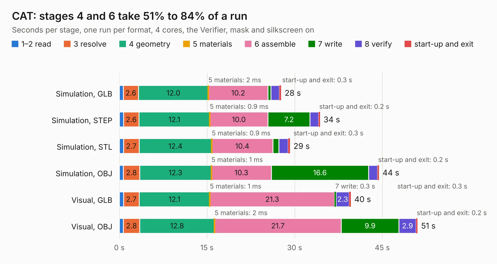

| Mode and format | 1–2 read | 3 resolve | 4 geometry | 5 materials | 6 assemble | 7 write | 8 verify | start-up and exit | Total |
|---|---:|---:|---:|---:|---:|---:|---:|---:|---:|
| Simulation, GLB | 0.7 | 2.6 | 12.0 | 2&nbsp;ms | 10.2 | 0.5 | 1.4 | 0.3 | 27.7 |
| Simulation, STEP | 0.7 | 2.6 | 12.1 | 0.9&nbsp;ms | 10.0 | 7.2 | 1.5 | 0.2 | 34.3 |
| Simulation, STL | 0.7 | 2.7 | 12.4 | 0.9&nbsp;ms | 10.4 | 1.1 | 1.6 | 0.3 | 29.2 |
| Simulation, OBJ | 0.7 | 2.8 | 12.3 | 1&nbsp;ms | 10.3 | 16.6 | 1.6 | 0.2 | 44.4 |
| Visual, GLB | 0.7 | 2.7 | 12.1 | 1&nbsp;ms | 21.3 | 0.3 | 2.3 | 0.3 | 39.6 |
| Visual, OBJ | 0.7 | 2.8 | 12.8 | 2&nbsp;ms | 21.7 | 9.9 | 2.9 | 0.2 | 51.0 |

<table align="center"><tr><td valign="top">

| Board | Repo: [xesscorp/CAT-Board](https://github.com/xesscorp/CAT-Board) Board: `CAT.kicad_pcb` |
|---|---|
| Folder | pcb |
| Complexity | 319&nbsp;/&nbsp;1000 (size&nbsp;264, features&nbsp;55) |
| KESE&nbsp;features | through vias, drill offsets, filled zones, curved board outline |
| Tested | 9th November 2026 |
| Copper&nbsp;layers | 4 |
| File&nbsp;format | KiCad 5 (20171130) |
| Parts,&nbsp;tracks,&nbsp;vias | 107, 1,919, 174 |
| Triangles,&nbsp;simulation | 2,714,340 in 182 parts |
| Verifier | PASS in all six runs |

</td><td valign="top">

<table>
<tr><th>File type</th><th>File size</th><th>Peak memory used</th></tr>
<tr><th colspan="3" align="left">Simulation</th></tr>
<tr><td>GLB</td><td align="right">94&nbsp;MB</td><td align="right">908&nbsp;MB</td></tr>
<tr><td>STEP</td><td align="right">426&nbsp;MB</td><td align="right">998&nbsp;MB</td></tr>
<tr><td>STL</td><td align="right">136&nbsp;MB</td><td align="right">893&nbsp;MB</td></tr>
<tr><td>OBJ</td><td align="right">288&nbsp;MB</td><td align="right">1.8&nbsp;GB</td></tr>
<tr><th colspan="3" align="left">Visual</th></tr>
<tr><td>GLB</td><td align="right">59&nbsp;MB</td><td align="right">1.1&nbsp;GB</td></tr>
<tr><td>OBJ</td><td align="right">181&nbsp;MB</td><td align="right">1.3&nbsp;GB</td></tr>
</table>

</td></tr></table>

## 23.29.2 hw-openmower-sabo

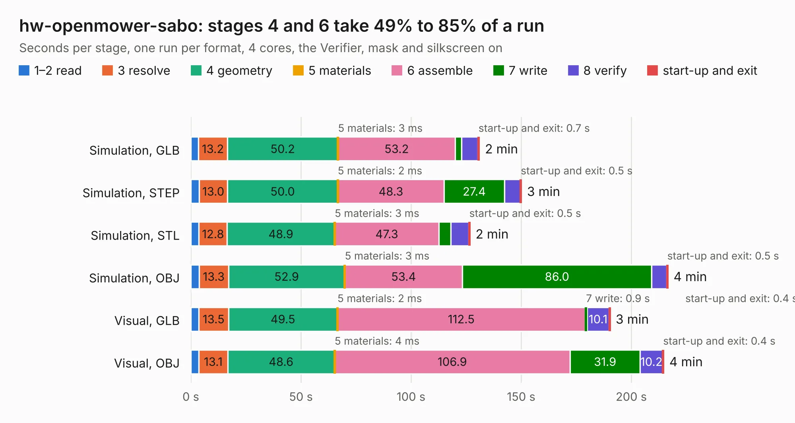

| Mode and format | 1–2 read | 3 resolve | 4 geometry | 5 materials | 6 assemble | 7 write | 8 verify | start-up and exit | Total |
|---|---:|---:|---:|---:|---:|---:|---:|---:|---:|
| Simulation, GLB | 3.4 | 13.2 | 50.2 | 3&nbsp;ms | 53.2 | 2.8 | 7.4 | 0.7 | 131.0 |
| Simulation, STEP | 3.7 | 13.0 | 50.0 | 2&nbsp;ms | 48.3 | 27.4 | 7.2 | 0.5 | 150.1 |
| Simulation, STL | 3.7 | 12.8 | 48.9 | 3&nbsp;ms | 47.3 | 5.4 | 8.1 | 0.5 | 126.7 |
| Simulation, OBJ | 3.7 | 13.3 | 52.9 | 3&nbsp;ms | 53.4 | 86.0 | 6.8 | 0.5 | 216.6 |
| Visual, GLB | 3.6 | 13.5 | 49.5 | 2&nbsp;ms | 112.5 | 0.9 | 10.1 | 0.4 | 190.3 |
| Visual, OBJ | 3.7 | 13.1 | 48.6 | 4&nbsp;ms | 106.9 | 31.9 | 10.2 | 0.4 | 214.7 |

<table align="center"><tr><td valign="top">

| Board | Repo: [xtech/hw-openmower-sabo](https://github.com/xtech/hw-openmower-sabo) Board: `hw-openmower-sabo.kicad_pcb` |
|---|---|
| Complexity | 419&nbsp;/&nbsp;1000 (size&nbsp;249, features&nbsp;170) |
| KESE&nbsp;features | through vias, slotted holes, custom pads, rounded, trapezoid or chamfered pads, drill offsets, filled zones, copper drawings, knockout text, TrueType text, stack-up, dielectric εr and tanδ, copper finish, mask and silkscreen colours |
| Tested | 9th November 2026 |
| Copper&nbsp;layers | 6 |
| File&nbsp;format | KiCad 10 (20260206) |
| Parts,&nbsp;tracks,&nbsp;vias | 324, 2,730, 1,177 |
| Triangles,&nbsp;simulation | 11,081,862 in 442 parts |
| Verifier | PASS in all six runs |

</td><td valign="top">

<table>
<tr><th>File type</th><th>File size</th><th>Peak memory used</th></tr>
<tr><th colspan="3" align="left">Simulation</th></tr>
<tr><td>GLB</td><td align="right">368&nbsp;MB</td><td align="right">3.1&nbsp;GB</td></tr>
<tr><td>STEP</td><td align="right">1.4&nbsp;GB</td><td align="right">3.8&nbsp;GB</td></tr>
<tr><td>STL</td><td align="right">554&nbsp;MB</td><td align="right">3.1&nbsp;GB</td></tr>
<tr><td>OBJ</td><td align="right">1.2&nbsp;GB</td><td align="right">6.9&nbsp;GB</td></tr>
<tr><th colspan="3" align="left">Visual</th></tr>
<tr><td>GLB</td><td align="right">179&nbsp;MB</td><td align="right">3.1&nbsp;GB</td></tr>
<tr><td>OBJ</td><td align="right">582&nbsp;MB</td><td align="right">3.8&nbsp;GB</td></tr>
</table>

</td></tr></table>

## 23.29.3 hw-openmower-universal

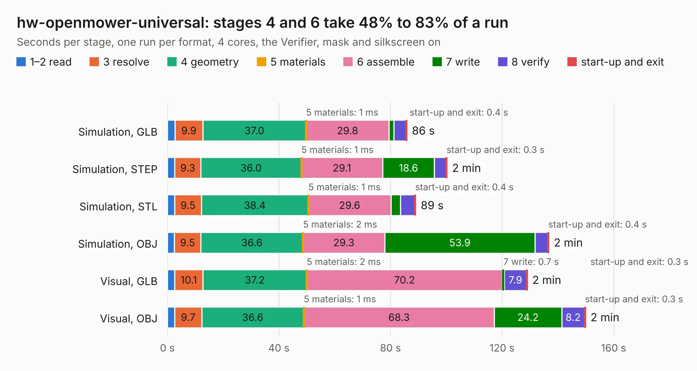

| Mode and format | 1–2 read | 3 resolve | 4 geometry | 5 materials | 6 assemble | 7 write | 8 verify | start-up and exit | Total |
|---|---:|---:|---:|---:|---:|---:|---:|---:|---:|
| Simulation, GLB | 2.8 | 9.9 | 37.0 | 1&nbsp;ms | 29.8 | 1.7 | 4.4 | 0.4 | 85.9 |
| Simulation, STEP | 2.7 | 9.3 | 36.0 | 1&nbsp;ms | 29.1 | 18.6 | 4.2 | 0.3 | 100.3 |
| Simulation, STL | 2.7 | 9.5 | 38.4 | 1&nbsp;ms | 29.6 | 3.4 | 5.1 | 0.4 | 89.1 |
| Simulation, OBJ | 2.5 | 9.5 | 36.6 | 2&nbsp;ms | 29.3 | 53.9 | 4.6 | 0.4 | 136.8 |
| Visual, GLB | 2.7 | 10.1 | 37.2 | 2&nbsp;ms | 70.2 | 0.7 | 7.9 | 0.3 | 129.1 |
| Visual, OBJ | 2.7 | 9.7 | 36.6 | 1&nbsp;ms | 68.3 | 24.2 | 8.2 | 0.3 | 149.9 |

<table align="center"><tr><td valign="top">

| Board | Repo: [xtech/hw-openmower-universal](https://github.com/xtech/hw-openmower-universal) Board: `hw-openmower-universal.kicad_pcb` |
|---|---|
| Complexity | 358&nbsp;/&nbsp;1000 (size&nbsp;238, features&nbsp;120) |
| KESE&nbsp;features | through vias, slotted holes, custom pads, rounded, trapezoid or chamfered pads, drill offsets, filled zones, curved board outline, stack-up, dielectric εr and tanδ |
| Tested | 9th November 2026 |
| Copper&nbsp;layers | 4 |
| File&nbsp;format | KiCad 8 (20240108) |
| Parts,&nbsp;tracks,&nbsp;vias | 382, 2,241, 928 |
| Triangles,&nbsp;simulation | 8,494,312 in 357 parts |
| Verifier | PASS in all six runs |

</td><td valign="top">

<table>
<tr><th>File type</th><th>File size</th><th>Peak memory used</th></tr>
<tr><th colspan="3" align="left">Simulation</th></tr>
<tr><td>GLB</td><td align="right">286&nbsp;MB</td><td align="right">2.3&nbsp;GB</td></tr>
<tr><td>STEP</td><td align="right">993&nbsp;MB</td><td align="right">3.0&nbsp;GB</td></tr>
<tr><td>STL</td><td align="right">425&nbsp;MB</td><td align="right">2.4&nbsp;GB</td></tr>
<tr><td>OBJ</td><td align="right">899&nbsp;MB</td><td align="right">5.4&nbsp;GB</td></tr>
<tr><th colspan="3" align="left">Visual</th></tr>
<tr><td>GLB</td><td align="right">149&nbsp;MB</td><td align="right">2.6&nbsp;GB</td></tr>
<tr><td>OBJ</td><td align="right">479&nbsp;MB</td><td align="right">3.1&nbsp;GB</td></tr>
</table>

</td></tr></table>

## 23.29.4 hw-openmower-yardforce

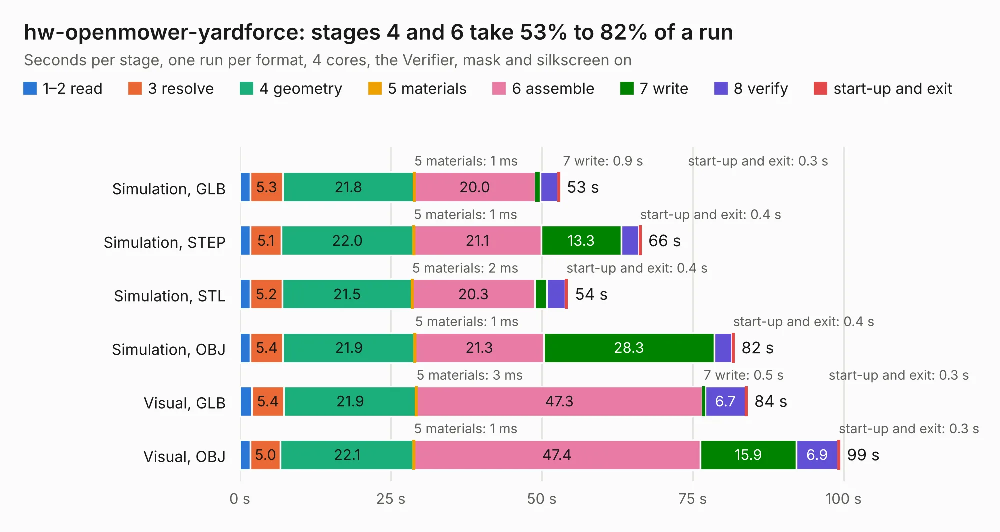

| Mode and format | 1–2 read | 3 resolve | 4 geometry | 5 materials | 6 assemble | 7 write | 8 verify | start-up and exit | Total |
|---|---:|---:|---:|---:|---:|---:|---:|---:|---:|
| Simulation, GLB | 1.8 | 5.3 | 21.8 | 1&nbsp;ms | 20.0 | 0.9 | 2.8 | 0.3 | 52.9 |
| Simulation, STEP | 1.8 | 5.1 | 22.0 | 1&nbsp;ms | 21.1 | 13.3 | 2.9 | 0.4 | 66.5 |
| Simulation, STL | 1.8 | 5.2 | 21.5 | 2&nbsp;ms | 20.3 | 2.0 | 3.0 | 0.4 | 54.3 |
| Simulation, OBJ | 1.7 | 5.4 | 21.9 | 1&nbsp;ms | 21.3 | 28.3 | 2.9 | 0.4 | 81.9 |
| Visual, GLB | 2.0 | 5.4 | 21.9 | 3&nbsp;ms | 47.3 | 0.5 | 6.7 | 0.3 | 84.0 |
| Visual, OBJ | 1.8 | 5.0 | 22.1 | 1&nbsp;ms | 47.4 | 15.9 | 6.9 | 0.3 | 99.4 |

<table align="center"><tr><td valign="top">

| Board | Repo: [xtech/hw-openmower-yardforce](https://github.com/xtech/hw-openmower-yardforce) Board: `hw-openmower-yardforce.kicad_pcb` |
|---|---|
| Complexity | 356&nbsp;/&nbsp;1000 (size&nbsp;231, features&nbsp;125) |
| KESE&nbsp;features | through vias, slotted holes, custom pads, rounded, trapezoid or chamfered pads, drill offsets, filled zones, knockout text, stack-up, dielectric εr and tanδ |
| Tested | 9th November 2026 |
| Copper&nbsp;layers | 4 |
| File&nbsp;format | KiCad 9 (20241229) |
| Parts,&nbsp;tracks,&nbsp;vias | 253, 2,513, 641 |
| Triangles,&nbsp;simulation | 6,269,352 in 356 parts |
| Verifier | PASS in all six runs |

</td><td valign="top">

<table>
<tr><th>File type</th><th>File size</th><th>Peak memory used</th></tr>
<tr><th colspan="3" align="left">Simulation</th></tr>
<tr><td>GLB</td><td align="right">213&nbsp;MB</td><td align="right">1.8&nbsp;GB</td></tr>
<tr><td>STEP</td><td align="right">804&nbsp;MB</td><td align="right">2.3&nbsp;GB</td></tr>
<tr><td>STL</td><td align="right">313&nbsp;MB</td><td align="right">1.8&nbsp;GB</td></tr>
<tr><td>OBJ</td><td align="right">667&nbsp;MB</td><td align="right">4.0&nbsp;GB</td></tr>
<tr><th colspan="3" align="left">Visual</th></tr>
<tr><td>GLB</td><td align="right">119&nbsp;MB</td><td align="right">2.1&nbsp;GB</td></tr>
<tr><td>OBJ</td><td align="right">381&nbsp;MB</td><td align="right">2.6&nbsp;GB</td></tr>
</table>

</td></tr></table>

## 23.29.5 Prism

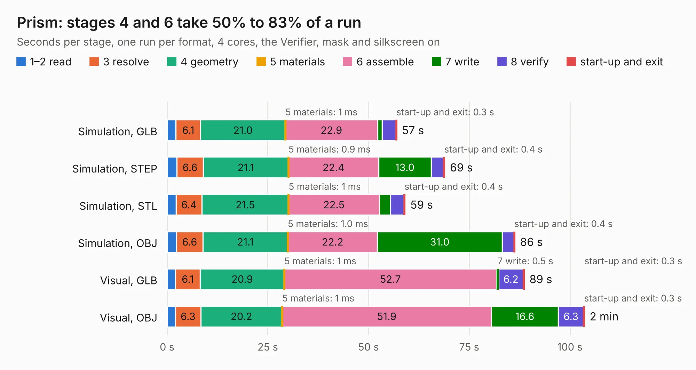

| Mode and format | 1–2 read | 3 resolve | 4 geometry | 5 materials | 6 assemble | 7 write | 8 verify | start-up and exit | Total |
|---|---:|---:|---:|---:|---:|---:|---:|---:|---:|
| Simulation, GLB | 2.2 | 6.1 | 21.0 | 1&nbsp;ms | 22.9 | 1.2 | 3.3 | 0.3 | 57.1 |
| Simulation, STEP | 2.4 | 6.6 | 21.1 | 0.9&nbsp;ms | 22.4 | 13.0 | 3.1 | 0.4 | 69.0 |
| Simulation, STL | 2.2 | 6.4 | 21.5 | 1&nbsp;ms | 22.5 | 2.8 | 3.3 | 0.4 | 59.1 |
| Simulation, OBJ | 2.3 | 6.6 | 21.1 | 1.0&nbsp;ms | 22.2 | 31.0 | 2.8 | 0.4 | 86.4 |
| Visual, GLB | 2.1 | 6.1 | 20.9 | 1&nbsp;ms | 52.7 | 0.5 | 6.2 | 0.3 | 88.7 |
| Visual, OBJ | 2.1 | 6.3 | 20.2 | 1&nbsp;ms | 51.9 | 16.6 | 6.3 | 0.3 | 103.7 |

<table align="center"><tr><td valign="top">

| Board | Repo: [y10-labs/prism-pcb](https://github.com/y10-labs/prism-pcb) Board: `Prism.kicad_pcb` |
|---|---|
| Complexity | 422&nbsp;/&nbsp;1000 (size&nbsp;322, features&nbsp;100) |
| KESE&nbsp;features | through vias, custom pads, rounded, trapezoid or chamfered pads, filled zones, copper drawings, stack-up, dielectric εr and tanδ |
| Tested | 9th November 2026 |
| Copper&nbsp;layers | 8 |
| File&nbsp;format | KiCad 8 (20240108) |
| Parts,&nbsp;tracks,&nbsp;vias | 229, 8,893, 833 |
| Triangles,&nbsp;simulation | 6,877,892 in 355 parts |
| Verifier | PASS in all six runs |

</td><td valign="top">

<table>
<tr><th>File type</th><th>File size</th><th>Peak memory used</th></tr>
<tr><th colspan="3" align="left">Simulation</th></tr>
<tr><td>GLB</td><td align="right">226&nbsp;MB</td><td align="right">1.6&nbsp;GB</td></tr>
<tr><td>STEP</td><td align="right">992&nbsp;MB</td><td align="right">2.2&nbsp;GB</td></tr>
<tr><td>STL</td><td align="right">344&nbsp;MB</td><td align="right">1.6&nbsp;GB</td></tr>
<tr><td>OBJ</td><td align="right">753&nbsp;MB</td><td align="right">4.4&nbsp;GB</td></tr>
<tr><th colspan="3" align="left">Visual</th></tr>
<tr><td>GLB</td><td align="right">127&nbsp;MB</td><td align="right">2.2&nbsp;GB</td></tr>
<tr><td>OBJ</td><td align="right">426&nbsp;MB</td><td align="right">2.8&nbsp;GB</td></tr>
</table>

</td></tr></table>

## 23.29.6 2063-Z80

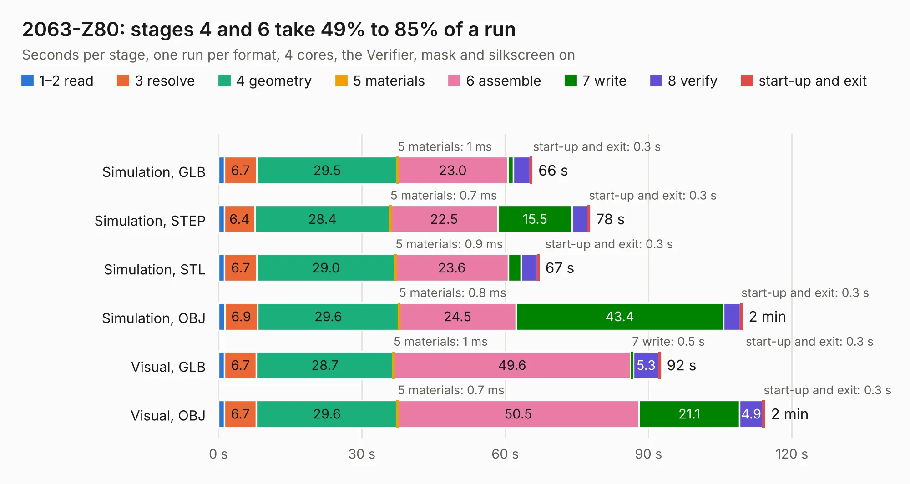

| Mode and format | 1–2 read | 3 resolve | 4 geometry | 5 materials | 6 assemble | 7 write | 8 verify | start-up and exit | Total |
|---|---:|---:|---:|---:|---:|---:|---:|---:|---:|
| Simulation, GLB | 1.2 | 6.7 | 29.5 | 1&nbsp;ms | 23.0 | 1.2 | 3.5 | 0.3 | 65.6 |
| Simulation, STEP | 1.2 | 6.4 | 28.4 | 0.7&nbsp;ms | 22.5 | 15.5 | 3.3 | 0.3 | 77.7 |
| Simulation, STL | 1.3 | 6.7 | 29.0 | 0.9&nbsp;ms | 23.6 | 2.7 | 3.4 | 0.3 | 67.0 |
| Simulation, OBJ | 1.3 | 6.9 | 29.6 | 0.8&nbsp;ms | 24.5 | 43.4 | 3.6 | 0.3 | 109.6 |
| Visual, GLB | 1.2 | 6.7 | 28.7 | 1&nbsp;ms | 49.6 | 0.5 | 5.3 | 0.3 | 92.5 |
| Visual, OBJ | 1.2 | 6.7 | 29.6 | 0.7&nbsp;ms | 50.5 | 21.1 | 4.9 | 0.3 | 114.2 |

<table align="center"><tr><td valign="top">

| Board | Repo: [Z80-Retro/2063-Z80](https://github.com/Z80-Retro/2063-Z80) Board: `2063-Z80.kicad_pcb` |
|---|---|
| Complexity | 286&nbsp;/&nbsp;1000 (size&nbsp;211, features&nbsp;75) |
| KESE&nbsp;features | through vias, slotted holes, rounded, trapezoid or chamfered pads, drill offsets, filled zones, curved board outline |
| Tested | 9th November 2026 |
| Copper&nbsp;layers | 4 |
| File&nbsp;format | KiCad 5 (20171130) |
| Parts,&nbsp;tracks,&nbsp;vias | 80, 1,997, 244 |
| Triangles,&nbsp;simulation | 6,315,170 in 166 parts |
| Verifier | PASS in all six runs |

</td><td valign="top">

<table>
<tr><th>File type</th><th>File size</th><th>Peak memory used</th></tr>
<tr><th colspan="3" align="left">Simulation</th></tr>
<tr><td>GLB</td><td align="right">216&nbsp;MB</td><td align="right">1.6&nbsp;GB</td></tr>
<tr><td>STEP</td><td align="right">878&nbsp;MB</td><td align="right">2.0&nbsp;GB</td></tr>
<tr><td>STL</td><td align="right">316&nbsp;MB</td><td align="right">1.6&nbsp;GB</td></tr>
<tr><td>OBJ</td><td align="right">677&nbsp;MB</td><td align="right">4.1&nbsp;GB</td></tr>
<tr><th colspan="3" align="left">Visual</th></tr>
<tr><td>GLB</td><td align="right">117&nbsp;MB</td><td align="right">1.9&nbsp;GB</td></tr>
<tr><td>OBJ</td><td align="right">373&nbsp;MB</td><td align="right">2.4&nbsp;GB</td></tr>
</table>

</td></tr></table>

## 23.29.7 pcb

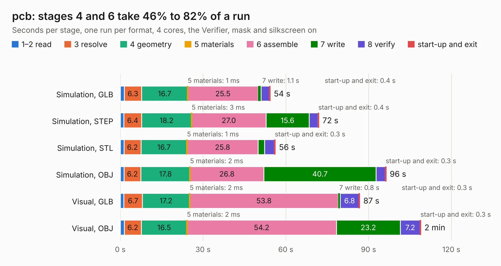

| Mode and format | 1–2 read | 3 resolve | 4 geometry | 5 materials | 6 assemble | 7 write | 8 verify | start-up and exit | Total |
|---|---:|---:|---:|---:|---:|---:|---:|---:|---:|
| Simulation, GLB | 1.4 | 6.3 | 16.7 | 1&nbsp;ms | 25.5 | 1.1 | 3.0 | 0.4 | 54.4 |
| Simulation, STEP | 1.3 | 6.4 | 18.2 | 3&nbsp;ms | 27.0 | 15.6 | 3.2 | 0.4 | 72.0 |
| Simulation, STL | 1.3 | 6.2 | 16.7 | 1&nbsp;ms | 25.8 | 2.3 | 3.6 | 0.3 | 56.2 |
| Simulation, OBJ | 1.3 | 6.2 | 17.8 | 2&nbsp;ms | 26.8 | 40.7 | 3.3 | 0.3 | 96.4 |
| Visual, GLB | 1.3 | 6.7 | 17.2 | 2&nbsp;ms | 53.8 | 0.8 | 6.8 | 0.3 | 86.8 |
| Visual, OBJ | 1.4 | 6.2 | 16.5 | 2&nbsp;ms | 54.2 | 23.2 | 7.2 | 0.3 | 109.0 |

<table align="center"><tr><td valign="top">

| Board | Repo: [zephray/Fobu](https://github.com/zephray/Fobu) Board: `pcb.kicad_pcb` |
|---|---|
| Folder | hardware / pcb |
| Complexity | 465&nbsp;/&nbsp;1000 (size&nbsp;325, features&nbsp;140) |
| KESE&nbsp;features | through vias, slotted holes, custom pads, rounded, trapezoid or chamfered pads, filled zones, copper drawings, curved board outline, stack-up, dielectric εr and tanδ, copper finish, mask and silkscreen colours |
| Tested | 9th November 2026 |
| Copper&nbsp;layers | 6 |
| File&nbsp;format | KiCad 6 (20211014) |
| Parts,&nbsp;tracks,&nbsp;vias | 255, 6,378, 920 |
| Triangles,&nbsp;simulation | 7,037,632 in 519 parts |
| Verifier | PASS in all six runs |

</td><td valign="top">

<table>
<tr><th>File type</th><th>File size</th><th>Peak memory used</th></tr>
<tr><th colspan="3" align="left">Simulation</th></tr>
<tr><td>GLB</td><td align="right">236&nbsp;MB</td><td align="right">1.8&nbsp;GB</td></tr>
<tr><td>STEP</td><td align="right">827&nbsp;MB</td><td align="right">2.4&nbsp;GB</td></tr>
<tr><td>STL</td><td align="right">352&nbsp;MB</td><td align="right">1.8&nbsp;GB</td></tr>
<tr><td>OBJ</td><td align="right">754&nbsp;MB</td><td align="right">4.5&nbsp;GB</td></tr>
<tr><th colspan="3" align="left">Visual</th></tr>
<tr><td>GLB</td><td align="right">136&nbsp;MB</td><td align="right">2.3&nbsp;GB</td></tr>
<tr><td>OBJ</td><td align="right">456&nbsp;MB</td><td align="right">2.9&nbsp;GB</td></tr>
</table>

</td></tr></table>

## 23.29.8 adapter

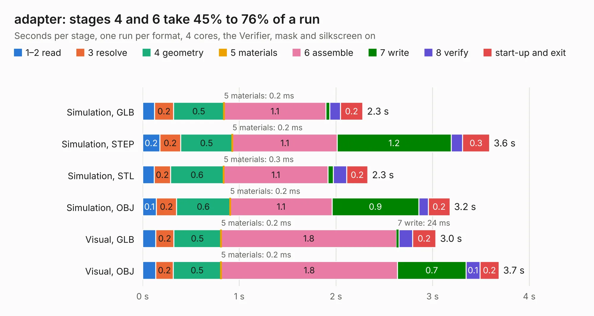

| Mode and format | 1–2 read | 3 resolve | 4 geometry | 5 materials | 6 assemble | 7 write | 8 verify | start-up and exit | Total |
|---|---:|---:|---:|---:|---:|---:|---:|---:|---:|
| Simulation, GLB | 0.1 | 0.2 | 0.5 | 0.2&nbsp;ms | 1.1 | 40&nbsp;ms | 0.1 | 0.2 | 2.3 |
| Simulation, STEP | 0.2 | 0.2 | 0.5 | 0.2&nbsp;ms | 1.1 | 1.2 | 0.1 | 0.3 | 3.6 |
| Simulation, STL | 0.1 | 0.2 | 0.6 | 0.3&nbsp;ms | 1.1 | 57&nbsp;ms | 0.1 | 0.2 | 2.3 |
| Simulation, OBJ | 0.1 | 0.2 | 0.6 | 0.2&nbsp;ms | 1.1 | 0.9 | 0.1 | 0.2 | 3.2 |
| Visual, GLB | 0.1 | 0.2 | 0.5 | 0.2&nbsp;ms | 1.8 | 24&nbsp;ms | 0.1 | 0.2 | 3.0 |
| Visual, OBJ | 0.1 | 0.2 | 0.5 | 0.2&nbsp;ms | 1.8 | 0.7 | 0.1 | 0.2 | 3.7 |

<table align="center"><tr><td valign="top">

| Board | Repo: [zephray/nekoink](https://github.com/zephray/nekoink) Board: `adapter.kicad_pcb` |
|---|---|
| Folder | pcb / 34p-a-adapter |
| Complexity | 211&nbsp;/&nbsp;1000 (size&nbsp;136, features&nbsp;75) |
| KESE&nbsp;features | through vias, rounded, trapezoid or chamfered pads, filled zones, stack-up, dielectric εr and tanδ |
| Tested | 9th November 2026 |
| Copper&nbsp;layers | 2 |
| File&nbsp;format | KiCad 6 (20211014) |
| Parts,&nbsp;tracks,&nbsp;vias | 9, 186, 43 |
| Triangles,&nbsp;simulation | 151,366 in 49 parts |
| Verifier | PASS in all six runs |

</td><td valign="top">

<table>
<tr><th>File type</th><th>File size</th><th>Peak memory used</th></tr>
<tr><th colspan="3" align="left">Simulation</th></tr>
<tr><td>GLB</td><td align="right">5.3&nbsp;MB</td><td align="right">212&nbsp;MB</td></tr>
<tr><td>STEP</td><td align="right">27&nbsp;MB</td><td align="right">226&nbsp;MB</td></tr>
<tr><td>STL</td><td align="right">7.6&nbsp;MB</td><td align="right">213&nbsp;MB</td></tr>
<tr><td>OBJ</td><td align="right">15&nbsp;MB</td><td align="right">211&nbsp;MB</td></tr>
<tr><th colspan="3" align="left">Visual</th></tr>
<tr><td>GLB</td><td align="right">4.4&nbsp;MB</td><td align="right">198&nbsp;MB</td></tr>
<tr><td>OBJ</td><td align="right">12&nbsp;MB</td><td align="right">195&nbsp;MB</td></tr>
</table>

</td></tr></table>

## 23.29.9 pcb

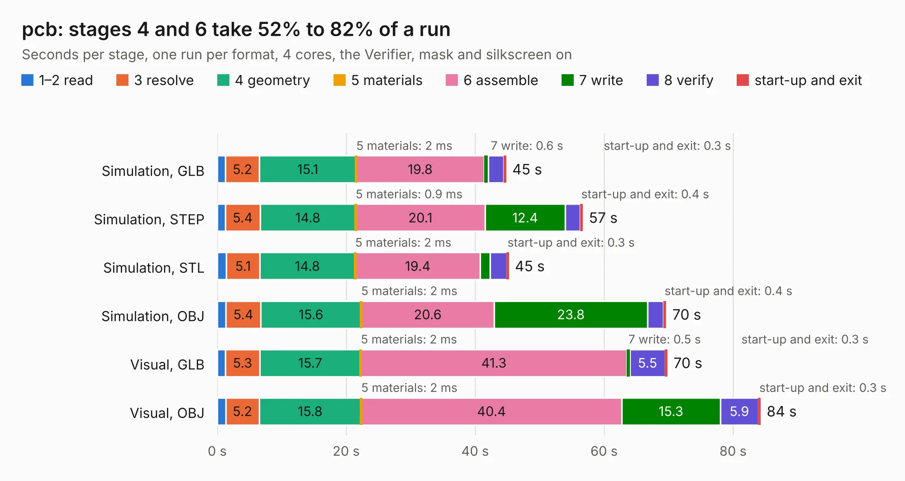

| Mode and format | 1–2 read | 3 resolve | 4 geometry | 5 materials | 6 assemble | 7 write | 8 verify | start-up and exit | Total |
|---|---:|---:|---:|---:|---:|---:|---:|---:|---:|
| Simulation, GLB | 1.3 | 5.2 | 15.1 | 2&nbsp;ms | 19.8 | 0.6 | 2.4 | 0.3 | 44.7 |
| Simulation, STEP | 1.3 | 5.4 | 14.8 | 0.9&nbsp;ms | 20.1 | 12.4 | 2.3 | 0.4 | 56.6 |
| Simulation, STL | 1.4 | 5.1 | 14.8 | 2&nbsp;ms | 19.4 | 1.5 | 2.6 | 0.3 | 45.2 |
| Simulation, OBJ | 1.3 | 5.4 | 15.6 | 2&nbsp;ms | 20.6 | 23.8 | 2.5 | 0.4 | 69.6 |
| Visual, GLB | 1.3 | 5.3 | 15.7 | 2&nbsp;ms | 41.3 | 0.5 | 5.5 | 0.3 | 69.8 |
| Visual, OBJ | 1.3 | 5.2 | 15.8 | 2&nbsp;ms | 40.4 | 15.3 | 5.9 | 0.3 | 84.2 |

<table align="center"><tr><td valign="top">

| Board | Repo: [zephray/nekoink](https://github.com/zephray/nekoink) Board: `pcb.kicad_pcb` |
|---|---|
| Folder | pcb / mainboard_gen1 |
| Complexity | 441&nbsp;/&nbsp;1000 (size&nbsp;301, features&nbsp;140) |
| KESE&nbsp;features | through vias, slotted holes, custom pads, rounded, trapezoid or chamfered pads, arc tracks, filled zones, copper drawings, curved board outline, stack-up, dielectric εr and tanδ, mask and silkscreen colours |
| Tested | 9th November 2026 |
| Copper&nbsp;layers | 4 |
| File&nbsp;format | KiCad 6 (20211014) |
| Parts,&nbsp;tracks,&nbsp;vias | 231, 6,227, 606 |
| Triangles,&nbsp;simulation | 4,542,078 in 352 parts |
| Verifier | PASS in all six runs |

</td><td valign="top">

<table>
<tr><th>File type</th><th>File size</th><th>Peak memory used</th></tr>
<tr><th colspan="3" align="left">Simulation</th></tr>
<tr><td>GLB</td><td align="right">154&nbsp;MB</td><td align="right">1.4&nbsp;GB</td></tr>
<tr><td>STEP</td><td align="right">721&nbsp;MB</td><td align="right">1.8&nbsp;GB</td></tr>
<tr><td>STL</td><td align="right">227&nbsp;MB</td><td align="right">1.4&nbsp;GB</td></tr>
<tr><td>OBJ</td><td align="right">482&nbsp;MB</td><td align="right">2.9&nbsp;GB</td></tr>
<tr><th colspan="3" align="left">Visual</th></tr>
<tr><td>GLB</td><td align="right">100&nbsp;MB</td><td align="right">1.7&nbsp;GB</td></tr>
<tr><td>OBJ</td><td align="right">318&nbsp;MB</td><td align="right">2.1&nbsp;GB</td></tr>
</table>

</td></tr></table>

## 23.29.10 pcb

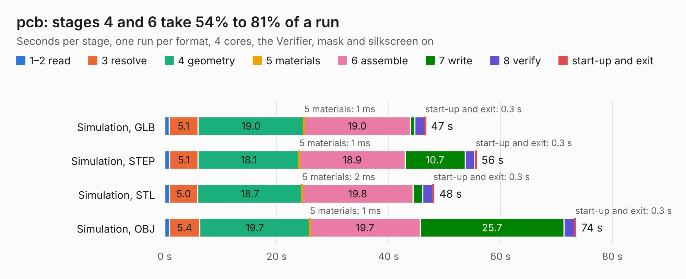

| Mode and format | 1–2 read | 3 resolve | 4 geometry | 5 materials | 6 assemble | 7 write | 8 verify | start-up and exit | Total |
|---|---:|---:|---:|---:|---:|---:|---:|---:|---:|
| Simulation, GLB | 0.8 | 5.1 | 19.0 | 1&nbsp;ms | 19.0 | 0.8 | 1.8 | 0.3 | 46.7 |
| Simulation, STEP | 0.9 | 5.1 | 18.1 | 1&nbsp;ms | 18.9 | 10.7 | 1.8 | 0.3 | 55.7 |
| Simulation, STL | 0.9 | 5.0 | 18.7 | 2&nbsp;ms | 19.8 | 1.7 | 1.8 | 0.3 | 48.2 |
| Simulation, OBJ | 0.9 | 5.4 | 19.7 | 1&nbsp;ms | 19.7 | 25.7 | 1.9 | 0.3 | 73.5 |
| Visual, GLB | 0.9 | 5.0 | 19.6 | 1&nbsp;ms | 38.6 | 0.4 | 4.0 | 0.3 | 68.8 |
| Visual, OBJ | 1.0 | 5.4 | 18.8 | 1&nbsp;ms | 37.7 | 14.1 | 4.5 | 0.3 | 81.9 |

<table align="center"><tr><td valign="top">

| Board | Repo: [zephray/nekoink](https://github.com/zephray/nekoink) Board: `pcb.kicad_pcb` |
|---|---|
| Folder | pcb / mainboard_gen2 |
| Complexity | 398&nbsp;/&nbsp;1000 (size&nbsp;308, features&nbsp;90) |
| KESE&nbsp;features | through vias, slotted holes, custom pads, rounded, trapezoid or chamfered pads, copper drawings, stack-up, dielectric εr and tanδ |
| Tested | 9th November 2026 |
| Copper&nbsp;layers | 6 |
| File&nbsp;format | KiCad 7 (20221018) |
| Parts,&nbsp;tracks,&nbsp;vias | 241, 4,190, 464 |
| Triangles,&nbsp;simulation | 4,419,766 in 427 parts |
| Verifier | PASS in all six runs |

</td><td valign="top">

<table>
<tr><th>File type</th><th>File size</th><th>Peak memory used</th></tr>
<tr><th colspan="3" align="left">Simulation</th></tr>
<tr><td>GLB</td><td align="right">150&nbsp;MB</td><td align="right">1.2&nbsp;GB</td></tr>
<tr><td>STEP</td><td align="right">623&nbsp;MB</td><td align="right">1.5&nbsp;GB</td></tr>
<tr><td>STL</td><td align="right">221&nbsp;MB</td><td align="right">1.2&nbsp;GB</td></tr>
<tr><td>OBJ</td><td align="right">469&nbsp;MB</td><td align="right">2.8&nbsp;GB</td></tr>
<tr><th colspan="3" align="left">Visual</th></tr>
<tr><td>GLB</td><td align="right">83&nbsp;MB</td><td align="right">1.7&nbsp;GB</td></tr>
<tr><td>OBJ</td><td align="right">266&nbsp;MB</td><td align="right">1.9&nbsp;GB</td></tr>
</table>

</td></tr></table>

## 23.29.11 18650_pcb

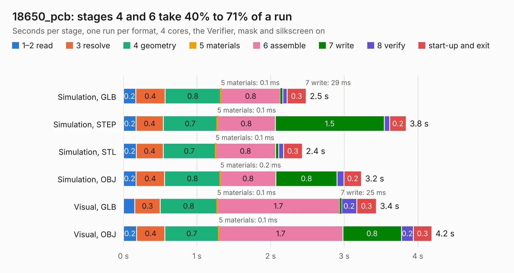

| Mode and format | 1–2 read | 3 resolve | 4 geometry | 5 materials | 6 assemble | 7 write | 8 verify | start-up and exit | Total |
|---|---:|---:|---:|---:|---:|---:|---:|---:|---:|
| Simulation, GLB | 0.2 | 0.4 | 0.8 | 0.1&nbsp;ms | 0.8 | 29&nbsp;ms | 60&nbsp;ms | 0.3 | 2.5 |
| Simulation, STEP | 0.2 | 0.4 | 0.7 | 0.1&nbsp;ms | 0.8 | 1.5 | 74&nbsp;ms | 0.2 | 3.8 |
| Simulation, STL | 0.2 | 0.4 | 0.7 | 0.1&nbsp;ms | 0.8 | 43&nbsp;ms | 65&nbsp;ms | 0.3 | 2.4 |
| Simulation, OBJ | 0.2 | 0.4 | 0.8 | 0.2&nbsp;ms | 0.8 | 0.8 | 94&nbsp;ms | 0.2 | 3.2 |
| Visual, GLB | 0.2 | 0.3 | 0.8 | 0.1&nbsp;ms | 1.7 | 25&nbsp;ms | 0.2 | 0.3 | 3.4 |
| Visual, OBJ | 0.2 | 0.4 | 0.7 | 0.1&nbsp;ms | 1.7 | 0.8 | 0.2 | 0.3 | 4.2 |

<table align="center"><tr><td valign="top">

| Board | Repo: [ZeroPhone/ZeroPhone-PCBs](https://github.com/ZeroPhone/ZeroPhone-PCBs) Board: `18650_pcb.kicad_pcb` |
|---|---|
| Folder | 18650_pcb |
| Complexity | 118&nbsp;/&nbsp;1000 (size&nbsp;88, features&nbsp;30) |
| KESE&nbsp;features | filled zones, curved board outline |
| Tested | 10th November 2026 |
| Copper&nbsp;layers | 2 |
| File&nbsp;format | KiCad 4 (4) |
| Parts,&nbsp;tracks,&nbsp;vias | 4, 26, 0 |
| Triangles,&nbsp;simulation | 141,022 in 14 parts |
| Verifier | PASS in all six runs |

</td><td valign="top">

<table>
<tr><th>File type</th><th>File size</th><th>Peak memory used</th></tr>
<tr><th colspan="3" align="left">Simulation</th></tr>
<tr><td>GLB</td><td align="right">5.3&nbsp;MB</td><td align="right">211&nbsp;MB</td></tr>
<tr><td>STEP</td><td align="right">26&nbsp;MB</td><td align="right">224&nbsp;MB</td></tr>
<tr><td>STL</td><td align="right">7.1&nbsp;MB</td><td align="right">212&nbsp;MB</td></tr>
<tr><td>OBJ</td><td align="right">15&nbsp;MB</td><td align="right">211&nbsp;MB</td></tr>
<tr><th colspan="3" align="left">Visual</th></tr>
<tr><td>GLB</td><td align="right">4.6&nbsp;MB</td><td align="right">183&nbsp;MB</td></tr>
<tr><td>OBJ</td><td align="right">13&nbsp;MB</td><td align="right">181&nbsp;MB</td></tr>
</table>

</td></tr></table>

## 23.29.12 6p_separator

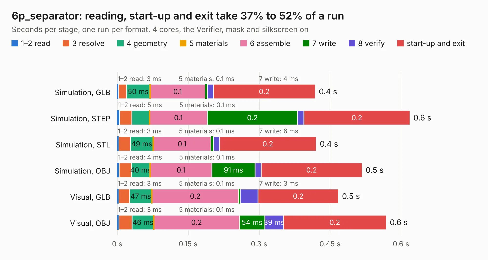

| Mode and format | 1–2 read | 3 resolve | 4 geometry | 5 materials | 6 assemble | 7 write | 8 verify | start-up and exit | Total |
|---|---:|---:|---:|---:|---:|---:|---:|---:|---:|
| Simulation, GLB | 3&nbsp;ms | 17&nbsp;ms | 50&nbsp;ms | 0.1&nbsp;ms | 0.1 | 4&nbsp;ms | 13&nbsp;ms | 0.2 | 0.4 |
| Simulation, STEP | 5&nbsp;ms | 26&nbsp;ms | 37&nbsp;ms | 0.1&nbsp;ms | 0.1 | 0.2 | 13&nbsp;ms | 0.2 | 0.6 |
| Simulation, STL | 3&nbsp;ms | 24&nbsp;ms | 49&nbsp;ms | 0.1&nbsp;ms | 0.1 | 6&nbsp;ms | 12&nbsp;ms | 0.2 | 0.4 |
| Simulation, OBJ | 4&nbsp;ms | 26&nbsp;ms | 40&nbsp;ms | 0.1&nbsp;ms | 0.1 | 91&nbsp;ms | 13&nbsp;ms | 0.2 | 0.5 |
| Visual, GLB | 3&nbsp;ms | 23&nbsp;ms | 47&nbsp;ms | 0.1&nbsp;ms | 0.2 | 3&nbsp;ms | 38&nbsp;ms | 0.2 | 0.5 |
| Visual, OBJ | 3&nbsp;ms | 28&nbsp;ms | 46&nbsp;ms | 0.1&nbsp;ms | 0.2 | 54&nbsp;ms | 39&nbsp;ms | 0.2 | 0.6 |

<table align="center"><tr><td valign="top">

| Board | Repo: [ZeroPhone/ZeroPhone-PCBs](https://github.com/ZeroPhone/ZeroPhone-PCBs) Board: `6p_separator.kicad_pcb` |
|---|---|
| Folder | 6p_separator |
| Complexity | 24&nbsp;/&nbsp;1000 (size&nbsp;24, features&nbsp;0) |
| Tested | 9th November 2026 |
| Copper&nbsp;layers | 2 |
| File&nbsp;format | KiCad 4 (4) |
| Parts,&nbsp;tracks,&nbsp;vias | 1, 0, 0 |
| Triangles,&nbsp;simulation | 18,436 in 9 parts |
| Verifier | PASS in all six runs |

</td><td valign="top">

<table>
<tr><th>File type</th><th>File size</th><th>Peak memory used</th></tr>
<tr><th colspan="3" align="left">Simulation</th></tr>
<tr><td>GLB</td><td align="right">598&nbsp;kB</td><td align="right">41&nbsp;MB</td></tr>
<tr><td>STEP</td><td align="right">2.3&nbsp;MB</td><td align="right">43&nbsp;MB</td></tr>
<tr><td>STL</td><td align="right">923&nbsp;kB</td><td align="right">41&nbsp;MB</td></tr>
<tr><td>OBJ</td><td align="right">1.7&nbsp;MB</td><td align="right">44&nbsp;MB</td></tr>
<tr><th colspan="3" align="left">Visual</th></tr>
<tr><td>GLB</td><td align="right">410&nbsp;kB</td><td align="right">69&nbsp;MB</td></tr>
<tr><td>OBJ</td><td align="right">1.1&nbsp;MB</td><td align="right">58&nbsp;MB</td></tr>
</table>

</td></tr></table>

## 23.29.13 back_pcb

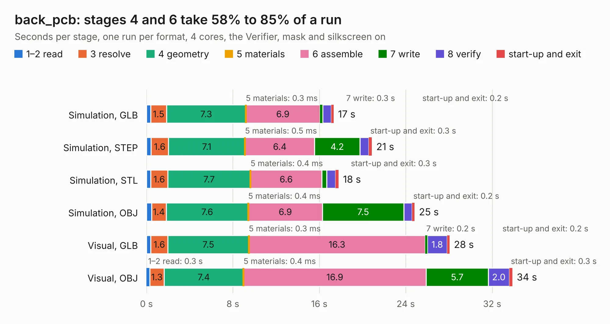

| Mode and format | 1–2 read | 3 resolve | 4 geometry | 5 materials | 6 assemble | 7 write | 8 verify | start-up and exit | Total |
|---|---:|---:|---:|---:|---:|---:|---:|---:|---:|
| Simulation, GLB | 0.4 | 1.5 | 7.3 | 0.3&nbsp;ms | 6.9 | 0.3 | 0.8 | 0.2 | 17.3 |
| Simulation, STEP | 0.4 | 1.6 | 7.1 | 0.5&nbsp;ms | 6.4 | 4.2 | 0.8 | 0.3 | 20.9 |
| Simulation, STL | 0.4 | 1.6 | 7.7 | 0.4&nbsp;ms | 6.6 | 0.5 | 0.8 | 0.3 | 17.8 |
| Simulation, OBJ | 0.5 | 1.4 | 7.6 | 0.4&nbsp;ms | 6.9 | 7.5 | 0.8 | 0.2 | 24.8 |
| Visual, GLB | 0.4 | 1.6 | 7.5 | 0.3&nbsp;ms | 16.3 | 0.2 | 1.8 | 0.2 | 28.1 |
| Visual, OBJ | 0.3 | 1.3 | 7.4 | 0.4&nbsp;ms | 16.9 | 5.7 | 2.0 | 0.3 | 33.9 |

<table align="center"><tr><td valign="top">

| Board | Repo: [ZeroPhone/ZeroPhone-PCBs](https://github.com/ZeroPhone/ZeroPhone-PCBs) Board: `back_pcb.kicad_pcb` |
|---|---|
| Folder | back_pcb |
| Complexity | 248&nbsp;/&nbsp;1000 (size&nbsp;193, features&nbsp;55) |
| KESE&nbsp;features | through vias, drill offsets, filled zones, curved board outline |
| Tested | 9th November 2026 |
| Copper&nbsp;layers | 2 |
| File&nbsp;format | KiCad 4 (4) |
| Parts,&nbsp;tracks,&nbsp;vias | 94, 1,491, 252 |
| Triangles,&nbsp;simulation | 1,666,214 in 94 parts |
| Verifier | PASS in all six runs |

</td><td valign="top">

<table>
<tr><th>File type</th><th>File size</th><th>Peak memory used</th></tr>
<tr><th colspan="3" align="left">Simulation</th></tr>
<tr><td>GLB</td><td align="right">59&nbsp;MB</td><td align="right">724&nbsp;MB</td></tr>
<tr><td>STEP</td><td align="right">309&nbsp;MB</td><td align="right">758&nbsp;MB</td></tr>
<tr><td>STL</td><td align="right">83&nbsp;MB</td><td align="right">724&nbsp;MB</td></tr>
<tr><td>OBJ</td><td align="right">176&nbsp;MB</td><td align="right">1.2&nbsp;GB</td></tr>
<tr><th colspan="3" align="left">Visual</th></tr>
<tr><td>GLB</td><td align="right">46&nbsp;MB</td><td align="right">820&nbsp;MB</td></tr>
<tr><td>OBJ</td><td align="right">139&nbsp;MB</td><td align="right">984&nbsp;MB</td></tr>
</table>

</td></tr></table>

## 23.29.14 front_prototype

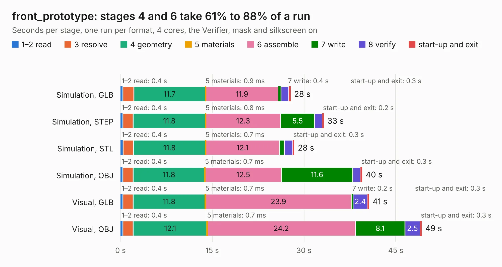

| Mode and format | 1–2 read | 3 resolve | 4 geometry | 5 materials | 6 assemble | 7 write | 8 verify | start-up and exit | Total |
|---|---:|---:|---:|---:|---:|---:|---:|---:|---:|
| Simulation, GLB | 0.4 | 1.8 | 11.7 | 0.9&nbsp;ms | 11.9 | 0.4 | 1.3 | 0.3 | 27.8 |
| Simulation, STEP | 0.4 | 1.7 | 11.8 | 0.8&nbsp;ms | 12.3 | 5.5 | 1.3 | 0.2 | 33.2 |
| Simulation, STL | 0.4 | 1.7 | 11.8 | 0.7&nbsp;ms | 12.1 | 0.8 | 1.4 | 0.3 | 28.4 |
| Simulation, OBJ | 0.4 | 1.7 | 11.8 | 0.7&nbsp;ms | 12.5 | 11.6 | 1.3 | 0.3 | 39.5 |
| Visual, GLB | 0.4 | 1.7 | 11.8 | 0.7&nbsp;ms | 23.9 | 0.2 | 2.4 | 0.3 | 40.6 |
| Visual, OBJ | 0.4 | 1.7 | 12.1 | 0.7&nbsp;ms | 24.2 | 8.1 | 2.5 | 0.3 | 49.3 |

<table align="center"><tr><td valign="top">

| Board | Repo: [ZeroPhone/ZeroPhone-PCBs](https://github.com/ZeroPhone/ZeroPhone-PCBs) Board: `front_prototype.kicad_pcb` |
|---|---|
| Folder | front_pcb |
| Complexity | 289&nbsp;/&nbsp;1000 (size&nbsp;234, features&nbsp;55) |
| KESE&nbsp;features | through vias, drill offsets, filled zones, curved board outline |
| Tested | 9th November 2026 |
| Copper&nbsp;layers | 2 |
| File&nbsp;format | KiCad 4 (4) |
| Parts,&nbsp;tracks,&nbsp;vias | 82, 1,522, 402 |
| Triangles,&nbsp;simulation | 2,078,644 in 97 parts |
| Verifier | PASS in all six runs |

</td><td valign="top">

<table>
<tr><th>File type</th><th>File size</th><th>Peak memory used</th></tr>
<tr><th colspan="3" align="left">Simulation</th></tr>
<tr><td>GLB</td><td align="right">75&nbsp;MB</td><td align="right">753&nbsp;MB</td></tr>
<tr><td>STEP</td><td align="right">401&nbsp;MB</td><td align="right">905&nbsp;MB</td></tr>
<tr><td>STL</td><td align="right">104&nbsp;MB</td><td align="right">795&nbsp;MB</td></tr>
<tr><td>OBJ</td><td align="right">226&nbsp;MB</td><td align="right">1.5&nbsp;GB</td></tr>
<tr><th colspan="3" align="left">Visual</th></tr>
<tr><td>GLB</td><td align="right">53&nbsp;MB</td><td align="right">999&nbsp;MB</td></tr>
<tr><td>OBJ</td><td align="right">162&nbsp;MB</td><td align="right">1.1&nbsp;GB</td></tr>
</table>

</td></tr></table>

## 23.29.15 keypad_pcb

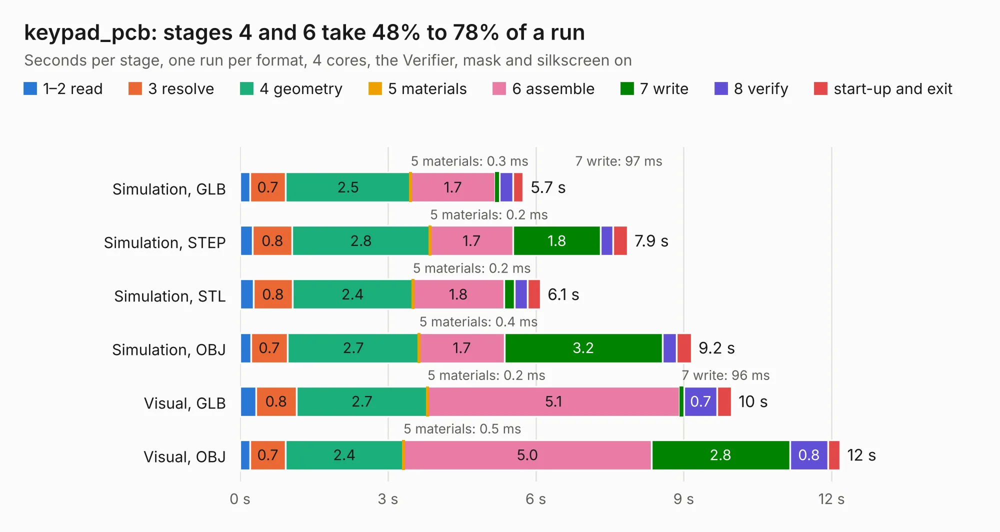

| Mode and format | 1–2 read | 3 resolve | 4 geometry | 5 materials | 6 assemble | 7 write | 8 verify | start-up and exit | Total |
|---|---:|---:|---:|---:|---:|---:|---:|---:|---:|
| Simulation, GLB | 0.2 | 0.7 | 2.5 | 0.3&nbsp;ms | 1.7 | 97&nbsp;ms | 0.3 | 0.2 | 5.7 |
| Simulation, STEP | 0.3 | 0.8 | 2.8 | 0.2&nbsp;ms | 1.7 | 1.8 | 0.3 | 0.3 | 7.9 |
| Simulation, STL | 0.3 | 0.8 | 2.4 | 0.2&nbsp;ms | 1.8 | 0.2 | 0.3 | 0.3 | 6.1 |
| Simulation, OBJ | 0.2 | 0.7 | 2.7 | 0.4&nbsp;ms | 1.7 | 3.2 | 0.3 | 0.3 | 9.2 |
| Visual, GLB | 0.3 | 0.8 | 2.7 | 0.2&nbsp;ms | 5.1 | 96&nbsp;ms | 0.7 | 0.3 | 10.0 |
| Visual, OBJ | 0.2 | 0.7 | 2.4 | 0.5&nbsp;ms | 5.0 | 2.8 | 0.8 | 0.2 | 12.2 |

<table align="center"><tr><td valign="top">

| Board | Repo: [ZeroPhone/ZeroPhone-PCBs](https://github.com/ZeroPhone/ZeroPhone-PCBs) Board: `keypad_pcb.kicad_pcb` |
|---|---|
| Folder | keypad_pcb |
| Complexity | 189&nbsp;/&nbsp;1000 (size&nbsp;164, features&nbsp;25) |
| KESE&nbsp;features | through vias, curved board outline |
| Tested | 9th November 2026 |
| Copper&nbsp;layers | 2 |
| File&nbsp;format | KiCad 4 (4) |
| Parts,&nbsp;tracks,&nbsp;vias | 31, 472, 104 |
| Triangles,&nbsp;simulation | 514,642 in 30 parts |
| Verifier | PASS in all six runs |

</td><td valign="top">

<table>
<tr><th>File type</th><th>File size</th><th>Peak memory used</th></tr>
<tr><th colspan="3" align="left">Simulation</th></tr>
<tr><td>GLB</td><td align="right">18&nbsp;MB</td><td align="right">330&nbsp;MB</td></tr>
<tr><td>STEP</td><td align="right">87&nbsp;MB</td><td align="right">353&nbsp;MB</td></tr>
<tr><td>STL</td><td align="right">26&nbsp;MB</td><td align="right">348&nbsp;MB</td></tr>
<tr><td>OBJ</td><td align="right">54&nbsp;MB</td><td align="right">397&nbsp;MB</td></tr>
<tr><th colspan="3" align="left">Visual</th></tr>
<tr><td>GLB</td><td align="right">16&nbsp;MB</td><td align="right">393&nbsp;MB</td></tr>
<tr><td>OBJ</td><td align="right">47&nbsp;MB</td><td align="right">400&nbsp;MB</td></tr>
</table>

</td></tr></table>

## 23.29.16 speaker_adapter

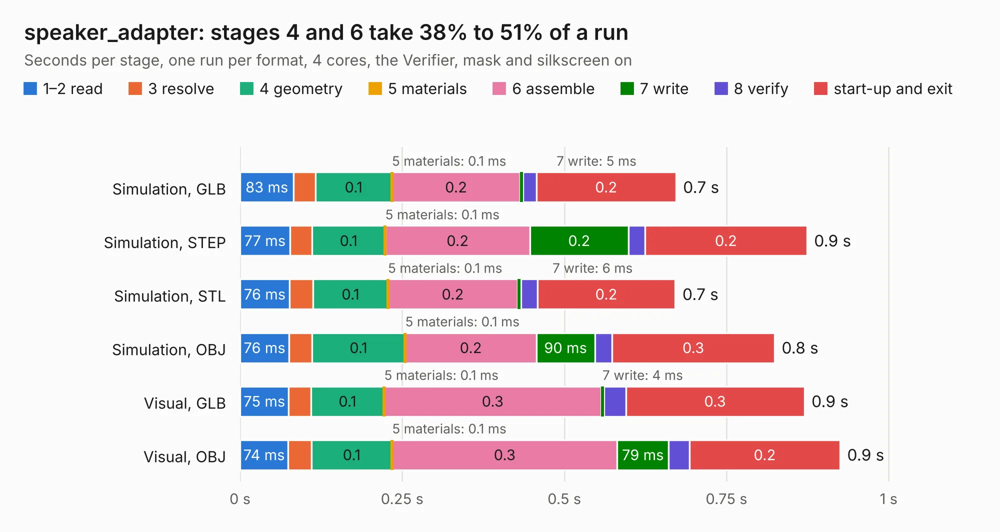

| Mode and format | 1–2 read | 3 resolve | 4 geometry | 5 materials | 6 assemble | 7 write | 8 verify | start-up and exit | Total |
|---|---:|---:|---:|---:|---:|---:|---:|---:|---:|
| Simulation, GLB | 83&nbsp;ms | 33&nbsp;ms | 0.1 | 0.1&nbsp;ms | 0.2 | 5&nbsp;ms | 20&nbsp;ms | 0.2 | 0.7 |
| Simulation, STEP | 77&nbsp;ms | 34&nbsp;ms | 0.1 | 0.1&nbsp;ms | 0.2 | 0.2 | 26&nbsp;ms | 0.2 | 0.9 |
| Simulation, STL | 76&nbsp;ms | 36&nbsp;ms | 0.1 | 0.1&nbsp;ms | 0.2 | 6&nbsp;ms | 25&nbsp;ms | 0.2 | 0.7 |
| Simulation, OBJ | 76&nbsp;ms | 35&nbsp;ms | 0.1 | 0.1&nbsp;ms | 0.2 | 90&nbsp;ms | 27&nbsp;ms | 0.3 | 0.8 |
| Visual, GLB | 75&nbsp;ms | 34&nbsp;ms | 0.1 | 0.1&nbsp;ms | 0.3 | 4&nbsp;ms | 34&nbsp;ms | 0.3 | 0.9 |
| Visual, OBJ | 74&nbsp;ms | 36&nbsp;ms | 0.1 | 0.1&nbsp;ms | 0.3 | 79&nbsp;ms | 32&nbsp;ms | 0.2 | 0.9 |

<table align="center"><tr><td valign="top">

| Board | Repo: [ZeroPhone/ZeroPhone-PCBs](https://github.com/ZeroPhone/ZeroPhone-PCBs) Board: `speaker_adapter.kicad_pcb` |
|---|---|
| Folder | speaker_adapter |
| Complexity | 98&nbsp;/&nbsp;1000 (size&nbsp;63, features&nbsp;35) |
| KESE&nbsp;features | through vias, filled zones |
| Tested | 9th November 2026 |
| Copper&nbsp;layers | 2 |
| File&nbsp;format | KiCad 4 (4) |
| Parts,&nbsp;tracks,&nbsp;vias | 0, 10, 2 |
| Triangles,&nbsp;simulation | 15,552 in 13 parts |
| Note | no components |
| Verifier | PASS in all six runs |

</td><td valign="top">

<table>
<tr><th>File type</th><th>File size</th><th>Peak memory used</th></tr>
<tr><th colspan="3" align="left">Simulation</th></tr>
<tr><td>GLB</td><td align="right">573&nbsp;kB</td><td align="right">61&nbsp;MB</td></tr>
<tr><td>STEP</td><td align="right">2.5&nbsp;MB</td><td align="right">65&nbsp;MB</td></tr>
<tr><td>STL</td><td align="right">779&nbsp;kB</td><td align="right">62&nbsp;MB</td></tr>
<tr><td>OBJ</td><td align="right">1.5&nbsp;MB</td><td align="right">64&nbsp;MB</td></tr>
<tr><th colspan="3" align="left">Visual</th></tr>
<tr><td>GLB</td><td align="right">425&nbsp;kB</td><td align="right">76&nbsp;MB</td></tr>
<tr><td>OBJ</td><td align="right">1.1&nbsp;MB</td><td align="right">81&nbsp;MB</td></tr>
</table>

</td></tr></table>

| Previous | Next |
|:---|---:|
| [Corpus Page 28](Corpus-Testing-28.md) | [Corpus Testing](../Corpus-Testing.md) |
