# Corpus Page 1

Part 1 of 30 of [Corpus Testing](../Corpus-Testing.md): boards 1 to 108, six runs each, one file format a run, as [Corpus Testing](../Corpus-Testing.md) describes.

## 1. 8 Bit Computer

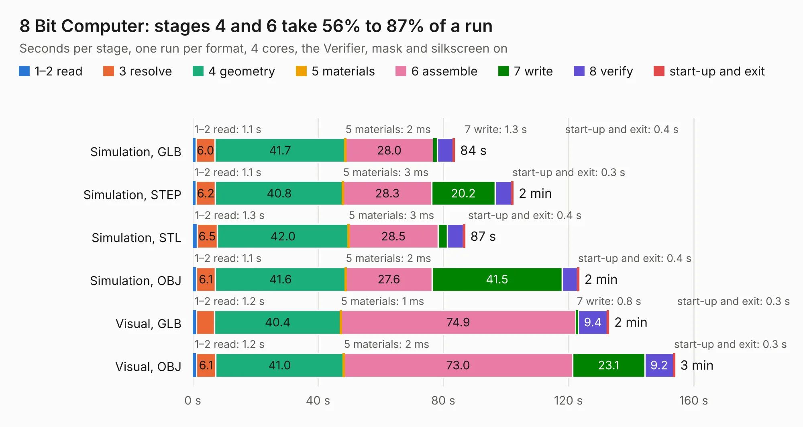

| Mode and format | 1–2 read | 3 resolve | 4 geometry | 5 materials | 6 assemble | 7 write | 8 verify | start-up and exit | Total |
|---|---:|---:|---:|---:|---:|---:|---:|---:|---:|
| Simulation, GLB | 1.1 | 6.0 | 41.7 | 2&nbsp;ms | 28.0 | 1.3 | 5.1 | 0.4 | 83.6 |
| Simulation, STEP | 1.1 | 6.2 | 40.8 | 3&nbsp;ms | 28.3 | 20.2 | 5.4 | 0.3 | 102.3 |
| Simulation, STL | 1.3 | 6.5 | 42.0 | 3&nbsp;ms | 28.5 | 2.9 | 5.2 | 0.4 | 86.8 |
| Simulation, OBJ | 1.1 | 6.1 | 41.6 | 2&nbsp;ms | 27.6 | 41.5 | 4.9 | 0.4 | 123.3 |
| Visual, GLB | 1.2 | 5.8 | 40.4 | 1&nbsp;ms | 74.9 | 0.8 | 9.4 | 0.3 | 132.8 |
| Visual, OBJ | 1.2 | 6.1 | 41.0 | 2&nbsp;ms | 73.0 | 23.1 | 9.2 | 0.3 | 153.9 |

<table align="center"><tr><td valign="top">

| Board | Repo: [01GOD/PCB-8-bit-Computer](https://github.com/01GOD/PCB-8-bit-Computer) Board: `8 Bit Computer.kicad_pcb` |
|---|---|
| Complexity | 254&nbsp;/&nbsp;1000 (size&nbsp;219, features&nbsp;35) |
| KESE&nbsp;features | through vias, filled zones |
| Tested | 9th November 2026 |
| Copper&nbsp;layers | 2 |
| File&nbsp;format | KiCad 5 (20171130) |
| Parts,&nbsp;tracks,&nbsp;vias | 319, 4,634, 117 |
| Triangles,&nbsp;simulation | 8,333,992 in 378 parts |
| Verifier | PASS in all six runs |

</td><td valign="top">

<table>
<tr><th>File type</th><th>File size</th><th>Peak memory used</th></tr>
<tr><th colspan="3" align="left">Simulation</th></tr>
<tr><td>GLB</td><td align="right">280&nbsp;MB</td><td align="right">2.5&nbsp;GB</td></tr>
<tr><td>STEP</td><td align="right">1.4&nbsp;GB</td><td align="right">3.2&nbsp;GB</td></tr>
<tr><td>STL</td><td align="right">417&nbsp;MB</td><td align="right">2.5&nbsp;GB</td></tr>
<tr><td>OBJ</td><td align="right">884&nbsp;MB</td><td align="right">5.2&nbsp;GB</td></tr>
<tr><th colspan="3" align="left">Visual</th></tr>
<tr><td>GLB</td><td align="right">180&nbsp;MB</td><td align="right">2.7&nbsp;GB</td></tr>
<tr><td>OBJ</td><td align="right">571&nbsp;MB</td><td align="right">3.5&nbsp;GB</td></tr>
</table>

</td></tr></table>

## 2. Femto_frame

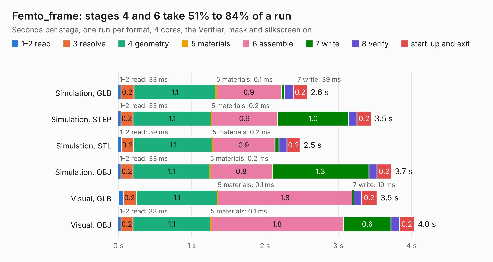

| Mode and format | 1–2 read | 3 resolve | 4 geometry | 5 materials | 6 assemble | 7 write | 8 verify | start-up and exit | Total |
|---|---:|---:|---:|---:|---:|---:|---:|---:|---:|
| Simulation, GLB | 33&nbsp;ms | 0.2 | 1.1 | 0.1&nbsp;ms | 0.9 | 39&nbsp;ms | 0.1 | 0.2 | 2.6 |
| Simulation, STEP | 33&nbsp;ms | 0.2 | 1.1 | 0.2&nbsp;ms | 0.9 | 1.0 | 0.1 | 0.2 | 3.5 |
| Simulation, STL | 39&nbsp;ms | 0.2 | 1.1 | 0.2&nbsp;ms | 0.9 | 54&nbsp;ms | 0.1 | 0.2 | 2.5 |
| Simulation, OBJ | 33&nbsp;ms | 0.2 | 1.1 | 0.2&nbsp;ms | 0.8 | 1.3 | 0.1 | 0.2 | 3.7 |
| Visual, GLB | 66&nbsp;ms | 0.2 | 1.1 | 0.1&nbsp;ms | 1.8 | 19&nbsp;ms | 0.1 | 0.2 | 3.5 |
| Visual, OBJ | 33&nbsp;ms | 0.2 | 1.1 | 0.1&nbsp;ms | 1.8 | 0.6 | 0.1 | 0.2 | 4.0 |

<table align="center"><tr><td valign="top">

| Board | Repo: [32bitmicro/FEMTO](https://github.com/32bitmicro/FEMTO) Board: `Femto_frame.kicad_pcb` |
|---|---|
| Folder | source_files / Kicad / Frame |
| Complexity | 212&nbsp;/&nbsp;1000 (size&nbsp;167, features&nbsp;45) |
| KESE&nbsp;features | through vias, slotted holes, rounded, trapezoid or chamfered pads, curved board outline |
| Tested | 9th November 2026 |
| Copper&nbsp;layers | 2 |
| File&nbsp;format | KiCad 6 (20211014) |
| Parts,&nbsp;tracks,&nbsp;vias | 2, 0, 44 |
| Triangles,&nbsp;simulation | 246,284 in 14 parts |
| Verifier | PASS in all six runs |

</td><td valign="top">

<table>
<tr><th>File type</th><th>File size</th><th>Peak memory used</th></tr>
<tr><th colspan="3" align="left">Simulation</th></tr>
<tr><td>GLB</td><td align="right">8.6&nbsp;MB</td><td align="right">197&nbsp;MB</td></tr>
<tr><td>STEP</td><td align="right">34&nbsp;MB</td><td align="right">212&nbsp;MB</td></tr>
<tr><td>STL</td><td align="right">12&nbsp;MB</td><td align="right">206&nbsp;MB</td></tr>
<tr><td>OBJ</td><td align="right">25&nbsp;MB</td><td align="right">197&nbsp;MB</td></tr>
<tr><th colspan="3" align="left">Visual</th></tr>
<tr><td>GLB</td><td align="right">4.2&nbsp;MB</td><td align="right">162&nbsp;MB</td></tr>
<tr><td>OBJ</td><td align="right">12&nbsp;MB</td><td align="right">162&nbsp;MB</td></tr>
</table>

</td></tr></table>

## 3. Femto_v1

| Mode and format | 1–2 read | 3 resolve | 4 geometry | 5 materials | 6 assemble | 7 write | 8 verify | start-up and exit | Total |
|---|---:|---:|---:|---:|---:|---:|---:|---:|---:|
| Simulation, GLB | 0.2 | 0.3 | 1.5 | 0.4&nbsp;ms | 1.4 | 71&nbsp;ms | 0.2 | 0.3 | 4.0 |
| Simulation, STEP | 0.2 | 0.3 | 1.6 | 0.2&nbsp;ms | 1.5 | 1.8 | 0.3 | 0.2 | 5.9 |
| Simulation, STL | 0.2 | 0.3 | 1.5 | 0.3&nbsp;ms | 1.5 | 0.1 | 0.3 | 0.2 | 4.1 |
| Simulation, OBJ | 0.2 | 0.3 | 1.5 | 0.3&nbsp;ms | 1.6 | 2.7 | 0.2 | 0.3 | 6.9 |
| Visual, GLB | 0.2 | 0.4 | 1.6 | 0.4&nbsp;ms | 3.6 | 39&nbsp;ms | 0.5 | 0.2 | 6.4 |
| Visual, OBJ | 0.2 | 0.3 | 1.4 | 0.2&nbsp;ms | 3.4 | 1.8 | 0.4 | 0.2 | 7.9 |

<table align="center"><tr><td valign="top">

| Board | Repo: [32bitmicro/FEMTO](https://github.com/32bitmicro/FEMTO) Board: `Femto_v1.kicad_pcb` |
|---|---|
| Folder | source_files / Kicad / Module |
| Complexity | 311&nbsp;/&nbsp;1000 (size&nbsp;226, features&nbsp;85) |
| KESE&nbsp;features | through vias, rounded, trapezoid or chamfered pads, filled zones, copper drawings, stack-up, dielectric εr and tanδ |
| Tested | 9th November 2026 |
| Copper&nbsp;layers | 4 |
| File&nbsp;format | KiCad 6 (20211014) |
| Parts,&nbsp;tracks,&nbsp;vias | 26, 484, 17 |
| Triangles,&nbsp;simulation | 381,090 in 64 parts |
| Verifier | PASS in all six runs |

</td><td valign="top">

<table>
<tr><th>File type</th><th>File size</th><th>Peak memory used</th></tr>
<tr><th colspan="3" align="left">Simulation</th></tr>
<tr><td>GLB</td><td align="right">13&nbsp;MB</td><td align="right">283&nbsp;MB</td></tr>
<tr><td>STEP</td><td align="right">75&nbsp;MB</td><td align="right">302&nbsp;MB</td></tr>
<tr><td>STL</td><td align="right">19&nbsp;MB</td><td align="right">279&nbsp;MB</td></tr>
<tr><td>OBJ</td><td align="right">39&nbsp;MB</td><td align="right">309&nbsp;MB</td></tr>
<tr><th colspan="3" align="left">Visual</th></tr>
<tr><td>GLB</td><td align="right">8.0&nbsp;MB</td><td align="right">257&nbsp;MB</td></tr>
<tr><td>OBJ</td><td align="right">24&nbsp;MB</td><td align="right">262&nbsp;MB</td></tr>
</table>

</td></tr></table>

## 4. Femto_tester_v1

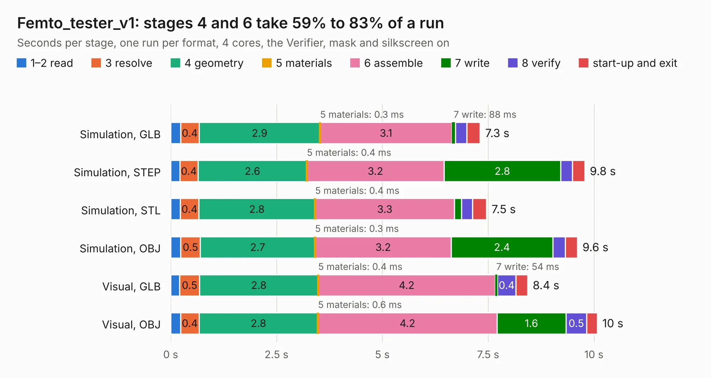

| Mode and format | 1–2 read | 3 resolve | 4 geometry | 5 materials | 6 assemble | 7 write | 8 verify | start-up and exit | Total |
|---|---:|---:|---:|---:|---:|---:|---:|---:|---:|
| Simulation, GLB | 0.2 | 0.4 | 2.9 | 0.3&nbsp;ms | 3.1 | 88&nbsp;ms | 0.3 | 0.3 | 7.3 |
| Simulation, STEP | 0.2 | 0.4 | 2.6 | 0.4&nbsp;ms | 3.2 | 2.8 | 0.3 | 0.3 | 9.8 |
| Simulation, STL | 0.2 | 0.4 | 2.8 | 0.4&nbsp;ms | 3.3 | 0.2 | 0.3 | 0.3 | 7.5 |
| Simulation, OBJ | 0.2 | 0.5 | 2.7 | 0.3&nbsp;ms | 3.2 | 2.4 | 0.3 | 0.3 | 9.6 |
| Visual, GLB | 0.2 | 0.5 | 2.8 | 0.4&nbsp;ms | 4.2 | 54&nbsp;ms | 0.4 | 0.3 | 8.4 |
| Visual, OBJ | 0.2 | 0.4 | 2.8 | 0.6&nbsp;ms | 4.2 | 1.6 | 0.5 | 0.3 | 10.1 |

<table align="center"><tr><td valign="top">

| Board | Repo: [32bitmicro/FEMTO](https://github.com/32bitmicro/FEMTO) Board: `Femto_tester_v1.kicad_pcb` |
|---|---|
| Folder | source_files / Kicad / Tester |
| Complexity | 282&nbsp;/&nbsp;1000 (size&nbsp;162, features&nbsp;120) |
| KESE&nbsp;features | through vias, slotted holes, rounded, trapezoid or chamfered pads, arc tracks, filled zones, copper drawings, curved board outline, stack-up, dielectric εr and tanδ |
| Tested | 9th November 2026 |
| Copper&nbsp;layers | 2 |
| File&nbsp;format | KiCad 6 (20211014) |
| Parts,&nbsp;tracks,&nbsp;vias | 74, 381, 6 |
| Triangles,&nbsp;simulation | 503,506 in 88 parts |
| Verifier | PASS in all six runs |

</td><td valign="top">

<table>
<tr><th>File type</th><th>File size</th><th>Peak memory used</th></tr>
<tr><th colspan="3" align="left">Simulation</th></tr>
<tr><td>GLB</td><td align="right">18&nbsp;MB</td><td align="right">374&nbsp;MB</td></tr>
<tr><td>STEP</td><td align="right">99&nbsp;MB</td><td align="right">394&nbsp;MB</td></tr>
<tr><td>STL</td><td align="right">25&nbsp;MB</td><td align="right">349&nbsp;MB</td></tr>
<tr><td>OBJ</td><td align="right">52&nbsp;MB</td><td align="right">366&nbsp;MB</td></tr>
<tr><th colspan="3" align="left">Visual</th></tr>
<tr><td>GLB</td><td align="right">12&nbsp;MB</td><td align="right">379&nbsp;MB</td></tr>
<tr><td>OBJ</td><td align="right">34&nbsp;MB</td><td align="right">351&nbsp;MB</td></tr>
</table>

</td></tr></table>

## 5. Stroopwafel-LGA1151-CFL

| Mode and format | 1–2 read | 3 resolve | 4 geometry | 5 materials | 6 assemble | 7 write | 8 verify | start-up and exit | Total |
|---|---:|---:|---:|---:|---:|---:|---:|---:|---:|
| Simulation, GLB | 1.2 | 5.1 | 27.2 | 4&nbsp;ms | 30.6 | 0.9 | 2.1 | 0.4 | 67.6 |
| Simulation, STEP | 1.2 | 4.8 | 27.2 | 4&nbsp;ms | 29.9 | 15.8 | 2.2 | 0.4 | 81.5 |
| Simulation, STL | 1.2 | 4.7 | 26.9 | 4&nbsp;ms | 30.3 | 2.1 | 2.2 | 0.3 | 67.7 |
| Simulation, OBJ | 1.2 | 5.3 | 27.0 | 4&nbsp;ms | 32.5 | 28.5 | 2.3 | 0.3 | 97.0 |
| Visual, GLB | 1.2 | 5.1 | 27.8 | 5&nbsp;ms | 46.6 | 0.6 | 5.2 | 0.3 | 86.6 |
| Visual, OBJ | 1.3 | 5.1 | 28.4 | 5&nbsp;ms | 48.3 | 19.2 | 6.1 | 0.4 | 108.7 |

<table align="center"><tr><td valign="top">

| Board | Repo: [a-little-wifi/stroopwafel-lga1151-cfl](https://github.com/a-little-wifi/stroopwafel-lga1151-cfl) Board: `Stroopwafel-LGA1151-CFL.kicad_pcb` |
|---|---|
| Complexity | 256&nbsp;/&nbsp;1000 (size&nbsp;211, features&nbsp;45) |
| KESE&nbsp;features | through vias, slotted holes, rounded, trapezoid or chamfered pads, curved board outline |
| Tested | 9th November 2026 |
| Copper&nbsp;layers | 2 |
| File&nbsp;format | KiCad 9 (20241229) |
| Parts,&nbsp;tracks,&nbsp;vias | 184, 55, 18 |
| Triangles,&nbsp;simulation | 5,009,250 in 1607 parts |
| Note | mostly unrouted |
| Verifier | PASS in all six runs |

</td><td valign="top">

<table>
<tr><th>File type</th><th>File size</th><th>Peak memory used</th></tr>
<tr><th colspan="3" align="left">Simulation</th></tr>
<tr><td>GLB</td><td align="right">162&nbsp;MB</td><td align="right">1.7&nbsp;GB</td></tr>
<tr><td>STEP</td><td align="right">677&nbsp;MB</td><td align="right">2.2&nbsp;GB</td></tr>
<tr><td>STL</td><td align="right">251&nbsp;MB</td><td align="right">1.7&nbsp;GB</td></tr>
<tr><td>OBJ</td><td align="right">524&nbsp;MB</td><td align="right">3.1&nbsp;GB</td></tr>
<tr><th colspan="3" align="left">Visual</th></tr>
<tr><td>GLB</td><td align="right">114&nbsp;MB</td><td align="right">2.2&nbsp;GB</td></tr>
<tr><td>OBJ</td><td align="right">362&nbsp;MB</td><td align="right">2.4&nbsp;GB</td></tr>
</table>

</td></tr></table>

## 6. iMX6_BareBones

| Mode and format | 1–2 read | 3 resolve | 4 geometry | 5 materials | 6 assemble | 7 write | 8 verify | start-up and exit | Total |
|---|---:|---:|---:|---:|---:|---:|---:|---:|---:|
| Simulation, GLB | 3.0 | 11.5 | 44.3 | 2&nbsp;ms | 44.8 | 2.0 | 5.8 | 0.5 | 112.0 |
| Simulation, STEP | 3.0 | 12.0 | 44.4 | 2&nbsp;ms | 45.1 | 26.0 | 5.3 | 0.5 | 136.4 |
| Simulation, STL | 2.8 | 11.2 | 40.9 | 2&nbsp;ms | 44.0 | 4.1 | 5.7 | 0.5 | 109.2 |
| Simulation, OBJ | 3.1 | 12.5 | 43.7 | 3&nbsp;ms | 42.3 | 63.7 | 5.2 | 0.4 | 170.9 |
| Visual, GLB | 2.9 | 11.5 | 41.4 | 3&nbsp;ms | 93.4 | 1.0 | 8.1 | 0.4 | 158.7 |
| Visual, OBJ | 2.9 | 11.6 | 43.9 | 3&nbsp;ms | 94.5 | 36.2 | 8.0 | 0.4 | 197.5 |

<table align="center"><tr><td valign="top">

| Board | Repo: [a1wolfe/imx6-barebones](https://github.com/a1wolfe/imx6-barebones) Board: `iMX6_BareBones.kicad_pcb` |
|---|---|
| Folder | Kicad |
| Complexity | 449&nbsp;/&nbsp;1000 (size&nbsp;329, features&nbsp;120) |
| KESE&nbsp;features | through vias, rounded, trapezoid or chamfered pads, arc tracks, filled zones, curved board outline, knockout text, stack-up, dielectric εr and tanδ, mask and silkscreen colours |
| Tested | 9th November 2026 |
| Copper&nbsp;layers | 6 |
| File&nbsp;format | KiCad 9 (20241229) |
| Parts,&nbsp;tracks,&nbsp;vias | 498, 9,285, 1,155 |
| Triangles,&nbsp;simulation | 9,828,966 in 583 parts |
| Verifier | PASS in all six runs |

</td><td valign="top">

<table>
<tr><th>File type</th><th>File size</th><th>Peak memory used</th></tr>
<tr><th colspan="3" align="left">Simulation</th></tr>
<tr><td>GLB</td><td align="right">337&nbsp;MB</td><td align="right">2.2&nbsp;GB</td></tr>
<tr><td>STEP</td><td align="right">1.4&nbsp;GB</td><td align="right">3.1&nbsp;GB</td></tr>
<tr><td>STL</td><td align="right">491&nbsp;MB</td><td align="right">2.3&nbsp;GB</td></tr>
<tr><td>OBJ</td><td align="right">1.1&nbsp;GB</td><td align="right">6.3&nbsp;GB</td></tr>
<tr><th colspan="3" align="left">Visual</th></tr>
<tr><td>GLB</td><td align="right">190&nbsp;MB</td><td align="right">3.1&nbsp;GB</td></tr>
<tr><td>OBJ</td><td align="right">626&nbsp;MB</td><td align="right">3.9&nbsp;GB</td></tr>
</table>

</td></tr></table>

## 7. A4092

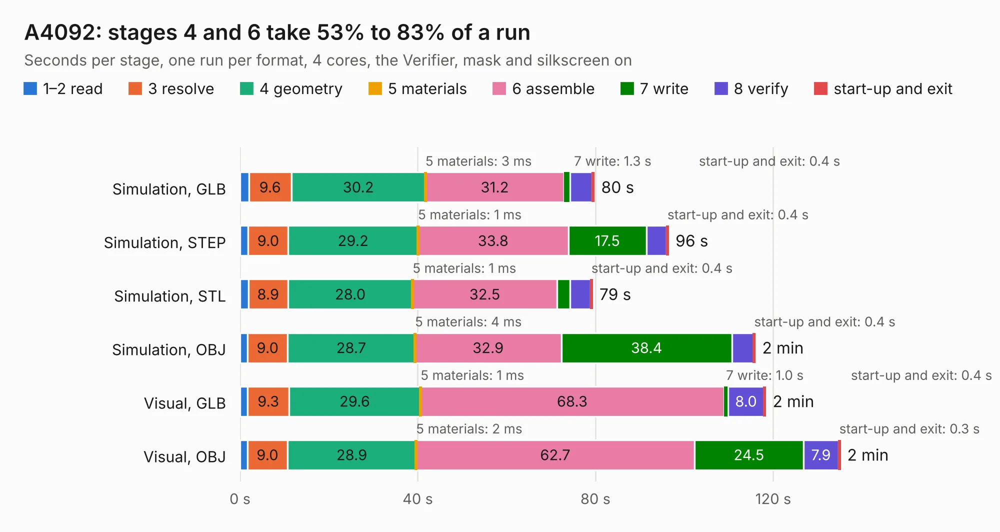

| Mode and format | 1–2 read | 3 resolve | 4 geometry | 5 materials | 6 assemble | 7 write | 8 verify | start-up and exit | Total |
|---|---:|---:|---:|---:|---:|---:|---:|---:|---:|
| Simulation, GLB | 2.0 | 9.6 | 30.2 | 3&nbsp;ms | 31.2 | 1.3 | 5.0 | 0.4 | 79.7 |
| Simulation, STEP | 1.8 | 9.0 | 29.2 | 1&nbsp;ms | 33.8 | 17.5 | 4.5 | 0.4 | 96.4 |
| Simulation, STL | 1.9 | 8.9 | 28.0 | 1&nbsp;ms | 32.5 | 2.9 | 4.7 | 0.4 | 79.3 |
| Simulation, OBJ | 1.7 | 9.0 | 28.7 | 4&nbsp;ms | 32.9 | 38.4 | 4.8 | 0.4 | 115.9 |
| Visual, GLB | 1.7 | 9.3 | 29.6 | 1&nbsp;ms | 68.3 | 1.0 | 8.0 | 0.4 | 118.3 |
| Visual, OBJ | 1.7 | 9.0 | 28.9 | 2&nbsp;ms | 62.7 | 24.5 | 7.9 | 0.3 | 135.0 |

<table align="center"><tr><td valign="top">

| Board | Repo: [A4091/A4092](https://github.com/A4091/A4092) Board: `A4092.kicad_pcb` |
|---|---|
| Folder | Kicad / A4092 |
| Complexity | 364&nbsp;/&nbsp;1000 (size&nbsp;279, features&nbsp;85) |
| KESE&nbsp;features | through vias, rounded, trapezoid or chamfered pads, filled zones, curved board outline, stack-up, dielectric εr and tanδ |
| Tested | 9th November 2026 |
| Copper&nbsp;layers | 4 |
| File&nbsp;format | KiCad 9 (20241229) |
| Parts,&nbsp;tracks,&nbsp;vias | 90, 5,116, 1,557 |
| Triangles,&nbsp;simulation | 6,808,994 in 302 parts |
| Verifier | PASS in all six runs |

</td><td valign="top">

<table>
<tr><th>File type</th><th>File size</th><th>Peak memory used</th></tr>
<tr><th colspan="3" align="left">Simulation</th></tr>
<tr><td>GLB</td><td align="right">232&nbsp;MB</td><td align="right">1.9&nbsp;GB</td></tr>
<tr><td>STEP</td><td align="right">888&nbsp;MB</td><td align="right">2.7&nbsp;GB</td></tr>
<tr><td>STL</td><td align="right">340&nbsp;MB</td><td align="right">1.9&nbsp;GB</td></tr>
<tr><td>OBJ</td><td align="right">727&nbsp;MB</td><td align="right">4.3&nbsp;GB</td></tr>
<tr><th colspan="3" align="left">Visual</th></tr>
<tr><td>GLB</td><td align="right">148&nbsp;MB</td><td align="right">2.4&nbsp;GB</td></tr>
<tr><td>OBJ</td><td align="right">490&nbsp;MB</td><td align="right">3.1&nbsp;GB</td></tr>
</table>

</td></tr></table>

## 8. A4092-backpanel

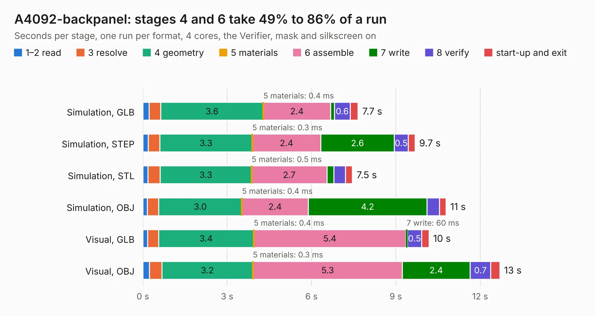

| Mode and format | 1–2 read | 3 resolve | 4 geometry | 5 materials | 6 assemble | 7 write | 8 verify | start-up and exit | Total |
|---|---:|---:|---:|---:|---:|---:|---:|---:|---:|
| Simulation, GLB | 0.2 | 0.4 | 3.6 | 0.4&nbsp;ms | 2.4 | 0.1 | 0.6 | 0.3 | 7.7 |
| Simulation, STEP | 0.2 | 0.4 | 3.3 | 0.3&nbsp;ms | 2.4 | 2.6 | 0.5 | 0.2 | 9.7 |
| Simulation, STL | 0.2 | 0.4 | 3.3 | 0.5&nbsp;ms | 2.7 | 0.2 | 0.4 | 0.2 | 7.5 |
| Simulation, OBJ | 0.2 | 0.4 | 3.0 | 0.4&nbsp;ms | 2.4 | 4.2 | 0.4 | 0.2 | 10.8 |
| Visual, GLB | 0.2 | 0.4 | 3.4 | 0.4&nbsp;ms | 5.4 | 60&nbsp;ms | 0.5 | 0.3 | 10.2 |
| Visual, OBJ | 0.2 | 0.4 | 3.2 | 0.3&nbsp;ms | 5.3 | 2.4 | 0.7 | 0.3 | 12.7 |

<table align="center"><tr><td valign="top">

| Board | Repo: [A4091/A4092](https://github.com/A4091/A4092) Board: `A4092-backpanel.kicad_pcb` |
|---|---|
| Folder | Kicad / Backpanel |
| Complexity | 163&nbsp;/&nbsp;1000 (size&nbsp;108, features&nbsp;55) |
| KESE&nbsp;features | through vias, rounded, trapezoid or chamfered pads, filled zones, curved board outline |
| Tested | 9th November 2026 |
| Copper&nbsp;layers | 2 |
| File&nbsp;format | KiCad 9 (20241229) |
| Parts,&nbsp;tracks,&nbsp;vias | 2, 118, 3 |
| Triangles,&nbsp;simulation | 641,034 in 37 parts |
| Note | panel |
| Verifier | PASS in all six runs |

</td><td valign="top">

<table>
<tr><th>File type</th><th>File size</th><th>Peak memory used</th></tr>
<tr><th colspan="3" align="left">Simulation</th></tr>
<tr><td>GLB</td><td align="right">22&nbsp;MB</td><td align="right">388&nbsp;MB</td></tr>
<tr><td>STEP</td><td align="right">96&nbsp;MB</td><td align="right">407&nbsp;MB</td></tr>
<tr><td>STL</td><td align="right">32&nbsp;MB</td><td align="right">373&nbsp;MB</td></tr>
<tr><td>OBJ</td><td align="right">65&nbsp;MB</td><td align="right">460&nbsp;MB</td></tr>
<tr><th colspan="3" align="left">Visual</th></tr>
<tr><td>GLB</td><td align="right">12&nbsp;MB</td><td align="right">391&nbsp;MB</td></tr>
<tr><td>OBJ</td><td align="right">36&nbsp;MB</td><td align="right">386&nbsp;MB</td></tr>
</table>

</td></tr></table>

## 9. Flipper

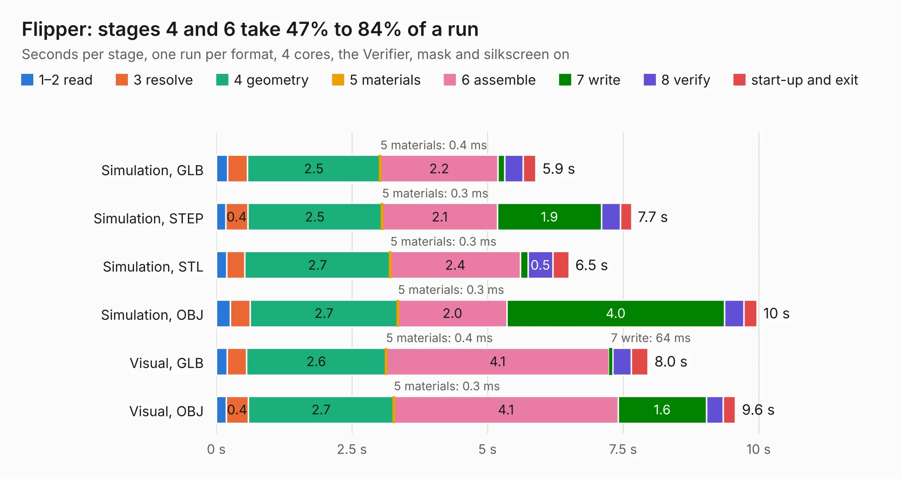

| Mode and format | 1–2 read | 3 resolve | 4 geometry | 5 materials | 6 assemble | 7 write | 8 verify | start-up and exit | Total |
|---|---:|---:|---:|---:|---:|---:|---:|---:|---:|
| Simulation, GLB | 0.2 | 0.4 | 2.5 | 0.4&nbsp;ms | 2.2 | 0.1 | 0.3 | 0.2 | 5.9 |
| Simulation, STEP | 0.2 | 0.4 | 2.5 | 0.3&nbsp;ms | 2.1 | 1.9 | 0.4 | 0.2 | 7.7 |
| Simulation, STL | 0.2 | 0.3 | 2.7 | 0.3&nbsp;ms | 2.4 | 0.1 | 0.5 | 0.3 | 6.5 |
| Simulation, OBJ | 0.3 | 0.4 | 2.7 | 0.3&nbsp;ms | 2.0 | 4.0 | 0.4 | 0.2 | 10.0 |
| Visual, GLB | 0.2 | 0.4 | 2.6 | 0.4&nbsp;ms | 4.1 | 64&nbsp;ms | 0.3 | 0.3 | 8.0 |
| Visual, OBJ | 0.2 | 0.4 | 2.7 | 0.3&nbsp;ms | 4.1 | 1.6 | 0.3 | 0.2 | 9.6 |

<table align="center"><tr><td valign="top">

| Board | Repo: [A4091/A4092](https://github.com/A4091/A4092) Board: `Flipper.kicad_pcb` |
|---|---|
| Folder | Kicad / Flipper |
| Complexity | 169&nbsp;/&nbsp;1000 (size&nbsp;99, features&nbsp;70) |
| KESE&nbsp;features | rounded, trapezoid or chamfered pads, filled zones, curved board outline, stack-up, dielectric εr and tanδ |
| Tested | 9th November 2026 |
| Copper&nbsp;layers | 2 |
| File&nbsp;format | KiCad 9 (20241229) |
| Parts,&nbsp;tracks,&nbsp;vias | 2, 72, 0 |
| Triangles,&nbsp;simulation | 561,064 in 35 parts |
| Verifier | PASS in all six runs |

</td><td valign="top">

<table>
<tr><th>File type</th><th>File size</th><th>Peak memory used</th></tr>
<tr><th colspan="3" align="left">Simulation</th></tr>
<tr><td>GLB</td><td align="right">19&nbsp;MB</td><td align="right">319&nbsp;MB</td></tr>
<tr><td>STEP</td><td align="right">79&nbsp;MB</td><td align="right">372&nbsp;MB</td></tr>
<tr><td>STL</td><td align="right">28&nbsp;MB</td><td align="right">308&nbsp;MB</td></tr>
<tr><td>OBJ</td><td align="right">56&nbsp;MB</td><td align="right">416&nbsp;MB</td></tr>
<tr><th colspan="3" align="left">Visual</th></tr>
<tr><td>GLB</td><td align="right">10&nbsp;MB</td><td align="right">349&nbsp;MB</td></tr>
<tr><td>OBJ</td><td align="right">31&nbsp;MB</td><td align="right">344&nbsp;MB</td></tr>
</table>

</td></tr></table>

## 10. A4092-terminator-dev

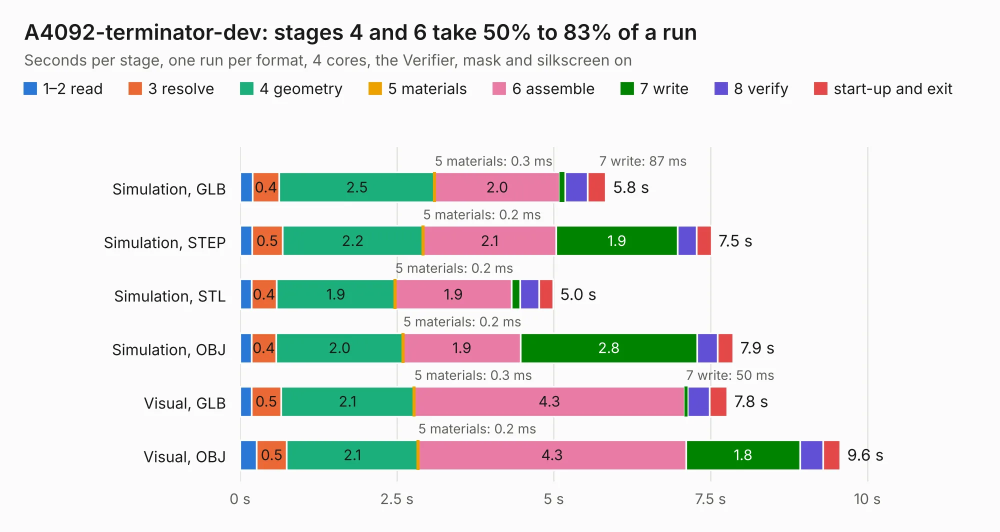

| Mode and format | 1–2 read | 3 resolve | 4 geometry | 5 materials | 6 assemble | 7 write | 8 verify | start-up and exit | Total |
|---|---:|---:|---:|---:|---:|---:|---:|---:|---:|
| Simulation, GLB | 0.2 | 0.4 | 2.5 | 0.3&nbsp;ms | 2.0 | 87&nbsp;ms | 0.4 | 0.3 | 5.8 |
| Simulation, STEP | 0.2 | 0.5 | 2.2 | 0.2&nbsp;ms | 2.1 | 1.9 | 0.3 | 0.2 | 7.5 |
| Simulation, STL | 0.2 | 0.4 | 1.9 | 0.2&nbsp;ms | 1.9 | 0.1 | 0.3 | 0.2 | 5.0 |
| Simulation, OBJ | 0.2 | 0.4 | 2.0 | 0.2&nbsp;ms | 1.9 | 2.8 | 0.3 | 0.3 | 7.9 |
| Visual, GLB | 0.2 | 0.5 | 2.1 | 0.3&nbsp;ms | 4.3 | 50&nbsp;ms | 0.3 | 0.3 | 7.8 |
| Visual, OBJ | 0.3 | 0.5 | 2.1 | 0.2&nbsp;ms | 4.3 | 1.8 | 0.4 | 0.3 | 9.6 |

<table align="center"><tr><td valign="top">

| Board | Repo: [A4091/A4092](https://github.com/A4091/A4092) Board: `A4092-terminator-dev.kicad_pcb` |
|---|---|
| Folder | Kicad / Terminator-dev |
| Complexity | 225&nbsp;/&nbsp;1000 (size&nbsp;140, features&nbsp;85) |
| KESE&nbsp;features | through vias, rounded, trapezoid or chamfered pads, filled zones, curved board outline, stack-up, dielectric εr and tanδ |
| Tested | 9th November 2026 |
| Copper&nbsp;layers | 2 |
| File&nbsp;format | KiCad 9 (20241229) |
| Parts,&nbsp;tracks,&nbsp;vias | 14, 124, 64 |
| Triangles,&nbsp;simulation | 455,982 in 41 parts |
| Verifier | PASS in all six runs |

</td><td valign="top">

<table>
<tr><th>File type</th><th>File size</th><th>Peak memory used</th></tr>
<tr><th colspan="3" align="left">Simulation</th></tr>
<tr><td>GLB</td><td align="right">16&nbsp;MB</td><td align="right">287&nbsp;MB</td></tr>
<tr><td>STEP</td><td align="right">67&nbsp;MB</td><td align="right">344&nbsp;MB</td></tr>
<tr><td>STL</td><td align="right">23&nbsp;MB</td><td align="right">275&nbsp;MB</td></tr>
<tr><td>OBJ</td><td align="right">46&nbsp;MB</td><td align="right">357&nbsp;MB</td></tr>
<tr><th colspan="3" align="left">Visual</th></tr>
<tr><td>GLB</td><td align="right">10&nbsp;MB</td><td align="right">323&nbsp;MB</td></tr>
<tr><td>OBJ</td><td align="right">30&nbsp;MB</td><td align="right">321&nbsp;MB</td></tr>
</table>

</td></tr></table>

## 11. A4092-terminator-ds2107

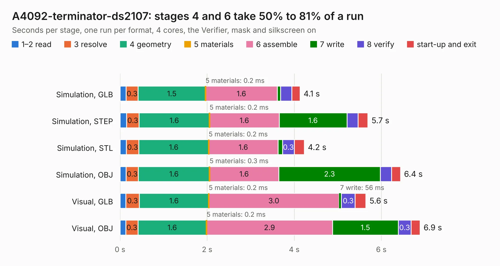

| Mode and format | 1–2 read | 3 resolve | 4 geometry | 5 materials | 6 assemble | 7 write | 8 verify | start-up and exit | Total |
|---|---:|---:|---:|---:|---:|---:|---:|---:|---:|
| Simulation, GLB | 0.1 | 0.3 | 1.5 | 0.2&nbsp;ms | 1.6 | 75&nbsp;ms | 0.3 | 0.2 | 4.1 |
| Simulation, STEP | 0.2 | 0.3 | 1.6 | 0.2&nbsp;ms | 1.6 | 1.6 | 0.3 | 0.2 | 5.7 |
| Simulation, STL | 0.1 | 0.3 | 1.6 | 0.2&nbsp;ms | 1.6 | 0.1 | 0.3 | 0.2 | 4.2 |
| Simulation, OBJ | 0.1 | 0.3 | 1.6 | 0.3&nbsp;ms | 1.6 | 2.3 | 0.3 | 0.2 | 6.4 |
| Visual, GLB | 0.1 | 0.3 | 1.6 | 0.2&nbsp;ms | 3.0 | 56&nbsp;ms | 0.3 | 0.2 | 5.6 |
| Visual, OBJ | 0.1 | 0.3 | 1.6 | 0.2&nbsp;ms | 2.9 | 1.5 | 0.3 | 0.2 | 6.9 |

<table align="center"><tr><td valign="top">

| Board | Repo: [A4091/A4092](https://github.com/A4091/A4092) Board: `A4092-terminator-ds2107.kicad_pcb` |
|---|---|
| Folder | Kicad / Terminator-DS21S07 |
| Complexity | 210&nbsp;/&nbsp;1000 (size&nbsp;135, features&nbsp;75) |
| KESE&nbsp;features | through vias, rounded, trapezoid or chamfered pads, filled zones, stack-up, dielectric εr and tanδ |
| Tested | 9th November 2026 |
| Copper&nbsp;layers | 2 |
| File&nbsp;format | KiCad 9 (20241229) |
| Parts,&nbsp;tracks,&nbsp;vias | 9, 201, 29 |
| Triangles,&nbsp;simulation | 441,348 in 35 parts |
| Verifier | PASS in all six runs |

</td><td valign="top">

<table>
<tr><th>File type</th><th>File size</th><th>Peak memory used</th></tr>
<tr><th colspan="3" align="left">Simulation</th></tr>
<tr><td>GLB</td><td align="right">15&nbsp;MB</td><td align="right">278&nbsp;MB</td></tr>
<tr><td>STEP</td><td align="right">76&nbsp;MB</td><td align="right">329&nbsp;MB</td></tr>
<tr><td>STL</td><td align="right">22&nbsp;MB</td><td align="right">282&nbsp;MB</td></tr>
<tr><td>OBJ</td><td align="right">45&nbsp;MB</td><td align="right">353&nbsp;MB</td></tr>
<tr><th colspan="3" align="left">Visual</th></tr>
<tr><td>GLB</td><td align="right">9.3&nbsp;MB</td><td align="right">309&nbsp;MB</td></tr>
<tr><td>OBJ</td><td align="right">27&nbsp;MB</td><td align="right">309&nbsp;MB</td></tr>
</table>

</td></tr></table>

## 12. A4092-terminator

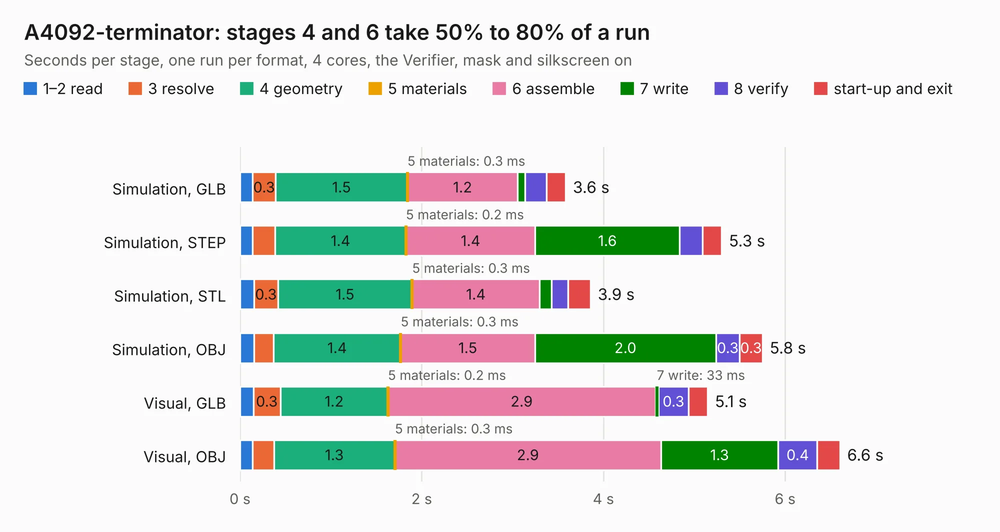

| Mode and format | 1–2 read | 3 resolve | 4 geometry | 5 materials | 6 assemble | 7 write | 8 verify | start-up and exit | Total |
|---|---:|---:|---:|---:|---:|---:|---:|---:|---:|
| Simulation, GLB | 0.1 | 0.3 | 1.5 | 0.3&nbsp;ms | 1.2 | 81&nbsp;ms | 0.2 | 0.2 | 3.6 |
| Simulation, STEP | 0.1 | 0.2 | 1.4 | 0.2&nbsp;ms | 1.4 | 1.6 | 0.3 | 0.2 | 5.3 |
| Simulation, STL | 0.2 | 0.3 | 1.5 | 0.3&nbsp;ms | 1.4 | 0.1 | 0.2 | 0.3 | 3.9 |
| Simulation, OBJ | 0.2 | 0.2 | 1.4 | 0.3&nbsp;ms | 1.5 | 2.0 | 0.3 | 0.3 | 5.8 |
| Visual, GLB | 0.1 | 0.3 | 1.2 | 0.2&nbsp;ms | 2.9 | 33&nbsp;ms | 0.3 | 0.2 | 5.1 |
| Visual, OBJ | 0.1 | 0.2 | 1.3 | 0.3&nbsp;ms | 2.9 | 1.3 | 0.4 | 0.3 | 6.6 |

<table align="center"><tr><td valign="top">

| Board | Repo: [A4091/A4092](https://github.com/A4091/A4092) Board: `A4092-terminator.kicad_pcb` |
|---|---|
| Folder | Kicad / Terminator-LT1118-2.85 |
| Complexity | 198&nbsp;/&nbsp;1000 (size&nbsp;123, features&nbsp;75) |
| KESE&nbsp;features | through vias, rounded, trapezoid or chamfered pads, filled zones, stack-up, dielectric εr and tanδ |
| Tested | 9th November 2026 |
| Copper&nbsp;layers | 2 |
| File&nbsp;format | KiCad 9 (20241229) |
| Parts,&nbsp;tracks,&nbsp;vias | 10, 115, 5 |
| Triangles,&nbsp;simulation | 381,136 in 37 parts |
| Verifier | PASS in all six runs |

</td><td valign="top">

<table>
<tr><th>File type</th><th>File size</th><th>Peak memory used</th></tr>
<tr><th colspan="3" align="left">Simulation</th></tr>
<tr><td>GLB</td><td align="right">13&nbsp;MB</td><td align="right">273&nbsp;MB</td></tr>
<tr><td>STEP</td><td align="right">66&nbsp;MB</td><td align="right">305&nbsp;MB</td></tr>
<tr><td>STL</td><td align="right">19&nbsp;MB</td><td align="right">266&nbsp;MB</td></tr>
<tr><td>OBJ</td><td align="right">38&nbsp;MB</td><td align="right">310&nbsp;MB</td></tr>
<tr><th colspan="3" align="left">Visual</th></tr>
<tr><td>GLB</td><td align="right">7.8&nbsp;MB</td><td align="right">275&nbsp;MB</td></tr>
<tr><td>OBJ</td><td align="right">23&nbsp;MB</td><td align="right">281&nbsp;MB</td></tr>
</table>

</td></tr></table>

## 13. A4770

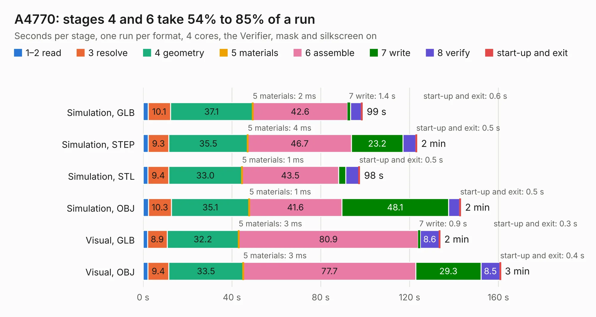

| Mode and format | 1–2 read | 3 resolve | 4 geometry | 5 materials | 6 assemble | 7 write | 8 verify | start-up and exit | Total |
|---|---:|---:|---:|---:|---:|---:|---:|---:|---:|
| Simulation, GLB | 2.2 | 10.1 | 37.1 | 2&nbsp;ms | 42.6 | 1.4 | 4.8 | 0.6 | 98.8 |
| Simulation, STEP | 2.3 | 9.3 | 35.5 | 4&nbsp;ms | 46.7 | 23.2 | 5.8 | 0.5 | 123.3 |
| Simulation, STL | 2.1 | 9.4 | 33.0 | 1&nbsp;ms | 43.5 | 3.2 | 5.8 | 0.5 | 97.6 |
| Simulation, OBJ | 2.4 | 10.3 | 35.1 | 1&nbsp;ms | 41.6 | 48.1 | 5.0 | 0.5 | 143.1 |
| Visual, GLB | 2.0 | 8.9 | 32.2 | 3&nbsp;ms | 80.9 | 0.9 | 8.6 | 0.3 | 133.7 |
| Visual, OBJ | 2.1 | 9.4 | 33.5 | 3&nbsp;ms | 77.7 | 29.3 | 8.5 | 0.4 | 161.0 |

<table align="center"><tr><td valign="top">

| Board | Repo: [A4091/cheetah](https://github.com/A4091/cheetah) Board: `A4770.kicad_pcb` |
|---|---|
| Folder | Kicad / A4770 |
| Complexity | 382&nbsp;/&nbsp;1000 (size&nbsp;282, features&nbsp;100) |
| KESE&nbsp;features | through vias, rounded, trapezoid or chamfered pads, filled zones, curved board outline, TrueType text, stack-up, dielectric εr and tanδ |
| Tested | 9th November 2026 |
| Copper&nbsp;layers | 4 |
| File&nbsp;format | KiCad 9 (20241229) |
| Parts,&nbsp;tracks,&nbsp;vias | 123, 5,754, 1,224 |
| Triangles,&nbsp;simulation | 6,769,822 in 344 parts |
| Verifier | PASS in all six runs |

</td><td valign="top">

<table>
<tr><th>File type</th><th>File size</th><th>Peak memory used</th></tr>
<tr><th colspan="3" align="left">Simulation</th></tr>
<tr><td>GLB</td><td align="right">232&nbsp;MB</td><td align="right">1.9&nbsp;GB</td></tr>
<tr><td>STEP</td><td align="right">977&nbsp;MB</td><td align="right">2.6&nbsp;GB</td></tr>
<tr><td>STL</td><td align="right">339&nbsp;MB</td><td align="right">1.8&nbsp;GB</td></tr>
<tr><td>OBJ</td><td align="right">725&nbsp;MB</td><td align="right">4.4&nbsp;GB</td></tr>
<tr><th colspan="3" align="left">Visual</th></tr>
<tr><td>GLB</td><td align="right">149&nbsp;MB</td><td align="right">2.4&nbsp;GB</td></tr>
<tr><td>OBJ</td><td align="right">486&nbsp;MB</td><td align="right">3.3&nbsp;GB</td></tr>
</table>

</td></tr></table>

## 14. FPGA-BOARD

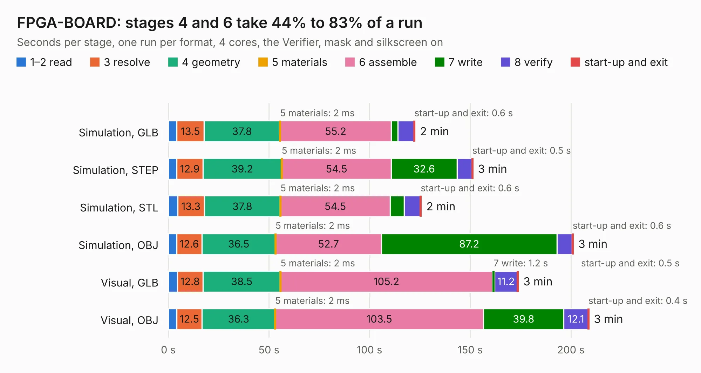

| Mode and format | 1–2 read | 3 resolve | 4 geometry | 5 materials | 6 assemble | 7 write | 8 verify | start-up and exit | Total |
|---|---:|---:|---:|---:|---:|---:|---:|---:|---:|
| Simulation, GLB | 4.2 | 13.5 | 37.8 | 2&nbsp;ms | 55.2 | 3.3 | 7.9 | 0.6 | 122.6 |
| Simulation, STEP | 4.3 | 12.9 | 39.2 | 2&nbsp;ms | 54.5 | 32.6 | 7.4 | 0.5 | 151.3 |
| Simulation, STL | 4.6 | 13.3 | 37.8 | 2&nbsp;ms | 54.5 | 7.0 | 7.9 | 0.6 | 125.7 |
| Simulation, OBJ | 4.2 | 12.6 | 36.5 | 2&nbsp;ms | 52.7 | 87.2 | 7.5 | 0.6 | 201.2 |
| Visual, GLB | 4.5 | 12.8 | 38.5 | 2&nbsp;ms | 105.2 | 1.2 | 11.2 | 0.5 | 173.9 |
| Visual, OBJ | 4.2 | 12.5 | 36.3 | 2&nbsp;ms | 103.5 | 39.8 | 12.1 | 0.4 | 208.9 |

<table align="center"><tr><td valign="top">

| Board | Repo: [abdulajadi1/fpga-board](https://github.com/abdulajadi1/fpga-board) Board: `FPGA-BOARD.kicad_pcb` |
|---|---|
| Complexity | 460&nbsp;/&nbsp;1000 (size&nbsp;330, features&nbsp;130) |
| KESE&nbsp;features | through vias, slotted holes, custom pads, rounded, trapezoid or chamfered pads, arc tracks, filled zones, copper drawings, stack-up, dielectric εr and tanδ, mask and silkscreen colours |
| Tested | 9th November 2026 |
| Copper&nbsp;layers | 8 |
| File&nbsp;format | KiCad 10 (20260206) |
| Parts,&nbsp;tracks,&nbsp;vias | 584, 10,158, 1,402 |
| Triangles,&nbsp;simulation | 13,826,402 in 647 parts |
| Verifier | PASS in all six runs |

</td><td valign="top">

<table>
<tr><th>File type</th><th>File size</th><th>Peak memory used</th></tr>
<tr><th colspan="3" align="left">Simulation</th></tr>
<tr><td>GLB</td><td align="right">462&nbsp;MB</td><td align="right">3.1&nbsp;GB</td></tr>
<tr><td>STEP</td><td align="right">1.6&nbsp;GB</td><td align="right">4.5&nbsp;GB</td></tr>
<tr><td>STL</td><td align="right">691&nbsp;MB</td><td align="right">3.1&nbsp;GB</td></tr>
<tr><td>OBJ</td><td align="right">1.5&nbsp;GB</td><td align="right">8.6&nbsp;GB</td></tr>
<tr><th colspan="3" align="left">Visual</th></tr>
<tr><td>GLB</td><td align="right">222&nbsp;MB</td><td align="right">3.7&nbsp;GB</td></tr>
<tr><td>OBJ</td><td align="right">741&nbsp;MB</td><td align="right">4.7&nbsp;GB</td></tr>
</table>

</td></tr></table>

## 15. A4k-Replica-Acill

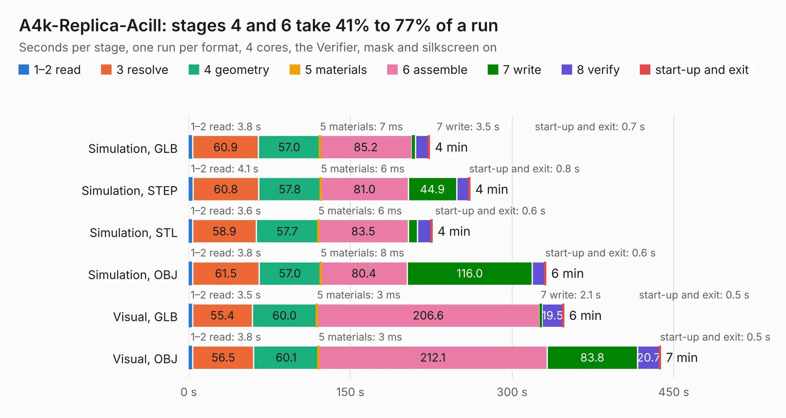

| Mode and format | 1–2 read | 3 resolve | 4 geometry | 5 materials | 6 assemble | 7 write | 8 verify | start-up and exit | Total |
|---|---:|---:|---:|---:|---:|---:|---:|---:|---:|
| Simulation, GLB | 3.8 | 60.9 | 57.0 | 7&nbsp;ms | 85.2 | 3.5 | 12.0 | 0.7 | 223.2 |
| Simulation, STEP | 4.1 | 60.8 | 57.8 | 6&nbsp;ms | 81.0 | 44.9 | 11.2 | 0.8 | 260.6 |
| Simulation, STL | 3.6 | 58.9 | 57.7 | 6&nbsp;ms | 83.5 | 8.3 | 12.9 | 0.6 | 225.6 |
| Simulation, OBJ | 3.8 | 61.5 | 57.0 | 8&nbsp;ms | 80.4 | 116.0 | 11.7 | 0.6 | 331.1 |
| Visual, GLB | 3.5 | 55.4 | 60.0 | 3&nbsp;ms | 206.6 | 2.1 | 19.5 | 0.5 | 347.6 |
| Visual, OBJ | 3.8 | 56.5 | 60.1 | 3&nbsp;ms | 212.1 | 83.8 | 20.7 | 0.5 | 437.5 |

<table align="center"><tr><td valign="top">

| Board | Repo: [Acill/A4000RevB](https://github.com/Acill/A4000RevB) Board: `A4k-Replica-Acill.kicad_pcb` |
|---|---|
| Folder | Kicad |
| Complexity | 381&nbsp;/&nbsp;1000 (size&nbsp;281, features&nbsp;100) |
| KESE&nbsp;features | through vias, padstacks, copper drawings, copper text, stack-up, dielectric εr and tanδ, mask and silkscreen colours |
| Tested | 9th November 2026 to 10th November 2026 |
| Copper&nbsp;layers | 4 |
| File&nbsp;format | KiCad 10 (20260206) |
| Parts,&nbsp;tracks,&nbsp;vias | 775, 37,504, 2,698 |
| Triangles,&nbsp;simulation | 16,912,844 in 896 parts |
| Verifier | PASS in all six runs |
| Run&nbsp;again | Simulation, GLB; Simulation, STEP; Simulation, STL; Simulation, OBJ: failed in the corpus run, run again with fixes to KESE made after the corpus run, and passed |

</td><td valign="top">

<table>
<tr><th>File type</th><th>File size</th><th>Peak memory used</th></tr>
<tr><th colspan="3" align="left">Simulation</th></tr>
<tr><td>GLB</td><td align="right">564&nbsp;MB</td><td align="right">5.4&nbsp;GB</td></tr>
<tr><td>STEP</td><td align="right">2.3&nbsp;GB</td><td align="right">5.7&nbsp;GB</td></tr>
<tr><td>STL</td><td align="right">846&nbsp;MB</td><td align="right">5.2&nbsp;GB</td></tr>
<tr><td>OBJ</td><td align="right">1.9&nbsp;GB</td><td align="right">11&nbsp;GB</td></tr>
<tr><th colspan="3" align="left">Visual</th></tr>
<tr><td>GLB</td><td align="right">424&nbsp;MB</td><td align="right">6.7&nbsp;GB</td></tr>
<tr><td>OBJ</td><td align="right">1.4&nbsp;GB</td><td align="right">8.6&nbsp;GB</td></tr>
</table>

</td></tr></table>

## 16. Backplane Helper

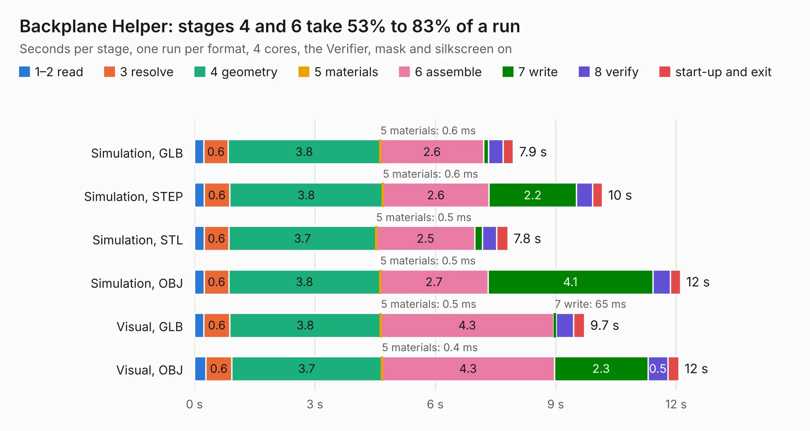

| Mode and format | 1–2 read | 3 resolve | 4 geometry | 5 materials | 6 assemble | 7 write | 8 verify | start-up and exit | Total |
|---|---:|---:|---:|---:|---:|---:|---:|---:|---:|
| Simulation, GLB | 0.2 | 0.6 | 3.8 | 0.6&nbsp;ms | 2.6 | 0.1 | 0.4 | 0.3 | 7.9 |
| Simulation, STEP | 0.2 | 0.6 | 3.8 | 0.6&nbsp;ms | 2.6 | 2.2 | 0.4 | 0.2 | 10.2 |
| Simulation, STL | 0.2 | 0.6 | 3.7 | 0.5&nbsp;ms | 2.5 | 0.2 | 0.4 | 0.3 | 7.8 |
| Simulation, OBJ | 0.2 | 0.6 | 3.8 | 0.5&nbsp;ms | 2.7 | 4.1 | 0.4 | 0.3 | 12.1 |
| Visual, GLB | 0.2 | 0.6 | 3.8 | 0.5&nbsp;ms | 4.3 | 65&nbsp;ms | 0.4 | 0.3 | 9.7 |
| Visual, OBJ | 0.3 | 0.6 | 3.7 | 0.4&nbsp;ms | 4.3 | 2.3 | 0.5 | 0.3 | 12.1 |

<table align="center"><tr><td valign="top">

| Board | Repo: [acwright/6502](https://github.com/acwright/6502) Board: `Backplane Helper.kicad_pcb` |
|---|---|
| Folder | Hardware / Backplane Helper / Rev 1.0 |
| Complexity | 175&nbsp;/&nbsp;1000 (size&nbsp;130, features&nbsp;45) |
| KESE&nbsp;features | through vias, filled zones, curved board outline |
| Tested | 9th November 2026 |
| Copper&nbsp;layers | 2 |
| File&nbsp;format | KiCad 10 (20260206) |
| Parts,&nbsp;tracks,&nbsp;vias | 3, 395, 6 |
| Triangles,&nbsp;simulation | 746,688 in 48 parts |
| Verifier | PASS in all six runs |

</td><td valign="top">

<table>
<tr><th>File type</th><th>File size</th><th>Peak memory used</th></tr>
<tr><th colspan="3" align="left">Simulation</th></tr>
<tr><td>GLB</td><td align="right">25&nbsp;MB</td><td align="right">367&nbsp;MB</td></tr>
<tr><td>STEP</td><td align="right">107&nbsp;MB</td><td align="right">422&nbsp;MB</td></tr>
<tr><td>STL</td><td align="right">37&nbsp;MB</td><td align="right">363&nbsp;MB</td></tr>
<tr><td>OBJ</td><td align="right">75&nbsp;MB</td><td align="right">540&nbsp;MB</td></tr>
<tr><th colspan="3" align="left">Visual</th></tr>
<tr><td>GLB</td><td align="right">14&nbsp;MB</td><td align="right">404&nbsp;MB</td></tr>
<tr><td>OBJ</td><td align="right">40&nbsp;MB</td><td align="right">407&nbsp;MB</td></tr>
</table>

</td></tr></table>

## 17. Backplane Pro

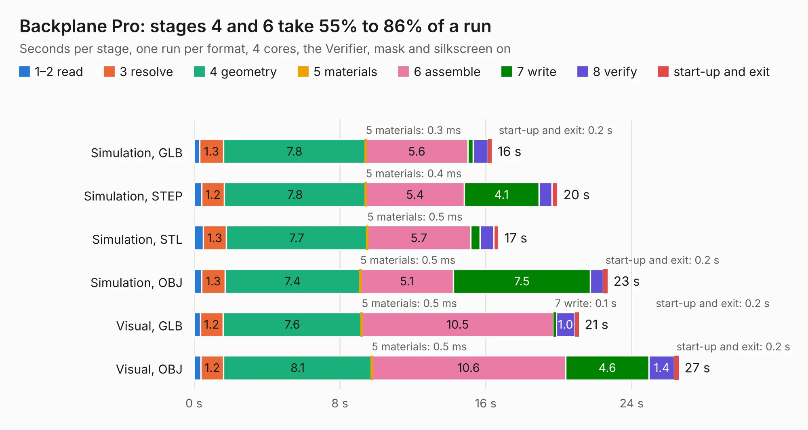

| Mode and format | 1–2 read | 3 resolve | 4 geometry | 5 materials | 6 assemble | 7 write | 8 verify | start-up and exit | Total |
|---|---:|---:|---:|---:|---:|---:|---:|---:|---:|
| Simulation, GLB | 0.3 | 1.3 | 7.8 | 0.3&nbsp;ms | 5.6 | 0.3 | 0.8 | 0.2 | 16.3 |
| Simulation, STEP | 0.4 | 1.2 | 7.8 | 0.4&nbsp;ms | 5.4 | 4.1 | 0.7 | 0.3 | 19.9 |
| Simulation, STL | 0.5 | 1.3 | 7.7 | 0.5&nbsp;ms | 5.7 | 0.5 | 0.7 | 0.3 | 16.7 |
| Simulation, OBJ | 0.4 | 1.3 | 7.4 | 0.5&nbsp;ms | 5.1 | 7.5 | 0.7 | 0.2 | 22.7 |
| Visual, GLB | 0.3 | 1.2 | 7.6 | 0.5&nbsp;ms | 10.5 | 0.1 | 1.0 | 0.2 | 21.1 |
| Visual, OBJ | 0.4 | 1.2 | 8.1 | 0.5&nbsp;ms | 10.6 | 4.6 | 1.4 | 0.2 | 26.6 |

<table align="center"><tr><td valign="top">

| Board | Repo: [acwright/6502](https://github.com/acwright/6502) Board: `Backplane Pro.kicad_pcb` |
|---|---|
| Folder | Hardware / Backplane Pro / Rev 1.0 |
| Complexity | 262&nbsp;/&nbsp;1000 (size&nbsp;172, features&nbsp;90) |
| KESE&nbsp;features | through vias, slotted holes, custom pads, rounded, trapezoid or chamfered pads, filled zones, copper drawings, curved board outline |
| Tested | 9th November 2026 |
| Copper&nbsp;layers | 2 |
| File&nbsp;format | KiCad 10 (20260206) |
| Parts,&nbsp;tracks,&nbsp;vias | 39, 1,027, 31 |
| Triangles,&nbsp;simulation | 1,649,758 in 67 parts |
| Verifier | PASS in all six runs |

</td><td valign="top">

<table>
<tr><th>File type</th><th>File size</th><th>Peak memory used</th></tr>
<tr><th colspan="3" align="left">Simulation</th></tr>
<tr><td>GLB</td><td align="right">55&nbsp;MB</td><td align="right">644&nbsp;MB</td></tr>
<tr><td>STEP</td><td align="right">257&nbsp;MB</td><td align="right">754&nbsp;MB</td></tr>
<tr><td>STL</td><td align="right">82&nbsp;MB</td><td align="right">669&nbsp;MB</td></tr>
<tr><td>OBJ</td><td align="right">171&nbsp;MB</td><td align="right">1.1&nbsp;GB</td></tr>
<tr><th colspan="3" align="left">Visual</th></tr>
<tr><td>GLB</td><td align="right">32&nbsp;MB</td><td align="right">654&nbsp;MB</td></tr>
<tr><td>OBJ</td><td align="right">97&nbsp;MB</td><td align="right">802&nbsp;MB</td></tr>
</table>

</td></tr></table>

## 18. Backplane Pro

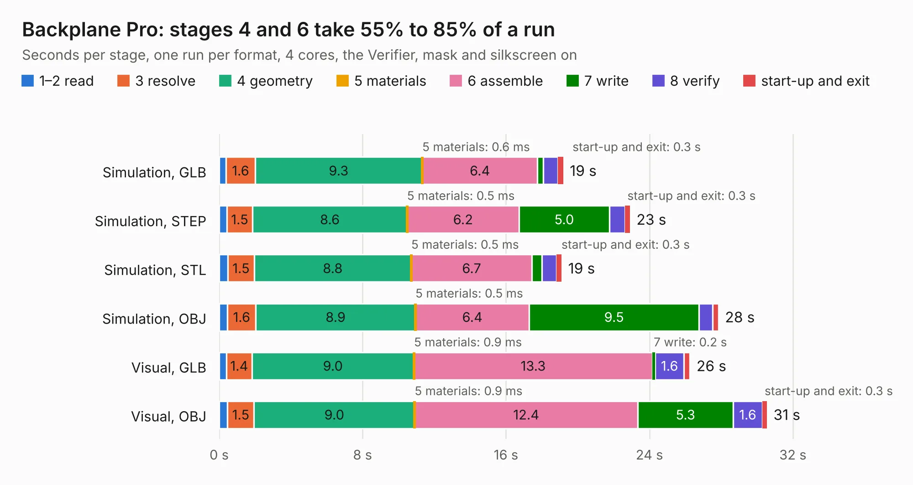

| Mode and format | 1–2 read | 3 resolve | 4 geometry | 5 materials | 6 assemble | 7 write | 8 verify | start-up and exit | Total |
|---|---:|---:|---:|---:|---:|---:|---:|---:|---:|
| Simulation, GLB | 0.4 | 1.6 | 9.3 | 0.6&nbsp;ms | 6.4 | 0.3 | 0.8 | 0.3 | 19.2 |
| Simulation, STEP | 0.4 | 1.5 | 8.6 | 0.5&nbsp;ms | 6.2 | 5.0 | 0.9 | 0.3 | 22.9 |
| Simulation, STL | 0.5 | 1.5 | 8.8 | 0.5&nbsp;ms | 6.7 | 0.5 | 0.8 | 0.3 | 19.1 |
| Simulation, OBJ | 0.5 | 1.6 | 8.9 | 0.5&nbsp;ms | 6.4 | 9.5 | 0.8 | 0.3 | 27.9 |
| Visual, GLB | 0.4 | 1.4 | 9.0 | 0.9&nbsp;ms | 13.3 | 0.2 | 1.6 | 0.3 | 26.3 |
| Visual, OBJ | 0.5 | 1.5 | 9.0 | 0.9&nbsp;ms | 12.4 | 5.3 | 1.6 | 0.3 | 30.6 |

<table align="center"><tr><td valign="top">

| Board | Repo: [acwright/6502](https://github.com/acwright/6502) Board: `Backplane Pro.kicad_pcb` |
|---|---|
| Folder | Hardware / Backplane Pro / Rev 1.1 |
| Complexity | 256&nbsp;/&nbsp;1000 (size&nbsp;166, features&nbsp;90) |
| KESE&nbsp;features | through vias, slotted holes, custom pads, rounded, trapezoid or chamfered pads, filled zones, copper drawings, curved board outline |
| Tested | 9th November 2026 |
| Copper&nbsp;layers | 2 |
| File&nbsp;format | KiCad 10 (20260206) |
| Parts,&nbsp;tracks,&nbsp;vias | 24, 984, 33 |
| Triangles,&nbsp;simulation | 1,751,664 in 59 parts |
| Verifier | PASS in all six runs |

</td><td valign="top">

<table>
<tr><th>File type</th><th>File size</th><th>Peak memory used</th></tr>
<tr><th colspan="3" align="left">Simulation</th></tr>
<tr><td>GLB</td><td align="right">59&nbsp;MB</td><td align="right">617&nbsp;MB</td></tr>
<tr><td>STEP</td><td align="right">263&nbsp;MB</td><td align="right">778&nbsp;MB</td></tr>
<tr><td>STL</td><td align="right">88&nbsp;MB</td><td align="right">655&nbsp;MB</td></tr>
<tr><td>OBJ</td><td align="right">182&nbsp;MB</td><td align="right">1.2&nbsp;GB</td></tr>
<tr><th colspan="3" align="left">Visual</th></tr>
<tr><td>GLB</td><td align="right">33&nbsp;MB</td><td align="right">772&nbsp;MB</td></tr>
<tr><td>OBJ</td><td align="right">99&nbsp;MB</td><td align="right">767&nbsp;MB</td></tr>
</table>

</td></tr></table>

## 19. Backplane

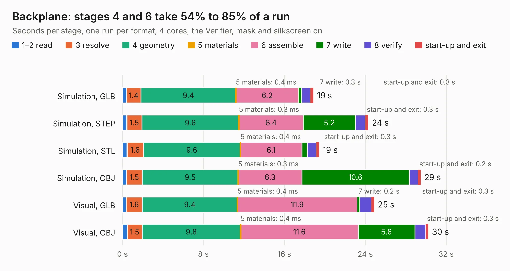

| Mode and format | 1–2 read | 3 resolve | 4 geometry | 5 materials | 6 assemble | 7 write | 8 verify | start-up and exit | Total |
|---|---:|---:|---:|---:|---:|---:|---:|---:|---:|
| Simulation, GLB | 0.4 | 1.4 | 9.4 | 0.4&nbsp;ms | 6.2 | 0.3 | 0.9 | 0.3 | 18.9 |
| Simulation, STEP | 0.4 | 1.5 | 9.6 | 0.3&nbsp;ms | 6.4 | 5.2 | 1.0 | 0.3 | 24.3 |
| Simulation, STL | 0.4 | 1.6 | 9.6 | 0.4&nbsp;ms | 6.1 | 0.5 | 1.0 | 0.3 | 19.4 |
| Simulation, OBJ | 0.4 | 1.5 | 9.5 | 0.3&nbsp;ms | 6.3 | 10.6 | 0.9 | 0.2 | 29.5 |
| Visual, GLB | 0.4 | 1.6 | 9.4 | 0.4&nbsp;ms | 11.9 | 0.2 | 1.2 | 0.3 | 24.9 |
| Visual, OBJ | 0.5 | 1.5 | 9.8 | 0.4&nbsp;ms | 11.6 | 5.6 | 1.1 | 0.3 | 30.3 |

<table align="center"><tr><td valign="top">

| Board | Repo: [acwright/6502](https://github.com/acwright/6502) Board: `Backplane.kicad_pcb` |
|---|---|
| Folder | Hardware / Backplane / Rev 1.0 |
| Complexity | 201&nbsp;/&nbsp;1000 (size&nbsp;156, features&nbsp;45) |
| KESE&nbsp;features | through vias, filled zones, curved board outline |
| Tested | 9th November 2026 |
| Copper&nbsp;layers | 2 |
| File&nbsp;format | KiCad 10 (20260206) |
| Parts,&nbsp;tracks,&nbsp;vias | 7, 1,069, 52 |
| Triangles,&nbsp;simulation | 1,766,986 in 48 parts |
| Verifier | PASS in all six runs |

</td><td valign="top">

<table>
<tr><th>File type</th><th>File size</th><th>Peak memory used</th></tr>
<tr><th colspan="3" align="left">Simulation</th></tr>
<tr><td>GLB</td><td align="right">60&nbsp;MB</td><td align="right">643&nbsp;MB</td></tr>
<tr><td>STEP</td><td align="right">261&nbsp;MB</td><td align="right">772&nbsp;MB</td></tr>
<tr><td>STL</td><td align="right">88&nbsp;MB</td><td align="right">661&nbsp;MB</td></tr>
<tr><td>OBJ</td><td align="right">183&nbsp;MB</td><td align="right">1.2&nbsp;GB</td></tr>
<tr><th colspan="3" align="left">Visual</th></tr>
<tr><td>GLB</td><td align="right">34&nbsp;MB</td><td align="right">742&nbsp;MB</td></tr>
<tr><td>OBJ</td><td align="right">104&nbsp;MB</td><td align="right">842&nbsp;MB</td></tr>
</table>

</td></tr></table>

## 20. Blinkenlights Card

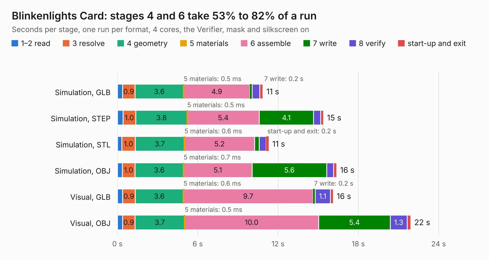

| Mode and format | 1–2 read | 3 resolve | 4 geometry | 5 materials | 6 assemble | 7 write | 8 verify | start-up and exit | Total |
|---|---:|---:|---:|---:|---:|---:|---:|---:|---:|
| Simulation, GLB | 0.4 | 0.9 | 3.6 | 0.5&nbsp;ms | 4.9 | 0.2 | 0.6 | 0.2 | 10.9 |
| Simulation, STEP | 0.4 | 1.0 | 3.8 | 0.5&nbsp;ms | 5.4 | 4.1 | 0.5 | 0.2 | 15.4 |
| Simulation, STL | 0.3 | 1.0 | 3.7 | 0.6&nbsp;ms | 5.2 | 0.4 | 0.5 | 0.2 | 11.3 |
| Simulation, OBJ | 0.4 | 1.0 | 3.6 | 0.7&nbsp;ms | 5.1 | 5.6 | 0.5 | 0.2 | 16.4 |
| Visual, GLB | 0.4 | 0.9 | 3.6 | 0.6&nbsp;ms | 9.7 | 0.2 | 1.1 | 0.2 | 16.1 |
| Visual, OBJ | 0.4 | 0.9 | 3.7 | 0.5&nbsp;ms | 10.0 | 5.4 | 1.3 | 0.3 | 21.9 |

<table align="center"><tr><td valign="top">

| Board | Repo: [acwright/6502](https://github.com/acwright/6502) Board: `Blinkenlights Card.kicad_pcb` |
|---|---|
| Folder | Hardware / Blinkenlights Card / Rev 1.0 |
| Complexity | 234&nbsp;/&nbsp;1000 (size&nbsp;179, features&nbsp;55) |
| KESE&nbsp;features | through vias, rounded, trapezoid or chamfered pads, filled zones, curved board outline |
| Tested | 9th November 2026 |
| Copper&nbsp;layers | 2 |
| File&nbsp;format | KiCad 10 (20260206) |
| Parts,&nbsp;tracks,&nbsp;vias | 73, 630, 166 |
| Triangles,&nbsp;simulation | 1,095,960 in 109 parts |
| Verifier | PASS in all six runs |

</td><td valign="top">

<table>
<tr><th>File type</th><th>File size</th><th>Peak memory used</th></tr>
<tr><th colspan="3" align="left">Simulation</th></tr>
<tr><td>GLB</td><td align="right">38&nbsp;MB</td><td align="right">531&nbsp;MB</td></tr>
<tr><td>STEP</td><td align="right">200&nbsp;MB</td><td align="right">635&nbsp;MB</td></tr>
<tr><td>STL</td><td align="right">55&nbsp;MB</td><td align="right">518&nbsp;MB</td></tr>
<tr><td>OBJ</td><td align="right">112&nbsp;MB</td><td align="right">776&nbsp;MB</td></tr>
<tr><th colspan="3" align="left">Visual</th></tr>
<tr><td>GLB</td><td align="right">35&nbsp;MB</td><td align="right">855&nbsp;MB</td></tr>
<tr><td>OBJ</td><td align="right">105&nbsp;MB</td><td align="right">841&nbsp;MB</td></tr>
</table>

</td></tr></table>

## 21. Breadboard Helper

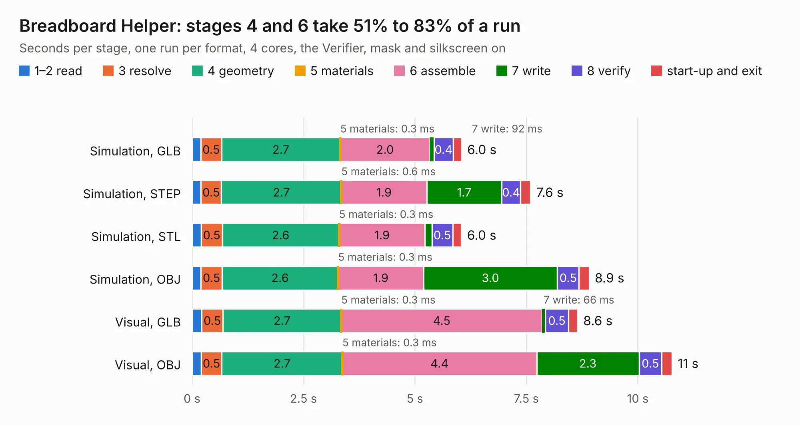

| Mode and format | 1–2 read | 3 resolve | 4 geometry | 5 materials | 6 assemble | 7 write | 8 verify | start-up and exit | Total |
|---|---:|---:|---:|---:|---:|---:|---:|---:|---:|
| Simulation, GLB | 0.2 | 0.5 | 2.7 | 0.3&nbsp;ms | 2.0 | 92&nbsp;ms | 0.4 | 0.2 | 6.0 |
| Simulation, STEP | 0.2 | 0.5 | 2.7 | 0.6&nbsp;ms | 1.9 | 1.7 | 0.4 | 0.2 | 7.6 |
| Simulation, STL | 0.2 | 0.5 | 2.6 | 0.3&nbsp;ms | 1.9 | 0.2 | 0.5 | 0.2 | 6.0 |
| Simulation, OBJ | 0.2 | 0.5 | 2.6 | 0.3&nbsp;ms | 1.9 | 3.0 | 0.5 | 0.2 | 8.9 |
| Visual, GLB | 0.2 | 0.5 | 2.7 | 0.3&nbsp;ms | 4.5 | 66&nbsp;ms | 0.5 | 0.2 | 8.6 |
| Visual, OBJ | 0.2 | 0.5 | 2.7 | 0.3&nbsp;ms | 4.4 | 2.3 | 0.5 | 0.2 | 10.8 |

<table align="center"><tr><td valign="top">

| Board | Repo: [acwright/6502](https://github.com/acwright/6502) Board: `Breadboard Helper.kicad_pcb` |
|---|---|
| Folder | Hardware / Breadboard Helper / Rev 1.0 |
| Complexity | 170&nbsp;/&nbsp;1000 (size&nbsp;125, features&nbsp;45) |
| KESE&nbsp;features | through vias, filled zones, curved board outline |
| Tested | 9th November 2026 |
| Copper&nbsp;layers | 2 |
| File&nbsp;format | KiCad 10 (20260206) |
| Parts,&nbsp;tracks,&nbsp;vias | 3, 260, 12 |
| Triangles,&nbsp;simulation | 609,124 in 49 parts |
| Verifier | PASS in all six runs |

</td><td valign="top">

<table>
<tr><th>File type</th><th>File size</th><th>Peak memory used</th></tr>
<tr><th colspan="3" align="left">Simulation</th></tr>
<tr><td>GLB</td><td align="right">20&nbsp;MB</td><td align="right">343&nbsp;MB</td></tr>
<tr><td>STEP</td><td align="right">86&nbsp;MB</td><td align="right">385&nbsp;MB</td></tr>
<tr><td>STL</td><td align="right">30&nbsp;MB</td><td align="right">358&nbsp;MB</td></tr>
<tr><td>OBJ</td><td align="right">61&nbsp;MB</td><td align="right">435&nbsp;MB</td></tr>
<tr><th colspan="3" align="left">Visual</th></tr>
<tr><td>GLB</td><td align="right">15&nbsp;MB</td><td align="right">425&nbsp;MB</td></tr>
<tr><td>OBJ</td><td align="right">44&nbsp;MB</td><td align="right">426&nbsp;MB</td></tr>
</table>

</td></tr></table>

## 22. Clock Helper

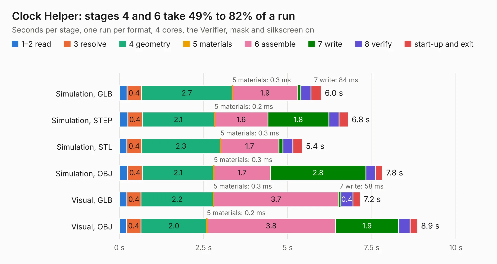

| Mode and format | 1–2 read | 3 resolve | 4 geometry | 5 materials | 6 assemble | 7 write | 8 verify | start-up and exit | Total |
|---|---:|---:|---:|---:|---:|---:|---:|---:|---:|
| Simulation, GLB | 0.2 | 0.4 | 2.7 | 0.3&nbsp;ms | 1.9 | 84&nbsp;ms | 0.3 | 0.3 | 6.0 |
| Simulation, STEP | 0.2 | 0.4 | 2.1 | 0.2&nbsp;ms | 1.6 | 1.8 | 0.3 | 0.3 | 6.8 |
| Simulation, STL | 0.2 | 0.4 | 2.3 | 0.3&nbsp;ms | 1.7 | 0.1 | 0.3 | 0.3 | 5.4 |
| Simulation, OBJ | 0.2 | 0.4 | 2.1 | 0.3&nbsp;ms | 1.7 | 2.8 | 0.3 | 0.2 | 7.8 |
| Visual, GLB | 0.2 | 0.4 | 2.2 | 0.3&nbsp;ms | 3.7 | 58&nbsp;ms | 0.4 | 0.2 | 7.2 |
| Visual, OBJ | 0.2 | 0.4 | 2.0 | 0.2&nbsp;ms | 3.8 | 1.9 | 0.3 | 0.2 | 8.9 |

<table align="center"><tr><td valign="top">

| Board | Repo: [acwright/6502](https://github.com/acwright/6502) Board: `Clock Helper.kicad_pcb` |
|---|---|
| Folder | Hardware / Clock Helper / Rev 1.0 |
| Complexity | 187&nbsp;/&nbsp;1000 (size&nbsp;132, features&nbsp;55) |
| KESE&nbsp;features | through vias, rounded, trapezoid or chamfered pads, filled zones, curved board outline |
| Tested | 9th November 2026 |
| Copper&nbsp;layers | 2 |
| File&nbsp;format | KiCad 10 (20260206) |
| Parts,&nbsp;tracks,&nbsp;vias | 16, 97, 25 |
| Triangles,&nbsp;simulation | 479,936 in 37 parts |
| Verifier | PASS in all six runs |

</td><td valign="top">

<table>
<tr><th>File type</th><th>File size</th><th>Peak memory used</th></tr>
<tr><th colspan="3" align="left">Simulation</th></tr>
<tr><td>GLB</td><td align="right">16&nbsp;MB</td><td align="right">315&nbsp;MB</td></tr>
<tr><td>STEP</td><td align="right">68&nbsp;MB</td><td align="right">337&nbsp;MB</td></tr>
<tr><td>STL</td><td align="right">24&nbsp;MB</td><td align="right">304&nbsp;MB</td></tr>
<tr><td>OBJ</td><td align="right">48&nbsp;MB</td><td align="right">345&nbsp;MB</td></tr>
<tr><th colspan="3" align="left">Visual</th></tr>
<tr><td>GLB</td><td align="right">11&nbsp;MB</td><td align="right">342&nbsp;MB</td></tr>
<tr><td>OBJ</td><td align="right">33&nbsp;MB</td><td align="right">347&nbsp;MB</td></tr>
</table>

</td></tr></table>

## 23. CPU Card Pro

| Mode and format | 1–2 read | 3 resolve | 4 geometry | 5 materials | 6 assemble | 7 write | 8 verify | start-up and exit | Total |
|---|---:|---:|---:|---:|---:|---:|---:|---:|---:|
| Simulation, GLB | 0.3 | 0.8 | 3.5 | 0.5&nbsp;ms | 3.4 | 0.1 | 0.5 | 0.2 | 8.8 |
| Simulation, STEP | 0.3 | 0.8 | 3.4 | 0.4&nbsp;ms | 3.3 | 2.9 | 0.5 | 0.2 | 11.4 |
| Simulation, STL | 0.3 | 0.8 | 3.4 | 0.5&nbsp;ms | 3.3 | 0.3 | 0.5 | 0.3 | 8.7 |
| Simulation, OBJ | 0.3 | 0.8 | 3.4 | 0.3&nbsp;ms | 3.5 | 4.8 | 0.5 | 0.2 | 13.5 |
| Visual, GLB | 0.3 | 0.8 | 3.4 | 0.4&nbsp;ms | 7.0 | 0.1 | 0.8 | 0.2 | 12.5 |
| Visual, OBJ | 0.3 | 0.8 | 3.5 | 0.4&nbsp;ms | 6.9 | 4.0 | 0.8 | 0.2 | 16.4 |

<table align="center"><tr><td valign="top">

| Board | Repo: [acwright/6502](https://github.com/acwright/6502) Board: `CPU Card Pro.kicad_pcb` |
|---|---|
| Folder | Hardware / CPU Card Pro / Rev 1.0 |
| Complexity | 217&nbsp;/&nbsp;1000 (size&nbsp;162, features&nbsp;55) |
| KESE&nbsp;features | through vias, rounded, trapezoid or chamfered pads, filled zones, curved board outline |
| Tested | 9th November 2026 |
| Copper&nbsp;layers | 2 |
| File&nbsp;format | KiCad 10 (20260206) |
| Parts,&nbsp;tracks,&nbsp;vias | 17, 583, 151 |
| Triangles,&nbsp;simulation | 934,380 in 74 parts |
| Verifier | PASS in all six runs |

</td><td valign="top">

<table>
<tr><th>File type</th><th>File size</th><th>Peak memory used</th></tr>
<tr><th colspan="3" align="left">Simulation</th></tr>
<tr><td>GLB</td><td align="right">32&nbsp;MB</td><td align="right">446&nbsp;MB</td></tr>
<tr><td>STEP</td><td align="right">146&nbsp;MB</td><td align="right">560&nbsp;MB</td></tr>
<tr><td>STL</td><td align="right">47&nbsp;MB</td><td align="right">464&nbsp;MB</td></tr>
<tr><td>OBJ</td><td align="right">94&nbsp;MB</td><td align="right">629&nbsp;MB</td></tr>
<tr><th colspan="3" align="left">Visual</th></tr>
<tr><td>GLB</td><td align="right">25&nbsp;MB</td><td align="right">650&nbsp;MB</td></tr>
<tr><td>OBJ</td><td align="right">75&nbsp;MB</td><td align="right">677&nbsp;MB</td></tr>
</table>

</td></tr></table>

## 24. CPU Card

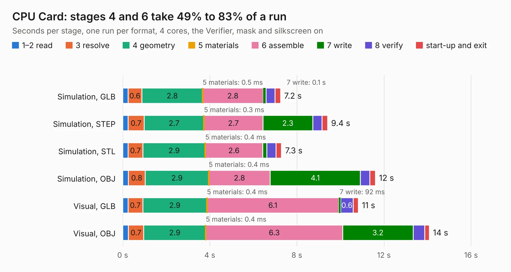

| Mode and format | 1–2 read | 3 resolve | 4 geometry | 5 materials | 6 assemble | 7 write | 8 verify | start-up and exit | Total |
|---|---:|---:|---:|---:|---:|---:|---:|---:|---:|
| Simulation, GLB | 0.2 | 0.6 | 2.8 | 0.5&nbsp;ms | 2.8 | 0.1 | 0.4 | 0.3 | 7.2 |
| Simulation, STEP | 0.2 | 0.7 | 2.7 | 0.3&nbsp;ms | 2.7 | 2.3 | 0.4 | 0.2 | 9.4 |
| Simulation, STL | 0.2 | 0.7 | 2.9 | 0.4&nbsp;ms | 2.6 | 0.2 | 0.4 | 0.3 | 7.3 |
| Simulation, OBJ | 0.3 | 0.8 | 2.9 | 0.4&nbsp;ms | 2.8 | 4.1 | 0.4 | 0.3 | 11.6 |
| Visual, GLB | 0.2 | 0.7 | 2.9 | 0.4&nbsp;ms | 6.1 | 92&nbsp;ms | 0.6 | 0.2 | 10.8 |
| Visual, OBJ | 0.3 | 0.7 | 2.9 | 0.4&nbsp;ms | 6.3 | 3.2 | 0.5 | 0.2 | 14.1 |

<table align="center"><tr><td valign="top">

| Board | Repo: [acwright/6502](https://github.com/acwright/6502) Board: `CPU Card.kicad_pcb` |
|---|---|
| Folder | Hardware / CPU Card / Rev 1.0 |
| Complexity | 232&nbsp;/&nbsp;1000 (size&nbsp;152, features&nbsp;80) |
| KESE&nbsp;features | through vias, custom pads, rounded, trapezoid or chamfered pads, filled zones, copper drawings, curved board outline |
| Tested | 9th November 2026 |
| Copper&nbsp;layers | 2 |
| File&nbsp;format | KiCad 10 (20260206) |
| Parts,&nbsp;tracks,&nbsp;vias | 12, 343, 124 |
| Triangles,&nbsp;simulation | 729,338 in 54 parts |
| Verifier | PASS in all six runs |

</td><td valign="top">

<table>
<tr><th>File type</th><th>File size</th><th>Peak memory used</th></tr>
<tr><th colspan="3" align="left">Simulation</th></tr>
<tr><td>GLB</td><td align="right">25&nbsp;MB</td><td align="right">407&nbsp;MB</td></tr>
<tr><td>STEP</td><td align="right">109&nbsp;MB</td><td align="right">461&nbsp;MB</td></tr>
<tr><td>STL</td><td align="right">36&nbsp;MB</td><td align="right">404&nbsp;MB</td></tr>
<tr><td>OBJ</td><td align="right">73&nbsp;MB</td><td align="right">537&nbsp;MB</td></tr>
<tr><th colspan="3" align="left">Visual</th></tr>
<tr><td>GLB</td><td align="right">19&nbsp;MB</td><td align="right">473&nbsp;MB</td></tr>
<tr><td>OBJ</td><td align="right">58&nbsp;MB</td><td align="right">455&nbsp;MB</td></tr>
</table>

</td></tr></table>

## 25. CPU Card

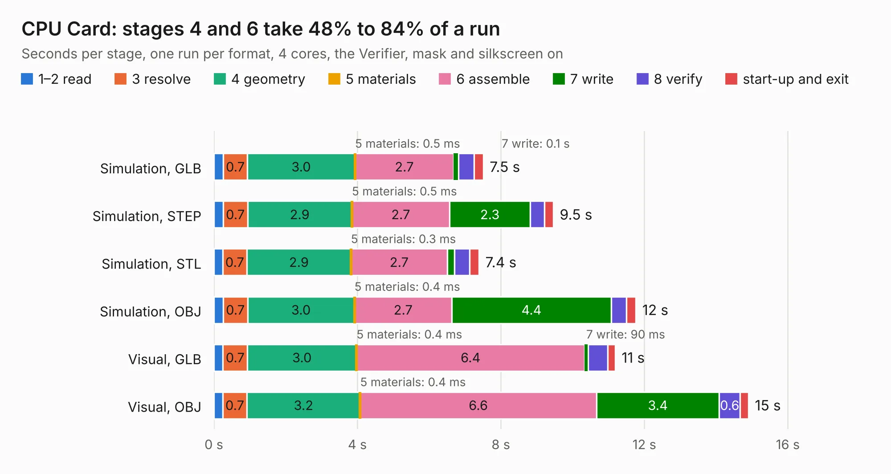

| Mode and format | 1–2 read | 3 resolve | 4 geometry | 5 materials | 6 assemble | 7 write | 8 verify | start-up and exit | Total |
|---|---:|---:|---:|---:|---:|---:|---:|---:|---:|
| Simulation, GLB | 0.3 | 0.7 | 3.0 | 0.5&nbsp;ms | 2.7 | 0.1 | 0.4 | 0.3 | 7.5 |
| Simulation, STEP | 0.3 | 0.7 | 2.9 | 0.5&nbsp;ms | 2.7 | 2.3 | 0.4 | 0.3 | 9.5 |
| Simulation, STL | 0.2 | 0.7 | 2.9 | 0.3&nbsp;ms | 2.7 | 0.2 | 0.4 | 0.3 | 7.4 |
| Simulation, OBJ | 0.3 | 0.7 | 3.0 | 0.4&nbsp;ms | 2.7 | 4.4 | 0.4 | 0.3 | 11.8 |
| Visual, GLB | 0.3 | 0.7 | 3.0 | 0.4&nbsp;ms | 6.4 | 90&nbsp;ms | 0.6 | 0.2 | 11.2 |
| Visual, OBJ | 0.2 | 0.7 | 3.2 | 0.4&nbsp;ms | 6.6 | 3.4 | 0.6 | 0.2 | 14.9 |

<table align="center"><tr><td valign="top">

| Board | Repo: [acwright/6502](https://github.com/acwright/6502) Board: `CPU Card.kicad_pcb` |
|---|---|
| Folder | Hardware / CPU Card / Rev 1.1 |
| Complexity | 232&nbsp;/&nbsp;1000 (size&nbsp;152, features&nbsp;80) |
| KESE&nbsp;features | through vias, custom pads, rounded, trapezoid or chamfered pads, filled zones, copper drawings, curved board outline |
| Tested | 9th November 2026 |
| Copper&nbsp;layers | 2 |
| File&nbsp;format | KiCad 10 (20260206) |
| Parts,&nbsp;tracks,&nbsp;vias | 12, 343, 124 |
| Triangles,&nbsp;simulation | 729,266 in 54 parts |
| Verifier | PASS in all six runs |

</td><td valign="top">

<table>
<tr><th>File type</th><th>File size</th><th>Peak memory used</th></tr>
<tr><th colspan="3" align="left">Simulation</th></tr>
<tr><td>GLB</td><td align="right">25&nbsp;MB</td><td align="right">405&nbsp;MB</td></tr>
<tr><td>STEP</td><td align="right">109&nbsp;MB</td><td align="right">463&nbsp;MB</td></tr>
<tr><td>STL</td><td align="right">36&nbsp;MB</td><td align="right">416&nbsp;MB</td></tr>
<tr><td>OBJ</td><td align="right">73&nbsp;MB</td><td align="right">515&nbsp;MB</td></tr>
<tr><th colspan="3" align="left">Visual</th></tr>
<tr><td>GLB</td><td align="right">19&nbsp;MB</td><td align="right">467&nbsp;MB</td></tr>
<tr><td>OBJ</td><td align="right">58&nbsp;MB</td><td align="right">472&nbsp;MB</td></tr>
</table>

</td></tr></table>

## 26. DB25 Helper

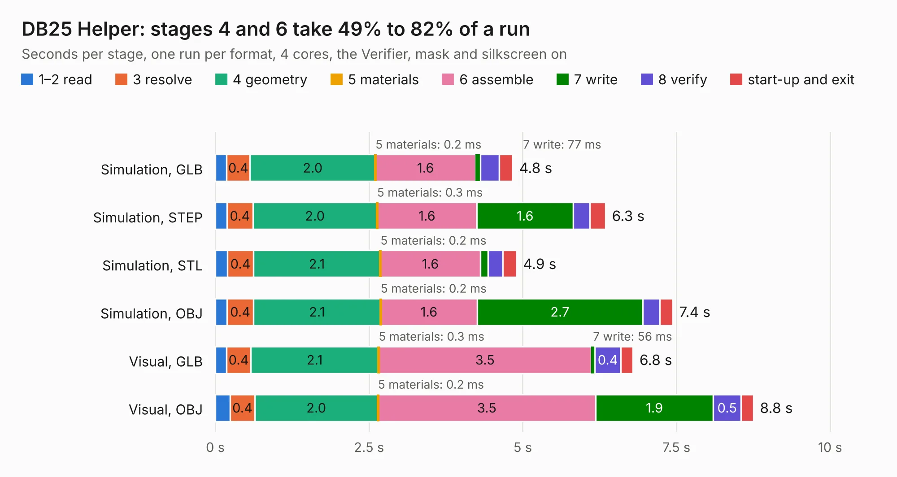

| Mode and format | 1–2 read | 3 resolve | 4 geometry | 5 materials | 6 assemble | 7 write | 8 verify | start-up and exit | Total |
|---|---:|---:|---:|---:|---:|---:|---:|---:|---:|
| Simulation, GLB | 0.2 | 0.4 | 2.0 | 0.2&nbsp;ms | 1.6 | 77&nbsp;ms | 0.3 | 0.2 | 4.8 |
| Simulation, STEP | 0.2 | 0.4 | 2.0 | 0.3&nbsp;ms | 1.6 | 1.6 | 0.3 | 0.3 | 6.3 |
| Simulation, STL | 0.2 | 0.4 | 2.1 | 0.2&nbsp;ms | 1.6 | 0.1 | 0.2 | 0.2 | 4.9 |
| Simulation, OBJ | 0.2 | 0.4 | 2.1 | 0.2&nbsp;ms | 1.6 | 2.7 | 0.3 | 0.2 | 7.4 |
| Visual, GLB | 0.2 | 0.4 | 2.1 | 0.3&nbsp;ms | 3.5 | 56&nbsp;ms | 0.4 | 0.2 | 6.8 |
| Visual, OBJ | 0.2 | 0.4 | 2.0 | 0.2&nbsp;ms | 3.5 | 1.9 | 0.5 | 0.2 | 8.8 |

<table align="center"><tr><td valign="top">

| Board | Repo: [acwright/6502](https://github.com/acwright/6502) Board: `DB25 Helper.kicad_pcb` |
|---|---|
| Folder | Hardware / DB25 Helper / Rev 1.0 |
| Complexity | 170&nbsp;/&nbsp;1000 (size&nbsp;125, features&nbsp;45) |
| KESE&nbsp;features | through vias, filled zones, curved board outline |
| Tested | 9th November 2026 |
| Copper&nbsp;layers | 2 |
| File&nbsp;format | KiCad 10 (20260206) |
| Parts,&nbsp;tracks,&nbsp;vias | 3, 145, 49 |
| Triangles,&nbsp;simulation | 495,190 in 32 parts |
| Verifier | PASS in all six runs |

</td><td valign="top">

<table>
<tr><th>File type</th><th>File size</th><th>Peak memory used</th></tr>
<tr><th colspan="3" align="left">Simulation</th></tr>
<tr><td>GLB</td><td align="right">17&nbsp;MB</td><td align="right">338&nbsp;MB</td></tr>
<tr><td>STEP</td><td align="right">64&nbsp;MB</td><td align="right">349&nbsp;MB</td></tr>
<tr><td>STL</td><td align="right">25&nbsp;MB</td><td align="right">336&nbsp;MB</td></tr>
<tr><td>OBJ</td><td align="right">49&nbsp;MB</td><td align="right">378&nbsp;MB</td></tr>
<tr><th colspan="3" align="left">Visual</th></tr>
<tr><td>GLB</td><td align="right">12&nbsp;MB</td><td align="right">352&nbsp;MB</td></tr>
<tr><td>OBJ</td><td align="right">35&nbsp;MB</td><td align="right">350&nbsp;MB</td></tr>
</table>

</td></tr></table>

## 27. GPIO Breadboard Helper

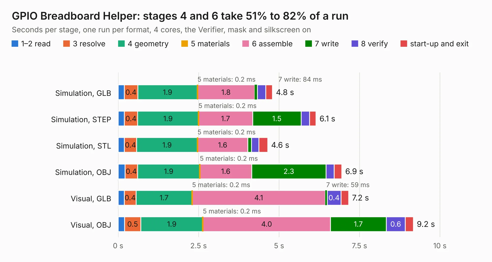

| Mode and format | 1–2 read | 3 resolve | 4 geometry | 5 materials | 6 assemble | 7 write | 8 verify | start-up and exit | Total |
|---|---:|---:|---:|---:|---:|---:|---:|---:|---:|
| Simulation, GLB | 0.2 | 0.4 | 1.9 | 0.2&nbsp;ms | 1.8 | 84&nbsp;ms | 0.3 | 0.2 | 4.8 |
| Simulation, STEP | 0.2 | 0.4 | 1.9 | 0.2&nbsp;ms | 1.7 | 1.5 | 0.3 | 0.2 | 6.1 |
| Simulation, STL | 0.2 | 0.4 | 1.9 | 0.2&nbsp;ms | 1.6 | 0.1 | 0.2 | 0.3 | 4.6 |
| Simulation, OBJ | 0.2 | 0.4 | 1.9 | 0.2&nbsp;ms | 1.6 | 2.3 | 0.3 | 0.2 | 6.9 |
| Visual, GLB | 0.2 | 0.4 | 1.7 | 0.2&nbsp;ms | 4.1 | 59&nbsp;ms | 0.4 | 0.2 | 7.2 |
| Visual, OBJ | 0.2 | 0.5 | 1.9 | 0.2&nbsp;ms | 4.0 | 1.7 | 0.6 | 0.3 | 9.2 |

<table align="center"><tr><td valign="top">

| Board | Repo: [acwright/6502](https://github.com/acwright/6502) Board: `GPIO Breadboard Helper.kicad_pcb` |
|---|---|
| Folder | Hardware / GPIO Breadboard Helper / Rev 1.0 |
| Complexity | 174&nbsp;/&nbsp;1000 (size&nbsp;129, features&nbsp;45) |
| KESE&nbsp;features | through vias, filled zones, curved board outline |
| Tested | 9th November 2026 |
| Copper&nbsp;layers | 2 |
| File&nbsp;format | KiCad 10 (20260206) |
| Parts,&nbsp;tracks,&nbsp;vias | 4, 174, 48 |
| Triangles,&nbsp;simulation | 513,806 in 33 parts |
| Verifier | PASS in all six runs |

</td><td valign="top">

<table>
<tr><th>File type</th><th>File size</th><th>Peak memory used</th></tr>
<tr><th colspan="3" align="left">Simulation</th></tr>
<tr><td>GLB</td><td align="right">18&nbsp;MB</td><td align="right">317&nbsp;MB</td></tr>
<tr><td>STEP</td><td align="right">78&nbsp;MB</td><td align="right">359&nbsp;MB</td></tr>
<tr><td>STL</td><td align="right">26&nbsp;MB</td><td align="right">327&nbsp;MB</td></tr>
<tr><td>OBJ</td><td align="right">52&nbsp;MB</td><td align="right">391&nbsp;MB</td></tr>
<tr><th colspan="3" align="left">Visual</th></tr>
<tr><td>GLB</td><td align="right">13&nbsp;MB</td><td align="right">374&nbsp;MB</td></tr>
<tr><td>OBJ</td><td align="right">38&nbsp;MB</td><td align="right">372&nbsp;MB</td></tr>
</table>

</td></tr></table>

## 28. GPIO Card

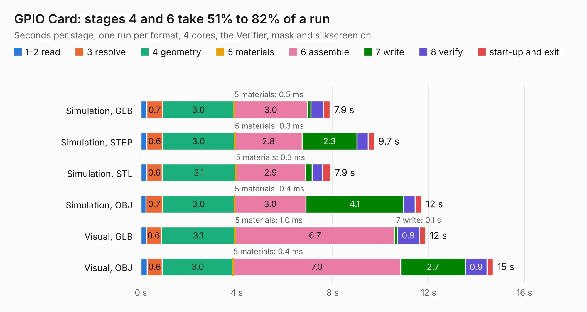

| Mode and format | 1–2 read | 3 resolve | 4 geometry | 5 materials | 6 assemble | 7 write | 8 verify | start-up and exit | Total |
|---|---:|---:|---:|---:|---:|---:|---:|---:|---:|
| Simulation, GLB | 0.2 | 0.7 | 3.0 | 0.5&nbsp;ms | 3.0 | 0.2 | 0.5 | 0.3 | 7.9 |
| Simulation, STEP | 0.3 | 0.6 | 3.0 | 0.3&nbsp;ms | 2.8 | 2.3 | 0.5 | 0.3 | 9.7 |
| Simulation, STL | 0.2 | 0.6 | 3.1 | 0.3&nbsp;ms | 2.9 | 0.3 | 0.5 | 0.3 | 7.9 |
| Simulation, OBJ | 0.2 | 0.7 | 3.0 | 0.4&nbsp;ms | 3.0 | 4.1 | 0.5 | 0.3 | 11.7 |
| Visual, GLB | 0.2 | 0.6 | 3.1 | 1.0&nbsp;ms | 6.7 | 0.1 | 0.9 | 0.3 | 11.9 |
| Visual, OBJ | 0.3 | 0.6 | 3.0 | 0.4&nbsp;ms | 7.0 | 2.7 | 0.9 | 0.3 | 14.7 |

<table align="center"><tr><td valign="top">

| Board | Repo: [acwright/6502](https://github.com/acwright/6502) Board: `GPIO Card.kicad_pcb` |
|---|---|
| Folder | Hardware / GPIO Card / Rev 1.0 |
| Complexity | 228&nbsp;/&nbsp;1000 (size&nbsp;148, features&nbsp;80) |
| KESE&nbsp;features | through vias, custom pads, rounded, trapezoid or chamfered pads, filled zones, copper drawings, curved board outline |
| Tested | 9th November 2026 |
| Copper&nbsp;layers | 2 |
| File&nbsp;format | KiCad 10 (20260206) |
| Parts,&nbsp;tracks,&nbsp;vias | 10, 305, 102 |
| Triangles,&nbsp;simulation | 857,132 in 79 parts |
| Verifier | PASS in all six runs |

</td><td valign="top">

<table>
<tr><th>File type</th><th>File size</th><th>Peak memory used</th></tr>
<tr><th colspan="3" align="left">Simulation</th></tr>
<tr><td>GLB</td><td align="right">29&nbsp;MB</td><td align="right">439&nbsp;MB</td></tr>
<tr><td>STEP</td><td align="right">127&nbsp;MB</td><td align="right">501&nbsp;MB</td></tr>
<tr><td>STL</td><td align="right">43&nbsp;MB</td><td align="right">464&nbsp;MB</td></tr>
<tr><td>OBJ</td><td align="right">86&nbsp;MB</td><td align="right">616&nbsp;MB</td></tr>
<tr><th colspan="3" align="left">Visual</th></tr>
<tr><td>GLB</td><td align="right">21&nbsp;MB</td><td align="right">562&nbsp;MB</td></tr>
<tr><td>OBJ</td><td align="right">63&nbsp;MB</td><td align="right">554&nbsp;MB</td></tr>
</table>

</td></tr></table>

## 29. GPIO Helper

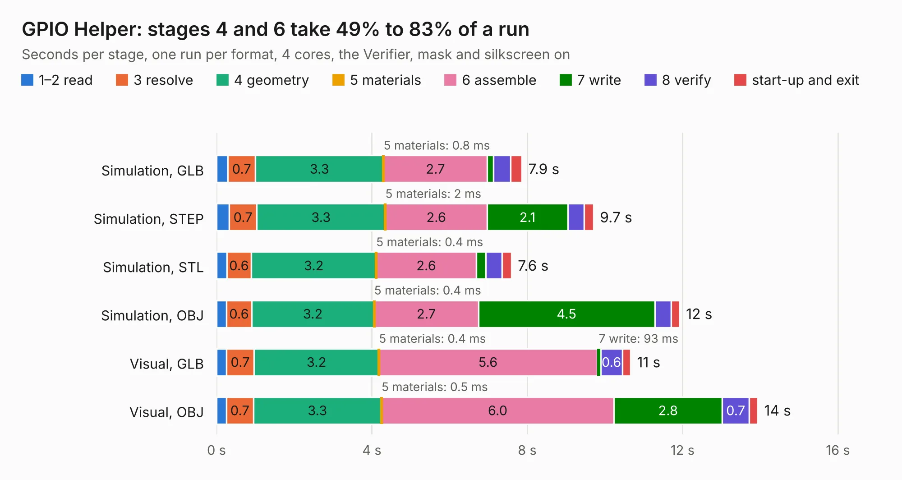

| Mode and format | 1–2 read | 3 resolve | 4 geometry | 5 materials | 6 assemble | 7 write | 8 verify | start-up and exit | Total |
|---|---:|---:|---:|---:|---:|---:|---:|---:|---:|
| Simulation, GLB | 0.3 | 0.7 | 3.3 | 0.8&nbsp;ms | 2.7 | 0.2 | 0.4 | 0.3 | 7.9 |
| Simulation, STEP | 0.3 | 0.7 | 3.3 | 2&nbsp;ms | 2.6 | 2.1 | 0.4 | 0.2 | 9.7 |
| Simulation, STL | 0.3 | 0.6 | 3.2 | 0.4&nbsp;ms | 2.6 | 0.2 | 0.4 | 0.2 | 7.6 |
| Simulation, OBJ | 0.3 | 0.6 | 3.2 | 0.4&nbsp;ms | 2.7 | 4.5 | 0.4 | 0.2 | 11.9 |
| Visual, GLB | 0.3 | 0.7 | 3.2 | 0.4&nbsp;ms | 5.6 | 93&nbsp;ms | 0.6 | 0.2 | 10.7 |
| Visual, OBJ | 0.3 | 0.7 | 3.3 | 0.5&nbsp;ms | 6.0 | 2.8 | 0.7 | 0.2 | 13.9 |

<table align="center"><tr><td valign="top">

| Board | Repo: [acwright/6502](https://github.com/acwright/6502) Board: `GPIO Helper.kicad_pcb` |
|---|---|
| Folder | Hardware / GPIO Helper / Rev 1.0 |
| Complexity | 196&nbsp;/&nbsp;1000 (size&nbsp;151, features&nbsp;45) |
| KESE&nbsp;features | through vias, filled zones, curved board outline |
| Tested | 9th November 2026 |
| Copper&nbsp;layers | 2 |
| File&nbsp;format | KiCad 10 (20260206) |
| Parts,&nbsp;tracks,&nbsp;vias | 34, 179, 53 |
| Triangles,&nbsp;simulation | 844,730 in 40 parts |
| Verifier | PASS in all six runs |

</td><td valign="top">

<table>
<tr><th>File type</th><th>File size</th><th>Peak memory used</th></tr>
<tr><th colspan="3" align="left">Simulation</th></tr>
<tr><td>GLB</td><td align="right">28&nbsp;MB</td><td align="right">447&nbsp;MB</td></tr>
<tr><td>STEP</td><td align="right">115&nbsp;MB</td><td align="right">500&nbsp;MB</td></tr>
<tr><td>STL</td><td align="right">42&nbsp;MB</td><td align="right">497&nbsp;MB</td></tr>
<tr><td>OBJ</td><td align="right">85&nbsp;MB</td><td align="right">578&nbsp;MB</td></tr>
<tr><th colspan="3" align="left">Visual</th></tr>
<tr><td>GLB</td><td align="right">19&nbsp;MB</td><td align="right">504&nbsp;MB</td></tr>
<tr><td>OBJ</td><td align="right">57&nbsp;MB</td><td align="right">526&nbsp;MB</td></tr>
</table>

</td></tr></table>

## 30. Joystick Helper

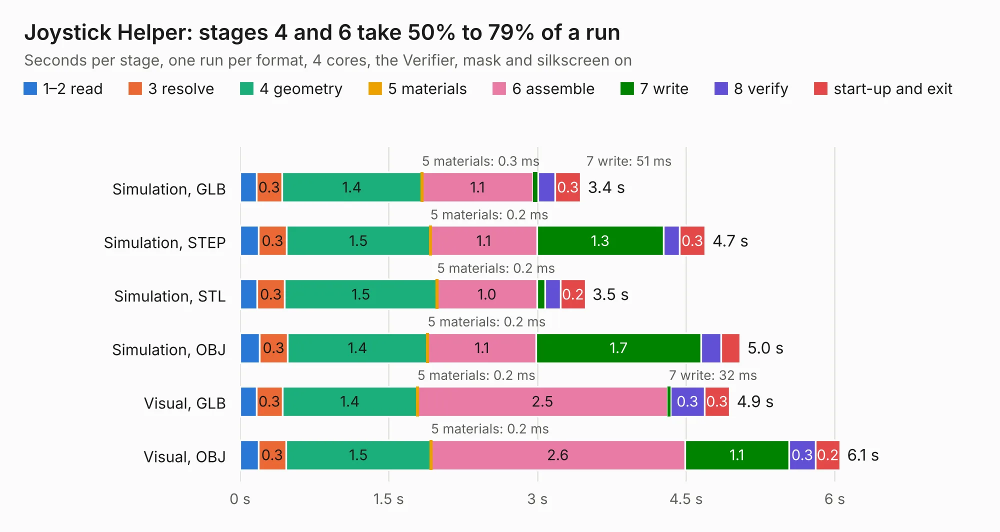

| Mode and format | 1–2 read | 3 resolve | 4 geometry | 5 materials | 6 assemble | 7 write | 8 verify | start-up and exit | Total |
|---|---:|---:|---:|---:|---:|---:|---:|---:|---:|
| Simulation, GLB | 0.2 | 0.3 | 1.4 | 0.3&nbsp;ms | 1.1 | 51&nbsp;ms | 0.2 | 0.3 | 3.4 |
| Simulation, STEP | 0.2 | 0.3 | 1.5 | 0.2&nbsp;ms | 1.1 | 1.3 | 0.2 | 0.3 | 4.7 |
| Simulation, STL | 0.2 | 0.3 | 1.5 | 0.2&nbsp;ms | 1.0 | 84&nbsp;ms | 0.2 | 0.2 | 3.5 |
| Simulation, OBJ | 0.2 | 0.3 | 1.4 | 0.2&nbsp;ms | 1.1 | 1.7 | 0.2 | 0.2 | 5.0 |
| Visual, GLB | 0.2 | 0.3 | 1.4 | 0.2&nbsp;ms | 2.5 | 32&nbsp;ms | 0.3 | 0.3 | 4.9 |
| Visual, OBJ | 0.2 | 0.3 | 1.5 | 0.2&nbsp;ms | 2.6 | 1.1 | 0.3 | 0.2 | 6.1 |

<table align="center"><tr><td valign="top">

| Board | Repo: [acwright/6502](https://github.com/acwright/6502) Board: `Joystick Helper.kicad_pcb` |
|---|---|
| Folder | Hardware / Joystick Helper / Rev 1.0 |
| Complexity | 167&nbsp;/&nbsp;1000 (size&nbsp;122, features&nbsp;45) |
| KESE&nbsp;features | through vias, filled zones, curved board outline |
| Tested | 9th November 2026 |
| Copper&nbsp;layers | 2 |
| File&nbsp;format | KiCad 10 (20260206) |
| Parts,&nbsp;tracks,&nbsp;vias | 10, 75, 17 |
| Triangles,&nbsp;simulation | 327,932 in 22 parts |
| Verifier | PASS in all six runs |

</td><td valign="top">

<table>
<tr><th>File type</th><th>File size</th><th>Peak memory used</th></tr>
<tr><th colspan="3" align="left">Simulation</th></tr>
<tr><td>GLB</td><td align="right">11&nbsp;MB</td><td align="right">272&nbsp;MB</td></tr>
<tr><td>STEP</td><td align="right">43&nbsp;MB</td><td align="right">277&nbsp;MB</td></tr>
<tr><td>STL</td><td align="right">16&nbsp;MB</td><td align="right">252&nbsp;MB</td></tr>
<tr><td>OBJ</td><td align="right">33&nbsp;MB</td><td align="right">258&nbsp;MB</td></tr>
<tr><th colspan="3" align="left">Visual</th></tr>
<tr><td>GLB</td><td align="right">7.7&nbsp;MB</td><td align="right">253&nbsp;MB</td></tr>
<tr><td>OBJ</td><td align="right">22&nbsp;MB</td><td align="right">258&nbsp;MB</td></tr>
</table>

</td></tr></table>

## 31. Keyboard Encoder Helper

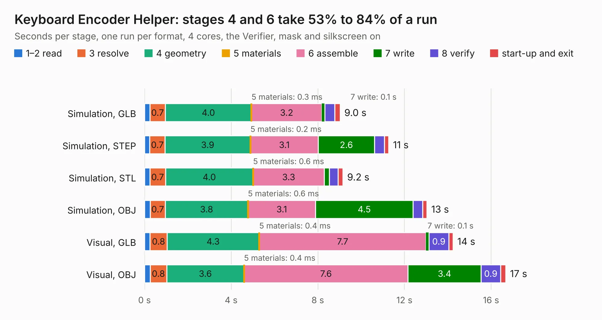

| Mode and format | 1–2 read | 3 resolve | 4 geometry | 5 materials | 6 assemble | 7 write | 8 verify | start-up and exit | Total |
|---|---:|---:|---:|---:|---:|---:|---:|---:|---:|
| Simulation, GLB | 0.2 | 0.7 | 4.0 | 0.3&nbsp;ms | 3.2 | 0.1 | 0.5 | 0.2 | 9.0 |
| Simulation, STEP | 0.2 | 0.7 | 3.9 | 0.2&nbsp;ms | 3.1 | 2.6 | 0.5 | 0.2 | 11.3 |
| Simulation, STL | 0.2 | 0.7 | 4.0 | 0.6&nbsp;ms | 3.3 | 0.2 | 0.4 | 0.2 | 9.2 |
| Simulation, OBJ | 0.3 | 0.7 | 3.8 | 0.6&nbsp;ms | 3.1 | 4.5 | 0.4 | 0.2 | 13.0 |
| Visual, GLB | 0.3 | 0.8 | 4.3 | 0.4&nbsp;ms | 7.7 | 0.1 | 0.9 | 0.2 | 14.2 |
| Visual, OBJ | 0.3 | 0.8 | 3.6 | 0.4&nbsp;ms | 7.6 | 3.4 | 0.9 | 0.2 | 16.7 |

<table align="center"><tr><td valign="top">

| Board | Repo: [acwright/6502](https://github.com/acwright/6502) Board: `Keyboard Encoder Helper.kicad_pcb` |
|---|---|
| Folder | Hardware / Keyboard Encoder Helper / Rev 1.0 |
| Complexity | 205&nbsp;/&nbsp;1000 (size&nbsp;150, features&nbsp;55) |
| KESE&nbsp;features | through vias, rounded, trapezoid or chamfered pads, filled zones, curved board outline |
| Tested | 9th November 2026 |
| Copper&nbsp;layers | 2 |
| File&nbsp;format | KiCad 10 (20260206) |
| Parts,&nbsp;tracks,&nbsp;vias | 11, 364, 99 |
| Triangles,&nbsp;simulation | 975,048 in 51 parts |
| Verifier | PASS in all six runs |

</td><td valign="top">

<table>
<tr><th>File type</th><th>File size</th><th>Peak memory used</th></tr>
<tr><th colspan="3" align="left">Simulation</th></tr>
<tr><td>GLB</td><td align="right">33&nbsp;MB</td><td align="right">485&nbsp;MB</td></tr>
<tr><td>STEP</td><td align="right">140&nbsp;MB</td><td align="right">519&nbsp;MB</td></tr>
<tr><td>STL</td><td align="right">49&nbsp;MB</td><td align="right">493&nbsp;MB</td></tr>
<tr><td>OBJ</td><td align="right">98&nbsp;MB</td><td align="right">667&nbsp;MB</td></tr>
<tr><th colspan="3" align="left">Visual</th></tr>
<tr><td>GLB</td><td align="right">23&nbsp;MB</td><td align="right">561&nbsp;MB</td></tr>
<tr><td>OBJ</td><td align="right">68&nbsp;MB</td><td align="right">591&nbsp;MB</td></tr>
</table>

</td></tr></table>

## 32. Keyboard Helper

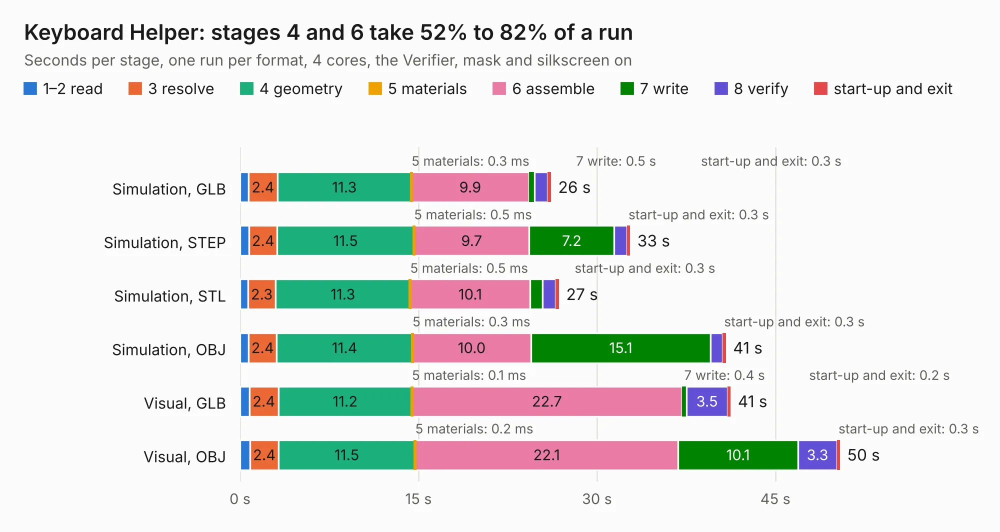

| Mode and format | 1–2 read | 3 resolve | 4 geometry | 5 materials | 6 assemble | 7 write | 8 verify | start-up and exit | Total |
|---|---:|---:|---:|---:|---:|---:|---:|---:|---:|
| Simulation, GLB | 0.7 | 2.4 | 11.3 | 0.3&nbsp;ms | 9.9 | 0.5 | 1.1 | 0.3 | 26.1 |
| Simulation, STEP | 0.8 | 2.4 | 11.5 | 0.5&nbsp;ms | 9.7 | 7.2 | 1.1 | 0.3 | 32.8 |
| Simulation, STL | 0.7 | 2.3 | 11.3 | 0.5&nbsp;ms | 10.1 | 1.0 | 1.1 | 0.3 | 26.8 |
| Simulation, OBJ | 0.7 | 2.4 | 11.4 | 0.3&nbsp;ms | 10.0 | 15.1 | 1.0 | 0.3 | 40.8 |
| Visual, GLB | 0.8 | 2.4 | 11.2 | 0.1&nbsp;ms | 22.7 | 0.4 | 3.5 | 0.2 | 41.2 |
| Visual, OBJ | 0.9 | 2.4 | 11.5 | 0.2&nbsp;ms | 22.1 | 10.1 | 3.3 | 0.3 | 50.4 |

<table align="center"><tr><td valign="top">

| Board | Repo: [acwright/6502](https://github.com/acwright/6502) Board: `Keyboard Helper.kicad_pcb` |
|---|---|
| Folder | Hardware / Keyboard Helper / Rev 1.0 |
| Complexity | 232&nbsp;/&nbsp;1000 (size&nbsp;187, features&nbsp;45) |
| KESE&nbsp;features | through vias, filled zones, curved board outline |
| Tested | 9th November 2026 |
| Copper&nbsp;layers | 2 |
| File&nbsp;format | KiCad 10 (20260206) |
| Parts,&nbsp;tracks,&nbsp;vias | 90, 925, 245 |
| Triangles,&nbsp;simulation | 2,925,074 in 36 parts |
| Verifier | PASS in all six runs |

</td><td valign="top">

<table>
<tr><th>File type</th><th>File size</th><th>Peak memory used</th></tr>
<tr><th colspan="3" align="left">Simulation</th></tr>
<tr><td>GLB</td><td align="right">98&nbsp;MB</td><td align="right">1.2&nbsp;GB</td></tr>
<tr><td>STEP</td><td align="right">344&nbsp;MB</td><td align="right">1.3&nbsp;GB</td></tr>
<tr><td>STL</td><td align="right">146&nbsp;MB</td><td align="right">1.2&nbsp;GB</td></tr>
<tr><td>OBJ</td><td align="right">304&nbsp;MB</td><td align="right">1.9&nbsp;GB</td></tr>
<tr><th colspan="3" align="left">Visual</th></tr>
<tr><td>GLB</td><td align="right">69&nbsp;MB</td><td align="right">1.5&nbsp;GB</td></tr>
<tr><td>OBJ</td><td align="right">215&nbsp;MB</td><td align="right">1.4&nbsp;GB</td></tr>
</table>

</td></tr></table>

## 33. LCD Board

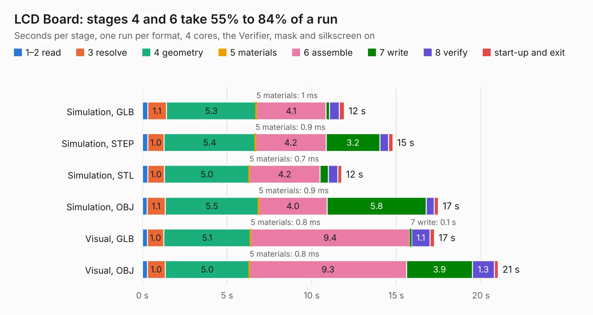

| Mode and format | 1–2 read | 3 resolve | 4 geometry | 5 materials | 6 assemble | 7 write | 8 verify | start-up and exit | Total |
|---|---:|---:|---:|---:|---:|---:|---:|---:|---:|
| Simulation, GLB | 0.3 | 1.1 | 5.3 | 1&nbsp;ms | 4.1 | 0.2 | 0.6 | 0.3 | 11.9 |
| Simulation, STEP | 0.3 | 1.0 | 5.4 | 0.9&nbsp;ms | 4.2 | 3.2 | 0.5 | 0.3 | 14.8 |
| Simulation, STL | 0.3 | 1.0 | 5.0 | 0.7&nbsp;ms | 4.2 | 0.5 | 0.6 | 0.2 | 11.8 |
| Simulation, OBJ | 0.3 | 1.1 | 5.5 | 0.9&nbsp;ms | 4.0 | 5.8 | 0.5 | 0.2 | 17.5 |
| Visual, GLB | 0.3 | 1.0 | 5.1 | 0.8&nbsp;ms | 9.4 | 0.1 | 1.1 | 0.3 | 17.2 |
| Visual, OBJ | 0.3 | 1.0 | 5.0 | 0.8&nbsp;ms | 9.3 | 3.9 | 1.3 | 0.2 | 21.0 |

<table align="center"><tr><td valign="top">

| Board | Repo: [acwright/6502](https://github.com/acwright/6502) Board: `LCD Board.kicad_pcb` |
|---|---|
| Folder | Hardware / LCD Board / Rev 1.0 |
| Complexity | 230&nbsp;/&nbsp;1000 (size&nbsp;150, features&nbsp;80) |
| KESE&nbsp;features | through vias, custom pads, rounded, trapezoid or chamfered pads, filled zones, copper drawings, curved board outline |
| Tested | 9th November 2026 |
| Copper&nbsp;layers | 2 |
| File&nbsp;format | KiCad 10 (20260206) |
| Parts,&nbsp;tracks,&nbsp;vias | 13, 309, 100 |
| Triangles,&nbsp;simulation | 1,237,574 in 85 parts |
| Verifier | PASS in all six runs |

</td><td valign="top">

<table>
<tr><th>File type</th><th>File size</th><th>Peak memory used</th></tr>
<tr><th colspan="3" align="left">Simulation</th></tr>
<tr><td>GLB</td><td align="right">42&nbsp;MB</td><td align="right">608&nbsp;MB</td></tr>
<tr><td>STEP</td><td align="right">171&nbsp;MB</td><td align="right">625&nbsp;MB</td></tr>
<tr><td>STL</td><td align="right">62&nbsp;MB</td><td align="right">598&nbsp;MB</td></tr>
<tr><td>OBJ</td><td align="right">125&nbsp;MB</td><td align="right">847&nbsp;MB</td></tr>
<tr><th colspan="3" align="left">Visual</th></tr>
<tr><td>GLB</td><td align="right">28&nbsp;MB</td><td align="right">711&nbsp;MB</td></tr>
<tr><td>OBJ</td><td align="right">84&nbsp;MB</td><td align="right">711&nbsp;MB</td></tr>
</table>

</td></tr></table>

## 34. LCD Card

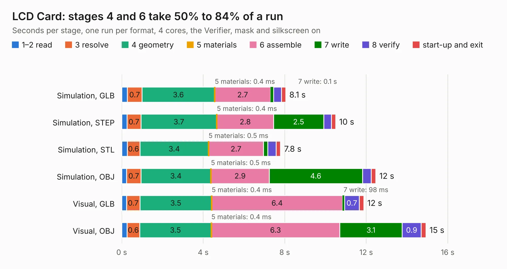

| Mode and format | 1–2 read | 3 resolve | 4 geometry | 5 materials | 6 assemble | 7 write | 8 verify | start-up and exit | Total |
|---|---:|---:|---:|---:|---:|---:|---:|---:|---:|
| Simulation, GLB | 0.3 | 0.7 | 3.6 | 0.4&nbsp;ms | 2.7 | 0.1 | 0.4 | 0.2 | 8.1 |
| Simulation, STEP | 0.3 | 0.7 | 3.7 | 0.4&nbsp;ms | 2.8 | 2.5 | 0.4 | 0.2 | 10.5 |
| Simulation, STL | 0.3 | 0.6 | 3.4 | 0.5&nbsp;ms | 2.7 | 0.2 | 0.4 | 0.2 | 7.8 |
| Simulation, OBJ | 0.2 | 0.7 | 3.4 | 0.5&nbsp;ms | 2.9 | 4.6 | 0.4 | 0.2 | 12.5 |
| Visual, GLB | 0.2 | 0.7 | 3.5 | 0.4&nbsp;ms | 6.4 | 98&nbsp;ms | 0.7 | 0.2 | 11.9 |
| Visual, OBJ | 0.3 | 0.6 | 3.5 | 0.4&nbsp;ms | 6.3 | 3.1 | 0.9 | 0.2 | 14.9 |

<table align="center"><tr><td valign="top">

| Board | Repo: [acwright/6502](https://github.com/acwright/6502) Board: `LCD Card.kicad_pcb` |
|---|---|
| Folder | Hardware / LCD Card / Rev 1.0 |
| Complexity | 226&nbsp;/&nbsp;1000 (size&nbsp;146, features&nbsp;80) |
| KESE&nbsp;features | through vias, custom pads, rounded, trapezoid or chamfered pads, filled zones, copper drawings, curved board outline |
| Tested | 9th November 2026 |
| Copper&nbsp;layers | 2 |
| File&nbsp;format | KiCad 10 (20260206) |
| Parts,&nbsp;tracks,&nbsp;vias | 12, 288, 65 |
| Triangles,&nbsp;simulation | 811,422 in 80 parts |
| Verifier | PASS in all six runs |

</td><td valign="top">

<table>
<tr><th>File type</th><th>File size</th><th>Peak memory used</th></tr>
<tr><th colspan="3" align="left">Simulation</th></tr>
<tr><td>GLB</td><td align="right">28&nbsp;MB</td><td align="right">447&nbsp;MB</td></tr>
<tr><td>STEP</td><td align="right">125&nbsp;MB</td><td align="right">483&nbsp;MB</td></tr>
<tr><td>STL</td><td align="right">41&nbsp;MB</td><td align="right">430&nbsp;MB</td></tr>
<tr><td>OBJ</td><td align="right">82&nbsp;MB</td><td align="right">586&nbsp;MB</td></tr>
<tr><th colspan="3" align="left">Visual</th></tr>
<tr><td>GLB</td><td align="right">19&nbsp;MB</td><td align="right">461&nbsp;MB</td></tr>
<tr><td>OBJ</td><td align="right">57&nbsp;MB</td><td align="right">510&nbsp;MB</td></tr>
</table>

</td></tr></table>

## 35. Mega Helper

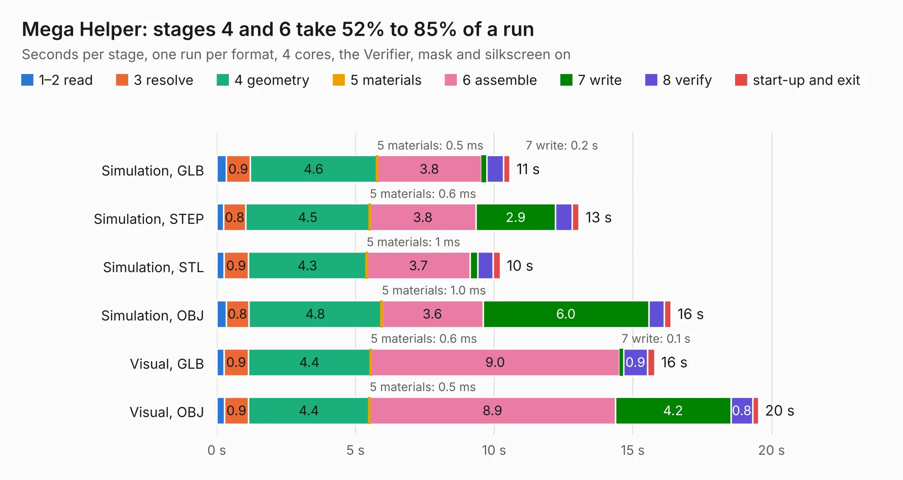

| Mode and format | 1–2 read | 3 resolve | 4 geometry | 5 materials | 6 assemble | 7 write | 8 verify | start-up and exit | Total |
|---|---:|---:|---:|---:|---:|---:|---:|---:|---:|
| Simulation, GLB | 0.3 | 0.9 | 4.6 | 0.5&nbsp;ms | 3.8 | 0.2 | 0.6 | 0.2 | 10.6 |
| Simulation, STEP | 0.2 | 0.8 | 4.5 | 0.6&nbsp;ms | 3.8 | 2.9 | 0.6 | 0.2 | 13.1 |
| Simulation, STL | 0.3 | 0.9 | 4.3 | 1&nbsp;ms | 3.7 | 0.3 | 0.5 | 0.3 | 10.2 |
| Simulation, OBJ | 0.3 | 0.8 | 4.8 | 1.0&nbsp;ms | 3.6 | 6.0 | 0.6 | 0.2 | 16.4 |
| Visual, GLB | 0.3 | 0.9 | 4.4 | 0.6&nbsp;ms | 9.0 | 0.1 | 0.9 | 0.3 | 15.8 |
| Visual, OBJ | 0.3 | 0.9 | 4.4 | 0.5&nbsp;ms | 8.9 | 4.2 | 0.8 | 0.2 | 19.5 |

<table align="center"><tr><td valign="top">

| Board | Repo: [acwright/6502](https://github.com/acwright/6502) Board: `Mega Helper.kicad_pcb` |
|---|---|
| Folder | Hardware / Mega Helper / Rev 1.0 |
| Complexity | 163&nbsp;/&nbsp;1000 (size&nbsp;128, features&nbsp;35) |
| KESE&nbsp;features | through vias, filled zones |
| Tested | 9th November 2026 |
| Copper&nbsp;layers | 2 |
| File&nbsp;format | KiCad 10 (20260206) |
| Parts,&nbsp;tracks,&nbsp;vias | 2, 200, 75 |
| Triangles,&nbsp;simulation | 1,011,878 in 85 parts |
| Verifier | PASS in all six runs |

</td><td valign="top">

<table>
<tr><th>File type</th><th>File size</th><th>Peak memory used</th></tr>
<tr><th colspan="3" align="left">Simulation</th></tr>
<tr><td>GLB</td><td align="right">33&nbsp;MB</td><td align="right">494&nbsp;MB</td></tr>
<tr><td>STEP</td><td align="right">127&nbsp;MB</td><td align="right">555&nbsp;MB</td></tr>
<tr><td>STL</td><td align="right">51&nbsp;MB</td><td align="right">478&nbsp;MB</td></tr>
<tr><td>OBJ</td><td align="right">101&nbsp;MB</td><td align="right">675&nbsp;MB</td></tr>
<tr><th colspan="3" align="left">Visual</th></tr>
<tr><td>GLB</td><td align="right">24&nbsp;MB</td><td align="right">668&nbsp;MB</td></tr>
<tr><td>OBJ</td><td align="right">73&nbsp;MB</td><td align="right">672&nbsp;MB</td></tr>
</table>

</td></tr></table>

## 36. Memory Card

| Mode and format | 1–2 read | 3 resolve | 4 geometry | 5 materials | 6 assemble | 7 write | 8 verify | start-up and exit | Total |
|---|---:|---:|---:|---:|---:|---:|---:|---:|---:|
| Simulation, GLB | 0.3 | 0.7 | 2.9 | 0.3&nbsp;ms | 3.0 | 0.1 | 0.4 | 0.2 | 7.6 |
| Simulation, STEP | 0.3 | 0.7 | 3.2 | 0.3&nbsp;ms | 3.2 | 2.3 | 0.4 | 0.2 | 10.4 |
| Simulation, STL | 0.2 | 0.6 | 2.9 | 0.2&nbsp;ms | 3.1 | 0.2 | 0.4 | 0.2 | 7.7 |
| Simulation, OBJ | 0.2 | 0.7 | 3.1 | 0.4&nbsp;ms | 2.9 | 3.7 | 0.4 | 0.2 | 11.1 |
| Visual, GLB | 0.2 | 0.7 | 3.1 | 0.3&nbsp;ms | 6.7 | 94&nbsp;ms | 0.7 | 0.2 | 11.8 |
| Visual, OBJ | 0.2 | 0.6 | 2.8 | 0.5&nbsp;ms | 6.4 | 2.7 | 0.7 | 0.2 | 13.7 |

<table align="center"><tr><td valign="top">

| Board | Repo: [acwright/6502](https://github.com/acwright/6502) Board: `Memory Card.kicad_pcb` |
|---|---|
| Folder | Hardware / Memory Card / Rev 1.0 |
| Complexity | 270&nbsp;/&nbsp;1000 (size&nbsp;160, features&nbsp;110) |
| KESE&nbsp;features | through vias, custom pads, rounded, trapezoid or chamfered pads, filled zones, copper drawings, curved board outline, stack-up, dielectric εr and tanδ |
| Tested | 9th November 2026 |
| Copper&nbsp;layers | 2 |
| File&nbsp;format | KiCad 10 (20260206) |
| Parts,&nbsp;tracks,&nbsp;vias | 18, 455, 145 |
| Triangles,&nbsp;simulation | 912,660 in 62 parts |
| Verifier | PASS in all six runs |

</td><td valign="top">

<table>
<tr><th>File type</th><th>File size</th><th>Peak memory used</th></tr>
<tr><th colspan="3" align="left">Simulation</th></tr>
<tr><td>GLB</td><td align="right">31&nbsp;MB</td><td align="right">420&nbsp;MB</td></tr>
<tr><td>STEP</td><td align="right">147&nbsp;MB</td><td align="right">527&nbsp;MB</td></tr>
<tr><td>STL</td><td align="right">46&nbsp;MB</td><td align="right">450&nbsp;MB</td></tr>
<tr><td>OBJ</td><td align="right">92&nbsp;MB</td><td align="right">632&nbsp;MB</td></tr>
<tr><th colspan="3" align="left">Visual</th></tr>
<tr><td>GLB</td><td align="right">24&nbsp;MB</td><td align="right">615&nbsp;MB</td></tr>
<tr><td>OBJ</td><td align="right">73&nbsp;MB</td><td align="right">604&nbsp;MB</td></tr>
</table>

</td></tr></table>

## 37. Prototype Card

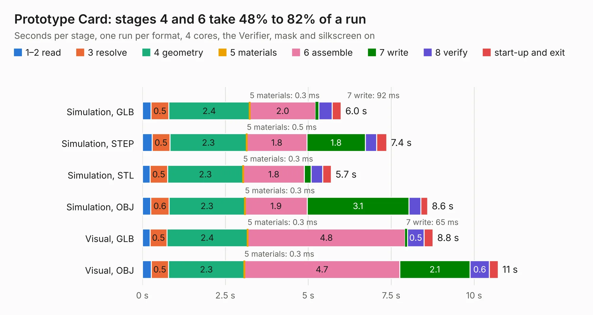

| Mode and format | 1–2 read | 3 resolve | 4 geometry | 5 materials | 6 assemble | 7 write | 8 verify | start-up and exit | Total |
|---|---:|---:|---:|---:|---:|---:|---:|---:|---:|
| Simulation, GLB | 0.3 | 0.5 | 2.4 | 0.3&nbsp;ms | 2.0 | 92&nbsp;ms | 0.4 | 0.3 | 6.0 |
| Simulation, STEP | 0.3 | 0.5 | 2.3 | 0.5&nbsp;ms | 1.8 | 1.8 | 0.3 | 0.3 | 7.4 |
| Simulation, STL | 0.2 | 0.5 | 2.3 | 0.3&nbsp;ms | 1.8 | 0.2 | 0.4 | 0.3 | 5.7 |
| Simulation, OBJ | 0.3 | 0.6 | 2.3 | 0.3&nbsp;ms | 1.9 | 3.1 | 0.4 | 0.2 | 8.6 |
| Visual, GLB | 0.2 | 0.5 | 2.4 | 0.3&nbsp;ms | 4.8 | 65&nbsp;ms | 0.5 | 0.3 | 8.8 |
| Visual, OBJ | 0.3 | 0.5 | 2.3 | 0.3&nbsp;ms | 4.7 | 2.1 | 0.6 | 0.3 | 10.7 |

<table align="center"><tr><td valign="top">

| Board | Repo: [acwright/6502](https://github.com/acwright/6502) Board: `Prototype Card.kicad_pcb` |
|---|---|
| Folder | Hardware / Prototype Card / Rev 1.0 |
| Complexity | 193&nbsp;/&nbsp;1000 (size&nbsp;138, features&nbsp;55) |
| KESE&nbsp;features | through vias, rounded, trapezoid or chamfered pads, filled zones, curved board outline |
| Tested | 9th November 2026 |
| Copper&nbsp;layers | 2 |
| File&nbsp;format | KiCad 10 (20260206) |
| Parts,&nbsp;tracks,&nbsp;vias | 7, 346, 23 |
| Triangles,&nbsp;simulation | 497,896 in 57 parts |
| Verifier | PASS in all six runs |

</td><td valign="top">

<table>
<tr><th>File type</th><th>File size</th><th>Peak memory used</th></tr>
<tr><th colspan="3" align="left">Simulation</th></tr>
<tr><td>GLB</td><td align="right">17&nbsp;MB</td><td align="right">349&nbsp;MB</td></tr>
<tr><td>STEP</td><td align="right">80&nbsp;MB</td><td align="right">356&nbsp;MB</td></tr>
<tr><td>STL</td><td align="right">25&nbsp;MB</td><td align="right">337&nbsp;MB</td></tr>
<tr><td>OBJ</td><td align="right">51&nbsp;MB</td><td align="right">381&nbsp;MB</td></tr>
<tr><th colspan="3" align="left">Visual</th></tr>
<tr><td>GLB</td><td align="right">13&nbsp;MB</td><td align="right">366&nbsp;MB</td></tr>
<tr><td>OBJ</td><td align="right">38&nbsp;MB</td><td align="right">367&nbsp;MB</td></tr>
</table>

</td></tr></table>

## 38. PS2 Helper

| Mode and format | 1–2 read | 3 resolve | 4 geometry | 5 materials | 6 assemble | 7 write | 8 verify | start-up and exit | Total |
|---|---:|---:|---:|---:|---:|---:|---:|---:|---:|
| Simulation, GLB | 0.3 | 0.9 | 4.8 | 0.6&nbsp;ms | 3.8 | 0.2 | 0.6 | 0.2 | 10.8 |
| Simulation, STEP | 0.3 | 0.8 | 4.7 | 0.6&nbsp;ms | 3.9 | 3.4 | 0.5 | 0.3 | 13.9 |
| Simulation, STL | 0.3 | 0.9 | 4.8 | 0.6&nbsp;ms | 3.8 | 0.3 | 0.5 | 0.3 | 10.8 |
| Simulation, OBJ | 0.3 | 0.9 | 4.8 | 1&nbsp;ms | 4.0 | 6.1 | 0.5 | 0.3 | 17.0 |
| Visual, GLB | 0.3 | 0.9 | 4.8 | 0.8&nbsp;ms | 8.8 | 0.1 | 0.8 | 0.3 | 16.0 |
| Visual, OBJ | 0.3 | 1.0 | 4.9 | 0.9&nbsp;ms | 8.6 | 4.2 | 0.8 | 0.3 | 20.0 |

<table align="center"><tr><td valign="top">

| Board | Repo: [acwright/6502](https://github.com/acwright/6502) Board: `PS2 Helper.kicad_pcb` |
|---|---|
| Folder | Hardware / PS2 Helper / Rev 1.0 |
| Complexity | 212&nbsp;/&nbsp;1000 (size&nbsp;157, features&nbsp;55) |
| KESE&nbsp;features | through vias, rounded, trapezoid or chamfered pads, filled zones, curved board outline |
| Tested | 9th November 2026 |
| Copper&nbsp;layers | 2 |
| File&nbsp;format | KiCad 10 (20260206) |
| Parts,&nbsp;tracks,&nbsp;vias | 21, 350, 102 |
| Triangles,&nbsp;simulation | 1,097,420 in 61 parts |
| Verifier | PASS in all six runs |

</td><td valign="top">

<table>
<tr><th>File type</th><th>File size</th><th>Peak memory used</th></tr>
<tr><th colspan="3" align="left">Simulation</th></tr>
<tr><td>GLB</td><td align="right">37&nbsp;MB</td><td align="right">529&nbsp;MB</td></tr>
<tr><td>STEP</td><td align="right">156&nbsp;MB</td><td align="right">583&nbsp;MB</td></tr>
<tr><td>STL</td><td align="right">55&nbsp;MB</td><td align="right">553&nbsp;MB</td></tr>
<tr><td>OBJ</td><td align="right">110&nbsp;MB</td><td align="right">748&nbsp;MB</td></tr>
<tr><th colspan="3" align="left">Visual</th></tr>
<tr><td>GLB</td><td align="right">25&nbsp;MB</td><td align="right">612&nbsp;MB</td></tr>
<tr><td>OBJ</td><td align="right">76&nbsp;MB</td><td align="right">612&nbsp;MB</td></tr>
</table>

</td></tr></table>

## 39. RAM Card

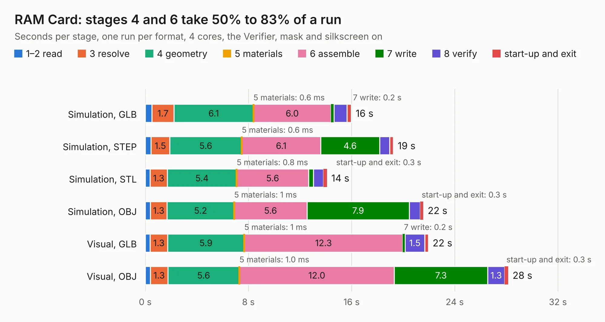

| Mode and format | 1–2 read | 3 resolve | 4 geometry | 5 materials | 6 assemble | 7 write | 8 verify | start-up and exit | Total |
|---|---:|---:|---:|---:|---:|---:|---:|---:|---:|
| Simulation, GLB | 0.5 | 1.7 | 6.1 | 0.6&nbsp;ms | 6.0 | 0.2 | 1.0 | 0.3 | 16.0 |
| Simulation, STEP | 0.4 | 1.5 | 5.6 | 0.6&nbsp;ms | 6.1 | 4.6 | 0.8 | 0.3 | 19.2 |
| Simulation, STL | 0.4 | 1.3 | 5.4 | 0.8&nbsp;ms | 5.6 | 0.4 | 0.8 | 0.3 | 14.1 |
| Simulation, OBJ | 0.4 | 1.3 | 5.2 | 1&nbsp;ms | 5.6 | 7.9 | 0.8 | 0.3 | 21.6 |
| Visual, GLB | 0.4 | 1.3 | 5.9 | 1&nbsp;ms | 12.3 | 0.2 | 1.5 | 0.3 | 21.9 |
| Visual, OBJ | 0.4 | 1.3 | 5.6 | 1.0&nbsp;ms | 12.0 | 7.3 | 1.3 | 0.3 | 28.1 |

<table align="center"><tr><td valign="top">

| Board | Repo: [acwright/6502](https://github.com/acwright/6502) Board: `RAM Card.kicad_pcb` |
|---|---|
| Folder | Hardware / RAM Card / Rev 1.0 |
| Complexity | 280&nbsp;/&nbsp;1000 (size&nbsp;170, features&nbsp;110) |
| KESE&nbsp;features | through vias, custom pads, rounded, trapezoid or chamfered pads, filled zones, copper drawings, curved board outline, stack-up, dielectric εr and tanδ |
| Tested | 9th November 2026 |
| Copper&nbsp;layers | 2 |
| File&nbsp;format | KiCad 10 (20260206) |
| Parts,&nbsp;tracks,&nbsp;vias | 21, 760, 238 |
| Triangles,&nbsp;simulation | 1,263,002 in 84 parts |
| Verifier | PASS in all six runs |

</td><td valign="top">

<table>
<tr><th>File type</th><th>File size</th><th>Peak memory used</th></tr>
<tr><th colspan="3" align="left">Simulation</th></tr>
<tr><td>GLB</td><td align="right">43&nbsp;MB</td><td align="right">564&nbsp;MB</td></tr>
<tr><td>STEP</td><td align="right">194&nbsp;MB</td><td align="right">656&nbsp;MB</td></tr>
<tr><td>STL</td><td align="right">63&nbsp;MB</td><td align="right">575&nbsp;MB</td></tr>
<tr><td>OBJ</td><td align="right">128&nbsp;MB</td><td align="right">839&nbsp;MB</td></tr>
<tr><th colspan="3" align="left">Visual</th></tr>
<tr><td>GLB</td><td align="right">34&nbsp;MB</td><td align="right">680&nbsp;MB</td></tr>
<tr><td>OBJ</td><td align="right">104&nbsp;MB</td><td align="right">869&nbsp;MB</td></tr>
</table>

</td></tr></table>

## 40. RTC Card

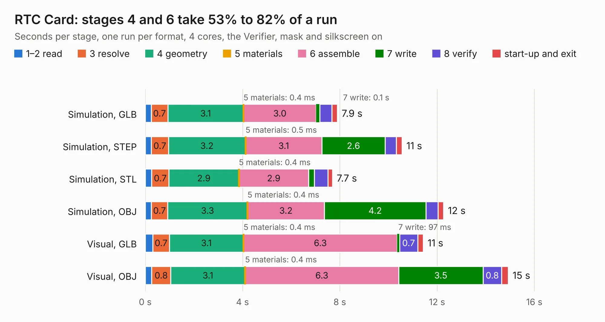

| Mode and format | 1–2 read | 3 resolve | 4 geometry | 5 materials | 6 assemble | 7 write | 8 verify | start-up and exit | Total |
|---|---:|---:|---:|---:|---:|---:|---:|---:|---:|
| Simulation, GLB | 0.2 | 0.7 | 3.1 | 0.4&nbsp;ms | 3.0 | 0.1 | 0.5 | 0.2 | 7.9 |
| Simulation, STEP | 0.3 | 0.7 | 3.2 | 0.5&nbsp;ms | 3.1 | 2.6 | 0.5 | 0.2 | 10.6 |
| Simulation, STL | 0.3 | 0.7 | 2.9 | 0.4&nbsp;ms | 2.9 | 0.2 | 0.6 | 0.2 | 7.7 |
| Simulation, OBJ | 0.3 | 0.7 | 3.3 | 0.4&nbsp;ms | 3.2 | 4.2 | 0.5 | 0.2 | 12.3 |
| Visual, GLB | 0.3 | 0.7 | 3.1 | 0.4&nbsp;ms | 6.3 | 97&nbsp;ms | 0.7 | 0.2 | 11.4 |
| Visual, OBJ | 0.3 | 0.8 | 3.1 | 0.4&nbsp;ms | 6.3 | 3.5 | 0.8 | 0.3 | 14.9 |

<table align="center"><tr><td valign="top">

| Board | Repo: [acwright/6502](https://github.com/acwright/6502) Board: `RTC Card.kicad_pcb` |
|---|---|
| Folder | Hardware / RTC Card / Rev 1.0 |
| Complexity | 235&nbsp;/&nbsp;1000 (size&nbsp;155, features&nbsp;80) |
| KESE&nbsp;features | through vias, custom pads, rounded, trapezoid or chamfered pads, filled zones, copper drawings, curved board outline |
| Tested | 9th November 2026 |
| Copper&nbsp;layers | 2 |
| File&nbsp;format | KiCad 10 (20260206) |
| Parts,&nbsp;tracks,&nbsp;vias | 16, 379, 111 |
| Triangles,&nbsp;simulation | 801,244 in 77 parts |
| Verifier | PASS in all six runs |

</td><td valign="top">

<table>
<tr><th>File type</th><th>File size</th><th>Peak memory used</th></tr>
<tr><th colspan="3" align="left">Simulation</th></tr>
<tr><td>GLB</td><td align="right">27&nbsp;MB</td><td align="right">390&nbsp;MB</td></tr>
<tr><td>STEP</td><td align="right">125&nbsp;MB</td><td align="right">491&nbsp;MB</td></tr>
<tr><td>STL</td><td align="right">40&nbsp;MB</td><td align="right">382&nbsp;MB</td></tr>
<tr><td>OBJ</td><td align="right">81&nbsp;MB</td><td align="right">586&nbsp;MB</td></tr>
<tr><th colspan="3" align="left">Visual</th></tr>
<tr><td>GLB</td><td align="right">21&nbsp;MB</td><td align="right">531&nbsp;MB</td></tr>
<tr><td>OBJ</td><td align="right">62&nbsp;MB</td><td align="right">502&nbsp;MB</td></tr>
</table>

</td></tr></table>

## 41. Serial Card Pro

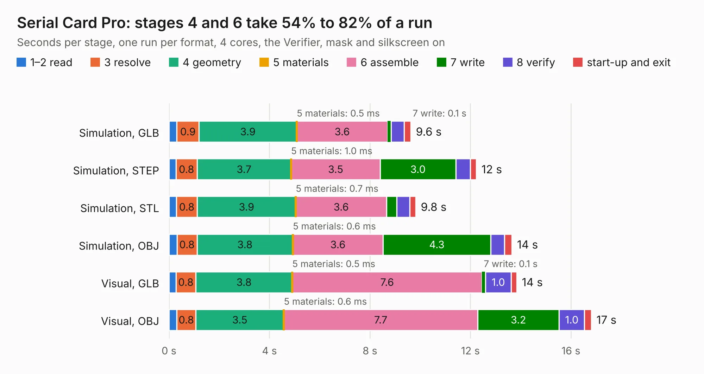

| Mode and format | 1–2 read | 3 resolve | 4 geometry | 5 materials | 6 assemble | 7 write | 8 verify | start-up and exit | Total |
|---|---:|---:|---:|---:|---:|---:|---:|---:|---:|
| Simulation, GLB | 0.3 | 0.9 | 3.9 | 0.5&nbsp;ms | 3.6 | 0.1 | 0.5 | 0.3 | 9.6 |
| Simulation, STEP | 0.3 | 0.8 | 3.7 | 1.0&nbsp;ms | 3.5 | 3.0 | 0.6 | 0.2 | 12.2 |
| Simulation, STL | 0.3 | 0.8 | 3.9 | 0.7&nbsp;ms | 3.6 | 0.4 | 0.5 | 0.2 | 9.8 |
| Simulation, OBJ | 0.3 | 0.8 | 3.8 | 0.6&nbsp;ms | 3.6 | 4.3 | 0.5 | 0.3 | 13.7 |
| Visual, GLB | 0.3 | 0.8 | 3.8 | 0.5&nbsp;ms | 7.6 | 0.1 | 1.0 | 0.2 | 13.8 |
| Visual, OBJ | 0.3 | 0.8 | 3.5 | 0.6&nbsp;ms | 7.7 | 3.2 | 1.0 | 0.3 | 16.8 |

<table align="center"><tr><td valign="top">

| Board | Repo: [acwright/6502](https://github.com/acwright/6502) Board: `Serial Card Pro.kicad_pcb` |
|---|---|
| Folder | Hardware / Serial Card Pro / Rev 1.0 |
| Complexity | 242&nbsp;/&nbsp;1000 (size&nbsp;162, features&nbsp;80) |
| KESE&nbsp;features | through vias, custom pads, rounded, trapezoid or chamfered pads, filled zones, copper drawings, curved board outline |
| Tested | 9th November 2026 |
| Copper&nbsp;layers | 2 |
| File&nbsp;format | KiCad 10 (20260206) |
| Parts,&nbsp;tracks,&nbsp;vias | 27, 435, 112 |
| Triangles,&nbsp;simulation | 922,114 in 94 parts |
| Verifier | PASS in all six runs |

</td><td valign="top">

<table>
<tr><th>File type</th><th>File size</th><th>Peak memory used</th></tr>
<tr><th colspan="3" align="left">Simulation</th></tr>
<tr><td>GLB</td><td align="right">32&nbsp;MB</td><td align="right">442&nbsp;MB</td></tr>
<tr><td>STEP</td><td align="right">146&nbsp;MB</td><td align="right">549&nbsp;MB</td></tr>
<tr><td>STL</td><td align="right">46&nbsp;MB</td><td align="right">444&nbsp;MB</td></tr>
<tr><td>OBJ</td><td align="right">93&nbsp;MB</td><td align="right">640&nbsp;MB</td></tr>
<tr><th colspan="3" align="left">Visual</th></tr>
<tr><td>GLB</td><td align="right">23&nbsp;MB</td><td align="right">590&nbsp;MB</td></tr>
<tr><td>OBJ</td><td align="right">71&nbsp;MB</td><td align="right">580&nbsp;MB</td></tr>
</table>

</td></tr></table>

## 42. Serial Card

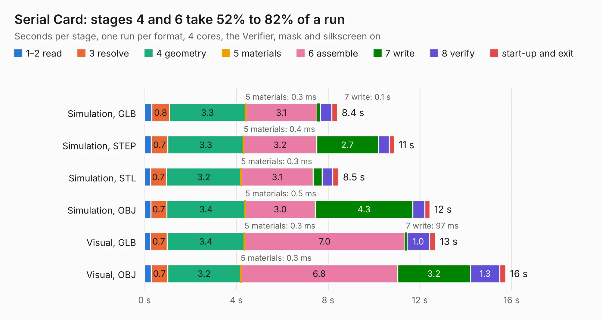

| Mode and format | 1–2 read | 3 resolve | 4 geometry | 5 materials | 6 assemble | 7 write | 8 verify | start-up and exit | Total |
|---|---:|---:|---:|---:|---:|---:|---:|---:|---:|
| Simulation, GLB | 0.3 | 0.8 | 3.3 | 0.3&nbsp;ms | 3.1 | 0.1 | 0.5 | 0.2 | 8.4 |
| Simulation, STEP | 0.3 | 0.7 | 3.3 | 0.4&nbsp;ms | 3.2 | 2.7 | 0.5 | 0.2 | 10.9 |
| Simulation, STL | 0.3 | 0.7 | 3.2 | 0.3&nbsp;ms | 3.1 | 0.4 | 0.5 | 0.3 | 8.5 |
| Simulation, OBJ | 0.3 | 0.7 | 3.4 | 0.5&nbsp;ms | 3.0 | 4.3 | 0.5 | 0.2 | 12.4 |
| Visual, GLB | 0.3 | 0.7 | 3.4 | 0.3&nbsp;ms | 7.0 | 97&nbsp;ms | 1.0 | 0.3 | 12.7 |
| Visual, OBJ | 0.3 | 0.7 | 3.2 | 0.3&nbsp;ms | 6.8 | 3.2 | 1.3 | 0.3 | 15.7 |

<table align="center"><tr><td valign="top">

| Board | Repo: [acwright/6502](https://github.com/acwright/6502) Board: `Serial Card.kicad_pcb` |
|---|---|
| Folder | Hardware / Serial Card / Rev 1.0 |
| Complexity | 236&nbsp;/&nbsp;1000 (size&nbsp;156, features&nbsp;80) |
| KESE&nbsp;features | through vias, custom pads, rounded, trapezoid or chamfered pads, filled zones, copper drawings, curved board outline |
| Tested | 9th November 2026 |
| Copper&nbsp;layers | 2 |
| File&nbsp;format | KiCad 10 (20260206) |
| Parts,&nbsp;tracks,&nbsp;vias | 21, 364, 90 |
| Triangles,&nbsp;simulation | 799,922 in 82 parts |
| Verifier | PASS in all six runs |

</td><td valign="top">

<table>
<tr><th>File type</th><th>File size</th><th>Peak memory used</th></tr>
<tr><th colspan="3" align="left">Simulation</th></tr>
<tr><td>GLB</td><td align="right">27&nbsp;MB</td><td align="right">385&nbsp;MB</td></tr>
<tr><td>STEP</td><td align="right">124&nbsp;MB</td><td align="right">495&nbsp;MB</td></tr>
<tr><td>STL</td><td align="right">40&nbsp;MB</td><td align="right">403&nbsp;MB</td></tr>
<tr><td>OBJ</td><td align="right">80&nbsp;MB</td><td align="right">584&nbsp;MB</td></tr>
<tr><th colspan="3" align="left">Visual</th></tr>
<tr><td>GLB</td><td align="right">20&nbsp;MB</td><td align="right">480&nbsp;MB</td></tr>
<tr><td>OBJ</td><td align="right">60&nbsp;MB</td><td align="right">542&nbsp;MB</td></tr>
</table>

</td></tr></table>

## 43. Sound Card

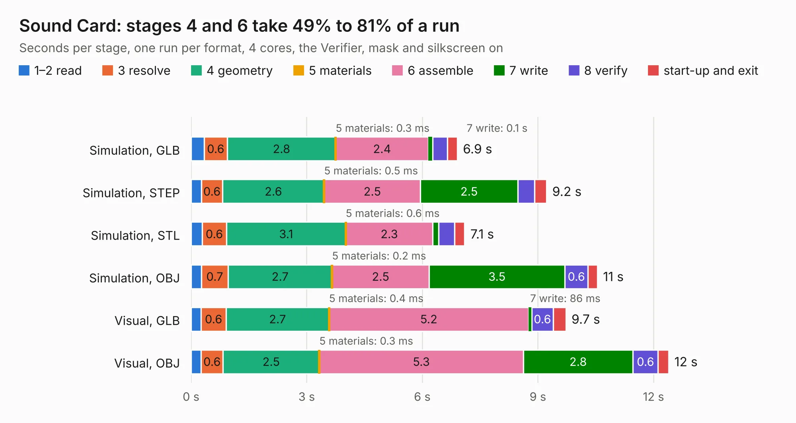

| Mode and format | 1–2 read | 3 resolve | 4 geometry | 5 materials | 6 assemble | 7 write | 8 verify | start-up and exit | Total |
|---|---:|---:|---:|---:|---:|---:|---:|---:|---:|
| Simulation, GLB | 0.3 | 0.6 | 2.8 | 0.3&nbsp;ms | 2.4 | 0.1 | 0.4 | 0.3 | 6.9 |
| Simulation, STEP | 0.3 | 0.6 | 2.6 | 0.5&nbsp;ms | 2.5 | 2.5 | 0.4 | 0.3 | 9.2 |
| Simulation, STL | 0.3 | 0.6 | 3.1 | 0.6&nbsp;ms | 2.3 | 0.2 | 0.4 | 0.3 | 7.1 |
| Simulation, OBJ | 0.3 | 0.7 | 2.7 | 0.2&nbsp;ms | 2.5 | 3.5 | 0.6 | 0.2 | 10.5 |
| Visual, GLB | 0.3 | 0.6 | 2.7 | 0.4&nbsp;ms | 5.2 | 86&nbsp;ms | 0.6 | 0.3 | 9.7 |
| Visual, OBJ | 0.3 | 0.6 | 2.5 | 0.3&nbsp;ms | 5.3 | 2.8 | 0.6 | 0.3 | 12.4 |

<table align="center"><tr><td valign="top">

| Board | Repo: [acwright/6502](https://github.com/acwright/6502) Board: `Sound Card.kicad_pcb` |
|---|---|
| Folder | Hardware / Sound Card / Rev 1.0 |
| Complexity | 208&nbsp;/&nbsp;1000 (size&nbsp;143, features&nbsp;65) |
| KESE&nbsp;features | through vias, slotted holes, rounded, trapezoid or chamfered pads, filled zones, curved board outline |
| Tested | 9th November 2026 |
| Copper&nbsp;layers | 2 |
| File&nbsp;format | KiCad 10 (20260206) |
| Parts,&nbsp;tracks,&nbsp;vias | 12, 250, 55 |
| Triangles,&nbsp;simulation | 555,072 in 67 parts |
| Verifier | PASS in all six runs |

</td><td valign="top">

<table>
<tr><th>File type</th><th>File size</th><th>Peak memory used</th></tr>
<tr><th colspan="3" align="left">Simulation</th></tr>
<tr><td>GLB</td><td align="right">19&nbsp;MB</td><td align="right">345&nbsp;MB</td></tr>
<tr><td>STEP</td><td align="right">88&nbsp;MB</td><td align="right">387&nbsp;MB</td></tr>
<tr><td>STL</td><td align="right">28&nbsp;MB</td><td align="right">359&nbsp;MB</td></tr>
<tr><td>OBJ</td><td align="right">56&nbsp;MB</td><td align="right">427&nbsp;MB</td></tr>
<tr><th colspan="3" align="left">Visual</th></tr>
<tr><td>GLB</td><td align="right">14&nbsp;MB</td><td align="right">387&nbsp;MB</td></tr>
<tr><td>OBJ</td><td align="right">43&nbsp;MB</td><td align="right">386&nbsp;MB</td></tr>
</table>

</td></tr></table>

## 44. Storage Card Pro

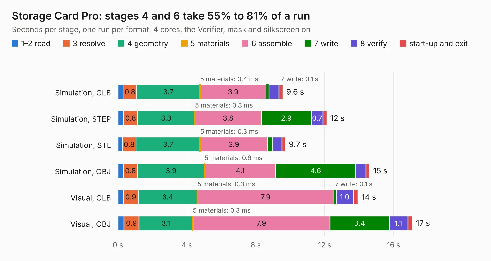

| Mode and format | 1–2 read | 3 resolve | 4 geometry | 5 materials | 6 assemble | 7 write | 8 verify | start-up and exit | Total |
|---|---:|---:|---:|---:|---:|---:|---:|---:|---:|
| Simulation, GLB | 0.3 | 0.8 | 3.7 | 0.4&nbsp;ms | 3.9 | 0.1 | 0.6 | 0.2 | 9.6 |
| Simulation, STEP | 0.3 | 0.8 | 3.3 | 0.3&nbsp;ms | 3.8 | 2.9 | 0.7 | 0.2 | 12.1 |
| Simulation, STL | 0.3 | 0.8 | 3.7 | 0.3&nbsp;ms | 3.9 | 0.3 | 0.5 | 0.2 | 9.7 |
| Simulation, OBJ | 0.3 | 0.8 | 3.9 | 0.6&nbsp;ms | 4.1 | 4.6 | 0.6 | 0.2 | 14.6 |
| Visual, GLB | 0.3 | 0.9 | 3.4 | 0.3&nbsp;ms | 7.9 | 0.1 | 1.0 | 0.3 | 13.9 |
| Visual, OBJ | 0.4 | 0.9 | 3.1 | 0.3&nbsp;ms | 7.9 | 3.4 | 1.1 | 0.3 | 17.1 |

<table align="center"><tr><td valign="top">

| Board | Repo: [acwright/6502](https://github.com/acwright/6502) Board: `Storage Card Pro.kicad_pcb` |
|---|---|
| Folder | Hardware / Storage Card Pro / Rev 1.0 |
| Complexity | 218&nbsp;/&nbsp;1000 (size&nbsp;163, features&nbsp;55) |
| KESE&nbsp;features | through vias, rounded, trapezoid or chamfered pads, filled zones, curved board outline |
| Tested | 9th November 2026 |
| Copper&nbsp;layers | 2 |
| File&nbsp;format | KiCad 10 (20260206) |
| Parts,&nbsp;tracks,&nbsp;vias | 26, 471, 135 |
| Triangles,&nbsp;simulation | 942,536 in 82 parts |
| Verifier | PASS in all six runs |

</td><td valign="top">

<table>
<tr><th>File type</th><th>File size</th><th>Peak memory used</th></tr>
<tr><th colspan="3" align="left">Simulation</th></tr>
<tr><td>GLB</td><td align="right">32&nbsp;MB</td><td align="right">439&nbsp;MB</td></tr>
<tr><td>STEP</td><td align="right">153&nbsp;MB</td><td align="right">529&nbsp;MB</td></tr>
<tr><td>STL</td><td align="right">47&nbsp;MB</td><td align="right">445&nbsp;MB</td></tr>
<tr><td>OBJ</td><td align="right">95&nbsp;MB</td><td align="right">679&nbsp;MB</td></tr>
<tr><th colspan="3" align="left">Visual</th></tr>
<tr><td>GLB</td><td align="right">25&nbsp;MB</td><td align="right">561&nbsp;MB</td></tr>
<tr><td>OBJ</td><td align="right">77&nbsp;MB</td><td align="right">640&nbsp;MB</td></tr>
</table>

</td></tr></table>

## 45. Storage Card

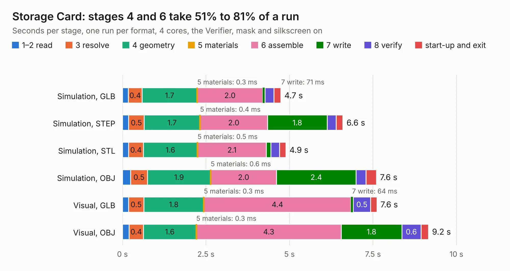

| Mode and format | 1–2 read | 3 resolve | 4 geometry | 5 materials | 6 assemble | 7 write | 8 verify | start-up and exit | Total |
|---|---:|---:|---:|---:|---:|---:|---:|---:|---:|
| Simulation, GLB | 0.2 | 0.4 | 1.7 | 0.3&nbsp;ms | 2.0 | 71&nbsp;ms | 0.3 | 0.2 | 4.7 |
| Simulation, STEP | 0.2 | 0.5 | 1.7 | 0.4&nbsp;ms | 2.0 | 1.8 | 0.3 | 0.2 | 6.6 |
| Simulation, STL | 0.2 | 0.4 | 1.6 | 0.5&nbsp;ms | 2.1 | 0.1 | 0.3 | 0.2 | 4.9 |
| Simulation, OBJ | 0.2 | 0.5 | 1.9 | 0.6&nbsp;ms | 2.0 | 2.4 | 0.3 | 0.3 | 7.6 |
| Visual, GLB | 0.2 | 0.5 | 1.8 | 0.3&nbsp;ms | 4.4 | 64&nbsp;ms | 0.5 | 0.2 | 7.6 |
| Visual, OBJ | 0.2 | 0.4 | 1.6 | 0.3&nbsp;ms | 4.3 | 1.8 | 0.6 | 0.2 | 9.2 |

<table align="center"><tr><td valign="top">

| Board | Repo: [acwright/6502](https://github.com/acwright/6502) Board: `Storage Card.kicad_pcb` |
|---|---|
| Folder | Hardware / Storage Card / Rev 1.0 |
| Complexity | 205&nbsp;/&nbsp;1000 (size&nbsp;150, features&nbsp;55) |
| KESE&nbsp;features | through vias, rounded, trapezoid or chamfered pads, filled zones, curved board outline |
| Tested | 9th November 2026 |
| Copper&nbsp;layers | 2 |
| File&nbsp;format | KiCad 10 (20260206) |
| Parts,&nbsp;tracks,&nbsp;vias | 15, 284, 84 |
| Triangles,&nbsp;simulation | 557,162 in 85 parts |
| Verifier | PASS in all six runs |

</td><td valign="top">

<table>
<tr><th>File type</th><th>File size</th><th>Peak memory used</th></tr>
<tr><th colspan="3" align="left">Simulation</th></tr>
<tr><td>GLB</td><td align="right">19&nbsp;MB</td><td align="right">332&nbsp;MB</td></tr>
<tr><td>STEP</td><td align="right">90&nbsp;MB</td><td align="right">410&nbsp;MB</td></tr>
<tr><td>STL</td><td align="right">28&nbsp;MB</td><td align="right">330&nbsp;MB</td></tr>
<tr><td>OBJ</td><td align="right">56&nbsp;MB</td><td align="right">433&nbsp;MB</td></tr>
<tr><th colspan="3" align="left">Visual</th></tr>
<tr><td>GLB</td><td align="right">16&nbsp;MB</td><td align="right">457&nbsp;MB</td></tr>
<tr><td>OBJ</td><td align="right">48&nbsp;MB</td><td align="right">401&nbsp;MB</td></tr>
</table>

</td></tr></table>

## 46. VERA Helper

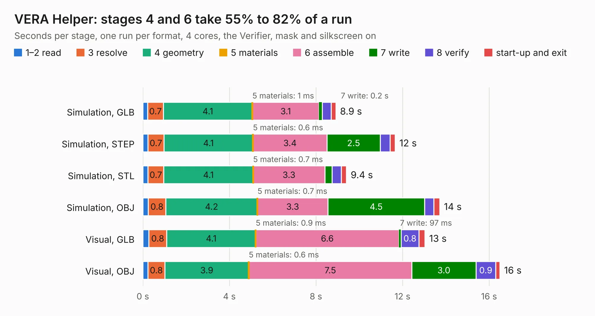

| Mode and format | 1–2 read | 3 resolve | 4 geometry | 5 materials | 6 assemble | 7 write | 8 verify | start-up and exit | Total |
|---|---:|---:|---:|---:|---:|---:|---:|---:|---:|
| Simulation, GLB | 0.2 | 0.7 | 4.1 | 1&nbsp;ms | 3.1 | 0.2 | 0.4 | 0.2 | 8.9 |
| Simulation, STEP | 0.2 | 0.7 | 4.1 | 0.6&nbsp;ms | 3.4 | 2.5 | 0.5 | 0.2 | 11.7 |
| Simulation, STL | 0.2 | 0.7 | 4.1 | 0.7&nbsp;ms | 3.3 | 0.3 | 0.4 | 0.2 | 9.4 |
| Simulation, OBJ | 0.3 | 0.8 | 4.2 | 0.7&nbsp;ms | 3.3 | 4.5 | 0.4 | 0.3 | 13.7 |
| Visual, GLB | 0.3 | 0.8 | 4.1 | 0.9&nbsp;ms | 6.6 | 97&nbsp;ms | 0.8 | 0.3 | 13.0 |
| Visual, OBJ | 0.2 | 0.8 | 3.9 | 0.6&nbsp;ms | 7.5 | 3.0 | 0.9 | 0.2 | 16.5 |

<table align="center"><tr><td valign="top">

| Board | Repo: [acwright/6502](https://github.com/acwright/6502) Board: `VERA Helper.kicad_pcb` |
|---|---|
| Folder | Hardware / VERA Helper / Rev 1.0 |
| Complexity | 239&nbsp;/&nbsp;1000 (size&nbsp;149, features&nbsp;90) |
| KESE&nbsp;features | through vias, slotted holes, custom pads, rounded, trapezoid or chamfered pads, filled zones, copper drawings, curved board outline |
| Tested | 9th November 2026 |
| Copper&nbsp;layers | 2 |
| File&nbsp;format | KiCad 10 (20260206) |
| Parts,&nbsp;tracks,&nbsp;vias | 14, 294, 82 |
| Triangles,&nbsp;simulation | 1,073,128 in 71 parts |
| Verifier | PASS in all six runs |

</td><td valign="top">

<table>
<tr><th>File type</th><th>File size</th><th>Peak memory used</th></tr>
<tr><th colspan="3" align="left">Simulation</th></tr>
<tr><td>GLB</td><td align="right">36&nbsp;MB</td><td align="right">548&nbsp;MB</td></tr>
<tr><td>STEP</td><td align="right">149&nbsp;MB</td><td align="right">580&nbsp;MB</td></tr>
<tr><td>STL</td><td align="right">54&nbsp;MB</td><td align="right">532&nbsp;MB</td></tr>
<tr><td>OBJ</td><td align="right">108&nbsp;MB</td><td align="right">752&nbsp;MB</td></tr>
<tr><th colspan="3" align="left">Visual</th></tr>
<tr><td>GLB</td><td align="right">25&nbsp;MB</td><td align="right">663&nbsp;MB</td></tr>
<tr><td>OBJ</td><td align="right">76&nbsp;MB</td><td align="right">624&nbsp;MB</td></tr>
</table>

</td></tr></table>

## 47. VGA Card Pro

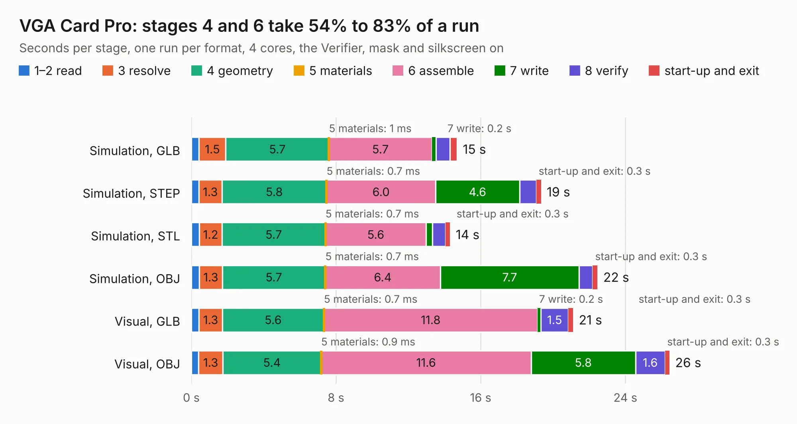

| Mode and format | 1–2 read | 3 resolve | 4 geometry | 5 materials | 6 assemble | 7 write | 8 verify | start-up and exit | Total |
|---|---:|---:|---:|---:|---:|---:|---:|---:|---:|
| Simulation, GLB | 0.4 | 1.5 | 5.7 | 1&nbsp;ms | 5.7 | 0.2 | 0.8 | 0.4 | 14.7 |
| Simulation, STEP | 0.4 | 1.3 | 5.8 | 0.7&nbsp;ms | 6.0 | 4.6 | 0.9 | 0.3 | 19.3 |
| Simulation, STL | 0.4 | 1.2 | 5.7 | 0.7&nbsp;ms | 5.6 | 0.4 | 0.7 | 0.3 | 14.3 |
| Simulation, OBJ | 0.4 | 1.3 | 5.7 | 0.7&nbsp;ms | 6.4 | 7.7 | 0.8 | 0.3 | 22.5 |
| Visual, GLB | 0.4 | 1.3 | 5.6 | 0.7&nbsp;ms | 11.8 | 0.2 | 1.5 | 0.3 | 21.1 |
| Visual, OBJ | 0.4 | 1.3 | 5.4 | 0.9&nbsp;ms | 11.6 | 5.8 | 1.6 | 0.3 | 26.4 |

<table align="center"><tr><td valign="top">

| Board | Repo: [acwright/6502](https://github.com/acwright/6502) Board: `VGA Card Pro.kicad_pcb` |
|---|---|
| Folder | Hardware / VGA Card Pro / Rev 1.0 |
| Complexity | 262&nbsp;/&nbsp;1000 (size&nbsp;172, features&nbsp;90) |
| KESE&nbsp;features | through vias, custom pads, rounded, trapezoid or chamfered pads, drill offsets, filled zones, copper drawings, curved board outline |
| Tested | 9th November 2026 |
| Copper&nbsp;layers | 2 |
| File&nbsp;format | KiCad 10 (20260206) |
| Parts,&nbsp;tracks,&nbsp;vias | 33, 637, 197 |
| Triangles,&nbsp;simulation | 1,219,950 in 116 parts |
| Verifier | PASS in all six runs |

</td><td valign="top">

<table>
<tr><th>File type</th><th>File size</th><th>Peak memory used</th></tr>
<tr><th colspan="3" align="left">Simulation</th></tr>
<tr><td>GLB</td><td align="right">42&nbsp;MB</td><td align="right">526&nbsp;MB</td></tr>
<tr><td>STEP</td><td align="right">189&nbsp;MB</td><td align="right">653&nbsp;MB</td></tr>
<tr><td>STL</td><td align="right">61&nbsp;MB</td><td align="right">529&nbsp;MB</td></tr>
<tr><td>OBJ</td><td align="right">124&nbsp;MB</td><td align="right">830&nbsp;MB</td></tr>
<tr><th colspan="3" align="left">Visual</th></tr>
<tr><td>GLB</td><td align="right">32&nbsp;MB</td><td align="right">794&nbsp;MB</td></tr>
<tr><td>OBJ</td><td align="right">97&nbsp;MB</td><td align="right">733&nbsp;MB</td></tr>
</table>

</td></tr></table>

## 48. VGA Card

| Mode and format | 1–2 read | 3 resolve | 4 geometry | 5 materials | 6 assemble | 7 write | 8 verify | start-up and exit | Total |
|---|---:|---:|---:|---:|---:|---:|---:|---:|---:|
| Simulation, GLB | 0.4 | 0.9 | 3.0 | 0.3&nbsp;ms | 3.4 | 0.1 | 0.5 | 0.3 | 8.5 |
| Simulation, STEP | 0.4 | 0.8 | 3.3 | 0.3&nbsp;ms | 3.8 | 3.1 | 0.5 | 0.3 | 12.3 |
| Simulation, STL | 0.3 | 0.8 | 3.4 | 0.6&nbsp;ms | 3.2 | 0.2 | 0.6 | 0.2 | 8.7 |
| Simulation, OBJ | 0.3 | 0.8 | 3.2 | 0.4&nbsp;ms | 3.6 | 6.2 | 0.6 | 0.2 | 14.9 |
| Visual, GLB | 0.4 | 0.9 | 3.5 | 0.4&nbsp;ms | 7.7 | 0.1 | 0.9 | 0.3 | 13.8 |
| Visual, OBJ | 0.3 | 0.9 | 3.3 | 0.4&nbsp;ms | 7.2 | 3.9 | 1.1 | 0.3 | 17.0 |

<table align="center"><tr><td valign="top">

| Board | Repo: [acwright/6502](https://github.com/acwright/6502) Board: `VGA Card.kicad_pcb` |
|---|---|
| Folder | Hardware / VGA Card / Rev 1.0 |
| Complexity | 230&nbsp;/&nbsp;1000 (size&nbsp;150, features&nbsp;80) |
| KESE&nbsp;features | through vias, custom pads, rounded, trapezoid or chamfered pads, filled zones, copper drawings, curved board outline |
| Tested | 9th November 2026 |
| Copper&nbsp;layers | 2 |
| File&nbsp;format | KiCad 10 (20260206) |
| Parts,&nbsp;tracks,&nbsp;vias | 12, 333, 102 |
| Triangles,&nbsp;simulation | 757,742 in 94 parts |
| Verifier | PASS in all six runs |

</td><td valign="top">

<table>
<tr><th>File type</th><th>File size</th><th>Peak memory used</th></tr>
<tr><th colspan="3" align="left">Simulation</th></tr>
<tr><td>GLB</td><td align="right">26&nbsp;MB</td><td align="right">372&nbsp;MB</td></tr>
<tr><td>STEP</td><td align="right">116&nbsp;MB</td><td align="right">464&nbsp;MB</td></tr>
<tr><td>STL</td><td align="right">38&nbsp;MB</td><td align="right">393&nbsp;MB</td></tr>
<tr><td>OBJ</td><td align="right">76&nbsp;MB</td><td align="right">558&nbsp;MB</td></tr>
<tr><th colspan="3" align="left">Visual</th></tr>
<tr><td>GLB</td><td align="right">19&nbsp;MB</td><td align="right">537&nbsp;MB</td></tr>
<tr><td>OBJ</td><td align="right">58&nbsp;MB</td><td align="right">519&nbsp;MB</td></tr>
</table>

</td></tr></table>

## 49. Video Card Pro

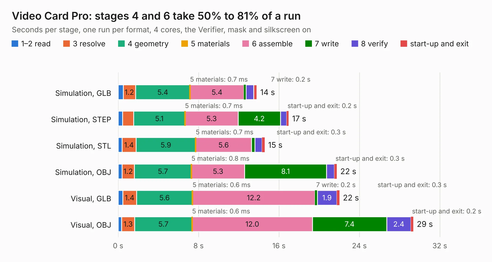

| Mode and format | 1–2 read | 3 resolve | 4 geometry | 5 materials | 6 assemble | 7 write | 8 verify | start-up and exit | Total |
|---|---:|---:|---:|---:|---:|---:|---:|---:|---:|
| Simulation, GLB | 0.5 | 1.2 | 5.4 | 0.7&nbsp;ms | 5.4 | 0.2 | 0.8 | 0.3 | 13.8 |
| Simulation, STEP | 0.4 | 1.1 | 5.1 | 0.7&nbsp;ms | 5.3 | 4.2 | 0.6 | 0.2 | 17.0 |
| Simulation, STL | 0.4 | 1.4 | 5.9 | 0.7&nbsp;ms | 5.6 | 0.3 | 0.7 | 0.3 | 14.6 |
| Simulation, OBJ | 0.4 | 1.2 | 5.7 | 0.8&nbsp;ms | 5.3 | 8.1 | 0.8 | 0.3 | 21.8 |
| Visual, GLB | 0.5 | 1.4 | 5.6 | 0.6&nbsp;ms | 12.2 | 0.2 | 1.9 | 0.3 | 22.0 |
| Visual, OBJ | 0.4 | 1.3 | 5.7 | 0.6&nbsp;ms | 12.0 | 7.4 | 2.4 | 0.2 | 29.4 |

<table align="center"><tr><td valign="top">

| Board | Repo: [acwright/6502](https://github.com/acwright/6502) Board: `Video Card Pro.kicad_pcb` |
|---|---|
| Folder | Hardware / Video Card Pro / Rev 1.0 |
| Complexity | 274&nbsp;/&nbsp;1000 (size&nbsp;174, features&nbsp;100) |
| KESE&nbsp;features | through vias, slotted holes, custom pads, rounded, trapezoid or chamfered pads, drill offsets, filled zones, copper drawings, curved board outline |
| Tested | 9th November 2026 |
| Copper&nbsp;layers | 2 |
| File&nbsp;format | KiCad 10 (20260206) |
| Parts,&nbsp;tracks,&nbsp;vias | 33, 800, 202 |
| Triangles,&nbsp;simulation | 1,288,982 in 94 parts |
| Verifier | PASS in all six runs |

</td><td valign="top">

<table>
<tr><th>File type</th><th>File size</th><th>Peak memory used</th></tr>
<tr><th colspan="3" align="left">Simulation</th></tr>
<tr><td>GLB</td><td align="right">44&nbsp;MB</td><td align="right">548&nbsp;MB</td></tr>
<tr><td>STEP</td><td align="right">206&nbsp;MB</td><td align="right">648&nbsp;MB</td></tr>
<tr><td>STL</td><td align="right">64&nbsp;MB</td><td align="right">598&nbsp;MB</td></tr>
<tr><td>OBJ</td><td align="right">131&nbsp;MB</td><td align="right">873&nbsp;MB</td></tr>
<tr><th colspan="3" align="left">Visual</th></tr>
<tr><td>GLB</td><td align="right">34&nbsp;MB</td><td align="right">721&nbsp;MB</td></tr>
<tr><td>OBJ</td><td align="right">103&nbsp;MB</td><td align="right">732&nbsp;MB</td></tr>
</table>

</td></tr></table>

## 50. Video Card

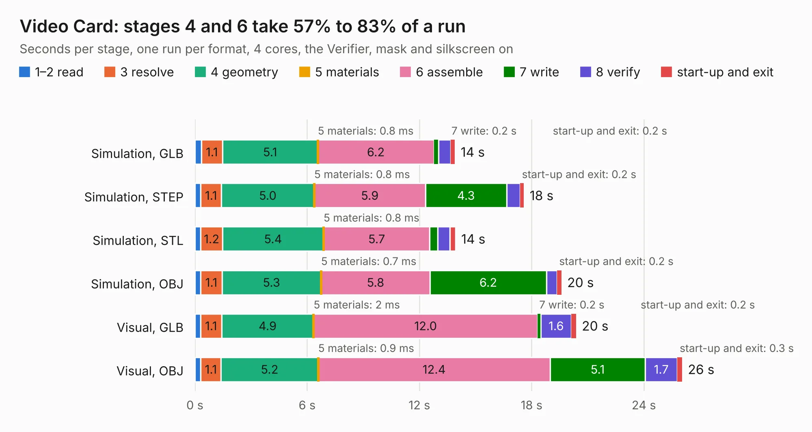

| Mode and format | 1–2 read | 3 resolve | 4 geometry | 5 materials | 6 assemble | 7 write | 8 verify | start-up and exit | Total |
|---|---:|---:|---:|---:|---:|---:|---:|---:|---:|
| Simulation, GLB | 0.3 | 1.1 | 5.1 | 0.8&nbsp;ms | 6.2 | 0.2 | 0.7 | 0.2 | 13.9 |
| Simulation, STEP | 0.3 | 1.1 | 5.0 | 0.8&nbsp;ms | 5.9 | 4.3 | 0.7 | 0.2 | 17.6 |
| Simulation, STL | 0.3 | 1.2 | 5.4 | 0.8&nbsp;ms | 5.7 | 0.4 | 0.7 | 0.3 | 13.9 |
| Simulation, OBJ | 0.3 | 1.1 | 5.3 | 0.7&nbsp;ms | 5.8 | 6.2 | 0.6 | 0.2 | 19.6 |
| Visual, GLB | 0.3 | 1.1 | 4.9 | 2&nbsp;ms | 12.0 | 0.2 | 1.6 | 0.2 | 20.4 |
| Visual, OBJ | 0.3 | 1.1 | 5.2 | 0.9&nbsp;ms | 12.4 | 5.1 | 1.7 | 0.3 | 26.0 |

<table align="center"><tr><td valign="top">

| Board | Repo: [acwright/6502](https://github.com/acwright/6502) Board: `Video Card.kicad_pcb` |
|---|---|
| Folder | Hardware / Video Card / Rev 1.0 |
| Complexity | 276&nbsp;/&nbsp;1000 (size&nbsp;176, features&nbsp;100) |
| KESE&nbsp;features | through vias, slotted holes, custom pads, rounded, trapezoid or chamfered pads, drill offsets, filled zones, copper drawings, curved board outline |
| Tested | 9th November 2026 |
| Copper&nbsp;layers | 2 |
| File&nbsp;format | KiCad 10 (20260206) |
| Parts,&nbsp;tracks,&nbsp;vias | 35, 881, 231 |
| Triangles,&nbsp;simulation | 1,513,430 in 120 parts |
| Verifier | PASS in all six runs |

</td><td valign="top">

<table>
<tr><th>File type</th><th>File size</th><th>Peak memory used</th></tr>
<tr><th colspan="3" align="left">Simulation</th></tr>
<tr><td>GLB</td><td align="right">52&nbsp;MB</td><td align="right">597&nbsp;MB</td></tr>
<tr><td>STEP</td><td align="right">252&nbsp;MB</td><td align="right">790&nbsp;MB</td></tr>
<tr><td>STL</td><td align="right">76&nbsp;MB</td><td align="right">604&nbsp;MB</td></tr>
<tr><td>OBJ</td><td align="right">155&nbsp;MB</td><td align="right">1.0&nbsp;GB</td></tr>
<tr><th colspan="3" align="left">Visual</th></tr>
<tr><td>GLB</td><td align="right">40&nbsp;MB</td><td align="right">907&nbsp;MB</td></tr>
<tr><td>OBJ</td><td align="right">123&nbsp;MB</td><td align="right">929&nbsp;MB</td></tr>
</table>

</td></tr></table>

## 51. Miniscope-v4-FlexPC

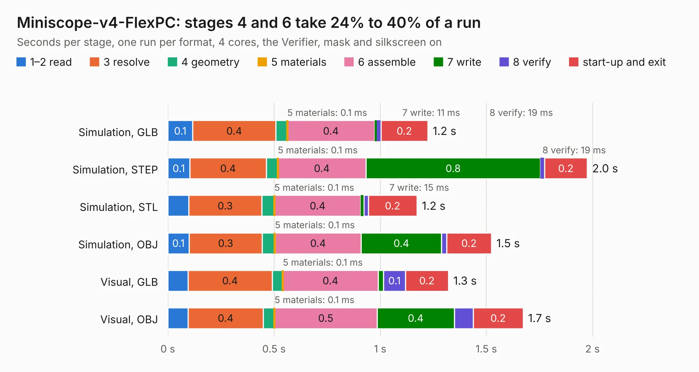

| Mode and format | 1–2 read | 3 resolve | 4 geometry | 5 materials | 6 assemble | 7 write | 8 verify | start-up and exit | Total |
|---|---:|---:|---:|---:|---:|---:|---:|---:|---:|
| Simulation, GLB | 0.1 | 0.4 | 54&nbsp;ms | 0.1&nbsp;ms | 0.4 | 11&nbsp;ms | 19&nbsp;ms | 0.2 | 1.2 |
| Simulation, STEP | 0.1 | 0.4 | 54&nbsp;ms | 0.1&nbsp;ms | 0.4 | 0.8 | 19&nbsp;ms | 0.2 | 2.0 |
| Simulation, STL | 98&nbsp;ms | 0.3 | 60&nbsp;ms | 0.1&nbsp;ms | 0.4 | 15&nbsp;ms | 21&nbsp;ms | 0.2 | 1.2 |
| Simulation, OBJ | 0.1 | 0.3 | 60&nbsp;ms | 0.1&nbsp;ms | 0.4 | 0.4 | 24&nbsp;ms | 0.2 | 1.5 |
| Visual, GLB | 95&nbsp;ms | 0.4 | 50&nbsp;ms | 0.1&nbsp;ms | 0.4 | 25&nbsp;ms | 0.1 | 0.2 | 1.3 |
| Visual, OBJ | 95&nbsp;ms | 0.4 | 53&nbsp;ms | 0.1&nbsp;ms | 0.5 | 0.4 | 89&nbsp;ms | 0.2 | 1.7 |

<table align="center"><tr><td valign="top">

| Board | Repo: [Aharoni-Lab/Miniscope-v4](https://github.com/Aharoni-Lab/Miniscope-v4) Board: `Miniscope-v4-FlexPC.kicad_pcb` |
|---|---|
| Folder | Development Files / Individual PCBs / Miniscope-v4-FlexPC / Miniscope-v4-FlexPC-array-clamp / KiCad |
| Complexity | 85&nbsp;/&nbsp;1000 (size&nbsp;70, features&nbsp;15) |
| KESE&nbsp;features | through vias |
| Tested | 9th November 2026 |
| Copper&nbsp;layers | 2 |
| File&nbsp;format | KiCad 5 (20171130) |
| Parts,&nbsp;tracks,&nbsp;vias | 6, 3, 1 |
| Triangles,&nbsp;simulation | 64,520 in 5 parts |
| Note | panel |
| Verifier | PASS in all six runs |

</td><td valign="top">

<table>
<tr><th>File type</th><th>File size</th><th>Peak memory used</th></tr>
<tr><th colspan="3" align="left">Simulation</th></tr>
<tr><td>GLB</td><td align="right">2.3&nbsp;MB</td><td align="right">83&nbsp;MB</td></tr>
<tr><td>STEP</td><td align="right">13&nbsp;MB</td><td align="right">195&nbsp;MB</td></tr>
<tr><td>STL</td><td align="right">3.2&nbsp;MB</td><td align="right">81&nbsp;MB</td></tr>
<tr><td>OBJ</td><td align="right">6.5&nbsp;MB</td><td align="right">105&nbsp;MB</td></tr>
<tr><th colspan="3" align="left">Visual</th></tr>
<tr><td>GLB</td><td align="right">2.3&nbsp;MB</td><td align="right">127&nbsp;MB</td></tr>
<tr><td>OBJ</td><td align="right">6.4&nbsp;MB</td><td align="right">134&nbsp;MB</td></tr>
</table>

</td></tr></table>

## 52. Miniscope-v4-FlexPC

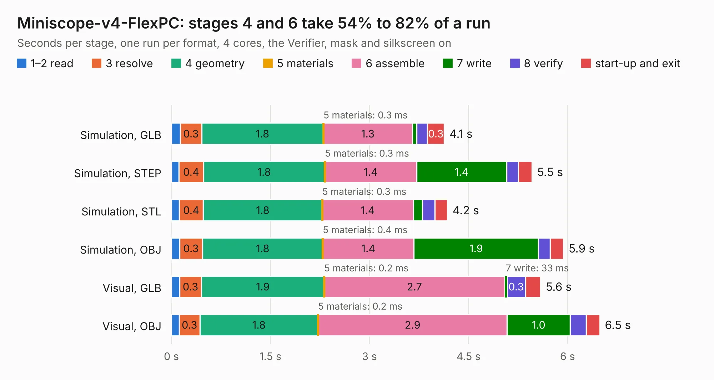

| Mode and format | 1–2 read | 3 resolve | 4 geometry | 5 materials | 6 assemble | 7 write | 8 verify | start-up and exit | Total |
|---|---:|---:|---:|---:|---:|---:|---:|---:|---:|
| Simulation, GLB | 0.1 | 0.3 | 1.8 | 0.3&nbsp;ms | 1.3 | 65&nbsp;ms | 0.2 | 0.3 | 4.1 |
| Simulation, STEP | 0.1 | 0.4 | 1.8 | 0.3&nbsp;ms | 1.4 | 1.4 | 0.2 | 0.2 | 5.5 |
| Simulation, STL | 0.1 | 0.4 | 1.8 | 0.3&nbsp;ms | 1.4 | 0.1 | 0.2 | 0.2 | 4.2 |
| Simulation, OBJ | 0.1 | 0.3 | 1.8 | 0.4&nbsp;ms | 1.4 | 1.9 | 0.2 | 0.2 | 5.9 |
| Visual, GLB | 0.1 | 0.3 | 1.9 | 0.2&nbsp;ms | 2.7 | 33&nbsp;ms | 0.3 | 0.2 | 5.6 |
| Visual, OBJ | 0.1 | 0.3 | 1.8 | 0.2&nbsp;ms | 2.9 | 1.0 | 0.2 | 0.2 | 6.5 |

<table align="center"><tr><td valign="top">

| Board | Repo: [Aharoni-Lab/Miniscope-v4](https://github.com/Aharoni-Lab/Miniscope-v4) Board: `Miniscope-v4-FlexPC.kicad_pcb` |
|---|---|
| Folder | Development Files / Individual PCBs / Miniscope-v4-FlexPC / Miniscope-v4-FlexPC-array-double-sided / KiCad |
| Complexity | 168&nbsp;/&nbsp;1000 (size&nbsp;123, features&nbsp;45) |
| KESE&nbsp;features | through vias, rounded, trapezoid or chamfered pads, filled zones |
| Tested | 9th November 2026 |
| Copper&nbsp;layers | 2 |
| File&nbsp;format | KiCad 5 (20171130) |
| Parts,&nbsp;tracks,&nbsp;vias | 8, 148, 2 |
| Triangles,&nbsp;simulation | 478,690 in 49 parts |
| Note | panel |
| Verifier | PASS in all six runs |

</td><td valign="top">

<table>
<tr><th>File type</th><th>File size</th><th>Peak memory used</th></tr>
<tr><th colspan="3" align="left">Simulation</th></tr>
<tr><td>GLB</td><td align="right">16&nbsp;MB</td><td align="right">304&nbsp;MB</td></tr>
<tr><td>STEP</td><td align="right">79&nbsp;MB</td><td align="right">321&nbsp;MB</td></tr>
<tr><td>STL</td><td align="right">24&nbsp;MB</td><td align="right">276&nbsp;MB</td></tr>
<tr><td>OBJ</td><td align="right">49&nbsp;MB</td><td align="right">356&nbsp;MB</td></tr>
<tr><th colspan="3" align="left">Visual</th></tr>
<tr><td>GLB</td><td align="right">8.0&nbsp;MB</td><td align="right">267&nbsp;MB</td></tr>
<tr><td>OBJ</td><td align="right">24&nbsp;MB</td><td align="right">269&nbsp;MB</td></tr>
</table>

</td></tr></table>

## 53. Miniscope-v4-FlexPC

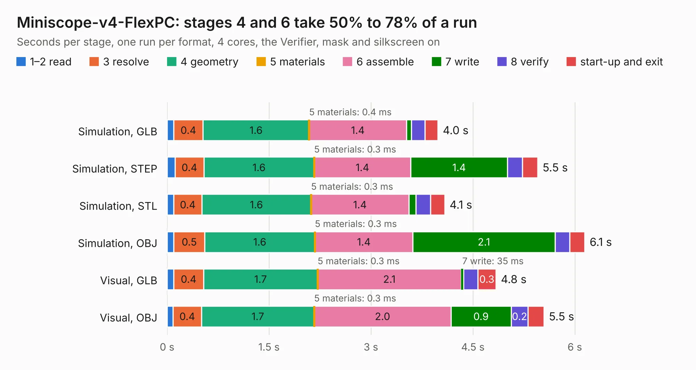

| Mode and format | 1–2 read | 3 resolve | 4 geometry | 5 materials | 6 assemble | 7 write | 8 verify | start-up and exit | Total |
|---|---:|---:|---:|---:|---:|---:|---:|---:|---:|
| Simulation, GLB | 98&nbsp;ms | 0.4 | 1.6 | 0.4&nbsp;ms | 1.4 | 69&nbsp;ms | 0.2 | 0.2 | 4.0 |
| Simulation, STEP | 0.1 | 0.4 | 1.6 | 0.3&nbsp;ms | 1.4 | 1.4 | 0.2 | 0.2 | 5.5 |
| Simulation, STL | 99&nbsp;ms | 0.4 | 1.6 | 0.3&nbsp;ms | 1.4 | 0.1 | 0.2 | 0.2 | 4.1 |
| Simulation, OBJ | 99&nbsp;ms | 0.5 | 1.6 | 0.3&nbsp;ms | 1.4 | 2.1 | 0.2 | 0.2 | 6.1 |
| Visual, GLB | 98&nbsp;ms | 0.4 | 1.7 | 0.3&nbsp;ms | 2.1 | 35&nbsp;ms | 0.2 | 0.3 | 4.8 |
| Visual, OBJ | 87&nbsp;ms | 0.4 | 1.7 | 0.3&nbsp;ms | 2.0 | 0.9 | 0.2 | 0.2 | 5.5 |

<table align="center"><tr><td valign="top">

| Board | Repo: [Aharoni-Lab/Miniscope-v4](https://github.com/Aharoni-Lab/Miniscope-v4) Board: `Miniscope-v4-FlexPC.kicad_pcb` |
|---|---|
| Folder | Development Files / Individual PCBs / Miniscope-v4-FlexPC / Miniscope-v4-FlexPC-array / KiCad |
| Complexity | 102&nbsp;/&nbsp;1000 (size&nbsp;102, features&nbsp;0) |
| Tested | 9th November 2026 |
| Copper&nbsp;layers | 2 |
| File&nbsp;format | KiCad 5 (20171130) |
| Parts,&nbsp;tracks,&nbsp;vias | 6, 50, 0 |
| Triangles,&nbsp;simulation | 399,432 in 49 parts |
| Note | panel |
| Verifier | PASS in all six runs |

</td><td valign="top">

<table>
<tr><th>File type</th><th>File size</th><th>Peak memory used</th></tr>
<tr><th colspan="3" align="left">Simulation</th></tr>
<tr><td>GLB</td><td align="right">13&nbsp;MB</td><td align="right">256&nbsp;MB</td></tr>
<tr><td>STEP</td><td align="right">61&nbsp;MB</td><td align="right">301&nbsp;MB</td></tr>
<tr><td>STL</td><td align="right">20&nbsp;MB</td><td align="right">261&nbsp;MB</td></tr>
<tr><td>OBJ</td><td align="right">40&nbsp;MB</td><td align="right">296&nbsp;MB</td></tr>
<tr><th colspan="3" align="left">Visual</th></tr>
<tr><td>GLB</td><td align="right">5.6&nbsp;MB</td><td align="right">242&nbsp;MB</td></tr>
<tr><td>OBJ</td><td align="right">16&nbsp;MB</td><td align="right">239&nbsp;MB</td></tr>
</table>

</td></tr></table>

## 54. BNO055_08092019

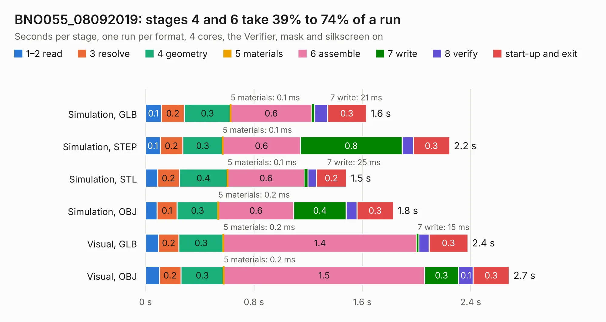

| Mode and format | 1–2 read | 3 resolve | 4 geometry | 5 materials | 6 assemble | 7 write | 8 verify | start-up and exit | Total |
|---|---:|---:|---:|---:|---:|---:|---:|---:|---:|
| Simulation, GLB | 0.1 | 0.2 | 0.3 | 0.1&nbsp;ms | 0.6 | 21&nbsp;ms | 94&nbsp;ms | 0.3 | 1.6 |
| Simulation, STEP | 0.1 | 0.2 | 0.3 | 0.1&nbsp;ms | 0.6 | 0.8 | 81&nbsp;ms | 0.3 | 2.2 |
| Simulation, STL | 90&nbsp;ms | 0.2 | 0.4 | 0.1&nbsp;ms | 0.6 | 25&nbsp;ms | 62&nbsp;ms | 0.2 | 1.5 |
| Simulation, OBJ | 86&nbsp;ms | 0.1 | 0.3 | 0.2&nbsp;ms | 0.6 | 0.4 | 79&nbsp;ms | 0.3 | 1.8 |
| Visual, GLB | 96&nbsp;ms | 0.2 | 0.3 | 0.2&nbsp;ms | 1.4 | 15&nbsp;ms | 78&nbsp;ms | 0.3 | 2.4 |
| Visual, OBJ | 0.1 | 0.2 | 0.3 | 0.2&nbsp;ms | 1.5 | 0.3 | 0.1 | 0.3 | 2.7 |

<table align="center"><tr><td valign="top">

| Board | Repo: [Aharoni-Lab/Miniscope-v4](https://github.com/Aharoni-Lab/Miniscope-v4) Board: `BNO055_08092019.kicad_pcb` |
|---|---|
| Folder | Development Files / Individual PCBs / Miniscope-v4-IMU / KiCad / BNO055_08092019 |
| Complexity | 216&nbsp;/&nbsp;1000 (size&nbsp;181, features&nbsp;35) |
| KESE&nbsp;features | through vias, filled zones |
| Tested | 9th November 2026 |
| Copper&nbsp;layers | 4 |
| File&nbsp;format | KiCad 5 (20171130) |
| Parts,&nbsp;tracks,&nbsp;vias | 8, 64, 12 |
| Triangles,&nbsp;simulation | 77,112 in 26 parts |
| Verifier | PASS in all six runs |

</td><td valign="top">

<table>
<tr><th>File type</th><th>File size</th><th>Peak memory used</th></tr>
<tr><th colspan="3" align="left">Simulation</th></tr>
<tr><td>GLB</td><td align="right">2.8&nbsp;MB</td><td align="right">176&nbsp;MB</td></tr>
<tr><td>STEP</td><td align="right">9.3&nbsp;MB</td><td align="right">175&nbsp;MB</td></tr>
<tr><td>STL</td><td align="right">3.9&nbsp;MB</td><td align="right">174&nbsp;MB</td></tr>
<tr><td>OBJ</td><td align="right">7.6&nbsp;MB</td><td align="right">173&nbsp;MB</td></tr>
<tr><th colspan="3" align="left">Visual</th></tr>
<tr><td>GLB</td><td align="right">1.8&nbsp;MB</td><td align="right">153&nbsp;MB</td></tr>
<tr><td>OBJ</td><td align="right">4.9&nbsp;MB</td><td align="right">153&nbsp;MB</td></tr>
</table>

</td></tr></table>

## 55. MS_v4_ETL_LED_Driver

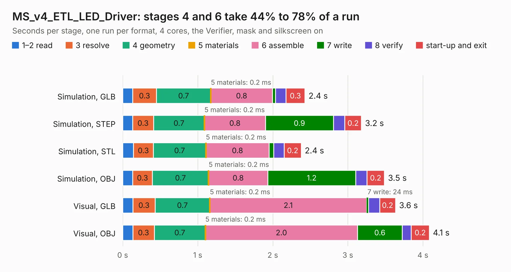

| Mode and format | 1–2 read | 3 resolve | 4 geometry | 5 materials | 6 assemble | 7 write | 8 verify | start-up and exit | Total |
|---|---:|---:|---:|---:|---:|---:|---:|---:|---:|
| Simulation, GLB | 0.1 | 0.3 | 0.7 | 0.2&nbsp;ms | 0.8 | 43&nbsp;ms | 0.1 | 0.3 | 2.4 |
| Simulation, STEP | 0.1 | 0.3 | 0.7 | 0.2&nbsp;ms | 0.8 | 0.9 | 0.2 | 0.2 | 3.2 |
| Simulation, STL | 0.1 | 0.3 | 0.7 | 0.2&nbsp;ms | 0.8 | 60&nbsp;ms | 0.1 | 0.2 | 2.4 |
| Simulation, OBJ | 0.1 | 0.3 | 0.7 | 0.2&nbsp;ms | 0.8 | 1.2 | 0.1 | 0.2 | 3.5 |
| Visual, GLB | 0.1 | 0.3 | 0.7 | 0.2&nbsp;ms | 2.1 | 24&nbsp;ms | 0.2 | 0.2 | 3.6 |
| Visual, OBJ | 0.1 | 0.3 | 0.7 | 0.2&nbsp;ms | 2.0 | 0.6 | 0.1 | 0.2 | 4.1 |

<table align="center"><tr><td valign="top">

| Board | Repo: [Aharoni-Lab/Miniscope-v4](https://github.com/Aharoni-Lab/Miniscope-v4) Board: `MS_v4_ETL_LED_Driver.kicad_pcb` |
|---|---|
| Folder | Development Files / Individual PCBs / Miniscope-v4-LED-ETL-Driver / KiCad |
| Complexity | 201&nbsp;/&nbsp;1000 (size&nbsp;166, features&nbsp;35) |
| KESE&nbsp;features | through vias, filled zones |
| Tested | 9th November 2026 |
| Copper&nbsp;layers | 6 |
| File&nbsp;format | KiCad 5 (20171130) |
| Parts,&nbsp;tracks,&nbsp;vias | 17, 181, 29 |
| Triangles,&nbsp;simulation | 222,592 in 36 parts |
| Verifier | PASS in all six runs |

</td><td valign="top">

<table>
<tr><th>File type</th><th>File size</th><th>Peak memory used</th></tr>
<tr><th colspan="3" align="left">Simulation</th></tr>
<tr><td>GLB</td><td align="right">7.8&nbsp;MB</td><td align="right">210&nbsp;MB</td></tr>
<tr><td>STEP</td><td align="right">25&nbsp;MB</td><td align="right">221&nbsp;MB</td></tr>
<tr><td>STL</td><td align="right">11&nbsp;MB</td><td align="right">208&nbsp;MB</td></tr>
<tr><td>OBJ</td><td align="right">22&nbsp;MB</td><td align="right">218&nbsp;MB</td></tr>
<tr><th colspan="3" align="left">Visual</th></tr>
<tr><td>GLB</td><td align="right">4.1&nbsp;MB</td><td align="right">180&nbsp;MB</td></tr>
<tr><td>OBJ</td><td align="right">12&nbsp;MB</td><td align="right">182&nbsp;MB</td></tr>
</table>

</td></tr></table>

## 56. Miniscope-v4-MCU

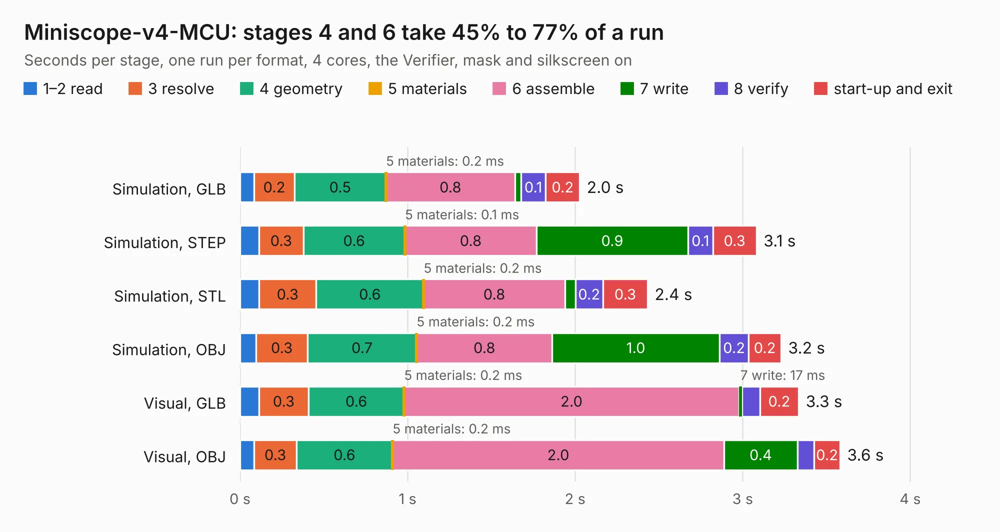

| Mode and format | 1–2 read | 3 resolve | 4 geometry | 5 materials | 6 assemble | 7 write | 8 verify | start-up and exit | Total |
|---|---:|---:|---:|---:|---:|---:|---:|---:|---:|
| Simulation, GLB | 84&nbsp;ms | 0.2 | 0.5 | 0.2&nbsp;ms | 0.8 | 36&nbsp;ms | 0.1 | 0.2 | 2.0 |
| Simulation, STEP | 0.1 | 0.3 | 0.6 | 0.1&nbsp;ms | 0.8 | 0.9 | 0.1 | 0.3 | 3.1 |
| Simulation, STL | 0.1 | 0.3 | 0.6 | 0.2&nbsp;ms | 0.8 | 63&nbsp;ms | 0.2 | 0.3 | 2.4 |
| Simulation, OBJ | 96&nbsp;ms | 0.3 | 0.7 | 0.2&nbsp;ms | 0.8 | 1.0 | 0.2 | 0.2 | 3.2 |
| Visual, GLB | 0.1 | 0.3 | 0.6 | 0.2&nbsp;ms | 2.0 | 17&nbsp;ms | 0.1 | 0.2 | 3.3 |
| Visual, OBJ | 85&nbsp;ms | 0.3 | 0.6 | 0.2&nbsp;ms | 2.0 | 0.4 | 99&nbsp;ms | 0.2 | 3.6 |

<table align="center"><tr><td valign="top">

| Board | Repo: [Aharoni-Lab/Miniscope-v4](https://github.com/Aharoni-Lab/Miniscope-v4) Board: `Miniscope-v4-MCU.kicad_pcb` |
|---|---|
| Folder | Development Files / Individual PCBs / Miniscope-v4-MCU / KiCad |
| Complexity | 226&nbsp;/&nbsp;1000 (size&nbsp;191, features&nbsp;35) |
| KESE&nbsp;features | through vias, filled zones |
| Tested | 9th November 2026 |
| Copper&nbsp;layers | 6 |
| File&nbsp;format | KiCad 5 (20171130) |
| Parts,&nbsp;tracks,&nbsp;vias | 5, 132, 32 |
| Triangles,&nbsp;simulation | 239,108 in 45 parts |
| Verifier | PASS in all six runs |

</td><td valign="top">

<table>
<tr><th>File type</th><th>File size</th><th>Peak memory used</th></tr>
<tr><th colspan="3" align="left">Simulation</th></tr>
<tr><td>GLB</td><td align="right">8.3&nbsp;MB</td><td align="right">200&nbsp;MB</td></tr>
<tr><td>STEP</td><td align="right">26&nbsp;MB</td><td align="right">214&nbsp;MB</td></tr>
<tr><td>STL</td><td align="right">12&nbsp;MB</td><td align="right">197&nbsp;MB</td></tr>
<tr><td>OBJ</td><td align="right">24&nbsp;MB</td><td align="right">200&nbsp;MB</td></tr>
<tr><th colspan="3" align="left">Visual</th></tr>
<tr><td>GLB</td><td align="right">3.9&nbsp;MB</td><td align="right">177&nbsp;MB</td></tr>
<tr><td>OBJ</td><td align="right">11&nbsp;MB</td><td align="right">178&nbsp;MB</td></tr>
</table>

</td></tr></table>

## 57. Miniscope-v4-PYTHON480

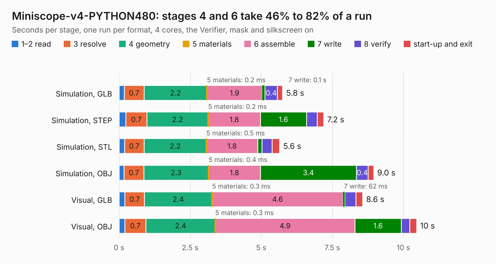

| Mode and format | 1–2 read | 3 resolve | 4 geometry | 5 materials | 6 assemble | 7 write | 8 verify | start-up and exit | Total |
|---|---:|---:|---:|---:|---:|---:|---:|---:|---:|
| Simulation, GLB | 0.2 | 0.7 | 2.2 | 0.2&nbsp;ms | 1.9 | 0.1 | 0.4 | 0.2 | 5.8 |
| Simulation, STEP | 0.2 | 0.7 | 2.2 | 0.2&nbsp;ms | 1.8 | 1.6 | 0.4 | 0.2 | 7.2 |
| Simulation, STL | 0.2 | 0.7 | 2.2 | 0.5&nbsp;ms | 1.8 | 0.1 | 0.4 | 0.3 | 5.6 |
| Simulation, OBJ | 0.2 | 0.7 | 2.3 | 0.4&nbsp;ms | 1.8 | 3.4 | 0.4 | 0.2 | 9.0 |
| Visual, GLB | 0.2 | 0.7 | 2.4 | 0.3&nbsp;ms | 4.6 | 62&nbsp;ms | 0.4 | 0.2 | 8.6 |
| Visual, OBJ | 0.2 | 0.7 | 2.4 | 0.3&nbsp;ms | 4.9 | 1.6 | 0.3 | 0.2 | 10.5 |

<table align="center"><tr><td valign="top">

| Board | Repo: [Aharoni-Lab/Miniscope-v4](https://github.com/Aharoni-Lab/Miniscope-v4) Board: `Miniscope-v4-PYTHON480.kicad_pcb` |
|---|---|
| Folder | Development Files / Individual PCBs / Miniscope-v4-PYTHON480 / KiCad |
| Complexity | 282&nbsp;/&nbsp;1000 (size&nbsp;237, features&nbsp;45) |
| KESE&nbsp;features | through vias, rounded, trapezoid or chamfered pads, filled zones |
| Tested | 9th November 2026 |
| Copper&nbsp;layers | 6 |
| File&nbsp;format | KiCad 5 (20171130) |
| Parts,&nbsp;tracks,&nbsp;vias | 32, 355, 78 |
| Triangles,&nbsp;simulation | 642,990 in 68 parts |
| Verifier | PASS in all six runs |

</td><td valign="top">

<table>
<tr><th>File type</th><th>File size</th><th>Peak memory used</th></tr>
<tr><th colspan="3" align="left">Simulation</th></tr>
<tr><td>GLB</td><td align="right">22&nbsp;MB</td><td align="right">281&nbsp;MB</td></tr>
<tr><td>STEP</td><td align="right">75&nbsp;MB</td><td align="right">321&nbsp;MB</td></tr>
<tr><td>STL</td><td align="right">32&nbsp;MB</td><td align="right">279&nbsp;MB</td></tr>
<tr><td>OBJ</td><td align="right">67&nbsp;MB</td><td align="right">470&nbsp;MB</td></tr>
<tr><th colspan="3" align="left">Visual</th></tr>
<tr><td>GLB</td><td align="right">10&nbsp;MB</td><td align="right">301&nbsp;MB</td></tr>
<tr><td>OBJ</td><td align="right">31&nbsp;MB</td><td align="right">304&nbsp;MB</td></tr>
</table>

</td></tr></table>

## 58. Miniscope-v4-Ser-Pow

| Mode and format | 1–2 read | 3 resolve | 4 geometry | 5 materials | 6 assemble | 7 write | 8 verify | start-up and exit | Total |
|---|---:|---:|---:|---:|---:|---:|---:|---:|---:|
| Simulation, GLB | 0.2 | 0.6 | 1.9 | 0.3&nbsp;ms | 1.6 | 91&nbsp;ms | 0.3 | 0.2 | 4.9 |
| Simulation, STEP | 0.2 | 0.7 | 1.5 | 0.5&nbsp;ms | 1.5 | 1.5 | 0.3 | 0.3 | 6.0 |
| Simulation, STL | 0.2 | 0.7 | 1.5 | 0.4&nbsp;ms | 1.5 | 0.1 | 0.3 | 0.2 | 4.6 |
| Simulation, OBJ | 0.2 | 0.6 | 1.5 | 0.2&nbsp;ms | 1.6 | 2.3 | 0.4 | 0.3 | 6.8 |
| Visual, GLB | 0.2 | 0.6 | 1.6 | 0.3&nbsp;ms | 3.6 | 36&nbsp;ms | 0.3 | 0.3 | 6.6 |
| Visual, OBJ | 0.2 | 0.6 | 1.6 | 0.2&nbsp;ms | 3.7 | 1.1 | 0.2 | 0.3 | 7.8 |

<table align="center"><tr><td valign="top">

| Board | Repo: [Aharoni-Lab/Miniscope-v4](https://github.com/Aharoni-Lab/Miniscope-v4) Board: `Miniscope-v4-Ser-Pow.kicad_pcb` |
|---|---|
| Folder | Development Files / Individual PCBs / Miniscope-v4-Ser-Pow / KiCad |
| Complexity | 267&nbsp;/&nbsp;1000 (size&nbsp;222, features&nbsp;45) |
| KESE&nbsp;features | through vias, rounded, trapezoid or chamfered pads, filled zones |
| Tested | 9th November 2026 |
| Copper&nbsp;layers | 6 |
| File&nbsp;format | KiCad 5 (20171130) |
| Parts,&nbsp;tracks,&nbsp;vias | 38, 265, 58 |
| Triangles,&nbsp;simulation | 446,544 in 46 parts |
| Verifier | PASS in all six runs |

</td><td valign="top">

<table>
<tr><th>File type</th><th>File size</th><th>Peak memory used</th></tr>
<tr><th colspan="3" align="left">Simulation</th></tr>
<tr><td>GLB</td><td align="right">16&nbsp;MB</td><td align="right">248&nbsp;MB</td></tr>
<tr><td>STEP</td><td align="right">48&nbsp;MB</td><td align="right">270&nbsp;MB</td></tr>
<tr><td>STL</td><td align="right">22&nbsp;MB</td><td align="right">244&nbsp;MB</td></tr>
<tr><td>OBJ</td><td align="right">46&nbsp;MB</td><td align="right">334&nbsp;MB</td></tr>
<tr><th colspan="3" align="left">Visual</th></tr>
<tr><td>GLB</td><td align="right">7.1&nbsp;MB</td><td align="right">253&nbsp;MB</td></tr>
<tr><td>OBJ</td><td align="right">21&nbsp;MB</td><td align="right">254&nbsp;MB</td></tr>
</table>

</td></tr></table>

## 59. Miniscope-v4-PCB-fab-assembly

| Mode and format | 1–2 read | 3 resolve | 4 geometry | 5 materials | 6 assemble | 7 write | 8 verify | start-up and exit | Total |
|---|---:|---:|---:|---:|---:|---:|---:|---:|---:|
| Simulation, GLB | 0.3 | 1.2 | 3.8 | 0.3&nbsp;ms | 3.0 | 0.2 | 0.5 | 0.3 | 9.3 |
| Simulation, STEP | 0.2 | 1.3 | 3.3 | 0.5&nbsp;ms | 3.0 | 2.1 | 0.5 | 0.2 | 10.7 |
| Simulation, STL | 0.3 | 1.2 | 3.3 | 0.4&nbsp;ms | 2.9 | 0.4 | 0.5 | 0.2 | 8.8 |
| Simulation, OBJ | 0.2 | 1.1 | 3.4 | 0.4&nbsp;ms | 2.8 | 4.9 | 0.5 | 0.2 | 13.1 |
| Visual, GLB | 0.2 | 1.1 | 3.2 | 0.4&nbsp;ms | 7.1 | 79&nbsp;ms | 0.6 | 0.2 | 12.6 |
| Visual, OBJ | 0.3 | 1.1 | 3.3 | 0.3&nbsp;ms | 7.1 | 2.4 | 0.8 | 0.3 | 15.3 |

<table align="center"><tr><td valign="top">

| Board | Repo: [Aharoni-Lab/Miniscope-v4](https://github.com/Aharoni-Lab/Miniscope-v4) Board: `Miniscope-v4-PCB-fab-assembly.kicad_pcb` |
|---|---|
| Folder | Development Files / Miniscope-v4-PCB-fab-assembly |
| Complexity | 310&nbsp;/&nbsp;1000 (size&nbsp;255, features&nbsp;55) |
| KESE&nbsp;features | through vias, rounded, trapezoid or chamfered pads, filled zones, curved board outline |
| Tested | 9th November 2026 |
| Copper&nbsp;layers | 6 |
| File&nbsp;format | KiCad 5 (20171130) |
| Parts,&nbsp;tracks,&nbsp;vias | 54, 668, 139 |
| Triangles,&nbsp;simulation | 1,120,536 in 105 parts |
| Verifier | PASS in all six runs |

</td><td valign="top">

<table>
<tr><th>File type</th><th>File size</th><th>Peak memory used</th></tr>
<tr><th colspan="3" align="left">Simulation</th></tr>
<tr><td>GLB</td><td align="right">39&nbsp;MB</td><td align="right">395&nbsp;MB</td></tr>
<tr><td>STEP</td><td align="right">130&nbsp;MB</td><td align="right">473&nbsp;MB</td></tr>
<tr><td>STL</td><td align="right">56&nbsp;MB</td><td align="right">425&nbsp;MB</td></tr>
<tr><td>OBJ</td><td align="right">116&nbsp;MB</td><td align="right">786&nbsp;MB</td></tr>
<tr><th colspan="3" align="left">Visual</th></tr>
<tr><td>GLB</td><td align="right">19&nbsp;MB</td><td align="right">481&nbsp;MB</td></tr>
<tr><td>OBJ</td><td align="right">57&nbsp;MB</td><td align="right">488&nbsp;MB</td></tr>
</table>

</td></tr></table>

## 60. Miniscope-v4-PCB-fab-assembly_2

| Mode and format | 1–2 read | 3 resolve | 4 geometry | 5 materials | 6 assemble | 7 write | 8 verify | start-up and exit | Total |
|---|---:|---:|---:|---:|---:|---:|---:|---:|---:|
| Simulation, GLB | 0.6 | 2.3 | 6.9 | 0.9&nbsp;ms | 6.4 | 0.3 | 0.9 | 0.3 | 17.7 |
| Simulation, STEP | 0.6 | 2.3 | 6.7 | 0.6&nbsp;ms | 5.9 | 3.8 | 0.9 | 0.3 | 20.4 |
| Simulation, STL | 0.5 | 2.5 | 6.8 | 0.5&nbsp;ms | 6.3 | 0.5 | 1.0 | 0.3 | 17.9 |
| Simulation, OBJ | 0.5 | 2.4 | 6.6 | 1&nbsp;ms | 6.1 | 10.7 | 0.8 | 0.3 | 27.4 |
| Visual, GLB | 0.5 | 2.4 | 6.7 | 0.8&nbsp;ms | 13.1 | 0.2 | 1.0 | 0.3 | 24.1 |
| Visual, OBJ | 0.5 | 2.1 | 6.4 | 0.4&nbsp;ms | 12.6 | 5.1 | 1.2 | 0.3 | 28.3 |

<table align="center"><tr><td valign="top">

| Board | Repo: [Aharoni-Lab/Miniscope-v4](https://github.com/Aharoni-Lab/Miniscope-v4) Board: `Miniscope-v4-PCB-fab-assembly_2.kicad_pcb` |
|---|---|
| Folder | Development Files / Miniscope-v4-PCB-fab-assembly |
| Complexity | 324&nbsp;/&nbsp;1000 (size&nbsp;269, features&nbsp;55) |
| KESE&nbsp;features | through vias, rounded, trapezoid or chamfered pads, filled zones, curved board outline |
| Tested | 9th November 2026 |
| Copper&nbsp;layers | 6 |
| File&nbsp;format | KiCad 5 (20171130) |
| Parts,&nbsp;tracks,&nbsp;vias | 91, 933, 197 |
| Triangles,&nbsp;simulation | 1,660,988 in 132 parts |
| Verifier | PASS in all six runs |

</td><td valign="top">

<table>
<tr><th>File type</th><th>File size</th><th>Peak memory used</th></tr>
<tr><th colspan="3" align="left">Simulation</th></tr>
<tr><td>GLB</td><td align="right">58&nbsp;MB</td><td align="right">505&nbsp;MB</td></tr>
<tr><td>STEP</td><td align="right">200&nbsp;MB</td><td align="right">608&nbsp;MB</td></tr>
<tr><td>STL</td><td align="right">83&nbsp;MB</td><td align="right">503&nbsp;MB</td></tr>
<tr><td>OBJ</td><td align="right">177&nbsp;MB</td><td align="right">1.1&nbsp;GB</td></tr>
<tr><th colspan="3" align="left">Visual</th></tr>
<tr><td>GLB</td><td align="right">28&nbsp;MB</td><td align="right">726&nbsp;MB</td></tr>
<tr><td>OBJ</td><td align="right">88&nbsp;MB</td><td align="right">723&nbsp;MB</td></tr>
</table>

</td></tr></table>

## 61. Miniscope-v4-Rigid-Flex

| Mode and format | 1–2 read | 3 resolve | 4 geometry | 5 materials | 6 assemble | 7 write | 8 verify | start-up and exit | Total |
|---|---:|---:|---:|---:|---:|---:|---:|---:|---:|
| Simulation, GLB | 0.4 | 1.7 | 4.4 | 0.5&nbsp;ms | 4.6 | 0.2 | 0.7 | 0.3 | 12.4 |
| Simulation, STEP | 0.4 | 1.6 | 4.5 | 0.5&nbsp;ms | 4.8 | 3.0 | 0.7 | 0.3 | 15.3 |
| Simulation, STL | 0.4 | 1.7 | 4.3 | 0.5&nbsp;ms | 4.7 | 0.4 | 0.7 | 0.3 | 12.5 |
| Simulation, OBJ | 0.4 | 1.7 | 4.5 | 0.5&nbsp;ms | 4.7 | 7.2 | 0.8 | 0.2 | 19.4 |
| Visual, GLB | 0.5 | 1.8 | 4.5 | 0.5&nbsp;ms | 11.5 | 0.1 | 0.8 | 0.3 | 19.6 |
| Visual, OBJ | 0.4 | 1.7 | 4.3 | 0.5&nbsp;ms | 11.7 | 3.6 | 1.0 | 0.2 | 23.0 |

<table align="center"><tr><td valign="top">

| Board | Repo: [Aharoni-Lab/Miniscope-v4](https://github.com/Aharoni-Lab/Miniscope-v4) Board: `Miniscope-v4-Rigid-Flex.kicad_pcb` |
|---|---|
| Folder | Miniscope-v4-Rigid-Flex / KiCad |
| Complexity | 353&nbsp;/&nbsp;1000 (size&nbsp;273, features&nbsp;80) |
| KESE&nbsp;features | through vias, custom pads, rounded, trapezoid or chamfered pads, filled zones, copper drawings, curved board outline |
| Tested | 9th November 2026 |
| Copper&nbsp;layers | 6 |
| File&nbsp;format | KiCad 9 (20241229) |
| Parts,&nbsp;tracks,&nbsp;vias | 99, 1,047, 164 |
| Triangles,&nbsp;simulation | 1,439,938 in 126 parts |
| Verifier | PASS in all six runs |

</td><td valign="top">

<table>
<tr><th>File type</th><th>File size</th><th>Peak memory used</th></tr>
<tr><th colspan="3" align="left">Simulation</th></tr>
<tr><td>GLB</td><td align="right">50&nbsp;MB</td><td align="right">486&nbsp;MB</td></tr>
<tr><td>STEP</td><td align="right">184&nbsp;MB</td><td align="right">568&nbsp;MB</td></tr>
<tr><td>STL</td><td align="right">72&nbsp;MB</td><td align="right">518&nbsp;MB</td></tr>
<tr><td>OBJ</td><td align="right">151&nbsp;MB</td><td align="right">991&nbsp;MB</td></tr>
<tr><th colspan="3" align="left">Visual</th></tr>
<tr><td>GLB</td><td align="right">24&nbsp;MB</td><td align="right">624&nbsp;MB</td></tr>
<tr><td>OBJ</td><td align="right">75&nbsp;MB</td><td align="right">609&nbsp;MB</td></tr>
</table>

</td></tr></table>

## 62. Miniscope-v4-VDD-PIX-FC

| Mode and format | 1–2 read | 3 resolve | 4 geometry | 5 materials | 6 assemble | 7 write | 8 verify | start-up and exit | Total |
|---|---:|---:|---:|---:|---:|---:|---:|---:|---:|
| Simulation, GLB | 75&nbsp;ms | 32&nbsp;ms | 0.1 | 0.1&nbsp;ms | 0.3 | 8&nbsp;ms | 27&nbsp;ms | 0.2 | 0.8 |
| Simulation, STEP | 94&nbsp;ms | 39&nbsp;ms | 0.2 | 0.1&nbsp;ms | 0.3 | 0.2 | 28&nbsp;ms | 0.2 | 1.0 |
| Simulation, STL | 74&nbsp;ms | 33&nbsp;ms | 0.1 | 0.1&nbsp;ms | 0.3 | 7&nbsp;ms | 25&nbsp;ms | 0.2 | 0.8 |
| Simulation, OBJ | 73&nbsp;ms | 31&nbsp;ms | 0.1 | 0.1&nbsp;ms | 0.3 | 0.1 | 26&nbsp;ms | 0.2 | 0.9 |
| Visual, GLB | 94&nbsp;ms | 42&nbsp;ms | 0.1 | 0.1&nbsp;ms | 0.5 | 8&nbsp;ms | 47&nbsp;ms | 0.2 | 1.0 |
| Visual, OBJ | 76&nbsp;ms | 32&nbsp;ms | 0.1 | 0.1&nbsp;ms | 0.4 | 89&nbsp;ms | 32&nbsp;ms | 0.2 | 1.0 |

<table align="center"><tr><td valign="top">

| Board | Repo: [Aharoni-Lab/Miniscope-v4](https://github.com/Aharoni-Lab/Miniscope-v4) Board: `Miniscope-v4-VDD-PIX-FC.kicad_pcb` |
|---|---|
| Folder | Miniscope-v4-VDD-PIX-FC / Miniscope-v4-VDD-PIX-FC |
| Complexity | 128&nbsp;/&nbsp;1000 (size&nbsp;83, features&nbsp;45) |
| KESE&nbsp;features | custom pads, rounded, trapezoid or chamfered pads, copper drawings, curved board outline |
| Tested | 9th November 2026 |
| Copper&nbsp;layers | 2 |
| File&nbsp;format | KiCad 5 (20171130) |
| Parts,&nbsp;tracks,&nbsp;vias | 4, 19, 0 |
| Triangles,&nbsp;simulation | 24,216 in 15 parts |
| Verifier | PASS in all six runs |

</td><td valign="top">

<table>
<tr><th>File type</th><th>File size</th><th>Peak memory used</th></tr>
<tr><th colspan="3" align="left">Simulation</th></tr>
<tr><td>GLB</td><td align="right">900&nbsp;kB</td><td align="right">64&nbsp;MB</td></tr>
<tr><td>STEP</td><td align="right">4.8&nbsp;MB</td><td align="right">67&nbsp;MB</td></tr>
<tr><td>STL</td><td align="right">1.2&nbsp;MB</td><td align="right">66&nbsp;MB</td></tr>
<tr><td>OBJ</td><td align="right">2.4&nbsp;MB</td><td align="right">68&nbsp;MB</td></tr>
<tr><th colspan="3" align="left">Visual</th></tr>
<tr><td>GLB</td><td align="right">516&nbsp;kB</td><td align="right">88&nbsp;MB</td></tr>
<tr><td>OBJ</td><td align="right">1.4&nbsp;MB</td><td align="right">88&nbsp;MB</td></tr>
</table>

</td></tr></table>

## 63. interposer

| Mode and format | 1–2 read | 3 resolve | 4 geometry | 5 materials | 6 assemble | 7 write | 8 verify | start-up and exit | Total |
|---|---:|---:|---:|---:|---:|---:|---:|---:|---:|
| Simulation, GLB | 0.2 | 1.2 | 2.3 | 0.6&nbsp;ms | 3.7 | 0.1 | 0.5 | 0.2 | 8.3 |
| Simulation, STEP | 0.2 | 1.0 | 2.2 | 0.7&nbsp;ms | 3.9 | 3.1 | 0.5 | 0.2 | 11.1 |
| Simulation, STL | 0.2 | 1.0 | 2.8 | 0.8&nbsp;ms | 4.0 | 0.3 | 0.6 | 0.2 | 9.2 |
| Simulation, OBJ | 0.2 | 1.0 | 2.2 | 0.6&nbsp;ms | 3.8 | 3.8 | 0.5 | 0.2 | 11.7 |
| Visual, GLB | 0.2 | 1.1 | 2.3 | 0.9&nbsp;ms | 7.7 | 0.1 | 0.9 | 0.3 | 12.6 |
| Visual, OBJ | 0.2 | 1.0 | 2.2 | 0.8&nbsp;ms | 7.4 | 2.9 | 1.2 | 0.3 | 15.1 |

<table align="center"><tr><td valign="top">

| Board | Repo: [ahmadexp/Open-Source-PC110](https://github.com/ahmadexp/Open-Source-PC110) Board: `interposer.kicad_pcb` |
|---|---|
| Folder | Components / U61-VL82C420FC5 / Interposer / interposer |
| Complexity | 235&nbsp;/&nbsp;1000 (size&nbsp;210, features&nbsp;25) |
| KESE&nbsp;features | through vias, copper drawings |
| Tested | 9th November 2026 |
| Copper&nbsp;layers | 2 |
| File&nbsp;format | KiCad 9 (20241229) |
| Parts,&nbsp;tracks,&nbsp;vias | 1, 2,968, 208 |
| Triangles,&nbsp;simulation | 929,806 in 246 parts |
| Verifier | PASS in all six runs |

</td><td valign="top">

<table>
<tr><th>File type</th><th>File size</th><th>Peak memory used</th></tr>
<tr><th colspan="3" align="left">Simulation</th></tr>
<tr><td>GLB</td><td align="right">32&nbsp;MB</td><td align="right">553&nbsp;MB</td></tr>
<tr><td>STEP</td><td align="right">161&nbsp;MB</td><td align="right">562&nbsp;MB</td></tr>
<tr><td>STL</td><td align="right">47&nbsp;MB</td><td align="right">561&nbsp;MB</td></tr>
<tr><td>OBJ</td><td align="right">94&nbsp;MB</td><td align="right">634&nbsp;MB</td></tr>
<tr><th colspan="3" align="left">Visual</th></tr>
<tr><td>GLB</td><td align="right">23&nbsp;MB</td><td align="right">688&nbsp;MB</td></tr>
<tr><td>OBJ</td><td align="right">70&nbsp;MB</td><td align="right">595&nbsp;MB</td></tr>
</table>

</td></tr></table>

## 64. bgacpu-dualcon

| Mode and format | 1–2 read | 3 resolve | 4 geometry | 5 materials | 6 assemble | 7 write | 8 verify | start-up and exit | Total |
|---|---:|---:|---:|---:|---:|---:|---:|---:|---:|
| Simulation, GLB | 0.2 | 0.5 | 1.6 | 0.4&nbsp;ms | 2.6 | 0.1 | 0.4 | 0.3 | 5.6 |
| Simulation, STEP | 0.2 | 0.5 | 1.6 | 0.5&nbsp;ms | 2.3 | 2.3 | 0.4 | 0.3 | 7.5 |
| Simulation, STL | 0.2 | 0.4 | 1.4 | 0.5&nbsp;ms | 2.4 | 0.2 | 0.4 | 0.2 | 5.2 |
| Simulation, OBJ | 0.2 | 0.5 | 1.5 | 0.5&nbsp;ms | 2.4 | 2.6 | 0.3 | 0.2 | 7.7 |
| Visual, GLB | 0.2 | 0.4 | 1.5 | 0.7&nbsp;ms | 5.6 | 85&nbsp;ms | 0.6 | 0.2 | 8.6 |
| Visual, OBJ | 0.2 | 0.5 | 1.7 | 0.6&nbsp;ms | 5.7 | 2.4 | 0.6 | 0.3 | 11.2 |

<table align="center"><tr><td valign="top">

| Board | Repo: [ahmadexp/Open-Source-PC110](https://github.com/ahmadexp/Open-Source-PC110) Board: `bgacpu-dualcon.kicad_pcb` |
|---|---|
| Folder | Mods / CPU Upgrade / bgacpu-dualcon |
| Complexity | 254&nbsp;/&nbsp;1000 (size&nbsp;209, features&nbsp;45) |
| KESE&nbsp;features | through vias, stack-up, dielectric εr and tanδ |
| Tested | 9th November 2026 |
| Copper&nbsp;layers | 2 |
| File&nbsp;format | KiCad 9 (20241229) |
| Parts,&nbsp;tracks,&nbsp;vias | 3, 773, 111 |
| Triangles,&nbsp;simulation | 540,030 in 147 parts |
| Verifier | PASS in all six runs |

</td><td valign="top">

<table>
<tr><th>File type</th><th>File size</th><th>Peak memory used</th></tr>
<tr><th colspan="3" align="left">Simulation</th></tr>
<tr><td>GLB</td><td align="right">19&nbsp;MB</td><td align="right">351&nbsp;MB</td></tr>
<tr><td>STEP</td><td align="right">82&nbsp;MB</td><td align="right">403&nbsp;MB</td></tr>
<tr><td>STL</td><td align="right">27&nbsp;MB</td><td align="right">354&nbsp;MB</td></tr>
<tr><td>OBJ</td><td align="right">55&nbsp;MB</td><td align="right">363&nbsp;MB</td></tr>
<tr><th colspan="3" align="left">Visual</th></tr>
<tr><td>GLB</td><td align="right">16&nbsp;MB</td><td align="right">433&nbsp;MB</td></tr>
<tr><td>OBJ</td><td align="right">48&nbsp;MB</td><td align="right">483&nbsp;MB</td></tr>
</table>

</td></tr></table>

## 65. pcb-bga-adapter-dualcon

| Mode and format | 1–2 read | 3 resolve | 4 geometry | 5 materials | 6 assemble | 7 write | 8 verify | start-up and exit | Total |
|---|---:|---:|---:|---:|---:|---:|---:|---:|---:|
| Simulation, GLB | 0.2 | 0.5 | 1.8 | 0.6&nbsp;ms | 3.2 | 0.1 | 0.4 | 0.3 | 6.5 |
| Simulation, STEP | 0.2 | 0.6 | 1.9 | 0.5&nbsp;ms | 3.0 | 2.8 | 0.5 | 0.3 | 9.3 |
| Simulation, STL | 0.2 | 0.6 | 1.7 | 0.7&nbsp;ms | 3.0 | 0.2 | 0.5 | 0.3 | 6.5 |
| Simulation, OBJ | 0.2 | 0.7 | 1.9 | 0.5&nbsp;ms | 2.8 | 3.4 | 0.5 | 0.3 | 9.9 |
| Visual, GLB | 0.3 | 0.8 | 1.9 | 0.6&nbsp;ms | 6.2 | 90&nbsp;ms | 0.7 | 0.3 | 10.3 |
| Visual, OBJ | 0.3 | 0.6 | 1.9 | 0.5&nbsp;ms | 6.0 | 3.0 | 0.7 | 0.3 | 12.7 |

<table align="center"><tr><td valign="top">

| Board | Repo: [ahmadexp/Open-Source-PC110](https://github.com/ahmadexp/Open-Source-PC110) Board: `pcb-bga-adapter-dualcon.kicad_pcb` |
|---|---|
| Folder | Mods / CPU Upgrade / pcb-bga-adapter-dualcon |
| Complexity | 252&nbsp;/&nbsp;1000 (size&nbsp;207, features&nbsp;45) |
| KESE&nbsp;features | through vias, stack-up, dielectric εr and tanδ |
| Tested | 9th November 2026 |
| Copper&nbsp;layers | 2 |
| File&nbsp;format | KiCad 9 (20241229) |
| Parts,&nbsp;tracks,&nbsp;vias | 3, 625, 107 |
| Triangles,&nbsp;simulation | 526,464 in 147 parts |
| Verifier | PASS in all six runs |

</td><td valign="top">

<table>
<tr><th>File type</th><th>File size</th><th>Peak memory used</th></tr>
<tr><th colspan="3" align="left">Simulation</th></tr>
<tr><td>GLB</td><td align="right">18&nbsp;MB</td><td align="right">353&nbsp;MB</td></tr>
<tr><td>STEP</td><td align="right">82&nbsp;MB</td><td align="right">398&nbsp;MB</td></tr>
<tr><td>STL</td><td align="right">26&nbsp;MB</td><td align="right">346&nbsp;MB</td></tr>
<tr><td>OBJ</td><td align="right">53&nbsp;MB</td><td align="right">401&nbsp;MB</td></tr>
<tr><th colspan="3" align="left">Visual</th></tr>
<tr><td>GLB</td><td align="right">15&nbsp;MB</td><td align="right">479&nbsp;MB</td></tr>
<tr><td>OBJ</td><td align="right">47&nbsp;MB</td><td align="right">427&nbsp;MB</td></tr>
</table>

</td></tr></table>

## 66. DockingStation

| Mode and format | 1–2 read | 3 resolve | 4 geometry | 5 materials | 6 assemble | 7 write | 8 verify | start-up and exit | Total |
|---|---:|---:|---:|---:|---:|---:|---:|---:|---:|
| Simulation, GLB | 1.0 | 3.1 | 9.6 | 1&nbsp;ms | 12.3 | 0.4 | 1.3 | 0.3 | 28.0 |
| Simulation, STEP | 0.9 | 2.9 | 9.6 | 1&nbsp;ms | 13.0 | 8.3 | 1.4 | 0.3 | 36.4 |
| Simulation, STL | 0.9 | 3.1 | 9.8 | 2&nbsp;ms | 11.4 | 0.8 | 1.3 | 0.3 | 27.7 |
| Simulation, OBJ | 1.0 | 2.9 | 9.4 | 1&nbsp;ms | 12.2 | 14.3 | 1.3 | 0.3 | 41.4 |
| Visual, GLB | 0.9 | 2.9 | 9.3 | 1&nbsp;ms | 22.3 | 0.3 | 2.3 | 0.3 | 38.3 |
| Visual, OBJ | 0.9 | 2.8 | 9.6 | 1&nbsp;ms | 22.8 | 10.3 | 2.9 | 0.2 | 49.5 |

<table align="center"><tr><td valign="top">

| Board | Repo: [ahmadexp/Open-Source-PC110](https://github.com/ahmadexp/Open-Source-PC110) Board: `DockingStation.kicad_pcb` |
|---|---|
| Folder | Mods / NewDock |
| Complexity | 322&nbsp;/&nbsp;1000 (size&nbsp;227, features&nbsp;95) |
| KESE&nbsp;features | through vias, slotted holes, rounded, trapezoid or chamfered pads, filled zones, copper text, stack-up, dielectric εr and tanδ |
| Tested | 9th November 2026 |
| Copper&nbsp;layers | 4 |
| File&nbsp;format | KiCad 9 (20241229) |
| Parts,&nbsp;tracks,&nbsp;vias | 217, 3,054, 269 |
| Triangles,&nbsp;simulation | 2,437,752 in 234 parts |
| Verifier | PASS in all six runs |

</td><td valign="top">

<table>
<tr><th>File type</th><th>File size</th><th>Peak memory used</th></tr>
<tr><th colspan="3" align="left">Simulation</th></tr>
<tr><td>GLB</td><td align="right">84&nbsp;MB</td><td align="right">825&nbsp;MB</td></tr>
<tr><td>STEP</td><td align="right">357&nbsp;MB</td><td align="right">1.1&nbsp;GB</td></tr>
<tr><td>STL</td><td align="right">122&nbsp;MB</td><td align="right">805&nbsp;MB</td></tr>
<tr><td>OBJ</td><td align="right">255&nbsp;MB</td><td align="right">1.6&nbsp;GB</td></tr>
<tr><th colspan="3" align="left">Visual</th></tr>
<tr><td>GLB</td><td align="right">59&nbsp;MB</td><td align="right">1.2&nbsp;GB</td></tr>
<tr><td>OBJ</td><td align="right">181&nbsp;MB</td><td align="right">1.3&nbsp;GB</td></tr>
</table>

</td></tr></table>

## 67. PC110

| Mode and format | 1–2 read | 3 resolve | 4 geometry | 5 materials | 6 assemble | 7 write | 8 verify | start-up and exit | Total |
|---|---:|---:|---:|---:|---:|---:|---:|---:|---:|
| Simulation, GLB | 3.2 | 6.7 | 10.7 | 2&nbsp;ms | 7.0 | 0.3 | 0.7 | 0.3 | 29.0 |
| Simulation, STEP | 3.0 | 6.6 | 10.5 | 3&nbsp;ms | 6.5 | 6.1 | 0.8 | 0.3 | 33.8 |
| Simulation, STL | 3.1 | 6.9 | 11.0 | 2&nbsp;ms | 7.0 | 0.7 | 0.9 | 0.3 | 29.8 |
| Simulation, OBJ | 3.3 | 6.9 | 11.6 | 3&nbsp;ms | 7.1 | 9.3 | 0.8 | 0.3 | 39.2 |
| Visual, GLB | 3.4 | 7.0 | 11.5 | 4&nbsp;ms | 18.8 | 0.2 | 1.3 | 0.3 | 42.5 |
| Visual, OBJ | 3.3 | 7.3 | 11.3 | 2&nbsp;ms | 18.5 | 7.2 | 1.8 | 0.3 | 49.8 |

<table align="center"><tr><td valign="top">

| Board | Repo: [ahmadexp/Open-Source-PC110](https://github.com/ahmadexp/Open-Source-PC110) Board: `PC110.kicad_pcb` |
|---|---|
| Folder | Mods / PC110-ITX-all-in-one |
| Complexity | 219&nbsp;/&nbsp;1000 (size&nbsp;164, features&nbsp;55) |
| KESE&nbsp;features | slotted holes, custom pads, rounded, trapezoid or chamfered pads, copper drawings, curved board outline |
| Tested | 9th November 2026 |
| Copper&nbsp;layers | 2 |
| File&nbsp;format | KiCad 9 (20241229) |
| Parts,&nbsp;tracks,&nbsp;vias | 1,482, 0, 0 |
| Triangles,&nbsp;simulation | 1,408,560 in 933 parts |
| Note | mostly unrouted |
| Verifier | PASS in all six runs |

</td><td valign="top">

<table>
<tr><th>File type</th><th>File size</th><th>Peak memory used</th></tr>
<tr><th colspan="3" align="left">Simulation</th></tr>
<tr><td>GLB</td><td align="right">49&nbsp;MB</td><td align="right">710&nbsp;MB</td></tr>
<tr><td>STEP</td><td align="right">173&nbsp;MB</td><td align="right">845&nbsp;MB</td></tr>
<tr><td>STL</td><td align="right">71&nbsp;MB</td><td align="right">746&nbsp;MB</td></tr>
<tr><td>OBJ</td><td align="right">151&nbsp;MB</td><td align="right">1.1&nbsp;GB</td></tr>
<tr><th colspan="3" align="left">Visual</th></tr>
<tr><td>GLB</td><td align="right">40&nbsp;MB</td><td align="right">1.1&nbsp;GB</td></tr>
<tr><td>OBJ</td><td align="right">122&nbsp;MB</td><td align="right">1.1&nbsp;GB</td></tr>
</table>

</td></tr></table>

## 68. PC110-no-placement

| Mode and format | 1–2 read | 3 resolve | 4 geometry | 5 materials | 6 assemble | 7 write | 8 verify | start-up and exit | Total |
|---|---:|---:|---:|---:|---:|---:|---:|---:|---:|
| Simulation, GLB | 2.3 | 5.2 | 9.1 | 3&nbsp;ms | 8.3 | 0.4 | 1.5 | 0.3 | 27.1 |
| Simulation, STEP | 2.1 | 5.2 | 9.0 | 2&nbsp;ms | 8.0 | 4.9 | 1.5 | 0.3 | 31.0 |
| Simulation, STL | 2.2 | 5.1 | 8.9 | 2&nbsp;ms | 8.0 | 0.6 | 1.4 | 0.3 | 26.6 |
| Simulation, OBJ | 2.2 | 5.2 | 9.0 | 2&nbsp;ms | 8.0 | 11.8 | 1.4 | 0.3 | 38.0 |
| Visual, GLB | 2.1 | 5.0 | 8.7 | 2&nbsp;ms | 21.7 | 0.1 | 1.0 | 0.2 | 39.0 |
| Visual, OBJ | 2.3 | 5.2 | 9.3 | 3&nbsp;ms | 22.0 | 5.7 | 1.0 | 0.3 | 45.7 |

<table align="center"><tr><td valign="top">

| Board | Repo: [ahmadexp/Open-Source-PC110](https://github.com/ahmadexp/Open-Source-PC110) Board: `PC110-no-placement.kicad_pcb` |
|---|---|
| Folder | Mods / PC110-ITX |
| Complexity | 272&nbsp;/&nbsp;1000 (size&nbsp;187, features&nbsp;85) |
| KESE&nbsp;features | slotted holes, custom pads, rounded, trapezoid or chamfered pads, copper drawings, curved board outline, stack-up, dielectric εr and tanδ |
| Tested | 9th November 2026 |
| Copper&nbsp;layers | 10 |
| File&nbsp;format | KiCad 9 (20241229) |
| Parts,&nbsp;tracks,&nbsp;vias | 934, 0, 0 |
| Triangles,&nbsp;simulation | 2,086,414 in 830 parts |
| Note | mostly unrouted |
| Verifier | PASS in all six runs |

</td><td valign="top">

<table>
<tr><th>File type</th><th>File size</th><th>Peak memory used</th></tr>
<tr><th colspan="3" align="left">Simulation</th></tr>
<tr><td>GLB</td><td align="right">63&nbsp;MB</td><td align="right">662&nbsp;MB</td></tr>
<tr><td>STEP</td><td align="right">194&nbsp;MB</td><td align="right">732&nbsp;MB</td></tr>
<tr><td>STL</td><td align="right">104&nbsp;MB</td><td align="right">653&nbsp;MB</td></tr>
<tr><td>OBJ</td><td align="right">223&nbsp;MB</td><td align="right">1.4&nbsp;GB</td></tr>
<tr><th colspan="3" align="left">Visual</th></tr>
<tr><td>GLB</td><td align="right">32&nbsp;MB</td><td align="right">894&nbsp;MB</td></tr>
<tr><td>OBJ</td><td align="right">100&nbsp;MB</td><td align="right">781&nbsp;MB</td></tr>
</table>

</td></tr></table>

## 69. PC110

| Mode and format | 1–2 read | 3 resolve | 4 geometry | 5 materials | 6 assemble | 7 write | 8 verify | start-up and exit | Total |
|---|---:|---:|---:|---:|---:|---:|---:|---:|---:|
| Simulation, GLB | 2.4 | 8.2 | 24.4 | 2&nbsp;ms | 32.4 | 1.3 | 3.4 | 0.4 | 72.5 |
| Simulation, STEP | 2.6 | 8.3 | 23.0 | 3&nbsp;ms | 29.9 | 20.9 | 3.4 | 0.4 | 88.5 |
| Simulation, STL | 2.3 | 7.8 | 25.0 | 5&nbsp;ms | 33.5 | 3.0 | 3.8 | 0.4 | 75.9 |
| Simulation, OBJ | 2.6 | 8.6 | 25.0 | 5&nbsp;ms | 33.0 | 46.5 | 3.3 | 0.4 | 119.4 |
| Visual, GLB | 2.4 | 7.8 | 23.2 | 3&nbsp;ms | 78.1 | 0.8 | 10.1 | 0.4 | 122.8 |
| Visual, OBJ | 2.4 | 7.9 | 23.1 | 5&nbsp;ms | 75.8 | 26.7 | 8.5 | 0.4 | 144.8 |

<table align="center"><tr><td valign="top">

| Board | Repo: [ahmadexp/Open-Source-PC110](https://github.com/ahmadexp/Open-Source-PC110) Board: `PC110.kicad_pcb` |
|---|---|
| Folder | Mods / PC110-ITX |
| Complexity | 272&nbsp;/&nbsp;1000 (size&nbsp;187, features&nbsp;85) |
| KESE&nbsp;features | slotted holes, custom pads, rounded, trapezoid or chamfered pads, copper drawings, curved board outline, stack-up, dielectric εr and tanδ |
| Tested | 9th November 2026 |
| Copper&nbsp;layers | 10 |
| File&nbsp;format | KiCad 9 (20241229) |
| Parts,&nbsp;tracks,&nbsp;vias | 934, 0, 0 |
| Triangles,&nbsp;simulation | 5,605,872 in 1377 parts |
| Note | mostly unrouted |
| Verifier | PASS in all six runs |

</td><td valign="top">

<table>
<tr><th>File type</th><th>File size</th><th>Peak memory used</th></tr>
<tr><th colspan="3" align="left">Simulation</th></tr>
<tr><td>GLB</td><td align="right">182&nbsp;MB</td><td align="right">1.6&nbsp;GB</td></tr>
<tr><td>STEP</td><td align="right">860&nbsp;MB</td><td align="right">2.2&nbsp;GB</td></tr>
<tr><td>STL</td><td align="right">280&nbsp;MB</td><td align="right">1.6&nbsp;GB</td></tr>
<tr><td>OBJ</td><td align="right">604&nbsp;MB</td><td align="right">3.6&nbsp;GB</td></tr>
<tr><th colspan="3" align="left">Visual</th></tr>
<tr><td>GLB</td><td align="right">135&nbsp;MB</td><td align="right">2.1&nbsp;GB</td></tr>
<tr><td>OBJ</td><td align="right">429&nbsp;MB</td><td align="right">2.6&nbsp;GB</td></tr>
</table>

</td></tr></table>

## 70. DockingStation

| Mode and format | 1–2 read | 3 resolve | 4 geometry | 5 materials | 6 assemble | 7 write | 8 verify | start-up and exit | Total |
|---|---:|---:|---:|---:|---:|---:|---:|---:|---:|
| Simulation, GLB | 0.8 | 2.3 | 8.1 | 0.9&nbsp;ms | 11.3 | 0.4 | 1.2 | 0.2 | 24.4 |
| Simulation, STEP | 0.8 | 2.4 | 8.2 | 2&nbsp;ms | 11.7 | 6.9 | 1.3 | 0.3 | 31.5 |
| Simulation, STL | 0.8 | 3.2 | 8.9 | 1&nbsp;ms | 11.8 | 0.8 | 1.2 | 0.3 | 27.0 |
| Simulation, OBJ | 0.8 | 2.6 | 8.6 | 2&nbsp;ms | 11.2 | 11.1 | 1.2 | 0.2 | 35.7 |
| Visual, GLB | 0.8 | 2.4 | 8.9 | 2&nbsp;ms | 22.4 | 0.3 | 3.0 | 0.2 | 38.0 |
| Visual, OBJ | 0.8 | 2.5 | 8.4 | 1&nbsp;ms | 21.8 | 8.3 | 3.2 | 0.3 | 45.3 |

<table align="center"><tr><td valign="top">

| Board | Repo: [ahmadexp/Open-Source-PC110](https://github.com/ahmadexp/Open-Source-PC110) Board: `DockingStation.kicad_pcb` |
|---|---|
| Folder | PCB / DockingStation |
| Complexity | 325&nbsp;/&nbsp;1000 (size&nbsp;230, features&nbsp;95) |
| KESE&nbsp;features | through vias, slotted holes, rounded, trapezoid or chamfered pads, filled zones, copper text, stack-up, dielectric εr and tanδ |
| Tested | 9th November 2026 |
| Copper&nbsp;layers | 4 |
| File&nbsp;format | KiCad 10 (20260206) |
| Parts,&nbsp;tracks,&nbsp;vias | 253, 3,270, 290 |
| Triangles,&nbsp;simulation | 2,650,988 in 277 parts |
| Verifier | PASS in all six runs |

</td><td valign="top">

<table>
<tr><th>File type</th><th>File size</th><th>Peak memory used</th></tr>
<tr><th colspan="3" align="left">Simulation</th></tr>
<tr><td>GLB</td><td align="right">91&nbsp;MB</td><td align="right">872&nbsp;MB</td></tr>
<tr><td>STEP</td><td align="right">398&nbsp;MB</td><td align="right">1.2&nbsp;GB</td></tr>
<tr><td>STL</td><td align="right">133&nbsp;MB</td><td align="right">889&nbsp;MB</td></tr>
<tr><td>OBJ</td><td align="right">279&nbsp;MB</td><td align="right">1.8&nbsp;GB</td></tr>
<tr><th colspan="3" align="left">Visual</th></tr>
<tr><td>GLB</td><td align="right">64&nbsp;MB</td><td align="right">1.2&nbsp;GB</td></tr>
<tr><td>OBJ</td><td align="right">200&nbsp;MB</td><td align="right">1.4&nbsp;GB</td></tr>
</table>

</td></tr></table>

## 71. PC110_membrance

| Mode and format | 1–2 read | 3 resolve | 4 geometry | 5 materials | 6 assemble | 7 write | 8 verify | start-up and exit | Total |
|---|---:|---:|---:|---:|---:|---:|---:|---:|---:|
| Simulation, GLB | 0.4 | 1.1 | 3.4 | 0.1&nbsp;ms | 3.3 | 0.1 | 0.5 | 0.2 | 9.2 |
| Simulation, STEP | 0.5 | 1.1 | 3.4 | 0.1&nbsp;ms | 3.2 | 3.4 | 0.4 | 0.2 | 12.3 |
| Simulation, STL | 0.4 | 1.2 | 3.6 | 0.2&nbsp;ms | 3.4 | 0.3 | 0.4 | 0.2 | 9.5 |
| Simulation, OBJ | 0.4 | 1.2 | 3.5 | 0.1&nbsp;ms | 3.5 | 4.8 | 0.4 | 0.2 | 14.1 |
| Visual, GLB | 0.5 | 1.1 | 3.5 | 0.2&nbsp;ms | 6.3 | 95&nbsp;ms | 0.8 | 0.2 | 12.5 |
| Visual, OBJ | 0.5 | 1.1 | 3.6 | 0.2&nbsp;ms | 6.3 | 3.5 | 1.0 | 0.2 | 16.1 |

<table align="center"><tr><td valign="top">

| Board | Repo: [ahmadexp/Open-Source-PC110](https://github.com/ahmadexp/Open-Source-PC110) Board: `PC110_membrance.kicad_pcb` |
|---|---|
| Folder | PCB / Keyboard / Membrane |
| Complexity | 207&nbsp;/&nbsp;1000 (size&nbsp;127, features&nbsp;80) |
| KESE&nbsp;features | through vias, copper drawings, curved board outline, tracks bare of mask, stack-up, dielectric εr and tanδ |
| Tested | 9th November 2026 |
| Copper&nbsp;layers | 2 |
| File&nbsp;format | KiCad 9 (20241229) |
| Parts,&nbsp;tracks,&nbsp;vias | 0, 762, 32 |
| Triangles,&nbsp;simulation | 823,958 in 7 parts |
| Note | no components |
| Verifier | PASS in all six runs |

</td><td valign="top">

<table>
<tr><th>File type</th><th>File size</th><th>Peak memory used</th></tr>
<tr><th colspan="3" align="left">Simulation</th></tr>
<tr><td>GLB</td><td align="right">30&nbsp;MB</td><td align="right">508&nbsp;MB</td></tr>
<tr><td>STEP</td><td align="right">223&nbsp;MB</td><td align="right">580&nbsp;MB</td></tr>
<tr><td>STL</td><td align="right">41&nbsp;MB</td><td align="right">509&nbsp;MB</td></tr>
<tr><td>OBJ</td><td align="right">87&nbsp;MB</td><td align="right">608&nbsp;MB</td></tr>
<tr><th colspan="3" align="left">Visual</th></tr>
<tr><td>GLB</td><td align="right">20&nbsp;MB</td><td align="right">502&nbsp;MB</td></tr>
<tr><td>OBJ</td><td align="right">60&nbsp;MB</td><td align="right">526&nbsp;MB</td></tr>
</table>

</td></tr></table>

## 72. PC110

| Mode and format | 1–2 read | 3 resolve | 4 geometry | 5 materials | 6 assemble | 7 write | 8 verify | start-up and exit | Total |
|---|---:|---:|---:|---:|---:|---:|---:|---:|---:|
| Simulation, GLB | 6.1 | 46.8 | 96.2 | 5&nbsp;ms | 134.2 | 10.9 | 22.2 | 1.8 | 318.2 |
| Simulation, STEP | 6.6 | 47.7 | 95.3 | 5&nbsp;ms | 123.2 | 72.6 | 19.5 | 1.3 | 366.2 |
| Simulation, STL | 5.9 | 42.7 | 88.3 | 6&nbsp;ms | 122.7 | 16.6 | 21.3 | 1.2 | 298.6 |
| Simulation, OBJ |  |  |  |  |  |  |  |  | exceeded 11 GB on a 16 GB machine (stopped there, not a KESE failure); it will be run again on a machine with more memory |
| Visual, GLB | 6.1 | 46.1 | 91.7 | 6&nbsp;ms | 358.7 | 3.5 | 37.4 | 0.9 | 544.4 |
| Visual, OBJ | 6.3 | 45.2 | 91.6 | 5&nbsp;ms | 306.3 | 112.5 | 26.4 | 0.7 | 589.0 |

<table align="center"><tr><td valign="top">

| Board | Repo: [ahmadexp/Open-Source-PC110](https://github.com/ahmadexp/Open-Source-PC110) Board: `PC110.kicad_pcb` |
|---|---|
| Folder | PCB / Mainboard |
| Complexity | 563&nbsp;/&nbsp;1000 (size&nbsp;378, features&nbsp;185) |
| KESE&nbsp;features | through vias, blind and buried vias, slotted holes, custom pads, rounded, trapezoid or chamfered pads, filled zones, copper drawings, copper text, curved board outline, knockout text, stack-up, dielectric εr and tanδ |
| Tested | 9th November 2026 to 10th November 2026 |
| Copper&nbsp;layers | 10 |
| File&nbsp;format | KiCad 10 (20260206) |
| Parts,&nbsp;tracks,&nbsp;vias | 934, 44,594, 6,088 |
| Triangles,&nbsp;simulation | 30,743,204 in 1455 parts |
| Verifier | Simulation, OBJ: exceeded 11 GB on a 16 GB machine (stopped there, not a KESE failure); it will be run again on a machine with more memory |
| Run&nbsp;again | Visual, OBJ: failed in the corpus run, run again with the memory cap raised from 11 GB to 14.5 GB, and passed |

</td><td valign="top">

<table>
<tr><th>File type</th><th>File size</th><th>Peak memory used</th></tr>
<tr><th colspan="3" align="left">Simulation</th></tr>
<tr><td>GLB</td><td align="right">1.0&nbsp;GB</td><td align="right">6.4&nbsp;GB</td></tr>
<tr><td>STEP</td><td align="right">3.4&nbsp;GB</td><td align="right">7.6&nbsp;GB</td></tr>
<tr><td>STL</td><td align="right">1.5&nbsp;GB</td><td align="right">6.0&nbsp;GB</td></tr>
<tr><td>OBJ</td><td align="right">–</td><td align="right">11&nbsp;GB</td></tr>
<tr><th colspan="3" align="left">Visual</th></tr>
<tr><td>GLB</td><td align="right">538&nbsp;MB</td><td align="right">8.7&nbsp;GB</td></tr>
<tr><td>OBJ</td><td align="right">1.8&nbsp;GB</td><td align="right">12&nbsp;GB</td></tr>
</table>

</td></tr></table>

## 73. PC110

| Mode and format | 1–2 read | 3 resolve | 4 geometry | 5 materials | 6 assemble | 7 write | 8 verify | start-up and exit | Total |
|---|---:|---:|---:|---:|---:|---:|---:|---:|---:|
| Simulation, GLB | 6.2 | 50.4 | 104.4 | 5&nbsp;ms | 141.9 | 8.9 | 21.3 | 1.2 | 334.3 |
| Simulation, STEP | 5.5 | 42.6 | 92.4 | 5&nbsp;ms | 126.5 | 67.0 | 18.6 | 1.2 | 353.9 |
| Simulation, STL | 5.5 | 42.3 | 91.8 | 6&nbsp;ms | 123.4 | 14.9 | 18.8 | 1.3 | 298.1 |
| Simulation, OBJ |  |  |  |  |  |  |  |  | exceeded 11 GB on a 16 GB machine (stopped there, not a KESE failure); it will be run again on a machine with more memory |
| Visual, GLB | 5.7 | 42.9 | 91.8 | 7&nbsp;ms | 355.8 | 3.4 | 33.6 | 0.9 | 534.1 |
| Visual, OBJ | 5.4 | 38.6 | 83.2 | 5&nbsp;ms | 303.5 | 101.8 | 34.0 | 0.9 | 567.4 |

<table align="center"><tr><td valign="top">

| Board | Repo: [ahmadexp/Open-Source-PC110](https://github.com/ahmadexp/Open-Source-PC110) Board: `PC110.kicad_pcb` |
|---|---|
| Folder | PCB / Mainboard / Single-Sheet-Schematic |
| Complexity | 563&nbsp;/&nbsp;1000 (size&nbsp;378, features&nbsp;185) |
| KESE&nbsp;features | through vias, blind and buried vias, slotted holes, custom pads, rounded, trapezoid or chamfered pads, filled zones, copper drawings, copper text, curved board outline, knockout text, stack-up, dielectric εr and tanδ |
| Tested | 9th November 2026 to 10th November 2026 |
| Copper&nbsp;layers | 10 |
| File&nbsp;format | KiCad 9 (20241229) |
| Parts,&nbsp;tracks,&nbsp;vias | 934, 44,600, 6,088 |
| Triangles,&nbsp;simulation | 30,715,986 in 1454 parts |
| Verifier | Simulation, OBJ: exceeded 11 GB on a 16 GB machine (stopped there, not a KESE failure); it will be run again on a machine with more memory |
| Run&nbsp;again | Visual, OBJ: failed in the corpus run, run again with the memory cap raised from 11 GB to 14.5 GB, and passed |

</td><td valign="top">

<table>
<tr><th>File type</th><th>File size</th><th>Peak memory used</th></tr>
<tr><th colspan="3" align="left">Simulation</th></tr>
<tr><td>GLB</td><td align="right">1.0&nbsp;GB</td><td align="right">6.1&nbsp;GB</td></tr>
<tr><td>STEP</td><td align="right">3.4&nbsp;GB</td><td align="right">8.1&nbsp;GB</td></tr>
<tr><td>STL</td><td align="right">1.5&nbsp;GB</td><td align="right">6.0&nbsp;GB</td></tr>
<tr><td>OBJ</td><td align="right">–</td><td align="right">11&nbsp;GB</td></tr>
<tr><th colspan="3" align="left">Visual</th></tr>
<tr><td>GLB</td><td align="right">538&nbsp;MB</td><td align="right">8.6&nbsp;GB</td></tr>
<tr><td>OBJ</td><td align="right">1.8&nbsp;GB</td><td align="right">11&nbsp;GB</td></tr>
</table>

</td></tr></table>

## 74. Modem

| Mode and format | 1–2 read | 3 resolve | 4 geometry | 5 materials | 6 assemble | 7 write | 8 verify | start-up and exit | Total |
|---|---:|---:|---:|---:|---:|---:|---:|---:|---:|
| Simulation, GLB | 1.1 | 4.0 | 8.0 | 1&nbsp;ms | 11.6 | 0.5 | 1.6 | 0.3 | 27.0 |
| Simulation, STEP | 0.9 | 3.8 | 8.0 | 1&nbsp;ms | 11.0 | 7.9 | 1.5 | 0.3 | 33.5 |
| Simulation, STL | 1.1 | 3.9 | 7.9 | 1&nbsp;ms | 11.2 | 1.0 | 1.6 | 0.4 | 27.0 |
| Simulation, OBJ | 1.1 | 4.1 | 8.0 | 2&nbsp;ms | 11.1 | 18.2 | 1.7 | 0.3 | 44.3 |
| Visual, GLB | 1.0 | 4.0 | 8.5 | 1&nbsp;ms | 25.1 | 0.4 | 2.7 | 0.3 | 41.9 |
| Visual, OBJ | 1.0 | 3.8 | 7.9 | 1&nbsp;ms | 24.9 | 11.7 | 2.5 | 0.2 | 52.1 |

<table align="center"><tr><td valign="top">

| Board | Repo: [ahmadexp/Open-Source-PC110](https://github.com/ahmadexp/Open-Source-PC110) Board: `Modem.kicad_pcb` |
|---|---|
| Folder | PCB / Modem |
| Complexity | 360&nbsp;/&nbsp;1000 (size&nbsp;240, features&nbsp;120) |
| KESE&nbsp;features | through vias, custom pads, rounded, trapezoid or chamfered pads, filled zones, copper drawings, copper text, curved board outline, stack-up, dielectric εr and tanδ |
| Tested | 9th November 2026 |
| Copper&nbsp;layers | 6 |
| File&nbsp;format | KiCad 10 (20260206) |
| Parts,&nbsp;tracks,&nbsp;vias | 211, 3,642, 344 |
| Triangles,&nbsp;simulation | 3,141,144 in 275 parts |
| Verifier | PASS in all six runs |

</td><td valign="top">

<table>
<tr><th>File type</th><th>File size</th><th>Peak memory used</th></tr>
<tr><th colspan="3" align="left">Simulation</th></tr>
<tr><td>GLB</td><td align="right">106&nbsp;MB</td><td align="right">984&nbsp;MB</td></tr>
<tr><td>STEP</td><td align="right">414&nbsp;MB</td><td align="right">1.2&nbsp;GB</td></tr>
<tr><td>STL</td><td align="right">157&nbsp;MB</td><td align="right">1.0&nbsp;GB</td></tr>
<tr><td>OBJ</td><td align="right">331&nbsp;MB</td><td align="right">2.0&nbsp;GB</td></tr>
<tr><th colspan="3" align="left">Visual</th></tr>
<tr><td>GLB</td><td align="right">67&nbsp;MB</td><td align="right">1.2&nbsp;GB</td></tr>
<tr><td>OBJ</td><td align="right">213&nbsp;MB</td><td align="right">1.6&nbsp;GB</td></tr>
</table>

</td></tr></table>

## 75. PSU

| Mode and format | 1–2 read | 3 resolve | 4 geometry | 5 materials | 6 assemble | 7 write | 8 verify | start-up and exit | Total |
|---|---:|---:|---:|---:|---:|---:|---:|---:|---:|
| Simulation, GLB | 1.2 | 2.6 | 6.6 | 0.8&nbsp;ms | 8.7 | 0.4 | 1.0 | 0.3 | 20.7 |
| Simulation, STEP | 1.0 | 2.7 | 6.2 | 0.6&nbsp;ms | 8.3 | 5.9 | 0.9 | 0.3 | 25.2 |
| Simulation, STL | 1.0 | 2.3 | 6.6 | 1&nbsp;ms | 8.6 | 0.7 | 1.0 | 0.3 | 20.4 |
| Simulation, OBJ | 1.0 | 2.4 | 6.5 | 1&nbsp;ms | 9.0 | 12.6 | 0.9 | 0.3 | 32.8 |
| Visual, GLB | 0.9 | 2.4 | 6.4 | 0.7&nbsp;ms | 19.7 | 0.4 | 1.7 | 0.3 | 31.8 |
| Visual, OBJ | 0.9 | 2.7 | 6.8 | 0.7&nbsp;ms | 18.8 | 8.6 | 1.9 | 0.3 | 40.0 |

<table align="center"><tr><td valign="top">

| Board | Repo: [ahmadexp/Open-Source-PC110](https://github.com/ahmadexp/Open-Source-PC110) Board: `PSU.kicad_pcb` |
|---|---|
| Folder | PCB / PSU |
| Complexity | 345&nbsp;/&nbsp;1000 (size&nbsp;225, features&nbsp;120) |
| KESE&nbsp;features | through vias, custom pads, rounded, trapezoid or chamfered pads, filled zones, copper drawings, copper text, curved board outline, stack-up, dielectric εr and tanδ |
| Tested | 9th November 2026 |
| Copper&nbsp;layers | 4 |
| File&nbsp;format | KiCad 10 (20260206) |
| Parts,&nbsp;tracks,&nbsp;vias | 256, 2,401, 212 |
| Triangles,&nbsp;simulation | 1,939,178 in 172 parts |
| Verifier | PASS in all six runs |

</td><td valign="top">

<table>
<tr><th>File type</th><th>File size</th><th>Peak memory used</th></tr>
<tr><th colspan="3" align="left">Simulation</th></tr>
<tr><td>GLB</td><td align="right">67&nbsp;MB</td><td align="right">693&nbsp;MB</td></tr>
<tr><td>STEP</td><td align="right">311&nbsp;MB</td><td align="right">863&nbsp;MB</td></tr>
<tr><td>STL</td><td align="right">97&nbsp;MB</td><td align="right">692&nbsp;MB</td></tr>
<tr><td>OBJ</td><td align="right">204&nbsp;MB</td><td align="right">1.3&nbsp;GB</td></tr>
<tr><th colspan="3" align="left">Visual</th></tr>
<tr><td>GLB</td><td align="right">49&nbsp;MB</td><td align="right">894&nbsp;MB</td></tr>
<tr><td>OBJ</td><td align="right">151&nbsp;MB</td><td align="right">1.1&nbsp;GB</td></tr>
</table>

</td></tr></table>

## 76. RAM-Module

| Mode and format | 1–2 read | 3 resolve | 4 geometry | 5 materials | 6 assemble | 7 write | 8 verify | start-up and exit | Total |
|---|---:|---:|---:|---:|---:|---:|---:|---:|---:|
| Simulation, GLB | 0.5 | 1.4 | 2.6 | 0.4&nbsp;ms | 4.4 | 0.2 | 0.7 | 0.2 | 10.1 |
| Simulation, STEP | 0.5 | 1.4 | 2.5 | 0.4&nbsp;ms | 3.9 | 3.4 | 0.7 | 0.3 | 12.8 |
| Simulation, STL | 0.5 | 1.2 | 2.5 | 0.4&nbsp;ms | 4.4 | 0.4 | 0.9 | 0.3 | 10.3 |
| Simulation, OBJ | 0.5 | 1.4 | 2.7 | 0.4&nbsp;ms | 4.1 | 6.4 | 0.8 | 0.3 | 16.2 |
| Visual, GLB | 0.5 | 1.4 | 2.6 | 0.4&nbsp;ms | 9.7 | 0.1 | 1.0 | 0.3 | 15.7 |
| Visual, OBJ | 0.7 | 1.4 | 2.6 | 0.5&nbsp;ms | 10.4 | 5.6 | 1.3 | 0.4 | 22.4 |

<table align="center"><tr><td valign="top">

| Board | Repo: [ahmadexp/Open-Source-PC110](https://github.com/ahmadexp/Open-Source-PC110) Board: `RAM-Module.kicad_pcb` |
|---|---|
| Folder | PCB / RAM-16MB |
| Complexity | 304&nbsp;/&nbsp;1000 (size&nbsp;194, features&nbsp;110) |
| KESE&nbsp;features | through vias, rounded, trapezoid or chamfered pads, filled zones, copper text, curved board outline, knockout text, stack-up, dielectric εr and tanδ |
| Tested | 9th November 2026 |
| Copper&nbsp;layers | 4 |
| File&nbsp;format | KiCad 9 (20241229) |
| Parts,&nbsp;tracks,&nbsp;vias | 21, 1,851, 152 |
| Triangles,&nbsp;simulation | 1,031,920 in 67 parts |
| Verifier | PASS in all six runs |

</td><td valign="top">

<table>
<tr><th>File type</th><th>File size</th><th>Peak memory used</th></tr>
<tr><th colspan="3" align="left">Simulation</th></tr>
<tr><td>GLB</td><td align="right">35&nbsp;MB</td><td align="right">526&nbsp;MB</td></tr>
<tr><td>STEP</td><td align="right">155&nbsp;MB</td><td align="right">558&nbsp;MB</td></tr>
<tr><td>STL</td><td align="right">52&nbsp;MB</td><td align="right">521&nbsp;MB</td></tr>
<tr><td>OBJ</td><td align="right">105&nbsp;MB</td><td align="right">754&nbsp;MB</td></tr>
<tr><th colspan="3" align="left">Visual</th></tr>
<tr><td>GLB</td><td align="right">25&nbsp;MB</td><td align="right">650&nbsp;MB</td></tr>
<tr><td>OBJ</td><td align="right">78&nbsp;MB</td><td align="right">653&nbsp;MB</td></tr>
</table>

</td></tr></table>

## 77. ALU

| Mode and format | 1–2 read | 3 resolve | 4 geometry | 5 materials | 6 assemble | 7 write | 8 verify | start-up and exit | Total |
|---|---:|---:|---:|---:|---:|---:|---:|---:|---:|
| Simulation, GLB | 1.1 | 3.5 | 14.5 | 0.9&nbsp;ms | 16.6 | 0.7 | 2.6 | 0.4 | 39.4 |
| Simulation, STEP | 0.9 | 3.2 | 13.7 | 1&nbsp;ms | 16.3 | 12.9 | 2.5 | 0.4 | 49.9 |
| Simulation, STL | 1.0 | 3.6 | 14.9 | 6&nbsp;ms | 15.3 | 1.4 | 2.4 | 0.4 | 39.0 |
| Simulation, OBJ | 0.8 | 3.4 | 14.5 | 2&nbsp;ms | 16.2 | 22.3 | 2.5 | 0.3 | 60.0 |
| Visual, GLB | 1.2 | 3.6 | 14.5 | 1&nbsp;ms | 30.8 | 0.3 | 3.6 | 0.4 | 54.5 |
| Visual, OBJ | 0.8 | 3.0 | 12.9 | 1&nbsp;ms | 27.6 | 12.5 | 3.2 | 0.3 | 60.2 |

<table align="center"><tr><td valign="top">

| Board | Repo: [AJain9199/AOS16](https://github.com/AJain9199/AOS16) Board: `ALU.kicad_pcb` |
|---|---|
| Folder | ALU |
| Complexity | 337&nbsp;/&nbsp;1000 (size&nbsp;252, features&nbsp;85) |
| KESE&nbsp;features | through vias, rounded, trapezoid or chamfered pads, filled zones, curved board outline, stack-up, dielectric εr and tanδ |
| Tested | 9th November 2026 |
| Copper&nbsp;layers | 4 |
| File&nbsp;format | KiCad 9 (20241229) |
| Parts,&nbsp;tracks,&nbsp;vias | 66, 1,274, 156 |
| Triangles,&nbsp;simulation | 3,127,712 in 160 parts |
| Verifier | PASS in all six runs |

</td><td valign="top">

<table>
<tr><th>File type</th><th>File size</th><th>Peak memory used</th></tr>
<tr><th colspan="3" align="left">Simulation</th></tr>
<tr><td>GLB</td><td align="right">106&nbsp;MB</td><td align="right">961&nbsp;MB</td></tr>
<tr><td>STEP</td><td align="right">412&nbsp;MB</td><td align="right">1.2&nbsp;GB</td></tr>
<tr><td>STL</td><td align="right">156&nbsp;MB</td><td align="right">1.0&nbsp;GB</td></tr>
<tr><td>OBJ</td><td align="right">328&nbsp;MB</td><td align="right">2.1&nbsp;GB</td></tr>
<tr><th colspan="3" align="left">Visual</th></tr>
<tr><td>GLB</td><td align="right">57&nbsp;MB</td><td align="right">1.1&nbsp;GB</td></tr>
<tr><td>OBJ</td><td align="right">176&nbsp;MB</td><td align="right">1.4&nbsp;GB</td></tr>
</table>

</td></tr></table>

## 78. AOS16 Double Buffer

| Mode and format | 1–2 read | 3 resolve | 4 geometry | 5 materials | 6 assemble | 7 write | 8 verify | start-up and exit | Total |
|---|---:|---:|---:|---:|---:|---:|---:|---:|---:|
| Simulation, GLB | 0.6 | 1.6 | 5.3 | 0.7&nbsp;ms | 7.0 | 0.3 | 0.9 | 0.3 | 16.0 |
| Simulation, STEP | 0.5 | 1.5 | 5.3 | 0.9&nbsp;ms | 7.1 | 5.4 | 0.9 | 0.3 | 21.0 |
| Simulation, STL | 0.5 | 1.5 | 5.3 | 2&nbsp;ms | 7.0 | 0.5 | 1.0 | 0.3 | 16.1 |
| Simulation, OBJ | 0.5 | 1.5 | 5.4 | 1&nbsp;ms | 7.3 | 10.1 | 0.9 | 0.2 | 26.0 |
| Visual, GLB | 0.5 | 1.5 | 5.5 | 0.7&nbsp;ms | 12.7 | 0.2 | 1.0 | 0.2 | 21.6 |
| Visual, OBJ | 0.7 | 1.5 | 5.3 | 0.6&nbsp;ms | 12.4 | 6.4 | 1.1 | 0.3 | 27.7 |

<table align="center"><tr><td valign="top">

| Board | Repo: [AJain9199/AOS16](https://github.com/AJain9199/AOS16) Board: `AOS16 Double Buffer.kicad_pcb` |
|---|---|
| Folder | AOS16 Double Buffer |
| Complexity | 327&nbsp;/&nbsp;1000 (size&nbsp;252, features&nbsp;75) |
| KESE&nbsp;features | through vias, rounded, trapezoid or chamfered pads, filled zones, stack-up, dielectric εr and tanδ |
| Tested | 9th November 2026 |
| Copper&nbsp;layers | 4 |
| File&nbsp;format | KiCad 9 (20241229) |
| Parts,&nbsp;tracks,&nbsp;vias | 63, 1,134, 142 |
| Triangles,&nbsp;simulation | 1,701,350 in 130 parts |
| Verifier | PASS in all six runs |

</td><td valign="top">

<table>
<tr><th>File type</th><th>File size</th><th>Peak memory used</th></tr>
<tr><th colspan="3" align="left">Simulation</th></tr>
<tr><td>GLB</td><td align="right">58&nbsp;MB</td><td align="right">631&nbsp;MB</td></tr>
<tr><td>STEP</td><td align="right">235&nbsp;MB</td><td align="right">753&nbsp;MB</td></tr>
<tr><td>STL</td><td align="right">85&nbsp;MB</td><td align="right">637&nbsp;MB</td></tr>
<tr><td>OBJ</td><td align="right">175&nbsp;MB</td><td align="right">1.1&nbsp;GB</td></tr>
<tr><th colspan="3" align="left">Visual</th></tr>
<tr><td>GLB</td><td align="right">37&nbsp;MB</td><td align="right">922&nbsp;MB</td></tr>
<tr><td>OBJ</td><td align="right">114&nbsp;MB</td><td align="right">921&nbsp;MB</td></tr>
</table>

</td></tr></table>

## 79. AOS16 GPU

| Mode and format | 1–2 read | 3 resolve | 4 geometry | 5 materials | 6 assemble | 7 write | 8 verify | start-up and exit | Total |
|---|---:|---:|---:|---:|---:|---:|---:|---:|---:|
| Simulation, GLB | 0.6 | 1.4 | 4.9 | 0.8&nbsp;ms | 6.2 | 0.3 | 0.8 | 0.2 | 14.5 |
| Simulation, STEP | 0.5 | 1.4 | 4.8 | 0.6&nbsp;ms | 6.3 | 5.5 | 0.9 | 0.2 | 19.5 |
| Simulation, STL | 0.5 | 1.6 | 5.1 | 0.6&nbsp;ms | 6.7 | 0.5 | 0.9 | 0.3 | 15.6 |
| Simulation, OBJ | 0.5 | 1.6 | 5.0 | 0.5&nbsp;ms | 6.6 | 9.7 | 0.8 | 0.3 | 24.4 |
| Visual, GLB | 0.6 | 1.4 | 4.8 | 0.6&nbsp;ms | 13.1 | 0.2 | 1.6 | 0.3 | 21.9 |
| Visual, OBJ | 0.5 | 1.5 | 4.8 | 0.6&nbsp;ms | 12.9 | 7.1 | 1.7 | 0.3 | 28.7 |

<table align="center"><tr><td valign="top">

| Board | Repo: [AJain9199/AOS16](https://github.com/AJain9199/AOS16) Board: `AOS16 GPU.kicad_pcb` |
|---|---|
| Folder | AOS16 GPU |
| Complexity | 290&nbsp;/&nbsp;1000 (size&nbsp;205, features&nbsp;85) |
| KESE&nbsp;features | through vias, rounded, trapezoid or chamfered pads, filled zones, curved board outline, stack-up, dielectric εr and tanδ |
| Tested | 9th November 2026 |
| Copper&nbsp;layers | 4 |
| File&nbsp;format | KiCad 9 (20241229) |
| Parts,&nbsp;tracks,&nbsp;vias | 105, 1,114, 175 |
| Triangles,&nbsp;simulation | 1,867,922 in 120 parts |
| Verifier | PASS in all six runs |

</td><td valign="top">

<table>
<tr><th>File type</th><th>File size</th><th>Peak memory used</th></tr>
<tr><th colspan="3" align="left">Simulation</th></tr>
<tr><td>GLB</td><td align="right">64&nbsp;MB</td><td align="right">743&nbsp;MB</td></tr>
<tr><td>STEP</td><td align="right">281&nbsp;MB</td><td align="right">858&nbsp;MB</td></tr>
<tr><td>STL</td><td align="right">93&nbsp;MB</td><td align="right">764&nbsp;MB</td></tr>
<tr><td>OBJ</td><td align="right">193&nbsp;MB</td><td align="right">1.3&nbsp;GB</td></tr>
<tr><th colspan="3" align="left">Visual</th></tr>
<tr><td>GLB</td><td align="right">43&nbsp;MB</td><td align="right">795&nbsp;MB</td></tr>
<tr><td>OBJ</td><td align="right">131&nbsp;MB</td><td align="right">954&nbsp;MB</td></tr>
</table>

</td></tr></table>

## 80. AOS16 Register

| Mode and format | 1–2 read | 3 resolve | 4 geometry | 5 materials | 6 assemble | 7 write | 8 verify | start-up and exit | Total |
|---|---:|---:|---:|---:|---:|---:|---:|---:|---:|
| Simulation, GLB | 0.2 | 0.4 | 1.7 | 0.2&nbsp;ms | 1.7 | 0.1 | 0.3 | 0.3 | 4.6 |
| Simulation, STEP | 0.2 | 0.3 | 1.6 | 0.2&nbsp;ms | 1.7 | 1.6 | 0.3 | 0.2 | 5.9 |
| Simulation, STL | 0.2 | 0.4 | 1.6 | 0.3&nbsp;ms | 1.8 | 0.1 | 0.3 | 0.2 | 4.6 |
| Simulation, OBJ | 0.2 | 0.3 | 1.6 | 0.2&nbsp;ms | 1.7 | 2.5 | 0.3 | 0.2 | 6.9 |
| Visual, GLB | 0.2 | 0.3 | 1.7 | 0.3&nbsp;ms | 4.0 | 55&nbsp;ms | 0.3 | 0.2 | 6.8 |
| Visual, OBJ | 0.2 | 0.3 | 1.6 | 0.3&nbsp;ms | 3.9 | 1.9 | 0.3 | 0.2 | 8.5 |

<table align="center"><tr><td valign="top">

| Board | Repo: [AJain9199/AOS16](https://github.com/AJain9199/AOS16) Board: `AOS16 Register.kicad_pcb` |
|---|---|
| Folder | AOS16 Register |
| Complexity | 209&nbsp;/&nbsp;1000 (size&nbsp;154, features&nbsp;55) |
| KESE&nbsp;features | through vias, rounded, trapezoid or chamfered pads, filled zones, curved board outline |
| Tested | 9th November 2026 |
| Copper&nbsp;layers | 2 |
| File&nbsp;format | KiCad 8 (20240108) |
| Parts,&nbsp;tracks,&nbsp;vias | 44, 297, 19 |
| Triangles,&nbsp;simulation | 449,674 in 65 parts |
| Verifier | PASS in all six runs |

</td><td valign="top">

<table>
<tr><th>File type</th><th>File size</th><th>Peak memory used</th></tr>
<tr><th colspan="3" align="left">Simulation</th></tr>
<tr><td>GLB</td><td align="right">15&nbsp;MB</td><td align="right">297&nbsp;MB</td></tr>
<tr><td>STEP</td><td align="right">73&nbsp;MB</td><td align="right">327&nbsp;MB</td></tr>
<tr><td>STL</td><td align="right">22&nbsp;MB</td><td align="right">293&nbsp;MB</td></tr>
<tr><td>OBJ</td><td align="right">45&nbsp;MB</td><td align="right">311&nbsp;MB</td></tr>
<tr><th colspan="3" align="left">Visual</th></tr>
<tr><td>GLB</td><td align="right">11&nbsp;MB</td><td align="right">341&nbsp;MB</td></tr>
<tr><td>OBJ</td><td align="right">33&nbsp;MB</td><td align="right">350&nbsp;MB</td></tr>
</table>

</td></tr></table>

## 81. AOS16 Timer

| Mode and format | 1–2 read | 3 resolve | 4 geometry | 5 materials | 6 assemble | 7 write | 8 verify | start-up and exit | Total |
|---|---:|---:|---:|---:|---:|---:|---:|---:|---:|
| Simulation, GLB | 0.2 | 0.2 | 0.8 | 0.2&nbsp;ms | 1.5 | 56&nbsp;ms | 0.1 | 0.3 | 3.2 |
| Simulation, STEP | 0.2 | 0.2 | 0.9 | 0.2&nbsp;ms | 1.2 | 1.5 | 0.1 | 0.2 | 4.3 |
| Simulation, STL | 0.2 | 0.2 | 0.7 | 0.2&nbsp;ms | 1.3 | 74&nbsp;ms | 0.1 | 0.2 | 2.8 |
| Simulation, OBJ | 0.2 | 0.2 | 0.9 | 0.2&nbsp;ms | 1.3 | 1.1 | 0.1 | 0.2 | 4.0 |
| Visual, GLB | 0.1 | 0.2 | 0.8 | 0.3&nbsp;ms | 2.4 | 29&nbsp;ms | 0.2 | 0.2 | 4.0 |
| Visual, OBJ | 0.1 | 0.2 | 0.8 | 0.3&nbsp;ms | 2.5 | 1.0 | 0.3 | 0.2 | 5.3 |

<table align="center"><tr><td valign="top">

| Board | Repo: [AJain9199/AOS16](https://github.com/AJain9199/AOS16) Board: `AOS16 Timer.kicad_pcb` |
|---|---|
| Folder | AOS16 Timer |
| Complexity | 201&nbsp;/&nbsp;1000 (size&nbsp;146, features&nbsp;55) |
| KESE&nbsp;features | through vias, rounded, trapezoid or chamfered pads, filled zones, curved board outline |
| Tested | 9th November 2026 |
| Copper&nbsp;layers | 2 |
| File&nbsp;format | KiCad 8 (20240108) |
| Parts,&nbsp;tracks,&nbsp;vias | 30, 198, 25 |
| Triangles,&nbsp;simulation | 250,036 in 39 parts |
| Verifier | PASS in all six runs |

</td><td valign="top">

<table>
<tr><th>File type</th><th>File size</th><th>Peak memory used</th></tr>
<tr><th colspan="3" align="left">Simulation</th></tr>
<tr><td>GLB</td><td align="right">8.6&nbsp;MB</td><td align="right">240&nbsp;MB</td></tr>
<tr><td>STEP</td><td align="right">39&nbsp;MB</td><td align="right">255&nbsp;MB</td></tr>
<tr><td>STL</td><td align="right">13&nbsp;MB</td><td align="right">234&nbsp;MB</td></tr>
<tr><td>OBJ</td><td align="right">25&nbsp;MB</td><td align="right">237&nbsp;MB</td></tr>
<tr><th colspan="3" align="left">Visual</th></tr>
<tr><td>GLB</td><td align="right">6.8&nbsp;MB</td><td align="right">241&nbsp;MB</td></tr>
<tr><td>OBJ</td><td align="right">20&nbsp;MB</td><td align="right">244&nbsp;MB</td></tr>
</table>

</td></tr></table>

## 82. Bus Connector

| Mode and format | 1–2 read | 3 resolve | 4 geometry | 5 materials | 6 assemble | 7 write | 8 verify | start-up and exit | Total |
|---|---:|---:|---:|---:|---:|---:|---:|---:|---:|
| Simulation, GLB | 0.4 | 1.0 | 5.3 | 0.5&nbsp;ms | 4.4 | 0.2 | 0.6 | 0.3 | 12.1 |
| Simulation, STEP | 0.4 | 1.0 | 6.0 | 0.6&nbsp;ms | 5.2 | 3.8 | 0.6 | 0.2 | 17.2 |
| Simulation, STL | 0.3 | 1.0 | 6.0 | 0.5&nbsp;ms | 4.4 | 0.4 | 0.6 | 0.3 | 13.0 |
| Simulation, OBJ | 0.4 | 1.0 | 5.3 | 0.6&nbsp;ms | 4.1 | 7.3 | 0.6 | 0.3 | 18.9 |
| Visual, GLB | 0.3 | 1.0 | 5.6 | 0.7&nbsp;ms | 9.1 | 0.1 | 0.8 | 0.3 | 17.2 |
| Visual, OBJ | 0.3 | 0.9 | 5.2 | 0.9&nbsp;ms | 8.9 | 4.5 | 0.9 | 0.2 | 21.0 |

<table align="center"><tr><td valign="top">

| Board | Repo: [AJain9199/AOS16](https://github.com/AJain9199/AOS16) Board: `Bus Connector.kicad_pcb` |
|---|---|
| Folder | Bus Connector |
| Complexity | 232&nbsp;/&nbsp;1000 (size&nbsp;147, features&nbsp;85) |
| KESE&nbsp;features | through vias, rounded, trapezoid or chamfered pads, filled zones, curved board outline, stack-up, dielectric εr and tanδ |
| Tested | 9th November 2026 |
| Copper&nbsp;layers | 2 |
| File&nbsp;format | KiCad 9 (20241229) |
| Parts,&nbsp;tracks,&nbsp;vias | 13, 309, 60 |
| Triangles,&nbsp;simulation | 1,228,318 in 36 parts |
| Verifier | PASS in all six runs |

</td><td valign="top">

<table>
<tr><th>File type</th><th>File size</th><th>Peak memory used</th></tr>
<tr><th colspan="3" align="left">Simulation</th></tr>
<tr><td>GLB</td><td align="right">42&nbsp;MB</td><td align="right">486&nbsp;MB</td></tr>
<tr><td>STEP</td><td align="right">176&nbsp;MB</td><td align="right">613&nbsp;MB</td></tr>
<tr><td>STL</td><td align="right">61&nbsp;MB</td><td align="right">500&nbsp;MB</td></tr>
<tr><td>OBJ</td><td align="right">124&nbsp;MB</td><td align="right">831&nbsp;MB</td></tr>
<tr><th colspan="3" align="left">Visual</th></tr>
<tr><td>GLB</td><td align="right">26&nbsp;MB</td><td align="right">669&nbsp;MB</td></tr>
<tr><td>OBJ</td><td align="right">79&nbsp;MB</td><td align="right">635&nbsp;MB</td></tr>
</table>

</td></tr></table>

## 83. Bus Probe

| Mode and format | 1–2 read | 3 resolve | 4 geometry | 5 materials | 6 assemble | 7 write | 8 verify | start-up and exit | Total |
|---|---:|---:|---:|---:|---:|---:|---:|---:|---:|
| Simulation, GLB | 0.2 | 0.2 | 1.4 | 0.4&nbsp;ms | 1.6 | 64&nbsp;ms | 0.2 | 0.3 | 3.9 |
| Simulation, STEP | 0.2 | 0.2 | 1.4 | 0.4&nbsp;ms | 1.6 | 1.6 | 0.2 | 0.2 | 5.4 |
| Simulation, STL | 0.2 | 0.2 | 1.4 | 0.3&nbsp;ms | 1.7 | 0.1 | 0.2 | 0.2 | 4.1 |
| Simulation, OBJ | 0.2 | 0.3 | 1.2 | 0.3&nbsp;ms | 1.5 | 1.6 | 0.2 | 0.2 | 5.2 |
| Visual, GLB | 0.1 | 0.2 | 1.2 | 0.3&nbsp;ms | 2.9 | 43&nbsp;ms | 0.3 | 0.2 | 5.1 |
| Visual, OBJ | 0.2 | 0.3 | 1.4 | 0.2&nbsp;ms | 2.8 | 1.3 | 0.3 | 0.2 | 6.3 |

<table align="center"><tr><td valign="top">

| Board | Repo: [AJain9199/AOS16](https://github.com/AJain9199/AOS16) Board: `Bus Probe.kicad_pcb` |
|---|---|
| Folder | Bus Connector / Bus Probe |
| Complexity | 239&nbsp;/&nbsp;1000 (size&nbsp;184, features&nbsp;55) |
| KESE&nbsp;features | through vias, rounded, trapezoid or chamfered pads, filled zones, curved board outline |
| Tested | 9th November 2026 |
| Copper&nbsp;layers | 2 |
| File&nbsp;format | KiCad 9 (20241229) |
| Parts,&nbsp;tracks,&nbsp;vias | 27, 242, 8 |
| Triangles,&nbsp;simulation | 382,562 in 60 parts |
| Verifier | PASS in all six runs |

</td><td valign="top">

<table>
<tr><th>File type</th><th>File size</th><th>Peak memory used</th></tr>
<tr><th colspan="3" align="left">Simulation</th></tr>
<tr><td>GLB</td><td align="right">13&nbsp;MB</td><td align="right">278&nbsp;MB</td></tr>
<tr><td>STEP</td><td align="right">66&nbsp;MB</td><td align="right">309&nbsp;MB</td></tr>
<tr><td>STL</td><td align="right">19&nbsp;MB</td><td align="right">270&nbsp;MB</td></tr>
<tr><td>OBJ</td><td align="right">38&nbsp;MB</td><td align="right">317&nbsp;MB</td></tr>
<tr><th colspan="3" align="left">Visual</th></tr>
<tr><td>GLB</td><td align="right">9.2&nbsp;MB</td><td align="right">298&nbsp;MB</td></tr>
<tr><td>OBJ</td><td align="right">27&nbsp;MB</td><td align="right">300&nbsp;MB</td></tr>
</table>

</td></tr></table>

## 84. Bus Terminator

| Mode and format | 1–2 read | 3 resolve | 4 geometry | 5 materials | 6 assemble | 7 write | 8 verify | start-up and exit | Total |
|---|---:|---:|---:|---:|---:|---:|---:|---:|---:|
| Simulation, GLB | 0.2 | 0.2 | 1.1 | 0.4&nbsp;ms | 1.7 | 64&nbsp;ms | 0.2 | 0.3 | 3.7 |
| Simulation, STEP | 0.2 | 0.2 | 1.1 | 0.3&nbsp;ms | 1.6 | 1.6 | 0.2 | 0.3 | 5.2 |
| Simulation, STL | 0.2 | 0.2 | 1.1 | 0.3&nbsp;ms | 1.5 | 0.1 | 0.2 | 0.2 | 3.6 |
| Simulation, OBJ | 0.2 | 0.2 | 1.0 | 0.2&nbsp;ms | 1.5 | 1.7 | 0.2 | 0.2 | 5.1 |
| Visual, GLB | 0.2 | 0.2 | 1.0 | 0.3&nbsp;ms | 3.0 | 40&nbsp;ms | 0.3 | 0.3 | 5.0 |
| Visual, OBJ | 0.2 | 0.2 | 1.0 | 0.3&nbsp;ms | 3.1 | 1.2 | 0.3 | 0.2 | 6.2 |

<table align="center"><tr><td valign="top">

| Board | Repo: [AJain9199/AOS16](https://github.com/AJain9199/AOS16) Board: `Bus Terminator.kicad_pcb` |
|---|---|
| Folder | Bus Connector / Bus Terminator |
| Complexity | 201&nbsp;/&nbsp;1000 (size&nbsp;131, features&nbsp;70) |
| KESE&nbsp;features | rounded, trapezoid or chamfered pads, filled zones, curved board outline, stack-up, dielectric εr and tanδ |
| Tested | 9th November 2026 |
| Copper&nbsp;layers | 2 |
| File&nbsp;format | KiCad 9 (20241229) |
| Parts,&nbsp;tracks,&nbsp;vias | 38, 96, 0 |
| Triangles,&nbsp;simulation | 358,362 in 45 parts |
| Verifier | PASS in all six runs |

</td><td valign="top">

<table>
<tr><th>File type</th><th>File size</th><th>Peak memory used</th></tr>
<tr><th colspan="3" align="left">Simulation</th></tr>
<tr><td>GLB</td><td align="right">12&nbsp;MB</td><td align="right">256&nbsp;MB</td></tr>
<tr><td>STEP</td><td align="right">64&nbsp;MB</td><td align="right">300&nbsp;MB</td></tr>
<tr><td>STL</td><td align="right">18&nbsp;MB</td><td align="right">258&nbsp;MB</td></tr>
<tr><td>OBJ</td><td align="right">36&nbsp;MB</td><td align="right">272&nbsp;MB</td></tr>
<tr><th colspan="3" align="left">Visual</th></tr>
<tr><td>GLB</td><td align="right">8.6&nbsp;MB</td><td align="right">289&nbsp;MB</td></tr>
<tr><td>OBJ</td><td align="right">25&nbsp;MB</td><td align="right">297&nbsp;MB</td></tr>
</table>

</td></tr></table>

## 85. bus_boards

| Mode and format | 1–2 read | 3 resolve | 4 geometry | 5 materials | 6 assemble | 7 write | 8 verify | start-up and exit | Total |
|---|---:|---:|---:|---:|---:|---:|---:|---:|---:|
| Simulation, GLB | 0.5 | 1.4 | 8.1 | 0.7&nbsp;ms | 7.4 | 0.3 | 0.8 | 0.2 | 18.8 |
| Simulation, STEP | 0.5 | 1.4 | 7.9 | 0.5&nbsp;ms | 7.4 | 6.3 | 0.8 | 0.2 | 24.6 |
| Simulation, STL | 0.5 | 1.3 | 8.2 | 0.4&nbsp;ms | 7.9 | 0.7 | 0.9 | 0.2 | 19.7 |
| Simulation, OBJ | 0.6 | 1.6 | 7.9 | 0.6&nbsp;ms | 7.2 | 11.2 | 0.9 | 0.3 | 29.6 |
| Visual, GLB | 0.5 | 1.7 | 7.9 | 0.6&nbsp;ms | 14.6 | 0.2 | 1.5 | 0.2 | 26.6 |
| Visual, OBJ | 0.5 | 1.5 | 7.5 | 0.5&nbsp;ms | 14.6 | 7.2 | 2.1 | 0.3 | 33.7 |

<table align="center"><tr><td valign="top">

| Board | Repo: [AJain9199/AOS16](https://github.com/AJain9199/AOS16) Board: `bus_boards.kicad_pcb` |
|---|---|
| Folder | Bus Connector |
| Complexity | 300&nbsp;/&nbsp;1000 (size&nbsp;215, features&nbsp;85) |
| KESE&nbsp;features | through vias, rounded, trapezoid or chamfered pads, filled zones, curved board outline, stack-up, dielectric εr and tanδ |
| Tested | 9th November 2026 |
| Copper&nbsp;layers | 2 |
| File&nbsp;format | KiCad 9 (20241229) |
| Parts,&nbsp;tracks,&nbsp;vias | 78, 647, 68 |
| Triangles,&nbsp;simulation | 1,957,280 in 83 parts |
| Verifier | PASS in all six runs |

</td><td valign="top">

<table>
<tr><th>File type</th><th>File size</th><th>Peak memory used</th></tr>
<tr><th colspan="3" align="left">Simulation</th></tr>
<tr><td>GLB</td><td align="right">66&nbsp;MB</td><td align="right">719&nbsp;MB</td></tr>
<tr><td>STEP</td><td align="right">306&nbsp;MB</td><td align="right">908&nbsp;MB</td></tr>
<tr><td>STL</td><td align="right">98&nbsp;MB</td><td align="right">683&nbsp;MB</td></tr>
<tr><td>OBJ</td><td align="right">203&nbsp;MB</td><td align="right">1.3&nbsp;GB</td></tr>
<tr><th colspan="3" align="left">Visual</th></tr>
<tr><td>GLB</td><td align="right">44&nbsp;MB</td><td align="right">919&nbsp;MB</td></tr>
<tr><td>OBJ</td><td align="right">133&nbsp;MB</td><td align="right">984&nbsp;MB</td></tr>
</table>

</td></tr></table>

## 86. clock

| Mode and format | 1–2 read | 3 resolve | 4 geometry | 5 materials | 6 assemble | 7 write | 8 verify | start-up and exit | Total |
|---|---:|---:|---:|---:|---:|---:|---:|---:|---:|
| Simulation, GLB | 0.2 | 0.2 | 1.1 | 0.4&nbsp;ms | 1.3 | 84&nbsp;ms | 0.2 | 0.2 | 3.2 |
| Simulation, STEP | 0.2 | 0.3 | 1.1 | 0.2&nbsp;ms | 1.2 | 1.3 | 0.1 | 0.2 | 4.4 |
| Simulation, STL | 0.2 | 0.3 | 1.1 | 0.2&nbsp;ms | 1.2 | 78&nbsp;ms | 0.1 | 0.2 | 3.1 |
| Simulation, OBJ | 0.1 | 0.2 | 1.0 | 0.2&nbsp;ms | 1.2 | 1.5 | 0.2 | 0.2 | 4.4 |
| Visual, GLB | 0.2 | 0.3 | 1.1 | 0.3&nbsp;ms | 2.4 | 35&nbsp;ms | 0.2 | 0.2 | 4.4 |
| Visual, OBJ | 0.1 | 0.2 | 1.0 | 0.3&nbsp;ms | 2.3 | 1.2 | 0.3 | 0.2 | 5.3 |

<table align="center"><tr><td valign="top">

| Board | Repo: [AJain9199/AOS16](https://github.com/AJain9199/AOS16) Board: `clock.kicad_pcb` |
|---|---|
| Folder | clock |
| Complexity | 234&nbsp;/&nbsp;1000 (size&nbsp;149, features&nbsp;85) |
| KESE&nbsp;features | through vias, rounded, trapezoid or chamfered pads, filled zones, curved board outline, stack-up, dielectric εr and tanδ |
| Tested | 9th November 2026 |
| Copper&nbsp;layers | 2 |
| File&nbsp;format | KiCad 9 (20241229) |
| Parts,&nbsp;tracks,&nbsp;vias | 35, 237, 21 |
| Triangles,&nbsp;simulation | 314,148 in 48 parts |
| Verifier | PASS in all six runs |

</td><td valign="top">

<table>
<tr><th>File type</th><th>File size</th><th>Peak memory used</th></tr>
<tr><th colspan="3" align="left">Simulation</th></tr>
<tr><td>GLB</td><td align="right">11&nbsp;MB</td><td align="right">248&nbsp;MB</td></tr>
<tr><td>STEP</td><td align="right">48&nbsp;MB</td><td align="right">275&nbsp;MB</td></tr>
<tr><td>STL</td><td align="right">16&nbsp;MB</td><td align="right">249&nbsp;MB</td></tr>
<tr><td>OBJ</td><td align="right">31&nbsp;MB</td><td align="right">273&nbsp;MB</td></tr>
<tr><th colspan="3" align="left">Visual</th></tr>
<tr><td>GLB</td><td align="right">7.8&nbsp;MB</td><td align="right">267&nbsp;MB</td></tr>
<tr><td>OBJ</td><td align="right">23&nbsp;MB</td><td align="right">266&nbsp;MB</td></tr>
</table>

</td></tr></table>

## 87. Control

| Mode and format | 1–2 read | 3 resolve | 4 geometry | 5 materials | 6 assemble | 7 write | 8 verify | start-up and exit | Total |
|---|---:|---:|---:|---:|---:|---:|---:|---:|---:|
| Simulation, GLB | 0.6 | 2.0 | 8.6 | 1&nbsp;ms | 8.5 | 0.4 | 1.2 | 0.3 | 21.5 |
| Simulation, STEP | 0.6 | 1.9 | 8.7 | 0.6&nbsp;ms | 8.0 | 6.4 | 1.2 | 0.3 | 26.9 |
| Simulation, STL | 0.6 | 1.9 | 8.5 | 0.8&nbsp;ms | 8.2 | 0.7 | 1.2 | 0.2 | 21.3 |
| Simulation, OBJ | 0.6 | 1.9 | 8.5 | 0.6&nbsp;ms | 8.2 | 13.6 | 1.3 | 0.3 | 34.4 |
| Visual, GLB | 0.6 | 1.9 | 8.7 | 1&nbsp;ms | 17.2 | 0.2 | 1.8 | 0.2 | 30.6 |
| Visual, OBJ | 0.6 | 1.9 | 8.6 | 0.7&nbsp;ms | 17.3 | 7.8 | 1.8 | 0.2 | 38.2 |

<table align="center"><tr><td valign="top">

| Board | Repo: [AJain9199/AOS16](https://github.com/AJain9199/AOS16) Board: `Control.kicad_pcb` |
|---|---|
| Folder | Control |
| Complexity | 331&nbsp;/&nbsp;1000 (size&nbsp;246, features&nbsp;85) |
| KESE&nbsp;features | through vias, rounded, trapezoid or chamfered pads, filled zones, curved board outline, stack-up, dielectric εr and tanδ |
| Tested | 9th November 2026 |
| Copper&nbsp;layers | 4 |
| File&nbsp;format | KiCad 9 (20241229) |
| Parts,&nbsp;tracks,&nbsp;vias | 120, 1,248, 101 |
| Triangles,&nbsp;simulation | 2,569,814 in 172 parts |
| Verifier | PASS in all six runs |

</td><td valign="top">

<table>
<tr><th>File type</th><th>File size</th><th>Peak memory used</th></tr>
<tr><th colspan="3" align="left">Simulation</th></tr>
<tr><td>GLB</td><td align="right">87&nbsp;MB</td><td align="right">913&nbsp;MB</td></tr>
<tr><td>STEP</td><td align="right">363&nbsp;MB</td><td align="right">1.0&nbsp;GB</td></tr>
<tr><td>STL</td><td align="right">129&nbsp;MB</td><td align="right">814&nbsp;MB</td></tr>
<tr><td>OBJ</td><td align="right">269&nbsp;MB</td><td align="right">1.7&nbsp;GB</td></tr>
<tr><th colspan="3" align="left">Visual</th></tr>
<tr><td>GLB</td><td align="right">52&nbsp;MB</td><td align="right">1000&nbsp;MB</td></tr>
<tr><td>OBJ</td><td align="right">159&nbsp;MB</td><td align="right">1.1&nbsp;GB</td></tr>
</table>

</td></tr></table>

## 88. Memory Controller

| Mode and format | 1–2 read | 3 resolve | 4 geometry | 5 materials | 6 assemble | 7 write | 8 verify | start-up and exit | Total |
|---|---:|---:|---:|---:|---:|---:|---:|---:|---:|
| Simulation, GLB | 0.6 | 1.7 | 6.6 | 0.7&nbsp;ms | 6.7 | 0.3 | 0.9 | 0.2 | 17.1 |
| Simulation, STEP | 0.6 | 1.8 | 6.8 | 0.6&nbsp;ms | 6.7 | 5.1 | 1.1 | 0.3 | 22.3 |
| Simulation, STL | 0.5 | 1.7 | 6.5 | 0.5&nbsp;ms | 6.9 | 0.7 | 1.1 | 0.3 | 17.7 |
| Simulation, OBJ | 0.5 | 1.8 | 6.8 | 0.7&nbsp;ms | 7.1 | 12.6 | 1.1 | 0.2 | 30.2 |
| Visual, GLB | 0.5 | 1.7 | 6.4 | 0.4&nbsp;ms | 14.7 | 0.2 | 1.3 | 0.3 | 25.1 |
| Visual, OBJ | 0.6 | 1.8 | 6.3 | 0.5&nbsp;ms | 14.4 | 7.5 | 1.5 | 0.3 | 32.3 |

<table align="center"><tr><td valign="top">

| Board | Repo: [AJain9199/AOS16](https://github.com/AJain9199/AOS16) Board: `Memory Controller.kicad_pcb` |
|---|---|
| Folder | Memory Controller |
| Complexity | 318&nbsp;/&nbsp;1000 (size&nbsp;233, features&nbsp;85) |
| KESE&nbsp;features | through vias, rounded, trapezoid or chamfered pads, filled zones, curved board outline, stack-up, dielectric εr and tanδ |
| Tested | 9th November 2026 |
| Copper&nbsp;layers | 4 |
| File&nbsp;format | KiCad 9 (20241229) |
| Parts,&nbsp;tracks,&nbsp;vias | 49, 933, 116 |
| Triangles,&nbsp;simulation | 1,987,404 in 91 parts |
| Verifier | PASS in all six runs |

</td><td valign="top">

<table>
<tr><th>File type</th><th>File size</th><th>Peak memory used</th></tr>
<tr><th colspan="3" align="left">Simulation</th></tr>
<tr><td>GLB</td><td align="right">68&nbsp;MB</td><td align="right">784&nbsp;MB</td></tr>
<tr><td>STEP</td><td align="right">270&nbsp;MB</td><td align="right">804&nbsp;MB</td></tr>
<tr><td>STL</td><td align="right">99&nbsp;MB</td><td align="right">789&nbsp;MB</td></tr>
<tr><td>OBJ</td><td align="right">206&nbsp;MB</td><td align="right">1.3&nbsp;GB</td></tr>
<tr><th colspan="3" align="left">Visual</th></tr>
<tr><td>GLB</td><td align="right">40&nbsp;MB</td><td align="right">852&nbsp;MB</td></tr>
<tr><td>OBJ</td><td align="right">121&nbsp;MB</td><td align="right">904&nbsp;MB</td></tr>
</table>

</td></tr></table>

## 89. Program Counter

| Mode and format | 1–2 read | 3 resolve | 4 geometry | 5 materials | 6 assemble | 7 write | 8 verify | start-up and exit | Total |
|---|---:|---:|---:|---:|---:|---:|---:|---:|---:|
| Simulation, GLB | 0.3 | 0.8 | 3.3 | 0.5&nbsp;ms | 4.2 | 0.1 | 0.6 | 0.3 | 9.6 |
| Simulation, STEP | 0.3 | 0.7 | 3.4 | 0.9&nbsp;ms | 4.2 | 3.7 | 0.6 | 0.3 | 13.0 |
| Simulation, STL | 0.3 | 0.7 | 3.6 | 0.5&nbsp;ms | 4.7 | 0.3 | 0.6 | 0.3 | 10.5 |
| Simulation, OBJ | 0.3 | 0.7 | 3.4 | 0.5&nbsp;ms | 4.2 | 5.1 | 0.6 | 0.3 | 14.5 |
| Visual, GLB | 0.3 | 0.7 | 3.6 | 0.8&nbsp;ms | 8.9 | 0.1 | 0.8 | 0.3 | 14.8 |
| Visual, OBJ | 0.3 | 0.7 | 3.3 | 0.5&nbsp;ms | 8.6 | 4.1 | 1.0 | 0.3 | 18.4 |

<table align="center"><tr><td valign="top">

| Board | Repo: [AJain9199/AOS16](https://github.com/AJain9199/AOS16) Board: `Program Counter.kicad_pcb` |
|---|---|
| Folder | Program Counter |
| Complexity | 294&nbsp;/&nbsp;1000 (size&nbsp;209, features&nbsp;85) |
| KESE&nbsp;features | through vias, rounded, trapezoid or chamfered pads, filled zones, curved board outline, stack-up, dielectric εr and tanδ |
| Tested | 9th November 2026 |
| Copper&nbsp;layers | 2 |
| File&nbsp;format | KiCad 9 (20241229) |
| Parts,&nbsp;tracks,&nbsp;vias | 50, 561, 78 |
| Triangles,&nbsp;simulation | 848,784 in 87 parts |
| Verifier | PASS in all six runs |

</td><td valign="top">

<table>
<tr><th>File type</th><th>File size</th><th>Peak memory used</th></tr>
<tr><th colspan="3" align="left">Simulation</th></tr>
<tr><td>GLB</td><td align="right">29&nbsp;MB</td><td align="right">429&nbsp;MB</td></tr>
<tr><td>STEP</td><td align="right">140&nbsp;MB</td><td align="right">478&nbsp;MB</td></tr>
<tr><td>STL</td><td align="right">42&nbsp;MB</td><td align="right">403&nbsp;MB</td></tr>
<tr><td>OBJ</td><td align="right">85&nbsp;MB</td><td align="right">610&nbsp;MB</td></tr>
<tr><th colspan="3" align="left">Visual</th></tr>
<tr><td>GLB</td><td align="right">22&nbsp;MB</td><td align="right">638&nbsp;MB</td></tr>
<tr><td>OBJ</td><td align="right">66&nbsp;MB</td><td align="right">612&nbsp;MB</td></tr>
</table>

</td></tr></table>

## 90. reg4x16

| Mode and format | 1–2 read | 3 resolve | 4 geometry | 5 materials | 6 assemble | 7 write | 8 verify | start-up and exit | Total |
|---|---:|---:|---:|---:|---:|---:|---:|---:|---:|
| Simulation, GLB | 0.2 | 0.4 | 1.7 | 0.2&nbsp;ms | 2.1 | 98&nbsp;ms | 0.3 | 0.2 | 4.9 |
| Simulation, STEP | 0.2 | 0.4 | 1.8 | 0.2&nbsp;ms | 2.2 | 1.9 | 0.3 | 0.2 | 6.8 |
| Simulation, STL | 0.2 | 0.4 | 1.8 | 0.2&nbsp;ms | 2.3 | 0.1 | 0.3 | 0.2 | 5.3 |
| Simulation, OBJ | 0.2 | 0.4 | 1.8 | 0.2&nbsp;ms | 2.1 | 2.8 | 0.3 | 0.2 | 7.7 |
| Visual, GLB | 0.2 | 0.4 | 1.8 | 0.2&nbsp;ms | 3.9 | 61&nbsp;ms | 0.4 | 0.3 | 7.0 |
| Visual, OBJ | 0.2 | 0.4 | 1.7 | 0.3&nbsp;ms | 3.9 | 2.1 | 0.4 | 0.2 | 8.9 |

<table align="center"><tr><td valign="top">

| Board | Repo: [AJain9199/AOS16](https://github.com/AJain9199/AOS16) Board: `reg4x16.kicad_pcb` |
|---|---|
| Folder | reg4x16 |
| Complexity | 239&nbsp;/&nbsp;1000 (size&nbsp;154, features&nbsp;85) |
| KESE&nbsp;features | through vias, rounded, trapezoid or chamfered pads, filled zones, curved board outline, stack-up, dielectric εr and tanδ |
| Tested | 9th November 2026 |
| Copper&nbsp;layers | 2 |
| File&nbsp;format | KiCad 9 (20241229) |
| Parts,&nbsp;tracks,&nbsp;vias | 21, 377, 67 |
| Triangles,&nbsp;simulation | 525,358 in 40 parts |
| Verifier | PASS in all six runs |

</td><td valign="top">

<table>
<tr><th>File type</th><th>File size</th><th>Peak memory used</th></tr>
<tr><th colspan="3" align="left">Simulation</th></tr>
<tr><td>GLB</td><td align="right">18&nbsp;MB</td><td align="right">323&nbsp;MB</td></tr>
<tr><td>STEP</td><td align="right">84&nbsp;MB</td><td align="right">373&nbsp;MB</td></tr>
<tr><td>STL</td><td align="right">26&nbsp;MB</td><td align="right">316&nbsp;MB</td></tr>
<tr><td>OBJ</td><td align="right">52&nbsp;MB</td><td align="right">399&nbsp;MB</td></tr>
<tr><th colspan="3" align="left">Visual</th></tr>
<tr><td>GLB</td><td align="right">14&nbsp;MB</td><td align="right">426&nbsp;MB</td></tr>
<tr><td>OBJ</td><td align="right">42&nbsp;MB</td><td align="right">429&nbsp;MB</td></tr>
</table>

</td></tr></table>

## 91. html_accelerator

| Mode and format | 1–2 read | 3 resolve | 4 geometry | 5 materials | 6 assemble | 7 write | 8 verify | start-up and exit | Total |
|---|---:|---:|---:|---:|---:|---:|---:|---:|---:|
| Simulation, GLB | 1.5 | 8.5 | 43.3 | 2&nbsp;ms | 29.7 | 1.1 | 3.1 | 0.6 | 87.7 |
| Simulation, STEP | 1.5 | 8.0 | 43.9 | 2&nbsp;ms | 26.7 | 17.0 | 2.9 | 0.4 | 100.4 |
| Simulation, STL | 1.6 | 7.5 | 43.4 | 2&nbsp;ms | 27.8 | 2.7 | 3.0 | 0.4 | 86.3 |
| Simulation, OBJ | 1.4 | 7.4 | 41.0 | 2&nbsp;ms | 26.8 | 35.7 | 3.1 | 0.3 | 115.7 |
| Visual, GLB | 1.4 | 7.6 | 42.6 | 2&nbsp;ms | 58.3 | 0.6 | 6.4 | 0.4 | 117.2 |
| Visual, OBJ | 1.5 | 7.7 | 43.9 | 2&nbsp;ms | 58.1 | 22.3 | 6.5 | 0.3 | 140.4 |

<table align="center"><tr><td valign="top">

| Board | Repo: [akastanley/html_accelerator](https://github.com/akastanley/html_accelerator) Board: `html_accelerator.kicad_pcb` |
|---|---|
| Folder | PCB / html_accelerator |
| Complexity | 440&nbsp;/&nbsp;1000 (size&nbsp;280, features&nbsp;160) |
| KESE&nbsp;features | through vias, rounded, trapezoid or chamfered pads, arc tracks, filled zones, copper drawings, curved board outline, knockout text, TrueType text, stack-up, dielectric εr and tanδ, copper finish, mask and silkscreen colours |
| Tested | 9th November 2026 |
| Copper&nbsp;layers | 4 |
| File&nbsp;format | KiCad 10 (20260206) |
| Parts,&nbsp;tracks,&nbsp;vias | 168, 2,688, 1,305 |
| Triangles,&nbsp;simulation | 6,289,994 in 866 parts |
| Verifier | PASS in all six runs |

</td><td valign="top">

<table>
<tr><th>File type</th><th>File size</th><th>Peak memory used</th></tr>
<tr><th colspan="3" align="left">Simulation</th></tr>
<tr><td>GLB</td><td align="right">214&nbsp;MB</td><td align="right">1.7&nbsp;GB</td></tr>
<tr><td>STEP</td><td align="right">930&nbsp;MB</td><td align="right">2.5&nbsp;GB</td></tr>
<tr><td>STL</td><td align="right">315&nbsp;MB</td><td align="right">1.7&nbsp;GB</td></tr>
<tr><td>OBJ</td><td align="right">683&nbsp;MB</td><td align="right">4.1&nbsp;GB</td></tr>
<tr><th colspan="3" align="left">Visual</th></tr>
<tr><td>GLB</td><td align="right">128&nbsp;MB</td><td align="right">2.2&nbsp;GB</td></tr>
<tr><td>OBJ</td><td align="right">418&nbsp;MB</td><td align="right">2.8&nbsp;GB</td></tr>
</table>

</td></tr></table>

## 92. i386sx-motherboard

| Mode and format | 1–2 read | 3 resolve | 4 geometry | 5 materials | 6 assemble | 7 write | 8 verify | start-up and exit | Total |
|---|---:|---:|---:|---:|---:|---:|---:|---:|---:|
| Simulation, GLB | 1.0 | 4.8 | 17.3 | 0.9&nbsp;ms | 21.5 | 1.0 | 3.7 | 0.4 | 49.6 |
| Simulation, STEP | 1.2 | 5.0 | 16.7 | 1&nbsp;ms | 23.0 | 13.6 | 3.6 | 0.4 | 63.4 |
| Simulation, STL | 1.1 | 5.1 | 18.8 | 0.9&nbsp;ms | 23.0 | 2.1 | 3.7 | 0.4 | 54.1 |
| Simulation, OBJ | 1.0 | 4.9 | 17.9 | 1&nbsp;ms | 23.3 | 35.4 | 4.1 | 0.4 | 87.0 |
| Visual, GLB | 1.2 | 5.1 | 18.1 | 0.9&nbsp;ms | 64.3 | 0.6 | 8.9 | 0.4 | 98.5 |
| Visual, OBJ | 1.1 | 5.2 | 18.6 | 1&nbsp;ms | 64.7 | 18.7 | 6.8 | 0.4 | 115.5 |

<table align="center"><tr><td valign="top">

| Board | Repo: [alphaonex86/fpgamotherboard](https://github.com/alphaonex86/fpgamotherboard) Board: `i386sx-motherboard.kicad_pcb` |
|---|---|
| Folder | i386 / fpga-ep4ce22 |
| Complexity | 398&nbsp;/&nbsp;1000 (size&nbsp;298, features&nbsp;100) |
| KESE&nbsp;features | through vias, slotted holes, rounded, trapezoid or chamfered pads, filled zones, stack-up, dielectric εr and tanδ, copper finish |
| Tested | 9th November 2026 |
| Copper&nbsp;layers | 6 |
| File&nbsp;format | KiCad 10 (20260206) |
| Parts,&nbsp;tracks,&nbsp;vias | 148, 5,607, 689 |
| Triangles,&nbsp;simulation | 5,728,798 in 229 parts |
| Verifier | PASS in all six runs |

</td><td valign="top">

<table>
<tr><th>File type</th><th>File size</th><th>Peak memory used</th></tr>
<tr><th colspan="3" align="left">Simulation</th></tr>
<tr><td>GLB</td><td align="right">193&nbsp;MB</td><td align="right">1.4&nbsp;GB</td></tr>
<tr><td>STEP</td><td align="right">749&nbsp;MB</td><td align="right">1.9&nbsp;GB</td></tr>
<tr><td>STL</td><td align="right">286&nbsp;MB</td><td align="right">1.4&nbsp;GB</td></tr>
<tr><td>OBJ</td><td align="right">605&nbsp;MB</td><td align="right">3.6&nbsp;GB</td></tr>
<tr><th colspan="3" align="left">Visual</th></tr>
<tr><td>GLB</td><td align="right">111&nbsp;MB</td><td align="right">1.9&nbsp;GB</td></tr>
<tr><td>OBJ</td><td align="right">359&nbsp;MB</td><td align="right">2.3&nbsp;GB</td></tr>
</table>

</td></tr></table>

## 93. i386sx-gw2ar18

| Mode and format | 1–2 read | 3 resolve | 4 geometry | 5 materials | 6 assemble | 7 write | 8 verify | start-up and exit | Total |
|---|---:|---:|---:|---:|---:|---:|---:|---:|---:|
| Simulation, GLB | 0.9 | 4.1 | 10.5 | 1&nbsp;ms | 14.6 | 0.6 | 2.3 | 0.4 | 33.3 |
| Simulation, STEP | 0.8 | 3.8 | 10.8 | 1&nbsp;ms | 14.4 | 8.8 | 2.1 | 0.3 | 41.0 |
| Simulation, STL | 0.7 | 3.6 | 9.9 | 0.8&nbsp;ms | 13.2 | 1.4 | 2.0 | 0.4 | 31.2 |
| Simulation, OBJ | 0.7 | 3.4 | 10.2 | 1.0&nbsp;ms | 13.5 | 21.8 | 1.9 | 0.3 | 51.9 |
| Visual, GLB | 0.7 | 3.5 | 10.0 | 1&nbsp;ms | 38.7 | 0.3 | 2.9 | 0.3 | 56.4 |
| Visual, OBJ | 0.8 | 3.5 | 10.0 | 0.8&nbsp;ms | 41.5 | 12.9 | 3.9 | 0.3 | 72.7 |

<table align="center"><tr><td valign="top">

| Board | Repo: [alphaonex86/fpgamotherboard](https://github.com/alphaonex86/fpgamotherboard) Board: `i386sx-gw2ar18.kicad_pcb` |
|---|---|
| Folder | i386 / fpga-gw2ar18 / hw |
| Complexity | 373&nbsp;/&nbsp;1000 (size&nbsp;273, features&nbsp;100) |
| KESE&nbsp;features | through vias, slotted holes, rounded, trapezoid or chamfered pads, filled zones, stack-up, dielectric εr and tanδ, copper finish |
| Tested | 9th November 2026 |
| Copper&nbsp;layers | 6 |
| File&nbsp;format | KiCad 10 (20260206) |
| Parts,&nbsp;tracks,&nbsp;vias | 129, 3,277, 357 |
| Triangles,&nbsp;simulation | 3,256,002 in 173 parts |
| Verifier | PASS in all six runs |

</td><td valign="top">

<table>
<tr><th>File type</th><th>File size</th><th>Peak memory used</th></tr>
<tr><th colspan="3" align="left">Simulation</th></tr>
<tr><td>GLB</td><td align="right">111&nbsp;MB</td><td align="right">1.0&nbsp;GB</td></tr>
<tr><td>STEP</td><td align="right">449&nbsp;MB</td><td align="right">1.1&nbsp;GB</td></tr>
<tr><td>STL</td><td align="right">163&nbsp;MB</td><td align="right">1.0&nbsp;GB</td></tr>
<tr><td>OBJ</td><td align="right">344&nbsp;MB</td><td align="right">2.1&nbsp;GB</td></tr>
<tr><th colspan="3" align="left">Visual</th></tr>
<tr><td>GLB</td><td align="right">62&nbsp;MB</td><td align="right">1.2&nbsp;GB</td></tr>
<tr><td>OBJ</td><td align="right">194&nbsp;MB</td><td align="right">1.4&nbsp;GB</td></tr>
</table>

</td></tr></table>

## 94. socket3-csg324

| Mode and format | 1–2 read | 3 resolve | 4 geometry | 5 materials | 6 assemble | 7 write | 8 verify | start-up and exit | Total |
|---|---:|---:|---:|---:|---:|---:|---:|---:|---:|
| Simulation, GLB | 0.5 | 3.4 | 13.9 | 0.9&nbsp;ms | 13.3 | 0.6 | 1.5 | 0.3 | 33.6 |
| Simulation, STEP | 0.6 | 3.5 | 14.0 | 0.8&nbsp;ms | 12.6 | 7.6 | 1.3 | 0.3 | 40.0 |
| Simulation, STL | 0.6 | 3.3 | 13.6 | 0.8&nbsp;ms | 12.8 | 1.0 | 1.4 | 0.3 | 33.0 |
| Simulation, OBJ | 0.6 | 3.3 | 13.1 | 1.0&nbsp;ms | 12.9 | 18.3 | 1.3 | 0.3 | 49.9 |
| Visual, GLB | 0.5 | 3.3 | 13.5 | 0.8&nbsp;ms | 24.4 | 0.3 | 2.4 | 0.2 | 44.7 |
| Visual, OBJ | 0.6 | 3.3 | 13.5 | 0.7&nbsp;ms | 23.5 | 10.5 | 3.0 | 0.3 | 54.6 |

<table align="center"><tr><td valign="top">

| Board | Repo: [alphaonex86/fpgamotherboard](https://github.com/alphaonex86/fpgamotherboard) Board: `socket3-csg324.kicad_pcb` |
|---|---|
| Folder | socket3 / fpga-xc7a50t-csg324 / hw |
| Complexity | 206&nbsp;/&nbsp;1000 (size&nbsp;141, features&nbsp;65) |
| KESE&nbsp;features | slotted holes, rounded, trapezoid or chamfered pads, stack-up, dielectric εr and tanδ, copper finish |
| Tested | 9th November 2026 |
| Copper&nbsp;layers | 6 |
| File&nbsp;format | KiCad 10 (20260206) |
| Parts,&nbsp;tracks,&nbsp;vias | 215, 0, 0 |
| Triangles,&nbsp;simulation | 3,165,612 in 283 parts |
| Note | mostly unrouted |
| Verifier | PASS in all six runs |

</td><td valign="top">

<table>
<tr><th>File type</th><th>File size</th><th>Peak memory used</th></tr>
<tr><th colspan="3" align="left">Simulation</th></tr>
<tr><td>GLB</td><td align="right">104&nbsp;MB</td><td align="right">972&nbsp;MB</td></tr>
<tr><td>STEP</td><td align="right">369&nbsp;MB</td><td align="right">1.1&nbsp;GB</td></tr>
<tr><td>STL</td><td align="right">158&nbsp;MB</td><td align="right">987&nbsp;MB</td></tr>
<tr><td>OBJ</td><td align="right">336&nbsp;MB</td><td align="right">2.1&nbsp;GB</td></tr>
<tr><th colspan="3" align="left">Visual</th></tr>
<tr><td>GLB</td><td align="right">60&nbsp;MB</td><td align="right">1.2&nbsp;GB</td></tr>
<tr><td>OBJ</td><td align="right">187&nbsp;MB</td><td align="right">1.3&nbsp;GB</td></tr>
</table>

</td></tr></table>

## 95. socket3-motherboard

| Mode and format | 1–2 read | 3 resolve | 4 geometry | 5 materials | 6 assemble | 7 write | 8 verify | start-up and exit | Total |
|---|---:|---:|---:|---:|---:|---:|---:|---:|---:|
| Simulation, GLB | 0.6 | 3.7 | 16.0 | 0.9&nbsp;ms | 13.2 | 0.7 | 1.7 | 0.3 | 36.3 |
| Simulation, STEP | 0.6 | 3.6 | 17.2 | 1&nbsp;ms | 13.9 | 8.5 | 1.7 | 0.3 | 45.9 |
| Simulation, STL | 0.6 | 3.9 | 16.5 | 1&nbsp;ms | 13.2 | 1.3 | 1.6 | 0.3 | 37.3 |
| Simulation, OBJ | 0.6 | 3.8 | 17.0 | 1&nbsp;ms | 13.5 | 19.1 | 1.8 | 0.3 | 56.1 |
| Visual, GLB | 0.5 | 3.8 | 16.8 | 1&nbsp;ms | 29.1 | 0.3 | 4.0 | 0.3 | 54.8 |
| Visual, OBJ | 0.5 | 4.0 | 16.7 | 1&nbsp;ms | 30.0 | 10.7 | 4.7 | 0.3 | 67.0 |

<table align="center"><tr><td valign="top">

| Board | Repo: [alphaonex86/fpgamotherboard](https://github.com/alphaonex86/fpgamotherboard) Board: `socket3-motherboard.kicad_pcb` |
|---|---|
| Folder | socket3 / hw |
| Complexity | 207&nbsp;/&nbsp;1000 (size&nbsp;142, features&nbsp;65) |
| KESE&nbsp;features | slotted holes, rounded, trapezoid or chamfered pads, stack-up, dielectric εr and tanδ, copper finish |
| Tested | 9th November 2026 |
| Copper&nbsp;layers | 6 |
| File&nbsp;format | KiCad 10 (20260206) |
| Parts,&nbsp;tracks,&nbsp;vias | 228, 0, 0 |
| Triangles,&nbsp;simulation | 3,409,814 in 283 parts |
| Note | mostly unrouted |
| Verifier | PASS in all six runs |

</td><td valign="top">

<table>
<tr><th>File type</th><th>File size</th><th>Peak memory used</th></tr>
<tr><th colspan="3" align="left">Simulation</th></tr>
<tr><td>GLB</td><td align="right">113&nbsp;MB</td><td align="right">1.0&nbsp;GB</td></tr>
<tr><td>STEP</td><td align="right">417&nbsp;MB</td><td align="right">1.2&nbsp;GB</td></tr>
<tr><td>STL</td><td align="right">171&nbsp;MB</td><td align="right">1.0&nbsp;GB</td></tr>
<tr><td>OBJ</td><td align="right">363&nbsp;MB</td><td align="right">2.2&nbsp;GB</td></tr>
<tr><th colspan="3" align="left">Visual</th></tr>
<tr><td>GLB</td><td align="right">65&nbsp;MB</td><td align="right">1.4&nbsp;GB</td></tr>
<tr><td>OBJ</td><td align="right">203&nbsp;MB</td><td align="right">1.4&nbsp;GB</td></tr>
</table>

</td></tr></table>

## 96. socket370-ti180

| Mode and format | 1–2 read | 3 resolve | 4 geometry | 5 materials | 6 assemble | 7 write | 8 verify | start-up and exit | Total |
|---|---:|---:|---:|---:|---:|---:|---:|---:|---:|
| Simulation, GLB | 2.2 | 11.8 | 34.0 | 1&nbsp;ms | 37.7 | 1.9 | 6.3 | 0.5 | 94.4 |
| Simulation, STEP | 2.1 | 12.4 | 35.5 | 2&nbsp;ms | 40.3 | 22.0 | 6.5 | 0.5 | 119.3 |
| Simulation, STL | 2.1 | 12.2 | 35.3 | 2&nbsp;ms | 40.1 | 4.2 | 5.9 | 0.5 | 100.4 |
| Simulation, OBJ | 2.1 | 12.0 | 35.5 | 2&nbsp;ms | 39.0 | 53.1 | 5.8 | 0.6 | 148.1 |
| Visual, GLB | 2.3 | 12.9 | 35.8 | 2&nbsp;ms | 85.5 | 1.0 | 9.3 | 0.5 | 147.3 |
| Visual, OBJ | 2.1 | 12.1 | 34.2 | 2&nbsp;ms | 84.3 | 28.8 | 11.2 | 0.4 | 172.9 |

<table align="center"><tr><td valign="top">

| Board | Repo: [alphaonex86/fpgamotherboard](https://github.com/alphaonex86/fpgamotherboard) Board: `socket370-ti180.kicad_pcb` |
|---|---|
| Folder | socket370 / fpga-ti180 / hw |
| Complexity | 470&nbsp;/&nbsp;1000 (size&nbsp;330, features&nbsp;140) |
| KESE&nbsp;features | through vias, microvias, slotted holes, rounded, trapezoid or chamfered pads, filled zones, stack-up, dielectric εr and tanδ, copper finish |
| Tested | 9th November 2026 |
| Copper&nbsp;layers | 6 |
| File&nbsp;format | KiCad 10 (20260206) |
| Parts,&nbsp;tracks,&nbsp;vias | 444, 19,588, 1,499 |
| Triangles,&nbsp;simulation | 11,191,706 in 332 parts |
| Verifier | PASS in all six runs |

</td><td valign="top">

<table>
<tr><th>File type</th><th>File size</th><th>Peak memory used</th></tr>
<tr><th colspan="3" align="left">Simulation</th></tr>
<tr><td>GLB</td><td align="right">373&nbsp;MB</td><td align="right">2.6&nbsp;GB</td></tr>
<tr><td>STEP</td><td align="right">1.4&nbsp;GB</td><td align="right">3.7&nbsp;GB</td></tr>
<tr><td>STL</td><td align="right">560&nbsp;MB</td><td align="right">2.6&nbsp;GB</td></tr>
<tr><td>OBJ</td><td align="right">1.2&nbsp;GB</td><td align="right">6.9&nbsp;GB</td></tr>
<tr><th colspan="3" align="left">Visual</th></tr>
<tr><td>GLB</td><td align="right">210&nbsp;MB</td><td align="right">3.4&nbsp;GB</td></tr>
<tr><td>OBJ</td><td align="right">677&nbsp;MB</td><td align="right">4.4&nbsp;GB</td></tr>
</table>

</td></tr></table>

## 97. socket370-ti180

| Mode and format | 1–2 read | 3 resolve | 4 geometry | 5 materials | 6 assemble | 7 write | 8 verify | start-up and exit | Total |
|---|---:|---:|---:|---:|---:|---:|---:|---:|---:|
| Simulation, GLB | 3.2 | 17.1 | 48.4 | 2&nbsp;ms | 53.7 | 3.1 | 9.1 | 0.5 | 135.2 |
| Simulation, STEP | 2.9 | 16.8 | 44.3 | 2&nbsp;ms | 53.6 | 29.0 | 8.9 | 0.6 | 156.0 |
| Simulation, STL | 3.3 | 17.4 | 45.2 | 2&nbsp;ms | 53.2 | 5.7 | 8.3 | 0.6 | 133.7 |
| Simulation, OBJ | 3.3 | 17.8 | 48.1 | 3&nbsp;ms | 54.9 | 82.5 | 9.6 | 0.6 | 216.8 |
| Visual, GLB | 2.4 | 15.9 | 40.7 | 2&nbsp;ms | 120.3 | 1.0 | 14.2 | 0.5 | 195.0 |
| Visual, OBJ | 2.8 | 15.2 | 39.9 | 2&nbsp;ms | 123.0 | 38.1 | 15.0 | 0.4 | 234.4 |

<table align="center"><tr><td valign="top">

| Board | Repo: [alphaonex86/fpgamotherboard](https://github.com/alphaonex86/fpgamotherboard) Board: `socket370-ti180.kicad_pcb` |
|---|---|
| Folder | socket370 / fpga-ti180 / routed |
| Complexity | 475&nbsp;/&nbsp;1000 (size&nbsp;335, features&nbsp;140) |
| KESE&nbsp;features | through vias, microvias, slotted holes, rounded, trapezoid or chamfered pads, filled zones, stack-up, dielectric εr and tanδ, copper finish |
| Tested | 9th November 2026 to 10th November 2026 |
| Copper&nbsp;layers | 6 |
| File&nbsp;format | KiCad 10 (20260206) |
| Parts,&nbsp;tracks,&nbsp;vias | 444, 26,277, 1,932 |
| Triangles,&nbsp;simulation | 13,745,814 in 332 parts |
| Verifier | PASS in all six runs |
| Run&nbsp;again | Simulation, GLB; Simulation, STEP; Simulation, STL; Simulation, OBJ: failed in the corpus run, run again with fixes to KESE made after the corpus run, and passed |

</td><td valign="top">

<table>
<tr><th>File type</th><th>File size</th><th>Peak memory used</th></tr>
<tr><th colspan="3" align="left">Simulation</th></tr>
<tr><td>GLB</td><td align="right">461&nbsp;MB</td><td align="right">3.1&nbsp;GB</td></tr>
<tr><td>STEP</td><td align="right">1.7&nbsp;GB</td><td align="right">4.1&nbsp;GB</td></tr>
<tr><td>STL</td><td align="right">687&nbsp;MB</td><td align="right">3.2&nbsp;GB</td></tr>
<tr><td>OBJ</td><td align="right">1.5&nbsp;GB</td><td align="right">8.6&nbsp;GB</td></tr>
<tr><th colspan="3" align="left">Visual</th></tr>
<tr><td>GLB</td><td align="right">253&nbsp;MB</td><td align="right">4.1&nbsp;GB</td></tr>
<tr><td>OBJ</td><td align="right">816&nbsp;MB</td><td align="right">5.3&nbsp;GB</td></tr>
</table>

</td></tr></table>

## 98. socket370-motherboard

| Mode and format | 1–2 read | 3 resolve | 4 geometry | 5 materials | 6 assemble | 7 write | 8 verify | start-up and exit | Total |
|---|---:|---:|---:|---:|---:|---:|---:|---:|---:|
| Simulation, GLB | 2.5 | 12.8 | 54.9 | 2&nbsp;ms | 57.2 | 2.6 | 9.2 | 0.5 | 139.7 |
| Simulation, STEP | 2.4 | 12.3 | 51.1 | 2&nbsp;ms | 56.2 | 32.9 | 9.6 | 0.5 | 165.1 |
| Simulation, STL | 2.4 | 12.6 | 52.5 | 2&nbsp;ms | 56.3 | 6.3 | 8.4 | 0.6 | 139.1 |
| Simulation, OBJ | 2.3 | 12.7 | 51.3 | 1&nbsp;ms | 55.0 | 81.9 | 8.9 | 0.6 | 212.7 |
| Visual, GLB | 2.6 | 12.8 | 52.7 | 2&nbsp;ms | 166.1 | 1.4 | 15.2 | 0.5 | 251.2 |
| Visual, OBJ | 2.5 | 12.4 | 51.3 | 2&nbsp;ms | 167.6 | 40.6 | 14.0 | 0.4 | 288.8 |

<table align="center"><tr><td valign="top">

| Board | Repo: [alphaonex86/fpgamotherboard](https://github.com/alphaonex86/fpgamotherboard) Board: `socket370-motherboard.kicad_pcb` |
|---|---|
| Folder | socket370 / fpga-xc7a100t / routed |
| Complexity | 431&nbsp;/&nbsp;1000 (size&nbsp;331, features&nbsp;100) |
| KESE&nbsp;features | through vias, slotted holes, rounded, trapezoid or chamfered pads, filled zones, stack-up, dielectric εr and tanδ, copper finish |
| Tested | 9th November 2026 |
| Copper&nbsp;layers | 6 |
| File&nbsp;format | KiCad 10 (20260206) |
| Parts,&nbsp;tracks,&nbsp;vias | 358, 19,945, 1,241 |
| Triangles,&nbsp;simulation | 13,071,934 in 353 parts |
| Verifier | PASS in all six runs |

</td><td valign="top">

<table>
<tr><th>File type</th><th>File size</th><th>Peak memory used</th></tr>
<tr><th colspan="3" align="left">Simulation</th></tr>
<tr><td>GLB</td><td align="right">440&nbsp;MB</td><td align="right">2.9&nbsp;GB</td></tr>
<tr><td>STEP</td><td align="right">1.8&nbsp;GB</td><td align="right">3.8&nbsp;GB</td></tr>
<tr><td>STL</td><td align="right">654&nbsp;MB</td><td align="right">2.8&nbsp;GB</td></tr>
<tr><td>OBJ</td><td align="right">1.4&nbsp;GB</td><td align="right">8.1&nbsp;GB</td></tr>
<tr><th colspan="3" align="left">Visual</th></tr>
<tr><td>GLB</td><td align="right">243&nbsp;MB</td><td align="right">3.9&nbsp;GB</td></tr>
<tr><td>OBJ</td><td align="right">786&nbsp;MB</td><td align="right">4.7&nbsp;GB</td></tr>
</table>

</td></tr></table>

## 99. socket370-motherboard

| Mode and format | 1–2 read | 3 resolve | 4 geometry | 5 materials | 6 assemble | 7 write | 8 verify | start-up and exit | Total |
|---|---:|---:|---:|---:|---:|---:|---:|---:|---:|
| Simulation, GLB | 2.4 | 15.4 | 51.3 | 2&nbsp;ms | 57.0 | 3.2 | 9.0 | 0.6 | 139.0 |
| Simulation, STEP | 2.3 | 16.4 | 53.7 | 3&nbsp;ms | 62.7 | 35.7 | 8.6 | 0.6 | 180.0 |
| Simulation, STL | 2.6 | 16.7 | 56.7 | 4&nbsp;ms | 59.0 | 7.9 | 9.1 | 0.6 | 152.6 |
| Simulation, OBJ | 2.5 | 15.8 | 51.7 | 3&nbsp;ms | 57.6 | 118.4 | 8.4 | 0.5 | 255.0 |
| Visual, GLB | 2.6 | 15.0 | 51.2 | 3&nbsp;ms | 129.7 | 1.4 | 13.9 | 0.4 | 214.1 |
| Visual, OBJ | 2.5 | 15.3 | 53.3 | 2&nbsp;ms | 127.9 | 49.1 | 12.9 | 0.5 | 261.4 |

<table align="center"><tr><td valign="top">

| Board | Repo: [alphaonex86/fpgamotherboard](https://github.com/alphaonex86/fpgamotherboard) Board: `socket370-motherboard.kicad_pcb` |
|---|---|
| Folder | socket370 / fpga-xc7a100t |
| Complexity | 427&nbsp;/&nbsp;1000 (size&nbsp;327, features&nbsp;100) |
| KESE&nbsp;features | through vias, slotted holes, rounded, trapezoid or chamfered pads, filled zones, stack-up, dielectric εr and tanδ, copper finish |
| Tested | 9th November 2026 |
| Copper&nbsp;layers | 8 |
| File&nbsp;format | KiCad 10 (20260206) |
| Parts,&nbsp;tracks,&nbsp;vias | 384, 7,419, 1,302 |
| Triangles,&nbsp;simulation | 14,919,698 in 366 parts |
| Verifier | PASS in all six runs |

</td><td valign="top">

<table>
<tr><th>File type</th><th>File size</th><th>Peak memory used</th></tr>
<tr><th colspan="3" align="left">Simulation</th></tr>
<tr><td>GLB</td><td align="right">492&nbsp;MB</td><td align="right">3.0&nbsp;GB</td></tr>
<tr><td>STEP</td><td align="right">1.6&nbsp;GB</td><td align="right">4.4&nbsp;GB</td></tr>
<tr><td>STL</td><td align="right">746&nbsp;MB</td><td align="right">2.9&nbsp;GB</td></tr>
<tr><td>OBJ</td><td align="right">1.6&nbsp;GB</td><td align="right">9.2&nbsp;GB</td></tr>
<tr><th colspan="3" align="left">Visual</th></tr>
<tr><td>GLB</td><td align="right">234&nbsp;MB</td><td align="right">3.9&nbsp;GB</td></tr>
<tr><td>OBJ</td><td align="right">780&nbsp;MB</td><td align="right">4.8&nbsp;GB</td></tr>
</table>

</td></tr></table>

## 100. socket7-ti180

| Mode and format | 1–2 read | 3 resolve | 4 geometry | 5 materials | 6 assemble | 7 write | 8 verify | start-up and exit | Total |
|---|---:|---:|---:|---:|---:|---:|---:|---:|---:|
| Simulation, GLB | 2.4 | 17.7 | 35.9 | 2&nbsp;ms | 40.5 | 2.6 | 6.1 | 0.5 | 105.5 |
| Simulation, STEP | 2.5 | 17.6 | 34.3 | 1&nbsp;ms | 38.9 | 23.6 | 6.1 | 0.6 | 123.6 |
| Simulation, STL | 2.5 | 17.9 | 35.6 | 1&nbsp;ms | 39.6 | 4.8 | 6.7 | 0.5 | 107.6 |
| Simulation, OBJ | 2.3 | 17.1 | 33.0 | 1&nbsp;ms | 37.6 | 72.0 | 6.4 | 0.5 | 168.9 |
| Visual, GLB | 2.4 | 16.5 | 33.4 | 1&nbsp;ms | 81.7 | 1.1 | 9.2 | 0.4 | 144.7 |
| Visual, OBJ | 2.3 | 16.6 | 33.0 | 1&nbsp;ms | 82.1 | 36.6 | 9.2 | 0.4 | 180.2 |

<table align="center"><tr><td valign="top">

| Board | Repo: [alphaonex86/fpgamotherboard](https://github.com/alphaonex86/fpgamotherboard) Board: `socket7-ti180.kicad_pcb` |
|---|---|
| Folder | socket7 / fpga-ti180 / hw |
| Complexity | 463&nbsp;/&nbsp;1000 (size&nbsp;323, features&nbsp;140) |
| KESE&nbsp;features | through vias, microvias, slotted holes, rounded, trapezoid or chamfered pads, filled zones, stack-up, dielectric εr and tanδ, copper finish |
| Tested | 9th November 2026 |
| Copper&nbsp;layers | 8 |
| File&nbsp;format | KiCad 10 (20260206) |
| Parts,&nbsp;tracks,&nbsp;vias | 398, 10,910, 1,337 |
| Triangles,&nbsp;simulation | 11,463,286 in 308 parts |
| Verifier | PASS in all six runs |

</td><td valign="top">

<table>
<tr><th>File type</th><th>File size</th><th>Peak memory used</th></tr>
<tr><th colspan="3" align="left">Simulation</th></tr>
<tr><td>GLB</td><td align="right">382&nbsp;MB</td><td align="right">2.4&nbsp;GB</td></tr>
<tr><td>STEP</td><td align="right">1.3&nbsp;GB</td><td align="right">3.5&nbsp;GB</td></tr>
<tr><td>STL</td><td align="right">573&nbsp;MB</td><td align="right">2.4&nbsp;GB</td></tr>
<tr><td>OBJ</td><td align="right">1.2&nbsp;GB</td><td align="right">7.1&nbsp;GB</td></tr>
<tr><th colspan="3" align="left">Visual</th></tr>
<tr><td>GLB</td><td align="right">193&nbsp;MB</td><td align="right">3.2&nbsp;GB</td></tr>
<tr><td>OBJ</td><td align="right">630&nbsp;MB</td><td align="right">4.0&nbsp;GB</td></tr>
</table>

</td></tr></table>

## 101. socket7-ti180

| Mode and format | 1–2 read | 3 resolve | 4 geometry | 5 materials | 6 assemble | 7 write | 8 verify | start-up and exit | Total |
|---|---:|---:|---:|---:|---:|---:|---:|---:|---:|
| Simulation, GLB | 2.3 | 13.6 | 37.6 | 4&nbsp;ms | 45.4 | 2.2 | 6.6 | 0.6 | 108.3 |
| Simulation, STEP | 2.4 | 14.6 | 38.3 | 3&nbsp;ms | 45.8 | 25.0 | 7.2 | 0.5 | 133.9 |
| Simulation, STL | 2.5 | 13.8 | 38.6 | 2&nbsp;ms | 46.3 | 5.2 | 6.4 | 0.5 | 113.2 |
| Simulation, OBJ | 2.4 | 13.6 | 37.4 | 3&nbsp;ms | 45.8 | 70.0 | 7.7 | 0.5 | 177.5 |
| Visual, GLB | 2.2 | 13.5 | 34.2 | 3&nbsp;ms | 95.8 | 0.9 | 12.2 | 0.4 | 159.1 |
| Visual, OBJ | 2.2 | 12.3 | 32.9 | 2&nbsp;ms | 94.8 | 31.3 | 11.3 | 0.3 | 185.2 |

<table align="center"><tr><td valign="top">

| Board | Repo: [alphaonex86/fpgamotherboard](https://github.com/alphaonex86/fpgamotherboard) Board: `socket7-ti180.kicad_pcb` |
|---|---|
| Folder | socket7 / fpga-ti180 / routed |
| Complexity | 463&nbsp;/&nbsp;1000 (size&nbsp;323, features&nbsp;140) |
| KESE&nbsp;features | through vias, microvias, slotted holes, rounded, trapezoid or chamfered pads, filled zones, stack-up, dielectric εr and tanδ, copper finish |
| Tested | 9th November 2026 to 10th November 2026 |
| Copper&nbsp;layers | 6 |
| File&nbsp;format | KiCad 10 (20260206) |
| Parts,&nbsp;tracks,&nbsp;vias | 398, 17,224, 1,659 |
| Triangles,&nbsp;simulation | 11,779,760 in 306 parts |
| Verifier | PASS in all six runs |
| Run&nbsp;again | Simulation, GLB; Simulation, STEP; Simulation, STL; Simulation, OBJ: failed in the corpus run, run again with fixes to KESE made after the corpus run, and passed |

</td><td valign="top">

<table>
<tr><th>File type</th><th>File size</th><th>Peak memory used</th></tr>
<tr><th colspan="3" align="left">Simulation</th></tr>
<tr><td>GLB</td><td align="right">395&nbsp;MB</td><td align="right">2.6&nbsp;GB</td></tr>
<tr><td>STEP</td><td align="right">1.4&nbsp;GB</td><td align="right">3.7&nbsp;GB</td></tr>
<tr><td>STL</td><td align="right">589&nbsp;MB</td><td align="right">2.6&nbsp;GB</td></tr>
<tr><td>OBJ</td><td align="right">1.2&nbsp;GB</td><td align="right">7.3&nbsp;GB</td></tr>
<tr><th colspan="3" align="left">Visual</th></tr>
<tr><td>GLB</td><td align="right">219&nbsp;MB</td><td align="right">3.5&nbsp;GB</td></tr>
<tr><td>OBJ</td><td align="right">705&nbsp;MB</td><td align="right">4.6&nbsp;GB</td></tr>
</table>

</td></tr></table>

## 102. socket7-motherboard-hdi1

| Mode and format | 1–2 read | 3 resolve | 4 geometry | 5 materials | 6 assemble | 7 write | 8 verify | start-up and exit | Total |
|---|---:|---:|---:|---:|---:|---:|---:|---:|---:|
| Simulation, GLB | 2.3 | 12.4 | 44.9 | 2&nbsp;ms | 51.3 | 2.8 | 8.5 | 0.5 | 122.7 |
| Simulation, STEP | 2.3 | 12.5 | 45.0 | 2&nbsp;ms | 51.8 | 29.5 | 9.6 | 0.6 | 151.2 |
| Simulation, STL | 2.3 | 13.7 | 48.5 | 2&nbsp;ms | 54.2 | 5.8 | 9.0 | 0.6 | 134.0 |
| Simulation, OBJ | 2.4 | 12.6 | 45.6 | 3&nbsp;ms | 52.2 | 83.0 | 8.4 | 0.5 | 204.6 |
| Visual, GLB | 2.3 | 12.2 | 46.9 | 1&nbsp;ms | 153.7 | 1.1 | 10.8 | 0.4 | 227.4 |
| Visual, OBJ | 2.4 | 13.2 | 46.1 | 2&nbsp;ms | 146.8 | 33.5 | 9.7 | 0.4 | 252.2 |

<table align="center"><tr><td valign="top">

| Board | Repo: [alphaonex86/fpgamotherboard](https://github.com/alphaonex86/fpgamotherboard) Board: `socket7-motherboard-hdi1.kicad_pcb` |
|---|---|
| Folder | socket7 / fpga-xc7a100t / hdi1 |
| Complexity | 466&nbsp;/&nbsp;1000 (size&nbsp;326, features&nbsp;140) |
| KESE&nbsp;features | through vias, microvias, slotted holes, rounded, trapezoid or chamfered pads, filled zones, stack-up, dielectric εr and tanδ, copper finish |
| Tested | 9th November 2026 |
| Copper&nbsp;layers | 8 |
| File&nbsp;format | KiCad 10 (20260206) |
| Parts,&nbsp;tracks,&nbsp;vias | 313, 11,235, 1,182 |
| Triangles,&nbsp;simulation | 13,879,848 in 329 parts |
| Verifier | PASS in all six runs |

</td><td valign="top">

<table>
<tr><th>File type</th><th>File size</th><th>Peak memory used</th></tr>
<tr><th colspan="3" align="left">Simulation</th></tr>
<tr><td>GLB</td><td align="right">468&nbsp;MB</td><td align="right">2.6&nbsp;GB</td></tr>
<tr><td>STEP</td><td align="right">1.6&nbsp;GB</td><td align="right">3.7&nbsp;GB</td></tr>
<tr><td>STL</td><td align="right">694&nbsp;MB</td><td align="right">2.7&nbsp;GB</td></tr>
<tr><td>OBJ</td><td align="right">1.5&nbsp;GB</td><td align="right">8.7&nbsp;GB</td></tr>
<tr><th colspan="3" align="left">Visual</th></tr>
<tr><td>GLB</td><td align="right">215&nbsp;MB</td><td align="right">3.7&nbsp;GB</td></tr>
<tr><td>OBJ</td><td align="right">711&nbsp;MB</td><td align="right">4.4&nbsp;GB</td></tr>
</table>

</td></tr></table>

## 103. socket7-motherboard

| Mode and format | 1–2 read | 3 resolve | 4 geometry | 5 materials | 6 assemble | 7 write | 8 verify | start-up and exit | Total |
|---|---:|---:|---:|---:|---:|---:|---:|---:|---:|
| Simulation, GLB | 2.3 | 10.2 | 42.5 | 3&nbsp;ms | 46.0 | 2.4 | 7.2 | 0.5 | 111.1 |
| Simulation, STEP | 2.2 | 9.2 | 42.2 | 1&nbsp;ms | 46.3 | 28.7 | 7.8 | 0.4 | 136.9 |
| Simulation, STL | 3.0 | 9.4 | 46.0 | 2&nbsp;ms | 53.3 | 6.1 | 8.5 | 0.6 | 126.9 |
| Simulation, OBJ | 2.6 | 10.7 | 47.3 | 2&nbsp;ms | 53.0 | 101.2 | 9.8 | 0.5 | 225.1 |
| Visual, GLB | 2.9 | 9.4 | 45.8 | 1&nbsp;ms | 152.1 | 1.1 | 13.7 | 0.4 | 225.2 |
| Visual, OBJ | 2.9 | 10.5 | 47.9 | 1&nbsp;ms | 160.9 | 50.2 | 13.3 | 0.6 | 286.2 |

<table align="center"><tr><td valign="top">

| Board | Repo: [alphaonex86/fpgamotherboard](https://github.com/alphaonex86/fpgamotherboard) Board: `socket7-motherboard.kicad_pcb` |
|---|---|
| Folder | socket7 / fpga-xc7a100t / routed |
| Complexity | 418&nbsp;/&nbsp;1000 (size&nbsp;318, features&nbsp;100) |
| KESE&nbsp;features | through vias, slotted holes, rounded, trapezoid or chamfered pads, filled zones, stack-up, dielectric εr and tanδ, copper finish |
| Tested | 9th November 2026 |
| Copper&nbsp;layers | 6 |
| File&nbsp;format | KiCad 10 (20260206) |
| Parts,&nbsp;tracks,&nbsp;vias | 312, 11,508, 851 |
| Triangles,&nbsp;simulation | 10,576,164 in 327 parts |
| Verifier | PASS in all six runs |

</td><td valign="top">

<table>
<tr><th>File type</th><th>File size</th><th>Peak memory used</th></tr>
<tr><th colspan="3" align="left">Simulation</th></tr>
<tr><td>GLB</td><td align="right">357&nbsp;MB</td><td align="right">2.4&nbsp;GB</td></tr>
<tr><td>STEP</td><td align="right">1.4&nbsp;GB</td><td align="right">3.2&nbsp;GB</td></tr>
<tr><td>STL</td><td align="right">529&nbsp;MB</td><td align="right">2.6&nbsp;GB</td></tr>
<tr><td>OBJ</td><td align="right">1.1&nbsp;GB</td><td align="right">6.5&nbsp;GB</td></tr>
<tr><th colspan="3" align="left">Visual</th></tr>
<tr><td>GLB</td><td align="right">198&nbsp;MB</td><td align="right">3.3&nbsp;GB</td></tr>
<tr><td>OBJ</td><td align="right">641&nbsp;MB</td><td align="right">4.1&nbsp;GB</td></tr>
</table>

</td></tr></table>

## 104. socket7-motherboard

| Mode and format | 1–2 read | 3 resolve | 4 geometry | 5 materials | 6 assemble | 7 write | 8 verify | start-up and exit | Total |
|---|---:|---:|---:|---:|---:|---:|---:|---:|---:|
| Simulation, GLB | 2.6 | 15.4 | 49.4 | 3&nbsp;ms | 59.3 | 3.6 | 9.3 | 0.6 | 140.3 |
| Simulation, STEP | 2.6 | 15.3 | 48.8 | 1&nbsp;ms | 56.4 | 33.0 | 9.2 | 0.5 | 165.8 |
| Simulation, STL | 2.9 | 14.8 | 45.7 | 2&nbsp;ms | 57.5 | 8.4 | 10.2 | 0.6 | 140.1 |
| Simulation, OBJ | 3.0 | 14.2 | 49.1 | 3&nbsp;ms | 57.3 | 122.7 | 8.1 | 0.6 | 255.0 |
| Visual, GLB | 2.7 | 14.7 | 46.7 | 2&nbsp;ms | 113.2 | 1.0 | 13.2 | 0.4 | 191.8 |
| Visual, OBJ | 2.2 | 13.4 | 47.3 | 3&nbsp;ms | 123.1 | 48.0 | 13.5 | 0.4 | 248.0 |

<table align="center"><tr><td valign="top">

| Board | Repo: [alphaonex86/fpgamotherboard](https://github.com/alphaonex86/fpgamotherboard) Board: `socket7-motherboard.kicad_pcb` |
|---|---|
| Folder | socket7 / fpga-xc7a100t |
| Complexity | 417&nbsp;/&nbsp;1000 (size&nbsp;317, features&nbsp;100) |
| KESE&nbsp;features | through vias, slotted holes, rounded, trapezoid or chamfered pads, filled zones, stack-up, dielectric εr and tanδ, copper finish |
| Tested | 9th November 2026 |
| Copper&nbsp;layers | 8 |
| File&nbsp;format | KiCad 10 (20260206) |
| Parts,&nbsp;tracks,&nbsp;vias | 313, 5,113, 1,117 |
| Triangles,&nbsp;simulation | 13,152,280 in 329 parts |
| Verifier | PASS in all six runs |

</td><td valign="top">

<table>
<tr><th>File type</th><th>File size</th><th>Peak memory used</th></tr>
<tr><th colspan="3" align="left">Simulation</th></tr>
<tr><td>GLB</td><td align="right">432&nbsp;MB</td><td align="right">2.8&nbsp;GB</td></tr>
<tr><td>STEP</td><td align="right">1.4&nbsp;GB</td><td align="right">3.9&nbsp;GB</td></tr>
<tr><td>STL</td><td align="right">658&nbsp;MB</td><td align="right">2.7&nbsp;GB</td></tr>
<tr><td>OBJ</td><td align="right">1.4&nbsp;GB</td><td align="right">8.1&nbsp;GB</td></tr>
<tr><th colspan="3" align="left">Visual</th></tr>
<tr><td>GLB</td><td align="right">206&nbsp;MB</td><td align="right">3.4&nbsp;GB</td></tr>
<tr><td>OBJ</td><td align="right">688&nbsp;MB</td><td align="right">4.5&nbsp;GB</td></tr>
</table>

</td></tr></table>

## 105. plusd

| Mode and format | 1–2 read | 3 resolve | 4 geometry | 5 materials | 6 assemble | 7 write | 8 verify | start-up and exit | Total |
|---|---:|---:|---:|---:|---:|---:|---:|---:|---:|
| Simulation, GLB | 0.5 | 2.8 | 13.4 | 0.9&nbsp;ms | 11.2 | 0.4 | 1.5 | 0.4 | 30.2 |
| Simulation, STEP | 0.6 | 2.8 | 13.3 | 0.6&nbsp;ms | 10.9 | 6.5 | 1.3 | 0.3 | 35.8 |
| Simulation, STL | 0.5 | 2.9 | 13.7 | 0.7&nbsp;ms | 11.5 | 1.2 | 1.3 | 0.3 | 31.4 |
| Simulation, OBJ | 0.6 | 2.9 | 13.4 | 0.5&nbsp;ms | 11.1 | 13.0 | 1.3 | 0.3 | 42.6 |
| Visual, GLB | 0.5 | 2.6 | 13.3 | 0.7&nbsp;ms | 20.6 | 0.3 | 2.4 | 0.2 | 39.9 |
| Visual, OBJ | 0.5 | 2.7 | 13.3 | 0.5&nbsp;ms | 20.6 | 8.3 | 2.4 | 0.3 | 48.2 |

<table align="center"><tr><td valign="top">

| Board | Repo: [alvaroalea/plusD-clone](https://github.com/alvaroalea/plusD-clone) Board: `plusd.kicad_pcb` |
|---|---|
| Complexity | 233&nbsp;/&nbsp;1000 (size&nbsp;188, features&nbsp;45) |
| KESE&nbsp;features | through vias, rounded, trapezoid or chamfered pads, filled zones |
| Tested | 9th November 2026 |
| Copper&nbsp;layers | 2 |
| File&nbsp;format | KiCad 6 (20211014) |
| Parts,&nbsp;tracks,&nbsp;vias | 62, 1,967, 88 |
| Triangles,&nbsp;simulation | 2,590,088 in 119 parts |
| Verifier | PASS in all six runs |

</td><td valign="top">

<table>
<tr><th>File type</th><th>File size</th><th>Peak memory used</th></tr>
<tr><th colspan="3" align="left">Simulation</th></tr>
<tr><td>GLB</td><td align="right">89&nbsp;MB</td><td align="right">789&nbsp;MB</td></tr>
<tr><td>STEP</td><td align="right">452&nbsp;MB</td><td align="right">1.0&nbsp;GB</td></tr>
<tr><td>STL</td><td align="right">130&nbsp;MB</td><td align="right">858&nbsp;MB</td></tr>
<tr><td>OBJ</td><td align="right">274&nbsp;MB</td><td align="right">1.7&nbsp;GB</td></tr>
<tr><th colspan="3" align="left">Visual</th></tr>
<tr><td>GLB</td><td align="right">54&nbsp;MB</td><td align="right">1.0&nbsp;GB</td></tr>
<tr><td>OBJ</td><td align="right">166&nbsp;MB</td><td align="right">1.2&nbsp;GB</td></tr>
</table>

</td></tr></table>

## 106. plusd_no_route

| Mode and format | 1–2 read | 3 resolve | 4 geometry | 5 materials | 6 assemble | 7 write | 8 verify | start-up and exit | Total |
|---|---:|---:|---:|---:|---:|---:|---:|---:|---:|
| Simulation, GLB | 0.2 | 1.2 | 7.3 | 0.5&nbsp;ms | 5.8 | 0.2 | 0.6 | 0.3 | 15.6 |
| Simulation, STEP | 0.3 | 1.3 | 7.3 | 0.5&nbsp;ms | 6.0 | 4.5 | 0.6 | 0.2 | 20.1 |
| Simulation, STL | 0.2 | 1.3 | 7.3 | 0.5&nbsp;ms | 6.0 | 0.4 | 0.5 | 0.2 | 16.0 |
| Simulation, OBJ | 0.2 | 1.3 | 7.5 | 0.6&nbsp;ms | 6.2 | 8.3 | 0.6 | 0.2 | 24.2 |
| Visual, GLB | 0.2 | 1.3 | 7.4 | 0.6&nbsp;ms | 6.6 | 91&nbsp;ms | 0.7 | 0.2 | 16.6 |
| Visual, OBJ | 0.2 | 1.3 | 7.3 | 0.5&nbsp;ms | 6.5 | 3.4 | 0.9 | 0.2 | 19.8 |

<table align="center"><tr><td valign="top">

| Board | Repo: [alvaroalea/plusD-clone](https://github.com/alvaroalea/plusD-clone) Board: `plusd_no_route.kicad_pcb` |
|---|---|
| Complexity | 59&nbsp;/&nbsp;1000 (size&nbsp;59, features&nbsp;0) |
| Tested | 9th November 2026 |
| Copper&nbsp;layers | 2 |
| File&nbsp;format | KiCad 5 (20171130) |
| Parts,&nbsp;tracks,&nbsp;vias | 47, 0, 0 |
| Triangles,&nbsp;simulation | 1,550,978 in 100 parts |
| Note | mostly unrouted |
| Verifier | PASS in all six runs |

</td><td valign="top">

<table>
<tr><th>File type</th><th>File size</th><th>Peak memory used</th></tr>
<tr><th colspan="3" align="left">Simulation</th></tr>
<tr><td>GLB</td><td align="right">49&nbsp;MB</td><td align="right">537&nbsp;MB</td></tr>
<tr><td>STEP</td><td align="right">226&nbsp;MB</td><td align="right">688&nbsp;MB</td></tr>
<tr><td>STL</td><td align="right">78&nbsp;MB</td><td align="right">520&nbsp;MB</td></tr>
<tr><td>OBJ</td><td align="right">159&nbsp;MB</td><td align="right">1.0&nbsp;GB</td></tr>
<tr><th colspan="3" align="left">Visual</th></tr>
<tr><td>GLB</td><td align="right">23&nbsp;MB</td><td align="right">577&nbsp;MB</td></tr>
<tr><td>OBJ</td><td align="right">69&nbsp;MB</td><td align="right">605&nbsp;MB</td></tr>
</table>

</td></tr></table>

## 107. plusd

| Mode and format | 1–2 read | 3 resolve | 4 geometry | 5 materials | 6 assemble | 7 write | 8 verify | start-up and exit | Total |
|---|---:|---:|---:|---:|---:|---:|---:|---:|---:|
| Simulation, GLB | 0.3 | 1.7 | 11.5 | 0.5&nbsp;ms | 9.4 | 0.4 | 1.4 | 0.3 | 25.1 |
| Simulation, STEP | 0.3 | 1.6 | 11.5 | 0.4&nbsp;ms | 9.5 | 6.3 | 1.3 | 0.3 | 30.9 |
| Simulation, STL | 0.3 | 1.7 | 12.2 | 0.9&nbsp;ms | 8.9 | 0.8 | 1.3 | 0.3 | 25.5 |
| Simulation, OBJ | 0.4 | 1.7 | 11.3 | 0.4&nbsp;ms | 8.9 | 11.0 | 1.2 | 0.3 | 34.9 |
| Visual, GLB | 0.3 | 1.6 | 11.1 | 0.5&nbsp;ms | 18.1 | 0.2 | 2.2 | 0.3 | 33.8 |
| Visual, OBJ | 0.4 | 1.7 | 11.7 | 0.8&nbsp;ms | 18.1 | 6.3 | 2.4 | 0.3 | 40.9 |

<table align="center"><tr><td valign="top">

| Board | Repo: [alvaroalea/plusD-clone](https://github.com/alvaroalea/plusD-clone) Board: `plusd.kicad_pcb` |
|---|---|
| Folder | Rev_01 |
| Complexity | 214&nbsp;/&nbsp;1000 (size&nbsp;179, features&nbsp;35) |
| KESE&nbsp;features | through vias, filled zones |
| Tested | 9th November 2026 |
| Copper&nbsp;layers | 2 |
| File&nbsp;format | KiCad 5 (20171130) |
| Parts,&nbsp;tracks,&nbsp;vias | 47, 1,452, 36 |
| Triangles,&nbsp;simulation | 2,080,546 in 100 parts |
| Verifier | PASS in all six runs |

</td><td valign="top">

<table>
<tr><th>File type</th><th>File size</th><th>Peak memory used</th></tr>
<tr><th colspan="3" align="left">Simulation</th></tr>
<tr><td>GLB</td><td align="right">72&nbsp;MB</td><td align="right">803&nbsp;MB</td></tr>
<tr><td>STEP</td><td align="right">369&nbsp;MB</td><td align="right">882&nbsp;MB</td></tr>
<tr><td>STL</td><td align="right">104&nbsp;MB</td><td align="right">800&nbsp;MB</td></tr>
<tr><td>OBJ</td><td align="right">219&nbsp;MB</td><td align="right">1.4&nbsp;GB</td></tr>
<tr><th colspan="3" align="left">Visual</th></tr>
<tr><td>GLB</td><td align="right">40&nbsp;MB</td><td align="right">897&nbsp;MB</td></tr>
<tr><td>OBJ</td><td align="right">121&nbsp;MB</td><td align="right">904&nbsp;MB</td></tr>
</table>

</td></tr></table>

## 108. plusd

| Mode and format | 1–2 read | 3 resolve | 4 geometry | 5 materials | 6 assemble | 7 write | 8 verify | start-up and exit | Total |
|---|---:|---:|---:|---:|---:|---:|---:|---:|---:|
| Simulation, GLB | 0.4 | 1.9 | 12.6 | 0.4&nbsp;ms | 9.4 | 0.3 | 1.2 | 0.3 | 26.2 |
| Simulation, STEP | 0.4 | 1.9 | 12.6 | 0.4&nbsp;ms | 9.5 | 6.4 | 1.2 | 0.3 | 32.2 |
| Simulation, STL | 0.4 | 1.8 | 12.3 | 0.4&nbsp;ms | 9.0 | 0.6 | 1.3 | 0.2 | 25.7 |
| Simulation, OBJ | 0.4 | 1.9 | 12.3 | 0.4&nbsp;ms | 9.1 | 13.0 | 1.1 | 0.3 | 38.1 |
| Visual, GLB | 0.4 | 1.8 | 12.4 | 0.5&nbsp;ms | 17.0 | 0.2 | 1.2 | 0.2 | 33.3 |
| Visual, OBJ | 0.5 | 1.8 | 12.3 | 0.7&nbsp;ms | 17.1 | 7.0 | 1.3 | 0.2 | 40.3 |

<table align="center"><tr><td valign="top">

| Board | Repo: [alvaroalea/plusD-clone](https://github.com/alvaroalea/plusD-clone) Board: `plusd.kicad_pcb` |
|---|---|
| Folder | Rev_02 |
| Complexity | 220&nbsp;/&nbsp;1000 (size&nbsp;185, features&nbsp;35) |
| KESE&nbsp;features | through vias, filled zones |
| Tested | 9th November 2026 |
| Copper&nbsp;layers | 2 |
| File&nbsp;format | KiCad 5 (20171130) |
| Parts,&nbsp;tracks,&nbsp;vias | 51, 1,835, 91 |
| Triangles,&nbsp;simulation | 2,206,132 in 102 parts |
| Verifier | PASS in all six runs |

</td><td valign="top">

<table>
<tr><th>File type</th><th>File size</th><th>Peak memory used</th></tr>
<tr><th colspan="3" align="left">Simulation</th></tr>
<tr><td>GLB</td><td align="right">76&nbsp;MB</td><td align="right">767&nbsp;MB</td></tr>
<tr><td>STEP</td><td align="right">380&nbsp;MB</td><td align="right">929&nbsp;MB</td></tr>
<tr><td>STL</td><td align="right">110&nbsp;MB</td><td align="right">812&nbsp;MB</td></tr>
<tr><td>OBJ</td><td align="right">232&nbsp;MB</td><td align="right">1.5&nbsp;GB</td></tr>
<tr><th colspan="3" align="left">Visual</th></tr>
<tr><td>GLB</td><td align="right">43&nbsp;MB</td><td align="right">940&nbsp;MB</td></tr>
<tr><td>OBJ</td><td align="right">129&nbsp;MB</td><td align="right">952&nbsp;MB</td></tr>
</table>

</td></tr></table>

| Previous | Next |
|:---|---:|
| [Corpus Testing](../Corpus-Testing.md) | [Corpus Page 2](Corpus-Testing-02.md) |
