# Corpus Page 2

Part 2 of 29 of [Corpus Testing](../Corpus-Testing.md): boards 109 to 216, six runs each, one file format a run, as [Corpus Testing](../Corpus-Testing.md) describes.

## 109. situacion1

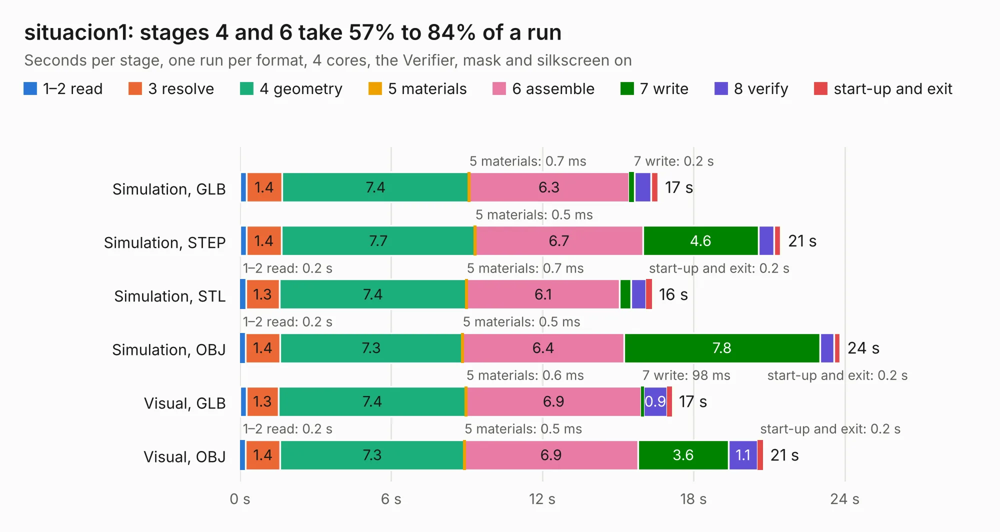

| Mode and format | 1–2 read | 3 resolve | 4 geometry | 5 materials | 6 assemble | 7 write | 8 verify | start-up and exit | Total |
|---|---:|---:|---:|---:|---:|---:|---:|---:|---:|
| Simulation, GLB | 0.3 | 1.4 | 7.4 | 0.7&nbsp;ms | 6.3 | 0.2 | 0.7 | 0.3 | 16.6 |
| Simulation, STEP | 0.3 | 1.4 | 7.7 | 0.5&nbsp;ms | 6.7 | 4.6 | 0.6 | 0.3 | 21.5 |
| Simulation, STL | 0.2 | 1.3 | 7.4 | 0.7&nbsp;ms | 6.1 | 0.5 | 0.6 | 0.2 | 16.3 |
| Simulation, OBJ | 0.2 | 1.4 | 7.3 | 0.5&nbsp;ms | 6.4 | 7.8 | 0.6 | 0.2 | 23.8 |
| Visual, GLB | 0.3 | 1.3 | 7.4 | 0.6&nbsp;ms | 6.9 | 98&nbsp;ms | 0.9 | 0.2 | 17.1 |
| Visual, OBJ | 0.2 | 1.4 | 7.3 | 0.5&nbsp;ms | 6.9 | 3.6 | 1.1 | 0.2 | 20.7 |

<table align="center"><tr><td valign="top">

| Board | Repo: [alvaroalea/plusD-clone](https://github.com/alvaroalea/plusD-clone) Board: `situacion1.kicad_pcb` |
|---|---|
| Complexity | 58&nbsp;/&nbsp;1000 (size&nbsp;58, features&nbsp;0) |
| Tested | 9th November 2026 |
| Copper&nbsp;layers | 2 |
| File&nbsp;format | KiCad 5 (20171130) |
| Parts,&nbsp;tracks,&nbsp;vias | 45, 0, 0 |
| Triangles,&nbsp;simulation | 1,586,200 in 95 parts |
| Note | mostly unrouted |
| Verifier | PASS in all six runs |

</td><td valign="top">

<table>
<tr><th>File type</th><th>File size</th><th>Peak memory used</th></tr>
<tr><th colspan="3" align="left">Simulation</th></tr>
<tr><td>GLB</td><td align="right">50&nbsp;MB</td><td align="right">550&nbsp;MB</td></tr>
<tr><td>STEP</td><td align="right">231&nbsp;MB</td><td align="right">711&nbsp;MB</td></tr>
<tr><td>STL</td><td align="right">79&nbsp;MB</td><td align="right">526&nbsp;MB</td></tr>
<tr><td>OBJ</td><td align="right">162&nbsp;MB</td><td align="right">1.0&nbsp;GB</td></tr>
<tr><th colspan="3" align="left">Visual</th></tr>
<tr><td>GLB</td><td align="right">24&nbsp;MB</td><td align="right">661&nbsp;MB</td></tr>
<tr><td>OBJ</td><td align="right">71&nbsp;MB</td><td align="right">607&nbsp;MB</td></tr>
</table>

</td></tr></table>

## 110. SMD500

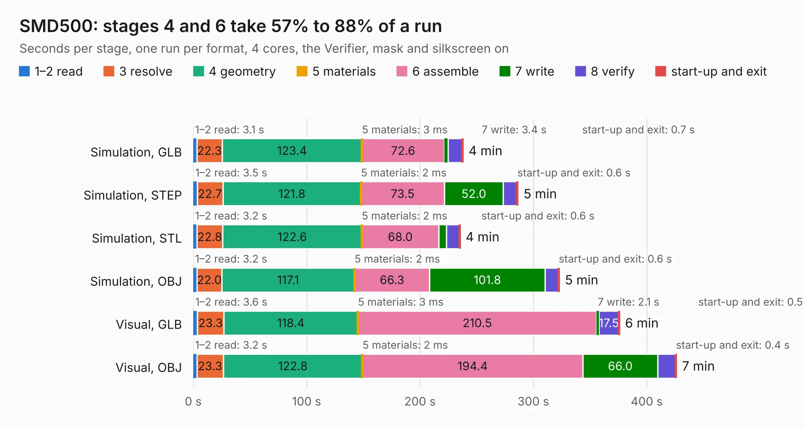

| Mode and format | 1–2 read | 3 resolve | 4 geometry | 5 materials | 6 assemble | 7 write | 8 verify | start-up and exit | Total |
|---|---:|---:|---:|---:|---:|---:|---:|---:|---:|
| Simulation, GLB | 3.1 | 22.3 | 123.4 | 3&nbsp;ms | 72.6 | 3.4 | 12.2 | 0.7 | 237.8 |
| Simulation, STEP | 3.5 | 22.7 | 121.8 | 2&nbsp;ms | 73.5 | 52.0 | 12.2 | 0.6 | 286.2 |
| Simulation, STL | 3.2 | 22.8 | 122.6 | 2&nbsp;ms | 68.0 | 6.6 | 11.3 | 0.6 | 235.1 |
| Simulation, OBJ | 3.2 | 22.0 | 117.1 | 2&nbsp;ms | 66.3 | 101.8 | 11.8 | 0.6 | 322.7 |
| Visual, GLB | 3.6 | 23.3 | 118.4 | 3&nbsp;ms | 210.5 | 2.1 | 17.5 | 0.5 | 375.8 |
| Visual, OBJ | 3.2 | 23.3 | 122.8 | 2&nbsp;ms | 194.4 | 66.0 | 15.9 | 0.4 | 426.0 |

<table align="center"><tr><td valign="top">

| Board | Repo: [amigalisa/Amiga-SMD-500](https://github.com/amigalisa/Amiga-SMD-500) Board: `SMD500.kicad_pcb` |
|---|---|
| Complexity | 342&nbsp;/&nbsp;1000 (size&nbsp;297, features&nbsp;45) |
| KESE&nbsp;features | through vias, rounded, trapezoid or chamfered pads, filled zones |
| Tested | 9th November 2026 |
| Copper&nbsp;layers | 2 |
| File&nbsp;format | KiCad 5 (20171130) |
| Parts,&nbsp;tracks,&nbsp;vias | 582, 18,007, 1,862 |
| Triangles,&nbsp;simulation | 14,372,138 in 534 parts |
| Verifier | PASS in all six runs |

</td><td valign="top">

<table>
<tr><th>File type</th><th>File size</th><th>Peak memory used</th></tr>
<tr><th colspan="3" align="left">Simulation</th></tr>
<tr><td>GLB</td><td align="right">498&nbsp;MB</td><td align="right">3.7&nbsp;GB</td></tr>
<tr><td>STEP</td><td align="right">2.7&nbsp;GB</td><td align="right">5.2&nbsp;GB</td></tr>
<tr><td>STL</td><td align="right">719&nbsp;MB</td><td align="right">3.9&nbsp;GB</td></tr>
<tr><td>OBJ</td><td align="right">1.6&nbsp;GB</td><td align="right">9.3&nbsp;GB</td></tr>
<tr><th colspan="3" align="left">Visual</th></tr>
<tr><td>GLB</td><td align="right">354&nbsp;MB</td><td align="right">5.3&nbsp;GB</td></tr>
<tr><td>OBJ</td><td align="right">1.1&nbsp;GB</td><td align="right">7.0&nbsp;GB</td></tr>
</table>

</td></tr></table>

## 111. AmigaPCI 68040

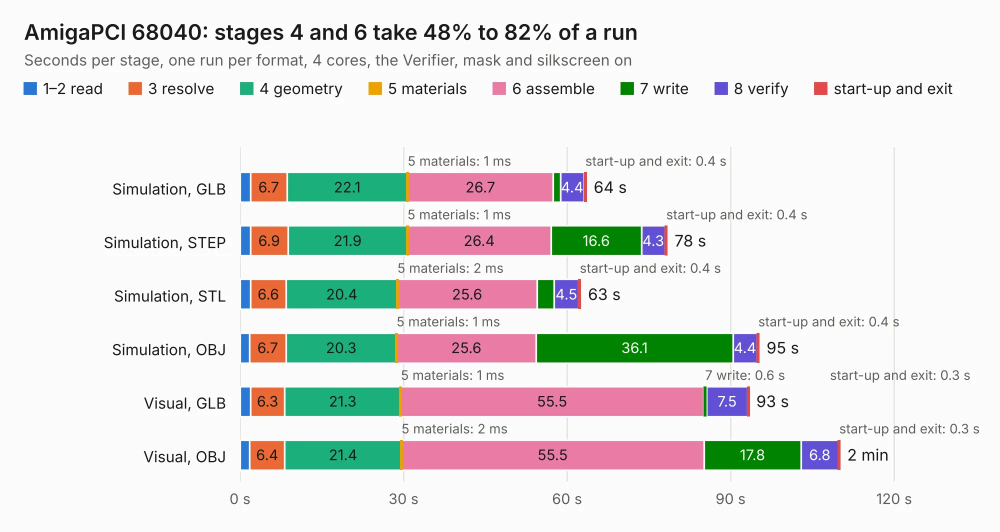

| Mode and format | 1–2 read | 3 resolve | 4 geometry | 5 materials | 6 assemble | 7 write | 8 verify | start-up and exit | Total |
|---|---:|---:|---:|---:|---:|---:|---:|---:|---:|
| Simulation, GLB | 1.9 | 6.7 | 22.1 | 1&nbsp;ms | 26.7 | 1.3 | 4.4 | 0.4 | 63.6 |
| Simulation, STEP | 1.9 | 6.9 | 21.9 | 1&nbsp;ms | 26.4 | 16.6 | 4.3 | 0.4 | 78.4 |
| Simulation, STL | 1.9 | 6.6 | 20.4 | 2&nbsp;ms | 25.6 | 3.1 | 4.5 | 0.4 | 62.5 |
| Simulation, OBJ | 1.7 | 6.7 | 20.3 | 1&nbsp;ms | 25.6 | 36.1 | 4.4 | 0.4 | 95.3 |
| Visual, GLB | 1.9 | 6.3 | 21.3 | 1&nbsp;ms | 55.5 | 0.6 | 7.5 | 0.3 | 93.4 |
| Visual, OBJ | 1.8 | 6.4 | 21.4 | 2&nbsp;ms | 55.5 | 17.8 | 6.8 | 0.3 | 110.1 |

<table align="center"><tr><td valign="top">

| Board | Repo: [AmigaPCI/AmigaPCI-LBC040](https://github.com/AmigaPCI/AmigaPCI-LBC040) Board: `AmigaPCI 68040.kicad_pcb` |
|---|---|
| Folder | KiCAD / AmigaPCI-LBC040-REV60 |
| Complexity | 370&nbsp;/&nbsp;1000 (size&nbsp;285, features&nbsp;85) |
| KESE&nbsp;features | through vias, rounded, trapezoid or chamfered pads, filled zones, curved board outline, stack-up, dielectric εr and tanδ |
| Tested | 9th November 2026 |
| Copper&nbsp;layers | 6 |
| File&nbsp;format | KiCad 8 (20240108) |
| Parts,&nbsp;tracks,&nbsp;vias | 126, 4,520, 563 |
| Triangles,&nbsp;simulation | 7,796,750 in 379 parts |
| Verifier | PASS in all six runs |

</td><td valign="top">

<table>
<tr><th>File type</th><th>File size</th><th>Peak memory used</th></tr>
<tr><th colspan="3" align="left">Simulation</th></tr>
<tr><td>GLB</td><td align="right">263&nbsp;MB</td><td align="right">1.8&nbsp;GB</td></tr>
<tr><td>STEP</td><td align="right">981&nbsp;MB</td><td align="right">2.5&nbsp;GB</td></tr>
<tr><td>STL</td><td align="right">390&nbsp;MB</td><td align="right">1.8&nbsp;GB</td></tr>
<tr><td>OBJ</td><td align="right">835&nbsp;MB</td><td align="right">4.9&nbsp;GB</td></tr>
<tr><th colspan="3" align="left">Visual</th></tr>
<tr><td>GLB</td><td align="right">133&nbsp;MB</td><td align="right">2.4&nbsp;GB</td></tr>
<tr><td>OBJ</td><td align="right">436&nbsp;MB</td><td align="right">2.9&nbsp;GB</td></tr>
</table>

</td></tr></table>

## 112. anavi-light-controller

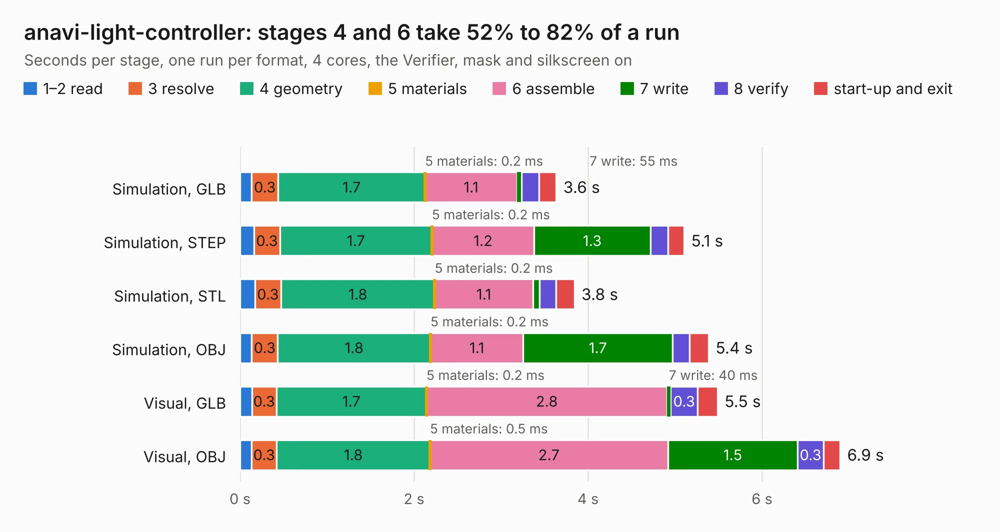

| Mode and format | 1–2 read | 3 resolve | 4 geometry | 5 materials | 6 assemble | 7 write | 8 verify | start-up and exit | Total |
|---|---:|---:|---:|---:|---:|---:|---:|---:|---:|
| Simulation, GLB | 0.1 | 0.3 | 1.7 | 0.2&nbsp;ms | 1.1 | 55&nbsp;ms | 0.2 | 0.2 | 3.6 |
| Simulation, STEP | 0.2 | 0.3 | 1.7 | 0.2&nbsp;ms | 1.2 | 1.3 | 0.2 | 0.2 | 5.1 |
| Simulation, STL | 0.2 | 0.3 | 1.8 | 0.2&nbsp;ms | 1.1 | 74&nbsp;ms | 0.2 | 0.2 | 3.8 |
| Simulation, OBJ | 0.1 | 0.3 | 1.8 | 0.2&nbsp;ms | 1.1 | 1.7 | 0.2 | 0.2 | 5.4 |
| Visual, GLB | 0.1 | 0.3 | 1.7 | 0.2&nbsp;ms | 2.8 | 40&nbsp;ms | 0.3 | 0.2 | 5.5 |
| Visual, OBJ | 0.1 | 0.3 | 1.8 | 0.5&nbsp;ms | 2.7 | 1.5 | 0.3 | 0.2 | 6.9 |

<table align="center"><tr><td valign="top">

| Board | Repo: [AnaviTechnology/anavi-light-controller](https://github.com/AnaviTechnology/anavi-light-controller) Board: `anavi-light-controller.kicad_pcb` |
|---|---|
| Complexity | 203&nbsp;/&nbsp;1000 (size&nbsp;138, features&nbsp;65) |
| KESE&nbsp;features | through vias, slotted holes, drill offsets, filled zones, curved board outline |
| Tested | 9th November 2026 |
| Copper&nbsp;layers | 2 |
| File&nbsp;format | KiCad 4 (4) |
| Parts,&nbsp;tracks,&nbsp;vias | 22, 164, 12 |
| Triangles,&nbsp;simulation | 355,398 in 30 parts |
| Verifier | PASS in all six runs |

</td><td valign="top">

<table>
<tr><th>File type</th><th>File size</th><th>Peak memory used</th></tr>
<tr><th colspan="3" align="left">Simulation</th></tr>
<tr><td>GLB</td><td align="right">13&nbsp;MB</td><td align="right">267&nbsp;MB</td></tr>
<tr><td>STEP</td><td align="right">67&nbsp;MB</td><td align="right">292&nbsp;MB</td></tr>
<tr><td>STL</td><td align="right">18&nbsp;MB</td><td align="right">267&nbsp;MB</td></tr>
<tr><td>OBJ</td><td align="right">36&nbsp;MB</td><td align="right">270&nbsp;MB</td></tr>
<tr><th colspan="3" align="left">Visual</th></tr>
<tr><td>GLB</td><td align="right">8.9&nbsp;MB</td><td align="right">265&nbsp;MB</td></tr>
<tr><td>OBJ</td><td align="right">26&nbsp;MB</td><td align="right">265&nbsp;MB</td></tr>
</table>

</td></tr></table>

## 113. Board 2x06 W15.24

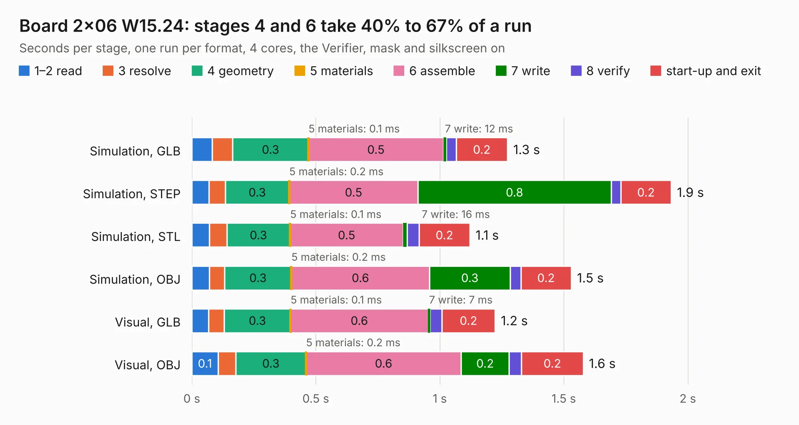

| Mode and format | 1–2 read | 3 resolve | 4 geometry | 5 materials | 6 assemble | 7 write | 8 verify | start-up and exit | Total |
|---|---:|---:|---:|---:|---:|---:|---:|---:|---:|
| Simulation, GLB | 82&nbsp;ms | 83&nbsp;ms | 0.3 | 0.1&nbsp;ms | 0.5 | 12&nbsp;ms | 39&nbsp;ms | 0.2 | 1.3 |
| Simulation, STEP | 70&nbsp;ms | 65&nbsp;ms | 0.3 | 0.2&nbsp;ms | 0.5 | 0.8 | 39&nbsp;ms | 0.2 | 1.9 |
| Simulation, STL | 71&nbsp;ms | 70&nbsp;ms | 0.3 | 0.1&nbsp;ms | 0.5 | 16&nbsp;ms | 49&nbsp;ms | 0.2 | 1.1 |
| Simulation, OBJ | 70&nbsp;ms | 62&nbsp;ms | 0.3 | 0.2&nbsp;ms | 0.6 | 0.3 | 43&nbsp;ms | 0.2 | 1.5 |
| Visual, GLB | 68&nbsp;ms | 63&nbsp;ms | 0.3 | 0.1&nbsp;ms | 0.6 | 7&nbsp;ms | 48&nbsp;ms | 0.2 | 1.2 |
| Visual, OBJ | 0.1 | 71&nbsp;ms | 0.3 | 0.2&nbsp;ms | 0.6 | 0.2 | 51&nbsp;ms | 0.2 | 1.6 |

<table align="center"><tr><td valign="top">

| Board | Repo: [andrewpaterson/658-Computer](https://github.com/andrewpaterson/658-Computer) Board: `Board 2x06 W15.24.kicad_pcb` |
|---|---|
| Folder | Kicad / Boards / Blank / Board 2x06 W15.24 |
| Complexity | 89&nbsp;/&nbsp;1000 (size&nbsp;34, features&nbsp;55) |
| KESE&nbsp;features | rounded, trapezoid or chamfered pads, knockout text, stack-up, dielectric εr and tanδ |
| Tested | 9th November 2026 |
| Copper&nbsp;layers | 2 |
| File&nbsp;format | KiCad 9 (20241229) |
| Parts,&nbsp;tracks,&nbsp;vias | 4, 0, 0 |
| Triangles,&nbsp;simulation | 62,080 in 24 parts |
| Verifier | PASS in all six runs |

</td><td valign="top">

<table>
<tr><th>File type</th><th>File size</th><th>Peak memory used</th></tr>
<tr><th colspan="3" align="left">Simulation</th></tr>
<tr><td>GLB</td><td align="right">2.1&nbsp;MB</td><td align="right">70&nbsp;MB</td></tr>
<tr><td>STEP</td><td align="right">6.9&nbsp;MB</td><td align="right">171&nbsp;MB</td></tr>
<tr><td>STL</td><td align="right">3.1&nbsp;MB</td><td align="right">72&nbsp;MB</td></tr>
<tr><td>OBJ</td><td align="right">6.0&nbsp;MB</td><td align="right">83&nbsp;MB</td></tr>
<tr><th colspan="3" align="left">Visual</th></tr>
<tr><td>GLB</td><td align="right">1.3&nbsp;MB</td><td align="right">106&nbsp;MB</td></tr>
<tr><td>OBJ</td><td align="right">3.7&nbsp;MB</td><td align="right">107&nbsp;MB</td></tr>
</table>

</td></tr></table>

## 114. Board 2x06 W22.86

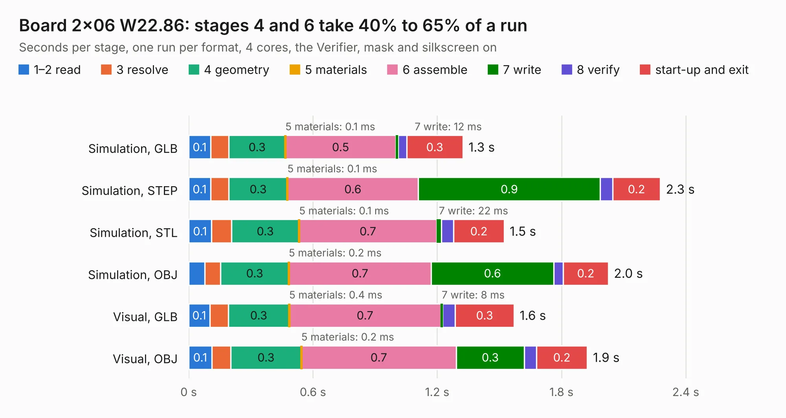

| Mode and format | 1–2 read | 3 resolve | 4 geometry | 5 materials | 6 assemble | 7 write | 8 verify | start-up and exit | Total |
|---|---:|---:|---:|---:|---:|---:|---:|---:|---:|
| Simulation, GLB | 0.1 | 88&nbsp;ms | 0.3 | 0.1&nbsp;ms | 0.5 | 12&nbsp;ms | 41&nbsp;ms | 0.3 | 1.3 |
| Simulation, STEP | 0.1 | 88&nbsp;ms | 0.3 | 0.1&nbsp;ms | 0.6 | 0.9 | 60&nbsp;ms | 0.2 | 2.3 |
| Simulation, STL | 0.1 | 97&nbsp;ms | 0.3 | 0.1&nbsp;ms | 0.7 | 22&nbsp;ms | 60&nbsp;ms | 0.2 | 1.5 |
| Simulation, OBJ | 78&nbsp;ms | 76&nbsp;ms | 0.3 | 0.2&nbsp;ms | 0.7 | 0.6 | 45&nbsp;ms | 0.2 | 2.0 |
| Visual, GLB | 0.1 | 90&nbsp;ms | 0.3 | 0.4&nbsp;ms | 0.7 | 8&nbsp;ms | 61&nbsp;ms | 0.3 | 1.6 |
| Visual, OBJ | 0.1 | 92&nbsp;ms | 0.3 | 0.2&nbsp;ms | 0.7 | 0.3 | 58&nbsp;ms | 0.2 | 1.9 |

<table align="center"><tr><td valign="top">

| Board | Repo: [andrewpaterson/658-Computer](https://github.com/andrewpaterson/658-Computer) Board: `Board 2x06 W22.86.kicad_pcb` |
|---|---|
| Folder | Kicad / Boards / Blank / Board 2x06 W22.86 |
| Complexity | 89&nbsp;/&nbsp;1000 (size&nbsp;34, features&nbsp;55) |
| KESE&nbsp;features | rounded, trapezoid or chamfered pads, knockout text, stack-up, dielectric εr and tanδ |
| Tested | 9th November 2026 |
| Copper&nbsp;layers | 2 |
| File&nbsp;format | KiCad 9 (20241229) |
| Parts,&nbsp;tracks,&nbsp;vias | 4, 0, 0 |
| Triangles,&nbsp;simulation | 61,696 in 24 parts |
| Verifier | PASS in all six runs |

</td><td valign="top">

<table>
<tr><th>File type</th><th>File size</th><th>Peak memory used</th></tr>
<tr><th colspan="3" align="left">Simulation</th></tr>
<tr><td>GLB</td><td align="right">2.0&nbsp;MB</td><td align="right">70&nbsp;MB</td></tr>
<tr><td>STEP</td><td align="right">6.6&nbsp;MB</td><td align="right">171&nbsp;MB</td></tr>
<tr><td>STL</td><td align="right">3.1&nbsp;MB</td><td align="right">71&nbsp;MB</td></tr>
<tr><td>OBJ</td><td align="right">5.9&nbsp;MB</td><td align="right">94&nbsp;MB</td></tr>
<tr><th colspan="3" align="left">Visual</th></tr>
<tr><td>GLB</td><td align="right">1.3&nbsp;MB</td><td align="right">105&nbsp;MB</td></tr>
<tr><td>OBJ</td><td align="right">3.7&nbsp;MB</td><td align="right">104&nbsp;MB</td></tr>
</table>

</td></tr></table>

## 115. Board 2x12 W15.24

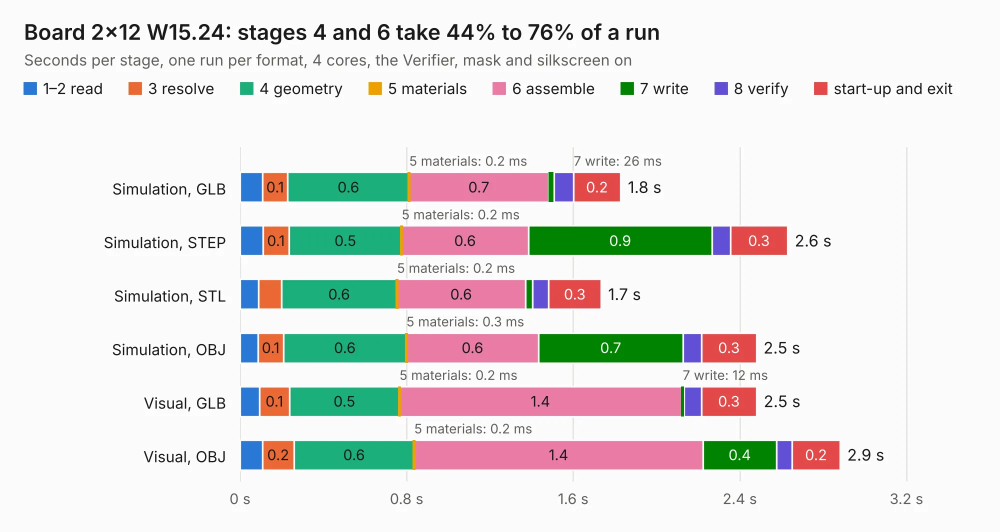

| Mode and format | 1–2 read | 3 resolve | 4 geometry | 5 materials | 6 assemble | 7 write | 8 verify | start-up and exit | Total |
|---|---:|---:|---:|---:|---:|---:|---:|---:|---:|
| Simulation, GLB | 0.1 | 0.1 | 0.6 | 0.2&nbsp;ms | 0.7 | 26&nbsp;ms | 93&nbsp;ms | 0.2 | 1.8 |
| Simulation, STEP | 0.1 | 0.1 | 0.5 | 0.2&nbsp;ms | 0.6 | 0.9 | 89&nbsp;ms | 0.3 | 2.6 |
| Simulation, STL | 88&nbsp;ms | 0.1 | 0.6 | 0.2&nbsp;ms | 0.6 | 34&nbsp;ms | 78&nbsp;ms | 0.3 | 1.7 |
| Simulation, OBJ | 86&nbsp;ms | 0.1 | 0.6 | 0.3&nbsp;ms | 0.6 | 0.7 | 90&nbsp;ms | 0.3 | 2.5 |
| Visual, GLB | 93&nbsp;ms | 0.1 | 0.5 | 0.2&nbsp;ms | 1.4 | 12&nbsp;ms | 83&nbsp;ms | 0.3 | 2.5 |
| Visual, OBJ | 0.1 | 0.2 | 0.6 | 0.2&nbsp;ms | 1.4 | 0.4 | 74&nbsp;ms | 0.2 | 2.9 |

<table align="center"><tr><td valign="top">

| Board | Repo: [andrewpaterson/658-Computer](https://github.com/andrewpaterson/658-Computer) Board: `Board 2x12 W15.24.kicad_pcb` |
|---|---|
| Folder | Kicad / Boards / Blank / Board 2x12 W15.24 |
| Complexity | 89&nbsp;/&nbsp;1000 (size&nbsp;34, features&nbsp;55) |
| KESE&nbsp;features | rounded, trapezoid or chamfered pads, knockout text, stack-up, dielectric εr and tanδ |
| Tested | 9th November 2026 |
| Copper&nbsp;layers | 2 |
| File&nbsp;format | KiCad 9 (20241229) |
| Parts,&nbsp;tracks,&nbsp;vias | 4, 0, 0 |
| Triangles,&nbsp;simulation | 110,320 in 32 parts |
| Verifier | PASS in all six runs |

</td><td valign="top">

<table>
<tr><th>File type</th><th>File size</th><th>Peak memory used</th></tr>
<tr><th colspan="3" align="left">Simulation</th></tr>
<tr><td>GLB</td><td align="right">3.7&nbsp;MB</td><td align="right">178&nbsp;MB</td></tr>
<tr><td>STEP</td><td align="right">12&nbsp;MB</td><td align="right">188&nbsp;MB</td></tr>
<tr><td>STL</td><td align="right">5.5&nbsp;MB</td><td align="right">182&nbsp;MB</td></tr>
<tr><td>OBJ</td><td align="right">11&nbsp;MB</td><td align="right">175&nbsp;MB</td></tr>
<tr><th colspan="3" align="left">Visual</th></tr>
<tr><td>GLB</td><td align="right">2.2&nbsp;MB</td><td align="right">153&nbsp;MB</td></tr>
<tr><td>OBJ</td><td align="right">6.2&nbsp;MB</td><td align="right">153&nbsp;MB</td></tr>
</table>

</td></tr></table>

## 116. Board 2x12 W22.86

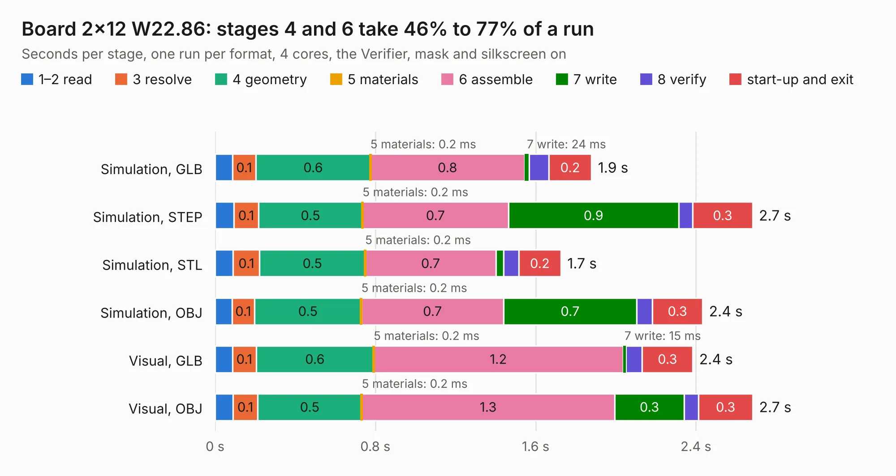

| Mode and format | 1–2 read | 3 resolve | 4 geometry | 5 materials | 6 assemble | 7 write | 8 verify | start-up and exit | Total |
|---|---:|---:|---:|---:|---:|---:|---:|---:|---:|
| Simulation, GLB | 86&nbsp;ms | 0.1 | 0.6 | 0.2&nbsp;ms | 0.8 | 24&nbsp;ms | 98&nbsp;ms | 0.2 | 1.9 |
| Simulation, STEP | 94&nbsp;ms | 0.1 | 0.5 | 0.2&nbsp;ms | 0.7 | 0.9 | 71&nbsp;ms | 0.3 | 2.7 |
| Simulation, STL | 90&nbsp;ms | 0.1 | 0.5 | 0.2&nbsp;ms | 0.7 | 38&nbsp;ms | 75&nbsp;ms | 0.2 | 1.7 |
| Simulation, OBJ | 84&nbsp;ms | 0.1 | 0.5 | 0.2&nbsp;ms | 0.7 | 0.7 | 78&nbsp;ms | 0.3 | 2.4 |
| Visual, GLB | 87&nbsp;ms | 0.1 | 0.6 | 0.2&nbsp;ms | 1.2 | 15&nbsp;ms | 81&nbsp;ms | 0.3 | 2.4 |
| Visual, OBJ | 89&nbsp;ms | 0.1 | 0.5 | 0.2&nbsp;ms | 1.3 | 0.3 | 71&nbsp;ms | 0.3 | 2.7 |

<table align="center"><tr><td valign="top">

| Board | Repo: [andrewpaterson/658-Computer](https://github.com/andrewpaterson/658-Computer) Board: `Board 2x12 W22.86.kicad_pcb` |
|---|---|
| Folder | Kicad / Boards / Blank / Board 2x12 W22.86 |
| Complexity | 89&nbsp;/&nbsp;1000 (size&nbsp;34, features&nbsp;55) |
| KESE&nbsp;features | rounded, trapezoid or chamfered pads, knockout text, stack-up, dielectric εr and tanδ |
| Tested | 9th November 2026 |
| Copper&nbsp;layers | 2 |
| File&nbsp;format | KiCad 9 (20241229) |
| Parts,&nbsp;tracks,&nbsp;vias | 4, 0, 0 |
| Triangles,&nbsp;simulation | 109,716 in 32 parts |
| Verifier | PASS in all six runs |

</td><td valign="top">

<table>
<tr><th>File type</th><th>File size</th><th>Peak memory used</th></tr>
<tr><th colspan="3" align="left">Simulation</th></tr>
<tr><td>GLB</td><td align="right">3.6&nbsp;MB</td><td align="right">178&nbsp;MB</td></tr>
<tr><td>STEP</td><td align="right">12&nbsp;MB</td><td align="right">186&nbsp;MB</td></tr>
<tr><td>STL</td><td align="right">5.5&nbsp;MB</td><td align="right">175&nbsp;MB</td></tr>
<tr><td>OBJ</td><td align="right">11&nbsp;MB</td><td align="right">178&nbsp;MB</td></tr>
<tr><th colspan="3" align="left">Visual</th></tr>
<tr><td>GLB</td><td align="right">2.2&nbsp;MB</td><td align="right">153&nbsp;MB</td></tr>
<tr><td>OBJ</td><td align="right">6.1&nbsp;MB</td><td align="right">153&nbsp;MB</td></tr>
</table>

</td></tr></table>

## 117. Board 2x16 W15.24

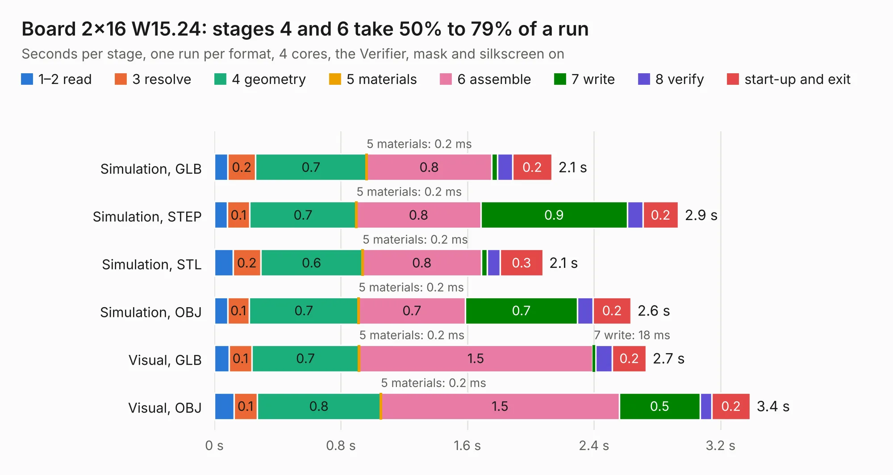

| Mode and format | 1–2 read | 3 resolve | 4 geometry | 5 materials | 6 assemble | 7 write | 8 verify | start-up and exit | Total |
|---|---:|---:|---:|---:|---:|---:|---:|---:|---:|
| Simulation, GLB | 86&nbsp;ms | 0.2 | 0.7 | 0.2&nbsp;ms | 0.8 | 36&nbsp;ms | 94&nbsp;ms | 0.2 | 2.1 |
| Simulation, STEP | 83&nbsp;ms | 0.1 | 0.7 | 0.2&nbsp;ms | 0.8 | 0.9 | 98&nbsp;ms | 0.2 | 2.9 |
| Simulation, STL | 0.1 | 0.2 | 0.6 | 0.2&nbsp;ms | 0.8 | 37&nbsp;ms | 84&nbsp;ms | 0.3 | 2.1 |
| Simulation, OBJ | 84&nbsp;ms | 0.1 | 0.7 | 0.2&nbsp;ms | 0.7 | 0.7 | 98&nbsp;ms | 0.2 | 2.6 |
| Visual, GLB | 92&nbsp;ms | 0.1 | 0.7 | 0.2&nbsp;ms | 1.5 | 18&nbsp;ms | 0.1 | 0.2 | 2.7 |
| Visual, OBJ | 0.1 | 0.1 | 0.8 | 0.2&nbsp;ms | 1.5 | 0.5 | 75&nbsp;ms | 0.2 | 3.4 |

<table align="center"><tr><td valign="top">

| Board | Repo: [andrewpaterson/658-Computer](https://github.com/andrewpaterson/658-Computer) Board: `Board 2x16 W15.24.kicad_pcb` |
|---|---|
| Folder | Kicad / Boards / Blank / Board 2x16 W15.24 |
| Complexity | 89&nbsp;/&nbsp;1000 (size&nbsp;34, features&nbsp;55) |
| KESE&nbsp;features | rounded, trapezoid or chamfered pads, knockout text, stack-up, dielectric εr and tanδ |
| Tested | 9th November 2026 |
| Copper&nbsp;layers | 2 |
| File&nbsp;format | KiCad 9 (20241229) |
| Parts,&nbsp;tracks,&nbsp;vias | 4, 0, 0 |
| Triangles,&nbsp;simulation | 143,440 in 40 parts |
| Verifier | PASS in all six runs |

</td><td valign="top">

<table>
<tr><th>File type</th><th>File size</th><th>Peak memory used</th></tr>
<tr><th colspan="3" align="left">Simulation</th></tr>
<tr><td>GLB</td><td align="right">4.7&nbsp;MB</td><td align="right">184&nbsp;MB</td></tr>
<tr><td>STEP</td><td align="right">15&nbsp;MB</td><td align="right">197&nbsp;MB</td></tr>
<tr><td>STL</td><td align="right">7.2&nbsp;MB</td><td align="right">185&nbsp;MB</td></tr>
<tr><td>OBJ</td><td align="right">14&nbsp;MB</td><td align="right">181&nbsp;MB</td></tr>
<tr><th colspan="3" align="left">Visual</th></tr>
<tr><td>GLB</td><td align="right">2.8&nbsp;MB</td><td align="right">155&nbsp;MB</td></tr>
<tr><td>OBJ</td><td align="right">7.8&nbsp;MB</td><td align="right">157&nbsp;MB</td></tr>
</table>

</td></tr></table>

## 118. Board 2x16 W22.86

| Mode and format | 1–2 read | 3 resolve | 4 geometry | 5 materials | 6 assemble | 7 write | 8 verify | start-up and exit | Total |
|---|---:|---:|---:|---:|---:|---:|---:|---:|---:|
| Simulation, GLB | 84&nbsp;ms | 0.1 | 0.6 | 0.2&nbsp;ms | 0.8 | 26&nbsp;ms | 80&nbsp;ms | 0.2 | 1.9 |
| Simulation, STEP | 85&nbsp;ms | 0.1 | 0.6 | 0.2&nbsp;ms | 0.7 | 0.9 | 95&nbsp;ms | 0.2 | 2.8 |
| Simulation, STL | 84&nbsp;ms | 0.1 | 0.6 | 0.2&nbsp;ms | 0.8 | 36&nbsp;ms | 91&nbsp;ms | 0.2 | 1.9 |
| Simulation, OBJ | 0.1 | 0.1 | 0.6 | 0.2&nbsp;ms | 0.7 | 0.8 | 90&nbsp;ms | 0.3 | 2.7 |
| Visual, GLB | 87&nbsp;ms | 0.1 | 0.6 | 0.3&nbsp;ms | 1.3 | 13&nbsp;ms | 83&nbsp;ms | 0.2 | 2.5 |
| Visual, OBJ | 83&nbsp;ms | 0.1 | 0.6 | 0.2&nbsp;ms | 1.3 | 0.5 | 94&nbsp;ms | 0.2 | 2.9 |

<table align="center"><tr><td valign="top">

| Board | Repo: [andrewpaterson/658-Computer](https://github.com/andrewpaterson/658-Computer) Board: `Board 2x16 W22.86.kicad_pcb` |
|---|---|
| Folder | Kicad / Boards / Blank / Board 2x16 W22.86 |
| Complexity | 89&nbsp;/&nbsp;1000 (size&nbsp;34, features&nbsp;55) |
| KESE&nbsp;features | rounded, trapezoid or chamfered pads, knockout text, stack-up, dielectric εr and tanδ |
| Tested | 9th November 2026 |
| Copper&nbsp;layers | 2 |
| File&nbsp;format | KiCad 9 (20241229) |
| Parts,&nbsp;tracks,&nbsp;vias | 4, 0, 0 |
| Triangles,&nbsp;simulation | 142,752 in 40 parts |
| Verifier | PASS in all six runs |

</td><td valign="top">

<table>
<tr><th>File type</th><th>File size</th><th>Peak memory used</th></tr>
<tr><th colspan="3" align="left">Simulation</th></tr>
<tr><td>GLB</td><td align="right">4.6&nbsp;MB</td><td align="right">184&nbsp;MB</td></tr>
<tr><td>STEP</td><td align="right">15&nbsp;MB</td><td align="right">201&nbsp;MB</td></tr>
<tr><td>STL</td><td align="right">7.1&nbsp;MB</td><td align="right">183&nbsp;MB</td></tr>
<tr><td>OBJ</td><td align="right">14&nbsp;MB</td><td align="right">183&nbsp;MB</td></tr>
<tr><th colspan="3" align="left">Visual</th></tr>
<tr><td>GLB</td><td align="right">2.8&nbsp;MB</td><td align="right">157&nbsp;MB</td></tr>
<tr><td>OBJ</td><td align="right">7.8&nbsp;MB</td><td align="right">154&nbsp;MB</td></tr>
</table>

</td></tr></table>

## 119. Board 2x20 W15.24

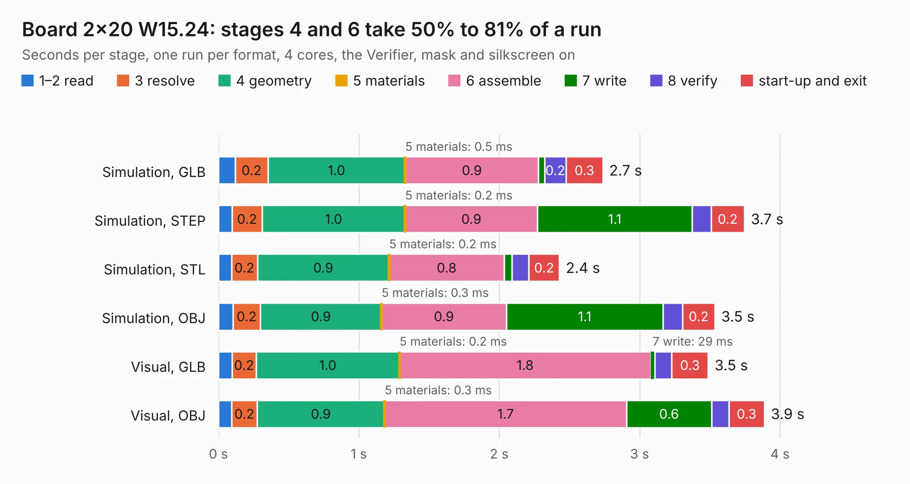

| Mode and format | 1–2 read | 3 resolve | 4 geometry | 5 materials | 6 assemble | 7 write | 8 verify | start-up and exit | Total |
|---|---:|---:|---:|---:|---:|---:|---:|---:|---:|
| Simulation, GLB | 0.1 | 0.2 | 1.0 | 0.5&nbsp;ms | 0.9 | 42&nbsp;ms | 0.2 | 0.3 | 2.7 |
| Simulation, STEP | 97&nbsp;ms | 0.2 | 1.0 | 0.2&nbsp;ms | 0.9 | 1.1 | 0.1 | 0.2 | 3.7 |
| Simulation, STL | 93&nbsp;ms | 0.2 | 0.9 | 0.2&nbsp;ms | 0.8 | 54&nbsp;ms | 0.1 | 0.2 | 2.4 |
| Simulation, OBJ | 0.1 | 0.2 | 0.9 | 0.3&nbsp;ms | 0.9 | 1.1 | 0.1 | 0.2 | 3.5 |
| Visual, GLB | 97&nbsp;ms | 0.2 | 1.0 | 0.2&nbsp;ms | 1.8 | 29&nbsp;ms | 0.1 | 0.3 | 3.5 |
| Visual, OBJ | 94&nbsp;ms | 0.2 | 0.9 | 0.3&nbsp;ms | 1.7 | 0.6 | 0.1 | 0.3 | 3.9 |

<table align="center"><tr><td valign="top">

| Board | Repo: [andrewpaterson/658-Computer](https://github.com/andrewpaterson/658-Computer) Board: `Board 2x20 W15.24.kicad_pcb` |
|---|---|
| Folder | Kicad / Boards / Blank / Board 2x20 W15.24 |
| Complexity | 89&nbsp;/&nbsp;1000 (size&nbsp;34, features&nbsp;55) |
| KESE&nbsp;features | rounded, trapezoid or chamfered pads, knockout text, stack-up, dielectric εr and tanδ |
| Tested | 9th November 2026 |
| Copper&nbsp;layers | 2 |
| File&nbsp;format | KiCad 9 (20241229) |
| Parts,&nbsp;tracks,&nbsp;vias | 4, 0, 0 |
| Triangles,&nbsp;simulation | 176,560 in 48 parts |
| Verifier | PASS in all six runs |

</td><td valign="top">

<table>
<tr><th>File type</th><th>File size</th><th>Peak memory used</th></tr>
<tr><th colspan="3" align="left">Simulation</th></tr>
<tr><td>GLB</td><td align="right">5.8&nbsp;MB</td><td align="right">192&nbsp;MB</td></tr>
<tr><td>STEP</td><td align="right">18&nbsp;MB</td><td align="right">213&nbsp;MB</td></tr>
<tr><td>STL</td><td align="right">8.8&nbsp;MB</td><td align="right">194&nbsp;MB</td></tr>
<tr><td>OBJ</td><td align="right">17&nbsp;MB</td><td align="right">194&nbsp;MB</td></tr>
<tr><th colspan="3" align="left">Visual</th></tr>
<tr><td>GLB</td><td align="right">3.4&nbsp;MB</td><td align="right">171&nbsp;MB</td></tr>
<tr><td>OBJ</td><td align="right">9.5&nbsp;MB</td><td align="right">172&nbsp;MB</td></tr>
</table>

</td></tr></table>

## 120. Board 2x20 W22.86

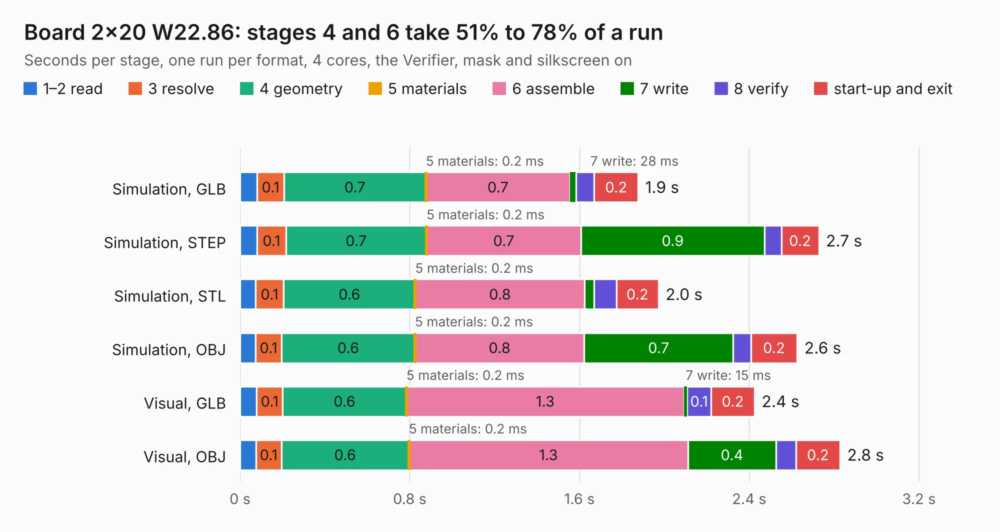

| Mode and format | 1–2 read | 3 resolve | 4 geometry | 5 materials | 6 assemble | 7 write | 8 verify | start-up and exit | Total |
|---|---:|---:|---:|---:|---:|---:|---:|---:|---:|
| Simulation, GLB | 81&nbsp;ms | 0.1 | 0.7 | 0.2&nbsp;ms | 0.7 | 28&nbsp;ms | 86&nbsp;ms | 0.2 | 1.9 |
| Simulation, STEP | 81&nbsp;ms | 0.1 | 0.7 | 0.2&nbsp;ms | 0.7 | 0.9 | 80&nbsp;ms | 0.2 | 2.7 |
| Simulation, STL | 73&nbsp;ms | 0.1 | 0.6 | 0.2&nbsp;ms | 0.8 | 44&nbsp;ms | 0.1 | 0.2 | 2.0 |
| Simulation, OBJ | 73&nbsp;ms | 0.1 | 0.6 | 0.2&nbsp;ms | 0.8 | 0.7 | 84&nbsp;ms | 0.2 | 2.6 |
| Visual, GLB | 78&nbsp;ms | 0.1 | 0.6 | 0.2&nbsp;ms | 1.3 | 15&nbsp;ms | 0.1 | 0.2 | 2.4 |
| Visual, OBJ | 75&nbsp;ms | 0.1 | 0.6 | 0.2&nbsp;ms | 1.3 | 0.4 | 94&nbsp;ms | 0.2 | 2.8 |

<table align="center"><tr><td valign="top">

| Board | Repo: [andrewpaterson/658-Computer](https://github.com/andrewpaterson/658-Computer) Board: `Board 2x20 W22.86.kicad_pcb` |
|---|---|
| Folder | Kicad / Boards / Blank / Board 2x20 W22.86 |
| Complexity | 89&nbsp;/&nbsp;1000 (size&nbsp;34, features&nbsp;55) |
| KESE&nbsp;features | rounded, trapezoid or chamfered pads, knockout text, stack-up, dielectric εr and tanδ |
| Tested | 9th November 2026 |
| Copper&nbsp;layers | 2 |
| File&nbsp;format | KiCad 9 (20241229) |
| Parts,&nbsp;tracks,&nbsp;vias | 4, 0, 0 |
| Triangles,&nbsp;simulation | 175,844 in 48 parts |
| Verifier | PASS in all six runs |

</td><td valign="top">

<table>
<tr><th>File type</th><th>File size</th><th>Peak memory used</th></tr>
<tr><th colspan="3" align="left">Simulation</th></tr>
<tr><td>GLB</td><td align="right">5.7&nbsp;MB</td><td align="right">190&nbsp;MB</td></tr>
<tr><td>STEP</td><td align="right">18&nbsp;MB</td><td align="right">213&nbsp;MB</td></tr>
<tr><td>STL</td><td align="right">8.8&nbsp;MB</td><td align="right">194&nbsp;MB</td></tr>
<tr><td>OBJ</td><td align="right">17&nbsp;MB</td><td align="right">194&nbsp;MB</td></tr>
<tr><th colspan="3" align="left">Visual</th></tr>
<tr><td>GLB</td><td align="right">3.3&nbsp;MB</td><td align="right">162&nbsp;MB</td></tr>
<tr><td>OBJ</td><td align="right">9.4&nbsp;MB</td><td align="right">171&nbsp;MB</td></tr>
</table>

</td></tr></table>

## 121. Board 2x22 W15.24

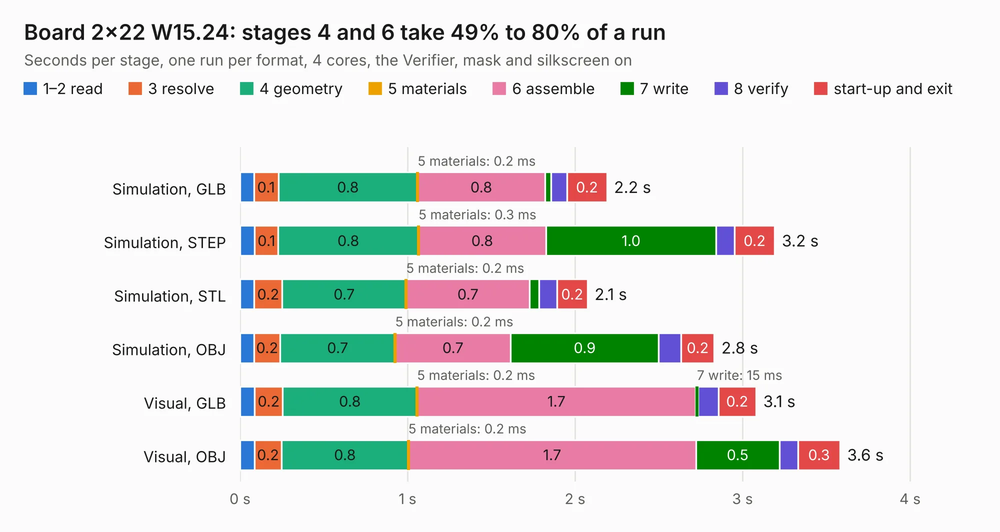

| Mode and format | 1–2 read | 3 resolve | 4 geometry | 5 materials | 6 assemble | 7 write | 8 verify | start-up and exit | Total |
|---|---:|---:|---:|---:|---:|---:|---:|---:|---:|
| Simulation, GLB | 83&nbsp;ms | 0.1 | 0.8 | 0.2&nbsp;ms | 0.8 | 37&nbsp;ms | 95&nbsp;ms | 0.2 | 2.2 |
| Simulation, STEP | 88&nbsp;ms | 0.1 | 0.8 | 0.3&nbsp;ms | 0.8 | 1.0 | 0.1 | 0.2 | 3.2 |
| Simulation, STL | 84&nbsp;ms | 0.2 | 0.7 | 0.2&nbsp;ms | 0.7 | 54&nbsp;ms | 0.1 | 0.2 | 2.1 |
| Simulation, OBJ | 85&nbsp;ms | 0.2 | 0.7 | 0.2&nbsp;ms | 0.7 | 0.9 | 0.1 | 0.2 | 2.8 |
| Visual, GLB | 87&nbsp;ms | 0.2 | 0.8 | 0.2&nbsp;ms | 1.7 | 15&nbsp;ms | 0.1 | 0.2 | 3.1 |
| Visual, OBJ | 86&nbsp;ms | 0.2 | 0.8 | 0.2&nbsp;ms | 1.7 | 0.5 | 0.1 | 0.3 | 3.6 |

<table align="center"><tr><td valign="top">

| Board | Repo: [andrewpaterson/658-Computer](https://github.com/andrewpaterson/658-Computer) Board: `Board 2x22 W15.24.kicad_pcb` |
|---|---|
| Folder | Kicad / Boards / Blank / Board 2x22 W15.24 |
| Complexity | 89&nbsp;/&nbsp;1000 (size&nbsp;34, features&nbsp;55) |
| KESE&nbsp;features | rounded, trapezoid or chamfered pads, knockout text, stack-up, dielectric εr and tanδ |
| Tested | 9th November 2026 |
| Copper&nbsp;layers | 2 |
| File&nbsp;format | KiCad 9 (20241229) |
| Parts,&nbsp;tracks,&nbsp;vias | 4, 0, 0 |
| Triangles,&nbsp;simulation | 193,120 in 52 parts |
| Verifier | PASS in all six runs |

</td><td valign="top">

<table>
<tr><th>File type</th><th>File size</th><th>Peak memory used</th></tr>
<tr><th colspan="3" align="left">Simulation</th></tr>
<tr><td>GLB</td><td align="right">6.3&nbsp;MB</td><td align="right">198&nbsp;MB</td></tr>
<tr><td>STEP</td><td align="right">20&nbsp;MB</td><td align="right">219&nbsp;MB</td></tr>
<tr><td>STL</td><td align="right">9.7&nbsp;MB</td><td align="right">198&nbsp;MB</td></tr>
<tr><td>OBJ</td><td align="right">19&nbsp;MB</td><td align="right">198&nbsp;MB</td></tr>
<tr><th colspan="3" align="left">Visual</th></tr>
<tr><td>GLB</td><td align="right">3.6&nbsp;MB</td><td align="right">181&nbsp;MB</td></tr>
<tr><td>OBJ</td><td align="right">10&nbsp;MB</td><td align="right">177&nbsp;MB</td></tr>
</table>

</td></tr></table>

## 122. Board 2x24 W15.24

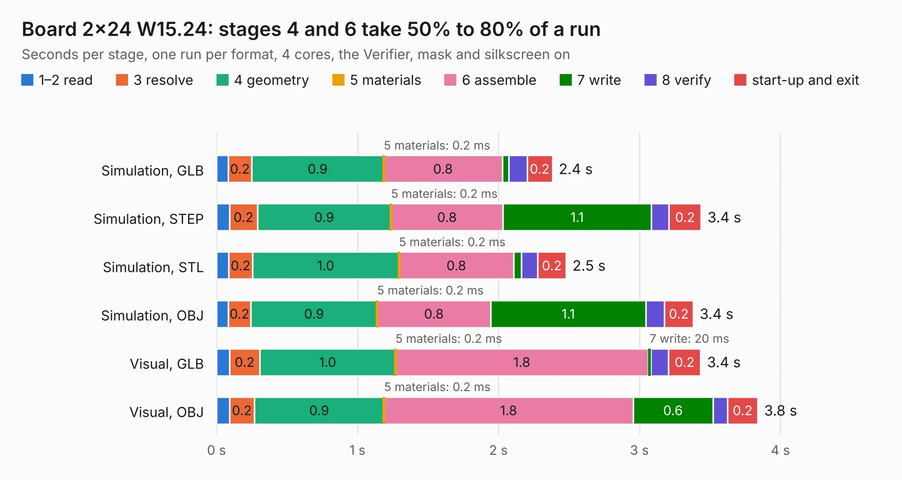

| Mode and format | 1–2 read | 3 resolve | 4 geometry | 5 materials | 6 assemble | 7 write | 8 verify | start-up and exit | Total |
|---|---:|---:|---:|---:|---:|---:|---:|---:|---:|
| Simulation, GLB | 84&nbsp;ms | 0.2 | 0.9 | 0.2&nbsp;ms | 0.8 | 46&nbsp;ms | 0.1 | 0.2 | 2.4 |
| Simulation, STEP | 93&nbsp;ms | 0.2 | 0.9 | 0.2&nbsp;ms | 0.8 | 1.1 | 0.1 | 0.2 | 3.4 |
| Simulation, STL | 87&nbsp;ms | 0.2 | 1.0 | 0.2&nbsp;ms | 0.8 | 54&nbsp;ms | 0.1 | 0.2 | 2.5 |
| Simulation, OBJ | 82&nbsp;ms | 0.2 | 0.9 | 0.2&nbsp;ms | 0.8 | 1.1 | 0.1 | 0.2 | 3.4 |
| Visual, GLB | 91&nbsp;ms | 0.2 | 1.0 | 0.2&nbsp;ms | 1.8 | 20&nbsp;ms | 0.1 | 0.2 | 3.4 |
| Visual, OBJ | 91&nbsp;ms | 0.2 | 0.9 | 0.2&nbsp;ms | 1.8 | 0.6 | 0.1 | 0.2 | 3.8 |

<table align="center"><tr><td valign="top">

| Board | Repo: [andrewpaterson/658-Computer](https://github.com/andrewpaterson/658-Computer) Board: `Board 2x24 W15.24.kicad_pcb` |
|---|---|
| Folder | Kicad / Boards / Blank / Board 2x24 W15.24 |
| Complexity | 89&nbsp;/&nbsp;1000 (size&nbsp;34, features&nbsp;55) |
| KESE&nbsp;features | rounded, trapezoid or chamfered pads, knockout text, stack-up, dielectric εr and tanδ |
| Tested | 9th November 2026 |
| Copper&nbsp;layers | 2 |
| File&nbsp;format | KiCad 9 (20241229) |
| Parts,&nbsp;tracks,&nbsp;vias | 4, 0, 0 |
| Triangles,&nbsp;simulation | 209,680 in 56 parts |
| Verifier | PASS in all six runs |

</td><td valign="top">

<table>
<tr><th>File type</th><th>File size</th><th>Peak memory used</th></tr>
<tr><th colspan="3" align="left">Simulation</th></tr>
<tr><td>GLB</td><td align="right">6.9&nbsp;MB</td><td align="right">203&nbsp;MB</td></tr>
<tr><td>STEP</td><td align="right">22&nbsp;MB</td><td align="right">224&nbsp;MB</td></tr>
<tr><td>STL</td><td align="right">10&nbsp;MB</td><td align="right">200&nbsp;MB</td></tr>
<tr><td>OBJ</td><td align="right">21&nbsp;MB</td><td align="right">202&nbsp;MB</td></tr>
<tr><th colspan="3" align="left">Visual</th></tr>
<tr><td>GLB</td><td align="right">3.9&nbsp;MB</td><td align="right">190&nbsp;MB</td></tr>
<tr><td>OBJ</td><td align="right">11&nbsp;MB</td><td align="right">190&nbsp;MB</td></tr>
</table>

</td></tr></table>

## 123. Board 2x24 W22.86

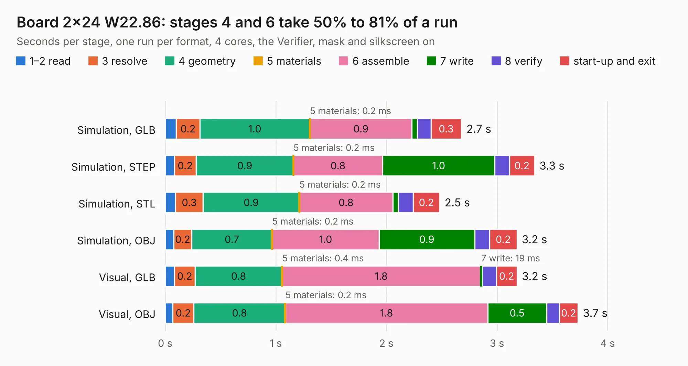

| Mode and format | 1–2 read | 3 resolve | 4 geometry | 5 materials | 6 assemble | 7 write | 8 verify | start-up and exit | Total |
|---|---:|---:|---:|---:|---:|---:|---:|---:|---:|
| Simulation, GLB | 0.1 | 0.2 | 1.0 | 0.2&nbsp;ms | 0.9 | 48&nbsp;ms | 0.1 | 0.3 | 2.7 |
| Simulation, STEP | 83&nbsp;ms | 0.2 | 0.9 | 0.2&nbsp;ms | 0.8 | 1.0 | 0.1 | 0.2 | 3.3 |
| Simulation, STL | 93&nbsp;ms | 0.3 | 0.9 | 0.2&nbsp;ms | 0.8 | 51&nbsp;ms | 0.1 | 0.2 | 2.5 |
| Simulation, OBJ | 78&nbsp;ms | 0.2 | 0.7 | 0.2&nbsp;ms | 1.0 | 0.9 | 0.1 | 0.2 | 3.2 |
| Visual, GLB | 84&nbsp;ms | 0.2 | 0.8 | 0.4&nbsp;ms | 1.8 | 19&nbsp;ms | 0.1 | 0.2 | 3.2 |
| Visual, OBJ | 69&nbsp;ms | 0.2 | 0.8 | 0.2&nbsp;ms | 1.8 | 0.5 | 0.1 | 0.2 | 3.7 |

<table align="center"><tr><td valign="top">

| Board | Repo: [andrewpaterson/658-Computer](https://github.com/andrewpaterson/658-Computer) Board: `Board 2x24 W22.86.kicad_pcb` |
|---|---|
| Folder | Kicad / Boards / Blank / Board 2x24 W22.86 |
| Complexity | 89&nbsp;/&nbsp;1000 (size&nbsp;34, features&nbsp;55) |
| KESE&nbsp;features | rounded, trapezoid or chamfered pads, knockout text, stack-up, dielectric εr and tanδ |
| Tested | 9th November 2026 |
| Copper&nbsp;layers | 2 |
| File&nbsp;format | KiCad 9 (20241229) |
| Parts,&nbsp;tracks,&nbsp;vias | 4, 0, 0 |
| Triangles,&nbsp;simulation | 209,084 in 56 parts |
| Verifier | PASS in all six runs |

</td><td valign="top">

<table>
<tr><th>File type</th><th>File size</th><th>Peak memory used</th></tr>
<tr><th colspan="3" align="left">Simulation</th></tr>
<tr><td>GLB</td><td align="right">6.7&nbsp;MB</td><td align="right">203&nbsp;MB</td></tr>
<tr><td>STEP</td><td align="right">21&nbsp;MB</td><td align="right">223&nbsp;MB</td></tr>
<tr><td>STL</td><td align="right">10&nbsp;MB</td><td align="right">201&nbsp;MB</td></tr>
<tr><td>OBJ</td><td align="right">21&nbsp;MB</td><td align="right">202&nbsp;MB</td></tr>
<tr><th colspan="3" align="left">Visual</th></tr>
<tr><td>GLB</td><td align="right">3.9&nbsp;MB</td><td align="right">189&nbsp;MB</td></tr>
<tr><td>OBJ</td><td align="right">11&nbsp;MB</td><td align="right">191&nbsp;MB</td></tr>
</table>

</td></tr></table>

## 124. Board 2x28 W15.24

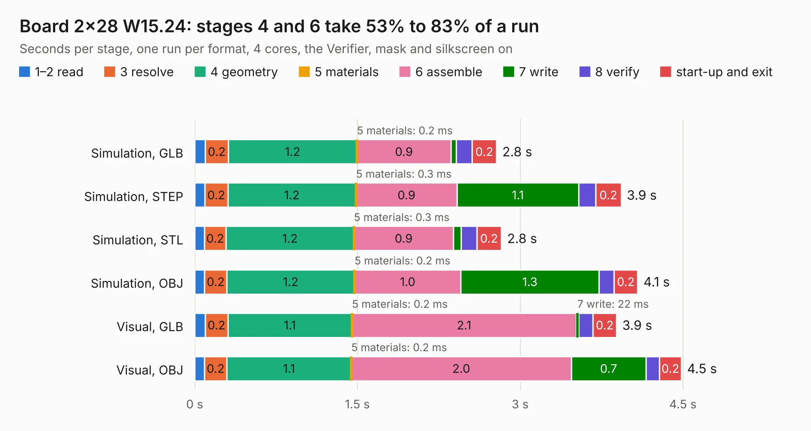

| Mode and format | 1–2 read | 3 resolve | 4 geometry | 5 materials | 6 assemble | 7 write | 8 verify | start-up and exit | Total |
|---|---:|---:|---:|---:|---:|---:|---:|---:|---:|
| Simulation, GLB | 98&nbsp;ms | 0.2 | 1.2 | 0.2&nbsp;ms | 0.9 | 47&nbsp;ms | 0.1 | 0.2 | 2.8 |
| Simulation, STEP | 93&nbsp;ms | 0.2 | 1.2 | 0.3&nbsp;ms | 0.9 | 1.1 | 0.2 | 0.2 | 3.9 |
| Simulation, STL | 89&nbsp;ms | 0.2 | 1.2 | 0.3&nbsp;ms | 0.9 | 69&nbsp;ms | 0.1 | 0.2 | 2.8 |
| Simulation, OBJ | 91&nbsp;ms | 0.2 | 1.2 | 0.2&nbsp;ms | 1.0 | 1.3 | 0.1 | 0.2 | 4.1 |
| Visual, GLB | 97&nbsp;ms | 0.2 | 1.1 | 0.2&nbsp;ms | 2.1 | 22&nbsp;ms | 0.1 | 0.2 | 3.9 |
| Visual, OBJ | 90&nbsp;ms | 0.2 | 1.1 | 0.2&nbsp;ms | 2.0 | 0.7 | 0.1 | 0.2 | 4.5 |

<table align="center"><tr><td valign="top">

| Board | Repo: [andrewpaterson/658-Computer](https://github.com/andrewpaterson/658-Computer) Board: `Board 2x28 W15.24.kicad_pcb` |
|---|---|
| Folder | Kicad / Boards / Blank / Board 2x28 W15.24 |
| Complexity | 89&nbsp;/&nbsp;1000 (size&nbsp;34, features&nbsp;55) |
| KESE&nbsp;features | rounded, trapezoid or chamfered pads, knockout text, stack-up, dielectric εr and tanδ |
| Tested | 9th November 2026 |
| Copper&nbsp;layers | 2 |
| File&nbsp;format | KiCad 9 (20241229) |
| Parts,&nbsp;tracks,&nbsp;vias | 4, 0, 0 |
| Triangles,&nbsp;simulation | 242,800 in 64 parts |
| Verifier | PASS in all six runs |

</td><td valign="top">

<table>
<tr><th>File type</th><th>File size</th><th>Peak memory used</th></tr>
<tr><th colspan="3" align="left">Simulation</th></tr>
<tr><td>GLB</td><td align="right">7.9&nbsp;MB</td><td align="right">212&nbsp;MB</td></tr>
<tr><td>STEP</td><td align="right">25&nbsp;MB</td><td align="right">237&nbsp;MB</td></tr>
<tr><td>STL</td><td align="right">12&nbsp;MB</td><td align="right">212&nbsp;MB</td></tr>
<tr><td>OBJ</td><td align="right">24&nbsp;MB</td><td align="right">212&nbsp;MB</td></tr>
<tr><th colspan="3" align="left">Visual</th></tr>
<tr><td>GLB</td><td align="right">4.5&nbsp;MB</td><td align="right">214&nbsp;MB</td></tr>
<tr><td>OBJ</td><td align="right">13&nbsp;MB</td><td align="right">211&nbsp;MB</td></tr>
</table>

</td></tr></table>

## 125. Board 2x28 W22.86

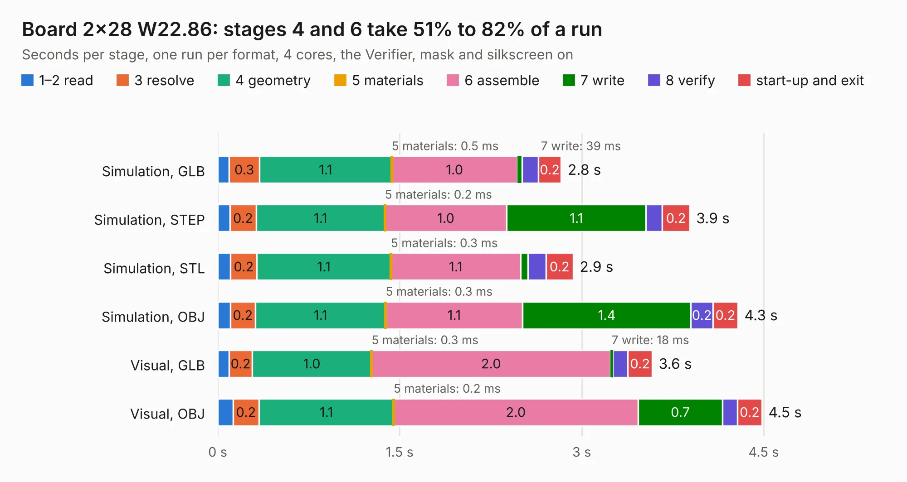

| Mode and format | 1–2 read | 3 resolve | 4 geometry | 5 materials | 6 assemble | 7 write | 8 verify | start-up and exit | Total |
|---|---:|---:|---:|---:|---:|---:|---:|---:|---:|
| Simulation, GLB | 94&nbsp;ms | 0.3 | 1.1 | 0.5&nbsp;ms | 1.0 | 39&nbsp;ms | 0.1 | 0.2 | 2.8 |
| Simulation, STEP | 0.1 | 0.2 | 1.1 | 0.2&nbsp;ms | 1.0 | 1.1 | 0.1 | 0.2 | 3.9 |
| Simulation, STL | 0.1 | 0.2 | 1.1 | 0.3&nbsp;ms | 1.1 | 61&nbsp;ms | 0.1 | 0.2 | 2.9 |
| Simulation, OBJ | 0.1 | 0.2 | 1.1 | 0.3&nbsp;ms | 1.1 | 1.4 | 0.2 | 0.2 | 4.3 |
| Visual, GLB | 94&nbsp;ms | 0.2 | 1.0 | 0.3&nbsp;ms | 2.0 | 18&nbsp;ms | 0.1 | 0.2 | 3.6 |
| Visual, OBJ | 0.1 | 0.2 | 1.1 | 0.2&nbsp;ms | 2.0 | 0.7 | 0.1 | 0.2 | 4.5 |

<table align="center"><tr><td valign="top">

| Board | Repo: [andrewpaterson/658-Computer](https://github.com/andrewpaterson/658-Computer) Board: `Board 2x28 W22.86.kicad_pcb` |
|---|---|
| Folder | Kicad / Boards / Blank / Board 2x28 W22.86 |
| Complexity | 89&nbsp;/&nbsp;1000 (size&nbsp;34, features&nbsp;55) |
| KESE&nbsp;features | rounded, trapezoid or chamfered pads, knockout text, stack-up, dielectric εr and tanδ |
| Tested | 9th November 2026 |
| Copper&nbsp;layers | 2 |
| File&nbsp;format | KiCad 9 (20241229) |
| Parts,&nbsp;tracks,&nbsp;vias | 4, 0, 0 |
| Triangles,&nbsp;simulation | 242,128 in 64 parts |
| Verifier | PASS in all six runs |

</td><td valign="top">

<table>
<tr><th>File type</th><th>File size</th><th>Peak memory used</th></tr>
<tr><th colspan="3" align="left">Simulation</th></tr>
<tr><td>GLB</td><td align="right">7.7&nbsp;MB</td><td align="right">211&nbsp;MB</td></tr>
<tr><td>STEP</td><td align="right">25&nbsp;MB</td><td align="right">236&nbsp;MB</td></tr>
<tr><td>STL</td><td align="right">12&nbsp;MB</td><td align="right">211&nbsp;MB</td></tr>
<tr><td>OBJ</td><td align="right">24&nbsp;MB</td><td align="right">217&nbsp;MB</td></tr>
<tr><th colspan="3" align="left">Visual</th></tr>
<tr><td>GLB</td><td align="right">4.5&nbsp;MB</td><td align="right">211&nbsp;MB</td></tr>
<tr><td>OBJ</td><td align="right">13&nbsp;MB</td><td align="right">210&nbsp;MB</td></tr>
</table>

</td></tr></table>

## 126. Board 2x32 W15.24

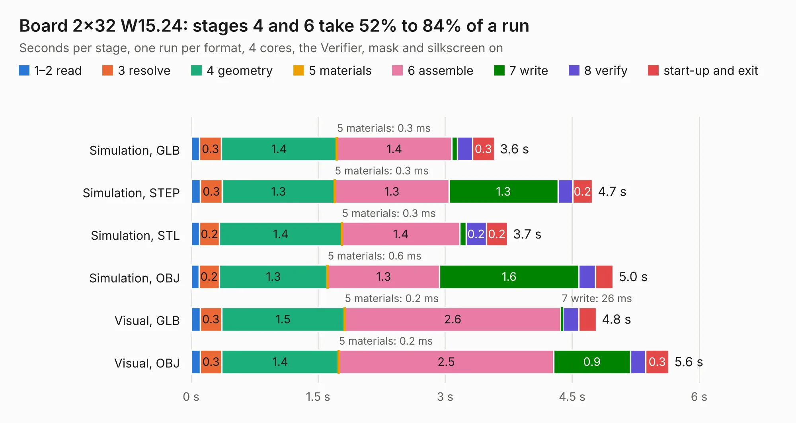

| Mode and format | 1–2 read | 3 resolve | 4 geometry | 5 materials | 6 assemble | 7 write | 8 verify | start-up and exit | Total |
|---|---:|---:|---:|---:|---:|---:|---:|---:|---:|
| Simulation, GLB | 0.1 | 0.3 | 1.4 | 0.3&nbsp;ms | 1.4 | 65&nbsp;ms | 0.2 | 0.3 | 3.6 |
| Simulation, STEP | 0.1 | 0.3 | 1.3 | 0.3&nbsp;ms | 1.3 | 1.3 | 0.2 | 0.2 | 4.7 |
| Simulation, STL | 0.1 | 0.2 | 1.4 | 0.3&nbsp;ms | 1.4 | 75&nbsp;ms | 0.2 | 0.2 | 3.7 |
| Simulation, OBJ | 94&nbsp;ms | 0.2 | 1.3 | 0.6&nbsp;ms | 1.3 | 1.6 | 0.2 | 0.2 | 5.0 |
| Visual, GLB | 0.1 | 0.3 | 1.5 | 0.2&nbsp;ms | 2.6 | 26&nbsp;ms | 0.2 | 0.2 | 4.8 |
| Visual, OBJ | 0.1 | 0.3 | 1.4 | 0.2&nbsp;ms | 2.5 | 0.9 | 0.2 | 0.3 | 5.6 |

<table align="center"><tr><td valign="top">

| Board | Repo: [andrewpaterson/658-Computer](https://github.com/andrewpaterson/658-Computer) Board: `Board 2x32 W15.24.kicad_pcb` |
|---|---|
| Folder | Kicad / Boards / Blank / Board 2x32 W15.24 |
| Complexity | 89&nbsp;/&nbsp;1000 (size&nbsp;34, features&nbsp;55) |
| KESE&nbsp;features | rounded, trapezoid or chamfered pads, knockout text, stack-up, dielectric εr and tanδ |
| Tested | 9th November 2026 |
| Copper&nbsp;layers | 2 |
| File&nbsp;format | KiCad 9 (20241229) |
| Parts,&nbsp;tracks,&nbsp;vias | 4, 0, 0 |
| Triangles,&nbsp;simulation | 275,432 in 72 parts |
| Verifier | PASS in all six runs |

</td><td valign="top">

<table>
<tr><th>File type</th><th>File size</th><th>Peak memory used</th></tr>
<tr><th colspan="3" align="left">Simulation</th></tr>
<tr><td>GLB</td><td align="right">8.6&nbsp;MB</td><td align="right">221&nbsp;MB</td></tr>
<tr><td>STEP</td><td align="right">28&nbsp;MB</td><td align="right">248&nbsp;MB</td></tr>
<tr><td>STL</td><td align="right">14&nbsp;MB</td><td align="right">220&nbsp;MB</td></tr>
<tr><td>OBJ</td><td align="right">27&nbsp;MB</td><td align="right">241&nbsp;MB</td></tr>
<tr><th colspan="3" align="left">Visual</th></tr>
<tr><td>GLB</td><td align="right">5.1&nbsp;MB</td><td align="right">229&nbsp;MB</td></tr>
<tr><td>OBJ</td><td align="right">15&nbsp;MB</td><td align="right">233&nbsp;MB</td></tr>
</table>

</td></tr></table>

## 127. Board 2x32 W22.86

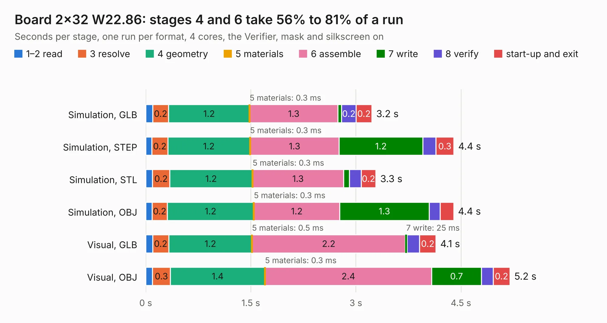

| Mode and format | 1–2 read | 3 resolve | 4 geometry | 5 materials | 6 assemble | 7 write | 8 verify | start-up and exit | Total |
|---|---:|---:|---:|---:|---:|---:|---:|---:|---:|
| Simulation, GLB | 0.1 | 0.2 | 1.2 | 0.3&nbsp;ms | 1.3 | 52&nbsp;ms | 0.2 | 0.2 | 3.2 |
| Simulation, STEP | 88&nbsp;ms | 0.2 | 1.2 | 0.3&nbsp;ms | 1.3 | 1.2 | 0.2 | 0.3 | 4.4 |
| Simulation, STL | 97&nbsp;ms | 0.2 | 1.2 | 0.3&nbsp;ms | 1.3 | 86&nbsp;ms | 0.2 | 0.2 | 3.3 |
| Simulation, OBJ | 91&nbsp;ms | 0.2 | 1.2 | 0.3&nbsp;ms | 1.2 | 1.3 | 0.2 | 0.2 | 4.4 |
| Visual, GLB | 98&nbsp;ms | 0.2 | 1.2 | 0.5&nbsp;ms | 2.2 | 25&nbsp;ms | 0.2 | 0.2 | 4.1 |
| Visual, OBJ | 96&nbsp;ms | 0.3 | 1.4 | 0.3&nbsp;ms | 2.4 | 0.7 | 0.2 | 0.2 | 5.2 |

<table align="center"><tr><td valign="top">

| Board | Repo: [andrewpaterson/658-Computer](https://github.com/andrewpaterson/658-Computer) Board: `Board 2x32 W22.86.kicad_pcb` |
|---|---|
| Folder | Kicad / Boards / Blank / Board 2x32 W22.86 |
| Complexity | 89&nbsp;/&nbsp;1000 (size&nbsp;34, features&nbsp;55) |
| KESE&nbsp;features | rounded, trapezoid or chamfered pads, knockout text, stack-up, dielectric εr and tanδ |
| Tested | 9th November 2026 |
| Copper&nbsp;layers | 2 |
| File&nbsp;format | KiCad 9 (20241229) |
| Parts,&nbsp;tracks,&nbsp;vias | 4, 0, 0 |
| Triangles,&nbsp;simulation | 275,332 in 72 parts |
| Verifier | PASS in all six runs |

</td><td valign="top">

<table>
<tr><th>File type</th><th>File size</th><th>Peak memory used</th></tr>
<tr><th colspan="3" align="left">Simulation</th></tr>
<tr><td>GLB</td><td align="right">8.8&nbsp;MB</td><td align="right">217&nbsp;MB</td></tr>
<tr><td>STEP</td><td align="right">28&nbsp;MB</td><td align="right">248&nbsp;MB</td></tr>
<tr><td>STL</td><td align="right">14&nbsp;MB</td><td align="right">217&nbsp;MB</td></tr>
<tr><td>OBJ</td><td align="right">27&nbsp;MB</td><td align="right">236&nbsp;MB</td></tr>
<tr><th colspan="3" align="left">Visual</th></tr>
<tr><td>GLB</td><td align="right">5.1&nbsp;MB</td><td align="right">225&nbsp;MB</td></tr>
<tr><td>OBJ</td><td align="right">15&nbsp;MB</td><td align="right">222&nbsp;MB</td></tr>
</table>

</td></tr></table>

## 128. Board 2x36 W22.86

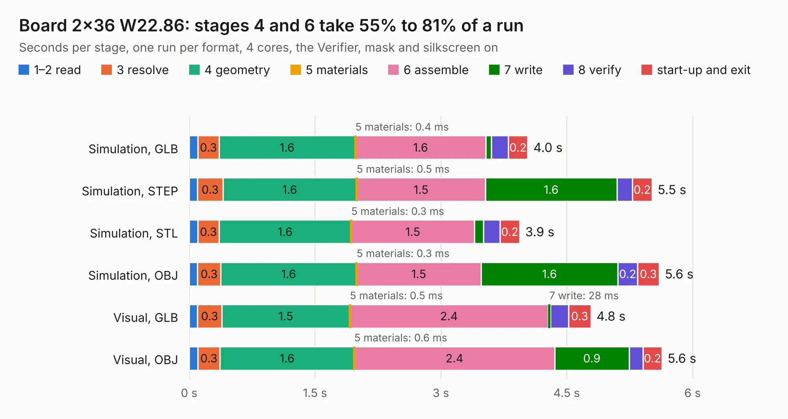

| Mode and format | 1–2 read | 3 resolve | 4 geometry | 5 materials | 6 assemble | 7 write | 8 verify | start-up and exit | Total |
|---|---:|---:|---:|---:|---:|---:|---:|---:|---:|
| Simulation, GLB | 0.1 | 0.3 | 1.6 | 0.4&nbsp;ms | 1.6 | 65&nbsp;ms | 0.2 | 0.2 | 4.0 |
| Simulation, STEP | 99&nbsp;ms | 0.3 | 1.6 | 0.5&nbsp;ms | 1.5 | 1.6 | 0.2 | 0.2 | 5.5 |
| Simulation, STL | 0.1 | 0.3 | 1.6 | 0.3&nbsp;ms | 1.5 | 0.1 | 0.2 | 0.2 | 3.9 |
| Simulation, OBJ | 99&nbsp;ms | 0.3 | 1.6 | 0.3&nbsp;ms | 1.5 | 1.6 | 0.2 | 0.3 | 5.6 |
| Visual, GLB | 0.1 | 0.3 | 1.5 | 0.5&nbsp;ms | 2.4 | 28&nbsp;ms | 0.2 | 0.3 | 4.8 |
| Visual, OBJ | 0.1 | 0.3 | 1.6 | 0.6&nbsp;ms | 2.4 | 0.9 | 0.2 | 0.2 | 5.6 |

<table align="center"><tr><td valign="top">

| Board | Repo: [andrewpaterson/658-Computer](https://github.com/andrewpaterson/658-Computer) Board: `Board 2x36 W22.86.kicad_pcb` |
|---|---|
| Folder | Kicad / Boards / Blank / Board 2x36 W22.86 |
| Complexity | 89&nbsp;/&nbsp;1000 (size&nbsp;34, features&nbsp;55) |
| KESE&nbsp;features | rounded, trapezoid or chamfered pads, knockout text, stack-up, dielectric εr and tanδ |
| Tested | 9th November 2026 |
| Copper&nbsp;layers | 2 |
| File&nbsp;format | KiCad 9 (20241229) |
| Parts,&nbsp;tracks,&nbsp;vias | 4, 0, 0 |
| Triangles,&nbsp;simulation | 308,308 in 80 parts |
| Verifier | PASS in all six runs |

</td><td valign="top">

<table>
<tr><th>File type</th><th>File size</th><th>Peak memory used</th></tr>
<tr><th colspan="3" align="left">Simulation</th></tr>
<tr><td>GLB</td><td align="right">9.8&nbsp;MB</td><td align="right">228&nbsp;MB</td></tr>
<tr><td>STEP</td><td align="right">31&nbsp;MB</td><td align="right">260&nbsp;MB</td></tr>
<tr><td>STL</td><td align="right">15&nbsp;MB</td><td align="right">228&nbsp;MB</td></tr>
<tr><td>OBJ</td><td align="right">31&nbsp;MB</td><td align="right">235&nbsp;MB</td></tr>
<tr><th colspan="3" align="left">Visual</th></tr>
<tr><td>GLB</td><td align="right">5.7&nbsp;MB</td><td align="right">243&nbsp;MB</td></tr>
<tr><td>OBJ</td><td align="right">16&nbsp;MB</td><td align="right">247&nbsp;MB</td></tr>
</table>

</td></tr></table>

## 129. Board 2x06 W15.24

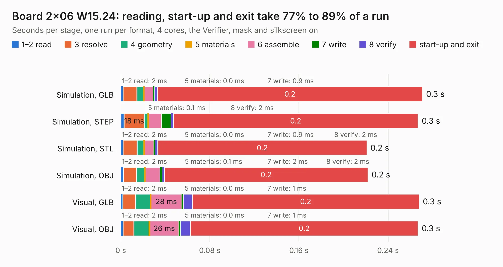

| Mode and format | 1–2 read | 3 resolve | 4 geometry | 5 materials | 6 assemble | 7 write | 8 verify | start-up and exit | Total |
|---|---:|---:|---:|---:|---:|---:|---:|---:|---:|
| Simulation, GLB | 2&nbsp;ms | 12&nbsp;ms | 6&nbsp;ms | 0.0&nbsp;ms | 8&nbsp;ms | 0.9&nbsp;ms | 3&nbsp;ms | 0.2 | 0.3 |
| Simulation, STEP | 3&nbsp;ms | 18&nbsp;ms | 4&nbsp;ms | 0.1&nbsp;ms | 12&nbsp;ms | 9&nbsp;ms | 2&nbsp;ms | 0.2 | 0.3 |
| Simulation, STL | 2&nbsp;ms | 13&nbsp;ms | 6&nbsp;ms | 0.0&nbsp;ms | 9&nbsp;ms | 0.9&nbsp;ms | 2&nbsp;ms | 0.2 | 0.2 |
| Simulation, OBJ | 2&nbsp;ms | 12&nbsp;ms | 8&nbsp;ms | 0.1&nbsp;ms | 13&nbsp;ms | 2&nbsp;ms | 2&nbsp;ms | 0.2 | 0.2 |
| Visual, GLB | 2&nbsp;ms | 11&nbsp;ms | 14&nbsp;ms | 0.0&nbsp;ms | 28&nbsp;ms | 1&nbsp;ms | 8&nbsp;ms | 0.2 | 0.3 |
| Visual, OBJ | 2&nbsp;ms | 10&nbsp;ms | 14&nbsp;ms | 0.0&nbsp;ms | 26&nbsp;ms | 1&nbsp;ms | 9&nbsp;ms | 0.2 | 0.3 |

<table align="center"><tr><td valign="top">

| Board | Repo: [andrewpaterson/658-Computer](https://github.com/andrewpaterson/658-Computer) Board: `Board 2x06 W15.24.kicad_pcb` |
|---|---|
| Folder | Kicad / Boards / Pins / Board 2x06 W15.24 |
| Complexity | 47&nbsp;/&nbsp;1000 (size&nbsp;17, features&nbsp;30) |
| KESE&nbsp;features | stack-up, dielectric εr and tanδ |
| Tested | 9th November 2026 |
| Copper&nbsp;layers | 2 |
| File&nbsp;format | KiCad 9 (20241229) |
| Parts,&nbsp;tracks,&nbsp;vias | 0, 0, 0 |
| Triangles,&nbsp;simulation | 72 in 3 parts |
| Note | no components |
| Verifier | PASS in all six runs |

</td><td valign="top">

<table>
<tr><th>File type</th><th>File size</th><th>Peak memory used</th></tr>
<tr><th colspan="3" align="left">Simulation</th></tr>
<tr><td>GLB</td><td align="right">6.3&nbsp;kB</td><td align="right">37&nbsp;MB</td></tr>
<tr><td>STEP</td><td align="right">30&nbsp;kB</td><td align="right">37&nbsp;MB</td></tr>
<tr><td>STL</td><td align="right">3.9&nbsp;kB</td><td align="right">35&nbsp;MB</td></tr>
<tr><td>OBJ</td><td align="right">10&nbsp;kB</td><td align="right">37&nbsp;MB</td></tr>
<tr><th colspan="3" align="left">Visual</th></tr>
<tr><td>GLB</td><td align="right">7.7&nbsp;kB</td><td align="right">41&nbsp;MB</td></tr>
<tr><td>OBJ</td><td align="right">10&nbsp;kB</td><td align="right">41&nbsp;MB</td></tr>
</table>

</td></tr></table>

## 130. Board 2x06 W22.86

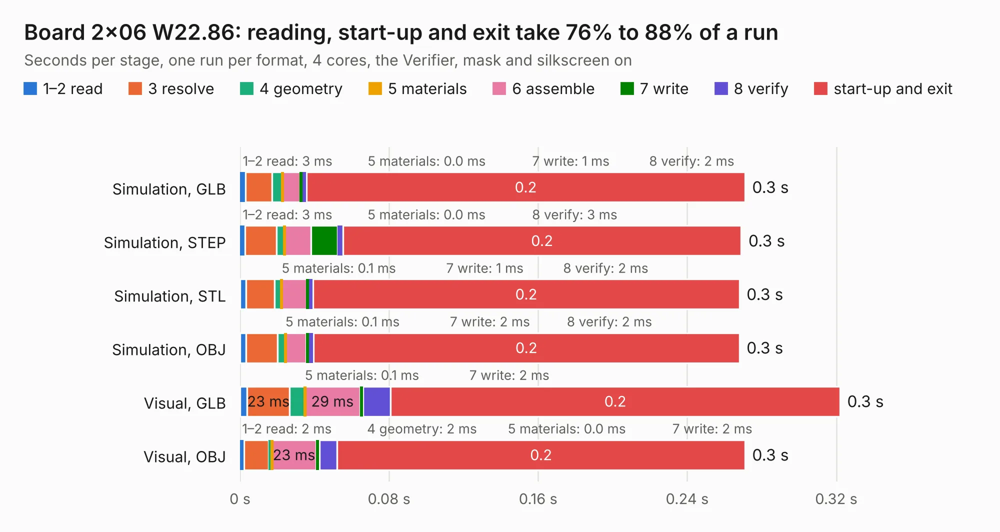

| Mode and format | 1–2 read | 3 resolve | 4 geometry | 5 materials | 6 assemble | 7 write | 8 verify | start-up and exit | Total |
|---|---:|---:|---:|---:|---:|---:|---:|---:|---:|
| Simulation, GLB | 3&nbsp;ms | 14&nbsp;ms | 6&nbsp;ms | 0.0&nbsp;ms | 9&nbsp;ms | 1&nbsp;ms | 2&nbsp;ms | 0.2 | 0.3 |
| Simulation, STEP | 3&nbsp;ms | 17&nbsp;ms | 4&nbsp;ms | 0.0&nbsp;ms | 14&nbsp;ms | 14&nbsp;ms | 3&nbsp;ms | 0.2 | 0.3 |
| Simulation, STL | 3&nbsp;ms | 15&nbsp;ms | 4&nbsp;ms | 0.1&nbsp;ms | 13&nbsp;ms | 1&nbsp;ms | 2&nbsp;ms | 0.2 | 0.3 |
| Simulation, OBJ | 3&nbsp;ms | 17&nbsp;ms | 4&nbsp;ms | 0.1&nbsp;ms | 11&nbsp;ms | 2&nbsp;ms | 2&nbsp;ms | 0.2 | 0.3 |
| Visual, GLB | 4&nbsp;ms | 23&nbsp;ms | 8&nbsp;ms | 0.1&nbsp;ms | 29&nbsp;ms | 2&nbsp;ms | 15&nbsp;ms | 0.2 | 0.3 |
| Visual, OBJ | 2&nbsp;ms | 13&nbsp;ms | 2&nbsp;ms | 0.0&nbsp;ms | 23&nbsp;ms | 2&nbsp;ms | 10&nbsp;ms | 0.2 | 0.3 |

<table align="center"><tr><td valign="top">

| Board | Repo: [andrewpaterson/658-Computer](https://github.com/andrewpaterson/658-Computer) Board: `Board 2x06 W22.86.kicad_pcb` |
|---|---|
| Folder | Kicad / Boards / Pins / Board 2x06 W22.86 |
| Complexity | 47&nbsp;/&nbsp;1000 (size&nbsp;17, features&nbsp;30) |
| KESE&nbsp;features | stack-up, dielectric εr and tanδ |
| Tested | 9th November 2026 |
| Copper&nbsp;layers | 2 |
| File&nbsp;format | KiCad 9 (20241229) |
| Parts,&nbsp;tracks,&nbsp;vias | 0, 0, 0 |
| Triangles,&nbsp;simulation | 72 in 3 parts |
| Note | no components |
| Verifier | PASS in all six runs |

</td><td valign="top">

<table>
<tr><th>File type</th><th>File size</th><th>Peak memory used</th></tr>
<tr><th colspan="3" align="left">Simulation</th></tr>
<tr><td>GLB</td><td align="right">6.3&nbsp;kB</td><td align="right">37&nbsp;MB</td></tr>
<tr><td>STEP</td><td align="right">30&nbsp;kB</td><td align="right">37&nbsp;MB</td></tr>
<tr><td>STL</td><td align="right">3.9&nbsp;kB</td><td align="right">36&nbsp;MB</td></tr>
<tr><td>OBJ</td><td align="right">10&nbsp;kB</td><td align="right">36&nbsp;MB</td></tr>
<tr><th colspan="3" align="left">Visual</th></tr>
<tr><td>GLB</td><td align="right">7.7&nbsp;kB</td><td align="right">37&nbsp;MB</td></tr>
<tr><td>OBJ</td><td align="right">10&nbsp;kB</td><td align="right">42&nbsp;MB</td></tr>
</table>

</td></tr></table>

## 131. Board 2x12 W15.24

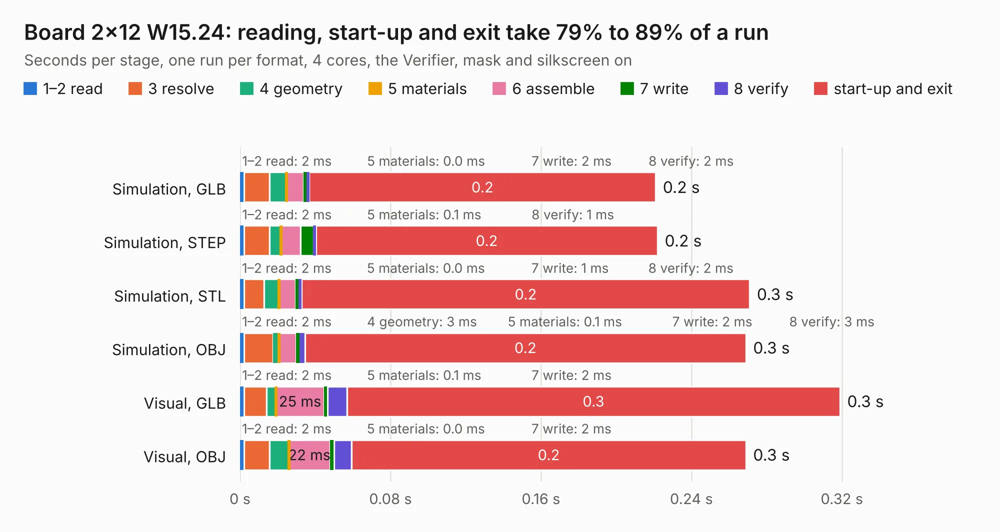

| Mode and format | 1–2 read | 3 resolve | 4 geometry | 5 materials | 6 assemble | 7 write | 8 verify | start-up and exit | Total |
|---|---:|---:|---:|---:|---:|---:|---:|---:|---:|
| Simulation, GLB | 2&nbsp;ms | 13&nbsp;ms | 9&nbsp;ms | 0.0&nbsp;ms | 9&nbsp;ms | 2&nbsp;ms | 2&nbsp;ms | 0.2 | 0.2 |
| Simulation, STEP | 2&nbsp;ms | 14&nbsp;ms | 6&nbsp;ms | 0.1&nbsp;ms | 10&nbsp;ms | 7&nbsp;ms | 1&nbsp;ms | 0.2 | 0.2 |
| Simulation, STL | 2&nbsp;ms | 11&nbsp;ms | 8&nbsp;ms | 0.0&nbsp;ms | 9&nbsp;ms | 1&nbsp;ms | 2&nbsp;ms | 0.2 | 0.3 |
| Simulation, OBJ | 2&nbsp;ms | 15&nbsp;ms | 3&nbsp;ms | 0.1&nbsp;ms | 9&nbsp;ms | 2&nbsp;ms | 3&nbsp;ms | 0.2 | 0.3 |
| Visual, GLB | 2&nbsp;ms | 12&nbsp;ms | 5&nbsp;ms | 0.1&nbsp;ms | 25&nbsp;ms | 2&nbsp;ms | 10&nbsp;ms | 0.3 | 0.3 |
| Visual, OBJ | 2&nbsp;ms | 14&nbsp;ms | 10&nbsp;ms | 0.0&nbsp;ms | 22&nbsp;ms | 2&nbsp;ms | 9&nbsp;ms | 0.2 | 0.3 |

<table align="center"><tr><td valign="top">

| Board | Repo: [andrewpaterson/658-Computer](https://github.com/andrewpaterson/658-Computer) Board: `Board 2x12 W15.24.kicad_pcb` |
|---|---|
| Folder | Kicad / Boards / Pins / Board 2x12 W15.24 |
| Complexity | 47&nbsp;/&nbsp;1000 (size&nbsp;17, features&nbsp;30) |
| KESE&nbsp;features | stack-up, dielectric εr and tanδ |
| Tested | 9th November 2026 |
| Copper&nbsp;layers | 2 |
| File&nbsp;format | KiCad 9 (20241229) |
| Parts,&nbsp;tracks,&nbsp;vias | 0, 0, 0 |
| Triangles,&nbsp;simulation | 72 in 3 parts |
| Note | no components |
| Verifier | PASS in all six runs |

</td><td valign="top">

<table>
<tr><th>File type</th><th>File size</th><th>Peak memory used</th></tr>
<tr><th colspan="3" align="left">Simulation</th></tr>
<tr><td>GLB</td><td align="right">6.3&nbsp;kB</td><td align="right">37&nbsp;MB</td></tr>
<tr><td>STEP</td><td align="right">29&nbsp;kB</td><td align="right">37&nbsp;MB</td></tr>
<tr><td>STL</td><td align="right">3.9&nbsp;kB</td><td align="right">37&nbsp;MB</td></tr>
<tr><td>OBJ</td><td align="right">10&nbsp;kB</td><td align="right">37&nbsp;MB</td></tr>
<tr><th colspan="3" align="left">Visual</th></tr>
<tr><td>GLB</td><td align="right">7.7&nbsp;kB</td><td align="right">41&nbsp;MB</td></tr>
<tr><td>OBJ</td><td align="right">10&nbsp;kB</td><td align="right">41&nbsp;MB</td></tr>
</table>

</td></tr></table>

## 132. Board 2x12 W22.86

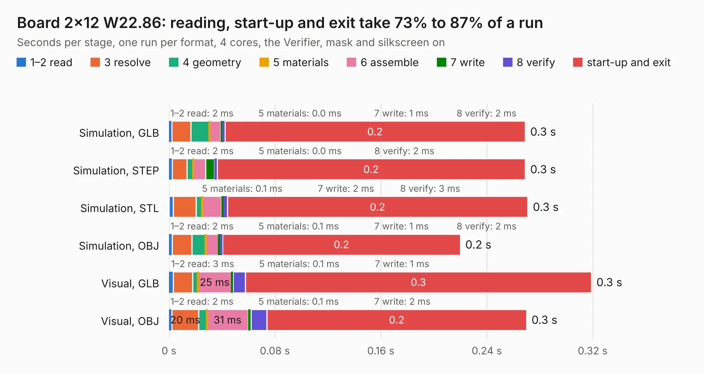

| Mode and format | 1–2 read | 3 resolve | 4 geometry | 5 materials | 6 assemble | 7 write | 8 verify | start-up and exit | Total |
|---|---:|---:|---:|---:|---:|---:|---:|---:|---:|
| Simulation, GLB | 2&nbsp;ms | 14&nbsp;ms | 14&nbsp;ms | 0.0&nbsp;ms | 9&nbsp;ms | 1&nbsp;ms | 2&nbsp;ms | 0.2 | 0.3 |
| Simulation, STEP | 2&nbsp;ms | 11&nbsp;ms | 5&nbsp;ms | 0.0&nbsp;ms | 9&nbsp;ms | 7&nbsp;ms | 2&nbsp;ms | 0.2 | 0.3 |
| Simulation, STL | 3&nbsp;ms | 17&nbsp;ms | 4&nbsp;ms | 0.1&nbsp;ms | 15&nbsp;ms | 2&nbsp;ms | 3&nbsp;ms | 0.2 | 0.3 |
| Simulation, OBJ | 2&nbsp;ms | 15&nbsp;ms | 10&nbsp;ms | 0.1&nbsp;ms | 10&nbsp;ms | 1&nbsp;ms | 2&nbsp;ms | 0.2 | 0.2 |
| Visual, GLB | 3&nbsp;ms | 15&nbsp;ms | 4&nbsp;ms | 0.1&nbsp;ms | 25&nbsp;ms | 1&nbsp;ms | 9&nbsp;ms | 0.3 | 0.3 |
| Visual, OBJ | 2&nbsp;ms | 20&nbsp;ms | 6&nbsp;ms | 0.1&nbsp;ms | 31&nbsp;ms | 2&nbsp;ms | 12&nbsp;ms | 0.2 | 0.3 |

<table align="center"><tr><td valign="top">

| Board | Repo: [andrewpaterson/658-Computer](https://github.com/andrewpaterson/658-Computer) Board: `Board 2x12 W22.86.kicad_pcb` |
|---|---|
| Folder | Kicad / Boards / Pins / Board 2x12 W22.86 |
| Complexity | 47&nbsp;/&nbsp;1000 (size&nbsp;17, features&nbsp;30) |
| KESE&nbsp;features | stack-up, dielectric εr and tanδ |
| Tested | 9th November 2026 |
| Copper&nbsp;layers | 2 |
| File&nbsp;format | KiCad 9 (20241229) |
| Parts,&nbsp;tracks,&nbsp;vias | 0, 0, 0 |
| Triangles,&nbsp;simulation | 72 in 3 parts |
| Note | no components |
| Verifier | PASS in all six runs |

</td><td valign="top">

<table>
<tr><th>File type</th><th>File size</th><th>Peak memory used</th></tr>
<tr><th colspan="3" align="left">Simulation</th></tr>
<tr><td>GLB</td><td align="right">6.3&nbsp;kB</td><td align="right">35&nbsp;MB</td></tr>
<tr><td>STEP</td><td align="right">29&nbsp;kB</td><td align="right">37&nbsp;MB</td></tr>
<tr><td>STL</td><td align="right">3.9&nbsp;kB</td><td align="right">37&nbsp;MB</td></tr>
<tr><td>OBJ</td><td align="right">10&nbsp;kB</td><td align="right">35&nbsp;MB</td></tr>
<tr><th colspan="3" align="left">Visual</th></tr>
<tr><td>GLB</td><td align="right">7.7&nbsp;kB</td><td align="right">42&nbsp;MB</td></tr>
<tr><td>OBJ</td><td align="right">10&nbsp;kB</td><td align="right">38&nbsp;MB</td></tr>
</table>

</td></tr></table>

## 133. Board 2x16 W15.24

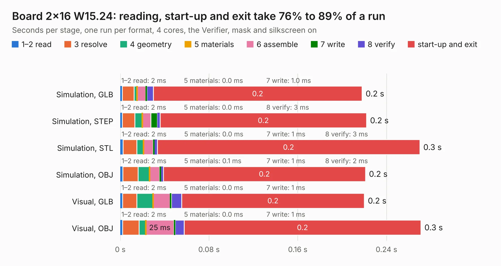

| Mode and format | 1–2 read | 3 resolve | 4 geometry | 5 materials | 6 assemble | 7 write | 8 verify | start-up and exit | Total |
|---|---:|---:|---:|---:|---:|---:|---:|---:|---:|
| Simulation, GLB | 2&nbsp;ms | 10&nbsp;ms | 3&nbsp;ms | 0.0&nbsp;ms | 8&nbsp;ms | 1.0&nbsp;ms | 6&nbsp;ms | 0.2 | 0.2 |
| Simulation, STEP | 2&nbsp;ms | 11&nbsp;ms | 7&nbsp;ms | 0.0&nbsp;ms | 8&nbsp;ms | 6&nbsp;ms | 3&nbsp;ms | 0.2 | 0.2 |
| Simulation, STL | 2&nbsp;ms | 12&nbsp;ms | 6&nbsp;ms | 0.0&nbsp;ms | 9&nbsp;ms | 1&nbsp;ms | 3&nbsp;ms | 0.2 | 0.3 |
| Simulation, OBJ | 2&nbsp;ms | 14&nbsp;ms | 10&nbsp;ms | 0.1&nbsp;ms | 9&nbsp;ms | 1&nbsp;ms | 2&nbsp;ms | 0.2 | 0.2 |
| Visual, GLB | 2&nbsp;ms | 13&nbsp;ms | 15&nbsp;ms | 0.0&nbsp;ms | 15&nbsp;ms | 1&nbsp;ms | 9&nbsp;ms | 0.2 | 0.2 |
| Visual, OBJ | 2&nbsp;ms | 15&nbsp;ms | 6&nbsp;ms | 0.0&nbsp;ms | 25&nbsp;ms | 1&nbsp;ms | 8&nbsp;ms | 0.2 | 0.3 |

<table align="center"><tr><td valign="top">

| Board | Repo: [andrewpaterson/658-Computer](https://github.com/andrewpaterson/658-Computer) Board: `Board 2x16 W15.24.kicad_pcb` |
|---|---|
| Folder | Kicad / Boards / Pins / Board 2x16 W15.24 |
| Complexity | 47&nbsp;/&nbsp;1000 (size&nbsp;17, features&nbsp;30) |
| KESE&nbsp;features | stack-up, dielectric εr and tanδ |
| Tested | 9th November 2026 |
| Copper&nbsp;layers | 2 |
| File&nbsp;format | KiCad 9 (20241229) |
| Parts,&nbsp;tracks,&nbsp;vias | 0, 0, 0 |
| Triangles,&nbsp;simulation | 72 in 3 parts |
| Note | no components |
| Verifier | PASS in all six runs |

</td><td valign="top">

<table>
<tr><th>File type</th><th>File size</th><th>Peak memory used</th></tr>
<tr><th colspan="3" align="left">Simulation</th></tr>
<tr><td>GLB</td><td align="right">6.3&nbsp;kB</td><td align="right">37&nbsp;MB</td></tr>
<tr><td>STEP</td><td align="right">29&nbsp;kB</td><td align="right">37&nbsp;MB</td></tr>
<tr><td>STL</td><td align="right">3.9&nbsp;kB</td><td align="right">37&nbsp;MB</td></tr>
<tr><td>OBJ</td><td align="right">10&nbsp;kB</td><td align="right">35&nbsp;MB</td></tr>
<tr><th colspan="3" align="left">Visual</th></tr>
<tr><td>GLB</td><td align="right">7.7&nbsp;kB</td><td align="right">36&nbsp;MB</td></tr>
<tr><td>OBJ</td><td align="right">10&nbsp;kB</td><td align="right">41&nbsp;MB</td></tr>
</table>

</td></tr></table>

## 134. Board 2x16 W22.86

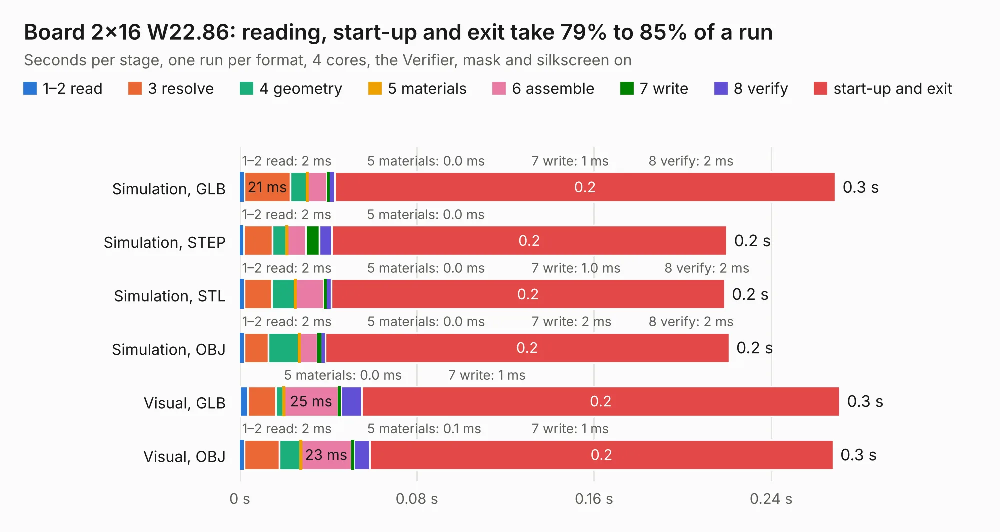

| Mode and format | 1–2 read | 3 resolve | 4 geometry | 5 materials | 6 assemble | 7 write | 8 verify | start-up and exit | Total |
|---|---:|---:|---:|---:|---:|---:|---:|---:|---:|
| Simulation, GLB | 2&nbsp;ms | 21&nbsp;ms | 8&nbsp;ms | 0.0&nbsp;ms | 9&nbsp;ms | 1&nbsp;ms | 2&nbsp;ms | 0.2 | 0.3 |
| Simulation, STEP | 2&nbsp;ms | 13&nbsp;ms | 7&nbsp;ms | 0.0&nbsp;ms | 9&nbsp;ms | 6&nbsp;ms | 6&nbsp;ms | 0.2 | 0.2 |
| Simulation, STL | 2&nbsp;ms | 12&nbsp;ms | 11&nbsp;ms | 0.0&nbsp;ms | 13&nbsp;ms | 1.0&nbsp;ms | 2&nbsp;ms | 0.2 | 0.2 |
| Simulation, OBJ | 2&nbsp;ms | 11&nbsp;ms | 14&nbsp;ms | 0.0&nbsp;ms | 8&nbsp;ms | 2&nbsp;ms | 2&nbsp;ms | 0.2 | 0.2 |
| Visual, GLB | 4&nbsp;ms | 13&nbsp;ms | 4&nbsp;ms | 0.0&nbsp;ms | 25&nbsp;ms | 1&nbsp;ms | 9&nbsp;ms | 0.2 | 0.3 |
| Visual, OBJ | 2&nbsp;ms | 16&nbsp;ms | 10&nbsp;ms | 0.1&nbsp;ms | 23&nbsp;ms | 1&nbsp;ms | 7&nbsp;ms | 0.2 | 0.3 |

<table align="center"><tr><td valign="top">

| Board | Repo: [andrewpaterson/658-Computer](https://github.com/andrewpaterson/658-Computer) Board: `Board 2x16 W22.86.kicad_pcb` |
|---|---|
| Folder | Kicad / Boards / Pins / Board 2x16 W22.86 |
| Complexity | 47&nbsp;/&nbsp;1000 (size&nbsp;17, features&nbsp;30) |
| KESE&nbsp;features | stack-up, dielectric εr and tanδ |
| Tested | 9th November 2026 |
| Copper&nbsp;layers | 2 |
| File&nbsp;format | KiCad 9 (20241229) |
| Parts,&nbsp;tracks,&nbsp;vias | 0, 0, 0 |
| Triangles,&nbsp;simulation | 72 in 3 parts |
| Note | no components |
| Verifier | PASS in all six runs |

</td><td valign="top">

<table>
<tr><th>File type</th><th>File size</th><th>Peak memory used</th></tr>
<tr><th colspan="3" align="left">Simulation</th></tr>
<tr><td>GLB</td><td align="right">6.3&nbsp;kB</td><td align="right">37&nbsp;MB</td></tr>
<tr><td>STEP</td><td align="right">29&nbsp;kB</td><td align="right">37&nbsp;MB</td></tr>
<tr><td>STL</td><td align="right">3.9&nbsp;kB</td><td align="right">35&nbsp;MB</td></tr>
<tr><td>OBJ</td><td align="right">10&nbsp;kB</td><td align="right">35&nbsp;MB</td></tr>
<tr><th colspan="3" align="left">Visual</th></tr>
<tr><td>GLB</td><td align="right">7.7&nbsp;kB</td><td align="right">36&nbsp;MB</td></tr>
<tr><td>OBJ</td><td align="right">10&nbsp;kB</td><td align="right">41&nbsp;MB</td></tr>
</table>

</td></tr></table>

## 135. Board 2x20 W15.24

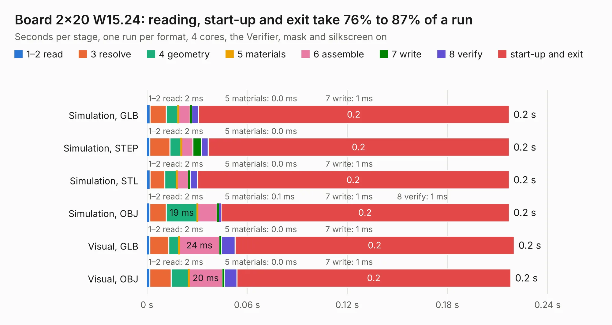

| Mode and format | 1–2 read | 3 resolve | 4 geometry | 5 materials | 6 assemble | 7 write | 8 verify | start-up and exit | Total |
|---|---:|---:|---:|---:|---:|---:|---:|---:|---:|
| Simulation, GLB | 2&nbsp;ms | 10&nbsp;ms | 7&nbsp;ms | 0.0&nbsp;ms | 7&nbsp;ms | 1&nbsp;ms | 4&nbsp;ms | 0.2 | 0.2 |
| Simulation, STEP | 2&nbsp;ms | 12&nbsp;ms | 7&nbsp;ms | 0.0&nbsp;ms | 7&nbsp;ms | 5&nbsp;ms | 4&nbsp;ms | 0.2 | 0.2 |
| Simulation, STL | 2&nbsp;ms | 9&nbsp;ms | 7&nbsp;ms | 0.0&nbsp;ms | 7&nbsp;ms | 1&nbsp;ms | 4&nbsp;ms | 0.2 | 0.2 |
| Simulation, OBJ | 2&nbsp;ms | 10&nbsp;ms | 19&nbsp;ms | 0.1&nbsp;ms | 12&nbsp;ms | 1&nbsp;ms | 1&nbsp;ms | 0.2 | 0.2 |
| Visual, GLB | 2&nbsp;ms | 11&nbsp;ms | 6&nbsp;ms | 0.0&nbsp;ms | 24&nbsp;ms | 1&nbsp;ms | 8&nbsp;ms | 0.2 | 0.2 |
| Visual, OBJ | 2&nbsp;ms | 13&nbsp;ms | 11&nbsp;ms | 0.0&nbsp;ms | 20&nbsp;ms | 1&nbsp;ms | 7&nbsp;ms | 0.2 | 0.2 |

<table align="center"><tr><td valign="top">

| Board | Repo: [andrewpaterson/658-Computer](https://github.com/andrewpaterson/658-Computer) Board: `Board 2x20 W15.24.kicad_pcb` |
|---|---|
| Folder | Kicad / Boards / Pins / Board 2x20 W15.24 |
| Complexity | 47&nbsp;/&nbsp;1000 (size&nbsp;17, features&nbsp;30) |
| KESE&nbsp;features | stack-up, dielectric εr and tanδ |
| Tested | 9th November 2026 |
| Copper&nbsp;layers | 2 |
| File&nbsp;format | KiCad 9 (20241229) |
| Parts,&nbsp;tracks,&nbsp;vias | 0, 0, 0 |
| Triangles,&nbsp;simulation | 72 in 3 parts |
| Note | no components |
| Verifier | PASS in all six runs |

</td><td valign="top">

<table>
<tr><th>File type</th><th>File size</th><th>Peak memory used</th></tr>
<tr><th colspan="3" align="left">Simulation</th></tr>
<tr><td>GLB</td><td align="right">6.3&nbsp;kB</td><td align="right">37&nbsp;MB</td></tr>
<tr><td>STEP</td><td align="right">29&nbsp;kB</td><td align="right">37&nbsp;MB</td></tr>
<tr><td>STL</td><td align="right">3.9&nbsp;kB</td><td align="right">37&nbsp;MB</td></tr>
<tr><td>OBJ</td><td align="right">10&nbsp;kB</td><td align="right">37&nbsp;MB</td></tr>
<tr><th colspan="3" align="left">Visual</th></tr>
<tr><td>GLB</td><td align="right">7.7&nbsp;kB</td><td align="right">41&nbsp;MB</td></tr>
<tr><td>OBJ</td><td align="right">10&nbsp;kB</td><td align="right">36&nbsp;MB</td></tr>
</table>

</td></tr></table>

## 136. Board 2x20 W22.86

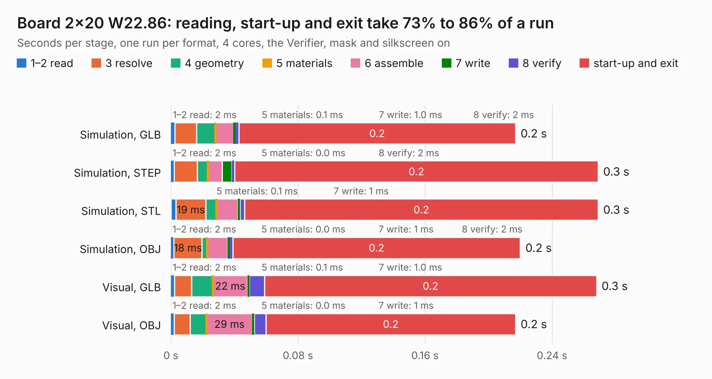

| Mode and format | 1–2 read | 3 resolve | 4 geometry | 5 materials | 6 assemble | 7 write | 8 verify | start-up and exit | Total |
|---|---:|---:|---:|---:|---:|---:|---:|---:|---:|
| Simulation, GLB | 2&nbsp;ms | 14&nbsp;ms | 12&nbsp;ms | 0.1&nbsp;ms | 11&nbsp;ms | 1.0&nbsp;ms | 2&nbsp;ms | 0.2 | 0.2 |
| Simulation, STEP | 2&nbsp;ms | 15&nbsp;ms | 7&nbsp;ms | 0.0&nbsp;ms | 9&nbsp;ms | 6&nbsp;ms | 2&nbsp;ms | 0.2 | 0.3 |
| Simulation, STL | 3&nbsp;ms | 19&nbsp;ms | 7&nbsp;ms | 0.1&nbsp;ms | 13&nbsp;ms | 1&nbsp;ms | 3&nbsp;ms | 0.2 | 0.3 |
| Simulation, OBJ | 2&nbsp;ms | 18&nbsp;ms | 3&nbsp;ms | 0.0&nbsp;ms | 13&nbsp;ms | 1&nbsp;ms | 2&nbsp;ms | 0.2 | 0.2 |
| Visual, GLB | 2&nbsp;ms | 11&nbsp;ms | 13&nbsp;ms | 0.1&nbsp;ms | 22&nbsp;ms | 1.0&nbsp;ms | 10&nbsp;ms | 0.2 | 0.3 |
| Visual, OBJ | 2&nbsp;ms | 10&nbsp;ms | 10&nbsp;ms | 0.0&nbsp;ms | 29&nbsp;ms | 1&nbsp;ms | 7&nbsp;ms | 0.2 | 0.2 |

<table align="center"><tr><td valign="top">

| Board | Repo: [andrewpaterson/658-Computer](https://github.com/andrewpaterson/658-Computer) Board: `Board 2x20 W22.86.kicad_pcb` |
|---|---|
| Folder | Kicad / Boards / Pins / Board 2x20 W22.86 |
| Complexity | 47&nbsp;/&nbsp;1000 (size&nbsp;17, features&nbsp;30) |
| KESE&nbsp;features | stack-up, dielectric εr and tanδ |
| Tested | 9th November 2026 |
| Copper&nbsp;layers | 2 |
| File&nbsp;format | KiCad 9 (20241229) |
| Parts,&nbsp;tracks,&nbsp;vias | 0, 0, 0 |
| Triangles,&nbsp;simulation | 72 in 3 parts |
| Note | no components |
| Verifier | PASS in all six runs |

</td><td valign="top">

<table>
<tr><th>File type</th><th>File size</th><th>Peak memory used</th></tr>
<tr><th colspan="3" align="left">Simulation</th></tr>
<tr><td>GLB</td><td align="right">6.3&nbsp;kB</td><td align="right">35&nbsp;MB</td></tr>
<tr><td>STEP</td><td align="right">29&nbsp;kB</td><td align="right">37&nbsp;MB</td></tr>
<tr><td>STL</td><td align="right">3.9&nbsp;kB</td><td align="right">37&nbsp;MB</td></tr>
<tr><td>OBJ</td><td align="right">10&nbsp;kB</td><td align="right">36&nbsp;MB</td></tr>
<tr><th colspan="3" align="left">Visual</th></tr>
<tr><td>GLB</td><td align="right">7.7&nbsp;kB</td><td align="right">41&nbsp;MB</td></tr>
<tr><td>OBJ</td><td align="right">10&nbsp;kB</td><td align="right">36&nbsp;MB</td></tr>
</table>

</td></tr></table>

## 137. Board 2x22 W15.24

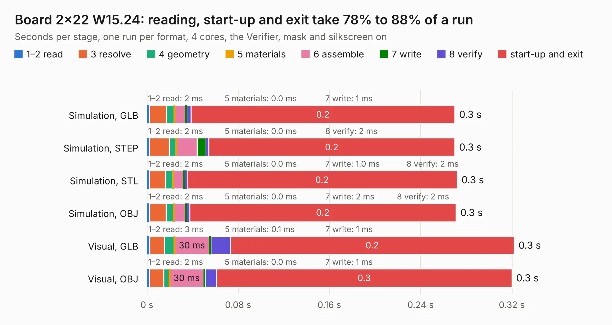

| Mode and format | 1–2 read | 3 resolve | 4 geometry | 5 materials | 6 assemble | 7 write | 8 verify | start-up and exit | Total |
|---|---:|---:|---:|---:|---:|---:|---:|---:|---:|
| Simulation, GLB | 2&nbsp;ms | 15&nbsp;ms | 7&nbsp;ms | 0.0&nbsp;ms | 9&nbsp;ms | 1&nbsp;ms | 4&nbsp;ms | 0.2 | 0.3 |
| Simulation, STEP | 2&nbsp;ms | 18&nbsp;ms | 6&nbsp;ms | 0.0&nbsp;ms | 18&nbsp;ms | 8&nbsp;ms | 2&nbsp;ms | 0.2 | 0.3 |
| Simulation, STL | 2&nbsp;ms | 14&nbsp;ms | 7&nbsp;ms | 0.0&nbsp;ms | 9&nbsp;ms | 1.0&nbsp;ms | 2&nbsp;ms | 0.2 | 0.3 |
| Simulation, OBJ | 2&nbsp;ms | 15&nbsp;ms | 6&nbsp;ms | 0.0&nbsp;ms | 10&nbsp;ms | 2&nbsp;ms | 2&nbsp;ms | 0.2 | 0.3 |
| Visual, GLB | 3&nbsp;ms | 13&nbsp;ms | 9&nbsp;ms | 0.1&nbsp;ms | 30&nbsp;ms | 1&nbsp;ms | 17&nbsp;ms | 0.2 | 0.3 |
| Visual, OBJ | 2&nbsp;ms | 13&nbsp;ms | 5&nbsp;ms | 0.0&nbsp;ms | 30&nbsp;ms | 1&nbsp;ms | 10&nbsp;ms | 0.3 | 0.3 |

<table align="center"><tr><td valign="top">

| Board | Repo: [andrewpaterson/658-Computer](https://github.com/andrewpaterson/658-Computer) Board: `Board 2x22 W15.24.kicad_pcb` |
|---|---|
| Folder | Kicad / Boards / Pins / Board 2x22 W15.24 |
| Complexity | 47&nbsp;/&nbsp;1000 (size&nbsp;17, features&nbsp;30) |
| KESE&nbsp;features | stack-up, dielectric εr and tanδ |
| Tested | 9th November 2026 |
| Copper&nbsp;layers | 2 |
| File&nbsp;format | KiCad 9 (20241229) |
| Parts,&nbsp;tracks,&nbsp;vias | 0, 0, 0 |
| Triangles,&nbsp;simulation | 72 in 3 parts |
| Note | no components |
| Verifier | PASS in all six runs |

</td><td valign="top">

<table>
<tr><th>File type</th><th>File size</th><th>Peak memory used</th></tr>
<tr><th colspan="3" align="left">Simulation</th></tr>
<tr><td>GLB</td><td align="right">6.3&nbsp;kB</td><td align="right">36&nbsp;MB</td></tr>
<tr><td>STEP</td><td align="right">29&nbsp;kB</td><td align="right">37&nbsp;MB</td></tr>
<tr><td>STL</td><td align="right">3.9&nbsp;kB</td><td align="right">36&nbsp;MB</td></tr>
<tr><td>OBJ</td><td align="right">10&nbsp;kB</td><td align="right">36&nbsp;MB</td></tr>
<tr><th colspan="3" align="left">Visual</th></tr>
<tr><td>GLB</td><td align="right">7.7&nbsp;kB</td><td align="right">40&nbsp;MB</td></tr>
<tr><td>OBJ</td><td align="right">10&nbsp;kB</td><td align="right">41&nbsp;MB</td></tr>
</table>

</td></tr></table>

## 138. Board 2x24 W15.24

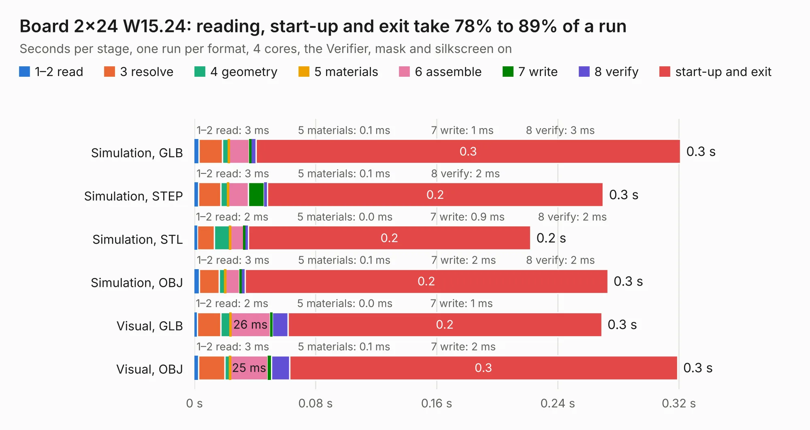

| Mode and format | 1–2 read | 3 resolve | 4 geometry | 5 materials | 6 assemble | 7 write | 8 verify | start-up and exit | Total |
|---|---:|---:|---:|---:|---:|---:|---:|---:|---:|
| Simulation, GLB | 3&nbsp;ms | 16&nbsp;ms | 4&nbsp;ms | 0.1&nbsp;ms | 14&nbsp;ms | 1&nbsp;ms | 3&nbsp;ms | 0.3 | 0.3 |
| Simulation, STEP | 3&nbsp;ms | 15&nbsp;ms | 5&nbsp;ms | 0.1&nbsp;ms | 14&nbsp;ms | 10&nbsp;ms | 2&nbsp;ms | 0.2 | 0.3 |
| Simulation, STL | 2&nbsp;ms | 11&nbsp;ms | 10&nbsp;ms | 0.0&nbsp;ms | 9&nbsp;ms | 0.9&nbsp;ms | 2&nbsp;ms | 0.2 | 0.2 |
| Simulation, OBJ | 3&nbsp;ms | 13&nbsp;ms | 4&nbsp;ms | 0.1&nbsp;ms | 9&nbsp;ms | 2&nbsp;ms | 2&nbsp;ms | 0.2 | 0.3 |
| Visual, GLB | 2&nbsp;ms | 15&nbsp;ms | 6&nbsp;ms | 0.0&nbsp;ms | 26&nbsp;ms | 1&nbsp;ms | 10&nbsp;ms | 0.2 | 0.3 |
| Visual, OBJ | 3&nbsp;ms | 17&nbsp;ms | 4&nbsp;ms | 0.1&nbsp;ms | 25&nbsp;ms | 2&nbsp;ms | 12&nbsp;ms | 0.3 | 0.3 |

<table align="center"><tr><td valign="top">

| Board | Repo: [andrewpaterson/658-Computer](https://github.com/andrewpaterson/658-Computer) Board: `Board 2x24 W15.24.kicad_pcb` |
|---|---|
| Folder | Kicad / Boards / Pins / Board 2x24 W15.24 |
| Complexity | 47&nbsp;/&nbsp;1000 (size&nbsp;17, features&nbsp;30) |
| KESE&nbsp;features | stack-up, dielectric εr and tanδ |
| Tested | 9th November 2026 |
| Copper&nbsp;layers | 2 |
| File&nbsp;format | KiCad 9 (20241229) |
| Parts,&nbsp;tracks,&nbsp;vias | 0, 0, 0 |
| Triangles,&nbsp;simulation | 72 in 3 parts |
| Note | no components |
| Verifier | PASS in all six runs |

</td><td valign="top">

<table>
<tr><th>File type</th><th>File size</th><th>Peak memory used</th></tr>
<tr><th colspan="3" align="left">Simulation</th></tr>
<tr><td>GLB</td><td align="right">6.3&nbsp;kB</td><td align="right">37&nbsp;MB</td></tr>
<tr><td>STEP</td><td align="right">29&nbsp;kB</td><td align="right">37&nbsp;MB</td></tr>
<tr><td>STL</td><td align="right">3.9&nbsp;kB</td><td align="right">35&nbsp;MB</td></tr>
<tr><td>OBJ</td><td align="right">10&nbsp;kB</td><td align="right">37&nbsp;MB</td></tr>
<tr><th colspan="3" align="left">Visual</th></tr>
<tr><td>GLB</td><td align="right">7.7&nbsp;kB</td><td align="right">41&nbsp;MB</td></tr>
<tr><td>OBJ</td><td align="right">10&nbsp;kB</td><td align="right">41&nbsp;MB</td></tr>
</table>

</td></tr></table>

## 139. Board 2x24 W22.86

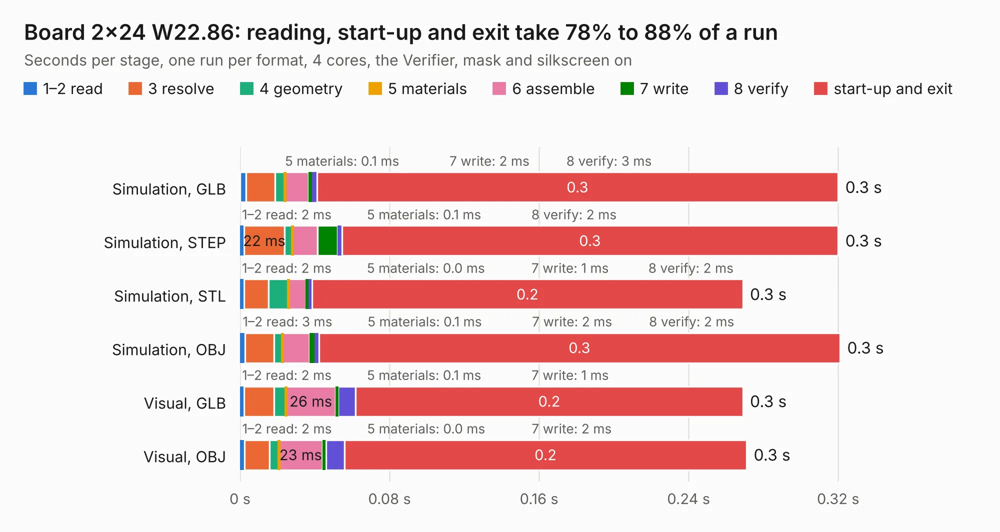

| Mode and format | 1–2 read | 3 resolve | 4 geometry | 5 materials | 6 assemble | 7 write | 8 verify | start-up and exit | Total |
|---|---:|---:|---:|---:|---:|---:|---:|---:|---:|
| Simulation, GLB | 3&nbsp;ms | 15&nbsp;ms | 5&nbsp;ms | 0.1&nbsp;ms | 13&nbsp;ms | 2&nbsp;ms | 3&nbsp;ms | 0.3 | 0.3 |
| Simulation, STEP | 2&nbsp;ms | 22&nbsp;ms | 4&nbsp;ms | 0.1&nbsp;ms | 13&nbsp;ms | 11&nbsp;ms | 2&nbsp;ms | 0.3 | 0.3 |
| Simulation, STL | 2&nbsp;ms | 13&nbsp;ms | 11&nbsp;ms | 0.0&nbsp;ms | 9&nbsp;ms | 1&nbsp;ms | 2&nbsp;ms | 0.2 | 0.3 |
| Simulation, OBJ | 3&nbsp;ms | 15&nbsp;ms | 4&nbsp;ms | 0.1&nbsp;ms | 15&nbsp;ms | 2&nbsp;ms | 2&nbsp;ms | 0.3 | 0.3 |
| Visual, GLB | 2&nbsp;ms | 16&nbsp;ms | 7&nbsp;ms | 0.1&nbsp;ms | 26&nbsp;ms | 1&nbsp;ms | 9&nbsp;ms | 0.2 | 0.3 |
| Visual, OBJ | 2&nbsp;ms | 13&nbsp;ms | 5&nbsp;ms | 0.0&nbsp;ms | 23&nbsp;ms | 2&nbsp;ms | 10&nbsp;ms | 0.2 | 0.3 |

<table align="center"><tr><td valign="top">

| Board | Repo: [andrewpaterson/658-Computer](https://github.com/andrewpaterson/658-Computer) Board: `Board 2x24 W22.86.kicad_pcb` |
|---|---|
| Folder | Kicad / Boards / Pins / Board 2x24 W22.86 |
| Complexity | 47&nbsp;/&nbsp;1000 (size&nbsp;17, features&nbsp;30) |
| KESE&nbsp;features | stack-up, dielectric εr and tanδ |
| Tested | 9th November 2026 |
| Copper&nbsp;layers | 2 |
| File&nbsp;format | KiCad 9 (20241229) |
| Parts,&nbsp;tracks,&nbsp;vias | 0, 0, 0 |
| Triangles,&nbsp;simulation | 72 in 3 parts |
| Note | no components |
| Verifier | PASS in all six runs |

</td><td valign="top">

<table>
<tr><th>File type</th><th>File size</th><th>Peak memory used</th></tr>
<tr><th colspan="3" align="left">Simulation</th></tr>
<tr><td>GLB</td><td align="right">6.3&nbsp;kB</td><td align="right">37&nbsp;MB</td></tr>
<tr><td>STEP</td><td align="right">29&nbsp;kB</td><td align="right">37&nbsp;MB</td></tr>
<tr><td>STL</td><td align="right">3.9&nbsp;kB</td><td align="right">37&nbsp;MB</td></tr>
<tr><td>OBJ</td><td align="right">10&nbsp;kB</td><td align="right">37&nbsp;MB</td></tr>
<tr><th colspan="3" align="left">Visual</th></tr>
<tr><td>GLB</td><td align="right">7.7&nbsp;kB</td><td align="right">38&nbsp;MB</td></tr>
<tr><td>OBJ</td><td align="right">10&nbsp;kB</td><td align="right">41&nbsp;MB</td></tr>
</table>

</td></tr></table>

## 140. Board 2x28 W15.24

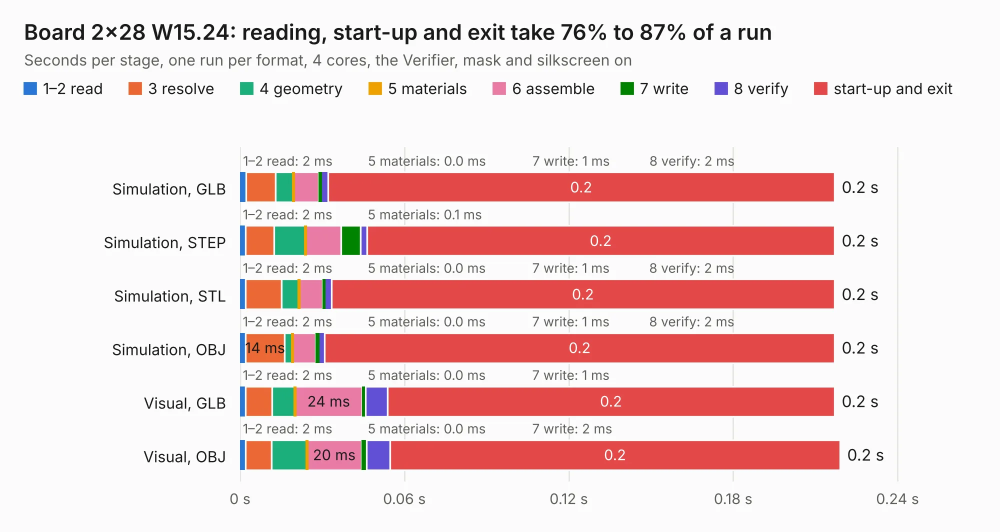

| Mode and format | 1–2 read | 3 resolve | 4 geometry | 5 materials | 6 assemble | 7 write | 8 verify | start-up and exit | Total |
|---|---:|---:|---:|---:|---:|---:|---:|---:|---:|
| Simulation, GLB | 2&nbsp;ms | 11&nbsp;ms | 7&nbsp;ms | 0.0&nbsp;ms | 9&nbsp;ms | 1&nbsp;ms | 2&nbsp;ms | 0.2 | 0.2 |
| Simulation, STEP | 2&nbsp;ms | 10&nbsp;ms | 11&nbsp;ms | 0.1&nbsp;ms | 13&nbsp;ms | 7&nbsp;ms | 2&nbsp;ms | 0.2 | 0.2 |
| Simulation, STL | 2&nbsp;ms | 13&nbsp;ms | 6&nbsp;ms | 0.0&nbsp;ms | 9&nbsp;ms | 1&nbsp;ms | 2&nbsp;ms | 0.2 | 0.2 |
| Simulation, OBJ | 2&nbsp;ms | 14&nbsp;ms | 3&nbsp;ms | 0.0&nbsp;ms | 8&nbsp;ms | 1&nbsp;ms | 2&nbsp;ms | 0.2 | 0.2 |
| Visual, GLB | 2&nbsp;ms | 10&nbsp;ms | 8&nbsp;ms | 0.0&nbsp;ms | 24&nbsp;ms | 1&nbsp;ms | 8&nbsp;ms | 0.2 | 0.2 |
| Visual, OBJ | 2&nbsp;ms | 10&nbsp;ms | 13&nbsp;ms | 0.0&nbsp;ms | 20&nbsp;ms | 2&nbsp;ms | 9&nbsp;ms | 0.2 | 0.2 |

<table align="center"><tr><td valign="top">

| Board | Repo: [andrewpaterson/658-Computer](https://github.com/andrewpaterson/658-Computer) Board: `Board 2x28 W15.24.kicad_pcb` |
|---|---|
| Folder | Kicad / Boards / Pins / Board 2x28 W15.24 |
| Complexity | 47&nbsp;/&nbsp;1000 (size&nbsp;17, features&nbsp;30) |
| KESE&nbsp;features | stack-up, dielectric εr and tanδ |
| Tested | 9th November 2026 |
| Copper&nbsp;layers | 2 |
| File&nbsp;format | KiCad 9 (20241229) |
| Parts,&nbsp;tracks,&nbsp;vias | 0, 0, 0 |
| Triangles,&nbsp;simulation | 72 in 3 parts |
| Note | no components |
| Verifier | PASS in all six runs |

</td><td valign="top">

<table>
<tr><th>File type</th><th>File size</th><th>Peak memory used</th></tr>
<tr><th colspan="3" align="left">Simulation</th></tr>
<tr><td>GLB</td><td align="right">6.3&nbsp;kB</td><td align="right">35&nbsp;MB</td></tr>
<tr><td>STEP</td><td align="right">30&nbsp;kB</td><td align="right">36&nbsp;MB</td></tr>
<tr><td>STL</td><td align="right">3.9&nbsp;kB</td><td align="right">37&nbsp;MB</td></tr>
<tr><td>OBJ</td><td align="right">10&nbsp;kB</td><td align="right">37&nbsp;MB</td></tr>
<tr><th colspan="3" align="left">Visual</th></tr>
<tr><td>GLB</td><td align="right">7.7&nbsp;kB</td><td align="right">36&nbsp;MB</td></tr>
<tr><td>OBJ</td><td align="right">10&nbsp;kB</td><td align="right">41&nbsp;MB</td></tr>
</table>

</td></tr></table>

## 141. Board 2x28 W22.86

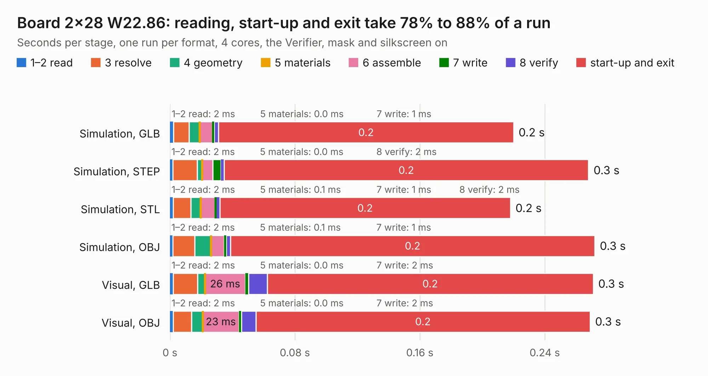

| Mode and format | 1–2 read | 3 resolve | 4 geometry | 5 materials | 6 assemble | 7 write | 8 verify | start-up and exit | Total |
|---|---:|---:|---:|---:|---:|---:|---:|---:|---:|
| Simulation, GLB | 2&nbsp;ms | 10&nbsp;ms | 7&nbsp;ms | 0.0&nbsp;ms | 8&nbsp;ms | 1&nbsp;ms | 3&nbsp;ms | 0.2 | 0.2 |
| Simulation, STEP | 2&nbsp;ms | 15&nbsp;ms | 3&nbsp;ms | 0.0&nbsp;ms | 7&nbsp;ms | 5&nbsp;ms | 2&nbsp;ms | 0.2 | 0.3 |
| Simulation, STL | 2&nbsp;ms | 11&nbsp;ms | 6&nbsp;ms | 0.1&nbsp;ms | 9&nbsp;ms | 1&nbsp;ms | 2&nbsp;ms | 0.2 | 0.2 |
| Simulation, OBJ | 2&nbsp;ms | 14&nbsp;ms | 10&nbsp;ms | 0.1&nbsp;ms | 8&nbsp;ms | 1&nbsp;ms | 3&nbsp;ms | 0.2 | 0.3 |
| Visual, GLB | 2&nbsp;ms | 15&nbsp;ms | 5&nbsp;ms | 0.0&nbsp;ms | 26&nbsp;ms | 2&nbsp;ms | 12&nbsp;ms | 0.2 | 0.3 |
| Visual, OBJ | 2&nbsp;ms | 12&nbsp;ms | 7&nbsp;ms | 0.0&nbsp;ms | 23&nbsp;ms | 2&nbsp;ms | 9&nbsp;ms | 0.2 | 0.3 |

<table align="center"><tr><td valign="top">

| Board | Repo: [andrewpaterson/658-Computer](https://github.com/andrewpaterson/658-Computer) Board: `Board 2x28 W22.86.kicad_pcb` |
|---|---|
| Folder | Kicad / Boards / Pins / Board 2x28 W22.86 |
| Complexity | 47&nbsp;/&nbsp;1000 (size&nbsp;17, features&nbsp;30) |
| KESE&nbsp;features | stack-up, dielectric εr and tanδ |
| Tested | 9th November 2026 |
| Copper&nbsp;layers | 2 |
| File&nbsp;format | KiCad 9 (20241229) |
| Parts,&nbsp;tracks,&nbsp;vias | 0, 0, 0 |
| Triangles,&nbsp;simulation | 72 in 3 parts |
| Note | no components |
| Verifier | PASS in all six runs |

</td><td valign="top">

<table>
<tr><th>File type</th><th>File size</th><th>Peak memory used</th></tr>
<tr><th colspan="3" align="left">Simulation</th></tr>
<tr><td>GLB</td><td align="right">6.3&nbsp;kB</td><td align="right">37&nbsp;MB</td></tr>
<tr><td>STEP</td><td align="right">30&nbsp;kB</td><td align="right">37&nbsp;MB</td></tr>
<tr><td>STL</td><td align="right">3.9&nbsp;kB</td><td align="right">36&nbsp;MB</td></tr>
<tr><td>OBJ</td><td align="right">10&nbsp;kB</td><td align="right">37&nbsp;MB</td></tr>
<tr><th colspan="3" align="left">Visual</th></tr>
<tr><td>GLB</td><td align="right">7.7&nbsp;kB</td><td align="right">38&nbsp;MB</td></tr>
<tr><td>OBJ</td><td align="right">10&nbsp;kB</td><td align="right">41&nbsp;MB</td></tr>
</table>

</td></tr></table>

## 142. Board 2x32 W15.24

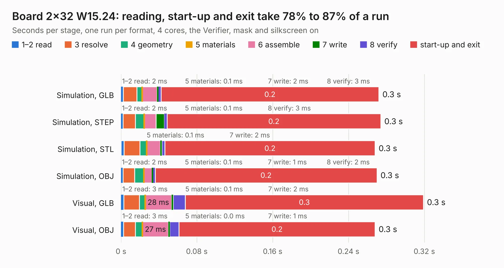

| Mode and format | 1–2 read | 3 resolve | 4 geometry | 5 materials | 6 assemble | 7 write | 8 verify | start-up and exit | Total |
|---|---:|---:|---:|---:|---:|---:|---:|---:|---:|
| Simulation, GLB | 2&nbsp;ms | 14&nbsp;ms | 5&nbsp;ms | 0.1&nbsp;ms | 16&nbsp;ms | 2&nbsp;ms | 3&nbsp;ms | 0.2 | 0.3 |
| Simulation, STEP | 2&nbsp;ms | 13&nbsp;ms | 9&nbsp;ms | 0.1&nbsp;ms | 12&nbsp;ms | 9&nbsp;ms | 3&nbsp;ms | 0.2 | 0.3 |
| Simulation, STL | 3&nbsp;ms | 17&nbsp;ms | 7&nbsp;ms | 0.1&nbsp;ms | 14&nbsp;ms | 2&nbsp;ms | 3&nbsp;ms | 0.2 | 0.3 |
| Simulation, OBJ | 2&nbsp;ms | 12&nbsp;ms | 10&nbsp;ms | 0.1&nbsp;ms | 8&nbsp;ms | 1&nbsp;ms | 2&nbsp;ms | 0.2 | 0.3 |
| Visual, GLB | 3&nbsp;ms | 17&nbsp;ms | 6&nbsp;ms | 0.1&nbsp;ms | 28&nbsp;ms | 2&nbsp;ms | 13&nbsp;ms | 0.3 | 0.3 |
| Visual, OBJ | 3&nbsp;ms | 12&nbsp;ms | 7&nbsp;ms | 0.0&nbsp;ms | 27&nbsp;ms | 1&nbsp;ms | 10&nbsp;ms | 0.2 | 0.3 |

<table align="center"><tr><td valign="top">

| Board | Repo: [andrewpaterson/658-Computer](https://github.com/andrewpaterson/658-Computer) Board: `Board 2x32 W15.24.kicad_pcb` |
|---|---|
| Folder | Kicad / Boards / Pins / Board 2x32 W15.24 |
| Complexity | 47&nbsp;/&nbsp;1000 (size&nbsp;17, features&nbsp;30) |
| KESE&nbsp;features | stack-up, dielectric εr and tanδ |
| Tested | 9th November 2026 |
| Copper&nbsp;layers | 2 |
| File&nbsp;format | KiCad 9 (20241229) |
| Parts,&nbsp;tracks,&nbsp;vias | 0, 0, 0 |
| Triangles,&nbsp;simulation | 72 in 3 parts |
| Note | no components |
| Verifier | PASS in all six runs |

</td><td valign="top">

<table>
<tr><th>File type</th><th>File size</th><th>Peak memory used</th></tr>
<tr><th colspan="3" align="left">Simulation</th></tr>
<tr><td>GLB</td><td align="right">6.3&nbsp;kB</td><td align="right">37&nbsp;MB</td></tr>
<tr><td>STEP</td><td align="right">29&nbsp;kB</td><td align="right">37&nbsp;MB</td></tr>
<tr><td>STL</td><td align="right">3.9&nbsp;kB</td><td align="right">37&nbsp;MB</td></tr>
<tr><td>OBJ</td><td align="right">10&nbsp;kB</td><td align="right">37&nbsp;MB</td></tr>
<tr><th colspan="3" align="left">Visual</th></tr>
<tr><td>GLB</td><td align="right">7.7&nbsp;kB</td><td align="right">40&nbsp;MB</td></tr>
<tr><td>OBJ</td><td align="right">10&nbsp;kB</td><td align="right">41&nbsp;MB</td></tr>
</table>

</td></tr></table>

## 143. Board 2x32 W22.86

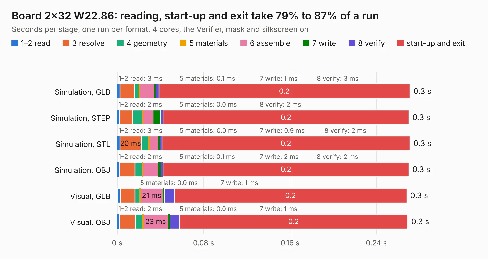

| Mode and format | 1–2 read | 3 resolve | 4 geometry | 5 materials | 6 assemble | 7 write | 8 verify | start-up and exit | Total |
|---|---:|---:|---:|---:|---:|---:|---:|---:|---:|
| Simulation, GLB | 3&nbsp;ms | 14&nbsp;ms | 4&nbsp;ms | 0.1&nbsp;ms | 14&nbsp;ms | 1&nbsp;ms | 3&nbsp;ms | 0.2 | 0.3 |
| Simulation, STEP | 2&nbsp;ms | 12&nbsp;ms | 9&nbsp;ms | 0.0&nbsp;ms | 10&nbsp;ms | 7&nbsp;ms | 2&nbsp;ms | 0.2 | 0.3 |
| Simulation, STL | 3&nbsp;ms | 20&nbsp;ms | 7&nbsp;ms | 0.0&nbsp;ms | 9&nbsp;ms | 0.9&nbsp;ms | 2&nbsp;ms | 0.2 | 0.3 |
| Simulation, OBJ | 2&nbsp;ms | 14&nbsp;ms | 7&nbsp;ms | 0.1&nbsp;ms | 15&nbsp;ms | 2&nbsp;ms | 2&nbsp;ms | 0.2 | 0.3 |
| Visual, GLB | 3&nbsp;ms | 14&nbsp;ms | 5&nbsp;ms | 0.0&nbsp;ms | 21&nbsp;ms | 1&nbsp;ms | 10&nbsp;ms | 0.2 | 0.3 |
| Visual, OBJ | 2&nbsp;ms | 14&nbsp;ms | 7&nbsp;ms | 0.0&nbsp;ms | 23&nbsp;ms | 1&nbsp;ms | 9&nbsp;ms | 0.2 | 0.3 |

<table align="center"><tr><td valign="top">

| Board | Repo: [andrewpaterson/658-Computer](https://github.com/andrewpaterson/658-Computer) Board: `Board 2x32 W22.86.kicad_pcb` |
|---|---|
| Folder | Kicad / Boards / Pins / Board 2x32 W22.86 |
| Complexity | 47&nbsp;/&nbsp;1000 (size&nbsp;17, features&nbsp;30) |
| KESE&nbsp;features | stack-up, dielectric εr and tanδ |
| Tested | 9th November 2026 |
| Copper&nbsp;layers | 2 |
| File&nbsp;format | KiCad 9 (20241229) |
| Parts,&nbsp;tracks,&nbsp;vias | 0, 0, 0 |
| Triangles,&nbsp;simulation | 72 in 3 parts |
| Note | no components |
| Verifier | PASS in all six runs |

</td><td valign="top">

<table>
<tr><th>File type</th><th>File size</th><th>Peak memory used</th></tr>
<tr><th colspan="3" align="left">Simulation</th></tr>
<tr><td>GLB</td><td align="right">6.3&nbsp;kB</td><td align="right">37&nbsp;MB</td></tr>
<tr><td>STEP</td><td align="right">29&nbsp;kB</td><td align="right">37&nbsp;MB</td></tr>
<tr><td>STL</td><td align="right">3.9&nbsp;kB</td><td align="right">37&nbsp;MB</td></tr>
<tr><td>OBJ</td><td align="right">10&nbsp;kB</td><td align="right">37&nbsp;MB</td></tr>
<tr><th colspan="3" align="left">Visual</th></tr>
<tr><td>GLB</td><td align="right">7.7&nbsp;kB</td><td align="right">38&nbsp;MB</td></tr>
<tr><td>OBJ</td><td align="right">10&nbsp;kB</td><td align="right">37&nbsp;MB</td></tr>
</table>

</td></tr></table>

## 144. Board 2x36 W22.86

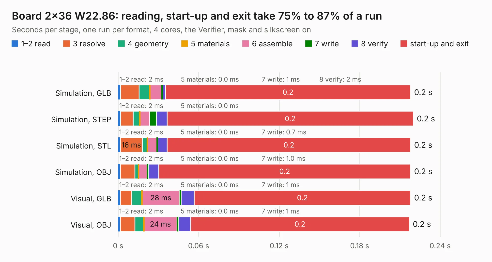

| Mode and format | 1–2 read | 3 resolve | 4 geometry | 5 materials | 6 assemble | 7 write | 8 verify | start-up and exit | Total |
|---|---:|---:|---:|---:|---:|---:|---:|---:|---:|
| Simulation, GLB | 2&nbsp;ms | 14&nbsp;ms | 8&nbsp;ms | 0.0&nbsp;ms | 8&nbsp;ms | 1&nbsp;ms | 2&nbsp;ms | 0.2 | 0.2 |
| Simulation, STEP | 2&nbsp;ms | 9&nbsp;ms | 5&nbsp;ms | 0.0&nbsp;ms | 7&nbsp;ms | 5&nbsp;ms | 8&nbsp;ms | 0.2 | 0.2 |
| Simulation, STL | 2&nbsp;ms | 16&nbsp;ms | 4&nbsp;ms | 0.0&nbsp;ms | 7&nbsp;ms | 0.7&nbsp;ms | 7&nbsp;ms | 0.2 | 0.2 |
| Simulation, OBJ | 2&nbsp;ms | 11&nbsp;ms | 3&nbsp;ms | 0.0&nbsp;ms | 6&nbsp;ms | 1.0&nbsp;ms | 8&nbsp;ms | 0.2 | 0.2 |
| Visual, GLB | 2&nbsp;ms | 8&nbsp;ms | 8&nbsp;ms | 0.0&nbsp;ms | 28&nbsp;ms | 1&nbsp;ms | 10&nbsp;ms | 0.2 | 0.2 |
| Visual, OBJ | 2&nbsp;ms | 11&nbsp;ms | 7&nbsp;ms | 0.0&nbsp;ms | 24&nbsp;ms | 1&nbsp;ms | 9&nbsp;ms | 0.2 | 0.2 |

<table align="center"><tr><td valign="top">

| Board | Repo: [andrewpaterson/658-Computer](https://github.com/andrewpaterson/658-Computer) Board: `Board 2x36 W22.86.kicad_pcb` |
|---|---|
| Folder | Kicad / Boards / Pins / Board 2x36 W22.86 |
| Complexity | 47&nbsp;/&nbsp;1000 (size&nbsp;17, features&nbsp;30) |
| KESE&nbsp;features | stack-up, dielectric εr and tanδ |
| Tested | 9th November 2026 |
| Copper&nbsp;layers | 2 |
| File&nbsp;format | KiCad 9 (20241229) |
| Parts,&nbsp;tracks,&nbsp;vias | 0, 0, 0 |
| Triangles,&nbsp;simulation | 72 in 3 parts |
| Note | no components |
| Verifier | PASS in all six runs |

</td><td valign="top">

<table>
<tr><th>File type</th><th>File size</th><th>Peak memory used</th></tr>
<tr><th colspan="3" align="left">Simulation</th></tr>
<tr><td>GLB</td><td align="right">6.3&nbsp;kB</td><td align="right">37&nbsp;MB</td></tr>
<tr><td>STEP</td><td align="right">29&nbsp;kB</td><td align="right">37&nbsp;MB</td></tr>
<tr><td>STL</td><td align="right">3.9&nbsp;kB</td><td align="right">37&nbsp;MB</td></tr>
<tr><td>OBJ</td><td align="right">10&nbsp;kB</td><td align="right">37&nbsp;MB</td></tr>
<tr><th colspan="3" align="left">Visual</th></tr>
<tr><td>GLB</td><td align="right">7.7&nbsp;kB</td><td align="right">40&nbsp;MB</td></tr>
<tr><td>OBJ</td><td align="right">10&nbsp;kB</td><td align="right">38&nbsp;MB</td></tr>
</table>

</td></tr></table>

## 145. Audio Address Decode

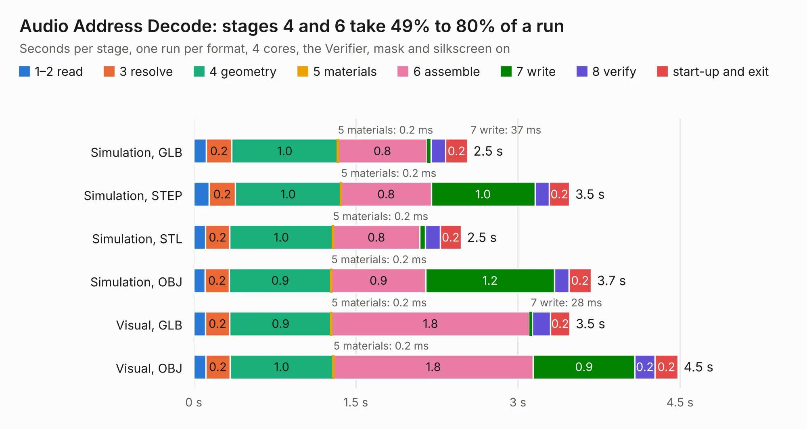

| Mode and format | 1–2 read | 3 resolve | 4 geometry | 5 materials | 6 assemble | 7 write | 8 verify | start-up and exit | Total |
|---|---:|---:|---:|---:|---:|---:|---:|---:|---:|
| Simulation, GLB | 0.1 | 0.2 | 1.0 | 0.2&nbsp;ms | 0.8 | 37&nbsp;ms | 0.1 | 0.2 | 2.5 |
| Simulation, STEP | 0.1 | 0.2 | 1.0 | 0.2&nbsp;ms | 0.8 | 1.0 | 0.1 | 0.2 | 3.5 |
| Simulation, STL | 0.1 | 0.2 | 1.0 | 0.2&nbsp;ms | 0.8 | 52&nbsp;ms | 0.1 | 0.2 | 2.5 |
| Simulation, OBJ | 0.1 | 0.2 | 0.9 | 0.2&nbsp;ms | 0.9 | 1.2 | 0.1 | 0.2 | 3.7 |
| Visual, GLB | 0.1 | 0.2 | 0.9 | 0.2&nbsp;ms | 1.8 | 28&nbsp;ms | 0.2 | 0.2 | 3.5 |
| Visual, OBJ | 0.1 | 0.2 | 1.0 | 0.2&nbsp;ms | 1.8 | 0.9 | 0.2 | 0.2 | 4.5 |

<table align="center"><tr><td valign="top">

| Board | Repo: [andrewpaterson/658-Computer](https://github.com/andrewpaterson/658-Computer) Board: `Audio Address Decode.kicad_pcb` |
|---|---|
| Folder | Kicad / Computer / Audio / Audio Address Decode |
| Complexity | 205&nbsp;/&nbsp;1000 (size&nbsp;135, features&nbsp;70) |
| KESE&nbsp;features | through vias, rounded, trapezoid or chamfered pads, knockout text, stack-up, dielectric εr and tanδ |
| Tested | 9th November 2026 |
| Copper&nbsp;layers | 2 |
| File&nbsp;format | KiCad 9 (20241229) |
| Parts,&nbsp;tracks,&nbsp;vias | 8, 237, 28 |
| Triangles,&nbsp;simulation | 236,188 in 37 parts |
| Verifier | PASS in all six runs |

</td><td valign="top">

<table>
<tr><th>File type</th><th>File size</th><th>Peak memory used</th></tr>
<tr><th colspan="3" align="left">Simulation</th></tr>
<tr><td>GLB</td><td align="right">8.2&nbsp;MB</td><td align="right">219&nbsp;MB</td></tr>
<tr><td>STEP</td><td align="right">37&nbsp;MB</td><td align="right">245&nbsp;MB</td></tr>
<tr><td>STL</td><td align="right">12&nbsp;MB</td><td align="right">216&nbsp;MB</td></tr>
<tr><td>OBJ</td><td align="right">24&nbsp;MB</td><td align="right">214&nbsp;MB</td></tr>
<tr><th colspan="3" align="left">Visual</th></tr>
<tr><td>GLB</td><td align="right">6.1&nbsp;MB</td><td align="right">211&nbsp;MB</td></tr>
<tr><td>OBJ</td><td align="right">18&nbsp;MB</td><td align="right">216&nbsp;MB</td></tr>
</table>

</td></tr></table>

## 146. Audio Board

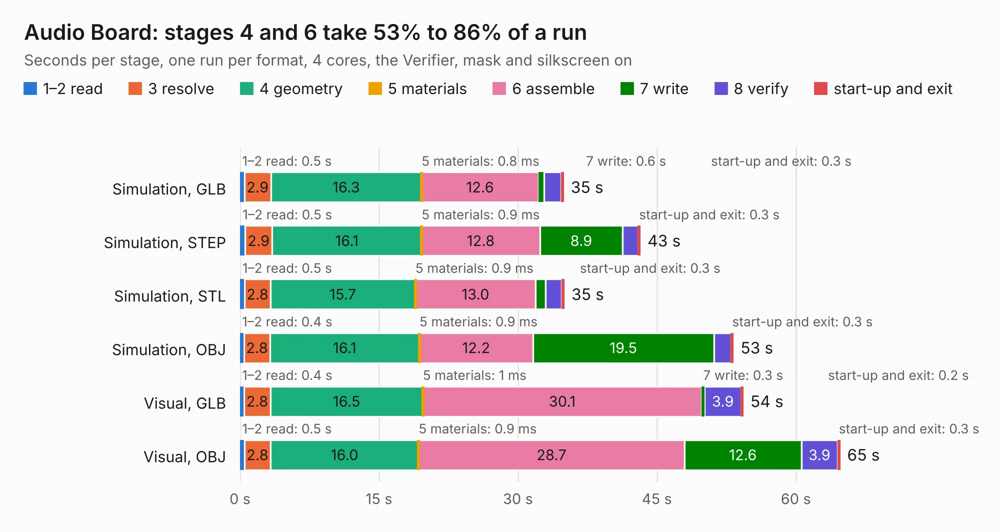

| Mode and format | 1–2 read | 3 resolve | 4 geometry | 5 materials | 6 assemble | 7 write | 8 verify | start-up and exit | Total |
|---|---:|---:|---:|---:|---:|---:|---:|---:|---:|
| Simulation, GLB | 0.5 | 2.9 | 16.3 | 0.8&nbsp;ms | 12.6 | 0.6 | 1.8 | 0.3 | 34.9 |
| Simulation, STEP | 0.5 | 2.9 | 16.1 | 0.9&nbsp;ms | 12.8 | 8.9 | 1.7 | 0.3 | 43.2 |
| Simulation, STL | 0.5 | 2.8 | 15.7 | 0.9&nbsp;ms | 13.0 | 1.0 | 1.8 | 0.3 | 35.0 |
| Simulation, OBJ | 0.4 | 2.8 | 16.1 | 0.9&nbsp;ms | 12.2 | 19.5 | 1.9 | 0.3 | 53.3 |
| Visual, GLB | 0.4 | 2.8 | 16.5 | 1&nbsp;ms | 30.1 | 0.3 | 3.9 | 0.2 | 54.3 |
| Visual, OBJ | 0.5 | 2.8 | 16.0 | 0.9&nbsp;ms | 28.7 | 12.6 | 3.9 | 0.3 | 64.8 |

<table align="center"><tr><td valign="top">

| Board | Repo: [andrewpaterson/658-Computer](https://github.com/andrewpaterson/658-Computer) Board: `Audio Board.kicad_pcb` |
|---|---|
| Folder | Kicad / Computer / Audio / Audio Board |
| Complexity | 263&nbsp;/&nbsp;1000 (size&nbsp;183, features&nbsp;80) |
| KESE&nbsp;features | through vias, rounded, trapezoid or chamfered pads, curved board outline, knockout text, stack-up, dielectric εr and tanδ |
| Tested | 9th November 2026 |
| Copper&nbsp;layers | 2 |
| File&nbsp;format | KiCad 9 (20241229) |
| Parts,&nbsp;tracks,&nbsp;vias | 23, 2,507, 229 |
| Triangles,&nbsp;simulation | 3,598,500 in 299 parts |
| Verifier | PASS in all six runs |

</td><td valign="top">

<table>
<tr><th>File type</th><th>File size</th><th>Peak memory used</th></tr>
<tr><th colspan="3" align="left">Simulation</th></tr>
<tr><td>GLB</td><td align="right">120&nbsp;MB</td><td align="right">1.2&nbsp;GB</td></tr>
<tr><td>STEP</td><td align="right">501&nbsp;MB</td><td align="right">1.4&nbsp;GB</td></tr>
<tr><td>STL</td><td align="right">180&nbsp;MB</td><td align="right">1.1&nbsp;GB</td></tr>
<tr><td>OBJ</td><td align="right">377&nbsp;MB</td><td align="right">2.3&nbsp;GB</td></tr>
<tr><th colspan="3" align="left">Visual</th></tr>
<tr><td>GLB</td><td align="right">78&nbsp;MB</td><td align="right">1.6&nbsp;GB</td></tr>
<tr><td>OBJ</td><td align="right">248&nbsp;MB</td><td align="right">1.7&nbsp;GB</td></tr>
</table>

</td></tr></table>

## 147. Audio Clock

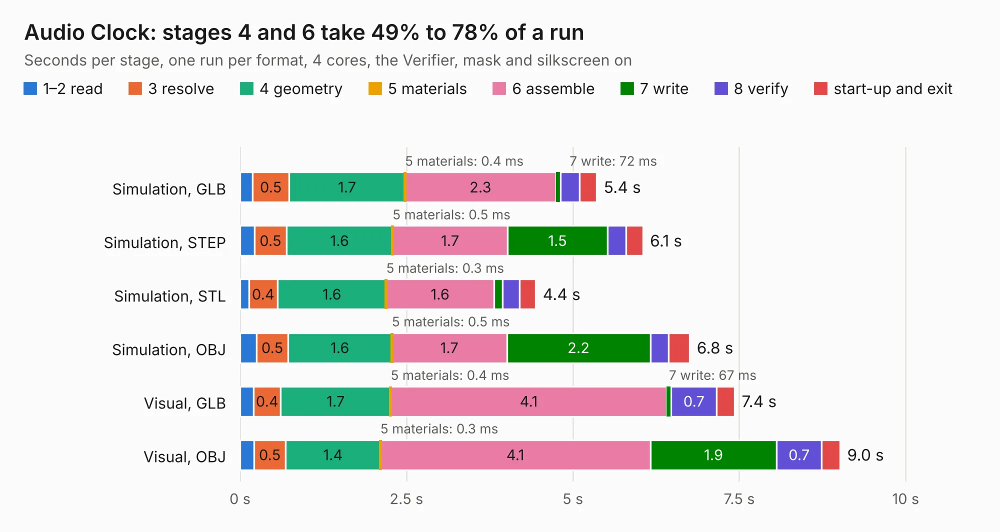

| Mode and format | 1–2 read | 3 resolve | 4 geometry | 5 materials | 6 assemble | 7 write | 8 verify | start-up and exit | Total |
|---|---:|---:|---:|---:|---:|---:|---:|---:|---:|
| Simulation, GLB | 0.2 | 0.5 | 1.7 | 0.4&nbsp;ms | 2.3 | 72&nbsp;ms | 0.3 | 0.3 | 5.4 |
| Simulation, STEP | 0.2 | 0.5 | 1.6 | 0.5&nbsp;ms | 1.7 | 1.5 | 0.3 | 0.3 | 6.1 |
| Simulation, STL | 0.1 | 0.4 | 1.6 | 0.3&nbsp;ms | 1.6 | 0.1 | 0.3 | 0.2 | 4.4 |
| Simulation, OBJ | 0.3 | 0.5 | 1.6 | 0.5&nbsp;ms | 1.7 | 2.2 | 0.3 | 0.3 | 6.8 |
| Visual, GLB | 0.2 | 0.4 | 1.7 | 0.4&nbsp;ms | 4.1 | 67&nbsp;ms | 0.7 | 0.3 | 7.4 |
| Visual, OBJ | 0.2 | 0.5 | 1.4 | 0.3&nbsp;ms | 4.1 | 1.9 | 0.7 | 0.3 | 9.0 |

<table align="center"><tr><td valign="top">

| Board | Repo: [andrewpaterson/658-Computer](https://github.com/andrewpaterson/658-Computer) Board: `Audio Clock.kicad_pcb` |
|---|---|
| Folder | Kicad / Computer / Audio / Audio Clock |
| Complexity | 227&nbsp;/&nbsp;1000 (size&nbsp;157, features&nbsp;70) |
| KESE&nbsp;features | through vias, rounded, trapezoid or chamfered pads, knockout text, stack-up, dielectric εr and tanδ |
| Tested | 9th November 2026 |
| Copper&nbsp;layers | 2 |
| File&nbsp;format | KiCad 9 (20241229) |
| Parts,&nbsp;tracks,&nbsp;vias | 23, 449, 67 |
| Triangles,&nbsp;simulation | 413,586 in 67 parts |
| Verifier | PASS in all six runs |

</td><td valign="top">

<table>
<tr><th>File type</th><th>File size</th><th>Peak memory used</th></tr>
<tr><th colspan="3" align="left">Simulation</th></tr>
<tr><td>GLB</td><td align="right">14&nbsp;MB</td><td align="right">268&nbsp;MB</td></tr>
<tr><td>STEP</td><td align="right">62&nbsp;MB</td><td align="right">323&nbsp;MB</td></tr>
<tr><td>STL</td><td align="right">21&nbsp;MB</td><td align="right">269&nbsp;MB</td></tr>
<tr><td>OBJ</td><td align="right">42&nbsp;MB</td><td align="right">330&nbsp;MB</td></tr>
<tr><th colspan="3" align="left">Visual</th></tr>
<tr><td>GLB</td><td align="right">11&nbsp;MB</td><td align="right">343&nbsp;MB</td></tr>
<tr><td>OBJ</td><td align="right">34&nbsp;MB</td><td align="right">329&nbsp;MB</td></tr>
</table>

</td></tr></table>

## 148. Blitter Board

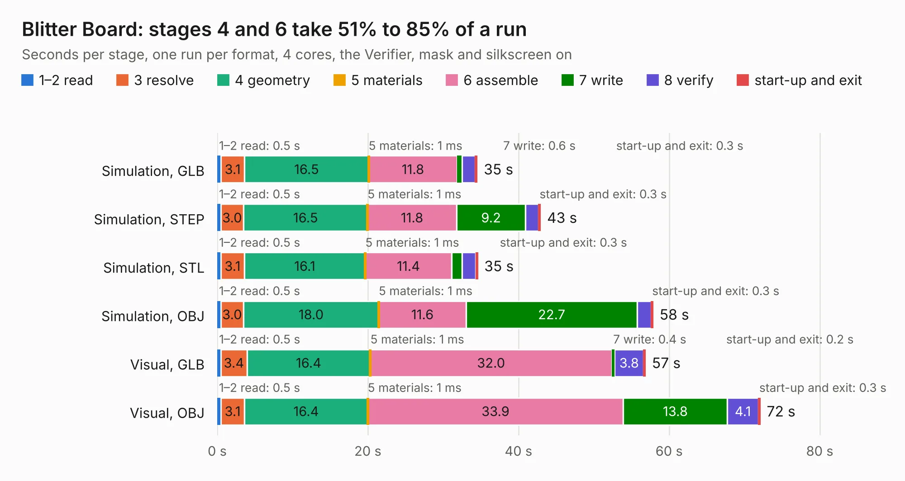

| Mode and format | 1–2 read | 3 resolve | 4 geometry | 5 materials | 6 assemble | 7 write | 8 verify | start-up and exit | Total |
|---|---:|---:|---:|---:|---:|---:|---:|---:|---:|
| Simulation, GLB | 0.5 | 3.1 | 16.5 | 1&nbsp;ms | 11.8 | 0.6 | 1.8 | 0.3 | 34.5 |
| Simulation, STEP | 0.5 | 3.0 | 16.5 | 1&nbsp;ms | 11.8 | 9.2 | 1.7 | 0.3 | 42.9 |
| Simulation, STL | 0.5 | 3.1 | 16.1 | 1&nbsp;ms | 11.4 | 1.4 | 1.8 | 0.3 | 34.6 |
| Simulation, OBJ | 0.5 | 3.0 | 18.0 | 1&nbsp;ms | 11.6 | 22.7 | 1.9 | 0.3 | 57.9 |
| Visual, GLB | 0.5 | 3.4 | 16.4 | 1&nbsp;ms | 32.0 | 0.4 | 3.8 | 0.2 | 56.9 |
| Visual, OBJ | 0.5 | 3.1 | 16.4 | 1&nbsp;ms | 33.9 | 13.8 | 4.1 | 0.3 | 72.1 |

<table align="center"><tr><td valign="top">

| Board | Repo: [andrewpaterson/658-Computer](https://github.com/andrewpaterson/658-Computer) Board: `Blitter Board.kicad_pcb` |
|---|---|
| Folder | Kicad / Computer / Blitter / Blitter Board |
| Complexity | 264&nbsp;/&nbsp;1000 (size&nbsp;184, features&nbsp;80) |
| KESE&nbsp;features | through vias, rounded, trapezoid or chamfered pads, curved board outline, knockout text, stack-up, dielectric εr and tanδ |
| Tested | 9th November 2026 |
| Copper&nbsp;layers | 2 |
| File&nbsp;format | KiCad 9 (20241229) |
| Parts,&nbsp;tracks,&nbsp;vias | 22, 2,712, 230 |
| Triangles,&nbsp;simulation | 3,921,994 in 339 parts |
| Verifier | PASS in all six runs |

</td><td valign="top">

<table>
<tr><th>File type</th><th>File size</th><th>Peak memory used</th></tr>
<tr><th colspan="3" align="left">Simulation</th></tr>
<tr><td>GLB</td><td align="right">131&nbsp;MB</td><td align="right">1.3&nbsp;GB</td></tr>
<tr><td>STEP</td><td align="right">550&nbsp;MB</td><td align="right">1.5&nbsp;GB</td></tr>
<tr><td>STL</td><td align="right">196&nbsp;MB</td><td align="right">1.3&nbsp;GB</td></tr>
<tr><td>OBJ</td><td align="right">412&nbsp;MB</td><td align="right">2.5&nbsp;GB</td></tr>
<tr><th colspan="3" align="left">Visual</th></tr>
<tr><td>GLB</td><td align="right">86&nbsp;MB</td><td align="right">1.5&nbsp;GB</td></tr>
<tr><td>OBJ</td><td align="right">272&nbsp;MB</td><td align="right">1.8&nbsp;GB</td></tr>
</table>

</td></tr></table>

## 149. Added 8bit

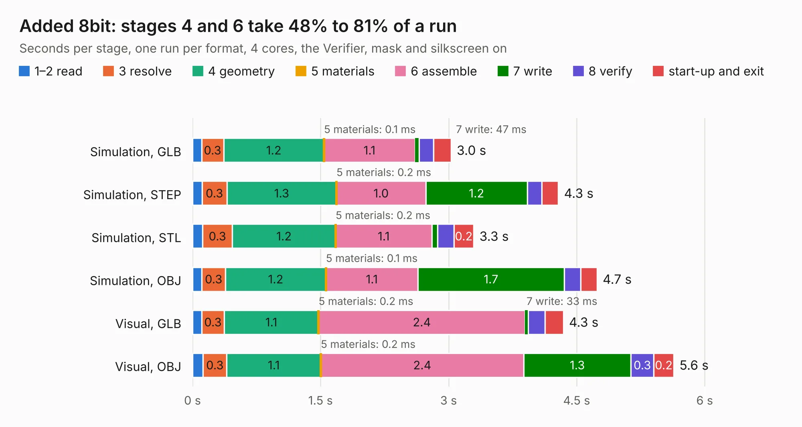

| Mode and format | 1–2 read | 3 resolve | 4 geometry | 5 materials | 6 assemble | 7 write | 8 verify | start-up and exit | Total |
|---|---:|---:|---:|---:|---:|---:|---:|---:|---:|
| Simulation, GLB | 0.1 | 0.3 | 1.2 | 0.1&nbsp;ms | 1.1 | 47&nbsp;ms | 0.2 | 0.2 | 3.0 |
| Simulation, STEP | 0.1 | 0.3 | 1.3 | 0.2&nbsp;ms | 1.0 | 1.2 | 0.2 | 0.2 | 4.3 |
| Simulation, STL | 0.1 | 0.3 | 1.2 | 0.2&nbsp;ms | 1.1 | 67&nbsp;ms | 0.2 | 0.2 | 3.3 |
| Simulation, OBJ | 0.1 | 0.3 | 1.2 | 0.1&nbsp;ms | 1.1 | 1.7 | 0.2 | 0.2 | 4.7 |
| Visual, GLB | 0.1 | 0.3 | 1.1 | 0.2&nbsp;ms | 2.4 | 33&nbsp;ms | 0.2 | 0.2 | 4.3 |
| Visual, OBJ | 0.1 | 0.3 | 1.1 | 0.2&nbsp;ms | 2.4 | 1.3 | 0.3 | 0.2 | 5.6 |

<table align="center"><tr><td valign="top">

| Board | Repo: [andrewpaterson/658-Computer](https://github.com/andrewpaterson/658-Computer) Board: `Added 8bit.kicad_pcb` |
|---|---|
| Folder | Kicad / Computer / Component Boards / Added 8bit |
| Complexity | 206&nbsp;/&nbsp;1000 (size&nbsp;136, features&nbsp;70) |
| KESE&nbsp;features | through vias, rounded, trapezoid or chamfered pads, knockout text, stack-up, dielectric εr and tanδ |
| Tested | 9th November 2026 |
| Copper&nbsp;layers | 2 |
| File&nbsp;format | KiCad 9 (20241229) |
| Parts,&nbsp;tracks,&nbsp;vias | 7, 238, 43 |
| Triangles,&nbsp;simulation | 301,014 in 39 parts |
| Verifier | PASS in all six runs |

</td><td valign="top">

<table>
<tr><th>File type</th><th>File size</th><th>Peak memory used</th></tr>
<tr><th colspan="3" align="left">Simulation</th></tr>
<tr><td>GLB</td><td align="right">10&nbsp;MB</td><td align="right">245&nbsp;MB</td></tr>
<tr><td>STEP</td><td align="right">46&nbsp;MB</td><td align="right">265&nbsp;MB</td></tr>
<tr><td>STL</td><td align="right">15&nbsp;MB</td><td align="right">245&nbsp;MB</td></tr>
<tr><td>OBJ</td><td align="right">30&nbsp;MB</td><td align="right">245&nbsp;MB</td></tr>
<tr><th colspan="3" align="left">Visual</th></tr>
<tr><td>GLB</td><td align="right">7.3&nbsp;MB</td><td align="right">245&nbsp;MB</td></tr>
<tr><td>OBJ</td><td align="right">22&nbsp;MB</td><td align="right">251&nbsp;MB</td></tr>
</table>

</td></tr></table>

## 150. Adder 16bit

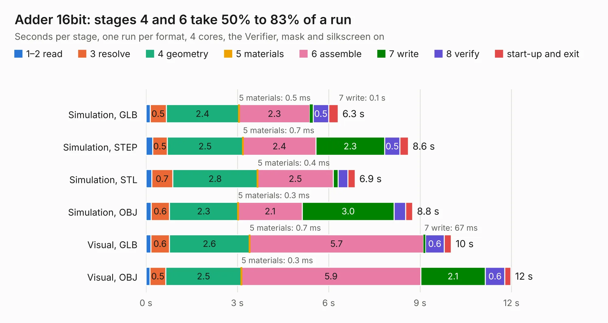

| Mode and format | 1–2 read | 3 resolve | 4 geometry | 5 materials | 6 assemble | 7 write | 8 verify | start-up and exit | Total |
|---|---:|---:|---:|---:|---:|---:|---:|---:|---:|
| Simulation, GLB | 0.1 | 0.5 | 2.4 | 0.5&nbsp;ms | 2.3 | 0.1 | 0.5 | 0.3 | 6.3 |
| Simulation, STEP | 0.2 | 0.5 | 2.5 | 0.7&nbsp;ms | 2.4 | 2.3 | 0.5 | 0.3 | 8.6 |
| Simulation, STL | 0.2 | 0.7 | 2.8 | 0.4&nbsp;ms | 2.5 | 0.2 | 0.3 | 0.2 | 6.9 |
| Simulation, OBJ | 0.2 | 0.6 | 2.3 | 0.3&nbsp;ms | 2.1 | 3.0 | 0.4 | 0.2 | 8.8 |
| Visual, GLB | 0.2 | 0.6 | 2.6 | 0.7&nbsp;ms | 5.7 | 67&nbsp;ms | 0.6 | 0.2 | 10.0 |
| Visual, OBJ | 0.1 | 0.5 | 2.5 | 0.3&nbsp;ms | 5.9 | 2.1 | 0.6 | 0.2 | 12.0 |

<table align="center"><tr><td valign="top">

| Board | Repo: [andrewpaterson/658-Computer](https://github.com/andrewpaterson/658-Computer) Board: `Adder 16bit.kicad_pcb` |
|---|---|
| Folder | Kicad / Computer / Component Boards / Adder 16bit |
| Complexity | 225&nbsp;/&nbsp;1000 (size&nbsp;155, features&nbsp;70) |
| KESE&nbsp;features | through vias, rounded, trapezoid or chamfered pads, knockout text, stack-up, dielectric εr and tanδ |
| Tested | 9th November 2026 |
| Copper&nbsp;layers | 2 |
| File&nbsp;format | KiCad 9 (20241229) |
| Parts,&nbsp;tracks,&nbsp;vias | 11, 627, 83 |
| Triangles,&nbsp;simulation | 565,568 in 65 parts |
| Verifier | PASS in all six runs |

</td><td valign="top">

<table>
<tr><th>File type</th><th>File size</th><th>Peak memory used</th></tr>
<tr><th colspan="3" align="left">Simulation</th></tr>
<tr><td>GLB</td><td align="right">20&nbsp;MB</td><td align="right">343&nbsp;MB</td></tr>
<tr><td>STEP</td><td align="right">90&nbsp;MB</td><td align="right">369&nbsp;MB</td></tr>
<tr><td>STL</td><td align="right">28&nbsp;MB</td><td align="right">335&nbsp;MB</td></tr>
<tr><td>OBJ</td><td align="right">57&nbsp;MB</td><td align="right">418&nbsp;MB</td></tr>
<tr><th colspan="3" align="left">Visual</th></tr>
<tr><td>GLB</td><td align="right">14&nbsp;MB</td><td align="right">388&nbsp;MB</td></tr>
<tr><td>OBJ</td><td align="right">42&nbsp;MB</td><td align="right">391&nbsp;MB</td></tr>
</table>

</td></tr></table>

## 151. Address Buffer 16bit

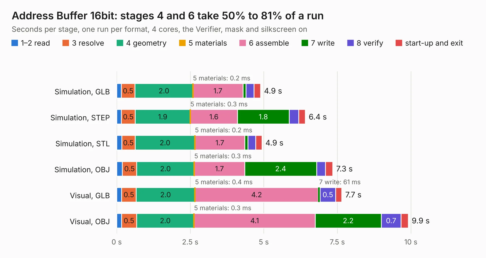

| Mode and format | 1–2 read | 3 resolve | 4 geometry | 5 materials | 6 assemble | 7 write | 8 verify | start-up and exit | Total |
|---|---:|---:|---:|---:|---:|---:|---:|---:|---:|
| Simulation, GLB | 0.2 | 0.5 | 2.0 | 0.2&nbsp;ms | 1.7 | 0.1 | 0.3 | 0.2 | 4.9 |
| Simulation, STEP | 0.2 | 0.5 | 1.9 | 0.3&nbsp;ms | 1.6 | 1.8 | 0.3 | 0.2 | 6.4 |
| Simulation, STL | 0.2 | 0.5 | 2.0 | 0.2&nbsp;ms | 1.7 | 0.1 | 0.3 | 0.2 | 4.9 |
| Simulation, OBJ | 0.2 | 0.5 | 2.0 | 0.3&nbsp;ms | 1.7 | 2.4 | 0.3 | 0.2 | 7.3 |
| Visual, GLB | 0.2 | 0.5 | 2.0 | 0.4&nbsp;ms | 4.2 | 61&nbsp;ms | 0.5 | 0.2 | 7.7 |
| Visual, OBJ | 0.2 | 0.5 | 2.0 | 0.3&nbsp;ms | 4.1 | 2.2 | 0.7 | 0.2 | 9.9 |

<table align="center"><tr><td valign="top">

| Board | Repo: [andrewpaterson/658-Computer](https://github.com/andrewpaterson/658-Computer) Board: `Address Buffer 16bit.kicad_pcb` |
|---|---|
| Folder | Kicad / Computer / Component Boards / Address Buffer 16bit |
| Complexity | 231&nbsp;/&nbsp;1000 (size&nbsp;161, features&nbsp;70) |
| KESE&nbsp;features | through vias, rounded, trapezoid or chamfered pads, knockout text, stack-up, dielectric εr and tanδ |
| Tested | 9th November 2026 |
| Copper&nbsp;layers | 2 |
| File&nbsp;format | KiCad 9 (20241229) |
| Parts,&nbsp;tracks,&nbsp;vias | 20, 636, 77 |
| Triangles,&nbsp;simulation | 484,576 in 63 parts |
| Verifier | PASS in all six runs |

</td><td valign="top">

<table>
<tr><th>File type</th><th>File size</th><th>Peak memory used</th></tr>
<tr><th colspan="3" align="left">Simulation</th></tr>
<tr><td>GLB</td><td align="right">17&nbsp;MB</td><td align="right">284&nbsp;MB</td></tr>
<tr><td>STEP</td><td align="right">80&nbsp;MB</td><td align="right">352&nbsp;MB</td></tr>
<tr><td>STL</td><td align="right">24&nbsp;MB</td><td align="right">287&nbsp;MB</td></tr>
<tr><td>OBJ</td><td align="right">49&nbsp;MB</td><td align="right">378&nbsp;MB</td></tr>
<tr><th colspan="3" align="left">Visual</th></tr>
<tr><td>GLB</td><td align="right">13&nbsp;MB</td><td align="right">367&nbsp;MB</td></tr>
<tr><td>OBJ</td><td align="right">39&nbsp;MB</td><td align="right">376&nbsp;MB</td></tr>
</table>

</td></tr></table>

## 152. Address Buffer 24bit

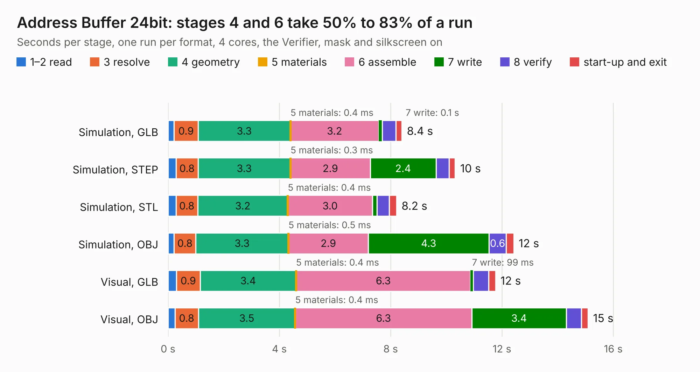

| Mode and format | 1–2 read | 3 resolve | 4 geometry | 5 materials | 6 assemble | 7 write | 8 verify | start-up and exit | Total |
|---|---:|---:|---:|---:|---:|---:|---:|---:|---:|
| Simulation, GLB | 0.2 | 0.9 | 3.3 | 0.4&nbsp;ms | 3.2 | 0.1 | 0.5 | 0.2 | 8.4 |
| Simulation, STEP | 0.3 | 0.8 | 3.3 | 0.3&nbsp;ms | 2.9 | 2.4 | 0.5 | 0.2 | 10.3 |
| Simulation, STL | 0.3 | 0.8 | 3.2 | 0.4&nbsp;ms | 3.0 | 0.2 | 0.4 | 0.3 | 8.2 |
| Simulation, OBJ | 0.2 | 0.8 | 3.3 | 0.5&nbsp;ms | 2.9 | 4.3 | 0.6 | 0.3 | 12.4 |
| Visual, GLB | 0.3 | 0.9 | 3.4 | 0.4&nbsp;ms | 6.3 | 99&nbsp;ms | 0.5 | 0.3 | 11.8 |
| Visual, OBJ | 0.2 | 0.8 | 3.5 | 0.4&nbsp;ms | 6.3 | 3.4 | 0.5 | 0.2 | 15.1 |

<table align="center"><tr><td valign="top">

| Board | Repo: [andrewpaterson/658-Computer](https://github.com/andrewpaterson/658-Computer) Board: `Address Buffer 24bit.kicad_pcb` |
|---|---|
| Folder | Kicad / Computer / Component Boards / Address Buffer 24bit |
| Complexity | 239&nbsp;/&nbsp;1000 (size&nbsp;169, features&nbsp;70) |
| KESE&nbsp;features | through vias, rounded, trapezoid or chamfered pads, knockout text, stack-up, dielectric εr and tanδ |
| Tested | 9th November 2026 |
| Copper&nbsp;layers | 2 |
| File&nbsp;format | KiCad 9 (20241229) |
| Parts,&nbsp;tracks,&nbsp;vias | 28, 857, 114 |
| Triangles,&nbsp;simulation | 684,690 in 87 parts |
| Verifier | PASS in all six runs |

</td><td valign="top">

<table>
<tr><th>File type</th><th>File size</th><th>Peak memory used</th></tr>
<tr><th colspan="3" align="left">Simulation</th></tr>
<tr><td>GLB</td><td align="right">24&nbsp;MB</td><td align="right">344&nbsp;MB</td></tr>
<tr><td>STEP</td><td align="right">112&nbsp;MB</td><td align="right">427&nbsp;MB</td></tr>
<tr><td>STL</td><td align="right">34&nbsp;MB</td><td align="right">357&nbsp;MB</td></tr>
<tr><td>OBJ</td><td align="right">70&nbsp;MB</td><td align="right">510&nbsp;MB</td></tr>
<tr><th colspan="3" align="left">Visual</th></tr>
<tr><td>GLB</td><td align="right">18&nbsp;MB</td><td align="right">503&nbsp;MB</td></tr>
<tr><td>OBJ</td><td align="right">55&nbsp;MB</td><td align="right">495&nbsp;MB</td></tr>
</table>

</td></tr></table>

## 153. Audio DAC

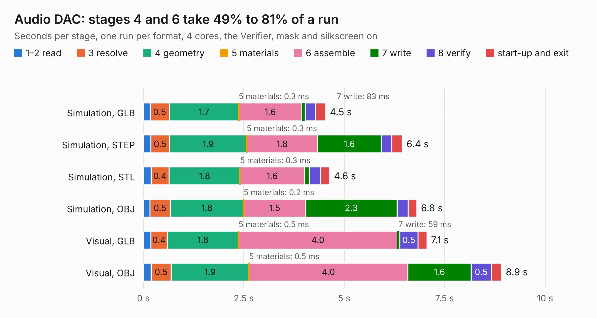

| Mode and format | 1–2 read | 3 resolve | 4 geometry | 5 materials | 6 assemble | 7 write | 8 verify | start-up and exit | Total |
|---|---:|---:|---:|---:|---:|---:|---:|---:|---:|
| Simulation, GLB | 0.2 | 0.5 | 1.7 | 0.3&nbsp;ms | 1.6 | 83&nbsp;ms | 0.3 | 0.2 | 4.5 |
| Simulation, STEP | 0.2 | 0.5 | 1.9 | 0.3&nbsp;ms | 1.8 | 1.6 | 0.3 | 0.3 | 6.4 |
| Simulation, STL | 0.2 | 0.4 | 1.8 | 0.3&nbsp;ms | 1.6 | 0.1 | 0.3 | 0.2 | 4.6 |
| Simulation, OBJ | 0.2 | 0.5 | 1.8 | 0.2&nbsp;ms | 1.5 | 2.3 | 0.3 | 0.2 | 6.8 |
| Visual, GLB | 0.2 | 0.4 | 1.8 | 0.5&nbsp;ms | 4.0 | 59&nbsp;ms | 0.5 | 0.2 | 7.1 |
| Visual, OBJ | 0.2 | 0.5 | 1.9 | 0.5&nbsp;ms | 4.0 | 1.6 | 0.5 | 0.3 | 8.9 |

<table align="center"><tr><td valign="top">

| Board | Repo: [andrewpaterson/658-Computer](https://github.com/andrewpaterson/658-Computer) Board: `Audio DAC.kicad_pcb` |
|---|---|
| Folder | Kicad / Computer / Component Boards / Audio DAC |
| Complexity | 228&nbsp;/&nbsp;1000 (size&nbsp;158, features&nbsp;70) |
| KESE&nbsp;features | through vias, rounded, trapezoid or chamfered pads, knockout text, stack-up, dielectric εr and tanδ |
| Tested | 9th November 2026 |
| Copper&nbsp;layers | 2 |
| File&nbsp;format | KiCad 9 (20241229) |
| Parts,&nbsp;tracks,&nbsp;vias | 30, 396, 54 |
| Triangles,&nbsp;simulation | 450,154 in 60 parts |
| Verifier | PASS in all six runs |

</td><td valign="top">

<table>
<tr><th>File type</th><th>File size</th><th>Peak memory used</th></tr>
<tr><th colspan="3" align="left">Simulation</th></tr>
<tr><td>GLB</td><td align="right">15&nbsp;MB</td><td align="right">287&nbsp;MB</td></tr>
<tr><td>STEP</td><td align="right">68&nbsp;MB</td><td align="right">336&nbsp;MB</td></tr>
<tr><td>STL</td><td align="right">23&nbsp;MB</td><td align="right">290&nbsp;MB</td></tr>
<tr><td>OBJ</td><td align="right">45&nbsp;MB</td><td align="right">353&nbsp;MB</td></tr>
<tr><th colspan="3" align="left">Visual</th></tr>
<tr><td>GLB</td><td align="right">12&nbsp;MB</td><td align="right">349&nbsp;MB</td></tr>
<tr><td>OBJ</td><td align="right">35&nbsp;MB</td><td align="right">343&nbsp;MB</td></tr>
</table>

</td></tr></table>

## 154. Big Board

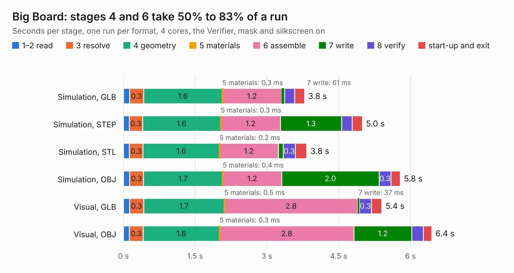

| Mode and format | 1–2 read | 3 resolve | 4 geometry | 5 materials | 6 assemble | 7 write | 8 verify | start-up and exit | Total |
|---|---:|---:|---:|---:|---:|---:|---:|---:|---:|
| Simulation, GLB | 0.1 | 0.3 | 1.6 | 0.3&nbsp;ms | 1.2 | 61&nbsp;ms | 0.2 | 0.2 | 3.8 |
| Simulation, STEP | 0.1 | 0.3 | 1.6 | 0.3&nbsp;ms | 1.2 | 1.3 | 0.2 | 0.2 | 5.0 |
| Simulation, STL | 0.1 | 0.3 | 1.6 | 0.2&nbsp;ms | 1.2 | 0.1 | 0.3 | 0.2 | 3.8 |
| Simulation, OBJ | 0.1 | 0.3 | 1.7 | 0.4&nbsp;ms | 1.2 | 2.0 | 0.3 | 0.2 | 5.8 |
| Visual, GLB | 0.1 | 0.3 | 1.7 | 0.5&nbsp;ms | 2.8 | 37&nbsp;ms | 0.3 | 0.2 | 5.4 |
| Visual, OBJ | 0.1 | 0.3 | 1.6 | 0.3&nbsp;ms | 2.8 | 1.2 | 0.2 | 0.2 | 6.4 |

<table align="center"><tr><td valign="top">

| Board | Repo: [andrewpaterson/658-Computer](https://github.com/andrewpaterson/658-Computer) Board: `Big Board.kicad_pcb` |
|---|---|
| Folder | Kicad / Computer / Component Boards / Big Board |
| Complexity | 163&nbsp;/&nbsp;1000 (size&nbsp;88, features&nbsp;75) |
| KESE&nbsp;features | through vias, rounded, trapezoid or chamfered pads, filled zones, stack-up, dielectric εr and tanδ |
| Tested | 9th November 2026 |
| Copper&nbsp;layers | 2 |
| File&nbsp;format | KiCad 9 (20241229) |
| Parts,&nbsp;tracks,&nbsp;vias | 4, 23, 1 |
| Triangles,&nbsp;simulation | 402,342 in 72 parts |
| Verifier | PASS in all six runs |

</td><td valign="top">

<table>
<tr><th>File type</th><th>File size</th><th>Peak memory used</th></tr>
<tr><th colspan="3" align="left">Simulation</th></tr>
<tr><td>GLB</td><td align="right">13&nbsp;MB</td><td align="right">264&nbsp;MB</td></tr>
<tr><td>STEP</td><td align="right">46&nbsp;MB</td><td align="right">295&nbsp;MB</td></tr>
<tr><td>STL</td><td align="right">20&nbsp;MB</td><td align="right">272&nbsp;MB</td></tr>
<tr><td>OBJ</td><td align="right">40&nbsp;MB</td><td align="right">275&nbsp;MB</td></tr>
<tr><th colspan="3" align="left">Visual</th></tr>
<tr><td>GLB</td><td align="right">8.1&nbsp;MB</td><td align="right">273&nbsp;MB</td></tr>
<tr><td>OBJ</td><td align="right">24&nbsp;MB</td><td align="right">277&nbsp;MB</td></tr>
</table>

</td></tr></table>

## 155. Clock Doubler

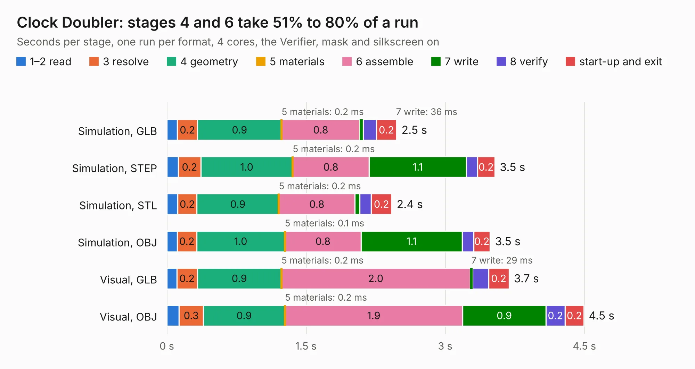

| Mode and format | 1–2 read | 3 resolve | 4 geometry | 5 materials | 6 assemble | 7 write | 8 verify | start-up and exit | Total |
|---|---:|---:|---:|---:|---:|---:|---:|---:|---:|
| Simulation, GLB | 0.1 | 0.2 | 0.9 | 0.2&nbsp;ms | 0.8 | 36&nbsp;ms | 0.1 | 0.2 | 2.5 |
| Simulation, STEP | 0.1 | 0.2 | 1.0 | 0.2&nbsp;ms | 0.8 | 1.1 | 0.1 | 0.2 | 3.5 |
| Simulation, STL | 0.1 | 0.2 | 0.9 | 0.2&nbsp;ms | 0.8 | 53&nbsp;ms | 0.1 | 0.2 | 2.4 |
| Simulation, OBJ | 0.1 | 0.2 | 1.0 | 0.1&nbsp;ms | 0.8 | 1.1 | 0.1 | 0.2 | 3.5 |
| Visual, GLB | 0.1 | 0.2 | 0.9 | 0.2&nbsp;ms | 2.0 | 29&nbsp;ms | 0.2 | 0.2 | 3.7 |
| Visual, OBJ | 0.1 | 0.3 | 0.9 | 0.2&nbsp;ms | 1.9 | 0.9 | 0.2 | 0.2 | 4.5 |

<table align="center"><tr><td valign="top">

| Board | Repo: [andrewpaterson/658-Computer](https://github.com/andrewpaterson/658-Computer) Board: `Clock Doubler.kicad_pcb` |
|---|---|
| Folder | Kicad / Computer / Component Boards / Clock Doubler |
| Complexity | 207&nbsp;/&nbsp;1000 (size&nbsp;137, features&nbsp;70) |
| KESE&nbsp;features | through vias, rounded, trapezoid or chamfered pads, knockout text, stack-up, dielectric εr and tanδ |
| Tested | 9th November 2026 |
| Copper&nbsp;layers | 2 |
| File&nbsp;format | KiCad 9 (20241229) |
| Parts,&nbsp;tracks,&nbsp;vias | 15, 178, 23 |
| Triangles,&nbsp;simulation | 220,574 in 38 parts |
| Verifier | PASS in all six runs |

</td><td valign="top">

<table>
<tr><th>File type</th><th>File size</th><th>Peak memory used</th></tr>
<tr><th colspan="3" align="left">Simulation</th></tr>
<tr><td>GLB</td><td align="right">7.5&nbsp;MB</td><td align="right">214&nbsp;MB</td></tr>
<tr><td>STEP</td><td align="right">32&nbsp;MB</td><td align="right">235&nbsp;MB</td></tr>
<tr><td>STL</td><td align="right">11&nbsp;MB</td><td align="right">212&nbsp;MB</td></tr>
<tr><td>OBJ</td><td align="right">22&nbsp;MB</td><td align="right">218&nbsp;MB</td></tr>
<tr><th colspan="3" align="left">Visual</th></tr>
<tr><td>GLB</td><td align="right">5.5&nbsp;MB</td><td align="right">218&nbsp;MB</td></tr>
<tr><td>OBJ</td><td align="right">16&nbsp;MB</td><td align="right">214&nbsp;MB</td></tr>
</table>

</td></tr></table>

## 156. Clock Hold Select

| Mode and format | 1–2 read | 3 resolve | 4 geometry | 5 materials | 6 assemble | 7 write | 8 verify | start-up and exit | Total |
|---|---:|---:|---:|---:|---:|---:|---:|---:|---:|
| Simulation, GLB | 0.2 | 0.5 | 2.4 | 0.6&nbsp;ms | 2.2 | 87&nbsp;ms | 0.3 | 0.2 | 6.0 |
| Simulation, STEP | 0.2 | 0.6 | 2.5 | 0.4&nbsp;ms | 2.1 | 1.9 | 0.3 | 0.2 | 7.8 |
| Simulation, STL | 0.2 | 0.5 | 2.4 | 0.4&nbsp;ms | 2.1 | 0.2 | 0.3 | 0.2 | 6.0 |
| Simulation, OBJ | 0.2 | 0.5 | 2.5 | 0.4&nbsp;ms | 2.0 | 2.6 | 0.3 | 0.2 | 8.3 |
| Visual, GLB | 0.2 | 0.5 | 2.5 | 0.4&nbsp;ms | 5.2 | 74&nbsp;ms | 0.5 | 0.2 | 9.3 |
| Visual, OBJ | 0.2 | 0.6 | 2.4 | 0.6&nbsp;ms | 5.3 | 2.3 | 0.6 | 0.3 | 11.8 |

<table align="center"><tr><td valign="top">

| Board | Repo: [andrewpaterson/658-Computer](https://github.com/andrewpaterson/658-Computer) Board: `Clock Hold Select.kicad_pcb` |
|---|---|
| Folder | Kicad / Computer / Component Boards / Clock Hold Select |
| Complexity | 233&nbsp;/&nbsp;1000 (size&nbsp;163, features&nbsp;70) |
| KESE&nbsp;features | through vias, rounded, trapezoid or chamfered pads, knockout text, stack-up, dielectric εr and tanδ |
| Tested | 9th November 2026 |
| Copper&nbsp;layers | 2 |
| File&nbsp;format | KiCad 9 (20241229) |
| Parts,&nbsp;tracks,&nbsp;vias | 23, 645, 84 |
| Triangles,&nbsp;simulation | 536,128 in 92 parts |
| Verifier | PASS in all six runs |

</td><td valign="top">

<table>
<tr><th>File type</th><th>File size</th><th>Peak memory used</th></tr>
<tr><th colspan="3" align="left">Simulation</th></tr>
<tr><td>GLB</td><td align="right">18&nbsp;MB</td><td align="right">313&nbsp;MB</td></tr>
<tr><td>STEP</td><td align="right">86&nbsp;MB</td><td align="right">379&nbsp;MB</td></tr>
<tr><td>STL</td><td align="right">27&nbsp;MB</td><td align="right">310&nbsp;MB</td></tr>
<tr><td>OBJ</td><td align="right">55&nbsp;MB</td><td align="right">415&nbsp;MB</td></tr>
<tr><th colspan="3" align="left">Visual</th></tr>
<tr><td>GLB</td><td align="right">15&nbsp;MB</td><td align="right">440&nbsp;MB</td></tr>
<tr><td>OBJ</td><td align="right">46&nbsp;MB</td><td align="right">404&nbsp;MB</td></tr>
</table>

</td></tr></table>

## 157. Clock Hold Standard

| Mode and format | 1–2 read | 3 resolve | 4 geometry | 5 materials | 6 assemble | 7 write | 8 verify | start-up and exit | Total |
|---|---:|---:|---:|---:|---:|---:|---:|---:|---:|
| Simulation, GLB | 0.2 | 0.3 | 1.5 | 0.4&nbsp;ms | 1.3 | 67&nbsp;ms | 0.2 | 0.2 | 3.7 |
| Simulation, STEP | 0.1 | 0.3 | 1.5 | 0.2&nbsp;ms | 1.4 | 1.4 | 0.2 | 0.2 | 5.2 |
| Simulation, STL | 0.2 | 0.3 | 1.5 | 0.2&nbsp;ms | 1.4 | 82&nbsp;ms | 0.2 | 0.2 | 4.0 |
| Simulation, OBJ | 0.2 | 0.3 | 1.6 | 0.2&nbsp;ms | 1.3 | 1.9 | 0.2 | 0.3 | 5.8 |
| Visual, GLB | 0.1 | 0.3 | 1.5 | 0.2&nbsp;ms | 3.1 | 46&nbsp;ms | 0.3 | 0.2 | 5.6 |
| Visual, OBJ | 0.1 | 0.3 | 1.5 | 3&nbsp;ms | 3.3 | 1.5 | 0.3 | 0.2 | 7.3 |

<table align="center"><tr><td valign="top">

| Board | Repo: [andrewpaterson/658-Computer](https://github.com/andrewpaterson/658-Computer) Board: `Clock Hold Standard.kicad_pcb` |
|---|---|
| Folder | Kicad / Computer / Component Boards / Clock Hold Standard |
| Complexity | 219&nbsp;/&nbsp;1000 (size&nbsp;149, features&nbsp;70) |
| KESE&nbsp;features | through vias, rounded, trapezoid or chamfered pads, knockout text, stack-up, dielectric εr and tanδ |
| Tested | 9th November 2026 |
| Copper&nbsp;layers | 2 |
| File&nbsp;format | KiCad 9 (20241229) |
| Parts,&nbsp;tracks,&nbsp;vias | 12, 434, 55 |
| Triangles,&nbsp;simulation | 321,760 in 47 parts |
| Verifier | PASS in all six runs |

</td><td valign="top">

<table>
<tr><th>File type</th><th>File size</th><th>Peak memory used</th></tr>
<tr><th colspan="3" align="left">Simulation</th></tr>
<tr><td>GLB</td><td align="right">11&nbsp;MB</td><td align="right">242&nbsp;MB</td></tr>
<tr><td>STEP</td><td align="right">52&nbsp;MB</td><td align="right">286&nbsp;MB</td></tr>
<tr><td>STL</td><td align="right">16&nbsp;MB</td><td align="right">243&nbsp;MB</td></tr>
<tr><td>OBJ</td><td align="right">33&nbsp;MB</td><td align="right">262&nbsp;MB</td></tr>
<tr><th colspan="3" align="left">Visual</th></tr>
<tr><td>GLB</td><td align="right">9.0&nbsp;MB</td><td align="right">280&nbsp;MB</td></tr>
<tr><td>OBJ</td><td align="right">26&nbsp;MB</td><td align="right">282&nbsp;MB</td></tr>
</table>

</td></tr></table>

## 158. Clock Transition

| Mode and format | 1–2 read | 3 resolve | 4 geometry | 5 materials | 6 assemble | 7 write | 8 verify | start-up and exit | Total |
|---|---:|---:|---:|---:|---:|---:|---:|---:|---:|
| Simulation, GLB | 0.1 | 0.2 | 0.9 | 0.2&nbsp;ms | 1.0 | 38&nbsp;ms | 0.1 | 0.2 | 2.6 |
| Simulation, STEP | 0.1 | 0.2 | 0.9 | 0.1&nbsp;ms | 0.9 | 1.0 | 0.1 | 0.2 | 3.5 |
| Simulation, STL | 0.1 | 0.2 | 0.9 | 0.1&nbsp;ms | 0.9 | 53&nbsp;ms | 0.1 | 0.2 | 2.6 |
| Simulation, OBJ | 0.1 | 0.3 | 0.9 | 0.2&nbsp;ms | 1.0 | 1.2 | 0.1 | 0.2 | 3.8 |
| Visual, GLB | 0.1 | 0.2 | 0.9 | 0.2&nbsp;ms | 1.9 | 32&nbsp;ms | 0.2 | 0.2 | 3.6 |
| Visual, OBJ | 0.1 | 0.2 | 0.9 | 0.2&nbsp;ms | 2.0 | 1.1 | 0.2 | 0.2 | 4.8 |

<table align="center"><tr><td valign="top">

| Board | Repo: [andrewpaterson/658-Computer](https://github.com/andrewpaterson/658-Computer) Board: `Clock Transition.kicad_pcb` |
|---|---|
| Folder | Kicad / Computer / Component Boards / Clock Transition |
| Complexity | 216&nbsp;/&nbsp;1000 (size&nbsp;146, features&nbsp;70) |
| KESE&nbsp;features | through vias, rounded, trapezoid or chamfered pads, knockout text, stack-up, dielectric εr and tanδ |
| Tested | 9th November 2026 |
| Copper&nbsp;layers | 2 |
| File&nbsp;format | KiCad 9 (20241229) |
| Parts,&nbsp;tracks,&nbsp;vias | 14, 298, 49 |
| Triangles,&nbsp;simulation | 238,130 in 35 parts |
| Verifier | PASS in all six runs |

</td><td valign="top">

<table>
<tr><th>File type</th><th>File size</th><th>Peak memory used</th></tr>
<tr><th colspan="3" align="left">Simulation</th></tr>
<tr><td>GLB</td><td align="right">8.2&nbsp;MB</td><td align="right">220&nbsp;MB</td></tr>
<tr><td>STEP</td><td align="right">37&nbsp;MB</td><td align="right">251&nbsp;MB</td></tr>
<tr><td>STL</td><td align="right">12&nbsp;MB</td><td align="right">220&nbsp;MB</td></tr>
<tr><td>OBJ</td><td align="right">24&nbsp;MB</td><td align="right">225&nbsp;MB</td></tr>
<tr><th colspan="3" align="left">Visual</th></tr>
<tr><td>GLB</td><td align="right">7.0&nbsp;MB</td><td align="right">233&nbsp;MB</td></tr>
<tr><td>OBJ</td><td align="right">20&nbsp;MB</td><td align="right">234&nbsp;MB</td></tr>
</table>

</td></tr></table>

## 159. Comparator 10bit

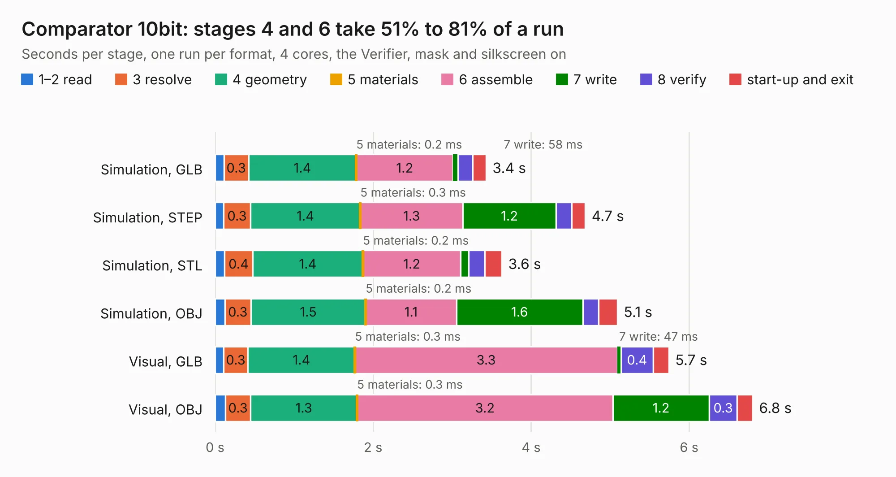

| Mode and format | 1–2 read | 3 resolve | 4 geometry | 5 materials | 6 assemble | 7 write | 8 verify | start-up and exit | Total |
|---|---:|---:|---:|---:|---:|---:|---:|---:|---:|
| Simulation, GLB | 0.1 | 0.3 | 1.4 | 0.2&nbsp;ms | 1.2 | 58&nbsp;ms | 0.2 | 0.2 | 3.4 |
| Simulation, STEP | 0.1 | 0.3 | 1.4 | 0.3&nbsp;ms | 1.3 | 1.2 | 0.2 | 0.2 | 4.7 |
| Simulation, STL | 0.1 | 0.4 | 1.4 | 0.2&nbsp;ms | 1.2 | 0.1 | 0.2 | 0.2 | 3.6 |
| Simulation, OBJ | 0.1 | 0.3 | 1.5 | 0.2&nbsp;ms | 1.1 | 1.6 | 0.2 | 0.2 | 5.1 |
| Visual, GLB | 0.1 | 0.3 | 1.4 | 0.3&nbsp;ms | 3.3 | 47&nbsp;ms | 0.4 | 0.2 | 5.7 |
| Visual, OBJ | 0.1 | 0.3 | 1.3 | 0.3&nbsp;ms | 3.2 | 1.2 | 0.3 | 0.2 | 6.8 |

<table align="center"><tr><td valign="top">

| Board | Repo: [andrewpaterson/658-Computer](https://github.com/andrewpaterson/658-Computer) Board: `Comparator 10bit.kicad_pcb` |
|---|---|
| Folder | Kicad / Computer / Component Boards / Comparator 10bit |
| Complexity | 223&nbsp;/&nbsp;1000 (size&nbsp;153, features&nbsp;70) |
| KESE&nbsp;features | through vias, rounded, trapezoid or chamfered pads, knockout text, stack-up, dielectric εr and tanδ |
| Tested | 9th November 2026 |
| Copper&nbsp;layers | 2 |
| File&nbsp;format | KiCad 9 (20241229) |
| Parts,&nbsp;tracks,&nbsp;vias | 14, 485, 62 |
| Triangles,&nbsp;simulation | 393,638 in 59 parts |
| Verifier | PASS in all six runs |

</td><td valign="top">

<table>
<tr><th>File type</th><th>File size</th><th>Peak memory used</th></tr>
<tr><th colspan="3" align="left">Simulation</th></tr>
<tr><td>GLB</td><td align="right">14&nbsp;MB</td><td align="right">265&nbsp;MB</td></tr>
<tr><td>STEP</td><td align="right">64&nbsp;MB</td><td align="right">309&nbsp;MB</td></tr>
<tr><td>STL</td><td align="right">20&nbsp;MB</td><td align="right">266&nbsp;MB</td></tr>
<tr><td>OBJ</td><td align="right">40&nbsp;MB</td><td align="right">320&nbsp;MB</td></tr>
<tr><th colspan="3" align="left">Visual</th></tr>
<tr><td>GLB</td><td align="right">10&nbsp;MB</td><td align="right">322&nbsp;MB</td></tr>
<tr><td>OBJ</td><td align="right">31&nbsp;MB</td><td align="right">316&nbsp;MB</td></tr>
</table>

</td></tr></table>

## 160. Comparator 16bit

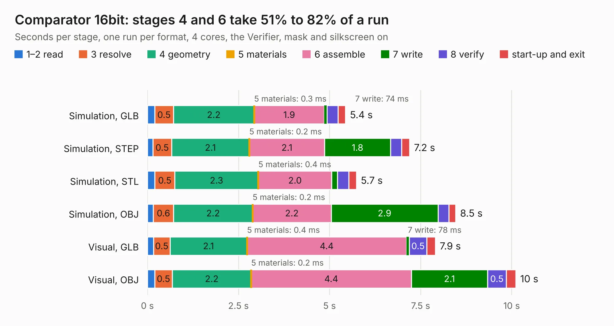

| Mode and format | 1–2 read | 3 resolve | 4 geometry | 5 materials | 6 assemble | 7 write | 8 verify | start-up and exit | Total |
|---|---:|---:|---:|---:|---:|---:|---:|---:|---:|
| Simulation, GLB | 0.2 | 0.5 | 2.2 | 0.3&nbsp;ms | 1.9 | 74&nbsp;ms | 0.3 | 0.2 | 5.4 |
| Simulation, STEP | 0.1 | 0.5 | 2.1 | 0.2&nbsp;ms | 2.1 | 1.8 | 0.3 | 0.2 | 7.2 |
| Simulation, STL | 0.2 | 0.5 | 2.3 | 0.4&nbsp;ms | 2.0 | 0.2 | 0.3 | 0.2 | 5.7 |
| Simulation, OBJ | 0.2 | 0.6 | 2.2 | 0.2&nbsp;ms | 2.2 | 2.9 | 0.3 | 0.2 | 8.5 |
| Visual, GLB | 0.2 | 0.5 | 2.1 | 0.4&nbsp;ms | 4.4 | 78&nbsp;ms | 0.5 | 0.2 | 7.9 |
| Visual, OBJ | 0.2 | 0.5 | 2.2 | 0.2&nbsp;ms | 4.4 | 2.1 | 0.5 | 0.3 | 10.1 |

<table align="center"><tr><td valign="top">

| Board | Repo: [andrewpaterson/658-Computer](https://github.com/andrewpaterson/658-Computer) Board: `Comparator 16bit.kicad_pcb` |
|---|---|
| Folder | Kicad / Computer / Component Boards / Comparator 16bit |
| Complexity | 230&nbsp;/&nbsp;1000 (size&nbsp;160, features&nbsp;70) |
| KESE&nbsp;features | through vias, rounded, trapezoid or chamfered pads, knockout text, stack-up, dielectric εr and tanδ |
| Tested | 9th November 2026 |
| Copper&nbsp;layers | 2 |
| File&nbsp;format | KiCad 9 (20241229) |
| Parts,&nbsp;tracks,&nbsp;vias | 13, 798, 90 |
| Triangles,&nbsp;simulation | 523,882 in 64 parts |
| Verifier | PASS in all six runs |

</td><td valign="top">

<table>
<tr><th>File type</th><th>File size</th><th>Peak memory used</th></tr>
<tr><th colspan="3" align="left">Simulation</th></tr>
<tr><td>GLB</td><td align="right">18&nbsp;MB</td><td align="right">319&nbsp;MB</td></tr>
<tr><td>STEP</td><td align="right">87&nbsp;MB</td><td align="right">363&nbsp;MB</td></tr>
<tr><td>STL</td><td align="right">26&nbsp;MB</td><td align="right">308&nbsp;MB</td></tr>
<tr><td>OBJ</td><td align="right">53&nbsp;MB</td><td align="right">403&nbsp;MB</td></tr>
<tr><th colspan="3" align="left">Visual</th></tr>
<tr><td>GLB</td><td align="right">14&nbsp;MB</td><td align="right">380&nbsp;MB</td></tr>
<tr><td>OBJ</td><td align="right">42&nbsp;MB</td><td align="right">382&nbsp;MB</td></tr>
</table>

</td></tr></table>

## 161. Counter 16bit with IO

| Mode and format | 1–2 read | 3 resolve | 4 geometry | 5 materials | 6 assemble | 7 write | 8 verify | start-up and exit | Total |
|---|---:|---:|---:|---:|---:|---:|---:|---:|---:|
| Simulation, GLB | 0.2 | 0.7 | 2.6 | 0.6&nbsp;ms | 3.0 | 0.1 | 0.4 | 0.2 | 7.2 |
| Simulation, STEP | 0.2 | 0.7 | 2.8 | 0.5&nbsp;ms | 2.8 | 2.2 | 0.5 | 0.2 | 9.4 |
| Simulation, STL | 0.2 | 0.7 | 2.6 | 0.4&nbsp;ms | 3.0 | 0.2 | 0.4 | 0.2 | 7.3 |
| Simulation, OBJ | 0.2 | 0.7 | 2.7 | 0.5&nbsp;ms | 3.0 | 3.3 | 0.4 | 0.2 | 10.5 |
| Visual, GLB | 0.2 | 0.8 | 2.8 | 0.3&nbsp;ms | 6.2 | 0.1 | 0.8 | 0.2 | 11.1 |
| Visual, OBJ | 0.2 | 0.7 | 2.7 | 0.6&nbsp;ms | 6.4 | 3.1 | 0.9 | 0.2 | 14.1 |

<table align="center"><tr><td valign="top">

| Board | Repo: [andrewpaterson/658-Computer](https://github.com/andrewpaterson/658-Computer) Board: `Counter 16bit with IO.kicad_pcb` |
|---|---|
| Folder | Kicad / Computer / Component Boards / Counter 16bit with IO |
| Complexity | 246&nbsp;/&nbsp;1000 (size&nbsp;176, features&nbsp;70) |
| KESE&nbsp;features | through vias, rounded, trapezoid or chamfered pads, knockout text, stack-up, dielectric εr and tanδ |
| Tested | 9th November 2026 |
| Copper&nbsp;layers | 2 |
| File&nbsp;format | KiCad 9 (20241229) |
| Parts,&nbsp;tracks,&nbsp;vias | 24, 1,368, 199 |
| Triangles,&nbsp;simulation | 864,154 in 70 parts |
| Verifier | PASS in all six runs |

</td><td valign="top">

<table>
<tr><th>File type</th><th>File size</th><th>Peak memory used</th></tr>
<tr><th colspan="3" align="left">Simulation</th></tr>
<tr><td>GLB</td><td align="right">30&nbsp;MB</td><td align="right">436&nbsp;MB</td></tr>
<tr><td>STEP</td><td align="right">142&nbsp;MB</td><td align="right">501&nbsp;MB</td></tr>
<tr><td>STL</td><td align="right">43&nbsp;MB</td><td align="right">454&nbsp;MB</td></tr>
<tr><td>OBJ</td><td align="right">88&nbsp;MB</td><td align="right">623&nbsp;MB</td></tr>
<tr><th colspan="3" align="left">Visual</th></tr>
<tr><td>GLB</td><td align="right">25&nbsp;MB</td><td align="right">616&nbsp;MB</td></tr>
<tr><td>OBJ</td><td align="right">77&nbsp;MB</td><td align="right">649&nbsp;MB</td></tr>
</table>

</td></tr></table>

## 162. Counter 16bit

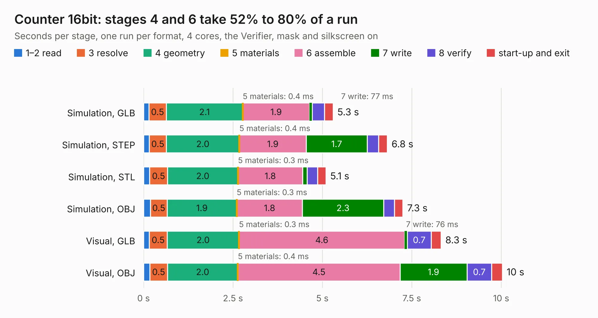

| Mode and format | 1–2 read | 3 resolve | 4 geometry | 5 materials | 6 assemble | 7 write | 8 verify | start-up and exit | Total |
|---|---:|---:|---:|---:|---:|---:|---:|---:|---:|
| Simulation, GLB | 0.1 | 0.5 | 2.1 | 0.4&nbsp;ms | 1.9 | 77&nbsp;ms | 0.3 | 0.2 | 5.3 |
| Simulation, STEP | 0.2 | 0.5 | 2.0 | 0.4&nbsp;ms | 1.9 | 1.7 | 0.3 | 0.2 | 6.8 |
| Simulation, STL | 0.2 | 0.5 | 2.0 | 0.3&nbsp;ms | 1.8 | 0.1 | 0.3 | 0.2 | 5.1 |
| Simulation, OBJ | 0.2 | 0.5 | 1.9 | 0.3&nbsp;ms | 1.8 | 2.3 | 0.3 | 0.2 | 7.3 |
| Visual, GLB | 0.2 | 0.5 | 2.0 | 0.3&nbsp;ms | 4.6 | 76&nbsp;ms | 0.7 | 0.3 | 8.3 |
| Visual, OBJ | 0.2 | 0.5 | 2.0 | 0.4&nbsp;ms | 4.5 | 1.9 | 0.7 | 0.3 | 10.0 |

<table align="center"><tr><td valign="top">

| Board | Repo: [andrewpaterson/658-Computer](https://github.com/andrewpaterson/658-Computer) Board: `Counter 16bit.kicad_pcb` |
|---|---|
| Folder | Kicad / Computer / Component Boards / Counter 16bit |
| Complexity | 224&nbsp;/&nbsp;1000 (size&nbsp;154, features&nbsp;70) |
| KESE&nbsp;features | through vias, rounded, trapezoid or chamfered pads, knockout text, stack-up, dielectric εr and tanδ |
| Tested | 9th November 2026 |
| Copper&nbsp;layers | 2 |
| File&nbsp;format | KiCad 9 (20241229) |
| Parts,&nbsp;tracks,&nbsp;vias | 14, 508, 78 |
| Triangles,&nbsp;simulation | 468,570 in 52 parts |
| Verifier | PASS in all six runs |

</td><td valign="top">

<table>
<tr><th>File type</th><th>File size</th><th>Peak memory used</th></tr>
<tr><th colspan="3" align="left">Simulation</th></tr>
<tr><td>GLB</td><td align="right">16&nbsp;MB</td><td align="right">294&nbsp;MB</td></tr>
<tr><td>STEP</td><td align="right">74&nbsp;MB</td><td align="right">347&nbsp;MB</td></tr>
<tr><td>STL</td><td align="right">23&nbsp;MB</td><td align="right">308&nbsp;MB</td></tr>
<tr><td>OBJ</td><td align="right">47&nbsp;MB</td><td align="right">366&nbsp;MB</td></tr>
<tr><th colspan="3" align="left">Visual</th></tr>
<tr><td>GLB</td><td align="right">12&nbsp;MB</td><td align="right">353&nbsp;MB</td></tr>
<tr><td>OBJ</td><td align="right">37&nbsp;MB</td><td align="right">356&nbsp;MB</td></tr>
</table>

</td></tr></table>

## 163. Counter 24bit with IO

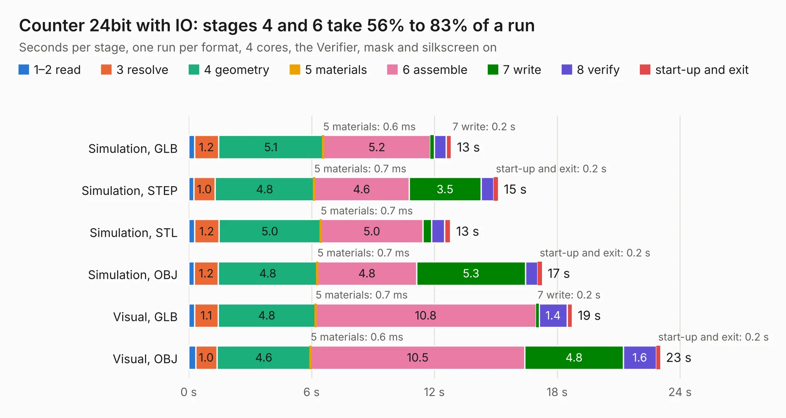

| Mode and format | 1–2 read | 3 resolve | 4 geometry | 5 materials | 6 assemble | 7 write | 8 verify | start-up and exit | Total |
|---|---:|---:|---:|---:|---:|---:|---:|---:|---:|
| Simulation, GLB | 0.3 | 1.2 | 5.1 | 0.6&nbsp;ms | 5.2 | 0.2 | 0.6 | 0.3 | 12.8 |
| Simulation, STEP | 0.2 | 1.0 | 4.8 | 0.7&nbsp;ms | 4.6 | 3.5 | 0.6 | 0.2 | 15.1 |
| Simulation, STL | 0.3 | 1.2 | 5.0 | 0.7&nbsp;ms | 5.0 | 0.4 | 0.6 | 0.3 | 12.8 |
| Simulation, OBJ | 0.3 | 1.2 | 4.8 | 0.7&nbsp;ms | 4.8 | 5.3 | 0.6 | 0.2 | 17.3 |
| Visual, GLB | 0.3 | 1.1 | 4.8 | 0.7&nbsp;ms | 10.8 | 0.2 | 1.4 | 0.2 | 18.7 |
| Visual, OBJ | 0.3 | 1.0 | 4.6 | 0.6&nbsp;ms | 10.5 | 4.8 | 1.6 | 0.2 | 23.0 |

<table align="center"><tr><td valign="top">

| Board | Repo: [andrewpaterson/658-Computer](https://github.com/andrewpaterson/658-Computer) Board: `Counter 24bit with IO.kicad_pcb` |
|---|---|
| Folder | Kicad / Computer / Component Boards / Counter 24bit with IO |
| Complexity | 256&nbsp;/&nbsp;1000 (size&nbsp;186, features&nbsp;70) |
| KESE&nbsp;features | through vias, rounded, trapezoid or chamfered pads, knockout text, stack-up, dielectric εr and tanδ |
| Tested | 9th November 2026 |
| Copper&nbsp;layers | 2 |
| File&nbsp;format | KiCad 9 (20241229) |
| Parts,&nbsp;tracks,&nbsp;vias | 32, 2,287, 246 |
| Triangles,&nbsp;simulation | 1,167,700 in 106 parts |
| Verifier | PASS in all six runs |

</td><td valign="top">

<table>
<tr><th>File type</th><th>File size</th><th>Peak memory used</th></tr>
<tr><th colspan="3" align="left">Simulation</th></tr>
<tr><td>GLB</td><td align="right">40&nbsp;MB</td><td align="right">551&nbsp;MB</td></tr>
<tr><td>STEP</td><td align="right">192&nbsp;MB</td><td align="right">635&nbsp;MB</td></tr>
<tr><td>STL</td><td align="right">58&nbsp;MB</td><td align="right">555&nbsp;MB</td></tr>
<tr><td>OBJ</td><td align="right">119&nbsp;MB</td><td align="right">824&nbsp;MB</td></tr>
<tr><th colspan="3" align="left">Visual</th></tr>
<tr><td>GLB</td><td align="right">34&nbsp;MB</td><td align="right">693&nbsp;MB</td></tr>
<tr><td>OBJ</td><td align="right">102&nbsp;MB</td><td align="right">771&nbsp;MB</td></tr>
</table>

</td></tr></table>

## 164. Counter 24bit

| Mode and format | 1–2 read | 3 resolve | 4 geometry | 5 materials | 6 assemble | 7 write | 8 verify | start-up and exit | Total |
|---|---:|---:|---:|---:|---:|---:|---:|---:|---:|
| Simulation, GLB | 0.2 | 0.6 | 2.6 | 0.5&nbsp;ms | 2.4 | 0.1 | 0.3 | 0.2 | 6.5 |
| Simulation, STEP | 0.2 | 0.7 | 2.8 | 0.3&nbsp;ms | 2.2 | 2.0 | 0.4 | 0.2 | 8.5 |
| Simulation, STL | 0.2 | 0.6 | 2.6 | 0.4&nbsp;ms | 2.5 | 0.2 | 0.4 | 0.2 | 6.8 |
| Simulation, OBJ | 0.2 | 0.7 | 2.6 | 0.3&nbsp;ms | 2.4 | 3.1 | 0.4 | 0.2 | 9.6 |
| Visual, GLB | 0.2 | 0.7 | 2.7 | 0.5&nbsp;ms | 5.9 | 71&nbsp;ms | 0.5 | 0.2 | 10.3 |
| Visual, OBJ | 0.2 | 0.5 | 2.6 | 0.4&nbsp;ms | 5.6 | 2.4 | 0.7 | 0.2 | 12.3 |

<table align="center"><tr><td valign="top">

| Board | Repo: [andrewpaterson/658-Computer](https://github.com/andrewpaterson/658-Computer) Board: `Counter 24bit.kicad_pcb` |
|---|---|
| Folder | Kicad / Computer / Component Boards / Counter 24bit |
| Complexity | 234&nbsp;/&nbsp;1000 (size&nbsp;164, features&nbsp;70) |
| KESE&nbsp;features | through vias, rounded, trapezoid or chamfered pads, knockout text, stack-up, dielectric εr and tanδ |
| Tested | 9th November 2026 |
| Copper&nbsp;layers | 2 |
| File&nbsp;format | KiCad 9 (20241229) |
| Parts,&nbsp;tracks,&nbsp;vias | 18, 816, 114 |
| Triangles,&nbsp;simulation | 673,350 in 71 parts |
| Verifier | PASS in all six runs |

</td><td valign="top">

<table>
<tr><th>File type</th><th>File size</th><th>Peak memory used</th></tr>
<tr><th colspan="3" align="left">Simulation</th></tr>
<tr><td>GLB</td><td align="right">23&nbsp;MB</td><td align="right">375&nbsp;MB</td></tr>
<tr><td>STEP</td><td align="right">108&nbsp;MB</td><td align="right">421&nbsp;MB</td></tr>
<tr><td>STL</td><td align="right">34&nbsp;MB</td><td align="right">361&nbsp;MB</td></tr>
<tr><td>OBJ</td><td align="right">68&nbsp;MB</td><td align="right">496&nbsp;MB</td></tr>
<tr><th colspan="3" align="left">Visual</th></tr>
<tr><td>GLB</td><td align="right">18&nbsp;MB</td><td align="right">481&nbsp;MB</td></tr>
<tr><td>OBJ</td><td align="right">53&nbsp;MB</td><td align="right">466&nbsp;MB</td></tr>
</table>

</td></tr></table>

## 165. D Flip Flop 16bit

| Mode and format | 1–2 read | 3 resolve | 4 geometry | 5 materials | 6 assemble | 7 write | 8 verify | start-up and exit | Total |
|---|---:|---:|---:|---:|---:|---:|---:|---:|---:|
| Simulation, GLB | 0.2 | 0.5 | 1.9 | 0.3&nbsp;ms | 1.7 | 89&nbsp;ms | 0.3 | 0.3 | 4.9 |
| Simulation, STEP | 0.2 | 0.4 | 2.0 | 0.2&nbsp;ms | 1.6 | 1.8 | 0.3 | 0.2 | 6.6 |
| Simulation, STL | 0.2 | 0.4 | 1.9 | 0.2&nbsp;ms | 1.6 | 0.1 | 0.3 | 0.3 | 4.9 |
| Simulation, OBJ | 0.2 | 0.4 | 1.8 | 0.3&nbsp;ms | 1.5 | 1.9 | 0.3 | 0.3 | 6.4 |
| Visual, GLB | 0.2 | 0.4 | 2.0 | 0.3&nbsp;ms | 3.6 | 48&nbsp;ms | 0.3 | 0.3 | 6.8 |
| Visual, OBJ | 0.2 | 0.4 | 1.9 | 0.2&nbsp;ms | 4.3 | 1.8 | 0.3 | 0.3 | 9.2 |

<table align="center"><tr><td valign="top">

| Board | Repo: [andrewpaterson/658-Computer](https://github.com/andrewpaterson/658-Computer) Board: `D Flip Flop 16bit.kicad_pcb` |
|---|---|
| Folder | Kicad / Computer / Component Boards / D Flip Flop 16bit |
| Complexity | 211&nbsp;/&nbsp;1000 (size&nbsp;141, features&nbsp;70) |
| KESE&nbsp;features | through vias, rounded, trapezoid or chamfered pads, knockout text, stack-up, dielectric εr and tanδ |
| Tested | 9th November 2026 |
| Copper&nbsp;layers | 2 |
| File&nbsp;format | KiCad 9 (20241229) |
| Parts,&nbsp;tracks,&nbsp;vias | 8, 360, 31 |
| Triangles,&nbsp;simulation | 343,422 in 48 parts |
| Verifier | PASS in all six runs |

</td><td valign="top">

<table>
<tr><th>File type</th><th>File size</th><th>Peak memory used</th></tr>
<tr><th colspan="3" align="left">Simulation</th></tr>
<tr><td>GLB</td><td align="right">12&nbsp;MB</td><td align="right">238&nbsp;MB</td></tr>
<tr><td>STEP</td><td align="right">56&nbsp;MB</td><td align="right">283&nbsp;MB</td></tr>
<tr><td>STL</td><td align="right">17&nbsp;MB</td><td align="right">250&nbsp;MB</td></tr>
<tr><td>OBJ</td><td align="right">35&nbsp;MB</td><td align="right">273&nbsp;MB</td></tr>
<tr><th colspan="3" align="left">Visual</th></tr>
<tr><td>GLB</td><td align="right">8.5&nbsp;MB</td><td align="right">273&nbsp;MB</td></tr>
<tr><td>OBJ</td><td align="right">25&nbsp;MB</td><td align="right">276&nbsp;MB</td></tr>
</table>

</td></tr></table>

## 166. D Flip Flop 24bit

| Mode and format | 1–2 read | 3 resolve | 4 geometry | 5 materials | 6 assemble | 7 write | 8 verify | start-up and exit | Total |
|---|---:|---:|---:|---:|---:|---:|---:|---:|---:|
| Simulation, GLB | 0.1 | 0.4 | 2.0 | 0.4&nbsp;ms | 1.6 | 76&nbsp;ms | 0.3 | 0.2 | 4.7 |
| Simulation, STEP | 0.1 | 0.4 | 1.8 | 0.2&nbsp;ms | 1.5 | 1.6 | 0.3 | 0.2 | 6.1 |
| Simulation, STL | 0.1 | 0.5 | 1.9 | 0.3&nbsp;ms | 1.5 | 0.1 | 0.4 | 0.3 | 4.9 |
| Simulation, OBJ | 0.2 | 0.5 | 2.1 | 0.2&nbsp;ms | 1.5 | 2.2 | 0.3 | 0.2 | 6.9 |
| Visual, GLB | 0.1 | 0.4 | 2.0 | 0.2&nbsp;ms | 4.1 | 53&nbsp;ms | 0.5 | 0.3 | 7.4 |
| Visual, OBJ | 0.2 | 0.5 | 2.0 | 0.3&nbsp;ms | 3.8 | 1.4 | 0.4 | 0.3 | 8.6 |

<table align="center"><tr><td valign="top">

| Board | Repo: [andrewpaterson/658-Computer](https://github.com/andrewpaterson/658-Computer) Board: `D Flip Flop 24bit.kicad_pcb` |
|---|---|
| Folder | Kicad / Computer / Component Boards / D Flip Flop 24bit |
| Complexity | 215&nbsp;/&nbsp;1000 (size&nbsp;145, features&nbsp;70) |
| KESE&nbsp;features | through vias, rounded, trapezoid or chamfered pads, knockout text, stack-up, dielectric εr and tanδ |
| Tested | 9th November 2026 |
| Copper&nbsp;layers | 2 |
| File&nbsp;format | KiCad 9 (20241229) |
| Parts,&nbsp;tracks,&nbsp;vias | 10, 400, 39 |
| Triangles,&nbsp;simulation | 463,344 in 64 parts |
| Verifier | PASS in all six runs |

</td><td valign="top">

<table>
<tr><th>File type</th><th>File size</th><th>Peak memory used</th></tr>
<tr><th colspan="3" align="left">Simulation</th></tr>
<tr><td>GLB</td><td align="right">16&nbsp;MB</td><td align="right">277&nbsp;MB</td></tr>
<tr><td>STEP</td><td align="right">75&nbsp;MB</td><td align="right">334&nbsp;MB</td></tr>
<tr><td>STL</td><td align="right">23&nbsp;MB</td><td align="right">286&nbsp;MB</td></tr>
<tr><td>OBJ</td><td align="right">47&nbsp;MB</td><td align="right">361&nbsp;MB</td></tr>
<tr><th colspan="3" align="left">Visual</th></tr>
<tr><td>GLB</td><td align="right">11&nbsp;MB</td><td align="right">342&nbsp;MB</td></tr>
<tr><td>OBJ</td><td align="right">34&nbsp;MB</td><td align="right">348&nbsp;MB</td></tr>
</table>

</td></tr></table>

## 167. Data and Signal Buffer

| Mode and format | 1–2 read | 3 resolve | 4 geometry | 5 materials | 6 assemble | 7 write | 8 verify | start-up and exit | Total |
|---|---:|---:|---:|---:|---:|---:|---:|---:|---:|
| Simulation, GLB | 0.2 | 0.6 | 2.2 | 0.3&nbsp;ms | 1.9 | 97&nbsp;ms | 0.3 | 0.2 | 5.5 |
| Simulation, STEP | 0.2 | 0.5 | 1.9 | 0.3&nbsp;ms | 1.8 | 1.7 | 0.3 | 0.2 | 6.6 |
| Simulation, STL | 0.2 | 0.5 | 2.1 | 0.4&nbsp;ms | 1.8 | 0.1 | 0.3 | 0.2 | 5.2 |
| Simulation, OBJ | 0.2 | 0.5 | 2.0 | 0.5&nbsp;ms | 1.8 | 2.3 | 0.3 | 0.2 | 7.2 |
| Visual, GLB | 0.2 | 0.6 | 2.1 | 0.4&nbsp;ms | 4.5 | 73&nbsp;ms | 0.4 | 0.3 | 8.3 |
| Visual, OBJ | 0.2 | 0.5 | 2.2 | 0.3&nbsp;ms | 4.5 | 1.7 | 0.4 | 0.2 | 9.8 |

<table align="center"><tr><td valign="top">

| Board | Repo: [andrewpaterson/658-Computer](https://github.com/andrewpaterson/658-Computer) Board: `Data and Signal Buffer.kicad_pcb` |
|---|---|
| Folder | Kicad / Computer / Component Boards / Data and Signal Buffer |
| Complexity | 229&nbsp;/&nbsp;1000 (size&nbsp;159, features&nbsp;70) |
| KESE&nbsp;features | through vias, rounded, trapezoid or chamfered pads, knockout text, stack-up, dielectric εr and tanδ |
| Tested | 9th November 2026 |
| Copper&nbsp;layers | 2 |
| File&nbsp;format | KiCad 9 (20241229) |
| Parts,&nbsp;tracks,&nbsp;vias | 20, 584, 75 |
| Triangles,&nbsp;simulation | 478,376 in 64 parts |
| Verifier | PASS in all six runs |

</td><td valign="top">

<table>
<tr><th>File type</th><th>File size</th><th>Peak memory used</th></tr>
<tr><th colspan="3" align="left">Simulation</th></tr>
<tr><td>GLB</td><td align="right">17&nbsp;MB</td><td align="right">288&nbsp;MB</td></tr>
<tr><td>STEP</td><td align="right">78&nbsp;MB</td><td align="right">345&nbsp;MB</td></tr>
<tr><td>STL</td><td align="right">24&nbsp;MB</td><td align="right">286&nbsp;MB</td></tr>
<tr><td>OBJ</td><td align="right">49&nbsp;MB</td><td align="right">378&nbsp;MB</td></tr>
<tr><th colspan="3" align="left">Visual</th></tr>
<tr><td>GLB</td><td align="right">13&nbsp;MB</td><td align="right">365&nbsp;MB</td></tr>
<tr><td>OBJ</td><td align="right">38&nbsp;MB</td><td align="right">363&nbsp;MB</td></tr>
</table>

</td></tr></table>

## 168. Device Buffer

| Mode and format | 1–2 read | 3 resolve | 4 geometry | 5 materials | 6 assemble | 7 write | 8 verify | start-up and exit | Total |
|---|---:|---:|---:|---:|---:|---:|---:|---:|---:|
| Simulation, GLB | 0.2 | 0.5 | 2.7 | 0.6&nbsp;ms | 2.0 | 85&nbsp;ms | 0.3 | 0.2 | 6.1 |
| Simulation, STEP | 0.2 | 0.6 | 2.7 | 0.2&nbsp;ms | 2.0 | 1.9 | 0.3 | 0.2 | 7.9 |
| Simulation, STL | 0.2 | 0.6 | 2.7 | 0.3&nbsp;ms | 1.9 | 0.1 | 0.3 | 0.2 | 5.9 |
| Simulation, OBJ | 0.2 | 0.6 | 2.7 | 0.3&nbsp;ms | 2.1 | 3.1 | 0.3 | 0.2 | 9.1 |
| Visual, GLB | 0.2 | 0.6 | 2.8 | 0.4&nbsp;ms | 4.8 | 60&nbsp;ms | 0.5 | 0.2 | 9.2 |
| Visual, OBJ | 0.2 | 0.5 | 2.8 | 0.3&nbsp;ms | 4.5 | 2.2 | 0.7 | 0.2 | 11.2 |

<table align="center"><tr><td valign="top">

| Board | Repo: [andrewpaterson/658-Computer](https://github.com/andrewpaterson/658-Computer) Board: `Device Buffer.kicad_pcb` |
|---|---|
| Folder | Kicad / Computer / Component Boards / Device Buffer |
| Complexity | 226&nbsp;/&nbsp;1000 (size&nbsp;156, features&nbsp;70) |
| KESE&nbsp;features | through vias, rounded, trapezoid or chamfered pads, knockout text, stack-up, dielectric εr and tanδ |
| Tested | 9th November 2026 |
| Copper&nbsp;layers | 2 |
| File&nbsp;format | KiCad 9 (20241229) |
| Parts,&nbsp;tracks,&nbsp;vias | 18, 571, 40 |
| Triangles,&nbsp;simulation | 557,548 in 75 parts |
| Verifier | PASS in all six runs |

</td><td valign="top">

<table>
<tr><th>File type</th><th>File size</th><th>Peak memory used</th></tr>
<tr><th colspan="3" align="left">Simulation</th></tr>
<tr><td>GLB</td><td align="right">19&nbsp;MB</td><td align="right">316&nbsp;MB</td></tr>
<tr><td>STEP</td><td align="right">98&nbsp;MB</td><td align="right">367&nbsp;MB</td></tr>
<tr><td>STL</td><td align="right">28&nbsp;MB</td><td align="right">310&nbsp;MB</td></tr>
<tr><td>OBJ</td><td align="right">57&nbsp;MB</td><td align="right">420&nbsp;MB</td></tr>
<tr><th colspan="3" align="left">Visual</th></tr>
<tr><td>GLB</td><td align="right">14&nbsp;MB</td><td align="right">412&nbsp;MB</td></tr>
<tr><td>OBJ</td><td align="right">41&nbsp;MB</td><td align="right">380&nbsp;MB</td></tr>
</table>

</td></tr></table>

## 169. Device Decode stage A

| Mode and format | 1–2 read | 3 resolve | 4 geometry | 5 materials | 6 assemble | 7 write | 8 verify | start-up and exit | Total |
|---|---:|---:|---:|---:|---:|---:|---:|---:|---:|
| Simulation, GLB | 0.1 | 0.3 | 1.7 | 0.3&nbsp;ms | 1.4 | 80&nbsp;ms | 0.3 | 0.2 | 4.0 |
| Simulation, STEP | 0.1 | 0.4 | 1.6 | 0.2&nbsp;ms | 1.5 | 1.4 | 0.2 | 0.2 | 5.4 |
| Simulation, STL | 0.1 | 0.4 | 1.6 | 0.2&nbsp;ms | 1.4 | 0.1 | 0.2 | 0.2 | 4.0 |
| Simulation, OBJ | 0.2 | 0.4 | 1.5 | 0.2&nbsp;ms | 1.4 | 2.0 | 0.2 | 0.2 | 6.0 |
| Visual, GLB | 0.1 | 0.4 | 1.7 | 0.3&nbsp;ms | 3.0 | 46&nbsp;ms | 0.3 | 0.2 | 5.8 |
| Visual, OBJ | 0.1 | 0.4 | 1.6 | 0.2&nbsp;ms | 3.3 | 1.6 | 0.4 | 0.2 | 7.6 |

<table align="center"><tr><td valign="top">

| Board | Repo: [andrewpaterson/658-Computer](https://github.com/andrewpaterson/658-Computer) Board: `Device Decode stage A.kicad_pcb` |
|---|---|
| Folder | Kicad / Computer / Component Boards / Device Decode stage A |
| Complexity | 223&nbsp;/&nbsp;1000 (size&nbsp;153, features&nbsp;70) |
| KESE&nbsp;features | through vias, rounded, trapezoid or chamfered pads, knockout text, stack-up, dielectric εr and tanδ |
| Tested | 9th November 2026 |
| Copper&nbsp;layers | 2 |
| File&nbsp;format | KiCad 9 (20241229) |
| Parts,&nbsp;tracks,&nbsp;vias | 16, 442, 62 |
| Triangles,&nbsp;simulation | 391,752 in 57 parts |
| Verifier | PASS in all six runs |

</td><td valign="top">

<table>
<tr><th>File type</th><th>File size</th><th>Peak memory used</th></tr>
<tr><th colspan="3" align="left">Simulation</th></tr>
<tr><td>GLB</td><td align="right">14&nbsp;MB</td><td align="right">259&nbsp;MB</td></tr>
<tr><td>STEP</td><td align="right">63&nbsp;MB</td><td align="right">313&nbsp;MB</td></tr>
<tr><td>STL</td><td align="right">20&nbsp;MB</td><td align="right">260&nbsp;MB</td></tr>
<tr><td>OBJ</td><td align="right">40&nbsp;MB</td><td align="right">317&nbsp;MB</td></tr>
<tr><th colspan="3" align="left">Visual</th></tr>
<tr><td>GLB</td><td align="right">11&nbsp;MB</td><td align="right">317&nbsp;MB</td></tr>
<tr><td>OBJ</td><td align="right">31&nbsp;MB</td><td align="right">326&nbsp;MB</td></tr>
</table>

</td></tr></table>

## 170. Device Decode stage B

| Mode and format | 1–2 read | 3 resolve | 4 geometry | 5 materials | 6 assemble | 7 write | 8 verify | start-up and exit | Total |
|---|---:|---:|---:|---:|---:|---:|---:|---:|---:|
| Simulation, GLB | 0.1 | 0.4 | 1.9 | 0.2&nbsp;ms | 1.6 | 93&nbsp;ms | 0.3 | 0.2 | 4.7 |
| Simulation, STEP | 0.1 | 0.4 | 1.9 | 0.2&nbsp;ms | 1.7 | 1.5 | 0.3 | 0.2 | 6.1 |
| Simulation, STL | 0.2 | 0.5 | 1.8 | 0.2&nbsp;ms | 1.7 | 95&nbsp;ms | 0.2 | 0.2 | 4.6 |
| Simulation, OBJ | 0.1 | 0.4 | 1.9 | 0.2&nbsp;ms | 1.7 | 2.5 | 0.3 | 0.2 | 7.2 |
| Visual, GLB | 0.2 | 0.4 | 2.0 | 0.2&nbsp;ms | 3.7 | 56&nbsp;ms | 0.4 | 0.2 | 6.9 |
| Visual, OBJ | 0.2 | 0.4 | 2.0 | 0.2&nbsp;ms | 3.9 | 1.9 | 0.4 | 0.3 | 9.1 |

<table align="center"><tr><td valign="top">

| Board | Repo: [andrewpaterson/658-Computer](https://github.com/andrewpaterson/658-Computer) Board: `Device Decode stage B.kicad_pcb` |
|---|---|
| Folder | Kicad / Computer / Component Boards / Device Decode stage B |
| Complexity | 227&nbsp;/&nbsp;1000 (size&nbsp;157, features&nbsp;70) |
| KESE&nbsp;features | through vias, rounded, trapezoid or chamfered pads, knockout text, stack-up, dielectric εr and tanδ |
| Tested | 9th November 2026 |
| Copper&nbsp;layers | 2 |
| File&nbsp;format | KiCad 9 (20241229) |
| Parts,&nbsp;tracks,&nbsp;vias | 16, 572, 78 |
| Triangles,&nbsp;simulation | 451,576 in 50 parts |
| Verifier | PASS in all six runs |

</td><td valign="top">

<table>
<tr><th>File type</th><th>File size</th><th>Peak memory used</th></tr>
<tr><th colspan="3" align="left">Simulation</th></tr>
<tr><td>GLB</td><td align="right">16&nbsp;MB</td><td align="right">318&nbsp;MB</td></tr>
<tr><td>STEP</td><td align="right">75&nbsp;MB</td><td align="right">334&nbsp;MB</td></tr>
<tr><td>STL</td><td align="right">23&nbsp;MB</td><td align="right">289&nbsp;MB</td></tr>
<tr><td>OBJ</td><td align="right">46&nbsp;MB</td><td align="right">311&nbsp;MB</td></tr>
<tr><th colspan="3" align="left">Visual</th></tr>
<tr><td>GLB</td><td align="right">13&nbsp;MB</td><td align="right">358&nbsp;MB</td></tr>
<tr><td>OBJ</td><td align="right">37&nbsp;MB</td><td align="right">359&nbsp;MB</td></tr>
</table>

</td></tr></table>

## 171. Dual Comparator 8bit

| Mode and format | 1–2 read | 3 resolve | 4 geometry | 5 materials | 6 assemble | 7 write | 8 verify | start-up and exit | Total |
|---|---:|---:|---:|---:|---:|---:|---:|---:|---:|
| Simulation, GLB | 0.2 | 0.5 | 2.3 | 0.3&nbsp;ms | 2.0 | 83&nbsp;ms | 0.3 | 0.3 | 5.7 |
| Simulation, STEP | 0.2 | 0.5 | 2.0 | 0.3&nbsp;ms | 2.2 | 1.7 | 0.3 | 0.2 | 7.2 |
| Simulation, STL | 0.2 | 0.5 | 2.1 | 0.4&nbsp;ms | 1.9 | 0.2 | 0.4 | 0.2 | 5.5 |
| Simulation, OBJ | 0.1 | 0.5 | 2.1 | 0.2&nbsp;ms | 2.0 | 2.6 | 0.3 | 0.2 | 8.0 |
| Visual, GLB | 0.2 | 0.5 | 2.2 | 0.3&nbsp;ms | 4.7 | 65&nbsp;ms | 0.5 | 0.2 | 8.3 |
| Visual, OBJ | 0.2 | 0.5 | 2.2 | 0.3&nbsp;ms | 4.7 | 2.4 | 0.4 | 0.2 | 10.7 |

<table align="center"><tr><td valign="top">

| Board | Repo: [andrewpaterson/658-Computer](https://github.com/andrewpaterson/658-Computer) Board: `Dual Comparator 8bit.kicad_pcb` |
|---|---|
| Folder | Kicad / Computer / Component Boards / Dual Comparator 8bit |
| Complexity | 227&nbsp;/&nbsp;1000 (size&nbsp;157, features&nbsp;70) |
| KESE&nbsp;features | through vias, rounded, trapezoid or chamfered pads, knockout text, stack-up, dielectric εr and tanδ |
| Tested | 9th November 2026 |
| Copper&nbsp;layers | 2 |
| File&nbsp;format | KiCad 9 (20241229) |
| Parts,&nbsp;tracks,&nbsp;vias | 11, 728, 91 |
| Triangles,&nbsp;simulation | 503,120 in 64 parts |
| Verifier | PASS in all six runs |

</td><td valign="top">

<table>
<tr><th>File type</th><th>File size</th><th>Peak memory used</th></tr>
<tr><th colspan="3" align="left">Simulation</th></tr>
<tr><td>GLB</td><td align="right">17&nbsp;MB</td><td align="right">323&nbsp;MB</td></tr>
<tr><td>STEP</td><td align="right">80&nbsp;MB</td><td align="right">354&nbsp;MB</td></tr>
<tr><td>STL</td><td align="right">25&nbsp;MB</td><td align="right">291&nbsp;MB</td></tr>
<tr><td>OBJ</td><td align="right">51&nbsp;MB</td><td align="right">389&nbsp;MB</td></tr>
<tr><th colspan="3" align="left">Visual</th></tr>
<tr><td>GLB</td><td align="right">13&nbsp;MB</td><td align="right">363&nbsp;MB</td></tr>
<tr><td>OBJ</td><td align="right">40&nbsp;MB</td><td align="right">370&nbsp;MB</td></tr>
</table>

</td></tr></table>

## 172. Flags Enable Interrupt

| Mode and format | 1–2 read | 3 resolve | 4 geometry | 5 materials | 6 assemble | 7 write | 8 verify | start-up and exit | Total |
|---|---:|---:|---:|---:|---:|---:|---:|---:|---:|
| Simulation, GLB | 0.2 | 0.5 | 2.3 | 0.5&nbsp;ms | 1.8 | 96&nbsp;ms | 0.3 | 0.3 | 5.3 |
| Simulation, STEP | 0.2 | 0.5 | 2.1 | 0.4&nbsp;ms | 2.0 | 1.9 | 0.4 | 0.2 | 7.2 |
| Simulation, STL | 0.2 | 0.5 | 2.4 | 0.6&nbsp;ms | 1.9 | 0.2 | 0.3 | 0.3 | 5.7 |
| Simulation, OBJ | 0.2 | 0.5 | 2.2 | 0.3&nbsp;ms | 2.2 | 2.7 | 0.3 | 0.2 | 8.3 |
| Visual, GLB | 0.1 | 0.5 | 2.1 | 0.3&nbsp;ms | 4.7 | 70&nbsp;ms | 0.5 | 0.2 | 8.3 |
| Visual, OBJ | 0.2 | 0.5 | 2.0 | 0.3&nbsp;ms | 4.4 | 1.9 | 0.4 | 0.2 | 9.7 |

<table align="center"><tr><td valign="top">

| Board | Repo: [andrewpaterson/658-Computer](https://github.com/andrewpaterson/658-Computer) Board: `Flags Enable Interrupt.kicad_pcb` |
|---|---|
| Folder | Kicad / Computer / Component Boards / Flags Enable Interrupt |
| Complexity | 230&nbsp;/&nbsp;1000 (size&nbsp;160, features&nbsp;70) |
| KESE&nbsp;features | through vias, rounded, trapezoid or chamfered pads, knockout text, stack-up, dielectric εr and tanδ |
| Tested | 9th November 2026 |
| Copper&nbsp;layers | 2 |
| File&nbsp;format | KiCad 9 (20241229) |
| Parts,&nbsp;tracks,&nbsp;vias | 17, 674, 88 |
| Triangles,&nbsp;simulation | 478,496 in 56 parts |
| Verifier | PASS in all six runs |

</td><td valign="top">

<table>
<tr><th>File type</th><th>File size</th><th>Peak memory used</th></tr>
<tr><th colspan="3" align="left">Simulation</th></tr>
<tr><td>GLB</td><td align="right">17&nbsp;MB</td><td align="right">317&nbsp;MB</td></tr>
<tr><td>STEP</td><td align="right">80&nbsp;MB</td><td align="right">353&nbsp;MB</td></tr>
<tr><td>STL</td><td align="right">24&nbsp;MB</td><td align="right">319&nbsp;MB</td></tr>
<tr><td>OBJ</td><td align="right">49&nbsp;MB</td><td align="right">376&nbsp;MB</td></tr>
<tr><th colspan="3" align="left">Visual</th></tr>
<tr><td>GLB</td><td align="right">13&nbsp;MB</td><td align="right">379&nbsp;MB</td></tr>
<tr><td>OBJ</td><td align="right">40&nbsp;MB</td><td align="right">370&nbsp;MB</td></tr>
</table>

</td></tr></table>

## 173. GPIO 16bit

| Mode and format | 1–2 read | 3 resolve | 4 geometry | 5 materials | 6 assemble | 7 write | 8 verify | start-up and exit | Total |
|---|---:|---:|---:|---:|---:|---:|---:|---:|---:|
| Simulation, GLB | 0.3 | 1.1 | 4.7 | 0.3&nbsp;ms | 4.8 | 0.2 | 0.6 | 0.2 | 11.8 |
| Simulation, STEP | 0.3 | 1.1 | 4.8 | 0.3&nbsp;ms | 4.3 | 3.3 | 0.5 | 0.2 | 14.6 |
| Simulation, STL | 0.3 | 1.2 | 4.5 | 0.3&nbsp;ms | 4.4 | 0.3 | 0.5 | 0.2 | 11.4 |
| Simulation, OBJ | 0.3 | 1.1 | 4.6 | 0.8&nbsp;ms | 4.2 | 4.7 | 0.5 | 0.2 | 15.6 |
| Visual, GLB | 0.3 | 1.1 | 4.5 | 0.3&nbsp;ms | 10.5 | 0.1 | 1.8 | 0.2 | 18.6 |
| Visual, OBJ | 0.3 | 1.1 | 4.7 | 0.4&nbsp;ms | 9.0 | 4.3 | 1.2 | 0.2 | 20.8 |

<table align="center"><tr><td valign="top">

| Board | Repo: [andrewpaterson/658-Computer](https://github.com/andrewpaterson/658-Computer) Board: `GPIO 16bit.kicad_pcb` |
|---|---|
| Folder | Kicad / Computer / Component Boards / GPIO 16bit |
| Complexity | 268&nbsp;/&nbsp;1000 (size&nbsp;188, features&nbsp;80) |
| KESE&nbsp;features | through vias, rounded, trapezoid or chamfered pads, curved board outline, knockout text, stack-up, dielectric εr and tanδ |
| Tested | 9th November 2026 |
| Copper&nbsp;layers | 2 |
| File&nbsp;format | KiCad 10 (20260206) |
| Parts,&nbsp;tracks,&nbsp;vias | 43, 2,026, 281 |
| Triangles,&nbsp;simulation | 1,188,690 in 130 parts |
| Verifier | PASS in all six runs |

</td><td valign="top">

<table>
<tr><th>File type</th><th>File size</th><th>Peak memory used</th></tr>
<tr><th colspan="3" align="left">Simulation</th></tr>
<tr><td>GLB</td><td align="right">41&nbsp;MB</td><td align="right">528&nbsp;MB</td></tr>
<tr><td>STEP</td><td align="right">200&nbsp;MB</td><td align="right">651&nbsp;MB</td></tr>
<tr><td>STL</td><td align="right">59&nbsp;MB</td><td align="right">514&nbsp;MB</td></tr>
<tr><td>OBJ</td><td align="right">122&nbsp;MB</td><td align="right">810&nbsp;MB</td></tr>
<tr><th colspan="3" align="left">Visual</th></tr>
<tr><td>GLB</td><td align="right">37&nbsp;MB</td><td align="right">831&nbsp;MB</td></tr>
<tr><td>OBJ</td><td align="right">111&nbsp;MB</td><td align="right">845&nbsp;MB</td></tr>
</table>

</td></tr></table>

## 174. GPIO 4bit

| Mode and format | 1–2 read | 3 resolve | 4 geometry | 5 materials | 6 assemble | 7 write | 8 verify | start-up and exit | Total |
|---|---:|---:|---:|---:|---:|---:|---:|---:|---:|
| Simulation, GLB | 0.1 | 0.4 | 1.8 | 0.3&nbsp;ms | 1.8 | 69&nbsp;ms | 0.3 | 0.2 | 4.8 |
| Simulation, STEP | 0.1 | 0.4 | 1.9 | 0.3&nbsp;ms | 1.5 | 1.4 | 0.3 | 0.2 | 5.9 |
| Simulation, STL | 0.1 | 0.4 | 1.7 | 0.3&nbsp;ms | 1.6 | 0.1 | 0.2 | 0.2 | 4.4 |
| Simulation, OBJ | 0.2 | 0.4 | 1.7 | 0.2&nbsp;ms | 1.7 | 2.1 | 0.3 | 0.3 | 6.5 |
| Visual, GLB | 0.1 | 0.4 | 1.8 | 0.2&nbsp;ms | 4.0 | 58&nbsp;ms | 0.4 | 0.2 | 7.0 |
| Visual, OBJ | 0.1 | 0.4 | 1.7 | 0.3&nbsp;ms | 4.0 | 1.6 | 0.4 | 0.3 | 8.5 |

<table align="center"><tr><td valign="top">

| Board | Repo: [andrewpaterson/658-Computer](https://github.com/andrewpaterson/658-Computer) Board: `GPIO 4bit.kicad_pcb` |
|---|---|
| Folder | Kicad / Computer / Component Boards / GPIO 4bit |
| Complexity | 225&nbsp;/&nbsp;1000 (size&nbsp;155, features&nbsp;70) |
| KESE&nbsp;features | through vias, rounded, trapezoid or chamfered pads, knockout text, stack-up, dielectric εr and tanδ |
| Tested | 9th November 2026 |
| Copper&nbsp;layers | 2 |
| File&nbsp;format | KiCad 9 (20241229) |
| Parts,&nbsp;tracks,&nbsp;vias | 14, 560, 67 |
| Triangles,&nbsp;simulation | 412,782 in 54 parts |
| Verifier | PASS in all six runs |

</td><td valign="top">

<table>
<tr><th>File type</th><th>File size</th><th>Peak memory used</th></tr>
<tr><th colspan="3" align="left">Simulation</th></tr>
<tr><td>GLB</td><td align="right">14&nbsp;MB</td><td align="right">272&nbsp;MB</td></tr>
<tr><td>STEP</td><td align="right">68&nbsp;MB</td><td align="right">320&nbsp;MB</td></tr>
<tr><td>STL</td><td align="right">21&nbsp;MB</td><td align="right">265&nbsp;MB</td></tr>
<tr><td>OBJ</td><td align="right">42&nbsp;MB</td><td align="right">330&nbsp;MB</td></tr>
<tr><th colspan="3" align="left">Visual</th></tr>
<tr><td>GLB</td><td align="right">11&nbsp;MB</td><td align="right">330&nbsp;MB</td></tr>
<tr><td>OBJ</td><td align="right">33&nbsp;MB</td><td align="right">336&nbsp;MB</td></tr>
</table>

</td></tr></table>

## 175. Main Address Buffer

| Mode and format | 1–2 read | 3 resolve | 4 geometry | 5 materials | 6 assemble | 7 write | 8 verify | start-up and exit | Total |
|---|---:|---:|---:|---:|---:|---:|---:|---:|---:|
| Simulation, GLB | 0.2 | 0.4 | 2.0 | 0.5&nbsp;ms | 1.4 | 73&nbsp;ms | 0.3 | 0.2 | 4.5 |
| Simulation, STEP | 0.1 | 0.4 | 2.1 | 0.3&nbsp;ms | 1.4 | 1.4 | 0.3 | 0.3 | 5.9 |
| Simulation, STL | 0.1 | 0.4 | 2.0 | 0.2&nbsp;ms | 1.4 | 0.1 | 0.3 | 0.3 | 4.6 |
| Simulation, OBJ | 0.1 | 0.4 | 1.9 | 0.3&nbsp;ms | 1.4 | 2.1 | 0.3 | 0.2 | 6.4 |
| Visual, GLB | 0.2 | 0.4 | 2.0 | 0.3&nbsp;ms | 3.5 | 44&nbsp;ms | 0.3 | 0.2 | 6.6 |
| Visual, OBJ | 0.2 | 0.5 | 2.1 | 0.6&nbsp;ms | 3.9 | 1.7 | 0.3 | 0.3 | 8.8 |

<table align="center"><tr><td valign="top">

| Board | Repo: [andrewpaterson/658-Computer](https://github.com/andrewpaterson/658-Computer) Board: `Main Address Buffer.kicad_pcb` |
|---|---|
| Folder | Kicad / Computer / Component Boards / Main Address Buffer |
| Complexity | 209&nbsp;/&nbsp;1000 (size&nbsp;139, features&nbsp;70) |
| KESE&nbsp;features | through vias, rounded, trapezoid or chamfered pads, knockout text, stack-up, dielectric εr and tanδ |
| Tested | 9th November 2026 |
| Copper&nbsp;layers | 2 |
| File&nbsp;format | KiCad 9 (20241229) |
| Parts,&nbsp;tracks,&nbsp;vias | 10, 290, 20 |
| Triangles,&nbsp;simulation | 411,660 in 64 parts |
| Verifier | PASS in all six runs |

</td><td valign="top">

<table>
<tr><th>File type</th><th>File size</th><th>Peak memory used</th></tr>
<tr><th colspan="3" align="left">Simulation</th></tr>
<tr><td>GLB</td><td align="right">14&nbsp;MB</td><td align="right">268&nbsp;MB</td></tr>
<tr><td>STEP</td><td align="right">67&nbsp;MB</td><td align="right">308&nbsp;MB</td></tr>
<tr><td>STL</td><td align="right">21&nbsp;MB</td><td align="right">268&nbsp;MB</td></tr>
<tr><td>OBJ</td><td align="right">42&nbsp;MB</td><td align="right">326&nbsp;MB</td></tr>
<tr><th colspan="3" align="left">Visual</th></tr>
<tr><td>GLB</td><td align="right">9.8&nbsp;MB</td><td align="right">318&nbsp;MB</td></tr>
<tr><td>OBJ</td><td align="right">29&nbsp;MB</td><td align="right">317&nbsp;MB</td></tr>
</table>

</td></tr></table>

## 176. Main Data Buffer

| Mode and format | 1–2 read | 3 resolve | 4 geometry | 5 materials | 6 assemble | 7 write | 8 verify | start-up and exit | Total |
|---|---:|---:|---:|---:|---:|---:|---:|---:|---:|
| Simulation, GLB | 94&nbsp;ms | 0.2 | 1.2 | 0.3&nbsp;ms | 1.0 | 43&nbsp;ms | 0.2 | 0.2 | 3.0 |
| Simulation, STEP | 0.1 | 0.3 | 1.3 | 0.3&nbsp;ms | 1.0 | 1.1 | 0.1 | 0.3 | 4.2 |
| Simulation, STL | 0.1 | 0.2 | 1.1 | 0.2&nbsp;ms | 1.0 | 55&nbsp;ms | 0.1 | 0.2 | 2.9 |
| Simulation, OBJ | 0.1 | 0.3 | 1.0 | 0.3&nbsp;ms | 0.9 | 1.5 | 0.2 | 0.3 | 4.3 |
| Visual, GLB | 93&nbsp;ms | 0.3 | 1.2 | 0.2&nbsp;ms | 2.5 | 25&nbsp;ms | 0.2 | 0.2 | 4.5 |
| Visual, OBJ | 0.1 | 0.3 | 1.1 | 0.2&nbsp;ms | 2.5 | 0.9 | 0.3 | 0.3 | 5.5 |

<table align="center"><tr><td valign="top">

| Board | Repo: [andrewpaterson/658-Computer](https://github.com/andrewpaterson/658-Computer) Board: `Main Data Buffer.kicad_pcb` |
|---|---|
| Folder | Kicad / Computer / Component Boards / Main Data Buffer |
| Complexity | 198&nbsp;/&nbsp;1000 (size&nbsp;128, features&nbsp;70) |
| KESE&nbsp;features | through vias, rounded, trapezoid or chamfered pads, knockout text, stack-up, dielectric εr and tanδ |
| Tested | 9th November 2026 |
| Copper&nbsp;layers | 2 |
| File&nbsp;format | KiCad 9 (20241229) |
| Parts,&nbsp;tracks,&nbsp;vias | 8, 155, 19 |
| Triangles,&nbsp;simulation | 251,780 in 40 parts |
| Verifier | PASS in all six runs |

</td><td valign="top">

<table>
<tr><th>File type</th><th>File size</th><th>Peak memory used</th></tr>
<tr><th colspan="3" align="left">Simulation</th></tr>
<tr><td>GLB</td><td align="right">8.7&nbsp;MB</td><td align="right">222&nbsp;MB</td></tr>
<tr><td>STEP</td><td align="right">38&nbsp;MB</td><td align="right">246&nbsp;MB</td></tr>
<tr><td>STL</td><td align="right">13&nbsp;MB</td><td align="right">247&nbsp;MB</td></tr>
<tr><td>OBJ</td><td align="right">25&nbsp;MB</td><td align="right">234&nbsp;MB</td></tr>
<tr><th colspan="3" align="left">Visual</th></tr>
<tr><td>GLB</td><td align="right">6.1&nbsp;MB</td><td align="right">218&nbsp;MB</td></tr>
<tr><td>OBJ</td><td align="right">18&nbsp;MB</td><td align="right">219&nbsp;MB</td></tr>
</table>

</td></tr></table>

## 177. Memory 32KB with Output

| Mode and format | 1–2 read | 3 resolve | 4 geometry | 5 materials | 6 assemble | 7 write | 8 verify | start-up and exit | Total |
|---|---:|---:|---:|---:|---:|---:|---:|---:|---:|
| Simulation, GLB | 0.1 | 0.5 | 1.8 | 0.3&nbsp;ms | 1.7 | 85&nbsp;ms | 0.3 | 0.2 | 4.8 |
| Simulation, STEP | 0.1 | 0.4 | 1.9 | 0.4&nbsp;ms | 1.6 | 1.6 | 0.3 | 0.2 | 6.1 |
| Simulation, STL | 0.1 | 0.5 | 1.9 | 0.2&nbsp;ms | 1.8 | 0.2 | 0.3 | 0.2 | 4.9 |
| Simulation, OBJ | 0.1 | 0.5 | 1.8 | 0.2&nbsp;ms | 1.7 | 2.5 | 0.3 | 0.2 | 7.1 |
| Visual, GLB | 0.1 | 0.4 | 1.8 | 0.4&nbsp;ms | 3.9 | 52&nbsp;ms | 0.4 | 0.2 | 6.9 |
| Visual, OBJ | 0.2 | 0.5 | 1.9 | 0.3&nbsp;ms | 3.7 | 1.7 | 0.4 | 0.2 | 8.6 |

<table align="center"><tr><td valign="top">

| Board | Repo: [andrewpaterson/658-Computer](https://github.com/andrewpaterson/658-Computer) Board: `Memory 32KB with Output.kicad_pcb` |
|---|---|
| Folder | Kicad / Computer / Component Boards / Memory 32KB with Output |
| Complexity | 220&nbsp;/&nbsp;1000 (size&nbsp;150, features&nbsp;70) |
| KESE&nbsp;features | through vias, rounded, trapezoid or chamfered pads, knockout text, stack-up, dielectric εr and tanδ |
| Tested | 9th November 2026 |
| Copper&nbsp;layers | 2 |
| File&nbsp;format | KiCad 9 (20241229) |
| Parts,&nbsp;tracks,&nbsp;vias | 10, 502, 62 |
| Triangles,&nbsp;simulation | 431,984 in 59 parts |
| Verifier | PASS in all six runs |

</td><td valign="top">

<table>
<tr><th>File type</th><th>File size</th><th>Peak memory used</th></tr>
<tr><th colspan="3" align="left">Simulation</th></tr>
<tr><td>GLB</td><td align="right">15&nbsp;MB</td><td align="right">279&nbsp;MB</td></tr>
<tr><td>STEP</td><td align="right">70&nbsp;MB</td><td align="right">326&nbsp;MB</td></tr>
<tr><td>STL</td><td align="right">22&nbsp;MB</td><td align="right">277&nbsp;MB</td></tr>
<tr><td>OBJ</td><td align="right">44&nbsp;MB</td><td align="right">347&nbsp;MB</td></tr>
<tr><th colspan="3" align="left">Visual</th></tr>
<tr><td>GLB</td><td align="right">11&nbsp;MB</td><td align="right">336&nbsp;MB</td></tr>
<tr><td>OBJ</td><td align="right">34&nbsp;MB</td><td align="right">341&nbsp;MB</td></tr>
</table>

</td></tr></table>

## 178. Register 24bit with IO

| Mode and format | 1–2 read | 3 resolve | 4 geometry | 5 materials | 6 assemble | 7 write | 8 verify | start-up and exit | Total |
|---|---:|---:|---:|---:|---:|---:|---:|---:|---:|
| Simulation, GLB | 0.2 | 0.6 | 2.9 | 0.2&nbsp;ms | 2.6 | 0.1 | 0.5 | 0.2 | 7.1 |
| Simulation, STEP | 0.3 | 0.7 | 3.2 | 0.3&nbsp;ms | 2.7 | 2.2 | 0.4 | 0.2 | 9.8 |
| Simulation, STL | 0.2 | 0.7 | 3.0 | 0.2&nbsp;ms | 2.7 | 0.2 | 0.4 | 0.2 | 7.4 |
| Simulation, OBJ | 0.2 | 0.6 | 2.8 | 0.3&nbsp;ms | 2.4 | 3.7 | 0.4 | 0.2 | 10.3 |
| Visual, GLB | 0.2 | 0.6 | 2.7 | 0.3&nbsp;ms | 6.1 | 86&nbsp;ms | 0.6 | 0.2 | 10.5 |
| Visual, OBJ | 0.2 | 0.6 | 2.9 | 0.2&nbsp;ms | 5.9 | 2.8 | 0.8 | 0.2 | 13.4 |

<table align="center"><tr><td valign="top">

| Board | Repo: [andrewpaterson/658-Computer](https://github.com/andrewpaterson/658-Computer) Board: `Register 24bit with IO.kicad_pcb` |
|---|---|
| Folder | Kicad / Computer / Component Boards / Register 24bit with IO |
| Complexity | 235&nbsp;/&nbsp;1000 (size&nbsp;165, features&nbsp;70) |
| KESE&nbsp;features | through vias, rounded, trapezoid or chamfered pads, knockout text, stack-up, dielectric εr and tanδ |
| Tested | 9th November 2026 |
| Copper&nbsp;layers | 2 |
| File&nbsp;format | KiCad 9 (20241229) |
| Parts,&nbsp;tracks,&nbsp;vias | 18, 903, 99 |
| Triangles,&nbsp;simulation | 668,102 in 67 parts |
| Verifier | PASS in all six runs |

</td><td valign="top">

<table>
<tr><th>File type</th><th>File size</th><th>Peak memory used</th></tr>
<tr><th colspan="3" align="left">Simulation</th></tr>
<tr><td>GLB</td><td align="right">23&nbsp;MB</td><td align="right">349&nbsp;MB</td></tr>
<tr><td>STEP</td><td align="right">113&nbsp;MB</td><td align="right">426&nbsp;MB</td></tr>
<tr><td>STL</td><td align="right">33&nbsp;MB</td><td align="right">342&nbsp;MB</td></tr>
<tr><td>OBJ</td><td align="right">68&nbsp;MB</td><td align="right">484&nbsp;MB</td></tr>
<tr><th colspan="3" align="left">Visual</th></tr>
<tr><td>GLB</td><td align="right">18&nbsp;MB</td><td align="right">497&nbsp;MB</td></tr>
<tr><td>OBJ</td><td align="right">54&nbsp;MB</td><td align="right">503&nbsp;MB</td></tr>
</table>

</td></tr></table>

## 179. Register 8bit with IO

| Mode and format | 1–2 read | 3 resolve | 4 geometry | 5 materials | 6 assemble | 7 write | 8 verify | start-up and exit | Total |
|---|---:|---:|---:|---:|---:|---:|---:|---:|---:|
| Simulation, GLB | 0.1 | 0.3 | 1.3 | 0.2&nbsp;ms | 1.2 | 59&nbsp;ms | 0.2 | 0.2 | 3.5 |
| Simulation, STEP | 0.1 | 0.3 | 1.2 | 0.2&nbsp;ms | 1.4 | 1.4 | 0.2 | 0.3 | 5.0 |
| Simulation, STL | 0.2 | 0.3 | 1.3 | 0.3&nbsp;ms | 1.4 | 0.1 | 0.2 | 0.3 | 3.7 |
| Simulation, OBJ | 0.2 | 0.3 | 1.6 | 0.1&nbsp;ms | 1.3 | 1.7 | 0.2 | 0.2 | 5.6 |
| Visual, GLB | 0.1 | 0.3 | 1.2 | 0.3&nbsp;ms | 3.3 | 38&nbsp;ms | 0.3 | 0.3 | 5.6 |
| Visual, OBJ | 0.1 | 0.3 | 1.1 | 0.2&nbsp;ms | 2.8 | 0.9 | 0.2 | 0.3 | 5.8 |

<table align="center"><tr><td valign="top">

| Board | Repo: [andrewpaterson/658-Computer](https://github.com/andrewpaterson/658-Computer) Board: `Register 8bit with IO.kicad_pcb` |
|---|---|
| Folder | Kicad / Computer / Component Boards / Register 8bit with IO |
| Complexity | 210&nbsp;/&nbsp;1000 (size&nbsp;140, features&nbsp;70) |
| KESE&nbsp;features | through vias, rounded, trapezoid or chamfered pads, knockout text, stack-up, dielectric εr and tanδ |
| Tested | 9th November 2026 |
| Copper&nbsp;layers | 2 |
| File&nbsp;format | KiCad 9 (20241229) |
| Parts,&nbsp;tracks,&nbsp;vias | 10, 289, 30 |
| Triangles,&nbsp;simulation | 290,342 in 42 parts |
| Verifier | PASS in all six runs |

</td><td valign="top">

<table>
<tr><th>File type</th><th>File size</th><th>Peak memory used</th></tr>
<tr><th colspan="3" align="left">Simulation</th></tr>
<tr><td>GLB</td><td align="right">10&nbsp;MB</td><td align="right">241&nbsp;MB</td></tr>
<tr><td>STEP</td><td align="right">46&nbsp;MB</td><td align="right">265&nbsp;MB</td></tr>
<tr><td>STL</td><td align="right">15&nbsp;MB</td><td align="right">228&nbsp;MB</td></tr>
<tr><td>OBJ</td><td align="right">29&nbsp;MB</td><td align="right">251&nbsp;MB</td></tr>
<tr><th colspan="3" align="left">Visual</th></tr>
<tr><td>GLB</td><td align="right">7.3&nbsp;MB</td><td align="right">251&nbsp;MB</td></tr>
<tr><td>OBJ</td><td align="right">21&nbsp;MB</td><td align="right">249&nbsp;MB</td></tr>
</table>

</td></tr></table>

## 180. Selector 1-of-4 4bit with Input

| Mode and format | 1–2 read | 3 resolve | 4 geometry | 5 materials | 6 assemble | 7 write | 8 verify | start-up and exit | Total |
|---|---:|---:|---:|---:|---:|---:|---:|---:|---:|
| Simulation, GLB | 0.1 | 0.3 | 1.4 | 0.3&nbsp;ms | 1.2 | 55&nbsp;ms | 0.2 | 0.2 | 3.6 |
| Simulation, STEP | 0.1 | 0.4 | 1.4 | 0.4&nbsp;ms | 1.2 | 1.3 | 0.2 | 0.2 | 4.9 |
| Simulation, STL | 0.1 | 0.3 | 1.4 | 0.3&nbsp;ms | 1.2 | 89&nbsp;ms | 0.2 | 0.3 | 3.6 |
| Simulation, OBJ | 0.1 | 0.3 | 1.4 | 0.3&nbsp;ms | 1.2 | 1.7 | 0.2 | 0.2 | 5.2 |
| Visual, GLB | 0.1 | 0.3 | 1.4 | 0.3&nbsp;ms | 3.0 | 39&nbsp;ms | 0.3 | 0.2 | 5.3 |
| Visual, OBJ | 0.1 | 0.3 | 1.4 | 0.2&nbsp;ms | 2.8 | 1.3 | 0.3 | 0.2 | 6.4 |

<table align="center"><tr><td valign="top">

| Board | Repo: [andrewpaterson/658-Computer](https://github.com/andrewpaterson/658-Computer) Board: `Selector 1-of-4 4bit with Input.kicad_pcb` |
|---|---|
| Folder | Kicad / Computer / Component Boards / Selector 1-of-4 4bit with Input |
| Complexity | 210&nbsp;/&nbsp;1000 (size&nbsp;140, features&nbsp;70) |
| KESE&nbsp;features | through vias, rounded, trapezoid or chamfered pads, knockout text, stack-up, dielectric εr and tanδ |
| Tested | 9th November 2026 |
| Copper&nbsp;layers | 2 |
| File&nbsp;format | KiCad 9 (20241229) |
| Parts,&nbsp;tracks,&nbsp;vias | 7, 321, 49 |
| Triangles,&nbsp;simulation | 367,886 in 54 parts |
| Verifier | PASS in all six runs |

</td><td valign="top">

<table>
<tr><th>File type</th><th>File size</th><th>Peak memory used</th></tr>
<tr><th colspan="3" align="left">Simulation</th></tr>
<tr><td>GLB</td><td align="right">13&nbsp;MB</td><td align="right">273&nbsp;MB</td></tr>
<tr><td>STEP</td><td align="right">56&nbsp;MB</td><td align="right">289&nbsp;MB</td></tr>
<tr><td>STL</td><td align="right">18&nbsp;MB</td><td align="right">270&nbsp;MB</td></tr>
<tr><td>OBJ</td><td align="right">37&nbsp;MB</td><td align="right">282&nbsp;MB</td></tr>
<tr><th colspan="3" align="left">Visual</th></tr>
<tr><td>GLB</td><td align="right">9.0&nbsp;MB</td><td align="right">283&nbsp;MB</td></tr>
<tr><td>OBJ</td><td align="right">27&nbsp;MB</td><td align="right">290&nbsp;MB</td></tr>
</table>

</td></tr></table>

## 181. Selector 1-of-4 4bit

| Mode and format | 1–2 read | 3 resolve | 4 geometry | 5 materials | 6 assemble | 7 write | 8 verify | start-up and exit | Total |
|---|---:|---:|---:|---:|---:|---:|---:|---:|---:|
| Simulation, GLB | 0.1 | 0.3 | 1.5 | 0.2&nbsp;ms | 1.3 | 78&nbsp;ms | 0.2 | 0.3 | 3.8 |
| Simulation, STEP | 0.1 | 0.3 | 1.2 | 0.4&nbsp;ms | 1.3 | 1.4 | 0.2 | 0.3 | 4.8 |
| Simulation, STL | 0.1 | 0.3 | 1.2 | 0.2&nbsp;ms | 1.2 | 67&nbsp;ms | 0.2 | 0.2 | 3.3 |
| Simulation, OBJ | 0.1 | 0.3 | 1.1 | 0.2&nbsp;ms | 1.2 | 1.6 | 0.2 | 0.2 | 4.7 |
| Visual, GLB | 0.1 | 0.3 | 1.2 | 0.2&nbsp;ms | 2.7 | 48&nbsp;ms | 0.3 | 0.3 | 4.9 |
| Visual, OBJ | 0.1 | 0.3 | 1.3 | 0.2&nbsp;ms | 2.7 | 1.1 | 0.2 | 0.3 | 6.1 |

<table align="center"><tr><td valign="top">

| Board | Repo: [andrewpaterson/658-Computer](https://github.com/andrewpaterson/658-Computer) Board: `Selector 1-of-4 4bit.kicad_pcb` |
|---|---|
| Folder | Kicad / Computer / Component Boards / Selector 1-of-4 4bit |
| Complexity | 202&nbsp;/&nbsp;1000 (size&nbsp;132, features&nbsp;70) |
| KESE&nbsp;features | through vias, rounded, trapezoid or chamfered pads, knockout text, stack-up, dielectric εr and tanδ |
| Tested | 9th November 2026 |
| Copper&nbsp;layers | 2 |
| File&nbsp;format | KiCad 9 (20241229) |
| Parts,&nbsp;tracks,&nbsp;vias | 5, 253, 30 |
| Triangles,&nbsp;simulation | 267,396 in 38 parts |
| Verifier | PASS in all six runs |

</td><td valign="top">

<table>
<tr><th>File type</th><th>File size</th><th>Peak memory used</th></tr>
<tr><th colspan="3" align="left">Simulation</th></tr>
<tr><td>GLB</td><td align="right">9.2&nbsp;MB</td><td align="right">226&nbsp;MB</td></tr>
<tr><td>STEP</td><td align="right">41&nbsp;MB</td><td align="right">251&nbsp;MB</td></tr>
<tr><td>STL</td><td align="right">13&nbsp;MB</td><td align="right">227&nbsp;MB</td></tr>
<tr><td>OBJ</td><td align="right">27&nbsp;MB</td><td align="right">237&nbsp;MB</td></tr>
<tr><th colspan="3" align="left">Visual</th></tr>
<tr><td>GLB</td><td align="right">6.4&nbsp;MB</td><td align="right">223&nbsp;MB</td></tr>
<tr><td>OBJ</td><td align="right">19&nbsp;MB</td><td align="right">222&nbsp;MB</td></tr>
</table>

</td></tr></table>

## 182. Selector 12bit

| Mode and format | 1–2 read | 3 resolve | 4 geometry | 5 materials | 6 assemble | 7 write | 8 verify | start-up and exit | Total |
|---|---:|---:|---:|---:|---:|---:|---:|---:|---:|
| Simulation, GLB | 0.2 | 0.6 | 2.3 | 0.4&nbsp;ms | 2.1 | 0.1 | 0.3 | 0.2 | 5.8 |
| Simulation, STEP | 0.2 | 0.5 | 2.2 | 0.3&nbsp;ms | 1.9 | 1.8 | 0.3 | 0.3 | 7.2 |
| Simulation, STL | 0.2 | 0.5 | 2.7 | 0.3&nbsp;ms | 2.0 | 0.2 | 0.4 | 0.2 | 6.2 |
| Simulation, OBJ | 0.2 | 0.5 | 2.2 | 0.5&nbsp;ms | 1.9 | 2.9 | 0.3 | 0.3 | 8.3 |
| Visual, GLB | 0.2 | 0.5 | 2.3 | 0.5&nbsp;ms | 4.8 | 75&nbsp;ms | 0.5 | 0.2 | 8.5 |
| Visual, OBJ | 0.2 | 0.5 | 2.4 | 0.3&nbsp;ms | 4.6 | 2.5 | 0.6 | 0.2 | 11.0 |

<table align="center"><tr><td valign="top">

| Board | Repo: [andrewpaterson/658-Computer](https://github.com/andrewpaterson/658-Computer) Board: `Selector 12bit.kicad_pcb` |
|---|---|
| Folder | Kicad / Computer / Component Boards / Selector 12bit |
| Complexity | 221&nbsp;/&nbsp;1000 (size&nbsp;151, features&nbsp;70) |
| KESE&nbsp;features | through vias, rounded, trapezoid or chamfered pads, knockout text, stack-up, dielectric εr and tanδ |
| Tested | 9th November 2026 |
| Copper&nbsp;layers | 2 |
| File&nbsp;format | KiCad 9 (20241229) |
| Parts,&nbsp;tracks,&nbsp;vias | 10, 499, 83 |
| Triangles,&nbsp;simulation | 474,738 in 52 parts |
| Verifier | PASS in all six runs |

</td><td valign="top">

<table>
<tr><th>File type</th><th>File size</th><th>Peak memory used</th></tr>
<tr><th colspan="3" align="left">Simulation</th></tr>
<tr><td>GLB</td><td align="right">16&nbsp;MB</td><td align="right">281&nbsp;MB</td></tr>
<tr><td>STEP</td><td align="right">75&nbsp;MB</td><td align="right">343&nbsp;MB</td></tr>
<tr><td>STL</td><td align="right">24&nbsp;MB</td><td align="right">283&nbsp;MB</td></tr>
<tr><td>OBJ</td><td align="right">48&nbsp;MB</td><td align="right">369&nbsp;MB</td></tr>
<tr><th colspan="3" align="left">Visual</th></tr>
<tr><td>GLB</td><td align="right">12&nbsp;MB</td><td align="right">356&nbsp;MB</td></tr>
<tr><td>OBJ</td><td align="right">37&nbsp;MB</td><td align="right">356&nbsp;MB</td></tr>
</table>

</td></tr></table>

## 183. Selector 18bit

| Mode and format | 1–2 read | 3 resolve | 4 geometry | 5 materials | 6 assemble | 7 write | 8 verify | start-up and exit | Total |
|---|---:|---:|---:|---:|---:|---:|---:|---:|---:|
| Simulation, GLB | 0.2 | 0.6 | 2.8 | 0.3&nbsp;ms | 2.6 | 0.1 | 0.5 | 0.3 | 7.1 |
| Simulation, STEP | 0.2 | 0.7 | 2.6 | 0.3&nbsp;ms | 2.3 | 2.0 | 0.4 | 0.2 | 8.5 |
| Simulation, STL | 0.2 | 0.6 | 2.8 | 0.3&nbsp;ms | 2.7 | 0.2 | 0.4 | 0.2 | 7.0 |
| Simulation, OBJ | 0.2 | 0.5 | 2.6 | 0.7&nbsp;ms | 2.6 | 3.6 | 0.4 | 0.2 | 10.2 |
| Visual, GLB | 0.2 | 0.6 | 2.9 | 0.3&nbsp;ms | 6.0 | 87&nbsp;ms | 0.7 | 0.2 | 10.6 |
| Visual, OBJ | 0.2 | 0.6 | 2.7 | 0.6&nbsp;ms | 6.1 | 2.9 | 1.1 | 0.2 | 13.8 |

<table align="center"><tr><td valign="top">

| Board | Repo: [andrewpaterson/658-Computer](https://github.com/andrewpaterson/658-Computer) Board: `Selector 18bit.kicad_pcb` |
|---|---|
| Folder | Kicad / Computer / Component Boards / Selector 18bit |
| Complexity | 232&nbsp;/&nbsp;1000 (size&nbsp;162, features&nbsp;70) |
| KESE&nbsp;features | through vias, rounded, trapezoid or chamfered pads, knockout text, stack-up, dielectric εr and tanδ |
| Tested | 9th November 2026 |
| Copper&nbsp;layers | 2 |
| File&nbsp;format | KiCad 9 (20241229) |
| Parts,&nbsp;tracks,&nbsp;vias | 14, 849, 115 |
| Triangles,&nbsp;simulation | 720,584 in 74 parts |
| Verifier | PASS in all six runs |

</td><td valign="top">

<table>
<tr><th>File type</th><th>File size</th><th>Peak memory used</th></tr>
<tr><th colspan="3" align="left">Simulation</th></tr>
<tr><td>GLB</td><td align="right">25&nbsp;MB</td><td align="right">390&nbsp;MB</td></tr>
<tr><td>STEP</td><td align="right">119&nbsp;MB</td><td align="right">444&nbsp;MB</td></tr>
<tr><td>STL</td><td align="right">36&nbsp;MB</td><td align="right">402&nbsp;MB</td></tr>
<tr><td>OBJ</td><td align="right">74&nbsp;MB</td><td align="right">530&nbsp;MB</td></tr>
<tr><th colspan="3" align="left">Visual</th></tr>
<tr><td>GLB</td><td align="right">18&nbsp;MB</td><td align="right">439&nbsp;MB</td></tr>
<tr><td>OBJ</td><td align="right">55&nbsp;MB</td><td align="right">484&nbsp;MB</td></tr>
</table>

</td></tr></table>

## 184. State Reader 16bit

| Mode and format | 1–2 read | 3 resolve | 4 geometry | 5 materials | 6 assemble | 7 write | 8 verify | start-up and exit | Total |
|---|---:|---:|---:|---:|---:|---:|---:|---:|---:|
| Simulation, GLB | 0.1 | 0.3 | 1.4 | 0.3&nbsp;ms | 1.3 | 50&nbsp;ms | 0.2 | 0.2 | 3.6 |
| Simulation, STEP | 0.1 | 0.3 | 1.4 | 0.1&nbsp;ms | 1.1 | 1.3 | 0.2 | 0.2 | 4.6 |
| Simulation, STL | 0.2 | 0.3 | 1.5 | 0.2&nbsp;ms | 1.3 | 91&nbsp;ms | 0.2 | 0.2 | 3.8 |
| Simulation, OBJ | 0.2 | 0.3 | 1.5 | 0.2&nbsp;ms | 1.2 | 1.6 | 0.2 | 0.2 | 5.1 |
| Visual, GLB | 0.1 | 0.3 | 1.5 | 0.2&nbsp;ms | 3.0 | 39&nbsp;ms | 0.4 | 0.3 | 5.5 |
| Visual, OBJ | 0.1 | 0.3 | 1.5 | 0.2&nbsp;ms | 3.0 | 1.3 | 0.3 | 0.2 | 6.7 |

<table align="center"><tr><td valign="top">

| Board | Repo: [andrewpaterson/658-Computer](https://github.com/andrewpaterson/658-Computer) Board: `State Reader 16bit.kicad_pcb` |
|---|---|
| Folder | Kicad / Computer / Component Boards / State Reader 16bit |
| Complexity | 212&nbsp;/&nbsp;1000 (size&nbsp;142, features&nbsp;70) |
| KESE&nbsp;features | through vias, rounded, trapezoid or chamfered pads, knockout text, stack-up, dielectric εr and tanδ |
| Tested | 9th November 2026 |
| Copper&nbsp;layers | 2 |
| File&nbsp;format | KiCad 9 (20241229) |
| Parts,&nbsp;tracks,&nbsp;vias | 10, 350, 26 |
| Triangles,&nbsp;simulation | 298,626 in 42 parts |
| Verifier | PASS in all six runs |

</td><td valign="top">

<table>
<tr><th>File type</th><th>File size</th><th>Peak memory used</th></tr>
<tr><th colspan="3" align="left">Simulation</th></tr>
<tr><td>GLB</td><td align="right">10&nbsp;MB</td><td align="right">236&nbsp;MB</td></tr>
<tr><td>STEP</td><td align="right">50&nbsp;MB</td><td align="right">270&nbsp;MB</td></tr>
<tr><td>STL</td><td align="right">15&nbsp;MB</td><td align="right">230&nbsp;MB</td></tr>
<tr><td>OBJ</td><td align="right">30&nbsp;MB</td><td align="right">235&nbsp;MB</td></tr>
<tr><th colspan="3" align="left">Visual</th></tr>
<tr><td>GLB</td><td align="right">7.7&nbsp;MB</td><td align="right">255&nbsp;MB</td></tr>
<tr><td>OBJ</td><td align="right">22&nbsp;MB</td><td align="right">256&nbsp;MB</td></tr>
</table>

</td></tr></table>

## 185. State Reader 8bit

| Mode and format | 1–2 read | 3 resolve | 4 geometry | 5 materials | 6 assemble | 7 write | 8 verify | start-up and exit | Total |
|---|---:|---:|---:|---:|---:|---:|---:|---:|---:|
| Simulation, GLB | 0.1 | 0.2 | 0.8 | 0.2&nbsp;ms | 0.8 | 30&nbsp;ms | 0.1 | 0.2 | 2.2 |
| Simulation, STEP | 94&nbsp;ms | 0.2 | 0.7 | 0.2&nbsp;ms | 0.8 | 0.9 | 98&nbsp;ms | 0.2 | 3.0 |
| Simulation, STL | 85&nbsp;ms | 0.2 | 0.8 | 0.2&nbsp;ms | 0.8 | 49&nbsp;ms | 0.1 | 0.2 | 2.2 |
| Simulation, OBJ | 0.1 | 0.2 | 0.8 | 0.3&nbsp;ms | 0.8 | 0.8 | 96&nbsp;ms | 0.2 | 2.9 |
| Visual, GLB | 0.1 | 0.2 | 0.8 | 0.2&nbsp;ms | 1.8 | 24&nbsp;ms | 0.2 | 0.2 | 3.3 |
| Visual, OBJ | 0.1 | 0.2 | 0.8 | 0.2&nbsp;ms | 1.6 | 0.6 | 0.1 | 0.2 | 3.6 |

<table align="center"><tr><td valign="top">

| Board | Repo: [andrewpaterson/658-Computer](https://github.com/andrewpaterson/658-Computer) Board: `State Reader 8bit.kicad_pcb` |
|---|---|
| Folder | Kicad / Computer / Component Boards / State Reader 8bit |
| Complexity | 196&nbsp;/&nbsp;1000 (size&nbsp;126, features&nbsp;70) |
| KESE&nbsp;features | through vias, rounded, trapezoid or chamfered pads, knockout text, stack-up, dielectric εr and tanδ |
| Tested | 9th November 2026 |
| Copper&nbsp;layers | 2 |
| File&nbsp;format | KiCad 9 (20241229) |
| Parts,&nbsp;tracks,&nbsp;vias | 8, 147, 11 |
| Triangles,&nbsp;simulation | 187,430 in 35 parts |
| Verifier | PASS in all six runs |

</td><td valign="top">

<table>
<tr><th>File type</th><th>File size</th><th>Peak memory used</th></tr>
<tr><th colspan="3" align="left">Simulation</th></tr>
<tr><td>GLB</td><td align="right">6.5&nbsp;MB</td><td align="right">203&nbsp;MB</td></tr>
<tr><td>STEP</td><td align="right">30&nbsp;MB</td><td align="right">220&nbsp;MB</td></tr>
<tr><td>STL</td><td align="right">9.4&nbsp;MB</td><td align="right">205&nbsp;MB</td></tr>
<tr><td>OBJ</td><td align="right">19&nbsp;MB</td><td align="right">199&nbsp;MB</td></tr>
<tr><th colspan="3" align="left">Visual</th></tr>
<tr><td>GLB</td><td align="right">4.5&nbsp;MB</td><td align="right">193&nbsp;MB</td></tr>
<tr><td>OBJ</td><td align="right">13&nbsp;MB</td><td align="right">195&nbsp;MB</td></tr>
</table>

</td></tr></table>

## 186. Coprocessor Board - Additional

| Mode and format | 1–2 read | 3 resolve | 4 geometry | 5 materials | 6 assemble | 7 write | 8 verify | start-up and exit | Total |
|---|---:|---:|---:|---:|---:|---:|---:|---:|---:|
| Simulation, GLB | 0.5 | 3.3 | 17.1 | 0.8&nbsp;ms | 12.0 | 0.6 | 1.8 | 0.3 | 35.8 |
| Simulation, STEP | 0.5 | 3.2 | 17.1 | 0.8&nbsp;ms | 12.0 | 9.9 | 2.0 | 0.3 | 44.8 |
| Simulation, STL | 0.5 | 3.3 | 17.0 | 0.8&nbsp;ms | 12.0 | 1.2 | 1.9 | 0.3 | 36.2 |
| Simulation, OBJ | 0.5 | 3.3 | 17.3 | 3&nbsp;ms | 11.8 | 21.0 | 1.9 | 0.3 | 56.1 |
| Visual, GLB | 0.6 | 3.2 | 17.2 | 0.7&nbsp;ms | 28.4 | 0.4 | 2.8 | 0.3 | 52.8 |
| Visual, OBJ | 0.5 | 3.4 | 16.7 | 0.8&nbsp;ms | 28.5 | 13.3 | 3.0 | 0.3 | 65.6 |

<table align="center"><tr><td valign="top">

| Board | Repo: [andrewpaterson/658-Computer](https://github.com/andrewpaterson/658-Computer) Board: `Coprocessor Board - Additional.kicad_pcb` |
|---|---|
| Folder | Kicad / Computer / Coprocessor / Coprocessor Board - Additional |
| Complexity | 264&nbsp;/&nbsp;1000 (size&nbsp;184, features&nbsp;80) |
| KESE&nbsp;features | through vias, rounded, trapezoid or chamfered pads, curved board outline, knockout text, stack-up, dielectric εr and tanδ |
| Tested | 9th November 2026 |
| Copper&nbsp;layers | 2 |
| File&nbsp;format | KiCad 9 (20241229) |
| Parts,&nbsp;tracks,&nbsp;vias | 27, 2,198, 268 |
| Triangles,&nbsp;simulation | 3,637,522 in 233 parts |
| Verifier | PASS in all six runs |

</td><td valign="top">

<table>
<tr><th>File type</th><th>File size</th><th>Peak memory used</th></tr>
<tr><th colspan="3" align="left">Simulation</th></tr>
<tr><td>GLB</td><td align="right">124&nbsp;MB</td><td align="right">1.3&nbsp;GB</td></tr>
<tr><td>STEP</td><td align="right">583&nbsp;MB</td><td align="right">1.4&nbsp;GB</td></tr>
<tr><td>STL</td><td align="right">182&nbsp;MB</td><td align="right">1.3&nbsp;GB</td></tr>
<tr><td>OBJ</td><td align="right">388&nbsp;MB</td><td align="right">2.3&nbsp;GB</td></tr>
<tr><th colspan="3" align="left">Visual</th></tr>
<tr><td>GLB</td><td align="right">79&nbsp;MB</td><td align="right">1.5&nbsp;GB</td></tr>
<tr><td>OBJ</td><td align="right">249&nbsp;MB</td><td align="right">1.8&nbsp;GB</td></tr>
</table>

</td></tr></table>

## 187. Coprocessor Board - Main

| Mode and format | 1–2 read | 3 resolve | 4 geometry | 5 materials | 6 assemble | 7 write | 8 verify | start-up and exit | Total |
|---|---:|---:|---:|---:|---:|---:|---:|---:|---:|
| Simulation, GLB | 0.6 | 4.6 | 24.1 | 2&nbsp;ms | 18.2 | 0.8 | 2.5 | 0.3 | 51.2 |
| Simulation, STEP | 0.6 | 4.5 | 24.5 | 2&nbsp;ms | 18.3 | 12.3 | 2.6 | 0.3 | 62.9 |
| Simulation, STL | 0.6 | 4.8 | 24.0 | 2&nbsp;ms | 18.4 | 2.2 | 2.4 | 0.3 | 52.7 |
| Simulation, OBJ | 0.6 | 4.6 | 22.4 | 2&nbsp;ms | 18.6 | 24.8 | 2.7 | 0.3 | 74.0 |
| Visual, GLB | 0.7 | 5.2 | 24.2 | 2&nbsp;ms | 58.0 | 0.7 | 7.2 | 0.3 | 96.4 |
| Visual, OBJ | 0.6 | 5.3 | 24.0 | 1&nbsp;ms | 60.3 | 17.5 | 6.4 | 0.3 | 114.4 |

<table align="center"><tr><td valign="top">

| Board | Repo: [andrewpaterson/658-Computer](https://github.com/andrewpaterson/658-Computer) Board: `Coprocessor Board - Main.kicad_pcb` |
|---|---|
| Folder | Kicad / Computer / Coprocessor / Coprocessor Board - Main |
| Complexity | 279&nbsp;/&nbsp;1000 (size&nbsp;199, features&nbsp;80) |
| KESE&nbsp;features | through vias, rounded, trapezoid or chamfered pads, curved board outline, knockout text, stack-up, dielectric εr and tanδ |
| Tested | 9th November 2026 |
| Copper&nbsp;layers | 2 |
| File&nbsp;format | KiCad 9 (20241229) |
| Parts,&nbsp;tracks,&nbsp;vias | 42, 3,940, 516 |
| Triangles,&nbsp;simulation | 5,772,242 in 394 parts |
| Verifier | PASS in all six runs |

</td><td valign="top">

<table>
<tr><th>File type</th><th>File size</th><th>Peak memory used</th></tr>
<tr><th colspan="3" align="left">Simulation</th></tr>
<tr><td>GLB</td><td align="right">194&nbsp;MB</td><td align="right">1.8&nbsp;GB</td></tr>
<tr><td>STEP</td><td align="right">831&nbsp;MB</td><td align="right">2.2&nbsp;GB</td></tr>
<tr><td>STL</td><td align="right">289&nbsp;MB</td><td align="right">1.7&nbsp;GB</td></tr>
<tr><td>OBJ</td><td align="right">610&nbsp;MB</td><td align="right">3.6&nbsp;GB</td></tr>
<tr><th colspan="3" align="left">Visual</th></tr>
<tr><td>GLB</td><td align="right">132&nbsp;MB</td><td align="right">2.1&nbsp;GB</td></tr>
<tr><td>OBJ</td><td align="right">425&nbsp;MB</td><td align="right">2.7&nbsp;GB</td></tr>
</table>

</td></tr></table>

## 188. Coprocessor Clock

| Mode and format | 1–2 read | 3 resolve | 4 geometry | 5 materials | 6 assemble | 7 write | 8 verify | start-up and exit | Total |
|---|---:|---:|---:|---:|---:|---:|---:|---:|---:|
| Simulation, GLB | 0.1 | 0.2 | 0.9 | 0.2&nbsp;ms | 0.9 | 35&nbsp;ms | 0.1 | 0.3 | 2.6 |
| Simulation, STEP | 0.1 | 0.2 | 0.9 | 0.2&nbsp;ms | 0.9 | 1.1 | 0.1 | 0.2 | 3.6 |
| Simulation, STL | 0.1 | 0.2 | 0.9 | 0.2&nbsp;ms | 0.9 | 57&nbsp;ms | 0.1 | 0.2 | 2.6 |
| Simulation, OBJ | 0.1 | 0.2 | 0.9 | 0.2&nbsp;ms | 0.8 | 1.2 | 0.1 | 0.2 | 3.5 |
| Visual, GLB | 0.1 | 0.2 | 0.9 | 0.2&nbsp;ms | 2.0 | 32&nbsp;ms | 0.2 | 0.2 | 3.6 |
| Visual, OBJ | 0.1 | 0.2 | 0.9 | 0.2&nbsp;ms | 1.9 | 0.8 | 0.2 | 0.2 | 4.3 |

<table align="center"><tr><td valign="top">

| Board | Repo: [andrewpaterson/658-Computer](https://github.com/andrewpaterson/658-Computer) Board: `Coprocessor Clock.kicad_pcb` |
|---|---|
| Folder | Kicad / Computer / Coprocessor / Coprocessor Clock |
| Complexity | 202&nbsp;/&nbsp;1000 (size&nbsp;132, features&nbsp;70) |
| KESE&nbsp;features | through vias, rounded, trapezoid or chamfered pads, knockout text, stack-up, dielectric εr and tanδ |
| Tested | 9th November 2026 |
| Copper&nbsp;layers | 2 |
| File&nbsp;format | KiCad 9 (20241229) |
| Parts,&nbsp;tracks,&nbsp;vias | 12, 170, 12 |
| Triangles,&nbsp;simulation | 199,224 in 41 parts |
| Verifier | PASS in all six runs |

</td><td valign="top">

<table>
<tr><th>File type</th><th>File size</th><th>Peak memory used</th></tr>
<tr><th colspan="3" align="left">Simulation</th></tr>
<tr><td>GLB</td><td align="right">6.9&nbsp;MB</td><td align="right">207&nbsp;MB</td></tr>
<tr><td>STEP</td><td align="right">30&nbsp;MB</td><td align="right">230&nbsp;MB</td></tr>
<tr><td>STL</td><td align="right">10.0&nbsp;MB</td><td align="right">206&nbsp;MB</td></tr>
<tr><td>OBJ</td><td align="right">20&nbsp;MB</td><td align="right">209&nbsp;MB</td></tr>
<tr><th colspan="3" align="left">Visual</th></tr>
<tr><td>GLB</td><td align="right">4.9&nbsp;MB</td><td align="right">200&nbsp;MB</td></tr>
<tr><td>OBJ</td><td align="right">14&nbsp;MB</td><td align="right">204&nbsp;MB</td></tr>
</table>

</td></tr></table>

## 189. Coprocessor Memory Select

| Mode and format | 1–2 read | 3 resolve | 4 geometry | 5 materials | 6 assemble | 7 write | 8 verify | start-up and exit | Total |
|---|---:|---:|---:|---:|---:|---:|---:|---:|---:|
| Simulation, GLB | 0.1 | 0.3 | 1.2 | 0.3&nbsp;ms | 1.1 | 51&nbsp;ms | 0.2 | 0.2 | 3.2 |
| Simulation, STEP | 0.1 | 0.3 | 1.2 | 0.3&nbsp;ms | 1.2 | 1.2 | 0.2 | 0.2 | 4.4 |
| Simulation, STL | 0.1 | 0.3 | 1.2 | 0.2&nbsp;ms | 1.2 | 87&nbsp;ms | 0.2 | 0.2 | 3.3 |
| Simulation, OBJ | 0.1 | 0.3 | 1.2 | 0.5&nbsp;ms | 1.2 | 1.4 | 0.2 | 0.2 | 4.7 |
| Visual, GLB | 0.1 | 0.3 | 1.3 | 0.2&nbsp;ms | 3.0 | 37&nbsp;ms | 0.3 | 0.3 | 5.4 |
| Visual, OBJ | 0.1 | 0.4 | 1.4 | 0.2&nbsp;ms | 3.1 | 1.1 | 0.3 | 0.2 | 6.5 |

<table align="center"><tr><td valign="top">

| Board | Repo: [andrewpaterson/658-Computer](https://github.com/andrewpaterson/658-Computer) Board: `Coprocessor Memory Select.kicad_pcb` |
|---|---|
| Folder | Kicad / Computer / Coprocessor / Coprocessor Memory Select |
| Complexity | 217&nbsp;/&nbsp;1000 (size&nbsp;147, features&nbsp;70) |
| KESE&nbsp;features | through vias, rounded, trapezoid or chamfered pads, knockout text, stack-up, dielectric εr and tanδ |
| Tested | 9th November 2026 |
| Copper&nbsp;layers | 2 |
| File&nbsp;format | KiCad 9 (20241229) |
| Parts,&nbsp;tracks,&nbsp;vias | 16, 304, 44 |
| Triangles,&nbsp;simulation | 348,694 in 53 parts |
| Verifier | PASS in all six runs |

</td><td valign="top">

<table>
<tr><th>File type</th><th>File size</th><th>Peak memory used</th></tr>
<tr><th colspan="3" align="left">Simulation</th></tr>
<tr><td>GLB</td><td align="right">12&nbsp;MB</td><td align="right">284&nbsp;MB</td></tr>
<tr><td>STEP</td><td align="right">52&nbsp;MB</td><td align="right">288&nbsp;MB</td></tr>
<tr><td>STL</td><td align="right">17&nbsp;MB</td><td align="right">278&nbsp;MB</td></tr>
<tr><td>OBJ</td><td align="right">35&nbsp;MB</td><td align="right">272&nbsp;MB</td></tr>
<tr><th colspan="3" align="left">Visual</th></tr>
<tr><td>GLB</td><td align="right">9.4&nbsp;MB</td><td align="right">296&nbsp;MB</td></tr>
<tr><td>OBJ</td><td align="right">28&nbsp;MB</td><td align="right">292&nbsp;MB</td></tr>
</table>

</td></tr></table>

## 190. Coprocessor Support

| Mode and format | 1–2 read | 3 resolve | 4 geometry | 5 materials | 6 assemble | 7 write | 8 verify | start-up and exit | Total |
|---|---:|---:|---:|---:|---:|---:|---:|---:|---:|
| Simulation, GLB | 0.1 | 0.3 | 1.3 | 0.3&nbsp;ms | 1.3 | 63&nbsp;ms | 0.2 | 0.2 | 3.6 |
| Simulation, STEP | 0.1 | 0.3 | 1.4 | 0.4&nbsp;ms | 1.4 | 1.3 | 0.2 | 0.2 | 4.9 |
| Simulation, STL | 0.1 | 0.3 | 1.3 | 0.2&nbsp;ms | 1.4 | 91&nbsp;ms | 0.2 | 0.2 | 3.7 |
| Simulation, OBJ | 0.1 | 0.4 | 1.5 | 0.3&nbsp;ms | 1.3 | 1.7 | 0.2 | 0.2 | 5.4 |
| Visual, GLB | 0.1 | 0.3 | 1.4 | 0.2&nbsp;ms | 3.1 | 57&nbsp;ms | 0.4 | 0.2 | 5.6 |
| Visual, OBJ | 0.1 | 0.4 | 1.3 | 0.2&nbsp;ms | 3.1 | 1.5 | 0.4 | 0.2 | 6.9 |

<table align="center"><tr><td valign="top">

| Board | Repo: [andrewpaterson/658-Computer](https://github.com/andrewpaterson/658-Computer) Board: `Coprocessor Support.kicad_pcb` |
|---|---|
| Folder | Kicad / Computer / Coprocessor / Coprocessor Support |
| Complexity | 225&nbsp;/&nbsp;1000 (size&nbsp;155, features&nbsp;70) |
| KESE&nbsp;features | through vias, rounded, trapezoid or chamfered pads, knockout text, stack-up, dielectric εr and tanδ |
| Tested | 9th November 2026 |
| Copper&nbsp;layers | 2 |
| File&nbsp;format | KiCad 9 (20241229) |
| Parts,&nbsp;tracks,&nbsp;vias | 18, 447, 74 |
| Triangles,&nbsp;simulation | 417,018 in 65 parts |
| Verifier | PASS in all six runs |

</td><td valign="top">

<table>
<tr><th>File type</th><th>File size</th><th>Peak memory used</th></tr>
<tr><th colspan="3" align="left">Simulation</th></tr>
<tr><td>GLB</td><td align="right">14&nbsp;MB</td><td align="right">267&nbsp;MB</td></tr>
<tr><td>STEP</td><td align="right">62&nbsp;MB</td><td align="right">322&nbsp;MB</td></tr>
<tr><td>STL</td><td align="right">21&nbsp;MB</td><td align="right">267&nbsp;MB</td></tr>
<tr><td>OBJ</td><td align="right">42&nbsp;MB</td><td align="right">332&nbsp;MB</td></tr>
<tr><th colspan="3" align="left">Visual</th></tr>
<tr><td>GLB</td><td align="right">11&nbsp;MB</td><td align="right">332&nbsp;MB</td></tr>
<tr><td>OBJ</td><td align="right">34&nbsp;MB</td><td align="right">324&nbsp;MB</td></tr>
</table>

</td></tr></table>

## 191. Coprocessor Transceiver

| Mode and format | 1–2 read | 3 resolve | 4 geometry | 5 materials | 6 assemble | 7 write | 8 verify | start-up and exit | Total |
|---|---:|---:|---:|---:|---:|---:|---:|---:|---:|
| Simulation, GLB | 0.1 | 0.3 | 1.2 | 0.4&nbsp;ms | 1.2 | 48&nbsp;ms | 0.2 | 0.2 | 3.2 |
| Simulation, STEP | 0.1 | 0.3 | 1.0 | 0.2&nbsp;ms | 1.1 | 1.2 | 0.2 | 0.2 | 4.1 |
| Simulation, STL | 0.1 | 0.3 | 1.2 | 0.2&nbsp;ms | 1.1 | 0.1 | 0.2 | 0.2 | 3.2 |
| Simulation, OBJ | 0.1 | 0.3 | 1.1 | 0.3&nbsp;ms | 1.2 | 1.5 | 0.2 | 0.2 | 4.6 |
| Visual, GLB | 83&nbsp;ms | 0.3 | 1.3 | 0.2&nbsp;ms | 2.7 | 35&nbsp;ms | 0.2 | 0.2 | 4.8 |
| Visual, OBJ | 96&nbsp;ms | 0.3 | 1.1 | 0.3&nbsp;ms | 2.5 | 1.0 | 0.2 | 0.2 | 5.4 |

<table align="center"><tr><td valign="top">

| Board | Repo: [andrewpaterson/658-Computer](https://github.com/andrewpaterson/658-Computer) Board: `Coprocessor Transceiver.kicad_pcb` |
|---|---|
| Folder | Kicad / Computer / Coprocessor / Coprocessor Transceiver |
| Complexity | 208&nbsp;/&nbsp;1000 (size&nbsp;138, features&nbsp;70) |
| KESE&nbsp;features | through vias, rounded, trapezoid or chamfered pads, knockout text, stack-up, dielectric εr and tanδ |
| Tested | 9th November 2026 |
| Copper&nbsp;layers | 2 |
| File&nbsp;format | KiCad 9 (20241229) |
| Parts,&nbsp;tracks,&nbsp;vias | 6, 284, 52 |
| Triangles,&nbsp;simulation | 315,966 in 38 parts |
| Verifier | PASS in all six runs |

</td><td valign="top">

<table>
<tr><th>File type</th><th>File size</th><th>Peak memory used</th></tr>
<tr><th colspan="3" align="left">Simulation</th></tr>
<tr><td>GLB</td><td align="right">11&nbsp;MB</td><td align="right">235&nbsp;MB</td></tr>
<tr><td>STEP</td><td align="right">48&nbsp;MB</td><td align="right">273&nbsp;MB</td></tr>
<tr><td>STL</td><td align="right">16&nbsp;MB</td><td align="right">241&nbsp;MB</td></tr>
<tr><td>OBJ</td><td align="right">32&nbsp;MB</td><td align="right">265&nbsp;MB</td></tr>
<tr><th colspan="3" align="left">Visual</th></tr>
<tr><td>GLB</td><td align="right">7.8&nbsp;MB</td><td align="right">254&nbsp;MB</td></tr>
<tr><td>OBJ</td><td align="right">23&nbsp;MB</td><td align="right">256&nbsp;MB</td></tr>
</table>

</td></tr></table>

## 192. Graphics Board

| Mode and format | 1–2 read | 3 resolve | 4 geometry | 5 materials | 6 assemble | 7 write | 8 verify | start-up and exit | Total |
|---|---:|---:|---:|---:|---:|---:|---:|---:|---:|
| Simulation, GLB | 0.5 | 4.1 | 21.8 | 2&nbsp;ms | 17.4 | 0.9 | 2.4 | 0.3 | 47.3 |
| Simulation, STEP | 0.6 | 4.2 | 21.5 | 1&nbsp;ms | 17.3 | 12.0 | 2.3 | 0.3 | 58.2 |
| Simulation, STL | 0.6 | 4.2 | 21.8 | 2&nbsp;ms | 17.1 | 1.8 | 2.4 | 0.4 | 48.3 |
| Simulation, OBJ | 0.6 | 4.3 | 22.0 | 2&nbsp;ms | 17.1 | 24.8 | 2.4 | 0.3 | 71.6 |
| Visual, GLB | 0.5 | 4.0 | 22.0 | 2&nbsp;ms | 43.0 | 0.5 | 6.0 | 0.2 | 76.4 |
| Visual, OBJ | 0.6 | 4.2 | 22.1 | 2&nbsp;ms | 44.3 | 16.5 | 6.7 | 0.2 | 94.6 |

<table align="center"><tr><td valign="top">

| Board | Repo: [andrewpaterson/658-Computer](https://github.com/andrewpaterson/658-Computer) Board: `Graphics Board.kicad_pcb` |
|---|---|
| Folder | Kicad / Computer / Graphics / Graphics Board |
| Complexity | 274&nbsp;/&nbsp;1000 (size&nbsp;194, features&nbsp;80) |
| KESE&nbsp;features | through vias, rounded, trapezoid or chamfered pads, curved board outline, knockout text, stack-up, dielectric εr and tanδ |
| Tested | 9th November 2026 |
| Copper&nbsp;layers | 2 |
| File&nbsp;format | KiCad 10 (20260206) |
| Parts,&nbsp;tracks,&nbsp;vias | 28, 4,219, 433 |
| Triangles,&nbsp;simulation | 5,741,322 in 422 parts |
| Verifier | PASS in all six runs |

</td><td valign="top">

<table>
<tr><th>File type</th><th>File size</th><th>Peak memory used</th></tr>
<tr><th colspan="3" align="left">Simulation</th></tr>
<tr><td>GLB</td><td align="right">189&nbsp;MB</td><td align="right">1.7&nbsp;GB</td></tr>
<tr><td>STEP</td><td align="right">816&nbsp;MB</td><td align="right">2.1&nbsp;GB</td></tr>
<tr><td>STL</td><td align="right">287&nbsp;MB</td><td align="right">1.7&nbsp;GB</td></tr>
<tr><td>OBJ</td><td align="right">606&nbsp;MB</td><td align="right">3.6&nbsp;GB</td></tr>
<tr><th colspan="3" align="left">Visual</th></tr>
<tr><td>GLB</td><td align="right">127&nbsp;MB</td><td align="right">2.1&nbsp;GB</td></tr>
<tr><td>OBJ</td><td align="right">409&nbsp;MB</td><td align="right">2.7&nbsp;GB</td></tr>
</table>

</td></tr></table>

## 193. Graphics Main Data

| Mode and format | 1–2 read | 3 resolve | 4 geometry | 5 materials | 6 assemble | 7 write | 8 verify | start-up and exit | Total |
|---|---:|---:|---:|---:|---:|---:|---:|---:|---:|
| Simulation, GLB | 0.1 | 0.2 | 1.0 | 0.2&nbsp;ms | 0.9 | 50&nbsp;ms | 0.2 | 0.3 | 2.7 |
| Simulation, STEP | 0.1 | 0.2 | 1.0 | 0.2&nbsp;ms | 0.9 | 1.1 | 0.1 | 0.2 | 3.7 |
| Simulation, STL | 99&nbsp;ms | 0.2 | 1.1 | 0.2&nbsp;ms | 0.9 | 65&nbsp;ms | 0.1 | 0.2 | 2.7 |
| Simulation, OBJ | 0.1 | 0.2 | 0.9 | 0.2&nbsp;ms | 1.0 | 1.3 | 0.2 | 0.2 | 3.9 |
| Visual, GLB | 0.1 | 0.2 | 1.1 | 0.2&nbsp;ms | 2.4 | 29&nbsp;ms | 0.2 | 0.2 | 4.2 |
| Visual, OBJ | 0.1 | 0.2 | 1.1 | 0.2&nbsp;ms | 2.3 | 0.8 | 0.2 | 0.2 | 4.9 |

<table align="center"><tr><td valign="top">

| Board | Repo: [andrewpaterson/658-Computer](https://github.com/andrewpaterson/658-Computer) Board: `Graphics Main Data.kicad_pcb` |
|---|---|
| Folder | Kicad / Computer / Graphics / Graphics Main Data |
| Complexity | 203&nbsp;/&nbsp;1000 (size&nbsp;133, features&nbsp;70) |
| KESE&nbsp;features | through vias, rounded, trapezoid or chamfered pads, knockout text, stack-up, dielectric εr and tanδ |
| Tested | 9th November 2026 |
| Copper&nbsp;layers | 2 |
| File&nbsp;format | KiCad 9 (20241229) |
| Parts,&nbsp;tracks,&nbsp;vias | 8, 227, 20 |
| Triangles,&nbsp;simulation | 254,212 in 44 parts |
| Verifier | PASS in all six runs |

</td><td valign="top">

<table>
<tr><th>File type</th><th>File size</th><th>Peak memory used</th></tr>
<tr><th colspan="3" align="left">Simulation</th></tr>
<tr><td>GLB</td><td align="right">8.7&nbsp;MB</td><td align="right">238&nbsp;MB</td></tr>
<tr><td>STEP</td><td align="right">39&nbsp;MB</td><td align="right">249&nbsp;MB</td></tr>
<tr><td>STL</td><td align="right">13&nbsp;MB</td><td align="right">229&nbsp;MB</td></tr>
<tr><td>OBJ</td><td align="right">25&nbsp;MB</td><td align="right">233&nbsp;MB</td></tr>
<tr><th colspan="3" align="left">Visual</th></tr>
<tr><td>GLB</td><td align="right">6.2&nbsp;MB</td><td align="right">223&nbsp;MB</td></tr>
<tr><td>OBJ</td><td align="right">18&nbsp;MB</td><td align="right">216&nbsp;MB</td></tr>
</table>

</td></tr></table>

## 194. Graphics Signals

| Mode and format | 1–2 read | 3 resolve | 4 geometry | 5 materials | 6 assemble | 7 write | 8 verify | start-up and exit | Total |
|---|---:|---:|---:|---:|---:|---:|---:|---:|---:|
| Simulation, GLB | 0.2 | 0.5 | 2.1 | 0.5&nbsp;ms | 1.8 | 83&nbsp;ms | 0.3 | 0.2 | 5.3 |
| Simulation, STEP | 0.2 | 0.5 | 2.0 | 0.4&nbsp;ms | 1.8 | 1.7 | 0.3 | 0.2 | 6.7 |
| Simulation, STL | 0.2 | 0.5 | 1.9 | 0.3&nbsp;ms | 1.8 | 0.1 | 0.3 | 0.2 | 5.0 |
| Simulation, OBJ | 0.1 | 0.4 | 1.9 | 0.3&nbsp;ms | 1.7 | 2.5 | 0.3 | 0.2 | 7.1 |
| Visual, GLB | 0.2 | 0.5 | 2.0 | 0.3&nbsp;ms | 4.5 | 74&nbsp;ms | 0.6 | 0.2 | 7.9 |
| Visual, OBJ | 0.2 | 0.5 | 1.9 | 0.2&nbsp;ms | 4.0 | 2.0 | 0.7 | 0.2 | 9.6 |

<table align="center"><tr><td valign="top">

| Board | Repo: [andrewpaterson/658-Computer](https://github.com/andrewpaterson/658-Computer) Board: `Graphics Signals.kicad_pcb` |
|---|---|
| Folder | Kicad / Computer / Graphics / Graphics Signals |
| Complexity | 234&nbsp;/&nbsp;1000 (size&nbsp;164, features&nbsp;70) |
| KESE&nbsp;features | through vias, rounded, trapezoid or chamfered pads, knockout text, stack-up, dielectric εr and tanδ |
| Tested | 9th November 2026 |
| Copper&nbsp;layers | 2 |
| File&nbsp;format | KiCad 9 (20241229) |
| Parts,&nbsp;tracks,&nbsp;vias | 28, 597, 84 |
| Triangles,&nbsp;simulation | 491,460 in 57 parts |
| Verifier | PASS in all six runs |

</td><td valign="top">

<table>
<tr><th>File type</th><th>File size</th><th>Peak memory used</th></tr>
<tr><th colspan="3" align="left">Simulation</th></tr>
<tr><td>GLB</td><td align="right">17&nbsp;MB</td><td align="right">320&nbsp;MB</td></tr>
<tr><td>STEP</td><td align="right">78&nbsp;MB</td><td align="right">358&nbsp;MB</td></tr>
<tr><td>STL</td><td align="right">25&nbsp;MB</td><td align="right">297&nbsp;MB</td></tr>
<tr><td>OBJ</td><td align="right">50&nbsp;MB</td><td align="right">377&nbsp;MB</td></tr>
<tr><th colspan="3" align="left">Visual</th></tr>
<tr><td>GLB</td><td align="right">14&nbsp;MB</td><td align="right">381&nbsp;MB</td></tr>
<tr><td>OBJ</td><td align="right">41&nbsp;MB</td><td align="right">409&nbsp;MB</td></tr>
</table>

</td></tr></table>

## 195. Graphics Transparency

| Mode and format | 1–2 read | 3 resolve | 4 geometry | 5 materials | 6 assemble | 7 write | 8 verify | start-up and exit | Total |
|---|---:|---:|---:|---:|---:|---:|---:|---:|---:|
| Simulation, GLB | 0.2 | 0.6 | 2.1 | 0.2&nbsp;ms | 1.9 | 95&nbsp;ms | 0.3 | 0.3 | 5.4 |
| Simulation, STEP | 0.2 | 0.5 | 2.0 | 0.3&nbsp;ms | 2.0 | 1.9 | 0.4 | 0.2 | 7.2 |
| Simulation, STL | 0.2 | 0.6 | 2.2 | 0.7&nbsp;ms | 2.1 | 0.1 | 0.3 | 0.2 | 5.6 |
| Simulation, OBJ | 0.2 | 0.5 | 2.1 | 0.3&nbsp;ms | 1.9 | 3.3 | 0.3 | 0.2 | 8.6 |
| Visual, GLB | 0.2 | 0.6 | 2.3 | 0.5&nbsp;ms | 4.8 | 67&nbsp;ms | 0.4 | 0.2 | 8.6 |
| Visual, OBJ | 0.2 | 0.6 | 2.1 | 0.3&nbsp;ms | 4.6 | 2.3 | 0.5 | 0.2 | 10.5 |

<table align="center"><tr><td valign="top">

| Board | Repo: [andrewpaterson/658-Computer](https://github.com/andrewpaterson/658-Computer) Board: `Graphics Transparency.kicad_pcb` |
|---|---|
| Folder | Kicad / Computer / Graphics / Graphics Transparency |
| Complexity | 227&nbsp;/&nbsp;1000 (size&nbsp;157, features&nbsp;70) |
| KESE&nbsp;features | through vias, rounded, trapezoid or chamfered pads, knockout text, stack-up, dielectric εr and tanδ |
| Tested | 9th November 2026 |
| Copper&nbsp;layers | 2 |
| File&nbsp;format | KiCad 9 (20241229) |
| Parts,&nbsp;tracks,&nbsp;vias | 16, 545, 89 |
| Triangles,&nbsp;simulation | 469,960 in 55 parts |
| Verifier | PASS in all six runs |

</td><td valign="top">

<table>
<tr><th>File type</th><th>File size</th><th>Peak memory used</th></tr>
<tr><th colspan="3" align="left">Simulation</th></tr>
<tr><td>GLB</td><td align="right">16&nbsp;MB</td><td align="right">283&nbsp;MB</td></tr>
<tr><td>STEP</td><td align="right">73&nbsp;MB</td><td align="right">348&nbsp;MB</td></tr>
<tr><td>STL</td><td align="right">24&nbsp;MB</td><td align="right">293&nbsp;MB</td></tr>
<tr><td>OBJ</td><td align="right">47&nbsp;MB</td><td align="right">353&nbsp;MB</td></tr>
<tr><th colspan="3" align="left">Visual</th></tr>
<tr><td>GLB</td><td align="right">13&nbsp;MB</td><td align="right">373&nbsp;MB</td></tr>
<tr><td>OBJ</td><td align="right">39&nbsp;MB</td><td align="right">367&nbsp;MB</td></tr>
</table>

</td></tr></table>

## 196. LCD Board

| Mode and format | 1–2 read | 3 resolve | 4 geometry | 5 materials | 6 assemble | 7 write | 8 verify | start-up and exit | Total |
|---|---:|---:|---:|---:|---:|---:|---:|---:|---:|
| Simulation, GLB | 0.3 | 1.5 | 8.1 | 0.7&nbsp;ms | 5.7 | 0.3 | 0.9 | 0.2 | 16.9 |
| Simulation, STEP | 0.3 | 1.5 | 7.8 | 0.7&nbsp;ms | 5.9 | 4.4 | 0.9 | 0.3 | 21.0 |
| Simulation, STL | 0.3 | 1.4 | 7.8 | 0.7&nbsp;ms | 5.9 | 0.5 | 0.8 | 0.2 | 17.0 |
| Simulation, OBJ | 0.3 | 1.4 | 7.9 | 1&nbsp;ms | 5.7 | 8.8 | 0.8 | 0.2 | 25.2 |
| Visual, GLB | 0.3 | 1.5 | 7.9 | 0.7&nbsp;ms | 14.0 | 0.2 | 1.5 | 0.2 | 25.8 |
| Visual, OBJ | 0.3 | 1.5 | 7.8 | 0.6&nbsp;ms | 13.9 | 6.0 | 1.4 | 0.2 | 31.0 |

<table align="center"><tr><td valign="top">

| Board | Repo: [andrewpaterson/658-Computer](https://github.com/andrewpaterson/658-Computer) Board: `LCD Board.kicad_pcb` |
|---|---|
| Folder | Kicad / Computer / LCD / LCD Board |
| Complexity | 248&nbsp;/&nbsp;1000 (size&nbsp;168, features&nbsp;80) |
| KESE&nbsp;features | through vias, rounded, trapezoid or chamfered pads, curved board outline, knockout text, stack-up, dielectric εr and tanδ |
| Tested | 9th November 2026 |
| Copper&nbsp;layers | 2 |
| File&nbsp;format | KiCad 9 (20241229) |
| Parts,&nbsp;tracks,&nbsp;vias | 17, 1,151, 117 |
| Triangles,&nbsp;simulation | 1,760,916 in 194 parts |
| Verifier | PASS in all six runs |

</td><td valign="top">

<table>
<tr><th>File type</th><th>File size</th><th>Peak memory used</th></tr>
<tr><th colspan="3" align="left">Simulation</th></tr>
<tr><td>GLB</td><td align="right">59&nbsp;MB</td><td align="right">680&nbsp;MB</td></tr>
<tr><td>STEP</td><td align="right">246&nbsp;MB</td><td align="right">795&nbsp;MB</td></tr>
<tr><td>STL</td><td align="right">88&nbsp;MB</td><td align="right">628&nbsp;MB</td></tr>
<tr><td>OBJ</td><td align="right">181&nbsp;MB</td><td align="right">1.2&nbsp;GB</td></tr>
<tr><th colspan="3" align="left">Visual</th></tr>
<tr><td>GLB</td><td align="right">39&nbsp;MB</td><td align="right">891&nbsp;MB</td></tr>
<tr><td>OBJ</td><td align="right">120&nbsp;MB</td><td align="right">923&nbsp;MB</td></tr>
</table>

</td></tr></table>

## 197. LCD Display

| Mode and format | 1–2 read | 3 resolve | 4 geometry | 5 materials | 6 assemble | 7 write | 8 verify | start-up and exit | Total |
|---|---:|---:|---:|---:|---:|---:|---:|---:|---:|
| Simulation, GLB | 0.3 | 0.7 | 3.0 | 0.4&nbsp;ms | 2.7 | 0.1 | 0.4 | 0.3 | 7.5 |
| Simulation, STEP | 0.2 | 0.6 | 3.0 | 0.4&nbsp;ms | 2.4 | 2.3 | 0.4 | 0.2 | 9.2 |
| Simulation, STL | 0.3 | 0.6 | 2.9 | 0.4&nbsp;ms | 2.8 | 0.2 | 0.4 | 0.2 | 7.4 |
| Simulation, OBJ | 0.2 | 0.7 | 3.0 | 0.5&nbsp;ms | 2.8 | 3.5 | 0.4 | 0.2 | 10.9 |
| Visual, GLB | 0.2 | 0.7 | 2.8 | 0.4&nbsp;ms | 6.4 | 88&nbsp;ms | 0.7 | 0.2 | 11.2 |
| Visual, OBJ | 0.2 | 0.6 | 3.2 | 0.5&nbsp;ms | 6.2 | 2.8 | 0.8 | 0.2 | 14.0 |

<table align="center"><tr><td valign="top">

| Board | Repo: [andrewpaterson/658-Computer](https://github.com/andrewpaterson/658-Computer) Board: `LCD Display.kicad_pcb` |
|---|---|
| Folder | Kicad / Computer / LCD / LCD Display |
| Complexity | 246&nbsp;/&nbsp;1000 (size&nbsp;166, features&nbsp;80) |
| KESE&nbsp;features | through vias, rounded, trapezoid or chamfered pads, curved board outline, knockout text, stack-up, dielectric εr and tanδ |
| Tested | 9th November 2026 |
| Copper&nbsp;layers | 2 |
| File&nbsp;format | KiCad 9 (20241229) |
| Parts,&nbsp;tracks,&nbsp;vias | 20, 878, 107 |
| Triangles,&nbsp;simulation | 720,300 in 101 parts |
| Verifier | PASS in all six runs |

</td><td valign="top">

<table>
<tr><th>File type</th><th>File size</th><th>Peak memory used</th></tr>
<tr><th colspan="3" align="left">Simulation</th></tr>
<tr><td>GLB</td><td align="right">25&nbsp;MB</td><td align="right">348&nbsp;MB</td></tr>
<tr><td>STEP</td><td align="right">111&nbsp;MB</td><td align="right">442&nbsp;MB</td></tr>
<tr><td>STL</td><td align="right">36&nbsp;MB</td><td align="right">358&nbsp;MB</td></tr>
<tr><td>OBJ</td><td align="right">73&nbsp;MB</td><td align="right">527&nbsp;MB</td></tr>
<tr><th colspan="3" align="left">Visual</th></tr>
<tr><td>GLB</td><td align="right">19&nbsp;MB</td><td align="right">510&nbsp;MB</td></tr>
<tr><td>OBJ</td><td align="right">57&nbsp;MB</td><td align="right">514&nbsp;MB</td></tr>
</table>

</td></tr></table>

## 198. Clock Device

| Mode and format | 1–2 read | 3 resolve | 4 geometry | 5 materials | 6 assemble | 7 write | 8 verify | start-up and exit | Total |
|---|---:|---:|---:|---:|---:|---:|---:|---:|---:|
| Simulation, GLB | 0.2 | 0.5 | 2.0 | 0.4&nbsp;ms | 1.7 | 87&nbsp;ms | 0.3 | 0.2 | 4.9 |
| Simulation, STEP | 0.2 | 0.5 | 1.9 | 0.5&nbsp;ms | 1.5 | 1.5 | 0.3 | 0.2 | 6.2 |
| Simulation, STL | 0.2 | 0.5 | 1.9 | 0.3&nbsp;ms | 1.5 | 0.2 | 0.3 | 0.2 | 4.8 |
| Simulation, OBJ | 0.2 | 0.5 | 2.0 | 0.3&nbsp;ms | 1.6 | 2.4 | 0.3 | 0.2 | 7.2 |
| Visual, GLB | 0.2 | 0.5 | 2.0 | 0.3&nbsp;ms | 3.9 | 57&nbsp;ms | 0.4 | 0.2 | 7.2 |
| Visual, OBJ | 0.2 | 0.5 | 1.9 | 0.2&nbsp;ms | 3.9 | 2.0 | 0.4 | 0.3 | 9.1 |

<table align="center"><tr><td valign="top">

| Board | Repo: [andrewpaterson/658-Computer](https://github.com/andrewpaterson/658-Computer) Board: `Clock Device.kicad_pcb` |
|---|---|
| Folder | Kicad / Computer / Main / Clock Device |
| Complexity | 236&nbsp;/&nbsp;1000 (size&nbsp;156, features&nbsp;80) |
| KESE&nbsp;features | through vias, rounded, trapezoid or chamfered pads, curved board outline, knockout text, stack-up, dielectric εr and tanδ |
| Tested | 9th November 2026 |
| Copper&nbsp;layers | 2 |
| File&nbsp;format | KiCad 9 (20241229) |
| Parts,&nbsp;tracks,&nbsp;vias | 18, 446, 79 |
| Triangles,&nbsp;simulation | 474,398 in 72 parts |
| Verifier | PASS in all six runs |

</td><td valign="top">

<table>
<tr><th>File type</th><th>File size</th><th>Peak memory used</th></tr>
<tr><th colspan="3" align="left">Simulation</th></tr>
<tr><td>GLB</td><td align="right">16&nbsp;MB</td><td align="right">280&nbsp;MB</td></tr>
<tr><td>STEP</td><td align="right">73&nbsp;MB</td><td align="right">346&nbsp;MB</td></tr>
<tr><td>STL</td><td align="right">24&nbsp;MB</td><td align="right">278&nbsp;MB</td></tr>
<tr><td>OBJ</td><td align="right">48&nbsp;MB</td><td align="right">369&nbsp;MB</td></tr>
<tr><th colspan="3" align="left">Visual</th></tr>
<tr><td>GLB</td><td align="right">12&nbsp;MB</td><td align="right">351&nbsp;MB</td></tr>
<tr><td>OBJ</td><td align="right">37&nbsp;MB</td><td align="right">342&nbsp;MB</td></tr>
</table>

</td></tr></table>

## 199. Clock LTC6903

| Mode and format | 1–2 read | 3 resolve | 4 geometry | 5 materials | 6 assemble | 7 write | 8 verify | start-up and exit | Total |
|---|---:|---:|---:|---:|---:|---:|---:|---:|---:|
| Simulation, GLB | 0.1 | 0.1 | 0.3 | 0.2&nbsp;ms | 0.5 | 14&nbsp;ms | 47&nbsp;ms | 0.2 | 1.4 |
| Simulation, STEP | 97&nbsp;ms | 0.1 | 0.3 | 0.1&nbsp;ms | 0.5 | 0.8 | 43&nbsp;ms | 0.2 | 2.2 |
| Simulation, STL | 0.1 | 89&nbsp;ms | 0.3 | 0.2&nbsp;ms | 0.6 | 23&nbsp;ms | 54&nbsp;ms | 0.3 | 1.5 |
| Simulation, OBJ | 0.1 | 98&nbsp;ms | 0.3 | 0.1&nbsp;ms | 0.5 | 0.3 | 53&nbsp;ms | 0.3 | 1.7 |
| Visual, GLB | 94&nbsp;ms | 85&nbsp;ms | 0.3 | 0.1&nbsp;ms | 0.7 | 8&nbsp;ms | 54&nbsp;ms | 0.2 | 1.4 |
| Visual, OBJ | 97&nbsp;ms | 77&nbsp;ms | 0.3 | 0.1&nbsp;ms | 0.7 | 0.2 | 53&nbsp;ms | 0.2 | 1.7 |

<table align="center"><tr><td valign="top">

| Board | Repo: [andrewpaterson/658-Computer](https://github.com/andrewpaterson/658-Computer) Board: `Clock LTC6903.kicad_pcb` |
|---|---|
| Folder | Kicad / Computer / Main / Clock LTC6903 |
| Complexity | 156&nbsp;/&nbsp;1000 (size&nbsp;86, features&nbsp;70) |
| KESE&nbsp;features | rounded, trapezoid or chamfered pads, filled zones, curved board outline, stack-up, dielectric εr and tanδ |
| Tested | 9th November 2026 |
| Copper&nbsp;layers | 2 |
| File&nbsp;format | KiCad 9 (20241229) |
| Parts,&nbsp;tracks,&nbsp;vias | 5, 20, 0 |
| Triangles,&nbsp;simulation | 54,786 in 21 parts |
| Verifier | PASS in all six runs |

</td><td valign="top">

<table>
<tr><th>File type</th><th>File size</th><th>Peak memory used</th></tr>
<tr><th colspan="3" align="left">Simulation</th></tr>
<tr><td>GLB</td><td align="right">1.9&nbsp;MB</td><td align="right">70&nbsp;MB</td></tr>
<tr><td>STEP</td><td align="right">7.5&nbsp;MB</td><td align="right">174&nbsp;MB</td></tr>
<tr><td>STL</td><td align="right">2.7&nbsp;MB</td><td align="right">71&nbsp;MB</td></tr>
<tr><td>OBJ</td><td align="right">5.3&nbsp;MB</td><td align="right">82&nbsp;MB</td></tr>
<tr><th colspan="3" align="left">Visual</th></tr>
<tr><td>GLB</td><td align="right">1.3&nbsp;MB</td><td align="right">103&nbsp;MB</td></tr>
<tr><td>OBJ</td><td align="right">3.7&nbsp;MB</td><td align="right">104&nbsp;MB</td></tr>
</table>

</td></tr></table>

## 200. Clock Oscillator

| Mode and format | 1–2 read | 3 resolve | 4 geometry | 5 materials | 6 assemble | 7 write | 8 verify | start-up and exit | Total |
|---|---:|---:|---:|---:|---:|---:|---:|---:|---:|
| Simulation, GLB | 82&nbsp;ms | 58&nbsp;ms | 0.2 | 0.1&nbsp;ms | 0.3 | 8&nbsp;ms | 28&nbsp;ms | 0.2 | 0.9 |
| Simulation, STEP | 0.1 | 68&nbsp;ms | 0.2 | 0.1&nbsp;ms | 0.4 | 0.3 | 36&nbsp;ms | 0.3 | 1.4 |
| Simulation, STL | 94&nbsp;ms | 58&nbsp;ms | 0.2 | 0.1&nbsp;ms | 0.4 | 11&nbsp;ms | 29&nbsp;ms | 0.2 | 1.0 |
| Simulation, OBJ | 81&nbsp;ms | 56&nbsp;ms | 0.2 | 0.2&nbsp;ms | 0.4 | 0.2 | 45&nbsp;ms | 0.3 | 1.2 |
| Visual, GLB | 82&nbsp;ms | 59&nbsp;ms | 0.2 | 0.1&nbsp;ms | 0.5 | 7&nbsp;ms | 50&nbsp;ms | 0.2 | 1.1 |
| Visual, OBJ | 77&nbsp;ms | 57&nbsp;ms | 0.2 | 0.1&nbsp;ms | 0.6 | 0.2 | 52&nbsp;ms | 0.3 | 1.5 |

<table align="center"><tr><td valign="top">

| Board | Repo: [andrewpaterson/658-Computer](https://github.com/andrewpaterson/658-Computer) Board: `Clock Oscillator.kicad_pcb` |
|---|---|
| Folder | Kicad / Computer / Main / Clock Oscillator |
| Complexity | 122&nbsp;/&nbsp;1000 (size&nbsp;72, features&nbsp;50) |
| KESE&nbsp;features | rounded, trapezoid or chamfered pads, curved board outline, stack-up, dielectric εr and tanδ |
| Tested | 9th November 2026 |
| Copper&nbsp;layers | 2 |
| File&nbsp;format | KiCad 9 (20241229) |
| Parts,&nbsp;tracks,&nbsp;vias | 4, 9, 0 |
| Triangles,&nbsp;simulation | 39,040 in 20 parts |
| Verifier | PASS in all six runs |

</td><td valign="top">

<table>
<tr><th>File type</th><th>File size</th><th>Peak memory used</th></tr>
<tr><th colspan="3" align="left">Simulation</th></tr>
<tr><td>GLB</td><td align="right">1.4&nbsp;MB</td><td align="right">66&nbsp;MB</td></tr>
<tr><td>STEP</td><td align="right">4.9&nbsp;MB</td><td align="right">71&nbsp;MB</td></tr>
<tr><td>STL</td><td align="right">2.0&nbsp;MB</td><td align="right">68&nbsp;MB</td></tr>
<tr><td>OBJ</td><td align="right">3.7&nbsp;MB</td><td align="right">74&nbsp;MB</td></tr>
<tr><th colspan="3" align="left">Visual</th></tr>
<tr><td>GLB</td><td align="right">977&nbsp;kB</td><td align="right">98&nbsp;MB</td></tr>
<tr><td>OBJ</td><td align="right">2.7&nbsp;MB</td><td align="right">98&nbsp;MB</td></tr>
</table>

</td></tr></table>

## 201. Clock Push Button

| Mode and format | 1–2 read | 3 resolve | 4 geometry | 5 materials | 6 assemble | 7 write | 8 verify | start-up and exit | Total |
|---|---:|---:|---:|---:|---:|---:|---:|---:|---:|
| Simulation, GLB | 0.1 | 87&nbsp;ms | 0.3 | 0.1&nbsp;ms | 0.5 | 15&nbsp;ms | 45&nbsp;ms | 0.2 | 1.2 |
| Simulation, STEP | 0.1 | 87&nbsp;ms | 0.3 | 0.1&nbsp;ms | 0.5 | 0.8 | 43&nbsp;ms | 0.2 | 2.0 |
| Simulation, STL | 80&nbsp;ms | 72&nbsp;ms | 0.3 | 0.1&nbsp;ms | 0.4 | 18&nbsp;ms | 63&nbsp;ms | 0.3 | 1.2 |
| Simulation, OBJ | 91&nbsp;ms | 0.1 | 0.3 | 0.2&nbsp;ms | 0.5 | 0.3 | 48&nbsp;ms | 0.2 | 1.5 |
| Visual, GLB | 95&nbsp;ms | 80&nbsp;ms | 0.3 | 0.1&nbsp;ms | 0.9 | 10&nbsp;ms | 69&nbsp;ms | 0.2 | 1.7 |
| Visual, OBJ | 88&nbsp;ms | 84&nbsp;ms | 0.3 | 0.1&nbsp;ms | 1.0 | 0.2 | 71&nbsp;ms | 0.2 | 2.0 |

<table align="center"><tr><td valign="top">

| Board | Repo: [andrewpaterson/658-Computer](https://github.com/andrewpaterson/658-Computer) Board: `Clock Push Button.kicad_pcb` |
|---|---|
| Folder | Kicad / Computer / Main / Clock Push Button |
| Complexity | 159&nbsp;/&nbsp;1000 (size&nbsp;109, features&nbsp;50) |
| KESE&nbsp;features | rounded, trapezoid or chamfered pads, curved board outline, stack-up, dielectric εr and tanδ |
| Tested | 9th November 2026 |
| Copper&nbsp;layers | 2 |
| File&nbsp;format | KiCad 9 (20241229) |
| Parts,&nbsp;tracks,&nbsp;vias | 7, 69, 0 |
| Triangles,&nbsp;simulation | 68,818 in 22 parts |
| Verifier | PASS in all six runs |

</td><td valign="top">

<table>
<tr><th>File type</th><th>File size</th><th>Peak memory used</th></tr>
<tr><th colspan="3" align="left">Simulation</th></tr>
<tr><td>GLB</td><td align="right">2.4&nbsp;MB</td><td align="right">170&nbsp;MB</td></tr>
<tr><td>STEP</td><td align="right">9.7&nbsp;MB</td><td align="right">177&nbsp;MB</td></tr>
<tr><td>STL</td><td align="right">3.4&nbsp;MB</td><td align="right">168&nbsp;MB</td></tr>
<tr><td>OBJ</td><td align="right">6.7&nbsp;MB</td><td align="right">174&nbsp;MB</td></tr>
<tr><th colspan="3" align="left">Visual</th></tr>
<tr><td>GLB</td><td align="right">1.8&nbsp;MB</td><td align="right">151&nbsp;MB</td></tr>
<tr><td>OBJ</td><td align="right">5.0&nbsp;MB</td><td align="right">151&nbsp;MB</td></tr>
</table>

</td></tr></table>

## 202. Default Board

| Mode and format | 1–2 read | 3 resolve | 4 geometry | 5 materials | 6 assemble | 7 write | 8 verify | start-up and exit | Total |
|---|---:|---:|---:|---:|---:|---:|---:|---:|---:|
| Simulation, GLB | 0.2 | 1.0 | 3.4 | 0.7&nbsp;ms | 2.1 | 97&nbsp;ms | 0.4 | 0.3 | 7.4 |
| Simulation, STEP | 0.2 | 1.0 | 3.5 | 0.6&nbsp;ms | 2.0 | 2.0 | 0.4 | 0.2 | 9.2 |
| Simulation, STL | 0.2 | 1.0 | 3.4 | 0.8&nbsp;ms | 2.1 | 0.2 | 0.4 | 0.2 | 7.6 |
| Simulation, OBJ | 0.2 | 1.0 | 3.5 | 0.9&nbsp;ms | 2.1 | 3.4 | 0.4 | 0.2 | 10.8 |
| Visual, GLB | 0.2 | 1.0 | 3.5 | 1&nbsp;ms | 5.0 | 65&nbsp;ms | 0.7 | 0.2 | 10.8 |
| Visual, OBJ | 0.2 | 0.9 | 3.4 | 0.9&nbsp;ms | 5.1 | 1.9 | 0.7 | 0.2 | 12.5 |

<table align="center"><tr><td valign="top">

| Board | Repo: [andrewpaterson/658-Computer](https://github.com/andrewpaterson/658-Computer) Board: `Default Board.kicad_pcb` |
|---|---|
| Folder | Kicad / Computer / Main / Default Board |
| Complexity | 167&nbsp;/&nbsp;1000 (size&nbsp;82, features&nbsp;85) |
| KESE&nbsp;features | rounded, trapezoid or chamfered pads, filled zones, curved board outline, knockout text, stack-up, dielectric εr and tanδ |
| Tested | 9th November 2026 |
| Copper&nbsp;layers | 2 |
| File&nbsp;format | KiCad 9 (20241229) |
| Parts,&nbsp;tracks,&nbsp;vias | 10, 10, 0 |
| Triangles,&nbsp;simulation | 768,296 in 146 parts |
| Verifier | PASS in all six runs |

</td><td valign="top">

<table>
<tr><th>File type</th><th>File size</th><th>Peak memory used</th></tr>
<tr><th colspan="3" align="left">Simulation</th></tr>
<tr><td>GLB</td><td align="right">25&nbsp;MB</td><td align="right">349&nbsp;MB</td></tr>
<tr><td>STEP</td><td align="right">82&nbsp;MB</td><td align="right">406&nbsp;MB</td></tr>
<tr><td>STL</td><td align="right">38&nbsp;MB</td><td align="right">357&nbsp;MB</td></tr>
<tr><td>OBJ</td><td align="right">78&nbsp;MB</td><td align="right">545&nbsp;MB</td></tr>
<tr><th colspan="3" align="left">Visual</th></tr>
<tr><td>GLB</td><td align="right">14&nbsp;MB</td><td align="right">433&nbsp;MB</td></tr>
<tr><td>OBJ</td><td align="right">42&nbsp;MB</td><td align="right">421&nbsp;MB</td></tr>
</table>

</td></tr></table>

## 203. Main Memory Channel

| Mode and format | 1–2 read | 3 resolve | 4 geometry | 5 materials | 6 assemble | 7 write | 8 verify | start-up and exit | Total |
|---|---:|---:|---:|---:|---:|---:|---:|---:|---:|
| Simulation, GLB | 0.2 | 0.5 | 2.0 | 0.2&nbsp;ms | 1.9 | 83&nbsp;ms | 0.3 | 0.2 | 5.1 |
| Simulation, STEP | 0.2 | 0.5 | 2.0 | 0.2&nbsp;ms | 1.8 | 1.7 | 0.3 | 0.2 | 6.6 |
| Simulation, STL | 0.2 | 0.5 | 2.1 | 1&nbsp;ms | 1.9 | 0.1 | 0.3 | 0.2 | 5.2 |
| Simulation, OBJ | 0.2 | 0.5 | 1.9 | 0.3&nbsp;ms | 1.8 | 2.4 | 0.3 | 0.2 | 7.3 |
| Visual, GLB | 0.2 | 0.5 | 2.1 | 0.2&nbsp;ms | 4.0 | 74&nbsp;ms | 0.4 | 0.2 | 7.4 |
| Visual, OBJ | 0.2 | 0.5 | 2.0 | 0.3&nbsp;ms | 3.8 | 2.0 | 0.4 | 0.2 | 9.1 |

<table align="center"><tr><td valign="top">

| Board | Repo: [andrewpaterson/658-Computer](https://github.com/andrewpaterson/658-Computer) Board: `Main Memory Channel.kicad_pcb` |
|---|---|
| Folder | Kicad / Computer / Main / Main Memory Channel |
| Complexity | 225&nbsp;/&nbsp;1000 (size&nbsp;155, features&nbsp;70) |
| KESE&nbsp;features | through vias, rounded, trapezoid or chamfered pads, knockout text, stack-up, dielectric εr and tanδ |
| Tested | 9th November 2026 |
| Copper&nbsp;layers | 2 |
| File&nbsp;format | KiCad 9 (20241229) |
| Parts,&nbsp;tracks,&nbsp;vias | 14, 541, 71 |
| Triangles,&nbsp;simulation | 461,016 in 65 parts |
| Verifier | PASS in all six runs |

</td><td valign="top">

<table>
<tr><th>File type</th><th>File size</th><th>Peak memory used</th></tr>
<tr><th colspan="3" align="left">Simulation</th></tr>
<tr><td>GLB</td><td align="right">16&nbsp;MB</td><td align="right">275&nbsp;MB</td></tr>
<tr><td>STEP</td><td align="right">75&nbsp;MB</td><td align="right">337&nbsp;MB</td></tr>
<tr><td>STL</td><td align="right">23&nbsp;MB</td><td align="right">289&nbsp;MB</td></tr>
<tr><td>OBJ</td><td align="right">47&nbsp;MB</td><td align="right">336&nbsp;MB</td></tr>
<tr><th colspan="3" align="left">Visual</th></tr>
<tr><td>GLB</td><td align="right">12&nbsp;MB</td><td align="right">339&nbsp;MB</td></tr>
<tr><td>OBJ</td><td align="right">36&nbsp;MB</td><td align="right">348&nbsp;MB</td></tr>
</table>

</td></tr></table>

## 204. Main Memory Full Abort

| Mode and format | 1–2 read | 3 resolve | 4 geometry | 5 materials | 6 assemble | 7 write | 8 verify | start-up and exit | Total |
|---|---:|---:|---:|---:|---:|---:|---:|---:|---:|
| Simulation, GLB | 0.2 | 0.7 | 2.9 | 0.4&nbsp;ms | 2.7 | 98&nbsp;ms | 0.5 | 0.2 | 7.4 |
| Simulation, STEP | 0.2 | 0.6 | 3.0 | 0.4&nbsp;ms | 2.7 | 2.2 | 0.4 | 0.2 | 9.4 |
| Simulation, STL | 0.2 | 0.7 | 2.9 | 0.5&nbsp;ms | 2.6 | 0.2 | 0.4 | 0.2 | 7.2 |
| Simulation, OBJ | 0.2 | 0.7 | 2.9 | 0.4&nbsp;ms | 2.6 | 3.7 | 0.4 | 0.2 | 10.7 |
| Visual, GLB | 0.2 | 0.6 | 2.9 | 0.3&nbsp;ms | 6.0 | 90&nbsp;ms | 0.7 | 0.2 | 10.7 |
| Visual, OBJ | 0.2 | 0.7 | 2.8 | 0.6&nbsp;ms | 6.3 | 3.4 | 0.9 | 0.3 | 14.4 |

<table align="center"><tr><td valign="top">

| Board | Repo: [andrewpaterson/658-Computer](https://github.com/andrewpaterson/658-Computer) Board: `Main Memory Full Abort.kicad_pcb` |
|---|---|
| Folder | Kicad / Computer / Main / Main Memory Full Abort |
| Complexity | 254&nbsp;/&nbsp;1000 (size&nbsp;174, features&nbsp;80) |
| KESE&nbsp;features | through vias, rounded, trapezoid or chamfered pads, curved board outline, knockout text, stack-up, dielectric εr and tanδ |
| Tested | 9th November 2026 |
| Copper&nbsp;layers | 2 |
| File&nbsp;format | KiCad 9 (20241229) |
| Parts,&nbsp;tracks,&nbsp;vias | 31, 1,062, 127 |
| Triangles,&nbsp;simulation | 649,398 in 97 parts |
| Verifier | PASS in all six runs |

</td><td valign="top">

<table>
<tr><th>File type</th><th>File size</th><th>Peak memory used</th></tr>
<tr><th colspan="3" align="left">Simulation</th></tr>
<tr><td>GLB</td><td align="right">22&nbsp;MB</td><td align="right">344&nbsp;MB</td></tr>
<tr><td>STEP</td><td align="right">107&nbsp;MB</td><td align="right">436&nbsp;MB</td></tr>
<tr><td>STL</td><td align="right">32&nbsp;MB</td><td align="right">345&nbsp;MB</td></tr>
<tr><td>OBJ</td><td align="right">66&nbsp;MB</td><td align="right">488&nbsp;MB</td></tr>
<tr><th colspan="3" align="left">Visual</th></tr>
<tr><td>GLB</td><td align="right">19&nbsp;MB</td><td align="right">533&nbsp;MB</td></tr>
<tr><td>OBJ</td><td align="right">58&nbsp;MB</td><td align="right">530&nbsp;MB</td></tr>
</table>

</td></tr></table>

## 205. Main Memory Full Enable

| Mode and format | 1–2 read | 3 resolve | 4 geometry | 5 materials | 6 assemble | 7 write | 8 verify | start-up and exit | Total |
|---|---:|---:|---:|---:|---:|---:|---:|---:|---:|
| Simulation, GLB | 0.2 | 0.5 | 2.0 | 0.3&nbsp;ms | 1.7 | 72&nbsp;ms | 0.3 | 0.2 | 4.9 |
| Simulation, STEP | 0.2 | 0.5 | 2.0 | 0.3&nbsp;ms | 1.7 | 1.6 | 0.2 | 0.2 | 6.4 |
| Simulation, STL | 0.2 | 0.5 | 2.0 | 0.3&nbsp;ms | 1.7 | 0.1 | 0.3 | 0.2 | 5.0 |
| Simulation, OBJ | 0.2 | 0.6 | 2.1 | 0.2&nbsp;ms | 1.8 | 2.4 | 0.3 | 0.3 | 7.6 |
| Visual, GLB | 0.2 | 0.5 | 2.0 | 0.3&nbsp;ms | 3.7 | 58&nbsp;ms | 0.4 | 0.2 | 7.0 |
| Visual, OBJ | 0.2 | 0.5 | 1.9 | 0.5&nbsp;ms | 4.0 | 2.0 | 0.4 | 0.3 | 9.3 |

<table align="center"><tr><td valign="top">

| Board | Repo: [andrewpaterson/658-Computer](https://github.com/andrewpaterson/658-Computer) Board: `Main Memory Full Enable.kicad_pcb` |
|---|---|
| Folder | Kicad / Computer / Main / Main Memory Full Enable |
| Complexity | 224&nbsp;/&nbsp;1000 (size&nbsp;154, features&nbsp;70) |
| KESE&nbsp;features | through vias, rounded, trapezoid or chamfered pads, knockout text, stack-up, dielectric εr and tanδ |
| Tested | 9th November 2026 |
| Copper&nbsp;layers | 2 |
| File&nbsp;format | KiCad 9 (20241229) |
| Parts,&nbsp;tracks,&nbsp;vias | 18, 405, 67 |
| Triangles,&nbsp;simulation | 415,572 in 54 parts |
| Verifier | PASS in all six runs |

</td><td valign="top">

<table>
<tr><th>File type</th><th>File size</th><th>Peak memory used</th></tr>
<tr><th colspan="3" align="left">Simulation</th></tr>
<tr><td>GLB</td><td align="right">14&nbsp;MB</td><td align="right">279&nbsp;MB</td></tr>
<tr><td>STEP</td><td align="right">63&nbsp;MB</td><td align="right">325&nbsp;MB</td></tr>
<tr><td>STL</td><td align="right">21&nbsp;MB</td><td align="right">275&nbsp;MB</td></tr>
<tr><td>OBJ</td><td align="right">42&nbsp;MB</td><td align="right">298&nbsp;MB</td></tr>
<tr><th colspan="3" align="left">Visual</th></tr>
<tr><td>GLB</td><td align="right">12&nbsp;MB</td><td align="right">343&nbsp;MB</td></tr>
<tr><td>OBJ</td><td align="right">35&nbsp;MB</td><td align="right">348&nbsp;MB</td></tr>
</table>

</td></tr></table>

## 206. Main Memory Select

| Mode and format | 1–2 read | 3 resolve | 4 geometry | 5 materials | 6 assemble | 7 write | 8 verify | start-up and exit | Total |
|---|---:|---:|---:|---:|---:|---:|---:|---:|---:|
| Simulation, GLB | 0.2 | 0.7 | 2.8 | 0.4&nbsp;ms | 2.6 | 0.1 | 0.4 | 0.3 | 7.0 |
| Simulation, STEP | 0.2 | 0.6 | 3.2 | 0.6&nbsp;ms | 2.9 | 2.5 | 0.4 | 0.3 | 10.1 |
| Simulation, STL | 0.2 | 0.6 | 2.7 | 0.3&nbsp;ms | 2.7 | 0.2 | 0.5 | 0.3 | 7.2 |
| Simulation, OBJ | 0.3 | 0.8 | 2.9 | 0.5&nbsp;ms | 2.5 | 3.4 | 0.4 | 0.2 | 10.4 |
| Visual, GLB | 0.2 | 0.6 | 2.8 | 0.6&nbsp;ms | 5.8 | 84&nbsp;ms | 0.7 | 0.2 | 10.4 |
| Visual, OBJ | 0.2 | 0.6 | 2.8 | 0.5&nbsp;ms | 6.1 | 2.7 | 0.8 | 0.3 | 13.5 |

<table align="center"><tr><td valign="top">

| Board | Repo: [andrewpaterson/658-Computer](https://github.com/andrewpaterson/658-Computer) Board: `Main Memory Select.kicad_pcb` |
|---|---|
| Folder | Kicad / Computer / Main / Main Memory Select |
| Complexity | 230&nbsp;/&nbsp;1000 (size&nbsp;160, features&nbsp;70) |
| KESE&nbsp;features | through vias, rounded, trapezoid or chamfered pads, knockout text, stack-up, dielectric εr and tanδ |
| Tested | 9th November 2026 |
| Copper&nbsp;layers | 2 |
| File&nbsp;format | KiCad 9 (20241229) |
| Parts,&nbsp;tracks,&nbsp;vias | 16, 668, 91 |
| Triangles,&nbsp;simulation | 588,794 in 96 parts |
| Verifier | PASS in all six runs |

</td><td valign="top">

<table>
<tr><th>File type</th><th>File size</th><th>Peak memory used</th></tr>
<tr><th colspan="3" align="left">Simulation</th></tr>
<tr><td>GLB</td><td align="right">20&nbsp;MB</td><td align="right">311&nbsp;MB</td></tr>
<tr><td>STEP</td><td align="right">89&nbsp;MB</td><td align="right">390&nbsp;MB</td></tr>
<tr><td>STL</td><td align="right">29&nbsp;MB</td><td align="right">316&nbsp;MB</td></tr>
<tr><td>OBJ</td><td align="right">60&nbsp;MB</td><td align="right">433&nbsp;MB</td></tr>
<tr><th colspan="3" align="left">Visual</th></tr>
<tr><td>GLB</td><td align="right">15&nbsp;MB</td><td align="right">440&nbsp;MB</td></tr>
<tr><td>OBJ</td><td align="right">45&nbsp;MB</td><td align="right">430&nbsp;MB</td></tr>
</table>

</td></tr></table>

## 207. Main Memory Small Abort

| Mode and format | 1–2 read | 3 resolve | 4 geometry | 5 materials | 6 assemble | 7 write | 8 verify | start-up and exit | Total |
|---|---:|---:|---:|---:|---:|---:|---:|---:|---:|
| Simulation, GLB | 0.1 | 0.4 | 1.5 | 0.3&nbsp;ms | 1.3 | 60&nbsp;ms | 0.2 | 0.2 | 3.8 |
| Simulation, STEP | 0.1 | 0.4 | 1.5 | 0.3&nbsp;ms | 1.3 | 1.3 | 0.2 | 0.2 | 5.0 |
| Simulation, STL | 0.1 | 0.4 | 1.5 | 0.2&nbsp;ms | 1.3 | 89&nbsp;ms | 0.2 | 0.2 | 3.7 |
| Simulation, OBJ | 0.2 | 0.4 | 1.5 | 0.3&nbsp;ms | 1.4 | 2.0 | 0.2 | 0.2 | 5.8 |
| Visual, GLB | 0.2 | 0.4 | 1.5 | 0.3&nbsp;ms | 3.1 | 54&nbsp;ms | 0.3 | 0.2 | 5.7 |
| Visual, OBJ | 0.1 | 0.4 | 1.5 | 0.3&nbsp;ms | 3.0 | 1.5 | 0.3 | 0.2 | 7.0 |

<table align="center"><tr><td valign="top">

| Board | Repo: [andrewpaterson/658-Computer](https://github.com/andrewpaterson/658-Computer) Board: `Main Memory Small Abort.kicad_pcb` |
|---|---|
| Folder | Kicad / Computer / Main / Main Memory Small Abort |
| Complexity | 219&nbsp;/&nbsp;1000 (size&nbsp;149, features&nbsp;70) |
| KESE&nbsp;features | through vias, rounded, trapezoid or chamfered pads, knockout text, stack-up, dielectric εr and tanδ |
| Tested | 9th November 2026 |
| Copper&nbsp;layers | 2 |
| File&nbsp;format | KiCad 9 (20241229) |
| Parts,&nbsp;tracks,&nbsp;vias | 16, 339, 49 |
| Triangles,&nbsp;simulation | 348,420 in 61 parts |
| Verifier | PASS in all six runs |

</td><td valign="top">

<table>
<tr><th>File type</th><th>File size</th><th>Peak memory used</th></tr>
<tr><th colspan="3" align="left">Simulation</th></tr>
<tr><td>GLB</td><td align="right">12&nbsp;MB</td><td align="right">247&nbsp;MB</td></tr>
<tr><td>STEP</td><td align="right">51&nbsp;MB</td><td align="right">290&nbsp;MB</td></tr>
<tr><td>STL</td><td align="right">17&nbsp;MB</td><td align="right">245&nbsp;MB</td></tr>
<tr><td>OBJ</td><td align="right">35&nbsp;MB</td><td align="right">289&nbsp;MB</td></tr>
<tr><th colspan="3" align="left">Visual</th></tr>
<tr><td>GLB</td><td align="right">9.3&nbsp;MB</td><td align="right">290&nbsp;MB</td></tr>
<tr><td>OBJ</td><td align="right">27&nbsp;MB</td><td align="right">292&nbsp;MB</td></tr>
</table>

</td></tr></table>

## 208. Main Memory Small Enable

| Mode and format | 1–2 read | 3 resolve | 4 geometry | 5 materials | 6 assemble | 7 write | 8 verify | start-up and exit | Total |
|---|---:|---:|---:|---:|---:|---:|---:|---:|---:|
| Simulation, GLB | 0.1 | 0.4 | 1.5 | 0.4&nbsp;ms | 1.2 | 54&nbsp;ms | 0.2 | 0.2 | 3.8 |
| Simulation, STEP | 0.2 | 0.4 | 1.6 | 0.3&nbsp;ms | 1.3 | 1.4 | 0.2 | 0.2 | 5.2 |
| Simulation, STL | 0.1 | 0.3 | 1.5 | 0.2&nbsp;ms | 1.2 | 76&nbsp;ms | 0.2 | 0.2 | 3.7 |
| Simulation, OBJ | 0.2 | 0.3 | 1.4 | 0.4&nbsp;ms | 1.2 | 1.9 | 0.2 | 0.2 | 5.4 |
| Visual, GLB | 0.1 | 0.3 | 1.6 | 0.2&nbsp;ms | 2.9 | 41&nbsp;ms | 0.3 | 0.2 | 5.5 |
| Visual, OBJ | 0.1 | 0.3 | 1.5 | 0.4&nbsp;ms | 2.9 | 1.4 | 0.3 | 0.3 | 6.8 |

<table align="center"><tr><td valign="top">

| Board | Repo: [andrewpaterson/658-Computer](https://github.com/andrewpaterson/658-Computer) Board: `Main Memory Small Enable.kicad_pcb` |
|---|---|
| Folder | Kicad / Computer / Main / Main Memory Small Enable |
| Complexity | 216&nbsp;/&nbsp;1000 (size&nbsp;146, features&nbsp;70) |
| KESE&nbsp;features | through vias, rounded, trapezoid or chamfered pads, knockout text, stack-up, dielectric εr and tanδ |
| Tested | 9th November 2026 |
| Copper&nbsp;layers | 2 |
| File&nbsp;format | KiCad 9 (20241229) |
| Parts,&nbsp;tracks,&nbsp;vias | 14, 330, 35 |
| Triangles,&nbsp;simulation | 314,936 in 51 parts |
| Verifier | PASS in all six runs |

</td><td valign="top">

<table>
<tr><th>File type</th><th>File size</th><th>Peak memory used</th></tr>
<tr><th colspan="3" align="left">Simulation</th></tr>
<tr><td>GLB</td><td align="right">11&nbsp;MB</td><td align="right">240&nbsp;MB</td></tr>
<tr><td>STEP</td><td align="right">49&nbsp;MB</td><td align="right">280&nbsp;MB</td></tr>
<tr><td>STL</td><td align="right">16&nbsp;MB</td><td align="right">246&nbsp;MB</td></tr>
<tr><td>OBJ</td><td align="right">32&nbsp;MB</td><td align="right">258&nbsp;MB</td></tr>
<tr><th colspan="3" align="left">Visual</th></tr>
<tr><td>GLB</td><td align="right">8.2&nbsp;MB</td><td align="right">271&nbsp;MB</td></tr>
<tr><td>OBJ</td><td align="right">24&nbsp;MB</td><td align="right">263&nbsp;MB</td></tr>
</table>

</td></tr></table>

## 209. Mainboard Full

| Mode and format | 1–2 read | 3 resolve | 4 geometry | 5 materials | 6 assemble | 7 write | 8 verify | start-up and exit | Total |
|---|---:|---:|---:|---:|---:|---:|---:|---:|---:|
| Simulation, GLB | 1.3 | 10.3 | 63.9 | 5&nbsp;ms | 58.8 | 2.4 | 6.6 | 0.5 | 143.9 |
| Simulation, STEP | 1.4 | 10.6 | 63.2 | 4&nbsp;ms | 57.5 | 35.2 | 6.8 | 0.5 | 175.1 |
| Simulation, STL | 1.5 | 10.8 | 65.0 | 6&nbsp;ms | 58.8 | 6.6 | 7.1 | 0.5 | 150.3 |
| Simulation, OBJ | 1.4 | 11.1 | 65.6 | 3&nbsp;ms | 59.4 | 87.8 | 7.9 | 0.7 | 233.8 |
| Visual, GLB | 1.4 | 11.6 | 66.9 | 3&nbsp;ms | 131.4 | 1.3 | 14.1 | 0.6 | 227.3 |
| Visual, OBJ | 1.4 | 11.5 | 66.1 | 4&nbsp;ms | 130.4 | 44.6 | 12.7 | 0.4 | 267.0 |

<table align="center"><tr><td valign="top">

| Board | Repo: [andrewpaterson/658-Computer](https://github.com/andrewpaterson/658-Computer) Board: `Mainboard Full.kicad_pcb` |
|---|---|
| Folder | Kicad / Computer / Main / Mainboard Full |
| Complexity | 298&nbsp;/&nbsp;1000 (size&nbsp;218, features&nbsp;80) |
| KESE&nbsp;features | through vias, rounded, trapezoid or chamfered pads, curved board outline, knockout text, stack-up, dielectric εr and tanδ |
| Tested | 9th November 2026 |
| Copper&nbsp;layers | 2 |
| File&nbsp;format | KiCad 9 (20241229) |
| Parts,&nbsp;tracks,&nbsp;vias | 87, 9,120, 576 |
| Triangles,&nbsp;simulation | 12,987,450 in 878 parts |
| Verifier | PASS in all six runs |

</td><td valign="top">

<table>
<tr><th>File type</th><th>File size</th><th>Peak memory used</th></tr>
<tr><th colspan="3" align="left">Simulation</th></tr>
<tr><td>GLB</td><td align="right">429&nbsp;MB</td><td align="right">3.2&nbsp;GB</td></tr>
<tr><td>STEP</td><td align="right">1.8&nbsp;GB</td><td align="right">4.5&nbsp;GB</td></tr>
<tr><td>STL</td><td align="right">649&nbsp;MB</td><td align="right">3.3&nbsp;GB</td></tr>
<tr><td>OBJ</td><td align="right">1.4&nbsp;GB</td><td align="right">8.0&nbsp;GB</td></tr>
<tr><th colspan="3" align="left">Visual</th></tr>
<tr><td>GLB</td><td align="right">245&nbsp;MB</td><td align="right">3.8&nbsp;GB</td></tr>
<tr><td>OBJ</td><td align="right">795&nbsp;MB</td><td align="right">4.9&nbsp;GB</td></tr>
</table>

</td></tr></table>

## 210. Mainboard Small

| Mode and format | 1–2 read | 3 resolve | 4 geometry | 5 materials | 6 assemble | 7 write | 8 verify | start-up and exit | Total |
|---|---:|---:|---:|---:|---:|---:|---:|---:|---:|
| Simulation, GLB | 0.8 | 5.8 | 34.4 | 2&nbsp;ms | 29.9 | 1.4 | 3.8 | 0.4 | 76.5 |
| Simulation, STEP | 0.8 | 5.8 | 34.4 | 2&nbsp;ms | 28.2 | 18.8 | 3.5 | 0.3 | 92.0 |
| Simulation, STL | 0.8 | 5.8 | 34.4 | 3&nbsp;ms | 29.0 | 2.7 | 3.7 | 0.4 | 76.7 |
| Simulation, OBJ | 0.8 | 5.7 | 34.8 | 3&nbsp;ms | 29.8 | 42.1 | 3.5 | 0.4 | 117.1 |
| Visual, GLB | 0.9 | 5.7 | 34.0 | 2&nbsp;ms | 59.8 | 0.7 | 7.2 | 0.3 | 108.5 |
| Visual, OBJ | 0.8 | 6.0 | 34.3 | 3&nbsp;ms | 61.6 | 22.8 | 7.5 | 0.3 | 133.3 |

<table align="center"><tr><td valign="top">

| Board | Repo: [andrewpaterson/658-Computer](https://github.com/andrewpaterson/658-Computer) Board: `Mainboard Small.kicad_pcb` |
|---|---|
| Folder | Kicad / Computer / Main / Mainboard Small |
| Complexity | 281&nbsp;/&nbsp;1000 (size&nbsp;201, features&nbsp;80) |
| KESE&nbsp;features | through vias, rounded, trapezoid or chamfered pads, curved board outline, knockout text, stack-up, dielectric εr and tanδ |
| Tested | 9th November 2026 |
| Copper&nbsp;layers | 2 |
| File&nbsp;format | KiCad 9 (20241229) |
| Parts,&nbsp;tracks,&nbsp;vias | 51, 4,728, 253 |
| Triangles,&nbsp;simulation | 6,784,078 in 504 parts |
| Verifier | PASS in all six runs |

</td><td valign="top">

<table>
<tr><th>File type</th><th>File size</th><th>Peak memory used</th></tr>
<tr><th colspan="3" align="left">Simulation</th></tr>
<tr><td>GLB</td><td align="right">224&nbsp;MB</td><td align="right">1.9&nbsp;GB</td></tr>
<tr><td>STEP</td><td align="right">930&nbsp;MB</td><td align="right">2.5&nbsp;GB</td></tr>
<tr><td>STL</td><td align="right">339&nbsp;MB</td><td align="right">1.9&nbsp;GB</td></tr>
<tr><td>OBJ</td><td align="right">714&nbsp;MB</td><td align="right">4.2&nbsp;GB</td></tr>
<tr><th colspan="3" align="left">Visual</th></tr>
<tr><td>GLB</td><td align="right">128&nbsp;MB</td><td align="right">2.1&nbsp;GB</td></tr>
<tr><td>OBJ</td><td align="right">409&nbsp;MB</td><td align="right">2.7&nbsp;GB</td></tr>
</table>

</td></tr></table>

## 211. Processor Full Device

| Mode and format | 1–2 read | 3 resolve | 4 geometry | 5 materials | 6 assemble | 7 write | 8 verify | start-up and exit | Total |
|---|---:|---:|---:|---:|---:|---:|---:|---:|---:|
| Simulation, GLB | 0.2 | 0.7 | 2.9 | 0.5&nbsp;ms | 2.7 | 0.1 | 0.3 | 0.2 | 7.2 |
| Simulation, STEP | 0.2 | 0.7 | 2.9 | 0.3&nbsp;ms | 2.5 | 2.1 | 0.3 | 0.2 | 8.9 |
| Simulation, STL | 0.2 | 0.7 | 2.8 | 0.7&nbsp;ms | 2.8 | 0.3 | 0.3 | 0.2 | 7.3 |
| Simulation, OBJ | 0.2 | 0.7 | 2.9 | 0.5&nbsp;ms | 2.8 | 3.3 | 0.3 | 0.2 | 10.4 |
| Visual, GLB | 0.2 | 0.7 | 2.9 | 0.5&nbsp;ms | 7.6 | 96&nbsp;ms | 0.7 | 0.2 | 12.5 |
| Visual, OBJ | 0.2 | 0.7 | 3.0 | 0.5&nbsp;ms | 7.5 | 2.8 | 0.8 | 0.2 | 15.3 |

<table align="center"><tr><td valign="top">

| Board | Repo: [andrewpaterson/658-Computer](https://github.com/andrewpaterson/658-Computer) Board: `Processor Full Device.kicad_pcb` |
|---|---|
| Folder | Kicad / Computer / Main / Processor Full Device |
| Complexity | 247&nbsp;/&nbsp;1000 (size&nbsp;177, features&nbsp;70) |
| KESE&nbsp;features | through vias, rounded, trapezoid or chamfered pads, knockout text, stack-up, dielectric εr and tanδ |
| Tested | 9th November 2026 |
| Copper&nbsp;layers | 2 |
| File&nbsp;format | KiCad 9 (20241229) |
| Parts,&nbsp;tracks,&nbsp;vias | 34, 1,154, 160 |
| Triangles,&nbsp;simulation | 802,414 in 111 parts |
| Verifier | PASS in all six runs |

</td><td valign="top">

<table>
<tr><th>File type</th><th>File size</th><th>Peak memory used</th></tr>
<tr><th colspan="3" align="left">Simulation</th></tr>
<tr><td>GLB</td><td align="right">28&nbsp;MB</td><td align="right">428&nbsp;MB</td></tr>
<tr><td>STEP</td><td align="right">132&nbsp;MB</td><td align="right">509&nbsp;MB</td></tr>
<tr><td>STL</td><td align="right">40&nbsp;MB</td><td align="right">433&nbsp;MB</td></tr>
<tr><td>OBJ</td><td align="right">82&nbsp;MB</td><td align="right">568&nbsp;MB</td></tr>
<tr><th colspan="3" align="left">Visual</th></tr>
<tr><td>GLB</td><td align="right">24&nbsp;MB</td><td align="right">612&nbsp;MB</td></tr>
<tr><td>OBJ</td><td align="right">74&nbsp;MB</td><td align="right">609&nbsp;MB</td></tr>
</table>

</td></tr></table>

## 212. Processor Reset Device

| Mode and format | 1–2 read | 3 resolve | 4 geometry | 5 materials | 6 assemble | 7 write | 8 verify | start-up and exit | Total |
|---|---:|---:|---:|---:|---:|---:|---:|---:|---:|
| Simulation, GLB | 0.1 | 0.2 | 1.0 | 0.2&nbsp;ms | 0.9 | 44&nbsp;ms | 0.1 | 0.2 | 2.7 |
| Simulation, STEP | 0.1 | 0.2 | 1.0 | 0.2&nbsp;ms | 1.0 | 1.0 | 0.1 | 0.2 | 3.7 |
| Simulation, STL | 0.1 | 0.2 | 0.9 | 0.3&nbsp;ms | 0.9 | 60&nbsp;ms | 0.1 | 0.2 | 2.5 |
| Simulation, OBJ | 0.1 | 0.2 | 0.9 | 0.2&nbsp;ms | 1.0 | 1.2 | 0.1 | 0.3 | 3.8 |
| Visual, GLB | 0.1 | 0.2 | 0.9 | 0.2&nbsp;ms | 2.2 | 33&nbsp;ms | 0.2 | 0.2 | 3.9 |
| Visual, OBJ | 0.1 | 0.2 | 0.9 | 0.2&nbsp;ms | 2.0 | 0.9 | 0.3 | 0.2 | 4.7 |

<table align="center"><tr><td valign="top">

| Board | Repo: [andrewpaterson/658-Computer](https://github.com/andrewpaterson/658-Computer) Board: `Processor Reset Device.kicad_pcb` |
|---|---|
| Folder | Kicad / Computer / Main / Processor Reset Device |
| Complexity | 216&nbsp;/&nbsp;1000 (size&nbsp;146, features&nbsp;70) |
| KESE&nbsp;features | through vias, rounded, trapezoid or chamfered pads, knockout text, stack-up, dielectric εr and tanδ |
| Tested | 9th November 2026 |
| Copper&nbsp;layers | 2 |
| File&nbsp;format | KiCad 9 (20241229) |
| Parts,&nbsp;tracks,&nbsp;vias | 18, 265, 37 |
| Triangles,&nbsp;simulation | 284,136 in 52 parts |
| Verifier | PASS in all six runs |

</td><td valign="top">

<table>
<tr><th>File type</th><th>File size</th><th>Peak memory used</th></tr>
<tr><th colspan="3" align="left">Simulation</th></tr>
<tr><td>GLB</td><td align="right">9.6&nbsp;MB</td><td align="right">234&nbsp;MB</td></tr>
<tr><td>STEP</td><td align="right">43&nbsp;MB</td><td align="right">266&nbsp;MB</td></tr>
<tr><td>STL</td><td align="right">14&nbsp;MB</td><td align="right">230&nbsp;MB</td></tr>
<tr><td>OBJ</td><td align="right">28&nbsp;MB</td><td align="right">238&nbsp;MB</td></tr>
<tr><th colspan="3" align="left">Visual</th></tr>
<tr><td>GLB</td><td align="right">7.9&nbsp;MB</td><td align="right">261&nbsp;MB</td></tr>
<tr><td>OBJ</td><td align="right">23&nbsp;MB</td><td align="right">258&nbsp;MB</td></tr>
</table>

</td></tr></table>

## 213. Processor Small Device

| Mode and format | 1–2 read | 3 resolve | 4 geometry | 5 materials | 6 assemble | 7 write | 8 verify | start-up and exit | Total |
|---|---:|---:|---:|---:|---:|---:|---:|---:|---:|
| Simulation, GLB | 0.1 | 0.3 | 1.6 | 0.3&nbsp;ms | 1.2 | 59&nbsp;ms | 0.2 | 0.2 | 3.7 |
| Simulation, STEP | 0.1 | 0.3 | 1.4 | 0.2&nbsp;ms | 1.3 | 1.3 | 0.2 | 0.2 | 4.9 |
| Simulation, STL | 0.1 | 0.3 | 1.5 | 0.4&nbsp;ms | 1.2 | 81&nbsp;ms | 0.3 | 0.2 | 3.7 |
| Simulation, OBJ | 0.2 | 0.4 | 1.5 | 0.4&nbsp;ms | 1.3 | 1.8 | 0.2 | 0.2 | 5.5 |
| Visual, GLB | 0.1 | 0.3 | 1.5 | 0.3&nbsp;ms | 3.1 | 42&nbsp;ms | 0.3 | 0.2 | 5.6 |
| Visual, OBJ | 0.1 | 0.4 | 1.4 | 0.3&nbsp;ms | 3.3 | 1.4 | 0.3 | 0.2 | 7.1 |

<table align="center"><tr><td valign="top">

| Board | Repo: [andrewpaterson/658-Computer](https://github.com/andrewpaterson/658-Computer) Board: `Processor Small Device.kicad_pcb` |
|---|---|
| Folder | Kicad / Computer / Main / Processor Small Device |
| Complexity | 217&nbsp;/&nbsp;1000 (size&nbsp;147, features&nbsp;70) |
| KESE&nbsp;features | through vias, rounded, trapezoid or chamfered pads, knockout text, stack-up, dielectric εr and tanδ |
| Tested | 9th November 2026 |
| Copper&nbsp;layers | 2 |
| File&nbsp;format | KiCad 9 (20241229) |
| Parts,&nbsp;tracks,&nbsp;vias | 14, 339, 42 |
| Triangles,&nbsp;simulation | 342,214 in 59 parts |
| Verifier | PASS in all six runs |

</td><td valign="top">

<table>
<tr><th>File type</th><th>File size</th><th>Peak memory used</th></tr>
<tr><th colspan="3" align="left">Simulation</th></tr>
<tr><td>GLB</td><td align="right">12&nbsp;MB</td><td align="right">254&nbsp;MB</td></tr>
<tr><td>STEP</td><td align="right">55&nbsp;MB</td><td align="right">279&nbsp;MB</td></tr>
<tr><td>STL</td><td align="right">17&nbsp;MB</td><td align="right">266&nbsp;MB</td></tr>
<tr><td>OBJ</td><td align="right">35&nbsp;MB</td><td align="right">281&nbsp;MB</td></tr>
<tr><th colspan="3" align="left">Visual</th></tr>
<tr><td>GLB</td><td align="right">9.3&nbsp;MB</td><td align="right">288&nbsp;MB</td></tr>
<tr><td>OBJ</td><td align="right">27&nbsp;MB</td><td align="right">284&nbsp;MB</td></tr>
</table>

</td></tr></table>

## 214. Status Device

| Mode and format | 1–2 read | 3 resolve | 4 geometry | 5 materials | 6 assemble | 7 write | 8 verify | start-up and exit | Total |
|---|---:|---:|---:|---:|---:|---:|---:|---:|---:|
| Simulation, GLB | 0.2 | 0.9 | 3.2 | 0.5&nbsp;ms | 3.5 | 0.1 | 0.5 | 0.2 | 8.6 |
| Simulation, STEP | 0.2 | 1.0 | 3.3 | 0.5&nbsp;ms | 3.6 | 2.7 | 0.6 | 0.3 | 11.6 |
| Simulation, STL | 0.2 | 1.0 | 3.4 | 0.5&nbsp;ms | 3.6 | 0.3 | 0.4 | 0.2 | 9.2 |
| Simulation, OBJ | 0.2 | 0.9 | 3.4 | 0.7&nbsp;ms | 3.6 | 4.3 | 0.5 | 0.2 | 13.1 |
| Visual, GLB | 0.2 | 0.9 | 3.4 | 0.9&nbsp;ms | 7.5 | 0.1 | 0.8 | 0.2 | 13.3 |
| Visual, OBJ | 0.2 | 0.9 | 3.2 | 1.0&nbsp;ms | 7.4 | 3.8 | 1.1 | 0.3 | 16.9 |

<table align="center"><tr><td valign="top">

| Board | Repo: [andrewpaterson/658-Computer](https://github.com/andrewpaterson/658-Computer) Board: `Status Device.kicad_pcb` |
|---|---|
| Folder | Kicad / Computer / Main / Status Device |
| Complexity | 258&nbsp;/&nbsp;1000 (size&nbsp;178, features&nbsp;80) |
| KESE&nbsp;features | through vias, rounded, trapezoid or chamfered pads, curved board outline, knockout text, stack-up, dielectric εr and tanδ |
| Tested | 9th November 2026 |
| Copper&nbsp;layers | 2 |
| File&nbsp;format | KiCad 9 (20241229) |
| Parts,&nbsp;tracks,&nbsp;vias | 33, 1,184, 228 |
| Triangles,&nbsp;simulation | 895,756 in 115 parts |
| Verifier | PASS in all six runs |

</td><td valign="top">

<table>
<tr><th>File type</th><th>File size</th><th>Peak memory used</th></tr>
<tr><th colspan="3" align="left">Simulation</th></tr>
<tr><td>GLB</td><td align="right">31&nbsp;MB</td><td align="right">416&nbsp;MB</td></tr>
<tr><td>STEP</td><td align="right">138&nbsp;MB</td><td align="right">539&nbsp;MB</td></tr>
<tr><td>STL</td><td align="right">45&nbsp;MB</td><td align="right">416&nbsp;MB</td></tr>
<tr><td>OBJ</td><td align="right">91&nbsp;MB</td><td align="right">783&nbsp;MB</td></tr>
<tr><th colspan="3" align="left">Visual</th></tr>
<tr><td>GLB</td><td align="right">26&nbsp;MB</td><td align="right">656&nbsp;MB</td></tr>
<tr><td>OBJ</td><td align="right">80&nbsp;MB</td><td align="right">705&nbsp;MB</td></tr>
</table>

</td></tr></table>

## 215. Triple MPU Clock Generator

| Mode and format | 1–2 read | 3 resolve | 4 geometry | 5 materials | 6 assemble | 7 write | 8 verify | start-up and exit | Total |
|---|---:|---:|---:|---:|---:|---:|---:|---:|---:|
| Simulation, GLB | 0.4 | 1.4 | 5.3 | 0.6&nbsp;ms | 4.8 | 0.2 | 0.7 | 0.3 | 13.2 |
| Simulation, STEP | 0.3 | 1.2 | 4.9 | 0.8&nbsp;ms | 4.3 | 3.6 | 0.6 | 0.3 | 15.3 |
| Simulation, STL | 0.3 | 1.1 | 4.7 | 0.6&nbsp;ms | 4.3 | 0.4 | 0.5 | 0.3 | 11.7 |
| Simulation, OBJ | 0.3 | 1.3 | 5.3 | 0.6&nbsp;ms | 4.5 | 6.5 | 0.6 | 0.3 | 18.9 |
| Visual, GLB | 0.3 | 1.3 | 4.9 | 7&nbsp;ms | 11.0 | 0.1 | 1.3 | 0.3 | 19.4 |
| Visual, OBJ | 0.3 | 1.1 | 5.0 | 0.5&nbsp;ms | 10.7 | 5.3 | 1.3 | 0.3 | 23.9 |

<table align="center"><tr><td valign="top">

| Board | Repo: [andrewpaterson/658-Computer](https://github.com/andrewpaterson/658-Computer) Board: `Triple MPU Clock Generator.kicad_pcb` |
|---|---|
| Folder | Kicad / Computer / Main / Triple MPU Clock Generator |
| Complexity | 251&nbsp;/&nbsp;1000 (size&nbsp;181, features&nbsp;70) |
| KESE&nbsp;features | through vias, rounded, trapezoid or chamfered pads, knockout text, stack-up, dielectric εr and tanδ |
| Tested | 9th November 2026 |
| Copper&nbsp;layers | 2 |
| File&nbsp;format | KiCad 9 (20241229) |
| Parts,&nbsp;tracks,&nbsp;vias | 46, 1,232, 186 |
| Triangles,&nbsp;simulation | 947,040 in 148 parts |
| Verifier | PASS in all six runs |

</td><td valign="top">

<table>
<tr><th>File type</th><th>File size</th><th>Peak memory used</th></tr>
<tr><th colspan="3" align="left">Simulation</th></tr>
<tr><td>GLB</td><td align="right">32&nbsp;MB</td><td align="right">409&nbsp;MB</td></tr>
<tr><td>STEP</td><td align="right">147&nbsp;MB</td><td align="right">541&nbsp;MB</td></tr>
<tr><td>STL</td><td align="right">47&nbsp;MB</td><td align="right">414&nbsp;MB</td></tr>
<tr><td>OBJ</td><td align="right">96&nbsp;MB</td><td align="right">676&nbsp;MB</td></tr>
<tr><th colspan="3" align="left">Visual</th></tr>
<tr><td>GLB</td><td align="right">26&nbsp;MB</td><td align="right">597&nbsp;MB</td></tr>
<tr><td>OBJ</td><td align="right">80&nbsp;MB</td><td align="right">640&nbsp;MB</td></tr>
</table>

</td></tr></table>

## 216. Memory 1MB

| Mode and format | 1–2 read | 3 resolve | 4 geometry | 5 materials | 6 assemble | 7 write | 8 verify | start-up and exit | Total |
|---|---:|---:|---:|---:|---:|---:|---:|---:|---:|
| Simulation, GLB | 0.1 | 0.4 | 1.8 | 0.3&nbsp;ms | 1.7 | 70&nbsp;ms | 0.3 | 0.2 | 4.6 |
| Simulation, STEP | 0.1 | 0.4 | 1.9 | 0.3&nbsp;ms | 1.7 | 1.6 | 0.3 | 0.2 | 6.2 |
| Simulation, STL | 0.1 | 0.4 | 1.9 | 0.3&nbsp;ms | 1.8 | 0.1 | 0.3 | 0.2 | 4.9 |
| Simulation, OBJ | 0.2 | 0.4 | 1.8 | 2&nbsp;ms | 1.6 | 2.4 | 0.3 | 0.2 | 6.9 |
| Visual, GLB | 0.1 | 0.4 | 1.8 | 0.3&nbsp;ms | 3.8 | 53&nbsp;ms | 0.4 | 0.2 | 6.8 |
| Visual, OBJ | 0.1 | 0.4 | 1.9 | 0.3&nbsp;ms | 3.7 | 1.6 | 0.4 | 0.2 | 8.5 |

<table align="center"><tr><td valign="top">

| Board | Repo: [andrewpaterson/658-Computer](https://github.com/andrewpaterson/658-Computer) Board: `Memory 1MB.kicad_pcb` |
|---|---|
| Folder | Kicad / Computer / Memory / Memory 1MB |
| Complexity | 220&nbsp;/&nbsp;1000 (size&nbsp;150, features&nbsp;70) |
| KESE&nbsp;features | through vias, rounded, trapezoid or chamfered pads, knockout text, stack-up, dielectric εr and tanδ |
| Tested | 9th November 2026 |
| Copper&nbsp;layers | 2 |
| File&nbsp;format | KiCad 9 (20241229) |
| Parts,&nbsp;tracks,&nbsp;vias | 10, 493, 74 |
| Triangles,&nbsp;simulation | 449,086 in 68 parts |
| Verifier | PASS in all six runs |

</td><td valign="top">

<table>
<tr><th>File type</th><th>File size</th><th>Peak memory used</th></tr>
<tr><th colspan="3" align="left">Simulation</th></tr>
<tr><td>GLB</td><td align="right">15&nbsp;MB</td><td align="right">271&nbsp;MB</td></tr>
<tr><td>STEP</td><td align="right">67&nbsp;MB</td><td align="right">331&nbsp;MB</td></tr>
<tr><td>STL</td><td align="right">22&nbsp;MB</td><td align="right">268&nbsp;MB</td></tr>
<tr><td>OBJ</td><td align="right">45&nbsp;MB</td><td align="right">349&nbsp;MB</td></tr>
<tr><th colspan="3" align="left">Visual</th></tr>
<tr><td>GLB</td><td align="right">12&nbsp;MB</td><td align="right">339&nbsp;MB</td></tr>
<tr><td>OBJ</td><td align="right">35&nbsp;MB</td><td align="right">340&nbsp;MB</td></tr>
</table>

</td></tr></table>

| Previous | Next |
|:---|---:|
| [Corpus Page 1](Corpus-Testing-01.md) | [Corpus Page 3](Corpus-Testing-03.md) |
