# Corpus Page 3

Part 3 of 29 of [Corpus Testing](../Corpus-Testing.md): boards 217 to 324, six runs each, one file format a run, as [Corpus Testing](../Corpus-Testing.md) describes.

## 217. Power and Reset

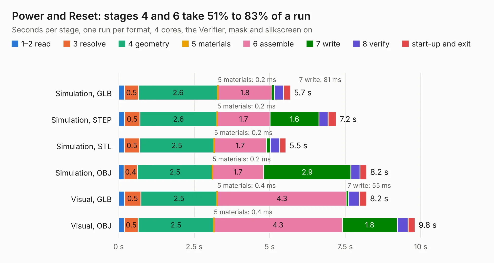

| Mode and format | 1–2 read | 3 resolve | 4 geometry | 5 materials | 6 assemble | 7 write | 8 verify | start-up and exit | Total |
|---|---:|---:|---:|---:|---:|---:|---:|---:|---:|
| Simulation, GLB | 0.2 | 0.5 | 2.6 | 0.2&nbsp;ms | 1.8 | 81&nbsp;ms | 0.3 | 0.2 | 5.7 |
| Simulation, STEP | 0.2 | 0.5 | 2.6 | 0.2&nbsp;ms | 1.7 | 1.6 | 0.3 | 0.3 | 7.2 |
| Simulation, STL | 0.2 | 0.5 | 2.5 | 0.2&nbsp;ms | 1.7 | 0.1 | 0.3 | 0.2 | 5.5 |
| Simulation, OBJ | 0.2 | 0.4 | 2.5 | 0.2&nbsp;ms | 1.7 | 2.9 | 0.3 | 0.2 | 8.2 |
| Visual, GLB | 0.2 | 0.5 | 2.5 | 0.4&nbsp;ms | 4.3 | 55&nbsp;ms | 0.4 | 0.2 | 8.2 |
| Visual, OBJ | 0.2 | 0.5 | 2.5 | 0.4&nbsp;ms | 4.3 | 1.8 | 0.4 | 0.2 | 9.8 |

<table align="center"><tr><td valign="top">

| Board | Repo: [andrewpaterson/658-Computer](https://github.com/andrewpaterson/658-Computer) Board: `Power and Reset.kicad_pcb` |
|---|---|
| Folder | Kicad / Computer / Power / Power and Reset |
| Complexity | 233&nbsp;/&nbsp;1000 (size&nbsp;148, features&nbsp;85) |
| KESE&nbsp;features | through vias, rounded, trapezoid or chamfered pads, filled zones, curved board outline, stack-up, dielectric εr and tanδ |
| Tested | 9th November 2026 |
| Copper&nbsp;layers | 2 |
| File&nbsp;format | KiCad 10 (20260206) |
| Parts,&nbsp;tracks,&nbsp;vias | 23, 285, 29 |
| Triangles,&nbsp;simulation | 503,998 in 51 parts |
| Verifier | PASS in all six runs |

</td><td valign="top">

<table>
<tr><th>File type</th><th>File size</th><th>Peak memory used</th></tr>
<tr><th colspan="3" align="left">Simulation</th></tr>
<tr><td>GLB</td><td align="right">17&nbsp;MB</td><td align="right">283&nbsp;MB</td></tr>
<tr><td>STEP</td><td align="right">70&nbsp;MB</td><td align="right">340&nbsp;MB</td></tr>
<tr><td>STL</td><td align="right">25&nbsp;MB</td><td align="right">292&nbsp;MB</td></tr>
<tr><td>OBJ</td><td align="right">50&nbsp;MB</td><td align="right">375&nbsp;MB</td></tr>
<tr><th colspan="3" align="left">Visual</th></tr>
<tr><td>GLB</td><td align="right">11&nbsp;MB</td><td align="right">342&nbsp;MB</td></tr>
<tr><td>OBJ</td><td align="right">34&nbsp;MB</td><td align="right">342&nbsp;MB</td></tr>
</table>

</td></tr></table>

## 218. Address Decode V2 to V3

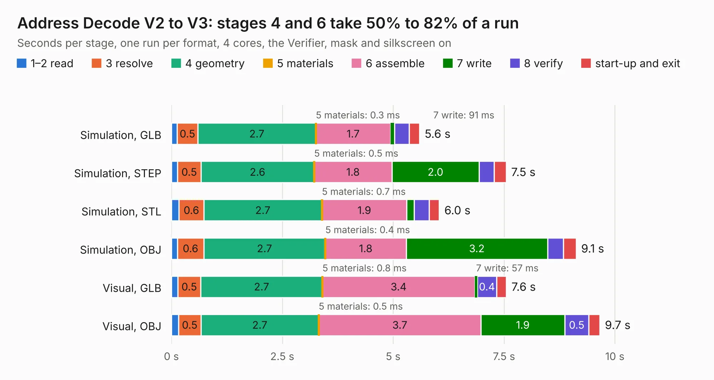

| Mode and format | 1–2 read | 3 resolve | 4 geometry | 5 materials | 6 assemble | 7 write | 8 verify | start-up and exit | Total |
|---|---:|---:|---:|---:|---:|---:|---:|---:|---:|
| Simulation, GLB | 0.1 | 0.5 | 2.7 | 0.3&nbsp;ms | 1.7 | 91&nbsp;ms | 0.3 | 0.2 | 5.6 |
| Simulation, STEP | 0.1 | 0.5 | 2.6 | 0.5&nbsp;ms | 1.8 | 2.0 | 0.3 | 0.3 | 7.5 |
| Simulation, STL | 0.2 | 0.6 | 2.7 | 0.7&nbsp;ms | 1.9 | 0.2 | 0.3 | 0.2 | 6.0 |
| Simulation, OBJ | 0.1 | 0.6 | 2.7 | 0.4&nbsp;ms | 1.8 | 3.2 | 0.4 | 0.3 | 9.1 |
| Visual, GLB | 0.1 | 0.5 | 2.7 | 0.8&nbsp;ms | 3.4 | 57&nbsp;ms | 0.4 | 0.2 | 7.6 |
| Visual, OBJ | 0.2 | 0.5 | 2.7 | 0.5&nbsp;ms | 3.7 | 1.9 | 0.5 | 0.2 | 9.7 |

<table align="center"><tr><td valign="top">

| Board | Repo: [andrewpaterson/658-Computer](https://github.com/andrewpaterson/658-Computer) Board: `Address Decode V2 to V3.kicad_pcb` |
|---|---|
| Folder | Kicad / Computer / Processor / Address Decode V2 to V3 |
| Complexity | 162&nbsp;/&nbsp;1000 (size&nbsp;97, features&nbsp;65) |
| KESE&nbsp;features | rounded, trapezoid or chamfered pads, curved board outline, knockout text, stack-up, dielectric εr and tanδ |
| Tested | 9th November 2026 |
| Copper&nbsp;layers | 2 |
| File&nbsp;format | KiCad 9 (20241229) |
| Parts,&nbsp;tracks,&nbsp;vias | 2, 65, 0 |
| Triangles,&nbsp;simulation | 556,592 in 64 parts |
| Verifier | PASS in all six runs |

</td><td valign="top">

<table>
<tr><th>File type</th><th>File size</th><th>Peak memory used</th></tr>
<tr><th colspan="3" align="left">Simulation</th></tr>
<tr><td>GLB</td><td align="right">17&nbsp;MB</td><td align="right">297&nbsp;MB</td></tr>
<tr><td>STEP</td><td align="right">67&nbsp;MB</td><td align="right">347&nbsp;MB</td></tr>
<tr><td>STL</td><td align="right">28&nbsp;MB</td><td align="right">294&nbsp;MB</td></tr>
<tr><td>OBJ</td><td align="right">55&nbsp;MB</td><td align="right">409&nbsp;MB</td></tr>
<tr><th colspan="3" align="left">Visual</th></tr>
<tr><td>GLB</td><td align="right">10&nbsp;MB</td><td align="right">334&nbsp;MB</td></tr>
<tr><td>OBJ</td><td align="right">30&nbsp;MB</td><td align="right">336&nbsp;MB</td></tr>
</table>

</td></tr></table>

## 219. Clock Hold V1 to V2

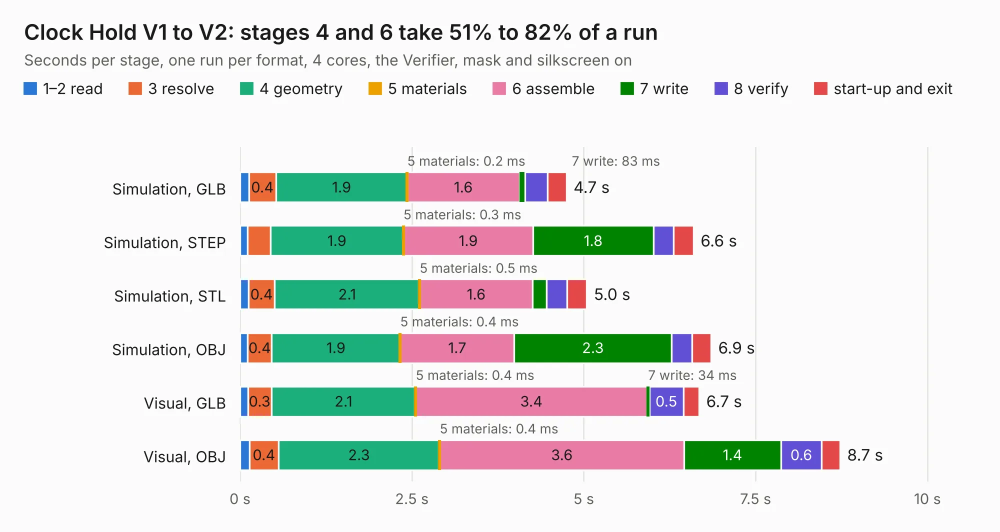

| Mode and format | 1–2 read | 3 resolve | 4 geometry | 5 materials | 6 assemble | 7 write | 8 verify | start-up and exit | Total |
|---|---:|---:|---:|---:|---:|---:|---:|---:|---:|
| Simulation, GLB | 0.1 | 0.4 | 1.9 | 0.2&nbsp;ms | 1.6 | 83&nbsp;ms | 0.3 | 0.3 | 4.7 |
| Simulation, STEP | 0.1 | 0.3 | 1.9 | 0.3&nbsp;ms | 1.9 | 1.8 | 0.3 | 0.3 | 6.6 |
| Simulation, STL | 0.1 | 0.4 | 2.1 | 0.5&nbsp;ms | 1.6 | 0.2 | 0.3 | 0.3 | 5.0 |
| Simulation, OBJ | 0.1 | 0.4 | 1.9 | 0.4&nbsp;ms | 1.7 | 2.3 | 0.3 | 0.3 | 6.9 |
| Visual, GLB | 0.1 | 0.3 | 2.1 | 0.4&nbsp;ms | 3.4 | 34&nbsp;ms | 0.5 | 0.2 | 6.7 |
| Visual, OBJ | 0.1 | 0.4 | 2.3 | 0.4&nbsp;ms | 3.6 | 1.4 | 0.6 | 0.3 | 8.7 |

<table align="center"><tr><td valign="top">

| Board | Repo: [andrewpaterson/658-Computer](https://github.com/andrewpaterson/658-Computer) Board: `Clock Hold V1 to V2.kicad_pcb` |
|---|---|
| Folder | Kicad / Computer / Processor / Clock Hold V1 to V2 |
| Complexity | 195&nbsp;/&nbsp;1000 (size&nbsp;115, features&nbsp;80) |
| KESE&nbsp;features | through vias, rounded, trapezoid or chamfered pads, curved board outline, knockout text, stack-up, dielectric εr and tanδ |
| Tested | 9th November 2026 |
| Copper&nbsp;layers | 2 |
| File&nbsp;format | KiCad 9 (20241229) |
| Parts,&nbsp;tracks,&nbsp;vias | 3, 132, 9 |
| Triangles,&nbsp;simulation | 424,936 in 51 parts |
| Verifier | PASS in all six runs |

</td><td valign="top">

<table>
<tr><th>File type</th><th>File size</th><th>Peak memory used</th></tr>
<tr><th colspan="3" align="left">Simulation</th></tr>
<tr><td>GLB</td><td align="right">14&nbsp;MB</td><td align="right">260&nbsp;MB</td></tr>
<tr><td>STEP</td><td align="right">54&nbsp;MB</td><td align="right">303&nbsp;MB</td></tr>
<tr><td>STL</td><td align="right">21&nbsp;MB</td><td align="right">262&nbsp;MB</td></tr>
<tr><td>OBJ</td><td align="right">42&nbsp;MB</td><td align="right">329&nbsp;MB</td></tr>
<tr><th colspan="3" align="left">Visual</th></tr>
<tr><td>GLB</td><td align="right">8.2&nbsp;MB</td><td align="right">280&nbsp;MB</td></tr>
<tr><td>OBJ</td><td align="right">24&nbsp;MB</td><td align="right">275&nbsp;MB</td></tr>
</table>

</td></tr></table>

## 220. HCP65 Board Presence

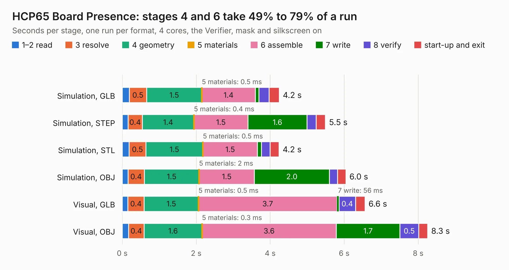

| Mode and format | 1–2 read | 3 resolve | 4 geometry | 5 materials | 6 assemble | 7 write | 8 verify | start-up and exit | Total |
|---|---:|---:|---:|---:|---:|---:|---:|---:|---:|
| Simulation, GLB | 0.2 | 0.5 | 1.5 | 0.5&nbsp;ms | 1.4 | 95&nbsp;ms | 0.3 | 0.3 | 4.2 |
| Simulation, STEP | 0.2 | 0.4 | 1.4 | 0.4&nbsp;ms | 1.5 | 1.6 | 0.2 | 0.3 | 5.5 |
| Simulation, STL | 0.2 | 0.5 | 1.5 | 0.5&nbsp;ms | 1.5 | 0.1 | 0.2 | 0.2 | 4.2 |
| Simulation, OBJ | 0.2 | 0.4 | 1.5 | 2&nbsp;ms | 1.5 | 2.0 | 0.2 | 0.2 | 6.0 |
| Visual, GLB | 0.2 | 0.4 | 1.5 | 0.5&nbsp;ms | 3.7 | 56&nbsp;ms | 0.4 | 0.3 | 6.6 |
| Visual, OBJ | 0.2 | 0.4 | 1.6 | 0.3&nbsp;ms | 3.6 | 1.7 | 0.5 | 0.2 | 8.3 |

<table align="center"><tr><td valign="top">

| Board | Repo: [andrewpaterson/658-Computer](https://github.com/andrewpaterson/658-Computer) Board: `HCP65 Board Presence.kicad_pcb` |
|---|---|
| Folder | Kicad / Computer / Processor / HCP65 Board Presence |
| Complexity | 228&nbsp;/&nbsp;1000 (size&nbsp;158, features&nbsp;70) |
| KESE&nbsp;features | through vias, rounded, trapezoid or chamfered pads, knockout text, stack-up, dielectric εr and tanδ |
| Tested | 9th November 2026 |
| Copper&nbsp;layers | 2 |
| File&nbsp;format | KiCad 9 (20241229) |
| Parts,&nbsp;tracks,&nbsp;vias | 21, 509, 64 |
| Triangles,&nbsp;simulation | 391,638 in 50 parts |
| Verifier | PASS in all six runs |

</td><td valign="top">

<table>
<tr><th>File type</th><th>File size</th><th>Peak memory used</th></tr>
<tr><th colspan="3" align="left">Simulation</th></tr>
<tr><td>GLB</td><td align="right">14&nbsp;MB</td><td align="right">279&nbsp;MB</td></tr>
<tr><td>STEP</td><td align="right">62&nbsp;MB</td><td align="right">310&nbsp;MB</td></tr>
<tr><td>STL</td><td align="right">20&nbsp;MB</td><td align="right">290&nbsp;MB</td></tr>
<tr><td>OBJ</td><td align="right">40&nbsp;MB</td><td align="right">320&nbsp;MB</td></tr>
<tr><th colspan="3" align="left">Visual</th></tr>
<tr><td>GLB</td><td align="right">12&nbsp;MB</td><td align="right">332&nbsp;MB</td></tr>
<tr><td>OBJ</td><td align="right">34&nbsp;MB</td><td align="right">334&nbsp;MB</td></tr>
</table>

</td></tr></table>

## 221. HCP65 Device Interrupts

| Mode and format | 1–2 read | 3 resolve | 4 geometry | 5 materials | 6 assemble | 7 write | 8 verify | start-up and exit | Total |
|---|---:|---:|---:|---:|---:|---:|---:|---:|---:|
| Simulation, GLB | 0.3 | 0.7 | 3.0 | 0.5&nbsp;ms | 2.5 | 0.1 | 0.4 | 0.2 | 7.2 |
| Simulation, STEP | 0.2 | 0.7 | 3.0 | 0.3&nbsp;ms | 2.7 | 2.3 | 0.4 | 0.2 | 9.6 |
| Simulation, STL | 0.2 | 0.7 | 3.1 | 0.3&nbsp;ms | 2.7 | 0.2 | 0.5 | 0.2 | 7.6 |
| Simulation, OBJ | 0.2 | 0.7 | 3.1 | 0.4&nbsp;ms | 2.6 | 3.8 | 0.5 | 0.2 | 11.2 |
| Visual, GLB | 0.2 | 0.7 | 2.9 | 0.3&nbsp;ms | 7.0 | 0.1 | 0.8 | 0.2 | 12.0 |
| Visual, OBJ | 0.2 | 0.7 | 3.2 | 0.4&nbsp;ms | 6.8 | 3.5 | 0.7 | 0.2 | 15.3 |

<table align="center"><tr><td valign="top">

| Board | Repo: [andrewpaterson/658-Computer](https://github.com/andrewpaterson/658-Computer) Board: `HCP65 Device Interrupts.kicad_pcb` |
|---|---|
| Folder | Kicad / Computer / Processor / HCP65 Device Interrupts |
| Complexity | 238&nbsp;/&nbsp;1000 (size&nbsp;168, features&nbsp;70) |
| KESE&nbsp;features | through vias, rounded, trapezoid or chamfered pads, knockout text, stack-up, dielectric εr and tanδ |
| Tested | 9th November 2026 |
| Copper&nbsp;layers | 2 |
| File&nbsp;format | KiCad 9 (20241229) |
| Parts,&nbsp;tracks,&nbsp;vias | 18, 1,070, 123 |
| Triangles,&nbsp;simulation | 656,798 in 59 parts |
| Verifier | PASS in all six runs |

</td><td valign="top">

<table>
<tr><th>File type</th><th>File size</th><th>Peak memory used</th></tr>
<tr><th colspan="3" align="left">Simulation</th></tr>
<tr><td>GLB</td><td align="right">23&nbsp;MB</td><td align="right">384&nbsp;MB</td></tr>
<tr><td>STEP</td><td align="right">112&nbsp;MB</td><td align="right">413&nbsp;MB</td></tr>
<tr><td>STL</td><td align="right">33&nbsp;MB</td><td align="right">359&nbsp;MB</td></tr>
<tr><td>OBJ</td><td align="right">67&nbsp;MB</td><td align="right">491&nbsp;MB</td></tr>
<tr><th colspan="3" align="left">Visual</th></tr>
<tr><td>GLB</td><td align="right">19&nbsp;MB</td><td align="right">533&nbsp;MB</td></tr>
<tr><td>OBJ</td><td align="right">59&nbsp;MB</td><td align="right">516&nbsp;MB</td></tr>
</table>

</td></tr></table>

## 222. HCP65 Device Reset

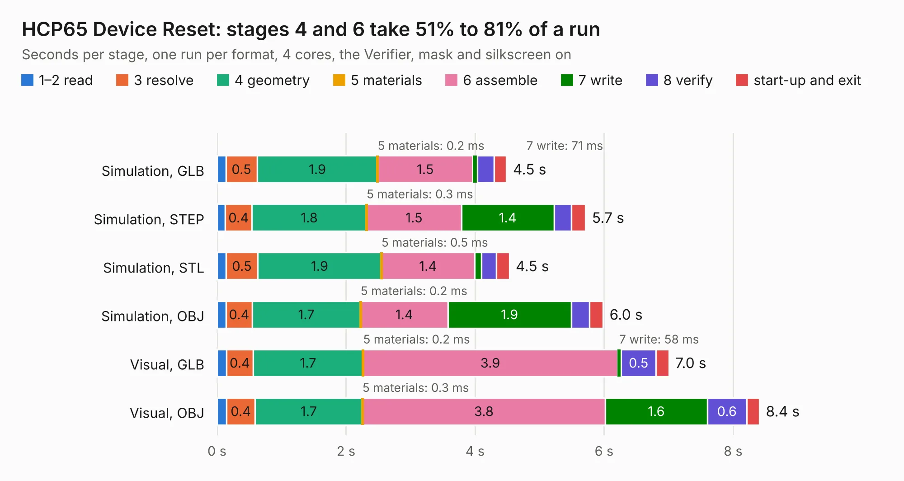

| Mode and format | 1–2 read | 3 resolve | 4 geometry | 5 materials | 6 assemble | 7 write | 8 verify | start-up and exit | Total |
|---|---:|---:|---:|---:|---:|---:|---:|---:|---:|
| Simulation, GLB | 0.1 | 0.5 | 1.9 | 0.2&nbsp;ms | 1.5 | 71&nbsp;ms | 0.3 | 0.2 | 4.5 |
| Simulation, STEP | 0.1 | 0.4 | 1.8 | 0.3&nbsp;ms | 1.5 | 1.4 | 0.3 | 0.2 | 5.7 |
| Simulation, STL | 0.1 | 0.5 | 1.9 | 0.5&nbsp;ms | 1.4 | 0.1 | 0.2 | 0.2 | 4.5 |
| Simulation, OBJ | 0.1 | 0.4 | 1.7 | 0.2&nbsp;ms | 1.4 | 1.9 | 0.3 | 0.2 | 6.0 |
| Visual, GLB | 0.1 | 0.4 | 1.7 | 0.2&nbsp;ms | 3.9 | 58&nbsp;ms | 0.5 | 0.2 | 7.0 |
| Visual, OBJ | 0.1 | 0.4 | 1.7 | 0.3&nbsp;ms | 3.8 | 1.6 | 0.6 | 0.2 | 8.4 |

<table align="center"><tr><td valign="top">

| Board | Repo: [andrewpaterson/658-Computer](https://github.com/andrewpaterson/658-Computer) Board: `HCP65 Device Reset.kicad_pcb` |
|---|---|
| Folder | Kicad / Computer / Processor / HCP65 Device Reset |
| Complexity | 228&nbsp;/&nbsp;1000 (size&nbsp;158, features&nbsp;70) |
| KESE&nbsp;features | through vias, rounded, trapezoid or chamfered pads, knockout text, stack-up, dielectric εr and tanδ |
| Tested | 9th November 2026 |
| Copper&nbsp;layers | 2 |
| File&nbsp;format | KiCad 9 (20241229) |
| Parts,&nbsp;tracks,&nbsp;vias | 14, 677, 74 |
| Triangles,&nbsp;simulation | 490,122 in 61 parts |
| Verifier | PASS in all six runs |

</td><td valign="top">

<table>
<tr><th>File type</th><th>File size</th><th>Peak memory used</th></tr>
<tr><th colspan="3" align="left">Simulation</th></tr>
<tr><td>GLB</td><td align="right">17&nbsp;MB</td><td align="right">309&nbsp;MB</td></tr>
<tr><td>STEP</td><td align="right">81&nbsp;MB</td><td align="right">349&nbsp;MB</td></tr>
<tr><td>STL</td><td align="right">25&nbsp;MB</td><td align="right">310&nbsp;MB</td></tr>
<tr><td>OBJ</td><td align="right">50&nbsp;MB</td><td align="right">377&nbsp;MB</td></tr>
<tr><th colspan="3" align="left">Visual</th></tr>
<tr><td>GLB</td><td align="right">14&nbsp;MB</td><td align="right">392&nbsp;MB</td></tr>
<tr><td>OBJ</td><td align="right">41&nbsp;MB</td><td align="right">388&nbsp;MB</td></tr>
</table>

</td></tr></table>

## 223. HCP65 Hold Count

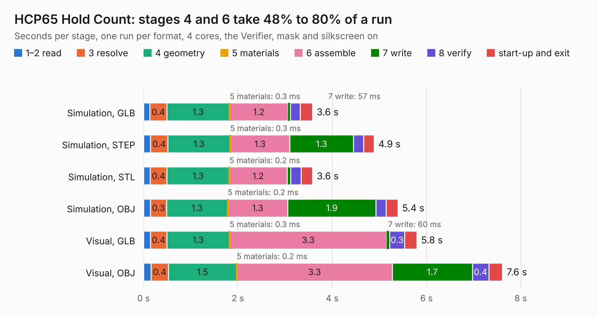

| Mode and format | 1–2 read | 3 resolve | 4 geometry | 5 materials | 6 assemble | 7 write | 8 verify | start-up and exit | Total |
|---|---:|---:|---:|---:|---:|---:|---:|---:|---:|
| Simulation, GLB | 0.1 | 0.4 | 1.3 | 0.3&nbsp;ms | 1.2 | 57&nbsp;ms | 0.2 | 0.3 | 3.6 |
| Simulation, STEP | 0.1 | 0.4 | 1.3 | 0.3&nbsp;ms | 1.3 | 1.3 | 0.2 | 0.2 | 4.9 |
| Simulation, STL | 0.1 | 0.4 | 1.3 | 0.2&nbsp;ms | 1.2 | 82&nbsp;ms | 0.2 | 0.2 | 3.6 |
| Simulation, OBJ | 0.1 | 0.3 | 1.3 | 0.2&nbsp;ms | 1.3 | 1.9 | 0.2 | 0.2 | 5.4 |
| Visual, GLB | 0.1 | 0.4 | 1.3 | 0.3&nbsp;ms | 3.3 | 60&nbsp;ms | 0.3 | 0.3 | 5.8 |
| Visual, OBJ | 0.2 | 0.4 | 1.5 | 0.2&nbsp;ms | 3.3 | 1.7 | 0.4 | 0.3 | 7.6 |

<table align="center"><tr><td valign="top">

| Board | Repo: [andrewpaterson/658-Computer](https://github.com/andrewpaterson/658-Computer) Board: `HCP65 Hold Count.kicad_pcb` |
|---|---|
| Folder | Kicad / Computer / Processor / HCP65 Hold Count |
| Complexity | 217&nbsp;/&nbsp;1000 (size&nbsp;147, features&nbsp;70) |
| KESE&nbsp;features | through vias, rounded, trapezoid or chamfered pads, knockout text, stack-up, dielectric εr and tanδ |
| Tested | 9th November 2026 |
| Copper&nbsp;layers | 2 |
| File&nbsp;format | KiCad 9 (20241229) |
| Parts,&nbsp;tracks,&nbsp;vias | 12, 344, 56 |
| Triangles,&nbsp;simulation | 316,504 in 40 parts |
| Verifier | PASS in all six runs |

</td><td valign="top">

<table>
<tr><th>File type</th><th>File size</th><th>Peak memory used</th></tr>
<tr><th colspan="3" align="left">Simulation</th></tr>
<tr><td>GLB</td><td align="right">11&nbsp;MB</td><td align="right">244&nbsp;MB</td></tr>
<tr><td>STEP</td><td align="right">49&nbsp;MB</td><td align="right">273&nbsp;MB</td></tr>
<tr><td>STL</td><td align="right">16&nbsp;MB</td><td align="right">245&nbsp;MB</td></tr>
<tr><td>OBJ</td><td align="right">32&nbsp;MB</td><td align="right">245&nbsp;MB</td></tr>
<tr><th colspan="3" align="left">Visual</th></tr>
<tr><td>GLB</td><td align="right">9.0&nbsp;MB</td><td align="right">284&nbsp;MB</td></tr>
<tr><td>OBJ</td><td align="right">27&nbsp;MB</td><td align="right">279&nbsp;MB</td></tr>
</table>

</td></tr></table>

## 224. HCP65 Instruction Code

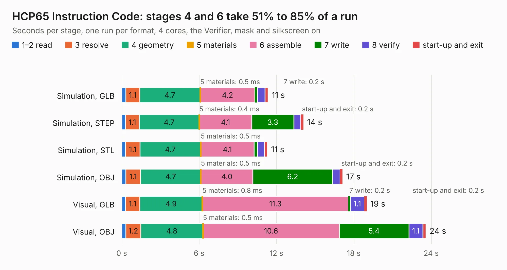

| Mode and format | 1–2 read | 3 resolve | 4 geometry | 5 materials | 6 assemble | 7 write | 8 verify | start-up and exit | Total |
|---|---:|---:|---:|---:|---:|---:|---:|---:|---:|
| Simulation, GLB | 0.3 | 1.1 | 4.7 | 0.5&nbsp;ms | 4.2 | 0.2 | 0.6 | 0.3 | 11.4 |
| Simulation, STEP | 0.3 | 1.1 | 4.7 | 0.4&nbsp;ms | 4.1 | 3.3 | 0.5 | 0.2 | 14.1 |
| Simulation, STL | 0.3 | 1.1 | 4.7 | 0.5&nbsp;ms | 4.1 | 0.3 | 0.5 | 0.2 | 11.3 |
| Simulation, OBJ | 0.3 | 1.1 | 4.7 | 0.5&nbsp;ms | 4.0 | 6.2 | 0.6 | 0.2 | 17.1 |
| Visual, GLB | 0.3 | 1.1 | 4.9 | 0.8&nbsp;ms | 11.3 | 0.2 | 1.1 | 0.2 | 19.0 |
| Visual, OBJ | 0.3 | 1.2 | 4.8 | 0.5&nbsp;ms | 10.6 | 5.4 | 1.1 | 0.2 | 23.6 |

<table align="center"><tr><td valign="top">

| Board | Repo: [andrewpaterson/658-Computer](https://github.com/andrewpaterson/658-Computer) Board: `HCP65 Instruction Code.kicad_pcb` |
|---|---|
| Folder | Kicad / Computer / Processor / HCP65 Instruction Code |
| Complexity | 255&nbsp;/&nbsp;1000 (size&nbsp;185, features&nbsp;70) |
| KESE&nbsp;features | through vias, rounded, trapezoid or chamfered pads, knockout text, stack-up, dielectric εr and tanδ |
| Tested | 9th November 2026 |
| Copper&nbsp;layers | 2 |
| File&nbsp;format | KiCad 9 (20241229) |
| Parts,&nbsp;tracks,&nbsp;vias | 36, 2,035, 222 |
| Triangles,&nbsp;simulation | 1,150,168 in 107 parts |
| Verifier | PASS in all six runs |

</td><td valign="top">

<table>
<tr><th>File type</th><th>File size</th><th>Peak memory used</th></tr>
<tr><th colspan="3" align="left">Simulation</th></tr>
<tr><td>GLB</td><td align="right">40&nbsp;MB</td><td align="right">533&nbsp;MB</td></tr>
<tr><td>STEP</td><td align="right">194&nbsp;MB</td><td align="right">631&nbsp;MB</td></tr>
<tr><td>STL</td><td align="right">58&nbsp;MB</td><td align="right">534&nbsp;MB</td></tr>
<tr><td>OBJ</td><td align="right">118&nbsp;MB</td><td align="right">790&nbsp;MB</td></tr>
<tr><th colspan="3" align="left">Visual</th></tr>
<tr><td>GLB</td><td align="right">35&nbsp;MB</td><td align="right">759&nbsp;MB</td></tr>
<tr><td>OBJ</td><td align="right">106&nbsp;MB</td><td align="right">768&nbsp;MB</td></tr>
</table>

</td></tr></table>

## 225. HCP65 Kernal Mode

| Mode and format | 1–2 read | 3 resolve | 4 geometry | 5 materials | 6 assemble | 7 write | 8 verify | start-up and exit | Total |
|---|---:|---:|---:|---:|---:|---:|---:|---:|---:|
| Simulation, GLB | 0.3 | 1.3 | 5.0 | 0.6&nbsp;ms | 4.6 | 0.2 | 0.7 | 0.2 | 12.3 |
| Simulation, STEP | 0.3 | 1.3 | 5.0 | 0.7&nbsp;ms | 4.6 | 3.7 | 0.6 | 0.3 | 15.7 |
| Simulation, STL | 0.3 | 1.1 | 4.7 | 0.6&nbsp;ms | 4.4 | 0.3 | 0.7 | 0.3 | 11.8 |
| Simulation, OBJ | 0.4 | 1.4 | 5.0 | 0.8&nbsp;ms | 4.5 | 6.3 | 0.6 | 0.3 | 18.5 |
| Visual, GLB | 0.3 | 1.3 | 4.9 | 0.5&nbsp;ms | 11.3 | 0.2 | 1.1 | 0.2 | 19.3 |
| Visual, OBJ | 0.3 | 1.2 | 5.2 | 0.6&nbsp;ms | 11.0 | 5.8 | 1.3 | 0.2 | 25.0 |

<table align="center"><tr><td valign="top">

| Board | Repo: [andrewpaterson/658-Computer](https://github.com/andrewpaterson/658-Computer) Board: `HCP65 Kernal Mode.kicad_pcb` |
|---|---|
| Folder | Kicad / Computer / Processor / HCP65 Kernal Mode |
| Complexity | 253&nbsp;/&nbsp;1000 (size&nbsp;183, features&nbsp;70) |
| KESE&nbsp;features | through vias, rounded, trapezoid or chamfered pads, knockout text, stack-up, dielectric εr and tanδ |
| Tested | 9th November 2026 |
| Copper&nbsp;layers | 2 |
| File&nbsp;format | KiCad 9 (20241229) |
| Parts,&nbsp;tracks,&nbsp;vias | 30, 1,942, 242 |
| Triangles,&nbsp;simulation | 1,154,594 in 103 parts |
| Verifier | PASS in all six runs |

</td><td valign="top">

<table>
<tr><th>File type</th><th>File size</th><th>Peak memory used</th></tr>
<tr><th colspan="3" align="left">Simulation</th></tr>
<tr><td>GLB</td><td align="right">40&nbsp;MB</td><td align="right">554&nbsp;MB</td></tr>
<tr><td>STEP</td><td align="right">188&nbsp;MB</td><td align="right">622&nbsp;MB</td></tr>
<tr><td>STL</td><td align="right">58&nbsp;MB</td><td align="right">527&nbsp;MB</td></tr>
<tr><td>OBJ</td><td align="right">118&nbsp;MB</td><td align="right">832&nbsp;MB</td></tr>
<tr><th colspan="3" align="left">Visual</th></tr>
<tr><td>GLB</td><td align="right">35&nbsp;MB</td><td align="right">746&nbsp;MB</td></tr>
<tr><td>OBJ</td><td align="right">106&nbsp;MB</td><td align="right">732&nbsp;MB</td></tr>
</table>

</td></tr></table>

## 226. HCP65 Main Memory Address

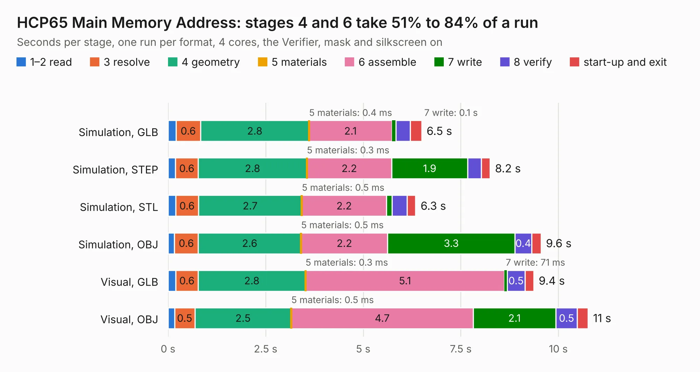

| Mode and format | 1–2 read | 3 resolve | 4 geometry | 5 materials | 6 assemble | 7 write | 8 verify | start-up and exit | Total |
|---|---:|---:|---:|---:|---:|---:|---:|---:|---:|
| Simulation, GLB | 0.2 | 0.6 | 2.8 | 0.4&nbsp;ms | 2.1 | 0.1 | 0.4 | 0.3 | 6.5 |
| Simulation, STEP | 0.2 | 0.6 | 2.8 | 0.3&nbsp;ms | 2.2 | 1.9 | 0.3 | 0.2 | 8.2 |
| Simulation, STL | 0.2 | 0.6 | 2.7 | 0.5&nbsp;ms | 2.2 | 0.1 | 0.4 | 0.2 | 6.3 |
| Simulation, OBJ | 0.2 | 0.6 | 2.6 | 0.5&nbsp;ms | 2.2 | 3.3 | 0.4 | 0.2 | 9.6 |
| Visual, GLB | 0.2 | 0.6 | 2.8 | 0.3&nbsp;ms | 5.1 | 71&nbsp;ms | 0.5 | 0.2 | 9.4 |
| Visual, OBJ | 0.2 | 0.5 | 2.5 | 0.5&nbsp;ms | 4.7 | 2.1 | 0.5 | 0.3 | 10.8 |

<table align="center"><tr><td valign="top">

| Board | Repo: [andrewpaterson/658-Computer](https://github.com/andrewpaterson/658-Computer) Board: `HCP65 Main Memory Address.kicad_pcb` |
|---|---|
| Folder | Kicad / Computer / Processor / HCP65 Main Memory Address |
| Complexity | 222&nbsp;/&nbsp;1000 (size&nbsp;152, features&nbsp;70) |
| KESE&nbsp;features | through vias, rounded, trapezoid or chamfered pads, knockout text, stack-up, dielectric εr and tanδ |
| Tested | 9th November 2026 |
| Copper&nbsp;layers | 2 |
| File&nbsp;format | KiCad 9 (20241229) |
| Parts,&nbsp;tracks,&nbsp;vias | 12, 559, 48 |
| Triangles,&nbsp;simulation | 548,882 in 78 parts |
| Verifier | PASS in all six runs |

</td><td valign="top">

<table>
<tr><th>File type</th><th>File size</th><th>Peak memory used</th></tr>
<tr><th colspan="3" align="left">Simulation</th></tr>
<tr><td>GLB</td><td align="right">19&nbsp;MB</td><td align="right">313&nbsp;MB</td></tr>
<tr><td>STEP</td><td align="right">93&nbsp;MB</td><td align="right">376&nbsp;MB</td></tr>
<tr><td>STL</td><td align="right">27&nbsp;MB</td><td align="right">297&nbsp;MB</td></tr>
<tr><td>OBJ</td><td align="right">56&nbsp;MB</td><td align="right">417&nbsp;MB</td></tr>
<tr><th colspan="3" align="left">Visual</th></tr>
<tr><td>GLB</td><td align="right">13&nbsp;MB</td><td align="right">385&nbsp;MB</td></tr>
<tr><td>OBJ</td><td align="right">40&nbsp;MB</td><td align="right">375&nbsp;MB</td></tr>
</table>

</td></tr></table>

## 227. HCP65 Main Memory Data

| Mode and format | 1–2 read | 3 resolve | 4 geometry | 5 materials | 6 assemble | 7 write | 8 verify | start-up and exit | Total |
|---|---:|---:|---:|---:|---:|---:|---:|---:|---:|
| Simulation, GLB | 0.1 | 0.3 | 1.4 | 1&nbsp;ms | 1.4 | 53&nbsp;ms | 0.3 | 0.3 | 3.7 |
| Simulation, STEP | 0.2 | 0.3 | 1.5 | 0.3&nbsp;ms | 1.2 | 1.3 | 0.3 | 0.3 | 5.1 |
| Simulation, STL | 0.2 | 0.3 | 1.3 | 0.3&nbsp;ms | 1.3 | 98&nbsp;ms | 0.2 | 0.2 | 3.6 |
| Simulation, OBJ | 0.1 | 0.3 | 1.5 | 0.2&nbsp;ms | 1.2 | 1.8 | 0.4 | 0.3 | 5.6 |
| Visual, GLB | 0.2 | 0.4 | 1.6 | 0.2&nbsp;ms | 3.3 | 46&nbsp;ms | 0.4 | 0.3 | 6.1 |
| Visual, OBJ | 0.2 | 0.3 | 1.6 | 0.2&nbsp;ms | 3.6 | 1.4 | 0.3 | 0.3 | 7.6 |

<table align="center"><tr><td valign="top">

| Board | Repo: [andrewpaterson/658-Computer](https://github.com/andrewpaterson/658-Computer) Board: `HCP65 Main Memory Data.kicad_pcb` |
|---|---|
| Folder | Kicad / Computer / Processor / HCP65 Main Memory Data |
| Complexity | 213&nbsp;/&nbsp;1000 (size&nbsp;143, features&nbsp;70) |
| KESE&nbsp;features | through vias, rounded, trapezoid or chamfered pads, knockout text, stack-up, dielectric εr and tanδ |
| Tested | 9th November 2026 |
| Copper&nbsp;layers | 2 |
| File&nbsp;format | KiCad 9 (20241229) |
| Parts,&nbsp;tracks,&nbsp;vias | 12, 312, 30 |
| Triangles,&nbsp;simulation | 299,074 in 46 parts |
| Verifier | PASS in all six runs |

</td><td valign="top">

<table>
<tr><th>File type</th><th>File size</th><th>Peak memory used</th></tr>
<tr><th colspan="3" align="left">Simulation</th></tr>
<tr><td>GLB</td><td align="right">10&nbsp;MB</td><td align="right">234&nbsp;MB</td></tr>
<tr><td>STEP</td><td align="right">48&nbsp;MB</td><td align="right">269&nbsp;MB</td></tr>
<tr><td>STL</td><td align="right">15&nbsp;MB</td><td align="right">234&nbsp;MB</td></tr>
<tr><td>OBJ</td><td align="right">30&nbsp;MB</td><td align="right">258&nbsp;MB</td></tr>
<tr><th colspan="3" align="left">Visual</th></tr>
<tr><td>GLB</td><td align="right">7.6&nbsp;MB</td><td align="right">252&nbsp;MB</td></tr>
<tr><td>OBJ</td><td align="right">22&nbsp;MB</td><td align="right">254&nbsp;MB</td></tr>
</table>

</td></tr></table>

## 228. HCP65 MPU Address Decode

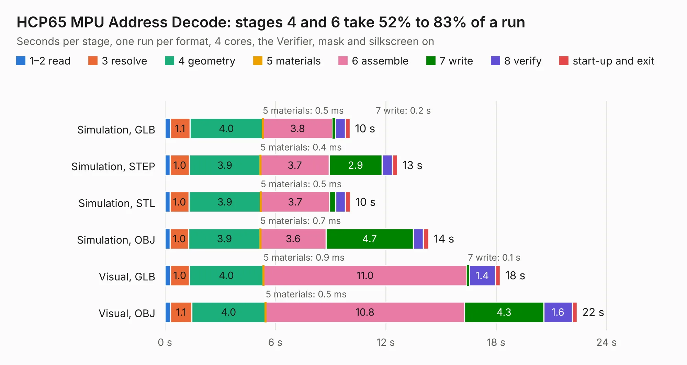

| Mode and format | 1–2 read | 3 resolve | 4 geometry | 5 materials | 6 assemble | 7 write | 8 verify | start-up and exit | Total |
|---|---:|---:|---:|---:|---:|---:|---:|---:|---:|
| Simulation, GLB | 0.3 | 1.1 | 4.0 | 0.5&nbsp;ms | 3.8 | 0.2 | 0.5 | 0.3 | 10.1 |
| Simulation, STEP | 0.3 | 1.0 | 3.9 | 0.4&nbsp;ms | 3.7 | 2.9 | 0.6 | 0.3 | 12.6 |
| Simulation, STL | 0.3 | 1.0 | 3.9 | 0.5&nbsp;ms | 3.7 | 0.3 | 0.5 | 0.3 | 10.1 |
| Simulation, OBJ | 0.3 | 1.0 | 3.9 | 0.7&nbsp;ms | 3.6 | 4.7 | 0.6 | 0.3 | 14.3 |
| Visual, GLB | 0.3 | 1.0 | 4.0 | 0.9&nbsp;ms | 11.0 | 0.1 | 1.4 | 0.3 | 18.2 |
| Visual, OBJ | 0.3 | 1.1 | 4.0 | 0.5&nbsp;ms | 10.8 | 4.3 | 1.6 | 0.3 | 22.4 |

<table align="center"><tr><td valign="top">

| Board | Repo: [andrewpaterson/658-Computer](https://github.com/andrewpaterson/658-Computer) Board: `HCP65 MPU Address Decode.kicad_pcb` |
|---|---|
| Folder | Kicad / Computer / Processor / HCP65 MPU Address Decode |
| Complexity | 251&nbsp;/&nbsp;1000 (size&nbsp;181, features&nbsp;70) |
| KESE&nbsp;features | through vias, rounded, trapezoid or chamfered pads, knockout text, stack-up, dielectric εr and tanδ |
| Tested | 9th November 2026 |
| Copper&nbsp;layers | 2 |
| File&nbsp;format | KiCad 9 (20241229) |
| Parts,&nbsp;tracks,&nbsp;vias | 44, 1,273, 168 |
| Triangles,&nbsp;simulation | 917,410 in 131 parts |
| Verifier | PASS in all six runs |

</td><td valign="top">

<table>
<tr><th>File type</th><th>File size</th><th>Peak memory used</th></tr>
<tr><th colspan="3" align="left">Simulation</th></tr>
<tr><td>GLB</td><td align="right">32&nbsp;MB</td><td align="right">475&nbsp;MB</td></tr>
<tr><td>STEP</td><td align="right">149&nbsp;MB</td><td align="right">530&nbsp;MB</td></tr>
<tr><td>STL</td><td align="right">46&nbsp;MB</td><td align="right">476&nbsp;MB</td></tr>
<tr><td>OBJ</td><td align="right">94&nbsp;MB</td><td align="right">661&nbsp;MB</td></tr>
<tr><th colspan="3" align="left">Visual</th></tr>
<tr><td>GLB</td><td align="right">27&nbsp;MB</td><td align="right">687&nbsp;MB</td></tr>
<tr><td>OBJ</td><td align="right">84&nbsp;MB</td><td align="right">644&nbsp;MB</td></tr>
</table>

</td></tr></table>

## 229. HCP65 MPU Memory

| Mode and format | 1–2 read | 3 resolve | 4 geometry | 5 materials | 6 assemble | 7 write | 8 verify | start-up and exit | Total |
|---|---:|---:|---:|---:|---:|---:|---:|---:|---:|
| Simulation, GLB | 0.1 | 0.5 | 2.4 | 0.2&nbsp;ms | 2.1 | 0.1 | 0.4 | 0.2 | 5.8 |
| Simulation, STEP | 0.1 | 0.5 | 2.4 | 0.3&nbsp;ms | 2.2 | 1.8 | 0.3 | 0.2 | 7.5 |
| Simulation, STL | 0.1 | 0.6 | 2.4 | 0.3&nbsp;ms | 2.2 | 0.2 | 0.4 | 0.2 | 6.0 |
| Simulation, OBJ | 0.2 | 0.5 | 2.3 | 0.3&nbsp;ms | 2.1 | 3.0 | 0.4 | 0.2 | 8.7 |
| Visual, GLB | 0.2 | 0.6 | 2.4 | 0.4&nbsp;ms | 5.4 | 81&nbsp;ms | 0.6 | 0.2 | 9.4 |
| Visual, OBJ | 0.1 | 0.5 | 2.3 | 0.3&nbsp;ms | 5.6 | 2.4 | 0.6 | 0.2 | 11.9 |

<table align="center"><tr><td valign="top">

| Board | Repo: [andrewpaterson/658-Computer](https://github.com/andrewpaterson/658-Computer) Board: `HCP65 MPU Memory.kicad_pcb` |
|---|---|
| Folder | Kicad / Computer / Processor / HCP65 MPU Memory |
| Complexity | 232&nbsp;/&nbsp;1000 (size&nbsp;162, features&nbsp;70) |
| KESE&nbsp;features | through vias, rounded, trapezoid or chamfered pads, knockout text, stack-up, dielectric εr and tanδ |
| Tested | 9th November 2026 |
| Copper&nbsp;layers | 2 |
| File&nbsp;format | KiCad 9 (20241229) |
| Parts,&nbsp;tracks,&nbsp;vias | 13, 868, 117 |
| Triangles,&nbsp;simulation | 752,164 in 70 parts |
| Verifier | PASS in all six runs |

</td><td valign="top">

<table>
<tr><th>File type</th><th>File size</th><th>Peak memory used</th></tr>
<tr><th colspan="3" align="left">Simulation</th></tr>
<tr><td>GLB</td><td align="right">26&nbsp;MB</td><td align="right">420&nbsp;MB</td></tr>
<tr><td>STEP</td><td align="right">109&nbsp;MB</td><td align="right">442&nbsp;MB</td></tr>
<tr><td>STL</td><td align="right">38&nbsp;MB</td><td align="right">409&nbsp;MB</td></tr>
<tr><td>OBJ</td><td align="right">76&nbsp;MB</td><td align="right">531&nbsp;MB</td></tr>
<tr><th colspan="3" align="left">Visual</th></tr>
<tr><td>GLB</td><td align="right">20&nbsp;MB</td><td align="right">529&nbsp;MB</td></tr>
<tr><td>OBJ</td><td align="right">60&nbsp;MB</td><td align="right">526&nbsp;MB</td></tr>
</table>

</td></tr></table>

## 230. HCP65 MPU NMI

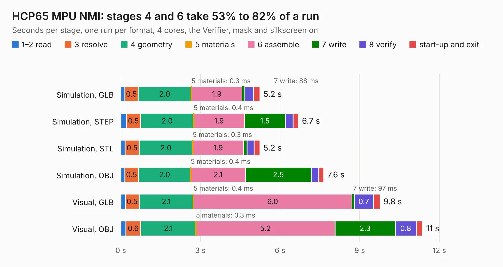

| Mode and format | 1–2 read | 3 resolve | 4 geometry | 5 materials | 6 assemble | 7 write | 8 verify | start-up and exit | Total |
|---|---:|---:|---:|---:|---:|---:|---:|---:|---:|
| Simulation, GLB | 0.2 | 0.5 | 2.0 | 0.3&nbsp;ms | 1.9 | 88&nbsp;ms | 0.3 | 0.2 | 5.2 |
| Simulation, STEP | 0.2 | 0.5 | 2.0 | 0.4&nbsp;ms | 1.9 | 1.5 | 0.3 | 0.2 | 6.7 |
| Simulation, STL | 0.2 | 0.5 | 2.0 | 0.3&nbsp;ms | 1.9 | 0.1 | 0.3 | 0.2 | 5.2 |
| Simulation, OBJ | 0.1 | 0.5 | 2.0 | 0.4&nbsp;ms | 2.1 | 2.5 | 0.3 | 0.2 | 7.6 |
| Visual, GLB | 0.2 | 0.5 | 2.1 | 0.4&nbsp;ms | 6.0 | 97&nbsp;ms | 0.7 | 0.3 | 9.8 |
| Visual, OBJ | 0.2 | 0.6 | 2.1 | 0.3&nbsp;ms | 5.2 | 2.3 | 0.8 | 0.2 | 11.4 |

<table align="center"><tr><td valign="top">

| Board | Repo: [andrewpaterson/658-Computer](https://github.com/andrewpaterson/658-Computer) Board: `HCP65 MPU NMI.kicad_pcb` |
|---|---|
| Folder | Kicad / Computer / Processor / HCP65 MPU NMI |
| Complexity | 239&nbsp;/&nbsp;1000 (size&nbsp;169, features&nbsp;70) |
| KESE&nbsp;features | through vias, rounded, trapezoid or chamfered pads, knockout text, stack-up, dielectric εr and tanδ |
| Tested | 9th November 2026 |
| Copper&nbsp;layers | 2 |
| File&nbsp;format | KiCad 9 (20241229) |
| Parts,&nbsp;tracks,&nbsp;vias | 24, 916, 137 |
| Triangles,&nbsp;simulation | 628,840 in 68 parts |
| Verifier | PASS in all six runs |

</td><td valign="top">

<table>
<tr><th>File type</th><th>File size</th><th>Peak memory used</th></tr>
<tr><th colspan="3" align="left">Simulation</th></tr>
<tr><td>GLB</td><td align="right">22&nbsp;MB</td><td align="right">352&nbsp;MB</td></tr>
<tr><td>STEP</td><td align="right">101&nbsp;MB</td><td align="right">405&nbsp;MB</td></tr>
<tr><td>STL</td><td align="right">31&nbsp;MB</td><td align="right">376&nbsp;MB</td></tr>
<tr><td>OBJ</td><td align="right">64&nbsp;MB</td><td align="right">457&nbsp;MB</td></tr>
<tr><th colspan="3" align="left">Visual</th></tr>
<tr><td>GLB</td><td align="right">19&nbsp;MB</td><td align="right">479&nbsp;MB</td></tr>
<tr><td>OBJ</td><td align="right">58&nbsp;MB</td><td align="right">498&nbsp;MB</td></tr>
</table>

</td></tr></table>

## 231. HCP65 MPU Timer

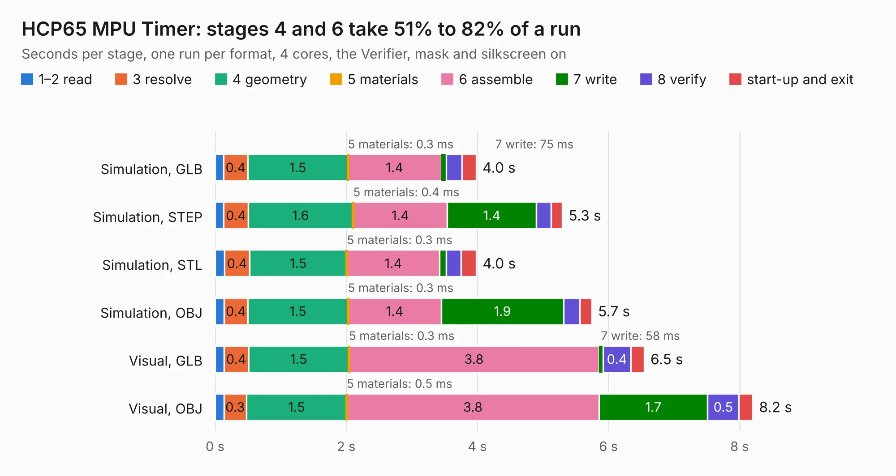

| Mode and format | 1–2 read | 3 resolve | 4 geometry | 5 materials | 6 assemble | 7 write | 8 verify | start-up and exit | Total |
|---|---:|---:|---:|---:|---:|---:|---:|---:|---:|
| Simulation, GLB | 0.1 | 0.4 | 1.5 | 0.3&nbsp;ms | 1.4 | 75&nbsp;ms | 0.2 | 0.2 | 4.0 |
| Simulation, STEP | 0.1 | 0.4 | 1.6 | 0.4&nbsp;ms | 1.4 | 1.4 | 0.2 | 0.2 | 5.3 |
| Simulation, STL | 0.1 | 0.4 | 1.5 | 0.3&nbsp;ms | 1.4 | 0.1 | 0.2 | 0.2 | 4.0 |
| Simulation, OBJ | 0.1 | 0.4 | 1.5 | 0.3&nbsp;ms | 1.4 | 1.9 | 0.3 | 0.2 | 5.7 |
| Visual, GLB | 0.1 | 0.4 | 1.5 | 0.3&nbsp;ms | 3.8 | 58&nbsp;ms | 0.4 | 0.2 | 6.5 |
| Visual, OBJ | 0.1 | 0.3 | 1.5 | 0.5&nbsp;ms | 3.8 | 1.7 | 0.5 | 0.2 | 8.2 |

<table align="center"><tr><td valign="top">

| Board | Repo: [andrewpaterson/658-Computer](https://github.com/andrewpaterson/658-Computer) Board: `HCP65 MPU Timer.kicad_pcb` |
|---|---|
| Folder | Kicad / Computer / Processor / HCP65 MPU Timer |
| Complexity | 230&nbsp;/&nbsp;1000 (size&nbsp;160, features&nbsp;70) |
| KESE&nbsp;features | through vias, rounded, trapezoid or chamfered pads, knockout text, stack-up, dielectric εr and tanδ |
| Tested | 9th November 2026 |
| Copper&nbsp;layers | 2 |
| File&nbsp;format | KiCad 9 (20241229) |
| Parts,&nbsp;tracks,&nbsp;vias | 18, 645, 81 |
| Triangles,&nbsp;simulation | 471,844 in 75 parts |
| Verifier | PASS in all six runs |

</td><td valign="top">

<table>
<tr><th>File type</th><th>File size</th><th>Peak memory used</th></tr>
<tr><th colspan="3" align="left">Simulation</th></tr>
<tr><td>GLB</td><td align="right">16&nbsp;MB</td><td align="right">318&nbsp;MB</td></tr>
<tr><td>STEP</td><td align="right">79&nbsp;MB</td><td align="right">339&nbsp;MB</td></tr>
<tr><td>STL</td><td align="right">24&nbsp;MB</td><td align="right">318&nbsp;MB</td></tr>
<tr><td>OBJ</td><td align="right">48&nbsp;MB</td><td align="right">365&nbsp;MB</td></tr>
<tr><th colspan="3" align="left">Visual</th></tr>
<tr><td>GLB</td><td align="right">14&nbsp;MB</td><td align="right">381&nbsp;MB</td></tr>
<tr><td>OBJ</td><td align="right">41&nbsp;MB</td><td align="right">377&nbsp;MB</td></tr>
</table>

</td></tr></table>

## 232. Processor Board

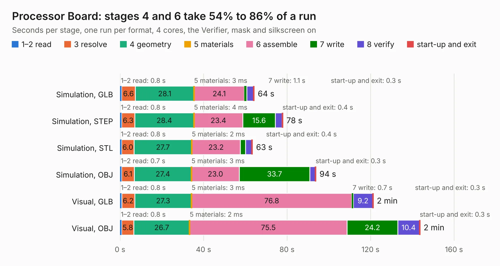

| Mode and format | 1–2 read | 3 resolve | 4 geometry | 5 materials | 6 assemble | 7 write | 8 verify | start-up and exit | Total |
|---|---:|---:|---:|---:|---:|---:|---:|---:|---:|
| Simulation, GLB | 0.8 | 6.6 | 28.1 | 3&nbsp;ms | 24.1 | 1.1 | 3.3 | 0.3 | 64.3 |
| Simulation, STEP | 0.8 | 6.3 | 28.4 | 4&nbsp;ms | 23.4 | 15.6 | 3.3 | 0.4 | 78.0 |
| Simulation, STL | 0.8 | 6.0 | 27.7 | 2&nbsp;ms | 23.2 | 2.5 | 3.0 | 0.4 | 63.5 |
| Simulation, OBJ | 0.7 | 6.1 | 27.4 | 3&nbsp;ms | 23.0 | 33.7 | 2.6 | 0.3 | 93.9 |
| Visual, GLB | 0.8 | 6.2 | 27.3 | 3&nbsp;ms | 76.8 | 0.7 | 9.2 | 0.3 | 121.3 |
| Visual, OBJ | 0.8 | 5.8 | 26.7 | 2&nbsp;ms | 75.5 | 24.2 | 10.4 | 0.3 | 143.7 |

<table align="center"><tr><td valign="top">

| Board | Repo: [andrewpaterson/658-Computer](https://github.com/andrewpaterson/658-Computer) Board: `Processor Board.kicad_pcb` |
|---|---|
| Folder | Kicad / Computer / Processor / Processor Board |
| Complexity | 283&nbsp;/&nbsp;1000 (size&nbsp;203, features&nbsp;80) |
| KESE&nbsp;features | through vias, rounded, trapezoid or chamfered pads, curved board outline, knockout text, stack-up, dielectric εr and tanδ |
| Tested | 9th November 2026 |
| Copper&nbsp;layers | 2 |
| File&nbsp;format | KiCad 9 (20241229) |
| Parts,&nbsp;tracks,&nbsp;vias | 40, 4,940, 868 |
| Triangles,&nbsp;simulation | 7,131,364 in 393 parts |
| Verifier | PASS in all six runs |

</td><td valign="top">

<table>
<tr><th>File type</th><th>File size</th><th>Peak memory used</th></tr>
<tr><th colspan="3" align="left">Simulation</th></tr>
<tr><td>GLB</td><td align="right">240&nbsp;MB</td><td align="right">2.1&nbsp;GB</td></tr>
<tr><td>STEP</td><td align="right">1.1&nbsp;GB</td><td align="right">2.6&nbsp;GB</td></tr>
<tr><td>STL</td><td align="right">357&nbsp;MB</td><td align="right">2.1&nbsp;GB</td></tr>
<tr><td>OBJ</td><td align="right">758&nbsp;MB</td><td align="right">4.4&nbsp;GB</td></tr>
<tr><th colspan="3" align="left">Visual</th></tr>
<tr><td>GLB</td><td align="right">176&nbsp;MB</td><td align="right">2.9&nbsp;GB</td></tr>
<tr><td>OBJ</td><td align="right">566&nbsp;MB</td><td align="right">3.6&nbsp;GB</td></tr>
</table>

</td></tr></table>

## 233. W65C816 Breakout

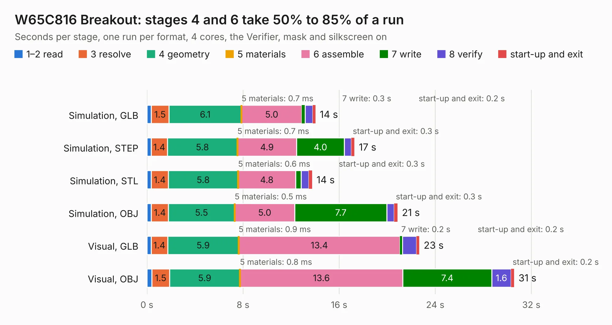

| Mode and format | 1–2 read | 3 resolve | 4 geometry | 5 materials | 6 assemble | 7 write | 8 verify | start-up and exit | Total |
|---|---:|---:|---:|---:|---:|---:|---:|---:|---:|
| Simulation, GLB | 0.4 | 1.5 | 6.1 | 0.7&nbsp;ms | 5.0 | 0.3 | 0.6 | 0.2 | 14.0 |
| Simulation, STEP | 0.3 | 1.4 | 5.8 | 0.7&nbsp;ms | 4.9 | 4.0 | 0.6 | 0.3 | 17.3 |
| Simulation, STL | 0.4 | 1.4 | 5.8 | 0.6&nbsp;ms | 4.8 | 0.5 | 0.7 | 0.3 | 13.8 |
| Simulation, OBJ | 0.4 | 1.4 | 5.5 | 0.5&nbsp;ms | 5.0 | 7.7 | 0.6 | 0.3 | 20.9 |
| Visual, GLB | 0.3 | 1.4 | 5.9 | 0.9&nbsp;ms | 13.4 | 0.2 | 1.2 | 0.2 | 22.7 |
| Visual, OBJ | 0.4 | 1.5 | 5.9 | 0.8&nbsp;ms | 13.6 | 7.4 | 1.6 | 0.2 | 30.6 |

<table align="center"><tr><td valign="top">

| Board | Repo: [andrewpaterson/658-Computer](https://github.com/andrewpaterson/658-Computer) Board: `W65C816 Breakout.kicad_pcb` |
|---|---|
| Folder | Kicad / Computer / Processor / W65C816 Breakout |
| Complexity | 260&nbsp;/&nbsp;1000 (size&nbsp;190, features&nbsp;70) |
| KESE&nbsp;features | through vias, rounded, trapezoid or chamfered pads, knockout text, stack-up, dielectric εr and tanδ |
| Tested | 9th November 2026 |
| Copper&nbsp;layers | 2 |
| File&nbsp;format | KiCad 9 (20241229) |
| Parts,&nbsp;tracks,&nbsp;vias | 51, 2,018, 270 |
| Triangles,&nbsp;simulation | 1,320,418 in 119 parts |
| Verifier | PASS in all six runs |

</td><td valign="top">

<table>
<tr><th>File type</th><th>File size</th><th>Peak memory used</th></tr>
<tr><th colspan="3" align="left">Simulation</th></tr>
<tr><td>GLB</td><td align="right">46&nbsp;MB</td><td align="right">610&nbsp;MB</td></tr>
<tr><td>STEP</td><td align="right">217&nbsp;MB</td><td align="right">675&nbsp;MB</td></tr>
<tr><td>STL</td><td align="right">66&nbsp;MB</td><td align="right">624&nbsp;MB</td></tr>
<tr><td>OBJ</td><td align="right">136&nbsp;MB</td><td align="right">889&nbsp;MB</td></tr>
<tr><th colspan="3" align="left">Visual</th></tr>
<tr><td>GLB</td><td align="right">40&nbsp;MB</td><td align="right">823&nbsp;MB</td></tr>
<tr><td>OBJ</td><td align="right">122&nbsp;MB</td><td align="right">964&nbsp;MB</td></tr>
</table>

</td></tr></table>

## 234. W65C816 Clock Hold

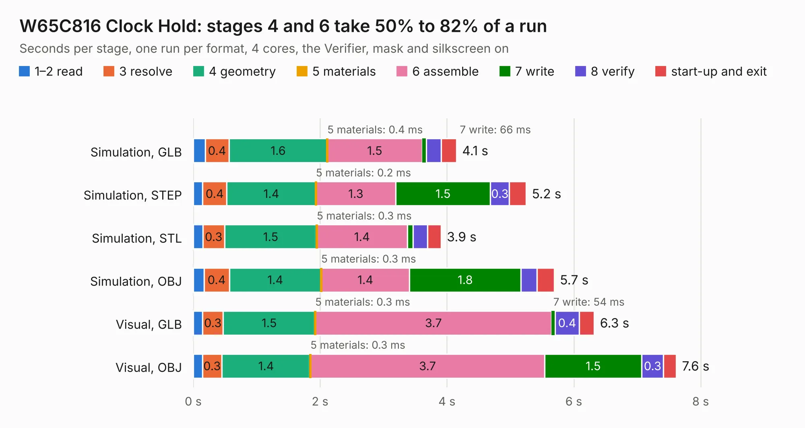

| Mode and format | 1–2 read | 3 resolve | 4 geometry | 5 materials | 6 assemble | 7 write | 8 verify | start-up and exit | Total |
|---|---:|---:|---:|---:|---:|---:|---:|---:|---:|
| Simulation, GLB | 0.2 | 0.4 | 1.6 | 0.4&nbsp;ms | 1.5 | 66&nbsp;ms | 0.2 | 0.2 | 4.1 |
| Simulation, STEP | 0.1 | 0.4 | 1.4 | 0.2&nbsp;ms | 1.3 | 1.5 | 0.3 | 0.3 | 5.2 |
| Simulation, STL | 0.1 | 0.3 | 1.5 | 0.3&nbsp;ms | 1.4 | 91&nbsp;ms | 0.2 | 0.2 | 3.9 |
| Simulation, OBJ | 0.2 | 0.4 | 1.4 | 0.3&nbsp;ms | 1.4 | 1.8 | 0.3 | 0.3 | 5.7 |
| Visual, GLB | 0.1 | 0.3 | 1.5 | 0.3&nbsp;ms | 3.7 | 54&nbsp;ms | 0.4 | 0.2 | 6.3 |
| Visual, OBJ | 0.1 | 0.3 | 1.4 | 0.3&nbsp;ms | 3.7 | 1.5 | 0.3 | 0.2 | 7.6 |

<table align="center"><tr><td valign="top">

| Board | Repo: [andrewpaterson/658-Computer](https://github.com/andrewpaterson/658-Computer) Board: `W65C816 Clock Hold.kicad_pcb` |
|---|---|
| Folder | Kicad / Computer / Processor / W65C816 Clock Hold |
| Complexity | 225&nbsp;/&nbsp;1000 (size&nbsp;155, features&nbsp;70) |
| KESE&nbsp;features | through vias, rounded, trapezoid or chamfered pads, knockout text, stack-up, dielectric εr and tanδ |
| Tested | 9th November 2026 |
| Copper&nbsp;layers | 2 |
| File&nbsp;format | KiCad 9 (20241229) |
| Parts,&nbsp;tracks,&nbsp;vias | 20, 458, 55 |
| Triangles,&nbsp;simulation | 357,774 in 45 parts |
| Verifier | PASS in all six runs |

</td><td valign="top">

<table>
<tr><th>File type</th><th>File size</th><th>Peak memory used</th></tr>
<tr><th colspan="3" align="left">Simulation</th></tr>
<tr><td>GLB</td><td align="right">12&nbsp;MB</td><td align="right">244&nbsp;MB</td></tr>
<tr><td>STEP</td><td align="right">61&nbsp;MB</td><td align="right">291&nbsp;MB</td></tr>
<tr><td>STL</td><td align="right">18&nbsp;MB</td><td align="right">261&nbsp;MB</td></tr>
<tr><td>OBJ</td><td align="right">36&nbsp;MB</td><td align="right">291&nbsp;MB</td></tr>
<tr><th colspan="3" align="left">Visual</th></tr>
<tr><td>GLB</td><td align="right">10&nbsp;MB</td><td align="right">307&nbsp;MB</td></tr>
<tr><td>OBJ</td><td align="right">31&nbsp;MB</td><td align="right">308&nbsp;MB</td></tr>
</table>

</td></tr></table>

## 235. W65C816 Debug Display

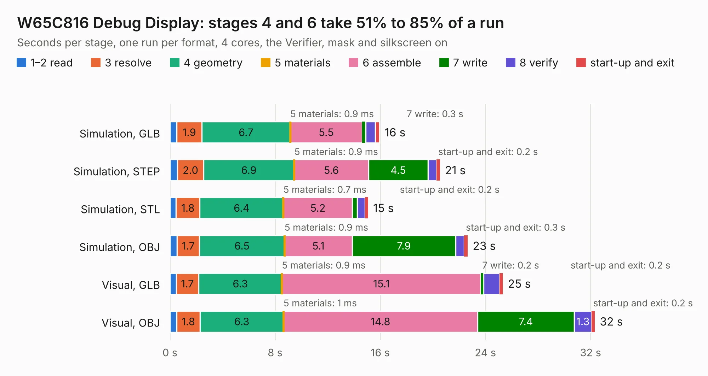

| Mode and format | 1–2 read | 3 resolve | 4 geometry | 5 materials | 6 assemble | 7 write | 8 verify | start-up and exit | Total |
|---|---:|---:|---:|---:|---:|---:|---:|---:|---:|
| Simulation, GLB | 0.5 | 1.9 | 6.7 | 0.9&nbsp;ms | 5.5 | 0.3 | 0.7 | 0.3 | 16.0 |
| Simulation, STEP | 0.6 | 2.0 | 6.9 | 0.9&nbsp;ms | 5.6 | 4.5 | 0.7 | 0.2 | 20.5 |
| Simulation, STL | 0.5 | 1.8 | 6.4 | 0.7&nbsp;ms | 5.2 | 0.4 | 0.6 | 0.2 | 15.1 |
| Simulation, OBJ | 0.5 | 1.7 | 6.5 | 0.9&nbsp;ms | 5.1 | 7.9 | 0.7 | 0.3 | 22.6 |
| Visual, GLB | 0.5 | 1.7 | 6.3 | 0.9&nbsp;ms | 15.1 | 0.2 | 1.2 | 0.2 | 25.3 |
| Visual, OBJ | 0.5 | 1.8 | 6.3 | 1&nbsp;ms | 14.8 | 7.4 | 1.3 | 0.2 | 32.3 |

<table align="center"><tr><td valign="top">

| Board | Repo: [andrewpaterson/658-Computer](https://github.com/andrewpaterson/658-Computer) Board: `W65C816 Debug Display.kicad_pcb` |
|---|---|
| Folder | Kicad / Computer / Processor / W65C816 Debug Display |
| Complexity | 273&nbsp;/&nbsp;1000 (size&nbsp;193, features&nbsp;80) |
| KESE&nbsp;features | through vias, rounded, trapezoid or chamfered pads, curved board outline, knockout text, stack-up, dielectric εr and tanδ |
| Tested | 9th November 2026 |
| Copper&nbsp;layers | 2 |
| File&nbsp;format | KiCad 9 (20241229) |
| Parts,&nbsp;tracks,&nbsp;vias | 81, 1,782, 276 |
| Triangles,&nbsp;simulation | 1,312,130 in 243 parts |
| Verifier | PASS in all six runs |

</td><td valign="top">

<table>
<tr><th>File type</th><th>File size</th><th>Peak memory used</th></tr>
<tr><th colspan="3" align="left">Simulation</th></tr>
<tr><td>GLB</td><td align="right">46&nbsp;MB</td><td align="right">588&nbsp;MB</td></tr>
<tr><td>STEP</td><td align="right">216&nbsp;MB</td><td align="right">715&nbsp;MB</td></tr>
<tr><td>STL</td><td align="right">66&nbsp;MB</td><td align="right">572&nbsp;MB</td></tr>
<tr><td>OBJ</td><td align="right">137&nbsp;MB</td><td align="right">1.1&nbsp;GB</td></tr>
<tr><th colspan="3" align="left">Visual</th></tr>
<tr><td>GLB</td><td align="right">41&nbsp;MB</td><td align="right">868&nbsp;MB</td></tr>
<tr><td>OBJ</td><td align="right">126&nbsp;MB</td><td align="right">1.1&nbsp;GB</td></tr>
</table>

</td></tr></table>

## 236. W65C816 Latch

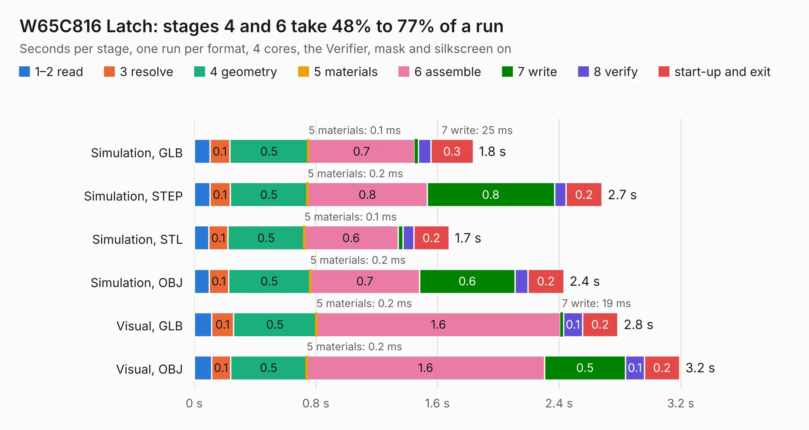

| Mode and format | 1–2 read | 3 resolve | 4 geometry | 5 materials | 6 assemble | 7 write | 8 verify | start-up and exit | Total |
|---|---:|---:|---:|---:|---:|---:|---:|---:|---:|
| Simulation, GLB | 0.1 | 0.1 | 0.5 | 0.1&nbsp;ms | 0.7 | 25&nbsp;ms | 82&nbsp;ms | 0.3 | 1.8 |
| Simulation, STEP | 0.1 | 0.1 | 0.5 | 0.2&nbsp;ms | 0.8 | 0.8 | 77&nbsp;ms | 0.2 | 2.7 |
| Simulation, STL | 96&nbsp;ms | 0.1 | 0.5 | 0.1&nbsp;ms | 0.6 | 34&nbsp;ms | 71&nbsp;ms | 0.2 | 1.7 |
| Simulation, OBJ | 98&nbsp;ms | 0.1 | 0.5 | 0.2&nbsp;ms | 0.7 | 0.6 | 85&nbsp;ms | 0.2 | 2.4 |
| Visual, GLB | 0.1 | 0.1 | 0.5 | 0.2&nbsp;ms | 1.6 | 19&nbsp;ms | 0.1 | 0.2 | 2.8 |
| Visual, OBJ | 0.1 | 0.1 | 0.5 | 0.2&nbsp;ms | 1.6 | 0.5 | 0.1 | 0.2 | 3.2 |

<table align="center"><tr><td valign="top">

| Board | Repo: [andrewpaterson/658-Computer](https://github.com/andrewpaterson/658-Computer) Board: `W65C816 Latch.kicad_pcb` |
|---|---|
| Folder | Kicad / Computer / Processor / W65C816 Latch |
| Complexity | 194&nbsp;/&nbsp;1000 (size&nbsp;124, features&nbsp;70) |
| KESE&nbsp;features | through vias, rounded, trapezoid or chamfered pads, knockout text, stack-up, dielectric εr and tanδ |
| Tested | 9th November 2026 |
| Copper&nbsp;layers | 2 |
| File&nbsp;format | KiCad 9 (20241229) |
| Parts,&nbsp;tracks,&nbsp;vias | 11, 102, 12 |
| Triangles,&nbsp;simulation | 134,178 in 27 parts |
| Verifier | PASS in all six runs |

</td><td valign="top">

<table>
<tr><th>File type</th><th>File size</th><th>Peak memory used</th></tr>
<tr><th colspan="3" align="left">Simulation</th></tr>
<tr><td>GLB</td><td align="right">4.6&nbsp;MB</td><td align="right">190&nbsp;MB</td></tr>
<tr><td>STEP</td><td align="right">21&nbsp;MB</td><td align="right">204&nbsp;MB</td></tr>
<tr><td>STL</td><td align="right">6.7&nbsp;MB</td><td align="right">192&nbsp;MB</td></tr>
<tr><td>OBJ</td><td align="right">13&nbsp;MB</td><td align="right">190&nbsp;MB</td></tr>
<tr><th colspan="3" align="left">Visual</th></tr>
<tr><td>GLB</td><td align="right">3.4&nbsp;MB</td><td align="right">164&nbsp;MB</td></tr>
<tr><td>OBJ</td><td align="right">9.7&nbsp;MB</td><td align="right">164&nbsp;MB</td></tr>
</table>

</td></tr></table>

## 237. W65C816 Minimal

| Mode and format | 1–2 read | 3 resolve | 4 geometry | 5 materials | 6 assemble | 7 write | 8 verify | start-up and exit | Total |
|---|---:|---:|---:|---:|---:|---:|---:|---:|---:|
| Simulation, GLB | 0.2 | 0.6 | 2.1 | 0.4&nbsp;ms | 2.2 | 99&nbsp;ms | 0.3 | 0.2 | 5.6 |
| Simulation, STEP | 0.2 | 0.6 | 2.2 | 0.4&nbsp;ms | 2.2 | 1.8 | 0.3 | 0.2 | 7.5 |
| Simulation, STL | 0.2 | 0.6 | 2.2 | 0.4&nbsp;ms | 2.2 | 0.2 | 0.3 | 0.2 | 5.9 |
| Simulation, OBJ | 0.2 | 0.5 | 2.5 | 0.3&nbsp;ms | 2.3 | 2.7 | 0.4 | 0.3 | 8.9 |
| Visual, GLB | 0.2 | 0.5 | 2.2 | 0.3&nbsp;ms | 5.4 | 88&nbsp;ms | 0.6 | 0.2 | 9.2 |
| Visual, OBJ | 0.2 | 0.5 | 2.0 | 0.4&nbsp;ms | 5.7 | 2.2 | 0.7 | 0.2 | 11.4 |

<table align="center"><tr><td valign="top">

| Board | Repo: [andrewpaterson/658-Computer](https://github.com/andrewpaterson/658-Computer) Board: `W65C816 Minimal.kicad_pcb` |
|---|---|
| Folder | Kicad / Computer / Processor / W65C816 Minimal |
| Complexity | 239&nbsp;/&nbsp;1000 (size&nbsp;169, features&nbsp;70) |
| KESE&nbsp;features | through vias, rounded, trapezoid or chamfered pads, knockout text, stack-up, dielectric εr and tanδ |
| Tested | 9th November 2026 |
| Copper&nbsp;layers | 2 |
| File&nbsp;format | KiCad 9 (20241229) |
| Parts,&nbsp;tracks,&nbsp;vias | 27, 868, 98 |
| Triangles,&nbsp;simulation | 641,526 in 93 parts |
| Verifier | PASS in all six runs |

</td><td valign="top">

<table>
<tr><th>File type</th><th>File size</th><th>Peak memory used</th></tr>
<tr><th colspan="3" align="left">Simulation</th></tr>
<tr><td>GLB</td><td align="right">22&nbsp;MB</td><td align="right">354&nbsp;MB</td></tr>
<tr><td>STEP</td><td align="right">103&nbsp;MB</td><td align="right">405&nbsp;MB</td></tr>
<tr><td>STL</td><td align="right">32&nbsp;MB</td><td align="right">354&nbsp;MB</td></tr>
<tr><td>OBJ</td><td align="right">65&nbsp;MB</td><td align="right">462&nbsp;MB</td></tr>
<tr><th colspan="3" align="left">Visual</th></tr>
<tr><td>GLB</td><td align="right">19&nbsp;MB</td><td align="right">452&nbsp;MB</td></tr>
<tr><td>OBJ</td><td align="right">56&nbsp;MB</td><td align="right">488&nbsp;MB</td></tr>
</table>

</td></tr></table>

## 238. W65C816 Opcode Display

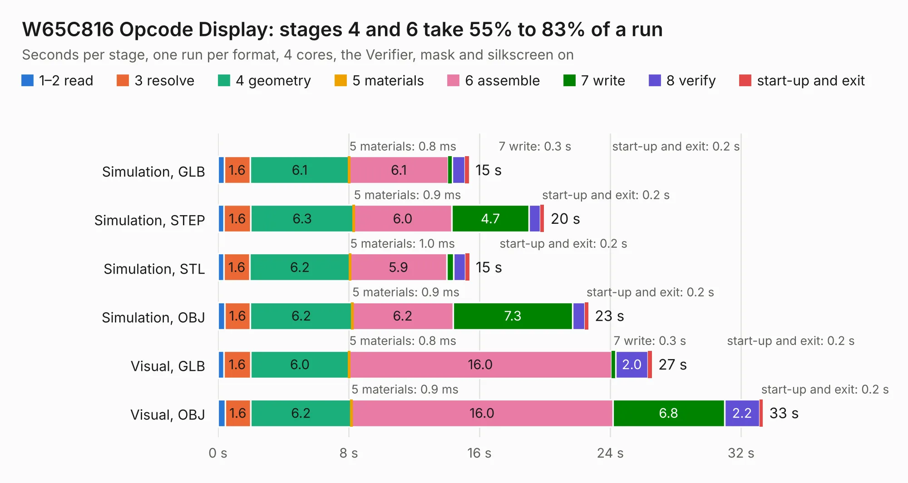

| Mode and format | 1–2 read | 3 resolve | 4 geometry | 5 materials | 6 assemble | 7 write | 8 verify | start-up and exit | Total |
|---|---:|---:|---:|---:|---:|---:|---:|---:|---:|
| Simulation, GLB | 0.4 | 1.6 | 6.1 | 0.8&nbsp;ms | 6.1 | 0.3 | 0.8 | 0.2 | 15.4 |
| Simulation, STEP | 0.4 | 1.6 | 6.3 | 0.9&nbsp;ms | 6.0 | 4.7 | 0.7 | 0.2 | 19.9 |
| Simulation, STL | 0.4 | 1.6 | 6.2 | 1.0&nbsp;ms | 5.9 | 0.4 | 0.7 | 0.2 | 15.4 |
| Simulation, OBJ | 0.4 | 1.6 | 6.2 | 0.9&nbsp;ms | 6.2 | 7.3 | 0.7 | 0.2 | 22.7 |
| Visual, GLB | 0.4 | 1.6 | 6.0 | 0.8&nbsp;ms | 16.0 | 0.3 | 2.0 | 0.2 | 26.5 |
| Visual, OBJ | 0.4 | 1.6 | 6.2 | 0.9&nbsp;ms | 16.0 | 6.8 | 2.2 | 0.2 | 33.3 |

<table align="center"><tr><td valign="top">

| Board | Repo: [andrewpaterson/658-Computer](https://github.com/andrewpaterson/658-Computer) Board: `W65C816 Opcode Display.kicad_pcb` |
|---|---|
| Folder | Kicad / Computer / Processor / W65C816 Opcode Display |
| Complexity | 279&nbsp;/&nbsp;1000 (size&nbsp;199, features&nbsp;80) |
| KESE&nbsp;features | through vias, rounded, trapezoid or chamfered pads, curved board outline, knockout text, stack-up, dielectric εr and tanδ |
| Tested | 9th November 2026 |
| Copper&nbsp;layers | 2 |
| File&nbsp;format | KiCad 9 (20241229) |
| Parts,&nbsp;tracks,&nbsp;vias | 79, 2,531, 374 |
| Triangles,&nbsp;simulation | 1,650,672 in 283 parts |
| Verifier | PASS in all six runs |

</td><td valign="top">

<table>
<tr><th>File type</th><th>File size</th><th>Peak memory used</th></tr>
<tr><th colspan="3" align="left">Simulation</th></tr>
<tr><td>GLB</td><td align="right">58&nbsp;MB</td><td align="right">675&nbsp;MB</td></tr>
<tr><td>STEP</td><td align="right">304&nbsp;MB</td><td align="right">897&nbsp;MB</td></tr>
<tr><td>STL</td><td align="right">83&nbsp;MB</td><td align="right">692&nbsp;MB</td></tr>
<tr><td>OBJ</td><td align="right">174&nbsp;MB</td><td align="right">1.4&nbsp;GB</td></tr>
<tr><th colspan="3" align="left">Visual</th></tr>
<tr><td>GLB</td><td align="right">53&nbsp;MB</td><td align="right">1.1&nbsp;GB</td></tr>
<tr><td>OBJ</td><td align="right">163&nbsp;MB</td><td align="right">1.5&nbsp;GB</td></tr>
</table>

</td></tr></table>

## 239. W65C816 Power

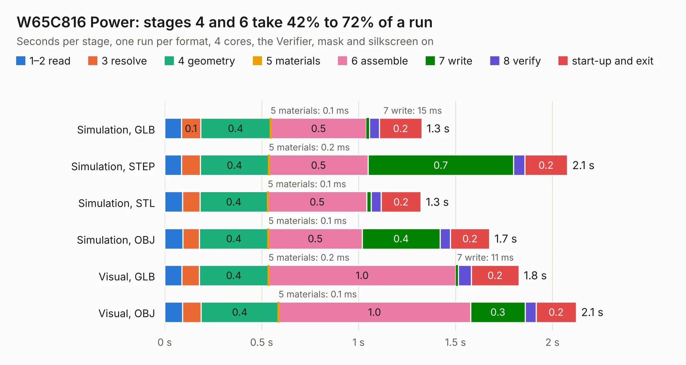

| Mode and format | 1–2 read | 3 resolve | 4 geometry | 5 materials | 6 assemble | 7 write | 8 verify | start-up and exit | Total |
|---|---:|---:|---:|---:|---:|---:|---:|---:|---:|
| Simulation, GLB | 86&nbsp;ms | 0.1 | 0.4 | 0.1&nbsp;ms | 0.5 | 15&nbsp;ms | 52&nbsp;ms | 0.2 | 1.3 |
| Simulation, STEP | 86&nbsp;ms | 97&nbsp;ms | 0.4 | 0.2&nbsp;ms | 0.5 | 0.7 | 59&nbsp;ms | 0.2 | 2.1 |
| Simulation, STL | 92&nbsp;ms | 89&nbsp;ms | 0.4 | 0.1&nbsp;ms | 0.5 | 24&nbsp;ms | 51&nbsp;ms | 0.2 | 1.3 |
| Simulation, OBJ | 94&nbsp;ms | 85&nbsp;ms | 0.4 | 0.1&nbsp;ms | 0.5 | 0.4 | 53&nbsp;ms | 0.2 | 1.7 |
| Visual, GLB | 89&nbsp;ms | 89&nbsp;ms | 0.4 | 0.2&nbsp;ms | 1.0 | 11&nbsp;ms | 67&nbsp;ms | 0.2 | 1.8 |
| Visual, OBJ | 92&nbsp;ms | 96&nbsp;ms | 0.4 | 0.1&nbsp;ms | 1.0 | 0.3 | 56&nbsp;ms | 0.2 | 2.1 |

<table align="center"><tr><td valign="top">

| Board | Repo: [andrewpaterson/658-Computer](https://github.com/andrewpaterson/658-Computer) Board: `W65C816 Power.kicad_pcb` |
|---|---|
| Folder | Kicad / Computer / Processor / W65C816 Power |
| Complexity | 142&nbsp;/&nbsp;1000 (size&nbsp;87, features&nbsp;55) |
| KESE&nbsp;features | rounded, trapezoid or chamfered pads, knockout text, stack-up, dielectric εr and tanδ |
| Tested | 9th November 2026 |
| Copper&nbsp;layers | 2 |
| File&nbsp;format | KiCad 9 (20241229) |
| Parts,&nbsp;tracks,&nbsp;vias | 4, 24, 0 |
| Triangles,&nbsp;simulation | 80,774 in 22 parts |
| Verifier | PASS in all six runs |

</td><td valign="top">

<table>
<tr><th>File type</th><th>File size</th><th>Peak memory used</th></tr>
<tr><th colspan="3" align="left">Simulation</th></tr>
<tr><td>GLB</td><td align="right">2.8&nbsp;MB</td><td align="right">173&nbsp;MB</td></tr>
<tr><td>STEP</td><td align="right">11&nbsp;MB</td><td align="right">178&nbsp;MB</td></tr>
<tr><td>STL</td><td align="right">4.0&nbsp;MB</td><td align="right">172&nbsp;MB</td></tr>
<tr><td>OBJ</td><td align="right">7.7&nbsp;MB</td><td align="right">171&nbsp;MB</td></tr>
<tr><th colspan="3" align="left">Visual</th></tr>
<tr><td>GLB</td><td align="right">1.7&nbsp;MB</td><td align="right">150&nbsp;MB</td></tr>
<tr><td>OBJ</td><td align="right">4.7&nbsp;MB</td><td align="right">151&nbsp;MB</td></tr>
</table>

</td></tr></table>

## 240. PS2 Board

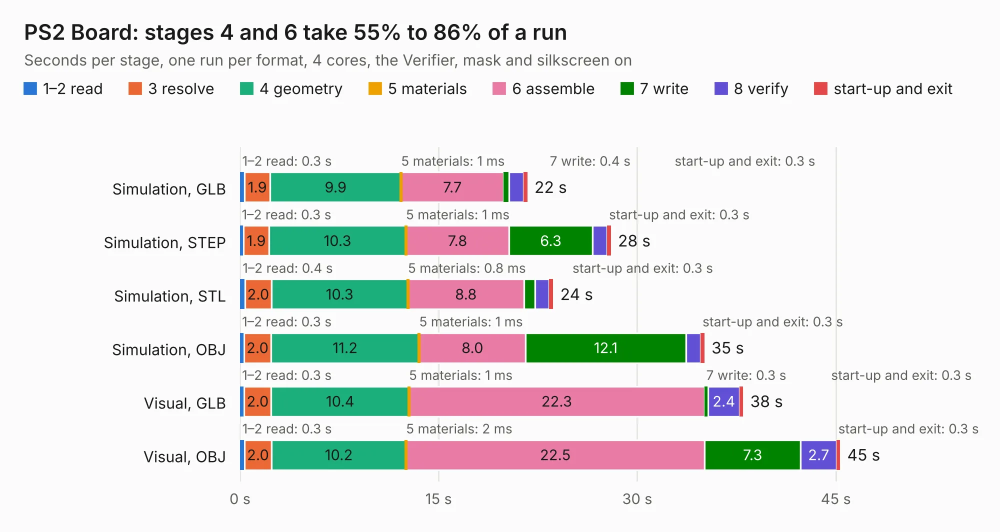

| Mode and format | 1–2 read | 3 resolve | 4 geometry | 5 materials | 6 assemble | 7 write | 8 verify | start-up and exit | Total |
|---|---:|---:|---:|---:|---:|---:|---:|---:|---:|
| Simulation, GLB | 0.3 | 1.9 | 9.9 | 1&nbsp;ms | 7.7 | 0.4 | 1.1 | 0.3 | 21.7 |
| Simulation, STEP | 0.3 | 1.9 | 10.3 | 1&nbsp;ms | 7.8 | 6.3 | 1.1 | 0.3 | 28.0 |
| Simulation, STL | 0.4 | 2.0 | 10.3 | 0.8&nbsp;ms | 8.8 | 0.8 | 1.1 | 0.3 | 23.6 |
| Simulation, OBJ | 0.3 | 2.0 | 11.2 | 1&nbsp;ms | 8.0 | 12.1 | 1.1 | 0.3 | 35.1 |
| Visual, GLB | 0.3 | 2.0 | 10.4 | 1&nbsp;ms | 22.3 | 0.3 | 2.4 | 0.3 | 38.0 |
| Visual, OBJ | 0.3 | 2.0 | 10.2 | 2&nbsp;ms | 22.5 | 7.3 | 2.7 | 0.3 | 45.3 |

<table align="center"><tr><td valign="top">

| Board | Repo: [andrewpaterson/658-Computer](https://github.com/andrewpaterson/658-Computer) Board: `PS2 Board.kicad_pcb` |
|---|---|
| Folder | Kicad / Computer / PS2 / PS2 Board |
| Complexity | 254&nbsp;/&nbsp;1000 (size&nbsp;174, features&nbsp;80) |
| KESE&nbsp;features | through vias, rounded, trapezoid or chamfered pads, curved board outline, knockout text, stack-up, dielectric εr and tanδ |
| Tested | 9th November 2026 |
| Copper&nbsp;layers | 2 |
| File&nbsp;format | KiCad 9 (20241229) |
| Parts,&nbsp;tracks,&nbsp;vias | 23, 1,396, 151 |
| Triangles,&nbsp;simulation | 2,527,776 in 268 parts |
| Verifier | PASS in all six runs |

</td><td valign="top">

<table>
<tr><th>File type</th><th>File size</th><th>Peak memory used</th></tr>
<tr><th colspan="3" align="left">Simulation</th></tr>
<tr><td>GLB</td><td align="right">84&nbsp;MB</td><td align="right">881&nbsp;MB</td></tr>
<tr><td>STEP</td><td align="right">348&nbsp;MB</td><td align="right">1.0&nbsp;GB</td></tr>
<tr><td>STL</td><td align="right">126&nbsp;MB</td><td align="right">831&nbsp;MB</td></tr>
<tr><td>OBJ</td><td align="right">263&nbsp;MB</td><td align="right">1.7&nbsp;GB</td></tr>
<tr><th colspan="3" align="left">Visual</th></tr>
<tr><td>GLB</td><td align="right">55&nbsp;MB</td><td align="right">1.2&nbsp;GB</td></tr>
<tr><td>OBJ</td><td align="right">170&nbsp;MB</td><td align="right">1.2&nbsp;GB</td></tr>
</table>

</td></tr></table>

## 241. PS2 FIFO

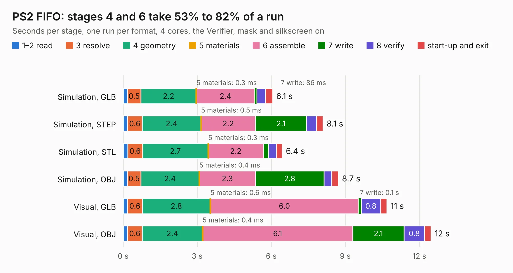

| Mode and format | 1–2 read | 3 resolve | 4 geometry | 5 materials | 6 assemble | 7 write | 8 verify | start-up and exit | Total |
|---|---:|---:|---:|---:|---:|---:|---:|---:|---:|
| Simulation, GLB | 0.2 | 0.5 | 2.2 | 0.3&nbsp;ms | 2.4 | 86&nbsp;ms | 0.3 | 0.3 | 6.1 |
| Simulation, STEP | 0.2 | 0.6 | 2.4 | 0.5&nbsp;ms | 2.2 | 2.1 | 0.4 | 0.3 | 8.1 |
| Simulation, STL | 0.2 | 0.6 | 2.7 | 0.3&nbsp;ms | 2.2 | 0.2 | 0.3 | 0.2 | 6.4 |
| Simulation, OBJ | 0.2 | 0.5 | 2.4 | 0.4&nbsp;ms | 2.3 | 2.8 | 0.3 | 0.3 | 8.7 |
| Visual, GLB | 0.2 | 0.6 | 2.8 | 0.6&nbsp;ms | 6.0 | 0.1 | 0.8 | 0.3 | 10.7 |
| Visual, OBJ | 0.2 | 0.6 | 2.4 | 0.4&nbsp;ms | 6.1 | 2.1 | 0.8 | 0.3 | 12.5 |

<table align="center"><tr><td valign="top">

| Board | Repo: [andrewpaterson/658-Computer](https://github.com/andrewpaterson/658-Computer) Board: `PS2 FIFO.kicad_pcb` |
|---|---|
| Folder | Kicad / Computer / PS2 / PS2 FIFO |
| Complexity | 233&nbsp;/&nbsp;1000 (size&nbsp;163, features&nbsp;70) |
| KESE&nbsp;features | through vias, rounded, trapezoid or chamfered pads, knockout text, stack-up, dielectric εr and tanδ |
| Tested | 9th November 2026 |
| Copper&nbsp;layers | 2 |
| File&nbsp;format | KiCad 9 (20241229) |
| Parts,&nbsp;tracks,&nbsp;vias | 20, 710, 91 |
| Triangles,&nbsp;simulation | 502,188 in 79 parts |
| Verifier | PASS in all six runs |

</td><td valign="top">

<table>
<tr><th>File type</th><th>File size</th><th>Peak memory used</th></tr>
<tr><th colspan="3" align="left">Simulation</th></tr>
<tr><td>GLB</td><td align="right">17&nbsp;MB</td><td align="right">289&nbsp;MB</td></tr>
<tr><td>STEP</td><td align="right">81&nbsp;MB</td><td align="right">365&nbsp;MB</td></tr>
<tr><td>STL</td><td align="right">25&nbsp;MB</td><td align="right">298&nbsp;MB</td></tr>
<tr><td>OBJ</td><td align="right">51&nbsp;MB</td><td align="right">389&nbsp;MB</td></tr>
<tr><th colspan="3" align="left">Visual</th></tr>
<tr><td>GLB</td><td align="right">14&nbsp;MB</td><td align="right">391&nbsp;MB</td></tr>
<tr><td>OBJ</td><td align="right">43&nbsp;MB</td><td align="right">395&nbsp;MB</td></tr>
</table>

</td></tr></table>

## 242. PS2 Timing

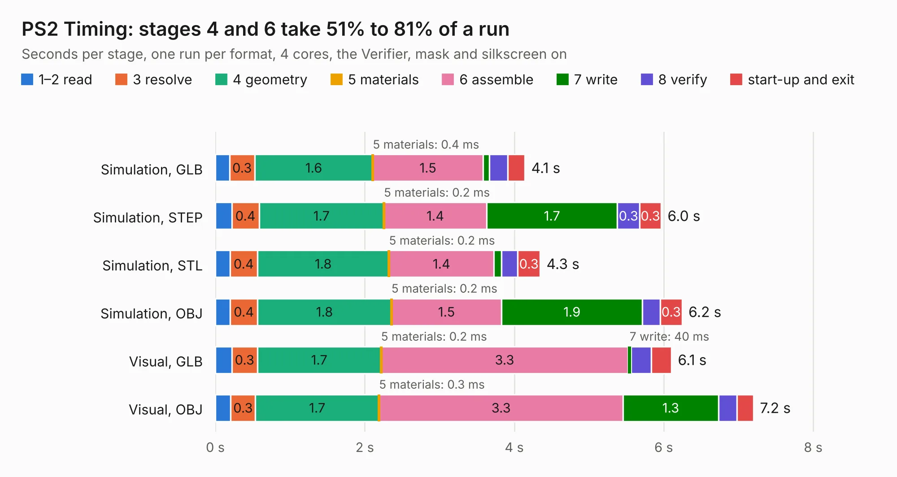

| Mode and format | 1–2 read | 3 resolve | 4 geometry | 5 materials | 6 assemble | 7 write | 8 verify | start-up and exit | Total |
|---|---:|---:|---:|---:|---:|---:|---:|---:|---:|
| Simulation, GLB | 0.2 | 0.3 | 1.6 | 0.4&nbsp;ms | 1.5 | 85&nbsp;ms | 0.2 | 0.2 | 4.1 |
| Simulation, STEP | 0.2 | 0.4 | 1.7 | 0.2&nbsp;ms | 1.4 | 1.7 | 0.3 | 0.3 | 6.0 |
| Simulation, STL | 0.2 | 0.4 | 1.8 | 0.2&nbsp;ms | 1.4 | 98&nbsp;ms | 0.2 | 0.3 | 4.3 |
| Simulation, OBJ | 0.2 | 0.4 | 1.8 | 0.2&nbsp;ms | 1.5 | 1.9 | 0.2 | 0.3 | 6.2 |
| Visual, GLB | 0.2 | 0.3 | 1.7 | 0.2&nbsp;ms | 3.3 | 40&nbsp;ms | 0.3 | 0.3 | 6.1 |
| Visual, OBJ | 0.2 | 0.3 | 1.7 | 0.3&nbsp;ms | 3.3 | 1.3 | 0.2 | 0.2 | 7.2 |

<table align="center"><tr><td valign="top">

| Board | Repo: [andrewpaterson/658-Computer](https://github.com/andrewpaterson/658-Computer) Board: `PS2 Timing.kicad_pcb` |
|---|---|
| Folder | Kicad / Computer / PS2 / PS2 Timing |
| Complexity | 205&nbsp;/&nbsp;1000 (size&nbsp;135, features&nbsp;70) |
| KESE&nbsp;features | through vias, rounded, trapezoid or chamfered pads, knockout text, stack-up, dielectric εr and tanδ |
| Tested | 9th November 2026 |
| Copper&nbsp;layers | 2 |
| File&nbsp;format | KiCad 9 (20241229) |
| Parts,&nbsp;tracks,&nbsp;vias | 15, 150, 21 |
| Triangles,&nbsp;simulation | 315,974 in 44 parts |
| Verifier | PASS in all six runs |

</td><td valign="top">

<table>
<tr><th>File type</th><th>File size</th><th>Peak memory used</th></tr>
<tr><th colspan="3" align="left">Simulation</th></tr>
<tr><td>GLB</td><td align="right">11&nbsp;MB</td><td align="right">249&nbsp;MB</td></tr>
<tr><td>STEP</td><td align="right">43&nbsp;MB</td><td align="right">265&nbsp;MB</td></tr>
<tr><td>STL</td><td align="right">16&nbsp;MB</td><td align="right">235&nbsp;MB</td></tr>
<tr><td>OBJ</td><td align="right">31&nbsp;MB</td><td align="right">257&nbsp;MB</td></tr>
<tr><th colspan="3" align="left">Visual</th></tr>
<tr><td>GLB</td><td align="right">7.5&nbsp;MB</td><td align="right">254&nbsp;MB</td></tr>
<tr><td>OBJ</td><td align="right">22&nbsp;MB</td><td align="right">252&nbsp;MB</td></tr>
</table>

</td></tr></table>

## 243. SD Card Board

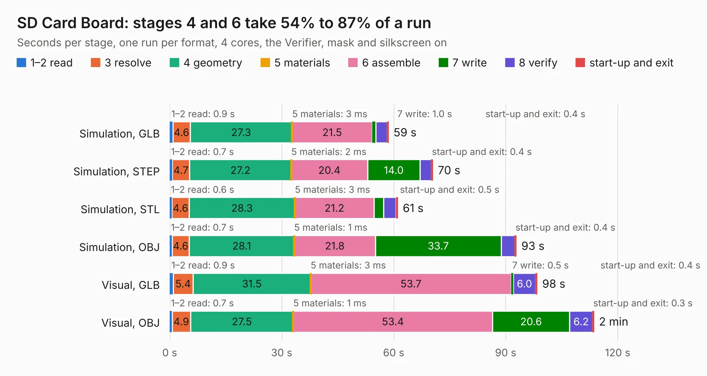

| Mode and format | 1–2 read | 3 resolve | 4 geometry | 5 materials | 6 assemble | 7 write | 8 verify | start-up and exit | Total |
|---|---:|---:|---:|---:|---:|---:|---:|---:|---:|
| Simulation, GLB | 0.9 | 4.6 | 27.3 | 3&nbsp;ms | 21.5 | 1.0 | 3.0 | 0.4 | 58.6 |
| Simulation, STEP | 0.7 | 4.7 | 27.2 | 2&nbsp;ms | 20.4 | 14.0 | 3.0 | 0.4 | 70.5 |
| Simulation, STL | 0.6 | 4.6 | 28.3 | 3&nbsp;ms | 21.2 | 2.6 | 3.3 | 0.5 | 61.1 |
| Simulation, OBJ | 0.7 | 4.6 | 28.1 | 1&nbsp;ms | 21.8 | 33.7 | 3.6 | 0.4 | 92.8 |
| Visual, GLB | 0.9 | 5.4 | 31.5 | 3&nbsp;ms | 53.7 | 0.5 | 6.0 | 0.4 | 98.4 |
| Visual, OBJ | 0.7 | 4.9 | 27.5 | 1&nbsp;ms | 53.4 | 20.6 | 6.2 | 0.3 | 113.6 |

<table align="center"><tr><td valign="top">

| Board | Repo: [andrewpaterson/658-Computer](https://github.com/andrewpaterson/658-Computer) Board: `SD Card Board.kicad_pcb` |
|---|---|
| Folder | Kicad / Computer / SD Card / SD Card Board |
| Complexity | 269&nbsp;/&nbsp;1000 (size&nbsp;189, features&nbsp;80) |
| KESE&nbsp;features | through vias, rounded, trapezoid or chamfered pads, curved board outline, knockout text, stack-up, dielectric εr and tanδ |
| Tested | 9th November 2026 |
| Copper&nbsp;layers | 2 |
| File&nbsp;format | KiCad 9 (20241229) |
| Parts,&nbsp;tracks,&nbsp;vias | 30, 2,871, 323 |
| Triangles,&nbsp;simulation | 4,703,678 in 427 parts |
| Verifier | PASS in all six runs |

</td><td valign="top">

<table>
<tr><th>File type</th><th>File size</th><th>Peak memory used</th></tr>
<tr><th colspan="3" align="left">Simulation</th></tr>
<tr><td>GLB</td><td align="right">159&nbsp;MB</td><td align="right">1.6&nbsp;GB</td></tr>
<tr><td>STEP</td><td align="right">740&nbsp;MB</td><td align="right">1.8&nbsp;GB</td></tr>
<tr><td>STL</td><td align="right">235&nbsp;MB</td><td align="right">1.7&nbsp;GB</td></tr>
<tr><td>OBJ</td><td align="right">501&nbsp;MB</td><td align="right">3.0&nbsp;GB</td></tr>
<tr><th colspan="3" align="left">Visual</th></tr>
<tr><td>GLB</td><td align="right">101&nbsp;MB</td><td align="right">1.8&nbsp;GB</td></tr>
<tr><td>OBJ</td><td align="right">322&nbsp;MB</td><td align="right">2.2&nbsp;GB</td></tr>
</table>

</td></tr></table>

## 244. SD Card Clock

| Mode and format | 1–2 read | 3 resolve | 4 geometry | 5 materials | 6 assemble | 7 write | 8 verify | start-up and exit | Total |
|---|---:|---:|---:|---:|---:|---:|---:|---:|---:|
| Simulation, GLB | 0.1 | 0.3 | 1.3 | 0.1&nbsp;ms | 1.2 | 47&nbsp;ms | 0.2 | 0.2 | 3.3 |
| Simulation, STEP | 0.1 | 0.3 | 1.3 | 0.2&nbsp;ms | 1.3 | 1.3 | 0.2 | 0.2 | 4.6 |
| Simulation, STL | 0.1 | 0.3 | 1.2 | 0.2&nbsp;ms | 1.1 | 89&nbsp;ms | 0.2 | 0.3 | 3.3 |
| Simulation, OBJ | 0.1 | 0.3 | 1.2 | 0.2&nbsp;ms | 1.2 | 1.6 | 0.2 | 0.2 | 4.7 |
| Visual, GLB | 0.1 | 0.3 | 1.3 | 0.2&nbsp;ms | 2.5 | 38&nbsp;ms | 0.2 | 0.2 | 4.6 |
| Visual, OBJ | 0.1 | 0.3 | 1.2 | 0.2&nbsp;ms | 2.8 | 1.3 | 0.3 | 0.2 | 6.2 |

<table align="center"><tr><td valign="top">

| Board | Repo: [andrewpaterson/658-Computer](https://github.com/andrewpaterson/658-Computer) Board: `SD Card Clock.kicad_pcb` |
|---|---|
| Folder | Kicad / Computer / SD Card / SD Card Clock |
| Complexity | 219&nbsp;/&nbsp;1000 (size&nbsp;149, features&nbsp;70) |
| KESE&nbsp;features | through vias, rounded, trapezoid or chamfered pads, knockout text, stack-up, dielectric εr and tanδ |
| Tested | 9th November 2026 |
| Copper&nbsp;layers | 2 |
| File&nbsp;format | KiCad 9 (20241229) |
| Parts,&nbsp;tracks,&nbsp;vias | 14, 370, 52 |
| Triangles,&nbsp;simulation | 311,854 in 38 parts |
| Verifier | PASS in all six runs |

</td><td valign="top">

<table>
<tr><th>File type</th><th>File size</th><th>Peak memory used</th></tr>
<tr><th colspan="3" align="left">Simulation</th></tr>
<tr><td>GLB</td><td align="right">11&nbsp;MB</td><td align="right">242&nbsp;MB</td></tr>
<tr><td>STEP</td><td align="right">50&nbsp;MB</td><td align="right">275&nbsp;MB</td></tr>
<tr><td>STL</td><td align="right">16&nbsp;MB</td><td align="right">239&nbsp;MB</td></tr>
<tr><td>OBJ</td><td align="right">31&nbsp;MB</td><td align="right">252&nbsp;MB</td></tr>
<tr><th colspan="3" align="left">Visual</th></tr>
<tr><td>GLB</td><td align="right">8.6&nbsp;MB</td><td align="right">271&nbsp;MB</td></tr>
<tr><td>OBJ</td><td align="right">25&nbsp;MB</td><td align="right">272&nbsp;MB</td></tr>
</table>

</td></tr></table>

## 245. SD Card Full Socket

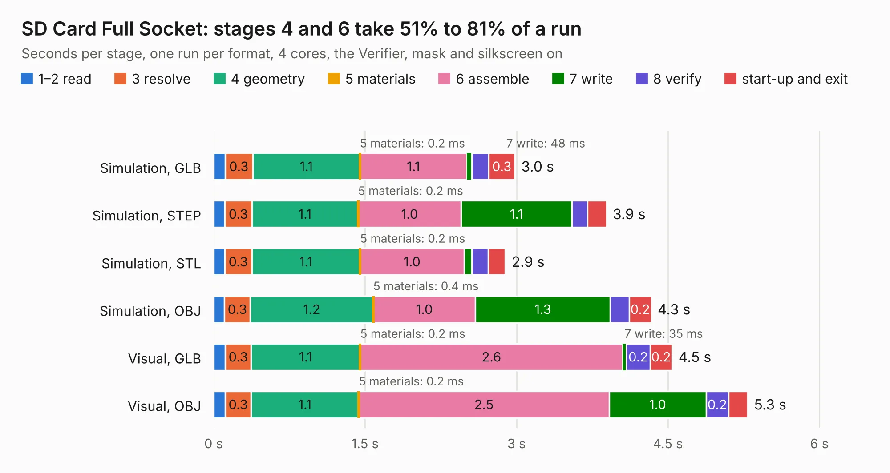

| Mode and format | 1–2 read | 3 resolve | 4 geometry | 5 materials | 6 assemble | 7 write | 8 verify | start-up and exit | Total |
|---|---:|---:|---:|---:|---:|---:|---:|---:|---:|
| Simulation, GLB | 0.1 | 0.3 | 1.1 | 0.2&nbsp;ms | 1.1 | 48&nbsp;ms | 0.2 | 0.3 | 3.0 |
| Simulation, STEP | 0.1 | 0.3 | 1.1 | 0.2&nbsp;ms | 1.0 | 1.1 | 0.2 | 0.2 | 3.9 |
| Simulation, STL | 0.1 | 0.3 | 1.1 | 0.2&nbsp;ms | 1.0 | 77&nbsp;ms | 0.2 | 0.2 | 2.9 |
| Simulation, OBJ | 0.1 | 0.3 | 1.2 | 0.4&nbsp;ms | 1.0 | 1.3 | 0.2 | 0.2 | 4.3 |
| Visual, GLB | 0.1 | 0.3 | 1.1 | 0.2&nbsp;ms | 2.6 | 35&nbsp;ms | 0.2 | 0.2 | 4.5 |
| Visual, OBJ | 0.1 | 0.3 | 1.1 | 0.2&nbsp;ms | 2.5 | 1.0 | 0.2 | 0.2 | 5.3 |

<table align="center"><tr><td valign="top">

| Board | Repo: [andrewpaterson/658-Computer](https://github.com/andrewpaterson/658-Computer) Board: `SD Card Full Socket.kicad_pcb` |
|---|---|
| Folder | Kicad / Computer / SD Card / SD Card Full Socket |
| Complexity | 224&nbsp;/&nbsp;1000 (size&nbsp;144, features&nbsp;80) |
| KESE&nbsp;features | through vias, rounded, trapezoid or chamfered pads, curved board outline, knockout text, stack-up, dielectric εr and tanδ |
| Tested | 9th November 2026 |
| Copper&nbsp;layers | 2 |
| File&nbsp;format | KiCad 9 (20241229) |
| Parts,&nbsp;tracks,&nbsp;vias | 15, 261, 41 |
| Triangles,&nbsp;simulation | 349,590 in 57 parts |
| Verifier | PASS in all six runs |

</td><td valign="top">

<table>
<tr><th>File type</th><th>File size</th><th>Peak memory used</th></tr>
<tr><th colspan="3" align="left">Simulation</th></tr>
<tr><td>GLB</td><td align="right">11&nbsp;MB</td><td align="right">249&nbsp;MB</td></tr>
<tr><td>STEP</td><td align="right">47&nbsp;MB</td><td align="right">285&nbsp;MB</td></tr>
<tr><td>STL</td><td align="right">17&nbsp;MB</td><td align="right">246&nbsp;MB</td></tr>
<tr><td>OBJ</td><td align="right">35&nbsp;MB</td><td align="right">281&nbsp;MB</td></tr>
<tr><th colspan="3" align="left">Visual</th></tr>
<tr><td>GLB</td><td align="right">8.4&nbsp;MB</td><td align="right">278&nbsp;MB</td></tr>
<tr><td>OBJ</td><td align="right">25&nbsp;MB</td><td align="right">268&nbsp;MB</td></tr>
</table>

</td></tr></table>

## 246. SD Card Micro Socket

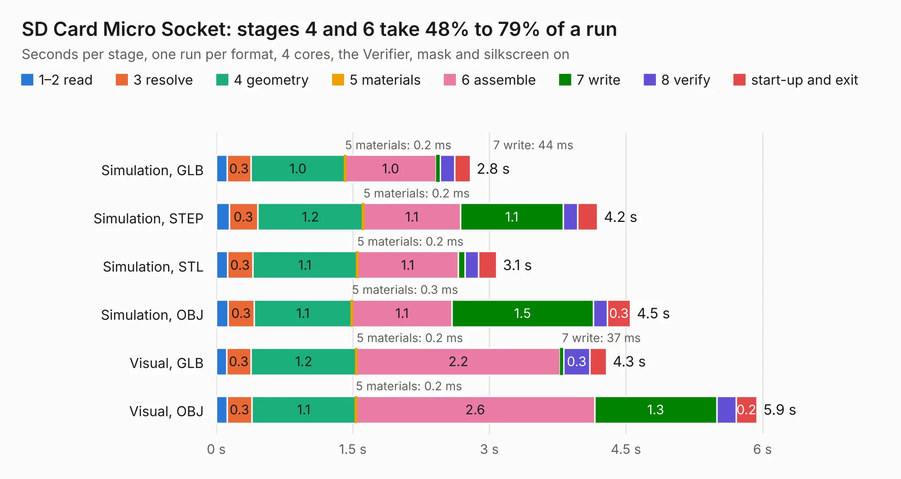

| Mode and format | 1–2 read | 3 resolve | 4 geometry | 5 materials | 6 assemble | 7 write | 8 verify | start-up and exit | Total |
|---|---:|---:|---:|---:|---:|---:|---:|---:|---:|
| Simulation, GLB | 0.1 | 0.3 | 1.0 | 0.2&nbsp;ms | 1.0 | 44&nbsp;ms | 0.2 | 0.2 | 2.8 |
| Simulation, STEP | 0.1 | 0.3 | 1.2 | 0.2&nbsp;ms | 1.1 | 1.1 | 0.2 | 0.2 | 4.2 |
| Simulation, STL | 0.1 | 0.3 | 1.1 | 0.2&nbsp;ms | 1.1 | 74&nbsp;ms | 0.1 | 0.2 | 3.1 |
| Simulation, OBJ | 0.1 | 0.3 | 1.1 | 0.3&nbsp;ms | 1.1 | 1.5 | 0.2 | 0.3 | 4.5 |
| Visual, GLB | 0.1 | 0.3 | 1.2 | 0.2&nbsp;ms | 2.2 | 37&nbsp;ms | 0.3 | 0.2 | 4.3 |
| Visual, OBJ | 0.1 | 0.3 | 1.1 | 0.2&nbsp;ms | 2.6 | 1.3 | 0.2 | 0.2 | 5.9 |

<table align="center"><tr><td valign="top">

| Board | Repo: [andrewpaterson/658-Computer](https://github.com/andrewpaterson/658-Computer) Board: `SD Card Micro Socket.kicad_pcb` |
|---|---|
| Folder | Kicad / Computer / SD Card / SD Card Micro Socket |
| Complexity | 216&nbsp;/&nbsp;1000 (size&nbsp;146, features&nbsp;70) |
| KESE&nbsp;features | through vias, rounded, trapezoid or chamfered pads, knockout text, stack-up, dielectric εr and tanδ |
| Tested | 9th November 2026 |
| Copper&nbsp;layers | 2 |
| File&nbsp;format | KiCad 9 (20241229) |
| Parts,&nbsp;tracks,&nbsp;vias | 14, 285, 49 |
| Triangles,&nbsp;simulation | 292,164 in 45 parts |
| Verifier | PASS in all six runs |

</td><td valign="top">

<table>
<tr><th>File type</th><th>File size</th><th>Peak memory used</th></tr>
<tr><th colspan="3" align="left">Simulation</th></tr>
<tr><td>GLB</td><td align="right">9.9&nbsp;MB</td><td align="right">236&nbsp;MB</td></tr>
<tr><td>STEP</td><td align="right">42&nbsp;MB</td><td align="right">271&nbsp;MB</td></tr>
<tr><td>STL</td><td align="right">15&nbsp;MB</td><td align="right">238&nbsp;MB</td></tr>
<tr><td>OBJ</td><td align="right">29&nbsp;MB</td><td align="right">253&nbsp;MB</td></tr>
<tr><th colspan="3" align="left">Visual</th></tr>
<tr><td>GLB</td><td align="right">7.9&nbsp;MB</td><td align="right">259&nbsp;MB</td></tr>
<tr><td>OBJ</td><td align="right">23&nbsp;MB</td><td align="right">259&nbsp;MB</td></tr>
</table>

</td></tr></table>

## 247. SD Card Read Data

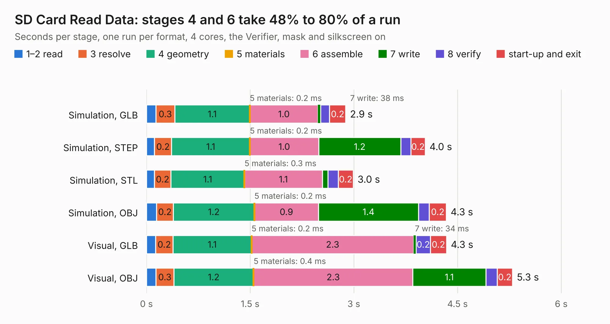

| Mode and format | 1–2 read | 3 resolve | 4 geometry | 5 materials | 6 assemble | 7 write | 8 verify | start-up and exit | Total |
|---|---:|---:|---:|---:|---:|---:|---:|---:|---:|
| Simulation, GLB | 0.1 | 0.3 | 1.1 | 0.2&nbsp;ms | 1.0 | 38&nbsp;ms | 0.1 | 0.2 | 2.9 |
| Simulation, STEP | 0.1 | 0.2 | 1.1 | 0.2&nbsp;ms | 1.0 | 1.2 | 0.1 | 0.2 | 4.0 |
| Simulation, STL | 0.1 | 0.2 | 1.1 | 0.3&nbsp;ms | 1.1 | 82&nbsp;ms | 0.1 | 0.2 | 3.0 |
| Simulation, OBJ | 0.1 | 0.2 | 1.2 | 0.2&nbsp;ms | 0.9 | 1.4 | 0.2 | 0.2 | 4.3 |
| Visual, GLB | 0.1 | 0.2 | 1.1 | 0.2&nbsp;ms | 2.3 | 34&nbsp;ms | 0.2 | 0.2 | 4.3 |
| Visual, OBJ | 0.1 | 0.3 | 1.2 | 0.4&nbsp;ms | 2.3 | 1.1 | 0.2 | 0.2 | 5.3 |

<table align="center"><tr><td valign="top">

| Board | Repo: [andrewpaterson/658-Computer](https://github.com/andrewpaterson/658-Computer) Board: `SD Card Read Data.kicad_pcb` |
|---|---|
| Folder | Kicad / Computer / SD Card / SD Card Read Data |
| Complexity | 204&nbsp;/&nbsp;1000 (size&nbsp;134, features&nbsp;70) |
| KESE&nbsp;features | through vias, rounded, trapezoid or chamfered pads, knockout text, stack-up, dielectric εr and tanδ |
| Tested | 9th November 2026 |
| Copper&nbsp;layers | 2 |
| File&nbsp;format | KiCad 9 (20241229) |
| Parts,&nbsp;tracks,&nbsp;vias | 7, 235, 29 |
| Triangles,&nbsp;simulation | 225,026 in 40 parts |
| Verifier | PASS in all six runs |

</td><td valign="top">

<table>
<tr><th>File type</th><th>File size</th><th>Peak memory used</th></tr>
<tr><th colspan="3" align="left">Simulation</th></tr>
<tr><td>GLB</td><td align="right">7.8&nbsp;MB</td><td align="right">216&nbsp;MB</td></tr>
<tr><td>STEP</td><td align="right">35&nbsp;MB</td><td align="right">239&nbsp;MB</td></tr>
<tr><td>STL</td><td align="right">11&nbsp;MB</td><td align="right">213&nbsp;MB</td></tr>
<tr><td>OBJ</td><td align="right">22&nbsp;MB</td><td align="right">215&nbsp;MB</td></tr>
<tr><th colspan="3" align="left">Visual</th></tr>
<tr><td>GLB</td><td align="right">5.7&nbsp;MB</td><td align="right">204&nbsp;MB</td></tr>
<tr><td>OBJ</td><td align="right">16&nbsp;MB</td><td align="right">203&nbsp;MB</td></tr>
</table>

</td></tr></table>

## 248. SD Card Read Function

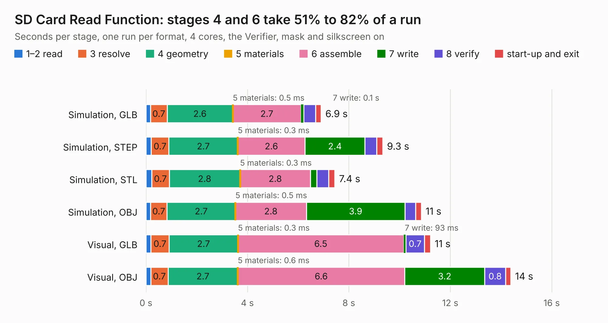

| Mode and format | 1–2 read | 3 resolve | 4 geometry | 5 materials | 6 assemble | 7 write | 8 verify | start-up and exit | Total |
|---|---:|---:|---:|---:|---:|---:|---:|---:|---:|
| Simulation, GLB | 0.2 | 0.7 | 2.6 | 0.5&nbsp;ms | 2.7 | 0.1 | 0.5 | 0.2 | 6.9 |
| Simulation, STEP | 0.2 | 0.7 | 2.7 | 0.3&nbsp;ms | 2.6 | 2.4 | 0.5 | 0.2 | 9.3 |
| Simulation, STL | 0.2 | 0.7 | 2.8 | 0.3&nbsp;ms | 2.8 | 0.2 | 0.5 | 0.2 | 7.4 |
| Simulation, OBJ | 0.2 | 0.7 | 2.7 | 0.5&nbsp;ms | 2.8 | 3.9 | 0.4 | 0.2 | 10.9 |
| Visual, GLB | 0.2 | 0.7 | 2.7 | 0.3&nbsp;ms | 6.5 | 93&nbsp;ms | 0.7 | 0.2 | 11.2 |
| Visual, OBJ | 0.2 | 0.7 | 2.7 | 0.6&nbsp;ms | 6.6 | 3.2 | 0.8 | 0.2 | 14.4 |

<table align="center"><tr><td valign="top">

| Board | Repo: [andrewpaterson/658-Computer](https://github.com/andrewpaterson/658-Computer) Board: `SD Card Read Function.kicad_pcb` |
|---|---|
| Folder | Kicad / Computer / SD Card / SD Card Read Function |
| Complexity | 238&nbsp;/&nbsp;1000 (size&nbsp;168, features&nbsp;70) |
| KESE&nbsp;features | through vias, rounded, trapezoid or chamfered pads, knockout text, stack-up, dielectric εr and tanδ |
| Tested | 9th November 2026 |
| Copper&nbsp;layers | 2 |
| File&nbsp;format | KiCad 9 (20241229) |
| Parts,&nbsp;tracks,&nbsp;vias | 16, 1,121, 157 |
| Triangles,&nbsp;simulation | 707,944 in 71 parts |
| Verifier | PASS in all six runs |

</td><td valign="top">

<table>
<tr><th>File type</th><th>File size</th><th>Peak memory used</th></tr>
<tr><th colspan="3" align="left">Simulation</th></tr>
<tr><td>GLB</td><td align="right">24&nbsp;MB</td><td align="right">354&nbsp;MB</td></tr>
<tr><td>STEP</td><td align="right">114&nbsp;MB</td><td align="right">443&nbsp;MB</td></tr>
<tr><td>STL</td><td align="right">35&nbsp;MB</td><td align="right">360&nbsp;MB</td></tr>
<tr><td>OBJ</td><td align="right">72&nbsp;MB</td><td align="right">487&nbsp;MB</td></tr>
<tr><th colspan="3" align="left">Visual</th></tr>
<tr><td>GLB</td><td align="right">20&nbsp;MB</td><td align="right">549&nbsp;MB</td></tr>
<tr><td>OBJ</td><td align="right">61&nbsp;MB</td><td align="right">537&nbsp;MB</td></tr>
</table>

</td></tr></table>

## 249. SD Card Read Signals

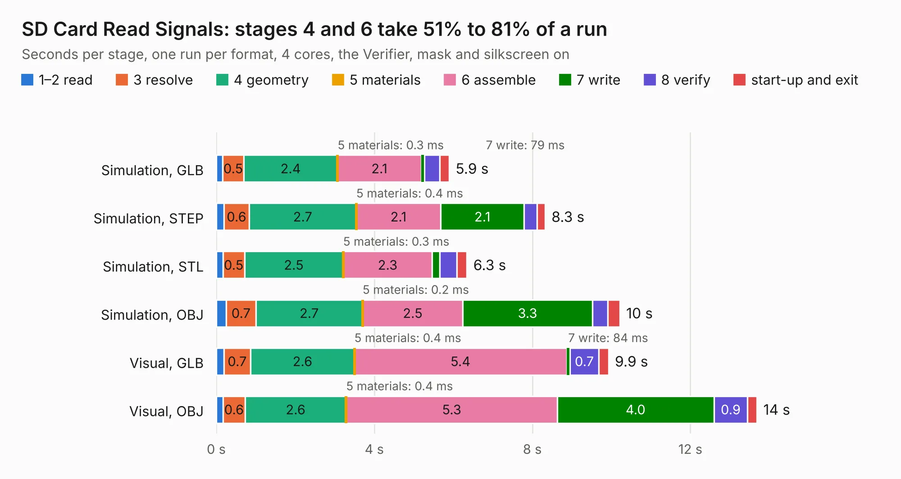

| Mode and format | 1–2 read | 3 resolve | 4 geometry | 5 materials | 6 assemble | 7 write | 8 verify | start-up and exit | Total |
|---|---:|---:|---:|---:|---:|---:|---:|---:|---:|
| Simulation, GLB | 0.2 | 0.5 | 2.4 | 0.3&nbsp;ms | 2.1 | 79&nbsp;ms | 0.4 | 0.2 | 5.9 |
| Simulation, STEP | 0.2 | 0.6 | 2.7 | 0.4&nbsp;ms | 2.1 | 2.1 | 0.3 | 0.2 | 8.3 |
| Simulation, STL | 0.2 | 0.5 | 2.5 | 0.3&nbsp;ms | 2.3 | 0.2 | 0.4 | 0.3 | 6.3 |
| Simulation, OBJ | 0.3 | 0.7 | 2.7 | 0.2&nbsp;ms | 2.5 | 3.3 | 0.4 | 0.3 | 10.2 |
| Visual, GLB | 0.2 | 0.7 | 2.6 | 0.4&nbsp;ms | 5.4 | 84&nbsp;ms | 0.7 | 0.2 | 9.9 |
| Visual, OBJ | 0.2 | 0.6 | 2.6 | 0.4&nbsp;ms | 5.3 | 4.0 | 0.9 | 0.2 | 13.7 |

<table align="center"><tr><td valign="top">

| Board | Repo: [andrewpaterson/658-Computer](https://github.com/andrewpaterson/658-Computer) Board: `SD Card Read Signals.kicad_pcb` |
|---|---|
| Folder | Kicad / Computer / SD Card / SD Card Read Signals |
| Complexity | 230&nbsp;/&nbsp;1000 (size&nbsp;160, features&nbsp;70) |
| KESE&nbsp;features | through vias, rounded, trapezoid or chamfered pads, knockout text, stack-up, dielectric εr and tanδ |
| Tested | 9th November 2026 |
| Copper&nbsp;layers | 2 |
| File&nbsp;format | KiCad 9 (20241229) |
| Parts,&nbsp;tracks,&nbsp;vias | 18, 620, 94 |
| Triangles,&nbsp;simulation | 495,498 in 62 parts |
| Verifier | PASS in all six runs |

</td><td valign="top">

<table>
<tr><th>File type</th><th>File size</th><th>Peak memory used</th></tr>
<tr><th colspan="3" align="left">Simulation</th></tr>
<tr><td>GLB</td><td align="right">17&nbsp;MB</td><td align="right">288&nbsp;MB</td></tr>
<tr><td>STEP</td><td align="right">78&nbsp;MB</td><td align="right">356&nbsp;MB</td></tr>
<tr><td>STL</td><td align="right">25&nbsp;MB</td><td align="right">293&nbsp;MB</td></tr>
<tr><td>OBJ</td><td align="right">50&nbsp;MB</td><td align="right">384&nbsp;MB</td></tr>
<tr><th colspan="3" align="left">Visual</th></tr>
<tr><td>GLB</td><td align="right">14&nbsp;MB</td><td align="right">412&nbsp;MB</td></tr>
<tr><td>OBJ</td><td align="right">42&nbsp;MB</td><td align="right">392&nbsp;MB</td></tr>
</table>

</td></tr></table>

## 250. SD Card Write Data

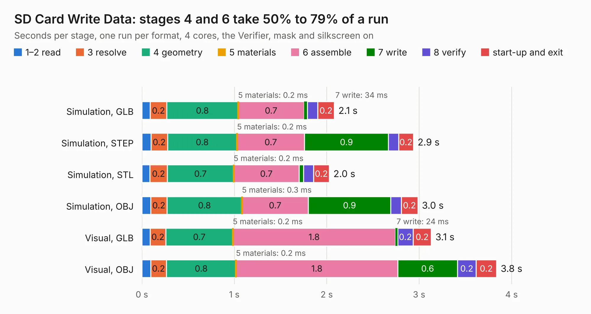

| Mode and format | 1–2 read | 3 resolve | 4 geometry | 5 materials | 6 assemble | 7 write | 8 verify | start-up and exit | Total |
|---|---:|---:|---:|---:|---:|---:|---:|---:|---:|
| Simulation, GLB | 91&nbsp;ms | 0.2 | 0.8 | 0.2&nbsp;ms | 0.7 | 34&nbsp;ms | 0.1 | 0.2 | 2.1 |
| Simulation, STEP | 98&nbsp;ms | 0.2 | 0.8 | 0.2&nbsp;ms | 0.7 | 0.9 | 0.1 | 0.2 | 2.9 |
| Simulation, STL | 86&nbsp;ms | 0.2 | 0.7 | 0.2&nbsp;ms | 0.7 | 49&nbsp;ms | 0.1 | 0.2 | 2.0 |
| Simulation, OBJ | 95&nbsp;ms | 0.2 | 0.8 | 0.3&nbsp;ms | 0.7 | 0.9 | 0.1 | 0.2 | 3.0 |
| Visual, GLB | 89&nbsp;ms | 0.2 | 0.7 | 0.2&nbsp;ms | 1.8 | 24&nbsp;ms | 0.2 | 0.2 | 3.1 |
| Visual, OBJ | 95&nbsp;ms | 0.2 | 0.8 | 0.2&nbsp;ms | 1.8 | 0.6 | 0.2 | 0.2 | 3.8 |

<table align="center"><tr><td valign="top">

| Board | Repo: [andrewpaterson/658-Computer](https://github.com/andrewpaterson/658-Computer) Board: `SD Card Write Data.kicad_pcb` |
|---|---|
| Folder | Kicad / Computer / SD Card / SD Card Write Data |
| Complexity | 205&nbsp;/&nbsp;1000 (size&nbsp;135, features&nbsp;70) |
| KESE&nbsp;features | through vias, rounded, trapezoid or chamfered pads, knockout text, stack-up, dielectric εr and tanδ |
| Tested | 9th November 2026 |
| Copper&nbsp;layers | 2 |
| File&nbsp;format | KiCad 9 (20241229) |
| Parts,&nbsp;tracks,&nbsp;vias | 7, 255, 32 |
| Triangles,&nbsp;simulation | 231,652 in 40 parts |
| Verifier | PASS in all six runs |

</td><td valign="top">

<table>
<tr><th>File type</th><th>File size</th><th>Peak memory used</th></tr>
<tr><th colspan="3" align="left">Simulation</th></tr>
<tr><td>GLB</td><td align="right">8.0&nbsp;MB</td><td align="right">227&nbsp;MB</td></tr>
<tr><td>STEP</td><td align="right">36&nbsp;MB</td><td align="right">243&nbsp;MB</td></tr>
<tr><td>STL</td><td align="right">12&nbsp;MB</td><td align="right">222&nbsp;MB</td></tr>
<tr><td>OBJ</td><td align="right">23&nbsp;MB</td><td align="right">218&nbsp;MB</td></tr>
<tr><th colspan="3" align="left">Visual</th></tr>
<tr><td>GLB</td><td align="right">5.8&nbsp;MB</td><td align="right">212&nbsp;MB</td></tr>
<tr><td>OBJ</td><td align="right">17&nbsp;MB</td><td align="right">209&nbsp;MB</td></tr>
</table>

</td></tr></table>

## 251. SD Card Write Signals

| Mode and format | 1–2 read | 3 resolve | 4 geometry | 5 materials | 6 assemble | 7 write | 8 verify | start-up and exit | Total |
|---|---:|---:|---:|---:|---:|---:|---:|---:|---:|
| Simulation, GLB | 0.2 | 0.3 | 1.5 | 0.3&nbsp;ms | 1.4 | 65&nbsp;ms | 0.2 | 0.3 | 3.9 |
| Simulation, STEP | 0.2 | 0.3 | 1.5 | 0.2&nbsp;ms | 1.3 | 1.5 | 0.2 | 0.3 | 5.3 |
| Simulation, STL | 0.2 | 0.4 | 1.5 | 0.2&nbsp;ms | 1.4 | 91&nbsp;ms | 0.2 | 0.2 | 4.0 |
| Simulation, OBJ | 0.2 | 0.3 | 1.5 | 0.3&nbsp;ms | 1.3 | 1.9 | 0.2 | 0.3 | 5.7 |
| Visual, GLB | 0.1 | 0.3 | 1.6 | 0.3&nbsp;ms | 3.3 | 43&nbsp;ms | 0.3 | 0.2 | 6.0 |
| Visual, OBJ | 0.2 | 0.3 | 1.5 | 0.2&nbsp;ms | 3.4 | 1.4 | 0.3 | 0.2 | 7.3 |

<table align="center"><tr><td valign="top">

| Board | Repo: [andrewpaterson/658-Computer](https://github.com/andrewpaterson/658-Computer) Board: `SD Card Write Signals.kicad_pcb` |
|---|---|
| Folder | Kicad / Computer / SD Card / SD Card Write Signals |
| Complexity | 220&nbsp;/&nbsp;1000 (size&nbsp;150, features&nbsp;70) |
| KESE&nbsp;features | through vias, rounded, trapezoid or chamfered pads, knockout text, stack-up, dielectric εr and tanδ |
| Tested | 9th November 2026 |
| Copper&nbsp;layers | 2 |
| File&nbsp;format | KiCad 9 (20241229) |
| Parts,&nbsp;tracks,&nbsp;vias | 18, 348, 43 |
| Triangles,&nbsp;simulation | 334,140 in 58 parts |
| Verifier | PASS in all six runs |

</td><td valign="top">

<table>
<tr><th>File type</th><th>File size</th><th>Peak memory used</th></tr>
<tr><th colspan="3" align="left">Simulation</th></tr>
<tr><td>GLB</td><td align="right">11&nbsp;MB</td><td align="right">249&nbsp;MB</td></tr>
<tr><td>STEP</td><td align="right">51&nbsp;MB</td><td align="right">282&nbsp;MB</td></tr>
<tr><td>STL</td><td align="right">17&nbsp;MB</td><td align="right">243&nbsp;MB</td></tr>
<tr><td>OBJ</td><td align="right">34&nbsp;MB</td><td align="right">262&nbsp;MB</td></tr>
<tr><th colspan="3" align="left">Visual</th></tr>
<tr><td>GLB</td><td align="right">8.8&nbsp;MB</td><td align="right">277&nbsp;MB</td></tr>
<tr><td>OBJ</td><td align="right">26&nbsp;MB</td><td align="right">279&nbsp;MB</td></tr>
</table>

</td></tr></table>

## 252. SNES Controller Clock

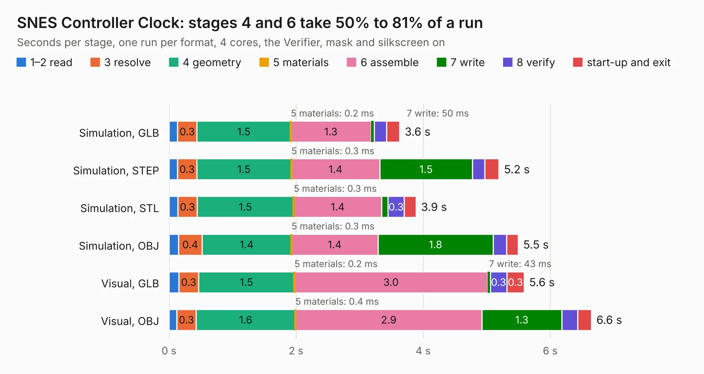

| Mode and format | 1–2 read | 3 resolve | 4 geometry | 5 materials | 6 assemble | 7 write | 8 verify | start-up and exit | Total |
|---|---:|---:|---:|---:|---:|---:|---:|---:|---:|
| Simulation, GLB | 0.1 | 0.3 | 1.5 | 0.2&nbsp;ms | 1.3 | 50&nbsp;ms | 0.2 | 0.2 | 3.6 |
| Simulation, STEP | 0.1 | 0.3 | 1.5 | 0.3&nbsp;ms | 1.4 | 1.5 | 0.2 | 0.2 | 5.2 |
| Simulation, STL | 0.1 | 0.3 | 1.5 | 0.3&nbsp;ms | 1.4 | 98&nbsp;ms | 0.3 | 0.2 | 3.9 |
| Simulation, OBJ | 0.1 | 0.4 | 1.4 | 0.3&nbsp;ms | 1.4 | 1.8 | 0.2 | 0.2 | 5.5 |
| Visual, GLB | 0.2 | 0.3 | 1.5 | 0.2&nbsp;ms | 3.0 | 43&nbsp;ms | 0.3 | 0.3 | 5.6 |
| Visual, OBJ | 0.1 | 0.3 | 1.6 | 0.4&nbsp;ms | 2.9 | 1.3 | 0.3 | 0.2 | 6.6 |

<table align="center"><tr><td valign="top">

| Board | Repo: [andrewpaterson/658-Computer](https://github.com/andrewpaterson/658-Computer) Board: `SNES Controller Clock.kicad_pcb` |
|---|---|
| Folder | Kicad / Computer / SNES / SNES Controller Clock |
| Complexity | 216&nbsp;/&nbsp;1000 (size&nbsp;146, features&nbsp;70) |
| KESE&nbsp;features | through vias, rounded, trapezoid or chamfered pads, knockout text, stack-up, dielectric εr and tanδ |
| Tested | 9th November 2026 |
| Copper&nbsp;layers | 2 |
| File&nbsp;format | KiCad 9 (20241229) |
| Parts,&nbsp;tracks,&nbsp;vias | 14, 328, 43 |
| Triangles,&nbsp;simulation | 339,970 in 52 parts |
| Verifier | PASS in all six runs |

</td><td valign="top">

<table>
<tr><th>File type</th><th>File size</th><th>Peak memory used</th></tr>
<tr><th colspan="3" align="left">Simulation</th></tr>
<tr><td>GLB</td><td align="right">12&nbsp;MB</td><td align="right">245&nbsp;MB</td></tr>
<tr><td>STEP</td><td align="right">55&nbsp;MB</td><td align="right">288&nbsp;MB</td></tr>
<tr><td>STL</td><td align="right">17&nbsp;MB</td><td align="right">244&nbsp;MB</td></tr>
<tr><td>OBJ</td><td align="right">34&nbsp;MB</td><td align="right">259&nbsp;MB</td></tr>
<tr><th colspan="3" align="left">Visual</th></tr>
<tr><td>GLB</td><td align="right">9.1&nbsp;MB</td><td align="right">286&nbsp;MB</td></tr>
<tr><td>OBJ</td><td align="right">27&nbsp;MB</td><td align="right">290&nbsp;MB</td></tr>
</table>

</td></tr></table>

## 253. SNES Controller Reader

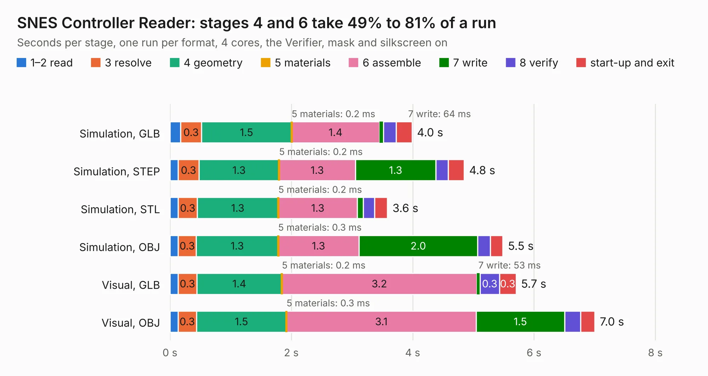

| Mode and format | 1–2 read | 3 resolve | 4 geometry | 5 materials | 6 assemble | 7 write | 8 verify | start-up and exit | Total |
|---|---:|---:|---:|---:|---:|---:|---:|---:|---:|
| Simulation, GLB | 0.2 | 0.3 | 1.5 | 0.2&nbsp;ms | 1.4 | 64&nbsp;ms | 0.2 | 0.3 | 4.0 |
| Simulation, STEP | 0.1 | 0.3 | 1.3 | 0.2&nbsp;ms | 1.3 | 1.3 | 0.2 | 0.3 | 4.8 |
| Simulation, STL | 0.1 | 0.3 | 1.3 | 0.2&nbsp;ms | 1.3 | 0.1 | 0.2 | 0.2 | 3.6 |
| Simulation, OBJ | 0.1 | 0.3 | 1.3 | 0.3&nbsp;ms | 1.3 | 2.0 | 0.2 | 0.2 | 5.5 |
| Visual, GLB | 0.1 | 0.3 | 1.4 | 0.2&nbsp;ms | 3.2 | 53&nbsp;ms | 0.3 | 0.3 | 5.7 |
| Visual, OBJ | 0.1 | 0.3 | 1.5 | 0.3&nbsp;ms | 3.1 | 1.5 | 0.3 | 0.2 | 7.0 |

<table align="center"><tr><td valign="top">

| Board | Repo: [andrewpaterson/658-Computer](https://github.com/andrewpaterson/658-Computer) Board: `SNES Controller Reader.kicad_pcb` |
|---|---|
| Folder | Kicad / Computer / SNES / SNES Controller Reader |
| Complexity | 215&nbsp;/&nbsp;1000 (size&nbsp;145, features&nbsp;70) |
| KESE&nbsp;features | through vias, rounded, trapezoid or chamfered pads, knockout text, stack-up, dielectric εr and tanδ |
| Tested | 9th November 2026 |
| Copper&nbsp;layers | 2 |
| File&nbsp;format | KiCad 9 (20241229) |
| Parts,&nbsp;tracks,&nbsp;vias | 12, 332, 39 |
| Triangles,&nbsp;simulation | 305,672 in 37 parts |
| Verifier | PASS in all six runs |

</td><td valign="top">

<table>
<tr><th>File type</th><th>File size</th><th>Peak memory used</th></tr>
<tr><th colspan="3" align="left">Simulation</th></tr>
<tr><td>GLB</td><td align="right">10&nbsp;MB</td><td align="right">244&nbsp;MB</td></tr>
<tr><td>STEP</td><td align="right">45&nbsp;MB</td><td align="right">272&nbsp;MB</td></tr>
<tr><td>STL</td><td align="right">15&nbsp;MB</td><td align="right">237&nbsp;MB</td></tr>
<tr><td>OBJ</td><td align="right">30&nbsp;MB</td><td align="right">268&nbsp;MB</td></tr>
<tr><th colspan="3" align="left">Visual</th></tr>
<tr><td>GLB</td><td align="right">7.9&nbsp;MB</td><td align="right">259&nbsp;MB</td></tr>
<tr><td>OBJ</td><td align="right">23&nbsp;MB</td><td align="right">255&nbsp;MB</td></tr>
</table>

</td></tr></table>

## 254. RS232

| Mode and format | 1–2 read | 3 resolve | 4 geometry | 5 materials | 6 assemble | 7 write | 8 verify | start-up and exit | Total |
|---|---:|---:|---:|---:|---:|---:|---:|---:|---:|
| Simulation, GLB | 0.2 | 0.5 | 2.2 | 0.4&nbsp;ms | 1.9 | 78&nbsp;ms | 0.3 | 0.2 | 5.3 |
| Simulation, STEP | 0.2 | 0.4 | 2.1 | 0.5&nbsp;ms | 2.0 | 1.6 | 0.3 | 0.2 | 6.9 |
| Simulation, STL | 0.2 | 0.5 | 2.2 | 0.4&nbsp;ms | 1.9 | 0.1 | 0.3 | 0.3 | 5.4 |
| Simulation, OBJ | 0.2 | 0.5 | 2.2 | 0.4&nbsp;ms | 1.9 | 2.5 | 0.3 | 0.2 | 7.8 |
| Visual, GLB | 0.1 | 0.5 | 2.1 | 0.4&nbsp;ms | 4.4 | 72&nbsp;ms | 0.5 | 0.2 | 8.0 |
| Visual, OBJ | 0.2 | 0.5 | 2.1 | 0.5&nbsp;ms | 4.5 | 2.0 | 0.6 | 0.2 | 10.1 |

<table align="center"><tr><td valign="top">

| Board | Repo: [andrewpaterson/658-Computer](https://github.com/andrewpaterson/658-Computer) Board: `RS232.kicad_pcb` |
|---|---|
| Folder | Kicad / Computer / UART / RS232 |
| Complexity | 281&nbsp;/&nbsp;1000 (size&nbsp;201, features&nbsp;80) |
| KESE&nbsp;features | through vias, rounded, trapezoid or chamfered pads, curved board outline, knockout text, stack-up, dielectric εr and tanδ |
| Tested | 9th November 2026 |
| Copper&nbsp;layers | 2 |
| File&nbsp;format | KiCad 9 (20241229) |
| Parts,&nbsp;tracks,&nbsp;vias | 21, 611, 87 |
| Triangles,&nbsp;simulation | 533,172 in 85 parts |
| Verifier | PASS in all six runs |

</td><td valign="top">

<table>
<tr><th>File type</th><th>File size</th><th>Peak memory used</th></tr>
<tr><th colspan="3" align="left">Simulation</th></tr>
<tr><td>GLB</td><td align="right">18&nbsp;MB</td><td align="right">303&nbsp;MB</td></tr>
<tr><td>STEP</td><td align="right">82&nbsp;MB</td><td align="right">372&nbsp;MB</td></tr>
<tr><td>STL</td><td align="right">27&nbsp;MB</td><td align="right">300&nbsp;MB</td></tr>
<tr><td>OBJ</td><td align="right">54&nbsp;MB</td><td align="right">410&nbsp;MB</td></tr>
<tr><th colspan="3" align="left">Visual</th></tr>
<tr><td>GLB</td><td align="right">14&nbsp;MB</td><td align="right">389&nbsp;MB</td></tr>
<tr><td>OBJ</td><td align="right">43&nbsp;MB</td><td align="right">382&nbsp;MB</td></tr>
</table>

</td></tr></table>

## 255. TTL5V

| Mode and format | 1–2 read | 3 resolve | 4 geometry | 5 materials | 6 assemble | 7 write | 8 verify | start-up and exit | Total |
|---|---:|---:|---:|---:|---:|---:|---:|---:|---:|
| Simulation, GLB | 0.2 | 0.4 | 1.8 | 0.2&nbsp;ms | 1.6 | 64&nbsp;ms | 0.3 | 0.3 | 4.6 |
| Simulation, STEP | 0.2 | 0.4 | 1.7 | 0.5&nbsp;ms | 1.6 | 1.5 | 0.2 | 0.2 | 5.7 |
| Simulation, STL | 0.2 | 0.4 | 1.8 | 0.2&nbsp;ms | 1.6 | 0.1 | 0.2 | 0.2 | 4.5 |
| Simulation, OBJ | 0.2 | 0.4 | 1.7 | 0.2&nbsp;ms | 1.7 | 2.3 | 0.3 | 0.2 | 6.7 |
| Visual, GLB | 0.2 | 0.4 | 1.6 | 0.3&nbsp;ms | 3.7 | 49&nbsp;ms | 0.4 | 0.2 | 6.6 |
| Visual, OBJ | 0.2 | 0.4 | 1.8 | 0.2&nbsp;ms | 3.5 | 1.8 | 0.5 | 0.3 | 8.5 |

<table align="center"><tr><td valign="top">

| Board | Repo: [andrewpaterson/658-Computer](https://github.com/andrewpaterson/658-Computer) Board: `TTL5V.kicad_pcb` |
|---|---|
| Folder | Kicad / Computer / UART / TTL5V |
| Complexity | 276&nbsp;/&nbsp;1000 (size&nbsp;196, features&nbsp;80) |
| KESE&nbsp;features | through vias, rounded, trapezoid or chamfered pads, curved board outline, knockout text, stack-up, dielectric εr and tanδ |
| Tested | 9th November 2026 |
| Copper&nbsp;layers | 2 |
| File&nbsp;format | KiCad 9 (20241229) |
| Parts,&nbsp;tracks,&nbsp;vias | 16, 558, 69 |
| Triangles,&nbsp;simulation | 432,350 in 70 parts |
| Verifier | PASS in all six runs |

</td><td valign="top">

<table>
<tr><th>File type</th><th>File size</th><th>Peak memory used</th></tr>
<tr><th colspan="3" align="left">Simulation</th></tr>
<tr><td>GLB</td><td align="right">15&nbsp;MB</td><td align="right">275&nbsp;MB</td></tr>
<tr><td>STEP</td><td align="right">65&nbsp;MB</td><td align="right">327&nbsp;MB</td></tr>
<tr><td>STL</td><td align="right">22&nbsp;MB</td><td align="right">272&nbsp;MB</td></tr>
<tr><td>OBJ</td><td align="right">44&nbsp;MB</td><td align="right">342&nbsp;MB</td></tr>
<tr><th colspan="3" align="left">Visual</th></tr>
<tr><td>GLB</td><td align="right">11&nbsp;MB</td><td align="right">328&nbsp;MB</td></tr>
<tr><td>OBJ</td><td align="right">34&nbsp;MB</td><td align="right">332&nbsp;MB</td></tr>
</table>

</td></tr></table>

## 256. UART Board

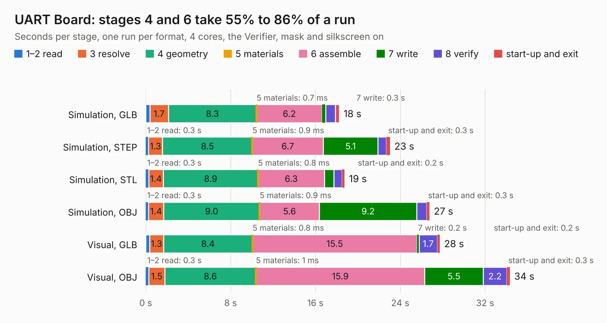

| Mode and format | 1–2 read | 3 resolve | 4 geometry | 5 materials | 6 assemble | 7 write | 8 verify | start-up and exit | Total |
|---|---:|---:|---:|---:|---:|---:|---:|---:|---:|
| Simulation, GLB | 0.4 | 1.7 | 8.3 | 0.7&nbsp;ms | 6.2 | 0.3 | 0.9 | 0.4 | 18.2 |
| Simulation, STEP | 0.3 | 1.3 | 8.5 | 0.9&nbsp;ms | 6.7 | 5.1 | 0.8 | 0.3 | 23.0 |
| Simulation, STL | 0.3 | 1.4 | 8.9 | 0.8&nbsp;ms | 6.3 | 0.9 | 0.8 | 0.2 | 18.8 |
| Simulation, OBJ | 0.3 | 1.4 | 9.0 | 0.9&nbsp;ms | 5.6 | 9.2 | 0.9 | 0.3 | 26.8 |
| Visual, GLB | 0.4 | 1.3 | 8.4 | 0.8&nbsp;ms | 15.5 | 0.2 | 1.7 | 0.2 | 27.7 |
| Visual, OBJ | 0.3 | 1.5 | 8.6 | 1&nbsp;ms | 15.9 | 5.5 | 2.2 | 0.3 | 34.3 |

<table align="center"><tr><td valign="top">

| Board | Repo: [andrewpaterson/658-Computer](https://github.com/andrewpaterson/658-Computer) Board: `UART Board.kicad_pcb` |
|---|---|
| Folder | Kicad / Computer / UART / UART Board |
| Complexity | 243&nbsp;/&nbsp;1000 (size&nbsp;163, features&nbsp;80) |
| KESE&nbsp;features | through vias, rounded, trapezoid or chamfered pads, curved board outline, knockout text, stack-up, dielectric εr and tanδ |
| Tested | 9th November 2026 |
| Copper&nbsp;layers | 2 |
| File&nbsp;format | KiCad 9 (20241229) |
| Parts,&nbsp;tracks,&nbsp;vias | 14, 873, 123 |
| Triangles,&nbsp;simulation | 1,667,694 in 181 parts |
| Verifier | PASS in all six runs |

</td><td valign="top">

<table>
<tr><th>File type</th><th>File size</th><th>Peak memory used</th></tr>
<tr><th colspan="3" align="left">Simulation</th></tr>
<tr><td>GLB</td><td align="right">57&nbsp;MB</td><td align="right">728&nbsp;MB</td></tr>
<tr><td>STEP</td><td align="right">265&nbsp;MB</td><td align="right">728&nbsp;MB</td></tr>
<tr><td>STL</td><td align="right">83&nbsp;MB</td><td align="right">717&nbsp;MB</td></tr>
<tr><td>OBJ</td><td align="right">174&nbsp;MB</td><td align="right">1.1&nbsp;GB</td></tr>
<tr><th colspan="3" align="left">Visual</th></tr>
<tr><td>GLB</td><td align="right">37&nbsp;MB</td><td align="right">719&nbsp;MB</td></tr>
<tr><td>OBJ</td><td align="right">112&nbsp;MB</td><td align="right">843&nbsp;MB</td></tr>
</table>

</td></tr></table>

## 257. UART Signals

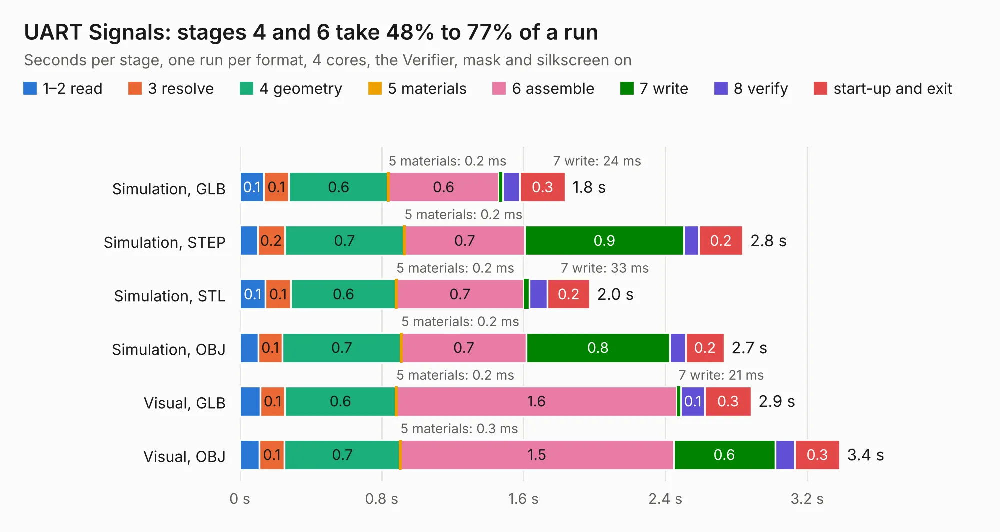

| Mode and format | 1–2 read | 3 resolve | 4 geometry | 5 materials | 6 assemble | 7 write | 8 verify | start-up and exit | Total |
|---|---:|---:|---:|---:|---:|---:|---:|---:|---:|
| Simulation, GLB | 0.1 | 0.1 | 0.6 | 0.2&nbsp;ms | 0.6 | 24&nbsp;ms | 94&nbsp;ms | 0.3 | 1.8 |
| Simulation, STEP | 0.1 | 0.2 | 0.7 | 0.2&nbsp;ms | 0.7 | 0.9 | 83&nbsp;ms | 0.2 | 2.8 |
| Simulation, STL | 0.1 | 0.1 | 0.6 | 0.2&nbsp;ms | 0.7 | 33&nbsp;ms | 0.1 | 0.2 | 2.0 |
| Simulation, OBJ | 0.1 | 0.1 | 0.7 | 0.2&nbsp;ms | 0.7 | 0.8 | 91&nbsp;ms | 0.2 | 2.7 |
| Visual, GLB | 0.1 | 0.1 | 0.6 | 0.2&nbsp;ms | 1.6 | 21&nbsp;ms | 0.1 | 0.3 | 2.9 |
| Visual, OBJ | 0.1 | 0.1 | 0.7 | 0.3&nbsp;ms | 1.5 | 0.6 | 0.1 | 0.3 | 3.4 |

<table align="center"><tr><td valign="top">

| Board | Repo: [andrewpaterson/658-Computer](https://github.com/andrewpaterson/658-Computer) Board: `UART Signals.kicad_pcb` |
|---|---|
| Folder | Kicad / Computer / UART / UART Signals |
| Complexity | 192&nbsp;/&nbsp;1000 (size&nbsp;122, features&nbsp;70) |
| KESE&nbsp;features | through vias, rounded, trapezoid or chamfered pads, knockout text, stack-up, dielectric εr and tanδ |
| Tested | 9th November 2026 |
| Copper&nbsp;layers | 2 |
| File&nbsp;format | KiCad 9 (20241229) |
| Parts,&nbsp;tracks,&nbsp;vias | 9, 105, 9 |
| Triangles,&nbsp;simulation | 124,004 in 28 parts |
| Verifier | PASS in all six runs |

</td><td valign="top">

<table>
<tr><th>File type</th><th>File size</th><th>Peak memory used</th></tr>
<tr><th colspan="3" align="left">Simulation</th></tr>
<tr><td>GLB</td><td align="right">4.4&nbsp;MB</td><td align="right">195&nbsp;MB</td></tr>
<tr><td>STEP</td><td align="right">21&nbsp;MB</td><td align="right">196&nbsp;MB</td></tr>
<tr><td>STL</td><td align="right">6.2&nbsp;MB</td><td align="right">189&nbsp;MB</td></tr>
<tr><td>OBJ</td><td align="right">12&nbsp;MB</td><td align="right">189&nbsp;MB</td></tr>
<tr><th colspan="3" align="left">Visual</th></tr>
<tr><td>GLB</td><td align="right">3.4&nbsp;MB</td><td align="right">162&nbsp;MB</td></tr>
<tr><td>OBJ</td><td align="right">9.6&nbsp;MB</td><td align="right">160&nbsp;MB</td></tr>
</table>

</td></tr></table>

## 258. VIA Board

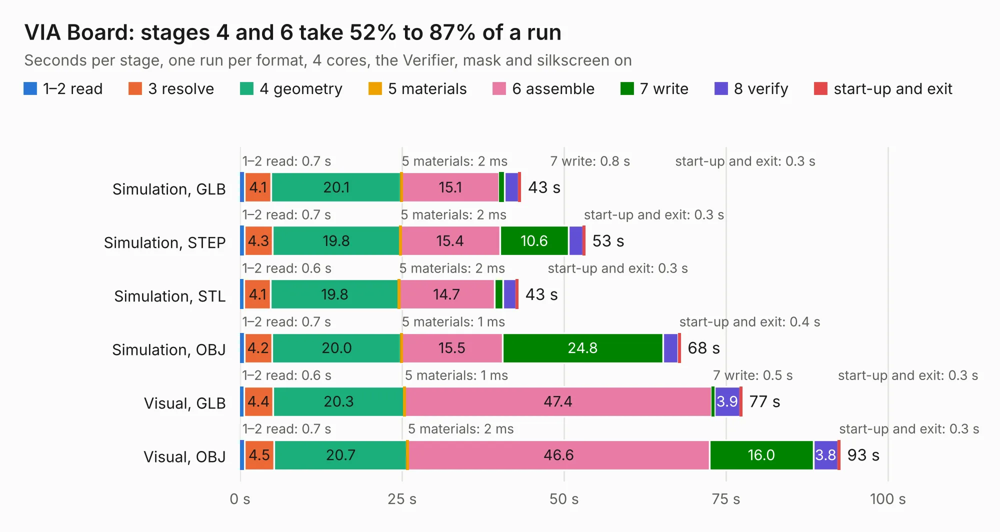

| Mode and format | 1–2 read | 3 resolve | 4 geometry | 5 materials | 6 assemble | 7 write | 8 verify | start-up and exit | Total |
|---|---:|---:|---:|---:|---:|---:|---:|---:|---:|
| Simulation, GLB | 0.7 | 4.1 | 20.1 | 2&nbsp;ms | 15.1 | 0.8 | 2.2 | 0.3 | 43.3 |
| Simulation, STEP | 0.7 | 4.3 | 19.8 | 2&nbsp;ms | 15.4 | 10.6 | 2.2 | 0.3 | 53.2 |
| Simulation, STL | 0.6 | 4.1 | 19.8 | 2&nbsp;ms | 14.7 | 1.3 | 2.0 | 0.3 | 42.9 |
| Simulation, OBJ | 0.7 | 4.2 | 20.0 | 1&nbsp;ms | 15.5 | 24.8 | 2.3 | 0.4 | 68.0 |
| Visual, GLB | 0.6 | 4.4 | 20.3 | 1&nbsp;ms | 47.4 | 0.5 | 3.9 | 0.3 | 77.5 |
| Visual, OBJ | 0.7 | 4.5 | 20.7 | 2&nbsp;ms | 46.6 | 16.0 | 3.8 | 0.3 | 92.6 |

<table align="center"><tr><td valign="top">

| Board | Repo: [andrewpaterson/658-Computer](https://github.com/andrewpaterson/658-Computer) Board: `VIA Board.kicad_pcb` |
|---|---|
| Folder | Kicad / Computer / VIA / VIA Board |
| Complexity | 269&nbsp;/&nbsp;1000 (size&nbsp;189, features&nbsp;80) |
| KESE&nbsp;features | through vias, rounded, trapezoid or chamfered pads, curved board outline, knockout text, stack-up, dielectric εr and tanδ |
| Tested | 9th November 2026 |
| Copper&nbsp;layers | 2 |
| File&nbsp;format | KiCad 9 (20241229) |
| Parts,&nbsp;tracks,&nbsp;vias | 28, 3,012, 337 |
| Triangles,&nbsp;simulation | 4,037,762 in 338 parts |
| Verifier | PASS in all six runs |

</td><td valign="top">

<table>
<tr><th>File type</th><th>File size</th><th>Peak memory used</th></tr>
<tr><th colspan="3" align="left">Simulation</th></tr>
<tr><td>GLB</td><td align="right">136&nbsp;MB</td><td align="right">1.3&nbsp;GB</td></tr>
<tr><td>STEP</td><td align="right">568&nbsp;MB</td><td align="right">1.6&nbsp;GB</td></tr>
<tr><td>STL</td><td align="right">202&nbsp;MB</td><td align="right">1.3&nbsp;GB</td></tr>
<tr><td>OBJ</td><td align="right">424&nbsp;MB</td><td align="right">2.5&nbsp;GB</td></tr>
<tr><th colspan="3" align="left">Visual</th></tr>
<tr><td>GLB</td><td align="right">92&nbsp;MB</td><td align="right">1.6&nbsp;GB</td></tr>
<tr><td>OBJ</td><td align="right">294&nbsp;MB</td><td align="right">2.0&nbsp;GB</td></tr>
</table>

</td></tr></table>

## 259. VIA Breakout

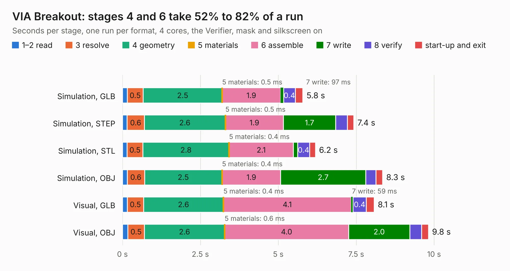

| Mode and format | 1–2 read | 3 resolve | 4 geometry | 5 materials | 6 assemble | 7 write | 8 verify | start-up and exit | Total |
|---|---:|---:|---:|---:|---:|---:|---:|---:|---:|
| Simulation, GLB | 0.2 | 0.5 | 2.5 | 0.5&nbsp;ms | 1.9 | 97&nbsp;ms | 0.4 | 0.2 | 5.8 |
| Simulation, STEP | 0.1 | 0.6 | 2.6 | 0.5&nbsp;ms | 1.9 | 1.7 | 0.4 | 0.2 | 7.4 |
| Simulation, STL | 0.2 | 0.5 | 2.8 | 0.4&nbsp;ms | 2.1 | 0.1 | 0.4 | 0.2 | 6.2 |
| Simulation, OBJ | 0.2 | 0.6 | 2.5 | 0.4&nbsp;ms | 1.9 | 2.7 | 0.3 | 0.2 | 8.3 |
| Visual, GLB | 0.2 | 0.5 | 2.6 | 0.4&nbsp;ms | 4.1 | 59&nbsp;ms | 0.4 | 0.3 | 8.1 |
| Visual, OBJ | 0.2 | 0.5 | 2.6 | 0.6&nbsp;ms | 4.0 | 2.0 | 0.4 | 0.2 | 9.8 |

<table align="center"><tr><td valign="top">

| Board | Repo: [andrewpaterson/658-Computer](https://github.com/andrewpaterson/658-Computer) Board: `VIA Breakout.kicad_pcb` |
|---|---|
| Folder | Kicad / Computer / VIA / VIA Breakout |
| Complexity | 257&nbsp;/&nbsp;1000 (size&nbsp;187, features&nbsp;70) |
| KESE&nbsp;features | through vias, rounded, trapezoid or chamfered pads, knockout text, stack-up, dielectric εr and tanδ |
| Tested | 9th November 2026 |
| Copper&nbsp;layers | 2 |
| File&nbsp;format | KiCad 9 (20241229) |
| Parts,&nbsp;tracks,&nbsp;vias | 6, 393, 47 |
| Triangles,&nbsp;simulation | 493,712 in 79 parts |
| Verifier | PASS in all six runs |

</td><td valign="top">

<table>
<tr><th>File type</th><th>File size</th><th>Peak memory used</th></tr>
<tr><th colspan="3" align="left">Simulation</th></tr>
<tr><td>GLB</td><td align="right">17&nbsp;MB</td><td align="right">297&nbsp;MB</td></tr>
<tr><td>STEP</td><td align="right">72&nbsp;MB</td><td align="right">344&nbsp;MB</td></tr>
<tr><td>STL</td><td align="right">25&nbsp;MB</td><td align="right">296&nbsp;MB</td></tr>
<tr><td>OBJ</td><td align="right">50&nbsp;MB</td><td align="right">354&nbsp;MB</td></tr>
<tr><th colspan="3" align="left">Visual</th></tr>
<tr><td>GLB</td><td align="right">12&nbsp;MB</td><td align="right">355&nbsp;MB</td></tr>
<tr><td>OBJ</td><td align="right">35&nbsp;MB</td><td align="right">343&nbsp;MB</td></tr>
</table>

</td></tr></table>

## 260. VIA Control

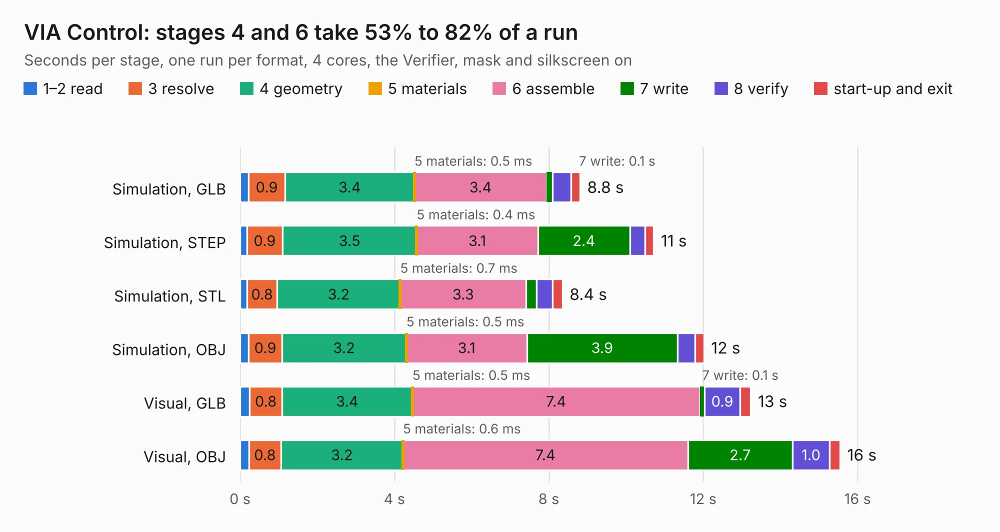

| Mode and format | 1–2 read | 3 resolve | 4 geometry | 5 materials | 6 assemble | 7 write | 8 verify | start-up and exit | Total |
|---|---:|---:|---:|---:|---:|---:|---:|---:|---:|
| Simulation, GLB | 0.2 | 0.9 | 3.4 | 0.5&nbsp;ms | 3.4 | 0.1 | 0.5 | 0.2 | 8.8 |
| Simulation, STEP | 0.2 | 0.9 | 3.5 | 0.4&nbsp;ms | 3.1 | 2.4 | 0.4 | 0.2 | 10.7 |
| Simulation, STL | 0.2 | 0.8 | 3.2 | 0.7&nbsp;ms | 3.3 | 0.3 | 0.4 | 0.3 | 8.4 |
| Simulation, OBJ | 0.2 | 0.9 | 3.2 | 0.5&nbsp;ms | 3.1 | 3.9 | 0.4 | 0.2 | 12.0 |
| Visual, GLB | 0.2 | 0.8 | 3.4 | 0.5&nbsp;ms | 7.4 | 0.1 | 0.9 | 0.3 | 13.2 |
| Visual, OBJ | 0.2 | 0.8 | 3.2 | 0.6&nbsp;ms | 7.4 | 2.7 | 1.0 | 0.3 | 15.5 |

<table align="center"><tr><td valign="top">

| Board | Repo: [andrewpaterson/658-Computer](https://github.com/andrewpaterson/658-Computer) Board: `VIA Control.kicad_pcb` |
|---|---|
| Folder | Kicad / Computer / VIA / VIA Control |
| Complexity | 243&nbsp;/&nbsp;1000 (size&nbsp;173, features&nbsp;70) |
| KESE&nbsp;features | through vias, rounded, trapezoid or chamfered pads, knockout text, stack-up, dielectric εr and tanδ |
| Tested | 9th November 2026 |
| Copper&nbsp;layers | 2 |
| File&nbsp;format | KiCad 9 (20241229) |
| Parts,&nbsp;tracks,&nbsp;vias | 28, 1,020, 154 |
| Triangles,&nbsp;simulation | 807,056 in 106 parts |
| Verifier | PASS in all six runs |

</td><td valign="top">

<table>
<tr><th>File type</th><th>File size</th><th>Peak memory used</th></tr>
<tr><th colspan="3" align="left">Simulation</th></tr>
<tr><td>GLB</td><td align="right">28&nbsp;MB</td><td align="right">373&nbsp;MB</td></tr>
<tr><td>STEP</td><td align="right">126&nbsp;MB</td><td align="right">478&nbsp;MB</td></tr>
<tr><td>STL</td><td align="right">40&nbsp;MB</td><td align="right">387&nbsp;MB</td></tr>
<tr><td>OBJ</td><td align="right">82&nbsp;MB</td><td align="right">584&nbsp;MB</td></tr>
<tr><th colspan="3" align="left">Visual</th></tr>
<tr><td>GLB</td><td align="right">23&nbsp;MB</td><td align="right">559&nbsp;MB</td></tr>
<tr><td>OBJ</td><td align="right">68&nbsp;MB</td><td align="right">585&nbsp;MB</td></tr>
</table>

</td></tr></table>

## 261. Video Address Reader

| Mode and format | 1–2 read | 3 resolve | 4 geometry | 5 materials | 6 assemble | 7 write | 8 verify | start-up and exit | Total |
|---|---:|---:|---:|---:|---:|---:|---:|---:|---:|
| Simulation, GLB | 0.1 | 0.4 | 1.7 | 0.2&nbsp;ms | 1.4 | 70&nbsp;ms | 0.3 | 0.2 | 4.2 |
| Simulation, STEP | 0.1 | 0.4 | 1.6 | 0.2&nbsp;ms | 1.5 | 1.4 | 0.2 | 0.2 | 5.5 |
| Simulation, STL | 0.1 | 0.4 | 1.6 | 0.3&nbsp;ms | 1.5 | 0.1 | 0.3 | 0.2 | 4.1 |
| Simulation, OBJ | 0.1 | 0.4 | 1.6 | 0.2&nbsp;ms | 1.4 | 2.0 | 0.2 | 0.2 | 6.0 |
| Visual, GLB | 0.1 | 0.4 | 1.6 | 0.2&nbsp;ms | 3.4 | 68&nbsp;ms | 0.4 | 0.2 | 6.2 |
| Visual, OBJ | 0.1 | 0.4 | 1.7 | 0.2&nbsp;ms | 3.5 | 1.6 | 0.6 | 0.2 | 8.1 |

<table align="center"><tr><td valign="top">

| Board | Repo: [andrewpaterson/658-Computer](https://github.com/andrewpaterson/658-Computer) Board: `Video Address Reader.kicad_pcb` |
|---|---|
| Folder | Kicad / Computer / Video / Video Address Reader |
| Complexity | 227&nbsp;/&nbsp;1000 (size&nbsp;157, features&nbsp;70) |
| KESE&nbsp;features | through vias, rounded, trapezoid or chamfered pads, knockout text, stack-up, dielectric εr and tanδ |
| Tested | 9th November 2026 |
| Copper&nbsp;layers | 2 |
| File&nbsp;format | KiCad 9 (20241229) |
| Parts,&nbsp;tracks,&nbsp;vias | 14, 612, 88 |
| Triangles,&nbsp;simulation | 507,084 in 52 parts |
| Verifier | PASS in all six runs |

</td><td valign="top">

<table>
<tr><th>File type</th><th>File size</th><th>Peak memory used</th></tr>
<tr><th colspan="3" align="left">Simulation</th></tr>
<tr><td>GLB</td><td align="right">18&nbsp;MB</td><td align="right">320&nbsp;MB</td></tr>
<tr><td>STEP</td><td align="right">82&nbsp;MB</td><td align="right">354&nbsp;MB</td></tr>
<tr><td>STL</td><td align="right">25&nbsp;MB</td><td align="right">324&nbsp;MB</td></tr>
<tr><td>OBJ</td><td align="right">51&nbsp;MB</td><td align="right">391&nbsp;MB</td></tr>
<tr><th colspan="3" align="left">Visual</th></tr>
<tr><td>GLB</td><td align="right">13&nbsp;MB</td><td align="right">379&nbsp;MB</td></tr>
<tr><td>OBJ</td><td align="right">40&nbsp;MB</td><td align="right">381&nbsp;MB</td></tr>
</table>

</td></tr></table>

## 262. Video Blank and Sync

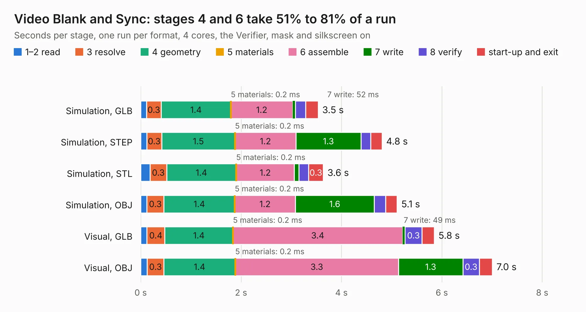

| Mode and format | 1–2 read | 3 resolve | 4 geometry | 5 materials | 6 assemble | 7 write | 8 verify | start-up and exit | Total |
|---|---:|---:|---:|---:|---:|---:|---:|---:|---:|
| Simulation, GLB | 0.1 | 0.3 | 1.4 | 0.2&nbsp;ms | 1.2 | 52&nbsp;ms | 0.2 | 0.3 | 3.5 |
| Simulation, STEP | 0.1 | 0.3 | 1.5 | 0.2&nbsp;ms | 1.2 | 1.3 | 0.2 | 0.2 | 4.8 |
| Simulation, STL | 0.2 | 0.3 | 1.4 | 0.2&nbsp;ms | 1.2 | 90&nbsp;ms | 0.2 | 0.3 | 3.6 |
| Simulation, OBJ | 0.1 | 0.3 | 1.4 | 0.2&nbsp;ms | 1.2 | 1.6 | 0.2 | 0.2 | 5.1 |
| Visual, GLB | 0.1 | 0.4 | 1.4 | 0.2&nbsp;ms | 3.4 | 49&nbsp;ms | 0.3 | 0.2 | 5.8 |
| Visual, OBJ | 0.1 | 0.3 | 1.4 | 0.2&nbsp;ms | 3.3 | 1.3 | 0.3 | 0.3 | 7.0 |

<table align="center"><tr><td valign="top">

| Board | Repo: [andrewpaterson/658-Computer](https://github.com/andrewpaterson/658-Computer) Board: `Video Blank and Sync.kicad_pcb` |
|---|---|
| Folder | Kicad / Computer / Video / Video Blank and Sync |
| Complexity | 213&nbsp;/&nbsp;1000 (size&nbsp;143, features&nbsp;70) |
| KESE&nbsp;features | through vias, rounded, trapezoid or chamfered pads, knockout text, stack-up, dielectric εr and tanδ |
| Tested | 9th November 2026 |
| Copper&nbsp;layers | 2 |
| File&nbsp;format | KiCad 9 (20241229) |
| Parts,&nbsp;tracks,&nbsp;vias | 10, 301, 49 |
| Triangles,&nbsp;simulation | 336,140 in 44 parts |
| Verifier | PASS in all six runs |

</td><td valign="top">

<table>
<tr><th>File type</th><th>File size</th><th>Peak memory used</th></tr>
<tr><th colspan="3" align="left">Simulation</th></tr>
<tr><td>GLB</td><td align="right">12&nbsp;MB</td><td align="right">246&nbsp;MB</td></tr>
<tr><td>STEP</td><td align="right">51&nbsp;MB</td><td align="right">287&nbsp;MB</td></tr>
<tr><td>STL</td><td align="right">17&nbsp;MB</td><td align="right">254&nbsp;MB</td></tr>
<tr><td>OBJ</td><td align="right">34&nbsp;MB</td><td align="right">270&nbsp;MB</td></tr>
<tr><th colspan="3" align="left">Visual</th></tr>
<tr><td>GLB</td><td align="right">8.8&nbsp;MB</td><td align="right">285&nbsp;MB</td></tr>
<tr><td>OBJ</td><td align="right">26&nbsp;MB</td><td align="right">277&nbsp;MB</td></tr>
</table>

</td></tr></table>

## 263. Video Board - Memory

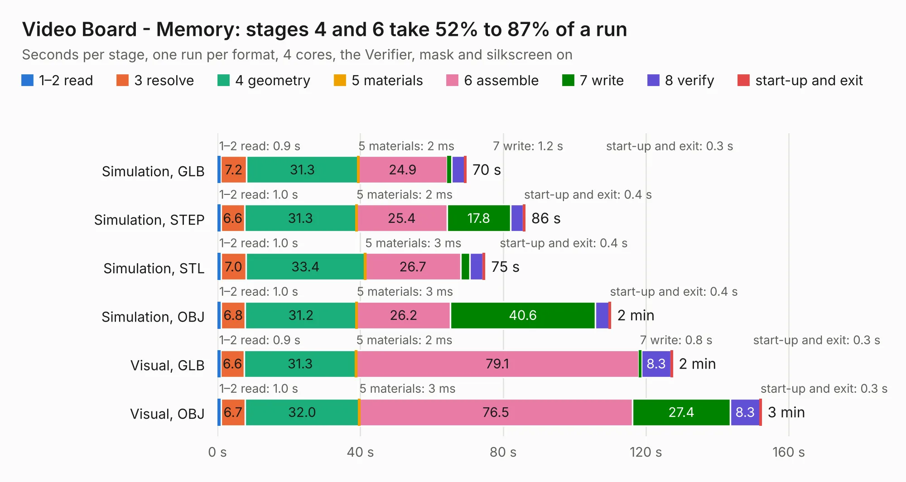

| Mode and format | 1–2 read | 3 resolve | 4 geometry | 5 materials | 6 assemble | 7 write | 8 verify | start-up and exit | Total |
|---|---:|---:|---:|---:|---:|---:|---:|---:|---:|
| Simulation, GLB | 0.9 | 7.2 | 31.3 | 2&nbsp;ms | 24.9 | 1.2 | 3.7 | 0.3 | 69.6 |
| Simulation, STEP | 1.0 | 6.6 | 31.3 | 2&nbsp;ms | 25.4 | 17.8 | 3.6 | 0.4 | 86.1 |
| Simulation, STL | 1.0 | 7.0 | 33.4 | 3&nbsp;ms | 26.7 | 2.6 | 3.7 | 0.4 | 74.8 |
| Simulation, OBJ | 1.0 | 6.8 | 31.2 | 3&nbsp;ms | 26.2 | 40.6 | 3.9 | 0.4 | 110.1 |
| Visual, GLB | 0.9 | 6.6 | 31.3 | 2&nbsp;ms | 79.1 | 0.8 | 8.3 | 0.3 | 127.3 |
| Visual, OBJ | 1.0 | 6.7 | 32.0 | 3&nbsp;ms | 76.5 | 27.4 | 8.3 | 0.3 | 152.2 |

<table align="center"><tr><td valign="top">

| Board | Repo: [andrewpaterson/658-Computer](https://github.com/andrewpaterson/658-Computer) Board: `Video Board - Memory.kicad_pcb` |
|---|---|
| Folder | Kicad / Computer / Video / Video Board - Memory |
| Complexity | 282&nbsp;/&nbsp;1000 (size&nbsp;202, features&nbsp;80) |
| KESE&nbsp;features | through vias, rounded, trapezoid or chamfered pads, curved board outline, knockout text, stack-up, dielectric εr and tanδ |
| Tested | 9th November 2026 |
| Copper&nbsp;layers | 2 |
| File&nbsp;format | KiCad 9 (20241229) |
| Parts,&nbsp;tracks,&nbsp;vias | 30, 6,354, 685 |
| Triangles,&nbsp;simulation | 7,111,072 in 328 parts |
| Verifier | PASS in all six runs |

</td><td valign="top">

<table>
<tr><th>File type</th><th>File size</th><th>Peak memory used</th></tr>
<tr><th colspan="3" align="left">Simulation</th></tr>
<tr><td>GLB</td><td align="right">240&nbsp;MB</td><td align="right">2.2&nbsp;GB</td></tr>
<tr><td>STEP</td><td align="right">1.1&nbsp;GB</td><td align="right">2.6&nbsp;GB</td></tr>
<tr><td>STL</td><td align="right">356&nbsp;MB</td><td align="right">2.1&nbsp;GB</td></tr>
<tr><td>OBJ</td><td align="right">755&nbsp;MB</td><td align="right">4.4&nbsp;GB</td></tr>
<tr><th colspan="3" align="left">Visual</th></tr>
<tr><td>GLB</td><td align="right">167&nbsp;MB</td><td align="right">2.7&nbsp;GB</td></tr>
<tr><td>OBJ</td><td align="right">542&nbsp;MB</td><td align="right">3.5&nbsp;GB</td></tr>
</table>

</td></tr></table>

## 264. Video Board - Signals

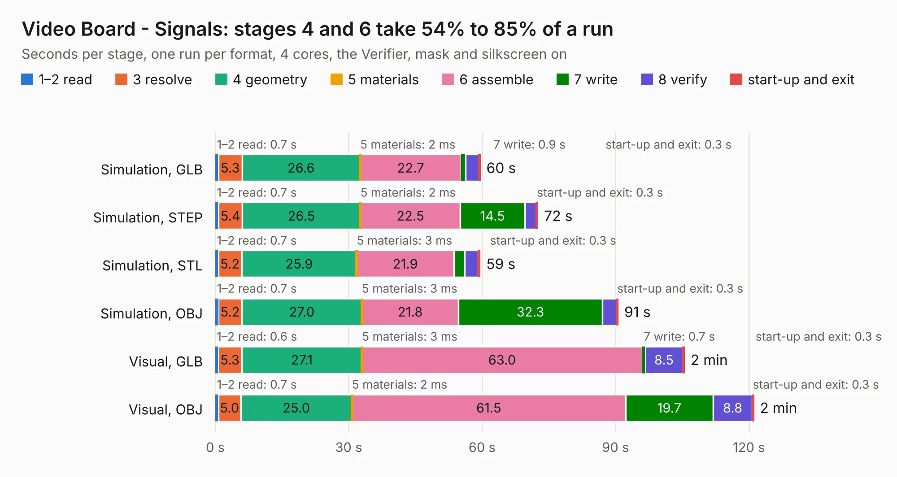

| Mode and format | 1–2 read | 3 resolve | 4 geometry | 5 materials | 6 assemble | 7 write | 8 verify | start-up and exit | Total |
|---|---:|---:|---:|---:|---:|---:|---:|---:|---:|
| Simulation, GLB | 0.7 | 5.3 | 26.6 | 2&nbsp;ms | 22.7 | 0.9 | 3.0 | 0.3 | 59.5 |
| Simulation, STEP | 0.7 | 5.4 | 26.5 | 2&nbsp;ms | 22.5 | 14.5 | 2.6 | 0.3 | 72.5 |
| Simulation, STL | 0.7 | 5.2 | 25.9 | 3&nbsp;ms | 21.9 | 2.4 | 3.0 | 0.3 | 59.5 |
| Simulation, OBJ | 0.7 | 5.2 | 27.0 | 3&nbsp;ms | 21.8 | 32.3 | 3.2 | 0.3 | 90.5 |
| Visual, GLB | 0.6 | 5.3 | 27.1 | 3&nbsp;ms | 63.0 | 0.7 | 8.5 | 0.3 | 105.4 |
| Visual, OBJ | 0.7 | 5.0 | 25.0 | 2&nbsp;ms | 61.5 | 19.7 | 8.8 | 0.3 | 121.0 |

<table align="center"><tr><td valign="top">

| Board | Repo: [andrewpaterson/658-Computer](https://github.com/andrewpaterson/658-Computer) Board: `Video Board - Signals.kicad_pcb` |
|---|---|
| Folder | Kicad / Computer / Video / Video Board - Signals |
| Complexity | 280&nbsp;/&nbsp;1000 (size&nbsp;200, features&nbsp;80) |
| KESE&nbsp;features | through vias, rounded, trapezoid or chamfered pads, curved board outline, knockout text, stack-up, dielectric εr and tanδ |
| Tested | 9th November 2026 |
| Copper&nbsp;layers | 2 |
| File&nbsp;format | KiCad 9 (20241229) |
| Parts,&nbsp;tracks,&nbsp;vias | 38, 4,452, 608 |
| Triangles,&nbsp;simulation | 6,820,772 in 505 parts |
| Verifier | PASS in all six runs |

</td><td valign="top">

<table>
<tr><th>File type</th><th>File size</th><th>Peak memory used</th></tr>
<tr><th colspan="3" align="left">Simulation</th></tr>
<tr><td>GLB</td><td align="right">228&nbsp;MB</td><td align="right">2.0&nbsp;GB</td></tr>
<tr><td>STEP</td><td align="right">968&nbsp;MB</td><td align="right">2.5&nbsp;GB</td></tr>
<tr><td>STL</td><td align="right">341&nbsp;MB</td><td align="right">1.9&nbsp;GB</td></tr>
<tr><td>OBJ</td><td align="right">720&nbsp;MB</td><td align="right">4.3&nbsp;GB</td></tr>
<tr><th colspan="3" align="left">Visual</th></tr>
<tr><td>GLB</td><td align="right">153&nbsp;MB</td><td align="right">2.5&nbsp;GB</td></tr>
<tr><td>OBJ</td><td align="right">492&nbsp;MB</td><td align="right">3.0&nbsp;GB</td></tr>
</table>

</td></tr></table>

## 265. Video Clock

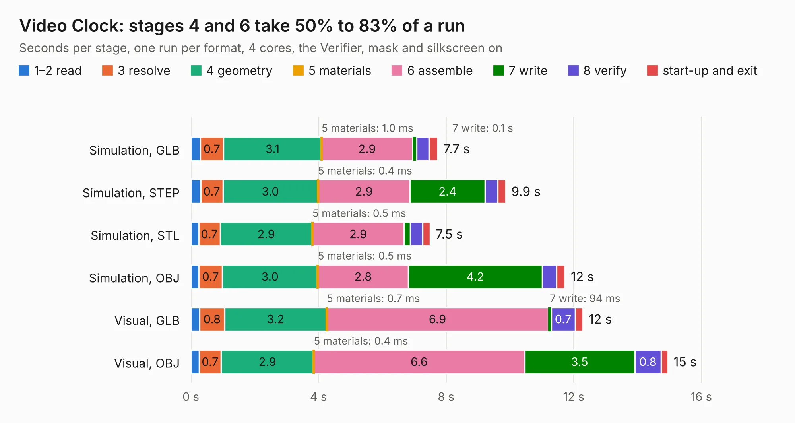

| Mode and format | 1–2 read | 3 resolve | 4 geometry | 5 materials | 6 assemble | 7 write | 8 verify | start-up and exit | Total |
|---|---:|---:|---:|---:|---:|---:|---:|---:|---:|
| Simulation, GLB | 0.3 | 0.7 | 3.1 | 1.0&nbsp;ms | 2.9 | 0.1 | 0.4 | 0.3 | 7.7 |
| Simulation, STEP | 0.3 | 0.7 | 3.0 | 0.4&nbsp;ms | 2.9 | 2.4 | 0.4 | 0.2 | 9.9 |
| Simulation, STL | 0.2 | 0.7 | 2.9 | 0.5&nbsp;ms | 2.9 | 0.2 | 0.4 | 0.2 | 7.5 |
| Simulation, OBJ | 0.3 | 0.7 | 3.0 | 0.5&nbsp;ms | 2.8 | 4.2 | 0.5 | 0.3 | 11.7 |
| Visual, GLB | 0.3 | 0.8 | 3.2 | 0.7&nbsp;ms | 6.9 | 94&nbsp;ms | 0.7 | 0.2 | 12.3 |
| Visual, OBJ | 0.3 | 0.7 | 2.9 | 0.4&nbsp;ms | 6.6 | 3.5 | 0.8 | 0.2 | 14.9 |

<table align="center"><tr><td valign="top">

| Board | Repo: [andrewpaterson/658-Computer](https://github.com/andrewpaterson/658-Computer) Board: `Video Clock.kicad_pcb` |
|---|---|
| Folder | Kicad / Computer / Video / Video Clock |
| Complexity | 242&nbsp;/&nbsp;1000 (size&nbsp;172, features&nbsp;70) |
| KESE&nbsp;features | through vias, rounded, trapezoid or chamfered pads, knockout text, stack-up, dielectric εr and tanδ |
| Tested | 9th November 2026 |
| Copper&nbsp;layers | 2 |
| File&nbsp;format | KiCad 9 (20241229) |
| Parts,&nbsp;tracks,&nbsp;vias | 39, 778, 111 |
| Triangles,&nbsp;simulation | 623,350 in 103 parts |
| Verifier | PASS in all six runs |

</td><td valign="top">

<table>
<tr><th>File type</th><th>File size</th><th>Peak memory used</th></tr>
<tr><th colspan="3" align="left">Simulation</th></tr>
<tr><td>GLB</td><td align="right">21&nbsp;MB</td><td align="right">343&nbsp;MB</td></tr>
<tr><td>STEP</td><td align="right">98&nbsp;MB</td><td align="right">414&nbsp;MB</td></tr>
<tr><td>STL</td><td align="right">31&nbsp;MB</td><td align="right">335&nbsp;MB</td></tr>
<tr><td>OBJ</td><td align="right">63&nbsp;MB</td><td align="right">459&nbsp;MB</td></tr>
<tr><th colspan="3" align="left">Visual</th></tr>
<tr><td>GLB</td><td align="right">18&nbsp;MB</td><td align="right">483&nbsp;MB</td></tr>
<tr><td>OBJ</td><td align="right">52&nbsp;MB</td><td align="right">480&nbsp;MB</td></tr>
</table>

</td></tr></table>

## 266. Video Counter 12bit

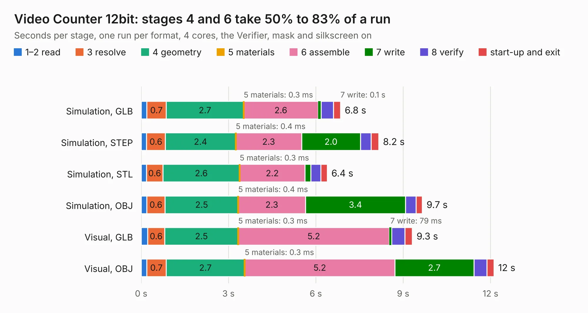

| Mode and format | 1–2 read | 3 resolve | 4 geometry | 5 materials | 6 assemble | 7 write | 8 verify | start-up and exit | Total |
|---|---:|---:|---:|---:|---:|---:|---:|---:|---:|
| Simulation, GLB | 0.2 | 0.7 | 2.7 | 0.3&nbsp;ms | 2.6 | 0.1 | 0.4 | 0.2 | 6.8 |
| Simulation, STEP | 0.2 | 0.6 | 2.4 | 0.4&nbsp;ms | 2.3 | 2.0 | 0.4 | 0.3 | 8.2 |
| Simulation, STL | 0.2 | 0.6 | 2.6 | 0.3&nbsp;ms | 2.2 | 0.2 | 0.3 | 0.2 | 6.4 |
| Simulation, OBJ | 0.2 | 0.6 | 2.5 | 0.4&nbsp;ms | 2.3 | 3.4 | 0.4 | 0.2 | 9.7 |
| Visual, GLB | 0.2 | 0.6 | 2.5 | 0.3&nbsp;ms | 5.2 | 79&nbsp;ms | 0.5 | 0.3 | 9.3 |
| Visual, OBJ | 0.2 | 0.7 | 2.7 | 0.3&nbsp;ms | 5.2 | 2.7 | 0.4 | 0.2 | 12.1 |

<table align="center"><tr><td valign="top">

| Board | Repo: [andrewpaterson/658-Computer](https://github.com/andrewpaterson/658-Computer) Board: `Video Counter 12bit.kicad_pcb` |
|---|---|
| Folder | Kicad / Computer / Video / Video Counter 12bit |
| Complexity | 233&nbsp;/&nbsp;1000 (size&nbsp;163, features&nbsp;70) |
| KESE&nbsp;features | through vias, rounded, trapezoid or chamfered pads, knockout text, stack-up, dielectric εr and tanδ |
| Tested | 9th November 2026 |
| Copper&nbsp;layers | 2 |
| File&nbsp;format | KiCad 9 (20241229) |
| Parts,&nbsp;tracks,&nbsp;vias | 18, 761, 104 |
| Triangles,&nbsp;simulation | 561,818 in 51 parts |
| Verifier | PASS in all six runs |

</td><td valign="top">

<table>
<tr><th>File type</th><th>File size</th><th>Peak memory used</th></tr>
<tr><th colspan="3" align="left">Simulation</th></tr>
<tr><td>GLB</td><td align="right">19&nbsp;MB</td><td align="right">323&nbsp;MB</td></tr>
<tr><td>STEP</td><td align="right">92&nbsp;MB</td><td align="right">386&nbsp;MB</td></tr>
<tr><td>STL</td><td align="right">28&nbsp;MB</td><td align="right">312&nbsp;MB</td></tr>
<tr><td>OBJ</td><td align="right">57&nbsp;MB</td><td align="right">399&nbsp;MB</td></tr>
<tr><th colspan="3" align="left">Visual</th></tr>
<tr><td>GLB</td><td align="right">15&nbsp;MB</td><td align="right">404&nbsp;MB</td></tr>
<tr><td>OBJ</td><td align="right">46&nbsp;MB</td><td align="right">408&nbsp;MB</td></tr>
</table>

</td></tr></table>

## 267. Video DAC

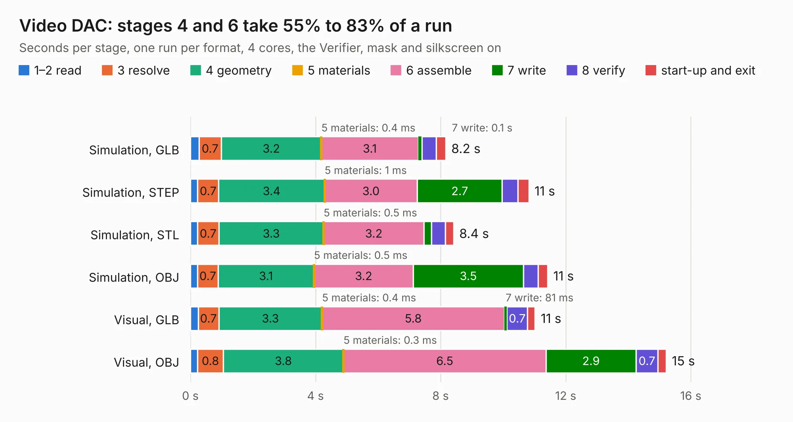

| Mode and format | 1–2 read | 3 resolve | 4 geometry | 5 materials | 6 assemble | 7 write | 8 verify | start-up and exit | Total |
|---|---:|---:|---:|---:|---:|---:|---:|---:|---:|
| Simulation, GLB | 0.3 | 0.7 | 3.2 | 0.4&nbsp;ms | 3.1 | 0.1 | 0.5 | 0.3 | 8.2 |
| Simulation, STEP | 0.2 | 0.7 | 3.4 | 1&nbsp;ms | 3.0 | 2.7 | 0.5 | 0.3 | 10.8 |
| Simulation, STL | 0.2 | 0.7 | 3.3 | 0.5&nbsp;ms | 3.2 | 0.2 | 0.5 | 0.3 | 8.4 |
| Simulation, OBJ | 0.2 | 0.7 | 3.1 | 0.5&nbsp;ms | 3.2 | 3.5 | 0.5 | 0.3 | 11.4 |
| Visual, GLB | 0.2 | 0.7 | 3.3 | 0.4&nbsp;ms | 5.8 | 81&nbsp;ms | 0.7 | 0.2 | 11.0 |
| Visual, OBJ | 0.2 | 0.8 | 3.8 | 0.3&nbsp;ms | 6.5 | 2.9 | 0.7 | 0.3 | 15.2 |

<table align="center"><tr><td valign="top">

| Board | Repo: [andrewpaterson/658-Computer](https://github.com/andrewpaterson/658-Computer) Board: `Video DAC.kicad_pcb` |
|---|---|
| Folder | Kicad / Computer / Video / Video DAC |
| Complexity | 285&nbsp;/&nbsp;1000 (size&nbsp;205, features&nbsp;80) |
| KESE&nbsp;features | through vias, rounded, trapezoid or chamfered pads, curved board outline, knockout text, stack-up, dielectric εr and tanδ |
| Tested | 9th November 2026 |
| Copper&nbsp;layers | 2 |
| File&nbsp;format | KiCad 9 (20241229) |
| Parts,&nbsp;tracks,&nbsp;vias | 26, 714, 84 |
| Triangles,&nbsp;simulation | 618,172 in 73 parts |
| Verifier | PASS in all six runs |

</td><td valign="top">

<table>
<tr><th>File type</th><th>File size</th><th>Peak memory used</th></tr>
<tr><th colspan="3" align="left">Simulation</th></tr>
<tr><td>GLB</td><td align="right">21&nbsp;MB</td><td align="right">322&nbsp;MB</td></tr>
<tr><td>STEP</td><td align="right">96&nbsp;MB</td><td align="right">407&nbsp;MB</td></tr>
<tr><td>STL</td><td align="right">31&nbsp;MB</td><td align="right">319&nbsp;MB</td></tr>
<tr><td>OBJ</td><td align="right">63&nbsp;MB</td><td align="right">453&nbsp;MB</td></tr>
<tr><th colspan="3" align="left">Visual</th></tr>
<tr><td>GLB</td><td align="right">16&nbsp;MB</td><td align="right">415&nbsp;MB</td></tr>
<tr><td>OBJ</td><td align="right">49&nbsp;MB</td><td align="right">451&nbsp;MB</td></tr>
</table>

</td></tr></table>

## 268. Video Data Select

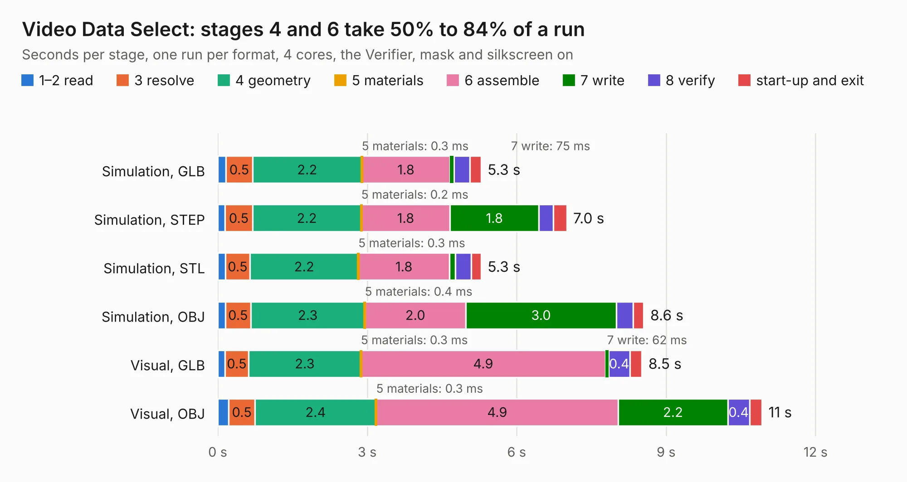

| Mode and format | 1–2 read | 3 resolve | 4 geometry | 5 materials | 6 assemble | 7 write | 8 verify | start-up and exit | Total |
|---|---:|---:|---:|---:|---:|---:|---:|---:|---:|
| Simulation, GLB | 0.2 | 0.5 | 2.2 | 0.3&nbsp;ms | 1.8 | 75&nbsp;ms | 0.3 | 0.2 | 5.3 |
| Simulation, STEP | 0.1 | 0.5 | 2.2 | 0.2&nbsp;ms | 1.8 | 1.8 | 0.3 | 0.3 | 7.0 |
| Simulation, STL | 0.2 | 0.5 | 2.2 | 0.3&nbsp;ms | 1.8 | 0.1 | 0.3 | 0.2 | 5.3 |
| Simulation, OBJ | 0.2 | 0.5 | 2.3 | 0.4&nbsp;ms | 2.0 | 3.0 | 0.3 | 0.2 | 8.6 |
| Visual, GLB | 0.1 | 0.5 | 2.3 | 0.3&nbsp;ms | 4.9 | 62&nbsp;ms | 0.4 | 0.2 | 8.5 |
| Visual, OBJ | 0.2 | 0.5 | 2.4 | 0.3&nbsp;ms | 4.9 | 2.2 | 0.4 | 0.2 | 10.9 |

<table align="center"><tr><td valign="top">

| Board | Repo: [andrewpaterson/658-Computer](https://github.com/andrewpaterson/658-Computer) Board: `Video Data Select.kicad_pcb` |
|---|---|
| Folder | Kicad / Computer / Video / Video Data Select |
| Complexity | 230&nbsp;/&nbsp;1000 (size&nbsp;160, features&nbsp;70) |
| KESE&nbsp;features | through vias, rounded, trapezoid or chamfered pads, knockout text, stack-up, dielectric εr and tanδ |
| Tested | 9th November 2026 |
| Copper&nbsp;layers | 2 |
| File&nbsp;format | KiCad 9 (20241229) |
| Parts,&nbsp;tracks,&nbsp;vias | 18, 596, 99 |
| Triangles,&nbsp;simulation | 539,780 in 54 parts |
| Verifier | PASS in all six runs |

</td><td valign="top">

<table>
<tr><th>File type</th><th>File size</th><th>Peak memory used</th></tr>
<tr><th colspan="3" align="left">Simulation</th></tr>
<tr><td>GLB</td><td align="right">19&nbsp;MB</td><td align="right">327&nbsp;MB</td></tr>
<tr><td>STEP</td><td align="right">88&nbsp;MB</td><td align="right">370&nbsp;MB</td></tr>
<tr><td>STL</td><td align="right">27&nbsp;MB</td><td align="right">331&nbsp;MB</td></tr>
<tr><td>OBJ</td><td align="right">55&nbsp;MB</td><td align="right">413&nbsp;MB</td></tr>
<tr><th colspan="3" align="left">Visual</th></tr>
<tr><td>GLB</td><td align="right">15&nbsp;MB</td><td align="right">396&nbsp;MB</td></tr>
<tr><td>OBJ</td><td align="right">44&nbsp;MB</td><td align="right">401&nbsp;MB</td></tr>
</table>

</td></tr></table>

## 269. Video Device RAM Select

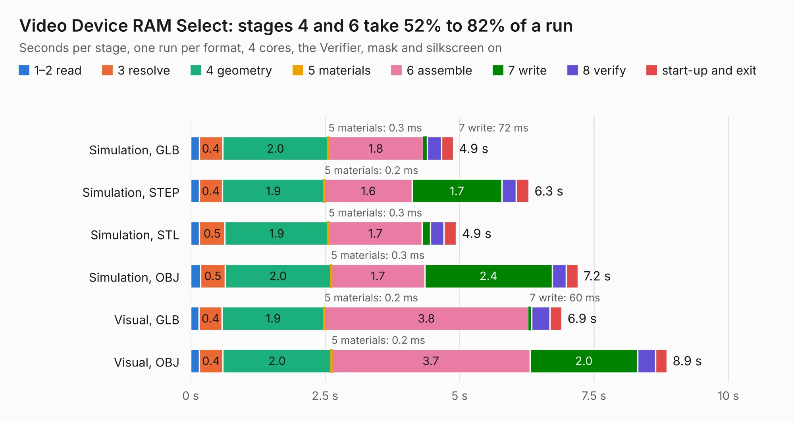

| Mode and format | 1–2 read | 3 resolve | 4 geometry | 5 materials | 6 assemble | 7 write | 8 verify | start-up and exit | Total |
|---|---:|---:|---:|---:|---:|---:|---:|---:|---:|
| Simulation, GLB | 0.2 | 0.4 | 2.0 | 0.3&nbsp;ms | 1.8 | 72&nbsp;ms | 0.3 | 0.2 | 4.9 |
| Simulation, STEP | 0.2 | 0.4 | 1.9 | 0.2&nbsp;ms | 1.6 | 1.7 | 0.3 | 0.2 | 6.3 |
| Simulation, STL | 0.2 | 0.5 | 1.9 | 0.3&nbsp;ms | 1.7 | 0.1 | 0.3 | 0.2 | 4.9 |
| Simulation, OBJ | 0.2 | 0.5 | 2.0 | 0.3&nbsp;ms | 1.7 | 2.4 | 0.3 | 0.2 | 7.2 |
| Visual, GLB | 0.2 | 0.4 | 1.9 | 0.2&nbsp;ms | 3.8 | 60&nbsp;ms | 0.3 | 0.2 | 6.9 |
| Visual, OBJ | 0.2 | 0.4 | 2.0 | 0.2&nbsp;ms | 3.7 | 2.0 | 0.3 | 0.2 | 8.9 |

<table align="center"><tr><td valign="top">

| Board | Repo: [andrewpaterson/658-Computer](https://github.com/andrewpaterson/658-Computer) Board: `Video Device RAM Select.kicad_pcb` |
|---|---|
| Folder | Kicad / Computer / Video / Video Device RAM Select |
| Complexity | 227&nbsp;/&nbsp;1000 (size&nbsp;157, features&nbsp;70) |
| KESE&nbsp;features | through vias, rounded, trapezoid or chamfered pads, knockout text, stack-up, dielectric εr and tanδ |
| Tested | 9th November 2026 |
| Copper&nbsp;layers | 2 |
| File&nbsp;format | KiCad 9 (20241229) |
| Parts,&nbsp;tracks,&nbsp;vias | 18, 519, 73 |
| Triangles,&nbsp;simulation | 431,068 in 55 parts |
| Verifier | PASS in all six runs |

</td><td valign="top">

<table>
<tr><th>File type</th><th>File size</th><th>Peak memory used</th></tr>
<tr><th colspan="3" align="left">Simulation</th></tr>
<tr><td>GLB</td><td align="right">15&nbsp;MB</td><td align="right">272&nbsp;MB</td></tr>
<tr><td>STEP</td><td align="right">70&nbsp;MB</td><td align="right">334&nbsp;MB</td></tr>
<tr><td>STL</td><td align="right">22&nbsp;MB</td><td align="right">271&nbsp;MB</td></tr>
<tr><td>OBJ</td><td align="right">44&nbsp;MB</td><td align="right">345&nbsp;MB</td></tr>
<tr><th colspan="3" align="left">Visual</th></tr>
<tr><td>GLB</td><td align="right">12&nbsp;MB</td><td align="right">342&nbsp;MB</td></tr>
<tr><td>OBJ</td><td align="right">35&nbsp;MB</td><td align="right">353&nbsp;MB</td></tr>
</table>

</td></tr></table>

## 270. Video Memory 2MB

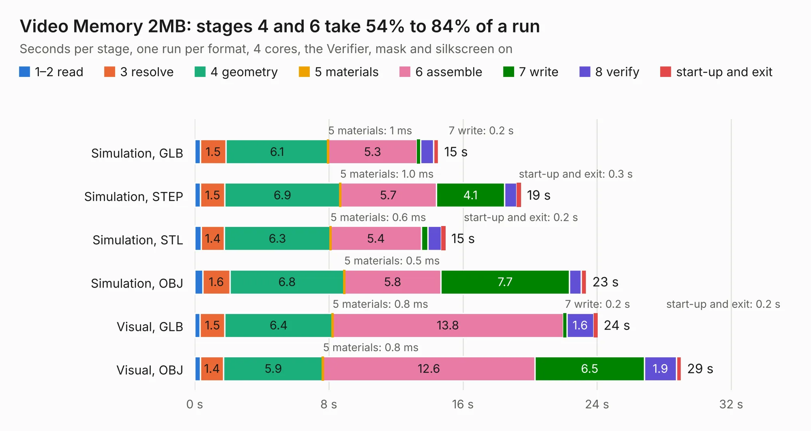

| Mode and format | 1–2 read | 3 resolve | 4 geometry | 5 materials | 6 assemble | 7 write | 8 verify | start-up and exit | Total |
|---|---:|---:|---:|---:|---:|---:|---:|---:|---:|
| Simulation, GLB | 0.3 | 1.5 | 6.1 | 1&nbsp;ms | 5.3 | 0.2 | 0.8 | 0.3 | 14.5 |
| Simulation, STEP | 0.3 | 1.5 | 6.9 | 1.0&nbsp;ms | 5.7 | 4.1 | 0.7 | 0.3 | 19.5 |
| Simulation, STL | 0.4 | 1.4 | 6.3 | 0.6&nbsp;ms | 5.4 | 0.4 | 0.8 | 0.2 | 15.0 |
| Simulation, OBJ | 0.5 | 1.6 | 6.8 | 0.5&nbsp;ms | 5.8 | 7.7 | 0.7 | 0.3 | 23.4 |
| Visual, GLB | 0.3 | 1.5 | 6.4 | 0.8&nbsp;ms | 13.8 | 0.2 | 1.6 | 0.2 | 24.0 |
| Visual, OBJ | 0.3 | 1.4 | 5.9 | 0.8&nbsp;ms | 12.6 | 6.5 | 1.9 | 0.3 | 29.0 |

<table align="center"><tr><td valign="top">

| Board | Repo: [andrewpaterson/658-Computer](https://github.com/andrewpaterson/658-Computer) Board: `Video Memory 2MB.kicad_pcb` |
|---|---|
| Folder | Kicad / Computer / Video / Video Memory 2MB |
| Complexity | 252&nbsp;/&nbsp;1000 (size&nbsp;182, features&nbsp;70) |
| KESE&nbsp;features | through vias, rounded, trapezoid or chamfered pads, knockout text, stack-up, dielectric εr and tanδ |
| Tested | 9th November 2026 |
| Copper&nbsp;layers | 2 |
| File&nbsp;format | KiCad 9 (20241229) |
| Parts,&nbsp;tracks,&nbsp;vias | 29, 1,720, 272 |
| Triangles,&nbsp;simulation | 1,213,368 in 122 parts |
| Verifier | PASS in all six runs |

</td><td valign="top">

<table>
<tr><th>File type</th><th>File size</th><th>Peak memory used</th></tr>
<tr><th colspan="3" align="left">Simulation</th></tr>
<tr><td>GLB</td><td align="right">41&nbsp;MB</td><td align="right">500&nbsp;MB</td></tr>
<tr><td>STEP</td><td align="right">190&nbsp;MB</td><td align="right">625&nbsp;MB</td></tr>
<tr><td>STL</td><td align="right">61&nbsp;MB</td><td align="right">536&nbsp;MB</td></tr>
<tr><td>OBJ</td><td align="right">124&nbsp;MB</td><td align="right">828&nbsp;MB</td></tr>
<tr><th colspan="3" align="left">Visual</th></tr>
<tr><td>GLB</td><td align="right">34&nbsp;MB</td><td align="right">690&nbsp;MB</td></tr>
<tr><td>OBJ</td><td align="right">105&nbsp;MB</td><td align="right">817&nbsp;MB</td></tr>
</table>

</td></tr></table>

## 271. Video Pixel Advance

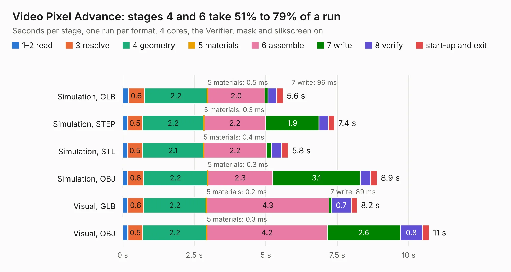

| Mode and format | 1–2 read | 3 resolve | 4 geometry | 5 materials | 6 assemble | 7 write | 8 verify | start-up and exit | Total |
|---|---:|---:|---:|---:|---:|---:|---:|---:|---:|
| Simulation, GLB | 0.2 | 0.6 | 2.2 | 0.5&nbsp;ms | 2.0 | 96&nbsp;ms | 0.3 | 0.2 | 5.6 |
| Simulation, STEP | 0.2 | 0.5 | 2.2 | 0.3&nbsp;ms | 2.2 | 1.9 | 0.3 | 0.2 | 7.4 |
| Simulation, STL | 0.2 | 0.5 | 2.1 | 0.4&nbsp;ms | 2.2 | 0.2 | 0.4 | 0.2 | 5.8 |
| Simulation, OBJ | 0.2 | 0.6 | 2.2 | 0.3&nbsp;ms | 2.3 | 3.1 | 0.4 | 0.2 | 8.9 |
| Visual, GLB | 0.2 | 0.6 | 2.2 | 0.2&nbsp;ms | 4.3 | 89&nbsp;ms | 0.7 | 0.2 | 8.2 |
| Visual, OBJ | 0.2 | 0.5 | 2.2 | 0.3&nbsp;ms | 4.2 | 2.6 | 0.8 | 0.2 | 10.7 |

<table align="center"><tr><td valign="top">

| Board | Repo: [andrewpaterson/658-Computer](https://github.com/andrewpaterson/658-Computer) Board: `Video Pixel Advance.kicad_pcb` |
|---|---|
| Folder | Kicad / Computer / Video / Video Pixel Advance |
| Complexity | 231&nbsp;/&nbsp;1000 (size&nbsp;161, features&nbsp;70) |
| KESE&nbsp;features | through vias, rounded, trapezoid or chamfered pads, knockout text, stack-up, dielectric εr and tanδ |
| Tested | 9th November 2026 |
| Copper&nbsp;layers | 2 |
| File&nbsp;format | KiCad 9 (20241229) |
| Parts,&nbsp;tracks,&nbsp;vias | 17, 711, 98 |
| Triangles,&nbsp;simulation | 498,308 in 66 parts |
| Verifier | PASS in all six runs |

</td><td valign="top">

<table>
<tr><th>File type</th><th>File size</th><th>Peak memory used</th></tr>
<tr><th colspan="3" align="left">Simulation</th></tr>
<tr><td>GLB</td><td align="right">17&nbsp;MB</td><td align="right">295&nbsp;MB</td></tr>
<tr><td>STEP</td><td align="right">78&nbsp;MB</td><td align="right">356&nbsp;MB</td></tr>
<tr><td>STL</td><td align="right">25&nbsp;MB</td><td align="right">297&nbsp;MB</td></tr>
<tr><td>OBJ</td><td align="right">50&nbsp;MB</td><td align="right">384&nbsp;MB</td></tr>
<tr><th colspan="3" align="left">Visual</th></tr>
<tr><td>GLB</td><td align="right">14&nbsp;MB</td><td align="right">388&nbsp;MB</td></tr>
<tr><td>OBJ</td><td align="right">43&nbsp;MB</td><td align="right">408&nbsp;MB</td></tr>
</table>

</td></tr></table>

## 272. Video Row Latch

| Mode and format | 1–2 read | 3 resolve | 4 geometry | 5 materials | 6 assemble | 7 write | 8 verify | start-up and exit | Total |
|---|---:|---:|---:|---:|---:|---:|---:|---:|---:|
| Simulation, GLB | 0.1 | 0.2 | 1.1 | 0.3&nbsp;ms | 1.0 | 46&nbsp;ms | 0.2 | 0.2 | 2.9 |
| Simulation, STEP | 0.1 | 0.2 | 1.0 | 0.2&nbsp;ms | 1.1 | 1.1 | 0.2 | 0.2 | 3.9 |
| Simulation, STL | 0.1 | 0.2 | 1.1 | 0.3&nbsp;ms | 1.0 | 73&nbsp;ms | 0.2 | 0.2 | 3.0 |
| Simulation, OBJ | 0.1 | 0.3 | 1.0 | 0.2&nbsp;ms | 1.1 | 1.4 | 0.2 | 0.2 | 4.3 |
| Visual, GLB | 0.1 | 0.3 | 1.0 | 0.2&nbsp;ms | 2.5 | 35&nbsp;ms | 0.2 | 0.2 | 4.4 |
| Visual, OBJ | 0.1 | 0.3 | 1.0 | 0.2&nbsp;ms | 2.6 | 1.0 | 0.3 | 0.3 | 5.4 |

<table align="center"><tr><td valign="top">

| Board | Repo: [andrewpaterson/658-Computer](https://github.com/andrewpaterson/658-Computer) Board: `Video Row Latch.kicad_pcb` |
|---|---|
| Folder | Kicad / Computer / Video / Video Row Latch |
| Complexity | 215&nbsp;/&nbsp;1000 (size&nbsp;145, features&nbsp;70) |
| KESE&nbsp;features | through vias, rounded, trapezoid or chamfered pads, knockout text, stack-up, dielectric εr and tanδ |
| Tested | 9th November 2026 |
| Copper&nbsp;layers | 2 |
| File&nbsp;format | KiCad 9 (20241229) |
| Parts,&nbsp;tracks,&nbsp;vias | 12, 327, 42 |
| Triangles,&nbsp;simulation | 277,850 in 49 parts |
| Verifier | PASS in all six runs |

</td><td valign="top">

<table>
<tr><th>File type</th><th>File size</th><th>Peak memory used</th></tr>
<tr><th colspan="3" align="left">Simulation</th></tr>
<tr><td>GLB</td><td align="right">9.6&nbsp;MB</td><td align="right">227&nbsp;MB</td></tr>
<tr><td>STEP</td><td align="right">43&nbsp;MB</td><td align="right">262&nbsp;MB</td></tr>
<tr><td>STL</td><td align="right">14&nbsp;MB</td><td align="right">245&nbsp;MB</td></tr>
<tr><td>OBJ</td><td align="right">28&nbsp;MB</td><td align="right">234&nbsp;MB</td></tr>
<tr><th colspan="3" align="left">Visual</th></tr>
<tr><td>GLB</td><td align="right">7.3&nbsp;MB</td><td align="right">246&nbsp;MB</td></tr>
<tr><td>OBJ</td><td align="right">21&nbsp;MB</td><td align="right">246&nbsp;MB</td></tr>
</table>

</td></tr></table>

## 273. Video Signal Dragger

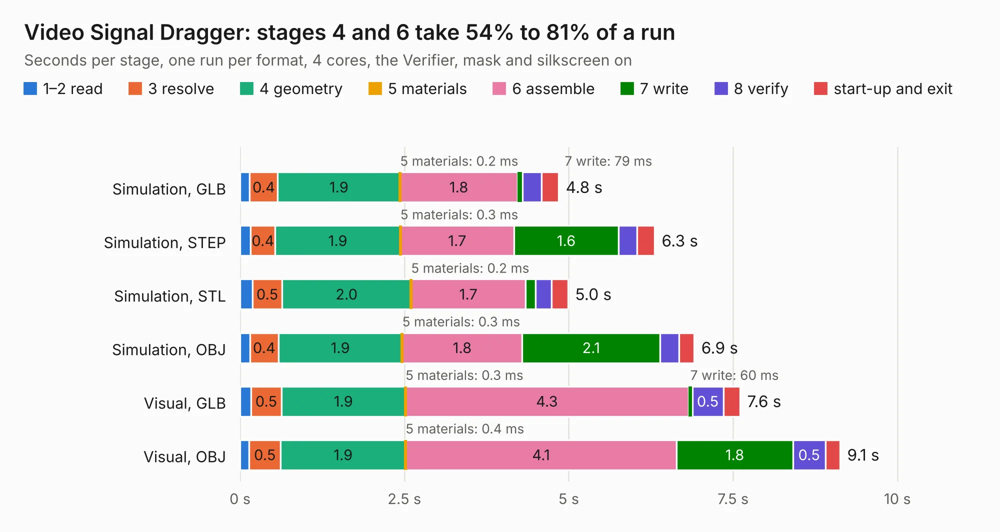

| Mode and format | 1–2 read | 3 resolve | 4 geometry | 5 materials | 6 assemble | 7 write | 8 verify | start-up and exit | Total |
|---|---:|---:|---:|---:|---:|---:|---:|---:|---:|
| Simulation, GLB | 0.1 | 0.4 | 1.9 | 0.2&nbsp;ms | 1.8 | 79&nbsp;ms | 0.3 | 0.3 | 4.8 |
| Simulation, STEP | 0.2 | 0.4 | 1.9 | 0.3&nbsp;ms | 1.7 | 1.6 | 0.3 | 0.3 | 6.3 |
| Simulation, STL | 0.2 | 0.5 | 2.0 | 0.2&nbsp;ms | 1.7 | 0.1 | 0.2 | 0.2 | 5.0 |
| Simulation, OBJ | 0.2 | 0.4 | 1.9 | 0.3&nbsp;ms | 1.8 | 2.1 | 0.3 | 0.2 | 6.9 |
| Visual, GLB | 0.2 | 0.5 | 1.9 | 0.3&nbsp;ms | 4.3 | 60&nbsp;ms | 0.5 | 0.3 | 7.6 |
| Visual, OBJ | 0.1 | 0.5 | 1.9 | 0.4&nbsp;ms | 4.1 | 1.8 | 0.5 | 0.2 | 9.1 |

<table align="center"><tr><td valign="top">

| Board | Repo: [andrewpaterson/658-Computer](https://github.com/andrewpaterson/658-Computer) Board: `Video Signal Dragger.kicad_pcb` |
|---|---|
| Folder | Kicad / Computer / Video / Video Signal Dragger |
| Complexity | 225&nbsp;/&nbsp;1000 (size&nbsp;155, features&nbsp;70) |
| KESE&nbsp;features | through vias, rounded, trapezoid or chamfered pads, knockout text, stack-up, dielectric εr and tanδ |
| Tested | 9th November 2026 |
| Copper&nbsp;layers | 2 |
| File&nbsp;format | KiCad 9 (20241229) |
| Parts,&nbsp;tracks,&nbsp;vias | 12, 612, 73 |
| Triangles,&nbsp;simulation | 470,334 in 64 parts |
| Verifier | PASS in all six runs |

</td><td valign="top">

<table>
<tr><th>File type</th><th>File size</th><th>Peak memory used</th></tr>
<tr><th colspan="3" align="left">Simulation</th></tr>
<tr><td>GLB</td><td align="right">16&nbsp;MB</td><td align="right">287&nbsp;MB</td></tr>
<tr><td>STEP</td><td align="right">76&nbsp;MB</td><td align="right">346&nbsp;MB</td></tr>
<tr><td>STL</td><td align="right">24&nbsp;MB</td><td align="right">284&nbsp;MB</td></tr>
<tr><td>OBJ</td><td align="right">48&nbsp;MB</td><td align="right">369&nbsp;MB</td></tr>
<tr><th colspan="3" align="left">Visual</th></tr>
<tr><td>GLB</td><td align="right">13&nbsp;MB</td><td align="right">362&nbsp;MB</td></tr>
<tr><td>OBJ</td><td align="right">38&nbsp;MB</td><td align="right">357&nbsp;MB</td></tr>
</table>

</td></tr></table>

## 274. Video Signals Output

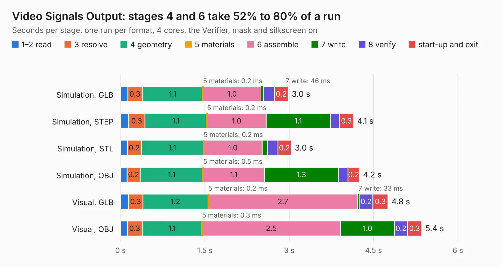

| Mode and format | 1–2 read | 3 resolve | 4 geometry | 5 materials | 6 assemble | 7 write | 8 verify | start-up and exit | Total |
|---|---:|---:|---:|---:|---:|---:|---:|---:|---:|
| Simulation, GLB | 0.1 | 0.3 | 1.1 | 0.2&nbsp;ms | 1.0 | 46&nbsp;ms | 0.2 | 0.2 | 3.0 |
| Simulation, STEP | 0.1 | 0.3 | 1.1 | 0.2&nbsp;ms | 1.0 | 1.1 | 0.2 | 0.3 | 4.1 |
| Simulation, STL | 0.1 | 0.2 | 1.1 | 0.2&nbsp;ms | 1.0 | 92&nbsp;ms | 0.2 | 0.2 | 3.0 |
| Simulation, OBJ | 0.1 | 0.2 | 1.1 | 0.5&nbsp;ms | 1.1 | 1.3 | 0.2 | 0.2 | 4.2 |
| Visual, GLB | 0.1 | 0.3 | 1.2 | 0.2&nbsp;ms | 2.7 | 33&nbsp;ms | 0.2 | 0.3 | 4.8 |
| Visual, OBJ | 0.1 | 0.3 | 1.1 | 0.3&nbsp;ms | 2.5 | 1.0 | 0.2 | 0.3 | 5.4 |

<table align="center"><tr><td valign="top">

| Board | Repo: [andrewpaterson/658-Computer](https://github.com/andrewpaterson/658-Computer) Board: `Video Signals Output.kicad_pcb` |
|---|---|
| Folder | Kicad / Computer / Video / Video Signals Output |
| Complexity | 205&nbsp;/&nbsp;1000 (size&nbsp;135, features&nbsp;70) |
| KESE&nbsp;features | through vias, rounded, trapezoid or chamfered pads, knockout text, stack-up, dielectric εr and tanδ |
| Tested | 9th November 2026 |
| Copper&nbsp;layers | 2 |
| File&nbsp;format | KiCad 9 (20241229) |
| Parts,&nbsp;tracks,&nbsp;vias | 10, 220, 22 |
| Triangles,&nbsp;simulation | 264,788 in 42 parts |
| Verifier | PASS in all six runs |

</td><td valign="top">

<table>
<tr><th>File type</th><th>File size</th><th>Peak memory used</th></tr>
<tr><th colspan="3" align="left">Simulation</th></tr>
<tr><td>GLB</td><td align="right">9.1&nbsp;MB</td><td align="right">229&nbsp;MB</td></tr>
<tr><td>STEP</td><td align="right">41&nbsp;MB</td><td align="right">250&nbsp;MB</td></tr>
<tr><td>STL</td><td align="right">13&nbsp;MB</td><td align="right">230&nbsp;MB</td></tr>
<tr><td>OBJ</td><td align="right">27&nbsp;MB</td><td align="right">229&nbsp;MB</td></tr>
<tr><th colspan="3" align="left">Visual</th></tr>
<tr><td>GLB</td><td align="right">6.4&nbsp;MB</td><td align="right">226&nbsp;MB</td></tr>
<tr><td>OBJ</td><td align="right">19&nbsp;MB</td><td align="right">225&nbsp;MB</td></tr>
</table>

</td></tr></table>

## 275. Keypad

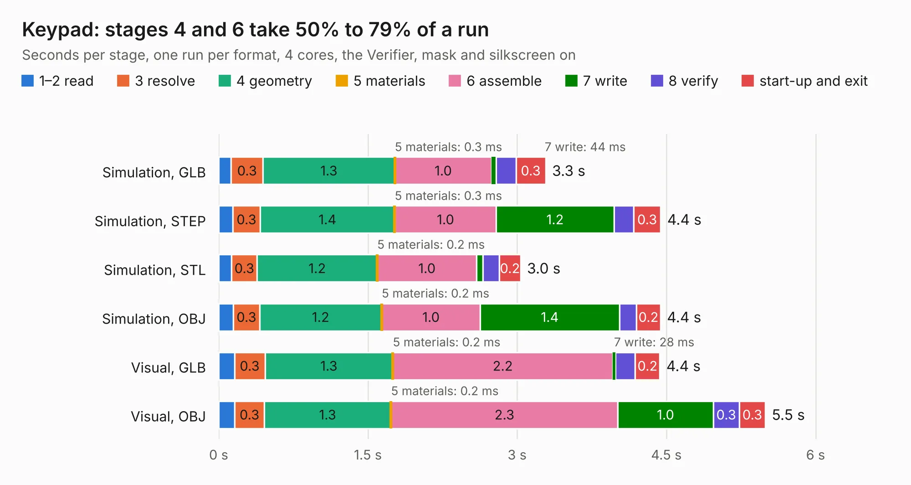

| Mode and format | 1–2 read | 3 resolve | 4 geometry | 5 materials | 6 assemble | 7 write | 8 verify | start-up and exit | Total |
|---|---:|---:|---:|---:|---:|---:|---:|---:|---:|
| Simulation, GLB | 0.1 | 0.3 | 1.3 | 0.3&nbsp;ms | 1.0 | 44&nbsp;ms | 0.2 | 0.3 | 3.3 |
| Simulation, STEP | 0.1 | 0.3 | 1.4 | 0.3&nbsp;ms | 1.0 | 1.2 | 0.2 | 0.3 | 4.4 |
| Simulation, STL | 0.1 | 0.3 | 1.2 | 0.2&nbsp;ms | 1.0 | 61&nbsp;ms | 0.2 | 0.2 | 3.0 |
| Simulation, OBJ | 0.1 | 0.3 | 1.2 | 0.2&nbsp;ms | 1.0 | 1.4 | 0.2 | 0.2 | 4.4 |
| Visual, GLB | 0.2 | 0.3 | 1.3 | 0.2&nbsp;ms | 2.2 | 28&nbsp;ms | 0.2 | 0.2 | 4.4 |
| Visual, OBJ | 0.2 | 0.3 | 1.3 | 0.2&nbsp;ms | 2.3 | 1.0 | 0.3 | 0.3 | 5.5 |

<table align="center"><tr><td valign="top">

| Board | Repo: [andrewpaterson/658-Computer](https://github.com/andrewpaterson/658-Computer) Board: `Keypad.kicad_pcb` |
|---|---|
| Folder | Kicad / Keypad |
| Complexity | 195&nbsp;/&nbsp;1000 (size&nbsp;130, features&nbsp;65) |
| KESE&nbsp;features | through vias, rounded, trapezoid or chamfered pads, curved board outline, stack-up, dielectric εr and tanδ |
| Tested | 9th November 2026 |
| Copper&nbsp;layers | 2 |
| File&nbsp;format | KiCad 9 (20241229) |
| Parts,&nbsp;tracks,&nbsp;vias | 8, 205, 11 |
| Triangles,&nbsp;simulation | 239,644 in 40 parts |
| Verifier | PASS in all six runs |

</td><td valign="top">

<table>
<tr><th>File type</th><th>File size</th><th>Peak memory used</th></tr>
<tr><th colspan="3" align="left">Simulation</th></tr>
<tr><td>GLB</td><td align="right">8.0&nbsp;MB</td><td align="right">223&nbsp;MB</td></tr>
<tr><td>STEP</td><td align="right">33&nbsp;MB</td><td align="right">241&nbsp;MB</td></tr>
<tr><td>STL</td><td align="right">12&nbsp;MB</td><td align="right">227&nbsp;MB</td></tr>
<tr><td>OBJ</td><td align="right">24&nbsp;MB</td><td align="right">222&nbsp;MB</td></tr>
<tr><th colspan="3" align="left">Visual</th></tr>
<tr><td>GLB</td><td align="right">5.6&nbsp;MB</td><td align="right">225&nbsp;MB</td></tr>
<tr><td>OBJ</td><td align="right">16&nbsp;MB</td><td align="right">224&nbsp;MB</td></tr>
</table>

</td></tr></table>

## 276. GPIO 32bit Board

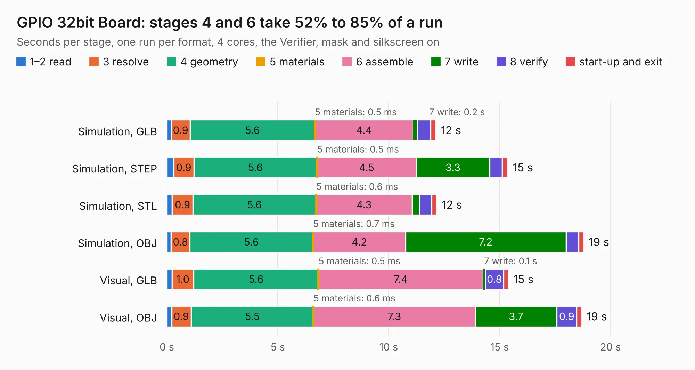

| Mode and format | 1–2 read | 3 resolve | 4 geometry | 5 materials | 6 assemble | 7 write | 8 verify | start-up and exit | Total |
|---|---:|---:|---:|---:|---:|---:|---:|---:|---:|
| Simulation, GLB | 0.2 | 0.9 | 5.6 | 0.5&nbsp;ms | 4.4 | 0.2 | 0.6 | 0.2 | 12.1 |
| Simulation, STEP | 0.3 | 0.9 | 5.6 | 0.5&nbsp;ms | 4.5 | 3.3 | 0.6 | 0.3 | 15.4 |
| Simulation, STL | 0.2 | 0.9 | 5.6 | 0.6&nbsp;ms | 4.3 | 0.3 | 0.5 | 0.2 | 12.2 |
| Simulation, OBJ | 0.2 | 0.8 | 5.6 | 0.7&nbsp;ms | 4.2 | 7.2 | 0.6 | 0.2 | 18.8 |
| Visual, GLB | 0.2 | 1.0 | 5.6 | 0.5&nbsp;ms | 7.4 | 0.1 | 0.8 | 0.2 | 15.4 |
| Visual, OBJ | 0.2 | 0.9 | 5.5 | 0.6&nbsp;ms | 7.3 | 3.7 | 0.9 | 0.2 | 18.7 |

<table align="center"><tr><td valign="top">

| Board | Repo: [andrewpaterson/658-Computer](https://github.com/andrewpaterson/658-Computer) Board: `GPIO 32bit Board.kicad_pcb` |
|---|---|
| Folder | Kicad / Pico / GPIO 32bit Board |
| Complexity | 226&nbsp;/&nbsp;1000 (size&nbsp;156, features&nbsp;70) |
| KESE&nbsp;features | through vias, curved board outline, knockout text, stack-up, dielectric εr and tanδ |
| Tested | 9th November 2026 |
| Copper&nbsp;layers | 2 |
| File&nbsp;format | KiCad 10 (20260206) |
| Parts,&nbsp;tracks,&nbsp;vias | 12, 771, 35 |
| Triangles,&nbsp;simulation | 1,137,618 in 108 parts |
| Verifier | PASS in all six runs |

</td><td valign="top">

<table>
<tr><th>File type</th><th>File size</th><th>Peak memory used</th></tr>
<tr><th colspan="3" align="left">Simulation</th></tr>
<tr><td>GLB</td><td align="right">38&nbsp;MB</td><td align="right">482&nbsp;MB</td></tr>
<tr><td>STEP</td><td align="right">154&nbsp;MB</td><td align="right">569&nbsp;MB</td></tr>
<tr><td>STL</td><td align="right">57&nbsp;MB</td><td align="right">446&nbsp;MB</td></tr>
<tr><td>OBJ</td><td align="right">114&nbsp;MB</td><td align="right">1.0&nbsp;GB</td></tr>
<tr><th colspan="3" align="left">Visual</th></tr>
<tr><td>GLB</td><td align="right">22&nbsp;MB</td><td align="right">612&nbsp;MB</td></tr>
<tr><td>OBJ</td><td align="right">67&nbsp;MB</td><td align="right">651&nbsp;MB</td></tr>
</table>

</td></tr></table>

## 277. GPIO Address Decode

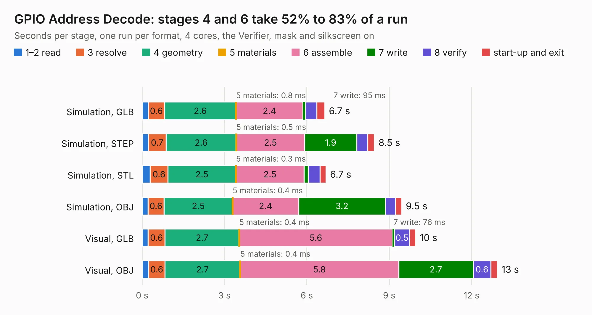

| Mode and format | 1–2 read | 3 resolve | 4 geometry | 5 materials | 6 assemble | 7 write | 8 verify | start-up and exit | Total |
|---|---:|---:|---:|---:|---:|---:|---:|---:|---:|
| Simulation, GLB | 0.2 | 0.6 | 2.6 | 0.8&nbsp;ms | 2.4 | 95&nbsp;ms | 0.4 | 0.3 | 6.7 |
| Simulation, STEP | 0.2 | 0.7 | 2.6 | 0.5&nbsp;ms | 2.5 | 1.9 | 0.4 | 0.2 | 8.5 |
| Simulation, STL | 0.3 | 0.6 | 2.5 | 0.3&nbsp;ms | 2.5 | 0.1 | 0.4 | 0.2 | 6.7 |
| Simulation, OBJ | 0.2 | 0.6 | 2.5 | 0.4&nbsp;ms | 2.4 | 3.2 | 0.4 | 0.2 | 9.5 |
| Visual, GLB | 0.2 | 0.6 | 2.7 | 0.4&nbsp;ms | 5.6 | 76&nbsp;ms | 0.5 | 0.2 | 10.0 |
| Visual, OBJ | 0.2 | 0.6 | 2.7 | 0.4&nbsp;ms | 5.8 | 2.7 | 0.6 | 0.2 | 12.9 |

<table align="center"><tr><td valign="top">

| Board | Repo: [andrewpaterson/658-Computer](https://github.com/andrewpaterson/658-Computer) Board: `GPIO Address Decode.kicad_pcb` |
|---|---|
| Folder | Kicad / Pico / GPIO Address Decode |
| Complexity | 239&nbsp;/&nbsp;1000 (size&nbsp;169, features&nbsp;70) |
| KESE&nbsp;features | through vias, rounded, trapezoid or chamfered pads, knockout text, stack-up, dielectric εr and tanδ |
| Tested | 9th November 2026 |
| Copper&nbsp;layers | 2 |
| File&nbsp;format | KiCad 10 (20260206) |
| Parts,&nbsp;tracks,&nbsp;vias | 30, 882, 89 |
| Triangles,&nbsp;simulation | 601,896 in 108 parts |
| Verifier | PASS in all six runs |

</td><td valign="top">

<table>
<tr><th>File type</th><th>File size</th><th>Peak memory used</th></tr>
<tr><th colspan="3" align="left">Simulation</th></tr>
<tr><td>GLB</td><td align="right">21&nbsp;MB</td><td align="right">332&nbsp;MB</td></tr>
<tr><td>STEP</td><td align="right">100&nbsp;MB</td><td align="right">416&nbsp;MB</td></tr>
<tr><td>STL</td><td align="right">30&nbsp;MB</td><td align="right">331&nbsp;MB</td></tr>
<tr><td>OBJ</td><td align="right">62&nbsp;MB</td><td align="right">451&nbsp;MB</td></tr>
<tr><th colspan="3" align="left">Visual</th></tr>
<tr><td>GLB</td><td align="right">18&nbsp;MB</td><td align="right">440&nbsp;MB</td></tr>
<tr><td>OBJ</td><td align="right">53&nbsp;MB</td><td align="right">434&nbsp;MB</td></tr>
</table>

</td></tr></table>

## 278. GPIO Backplane Board

| Mode and format | 1–2 read | 3 resolve | 4 geometry | 5 materials | 6 assemble | 7 write | 8 verify | start-up and exit | Total |
|---|---:|---:|---:|---:|---:|---:|---:|---:|---:|
| Simulation, GLB | 0.2 | 0.8 | 6.1 | 0.5&nbsp;ms | 5.2 | 0.2 | 0.6 | 0.3 | 13.4 |
| Simulation, STEP | 0.2 | 0.9 | 6.3 | 0.5&nbsp;ms | 5.1 | 3.7 | 0.7 | 0.3 | 17.1 |
| Simulation, STL | 0.2 | 0.9 | 5.6 | 0.5&nbsp;ms | 4.6 | 0.4 | 0.7 | 0.3 | 12.6 |
| Simulation, OBJ | 0.2 | 0.9 | 6.0 | 0.5&nbsp;ms | 4.4 | 6.5 | 0.7 | 0.3 | 18.9 |
| Visual, GLB | 0.2 | 1.1 | 6.3 | 0.7&nbsp;ms | 8.7 | 0.1 | 1.1 | 0.3 | 17.7 |
| Visual, OBJ | 0.2 | 1.0 | 5.3 | 1&nbsp;ms | 9.1 | 4.3 | 1.3 | 0.3 | 21.5 |

<table align="center"><tr><td valign="top">

| Board | Repo: [andrewpaterson/658-Computer](https://github.com/andrewpaterson/658-Computer) Board: `GPIO Backplane Board.kicad_pcb` |
|---|---|
| Folder | Kicad / Pico / GPIO Backplane Board |
| Complexity | 229&nbsp;/&nbsp;1000 (size&nbsp;149, features&nbsp;80) |
| KESE&nbsp;features | through vias, rounded, trapezoid or chamfered pads, curved board outline, knockout text, stack-up, dielectric εr and tanδ |
| Tested | 9th November 2026 |
| Copper&nbsp;layers | 2 |
| File&nbsp;format | KiCad 9 (20241229) |
| Parts,&nbsp;tracks,&nbsp;vias | 6, 733, 49 |
| Triangles,&nbsp;simulation | 1,207,452 in 92 parts |
| Verifier | PASS in all six runs |

</td><td valign="top">

<table>
<tr><th>File type</th><th>File size</th><th>Peak memory used</th></tr>
<tr><th colspan="3" align="left">Simulation</th></tr>
<tr><td>GLB</td><td align="right">39&nbsp;MB</td><td align="right">477&nbsp;MB</td></tr>
<tr><td>STEP</td><td align="right">157&nbsp;MB</td><td align="right">603&nbsp;MB</td></tr>
<tr><td>STL</td><td align="right">60&nbsp;MB</td><td align="right">501&nbsp;MB</td></tr>
<tr><td>OBJ</td><td align="right">121&nbsp;MB</td><td align="right">810&nbsp;MB</td></tr>
<tr><th colspan="3" align="left">Visual</th></tr>
<tr><td>GLB</td><td align="right">23&nbsp;MB</td><td align="right">653&nbsp;MB</td></tr>
<tr><td>OBJ</td><td align="right">69&nbsp;MB</td><td align="right">572&nbsp;MB</td></tr>
</table>

</td></tr></table>

## 279. GPIO Bus

| Mode and format | 1–2 read | 3 resolve | 4 geometry | 5 materials | 6 assemble | 7 write | 8 verify | start-up and exit | Total |
|---|---:|---:|---:|---:|---:|---:|---:|---:|---:|
| Simulation, GLB | 0.2 | 0.7 | 2.2 | 0.3&nbsp;ms | 1.9 | 73&nbsp;ms | 0.3 | 0.3 | 5.5 |
| Simulation, STEP | 0.2 | 0.5 | 2.1 | 0.4&nbsp;ms | 2.1 | 2.1 | 0.3 | 0.2 | 7.5 |
| Simulation, STL | 0.3 | 0.6 | 2.3 | 0.5&nbsp;ms | 2.2 | 0.2 | 0.4 | 0.3 | 6.1 |
| Simulation, OBJ | 0.3 | 0.6 | 2.4 | 0.5&nbsp;ms | 2.1 | 3.1 | 0.3 | 0.3 | 9.1 |
| Visual, GLB | 0.2 | 0.6 | 2.1 | 0.4&nbsp;ms | 4.9 | 76&nbsp;ms | 0.6 | 0.3 | 8.8 |
| Visual, OBJ | 0.2 | 0.6 | 1.9 | 0.3&nbsp;ms | 5.1 | 3.1 | 0.7 | 0.2 | 11.8 |

<table align="center"><tr><td valign="top">

| Board | Repo: [andrewpaterson/658-Computer](https://github.com/andrewpaterson/658-Computer) Board: `GPIO Bus.kicad_pcb` |
|---|---|
| Folder | Kicad / Pico / GPIO Bus |
| Complexity | 226&nbsp;/&nbsp;1000 (size&nbsp;156, features&nbsp;70) |
| KESE&nbsp;features | through vias, rounded, trapezoid or chamfered pads, knockout text, stack-up, dielectric εr and tanδ |
| Tested | 9th November 2026 |
| Copper&nbsp;layers | 2 |
| File&nbsp;format | KiCad 10 (20260206) |
| Parts,&nbsp;tracks,&nbsp;vias | 19, 484, 64 |
| Triangles,&nbsp;simulation | 448,136 in 86 parts |
| Verifier | PASS in all six runs |

</td><td valign="top">

<table>
<tr><th>File type</th><th>File size</th><th>Peak memory used</th></tr>
<tr><th colspan="3" align="left">Simulation</th></tr>
<tr><td>GLB</td><td align="right">15&nbsp;MB</td><td align="right">297&nbsp;MB</td></tr>
<tr><td>STEP</td><td align="right">67&nbsp;MB</td><td align="right">331&nbsp;MB</td></tr>
<tr><td>STL</td><td align="right">22&nbsp;MB</td><td align="right">289&nbsp;MB</td></tr>
<tr><td>OBJ</td><td align="right">45&nbsp;MB</td><td align="right">355&nbsp;MB</td></tr>
<tr><th colspan="3" align="left">Visual</th></tr>
<tr><td>GLB</td><td align="right">12&nbsp;MB</td><td align="right">348&nbsp;MB</td></tr>
<tr><td>OBJ</td><td align="right">36&nbsp;MB</td><td align="right">347&nbsp;MB</td></tr>
</table>

</td></tr></table>

## 280. GPIO Controller Board

| Mode and format | 1–2 read | 3 resolve | 4 geometry | 5 materials | 6 assemble | 7 write | 8 verify | start-up and exit | Total |
|---|---:|---:|---:|---:|---:|---:|---:|---:|---:|
| Simulation, GLB | 0.3 | 1.4 | 7.6 | 0.8&nbsp;ms | 5.8 | 0.3 | 0.9 | 0.3 | 16.5 |
| Simulation, STEP | 0.3 | 1.4 | 7.8 | 0.7&nbsp;ms | 5.8 | 4.8 | 0.9 | 0.3 | 21.2 |
| Simulation, STL | 0.3 | 1.4 | 7.7 | 0.7&nbsp;ms | 6.0 | 0.6 | 1.0 | 0.3 | 17.3 |
| Simulation, OBJ | 0.3 | 1.4 | 7.5 | 1&nbsp;ms | 6.3 | 8.3 | 0.9 | 0.2 | 24.9 |
| Visual, GLB | 0.3 | 1.5 | 7.7 | 1&nbsp;ms | 15.2 | 0.2 | 1.6 | 0.2 | 26.6 |
| Visual, OBJ | 0.3 | 1.5 | 7.8 | 0.8&nbsp;ms | 15.9 | 6.0 | 1.6 | 0.3 | 33.2 |

<table align="center"><tr><td valign="top">

| Board | Repo: [andrewpaterson/658-Computer](https://github.com/andrewpaterson/658-Computer) Board: `GPIO Controller Board.kicad_pcb` |
|---|---|
| Folder | Kicad / Pico / GPIO Controller Board |
| Complexity | 240&nbsp;/&nbsp;1000 (size&nbsp;170, features&nbsp;70) |
| KESE&nbsp;features | through vias, curved board outline, knockout text, stack-up, dielectric εr and tanδ |
| Tested | 9th November 2026 |
| Copper&nbsp;layers | 2 |
| File&nbsp;format | KiCad 10 (20260206) |
| Parts,&nbsp;tracks,&nbsp;vias | 17, 1,375, 127 |
| Triangles,&nbsp;simulation | 1,707,516 in 183 parts |
| Verifier | PASS in all six runs |

</td><td valign="top">

<table>
<tr><th>File type</th><th>File size</th><th>Peak memory used</th></tr>
<tr><th colspan="3" align="left">Simulation</th></tr>
<tr><td>GLB</td><td align="right">57&nbsp;MB</td><td align="right">666&nbsp;MB</td></tr>
<tr><td>STEP</td><td align="right">237&nbsp;MB</td><td align="right">791&nbsp;MB</td></tr>
<tr><td>STL</td><td align="right">85&nbsp;MB</td><td align="right">649&nbsp;MB</td></tr>
<tr><td>OBJ</td><td align="right">175&nbsp;MB</td><td align="right">1.1&nbsp;GB</td></tr>
<tr><th colspan="3" align="left">Visual</th></tr>
<tr><td>GLB</td><td align="right">38&nbsp;MB</td><td align="right">828&nbsp;MB</td></tr>
<tr><td>OBJ</td><td align="right">116&nbsp;MB</td><td align="right">876&nbsp;MB</td></tr>
</table>

</td></tr></table>

## 281. GPIO Power Switch

| Mode and format | 1–2 read | 3 resolve | 4 geometry | 5 materials | 6 assemble | 7 write | 8 verify | start-up and exit | Total |
|---|---:|---:|---:|---:|---:|---:|---:|---:|---:|
| Simulation, GLB | 0.3 | 0.7 | 2.5 | 0.5&nbsp;ms | 2.0 | 92&nbsp;ms | 0.3 | 0.3 | 6.1 |
| Simulation, STEP | 0.3 | 0.7 | 2.6 | 0.4&nbsp;ms | 2.0 | 1.8 | 0.3 | 0.3 | 8.0 |
| Simulation, STL | 0.3 | 0.7 | 2.6 | 0.3&nbsp;ms | 2.0 | 0.1 | 0.3 | 0.2 | 6.2 |
| Simulation, OBJ | 0.3 | 0.7 | 2.9 | 0.4&nbsp;ms | 2.0 | 3.3 | 0.3 | 0.2 | 9.7 |
| Visual, GLB | 0.3 | 0.7 | 2.8 | 0.4&nbsp;ms | 5.1 | 0.1 | 0.9 | 0.2 | 10.1 |
| Visual, OBJ | 0.3 | 0.8 | 2.6 | 0.4&nbsp;ms | 4.5 | 2.7 | 0.5 | 0.2 | 11.6 |

<table align="center"><tr><td valign="top">

| Board | Repo: [andrewpaterson/658-Computer](https://github.com/andrewpaterson/658-Computer) Board: `GPIO Power Switch.kicad_pcb` |
|---|---|
| Folder | Kicad / Pico / GPIO Power Switch |
| Complexity | 264&nbsp;/&nbsp;1000 (size&nbsp;164, features&nbsp;100) |
| KESE&nbsp;features | through vias, rounded, trapezoid or chamfered pads, filled zones, curved board outline, knockout text, stack-up, dielectric εr and tanδ |
| Tested | 9th November 2026 |
| Copper&nbsp;layers | 2 |
| File&nbsp;format | KiCad 9 (20241229) |
| Parts,&nbsp;tracks,&nbsp;vias | 48, 415, 65 |
| Triangles,&nbsp;simulation | 549,758 in 60 parts |
| Verifier | PASS in all six runs |

</td><td valign="top">

<table>
<tr><th>File type</th><th>File size</th><th>Peak memory used</th></tr>
<tr><th colspan="3" align="left">Simulation</th></tr>
<tr><td>GLB</td><td align="right">19&nbsp;MB</td><td align="right">325&nbsp;MB</td></tr>
<tr><td>STEP</td><td align="right">83&nbsp;MB</td><td align="right">378&nbsp;MB</td></tr>
<tr><td>STL</td><td align="right">27&nbsp;MB</td><td align="right">315&nbsp;MB</td></tr>
<tr><td>OBJ</td><td align="right">56&nbsp;MB</td><td align="right">410&nbsp;MB</td></tr>
<tr><th colspan="3" align="left">Visual</th></tr>
<tr><td>GLB</td><td align="right">15&nbsp;MB</td><td align="right">427&nbsp;MB</td></tr>
<tr><td>OBJ</td><td align="right">44&nbsp;MB</td><td align="right">360&nbsp;MB</td></tr>
</table>

</td></tr></table>

## 282. HCP65 24 Pin Tester

| Mode and format | 1–2 read | 3 resolve | 4 geometry | 5 materials | 6 assemble | 7 write | 8 verify | start-up and exit | Total |
|---|---:|---:|---:|---:|---:|---:|---:|---:|---:|
| Simulation, GLB | 0.3 | 1.1 | 4.6 | 0.6&nbsp;ms | 4.6 | 0.2 | 0.5 | 0.3 | 11.7 |
| Simulation, STEP | 0.3 | 1.2 | 4.8 | 0.6&nbsp;ms | 4.1 | 3.5 | 0.6 | 0.3 | 14.8 |
| Simulation, STL | 0.3 | 1.1 | 4.8 | 1.0&nbsp;ms | 4.0 | 0.4 | 0.5 | 0.3 | 11.4 |
| Simulation, OBJ | 0.3 | 1.1 | 4.6 | 0.5&nbsp;ms | 4.1 | 5.4 | 0.6 | 0.3 | 16.5 |
| Visual, GLB | 0.3 | 1.2 | 4.6 | 0.9&nbsp;ms | 9.4 | 0.1 | 1.1 | 0.3 | 17.1 |
| Visual, OBJ | 0.3 | 1.2 | 4.8 | 0.6&nbsp;ms | 9.3 | 4.5 | 1.3 | 0.2 | 21.6 |

<table align="center"><tr><td valign="top">

| Board | Repo: [andrewpaterson/658-Computer](https://github.com/andrewpaterson/658-Computer) Board: `HCP65 24 Pin Tester.kicad_pcb` |
|---|---|
| Folder | Kicad / Pico / HCP65 24 Pin Tester |
| Complexity | 263&nbsp;/&nbsp;1000 (size&nbsp;183, features&nbsp;80) |
| KESE&nbsp;features | through vias, rounded, trapezoid or chamfered pads, curved board outline, knockout text, stack-up, dielectric εr and tanδ |
| Tested | 9th November 2026 |
| Copper&nbsp;layers | 2 |
| File&nbsp;format | KiCad 9 (20241229) |
| Parts,&nbsp;tracks,&nbsp;vias | 67, 1,028, 187 |
| Triangles,&nbsp;simulation | 1,062,808 in 104 parts |
| Verifier | PASS in all six runs |

</td><td valign="top">

<table>
<tr><th>File type</th><th>File size</th><th>Peak memory used</th></tr>
<tr><th colspan="3" align="left">Simulation</th></tr>
<tr><td>GLB</td><td align="right">37&nbsp;MB</td><td align="right">459&nbsp;MB</td></tr>
<tr><td>STEP</td><td align="right">167&nbsp;MB</td><td align="right">604&nbsp;MB</td></tr>
<tr><td>STL</td><td align="right">53&nbsp;MB</td><td align="right">470&nbsp;MB</td></tr>
<tr><td>OBJ</td><td align="right">109&nbsp;MB</td><td align="right">744&nbsp;MB</td></tr>
<tr><th colspan="3" align="left">Visual</th></tr>
<tr><td>GLB</td><td align="right">28&nbsp;MB</td><td align="right">673&nbsp;MB</td></tr>
<tr><td>OBJ</td><td align="right">86&nbsp;MB</td><td align="right">654&nbsp;MB</td></tr>
</table>

</td></tr></table>

## 283. HCP65 32 Pin Tester

| Mode and format | 1–2 read | 3 resolve | 4 geometry | 5 materials | 6 assemble | 7 write | 8 verify | start-up and exit | Total |
|---|---:|---:|---:|---:|---:|---:|---:|---:|---:|
| Simulation, GLB | 0.4 | 1.3 | 5.9 | 0.5&nbsp;ms | 4.5 | 0.2 | 0.6 | 0.3 | 13.1 |
| Simulation, STEP | 0.4 | 1.4 | 5.8 | 0.5&nbsp;ms | 4.3 | 4.2 | 0.6 | 0.3 | 16.9 |
| Simulation, STL | 0.4 | 1.2 | 6.1 | 0.5&nbsp;ms | 4.6 | 0.4 | 0.7 | 0.2 | 13.7 |
| Simulation, OBJ | 0.4 | 1.2 | 5.7 | 0.5&nbsp;ms | 4.3 | 7.1 | 0.7 | 0.2 | 19.7 |
| Visual, GLB | 0.4 | 1.4 | 5.7 | 0.9&nbsp;ms | 11.0 | 0.2 | 1.1 | 0.3 | 20.0 |
| Visual, OBJ | 0.4 | 1.3 | 5.5 | 0.7&nbsp;ms | 10.9 | 5.4 | 1.2 | 0.2 | 24.9 |

<table align="center"><tr><td valign="top">

| Board | Repo: [andrewpaterson/658-Computer](https://github.com/andrewpaterson/658-Computer) Board: `HCP65 32 Pin Tester.kicad_pcb` |
|---|---|
| Folder | Kicad / Pico / HCP65 32 Pin Tester |
| Complexity | 268&nbsp;/&nbsp;1000 (size&nbsp;188, features&nbsp;80) |
| KESE&nbsp;features | through vias, rounded, trapezoid or chamfered pads, curved board outline, knockout text, stack-up, dielectric εr and tanδ |
| Tested | 9th November 2026 |
| Copper&nbsp;layers | 2 |
| File&nbsp;format | KiCad 9 (20241229) |
| Parts,&nbsp;tracks,&nbsp;vias | 80, 1,295, 212 |
| Triangles,&nbsp;simulation | 1,295,928 in 131 parts |
| Verifier | PASS in all six runs |

</td><td valign="top">

<table>
<tr><th>File type</th><th>File size</th><th>Peak memory used</th></tr>
<tr><th colspan="3" align="left">Simulation</th></tr>
<tr><td>GLB</td><td align="right">45&nbsp;MB</td><td align="right">548&nbsp;MB</td></tr>
<tr><td>STEP</td><td align="right">206&nbsp;MB</td><td align="right">674&nbsp;MB</td></tr>
<tr><td>STL</td><td align="right">65&nbsp;MB</td><td align="right">525&nbsp;MB</td></tr>
<tr><td>OBJ</td><td align="right">134&nbsp;MB</td><td align="right">880&nbsp;MB</td></tr>
<tr><th colspan="3" align="left">Visual</th></tr>
<tr><td>GLB</td><td align="right">34&nbsp;MB</td><td align="right">805&nbsp;MB</td></tr>
<tr><td>OBJ</td><td align="right">104&nbsp;MB</td><td align="right">778&nbsp;MB</td></tr>
</table>

</td></tr></table>

## 284. HCP65 40 Pin Tester

| Mode and format | 1–2 read | 3 resolve | 4 geometry | 5 materials | 6 assemble | 7 write | 8 verify | start-up and exit | Total |
|---|---:|---:|---:|---:|---:|---:|---:|---:|---:|
| Simulation, GLB | 0.4 | 1.5 | 6.9 | 0.9&nbsp;ms | 5.5 | 0.3 | 0.7 | 0.3 | 15.6 |
| Simulation, STEP | 0.4 | 1.4 | 7.2 | 0.9&nbsp;ms | 5.4 | 4.3 | 0.6 | 0.2 | 19.5 |
| Simulation, STL | 0.4 | 1.6 | 7.0 | 0.8&nbsp;ms | 5.0 | 0.4 | 0.6 | 0.3 | 15.2 |
| Simulation, OBJ | 0.4 | 1.6 | 7.1 | 0.8&nbsp;ms | 5.5 | 7.5 | 0.6 | 0.3 | 23.0 |
| Visual, GLB | 0.3 | 1.4 | 6.9 | 1&nbsp;ms | 13.0 | 0.2 | 1.9 | 0.2 | 24.0 |
| Visual, OBJ | 0.5 | 1.5 | 6.8 | 1&nbsp;ms | 13.4 | 6.5 | 2.0 | 0.3 | 30.9 |

<table align="center"><tr><td valign="top">

| Board | Repo: [andrewpaterson/658-Computer](https://github.com/andrewpaterson/658-Computer) Board: `HCP65 40 Pin Tester.kicad_pcb` |
|---|---|
| Folder | Kicad / Pico / HCP65 40 Pin Tester |
| Complexity | 273&nbsp;/&nbsp;1000 (size&nbsp;193, features&nbsp;80) |
| KESE&nbsp;features | through vias, rounded, trapezoid or chamfered pads, curved board outline, knockout text, stack-up, dielectric εr and tanδ |
| Tested | 9th November 2026 |
| Copper&nbsp;layers | 2 |
| File&nbsp;format | KiCad 10 (20260206) |
| Parts,&nbsp;tracks,&nbsp;vias | 92, 1,612, 251 |
| Triangles,&nbsp;simulation | 1,612,774 in 173 parts |
| Verifier | PASS in all six runs |

</td><td valign="top">

<table>
<tr><th>File type</th><th>File size</th><th>Peak memory used</th></tr>
<tr><th colspan="3" align="left">Simulation</th></tr>
<tr><td>GLB</td><td align="right">56&nbsp;MB</td><td align="right">601&nbsp;MB</td></tr>
<tr><td>STEP</td><td align="right">256&nbsp;MB</td><td align="right">779&nbsp;MB</td></tr>
<tr><td>STL</td><td align="right">81&nbsp;MB</td><td align="right">639&nbsp;MB</td></tr>
<tr><td>OBJ</td><td align="right">168&nbsp;MB</td><td align="right">1.1&nbsp;GB</td></tr>
<tr><th colspan="3" align="left">Visual</th></tr>
<tr><td>GLB</td><td align="right">42&nbsp;MB</td><td align="right">840&nbsp;MB</td></tr>
<tr><td>OBJ</td><td align="right">128&nbsp;MB</td><td align="right">911&nbsp;MB</td></tr>
</table>

</td></tr></table>

## 285. HCP65 56 Pin Tester

| Mode and format | 1–2 read | 3 resolve | 4 geometry | 5 materials | 6 assemble | 7 write | 8 verify | start-up and exit | Total |
|---|---:|---:|---:|---:|---:|---:|---:|---:|---:|
| Simulation, GLB | 0.5 | 1.9 | 8.8 | 0.8&nbsp;ms | 6.6 | 0.3 | 0.8 | 0.3 | 19.3 |
| Simulation, STEP | 0.5 | 1.8 | 9.1 | 1.0&nbsp;ms | 6.5 | 5.7 | 0.9 | 0.2 | 24.7 |
| Simulation, STL | 0.5 | 1.9 | 9.2 | 0.9&nbsp;ms | 7.1 | 0.6 | 1.0 | 0.2 | 20.4 |
| Simulation, OBJ | 0.6 | 2.0 | 9.0 | 0.8&nbsp;ms | 6.9 | 10.7 | 1.0 | 0.3 | 30.4 |
| Visual, GLB | 0.5 | 2.0 | 9.3 | 2&nbsp;ms | 17.9 | 0.2 | 2.4 | 0.2 | 32.6 |
| Visual, OBJ | 0.5 | 1.9 | 9.2 | 1&nbsp;ms | 17.6 | 8.5 | 2.6 | 0.2 | 40.6 |

<table align="center"><tr><td valign="top">

| Board | Repo: [andrewpaterson/658-Computer](https://github.com/andrewpaterson/658-Computer) Board: `HCP65 56 Pin Tester.kicad_pcb` |
|---|---|
| Folder | Kicad / Pico / HCP65 56 Pin Tester |
| Complexity | 281&nbsp;/&nbsp;1000 (size&nbsp;201, features&nbsp;80) |
| KESE&nbsp;features | through vias, rounded, trapezoid or chamfered pads, curved board outline, knockout text, stack-up, dielectric εr and tanδ |
| Tested | 9th November 2026 |
| Copper&nbsp;layers | 2 |
| File&nbsp;format | KiCad 10 (20260206) |
| Parts,&nbsp;tracks,&nbsp;vias | 116, 2,318, 308 |
| Triangles,&nbsp;simulation | 1,963,298 in 205 parts |
| Verifier | PASS in all six runs |

</td><td valign="top">

<table>
<tr><th>File type</th><th>File size</th><th>Peak memory used</th></tr>
<tr><th colspan="3" align="left">Simulation</th></tr>
<tr><td>GLB</td><td align="right">68&nbsp;MB</td><td align="right">705&nbsp;MB</td></tr>
<tr><td>STEP</td><td align="right">322&nbsp;MB</td><td align="right">933&nbsp;MB</td></tr>
<tr><td>STL</td><td align="right">98&nbsp;MB</td><td align="right">706&nbsp;MB</td></tr>
<tr><td>OBJ</td><td align="right">207&nbsp;MB</td><td align="right">1.3&nbsp;GB</td></tr>
<tr><th colspan="3" align="left">Visual</th></tr>
<tr><td>GLB</td><td align="right">52&nbsp;MB</td><td align="right">1.0&nbsp;GB</td></tr>
<tr><td>OBJ</td><td align="right">161&nbsp;MB</td><td align="right">1.1&nbsp;GB</td></tr>
</table>

</td></tr></table>

## 286. HCP65 64 Pin Tester

| Mode and format | 1–2 read | 3 resolve | 4 geometry | 5 materials | 6 assemble | 7 write | 8 verify | start-up and exit | Total |
|---|---:|---:|---:|---:|---:|---:|---:|---:|---:|
| Simulation, GLB | 0.6 | 2.7 | 11.4 | 0.9&nbsp;ms | 8.9 | 0.4 | 1.3 | 0.3 | 25.6 |
| Simulation, STEP | 0.7 | 2.4 | 11.3 | 1&nbsp;ms | 10.1 | 7.1 | 1.2 | 0.3 | 33.2 |
| Simulation, STL | 1.0 | 2.7 | 10.9 | 1&nbsp;ms | 8.5 | 0.9 | 1.2 | 0.3 | 25.4 |
| Simulation, OBJ | 0.6 | 2.6 | 11.0 | 4&nbsp;ms | 8.5 | 14.1 | 1.2 | 0.3 | 38.4 |
| Visual, GLB | 0.7 | 2.6 | 11.7 | 1&nbsp;ms | 21.6 | 0.3 | 3.4 | 0.3 | 40.7 |
| Visual, OBJ | 0.8 | 2.8 | 11.3 | 2&nbsp;ms | 21.0 | 10.3 | 3.1 | 0.3 | 49.5 |

<table align="center"><tr><td valign="top">

| Board | Repo: [andrewpaterson/658-Computer](https://github.com/andrewpaterson/658-Computer) Board: `HCP65 64 Pin Tester.kicad_pcb` |
|---|---|
| Folder | Kicad / Pico / HCP65 64 Pin Tester |
| Complexity | 283&nbsp;/&nbsp;1000 (size&nbsp;203, features&nbsp;80) |
| KESE&nbsp;features | through vias, rounded, trapezoid or chamfered pads, curved board outline, knockout text, stack-up, dielectric εr and tanδ |
| Tested | 9th November 2026 |
| Copper&nbsp;layers | 2 |
| File&nbsp;format | KiCad 10 (20260206) |
| Parts,&nbsp;tracks,&nbsp;vias | 129, 2,539, 331 |
| Triangles,&nbsp;simulation | 2,145,474 in 232 parts |
| Verifier | PASS in all six runs |

</td><td valign="top">

<table>
<tr><th>File type</th><th>File size</th><th>Peak memory used</th></tr>
<tr><th colspan="3" align="left">Simulation</th></tr>
<tr><td>GLB</td><td align="right">74&nbsp;MB</td><td align="right">774&nbsp;MB</td></tr>
<tr><td>STEP</td><td align="right">332&nbsp;MB</td><td align="right">1.0&nbsp;GB</td></tr>
<tr><td>STL</td><td align="right">107&nbsp;MB</td><td align="right">750&nbsp;MB</td></tr>
<tr><td>OBJ</td><td align="right">225&nbsp;MB</td><td align="right">1.4&nbsp;GB</td></tr>
<tr><th colspan="3" align="left">Visual</th></tr>
<tr><td>GLB</td><td align="right">57&nbsp;MB</td><td align="right">1.0&nbsp;GB</td></tr>
<tr><td>OBJ</td><td align="right">177&nbsp;MB</td><td align="right">1.2&nbsp;GB</td></tr>
</table>

</td></tr></table>

## 287. HCP65 Board Tester

| Mode and format | 1–2 read | 3 resolve | 4 geometry | 5 materials | 6 assemble | 7 write | 8 verify | start-up and exit | Total |
|---|---:|---:|---:|---:|---:|---:|---:|---:|---:|
| Simulation, GLB | 0.4 | 2.3 | 9.6 | 1&nbsp;ms | 8.7 | 0.4 | 1.2 | 0.4 | 22.9 |
| Simulation, STEP | 0.4 | 2.2 | 10.0 | 2&nbsp;ms | 9.0 | 6.5 | 1.2 | 0.4 | 29.6 |
| Simulation, STL | 0.3 | 2.2 | 10.4 | 1&nbsp;ms | 8.3 | 0.7 | 1.2 | 0.3 | 23.3 |
| Simulation, OBJ | 0.4 | 2.1 | 10.0 | 0.9&nbsp;ms | 8.6 | 12.5 | 1.2 | 0.3 | 35.0 |
| Visual, GLB | 0.3 | 2.5 | 10.9 | 1&nbsp;ms | 18.8 | 0.2 | 2.2 | 0.3 | 35.2 |
| Visual, OBJ | 0.4 | 2.2 | 9.7 | 1&nbsp;ms | 18.5 | 7.5 | 2.8 | 0.3 | 41.3 |

<table align="center"><tr><td valign="top">

| Board | Repo: [andrewpaterson/658-Computer](https://github.com/andrewpaterson/658-Computer) Board: `HCP65 Board Tester.kicad_pcb` |
|---|---|
| Folder | Kicad / Pico / HCP65 Board Tester |
| Complexity | 242&nbsp;/&nbsp;1000 (size&nbsp;162, features&nbsp;80) |
| KESE&nbsp;features | through vias, rounded, trapezoid or chamfered pads, curved board outline, knockout text, stack-up, dielectric εr and tanδ |
| Tested | 9th November 2026 |
| Copper&nbsp;layers | 2 |
| File&nbsp;format | KiCad 9 (20241229) |
| Parts,&nbsp;tracks,&nbsp;vias | 8, 1,437, 88 |
| Triangles,&nbsp;simulation | 2,280,818 in 161 parts |
| Verifier | PASS in all six runs |

</td><td valign="top">

<table>
<tr><th>File type</th><th>File size</th><th>Peak memory used</th></tr>
<tr><th colspan="3" align="left">Simulation</th></tr>
<tr><td>GLB</td><td align="right">77&nbsp;MB</td><td align="right">786&nbsp;MB</td></tr>
<tr><td>STEP</td><td align="right">313&nbsp;MB</td><td align="right">982&nbsp;MB</td></tr>
<tr><td>STL</td><td align="right">114&nbsp;MB</td><td align="right">804&nbsp;MB</td></tr>
<tr><td>OBJ</td><td align="right">236&nbsp;MB</td><td align="right">1.5&nbsp;GB</td></tr>
<tr><th colspan="3" align="left">Visual</th></tr>
<tr><td>GLB</td><td align="right">46&nbsp;MB</td><td align="right">1.1&nbsp;GB</td></tr>
<tr><td>OBJ</td><td align="right">141&nbsp;MB</td><td align="right">1.0&nbsp;GB</td></tr>
</table>

</td></tr></table>

## 288. HCP65 Narrow Analyser

| Mode and format | 1–2 read | 3 resolve | 4 geometry | 5 materials | 6 assemble | 7 write | 8 verify | start-up and exit | Total |
|---|---:|---:|---:|---:|---:|---:|---:|---:|---:|
| Simulation, GLB | 0.2 | 0.8 | 5.4 | 0.4&nbsp;ms | 5.4 | 0.2 | 0.5 | 0.3 | 12.7 |
| Simulation, STEP | 0.1 | 0.9 | 5.4 | 0.4&nbsp;ms | 5.1 | 3.6 | 0.5 | 0.2 | 15.8 |
| Simulation, STL | 0.2 | 0.9 | 5.4 | 0.5&nbsp;ms | 5.1 | 0.4 | 0.5 | 0.2 | 12.8 |
| Simulation, OBJ | 0.2 | 0.9 | 5.4 | 0.6&nbsp;ms | 5.0 | 5.6 | 0.5 | 0.2 | 17.9 |
| Visual, GLB | 0.2 | 0.8 | 5.6 | 0.4&nbsp;ms | 8.2 | 92&nbsp;ms | 0.9 | 0.3 | 16.2 |
| Visual, OBJ | 0.2 | 0.8 | 5.3 | 0.5&nbsp;ms | 7.7 | 2.9 | 0.9 | 0.3 | 18.0 |

<table align="center"><tr><td valign="top">

| Board | Repo: [andrewpaterson/658-Computer](https://github.com/andrewpaterson/658-Computer) Board: `HCP65 Narrow Analyser.kicad_pcb` |
|---|---|
| Folder | Kicad / Pico / HCP65 Narrow Analyser |
| Complexity | 191&nbsp;/&nbsp;1000 (size&nbsp;126, features&nbsp;65) |
| KESE&nbsp;features | rounded, trapezoid or chamfered pads, curved board outline, knockout text, stack-up, dielectric εr and tanδ |
| Tested | 9th November 2026 |
| Copper&nbsp;layers | 2 |
| File&nbsp;format | KiCad 10 (20260206) |
| Parts,&nbsp;tracks,&nbsp;vias | 7, 203, 0 |
| Triangles,&nbsp;simulation | 1,202,636 in 75 parts |
| Verifier | PASS in all six runs |

</td><td valign="top">

<table>
<tr><th>File type</th><th>File size</th><th>Peak memory used</th></tr>
<tr><th colspan="3" align="left">Simulation</th></tr>
<tr><td>GLB</td><td align="right">38&nbsp;MB</td><td align="right">466&nbsp;MB</td></tr>
<tr><td>STEP</td><td align="right">147&nbsp;MB</td><td align="right">584&nbsp;MB</td></tr>
<tr><td>STL</td><td align="right">60&nbsp;MB</td><td align="right">471&nbsp;MB</td></tr>
<tr><td>OBJ</td><td align="right">120&nbsp;MB</td><td align="right">824&nbsp;MB</td></tr>
<tr><th colspan="3" align="left">Visual</th></tr>
<tr><td>GLB</td><td align="right">20&nbsp;MB</td><td align="right">582&nbsp;MB</td></tr>
<tr><td>OBJ</td><td align="right">60&nbsp;MB</td><td align="right">581&nbsp;MB</td></tr>
</table>

</td></tr></table>

## 289. HCP65 Wide Analyser

| Mode and format | 1–2 read | 3 resolve | 4 geometry | 5 materials | 6 assemble | 7 write | 8 verify | start-up and exit | Total |
|---|---:|---:|---:|---:|---:|---:|---:|---:|---:|
| Simulation, GLB | 0.2 | 0.9 | 5.8 | 0.4&nbsp;ms | 5.0 | 0.2 | 0.5 | 0.2 | 12.8 |
| Simulation, STEP | 0.2 | 0.8 | 5.9 | 0.3&nbsp;ms | 5.1 | 3.3 | 0.5 | 0.2 | 16.2 |
| Simulation, STL | 0.2 | 0.9 | 5.9 | 0.6&nbsp;ms | 5.0 | 0.3 | 0.5 | 0.2 | 13.0 |
| Simulation, OBJ | 0.2 | 0.9 | 5.7 | 0.4&nbsp;ms | 4.9 | 6.8 | 0.5 | 0.2 | 19.3 |
| Visual, GLB | 0.2 | 0.9 | 5.8 | 0.5&nbsp;ms | 7.1 | 0.1 | 0.6 | 0.2 | 14.8 |
| Visual, OBJ | 0.2 | 0.9 | 5.9 | 0.4&nbsp;ms | 7.0 | 3.3 | 0.7 | 0.2 | 18.2 |

<table align="center"><tr><td valign="top">

| Board | Repo: [andrewpaterson/658-Computer](https://github.com/andrewpaterson/658-Computer) Board: `HCP65 Wide Analyser.kicad_pcb` |
|---|---|
| Folder | Kicad / Pico / HCP65 Wide Analyser |
| Complexity | 191&nbsp;/&nbsp;1000 (size&nbsp;126, features&nbsp;65) |
| KESE&nbsp;features | rounded, trapezoid or chamfered pads, curved board outline, knockout text, stack-up, dielectric εr and tanδ |
| Tested | 9th November 2026 |
| Copper&nbsp;layers | 2 |
| File&nbsp;format | KiCad 10 (20260206) |
| Parts,&nbsp;tracks,&nbsp;vias | 7, 203, 0 |
| Triangles,&nbsp;simulation | 1,203,908 in 75 parts |
| Verifier | PASS in all six runs |

</td><td valign="top">

<table>
<tr><th>File type</th><th>File size</th><th>Peak memory used</th></tr>
<tr><th colspan="3" align="left">Simulation</th></tr>
<tr><td>GLB</td><td align="right">38&nbsp;MB</td><td align="right">471&nbsp;MB</td></tr>
<tr><td>STEP</td><td align="right">147&nbsp;MB</td><td align="right">592&nbsp;MB</td></tr>
<tr><td>STL</td><td align="right">60&nbsp;MB</td><td align="right">466&nbsp;MB</td></tr>
<tr><td>OBJ</td><td align="right">120&nbsp;MB</td><td align="right">826&nbsp;MB</td></tr>
<tr><th colspan="3" align="left">Visual</th></tr>
<tr><td>GLB</td><td align="right">20&nbsp;MB</td><td align="right">552&nbsp;MB</td></tr>
<tr><td>OBJ</td><td align="right">60&nbsp;MB</td><td align="right">586&nbsp;MB</td></tr>
</table>

</td></tr></table>

## 290. LED Digit Tester

| Mode and format | 1–2 read | 3 resolve | 4 geometry | 5 materials | 6 assemble | 7 write | 8 verify | start-up and exit | Total |
|---|---:|---:|---:|---:|---:|---:|---:|---:|---:|
| Simulation, GLB | 0.2 | 0.5 | 2.3 | 0.3&nbsp;ms | 1.9 | 89&nbsp;ms | 0.4 | 0.2 | 5.6 |
| Simulation, STEP | 0.1 | 0.4 | 2.4 | 0.6&nbsp;ms | 1.8 | 1.6 | 0.3 | 0.2 | 6.9 |
| Simulation, STL | 0.2 | 0.4 | 2.4 | 0.3&nbsp;ms | 1.8 | 0.2 | 0.4 | 0.2 | 5.6 |
| Simulation, OBJ | 0.2 | 0.5 | 2.4 | 0.3&nbsp;ms | 1.8 | 3.1 | 0.4 | 0.2 | 8.6 |
| Visual, GLB | 0.2 | 0.5 | 2.7 | 0.5&nbsp;ms | 4.8 | 60&nbsp;ms | 0.6 | 0.2 | 9.1 |
| Visual, OBJ | 0.2 | 0.5 | 2.5 | 0.3&nbsp;ms | 4.6 | 1.9 | 0.6 | 0.2 | 10.6 |

<table align="center"><tr><td valign="top">

| Board | Repo: [andrewpaterson/658-Computer](https://github.com/andrewpaterson/658-Computer) Board: `LED Digit Tester.kicad_pcb` |
|---|---|
| Folder | Kicad / Pico / LED Digit Tester |
| Complexity | 219&nbsp;/&nbsp;1000 (size&nbsp;154, features&nbsp;65) |
| KESE&nbsp;features | through vias, rounded, trapezoid or chamfered pads, curved board outline, stack-up, dielectric εr and tanδ |
| Tested | 9th November 2026 |
| Copper&nbsp;layers | 2 |
| File&nbsp;format | KiCad 9 (20241229) |
| Parts,&nbsp;tracks,&nbsp;vias | 21, 482, 30 |
| Triangles,&nbsp;simulation | 586,786 in 91 parts |
| Verifier | PASS in all six runs |

</td><td valign="top">

<table>
<tr><th>File type</th><th>File size</th><th>Peak memory used</th></tr>
<tr><th colspan="3" align="left">Simulation</th></tr>
<tr><td>GLB</td><td align="right">20&nbsp;MB</td><td align="right">340&nbsp;MB</td></tr>
<tr><td>STEP</td><td align="right">84&nbsp;MB</td><td align="right">374&nbsp;MB</td></tr>
<tr><td>STL</td><td align="right">29&nbsp;MB</td><td align="right">314&nbsp;MB</td></tr>
<tr><td>OBJ</td><td align="right">59&nbsp;MB</td><td align="right">544&nbsp;MB</td></tr>
<tr><th colspan="3" align="left">Visual</th></tr>
<tr><td>GLB</td><td align="right">13&nbsp;MB</td><td align="right">380&nbsp;MB</td></tr>
<tr><td>OBJ</td><td align="right">39&nbsp;MB</td><td align="right">380&nbsp;MB</td></tr>
</table>

</td></tr></table>

## 291. SDRAM

| Mode and format | 1–2 read | 3 resolve | 4 geometry | 5 materials | 6 assemble | 7 write | 8 verify | start-up and exit | Total |
|---|---:|---:|---:|---:|---:|---:|---:|---:|---:|
| Simulation, GLB | 0.2 | 0.7 | 3.3 | 0.6&nbsp;ms | 2.9 | 0.1 | 0.5 | 0.3 | 8.0 |
| Simulation, STEP | 0.2 | 0.7 | 3.2 | 0.5&nbsp;ms | 2.9 | 2.5 | 0.5 | 0.3 | 10.3 |
| Simulation, STL | 0.2 | 0.7 | 3.3 | 0.5&nbsp;ms | 2.8 | 0.3 | 0.4 | 0.3 | 8.0 |
| Simulation, OBJ | 0.2 | 0.7 | 3.1 | 2&nbsp;ms | 2.7 | 3.9 | 0.4 | 0.2 | 11.3 |
| Visual, GLB | 0.2 | 0.7 | 3.1 | 0.5&nbsp;ms | 7.3 | 0.1 | 0.7 | 0.2 | 12.4 |
| Visual, OBJ | 0.2 | 0.7 | 3.2 | 0.6&nbsp;ms | 7.2 | 2.9 | 0.8 | 0.2 | 15.1 |

<table align="center"><tr><td valign="top">

| Board | Repo: [andrewpaterson/658-Computer](https://github.com/andrewpaterson/658-Computer) Board: `SDRAM.kicad_pcb` |
|---|---|
| Folder | Kicad / Pico / SDRAM |
| Complexity | 248&nbsp;/&nbsp;1000 (size&nbsp;168, features&nbsp;80) |
| KESE&nbsp;features | through vias, rounded, trapezoid or chamfered pads, curved board outline, knockout text, stack-up, dielectric εr and tanδ |
| Tested | 9th November 2026 |
| Copper&nbsp;layers | 2 |
| File&nbsp;format | KiCad 10 (20260206) |
| Parts,&nbsp;tracks,&nbsp;vias | 25, 928, 96 |
| Triangles,&nbsp;simulation | 791,702 in 138 parts |
| Verifier | PASS in all six runs |

</td><td valign="top">

<table>
<tr><th>File type</th><th>File size</th><th>Peak memory used</th></tr>
<tr><th colspan="3" align="left">Simulation</th></tr>
<tr><td>GLB</td><td align="right">27&nbsp;MB</td><td align="right">379&nbsp;MB</td></tr>
<tr><td>STEP</td><td align="right">118&nbsp;MB</td><td align="right">456&nbsp;MB</td></tr>
<tr><td>STL</td><td align="right">40&nbsp;MB</td><td align="right">363&nbsp;MB</td></tr>
<tr><td>OBJ</td><td align="right">80&nbsp;MB</td><td align="right">569&nbsp;MB</td></tr>
<tr><th colspan="3" align="left">Visual</th></tr>
<tr><td>GLB</td><td align="right">20&nbsp;MB</td><td align="right">497&nbsp;MB</td></tr>
<tr><td>OBJ</td><td align="right">62&nbsp;MB</td><td align="right">558&nbsp;MB</td></tr>
</table>

</td></tr></table>

## 292. Signal Protection

| Mode and format | 1–2 read | 3 resolve | 4 geometry | 5 materials | 6 assemble | 7 write | 8 verify | start-up and exit | Total |
|---|---:|---:|---:|---:|---:|---:|---:|---:|---:|
| Simulation, GLB | 0.2 | 0.5 | 2.0 | 0.2&nbsp;ms | 1.6 | 76&nbsp;ms | 0.2 | 0.2 | 4.8 |
| Simulation, STEP | 0.2 | 0.5 | 2.0 | 0.2&nbsp;ms | 1.7 | 1.6 | 0.3 | 0.2 | 6.5 |
| Simulation, STL | 0.2 | 0.5 | 2.1 | 0.5&nbsp;ms | 1.6 | 0.1 | 0.3 | 0.3 | 5.0 |
| Simulation, OBJ | 0.2 | 0.5 | 2.0 | 0.2&nbsp;ms | 1.6 | 2.6 | 0.3 | 0.2 | 7.5 |
| Visual, GLB | 0.2 | 0.5 | 2.0 | 0.2&nbsp;ms | 3.9 | 60&nbsp;ms | 0.4 | 0.3 | 7.3 |
| Visual, OBJ | 0.2 | 0.5 | 1.9 | 0.2&nbsp;ms | 3.6 | 2.0 | 0.4 | 0.2 | 8.8 |

<table align="center"><tr><td valign="top">

| Board | Repo: [andrewpaterson/658-Computer](https://github.com/andrewpaterson/658-Computer) Board: `Signal Protection.kicad_pcb` |
|---|---|
| Folder | Kicad / Pico / Signal Protection |
| Complexity | 252&nbsp;/&nbsp;1000 (size&nbsp;162, features&nbsp;90) |
| KESE&nbsp;features | through vias, rounded, trapezoid or chamfered pads, filled zones, knockout text, stack-up, dielectric εr and tanδ |
| Tested | 9th November 2026 |
| Copper&nbsp;layers | 2 |
| File&nbsp;format | KiCad 9 (20241229) |
| Parts,&nbsp;tracks,&nbsp;vias | 49, 344, 65 |
| Triangles,&nbsp;simulation | 462,784 in 43 parts |
| Verifier | PASS in all six runs |

</td><td valign="top">

<table>
<tr><th>File type</th><th>File size</th><th>Peak memory used</th></tr>
<tr><th colspan="3" align="left">Simulation</th></tr>
<tr><td>GLB</td><td align="right">16&nbsp;MB</td><td align="right">283&nbsp;MB</td></tr>
<tr><td>STEP</td><td align="right">68&nbsp;MB</td><td align="right">344&nbsp;MB</td></tr>
<tr><td>STL</td><td align="right">23&nbsp;MB</td><td align="right">293&nbsp;MB</td></tr>
<tr><td>OBJ</td><td align="right">47&nbsp;MB</td><td align="right">417&nbsp;MB</td></tr>
<tr><th colspan="3" align="left">Visual</th></tr>
<tr><td>GLB</td><td align="right">12&nbsp;MB</td><td align="right">355&nbsp;MB</td></tr>
<tr><td>OBJ</td><td align="right">36&nbsp;MB</td><td align="right">357&nbsp;MB</td></tr>
</table>

</td></tr></table>

## 293. EPM570 Programmer

| Mode and format | 1–2 read | 3 resolve | 4 geometry | 5 materials | 6 assemble | 7 write | 8 verify | start-up and exit | Total |
|---|---:|---:|---:|---:|---:|---:|---:|---:|---:|
| Simulation, GLB | 0.2 | 0.9 | 4.0 | 0.6&nbsp;ms | 3.2 | 0.1 | 0.5 | 0.2 | 9.2 |
| Simulation, STEP | 0.3 | 0.9 | 4.3 | 0.6&nbsp;ms | 2.9 | 2.8 | 0.5 | 0.2 | 11.9 |
| Simulation, STL | 0.2 | 0.9 | 4.4 | 0.6&nbsp;ms | 3.0 | 0.4 | 0.5 | 0.3 | 9.6 |
| Simulation, OBJ | 0.3 | 0.9 | 4.3 | 0.5&nbsp;ms | 2.8 | 5.6 | 0.5 | 0.3 | 14.7 |
| Visual, GLB | 0.3 | 0.9 | 4.2 | 0.5&nbsp;ms | 6.4 | 77&nbsp;ms | 0.6 | 0.3 | 12.8 |
| Visual, OBJ | 0.3 | 0.8 | 4.4 | 0.5&nbsp;ms | 6.5 | 2.8 | 0.8 | 0.2 | 15.9 |

<table align="center"><tr><td valign="top">

| Board | Repo: [andrewpaterson/658-Computer](https://github.com/andrewpaterson/658-Computer) Board: `EPM570 Programmer.kicad_pcb` |
|---|---|
| Folder | Kicad / Programmers / EPM570 Programmer |
| Complexity | 259&nbsp;/&nbsp;1000 (size&nbsp;179, features&nbsp;80) |
| KESE&nbsp;features | through vias, rounded, trapezoid or chamfered pads, curved board outline, knockout text, stack-up, dielectric εr and tanδ |
| Tested | 9th November 2026 |
| Copper&nbsp;layers | 2 |
| File&nbsp;format | KiCad 9 (20241229) |
| Parts,&nbsp;tracks,&nbsp;vias | 19, 226, 6 |
| Triangles,&nbsp;simulation | 745,970 in 106 parts |
| Verifier | PASS in all six runs |

</td><td valign="top">

<table>
<tr><th>File type</th><th>File size</th><th>Peak memory used</th></tr>
<tr><th colspan="3" align="left">Simulation</th></tr>
<tr><td>GLB</td><td align="right">24&nbsp;MB</td><td align="right">350&nbsp;MB</td></tr>
<tr><td>STEP</td><td align="right">98&nbsp;MB</td><td align="right">408&nbsp;MB</td></tr>
<tr><td>STL</td><td align="right">37&nbsp;MB</td><td align="right">350&nbsp;MB</td></tr>
<tr><td>OBJ</td><td align="right">75&nbsp;MB</td><td align="right">534&nbsp;MB</td></tr>
<tr><th colspan="3" align="left">Visual</th></tr>
<tr><td>GLB</td><td align="right">15&nbsp;MB</td><td align="right">435&nbsp;MB</td></tr>
<tr><td>OBJ</td><td align="right">46&nbsp;MB</td><td align="right">448&nbsp;MB</td></tr>
</table>

</td></tr></table>

## 294. EPM7032S Programmer

| Mode and format | 1–2 read | 3 resolve | 4 geometry | 5 materials | 6 assemble | 7 write | 8 verify | start-up and exit | Total |
|---|---:|---:|---:|---:|---:|---:|---:|---:|---:|
| Simulation, GLB | 0.2 | 0.4 | 2.0 | 0.3&nbsp;ms | 1.5 | 66&nbsp;ms | 0.3 | 0.2 | 4.7 |
| Simulation, STEP | 0.2 | 0.4 | 2.0 | 0.3&nbsp;ms | 1.5 | 1.5 | 0.3 | 0.2 | 6.1 |
| Simulation, STL | 0.2 | 0.4 | 2.0 | 0.6&nbsp;ms | 1.6 | 0.2 | 0.3 | 0.2 | 4.8 |
| Simulation, OBJ | 0.2 | 0.5 | 2.0 | 0.3&nbsp;ms | 1.6 | 2.5 | 0.3 | 0.2 | 7.3 |
| Visual, GLB | 0.2 | 0.4 | 2.0 | 0.3&nbsp;ms | 3.0 | 39&nbsp;ms | 0.3 | 0.2 | 6.2 |
| Visual, OBJ | 0.2 | 0.4 | 2.1 | 0.5&nbsp;ms | 3.1 | 1.4 | 0.3 | 0.3 | 7.8 |

<table align="center"><tr><td valign="top">

| Board | Repo: [andrewpaterson/658-Computer](https://github.com/andrewpaterson/658-Computer) Board: `EPM7032S Programmer.kicad_pcb` |
|---|---|
| Folder | Kicad / Programmers / EPM7032S Programmer |
| Complexity | 198&nbsp;/&nbsp;1000 (size&nbsp;128, features&nbsp;70) |
| KESE&nbsp;features | through vias, curved board outline, knockout text, stack-up, dielectric εr and tanδ |
| Tested | 9th November 2026 |
| Copper&nbsp;layers | 2 |
| File&nbsp;format | KiCad 9 (20241229) |
| Parts,&nbsp;tracks,&nbsp;vias | 14, 130, 6 |
| Triangles,&nbsp;simulation | 411,288 in 55 parts |
| Verifier | PASS in all six runs |

</td><td valign="top">

<table>
<tr><th>File type</th><th>File size</th><th>Peak memory used</th></tr>
<tr><th colspan="3" align="left">Simulation</th></tr>
<tr><td>GLB</td><td align="right">14&nbsp;MB</td><td align="right">262&nbsp;MB</td></tr>
<tr><td>STEP</td><td align="right">52&nbsp;MB</td><td align="right">300&nbsp;MB</td></tr>
<tr><td>STL</td><td align="right">21&nbsp;MB</td><td align="right">263&nbsp;MB</td></tr>
<tr><td>OBJ</td><td align="right">41&nbsp;MB</td><td align="right">306&nbsp;MB</td></tr>
<tr><th colspan="3" align="left">Visual</th></tr>
<tr><td>GLB</td><td align="right">8.1&nbsp;MB</td><td align="right">282&nbsp;MB</td></tr>
<tr><td>OBJ</td><td align="right">24&nbsp;MB</td><td align="right">285&nbsp;MB</td></tr>
</table>

</td></tr></table>

## 295. EPM7160S Programmer

| Mode and format | 1–2 read | 3 resolve | 4 geometry | 5 materials | 6 assemble | 7 write | 8 verify | start-up and exit | Total |
|---|---:|---:|---:|---:|---:|---:|---:|---:|---:|
| Simulation, GLB | 0.2 | 0.7 | 3.3 | 0.9&nbsp;ms | 2.3 | 0.1 | 0.4 | 0.3 | 7.4 |
| Simulation, STEP | 0.2 | 0.7 | 3.4 | 0.7&nbsp;ms | 2.4 | 2.0 | 0.4 | 0.2 | 9.3 |
| Simulation, STL | 0.2 | 0.6 | 3.2 | 0.6&nbsp;ms | 2.4 | 0.2 | 0.4 | 0.2 | 7.2 |
| Simulation, OBJ | 0.2 | 0.6 | 3.3 | 0.3&nbsp;ms | 2.3 | 3.7 | 0.4 | 0.2 | 10.7 |
| Visual, GLB | 0.2 | 0.6 | 3.2 | 0.6&nbsp;ms | 5.7 | 68&nbsp;ms | 0.5 | 0.2 | 10.5 |
| Visual, OBJ | 0.2 | 0.7 | 3.6 | 0.4&nbsp;ms | 5.5 | 2.1 | 0.5 | 0.2 | 12.9 |

<table align="center"><tr><td valign="top">

| Board | Repo: [andrewpaterson/658-Computer](https://github.com/andrewpaterson/658-Computer) Board: `EPM7160S Programmer.kicad_pcb` |
|---|---|
| Folder | Kicad / Programmers / EPM7160S Programmer |
| Complexity | 246&nbsp;/&nbsp;1000 (size&nbsp;176, features&nbsp;70) |
| KESE&nbsp;features | through vias, curved board outline, knockout text, stack-up, dielectric εr and tanδ |
| Tested | 9th November 2026 |
| Copper&nbsp;layers | 2 |
| File&nbsp;format | KiCad 9 (20241229) |
| Parts,&nbsp;tracks,&nbsp;vias | 16, 197, 7 |
| Triangles,&nbsp;simulation | 738,980 in 109 parts |
| Verifier | PASS in all six runs |

</td><td valign="top">

<table>
<tr><th>File type</th><th>File size</th><th>Peak memory used</th></tr>
<tr><th colspan="3" align="left">Simulation</th></tr>
<tr><td>GLB</td><td align="right">24&nbsp;MB</td><td align="right">352&nbsp;MB</td></tr>
<tr><td>STEP</td><td align="right">95&nbsp;MB</td><td align="right">408&nbsp;MB</td></tr>
<tr><td>STL</td><td align="right">37&nbsp;MB</td><td align="right">321&nbsp;MB</td></tr>
<tr><td>OBJ</td><td align="right">74&nbsp;MB</td><td align="right">525&nbsp;MB</td></tr>
<tr><th colspan="3" align="left">Visual</th></tr>
<tr><td>GLB</td><td align="right">15&nbsp;MB</td><td align="right">447&nbsp;MB</td></tr>
<tr><td>OBJ</td><td align="right">45&nbsp;MB</td><td align="right">438&nbsp;MB</td></tr>
</table>

</td></tr></table>

## 296. Speed

| Mode and format | 1–2 read | 3 resolve | 4 geometry | 5 materials | 6 assemble | 7 write | 8 verify | start-up and exit | Total |
|---|---:|---:|---:|---:|---:|---:|---:|---:|---:|
| Simulation, GLB | 0.5 | 2.3 | 11.3 | 1.0&nbsp;ms | 7.9 | 0.4 | 1.1 | 0.3 | 23.9 |
| Simulation, STEP | 0.5 | 2.2 | 11.2 | 0.9&nbsp;ms | 8.0 | 6.4 | 1.2 | 0.2 | 29.7 |
| Simulation, STL | 0.5 | 2.2 | 11.1 | 1&nbsp;ms | 7.8 | 0.7 | 1.0 | 0.3 | 23.8 |
| Simulation, OBJ | 0.4 | 2.1 | 11.1 | 0.9&nbsp;ms | 7.9 | 12.6 | 1.1 | 0.2 | 35.3 |
| Visual, GLB | 0.4 | 2.2 | 10.7 | 0.7&nbsp;ms | 21.0 | 0.3 | 2.4 | 0.3 | 37.2 |
| Visual, OBJ | 0.4 | 2.2 | 11.1 | 1&nbsp;ms | 21.5 | 9.9 | 2.8 | 0.3 | 48.1 |

<table align="center"><tr><td valign="top">

| Board | Repo: [andrewpaterson/658-Computer](https://github.com/andrewpaterson/658-Computer) Board: `Speed.kicad_pcb` |
|---|---|
| Folder | Kicad / Speed |
| Complexity | 268&nbsp;/&nbsp;1000 (size&nbsp;188, features&nbsp;80) |
| KESE&nbsp;features | through vias, rounded, trapezoid or chamfered pads, curved board outline, knockout text, stack-up, dielectric εr and tanδ |
| Tested | 9th November 2026 |
| Copper&nbsp;layers | 2 |
| File&nbsp;format | KiCad 9 (20241229) |
| Parts,&nbsp;tracks,&nbsp;vias | 50, 1,767, 278 |
| Triangles,&nbsp;simulation | 2,444,740 in 242 parts |
| Verifier | PASS in all six runs |

</td><td valign="top">

<table>
<tr><th>File type</th><th>File size</th><th>Peak memory used</th></tr>
<tr><th colspan="3" align="left">Simulation</th></tr>
<tr><td>GLB</td><td align="right">82&nbsp;MB</td><td align="right">894&nbsp;MB</td></tr>
<tr><td>STEP</td><td align="right">347&nbsp;MB</td><td align="right">1.0&nbsp;GB</td></tr>
<tr><td>STL</td><td align="right">122&nbsp;MB</td><td align="right">896&nbsp;MB</td></tr>
<tr><td>OBJ</td><td align="right">254&nbsp;MB</td><td align="right">1.6&nbsp;GB</td></tr>
<tr><th colspan="3" align="left">Visual</th></tr>
<tr><td>GLB</td><td align="right">59&nbsp;MB</td><td align="right">1.1&nbsp;GB</td></tr>
<tr><td>OBJ</td><td align="right">184&nbsp;MB</td><td align="right">1.2&nbsp;GB</td></tr>
</table>

</td></tr></table>

## 297. LCD 14 Segment Tester

| Mode and format | 1–2 read | 3 resolve | 4 geometry | 5 materials | 6 assemble | 7 write | 8 verify | start-up and exit | Total |
|---|---:|---:|---:|---:|---:|---:|---:|---:|---:|
| Simulation, GLB | 0.2 | 0.6 | 3.3 | 0.4&nbsp;ms | 2.5 | 0.1 | 0.4 | 0.2 | 7.2 |
| Simulation, STEP | 0.2 | 0.5 | 3.3 | 0.6&nbsp;ms | 2.4 | 2.2 | 0.4 | 0.3 | 9.3 |
| Simulation, STL | 0.2 | 0.6 | 3.4 | 0.5&nbsp;ms | 2.3 | 0.2 | 0.4 | 0.2 | 7.3 |
| Simulation, OBJ | 0.2 | 0.5 | 3.2 | 0.5&nbsp;ms | 2.4 | 4.0 | 0.3 | 0.2 | 10.9 |
| Visual, GLB | 0.2 | 0.5 | 3.2 | 0.4&nbsp;ms | 5.0 | 70&nbsp;ms | 0.5 | 0.2 | 9.7 |
| Visual, OBJ | 0.2 | 0.6 | 3.2 | 0.5&nbsp;ms | 5.1 | 2.4 | 0.5 | 0.2 | 12.2 |

<table align="center"><tr><td valign="top">

| Board | Repo: [andrewpaterson/658-Computer](https://github.com/andrewpaterson/658-Computer) Board: `LCD 14 Segment Tester.kicad_pcb` |
|---|---|
| Folder | Kicad / Tester / LCD 14 Segment Tester |
| Complexity | 273&nbsp;/&nbsp;1000 (size&nbsp;208, features&nbsp;65) |
| KESE&nbsp;features | through vias, rounded, trapezoid or chamfered pads, curved board outline, stack-up, dielectric εr and tanδ |
| Tested | 9th November 2026 |
| Copper&nbsp;layers | 2 |
| File&nbsp;format | KiCad 9 (20241229) |
| Parts,&nbsp;tracks,&nbsp;vias | 26, 660, 42 |
| Triangles,&nbsp;simulation | 730,016 in 81 parts |
| Verifier | PASS in all six runs |

</td><td valign="top">

<table>
<tr><th>File type</th><th>File size</th><th>Peak memory used</th></tr>
<tr><th colspan="3" align="left">Simulation</th></tr>
<tr><td>GLB</td><td align="right">25&nbsp;MB</td><td align="right">387&nbsp;MB</td></tr>
<tr><td>STEP</td><td align="right">125&nbsp;MB</td><td align="right">427&nbsp;MB</td></tr>
<tr><td>STL</td><td align="right">37&nbsp;MB</td><td align="right">381&nbsp;MB</td></tr>
<tr><td>OBJ</td><td align="right">75&nbsp;MB</td><td align="right">671&nbsp;MB</td></tr>
<tr><th colspan="3" align="left">Visual</th></tr>
<tr><td>GLB</td><td align="right">16&nbsp;MB</td><td align="right">425&nbsp;MB</td></tr>
<tr><td>OBJ</td><td align="right">48&nbsp;MB</td><td align="right">434&nbsp;MB</td></tr>
</table>

</td></tr></table>

## 298. LCD Dual 7 Segment Tester

| Mode and format | 1–2 read | 3 resolve | 4 geometry | 5 materials | 6 assemble | 7 write | 8 verify | start-up and exit | Total |
|---|---:|---:|---:|---:|---:|---:|---:|---:|---:|
| Simulation, GLB | 0.1 | 0.4 | 2.1 | 0.2&nbsp;ms | 1.5 | 72&nbsp;ms | 0.3 | 0.2 | 4.7 |
| Simulation, STEP | 0.1 | 0.4 | 2.2 | 0.5&nbsp;ms | 1.7 | 1.5 | 0.3 | 0.2 | 6.4 |
| Simulation, STL | 0.1 | 0.4 | 2.3 | 0.3&nbsp;ms | 1.6 | 0.1 | 0.3 | 0.2 | 4.9 |
| Simulation, OBJ | 0.1 | 0.4 | 2.2 | 0.4&nbsp;ms | 1.6 | 2.5 | 0.3 | 0.2 | 7.2 |
| Visual, GLB | 0.1 | 0.4 | 2.3 | 0.4&nbsp;ms | 3.6 | 50&nbsp;ms | 0.5 | 0.2 | 7.3 |
| Visual, OBJ | 0.1 | 0.4 | 2.3 | 0.4&nbsp;ms | 3.6 | 1.6 | 0.3 | 0.2 | 8.5 |

<table align="center"><tr><td valign="top">

| Board | Repo: [andrewpaterson/658-Computer](https://github.com/andrewpaterson/658-Computer) Board: `LCD Dual 7 Segment Tester.kicad_pcb` |
|---|---|
| Folder | Kicad / Tester / LCD Dual 7 Segment Tester |
| Complexity | 206&nbsp;/&nbsp;1000 (size&nbsp;151, features&nbsp;55) |
| KESE&nbsp;features | through vias, curved board outline, stack-up, dielectric εr and tanδ |
| Tested | 9th November 2026 |
| Copper&nbsp;layers | 2 |
| File&nbsp;format | KiCad 9 (20241229) |
| Parts,&nbsp;tracks,&nbsp;vias | 20, 386, 32 |
| Triangles,&nbsp;simulation | 566,016 in 60 parts |
| Verifier | PASS in all six runs |

</td><td valign="top">

<table>
<tr><th>File type</th><th>File size</th><th>Peak memory used</th></tr>
<tr><th colspan="3" align="left">Simulation</th></tr>
<tr><td>GLB</td><td align="right">20&nbsp;MB</td><td align="right">332&nbsp;MB</td></tr>
<tr><td>STEP</td><td align="right">93&nbsp;MB</td><td align="right">362&nbsp;MB</td></tr>
<tr><td>STL</td><td align="right">28&nbsp;MB</td><td align="right">331&nbsp;MB</td></tr>
<tr><td>OBJ</td><td align="right">58&nbsp;MB</td><td align="right">478&nbsp;MB</td></tr>
<tr><th colspan="3" align="left">Visual</th></tr>
<tr><td>GLB</td><td align="right">12&nbsp;MB</td><td align="right">363&nbsp;MB</td></tr>
<tr><td>OBJ</td><td align="right">36&nbsp;MB</td><td align="right">361&nbsp;MB</td></tr>
</table>

</td></tr></table>

## 299. RAM 48K Select

| Mode and format | 1–2 read | 3 resolve | 4 geometry | 5 materials | 6 assemble | 7 write | 8 verify | start-up and exit | Total |
|---|---:|---:|---:|---:|---:|---:|---:|---:|---:|
| Simulation, GLB | 71&nbsp;ms | 67&nbsp;ms | 0.3 | 0.1&nbsp;ms | 0.4 | 13&nbsp;ms | 43&nbsp;ms | 0.2 | 1.1 |
| Simulation, STEP | 72&nbsp;ms | 74&nbsp;ms | 0.3 | 0.1&nbsp;ms | 0.4 | 0.6 | 42&nbsp;ms | 0.2 | 1.8 |
| Simulation, STL | 67&nbsp;ms | 63&nbsp;ms | 0.3 | 0.1&nbsp;ms | 0.4 | 21&nbsp;ms | 46&nbsp;ms | 0.2 | 1.1 |
| Simulation, OBJ | 68&nbsp;ms | 66&nbsp;ms | 0.3 | 0.1&nbsp;ms | 0.4 | 0.4 | 46&nbsp;ms | 0.2 | 1.4 |
| Visual, GLB | 67&nbsp;ms | 62&nbsp;ms | 0.3 | 0.2&nbsp;ms | 0.8 | 8&nbsp;ms | 50&nbsp;ms | 0.2 | 1.5 |
| Visual, OBJ | 71&nbsp;ms | 64&nbsp;ms | 0.3 | 0.1&nbsp;ms | 0.8 | 0.2 | 48&nbsp;ms | 0.2 | 1.7 |

<table align="center"><tr><td valign="top">

| Board | Repo: [andrewpaterson/658-Computer](https://github.com/andrewpaterson/658-Computer) Board: `RAM 48K Select.kicad_pcb` |
|---|---|
| Folder | Kicad / Tester / RAM 48K Select |
| Complexity | 103&nbsp;/&nbsp;1000 (size&nbsp;78, features&nbsp;25) |
| KESE&nbsp;features | through vias, rounded, trapezoid or chamfered pads |
| Tested | 9th November 2026 |
| Copper&nbsp;layers | 2 |
| File&nbsp;format | KiCad 9 (20241229) |
| Parts,&nbsp;tracks,&nbsp;vias | 1, 13, 4 |
| Triangles,&nbsp;simulation | 76,744 in 21 parts |
| Verifier | PASS in all six runs |

</td><td valign="top">

<table>
<tr><th>File type</th><th>File size</th><th>Peak memory used</th></tr>
<tr><th colspan="3" align="left">Simulation</th></tr>
<tr><td>GLB</td><td align="right">2.4&nbsp;MB</td><td align="right">171&nbsp;MB</td></tr>
<tr><td>STEP</td><td align="right">9.0&nbsp;MB</td><td align="right">177&nbsp;MB</td></tr>
<tr><td>STL</td><td align="right">3.8&nbsp;MB</td><td align="right">168&nbsp;MB</td></tr>
<tr><td>OBJ</td><td align="right">7.1&nbsp;MB</td><td align="right">169&nbsp;MB</td></tr>
<tr><th colspan="3" align="left">Visual</th></tr>
<tr><td>GLB</td><td align="right">1.5&nbsp;MB</td><td align="right">148&nbsp;MB</td></tr>
<tr><td>OBJ</td><td align="right">4.1&nbsp;MB</td><td align="right">149&nbsp;MB</td></tr>
</table>

</td></tr></table>

## 300. ROM 2316 to 2716

| Mode and format | 1–2 read | 3 resolve | 4 geometry | 5 materials | 6 assemble | 7 write | 8 verify | start-up and exit | Total |
|---|---:|---:|---:|---:|---:|---:|---:|---:|---:|
| Simulation, GLB | 0.1 | 0.2 | 1.1 | 0.3&nbsp;ms | 1.0 | 40&nbsp;ms | 0.2 | 0.2 | 2.8 |
| Simulation, STEP | 95&nbsp;ms | 0.2 | 1.0 | 0.2&nbsp;ms | 1.0 | 1.2 | 0.1 | 0.2 | 3.9 |
| Simulation, STL | 0.1 | 0.2 | 0.9 | 0.3&nbsp;ms | 1.0 | 67&nbsp;ms | 0.1 | 0.3 | 2.7 |
| Simulation, OBJ | 96&nbsp;ms | 0.2 | 0.9 | 0.2&nbsp;ms | 1.0 | 1.2 | 0.2 | 0.2 | 3.8 |
| Visual, GLB | 91&nbsp;ms | 0.2 | 0.9 | 0.2&nbsp;ms | 1.6 | 19&nbsp;ms | 0.1 | 0.2 | 3.2 |
| Visual, OBJ | 0.1 | 0.2 | 1.0 | 0.2&nbsp;ms | 1.7 | 0.6 | 0.1 | 0.2 | 3.9 |

<table align="center"><tr><td valign="top">

| Board | Repo: [andrewpaterson/658-Computer](https://github.com/andrewpaterson/658-Computer) Board: `ROM 2316 to 2716.kicad_pcb` |
|---|---|
| Folder | Kicad / Tester / ROM 2316 to 2716 |
| Complexity | 114&nbsp;/&nbsp;1000 (size&nbsp;104, features&nbsp;10) |
| KESE&nbsp;features | rounded, trapezoid or chamfered pads |
| Tested | 9th November 2026 |
| Copper&nbsp;layers | 2 |
| File&nbsp;format | KiCad 9 (20241229) |
| Parts,&nbsp;tracks,&nbsp;vias | 6, 55, 0 |
| Triangles,&nbsp;simulation | 216,216 in 36 parts |
| Verifier | PASS in all six runs |

</td><td valign="top">

<table>
<tr><th>File type</th><th>File size</th><th>Peak memory used</th></tr>
<tr><th colspan="3" align="left">Simulation</th></tr>
<tr><td>GLB</td><td align="right">6.8&nbsp;MB</td><td align="right">204&nbsp;MB</td></tr>
<tr><td>STEP</td><td align="right">24&nbsp;MB</td><td align="right">224&nbsp;MB</td></tr>
<tr><td>STL</td><td align="right">11&nbsp;MB</td><td align="right">200&nbsp;MB</td></tr>
<tr><td>OBJ</td><td align="right">21&nbsp;MB</td><td align="right">203&nbsp;MB</td></tr>
<tr><th colspan="3" align="left">Visual</th></tr>
<tr><td>GLB</td><td align="right">3.8&nbsp;MB</td><td align="right">184&nbsp;MB</td></tr>
<tr><td>OBJ</td><td align="right">11&nbsp;MB</td><td align="right">184&nbsp;MB</td></tr>
</table>

</td></tr></table>

## 301. TSSOP32-14mm Adapter

| Mode and format | 1–2 read | 3 resolve | 4 geometry | 5 materials | 6 assemble | 7 write | 8 verify | start-up and exit | Total |
|---|---:|---:|---:|---:|---:|---:|---:|---:|---:|
| Simulation, GLB | 0.1 | 0.2 | 1.1 | 0.2&nbsp;ms | 0.9 | 34&nbsp;ms | 0.1 | 0.2 | 2.6 |
| Simulation, STEP | 94&nbsp;ms | 0.2 | 0.9 | 0.2&nbsp;ms | 0.8 | 1.0 | 0.1 | 0.2 | 3.4 |
| Simulation, STL | 89&nbsp;ms | 0.2 | 1.0 | 0.2&nbsp;ms | 0.9 | 68&nbsp;ms | 0.1 | 0.2 | 2.5 |
| Simulation, OBJ | 0.1 | 0.2 | 0.9 | 0.2&nbsp;ms | 0.9 | 1.0 | 0.1 | 0.3 | 3.4 |
| Visual, GLB | 0.1 | 0.2 | 1.0 | 0.2&nbsp;ms | 1.9 | 25&nbsp;ms | 0.2 | 0.2 | 3.5 |
| Visual, OBJ | 96&nbsp;ms | 0.2 | 0.9 | 0.3&nbsp;ms | 2.0 | 0.7 | 0.2 | 0.3 | 4.3 |

<table align="center"><tr><td valign="top">

| Board | Repo: [andrewpaterson/658-Computer](https://github.com/andrewpaterson/658-Computer) Board: `TSSOP32-14mm Adapter.kicad_pcb` |
|---|---|
| Folder | Kicad / Tester / TSSOP32-14mm Adapter |
| Complexity | 170&nbsp;/&nbsp;1000 (size&nbsp;115, features&nbsp;55) |
| KESE&nbsp;features | through vias, rounded, trapezoid or chamfered pads, stack-up, dielectric εr and tanδ |
| Tested | 9th November 2026 |
| Copper&nbsp;layers | 2 |
| File&nbsp;format | KiCad 9 (20241229) |
| Parts,&nbsp;tracks,&nbsp;vias | 2, 146, 15 |
| Triangles,&nbsp;simulation | 213,532 in 44 parts |
| Verifier | PASS in all six runs |

</td><td valign="top">

<table>
<tr><th>File type</th><th>File size</th><th>Peak memory used</th></tr>
<tr><th colspan="3" align="left">Simulation</th></tr>
<tr><td>GLB</td><td align="right">7.0&nbsp;MB</td><td align="right">218&nbsp;MB</td></tr>
<tr><td>STEP</td><td align="right">29&nbsp;MB</td><td align="right">227&nbsp;MB</td></tr>
<tr><td>STL</td><td align="right">11&nbsp;MB</td><td align="right">217&nbsp;MB</td></tr>
<tr><td>OBJ</td><td align="right">21&nbsp;MB</td><td align="right">208&nbsp;MB</td></tr>
<tr><th colspan="3" align="left">Visual</th></tr>
<tr><td>GLB</td><td align="right">4.8&nbsp;MB</td><td align="right">207&nbsp;MB</td></tr>
<tr><td>OBJ</td><td align="right">14&nbsp;MB</td><td align="right">205&nbsp;MB</td></tr>
</table>

</td></tr></table>

## 302. W65C64

| Mode and format | 1–2 read | 3 resolve | 4 geometry | 5 materials | 6 assemble | 7 write | 8 verify | start-up and exit | Total |
|---|---:|---:|---:|---:|---:|---:|---:|---:|---:|
| Simulation, GLB | 0.3 | 1.3 | 5.4 | 0.5&nbsp;ms | 4.9 | 0.2 | 0.5 | 0.2 | 12.9 |
| Simulation, STEP | 0.3 | 1.2 | 5.5 | 0.8&nbsp;ms | 4.9 | 4.1 | 0.7 | 0.2 | 16.9 |
| Simulation, STL | 0.4 | 1.4 | 5.2 | 0.8&nbsp;ms | 4.9 | 0.4 | 0.6 | 0.2 | 13.0 |
| Simulation, OBJ | 0.4 | 1.3 | 5.3 | 0.7&nbsp;ms | 4.8 | 6.4 | 0.6 | 0.3 | 19.0 |
| Visual, GLB | 0.3 | 1.3 | 5.8 | 0.5&nbsp;ms | 12.6 | 0.1 | 1.4 | 0.3 | 21.9 |
| Visual, OBJ | 0.3 | 1.4 | 5.3 | 0.8&nbsp;ms | 13.4 | 5.3 | 1.5 | 0.2 | 27.4 |

<table align="center"><tr><td valign="top">

| Board | Repo: [andrewpaterson/658-Computer](https://github.com/andrewpaterson/658-Computer) Board: `W65C64.kicad_pcb` |
|---|---|
| Folder | Kicad / W65C64 |
| Complexity | 260&nbsp;/&nbsp;1000 (size&nbsp;190, features&nbsp;70) |
| KESE&nbsp;features | through vias, rounded, trapezoid or chamfered pads, knockout text, stack-up, dielectric εr and tanδ |
| Tested | 9th November 2026 |
| Copper&nbsp;layers | 2 |
| File&nbsp;format | KiCad 9 (20241229) |
| Parts,&nbsp;tracks,&nbsp;vias | 51, 2,018, 270 |
| Triangles,&nbsp;simulation | 1,320,418 in 119 parts |
| Verifier | PASS in all six runs |

</td><td valign="top">

<table>
<tr><th>File type</th><th>File size</th><th>Peak memory used</th></tr>
<tr><th colspan="3" align="left">Simulation</th></tr>
<tr><td>GLB</td><td align="right">46&nbsp;MB</td><td align="right">599&nbsp;MB</td></tr>
<tr><td>STEP</td><td align="right">217&nbsp;MB</td><td align="right">668&nbsp;MB</td></tr>
<tr><td>STL</td><td align="right">66&nbsp;MB</td><td align="right">594&nbsp;MB</td></tr>
<tr><td>OBJ</td><td align="right">136&nbsp;MB</td><td align="right">890&nbsp;MB</td></tr>
<tr><th colspan="3" align="left">Visual</th></tr>
<tr><td>GLB</td><td align="right">40&nbsp;MB</td><td align="right">746&nbsp;MB</td></tr>
<tr><td>OBJ</td><td align="right">122&nbsp;MB</td><td align="right">919&nbsp;MB</td></tr>
</table>

</td></tr></table>

## 303. CommonCathode60A

| Mode and format | 1–2 read | 3 resolve | 4 geometry | 5 materials | 6 assemble | 7 write | 8 verify | start-up and exit | Total |
|---|---:|---:|---:|---:|---:|---:|---:|---:|---:|
| Simulation, GLB | 0.2 | 1.3 | 4.1 | 0.4&nbsp;ms | 3.3 | 0.2 | 0.6 | 0.3 | 10.0 |
| Simulation, STEP | 0.2 | 1.3 | 4.2 | 0.4&nbsp;ms | 3.3 | 3.3 | 0.6 | 0.2 | 13.2 |
| Simulation, STL | 0.2 | 1.4 | 4.4 | 0.3&nbsp;ms | 3.3 | 0.4 | 0.5 | 0.2 | 10.4 |
| Simulation, OBJ | 0.3 | 1.3 | 4.3 | 0.4&nbsp;ms | 3.5 | 6.5 | 0.5 | 0.3 | 16.6 |
| Visual, GLB | 0.2 | 1.3 | 4.4 | 0.3&nbsp;ms | 5.9 | 83&nbsp;ms | 0.8 | 0.3 | 13.0 |
| Visual, OBJ | 0.2 | 1.3 | 4.3 | 0.3&nbsp;ms | 5.6 | 3.1 | 0.8 | 0.3 | 15.7 |

<table align="center"><tr><td valign="top">

| Board | Repo: [antevens/boatcontrol](https://github.com/antevens/boatcontrol) Board: `CommonCathode60A.kicad_pcb` |
|---|---|
| Folder | addon / CommonCathode60A |
| Complexity | 186&nbsp;/&nbsp;1000 (size&nbsp;156, features&nbsp;30) |
| KESE&nbsp;features | filled zones, curved board outline |
| Tested | 9th November 2026 |
| Copper&nbsp;layers | 4 |
| File&nbsp;format | KiCad 5 (20171130) |
| Parts,&nbsp;tracks,&nbsp;vias | 11, 337, 0 |
| Triangles,&nbsp;simulation | 1,116,070 in 46 parts |
| Verifier | PASS in all six runs |

</td><td valign="top">

<table>
<tr><th>File type</th><th>File size</th><th>Peak memory used</th></tr>
<tr><th colspan="3" align="left">Simulation</th></tr>
<tr><td>GLB</td><td align="right">38&nbsp;MB</td><td align="right">391&nbsp;MB</td></tr>
<tr><td>STEP</td><td align="right">151&nbsp;MB</td><td align="right">477&nbsp;MB</td></tr>
<tr><td>STL</td><td align="right">56&nbsp;MB</td><td align="right">402&nbsp;MB</td></tr>
<tr><td>OBJ</td><td align="right">113&nbsp;MB</td><td align="right">772&nbsp;MB</td></tr>
<tr><th colspan="3" align="left">Visual</th></tr>
<tr><td>GLB</td><td align="right">15&nbsp;MB</td><td align="right">428&nbsp;MB</td></tr>
<tr><td>OBJ</td><td align="right">45&nbsp;MB</td><td align="right">421&nbsp;MB</td></tr>
</table>

</td></tr></table>

## 304. CurrentSensor

| Mode and format | 1–2 read | 3 resolve | 4 geometry | 5 materials | 6 assemble | 7 write | 8 verify | start-up and exit | Total |
|---|---:|---:|---:|---:|---:|---:|---:|---:|---:|
| Simulation, GLB | 0.1 | 0.4 | 1.2 | 0.2&nbsp;ms | 1.0 | 41&nbsp;ms | 0.2 | 0.3 | 3.2 |
| Simulation, STEP | 0.2 | 0.4 | 1.1 | 0.2&nbsp;ms | 0.9 | 1.2 | 0.1 | 0.3 | 4.2 |
| Simulation, STL | 0.1 | 0.4 | 1.2 | 0.2&nbsp;ms | 0.9 | 58&nbsp;ms | 0.1 | 0.3 | 3.0 |
| Simulation, OBJ | 0.1 | 0.4 | 1.1 | 0.1&nbsp;ms | 0.9 | 1.4 | 0.1 | 0.2 | 4.4 |
| Visual, GLB | 0.2 | 0.4 | 1.1 | 0.2&nbsp;ms | 1.9 | 25&nbsp;ms | 0.2 | 0.2 | 4.0 |
| Visual, OBJ | 0.2 | 0.4 | 1.2 | 0.2&nbsp;ms | 1.9 | 0.7 | 0.2 | 0.2 | 4.7 |

<table align="center"><tr><td valign="top">

| Board | Repo: [antevens/boatcontrol](https://github.com/antevens/boatcontrol) Board: `CurrentSensor.kicad_pcb` |
|---|---|
| Folder | addon / CurrentSensor |
| Complexity | 85&nbsp;/&nbsp;1000 (size&nbsp;50, features&nbsp;35) |
| KESE&nbsp;features | custom pads, rounded, trapezoid or chamfered pads, copper drawings |
| Tested | 9th November 2026 |
| Copper&nbsp;layers | 2 |
| File&nbsp;format | KiCad 5 (20171130) |
| Parts,&nbsp;tracks,&nbsp;vias | 20, 0, 0 |
| Triangles,&nbsp;simulation | 222,452 in 34 parts |
| Verifier | PASS in all six runs |

</td><td valign="top">

<table>
<tr><th>File type</th><th>File size</th><th>Peak memory used</th></tr>
<tr><th colspan="3" align="left">Simulation</th></tr>
<tr><td>GLB</td><td align="right">7.7&nbsp;MB</td><td align="right">221&nbsp;MB</td></tr>
<tr><td>STEP</td><td align="right">36&nbsp;MB</td><td align="right">237&nbsp;MB</td></tr>
<tr><td>STL</td><td align="right">11&nbsp;MB</td><td align="right">215&nbsp;MB</td></tr>
<tr><td>OBJ</td><td align="right">23&nbsp;MB</td><td align="right">215&nbsp;MB</td></tr>
<tr><th colspan="3" align="left">Visual</th></tr>
<tr><td>GLB</td><td align="right">4.3&nbsp;MB</td><td align="right">189&nbsp;MB</td></tr>
<tr><td>OBJ</td><td align="right">12&nbsp;MB</td><td align="right">197&nbsp;MB</td></tr>
</table>

</td></tr></table>

## 305. NonLatchingNO30A

| Mode and format | 1–2 read | 3 resolve | 4 geometry | 5 materials | 6 assemble | 7 write | 8 verify | start-up and exit | Total |
|---|---:|---:|---:|---:|---:|---:|---:|---:|---:|
| Simulation, GLB | 0.3 | 1.5 | 5.6 | 0.8&nbsp;ms | 3.8 | 0.2 | 0.6 | 0.3 | 12.2 |
| Simulation, STEP | 0.3 | 1.5 | 5.9 | 0.6&nbsp;ms | 3.9 | 3.6 | 0.6 | 0.3 | 16.2 |
| Simulation, STL | 0.3 | 1.6 | 5.5 | 0.6&nbsp;ms | 3.7 | 0.4 | 0.8 | 0.3 | 12.6 |
| Simulation, OBJ | 0.3 | 1.5 | 5.6 | 0.5&nbsp;ms | 4.0 | 7.5 | 0.9 | 0.3 | 20.0 |
| Visual, GLB | 0.5 | 1.9 | 6.5 | 0.5&nbsp;ms | 10.0 | 0.2 | 1.1 | 0.3 | 20.6 |
| Visual, OBJ | 0.4 | 1.9 | 6.4 | 0.6&nbsp;ms | 9.2 | 3.9 | 1.1 | 0.3 | 23.1 |

<table align="center"><tr><td valign="top">

| Board | Repo: [antevens/boatcontrol](https://github.com/antevens/boatcontrol) Board: `NonLatchingNO30A.kicad_pcb` |
|---|---|
| Folder | addon / NonLatchingNO30A |
| Complexity | 198&nbsp;/&nbsp;1000 (size&nbsp;168, features&nbsp;30) |
| KESE&nbsp;features | filled zones, curved board outline |
| Tested | 9th November 2026 |
| Copper&nbsp;layers | 4 |
| File&nbsp;format | KiCad 5 (20171130) |
| Parts,&nbsp;tracks,&nbsp;vias | 19, 499, 0 |
| Triangles,&nbsp;simulation | 1,069,614 in 62 parts |
| Verifier | PASS in all six runs |

</td><td valign="top">

<table>
<tr><th>File type</th><th>File size</th><th>Peak memory used</th></tr>
<tr><th colspan="3" align="left">Simulation</th></tr>
<tr><td>GLB</td><td align="right">37&nbsp;MB</td><td align="right">420&nbsp;MB</td></tr>
<tr><td>STEP</td><td align="right">163&nbsp;MB</td><td align="right">481&nbsp;MB</td></tr>
<tr><td>STL</td><td align="right">53&nbsp;MB</td><td align="right">418&nbsp;MB</td></tr>
<tr><td>OBJ</td><td align="right">109&nbsp;MB</td><td align="right">751&nbsp;MB</td></tr>
<tr><th colspan="3" align="left">Visual</th></tr>
<tr><td>GLB</td><td align="right">18&nbsp;MB</td><td align="right">449&nbsp;MB</td></tr>
<tr><td>OBJ</td><td align="right">54&nbsp;MB</td><td align="right">445&nbsp;MB</td></tr>
</table>

</td></tr></table>

## 306. ac922interposer

| Mode and format | 1–2 read | 3 resolve | 4 geometry | 5 materials | 6 assemble | 7 write | 8 verify | start-up and exit | Total |
|---|---:|---:|---:|---:|---:|---:|---:|---:|---:|
| Simulation, GLB | 0.2 | 0.7 | 0.1 | 0.1&nbsp;ms | 75&nbsp;ms | 3&nbsp;ms | 8&nbsp;ms | 0.2 | 1.3 |
| Simulation, STEP | 0.2 | 0.7 | 0.1 | 0.1&nbsp;ms | 78&nbsp;ms | 86&nbsp;ms | 8&nbsp;ms | 0.2 | 1.4 |
| Simulation, STL | 0.2 | 0.7 | 0.1 | 0.2&nbsp;ms | 81&nbsp;ms | 5&nbsp;ms | 13&nbsp;ms | 0.2 | 1.3 |
| Simulation, OBJ | 0.2 | 0.7 | 0.1 | 0.1&nbsp;ms | 79&nbsp;ms | 71&nbsp;ms | 9&nbsp;ms | 0.2 | 1.4 |
| Visual, GLB | 0.2 | 0.7 | 0.1 | 0.1&nbsp;ms | 0.2 | 6&nbsp;ms | 19&nbsp;ms | 0.2 | 1.5 |
| Visual, OBJ | 0.2 | 0.7 | 0.1 | 0.1&nbsp;ms | 0.2 | 59&nbsp;ms | 14&nbsp;ms | 0.2 | 1.4 |

<table align="center"><tr><td valign="top">

| Board | Repo: [antmicro/ac922interposer](https://github.com/antmicro/ac922interposer) Board: `ac922interposer.kicad_pcb` |
|---|---|
| Complexity | 212&nbsp;/&nbsp;1000 (size&nbsp;177, features&nbsp;35) |
| KESE&nbsp;features | through vias, rounded, trapezoid or chamfered pads, curved board outline |
| Tested | 9th November 2026 |
| Copper&nbsp;layers | 6 |
| File&nbsp;format | KiCad 5 (20171130) |
| Parts,&nbsp;tracks,&nbsp;vias | 15, 449, 43 |
| Triangles,&nbsp;simulation | 15,704 in 7 parts |
| Verifier | PASS in all six runs |

</td><td valign="top">

<table>
<tr><th>File type</th><th>File size</th><th>Peak memory used</th></tr>
<tr><th colspan="3" align="left">Simulation</th></tr>
<tr><td>GLB</td><td align="right">345&nbsp;kB</td><td align="right">159&nbsp;MB</td></tr>
<tr><td>STEP</td><td align="right">227&nbsp;kB</td><td align="right">160&nbsp;MB</td></tr>
<tr><td>STL</td><td align="right">786&nbsp;kB</td><td align="right">160&nbsp;MB</td></tr>
<tr><td>OBJ</td><td align="right">1.4&nbsp;MB</td><td align="right">158&nbsp;MB</td></tr>
<tr><th colspan="3" align="left">Visual</th></tr>
<tr><td>GLB</td><td align="right">352&nbsp;kB</td><td align="right">160&nbsp;MB</td></tr>
<tr><td>OBJ</td><td align="right">1.1&nbsp;MB</td><td align="right">160&nbsp;MB</td></tr>
</table>

</td></tr></table>

## 307. jetson-agx-thor-baseboard-pcie-x1-interposer

| Mode and format | 1–2 read | 3 resolve | 4 geometry | 5 materials | 6 assemble | 7 write | 8 verify | start-up and exit | Total |
|---|---:|---:|---:|---:|---:|---:|---:|---:|---:|
| Simulation, GLB | 3.4 | 5.5 | 16.0 | 0.9&nbsp;ms | 26.5 | 0.9 | 2.1 | 0.4 | 54.7 |
| Simulation, STEP | 3.0 | 5.2 | 15.6 | 0.9&nbsp;ms | 28.7 | 12.2 | 2.0 | 0.4 | 67.2 |
| Simulation, STL | 3.1 | 5.2 | 15.7 | 0.9&nbsp;ms | 25.1 | 2.0 | 2.1 | 0.4 | 53.6 |
| Simulation, OBJ | 3.1 | 4.9 | 15.2 | 0.9&nbsp;ms | 25.9 | 27.3 | 2.3 | 0.4 | 79.1 |
| Visual, GLB | 2.9 | 4.8 | 15.4 | 0.9&nbsp;ms | 44.3 | 0.5 | 5.7 | 0.3 | 74.0 |
| Visual, OBJ | 2.9 | 4.7 | 14.9 | 1.0&nbsp;ms | 41.1 | 18.5 | 5.8 | 0.3 | 88.2 |

<table align="center"><tr><td valign="top">

| Board | Repo: [antmicro/agx-thor-baseboard-pcie-interposer](https://github.com/antmicro/agx-thor-baseboard-pcie-interposer) Board: `jetson-agx-thor-baseboard-pcie-x1-interposer.kicad_pcb` |
|---|---|
| Complexity | 364&nbsp;/&nbsp;1000 (size&nbsp;214, features&nbsp;150) |
| KESE&nbsp;features | through vias, custom pads, rounded, trapezoid or chamfered pads, arc tracks, filled zones, copper drawings, copper text, curved board outline, knockout text, stack-up, dielectric εr and tanδ |
| Tested | 9th November 2026 |
| Copper&nbsp;layers | 4 |
| File&nbsp;format | KiCad 9 (20241229) |
| Parts,&nbsp;tracks,&nbsp;vias | 68, 948, 940 |
| Triangles,&nbsp;simulation | 4,223,912 in 375 parts |
| Verifier | PASS in all six runs |

</td><td valign="top">

<table>
<tr><th>File type</th><th>File size</th><th>Peak memory used</th></tr>
<tr><th colspan="3" align="left">Simulation</th></tr>
<tr><td>GLB</td><td align="right">143&nbsp;MB</td><td align="right">1.4&nbsp;GB</td></tr>
<tr><td>STEP</td><td align="right">533&nbsp;MB</td><td align="right">1.9&nbsp;GB</td></tr>
<tr><td>STL</td><td align="right">211&nbsp;MB</td><td align="right">1.4&nbsp;GB</td></tr>
<tr><td>OBJ</td><td align="right">444&nbsp;MB</td><td align="right">2.8&nbsp;GB</td></tr>
<tr><th colspan="3" align="left">Visual</th></tr>
<tr><td>GLB</td><td align="right">101&nbsp;MB</td><td align="right">1.7&nbsp;GB</td></tr>
<tr><td>OBJ</td><td align="right">318&nbsp;MB</td><td align="right">2.1&nbsp;GB</td></tr>
</table>

</td></tr></table>

## 308. antmicro-alvium-flex-csi-adapter-100mm-double-opposite-sides

| Mode and format | 1–2 read | 3 resolve | 4 geometry | 5 materials | 6 assemble | 7 write | 8 verify | start-up and exit | Total |
|---|---:|---:|---:|---:|---:|---:|---:|---:|---:|
| Simulation, GLB | 0.2 | 0.7 | 2.2 | 0.4&nbsp;ms | 2.7 | 0.1 | 0.4 | 0.3 | 6.6 |
| Simulation, STEP | 0.3 | 0.9 | 2.3 | 0.2&nbsp;ms | 2.7 | 1.7 | 0.4 | 0.2 | 8.5 |
| Simulation, STL | 0.2 | 0.8 | 2.1 | 0.2&nbsp;ms | 2.5 | 0.2 | 0.4 | 0.2 | 6.3 |
| Simulation, OBJ | 0.2 | 0.7 | 2.3 | 0.2&nbsp;ms | 2.7 | 2.9 | 0.4 | 0.2 | 9.4 |
| Visual, GLB | 0.2 | 0.8 | 2.2 | 0.3&nbsp;ms | 5.7 | 87&nbsp;ms | 0.8 | 0.2 | 10.1 |
| Visual, OBJ | 0.3 | 0.8 | 2.1 | 0.3&nbsp;ms | 5.9 | 2.9 | 0.9 | 0.2 | 13.3 |

<table align="center"><tr><td valign="top">

| Board | Repo: [antmicro/alvium-flexible-csi-adapter](https://github.com/antmicro/alvium-flexible-csi-adapter) Board: `antmicro-alvium-flex-csi-adapter-100mm-double-opposite-sides.kicad_pcb` |
|---|---|
| Folder | 100mm-double-opposite-sides |
| Complexity | 200&nbsp;/&nbsp;1000 (size&nbsp;165, features&nbsp;35) |
| KESE&nbsp;features | through vias, filled zones |
| Tested | 9th November 2026 |
| Copper&nbsp;layers | 2 |
| File&nbsp;format | KiCad 5 (20171130) |
| Parts,&nbsp;tracks,&nbsp;vias | 5, 1,782, 294 |
| Triangles,&nbsp;simulation | 631,300 in 56 parts |
| Verifier | PASS in all six runs |

</td><td valign="top">

<table>
<tr><th>File type</th><th>File size</th><th>Peak memory used</th></tr>
<tr><th colspan="3" align="left">Simulation</th></tr>
<tr><td>GLB</td><td align="right">22&nbsp;MB</td><td align="right">397&nbsp;MB</td></tr>
<tr><td>STEP</td><td align="right">86&nbsp;MB</td><td align="right">455&nbsp;MB</td></tr>
<tr><td>STL</td><td align="right">32&nbsp;MB</td><td align="right">401&nbsp;MB</td></tr>
<tr><td>OBJ</td><td align="right">63&nbsp;MB</td><td align="right">458&nbsp;MB</td></tr>
<tr><th colspan="3" align="left">Visual</th></tr>
<tr><td>GLB</td><td align="right">20&nbsp;MB</td><td align="right">498&nbsp;MB</td></tr>
<tr><td>OBJ</td><td align="right">61&nbsp;MB</td><td align="right">534&nbsp;MB</td></tr>
</table>

</td></tr></table>

## 309. antmicro-alvium-flex-csi-adapter-100mm-double-same-side

| Mode and format | 1–2 read | 3 resolve | 4 geometry | 5 materials | 6 assemble | 7 write | 8 verify | start-up and exit | Total |
|---|---:|---:|---:|---:|---:|---:|---:|---:|---:|
| Simulation, GLB | 0.2 | 0.7 | 2.9 | 0.2&nbsp;ms | 3.8 | 0.1 | 0.4 | 0.2 | 8.3 |
| Simulation, STEP | 0.2 | 0.8 | 2.7 | 0.2&nbsp;ms | 3.9 | 2.7 | 0.3 | 0.2 | 10.8 |
| Simulation, STL | 0.2 | 0.7 | 2.7 | 0.2&nbsp;ms | 3.7 | 0.2 | 0.4 | 0.2 | 8.2 |
| Simulation, OBJ | 0.2 | 0.8 | 2.8 | 0.2&nbsp;ms | 3.8 | 2.9 | 0.3 | 0.2 | 11.0 |
| Visual, GLB | 0.2 | 0.8 | 2.8 | 0.2&nbsp;ms | 6.3 | 0.1 | 0.8 | 0.2 | 11.3 |
| Visual, OBJ | 0.2 | 0.8 | 2.7 | 0.2&nbsp;ms | 6.5 | 2.8 | 0.8 | 0.2 | 14.0 |

<table align="center"><tr><td valign="top">

| Board | Repo: [antmicro/alvium-flexible-csi-adapter](https://github.com/antmicro/alvium-flexible-csi-adapter) Board: `antmicro-alvium-flex-csi-adapter-100mm-double-same-side.kicad_pcb` |
|---|---|
| Folder | 100mm-double-same-side |
| Complexity | 206&nbsp;/&nbsp;1000 (size&nbsp;171, features&nbsp;35) |
| KESE&nbsp;features | through vias, filled zones |
| Tested | 9th November 2026 |
| Copper&nbsp;layers | 2 |
| File&nbsp;format | KiCad 5 (20171130) |
| Parts,&nbsp;tracks,&nbsp;vias | 5, 2,906, 269 |
| Triangles,&nbsp;simulation | 704,936 in 56 parts |
| Verifier | PASS in all six runs |

</td><td valign="top">

<table>
<tr><th>File type</th><th>File size</th><th>Peak memory used</th></tr>
<tr><th colspan="3" align="left">Simulation</th></tr>
<tr><td>GLB</td><td align="right">24&nbsp;MB</td><td align="right">433&nbsp;MB</td></tr>
<tr><td>STEP</td><td align="right">108&nbsp;MB</td><td align="right">511&nbsp;MB</td></tr>
<tr><td>STL</td><td align="right">35&nbsp;MB</td><td align="right">425&nbsp;MB</td></tr>
<tr><td>OBJ</td><td align="right">70&nbsp;MB</td><td align="right">539&nbsp;MB</td></tr>
<tr><th colspan="3" align="left">Visual</th></tr>
<tr><td>GLB</td><td align="right">23&nbsp;MB</td><td align="right">628&nbsp;MB</td></tr>
<tr><td>OBJ</td><td align="right">69&nbsp;MB</td><td align="right">594&nbsp;MB</td></tr>
</table>

</td></tr></table>

## 310. antmicro-alvium-flex-csi-adapter-100mm-single-opposite-sides

| Mode and format | 1–2 read | 3 resolve | 4 geometry | 5 materials | 6 assemble | 7 write | 8 verify | start-up and exit | Total |
|---|---:|---:|---:|---:|---:|---:|---:|---:|---:|
| Simulation, GLB | 0.2 | 0.5 | 0.9 | 0.2&nbsp;ms | 1.3 | 44&nbsp;ms | 0.1 | 0.3 | 3.3 |
| Simulation, STEP | 0.2 | 0.5 | 0.9 | 0.3&nbsp;ms | 1.2 | 1.2 | 0.1 | 0.2 | 4.3 |
| Simulation, STL | 0.2 | 0.5 | 0.9 | 0.3&nbsp;ms | 1.1 | 65&nbsp;ms | 0.2 | 0.2 | 3.2 |
| Simulation, OBJ | 0.2 | 0.5 | 0.9 | 0.3&nbsp;ms | 1.2 | 1.4 | 0.1 | 0.2 | 4.4 |
| Visual, GLB | 0.2 | 0.5 | 0.9 | 0.2&nbsp;ms | 2.5 | 38&nbsp;ms | 0.3 | 0.2 | 4.5 |
| Visual, OBJ | 0.2 | 0.4 | 0.9 | 0.3&nbsp;ms | 2.4 | 1.3 | 0.2 | 0.2 | 5.6 |

<table align="center"><tr><td valign="top">

| Board | Repo: [antmicro/alvium-flexible-csi-adapter](https://github.com/antmicro/alvium-flexible-csi-adapter) Board: `antmicro-alvium-flex-csi-adapter-100mm-single-opposite-sides.kicad_pcb` |
|---|---|
| Folder | 100mm-single-opposite-sides |
| Complexity | 179&nbsp;/&nbsp;1000 (size&nbsp;144, features&nbsp;35) |
| KESE&nbsp;features | through vias, filled zones |
| Tested | 9th November 2026 |
| Copper&nbsp;layers | 2 |
| File&nbsp;format | KiCad 5 (20171130) |
| Parts,&nbsp;tracks,&nbsp;vias | 3, 630, 96 |
| Triangles,&nbsp;simulation | 239,248 in 55 parts |
| Verifier | PASS in all six runs |

</td><td valign="top">

<table>
<tr><th>File type</th><th>File size</th><th>Peak memory used</th></tr>
<tr><th colspan="3" align="left">Simulation</th></tr>
<tr><td>GLB</td><td align="right">8.3&nbsp;MB</td><td align="right">231&nbsp;MB</td></tr>
<tr><td>STEP</td><td align="right">36&nbsp;MB</td><td align="right">265&nbsp;MB</td></tr>
<tr><td>STL</td><td align="right">12&nbsp;MB</td><td align="right">232&nbsp;MB</td></tr>
<tr><td>OBJ</td><td align="right">24&nbsp;MB</td><td align="right">232&nbsp;MB</td></tr>
<tr><th colspan="3" align="left">Visual</th></tr>
<tr><td>GLB</td><td align="right">7.5&nbsp;MB</td><td align="right">235&nbsp;MB</td></tr>
<tr><td>OBJ</td><td align="right">22&nbsp;MB</td><td align="right">236&nbsp;MB</td></tr>
</table>

</td></tr></table>

## 311. antmicro-alvium-flex-csi-adapter_100mm-single-same-side

| Mode and format | 1–2 read | 3 resolve | 4 geometry | 5 materials | 6 assemble | 7 write | 8 verify | start-up and exit | Total |
|---|---:|---:|---:|---:|---:|---:|---:|---:|---:|
| Simulation, GLB | 0.2 | 0.5 | 1.0 | 0.4&nbsp;ms | 1.4 | 47&nbsp;ms | 0.1 | 0.2 | 3.5 |
| Simulation, STEP | 0.2 | 0.6 | 1.0 | 0.2&nbsp;ms | 1.4 | 1.5 | 0.1 | 0.2 | 5.0 |
| Simulation, STL | 0.2 | 0.4 | 0.9 | 0.2&nbsp;ms | 1.3 | 91&nbsp;ms | 0.2 | 0.2 | 3.3 |
| Simulation, OBJ | 0.2 | 0.5 | 1.1 | 0.3&nbsp;ms | 1.4 | 1.5 | 0.1 | 0.2 | 5.0 |
| Visual, GLB | 0.2 | 0.5 | 1.0 | 0.3&nbsp;ms | 3.0 | 42&nbsp;ms | 0.2 | 0.2 | 5.1 |
| Visual, OBJ | 0.2 | 0.5 | 1.1 | 0.2&nbsp;ms | 2.8 | 1.5 | 0.3 | 0.3 | 6.6 |

<table align="center"><tr><td valign="top">

| Board | Repo: [antmicro/alvium-flexible-csi-adapter](https://github.com/antmicro/alvium-flexible-csi-adapter) Board: `antmicro-alvium-flex-csi-adapter_100mm-single-same-side.kicad_pcb` |
|---|---|
| Folder | 100mm-single-same-side |
| Complexity | 184&nbsp;/&nbsp;1000 (size&nbsp;149, features&nbsp;35) |
| KESE&nbsp;features | through vias, filled zones |
| Tested | 9th November 2026 |
| Copper&nbsp;layers | 2 |
| File&nbsp;format | KiCad 5 (20171130) |
| Parts,&nbsp;tracks,&nbsp;vias | 3, 918, 115 |
| Triangles,&nbsp;simulation | 282,484 in 55 parts |
| Verifier | PASS in all six runs |

</td><td valign="top">

<table>
<tr><th>File type</th><th>File size</th><th>Peak memory used</th></tr>
<tr><th colspan="3" align="left">Simulation</th></tr>
<tr><td>GLB</td><td align="right">9.8&nbsp;MB</td><td align="right">248&nbsp;MB</td></tr>
<tr><td>STEP</td><td align="right">42&nbsp;MB</td><td align="right">289&nbsp;MB</td></tr>
<tr><td>STL</td><td align="right">14&nbsp;MB</td><td align="right">251&nbsp;MB</td></tr>
<tr><td>OBJ</td><td align="right">28&nbsp;MB</td><td align="right">255&nbsp;MB</td></tr>
<tr><th colspan="3" align="left">Visual</th></tr>
<tr><td>GLB</td><td align="right">9.2&nbsp;MB</td><td align="right">281&nbsp;MB</td></tr>
<tr><td>OBJ</td><td align="right">27&nbsp;MB</td><td align="right">284&nbsp;MB</td></tr>
</table>

</td></tr></table>

## 312. antmicro-alvium-flex-csi-adapter-200mm-single-opposite-sides

| Mode and format | 1–2 read | 3 resolve | 4 geometry | 5 materials | 6 assemble | 7 write | 8 verify | start-up and exit | Total |
|---|---:|---:|---:|---:|---:|---:|---:|---:|---:|
| Simulation, GLB | 0.2 | 1.0 | 1.5 | 0.3&nbsp;ms | 1.9 | 73&nbsp;ms | 0.3 | 0.4 | 5.5 |
| Simulation, STEP | 0.3 | 1.0 | 1.6 | 0.7&nbsp;ms | 2.0 | 2.1 | 0.2 | 0.4 | 7.6 |
| Simulation, STL | 0.3 | 0.8 | 1.5 | 0.4&nbsp;ms | 1.8 | 0.1 | 0.2 | 0.4 | 5.2 |
| Simulation, OBJ | 0.2 | 0.7 | 1.3 | 0.2&nbsp;ms | 1.6 | 1.8 | 0.2 | 0.3 | 6.1 |
| Visual, GLB | 0.2 | 0.6 | 1.2 | 0.3&nbsp;ms | 3.3 | 62&nbsp;ms | 0.4 | 0.2 | 6.0 |
| Visual, OBJ | 0.2 | 0.7 | 1.3 | 0.3&nbsp;ms | 3.5 | 2.0 | 0.5 | 0.3 | 8.4 |

<table align="center"><tr><td valign="top">

| Board | Repo: [antmicro/alvium-flexible-csi-adapter](https://github.com/antmicro/alvium-flexible-csi-adapter) Board: `antmicro-alvium-flex-csi-adapter-200mm-single-opposite-sides.kicad_pcb` |
|---|---|
| Folder | 200mm-single-opposite-sides |
| Complexity | 182&nbsp;/&nbsp;1000 (size&nbsp;147, features&nbsp;35) |
| KESE&nbsp;features | through vias, filled zones |
| Tested | 9th November 2026 |
| Copper&nbsp;layers | 2 |
| File&nbsp;format | KiCad 5 (20171130) |
| Parts,&nbsp;tracks,&nbsp;vias | 3, 635, 173 |
| Triangles,&nbsp;simulation | 306,536 in 55 parts |
| Verifier | PASS in all six runs |

</td><td valign="top">

<table>
<tr><th>File type</th><th>File size</th><th>Peak memory used</th></tr>
<tr><th colspan="3" align="left">Simulation</th></tr>
<tr><td>GLB</td><td align="right">11&nbsp;MB</td><td align="right">257&nbsp;MB</td></tr>
<tr><td>STEP</td><td align="right">39&nbsp;MB</td><td align="right">296&nbsp;MB</td></tr>
<tr><td>STL</td><td align="right">15&nbsp;MB</td><td align="right">259&nbsp;MB</td></tr>
<tr><td>OBJ</td><td align="right">30&nbsp;MB</td><td align="right">264&nbsp;MB</td></tr>
<tr><th colspan="3" align="left">Visual</th></tr>
<tr><td>GLB</td><td align="right">9.5&nbsp;MB</td><td align="right">280&nbsp;MB</td></tr>
<tr><td>OBJ</td><td align="right">28&nbsp;MB</td><td align="right">317&nbsp;MB</td></tr>
</table>

</td></tr></table>

## 313. antmicro-alvium-flex-csi-adapter_200mm-single-same-side

| Mode and format | 1–2 read | 3 resolve | 4 geometry | 5 materials | 6 assemble | 7 write | 8 verify | start-up and exit | Total |
|---|---:|---:|---:|---:|---:|---:|---:|---:|---:|
| Simulation, GLB | 0.2 | 0.6 | 1.1 | 0.2&nbsp;ms | 1.7 | 62&nbsp;ms | 0.2 | 0.2 | 4.0 |
| Simulation, STEP | 0.2 | 0.6 | 1.3 | 0.3&nbsp;ms | 1.7 | 1.5 | 0.2 | 0.2 | 5.5 |
| Simulation, STL | 0.2 | 0.5 | 1.2 | 0.2&nbsp;ms | 1.5 | 0.1 | 0.2 | 0.2 | 3.9 |
| Simulation, OBJ | 0.2 | 0.6 | 1.2 | 0.2&nbsp;ms | 1.5 | 1.5 | 0.2 | 0.2 | 5.4 |
| Visual, GLB | 0.2 | 0.6 | 1.1 | 0.4&nbsp;ms | 3.3 | 51&nbsp;ms | 0.4 | 0.2 | 5.9 |
| Visual, OBJ | 0.2 | 0.6 | 1.0 | 0.3&nbsp;ms | 3.2 | 1.5 | 0.4 | 0.2 | 7.1 |

<table align="center"><tr><td valign="top">

| Board | Repo: [antmicro/alvium-flexible-csi-adapter](https://github.com/antmicro/alvium-flexible-csi-adapter) Board: `antmicro-alvium-flex-csi-adapter_200mm-single-same-side.kicad_pcb` |
|---|---|
| Folder | 200mm-single-same-side |
| Complexity | 186&nbsp;/&nbsp;1000 (size&nbsp;151, features&nbsp;35) |
| KESE&nbsp;features | through vias, filled zones |
| Tested | 9th November 2026 |
| Copper&nbsp;layers | 2 |
| File&nbsp;format | KiCad 5 (20171130) |
| Parts,&nbsp;tracks,&nbsp;vias | 3, 913, 181 |
| Triangles,&nbsp;simulation | 337,742 in 55 parts |
| Verifier | PASS in all six runs |

</td><td valign="top">

<table>
<tr><th>File type</th><th>File size</th><th>Peak memory used</th></tr>
<tr><th colspan="3" align="left">Simulation</th></tr>
<tr><td>GLB</td><td align="right">12&nbsp;MB</td><td align="right">268&nbsp;MB</td></tr>
<tr><td>STEP</td><td align="right">44&nbsp;MB</td><td align="right">317&nbsp;MB</td></tr>
<tr><td>STL</td><td align="right">17&nbsp;MB</td><td align="right">267&nbsp;MB</td></tr>
<tr><td>OBJ</td><td align="right">33&nbsp;MB</td><td align="right">266&nbsp;MB</td></tr>
<tr><th colspan="3" align="left">Visual</th></tr>
<tr><td>GLB</td><td align="right">11&nbsp;MB</td><td align="right">329&nbsp;MB</td></tr>
<tr><td>OBJ</td><td align="right">32&nbsp;MB</td><td align="right">328&nbsp;MB</td></tr>
</table>

</td></tr></table>

## 314. artix-dc-scm

| Mode and format | 1–2 read | 3 resolve | 4 geometry | 5 materials | 6 assemble | 7 write | 8 verify | start-up and exit | Total |
|---|---:|---:|---:|---:|---:|---:|---:|---:|---:|
| Simulation, GLB | 18.8 | 18.1 | 45.4 | 2&nbsp;ms | 53.3 | 3.2 | 7.1 | 0.7 | 146.5 |
| Simulation, STEP | 18.4 | 16.7 | 42.7 | 3&nbsp;ms | 48.5 | 29.1 | 6.8 | 0.7 | 162.7 |
| Simulation, STL | 17.9 | 18.2 | 43.7 | 3&nbsp;ms | 49.1 | 5.4 | 6.3 | 0.7 | 141.4 |
| Simulation, OBJ | 17.8 | 17.1 | 40.9 | 2&nbsp;ms | 49.6 | 91.4 | 7.0 | 0.7 | 224.5 |
| Visual, GLB | 18.4 | 18.0 | 43.9 | 3&nbsp;ms | 105.7 | 1.1 | 9.7 | 0.5 | 197.4 |
| Visual, OBJ | 18.1 | 17.4 | 42.1 | 3&nbsp;ms | 106.0 | 44.3 | 9.9 | 0.5 | 238.4 |

<table align="center"><tr><td valign="top">

| Board | Repo: [antmicro/artix-dc-scm](https://github.com/antmicro/artix-dc-scm) Board: `artix-dc-scm.kicad_pcb` |
|---|---|
| Complexity | 504&nbsp;/&nbsp;1000 (size&nbsp;344, features&nbsp;160) |
| KESE&nbsp;features | through vias, blind and buried vias, custom pads, rounded, trapezoid or chamfered pads, filled zones, copper drawings, copper text, curved board outline, stack-up, dielectric εr and tanδ |
| Tested | 9th November 2026 |
| Copper&nbsp;layers | 8 |
| File&nbsp;format | KiCad 9 (20241229) |
| Parts,&nbsp;tracks,&nbsp;vias | 529, 12,682, 1,558 |
| Triangles,&nbsp;simulation | 12,211,974 in 719 parts |
| Verifier | PASS in all six runs |

</td><td valign="top">

<table>
<tr><th>File type</th><th>File size</th><th>Peak memory used</th></tr>
<tr><th colspan="3" align="left">Simulation</th></tr>
<tr><td>GLB</td><td align="right">411&nbsp;MB</td><td align="right">3.2&nbsp;GB</td></tr>
<tr><td>STEP</td><td align="right">1.4&nbsp;GB</td><td align="right">4.2&nbsp;GB</td></tr>
<tr><td>STL</td><td align="right">611&nbsp;MB</td><td align="right">3.1&nbsp;GB</td></tr>
<tr><td>OBJ</td><td align="right">1.4&nbsp;GB</td><td align="right">8.0&nbsp;GB</td></tr>
<tr><th colspan="3" align="left">Visual</th></tr>
<tr><td>GLB</td><td align="right">209&nbsp;MB</td><td align="right">3.7&nbsp;GB</td></tr>
<tr><td>OBJ</td><td align="right">707&nbsp;MB</td><td align="right">4.7&nbsp;GB</td></tr>
</table>

</td></tr></table>

## 315. arty-a7-expansion

| Mode and format | 1–2 read | 3 resolve | 4 geometry | 5 materials | 6 assemble | 7 write | 8 verify | start-up and exit | Total |
|---|---:|---:|---:|---:|---:|---:|---:|---:|---:|
| Simulation, GLB | 0.4 | 1.9 | 9.3 | 0.7&nbsp;ms | 7.6 | 0.3 | 0.8 | 0.2 | 20.6 |
| Simulation, STEP | 0.4 | 1.9 | 9.0 | 0.8&nbsp;ms | 7.4 | 4.7 | 0.8 | 0.3 | 24.4 |
| Simulation, STL | 0.4 | 2.0 | 9.5 | 0.6&nbsp;ms | 7.0 | 0.4 | 0.7 | 0.3 | 20.4 |
| Simulation, OBJ | 0.4 | 1.9 | 9.7 | 2&nbsp;ms | 7.3 | 7.3 | 0.7 | 0.3 | 27.5 |
| Visual, GLB | 0.4 | 1.8 | 9.3 | 0.6&nbsp;ms | 14.7 | 0.2 | 1.2 | 0.2 | 27.8 |
| Visual, OBJ | 0.5 | 1.9 | 9.6 | 0.9&nbsp;ms | 15.3 | 4.6 | 1.3 | 0.2 | 33.5 |

<table align="center"><tr><td valign="top">

| Board | Repo: [antmicro/arty-expansion-board](https://github.com/antmicro/arty-expansion-board) Board: `arty-a7-expansion.kicad_pcb` |
|---|---|
| Complexity | 325&nbsp;/&nbsp;1000 (size&nbsp;260, features&nbsp;65) |
| KESE&nbsp;features | through vias, slotted holes, rounded, trapezoid or chamfered pads, filled zones, copper text |
| Tested | 9th November 2026 |
| Copper&nbsp;layers | 4 |
| File&nbsp;format | KiCad 5 (20171130) |
| Parts,&nbsp;tracks,&nbsp;vias | 108, 3,485, 134 |
| Triangles,&nbsp;simulation | 1,746,946 in 137 parts |
| Verifier | PASS in all six runs |

</td><td valign="top">

<table>
<tr><th>File type</th><th>File size</th><th>Peak memory used</th></tr>
<tr><th colspan="3" align="left">Simulation</th></tr>
<tr><td>GLB</td><td align="right">62&nbsp;MB</td><td align="right">700&nbsp;MB</td></tr>
<tr><td>STEP</td><td align="right">317&nbsp;MB</td><td align="right">803&nbsp;MB</td></tr>
<tr><td>STL</td><td align="right">87&nbsp;MB</td><td align="right">736&nbsp;MB</td></tr>
<tr><td>OBJ</td><td align="right">185&nbsp;MB</td><td align="right">1.2&nbsp;GB</td></tr>
<tr><th colspan="3" align="left">Visual</th></tr>
<tr><td>GLB</td><td align="right">36&nbsp;MB</td><td align="right">847&nbsp;MB</td></tr>
<tr><td>OBJ</td><td align="right">109&nbsp;MB</td><td align="right">911&nbsp;MB</td></tr>
</table>

</td></tr></table>

## 316. arty-mpw-tester

| Mode and format | 1–2 read | 3 resolve | 4 geometry | 5 materials | 6 assemble | 7 write | 8 verify | start-up and exit | Total |
|---|---:|---:|---:|---:|---:|---:|---:|---:|---:|
| Simulation, GLB | 5.0 | 2.2 | 7.2 | 0.9&nbsp;ms | 7.4 | 0.3 | 1.0 | 0.3 | 23.4 |
| Simulation, STEP | 5.3 | 2.2 | 7.5 | 1&nbsp;ms | 7.3 | 5.5 | 1.2 | 0.3 | 29.2 |
| Simulation, STL | 5.1 | 2.0 | 7.2 | 1.0&nbsp;ms | 7.2 | 0.8 | 1.2 | 0.4 | 23.9 |
| Simulation, OBJ | 5.3 | 2.2 | 7.2 | 0.8&nbsp;ms | 7.1 | 10.7 | 1.0 | 0.4 | 33.9 |
| Visual, GLB | 4.9 | 2.4 | 7.2 | 0.9&nbsp;ms | 17.8 | 0.2 | 2.1 | 0.3 | 34.8 |
| Visual, OBJ | 4.8 | 2.3 | 6.8 | 0.8&nbsp;ms | 17.8 | 6.8 | 2.0 | 0.3 | 40.8 |

<table align="center"><tr><td valign="top">

| Board | Repo: [antmicro/arty-mpw-tester](https://github.com/antmicro/arty-mpw-tester) Board: `arty-mpw-tester.kicad_pcb` |
|---|---|
| Complexity | 378&nbsp;/&nbsp;1000 (size&nbsp;248, features&nbsp;130) |
| KESE&nbsp;features | through vias, slotted holes, rounded, trapezoid or chamfered pads, filled zones, copper text, knockout text, stack-up, dielectric εr and tanδ, copper finish, mask and silkscreen colours |
| Tested | 9th November 2026 |
| Copper&nbsp;layers | 4 |
| File&nbsp;format | KiCad 9 (20241229) |
| Parts,&nbsp;tracks,&nbsp;vias | 109, 1,456, 147 |
| Triangles,&nbsp;simulation | 2,103,228 in 162 parts |
| Verifier | PASS in all six runs |

</td><td valign="top">

<table>
<tr><th>File type</th><th>File size</th><th>Peak memory used</th></tr>
<tr><th colspan="3" align="left">Simulation</th></tr>
<tr><td>GLB</td><td align="right">72&nbsp;MB</td><td align="right">891&nbsp;MB</td></tr>
<tr><td>STEP</td><td align="right">309&nbsp;MB</td><td align="right">968&nbsp;MB</td></tr>
<tr><td>STL</td><td align="right">105&nbsp;MB</td><td align="right">854&nbsp;MB</td></tr>
<tr><td>OBJ</td><td align="right">219&nbsp;MB</td><td align="right">1.5&nbsp;GB</td></tr>
<tr><th colspan="3" align="left">Visual</th></tr>
<tr><td>GLB</td><td align="right">44&nbsp;MB</td><td align="right">949&nbsp;MB</td></tr>
<tr><td>OBJ</td><td align="right">134&nbsp;MB</td><td align="right">1.1&nbsp;GB</td></tr>
</table>

</td></tr></table>

## 317. arvsom

| Mode and format | 1–2 read | 3 resolve | 4 geometry | 5 materials | 6 assemble | 7 write | 8 verify | start-up and exit | Total |
|---|---:|---:|---:|---:|---:|---:|---:|---:|---:|
| Simulation, GLB | 3.1 | 17.9 | 53.5 | 2&nbsp;ms | 72.8 | 4.0 | 8.9 | 0.7 | 161.0 |
| Simulation, STEP | 3.3 | 17.4 | 52.3 | 2&nbsp;ms | 70.9 | 34.9 | 9.2 | 0.6 | 188.6 |
| Simulation, STL | 3.3 | 16.8 | 52.6 | 2&nbsp;ms | 80.7 | 8.7 | 11.6 | 0.7 | 174.5 |
| Simulation, OBJ | 3.2 | 17.3 | 53.1 | 3&nbsp;ms | 72.8 | 120.8 | 9.7 | 0.6 | 277.5 |
| Visual, GLB | 3.1 | 17.6 | 54.4 | 2&nbsp;ms | 126.4 | 1.3 | 12.1 | 0.5 | 215.3 |
| Visual, OBJ | 3.5 | 17.3 | 53.1 | 2&nbsp;ms | 123.1 | 41.3 | 11.2 | 0.5 | 250.0 |

<table align="center"><tr><td valign="top">

| Board | Repo: [antmicro/arvsom](https://github.com/antmicro/arvsom) Board: `arvsom.kicad_pcb` |
|---|---|
| Complexity | 404&nbsp;/&nbsp;1000 (size&nbsp;349, features&nbsp;55) |
| KESE&nbsp;features | through vias, rounded, trapezoid or chamfered pads, filled zones, copper text |
| Tested | 9th November 2026 |
| Copper&nbsp;layers | 12 |
| File&nbsp;format | KiCad 5 (20171130) |
| Parts,&nbsp;tracks,&nbsp;vias | 427, 15,505, 1,202 |
| Triangles,&nbsp;simulation | 15,923,766 in 682 parts |
| Verifier | PASS in all six runs |

</td><td valign="top">

<table>
<tr><th>File type</th><th>File size</th><th>Peak memory used</th></tr>
<tr><th colspan="3" align="left">Simulation</th></tr>
<tr><td>GLB</td><td align="right">544&nbsp;MB</td><td align="right">2.6&nbsp;GB</td></tr>
<tr><td>STEP</td><td align="right">1.7&nbsp;GB</td><td align="right">4.3&nbsp;GB</td></tr>
<tr><td>STL</td><td align="right">796&nbsp;MB</td><td align="right">3.1&nbsp;GB</td></tr>
<tr><td>OBJ</td><td align="right">1.8&nbsp;GB</td><td align="right">10&nbsp;GB</td></tr>
<tr><th colspan="3" align="left">Visual</th></tr>
<tr><td>GLB</td><td align="right">208&nbsp;MB</td><td align="right">3.6&nbsp;GB</td></tr>
<tr><td>OBJ</td><td align="right">709&nbsp;MB</td><td align="right">4.6&nbsp;GB</td></tr>
</table>

</td></tr></table>

## 318. audio-latency-tester-board

| Mode and format | 1–2 read | 3 resolve | 4 geometry | 5 materials | 6 assemble | 7 write | 8 verify | start-up and exit | Total |
|---|---:|---:|---:|---:|---:|---:|---:|---:|---:|
| Simulation, GLB | 4.6 | 2.5 | 8.5 | 0.9&nbsp;ms | 11.4 | 0.4 | 0.9 | 0.3 | 28.6 |
| Simulation, STEP | 4.5 | 2.4 | 8.3 | 0.8&nbsp;ms | 11.0 | 7.6 | 0.9 | 0.3 | 35.0 |
| Simulation, STL | 4.6 | 2.4 | 8.0 | 0.9&nbsp;ms | 11.8 | 0.8 | 0.9 | 0.3 | 28.8 |
| Simulation, OBJ | 4.6 | 2.4 | 8.7 | 1&nbsp;ms | 11.6 | 14.2 | 1.0 | 0.3 | 42.7 |
| Visual, GLB | 4.7 | 2.5 | 8.4 | 1&nbsp;ms | 24.0 | 0.3 | 2.4 | 0.4 | 42.7 |
| Visual, OBJ | 4.7 | 2.5 | 8.4 | 0.8&nbsp;ms | 23.6 | 10.6 | 2.4 | 0.4 | 52.4 |

<table align="center"><tr><td valign="top">

| Board | Repo: [antmicro/audio-latency-tester-board](https://github.com/antmicro/audio-latency-tester-board) Board: `audio-latency-tester-board.kicad_pcb` |
|---|---|
| Complexity | 410&nbsp;/&nbsp;1000 (size&nbsp;270, features&nbsp;140) |
| KESE&nbsp;features | through vias, slotted holes, custom pads, rounded, trapezoid or chamfered pads, arc tracks, filled zones, copper text, knockout text, stack-up, dielectric εr and tanδ |
| Tested | 9th November 2026 |
| Copper&nbsp;layers | 4 |
| File&nbsp;format | KiCad 8 (20240108) |
| Parts,&nbsp;tracks,&nbsp;vias | 212, 2,202, 302 |
| Triangles,&nbsp;simulation | 2,357,376 in 214 parts |
| Verifier | PASS in all six runs |

</td><td valign="top">

<table>
<tr><th>File type</th><th>File size</th><th>Peak memory used</th></tr>
<tr><th colspan="3" align="left">Simulation</th></tr>
<tr><td>GLB</td><td align="right">81&nbsp;MB</td><td align="right">953&nbsp;MB</td></tr>
<tr><td>STEP</td><td align="right">375&nbsp;MB</td><td align="right">1.1&nbsp;GB</td></tr>
<tr><td>STL</td><td align="right">118&nbsp;MB</td><td align="right">958&nbsp;MB</td></tr>
<tr><td>OBJ</td><td align="right">247&nbsp;MB</td><td align="right">1.7&nbsp;GB</td></tr>
<tr><th colspan="3" align="left">Visual</th></tr>
<tr><td>GLB</td><td align="right">60&nbsp;MB</td><td align="right">1.2&nbsp;GB</td></tr>
<tr><td>OBJ</td><td align="right">184&nbsp;MB</td><td align="right">1.4&nbsp;GB</td></tr>
</table>

</td></tr></table>

## 319. caravel_breakout_QFN

| Mode and format | 1–2 read | 3 resolve | 4 geometry | 5 materials | 6 assemble | 7 write | 8 verify | start-up and exit | Total |
|---|---:|---:|---:|---:|---:|---:|---:|---:|---:|
| Simulation, GLB | 0.2 | 0.5 | 2.1 | 0.3&nbsp;ms | 2.5 | 91&nbsp;ms | 0.4 | 0.3 | 6.0 |
| Simulation, STEP | 0.2 | 0.5 | 2.1 | 0.3&nbsp;ms | 2.4 | 1.9 | 0.4 | 0.2 | 7.7 |
| Simulation, STL | 0.2 | 0.4 | 2.1 | 0.3&nbsp;ms | 2.4 | 0.2 | 0.3 | 0.2 | 5.9 |
| Simulation, OBJ | 0.2 | 0.5 | 2.2 | 0.4&nbsp;ms | 2.5 | 2.9 | 0.3 | 0.2 | 8.8 |
| Visual, GLB | 0.2 | 0.5 | 2.1 | 0.4&nbsp;ms | 5.1 | 74&nbsp;ms | 0.6 | 0.2 | 8.8 |
| Visual, OBJ | 0.2 | 0.5 | 2.1 | 0.3&nbsp;ms | 5.2 | 2.3 | 0.8 | 0.2 | 11.2 |

<table align="center"><tr><td valign="top">

| Board | Repo: [antmicro/caravel_board](https://github.com/antmicro/caravel_board) Board: `caravel_breakout_QFN.kicad_pcb` |
|---|---|
| Folder | hardware / caravel_breakout_QFN |
| Complexity | 275&nbsp;/&nbsp;1000 (size&nbsp;200, features&nbsp;75) |
| KESE&nbsp;features | through vias, rounded, trapezoid or chamfered pads, filled zones, stack-up, dielectric εr and tanδ |
| Tested | 9th November 2026 |
| Copper&nbsp;layers | 2 |
| File&nbsp;format | KiCad 6 (20211014) |
| Parts,&nbsp;tracks,&nbsp;vias | 14, 775, 99 |
| Triangles,&nbsp;simulation | 693,354 in 70 parts |
| Verifier | PASS in all six runs |

</td><td valign="top">

<table>
<tr><th>File type</th><th>File size</th><th>Peak memory used</th></tr>
<tr><th colspan="3" align="left">Simulation</th></tr>
<tr><td>GLB</td><td align="right">24&nbsp;MB</td><td align="right">360&nbsp;MB</td></tr>
<tr><td>STEP</td><td align="right">123&nbsp;MB</td><td align="right">433&nbsp;MB</td></tr>
<tr><td>STL</td><td align="right">35&nbsp;MB</td><td align="right">361&nbsp;MB</td></tr>
<tr><td>OBJ</td><td align="right">71&nbsp;MB</td><td align="right">514&nbsp;MB</td></tr>
<tr><th colspan="3" align="left">Visual</th></tr>
<tr><td>GLB</td><td align="right">18&nbsp;MB</td><td align="right">437&nbsp;MB</td></tr>
<tr><td>OBJ</td><td align="right">54&nbsp;MB</td><td align="right">497&nbsp;MB</td></tr>
</table>

</td></tr></table>

## 320. Caravel_breakout

| Mode and format | 1–2 read | 3 resolve | 4 geometry | 5 materials | 6 assemble | 7 write | 8 verify | start-up and exit | Total |
|---|---:|---:|---:|---:|---:|---:|---:|---:|---:|
| Simulation, GLB | 0.1 | 0.4 | 2.4 | 0.3&nbsp;ms | 2.1 | 86&nbsp;ms | 0.3 | 0.2 | 5.6 |
| Simulation, STEP | 0.1 | 0.4 | 2.4 | 0.3&nbsp;ms | 2.0 | 1.7 | 0.3 | 0.2 | 7.1 |
| Simulation, STL | 0.2 | 0.5 | 2.4 | 0.3&nbsp;ms | 2.1 | 0.2 | 0.3 | 0.2 | 5.8 |
| Simulation, OBJ | 0.1 | 0.4 | 2.5 | 0.3&nbsp;ms | 2.1 | 2.8 | 0.3 | 0.2 | 8.4 |
| Visual, GLB | 0.1 | 0.4 | 2.4 | 0.3&nbsp;ms | 4.6 | 57&nbsp;ms | 0.5 | 0.2 | 8.3 |
| Visual, OBJ | 0.2 | 0.4 | 2.5 | 0.5&nbsp;ms | 4.6 | 1.7 | 0.6 | 0.2 | 10.1 |

<table align="center"><tr><td valign="top">

| Board | Repo: [antmicro/caravel_board](https://github.com/antmicro/caravel_board) Board: `Caravel_breakout.kicad_pcb` |
|---|---|
| Folder | hardware / caravel_breakout_v1 |
| Complexity | 244&nbsp;/&nbsp;1000 (size&nbsp;199, features&nbsp;45) |
| KESE&nbsp;features | through vias, rounded, trapezoid or chamfered pads, filled zones |
| Tested | 9th November 2026 |
| Copper&nbsp;layers | 2 |
| File&nbsp;format | KiCad 5 (20171130) |
| Parts,&nbsp;tracks,&nbsp;vias | 12, 449, 28 |
| Triangles,&nbsp;simulation | 689,454 in 66 parts |
| Verifier | PASS in all six runs |

</td><td valign="top">

<table>
<tr><th>File type</th><th>File size</th><th>Peak memory used</th></tr>
<tr><th colspan="3" align="left">Simulation</th></tr>
<tr><td>GLB</td><td align="right">24&nbsp;MB</td><td align="right">334&nbsp;MB</td></tr>
<tr><td>STEP</td><td align="right">107&nbsp;MB</td><td align="right">398&nbsp;MB</td></tr>
<tr><td>STL</td><td align="right">34&nbsp;MB</td><td align="right">355&nbsp;MB</td></tr>
<tr><td>OBJ</td><td align="right">70&nbsp;MB</td><td align="right">489&nbsp;MB</td></tr>
<tr><th colspan="3" align="left">Visual</th></tr>
<tr><td>GLB</td><td align="right">15&nbsp;MB</td><td align="right">403&nbsp;MB</td></tr>
<tr><td>OBJ</td><td align="right">46&nbsp;MB</td><td align="right">445&nbsp;MB</td></tr>
</table>

</td></tr></table>

## 321. Caravel_breakout_v2

| Mode and format | 1–2 read | 3 resolve | 4 geometry | 5 materials | 6 assemble | 7 write | 8 verify | start-up and exit | Total |
|---|---:|---:|---:|---:|---:|---:|---:|---:|---:|
| Simulation, GLB | 0.2 | 0.5 | 2.5 | 0.4&nbsp;ms | 2.6 | 91&nbsp;ms | 0.4 | 0.3 | 6.6 |
| Simulation, STEP | 0.3 | 0.5 | 2.5 | 0.4&nbsp;ms | 2.5 | 2.1 | 0.4 | 0.2 | 8.4 |
| Simulation, STL | 0.2 | 0.4 | 2.5 | 0.5&nbsp;ms | 2.5 | 0.1 | 0.5 | 0.3 | 6.5 |
| Simulation, OBJ | 0.2 | 0.4 | 2.5 | 0.4&nbsp;ms | 3.0 | 3.3 | 0.4 | 0.2 | 10.1 |
| Visual, GLB | 0.3 | 0.5 | 2.6 | 0.3&nbsp;ms | 4.9 | 90&nbsp;ms | 0.4 | 0.3 | 9.1 |
| Visual, OBJ | 0.3 | 0.4 | 2.5 | 0.4&nbsp;ms | 4.6 | 2.4 | 0.4 | 0.2 | 10.9 |

<table align="center"><tr><td valign="top">

| Board | Repo: [antmicro/caravel_board](https://github.com/antmicro/caravel_board) Board: `Caravel_breakout_v2.kicad_pcb` |
|---|---|
| Folder | hardware / caravel_breakout_v2 |
| Complexity | 275&nbsp;/&nbsp;1000 (size&nbsp;200, features&nbsp;75) |
| KESE&nbsp;features | through vias, rounded, trapezoid or chamfered pads, filled zones, stack-up, dielectric εr and tanδ |
| Tested | 9th November 2026 |
| Copper&nbsp;layers | 2 |
| File&nbsp;format | KiCad 6 (20211014) |
| Parts,&nbsp;tracks,&nbsp;vias | 12, 469, 28 |
| Triangles,&nbsp;simulation | 522,928 in 69 parts |
| Verifier | PASS in all six runs |

</td><td valign="top">

<table>
<tr><th>File type</th><th>File size</th><th>Peak memory used</th></tr>
<tr><th colspan="3" align="left">Simulation</th></tr>
<tr><td>GLB</td><td align="right">18&nbsp;MB</td><td align="right">300&nbsp;MB</td></tr>
<tr><td>STEP</td><td align="right">97&nbsp;MB</td><td align="right">365&nbsp;MB</td></tr>
<tr><td>STL</td><td align="right">26&nbsp;MB</td><td align="right">302&nbsp;MB</td></tr>
<tr><td>OBJ</td><td align="right">54&nbsp;MB</td><td align="right">383&nbsp;MB</td></tr>
<tr><th colspan="3" align="left">Visual</th></tr>
<tr><td>GLB</td><td align="right">13&nbsp;MB</td><td align="right">364&nbsp;MB</td></tr>
<tr><td>OBJ</td><td align="right">38&nbsp;MB</td><td align="right">369&nbsp;MB</td></tr>
</table>

</td></tr></table>

## 322. Caravel_daughter

| Mode and format | 1–2 read | 3 resolve | 4 geometry | 5 materials | 6 assemble | 7 write | 8 verify | start-up and exit | Total |
|---|---:|---:|---:|---:|---:|---:|---:|---:|---:|
| Simulation, GLB | 0.2 | 0.9 | 1.9 | 0.5&nbsp;ms | 1.7 | 74&nbsp;ms | 0.2 | 0.2 | 5.1 |
| Simulation, STEP | 0.2 | 0.9 | 1.7 | 0.5&nbsp;ms | 1.6 | 1.6 | 0.2 | 0.2 | 6.4 |
| Simulation, STL | 0.2 | 0.9 | 1.7 | 0.3&nbsp;ms | 1.6 | 0.1 | 0.2 | 0.3 | 5.0 |
| Simulation, OBJ | 0.2 | 0.8 | 1.7 | 0.6&nbsp;ms | 1.5 | 2.0 | 0.2 | 0.3 | 6.7 |
| Visual, GLB | 0.2 | 0.8 | 1.8 | 0.3&nbsp;ms | 3.4 | 41&nbsp;ms | 0.3 | 0.2 | 6.7 |
| Visual, OBJ | 0.2 | 0.9 | 1.8 | 0.4&nbsp;ms | 3.6 | 1.1 | 0.3 | 0.3 | 8.1 |

<table align="center"><tr><td valign="top">

| Board | Repo: [antmicro/caravel_board](https://github.com/antmicro/caravel_board) Board: `Caravel_daughter.kicad_pcb` |
|---|---|
| Folder | hardware / caravel_daughter |
| Complexity | 138&nbsp;/&nbsp;1000 (size&nbsp;108, features&nbsp;30) |
| KESE&nbsp;features | rounded, trapezoid or chamfered pads, filled zones |
| Tested | 9th November 2026 |
| Copper&nbsp;layers | 2 |
| File&nbsp;format | KiCad 5 (20171130) |
| Parts,&nbsp;tracks,&nbsp;vias | 36, 0, 0 |
| Triangles,&nbsp;simulation | 390,448 in 66 parts |
| Verifier | PASS in all six runs |

</td><td valign="top">

<table>
<tr><th>File type</th><th>File size</th><th>Peak memory used</th></tr>
<tr><th colspan="3" align="left">Simulation</th></tr>
<tr><td>GLB</td><td align="right">14&nbsp;MB</td><td align="right">269&nbsp;MB</td></tr>
<tr><td>STEP</td><td align="right">76&nbsp;MB</td><td align="right">318&nbsp;MB</td></tr>
<tr><td>STL</td><td align="right">20&nbsp;MB</td><td align="right">265&nbsp;MB</td></tr>
<tr><td>OBJ</td><td align="right">41&nbsp;MB</td><td align="right">322&nbsp;MB</td></tr>
<tr><th colspan="3" align="left">Visual</th></tr>
<tr><td>GLB</td><td align="right">7.5&nbsp;MB</td><td align="right">267&nbsp;MB</td></tr>
<tr><td>OBJ</td><td align="right">22&nbsp;MB</td><td align="right">266&nbsp;MB</td></tr>
</table>

</td></tr></table>

## 323. caravel_FTDI_QFN_test_socket

| Mode and format | 1–2 read | 3 resolve | 4 geometry | 5 materials | 6 assemble | 7 write | 8 verify | start-up and exit | Total |
|---|---:|---:|---:|---:|---:|---:|---:|---:|---:|
| Simulation, GLB | 0.3 | 1.2 | 6.3 | 1&nbsp;ms | 5.7 | 0.2 | 0.6 | 0.3 | 14.7 |
| Simulation, STEP | 0.3 | 1.1 | 6.4 | 1&nbsp;ms | 5.5 | 4.5 | 0.6 | 0.2 | 18.7 |
| Simulation, STL | 0.3 | 1.3 | 6.7 | 1&nbsp;ms | 6.4 | 0.5 | 0.7 | 0.2 | 16.1 |
| Simulation, OBJ | 0.4 | 1.3 | 6.5 | 0.9&nbsp;ms | 5.3 | 6.6 | 0.6 | 0.2 | 20.9 |
| Visual, GLB | 0.3 | 1.2 | 6.7 | 0.8&nbsp;ms | 12.4 | 0.2 | 1.7 | 0.2 | 22.8 |
| Visual, OBJ | 0.3 | 1.1 | 6.3 | 0.9&nbsp;ms | 12.7 | 5.0 | 1.4 | 0.2 | 27.1 |

<table align="center"><tr><td valign="top">

| Board | Repo: [antmicro/caravel_board](https://github.com/antmicro/caravel_board) Board: `caravel_FTDI_QFN_test_socket.kicad_pcb` |
|---|---|
| Folder | hardware / caravel_FTDI_QFN_test_socket |
| Complexity | 315&nbsp;/&nbsp;1000 (size&nbsp;230, features&nbsp;85) |
| KESE&nbsp;features | through vias, slotted holes, rounded, trapezoid or chamfered pads, filled zones, stack-up, dielectric εr and tanδ |
| Tested | 9th November 2026 |
| Copper&nbsp;layers | 2 |
| File&nbsp;format | KiCad 6 (20211014) |
| Parts,&nbsp;tracks,&nbsp;vias | 72, 1,076, 164 |
| Triangles,&nbsp;simulation | 1,635,312 in 99 parts |
| Verifier | PASS in all six runs |

</td><td valign="top">

<table>
<tr><th>File type</th><th>File size</th><th>Peak memory used</th></tr>
<tr><th colspan="3" align="left">Simulation</th></tr>
<tr><td>GLB</td><td align="right">56&nbsp;MB</td><td align="right">606&nbsp;MB</td></tr>
<tr><td>STEP</td><td align="right">277&nbsp;MB</td><td align="right">809&nbsp;MB</td></tr>
<tr><td>STL</td><td align="right">82&nbsp;MB</td><td align="right">588&nbsp;MB</td></tr>
<tr><td>OBJ</td><td align="right">169&nbsp;MB</td><td align="right">1.1&nbsp;GB</td></tr>
<tr><th colspan="3" align="left">Visual</th></tr>
<tr><td>GLB</td><td align="right">41&nbsp;MB</td><td align="right">784&nbsp;MB</td></tr>
<tr><td>OBJ</td><td align="right">126&nbsp;MB</td><td align="right">936&nbsp;MB</td></tr>
</table>

</td></tr></table>

## 324. caravel_Nucleo

| Mode and format | 1–2 read | 3 resolve | 4 geometry | 5 materials | 6 assemble | 7 write | 8 verify | start-up and exit | Total |
|---|---:|---:|---:|---:|---:|---:|---:|---:|---:|
| Simulation, GLB | 0.4 | 1.9 | 9.9 | 1&nbsp;ms | 8.7 | 0.4 | 1.1 | 0.3 | 22.7 |
| Simulation, STEP | 0.5 | 1.7 | 9.8 | 2&nbsp;ms | 8.9 | 6.4 | 1.2 | 0.3 | 28.7 |
| Simulation, STL | 0.5 | 1.8 | 9.9 | 1&nbsp;ms | 8.4 | 0.8 | 1.1 | 0.3 | 22.8 |
| Simulation, OBJ | 0.5 | 1.9 | 9.5 | 0.9&nbsp;ms | 8.4 | 10.5 | 1.1 | 0.3 | 32.3 |
| Visual, GLB | 0.5 | 1.9 | 9.8 | 1&nbsp;ms | 20.4 | 0.3 | 2.8 | 0.3 | 35.9 |
| Visual, OBJ | 0.5 | 2.2 | 10.1 | 1&nbsp;ms | 20.5 | 7.6 | 2.8 | 0.2 | 43.9 |

<table align="center"><tr><td valign="top">

| Board | Repo: [antmicro/caravel_board](https://github.com/antmicro/caravel_board) Board: `caravel_Nucleo.kicad_pcb` |
|---|---|
| Folder | hardware / caravel_Nucleo |
| Complexity | 333&nbsp;/&nbsp;1000 (size&nbsp;228, features&nbsp;105) |
| KESE&nbsp;features | through vias, slotted holes, rounded, trapezoid or chamfered pads, drill offsets, filled zones, curved board outline, stack-up, dielectric εr and tanδ |
| Tested | 9th November 2026 |
| Copper&nbsp;layers | 2 |
| File&nbsp;format | KiCad 6 (20211014) |
| Parts,&nbsp;tracks,&nbsp;vias | 89, 1,284, 162 |
| Triangles,&nbsp;simulation | 2,223,932 in 208 parts |
| Verifier | PASS in all six runs |

</td><td valign="top">

<table>
<tr><th>File type</th><th>File size</th><th>Peak memory used</th></tr>
<tr><th colspan="3" align="left">Simulation</th></tr>
<tr><td>GLB</td><td align="right">75&nbsp;MB</td><td align="right">745&nbsp;MB</td></tr>
<tr><td>STEP</td><td align="right">364&nbsp;MB</td><td align="right">998&nbsp;MB</td></tr>
<tr><td>STL</td><td align="right">111&nbsp;MB</td><td align="right">756&nbsp;MB</td></tr>
<tr><td>OBJ</td><td align="right">232&nbsp;MB</td><td align="right">1.5&nbsp;GB</td></tr>
<tr><th colspan="3" align="left">Visual</th></tr>
<tr><td>GLB</td><td align="right">55&nbsp;MB</td><td align="right">1.1&nbsp;GB</td></tr>
<tr><td>OBJ</td><td align="right">169&nbsp;MB</td><td align="right">1.2&nbsp;GB</td></tr>
</table>

</td></tr></table>

| Previous | Next |
|:---|---:|
| [Corpus Page 2](Corpus-Testing-02.md) | [Corpus Page 4](Corpus-Testing-04.md) |
