# Corpus Page 4

Part 4 of 29 of [Corpus Testing](../Corpus-Testing.md): boards 325 to 432, six runs each, one file format a run, as [Corpus Testing](../Corpus-Testing.md) describes.

## 325. caravel_FTDI_QFN_test_socket

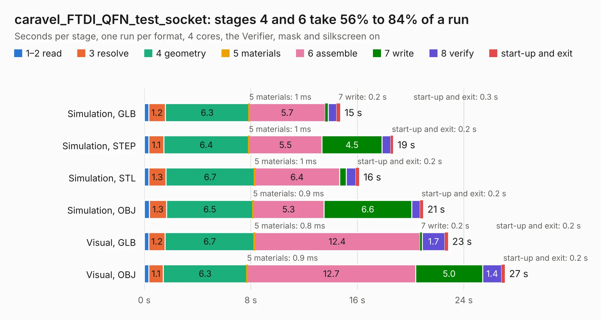

| Mode and format | 1–2 read | 3 resolve | 4 geometry | 5 materials | 6 assemble | 7 write | 8 verify | start-up and exit | Total |
|---|---:|---:|---:|---:|---:|---:|---:|---:|---:|
| Simulation, GLB | 0.3 | 1.2 | 6.3 | 1&nbsp;ms | 5.7 | 0.2 | 0.6 | 0.3 | 14.7 |
| Simulation, STEP | 0.3 | 1.1 | 6.4 | 1&nbsp;ms | 5.5 | 4.5 | 0.6 | 0.2 | 18.7 |
| Simulation, STL | 0.3 | 1.3 | 6.7 | 1&nbsp;ms | 6.4 | 0.5 | 0.7 | 0.2 | 16.1 |
| Simulation, OBJ | 0.4 | 1.3 | 6.5 | 0.9&nbsp;ms | 5.3 | 6.6 | 0.6 | 0.2 | 20.9 |
| Visual, GLB | 0.3 | 1.2 | 6.7 | 0.8&nbsp;ms | 12.4 | 0.2 | 1.7 | 0.2 | 22.8 |
| Visual, OBJ | 0.3 | 1.1 | 6.3 | 0.9&nbsp;ms | 12.7 | 5.0 | 1.4 | 0.2 | 27.1 |

<table align="center"><tr><td valign="top">

| Board | Repo: [antmicro/caravel_board](https://github.com/antmicro/caravel_board) Board: `caravel_FTDI_QFN_test_socket.kicad_pcb` |
|---|---|
| Folder | hardware / caravel_FTDI_QFN_test_socket |
| Complexity | 315&nbsp;/&nbsp;1000 (size&nbsp;230, features&nbsp;85) |
| KESE&nbsp;features | through vias, slotted holes, rounded, trapezoid or chamfered pads, filled zones, stack-up, dielectric εr and tanδ |
| Tested | 9th November 2026 |
| Copper&nbsp;layers | 2 |
| File&nbsp;format | KiCad 6 (20211014) |
| Parts,&nbsp;tracks,&nbsp;vias | 72, 1,076, 164 |
| Triangles,&nbsp;simulation | 1,635,312 in 99 parts |
| Verifier | PASS in all six runs |

</td><td valign="top">

<table>
<tr><th>File type</th><th>File size</th><th>Peak memory used</th></tr>
<tr><th colspan="3" align="left">Simulation</th></tr>
<tr><td>GLB</td><td align="right">56&nbsp;MB</td><td align="right">606&nbsp;MB</td></tr>
<tr><td>STEP</td><td align="right">277&nbsp;MB</td><td align="right">809&nbsp;MB</td></tr>
<tr><td>STL</td><td align="right">82&nbsp;MB</td><td align="right">588&nbsp;MB</td></tr>
<tr><td>OBJ</td><td align="right">169&nbsp;MB</td><td align="right">1.1&nbsp;GB</td></tr>
<tr><th colspan="3" align="left">Visual</th></tr>
<tr><td>GLB</td><td align="right">41&nbsp;MB</td><td align="right">784&nbsp;MB</td></tr>
<tr><td>OBJ</td><td align="right">126&nbsp;MB</td><td align="right">936&nbsp;MB</td></tr>
</table>

</td></tr></table>

## 326. caravel_Nucleo

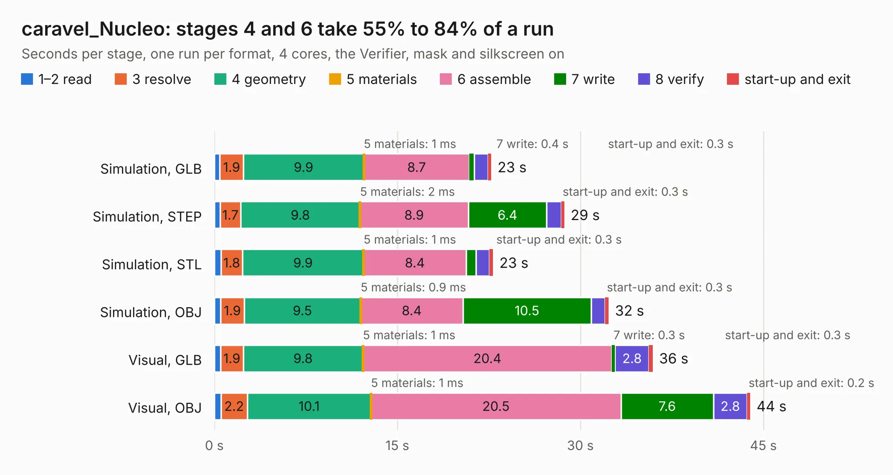

| Mode and format | 1–2 read | 3 resolve | 4 geometry | 5 materials | 6 assemble | 7 write | 8 verify | start-up and exit | Total |
|---|---:|---:|---:|---:|---:|---:|---:|---:|---:|
| Simulation, GLB | 0.4 | 1.9 | 9.9 | 1&nbsp;ms | 8.7 | 0.4 | 1.1 | 0.3 | 22.7 |
| Simulation, STEP | 0.5 | 1.7 | 9.8 | 2&nbsp;ms | 8.9 | 6.4 | 1.2 | 0.3 | 28.7 |
| Simulation, STL | 0.5 | 1.8 | 9.9 | 1&nbsp;ms | 8.4 | 0.8 | 1.1 | 0.3 | 22.8 |
| Simulation, OBJ | 0.5 | 1.9 | 9.5 | 0.9&nbsp;ms | 8.4 | 10.5 | 1.1 | 0.3 | 32.3 |
| Visual, GLB | 0.5 | 1.9 | 9.8 | 1&nbsp;ms | 20.4 | 0.3 | 2.8 | 0.3 | 35.9 |
| Visual, OBJ | 0.5 | 2.2 | 10.1 | 1&nbsp;ms | 20.5 | 7.6 | 2.8 | 0.2 | 43.9 |

<table align="center"><tr><td valign="top">

| Board | Repo: [antmicro/caravel_board](https://github.com/antmicro/caravel_board) Board: `caravel_Nucleo.kicad_pcb` |
|---|---|
| Folder | hardware / caravel_Nucleo |
| Complexity | 333&nbsp;/&nbsp;1000 (size&nbsp;228, features&nbsp;105) |
| KESE&nbsp;features | through vias, slotted holes, rounded, trapezoid or chamfered pads, drill offsets, filled zones, curved board outline, stack-up, dielectric εr and tanδ |
| Tested | 9th November 2026 |
| Copper&nbsp;layers | 2 |
| File&nbsp;format | KiCad 6 (20211014) |
| Parts,&nbsp;tracks,&nbsp;vias | 89, 1,284, 162 |
| Triangles,&nbsp;simulation | 2,223,932 in 208 parts |
| Verifier | PASS in all six runs |

</td><td valign="top">

<table>
<tr><th>File type</th><th>File size</th><th>Peak memory used</th></tr>
<tr><th colspan="3" align="left">Simulation</th></tr>
<tr><td>GLB</td><td align="right">75&nbsp;MB</td><td align="right">745&nbsp;MB</td></tr>
<tr><td>STEP</td><td align="right">364&nbsp;MB</td><td align="right">998&nbsp;MB</td></tr>
<tr><td>STL</td><td align="right">111&nbsp;MB</td><td align="right">756&nbsp;MB</td></tr>
<tr><td>OBJ</td><td align="right">232&nbsp;MB</td><td align="right">1.5&nbsp;GB</td></tr>
<tr><th colspan="3" align="left">Visual</th></tr>
<tr><td>GLB</td><td align="right">55&nbsp;MB</td><td align="right">1.1&nbsp;GB</td></tr>
<tr><td>OBJ</td><td align="right">169&nbsp;MB</td><td align="right">1.2&nbsp;GB</td></tr>
</table>

</td></tr></table>

## 327. Caravel_pcb

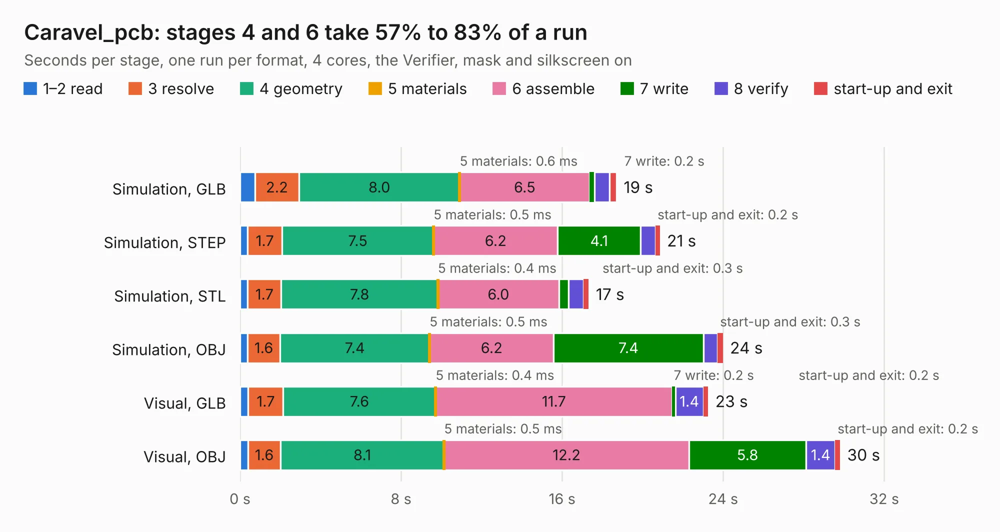

| Mode and format | 1–2 read | 3 resolve | 4 geometry | 5 materials | 6 assemble | 7 write | 8 verify | start-up and exit | Total |
|---|---:|---:|---:|---:|---:|---:|---:|---:|---:|
| Simulation, GLB | 0.7 | 2.2 | 8.0 | 0.6&nbsp;ms | 6.5 | 0.2 | 0.7 | 0.3 | 18.7 |
| Simulation, STEP | 0.4 | 1.7 | 7.5 | 0.5&nbsp;ms | 6.2 | 4.1 | 0.7 | 0.2 | 20.9 |
| Simulation, STL | 0.4 | 1.7 | 7.8 | 0.4&nbsp;ms | 6.0 | 0.5 | 0.7 | 0.3 | 17.3 |
| Simulation, OBJ | 0.4 | 1.6 | 7.4 | 0.5&nbsp;ms | 6.2 | 7.4 | 0.7 | 0.3 | 24.0 |
| Visual, GLB | 0.4 | 1.7 | 7.6 | 0.4&nbsp;ms | 11.7 | 0.2 | 1.4 | 0.2 | 23.3 |
| Visual, OBJ | 0.4 | 1.6 | 8.1 | 0.5&nbsp;ms | 12.2 | 5.8 | 1.4 | 0.2 | 29.8 |

<table align="center"><tr><td valign="top">

| Board | Repo: [antmicro/caravel_board](https://github.com/antmicro/caravel_board) Board: `Caravel_pcb.kicad_pcb` |
|---|---|
| Folder | hardware / caravel_pcb_v1 |
| Complexity | 290&nbsp;/&nbsp;1000 (size&nbsp;235, features&nbsp;55) |
| KESE&nbsp;features | through vias, slotted holes, rounded, trapezoid or chamfered pads, filled zones |
| Tested | 9th November 2026 |
| Copper&nbsp;layers | 2 |
| File&nbsp;format | KiCad 5 (20171130) |
| Parts,&nbsp;tracks,&nbsp;vias | 72, 1,749, 98 |
| Triangles,&nbsp;simulation | 1,242,816 in 99 parts |
| Verifier | PASS in all six runs |

</td><td valign="top">

<table>
<tr><th>File type</th><th>File size</th><th>Peak memory used</th></tr>
<tr><th colspan="3" align="left">Simulation</th></tr>
<tr><td>GLB</td><td align="right">44&nbsp;MB</td><td align="right">520&nbsp;MB</td></tr>
<tr><td>STEP</td><td align="right">248&nbsp;MB</td><td align="right">654&nbsp;MB</td></tr>
<tr><td>STL</td><td align="right">62&nbsp;MB</td><td align="right">526&nbsp;MB</td></tr>
<tr><td>OBJ</td><td align="right">131&nbsp;MB</td><td align="right">885&nbsp;MB</td></tr>
<tr><th colspan="3" align="left">Visual</th></tr>
<tr><td>GLB</td><td align="right">32&nbsp;MB</td><td align="right">628&nbsp;MB</td></tr>
<tr><td>OBJ</td><td align="right">95&nbsp;MB</td><td align="right">747&nbsp;MB</td></tr>
</table>

</td></tr></table>

## 328. caravel_pcb_v3_FTDI_flexy

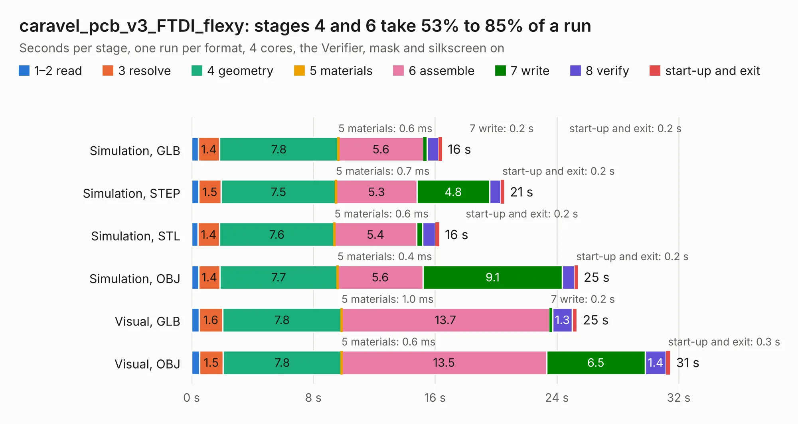

| Mode and format | 1–2 read | 3 resolve | 4 geometry | 5 materials | 6 assemble | 7 write | 8 verify | start-up and exit | Total |
|---|---:|---:|---:|---:|---:|---:|---:|---:|---:|
| Simulation, GLB | 0.4 | 1.4 | 7.8 | 0.6&nbsp;ms | 5.6 | 0.2 | 0.7 | 0.2 | 16.5 |
| Simulation, STEP | 0.5 | 1.5 | 7.5 | 0.7&nbsp;ms | 5.3 | 4.8 | 0.7 | 0.2 | 20.5 |
| Simulation, STL | 0.4 | 1.4 | 7.6 | 0.6&nbsp;ms | 5.4 | 0.4 | 0.8 | 0.2 | 16.3 |
| Simulation, OBJ | 0.5 | 1.4 | 7.7 | 0.4&nbsp;ms | 5.6 | 9.1 | 0.8 | 0.2 | 25.4 |
| Visual, GLB | 0.5 | 1.6 | 7.8 | 1.0&nbsp;ms | 13.7 | 0.2 | 1.3 | 0.3 | 25.3 |
| Visual, OBJ | 0.5 | 1.5 | 7.8 | 0.6&nbsp;ms | 13.5 | 6.5 | 1.4 | 0.3 | 31.5 |

<table align="center"><tr><td valign="top">

| Board | Repo: [antmicro/caravel_board](https://github.com/antmicro/caravel_board) Board: `caravel_pcb_v3_FTDI_flexy.kicad_pcb` |
|---|---|
| Folder | hardware / caravel_pcb_v3_FTDI |
| Complexity | 314&nbsp;/&nbsp;1000 (size&nbsp;219, features&nbsp;95) |
| KESE&nbsp;features | through vias, slotted holes, rounded, trapezoid or chamfered pads, drill offsets, filled zones, stack-up, dielectric εr and tanδ |
| Tested | 9th November 2026 |
| Copper&nbsp;layers | 2 |
| File&nbsp;format | KiCad 6 (20211014) |
| Parts,&nbsp;tracks,&nbsp;vias | 63, 935, 122 |
| Triangles,&nbsp;simulation | 1,524,006 in 98 parts |
| Verifier | PASS in all six runs |

</td><td valign="top">

<table>
<tr><th>File type</th><th>File size</th><th>Peak memory used</th></tr>
<tr><th colspan="3" align="left">Simulation</th></tr>
<tr><td>GLB</td><td align="right">52&nbsp;MB</td><td align="right">585&nbsp;MB</td></tr>
<tr><td>STEP</td><td align="right">270&nbsp;MB</td><td align="right">782&nbsp;MB</td></tr>
<tr><td>STL</td><td align="right">76&nbsp;MB</td><td align="right">605&nbsp;MB</td></tr>
<tr><td>OBJ</td><td align="right">157&nbsp;MB</td><td align="right">1.0&nbsp;GB</td></tr>
<tr><th colspan="3" align="left">Visual</th></tr>
<tr><td>GLB</td><td align="right">39&nbsp;MB</td><td align="right">715&nbsp;MB</td></tr>
<tr><td>OBJ</td><td align="right">118&nbsp;MB</td><td align="right">875&nbsp;MB</td></tr>
</table>

</td></tr></table>

## 329. caravel_pcb_v3_FTDI_SMD

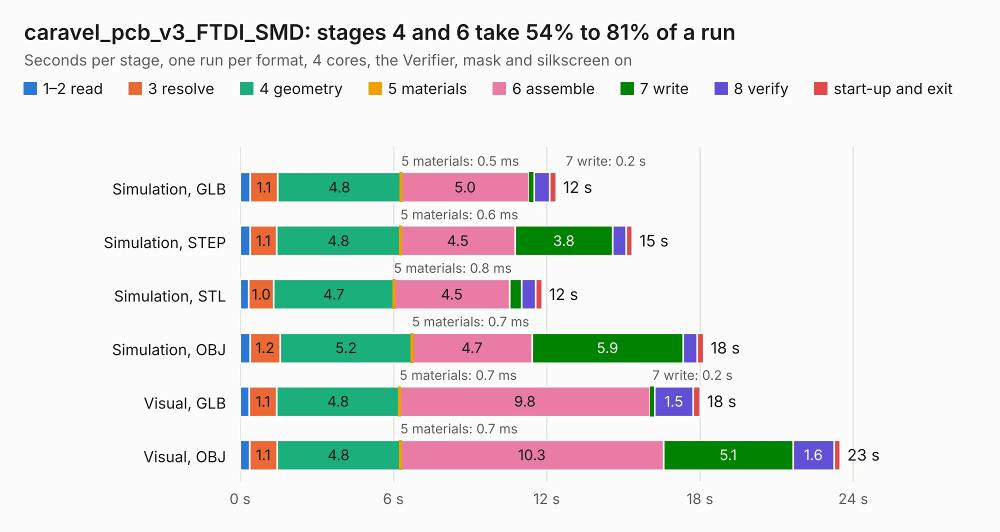

| Mode and format | 1–2 read | 3 resolve | 4 geometry | 5 materials | 6 assemble | 7 write | 8 verify | start-up and exit | Total |
|---|---:|---:|---:|---:|---:|---:|---:|---:|---:|
| Simulation, GLB | 0.4 | 1.1 | 4.8 | 0.5&nbsp;ms | 5.0 | 0.2 | 0.6 | 0.3 | 12.4 |
| Simulation, STEP | 0.4 | 1.1 | 4.8 | 0.6&nbsp;ms | 4.5 | 3.8 | 0.5 | 0.2 | 15.4 |
| Simulation, STL | 0.3 | 1.0 | 4.7 | 0.8&nbsp;ms | 4.5 | 0.5 | 0.5 | 0.2 | 11.8 |
| Simulation, OBJ | 0.4 | 1.2 | 5.2 | 0.7&nbsp;ms | 4.7 | 5.9 | 0.5 | 0.3 | 18.1 |
| Visual, GLB | 0.4 | 1.1 | 4.8 | 0.7&nbsp;ms | 9.8 | 0.2 | 1.5 | 0.3 | 18.0 |
| Visual, OBJ | 0.4 | 1.1 | 4.8 | 0.7&nbsp;ms | 10.3 | 5.1 | 1.6 | 0.2 | 23.5 |

<table align="center"><tr><td valign="top">

| Board | Repo: [antmicro/caravel_board](https://github.com/antmicro/caravel_board) Board: `caravel_pcb_v3_FTDI_SMD.kicad_pcb` |
|---|---|
| Folder | hardware / caravel_pcb_v3_FTDI |
| Complexity | 305&nbsp;/&nbsp;1000 (size&nbsp;220, features&nbsp;85) |
| KESE&nbsp;features | through vias, slotted holes, rounded, trapezoid or chamfered pads, filled zones, stack-up, dielectric εr and tanδ |
| Tested | 9th November 2026 |
| Copper&nbsp;layers | 2 |
| File&nbsp;format | KiCad 6 (20211014) |
| Parts,&nbsp;tracks,&nbsp;vias | 63, 932, 131 |
| Triangles,&nbsp;simulation | 1,286,120 in 97 parts |
| Verifier | PASS in all six runs |

</td><td valign="top">

<table>
<tr><th>File type</th><th>File size</th><th>Peak memory used</th></tr>
<tr><th colspan="3" align="left">Simulation</th></tr>
<tr><td>GLB</td><td align="right">44&nbsp;MB</td><td align="right">556&nbsp;MB</td></tr>
<tr><td>STEP</td><td align="right">229&nbsp;MB</td><td align="right">681&nbsp;MB</td></tr>
<tr><td>STL</td><td align="right">64&nbsp;MB</td><td align="right">545&nbsp;MB</td></tr>
<tr><td>OBJ</td><td align="right">131&nbsp;MB</td><td align="right">861&nbsp;MB</td></tr>
<tr><th colspan="3" align="left">Visual</th></tr>
<tr><td>GLB</td><td align="right">35&nbsp;MB</td><td align="right">663&nbsp;MB</td></tr>
<tr><td>OBJ</td><td align="right">104&nbsp;MB</td><td align="right">792&nbsp;MB</td></tr>
</table>

</td></tr></table>

## 330. caravel_pcb_v3_MCP

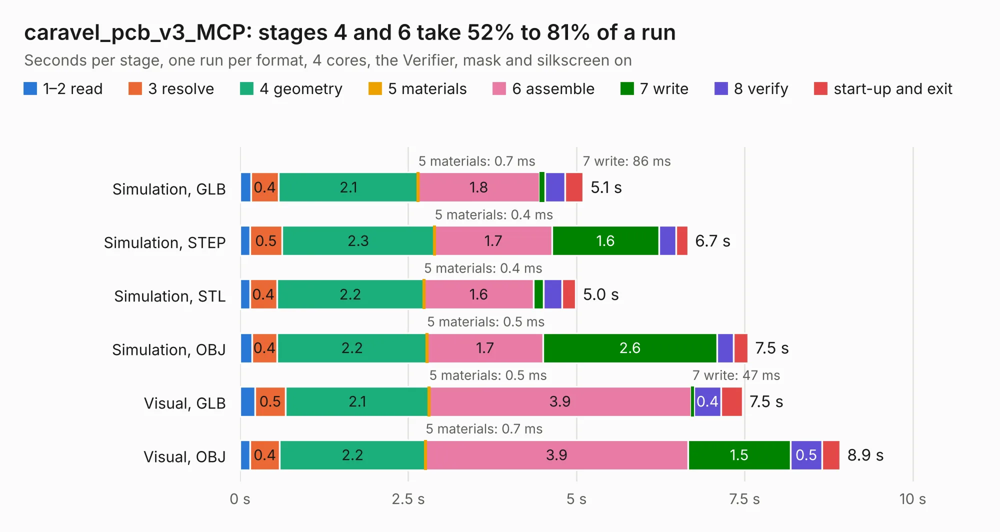

| Mode and format | 1–2 read | 3 resolve | 4 geometry | 5 materials | 6 assemble | 7 write | 8 verify | start-up and exit | Total |
|---|---:|---:|---:|---:|---:|---:|---:|---:|---:|
| Simulation, GLB | 0.2 | 0.4 | 2.1 | 0.7&nbsp;ms | 1.8 | 86&nbsp;ms | 0.3 | 0.3 | 5.1 |
| Simulation, STEP | 0.1 | 0.5 | 2.3 | 0.4&nbsp;ms | 1.7 | 1.6 | 0.3 | 0.2 | 6.7 |
| Simulation, STL | 0.1 | 0.4 | 2.2 | 0.4&nbsp;ms | 1.6 | 0.1 | 0.3 | 0.2 | 5.0 |
| Simulation, OBJ | 0.2 | 0.4 | 2.2 | 0.5&nbsp;ms | 1.7 | 2.6 | 0.3 | 0.2 | 7.5 |
| Visual, GLB | 0.2 | 0.5 | 2.1 | 0.5&nbsp;ms | 3.9 | 47&nbsp;ms | 0.4 | 0.3 | 7.5 |
| Visual, OBJ | 0.2 | 0.4 | 2.2 | 0.7&nbsp;ms | 3.9 | 1.5 | 0.5 | 0.3 | 8.9 |

<table align="center"><tr><td valign="top">

| Board | Repo: [antmicro/caravel_board](https://github.com/antmicro/caravel_board) Board: `caravel_pcb_v3_MCP.kicad_pcb` |
|---|---|
| Folder | hardware / caravel_pcb_v3_MCP |
| Complexity | 76&nbsp;/&nbsp;1000 (size&nbsp;56, features&nbsp;20) |
| KESE&nbsp;features | slotted holes, rounded, trapezoid or chamfered pads |
| Tested | 9th November 2026 |
| Copper&nbsp;layers | 2 |
| File&nbsp;format | KiCad 6 (20211014) |
| Parts,&nbsp;tracks,&nbsp;vias | 38, 0, 0 |
| Triangles,&nbsp;simulation | 494,144 in 78 parts |
| Verifier | PASS in all six runs |

</td><td valign="top">

<table>
<tr><th>File type</th><th>File size</th><th>Peak memory used</th></tr>
<tr><th colspan="3" align="left">Simulation</th></tr>
<tr><td>GLB</td><td align="right">16&nbsp;MB</td><td align="right">287&nbsp;MB</td></tr>
<tr><td>STEP</td><td align="right">61&nbsp;MB</td><td align="right">325&nbsp;MB</td></tr>
<tr><td>STL</td><td align="right">25&nbsp;MB</td><td align="right">281&nbsp;MB</td></tr>
<tr><td>OBJ</td><td align="right">50&nbsp;MB</td><td align="right">377&nbsp;MB</td></tr>
<tr><th colspan="3" align="left">Visual</th></tr>
<tr><td>GLB</td><td align="right">11&nbsp;MB</td><td align="right">336&nbsp;MB</td></tr>
<tr><td>OBJ</td><td align="right">32&nbsp;MB</td><td align="right">339&nbsp;MB</td></tr>
</table>

</td></tr></table>

## 331. caravel_pcb_v4_FTDI_flexy

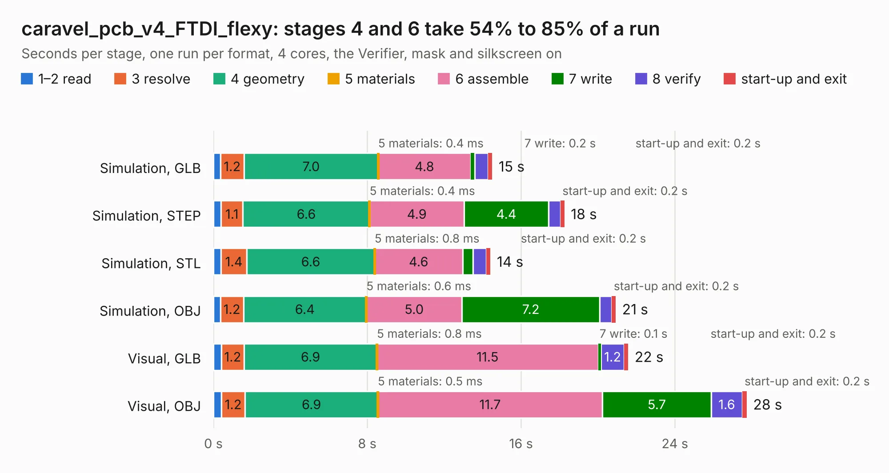

| Mode and format | 1–2 read | 3 resolve | 4 geometry | 5 materials | 6 assemble | 7 write | 8 verify | start-up and exit | Total |
|---|---:|---:|---:|---:|---:|---:|---:|---:|---:|
| Simulation, GLB | 0.4 | 1.2 | 7.0 | 0.4&nbsp;ms | 4.8 | 0.2 | 0.7 | 0.2 | 14.5 |
| Simulation, STEP | 0.4 | 1.1 | 6.6 | 0.4&nbsp;ms | 4.9 | 4.4 | 0.6 | 0.2 | 18.3 |
| Simulation, STL | 0.4 | 1.4 | 6.6 | 0.8&nbsp;ms | 4.6 | 0.5 | 0.7 | 0.2 | 14.4 |
| Simulation, OBJ | 0.4 | 1.2 | 6.4 | 0.6&nbsp;ms | 5.0 | 7.2 | 0.6 | 0.2 | 20.9 |
| Visual, GLB | 0.4 | 1.2 | 6.9 | 0.8&nbsp;ms | 11.5 | 0.1 | 1.2 | 0.2 | 21.6 |
| Visual, OBJ | 0.4 | 1.2 | 6.9 | 0.5&nbsp;ms | 11.7 | 5.7 | 1.6 | 0.2 | 27.7 |

<table align="center"><tr><td valign="top">

| Board | Repo: [antmicro/caravel_board](https://github.com/antmicro/caravel_board) Board: `caravel_pcb_v4_FTDI_flexy.kicad_pcb` |
|---|---|
| Folder | hardware / caravel_pcb_v4_FTDI |
| Complexity | 312&nbsp;/&nbsp;1000 (size&nbsp;217, features&nbsp;95) |
| KESE&nbsp;features | through vias, slotted holes, rounded, trapezoid or chamfered pads, drill offsets, filled zones, stack-up, dielectric εr and tanδ |
| Tested | 9th November 2026 |
| Copper&nbsp;layers | 2 |
| File&nbsp;format | KiCad 6 (20211014) |
| Parts,&nbsp;tracks,&nbsp;vias | 61, 884, 104 |
| Triangles,&nbsp;simulation | 1,428,776 in 104 parts |
| Verifier | PASS in all six runs |

</td><td valign="top">

<table>
<tr><th>File type</th><th>File size</th><th>Peak memory used</th></tr>
<tr><th colspan="3" align="left">Simulation</th></tr>
<tr><td>GLB</td><td align="right">49&nbsp;MB</td><td align="right">601&nbsp;MB</td></tr>
<tr><td>STEP</td><td align="right">248&nbsp;MB</td><td align="right">741&nbsp;MB</td></tr>
<tr><td>STL</td><td align="right">71&nbsp;MB</td><td align="right">583&nbsp;MB</td></tr>
<tr><td>OBJ</td><td align="right">147&nbsp;MB</td><td align="right">990&nbsp;MB</td></tr>
<tr><th colspan="3" align="left">Visual</th></tr>
<tr><td>GLB</td><td align="right">36&nbsp;MB</td><td align="right">805&nbsp;MB</td></tr>
<tr><td>OBJ</td><td align="right">108&nbsp;MB</td><td align="right">858&nbsp;MB</td></tr>
</table>

</td></tr></table>

## 332. caravel_pcb_v4_FTDI_SMD

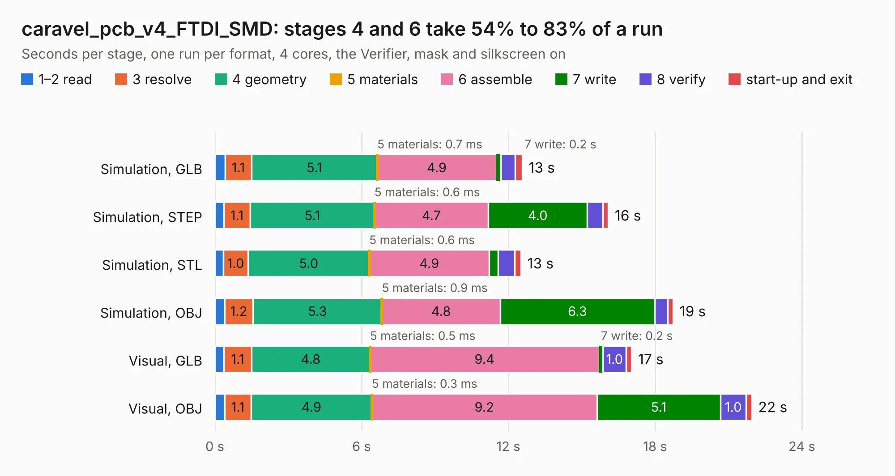

| Mode and format | 1–2 read | 3 resolve | 4 geometry | 5 materials | 6 assemble | 7 write | 8 verify | start-up and exit | Total |
|---|---:|---:|---:|---:|---:|---:|---:|---:|---:|
| Simulation, GLB | 0.4 | 1.1 | 5.1 | 0.7&nbsp;ms | 4.9 | 0.2 | 0.6 | 0.3 | 12.6 |
| Simulation, STEP | 0.4 | 1.1 | 5.1 | 0.6&nbsp;ms | 4.7 | 4.0 | 0.6 | 0.2 | 16.1 |
| Simulation, STL | 0.3 | 1.0 | 5.0 | 0.6&nbsp;ms | 4.9 | 0.4 | 0.7 | 0.3 | 12.5 |
| Simulation, OBJ | 0.4 | 1.2 | 5.3 | 0.9&nbsp;ms | 4.8 | 6.3 | 0.5 | 0.2 | 18.7 |
| Visual, GLB | 0.4 | 1.1 | 4.8 | 0.5&nbsp;ms | 9.4 | 0.2 | 1.0 | 0.2 | 17.0 |
| Visual, OBJ | 0.4 | 1.1 | 4.9 | 0.3&nbsp;ms | 9.2 | 5.1 | 1.0 | 0.2 | 22.0 |

<table align="center"><tr><td valign="top">

| Board | Repo: [antmicro/caravel_board](https://github.com/antmicro/caravel_board) Board: `caravel_pcb_v4_FTDI_SMD.kicad_pcb` |
|---|---|
| Folder | hardware / caravel_pcb_v4_FTDI |
| Complexity | 303&nbsp;/&nbsp;1000 (size&nbsp;218, features&nbsp;85) |
| KESE&nbsp;features | through vias, slotted holes, rounded, trapezoid or chamfered pads, filled zones, stack-up, dielectric εr and tanδ |
| Tested | 9th November 2026 |
| Copper&nbsp;layers | 2 |
| File&nbsp;format | KiCad 6 (20211014) |
| Parts,&nbsp;tracks,&nbsp;vias | 61, 854, 123 |
| Triangles,&nbsp;simulation | 1,217,782 in 103 parts |
| Verifier | PASS in all six runs |

</td><td valign="top">

<table>
<tr><th>File type</th><th>File size</th><th>Peak memory used</th></tr>
<tr><th colspan="3" align="left">Simulation</th></tr>
<tr><td>GLB</td><td align="right">42&nbsp;MB</td><td align="right">509&nbsp;MB</td></tr>
<tr><td>STEP</td><td align="right">212&nbsp;MB</td><td align="right">671&nbsp;MB</td></tr>
<tr><td>STL</td><td align="right">61&nbsp;MB</td><td align="right">529&nbsp;MB</td></tr>
<tr><td>OBJ</td><td align="right">124&nbsp;MB</td><td align="right">815&nbsp;MB</td></tr>
<tr><th colspan="3" align="left">Visual</th></tr>
<tr><td>GLB</td><td align="right">33&nbsp;MB</td><td align="right">724&nbsp;MB</td></tr>
<tr><td>OBJ</td><td align="right">98&nbsp;MB</td><td align="right">772&nbsp;MB</td></tr>
</table>

</td></tr></table>

## 333. cm4-baseboard

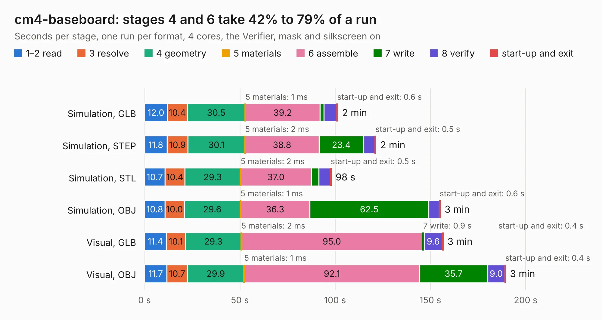

| Mode and format | 1–2 read | 3 resolve | 4 geometry | 5 materials | 6 assemble | 7 write | 8 verify | start-up and exit | Total |
|---|---:|---:|---:|---:|---:|---:|---:|---:|---:|
| Simulation, GLB | 12.0 | 10.4 | 30.5 | 1&nbsp;ms | 39.2 | 1.9 | 6.8 | 0.6 | 101.4 |
| Simulation, STEP | 11.8 | 10.9 | 30.1 | 2&nbsp;ms | 38.8 | 23.4 | 6.0 | 0.5 | 121.5 |
| Simulation, STL | 10.7 | 10.4 | 29.3 | 2&nbsp;ms | 37.0 | 4.0 | 6.0 | 0.5 | 98.0 |
| Simulation, OBJ | 10.8 | 10.0 | 29.6 | 1&nbsp;ms | 36.3 | 62.5 | 5.5 | 0.6 | 155.2 |
| Visual, GLB | 11.4 | 10.1 | 29.3 | 2&nbsp;ms | 95.0 | 0.9 | 9.6 | 0.4 | 156.7 |
| Visual, OBJ | 11.7 | 10.7 | 29.9 | 1&nbsp;ms | 92.1 | 35.7 | 9.0 | 0.4 | 189.5 |

<table align="center"><tr><td valign="top">

| Board | Repo: [antmicro/cm4-baseboard](https://github.com/antmicro/cm4-baseboard) Board: `cm4-baseboard.kicad_pcb` |
|---|---|
| Complexity | 472&nbsp;/&nbsp;1000 (size&nbsp;307, features&nbsp;165) |
| KESE&nbsp;features | through vias, slotted holes, custom pads, rounded, trapezoid or chamfered pads, arc tracks, filled zones, copper drawings, copper text, curved board outline, knockout text, stack-up, dielectric εr and tanδ, mask and silkscreen colours |
| Tested | 9th November 2026 |
| Copper&nbsp;layers | 6 |
| File&nbsp;format | KiCad 9 (20241229) |
| Parts,&nbsp;tracks,&nbsp;vias | 442, 6,879, 1,129 |
| Triangles,&nbsp;simulation | 9,169,160 in 522 parts |
| Verifier | PASS in all six runs |

</td><td valign="top">

<table>
<tr><th>File type</th><th>File size</th><th>Peak memory used</th></tr>
<tr><th colspan="3" align="left">Simulation</th></tr>
<tr><td>GLB</td><td align="right">312&nbsp;MB</td><td align="right">2.8&nbsp;GB</td></tr>
<tr><td>STEP</td><td align="right">1.3&nbsp;GB</td><td align="right">3.5&nbsp;GB</td></tr>
<tr><td>STL</td><td align="right">459&nbsp;MB</td><td align="right">2.8&nbsp;GB</td></tr>
<tr><td>OBJ</td><td align="right">986&nbsp;MB</td><td align="right">6.0&nbsp;GB</td></tr>
<tr><th colspan="3" align="left">Visual</th></tr>
<tr><td>GLB</td><td align="right">193&nbsp;MB</td><td align="right">3.3&nbsp;GB</td></tr>
<tr><td>OBJ</td><td align="right">622&nbsp;MB</td><td align="right">4.2&nbsp;GB</td></tr>
</table>

</td></tr></table>

## 334. cm4-lvds-adapter

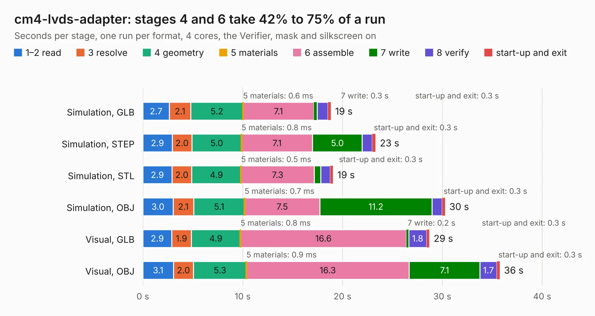

| Mode and format | 1–2 read | 3 resolve | 4 geometry | 5 materials | 6 assemble | 7 write | 8 verify | start-up and exit | Total |
|---|---:|---:|---:|---:|---:|---:|---:|---:|---:|
| Simulation, GLB | 2.7 | 2.1 | 5.2 | 0.6&nbsp;ms | 7.1 | 0.3 | 1.1 | 0.3 | 18.8 |
| Simulation, STEP | 2.9 | 2.0 | 5.0 | 0.8&nbsp;ms | 7.1 | 5.0 | 1.0 | 0.3 | 23.3 |
| Simulation, STL | 2.9 | 2.0 | 4.9 | 0.5&nbsp;ms | 7.3 | 0.7 | 1.0 | 0.3 | 19.1 |
| Simulation, OBJ | 3.0 | 2.1 | 5.1 | 0.7&nbsp;ms | 7.5 | 11.2 | 1.0 | 0.3 | 30.3 |
| Visual, GLB | 2.9 | 1.9 | 4.9 | 0.8&nbsp;ms | 16.6 | 0.2 | 1.8 | 0.3 | 28.7 |
| Visual, OBJ | 3.1 | 2.0 | 5.3 | 0.9&nbsp;ms | 16.3 | 7.1 | 1.7 | 0.3 | 35.8 |

<table align="center"><tr><td valign="top">

| Board | Repo: [antmicro/cm4-baseboard-lvds-adapter](https://github.com/antmicro/cm4-baseboard-lvds-adapter) Board: `cm4-lvds-adapter.kicad_pcb` |
|---|---|
| Complexity | 408&nbsp;/&nbsp;1000 (size&nbsp;263, features&nbsp;145) |
| KESE&nbsp;features | through vias, custom pads, rounded, trapezoid or chamfered pads, arc tracks, filled zones, copper drawings, copper text, knockout text, stack-up, dielectric εr and tanδ, mask and silkscreen colours |
| Tested | 9th November 2026 |
| Copper&nbsp;layers | 6 |
| File&nbsp;format | KiCad 9 (20241229) |
| Parts,&nbsp;tracks,&nbsp;vias | 130, 1,596, 254 |
| Triangles,&nbsp;simulation | 2,092,774 in 158 parts |
| Verifier | PASS in all six runs |

</td><td valign="top">

<table>
<tr><th>File type</th><th>File size</th><th>Peak memory used</th></tr>
<tr><th colspan="3" align="left">Simulation</th></tr>
<tr><td>GLB</td><td align="right">71&nbsp;MB</td><td align="right">737&nbsp;MB</td></tr>
<tr><td>STEP</td><td align="right">278&nbsp;MB</td><td align="right">973&nbsp;MB</td></tr>
<tr><td>STL</td><td align="right">105&nbsp;MB</td><td align="right">738&nbsp;MB</td></tr>
<tr><td>OBJ</td><td align="right">218&nbsp;MB</td><td align="right">1.4&nbsp;GB</td></tr>
<tr><th colspan="3" align="left">Visual</th></tr>
<tr><td>GLB</td><td align="right">45&nbsp;MB</td><td align="right">889&nbsp;MB</td></tr>
<tr><td>OBJ</td><td align="right">140&nbsp;MB</td><td align="right">1.1&nbsp;GB</td></tr>
</table>

</td></tr></table>

## 335. com-express-7-baseboard

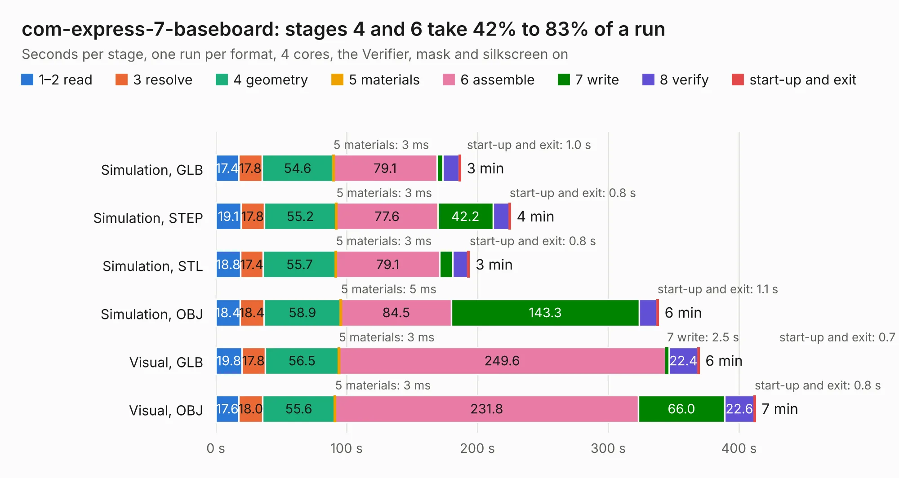

| Mode and format | 1–2 read | 3 resolve | 4 geometry | 5 materials | 6 assemble | 7 write | 8 verify | start-up and exit | Total |
|---|---:|---:|---:|---:|---:|---:|---:|---:|---:|
| Simulation, GLB | 17.4 | 17.8 | 54.6 | 3&nbsp;ms | 79.1 | 4.6 | 12.4 | 1.0 | 186.9 |
| Simulation, STEP | 19.1 | 17.8 | 55.2 | 3&nbsp;ms | 77.6 | 42.2 | 12.4 | 0.8 | 225.1 |
| Simulation, STL | 18.8 | 17.4 | 55.7 | 3&nbsp;ms | 79.1 | 10.2 | 11.6 | 0.8 | 193.6 |
| Simulation, OBJ | 18.4 | 18.4 | 58.9 | 5&nbsp;ms | 84.5 | 143.3 | 13.6 | 1.1 | 338.2 |
| Visual, GLB | 19.8 | 17.8 | 56.5 | 3&nbsp;ms | 249.6 | 2.5 | 22.4 | 0.7 | 369.4 |
| Visual, OBJ | 17.6 | 18.0 | 55.6 | 3&nbsp;ms | 231.8 | 66.0 | 22.6 | 0.8 | 412.4 |

<table align="center"><tr><td valign="top">

| Board | Repo: [antmicro/com-express-7-baseboard](https://github.com/antmicro/com-express-7-baseboard) Board: `com-express-7-baseboard.kicad_pcb` |
|---|---|
| Complexity | 525&nbsp;/&nbsp;1000 (size&nbsp;345, features&nbsp;180) |
| KESE&nbsp;features | through vias, slotted holes, custom pads, rounded, trapezoid or chamfered pads, arc tracks, filled zones, copper drawings, copper text, curved board outline, knockout text, TrueType text, stack-up, dielectric εr and tanδ, mask and silkscreen colours |
| Tested | 9th November 2026 to 10th November 2026 |
| Copper&nbsp;layers | 8 |
| File&nbsp;format | KiCad 9 (20241229) |
| Parts,&nbsp;tracks,&nbsp;vias | 693, 10,459, 2,865 |
| Triangles,&nbsp;simulation | 21,291,582 in 1018 parts |
| Verifier | PASS in all six runs |
| Run&nbsp;again | Simulation, OBJ: failed in the corpus run, run again with the memory cap raised from 11 GB to 14.5 GB, and passed |

</td><td valign="top">

<table>
<tr><th>File type</th><th>File size</th><th>Peak memory used</th></tr>
<tr><th colspan="3" align="left">Simulation</th></tr>
<tr><td>GLB</td><td align="right">684&nbsp;MB</td><td align="right">6.3&nbsp;GB</td></tr>
<tr><td>STEP</td><td align="right">2.3&nbsp;GB</td><td align="right">7.1&nbsp;GB</td></tr>
<tr><td>STL</td><td align="right">1.1&nbsp;GB</td><td align="right">6.2&nbsp;GB</td></tr>
<tr><td>OBJ</td><td align="right">2.3&nbsp;GB</td><td align="right">13&nbsp;GB</td></tr>
<tr><th colspan="3" align="left">Visual</th></tr>
<tr><td>GLB</td><td align="right">388&nbsp;MB</td><td align="right">6.7&nbsp;GB</td></tr>
<tr><td>OBJ</td><td align="right">1.3&nbsp;GB</td><td align="right">8.2&nbsp;GB</td></tr>
</table>

</td></tr></table>

## 336. cvbs-mipi-bridge

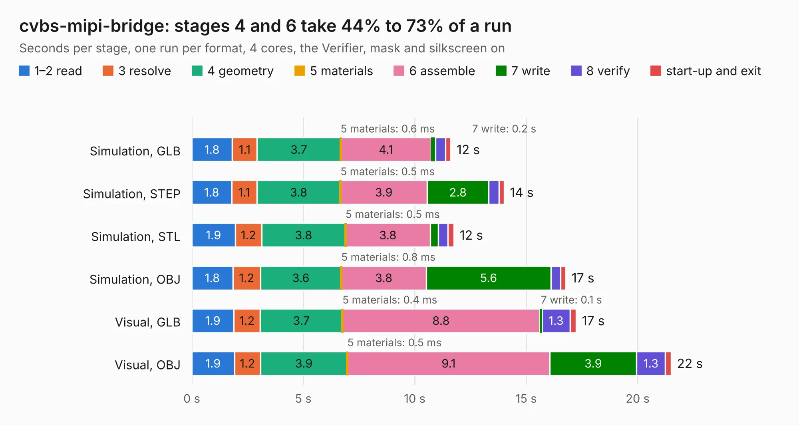

| Mode and format | 1–2 read | 3 resolve | 4 geometry | 5 materials | 6 assemble | 7 write | 8 verify | start-up and exit | Total |
|---|---:|---:|---:|---:|---:|---:|---:|---:|---:|
| Simulation, GLB | 1.8 | 1.1 | 3.7 | 0.6&nbsp;ms | 4.1 | 0.2 | 0.4 | 0.2 | 11.6 |
| Simulation, STEP | 1.8 | 1.1 | 3.8 | 0.5&nbsp;ms | 3.9 | 2.8 | 0.5 | 0.2 | 14.0 |
| Simulation, STL | 1.9 | 1.2 | 3.8 | 0.5&nbsp;ms | 3.8 | 0.4 | 0.4 | 0.3 | 11.8 |
| Simulation, OBJ | 1.8 | 1.2 | 3.6 | 0.8&nbsp;ms | 3.8 | 5.6 | 0.4 | 0.2 | 16.8 |
| Visual, GLB | 1.9 | 1.2 | 3.7 | 0.4&nbsp;ms | 8.8 | 0.1 | 1.3 | 0.3 | 17.2 |
| Visual, OBJ | 1.9 | 1.2 | 3.9 | 0.5&nbsp;ms | 9.1 | 3.9 | 1.3 | 0.3 | 21.5 |

<table align="center"><tr><td valign="top">

| Board | Repo: [antmicro/cvbs-mipi-bridge](https://github.com/antmicro/cvbs-mipi-bridge) Board: `cvbs-mipi-bridge.kicad_pcb` |
|---|---|
| Complexity | 375&nbsp;/&nbsp;1000 (size&nbsp;255, features&nbsp;120) |
| KESE&nbsp;features | through vias, slotted holes, rounded, trapezoid or chamfered pads, arc tracks, filled zones, stack-up, dielectric εr and tanδ, copper finish, mask and silkscreen colours |
| Tested | 9th November 2026 |
| Copper&nbsp;layers | 4 |
| File&nbsp;format | KiCad 7 (20221018) |
| Parts,&nbsp;tracks,&nbsp;vias | 98, 578, 295 |
| Triangles,&nbsp;simulation | 1,334,870 in 113 parts |
| Verifier | PASS in all six runs |

</td><td valign="top">

<table>
<tr><th>File type</th><th>File size</th><th>Peak memory used</th></tr>
<tr><th colspan="3" align="left">Simulation</th></tr>
<tr><td>GLB</td><td align="right">45&nbsp;MB</td><td align="right">595&nbsp;MB</td></tr>
<tr><td>STEP</td><td align="right">149&nbsp;MB</td><td align="right">735&nbsp;MB</td></tr>
<tr><td>STL</td><td align="right">67&nbsp;MB</td><td align="right">620&nbsp;MB</td></tr>
<tr><td>OBJ</td><td align="right">136&nbsp;MB</td><td align="right">988&nbsp;MB</td></tr>
<tr><th colspan="3" align="left">Visual</th></tr>
<tr><td>GLB</td><td align="right">30&nbsp;MB</td><td align="right">796&nbsp;MB</td></tr>
<tr><td>OBJ</td><td align="right">92&nbsp;MB</td><td align="right">760&nbsp;MB</td></tr>
</table>

</td></tr></table>

## 337. d1600e-psu-breakout-board

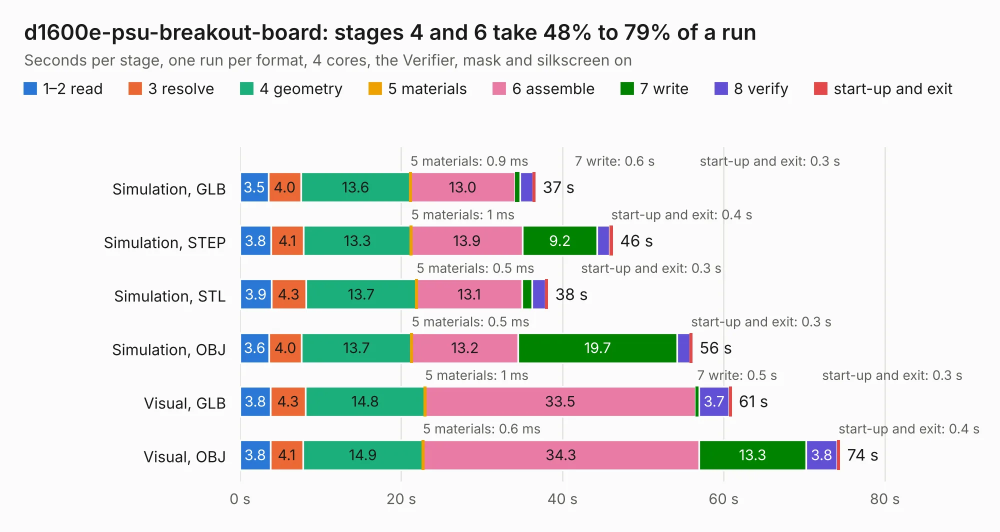

| Mode and format | 1–2 read | 3 resolve | 4 geometry | 5 materials | 6 assemble | 7 write | 8 verify | start-up and exit | Total |
|---|---:|---:|---:|---:|---:|---:|---:|---:|---:|
| Simulation, GLB | 3.5 | 4.0 | 13.6 | 0.9&nbsp;ms | 13.0 | 0.6 | 1.6 | 0.3 | 36.7 |
| Simulation, STEP | 3.8 | 4.1 | 13.3 | 1&nbsp;ms | 13.9 | 9.2 | 1.5 | 0.4 | 46.2 |
| Simulation, STL | 3.9 | 4.3 | 13.7 | 0.5&nbsp;ms | 13.1 | 1.3 | 1.6 | 0.3 | 38.2 |
| Simulation, OBJ | 3.6 | 4.0 | 13.7 | 0.5&nbsp;ms | 13.2 | 19.7 | 1.6 | 0.3 | 56.1 |
| Visual, GLB | 3.8 | 4.3 | 14.8 | 1&nbsp;ms | 33.5 | 0.5 | 3.7 | 0.3 | 61.0 |
| Visual, OBJ | 3.8 | 4.1 | 14.9 | 0.6&nbsp;ms | 34.3 | 13.3 | 3.8 | 0.4 | 74.4 |

<table align="center"><tr><td valign="top">

| Board | Repo: [antmicro/d1600e-psu-breakout](https://github.com/antmicro/d1600e-psu-breakout) Board: `d1600e-psu-breakout-board.kicad_pcb` |
|---|---|
| Complexity | 405&nbsp;/&nbsp;1000 (size&nbsp;265, features&nbsp;140) |
| KESE&nbsp;features | through vias, slotted holes, custom pads, rounded, trapezoid or chamfered pads, arc tracks, filled zones, copper drawings, curved board outline, stack-up, dielectric εr and tanδ, mask and silkscreen colours |
| Tested | 9th November 2026 to 10th November 2026 |
| Copper&nbsp;layers | 4 |
| File&nbsp;format | KiCad 7 (20221018) |
| Parts,&nbsp;tracks,&nbsp;vias | 185, 985, 903 |
| Triangles,&nbsp;simulation | 4,123,478 in 180 parts |
| Verifier | PASS in all six runs |
| Run&nbsp;again | Visual, GLB; Visual, OBJ: failed in the corpus run, run again with fixes to KESE made after the corpus run, and passed |

</td><td valign="top">

<table>
<tr><th>File type</th><th>File size</th><th>Peak memory used</th></tr>
<tr><th colspan="3" align="left">Simulation</th></tr>
<tr><td>GLB</td><td align="right">137&nbsp;MB</td><td align="right">1.4&nbsp;GB</td></tr>
<tr><td>STEP</td><td align="right">477&nbsp;MB</td><td align="right">1.8&nbsp;GB</td></tr>
<tr><td>STL</td><td align="right">206&nbsp;MB</td><td align="right">1.4&nbsp;GB</td></tr>
<tr><td>OBJ</td><td align="right">433&nbsp;MB</td><td align="right">2.7&nbsp;GB</td></tr>
<tr><th colspan="3" align="left">Visual</th></tr>
<tr><td>GLB</td><td align="right">86&nbsp;MB</td><td align="right">1.6&nbsp;GB</td></tr>
<tr><td>OBJ</td><td align="right">271&nbsp;MB</td><td align="right">1.9&nbsp;GB</td></tr>
</table>

</td></tr></table>

## 338. dc-sci-debug-interposer

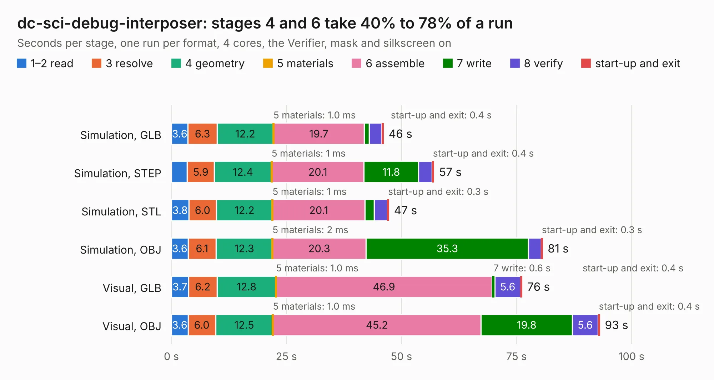

| Mode and format | 1–2 read | 3 resolve | 4 geometry | 5 materials | 6 assemble | 7 write | 8 verify | start-up and exit | Total |
|---|---:|---:|---:|---:|---:|---:|---:|---:|---:|
| Simulation, GLB | 3.6 | 6.3 | 12.2 | 1.0&nbsp;ms | 19.7 | 1.1 | 2.7 | 0.4 | 46.1 |
| Simulation, STEP | 3.4 | 5.9 | 12.4 | 1&nbsp;ms | 20.1 | 11.8 | 3.0 | 0.4 | 57.1 |
| Simulation, STL | 3.8 | 6.0 | 12.2 | 1&nbsp;ms | 20.1 | 2.0 | 2.9 | 0.3 | 47.3 |
| Simulation, OBJ | 3.6 | 6.1 | 12.3 | 2&nbsp;ms | 20.3 | 35.3 | 2.7 | 0.3 | 80.7 |
| Visual, GLB | 3.7 | 6.2 | 12.8 | 1.0&nbsp;ms | 46.9 | 0.6 | 5.6 | 0.4 | 76.2 |
| Visual, OBJ | 3.6 | 6.0 | 12.5 | 1.0&nbsp;ms | 45.2 | 19.8 | 5.6 | 0.4 | 93.1 |

<table align="center"><tr><td valign="top">

| Board | Repo: [antmicro/dc-sci-debug-interposer](https://github.com/antmicro/dc-sci-debug-interposer) Board: `dc-sci-debug-interposer.kicad_pcb` |
|---|---|
| Complexity | 439&nbsp;/&nbsp;1000 (size&nbsp;294, features&nbsp;145) |
| KESE&nbsp;features | through vias, rounded, trapezoid or chamfered pads, arc tracks, filled zones, copper text, curved board outline, knockout text, stack-up, dielectric εr and tanδ, copper finish, mask and silkscreen colours |
| Tested | 9th November 2026 |
| Copper&nbsp;layers | 8 |
| File&nbsp;format | KiCad 10 (20260206) |
| Parts,&nbsp;tracks,&nbsp;vias | 266, 4,217, 679 |
| Triangles,&nbsp;simulation | 5,925,818 in 368 parts |
| Verifier | PASS in all six runs |

</td><td valign="top">

<table>
<tr><th>File type</th><th>File size</th><th>Peak memory used</th></tr>
<tr><th colspan="3" align="left">Simulation</th></tr>
<tr><td>GLB</td><td align="right">199&nbsp;MB</td><td align="right">1.8&nbsp;GB</td></tr>
<tr><td>STEP</td><td align="right">706&nbsp;MB</td><td align="right">2.1&nbsp;GB</td></tr>
<tr><td>STL</td><td align="right">296&nbsp;MB</td><td align="right">1.6&nbsp;GB</td></tr>
<tr><td>OBJ</td><td align="right">632&nbsp;MB</td><td align="right">3.8&nbsp;GB</td></tr>
<tr><th colspan="3" align="left">Visual</th></tr>
<tr><td>GLB</td><td align="right">114&nbsp;MB</td><td align="right">2.0&nbsp;GB</td></tr>
<tr><td>OBJ</td><td align="right">371&nbsp;MB</td><td align="right">2.6&nbsp;GB</td></tr>
</table>

</td></tr></table>

## 339. dc-scm-breakout-board

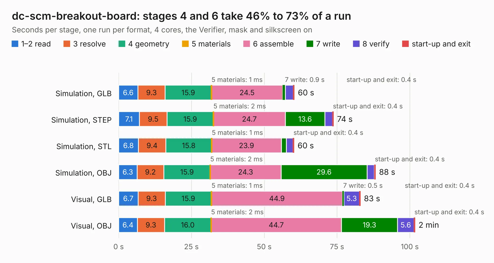

| Mode and format | 1–2 read | 3 resolve | 4 geometry | 5 materials | 6 assemble | 7 write | 8 verify | start-up and exit | Total |
|---|---:|---:|---:|---:|---:|---:|---:|---:|---:|
| Simulation, GLB | 6.6 | 9.3 | 15.9 | 1&nbsp;ms | 24.5 | 0.9 | 2.7 | 0.4 | 60.4 |
| Simulation, STEP | 7.1 | 9.5 | 15.9 | 2&nbsp;ms | 24.7 | 13.6 | 2.6 | 0.4 | 73.8 |
| Simulation, STL | 6.8 | 9.4 | 15.8 | 1&nbsp;ms | 23.9 | 1.7 | 2.3 | 0.4 | 60.3 |
| Simulation, OBJ | 6.3 | 9.2 | 15.9 | 2&nbsp;ms | 24.3 | 29.6 | 2.5 | 0.4 | 88.2 |
| Visual, GLB | 6.7 | 9.3 | 15.9 | 1&nbsp;ms | 44.9 | 0.5 | 5.3 | 0.4 | 83.0 |
| Visual, OBJ | 6.4 | 9.3 | 16.0 | 2&nbsp;ms | 44.7 | 19.3 | 5.6 | 0.4 | 101.8 |

<table align="center"><tr><td valign="top">

| Board | Repo: [antmicro/dc-scm-breakout-board](https://github.com/antmicro/dc-scm-breakout-board) Board: `dc-scm-breakout-board.kicad_pcb` |
|---|---|
| Complexity | 449&nbsp;/&nbsp;1000 (size&nbsp;284, features&nbsp;165) |
| KESE&nbsp;features | through vias, slotted holes, custom pads, rounded, trapezoid or chamfered pads, arc tracks, filled zones, copper drawings, copper text, curved board outline, knockout text, stack-up, dielectric εr and tanδ, mask and silkscreen colours |
| Tested | 9th November 2026 |
| Copper&nbsp;layers | 6 |
| File&nbsp;format | KiCad 10 (20260206) |
| Parts,&nbsp;tracks,&nbsp;vias | 282, 3,405, 582 |
| Triangles,&nbsp;simulation | 4,927,224 in 410 parts |
| Verifier | PASS in all six runs |

</td><td valign="top">

<table>
<tr><th>File type</th><th>File size</th><th>Peak memory used</th></tr>
<tr><th colspan="3" align="left">Simulation</th></tr>
<tr><td>GLB</td><td align="right">167&nbsp;MB</td><td align="right">1.5&nbsp;GB</td></tr>
<tr><td>STEP</td><td align="right">655&nbsp;MB</td><td align="right">2.1&nbsp;GB</td></tr>
<tr><td>STL</td><td align="right">246&nbsp;MB</td><td align="right">1.5&nbsp;GB</td></tr>
<tr><td>OBJ</td><td align="right">525&nbsp;MB</td><td align="right">3.3&nbsp;GB</td></tr>
<tr><th colspan="3" align="left">Visual</th></tr>
<tr><td>GLB</td><td align="right">105&nbsp;MB</td><td align="right">1.9&nbsp;GB</td></tr>
<tr><td>OBJ</td><td align="right">336&nbsp;MB</td><td align="right">2.3&nbsp;GB</td></tr>
</table>

</td></tr></table>

## 340. bmc-reference-carrier-board

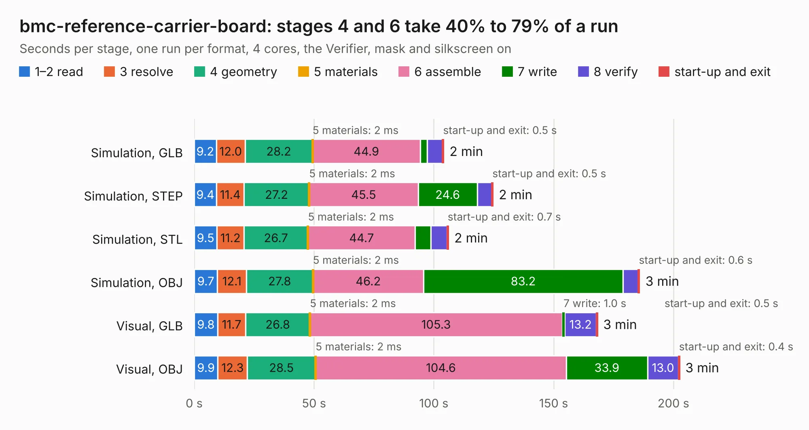

| Mode and format | 1–2 read | 3 resolve | 4 geometry | 5 materials | 6 assemble | 7 write | 8 verify | start-up and exit | Total |
|---|---:|---:|---:|---:|---:|---:|---:|---:|---:|
| Simulation, GLB | 9.2 | 12.0 | 28.2 | 2&nbsp;ms | 44.9 | 2.9 | 6.4 | 0.5 | 104.1 |
| Simulation, STEP | 9.4 | 11.4 | 27.2 | 2&nbsp;ms | 45.5 | 24.6 | 6.1 | 0.5 | 124.7 |
| Simulation, STL | 9.5 | 11.2 | 26.7 | 2&nbsp;ms | 44.7 | 6.5 | 6.7 | 0.7 | 106.1 |
| Simulation, OBJ | 9.7 | 12.1 | 27.8 | 2&nbsp;ms | 46.2 | 83.2 | 6.3 | 0.6 | 185.9 |
| Visual, GLB | 9.8 | 11.7 | 26.8 | 2&nbsp;ms | 105.3 | 1.0 | 13.2 | 0.5 | 168.3 |
| Visual, OBJ | 9.9 | 12.3 | 28.5 | 2&nbsp;ms | 104.6 | 33.9 | 13.0 | 0.4 | 202.6 |

<table align="center"><tr><td valign="top">

| Board | Repo: [antmicro/dc-scm-osm-l-carrier-card](https://github.com/antmicro/dc-scm-osm-l-carrier-card) Board: `bmc-reference-carrier-board.kicad_pcb` |
|---|---|
| Complexity | 527&nbsp;/&nbsp;1000 (size&nbsp;332, features&nbsp;195) |
| KESE&nbsp;features | through vias, padstacks, slotted holes, custom pads, rounded, trapezoid or chamfered pads, arc tracks, filled zones, copper drawings, copper text, curved board outline, knockout text, stack-up, dielectric εr and tanδ, mask and silkscreen colours |
| Tested | 9th November 2026 |
| Copper&nbsp;layers | 10 |
| File&nbsp;format | KiCad 9 (20241229) |
| Parts,&nbsp;tracks,&nbsp;vias | 529, 8,646, 1,355 |
| Triangles,&nbsp;simulation | 14,795,830 in 1092 parts |
| Verifier | PASS in all six runs |

</td><td valign="top">

<table>
<tr><th>File type</th><th>File size</th><th>Peak memory used</th></tr>
<tr><th colspan="3" align="left">Simulation</th></tr>
<tr><td>GLB</td><td align="right">488&nbsp;MB</td><td align="right">3.5&nbsp;GB</td></tr>
<tr><td>STEP</td><td align="right">1.5&nbsp;GB</td><td align="right">4.8&nbsp;GB</td></tr>
<tr><td>STL</td><td align="right">740&nbsp;MB</td><td align="right">3.5&nbsp;GB</td></tr>
<tr><td>OBJ</td><td align="right">1.6&nbsp;GB</td><td align="right">9.4&nbsp;GB</td></tr>
<tr><th colspan="3" align="left">Visual</th></tr>
<tr><td>GLB</td><td align="right">231&nbsp;MB</td><td align="right">4.1&nbsp;GB</td></tr>
<tr><td>OBJ</td><td align="right">765&nbsp;MB</td><td align="right">5.1&nbsp;GB</td></tr>
</table>

</td></tr></table>

## 341. dc-scm-rot-jumper-card

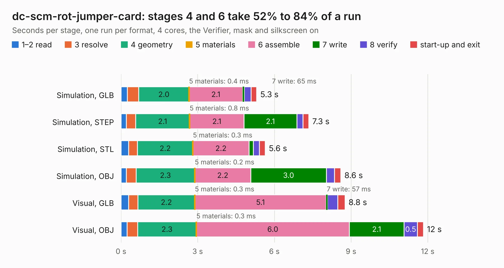

| Mode and format | 1–2 read | 3 resolve | 4 geometry | 5 materials | 6 assemble | 7 write | 8 verify | start-up and exit | Total |
|---|---:|---:|---:|---:|---:|---:|---:|---:|---:|
| Simulation, GLB | 0.2 | 0.4 | 2.0 | 0.4&nbsp;ms | 2.1 | 65&nbsp;ms | 0.3 | 0.2 | 5.3 |
| Simulation, STEP | 0.2 | 0.4 | 2.1 | 0.8&nbsp;ms | 2.1 | 2.1 | 0.2 | 0.2 | 7.3 |
| Simulation, STL | 0.3 | 0.3 | 2.2 | 0.3&nbsp;ms | 2.2 | 0.2 | 0.2 | 0.2 | 5.6 |
| Simulation, OBJ | 0.2 | 0.4 | 2.3 | 0.2&nbsp;ms | 2.2 | 3.0 | 0.3 | 0.2 | 8.6 |
| Visual, GLB | 0.3 | 0.4 | 2.2 | 0.3&nbsp;ms | 5.1 | 57&nbsp;ms | 0.4 | 0.3 | 8.8 |
| Visual, OBJ | 0.2 | 0.4 | 2.3 | 0.3&nbsp;ms | 6.0 | 2.1 | 0.5 | 0.2 | 11.8 |

<table align="center"><tr><td valign="top">

| Board | Repo: [antmicro/dc-scm-rot-jumper-card](https://github.com/antmicro/dc-scm-rot-jumper-card) Board: `dc-scm-rot-jumper-card.kicad_pcb` |
|---|---|
| Complexity | 188&nbsp;/&nbsp;1000 (size&nbsp;153, features&nbsp;35) |
| KESE&nbsp;features | through vias, rounded, trapezoid or chamfered pads, copper text |
| Tested | 9th November 2026 |
| Copper&nbsp;layers | 2 |
| File&nbsp;format | KiCad 5 (20171130) |
| Parts,&nbsp;tracks,&nbsp;vias | 23, 348, 48 |
| Triangles,&nbsp;simulation | 407,326 in 58 parts |
| Verifier | PASS in all six runs |

</td><td valign="top">

<table>
<tr><th>File type</th><th>File size</th><th>Peak memory used</th></tr>
<tr><th colspan="3" align="left">Simulation</th></tr>
<tr><td>GLB</td><td align="right">15&nbsp;MB</td><td align="right">292&nbsp;MB</td></tr>
<tr><td>STEP</td><td align="right">90&nbsp;MB</td><td align="right">353&nbsp;MB</td></tr>
<tr><td>STL</td><td align="right">20&nbsp;MB</td><td align="right">314&nbsp;MB</td></tr>
<tr><td>OBJ</td><td align="right">43&nbsp;MB</td><td align="right">353&nbsp;MB</td></tr>
<tr><th colspan="3" align="left">Visual</th></tr>
<tr><td>GLB</td><td align="right">10&nbsp;MB</td><td align="right">326&nbsp;MB</td></tr>
<tr><td>OBJ</td><td align="right">31&nbsp;MB</td><td align="right">331&nbsp;MB</td></tr>
</table>

</td></tr></table>

## 342. ddr4-spd-breakout

| Mode and format | 1–2 read | 3 resolve | 4 geometry | 5 materials | 6 assemble | 7 write | 8 verify | start-up and exit | Total |
|---|---:|---:|---:|---:|---:|---:|---:|---:|---:|
| Simulation, GLB | 0.5 | 2.8 | 9.8 | 0.7&nbsp;ms | 11.1 | 0.4 | 0.9 | 0.3 | 25.9 |
| Simulation, STEP | 0.5 | 2.7 | 9.6 | 0.2&nbsp;ms | 11.4 | 7.1 | 0.9 | 0.3 | 32.5 |
| Simulation, STL | 0.6 | 2.8 | 10.0 | 0.4&nbsp;ms | 11.7 | 1.0 | 0.9 | 0.3 | 27.4 |
| Simulation, OBJ | 0.7 | 2.7 | 9.2 | 0.4&nbsp;ms | 10.4 | 13.2 | 0.8 | 0.3 | 37.2 |
| Visual, GLB | 0.5 | 2.4 | 9.2 | 0.7&nbsp;ms | 21.4 | 0.3 | 2.1 | 0.3 | 36.2 |
| Visual, OBJ | 0.5 | 2.7 | 9.3 | 0.4&nbsp;ms | 21.7 | 8.2 | 2.0 | 0.3 | 44.6 |

<table align="center"><tr><td valign="top">

| Board | Repo: [antmicro/ddr4-spd-breakout-board](https://github.com/antmicro/ddr4-spd-breakout-board) Board: `ddr4-spd-breakout.kicad_pcb` |
|---|---|
| Complexity | 306&nbsp;/&nbsp;1000 (size&nbsp;241, features&nbsp;65) |
| KESE&nbsp;features | through vias, slotted holes, rounded, trapezoid or chamfered pads, filled zones, copper text |
| Tested | 9th November 2026 |
| Copper&nbsp;layers | 4 |
| File&nbsp;format | KiCad 5 (20171130) |
| Parts,&nbsp;tracks,&nbsp;vias | 57, 505, 450 |
| Triangles,&nbsp;simulation | 2,164,064 in 47 parts |
| Verifier | PASS in all six runs |

</td><td valign="top">

<table>
<tr><th>File type</th><th>File size</th><th>Peak memory used</th></tr>
<tr><th colspan="3" align="left">Simulation</th></tr>
<tr><td>GLB</td><td align="right">74&nbsp;MB</td><td align="right">807&nbsp;MB</td></tr>
<tr><td>STEP</td><td align="right">270&nbsp;MB</td><td align="right">1.1&nbsp;GB</td></tr>
<tr><td>STL</td><td align="right">108&nbsp;MB</td><td align="right">799&nbsp;MB</td></tr>
<tr><td>OBJ</td><td align="right">226&nbsp;MB</td><td align="right">1.4&nbsp;GB</td></tr>
<tr><th colspan="3" align="left">Visual</th></tr>
<tr><td>GLB</td><td align="right">47&nbsp;MB</td><td align="right">926&nbsp;MB</td></tr>
<tr><td>OBJ</td><td align="right">144&nbsp;MB</td><td align="right">1.0&nbsp;GB</td></tr>
</table>

</td></tr></table>

## 343. ddr5-testbed

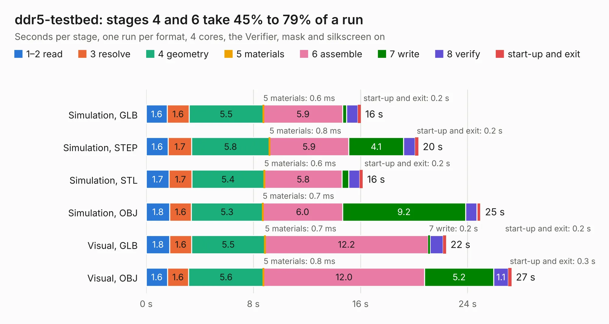

| Mode and format | 1–2 read | 3 resolve | 4 geometry | 5 materials | 6 assemble | 7 write | 8 verify | start-up and exit | Total |
|---|---:|---:|---:|---:|---:|---:|---:|---:|---:|
| Simulation, GLB | 1.6 | 1.6 | 5.5 | 0.6&nbsp;ms | 5.9 | 0.3 | 0.8 | 0.2 | 16.0 |
| Simulation, STEP | 1.6 | 1.7 | 5.8 | 0.8&nbsp;ms | 5.9 | 4.1 | 0.9 | 0.2 | 20.3 |
| Simulation, STL | 1.7 | 1.7 | 5.4 | 0.6&nbsp;ms | 5.8 | 0.5 | 0.8 | 0.2 | 16.2 |
| Simulation, OBJ | 1.8 | 1.6 | 5.3 | 0.7&nbsp;ms | 6.0 | 9.2 | 0.8 | 0.3 | 25.0 |
| Visual, GLB | 1.8 | 1.6 | 5.5 | 0.7&nbsp;ms | 12.2 | 0.2 | 1.0 | 0.2 | 22.4 |
| Visual, OBJ | 1.6 | 1.6 | 5.6 | 0.8&nbsp;ms | 12.0 | 5.2 | 1.1 | 0.3 | 27.3 |

<table align="center"><tr><td valign="top">

| Board | Repo: [antmicro/ddr5-testbed](https://github.com/antmicro/ddr5-testbed) Board: `ddr5-testbed.kicad_pcb` |
|---|---|
| Complexity | 379&nbsp;/&nbsp;1000 (size&nbsp;284, features&nbsp;95) |
| KESE&nbsp;features | through vias, rounded, trapezoid or chamfered pads, filled zones, copper text, curved board outline, stack-up, dielectric εr and tanδ |
| Tested | 9th November 2026 |
| Copper&nbsp;layers | 6 |
| File&nbsp;format | KiCad 9 (20241229) |
| Parts,&nbsp;tracks,&nbsp;vias | 59, 5,140, 180 |
| Triangles,&nbsp;simulation | 1,652,750 in 238 parts |
| Verifier | PASS in all six runs |

</td><td valign="top">

<table>
<tr><th>File type</th><th>File size</th><th>Peak memory used</th></tr>
<tr><th colspan="3" align="left">Simulation</th></tr>
<tr><td>GLB</td><td align="right">57&nbsp;MB</td><td align="right">655&nbsp;MB</td></tr>
<tr><td>STEP</td><td align="right">245&nbsp;MB</td><td align="right">736&nbsp;MB</td></tr>
<tr><td>STL</td><td align="right">83&nbsp;MB</td><td align="right">618&nbsp;MB</td></tr>
<tr><td>OBJ</td><td align="right">175&nbsp;MB</td><td align="right">1.2&nbsp;GB</td></tr>
<tr><th colspan="3" align="left">Visual</th></tr>
<tr><td>GLB</td><td align="right">31&nbsp;MB</td><td align="right">750&nbsp;MB</td></tr>
<tr><td>OBJ</td><td align="right">97&nbsp;MB</td><td align="right">809&nbsp;MB</td></tr>
</table>

</td></tr></table>

## 344. data-center-rdimm-ddr5-tester

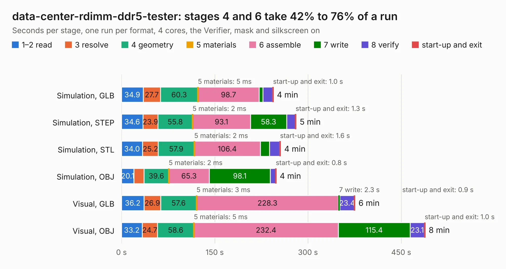

| Mode and format | 1–2 read | 3 resolve | 4 geometry | 5 materials | 6 assemble | 7 write | 8 verify | start-up and exit | Total |
|---|---:|---:|---:|---:|---:|---:|---:|---:|---:|
| Simulation, GLB | 34.9 | 27.7 | 60.3 | 5&nbsp;ms | 98.7 | 5.8 | 15.7 | 1.0 | 244.2 |
| Simulation, STEP | 34.6 | 23.9 | 55.8 | 2&nbsp;ms | 93.1 | 58.3 | 13.8 | 1.3 | 280.9 |
| Simulation, STL | 34.0 | 25.2 | 57.9 | 2&nbsp;ms | 106.4 | 14.7 | 16.3 | 1.6 | 256.0 |
| Simulation, OBJ | 20.1 | 16.2 | 39.6 | 2&nbsp;ms | 65.3 | 98.1 | 8.5 | 0.8 | 248.7 |
| Visual, GLB | 36.2 | 26.9 | 57.6 | 3&nbsp;ms | 228.3 | 2.3 | 23.4 | 0.9 | 375.5 |
| Visual, OBJ | 33.2 | 24.7 | 58.6 | 5&nbsp;ms | 232.4 | 115.4 | 23.1 | 1.0 | 488.4 |

<table align="center"><tr><td valign="top">

| Board | Repo: [antmicro/ddr5-tester](https://github.com/antmicro/ddr5-tester) Board: `data-center-rdimm-ddr5-tester.kicad_pcb` |
|---|---|
| Complexity | 560&nbsp;/&nbsp;1000 (size&nbsp;365, features&nbsp;195) |
| KESE&nbsp;features | through vias, slotted holes, custom pads, rounded, trapezoid or chamfered pads, arc tracks, filled zones, copper drawings, copper text, curved board outline, knockout text, TrueType text, stack-up, dielectric εr and tanδ, copper finish, mask and silkscreen colours |
| Tested | 9th November 2026 to 10th November 2026 |
| Copper&nbsp;layers | 12 |
| File&nbsp;format | KiCad 9 (20241229) |
| Parts,&nbsp;tracks,&nbsp;vias | 761, 19,710, 2,625 |
| Triangles,&nbsp;simulation | 22,023,050 in 849 parts |
| Verifier | PASS in all six runs |
| Run&nbsp;again | Simulation, OBJ: failed in the corpus run, run again with the memory cap raised from 11 GB to 14.5 GB, and passed |

</td><td valign="top">

<table>
<tr><th>File type</th><th>File size</th><th>Peak memory used</th></tr>
<tr><th colspan="3" align="left">Simulation</th></tr>
<tr><td>GLB</td><td align="right">698&nbsp;MB</td><td align="right">6.0&nbsp;GB</td></tr>
<tr><td>STEP</td><td align="right">2.2&nbsp;GB</td><td align="right">6.9&nbsp;GB</td></tr>
<tr><td>STL</td><td align="right">1.1&nbsp;GB</td><td align="right">5.9&nbsp;GB</td></tr>
<tr><td>OBJ</td><td align="right">2.4&nbsp;GB</td><td align="right">14&nbsp;GB</td></tr>
<tr><th colspan="3" align="left">Visual</th></tr>
<tr><td>GLB</td><td align="right">361&nbsp;MB</td><td align="right">6.7&nbsp;GB</td></tr>
<tr><td>OBJ</td><td align="right">1.2&nbsp;GB</td><td align="right">8.2&nbsp;GB</td></tr>
</table>

</td></tr></table>

## 345. dual-camera-to-gmsl-serializer-csi-adapter

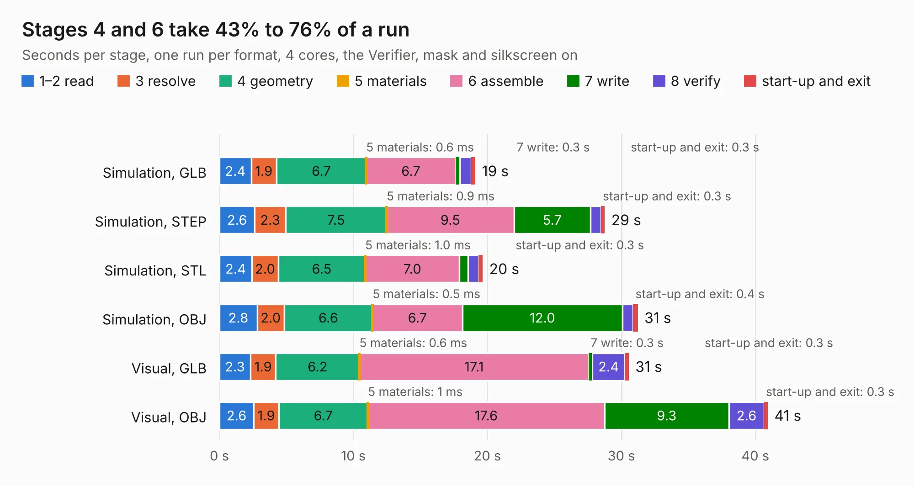

| Mode and format | 1–2 read | 3 resolve | 4 geometry | 5 materials | 6 assemble | 7 write | 8 verify | start-up and exit | Total |
|---|---:|---:|---:|---:|---:|---:|---:|---:|---:|
| Simulation, GLB | 2.4 | 1.9 | 6.7 | 0.6&nbsp;ms | 6.7 | 0.3 | 0.8 | 0.3 | 19.1 |
| Simulation, STEP | 2.6 | 2.3 | 7.5 | 0.9&nbsp;ms | 9.5 | 5.7 | 0.8 | 0.3 | 28.8 |
| Simulation, STL | 2.4 | 2.0 | 6.5 | 1.0&nbsp;ms | 7.0 | 0.6 | 0.8 | 0.3 | 19.7 |
| Simulation, OBJ | 2.8 | 2.0 | 6.6 | 0.5&nbsp;ms | 6.7 | 12.0 | 0.8 | 0.4 | 31.2 |
| Visual, GLB | 2.3 | 1.9 | 6.2 | 0.6&nbsp;ms | 17.1 | 0.3 | 2.4 | 0.3 | 30.6 |
| Visual, OBJ | 2.6 | 1.9 | 6.7 | 1&nbsp;ms | 17.6 | 9.3 | 2.6 | 0.3 | 40.9 |

<table align="center"><tr><td valign="top">

| Board | Repo: [antmicro/dual-gmsl-serializer-adapter](https://github.com/antmicro/dual-gmsl-serializer-adapter) Board: `dual-camera-to-gmsl-serializer-csi-adapter.kicad_pcb` |
|---|---|
| Complexity | 357&nbsp;/&nbsp;1000 (size&nbsp;212, features&nbsp;145) |
| KESE&nbsp;features | through vias, custom pads, rounded, trapezoid or chamfered pads, arc tracks, filled zones, copper drawings, copper text, knockout text, stack-up, dielectric εr and tanδ, mask and silkscreen colours |
| Tested | 9th November 2026 |
| Copper&nbsp;layers | 4 |
| File&nbsp;format | KiCad 8 (20240108) |
| Parts,&nbsp;tracks,&nbsp;vias | 95, 1,730, 289 |
| Triangles,&nbsp;simulation | 1,904,014 in 141 parts |
| Verifier | PASS in all six runs |

</td><td valign="top">

<table>
<tr><th>File type</th><th>File size</th><th>Peak memory used</th></tr>
<tr><th colspan="3" align="left">Simulation</th></tr>
<tr><td>GLB</td><td align="right">66&nbsp;MB</td><td align="right">850&nbsp;MB</td></tr>
<tr><td>STEP</td><td align="right">246&nbsp;MB</td><td align="right">891&nbsp;MB</td></tr>
<tr><td>STL</td><td align="right">95&nbsp;MB</td><td align="right">836&nbsp;MB</td></tr>
<tr><td>OBJ</td><td align="right">202&nbsp;MB</td><td align="right">1.4&nbsp;GB</td></tr>
<tr><th colspan="3" align="left">Visual</th></tr>
<tr><td>GLB</td><td align="right">48&nbsp;MB</td><td align="right">911&nbsp;MB</td></tr>
<tr><td>OBJ</td><td align="right">150&nbsp;MB</td><td align="right">1.1&nbsp;GB</td></tr>
</table>

</td></tr></table>

## 346. dual-ipex-csi-interposer

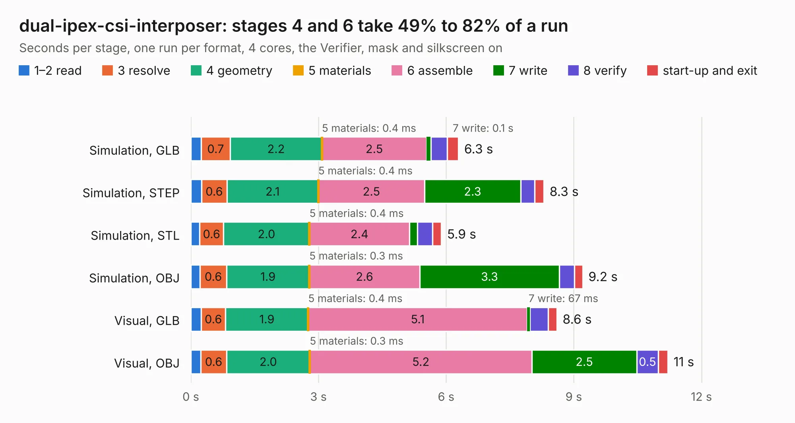

| Mode and format | 1–2 read | 3 resolve | 4 geometry | 5 materials | 6 assemble | 7 write | 8 verify | start-up and exit | Total |
|---|---:|---:|---:|---:|---:|---:|---:|---:|---:|
| Simulation, GLB | 0.2 | 0.7 | 2.2 | 0.4&nbsp;ms | 2.5 | 0.1 | 0.4 | 0.3 | 6.3 |
| Simulation, STEP | 0.3 | 0.6 | 2.1 | 0.4&nbsp;ms | 2.5 | 2.3 | 0.3 | 0.2 | 8.3 |
| Simulation, STL | 0.2 | 0.6 | 2.0 | 0.4&nbsp;ms | 2.4 | 0.2 | 0.4 | 0.2 | 5.9 |
| Simulation, OBJ | 0.2 | 0.6 | 1.9 | 0.3&nbsp;ms | 2.6 | 3.3 | 0.4 | 0.2 | 9.2 |
| Visual, GLB | 0.2 | 0.6 | 1.9 | 0.4&nbsp;ms | 5.1 | 67&nbsp;ms | 0.4 | 0.2 | 8.6 |
| Visual, OBJ | 0.2 | 0.6 | 2.0 | 0.3&nbsp;ms | 5.2 | 2.5 | 0.5 | 0.2 | 11.2 |

<table align="center"><tr><td valign="top">

| Board | Repo: [antmicro/dual-ipex-csi-interposer](https://github.com/antmicro/dual-ipex-csi-interposer) Board: `dual-ipex-csi-interposer.kicad_pcb` |
|---|---|
| Complexity | 267&nbsp;/&nbsp;1000 (size&nbsp;172, features&nbsp;95) |
| KESE&nbsp;features | through vias, rounded, trapezoid or chamfered pads, filled zones, copper text, curved board outline, stack-up, dielectric εr and tanδ |
| Tested | 9th November 2026 |
| Copper&nbsp;layers | 4 |
| File&nbsp;format | KiCad 6 (20211014) |
| Parts,&nbsp;tracks,&nbsp;vias | 13, 511, 107 |
| Triangles,&nbsp;simulation | 645,608 in 69 parts |
| Verifier | PASS in all six runs |

</td><td valign="top">

<table>
<tr><th>File type</th><th>File size</th><th>Peak memory used</th></tr>
<tr><th colspan="3" align="left">Simulation</th></tr>
<tr><td>GLB</td><td align="right">22&nbsp;MB</td><td align="right">348&nbsp;MB</td></tr>
<tr><td>STEP</td><td align="right">103&nbsp;MB</td><td align="right">417&nbsp;MB</td></tr>
<tr><td>STL</td><td align="right">32&nbsp;MB</td><td align="right">350&nbsp;MB</td></tr>
<tr><td>OBJ</td><td align="right">65&nbsp;MB</td><td align="right">479&nbsp;MB</td></tr>
<tr><th colspan="3" align="left">Visual</th></tr>
<tr><td>GLB</td><td align="right">15&nbsp;MB</td><td align="right">457&nbsp;MB</td></tr>
<tr><td>OBJ</td><td align="right">45&nbsp;MB</td><td align="right">455&nbsp;MB</td></tr>
</table>

</td></tr></table>

## 347. ecp5-dc-scm

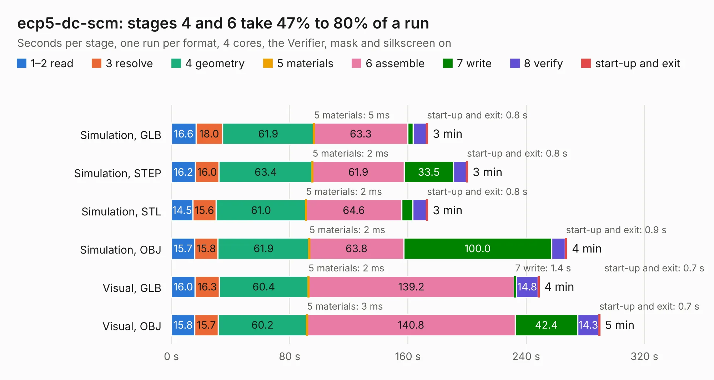

| Mode and format | 1–2 read | 3 resolve | 4 geometry | 5 materials | 6 assemble | 7 write | 8 verify | start-up and exit | Total |
|---|---:|---:|---:|---:|---:|---:|---:|---:|---:|
| Simulation, GLB | 16.6 | 18.0 | 61.9 | 5&nbsp;ms | 63.3 | 3.7 | 9.1 | 0.8 | 173.4 |
| Simulation, STEP | 16.2 | 16.0 | 63.4 | 2&nbsp;ms | 61.9 | 33.5 | 8.7 | 0.8 | 200.4 |
| Simulation, STL | 14.5 | 15.6 | 61.0 | 2&nbsp;ms | 64.6 | 7.6 | 9.2 | 0.8 | 173.4 |
| Simulation, OBJ | 15.7 | 15.8 | 61.9 | 2&nbsp;ms | 63.8 | 100.0 | 9.4 | 0.9 | 267.5 |
| Visual, GLB | 16.0 | 16.3 | 60.4 | 2&nbsp;ms | 139.2 | 1.4 | 14.8 | 0.7 | 248.8 |
| Visual, OBJ | 15.8 | 15.7 | 60.2 | 3&nbsp;ms | 140.8 | 42.4 | 14.3 | 0.7 | 289.8 |

<table align="center"><tr><td valign="top">

| Board | Repo: [antmicro/ecp5-dc-scm](https://github.com/antmicro/ecp5-dc-scm) Board: `ecp5-dc-scm.kicad_pcb` |
|---|---|
| Complexity | 508&nbsp;/&nbsp;1000 (size&nbsp;343, features&nbsp;165) |
| KESE&nbsp;features | through vias, blind and buried vias, custom pads, rounded, trapezoid or chamfered pads, filled zones, copper drawings, copper text, curved board outline, stack-up, dielectric εr and tanδ, mask and silkscreen colours |
| Tested | 9th November 2026 |
| Copper&nbsp;layers | 8 |
| File&nbsp;format | KiCad 7 (20221018) |
| Parts,&nbsp;tracks,&nbsp;vias | 488, 12,884, 1,545 |
| Triangles,&nbsp;simulation | 13,991,872 in 803 parts |
| Verifier | PASS in all six runs |

</td><td valign="top">

<table>
<tr><th>File type</th><th>File size</th><th>Peak memory used</th></tr>
<tr><th colspan="3" align="left">Simulation</th></tr>
<tr><td>GLB</td><td align="right">480&nbsp;MB</td><td align="right">3.1&nbsp;GB</td></tr>
<tr><td>STEP</td><td align="right">1.8&nbsp;GB</td><td align="right">4.6&nbsp;GB</td></tr>
<tr><td>STL</td><td align="right">700&nbsp;MB</td><td align="right">3.4&nbsp;GB</td></tr>
<tr><td>OBJ</td><td align="right">1.5&nbsp;GB</td><td align="right">9.2&nbsp;GB</td></tr>
<tr><th colspan="3" align="left">Visual</th></tr>
<tr><td>GLB</td><td align="right">231&nbsp;MB</td><td align="right">4.2&nbsp;GB</td></tr>
<tr><td>OBJ</td><td align="right">763&nbsp;MB</td><td align="right">5.5&nbsp;GB</td></tr>
</table>

</td></tr></table>

## 348. environment-sensor

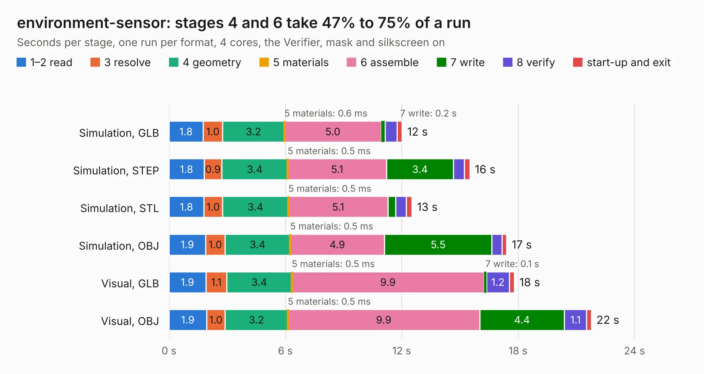

| Mode and format | 1–2 read | 3 resolve | 4 geometry | 5 materials | 6 assemble | 7 write | 8 verify | start-up and exit | Total |
|---|---:|---:|---:|---:|---:|---:|---:|---:|---:|
| Simulation, GLB | 1.8 | 1.0 | 3.2 | 0.6&nbsp;ms | 5.0 | 0.2 | 0.6 | 0.3 | 12.0 |
| Simulation, STEP | 1.8 | 0.9 | 3.4 | 0.5&nbsp;ms | 5.1 | 3.4 | 0.6 | 0.3 | 15.5 |
| Simulation, STL | 1.8 | 1.0 | 3.4 | 0.5&nbsp;ms | 5.1 | 0.4 | 0.5 | 0.3 | 12.5 |
| Simulation, OBJ | 1.9 | 1.0 | 3.4 | 0.5&nbsp;ms | 4.9 | 5.5 | 0.5 | 0.2 | 17.4 |
| Visual, GLB | 1.9 | 1.1 | 3.4 | 0.5&nbsp;ms | 9.9 | 0.1 | 1.2 | 0.3 | 17.8 |
| Visual, OBJ | 1.9 | 1.0 | 3.2 | 0.5&nbsp;ms | 9.9 | 4.4 | 1.1 | 0.2 | 21.8 |

<table align="center"><tr><td valign="top">

| Board | Repo: [antmicro/environment-sensor](https://github.com/antmicro/environment-sensor) Board: `environment-sensor.kicad_pcb` |
|---|---|
| Complexity | 341&nbsp;/&nbsp;1000 (size&nbsp;246, features&nbsp;95) |
| KESE&nbsp;features | through vias, slotted holes, rounded, trapezoid or chamfered pads, filled zones, curved board outline, stack-up, dielectric εr and tanδ |
| Tested | 9th November 2026 |
| Copper&nbsp;layers | 4 |
| File&nbsp;format | KiCad 9 (20241229) |
| Parts,&nbsp;tracks,&nbsp;vias | 92, 863, 144 |
| Triangles,&nbsp;simulation | 1,221,012 in 105 parts |
| Verifier | PASS in all six runs |

</td><td valign="top">

<table>
<tr><th>File type</th><th>File size</th><th>Peak memory used</th></tr>
<tr><th colspan="3" align="left">Simulation</th></tr>
<tr><td>GLB</td><td align="right">42&nbsp;MB</td><td align="right">559&nbsp;MB</td></tr>
<tr><td>STEP</td><td align="right">208&nbsp;MB</td><td align="right">681&nbsp;MB</td></tr>
<tr><td>STL</td><td align="right">61&nbsp;MB</td><td align="right">555&nbsp;MB</td></tr>
<tr><td>OBJ</td><td align="right">126&nbsp;MB</td><td align="right">890&nbsp;MB</td></tr>
<tr><th colspan="3" align="left">Visual</th></tr>
<tr><td>GLB</td><td align="right">30&nbsp;MB</td><td align="right">803&nbsp;MB</td></tr>
<tr><td>OBJ</td><td align="right">91&nbsp;MB</td><td align="right">793&nbsp;MB</td></tr>
</table>

</td></tr></table>

## 349. environment-sensor-sip-baseboard

| Mode and format | 1–2 read | 3 resolve | 4 geometry | 5 materials | 6 assemble | 7 write | 8 verify | start-up and exit | Total |
|---|---:|---:|---:|---:|---:|---:|---:|---:|---:|
| Simulation, GLB | 0.8 | 0.8 | 3.3 | 0.4&nbsp;ms | 3.8 | 0.1 | 0.5 | 0.3 | 9.6 |
| Simulation, STEP | 0.8 | 0.9 | 3.5 | 0.4&nbsp;ms | 3.8 | 3.0 | 0.5 | 0.2 | 12.6 |
| Simulation, STL | 0.9 | 0.9 | 3.5 | 0.4&nbsp;ms | 3.8 | 0.2 | 0.6 | 0.3 | 10.3 |
| Simulation, OBJ | 0.8 | 0.8 | 3.4 | 0.3&nbsp;ms | 3.9 | 4.9 | 0.7 | 0.3 | 14.9 |
| Visual, GLB | 0.8 | 0.9 | 3.6 | 0.4&nbsp;ms | 7.7 | 0.1 | 0.8 | 0.2 | 14.1 |
| Visual, OBJ | 0.8 | 0.8 | 3.3 | 0.5&nbsp;ms | 8.2 | 3.2 | 0.7 | 0.2 | 17.3 |

<table align="center"><tr><td valign="top">

| Board | Repo: [antmicro/environment-sensor-myra-baseboard](https://github.com/antmicro/environment-sensor-myra-baseboard) Board: `environment-sensor-sip-baseboard.kicad_pcb` |
|---|---|
| Complexity | 372&nbsp;/&nbsp;1000 (size&nbsp;232, features&nbsp;140) |
| KESE&nbsp;features | through vias, slotted holes, rounded, trapezoid or chamfered pads, arc tracks, filled zones, copper text, curved board outline, knockout text, stack-up, dielectric εr and tanδ, mask and silkscreen colours |
| Tested | 9th November 2026 |
| Copper&nbsp;layers | 4 |
| File&nbsp;format | KiCad 7 (20221018) |
| Parts,&nbsp;tracks,&nbsp;vias | 33, 434, 106 |
| Triangles,&nbsp;simulation | 824,680 in 64 parts |
| Verifier | PASS in all six runs |

</td><td valign="top">

<table>
<tr><th>File type</th><th>File size</th><th>Peak memory used</th></tr>
<tr><th colspan="3" align="left">Simulation</th></tr>
<tr><td>GLB</td><td align="right">28&nbsp;MB</td><td align="right">410&nbsp;MB</td></tr>
<tr><td>STEP</td><td align="right">133&nbsp;MB</td><td align="right">482&nbsp;MB</td></tr>
<tr><td>STL</td><td align="right">41&nbsp;MB</td><td align="right">407&nbsp;MB</td></tr>
<tr><td>OBJ</td><td align="right">84&nbsp;MB</td><td align="right">636&nbsp;MB</td></tr>
<tr><th colspan="3" align="left">Visual</th></tr>
<tr><td>GLB</td><td align="right">19&nbsp;MB</td><td align="right">545&nbsp;MB</td></tr>
<tr><td>OBJ</td><td align="right">58&nbsp;MB</td><td align="right">550&nbsp;MB</td></tr>
</table>

</td></tr></table>

## 350. lz1-led-driver

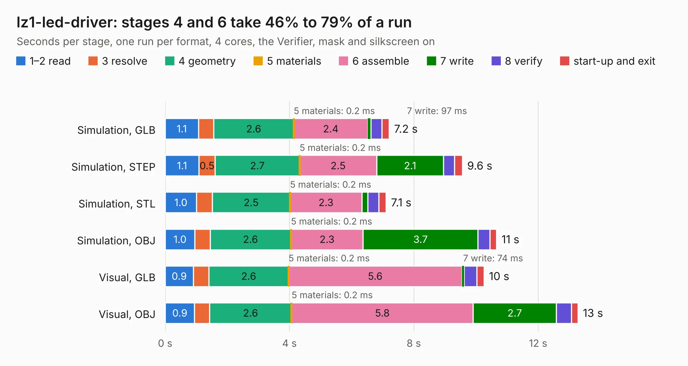

| Mode and format | 1–2 read | 3 resolve | 4 geometry | 5 materials | 6 assemble | 7 write | 8 verify | start-up and exit | Total |
|---|---:|---:|---:|---:|---:|---:|---:|---:|---:|
| Simulation, GLB | 1.1 | 0.5 | 2.6 | 0.2&nbsp;ms | 2.4 | 97&nbsp;ms | 0.4 | 0.2 | 7.2 |
| Simulation, STEP | 1.1 | 0.5 | 2.7 | 0.2&nbsp;ms | 2.5 | 2.1 | 0.4 | 0.3 | 9.6 |
| Simulation, STL | 1.0 | 0.5 | 2.5 | 0.2&nbsp;ms | 2.3 | 0.2 | 0.4 | 0.2 | 7.1 |
| Simulation, OBJ | 1.0 | 0.5 | 2.6 | 0.2&nbsp;ms | 2.3 | 3.7 | 0.4 | 0.2 | 10.7 |
| Visual, GLB | 0.9 | 0.5 | 2.6 | 0.2&nbsp;ms | 5.6 | 74&nbsp;ms | 0.4 | 0.2 | 10.3 |
| Visual, OBJ | 0.9 | 0.5 | 2.6 | 0.2&nbsp;ms | 5.8 | 2.7 | 0.5 | 0.2 | 13.3 |

<table align="center"><tr><td valign="top">

| Board | Repo: [antmicro/flickerless-led-driver](https://github.com/antmicro/flickerless-led-driver) Board: `lz1-led-driver.kicad_pcb` |
|---|---|
| Complexity | 253&nbsp;/&nbsp;1000 (size&nbsp;158, features&nbsp;95) |
| KESE&nbsp;features | through vias, slotted holes, rounded, trapezoid or chamfered pads, filled zones, copper text, stack-up, dielectric εr and tanδ |
| Tested | 9th November 2026 |
| Copper&nbsp;layers | 2 |
| File&nbsp;format | KiCad 7 (20221018) |
| Parts,&nbsp;tracks,&nbsp;vias | 41, 161, 101 |
| Triangles,&nbsp;simulation | 675,574 in 39 parts |
| Verifier | PASS in all six runs |

</td><td valign="top">

<table>
<tr><th>File type</th><th>File size</th><th>Peak memory used</th></tr>
<tr><th colspan="3" align="left">Simulation</th></tr>
<tr><td>GLB</td><td align="right">23&nbsp;MB</td><td align="right">391&nbsp;MB</td></tr>
<tr><td>STEP</td><td align="right">135&nbsp;MB</td><td align="right">447&nbsp;MB</td></tr>
<tr><td>STL</td><td align="right">34&nbsp;MB</td><td align="right">391&nbsp;MB</td></tr>
<tr><td>OBJ</td><td align="right">69&nbsp;MB</td><td align="right">512&nbsp;MB</td></tr>
<tr><th colspan="3" align="left">Visual</th></tr>
<tr><td>GLB</td><td align="right">16&nbsp;MB</td><td align="right">460&nbsp;MB</td></tr>
<tr><td>OBJ</td><td align="right">49&nbsp;MB</td><td align="right">490&nbsp;MB</td></tr>
</table>

</td></tr></table>

## 351. fmc2sata

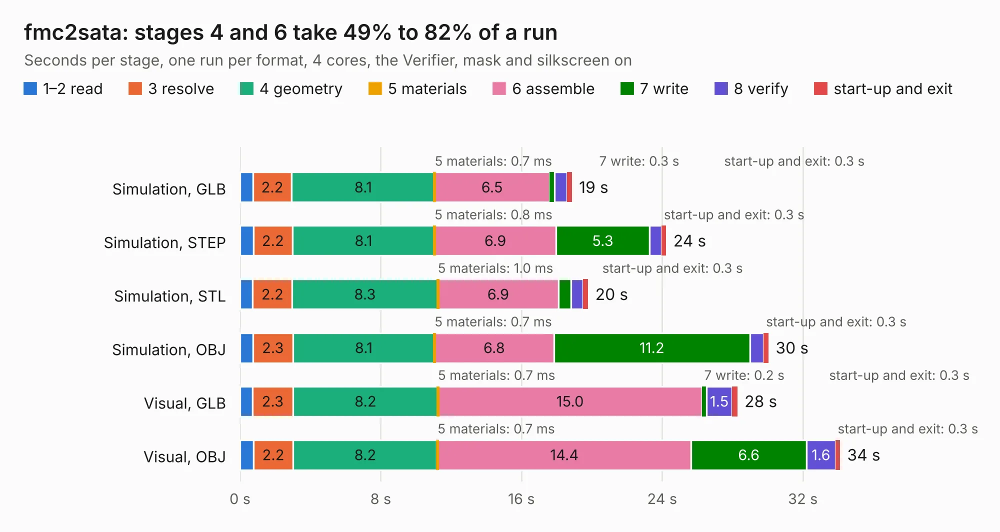

| Mode and format | 1–2 read | 3 resolve | 4 geometry | 5 materials | 6 assemble | 7 write | 8 verify | start-up and exit | Total |
|---|---:|---:|---:|---:|---:|---:|---:|---:|---:|
| Simulation, GLB | 0.7 | 2.2 | 8.1 | 0.7&nbsp;ms | 6.5 | 0.3 | 0.7 | 0.3 | 18.9 |
| Simulation, STEP | 0.8 | 2.2 | 8.1 | 0.8&nbsp;ms | 6.9 | 5.3 | 0.7 | 0.3 | 24.2 |
| Simulation, STL | 0.7 | 2.2 | 8.3 | 1.0&nbsp;ms | 6.9 | 0.7 | 0.7 | 0.3 | 19.8 |
| Simulation, OBJ | 0.7 | 2.3 | 8.1 | 0.7&nbsp;ms | 6.8 | 11.2 | 0.8 | 0.3 | 30.0 |
| Visual, GLB | 0.7 | 2.3 | 8.2 | 0.7&nbsp;ms | 15.0 | 0.2 | 1.5 | 0.3 | 28.3 |
| Visual, OBJ | 0.8 | 2.2 | 8.2 | 0.7&nbsp;ms | 14.4 | 6.6 | 1.6 | 0.3 | 34.1 |

<table align="center"><tr><td valign="top">

| Board | Repo: [antmicro/fmc-sata-adapter](https://github.com/antmicro/fmc-sata-adapter) Board: `fmc2sata.kicad_pcb` |
|---|---|
| Complexity | 253&nbsp;/&nbsp;1000 (size&nbsp;198, features&nbsp;55) |
| KESE&nbsp;features | through vias, rounded, trapezoid or chamfered pads, filled zones, copper text |
| Tested | 9th November 2026 |
| Copper&nbsp;layers | 4 |
| File&nbsp;format | KiCad 5 (20171130) |
| Parts,&nbsp;tracks,&nbsp;vias | 59, 769, 258 |
| Triangles,&nbsp;simulation | 1,824,356 in 179 parts |
| Verifier | PASS in all six runs |

</td><td valign="top">

<table>
<tr><th>File type</th><th>File size</th><th>Peak memory used</th></tr>
<tr><th colspan="3" align="left">Simulation</th></tr>
<tr><td>GLB</td><td align="right">63&nbsp;MB</td><td align="right">888&nbsp;MB</td></tr>
<tr><td>STEP</td><td align="right">287&nbsp;MB</td><td align="right">891&nbsp;MB</td></tr>
<tr><td>STL</td><td align="right">91&nbsp;MB</td><td align="right">821&nbsp;MB</td></tr>
<tr><td>OBJ</td><td align="right">193&nbsp;MB</td><td align="right">1.3&nbsp;GB</td></tr>
<tr><th colspan="3" align="left">Visual</th></tr>
<tr><td>GLB</td><td align="right">39&nbsp;MB</td><td align="right">865&nbsp;MB</td></tr>
<tr><td>OBJ</td><td align="right">119&nbsp;MB</td><td align="right">887&nbsp;MB</td></tr>
</table>

</td></tr></table>

## 352. framos-csi-adapter

| Mode and format | 1–2 read | 3 resolve | 4 geometry | 5 materials | 6 assemble | 7 write | 8 verify | start-up and exit | Total |
|---|---:|---:|---:|---:|---:|---:|---:|---:|---:|
| Simulation, GLB | 1.4 | 0.6 | 2.1 | 0.6&nbsp;ms | 2.9 | 0.1 | 0.4 | 0.2 | 7.7 |
| Simulation, STEP | 1.5 | 0.6 | 2.1 | 0.3&nbsp;ms | 2.8 | 2.5 | 0.5 | 0.2 | 10.3 |
| Simulation, STL | 1.4 | 0.7 | 2.1 | 0.3&nbsp;ms | 3.0 | 0.2 | 0.4 | 0.2 | 8.0 |
| Simulation, OBJ | 1.4 | 0.6 | 2.2 | 0.3&nbsp;ms | 3.0 | 4.1 | 0.5 | 0.2 | 12.0 |
| Visual, GLB | 1.4 | 0.7 | 2.3 | 0.6&nbsp;ms | 6.8 | 87&nbsp;ms | 0.6 | 0.3 | 12.1 |
| Visual, OBJ | 1.4 | 0.7 | 2.3 | 0.3&nbsp;ms | 6.5 | 3.1 | 0.6 | 0.2 | 14.8 |

<table align="center"><tr><td valign="top">

| Board | Repo: [antmicro/framos-csi-adapter](https://github.com/antmicro/framos-csi-adapter) Board: `framos-csi-adapter.kicad_pcb` |
|---|---|
| Complexity | 297&nbsp;/&nbsp;1000 (size&nbsp;187, features&nbsp;110) |
| KESE&nbsp;features | through vias, rounded, trapezoid or chamfered pads, arc tracks, filled zones, copper text, curved board outline, stack-up, dielectric εr and tanδ |
| Tested | 9th November 2026 |
| Copper&nbsp;layers | 4 |
| File&nbsp;format | KiCad 7 (20221018) |
| Parts,&nbsp;tracks,&nbsp;vias | 41, 705, 87 |
| Triangles,&nbsp;simulation | 762,210 in 81 parts |
| Verifier | PASS in all six runs |

</td><td valign="top">

<table>
<tr><th>File type</th><th>File size</th><th>Peak memory used</th></tr>
<tr><th colspan="3" align="left">Simulation</th></tr>
<tr><td>GLB</td><td align="right">26&nbsp;MB</td><td align="right">418&nbsp;MB</td></tr>
<tr><td>STEP</td><td align="right">131&nbsp;MB</td><td align="right">457&nbsp;MB</td></tr>
<tr><td>STL</td><td align="right">38&nbsp;MB</td><td align="right">415&nbsp;MB</td></tr>
<tr><td>OBJ</td><td align="right">77&nbsp;MB</td><td align="right">589&nbsp;MB</td></tr>
<tr><th colspan="3" align="left">Visual</th></tr>
<tr><td>GLB</td><td align="right">19&nbsp;MB</td><td align="right">554&nbsp;MB</td></tr>
<tr><td>OBJ</td><td align="right">58&nbsp;MB</td><td align="right">541&nbsp;MB</td></tr>
</table>

</td></tr></table>

## 353. gem-demo-board

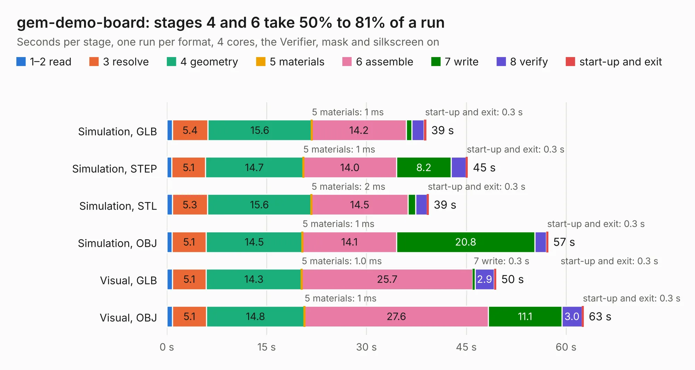

| Mode and format | 1–2 read | 3 resolve | 4 geometry | 5 materials | 6 assemble | 7 write | 8 verify | start-up and exit | Total |
|---|---:|---:|---:|---:|---:|---:|---:|---:|---:|
| Simulation, GLB | 0.8 | 5.4 | 15.6 | 1&nbsp;ms | 14.2 | 0.8 | 1.8 | 0.3 | 39.0 |
| Simulation, STEP | 0.7 | 5.1 | 14.7 | 1&nbsp;ms | 14.0 | 8.2 | 2.2 | 0.3 | 45.2 |
| Simulation, STL | 0.8 | 5.3 | 15.6 | 2&nbsp;ms | 14.5 | 1.2 | 1.7 | 0.3 | 39.4 |
| Simulation, OBJ | 0.8 | 5.1 | 14.5 | 1&nbsp;ms | 14.1 | 20.8 | 1.7 | 0.3 | 57.3 |
| Visual, GLB | 0.8 | 5.1 | 14.3 | 1.0&nbsp;ms | 25.7 | 0.3 | 2.9 | 0.3 | 49.5 |
| Visual, OBJ | 0.8 | 5.1 | 14.8 | 1&nbsp;ms | 27.6 | 11.1 | 3.0 | 0.3 | 62.7 |

<table align="center"><tr><td valign="top">

| Board | Repo: [antmicro/gem-baseboard](https://github.com/antmicro/gem-baseboard) Board: `gem-demo-board.kicad_pcb` |
|---|---|
| Complexity | 290&nbsp;/&nbsp;1000 (size&nbsp;235, features&nbsp;55) |
| KESE&nbsp;features | through vias, rounded, trapezoid or chamfered pads, filled zones, copper text |
| Tested | 9th November 2026 |
| Copper&nbsp;layers | 6 |
| File&nbsp;format | KiCad 5 (20171130) |
| Parts,&nbsp;tracks,&nbsp;vias | 122, 3,756, 417 |
| Triangles,&nbsp;simulation | 3,761,442 in 229 parts |
| Verifier | PASS in all six runs |

</td><td valign="top">

<table>
<tr><th>File type</th><th>File size</th><th>Peak memory used</th></tr>
<tr><th colspan="3" align="left">Simulation</th></tr>
<tr><td>GLB</td><td align="right">130&nbsp;MB</td><td align="right">988&nbsp;MB</td></tr>
<tr><td>STEP</td><td align="right">482&nbsp;MB</td><td align="right">1.2&nbsp;GB</td></tr>
<tr><td>STL</td><td align="right">188&nbsp;MB</td><td align="right">954&nbsp;MB</td></tr>
<tr><td>OBJ</td><td align="right">403&nbsp;MB</td><td align="right">2.5&nbsp;GB</td></tr>
<tr><th colspan="3" align="left">Visual</th></tr>
<tr><td>GLB</td><td align="right">64&nbsp;MB</td><td align="right">1.3&nbsp;GB</td></tr>
<tr><td>OBJ</td><td align="right">206&nbsp;MB</td><td align="right">1.5&nbsp;GB</td></tr>
</table>

</td></tr></table>

## 354. zglue-gem1-adapter

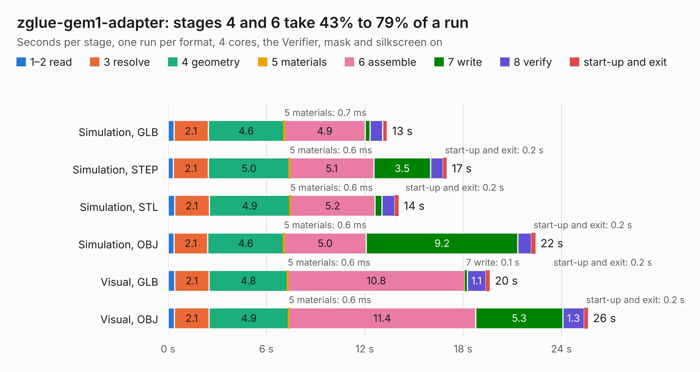

| Mode and format | 1–2 read | 3 resolve | 4 geometry | 5 materials | 6 assemble | 7 write | 8 verify | start-up and exit | Total |
|---|---:|---:|---:|---:|---:|---:|---:|---:|---:|
| Simulation, GLB | 0.4 | 2.1 | 4.6 | 0.7&nbsp;ms | 4.9 | 0.3 | 0.8 | 0.3 | 13.4 |
| Simulation, STEP | 0.3 | 2.1 | 5.0 | 0.6&nbsp;ms | 5.1 | 3.5 | 0.8 | 0.2 | 17.0 |
| Simulation, STL | 0.4 | 2.1 | 4.9 | 0.6&nbsp;ms | 5.2 | 0.4 | 0.8 | 0.2 | 14.1 |
| Simulation, OBJ | 0.4 | 2.1 | 4.6 | 0.6&nbsp;ms | 5.0 | 9.2 | 0.8 | 0.2 | 22.4 |
| Visual, GLB | 0.4 | 2.1 | 4.8 | 0.6&nbsp;ms | 10.8 | 0.1 | 1.1 | 0.2 | 19.6 |
| Visual, OBJ | 0.4 | 2.1 | 4.9 | 0.6&nbsp;ms | 11.4 | 5.3 | 1.3 | 0.2 | 25.6 |

<table align="center"><tr><td valign="top">

| Board | Repo: [antmicro/gem1-adapter](https://github.com/antmicro/gem1-adapter) Board: `zglue-gem1-adapter.kicad_pcb` |
|---|---|
| Complexity | 315&nbsp;/&nbsp;1000 (size&nbsp;270, features&nbsp;45) |
| KESE&nbsp;features | through vias, rounded, trapezoid or chamfered pads, filled zones |
| Tested | 9th November 2026 |
| Copper&nbsp;layers | 6 |
| File&nbsp;format | KiCad 5 (20171130) |
| Parts,&nbsp;tracks,&nbsp;vias | 44, 2,794, 221 |
| Triangles,&nbsp;simulation | 1,631,130 in 133 parts |
| Verifier | PASS in all six runs |

</td><td valign="top">

<table>
<tr><th>File type</th><th>File size</th><th>Peak memory used</th></tr>
<tr><th colspan="3" align="left">Simulation</th></tr>
<tr><td>GLB</td><td align="right">54&nbsp;MB</td><td align="right">571&nbsp;MB</td></tr>
<tr><td>STEP</td><td align="right">188&nbsp;MB</td><td align="right">658&nbsp;MB</td></tr>
<tr><td>STL</td><td align="right">82&nbsp;MB</td><td align="right">574&nbsp;MB</td></tr>
<tr><td>OBJ</td><td align="right">170&nbsp;MB</td><td align="right">1.1&nbsp;GB</td></tr>
<tr><th colspan="3" align="left">Visual</th></tr>
<tr><td>GLB</td><td align="right">29&nbsp;MB</td><td align="right">717&nbsp;MB</td></tr>
<tr><td>OBJ</td><td align="right">91&nbsp;MB</td><td align="right">714&nbsp;MB</td></tr>
</table>

</td></tr></table>

## 355. gem2-adapter

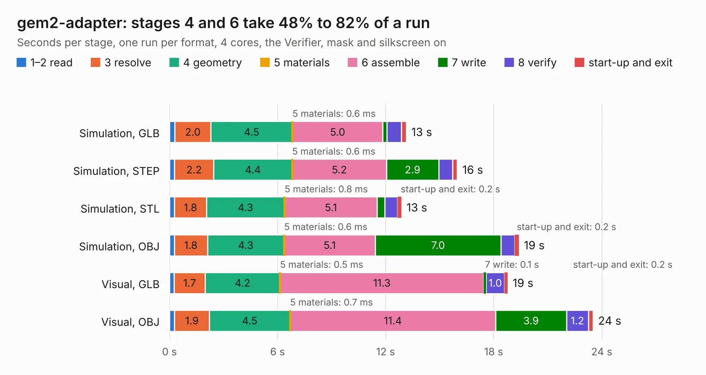

| Mode and format | 1–2 read | 3 resolve | 4 geometry | 5 materials | 6 assemble | 7 write | 8 verify | start-up and exit | Total |
|---|---:|---:|---:|---:|---:|---:|---:|---:|---:|
| Simulation, GLB | 0.3 | 2.0 | 4.5 | 0.6&nbsp;ms | 5.0 | 0.2 | 0.8 | 0.3 | 13.1 |
| Simulation, STEP | 0.3 | 2.2 | 4.4 | 0.6&nbsp;ms | 5.2 | 2.9 | 0.8 | 0.3 | 16.0 |
| Simulation, STL | 0.3 | 1.8 | 4.3 | 0.8&nbsp;ms | 5.1 | 0.4 | 0.7 | 0.2 | 12.9 |
| Simulation, OBJ | 0.3 | 1.8 | 4.3 | 0.6&nbsp;ms | 5.1 | 7.0 | 0.8 | 0.2 | 19.4 |
| Visual, GLB | 0.3 | 1.7 | 4.2 | 0.5&nbsp;ms | 11.3 | 0.1 | 1.0 | 0.2 | 18.8 |
| Visual, OBJ | 0.3 | 1.9 | 4.5 | 0.7&nbsp;ms | 11.4 | 3.9 | 1.2 | 0.3 | 23.5 |

<table align="center"><tr><td valign="top">

| Board | Repo: [antmicro/gem2-adapter](https://github.com/antmicro/gem2-adapter) Board: `gem2-adapter.kicad_pcb` |
|---|---|
| Complexity | 313&nbsp;/&nbsp;1000 (size&nbsp;268, features&nbsp;45) |
| KESE&nbsp;features | through vias, rounded, trapezoid or chamfered pads, filled zones |
| Tested | 9th November 2026 |
| Copper&nbsp;layers | 6 |
| File&nbsp;format | KiCad 5 (20171130) |
| Parts,&nbsp;tracks,&nbsp;vias | 46, 2,404, 212 |
| Triangles,&nbsp;simulation | 1,644,764 in 133 parts |
| Verifier | PASS in all six runs |

</td><td valign="top">

<table>
<tr><th>File type</th><th>File size</th><th>Peak memory used</th></tr>
<tr><th colspan="3" align="left">Simulation</th></tr>
<tr><td>GLB</td><td align="right">55&nbsp;MB</td><td align="right">576&nbsp;MB</td></tr>
<tr><td>STEP</td><td align="right">198&nbsp;MB</td><td align="right">633&nbsp;MB</td></tr>
<tr><td>STL</td><td align="right">82&nbsp;MB</td><td align="right">541&nbsp;MB</td></tr>
<tr><td>OBJ</td><td align="right">172&nbsp;MB</td><td align="right">1.1&nbsp;GB</td></tr>
<tr><th colspan="3" align="left">Visual</th></tr>
<tr><td>GLB</td><td align="right">30&nbsp;MB</td><td align="right">747&nbsp;MB</td></tr>
<tr><td>OBJ</td><td align="right">94&nbsp;MB</td><td align="right">769&nbsp;MB</td></tr>
</table>

</td></tr></table>

## 356. gmsl-deserializer

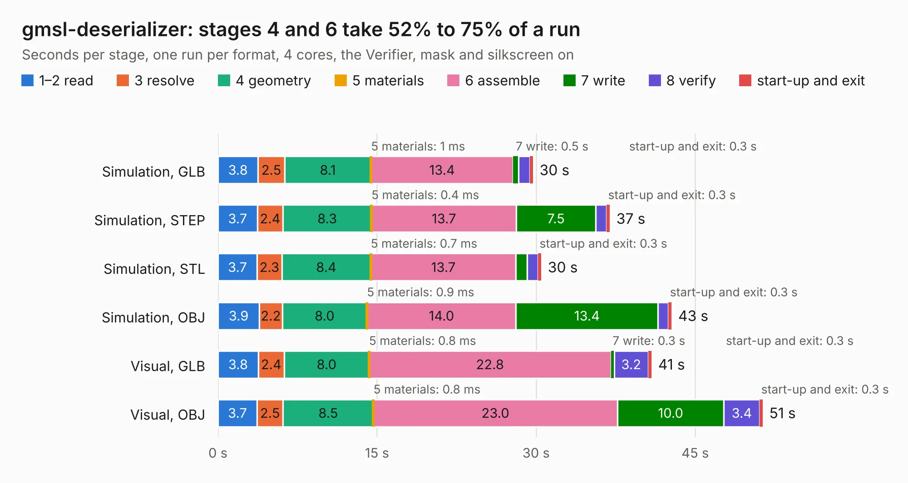

| Mode and format | 1–2 read | 3 resolve | 4 geometry | 5 materials | 6 assemble | 7 write | 8 verify | start-up and exit | Total |
|---|---:|---:|---:|---:|---:|---:|---:|---:|---:|
| Simulation, GLB | 3.8 | 2.5 | 8.1 | 1&nbsp;ms | 13.4 | 0.5 | 1.1 | 0.3 | 29.7 |
| Simulation, STEP | 3.7 | 2.4 | 8.3 | 0.4&nbsp;ms | 13.7 | 7.5 | 1.0 | 0.3 | 37.0 |
| Simulation, STL | 3.7 | 2.3 | 8.4 | 0.7&nbsp;ms | 13.7 | 1.0 | 1.0 | 0.3 | 30.5 |
| Simulation, OBJ | 3.9 | 2.2 | 8.0 | 0.9&nbsp;ms | 14.0 | 13.4 | 1.0 | 0.3 | 42.8 |
| Visual, GLB | 3.8 | 2.4 | 8.0 | 0.8&nbsp;ms | 22.8 | 0.3 | 3.2 | 0.3 | 40.9 |
| Visual, OBJ | 3.7 | 2.5 | 8.5 | 0.8&nbsp;ms | 23.0 | 10.0 | 3.4 | 0.3 | 51.4 |

<table align="center"><tr><td valign="top">

| Board | Repo: [antmicro/gmsl-deserializer](https://github.com/antmicro/gmsl-deserializer) Board: `gmsl-deserializer.kicad_pcb` |
|---|---|
| Complexity | 420&nbsp;/&nbsp;1000 (size&nbsp;265, features&nbsp;155) |
| KESE&nbsp;features | through vias, custom pads, rounded, trapezoid or chamfered pads, arc tracks, filled zones, copper drawings, copper text, curved board outline, knockout text, stack-up, dielectric εr and tanδ, mask and silkscreen colours |
| Tested | 9th November 2026 |
| Copper&nbsp;layers | 4 |
| File&nbsp;format | KiCad 9 (20241229) |
| Parts,&nbsp;tracks,&nbsp;vias | 206, 2,413, 362 |
| Triangles,&nbsp;simulation | 2,685,502 in 163 parts |
| Verifier | PASS in all six runs |

</td><td valign="top">

<table>
<tr><th>File type</th><th>File size</th><th>Peak memory used</th></tr>
<tr><th colspan="3" align="left">Simulation</th></tr>
<tr><td>GLB</td><td align="right">91&nbsp;MB</td><td align="right">1.0&nbsp;GB</td></tr>
<tr><td>STEP</td><td align="right">412&nbsp;MB</td><td align="right">1.3&nbsp;GB</td></tr>
<tr><td>STL</td><td align="right">134&nbsp;MB</td><td align="right">1.0&nbsp;GB</td></tr>
<tr><td>OBJ</td><td align="right">281&nbsp;MB</td><td align="right">1.8&nbsp;GB</td></tr>
<tr><th colspan="3" align="left">Visual</th></tr>
<tr><td>GLB</td><td align="right">69&nbsp;MB</td><td align="right">1.2&nbsp;GB</td></tr>
<tr><td>OBJ</td><td align="right">215&nbsp;MB</td><td align="right">1.5&nbsp;GB</td></tr>
</table>

</td></tr></table>

## 357. gmsl-serializer

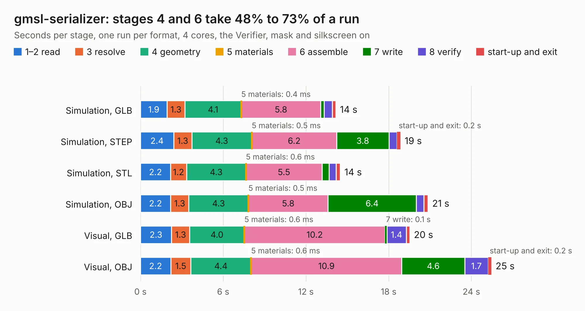

| Mode and format | 1–2 read | 3 resolve | 4 geometry | 5 materials | 6 assemble | 7 write | 8 verify | start-up and exit | Total |
|---|---:|---:|---:|---:|---:|---:|---:|---:|---:|
| Simulation, GLB | 1.9 | 1.3 | 4.1 | 0.4&nbsp;ms | 5.8 | 0.3 | 0.6 | 0.3 | 14.2 |
| Simulation, STEP | 2.4 | 1.3 | 4.3 | 0.5&nbsp;ms | 6.2 | 3.8 | 0.6 | 0.2 | 18.9 |
| Simulation, STL | 2.2 | 1.2 | 4.3 | 0.6&nbsp;ms | 5.5 | 0.5 | 0.5 | 0.3 | 14.5 |
| Simulation, OBJ | 2.2 | 1.3 | 4.3 | 0.5&nbsp;ms | 5.8 | 6.4 | 0.6 | 0.3 | 20.9 |
| Visual, GLB | 2.3 | 1.3 | 4.0 | 0.6&nbsp;ms | 10.2 | 0.1 | 1.4 | 0.3 | 19.5 |
| Visual, OBJ | 2.2 | 1.5 | 4.4 | 0.6&nbsp;ms | 10.9 | 4.6 | 1.7 | 0.2 | 25.5 |

<table align="center"><tr><td valign="top">

| Board | Repo: [antmicro/gmsl-serializer](https://github.com/antmicro/gmsl-serializer) Board: `gmsl-serializer.kicad_pcb` |
|---|---|
| Complexity | 374&nbsp;/&nbsp;1000 (size&nbsp;244, features&nbsp;130) |
| KESE&nbsp;features | through vias, custom pads, rounded, trapezoid or chamfered pads, arc tracks, filled zones, copper drawings, knockout text, stack-up, dielectric εr and tanδ |
| Tested | 9th November 2026 |
| Copper&nbsp;layers | 4 |
| File&nbsp;format | KiCad 8 (20240108) |
| Parts,&nbsp;tracks,&nbsp;vias | 104, 878, 206 |
| Triangles,&nbsp;simulation | 1,204,088 in 110 parts |
| Verifier | PASS in all six runs |

</td><td valign="top">

<table>
<tr><th>File type</th><th>File size</th><th>Peak memory used</th></tr>
<tr><th colspan="3" align="left">Simulation</th></tr>
<tr><td>GLB</td><td align="right">42&nbsp;MB</td><td align="right">561&nbsp;MB</td></tr>
<tr><td>STEP</td><td align="right">154&nbsp;MB</td><td align="right">643&nbsp;MB</td></tr>
<tr><td>STL</td><td align="right">60&nbsp;MB</td><td align="right">558&nbsp;MB</td></tr>
<tr><td>OBJ</td><td align="right">125&nbsp;MB</td><td align="right">876&nbsp;MB</td></tr>
<tr><th colspan="3" align="left">Visual</th></tr>
<tr><td>GLB</td><td align="right">30&nbsp;MB</td><td align="right">709&nbsp;MB</td></tr>
<tr><td>OBJ</td><td align="right">90&nbsp;MB</td><td align="right">792&nbsp;MB</td></tr>
</table>

</td></tr></table>

## 358. gpu-cluster-backplane

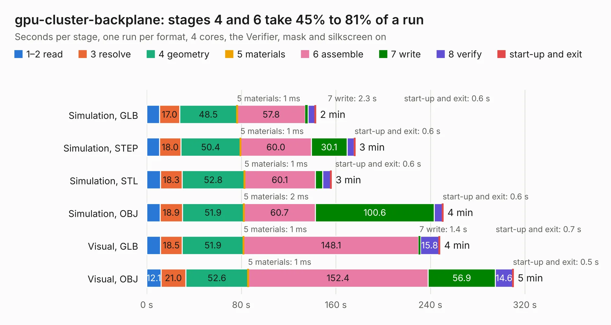

| Mode and format | 1–2 read | 3 resolve | 4 geometry | 5 materials | 6 assemble | 7 write | 8 verify | start-up and exit | Total |
|---|---:|---:|---:|---:|---:|---:|---:|---:|---:|
| Simulation, GLB | 10.8 | 17.0 | 48.5 | 1&nbsp;ms | 57.8 | 2.3 | 5.8 | 0.6 | 143.0 |
| Simulation, STEP | 10.8 | 18.0 | 50.4 | 1&nbsp;ms | 60.0 | 30.1 | 6.2 | 0.6 | 176.2 |
| Simulation, STL | 11.6 | 18.3 | 52.8 | 1&nbsp;ms | 60.1 | 6.3 | 6.6 | 0.6 | 156.2 |
| Simulation, OBJ | 11.2 | 18.9 | 51.9 | 2&nbsp;ms | 60.7 | 100.6 | 6.9 | 0.6 | 250.7 |
| Visual, GLB | 11.5 | 18.5 | 51.9 | 1&nbsp;ms | 148.1 | 1.4 | 15.8 | 0.7 | 248.0 |
| Visual, OBJ | 12.1 | 21.0 | 52.6 | 1&nbsp;ms | 152.4 | 56.9 | 14.6 | 0.5 | 310.2 |

<table align="center"><tr><td valign="top">

| Board | Repo: [antmicro/gpu-cluster-backplane](https://github.com/antmicro/gpu-cluster-backplane) Board: `gpu-cluster-backplane.kicad_pcb` |
|---|---|
| Complexity | 457&nbsp;/&nbsp;1000 (size&nbsp;307, features&nbsp;150) |
| KESE&nbsp;features | through vias, slotted holes, custom pads, rounded, trapezoid or chamfered pads, filled zones, copper drawings, copper text, curved board outline, knockout text, stack-up, dielectric εr and tanδ, mask and silkscreen colours |
| Tested | 9th November 2026 |
| Copper&nbsp;layers | 4 |
| File&nbsp;format | KiCad 7 (20221018) |
| Parts,&nbsp;tracks,&nbsp;vias | 541, 4,646, 3,885 |
| Triangles,&nbsp;simulation | 13,710,074 in 399 parts |
| Verifier | PASS in all six runs |

</td><td valign="top">

<table>
<tr><th>File type</th><th>File size</th><th>Peak memory used</th></tr>
<tr><th colspan="3" align="left">Simulation</th></tr>
<tr><td>GLB</td><td align="right">448&nbsp;MB</td><td align="right">3.3&nbsp;GB</td></tr>
<tr><td>STEP</td><td align="right">1.3&nbsp;GB</td><td align="right">4.9&nbsp;GB</td></tr>
<tr><td>STL</td><td align="right">686&nbsp;MB</td><td align="right">3.5&nbsp;GB</td></tr>
<tr><td>OBJ</td><td align="right">1.5&nbsp;GB</td><td align="right">8.7&nbsp;GB</td></tr>
<tr><th colspan="3" align="left">Visual</th></tr>
<tr><td>GLB</td><td align="right">294&nbsp;MB</td><td align="right">5.0&nbsp;GB</td></tr>
<tr><td>OBJ</td><td align="right">956&nbsp;MB</td><td align="right">6.3&nbsp;GB</td></tr>
</table>

</td></tr></table>

## 359. hdmi-edid-debug-board

| Mode and format | 1–2 read | 3 resolve | 4 geometry | 5 materials | 6 assemble | 7 write | 8 verify | start-up and exit | Total |
|---|---:|---:|---:|---:|---:|---:|---:|---:|---:|
| Simulation, GLB | 2.1 | 1.3 | 5.0 | 0.6&nbsp;ms | 4.5 | 0.2 | 0.5 | 0.2 | 13.8 |
| Simulation, STEP | 1.9 | 1.3 | 5.1 | 0.4&nbsp;ms | 4.8 | 3.6 | 0.5 | 0.2 | 17.4 |
| Simulation, STL | 2.0 | 1.3 | 5.1 | 0.5&nbsp;ms | 5.0 | 0.4 | 0.5 | 0.2 | 14.4 |
| Simulation, OBJ | 1.9 | 1.2 | 5.0 | 0.4&nbsp;ms | 4.8 | 7.2 | 0.6 | 0.2 | 21.0 |
| Visual, GLB | 2.0 | 1.3 | 5.0 | 0.5&nbsp;ms | 10.8 | 0.1 | 0.9 | 0.2 | 20.3 |
| Visual, OBJ | 2.0 | 1.3 | 4.9 | 0.4&nbsp;ms | 10.3 | 5.3 | 1.1 | 0.3 | 25.1 |

<table align="center"><tr><td valign="top">

| Board | Repo: [antmicro/hdmi-edid-debug-board](https://github.com/antmicro/hdmi-edid-debug-board) Board: `hdmi-edid-debug-board.kicad_pcb` |
|---|---|
| Complexity | 396&nbsp;/&nbsp;1000 (size&nbsp;246, features&nbsp;150) |
| KESE&nbsp;features | through vias, slotted holes, custom pads, rounded, trapezoid or chamfered pads, arc tracks, filled zones, copper drawings, copper text, knockout text, stack-up, dielectric εr and tanδ |
| Tested | 9th November 2026 |
| Copper&nbsp;layers | 4 |
| File&nbsp;format | KiCad 8 (20240108) |
| Parts,&nbsp;tracks,&nbsp;vias | 98, 1,266, 175 |
| Triangles,&nbsp;simulation | 1,401,090 in 109 parts |
| Verifier | PASS in all six runs |

</td><td valign="top">

<table>
<tr><th>File type</th><th>File size</th><th>Peak memory used</th></tr>
<tr><th colspan="3" align="left">Simulation</th></tr>
<tr><td>GLB</td><td align="right">49&nbsp;MB</td><td align="right">634&nbsp;MB</td></tr>
<tr><td>STEP</td><td align="right">193&nbsp;MB</td><td align="right">732&nbsp;MB</td></tr>
<tr><td>STL</td><td align="right">70&nbsp;MB</td><td align="right">613&nbsp;MB</td></tr>
<tr><td>OBJ</td><td align="right">146&nbsp;MB</td><td align="right">1.0&nbsp;GB</td></tr>
<tr><th colspan="3" align="left">Visual</th></tr>
<tr><td>GLB</td><td align="right">36&nbsp;MB</td><td align="right">882&nbsp;MB</td></tr>
<tr><td>OBJ</td><td align="right">109&nbsp;MB</td><td align="right">882&nbsp;MB</td></tr>
</table>

</td></tr></table>

## 360. antmicro-hdmi-mipi-bridge-hw

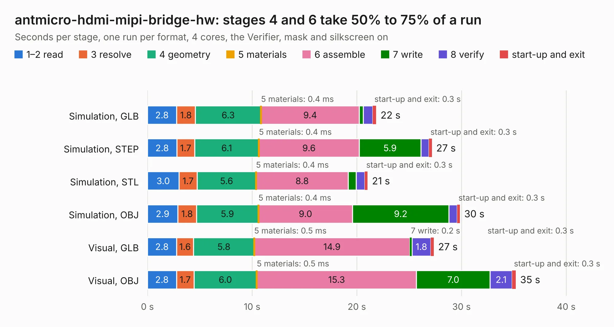

| Mode and format | 1–2 read | 3 resolve | 4 geometry | 5 materials | 6 assemble | 7 write | 8 verify | start-up and exit | Total |
|---|---:|---:|---:|---:|---:|---:|---:|---:|---:|
| Simulation, GLB | 2.8 | 1.8 | 6.3 | 0.4&nbsp;ms | 9.4 | 0.4 | 0.9 | 0.3 | 21.8 |
| Simulation, STEP | 2.8 | 1.7 | 6.1 | 0.4&nbsp;ms | 9.6 | 5.9 | 0.8 | 0.3 | 27.2 |
| Simulation, STL | 3.0 | 1.7 | 5.6 | 0.4&nbsp;ms | 8.8 | 0.7 | 0.8 | 0.3 | 21.0 |
| Simulation, OBJ | 2.9 | 1.8 | 5.9 | 0.4&nbsp;ms | 9.0 | 9.2 | 0.8 | 0.3 | 29.8 |
| Visual, GLB | 2.8 | 1.6 | 5.8 | 0.5&nbsp;ms | 14.9 | 0.2 | 1.8 | 0.3 | 27.4 |
| Visual, OBJ | 2.8 | 1.7 | 6.0 | 0.5&nbsp;ms | 15.3 | 7.0 | 2.1 | 0.3 | 35.2 |

<table align="center"><tr><td valign="top">

| Board | Repo: [antmicro/hdmi-mipi-bridge](https://github.com/antmicro/hdmi-mipi-bridge) Board: `antmicro-hdmi-mipi-bridge-hw.kicad_pcb` |
|---|---|
| Complexity | 404&nbsp;/&nbsp;1000 (size&nbsp;274, features&nbsp;130) |
| KESE&nbsp;features | through vias, slotted holes, custom pads, rounded, trapezoid or chamfered pads, arc tracks, filled zones, copper drawings, stack-up, dielectric εr and tanδ, mask and silkscreen colours |
| Tested | 9th November 2026 |
| Copper&nbsp;layers | 4 |
| File&nbsp;format | KiCad 7 (20221018) |
| Parts,&nbsp;tracks,&nbsp;vias | 111, 1,960, 312 |
| Triangles,&nbsp;simulation | 2,009,788 in 160 parts |
| Verifier | PASS in all six runs |

</td><td valign="top">

<table>
<tr><th>File type</th><th>File size</th><th>Peak memory used</th></tr>
<tr><th colspan="3" align="left">Simulation</th></tr>
<tr><td>GLB</td><td align="right">67&nbsp;MB</td><td align="right">813&nbsp;MB</td></tr>
<tr><td>STEP</td><td align="right">298&nbsp;MB</td><td align="right">974&nbsp;MB</td></tr>
<tr><td>STL</td><td align="right">101&nbsp;MB</td><td align="right">807&nbsp;MB</td></tr>
<tr><td>OBJ</td><td align="right">209&nbsp;MB</td><td align="right">1.4&nbsp;GB</td></tr>
<tr><th colspan="3" align="left">Visual</th></tr>
<tr><td>GLB</td><td align="right">49&nbsp;MB</td><td align="right">1.1&nbsp;GB</td></tr>
<tr><td>OBJ</td><td align="right">152&nbsp;MB</td><td align="right">1.1&nbsp;GB</td></tr>
</table>

</td></tr></table>

## 361. icicle-hdmi-breakout

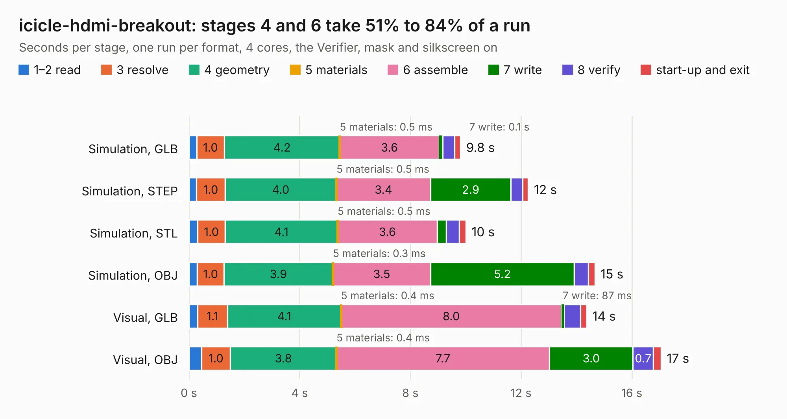

| Mode and format | 1–2 read | 3 resolve | 4 geometry | 5 materials | 6 assemble | 7 write | 8 verify | start-up and exit | Total |
|---|---:|---:|---:|---:|---:|---:|---:|---:|---:|
| Simulation, GLB | 0.3 | 1.0 | 4.2 | 0.5&nbsp;ms | 3.6 | 0.1 | 0.4 | 0.2 | 9.8 |
| Simulation, STEP | 0.3 | 1.0 | 4.0 | 0.5&nbsp;ms | 3.4 | 2.9 | 0.4 | 0.2 | 12.3 |
| Simulation, STL | 0.3 | 1.0 | 4.1 | 0.5&nbsp;ms | 3.6 | 0.3 | 0.5 | 0.2 | 10.0 |
| Simulation, OBJ | 0.3 | 1.0 | 3.9 | 0.3&nbsp;ms | 3.5 | 5.2 | 0.5 | 0.2 | 14.7 |
| Visual, GLB | 0.3 | 1.1 | 4.1 | 0.4&nbsp;ms | 8.0 | 87&nbsp;ms | 0.6 | 0.2 | 14.4 |
| Visual, OBJ | 0.5 | 1.0 | 3.8 | 0.4&nbsp;ms | 7.7 | 3.0 | 0.7 | 0.3 | 17.1 |

<table align="center"><tr><td valign="top">

| Board | Repo: [antmicro/icicle-hdmi-breakout](https://github.com/antmicro/icicle-hdmi-breakout) Board: `icicle-hdmi-breakout.kicad_pcb` |
|---|---|
| Complexity | 254&nbsp;/&nbsp;1000 (size&nbsp;189, features&nbsp;65) |
| KESE&nbsp;features | through vias, slotted holes, rounded, trapezoid or chamfered pads, filled zones, copper text |
| Tested | 9th November 2026 |
| Copper&nbsp;layers | 4 |
| File&nbsp;format | KiCad 5 (20171130) |
| Parts,&nbsp;tracks,&nbsp;vias | 34, 1,178, 41 |
| Triangles,&nbsp;simulation | 851,176 in 64 parts |
| Verifier | PASS in all six runs |

</td><td valign="top">

<table>
<tr><th>File type</th><th>File size</th><th>Peak memory used</th></tr>
<tr><th colspan="3" align="left">Simulation</th></tr>
<tr><td>GLB</td><td align="right">29&nbsp;MB</td><td align="right">401&nbsp;MB</td></tr>
<tr><td>STEP</td><td align="right">166&nbsp;MB</td><td align="right">464&nbsp;MB</td></tr>
<tr><td>STL</td><td align="right">43&nbsp;MB</td><td align="right">404&nbsp;MB</td></tr>
<tr><td>OBJ</td><td align="right">88&nbsp;MB</td><td align="right">637&nbsp;MB</td></tr>
<tr><th colspan="3" align="left">Visual</th></tr>
<tr><td>GLB</td><td align="right">17&nbsp;MB</td><td align="right">457&nbsp;MB</td></tr>
<tr><td>OBJ</td><td align="right">50&nbsp;MB</td><td align="right">468&nbsp;MB</td></tr>
</table>

</td></tr></table>

## 362. ict-baseboard

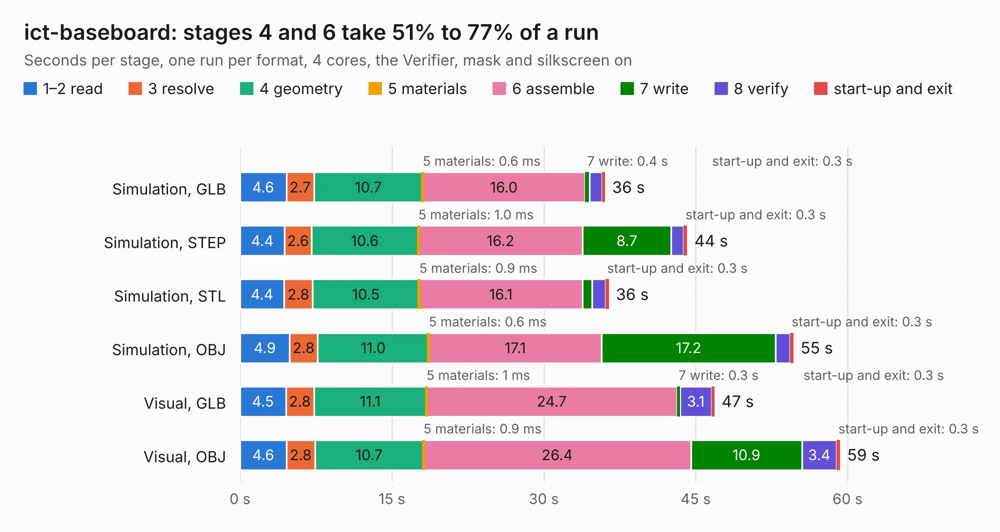

| Mode and format | 1–2 read | 3 resolve | 4 geometry | 5 materials | 6 assemble | 7 write | 8 verify | start-up and exit | Total |
|---|---:|---:|---:|---:|---:|---:|---:|---:|---:|
| Simulation, GLB | 4.6 | 2.7 | 10.7 | 0.6&nbsp;ms | 16.0 | 0.4 | 1.2 | 0.3 | 36.0 |
| Simulation, STEP | 4.4 | 2.6 | 10.6 | 1.0&nbsp;ms | 16.2 | 8.7 | 1.2 | 0.3 | 44.2 |
| Simulation, STL | 4.4 | 2.8 | 10.5 | 0.9&nbsp;ms | 16.1 | 1.0 | 1.3 | 0.3 | 36.4 |
| Simulation, OBJ | 4.9 | 2.8 | 11.0 | 0.6&nbsp;ms | 17.1 | 17.2 | 1.4 | 0.3 | 54.7 |
| Visual, GLB | 4.5 | 2.8 | 11.1 | 1&nbsp;ms | 24.7 | 0.3 | 3.1 | 0.3 | 46.9 |
| Visual, OBJ | 4.6 | 2.8 | 10.7 | 0.9&nbsp;ms | 26.4 | 10.9 | 3.4 | 0.3 | 59.3 |

<table align="center"><tr><td valign="top">

| Board | Repo: [antmicro/ict-baseboard](https://github.com/antmicro/ict-baseboard) Board: `ict-baseboard.kicad_pcb` |
|---|---|
| Complexity | 413&nbsp;/&nbsp;1000 (size&nbsp;258, features&nbsp;155) |
| KESE&nbsp;features | through vias, slotted holes, custom pads, rounded, trapezoid or chamfered pads, filled zones, copper drawings, copper text, knockout text, TrueType text, stack-up, dielectric εr and tanδ, mask and silkscreen colours |
| Tested | 9th November 2026 |
| Copper&nbsp;layers | 4 |
| File&nbsp;format | KiCad 9 (20241229) |
| Parts,&nbsp;tracks,&nbsp;vias | 206, 1,672, 214 |
| Triangles,&nbsp;simulation | 2,622,894 in 218 parts |
| Verifier | PASS in all six runs |

</td><td valign="top">

<table>
<tr><th>File type</th><th>File size</th><th>Peak memory used</th></tr>
<tr><th colspan="3" align="left">Simulation</th></tr>
<tr><td>GLB</td><td align="right">89&nbsp;MB</td><td align="right">1.0&nbsp;GB</td></tr>
<tr><td>STEP</td><td align="right">384&nbsp;MB</td><td align="right">1.2&nbsp;GB</td></tr>
<tr><td>STL</td><td align="right">131&nbsp;MB</td><td align="right">1.0&nbsp;GB</td></tr>
<tr><td>OBJ</td><td align="right">276&nbsp;MB</td><td align="right">1.8&nbsp;GB</td></tr>
<tr><th colspan="3" align="left">Visual</th></tr>
<tr><td>GLB</td><td align="right">60&nbsp;MB</td><td align="right">1.3&nbsp;GB</td></tr>
<tr><td>OBJ</td><td align="right">185&nbsp;MB</td><td align="right">1.3&nbsp;GB</td></tr>
</table>

</td></tr></table>

## 363. ir-irradiance-probe

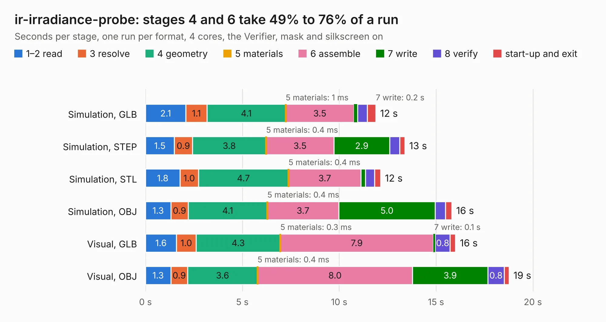

| Mode and format | 1–2 read | 3 resolve | 4 geometry | 5 materials | 6 assemble | 7 write | 8 verify | start-up and exit | Total |
|---|---:|---:|---:|---:|---:|---:|---:|---:|---:|
| Simulation, GLB | 2.1 | 1.1 | 4.1 | 1&nbsp;ms | 3.5 | 0.2 | 0.5 | 0.4 | 11.9 |
| Simulation, STEP | 1.5 | 0.9 | 3.8 | 0.4&nbsp;ms | 3.5 | 2.9 | 0.5 | 0.3 | 13.4 |
| Simulation, STL | 1.8 | 1.0 | 4.7 | 0.4&nbsp;ms | 3.7 | 0.2 | 0.5 | 0.3 | 12.1 |
| Simulation, OBJ | 1.3 | 0.9 | 4.1 | 0.4&nbsp;ms | 3.7 | 5.0 | 0.5 | 0.3 | 15.8 |
| Visual, GLB | 1.6 | 1.0 | 4.3 | 0.3&nbsp;ms | 7.9 | 0.1 | 0.8 | 0.3 | 16.0 |
| Visual, OBJ | 1.3 | 0.9 | 3.6 | 0.4&nbsp;ms | 8.0 | 3.9 | 0.8 | 0.3 | 18.8 |

<table align="center"><tr><td valign="top">

| Board | Repo: [antmicro/infrared-irradiance-probe](https://github.com/antmicro/infrared-irradiance-probe) Board: `ir-irradiance-probe.kicad_pcb` |
|---|---|
| Complexity | 282&nbsp;/&nbsp;1000 (size&nbsp;172, features&nbsp;110) |
| KESE&nbsp;features | through vias, slotted holes, rounded, trapezoid or chamfered pads, filled zones, copper text, knockout text, stack-up, dielectric εr and tanδ |
| Tested | 9th November 2026 |
| Copper&nbsp;layers | 2 |
| File&nbsp;format | KiCad 7 (20221018) |
| Parts,&nbsp;tracks,&nbsp;vias | 52, 330, 196 |
| Triangles,&nbsp;simulation | 735,330 in 43 parts |
| Verifier | PASS in all six runs |

</td><td valign="top">

<table>
<tr><th>File type</th><th>File size</th><th>Peak memory used</th></tr>
<tr><th colspan="3" align="left">Simulation</th></tr>
<tr><td>GLB</td><td align="right">26&nbsp;MB</td><td align="right">490&nbsp;MB</td></tr>
<tr><td>STEP</td><td align="right">124&nbsp;MB</td><td align="right">484&nbsp;MB</td></tr>
<tr><td>STL</td><td align="right">37&nbsp;MB</td><td align="right">482&nbsp;MB</td></tr>
<tr><td>OBJ</td><td align="right">77&nbsp;MB</td><td align="right">563&nbsp;MB</td></tr>
<tr><th colspan="3" align="left">Visual</th></tr>
<tr><td>GLB</td><td align="right">20&nbsp;MB</td><td align="right">532&nbsp;MB</td></tr>
<tr><td>OBJ</td><td align="right">61&nbsp;MB</td><td align="right">578&nbsp;MB</td></tr>
</table>

</td></tr></table>

## 364. jetson-agx-csi-adapter

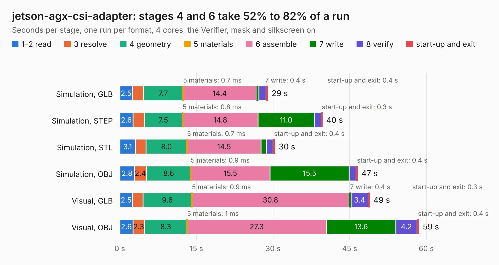

| Mode and format | 1–2 read | 3 resolve | 4 geometry | 5 materials | 6 assemble | 7 write | 8 verify | start-up and exit | Total |
|---|---:|---:|---:|---:|---:|---:|---:|---:|---:|
| Simulation, GLB | 2.5 | 2.2 | 7.7 | 0.7&nbsp;ms | 14.4 | 0.4 | 1.4 | 0.4 | 29.0 |
| Simulation, STEP | 2.6 | 2.2 | 7.5 | 0.8&nbsp;ms | 14.8 | 11.0 | 1.3 | 0.3 | 39.7 |
| Simulation, STL | 3.1 | 2.1 | 8.0 | 0.7&nbsp;ms | 14.5 | 1.0 | 1.3 | 0.4 | 30.4 |
| Simulation, OBJ | 2.8 | 2.4 | 8.6 | 0.9&nbsp;ms | 15.5 | 15.5 | 1.3 | 0.4 | 46.6 |
| Visual, GLB | 2.5 | 2.0 | 9.6 | 0.9&nbsp;ms | 30.8 | 0.4 | 3.4 | 0.3 | 49.0 |
| Visual, OBJ | 2.6 | 2.3 | 8.3 | 1&nbsp;ms | 27.3 | 13.6 | 4.2 | 0.4 | 58.6 |

<table align="center"><tr><td valign="top">

| Board | Repo: [antmicro/jetson-agx-csi-adapter](https://github.com/antmicro/jetson-agx-csi-adapter) Board: `jetson-agx-csi-adapter.kicad_pcb` |
|---|---|
| Complexity | 345&nbsp;/&nbsp;1000 (size&nbsp;215, features&nbsp;130) |
| KESE&nbsp;features | through vias, rounded, trapezoid or chamfered pads, arc tracks, filled zones, copper text, curved board outline, knockout text, stack-up, dielectric εr and tanδ, mask and silkscreen colours |
| Tested | 9th November 2026 |
| Copper&nbsp;layers | 4 |
| File&nbsp;format | KiCad 9 (20241229) |
| Parts,&nbsp;tracks,&nbsp;vias | 80, 2,929, 225 |
| Triangles,&nbsp;simulation | 2,205,664 in 193 parts |
| Verifier | PASS in all six runs |

</td><td valign="top">

<table>
<tr><th>File type</th><th>File size</th><th>Peak memory used</th></tr>
<tr><th colspan="3" align="left">Simulation</th></tr>
<tr><td>GLB</td><td align="right">74&nbsp;MB</td><td align="right">935&nbsp;MB</td></tr>
<tr><td>STEP</td><td align="right">344&nbsp;MB</td><td align="right">1.1&nbsp;GB</td></tr>
<tr><td>STL</td><td align="right">110&nbsp;MB</td><td align="right">935&nbsp;MB</td></tr>
<tr><td>OBJ</td><td align="right">230&nbsp;MB</td><td align="right">1.5&nbsp;GB</td></tr>
<tr><th colspan="3" align="left">Visual</th></tr>
<tr><td>GLB</td><td align="right">63&nbsp;MB</td><td align="right">1.2&nbsp;GB</td></tr>
<tr><td>OBJ</td><td align="right">196&nbsp;MB</td><td align="right">1.4&nbsp;GB</td></tr>
</table>

</td></tr></table>

## 365. jetson-nano-baseboard

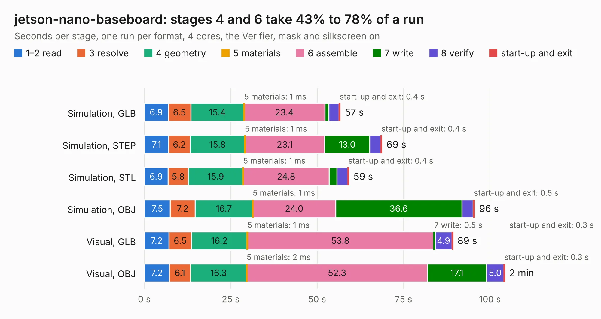

| Mode and format | 1–2 read | 3 resolve | 4 geometry | 5 materials | 6 assemble | 7 write | 8 verify | start-up and exit | Total |
|---|---:|---:|---:|---:|---:|---:|---:|---:|---:|
| Simulation, GLB | 6.9 | 6.5 | 15.4 | 1&nbsp;ms | 23.4 | 1.1 | 3.0 | 0.4 | 56.8 |
| Simulation, STEP | 7.1 | 6.2 | 15.8 | 1&nbsp;ms | 23.1 | 13.0 | 3.2 | 0.4 | 68.8 |
| Simulation, STL | 6.9 | 5.8 | 15.9 | 1&nbsp;ms | 24.8 | 2.2 | 3.1 | 0.4 | 59.3 |
| Simulation, OBJ | 7.5 | 7.2 | 16.7 | 1&nbsp;ms | 24.0 | 36.6 | 3.2 | 0.5 | 95.6 |
| Visual, GLB | 7.2 | 6.5 | 16.2 | 1&nbsp;ms | 53.8 | 0.5 | 4.9 | 0.3 | 89.4 |
| Visual, OBJ | 7.2 | 6.1 | 16.3 | 2&nbsp;ms | 52.3 | 17.1 | 5.0 | 0.3 | 104.3 |

<table align="center"><tr><td valign="top">

| Board | Repo: [antmicro/jetson-nano-baseboard](https://github.com/antmicro/jetson-nano-baseboard) Board: `jetson-nano-baseboard.kicad_pcb` |
|---|---|
| Complexity | 448&nbsp;/&nbsp;1000 (size&nbsp;313, features&nbsp;135) |
| KESE&nbsp;features | through vias, slotted holes, custom pads, rounded, trapezoid or chamfered pads, arc tracks, filled zones, copper drawings, copper text, stack-up, dielectric εr and tanδ |
| Tested | 9th November 2026 |
| Copper&nbsp;layers | 8 |
| File&nbsp;format | KiCad 9 (20241229) |
| Parts,&nbsp;tracks,&nbsp;vias | 326, 15,624, 794 |
| Triangles,&nbsp;simulation | 7,900,080 in 506 parts |
| Verifier | PASS in all six runs |

</td><td valign="top">

<table>
<tr><th>File type</th><th>File size</th><th>Peak memory used</th></tr>
<tr><th colspan="3" align="left">Simulation</th></tr>
<tr><td>GLB</td><td align="right">263&nbsp;MB</td><td align="right">2.0&nbsp;GB</td></tr>
<tr><td>STEP</td><td align="right">948&nbsp;MB</td><td align="right">2.7&nbsp;GB</td></tr>
<tr><td>STL</td><td align="right">395&nbsp;MB</td><td align="right">2.2&nbsp;GB</td></tr>
<tr><td>OBJ</td><td align="right">871&nbsp;MB</td><td align="right">5.2&nbsp;GB</td></tr>
<tr><th colspan="3" align="left">Visual</th></tr>
<tr><td>GLB</td><td align="right">130&nbsp;MB</td><td align="right">2.4&nbsp;GB</td></tr>
<tr><td>OBJ</td><td align="right">440&nbsp;MB</td><td align="right">3.0&nbsp;GB</td></tr>
</table>

</td></tr></table>

## 366. jetson-orin-baseboard

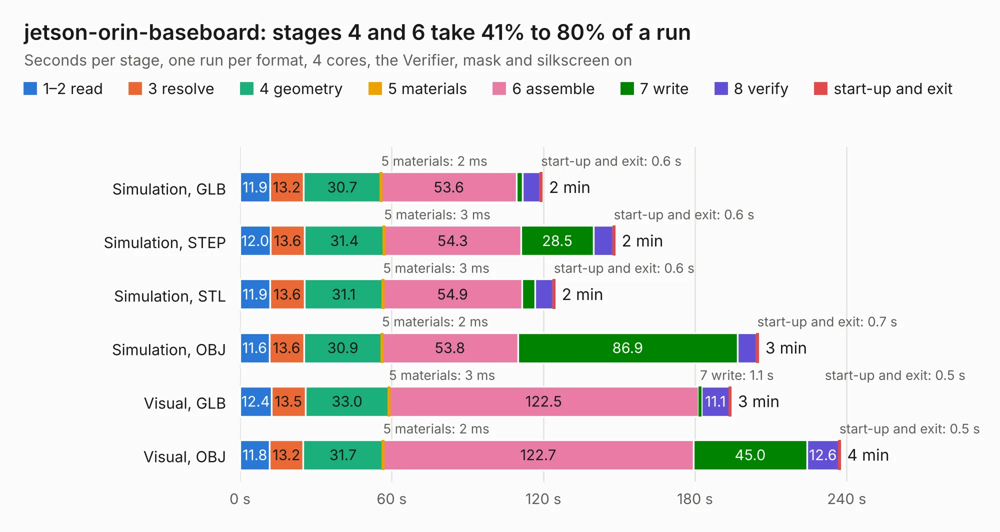

| Mode and format | 1–2 read | 3 resolve | 4 geometry | 5 materials | 6 assemble | 7 write | 8 verify | start-up and exit | Total |
|---|---:|---:|---:|---:|---:|---:|---:|---:|---:|
| Simulation, GLB | 11.9 | 13.2 | 30.7 | 2&nbsp;ms | 53.6 | 2.4 | 7.0 | 0.6 | 119.4 |
| Simulation, STEP | 12.0 | 13.6 | 31.4 | 3&nbsp;ms | 54.3 | 28.5 | 7.8 | 0.6 | 148.2 |
| Simulation, STL | 11.9 | 13.6 | 31.1 | 3&nbsp;ms | 54.9 | 5.1 | 7.3 | 0.6 | 124.4 |
| Simulation, OBJ | 11.6 | 13.6 | 30.9 | 2&nbsp;ms | 53.8 | 86.9 | 7.4 | 0.7 | 205.0 |
| Visual, GLB | 12.4 | 13.5 | 33.0 | 3&nbsp;ms | 122.5 | 1.1 | 11.1 | 0.5 | 194.1 |
| Visual, OBJ | 11.8 | 13.2 | 31.7 | 2&nbsp;ms | 122.7 | 45.0 | 12.6 | 0.5 | 237.4 |

<table align="center"><tr><td valign="top">

| Board | Repo: [antmicro/jetson-orin-baseboard](https://github.com/antmicro/jetson-orin-baseboard) Board: `jetson-orin-baseboard.kicad_pcb` |
|---|---|
| Complexity | 522&nbsp;/&nbsp;1000 (size&nbsp;327, features&nbsp;195) |
| KESE&nbsp;features | through vias, slotted holes, custom pads, rounded, trapezoid or chamfered pads, arc tracks, filled zones, copper drawings, copper text, curved board outline, knockout text, TrueType text, stack-up, dielectric εr and tanδ, copper finish, mask and silkscreen colours |
| Tested | 9th November 2026 |
| Copper&nbsp;layers | 8 |
| File&nbsp;format | KiCad 8 (20240108) |
| Parts,&nbsp;tracks,&nbsp;vias | 618, 14,181, 1,345 |
| Triangles,&nbsp;simulation | 13,533,484 in 817 parts |
| Verifier | PASS in all six runs |

</td><td valign="top">

<table>
<tr><th>File type</th><th>File size</th><th>Peak memory used</th></tr>
<tr><th colspan="3" align="left">Simulation</th></tr>
<tr><td>GLB</td><td align="right">455&nbsp;MB</td><td align="right">2.9&nbsp;GB</td></tr>
<tr><td>STEP</td><td align="right">1.7&nbsp;GB</td><td align="right">4.4&nbsp;GB</td></tr>
<tr><td>STL</td><td align="right">677&nbsp;MB</td><td align="right">2.9&nbsp;GB</td></tr>
<tr><td>OBJ</td><td align="right">1.5&nbsp;GB</td><td align="right">8.6&nbsp;GB</td></tr>
<tr><th colspan="3" align="left">Visual</th></tr>
<tr><td>GLB</td><td align="right">249&nbsp;MB</td><td align="right">4.2&nbsp;GB</td></tr>
<tr><td>OBJ</td><td align="right">822&nbsp;MB</td><td align="right">5.5&nbsp;GB</td></tr>
</table>

</td></tr></table>

## 367. job-ict-bottom-board

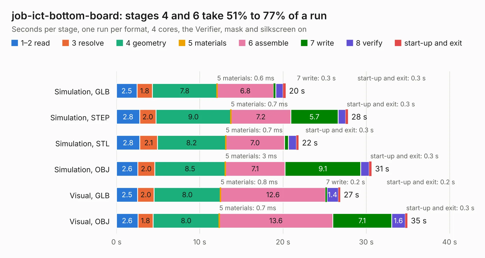

| Mode and format | 1–2 read | 3 resolve | 4 geometry | 5 materials | 6 assemble | 7 write | 8 verify | start-up and exit | Total |
|---|---:|---:|---:|---:|---:|---:|---:|---:|---:|
| Simulation, GLB | 2.5 | 1.8 | 7.8 | 0.6&nbsp;ms | 6.8 | 0.3 | 0.9 | 0.3 | 20.3 |
| Simulation, STEP | 2.8 | 2.0 | 9.0 | 0.7&nbsp;ms | 7.2 | 5.7 | 0.9 | 0.3 | 27.8 |
| Simulation, STL | 2.8 | 2.1 | 8.2 | 0.7&nbsp;ms | 7.0 | 0.5 | 0.9 | 0.3 | 21.9 |
| Simulation, OBJ | 2.6 | 2.0 | 8.5 | 3&nbsp;ms | 7.1 | 9.1 | 1.0 | 0.3 | 30.6 |
| Visual, GLB | 2.5 | 2.0 | 8.0 | 0.8&nbsp;ms | 12.6 | 0.2 | 1.4 | 0.2 | 26.9 |
| Visual, OBJ | 2.6 | 1.8 | 8.0 | 0.7&nbsp;ms | 13.6 | 7.1 | 1.6 | 0.3 | 34.9 |

<table align="center"><tr><td valign="top">

| Board | Repo: [antmicro/job-ict-bottom-board](https://github.com/antmicro/job-ict-bottom-board) Board: `job-ict-bottom-board.kicad_pcb` |
|---|---|
| Complexity | 323&nbsp;/&nbsp;1000 (size&nbsp;173, features&nbsp;150) |
| KESE&nbsp;features | through vias, custom pads, rounded, trapezoid or chamfered pads, filled zones, copper drawings, knockout text, TrueType text, stack-up, dielectric εr and tanδ, copper finish, mask and silkscreen colours |
| Tested | 9th November 2026 |
| Copper&nbsp;layers | 2 |
| File&nbsp;format | KiCad 9 (20241229) |
| Parts,&nbsp;tracks,&nbsp;vias | 93, 492, 64 |
| Triangles,&nbsp;simulation | 1,493,234 in 119 parts |
| Verifier | PASS in all six runs |

</td><td valign="top">

<table>
<tr><th>File type</th><th>File size</th><th>Peak memory used</th></tr>
<tr><th colspan="3" align="left">Simulation</th></tr>
<tr><td>GLB</td><td align="right">51&nbsp;MB</td><td align="right">653&nbsp;MB</td></tr>
<tr><td>STEP</td><td align="right">219&nbsp;MB</td><td align="right">798&nbsp;MB</td></tr>
<tr><td>STL</td><td align="right">75&nbsp;MB</td><td align="right">670&nbsp;MB</td></tr>
<tr><td>OBJ</td><td align="right">155&nbsp;MB</td><td align="right">1.1&nbsp;GB</td></tr>
<tr><th colspan="3" align="left">Visual</th></tr>
<tr><td>GLB</td><td align="right">37&nbsp;MB</td><td align="right">744&nbsp;MB</td></tr>
<tr><td>OBJ</td><td align="right">111&nbsp;MB</td><td align="right">851&nbsp;MB</td></tr>
</table>

</td></tr></table>

## 368. job-ict-support-board

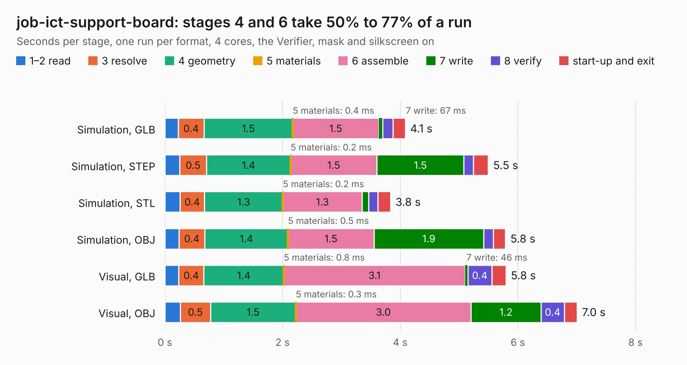

| Mode and format | 1–2 read | 3 resolve | 4 geometry | 5 materials | 6 assemble | 7 write | 8 verify | start-up and exit | Total |
|---|---:|---:|---:|---:|---:|---:|---:|---:|---:|
| Simulation, GLB | 0.2 | 0.4 | 1.5 | 0.4&nbsp;ms | 1.5 | 67&nbsp;ms | 0.2 | 0.2 | 4.1 |
| Simulation, STEP | 0.2 | 0.5 | 1.4 | 0.2&nbsp;ms | 1.5 | 1.5 | 0.2 | 0.3 | 5.5 |
| Simulation, STL | 0.3 | 0.4 | 1.3 | 0.2&nbsp;ms | 1.3 | 0.1 | 0.2 | 0.2 | 3.8 |
| Simulation, OBJ | 0.2 | 0.4 | 1.4 | 0.5&nbsp;ms | 1.5 | 1.9 | 0.2 | 0.2 | 5.8 |
| Visual, GLB | 0.2 | 0.4 | 1.4 | 0.8&nbsp;ms | 3.1 | 46&nbsp;ms | 0.4 | 0.2 | 5.8 |
| Visual, OBJ | 0.3 | 0.5 | 1.5 | 0.3&nbsp;ms | 3.0 | 1.2 | 0.4 | 0.2 | 7.0 |

<table align="center"><tr><td valign="top">

| Board | Repo: [antmicro/job-ict-support-board](https://github.com/antmicro/job-ict-support-board) Board: `job-ict-support-board.kicad_pcb` |
|---|---|
| Complexity | 112&nbsp;/&nbsp;1000 (size&nbsp;17, features&nbsp;95) |
| KESE&nbsp;features | rounded, trapezoid or chamfered pads, filled zones, knockout text, stack-up, dielectric εr and tanδ, copper finish, mask and silkscreen colours |
| Tested | 9th November 2026 |
| Copper&nbsp;layers | 2 |
| File&nbsp;format | KiCad 9 (20241229) |
| Parts,&nbsp;tracks,&nbsp;vias | 0, 0, 0 |
| Triangles,&nbsp;simulation | 434,326 in 38 parts |
| Note | no components |
| Verifier | PASS in all six runs |

</td><td valign="top">

<table>
<tr><th>File type</th><th>File size</th><th>Peak memory used</th></tr>
<tr><th colspan="3" align="left">Simulation</th></tr>
<tr><td>GLB</td><td align="right">15&nbsp;MB</td><td align="right">331&nbsp;MB</td></tr>
<tr><td>STEP</td><td align="right">66&nbsp;MB</td><td align="right">337&nbsp;MB</td></tr>
<tr><td>STL</td><td align="right">22&nbsp;MB</td><td align="right">315&nbsp;MB</td></tr>
<tr><td>OBJ</td><td align="right">44&nbsp;MB</td><td align="right">354&nbsp;MB</td></tr>
<tr><th colspan="3" align="left">Visual</th></tr>
<tr><td>GLB</td><td align="right">10&nbsp;MB</td><td align="right">317&nbsp;MB</td></tr>
<tr><td>OBJ</td><td align="right">30&nbsp;MB</td><td align="right">312&nbsp;MB</td></tr>
</table>

</td></tr></table>

## 369. jetson-orin-baseboard-oculink-expansion

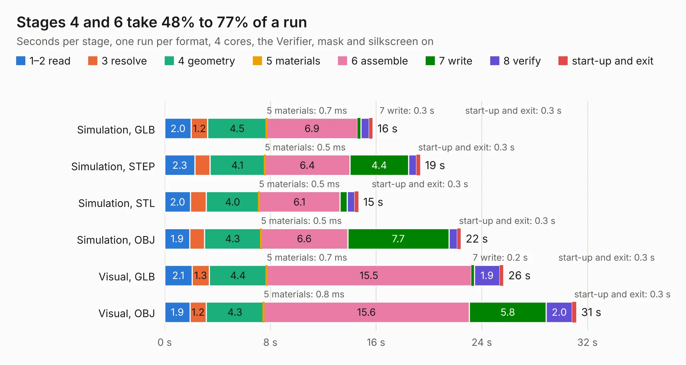

| Mode and format | 1–2 read | 3 resolve | 4 geometry | 5 materials | 6 assemble | 7 write | 8 verify | start-up and exit | Total |
|---|---:|---:|---:|---:|---:|---:|---:|---:|---:|
| Simulation, GLB | 2.0 | 1.2 | 4.5 | 0.7&nbsp;ms | 6.9 | 0.3 | 0.6 | 0.3 | 15.7 |
| Simulation, STEP | 2.3 | 1.2 | 4.1 | 0.5&nbsp;ms | 6.4 | 4.4 | 0.6 | 0.3 | 19.3 |
| Simulation, STL | 2.0 | 1.2 | 4.0 | 0.5&nbsp;ms | 6.1 | 0.5 | 0.6 | 0.3 | 14.7 |
| Simulation, OBJ | 1.9 | 1.1 | 4.3 | 0.5&nbsp;ms | 6.6 | 7.7 | 0.6 | 0.3 | 22.4 |
| Visual, GLB | 2.1 | 1.3 | 4.4 | 0.7&nbsp;ms | 15.5 | 0.2 | 1.9 | 0.3 | 25.6 |
| Visual, OBJ | 1.9 | 1.2 | 4.3 | 0.8&nbsp;ms | 15.6 | 5.8 | 2.0 | 0.3 | 31.2 |

<table align="center"><tr><td valign="top">

| Board | Repo: [antmicro/job-oculink-expansion](https://github.com/antmicro/job-oculink-expansion) Board: `jetson-orin-baseboard-oculink-expansion.kicad_pcb` |
|---|---|
| Complexity | 374&nbsp;/&nbsp;1000 (size&nbsp;254, features&nbsp;120) |
| KESE&nbsp;features | through vias, rounded, trapezoid or chamfered pads, arc tracks, filled zones, copper text, knockout text, stack-up, dielectric εr and tanδ, mask and silkscreen colours |
| Tested | 9th November 2026 |
| Copper&nbsp;layers | 4 |
| File&nbsp;format | KiCad 8 (20240108) |
| Parts,&nbsp;tracks,&nbsp;vias | 97, 1,265, 219 |
| Triangles,&nbsp;simulation | 1,861,222 in 153 parts |
| Verifier | PASS in all six runs |

</td><td valign="top">

<table>
<tr><th>File type</th><th>File size</th><th>Peak memory used</th></tr>
<tr><th colspan="3" align="left">Simulation</th></tr>
<tr><td>GLB</td><td align="right">64&nbsp;MB</td><td align="right">787&nbsp;MB</td></tr>
<tr><td>STEP</td><td align="right">312&nbsp;MB</td><td align="right">930&nbsp;MB</td></tr>
<tr><td>STL</td><td align="right">93&nbsp;MB</td><td align="right">801&nbsp;MB</td></tr>
<tr><td>OBJ</td><td align="right">194&nbsp;MB</td><td align="right">1.3&nbsp;GB</td></tr>
<tr><th colspan="3" align="left">Visual</th></tr>
<tr><td>GLB</td><td align="right">46&nbsp;MB</td><td align="right">984&nbsp;MB</td></tr>
<tr><td>OBJ</td><td align="right">142&nbsp;MB</td><td align="right">1.1&nbsp;GB</td></tr>
</table>

</td></tr></table>

## 370. jetson-orin-baseboard-pcie-switch-expansion

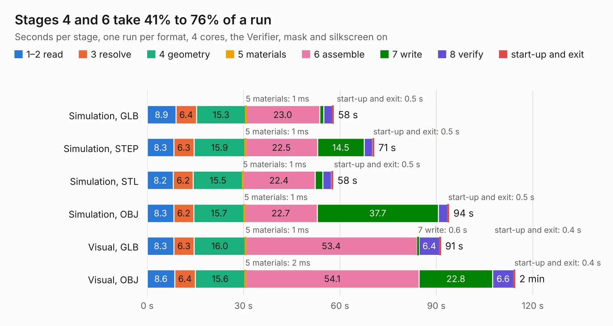

| Mode and format | 1–2 read | 3 resolve | 4 geometry | 5 materials | 6 assemble | 7 write | 8 verify | start-up and exit | Total |
|---|---:|---:|---:|---:|---:|---:|---:|---:|---:|
| Simulation, GLB | 8.9 | 6.4 | 15.3 | 1&nbsp;ms | 23.0 | 1.2 | 2.6 | 0.5 | 58.0 |
| Simulation, STEP | 8.3 | 6.3 | 15.9 | 1&nbsp;ms | 22.5 | 14.5 | 2.7 | 0.5 | 70.6 |
| Simulation, STL | 8.2 | 6.2 | 15.5 | 1&nbsp;ms | 22.4 | 2.5 | 2.6 | 0.5 | 57.8 |
| Simulation, OBJ | 8.3 | 6.2 | 15.7 | 1&nbsp;ms | 22.7 | 37.7 | 2.9 | 0.5 | 94.0 |
| Visual, GLB | 8.3 | 6.3 | 16.0 | 1&nbsp;ms | 53.4 | 0.6 | 6.4 | 0.4 | 91.4 |
| Visual, OBJ | 8.6 | 6.4 | 15.6 | 2&nbsp;ms | 54.1 | 22.8 | 6.6 | 0.4 | 114.5 |

<table align="center"><tr><td valign="top">

| Board | Repo: [antmicro/job-pcie-switch-expansion](https://github.com/antmicro/job-pcie-switch-expansion) Board: `jetson-orin-baseboard-pcie-switch-expansion.kicad_pcb` |
|---|---|
| Complexity | 489&nbsp;/&nbsp;1000 (size&nbsp;304, features&nbsp;185) |
| KESE&nbsp;features | through vias, custom pads, rounded, trapezoid or chamfered pads, arc tracks, filled zones, copper drawings, copper text, curved board outline, knockout text, TrueType text, stack-up, dielectric εr and tanδ, copper finish, mask and silkscreen colours |
| Tested | 9th November 2026 |
| Copper&nbsp;layers | 6 |
| File&nbsp;format | KiCad 10 (20260206) |
| Parts,&nbsp;tracks,&nbsp;vias | 297, 4,689, 779 |
| Triangles,&nbsp;simulation | 5,931,152 in 404 parts |
| Verifier | PASS in all six runs |

</td><td valign="top">

<table>
<tr><th>File type</th><th>File size</th><th>Peak memory used</th></tr>
<tr><th colspan="3" align="left">Simulation</th></tr>
<tr><td>GLB</td><td align="right">202&nbsp;MB</td><td align="right">1.9&nbsp;GB</td></tr>
<tr><td>STEP</td><td align="right">759&nbsp;MB</td><td align="right">2.2&nbsp;GB</td></tr>
<tr><td>STL</td><td align="right">297&nbsp;MB</td><td align="right">1.9&nbsp;GB</td></tr>
<tr><td>OBJ</td><td align="right">632&nbsp;MB</td><td align="right">3.9&nbsp;GB</td></tr>
<tr><th colspan="3" align="left">Visual</th></tr>
<tr><td>GLB</td><td align="right">122&nbsp;MB</td><td align="right">2.2&nbsp;GB</td></tr>
<tr><td>OBJ</td><td align="right">396&nbsp;MB</td><td align="right">2.9&nbsp;GB</td></tr>
</table>

</td></tr></table>

## 371. jetson-orin-baseboard-storage-expansion

| Mode and format | 1–2 read | 3 resolve | 4 geometry | 5 materials | 6 assemble | 7 write | 8 verify | start-up and exit | Total |
|---|---:|---:|---:|---:|---:|---:|---:|---:|---:|
| Simulation, GLB | 2.1 | 1.7 | 5.3 | 0.8&nbsp;ms | 7.1 | 0.3 | 0.8 | 0.3 | 17.6 |
| Simulation, STEP | 2.3 | 1.7 | 5.0 | 0.7&nbsp;ms | 6.9 | 4.8 | 0.7 | 0.3 | 21.8 |
| Simulation, STL | 2.3 | 1.6 | 5.1 | 0.9&nbsp;ms | 6.7 | 0.7 | 0.7 | 0.3 | 17.4 |
| Simulation, OBJ | 2.2 | 1.8 | 5.0 | 0.7&nbsp;ms | 6.8 | 8.9 | 0.7 | 0.3 | 25.8 |
| Visual, GLB | 2.4 | 1.7 | 5.2 | 0.7&nbsp;ms | 16.4 | 0.2 | 1.9 | 0.3 | 28.1 |
| Visual, OBJ | 2.3 | 1.6 | 5.1 | 0.8&nbsp;ms | 17.0 | 7.0 | 2.0 | 0.3 | 35.3 |

<table align="center"><tr><td valign="top">

| Board | Repo: [antmicro/job-storage-expansion](https://github.com/antmicro/job-storage-expansion) Board: `jetson-orin-baseboard-storage-expansion.kicad_pcb` |
|---|---|
| Complexity | 411&nbsp;/&nbsp;1000 (size&nbsp;251, features&nbsp;160) |
| KESE&nbsp;features | through vias, slotted holes, custom pads, rounded, trapezoid or chamfered pads, arc tracks, filled zones, copper drawings, copper text, curved board outline, knockout text, stack-up, dielectric εr and tanδ |
| Tested | 9th November 2026 |
| Copper&nbsp;layers | 4 |
| File&nbsp;format | KiCad 9 (20241229) |
| Parts,&nbsp;tracks,&nbsp;vias | 88, 1,551, 378 |
| Triangles,&nbsp;simulation | 1,932,092 in 167 parts |
| Verifier | PASS in all six runs |

</td><td valign="top">

<table>
<tr><th>File type</th><th>File size</th><th>Peak memory used</th></tr>
<tr><th colspan="3" align="left">Simulation</th></tr>
<tr><td>GLB</td><td align="right">64&nbsp;MB</td><td align="right">850&nbsp;MB</td></tr>
<tr><td>STEP</td><td align="right">274&nbsp;MB</td><td align="right">1.0&nbsp;GB</td></tr>
<tr><td>STL</td><td align="right">97&nbsp;MB</td><td align="right">810&nbsp;MB</td></tr>
<tr><td>OBJ</td><td align="right">200&nbsp;MB</td><td align="right">1.4&nbsp;GB</td></tr>
<tr><th colspan="3" align="left">Visual</th></tr>
<tr><td>GLB</td><td align="right">48&nbsp;MB</td><td align="right">934&nbsp;MB</td></tr>
<tr><td>OBJ</td><td align="right">149&nbsp;MB</td><td align="right">1.1&nbsp;GB</td></tr>
</table>

</td></tr></table>

## 372. kria-k26-devboard

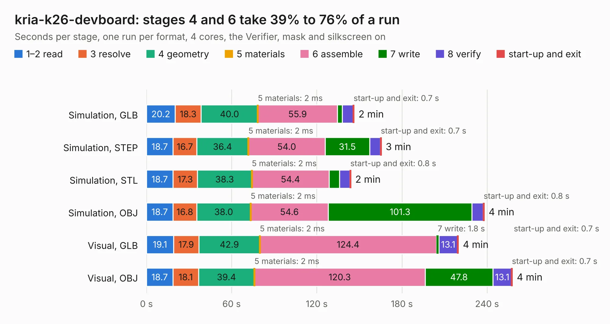

| Mode and format | 1–2 read | 3 resolve | 4 geometry | 5 materials | 6 assemble | 7 write | 8 verify | start-up and exit | Total |
|---|---:|---:|---:|---:|---:|---:|---:|---:|---:|
| Simulation, GLB | 20.2 | 18.3 | 40.0 | 2&nbsp;ms | 55.9 | 3.6 | 7.6 | 0.7 | 146.4 |
| Simulation, STEP | 18.7 | 16.7 | 36.4 | 2&nbsp;ms | 54.0 | 31.5 | 7.5 | 0.7 | 165.6 |
| Simulation, STL | 18.7 | 17.3 | 38.3 | 2&nbsp;ms | 54.4 | 7.5 | 7.2 | 0.8 | 144.1 |
| Simulation, OBJ | 18.7 | 16.8 | 38.0 | 2&nbsp;ms | 54.6 | 101.3 | 7.9 | 0.8 | 238.1 |
| Visual, GLB | 19.1 | 17.9 | 42.9 | 2&nbsp;ms | 124.4 | 1.8 | 13.1 | 0.7 | 219.9 |
| Visual, OBJ | 18.7 | 18.1 | 39.4 | 2&nbsp;ms | 120.3 | 47.8 | 13.1 | 0.7 | 257.9 |

<table align="center"><tr><td valign="top">

| Board | Repo: [antmicro/kria-k26-devboard](https://github.com/antmicro/kria-k26-devboard) Board: `kria-k26-devboard.kicad_pcb` |
|---|---|
| Complexity | 491&nbsp;/&nbsp;1000 (size&nbsp;336, features&nbsp;155) |
| KESE&nbsp;features | through vias, slotted holes, custom pads, rounded, trapezoid or chamfered pads, arc tracks, filled zones, copper drawings, copper text, stack-up, dielectric εr and tanδ, copper finish, mask and silkscreen colours |
| Tested | 9th November 2026 |
| Copper&nbsp;layers | 8 |
| File&nbsp;format | KiCad 7 (20221018) |
| Parts,&nbsp;tracks,&nbsp;vias | 577, 20,506, 1,901 |
| Triangles,&nbsp;simulation | 15,836,218 in 822 parts |
| Verifier | PASS in all six runs |

</td><td valign="top">

<table>
<tr><th>File type</th><th>File size</th><th>Peak memory used</th></tr>
<tr><th colspan="3" align="left">Simulation</th></tr>
<tr><td>GLB</td><td align="right">527&nbsp;MB</td><td align="right">4.3&nbsp;GB</td></tr>
<tr><td>STEP</td><td align="right">1.6&nbsp;GB</td><td align="right">5.2&nbsp;GB</td></tr>
<tr><td>STL</td><td align="right">792&nbsp;MB</td><td align="right">4.0&nbsp;GB</td></tr>
<tr><td>OBJ</td><td align="right">1.7&nbsp;GB</td><td align="right">10&nbsp;GB</td></tr>
<tr><th colspan="3" align="left">Visual</th></tr>
<tr><td>GLB</td><td align="right">256&nbsp;MB</td><td align="right">4.6&nbsp;GB</td></tr>
<tr><td>OBJ</td><td align="right">853&nbsp;MB</td><td align="right">5.8&nbsp;GB</td></tr>
</table>

</td></tr></table>

## 373. lpddr4-test-board

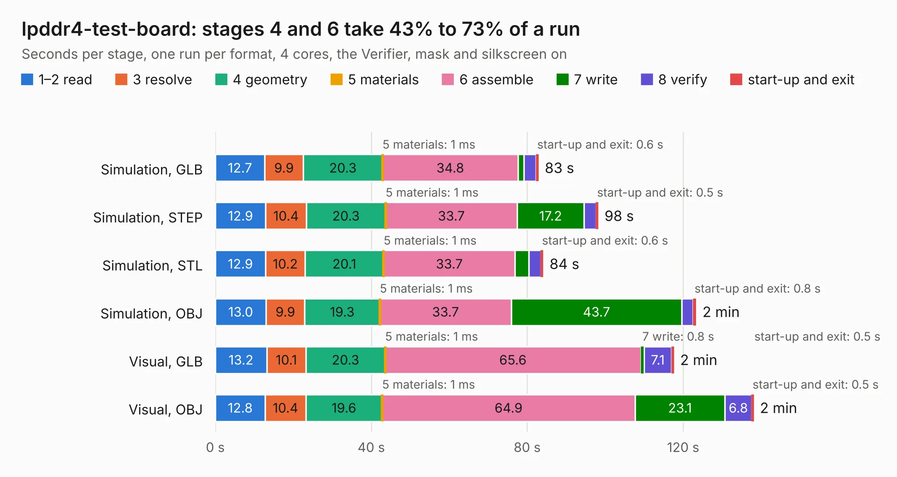

| Mode and format | 1–2 read | 3 resolve | 4 geometry | 5 materials | 6 assemble | 7 write | 8 verify | start-up and exit | Total |
|---|---:|---:|---:|---:|---:|---:|---:|---:|---:|
| Simulation, GLB | 12.7 | 9.9 | 20.3 | 1&nbsp;ms | 34.8 | 1.5 | 3.1 | 0.6 | 82.9 |
| Simulation, STEP | 12.9 | 10.4 | 20.3 | 1&nbsp;ms | 33.7 | 17.2 | 3.1 | 0.5 | 98.2 |
| Simulation, STL | 12.9 | 10.2 | 20.1 | 1&nbsp;ms | 33.7 | 3.6 | 3.1 | 0.6 | 84.1 |
| Simulation, OBJ | 13.0 | 9.9 | 19.3 | 1&nbsp;ms | 33.7 | 43.7 | 2.9 | 0.8 | 123.3 |
| Visual, GLB | 13.2 | 10.1 | 20.3 | 1&nbsp;ms | 65.6 | 0.8 | 7.1 | 0.5 | 117.6 |
| Visual, OBJ | 12.8 | 10.4 | 19.6 | 1&nbsp;ms | 64.9 | 23.1 | 6.8 | 0.5 | 138.0 |

<table align="center"><tr><td valign="top">

| Board | Repo: [antmicro/lpddr4-test-board](https://github.com/antmicro/lpddr4-test-board) Board: `lpddr4-test-board.kicad_pcb` |
|---|---|
| Complexity | 514&nbsp;/&nbsp;1000 (size&nbsp;324, features&nbsp;190) |
| KESE&nbsp;features | through vias, blind and buried vias, slotted holes, custom pads, rounded, trapezoid or chamfered pads, arc tracks, filled zones, copper drawings, copper text, TrueType text, stack-up, dielectric εr and tanδ |
| Tested | 9th November 2026 |
| Copper&nbsp;layers | 8 |
| File&nbsp;format | KiCad 9 (20241229) |
| Parts,&nbsp;tracks,&nbsp;vias | 445, 5,712, 1,214 |
| Triangles,&nbsp;simulation | 9,482,776 in 688 parts |
| Verifier | PASS in all six runs |

</td><td valign="top">

<table>
<tr><th>File type</th><th>File size</th><th>Peak memory used</th></tr>
<tr><th colspan="3" align="left">Simulation</th></tr>
<tr><td>GLB</td><td align="right">314&nbsp;MB</td><td align="right">2.6&nbsp;GB</td></tr>
<tr><td>STEP</td><td align="right">1.0&nbsp;GB</td><td align="right">3.6&nbsp;GB</td></tr>
<tr><td>STL</td><td align="right">474&nbsp;MB</td><td align="right">2.6&nbsp;GB</td></tr>
<tr><td>OBJ</td><td align="right">1.0&nbsp;GB</td><td align="right">6.3&nbsp;GB</td></tr>
<tr><th colspan="3" align="left">Visual</th></tr>
<tr><td>GLB</td><td align="right">171&nbsp;MB</td><td align="right">3.1&nbsp;GB</td></tr>
<tr><td>OBJ</td><td align="right">569&nbsp;MB</td><td align="right">3.9&nbsp;GB</td></tr>
</table>

</td></tr></table>

## 374. lpddr4-testbed

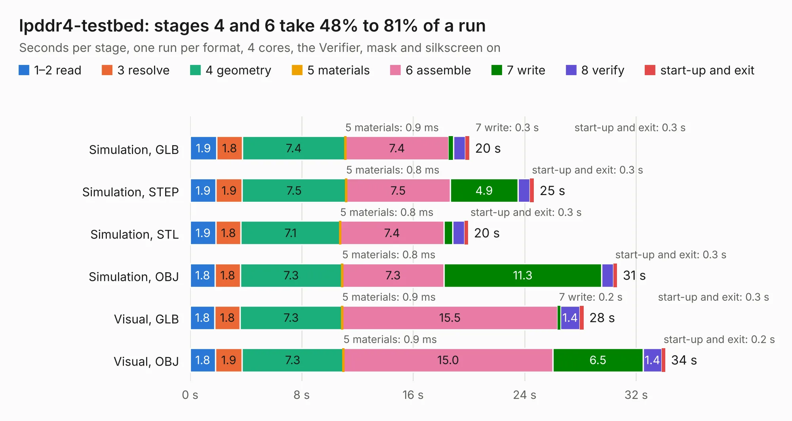

| Mode and format | 1–2 read | 3 resolve | 4 geometry | 5 materials | 6 assemble | 7 write | 8 verify | start-up and exit | Total |
|---|---:|---:|---:|---:|---:|---:|---:|---:|---:|
| Simulation, GLB | 1.9 | 1.8 | 7.4 | 0.9&nbsp;ms | 7.4 | 0.3 | 0.9 | 0.3 | 20.0 |
| Simulation, STEP | 1.9 | 1.9 | 7.5 | 0.8&nbsp;ms | 7.5 | 4.9 | 0.9 | 0.3 | 24.7 |
| Simulation, STL | 1.9 | 1.8 | 7.1 | 0.8&nbsp;ms | 7.4 | 0.6 | 0.8 | 0.3 | 20.0 |
| Simulation, OBJ | 1.8 | 1.8 | 7.3 | 0.8&nbsp;ms | 7.3 | 11.3 | 0.9 | 0.3 | 30.6 |
| Visual, GLB | 1.8 | 1.8 | 7.3 | 0.9&nbsp;ms | 15.5 | 0.2 | 1.4 | 0.3 | 28.2 |
| Visual, OBJ | 1.8 | 1.9 | 7.3 | 0.9&nbsp;ms | 15.0 | 6.5 | 1.4 | 0.2 | 34.1 |

<table align="center"><tr><td valign="top">

| Board | Repo: [antmicro/lpddr4-testbed](https://github.com/antmicro/lpddr4-testbed) Board: `lpddr4-testbed.kicad_pcb` |
|---|---|
| Complexity | 377&nbsp;/&nbsp;1000 (size&nbsp;267, features&nbsp;110) |
| KESE&nbsp;features | through vias, rounded, trapezoid or chamfered pads, arc tracks, filled zones, copper text, curved board outline, stack-up, dielectric εr and tanδ |
| Tested | 9th November 2026 |
| Copper&nbsp;layers | 6 |
| File&nbsp;format | KiCad 9 (20241229) |
| Parts,&nbsp;tracks,&nbsp;vias | 63, 1,498, 248 |
| Triangles,&nbsp;simulation | 2,042,424 in 275 parts |
| Verifier | PASS in all six runs |

</td><td valign="top">

<table>
<tr><th>File type</th><th>File size</th><th>Peak memory used</th></tr>
<tr><th colspan="3" align="left">Simulation</th></tr>
<tr><td>GLB</td><td align="right">69&nbsp;MB</td><td align="right">747&nbsp;MB</td></tr>
<tr><td>STEP</td><td align="right">283&nbsp;MB</td><td align="right">897&nbsp;MB</td></tr>
<tr><td>STL</td><td align="right">102&nbsp;MB</td><td align="right">840&nbsp;MB</td></tr>
<tr><td>OBJ</td><td align="right">216&nbsp;MB</td><td align="right">1.4&nbsp;GB</td></tr>
<tr><th colspan="3" align="left">Visual</th></tr>
<tr><td>GLB</td><td align="right">39&nbsp;MB</td><td align="right">844&nbsp;MB</td></tr>
<tr><td>OBJ</td><td align="right">121&nbsp;MB</td><td align="right">932&nbsp;MB</td></tr>
</table>

</td></tr></table>

## 375. lpddr5-testbed

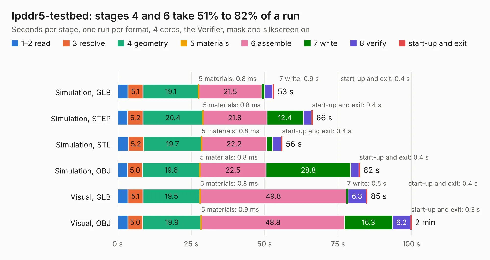

| Mode and format | 1–2 read | 3 resolve | 4 geometry | 5 materials | 6 assemble | 7 write | 8 verify | start-up and exit | Total |
|---|---:|---:|---:|---:|---:|---:|---:|---:|---:|
| Simulation, GLB | 3.5 | 5.1 | 19.1 | 0.8&nbsp;ms | 21.5 | 0.9 | 2.8 | 0.4 | 53.2 |
| Simulation, STEP | 3.4 | 5.2 | 20.4 | 0.8&nbsp;ms | 21.8 | 12.4 | 2.8 | 0.4 | 66.4 |
| Simulation, STL | 3.6 | 5.2 | 19.7 | 0.8&nbsp;ms | 22.2 | 2.0 | 2.9 | 0.4 | 56.0 |
| Simulation, OBJ | 3.4 | 5.0 | 19.6 | 0.8&nbsp;ms | 22.5 | 28.8 | 2.8 | 0.4 | 82.5 |
| Visual, GLB | 3.5 | 5.1 | 19.5 | 0.8&nbsp;ms | 49.8 | 0.5 | 6.3 | 0.4 | 85.0 |
| Visual, OBJ | 3.5 | 5.0 | 19.9 | 0.9&nbsp;ms | 48.8 | 16.3 | 6.2 | 0.3 | 100.1 |

<table align="center"><tr><td valign="top">

| Board | Repo: [antmicro/lpddr5-testbed](https://github.com/antmicro/lpddr5-testbed) Board: `lpddr5-testbed.kicad_pcb` |
|---|---|
| Complexity | 417&nbsp;/&nbsp;1000 (size&nbsp;302, features&nbsp;115) |
| KESE&nbsp;features | through vias, rounded, trapezoid or chamfered pads, arc tracks, filled zones, copper text, curved board outline, stack-up, dielectric εr and tanδ, mask and silkscreen colours |
| Tested | 9th November 2026 |
| Copper&nbsp;layers | 6 |
| File&nbsp;format | KiCad 9 (20241229) |
| Parts,&nbsp;tracks,&nbsp;vias | 152, 5,078, 590 |
| Triangles,&nbsp;simulation | 5,169,826 in 244 parts |
| Verifier | PASS in all six runs |

</td><td valign="top">

<table>
<tr><th>File type</th><th>File size</th><th>Peak memory used</th></tr>
<tr><th colspan="3" align="left">Simulation</th></tr>
<tr><td>GLB</td><td align="right">176&nbsp;MB</td><td align="right">1.5&nbsp;GB</td></tr>
<tr><td>STEP</td><td align="right">766&nbsp;MB</td><td align="right">1.9&nbsp;GB</td></tr>
<tr><td>STL</td><td align="right">259&nbsp;MB</td><td align="right">1.5&nbsp;GB</td></tr>
<tr><td>OBJ</td><td align="right">555&nbsp;MB</td><td align="right">3.4&nbsp;GB</td></tr>
<tr><th colspan="3" align="left">Visual</th></tr>
<tr><td>GLB</td><td align="right">100&nbsp;MB</td><td align="right">1.8&nbsp;GB</td></tr>
<tr><td>OBJ</td><td align="right">323&nbsp;MB</td><td align="right">2.3&nbsp;GB</td></tr>
</table>

</td></tr></table>

## 376. antmicro-m2-oculink-adapter-hw

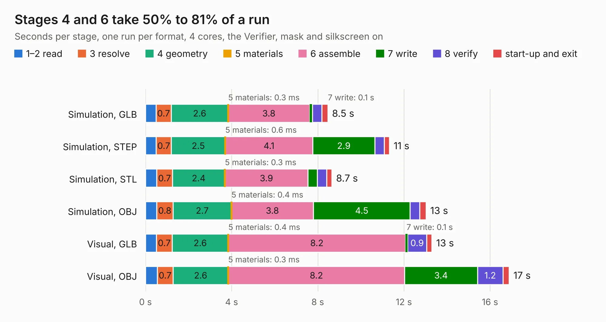

| Mode and format | 1–2 read | 3 resolve | 4 geometry | 5 materials | 6 assemble | 7 write | 8 verify | start-up and exit | Total |
|---|---:|---:|---:|---:|---:|---:|---:|---:|---:|
| Simulation, GLB | 0.5 | 0.7 | 2.6 | 0.3&nbsp;ms | 3.8 | 0.1 | 0.4 | 0.3 | 8.5 |
| Simulation, STEP | 0.5 | 0.7 | 2.5 | 0.6&nbsp;ms | 4.1 | 2.9 | 0.4 | 0.2 | 11.3 |
| Simulation, STL | 0.5 | 0.7 | 2.4 | 0.3&nbsp;ms | 3.9 | 0.4 | 0.4 | 0.2 | 8.7 |
| Simulation, OBJ | 0.5 | 0.8 | 2.7 | 0.4&nbsp;ms | 3.8 | 4.5 | 0.4 | 0.3 | 13.0 |
| Visual, GLB | 0.5 | 0.7 | 2.6 | 0.4&nbsp;ms | 8.2 | 0.1 | 0.9 | 0.2 | 13.3 |
| Visual, OBJ | 0.5 | 0.7 | 2.6 | 0.3&nbsp;ms | 8.2 | 3.4 | 1.2 | 0.3 | 16.9 |

<table align="center"><tr><td valign="top">

| Board | Repo: [antmicro/m2-oculink-adapter](https://github.com/antmicro/m2-oculink-adapter) Board: `antmicro-m2-oculink-adapter-hw.kicad_pcb` |
|---|---|
| Complexity | 296&nbsp;/&nbsp;1000 (size&nbsp;181, features&nbsp;115) |
| KESE&nbsp;features | through vias, rounded, trapezoid or chamfered pads, arc tracks, filled zones, copper text, curved board outline, stack-up, dielectric εr and tanδ, mask and silkscreen colours |
| Tested | 9th November 2026 |
| Copper&nbsp;layers | 4 |
| File&nbsp;format | KiCad 9 (20241229) |
| Parts,&nbsp;tracks,&nbsp;vias | 19, 577, 183 |
| Triangles,&nbsp;simulation | 873,538 in 72 parts |
| Verifier | PASS in all six runs |

</td><td valign="top">

<table>
<tr><th>File type</th><th>File size</th><th>Peak memory used</th></tr>
<tr><th colspan="3" align="left">Simulation</th></tr>
<tr><td>GLB</td><td align="right">30&nbsp;MB</td><td align="right">440&nbsp;MB</td></tr>
<tr><td>STEP</td><td align="right">132&nbsp;MB</td><td align="right">533&nbsp;MB</td></tr>
<tr><td>STL</td><td align="right">44&nbsp;MB</td><td align="right">429&nbsp;MB</td></tr>
<tr><td>OBJ</td><td align="right">89&nbsp;MB</td><td align="right">638&nbsp;MB</td></tr>
<tr><th colspan="3" align="left">Visual</th></tr>
<tr><td>GLB</td><td align="right">22&nbsp;MB</td><td align="right">590&nbsp;MB</td></tr>
<tr><td>OBJ</td><td align="right">67&nbsp;MB</td><td align="right">584&nbsp;MB</td></tr>
</table>

</td></tr></table>

## 377. m2-pcie-adapter

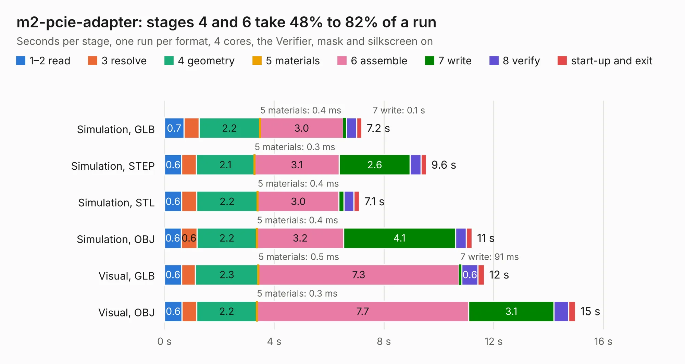

| Mode and format | 1–2 read | 3 resolve | 4 geometry | 5 materials | 6 assemble | 7 write | 8 verify | start-up and exit | Total |
|---|---:|---:|---:|---:|---:|---:|---:|---:|---:|
| Simulation, GLB | 0.7 | 0.5 | 2.2 | 0.4&nbsp;ms | 3.0 | 0.1 | 0.4 | 0.2 | 7.2 |
| Simulation, STEP | 0.6 | 0.5 | 2.1 | 0.3&nbsp;ms | 3.1 | 2.6 | 0.4 | 0.2 | 9.6 |
| Simulation, STL | 0.6 | 0.5 | 2.2 | 0.4&nbsp;ms | 3.0 | 0.2 | 0.4 | 0.2 | 7.1 |
| Simulation, OBJ | 0.6 | 0.6 | 2.2 | 0.4&nbsp;ms | 3.2 | 4.1 | 0.4 | 0.2 | 11.2 |
| Visual, GLB | 0.6 | 0.5 | 2.3 | 0.5&nbsp;ms | 7.3 | 91&nbsp;ms | 0.6 | 0.2 | 11.7 |
| Visual, OBJ | 0.6 | 0.5 | 2.2 | 0.3&nbsp;ms | 7.7 | 3.1 | 0.5 | 0.2 | 15.0 |

<table align="center"><tr><td valign="top">

| Board | Repo: [antmicro/m2-pcie-adapter](https://github.com/antmicro/m2-pcie-adapter) Board: `m2-pcie-adapter.kicad_pcb` |
|---|---|
| Complexity | 288&nbsp;/&nbsp;1000 (size&nbsp;178, features&nbsp;110) |
| KESE&nbsp;features | through vias, rounded, trapezoid or chamfered pads, arc tracks, filled zones, copper text, curved board outline, stack-up, dielectric εr and tanδ |
| Tested | 9th November 2026 |
| Copper&nbsp;layers | 4 |
| File&nbsp;format | KiCad 9 (20241229) |
| Parts,&nbsp;tracks,&nbsp;vias | 16, 787, 92 |
| Triangles,&nbsp;simulation | 808,562 in 81 parts |
| Verifier | PASS in all six runs |

</td><td valign="top">

<table>
<tr><th>File type</th><th>File size</th><th>Peak memory used</th></tr>
<tr><th colspan="3" align="left">Simulation</th></tr>
<tr><td>GLB</td><td align="right">28&nbsp;MB</td><td align="right">497&nbsp;MB</td></tr>
<tr><td>STEP</td><td align="right">142&nbsp;MB</td><td align="right">498&nbsp;MB</td></tr>
<tr><td>STL</td><td align="right">40&nbsp;MB</td><td align="right">453&nbsp;MB</td></tr>
<tr><td>OBJ</td><td align="right">83&nbsp;MB</td><td align="right">586&nbsp;MB</td></tr>
<tr><th colspan="3" align="left">Visual</th></tr>
<tr><td>GLB</td><td align="right">21&nbsp;MB</td><td align="right">538&nbsp;MB</td></tr>
<tr><td>OBJ</td><td align="right">63&nbsp;MB</td><td align="right">600&nbsp;MB</td></tr>
</table>

</td></tr></table>

## 378. m2-smart-iot-module

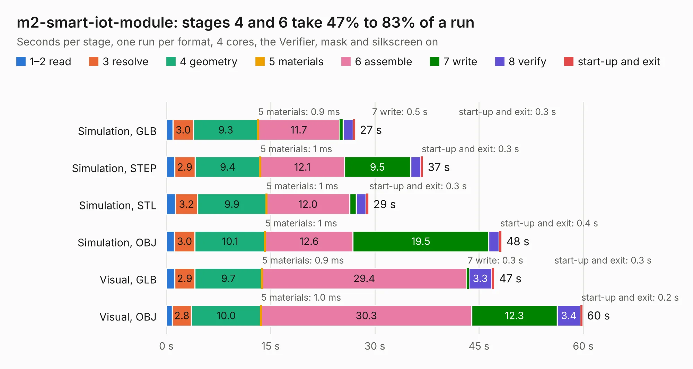

| Mode and format | 1–2 read | 3 resolve | 4 geometry | 5 materials | 6 assemble | 7 write | 8 verify | start-up and exit | Total |
|---|---:|---:|---:|---:|---:|---:|---:|---:|---:|
| Simulation, GLB | 0.9 | 3.0 | 9.3 | 0.9&nbsp;ms | 11.7 | 0.5 | 1.4 | 0.3 | 27.1 |
| Simulation, STEP | 1.2 | 2.9 | 9.4 | 1&nbsp;ms | 12.1 | 9.5 | 1.4 | 0.3 | 36.9 |
| Simulation, STL | 1.3 | 3.2 | 9.9 | 1&nbsp;ms | 12.0 | 0.9 | 1.4 | 0.3 | 29.1 |
| Simulation, OBJ | 1.1 | 3.0 | 10.1 | 1&nbsp;ms | 12.6 | 19.5 | 1.5 | 0.4 | 48.2 |
| Visual, GLB | 1.2 | 2.9 | 9.7 | 0.9&nbsp;ms | 29.4 | 0.3 | 3.3 | 0.3 | 47.2 |
| Visual, OBJ | 0.9 | 2.8 | 10.0 | 1.0&nbsp;ms | 30.3 | 12.3 | 3.4 | 0.2 | 59.8 |

<table align="center"><tr><td valign="top">

| Board | Repo: [antmicro/m2-smart-iot-module](https://github.com/antmicro/m2-smart-iot-module) Board: `m2-smart-iot-module.kicad_pcb` |
|---|---|
| Complexity | 393&nbsp;/&nbsp;1000 (size&nbsp;268, features&nbsp;125) |
| KESE&nbsp;features | through vias, custom pads, rounded, trapezoid or chamfered pads, arc tracks, filled zones, copper drawings, curved board outline, stack-up, dielectric εr and tanδ |
| Tested | 9th November 2026 |
| Copper&nbsp;layers | 4 |
| File&nbsp;format | KiCad 10 (20260206) |
| Parts,&nbsp;tracks,&nbsp;vias | 195, 1,615, 435 |
| Triangles,&nbsp;simulation | 2,528,042 in 263 parts |
| Verifier | PASS in all six runs |

</td><td valign="top">

<table>
<tr><th>File type</th><th>File size</th><th>Peak memory used</th></tr>
<tr><th colspan="3" align="left">Simulation</th></tr>
<tr><td>GLB</td><td align="right">87&nbsp;MB</td><td align="right">817&nbsp;MB</td></tr>
<tr><td>STEP</td><td align="right">423&nbsp;MB</td><td align="right">1.1&nbsp;GB</td></tr>
<tr><td>STL</td><td align="right">126&nbsp;MB</td><td align="right">876&nbsp;MB</td></tr>
<tr><td>OBJ</td><td align="right">271&nbsp;MB</td><td align="right">1.7&nbsp;GB</td></tr>
<tr><th colspan="3" align="left">Visual</th></tr>
<tr><td>GLB</td><td align="right">61&nbsp;MB</td><td align="right">1.1&nbsp;GB</td></tr>
<tr><td>OBJ</td><td align="right">190&nbsp;MB</td><td align="right">1.3&nbsp;GB</td></tr>
</table>

</td></tr></table>

## 379. machxo5-espi-debugger

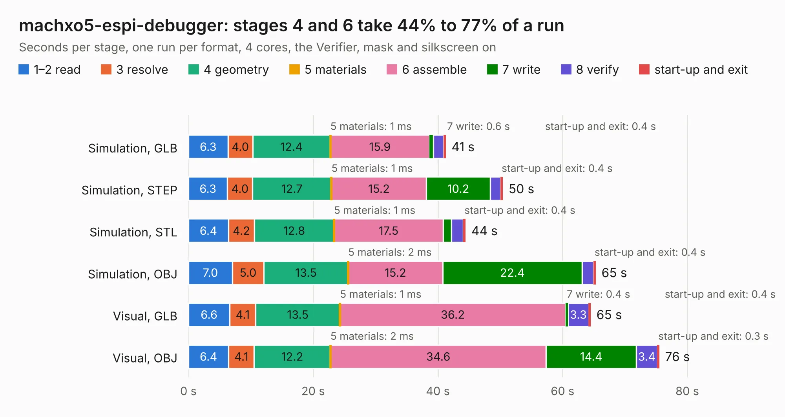

| Mode and format | 1–2 read | 3 resolve | 4 geometry | 5 materials | 6 assemble | 7 write | 8 verify | start-up and exit | Total |
|---|---:|---:|---:|---:|---:|---:|---:|---:|---:|
| Simulation, GLB | 6.3 | 4.0 | 12.4 | 1&nbsp;ms | 15.9 | 0.6 | 1.7 | 0.4 | 41.3 |
| Simulation, STEP | 6.3 | 4.0 | 12.7 | 1&nbsp;ms | 15.2 | 10.2 | 1.6 | 0.4 | 50.4 |
| Simulation, STL | 6.4 | 4.2 | 12.8 | 1&nbsp;ms | 17.5 | 1.3 | 1.9 | 0.4 | 44.5 |
| Simulation, OBJ | 7.0 | 5.0 | 13.5 | 2&nbsp;ms | 15.2 | 22.4 | 1.8 | 0.4 | 65.3 |
| Visual, GLB | 6.6 | 4.1 | 13.5 | 1&nbsp;ms | 36.2 | 0.4 | 3.3 | 0.4 | 64.5 |
| Visual, OBJ | 6.4 | 4.1 | 12.2 | 2&nbsp;ms | 34.6 | 14.4 | 3.4 | 0.3 | 75.5 |

<table align="center"><tr><td valign="top">

| Board | Repo: [antmicro/machx05-espi-debugger](https://github.com/antmicro/machx05-espi-debugger) Board: `machxo5-espi-debugger.kicad_pcb` |
|---|---|
| Complexity | 461&nbsp;/&nbsp;1000 (size&nbsp;291, features&nbsp;170) |
| KESE&nbsp;features | through vias, slotted holes, custom pads, rounded, trapezoid or chamfered pads, arc tracks, filled zones, copper drawings, copper text, knockout text, stack-up, dielectric εr and tanδ, copper finish, mask and silkscreen colours |
| Tested | 9th November 2026 |
| Copper&nbsp;layers | 6 |
| File&nbsp;format | KiCad 10 (20260206) |
| Parts,&nbsp;tracks,&nbsp;vias | 227, 2,121, 491 |
| Triangles,&nbsp;simulation | 3,681,402 in 482 parts |
| Verifier | PASS in all six runs |

</td><td valign="top">

<table>
<tr><th>File type</th><th>File size</th><th>Peak memory used</th></tr>
<tr><th colspan="3" align="left">Simulation</th></tr>
<tr><td>GLB</td><td align="right">122&nbsp;MB</td><td align="right">1.3&nbsp;GB</td></tr>
<tr><td>STEP</td><td align="right">478&nbsp;MB</td><td align="right">1.5&nbsp;GB</td></tr>
<tr><td>STL</td><td align="right">184&nbsp;MB</td><td align="right">1.3&nbsp;GB</td></tr>
<tr><td>OBJ</td><td align="right">382&nbsp;MB</td><td align="right">2.4&nbsp;GB</td></tr>
<tr><th colspan="3" align="left">Visual</th></tr>
<tr><td>GLB</td><td align="right">81&nbsp;MB</td><td align="right">1.5&nbsp;GB</td></tr>
<tr><td>OBJ</td><td align="right">259&nbsp;MB</td><td align="right">1.9&nbsp;GB</td></tr>
</table>

</td></tr></table>

## 380. mec1723-espi-debugger

| Mode and format | 1–2 read | 3 resolve | 4 geometry | 5 materials | 6 assemble | 7 write | 8 verify | start-up and exit | Total |
|---|---:|---:|---:|---:|---:|---:|---:|---:|---:|
| Simulation, GLB | 4.8 | 6.1 | 12.2 | 2&nbsp;ms | 19.0 | 1.0 | 3.1 | 0.4 | 46.6 |
| Simulation, STEP | 5.2 | 6.4 | 12.9 | 2&nbsp;ms | 19.5 | 12.8 | 2.8 | 0.5 | 60.1 |
| Simulation, STL | 4.7 | 6.1 | 12.2 | 1&nbsp;ms | 18.5 | 2.3 | 2.6 | 0.4 | 46.8 |
| Simulation, OBJ | 4.9 | 5.9 | 12.0 | 2&nbsp;ms | 19.3 | 33.2 | 2.6 | 0.4 | 78.3 |
| Visual, GLB | 4.9 | 5.9 | 12.8 | 1&nbsp;ms | 40.5 | 0.6 | 5.3 | 0.4 | 70.5 |
| Visual, OBJ | 5.0 | 6.5 | 12.9 | 2&nbsp;ms | 40.7 | 17.8 | 6.1 | 0.4 | 89.4 |

<table align="center"><tr><td valign="top">

| Board | Repo: [antmicro/mec1723-espi-debugger](https://github.com/antmicro/mec1723-espi-debugger) Board: `mec1723-espi-debugger.kicad_pcb` |
|---|---|
| Complexity | 471&nbsp;/&nbsp;1000 (size&nbsp;301, features&nbsp;170) |
| KESE&nbsp;features | through vias, slotted holes, custom pads, rounded, trapezoid or chamfered pads, arc tracks, filled zones, copper drawings, copper text, knockout text, stack-up, dielectric εr and tanδ, copper finish, mask and silkscreen colours |
| Tested | 9th November 2026 |
| Copper&nbsp;layers | 8 |
| File&nbsp;format | KiCad 10 (20260206) |
| Parts,&nbsp;tracks,&nbsp;vias | 212, 3,327, 470 |
| Triangles,&nbsp;simulation | 4,657,560 in 302 parts |
| Verifier | PASS in all six runs |

</td><td valign="top">

<table>
<tr><th>File type</th><th>File size</th><th>Peak memory used</th></tr>
<tr><th colspan="3" align="left">Simulation</th></tr>
<tr><td>GLB</td><td align="right">158&nbsp;MB</td><td align="right">1.3&nbsp;GB</td></tr>
<tr><td>STEP</td><td align="right">528&nbsp;MB</td><td align="right">1.6&nbsp;GB</td></tr>
<tr><td>STL</td><td align="right">233&nbsp;MB</td><td align="right">1.3&nbsp;GB</td></tr>
<tr><td>OBJ</td><td align="right">497&nbsp;MB</td><td align="right">3.0&nbsp;GB</td></tr>
<tr><th colspan="3" align="left">Visual</th></tr>
<tr><td>GLB</td><td align="right">86&nbsp;MB</td><td align="right">1.6&nbsp;GB</td></tr>
<tr><td>OBJ</td><td align="right">283&nbsp;MB</td><td align="right">2.0&nbsp;GB</td></tr>
</table>

</td></tr></table>

## 381. microphone-board

| Mode and format | 1–2 read | 3 resolve | 4 geometry | 5 materials | 6 assemble | 7 write | 8 verify | start-up and exit | Total |
|---|---:|---:|---:|---:|---:|---:|---:|---:|---:|
| Simulation, GLB | 0.2 | 0.1 | 0.3 | 0.1&nbsp;ms | 0.5 | 21&nbsp;ms | 60&nbsp;ms | 0.2 | 1.5 |
| Simulation, STEP | 0.2 | 0.1 | 0.3 | 0.1&nbsp;ms | 0.5 | 0.7 | 63&nbsp;ms | 0.2 | 2.3 |
| Simulation, STL | 0.3 | 0.1 | 0.3 | 0.1&nbsp;ms | 0.5 | 35&nbsp;ms | 63&nbsp;ms | 0.2 | 1.6 |
| Simulation, OBJ | 0.2 | 0.1 | 0.4 | 0.1&nbsp;ms | 0.6 | 0.6 | 70&nbsp;ms | 0.2 | 2.1 |
| Visual, GLB | 0.2 | 0.1 | 0.3 | 0.1&nbsp;ms | 1.1 | 15&nbsp;ms | 0.1 | 0.2 | 2.1 |
| Visual, OBJ | 0.2 | 0.1 | 0.3 | 0.1&nbsp;ms | 1.1 | 0.4 | 92&nbsp;ms | 0.2 | 2.4 |

<table align="center"><tr><td valign="top">

| Board | Repo: [antmicro/microphone-board](https://github.com/antmicro/microphone-board) Board: `microphone-board.kicad_pcb` |
|---|---|
| Complexity | 273&nbsp;/&nbsp;1000 (size&nbsp;143, features&nbsp;130) |
| KESE&nbsp;features | through vias, custom pads, rounded, trapezoid or chamfered pads, arc tracks, filled zones, copper drawings, curved board outline, stack-up, dielectric εr and tanδ, mask and silkscreen colours |
| Tested | 9th November 2026 |
| Copper&nbsp;layers | 4 |
| File&nbsp;format | KiCad 8 (20240108) |
| Parts,&nbsp;tracks,&nbsp;vias | 12, 60, 28 |
| Triangles,&nbsp;simulation | 147,964 in 16 parts |
| Verifier | PASS in all six runs |

</td><td valign="top">

<table>
<tr><th>File type</th><th>File size</th><th>Peak memory used</th></tr>
<tr><th colspan="3" align="left">Simulation</th></tr>
<tr><td>GLB</td><td align="right">5.1&nbsp;MB</td><td align="right">204&nbsp;MB</td></tr>
<tr><td>STEP</td><td align="right">22&nbsp;MB</td><td align="right">212&nbsp;MB</td></tr>
<tr><td>STL</td><td align="right">7.4&nbsp;MB</td><td align="right">211&nbsp;MB</td></tr>
<tr><td>OBJ</td><td align="right">14&nbsp;MB</td><td align="right">201&nbsp;MB</td></tr>
<tr><th colspan="3" align="left">Visual</th></tr>
<tr><td>GLB</td><td align="right">3.4&nbsp;MB</td><td align="right">163&nbsp;MB</td></tr>
<tr><td>OBJ</td><td align="right">9.4&nbsp;MB</td><td align="right">163&nbsp;MB</td></tr>
</table>

</td></tr></table>

## 382. altera-modular-agilex-5-dc-scm

| Mode and format | 1–2 read | 3 resolve | 4 geometry | 5 materials | 6 assemble | 7 write | 8 verify | start-up and exit | Total |
|---|---:|---:|---:|---:|---:|---:|---:|---:|---:|
| Simulation, GLB | 19.3 | 17.9 | 42.0 | 3&nbsp;ms | 79.3 | 3.6 | 10.6 | 0.9 | 173.6 |
| Simulation, STEP | 17.8 | 17.9 | 40.6 | 4&nbsp;ms | 77.0 | 37.8 | 10.8 | 0.8 | 202.6 |
| Simulation, STL | 18.6 | 17.8 | 40.1 | 2&nbsp;ms | 78.4 | 8.6 | 11.5 | 0.8 | 175.9 |
| Simulation, OBJ | 18.1 | 17.3 | 39.3 | 4&nbsp;ms | 75.9 | 94.2 | 11.1 | 0.8 | 256.7 |
| Visual, GLB | 17.3 | 16.6 | 38.2 | 3&nbsp;ms | 148.3 | 2.0 | 14.4 | 0.9 | 237.6 |
| Visual, OBJ | 17.9 | 18.0 | 39.9 | 3&nbsp;ms | 145.7 | 46.0 | 16.1 | 0.8 | 284.5 |

<table align="center"><tr><td valign="top">

| Board | Repo: [antmicro/modular-agilex5e-dc-scm](https://github.com/antmicro/modular-agilex5e-dc-scm) Board: `altera-modular-agilex-5-dc-scm.kicad_pcb` |
|---|---|
| Complexity | 520&nbsp;/&nbsp;1000 (size&nbsp;340, features&nbsp;180) |
| KESE&nbsp;features | through vias, slotted holes, custom pads, rounded, trapezoid or chamfered pads, arc tracks, filled zones, copper drawings, copper text, curved board outline, knockout text, stack-up, dielectric εr and tanδ, copper finish, mask and silkscreen colours |
| Tested | 9th November 2026 |
| Copper&nbsp;layers | 8 |
| File&nbsp;format | KiCad 10 (20260206) |
| Parts,&nbsp;tracks,&nbsp;vias | 782, 15,441, 1,606 |
| Triangles,&nbsp;simulation | 15,504,394 in 963 parts |
| Verifier | PASS in all six runs |

</td><td valign="top">

<table>
<tr><th>File type</th><th>File size</th><th>Peak memory used</th></tr>
<tr><th colspan="3" align="left">Simulation</th></tr>
<tr><td>GLB</td><td align="right">520&nbsp;MB</td><td align="right">3.6&nbsp;GB</td></tr>
<tr><td>STEP</td><td align="right">1.8&nbsp;GB</td><td align="right">5.0&nbsp;GB</td></tr>
<tr><td>STL</td><td align="right">775&nbsp;MB</td><td align="right">3.7&nbsp;GB</td></tr>
<tr><td>OBJ</td><td align="right">1.7&nbsp;GB</td><td align="right">10&nbsp;GB</td></tr>
<tr><th colspan="3" align="left">Visual</th></tr>
<tr><td>GLB</td><td align="right">282&nbsp;MB</td><td align="right">4.9&nbsp;GB</td></tr>
<tr><td>OBJ</td><td align="right">934&nbsp;MB</td><td align="right">6.4&nbsp;GB</td></tr>
</table>

</td></tr></table>

## 383. myra-sip-interposer

| Mode and format | 1–2 read | 3 resolve | 4 geometry | 5 materials | 6 assemble | 7 write | 8 verify | start-up and exit | Total |
|---|---:|---:|---:|---:|---:|---:|---:|---:|---:|
| Simulation, GLB | 0.7 | 0.9 | 3.9 | 0.4&nbsp;ms | 3.0 | 0.1 | 0.5 | 0.2 | 9.5 |
| Simulation, STEP | 0.7 | 0.9 | 4.0 | 0.3&nbsp;ms | 3.0 | 2.3 | 0.5 | 0.2 | 11.6 |
| Simulation, STL | 0.8 | 0.9 | 4.0 | 0.4&nbsp;ms | 3.0 | 0.3 | 0.6 | 0.2 | 9.8 |
| Simulation, OBJ | 0.9 | 0.9 | 4.1 | 0.4&nbsp;ms | 3.1 | 4.9 | 0.5 | 0.3 | 14.7 |
| Visual, GLB | 0.8 | 0.9 | 3.8 | 0.4&nbsp;ms | 6.4 | 75&nbsp;ms | 0.5 | 0.3 | 12.8 |
| Visual, OBJ | 0.8 | 1.0 | 4.0 | 0.6&nbsp;ms | 6.1 | 2.5 | 0.7 | 0.3 | 15.3 |

<table align="center"><tr><td valign="top">

| Board | Repo: [antmicro/myra-sip-interposer](https://github.com/antmicro/myra-sip-interposer) Board: `myra-sip-interposer.kicad_pcb` |
|---|---|
| Complexity | 405&nbsp;/&nbsp;1000 (size&nbsp;240, features&nbsp;165) |
| KESE&nbsp;features | through vias, custom pads, rounded, trapezoid or chamfered pads, filled zones, copper drawings, stack-up, dielectric εr and tanδ, copper finish, castellated pads, plated board edge |
| Tested | 9th November 2026 |
| Copper&nbsp;layers | 4 |
| File&nbsp;format | KiCad 7 (20221018) |
| Parts,&nbsp;tracks,&nbsp;vias | 31, 354, 164 |
| Triangles,&nbsp;simulation | 866,652 in 96 parts |
| Verifier | PASS in all six runs |

</td><td valign="top">

<table>
<tr><th>File type</th><th>File size</th><th>Peak memory used</th></tr>
<tr><th colspan="3" align="left">Simulation</th></tr>
<tr><td>GLB</td><td align="right">29&nbsp;MB</td><td align="right">377&nbsp;MB</td></tr>
<tr><td>STEP</td><td align="right">103&nbsp;MB</td><td align="right">446&nbsp;MB</td></tr>
<tr><td>STL</td><td align="right">43&nbsp;MB</td><td align="right">396&nbsp;MB</td></tr>
<tr><td>OBJ</td><td align="right">86&nbsp;MB</td><td align="right">607&nbsp;MB</td></tr>
<tr><th colspan="3" align="left">Visual</th></tr>
<tr><td>GLB</td><td align="right">15&nbsp;MB</td><td align="right">483&nbsp;MB</td></tr>
<tr><td>OBJ</td><td align="right">46&nbsp;MB</td><td align="right">449&nbsp;MB</td></tr>
</table>

</td></tr></table>

## 384. oculink-to-10gbe-adapter

| Mode and format | 1–2 read | 3 resolve | 4 geometry | 5 materials | 6 assemble | 7 write | 8 verify | start-up and exit | Total |
|---|---:|---:|---:|---:|---:|---:|---:|---:|---:|
| Simulation, GLB | 12.0 | 6.8 | 23.7 | 2&nbsp;ms | 31.0 | 1.4 | 3.3 | 0.5 | 78.7 |
| Simulation, STEP | 12.3 | 7.2 | 23.6 | 2&nbsp;ms | 30.1 | 16.7 | 3.5 | 0.5 | 93.9 |
| Simulation, STL | 12.2 | 7.3 | 24.7 | 2&nbsp;ms | 31.7 | 3.6 | 3.5 | 0.5 | 83.5 |
| Simulation, OBJ | 12.7 | 7.5 | 26.7 | 3&nbsp;ms | 32.8 | 55.9 | 3.6 | 0.6 | 139.8 |
| Visual, GLB | 12.5 | 7.2 | 24.1 | 2&nbsp;ms | 101.6 | 0.7 | 7.4 | 0.4 | 153.9 |
| Visual, OBJ | 11.7 | 7.1 | 23.8 | 2&nbsp;ms | 99.8 | 28.1 | 7.6 | 0.4 | 178.5 |

<table align="center"><tr><td valign="top">

| Board | Repo: [antmicro/oculink-10gbe-adapter](https://github.com/antmicro/oculink-10gbe-adapter) Board: `oculink-to-10gbe-adapter.kicad_pcb` |
|---|---|
| Complexity | 466&nbsp;/&nbsp;1000 (size&nbsp;311, features&nbsp;155) |
| KESE&nbsp;features | through vias, slotted holes, custom pads, rounded, trapezoid or chamfered pads, arc tracks, filled zones, copper drawings, copper text, knockout text, stack-up, dielectric εr and tanδ, mask and silkscreen colours |
| Tested | 9th November 2026 |
| Copper&nbsp;layers | 8 |
| File&nbsp;format | KiCad 9 (20241229) |
| Parts,&nbsp;tracks,&nbsp;vias | 460, 2,463, 1,174 |
| Triangles,&nbsp;simulation | 9,149,554 in 437 parts |
| Verifier | PASS in all six runs |

</td><td valign="top">

<table>
<tr><th>File type</th><th>File size</th><th>Peak memory used</th></tr>
<tr><th colspan="3" align="left">Simulation</th></tr>
<tr><td>GLB</td><td align="right">295&nbsp;MB</td><td align="right">2.7&nbsp;GB</td></tr>
<tr><td>STEP</td><td align="right">962&nbsp;MB</td><td align="right">3.5&nbsp;GB</td></tr>
<tr><td>STL</td><td align="right">458&nbsp;MB</td><td align="right">2.8&nbsp;GB</td></tr>
<tr><td>OBJ</td><td align="right">950&nbsp;MB</td><td align="right">5.8&nbsp;GB</td></tr>
<tr><th colspan="3" align="left">Visual</th></tr>
<tr><td>GLB</td><td align="right">167&nbsp;MB</td><td align="right">3.0&nbsp;GB</td></tr>
<tr><td>OBJ</td><td align="right">537&nbsp;MB</td><td align="right">3.7&nbsp;GB</td></tr>
</table>

</td></tr></table>

## 385. oculink-to-pcie-adapter

| Mode and format | 1–2 read | 3 resolve | 4 geometry | 5 materials | 6 assemble | 7 write | 8 verify | start-up and exit | Total |
|---|---:|---:|---:|---:|---:|---:|---:|---:|---:|
| Simulation, GLB | 4.0 | 3.1 | 8.7 | 1&nbsp;ms | 10.1 | 0.5 | 1.1 | 0.3 | 27.9 |
| Simulation, STEP | 4.0 | 3.0 | 8.4 | 1&nbsp;ms | 10.1 | 6.2 | 1.0 | 0.3 | 33.0 |
| Simulation, STL | 4.2 | 3.0 | 8.4 | 2&nbsp;ms | 10.4 | 1.0 | 1.0 | 0.3 | 28.3 |
| Simulation, OBJ | 3.8 | 2.9 | 8.6 | 1&nbsp;ms | 9.6 | 14.9 | 1.0 | 0.3 | 41.1 |
| Visual, GLB | 3.9 | 2.8 | 8.4 | 1&nbsp;ms | 18.3 | 0.3 | 2.6 | 0.3 | 36.5 |
| Visual, OBJ | 3.9 | 3.0 | 8.7 | 1&nbsp;ms | 17.9 | 10.2 | 2.5 | 0.3 | 46.6 |

<table align="center"><tr><td valign="top">

| Board | Repo: [antmicro/oculink-pcie-adapter](https://github.com/antmicro/oculink-pcie-adapter) Board: `oculink-to-pcie-adapter.kicad_pcb` |
|---|---|
| Complexity | 366&nbsp;/&nbsp;1000 (size&nbsp;221, features&nbsp;145) |
| KESE&nbsp;features | through vias, slotted holes, custom pads, rounded, trapezoid or chamfered pads, arc tracks, filled zones, copper drawings, knockout text, stack-up, dielectric εr and tanδ, mask and silkscreen colours |
| Tested | 9th November 2026 |
| Copper&nbsp;layers | 4 |
| File&nbsp;format | KiCad 9 (20241229) |
| Parts,&nbsp;tracks,&nbsp;vias | 144, 1,642, 583 |
| Triangles,&nbsp;simulation | 2,446,380 in 211 parts |
| Verifier | PASS in all six runs |

</td><td valign="top">

<table>
<tr><th>File type</th><th>File size</th><th>Peak memory used</th></tr>
<tr><th colspan="3" align="left">Simulation</th></tr>
<tr><td>GLB</td><td align="right">83&nbsp;MB</td><td align="right">934&nbsp;MB</td></tr>
<tr><td>STEP</td><td align="right">283&nbsp;MB</td><td align="right">1.2&nbsp;GB</td></tr>
<tr><td>STL</td><td align="right">122&nbsp;MB</td><td align="right">881&nbsp;MB</td></tr>
<tr><td>OBJ</td><td align="right">253&nbsp;MB</td><td align="right">1.6&nbsp;GB</td></tr>
<tr><th colspan="3" align="left">Visual</th></tr>
<tr><td>GLB</td><td align="right">56&nbsp;MB</td><td align="right">1.2&nbsp;GB</td></tr>
<tr><td>OBJ</td><td align="right">172&nbsp;MB</td><td align="right">1.4&nbsp;GB</td></tr>
</table>

</td></tr></table>

## 386. optiga-tpm

| Mode and format | 1–2 read | 3 resolve | 4 geometry | 5 materials | 6 assemble | 7 write | 8 verify | start-up and exit | Total |
|---|---:|---:|---:|---:|---:|---:|---:|---:|---:|
| Simulation, GLB | 0.5 | 0.4 | 1.7 | 0.3&nbsp;ms | 1.8 | 58&nbsp;ms | 0.2 | 0.2 | 4.8 |
| Simulation, STEP | 0.5 | 0.4 | 1.6 | 0.2&nbsp;ms | 1.8 | 2.0 | 0.2 | 0.2 | 6.7 |
| Simulation, STL | 0.5 | 0.4 | 1.6 | 0.2&nbsp;ms | 1.8 | 0.1 | 0.2 | 0.2 | 4.9 |
| Simulation, OBJ | 0.5 | 0.4 | 1.6 | 0.2&nbsp;ms | 1.8 | 1.9 | 0.3 | 0.3 | 6.9 |
| Visual, GLB | 0.5 | 0.4 | 1.6 | 0.2&nbsp;ms | 4.2 | 56&nbsp;ms | 0.3 | 0.2 | 7.2 |
| Visual, OBJ | 0.5 | 0.4 | 1.6 | 0.3&nbsp;ms | 4.0 | 1.3 | 0.2 | 0.2 | 8.4 |

<table align="center"><tr><td valign="top">

| Board | Repo: [antmicro/optiga-tpm](https://github.com/antmicro/optiga-tpm) Board: `optiga-tpm.kicad_pcb` |
|---|---|
| Complexity | 302&nbsp;/&nbsp;1000 (size&nbsp;182, features&nbsp;120) |
| KESE&nbsp;features | through vias, rounded, trapezoid or chamfered pads, filled zones, copper text, knockout text, stack-up, dielectric εr and tanδ, copper finish, mask and silkscreen colours |
| Tested | 9th November 2026 |
| Copper&nbsp;layers | 2 |
| File&nbsp;format | KiCad 10 (20260206) |
| Parts,&nbsp;tracks,&nbsp;vias | 22, 189, 27 |
| Triangles,&nbsp;simulation | 339,494 in 70 parts |
| Verifier | PASS in all six runs |

</td><td valign="top">

<table>
<tr><th>File type</th><th>File size</th><th>Peak memory used</th></tr>
<tr><th colspan="3" align="left">Simulation</th></tr>
<tr><td>GLB</td><td align="right">12&nbsp;MB</td><td align="right">302&nbsp;MB</td></tr>
<tr><td>STEP</td><td align="right">77&nbsp;MB</td><td align="right">331&nbsp;MB</td></tr>
<tr><td>STL</td><td align="right">17&nbsp;MB</td><td align="right">298&nbsp;MB</td></tr>
<tr><td>OBJ</td><td align="right">35&nbsp;MB</td><td align="right">312&nbsp;MB</td></tr>
<tr><th colspan="3" align="left">Visual</th></tr>
<tr><td>GLB</td><td align="right">8.5&nbsp;MB</td><td align="right">342&nbsp;MB</td></tr>
<tr><td>OBJ</td><td align="right">25&nbsp;MB</td><td align="right">308&nbsp;MB</td></tr>
</table>

</td></tr></table>

## 387. bmc-reference-osm

| Mode and format | 1–2 read | 3 resolve | 4 geometry | 5 materials | 6 assemble | 7 write | 8 verify | start-up and exit | Total |
|---|---:|---:|---:|---:|---:|---:|---:|---:|---:|
| Simulation, GLB | 12.1 | 11.9 | 40.1 | 2&nbsp;ms | 42.6 | 2.1 | 7.8 | 0.6 | 117.2 |
| Simulation, STEP | 12.7 | 12.3 | 40.8 | 2&nbsp;ms | 42.9 | 24.5 | 8.0 | 0.6 | 141.7 |
| Simulation, STL | 12.6 | 12.4 | 41.8 | 3&nbsp;ms | 43.3 | 4.1 | 7.8 | 0.7 | 122.7 |
| Simulation, OBJ | 12.3 | 12.5 | 41.1 | 3&nbsp;ms | 42.2 | 66.9 | 7.8 | 0.5 | 183.3 |
| Visual, GLB | 12.7 | 12.0 | 40.4 | 3&nbsp;ms | 141.6 | 1.0 | 7.3 | 0.5 | 215.6 |
| Visual, OBJ | 12.5 | 12.4 | 40.9 | 3&nbsp;ms | 143.6 | 33.7 | 7.2 | 0.5 | 250.9 |

<table align="center"><tr><td valign="top">

| Board | Repo: [antmicro/osm-l-bmc-som](https://github.com/antmicro/osm-l-bmc-som) Board: `bmc-reference-osm.kicad_pcb` |
|---|---|
| Complexity | 553&nbsp;/&nbsp;1000 (size&nbsp;338, features&nbsp;215) |
| KESE&nbsp;features | through vias, blind and buried vias, microvias, custom pads, rounded, trapezoid or chamfered pads, arc tracks, filled zones, copper drawings, TrueType text, stack-up, dielectric εr and tanδ, mask and silkscreen colours |
| Tested | 9th November 2026 |
| Copper&nbsp;layers | 10 |
| File&nbsp;format | KiCad 9 (20241229) |
| Parts,&nbsp;tracks,&nbsp;vias | 376, 7,768, 1,763 |
| Triangles,&nbsp;simulation | 11,357,820 in 1082 parts |
| Verifier | PASS in all six runs |

</td><td valign="top">

<table>
<tr><th>File type</th><th>File size</th><th>Peak memory used</th></tr>
<tr><th colspan="3" align="left">Simulation</th></tr>
<tr><td>GLB</td><td align="right">371&nbsp;MB</td><td align="right">2.7&nbsp;GB</td></tr>
<tr><td>STEP</td><td align="right">1.2&nbsp;GB</td><td align="right">3.8&nbsp;GB</td></tr>
<tr><td>STL</td><td align="right">568&nbsp;MB</td><td align="right">2.8&nbsp;GB</td></tr>
<tr><td>OBJ</td><td align="right">1.2&nbsp;GB</td><td align="right">7.2&nbsp;GB</td></tr>
<tr><th colspan="3" align="left">Visual</th></tr>
<tr><td>GLB</td><td align="right">179&nbsp;MB</td><td align="right">3.4&nbsp;GB</td></tr>
<tr><td>OBJ</td><td align="right">592&nbsp;MB</td><td align="right">4.0&nbsp;GB</td></tr>
</table>

</td></tr></table>

## 388. OV5640-dual-camera-board

| Mode and format | 1–2 read | 3 resolve | 4 geometry | 5 materials | 6 assemble | 7 write | 8 verify | start-up and exit | Total |
|---|---:|---:|---:|---:|---:|---:|---:|---:|---:|
| Simulation, GLB | 0.4 | 1.2 | 4.0 | 1&nbsp;ms | 4.8 | 0.2 | 0.7 | 0.2 | 11.6 |
| Simulation, STEP | 0.4 | 1.2 | 3.7 | 0.8&nbsp;ms | 4.9 | 3.8 | 0.7 | 0.3 | 14.9 |
| Simulation, STL | 0.4 | 1.2 | 3.6 | 0.6&nbsp;ms | 4.9 | 0.5 | 0.7 | 0.3 | 11.6 |
| Simulation, OBJ | 0.4 | 1.3 | 3.8 | 0.6&nbsp;ms | 5.0 | 7.2 | 0.7 | 0.3 | 18.7 |
| Visual, GLB | 0.4 | 1.1 | 3.7 | 0.7&nbsp;ms | 10.9 | 0.2 | 1.1 | 0.2 | 17.6 |
| Visual, OBJ | 0.4 | 1.2 | 3.7 | 0.6&nbsp;ms | 10.9 | 5.0 | 1.4 | 0.2 | 22.8 |

<table align="center"><tr><td valign="top">

| Board | Repo: [antmicro/ov5640-dual-camera-board](https://github.com/antmicro/ov5640-dual-camera-board) Board: `OV5640-dual-camera-board.kicad_pcb` |
|---|---|
| Complexity | 308&nbsp;/&nbsp;1000 (size&nbsp;203, features&nbsp;105) |
| KESE&nbsp;features | through vias, rounded, trapezoid or chamfered pads, arc tracks, filled zones, copper text, stack-up, dielectric εr and tanδ, mask and silkscreen colours |
| Tested | 9th November 2026 |
| Copper&nbsp;layers | 4 |
| File&nbsp;format | KiCad 6 (20211014) |
| Parts,&nbsp;tracks,&nbsp;vias | 82, 943, 234 |
| Triangles,&nbsp;simulation | 1,484,392 in 137 parts |
| Verifier | PASS in all six runs |

</td><td valign="top">

<table>
<tr><th>File type</th><th>File size</th><th>Peak memory used</th></tr>
<tr><th colspan="3" align="left">Simulation</th></tr>
<tr><td>GLB</td><td align="right">51&nbsp;MB</td><td align="right">688&nbsp;MB</td></tr>
<tr><td>STEP</td><td align="right">231&nbsp;MB</td><td align="right">752&nbsp;MB</td></tr>
<tr><td>STL</td><td align="right">74&nbsp;MB</td><td align="right">666&nbsp;MB</td></tr>
<tr><td>OBJ</td><td align="right">154&nbsp;MB</td><td align="right">990&nbsp;MB</td></tr>
<tr><th colspan="3" align="left">Visual</th></tr>
<tr><td>GLB</td><td align="right">34&nbsp;MB</td><td align="right">711&nbsp;MB</td></tr>
<tr><td>OBJ</td><td align="right">103&nbsp;MB</td><td align="right">774&nbsp;MB</td></tr>
</table>

</td></tr></table>

## 389. ov9281-dual-camera-board

| Mode and format | 1–2 read | 3 resolve | 4 geometry | 5 materials | 6 assemble | 7 write | 8 verify | start-up and exit | Total |
|---|---:|---:|---:|---:|---:|---:|---:|---:|---:|
| Simulation, GLB | 2.2 | 1.5 | 4.6 | 0.6&nbsp;ms | 6.8 | 0.3 | 0.8 | 0.3 | 16.4 |
| Simulation, STEP | 2.1 | 1.5 | 4.6 | 0.7&nbsp;ms | 6.9 | 4.9 | 0.8 | 0.3 | 21.1 |
| Simulation, STL | 2.3 | 1.6 | 4.5 | 0.5&nbsp;ms | 6.9 | 0.5 | 0.7 | 0.2 | 16.7 |
| Simulation, OBJ | 2.1 | 1.4 | 4.4 | 0.6&nbsp;ms | 6.6 | 9.3 | 0.7 | 0.2 | 24.9 |
| Visual, GLB | 2.1 | 1.4 | 4.3 | 0.5&nbsp;ms | 13.7 | 0.2 | 1.4 | 0.3 | 23.5 |
| Visual, OBJ | 2.3 | 1.5 | 4.5 | 0.6&nbsp;ms | 13.9 | 6.8 | 1.5 | 0.3 | 30.7 |

<table align="center"><tr><td valign="top">

| Board | Repo: [antmicro/ov9281-camera-board](https://github.com/antmicro/ov9281-camera-board) Board: `ov9281-dual-camera-board.kicad_pcb` |
|---|---|
| Complexity | 329&nbsp;/&nbsp;1000 (size&nbsp;204, features&nbsp;125) |
| KESE&nbsp;features | through vias, custom pads, rounded, trapezoid or chamfered pads, arc tracks, filled zones, copper drawings, copper text, stack-up, dielectric εr and tanδ |
| Tested | 9th November 2026 |
| Copper&nbsp;layers | 4 |
| File&nbsp;format | KiCad 9 (20241229) |
| Parts,&nbsp;tracks,&nbsp;vias | 77, 1,196, 233 |
| Triangles,&nbsp;simulation | 1,594,572 in 138 parts |
| Verifier | PASS in all six runs |

</td><td valign="top">

<table>
<tr><th>File type</th><th>File size</th><th>Peak memory used</th></tr>
<tr><th colspan="3" align="left">Simulation</th></tr>
<tr><td>GLB</td><td align="right">54&nbsp;MB</td><td align="right">770&nbsp;MB</td></tr>
<tr><td>STEP</td><td align="right">244&nbsp;MB</td><td align="right">842&nbsp;MB</td></tr>
<tr><td>STL</td><td align="right">80&nbsp;MB</td><td align="right">752&nbsp;MB</td></tr>
<tr><td>OBJ</td><td align="right">164&nbsp;MB</td><td align="right">1.2&nbsp;GB</td></tr>
<tr><th colspan="3" align="left">Visual</th></tr>
<tr><td>GLB</td><td align="right">39&nbsp;MB</td><td align="right">849&nbsp;MB</td></tr>
<tr><td>OBJ</td><td align="right">119&nbsp;MB</td><td align="right">917&nbsp;MB</td></tr>
</table>

</td></tr></table>

## 390. pmod-i3c-driver

| Mode and format | 1–2 read | 3 resolve | 4 geometry | 5 materials | 6 assemble | 7 write | 8 verify | start-up and exit | Total |
|---|---:|---:|---:|---:|---:|---:|---:|---:|---:|
| Simulation, GLB | 1.2 | 0.9 | 4.1 | 0.4&nbsp;ms | 3.9 | 0.2 | 0.6 | 0.3 | 11.1 |
| Simulation, STEP | 1.2 | 0.8 | 3.9 | 0.4&nbsp;ms | 3.9 | 3.4 | 0.4 | 0.3 | 14.0 |
| Simulation, STL | 1.1 | 0.9 | 3.8 | 0.3&nbsp;ms | 3.6 | 0.4 | 0.5 | 0.3 | 10.6 |
| Simulation, OBJ | 1.2 | 0.8 | 3.9 | 0.4&nbsp;ms | 3.6 | 4.9 | 0.6 | 0.3 | 15.2 |
| Visual, GLB | 1.2 | 0.8 | 4.0 | 0.4&nbsp;ms | 9.7 | 0.1 | 1.0 | 0.3 | 17.1 |
| Visual, OBJ | 1.1 | 0.9 | 3.8 | 0.9&nbsp;ms | 9.7 | 3.6 | 1.0 | 0.3 | 20.3 |

<table align="center"><tr><td valign="top">

| Board | Repo: [antmicro/pmod-i3c-driver](https://github.com/antmicro/pmod-i3c-driver) Board: `pmod-i3c-driver.kicad_pcb` |
|---|---|
| Complexity | 304&nbsp;/&nbsp;1000 (size&nbsp;189, features&nbsp;115) |
| KESE&nbsp;features | through vias, slotted holes, rounded, trapezoid or chamfered pads, filled zones, copper text, knockout text, stack-up, dielectric εr and tanδ, mask and silkscreen colours |
| Tested | 9th November 2026 |
| Copper&nbsp;layers | 4 |
| File&nbsp;format | KiCad 9 (20241229) |
| Parts,&nbsp;tracks,&nbsp;vias | 62, 610, 83 |
| Triangles,&nbsp;simulation | 1,045,598 in 59 parts |
| Verifier | PASS in all six runs |

</td><td valign="top">

<table>
<tr><th>File type</th><th>File size</th><th>Peak memory used</th></tr>
<tr><th colspan="3" align="left">Simulation</th></tr>
<tr><td>GLB</td><td align="right">36&nbsp;MB</td><td align="right">504&nbsp;MB</td></tr>
<tr><td>STEP</td><td align="right">162&nbsp;MB</td><td align="right">564&nbsp;MB</td></tr>
<tr><td>STL</td><td align="right">52&nbsp;MB</td><td align="right">489&nbsp;MB</td></tr>
<tr><td>OBJ</td><td align="right">106&nbsp;MB</td><td align="right">785&nbsp;MB</td></tr>
<tr><th colspan="3" align="left">Visual</th></tr>
<tr><td>GLB</td><td align="right">23&nbsp;MB</td><td align="right">629&nbsp;MB</td></tr>
<tr><td>OBJ</td><td align="right">69&nbsp;MB</td><td align="right">697&nbsp;MB</td></tr>
</table>

</td></tr></table>

## 391. pmod-i3c-sensor-board

| Mode and format | 1–2 read | 3 resolve | 4 geometry | 5 materials | 6 assemble | 7 write | 8 verify | start-up and exit | Total |
|---|---:|---:|---:|---:|---:|---:|---:|---:|---:|
| Simulation, GLB | 1.2 | 0.8 | 2.8 | 0.6&nbsp;ms | 3.4 | 0.2 | 0.4 | 0.2 | 8.9 |
| Simulation, STEP | 1.0 | 0.7 | 2.6 | 0.4&nbsp;ms | 3.3 | 2.7 | 0.4 | 0.3 | 11.0 |
| Simulation, STL | 1.1 | 0.7 | 2.6 | 0.3&nbsp;ms | 3.4 | 0.3 | 0.4 | 0.3 | 8.8 |
| Simulation, OBJ | 1.1 | 0.8 | 2.7 | 0.4&nbsp;ms | 3.4 | 4.2 | 0.4 | 0.3 | 12.9 |
| Visual, GLB | 1.1 | 0.8 | 2.7 | 0.4&nbsp;ms | 6.9 | 0.1 | 0.8 | 0.3 | 12.5 |
| Visual, OBJ | 1.1 | 0.8 | 2.6 | 0.7&nbsp;ms | 7.3 | 3.2 | 0.8 | 0.3 | 16.0 |

<table align="center"><tr><td valign="top">

| Board | Repo: [antmicro/pmod-i3c-sensor-board](https://github.com/antmicro/pmod-i3c-sensor-board) Board: `pmod-i3c-sensor-board.kicad_pcb` |
|---|---|
| Complexity | 311&nbsp;/&nbsp;1000 (size&nbsp;191, features&nbsp;120) |
| KESE&nbsp;features | through vias, rounded, trapezoid or chamfered pads, arc tracks, filled zones, copper text, knockout text, stack-up, dielectric εr and tanδ, mask and silkscreen colours |
| Tested | 9th November 2026 |
| Copper&nbsp;layers | 4 |
| File&nbsp;format | KiCad 9 (20241229) |
| Parts,&nbsp;tracks,&nbsp;vias | 75, 642, 71 |
| Triangles,&nbsp;simulation | 825,250 in 62 parts |
| Verifier | PASS in all six runs |

</td><td valign="top">

<table>
<tr><th>File type</th><th>File size</th><th>Peak memory used</th></tr>
<tr><th colspan="3" align="left">Simulation</th></tr>
<tr><td>GLB</td><td align="right">28&nbsp;MB</td><td align="right">415&nbsp;MB</td></tr>
<tr><td>STEP</td><td align="right">135&nbsp;MB</td><td align="right">499&nbsp;MB</td></tr>
<tr><td>STL</td><td align="right">41&nbsp;MB</td><td align="right">419&nbsp;MB</td></tr>
<tr><td>OBJ</td><td align="right">84&nbsp;MB</td><td align="right">651&nbsp;MB</td></tr>
<tr><th colspan="3" align="left">Visual</th></tr>
<tr><td>GLB</td><td align="right">21&nbsp;MB</td><td align="right">562&nbsp;MB</td></tr>
<tr><td>OBJ</td><td align="right">62&nbsp;MB</td><td align="right">558&nbsp;MB</td></tr>
</table>

</td></tr></table>

## 392. antmicro-poe-to-usbc-pd-adapter

| Mode and format | 1–2 read | 3 resolve | 4 geometry | 5 materials | 6 assemble | 7 write | 8 verify | start-up and exit | Total |
|---|---:|---:|---:|---:|---:|---:|---:|---:|---:|
| Simulation, GLB | 5.2 | 4.2 | 15.9 | 0.8&nbsp;ms | 15.9 | 1.0 | 2.1 | 0.4 | 44.7 |
| Simulation, STEP | 4.7 | 4.0 | 15.8 | 2&nbsp;ms | 15.7 | 10.4 | 1.7 | 0.4 | 52.5 |
| Simulation, STL | 4.2 | 4.2 | 16.0 | 0.7&nbsp;ms | 15.2 | 2.1 | 1.8 | 0.4 | 43.8 |
| Simulation, OBJ | 4.9 | 4.5 | 15.8 | 2&nbsp;ms | 15.7 | 20.9 | 1.8 | 0.3 | 63.8 |
| Visual, GLB | 4.5 | 3.8 | 15.7 | 1&nbsp;ms | 40.2 | 0.4 | 4.7 | 0.4 | 69.7 |
| Visual, OBJ | 5.3 | 3.8 | 15.1 | 0.8&nbsp;ms | 39.7 | 14.1 | 7.0 | 0.4 | 85.5 |

<table align="center"><tr><td valign="top">

| Board | Repo: [antmicro/poe-usb-c-pd-converter](https://github.com/antmicro/poe-usb-c-pd-converter) Board: `antmicro-poe-to-usbc-pd-adapter.kicad_pcb` |
|---|---|
| Complexity | 394&nbsp;/&nbsp;1000 (size&nbsp;269, features&nbsp;125) |
| KESE&nbsp;features | through vias, slotted holes, rounded, trapezoid or chamfered pads, arc tracks, filled zones, copper text, knockout text, stack-up, dielectric εr and tanδ |
| Tested | 9th November 2026 |
| Copper&nbsp;layers | 4 |
| File&nbsp;format | KiCad 9 (20241229) |
| Parts,&nbsp;tracks,&nbsp;vias | 230, 1,786, 767 |
| Triangles,&nbsp;simulation | 3,931,522 in 244 parts |
| Verifier | PASS in all six runs |

</td><td valign="top">

<table>
<tr><th>File type</th><th>File size</th><th>Peak memory used</th></tr>
<tr><th colspan="3" align="left">Simulation</th></tr>
<tr><td>GLB</td><td align="right">133&nbsp;MB</td><td align="right">1.3&nbsp;GB</td></tr>
<tr><td>STEP</td><td align="right">481&nbsp;MB</td><td align="right">1.5&nbsp;GB</td></tr>
<tr><td>STL</td><td align="right">197&nbsp;MB</td><td align="right">1.3&nbsp;GB</td></tr>
<tr><td>OBJ</td><td align="right">411&nbsp;MB</td><td align="right">2.6&nbsp;GB</td></tr>
<tr><th colspan="3" align="left">Visual</th></tr>
<tr><td>GLB</td><td align="right">83&nbsp;MB</td><td align="right">1.5&nbsp;GB</td></tr>
<tr><td>OBJ</td><td align="right">261&nbsp;MB</td><td align="right">1.8&nbsp;GB</td></tr>
</table>

</td></tr></table>

## 393. polarfire-som

| Mode and format | 1–2 read | 3 resolve | 4 geometry | 5 materials | 6 assemble | 7 write | 8 verify | start-up and exit | Total |
|---|---:|---:|---:|---:|---:|---:|---:|---:|---:|
| Simulation, GLB | 16.1 | 11.9 | 35.7 | 1&nbsp;ms | 57.0 | 3.3 | 8.5 | 0.6 | 133.1 |
| Simulation, STEP | 16.0 | 12.1 | 36.2 | 2&nbsp;ms | 60.9 | 33.6 | 9.5 | 0.6 | 168.8 |
| Simulation, STL | 15.2 | 11.0 | 32.7 | 2&nbsp;ms | 53.6 | 6.7 | 8.6 | 0.6 | 128.4 |
| Simulation, OBJ | 14.9 | 11.5 | 33.0 | 2&nbsp;ms | 54.4 | 98.5 | 8.8 | 0.7 | 221.9 |
| Visual, GLB | 15.7 | 11.4 | 33.1 | 2&nbsp;ms | 203.4 | 1.2 | 12.1 | 0.6 | 277.5 |
| Visual, OBJ | 15.9 | 12.0 | 35.1 | 2&nbsp;ms | 207.8 | 42.4 | 11.7 | 0.7 | 325.5 |

<table align="center"><tr><td valign="top">

| Board | Repo: [antmicro/polarfire-som](https://github.com/antmicro/polarfire-som) Board: `polarfire-som.kicad_pcb` |
|---|---|
| Complexity | 517&nbsp;/&nbsp;1000 (size&nbsp;357, features&nbsp;160) |
| KESE&nbsp;features | through vias, custom pads, rounded, trapezoid or chamfered pads, arc tracks, filled zones, copper drawings, curved board outline, knockout text, TrueType text, stack-up, dielectric εr and tanδ, mask and silkscreen colours |
| Tested | 9th November 2026 |
| Copper&nbsp;layers | 14 |
| File&nbsp;format | KiCad 9 (20241229) |
| Parts,&nbsp;tracks,&nbsp;vias | 421, 13,972, 1,565 |
| Triangles,&nbsp;simulation | 15,008,058 in 793 parts |
| Verifier | PASS in all six runs |

</td><td valign="top">

<table>
<tr><th>File type</th><th>File size</th><th>Peak memory used</th></tr>
<tr><th colspan="3" align="left">Simulation</th></tr>
<tr><td>GLB</td><td align="right">476&nbsp;MB</td><td align="right">3.5&nbsp;GB</td></tr>
<tr><td>STEP</td><td align="right">1.6&nbsp;GB</td><td align="right">4.7&nbsp;GB</td></tr>
<tr><td>STL</td><td align="right">750&nbsp;MB</td><td align="right">3.4&nbsp;GB</td></tr>
<tr><td>OBJ</td><td align="right">1.6&nbsp;GB</td><td align="right">9.4&nbsp;GB</td></tr>
<tr><th colspan="3" align="left">Visual</th></tr>
<tr><td>GLB</td><td align="right">226&nbsp;MB</td><td align="right">4.3&nbsp;GB</td></tr>
<tr><td>OBJ</td><td align="right">760&nbsp;MB</td><td align="right">4.9&nbsp;GB</td></tr>
</table>

</td></tr></table>

## 394. led-panel

| Mode and format | 1–2 read | 3 resolve | 4 geometry | 5 materials | 6 assemble | 7 write | 8 verify | start-up and exit | Total |
|---|---:|---:|---:|---:|---:|---:|---:|---:|---:|
| Simulation, GLB | 10.6 | 7.8 | 23.3 | 2&nbsp;ms | 20.7 | 1.1 | 3.9 | 0.5 | 67.9 |
| Simulation, STEP | 10.2 | 7.2 | 24.0 | 2&nbsp;ms | 21.0 | 13.8 | 4.0 | 0.4 | 80.5 |
| Simulation, STL | 9.8 | 7.4 | 24.2 | 1&nbsp;ms | 21.1 | 2.1 | 4.2 | 0.5 | 69.2 |
| Simulation, OBJ | 10.3 | 7.5 | 23.2 | 0.8&nbsp;ms | 21.0 | 38.5 | 4.1 | 0.4 | 105.0 |
| Visual, GLB | 10.0 | 7.3 | 24.1 | 2&nbsp;ms | 32.6 | 0.5 | 3.8 | 0.4 | 78.7 |
| Visual, OBJ | 10.6 | 7.5 | 23.3 | 2&nbsp;ms | 33.9 | 15.3 | 3.8 | 0.4 | 94.8 |

<table align="center"><tr><td valign="top">

| Board | Repo: [antmicro/programmable-led-panel](https://github.com/antmicro/programmable-led-panel) Board: `led-panel.kicad_pcb` |
|---|---|
| Complexity | 441&nbsp;/&nbsp;1000 (size&nbsp;296, features&nbsp;145) |
| KESE&nbsp;features | through vias, slotted holes, custom pads, rounded, trapezoid or chamfered pads, filled zones, copper drawings, knockout text, TrueType text, stack-up, dielectric εr and tanδ, mask and silkscreen colours |
| Tested | 9th November 2026 |
| Copper&nbsp;layers | 6 |
| File&nbsp;format | KiCad 8 (20240108) |
| Parts,&nbsp;tracks,&nbsp;vias | 294, 3,031, 741 |
| Triangles,&nbsp;simulation | 5,718,302 in 275 parts |
| Note | panel |
| Verifier | PASS in all six runs |

</td><td valign="top">

<table>
<tr><th>File type</th><th>File size</th><th>Peak memory used</th></tr>
<tr><th colspan="3" align="left">Simulation</th></tr>
<tr><td>GLB</td><td align="right">194&nbsp;MB</td><td align="right">2.2&nbsp;GB</td></tr>
<tr><td>STEP</td><td align="right">538&nbsp;MB</td><td align="right">2.4&nbsp;GB</td></tr>
<tr><td>STL</td><td align="right">286&nbsp;MB</td><td align="right">2.1&nbsp;GB</td></tr>
<tr><td>OBJ</td><td align="right">611&nbsp;MB</td><td align="right">3.9&nbsp;GB</td></tr>
<tr><th colspan="3" align="left">Visual</th></tr>
<tr><td>GLB</td><td align="right">87&nbsp;MB</td><td align="right">1.6&nbsp;GB</td></tr>
<tr><td>OBJ</td><td align="right">273&nbsp;MB</td><td align="right">2.1&nbsp;GB</td></tr>
</table>

</td></tr></table>

## 395. qomu-board

| Mode and format | 1–2 read | 3 resolve | 4 geometry | 5 materials | 6 assemble | 7 write | 8 verify | start-up and exit | Total |
|---|---:|---:|---:|---:|---:|---:|---:|---:|---:|
| Simulation, GLB | 0.4 | 1.4 | 3.2 | 0.4&nbsp;ms | 3.0 | 0.2 | 0.5 | 0.2 | 8.9 |
| Simulation, STEP | 0.3 | 1.4 | 3.4 | 0.4&nbsp;ms | 3.0 | 2.1 | 0.4 | 0.2 | 10.8 |
| Simulation, STL | 0.3 | 1.4 | 3.3 | 0.3&nbsp;ms | 3.0 | 0.2 | 0.4 | 0.2 | 8.9 |
| Simulation, OBJ | 0.3 | 1.4 | 3.6 | 0.3&nbsp;ms | 3.1 | 4.9 | 0.4 | 0.2 | 14.0 |
| Visual, GLB | 0.3 | 1.5 | 3.5 | 0.4&nbsp;ms | 6.8 | 76&nbsp;ms | 0.5 | 0.2 | 12.9 |
| Visual, OBJ | 0.3 | 1.4 | 3.4 | 0.3&nbsp;ms | 6.3 | 2.2 | 0.5 | 0.2 | 14.3 |

<table align="center"><tr><td valign="top">

| Board | Repo: [antmicro/qomu-dev-board](https://github.com/antmicro/qomu-dev-board) Board: `qomu-board.kicad_pcb` |
|---|---|
| Complexity | 418&nbsp;/&nbsp;1000 (size&nbsp;258, features&nbsp;160) |
| KESE&nbsp;features | through vias, blind and buried vias, microvias, custom pads, rounded, trapezoid or chamfered pads, filled zones, copper text, curved board outline |
| Tested | 9th November 2026 |
| Copper&nbsp;layers | 6 |
| File&nbsp;format | KiCad 5 (20171130) |
| Parts,&nbsp;tracks,&nbsp;vias | 56, 853, 194 |
| Triangles,&nbsp;simulation | 866,700 in 66 parts |
| Verifier | PASS in all six runs |

</td><td valign="top">

<table>
<tr><th>File type</th><th>File size</th><th>Peak memory used</th></tr>
<tr><th colspan="3" align="left">Simulation</th></tr>
<tr><td>GLB</td><td align="right">30&nbsp;MB</td><td align="right">353&nbsp;MB</td></tr>
<tr><td>STEP</td><td align="right">118&nbsp;MB</td><td align="right">411&nbsp;MB</td></tr>
<tr><td>STL</td><td align="right">43&nbsp;MB</td><td align="right">349&nbsp;MB</td></tr>
<tr><td>OBJ</td><td align="right">89&nbsp;MB</td><td align="right">615&nbsp;MB</td></tr>
<tr><th colspan="3" align="left">Visual</th></tr>
<tr><td>GLB</td><td align="right">15&nbsp;MB</td><td align="right">412&nbsp;MB</td></tr>
<tr><td>OBJ</td><td align="right">44&nbsp;MB</td><td align="right">405&nbsp;MB</td></tr>
</table>

</td></tr></table>

## 396. quickfeather-board

| Mode and format | 1–2 read | 3 resolve | 4 geometry | 5 materials | 6 assemble | 7 write | 8 verify | start-up and exit | Total |
|---|---:|---:|---:|---:|---:|---:|---:|---:|---:|
| Simulation, GLB | 2.1 | 1.9 | 9.5 | 0.7&nbsp;ms | 8.2 | 0.3 | 0.9 | 0.3 | 23.2 |
| Simulation, STEP | 2.1 | 1.8 | 8.5 | 0.5&nbsp;ms | 8.0 | 4.7 | 0.9 | 0.3 | 26.2 |
| Simulation, STL | 2.1 | 1.8 | 8.3 | 0.9&nbsp;ms | 8.0 | 0.5 | 0.9 | 0.3 | 21.9 |
| Simulation, OBJ | 2.1 | 1.8 | 8.2 | 0.6&nbsp;ms | 8.2 | 10.7 | 0.9 | 0.3 | 32.1 |
| Visual, GLB | 2.2 | 1.8 | 8.4 | 0.6&nbsp;ms | 15.1 | 0.2 | 1.2 | 0.3 | 29.2 |
| Visual, OBJ | 2.1 | 1.8 | 8.3 | 0.6&nbsp;ms | 15.3 | 6.7 | 1.5 | 0.3 | 36.0 |

<table align="center"><tr><td valign="top">

| Board | Repo: [antmicro/quickfeather-dev-board](https://github.com/antmicro/quickfeather-dev-board) Board: `quickfeather-board.kicad_pcb` |
|---|---|
| Complexity | 334&nbsp;/&nbsp;1000 (size&nbsp;249, features&nbsp;85) |
| KESE&nbsp;features | through vias, rounded, trapezoid or chamfered pads, filled zones, curved board outline, stack-up, dielectric εr and tanδ |
| Tested | 9th November 2026 |
| Copper&nbsp;layers | 4 |
| File&nbsp;format | KiCad 7 (20221018) |
| Parts,&nbsp;tracks,&nbsp;vias | 90, 1,689, 224 |
| Triangles,&nbsp;simulation | 1,752,598 in 158 parts |
| Verifier | PASS in all six runs |

</td><td valign="top">

<table>
<tr><th>File type</th><th>File size</th><th>Peak memory used</th></tr>
<tr><th colspan="3" align="left">Simulation</th></tr>
<tr><td>GLB</td><td align="right">60&nbsp;MB</td><td align="right">666&nbsp;MB</td></tr>
<tr><td>STEP</td><td align="right">263&nbsp;MB</td><td align="right">799&nbsp;MB</td></tr>
<tr><td>STL</td><td align="right">88&nbsp;MB</td><td align="right">674&nbsp;MB</td></tr>
<tr><td>OBJ</td><td align="right">185&nbsp;MB</td><td align="right">1.3&nbsp;GB</td></tr>
<tr><th colspan="3" align="left">Visual</th></tr>
<tr><td>GLB</td><td align="right">35&nbsp;MB</td><td align="right">796&nbsp;MB</td></tr>
<tr><td>OBJ</td><td align="right">107&nbsp;MB</td><td align="right">906&nbsp;MB</td></tr>
</table>

</td></tr></table>

## 397. rpi-cm4-csi-adapter

| Mode and format | 1–2 read | 3 resolve | 4 geometry | 5 materials | 6 assemble | 7 write | 8 verify | start-up and exit | Total |
|---|---:|---:|---:|---:|---:|---:|---:|---:|---:|
| Simulation, GLB | 0.2 | 0.4 | 1.5 | 0.2&nbsp;ms | 1.8 | 78&nbsp;ms | 0.2 | 0.3 | 4.5 |
| Simulation, STEP | 0.2 | 0.4 | 1.5 | 0.2&nbsp;ms | 1.9 | 1.9 | 0.2 | 0.2 | 6.3 |
| Simulation, STL | 0.3 | 0.4 | 1.6 | 0.2&nbsp;ms | 2.0 | 0.1 | 0.2 | 0.3 | 4.9 |
| Simulation, OBJ | 0.2 | 0.4 | 1.4 | 0.3&nbsp;ms | 2.0 | 2.4 | 0.2 | 0.2 | 6.8 |
| Visual, GLB | 0.2 | 0.3 | 1.5 | 0.3&nbsp;ms | 4.5 | 52&nbsp;ms | 0.4 | 0.2 | 7.3 |
| Visual, OBJ | 0.2 | 0.3 | 1.4 | 0.2&nbsp;ms | 4.4 | 1.6 | 0.4 | 0.2 | 8.6 |

<table align="center"><tr><td valign="top">

| Board | Repo: [antmicro/raspberry-pi-cm4-csi-adapter](https://github.com/antmicro/raspberry-pi-cm4-csi-adapter) Board: `rpi-cm4-csi-adapter.kicad_pcb` |
|---|---|
| Complexity | 227&nbsp;/&nbsp;1000 (size&nbsp;172, features&nbsp;55) |
| KESE&nbsp;features | through vias, rounded, trapezoid or chamfered pads, filled zones, copper text |
| Tested | 9th November 2026 |
| Copper&nbsp;layers | 4 |
| File&nbsp;format | KiCad 5 (20171130) |
| Parts,&nbsp;tracks,&nbsp;vias | 6, 1,229, 38 |
| Triangles,&nbsp;simulation | 471,986 in 33 parts |
| Verifier | PASS in all six runs |

</td><td valign="top">

<table>
<tr><th>File type</th><th>File size</th><th>Peak memory used</th></tr>
<tr><th colspan="3" align="left">Simulation</th></tr>
<tr><td>GLB</td><td align="right">16&nbsp;MB</td><td align="right">297&nbsp;MB</td></tr>
<tr><td>STEP</td><td align="right">93&nbsp;MB</td><td align="right">349&nbsp;MB</td></tr>
<tr><td>STL</td><td align="right">24&nbsp;MB</td><td align="right">292&nbsp;MB</td></tr>
<tr><td>OBJ</td><td align="right">48&nbsp;MB</td><td align="right">373&nbsp;MB</td></tr>
<tr><th colspan="3" align="left">Visual</th></tr>
<tr><td>GLB</td><td align="right">11&nbsp;MB</td><td align="right">332&nbsp;MB</td></tr>
<tr><td>OBJ</td><td align="right">32&nbsp;MB</td><td align="right">334&nbsp;MB</td></tr>
</table>

</td></tr></table>

## 398. rpi-led-flex-board

| Mode and format | 1–2 read | 3 resolve | 4 geometry | 5 materials | 6 assemble | 7 write | 8 verify | start-up and exit | Total |
|---|---:|---:|---:|---:|---:|---:|---:|---:|---:|
| Simulation, GLB | 0.2 | 0.3 | 1.5 | 0.3&nbsp;ms | 1.7 | 58&nbsp;ms | 0.2 | 0.2 | 4.1 |
| Simulation, STEP | 0.2 | 0.3 | 1.6 | 0.4&nbsp;ms | 1.8 | 1.6 | 0.2 | 0.2 | 5.7 |
| Simulation, STL | 0.2 | 0.3 | 1.5 | 0.2&nbsp;ms | 1.7 | 90&nbsp;ms | 0.2 | 0.2 | 4.1 |
| Simulation, OBJ | 0.2 | 0.3 | 1.6 | 0.2&nbsp;ms | 1.6 | 1.7 | 0.2 | 0.2 | 5.7 |
| Visual, GLB | 0.2 | 0.3 | 1.5 | 0.3&nbsp;ms | 2.7 | 44&nbsp;ms | 0.3 | 0.2 | 5.2 |
| Visual, OBJ | 0.2 | 0.3 | 1.5 | 0.2&nbsp;ms | 2.9 | 1.4 | 0.3 | 0.2 | 6.8 |

<table align="center"><tr><td valign="top">

| Board | Repo: [antmicro/rpi-led-flex-board](https://github.com/antmicro/rpi-led-flex-board) Board: `rpi-led-flex-board.kicad_pcb` |
|---|---|
| Complexity | 245&nbsp;/&nbsp;1000 (size&nbsp;190, features&nbsp;55) |
| KESE&nbsp;features | through vias, rounded, trapezoid or chamfered pads, filled zones, curved board outline |
| Tested | 9th November 2026 |
| Copper&nbsp;layers | 2 |
| File&nbsp;format | KiCad 5 (20171130) |
| Parts,&nbsp;tracks,&nbsp;vias | 27, 252, 43 |
| Triangles,&nbsp;simulation | 351,834 in 50 parts |
| Verifier | PASS in all six runs |

</td><td valign="top">

<table>
<tr><th>File type</th><th>File size</th><th>Peak memory used</th></tr>
<tr><th colspan="3" align="left">Simulation</th></tr>
<tr><td>GLB</td><td align="right">12&nbsp;MB</td><td align="right">272&nbsp;MB</td></tr>
<tr><td>STEP</td><td align="right">64&nbsp;MB</td><td align="right">316&nbsp;MB</td></tr>
<tr><td>STL</td><td align="right">18&nbsp;MB</td><td align="right">271&nbsp;MB</td></tr>
<tr><td>OBJ</td><td align="right">35&nbsp;MB</td><td align="right">282&nbsp;MB</td></tr>
<tr><th colspan="3" align="left">Visual</th></tr>
<tr><td>GLB</td><td align="right">9.5&nbsp;MB</td><td align="right">305&nbsp;MB</td></tr>
<tr><td>OBJ</td><td align="right">27&nbsp;MB</td><td align="right">302&nbsp;MB</td></tr>
</table>

</td></tr></table>

## 399. scalenode-adapter

| Mode and format | 1–2 read | 3 resolve | 4 geometry | 5 materials | 6 assemble | 7 write | 8 verify | start-up and exit | Total |
|---|---:|---:|---:|---:|---:|---:|---:|---:|---:|
| Simulation, GLB | 0.7 | 2.5 | 9.1 | 0.9&nbsp;ms | 9.1 | 0.4 | 1.0 | 0.2 | 23.0 |
| Simulation, STEP | 0.7 | 2.5 | 8.9 | 0.8&nbsp;ms | 8.5 | 5.9 | 1.1 | 0.3 | 27.9 |
| Simulation, STL | 0.7 | 2.4 | 9.3 | 0.9&nbsp;ms | 9.0 | 0.9 | 1.1 | 0.2 | 23.7 |
| Simulation, OBJ | 0.6 | 2.3 | 9.3 | 0.8&nbsp;ms | 9.4 | 14.3 | 1.2 | 0.3 | 37.4 |
| Visual, GLB | 0.7 | 2.7 | 10.5 | 0.7&nbsp;ms | 20.6 | 0.2 | 2.4 | 0.3 | 37.4 |
| Visual, OBJ | 0.7 | 2.9 | 9.5 | 0.7&nbsp;ms | 20.0 | 9.2 | 2.4 | 0.3 | 45.0 |

<table align="center"><tr><td valign="top">

| Board | Repo: [antmicro/scalenode-adapter](https://github.com/antmicro/scalenode-adapter) Board: `scalenode-adapter.kicad_pcb` |
|---|---|
| Complexity | 356&nbsp;/&nbsp;1000 (size&nbsp;266, features&nbsp;90) |
| KESE&nbsp;features | through vias, slotted holes, custom pads, rounded, trapezoid or chamfered pads, filled zones, copper drawings, copper text |
| Tested | 9th November 2026 |
| Copper&nbsp;layers | 4 |
| File&nbsp;format | KiCad 5 (20171130) |
| Parts,&nbsp;tracks,&nbsp;vias | 152, 2,106, 319 |
| Triangles,&nbsp;simulation | 2,397,452 in 181 parts |
| Verifier | PASS in all six runs |

</td><td valign="top">

<table>
<tr><th>File type</th><th>File size</th><th>Peak memory used</th></tr>
<tr><th colspan="3" align="left">Simulation</th></tr>
<tr><td>GLB</td><td align="right">84&nbsp;MB</td><td align="right">883&nbsp;MB</td></tr>
<tr><td>STEP</td><td align="right">361&nbsp;MB</td><td align="right">985&nbsp;MB</td></tr>
<tr><td>STL</td><td align="right">120&nbsp;MB</td><td align="right">888&nbsp;MB</td></tr>
<tr><td>OBJ</td><td align="right">256&nbsp;MB</td><td align="right">1.6&nbsp;GB</td></tr>
<tr><th colspan="3" align="left">Visual</th></tr>
<tr><td>GLB</td><td align="right">51&nbsp;MB</td><td align="right">944&nbsp;MB</td></tr>
<tr><td>OBJ</td><td align="right">157&nbsp;MB</td><td align="right">1.1&nbsp;GB</td></tr>
</table>

</td></tr></table>

## 400. scalenode-cm4-baseboard

| Mode and format | 1–2 read | 3 resolve | 4 geometry | 5 materials | 6 assemble | 7 write | 8 verify | start-up and exit | Total |
|---|---:|---:|---:|---:|---:|---:|---:|---:|---:|
| Simulation, GLB | 2.7 | 2.5 | 7.9 | 0.8&nbsp;ms | 7.8 | 0.4 | 1.1 | 0.3 | 22.7 |
| Simulation, STEP | 2.6 | 2.5 | 7.7 | 0.9&nbsp;ms | 7.8 | 5.3 | 0.9 | 0.3 | 27.0 |
| Simulation, STL | 2.7 | 2.6 | 7.8 | 0.8&nbsp;ms | 7.7 | 0.9 | 0.9 | 0.3 | 22.8 |
| Simulation, OBJ | 2.9 | 2.7 | 7.9 | 0.9&nbsp;ms | 7.6 | 12.0 | 0.9 | 0.3 | 34.3 |
| Visual, GLB | 2.7 | 2.5 | 8.1 | 1&nbsp;ms | 21.9 | 0.3 | 3.4 | 0.3 | 39.1 |
| Visual, OBJ | 2.7 | 2.5 | 7.9 | 2&nbsp;ms | 22.0 | 8.1 | 3.1 | 0.3 | 46.6 |

<table align="center"><tr><td valign="top">

| Board | Repo: [antmicro/scalenode-cm4-baseboard](https://github.com/antmicro/scalenode-cm4-baseboard) Board: `scalenode-cm4-baseboard.kicad_pcb` |
|---|---|
| Complexity | 358&nbsp;/&nbsp;1000 (size&nbsp;223, features&nbsp;135) |
| KESE&nbsp;features | through vias, slotted holes, custom pads, rounded, trapezoid or chamfered pads, arc tracks, filled zones, copper text, curved board outline, stack-up, dielectric εr and tanδ |
| Tested | 9th November 2026 |
| Copper&nbsp;layers | 4 |
| File&nbsp;format | KiCad 7 (20221018) |
| Parts,&nbsp;tracks,&nbsp;vias | 129, 2,743, 536 |
| Triangles,&nbsp;simulation | 2,773,950 in 292 parts |
| Verifier | Simulation, GLB: Verifier FAIL Simulation, STEP: Verifier FAIL Simulation, STL: Verifier FAIL Simulation, OBJ: Verifier FAIL |
| Bad&nbsp;design | Bad design according to KESE: copper of two nets on top of each other in the file, a short KiCad's DRC reports; U4 and U7 placed exactly on top of each other at (137.41, 83.21) mm: their TRIM pads, of two nets, coincide. KESE models what the file says, so the Verifier rightly finds the two nets' solids overlapping |

</td><td valign="top">

<table>
<tr><th>File type</th><th>File size</th><th>Peak memory used</th></tr>
<tr><th colspan="3" align="left">Simulation</th></tr>
<tr><td>GLB</td><td align="right">97&nbsp;MB</td><td align="right">971&nbsp;MB</td></tr>
<tr><td>STEP</td><td align="right">324&nbsp;MB</td><td align="right">1.1&nbsp;GB</td></tr>
<tr><td>STL</td><td align="right">139&nbsp;MB</td><td align="right">920&nbsp;MB</td></tr>
<tr><td>OBJ</td><td align="right">297&nbsp;MB</td><td align="right">2.0&nbsp;GB</td></tr>
<tr><th colspan="3" align="left">Visual</th></tr>
<tr><td>GLB</td><td align="right">66&nbsp;MB</td><td align="right">1.3&nbsp;GB</td></tr>
<tr><td>OBJ</td><td align="right">209&nbsp;MB</td><td align="right">1.5&nbsp;GB</td></tr>
</table>

</td></tr></table>

## 401. sdi-fiber-adapter

| Mode and format | 1–2 read | 3 resolve | 4 geometry | 5 materials | 6 assemble | 7 write | 8 verify | start-up and exit | Total |
|---|---:|---:|---:|---:|---:|---:|---:|---:|---:|
| Simulation, GLB | 3.4 | 1.8 | 6.4 | 0.8&nbsp;ms | 6.9 | 0.4 | 0.9 | 0.3 | 20.1 |
| Simulation, STEP | 3.3 | 2.0 | 6.4 | 0.7&nbsp;ms | 7.1 | 4.9 | 0.8 | 0.3 | 24.9 |
| Simulation, STL | 3.4 | 2.0 | 6.2 | 0.9&nbsp;ms | 7.4 | 0.7 | 0.9 | 0.3 | 20.9 |
| Simulation, OBJ | 3.8 | 2.1 | 6.8 | 1&nbsp;ms | 7.3 | 11.7 | 0.9 | 0.4 | 33.0 |
| Visual, GLB | 3.5 | 2.3 | 6.5 | 1.0&nbsp;ms | 18.7 | 0.2 | 2.1 | 0.3 | 33.5 |
| Visual, OBJ | 3.7 | 2.0 | 6.3 | 3&nbsp;ms | 17.8 | 7.0 | 2.2 | 0.3 | 39.4 |

<table align="center"><tr><td valign="top">

| Board | Repo: [antmicro/sdi-fiber-adapter](https://github.com/antmicro/sdi-fiber-adapter) Board: `sdi-fiber-adapter.kicad_pcb` |
|---|---|
| Complexity | 408&nbsp;/&nbsp;1000 (size&nbsp;263, features&nbsp;145) |
| KESE&nbsp;features | through vias, slotted holes, rounded, trapezoid or chamfered pads, arc tracks, filled zones, copper text, knockout text, stack-up, dielectric εr and tanδ, copper finish, mask and silkscreen colours |
| Tested | 9th November 2026 |
| Copper&nbsp;layers | 4 |
| File&nbsp;format | KiCad 9 (20241229) |
| Parts,&nbsp;tracks,&nbsp;vias | 183, 1,386, 268 |
| Triangles,&nbsp;simulation | 2,048,802 in 137 parts |
| Verifier | PASS in all six runs |

</td><td valign="top">

<table>
<tr><th>File type</th><th>File size</th><th>Peak memory used</th></tr>
<tr><th colspan="3" align="left">Simulation</th></tr>
<tr><td>GLB</td><td align="right">71&nbsp;MB</td><td align="right">889&nbsp;MB</td></tr>
<tr><td>STEP</td><td align="right">308&nbsp;MB</td><td align="right">988&nbsp;MB</td></tr>
<tr><td>STL</td><td align="right">102&nbsp;MB</td><td align="right">923&nbsp;MB</td></tr>
<tr><td>OBJ</td><td align="right">215&nbsp;MB</td><td align="right">1.4&nbsp;GB</td></tr>
<tr><th colspan="3" align="left">Visual</th></tr>
<tr><td>GLB</td><td align="right">47&nbsp;MB</td><td align="right">1.0&nbsp;GB</td></tr>
<tr><td>OBJ</td><td align="right">145&nbsp;MB</td><td align="right">1.1&nbsp;GB</td></tr>
</table>

</td></tr></table>

## 402. sdi-mipi-bridge

| Mode and format | 1–2 read | 3 resolve | 4 geometry | 5 materials | 6 assemble | 7 write | 8 verify | start-up and exit | Total |
|---|---:|---:|---:|---:|---:|---:|---:|---:|---:|
| Simulation, GLB | 4.7 | 5.5 | 14.3 | 0.9&nbsp;ms | 14.6 | 0.7 | 1.7 | 0.4 | 41.9 |
| Simulation, STEP | 4.9 | 5.4 | 13.6 | 0.9&nbsp;ms | 14.7 | 9.0 | 1.5 | 0.4 | 49.4 |
| Simulation, STL | 4.8 | 5.4 | 14.6 | 0.9&nbsp;ms | 14.6 | 1.2 | 1.6 | 0.4 | 42.5 |
| Simulation, OBJ | 4.7 | 5.3 | 13.9 | 0.6&nbsp;ms | 14.6 | 23.9 | 1.5 | 0.4 | 64.3 |
| Visual, GLB | 4.7 | 5.4 | 14.0 | 0.9&nbsp;ms | 27.3 | 0.4 | 2.8 | 0.3 | 54.8 |
| Visual, OBJ | 4.4 | 5.4 | 15.2 | 1&nbsp;ms | 28.3 | 12.2 | 2.9 | 0.3 | 68.7 |

<table align="center"><tr><td valign="top">

| Board | Repo: [antmicro/sdi-mipi-bridge-hw](https://github.com/antmicro/sdi-mipi-bridge-hw) Board: `sdi-mipi-bridge.kicad_pcb` |
|---|---|
| Complexity | 390&nbsp;/&nbsp;1000 (size&nbsp;300, features&nbsp;90) |
| KESE&nbsp;features | through vias, rounded, trapezoid or chamfered pads, filled zones, copper text, stack-up, dielectric εr and tanδ, mask and silkscreen colours |
| Tested | 9th November 2026 |
| Copper&nbsp;layers | 6 |
| File&nbsp;format | KiCad 7 (20221018) |
| Parts,&nbsp;tracks,&nbsp;vias | 166, 4,789, 374 |
| Triangles,&nbsp;simulation | 3,614,688 in 191 parts |
| Verifier | PASS in all six runs |

</td><td valign="top">

<table>
<tr><th>File type</th><th>File size</th><th>Peak memory used</th></tr>
<tr><th colspan="3" align="left">Simulation</th></tr>
<tr><td>GLB</td><td align="right">125&nbsp;MB</td><td align="right">1.1&nbsp;GB</td></tr>
<tr><td>STEP</td><td align="right">535&nbsp;MB</td><td align="right">1.4&nbsp;GB</td></tr>
<tr><td>STL</td><td align="right">181&nbsp;MB</td><td align="right">1.1&nbsp;GB</td></tr>
<tr><td>OBJ</td><td align="right">388&nbsp;MB</td><td align="right">2.5&nbsp;GB</td></tr>
<tr><th colspan="3" align="left">Visual</th></tr>
<tr><td>GLB</td><td align="right">69&nbsp;MB</td><td align="right">1.5&nbsp;GB</td></tr>
<tr><td>OBJ</td><td align="right">218&nbsp;MB</td><td align="right">1.6&nbsp;GB</td></tr>
</table>

</td></tr></table>

## 403. sdi-mipi-video-converter

| Mode and format | 1–2 read | 3 resolve | 4 geometry | 5 materials | 6 assemble | 7 write | 8 verify | start-up and exit | Total |
|---|---:|---:|---:|---:|---:|---:|---:|---:|---:|
| Simulation, GLB | 8.8 | 8.2 | 21.0 | 2&nbsp;ms | 29.5 | 1.8 | 4.2 | 0.5 | 74.0 |
| Simulation, STEP | 8.5 | 7.4 | 20.0 | 1&nbsp;ms | 29.3 | 18.4 | 4.3 | 0.6 | 88.4 |
| Simulation, STL | 8.2 | 7.1 | 20.6 | 1&nbsp;ms | 30.2 | 3.5 | 4.5 | 0.5 | 74.6 |
| Simulation, OBJ | 8.8 | 7.5 | 20.5 | 3&nbsp;ms | 30.5 | 45.2 | 4.0 | 0.5 | 117.1 |
| Visual, GLB | 8.2 | 7.2 | 19.4 | 1&nbsp;ms | 76.9 | 0.9 | 9.1 | 0.5 | 122.2 |
| Visual, OBJ | 8.3 | 7.3 | 19.9 | 2&nbsp;ms | 74.4 | 26.3 | 10.1 | 0.5 | 147.0 |

<table align="center"><tr><td valign="top">

| Board | Repo: [antmicro/sdi-mipi-video-converter-hw](https://github.com/antmicro/sdi-mipi-video-converter-hw) Board: `sdi-mipi-video-converter.kicad_pcb` |
|---|---|
| Complexity | 469&nbsp;/&nbsp;1000 (size&nbsp;329, features&nbsp;140) |
| KESE&nbsp;features | through vias, slotted holes, custom pads, rounded, trapezoid or chamfered pads, arc tracks, filled zones, copper text, curved board outline, stack-up, dielectric εr and tanδ, mask and silkscreen colours |
| Tested | 9th November 2026 |
| Copper&nbsp;layers | 8 |
| File&nbsp;format | KiCad 9 (20241229) |
| Parts,&nbsp;tracks,&nbsp;vias | 327, 8,337, 1,093 |
| Triangles,&nbsp;simulation | 8,040,594 in 419 parts |
| Verifier | PASS in all six runs |

</td><td valign="top">

<table>
<tr><th>File type</th><th>File size</th><th>Peak memory used</th></tr>
<tr><th colspan="3" align="left">Simulation</th></tr>
<tr><td>GLB</td><td align="right">259&nbsp;MB</td><td align="right">2.1&nbsp;GB</td></tr>
<tr><td>STEP</td><td align="right">908&nbsp;MB</td><td align="right">3.0&nbsp;GB</td></tr>
<tr><td>STL</td><td align="right">402&nbsp;MB</td><td align="right">2.1&nbsp;GB</td></tr>
<tr><td>OBJ</td><td align="right">840&nbsp;MB</td><td align="right">5.1&nbsp;GB</td></tr>
<tr><th colspan="3" align="left">Visual</th></tr>
<tr><td>GLB</td><td align="right">157&nbsp;MB</td><td align="right">2.8&nbsp;GB</td></tr>
<tr><td>OBJ</td><td align="right">515&nbsp;MB</td><td align="right">3.6&nbsp;GB</td></tr>
</table>

</td></tr></table>

## 404. si-simulation-test-board

| Mode and format | 1–2 read | 3 resolve | 4 geometry | 5 materials | 6 assemble | 7 write | 8 verify | start-up and exit | Total |
|---|---:|---:|---:|---:|---:|---:|---:|---:|---:|
| Simulation, GLB | 2.8 | 0.8 | 3.8 | 0.2&nbsp;ms | 3.6 | 0.2 | 0.4 | 0.2 | 11.7 |
| Simulation, STEP | 2.8 | 0.8 | 4.0 | 0.3&nbsp;ms | 3.3 | 2.3 | 0.4 | 0.3 | 13.8 |
| Simulation, STL | 2.8 | 0.8 | 3.9 | 0.1&nbsp;ms | 3.3 | 0.3 | 0.4 | 0.3 | 11.7 |
| Simulation, OBJ | 2.7 | 0.8 | 4.1 | 0.4&nbsp;ms | 3.3 | 4.7 | 0.4 | 0.3 | 16.2 |
| Visual, GLB | 2.8 | 0.8 | 3.8 | 0.3&nbsp;ms | 6.9 | 84&nbsp;ms | 0.6 | 0.3 | 15.4 |
| Visual, OBJ | 2.6 | 0.8 | 3.9 | 0.4&nbsp;ms | 6.9 | 2.6 | 0.6 | 0.3 | 17.7 |

<table align="center"><tr><td valign="top">

| Board | Repo: [antmicro/signal-integrity-test-board](https://github.com/antmicro/signal-integrity-test-board) Board: `si-simulation-test-board.kicad_pcb` |
|---|---|
| Complexity | 277&nbsp;/&nbsp;1000 (size&nbsp;182, features&nbsp;95) |
| KESE&nbsp;features | through vias, rounded, trapezoid or chamfered pads, arc tracks, filled zones, stack-up, dielectric εr and tanδ, mask and silkscreen colours |
| Tested | 9th November 2026 |
| Copper&nbsp;layers | 4 |
| File&nbsp;format | KiCad 6 (20211014) |
| Parts,&nbsp;tracks,&nbsp;vias | 27, 189, 252 |
| Triangles,&nbsp;simulation | 1,024,056 in 26 parts |
| Verifier | PASS in all six runs |

</td><td valign="top">

<table>
<tr><th>File type</th><th>File size</th><th>Peak memory used</th></tr>
<tr><th colspan="3" align="left">Simulation</th></tr>
<tr><td>GLB</td><td align="right">33&nbsp;MB</td><td align="right">533&nbsp;MB</td></tr>
<tr><td>STEP</td><td align="right">110&nbsp;MB</td><td align="right">584&nbsp;MB</td></tr>
<tr><td>STL</td><td align="right">51&nbsp;MB</td><td align="right">561&nbsp;MB</td></tr>
<tr><td>OBJ</td><td align="right">102&nbsp;MB</td><td align="right">749&nbsp;MB</td></tr>
<tr><th colspan="3" align="left">Visual</th></tr>
<tr><td>GLB</td><td align="right">17&nbsp;MB</td><td align="right">545&nbsp;MB</td></tr>
<tr><td>OBJ</td><td align="right">52&nbsp;MB</td><td align="right">545&nbsp;MB</td></tr>
</table>

</td></tr></table>

## 405. sc606-baseboard

| Mode and format | 1–2 read | 3 resolve | 4 geometry | 5 materials | 6 assemble | 7 write | 8 verify | start-up and exit | Total |
|---|---:|---:|---:|---:|---:|---:|---:|---:|---:|
| Simulation, GLB | 13.4 | 8.8 | 23.5 | 3&nbsp;ms | 33.7 | 1.6 | 4.3 | 0.7 | 85.8 |
| Simulation, STEP | 13.8 | 9.5 | 23.3 | 4&nbsp;ms | 34.6 | 18.6 | 4.4 | 0.6 | 104.8 |
| Simulation, STL | 12.4 | 8.9 | 23.7 | 3&nbsp;ms | 35.7 | 3.2 | 4.1 | 0.6 | 88.5 |
| Simulation, OBJ | 13.9 | 9.1 | 23.6 | 3&nbsp;ms | 34.8 | 46.6 | 5.1 | 0.7 | 133.7 |
| Visual, GLB | 14.6 | 10.0 | 25.0 | 3&nbsp;ms | 92.7 | 0.9 | 8.9 | 0.5 | 152.6 |
| Visual, OBJ | 13.7 | 9.2 | 25.2 | 2&nbsp;ms | 91.2 | 28.8 | 8.7 | 0.6 | 177.4 |

<table align="center"><tr><td valign="top">

| Board | Repo: [antmicro/snapdragon-625-baseboard](https://github.com/antmicro/snapdragon-625-baseboard) Board: `sc606-baseboard.kicad_pcb` |
|---|---|
| Complexity | 470&nbsp;/&nbsp;1000 (size&nbsp;315, features&nbsp;155) |
| KESE&nbsp;features | through vias, slotted holes, custom pads, rounded, trapezoid or chamfered pads, arc tracks, filled zones, copper drawings, copper text, knockout text, stack-up, dielectric εr and tanδ, mask and silkscreen colours |
| Tested | 9th November 2026 |
| Copper&nbsp;layers | 6 |
| File&nbsp;format | KiCad 7 (20221018) |
| Parts,&nbsp;tracks,&nbsp;vias | 530, 8,510, 930 |
| Triangles,&nbsp;simulation | 7,974,702 in 672 parts |
| Verifier | PASS in all six runs |

</td><td valign="top">

<table>
<tr><th>File type</th><th>File size</th><th>Peak memory used</th></tr>
<tr><th colspan="3" align="left">Simulation</th></tr>
<tr><td>GLB</td><td align="right">269&nbsp;MB</td><td align="right">2.6&nbsp;GB</td></tr>
<tr><td>STEP</td><td align="right">1.1&nbsp;GB</td><td align="right">3.0&nbsp;GB</td></tr>
<tr><td>STL</td><td align="right">399&nbsp;MB</td><td align="right">2.6&nbsp;GB</td></tr>
<tr><td>OBJ</td><td align="right">850&nbsp;MB</td><td align="right">5.3&nbsp;GB</td></tr>
<tr><th colspan="3" align="left">Visual</th></tr>
<tr><td>GLB</td><td align="right">170&nbsp;MB</td><td align="right">3.0&nbsp;GB</td></tr>
<tr><td>OBJ</td><td align="right">550&nbsp;MB</td><td align="right">3.7&nbsp;GB</td></tr>
</table>

</td></tr></table>

## 406. sa800u-baseboard-hw

| Mode and format | 1–2 read | 3 resolve | 4 geometry | 5 materials | 6 assemble | 7 write | 8 verify | start-up and exit | Total |
|---|---:|---:|---:|---:|---:|---:|---:|---:|---:|
| Simulation, GLB | 12.4 | 9.7 | 21.6 | 3&nbsp;ms | 34.6 | 1.7 | 3.7 | 0.6 | 84.2 |
| Simulation, STEP | 12.1 | 9.6 | 20.2 | 2&nbsp;ms | 33.4 | 18.6 | 3.9 | 0.6 | 98.4 |
| Simulation, STL | 11.8 | 9.8 | 19.9 | 4&nbsp;ms | 33.2 | 3.3 | 3.7 | 0.6 | 82.3 |
| Simulation, OBJ | 12.2 | 9.8 | 20.4 | 3&nbsp;ms | 33.2 | 46.3 | 3.9 | 0.5 | 126.4 |
| Visual, GLB | 12.2 | 9.5 | 20.3 | 3&nbsp;ms | 76.9 | 1.0 | 8.5 | 0.4 | 129.0 |
| Visual, OBJ | 12.3 | 9.8 | 20.5 | 1&nbsp;ms | 78.2 | 25.9 | 8.8 | 0.4 | 155.9 |

<table align="center"><tr><td valign="top">

| Board | Repo: [antmicro/snapdragon-845-baseboard](https://github.com/antmicro/snapdragon-845-baseboard) Board: `sa800u-baseboard-hw.kicad_pcb` |
|---|---|
| Complexity | 459&nbsp;/&nbsp;1000 (size&nbsp;319, features&nbsp;140) |
| KESE&nbsp;features | through vias, slotted holes, custom pads, rounded, trapezoid or chamfered pads, drill offsets, filled zones, copper drawings, copper text, curved board outline, stack-up, dielectric εr and tanδ |
| Tested | 9th November 2026 |
| Copper&nbsp;layers | 6 |
| File&nbsp;format | KiCad 6 (20211014) |
| Parts,&nbsp;tracks,&nbsp;vias | 474, 13,038, 992 |
| Triangles,&nbsp;simulation | 8,203,048 in 683 parts |
| Verifier | PASS in all six runs |

</td><td valign="top">

<table>
<tr><th>File type</th><th>File size</th><th>Peak memory used</th></tr>
<tr><th colspan="3" align="left">Simulation</th></tr>
<tr><td>GLB</td><td align="right">275&nbsp;MB</td><td align="right">2.5&nbsp;GB</td></tr>
<tr><td>STEP</td><td align="right">1.1&nbsp;GB</td><td align="right">2.9&nbsp;GB</td></tr>
<tr><td>STL</td><td align="right">410&nbsp;MB</td><td align="right">2.4&nbsp;GB</td></tr>
<tr><td>OBJ</td><td align="right">881&nbsp;MB</td><td align="right">5.4&nbsp;GB</td></tr>
<tr><th colspan="3" align="left">Visual</th></tr>
<tr><td>GLB</td><td align="right">166&nbsp;MB</td><td align="right">2.9&nbsp;GB</td></tr>
<tr><td>OBJ</td><td align="right">538&nbsp;MB</td><td align="right">3.8&nbsp;GB</td></tr>
</table>

</td></tr></table>

## 407. snickerdoodle-hdmi-breakout

| Mode and format | 1–2 read | 3 resolve | 4 geometry | 5 materials | 6 assemble | 7 write | 8 verify | start-up and exit | Total |
|---|---:|---:|---:|---:|---:|---:|---:|---:|---:|
| Simulation, GLB | 0.3 | 1.0 | 3.7 | 0.4&nbsp;ms | 3.4 | 0.1 | 0.4 | 0.2 | 9.3 |
| Simulation, STEP | 0.3 | 1.0 | 3.6 | 0.5&nbsp;ms | 3.4 | 2.6 | 0.4 | 0.2 | 11.6 |
| Simulation, STL | 0.3 | 1.0 | 3.5 | 0.2&nbsp;ms | 3.6 | 0.2 | 0.4 | 0.2 | 9.3 |
| Simulation, OBJ | 0.3 | 1.0 | 3.6 | 0.3&nbsp;ms | 3.6 | 4.4 | 0.4 | 0.2 | 13.7 |
| Visual, GLB | 0.3 | 1.0 | 3.7 | 0.3&nbsp;ms | 7.7 | 90&nbsp;ms | 0.6 | 0.2 | 13.6 |
| Visual, OBJ | 0.4 | 1.0 | 3.7 | 0.4&nbsp;ms | 7.9 | 3.0 | 0.7 | 0.3 | 16.9 |

<table align="center"><tr><td valign="top">

| Board | Repo: [antmicro/snickerdoodle-hdmi-breakout](https://github.com/antmicro/snickerdoodle-hdmi-breakout) Board: `snickerdoodle-hdmi-breakout.kicad_pcb` |
|---|---|
| Complexity | 289&nbsp;/&nbsp;1000 (size&nbsp;199, features&nbsp;90) |
| KESE&nbsp;features | through vias, slotted holes, custom pads, rounded, trapezoid or chamfered pads, filled zones, copper drawings, copper text |
| Tested | 9th November 2026 |
| Copper&nbsp;layers | 4 |
| File&nbsp;format | KiCad 5 (20171130) |
| Parts,&nbsp;tracks,&nbsp;vias | 37, 1,980, 66 |
| Triangles,&nbsp;simulation | 737,764 in 70 parts |
| Verifier | PASS in all six runs |

</td><td valign="top">

<table>
<tr><th>File type</th><th>File size</th><th>Peak memory used</th></tr>
<tr><th colspan="3" align="left">Simulation</th></tr>
<tr><td>GLB</td><td align="right">26&nbsp;MB</td><td align="right">412&nbsp;MB</td></tr>
<tr><td>STEP</td><td align="right">149&nbsp;MB</td><td align="right">478&nbsp;MB</td></tr>
<tr><td>STL</td><td align="right">37&nbsp;MB</td><td align="right">422&nbsp;MB</td></tr>
<tr><td>OBJ</td><td align="right">77&nbsp;MB</td><td align="right">573&nbsp;MB</td></tr>
<tr><th colspan="3" align="left">Visual</th></tr>
<tr><td>GLB</td><td align="right">17&nbsp;MB</td><td align="right">506&nbsp;MB</td></tr>
<tr><td>OBJ</td><td align="right">52&nbsp;MB</td><td align="right">512&nbsp;MB</td></tr>
</table>

</td></tr></table>

## 408. stm32h7-hdmi-board

| Mode and format | 1–2 read | 3 resolve | 4 geometry | 5 materials | 6 assemble | 7 write | 8 verify | start-up and exit | Total |
|---|---:|---:|---:|---:|---:|---:|---:|---:|---:|
| Simulation, GLB | 17.5 | 19.3 | 51.8 | 5&nbsp;ms | 70.5 | 4.8 | 13.1 | 0.8 | 177.7 |
| Simulation, STEP | 16.0 | 19.6 | 50.3 | 4&nbsp;ms | 70.8 | 43.3 | 13.6 | 0.8 | 214.6 |
| Simulation, STL | 16.7 | 19.2 | 52.5 | 3&nbsp;ms | 74.0 | 9.2 | 12.9 | 1.0 | 185.4 |
| Simulation, OBJ | 11.8 | 15.5 | 42.2 | 3&nbsp;ms | 56.4 | 84.6 | 10.3 | 0.7 | 221.6 |
| Visual, GLB | 16.6 | 18.2 | 51.3 | 3&nbsp;ms | 217.9 | 1.8 | 16.4 | 0.7 | 323.0 |
| Visual, OBJ | 15.8 | 18.4 | 49.0 | 4&nbsp;ms | 198.6 | 55.6 | 16.0 | 0.7 | 354.1 |

<table align="center"><tr><td valign="top">

| Board | Repo: [antmicro/stm32h7-hdmi-board](https://github.com/antmicro/stm32h7-hdmi-board) Board: `stm32h7-hdmi-board.kicad_pcb` |
|---|---|
| Complexity | 521&nbsp;/&nbsp;1000 (size&nbsp;351, features&nbsp;170) |
| KESE&nbsp;features | through vias, slotted holes, custom pads, rounded, trapezoid or chamfered pads, arc tracks, filled zones, copper drawings, copper text, knockout text, TrueType text, stack-up, dielectric εr and tanδ, mask and silkscreen colours |
| Tested | 9th November 2026 to 10th November 2026 |
| Copper&nbsp;layers | 8 |
| File&nbsp;format | KiCad 9 (20241229) |
| Parts,&nbsp;tracks,&nbsp;vias | 749, 15,474, 1,703 |
| Triangles,&nbsp;simulation | 17,829,614 in 925 parts |
| Verifier | PASS in all six runs |
| Run&nbsp;again | Simulation, OBJ: failed in the corpus run, run again with the memory cap raised from 11 GB to 14.5 GB, and passed |

</td><td valign="top">

<table>
<tr><th>File type</th><th>File size</th><th>Peak memory used</th></tr>
<tr><th colspan="3" align="left">Simulation</th></tr>
<tr><td>GLB</td><td align="right">595&nbsp;MB</td><td align="right">4.0&nbsp;GB</td></tr>
<tr><td>STEP</td><td align="right">2.0&nbsp;GB</td><td align="right">5.2&nbsp;GB</td></tr>
<tr><td>STL</td><td align="right">892&nbsp;MB</td><td align="right">4.1&nbsp;GB</td></tr>
<tr><td>OBJ</td><td align="right">1.9&nbsp;GB</td><td align="right">11&nbsp;GB</td></tr>
<tr><th colspan="3" align="left">Visual</th></tr>
<tr><td>GLB</td><td align="right">290&nbsp;MB</td><td align="right">5.1&nbsp;GB</td></tr>
<tr><td>OBJ</td><td align="right">944&nbsp;MB</td><td align="right">6.1&nbsp;GB</td></tr>
</table>

</td></tr></table>

## 409. stm32h7-hdmi-board-sodimm-module

| Mode and format | 1–2 read | 3 resolve | 4 geometry | 5 materials | 6 assemble | 7 write | 8 verify | start-up and exit | Total |
|---|---:|---:|---:|---:|---:|---:|---:|---:|---:|
| Simulation, GLB | 3.6 | 2.3 | 4.1 | 1&nbsp;ms | 10.2 | 0.5 | 1.0 | 0.4 | 22.1 |
| Simulation, STEP | 3.5 | 2.1 | 4.0 | 1&nbsp;ms | 10.4 | 6.8 | 1.0 | 0.3 | 28.1 |
| Simulation, STL | 3.4 | 2.0 | 4.0 | 0.9&nbsp;ms | 10.2 | 1.0 | 1.1 | 0.4 | 22.0 |
| Simulation, OBJ | 3.4 | 2.4 | 4.2 | 1.0&nbsp;ms | 10.5 | 12.7 | 1.1 | 0.4 | 34.6 |
| Visual, GLB | 3.2 | 2.1 | 4.1 | 1&nbsp;ms | 21.0 | 0.3 | 2.9 | 0.3 | 33.9 |
| Visual, OBJ | 3.6 | 2.1 | 4.1 | 1.0&nbsp;ms | 21.1 | 9.4 | 3.2 | 0.3 | 43.7 |

<table align="center"><tr><td valign="top">

| Board | Repo: [antmicro/stm32h7-hdmi-board-sodimm](https://github.com/antmicro/stm32h7-hdmi-board-sodimm) Board: `stm32h7-hdmi-board-sodimm-module.kicad_pcb` |
|---|---|
| Complexity | 389&nbsp;/&nbsp;1000 (size&nbsp;274, features&nbsp;115) |
| KESE&nbsp;features | through vias, rounded, trapezoid or chamfered pads, arc tracks, filled zones, curved board outline, knockout text, stack-up, dielectric εr and tanδ |
| Tested | 9th November 2026 |
| Copper&nbsp;layers | 6 |
| File&nbsp;format | KiCad 10 (20260206) |
| Parts,&nbsp;tracks,&nbsp;vias | 86, 5,173, 247 |
| Triangles,&nbsp;simulation | 2,444,492 in 235 parts |
| Verifier | PASS in all six runs |

</td><td valign="top">

<table>
<tr><th>File type</th><th>File size</th><th>Peak memory used</th></tr>
<tr><th colspan="3" align="left">Simulation</th></tr>
<tr><td>GLB</td><td align="right">83&nbsp;MB</td><td align="right">894&nbsp;MB</td></tr>
<tr><td>STEP</td><td align="right">354&nbsp;MB</td><td align="right">1.1&nbsp;GB</td></tr>
<tr><td>STL</td><td align="right">122&nbsp;MB</td><td align="right">870&nbsp;MB</td></tr>
<tr><td>OBJ</td><td align="right">258&nbsp;MB</td><td align="right">1.7&nbsp;GB</td></tr>
<tr><th colspan="3" align="left">Visual</th></tr>
<tr><td>GLB</td><td align="right">59&nbsp;MB</td><td align="right">1.2&nbsp;GB</td></tr>
<tr><td>OBJ</td><td align="right">183&nbsp;MB</td><td align="right">1.4&nbsp;GB</td></tr>
</table>

</td></tr></table>

## 410. thunderbolt-to-10gbe-adapter

| Mode and format | 1–2 read | 3 resolve | 4 geometry | 5 materials | 6 assemble | 7 write | 8 verify | start-up and exit | Total |
|---|---:|---:|---:|---:|---:|---:|---:|---:|---:|
| Simulation, GLB | 18.7 | 11.1 | 35.4 | 2&nbsp;ms | 43.8 | 2.6 | 6.3 | 0.7 | 118.6 |
| Simulation, STEP | 18.6 | 9.8 | 32.6 | 3&nbsp;ms | 43.5 | 26.6 | 6.0 | 0.8 | 138.0 |
| Simulation, STL | 19.7 | 9.6 | 33.6 | 3&nbsp;ms | 46.9 | 5.1 | 6.3 | 0.7 | 121.8 |
| Simulation, OBJ | 20.2 | 10.2 | 34.4 | 2&nbsp;ms | 46.8 | 76.4 | 6.5 | 0.8 | 195.2 |
| Visual, GLB | 20.0 | 9.8 | 34.1 | 2&nbsp;ms | 151.6 | 1.3 | 9.7 | 0.6 | 227.0 |
| Visual, OBJ | 19.3 | 10.1 | 34.1 | 3&nbsp;ms | 154.0 | 41.4 | 10.1 | 0.7 | 269.7 |

<table align="center"><tr><td valign="top">

| Board | Repo: [antmicro/thunderbolt-10gbe-adapter](https://github.com/antmicro/thunderbolt-10gbe-adapter) Board: `thunderbolt-to-10gbe-adapter.kicad_pcb` |
|---|---|
| Complexity | 463&nbsp;/&nbsp;1000 (size&nbsp;323, features&nbsp;140) |
| KESE&nbsp;features | through vias, slotted holes, custom pads, rounded, trapezoid or chamfered pads, arc tracks, filled zones, copper drawings, copper text, stack-up, dielectric εr and tanδ, mask and silkscreen colours |
| Tested | 9th November 2026 |
| Copper&nbsp;layers | 8 |
| File&nbsp;format | KiCad 9 (20241229) |
| Parts,&nbsp;tracks,&nbsp;vias | 652, 5,595, 1,411 |
| Triangles,&nbsp;simulation | 11,099,384 in 620 parts |
| Verifier | PASS in all six runs |

</td><td valign="top">

<table>
<tr><th>File type</th><th>File size</th><th>Peak memory used</th></tr>
<tr><th colspan="3" align="left">Simulation</th></tr>
<tr><td>GLB</td><td align="right">358&nbsp;MB</td><td align="right">3.3&nbsp;GB</td></tr>
<tr><td>STEP</td><td align="right">1.3&nbsp;GB</td><td align="right">4.1&nbsp;GB</td></tr>
<tr><td>STL</td><td align="right">555&nbsp;MB</td><td align="right">3.3&nbsp;GB</td></tr>
<tr><td>OBJ</td><td align="right">1.2&nbsp;GB</td><td align="right">7.1&nbsp;GB</td></tr>
<tr><th colspan="3" align="left">Visual</th></tr>
<tr><td>GLB</td><td align="right">216&nbsp;MB</td><td align="right">3.9&nbsp;GB</td></tr>
<tr><td>OBJ</td><td align="right">708&nbsp;MB</td><td align="right">5.0&nbsp;GB</td></tr>
</table>

</td></tr></table>

## 411. thunderbolt-gpu-adapter

| Mode and format | 1–2 read | 3 resolve | 4 geometry | 5 materials | 6 assemble | 7 write | 8 verify | start-up and exit | Total |
|---|---:|---:|---:|---:|---:|---:|---:|---:|---:|
| Simulation, GLB | 8.4 | 7.5 | 23.2 | 1&nbsp;ms | 28.0 | 1.4 | 3.5 | 0.5 | 72.6 |
| Simulation, STEP | 7.7 | 6.9 | 22.9 | 2&nbsp;ms | 28.3 | 14.7 | 3.5 | 0.7 | 84.7 |
| Simulation, STL | 7.6 | 7.0 | 24.0 | 2&nbsp;ms | 28.8 | 3.2 | 3.9 | 0.5 | 75.0 |
| Simulation, OBJ | 8.3 | 7.4 | 22.8 | 2&nbsp;ms | 29.1 | 41.0 | 3.5 | 0.6 | 112.7 |
| Visual, GLB | 8.6 | 7.1 | 23.8 | 3&nbsp;ms | 77.0 | 0.8 | 8.5 | 0.5 | 126.3 |
| Visual, OBJ | 8.2 | 7.3 | 23.4 | 1&nbsp;ms | 79.2 | 23.1 | 8.6 | 0.5 | 150.3 |

<table align="center"><tr><td valign="top">

| Board | Repo: [antmicro/thunderbolt-gpu-adapter](https://github.com/antmicro/thunderbolt-gpu-adapter) Board: `thunderbolt-gpu-adapter.kicad_pcb` |
|---|---|
| Complexity | 433&nbsp;/&nbsp;1000 (size&nbsp;293, features&nbsp;140) |
| KESE&nbsp;features | through vias, slotted holes, custom pads, rounded, trapezoid or chamfered pads, arc tracks, filled zones, copper drawings, copper text, stack-up, dielectric εr and tanδ, mask and silkscreen colours |
| Tested | 9th November 2026 |
| Copper&nbsp;layers | 6 |
| File&nbsp;format | KiCad 8 (20240108) |
| Parts,&nbsp;tracks,&nbsp;vias | 344, 4,545, 1,092 |
| Triangles,&nbsp;simulation | 7,315,338 in 378 parts |
| Verifier | PASS in all six runs |

</td><td valign="top">

<table>
<tr><th>File type</th><th>File size</th><th>Peak memory used</th></tr>
<tr><th colspan="3" align="left">Simulation</th></tr>
<tr><td>GLB</td><td align="right">245&nbsp;MB</td><td align="right">1.9&nbsp;GB</td></tr>
<tr><td>STEP</td><td align="right">811&nbsp;MB</td><td align="right">2.6&nbsp;GB</td></tr>
<tr><td>STL</td><td align="right">366&nbsp;MB</td><td align="right">1.9&nbsp;GB</td></tr>
<tr><td>OBJ</td><td align="right">779&nbsp;MB</td><td align="right">4.7&nbsp;GB</td></tr>
<tr><th colspan="3" align="left">Visual</th></tr>
<tr><td>GLB</td><td align="right">139&nbsp;MB</td><td align="right">2.5&nbsp;GB</td></tr>
<tr><td>OBJ</td><td align="right">448&nbsp;MB</td><td align="right">3.0&nbsp;GB</td></tr>
</table>

</td></tr></table>

## 412. thunderbolt-pcie-adapter

| Mode and format | 1–2 read | 3 resolve | 4 geometry | 5 materials | 6 assemble | 7 write | 8 verify | start-up and exit | Total |
|---|---:|---:|---:|---:|---:|---:|---:|---:|---:|
| Simulation, GLB | 6.8 | 5.5 | 18.5 | 0.9&nbsp;ms | 21.0 | 1.2 | 2.6 | 0.4 | 56.0 |
| Simulation, STEP | 6.7 | 5.3 | 18.8 | 1&nbsp;ms | 22.2 | 12.8 | 2.5 | 0.5 | 68.7 |
| Simulation, STL | 6.7 | 5.3 | 16.9 | 1.0&nbsp;ms | 20.7 | 2.2 | 2.6 | 0.4 | 54.8 |
| Simulation, OBJ | 6.7 | 4.9 | 17.7 | 1.0&nbsp;ms | 22.0 | 39.5 | 2.5 | 0.4 | 93.5 |
| Visual, GLB | 7.1 | 5.3 | 17.5 | 1&nbsp;ms | 58.4 | 0.5 | 5.6 | 0.3 | 94.7 |
| Visual, OBJ | 7.0 | 5.5 | 17.7 | 0.9&nbsp;ms | 62.7 | 21.2 | 7.4 | 0.4 | 121.8 |

<table align="center"><tr><td valign="top">

| Board | Repo: [antmicro/thunderbolt-pcie-adapter](https://github.com/antmicro/thunderbolt-pcie-adapter) Board: `thunderbolt-pcie-adapter.kicad_pcb` |
|---|---|
| Complexity | 438&nbsp;/&nbsp;1000 (size&nbsp;283, features&nbsp;155) |
| KESE&nbsp;features | through vias, slotted holes, custom pads, rounded, trapezoid or chamfered pads, arc tracks, filled zones, copper drawings, curved board outline, knockout text, stack-up, dielectric εr and tanδ, mask and silkscreen colours |
| Tested | 9th November 2026 |
| Copper&nbsp;layers | 6 |
| File&nbsp;format | KiCad 7 (20221018) |
| Parts,&nbsp;tracks,&nbsp;vias | 250, 2,631, 833 |
| Triangles,&nbsp;simulation | 5,556,214 in 286 parts |
| Verifier | PASS in all six runs |

</td><td valign="top">

<table>
<tr><th>File type</th><th>File size</th><th>Peak memory used</th></tr>
<tr><th colspan="3" align="left">Simulation</th></tr>
<tr><td>GLB</td><td align="right">186&nbsp;MB</td><td align="right">1.9&nbsp;GB</td></tr>
<tr><td>STEP</td><td align="right">592&nbsp;MB</td><td align="right">2.1&nbsp;GB</td></tr>
<tr><td>STL</td><td align="right">278&nbsp;MB</td><td align="right">1.9&nbsp;GB</td></tr>
<tr><td>OBJ</td><td align="right">588&nbsp;MB</td><td align="right">3.6&nbsp;GB</td></tr>
<tr><th colspan="3" align="left">Visual</th></tr>
<tr><td>GLB</td><td align="right">103&nbsp;MB</td><td align="right">2.1&nbsp;GB</td></tr>
<tr><td>OBJ</td><td align="right">332&nbsp;MB</td><td align="right">2.3&nbsp;GB</td></tr>
</table>

</td></tr></table>

## 413. usb-c-power-adapter

| Mode and format | 1–2 read | 3 resolve | 4 geometry | 5 materials | 6 assemble | 7 write | 8 verify | start-up and exit | Total |
|---|---:|---:|---:|---:|---:|---:|---:|---:|---:|
| Simulation, GLB | 2.5 | 1.1 | 3.8 | 0.6&nbsp;ms | 4.0 | 0.2 | 0.4 | 0.2 | 12.2 |
| Simulation, STEP | 2.3 | 1.0 | 3.7 | 0.4&nbsp;ms | 3.7 | 3.1 | 0.5 | 0.3 | 14.5 |
| Simulation, STL | 2.2 | 1.1 | 3.8 | 0.6&nbsp;ms | 3.6 | 0.4 | 0.5 | 0.3 | 11.9 |
| Simulation, OBJ | 2.5 | 1.1 | 3.9 | 0.6&nbsp;ms | 3.8 | 5.7 | 0.5 | 0.2 | 17.8 |
| Visual, GLB | 2.2 | 1.0 | 3.8 | 0.4&nbsp;ms | 9.1 | 0.1 | 1.2 | 0.3 | 17.9 |
| Visual, OBJ | 2.1 | 1.1 | 3.9 | 0.3&nbsp;ms | 9.3 | 3.9 | 1.4 | 0.3 | 22.1 |

<table align="center"><tr><td valign="top">

| Board | Repo: [antmicro/usb-c-power-adapter](https://github.com/antmicro/usb-c-power-adapter) Board: `usb-c-power-adapter.kicad_pcb` |
|---|---|
| Complexity | 332&nbsp;/&nbsp;1000 (size&nbsp;202, features&nbsp;130) |
| KESE&nbsp;features | through vias, slotted holes, custom pads, rounded, trapezoid or chamfered pads, filled zones, copper drawings, knockout text, stack-up, dielectric εr and tanδ, mask and silkscreen colours |
| Tested | 9th November 2026 |
| Copper&nbsp;layers | 4 |
| File&nbsp;format | KiCad 9 (20241229) |
| Parts,&nbsp;tracks,&nbsp;vias | 108, 600, 229 |
| Triangles,&nbsp;simulation | 1,245,326 in 84 parts |
| Verifier | PASS in all six runs |

</td><td valign="top">

<table>
<tr><th>File type</th><th>File size</th><th>Peak memory used</th></tr>
<tr><th colspan="3" align="left">Simulation</th></tr>
<tr><td>GLB</td><td align="right">43&nbsp;MB</td><td align="right">567&nbsp;MB</td></tr>
<tr><td>STEP</td><td align="right">174&nbsp;MB</td><td align="right">626&nbsp;MB</td></tr>
<tr><td>STL</td><td align="right">62&nbsp;MB</td><td align="right">549&nbsp;MB</td></tr>
<tr><td>OBJ</td><td align="right">128&nbsp;MB</td><td align="right">929&nbsp;MB</td></tr>
<tr><th colspan="3" align="left">Visual</th></tr>
<tr><td>GLB</td><td align="right">28&nbsp;MB</td><td align="right">736&nbsp;MB</td></tr>
<tr><td>OBJ</td><td align="right">85&nbsp;MB</td><td align="right">711&nbsp;MB</td></tr>
</table>

</td></tr></table>

## 414. video-latency-testing-probe

| Mode and format | 1–2 read | 3 resolve | 4 geometry | 5 materials | 6 assemble | 7 write | 8 verify | start-up and exit | Total |
|---|---:|---:|---:|---:|---:|---:|---:|---:|---:|
| Simulation, GLB | 2.4 | 0.9 | 2.6 | 0.4&nbsp;ms | 3.4 | 0.2 | 0.6 | 0.3 | 10.4 |
| Simulation, STEP | 2.2 | 0.9 | 2.3 | 0.6&nbsp;ms | 3.5 | 2.8 | 0.5 | 0.3 | 12.5 |
| Simulation, STL | 2.0 | 0.9 | 2.4 | 0.6&nbsp;ms | 3.6 | 0.3 | 0.5 | 0.3 | 10.0 |
| Simulation, OBJ | 2.3 | 1.0 | 2.3 | 0.4&nbsp;ms | 3.6 | 5.9 | 0.5 | 0.2 | 15.8 |
| Visual, GLB | 2.1 | 0.9 | 2.7 | 0.4&nbsp;ms | 10.1 | 0.1 | 0.6 | 0.3 | 16.8 |
| Visual, OBJ | 2.0 | 0.9 | 2.5 | 0.6&nbsp;ms | 10.2 | 3.5 | 0.7 | 0.3 | 20.0 |

<table align="center"><tr><td valign="top">

| Board | Repo: [antmicro/video-latency-testing-probe](https://github.com/antmicro/video-latency-testing-probe) Board: `video-latency-testing-probe.kicad_pcb` |
|---|---|
| Complexity | 365&nbsp;/&nbsp;1000 (size&nbsp;250, features&nbsp;115) |
| KESE&nbsp;features | through vias, slotted holes, rounded, trapezoid or chamfered pads, arc tracks, filled zones, curved board outline, stack-up, dielectric εr and tanδ, mask and silkscreen colours |
| Tested | 9th November 2026 |
| Copper&nbsp;layers | 6 |
| File&nbsp;format | KiCad 9 (20241229) |
| Parts,&nbsp;tracks,&nbsp;vias | 86, 1,028, 128 |
| Triangles,&nbsp;simulation | 1,121,652 in 114 parts |
| Verifier | PASS in all six runs |

</td><td valign="top">

<table>
<tr><th>File type</th><th>File size</th><th>Peak memory used</th></tr>
<tr><th colspan="3" align="left">Simulation</th></tr>
<tr><td>GLB</td><td align="right">38&nbsp;MB</td><td align="right">556&nbsp;MB</td></tr>
<tr><td>STEP</td><td align="right">159&nbsp;MB</td><td align="right">599&nbsp;MB</td></tr>
<tr><td>STL</td><td align="right">56&nbsp;MB</td><td align="right">558&nbsp;MB</td></tr>
<tr><td>OBJ</td><td align="right">114&nbsp;MB</td><td align="right">840&nbsp;MB</td></tr>
<tr><th colspan="3" align="left">Visual</th></tr>
<tr><td>GLB</td><td align="right">22&nbsp;MB</td><td align="right">630&nbsp;MB</td></tr>
<tr><td>OBJ</td><td align="right">68&nbsp;MB</td><td align="right">637&nbsp;MB</td></tr>
</table>

</td></tr></table>

## 415. video-booster-board

| Mode and format | 1–2 read | 3 resolve | 4 geometry | 5 materials | 6 assemble | 7 write | 8 verify | start-up and exit | Total |
|---|---:|---:|---:|---:|---:|---:|---:|---:|---:|
| Simulation, GLB | 0.5 | 3.0 | 9.1 | 1&nbsp;ms | 8.1 | 0.3 | 1.1 | 0.3 | 22.3 |
| Simulation, STEP | 0.5 | 2.7 | 8.6 | 0.7&nbsp;ms | 8.1 | 5.3 | 1.1 | 0.3 | 26.6 |
| Simulation, STL | 0.5 | 3.0 | 8.9 | 0.8&nbsp;ms | 8.0 | 0.8 | 1.0 | 0.3 | 22.4 |
| Simulation, OBJ | 0.5 | 2.8 | 8.4 | 0.7&nbsp;ms | 8.0 | 10.6 | 1.1 | 0.3 | 31.6 |
| Visual, GLB | 0.5 | 2.8 | 8.4 | 0.8&nbsp;ms | 17.2 | 0.2 | 2.0 | 0.3 | 31.4 |
| Visual, OBJ | 0.5 | 2.6 | 8.4 | 0.8&nbsp;ms | 17.7 | 7.1 | 2.1 | 0.3 | 38.8 |

<table align="center"><tr><td valign="top">

| Board | Repo: [antmicro/video-signal-booster-board](https://github.com/antmicro/video-signal-booster-board) Board: `video-booster-board.kicad_pcb` |
|---|---|
| Complexity | 361&nbsp;/&nbsp;1000 (size&nbsp;271, features&nbsp;90) |
| KESE&nbsp;features | through vias, slotted holes, custom pads, rounded, trapezoid or chamfered pads, filled zones, copper drawings, copper text |
| Tested | 9th November 2026 |
| Copper&nbsp;layers | 4 |
| File&nbsp;format | KiCad 5 (20171130) |
| Parts,&nbsp;tracks,&nbsp;vias | 141, 2,792, 242 |
| Triangles,&nbsp;simulation | 2,129,152 in 151 parts |
| Verifier | PASS in all six runs |

</td><td valign="top">

<table>
<tr><th>File type</th><th>File size</th><th>Peak memory used</th></tr>
<tr><th colspan="3" align="left">Simulation</th></tr>
<tr><td>GLB</td><td align="right">74&nbsp;MB</td><td align="right">788&nbsp;MB</td></tr>
<tr><td>STEP</td><td align="right">340&nbsp;MB</td><td align="right">876&nbsp;MB</td></tr>
<tr><td>STL</td><td align="right">106&nbsp;MB</td><td align="right">748&nbsp;MB</td></tr>
<tr><td>OBJ</td><td align="right">229&nbsp;MB</td><td align="right">1.5&nbsp;GB</td></tr>
<tr><th colspan="3" align="left">Visual</th></tr>
<tr><td>GLB</td><td align="right">45&nbsp;MB</td><td align="right">907&nbsp;MB</td></tr>
<tr><td>OBJ</td><td align="right">138&nbsp;MB</td><td align="right">1.0&nbsp;GB</td></tr>
</table>

</td></tr></table>

## 416. vna-se-probe

| Mode and format | 1–2 read | 3 resolve | 4 geometry | 5 materials | 6 assemble | 7 write | 8 verify | start-up and exit | Total |
|---|---:|---:|---:|---:|---:|---:|---:|---:|---:|
| Simulation, GLB | 0.2 | 96&nbsp;ms | 0.3 | 0.1&nbsp;ms | 0.5 | 14&nbsp;ms | 55&nbsp;ms | 0.2 | 1.4 |
| Simulation, STEP | 0.2 | 0.1 | 0.3 | 0.1&nbsp;ms | 0.6 | 0.7 | 49&nbsp;ms | 0.2 | 2.2 |
| Simulation, STL | 0.2 | 95&nbsp;ms | 0.3 | 0.1&nbsp;ms | 0.5 | 19&nbsp;ms | 65&nbsp;ms | 0.2 | 1.5 |
| Simulation, OBJ | 0.2 | 0.1 | 0.3 | 0.1&nbsp;ms | 0.5 | 0.5 | 55&nbsp;ms | 0.2 | 1.8 |
| Visual, GLB | 0.2 | 0.1 | 0.4 | 0.1&nbsp;ms | 1.1 | 12&nbsp;ms | 64&nbsp;ms | 0.2 | 2.1 |
| Visual, OBJ | 0.2 | 0.1 | 0.4 | 0.1&nbsp;ms | 1.2 | 0.3 | 60&nbsp;ms | 0.2 | 2.5 |

<table align="center"><tr><td valign="top">

| Board | Repo: [antmicro/vna-se-probe](https://github.com/antmicro/vna-se-probe) Board: `vna-se-probe.kicad_pcb` |
|---|---|
| Complexity | 241&nbsp;/&nbsp;1000 (size&nbsp;116, features&nbsp;125) |
| KESE&nbsp;features | through vias, rounded, trapezoid or chamfered pads, arc tracks, filled zones, curved board outline, stack-up, dielectric εr and tanδ, castellated pads |
| Tested | 9th November 2026 |
| Copper&nbsp;layers | 4 |
| File&nbsp;format | KiCad 9 (20241229) |
| Parts,&nbsp;tracks,&nbsp;vias | 2, 5, 23 |
| Triangles,&nbsp;simulation | 90,012 in 17 parts |
| Verifier | PASS in all six runs |

</td><td valign="top">

<table>
<tr><th>File type</th><th>File size</th><th>Peak memory used</th></tr>
<tr><th colspan="3" align="left">Simulation</th></tr>
<tr><td>GLB</td><td align="right">3.1&nbsp;MB</td><td align="right">181&nbsp;MB</td></tr>
<tr><td>STEP</td><td align="right">9.3&nbsp;MB</td><td align="right">184&nbsp;MB</td></tr>
<tr><td>STL</td><td align="right">4.5&nbsp;MB</td><td align="right">184&nbsp;MB</td></tr>
<tr><td>OBJ</td><td align="right">8.6&nbsp;MB</td><td align="right">183&nbsp;MB</td></tr>
<tr><th colspan="3" align="left">Visual</th></tr>
<tr><td>GLB</td><td align="right">1.8&nbsp;MB</td><td align="right">162&nbsp;MB</td></tr>
<tr><td>OBJ</td><td align="right">5.1&nbsp;MB</td><td align="right">163&nbsp;MB</td></tr>
</table>

</td></tr></table>

## 417. ATMEGA328_Motor_Board

| Mode and format | 1–2 read | 3 resolve | 4 geometry | 5 materials | 6 assemble | 7 write | 8 verify | start-up and exit | Total |
|---|---:|---:|---:|---:|---:|---:|---:|---:|---:|
| Simulation, GLB | 0.7 | 2.4 | 12.3 | 0.6&nbsp;ms | 9.7 | 0.4 | 1.2 | 0.3 | 27.0 |
| Simulation, STEP | 0.8 | 2.6 | 11.4 | 0.5&nbsp;ms | 9.4 | 6.8 | 1.1 | 0.3 | 32.3 |
| Simulation, STL | 0.8 | 2.5 | 11.9 | 1&nbsp;ms | 9.8 | 0.8 | 1.2 | 0.3 | 27.3 |
| Simulation, OBJ | 0.7 | 2.5 | 12.1 | 0.5&nbsp;ms | 10.0 | 11.8 | 1.3 | 0.3 | 38.6 |
| Visual, GLB | 0.7 | 2.5 | 12.0 | 0.5&nbsp;ms | 24.8 | 0.3 | 3.6 | 0.3 | 44.3 |
| Visual, OBJ | 0.7 | 2.5 | 11.5 | 0.5&nbsp;ms | 23.7 | 10.4 | 3.7 | 0.3 | 53.0 |

<table align="center"><tr><td valign="top">

| Board | Repo: [AntonioMR/ATMEGA328-Motor-Board](https://github.com/AntonioMR/ATMEGA328-Motor-Board) Board: `ATMEGA328_Motor_Board.kicad_pcb` |
|---|---|
| Folder | pcb |
| Complexity | 285&nbsp;/&nbsp;1000 (size&nbsp;250, features&nbsp;35) |
| KESE&nbsp;features | through vias, filled zones |
| Tested | 9th November 2026 |
| Copper&nbsp;layers | 2 |
| File&nbsp;format | KiCad 4 (4) |
| Parts,&nbsp;tracks,&nbsp;vias | 171, 4,134, 136 |
| Triangles,&nbsp;simulation | 2,315,194 in 137 parts |
| Verifier | PASS in all six runs |

</td><td valign="top">

<table>
<tr><th>File type</th><th>File size</th><th>Peak memory used</th></tr>
<tr><th colspan="3" align="left">Simulation</th></tr>
<tr><td>GLB</td><td align="right">82&nbsp;MB</td><td align="right">823&nbsp;MB</td></tr>
<tr><td>STEP</td><td align="right">478&nbsp;MB</td><td align="right">1.1&nbsp;GB</td></tr>
<tr><td>STL</td><td align="right">116&nbsp;MB</td><td align="right">804&nbsp;MB</td></tr>
<tr><td>OBJ</td><td align="right">248&nbsp;MB</td><td align="right">1.6&nbsp;GB</td></tr>
<tr><th colspan="3" align="left">Visual</th></tr>
<tr><td>GLB</td><td align="right">71&nbsp;MB</td><td align="right">1.2&nbsp;GB</td></tr>
<tr><td>OBJ</td><td align="right">220&nbsp;MB</td><td align="right">1.5&nbsp;GB</td></tr>
</table>

</td></tr></table>

## 418. pcb

| Mode and format | 1–2 read | 3 resolve | 4 geometry | 5 materials | 6 assemble | 7 write | 8 verify | start-up and exit | Total |
|---|---:|---:|---:|---:|---:|---:|---:|---:|---:|
| Simulation, GLB | 0.8 | 2.8 | 11.6 | 2&nbsp;ms | 11.3 | 0.5 | 2.0 | 0.3 | 29.4 |
| Simulation, STEP | 0.7 | 2.8 | 11.1 | 2&nbsp;ms | 11.0 | 7.1 | 1.8 | 0.3 | 34.9 |
| Simulation, STL | 0.7 | 2.6 | 10.8 | 1&nbsp;ms | 11.2 | 1.0 | 1.9 | 0.3 | 28.5 |
| Simulation, OBJ | 0.7 | 2.7 | 11.0 | 2&nbsp;ms | 10.9 | 13.3 | 1.8 | 0.3 | 40.5 |
| Visual, GLB | 0.7 | 2.6 | 10.7 | 1&nbsp;ms | 22.4 | 0.3 | 2.7 | 0.3 | 39.7 |
| Visual, OBJ | 0.7 | 2.8 | 11.3 | 2&nbsp;ms | 23.6 | 9.3 | 3.0 | 0.3 | 51.0 |

<table align="center"><tr><td valign="top">

| Board | Repo: [apertus-open-source-cinema/axiom-micro-mainboard](https://github.com/apertus-open-source-cinema/axiom-micro-mainboard) Board: `pcb.kicad_pcb` |
|---|---|
| Folder | pcb |
| Complexity | 270&nbsp;/&nbsp;1000 (size&nbsp;215, features&nbsp;55) |
| KESE&nbsp;features | through vias, slotted holes, filled zones, curved board outline |
| Tested | 9th November 2026 |
| Copper&nbsp;layers | 4 |
| File&nbsp;format | KiCad 5 (20171130) |
| Parts,&nbsp;tracks,&nbsp;vias | 83, 2,555, 310 |
| Triangles,&nbsp;simulation | 2,695,538 in 165 parts |
| Verifier | PASS in all six runs |

</td><td valign="top">

<table>
<tr><th>File type</th><th>File size</th><th>Peak memory used</th></tr>
<tr><th colspan="3" align="left">Simulation</th></tr>
<tr><td>GLB</td><td align="right">92&nbsp;MB</td><td align="right">853&nbsp;MB</td></tr>
<tr><td>STEP</td><td align="right">376&nbsp;MB</td><td align="right">1.1&nbsp;GB</td></tr>
<tr><td>STL</td><td align="right">135&nbsp;MB</td><td align="right">864&nbsp;MB</td></tr>
<tr><td>OBJ</td><td align="right">282&nbsp;MB</td><td align="right">1.8&nbsp;GB</td></tr>
<tr><th colspan="3" align="left">Visual</th></tr>
<tr><td>GLB</td><td align="right">61&nbsp;MB</td><td align="right">1.1&nbsp;GB</td></tr>
<tr><td>OBJ</td><td align="right">189&nbsp;MB</td><td align="right">1.3&nbsp;GB</td></tr>
</table>

</td></tr></table>

## 419. NxtPX4

| Mode and format | 1–2 read | 3 resolve | 4 geometry | 5 materials | 6 assemble | 7 write | 8 verify | start-up and exit | Total |
|---|---:|---:|---:|---:|---:|---:|---:|---:|---:|
| Simulation, GLB | 0.6 | 1.5 | 5.8 | 0.4&nbsp;ms | 6.0 | 0.3 | 0.8 | 0.2 | 15.1 |
| Simulation, STEP | 0.6 | 1.5 | 5.8 | 0.8&nbsp;ms | 6.1 | 4.9 | 0.9 | 0.2 | 20.0 |
| Simulation, STL | 0.6 | 1.6 | 5.9 | 0.4&nbsp;ms | 5.9 | 0.5 | 0.9 | 0.3 | 15.5 |
| Simulation, OBJ | 0.6 | 1.5 | 6.4 | 0.4&nbsp;ms | 6.3 | 9.9 | 1.0 | 0.3 | 25.9 |
| Visual, GLB | 0.6 | 1.6 | 5.8 | 0.4&nbsp;ms | 18.5 | 0.2 | 1.3 | 0.3 | 28.3 |
| Visual, OBJ | 0.6 | 1.6 | 6.0 | 0.4&nbsp;ms | 17.9 | 6.2 | 1.2 | 0.2 | 33.8 |

<table align="center"><tr><td valign="top">

| Board | Repo: [ardupilot/hardware](https://github.com/ardupilot/hardware) Board: `NxtPX4.kicad_pcb` |
|---|---|
| Folder | HKUST-UAV-Group / NxtPX4v2 |
| Complexity | 393&nbsp;/&nbsp;1000 (size&nbsp;263, features&nbsp;130) |
| KESE&nbsp;features | through vias, slotted holes, rounded, trapezoid or chamfered pads, arc tracks, filled zones, curved board outline, TrueType text, stack-up, dielectric εr and tanδ, mask and silkscreen colours |
| Tested | 9th November 2026 |
| Copper&nbsp;layers | 4 |
| File&nbsp;format | KiCad 7 (20221018) |
| Parts,&nbsp;tracks,&nbsp;vias | 122, 1,193, 296 |
| Triangles,&nbsp;simulation | 1,917,514 in 147 parts |
| Verifier | PASS in all six runs |

</td><td valign="top">

<table>
<tr><th>File type</th><th>File size</th><th>Peak memory used</th></tr>
<tr><th colspan="3" align="left">Simulation</th></tr>
<tr><td>GLB</td><td align="right">65&nbsp;MB</td><td align="right">648&nbsp;MB</td></tr>
<tr><td>STEP</td><td align="right">281&nbsp;MB</td><td align="right">793&nbsp;MB</td></tr>
<tr><td>STL</td><td align="right">96&nbsp;MB</td><td align="right">642&nbsp;MB</td></tr>
<tr><td>OBJ</td><td align="right">200&nbsp;MB</td><td align="right">1.3&nbsp;GB</td></tr>
<tr><th colspan="3" align="left">Visual</th></tr>
<tr><td>GLB</td><td align="right">42&nbsp;MB</td><td align="right">809&nbsp;MB</td></tr>
<tr><td>OBJ</td><td align="right">130&nbsp;MB</td><td align="right">993&nbsp;MB</td></tr>
</table>

</td></tr></table>

## 420. Sparky2

| Mode and format | 1–2 read | 3 resolve | 4 geometry | 5 materials | 6 assemble | 7 write | 8 verify | start-up and exit | Total |
|---|---:|---:|---:|---:|---:|---:|---:|---:|---:|
| Simulation, GLB | 0.4 | 0.4 | 99&nbsp;ms | 0.2&nbsp;ms | 76&nbsp;ms | 2&nbsp;ms | 11&nbsp;ms | 0.3 | 1.3 |
| Simulation, STEP | 0.3 | 0.4 | 0.1 | 0.1&nbsp;ms | 72&nbsp;ms | 90&nbsp;ms | 11&nbsp;ms | 0.3 | 1.3 |
| Simulation, STL | 0.3 | 0.4 | 0.1 | 0.1&nbsp;ms | 63&nbsp;ms | 2&nbsp;ms | 8&nbsp;ms | 0.2 | 1.1 |
| Simulation, OBJ | 0.3 | 0.4 | 0.1 | 0.1&nbsp;ms | 73&nbsp;ms | 23&nbsp;ms | 13&nbsp;ms | 0.2 | 1.1 |
| Visual, GLB | 0.3 | 0.4 | 0.1 | 0.1&nbsp;ms | 0.1 | 2&nbsp;ms | 17&nbsp;ms | 0.2 | 1.2 |
| Visual, OBJ | 0.3 | 0.4 | 0.1 | 0.2&nbsp;ms | 0.1 | 17&nbsp;ms | 15&nbsp;ms | 0.2 | 1.3 |

<table align="center"><tr><td valign="top">

| Board | Repo: [ardupilot/hardware](https://github.com/ardupilot/hardware) Board: `Sparky2.kicad_pcb` |
|---|---|
| Folder | TauLabs-Sparky / sparky2 / hw / kicad |
| Complexity | 241&nbsp;/&nbsp;1000 (size&nbsp;196, features&nbsp;45) |
| KESE&nbsp;features | through vias, copper drawings, copper text, curved board outline |
| Tested | 9th November 2026 |
| Copper&nbsp;layers | 4 |
| File&nbsp;format | KiCad 4 (4) |
| Parts,&nbsp;tracks,&nbsp;vias | 78, 864, 79 |
| Triangles,&nbsp;simulation | 3,856 in 9 parts |
| Verifier | PASS in all six runs |

</td><td valign="top">

<table>
<tr><th>File type</th><th>File size</th><th>Peak memory used</th></tr>
<tr><th colspan="3" align="left">Simulation</th></tr>
<tr><td>GLB</td><td align="right">143&nbsp;kB</td><td align="right">82&nbsp;MB</td></tr>
<tr><td>STEP</td><td align="right">895&nbsp;kB</td><td align="right">82&nbsp;MB</td></tr>
<tr><td>STL</td><td align="right">194&nbsp;kB</td><td align="right">82&nbsp;MB</td></tr>
<tr><td>OBJ</td><td align="right">374&nbsp;kB</td><td align="right">82&nbsp;MB</td></tr>
<tr><th colspan="3" align="left">Visual</th></tr>
<tr><td>GLB</td><td align="right">117&nbsp;kB</td><td align="right">82&nbsp;MB</td></tr>
<tr><td>OBJ</td><td align="right">281&nbsp;kB</td><td align="right">82&nbsp;MB</td></tr>
</table>

</td></tr></table>

## 421. motherboard-hk10

| Mode and format | 1–2 read | 3 resolve | 4 geometry | 5 materials | 6 assemble | 7 write | 8 verify | start-up and exit | Total |
|---|---:|---:|---:|---:|---:|---:|---:|---:|---:|
| Simulation, GLB | 0.7 | 4.9 | 28.8 | 1&nbsp;ms | 21.9 | 0.9 | 2.2 | 0.4 | 59.7 |
| Simulation, STEP | 0.7 | 4.8 | 28.2 | 1&nbsp;ms | 22.6 | 16.2 | 2.4 | 0.4 | 75.3 |
| Simulation, STL | 0.7 | 4.9 | 27.6 | 2&nbsp;ms | 21.7 | 1.8 | 2.0 | 0.4 | 59.1 |
| Simulation, OBJ | 0.6 | 4.8 | 28.7 | 1&nbsp;ms | 21.5 | 29.7 | 2.1 | 0.4 | 87.8 |
| Visual, GLB | 0.7 | 4.9 | 27.8 | 1&nbsp;ms | 25.7 | 0.4 | 3.4 | 0.3 | 63.2 |
| Visual, OBJ | 0.7 | 4.8 | 28.7 | 2&nbsp;ms | 27.2 | 12.9 | 3.5 | 0.3 | 78.3 |

<table align="center"><tr><td valign="top">

| Board | Repo: [artemisamsx/motherboard-hk10](https://github.com/artemisamsx/motherboard-hk10) Board: `motherboard-hk10.kicad_pcb` |
|---|---|
| Complexity | 88&nbsp;/&nbsp;1000 (size&nbsp;68, features&nbsp;20) |
| KESE&nbsp;features | rounded, trapezoid or chamfered pads, drill offsets |
| Tested | 9th November 2026 |
| Copper&nbsp;layers | 2 |
| File&nbsp;format | KiCad 10 (20260206) |
| Parts,&nbsp;tracks,&nbsp;vias | 111, 0, 0 |
| Triangles,&nbsp;simulation | 4,952,416 in 256 parts |
| Note | mostly unrouted |
| Verifier | PASS in all six runs |

</td><td valign="top">

<table>
<tr><th>File type</th><th>File size</th><th>Peak memory used</th></tr>
<tr><th colspan="3" align="left">Simulation</th></tr>
<tr><td>GLB</td><td align="right">156&nbsp;MB</td><td align="right">1.4&nbsp;GB</td></tr>
<tr><td>STEP</td><td align="right">784&nbsp;MB</td><td align="right">1.9&nbsp;GB</td></tr>
<tr><td>STL</td><td align="right">248&nbsp;MB</td><td align="right">1.4&nbsp;GB</td></tr>
<tr><td>OBJ</td><td align="right">525&nbsp;MB</td><td align="right">3.2&nbsp;GB</td></tr>
<tr><th colspan="3" align="left">Visual</th></tr>
<tr><td>GLB</td><td align="right">73&nbsp;MB</td><td align="right">1.5&nbsp;GB</td></tr>
<tr><td>OBJ</td><td align="right">230&nbsp;MB</td><td align="right">1.7&nbsp;GB</td></tr>
</table>

</td></tr></table>

## 422. ICE40HXDevBoardHDMI

| Mode and format | 1–2 read | 3 resolve | 4 geometry | 5 materials | 6 assemble | 7 write | 8 verify | start-up and exit | Total |
|---|---:|---:|---:|---:|---:|---:|---:|---:|---:|
| Simulation, GLB | 0.3 | 0.9 | 3.1 | 0.4&nbsp;ms | 3.2 | 0.2 | 0.5 | 0.3 | 8.5 |
| Simulation, STEP | 0.3 | 0.9 | 3.1 | 0.4&nbsp;ms | 3.1 | 2.9 | 0.5 | 0.3 | 11.1 |
| Simulation, STL | 0.4 | 0.9 | 3.3 | 0.3&nbsp;ms | 3.4 | 0.3 | 0.5 | 0.3 | 9.0 |
| Simulation, OBJ | 0.3 | 0.9 | 3.4 | 0.3&nbsp;ms | 3.4 | 5.0 | 0.5 | 0.2 | 13.6 |
| Visual, GLB | 0.3 | 0.9 | 3.1 | 0.3&nbsp;ms | 7.1 | 85&nbsp;ms | 0.5 | 0.2 | 12.3 |
| Visual, OBJ | 0.4 | 0.9 | 3.1 | 0.5&nbsp;ms | 7.1 | 2.7 | 0.6 | 0.2 | 15.1 |

<table align="center"><tr><td valign="top">

| Board | Repo: [aslak3/ICE40HXDevBoard](https://github.com/aslak3/ICE40HXDevBoard) Board: `ICE40HXDevBoardHDMI.kicad_pcb` |
|---|---|
| Folder | ExpansionCards / ICE40HXDevBoardHDMI |
| Complexity | 344&nbsp;/&nbsp;1000 (size&nbsp;224, features&nbsp;120) |
| KESE&nbsp;features | through vias, slotted holes, custom pads, rounded, trapezoid or chamfered pads, filled zones, copper drawings, curved board outline, stack-up, dielectric εr and tanδ |
| Tested | 9th November 2026 |
| Copper&nbsp;layers | 4 |
| File&nbsp;format | KiCad 9 (20241229) |
| Parts,&nbsp;tracks,&nbsp;vias | 48, 542, 64 |
| Triangles,&nbsp;simulation | 899,090 in 84 parts |
| Verifier | PASS in all six runs |

</td><td valign="top">

<table>
<tr><th>File type</th><th>File size</th><th>Peak memory used</th></tr>
<tr><th colspan="3" align="left">Simulation</th></tr>
<tr><td>GLB</td><td align="right">31&nbsp;MB</td><td align="right">414&nbsp;MB</td></tr>
<tr><td>STEP</td><td align="right">122&nbsp;MB</td><td align="right">457&nbsp;MB</td></tr>
<tr><td>STL</td><td align="right">45&nbsp;MB</td><td align="right">397&nbsp;MB</td></tr>
<tr><td>OBJ</td><td align="right">92&nbsp;MB</td><td align="right">633&nbsp;MB</td></tr>
<tr><th colspan="3" align="left">Visual</th></tr>
<tr><td>GLB</td><td align="right">17&nbsp;MB</td><td align="right">416&nbsp;MB</td></tr>
<tr><td>OBJ</td><td align="right">53&nbsp;MB</td><td align="right">500&nbsp;MB</td></tr>
</table>

</td></tr></table>

## 423. ICE40HXDevBoardVGA

| Mode and format | 1–2 read | 3 resolve | 4 geometry | 5 materials | 6 assemble | 7 write | 8 verify | start-up and exit | Total |
|---|---:|---:|---:|---:|---:|---:|---:|---:|---:|
| Simulation, GLB | 0.2 | 0.8 | 2.5 | 0.4&nbsp;ms | 2.7 | 0.1 | 0.5 | 0.3 | 7.1 |
| Simulation, STEP | 0.2 | 0.8 | 2.6 | 0.5&nbsp;ms | 2.7 | 2.6 | 0.6 | 0.3 | 9.7 |
| Simulation, STL | 0.2 | 0.8 | 2.4 | 0.5&nbsp;ms | 2.7 | 0.3 | 0.6 | 0.2 | 7.4 |
| Simulation, OBJ | 0.3 | 0.8 | 2.4 | 0.5&nbsp;ms | 2.3 | 3.7 | 0.4 | 0.3 | 10.2 |
| Visual, GLB | 0.3 | 0.8 | 2.6 | 0.3&nbsp;ms | 6.3 | 78&nbsp;ms | 0.6 | 0.3 | 10.9 |
| Visual, OBJ | 0.2 | 0.6 | 2.9 | 0.4&nbsp;ms | 5.8 | 1.9 | 0.8 | 0.3 | 12.5 |

<table align="center"><tr><td valign="top">

| Board | Repo: [aslak3/ICE40HXDevBoard](https://github.com/aslak3/ICE40HXDevBoard) Board: `ICE40HXDevBoardVGA.kicad_pcb` |
|---|---|
| Folder | ExpansionCards / ICE40HXDevBoardVGA |
| Complexity | 299&nbsp;/&nbsp;1000 (size&nbsp;214, features&nbsp;85) |
| KESE&nbsp;features | through vias, rounded, trapezoid or chamfered pads, filled zones, curved board outline, stack-up, dielectric εr and tanδ |
| Tested | 9th November 2026 |
| Copper&nbsp;layers | 4 |
| File&nbsp;format | KiCad 9 (20241229) |
| Parts,&nbsp;tracks,&nbsp;vias | 36, 379, 39 |
| Triangles,&nbsp;simulation | 765,242 in 78 parts |
| Verifier | PASS in all six runs |

</td><td valign="top">

<table>
<tr><th>File type</th><th>File size</th><th>Peak memory used</th></tr>
<tr><th colspan="3" align="left">Simulation</th></tr>
<tr><td>GLB</td><td align="right">26&nbsp;MB</td><td align="right">346&nbsp;MB</td></tr>
<tr><td>STEP</td><td align="right">89&nbsp;MB</td><td align="right">392&nbsp;MB</td></tr>
<tr><td>STL</td><td align="right">38&nbsp;MB</td><td align="right">357&nbsp;MB</td></tr>
<tr><td>OBJ</td><td align="right">77&nbsp;MB</td><td align="right">553&nbsp;MB</td></tr>
<tr><th colspan="3" align="left">Visual</th></tr>
<tr><td>GLB</td><td align="right">15&nbsp;MB</td><td align="right">431&nbsp;MB</td></tr>
<tr><td>OBJ</td><td align="right">43&nbsp;MB</td><td align="right">411&nbsp;MB</td></tr>
</table>

</td></tr></table>

## 424. ICE40HXDevBoard

| Mode and format | 1–2 read | 3 resolve | 4 geometry | 5 materials | 6 assemble | 7 write | 8 verify | start-up and exit | Total |
|---|---:|---:|---:|---:|---:|---:|---:|---:|---:|
| Simulation, GLB | 0.6 | 2.6 | 7.3 | 1&nbsp;ms | 8.1 | 0.4 | 1.1 | 0.3 | 20.4 |
| Simulation, STEP | 0.8 | 2.3 | 7.3 | 0.8&nbsp;ms | 8.0 | 6.1 | 1.1 | 0.3 | 26.0 |
| Simulation, STL | 0.8 | 2.3 | 7.8 | 0.9&nbsp;ms | 7.9 | 0.6 | 1.1 | 0.3 | 20.8 |
| Simulation, OBJ | 0.6 | 2.2 | 7.0 | 0.9&nbsp;ms | 7.6 | 12.0 | 1.0 | 0.4 | 30.9 |
| Visual, GLB | 0.6 | 2.2 | 7.0 | 0.9&nbsp;ms | 17.4 | 0.2 | 1.7 | 0.3 | 29.5 |
| Visual, OBJ | 0.6 | 2.2 | 6.9 | 0.9&nbsp;ms | 17.7 | 7.6 | 2.0 | 0.3 | 37.3 |

<table align="center"><tr><td valign="top">

| Board | Repo: [aslak3/ICE40HXDevBoard](https://github.com/aslak3/ICE40HXDevBoard) Board: `ICE40HXDevBoard.kicad_pcb` |
|---|---|
| Complexity | 345&nbsp;/&nbsp;1000 (size&nbsp;250, features&nbsp;95) |
| KESE&nbsp;features | through vias, slotted holes, rounded, trapezoid or chamfered pads, filled zones, curved board outline, stack-up, dielectric εr and tanδ |
| Tested | 9th November 2026 |
| Copper&nbsp;layers | 4 |
| File&nbsp;format | KiCad 9 (20241229) |
| Parts,&nbsp;tracks,&nbsp;vias | 111, 1,526, 194 |
| Triangles,&nbsp;simulation | 1,898,466 in 175 parts |
| Verifier | PASS in all six runs |

</td><td valign="top">

<table>
<tr><th>File type</th><th>File size</th><th>Peak memory used</th></tr>
<tr><th colspan="3" align="left">Simulation</th></tr>
<tr><td>GLB</td><td align="right">65&nbsp;MB</td><td align="right">636&nbsp;MB</td></tr>
<tr><td>STEP</td><td align="right">250&nbsp;MB</td><td align="right">818&nbsp;MB</td></tr>
<tr><td>STL</td><td align="right">95&nbsp;MB</td><td align="right">630&nbsp;MB</td></tr>
<tr><td>OBJ</td><td align="right">198&nbsp;MB</td><td align="right">1.2&nbsp;GB</td></tr>
<tr><th colspan="3" align="left">Visual</th></tr>
<tr><td>GLB</td><td align="right">43&nbsp;MB</td><td align="right">862&nbsp;MB</td></tr>
<tr><td>OBJ</td><td align="right">131&nbsp;MB</td><td align="right">953&nbsp;MB</td></tr>
</table>

</td></tr></table>

## 425. ICE40UPDevBoard

| Mode and format | 1–2 read | 3 resolve | 4 geometry | 5 materials | 6 assemble | 7 write | 8 verify | start-up and exit | Total |
|---|---:|---:|---:|---:|---:|---:|---:|---:|---:|
| Simulation, GLB | 0.4 | 1.3 | 3.9 | 0.7&nbsp;ms | 3.9 | 0.2 | 0.6 | 0.3 | 10.5 |
| Simulation, STEP | 0.4 | 1.2 | 3.7 | 0.3&nbsp;ms | 3.9 | 3.0 | 0.6 | 0.3 | 13.0 |
| Simulation, STL | 0.4 | 1.2 | 4.0 | 0.4&nbsp;ms | 3.8 | 0.3 | 0.5 | 0.2 | 10.4 |
| Simulation, OBJ | 0.3 | 1.3 | 3.8 | 0.3&nbsp;ms | 3.8 | 5.4 | 0.5 | 0.2 | 15.4 |
| Visual, GLB | 0.4 | 1.2 | 3.8 | 0.5&nbsp;ms | 8.5 | 0.1 | 1.0 | 0.2 | 15.3 |
| Visual, OBJ | 0.4 | 1.2 | 3.5 | 0.6&nbsp;ms | 8.5 | 3.6 | 1.0 | 0.2 | 18.6 |

<table align="center"><tr><td valign="top">

| Board | Repo: [aslak3/ICE40UPDevBoard](https://github.com/aslak3/ICE40UPDevBoard) Board: `ICE40UPDevBoard.kicad_pcb` |
|---|---|
| Complexity | 339&nbsp;/&nbsp;1000 (size&nbsp;244, features&nbsp;95) |
| KESE&nbsp;features | through vias, slotted holes, rounded, trapezoid or chamfered pads, filled zones, curved board outline, stack-up, dielectric εr and tanδ |
| Tested | 9th November 2026 |
| Copper&nbsp;layers | 4 |
| File&nbsp;format | KiCad 7 (20221018) |
| Parts,&nbsp;tracks,&nbsp;vias | 92, 734, 133 |
| Triangles,&nbsp;simulation | 1,231,682 in 97 parts |
| Verifier | PASS in all six runs |

</td><td valign="top">

<table>
<tr><th>File type</th><th>File size</th><th>Peak memory used</th></tr>
<tr><th colspan="3" align="left">Simulation</th></tr>
<tr><td>GLB</td><td align="right">42&nbsp;MB</td><td align="right">496&nbsp;MB</td></tr>
<tr><td>STEP</td><td align="right">157&nbsp;MB</td><td align="right">561&nbsp;MB</td></tr>
<tr><td>STL</td><td align="right">62&nbsp;MB</td><td align="right">486&nbsp;MB</td></tr>
<tr><td>OBJ</td><td align="right">126&nbsp;MB</td><td align="right">843&nbsp;MB</td></tr>
<tr><th colspan="3" align="left">Visual</th></tr>
<tr><td>GLB</td><td align="right">27&nbsp;MB</td><td align="right">657&nbsp;MB</td></tr>
<tr><td>OBJ</td><td align="right">81&nbsp;MB</td><td align="right">646&nbsp;MB</td></tr>
</table>

</td></tr></table>

## 426. Printer+Sticks

| Mode and format | 1–2 read | 3 resolve | 4 geometry | 5 materials | 6 assemble | 7 write | 8 verify | start-up and exit | Total |
|---|---:|---:|---:|---:|---:|---:|---:|---:|---:|
| Simulation, GLB | 0.3 | 1.6 | 6.4 | 0.6&nbsp;ms | 4.8 | 0.2 | 0.6 | 0.3 | 14.3 |
| Simulation, STEP | 0.3 | 1.7 | 6.2 | 0.6&nbsp;ms | 4.7 | 3.7 | 0.7 | 0.3 | 17.6 |
| Simulation, STL | 0.3 | 1.7 | 6.6 | 0.7&nbsp;ms | 4.8 | 0.5 | 0.7 | 0.2 | 14.8 |
| Simulation, OBJ | 0.3 | 1.7 | 6.1 | 0.6&nbsp;ms | 4.9 | 8.8 | 0.7 | 0.3 | 22.8 |
| Visual, GLB | 0.3 | 1.7 | 6.3 | 0.5&nbsp;ms | 9.4 | 0.1 | 0.9 | 0.2 | 19.0 |
| Visual, OBJ | 0.3 | 1.7 | 6.3 | 0.6&nbsp;ms | 9.1 | 4.2 | 1.0 | 0.2 | 22.9 |

<table align="center"><tr><td valign="top">

| Board | Repo: [aslak3/maxi030](https://github.com/aslak3/maxi030) Board: `Printer+Sticks.kicad_pcb` |
|---|---|
| Folder | ExpansionCards / Printer+Sticks |
| Complexity | 269&nbsp;/&nbsp;1000 (size&nbsp;224, features&nbsp;45) |
| KESE&nbsp;features | through vias, rounded, trapezoid or chamfered pads, filled zones |
| Tested | 9th November 2026 |
| Copper&nbsp;layers | 4 |
| File&nbsp;format | KiCad 6 (20211014) |
| Parts,&nbsp;tracks,&nbsp;vias | 26, 810, 98 |
| Triangles,&nbsp;simulation | 1,489,044 in 88 parts |
| Verifier | PASS in all six runs |

</td><td valign="top">

<table>
<tr><th>File type</th><th>File size</th><th>Peak memory used</th></tr>
<tr><th colspan="3" align="left">Simulation</th></tr>
<tr><td>GLB</td><td align="right">52&nbsp;MB</td><td align="right">526&nbsp;MB</td></tr>
<tr><td>STEP</td><td align="right">196&nbsp;MB</td><td align="right">596&nbsp;MB</td></tr>
<tr><td>STL</td><td align="right">74&nbsp;MB</td><td align="right">502&nbsp;MB</td></tr>
<tr><td>OBJ</td><td align="right">155&nbsp;MB</td><td align="right">1.0&nbsp;GB</td></tr>
<tr><th colspan="3" align="left">Visual</th></tr>
<tr><td>GLB</td><td align="right">25&nbsp;MB</td><td align="right">606&nbsp;MB</td></tr>
<tr><td>OBJ</td><td align="right">75&nbsp;MB</td><td align="right">604&nbsp;MB</td></tr>
</table>

</td></tr></table>

## 427. TestSRAM

| Mode and format | 1–2 read | 3 resolve | 4 geometry | 5 materials | 6 assemble | 7 write | 8 verify | start-up and exit | Total |
|---|---:|---:|---:|---:|---:|---:|---:|---:|---:|
| Simulation, GLB | 0.2 | 1.2 | 6.6 | 0.7&nbsp;ms | 4.7 | 0.2 | 0.7 | 0.3 | 13.9 |
| Simulation, STEP | 0.3 | 1.1 | 6.8 | 0.7&nbsp;ms | 4.6 | 3.6 | 0.6 | 0.2 | 17.2 |
| Simulation, STL | 0.3 | 1.2 | 6.7 | 0.6&nbsp;ms | 4.8 | 0.3 | 0.6 | 0.2 | 14.2 |
| Simulation, OBJ | 0.2 | 1.2 | 6.7 | 0.4&nbsp;ms | 4.7 | 6.8 | 0.7 | 0.3 | 20.7 |
| Visual, GLB | 0.3 | 1.2 | 6.8 | 0.6&nbsp;ms | 10.3 | 0.1 | 1.0 | 0.2 | 20.0 |
| Visual, OBJ | 0.3 | 1.3 | 6.7 | 0.6&nbsp;ms | 9.8 | 4.8 | 1.0 | 0.2 | 24.0 |

<table align="center"><tr><td valign="top">

| Board | Repo: [aslak3/maxi030](https://github.com/aslak3/maxi030) Board: `TestSRAM.kicad_pcb` |
|---|---|
| Folder | ExpansionCards / TestSRAM |
| Complexity | 202&nbsp;/&nbsp;1000 (size&nbsp;157, features&nbsp;45) |
| KESE&nbsp;features | through vias, rounded, trapezoid or chamfered pads, filled zones |
| Tested | 9th November 2026 |
| Copper&nbsp;layers | 2 |
| File&nbsp;format | KiCad 6 (20211014) |
| Parts,&nbsp;tracks,&nbsp;vias | 15, 683, 52 |
| Triangles,&nbsp;simulation | 1,299,500 in 71 parts |
| Verifier | PASS in all six runs |

</td><td valign="top">

<table>
<tr><th>File type</th><th>File size</th><th>Peak memory used</th></tr>
<tr><th colspan="3" align="left">Simulation</th></tr>
<tr><td>GLB</td><td align="right">45&nbsp;MB</td><td align="right">531&nbsp;MB</td></tr>
<tr><td>STEP</td><td align="right">216&nbsp;MB</td><td align="right">627&nbsp;MB</td></tr>
<tr><td>STL</td><td align="right">65&nbsp;MB</td><td align="right">523&nbsp;MB</td></tr>
<tr><td>OBJ</td><td align="right">134&nbsp;MB</td><td align="right">877&nbsp;MB</td></tr>
<tr><th colspan="3" align="left">Visual</th></tr>
<tr><td>GLB</td><td align="right">30&nbsp;MB</td><td align="right">713&nbsp;MB</td></tr>
<tr><td>OBJ</td><td align="right">90&nbsp;MB</td><td align="right">745&nbsp;MB</td></tr>
</table>

</td></tr></table>

## 428. Video+Sound

| Mode and format | 1–2 read | 3 resolve | 4 geometry | 5 materials | 6 assemble | 7 write | 8 verify | start-up and exit | Total |
|---|---:|---:|---:|---:|---:|---:|---:|---:|---:|
| Simulation, GLB | 0.4 | 3.4 | 12.1 | 1&nbsp;ms | 8.2 | 0.4 | 1.2 | 0.3 | 26.1 |
| Simulation, STEP | 0.5 | 3.2 | 11.3 | 0.7&nbsp;ms | 8.3 | 5.8 | 1.0 | 0.3 | 30.5 |
| Simulation, STL | 0.5 | 3.2 | 11.3 | 0.7&nbsp;ms | 8.2 | 0.9 | 1.0 | 0.3 | 25.3 |
| Simulation, OBJ | 0.6 | 3.2 | 11.7 | 1&nbsp;ms | 8.2 | 11.3 | 1.1 | 0.3 | 36.5 |
| Visual, GLB | 0.4 | 3.2 | 11.5 | 1&nbsp;ms | 16.6 | 0.2 | 1.9 | 0.3 | 34.1 |
| Visual, OBJ | 0.5 | 3.3 | 11.7 | 1&nbsp;ms | 16.3 | 6.1 | 1.9 | 0.3 | 40.0 |

<table align="center"><tr><td valign="top">

| Board | Repo: [aslak3/maxi030](https://github.com/aslak3/maxi030) Board: `Video+Sound.kicad_pcb` |
|---|---|
| Folder | ExpansionCards / Video+Sound |
| Complexity | 303&nbsp;/&nbsp;1000 (size&nbsp;258, features&nbsp;45) |
| KESE&nbsp;features | through vias, rounded, trapezoid or chamfered pads, filled zones |
| Tested | 9th November 2026 |
| Copper&nbsp;layers | 4 |
| File&nbsp;format | KiCad 6 (20211014) |
| Parts,&nbsp;tracks,&nbsp;vias | 100, 2,044, 147 |
| Triangles,&nbsp;simulation | 2,109,506 in 231 parts |
| Verifier | PASS in all six runs |

</td><td valign="top">

<table>
<tr><th>File type</th><th>File size</th><th>Peak memory used</th></tr>
<tr><th colspan="3" align="left">Simulation</th></tr>
<tr><td>GLB</td><td align="right">74&nbsp;MB</td><td align="right">724&nbsp;MB</td></tr>
<tr><td>STEP</td><td align="right">350&nbsp;MB</td><td align="right">866&nbsp;MB</td></tr>
<tr><td>STL</td><td align="right">105&nbsp;MB</td><td align="right">716&nbsp;MB</td></tr>
<tr><td>OBJ</td><td align="right">226&nbsp;MB</td><td align="right">1.5&nbsp;GB</td></tr>
<tr><th colspan="3" align="left">Visual</th></tr>
<tr><td>GLB</td><td align="right">41&nbsp;MB</td><td align="right">830&nbsp;MB</td></tr>
<tr><td>OBJ</td><td align="right">125&nbsp;MB</td><td align="right">922&nbsp;MB</td></tr>
</table>

</td></tr></table>

## 429. MAXI030

| Mode and format | 1–2 read | 3 resolve | 4 geometry | 5 materials | 6 assemble | 7 write | 8 verify | start-up and exit | Total |
|---|---:|---:|---:|---:|---:|---:|---:|---:|---:|
| Simulation, GLB | 1.9 | 10.6 | 39.1 | 3&nbsp;ms | 41.1 | 2.0 | 5.8 | 0.5 | 101.0 |
| Simulation, STEP | 1.9 | 10.0 | 40.0 | 3&nbsp;ms | 43.8 | 29.6 | 6.2 | 0.5 | 132.1 |
| Simulation, STL | 2.2 | 10.7 | 41.1 | 3&nbsp;ms | 49.3 | 5.6 | 5.9 | 0.5 | 115.3 |
| Simulation, OBJ | 1.9 | 11.0 | 43.6 | 3&nbsp;ms | 41.9 | 76.1 | 5.6 | 0.5 | 180.6 |
| Visual, GLB | 2.0 | 9.9 | 39.0 | 4&nbsp;ms | 99.9 | 1.1 | 10.8 | 0.4 | 163.1 |
| Visual, OBJ | 2.0 | 10.2 | 41.3 | 3&nbsp;ms | 97.2 | 38.6 | 11.6 | 0.4 | 201.3 |

<table align="center"><tr><td valign="top">

| Board | Repo: [aslak3/maxi030](https://github.com/aslak3/maxi030) Board: `MAXI030.kicad_pcb` |
|---|---|
| Complexity | 353&nbsp;/&nbsp;1000 (size&nbsp;298, features&nbsp;55) |
| KESE&nbsp;features | through vias, slotted holes, rounded, trapezoid or chamfered pads, filled zones |
| Tested | 9th November 2026 |
| Copper&nbsp;layers | 4 |
| File&nbsp;format | KiCad 6 (20211014) |
| Parts,&nbsp;tracks,&nbsp;vias | 194, 7,695, 923 |
| Triangles,&nbsp;simulation | 10,527,020 in 457 parts |
| Verifier | PASS in all six runs |

</td><td valign="top">

<table>
<tr><th>File type</th><th>File size</th><th>Peak memory used</th></tr>
<tr><th colspan="3" align="left">Simulation</th></tr>
<tr><td>GLB</td><td align="right">356&nbsp;MB</td><td align="right">2.3&nbsp;GB</td></tr>
<tr><td>STEP</td><td align="right">1.2&nbsp;GB</td><td align="right">3.3&nbsp;GB</td></tr>
<tr><td>STL</td><td align="right">526&nbsp;MB</td><td align="right">2.7&nbsp;GB</td></tr>
<tr><td>OBJ</td><td align="right">1.1&nbsp;GB</td><td align="right">6.5&nbsp;GB</td></tr>
<tr><th colspan="3" align="left">Visual</th></tr>
<tr><td>GLB</td><td align="right">191&nbsp;MB</td><td align="right">3.1&nbsp;GB</td></tr>
<tr><td>OBJ</td><td align="right">626&nbsp;MB</td><td align="right">4.0&nbsp;GB</td></tr>
</table>

</td></tr></table>

## 430. spreadout

| Mode and format | 1–2 read | 3 resolve | 4 geometry | 5 materials | 6 assemble | 7 write | 8 verify | start-up and exit | Total |
|---|---:|---:|---:|---:|---:|---:|---:|---:|---:|
| Simulation, GLB | 1.7 | 9.6 | 36.6 | 2&nbsp;ms | 38.6 | 2.4 | 5.7 | 0.6 | 95.2 |
| Simulation, STEP | 1.7 | 9.6 | 37.3 | 2&nbsp;ms | 38.5 | 25.0 | 5.4 | 0.5 | 118.3 |
| Simulation, STL | 1.6 | 9.2 | 36.1 | 3&nbsp;ms | 37.2 | 4.9 | 5.9 | 0.5 | 95.4 |
| Simulation, OBJ | 1.6 | 9.6 | 36.8 | 2&nbsp;ms | 37.9 | 61.0 | 6.0 | 0.5 | 153.5 |
| Visual, GLB | 1.9 | 9.6 | 37.0 | 4&nbsp;ms | 90.4 | 1.0 | 11.6 | 0.4 | 151.8 |
| Visual, OBJ | 1.7 | 9.5 | 35.5 | 2&nbsp;ms | 90.6 | 30.4 | 12.5 | 0.4 | 180.6 |

<table align="center"><tr><td valign="top">

| Board | Repo: [aslak3/maxi030](https://github.com/aslak3/maxi030) Board: `spreadout.kicad_pcb` |
|---|---|
| Complexity | 352&nbsp;/&nbsp;1000 (size&nbsp;297, features&nbsp;55) |
| KESE&nbsp;features | through vias, slotted holes, rounded, trapezoid or chamfered pads, filled zones |
| Tested | 9th November 2026 |
| Copper&nbsp;layers | 4 |
| File&nbsp;format | KiCad 5 (20171130) |
| Parts,&nbsp;tracks,&nbsp;vias | 187, 7,565, 880 |
| Triangles,&nbsp;simulation | 10,283,014 in 455 parts |
| Verifier | PASS in all six runs |

</td><td valign="top">

<table>
<tr><th>File type</th><th>File size</th><th>Peak memory used</th></tr>
<tr><th colspan="3" align="left">Simulation</th></tr>
<tr><td>GLB</td><td align="right">347&nbsp;MB</td><td align="right">2.7&nbsp;GB</td></tr>
<tr><td>STEP</td><td align="right">1.2&nbsp;GB</td><td align="right">3.2&nbsp;GB</td></tr>
<tr><td>STL</td><td align="right">514&nbsp;MB</td><td align="right">2.5&nbsp;GB</td></tr>
<tr><td>OBJ</td><td align="right">1.1&nbsp;GB</td><td align="right">6.3&nbsp;GB</td></tr>
<tr><th colspan="3" align="left">Visual</th></tr>
<tr><td>GLB</td><td align="right">185&nbsp;MB</td><td align="right">3.1&nbsp;GB</td></tr>
<tr><td>OBJ</td><td align="right">607&nbsp;MB</td><td align="right">3.8&nbsp;GB</td></tr>
</table>

</td></tr></table>

## 431. CTRL_L

| Mode and format | 1–2 read | 3 resolve | 4 geometry | 5 materials | 6 assemble | 7 write | 8 verify | start-up and exit | Total |
|---|---:|---:|---:|---:|---:|---:|---:|---:|---:|
| Simulation, GLB | 0.2 | 0.2 | 0.8 | 0.1&nbsp;ms | 1.3 | 44&nbsp;ms | 0.1 | 0.2 | 2.9 |
| Simulation, STEP | 0.2 | 0.2 | 0.8 | 0.2&nbsp;ms | 1.3 | 1.4 | 0.1 | 0.2 | 4.3 |
| Simulation, STL | 0.2 | 0.2 | 0.7 | 0.1&nbsp;ms | 1.3 | 56&nbsp;ms | 0.1 | 0.2 | 2.9 |
| Simulation, OBJ | 0.2 | 0.3 | 0.7 | 0.2&nbsp;ms | 1.3 | 1.2 | 0.1 | 0.2 | 4.0 |
| Visual, GLB | 0.2 | 0.2 | 0.8 | 0.2&nbsp;ms | 2.1 | 34&nbsp;ms | 0.3 | 0.2 | 3.9 |
| Visual, OBJ | 0.2 | 0.2 | 0.8 | 0.6&nbsp;ms | 2.0 | 1.0 | 0.2 | 0.2 | 4.7 |

<table align="center"><tr><td valign="top">

| Board | Repo: [astronuat21/4ds](https://github.com/astronuat21/4ds) Board: `CTRL_L.kicad_pcb` |
|---|---|
| Folder | CTRL_L |
| Complexity | 189&nbsp;/&nbsp;1000 (size&nbsp;144, features&nbsp;45) |
| KESE&nbsp;features | through vias, rounded, trapezoid or chamfered pads, filled zones |
| Tested | 9th November 2026 |
| Copper&nbsp;layers | 2 |
| File&nbsp;format | KiCad 10 (20260206) |
| Parts,&nbsp;tracks,&nbsp;vias | 25, 192, 26 |
| Triangles,&nbsp;simulation | 197,174 in 30 parts |
| Verifier | PASS in all six runs |

</td><td valign="top">

<table>
<tr><th>File type</th><th>File size</th><th>Peak memory used</th></tr>
<tr><th colspan="3" align="left">Simulation</th></tr>
<tr><td>GLB</td><td align="right">6.9&nbsp;MB</td><td align="right">229&nbsp;MB</td></tr>
<tr><td>STEP</td><td align="right">39&nbsp;MB</td><td align="right">247&nbsp;MB</td></tr>
<tr><td>STL</td><td align="right">9.9&nbsp;MB</td><td align="right">227&nbsp;MB</td></tr>
<tr><td>OBJ</td><td align="right">20&nbsp;MB</td><td align="right">226&nbsp;MB</td></tr>
<tr><th colspan="3" align="left">Visual</th></tr>
<tr><td>GLB</td><td align="right">6.0&nbsp;MB</td><td align="right">234&nbsp;MB</td></tr>
<tr><td>OBJ</td><td align="right">17&nbsp;MB</td><td align="right">237&nbsp;MB</td></tr>
</table>

</td></tr></table>

## 432. CTRL_panelized

| Mode and format | 1–2 read | 3 resolve | 4 geometry | 5 materials | 6 assemble | 7 write | 8 verify | start-up and exit | Total |
|---|---:|---:|---:|---:|---:|---:|---:|---:|---:|
| Simulation, GLB | 0.6 | 0.7 | 2.0 | 0.5&nbsp;ms | 2.5 | 94&nbsp;ms | 0.3 | 0.2 | 6.6 |
| Simulation, STEP | 0.6 | 0.7 | 2.0 | 0.5&nbsp;ms | 2.6 | 2.1 | 0.3 | 0.2 | 8.6 |
| Simulation, STL | 0.6 | 0.7 | 2.1 | 0.3&nbsp;ms | 2.6 | 0.2 | 0.3 | 0.2 | 6.7 |
| Simulation, OBJ | 0.6 | 0.7 | 2.1 | 0.6&nbsp;ms | 2.6 | 2.7 | 0.3 | 0.3 | 9.2 |
| Visual, GLB | 0.6 | 0.7 | 2.0 | 0.3&nbsp;ms | 4.9 | 84&nbsp;ms | 0.7 | 0.3 | 9.2 |
| Visual, OBJ | 0.6 | 0.6 | 2.2 | 0.4&nbsp;ms | 5.7 | 2.8 | 0.7 | 0.3 | 12.9 |

<table align="center"><tr><td valign="top">

| Board | Repo: [astronuat21/4ds](https://github.com/astronuat21/4ds) Board: `CTRL_panelized.kicad_pcb` |
|---|---|
| Folder | CTRL_Panelized |
| Complexity | 197&nbsp;/&nbsp;1000 (size&nbsp;172, features&nbsp;25) |
| KESE&nbsp;features | through vias, rounded, trapezoid or chamfered pads |
| Tested | 9th November 2026 |
| Copper&nbsp;layers | 2 |
| File&nbsp;format | KiCad 10 (20260206) |
| Parts,&nbsp;tracks,&nbsp;vias | 80, 494, 78 |
| Triangles,&nbsp;simulation | 545,574 in 47 parts |
| Note | panel |
| Verifier | PASS in all six runs |

</td><td valign="top">

<table>
<tr><th>File type</th><th>File size</th><th>Peak memory used</th></tr>
<tr><th colspan="3" align="left">Simulation</th></tr>
<tr><td>GLB</td><td align="right">19&nbsp;MB</td><td align="right">332&nbsp;MB</td></tr>
<tr><td>STEP</td><td align="right">90&nbsp;MB</td><td align="right">403&nbsp;MB</td></tr>
<tr><td>STL</td><td align="right">27&nbsp;MB</td><td align="right">328&nbsp;MB</td></tr>
<tr><td>OBJ</td><td align="right">56&nbsp;MB</td><td align="right">424&nbsp;MB</td></tr>
<tr><th colspan="3" align="left">Visual</th></tr>
<tr><td>GLB</td><td align="right">17&nbsp;MB</td><td align="right">433&nbsp;MB</td></tr>
<tr><td>OBJ</td><td align="right">51&nbsp;MB</td><td align="right">492&nbsp;MB</td></tr>
</table>

</td></tr></table>

| Previous | Next |
|:---|---:|
| [Corpus Page 3](Corpus-Testing-03.md) | [Corpus Page 5](Corpus-Testing-05.md) |
