# Corpus Page 6

Part 6 of 30 of [Corpus Testing](../Corpus-Testing.md): boards 541 to 648, six runs each, one file format a run, as [Corpus Testing](../Corpus-Testing.md) describes.

## 541. BeagleConnect Freedom C7

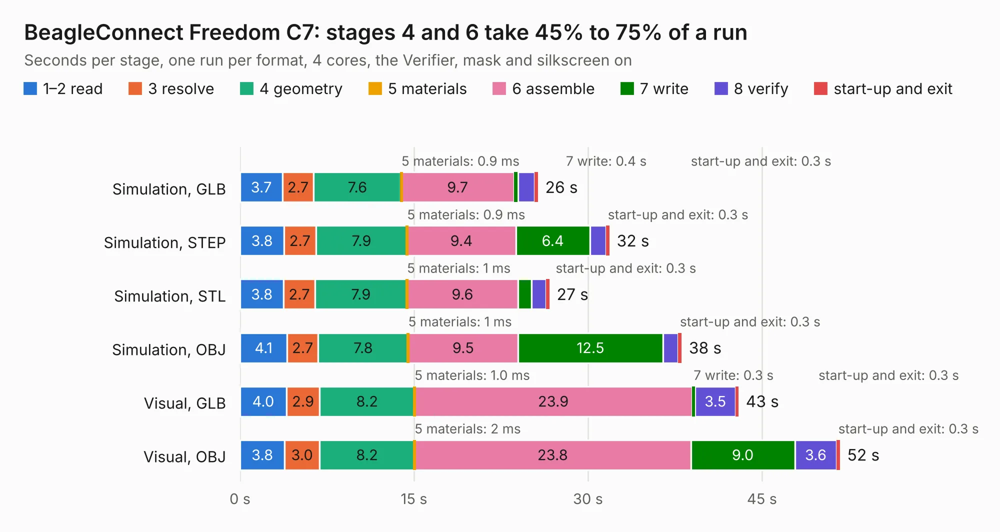

| Mode and format | 1–2 read | 3 resolve | 4 geometry | 5 materials | 6 assemble | 7 write | 8 verify | start-up and exit | Total |
|---|---:|---:|---:|---:|---:|---:|---:|---:|---:|
| Simulation, GLB | 3.7 | 2.7 | 7.6 | 0.9&nbsp;ms | 9.7 | 0.4 | 1.4 | 0.3 | 25.7 |
| Simulation, STEP | 3.8 | 2.7 | 7.9 | 0.9&nbsp;ms | 9.4 | 6.4 | 1.4 | 0.3 | 31.9 |
| Simulation, STL | 3.8 | 2.7 | 7.9 | 1&nbsp;ms | 9.6 | 1.2 | 1.3 | 0.3 | 26.7 |
| Simulation, OBJ | 4.1 | 2.7 | 7.8 | 1&nbsp;ms | 9.5 | 12.5 | 1.3 | 0.3 | 38.1 |
| Visual, GLB | 4.0 | 2.9 | 8.2 | 1.0&nbsp;ms | 23.9 | 0.3 | 3.5 | 0.3 | 43.0 |
| Visual, OBJ | 3.8 | 3.0 | 8.2 | 2&nbsp;ms | 23.8 | 9.0 | 3.6 | 0.3 | 51.7 |

<table align="center"><tr><td valign="top">

| Board | Repo: [beagleboard/beagleconnect-freedom](https://github.com/beagleboard/beagleconnect-freedom) Board: `BeagleConnect Freedom C7.kicad_pcb` |
|---|---|
| Folder | hw / KICAD |
| Complexity | 360&nbsp;/&nbsp;1000 (size&nbsp;270, features&nbsp;90) |
| KESE&nbsp;features | through vias, slotted holes, custom pads, rounded, trapezoid or chamfered pads, filled zones, copper drawings, curved board outline |
| Tested | 9th November 2026 |
| Copper&nbsp;layers | 4 |
| File&nbsp;format | KiCad 6 (20211014) |
| Parts,&nbsp;tracks,&nbsp;vias | 179, 2,291, 399 |
| Triangles,&nbsp;simulation | 2,441,248 in 177 parts |
| Verifier | PASS in all six runs |

</td><td valign="top">

<table>
<tr><th>File type</th><th>File size</th><th>Peak memory used</th></tr>
<tr><th colspan="3" align="left">Simulation</th></tr>
<tr><td>GLB</td><td align="right">84&nbsp;MB</td><td align="right">943&nbsp;MB</td></tr>
<tr><td>STEP</td><td align="right">371&nbsp;MB</td><td align="right">1.1&nbsp;GB</td></tr>
<tr><td>STL</td><td align="right">122&nbsp;MB</td><td align="right">956&nbsp;MB</td></tr>
<tr><td>OBJ</td><td align="right">260&nbsp;MB</td><td align="right">1.7&nbsp;GB</td></tr>
<tr><th colspan="3" align="left">Visual</th></tr>
<tr><td>GLB</td><td align="right">55&nbsp;MB</td><td align="right">1.1&nbsp;GB</td></tr>
<tr><td>OBJ</td><td align="right">170&nbsp;MB</td><td align="right">1.2&nbsp;GB</td></tr>
</table>

</td></tr></table>

## 542. TechLab

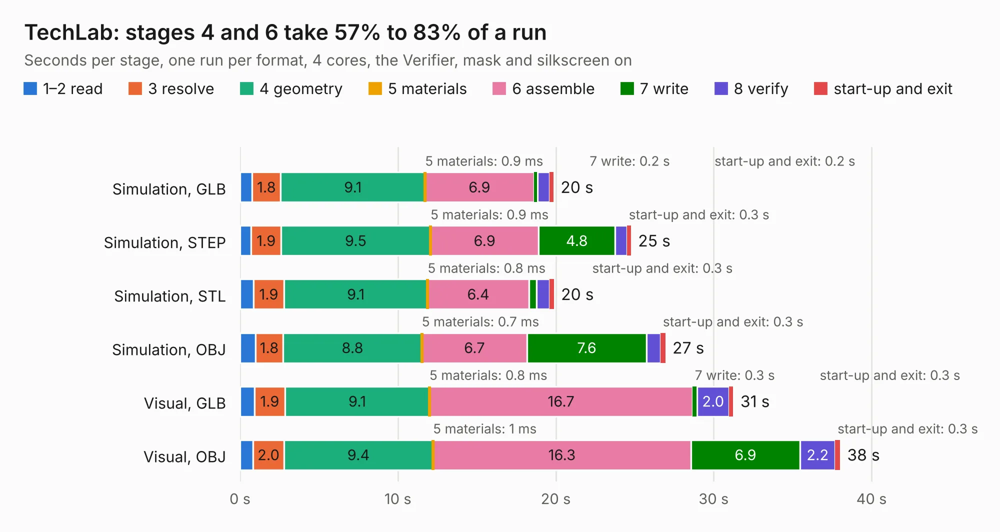

| Mode and format | 1–2 read | 3 resolve | 4 geometry | 5 materials | 6 assemble | 7 write | 8 verify | start-up and exit | Total |
|---|---:|---:|---:|---:|---:|---:|---:|---:|---:|
| Simulation, GLB | 0.8 | 1.8 | 9.1 | 0.9&nbsp;ms | 6.9 | 0.2 | 0.8 | 0.2 | 19.9 |
| Simulation, STEP | 0.7 | 1.9 | 9.5 | 0.9&nbsp;ms | 6.9 | 4.8 | 0.7 | 0.3 | 24.8 |
| Simulation, STL | 0.9 | 1.9 | 9.1 | 0.8&nbsp;ms | 6.4 | 0.5 | 0.8 | 0.3 | 19.9 |
| Simulation, OBJ | 1.0 | 1.8 | 8.8 | 0.7&nbsp;ms | 6.7 | 7.6 | 0.9 | 0.3 | 26.9 |
| Visual, GLB | 0.9 | 1.9 | 9.1 | 0.8&nbsp;ms | 16.7 | 0.3 | 2.0 | 0.3 | 31.2 |
| Visual, OBJ | 0.8 | 2.0 | 9.4 | 1&nbsp;ms | 16.3 | 6.9 | 2.2 | 0.3 | 38.0 |

<table align="center"><tr><td valign="top">

| Board | Repo: [beagleboard/capes](https://github.com/beagleboard/capes) Board: `TechLab.kicad_pcb` |
|---|---|
| Folder | pocketbeagle / TechLab / kicad |
| Complexity | 317&nbsp;/&nbsp;1000 (size&nbsp;192, features&nbsp;125) |
| KESE&nbsp;features | through vias, slotted holes, rounded, trapezoid or chamfered pads, drill offsets, filled zones, curved board outline, TrueType text, stack-up, dielectric εr and tanδ, mask and silkscreen colours |
| Tested | 9th November 2026 |
| Copper&nbsp;layers | 2 |
| File&nbsp;format | KiCad 9 (20241229) |
| Parts,&nbsp;tracks,&nbsp;vias | 94, 1,330, 290 |
| Triangles,&nbsp;simulation | 1,484,750 in 167 parts |
| Verifier | PASS in all six runs |

</td><td valign="top">

<table>
<tr><th>File type</th><th>File size</th><th>Peak memory used</th></tr>
<tr><th colspan="3" align="left">Simulation</th></tr>
<tr><td>GLB</td><td align="right">53&nbsp;MB</td><td align="right">639&nbsp;MB</td></tr>
<tr><td>STEP</td><td align="right">293&nbsp;MB</td><td align="right">843&nbsp;MB</td></tr>
<tr><td>STL</td><td align="right">74&nbsp;MB</td><td align="right">642&nbsp;MB</td></tr>
<tr><td>OBJ</td><td align="right">159&nbsp;MB</td><td align="right">1.1&nbsp;GB</td></tr>
<tr><th colspan="3" align="left">Visual</th></tr>
<tr><td>GLB</td><td align="right">48&nbsp;MB</td><td align="right">857&nbsp;MB</td></tr>
<tr><td>OBJ</td><td align="right">146&nbsp;MB</td><td align="right">1.1&nbsp;GB</td></tr>
</table>

</td></tr></table>

## 543. PocketBeagle

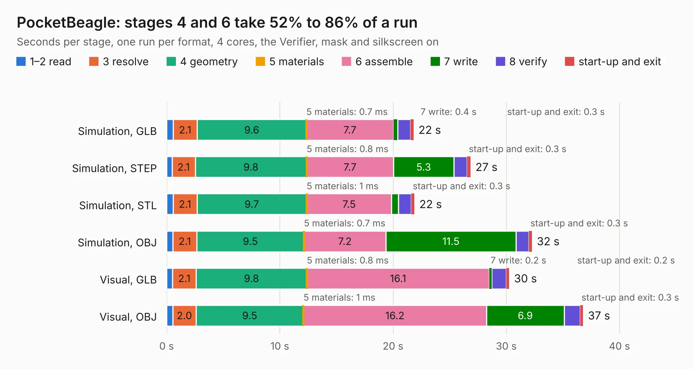

| Mode and format | 1–2 read | 3 resolve | 4 geometry | 5 materials | 6 assemble | 7 write | 8 verify | start-up and exit | Total |
|---|---:|---:|---:|---:|---:|---:|---:|---:|---:|
| Simulation, GLB | 0.6 | 2.1 | 9.6 | 0.7&nbsp;ms | 7.7 | 0.4 | 1.1 | 0.3 | 21.8 |
| Simulation, STEP | 0.5 | 2.1 | 9.8 | 0.8&nbsp;ms | 7.7 | 5.3 | 1.2 | 0.3 | 26.8 |
| Simulation, STL | 0.6 | 2.1 | 9.7 | 1&nbsp;ms | 7.5 | 0.6 | 1.1 | 0.3 | 21.9 |
| Simulation, OBJ | 0.6 | 2.1 | 9.5 | 0.7&nbsp;ms | 7.2 | 11.5 | 1.1 | 0.3 | 32.3 |
| Visual, GLB | 0.5 | 2.1 | 9.8 | 0.8&nbsp;ms | 16.1 | 0.2 | 1.3 | 0.2 | 30.3 |
| Visual, OBJ | 0.6 | 2.0 | 9.5 | 1&nbsp;ms | 16.2 | 6.9 | 1.4 | 0.3 | 36.8 |

<table align="center"><tr><td valign="top">

| Board | Repo: [beagleboard/pocketbeagle](https://github.com/beagleboard/pocketbeagle) Board: `PocketBeagle.kicad_pcb` |
|---|---|
| Folder | KiCAD |
| Complexity | 292&nbsp;/&nbsp;1000 (size&nbsp;247, features&nbsp;45) |
| KESE&nbsp;features | through vias, filled zones, curved board outline |
| Tested | 9th November 2026 |
| Copper&nbsp;layers | 4 |
| File&nbsp;format | KiCad 5 (20170123) |
| Parts,&nbsp;tracks,&nbsp;vias | 35, 1,297, 171 |
| Triangles,&nbsp;simulation | 1,930,146 in 201 parts |
| Verifier | PASS in all six runs |

</td><td valign="top">

<table>
<tr><th>File type</th><th>File size</th><th>Peak memory used</th></tr>
<tr><th colspan="3" align="left">Simulation</th></tr>
<tr><td>GLB</td><td align="right">67&nbsp;MB</td><td align="right">651&nbsp;MB</td></tr>
<tr><td>STEP</td><td align="right">290&nbsp;MB</td><td align="right">770&nbsp;MB</td></tr>
<tr><td>STL</td><td align="right">97&nbsp;MB</td><td align="right">666&nbsp;MB</td></tr>
<tr><td>OBJ</td><td align="right">205&nbsp;MB</td><td align="right">1.3&nbsp;GB</td></tr>
<tr><th colspan="3" align="left">Visual</th></tr>
<tr><td>GLB</td><td align="right">39&nbsp;MB</td><td align="right">785&nbsp;MB</td></tr>
<tr><td>OBJ</td><td align="right">118&nbsp;MB</td><td align="right">844&nbsp;MB</td></tr>
</table>

</td></tr></table>

## 544. keyboard_pcb

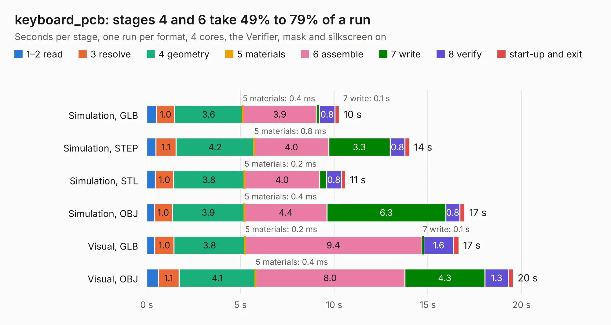

| Mode and format | 1–2 read | 3 resolve | 4 geometry | 5 materials | 6 assemble | 7 write | 8 verify | start-up and exit | Total |
|---|---:|---:|---:|---:|---:|---:|---:|---:|---:|
| Simulation, GLB | 0.5 | 1.0 | 3.6 | 0.4&nbsp;ms | 3.9 | 0.1 | 0.8 | 0.2 | 10.3 |
| Simulation, STEP | 0.5 | 1.1 | 4.2 | 0.8&nbsp;ms | 4.0 | 3.3 | 0.8 | 0.3 | 14.0 |
| Simulation, STL | 0.5 | 1.0 | 3.8 | 0.2&nbsp;ms | 4.0 | 0.4 | 0.8 | 0.2 | 10.6 |
| Simulation, OBJ | 0.4 | 1.0 | 3.9 | 0.4&nbsp;ms | 4.4 | 6.3 | 0.8 | 0.3 | 17.0 |
| Visual, GLB | 0.4 | 1.0 | 3.8 | 0.2&nbsp;ms | 9.4 | 0.1 | 1.6 | 0.3 | 16.7 |
| Visual, OBJ | 0.6 | 1.1 | 4.1 | 0.4&nbsp;ms | 8.0 | 4.3 | 1.3 | 0.3 | 19.6 |

<table align="center"><tr><td valign="top">

| Board | Repo: [beekeeb/piantor](https://github.com/beekeeb/piantor) Board: `keyboard_pcb.kicad_pcb` |
|---|---|
| Folder | pcb / left |
| Complexity | 248&nbsp;/&nbsp;1000 (size&nbsp;143, features&nbsp;105) |
| KESE&nbsp;features | through vias, slotted holes, rounded, trapezoid or chamfered pads, drill offsets, filled zones, curved board outline, stack-up, dielectric εr and tanδ |
| Tested | 9th November 2026 |
| Copper&nbsp;layers | 2 |
| File&nbsp;format | KiCad 6 (20211014) |
| Parts,&nbsp;tracks,&nbsp;vias | 29, 215, 8 |
| Triangles,&nbsp;simulation | 953,888 in 44 parts |
| Verifier | PASS in all six runs |

</td><td valign="top">

<table>
<tr><th>File type</th><th>File size</th><th>Peak memory used</th></tr>
<tr><th colspan="3" align="left">Simulation</th></tr>
<tr><td>GLB</td><td align="right">33&nbsp;MB</td><td align="right">490&nbsp;MB</td></tr>
<tr><td>STEP</td><td align="right">157&nbsp;MB</td><td align="right">558&nbsp;MB</td></tr>
<tr><td>STL</td><td align="right">48&nbsp;MB</td><td align="right">456&nbsp;MB</td></tr>
<tr><td>OBJ</td><td align="right">97&nbsp;MB</td><td align="right">670&nbsp;MB</td></tr>
<tr><th colspan="3" align="left">Visual</th></tr>
<tr><td>GLB</td><td align="right">24&nbsp;MB</td><td align="right">564&nbsp;MB</td></tr>
<tr><td>OBJ</td><td align="right">71&nbsp;MB</td><td align="right">657&nbsp;MB</td></tr>
</table>

</td></tr></table>

## 545. keyboard_pcb

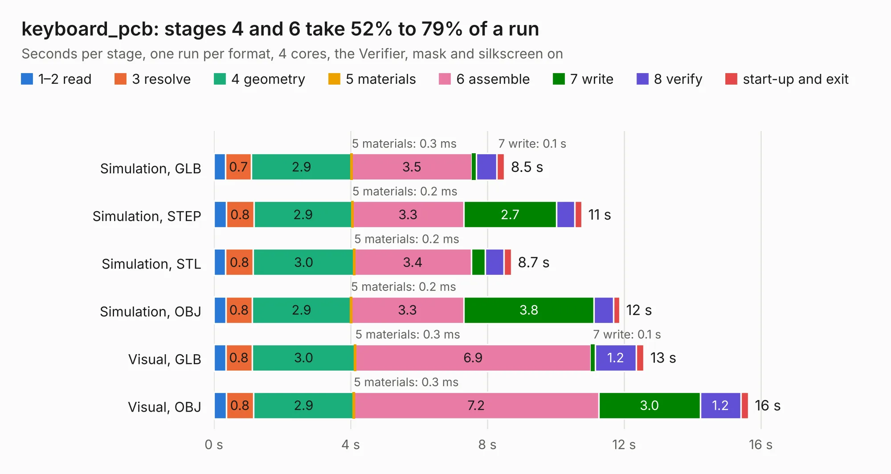

| Mode and format | 1–2 read | 3 resolve | 4 geometry | 5 materials | 6 assemble | 7 write | 8 verify | start-up and exit | Total |
|---|---:|---:|---:|---:|---:|---:|---:|---:|---:|
| Simulation, GLB | 0.3 | 0.7 | 2.9 | 0.3&nbsp;ms | 3.5 | 0.1 | 0.6 | 0.2 | 8.5 |
| Simulation, STEP | 0.4 | 0.8 | 2.9 | 0.2&nbsp;ms | 3.3 | 2.7 | 0.5 | 0.2 | 10.8 |
| Simulation, STL | 0.3 | 0.8 | 3.0 | 0.2&nbsp;ms | 3.4 | 0.4 | 0.5 | 0.2 | 8.7 |
| Simulation, OBJ | 0.4 | 0.8 | 2.9 | 0.2&nbsp;ms | 3.3 | 3.8 | 0.6 | 0.2 | 11.9 |
| Visual, GLB | 0.3 | 0.8 | 3.0 | 0.3&nbsp;ms | 6.9 | 0.1 | 1.2 | 0.2 | 12.6 |
| Visual, OBJ | 0.4 | 0.8 | 2.9 | 0.3&nbsp;ms | 7.2 | 3.0 | 1.2 | 0.2 | 15.6 |

<table align="center"><tr><td valign="top">

| Board | Repo: [beekeeb/piantor](https://github.com/beekeeb/piantor) Board: `keyboard_pcb.kicad_pcb` |
|---|---|
| Folder | pcb / right |
| Complexity | 250&nbsp;/&nbsp;1000 (size&nbsp;145, features&nbsp;105) |
| KESE&nbsp;features | through vias, slotted holes, rounded, trapezoid or chamfered pads, drill offsets, filled zones, curved board outline, stack-up, dielectric εr and tanδ |
| Tested | 9th November 2026 |
| Copper&nbsp;layers | 2 |
| File&nbsp;format | KiCad 6 (20211014) |
| Parts,&nbsp;tracks,&nbsp;vias | 29, 237, 11 |
| Triangles,&nbsp;simulation | 965,848 in 44 parts |
| Verifier | PASS in all six runs |

</td><td valign="top">

<table>
<tr><th>File type</th><th>File size</th><th>Peak memory used</th></tr>
<tr><th colspan="3" align="left">Simulation</th></tr>
<tr><td>GLB</td><td align="right">33&nbsp;MB</td><td align="right">488&nbsp;MB</td></tr>
<tr><td>STEP</td><td align="right">160&nbsp;MB</td><td align="right">613&nbsp;MB</td></tr>
<tr><td>STL</td><td align="right">48&nbsp;MB</td><td align="right">510&nbsp;MB</td></tr>
<tr><td>OBJ</td><td align="right">98&nbsp;MB</td><td align="right">673&nbsp;MB</td></tr>
<tr><th colspan="3" align="left">Visual</th></tr>
<tr><td>GLB</td><td align="right">24&nbsp;MB</td><td align="right">665&nbsp;MB</td></tr>
<tr><td>OBJ</td><td align="right">73&nbsp;MB</td><td align="right">652&nbsp;MB</td></tr>
</table>

</td></tr></table>

## 546. belamini_cape_C1

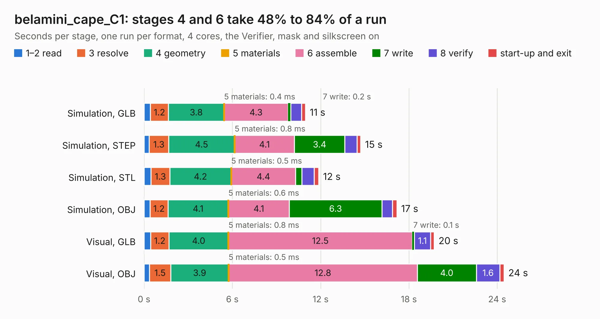

| Mode and format | 1–2 read | 3 resolve | 4 geometry | 5 materials | 6 assemble | 7 write | 8 verify | start-up and exit | Total |
|---|---:|---:|---:|---:|---:|---:|---:|---:|---:|
| Simulation, GLB | 0.4 | 1.2 | 3.8 | 0.4&nbsp;ms | 4.3 | 0.2 | 0.7 | 0.3 | 11.0 |
| Simulation, STEP | 0.4 | 1.3 | 4.5 | 0.8&nbsp;ms | 4.1 | 3.4 | 0.8 | 0.3 | 14.7 |
| Simulation, STL | 0.5 | 1.3 | 4.2 | 0.5&nbsp;ms | 4.4 | 0.4 | 0.8 | 0.3 | 11.9 |
| Simulation, OBJ | 0.4 | 1.2 | 4.1 | 0.6&nbsp;ms | 4.1 | 6.3 | 0.7 | 0.3 | 17.2 |
| Visual, GLB | 0.4 | 1.2 | 4.0 | 0.8&nbsp;ms | 12.5 | 0.1 | 1.1 | 0.2 | 19.7 |
| Visual, OBJ | 0.4 | 1.5 | 3.9 | 0.5&nbsp;ms | 12.8 | 4.0 | 1.6 | 0.3 | 24.5 |

<table align="center"><tr><td valign="top">

| Board | Repo: [belaplatform/bela-hardware](https://github.com/belaplatform/bela-hardware) Board: `belamini_cape_C1.kicad_pcb` |
|---|---|
| Folder | belamini / belamini_cape_rev_C1 |
| Complexity | 323&nbsp;/&nbsp;1000 (size&nbsp;238, features&nbsp;85) |
| KESE&nbsp;features | through vias, rounded, trapezoid or chamfered pads, filled zones, curved board outline, stack-up, dielectric εr and tanδ |
| Tested | 9th November 2026 |
| Copper&nbsp;layers | 4 |
| File&nbsp;format | KiCad 6 (20211014) |
| Parts,&nbsp;tracks,&nbsp;vias | 60, 846, 66 |
| Triangles,&nbsp;simulation | 1,168,838 in 147 parts |
| Verifier | PASS in all six runs |

</td><td valign="top">

<table>
<tr><th>File type</th><th>File size</th><th>Peak memory used</th></tr>
<tr><th colspan="3" align="left">Simulation</th></tr>
<tr><td>GLB</td><td align="right">39&nbsp;MB</td><td align="right">443&nbsp;MB</td></tr>
<tr><td>STEP</td><td align="right">188&nbsp;MB</td><td align="right">552&nbsp;MB</td></tr>
<tr><td>STL</td><td align="right">58&nbsp;MB</td><td align="right">461&nbsp;MB</td></tr>
<tr><td>OBJ</td><td align="right">120&nbsp;MB</td><td align="right">832&nbsp;MB</td></tr>
<tr><th colspan="3" align="left">Visual</th></tr>
<tr><td>GLB</td><td align="right">25&nbsp;MB</td><td align="right">661&nbsp;MB</td></tr>
<tr><td>OBJ</td><td align="right">77&nbsp;MB</td><td align="right">661&nbsp;MB</td></tr>
</table>

</td></tr></table>

## 547. belamini_cape_C2

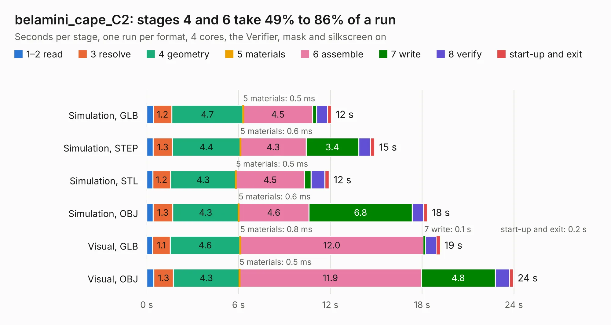

| Mode and format | 1–2 read | 3 resolve | 4 geometry | 5 materials | 6 assemble | 7 write | 8 verify | start-up and exit | Total |
|---|---:|---:|---:|---:|---:|---:|---:|---:|---:|
| Simulation, GLB | 0.4 | 1.2 | 4.7 | 0.5&nbsp;ms | 4.5 | 0.3 | 0.7 | 0.3 | 12.1 |
| Simulation, STEP | 0.4 | 1.3 | 4.4 | 0.6&nbsp;ms | 4.3 | 3.4 | 0.8 | 0.3 | 14.9 |
| Simulation, STL | 0.4 | 1.2 | 4.3 | 0.5&nbsp;ms | 4.5 | 0.4 | 0.9 | 0.3 | 11.9 |
| Simulation, OBJ | 0.4 | 1.3 | 4.3 | 0.6&nbsp;ms | 4.6 | 6.8 | 0.7 | 0.3 | 18.4 |
| Visual, GLB | 0.4 | 1.1 | 4.6 | 0.8&nbsp;ms | 12.0 | 0.1 | 0.7 | 0.2 | 19.2 |
| Visual, OBJ | 0.5 | 1.3 | 4.3 | 0.5&nbsp;ms | 11.9 | 4.8 | 0.9 | 0.3 | 24.0 |

<table align="center"><tr><td valign="top">

| Board | Repo: [belaplatform/bela-hardware](https://github.com/belaplatform/bela-hardware) Board: `belamini_cape_C2.kicad_pcb` |
|---|---|
| Folder | belamini / belamini_cape_rev_C2 |
| Complexity | 323&nbsp;/&nbsp;1000 (size&nbsp;238, features&nbsp;85) |
| KESE&nbsp;features | through vias, rounded, trapezoid or chamfered pads, filled zones, curved board outline, stack-up, dielectric εr and tanδ |
| Tested | 9th November 2026 |
| Copper&nbsp;layers | 4 |
| File&nbsp;format | KiCad 6 (20211014) |
| Parts,&nbsp;tracks,&nbsp;vias | 55, 848, 69 |
| Triangles,&nbsp;simulation | 1,162,018 in 143 parts |
| Verifier | PASS in all six runs |

</td><td valign="top">

<table>
<tr><th>File type</th><th>File size</th><th>Peak memory used</th></tr>
<tr><th colspan="3" align="left">Simulation</th></tr>
<tr><td>GLB</td><td align="right">39&nbsp;MB</td><td align="right">455&nbsp;MB</td></tr>
<tr><td>STEP</td><td align="right">185&nbsp;MB</td><td align="right">548&nbsp;MB</td></tr>
<tr><td>STL</td><td align="right">58&nbsp;MB</td><td align="right">469&nbsp;MB</td></tr>
<tr><td>OBJ</td><td align="right">119&nbsp;MB</td><td align="right">795&nbsp;MB</td></tr>
<tr><th colspan="3" align="left">Visual</th></tr>
<tr><td>GLB</td><td align="right">25&nbsp;MB</td><td align="right">619&nbsp;MB</td></tr>
<tr><td>OBJ</td><td align="right">76&nbsp;MB</td><td align="right">661&nbsp;MB</td></tr>
</table>

</td></tr></table>

## 548. bela_cape

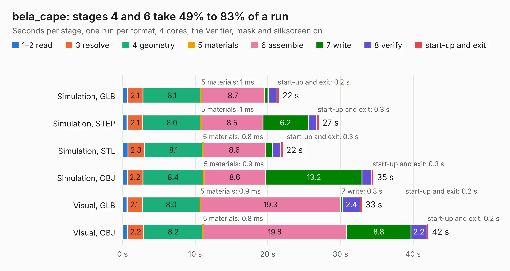

| Mode and format | 1–2 read | 3 resolve | 4 geometry | 5 materials | 6 assemble | 7 write | 8 verify | start-up and exit | Total |
|---|---:|---:|---:|---:|---:|---:|---:|---:|---:|
| Simulation, GLB | 0.7 | 2.1 | 8.1 | 1&nbsp;ms | 8.7 | 0.4 | 1.2 | 0.2 | 21.5 |
| Simulation, STEP | 0.6 | 2.1 | 8.0 | 1&nbsp;ms | 8.5 | 6.2 | 1.2 | 0.3 | 27.0 |
| Simulation, STL | 0.7 | 2.3 | 8.1 | 0.8&nbsp;ms | 8.6 | 0.9 | 1.2 | 0.3 | 22.0 |
| Simulation, OBJ | 0.7 | 2.2 | 8.4 | 0.9&nbsp;ms | 8.6 | 13.2 | 1.3 | 0.3 | 34.5 |
| Visual, GLB | 0.6 | 2.1 | 8.0 | 0.9&nbsp;ms | 19.3 | 0.3 | 2.4 | 0.2 | 33.0 |
| Visual, OBJ | 0.7 | 2.2 | 8.2 | 0.8&nbsp;ms | 19.8 | 8.8 | 2.2 | 0.2 | 42.1 |

<table align="center"><tr><td valign="top">

| Board | Repo: [belaplatform/bela-hardware](https://github.com/belaplatform/bela-hardware) Board: `bela_cape.kicad_pcb` |
|---|---|
| Folder | cape / bela_cape_rev_C1 |
| Complexity | 362&nbsp;/&nbsp;1000 (size&nbsp;262, features&nbsp;100) |
| KESE&nbsp;features | through vias, rounded, trapezoid or chamfered pads, filled zones, copper drawings, curved board outline, stack-up, dielectric εr and tanδ, mask and silkscreen colours |
| Tested | 9th November 2026 |
| Copper&nbsp;layers | 4 |
| File&nbsp;format | KiCad 6 (20211014) |
| Parts,&nbsp;tracks,&nbsp;vias | 140, 1,480, 166 |
| Triangles,&nbsp;simulation | 2,456,094 in 229 parts |
| Verifier | PASS in all six runs |

</td><td valign="top">

<table>
<tr><th>File type</th><th>File size</th><th>Peak memory used</th></tr>
<tr><th colspan="3" align="left">Simulation</th></tr>
<tr><td>GLB</td><td align="right">82&nbsp;MB</td><td align="right">788&nbsp;MB</td></tr>
<tr><td>STEP</td><td align="right">365&nbsp;MB</td><td align="right">981&nbsp;MB</td></tr>
<tr><td>STL</td><td align="right">123&nbsp;MB</td><td align="right">774&nbsp;MB</td></tr>
<tr><td>OBJ</td><td align="right">258&nbsp;MB</td><td align="right">1.6&nbsp;GB</td></tr>
<tr><th colspan="3" align="left">Visual</th></tr>
<tr><td>GLB</td><td align="right">54&nbsp;MB</td><td align="right">1.0&nbsp;GB</td></tr>
<tr><td>OBJ</td><td align="right">168&nbsp;MB</td><td align="right">1.2&nbsp;GB</td></tr>
</table>

</td></tr></table>

## 549. analog_out_fix_c2

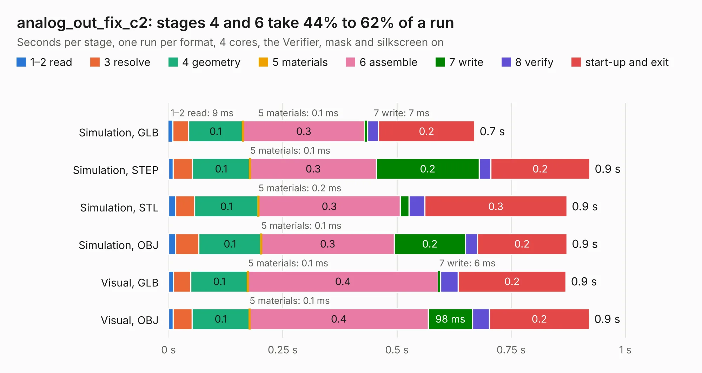

| Mode and format | 1–2 read | 3 resolve | 4 geometry | 5 materials | 6 assemble | 7 write | 8 verify | start-up and exit | Total |
|---|---:|---:|---:|---:|---:|---:|---:|---:|---:|
| Simulation, GLB | 9&nbsp;ms | 35&nbsp;ms | 0.1 | 0.1&nbsp;ms | 0.3 | 7&nbsp;ms | 24&nbsp;ms | 0.2 | 0.7 |
| Simulation, STEP | 10&nbsp;ms | 42&nbsp;ms | 0.1 | 0.1&nbsp;ms | 0.3 | 0.2 | 26&nbsp;ms | 0.2 | 0.9 |
| Simulation, STL | 15&nbsp;ms | 42&nbsp;ms | 0.1 | 0.2&nbsp;ms | 0.3 | 19&nbsp;ms | 35&nbsp;ms | 0.3 | 0.9 |
| Simulation, OBJ | 15&nbsp;ms | 51&nbsp;ms | 0.1 | 0.1&nbsp;ms | 0.3 | 0.2 | 25&nbsp;ms | 0.2 | 0.9 |
| Visual, GLB | 11&nbsp;ms | 38&nbsp;ms | 0.1 | 0.1&nbsp;ms | 0.4 | 6&nbsp;ms | 38&nbsp;ms | 0.2 | 0.9 |
| Visual, OBJ | 10&nbsp;ms | 42&nbsp;ms | 0.1 | 0.1&nbsp;ms | 0.4 | 98&nbsp;ms | 37&nbsp;ms | 0.2 | 0.9 |

<table align="center"><tr><td valign="top">

| Board | Repo: [belaplatform/bela-hardware](https://github.com/belaplatform/bela-hardware) Board: `analog_out_fix_c2.kicad_pcb` |
|---|---|
| Folder | cape / bela_cape_rev_C2 / analog_out_fix_c2 |
| Complexity | 102&nbsp;/&nbsp;1000 (size&nbsp;92, features&nbsp;10) |
| KESE&nbsp;features | rounded, trapezoid or chamfered pads |
| Tested | 9th November 2026 |
| Copper&nbsp;layers | 2 |
| File&nbsp;format | KiCad 6 (20211014) |
| Parts,&nbsp;tracks,&nbsp;vias | 6, 27, 0 |
| Triangles,&nbsp;simulation | 34,078 in 16 parts |
| Verifier | PASS in all six runs |

</td><td valign="top">

<table>
<tr><th>File type</th><th>File size</th><th>Peak memory used</th></tr>
<tr><th colspan="3" align="left">Simulation</th></tr>
<tr><td>GLB</td><td align="right">1.2&nbsp;MB</td><td align="right">44&nbsp;MB</td></tr>
<tr><td>STEP</td><td align="right">4.1&nbsp;MB</td><td align="right">49&nbsp;MB</td></tr>
<tr><td>STL</td><td align="right">1.7&nbsp;MB</td><td align="right">45&nbsp;MB</td></tr>
<tr><td>OBJ</td><td align="right">3.2&nbsp;MB</td><td align="right">56&nbsp;MB</td></tr>
<tr><th colspan="3" align="left">Visual</th></tr>
<tr><td>GLB</td><td align="right">706&nbsp;kB</td><td align="right">67&nbsp;MB</td></tr>
<tr><td>OBJ</td><td align="right">1.9&nbsp;MB</td><td align="right">59&nbsp;MB</td></tr>
</table>

</td></tr></table>

## 550. panel

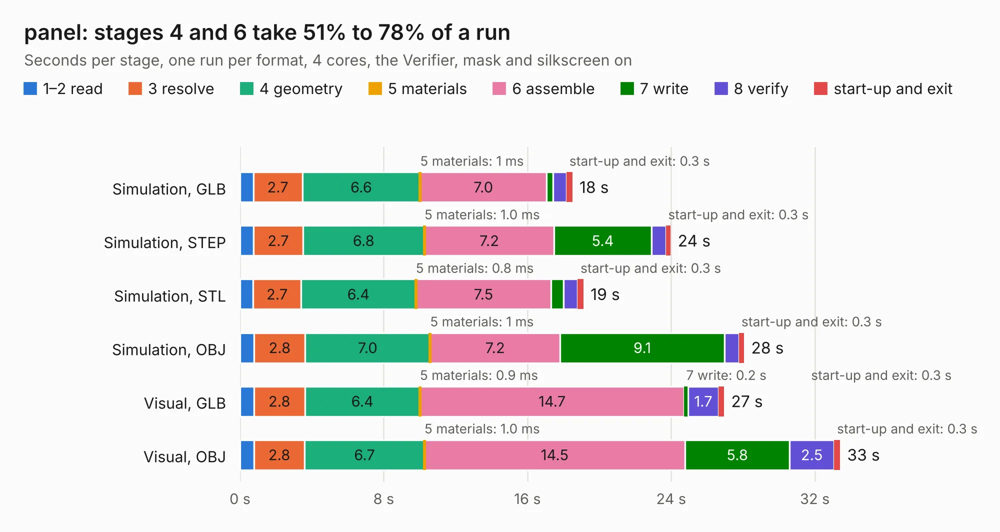

| Mode and format | 1–2 read | 3 resolve | 4 geometry | 5 materials | 6 assemble | 7 write | 8 verify | start-up and exit | Total |
|---|---:|---:|---:|---:|---:|---:|---:|---:|---:|
| Simulation, GLB | 0.7 | 2.7 | 6.6 | 1&nbsp;ms | 7.0 | 0.4 | 0.8 | 0.3 | 18.5 |
| Simulation, STEP | 0.8 | 2.7 | 6.8 | 1.0&nbsp;ms | 7.2 | 5.4 | 0.8 | 0.3 | 24.0 |
| Simulation, STL | 0.7 | 2.7 | 6.4 | 0.8&nbsp;ms | 7.5 | 0.7 | 0.8 | 0.3 | 19.1 |
| Simulation, OBJ | 0.8 | 2.8 | 7.0 | 1&nbsp;ms | 7.2 | 9.1 | 0.8 | 0.3 | 28.1 |
| Visual, GLB | 0.8 | 2.8 | 6.4 | 0.9&nbsp;ms | 14.7 | 0.2 | 1.7 | 0.3 | 26.9 |
| Visual, OBJ | 0.8 | 2.8 | 6.7 | 1.0&nbsp;ms | 14.5 | 5.8 | 2.5 | 0.3 | 33.4 |

<table align="center"><tr><td valign="top">

| Board | Repo: [belaplatform/bela-hardware](https://github.com/belaplatform/bela-hardware) Board: `panel.kicad_pcb` |
|---|---|
| Folder | cape / bela_cape_rev_C2 / analog_out_fix_c2 / panel |
| Complexity | 202&nbsp;/&nbsp;1000 (size&nbsp;192, features&nbsp;10) |
| KESE&nbsp;features | rounded, trapezoid or chamfered pads |
| Tested | 9th November 2026 |
| Copper&nbsp;layers | 2 |
| File&nbsp;format | KiCad 6 (20211014) |
| Parts,&nbsp;tracks,&nbsp;vias | 252, 1,134, 0 |
| Triangles,&nbsp;simulation | 1,678,584 in 221 parts |
| Note | panel |
| Verifier | PASS in all six runs |

</td><td valign="top">

<table>
<tr><th>File type</th><th>File size</th><th>Peak memory used</th></tr>
<tr><th colspan="3" align="left">Simulation</th></tr>
<tr><td>GLB</td><td align="right">55&nbsp;MB</td><td align="right">663&nbsp;MB</td></tr>
<tr><td>STEP</td><td align="right">245&nbsp;MB</td><td align="right">762&nbsp;MB</td></tr>
<tr><td>STL</td><td align="right">84&nbsp;MB</td><td align="right">677&nbsp;MB</td></tr>
<tr><td>OBJ</td><td align="right">177&nbsp;MB</td><td align="right">1.1&nbsp;GB</td></tr>
<tr><th colspan="3" align="left">Visual</th></tr>
<tr><td>GLB</td><td align="right">39&nbsp;MB</td><td align="right">929&nbsp;MB</td></tr>
<tr><td>OBJ</td><td align="right">117&nbsp;MB</td><td align="right">914&nbsp;MB</td></tr>
</table>

</td></tr></table>

## 551. bela_cape

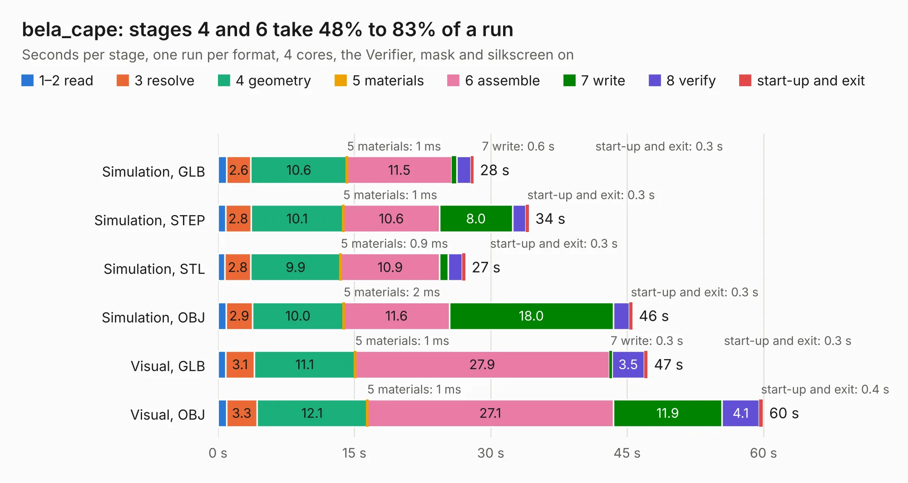

| Mode and format | 1–2 read | 3 resolve | 4 geometry | 5 materials | 6 assemble | 7 write | 8 verify | start-up and exit | Total |
|---|---:|---:|---:|---:|---:|---:|---:|---:|---:|
| Simulation, GLB | 1.0 | 2.6 | 10.6 | 1&nbsp;ms | 11.5 | 0.6 | 1.5 | 0.3 | 28.1 |
| Simulation, STEP | 0.8 | 2.8 | 10.1 | 1&nbsp;ms | 10.6 | 8.0 | 1.5 | 0.3 | 34.2 |
| Simulation, STL | 0.8 | 2.8 | 9.9 | 0.9&nbsp;ms | 10.9 | 1.0 | 1.5 | 0.3 | 27.2 |
| Simulation, OBJ | 0.9 | 2.9 | 10.0 | 2&nbsp;ms | 11.6 | 18.0 | 1.8 | 0.3 | 45.6 |
| Visual, GLB | 0.9 | 3.1 | 11.1 | 1&nbsp;ms | 27.9 | 0.3 | 3.5 | 0.3 | 47.2 |
| Visual, OBJ | 0.9 | 3.3 | 12.1 | 1&nbsp;ms | 27.1 | 11.9 | 4.1 | 0.4 | 59.9 |

<table align="center"><tr><td valign="top">

| Board | Repo: [belaplatform/bela-hardware](https://github.com/belaplatform/bela-hardware) Board: `bela_cape.kicad_pcb` |
|---|---|
| Folder | cape / bela_cape_rev_C2 |
| Complexity | 358&nbsp;/&nbsp;1000 (size&nbsp;263, features&nbsp;95) |
| KESE&nbsp;features | through vias, rounded, trapezoid or chamfered pads, filled zones, copper drawings, curved board outline, stack-up, dielectric εr and tanδ |
| Tested | 9th November 2026 |
| Copper&nbsp;layers | 4 |
| File&nbsp;format | KiCad 6 (20211014) |
| Parts,&nbsp;tracks,&nbsp;vias | 149, 1,563, 173 |
| Triangles,&nbsp;simulation | 2,518,100 in 235 parts |
| Verifier | PASS in all six runs |

</td><td valign="top">

<table>
<tr><th>File type</th><th>File size</th><th>Peak memory used</th></tr>
<tr><th colspan="3" align="left">Simulation</th></tr>
<tr><td>GLB</td><td align="right">84&nbsp;MB</td><td align="right">780&nbsp;MB</td></tr>
<tr><td>STEP</td><td align="right">374&nbsp;MB</td><td align="right">997&nbsp;MB</td></tr>
<tr><td>STL</td><td align="right">126&nbsp;MB</td><td align="right">779&nbsp;MB</td></tr>
<tr><td>OBJ</td><td align="right">265&nbsp;MB</td><td align="right">1.7&nbsp;GB</td></tr>
<tr><th colspan="3" align="left">Visual</th></tr>
<tr><td>GLB</td><td align="right">56&nbsp;MB</td><td align="right">1.1&nbsp;GB</td></tr>
<tr><td>OBJ</td><td align="right">173&nbsp;MB</td><td align="right">1.3&nbsp;GB</td></tr>
</table>

</td></tr></table>

## 552. bela_cape

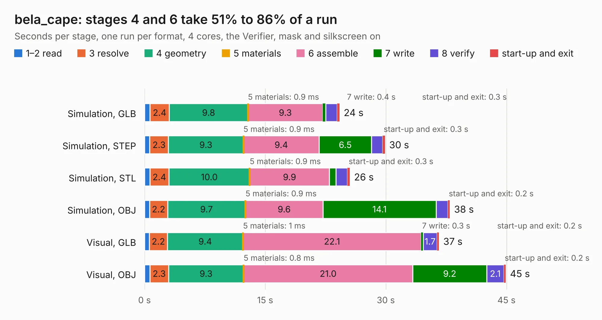

| Mode and format | 1–2 read | 3 resolve | 4 geometry | 5 materials | 6 assemble | 7 write | 8 verify | start-up and exit | Total |
|---|---:|---:|---:|---:|---:|---:|---:|---:|---:|
| Simulation, GLB | 0.7 | 2.4 | 9.8 | 0.9&nbsp;ms | 9.3 | 0.4 | 1.4 | 0.3 | 24.2 |
| Simulation, STEP | 0.6 | 2.3 | 9.3 | 0.9&nbsp;ms | 9.4 | 6.5 | 1.4 | 0.3 | 29.9 |
| Simulation, STL | 0.7 | 2.4 | 10.0 | 0.9&nbsp;ms | 9.9 | 0.8 | 1.4 | 0.3 | 25.5 |
| Simulation, OBJ | 0.6 | 2.2 | 9.7 | 0.9&nbsp;ms | 9.6 | 14.1 | 1.5 | 0.2 | 38.0 |
| Visual, GLB | 0.6 | 2.2 | 9.4 | 1&nbsp;ms | 22.1 | 0.3 | 1.7 | 0.2 | 36.6 |
| Visual, OBJ | 0.7 | 2.3 | 9.3 | 0.8&nbsp;ms | 21.0 | 9.2 | 2.1 | 0.2 | 44.9 |

<table align="center"><tr><td valign="top">

| Board | Repo: [belaplatform/bela-hardware](https://github.com/belaplatform/bela-hardware) Board: `bela_cape.kicad_pcb` |
|---|---|
| Folder | cape / bela_cape_rev_C3 |
| Complexity | 349&nbsp;/&nbsp;1000 (size&nbsp;264, features&nbsp;85) |
| KESE&nbsp;features | through vias, rounded, trapezoid or chamfered pads, filled zones, copper drawings, stack-up, dielectric εr and tanδ |
| Tested | 9th November 2026 |
| Copper&nbsp;layers | 4 |
| File&nbsp;format | KiCad 8 (20240108) |
| Parts,&nbsp;tracks,&nbsp;vias | 150, 1,587, 176 |
| Triangles,&nbsp;simulation | 2,533,044 in 237 parts |
| Verifier | PASS in all six runs |

</td><td valign="top">

<table>
<tr><th>File type</th><th>File size</th><th>Peak memory used</th></tr>
<tr><th colspan="3" align="left">Simulation</th></tr>
<tr><td>GLB</td><td align="right">85&nbsp;MB</td><td align="right">827&nbsp;MB</td></tr>
<tr><td>STEP</td><td align="right">375&nbsp;MB</td><td align="right">992&nbsp;MB</td></tr>
<tr><td>STL</td><td align="right">127&nbsp;MB</td><td align="right">814&nbsp;MB</td></tr>
<tr><td>OBJ</td><td align="right">268&nbsp;MB</td><td align="right">1.7&nbsp;GB</td></tr>
<tr><th colspan="3" align="left">Visual</th></tr>
<tr><td>GLB</td><td align="right">56&nbsp;MB</td><td align="right">1.1&nbsp;GB</td></tr>
<tr><td>OBJ</td><td align="right">174&nbsp;MB</td><td align="right">1.2&nbsp;GB</td></tr>
</table>

</td></tr></table>

## 553. Bela_Gem_Multi

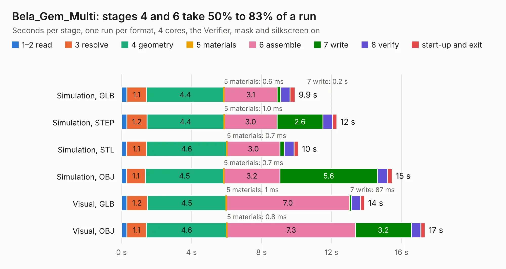

| Mode and format | 1–2 read | 3 resolve | 4 geometry | 5 materials | 6 assemble | 7 write | 8 verify | start-up and exit | Total |
|---|---:|---:|---:|---:|---:|---:|---:|---:|---:|
| Simulation, GLB | 0.3 | 1.1 | 4.4 | 0.6&nbsp;ms | 3.1 | 0.2 | 0.5 | 0.3 | 9.9 |
| Simulation, STEP | 0.3 | 1.2 | 4.4 | 1.0&nbsp;ms | 3.0 | 2.6 | 0.6 | 0.2 | 12.3 |
| Simulation, STL | 0.3 | 1.1 | 4.6 | 0.7&nbsp;ms | 3.0 | 0.2 | 0.6 | 0.2 | 10.1 |
| Simulation, OBJ | 0.3 | 1.1 | 4.5 | 0.7&nbsp;ms | 3.2 | 5.6 | 0.6 | 0.3 | 15.5 |
| Visual, GLB | 0.3 | 1.2 | 4.5 | 1&nbsp;ms | 7.0 | 87&nbsp;ms | 0.5 | 0.2 | 13.9 |
| Visual, OBJ | 0.3 | 1.1 | 4.6 | 0.8&nbsp;ms | 7.3 | 3.2 | 0.5 | 0.2 | 17.3 |

<table align="center"><tr><td valign="top">

| Board | Repo: [belaplatform/bela-hardware](https://github.com/belaplatform/bela-hardware) Board: `Bela_Gem_Multi.kicad_pcb` |
|---|---|
| Folder | GemMulti / GemMulti_rev_A4 |
| Complexity | 225&nbsp;/&nbsp;1000 (size&nbsp;70, features&nbsp;155) |
| KESE&nbsp;features | slotted holes, custom pads, rounded, trapezoid or chamfered pads, filled zones, copper drawings, curved board outline, knockout text, TrueType text, stack-up, dielectric εr and tanδ, copper finish, mask and silkscreen colours |
| Tested | 9th November 2026 |
| Copper&nbsp;layers | 4 |
| File&nbsp;format | KiCad 9 (20241229) |
| Parts,&nbsp;tracks,&nbsp;vias | 27, 0, 0 |
| Triangles,&nbsp;simulation | 965,156 in 145 parts |
| Verifier | PASS in all six runs |

</td><td valign="top">

<table>
<tr><th>File type</th><th>File size</th><th>Peak memory used</th></tr>
<tr><th colspan="3" align="left">Simulation</th></tr>
<tr><td>GLB</td><td align="right">31&nbsp;MB</td><td align="right">366&nbsp;MB</td></tr>
<tr><td>STEP</td><td align="right">101&nbsp;MB</td><td align="right">434&nbsp;MB</td></tr>
<tr><td>STL</td><td align="right">48&nbsp;MB</td><td align="right">366&nbsp;MB</td></tr>
<tr><td>OBJ</td><td align="right">99&nbsp;MB</td><td align="right">694&nbsp;MB</td></tr>
<tr><th colspan="3" align="left">Visual</th></tr>
<tr><td>GLB</td><td align="right">17&nbsp;MB</td><td align="right">484&nbsp;MB</td></tr>
<tr><td>OBJ</td><td align="right">52&nbsp;MB</td><td align="right">492&nbsp;MB</td></tr>
</table>

</td></tr></table>

## 554. bela_mini_multi_pb2_wing_bottom

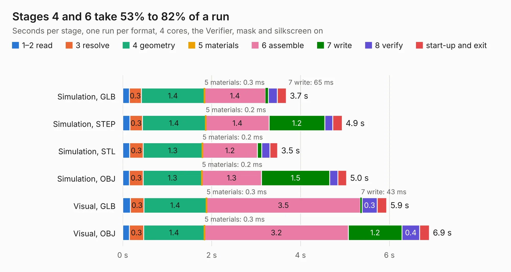

| Mode and format | 1–2 read | 3 resolve | 4 geometry | 5 materials | 6 assemble | 7 write | 8 verify | start-up and exit | Total |
|---|---:|---:|---:|---:|---:|---:|---:|---:|---:|
| Simulation, GLB | 0.1 | 0.3 | 1.4 | 0.3&nbsp;ms | 1.4 | 65&nbsp;ms | 0.2 | 0.2 | 3.7 |
| Simulation, STEP | 0.2 | 0.3 | 1.4 | 0.2&nbsp;ms | 1.4 | 1.2 | 0.2 | 0.2 | 4.9 |
| Simulation, STL | 0.2 | 0.3 | 1.3 | 0.2&nbsp;ms | 1.2 | 96&nbsp;ms | 0.2 | 0.2 | 3.5 |
| Simulation, OBJ | 0.2 | 0.3 | 1.3 | 0.2&nbsp;ms | 1.3 | 1.5 | 0.2 | 0.2 | 5.0 |
| Visual, GLB | 0.2 | 0.3 | 1.4 | 0.3&nbsp;ms | 3.5 | 43&nbsp;ms | 0.3 | 0.2 | 5.9 |
| Visual, OBJ | 0.1 | 0.3 | 1.4 | 0.3&nbsp;ms | 3.2 | 1.2 | 0.4 | 0.2 | 6.9 |

<table align="center"><tr><td valign="top">

| Board | Repo: [belaplatform/bela-hardware](https://github.com/belaplatform/bela-hardware) Board: `bela_mini_multi_pb2_wing_bottom.kicad_pcb` |
|---|---|
| Folder | GemMulti / wing_bottom |
| Complexity | 285&nbsp;/&nbsp;1000 (size&nbsp;155, features&nbsp;130) |
| KESE&nbsp;features | through vias, custom pads, rounded, trapezoid or chamfered pads, filled zones, copper drawings, curved board outline, TrueType text, stack-up, dielectric εr and tanδ, mask and silkscreen colours |
| Tested | 9th November 2026 |
| Copper&nbsp;layers | 2 |
| File&nbsp;format | KiCad 9 (20241229) |
| Parts,&nbsp;tracks,&nbsp;vias | 37, 219, 65 |
| Triangles,&nbsp;simulation | 376,142 in 58 parts |
| Verifier | PASS in all six runs |

</td><td valign="top">

<table>
<tr><th>File type</th><th>File size</th><th>Peak memory used</th></tr>
<tr><th colspan="3" align="left">Simulation</th></tr>
<tr><td>GLB</td><td align="right">13&nbsp;MB</td><td align="right">263&nbsp;MB</td></tr>
<tr><td>STEP</td><td align="right">65&nbsp;MB</td><td align="right">311&nbsp;MB</td></tr>
<tr><td>STL</td><td align="right">19&nbsp;MB</td><td align="right">261&nbsp;MB</td></tr>
<tr><td>OBJ</td><td align="right">38&nbsp;MB</td><td align="right">319&nbsp;MB</td></tr>
<tr><th colspan="3" align="left">Visual</th></tr>
<tr><td>GLB</td><td align="right">10&nbsp;MB</td><td align="right">317&nbsp;MB</td></tr>
<tr><td>OBJ</td><td align="right">30&nbsp;MB</td><td align="right">314&nbsp;MB</td></tr>
</table>

</td></tr></table>

## 555. bela_mini_multi_pb2_wing_top

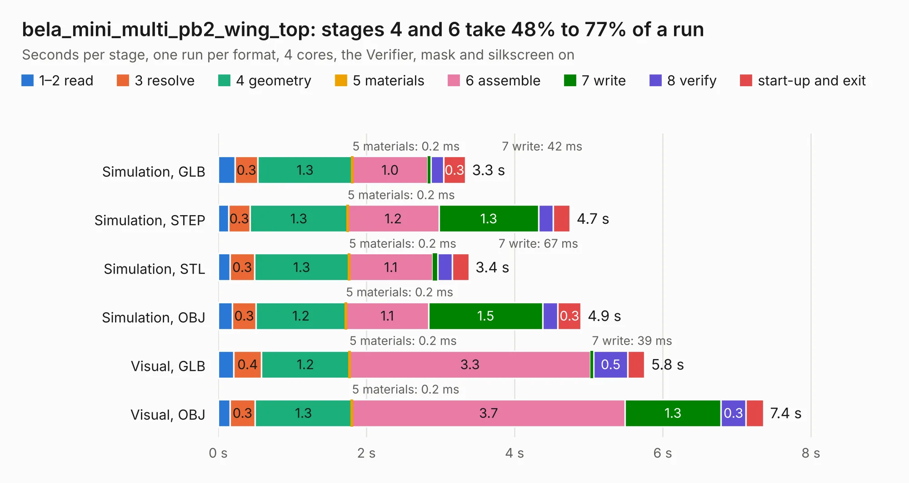

| Mode and format | 1–2 read | 3 resolve | 4 geometry | 5 materials | 6 assemble | 7 write | 8 verify | start-up and exit | Total |
|---|---:|---:|---:|---:|---:|---:|---:|---:|---:|
| Simulation, GLB | 0.2 | 0.3 | 1.3 | 0.2&nbsp;ms | 1.0 | 42&nbsp;ms | 0.2 | 0.3 | 3.3 |
| Simulation, STEP | 0.1 | 0.3 | 1.3 | 0.2&nbsp;ms | 1.2 | 1.3 | 0.2 | 0.2 | 4.7 |
| Simulation, STL | 0.2 | 0.3 | 1.3 | 0.2&nbsp;ms | 1.1 | 67&nbsp;ms | 0.2 | 0.2 | 3.4 |
| Simulation, OBJ | 0.2 | 0.3 | 1.2 | 0.2&nbsp;ms | 1.1 | 1.5 | 0.2 | 0.3 | 4.9 |
| Visual, GLB | 0.2 | 0.4 | 1.2 | 0.2&nbsp;ms | 3.3 | 39&nbsp;ms | 0.5 | 0.2 | 5.8 |
| Visual, OBJ | 0.2 | 0.3 | 1.3 | 0.2&nbsp;ms | 3.7 | 1.3 | 0.3 | 0.2 | 7.4 |

<table align="center"><tr><td valign="top">

| Board | Repo: [belaplatform/bela-hardware](https://github.com/belaplatform/bela-hardware) Board: `bela_mini_multi_pb2_wing_top.kicad_pcb` |
|---|---|
| Folder | GemMulti / wing_top |
| Complexity | 273&nbsp;/&nbsp;1000 (size&nbsp;143, features&nbsp;130) |
| KESE&nbsp;features | through vias, custom pads, rounded, trapezoid or chamfered pads, filled zones, copper drawings, curved board outline, TrueType text, stack-up, dielectric εr and tanδ, mask and silkscreen colours |
| Tested | 9th November 2026 |
| Copper&nbsp;layers | 2 |
| File&nbsp;format | KiCad 9 (20241229) |
| Parts,&nbsp;tracks,&nbsp;vias | 15, 125, 75 |
| Triangles,&nbsp;simulation | 312,934 in 31 parts |
| Verifier | PASS in all six runs |

</td><td valign="top">

<table>
<tr><th>File type</th><th>File size</th><th>Peak memory used</th></tr>
<tr><th colspan="3" align="left">Simulation</th></tr>
<tr><td>GLB</td><td align="right">11&nbsp;MB</td><td align="right">244&nbsp;MB</td></tr>
<tr><td>STEP</td><td align="right">47&nbsp;MB</td><td align="right">273&nbsp;MB</td></tr>
<tr><td>STL</td><td align="right">16&nbsp;MB</td><td align="right">249&nbsp;MB</td></tr>
<tr><td>OBJ</td><td align="right">31&nbsp;MB</td><td align="right">264&nbsp;MB</td></tr>
<tr><th colspan="3" align="left">Visual</th></tr>
<tr><td>GLB</td><td align="right">8.3&nbsp;MB</td><td align="right">266&nbsp;MB</td></tr>
<tr><td>OBJ</td><td align="right">24&nbsp;MB</td><td align="right">262&nbsp;MB</td></tr>
</table>

</td></tr></table>

## 556. Bela_Gem_Stereo

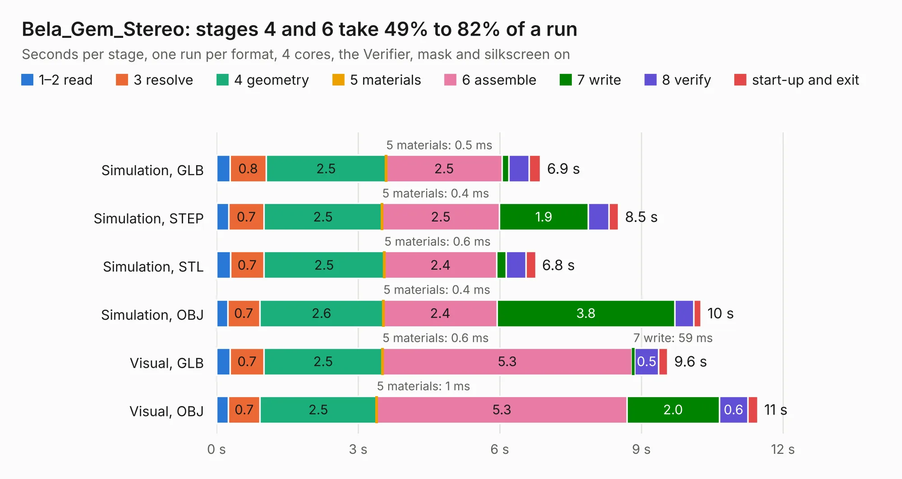

| Mode and format | 1–2 read | 3 resolve | 4 geometry | 5 materials | 6 assemble | 7 write | 8 verify | start-up and exit | Total |
|---|---:|---:|---:|---:|---:|---:|---:|---:|---:|
| Simulation, GLB | 0.3 | 0.8 | 2.5 | 0.5&nbsp;ms | 2.5 | 0.1 | 0.4 | 0.2 | 6.9 |
| Simulation, STEP | 0.3 | 0.7 | 2.5 | 0.4&nbsp;ms | 2.5 | 1.9 | 0.4 | 0.2 | 8.5 |
| Simulation, STL | 0.3 | 0.7 | 2.5 | 0.6&nbsp;ms | 2.4 | 0.2 | 0.4 | 0.2 | 6.8 |
| Simulation, OBJ | 0.2 | 0.7 | 2.6 | 0.4&nbsp;ms | 2.4 | 3.8 | 0.4 | 0.2 | 10.3 |
| Visual, GLB | 0.3 | 0.7 | 2.5 | 0.6&nbsp;ms | 5.3 | 59&nbsp;ms | 0.5 | 0.2 | 9.6 |
| Visual, OBJ | 0.3 | 0.7 | 2.5 | 1&nbsp;ms | 5.3 | 2.0 | 0.6 | 0.2 | 11.5 |

<table align="center"><tr><td valign="top">

| Board | Repo: [belaplatform/bela-hardware](https://github.com/belaplatform/bela-hardware) Board: `Bela_Gem_Stereo.kicad_pcb` |
|---|---|
| Folder | GemStereo / GemStereo_rev_A4 |
| Complexity | 207&nbsp;/&nbsp;1000 (size&nbsp;67, features&nbsp;140) |
| KESE&nbsp;features | slotted holes, custom pads, rounded, trapezoid or chamfered pads, filled zones, copper drawings, curved board outline, knockout text, TrueType text, stack-up, dielectric εr and tanδ, mask and silkscreen colours |
| Tested | 9th November 2026 |
| Copper&nbsp;layers | 4 |
| File&nbsp;format | KiCad 9 (20241229) |
| Parts,&nbsp;tracks,&nbsp;vias | 21, 0, 0 |
| Triangles,&nbsp;simulation | 904,034 in 110 parts |
| Verifier | PASS in all six runs |

</td><td valign="top">

<table>
<tr><th>File type</th><th>File size</th><th>Peak memory used</th></tr>
<tr><th colspan="3" align="left">Simulation</th></tr>
<tr><td>GLB</td><td align="right">30&nbsp;MB</td><td align="right">414&nbsp;MB</td></tr>
<tr><td>STEP</td><td align="right">102&nbsp;MB</td><td align="right">439&nbsp;MB</td></tr>
<tr><td>STL</td><td align="right">45&nbsp;MB</td><td align="right">409&nbsp;MB</td></tr>
<tr><td>OBJ</td><td align="right">91&nbsp;MB</td><td align="right">638&nbsp;MB</td></tr>
<tr><th colspan="3" align="left">Visual</th></tr>
<tr><td>GLB</td><td align="right">16&nbsp;MB</td><td align="right">512&nbsp;MB</td></tr>
<tr><td>OBJ</td><td align="right">47&nbsp;MB</td><td align="right">468&nbsp;MB</td></tr>
</table>

</td></tr></table>

## 557. switch-main-v5-test-rig

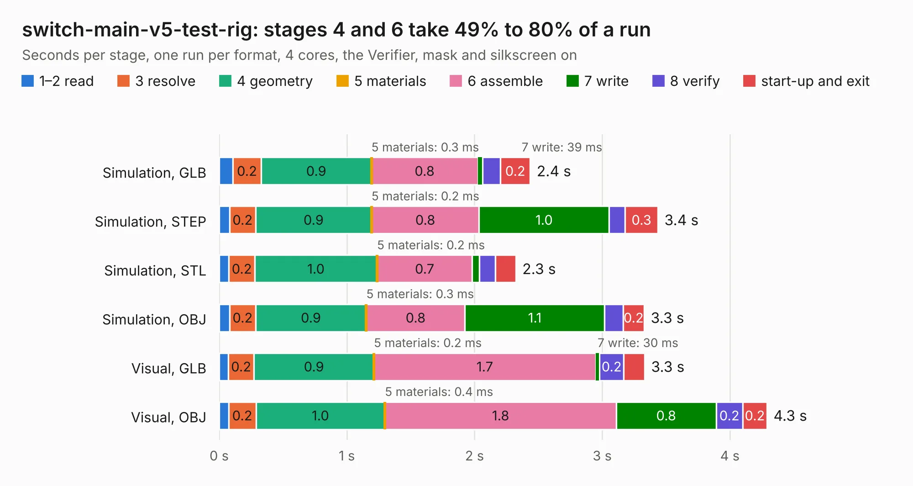

| Mode and format | 1–2 read | 3 resolve | 4 geometry | 5 materials | 6 assemble | 7 write | 8 verify | start-up and exit | Total |
|---|---:|---:|---:|---:|---:|---:|---:|---:|---:|
| Simulation, GLB | 0.1 | 0.2 | 0.9 | 0.3&nbsp;ms | 0.8 | 39&nbsp;ms | 0.1 | 0.2 | 2.4 |
| Simulation, STEP | 80&nbsp;ms | 0.2 | 0.9 | 0.2&nbsp;ms | 0.8 | 1.0 | 0.1 | 0.3 | 3.4 |
| Simulation, STL | 76&nbsp;ms | 0.2 | 1.0 | 0.2&nbsp;ms | 0.7 | 56&nbsp;ms | 0.1 | 0.2 | 2.3 |
| Simulation, OBJ | 83&nbsp;ms | 0.2 | 0.9 | 0.3&nbsp;ms | 0.8 | 1.1 | 0.1 | 0.2 | 3.3 |
| Visual, GLB | 71&nbsp;ms | 0.2 | 0.9 | 0.2&nbsp;ms | 1.7 | 30&nbsp;ms | 0.2 | 0.2 | 3.3 |
| Visual, OBJ | 74&nbsp;ms | 0.2 | 1.0 | 0.4&nbsp;ms | 1.8 | 0.8 | 0.2 | 0.2 | 4.3 |

<table align="center"><tr><td valign="top">

| Board | Repo: [ben5049/switch-v5-hardware](https://github.com/ben5049/switch-v5-hardware) Board: `switch-main-v5-test-rig.kicad_pcb` |
|---|---|
| Folder | pcbs / switch-main-v5-test-rig |
| Complexity | 198&nbsp;/&nbsp;1000 (size&nbsp;123, features&nbsp;75) |
| KESE&nbsp;features | through vias, filled zones, curved board outline, knockout text, TrueType text |
| Tested | 9th November 2026 |
| Copper&nbsp;layers | 2 |
| File&nbsp;format | KiCad 9 (20241229) |
| Parts,&nbsp;tracks,&nbsp;vias | 4, 155, 25 |
| Triangles,&nbsp;simulation | 282,850 in 48 parts |
| Verifier | PASS in all six runs |

</td><td valign="top">

<table>
<tr><th>File type</th><th>File size</th><th>Peak memory used</th></tr>
<tr><th colspan="3" align="left">Simulation</th></tr>
<tr><td>GLB</td><td align="right">9.4&nbsp;MB</td><td align="right">208&nbsp;MB</td></tr>
<tr><td>STEP</td><td align="right">42&nbsp;MB</td><td align="right">242&nbsp;MB</td></tr>
<tr><td>STL</td><td align="right">14&nbsp;MB</td><td align="right">208&nbsp;MB</td></tr>
<tr><td>OBJ</td><td align="right">28&nbsp;MB</td><td align="right">228&nbsp;MB</td></tr>
<tr><th colspan="3" align="left">Visual</th></tr>
<tr><td>GLB</td><td align="right">7.1&nbsp;MB</td><td align="right">224&nbsp;MB</td></tr>
<tr><td>OBJ</td><td align="right">21&nbsp;MB</td><td align="right">221&nbsp;MB</td></tr>
</table>

</td></tr></table>

## 558. switch-main-v5

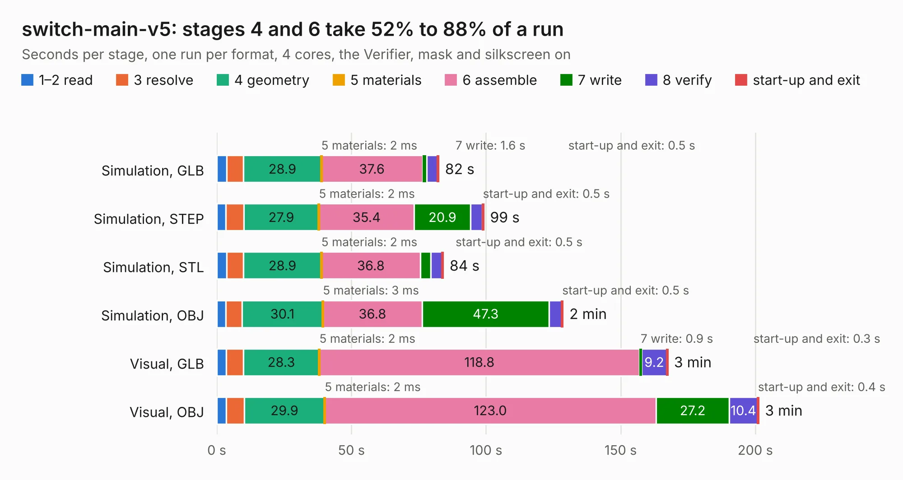

| Mode and format | 1–2 read | 3 resolve | 4 geometry | 5 materials | 6 assemble | 7 write | 8 verify | start-up and exit | Total |
|---|---:|---:|---:|---:|---:|---:|---:|---:|---:|
| Simulation, GLB | 3.6 | 6.3 | 28.9 | 2&nbsp;ms | 37.6 | 1.6 | 3.9 | 0.5 | 82.4 |
| Simulation, STEP | 3.3 | 6.7 | 27.9 | 2&nbsp;ms | 35.4 | 20.9 | 4.3 | 0.5 | 99.1 |
| Simulation, STL | 3.7 | 6.3 | 28.9 | 2&nbsp;ms | 36.8 | 3.8 | 4.2 | 0.5 | 84.1 |
| Simulation, OBJ | 3.3 | 6.0 | 30.1 | 3&nbsp;ms | 36.8 | 47.3 | 4.6 | 0.5 | 128.6 |
| Visual, GLB | 3.5 | 6.3 | 28.3 | 2&nbsp;ms | 118.8 | 0.9 | 9.2 | 0.3 | 167.4 |
| Visual, OBJ | 3.6 | 6.6 | 29.9 | 2&nbsp;ms | 123.0 | 27.2 | 10.4 | 0.4 | 201.2 |

<table align="center"><tr><td valign="top">

| Board | Repo: [ben5049/switch-v5-hardware](https://github.com/ben5049/switch-v5-hardware) Board: `switch-main-v5.kicad_pcb` |
|---|---|
| Folder | pcbs / switch-main-v5 |
| Complexity | 539&nbsp;/&nbsp;1000 (size&nbsp;329, features&nbsp;210) |
| KESE&nbsp;features | through vias, slotted holes, custom pads, rounded, trapezoid or chamfered pads, arc tracks, filled zones, copper drawings, curved board outline, knockout text, TrueType text, stack-up, dielectric εr and tanδ, copper finish, mask and silkscreen colours, castellated pads |
| Tested | 9th November 2026 |
| Copper&nbsp;layers | 6 |
| File&nbsp;format | KiCad 10 (20260206) |
| Parts,&nbsp;tracks,&nbsp;vias | 601, 7,020, 1,267 |
| Triangles,&nbsp;simulation | 9,865,620 in 704 parts |
| Verifier | PASS in all six runs |

</td><td valign="top">

<table>
<tr><th>File type</th><th>File size</th><th>Peak memory used</th></tr>
<tr><th colspan="3" align="left">Simulation</th></tr>
<tr><td>GLB</td><td align="right">326&nbsp;MB</td><td align="right">2.6&nbsp;GB</td></tr>
<tr><td>STEP</td><td align="right">1.4&nbsp;GB</td><td align="right">3.3&nbsp;GB</td></tr>
<tr><td>STL</td><td align="right">493&nbsp;MB</td><td align="right">2.6&nbsp;GB</td></tr>
<tr><td>OBJ</td><td align="right">1.1&nbsp;GB</td><td align="right">6.2&nbsp;GB</td></tr>
<tr><th colspan="3" align="left">Visual</th></tr>
<tr><td>GLB</td><td align="right">202&nbsp;MB</td><td align="right">3.3&nbsp;GB</td></tr>
<tr><td>OBJ</td><td align="right">657&nbsp;MB</td><td align="right">4.2&nbsp;GB</td></tr>
</table>

</td></tr></table>

## 559. loggerhw_v5.0

| Mode and format | 1–2 read | 3 resolve | 4 geometry | 5 materials | 6 assemble | 7 write | 8 verify | start-up and exit | Total |
|---|---:|---:|---:|---:|---:|---:|---:|---:|---:|
| Simulation, GLB | 0.4 | 2.5 | 7.0 | 1&nbsp;ms | 6.4 | 0.3 | 0.8 | 0.3 | 17.7 |
| Simulation, STEP | 0.5 | 2.4 | 7.5 | 1&nbsp;ms | 6.4 | 4.5 | 0.9 | 0.3 | 22.6 |
| Simulation, STL | 0.4 | 2.5 | 7.4 | 0.6&nbsp;ms | 6.2 | 0.5 | 0.9 | 0.3 | 18.1 |
| Simulation, OBJ | 0.4 | 2.4 | 6.9 | 0.7&nbsp;ms | 6.5 | 10.4 | 1.0 | 0.3 | 27.9 |
| Visual, GLB | 0.5 | 2.4 | 6.9 | 0.7&nbsp;ms | 13.7 | 0.2 | 1.5 | 0.3 | 25.4 |
| Visual, OBJ | 0.4 | 2.3 | 6.9 | 0.8&nbsp;ms | 12.4 | 6.3 | 1.8 | 0.2 | 30.4 |

<table align="center"><tr><td valign="top">

| Board | Repo: [BerkeleyLab/DxP-data-logger](https://github.com/BerkeleyLab/DxP-data-logger) Board: `loggerhw_v5.0.kicad_pcb` |
|---|---|
| Complexity | 298&nbsp;/&nbsp;1000 (size&nbsp;243, features&nbsp;55) |
| KESE&nbsp;features | through vias, rounded, trapezoid or chamfered pads, filled zones, curved board outline |
| Tested | 9th November 2026 |
| Copper&nbsp;layers | 4 |
| File&nbsp;format | KiCad 10 (20260206) |
| Parts,&nbsp;tracks,&nbsp;vias | 57, 1,163, 322 |
| Triangles,&nbsp;simulation | 1,744,726 in 99 parts |
| Verifier | PASS in all six runs |

</td><td valign="top">

<table>
<tr><th>File type</th><th>File size</th><th>Peak memory used</th></tr>
<tr><th colspan="3" align="left">Simulation</th></tr>
<tr><td>GLB</td><td align="right">61&nbsp;MB</td><td align="right">694&nbsp;MB</td></tr>
<tr><td>STEP</td><td align="right">244&nbsp;MB</td><td align="right">791&nbsp;MB</td></tr>
<tr><td>STL</td><td align="right">87&nbsp;MB</td><td align="right">665&nbsp;MB</td></tr>
<tr><td>OBJ</td><td align="right">183&nbsp;MB</td><td align="right">1.2&nbsp;GB</td></tr>
<tr><th colspan="3" align="left">Visual</th></tr>
<tr><td>GLB</td><td align="right">38&nbsp;MB</td><td align="right">813&nbsp;MB</td></tr>
<tr><td>OBJ</td><td align="right">116&nbsp;MB</td><td align="right">802&nbsp;MB</td></tr>
</table>

</td></tr></table>

## 560. end_connector

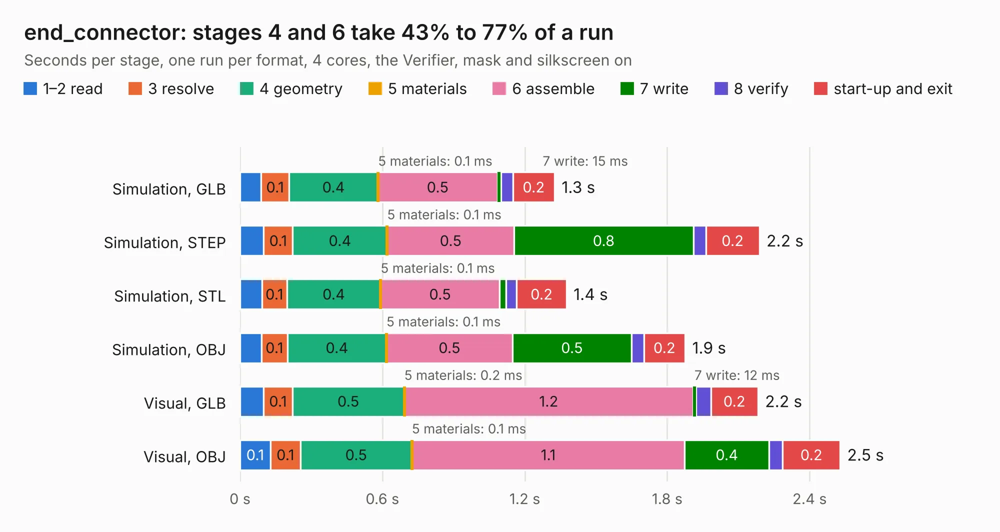

| Mode and format | 1–2 read | 3 resolve | 4 geometry | 5 materials | 6 assemble | 7 write | 8 verify | start-up and exit | Total |
|---|---:|---:|---:|---:|---:|---:|---:|---:|---:|
| Simulation, GLB | 89&nbsp;ms | 0.1 | 0.4 | 0.1&nbsp;ms | 0.5 | 15&nbsp;ms | 50&nbsp;ms | 0.2 | 1.3 |
| Simulation, STEP | 99&nbsp;ms | 0.1 | 0.4 | 0.1&nbsp;ms | 0.5 | 0.8 | 53&nbsp;ms | 0.2 | 2.2 |
| Simulation, STL | 92&nbsp;ms | 0.1 | 0.4 | 0.1&nbsp;ms | 0.5 | 27&nbsp;ms | 46&nbsp;ms | 0.2 | 1.4 |
| Simulation, OBJ | 90&nbsp;ms | 0.1 | 0.4 | 0.1&nbsp;ms | 0.5 | 0.5 | 52&nbsp;ms | 0.2 | 1.9 |
| Visual, GLB | 99&nbsp;ms | 0.1 | 0.5 | 0.2&nbsp;ms | 1.2 | 12&nbsp;ms | 63&nbsp;ms | 0.2 | 2.2 |
| Visual, OBJ | 0.1 | 0.1 | 0.5 | 0.1&nbsp;ms | 1.1 | 0.4 | 57&nbsp;ms | 0.2 | 2.5 |

<table align="center"><tr><td valign="top">

| Board | Repo: [BerkeleyLab/DxP-sensor-probes](https://github.com/BerkeleyLab/DxP-sensor-probes) Board: `end_connector.kicad_pcb` |
|---|---|
| Folder | end_connector |
| Complexity | 170&nbsp;/&nbsp;1000 (size&nbsp;105, features&nbsp;65) |
| KESE&nbsp;features | through vias, slotted holes, rounded, trapezoid or chamfered pads, filled zones, curved board outline |
| Tested | 9th November 2026 |
| Copper&nbsp;layers | 2 |
| File&nbsp;format | KiCad 10 (20260206) |
| Parts,&nbsp;tracks,&nbsp;vias | 1, 118, 6 |
| Triangles,&nbsp;simulation | 78,214 in 17 parts |
| Verifier | PASS in all six runs |

</td><td valign="top">

<table>
<tr><th>File type</th><th>File size</th><th>Peak memory used</th></tr>
<tr><th colspan="3" align="left">Simulation</th></tr>
<tr><td>GLB</td><td align="right">2.8&nbsp;MB</td><td align="right">177&nbsp;MB</td></tr>
<tr><td>STEP</td><td align="right">15&nbsp;MB</td><td align="right">180&nbsp;MB</td></tr>
<tr><td>STL</td><td align="right">3.9&nbsp;MB</td><td align="right">175&nbsp;MB</td></tr>
<tr><td>OBJ</td><td align="right">7.9&nbsp;MB</td><td align="right">173&nbsp;MB</td></tr>
<tr><th colspan="3" align="left">Visual</th></tr>
<tr><td>GLB</td><td align="right">2.3&nbsp;MB</td><td align="right">156&nbsp;MB</td></tr>
<tr><td>OBJ</td><td align="right">6.4&nbsp;MB</td><td align="right">155&nbsp;MB</td></tr>
</table>

</td></tr></table>

## 561. extension_board_MF

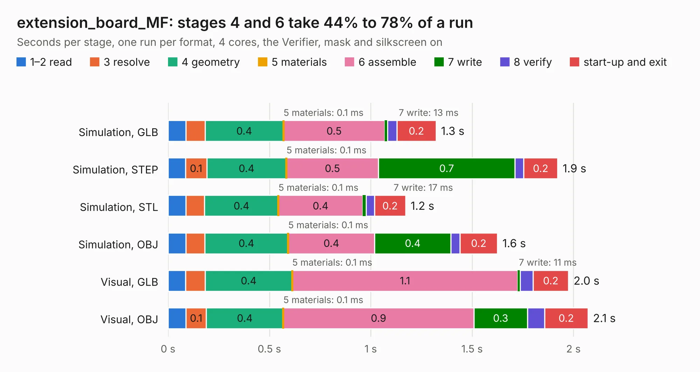

| Mode and format | 1–2 read | 3 resolve | 4 geometry | 5 materials | 6 assemble | 7 write | 8 verify | start-up and exit | Total |
|---|---:|---:|---:|---:|---:|---:|---:|---:|---:|
| Simulation, GLB | 88&nbsp;ms | 94&nbsp;ms | 0.4 | 0.1&nbsp;ms | 0.5 | 13&nbsp;ms | 47&nbsp;ms | 0.2 | 1.3 |
| Simulation, STEP | 86&nbsp;ms | 0.1 | 0.4 | 0.1&nbsp;ms | 0.5 | 0.7 | 44&nbsp;ms | 0.2 | 1.9 |
| Simulation, STL | 88&nbsp;ms | 93&nbsp;ms | 0.4 | 0.1&nbsp;ms | 0.4 | 17&nbsp;ms | 42&nbsp;ms | 0.2 | 1.2 |
| Simulation, OBJ | 88&nbsp;ms | 93&nbsp;ms | 0.4 | 0.1&nbsp;ms | 0.4 | 0.4 | 45&nbsp;ms | 0.2 | 1.6 |
| Visual, GLB | 87&nbsp;ms | 96&nbsp;ms | 0.4 | 0.1&nbsp;ms | 1.1 | 11&nbsp;ms | 64&nbsp;ms | 0.2 | 2.0 |
| Visual, OBJ | 89&nbsp;ms | 0.1 | 0.4 | 0.1&nbsp;ms | 0.9 | 0.3 | 83&nbsp;ms | 0.2 | 2.1 |

<table align="center"><tr><td valign="top">

| Board | Repo: [BerkeleyLab/DxP-sensor-probes](https://github.com/BerkeleyLab/DxP-sensor-probes) Board: `extension_board_MF.kicad_pcb` |
|---|---|
| Folder | extension_board_MF |
| Complexity | 175&nbsp;/&nbsp;1000 (size&nbsp;110, features&nbsp;65) |
| KESE&nbsp;features | through vias, slotted holes, filled zones, copper drawings, curved board outline |
| Tested | 9th November 2026 |
| Copper&nbsp;layers | 2 |
| File&nbsp;format | KiCad 10 (20260206) |
| Parts,&nbsp;tracks,&nbsp;vias | 0, 275, 6 |
| Triangles,&nbsp;simulation | 81,920 in 17 parts |
| Note | no components |
| Verifier | PASS in all six runs |

</td><td valign="top">

<table>
<tr><th>File type</th><th>File size</th><th>Peak memory used</th></tr>
<tr><th colspan="3" align="left">Simulation</th></tr>
<tr><td>GLB</td><td align="right">3.0&nbsp;MB</td><td align="right">173&nbsp;MB</td></tr>
<tr><td>STEP</td><td align="right">16&nbsp;MB</td><td align="right">183&nbsp;MB</td></tr>
<tr><td>STL</td><td align="right">4.1&nbsp;MB</td><td align="right">177&nbsp;MB</td></tr>
<tr><td>OBJ</td><td align="right">8.4&nbsp;MB</td><td align="right">173&nbsp;MB</td></tr>
<tr><th colspan="3" align="left">Visual</th></tr>
<tr><td>GLB</td><td align="right">2.4&nbsp;MB</td><td align="right">158&nbsp;MB</td></tr>
<tr><td>OBJ</td><td align="right">6.6&nbsp;MB</td><td align="right">158&nbsp;MB</td></tr>
</table>

</td></tr></table>

## 562. extension_board_MM

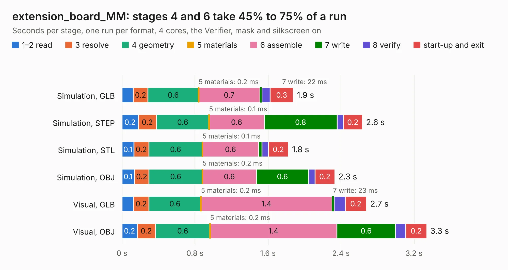

| Mode and format | 1–2 read | 3 resolve | 4 geometry | 5 materials | 6 assemble | 7 write | 8 verify | start-up and exit | Total |
|---|---:|---:|---:|---:|---:|---:|---:|---:|---:|
| Simulation, GLB | 0.1 | 0.2 | 0.6 | 0.2&nbsp;ms | 0.7 | 22&nbsp;ms | 91&nbsp;ms | 0.3 | 1.9 |
| Simulation, STEP | 0.2 | 0.2 | 0.6 | 0.1&nbsp;ms | 0.6 | 0.8 | 66&nbsp;ms | 0.2 | 2.6 |
| Simulation, STL | 0.1 | 0.2 | 0.6 | 0.1&nbsp;ms | 0.6 | 36&nbsp;ms | 71&nbsp;ms | 0.2 | 1.8 |
| Simulation, OBJ | 0.1 | 0.2 | 0.6 | 0.2&nbsp;ms | 0.6 | 0.6 | 68&nbsp;ms | 0.2 | 2.3 |
| Visual, GLB | 0.1 | 0.2 | 0.6 | 0.2&nbsp;ms | 1.4 | 23&nbsp;ms | 0.1 | 0.2 | 2.7 |
| Visual, OBJ | 0.2 | 0.2 | 0.6 | 0.2&nbsp;ms | 1.4 | 0.6 | 0.1 | 0.2 | 3.3 |

<table align="center"><tr><td valign="top">

| Board | Repo: [BerkeleyLab/DxP-sensor-probes](https://github.com/BerkeleyLab/DxP-sensor-probes) Board: `extension_board_MM.kicad_pcb` |
|---|---|
| Folder | extension_board_MM |
| Complexity | 168&nbsp;/&nbsp;1000 (size&nbsp;123, features&nbsp;45) |
| KESE&nbsp;features | through vias, filled zones, curved board outline |
| Tested | 9th November 2026 |
| Copper&nbsp;layers | 2 |
| File&nbsp;format | KiCad 10 (20260206) |
| Parts,&nbsp;tracks,&nbsp;vias | 0, 564, 30 |
| Triangles,&nbsp;simulation | 115,188 in 17 parts |
| Note | no components |
| Verifier | PASS in all six runs |

</td><td valign="top">

<table>
<tr><th>File type</th><th>File size</th><th>Peak memory used</th></tr>
<tr><th colspan="3" align="left">Simulation</th></tr>
<tr><td>GLB</td><td align="right">4.1&nbsp;MB</td><td align="right">186&nbsp;MB</td></tr>
<tr><td>STEP</td><td align="right">20&nbsp;MB</td><td align="right">187&nbsp;MB</td></tr>
<tr><td>STL</td><td align="right">5.8&nbsp;MB</td><td align="right">184&nbsp;MB</td></tr>
<tr><td>OBJ</td><td align="right">12&nbsp;MB</td><td align="right">184&nbsp;MB</td></tr>
<tr><th colspan="3" align="left">Visual</th></tr>
<tr><td>GLB</td><td align="right">3.2&nbsp;MB</td><td align="right">162&nbsp;MB</td></tr>
<tr><td>OBJ</td><td align="right">9.2&nbsp;MB</td><td align="right">161&nbsp;MB</td></tr>
</table>

</td></tr></table>

## 563. FF_connector

| Mode and format | 1–2 read | 3 resolve | 4 geometry | 5 materials | 6 assemble | 7 write | 8 verify | start-up and exit | Total |
|---|---:|---:|---:|---:|---:|---:|---:|---:|---:|
| Simulation, GLB | 0.1 | 0.1 | 0.4 | 0.1&nbsp;ms | 0.6 | 15&nbsp;ms | 65&nbsp;ms | 0.2 | 1.5 |
| Simulation, STEP | 0.1 | 0.1 | 0.4 | 0.2&nbsp;ms | 0.5 | 0.8 | 67&nbsp;ms | 0.2 | 2.2 |
| Simulation, STL | 0.1 | 0.1 | 0.4 | 0.1&nbsp;ms | 0.6 | 32&nbsp;ms | 65&nbsp;ms | 0.3 | 1.6 |
| Simulation, OBJ | 0.1 | 0.1 | 0.5 | 0.1&nbsp;ms | 0.5 | 0.4 | 71&nbsp;ms | 0.3 | 2.0 |
| Visual, GLB | 98&nbsp;ms | 0.1 | 0.4 | 0.1&nbsp;ms | 1.4 | 20&nbsp;ms | 0.1 | 0.2 | 2.4 |
| Visual, OBJ | 0.1 | 0.1 | 0.4 | 0.2&nbsp;ms | 1.4 | 0.3 | 77&nbsp;ms | 0.2 | 2.7 |

<table align="center"><tr><td valign="top">

| Board | Repo: [BerkeleyLab/DxP-sensor-probes](https://github.com/BerkeleyLab/DxP-sensor-probes) Board: `FF_connector.kicad_pcb` |
|---|---|
| Folder | FF_connector |
| Complexity | 143&nbsp;/&nbsp;1000 (size&nbsp;103, features&nbsp;40) |
| KESE&nbsp;features | slotted holes, filled zones, curved board outline |
| Tested | 9th November 2026 |
| Copper&nbsp;layers | 2 |
| File&nbsp;format | KiCad 10 (20260206) |
| Parts,&nbsp;tracks,&nbsp;vias | 0, 196, 0 |
| Triangles,&nbsp;simulation | 79,696 in 17 parts |
| Note | no components |
| Verifier | PASS in all six runs |

</td><td valign="top">

<table>
<tr><th>File type</th><th>File size</th><th>Peak memory used</th></tr>
<tr><th colspan="3" align="left">Simulation</th></tr>
<tr><td>GLB</td><td align="right">2.9&nbsp;MB</td><td align="right">175&nbsp;MB</td></tr>
<tr><td>STEP</td><td align="right">16&nbsp;MB</td><td align="right">183&nbsp;MB</td></tr>
<tr><td>STL</td><td align="right">4.0&nbsp;MB</td><td align="right">175&nbsp;MB</td></tr>
<tr><td>OBJ</td><td align="right">8.0&nbsp;MB</td><td align="right">176&nbsp;MB</td></tr>
<tr><th colspan="3" align="left">Visual</th></tr>
<tr><td>GLB</td><td align="right">2.4&nbsp;MB</td><td align="right">155&nbsp;MB</td></tr>
<tr><td>OBJ</td><td align="right">6.7&nbsp;MB</td><td align="right">156&nbsp;MB</td></tr>
</table>

</td></tr></table>

## 564. off-axis_end_connector

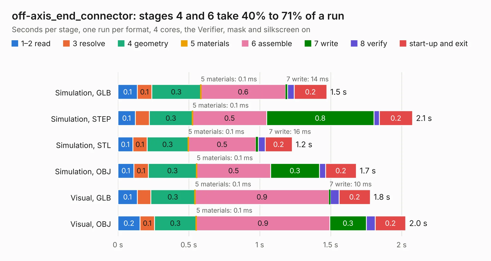

| Mode and format | 1–2 read | 3 resolve | 4 geometry | 5 materials | 6 assemble | 7 write | 8 verify | start-up and exit | Total |
|---|---:|---:|---:|---:|---:|---:|---:|---:|---:|
| Simulation, GLB | 0.1 | 0.1 | 0.3 | 0.1&nbsp;ms | 0.6 | 14&nbsp;ms | 46&nbsp;ms | 0.2 | 1.5 |
| Simulation, STEP | 0.1 | 99&nbsp;ms | 0.3 | 0.1&nbsp;ms | 0.5 | 0.8 | 39&nbsp;ms | 0.2 | 2.1 |
| Simulation, STL | 0.1 | 0.1 | 0.3 | 0.1&nbsp;ms | 0.5 | 16&nbsp;ms | 48&nbsp;ms | 0.2 | 1.2 |
| Simulation, OBJ | 0.1 | 0.1 | 0.3 | 0.1&nbsp;ms | 0.5 | 0.3 | 43&nbsp;ms | 0.2 | 1.7 |
| Visual, GLB | 0.1 | 95&nbsp;ms | 0.3 | 0.1&nbsp;ms | 0.9 | 10&nbsp;ms | 62&nbsp;ms | 0.2 | 1.8 |
| Visual, OBJ | 0.2 | 0.1 | 0.3 | 0.1&nbsp;ms | 0.9 | 0.3 | 62&nbsp;ms | 0.2 | 2.0 |

<table align="center"><tr><td valign="top">

| Board | Repo: [BerkeleyLab/DxP-sensor-probes](https://github.com/BerkeleyLab/DxP-sensor-probes) Board: `off-axis_end_connector.kicad_pcb` |
|---|---|
| Folder | off-axis_end_connector |
| Complexity | 155&nbsp;/&nbsp;1000 (size&nbsp;90, features&nbsp;65) |
| KESE&nbsp;features | through vias, rounded, trapezoid or chamfered pads, filled zones, copper drawings, curved board outline |
| Tested | 9th November 2026 |
| Copper&nbsp;layers | 2 |
| File&nbsp;format | KiCad 10 (20260206) |
| Parts,&nbsp;tracks,&nbsp;vias | 1, 25, 10 |
| Triangles,&nbsp;simulation | 71,242 in 17 parts |
| Verifier | PASS in all six runs |

</td><td valign="top">

<table>
<tr><th>File type</th><th>File size</th><th>Peak memory used</th></tr>
<tr><th colspan="3" align="left">Simulation</th></tr>
<tr><td>GLB</td><td align="right">2.6&nbsp;MB</td><td align="right">168&nbsp;MB</td></tr>
<tr><td>STEP</td><td align="right">13&nbsp;MB</td><td align="right">176&nbsp;MB</td></tr>
<tr><td>STL</td><td align="right">3.6&nbsp;MB</td><td align="right">168&nbsp;MB</td></tr>
<tr><td>OBJ</td><td align="right">7.1&nbsp;MB</td><td align="right">169&nbsp;MB</td></tr>
<tr><th colspan="3" align="left">Visual</th></tr>
<tr><td>GLB</td><td align="right">1.8&nbsp;MB</td><td align="right">155&nbsp;MB</td></tr>
<tr><td>OBJ</td><td align="right">4.9&nbsp;MB</td><td align="right">155&nbsp;MB</td></tr>
</table>

</td></tr></table>

## 565. sensor_board_outline

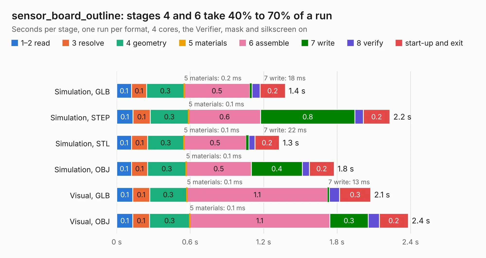

| Mode and format | 1–2 read | 3 resolve | 4 geometry | 5 materials | 6 assemble | 7 write | 8 verify | start-up and exit | Total |
|---|---:|---:|---:|---:|---:|---:|---:|---:|---:|
| Simulation, GLB | 0.1 | 0.1 | 0.3 | 0.2&nbsp;ms | 0.5 | 18&nbsp;ms | 66&nbsp;ms | 0.2 | 1.4 |
| Simulation, STEP | 0.1 | 0.1 | 0.3 | 0.1&nbsp;ms | 0.6 | 0.8 | 69&nbsp;ms | 0.2 | 2.2 |
| Simulation, STL | 0.1 | 0.1 | 0.3 | 0.1&nbsp;ms | 0.5 | 22&nbsp;ms | 50&nbsp;ms | 0.2 | 1.3 |
| Simulation, OBJ | 0.1 | 0.1 | 0.3 | 0.1&nbsp;ms | 0.5 | 0.4 | 56&nbsp;ms | 0.2 | 1.8 |
| Visual, GLB | 0.1 | 0.1 | 0.3 | 0.1&nbsp;ms | 1.1 | 13&nbsp;ms | 85&nbsp;ms | 0.3 | 2.1 |
| Visual, OBJ | 0.1 | 0.1 | 0.3 | 0.1&nbsp;ms | 1.1 | 0.3 | 90&nbsp;ms | 0.2 | 2.4 |

<table align="center"><tr><td valign="top">

| Board | Repo: [BerkeleyLab/DxP-sensor-probes](https://github.com/BerkeleyLab/DxP-sensor-probes) Board: `sensor_board_outline.kicad_pcb` |
|---|---|
| Folder | sensor_board_outline |
| Complexity | 188&nbsp;/&nbsp;1000 (size&nbsp;123, features&nbsp;65) |
| KESE&nbsp;features | through vias, slotted holes, filled zones, copper drawings, curved board outline |
| Tested | 9th November 2026 |
| Copper&nbsp;layers | 2 |
| File&nbsp;format | KiCad 10 (20260206) |
| Parts,&nbsp;tracks,&nbsp;vias | 0, 625, 6 |
| Triangles,&nbsp;simulation | 86,656 in 17 parts |
| Note | no components |
| Verifier | PASS in all six runs |

</td><td valign="top">

<table>
<tr><th>File type</th><th>File size</th><th>Peak memory used</th></tr>
<tr><th colspan="3" align="left">Simulation</th></tr>
<tr><td>GLB</td><td align="right">3.0&nbsp;MB</td><td align="right">183&nbsp;MB</td></tr>
<tr><td>STEP</td><td align="right">14&nbsp;MB</td><td align="right">181&nbsp;MB</td></tr>
<tr><td>STL</td><td align="right">4.3&nbsp;MB</td><td align="right">178&nbsp;MB</td></tr>
<tr><td>OBJ</td><td align="right">8.5&nbsp;MB</td><td align="right">178&nbsp;MB</td></tr>
<tr><th colspan="3" align="left">Visual</th></tr>
<tr><td>GLB</td><td align="right">2.2&nbsp;MB</td><td align="right">156&nbsp;MB</td></tr>
<tr><td>OBJ</td><td align="right">6.2&nbsp;MB</td><td align="right">157&nbsp;MB</td></tr>
</table>

</td></tr></table>

## 566. TMP117-ADXL345_section_5cm

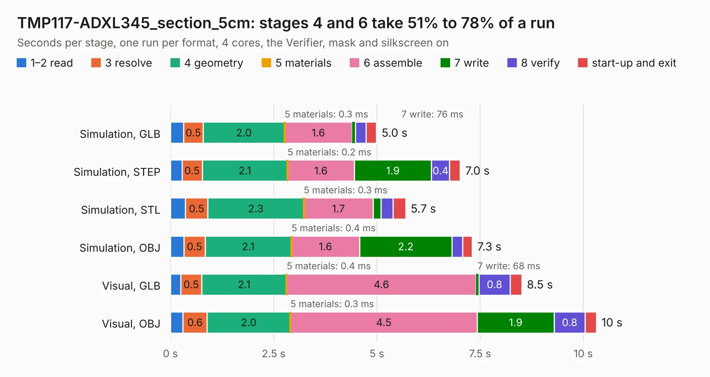

| Mode and format | 1–2 read | 3 resolve | 4 geometry | 5 materials | 6 assemble | 7 write | 8 verify | start-up and exit | Total |
|---|---:|---:|---:|---:|---:|---:|---:|---:|---:|
| Simulation, GLB | 0.3 | 0.5 | 2.0 | 0.3&nbsp;ms | 1.6 | 76&nbsp;ms | 0.3 | 0.3 | 5.0 |
| Simulation, STEP | 0.3 | 0.5 | 2.1 | 0.2&nbsp;ms | 1.6 | 1.9 | 0.4 | 0.3 | 7.0 |
| Simulation, STL | 0.4 | 0.5 | 2.3 | 0.3&nbsp;ms | 1.7 | 0.2 | 0.3 | 0.3 | 5.7 |
| Simulation, OBJ | 0.3 | 0.5 | 2.1 | 0.4&nbsp;ms | 1.6 | 2.2 | 0.3 | 0.2 | 7.3 |
| Visual, GLB | 0.3 | 0.5 | 2.1 | 0.4&nbsp;ms | 4.6 | 68&nbsp;ms | 0.8 | 0.3 | 8.5 |
| Visual, OBJ | 0.3 | 0.6 | 2.0 | 0.3&nbsp;ms | 4.5 | 1.9 | 0.8 | 0.3 | 10.3 |

<table align="center"><tr><td valign="top">

| Board | Repo: [BerkeleyLab/DxP-sensor-probes](https://github.com/BerkeleyLab/DxP-sensor-probes) Board: `TMP117-ADXL345_section_5cm.kicad_pcb` |
|---|---|
| Folder | TMP117-ADXL345_section_5cm |
| Complexity | 256&nbsp;/&nbsp;1000 (size&nbsp;181, features&nbsp;75) |
| KESE&nbsp;features | through vias, slotted holes, rounded, trapezoid or chamfered pads, filled zones, copper drawings, curved board outline |
| Tested | 9th November 2026 |
| Copper&nbsp;layers | 2 |
| File&nbsp;format | KiCad 10 (20260206) |
| Parts,&nbsp;tracks,&nbsp;vias | 26, 2,428, 52 |
| Triangles,&nbsp;simulation | 413,486 in 41 parts |
| Verifier | PASS in all six runs |

</td><td valign="top">

<table>
<tr><th>File type</th><th>File size</th><th>Peak memory used</th></tr>
<tr><th colspan="3" align="left">Simulation</th></tr>
<tr><td>GLB</td><td align="right">15&nbsp;MB</td><td align="right">300&nbsp;MB</td></tr>
<tr><td>STEP</td><td align="right">79&nbsp;MB</td><td align="right">333&nbsp;MB</td></tr>
<tr><td>STL</td><td align="right">21&nbsp;MB</td><td align="right">293&nbsp;MB</td></tr>
<tr><td>OBJ</td><td align="right">43&nbsp;MB</td><td align="right">340&nbsp;MB</td></tr>
<tr><th colspan="3" align="left">Visual</th></tr>
<tr><td>GLB</td><td align="right">12&nbsp;MB</td><td align="right">343&nbsp;MB</td></tr>
<tr><td>OBJ</td><td align="right">36&nbsp;MB</td><td align="right">348&nbsp;MB</td></tr>
</table>

</td></tr></table>

## 567. TMP117_section_10cm

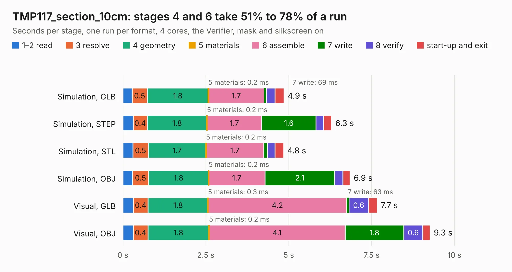

| Mode and format | 1–2 read | 3 resolve | 4 geometry | 5 materials | 6 assemble | 7 write | 8 verify | start-up and exit | Total |
|---|---:|---:|---:|---:|---:|---:|---:|---:|---:|
| Simulation, GLB | 0.3 | 0.5 | 1.8 | 0.2&nbsp;ms | 1.7 | 69&nbsp;ms | 0.3 | 0.3 | 4.9 |
| Simulation, STEP | 0.3 | 0.4 | 1.8 | 0.2&nbsp;ms | 1.7 | 1.6 | 0.2 | 0.2 | 6.3 |
| Simulation, STL | 0.3 | 0.5 | 1.7 | 0.2&nbsp;ms | 1.7 | 0.1 | 0.2 | 0.3 | 4.8 |
| Simulation, OBJ | 0.3 | 0.5 | 1.8 | 0.2&nbsp;ms | 1.7 | 2.1 | 0.2 | 0.2 | 6.9 |
| Visual, GLB | 0.3 | 0.4 | 1.8 | 0.3&nbsp;ms | 4.2 | 63&nbsp;ms | 0.6 | 0.3 | 7.7 |
| Visual, OBJ | 0.3 | 0.4 | 1.8 | 0.2&nbsp;ms | 4.1 | 1.8 | 0.6 | 0.2 | 9.3 |

<table align="center"><tr><td valign="top">

| Board | Repo: [BerkeleyLab/DxP-sensor-probes](https://github.com/BerkeleyLab/DxP-sensor-probes) Board: `TMP117_section_10cm.kicad_pcb` |
|---|---|
| Folder | TMP117_section_10cm |
| Complexity | 262&nbsp;/&nbsp;1000 (size&nbsp;187, features&nbsp;75) |
| KESE&nbsp;features | through vias, slotted holes, rounded, trapezoid or chamfered pads, filled zones, copper drawings, curved board outline |
| Tested | 9th November 2026 |
| Copper&nbsp;layers | 2 |
| File&nbsp;format | KiCad 10 (20260206) |
| Parts,&nbsp;tracks,&nbsp;vias | 26, 3,397, 59 |
| Triangles,&nbsp;simulation | 431,324 in 33 parts |
| Verifier | PASS in all six runs |

</td><td valign="top">

<table>
<tr><th>File type</th><th>File size</th><th>Peak memory used</th></tr>
<tr><th colspan="3" align="left">Simulation</th></tr>
<tr><td>GLB</td><td align="right">15&nbsp;MB</td><td align="right">287&nbsp;MB</td></tr>
<tr><td>STEP</td><td align="right">81&nbsp;MB</td><td align="right">346&nbsp;MB</td></tr>
<tr><td>STL</td><td align="right">22&nbsp;MB</td><td align="right">298&nbsp;MB</td></tr>
<tr><td>OBJ</td><td align="right">45&nbsp;MB</td><td align="right">357&nbsp;MB</td></tr>
<tr><th colspan="3" align="left">Visual</th></tr>
<tr><td>GLB</td><td align="right">13&nbsp;MB</td><td align="right">377&nbsp;MB</td></tr>
<tr><td>OBJ</td><td align="right">39&nbsp;MB</td><td align="right">371&nbsp;MB</td></tr>
</table>

</td></tr></table>

## 568. TMP117_section_5cm

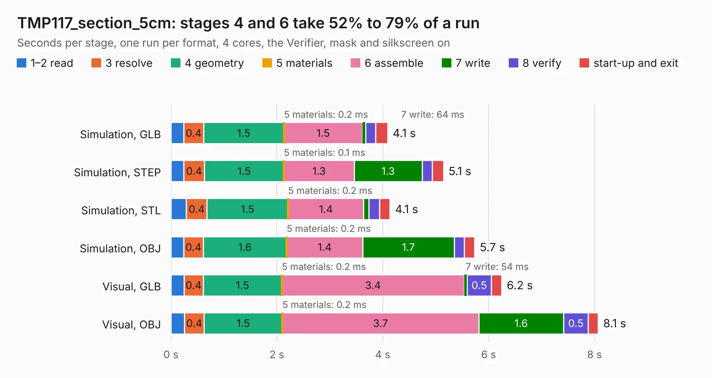

| Mode and format | 1–2 read | 3 resolve | 4 geometry | 5 materials | 6 assemble | 7 write | 8 verify | start-up and exit | Total |
|---|---:|---:|---:|---:|---:|---:|---:|---:|---:|
| Simulation, GLB | 0.2 | 0.4 | 1.5 | 0.2&nbsp;ms | 1.5 | 64&nbsp;ms | 0.2 | 0.2 | 4.1 |
| Simulation, STEP | 0.2 | 0.4 | 1.5 | 0.1&nbsp;ms | 1.3 | 1.3 | 0.2 | 0.2 | 5.1 |
| Simulation, STL | 0.3 | 0.4 | 1.5 | 0.2&nbsp;ms | 1.4 | 98&nbsp;ms | 0.2 | 0.2 | 4.1 |
| Simulation, OBJ | 0.2 | 0.4 | 1.6 | 0.2&nbsp;ms | 1.4 | 1.7 | 0.2 | 0.2 | 5.7 |
| Visual, GLB | 0.2 | 0.4 | 1.5 | 0.2&nbsp;ms | 3.4 | 54&nbsp;ms | 0.5 | 0.2 | 6.2 |
| Visual, OBJ | 0.3 | 0.4 | 1.5 | 0.2&nbsp;ms | 3.7 | 1.6 | 0.5 | 0.2 | 8.1 |

<table align="center"><tr><td valign="top">

| Board | Repo: [BerkeleyLab/DxP-sensor-probes](https://github.com/BerkeleyLab/DxP-sensor-probes) Board: `TMP117_section_5cm.kicad_pcb` |
|---|---|
| Folder | TMP117_section_5cm |
| Complexity | 262&nbsp;/&nbsp;1000 (size&nbsp;187, features&nbsp;75) |
| KESE&nbsp;features | through vias, slotted holes, rounded, trapezoid or chamfered pads, filled zones, copper drawings, curved board outline |
| Tested | 9th November 2026 |
| Copper&nbsp;layers | 2 |
| File&nbsp;format | KiCad 10 (20260206) |
| Parts,&nbsp;tracks,&nbsp;vias | 26, 3,397, 59 |
| Triangles,&nbsp;simulation | 430,328 in 33 parts |
| Verifier | PASS in all six runs |

</td><td valign="top">

<table>
<tr><th>File type</th><th>File size</th><th>Peak memory used</th></tr>
<tr><th colspan="3" align="left">Simulation</th></tr>
<tr><td>GLB</td><td align="right">15&nbsp;MB</td><td align="right">288&nbsp;MB</td></tr>
<tr><td>STEP</td><td align="right">80&nbsp;MB</td><td align="right">344&nbsp;MB</td></tr>
<tr><td>STL</td><td align="right">22&nbsp;MB</td><td align="right">303&nbsp;MB</td></tr>
<tr><td>OBJ</td><td align="right">45&nbsp;MB</td><td align="right">361&nbsp;MB</td></tr>
<tr><th colspan="3" align="left">Visual</th></tr>
<tr><td>GLB</td><td align="right">13&nbsp;MB</td><td align="right">362&nbsp;MB</td></tr>
<tr><td>OBJ</td><td align="right">39&nbsp;MB</td><td align="right">358&nbsp;MB</td></tr>
</table>

</td></tr></table>

## 569. Marble

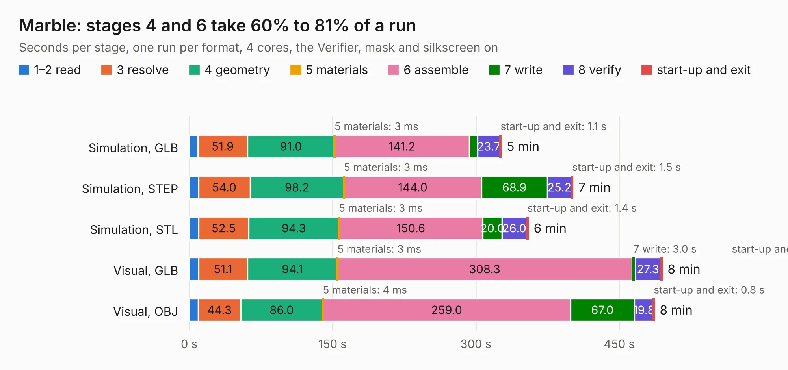

| Mode and format | 1–2 read | 3 resolve | 4 geometry | 5 materials | 6 assemble | 7 write | 8 verify | start-up and exit | Total |
|---|---:|---:|---:|---:|---:|---:|---:|---:|---:|
| Simulation, GLB | 9.2 | 51.9 | 91.0 | 3&nbsp;ms | 141.2 | 8.3 | 23.7 | 1.1 | 326.4 |
| Simulation, STEP | 9.7 | 54.0 | 98.2 | 3&nbsp;ms | 144.0 | 68.9 | 25.2 | 1.5 | 401.5 |
| Simulation, STL | 9.9 | 52.5 | 94.3 | 3&nbsp;ms | 150.6 | 20.0 | 26.0 | 1.4 | 354.6 |
| Simulation, OBJ |  |  |  |  |  |  |  |  | exceeded 11 GB on a 15 GB machine (stopped there, not a KESE failure); it will be run again on a machine with more memory |
| Visual, GLB | 9.9 | 51.1 | 94.1 | 3&nbsp;ms | 308.3 | 3.0 | 27.3 | 0.9 | 494.7 |
| Visual, OBJ | 9.5 | 44.3 | 86.0 | 4&nbsp;ms | 259.0 | 67.0 | 19.8 | 0.8 | 486.5 |

<table align="center"><tr><td valign="top">

| Board | Repo: [BerkeleyLab/Marble](https://github.com/BerkeleyLab/Marble) Board: `Marble.kicad_pcb` |
|---|---|
| Folder | design |
| Complexity | 455&nbsp;/&nbsp;1000 (size&nbsp;365, features&nbsp;90) |
| KESE&nbsp;features | through vias, slotted holes, rounded, trapezoid or chamfered pads, filled zones, stack-up, dielectric εr and tanδ, mask and silkscreen colours |
| Tested | 9th November 2026 to 10th November 2026 |
| Copper&nbsp;layers | 12 |
| File&nbsp;format | KiCad 6 (20211014) |
| Parts,&nbsp;tracks,&nbsp;vias | 946, 37,380, 3,664 |
| Triangles,&nbsp;simulation | 40,964,964 in 1396 parts |
| Verifier | Simulation, OBJ: exceeded 11 GB on a 15 GB machine (stopped there, not a KESE failure); it will be run again on a machine with more memory |
| Run&nbsp;again | Visual, OBJ: failed in the corpus run, run again with the memory cap raised from 11 GB to 14.5 GB, and passed |

</td><td valign="top">

<table>
<tr><th>File type</th><th>File size</th><th>Peak memory used</th></tr>
<tr><th colspan="3" align="left">Simulation</th></tr>
<tr><td>GLB</td><td align="right">1.3&nbsp;GB</td><td align="right">7.4&nbsp;GB</td></tr>
<tr><td>STEP</td><td align="right">3.7&nbsp;GB</td><td align="right">10.0&nbsp;GB</td></tr>
<tr><td>STL</td><td align="right">2.0&nbsp;GB</td><td align="right">8.0&nbsp;GB</td></tr>
<tr><td>OBJ</td><td align="right">–</td><td align="right">11&nbsp;GB</td></tr>
<tr><th colspan="3" align="left">Visual</th></tr>
<tr><td>GLB</td><td align="right">488&nbsp;MB</td><td align="right">8.8&nbsp;GB</td></tr>
<tr><td>OBJ</td><td align="right">1.8&nbsp;GB</td><td align="right">11&nbsp;GB</td></tr>
</table>

</td></tr></table>

## 570. AMC_FMC_Carrier-PcbDoc

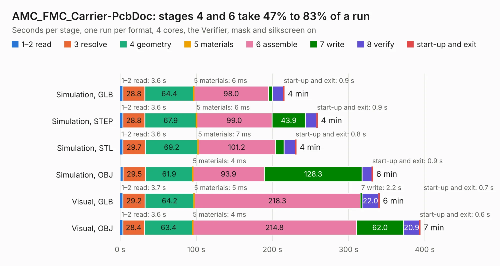

| Mode and format | 1–2 read | 3 resolve | 4 geometry | 5 materials | 6 assemble | 7 write | 8 verify | start-up and exit | Total |
|---|---:|---:|---:|---:|---:|---:|---:|---:|---:|
| Simulation, GLB | 3.6 | 28.8 | 64.4 | 6&nbsp;ms | 98.0 | 5.3 | 14.3 | 0.9 | 215.4 |
| Simulation, STEP | 3.6 | 28.8 | 67.9 | 6&nbsp;ms | 99.0 | 43.9 | 14.7 | 0.9 | 259.0 |
| Simulation, STL | 3.6 | 29.7 | 69.2 | 7&nbsp;ms | 101.2 | 11.6 | 14.9 | 0.8 | 231.0 |
| Simulation, OBJ | 4.0 | 29.5 | 61.9 | 4&nbsp;ms | 93.9 | 128.3 | 13.0 | 0.9 | 331.6 |
| Visual, GLB | 3.7 | 29.2 | 64.2 | 5&nbsp;ms | 218.3 | 2.2 | 22.0 | 0.7 | 340.4 |
| Visual, OBJ | 3.6 | 28.4 | 63.4 | 4&nbsp;ms | 214.8 | 62.0 | 20.9 | 0.6 | 393.7 |

<table align="center"><tr><td valign="top">

| Board | Repo: [BerkeleyLab/Marble-Mini](https://github.com/BerkeleyLab/Marble-Mini) Board: `AMC_FMC_Carrier-PcbDoc.kicad_pcb` |
|---|---|
| Complexity | 380&nbsp;/&nbsp;1000 (size&nbsp;345, features&nbsp;35) |
| KESE&nbsp;features | through vias, slotted holes, rounded, trapezoid or chamfered pads |
| Tested | 9th November 2026 to 10th November 2026 |
| Copper&nbsp;layers | 8 |
| File&nbsp;format | KiCad 5 (20171130) |
| Parts,&nbsp;tracks,&nbsp;vias | 886, 23,129, 2,797 |
| Triangles,&nbsp;simulation | 22,417,338 in 1144 parts |
| Verifier | PASS in all six runs |
| Run&nbsp;again | Simulation, OBJ: failed in the corpus run, run again with the memory cap raised from 11 GB to 14.5 GB, and passed |

</td><td valign="top">

<table>
<tr><th>File type</th><th>File size</th><th>Peak memory used</th></tr>
<tr><th colspan="3" align="left">Simulation</th></tr>
<tr><td>GLB</td><td align="right">748&nbsp;MB</td><td align="right">4.5&nbsp;GB</td></tr>
<tr><td>STEP</td><td align="right">2.2&nbsp;GB</td><td align="right">6.2&nbsp;GB</td></tr>
<tr><td>STL</td><td align="right">1.1&nbsp;GB</td><td align="right">4.5&nbsp;GB</td></tr>
<tr><td>OBJ</td><td align="right">2.5&nbsp;GB</td><td align="right">14&nbsp;GB</td></tr>
<tr><th colspan="3" align="left">Visual</th></tr>
<tr><td>GLB</td><td align="right">351&nbsp;MB</td><td align="right">5.9&nbsp;GB</td></tr>
<tr><td>OBJ</td><td align="right">1.2&nbsp;GB</td><td align="right">7.7&nbsp;GB</td></tr>
</table>

</td></tr></table>

## 571. Obsidian

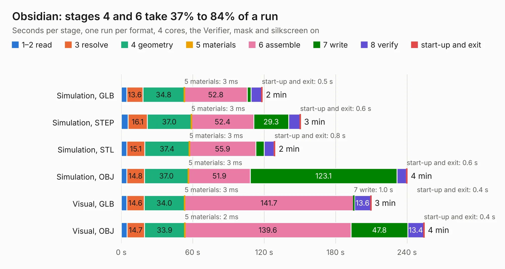

| Mode and format | 1–2 read | 3 resolve | 4 geometry | 5 materials | 6 assemble | 7 write | 8 verify | start-up and exit | Total |
|---|---:|---:|---:|---:|---:|---:|---:|---:|---:|
| Simulation, GLB | 4.6 | 13.6 | 34.8 | 3&nbsp;ms | 52.8 | 3.3 | 8.8 | 0.5 | 118.4 |
| Simulation, STEP | 5.8 | 16.1 | 37.0 | 3&nbsp;ms | 52.4 | 29.3 | 9.5 | 0.6 | 150.6 |
| Simulation, STL | 4.7 | 15.1 | 37.4 | 3&nbsp;ms | 55.9 | 7.0 | 8.3 | 0.8 | 129.2 |
| Simulation, OBJ | 4.6 | 14.8 | 37.0 | 3&nbsp;ms | 51.9 | 123.1 | 8.0 | 0.6 | 240.1 |
| Visual, GLB | 4.6 | 14.6 | 34.0 | 3&nbsp;ms | 141.7 | 1.0 | 13.6 | 0.4 | 209.9 |
| Visual, OBJ | 4.8 | 14.7 | 33.9 | 2&nbsp;ms | 139.6 | 47.8 | 13.4 | 0.4 | 254.5 |

<table align="center"><tr><td valign="top">

| Board | Repo: [BerkeleyLab/Obsidian](https://github.com/BerkeleyLab/Obsidian) Board: `Obsidian.kicad_pcb` |
|---|---|
| Folder | Obsidian |
| Complexity | 515&nbsp;/&nbsp;1000 (size&nbsp;335, features&nbsp;180) |
| KESE&nbsp;features | through vias, padstacks, slotted holes, custom pads, rounded, trapezoid or chamfered pads, arc tracks, filled zones, copper drawings, copper text, TrueType text, stack-up, dielectric εr and tanδ |
| Tested | 9th November 2026 |
| Copper&nbsp;layers | 8 |
| File&nbsp;format | KiCad 9 (20241229) |
| Parts,&nbsp;tracks,&nbsp;vias | 504, 11,970, 1,259 |
| Triangles,&nbsp;simulation | 12,905,622 in 462 parts |
| Verifier | PASS in all six runs |

</td><td valign="top">

<table>
<tr><th>File type</th><th>File size</th><th>Peak memory used</th></tr>
<tr><th colspan="3" align="left">Simulation</th></tr>
<tr><td>GLB</td><td align="right">431&nbsp;MB</td><td align="right">2.6&nbsp;GB</td></tr>
<tr><td>STEP</td><td align="right">1.4&nbsp;GB</td><td align="right">3.9&nbsp;GB</td></tr>
<tr><td>STL</td><td align="right">645&nbsp;MB</td><td align="right">2.6&nbsp;GB</td></tr>
<tr><td>OBJ</td><td align="right">1.4&nbsp;GB</td><td align="right">8.1&nbsp;GB</td></tr>
<tr><th colspan="3" align="left">Visual</th></tr>
<tr><td>GLB</td><td align="right">208&nbsp;MB</td><td align="right">3.6&nbsp;GB</td></tr>
<tr><td>OBJ</td><td align="right">689&nbsp;MB</td><td align="right">4.7&nbsp;GB</td></tr>
</table>

</td></tr></table>

## 572. zest

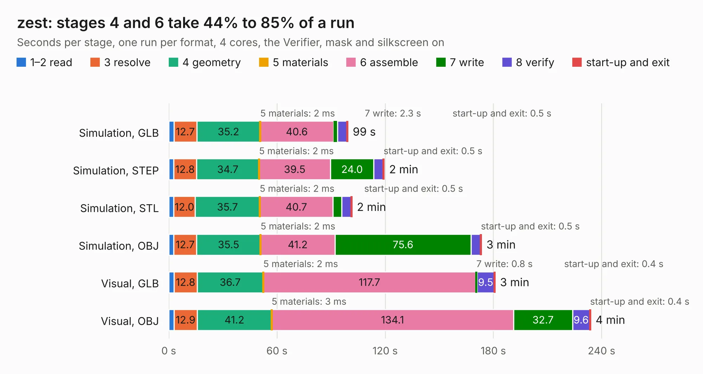

| Mode and format | 1–2 read | 3 resolve | 4 geometry | 5 materials | 6 assemble | 7 write | 8 verify | start-up and exit | Total |
|---|---:|---:|---:|---:|---:|---:|---:|---:|---:|
| Simulation, GLB | 2.8 | 12.7 | 35.2 | 2&nbsp;ms | 40.6 | 2.3 | 5.2 | 0.5 | 99.3 |
| Simulation, STEP | 2.6 | 12.8 | 34.7 | 2&nbsp;ms | 39.5 | 24.0 | 5.2 | 0.5 | 119.4 |
| Simulation, STL | 2.7 | 12.0 | 35.7 | 2&nbsp;ms | 40.7 | 4.7 | 5.2 | 0.5 | 101.5 |
| Simulation, OBJ | 2.8 | 12.7 | 35.5 | 2&nbsp;ms | 41.2 | 75.6 | 5.2 | 0.5 | 173.4 |
| Visual, GLB | 2.9 | 12.8 | 36.7 | 2&nbsp;ms | 117.7 | 0.8 | 9.5 | 0.4 | 180.9 |
| Visual, OBJ | 2.9 | 12.9 | 41.2 | 3&nbsp;ms | 134.1 | 32.7 | 9.6 | 0.4 | 233.9 |

<table align="center"><tr><td valign="top">

| Board | Repo: [berkeleylab/zest](https://github.com/berkeleylab/zest) Board: `zest.kicad_pcb` |
|---|---|
| Folder | board |
| Complexity | 380&nbsp;/&nbsp;1000 (size&nbsp;265, features&nbsp;115) |
| KESE&nbsp;features | through vias, rounded, trapezoid or chamfered pads, arc tracks, filled zones, copper text, TrueType text, stack-up, dielectric εr and tanδ |
| Tested | 9th November 2026 |
| Copper&nbsp;layers | 8 |
| File&nbsp;format | KiCad 10 (20260206) |
| Parts,&nbsp;tracks,&nbsp;vias | 410, 6,024, 1,118 |
| Triangles,&nbsp;simulation | 10,489,574 in 550 parts |
| Verifier | PASS in all six runs |

</td><td valign="top">

<table>
<tr><th>File type</th><th>File size</th><th>Peak memory used</th></tr>
<tr><th colspan="3" align="left">Simulation</th></tr>
<tr><td>GLB</td><td align="right">348&nbsp;MB</td><td align="right">2.3&nbsp;GB</td></tr>
<tr><td>STEP</td><td align="right">1.1&nbsp;GB</td><td align="right">3.3&nbsp;GB</td></tr>
<tr><td>STL</td><td align="right">525&nbsp;MB</td><td align="right">2.4&nbsp;GB</td></tr>
<tr><td>OBJ</td><td align="right">1.1&nbsp;GB</td><td align="right">6.5&nbsp;GB</td></tr>
<tr><th colspan="3" align="left">Visual</th></tr>
<tr><td>GLB</td><td align="right">168&nbsp;MB</td><td align="right">2.9&nbsp;GB</td></tr>
<tr><td>OBJ</td><td align="right">554&nbsp;MB</td><td align="right">3.7&nbsp;GB</td></tr>
</table>

</td></tr></table>

## 573. Crazyflie contol board

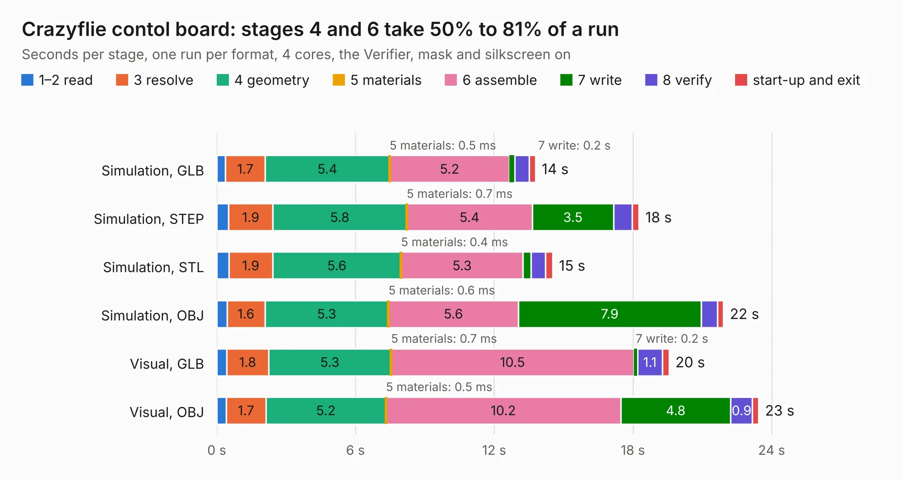

| Mode and format | 1–2 read | 3 resolve | 4 geometry | 5 materials | 6 assemble | 7 write | 8 verify | start-up and exit | Total |
|---|---:|---:|---:|---:|---:|---:|---:|---:|---:|
| Simulation, GLB | 0.4 | 1.7 | 5.4 | 0.5&nbsp;ms | 5.2 | 0.2 | 0.6 | 0.3 | 13.8 |
| Simulation, STEP | 0.5 | 1.9 | 5.8 | 0.7&nbsp;ms | 5.4 | 3.5 | 0.8 | 0.3 | 18.3 |
| Simulation, STL | 0.5 | 1.9 | 5.6 | 0.4&nbsp;ms | 5.3 | 0.3 | 0.6 | 0.3 | 14.5 |
| Simulation, OBJ | 0.4 | 1.6 | 5.3 | 0.6&nbsp;ms | 5.6 | 7.9 | 0.7 | 0.3 | 21.9 |
| Visual, GLB | 0.4 | 1.8 | 5.3 | 0.7&nbsp;ms | 10.5 | 0.2 | 1.1 | 0.3 | 19.6 |
| Visual, OBJ | 0.4 | 1.7 | 5.2 | 0.5&nbsp;ms | 10.2 | 4.8 | 0.9 | 0.3 | 23.4 |

<table align="center"><tr><td valign="top">

| Board | Repo: [bitcraze/crazyflie-electronics](https://github.com/bitcraze/crazyflie-electronics) Board: `Crazyflie contol board.kicad_pcb` |
|---|---|
| Folder | ecad |
| Complexity | 302&nbsp;/&nbsp;1000 (size&nbsp;247, features&nbsp;55) |
| KESE&nbsp;features | through vias, drill offsets, filled zones, curved board outline |
| Tested | 9th November 2026 |
| Copper&nbsp;layers | 4 |
| File&nbsp;format | KiCad 3 (3) |
| Parts,&nbsp;tracks,&nbsp;vias | 114, 1,301, 140 |
| Triangles,&nbsp;simulation | 1,252,200 in 102 parts |
| Verifier | PASS in all six runs |

</td><td valign="top">

<table>
<tr><th>File type</th><th>File size</th><th>Peak memory used</th></tr>
<tr><th colspan="3" align="left">Simulation</th></tr>
<tr><td>GLB</td><td align="right">44&nbsp;MB</td><td align="right">487&nbsp;MB</td></tr>
<tr><td>STEP</td><td align="right">185&nbsp;MB</td><td align="right">582&nbsp;MB</td></tr>
<tr><td>STL</td><td align="right">63&nbsp;MB</td><td align="right">489&nbsp;MB</td></tr>
<tr><td>OBJ</td><td align="right">135&nbsp;MB</td><td align="right">891&nbsp;MB</td></tr>
<tr><th colspan="3" align="left">Visual</th></tr>
<tr><td>GLB</td><td align="right">29&nbsp;MB</td><td align="right">648&nbsp;MB</td></tr>
<tr><td>OBJ</td><td align="right">89&nbsp;MB</td><td align="right">649&nbsp;MB</td></tr>
</table>

</td></tr></table>

## 574. ESP32S3

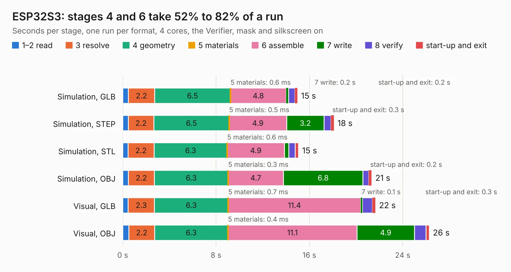

| Mode and format | 1–2 read | 3 resolve | 4 geometry | 5 materials | 6 assemble | 7 write | 8 verify | start-up and exit | Total |
|---|---:|---:|---:|---:|---:|---:|---:|---:|---:|
| Simulation, GLB | 0.5 | 2.2 | 6.5 | 0.6&nbsp;ms | 4.8 | 0.2 | 0.5 | 0.2 | 15.0 |
| Simulation, STEP | 0.5 | 2.2 | 6.5 | 0.5&nbsp;ms | 4.9 | 3.2 | 0.6 | 0.3 | 18.1 |
| Simulation, STL | 0.5 | 2.2 | 6.3 | 0.6&nbsp;ms | 4.9 | 0.4 | 0.5 | 0.3 | 15.1 |
| Simulation, OBJ | 0.5 | 2.2 | 6.3 | 0.3&nbsp;ms | 4.7 | 6.8 | 0.5 | 0.2 | 21.3 |
| Visual, GLB | 0.5 | 2.3 | 6.3 | 0.7&nbsp;ms | 11.4 | 0.1 | 0.9 | 0.3 | 21.7 |
| Visual, OBJ | 0.5 | 2.2 | 6.3 | 0.4&nbsp;ms | 11.1 | 4.9 | 1.0 | 0.3 | 26.3 |

<table align="center"><tr><td valign="top">

| Board | Repo: [bluejayracing/22xt_kicad](https://github.com/bluejayracing/22xt_kicad) Board: `ESP32S3.kicad_pcb` |
|---|---|
| Folder | 01-main_board / 00-symbols |
| Complexity | 275&nbsp;/&nbsp;1000 (size&nbsp;225, features&nbsp;50) |
| KESE&nbsp;features | through vias, rounded, trapezoid or chamfered pads, arc tracks, curved board outline |
| Tested | 9th November 2026 |
| Copper&nbsp;layers | 2 |
| File&nbsp;format | KiCad 9 (20241229) |
| Parts,&nbsp;tracks,&nbsp;vias | 61, 1,178, 220 |
| Triangles,&nbsp;simulation | 1,140,700 in 76 parts |
| Verifier | PASS in all six runs |

</td><td valign="top">

<table>
<tr><th>File type</th><th>File size</th><th>Peak memory used</th></tr>
<tr><th colspan="3" align="left">Simulation</th></tr>
<tr><td>GLB</td><td align="right">40&nbsp;MB</td><td align="right">522&nbsp;MB</td></tr>
<tr><td>STEP</td><td align="right">215&nbsp;MB</td><td align="right">590&nbsp;MB</td></tr>
<tr><td>STL</td><td align="right">57&nbsp;MB</td><td align="right">496&nbsp;MB</td></tr>
<tr><td>OBJ</td><td align="right">118&nbsp;MB</td><td align="right">816&nbsp;MB</td></tr>
<tr><th colspan="3" align="left">Visual</th></tr>
<tr><td>GLB</td><td align="right">29&nbsp;MB</td><td align="right">626&nbsp;MB</td></tr>
<tr><td>OBJ</td><td align="right">87&nbsp;MB</td><td align="right">658&nbsp;MB</td></tr>
</table>

</td></tr></table>

## 575. AD5689RARUZ-RL7_breakboard

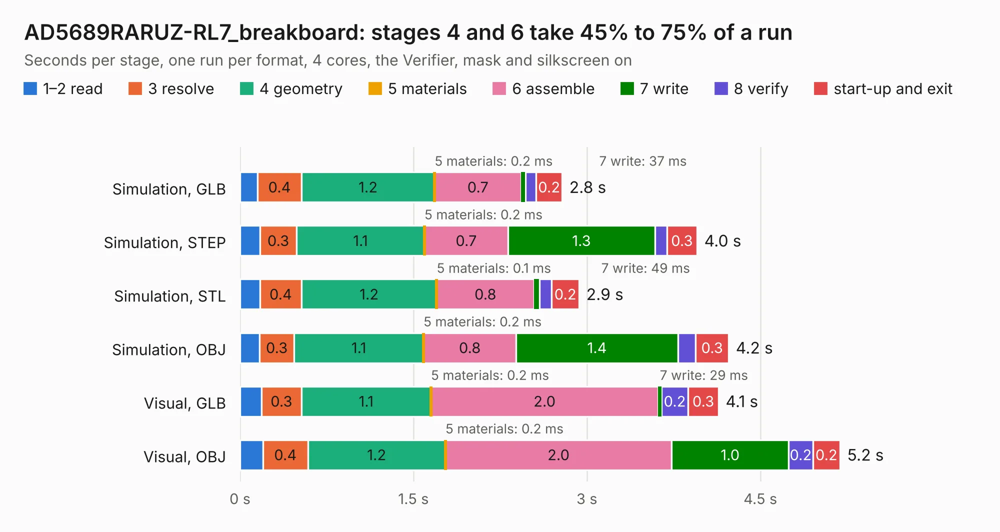

| Mode and format | 1–2 read | 3 resolve | 4 geometry | 5 materials | 6 assemble | 7 write | 8 verify | start-up and exit | Total |
|---|---:|---:|---:|---:|---:|---:|---:|---:|---:|
| Simulation, GLB | 0.2 | 0.4 | 1.2 | 0.2&nbsp;ms | 0.7 | 37&nbsp;ms | 91&nbsp;ms | 0.2 | 2.8 |
| Simulation, STEP | 0.2 | 0.3 | 1.1 | 0.2&nbsp;ms | 0.7 | 1.3 | 0.1 | 0.3 | 4.0 |
| Simulation, STL | 0.2 | 0.4 | 1.2 | 0.1&nbsp;ms | 0.8 | 49&nbsp;ms | 0.1 | 0.2 | 2.9 |
| Simulation, OBJ | 0.2 | 0.3 | 1.1 | 0.2&nbsp;ms | 0.8 | 1.4 | 0.2 | 0.3 | 4.2 |
| Visual, GLB | 0.2 | 0.3 | 1.1 | 0.2&nbsp;ms | 2.0 | 29&nbsp;ms | 0.2 | 0.3 | 4.1 |
| Visual, OBJ | 0.2 | 0.4 | 1.2 | 0.2&nbsp;ms | 2.0 | 1.0 | 0.2 | 0.2 | 5.2 |

<table align="center"><tr><td valign="top">

| Board | Repo: [bluejayracing/22xt_kicad](https://github.com/bluejayracing/22xt_kicad) Board: `AD5689RARUZ-RL7_breakboard.kicad_pcb` |
|---|---|
| Folder | 01-main_board / AD5689RARUZ-RL7_breakboard |
| Complexity | 163&nbsp;/&nbsp;1000 (size&nbsp;108, features&nbsp;55) |
| KESE&nbsp;features | through vias, rounded, trapezoid or chamfered pads, filled zones, curved board outline |
| Tested | 9th November 2026 |
| Copper&nbsp;layers | 2 |
| File&nbsp;format | KiCad 9 (20241229) |
| Parts,&nbsp;tracks,&nbsp;vias | 5, 41, 12 |
| Triangles,&nbsp;simulation | 184,358 in 27 parts |
| Verifier | PASS in all six runs |

</td><td valign="top">

<table>
<tr><th>File type</th><th>File size</th><th>Peak memory used</th></tr>
<tr><th colspan="3" align="left">Simulation</th></tr>
<tr><td>GLB</td><td align="right">6.5&nbsp;MB</td><td align="right">211&nbsp;MB</td></tr>
<tr><td>STEP</td><td align="right">29&nbsp;MB</td><td align="right">225&nbsp;MB</td></tr>
<tr><td>STL</td><td align="right">9.2&nbsp;MB</td><td align="right">227&nbsp;MB</td></tr>
<tr><td>OBJ</td><td align="right">19&nbsp;MB</td><td align="right">211&nbsp;MB</td></tr>
<tr><th colspan="3" align="left">Visual</th></tr>
<tr><td>GLB</td><td align="right">5.4&nbsp;MB</td><td align="right">194&nbsp;MB</td></tr>
<tr><td>OBJ</td><td align="right">15&nbsp;MB</td><td align="right">192&nbsp;MB</td></tr>
</table>

</td></tr></table>

## 576. DB44_breakout

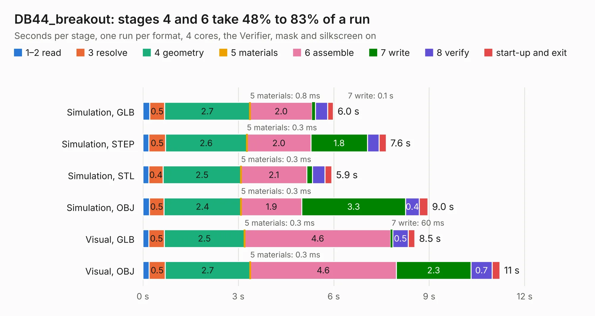

| Mode and format | 1–2 read | 3 resolve | 4 geometry | 5 materials | 6 assemble | 7 write | 8 verify | start-up and exit | Total |
|---|---:|---:|---:|---:|---:|---:|---:|---:|---:|
| Simulation, GLB | 0.2 | 0.5 | 2.7 | 0.8&nbsp;ms | 2.0 | 0.1 | 0.4 | 0.2 | 6.0 |
| Simulation, STEP | 0.2 | 0.5 | 2.6 | 0.3&nbsp;ms | 2.0 | 1.8 | 0.4 | 0.2 | 7.6 |
| Simulation, STL | 0.2 | 0.4 | 2.5 | 0.3&nbsp;ms | 2.1 | 0.2 | 0.4 | 0.2 | 5.9 |
| Simulation, OBJ | 0.2 | 0.5 | 2.4 | 0.3&nbsp;ms | 1.9 | 3.3 | 0.4 | 0.3 | 9.0 |
| Visual, GLB | 0.2 | 0.5 | 2.5 | 0.3&nbsp;ms | 4.6 | 60&nbsp;ms | 0.5 | 0.2 | 8.5 |
| Visual, OBJ | 0.2 | 0.5 | 2.7 | 0.3&nbsp;ms | 4.6 | 2.3 | 0.7 | 0.2 | 11.2 |

<table align="center"><tr><td valign="top">

| Board | Repo: [bluejayracing/22xt_kicad](https://github.com/bluejayracing/22xt_kicad) Board: `DB44_breakout.kicad_pcb` |
|---|---|
| Folder | 01-main_board / DB44_ Breakout |
| Complexity | 154&nbsp;/&nbsp;1000 (size&nbsp;124, features&nbsp;30) |
| KESE&nbsp;features | rounded, trapezoid or chamfered pads, filled zones |
| Tested | 9th November 2026 |
| Copper&nbsp;layers | 2 |
| File&nbsp;format | KiCad 9 (20241229) |
| Parts,&nbsp;tracks,&nbsp;vias | 6, 192, 0 |
| Triangles,&nbsp;simulation | 609,768 in 56 parts |
| Verifier | PASS in all six runs |

</td><td valign="top">

<table>
<tr><th>File type</th><th>File size</th><th>Peak memory used</th></tr>
<tr><th colspan="3" align="left">Simulation</th></tr>
<tr><td>GLB</td><td align="right">20&nbsp;MB</td><td align="right">323&nbsp;MB</td></tr>
<tr><td>STEP</td><td align="right">86&nbsp;MB</td><td align="right">371&nbsp;MB</td></tr>
<tr><td>STL</td><td align="right">30&nbsp;MB</td><td align="right">321&nbsp;MB</td></tr>
<tr><td>OBJ</td><td align="right">61&nbsp;MB</td><td align="right">387&nbsp;MB</td></tr>
<tr><th colspan="3" align="left">Visual</th></tr>
<tr><td>GLB</td><td align="right">14&nbsp;MB</td><td align="right">406&nbsp;MB</td></tr>
<tr><td>OBJ</td><td align="right">43&nbsp;MB</td><td align="right">404&nbsp;MB</td></tr>
</table>

</td></tr></table>

## 577. main_board_peripheral_v1

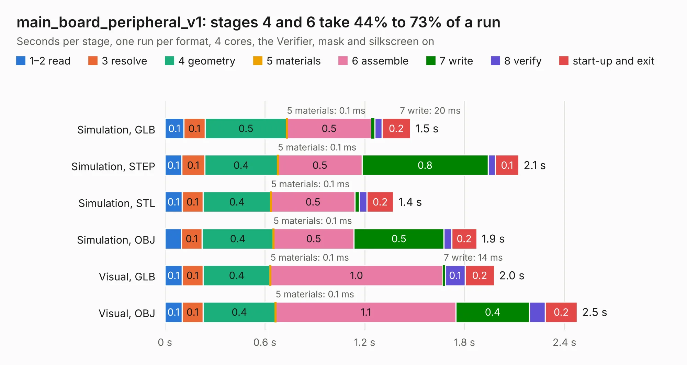

| Mode and format | 1–2 read | 3 resolve | 4 geometry | 5 materials | 6 assemble | 7 write | 8 verify | start-up and exit | Total |
|---|---:|---:|---:|---:|---:|---:|---:|---:|---:|
| Simulation, GLB | 0.1 | 0.1 | 0.5 | 0.1&nbsp;ms | 0.5 | 20&nbsp;ms | 45&nbsp;ms | 0.2 | 1.5 |
| Simulation, STEP | 0.1 | 0.1 | 0.4 | 0.1&nbsp;ms | 0.5 | 0.8 | 44&nbsp;ms | 0.1 | 2.1 |
| Simulation, STL | 0.1 | 0.1 | 0.4 | 0.1&nbsp;ms | 0.5 | 26&nbsp;ms | 46&nbsp;ms | 0.2 | 1.4 |
| Simulation, OBJ | 99&nbsp;ms | 0.1 | 0.4 | 0.1&nbsp;ms | 0.5 | 0.5 | 46&nbsp;ms | 0.2 | 1.9 |
| Visual, GLB | 0.1 | 0.1 | 0.4 | 0.1&nbsp;ms | 1.0 | 14&nbsp;ms | 0.1 | 0.2 | 2.0 |
| Visual, OBJ | 0.1 | 0.1 | 0.4 | 0.1&nbsp;ms | 1.1 | 0.4 | 96&nbsp;ms | 0.2 | 2.5 |

<table align="center"><tr><td valign="top">

| Board | Repo: [bluejayracing/22xt_kicad](https://github.com/bluejayracing/22xt_kicad) Board: `main_board_peripheral_v1.kicad_pcb` |
|---|---|
| Folder | 01-main_board / main_board_peripheral_v1 |
| Complexity | 198&nbsp;/&nbsp;1000 (size&nbsp;108, features&nbsp;90) |
| KESE&nbsp;features | through vias, rounded, trapezoid or chamfered pads, arc tracks, filled zones, stack-up, dielectric εr and tanδ |
| Tested | 9th November 2026 |
| Copper&nbsp;layers | 2 |
| File&nbsp;format | KiCad 9 (20241229) |
| Parts,&nbsp;tracks,&nbsp;vias | 4, 82, 3 |
| Triangles,&nbsp;simulation | 130,504 in 22 parts |
| Verifier | PASS in all six runs |

</td><td valign="top">

<table>
<tr><th>File type</th><th>File size</th><th>Peak memory used</th></tr>
<tr><th colspan="3" align="left">Simulation</th></tr>
<tr><td>GLB</td><td align="right">4.6&nbsp;MB</td><td align="right">189&nbsp;MB</td></tr>
<tr><td>STEP</td><td align="right">23&nbsp;MB</td><td align="right">205&nbsp;MB</td></tr>
<tr><td>STL</td><td align="right">6.5&nbsp;MB</td><td align="right">186&nbsp;MB</td></tr>
<tr><td>OBJ</td><td align="right">13&nbsp;MB</td><td align="right">190&nbsp;MB</td></tr>
<tr><th colspan="3" align="left">Visual</th></tr>
<tr><td>GLB</td><td align="right">3.6&nbsp;MB</td><td align="right">161&nbsp;MB</td></tr>
<tr><td>OBJ</td><td align="right">10.0&nbsp;MB</td><td align="right">157&nbsp;MB</td></tr>
</table>

</td></tr></table>

## 578. main_board_peripheral_v2

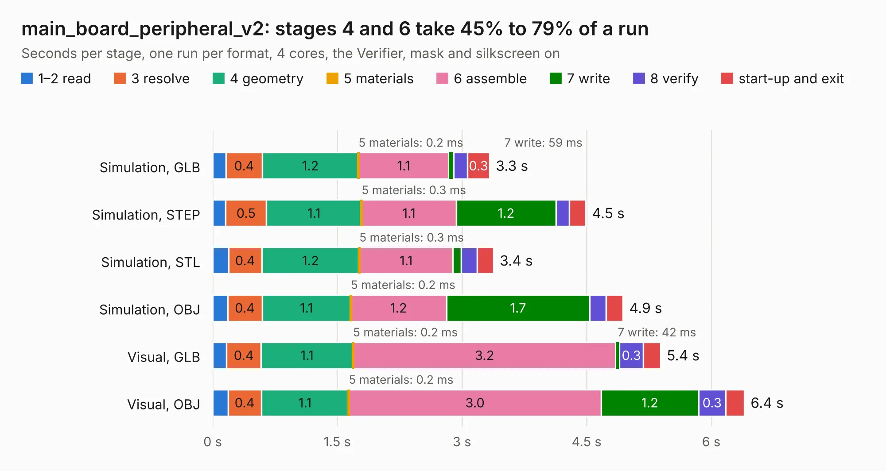

| Mode and format | 1–2 read | 3 resolve | 4 geometry | 5 materials | 6 assemble | 7 write | 8 verify | start-up and exit | Total |
|---|---:|---:|---:|---:|---:|---:|---:|---:|---:|
| Simulation, GLB | 0.2 | 0.4 | 1.2 | 0.2&nbsp;ms | 1.1 | 59&nbsp;ms | 0.2 | 0.3 | 3.3 |
| Simulation, STEP | 0.2 | 0.5 | 1.1 | 0.3&nbsp;ms | 1.1 | 1.2 | 0.2 | 0.2 | 4.5 |
| Simulation, STL | 0.2 | 0.4 | 1.2 | 0.3&nbsp;ms | 1.1 | 99&nbsp;ms | 0.2 | 0.2 | 3.4 |
| Simulation, OBJ | 0.2 | 0.4 | 1.1 | 0.2&nbsp;ms | 1.2 | 1.7 | 0.2 | 0.2 | 4.9 |
| Visual, GLB | 0.2 | 0.4 | 1.1 | 0.2&nbsp;ms | 3.2 | 42&nbsp;ms | 0.3 | 0.2 | 5.4 |
| Visual, OBJ | 0.2 | 0.4 | 1.1 | 0.2&nbsp;ms | 3.0 | 1.2 | 0.3 | 0.2 | 6.4 |

<table align="center"><tr><td valign="top">

| Board | Repo: [bluejayracing/22xt_kicad](https://github.com/bluejayracing/22xt_kicad) Board: `main_board_peripheral_v2.kicad_pcb` |
|---|---|
| Folder | 01-main_board / main_board_peripheral_v2 |
| Complexity | 241&nbsp;/&nbsp;1000 (size&nbsp;166, features&nbsp;75) |
| KESE&nbsp;features | through vias, rounded, trapezoid or chamfered pads, filled zones, stack-up, dielectric εr and tanδ |
| Tested | 9th November 2026 |
| Copper&nbsp;layers | 4 |
| File&nbsp;format | KiCad 9 (20241229) |
| Parts,&nbsp;tracks,&nbsp;vias | 28, 227, 43 |
| Triangles,&nbsp;simulation | 410,900 in 57 parts |
| Verifier | PASS in all six runs |

</td><td valign="top">

<table>
<tr><th>File type</th><th>File size</th><th>Peak memory used</th></tr>
<tr><th colspan="3" align="left">Simulation</th></tr>
<tr><td>GLB</td><td align="right">14&nbsp;MB</td><td align="right">280&nbsp;MB</td></tr>
<tr><td>STEP</td><td align="right">56&nbsp;MB</td><td align="right">289&nbsp;MB</td></tr>
<tr><td>STL</td><td align="right">21&nbsp;MB</td><td align="right">263&nbsp;MB</td></tr>
<tr><td>OBJ</td><td align="right">42&nbsp;MB</td><td align="right">287&nbsp;MB</td></tr>
<tr><th colspan="3" align="left">Visual</th></tr>
<tr><td>GLB</td><td align="right">9.9&nbsp;MB</td><td align="right">288&nbsp;MB</td></tr>
<tr><td>OBJ</td><td align="right">29&nbsp;MB</td><td align="right">295&nbsp;MB</td></tr>
</table>

</td></tr></table>

## 579. main_board_peripheral_v3

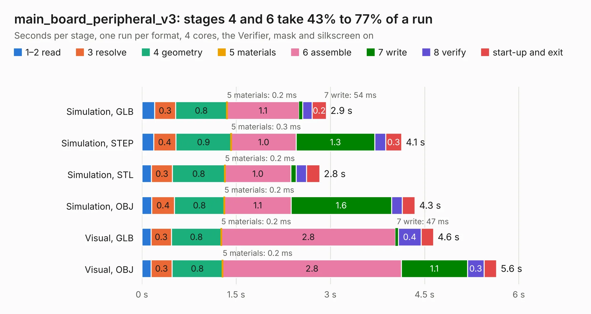

| Mode and format | 1–2 read | 3 resolve | 4 geometry | 5 materials | 6 assemble | 7 write | 8 verify | start-up and exit | Total |
|---|---:|---:|---:|---:|---:|---:|---:|---:|---:|
| Simulation, GLB | 0.2 | 0.3 | 0.8 | 0.2&nbsp;ms | 1.1 | 54&nbsp;ms | 0.2 | 0.2 | 2.9 |
| Simulation, STEP | 0.2 | 0.4 | 0.9 | 0.3&nbsp;ms | 1.0 | 1.3 | 0.2 | 0.3 | 4.1 |
| Simulation, STL | 0.2 | 0.3 | 0.8 | 0.2&nbsp;ms | 1.0 | 84&nbsp;ms | 0.2 | 0.2 | 2.8 |
| Simulation, OBJ | 0.2 | 0.4 | 0.8 | 0.2&nbsp;ms | 1.1 | 1.6 | 0.2 | 0.2 | 4.3 |
| Visual, GLB | 0.1 | 0.3 | 0.8 | 0.2&nbsp;ms | 2.8 | 47&nbsp;ms | 0.4 | 0.2 | 4.6 |
| Visual, OBJ | 0.1 | 0.3 | 0.8 | 0.2&nbsp;ms | 2.8 | 1.1 | 0.3 | 0.2 | 5.6 |

<table align="center"><tr><td valign="top">

| Board | Repo: [bluejayracing/22xt_kicad](https://github.com/bluejayracing/22xt_kicad) Board: `main_board_peripheral_v3.kicad_pcb` |
|---|---|
| Folder | 01-main_board / main_board_peripheral_v3 |
| Complexity | 262&nbsp;/&nbsp;1000 (size&nbsp;162, features&nbsp;100) |
| KESE&nbsp;features | through vias, rounded, trapezoid or chamfered pads, arc tracks, filled zones, curved board outline, stack-up, dielectric εr and tanδ |
| Tested | 9th November 2026 to 10th November 2026 |
| Copper&nbsp;layers | 4 |
| File&nbsp;format | KiCad 9 (20241229) |
| Parts,&nbsp;tracks,&nbsp;vias | 18, 254, 40 |
| Triangles,&nbsp;simulation | 305,866 in 34 parts |
| Verifier | PASS in all six runs |
| Run&nbsp;again | Visual, GLB; Visual, OBJ: failed in the corpus run, run again with fixes to KESE made after the corpus run, and passed |

</td><td valign="top">

<table>
<tr><th>File type</th><th>File size</th><th>Peak memory used</th></tr>
<tr><th colspan="3" align="left">Simulation</th></tr>
<tr><td>GLB</td><td align="right">11&nbsp;MB</td><td align="right">241&nbsp;MB</td></tr>
<tr><td>STEP</td><td align="right">40&nbsp;MB</td><td align="right">259&nbsp;MB</td></tr>
<tr><td>STL</td><td align="right">15&nbsp;MB</td><td align="right">232&nbsp;MB</td></tr>
<tr><td>OBJ</td><td align="right">31&nbsp;MB</td><td align="right">255&nbsp;MB</td></tr>
<tr><th colspan="3" align="left">Visual</th></tr>
<tr><td>GLB</td><td align="right">7.8&nbsp;MB</td><td align="right">243&nbsp;MB</td></tr>
<tr><td>OBJ</td><td align="right">23&nbsp;MB</td><td align="right">245&nbsp;MB</td></tr>
</table>

</td></tr></table>

## 580. main_board_peripheral_v3_1

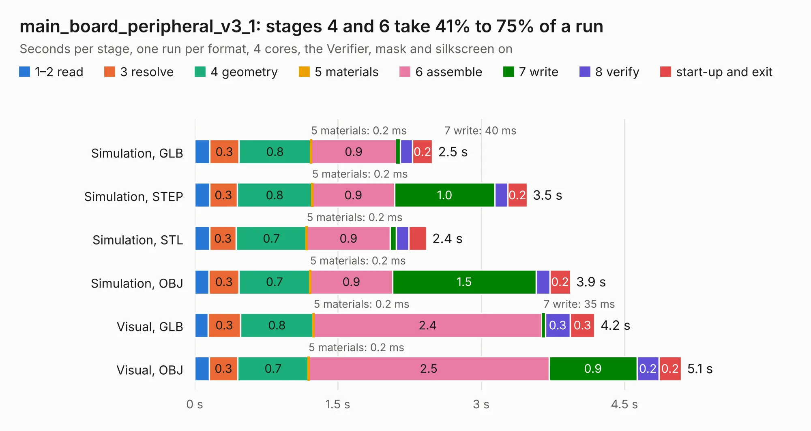

| Mode and format | 1–2 read | 3 resolve | 4 geometry | 5 materials | 6 assemble | 7 write | 8 verify | start-up and exit | Total |
|---|---:|---:|---:|---:|---:|---:|---:|---:|---:|
| Simulation, GLB | 0.2 | 0.3 | 0.8 | 0.2&nbsp;ms | 0.9 | 40&nbsp;ms | 0.1 | 0.2 | 2.5 |
| Simulation, STEP | 0.2 | 0.3 | 0.8 | 0.2&nbsp;ms | 0.9 | 1.0 | 0.1 | 0.2 | 3.5 |
| Simulation, STL | 0.2 | 0.3 | 0.7 | 0.2&nbsp;ms | 0.9 | 62&nbsp;ms | 0.1 | 0.2 | 2.4 |
| Simulation, OBJ | 0.1 | 0.3 | 0.7 | 0.2&nbsp;ms | 0.9 | 1.5 | 0.1 | 0.2 | 3.9 |
| Visual, GLB | 0.1 | 0.3 | 0.8 | 0.2&nbsp;ms | 2.4 | 35&nbsp;ms | 0.3 | 0.3 | 4.2 |
| Visual, OBJ | 0.2 | 0.3 | 0.7 | 0.2&nbsp;ms | 2.5 | 0.9 | 0.2 | 0.2 | 5.1 |

<table align="center"><tr><td valign="top">

| Board | Repo: [bluejayracing/22xt_kicad](https://github.com/bluejayracing/22xt_kicad) Board: `main_board_peripheral_v3_1.kicad_pcb` |
|---|---|
| Folder | 01-main_board / main_board_peripheral_v3_1 |
| Complexity | 284&nbsp;/&nbsp;1000 (size&nbsp;159, features&nbsp;125) |
| KESE&nbsp;features | through vias, custom pads, rounded, trapezoid or chamfered pads, arc tracks, filled zones, copper drawings, curved board outline, stack-up, dielectric εr and tanδ |
| Tested | 9th November 2026 to 10th November 2026 |
| Copper&nbsp;layers | 4 |
| File&nbsp;format | KiCad 9 (20241229) |
| Parts,&nbsp;tracks,&nbsp;vias | 16, 242, 31 |
| Triangles,&nbsp;simulation | 270,052 in 34 parts |
| Verifier | PASS in all six runs |
| Run&nbsp;again | Visual, GLB; Visual, OBJ: failed in the corpus run, run again with fixes to KESE made after the corpus run, and passed |

</td><td valign="top">

<table>
<tr><th>File type</th><th>File size</th><th>Peak memory used</th></tr>
<tr><th colspan="3" align="left">Simulation</th></tr>
<tr><td>GLB</td><td align="right">9.4&nbsp;MB</td><td align="right">228&nbsp;MB</td></tr>
<tr><td>STEP</td><td align="right">36&nbsp;MB</td><td align="right">249&nbsp;MB</td></tr>
<tr><td>STL</td><td align="right">14&nbsp;MB</td><td align="right">231&nbsp;MB</td></tr>
<tr><td>OBJ</td><td align="right">27&nbsp;MB</td><td align="right">233&nbsp;MB</td></tr>
<tr><th colspan="3" align="left">Visual</th></tr>
<tr><td>GLB</td><td align="right">7.0&nbsp;MB</td><td align="right">238&nbsp;MB</td></tr>
<tr><td>OBJ</td><td align="right">20&nbsp;MB</td><td align="right">227&nbsp;MB</td></tr>
</table>

</td></tr></table>

## 581. main_board_v1

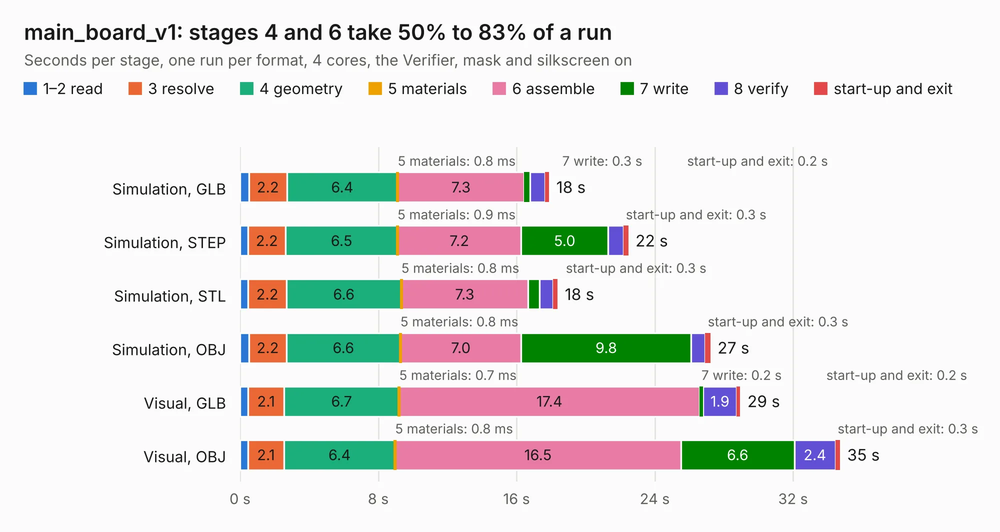

| Mode and format | 1–2 read | 3 resolve | 4 geometry | 5 materials | 6 assemble | 7 write | 8 verify | start-up and exit | Total |
|---|---:|---:|---:|---:|---:|---:|---:|---:|---:|
| Simulation, GLB | 0.5 | 2.2 | 6.4 | 0.8&nbsp;ms | 7.3 | 0.3 | 0.9 | 0.2 | 17.9 |
| Simulation, STEP | 0.5 | 2.2 | 6.5 | 0.9&nbsp;ms | 7.2 | 5.0 | 0.9 | 0.3 | 22.5 |
| Simulation, STL | 0.5 | 2.2 | 6.6 | 0.8&nbsp;ms | 7.3 | 0.6 | 0.8 | 0.3 | 18.4 |
| Simulation, OBJ | 0.5 | 2.2 | 6.6 | 0.8&nbsp;ms | 7.0 | 9.8 | 0.8 | 0.3 | 27.2 |
| Visual, GLB | 0.5 | 2.1 | 6.7 | 0.7&nbsp;ms | 17.4 | 0.2 | 1.9 | 0.2 | 28.9 |
| Visual, OBJ | 0.5 | 2.1 | 6.4 | 0.8&nbsp;ms | 16.5 | 6.6 | 2.4 | 0.3 | 34.7 |

<table align="center"><tr><td valign="top">

| Board | Repo: [bluejayracing/22xt_kicad](https://github.com/bluejayracing/22xt_kicad) Board: `main_board_v1.kicad_pcb` |
|---|---|
| Folder | 01-main_board / main_board_v1 |
| Complexity | 365&nbsp;/&nbsp;1000 (size&nbsp;265, features&nbsp;100) |
| KESE&nbsp;features | through vias, rounded, trapezoid or chamfered pads, arc tracks, filled zones, curved board outline, stack-up, dielectric εr and tanδ |
| Tested | 9th November 2026 |
| Copper&nbsp;layers | 4 |
| File&nbsp;format | KiCad 9 (20241229) |
| Parts,&nbsp;tracks,&nbsp;vias | 147, 1,956, 332 |
| Triangles,&nbsp;simulation | 2,398,958 in 209 parts |
| Verifier | PASS in all six runs |

</td><td valign="top">

<table>
<tr><th>File type</th><th>File size</th><th>Peak memory used</th></tr>
<tr><th colspan="3" align="left">Simulation</th></tr>
<tr><td>GLB</td><td align="right">82&nbsp;MB</td><td align="right">749&nbsp;MB</td></tr>
<tr><td>STEP</td><td align="right">314&nbsp;MB</td><td align="right">972&nbsp;MB</td></tr>
<tr><td>STL</td><td align="right">120&nbsp;MB</td><td align="right">752&nbsp;MB</td></tr>
<tr><td>OBJ</td><td align="right">252&nbsp;MB</td><td align="right">1.6&nbsp;GB</td></tr>
<tr><th colspan="3" align="left">Visual</th></tr>
<tr><td>GLB</td><td align="right">52&nbsp;MB</td><td align="right">1.1&nbsp;GB</td></tr>
<tr><td>OBJ</td><td align="right">162&nbsp;MB</td><td align="right">1.2&nbsp;GB</td></tr>
</table>

</td></tr></table>

## 582. main_board_v2

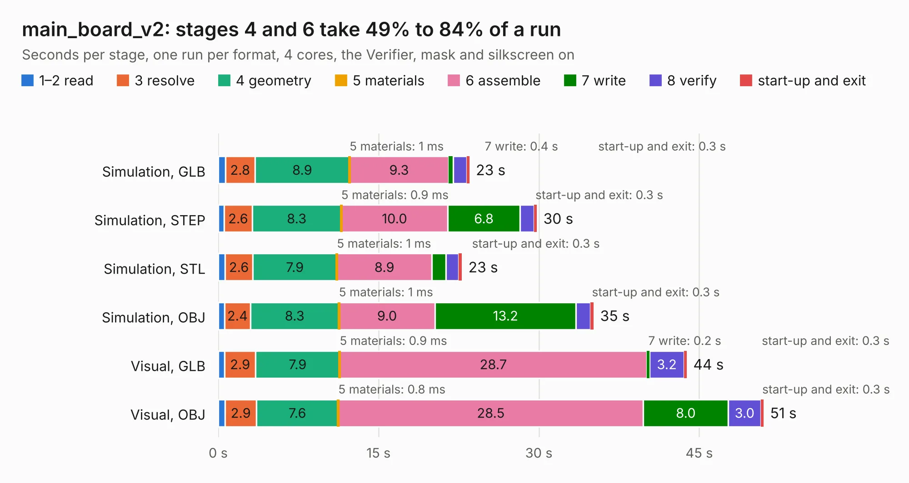

| Mode and format | 1–2 read | 3 resolve | 4 geometry | 5 materials | 6 assemble | 7 write | 8 verify | start-up and exit | Total |
|---|---:|---:|---:|---:|---:|---:|---:|---:|---:|
| Simulation, GLB | 0.7 | 2.8 | 8.9 | 1&nbsp;ms | 9.3 | 0.4 | 1.2 | 0.3 | 23.5 |
| Simulation, STEP | 0.6 | 2.6 | 8.3 | 0.9&nbsp;ms | 10.0 | 6.8 | 1.3 | 0.3 | 29.8 |
| Simulation, STL | 0.6 | 2.6 | 7.9 | 1&nbsp;ms | 8.9 | 1.3 | 1.2 | 0.3 | 22.8 |
| Simulation, OBJ | 0.6 | 2.4 | 8.3 | 1&nbsp;ms | 9.0 | 13.2 | 1.4 | 0.3 | 35.1 |
| Visual, GLB | 0.6 | 2.9 | 7.9 | 0.9&nbsp;ms | 28.7 | 0.2 | 3.2 | 0.3 | 43.8 |
| Visual, OBJ | 0.6 | 2.9 | 7.6 | 0.8&nbsp;ms | 28.5 | 8.0 | 3.0 | 0.3 | 51.0 |

<table align="center"><tr><td valign="top">

| Board | Repo: [bluejayracing/22xt_kicad](https://github.com/bluejayracing/22xt_kicad) Board: `main_board_v2.kicad_pcb` |
|---|---|
| Folder | 01-main_board / main_board_v2 |
| Complexity | 363&nbsp;/&nbsp;1000 (size&nbsp;263, features&nbsp;100) |
| KESE&nbsp;features | through vias, rounded, trapezoid or chamfered pads, arc tracks, filled zones, curved board outline, stack-up, dielectric εr and tanδ |
| Tested | 9th November 2026 |
| Copper&nbsp;layers | 4 |
| File&nbsp;format | KiCad 9 (20241229) |
| Parts,&nbsp;tracks,&nbsp;vias | 144, 1,496, 384 |
| Triangles,&nbsp;simulation | 2,621,604 in 204 parts |
| Verifier | PASS in all six runs |

</td><td valign="top">

<table>
<tr><th>File type</th><th>File size</th><th>Peak memory used</th></tr>
<tr><th colspan="3" align="left">Simulation</th></tr>
<tr><td>GLB</td><td align="right">89&nbsp;MB</td><td align="right">903&nbsp;MB</td></tr>
<tr><td>STEP</td><td align="right">317&nbsp;MB</td><td align="right">1.0&nbsp;GB</td></tr>
<tr><td>STL</td><td align="right">131&nbsp;MB</td><td align="right">892&nbsp;MB</td></tr>
<tr><td>OBJ</td><td align="right">274&nbsp;MB</td><td align="right">1.7&nbsp;GB</td></tr>
<tr><th colspan="3" align="left">Visual</th></tr>
<tr><td>GLB</td><td align="right">55&nbsp;MB</td><td align="right">1.0&nbsp;GB</td></tr>
<tr><td>OBJ</td><td align="right">169&nbsp;MB</td><td align="right">1.2&nbsp;GB</td></tr>
</table>

</td></tr></table>

## 583. main_board_v3

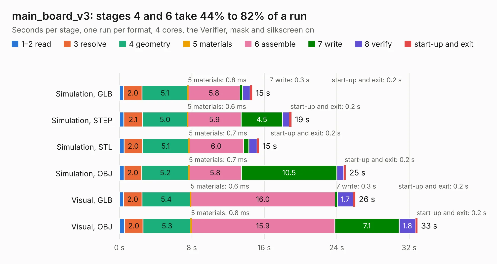

| Mode and format | 1–2 read | 3 resolve | 4 geometry | 5 materials | 6 assemble | 7 write | 8 verify | start-up and exit | Total |
|---|---:|---:|---:|---:|---:|---:|---:|---:|---:|
| Simulation, GLB | 0.5 | 2.0 | 5.1 | 0.8&nbsp;ms | 5.8 | 0.3 | 0.8 | 0.2 | 14.7 |
| Simulation, STEP | 0.5 | 2.1 | 5.0 | 0.6&nbsp;ms | 5.9 | 4.5 | 0.8 | 0.2 | 19.0 |
| Simulation, STL | 0.5 | 2.0 | 5.1 | 0.7&nbsp;ms | 6.0 | 0.6 | 0.9 | 0.2 | 15.4 |
| Simulation, OBJ | 0.5 | 2.0 | 5.2 | 0.7&nbsp;ms | 5.8 | 10.5 | 0.8 | 0.2 | 25.0 |
| Visual, GLB | 0.5 | 2.0 | 5.4 | 0.6&nbsp;ms | 16.0 | 0.3 | 1.7 | 0.2 | 26.1 |
| Visual, OBJ | 0.6 | 2.0 | 5.3 | 0.8&nbsp;ms | 15.9 | 7.1 | 1.8 | 0.2 | 32.9 |

<table align="center"><tr><td valign="top">

| Board | Repo: [bluejayracing/22xt_kicad](https://github.com/bluejayracing/22xt_kicad) Board: `main_board_v3.kicad_pcb` |
|---|---|
| Folder | 01-main_board / main_board_v3 |
| Complexity | 353&nbsp;/&nbsp;1000 (size&nbsp;253, features&nbsp;100) |
| KESE&nbsp;features | through vias, rounded, trapezoid or chamfered pads, arc tracks, filled zones, curved board outline, stack-up, dielectric εr and tanδ |
| Tested | 9th November 2026 |
| Copper&nbsp;layers | 4 |
| File&nbsp;format | KiCad 9 (20241229) |
| Parts,&nbsp;tracks,&nbsp;vias | 116, 1,661, 285 |
| Triangles,&nbsp;simulation | 1,943,674 in 157 parts |
| Verifier | PASS in all six runs |

</td><td valign="top">

<table>
<tr><th>File type</th><th>File size</th><th>Peak memory used</th></tr>
<tr><th colspan="3" align="left">Simulation</th></tr>
<tr><td>GLB</td><td align="right">66&nbsp;MB</td><td align="right">768&nbsp;MB</td></tr>
<tr><td>STEP</td><td align="right">250&nbsp;MB</td><td align="right">800&nbsp;MB</td></tr>
<tr><td>STL</td><td align="right">97&nbsp;MB</td><td align="right">772&nbsp;MB</td></tr>
<tr><td>OBJ</td><td align="right">201&nbsp;MB</td><td align="right">1.3&nbsp;GB</td></tr>
<tr><th colspan="3" align="left">Visual</th></tr>
<tr><td>GLB</td><td align="right">46&nbsp;MB</td><td align="right">860&nbsp;MB</td></tr>
<tr><td>OBJ</td><td align="right">142&nbsp;MB</td><td align="right">982&nbsp;MB</td></tr>
</table>

</td></tr></table>

## 584. AD5626BRMZ-kent

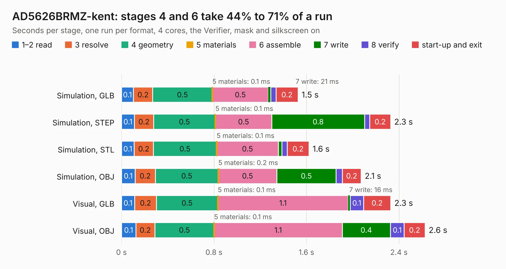

| Mode and format | 1–2 read | 3 resolve | 4 geometry | 5 materials | 6 assemble | 7 write | 8 verify | start-up and exit | Total |
|---|---:|---:|---:|---:|---:|---:|---:|---:|---:|
| Simulation, GLB | 0.1 | 0.2 | 0.5 | 0.1&nbsp;ms | 0.5 | 21&nbsp;ms | 45&nbsp;ms | 0.2 | 1.5 |
| Simulation, STEP | 0.1 | 0.2 | 0.5 | 0.1&nbsp;ms | 0.5 | 0.8 | 45&nbsp;ms | 0.2 | 2.3 |
| Simulation, STL | 0.1 | 0.2 | 0.5 | 0.1&nbsp;ms | 0.5 | 30&nbsp;ms | 45&nbsp;ms | 0.2 | 1.6 |
| Simulation, OBJ | 0.1 | 0.2 | 0.5 | 0.2&nbsp;ms | 0.5 | 0.5 | 54&nbsp;ms | 0.2 | 2.1 |
| Visual, GLB | 0.1 | 0.2 | 0.5 | 0.1&nbsp;ms | 1.1 | 16&nbsp;ms | 0.1 | 0.2 | 2.3 |
| Visual, OBJ | 0.1 | 0.2 | 0.5 | 0.1&nbsp;ms | 1.1 | 0.4 | 0.1 | 0.2 | 2.6 |

<table align="center"><tr><td valign="top">

| Board | Repo: [bluejayracing/22xt_kicad](https://github.com/bluejayracing/22xt_kicad) Board: `AD5626BRMZ-kent.kicad_pcb` |
|---|---|
| Folder | 02-wsg / AD5626BRMZ-breakout / AD5626BRMZ-kent |
| Complexity | 156&nbsp;/&nbsp;1000 (size&nbsp;101, features&nbsp;55) |
| KESE&nbsp;features | through vias, rounded, trapezoid or chamfered pads, filled zones, curved board outline |
| Tested | 9th November 2026 |
| Copper&nbsp;layers | 2 |
| File&nbsp;format | KiCad 9 (20241229) |
| Parts,&nbsp;tracks,&nbsp;vias | 5, 29, 8 |
| Triangles,&nbsp;simulation | 128,706 in 19 parts |
| Verifier | PASS in all six runs |

</td><td valign="top">

<table>
<tr><th>File type</th><th>File size</th><th>Peak memory used</th></tr>
<tr><th colspan="3" align="left">Simulation</th></tr>
<tr><td>GLB</td><td align="right">4.6&nbsp;MB</td><td align="right">195&nbsp;MB</td></tr>
<tr><td>STEP</td><td align="right">22&nbsp;MB</td><td align="right">209&nbsp;MB</td></tr>
<tr><td>STL</td><td align="right">6.4&nbsp;MB</td><td align="right">197&nbsp;MB</td></tr>
<tr><td>OBJ</td><td align="right">13&nbsp;MB</td><td align="right">198&nbsp;MB</td></tr>
<tr><th colspan="3" align="left">Visual</th></tr>
<tr><td>GLB</td><td align="right">3.9&nbsp;MB</td><td align="right">158&nbsp;MB</td></tr>
<tr><td>OBJ</td><td align="right">11&nbsp;MB</td><td align="right">162&nbsp;MB</td></tr>
</table>

</td></tr></table>

## 585. ADS1120IPWR

| Mode and format | 1–2 read | 3 resolve | 4 geometry | 5 materials | 6 assemble | 7 write | 8 verify | start-up and exit | Total |
|---|---:|---:|---:|---:|---:|---:|---:|---:|---:|
| Simulation, GLB | 0.2 | 0.5 | 1.5 | 0.2&nbsp;ms | 1.0 | 46&nbsp;ms | 0.1 | 0.2 | 3.6 |
| Simulation, STEP | 0.2 | 0.4 | 1.4 | 0.2&nbsp;ms | 0.9 | 1.4 | 0.1 | 0.2 | 4.7 |
| Simulation, STL | 0.2 | 0.5 | 1.4 | 0.2&nbsp;ms | 1.0 | 71&nbsp;ms | 0.1 | 0.3 | 3.6 |
| Simulation, OBJ | 0.3 | 0.4 | 1.6 | 0.2&nbsp;ms | 1.0 | 1.6 | 0.1 | 0.3 | 5.4 |
| Visual, GLB | 0.2 | 0.5 | 1.6 | 0.2&nbsp;ms | 2.8 | 46&nbsp;ms | 0.3 | 0.3 | 5.7 |
| Visual, OBJ | 0.2 | 0.5 | 1.5 | 0.2&nbsp;ms | 2.7 | 1.2 | 0.3 | 0.3 | 6.7 |

<table align="center"><tr><td valign="top">

| Board | Repo: [bluejayracing/22xt_kicad](https://github.com/bluejayracing/22xt_kicad) Board: `ADS1120IPWR.kicad_pcb` |
|---|---|
| Folder | 02-wsg / ADS1120IPWR |
| Complexity | 201&nbsp;/&nbsp;1000 (size&nbsp;116, features&nbsp;85) |
| KESE&nbsp;features | through vias, rounded, trapezoid or chamfered pads, filled zones, curved board outline, stack-up, dielectric εr and tanδ |
| Tested | 9th November 2026 |
| Copper&nbsp;layers | 2 |
| File&nbsp;format | KiCad 9 (20241229) |
| Parts,&nbsp;tracks,&nbsp;vias | 7, 69, 12 |
| Triangles,&nbsp;simulation | 255,938 in 26 parts |
| Verifier | PASS in all six runs |

</td><td valign="top">

<table>
<tr><th>File type</th><th>File size</th><th>Peak memory used</th></tr>
<tr><th colspan="3" align="left">Simulation</th></tr>
<tr><td>GLB</td><td align="right">9.1&nbsp;MB</td><td align="right">244&nbsp;MB</td></tr>
<tr><td>STEP</td><td align="right">42&nbsp;MB</td><td align="right">253&nbsp;MB</td></tr>
<tr><td>STL</td><td align="right">13&nbsp;MB</td><td align="right">240&nbsp;MB</td></tr>
<tr><td>OBJ</td><td align="right">26&nbsp;MB</td><td align="right">238&nbsp;MB</td></tr>
<tr><th colspan="3" align="left">Visual</th></tr>
<tr><td>GLB</td><td align="right">7.5&nbsp;MB</td><td align="right">220&nbsp;MB</td></tr>
<tr><td>OBJ</td><td align="right">22&nbsp;MB</td><td align="right">222&nbsp;MB</td></tr>
</table>

</td></tr></table>

## 586. esp32s3

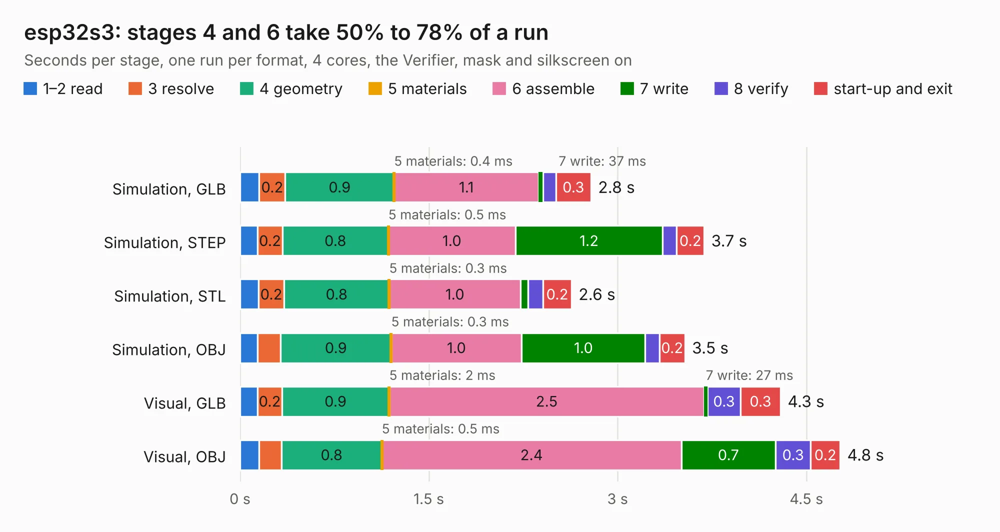

| Mode and format | 1–2 read | 3 resolve | 4 geometry | 5 materials | 6 assemble | 7 write | 8 verify | start-up and exit | Total |
|---|---:|---:|---:|---:|---:|---:|---:|---:|---:|
| Simulation, GLB | 0.2 | 0.2 | 0.9 | 0.4&nbsp;ms | 1.1 | 37&nbsp;ms | 0.1 | 0.3 | 2.8 |
| Simulation, STEP | 0.1 | 0.2 | 0.8 | 0.5&nbsp;ms | 1.0 | 1.2 | 0.1 | 0.2 | 3.7 |
| Simulation, STL | 0.1 | 0.2 | 0.8 | 0.3&nbsp;ms | 1.0 | 58&nbsp;ms | 0.1 | 0.2 | 2.6 |
| Simulation, OBJ | 0.1 | 0.2 | 0.9 | 0.3&nbsp;ms | 1.0 | 1.0 | 0.1 | 0.2 | 3.5 |
| Visual, GLB | 0.1 | 0.2 | 0.9 | 2&nbsp;ms | 2.5 | 27&nbsp;ms | 0.3 | 0.3 | 4.3 |
| Visual, OBJ | 0.1 | 0.2 | 0.8 | 0.5&nbsp;ms | 2.4 | 0.7 | 0.3 | 0.2 | 4.8 |

<table align="center"><tr><td valign="top">

| Board | Repo: [bluejayracing/22xt_kicad](https://github.com/bluejayracing/22xt_kicad) Board: `esp32s3.kicad_pcb` |
|---|---|
| Folder | 02-wsg / esp32s3 |
| Complexity | 106&nbsp;/&nbsp;1000 (size&nbsp;96, features&nbsp;10) |
| KESE&nbsp;features | rounded, trapezoid or chamfered pads |
| Tested | 9th November 2026 |
| Copper&nbsp;layers | 2 |
| File&nbsp;format | KiCad 8 (20240108) |
| Parts,&nbsp;tracks,&nbsp;vias | 36, 0, 0 |
| Triangles,&nbsp;simulation | 181,256 in 76 parts |
| Verifier | PASS in all six runs |

</td><td valign="top">

<table>
<tr><th>File type</th><th>File size</th><th>Peak memory used</th></tr>
<tr><th colspan="3" align="left">Simulation</th></tr>
<tr><td>GLB</td><td align="right">6.5&nbsp;MB</td><td align="right">221&nbsp;MB</td></tr>
<tr><td>STEP</td><td align="right">34&nbsp;MB</td><td align="right">246&nbsp;MB</td></tr>
<tr><td>STL</td><td align="right">9.1&nbsp;MB</td><td align="right">222&nbsp;MB</td></tr>
<tr><td>OBJ</td><td align="right">19&nbsp;MB</td><td align="right">222&nbsp;MB</td></tr>
<tr><th colspan="3" align="left">Visual</th></tr>
<tr><td>GLB</td><td align="right">5.5&nbsp;MB</td><td align="right">242&nbsp;MB</td></tr>
<tr><td>OBJ</td><td align="right">16&nbsp;MB</td><td align="right">237&nbsp;MB</td></tr>
</table>

</td></tr></table>

## 587. W25Q02JVTBIM_breakout

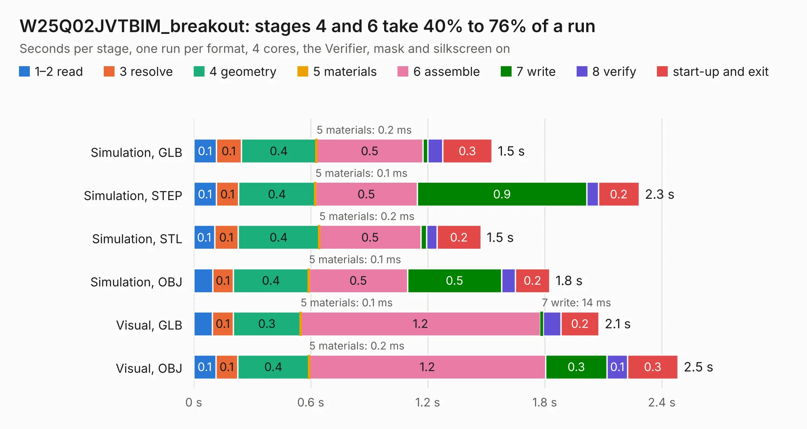

| Mode and format | 1–2 read | 3 resolve | 4 geometry | 5 materials | 6 assemble | 7 write | 8 verify | start-up and exit | Total |
|---|---:|---:|---:|---:|---:|---:|---:|---:|---:|
| Simulation, GLB | 0.1 | 0.1 | 0.4 | 0.2&nbsp;ms | 0.5 | 25&nbsp;ms | 76&nbsp;ms | 0.3 | 1.5 |
| Simulation, STEP | 0.1 | 0.1 | 0.4 | 0.1&nbsp;ms | 0.5 | 0.9 | 60&nbsp;ms | 0.2 | 2.3 |
| Simulation, STL | 0.1 | 0.1 | 0.4 | 0.2&nbsp;ms | 0.5 | 30&nbsp;ms | 52&nbsp;ms | 0.2 | 1.5 |
| Simulation, OBJ | 97&nbsp;ms | 0.1 | 0.4 | 0.1&nbsp;ms | 0.5 | 0.5 | 70&nbsp;ms | 0.2 | 1.8 |
| Visual, GLB | 96&nbsp;ms | 0.1 | 0.3 | 0.1&nbsp;ms | 1.2 | 14&nbsp;ms | 90&nbsp;ms | 0.2 | 2.1 |
| Visual, OBJ | 0.1 | 0.1 | 0.4 | 0.2&nbsp;ms | 1.2 | 0.3 | 0.1 | 0.3 | 2.5 |

<table align="center"><tr><td valign="top">

| Board | Repo: [bluejayracing/22xt_kicad](https://github.com/bluejayracing/22xt_kicad) Board: `W25Q02JVTBIM_breakout.kicad_pcb` |
|---|---|
| Folder | 02-wsg / W25Q02JVTBIM_breakout |
| Complexity | 146&nbsp;/&nbsp;1000 (size&nbsp;101, features&nbsp;45) |
| KESE&nbsp;features | through vias, rounded, trapezoid or chamfered pads, filled zones |
| Tested | 9th November 2026 |
| Copper&nbsp;layers | 2 |
| File&nbsp;format | KiCad 9 (20241229) |
| Parts,&nbsp;tracks,&nbsp;vias | 5, 41, 4 |
| Triangles,&nbsp;simulation | 97,656 in 32 parts |
| Verifier | PASS in all six runs |

</td><td valign="top">

<table>
<tr><th>File type</th><th>File size</th><th>Peak memory used</th></tr>
<tr><th colspan="3" align="left">Simulation</th></tr>
<tr><td>GLB</td><td align="right">3.4&nbsp;MB</td><td align="right">180&nbsp;MB</td></tr>
<tr><td>STEP</td><td align="right">16&nbsp;MB</td><td align="right">190&nbsp;MB</td></tr>
<tr><td>STL</td><td align="right">4.9&nbsp;MB</td><td align="right">186&nbsp;MB</td></tr>
<tr><td>OBJ</td><td align="right">9.5&nbsp;MB</td><td align="right">185&nbsp;MB</td></tr>
<tr><th colspan="3" align="left">Visual</th></tr>
<tr><td>GLB</td><td align="right">2.7&nbsp;MB</td><td align="right">152&nbsp;MB</td></tr>
<tr><td>OBJ</td><td align="right">7.5&nbsp;MB</td><td align="right">153&nbsp;MB</td></tr>
</table>

</td></tr></table>

## 588. WSG_2.0

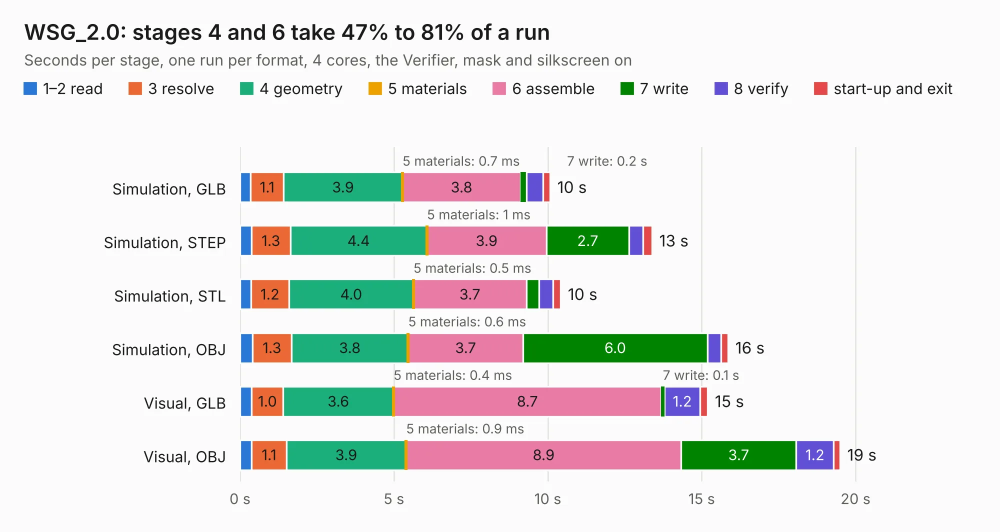

| Mode and format | 1–2 read | 3 resolve | 4 geometry | 5 materials | 6 assemble | 7 write | 8 verify | start-up and exit | Total |
|---|---:|---:|---:|---:|---:|---:|---:|---:|---:|
| Simulation, GLB | 0.3 | 1.1 | 3.9 | 0.7&nbsp;ms | 3.8 | 0.2 | 0.5 | 0.2 | 10.1 |
| Simulation, STEP | 0.4 | 1.3 | 4.4 | 1&nbsp;ms | 3.9 | 2.7 | 0.5 | 0.3 | 13.4 |
| Simulation, STL | 0.4 | 1.2 | 4.0 | 0.5&nbsp;ms | 3.7 | 0.4 | 0.5 | 0.3 | 10.4 |
| Simulation, OBJ | 0.4 | 1.3 | 3.8 | 0.6&nbsp;ms | 3.7 | 6.0 | 0.4 | 0.2 | 15.9 |
| Visual, GLB | 0.4 | 1.0 | 3.6 | 0.4&nbsp;ms | 8.7 | 0.1 | 1.2 | 0.2 | 15.2 |
| Visual, OBJ | 0.4 | 1.1 | 3.9 | 0.9&nbsp;ms | 8.9 | 3.7 | 1.2 | 0.2 | 19.5 |

<table align="center"><tr><td valign="top">

| Board | Repo: [bluejayracing/22xt_kicad](https://github.com/bluejayracing/22xt_kicad) Board: `WSG_2.0.kicad_pcb` |
|---|---|
| Folder | 02-wsg / WSG_2.0 |
| Complexity | 297&nbsp;/&nbsp;1000 (size&nbsp;197, features&nbsp;100) |
| KESE&nbsp;features | through vias, rounded, trapezoid or chamfered pads, arc tracks, filled zones, curved board outline, stack-up, dielectric εr and tanδ |
| Tested | 9th November 2026 |
| Copper&nbsp;layers | 4 |
| File&nbsp;format | KiCad 9 (20241229) |
| Parts,&nbsp;tracks,&nbsp;vias | 86, 654, 164 |
| Triangles,&nbsp;simulation | 983,438 in 94 parts |
| Verifier | PASS in all six runs |

</td><td valign="top">

<table>
<tr><th>File type</th><th>File size</th><th>Peak memory used</th></tr>
<tr><th colspan="3" align="left">Simulation</th></tr>
<tr><td>GLB</td><td align="right">34&nbsp;MB</td><td align="right">427&nbsp;MB</td></tr>
<tr><td>STEP</td><td align="right">132&nbsp;MB</td><td align="right">506&nbsp;MB</td></tr>
<tr><td>STL</td><td align="right">49&nbsp;MB</td><td align="right">416&nbsp;MB</td></tr>
<tr><td>OBJ</td><td align="right">99&nbsp;MB</td><td align="right">704&nbsp;MB</td></tr>
<tr><th colspan="3" align="left">Visual</th></tr>
<tr><td>GLB</td><td align="right">23&nbsp;MB</td><td align="right">526&nbsp;MB</td></tr>
<tr><td>OBJ</td><td align="right">69&nbsp;MB</td><td align="right">580&nbsp;MB</td></tr>
</table>

</td></tr></table>

## 589. TC_kent

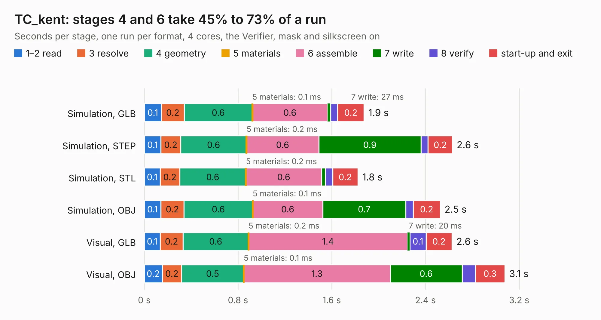

| Mode and format | 1–2 read | 3 resolve | 4 geometry | 5 materials | 6 assemble | 7 write | 8 verify | start-up and exit | Total |
|---|---:|---:|---:|---:|---:|---:|---:|---:|---:|
| Simulation, GLB | 0.1 | 0.2 | 0.6 | 0.1&nbsp;ms | 0.6 | 27&nbsp;ms | 60&nbsp;ms | 0.2 | 1.9 |
| Simulation, STEP | 0.1 | 0.2 | 0.6 | 0.2&nbsp;ms | 0.6 | 0.9 | 61&nbsp;ms | 0.2 | 2.6 |
| Simulation, STL | 0.1 | 0.2 | 0.6 | 0.2&nbsp;ms | 0.6 | 34&nbsp;ms | 60&nbsp;ms | 0.2 | 1.8 |
| Simulation, OBJ | 0.1 | 0.2 | 0.6 | 0.1&nbsp;ms | 0.6 | 0.7 | 64&nbsp;ms | 0.2 | 2.5 |
| Visual, GLB | 0.1 | 0.2 | 0.6 | 0.2&nbsp;ms | 1.4 | 20&nbsp;ms | 0.1 | 0.2 | 2.6 |
| Visual, OBJ | 0.2 | 0.2 | 0.5 | 0.1&nbsp;ms | 1.3 | 0.6 | 0.1 | 0.3 | 3.1 |

<table align="center"><tr><td valign="top">

| Board | Repo: [bluejayracing/22xt_kicad](https://github.com/bluejayracing/22xt_kicad) Board: `TC_kent.kicad_pcb` |
|---|---|
| Folder | 04-dyno_daq / TC_kent |
| Complexity | 162&nbsp;/&nbsp;1000 (size&nbsp;117, features&nbsp;45) |
| KESE&nbsp;features | through vias, rounded, trapezoid or chamfered pads, filled zones |
| Tested | 9th November 2026 |
| Copper&nbsp;layers | 2 |
| File&nbsp;format | KiCad 9 (20241229) |
| Parts,&nbsp;tracks,&nbsp;vias | 9, 44, 19 |
| Triangles,&nbsp;simulation | 129,482 in 20 parts |
| Verifier | PASS in all six runs |

</td><td valign="top">

<table>
<tr><th>File type</th><th>File size</th><th>Peak memory used</th></tr>
<tr><th colspan="3" align="left">Simulation</th></tr>
<tr><td>GLB</td><td align="right">4.5&nbsp;MB</td><td align="right">191&nbsp;MB</td></tr>
<tr><td>STEP</td><td align="right">21&nbsp;MB</td><td align="right">203&nbsp;MB</td></tr>
<tr><td>STL</td><td align="right">6.5&nbsp;MB</td><td align="right">196&nbsp;MB</td></tr>
<tr><td>OBJ</td><td align="right">13&nbsp;MB</td><td align="right">193&nbsp;MB</td></tr>
<tr><th colspan="3" align="left">Visual</th></tr>
<tr><td>GLB</td><td align="right">3.7&nbsp;MB</td><td align="right">158&nbsp;MB</td></tr>
<tr><td>OBJ</td><td align="right">10&nbsp;MB</td><td align="right">158&nbsp;MB</td></tr>
</table>

</td></tr></table>

## 590. TC_shuwen

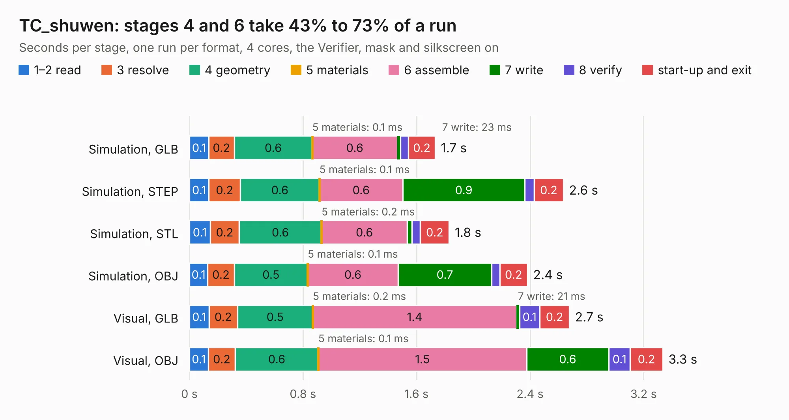

| Mode and format | 1–2 read | 3 resolve | 4 geometry | 5 materials | 6 assemble | 7 write | 8 verify | start-up and exit | Total |
|---|---:|---:|---:|---:|---:|---:|---:|---:|---:|
| Simulation, GLB | 0.1 | 0.2 | 0.6 | 0.1&nbsp;ms | 0.6 | 23&nbsp;ms | 56&nbsp;ms | 0.2 | 1.7 |
| Simulation, STEP | 0.1 | 0.2 | 0.6 | 0.1&nbsp;ms | 0.6 | 0.9 | 65&nbsp;ms | 0.2 | 2.6 |
| Simulation, STL | 0.1 | 0.2 | 0.6 | 0.2&nbsp;ms | 0.6 | 34&nbsp;ms | 58&nbsp;ms | 0.2 | 1.8 |
| Simulation, OBJ | 0.1 | 0.2 | 0.5 | 0.1&nbsp;ms | 0.6 | 0.7 | 57&nbsp;ms | 0.2 | 2.4 |
| Visual, GLB | 0.1 | 0.2 | 0.5 | 0.2&nbsp;ms | 1.4 | 21&nbsp;ms | 0.1 | 0.2 | 2.7 |
| Visual, OBJ | 0.1 | 0.2 | 0.6 | 0.1&nbsp;ms | 1.5 | 0.6 | 0.1 | 0.2 | 3.3 |

<table align="center"><tr><td valign="top">

| Board | Repo: [bluejayracing/22xt_kicad](https://github.com/bluejayracing/22xt_kicad) Board: `TC_shuwen.kicad_pcb` |
|---|---|
| Folder | 04-dyno_daq / TC_shuwen |
| Complexity | 159&nbsp;/&nbsp;1000 (size&nbsp;114, features&nbsp;45) |
| KESE&nbsp;features | through vias, rounded, trapezoid or chamfered pads, filled zones |
| Tested | 9th November 2026 |
| Copper&nbsp;layers | 2 |
| File&nbsp;format | KiCad 9 (20241229) |
| Parts,&nbsp;tracks,&nbsp;vias | 9, 37, 15 |
| Triangles,&nbsp;simulation | 138,080 in 20 parts |
| Verifier | PASS in all six runs |

</td><td valign="top">

<table>
<tr><th>File type</th><th>File size</th><th>Peak memory used</th></tr>
<tr><th colspan="3" align="left">Simulation</th></tr>
<tr><td>GLB</td><td align="right">4.9&nbsp;MB</td><td align="right">201&nbsp;MB</td></tr>
<tr><td>STEP</td><td align="right">23&nbsp;MB</td><td align="right">214&nbsp;MB</td></tr>
<tr><td>STL</td><td align="right">6.9&nbsp;MB</td><td align="right">204&nbsp;MB</td></tr>
<tr><td>OBJ</td><td align="right">14&nbsp;MB</td><td align="right">205&nbsp;MB</td></tr>
<tr><th colspan="3" align="left">Visual</th></tr>
<tr><td>GLB</td><td align="right">4.3&nbsp;MB</td><td align="right">172&nbsp;MB</td></tr>
<tr><td>OBJ</td><td align="right">12&nbsp;MB</td><td align="right">165&nbsp;MB</td></tr>
</table>

</td></tr></table>

## 591. thermistor circuit

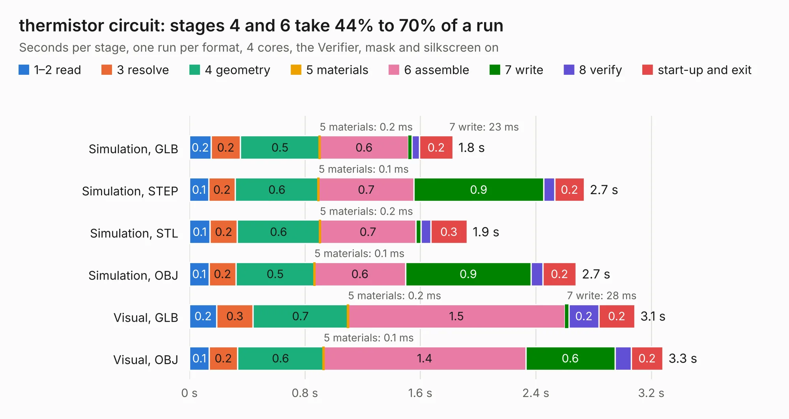

| Mode and format | 1–2 read | 3 resolve | 4 geometry | 5 materials | 6 assemble | 7 write | 8 verify | start-up and exit | Total |
|---|---:|---:|---:|---:|---:|---:|---:|---:|---:|
| Simulation, GLB | 0.2 | 0.2 | 0.5 | 0.2&nbsp;ms | 0.6 | 23&nbsp;ms | 54&nbsp;ms | 0.2 | 1.8 |
| Simulation, STEP | 0.1 | 0.2 | 0.6 | 0.1&nbsp;ms | 0.7 | 0.9 | 79&nbsp;ms | 0.2 | 2.7 |
| Simulation, STL | 0.1 | 0.2 | 0.6 | 0.2&nbsp;ms | 0.7 | 35&nbsp;ms | 67&nbsp;ms | 0.3 | 1.9 |
| Simulation, OBJ | 0.1 | 0.2 | 0.5 | 0.1&nbsp;ms | 0.6 | 0.9 | 81&nbsp;ms | 0.2 | 2.7 |
| Visual, GLB | 0.2 | 0.3 | 0.7 | 0.2&nbsp;ms | 1.5 | 28&nbsp;ms | 0.2 | 0.2 | 3.1 |
| Visual, OBJ | 0.1 | 0.2 | 0.6 | 0.1&nbsp;ms | 1.4 | 0.6 | 0.1 | 0.2 | 3.3 |

<table align="center"><tr><td valign="top">

| Board | Repo: [bluejayracing/22xt_kicad](https://github.com/bluejayracing/22xt_kicad) Board: `thermistor circuit.kicad_pcb` |
|---|---|
| Folder | 04-dyno_daq / THC_su |
| Complexity | 162&nbsp;/&nbsp;1000 (size&nbsp;117, features&nbsp;45) |
| KESE&nbsp;features | through vias, rounded, trapezoid or chamfered pads, filled zones |
| Tested | 9th November 2026 |
| Copper&nbsp;layers | 2 |
| File&nbsp;format | KiCad 9 (20241229) |
| Parts,&nbsp;tracks,&nbsp;vias | 10, 41, 18 |
| Triangles,&nbsp;simulation | 138,102 in 20 parts |
| Verifier | PASS in all six runs |

</td><td valign="top">

<table>
<tr><th>File type</th><th>File size</th><th>Peak memory used</th></tr>
<tr><th colspan="3" align="left">Simulation</th></tr>
<tr><td>GLB</td><td align="right">4.9&nbsp;MB</td><td align="right">200&nbsp;MB</td></tr>
<tr><td>STEP</td><td align="right">23&nbsp;MB</td><td align="right">210&nbsp;MB</td></tr>
<tr><td>STL</td><td align="right">6.9&nbsp;MB</td><td align="right">204&nbsp;MB</td></tr>
<tr><td>OBJ</td><td align="right">14&nbsp;MB</td><td align="right">193&nbsp;MB</td></tr>
<tr><th colspan="3" align="left">Visual</th></tr>
<tr><td>GLB</td><td align="right">4.2&nbsp;MB</td><td align="right">162&nbsp;MB</td></tr>
<tr><td>OBJ</td><td align="right">12&nbsp;MB</td><td align="right">168&nbsp;MB</td></tr>
</table>

</td></tr></table>

## 592. 05-can_encoder

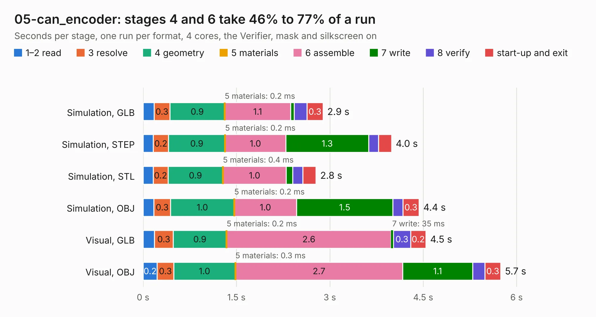

| Mode and format | 1–2 read | 3 resolve | 4 geometry | 5 materials | 6 assemble | 7 write | 8 verify | start-up and exit | Total |
|---|---:|---:|---:|---:|---:|---:|---:|---:|---:|
| Simulation, GLB | 0.2 | 0.3 | 0.9 | 0.2&nbsp;ms | 1.1 | 60&nbsp;ms | 0.2 | 0.3 | 2.9 |
| Simulation, STEP | 0.2 | 0.2 | 0.9 | 0.2&nbsp;ms | 1.0 | 1.3 | 0.2 | 0.2 | 4.0 |
| Simulation, STL | 0.2 | 0.2 | 0.9 | 0.4&nbsp;ms | 1.0 | 0.1 | 0.2 | 0.2 | 2.8 |
| Simulation, OBJ | 0.2 | 0.3 | 1.0 | 0.2&nbsp;ms | 1.0 | 1.5 | 0.2 | 0.3 | 4.4 |
| Visual, GLB | 0.2 | 0.3 | 0.9 | 0.2&nbsp;ms | 2.6 | 35&nbsp;ms | 0.3 | 0.2 | 4.5 |
| Visual, OBJ | 0.2 | 0.3 | 1.0 | 0.3&nbsp;ms | 2.7 | 1.1 | 0.2 | 0.3 | 5.7 |

<table align="center"><tr><td valign="top">

| Board | Repo: [bluejayracing/22xt_kicad](https://github.com/bluejayracing/22xt_kicad) Board: `05-can_encoder.kicad_pcb` |
|---|---|
| Folder | 05-can_encoder |
| Complexity | 194&nbsp;/&nbsp;1000 (size&nbsp;139, features&nbsp;55) |
| KESE&nbsp;features | through vias, rounded, trapezoid or chamfered pads, filled zones, curved board outline |
| Tested | 9th November 2026 |
| Copper&nbsp;layers | 2 |
| File&nbsp;format | KiCad 9 (20241229) |
| Parts,&nbsp;tracks,&nbsp;vias | 20, 175, 20 |
| Triangles,&nbsp;simulation | 239,482 in 64 parts |
| Verifier | PASS in all six runs |

</td><td valign="top">

<table>
<tr><th>File type</th><th>File size</th><th>Peak memory used</th></tr>
<tr><th colspan="3" align="left">Simulation</th></tr>
<tr><td>GLB</td><td align="right">8.4&nbsp;MB</td><td align="right">232&nbsp;MB</td></tr>
<tr><td>STEP</td><td align="right">41&nbsp;MB</td><td align="right">248&nbsp;MB</td></tr>
<tr><td>STL</td><td align="right">12&nbsp;MB</td><td align="right">237&nbsp;MB</td></tr>
<tr><td>OBJ</td><td align="right">24&nbsp;MB</td><td align="right">236&nbsp;MB</td></tr>
<tr><th colspan="3" align="left">Visual</th></tr>
<tr><td>GLB</td><td align="right">6.9&nbsp;MB</td><td align="right">229&nbsp;MB</td></tr>
<tr><td>OBJ</td><td align="right">20&nbsp;MB</td><td align="right">227&nbsp;MB</td></tr>
</table>

</td></tr></table>

## 593. as5047p-atsm_breakout

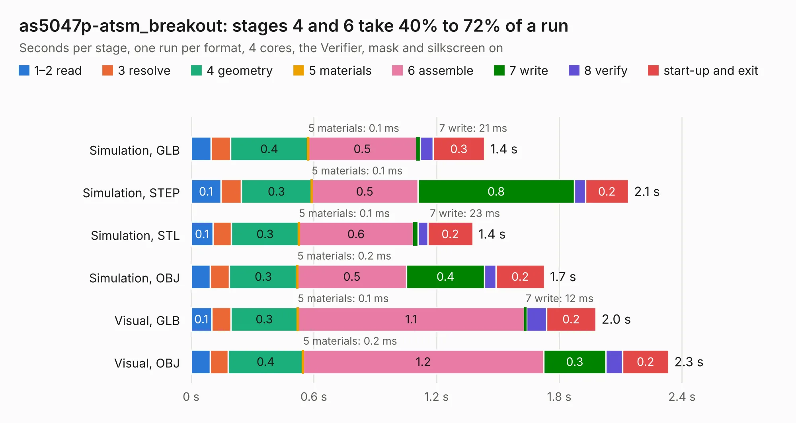

| Mode and format | 1–2 read | 3 resolve | 4 geometry | 5 materials | 6 assemble | 7 write | 8 verify | start-up and exit | Total |
|---|---:|---:|---:|---:|---:|---:|---:|---:|---:|
| Simulation, GLB | 98&nbsp;ms | 94&nbsp;ms | 0.4 | 0.1&nbsp;ms | 0.5 | 21&nbsp;ms | 62&nbsp;ms | 0.3 | 1.4 |
| Simulation, STEP | 0.1 | 99&nbsp;ms | 0.3 | 0.1&nbsp;ms | 0.5 | 0.8 | 53&nbsp;ms | 0.2 | 2.1 |
| Simulation, STL | 0.1 | 90&nbsp;ms | 0.3 | 0.1&nbsp;ms | 0.6 | 23&nbsp;ms | 49&nbsp;ms | 0.2 | 1.4 |
| Simulation, OBJ | 94&nbsp;ms | 93&nbsp;ms | 0.3 | 0.2&nbsp;ms | 0.5 | 0.4 | 56&nbsp;ms | 0.2 | 1.7 |
| Visual, GLB | 0.1 | 94&nbsp;ms | 0.3 | 0.1&nbsp;ms | 1.1 | 12&nbsp;ms | 96&nbsp;ms | 0.2 | 2.0 |
| Visual, OBJ | 93&nbsp;ms | 88&nbsp;ms | 0.4 | 0.2&nbsp;ms | 1.2 | 0.3 | 81&nbsp;ms | 0.2 | 2.3 |

<table align="center"><tr><td valign="top">

| Board | Repo: [bluejayracing/22xt_kicad](https://github.com/bluejayracing/22xt_kicad) Board: `as5047p-atsm_breakout.kicad_pcb` |
|---|---|
| Folder | 05-can_encoder / as5047p-atsm_breakout / as5047p-atsm_breakout |
| Complexity | 149&nbsp;/&nbsp;1000 (size&nbsp;94, features&nbsp;55) |
| KESE&nbsp;features | through vias, rounded, trapezoid or chamfered pads, filled zones, curved board outline |
| Tested | 9th November 2026 |
| Copper&nbsp;layers | 2 |
| File&nbsp;format | KiCad 9 (20241229) |
| Parts,&nbsp;tracks,&nbsp;vias | 4, 25, 4 |
| Triangles,&nbsp;simulation | 78,930 in 23 parts |
| Verifier | PASS in all six runs |

</td><td valign="top">

<table>
<tr><th>File type</th><th>File size</th><th>Peak memory used</th></tr>
<tr><th colspan="3" align="left">Simulation</th></tr>
<tr><td>GLB</td><td align="right">2.7&nbsp;MB</td><td align="right">179&nbsp;MB</td></tr>
<tr><td>STEP</td><td align="right">11&nbsp;MB</td><td align="right">182&nbsp;MB</td></tr>
<tr><td>STL</td><td align="right">3.9&nbsp;MB</td><td align="right">180&nbsp;MB</td></tr>
<tr><td>OBJ</td><td align="right">7.5&nbsp;MB</td><td align="right">172&nbsp;MB</td></tr>
<tr><th colspan="3" align="left">Visual</th></tr>
<tr><td>GLB</td><td align="right">2.1&nbsp;MB</td><td align="right">150&nbsp;MB</td></tr>
<tr><td>OBJ</td><td align="right">5.9&nbsp;MB</td><td align="right">152&nbsp;MB</td></tr>
</table>

</td></tr></table>

## 594. stm32f072cb_breakout

| Mode and format | 1–2 read | 3 resolve | 4 geometry | 5 materials | 6 assemble | 7 write | 8 verify | start-up and exit | Total |
|---|---:|---:|---:|---:|---:|---:|---:|---:|---:|
| Simulation, GLB | 0.1 | 0.3 | 1.0 | 0.2&nbsp;ms | 1.0 | 49&nbsp;ms | 0.2 | 0.2 | 3.0 |
| Simulation, STEP | 0.1 | 0.3 | 1.1 | 0.3&nbsp;ms | 1.1 | 1.2 | 0.2 | 0.2 | 4.3 |
| Simulation, STL | 0.1 | 0.3 | 1.0 | 0.2&nbsp;ms | 1.2 | 89&nbsp;ms | 0.2 | 0.2 | 3.1 |
| Simulation, OBJ | 0.1 | 0.3 | 1.1 | 0.2&nbsp;ms | 1.3 | 1.5 | 0.2 | 0.2 | 4.7 |
| Visual, GLB | 0.2 | 0.3 | 1.1 | 0.3&nbsp;ms | 2.8 | 37&nbsp;ms | 0.3 | 0.3 | 5.0 |
| Visual, OBJ | 0.1 | 0.3 | 1.0 | 0.2&nbsp;ms | 2.5 | 1.1 | 0.3 | 0.3 | 5.7 |

<table align="center"><tr><td valign="top">

| Board | Repo: [bluejayracing/22xt_kicad](https://github.com/bluejayracing/22xt_kicad) Board: `stm32f072cb_breakout.kicad_pcb` |
|---|---|
| Folder | 05-can_encoder / stm32f072cb-breakout / stm32f072cb_breakout |
| Complexity | 233&nbsp;/&nbsp;1000 (size&nbsp;148, features&nbsp;85) |
| KESE&nbsp;features | through vias, rounded, trapezoid or chamfered pads, filled zones, curved board outline, stack-up, dielectric εr and tanδ |
| Tested | 9th November 2026 |
| Copper&nbsp;layers | 4 |
| File&nbsp;format | KiCad 9 (20241229) |
| Parts,&nbsp;tracks,&nbsp;vias | 11, 138, 24 |
| Triangles,&nbsp;simulation | 312,444 in 56 parts |
| Verifier | PASS in all six runs |

</td><td valign="top">

<table>
<tr><th>File type</th><th>File size</th><th>Peak memory used</th></tr>
<tr><th colspan="3" align="left">Simulation</th></tr>
<tr><td>GLB</td><td align="right">11&nbsp;MB</td><td align="right">235&nbsp;MB</td></tr>
<tr><td>STEP</td><td align="right">43&nbsp;MB</td><td align="right">263&nbsp;MB</td></tr>
<tr><td>STL</td><td align="right">16&nbsp;MB</td><td align="right">235&nbsp;MB</td></tr>
<tr><td>OBJ</td><td align="right">31&nbsp;MB</td><td align="right">268&nbsp;MB</td></tr>
<tr><th colspan="3" align="left">Visual</th></tr>
<tr><td>GLB</td><td align="right">7.4&nbsp;MB</td><td align="right">247&nbsp;MB</td></tr>
<tr><td>OBJ</td><td align="right">22&nbsp;MB</td><td align="right">246&nbsp;MB</td></tr>
</table>

</td></tr></table>

## 595. accessory_peripheral

| Mode and format | 1–2 read | 3 resolve | 4 geometry | 5 materials | 6 assemble | 7 write | 8 verify | start-up and exit | Total |
|---|---:|---:|---:|---:|---:|---:|---:|---:|---:|
| Simulation, GLB | 83&nbsp;ms | 65&nbsp;ms | 0.3 | 0.1&nbsp;ms | 0.4 | 12&nbsp;ms | 38&nbsp;ms | 0.2 | 1.1 |
| Simulation, STEP | 70&nbsp;ms | 75&nbsp;ms | 0.3 | 0.1&nbsp;ms | 0.4 | 0.6 | 42&nbsp;ms | 0.2 | 1.7 |
| Simulation, STL | 82&nbsp;ms | 87&nbsp;ms | 0.3 | 0.1&nbsp;ms | 0.4 | 19&nbsp;ms | 51&nbsp;ms | 0.2 | 1.2 |
| Simulation, OBJ | 82&nbsp;ms | 63&nbsp;ms | 0.3 | 0.1&nbsp;ms | 0.4 | 0.3 | 41&nbsp;ms | 0.2 | 1.4 |
| Visual, GLB | 76&nbsp;ms | 62&nbsp;ms | 0.3 | 0.1&nbsp;ms | 0.8 | 8&nbsp;ms | 60&nbsp;ms | 0.2 | 1.5 |
| Visual, OBJ | 72&nbsp;ms | 61&nbsp;ms | 0.3 | 0.1&nbsp;ms | 0.8 | 0.2 | 59&nbsp;ms | 0.2 | 1.6 |

<table align="center"><tr><td valign="top">

| Board | Repo: [bluejayracing/bjr_kicad](https://github.com/bluejayracing/bjr_kicad) Board: `accessory_peripheral.kicad_pcb` |
|---|---|
| Folder | 21xt / 01-accessory / accessory_peripheral / accessory_peripheral |
| Complexity | 126&nbsp;/&nbsp;1000 (size&nbsp;96, features&nbsp;30) |
| KESE&nbsp;features | rounded, trapezoid or chamfered pads, filled zones |
| Tested | 9th November 2026 |
| Copper&nbsp;layers | 2 |
| File&nbsp;format | KiCad 7 (20221018) |
| Parts,&nbsp;tracks,&nbsp;vias | 4, 42, 0 |
| Triangles,&nbsp;simulation | 73,532 in 21 parts |
| Verifier | PASS in all six runs |

</td><td valign="top">

<table>
<tr><th>File type</th><th>File size</th><th>Peak memory used</th></tr>
<tr><th colspan="3" align="left">Simulation</th></tr>
<tr><td>GLB</td><td align="right">2.6&nbsp;MB</td><td align="right">167&nbsp;MB</td></tr>
<tr><td>STEP</td><td align="right">12&nbsp;MB</td><td align="right">176&nbsp;MB</td></tr>
<tr><td>STL</td><td align="right">3.7&nbsp;MB</td><td align="right">170&nbsp;MB</td></tr>
<tr><td>OBJ</td><td align="right">7.1&nbsp;MB</td><td align="right">170&nbsp;MB</td></tr>
<tr><th colspan="3" align="left">Visual</th></tr>
<tr><td>GLB</td><td align="right">1.7&nbsp;MB</td><td align="right">146&nbsp;MB</td></tr>
<tr><td>OBJ</td><td align="right">4.7&nbsp;MB</td><td align="right">151&nbsp;MB</td></tr>
</table>

</td></tr></table>

## 596. accessory_v1

| Mode and format | 1–2 read | 3 resolve | 4 geometry | 5 materials | 6 assemble | 7 write | 8 verify | start-up and exit | Total |
|---|---:|---:|---:|---:|---:|---:|---:|---:|---:|
| Simulation, GLB | 0.4 | 1.7 | 7.8 | 0.7&nbsp;ms | 5.7 | 0.3 | 0.8 | 0.3 | 17.0 |
| Simulation, STEP | 0.5 | 1.9 | 8.8 | 1&nbsp;ms | 6.0 | 4.9 | 0.9 | 0.3 | 23.2 |
| Simulation, STL | 0.4 | 1.8 | 8.0 | 0.7&nbsp;ms | 6.1 | 0.6 | 0.9 | 0.3 | 18.0 |
| Simulation, OBJ | 0.4 | 1.9 | 8.3 | 1&nbsp;ms | 6.1 | 10.2 | 1.0 | 0.3 | 28.2 |
| Visual, GLB | 0.4 | 1.9 | 8.2 | 0.7&nbsp;ms | 11.7 | 0.1 | 1.1 | 0.3 | 23.7 |
| Visual, OBJ | 0.5 | 1.8 | 8.2 | 0.9&nbsp;ms | 11.8 | 5.2 | 1.3 | 0.3 | 29.1 |

<table align="center"><tr><td valign="top">

| Board | Repo: [bluejayracing/bjr_kicad](https://github.com/bluejayracing/bjr_kicad) Board: `accessory_v1.kicad_pcb` |
|---|---|
| Folder | 21xt / 01-accessory / accessory_v1 |
| Complexity | 320&nbsp;/&nbsp;1000 (size&nbsp;235, features&nbsp;85) |
| KESE&nbsp;features | through vias, rounded, trapezoid or chamfered pads, filled zones, copper drawings, stack-up, dielectric εr and tanδ |
| Tested | 9th November 2026 |
| Copper&nbsp;layers | 4 |
| File&nbsp;format | KiCad 7 (20221018) |
| Parts,&nbsp;tracks,&nbsp;vias | 72, 851, 97 |
| Triangles,&nbsp;simulation | 1,732,066 in 178 parts |
| Verifier | PASS in all six runs |

</td><td valign="top">

<table>
<tr><th>File type</th><th>File size</th><th>Peak memory used</th></tr>
<tr><th colspan="3" align="left">Simulation</th></tr>
<tr><td>GLB</td><td align="right">59&nbsp;MB</td><td align="right">609&nbsp;MB</td></tr>
<tr><td>STEP</td><td align="right">236&nbsp;MB</td><td align="right">667&nbsp;MB</td></tr>
<tr><td>STL</td><td align="right">87&nbsp;MB</td><td align="right">595&nbsp;MB</td></tr>
<tr><td>OBJ</td><td align="right">180&nbsp;MB</td><td align="right">1.2&nbsp;GB</td></tr>
<tr><th colspan="3" align="left">Visual</th></tr>
<tr><td>GLB</td><td align="right">30&nbsp;MB</td><td align="right">657&nbsp;MB</td></tr>
<tr><td>OBJ</td><td align="right">90&nbsp;MB</td><td align="right">702&nbsp;MB</td></tr>
</table>

</td></tr></table>

## 597. accessory_v2

| Mode and format | 1–2 read | 3 resolve | 4 geometry | 5 materials | 6 assemble | 7 write | 8 verify | start-up and exit | Total |
|---|---:|---:|---:|---:|---:|---:|---:|---:|---:|
| Simulation, GLB | 0.5 | 1.4 | 4.5 | 0.7&nbsp;ms | 5.5 | 0.2 | 0.6 | 0.3 | 12.9 |
| Simulation, STEP | 0.5 | 1.4 | 4.5 | 0.7&nbsp;ms | 5.6 | 4.0 | 0.6 | 0.3 | 16.8 |
| Simulation, STL | 0.4 | 1.4 | 4.5 | 0.6&nbsp;ms | 5.5 | 0.6 | 0.7 | 0.2 | 13.3 |
| Simulation, OBJ | 0.5 | 1.3 | 4.6 | 0.6&nbsp;ms | 5.4 | 7.4 | 0.6 | 0.2 | 20.1 |
| Visual, GLB | 0.5 | 1.3 | 4.5 | 0.6&nbsp;ms | 12.6 | 0.1 | 1.3 | 0.2 | 20.5 |
| Visual, OBJ | 0.5 | 1.3 | 4.6 | 2&nbsp;ms | 12.4 | 4.8 | 1.7 | 0.2 | 25.5 |

<table align="center"><tr><td valign="top">

| Board | Repo: [bluejayracing/bjr_kicad](https://github.com/bluejayracing/bjr_kicad) Board: `accessory_v2.kicad_pcb` |
|---|---|
| Folder | 21xt / 01-accessory / accessory_v2 |
| Complexity | 311&nbsp;/&nbsp;1000 (size&nbsp;211, features&nbsp;100) |
| KESE&nbsp;features | through vias, rounded, trapezoid or chamfered pads, arc tracks, filled zones, curved board outline, stack-up, dielectric εr and tanδ |
| Tested | 9th November 2026 |
| Copper&nbsp;layers | 4 |
| File&nbsp;format | KiCad 8 (20240108) |
| Parts,&nbsp;tracks,&nbsp;vias | 146, 1,346, 195 |
| Triangles,&nbsp;simulation | 1,800,918 in 169 parts |
| Verifier | PASS in all six runs |

</td><td valign="top">

<table>
<tr><th>File type</th><th>File size</th><th>Peak memory used</th></tr>
<tr><th colspan="3" align="left">Simulation</th></tr>
<tr><td>GLB</td><td align="right">61&nbsp;MB</td><td align="right">623&nbsp;MB</td></tr>
<tr><td>STEP</td><td align="right">264&nbsp;MB</td><td align="right">772&nbsp;MB</td></tr>
<tr><td>STL</td><td align="right">90&nbsp;MB</td><td align="right">679&nbsp;MB</td></tr>
<tr><td>OBJ</td><td align="right">186&nbsp;MB</td><td align="right">1.2&nbsp;GB</td></tr>
<tr><th colspan="3" align="left">Visual</th></tr>
<tr><td>GLB</td><td align="right">40&nbsp;MB</td><td align="right">889&nbsp;MB</td></tr>
<tr><td>OBJ</td><td align="right">121&nbsp;MB</td><td align="right">912&nbsp;MB</td></tr>
</table>

</td></tr></table>

## 598. ad5689r

| Mode and format | 1–2 read | 3 resolve | 4 geometry | 5 materials | 6 assemble | 7 write | 8 verify | start-up and exit | Total |
|---|---:|---:|---:|---:|---:|---:|---:|---:|---:|
| Simulation, GLB | 81&nbsp;ms | 76&nbsp;ms | 0.4 | 0.2&nbsp;ms | 0.5 | 17&nbsp;ms | 84&nbsp;ms | 0.2 | 1.3 |
| Simulation, STEP | 80&nbsp;ms | 79&nbsp;ms | 0.4 | 0.1&nbsp;ms | 0.5 | 0.7 | 59&nbsp;ms | 0.2 | 2.1 |
| Simulation, STL | 84&nbsp;ms | 78&nbsp;ms | 0.4 | 0.1&nbsp;ms | 0.5 | 26&nbsp;ms | 56&nbsp;ms | 0.2 | 1.3 |
| Simulation, OBJ | 85&nbsp;ms | 92&nbsp;ms | 0.4 | 0.1&nbsp;ms | 0.5 | 0.4 | 64&nbsp;ms | 0.2 | 1.8 |
| Visual, GLB | 81&nbsp;ms | 77&nbsp;ms | 0.4 | 0.1&nbsp;ms | 1.1 | 11&nbsp;ms | 83&nbsp;ms | 0.2 | 2.0 |
| Visual, OBJ | 82&nbsp;ms | 75&nbsp;ms | 0.4 | 0.1&nbsp;ms | 1.1 | 0.3 | 79&nbsp;ms | 0.2 | 2.2 |

<table align="center"><tr><td valign="top">

| Board | Repo: [bluejayracing/bjr_kicad](https://github.com/bluejayracing/bjr_kicad) Board: `ad5689r.kicad_pcb` |
|---|---|
| Folder | 21xt / 01-accessory / ad5689r |
| Complexity | 153&nbsp;/&nbsp;1000 (size&nbsp;108, features&nbsp;45) |
| KESE&nbsp;features | through vias, rounded, trapezoid or chamfered pads, filled zones |
| Tested | 9th November 2026 |
| Copper&nbsp;layers | 2 |
| File&nbsp;format | KiCad 7 (20221018) |
| Parts,&nbsp;tracks,&nbsp;vias | 6, 63, 3 |
| Triangles,&nbsp;simulation | 108,038 in 24 parts |
| Verifier | PASS in all six runs |

</td><td valign="top">

<table>
<tr><th>File type</th><th>File size</th><th>Peak memory used</th></tr>
<tr><th colspan="3" align="left">Simulation</th></tr>
<tr><td>GLB</td><td align="right">3.8&nbsp;MB</td><td align="right">188&nbsp;MB</td></tr>
<tr><td>STEP</td><td align="right">19&nbsp;MB</td><td align="right">190&nbsp;MB</td></tr>
<tr><td>STL</td><td align="right">5.4&nbsp;MB</td><td align="right">179&nbsp;MB</td></tr>
<tr><td>OBJ</td><td align="right">11&nbsp;MB</td><td align="right">186&nbsp;MB</td></tr>
<tr><th colspan="3" align="left">Visual</th></tr>
<tr><td>GLB</td><td align="right">2.4&nbsp;MB</td><td align="right">156&nbsp;MB</td></tr>
<tr><td>OBJ</td><td align="right">6.6&nbsp;MB</td><td align="right">151&nbsp;MB</td></tr>
</table>

</td></tr></table>

## 599. accessoryidk

| Mode and format | 1–2 read | 3 resolve | 4 geometry | 5 materials | 6 assemble | 7 write | 8 verify | start-up and exit | Total |
|---|---:|---:|---:|---:|---:|---:|---:|---:|---:|
| Simulation, GLB | 0.5 | 1.7 | 8.9 | 2&nbsp;ms | 6.7 | 0.3 | 1.0 | 0.3 | 19.4 |
| Simulation, STEP | 0.4 | 1.8 | 8.5 | 1&nbsp;ms | 6.0 | 4.8 | 1.0 | 0.3 | 22.7 |
| Simulation, STL | 0.5 | 1.7 | 8.3 | 1&nbsp;ms | 6.4 | 0.6 | 0.9 | 0.3 | 18.7 |
| Simulation, OBJ | 0.5 | 1.8 | 9.1 | 1&nbsp;ms | 6.6 | 11.2 | 1.0 | 0.3 | 30.4 |
| Visual, GLB | 0.4 | 1.6 | 9.3 | 1&nbsp;ms | 15.4 | 0.2 | 1.4 | 0.2 | 28.5 |
| Visual, OBJ | 0.6 | 1.8 | 8.4 | 0.8&nbsp;ms | 12.3 | 5.4 | 1.7 | 0.3 | 30.6 |

<table align="center"><tr><td valign="top">

| Board | Repo: [bluejayracing/bjr_kicad](https://github.com/bluejayracing/bjr_kicad) Board: `accessoryidk.kicad_pcb` |
|---|---|
| Folder | 21xt / 02-mainbox / bjr_kicad_aaren_copy / 21xt / 01-accessory / accessoryidk |
| Complexity | 321&nbsp;/&nbsp;1000 (size&nbsp;236, features&nbsp;85) |
| KESE&nbsp;features | through vias, rounded, trapezoid or chamfered pads, filled zones, copper drawings, stack-up, dielectric εr and tanδ |
| Tested | 9th November 2026 |
| Copper&nbsp;layers | 4 |
| File&nbsp;format | KiCad 7 (20221018) |
| Parts,&nbsp;tracks,&nbsp;vias | 75, 851, 97 |
| Triangles,&nbsp;simulation | 1,736,020 in 176 parts |
| Verifier | PASS in all six runs |

</td><td valign="top">

<table>
<tr><th>File type</th><th>File size</th><th>Peak memory used</th></tr>
<tr><th colspan="3" align="left">Simulation</th></tr>
<tr><td>GLB</td><td align="right">59&nbsp;MB</td><td align="right">619&nbsp;MB</td></tr>
<tr><td>STEP</td><td align="right">238&nbsp;MB</td><td align="right">680&nbsp;MB</td></tr>
<tr><td>STL</td><td align="right">87&nbsp;MB</td><td align="right">607&nbsp;MB</td></tr>
<tr><td>OBJ</td><td align="right">180&nbsp;MB</td><td align="right">1.2&nbsp;GB</td></tr>
<tr><th colspan="3" align="left">Visual</th></tr>
<tr><td>GLB</td><td align="right">30&nbsp;MB</td><td align="right">684&nbsp;MB</td></tr>
<tr><td>OBJ</td><td align="right">90&nbsp;MB</td><td align="right">747&nbsp;MB</td></tr>
</table>

</td></tr></table>

## 600. mainbox1.0

| Mode and format | 1–2 read | 3 resolve | 4 geometry | 5 materials | 6 assemble | 7 write | 8 verify | start-up and exit | Total |
|---|---:|---:|---:|---:|---:|---:|---:|---:|---:|
| Simulation, GLB | 0.4 | 1.3 | 5.4 | 0.9&nbsp;ms | 7.0 | 0.3 | 0.8 | 0.3 | 15.4 |
| Simulation, STEP | 0.4 | 1.3 | 5.3 | 0.6&nbsp;ms | 6.9 | 4.3 | 0.8 | 0.3 | 19.3 |
| Simulation, STL | 0.4 | 1.4 | 5.4 | 1&nbsp;ms | 6.6 | 0.4 | 0.7 | 0.3 | 15.4 |
| Simulation, OBJ | 0.5 | 1.3 | 5.2 | 0.6&nbsp;ms | 6.5 | 7.4 | 0.8 | 0.2 | 21.9 |
| Visual, GLB | 0.4 | 1.4 | 5.2 | 0.7&nbsp;ms | 11.2 | 0.1 | 1.1 | 0.3 | 19.7 |
| Visual, OBJ | 0.4 | 1.3 | 5.2 | 0.9&nbsp;ms | 11.7 | 4.5 | 1.2 | 0.3 | 24.7 |

<table align="center"><tr><td valign="top">

| Board | Repo: [bluejayracing/bjr_kicad](https://github.com/bluejayracing/bjr_kicad) Board: `mainbox1.0.kicad_pcb` |
|---|---|
| Folder | 21xt / 02-mainbox / bjr_kicad_aaren_copy / 21xt / 02-mainbox / mainbox1.0 |
| Complexity | 318&nbsp;/&nbsp;1000 (size&nbsp;233, features&nbsp;85) |
| KESE&nbsp;features | through vias, rounded, trapezoid or chamfered pads, filled zones, curved board outline, stack-up, dielectric εr and tanδ |
| Tested | 9th November 2026 |
| Copper&nbsp;layers | 4 |
| File&nbsp;format | KiCad 7 (20221018) |
| Parts,&nbsp;tracks,&nbsp;vias | 58, 804, 111 |
| Triangles,&nbsp;simulation | 1,389,196 in 142 parts |
| Verifier | PASS in all six runs |

</td><td valign="top">

<table>
<tr><th>File type</th><th>File size</th><th>Peak memory used</th></tr>
<tr><th colspan="3" align="left">Simulation</th></tr>
<tr><td>GLB</td><td align="right">47&nbsp;MB</td><td align="right">549&nbsp;MB</td></tr>
<tr><td>STEP</td><td align="right">206&nbsp;MB</td><td align="right">625&nbsp;MB</td></tr>
<tr><td>STL</td><td align="right">69&nbsp;MB</td><td align="right">548&nbsp;MB</td></tr>
<tr><td>OBJ</td><td align="right">143&nbsp;MB</td><td align="right">959&nbsp;MB</td></tr>
<tr><th colspan="3" align="left">Visual</th></tr>
<tr><td>GLB</td><td align="right">29&nbsp;MB</td><td align="right">750&nbsp;MB</td></tr>
<tr><td>OBJ</td><td align="right">89&nbsp;MB</td><td align="right">747&nbsp;MB</td></tr>
</table>

</td></tr></table>

## 601. mainbox2.0

| Mode and format | 1–2 read | 3 resolve | 4 geometry | 5 materials | 6 assemble | 7 write | 8 verify | start-up and exit | Total |
|---|---:|---:|---:|---:|---:|---:|---:|---:|---:|
| Simulation, GLB | 0.5 | 1.3 | 4.2 | 0.6&nbsp;ms | 4.2 | 0.2 | 0.7 | 0.3 | 11.3 |
| Simulation, STEP | 0.6 | 1.2 | 4.0 | 0.5&nbsp;ms | 4.5 | 4.0 | 0.6 | 0.3 | 15.3 |
| Simulation, STL | 0.5 | 1.4 | 4.0 | 0.8&nbsp;ms | 4.1 | 0.3 | 0.7 | 0.3 | 11.1 |
| Simulation, OBJ | 0.5 | 1.2 | 4.0 | 0.5&nbsp;ms | 4.0 | 5.4 | 0.7 | 0.2 | 16.0 |
| Visual, GLB | 0.6 | 1.2 | 4.3 | 0.5&nbsp;ms | 8.3 | 0.1 | 0.8 | 0.3 | 15.7 |
| Visual, OBJ | 0.6 | 1.4 | 3.8 | 0.9&nbsp;ms | 9.0 | 4.1 | 0.8 | 0.3 | 20.0 |

<table align="center"><tr><td valign="top">

| Board | Repo: [bluejayracing/bjr_kicad](https://github.com/bluejayracing/bjr_kicad) Board: `mainbox2.0.kicad_pcb` |
|---|---|
| Folder | 21xt / 02-mainbox / bjr_kicad_aaren_copy / 21xt / 02-mainbox / mainbox2.0 |
| Complexity | 270&nbsp;/&nbsp;1000 (size&nbsp;185, features&nbsp;85) |
| KESE&nbsp;features | through vias, rounded, trapezoid or chamfered pads, filled zones, curved board outline, stack-up, dielectric εr and tanδ |
| Tested | 9th November 2026 |
| Copper&nbsp;layers | 4 |
| File&nbsp;format | KiCad 7 (20221018) |
| Parts,&nbsp;tracks,&nbsp;vias | 63, 520, 55 |
| Triangles,&nbsp;simulation | 875,582 in 126 parts |
| Verifier | PASS in all six runs |

</td><td valign="top">

<table>
<tr><th>File type</th><th>File size</th><th>Peak memory used</th></tr>
<tr><th colspan="3" align="left">Simulation</th></tr>
<tr><td>GLB</td><td align="right">30&nbsp;MB</td><td align="right">416&nbsp;MB</td></tr>
<tr><td>STEP</td><td align="right">153&nbsp;MB</td><td align="right">510&nbsp;MB</td></tr>
<tr><td>STL</td><td align="right">44&nbsp;MB</td><td align="right">417&nbsp;MB</td></tr>
<tr><td>OBJ</td><td align="right">89&nbsp;MB</td><td align="right">640&nbsp;MB</td></tr>
<tr><th colspan="3" align="left">Visual</th></tr>
<tr><td>GLB</td><td align="right">21&nbsp;MB</td><td align="right">555&nbsp;MB</td></tr>
<tr><td>OBJ</td><td align="right">63&nbsp;MB</td><td align="right">562&nbsp;MB</td></tr>
</table>

</td></tr></table>

## 602. mainbox2.0_sophie

| Mode and format | 1–2 read | 3 resolve | 4 geometry | 5 materials | 6 assemble | 7 write | 8 verify | start-up and exit | Total |
|---|---:|---:|---:|---:|---:|---:|---:|---:|---:|
| Simulation, GLB | 0.4 | 0.7 | 2.9 | 0.5&nbsp;ms | 2.6 | 0.1 | 0.4 | 0.2 | 7.4 |
| Simulation, STEP | 0.4 | 0.7 | 2.9 | 0.4&nbsp;ms | 2.7 | 2.7 | 0.4 | 0.2 | 10.1 |
| Simulation, STL | 0.4 | 0.7 | 2.8 | 0.5&nbsp;ms | 2.5 | 0.2 | 0.3 | 0.2 | 7.3 |
| Simulation, OBJ | 0.5 | 0.8 | 2.8 | 0.7&nbsp;ms | 2.5 | 3.9 | 0.4 | 0.2 | 11.2 |
| Visual, GLB | 0.5 | 0.8 | 2.9 | 0.7&nbsp;ms | 6.1 | 73&nbsp;ms | 0.6 | 0.2 | 11.1 |
| Visual, OBJ | 0.5 | 0.8 | 2.8 | 0.6&nbsp;ms | 6.3 | 2.7 | 0.6 | 0.2 | 13.8 |

<table align="center"><tr><td valign="top">

| Board | Repo: [bluejayracing/bjr_kicad](https://github.com/bluejayracing/bjr_kicad) Board: `mainbox2.0_sophie.kicad_pcb` |
|---|---|
| Folder | 21xt / 02-mainbox / bjr_kicad_aaren_copy / 21xt / 02-mainbox / mainbox2.0 |
| Complexity | 150&nbsp;/&nbsp;1000 (size&nbsp;80, features&nbsp;70) |
| KESE&nbsp;features | rounded, trapezoid or chamfered pads, filled zones, copper text, stack-up, dielectric εr and tanδ |
| Tested | 9th November 2026 |
| Copper&nbsp;layers | 4 |
| File&nbsp;format | KiCad 7 (20221018) |
| Parts,&nbsp;tracks,&nbsp;vias | 75, 0, 0 |
| Triangles,&nbsp;simulation | 751,698 in 182 parts |
| Note | mostly unrouted |
| Verifier | PASS in all six runs |

</td><td valign="top">

<table>
<tr><th>File type</th><th>File size</th><th>Peak memory used</th></tr>
<tr><th colspan="3" align="left">Simulation</th></tr>
<tr><td>GLB</td><td align="right">25&nbsp;MB</td><td align="right">384&nbsp;MB</td></tr>
<tr><td>STEP</td><td align="right">121&nbsp;MB</td><td align="right">447&nbsp;MB</td></tr>
<tr><td>STL</td><td align="right">38&nbsp;MB</td><td align="right">385&nbsp;MB</td></tr>
<tr><td>OBJ</td><td align="right">76&nbsp;MB</td><td align="right">543&nbsp;MB</td></tr>
<tr><th colspan="3" align="left">Visual</th></tr>
<tr><td>GLB</td><td align="right">18&nbsp;MB</td><td align="right">457&nbsp;MB</td></tr>
<tr><td>OBJ</td><td align="right">54&nbsp;MB</td><td align="right">464&nbsp;MB</td></tr>
</table>

</td></tr></table>

## 603. AD5626_Breakout

| Mode and format | 1–2 read | 3 resolve | 4 geometry | 5 materials | 6 assemble | 7 write | 8 verify | start-up and exit | Total |
|---|---:|---:|---:|---:|---:|---:|---:|---:|---:|
| Simulation, GLB | 86&nbsp;ms | 83&nbsp;ms | 0.3 | 0.1&nbsp;ms | 0.6 | 15&nbsp;ms | 52&nbsp;ms | 0.2 | 1.3 |
| Simulation, STEP | 87&nbsp;ms | 83&nbsp;ms | 0.3 | 0.1&nbsp;ms | 0.4 | 0.8 | 58&nbsp;ms | 0.2 | 2.0 |
| Simulation, STL | 90&nbsp;ms | 88&nbsp;ms | 0.3 | 0.1&nbsp;ms | 0.5 | 38&nbsp;ms | 52&nbsp;ms | 0.2 | 1.3 |
| Simulation, OBJ | 83&nbsp;ms | 0.1 | 0.4 | 0.3&nbsp;ms | 0.5 | 0.3 | 47&nbsp;ms | 0.2 | 1.7 |
| Visual, GLB | 81&nbsp;ms | 83&nbsp;ms | 0.3 | 0.1&nbsp;ms | 1.0 | 16&nbsp;ms | 0.1 | 0.2 | 1.9 |
| Visual, OBJ | 88&nbsp;ms | 92&nbsp;ms | 0.4 | 0.1&nbsp;ms | 1.1 | 0.3 | 84&nbsp;ms | 0.3 | 2.3 |

<table align="center"><tr><td valign="top">

| Board | Repo: [bluejayracing/bjr_kicad](https://github.com/bluejayracing/bjr_kicad) Board: `AD5626_Breakout.kicad_pcb` |
|---|---|
| Folder | 21xt / 02-mainbox / bjr_kicad_aaren_copy / 21xt / 03-wireless_strain_gauge / AD5626_Breakout |
| Complexity | 149&nbsp;/&nbsp;1000 (size&nbsp;104, features&nbsp;45) |
| KESE&nbsp;features | through vias, rounded, trapezoid or chamfered pads, filled zones |
| Tested | 9th November 2026 |
| Copper&nbsp;layers | 2 |
| File&nbsp;format | KiCad 7 (20221018) |
| Parts,&nbsp;tracks,&nbsp;vias | 4, 54, 6 |
| Triangles,&nbsp;simulation | 79,746 in 19 parts |
| Verifier | PASS in all six runs |

</td><td valign="top">

<table>
<tr><th>File type</th><th>File size</th><th>Peak memory used</th></tr>
<tr><th colspan="3" align="left">Simulation</th></tr>
<tr><td>GLB</td><td align="right">2.8&nbsp;MB</td><td align="right">173&nbsp;MB</td></tr>
<tr><td>STEP</td><td align="right">12&nbsp;MB</td><td align="right">182&nbsp;MB</td></tr>
<tr><td>STL</td><td align="right">4.0&nbsp;MB</td><td align="right">175&nbsp;MB</td></tr>
<tr><td>OBJ</td><td align="right">7.6&nbsp;MB</td><td align="right">174&nbsp;MB</td></tr>
<tr><th colspan="3" align="left">Visual</th></tr>
<tr><td>GLB</td><td align="right">2.0&nbsp;MB</td><td align="right">152&nbsp;MB</td></tr>
<tr><td>OBJ</td><td align="right">5.6&nbsp;MB</td><td align="right">151&nbsp;MB</td></tr>
</table>

</td></tr></table>

## 604. wsg1.0

| Mode and format | 1–2 read | 3 resolve | 4 geometry | 5 materials | 6 assemble | 7 write | 8 verify | start-up and exit | Total |
|---|---:|---:|---:|---:|---:|---:|---:|---:|---:|
| Simulation, GLB | 0.2 | 0.5 | 2.1 | 0.3&nbsp;ms | 1.9 | 0.1 | 0.3 | 0.3 | 5.4 |
| Simulation, STEP | 0.3 | 0.5 | 2.0 | 0.2&nbsp;ms | 1.8 | 1.8 | 0.3 | 0.2 | 6.9 |
| Simulation, STL | 0.2 | 0.5 | 2.0 | 0.2&nbsp;ms | 1.8 | 0.2 | 0.3 | 0.2 | 5.2 |
| Simulation, OBJ | 0.2 | 0.5 | 2.2 | 0.2&nbsp;ms | 1.9 | 2.8 | 0.3 | 0.2 | 8.2 |
| Visual, GLB | 0.2 | 0.4 | 2.1 | 0.5&nbsp;ms | 4.6 | 53&nbsp;ms | 0.4 | 0.2 | 8.0 |
| Visual, OBJ | 0.2 | 0.4 | 2.2 | 0.4&nbsp;ms | 4.3 | 1.6 | 0.5 | 0.2 | 9.5 |

<table align="center"><tr><td valign="top">

| Board | Repo: [bluejayracing/bjr_kicad](https://github.com/bluejayracing/bjr_kicad) Board: `wsg1.0.kicad_pcb` |
|---|---|
| Folder | 21xt / 02-mainbox / bjr_kicad_aaren_copy / 21xt / 03-wireless_strain_gauge / wsg1.0 |
| Complexity | 249&nbsp;/&nbsp;1000 (size&nbsp;174, features&nbsp;75) |
| KESE&nbsp;features | through vias, rounded, trapezoid or chamfered pads, filled zones, stack-up, dielectric εr and tanδ |
| Tested | 9th November 2026 |
| Copper&nbsp;layers | 4 |
| File&nbsp;format | KiCad 7 (20221018) |
| Parts,&nbsp;tracks,&nbsp;vias | 36, 267, 71 |
| Triangles,&nbsp;simulation | 600,312 in 49 parts |
| Verifier | PASS in all six runs |

</td><td valign="top">

<table>
<tr><th>File type</th><th>File size</th><th>Peak memory used</th></tr>
<tr><th colspan="3" align="left">Simulation</th></tr>
<tr><td>GLB</td><td align="right">21&nbsp;MB</td><td align="right">332&nbsp;MB</td></tr>
<tr><td>STEP</td><td align="right">80&nbsp;MB</td><td align="right">349&nbsp;MB</td></tr>
<tr><td>STL</td><td align="right">30&nbsp;MB</td><td align="right">344&nbsp;MB</td></tr>
<tr><td>OBJ</td><td align="right">61&nbsp;MB</td><td align="right">443&nbsp;MB</td></tr>
<tr><th colspan="3" align="left">Visual</th></tr>
<tr><td>GLB</td><td align="right">12&nbsp;MB</td><td align="right">351&nbsp;MB</td></tr>
<tr><td>OBJ</td><td align="right">36&nbsp;MB</td><td align="right">354&nbsp;MB</td></tr>
</table>

</td></tr></table>

## 605. mainbox1.0

| Mode and format | 1–2 read | 3 resolve | 4 geometry | 5 materials | 6 assemble | 7 write | 8 verify | start-up and exit | Total |
|---|---:|---:|---:|---:|---:|---:|---:|---:|---:|
| Simulation, GLB | 0.4 | 1.6 | 5.8 | 0.7&nbsp;ms | 7.0 | 0.3 | 0.8 | 0.3 | 16.1 |
| Simulation, STEP | 0.4 | 1.5 | 5.8 | 1&nbsp;ms | 7.9 | 4.6 | 0.9 | 0.3 | 21.4 |
| Simulation, STL | 0.4 | 1.5 | 5.8 | 0.6&nbsp;ms | 7.4 | 0.4 | 0.8 | 0.3 | 16.5 |
| Simulation, OBJ | 0.4 | 1.4 | 5.7 | 0.8&nbsp;ms | 7.2 | 8.6 | 0.8 | 0.3 | 24.4 |
| Visual, GLB | 0.4 | 1.3 | 6.3 | 0.9&nbsp;ms | 11.6 | 0.1 | 1.1 | 0.3 | 21.2 |
| Visual, OBJ | 0.5 | 1.5 | 6.0 | 0.8&nbsp;ms | 13.3 | 5.8 | 1.1 | 0.3 | 28.5 |

<table align="center"><tr><td valign="top">

| Board | Repo: [bluejayracing/bjr_kicad](https://github.com/bluejayracing/bjr_kicad) Board: `mainbox1.0.kicad_pcb` |
|---|---|
| Folder | 21xt / 02-mainbox / mainbox1.0 |
| Complexity | 318&nbsp;/&nbsp;1000 (size&nbsp;233, features&nbsp;85) |
| KESE&nbsp;features | through vias, rounded, trapezoid or chamfered pads, filled zones, curved board outline, stack-up, dielectric εr and tanδ |
| Tested | 9th November 2026 |
| Copper&nbsp;layers | 4 |
| File&nbsp;format | KiCad 7 (20221018) |
| Parts,&nbsp;tracks,&nbsp;vias | 58, 804, 111 |
| Triangles,&nbsp;simulation | 1,389,196 in 142 parts |
| Verifier | PASS in all six runs |

</td><td valign="top">

<table>
<tr><th>File type</th><th>File size</th><th>Peak memory used</th></tr>
<tr><th colspan="3" align="left">Simulation</th></tr>
<tr><td>GLB</td><td align="right">47&nbsp;MB</td><td align="right">543&nbsp;MB</td></tr>
<tr><td>STEP</td><td align="right">206&nbsp;MB</td><td align="right">629&nbsp;MB</td></tr>
<tr><td>STL</td><td align="right">69&nbsp;MB</td><td align="right">548&nbsp;MB</td></tr>
<tr><td>OBJ</td><td align="right">143&nbsp;MB</td><td align="right">972&nbsp;MB</td></tr>
<tr><th colspan="3" align="left">Visual</th></tr>
<tr><td>GLB</td><td align="right">29&nbsp;MB</td><td align="right">675&nbsp;MB</td></tr>
<tr><td>OBJ</td><td align="right">89&nbsp;MB</td><td align="right">758&nbsp;MB</td></tr>
</table>

</td></tr></table>

## 606. mainbox2.0

| Mode and format | 1–2 read | 3 resolve | 4 geometry | 5 materials | 6 assemble | 7 write | 8 verify | start-up and exit | Total |
|---|---:|---:|---:|---:|---:|---:|---:|---:|---:|
| Simulation, GLB | 0.6 | 1.1 | 3.5 | 0.5&nbsp;ms | 3.2 | 0.1 | 0.5 | 0.3 | 9.2 |
| Simulation, STEP | 0.5 | 1.1 | 3.5 | 0.9&nbsp;ms | 3.1 | 3.4 | 0.4 | 0.2 | 12.3 |
| Simulation, STL | 0.5 | 1.0 | 3.4 | 0.5&nbsp;ms | 3.0 | 0.2 | 0.4 | 0.2 | 8.8 |
| Simulation, OBJ | 0.5 | 1.0 | 3.3 | 0.9&nbsp;ms | 3.2 | 4.8 | 0.4 | 0.2 | 13.5 |
| Visual, GLB | 0.5 | 1.0 | 3.7 | 0.8&nbsp;ms | 7.6 | 0.1 | 0.7 | 0.2 | 13.8 |
| Visual, OBJ | 0.5 | 1.0 | 3.3 | 0.5&nbsp;ms | 7.4 | 3.1 | 0.8 | 0.3 | 16.4 |

<table align="center"><tr><td valign="top">

| Board | Repo: [bluejayracing/bjr_kicad](https://github.com/bluejayracing/bjr_kicad) Board: `mainbox2.0.kicad_pcb` |
|---|---|
| Folder | 21xt / 02-mainbox / mainbox2.0 |
| Complexity | 206&nbsp;/&nbsp;1000 (size&nbsp;121, features&nbsp;85) |
| KESE&nbsp;features | through vias, rounded, trapezoid or chamfered pads, filled zones, copper text, stack-up, dielectric εr and tanδ |
| Tested | 9th November 2026 |
| Copper&nbsp;layers | 4 |
| File&nbsp;format | KiCad 7 (20221018) |
| Parts,&nbsp;tracks,&nbsp;vias | 75, 5, 2 |
| Triangles,&nbsp;simulation | 771,626 in 182 parts |
| Note | mostly unrouted |
| Verifier | PASS in all six runs |

</td><td valign="top">

<table>
<tr><th>File type</th><th>File size</th><th>Peak memory used</th></tr>
<tr><th colspan="3" align="left">Simulation</th></tr>
<tr><td>GLB</td><td align="right">26&nbsp;MB</td><td align="right">399&nbsp;MB</td></tr>
<tr><td>STEP</td><td align="right">127&nbsp;MB</td><td align="right">446&nbsp;MB</td></tr>
<tr><td>STL</td><td align="right">39&nbsp;MB</td><td align="right">400&nbsp;MB</td></tr>
<tr><td>OBJ</td><td align="right">79&nbsp;MB</td><td align="right">546&nbsp;MB</td></tr>
<tr><th colspan="3" align="left">Visual</th></tr>
<tr><td>GLB</td><td align="right">19&nbsp;MB</td><td align="right">536&nbsp;MB</td></tr>
<tr><td>OBJ</td><td align="right">56&nbsp;MB</td><td align="right">581&nbsp;MB</td></tr>
</table>

</td></tr></table>

## 607. mainbox2.1

| Mode and format | 1–2 read | 3 resolve | 4 geometry | 5 materials | 6 assemble | 7 write | 8 verify | start-up and exit | Total |
|---|---:|---:|---:|---:|---:|---:|---:|---:|---:|
| Simulation, GLB | 0.5 | 2.1 | 4.6 | 0.7&nbsp;ms | 5.2 | 0.3 | 0.7 | 0.3 | 13.7 |
| Simulation, STEP | 0.5 | 2.1 | 4.8 | 0.6&nbsp;ms | 5.2 | 4.0 | 0.7 | 0.3 | 17.5 |
| Simulation, STL | 0.5 | 2.1 | 4.8 | 0.7&nbsp;ms | 5.2 | 0.5 | 0.6 | 0.3 | 14.0 |
| Simulation, OBJ | 0.6 | 2.1 | 4.8 | 0.7&nbsp;ms | 5.3 | 7.8 | 0.7 | 0.3 | 21.7 |
| Visual, GLB | 0.5 | 2.0 | 4.6 | 1.0&nbsp;ms | 13.6 | 0.2 | 1.5 | 0.3 | 22.8 |
| Visual, OBJ | 0.5 | 2.3 | 4.7 | 0.7&nbsp;ms | 13.8 | 6.0 | 1.5 | 0.3 | 29.0 |

<table align="center"><tr><td valign="top">

| Board | Repo: [bluejayracing/bjr_kicad](https://github.com/bluejayracing/bjr_kicad) Board: `mainbox2.1.kicad_pcb` |
|---|---|
| Folder | 21xt / 02-mainbox / mainbox2.1 |
| Complexity | 298&nbsp;/&nbsp;1000 (size&nbsp;198, features&nbsp;100) |
| KESE&nbsp;features | through vias, rounded, trapezoid or chamfered pads, arc tracks, filled zones, curved board outline, stack-up, dielectric εr and tanδ |
| Tested | 9th November 2026 |
| Copper&nbsp;layers | 4 |
| File&nbsp;format | KiCad 8 (20240108) |
| Parts,&nbsp;tracks,&nbsp;vias | 64, 599, 287 |
| Triangles,&nbsp;simulation | 1,494,246 in 123 parts |
| Verifier | PASS in all six runs |

</td><td valign="top">

<table>
<tr><th>File type</th><th>File size</th><th>Peak memory used</th></tr>
<tr><th colspan="3" align="left">Simulation</th></tr>
<tr><td>GLB</td><td align="right">51&nbsp;MB</td><td align="right">712&nbsp;MB</td></tr>
<tr><td>STEP</td><td align="right">185&nbsp;MB</td><td align="right">770&nbsp;MB</td></tr>
<tr><td>STL</td><td align="right">75&nbsp;MB</td><td align="right">709&nbsp;MB</td></tr>
<tr><td>OBJ</td><td align="right">153&nbsp;MB</td><td align="right">1.0&nbsp;GB</td></tr>
<tr><th colspan="3" align="left">Visual</th></tr>
<tr><td>GLB</td><td align="right">37&nbsp;MB</td><td align="right">720&nbsp;MB</td></tr>
<tr><td>OBJ</td><td align="right">113&nbsp;MB</td><td align="right">866&nbsp;MB</td></tr>
</table>

</td></tr></table>

## 608. Untitled

| Mode and format | 1–2 read | 3 resolve | 4 geometry | 5 materials | 6 assemble | 7 write | 8 verify | start-up and exit | Total |
|---|---:|---:|---:|---:|---:|---:|---:|---:|---:|
| Simulation, GLB | 0.1 | 0.2 | 1.0 | 0.1&nbsp;ms | 1.0 | 38&nbsp;ms | 99&nbsp;ms | 0.2 | 2.7 |
| Simulation, STEP | 0.1 | 0.2 | 1.0 | 0.1&nbsp;ms | 0.8 | 1.0 | 0.1 | 0.2 | 3.5 |
| Simulation, STL | 0.1 | 0.2 | 1.0 | 0.2&nbsp;ms | 0.9 | 42&nbsp;ms | 0.1 | 0.2 | 2.6 |
| Simulation, OBJ | 0.1 | 0.2 | 1.0 | 0.1&nbsp;ms | 0.9 | 1.3 | 99&nbsp;ms | 0.2 | 3.8 |
| Visual, GLB | 0.2 | 0.2 | 1.0 | 0.3&nbsp;ms | 1.7 | 24&nbsp;ms | 0.2 | 0.3 | 3.6 |
| Visual, OBJ | 0.1 | 0.2 | 1.0 | 0.2&nbsp;ms | 1.9 | 0.9 | 0.2 | 0.2 | 4.5 |

<table align="center"><tr><td valign="top">

| Board | Repo: [bluejayracing/bjr_kicad](https://github.com/bluejayracing/bjr_kicad) Board: `Untitled.kicad_pcb` |
|---|---|
| Folder | 21xt / 03-wireless_strain_gauge / PumpDACBreakout |
| Complexity | 182&nbsp;/&nbsp;1000 (size&nbsp;127, features&nbsp;55) |
| KESE&nbsp;features | through vias, rounded, trapezoid or chamfered pads, filled zones, curved board outline |
| Tested | 9th November 2026 |
| Copper&nbsp;layers | 2 |
| File&nbsp;format | KiCad 7 (20221018) |
| Parts,&nbsp;tracks,&nbsp;vias | 12, 93, 21 |
| Triangles,&nbsp;simulation | 175,894 in 31 parts |
| Verifier | PASS in all six runs |

</td><td valign="top">

<table>
<tr><th>File type</th><th>File size</th><th>Peak memory used</th></tr>
<tr><th colspan="3" align="left">Simulation</th></tr>
<tr><td>GLB</td><td align="right">6.2&nbsp;MB</td><td align="right">204&nbsp;MB</td></tr>
<tr><td>STEP</td><td align="right">27&nbsp;MB</td><td align="right">220&nbsp;MB</td></tr>
<tr><td>STL</td><td align="right">8.8&nbsp;MB</td><td align="right">202&nbsp;MB</td></tr>
<tr><td>OBJ</td><td align="right">17&nbsp;MB</td><td align="right">208&nbsp;MB</td></tr>
<tr><th colspan="3" align="left">Visual</th></tr>
<tr><td>GLB</td><td align="right">4.5&nbsp;MB</td><td align="right">187&nbsp;MB</td></tr>
<tr><td>OBJ</td><td align="right">13&nbsp;MB</td><td align="right">186&nbsp;MB</td></tr>
</table>

</td></tr></table>

## 609. SPIBreakout

| Mode and format | 1–2 read | 3 resolve | 4 geometry | 5 materials | 6 assemble | 7 write | 8 verify | start-up and exit | Total |
|---|---:|---:|---:|---:|---:|---:|---:|---:|---:|
| Simulation, GLB | 81&nbsp;ms | 79&nbsp;ms | 0.4 | 0.1&nbsp;ms | 0.4 | 12&nbsp;ms | 39&nbsp;ms | 0.2 | 1.2 |
| Simulation, STEP | 82&nbsp;ms | 81&nbsp;ms | 0.3 | 0.1&nbsp;ms | 0.5 | 0.8 | 42&nbsp;ms | 0.2 | 1.9 |
| Simulation, STL | 82&nbsp;ms | 83&nbsp;ms | 0.3 | 0.2&nbsp;ms | 0.5 | 24&nbsp;ms | 60&nbsp;ms | 0.2 | 1.3 |
| Simulation, OBJ | 84&nbsp;ms | 80&nbsp;ms | 0.3 | 0.2&nbsp;ms | 0.5 | 0.3 | 49&nbsp;ms | 0.2 | 1.6 |
| Visual, GLB | 81&nbsp;ms | 79&nbsp;ms | 0.3 | 0.1&nbsp;ms | 0.9 | 13&nbsp;ms | 92&nbsp;ms | 0.2 | 1.8 |
| Visual, OBJ | 0.1 | 88&nbsp;ms | 0.3 | 0.1&nbsp;ms | 0.9 | 0.3 | 61&nbsp;ms | 0.3 | 2.1 |

<table align="center"><tr><td valign="top">

| Board | Repo: [bluejayracing/bjr_kicad](https://github.com/bluejayracing/bjr_kicad) Board: `SPIBreakout.kicad_pcb` |
|---|---|
| Folder | 21xt / 03-wireless_strain_gauge / SPIBreakout |
| Complexity | 160&nbsp;/&nbsp;1000 (size&nbsp;105, features&nbsp;55) |
| KESE&nbsp;features | through vias, rounded, trapezoid or chamfered pads, filled zones, curved board outline |
| Tested | 9th November 2026 |
| Copper&nbsp;layers | 2 |
| File&nbsp;format | KiCad 7 (20221018) |
| Parts,&nbsp;tracks,&nbsp;vias | 3, 27, 20 |
| Triangles,&nbsp;simulation | 68,840 in 19 parts |
| Verifier | PASS in all six runs |

</td><td valign="top">

<table>
<tr><th>File type</th><th>File size</th><th>Peak memory used</th></tr>
<tr><th colspan="3" align="left">Simulation</th></tr>
<tr><td>GLB</td><td align="right">2.4&nbsp;MB</td><td align="right">171&nbsp;MB</td></tr>
<tr><td>STEP</td><td align="right">9.3&nbsp;MB</td><td align="right">173&nbsp;MB</td></tr>
<tr><td>STL</td><td align="right">3.4&nbsp;MB</td><td align="right">171&nbsp;MB</td></tr>
<tr><td>OBJ</td><td align="right">6.6&nbsp;MB</td><td align="right">168&nbsp;MB</td></tr>
<tr><th colspan="3" align="left">Visual</th></tr>
<tr><td>GLB</td><td align="right">1.7&nbsp;MB</td><td align="right">151&nbsp;MB</td></tr>
<tr><td>OBJ</td><td align="right">4.9&nbsp;MB</td><td align="right">152&nbsp;MB</td></tr>
</table>

</td></tr></table>

## 610. usb_c_daughter

| Mode and format | 1–2 read | 3 resolve | 4 geometry | 5 materials | 6 assemble | 7 write | 8 verify | start-up and exit | Total |
|---|---:|---:|---:|---:|---:|---:|---:|---:|---:|
| Simulation, GLB | 80&nbsp;ms | 79&nbsp;ms | 0.2 | 0.1&nbsp;ms | 0.5 | 14&nbsp;ms | 41&nbsp;ms | 0.2 | 1.2 |
| Simulation, STEP | 89&nbsp;ms | 82&nbsp;ms | 0.2 | 0.1&nbsp;ms | 0.5 | 0.8 | 44&nbsp;ms | 0.2 | 1.9 |
| Simulation, STL | 86&nbsp;ms | 92&nbsp;ms | 0.2 | 0.1&nbsp;ms | 0.5 | 14&nbsp;ms | 42&nbsp;ms | 0.2 | 1.1 |
| Simulation, OBJ | 79&nbsp;ms | 90&nbsp;ms | 0.3 | 0.1&nbsp;ms | 0.4 | 0.2 | 46&nbsp;ms | 0.2 | 1.4 |
| Visual, GLB | 74&nbsp;ms | 76&nbsp;ms | 0.2 | 0.1&nbsp;ms | 0.6 | 8&nbsp;ms | 54&nbsp;ms | 0.2 | 1.3 |
| Visual, OBJ | 83&nbsp;ms | 87&nbsp;ms | 0.2 | 0.2&nbsp;ms | 0.6 | 0.2 | 50&nbsp;ms | 0.2 | 1.5 |

<table align="center"><tr><td valign="top">

| Board | Repo: [bluejayracing/bjr_kicad](https://github.com/bluejayracing/bjr_kicad) Board: `usb_c_daughter.kicad_pcb` |
|---|---|
| Folder | 21xt / 03-wireless_strain_gauge / usb_c_daughter |
| Complexity | 180&nbsp;/&nbsp;1000 (size&nbsp;105, features&nbsp;75) |
| KESE&nbsp;features | through vias, filled zones, curved board outline, stack-up, dielectric εr and tanδ |
| Tested | 9th November 2026 |
| Copper&nbsp;layers | 2 |
| File&nbsp;format | KiCad 7 (20221018) |
| Parts,&nbsp;tracks,&nbsp;vias | 3, 55, 10 |
| Triangles,&nbsp;simulation | 53,658 in 18 parts |
| Verifier | PASS in all six runs |

</td><td valign="top">

<table>
<tr><th>File type</th><th>File size</th><th>Peak memory used</th></tr>
<tr><th colspan="3" align="left">Simulation</th></tr>
<tr><td>GLB</td><td align="right">1.8&nbsp;MB</td><td align="right">70&nbsp;MB</td></tr>
<tr><td>STEP</td><td align="right">6.8&nbsp;MB</td><td align="right">171&nbsp;MB</td></tr>
<tr><td>STL</td><td align="right">2.7&nbsp;MB</td><td align="right">70&nbsp;MB</td></tr>
<tr><td>OBJ</td><td align="right">5.1&nbsp;MB</td><td align="right">81&nbsp;MB</td></tr>
<tr><th colspan="3" align="left">Visual</th></tr>
<tr><td>GLB</td><td align="right">1.3&nbsp;MB</td><td align="right">108&nbsp;MB</td></tr>
<tr><td>OBJ</td><td align="right">3.5&nbsp;MB</td><td align="right">106&nbsp;MB</td></tr>
</table>

</td></tr></table>

## 611. wsg3.0

| Mode and format | 1–2 read | 3 resolve | 4 geometry | 5 materials | 6 assemble | 7 write | 8 verify | start-up and exit | Total |
|---|---:|---:|---:|---:|---:|---:|---:|---:|---:|
| Simulation, GLB | 0.3 | 0.5 | 1.7 | 0.3&nbsp;ms | 2.0 | 99&nbsp;ms | 0.3 | 0.2 | 5.1 |
| Simulation, STEP | 0.3 | 0.6 | 1.7 | 0.2&nbsp;ms | 1.8 | 1.8 | 0.4 | 0.3 | 6.9 |
| Simulation, STL | 0.3 | 0.6 | 1.7 | 0.3&nbsp;ms | 1.9 | 0.1 | 0.3 | 0.2 | 5.2 |
| Simulation, OBJ | 0.2 | 0.6 | 1.7 | 0.3&nbsp;ms | 1.9 | 3.2 | 0.3 | 0.2 | 8.1 |
| Visual, GLB | 0.2 | 0.6 | 1.7 | 0.3&nbsp;ms | 4.0 | 58&nbsp;ms | 0.5 | 0.2 | 7.3 |
| Visual, OBJ | 0.3 | 0.6 | 1.7 | 0.3&nbsp;ms | 3.9 | 1.8 | 0.5 | 0.2 | 9.1 |

<table align="center"><tr><td valign="top">

| Board | Repo: [bluejayracing/bjr_kicad](https://github.com/bluejayracing/bjr_kicad) Board: `wsg3.0.kicad_pcb` |
|---|---|
| Folder | 21xt / 03-wireless_strain_gauge / wsg3.0 |
| Complexity | 299&nbsp;/&nbsp;1000 (size&nbsp;179, features&nbsp;120) |
| KESE&nbsp;features | through vias, slotted holes, custom pads, rounded, trapezoid or chamfered pads, filled zones, copper drawings, curved board outline, stack-up, dielectric εr and tanδ |
| Tested | 9th November 2026 |
| Copper&nbsp;layers | 4 |
| File&nbsp;format | KiCad 8 (20240108) |
| Parts,&nbsp;tracks,&nbsp;vias | 42, 391, 74 |
| Triangles,&nbsp;simulation | 570,698 in 69 parts |
| Verifier | PASS in all six runs |

</td><td valign="top">

<table>
<tr><th>File type</th><th>File size</th><th>Peak memory used</th></tr>
<tr><th colspan="3" align="left">Simulation</th></tr>
<tr><td>GLB</td><td align="right">20&nbsp;MB</td><td align="right">305&nbsp;MB</td></tr>
<tr><td>STEP</td><td align="right">76&nbsp;MB</td><td align="right">359&nbsp;MB</td></tr>
<tr><td>STL</td><td align="right">29&nbsp;MB</td><td align="right">312&nbsp;MB</td></tr>
<tr><td>OBJ</td><td align="right">58&nbsp;MB</td><td align="right">437&nbsp;MB</td></tr>
<tr><th colspan="3" align="left">Visual</th></tr>
<tr><td>GLB</td><td align="right">12&nbsp;MB</td><td align="right">350&nbsp;MB</td></tr>
<tr><td>OBJ</td><td align="right">37&nbsp;MB</td><td align="right">350&nbsp;MB</td></tr>
</table>

</td></tr></table>

## 612. Magnetometer

| Mode and format | 1–2 read | 3 resolve | 4 geometry | 5 materials | 6 assemble | 7 write | 8 verify | start-up and exit | Total |
|---|---:|---:|---:|---:|---:|---:|---:|---:|---:|
| Simulation, GLB | 0.2 | 0.2 | 0.7 | 0.2&nbsp;ms | 0.8 | 33&nbsp;ms | 0.1 | 0.2 | 2.3 |
| Simulation, STEP | 0.1 | 0.2 | 0.7 | 0.2&nbsp;ms | 0.8 | 1.0 | 0.1 | 0.2 | 3.3 |
| Simulation, STL | 0.2 | 0.2 | 0.6 | 0.1&nbsp;ms | 0.8 | 48&nbsp;ms | 0.1 | 0.3 | 2.3 |
| Simulation, OBJ | 0.2 | 0.2 | 0.8 | 0.1&nbsp;ms | 0.8 | 1.1 | 0.1 | 0.3 | 3.4 |
| Visual, GLB | 0.1 | 0.2 | 0.7 | 0.2&nbsp;ms | 1.9 | 29&nbsp;ms | 0.1 | 0.2 | 3.3 |
| Visual, OBJ | 0.2 | 0.2 | 0.6 | 0.2&nbsp;ms | 1.9 | 0.8 | 0.1 | 0.3 | 4.1 |

<table align="center"><tr><td valign="top">

| Board | Repo: [bluejayracing/bjr_kicad](https://github.com/bluejayracing/bjr_kicad) Board: `Magnetometer.kicad_pcb` |
|---|---|
| Folder | 21xt / 06-magnetometer |
| Complexity | 237&nbsp;/&nbsp;1000 (size&nbsp;152, features&nbsp;85) |
| KESE&nbsp;features | through vias, rounded, trapezoid or chamfered pads, filled zones, curved board outline, stack-up, dielectric εr and tanδ |
| Tested | 9th November 2026 |
| Copper&nbsp;layers | 4 |
| File&nbsp;format | KiCad 8 (20240108) |
| Parts,&nbsp;tracks,&nbsp;vias | 21, 81, 31 |
| Triangles,&nbsp;simulation | 190,370 in 27 parts |
| Verifier | PASS in all six runs |

</td><td valign="top">

<table>
<tr><th>File type</th><th>File size</th><th>Peak memory used</th></tr>
<tr><th colspan="3" align="left">Simulation</th></tr>
<tr><td>GLB</td><td align="right">6.5&nbsp;MB</td><td align="right">205&nbsp;MB</td></tr>
<tr><td>STEP</td><td align="right">24&nbsp;MB</td><td align="right">213&nbsp;MB</td></tr>
<tr><td>STL</td><td align="right">9.5&nbsp;MB</td><td align="right">203&nbsp;MB</td></tr>
<tr><td>OBJ</td><td align="right">19&nbsp;MB</td><td align="right">208&nbsp;MB</td></tr>
<tr><th colspan="3" align="left">Visual</th></tr>
<tr><td>GLB</td><td align="right">4.0&nbsp;MB</td><td align="right">178&nbsp;MB</td></tr>
<tr><td>OBJ</td><td align="right">11&nbsp;MB</td><td align="right">180&nbsp;MB</td></tr>
</table>

</td></tr></table>

## 613. MagnetometerLayout

| Mode and format | 1–2 read | 3 resolve | 4 geometry | 5 materials | 6 assemble | 7 write | 8 verify | start-up and exit | Total |
|---|---:|---:|---:|---:|---:|---:|---:|---:|---:|
| Simulation, GLB | 0.1 | 86&nbsp;ms | 0.4 | 0.2&nbsp;ms | 0.7 | 12&nbsp;ms | 52&nbsp;ms | 0.2 | 1.6 |
| Simulation, STEP | 0.1 | 90&nbsp;ms | 0.4 | 0.1&nbsp;ms | 0.7 | 0.7 | 53&nbsp;ms | 0.2 | 2.3 |
| Simulation, STL | 0.1 | 88&nbsp;ms | 0.4 | 0.3&nbsp;ms | 0.7 | 16&nbsp;ms | 45&nbsp;ms | 0.2 | 1.5 |
| Simulation, OBJ | 0.1 | 88&nbsp;ms | 0.4 | 0.1&nbsp;ms | 0.7 | 0.3 | 50&nbsp;ms | 0.2 | 1.9 |
| Visual, GLB | 0.1 | 89&nbsp;ms | 0.4 | 0.2&nbsp;ms | 0.8 | 10&nbsp;ms | 61&nbsp;ms | 0.2 | 1.7 |
| Visual, OBJ | 0.1 | 80&nbsp;ms | 0.4 | 0.1&nbsp;ms | 0.7 | 0.3 | 58&nbsp;ms | 0.2 | 1.8 |

<table align="center"><tr><td valign="top">

| Board | Repo: [bluejayracing/bjr_kicad](https://github.com/bluejayracing/bjr_kicad) Board: `MagnetometerLayout.kicad_pcb` |
|---|---|
| Folder | 21xt / 06-magnetometer |
| Complexity | 135&nbsp;/&nbsp;1000 (size&nbsp;125, features&nbsp;10) |
| KESE&nbsp;features | rounded, trapezoid or chamfered pads |
| Tested | 9th November 2026 |
| Copper&nbsp;layers | 2 |
| File&nbsp;format | KiCad 8 (20240108) |
| Parts,&nbsp;tracks,&nbsp;vias | 16, 116, 0 |
| Triangles,&nbsp;simulation | 65,130 in 19 parts |
| Verifier | PASS in all six runs |

</td><td valign="top">

<table>
<tr><th>File type</th><th>File size</th><th>Peak memory used</th></tr>
<tr><th colspan="3" align="left">Simulation</th></tr>
<tr><td>GLB</td><td align="right">2.4&nbsp;MB</td><td align="right">73&nbsp;MB</td></tr>
<tr><td>STEP</td><td align="right">12&nbsp;MB</td><td align="right">181&nbsp;MB</td></tr>
<tr><td>STL</td><td align="right">3.3&nbsp;MB</td><td align="right">75&nbsp;MB</td></tr>
<tr><td>OBJ</td><td align="right">6.4&nbsp;MB</td><td align="right">102&nbsp;MB</td></tr>
<tr><th colspan="3" align="left">Visual</th></tr>
<tr><td>GLB</td><td align="right">1.9&nbsp;MB</td><td align="right">106&nbsp;MB</td></tr>
<tr><td>OBJ</td><td align="right">5.1&nbsp;MB</td><td align="right">118&nbsp;MB</td></tr>
</table>

</td></tr></table>

## 614. big_hbridge

| Mode and format | 1–2 read | 3 resolve | 4 geometry | 5 materials | 6 assemble | 7 write | 8 verify | start-up and exit | Total |
|---|---:|---:|---:|---:|---:|---:|---:|---:|---:|
| Simulation, GLB | 0.2 | 1.3 | 5.4 | 0.3&nbsp;ms | 5.1 | 0.2 | 0.5 | 0.2 | 13.0 |
| Simulation, STEP | 0.2 | 1.3 | 5.3 | 0.2&nbsp;ms | 4.8 | 3.2 | 0.5 | 0.2 | 15.6 |
| Simulation, STL | 0.2 | 1.3 | 5.8 | 0.2&nbsp;ms | 5.2 | 0.4 | 0.6 | 0.2 | 13.7 |
| Simulation, OBJ | 0.2 | 1.3 | 5.3 | 0.2&nbsp;ms | 5.0 | 7.1 | 0.5 | 0.2 | 19.7 |
| Visual, GLB | 0.3 | 1.3 | 5.4 | 0.3&nbsp;ms | 11.4 | 95&nbsp;ms | 0.8 | 0.2 | 19.5 |
| Visual, OBJ | 0.3 | 1.3 | 5.5 | 0.2&nbsp;ms | 11.5 | 3.4 | 0.8 | 0.2 | 23.0 |

<table align="center"><tr><td valign="top">

| Board | Repo: [bluejayracing/bjr_kicad](https://github.com/bluejayracing/bjr_kicad) Board: `big_hbridge.kicad_pcb` |
|---|---|
| Folder | 21xt / big_hbridge |
| Complexity | 297&nbsp;/&nbsp;1000 (size&nbsp;187, features&nbsp;110) |
| KESE&nbsp;features | through vias, slotted holes, rounded, trapezoid or chamfered pads, filled zones, curved board outline, stack-up, dielectric εr and tanδ, copper finish |
| Tested | 9th November 2026 |
| Copper&nbsp;layers | 4 |
| File&nbsp;format | KiCad 8 (20240108) |
| Parts,&nbsp;tracks,&nbsp;vias | 23, 131, 432 |
| Triangles,&nbsp;simulation | 1,472,620 in 34 parts |
| Verifier | PASS in all six runs |

</td><td valign="top">

<table>
<tr><th>File type</th><th>File size</th><th>Peak memory used</th></tr>
<tr><th colspan="3" align="left">Simulation</th></tr>
<tr><td>GLB</td><td align="right">49&nbsp;MB</td><td align="right">473&nbsp;MB</td></tr>
<tr><td>STEP</td><td align="right">130&nbsp;MB</td><td align="right">603&nbsp;MB</td></tr>
<tr><td>STL</td><td align="right">74&nbsp;MB</td><td align="right">475&nbsp;MB</td></tr>
<tr><td>OBJ</td><td align="right">148&nbsp;MB</td><td align="right">976&nbsp;MB</td></tr>
<tr><th colspan="3" align="left">Visual</th></tr>
<tr><td>GLB</td><td align="right">23&nbsp;MB</td><td align="right">716&nbsp;MB</td></tr>
<tr><td>OBJ</td><td align="right">71&nbsp;MB</td><td align="right">648&nbsp;MB</td></tr>
</table>

</td></tr></table>

## 615. justin_big_hbridge

| Mode and format | 1–2 read | 3 resolve | 4 geometry | 5 materials | 6 assemble | 7 write | 8 verify | start-up and exit | Total |
|---|---:|---:|---:|---:|---:|---:|---:|---:|---:|
| Simulation, GLB | 0.3 | 2.3 | 5.6 | 0.4&nbsp;ms | 5.3 | 0.2 | 0.7 | 0.3 | 14.7 |
| Simulation, STEP | 0.3 | 2.3 | 6.0 | 0.4&nbsp;ms | 5.2 | 3.5 | 0.9 | 0.3 | 18.4 |
| Simulation, STL | 0.4 | 2.4 | 6.0 | 0.4&nbsp;ms | 4.8 | 0.5 | 0.7 | 0.3 | 15.1 |
| Simulation, OBJ | 0.3 | 2.4 | 5.9 | 0.4&nbsp;ms | 5.1 | 9.0 | 0.6 | 0.2 | 23.5 |
| Visual, GLB | 0.2 | 2.2 | 5.5 | 0.4&nbsp;ms | 10.7 | 0.1 | 1.0 | 0.2 | 19.9 |
| Visual, OBJ | 0.2 | 2.1 | 5.6 | 0.4&nbsp;ms | 11.4 | 4.8 | 1.1 | 0.3 | 25.5 |

<table align="center"><tr><td valign="top">

| Board | Repo: [bluejayracing/bjr_kicad](https://github.com/bluejayracing/bjr_kicad) Board: `justin_big_hbridge.kicad_pcb` |
|---|---|
| Folder | 21xt / big_hbridge |
| Complexity | 261&nbsp;/&nbsp;1000 (size&nbsp;186, features&nbsp;75) |
| KESE&nbsp;features | through vias, rounded, trapezoid or chamfered pads, filled zones, stack-up, dielectric εr and tanδ |
| Tested | 9th November 2026 |
| Copper&nbsp;layers | 4 |
| File&nbsp;format | KiCad 8 (20240108) |
| Parts,&nbsp;tracks,&nbsp;vias | 19, 220, 436 |
| Triangles,&nbsp;simulation | 1,513,264 in 33 parts |
| Verifier | PASS in all six runs |

</td><td valign="top">

<table>
<tr><th>File type</th><th>File size</th><th>Peak memory used</th></tr>
<tr><th colspan="3" align="left">Simulation</th></tr>
<tr><td>GLB</td><td align="right">51&nbsp;MB</td><td align="right">582&nbsp;MB</td></tr>
<tr><td>STEP</td><td align="right">133&nbsp;MB</td><td align="right">639&nbsp;MB</td></tr>
<tr><td>STL</td><td align="right">76&nbsp;MB</td><td align="right">565&nbsp;MB</td></tr>
<tr><td>OBJ</td><td align="right">153&nbsp;MB</td><td align="right">1.0&nbsp;GB</td></tr>
<tr><th colspan="3" align="left">Visual</th></tr>
<tr><td>GLB</td><td align="right">26&nbsp;MB</td><td align="right">701&nbsp;MB</td></tr>
<tr><td>OBJ</td><td align="right">79&nbsp;MB</td><td align="right">641&nbsp;MB</td></tr>
</table>

</td></tr></table>

## 616. in-shaft-wsg-daughter

| Mode and format | 1–2 read | 3 resolve | 4 geometry | 5 materials | 6 assemble | 7 write | 8 verify | start-up and exit | Total |
|---|---:|---:|---:|---:|---:|---:|---:|---:|---:|
| Simulation, GLB | 0.2 | 0.3 | 0.6 | 0.2&nbsp;ms | 0.7 | 24&nbsp;ms | 0.2 | 0.2 | 2.2 |
| Simulation, STEP | 0.2 | 0.3 | 0.6 | 0.2&nbsp;ms | 0.7 | 1.0 | 0.1 | 0.3 | 3.0 |
| Simulation, STL | 0.1 | 0.3 | 0.5 | 0.2&nbsp;ms | 0.7 | 44&nbsp;ms | 0.1 | 0.2 | 2.0 |
| Simulation, OBJ | 0.1 | 0.3 | 0.6 | 0.2&nbsp;ms | 0.7 | 0.8 | 0.1 | 0.2 | 2.8 |
| Visual, GLB | 0.2 | 0.3 | 0.6 | 0.2&nbsp;ms | 1.9 | 23&nbsp;ms | 0.1 | 0.3 | 3.4 |
| Visual, OBJ | 0.1 | 0.3 | 0.6 | 0.3&nbsp;ms | 1.9 | 0.4 | 0.1 | 0.2 | 3.8 |

<table align="center"><tr><td valign="top">

| Board | Repo: [bluejayracing/bjr_kicad](https://github.com/bluejayracing/bjr_kicad) Board: `in-shaft-wsg-daughter.kicad_pcb` |
|---|---|
| Folder | 21xt / in-shaft-wsg / in-shaft-wsg-daughter |
| Complexity | 225&nbsp;/&nbsp;1000 (size&nbsp;135, features&nbsp;90) |
| KESE&nbsp;features | through vias, slotted holes, custom pads, rounded, trapezoid or chamfered pads, filled zones, copper drawings, curved board outline |
| Tested | 9th November 2026 |
| Copper&nbsp;layers | 4 |
| File&nbsp;format | KiCad 8 (20240108) |
| Parts,&nbsp;tracks,&nbsp;vias | 7, 95, 10 |
| Triangles,&nbsp;simulation | 162,876 in 30 parts |
| Verifier | PASS in all six runs |

</td><td valign="top">

<table>
<tr><th>File type</th><th>File size</th><th>Peak memory used</th></tr>
<tr><th colspan="3" align="left">Simulation</th></tr>
<tr><td>GLB</td><td align="right">5.7&nbsp;MB</td><td align="right">198&nbsp;MB</td></tr>
<tr><td>STEP</td><td align="right">24&nbsp;MB</td><td align="right">199&nbsp;MB</td></tr>
<tr><td>STL</td><td align="right">8.1&nbsp;MB</td><td align="right">193&nbsp;MB</td></tr>
<tr><td>OBJ</td><td align="right">17&nbsp;MB</td><td align="right">198&nbsp;MB</td></tr>
<tr><th colspan="3" align="left">Visual</th></tr>
<tr><td>GLB</td><td align="right">3.4&nbsp;MB</td><td align="right">159&nbsp;MB</td></tr>
<tr><td>OBJ</td><td align="right">9.8&nbsp;MB</td><td align="right">160&nbsp;MB</td></tr>
</table>

</td></tr></table>

## 617. in-shaft-wsg-mommy

| Mode and format | 1–2 read | 3 resolve | 4 geometry | 5 materials | 6 assemble | 7 write | 8 verify | start-up and exit | Total |
|---|---:|---:|---:|---:|---:|---:|---:|---:|---:|
| Simulation, GLB | 0.3 | 0.7 | 2.8 | 0.4&nbsp;ms | 2.4 | 0.1 | 0.4 | 0.2 | 7.0 |
| Simulation, STEP | 0.3 | 0.9 | 2.8 | 0.3&nbsp;ms | 2.5 | 2.2 | 0.4 | 0.3 | 9.4 |
| Simulation, STL | 0.3 | 0.7 | 2.6 | 0.3&nbsp;ms | 2.3 | 0.2 | 0.4 | 0.3 | 6.9 |
| Simulation, OBJ | 0.2 | 0.7 | 2.7 | 0.3&nbsp;ms | 2.4 | 4.2 | 0.5 | 0.3 | 10.9 |
| Visual, GLB | 0.3 | 0.7 | 2.7 | 0.3&nbsp;ms | 5.7 | 66&nbsp;ms | 0.5 | 0.2 | 10.1 |
| Visual, OBJ | 0.3 | 0.7 | 2.6 | 0.3&nbsp;ms | 5.9 | 2.4 | 0.6 | 0.3 | 12.6 |

<table align="center"><tr><td valign="top">

| Board | Repo: [bluejayracing/bjr_kicad](https://github.com/bluejayracing/bjr_kicad) Board: `in-shaft-wsg-mommy.kicad_pcb` |
|---|---|
| Folder | 21xt / in-shaft-wsg / in-shaft-wsg-mommy |
| Complexity | 306&nbsp;/&nbsp;1000 (size&nbsp;186, features&nbsp;120) |
| KESE&nbsp;features | through vias, slotted holes, custom pads, rounded, trapezoid or chamfered pads, filled zones, copper drawings, curved board outline, stack-up, dielectric εr and tanδ |
| Tested | 9th November 2026 |
| Copper&nbsp;layers | 4 |
| File&nbsp;format | KiCad 8 (20240108) |
| Parts,&nbsp;tracks,&nbsp;vias | 62, 399, 110 |
| Triangles,&nbsp;simulation | 696,216 in 77 parts |
| Verifier | PASS in all six runs |

</td><td valign="top">

<table>
<tr><th>File type</th><th>File size</th><th>Peak memory used</th></tr>
<tr><th colspan="3" align="left">Simulation</th></tr>
<tr><td>GLB</td><td align="right">24&nbsp;MB</td><td align="right">326&nbsp;MB</td></tr>
<tr><td>STEP</td><td align="right">90&nbsp;MB</td><td align="right">396&nbsp;MB</td></tr>
<tr><td>STL</td><td align="right">35&nbsp;MB</td><td align="right">350&nbsp;MB</td></tr>
<tr><td>OBJ</td><td align="right">71&nbsp;MB</td><td align="right">496&nbsp;MB</td></tr>
<tr><th colspan="3" align="left">Visual</th></tr>
<tr><td>GLB</td><td align="right">14&nbsp;MB</td><td align="right">444&nbsp;MB</td></tr>
<tr><td>OBJ</td><td align="right">41&nbsp;MB</td><td align="right">446&nbsp;MB</td></tr>
</table>

</td></tr></table>

## 618. main_bulkhead

| Mode and format | 1–2 read | 3 resolve | 4 geometry | 5 materials | 6 assemble | 7 write | 8 verify | start-up and exit | Total |
|---|---:|---:|---:|---:|---:|---:|---:|---:|---:|
| Simulation, GLB | 0.3 | 0.6 | 1.4 | 0.4&nbsp;ms | 1.6 | 69&nbsp;ms | 0.3 | 0.2 | 4.5 |
| Simulation, STEP | 0.3 | 0.6 | 1.4 | 0.4&nbsp;ms | 1.8 | 1.7 | 0.3 | 0.2 | 6.2 |
| Simulation, STL | 0.3 | 0.6 | 1.5 | 0.5&nbsp;ms | 1.8 | 0.1 | 0.3 | 0.2 | 4.8 |
| Simulation, OBJ | 0.3 | 0.7 | 1.5 | 0.3&nbsp;ms | 1.7 | 2.4 | 0.3 | 0.2 | 7.1 |
| Visual, GLB | 0.3 | 0.7 | 1.4 | 0.4&nbsp;ms | 4.2 | 59&nbsp;ms | 0.5 | 0.2 | 7.5 |
| Visual, OBJ | 0.3 | 0.7 | 1.5 | 0.4&nbsp;ms | 4.2 | 1.7 | 0.6 | 0.2 | 9.3 |

<table align="center"><tr><td valign="top">

| Board | Repo: [bluejayracing/bjr_kicad](https://github.com/bluejayracing/bjr_kicad) Board: `main_bulkhead.kicad_pcb` |
|---|---|
| Folder | 21xt / main_bulkhead |
| Complexity | 249&nbsp;/&nbsp;1000 (size&nbsp;179, features&nbsp;70) |
| KESE&nbsp;features | through vias, rounded, trapezoid or chamfered pads, arc tracks, filled zones, curved board outline |
| Tested | 9th November 2026 |
| Copper&nbsp;layers | 4 |
| File&nbsp;format | KiCad 7 (20221018) |
| Parts,&nbsp;tracks,&nbsp;vias | 30, 666, 31 |
| Triangles,&nbsp;simulation | 535,276 in 108 parts |
| Verifier | PASS in all six runs |

</td><td valign="top">

<table>
<tr><th>File type</th><th>File size</th><th>Peak memory used</th></tr>
<tr><th colspan="3" align="left">Simulation</th></tr>
<tr><td>GLB</td><td align="right">19&nbsp;MB</td><td align="right">309&nbsp;MB</td></tr>
<tr><td>STEP</td><td align="right">85&nbsp;MB</td><td align="right">358&nbsp;MB</td></tr>
<tr><td>STL</td><td align="right">27&nbsp;MB</td><td align="right">311&nbsp;MB</td></tr>
<tr><td>OBJ</td><td align="right">56&nbsp;MB</td><td align="right">412&nbsp;MB</td></tr>
<tr><th colspan="3" align="left">Visual</th></tr>
<tr><td>GLB</td><td align="right">14&nbsp;MB</td><td align="right">373&nbsp;MB</td></tr>
<tr><td>OBJ</td><td align="right">41&nbsp;MB</td><td align="right">369&nbsp;MB</td></tr>
</table>

</td></tr></table>

## 619. power_distribution_board

| Mode and format | 1–2 read | 3 resolve | 4 geometry | 5 materials | 6 assemble | 7 write | 8 verify | start-up and exit | Total |
|---|---:|---:|---:|---:|---:|---:|---:|---:|---:|
| Simulation, GLB | 0.2 | 0.5 | 1.3 | 0.3&nbsp;ms | 1.3 | 61&nbsp;ms | 0.3 | 0.3 | 3.8 |
| Simulation, STEP | 0.2 | 0.5 | 1.3 | 0.3&nbsp;ms | 1.3 | 1.6 | 0.2 | 0.3 | 5.3 |
| Simulation, STL | 0.2 | 0.4 | 1.1 | 0.3&nbsp;ms | 1.2 | 83&nbsp;ms | 0.2 | 0.3 | 3.5 |
| Simulation, OBJ | 0.2 | 0.5 | 1.2 | 0.6&nbsp;ms | 1.2 | 1.7 | 0.2 | 0.3 | 5.3 |
| Visual, GLB | 0.2 | 0.5 | 1.1 | 0.4&nbsp;ms | 3.0 | 38&nbsp;ms | 0.3 | 0.3 | 5.3 |
| Visual, OBJ | 0.2 | 0.5 | 1.2 | 0.3&nbsp;ms | 2.7 | 1.1 | 0.2 | 0.3 | 6.0 |

<table align="center"><tr><td valign="top">

| Board | Repo: [bluejayracing/bjr_kicad](https://github.com/bluejayracing/bjr_kicad) Board: `power_distribution_board.kicad_pcb` |
|---|---|
| Folder | 21xt / Power_distribution_board |
| Complexity | 218&nbsp;/&nbsp;1000 (size&nbsp;163, features&nbsp;55) |
| KESE&nbsp;features | through vias, slotted holes, rounded, trapezoid or chamfered pads, filled zones |
| Tested | 9th November 2026 |
| Copper&nbsp;layers | 4 |
| File&nbsp;format | KiCad 8 (20240108) |
| Parts,&nbsp;tracks,&nbsp;vias | 25, 199, 41 |
| Triangles,&nbsp;simulation | 302,468 in 55 parts |
| Verifier | PASS in all six runs |

</td><td valign="top">

<table>
<tr><th>File type</th><th>File size</th><th>Peak memory used</th></tr>
<tr><th colspan="3" align="left">Simulation</th></tr>
<tr><td>GLB</td><td align="right">10&nbsp;MB</td><td align="right">235&nbsp;MB</td></tr>
<tr><td>STEP</td><td align="right">37&nbsp;MB</td><td align="right">254&nbsp;MB</td></tr>
<tr><td>STL</td><td align="right">15&nbsp;MB</td><td align="right">234&nbsp;MB</td></tr>
<tr><td>OBJ</td><td align="right">31&nbsp;MB</td><td align="right">257&nbsp;MB</td></tr>
<tr><th colspan="3" align="left">Visual</th></tr>
<tr><td>GLB</td><td align="right">6.5&nbsp;MB</td><td align="right">214&nbsp;MB</td></tr>
<tr><td>OBJ</td><td align="right">19&nbsp;MB</td><td align="right">217&nbsp;MB</td></tr>
</table>

</td></tr></table>

## 620. serial_bulkhead

| Mode and format | 1–2 read | 3 resolve | 4 geometry | 5 materials | 6 assemble | 7 write | 8 verify | start-up and exit | Total |
|---|---:|---:|---:|---:|---:|---:|---:|---:|---:|
| Simulation, GLB | 86&nbsp;ms | 0.1 | 0.4 | 0.2&nbsp;ms | 0.7 | 23&nbsp;ms | 77&nbsp;ms | 0.2 | 1.6 |
| Simulation, STEP | 77&nbsp;ms | 0.1 | 0.4 | 0.2&nbsp;ms | 0.6 | 1.0 | 88&nbsp;ms | 0.2 | 2.5 |
| Simulation, STL | 0.1 | 0.2 | 0.4 | 0.2&nbsp;ms | 0.7 | 40&nbsp;ms | 93&nbsp;ms | 0.2 | 1.8 |
| Simulation, OBJ | 88&nbsp;ms | 0.1 | 0.4 | 0.1&nbsp;ms | 0.7 | 0.8 | 92&nbsp;ms | 0.2 | 2.4 |
| Visual, GLB | 75&nbsp;ms | 0.2 | 0.4 | 0.1&nbsp;ms | 1.4 | 16&nbsp;ms | 0.1 | 0.2 | 2.3 |
| Visual, OBJ | 95&nbsp;ms | 0.2 | 0.4 | 0.2&nbsp;ms | 1.4 | 0.5 | 96&nbsp;ms | 0.2 | 2.8 |

<table align="center"><tr><td valign="top">

| Board | Repo: [bluejayracing/bjr_kicad](https://github.com/bluejayracing/bjr_kicad) Board: `serial_bulkhead.kicad_pcb` |
|---|---|
| Folder | 21xt / serial_bulkhead |
| Complexity | 205&nbsp;/&nbsp;1000 (size&nbsp;135, features&nbsp;70) |
| KESE&nbsp;features | through vias, rounded, trapezoid or chamfered pads, arc tracks, filled zones, curved board outline |
| Tested | 9th November 2026 |
| Copper&nbsp;layers | 4 |
| File&nbsp;format | KiCad 7 (20221018) |
| Parts,&nbsp;tracks,&nbsp;vias | 5, 142, 2 |
| Triangles,&nbsp;simulation | 146,838 in 23 parts |
| Verifier | PASS in all six runs |

</td><td valign="top">

<table>
<tr><th>File type</th><th>File size</th><th>Peak memory used</th></tr>
<tr><th colspan="3" align="left">Simulation</th></tr>
<tr><td>GLB</td><td align="right">4.9&nbsp;MB</td><td align="right">175&nbsp;MB</td></tr>
<tr><td>STEP</td><td align="right">20&nbsp;MB</td><td align="right">182&nbsp;MB</td></tr>
<tr><td>STL</td><td align="right">7.3&nbsp;MB</td><td align="right">175&nbsp;MB</td></tr>
<tr><td>OBJ</td><td align="right">14&nbsp;MB</td><td align="right">175&nbsp;MB</td></tr>
<tr><th colspan="3" align="left">Visual</th></tr>
<tr><td>GLB</td><td align="right">3.2&nbsp;MB</td><td align="right">135&nbsp;MB</td></tr>
<tr><td>OBJ</td><td align="right">9.1&nbsp;MB</td><td align="right">136&nbsp;MB</td></tr>
</table>

</td></tr></table>

## 621. steering_wheel

| Mode and format | 1–2 read | 3 resolve | 4 geometry | 5 materials | 6 assemble | 7 write | 8 verify | start-up and exit | Total |
|---|---:|---:|---:|---:|---:|---:|---:|---:|---:|
| Simulation, GLB | 75&nbsp;ms | 0.1 | 0.3 | 0.1&nbsp;ms | 0.5 | 18&nbsp;ms | 67&nbsp;ms | 0.2 | 1.2 |
| Simulation, STEP | 80&nbsp;ms | 0.1 | 0.3 | 0.1&nbsp;ms | 0.5 | 0.7 | 63&nbsp;ms | 0.2 | 2.0 |
| Simulation, STL | 83&nbsp;ms | 0.1 | 0.3 | 0.1&nbsp;ms | 0.5 | 23&nbsp;ms | 57&nbsp;ms | 0.2 | 1.2 |
| Simulation, OBJ | 84&nbsp;ms | 0.1 | 0.3 | 0.2&nbsp;ms | 0.5 | 0.6 | 69&nbsp;ms | 0.2 | 1.8 |
| Visual, GLB | 81&nbsp;ms | 0.1 | 0.3 | 0.1&nbsp;ms | 1.1 | 12&nbsp;ms | 77&nbsp;ms | 0.2 | 1.9 |
| Visual, OBJ | 80&nbsp;ms | 0.1 | 0.3 | 0.1&nbsp;ms | 1.1 | 0.3 | 89&nbsp;ms | 0.2 | 2.2 |

<table align="center"><tr><td valign="top">

| Board | Repo: [bluejayracing/bjr_kicad](https://github.com/bluejayracing/bjr_kicad) Board: `steering_wheel.kicad_pcb` |
|---|---|
| Folder | 21xt / steering_wheel |
| Complexity | 177&nbsp;/&nbsp;1000 (size&nbsp;122, features&nbsp;55) |
| KESE&nbsp;features | through vias, rounded, trapezoid or chamfered pads, filled zones, curved board outline |
| Tested | 9th November 2026 |
| Copper&nbsp;layers | 4 |
| File&nbsp;format | KiCad 8 (20240108) |
| Parts,&nbsp;tracks,&nbsp;vias | 7, 34, 7 |
| Triangles,&nbsp;simulation | 102,210 in 27 parts |
| Verifier | PASS in all six runs |

</td><td valign="top">

<table>
<tr><th>File type</th><th>File size</th><th>Peak memory used</th></tr>
<tr><th colspan="3" align="left">Simulation</th></tr>
<tr><td>GLB</td><td align="right">3.5&nbsp;MB</td><td align="right">175&nbsp;MB</td></tr>
<tr><td>STEP</td><td align="right">14&nbsp;MB</td><td align="right">185&nbsp;MB</td></tr>
<tr><td>STL</td><td align="right">5.1&nbsp;MB</td><td align="right">180&nbsp;MB</td></tr>
<tr><td>OBJ</td><td align="right">10.0&nbsp;MB</td><td align="right">181&nbsp;MB</td></tr>
<tr><th colspan="3" align="left">Visual</th></tr>
<tr><td>GLB</td><td align="right">2.2&nbsp;MB</td><td align="right">154&nbsp;MB</td></tr>
<tr><td>OBJ</td><td align="right">6.2&nbsp;MB</td><td align="right">155&nbsp;MB</td></tr>
</table>

</td></tr></table>

## 622. Acorn-A3010

| Mode and format | 1–2 read | 3 resolve | 4 geometry | 5 materials | 6 assemble | 7 write | 8 verify | start-up and exit | Total |
|---|---:|---:|---:|---:|---:|---:|---:|---:|---:|
| Simulation, GLB | 2.2 | 8.7 | 34.0 | 2&nbsp;ms | 48.5 | 1.6 | 5.1 | 0.4 | 100.5 |
| Simulation, STEP | 2.2 | 8.9 | 36.6 | 2&nbsp;ms | 49.8 | 25.6 | 5.3 | 0.5 | 129.0 |
| Simulation, STL | 2.1 | 9.4 | 36.0 | 4&nbsp;ms | 51.2 | 4.0 | 5.6 | 0.5 | 108.8 |
| Simulation, OBJ | 2.2 | 9.0 | 33.9 | 2&nbsp;ms | 48.9 | 54.1 | 5.2 | 0.5 | 153.8 |
| Visual, GLB | 2.2 | 8.6 | 34.1 | 2&nbsp;ms | 87.3 | 1.1 | 10.5 | 0.4 | 144.3 |
| Visual, OBJ | 2.3 | 8.6 | 34.7 | 2&nbsp;ms | 90.3 | 31.7 | 11.8 | 0.4 | 179.9 |

<table align="center"><tr><td valign="top">

| Board | Repo: [Board-Folk/Acorn_A3010](https://github.com/Board-Folk/Acorn_A3010) Board: `Acorn-A3010.kicad_pcb` |
|---|---|
| Complexity | 413&nbsp;/&nbsp;1000 (size&nbsp;303, features&nbsp;110) |
| KESE&nbsp;features | through vias, slotted holes, rounded, trapezoid or chamfered pads, filled zones, copper text, stack-up, dielectric εr and tanδ, copper finish |
| Tested | 9th November 2026 |
| Copper&nbsp;layers | 4 |
| File&nbsp;format | KiCad 8 (20240108) |
| Parts,&nbsp;tracks,&nbsp;vias | 438, 9,356, 827 |
| Triangles,&nbsp;simulation | 9,737,398 in 653 parts |
| Verifier | PASS in all six runs |

</td><td valign="top">

<table>
<tr><th>File type</th><th>File size</th><th>Peak memory used</th></tr>
<tr><th colspan="3" align="left">Simulation</th></tr>
<tr><td>GLB</td><td align="right">330&nbsp;MB</td><td align="right">2.5&nbsp;GB</td></tr>
<tr><td>STEP</td><td align="right">1.3&nbsp;GB</td><td align="right">3.3&nbsp;GB</td></tr>
<tr><td>STL</td><td align="right">487&nbsp;MB</td><td align="right">2.5&nbsp;GB</td></tr>
<tr><td>OBJ</td><td align="right">1.0&nbsp;GB</td><td align="right">6.1&nbsp;GB</td></tr>
<tr><th colspan="3" align="left">Visual</th></tr>
<tr><td>GLB</td><td align="right">204&nbsp;MB</td><td align="right">3.2&nbsp;GB</td></tr>
<tr><td>OBJ</td><td align="right">665&nbsp;MB</td><td align="right">4.2&nbsp;GB</td></tr>
</table>

</td></tr></table>

## 623. lynx128

| Mode and format | 1–2 read | 3 resolve | 4 geometry | 5 materials | 6 assemble | 7 write | 8 verify | start-up and exit | Total |
|---|---:|---:|---:|---:|---:|---:|---:|---:|---:|
| Simulation, GLB | 6.2 | 13.6 | 87.2 | 3&nbsp;ms | 60.6 | 2.8 | 9.9 | 0.6 | 180.9 |
| Simulation, STEP | 5.4 | 13.6 | 86.8 | 2&nbsp;ms | 62.9 | 41.1 | 10.1 | 0.6 | 220.5 |
| Simulation, STL | 5.0 | 14.0 | 88.8 | 2&nbsp;ms | 60.9 | 5.9 | 9.5 | 0.6 | 184.7 |
| Simulation, OBJ | 5.1 | 13.4 | 87.3 | 3&nbsp;ms | 59.6 | 99.0 | 9.5 | 0.6 | 274.3 |
| Visual, GLB | 5.8 | 14.2 | 83.8 | 3&nbsp;ms | 133.1 | 1.4 | 14.5 | 0.4 | 253.4 |
| Visual, OBJ | 5.2 | 12.4 | 81.4 | 4&nbsp;ms | 134.1 | 52.8 | 13.9 | 0.4 | 300.1 |

<table align="center"><tr><td valign="top">

| Board | Repo: [Board-Folk/Camputers-Lynx](https://github.com/Board-Folk/Camputers-Lynx) Board: `lynx128.kicad_pcb` |
|---|---|
| Folder | Lynx 128 / Archive / Lynx 192 / Kicad |
| Complexity | 307&nbsp;/&nbsp;1000 (size&nbsp;242, features&nbsp;65) |
| KESE&nbsp;features | through vias, rounded, trapezoid or chamfered pads, filled zones, copper drawings, copper text |
| Tested | 9th November 2026 |
| Copper&nbsp;layers | 2 |
| File&nbsp;format | KiCad 7 (20221018) |
| Parts,&nbsp;tracks,&nbsp;vias | 308, 18,549, 786 |
| Triangles,&nbsp;simulation | 13,569,736 in 471 parts |
| Verifier | PASS in all six runs |

</td><td valign="top">

<table>
<tr><th>File type</th><th>File size</th><th>Peak memory used</th></tr>
<tr><th colspan="3" align="left">Simulation</th></tr>
<tr><td>GLB</td><td align="right">456&nbsp;MB</td><td align="right">4.0&nbsp;GB</td></tr>
<tr><td>STEP</td><td align="right">2.1&nbsp;GB</td><td align="right">5.0&nbsp;GB</td></tr>
<tr><td>STL</td><td align="right">679&nbsp;MB</td><td align="right">4.2&nbsp;GB</td></tr>
<tr><td>OBJ</td><td align="right">1.5&nbsp;GB</td><td align="right">8.5&nbsp;GB</td></tr>
<tr><th colspan="3" align="left">Visual</th></tr>
<tr><td>GLB</td><td align="right">286&nbsp;MB</td><td align="right">4.5&nbsp;GB</td></tr>
<tr><td>OBJ</td><td align="right">920&nbsp;MB</td><td align="right">5.7&nbsp;GB</td></tr>
</table>

</td></tr></table>

## 624. lynx128

| Mode and format | 1–2 read | 3 resolve | 4 geometry | 5 materials | 6 assemble | 7 write | 8 verify | start-up and exit | Total |
|---|---:|---:|---:|---:|---:|---:|---:|---:|---:|
| Simulation, GLB | 5.4 | 12.3 | 80.0 | 2&nbsp;ms | 56.5 | 2.7 | 9.1 | 0.5 | 166.5 |
| Simulation, STEP | 5.0 | 12.1 | 80.6 | 2&nbsp;ms | 56.8 | 40.3 | 9.4 | 0.6 | 204.8 |
| Simulation, STL | 5.6 | 12.6 | 84.4 | 4&nbsp;ms | 58.9 | 6.3 | 9.3 | 0.7 | 177.9 |
| Simulation, OBJ | 5.3 | 12.9 | 88.2 | 3&nbsp;ms | 63.2 | 101.5 | 10.3 | 0.7 | 282.2 |
| Visual, GLB | 5.2 | 12.6 | 79.9 | 2&nbsp;ms | 139.9 | 1.8 | 13.4 | 0.5 | 253.3 |
| Visual, OBJ | 5.0 | 12.1 | 78.1 | 3&nbsp;ms | 139.1 | 61.8 | 14.7 | 0.5 | 311.3 |

<table align="center"><tr><td valign="top">

| Board | Repo: [Board-Folk/Camputers-Lynx](https://github.com/Board-Folk/Camputers-Lynx) Board: `lynx128.kicad_pcb` |
|---|---|
| Folder | Lynx 128 / Kicad |
| Complexity | 307&nbsp;/&nbsp;1000 (size&nbsp;242, features&nbsp;65) |
| KESE&nbsp;features | through vias, rounded, trapezoid or chamfered pads, filled zones, copper drawings, copper text |
| Tested | 9th November 2026 |
| Copper&nbsp;layers | 2 |
| File&nbsp;format | KiCad 7 (20221018) |
| Parts,&nbsp;tracks,&nbsp;vias | 308, 18,574, 786 |
| Triangles,&nbsp;simulation | 13,506,684 in 447 parts |
| Verifier | PASS in all six runs |

</td><td valign="top">

<table>
<tr><th>File type</th><th>File size</th><th>Peak memory used</th></tr>
<tr><th colspan="3" align="left">Simulation</th></tr>
<tr><td>GLB</td><td align="right">453&nbsp;MB</td><td align="right">4.2&nbsp;GB</td></tr>
<tr><td>STEP</td><td align="right">2.1&nbsp;GB</td><td align="right">4.8&nbsp;GB</td></tr>
<tr><td>STL</td><td align="right">675&nbsp;MB</td><td align="right">4.3&nbsp;GB</td></tr>
<tr><td>OBJ</td><td align="right">1.4&nbsp;GB</td><td align="right">8.4&nbsp;GB</td></tr>
<tr><th colspan="3" align="left">Visual</th></tr>
<tr><td>GLB</td><td align="right">283&nbsp;MB</td><td align="right">4.4&nbsp;GB</td></tr>
<tr><td>OBJ</td><td align="right">911&nbsp;MB</td><td align="right">5.7&nbsp;GB</td></tr>
</table>

</td></tr></table>

## 625. Lynx-Keyboard

| Mode and format | 1–2 read | 3 resolve | 4 geometry | 5 materials | 6 assemble | 7 write | 8 verify | start-up and exit | Total |
|---|---:|---:|---:|---:|---:|---:|---:|---:|---:|
| Simulation, GLB | 0.4 | 1.3 | 4.5 | 0.2&nbsp;ms | 3.1 | 0.2 | 0.4 | 0.2 | 10.1 |
| Simulation, STEP | 0.3 | 1.1 | 4.5 | 0.4&nbsp;ms | 3.5 | 2.7 | 0.5 | 0.2 | 12.9 |
| Simulation, STL | 0.4 | 1.2 | 4.8 | 0.3&nbsp;ms | 3.2 | 0.4 | 0.5 | 0.2 | 10.6 |
| Simulation, OBJ | 0.3 | 1.1 | 4.6 | 0.9&nbsp;ms | 3.3 | 5.7 | 0.5 | 0.3 | 15.7 |
| Visual, GLB | 0.4 | 1.3 | 4.5 | 0.3&nbsp;ms | 6.7 | 98&nbsp;ms | 1.0 | 0.2 | 14.2 |
| Visual, OBJ | 0.3 | 1.1 | 4.5 | 0.4&nbsp;ms | 6.5 | 3.6 | 1.0 | 0.2 | 17.2 |

<table align="center"><tr><td valign="top">

| Board | Repo: [Board-Folk/Camputers-Lynx](https://github.com/Board-Folk/Camputers-Lynx) Board: `Lynx-Keyboard.kicad_pcb` |
|---|---|
| Folder | Lynx 96 / Expansions / Lynx-Keyboard / Kicad |
| Complexity | 221&nbsp;/&nbsp;1000 (size&nbsp;166, features&nbsp;55) |
| KESE&nbsp;features | through vias, curved board outline, stack-up, dielectric εr and tanδ |
| Tested | 9th November 2026 |
| Copper&nbsp;layers | 2 |
| File&nbsp;format | KiCad 7 (20221018) |
| Parts,&nbsp;tracks,&nbsp;vias | 67, 564, 1 |
| Triangles,&nbsp;simulation | 1,048,610 in 37 parts |
| Verifier | PASS in all six runs |

</td><td valign="top">

<table>
<tr><th>File type</th><th>File size</th><th>Peak memory used</th></tr>
<tr><th colspan="3" align="left">Simulation</th></tr>
<tr><td>GLB</td><td align="right">36&nbsp;MB</td><td align="right">453&nbsp;MB</td></tr>
<tr><td>STEP</td><td align="right">135&nbsp;MB</td><td align="right">550&nbsp;MB</td></tr>
<tr><td>STL</td><td align="right">52&nbsp;MB</td><td align="right">437&nbsp;MB</td></tr>
<tr><td>OBJ</td><td align="right">106&nbsp;MB</td><td align="right">724&nbsp;MB</td></tr>
<tr><th colspan="3" align="left">Visual</th></tr>
<tr><td>GLB</td><td align="right">23&nbsp;MB</td><td align="right">604&nbsp;MB</td></tr>
<tr><td>OBJ</td><td align="right">68&nbsp;MB</td><td align="right">576&nbsp;MB</td></tr>
</table>

</td></tr></table>

## 626. Lynx-MK1-MEM

| Mode and format | 1–2 read | 3 resolve | 4 geometry | 5 materials | 6 assemble | 7 write | 8 verify | start-up and exit | Total |
|---|---:|---:|---:|---:|---:|---:|---:|---:|---:|
| Simulation, GLB | 0.5 | 0.8 | 5.0 | 0.5&nbsp;ms | 4.3 | 0.2 | 0.5 | 0.3 | 11.5 |
| Simulation, STEP | 0.4 | 0.7 | 5.0 | 0.3&nbsp;ms | 4.1 | 3.3 | 0.5 | 0.3 | 14.3 |
| Simulation, STL | 0.4 | 0.7 | 5.1 | 0.3&nbsp;ms | 4.4 | 0.3 | 0.5 | 0.3 | 11.9 |
| Simulation, OBJ | 0.5 | 0.8 | 4.8 | 0.3&nbsp;ms | 4.3 | 5.9 | 0.6 | 0.3 | 17.1 |
| Visual, GLB | 0.5 | 0.8 | 5.3 | 0.4&nbsp;ms | 6.9 | 0.1 | 0.7 | 0.2 | 14.4 |
| Visual, OBJ | 0.4 | 0.8 | 4.9 | 0.4&nbsp;ms | 6.4 | 3.2 | 0.7 | 0.2 | 16.7 |

<table align="center"><tr><td valign="top">

| Board | Repo: [Board-Folk/Camputers-Lynx](https://github.com/Board-Folk/Camputers-Lynx) Board: `Lynx-MK1-MEM.kicad_pcb` |
|---|---|
| Folder | Lynx 96 / Expansions / Lynx-MK1-MEM-Original / Kicad |
| Complexity | 193&nbsp;/&nbsp;1000 (size&nbsp;168, features&nbsp;25) |
| KESE&nbsp;features | through vias, copper text |
| Tested | 9th November 2026 |
| Copper&nbsp;layers | 2 |
| File&nbsp;format | KiCad 7 (20221018) |
| Parts,&nbsp;tracks,&nbsp;vias | 29, 1,034, 19 |
| Triangles,&nbsp;simulation | 1,075,260 in 48 parts |
| Verifier | PASS in all six runs |

</td><td valign="top">

<table>
<tr><th>File type</th><th>File size</th><th>Peak memory used</th></tr>
<tr><th colspan="3" align="left">Simulation</th></tr>
<tr><td>GLB</td><td align="right">36&nbsp;MB</td><td align="right">443&nbsp;MB</td></tr>
<tr><td>STEP</td><td align="right">150&nbsp;MB</td><td align="right">551&nbsp;MB</td></tr>
<tr><td>STL</td><td align="right">54&nbsp;MB</td><td align="right">421&nbsp;MB</td></tr>
<tr><td>OBJ</td><td align="right">107&nbsp;MB</td><td align="right">759&nbsp;MB</td></tr>
<tr><th colspan="3" align="left">Visual</th></tr>
<tr><td>GLB</td><td align="right">20&nbsp;MB</td><td align="right">535&nbsp;MB</td></tr>
<tr><td>OBJ</td><td align="right">61&nbsp;MB</td><td align="right">567&nbsp;MB</td></tr>
</table>

</td></tr></table>

## 627. Lynx-MK1-MEM

| Mode and format | 1–2 read | 3 resolve | 4 geometry | 5 materials | 6 assemble | 7 write | 8 verify | start-up and exit | Total |
|---|---:|---:|---:|---:|---:|---:|---:|---:|---:|
| Simulation, GLB | 0.5 | 0.8 | 5.8 | 0.6&nbsp;ms | 5.1 | 0.2 | 0.7 | 0.3 | 13.4 |
| Simulation, STEP | 0.4 | 0.9 | 5.6 | 0.3&nbsp;ms | 4.8 | 3.5 | 0.6 | 0.2 | 16.1 |
| Simulation, STL | 0.4 | 0.9 | 5.5 | 0.4&nbsp;ms | 4.9 | 0.5 | 0.6 | 0.3 | 13.1 |
| Simulation, OBJ | 0.4 | 0.8 | 5.3 | 0.4&nbsp;ms | 4.9 | 7.1 | 0.6 | 0.2 | 19.5 |
| Visual, GLB | 0.6 | 0.9 | 6.1 | 0.4&nbsp;ms | 8.2 | 0.1 | 0.7 | 0.3 | 17.0 |
| Visual, OBJ | 0.5 | 0.9 | 5.8 | 0.6&nbsp;ms | 7.7 | 4.0 | 1.0 | 0.3 | 20.1 |

<table align="center"><tr><td valign="top">

| Board | Repo: [Board-Folk/Camputers-Lynx](https://github.com/Board-Folk/Camputers-Lynx) Board: `Lynx-MK1-MEM.kicad_pcb` |
|---|---|
| Folder | Lynx 96 / Expansions / Lynx-MK1-MEM / Kicad |
| Complexity | 194&nbsp;/&nbsp;1000 (size&nbsp;169, features&nbsp;25) |
| KESE&nbsp;features | through vias, copper text |
| Tested | 9th November 2026 |
| Copper&nbsp;layers | 2 |
| File&nbsp;format | KiCad 7 (20221018) |
| Parts,&nbsp;tracks,&nbsp;vias | 29, 1,058, 24 |
| Triangles,&nbsp;simulation | 1,265,022 in 48 parts |
| Verifier | PASS in all six runs |

</td><td valign="top">

<table>
<tr><th>File type</th><th>File size</th><th>Peak memory used</th></tr>
<tr><th colspan="3" align="left">Simulation</th></tr>
<tr><td>GLB</td><td align="right">42&nbsp;MB</td><td align="right">491&nbsp;MB</td></tr>
<tr><td>STEP</td><td align="right">174&nbsp;MB</td><td align="right">602&nbsp;MB</td></tr>
<tr><td>STL</td><td align="right">63&nbsp;MB</td><td align="right">479&nbsp;MB</td></tr>
<tr><td>OBJ</td><td align="right">127&nbsp;MB</td><td align="right">838&nbsp;MB</td></tr>
<tr><th colspan="3" align="left">Visual</th></tr>
<tr><td>GLB</td><td align="right">23&nbsp;MB</td><td align="right">619&nbsp;MB</td></tr>
<tr><td>OBJ</td><td align="right">70&nbsp;MB</td><td align="right">635&nbsp;MB</td></tr>
</table>

</td></tr></table>

## 628. Lynx-PS2

| Mode and format | 1–2 read | 3 resolve | 4 geometry | 5 materials | 6 assemble | 7 write | 8 verify | start-up and exit | Total |
|---|---:|---:|---:|---:|---:|---:|---:|---:|---:|
| Simulation, GLB | 0.3 | 0.7 | 4.6 | 0.7&nbsp;ms | 3.3 | 0.2 | 0.5 | 0.4 | 9.8 |
| Simulation, STEP | 0.2 | 0.7 | 4.3 | 0.6&nbsp;ms | 3.1 | 2.4 | 0.5 | 0.2 | 11.5 |
| Simulation, STL | 0.2 | 0.6 | 4.1 | 0.6&nbsp;ms | 3.0 | 0.3 | 0.5 | 0.3 | 9.1 |
| Simulation, OBJ | 0.2 | 0.7 | 4.3 | 0.6&nbsp;ms | 3.1 | 4.5 | 0.6 | 0.3 | 13.6 |
| Visual, GLB | 0.2 | 0.8 | 4.3 | 0.5&nbsp;ms | 7.8 | 0.1 | 0.7 | 0.2 | 14.1 |
| Visual, OBJ | 0.2 | 0.7 | 4.3 | 0.6&nbsp;ms | 7.4 | 3.1 | 0.8 | 0.2 | 16.8 |

<table align="center"><tr><td valign="top">

| Board | Repo: [Board-Folk/Camputers-Lynx](https://github.com/Board-Folk/Camputers-Lynx) Board: `Lynx-PS2.kicad_pcb` |
|---|---|
| Folder | Lynx 96 / Expansions / Lynx-PS2 / Kicad |
| Complexity | 241&nbsp;/&nbsp;1000 (size&nbsp;156, features&nbsp;85) |
| KESE&nbsp;features | through vias, slotted holes, filled zones, curved board outline, stack-up, dielectric εr and tanδ |
| Tested | 9th November 2026 |
| Copper&nbsp;layers | 2 |
| File&nbsp;format | KiCad 7 (20221018) |
| Parts,&nbsp;tracks,&nbsp;vias | 23, 525, 20 |
| Triangles,&nbsp;simulation | 947,840 in 74 parts |
| Verifier | PASS in all six runs |

</td><td valign="top">

<table>
<tr><th>File type</th><th>File size</th><th>Peak memory used</th></tr>
<tr><th colspan="3" align="left">Simulation</th></tr>
<tr><td>GLB</td><td align="right">32&nbsp;MB</td><td align="right">420&nbsp;MB</td></tr>
<tr><td>STEP</td><td align="right">140&nbsp;MB</td><td align="right">503&nbsp;MB</td></tr>
<tr><td>STL</td><td align="right">47&nbsp;MB</td><td align="right">437&nbsp;MB</td></tr>
<tr><td>OBJ</td><td align="right">96&nbsp;MB</td><td align="right">671&nbsp;MB</td></tr>
<tr><th colspan="3" align="left">Visual</th></tr>
<tr><td>GLB</td><td align="right">21&nbsp;MB</td><td align="right">600&nbsp;MB</td></tr>
<tr><td>OBJ</td><td align="right">63&nbsp;MB</td><td align="right">559&nbsp;MB</td></tr>
</table>

</td></tr></table>

## 629. lynx96

| Mode and format | 1–2 read | 3 resolve | 4 geometry | 5 materials | 6 assemble | 7 write | 8 verify | start-up and exit | Total |
|---|---:|---:|---:|---:|---:|---:|---:|---:|---:|
| Simulation, GLB | 4.9 | 10.9 | 65.6 | 2&nbsp;ms | 50.1 | 2.5 | 8.1 | 0.7 | 142.9 |
| Simulation, STEP | 4.8 | 10.8 | 62.8 | 4&nbsp;ms | 50.1 | 33.9 | 8.6 | 0.5 | 171.5 |
| Simulation, STL | 4.6 | 11.2 | 67.5 | 3&nbsp;ms | 50.9 | 5.4 | 8.5 | 0.6 | 148.7 |
| Simulation, OBJ | 4.9 | 11.2 | 67.2 | 2&nbsp;ms | 50.8 | 85.0 | 9.3 | 0.6 | 228.9 |
| Visual, GLB | 5.0 | 11.3 | 72.0 | 3&nbsp;ms | 124.1 | 1.5 | 13.6 | 0.6 | 228.1 |
| Visual, OBJ | 4.8 | 11.3 | 72.4 | 2&nbsp;ms | 129.3 | 49.0 | 14.2 | 0.4 | 281.5 |

<table align="center"><tr><td valign="top">

| Board | Repo: [Board-Folk/Camputers-Lynx](https://github.com/Board-Folk/Camputers-Lynx) Board: `lynx96.kicad_pcb` |
|---|---|
| Folder | Lynx 96 / Kicad |
| Complexity | 325&nbsp;/&nbsp;1000 (size&nbsp;240, features&nbsp;85) |
| KESE&nbsp;features | through vias, filled zones, copper text, curved board outline, stack-up, dielectric εr and tanδ |
| Tested | 9th November 2026 |
| Copper&nbsp;layers | 2 |
| File&nbsp;format | KiCad 7 (20221018) |
| Parts,&nbsp;tracks,&nbsp;vias | 309, 16,618, 727 |
| Triangles,&nbsp;simulation | 12,387,500 in 465 parts |
| Verifier | PASS in all six runs |

</td><td valign="top">

<table>
<tr><th>File type</th><th>File size</th><th>Peak memory used</th></tr>
<tr><th colspan="3" align="left">Simulation</th></tr>
<tr><td>GLB</td><td align="right">416&nbsp;MB</td><td align="right">4.1&nbsp;GB</td></tr>
<tr><td>STEP</td><td align="right">1.9&nbsp;GB</td><td align="right">4.3&nbsp;GB</td></tr>
<tr><td>STL</td><td align="right">619&nbsp;MB</td><td align="right">3.8&nbsp;GB</td></tr>
<tr><td>OBJ</td><td align="right">1.3&nbsp;GB</td><td align="right">7.7&nbsp;GB</td></tr>
<tr><th colspan="3" align="left">Visual</th></tr>
<tr><td>GLB</td><td align="right">251&nbsp;MB</td><td align="right">3.9&nbsp;GB</td></tr>
<tr><td>OBJ</td><td align="right">806&nbsp;MB</td><td align="right">5.2&nbsp;GB</td></tr>
</table>

</td></tr></table>

## 630. Commodore PC10 III

| Mode and format | 1–2 read | 3 resolve | 4 geometry | 5 materials | 6 assemble | 7 write | 8 verify | start-up and exit | Total |
|---|---:|---:|---:|---:|---:|---:|---:|---:|---:|
| Simulation, GLB | 72.9 | 90.2 | 534.8 | 4&nbsp;ms | 328.3 | 7.2 | 139.7 | 1.6 | 1174.7 |
| Simulation, STEP | 72.0 | 85.7 | 521.9 | 4&nbsp;ms | 330.3 | 92.3 | 145.4 | 1.9 | 1249.4 |
| Simulation, STL | 80.3 | 94.4 | 531.7 | 5&nbsp;ms | 310.5 | 14.5 | 141.0 | 2.0 | 1174.4 |
| Simulation, OBJ |  |  |  |  |  |  |  |  | exceeded 11 GB on a 15 GB machine (stopped there, not a KESE failure); it will be run again on a machine with more memory |
| Visual, GLB | 74.2 | 91.4 | 545.4 | 6&nbsp;ms | 941.9 | 4.3 | 37.8 | 1.6 | 1696.6 |
| Visual, OBJ | 57.0 | 67.9 | 447.4 | 2&nbsp;ms | 663.1 | 79.1 | 28.6 | 0.9 | 1344.1 |

<table align="center"><tr><td valign="top">

| Board | Repo: [Board-Folk/Commodore-PC10-III-Reproduction](https://github.com/Board-Folk/Commodore-PC10-III-Reproduction) Board: `Commodore PC10 III.kicad_pcb` |
|---|---|
| Folder | 312628-REV-5.7A |
| Complexity | 384&nbsp;/&nbsp;1000 (size&nbsp;299, features&nbsp;85) |
| KESE&nbsp;features | through vias, rounded, trapezoid or chamfered pads, filled zones, curved board outline, stack-up, dielectric εr and tanδ |
| Tested | 9th November 2026 to 10th November 2026 |
| Copper&nbsp;layers | 2 |
| File&nbsp;format | KiCad 8 (20240108) |
| Parts,&nbsp;tracks,&nbsp;vias | 397, 28,255, 1,516 |
| Triangles,&nbsp;simulation | 24,329,594 in 614 parts |
| Verifier | Simulation, OBJ: exceeded 11 GB on a 15 GB machine (stopped there, not a KESE failure); it will be run again on a machine with more memory |
| Run&nbsp;again | Visual, OBJ: failed in the corpus run, run again with the memory cap raised from 11 GB to 14.5 GB, and passed |

</td><td valign="top">

<table>
<tr><th>File type</th><th>File size</th><th>Peak memory used</th></tr>
<tr><th colspan="3" align="left">Simulation</th></tr>
<tr><td>GLB</td><td align="right">883&nbsp;MB</td><td align="right">6.9&nbsp;GB</td></tr>
<tr><td>STEP</td><td align="right">4.9&nbsp;GB</td><td align="right">9.5&nbsp;GB</td></tr>
<tr><td>STL</td><td align="right">1.2&nbsp;GB</td><td align="right">7.0&nbsp;GB</td></tr>
<tr><td>OBJ</td><td align="right">–</td><td align="right">11&nbsp;GB</td></tr>
<tr><th colspan="3" align="left">Visual</th></tr>
<tr><td>GLB</td><td align="right">618&nbsp;MB</td><td align="right">10.0&nbsp;GB</td></tr>
<tr><td>OBJ</td><td align="right">2.0&nbsp;GB</td><td align="right">13&nbsp;GB</td></tr>
</table>

</td></tr></table>

## 631. Commodore PC10 III

| Mode and format | 1–2 read | 3 resolve | 4 geometry | 5 materials | 6 assemble | 7 write | 8 verify | start-up and exit | Total |
|---|---:|---:|---:|---:|---:|---:|---:|---:|---:|
| Simulation, GLB | 9.4 | 18.5 | 105.7 | 2&nbsp;ms | 78.0 | 3.4 | 11.7 | 0.6 | 227.3 |
| Simulation, STEP | 9.2 | 17.9 | 104.4 | 2&nbsp;ms | 77.8 | 57.1 | 13.1 | 0.7 | 280.3 |
| Simulation, STL | 9.5 | 18.1 | 101.6 | 3&nbsp;ms | 74.4 | 8.0 | 11.7 | 0.7 | 224.1 |
| Simulation, OBJ | 9.1 | 18.9 | 108.1 | 4&nbsp;ms | 80.7 | 118.2 | 13.9 | 1.1 | 349.9 |
| Visual, GLB | 8.8 | 17.8 | 102.3 | 2&nbsp;ms | 236.8 | 2.4 | 19.8 | 0.5 | 388.4 |
| Visual, OBJ | 10.4 | 18.4 | 105.0 | 3&nbsp;ms | 242.4 | 82.6 | 18.9 | 0.5 | 478.2 |

<table align="center"><tr><td valign="top">

| Board | Repo: [Board-Folk/Commodore-PC10-III-Reproduction](https://github.com/Board-Folk/Commodore-PC10-III-Reproduction) Board: `Commodore PC10 III.kicad_pcb` |
|---|---|
| Folder | 312628-REV-6C |
| Complexity | 390&nbsp;/&nbsp;1000 (size&nbsp;305, features&nbsp;85) |
| KESE&nbsp;features | through vias, rounded, trapezoid or chamfered pads, filled zones, curved board outline, stack-up, dielectric εr and tanδ |
| Tested | 9th November 2026 to 10th November 2026 |
| Copper&nbsp;layers | 2 |
| File&nbsp;format | KiCad 8 (20240108) |
| Parts,&nbsp;tracks,&nbsp;vias | 406, 41,077, 1,838 |
| Triangles,&nbsp;simulation | 18,353,260 in 652 parts |
| Verifier | PASS in all six runs |
| Run&nbsp;again | Simulation, OBJ: failed in the corpus run, run again with the memory cap raised from 11 GB to 14.5 GB, and passed |

</td><td valign="top">

<table>
<tr><th>File type</th><th>File size</th><th>Peak memory used</th></tr>
<tr><th colspan="3" align="left">Simulation</th></tr>
<tr><td>GLB</td><td align="right">619&nbsp;MB</td><td align="right">5.7&nbsp;GB</td></tr>
<tr><td>STEP</td><td align="right">3.0&nbsp;GB</td><td align="right">6.7&nbsp;GB</td></tr>
<tr><td>STL</td><td align="right">918&nbsp;MB</td><td align="right">5.6&nbsp;GB</td></tr>
<tr><td>OBJ</td><td align="right">2.0&nbsp;GB</td><td align="right">12&nbsp;GB</td></tr>
<tr><th colspan="3" align="left">Visual</th></tr>
<tr><td>GLB</td><td align="right">414&nbsp;MB</td><td align="right">6.4&nbsp;GB</td></tr>
<tr><td>OBJ</td><td align="right">1.3&nbsp;GB</td><td align="right">8.3&nbsp;GB</td></tr>
</table>

</td></tr></table>

## 632. CPC464-2MINIITX

| Mode and format | 1–2 read | 3 resolve | 4 geometry | 5 materials | 6 assemble | 7 write | 8 verify | start-up and exit | Total |
|---|---:|---:|---:|---:|---:|---:|---:|---:|---:|
| Simulation, GLB | 0.9 | 5.4 | 30.3 | 2&nbsp;ms | 25.5 | 1.2 | 3.4 | 0.4 | 67.1 |
| Simulation, STEP | 1.0 | 5.6 | 30.9 | 2&nbsp;ms | 25.3 | 17.7 | 3.4 | 0.4 | 84.4 |
| Simulation, STL | 1.0 | 5.4 | 29.9 | 2&nbsp;ms | 24.7 | 2.2 | 3.6 | 0.4 | 67.0 |
| Simulation, OBJ | 1.0 | 5.3 | 30.8 | 2&nbsp;ms | 24.4 | 34.3 | 3.3 | 0.4 | 99.5 |
| Visual, GLB | 1.0 | 5.3 | 30.2 | 2&nbsp;ms | 61.3 | 0.7 | 8.6 | 0.3 | 107.3 |
| Visual, OBJ | 1.1 | 5.6 | 31.1 | 2&nbsp;ms | 57.0 | 20.8 | 8.2 | 0.3 | 124.1 |

<table align="center"><tr><td valign="top">

| Board | Repo: [Board-Folk/CPC464-2MINI](https://github.com/Board-Folk/CPC464-2MINI) Board: `CPC464-2MINIITX.kicad_pcb` |
|---|---|
| Folder | Archive / MINIITXv1.2 / Kicad |
| Complexity | 364&nbsp;/&nbsp;1000 (size&nbsp;274, features&nbsp;90) |
| KESE&nbsp;features | through vias, slotted holes, custom pads, rounded, trapezoid or chamfered pads, copper drawings, stack-up, dielectric εr and tanδ |
| Tested | 9th November 2026 |
| Copper&nbsp;layers | 2 |
| File&nbsp;format | KiCad 7 (20221018) |
| Parts,&nbsp;tracks,&nbsp;vias | 239, 8,256, 638 |
| Triangles,&nbsp;simulation | 6,998,502 in 372 parts |
| Verifier | PASS in all six runs |

</td><td valign="top">

<table>
<tr><th>File type</th><th>File size</th><th>Peak memory used</th></tr>
<tr><th colspan="3" align="left">Simulation</th></tr>
<tr><td>GLB</td><td align="right">240&nbsp;MB</td><td align="right">1.8&nbsp;GB</td></tr>
<tr><td>STEP</td><td align="right">1.2&nbsp;GB</td><td align="right">2.7&nbsp;GB</td></tr>
<tr><td>STL</td><td align="right">350&nbsp;MB</td><td align="right">1.8&nbsp;GB</td></tr>
<tr><td>OBJ</td><td align="right">752&nbsp;MB</td><td align="right">4.4&nbsp;GB</td></tr>
<tr><th colspan="3" align="left">Visual</th></tr>
<tr><td>GLB</td><td align="right">160&nbsp;MB</td><td align="right">2.9&nbsp;GB</td></tr>
<tr><td>OBJ</td><td align="right">511&nbsp;MB</td><td align="right">3.2&nbsp;GB</td></tr>
</table>

</td></tr></table>

## 633. CPC464-2MINI

| Mode and format | 1–2 read | 3 resolve | 4 geometry | 5 materials | 6 assemble | 7 write | 8 verify | start-up and exit | Total |
|---|---:|---:|---:|---:|---:|---:|---:|---:|---:|
| Simulation, GLB | 0.9 | 4.0 | 18.8 | 0.9&nbsp;ms | 17.1 | 0.7 | 2.3 | 0.4 | 44.3 |
| Simulation, STEP | 0.8 | 3.7 | 18.0 | 1&nbsp;ms | 16.2 | 11.8 | 2.1 | 0.3 | 53.0 |
| Simulation, STL | 0.8 | 3.9 | 18.0 | 0.9&nbsp;ms | 17.1 | 1.5 | 2.3 | 0.3 | 43.8 |
| Simulation, OBJ | 0.9 | 3.8 | 18.9 | 0.7&nbsp;ms | 17.2 | 21.9 | 2.5 | 0.3 | 65.5 |
| Visual, GLB | 0.8 | 3.9 | 19.8 | 0.9&nbsp;ms | 42.4 | 0.4 | 6.6 | 0.3 | 74.3 |
| Visual, OBJ | 1.0 | 4.1 | 20.6 | 1&nbsp;ms | 52.1 | 18.0 | 7.2 | 0.4 | 103.5 |

<table align="center"><tr><td valign="top">

| Board | Repo: [Board-Folk/CPC464-2MINI](https://github.com/Board-Folk/CPC464-2MINI) Board: `CPC464-2MINI.kicad_pcb` |
|---|---|
| Folder | Archive / v1 / Kicad |
| Complexity | 300&nbsp;/&nbsp;1000 (size&nbsp;215, features&nbsp;85) |
| KESE&nbsp;features | through vias, slotted holes, rounded, trapezoid or chamfered pads, filled zones, stack-up, dielectric εr and tanδ |
| Tested | 9th November 2026 |
| Copper&nbsp;layers | 2 |
| File&nbsp;format | KiCad 6 (20211014) |
| Parts,&nbsp;tracks,&nbsp;vias | 127, 5,893, 450 |
| Triangles,&nbsp;simulation | 4,314,836 in 201 parts |
| Verifier | PASS in all six runs |

</td><td valign="top">

<table>
<tr><th>File type</th><th>File size</th><th>Peak memory used</th></tr>
<tr><th colspan="3" align="left">Simulation</th></tr>
<tr><td>GLB</td><td align="right">146&nbsp;MB</td><td align="right">1.5&nbsp;GB</td></tr>
<tr><td>STEP</td><td align="right">675&nbsp;MB</td><td align="right">1.8&nbsp;GB</td></tr>
<tr><td>STL</td><td align="right">216&nbsp;MB</td><td align="right">1.4&nbsp;GB</td></tr>
<tr><td>OBJ</td><td align="right">455&nbsp;MB</td><td align="right">2.8&nbsp;GB</td></tr>
<tr><th colspan="3" align="left">Visual</th></tr>
<tr><td>GLB</td><td align="right">103&nbsp;MB</td><td align="right">1.8&nbsp;GB</td></tr>
<tr><td>OBJ</td><td align="right">325&nbsp;MB</td><td align="right">2.0&nbsp;GB</td></tr>
</table>

</td></tr></table>

## 634. CPC464-2MINIDDI3ADAPT

| Mode and format | 1–2 read | 3 resolve | 4 geometry | 5 materials | 6 assemble | 7 write | 8 verify | start-up and exit | Total |
|---|---:|---:|---:|---:|---:|---:|---:|---:|---:|
| Simulation, GLB | 0.1 | 0.3 | 1.4 | 0.2&nbsp;ms | 1.2 | 53&nbsp;ms | 0.2 | 0.3 | 3.5 |
| Simulation, STEP | 0.1 | 0.2 | 1.4 | 0.2&nbsp;ms | 1.2 | 1.4 | 0.2 | 0.2 | 4.7 |
| Simulation, STL | 0.1 | 0.3 | 1.4 | 0.2&nbsp;ms | 1.2 | 90&nbsp;ms | 0.2 | 0.2 | 3.4 |
| Simulation, OBJ | 0.1 | 0.2 | 1.3 | 0.3&nbsp;ms | 1.2 | 1.7 | 0.2 | 0.2 | 5.0 |
| Visual, GLB | 0.1 | 0.2 | 1.3 | 0.4&nbsp;ms | 2.4 | 29&nbsp;ms | 0.2 | 0.2 | 4.5 |
| Visual, OBJ | 0.1 | 0.2 | 1.2 | 0.2&nbsp;ms | 2.5 | 1.0 | 0.2 | 0.2 | 5.4 |

<table align="center"><tr><td valign="top">

| Board | Repo: [Board-Folk/CPC464-2MINI](https://github.com/Board-Folk/CPC464-2MINI) Board: `CPC464-2MINIDDI3ADAPT.kicad_pcb` |
|---|---|
| Folder | Expansions / MINIDDI / Extras / MINIDDI3ADAPT / Kicad |
| Complexity | 150&nbsp;/&nbsp;1000 (size&nbsp;90, features&nbsp;60) |
| KESE&nbsp;features | rounded, trapezoid or chamfered pads, filled zones, stack-up, dielectric εr and tanδ |
| Tested | 9th November 2026 |
| Copper&nbsp;layers | 2 |
| File&nbsp;format | KiCad 6 (20211014) |
| Parts,&nbsp;tracks,&nbsp;vias | 2, 41, 0 |
| Triangles,&nbsp;simulation | 332,256 in 30 parts |
| Verifier | PASS in all six runs |

</td><td valign="top">

<table>
<tr><th>File type</th><th>File size</th><th>Peak memory used</th></tr>
<tr><th colspan="3" align="left">Simulation</th></tr>
<tr><td>GLB</td><td align="right">11&nbsp;MB</td><td align="right">241&nbsp;MB</td></tr>
<tr><td>STEP</td><td align="right">47&nbsp;MB</td><td align="right">281&nbsp;MB</td></tr>
<tr><td>STL</td><td align="right">17&nbsp;MB</td><td align="right">255&nbsp;MB</td></tr>
<tr><td>OBJ</td><td align="right">33&nbsp;MB</td><td align="right">245&nbsp;MB</td></tr>
<tr><th colspan="3" align="left">Visual</th></tr>
<tr><td>GLB</td><td align="right">6.2&nbsp;MB</td><td align="right">238&nbsp;MB</td></tr>
<tr><td>OBJ</td><td align="right">18&nbsp;MB</td><td align="right">237&nbsp;MB</td></tr>
</table>

</td></tr></table>

## 635. CPC464-2MINIDDI

| Mode and format | 1–2 read | 3 resolve | 4 geometry | 5 materials | 6 assemble | 7 write | 8 verify | start-up and exit | Total |
|---|---:|---:|---:|---:|---:|---:|---:|---:|---:|
| Simulation, GLB | 0.5 | 2.0 | 10.7 | 1&nbsp;ms | 9.3 | 0.4 | 1.4 | 0.3 | 24.6 |
| Simulation, STEP | 0.5 | 2.0 | 10.9 | 0.9&nbsp;ms | 8.3 | 7.9 | 1.5 | 0.3 | 31.4 |
| Simulation, STL | 0.6 | 2.3 | 11.2 | 0.8&nbsp;ms | 8.8 | 0.7 | 1.3 | 0.4 | 25.2 |
| Simulation, OBJ | 0.6 | 2.1 | 11.3 | 0.7&nbsp;ms | 8.5 | 13.2 | 1.3 | 0.3 | 37.3 |
| Visual, GLB | 0.6 | 1.8 | 10.9 | 0.6&nbsp;ms | 20.8 | 0.2 | 2.3 | 0.2 | 36.8 |
| Visual, OBJ | 0.5 | 1.8 | 11.0 | 0.9&nbsp;ms | 20.7 | 10.9 | 3.0 | 0.3 | 48.1 |

<table align="center"><tr><td valign="top">

| Board | Repo: [Board-Folk/CPC464-2MINI](https://github.com/Board-Folk/CPC464-2MINI) Board: `CPC464-2MINIDDI.kicad_pcb` |
|---|---|
| Folder | Expansions / MINIDDI / Kicad |
| Complexity | 263&nbsp;/&nbsp;1000 (size&nbsp;188, features&nbsp;75) |
| KESE&nbsp;features | through vias, rounded, trapezoid or chamfered pads, filled zones, stack-up, dielectric εr and tanδ |
| Tested | 9th November 2026 |
| Copper&nbsp;layers | 2 |
| File&nbsp;format | KiCad 6 (20211014) |
| Parts,&nbsp;tracks,&nbsp;vias | 59, 1,939, 128 |
| Triangles,&nbsp;simulation | 2,016,044 in 143 parts |
| Verifier | PASS in all six runs |

</td><td valign="top">

<table>
<tr><th>File type</th><th>File size</th><th>Peak memory used</th></tr>
<tr><th colspan="3" align="left">Simulation</th></tr>
<tr><td>GLB</td><td align="right">68&nbsp;MB</td><td align="right">794&nbsp;MB</td></tr>
<tr><td>STEP</td><td align="right">321&nbsp;MB</td><td align="right">906&nbsp;MB</td></tr>
<tr><td>STL</td><td align="right">101&nbsp;MB</td><td align="right">844&nbsp;MB</td></tr>
<tr><td>OBJ</td><td align="right">208&nbsp;MB</td><td align="right">1.3&nbsp;GB</td></tr>
<tr><th colspan="3" align="left">Visual</th></tr>
<tr><td>GLB</td><td align="right">49&nbsp;MB</td><td align="right">912&nbsp;MB</td></tr>
<tr><td>OBJ</td><td align="right">151&nbsp;MB</td><td align="right">1.0&nbsp;GB</td></tr>
</table>

</td></tr></table>

## 636. CPC464-2MINIDOCK

| Mode and format | 1–2 read | 3 resolve | 4 geometry | 5 materials | 6 assemble | 7 write | 8 verify | start-up and exit | Total |
|---|---:|---:|---:|---:|---:|---:|---:|---:|---:|
| Simulation, GLB | 0.4 | 1.4 | 10.0 | 0.6&nbsp;ms | 9.6 | 0.4 | 1.1 | 0.3 | 23.2 |
| Simulation, STEP | 0.4 | 1.6 | 9.8 | 0.6&nbsp;ms | 8.3 | 7.0 | 1.0 | 0.3 | 28.5 |
| Simulation, STL | 0.5 | 1.4 | 10.3 | 0.4&nbsp;ms | 8.5 | 0.6 | 1.1 | 0.3 | 22.6 |
| Simulation, OBJ | 0.4 | 1.6 | 10.3 | 0.4&nbsp;ms | 8.5 | 12.6 | 0.9 | 0.3 | 34.5 |
| Visual, GLB | 0.4 | 1.4 | 9.5 | 0.5&nbsp;ms | 15.8 | 0.2 | 1.8 | 0.3 | 29.3 |
| Visual, OBJ | 0.4 | 1.5 | 10.3 | 0.5&nbsp;ms | 15.9 | 7.6 | 2.3 | 0.2 | 38.2 |

<table align="center"><tr><td valign="top">

| Board | Repo: [Board-Folk/CPC464-2MINI](https://github.com/Board-Folk/CPC464-2MINI) Board: `CPC464-2MINIDOCK.kicad_pcb` |
|---|---|
| Folder | Expansions / MINIDOCK / Kicad |
| Complexity | 245&nbsp;/&nbsp;1000 (size&nbsp;160, features&nbsp;85) |
| KESE&nbsp;features | through vias, slotted holes, rounded, trapezoid or chamfered pads, filled zones, stack-up, dielectric εr and tanδ |
| Tested | 9th November 2026 |
| Copper&nbsp;layers | 2 |
| File&nbsp;format | KiCad 6 (20211014) |
| Parts,&nbsp;tracks,&nbsp;vias | 13, 1,020, 14 |
| Triangles,&nbsp;simulation | 1,908,702 in 61 parts |
| Verifier | PASS in all six runs |

</td><td valign="top">

<table>
<tr><th>File type</th><th>File size</th><th>Peak memory used</th></tr>
<tr><th colspan="3" align="left">Simulation</th></tr>
<tr><td>GLB</td><td align="right">63&nbsp;MB</td><td align="right">697&nbsp;MB</td></tr>
<tr><td>STEP</td><td align="right">261&nbsp;MB</td><td align="right">837&nbsp;MB</td></tr>
<tr><td>STL</td><td align="right">95&nbsp;MB</td><td align="right">706&nbsp;MB</td></tr>
<tr><td>OBJ</td><td align="right">196&nbsp;MB</td><td align="right">1.3&nbsp;GB</td></tr>
<tr><th colspan="3" align="left">Visual</th></tr>
<tr><td>GLB</td><td align="right">37&nbsp;MB</td><td align="right">846&nbsp;MB</td></tr>
<tr><td>OBJ</td><td align="right">113&nbsp;MB</td><td align="right">943&nbsp;MB</td></tr>
</table>

</td></tr></table>

## 637. CPC464-2MINI-EDGE

| Mode and format | 1–2 read | 3 resolve | 4 geometry | 5 materials | 6 assemble | 7 write | 8 verify | start-up and exit | Total |
|---|---:|---:|---:|---:|---:|---:|---:|---:|---:|
| Simulation, GLB | 0.1 | 0.2 | 1.4 | 0.3&nbsp;ms | 1.1 | 54&nbsp;ms | 0.2 | 0.3 | 3.4 |
| Simulation, STEP | 0.1 | 0.3 | 1.3 | 0.2&nbsp;ms | 1.1 | 1.2 | 0.2 | 0.2 | 4.4 |
| Simulation, STL | 0.1 | 0.2 | 1.3 | 0.3&nbsp;ms | 1.1 | 0.1 | 0.2 | 0.2 | 3.3 |
| Simulation, OBJ | 0.1 | 0.3 | 1.3 | 0.3&nbsp;ms | 1.2 | 1.9 | 0.2 | 0.2 | 5.2 |
| Visual, GLB | 0.1 | 0.2 | 1.3 | 0.3&nbsp;ms | 2.8 | 34&nbsp;ms | 0.2 | 0.2 | 4.8 |
| Visual, OBJ | 0.1 | 0.2 | 1.3 | 0.3&nbsp;ms | 2.6 | 1.0 | 0.2 | 0.3 | 5.8 |

<table align="center"><tr><td valign="top">

| Board | Repo: [Board-Folk/CPC464-2MINI](https://github.com/Board-Folk/CPC464-2MINI) Board: `CPC464-2MINI-EDGE.kicad_pcb` |
|---|---|
| Folder | Expansions / MINIEDGE / Kicad |
| Complexity | 185&nbsp;/&nbsp;1000 (size&nbsp;120, features&nbsp;65) |
| KESE&nbsp;features | through vias, filled zones, stack-up, dielectric εr and tanδ |
| Tested | 9th November 2026 |
| Copper&nbsp;layers | 2 |
| File&nbsp;format | KiCad 7 (20221018) |
| Parts,&nbsp;tracks,&nbsp;vias | 2, 253, 3 |
| Triangles,&nbsp;simulation | 286,622 in 60 parts |
| Verifier | PASS in all six runs |

</td><td valign="top">

<table>
<tr><th>File type</th><th>File size</th><th>Peak memory used</th></tr>
<tr><th colspan="3" align="left">Simulation</th></tr>
<tr><td>GLB</td><td align="right">9.7&nbsp;MB</td><td align="right">230&nbsp;MB</td></tr>
<tr><td>STEP</td><td align="right">41&nbsp;MB</td><td align="right">246&nbsp;MB</td></tr>
<tr><td>STL</td><td align="right">14&nbsp;MB</td><td align="right">228&nbsp;MB</td></tr>
<tr><td>OBJ</td><td align="right">29&nbsp;MB</td><td align="right">244&nbsp;MB</td></tr>
<tr><th colspan="3" align="left">Visual</th></tr>
<tr><td>GLB</td><td align="right">6.1&nbsp;MB</td><td align="right">251&nbsp;MB</td></tr>
<tr><td>OBJ</td><td align="right">18&nbsp;MB</td><td align="right">248&nbsp;MB</td></tr>
</table>

</td></tr></table>

## 638. CPC464-2MINIPS2

| Mode and format | 1–2 read | 3 resolve | 4 geometry | 5 materials | 6 assemble | 7 write | 8 verify | start-up and exit | Total |
|---|---:|---:|---:|---:|---:|---:|---:|---:|---:|
| Simulation, GLB | 0.3 | 0.6 | 2.1 | 0.6&nbsp;ms | 1.9 | 98&nbsp;ms | 0.4 | 0.3 | 5.7 |
| Simulation, STEP | 0.3 | 0.5 | 2.2 | 0.5&nbsp;ms | 2.0 | 2.0 | 0.4 | 0.3 | 7.7 |
| Simulation, STL | 0.3 | 0.6 | 2.3 | 0.7&nbsp;ms | 2.0 | 0.1 | 0.4 | 0.3 | 6.0 |
| Simulation, OBJ | 0.2 | 0.5 | 2.0 | 0.6&nbsp;ms | 1.8 | 2.7 | 0.3 | 0.3 | 7.8 |
| Visual, GLB | 0.2 | 0.5 | 2.0 | 0.5&nbsp;ms | 4.8 | 77&nbsp;ms | 0.6 | 0.3 | 8.5 |
| Visual, OBJ | 0.2 | 0.5 | 1.8 | 0.5&nbsp;ms | 4.9 | 2.1 | 0.9 | 0.3 | 10.6 |

<table align="center"><tr><td valign="top">

| Board | Repo: [Board-Folk/CPC464-2MINI](https://github.com/Board-Folk/CPC464-2MINI) Board: `CPC464-2MINIPS2.kicad_pcb` |
|---|---|
| Folder | Expansions / MINIPS2 / Kicad |
| Complexity | 309&nbsp;/&nbsp;1000 (size&nbsp;199, features&nbsp;110) |
| KESE&nbsp;features | through vias, slotted holes, custom pads, rounded, trapezoid or chamfered pads, filled zones, copper drawings, stack-up, dielectric εr and tanδ |
| Tested | 9th November 2026 |
| Copper&nbsp;layers | 2 |
| File&nbsp;format | KiCad 6 (20211014) |
| Parts,&nbsp;tracks,&nbsp;vias | 17, 440, 47 |
| Triangles,&nbsp;simulation | 418,416 in 75 parts |
| Verifier | PASS in all six runs |

</td><td valign="top">

<table>
<tr><th>File type</th><th>File size</th><th>Peak memory used</th></tr>
<tr><th colspan="3" align="left">Simulation</th></tr>
<tr><td>GLB</td><td align="right">14&nbsp;MB</td><td align="right">266&nbsp;MB</td></tr>
<tr><td>STEP</td><td align="right">68&nbsp;MB</td><td align="right">315&nbsp;MB</td></tr>
<tr><td>STL</td><td align="right">21&nbsp;MB</td><td align="right">292&nbsp;MB</td></tr>
<tr><td>OBJ</td><td align="right">42&nbsp;MB</td><td align="right">336&nbsp;MB</td></tr>
<tr><th colspan="3" align="left">Visual</th></tr>
<tr><td>GLB</td><td align="right">11&nbsp;MB</td><td align="right">343&nbsp;MB</td></tr>
<tr><td>OBJ</td><td align="right">34&nbsp;MB</td><td align="right">336&nbsp;MB</td></tr>
</table>

</td></tr></table>

## 639. CPC464-2MINIRS232C

| Mode and format | 1–2 read | 3 resolve | 4 geometry | 5 materials | 6 assemble | 7 write | 8 verify | start-up and exit | Total |
|---|---:|---:|---:|---:|---:|---:|---:|---:|---:|
| Simulation, GLB | 0.5 | 1.7 | 8.7 | 0.7&nbsp;ms | 6.2 | 0.3 | 0.9 | 0.2 | 18.4 |
| Simulation, STEP | 0.4 | 1.5 | 9.1 | 0.7&nbsp;ms | 6.9 | 5.6 | 0.9 | 0.3 | 24.8 |
| Simulation, STL | 0.4 | 1.5 | 8.8 | 0.5&nbsp;ms | 6.8 | 0.6 | 1.0 | 0.3 | 19.5 |
| Simulation, OBJ | 0.4 | 1.6 | 9.2 | 0.5&nbsp;ms | 6.9 | 10.9 | 1.0 | 0.3 | 30.3 |
| Visual, GLB | 0.5 | 1.6 | 9.5 | 0.7&nbsp;ms | 16.2 | 0.2 | 1.7 | 0.2 | 29.9 |
| Visual, OBJ | 0.5 | 1.5 | 9.0 | 0.9&nbsp;ms | 15.3 | 7.8 | 2.3 | 0.3 | 36.7 |

<table align="center"><tr><td valign="top">

| Board | Repo: [Board-Folk/CPC464-2MINI](https://github.com/Board-Folk/CPC464-2MINI) Board: `CPC464-2MINIRS232C.kicad_pcb` |
|---|---|
| Folder | Expansions / MINIRS232C / Kicad |
| Complexity | 255&nbsp;/&nbsp;1000 (size&nbsp;180, features&nbsp;75) |
| KESE&nbsp;features | through vias, rounded, trapezoid or chamfered pads, filled zones, stack-up, dielectric εr and tanδ |
| Tested | 9th November 2026 |
| Copper&nbsp;layers | 2 |
| File&nbsp;format | KiCad 7 (20221018) |
| Parts,&nbsp;tracks,&nbsp;vias | 39, 1,501, 104 |
| Triangles,&nbsp;simulation | 1,751,162 in 121 parts |
| Verifier | PASS in all six runs |

</td><td valign="top">

<table>
<tr><th>File type</th><th>File size</th><th>Peak memory used</th></tr>
<tr><th colspan="3" align="left">Simulation</th></tr>
<tr><td>GLB</td><td align="right">59&nbsp;MB</td><td align="right">700&nbsp;MB</td></tr>
<tr><td>STEP</td><td align="right">268&nbsp;MB</td><td align="right">814&nbsp;MB</td></tr>
<tr><td>STL</td><td align="right">88&nbsp;MB</td><td align="right">754&nbsp;MB</td></tr>
<tr><td>OBJ</td><td align="right">180&nbsp;MB</td><td align="right">1.2&nbsp;GB</td></tr>
<tr><th colspan="3" align="left">Visual</th></tr>
<tr><td>GLB</td><td align="right">42&nbsp;MB</td><td align="right">871&nbsp;MB</td></tr>
<tr><td>OBJ</td><td align="right">127&nbsp;MB</td><td align="right">924&nbsp;MB</td></tr>
</table>

</td></tr></table>

## 640. CPC464-2MINIUSIFACII

| Mode and format | 1–2 read | 3 resolve | 4 geometry | 5 materials | 6 assemble | 7 write | 8 verify | start-up and exit | Total |
|---|---:|---:|---:|---:|---:|---:|---:|---:|---:|
| Simulation, GLB | 0.3 | 1.0 | 6.2 | 0.6&nbsp;ms | 4.4 | 0.2 | 0.6 | 0.3 | 13.0 |
| Simulation, STEP | 0.3 | 1.1 | 5.9 | 0.8&nbsp;ms | 4.3 | 3.7 | 0.7 | 0.3 | 16.3 |
| Simulation, STL | 0.3 | 1.0 | 6.2 | 0.6&nbsp;ms | 4.3 | 0.4 | 0.7 | 0.3 | 13.2 |
| Simulation, OBJ | 0.3 | 1.1 | 6.2 | 0.7&nbsp;ms | 4.4 | 7.3 | 0.7 | 0.3 | 20.1 |
| Visual, GLB | 0.4 | 1.1 | 6.5 | 0.7&nbsp;ms | 10.2 | 0.1 | 1.0 | 0.2 | 19.6 |
| Visual, OBJ | 0.3 | 1.0 | 6.0 | 0.5&nbsp;ms | 9.9 | 4.9 | 1.4 | 0.2 | 23.7 |

<table align="center"><tr><td valign="top">

| Board | Repo: [Board-Folk/CPC464-2MINI](https://github.com/Board-Folk/CPC464-2MINI) Board: `CPC464-2MINIUSIFACII.kicad_pcb` |
|---|---|
| Folder | Expansions / MINIUSIFACII / Kicad |
| Complexity | 242&nbsp;/&nbsp;1000 (size&nbsp;167, features&nbsp;75) |
| KESE&nbsp;features | through vias, rounded, trapezoid or chamfered pads, filled zones, stack-up, dielectric εr and tanδ |
| Tested | 9th November 2026 |
| Copper&nbsp;layers | 2 |
| File&nbsp;format | KiCad 6 (20211014) |
| Parts,&nbsp;tracks,&nbsp;vias | 29, 860, 43 |
| Triangles,&nbsp;simulation | 1,270,196 in 101 parts |
| Verifier | PASS in all six runs |

</td><td valign="top">

<table>
<tr><th>File type</th><th>File size</th><th>Peak memory used</th></tr>
<tr><th colspan="3" align="left">Simulation</th></tr>
<tr><td>GLB</td><td align="right">43&nbsp;MB</td><td align="right">531&nbsp;MB</td></tr>
<tr><td>STEP</td><td align="right">190&nbsp;MB</td><td align="right">628&nbsp;MB</td></tr>
<tr><td>STL</td><td align="right">64&nbsp;MB</td><td align="right">573&nbsp;MB</td></tr>
<tr><td>OBJ</td><td align="right">129&nbsp;MB</td><td align="right">875&nbsp;MB</td></tr>
<tr><th colspan="3" align="left">Visual</th></tr>
<tr><td>GLB</td><td align="right">29&nbsp;MB</td><td align="right">770&nbsp;MB</td></tr>
<tr><td>OBJ</td><td align="right">87&nbsp;MB</td><td align="right">707&nbsp;MB</td></tr>
</table>

</td></tr></table>

## 641. CPC-40007AdapterLM1117

| Mode and format | 1–2 read | 3 resolve | 4 geometry | 5 materials | 6 assemble | 7 write | 8 verify | start-up and exit | Total |
|---|---:|---:|---:|---:|---:|---:|---:|---:|---:|
| Simulation, GLB | 0.2 | 0.5 | 2.6 | 0.4&nbsp;ms | 2.0 | 93&nbsp;ms | 0.4 | 0.2 | 6.0 |
| Simulation, STEP | 0.2 | 0.5 | 2.5 | 0.4&nbsp;ms | 1.9 | 1.8 | 0.4 | 0.3 | 7.5 |
| Simulation, STL | 0.2 | 0.5 | 2.6 | 0.5&nbsp;ms | 1.9 | 0.1 | 0.4 | 0.2 | 6.0 |
| Simulation, OBJ | 0.2 | 0.5 | 2.5 | 0.3&nbsp;ms | 1.9 | 3.3 | 0.4 | 0.2 | 9.1 |
| Visual, GLB | 0.2 | 0.6 | 2.6 | 0.5&nbsp;ms | 4.6 | 64&nbsp;ms | 0.4 | 0.2 | 8.7 |
| Visual, OBJ | 0.2 | 0.5 | 2.6 | 0.3&nbsp;ms | 4.7 | 2.3 | 0.4 | 0.2 | 11.0 |

<table align="center"><tr><td valign="top">

| Board | Repo: [Board-Folk/CPC464-2MINI](https://github.com/Board-Folk/CPC464-2MINI) Board: `CPC-40007AdapterLM1117.kicad_pcb` |
|---|---|
| Folder | v4.1 / Extras / CPC-40007Adapter / Kicad |
| Complexity | 224&nbsp;/&nbsp;1000 (size&nbsp;149, features&nbsp;75) |
| KESE&nbsp;features | through vias, rounded, trapezoid or chamfered pads, filled zones, stack-up, dielectric εr and tanδ |
| Tested | 9th November 2026 |
| Copper&nbsp;layers | 2 |
| File&nbsp;format | KiCad 6 (20211014) |
| Parts,&nbsp;tracks,&nbsp;vias | 11, 506, 36 |
| Triangles,&nbsp;simulation | 558,168 in 51 parts |
| Verifier | PASS in all six runs |

</td><td valign="top">

<table>
<tr><th>File type</th><th>File size</th><th>Peak memory used</th></tr>
<tr><th colspan="3" align="left">Simulation</th></tr>
<tr><td>GLB</td><td align="right">19&nbsp;MB</td><td align="right">319&nbsp;MB</td></tr>
<tr><td>STEP</td><td align="right">92&nbsp;MB</td><td align="right">354&nbsp;MB</td></tr>
<tr><td>STL</td><td align="right">28&nbsp;MB</td><td align="right">321&nbsp;MB</td></tr>
<tr><td>OBJ</td><td align="right">56&nbsp;MB</td><td align="right">394&nbsp;MB</td></tr>
<tr><th colspan="3" align="left">Visual</th></tr>
<tr><td>GLB</td><td align="right">14&nbsp;MB</td><td align="right">394&nbsp;MB</td></tr>
<tr><td>OBJ</td><td align="right">40&nbsp;MB</td><td align="right">392&nbsp;MB</td></tr>
</table>

</td></tr></table>

## 642. CPC464-2MINICAS1

| Mode and format | 1–2 read | 3 resolve | 4 geometry | 5 materials | 6 assemble | 7 write | 8 verify | start-up and exit | Total |
|---|---:|---:|---:|---:|---:|---:|---:|---:|---:|
| Simulation, GLB | 0.2 | 0.6 | 3.1 | 0.6&nbsp;ms | 2.7 | 0.1 | 0.4 | 0.2 | 7.2 |
| Simulation, STEP | 0.1 | 0.5 | 3.1 | 0.3&nbsp;ms | 2.6 | 2.0 | 0.4 | 0.2 | 9.0 |
| Simulation, STL | 0.1 | 0.5 | 3.2 | 0.3&nbsp;ms | 2.6 | 0.2 | 0.4 | 0.2 | 7.3 |
| Simulation, OBJ | 0.1 | 0.5 | 3.1 | 0.5&nbsp;ms | 2.7 | 3.7 | 0.3 | 0.2 | 10.8 |
| Visual, GLB | 0.1 | 0.5 | 3.2 | 0.2&nbsp;ms | 5.1 | 77&nbsp;ms | 0.7 | 0.2 | 9.9 |
| Visual, OBJ | 0.1 | 0.5 | 3.2 | 0.4&nbsp;ms | 4.7 | 2.2 | 0.8 | 0.2 | 11.7 |

<table align="center"><tr><td valign="top">

| Board | Repo: [Board-Folk/CPC464-2MINI](https://github.com/Board-Folk/CPC464-2MINI) Board: `CPC464-2MINICAS1.kicad_pcb` |
|---|---|
| Folder | v4.1 / Extras / MINICAS1 / Kicad |
| Complexity | 218&nbsp;/&nbsp;1000 (size&nbsp;163, features&nbsp;55) |
| KESE&nbsp;features | through vias, rounded, trapezoid or chamfered pads, stack-up, dielectric εr and tanδ |
| Tested | 9th November 2026 |
| Copper&nbsp;layers | 2 |
| File&nbsp;format | KiCad 6 (20211014) |
| Parts,&nbsp;tracks,&nbsp;vias | 19, 952, 30 |
| Triangles,&nbsp;simulation | 939,968 in 44 parts |
| Verifier | PASS in all six runs |

</td><td valign="top">

<table>
<tr><th>File type</th><th>File size</th><th>Peak memory used</th></tr>
<tr><th colspan="3" align="left">Simulation</th></tr>
<tr><td>GLB</td><td align="right">32&nbsp;MB</td><td align="right">432&nbsp;MB</td></tr>
<tr><td>STEP</td><td align="right">132&nbsp;MB</td><td align="right">491&nbsp;MB</td></tr>
<tr><td>STL</td><td align="right">47&nbsp;MB</td><td align="right">413&nbsp;MB</td></tr>
<tr><td>OBJ</td><td align="right">94&nbsp;MB</td><td align="right">668&nbsp;MB</td></tr>
<tr><th colspan="3" align="left">Visual</th></tr>
<tr><td>GLB</td><td align="right">19&nbsp;MB</td><td align="right">505&nbsp;MB</td></tr>
<tr><td>OBJ</td><td align="right">57&nbsp;MB</td><td align="right">500&nbsp;MB</td></tr>
</table>

</td></tr></table>

## 643. CPC464-2MINITapeAdapter

| Mode and format | 1–2 read | 3 resolve | 4 geometry | 5 materials | 6 assemble | 7 write | 8 verify | start-up and exit | Total |
|---|---:|---:|---:|---:|---:|---:|---:|---:|---:|
| Simulation, GLB | 0.2 | 0.4 | 1.6 | 0.4&nbsp;ms | 1.3 | 72&nbsp;ms | 0.2 | 0.3 | 4.1 |
| Simulation, STEP | 0.2 | 0.3 | 1.4 | 0.3&nbsp;ms | 1.3 | 1.6 | 0.2 | 0.2 | 5.3 |
| Simulation, STL | 0.2 | 0.4 | 1.5 | 0.2&nbsp;ms | 1.4 | 73&nbsp;ms | 0.2 | 0.3 | 4.0 |
| Simulation, OBJ | 0.2 | 0.3 | 1.5 | 0.2&nbsp;ms | 1.5 | 1.8 | 0.2 | 0.3 | 5.8 |
| Visual, GLB | 0.2 | 0.3 | 1.5 | 0.2&nbsp;ms | 3.4 | 40&nbsp;ms | 0.3 | 0.2 | 6.0 |
| Visual, OBJ | 0.2 | 0.4 | 1.7 | 0.3&nbsp;ms | 3.1 | 1.3 | 0.3 | 0.3 | 7.3 |

<table align="center"><tr><td valign="top">

| Board | Repo: [Board-Folk/CPC464-2MINI](https://github.com/Board-Folk/CPC464-2MINI) Board: `CPC464-2MINITapeAdapter.kicad_pcb` |
|---|---|
| Folder | v4.1 / Extras / TapeAdapter / Kicad |
| Complexity | 176&nbsp;/&nbsp;1000 (size&nbsp;116, features&nbsp;60) |
| KESE&nbsp;features | slotted holes, filled zones, stack-up, dielectric εr and tanδ |
| Tested | 9th November 2026 |
| Copper&nbsp;layers | 2 |
| File&nbsp;format | KiCad 6 (20211014) |
| Parts,&nbsp;tracks,&nbsp;vias | 13, 75, 0 |
| Triangles,&nbsp;simulation | 278,362 in 28 parts |
| Verifier | PASS in all six runs |

</td><td valign="top">

<table>
<tr><th>File type</th><th>File size</th><th>Peak memory used</th></tr>
<tr><th colspan="3" align="left">Simulation</th></tr>
<tr><td>GLB</td><td align="right">9.5&nbsp;MB</td><td align="right">246&nbsp;MB</td></tr>
<tr><td>STEP</td><td align="right">42&nbsp;MB</td><td align="right">250&nbsp;MB</td></tr>
<tr><td>STL</td><td align="right">14&nbsp;MB</td><td align="right">246&nbsp;MB</td></tr>
<tr><td>OBJ</td><td align="right">28&nbsp;MB</td><td align="right">239&nbsp;MB</td></tr>
<tr><th colspan="3" align="left">Visual</th></tr>
<tr><td>GLB</td><td align="right">6.6&nbsp;MB</td><td align="right">248&nbsp;MB</td></tr>
<tr><td>OBJ</td><td align="right">19&nbsp;MB</td><td align="right">249&nbsp;MB</td></tr>
</table>

</td></tr></table>

## 644. CPC464-2MINI

| Mode and format | 1–2 read | 3 resolve | 4 geometry | 5 materials | 6 assemble | 7 write | 8 verify | start-up and exit | Total |
|---|---:|---:|---:|---:|---:|---:|---:|---:|---:|
| Simulation, GLB | 1.2 | 6.0 | 31.4 | 2&nbsp;ms | 24.9 | 1.2 | 3.9 | 0.4 | 69.0 |
| Simulation, STEP | 1.2 | 6.1 | 31.2 | 1&nbsp;ms | 25.2 | 19.0 | 4.2 | 0.5 | 87.4 |
| Simulation, STL | 1.1 | 6.1 | 32.1 | 2&nbsp;ms | 27.0 | 2.2 | 4.0 | 0.4 | 73.0 |
| Simulation, OBJ | 1.2 | 6.1 | 31.8 | 1&nbsp;ms | 25.9 | 35.3 | 3.8 | 0.4 | 104.6 |
| Visual, GLB | 1.1 | 5.8 | 31.3 | 2&nbsp;ms | 62.3 | 0.8 | 7.2 | 0.3 | 108.8 |
| Visual, OBJ | 1.4 | 6.2 | 32.5 | 1&nbsp;ms | 61.1 | 27.0 | 9.4 | 0.3 | 137.8 |

<table align="center"><tr><td valign="top">

| Board | Repo: [Board-Folk/CPC464-2MINI](https://github.com/Board-Folk/CPC464-2MINI) Board: `CPC464-2MINI.kicad_pcb` |
|---|---|
| Folder | v4.1 / Kicad |
| Complexity | 346&nbsp;/&nbsp;1000 (size&nbsp;261, features&nbsp;85) |
| KESE&nbsp;features | through vias, slotted holes, rounded, trapezoid or chamfered pads, filled zones, stack-up, dielectric εr and tanδ |
| Tested | 9th November 2026 |
| Copper&nbsp;layers | 2 |
| File&nbsp;format | KiCad 7 (20221018) |
| Parts,&nbsp;tracks,&nbsp;vias | 145, 7,612, 738 |
| Triangles,&nbsp;simulation | 5,887,166 in 239 parts |
| Verifier | PASS in all six runs |

</td><td valign="top">

<table>
<tr><th>File type</th><th>File size</th><th>Peak memory used</th></tr>
<tr><th colspan="3" align="left">Simulation</th></tr>
<tr><td>GLB</td><td align="right">199&nbsp;MB</td><td align="right">1.9&nbsp;GB</td></tr>
<tr><td>STEP</td><td align="right">944&nbsp;MB</td><td align="right">2.4&nbsp;GB</td></tr>
<tr><td>STL</td><td align="right">294&nbsp;MB</td><td align="right">2.0&nbsp;GB</td></tr>
<tr><td>OBJ</td><td align="right">623&nbsp;MB</td><td align="right">3.7&nbsp;GB</td></tr>
<tr><th colspan="3" align="left">Visual</th></tr>
<tr><td>GLB</td><td align="right">145&nbsp;MB</td><td align="right">2.3&nbsp;GB</td></tr>
<tr><td>OBJ</td><td align="right">462&nbsp;MB</td><td align="right">2.9&nbsp;GB</td></tr>
</table>

</td></tr></table>

## 645. CPC464-2MINI

| Mode and format | 1–2 read | 3 resolve | 4 geometry | 5 materials | 6 assemble | 7 write | 8 verify | start-up and exit | Total |
|---|---:|---:|---:|---:|---:|---:|---:|---:|---:|
| Simulation, GLB | 1.0 | 5.7 | 31.3 | 1&nbsp;ms | 29.1 | 0.9 | 4.0 | 0.4 | 72.4 |
| Simulation, STEP | 1.1 | 5.6 | 30.9 | 1&nbsp;ms | 29.8 | 17.1 | 3.7 | 0.3 | 88.6 |
| Simulation, STL | 1.0 | 5.4 | 31.4 | 2&nbsp;ms | 28.9 | 2.3 | 4.1 | 0.3 | 73.3 |
| Simulation, OBJ | 1.1 | 5.7 | 31.3 | 2&nbsp;ms | 28.5 | 31.8 | 3.8 | 0.3 | 102.6 |
| Visual, GLB | 1.2 | 5.4 | 30.9 | 1&nbsp;ms | 71.1 | 0.7 | 9.2 | 0.3 | 118.9 |
| Visual, OBJ | 1.1 | 5.7 | 30.8 | 1&nbsp;ms | 70.3 | 23.9 | 9.2 | 0.3 | 141.3 |

<table align="center"><tr><td valign="top">

| Board | Repo: [Board-Folk/CPC464-2MINI](https://github.com/Board-Folk/CPC464-2MINI) Board: `CPC464-2MINI.kicad_pcb` |
|---|---|
| Folder | v5.3 / Kicad |
| Complexity | 357&nbsp;/&nbsp;1000 (size&nbsp;272, features&nbsp;85) |
| KESE&nbsp;features | through vias, slotted holes, rounded, trapezoid or chamfered pads, filled zones, stack-up, dielectric εr and tanδ |
| Tested | 9th November 2026 |
| Copper&nbsp;layers | 2 |
| File&nbsp;format | KiCad 7 (20221018) |
| Parts,&nbsp;tracks,&nbsp;vias | 157, 7,238, 705 |
| Triangles,&nbsp;simulation | 5,789,680 in 321 parts |
| Verifier | PASS in all six runs |

</td><td valign="top">

<table>
<tr><th>File type</th><th>File size</th><th>Peak memory used</th></tr>
<tr><th colspan="3" align="left">Simulation</th></tr>
<tr><td>GLB</td><td align="right">196&nbsp;MB</td><td align="right">1.6&nbsp;GB</td></tr>
<tr><td>STEP</td><td align="right">937&nbsp;MB</td><td align="right">2.4&nbsp;GB</td></tr>
<tr><td>STL</td><td align="right">290&nbsp;MB</td><td align="right">1.6&nbsp;GB</td></tr>
<tr><td>OBJ</td><td align="right">614&nbsp;MB</td><td align="right">3.7&nbsp;GB</td></tr>
<tr><th colspan="3" align="left">Visual</th></tr>
<tr><td>GLB</td><td align="right">149&nbsp;MB</td><td align="right">2.4&nbsp;GB</td></tr>
<tr><td>OBJ</td><td align="right">478&nbsp;MB</td><td align="right">3.1&nbsp;GB</td></tr>
</table>

</td></tr></table>

## 646. EinsteinTC01

| Mode and format | 1–2 read | 3 resolve | 4 geometry | 5 materials | 6 assemble | 7 write | 8 verify | start-up and exit | Total |
|---|---:|---:|---:|---:|---:|---:|---:|---:|---:|
| Simulation, GLB | 4.2 | 8.3 | 50.7 | 3&nbsp;ms | 39.4 | 1.8 | 5.7 | 0.4 | 110.5 |
| Simulation, STEP | 4.3 | 8.3 | 52.0 | 3&nbsp;ms | 39.6 | 26.0 | 5.5 | 0.4 | 136.1 |
| Simulation, STL | 4.1 | 8.4 | 49.1 | 2&nbsp;ms | 39.3 | 4.6 | 5.6 | 0.4 | 111.5 |
| Simulation, OBJ | 4.2 | 8.5 | 49.8 | 3&nbsp;ms | 39.7 | 63.9 | 5.9 | 0.4 | 172.4 |
| Visual, GLB | 4.1 | 8.5 | 50.3 | 2&nbsp;ms | 97.8 | 1.0 | 13.3 | 0.3 | 175.4 |
| Visual, OBJ | 4.5 | 8.4 | 52.6 | 2&nbsp;ms | 95.6 | 32.9 | 13.3 | 0.4 | 207.7 |

<table align="center"><tr><td valign="top">

| Board | Repo: [Board-Folk/Einstein-TC-01](https://github.com/Board-Folk/Einstein-TC-01) Board: `EinsteinTC01.kicad_pcb` |
|---|---|
| Folder | Archive / MainBoard / v1.1 / Kicad |
| Complexity | 309&nbsp;/&nbsp;1000 (size&nbsp;234, features&nbsp;75) |
| KESE&nbsp;features | through vias, slotted holes, rounded, trapezoid or chamfered pads, drill offsets, filled zones, curved board outline |
| Tested | 9th November 2026 |
| Copper&nbsp;layers | 2 |
| File&nbsp;format | KiCad 9 (20241229) |
| Parts,&nbsp;tracks,&nbsp;vias | 346, 9,719, 769 |
| Triangles,&nbsp;simulation | 11,902,236 in 528 parts |
| Verifier | PASS in all six runs |

</td><td valign="top">

<table>
<tr><th>File type</th><th>File size</th><th>Peak memory used</th></tr>
<tr><th colspan="3" align="left">Simulation</th></tr>
<tr><td>GLB</td><td align="right">398&nbsp;MB</td><td align="right">3.3&nbsp;GB</td></tr>
<tr><td>STEP</td><td align="right">1.7&nbsp;GB</td><td align="right">4.1&nbsp;GB</td></tr>
<tr><td>STL</td><td align="right">595&nbsp;MB</td><td align="right">3.1&nbsp;GB</td></tr>
<tr><td>OBJ</td><td align="right">1.3&nbsp;GB</td><td align="right">7.4&nbsp;GB</td></tr>
<tr><th colspan="3" align="left">Visual</th></tr>
<tr><td>GLB</td><td align="right">238&nbsp;MB</td><td align="right">3.8&nbsp;GB</td></tr>
<tr><td>OBJ</td><td align="right">765&nbsp;MB</td><td align="right">5.0&nbsp;GB</td></tr>
</table>

</td></tr></table>

## 647. EinsteinTC01PS2

| Mode and format | 1–2 read | 3 resolve | 4 geometry | 5 materials | 6 assemble | 7 write | 8 verify | start-up and exit | Total |
|---|---:|---:|---:|---:|---:|---:|---:|---:|---:|
| Simulation, GLB | 0.3 | 0.9 | 5.1 | 0.5&nbsp;ms | 3.6 | 0.2 | 0.6 | 0.3 | 10.9 |
| Simulation, STEP | 0.2 | 0.9 | 5.0 | 0.6&nbsp;ms | 4.1 | 3.5 | 0.6 | 0.3 | 14.6 |
| Simulation, STL | 0.3 | 0.8 | 5.2 | 0.9&nbsp;ms | 4.1 | 0.3 | 0.6 | 0.3 | 11.6 |
| Simulation, OBJ | 0.2 | 0.8 | 4.9 | 0.8&nbsp;ms | 3.5 | 6.2 | 0.6 | 0.3 | 16.6 |
| Visual, GLB | 0.2 | 0.9 | 5.3 | 0.8&nbsp;ms | 7.5 | 86&nbsp;ms | 0.5 | 0.3 | 14.7 |
| Visual, OBJ | 0.2 | 0.7 | 5.0 | 1&nbsp;ms | 7.7 | 3.5 | 0.6 | 0.2 | 18.0 |

<table align="center"><tr><td valign="top">

| Board | Repo: [Board-Folk/Einstein-TC-01](https://github.com/Board-Folk/Einstein-TC-01) Board: `EinsteinTC01PS2.kicad_pcb` |
|---|---|
| Folder | Expansions / EinsteinTC01PS2 / Kicad |
| Complexity | 183&nbsp;/&nbsp;1000 (size&nbsp;153, features&nbsp;30) |
| KESE&nbsp;features | slotted holes, rounded, trapezoid or chamfered pads, curved board outline |
| Tested | 9th November 2026 |
| Copper&nbsp;layers | 2 |
| File&nbsp;format | KiCad 9 (20241229) |
| Parts,&nbsp;tracks,&nbsp;vias | 22, 500, 0 |
| Triangles,&nbsp;simulation | 898,748 in 71 parts |
| Verifier | PASS in all six runs |

</td><td valign="top">

<table>
<tr><th>File type</th><th>File size</th><th>Peak memory used</th></tr>
<tr><th colspan="3" align="left">Simulation</th></tr>
<tr><td>GLB</td><td align="right">31&nbsp;MB</td><td align="right">374&nbsp;MB</td></tr>
<tr><td>STEP</td><td align="right">132&nbsp;MB</td><td align="right">479&nbsp;MB</td></tr>
<tr><td>STL</td><td align="right">45&nbsp;MB</td><td align="right">395&nbsp;MB</td></tr>
<tr><td>OBJ</td><td align="right">91&nbsp;MB</td><td align="right">653&nbsp;MB</td></tr>
<tr><th colspan="3" align="left">Visual</th></tr>
<tr><td>GLB</td><td align="right">17&nbsp;MB</td><td align="right">476&nbsp;MB</td></tr>
<tr><td>OBJ</td><td align="right">50&nbsp;MB</td><td align="right">484&nbsp;MB</td></tr>
</table>

</td></tr></table>

## 648. EinsteinTC01PS2Mini

| Mode and format | 1–2 read | 3 resolve | 4 geometry | 5 materials | 6 assemble | 7 write | 8 verify | start-up and exit | Total |
|---|---:|---:|---:|---:|---:|---:|---:|---:|---:|
| Simulation, GLB | 0.2 | 0.6 | 4.1 | 0.7&nbsp;ms | 3.5 | 0.2 | 0.5 | 0.3 | 9.4 |
| Simulation, STEP | 0.2 | 0.6 | 4.0 | 0.6&nbsp;ms | 3.3 | 2.5 | 0.5 | 0.3 | 11.4 |
| Simulation, STL | 0.2 | 0.6 | 4.1 | 0.5&nbsp;ms | 3.3 | 0.4 | 0.5 | 0.2 | 9.3 |
| Simulation, OBJ | 0.2 | 0.6 | 4.1 | 0.6&nbsp;ms | 3.4 | 4.6 | 0.5 | 0.2 | 13.6 |
| Visual, GLB | 0.2 | 0.7 | 4.0 | 0.6&nbsp;ms | 6.6 | 91&nbsp;ms | 0.9 | 0.2 | 12.7 |
| Visual, OBJ | 0.2 | 0.6 | 4.0 | 0.5&nbsp;ms | 6.4 | 2.7 | 0.8 | 0.3 | 14.9 |

<table align="center"><tr><td valign="top">

| Board | Repo: [Board-Folk/Einstein-TC-01](https://github.com/Board-Folk/Einstein-TC-01) Board: `EinsteinTC01PS2Mini.kicad_pcb` |
|---|---|
| Folder | Expansions / EinsteinTC01PS2Mini / Kicad |
| Complexity | 198&nbsp;/&nbsp;1000 (size&nbsp;148, features&nbsp;50) |
| KESE&nbsp;features | slotted holes, rounded, trapezoid or chamfered pads, filled zones, curved board outline |
| Tested | 9th November 2026 |
| Copper&nbsp;layers | 2 |
| File&nbsp;format | KiCad 9 (20241229) |
| Parts,&nbsp;tracks,&nbsp;vias | 18, 430, 0 |
| Triangles,&nbsp;simulation | 943,244 in 72 parts |
| Verifier | PASS in all six runs |

</td><td valign="top">

<table>
<tr><th>File type</th><th>File size</th><th>Peak memory used</th></tr>
<tr><th colspan="3" align="left">Simulation</th></tr>
<tr><td>GLB</td><td align="right">31&nbsp;MB</td><td align="right">426&nbsp;MB</td></tr>
<tr><td>STEP</td><td align="right">130&nbsp;MB</td><td align="right">493&nbsp;MB</td></tr>
<tr><td>STL</td><td align="right">47&nbsp;MB</td><td align="right">434&nbsp;MB</td></tr>
<tr><td>OBJ</td><td align="right">94&nbsp;MB</td><td align="right">652&nbsp;MB</td></tr>
<tr><th colspan="3" align="left">Visual</th></tr>
<tr><td>GLB</td><td align="right">19&nbsp;MB</td><td align="right">500&nbsp;MB</td></tr>
<tr><td>OBJ</td><td align="right">57&nbsp;MB</td><td align="right">537&nbsp;MB</td></tr>
</table>

</td></tr></table>

| Previous | Next |
|:---|---:|
| [Corpus Page 5](Corpus-Testing-05.md) | [Corpus Page 7](Corpus-Testing-07.md) |
