# Corpus Page 7

Part 7 of 30 of [Corpus Testing](../Corpus-Testing.md): boards 649 to 756, six runs each, one file format a run, as [Corpus Testing](../Corpus-Testing.md) describes.

## 649. TC01AtariJoystick

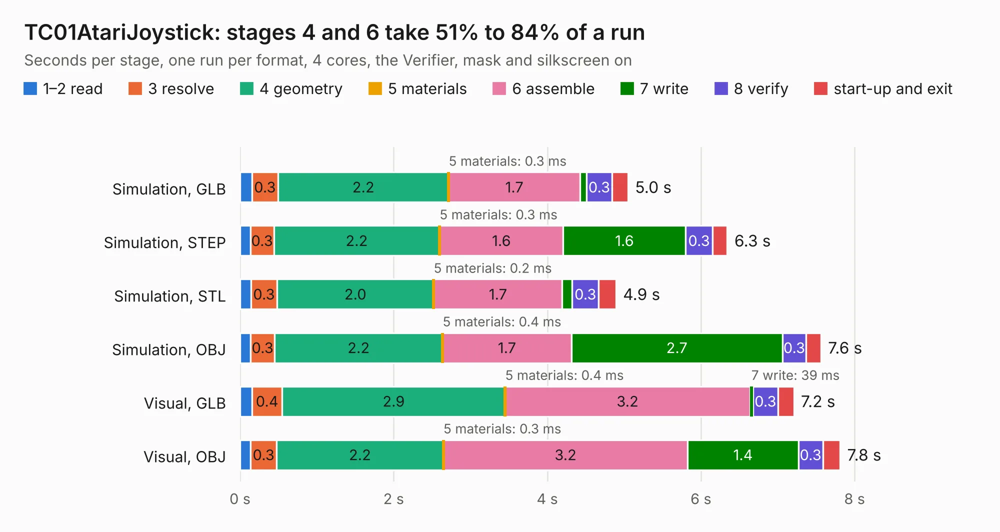

| Mode and format | 1–2 read | 3 resolve | 4 geometry | 5 materials | 6 assemble | 7 write | 8 verify | start-up and exit | Total |
|---|---:|---:|---:|---:|---:|---:|---:|---:|---:|
| Simulation, GLB | 0.2 | 0.3 | 2.2 | 0.3&nbsp;ms | 1.7 | 85&nbsp;ms | 0.3 | 0.2 | 5.0 |
| Simulation, STEP | 0.1 | 0.3 | 2.2 | 0.3&nbsp;ms | 1.6 | 1.6 | 0.3 | 0.2 | 6.3 |
| Simulation, STL | 0.1 | 0.3 | 2.0 | 0.2&nbsp;ms | 1.7 | 0.1 | 0.3 | 0.2 | 4.9 |
| Simulation, OBJ | 0.1 | 0.3 | 2.2 | 0.4&nbsp;ms | 1.7 | 2.7 | 0.3 | 0.2 | 7.6 |
| Visual, GLB | 0.2 | 0.4 | 2.9 | 0.4&nbsp;ms | 3.2 | 39&nbsp;ms | 0.3 | 0.2 | 7.2 |
| Visual, OBJ | 0.1 | 0.3 | 2.2 | 0.3&nbsp;ms | 3.2 | 1.4 | 0.3 | 0.2 | 7.8 |

<table align="center"><tr><td valign="top">

| Board | Repo: [Board-Folk/Einstein-TC-01](https://github.com/Board-Folk/Einstein-TC-01) Board: `TC01AtariJoystick.kicad_pcb` |
|---|---|
| Folder | Expansions / TC01AtariJoystick / Kicad |
| Complexity | 191&nbsp;/&nbsp;1000 (size&nbsp;131, features&nbsp;60) |
| KESE&nbsp;features | filled zones, curved board outline, stack-up, dielectric εr and tanδ |
| Tested | 9th November 2026 |
| Copper&nbsp;layers | 2 |
| File&nbsp;format | KiCad 9 (20241229) |
| Parts,&nbsp;tracks,&nbsp;vias | 10, 219, 0 |
| Triangles,&nbsp;simulation | 503,944 in 29 parts |
| Verifier | PASS in all six runs |

</td><td valign="top">

<table>
<tr><th>File type</th><th>File size</th><th>Peak memory used</th></tr>
<tr><th colspan="3" align="left">Simulation</th></tr>
<tr><td>GLB</td><td align="right">17&nbsp;MB</td><td align="right">287&nbsp;MB</td></tr>
<tr><td>STEP</td><td align="right">68&nbsp;MB</td><td align="right">334&nbsp;MB</td></tr>
<tr><td>STL</td><td align="right">25&nbsp;MB</td><td align="right">284&nbsp;MB</td></tr>
<tr><td>OBJ</td><td align="right">50&nbsp;MB</td><td align="right">377&nbsp;MB</td></tr>
<tr><th colspan="3" align="left">Visual</th></tr>
<tr><td>GLB</td><td align="right">9.4&nbsp;MB</td><td align="right">333&nbsp;MB</td></tr>
<tr><td>OBJ</td><td align="right">28&nbsp;MB</td><td align="right">327&nbsp;MB</td></tr>
</table>

</td></tr></table>

## 650. TC02Mini

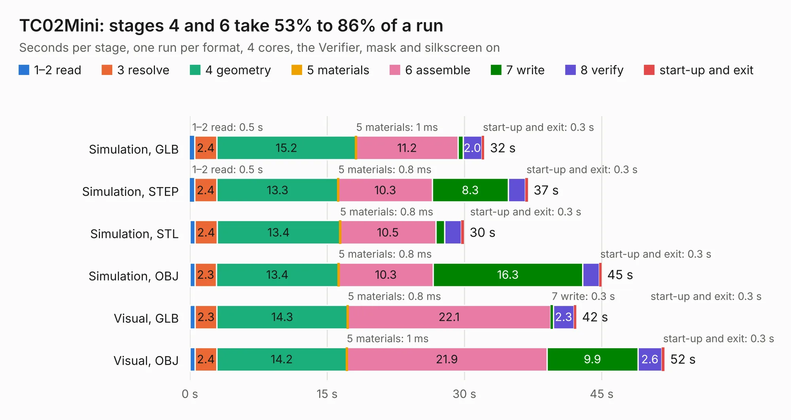

| Mode and format | 1–2 read | 3 resolve | 4 geometry | 5 materials | 6 assemble | 7 write | 8 verify | start-up and exit | Total |
|---|---:|---:|---:|---:|---:|---:|---:|---:|---:|
| Simulation, GLB | 0.5 | 2.4 | 15.2 | 1&nbsp;ms | 11.2 | 0.5 | 2.0 | 0.3 | 32.2 |
| Simulation, STEP | 0.5 | 2.4 | 13.3 | 0.8&nbsp;ms | 10.3 | 8.3 | 1.8 | 0.3 | 36.9 |
| Simulation, STL | 0.6 | 2.4 | 13.4 | 0.8&nbsp;ms | 10.5 | 1.0 | 1.8 | 0.3 | 29.9 |
| Simulation, OBJ | 0.6 | 2.3 | 13.4 | 0.8&nbsp;ms | 10.3 | 16.3 | 1.8 | 0.3 | 45.0 |
| Visual, GLB | 0.6 | 2.3 | 14.3 | 0.8&nbsp;ms | 22.1 | 0.3 | 2.3 | 0.3 | 42.2 |
| Visual, OBJ | 0.6 | 2.4 | 14.2 | 1&nbsp;ms | 21.9 | 9.9 | 2.6 | 0.3 | 51.9 |

<table align="center"><tr><td valign="top">

| Board | Repo: [Board-Folk/Einstein-TC-01](https://github.com/Board-Folk/Einstein-TC-01) Board: `TC02Mini.kicad_pcb` |
|---|---|
| Folder | Expansions / TC02Mini / Kicad |
| Complexity | 264&nbsp;/&nbsp;1000 (size&nbsp;189, features&nbsp;75) |
| KESE&nbsp;features | through vias, filled zones, curved board outline, stack-up, dielectric εr and tanδ |
| Tested | 9th November 2026 |
| Copper&nbsp;layers | 2 |
| File&nbsp;format | KiCad 9 (20241229) |
| Parts,&nbsp;tracks,&nbsp;vias | 51, 2,290, 128 |
| Triangles,&nbsp;simulation | 2,815,452 in 155 parts |
| Verifier | PASS in all six runs |

</td><td valign="top">

<table>
<tr><th>File type</th><th>File size</th><th>Peak memory used</th></tr>
<tr><th colspan="3" align="left">Simulation</th></tr>
<tr><td>GLB</td><td align="right">96&nbsp;MB</td><td align="right">1.0&nbsp;GB</td></tr>
<tr><td>STEP</td><td align="right">419&nbsp;MB</td><td align="right">1.1&nbsp;GB</td></tr>
<tr><td>STL</td><td align="right">141&nbsp;MB</td><td align="right">972&nbsp;MB</td></tr>
<tr><td>OBJ</td><td align="right">295&nbsp;MB</td><td align="right">1.8&nbsp;GB</td></tr>
<tr><th colspan="3" align="left">Visual</th></tr>
<tr><td>GLB</td><td align="right">57&nbsp;MB</td><td align="right">1.2&nbsp;GB</td></tr>
<tr><td>OBJ</td><td align="right">176&nbsp;MB</td><td align="right">1.3&nbsp;GB</td></tr>
</table>

</td></tr></table>

## 651. TMSAdapterTC01

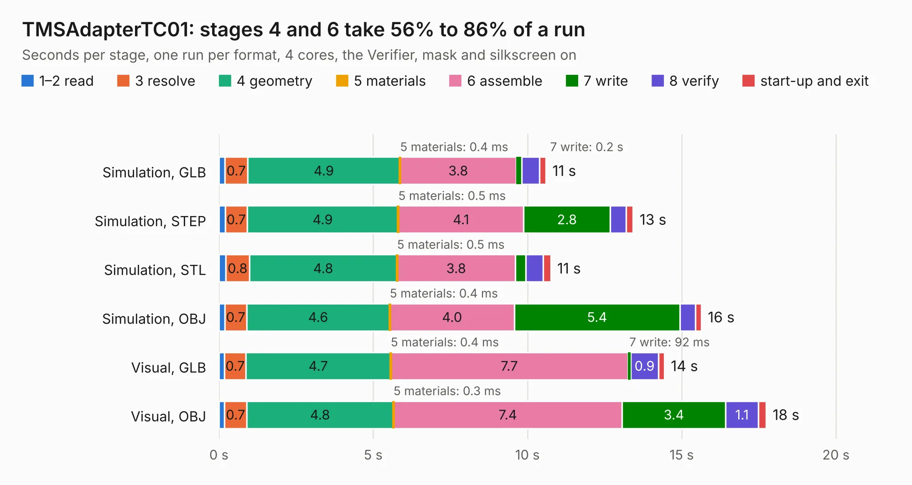

| Mode and format | 1–2 read | 3 resolve | 4 geometry | 5 materials | 6 assemble | 7 write | 8 verify | start-up and exit | Total |
|---|---:|---:|---:|---:|---:|---:|---:|---:|---:|
| Simulation, GLB | 0.2 | 0.7 | 4.9 | 0.4&nbsp;ms | 3.8 | 0.2 | 0.6 | 0.2 | 10.6 |
| Simulation, STEP | 0.2 | 0.7 | 4.9 | 0.5&nbsp;ms | 4.1 | 2.8 | 0.5 | 0.2 | 13.4 |
| Simulation, STL | 0.2 | 0.8 | 4.8 | 0.5&nbsp;ms | 3.8 | 0.3 | 0.6 | 0.3 | 10.8 |
| Simulation, OBJ | 0.2 | 0.7 | 4.6 | 0.4&nbsp;ms | 4.0 | 5.4 | 0.5 | 0.2 | 15.6 |
| Visual, GLB | 0.2 | 0.7 | 4.7 | 0.4&nbsp;ms | 7.7 | 92&nbsp;ms | 0.9 | 0.2 | 14.4 |
| Visual, OBJ | 0.2 | 0.7 | 4.8 | 0.3&nbsp;ms | 7.4 | 3.4 | 1.1 | 0.3 | 17.7 |

<table align="center"><tr><td valign="top">

| Board | Repo: [Board-Folk/Einstein-TC-01](https://github.com/Board-Folk/Einstein-TC-01) Board: `TMSAdapterTC01.kicad_pcb` |
|---|---|
| Folder | Expansions / TMSAdapterTC01 / Kicad |
| Complexity | 238&nbsp;/&nbsp;1000 (size&nbsp;163, features&nbsp;75) |
| KESE&nbsp;features | through vias, filled zones, curved board outline, stack-up, dielectric εr and tanδ |
| Tested | 9th November 2026 |
| Copper&nbsp;layers | 2 |
| File&nbsp;format | KiCad 9 (20241229) |
| Parts,&nbsp;tracks,&nbsp;vias | 22, 850, 24 |
| Triangles,&nbsp;simulation | 1,335,060 in 72 parts |
| Verifier | PASS in all six runs |

</td><td valign="top">

<table>
<tr><th>File type</th><th>File size</th><th>Peak memory used</th></tr>
<tr><th colspan="3" align="left">Simulation</th></tr>
<tr><td>GLB</td><td align="right">45&nbsp;MB</td><td align="right">542&nbsp;MB</td></tr>
<tr><td>STEP</td><td align="right">191&nbsp;MB</td><td align="right">630&nbsp;MB</td></tr>
<tr><td>STL</td><td align="right">67&nbsp;MB</td><td align="right">537&nbsp;MB</td></tr>
<tr><td>OBJ</td><td align="right">135&nbsp;MB</td><td align="right">903&nbsp;MB</td></tr>
<tr><th colspan="3" align="left">Visual</th></tr>
<tr><td>GLB</td><td align="right">27&nbsp;MB</td><td align="right">646&nbsp;MB</td></tr>
<tr><td>OBJ</td><td align="right">83&nbsp;MB</td><td align="right">728&nbsp;MB</td></tr>
</table>

</td></tr></table>

## 652. V9958AdapterTC01

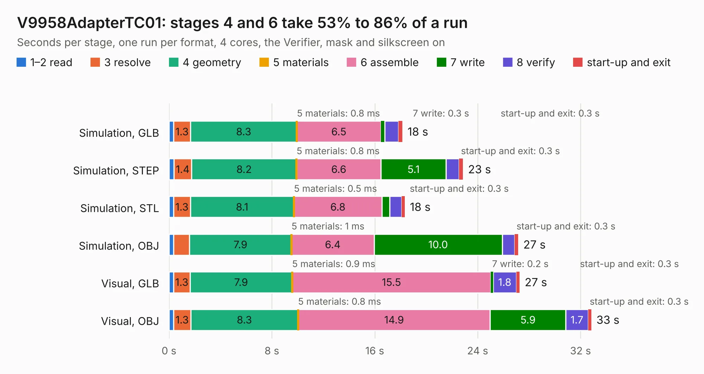

| Mode and format | 1–2 read | 3 resolve | 4 geometry | 5 materials | 6 assemble | 7 write | 8 verify | start-up and exit | Total |
|---|---:|---:|---:|---:|---:|---:|---:|---:|---:|
| Simulation, GLB | 0.4 | 1.3 | 8.3 | 0.8&nbsp;ms | 6.5 | 0.3 | 1.1 | 0.3 | 18.2 |
| Simulation, STEP | 0.4 | 1.4 | 8.2 | 0.8&nbsp;ms | 6.6 | 5.1 | 1.0 | 0.3 | 22.9 |
| Simulation, STL | 0.4 | 1.3 | 8.1 | 0.5&nbsp;ms | 6.8 | 0.6 | 0.9 | 0.3 | 18.3 |
| Simulation, OBJ | 0.4 | 1.2 | 7.9 | 1&nbsp;ms | 6.4 | 10.0 | 1.0 | 0.3 | 27.2 |
| Visual, GLB | 0.4 | 1.3 | 7.9 | 0.9&nbsp;ms | 15.5 | 0.2 | 1.8 | 0.3 | 27.3 |
| Visual, OBJ | 0.4 | 1.3 | 8.3 | 0.8&nbsp;ms | 14.9 | 5.9 | 1.7 | 0.3 | 32.8 |

<table align="center"><tr><td valign="top">

| Board | Repo: [Board-Folk/Einstein-TC-01](https://github.com/Board-Folk/Einstein-TC-01) Board: `V9958AdapterTC01.kicad_pcb` |
|---|---|
| Folder | Expansions / V9958AdapterTC01 / Kicad |
| Complexity | 276&nbsp;/&nbsp;1000 (size&nbsp;176, features&nbsp;100) |
| KESE&nbsp;features | through vias, custom pads, filled zones, copper drawings, curved board outline, stack-up, dielectric εr and tanδ |
| Tested | 9th November 2026 |
| Copper&nbsp;layers | 2 |
| File&nbsp;format | KiCad 9 (20241229) |
| Parts,&nbsp;tracks,&nbsp;vias | 46, 1,132, 49 |
| Triangles,&nbsp;simulation | 1,913,332 in 118 parts |
| Verifier | PASS in all six runs |

</td><td valign="top">

<table>
<tr><th>File type</th><th>File size</th><th>Peak memory used</th></tr>
<tr><th colspan="3" align="left">Simulation</th></tr>
<tr><td>GLB</td><td align="right">64&nbsp;MB</td><td align="right">732&nbsp;MB</td></tr>
<tr><td>STEP</td><td align="right">272&nbsp;MB</td><td align="right">858&nbsp;MB</td></tr>
<tr><td>STL</td><td align="right">96&nbsp;MB</td><td align="right">730&nbsp;MB</td></tr>
<tr><td>OBJ</td><td align="right">196&nbsp;MB</td><td align="right">1.3&nbsp;GB</td></tr>
<tr><th colspan="3" align="left">Visual</th></tr>
<tr><td>GLB</td><td align="right">41&nbsp;MB</td><td align="right">942&nbsp;MB</td></tr>
<tr><td>OBJ</td><td align="right">125&nbsp;MB</td><td align="right">978&nbsp;MB</td></tr>
</table>

</td></tr></table>

## 653. EinsteinTC01

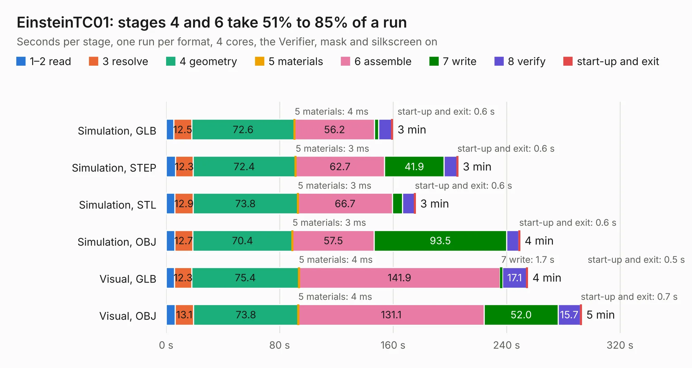

| Mode and format | 1–2 read | 3 resolve | 4 geometry | 5 materials | 6 assemble | 7 write | 8 verify | start-up and exit | Total |
|---|---:|---:|---:|---:|---:|---:|---:|---:|---:|
| Simulation, GLB | 5.5 | 12.5 | 72.6 | 4&nbsp;ms | 56.2 | 3.0 | 9.2 | 0.6 | 159.6 |
| Simulation, STEP | 6.6 | 12.3 | 72.4 | 3&nbsp;ms | 62.7 | 41.9 | 9.1 | 0.6 | 205.7 |
| Simulation, STL | 6.2 | 12.9 | 73.8 | 3&nbsp;ms | 66.7 | 7.0 | 8.6 | 0.6 | 175.7 |
| Simulation, OBJ | 6.0 | 12.7 | 70.4 | 3&nbsp;ms | 57.5 | 93.5 | 8.5 | 0.6 | 249.3 |
| Visual, GLB | 5.9 | 12.3 | 75.4 | 4&nbsp;ms | 141.9 | 1.7 | 17.1 | 0.5 | 254.7 |
| Visual, OBJ | 6.3 | 13.1 | 73.8 | 4&nbsp;ms | 131.1 | 52.0 | 15.7 | 0.7 | 292.7 |

<table align="center"><tr><td valign="top">

| Board | Repo: [Board-Folk/Einstein-TC-01](https://github.com/Board-Folk/Einstein-TC-01) Board: `EinsteinTC01.kicad_pcb` |
|---|---|
| Folder | Kicad |
| Complexity | 309&nbsp;/&nbsp;1000 (size&nbsp;234, features&nbsp;75) |
| KESE&nbsp;features | through vias, slotted holes, rounded, trapezoid or chamfered pads, drill offsets, filled zones, curved board outline |
| Tested | 9th November 2026 |
| Copper&nbsp;layers | 2 |
| File&nbsp;format | KiCad 9 (20241229) |
| Parts,&nbsp;tracks,&nbsp;vias | 346, 9,719, 769 |
| Triangles,&nbsp;simulation | 11,902,236 in 528 parts |
| Verifier | PASS in all six runs |

</td><td valign="top">

<table>
<tr><th>File type</th><th>File size</th><th>Peak memory used</th></tr>
<tr><th colspan="3" align="left">Simulation</th></tr>
<tr><td>GLB</td><td align="right">398&nbsp;MB</td><td align="right">3.2&nbsp;GB</td></tr>
<tr><td>STEP</td><td align="right">1.7&nbsp;GB</td><td align="right">4.2&nbsp;GB</td></tr>
<tr><td>STL</td><td align="right">595&nbsp;MB</td><td align="right">3.3&nbsp;GB</td></tr>
<tr><td>OBJ</td><td align="right">1.3&nbsp;GB</td><td align="right">7.4&nbsp;GB</td></tr>
<tr><th colspan="3" align="left">Visual</th></tr>
<tr><td>GLB</td><td align="right">238&nbsp;MB</td><td align="right">3.8&nbsp;GB</td></tr>
<tr><td>OBJ</td><td align="right">765&nbsp;MB</td><td align="right">4.9&nbsp;GB</td></tr>
</table>

</td></tr></table>

## 654. EinsteinCE

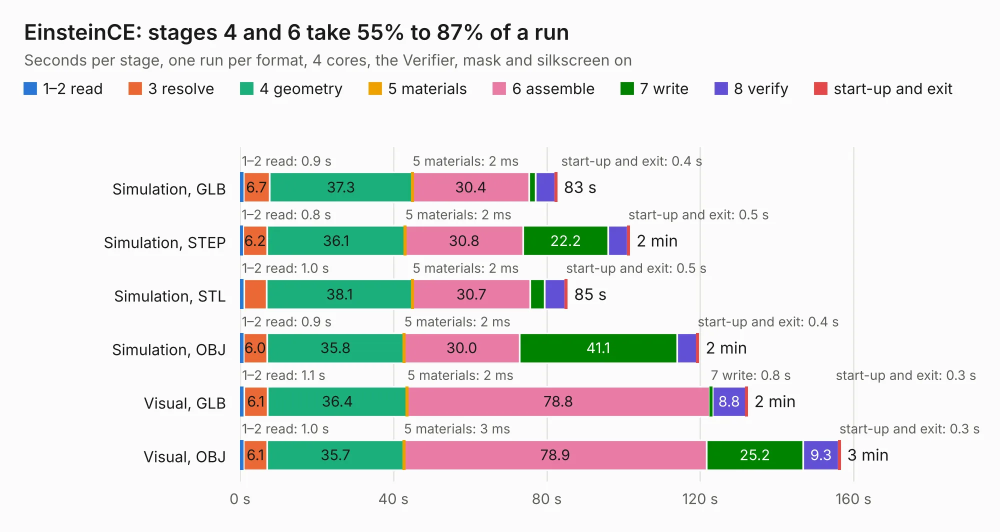

| Mode and format | 1–2 read | 3 resolve | 4 geometry | 5 materials | 6 assemble | 7 write | 8 verify | start-up and exit | Total |
|---|---:|---:|---:|---:|---:|---:|---:|---:|---:|
| Simulation, GLB | 0.9 | 6.7 | 37.3 | 2&nbsp;ms | 30.4 | 1.7 | 5.1 | 0.4 | 82.6 |
| Simulation, STEP | 0.8 | 6.2 | 36.1 | 2&nbsp;ms | 30.8 | 22.2 | 5.0 | 0.5 | 101.5 |
| Simulation, STL | 1.0 | 5.9 | 38.1 | 2&nbsp;ms | 30.7 | 3.7 | 5.5 | 0.5 | 85.3 |
| Simulation, OBJ | 0.9 | 6.0 | 35.8 | 2&nbsp;ms | 30.0 | 41.1 | 5.1 | 0.4 | 119.6 |
| Visual, GLB | 1.1 | 6.1 | 36.4 | 2&nbsp;ms | 78.8 | 0.8 | 8.8 | 0.3 | 132.2 |
| Visual, OBJ | 1.0 | 6.1 | 35.7 | 3&nbsp;ms | 78.9 | 25.2 | 9.3 | 0.3 | 156.5 |

<table align="center"><tr><td valign="top">

| Board | Repo: [Board-Folk/Einstein-TC-01](https://github.com/Board-Folk/Einstein-TC-01) Board: `EinsteinCE.kicad_pcb` |
|---|---|
| Folder | Remix / EinsteinCE / Kicad |
| Complexity | 253&nbsp;/&nbsp;1000 (size&nbsp;218, features&nbsp;35) |
| KESE&nbsp;features | through vias, slotted holes, rounded, trapezoid or chamfered pads |
| Tested | 9th November 2026 |
| Copper&nbsp;layers | 2 |
| File&nbsp;format | KiCad 9 (20241229) |
| Parts,&nbsp;tracks,&nbsp;vias | 154, 6,261, 418 |
| Triangles,&nbsp;simulation | 7,959,458 in 329 parts |
| Verifier | PASS in all six runs |

</td><td valign="top">

<table>
<tr><th>File type</th><th>File size</th><th>Peak memory used</th></tr>
<tr><th colspan="3" align="left">Simulation</th></tr>
<tr><td>GLB</td><td align="right">265&nbsp;MB</td><td align="right">2.1&nbsp;GB</td></tr>
<tr><td>STEP</td><td align="right">1.3&nbsp;GB</td><td align="right">2.8&nbsp;GB</td></tr>
<tr><td>STL</td><td align="right">398&nbsp;MB</td><td align="right">2.1&nbsp;GB</td></tr>
<tr><td>OBJ</td><td align="right">836&nbsp;MB</td><td align="right">4.9&nbsp;GB</td></tr>
<tr><th colspan="3" align="left">Visual</th></tr>
<tr><td>GLB</td><td align="right">170&nbsp;MB</td><td align="right">2.6&nbsp;GB</td></tr>
<tr><td>OBJ</td><td align="right">542&nbsp;MB</td><td align="right">3.4&nbsp;GB</td></tr>
</table>

</td></tr></table>

## 655. MegaCD

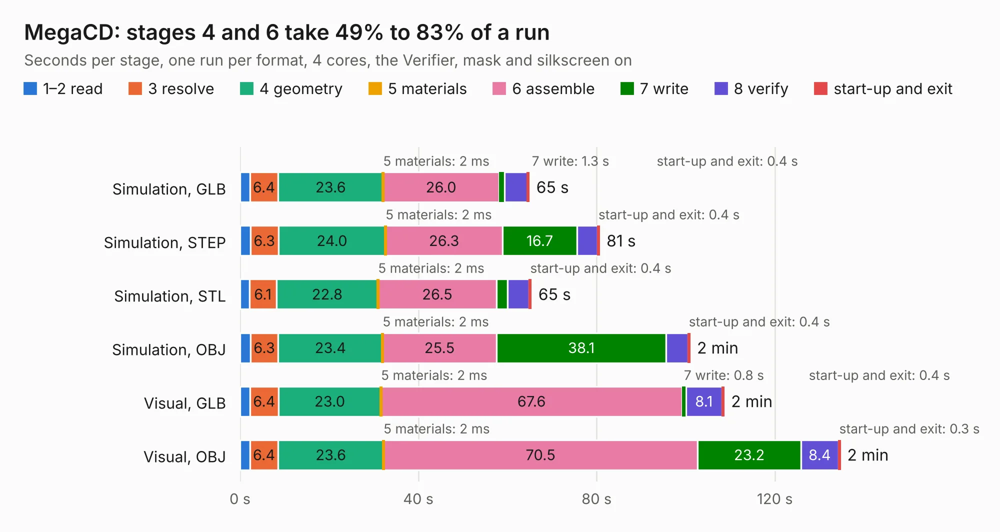

| Mode and format | 1–2 read | 3 resolve | 4 geometry | 5 materials | 6 assemble | 7 write | 8 verify | start-up and exit | Total |
|---|---:|---:|---:|---:|---:|---:|---:|---:|---:|
| Simulation, GLB | 2.2 | 6.4 | 23.6 | 2&nbsp;ms | 26.0 | 1.3 | 5.1 | 0.4 | 64.9 |
| Simulation, STEP | 2.3 | 6.3 | 24.0 | 2&nbsp;ms | 26.3 | 16.7 | 4.6 | 0.4 | 80.6 |
| Simulation, STL | 2.1 | 6.1 | 22.8 | 2&nbsp;ms | 26.5 | 2.5 | 4.9 | 0.4 | 65.3 |
| Simulation, OBJ | 2.3 | 6.3 | 23.4 | 2&nbsp;ms | 25.5 | 38.1 | 4.9 | 0.4 | 100.9 |
| Visual, GLB | 2.2 | 6.4 | 23.0 | 2&nbsp;ms | 67.6 | 0.8 | 8.1 | 0.4 | 108.6 |
| Visual, OBJ | 2.2 | 6.4 | 23.6 | 2&nbsp;ms | 70.5 | 23.2 | 8.4 | 0.3 | 134.6 |

<table align="center"><tr><td valign="top">

| Board | Repo: [Board-Folk/MegaCD-Main-BD](https://github.com/Board-Folk/MegaCD-Main-BD) Board: `MegaCD.kicad_pcb` |
|---|---|
| Folder | MegaCD-837-8015-01-Rev1-MCE2 |
| Complexity | 428&nbsp;/&nbsp;1000 (size&nbsp;293, features&nbsp;135) |
| KESE&nbsp;features | through vias, rounded, trapezoid or chamfered pads, filled zones, copper drawings, copper text, curved board outline, knockout text, TrueType text, stack-up, dielectric εr and tanδ |
| Tested | 9th November 2026 |
| Copper&nbsp;layers | 4 |
| File&nbsp;format | KiCad 9 (20241229) |
| Parts,&nbsp;tracks,&nbsp;vias | 103, 10,727, 883 |
| Triangles,&nbsp;simulation | 6,854,478 in 355 parts |
| Verifier | PASS in all six runs |

</td><td valign="top">

<table>
<tr><th>File type</th><th>File size</th><th>Peak memory used</th></tr>
<tr><th colspan="3" align="left">Simulation</th></tr>
<tr><td>GLB</td><td align="right">234&nbsp;MB</td><td align="right">2.0&nbsp;GB</td></tr>
<tr><td>STEP</td><td align="right">994&nbsp;MB</td><td align="right">2.3&nbsp;GB</td></tr>
<tr><td>STL</td><td align="right">343&nbsp;MB</td><td align="right">2.0&nbsp;GB</td></tr>
<tr><td>OBJ</td><td align="right">733&nbsp;MB</td><td align="right">4.3&nbsp;GB</td></tr>
<tr><th colspan="3" align="left">Visual</th></tr>
<tr><td>GLB</td><td align="right">149&nbsp;MB</td><td align="right">2.5&nbsp;GB</td></tr>
<tr><td>OBJ</td><td align="right">486&nbsp;MB</td><td align="right">3.1&nbsp;GB</td></tr>
</table>

</td></tr></table>

## 656. MegaCD

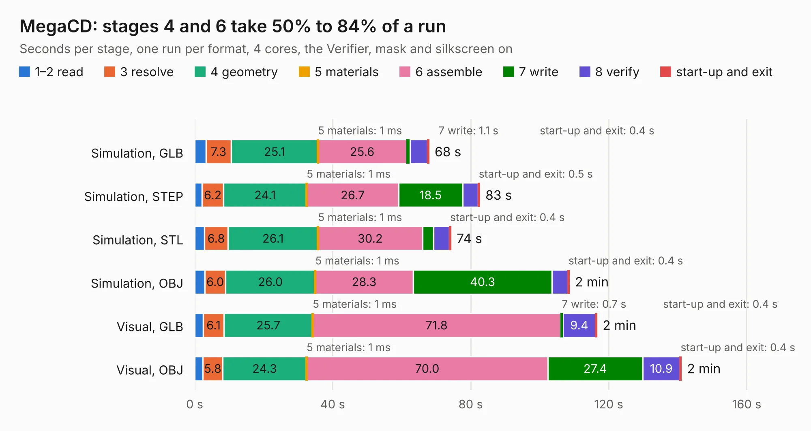

| Mode and format | 1–2 read | 3 resolve | 4 geometry | 5 materials | 6 assemble | 7 write | 8 verify | start-up and exit | Total |
|---|---:|---:|---:|---:|---:|---:|---:|---:|---:|
| Simulation, GLB | 3.3 | 7.3 | 25.1 | 1&nbsp;ms | 25.6 | 1.1 | 5.0 | 0.4 | 67.9 |
| Simulation, STEP | 2.2 | 6.2 | 24.1 | 1&nbsp;ms | 26.7 | 18.5 | 4.5 | 0.5 | 82.6 |
| Simulation, STL | 2.8 | 6.8 | 26.1 | 1&nbsp;ms | 30.2 | 3.2 | 4.6 | 0.4 | 74.3 |
| Simulation, OBJ | 2.9 | 6.0 | 26.0 | 1&nbsp;ms | 28.3 | 40.3 | 4.5 | 0.4 | 108.6 |
| Visual, GLB | 2.4 | 6.1 | 25.7 | 1&nbsp;ms | 71.8 | 0.7 | 9.4 | 0.4 | 116.6 |
| Visual, OBJ | 2.3 | 5.8 | 24.3 | 1&nbsp;ms | 70.0 | 27.4 | 10.9 | 0.4 | 141.0 |

<table align="center"><tr><td valign="top">

| Board | Repo: [Board-Folk/MegaCD-Main-BD](https://github.com/Board-Folk/MegaCD-Main-BD) Board: `MegaCD.kicad_pcb` |
|---|---|
| Folder | MegaCD-837-8015-Rev0-MCE1 |
| Complexity | 425&nbsp;/&nbsp;1000 (size&nbsp;290, features&nbsp;135) |
| KESE&nbsp;features | through vias, rounded, trapezoid or chamfered pads, filled zones, copper drawings, copper text, curved board outline, knockout text, TrueType text, stack-up, dielectric εr and tanδ |
| Tested | 9th November 2026 |
| Copper&nbsp;layers | 4 |
| File&nbsp;format | KiCad 9 (20241229) |
| Parts,&nbsp;tracks,&nbsp;vias | 93, 9,360, 822 |
| Triangles,&nbsp;simulation | 6,425,034 in 355 parts |
| Verifier | PASS in all six runs |

</td><td valign="top">

<table>
<tr><th>File type</th><th>File size</th><th>Peak memory used</th></tr>
<tr><th colspan="3" align="left">Simulation</th></tr>
<tr><td>GLB</td><td align="right">220&nbsp;MB</td><td align="right">2.0&nbsp;GB</td></tr>
<tr><td>STEP</td><td align="right">897&nbsp;MB</td><td align="right">2.2&nbsp;GB</td></tr>
<tr><td>STL</td><td align="right">321&nbsp;MB</td><td align="right">1.9&nbsp;GB</td></tr>
<tr><td>OBJ</td><td align="right">686&nbsp;MB</td><td align="right">4.1&nbsp;GB</td></tr>
<tr><th colspan="3" align="left">Visual</th></tr>
<tr><td>GLB</td><td align="right">138&nbsp;MB</td><td align="right">2.3&nbsp;GB</td></tr>
<tr><td>OBJ</td><td align="right">450&nbsp;MB</td><td align="right">2.9&nbsp;GB</td></tr>
</table>

</td></tr></table>

## 657. MegaCD

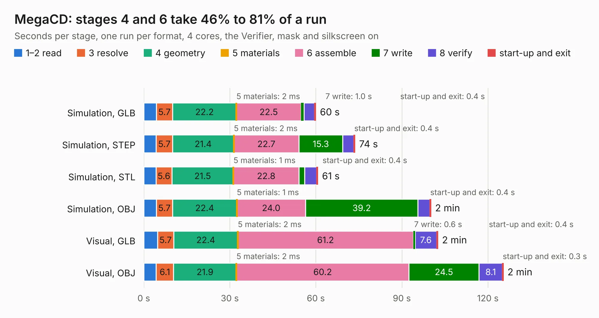

| Mode and format | 1–2 read | 3 resolve | 4 geometry | 5 materials | 6 assemble | 7 write | 8 verify | start-up and exit | Total |
|---|---:|---:|---:|---:|---:|---:|---:|---:|---:|
| Simulation, GLB | 4.3 | 5.7 | 22.2 | 2&nbsp;ms | 22.5 | 1.0 | 3.7 | 0.4 | 59.9 |
| Simulation, STEP | 4.3 | 5.7 | 21.4 | 2&nbsp;ms | 22.7 | 15.3 | 3.9 | 0.4 | 73.6 |
| Simulation, STL | 4.2 | 5.6 | 21.5 | 1&nbsp;ms | 22.8 | 2.0 | 4.2 | 0.4 | 60.7 |
| Simulation, OBJ | 4.4 | 5.7 | 22.4 | 1&nbsp;ms | 24.0 | 39.2 | 4.1 | 0.4 | 100.1 |
| Visual, GLB | 4.8 | 5.7 | 22.4 | 2&nbsp;ms | 61.2 | 0.6 | 7.6 | 0.4 | 102.5 |
| Visual, OBJ | 4.3 | 6.1 | 21.9 | 2&nbsp;ms | 60.2 | 24.5 | 8.1 | 0.3 | 125.3 |

<table align="center"><tr><td valign="top">

| Board | Repo: [Board-Folk/MegaCD-Main-BD](https://github.com/Board-Folk/MegaCD-Main-BD) Board: `MegaCD.kicad_pcb` |
|---|---|
| Folder | MegaCD-837-8952-Export |
| Complexity | 424&nbsp;/&nbsp;1000 (size&nbsp;289, features&nbsp;135) |
| KESE&nbsp;features | through vias, rounded, trapezoid or chamfered pads, filled zones, copper drawings, copper text, curved board outline, knockout text, TrueType text, stack-up, dielectric εr and tanδ |
| Tested | 9th November 2026 |
| Copper&nbsp;layers | 4 |
| File&nbsp;format | KiCad 9 (20241229) |
| Parts,&nbsp;tracks,&nbsp;vias | 117, 7,524, 826 |
| Triangles,&nbsp;simulation | 6,123,290 in 361 parts |
| Verifier | PASS in all six runs |

</td><td valign="top">

<table>
<tr><th>File type</th><th>File size</th><th>Peak memory used</th></tr>
<tr><th colspan="3" align="left">Simulation</th></tr>
<tr><td>GLB</td><td align="right">210&nbsp;MB</td><td align="right">1.9&nbsp;GB</td></tr>
<tr><td>STEP</td><td align="right">862&nbsp;MB</td><td align="right">2.2&nbsp;GB</td></tr>
<tr><td>STL</td><td align="right">306&nbsp;MB</td><td align="right">1.9&nbsp;GB</td></tr>
<tr><td>OBJ</td><td align="right">655&nbsp;MB</td><td align="right">4.0&nbsp;GB</td></tr>
<tr><th colspan="3" align="left">Visual</th></tr>
<tr><td>GLB</td><td align="right">137&nbsp;MB</td><td align="right">2.3&nbsp;GB</td></tr>
<tr><td>OBJ</td><td align="right">445&nbsp;MB</td><td align="right">3.1&nbsp;GB</td></tr>
</table>

</td></tr></table>

## 658. MegaCD

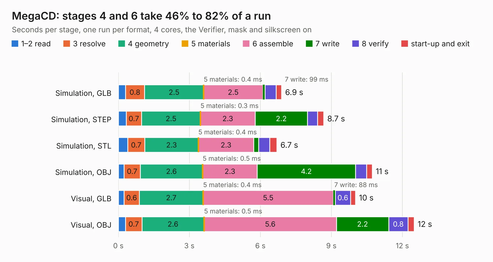

| Mode and format | 1–2 read | 3 resolve | 4 geometry | 5 materials | 6 assemble | 7 write | 8 verify | start-up and exit | Total |
|---|---:|---:|---:|---:|---:|---:|---:|---:|---:|
| Simulation, GLB | 0.3 | 0.8 | 2.5 | 0.4&nbsp;ms | 2.5 | 99&nbsp;ms | 0.5 | 0.2 | 6.9 |
| Simulation, STEP | 0.3 | 0.7 | 2.5 | 0.3&nbsp;ms | 2.3 | 2.2 | 0.4 | 0.3 | 8.7 |
| Simulation, STL | 0.4 | 0.7 | 2.3 | 0.4&nbsp;ms | 2.3 | 0.2 | 0.5 | 0.3 | 6.7 |
| Simulation, OBJ | 0.2 | 0.7 | 2.6 | 0.5&nbsp;ms | 2.3 | 4.2 | 0.5 | 0.2 | 10.7 |
| Visual, GLB | 0.2 | 0.6 | 2.7 | 0.4&nbsp;ms | 5.5 | 88&nbsp;ms | 0.6 | 0.2 | 10.0 |
| Visual, OBJ | 0.3 | 0.7 | 2.6 | 0.5&nbsp;ms | 5.6 | 2.2 | 0.8 | 0.3 | 12.5 |

<table align="center"><tr><td valign="top">

| Board | Repo: [Board-Folk/MegaCD-Main-BD](https://github.com/Board-Folk/MegaCD-Main-BD) Board: `MegaCD.kicad_pcb` |
|---|---|
| Folder | RAM-Adapter-837-8015-01 |
| Complexity | 251&nbsp;/&nbsp;1000 (size&nbsp;156, features&nbsp;95) |
| KESE&nbsp;features | through vias, rounded, trapezoid or chamfered pads, filled zones, copper text, curved board outline, stack-up, dielectric εr and tanδ |
| Tested | 9th November 2026 |
| Copper&nbsp;layers | 4 |
| File&nbsp;format | KiCad 7 (20221018) |
| Parts,&nbsp;tracks,&nbsp;vias | 7, 359, 27 |
| Triangles,&nbsp;simulation | 814,600 in 54 parts |
| Verifier | PASS in all six runs |

</td><td valign="top">

<table>
<tr><th>File type</th><th>File size</th><th>Peak memory used</th></tr>
<tr><th colspan="3" align="left">Simulation</th></tr>
<tr><td>GLB</td><td align="right">28&nbsp;MB</td><td align="right">396&nbsp;MB</td></tr>
<tr><td>STEP</td><td align="right">115&nbsp;MB</td><td align="right">407&nbsp;MB</td></tr>
<tr><td>STL</td><td align="right">41&nbsp;MB</td><td align="right">415&nbsp;MB</td></tr>
<tr><td>OBJ</td><td align="right">82&nbsp;MB</td><td align="right">557&nbsp;MB</td></tr>
<tr><th colspan="3" align="left">Visual</th></tr>
<tr><td>GLB</td><td align="right">16&nbsp;MB</td><td align="right">460&nbsp;MB</td></tr>
<tr><td>OBJ</td><td align="right">48&nbsp;MB</td><td align="right">442&nbsp;MB</td></tr>
</table>

</td></tr></table>

## 659. MegaCD

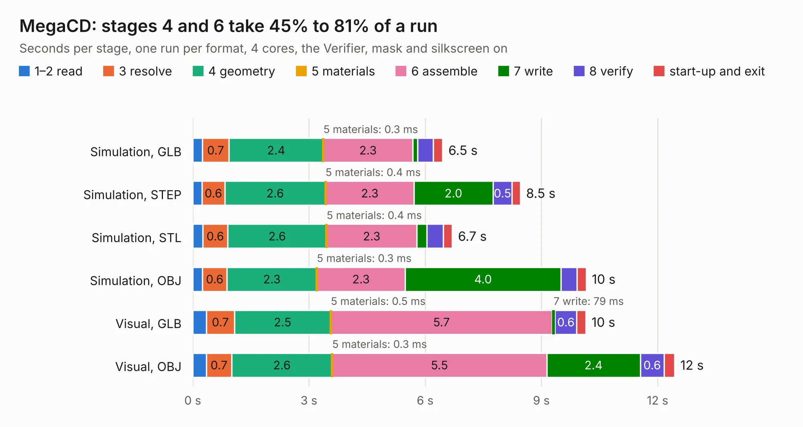

| Mode and format | 1–2 read | 3 resolve | 4 geometry | 5 materials | 6 assemble | 7 write | 8 verify | start-up and exit | Total |
|---|---:|---:|---:|---:|---:|---:|---:|---:|---:|
| Simulation, GLB | 0.2 | 0.7 | 2.4 | 0.3&nbsp;ms | 2.3 | 0.1 | 0.4 | 0.2 | 6.5 |
| Simulation, STEP | 0.2 | 0.6 | 2.6 | 0.4&nbsp;ms | 2.3 | 2.0 | 0.5 | 0.2 | 8.5 |
| Simulation, STL | 0.3 | 0.6 | 2.6 | 0.4&nbsp;ms | 2.3 | 0.3 | 0.4 | 0.2 | 6.7 |
| Simulation, OBJ | 0.3 | 0.6 | 2.3 | 0.3&nbsp;ms | 2.3 | 4.0 | 0.4 | 0.2 | 10.2 |
| Visual, GLB | 0.3 | 0.7 | 2.5 | 0.5&nbsp;ms | 5.7 | 79&nbsp;ms | 0.6 | 0.2 | 10.1 |
| Visual, OBJ | 0.4 | 0.7 | 2.6 | 0.3&nbsp;ms | 5.5 | 2.4 | 0.6 | 0.3 | 12.4 |

<table align="center"><tr><td valign="top">

| Board | Repo: [Board-Folk/MegaCD-Main-BD](https://github.com/Board-Folk/MegaCD-Main-BD) Board: `MegaCD.kicad_pcb` |
|---|---|
| Folder | RAM-Adapter-837-8015 |
| Complexity | 252&nbsp;/&nbsp;1000 (size&nbsp;157, features&nbsp;95) |
| KESE&nbsp;features | through vias, rounded, trapezoid or chamfered pads, filled zones, copper text, curved board outline, stack-up, dielectric εr and tanδ |
| Tested | 9th November 2026 |
| Copper&nbsp;layers | 4 |
| File&nbsp;format | KiCad 7 (20221018) |
| Parts,&nbsp;tracks,&nbsp;vias | 7, 398, 27 |
| Triangles,&nbsp;simulation | 817,738 in 54 parts |
| Verifier | PASS in all six runs |

</td><td valign="top">

<table>
<tr><th>File type</th><th>File size</th><th>Peak memory used</th></tr>
<tr><th colspan="3" align="left">Simulation</th></tr>
<tr><td>GLB</td><td align="right">28&nbsp;MB</td><td align="right">400&nbsp;MB</td></tr>
<tr><td>STEP</td><td align="right">119&nbsp;MB</td><td align="right">413&nbsp;MB</td></tr>
<tr><td>STL</td><td align="right">41&nbsp;MB</td><td align="right">391&nbsp;MB</td></tr>
<tr><td>OBJ</td><td align="right">82&nbsp;MB</td><td align="right">568&nbsp;MB</td></tr>
<tr><th colspan="3" align="left">Visual</th></tr>
<tr><td>GLB</td><td align="right">17&nbsp;MB</td><td align="right">460&nbsp;MB</td></tr>
<tr><td>OBJ</td><td align="right">50&nbsp;MB</td><td align="right">461&nbsp;MB</td></tr>
</table>

</td></tr></table>

## 660. NeoGeoAES3_5

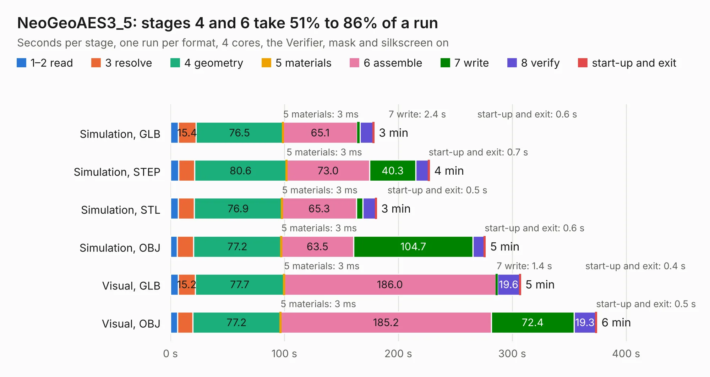

| Mode and format | 1–2 read | 3 resolve | 4 geometry | 5 materials | 6 assemble | 7 write | 8 verify | start-up and exit | Total |
|---|---:|---:|---:|---:|---:|---:|---:|---:|---:|
| Simulation, GLB | 7.0 | 15.4 | 76.5 | 3&nbsp;ms | 65.1 | 2.4 | 11.5 | 0.6 | 178.5 |
| Simulation, STEP | 7.1 | 14.2 | 80.6 | 3&nbsp;ms | 73.0 | 40.3 | 11.2 | 0.7 | 227.1 |
| Simulation, STL | 6.8 | 14.2 | 76.9 | 3&nbsp;ms | 65.3 | 5.6 | 11.2 | 0.5 | 180.6 |
| Simulation, OBJ | 5.9 | 14.2 | 77.2 | 3&nbsp;ms | 63.5 | 104.7 | 10.0 | 0.6 | 276.2 |
| Visual, GLB | 6.7 | 15.2 | 77.7 | 3&nbsp;ms | 186.0 | 1.4 | 19.6 | 0.4 | 307.1 |
| Visual, OBJ | 6.3 | 13.2 | 77.2 | 3&nbsp;ms | 185.2 | 72.4 | 19.3 | 0.5 | 374.0 |

<table align="center"><tr><td valign="top">

| Board | Repo: [Board-Folk/NeoGeoAES-3.5](https://github.com/Board-Folk/NeoGeoAES-3.5) Board: `NeoGeoAES3_5.kicad_pcb` |
|---|---|
| Complexity | 368&nbsp;/&nbsp;1000 (size&nbsp;243, features&nbsp;125) |
| KESE&nbsp;features | through vias, slotted holes, custom pads, filled zones, copper drawings, curved board outline, TrueType text, stack-up, dielectric εr and tanδ |
| Tested | 9th November 2026 |
| Copper&nbsp;layers | 2 |
| File&nbsp;format | KiCad 10 (20260206) |
| Parts,&nbsp;tracks,&nbsp;vias | 298, 18,210, 1,498 |
| Triangles,&nbsp;simulation | 12,427,738 in 777 parts |
| Verifier | PASS in all six runs |

</td><td valign="top">

<table>
<tr><th>File type</th><th>File size</th><th>Peak memory used</th></tr>
<tr><th colspan="3" align="left">Simulation</th></tr>
<tr><td>GLB</td><td align="right">421&nbsp;MB</td><td align="right">3.6&nbsp;GB</td></tr>
<tr><td>STEP</td><td align="right">2.0&nbsp;GB</td><td align="right">4.7&nbsp;GB</td></tr>
<tr><td>STL</td><td align="right">621&nbsp;MB</td><td align="right">3.7&nbsp;GB</td></tr>
<tr><td>OBJ</td><td align="right">1.3&nbsp;GB</td><td align="right">7.9&nbsp;GB</td></tr>
<tr><th colspan="3" align="left">Visual</th></tr>
<tr><td>GLB</td><td align="right">290&nbsp;MB</td><td align="right">4.5&nbsp;GB</td></tr>
<tr><td>OBJ</td><td align="right">940&nbsp;MB</td><td align="right">5.8&nbsp;GB</td></tr>
</table>

</td></tr></table>

## 661. Neptune-32x-315-5805-bypass

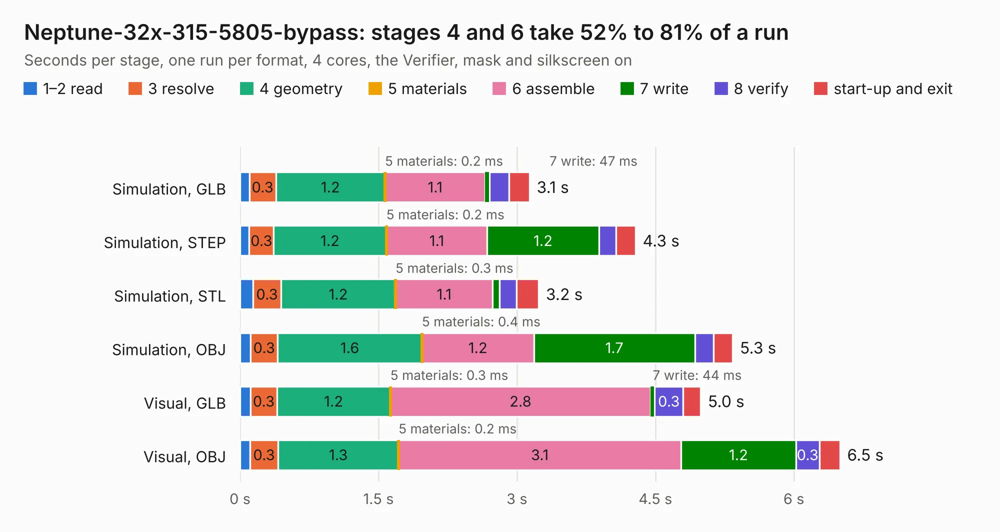

| Mode and format | 1–2 read | 3 resolve | 4 geometry | 5 materials | 6 assemble | 7 write | 8 verify | start-up and exit | Total |
|---|---:|---:|---:|---:|---:|---:|---:|---:|---:|
| Simulation, GLB | 0.1 | 0.3 | 1.2 | 0.2&nbsp;ms | 1.1 | 47&nbsp;ms | 0.2 | 0.2 | 3.1 |
| Simulation, STEP | 0.1 | 0.3 | 1.2 | 0.2&nbsp;ms | 1.1 | 1.2 | 0.2 | 0.2 | 4.3 |
| Simulation, STL | 0.1 | 0.3 | 1.2 | 0.3&nbsp;ms | 1.1 | 72&nbsp;ms | 0.2 | 0.2 | 3.2 |
| Simulation, OBJ | 0.1 | 0.3 | 1.6 | 0.4&nbsp;ms | 1.2 | 1.7 | 0.2 | 0.2 | 5.3 |
| Visual, GLB | 0.1 | 0.3 | 1.2 | 0.3&nbsp;ms | 2.8 | 44&nbsp;ms | 0.3 | 0.2 | 5.0 |
| Visual, OBJ | 0.1 | 0.3 | 1.3 | 0.2&nbsp;ms | 3.1 | 1.2 | 0.3 | 0.2 | 6.5 |

<table align="center"><tr><td valign="top">

| Board | Repo: [Board-Folk/Neptune](https://github.com/Board-Folk/Neptune) Board: `Neptune-32x-315-5805-bypass.kicad_pcb` |
|---|---|
| Folder | helpers / Neptune-32x-315-5805-bypass |
| Complexity | 234&nbsp;/&nbsp;1000 (size&nbsp;124, features&nbsp;110) |
| KESE&nbsp;features | through vias, padstacks, drill offsets, stack-up, dielectric εr and tanδ, castellated pads |
| Tested | 9th November 2026 |
| Copper&nbsp;layers | 2 |
| File&nbsp;format | KiCad 9 (20241229) |
| Parts,&nbsp;tracks,&nbsp;vias | 1, 306, 44 |
| Triangles,&nbsp;simulation | 282,880 in 67 parts |
| Verifier | PASS in all six runs |

</td><td valign="top">

<table>
<tr><th>File type</th><th>File size</th><th>Peak memory used</th></tr>
<tr><th colspan="3" align="left">Simulation</th></tr>
<tr><td>GLB</td><td align="right">10&nbsp;MB</td><td align="right">224&nbsp;MB</td></tr>
<tr><td>STEP</td><td align="right">49&nbsp;MB</td><td align="right">263&nbsp;MB</td></tr>
<tr><td>STL</td><td align="right">14&nbsp;MB</td><td align="right">232&nbsp;MB</td></tr>
<tr><td>OBJ</td><td align="right">30&nbsp;MB</td><td align="right">257&nbsp;MB</td></tr>
<tr><th colspan="3" align="left">Visual</th></tr>
<tr><td>GLB</td><td align="right">7.5&nbsp;MB</td><td align="right">266&nbsp;MB</td></tr>
<tr><td>OBJ</td><td align="right">22&nbsp;MB</td><td align="right">268&nbsp;MB</td></tr>
</table>

</td></tr></table>

## 662. Neptune-32x-315-5818-bypass

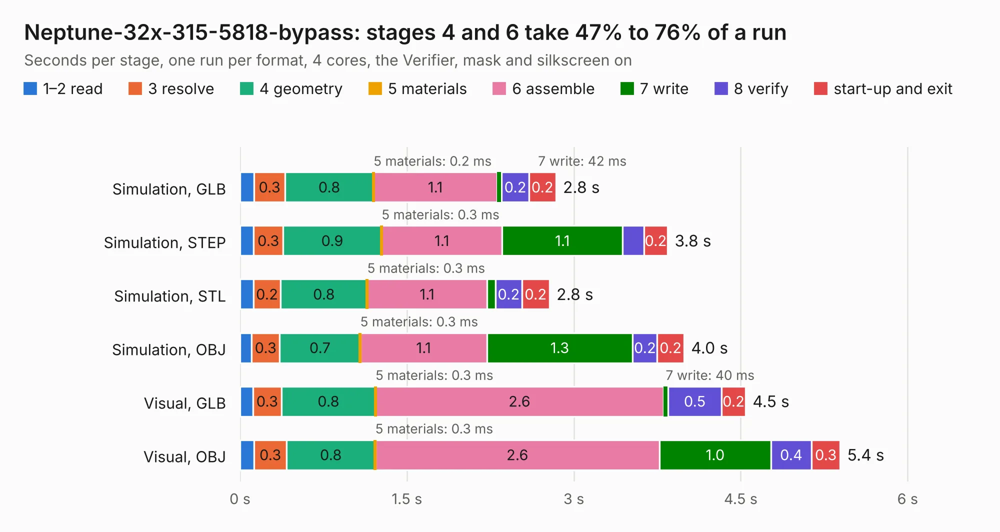

| Mode and format | 1–2 read | 3 resolve | 4 geometry | 5 materials | 6 assemble | 7 write | 8 verify | start-up and exit | Total |
|---|---:|---:|---:|---:|---:|---:|---:|---:|---:|
| Simulation, GLB | 0.1 | 0.3 | 0.8 | 0.2&nbsp;ms | 1.1 | 42&nbsp;ms | 0.2 | 0.2 | 2.8 |
| Simulation, STEP | 0.1 | 0.3 | 0.9 | 0.3&nbsp;ms | 1.1 | 1.1 | 0.2 | 0.2 | 3.8 |
| Simulation, STL | 0.1 | 0.2 | 0.8 | 0.3&nbsp;ms | 1.1 | 77&nbsp;ms | 0.2 | 0.2 | 2.8 |
| Simulation, OBJ | 0.1 | 0.3 | 0.7 | 0.3&nbsp;ms | 1.1 | 1.3 | 0.2 | 0.2 | 4.0 |
| Visual, GLB | 0.1 | 0.3 | 0.8 | 0.3&nbsp;ms | 2.6 | 40&nbsp;ms | 0.5 | 0.2 | 4.5 |
| Visual, OBJ | 0.1 | 0.3 | 0.8 | 0.3&nbsp;ms | 2.6 | 1.0 | 0.4 | 0.3 | 5.4 |

<table align="center"><tr><td valign="top">

| Board | Repo: [Board-Folk/Neptune](https://github.com/Board-Folk/Neptune) Board: `Neptune-32x-315-5818-bypass.kicad_pcb` |
|---|---|
| Folder | helpers / Neptune-32x-315-5818-bypass |
| Complexity | 173&nbsp;/&nbsp;1000 (size&nbsp;128, features&nbsp;45) |
| KESE&nbsp;features | through vias, stack-up, dielectric εr and tanδ |
| Tested | 9th November 2026 |
| Copper&nbsp;layers | 2 |
| File&nbsp;format | KiCad 9 (20241229) |
| Parts,&nbsp;tracks,&nbsp;vias | 1, 367, 65 |
| Triangles,&nbsp;simulation | 244,460 in 70 parts |
| Verifier | PASS in all six runs |

</td><td valign="top">

<table>
<tr><th>File type</th><th>File size</th><th>Peak memory used</th></tr>
<tr><th colspan="3" align="left">Simulation</th></tr>
<tr><td>GLB</td><td align="right">9.2&nbsp;MB</td><td align="right">253&nbsp;MB</td></tr>
<tr><td>STEP</td><td align="right">47&nbsp;MB</td><td align="right">258&nbsp;MB</td></tr>
<tr><td>STL</td><td align="right">12&nbsp;MB</td><td align="right">259&nbsp;MB</td></tr>
<tr><td>OBJ</td><td align="right">26&nbsp;MB</td><td align="right">262&nbsp;MB</td></tr>
<tr><th colspan="3" align="left">Visual</th></tr>
<tr><td>GLB</td><td align="right">7.5&nbsp;MB</td><td align="right">293&nbsp;MB</td></tr>
<tr><td>OBJ</td><td align="right">23&nbsp;MB</td><td align="right">281&nbsp;MB</td></tr>
</table>

</td></tr></table>

## 663. Neptune-Region-Fix

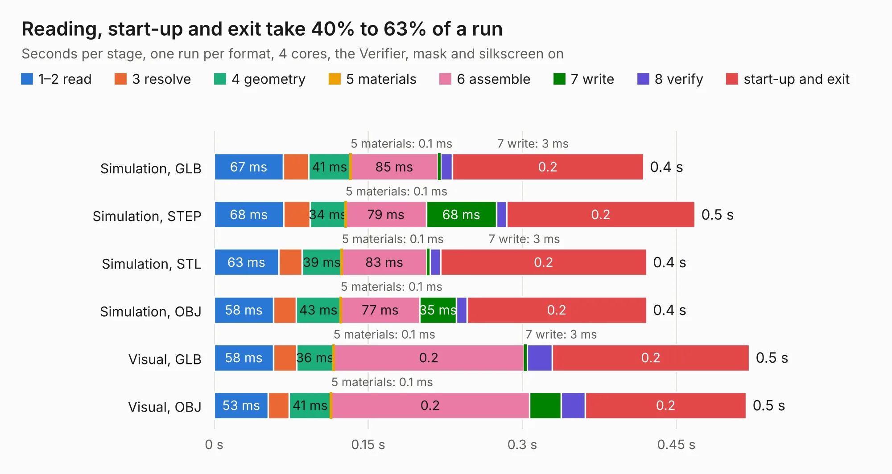

| Mode and format | 1–2 read | 3 resolve | 4 geometry | 5 materials | 6 assemble | 7 write | 8 verify | start-up and exit | Total |
|---|---:|---:|---:|---:|---:|---:|---:|---:|---:|
| Simulation, GLB | 67&nbsp;ms | 25&nbsp;ms | 41&nbsp;ms | 0.1&nbsp;ms | 85&nbsp;ms | 3&nbsp;ms | 11&nbsp;ms | 0.2 | 0.4 |
| Simulation, STEP | 68&nbsp;ms | 26&nbsp;ms | 34&nbsp;ms | 0.1&nbsp;ms | 79&nbsp;ms | 68&nbsp;ms | 10&nbsp;ms | 0.2 | 0.5 |
| Simulation, STL | 63&nbsp;ms | 23&nbsp;ms | 39&nbsp;ms | 0.1&nbsp;ms | 83&nbsp;ms | 3&nbsp;ms | 10&nbsp;ms | 0.2 | 0.4 |
| Simulation, OBJ | 58&nbsp;ms | 22&nbsp;ms | 43&nbsp;ms | 0.1&nbsp;ms | 77&nbsp;ms | 35&nbsp;ms | 10&nbsp;ms | 0.2 | 0.4 |
| Visual, GLB | 58&nbsp;ms | 23&nbsp;ms | 36&nbsp;ms | 0.1&nbsp;ms | 0.2 | 3&nbsp;ms | 25&nbsp;ms | 0.2 | 0.5 |
| Visual, OBJ | 53&nbsp;ms | 20&nbsp;ms | 41&nbsp;ms | 0.1&nbsp;ms | 0.2 | 31&nbsp;ms | 23&nbsp;ms | 0.2 | 0.5 |

<table align="center"><tr><td valign="top">

| Board | Repo: [Board-Folk/Neptune](https://github.com/Board-Folk/Neptune) Board: `Neptune-Region-Fix.kicad_pcb` |
|---|---|
| Folder | helpers / Neptune-Region-Fix |
| Complexity | 87&nbsp;/&nbsp;1000 (size&nbsp;62, features&nbsp;25) |
| KESE&nbsp;features | through vias, rounded, trapezoid or chamfered pads |
| Tested | 9th November 2026 |
| Copper&nbsp;layers | 2 |
| File&nbsp;format | KiCad 9 (20241229) |
| Parts,&nbsp;tracks,&nbsp;vias | 0, 12, 1 |
| Triangles,&nbsp;simulation | 8,908 in 9 parts |
| Note | no components |
| Verifier | PASS in all six runs |

</td><td valign="top">

<table>
<tr><th>File type</th><th>File size</th><th>Peak memory used</th></tr>
<tr><th colspan="3" align="left">Simulation</th></tr>
<tr><td>GLB</td><td align="right">336&nbsp;kB</td><td align="right">59&nbsp;MB</td></tr>
<tr><td>STEP</td><td align="right">1.7&nbsp;MB</td><td align="right">61&nbsp;MB</td></tr>
<tr><td>STL</td><td align="right">446&nbsp;kB</td><td align="right">60&nbsp;MB</td></tr>
<tr><td>OBJ</td><td align="right">853&nbsp;kB</td><td align="right">63&nbsp;MB</td></tr>
<tr><th colspan="3" align="left">Visual</th></tr>
<tr><td>GLB</td><td align="right">299&nbsp;kB</td><td align="right">83&nbsp;MB</td></tr>
<tr><td>OBJ</td><td align="right">754&nbsp;kB</td><td align="right">83&nbsp;MB</td></tr>
</table>

</td></tr></table>

## 664. Neptune

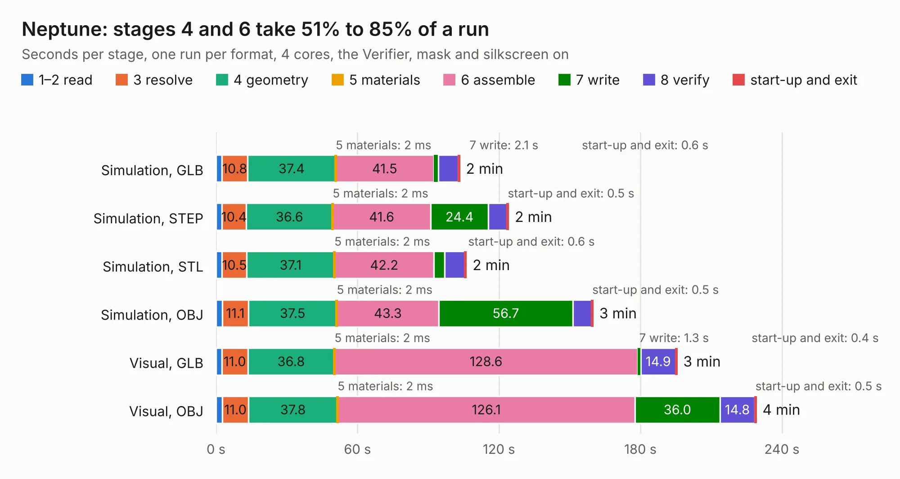

| Mode and format | 1–2 read | 3 resolve | 4 geometry | 5 materials | 6 assemble | 7 write | 8 verify | start-up and exit | Total |
|---|---:|---:|---:|---:|---:|---:|---:|---:|---:|
| Simulation, GLB | 2.5 | 10.8 | 37.4 | 2&nbsp;ms | 41.5 | 2.1 | 8.3 | 0.6 | 103.3 |
| Simulation, STEP | 2.5 | 10.4 | 36.6 | 2&nbsp;ms | 41.6 | 24.4 | 8.0 | 0.5 | 124.0 |
| Simulation, STL | 2.6 | 10.5 | 37.1 | 2&nbsp;ms | 42.2 | 4.5 | 8.6 | 0.6 | 106.1 |
| Simulation, OBJ | 2.6 | 11.1 | 37.5 | 2&nbsp;ms | 43.3 | 56.7 | 8.1 | 0.5 | 159.8 |
| Visual, GLB | 2.5 | 11.0 | 36.8 | 2&nbsp;ms | 128.6 | 1.3 | 14.9 | 0.4 | 195.4 |
| Visual, OBJ | 2.7 | 11.0 | 37.8 | 2&nbsp;ms | 126.1 | 36.0 | 14.8 | 0.5 | 229.0 |

<table align="center"><tr><td valign="top">

| Board | Repo: [Board-Folk/Neptune](https://github.com/Board-Folk/Neptune) Board: `Neptune.kicad_pcb` |
|---|---|
| Complexity | 468&nbsp;/&nbsp;1000 (size&nbsp;318, features&nbsp;150) |
| KESE&nbsp;features | through vias, slotted holes, custom pads, rounded, trapezoid or chamfered pads, filled zones, copper drawings, copper text, curved board outline, knockout text, stack-up, dielectric εr and tanδ, mask and silkscreen colours |
| Tested | 9th November 2026 |
| Copper&nbsp;layers | 4 |
| File&nbsp;format | KiCad 9 (20241229) |
| Parts,&nbsp;tracks,&nbsp;vias | 374, 11,140, 1,391 |
| Triangles,&nbsp;simulation | 9,804,248 in 748 parts |
| Verifier | PASS in all six runs |

</td><td valign="top">

<table>
<tr><th>File type</th><th>File size</th><th>Peak memory used</th></tr>
<tr><th colspan="3" align="left">Simulation</th></tr>
<tr><td>GLB</td><td align="right">339&nbsp;MB</td><td align="right">2.5&nbsp;GB</td></tr>
<tr><td>STEP</td><td align="right">1.5&nbsp;GB</td><td align="right">3.4&nbsp;GB</td></tr>
<tr><td>STL</td><td align="right">490&nbsp;MB</td><td align="right">2.5&nbsp;GB</td></tr>
<tr><td>OBJ</td><td align="right">1.1&nbsp;GB</td><td align="right">6.2&nbsp;GB</td></tr>
<tr><th colspan="3" align="left">Visual</th></tr>
<tr><td>GLB</td><td align="right">223&nbsp;MB</td><td align="right">3.5&nbsp;GB</td></tr>
<tr><td>OBJ</td><td align="right">725&nbsp;MB</td><td align="right">4.6&nbsp;GB</td></tr>
</table>

</td></tr></table>

## 665. Oric

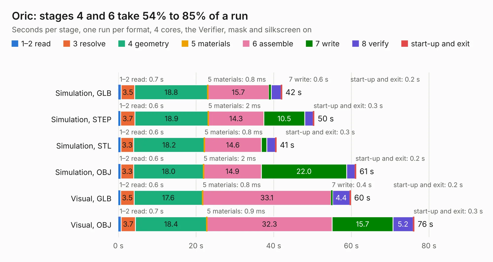

| Mode and format | 1–2 read | 3 resolve | 4 geometry | 5 materials | 6 assemble | 7 write | 8 verify | start-up and exit | Total |
|---|---:|---:|---:|---:|---:|---:|---:|---:|---:|
| Simulation, GLB | 0.7 | 3.5 | 18.8 | 0.8&nbsp;ms | 15.7 | 0.6 | 2.5 | 0.2 | 42.1 |
| Simulation, STEP | 0.6 | 3.7 | 18.9 | 2&nbsp;ms | 14.3 | 10.5 | 2.2 | 0.3 | 50.4 |
| Simulation, STL | 0.6 | 3.3 | 18.2 | 0.8&nbsp;ms | 14.6 | 1.4 | 2.2 | 0.3 | 40.7 |
| Simulation, OBJ | 0.6 | 3.3 | 18.0 | 2&nbsp;ms | 14.9 | 22.0 | 2.1 | 0.2 | 61.2 |
| Visual, GLB | 0.6 | 3.5 | 17.6 | 0.8&nbsp;ms | 33.1 | 0.4 | 4.4 | 0.2 | 59.8 |
| Visual, OBJ | 0.7 | 3.7 | 18.4 | 0.9&nbsp;ms | 32.3 | 15.7 | 5.2 | 0.3 | 76.2 |

<table align="center"><tr><td valign="top">

| Board | Repo: [Board-Folk/Oric-Remix](https://github.com/Board-Folk/Oric-Remix) Board: `Oric.kicad_pcb` |
|---|---|
| Folder | Archive / IssueAv1.1 |
| Complexity | 268&nbsp;/&nbsp;1000 (size&nbsp;203, features&nbsp;65) |
| KESE&nbsp;features | through vias, slotted holes, rounded, trapezoid or chamfered pads, filled zones, curved board outline |
| Tested | 9th November 2026 |
| Copper&nbsp;layers | 2 |
| File&nbsp;format | KiCad 8 (20240108) |
| Parts,&nbsp;tracks,&nbsp;vias | 129, 2,835, 234 |
| Triangles,&nbsp;simulation | 4,060,494 in 203 parts |
| Verifier | PASS in all six runs |

</td><td valign="top">

<table>
<tr><th>File type</th><th>File size</th><th>Peak memory used</th></tr>
<tr><th colspan="3" align="left">Simulation</th></tr>
<tr><td>GLB</td><td align="right">136&nbsp;MB</td><td align="right">1.2&nbsp;GB</td></tr>
<tr><td>STEP</td><td align="right">566&nbsp;MB</td><td align="right">1.6&nbsp;GB</td></tr>
<tr><td>STL</td><td align="right">203&nbsp;MB</td><td align="right">1.2&nbsp;GB</td></tr>
<tr><td>OBJ</td><td align="right">426&nbsp;MB</td><td align="right">2.5&nbsp;GB</td></tr>
<tr><th colspan="3" align="left">Visual</th></tr>
<tr><td>GLB</td><td align="right">87&nbsp;MB</td><td align="right">1.5&nbsp;GB</td></tr>
<tr><td>OBJ</td><td align="right">275&nbsp;MB</td><td align="right">1.9&nbsp;GB</td></tr>
</table>

</td></tr></table>

## 666. Oric-PS2USB

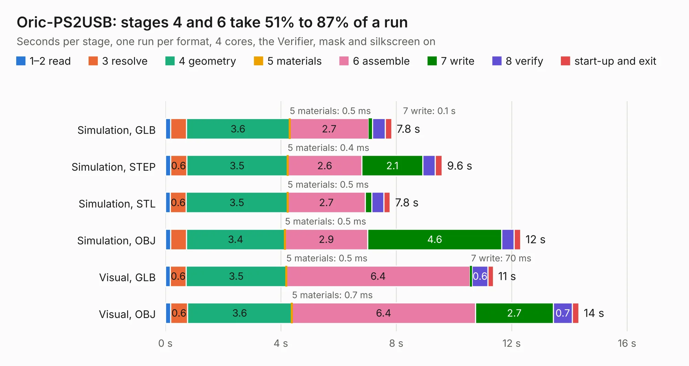

| Mode and format | 1–2 read | 3 resolve | 4 geometry | 5 materials | 6 assemble | 7 write | 8 verify | start-up and exit | Total |
|---|---:|---:|---:|---:|---:|---:|---:|---:|---:|
| Simulation, GLB | 0.2 | 0.5 | 3.6 | 0.5&nbsp;ms | 2.7 | 0.1 | 0.4 | 0.2 | 7.8 |
| Simulation, STEP | 0.2 | 0.6 | 3.5 | 0.4&nbsp;ms | 2.6 | 2.1 | 0.4 | 0.2 | 9.6 |
| Simulation, STL | 0.2 | 0.6 | 3.5 | 0.5&nbsp;ms | 2.7 | 0.2 | 0.4 | 0.2 | 7.8 |
| Simulation, OBJ | 0.2 | 0.5 | 3.4 | 0.5&nbsp;ms | 2.9 | 4.6 | 0.4 | 0.2 | 12.3 |
| Visual, GLB | 0.2 | 0.6 | 3.5 | 0.5&nbsp;ms | 6.4 | 70&nbsp;ms | 0.6 | 0.2 | 11.4 |
| Visual, OBJ | 0.2 | 0.6 | 3.6 | 0.7&nbsp;ms | 6.4 | 2.7 | 0.7 | 0.2 | 14.3 |

<table align="center"><tr><td valign="top">

| Board | Repo: [Board-Folk/Oric-Remix](https://github.com/Board-Folk/Oric-Remix) Board: `Oric-PS2USB.kicad_pcb` |
|---|---|
| Folder | Expansions / Oric-PS2USB / Kicad |
| Complexity | 234&nbsp;/&nbsp;1000 (size&nbsp;149, features&nbsp;85) |
| KESE&nbsp;features | through vias, slotted holes, filled zones, curved board outline, stack-up, dielectric εr and tanδ |
| Tested | 9th November 2026 |
| Copper&nbsp;layers | 2 |
| File&nbsp;format | KiCad 8 (20240108) |
| Parts,&nbsp;tracks,&nbsp;vias | 11, 554, 26 |
| Triangles,&nbsp;simulation | 859,924 in 74 parts |
| Verifier | PASS in all six runs |

</td><td valign="top">

<table>
<tr><th>File type</th><th>File size</th><th>Peak memory used</th></tr>
<tr><th colspan="3" align="left">Simulation</th></tr>
<tr><td>GLB</td><td align="right">29&nbsp;MB</td><td align="right">461&nbsp;MB</td></tr>
<tr><td>STEP</td><td align="right">143&nbsp;MB</td><td align="right">456&nbsp;MB</td></tr>
<tr><td>STL</td><td align="right">43&nbsp;MB</td><td align="right">466&nbsp;MB</td></tr>
<tr><td>OBJ</td><td align="right">88&nbsp;MB</td><td align="right">611&nbsp;MB</td></tr>
<tr><th colspan="3" align="left">Visual</th></tr>
<tr><td>GLB</td><td align="right">17&nbsp;MB</td><td align="right">514&nbsp;MB</td></tr>
<tr><td>OBJ</td><td align="right">52&nbsp;MB</td><td align="right">492&nbsp;MB</td></tr>
</table>

</td></tr></table>

## 667. Oric

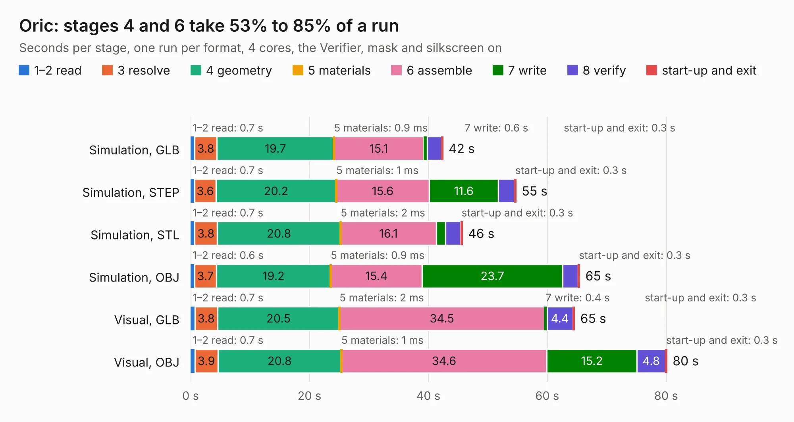

| Mode and format | 1–2 read | 3 resolve | 4 geometry | 5 materials | 6 assemble | 7 write | 8 verify | start-up and exit | Total |
|---|---:|---:|---:|---:|---:|---:|---:|---:|---:|
| Simulation, GLB | 0.7 | 3.8 | 19.7 | 0.9&nbsp;ms | 15.1 | 0.6 | 2.4 | 0.3 | 42.4 |
| Simulation, STEP | 0.7 | 3.6 | 20.2 | 1&nbsp;ms | 15.6 | 11.6 | 2.7 | 0.3 | 54.8 |
| Simulation, STL | 0.7 | 3.8 | 20.8 | 2&nbsp;ms | 16.1 | 1.6 | 2.6 | 0.3 | 45.7 |
| Simulation, OBJ | 0.6 | 3.7 | 19.2 | 0.9&nbsp;ms | 15.4 | 23.7 | 2.6 | 0.3 | 65.5 |
| Visual, GLB | 0.7 | 3.8 | 20.5 | 2&nbsp;ms | 34.5 | 0.4 | 4.4 | 0.3 | 64.6 |
| Visual, OBJ | 0.7 | 3.9 | 20.8 | 1&nbsp;ms | 34.6 | 15.2 | 4.8 | 0.3 | 80.1 |

<table align="center"><tr><td valign="top">

| Board | Repo: [Board-Folk/Oric-Remix](https://github.com/Board-Folk/Oric-Remix) Board: `Oric.kicad_pcb` |
|---|---|
| Folder | Kicad |
| Complexity | 268&nbsp;/&nbsp;1000 (size&nbsp;203, features&nbsp;65) |
| KESE&nbsp;features | through vias, slotted holes, rounded, trapezoid or chamfered pads, filled zones, curved board outline |
| Tested | 9th November 2026 |
| Copper&nbsp;layers | 2 |
| File&nbsp;format | KiCad 9 (20241229) |
| Parts,&nbsp;tracks,&nbsp;vias | 129, 2,832, 234 |
| Triangles,&nbsp;simulation | 4,065,754 in 203 parts |
| Verifier | PASS in all six runs |

</td><td valign="top">

<table>
<tr><th>File type</th><th>File size</th><th>Peak memory used</th></tr>
<tr><th colspan="3" align="left">Simulation</th></tr>
<tr><td>GLB</td><td align="right">137&nbsp;MB</td><td align="right">1.2&nbsp;GB</td></tr>
<tr><td>STEP</td><td align="right">568&nbsp;MB</td><td align="right">1.5&nbsp;GB</td></tr>
<tr><td>STL</td><td align="right">203&nbsp;MB</td><td align="right">1.3&nbsp;GB</td></tr>
<tr><td>OBJ</td><td align="right">426&nbsp;MB</td><td align="right">2.6&nbsp;GB</td></tr>
<tr><th colspan="3" align="left">Visual</th></tr>
<tr><td>GLB</td><td align="right">87&nbsp;MB</td><td align="right">1.8&nbsp;GB</td></tr>
<tr><td>OBJ</td><td align="right">275&nbsp;MB</td><td align="right">1.8&nbsp;GB</td></tr>
</table>

</td></tr></table>

## 668. PCE

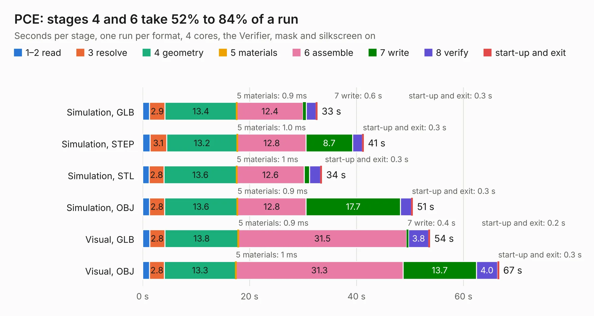

| Mode and format | 1–2 read | 3 resolve | 4 geometry | 5 materials | 6 assemble | 7 write | 8 verify | start-up and exit | Total |
|---|---:|---:|---:|---:|---:|---:|---:|---:|---:|
| Simulation, GLB | 1.3 | 2.9 | 13.4 | 0.9&nbsp;ms | 12.4 | 0.6 | 1.9 | 0.3 | 32.7 |
| Simulation, STEP | 1.4 | 3.1 | 13.2 | 1.0&nbsp;ms | 12.8 | 8.7 | 1.8 | 0.3 | 41.3 |
| Simulation, STL | 1.2 | 2.8 | 13.6 | 1&nbsp;ms | 12.6 | 1.0 | 2.1 | 0.3 | 33.5 |
| Simulation, OBJ | 1.3 | 2.8 | 13.6 | 0.9&nbsp;ms | 12.8 | 17.7 | 2.0 | 0.3 | 50.5 |
| Visual, GLB | 1.3 | 2.8 | 13.8 | 0.9&nbsp;ms | 31.5 | 0.4 | 3.8 | 0.2 | 53.7 |
| Visual, OBJ | 1.3 | 2.8 | 13.3 | 1&nbsp;ms | 31.3 | 13.7 | 4.0 | 0.3 | 66.6 |

<table align="center"><tr><td valign="top">

| Board | Repo: [Board-Folk/PC-Engine](https://github.com/Board-Folk/PC-Engine) Board: `PCE.kicad_pcb` |
|---|---|
| Complexity | 325&nbsp;/&nbsp;1000 (size&nbsp;210, features&nbsp;115) |
| KESE&nbsp;features | through vias, slotted holes, rounded, trapezoid or chamfered pads, filled zones, copper drawings, copper text, curved board outline, stack-up, dielectric εr and tanδ |
| Tested | 9th November 2026 |
| Copper&nbsp;layers | 2 |
| File&nbsp;format | KiCad 7 (20221018) |
| Parts,&nbsp;tracks,&nbsp;vias | 123, 4,523, 290 |
| Triangles,&nbsp;simulation | 3,209,090 in 199 parts |
| Verifier | PASS in all six runs |

</td><td valign="top">

<table>
<tr><th>File type</th><th>File size</th><th>Peak memory used</th></tr>
<tr><th colspan="3" align="left">Simulation</th></tr>
<tr><td>GLB</td><td align="right">112&nbsp;MB</td><td align="right">1.1&nbsp;GB</td></tr>
<tr><td>STEP</td><td align="right">614&nbsp;MB</td><td align="right">1.3&nbsp;GB</td></tr>
<tr><td>STL</td><td align="right">160&nbsp;MB</td><td align="right">1.2&nbsp;GB</td></tr>
<tr><td>OBJ</td><td align="right">345&nbsp;MB</td><td align="right">2.1&nbsp;GB</td></tr>
<tr><th colspan="3" align="left">Visual</th></tr>
<tr><td>GLB</td><td align="right">87&nbsp;MB</td><td align="right">1.5&nbsp;GB</td></tr>
<tr><td>OBJ</td><td align="right">273&nbsp;MB</td><td align="right">1.8&nbsp;GB</td></tr>
</table>

</td></tr></table>

## 669. PCE

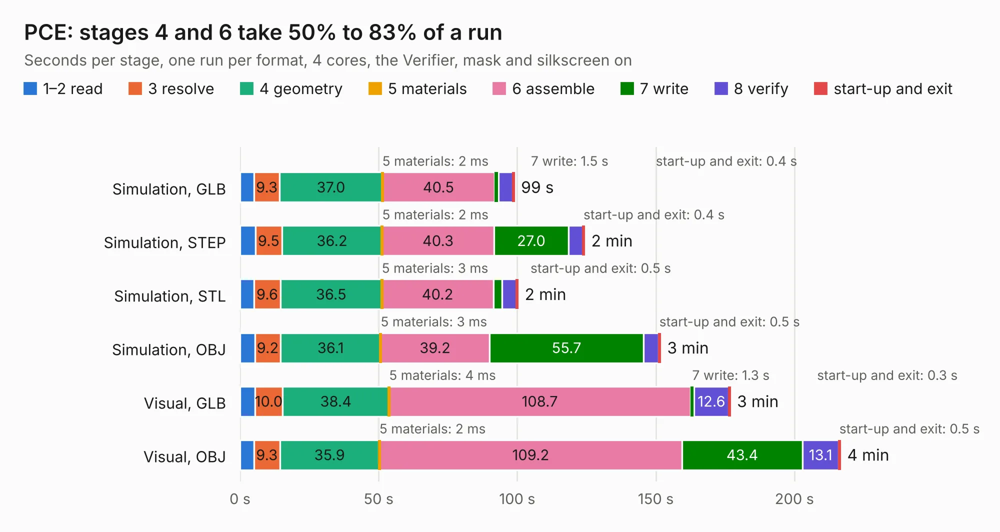

| Mode and format | 1–2 read | 3 resolve | 4 geometry | 5 materials | 6 assemble | 7 write | 8 verify | start-up and exit | Total |
|---|---:|---:|---:|---:|---:|---:|---:|---:|---:|
| Simulation, GLB | 5.0 | 9.3 | 37.0 | 2&nbsp;ms | 40.5 | 1.5 | 5.1 | 0.4 | 98.8 |
| Simulation, STEP | 5.6 | 9.5 | 36.2 | 2&nbsp;ms | 40.3 | 27.0 | 5.1 | 0.4 | 124.1 |
| Simulation, STL | 5.0 | 9.6 | 36.5 | 3&nbsp;ms | 40.2 | 3.2 | 5.1 | 0.5 | 100.1 |
| Simulation, OBJ | 5.4 | 9.2 | 36.1 | 3&nbsp;ms | 39.2 | 55.7 | 5.4 | 0.5 | 151.5 |
| Visual, GLB | 5.3 | 10.0 | 38.4 | 4&nbsp;ms | 108.7 | 1.3 | 12.6 | 0.3 | 176.7 |
| Visual, OBJ | 5.0 | 9.3 | 35.9 | 2&nbsp;ms | 109.2 | 43.4 | 13.1 | 0.5 | 216.4 |

<table align="center"><tr><td valign="top">

| Board | Repo: [Board-Folk/PC-Engine-Duo](https://github.com/Board-Folk/PC-Engine-Duo) Board: `PCE.kicad_pcb` |
|---|---|
| Complexity | 414&nbsp;/&nbsp;1000 (size&nbsp;309, features&nbsp;105) |
| KESE&nbsp;features | through vias, slotted holes, rounded, trapezoid or chamfered pads, filled zones, copper drawings, curved board outline, stack-up, dielectric εr and tanδ |
| Tested | 9th November 2026 |
| Copper&nbsp;layers | 2 |
| File&nbsp;format | KiCad 7 (20221018) |
| Parts,&nbsp;tracks,&nbsp;vias | 618, 15,551, 1,491 |
| Triangles,&nbsp;simulation | 8,529,616 in 690 parts |
| Verifier | PASS in all six runs |

</td><td valign="top">

<table>
<tr><th>File type</th><th>File size</th><th>Peak memory used</th></tr>
<tr><th colspan="3" align="left">Simulation</th></tr>
<tr><td>GLB</td><td align="right">295&nbsp;MB</td><td align="right">2.7&nbsp;GB</td></tr>
<tr><td>STEP</td><td align="right">1.6&nbsp;GB</td><td align="right">3.5&nbsp;GB</td></tr>
<tr><td>STL</td><td align="right">427&nbsp;MB</td><td align="right">2.6&nbsp;GB</td></tr>
<tr><td>OBJ</td><td align="right">921&nbsp;MB</td><td align="right">5.5&nbsp;GB</td></tr>
<tr><th colspan="3" align="left">Visual</th></tr>
<tr><td>GLB</td><td align="right">256&nbsp;MB</td><td align="right">3.9&nbsp;GB</td></tr>
<tr><td>OBJ</td><td align="right">826&nbsp;MB</td><td align="right">5.2&nbsp;GB</td></tr>
</table>

</td></tr></table>

## 670. PCE

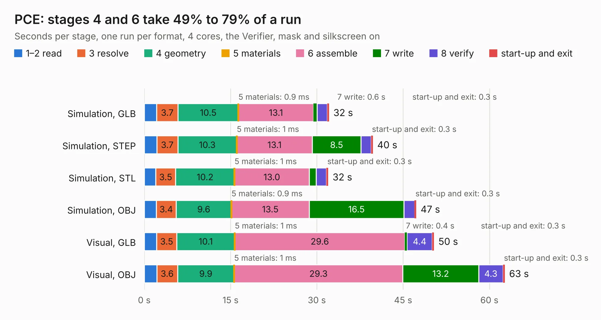

| Mode and format | 1–2 read | 3 resolve | 4 geometry | 5 materials | 6 assemble | 7 write | 8 verify | start-up and exit | Total |
|---|---:|---:|---:|---:|---:|---:|---:|---:|---:|
| Simulation, GLB | 2.1 | 3.7 | 10.5 | 0.9&nbsp;ms | 13.1 | 0.6 | 1.7 | 0.3 | 32.1 |
| Simulation, STEP | 2.2 | 3.7 | 10.3 | 1&nbsp;ms | 13.1 | 8.5 | 1.7 | 0.3 | 39.8 |
| Simulation, STL | 2.0 | 3.5 | 10.2 | 1&nbsp;ms | 13.0 | 1.2 | 1.8 | 0.3 | 32.0 |
| Simulation, OBJ | 2.1 | 3.4 | 9.6 | 0.9&nbsp;ms | 13.5 | 16.5 | 1.9 | 0.3 | 47.3 |
| Visual, GLB | 2.2 | 3.5 | 10.1 | 1&nbsp;ms | 29.6 | 0.4 | 4.4 | 0.3 | 50.4 |
| Visual, OBJ | 2.2 | 3.6 | 9.9 | 1&nbsp;ms | 29.3 | 13.2 | 4.3 | 0.3 | 62.7 |

<table align="center"><tr><td valign="top">

| Board | Repo: [Board-Folk/PC-Engine-GT](https://github.com/Board-Folk/PC-Engine-GT) Board: `PCE.kicad_pcb` |
|---|---|
| Complexity | 348&nbsp;/&nbsp;1000 (size&nbsp;233, features&nbsp;115) |
| KESE&nbsp;features | through vias, slotted holes, rounded, trapezoid or chamfered pads, filled zones, copper drawings, copper text, curved board outline, stack-up, dielectric εr and tanδ |
| Tested | 9th November 2026 |
| Copper&nbsp;layers | 4 |
| File&nbsp;format | KiCad 9 (20241229) |
| Parts,&nbsp;tracks,&nbsp;vias | 195, 4,794, 322 |
| Triangles,&nbsp;simulation | 3,256,982 in 307 parts |
| Verifier | PASS in all six runs |

</td><td valign="top">

<table>
<tr><th>File type</th><th>File size</th><th>Peak memory used</th></tr>
<tr><th colspan="3" align="left">Simulation</th></tr>
<tr><td>GLB</td><td align="right">113&nbsp;MB</td><td align="right">1.2&nbsp;GB</td></tr>
<tr><td>STEP</td><td align="right">511&nbsp;MB</td><td align="right">1.3&nbsp;GB</td></tr>
<tr><td>STL</td><td align="right">163&nbsp;MB</td><td align="right">1.2&nbsp;GB</td></tr>
<tr><td>OBJ</td><td align="right">349&nbsp;MB</td><td align="right">2.1&nbsp;GB</td></tr>
<tr><th colspan="3" align="left">Visual</th></tr>
<tr><td>GLB</td><td align="right">81&nbsp;MB</td><td align="right">1.3&nbsp;GB</td></tr>
<tr><td>OBJ</td><td align="right">255&nbsp;MB</td><td align="right">1.7&nbsp;GB</td></tr>
</table>

</td></tr></table>

## 671. TRS80I-Charmap

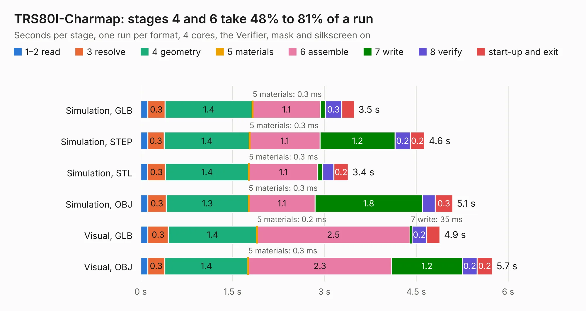

| Mode and format | 1–2 read | 3 resolve | 4 geometry | 5 materials | 6 assemble | 7 write | 8 verify | start-up and exit | Total |
|---|---:|---:|---:|---:|---:|---:|---:|---:|---:|
| Simulation, GLB | 0.1 | 0.3 | 1.4 | 0.3&nbsp;ms | 1.1 | 81&nbsp;ms | 0.3 | 0.2 | 3.5 |
| Simulation, STEP | 0.1 | 0.3 | 1.4 | 0.3&nbsp;ms | 1.1 | 1.2 | 0.2 | 0.2 | 4.6 |
| Simulation, STL | 0.1 | 0.3 | 1.4 | 0.3&nbsp;ms | 1.1 | 80&nbsp;ms | 0.2 | 0.2 | 3.4 |
| Simulation, OBJ | 0.1 | 0.3 | 1.3 | 0.3&nbsp;ms | 1.1 | 1.8 | 0.2 | 0.3 | 5.1 |
| Visual, GLB | 0.1 | 0.3 | 1.4 | 0.2&nbsp;ms | 2.5 | 35&nbsp;ms | 0.2 | 0.2 | 4.9 |
| Visual, OBJ | 0.1 | 0.3 | 1.4 | 0.3&nbsp;ms | 2.3 | 1.2 | 0.2 | 0.2 | 5.7 |

<table align="center"><tr><td valign="top">

| Board | Repo: [Board-Folk/TRS80IJP](https://github.com/Board-Folk/TRS80IJP) Board: `TRS80I-Charmap.kicad_pcb` |
|---|---|
| Folder | Extras / Charmap / Kicad |
| Complexity | 163&nbsp;/&nbsp;1000 (size&nbsp;123, features&nbsp;40) |
| KESE&nbsp;features | rounded, trapezoid or chamfered pads, stack-up, dielectric εr and tanδ |
| Tested | 9th November 2026 |
| Copper&nbsp;layers | 2 |
| File&nbsp;format | KiCad 6 (20211014) |
| Parts,&nbsp;tracks,&nbsp;vias | 5, 197, 0 |
| Triangles,&nbsp;simulation | 323,104 in 38 parts |
| Verifier | PASS in all six runs |

</td><td valign="top">

<table>
<tr><th>File type</th><th>File size</th><th>Peak memory used</th></tr>
<tr><th colspan="3" align="left">Simulation</th></tr>
<tr><td>GLB</td><td align="right">11&nbsp;MB</td><td align="right">238&nbsp;MB</td></tr>
<tr><td>STEP</td><td align="right">42&nbsp;MB</td><td align="right">261&nbsp;MB</td></tr>
<tr><td>STL</td><td align="right">16&nbsp;MB</td><td align="right">231&nbsp;MB</td></tr>
<tr><td>OBJ</td><td align="right">32&nbsp;MB</td><td align="right">266&nbsp;MB</td></tr>
<tr><th colspan="3" align="left">Visual</th></tr>
<tr><td>GLB</td><td align="right">6.5&nbsp;MB</td><td align="right">238&nbsp;MB</td></tr>
<tr><td>OBJ</td><td align="right">19&nbsp;MB</td><td align="right">242&nbsp;MB</td></tr>
</table>

</td></tr></table>

## 672. TRSG3JPMod

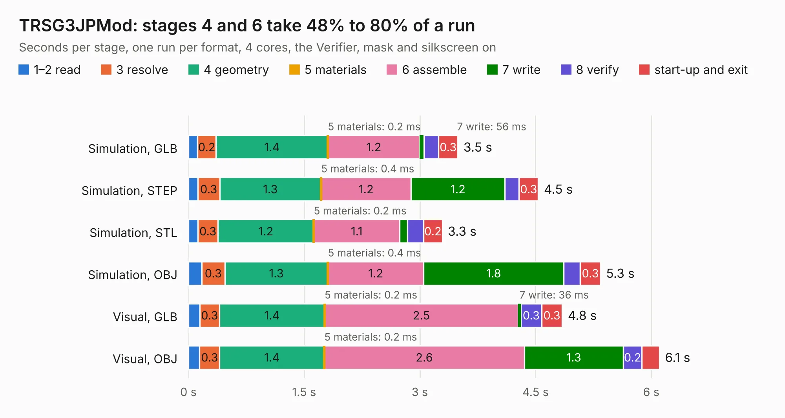

| Mode and format | 1–2 read | 3 resolve | 4 geometry | 5 materials | 6 assemble | 7 write | 8 verify | start-up and exit | Total |
|---|---:|---:|---:|---:|---:|---:|---:|---:|---:|
| Simulation, GLB | 0.1 | 0.2 | 1.4 | 0.2&nbsp;ms | 1.2 | 56&nbsp;ms | 0.2 | 0.3 | 3.5 |
| Simulation, STEP | 0.1 | 0.3 | 1.3 | 0.4&nbsp;ms | 1.2 | 1.2 | 0.2 | 0.3 | 4.5 |
| Simulation, STL | 0.1 | 0.3 | 1.2 | 0.2&nbsp;ms | 1.1 | 0.1 | 0.2 | 0.2 | 3.3 |
| Simulation, OBJ | 0.2 | 0.3 | 1.3 | 0.4&nbsp;ms | 1.2 | 1.8 | 0.2 | 0.3 | 5.3 |
| Visual, GLB | 0.1 | 0.3 | 1.4 | 0.2&nbsp;ms | 2.5 | 36&nbsp;ms | 0.3 | 0.3 | 4.8 |
| Visual, OBJ | 0.1 | 0.3 | 1.4 | 0.2&nbsp;ms | 2.6 | 1.3 | 0.2 | 0.2 | 6.1 |

<table align="center"><tr><td valign="top">

| Board | Repo: [Board-Folk/TRS80IJP](https://github.com/Board-Folk/TRS80IJP) Board: `TRSG3JPMod.kicad_pcb` |
|---|---|
| Folder | Extras / TRSG3Mod / TRSG3JPModv1 |
| Complexity | 179&nbsp;/&nbsp;1000 (size&nbsp;114, features&nbsp;65) |
| KESE&nbsp;features | through vias, filled zones, stack-up, dielectric εr and tanδ |
| Tested | 9th November 2026 |
| Copper&nbsp;layers | 2 |
| File&nbsp;format | KiCad 7 (20221018) |
| Parts,&nbsp;tracks,&nbsp;vias | 3, 129, 8 |
| Triangles,&nbsp;simulation | 282,270 in 33 parts |
| Verifier | PASS in all six runs |

</td><td valign="top">

<table>
<tr><th>File type</th><th>File size</th><th>Peak memory used</th></tr>
<tr><th colspan="3" align="left">Simulation</th></tr>
<tr><td>GLB</td><td align="right">9.8&nbsp;MB</td><td align="right">232&nbsp;MB</td></tr>
<tr><td>STEP</td><td align="right">47&nbsp;MB</td><td align="right">249&nbsp;MB</td></tr>
<tr><td>STL</td><td align="right">14&nbsp;MB</td><td align="right">227&nbsp;MB</td></tr>
<tr><td>OBJ</td><td align="right">28&nbsp;MB</td><td align="right">242&nbsp;MB</td></tr>
<tr><th colspan="3" align="left">Visual</th></tr>
<tr><td>GLB</td><td align="right">5.8&nbsp;MB</td><td align="right">237&nbsp;MB</td></tr>
<tr><td>OBJ</td><td align="right">17&nbsp;MB</td><td align="right">236&nbsp;MB</td></tr>
</table>

</td></tr></table>

## 673. TRSG3Mod

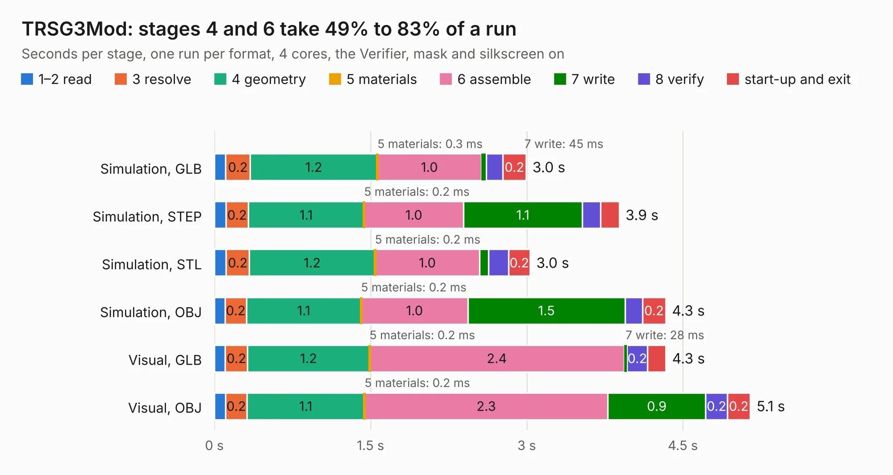

| Mode and format | 1–2 read | 3 resolve | 4 geometry | 5 materials | 6 assemble | 7 write | 8 verify | start-up and exit | Total |
|---|---:|---:|---:|---:|---:|---:|---:|---:|---:|
| Simulation, GLB | 0.1 | 0.2 | 1.2 | 0.3&nbsp;ms | 1.0 | 45&nbsp;ms | 0.2 | 0.2 | 3.0 |
| Simulation, STEP | 0.1 | 0.2 | 1.1 | 0.2&nbsp;ms | 1.0 | 1.1 | 0.2 | 0.2 | 3.9 |
| Simulation, STL | 0.1 | 0.2 | 1.2 | 0.2&nbsp;ms | 1.0 | 87&nbsp;ms | 0.2 | 0.2 | 3.0 |
| Simulation, OBJ | 0.1 | 0.2 | 1.1 | 0.2&nbsp;ms | 1.0 | 1.5 | 0.2 | 0.2 | 4.3 |
| Visual, GLB | 0.1 | 0.2 | 1.2 | 0.2&nbsp;ms | 2.4 | 28&nbsp;ms | 0.2 | 0.2 | 4.3 |
| Visual, OBJ | 0.1 | 0.2 | 1.1 | 0.2&nbsp;ms | 2.3 | 0.9 | 0.2 | 0.2 | 5.1 |

<table align="center"><tr><td valign="top">

| Board | Repo: [Board-Folk/TRS80IJP](https://github.com/Board-Folk/TRS80IJP) Board: `TRSG3Mod.kicad_pcb` |
|---|---|
| Folder | Extras / TRSG3Mod / TRSG3Modv1 |
| Complexity | 198&nbsp;/&nbsp;1000 (size&nbsp;123, features&nbsp;75) |
| KESE&nbsp;features | through vias, rounded, trapezoid or chamfered pads, filled zones, stack-up, dielectric εr and tanδ |
| Tested | 9th November 2026 |
| Copper&nbsp;layers | 2 |
| File&nbsp;format | KiCad 7 (20221018) |
| Parts,&nbsp;tracks,&nbsp;vias | 6, 153, 10 |
| Triangles,&nbsp;simulation | 308,292 in 34 parts |
| Verifier | PASS in all six runs |

</td><td valign="top">

<table>
<tr><th>File type</th><th>File size</th><th>Peak memory used</th></tr>
<tr><th colspan="3" align="left">Simulation</th></tr>
<tr><td>GLB</td><td align="right">11&nbsp;MB</td><td align="right">238&nbsp;MB</td></tr>
<tr><td>STEP</td><td align="right">52&nbsp;MB</td><td align="right">261&nbsp;MB</td></tr>
<tr><td>STL</td><td align="right">15&nbsp;MB</td><td align="right">243&nbsp;MB</td></tr>
<tr><td>OBJ</td><td align="right">31&nbsp;MB</td><td align="right">245&nbsp;MB</td></tr>
<tr><th colspan="3" align="left">Visual</th></tr>
<tr><td>GLB</td><td align="right">6.6&nbsp;MB</td><td align="right">260&nbsp;MB</td></tr>
<tr><td>OBJ</td><td align="right">19&nbsp;MB</td><td align="right">262&nbsp;MB</td></tr>
</table>

</td></tr></table>

## 674. TRS80IJP_1

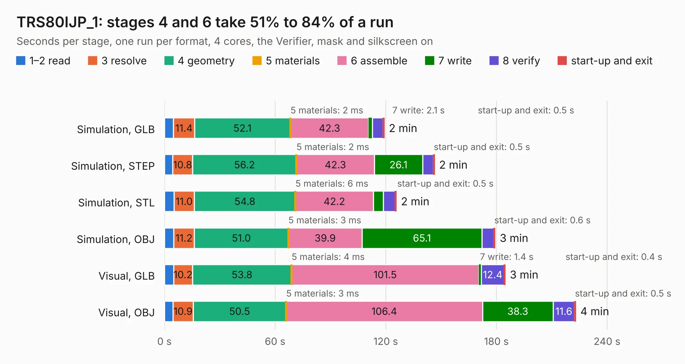

| Mode and format | 1–2 read | 3 resolve | 4 geometry | 5 materials | 6 assemble | 7 write | 8 verify | start-up and exit | Total |
|---|---:|---:|---:|---:|---:|---:|---:|---:|---:|
| Simulation, GLB | 4.9 | 11.4 | 52.1 | 2&nbsp;ms | 42.3 | 2.1 | 5.8 | 0.5 | 119.0 |
| Simulation, STEP | 4.5 | 10.8 | 56.2 | 2&nbsp;ms | 42.3 | 26.1 | 5.9 | 0.5 | 146.3 |
| Simulation, STL | 5.2 | 11.0 | 54.8 | 6&nbsp;ms | 42.2 | 5.4 | 6.5 | 0.5 | 125.6 |
| Simulation, OBJ | 5.0 | 11.2 | 51.0 | 3&nbsp;ms | 39.9 | 65.1 | 6.4 | 0.6 | 179.2 |
| Visual, GLB | 5.0 | 10.2 | 53.8 | 4&nbsp;ms | 101.5 | 1.4 | 12.4 | 0.4 | 184.6 |
| Visual, OBJ | 4.7 | 10.9 | 50.5 | 3&nbsp;ms | 106.4 | 38.3 | 11.6 | 0.5 | 222.9 |

<table align="center"><tr><td valign="top">

| Board | Repo: [Board-Folk/TRS80IJP](https://github.com/Board-Folk/TRS80IJP) Board: `TRS80IJP_1.kicad_pcb` |
|---|---|
| Folder | v1.1 / Kicad |
| Complexity | 297&nbsp;/&nbsp;1000 (size&nbsp;232, features&nbsp;65) |
| KESE&nbsp;features | through vias, filled zones, stack-up, dielectric εr and tanδ |
| Tested | 9th November 2026 |
| Copper&nbsp;layers | 2 |
| File&nbsp;format | KiCad 7 (20221018) |
| Parts,&nbsp;tracks,&nbsp;vias | 254, 10,574, 737 |
| Triangles,&nbsp;simulation | 9,938,980 in 419 parts |
| Verifier | PASS in all six runs |

</td><td valign="top">

<table>
<tr><th>File type</th><th>File size</th><th>Peak memory used</th></tr>
<tr><th colspan="3" align="left">Simulation</th></tr>
<tr><td>GLB</td><td align="right">335&nbsp;MB</td><td align="right">3.1&nbsp;GB</td></tr>
<tr><td>STEP</td><td align="right">1.5&nbsp;GB</td><td align="right">3.7&nbsp;GB</td></tr>
<tr><td>STL</td><td align="right">497&nbsp;MB</td><td align="right">3.1&nbsp;GB</td></tr>
<tr><td>OBJ</td><td align="right">1.1&nbsp;GB</td><td align="right">6.2&nbsp;GB</td></tr>
<tr><th colspan="3" align="left">Visual</th></tr>
<tr><td>GLB</td><td align="right">223&nbsp;MB</td><td align="right">3.5&nbsp;GB</td></tr>
<tr><td>OBJ</td><td align="right">715&nbsp;MB</td><td align="right">4.6&nbsp;GB</td></tr>
</table>

</td></tr></table>

## 675. TRS80ILCMod

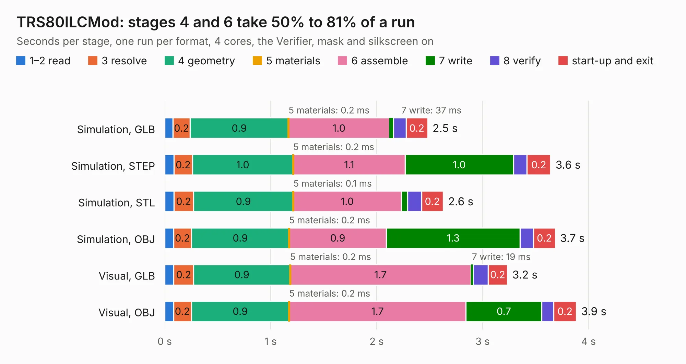

| Mode and format | 1–2 read | 3 resolve | 4 geometry | 5 materials | 6 assemble | 7 write | 8 verify | start-up and exit | Total |
|---|---:|---:|---:|---:|---:|---:|---:|---:|---:|
| Simulation, GLB | 79&nbsp;ms | 0.2 | 0.9 | 0.2&nbsp;ms | 1.0 | 37&nbsp;ms | 0.1 | 0.2 | 2.5 |
| Simulation, STEP | 87&nbsp;ms | 0.2 | 1.0 | 0.2&nbsp;ms | 1.1 | 1.0 | 0.1 | 0.2 | 3.6 |
| Simulation, STL | 86&nbsp;ms | 0.2 | 0.9 | 0.1&nbsp;ms | 1.0 | 58&nbsp;ms | 0.1 | 0.2 | 2.6 |
| Simulation, OBJ | 83&nbsp;ms | 0.2 | 0.9 | 0.2&nbsp;ms | 0.9 | 1.3 | 0.1 | 0.2 | 3.7 |
| Visual, GLB | 86&nbsp;ms | 0.2 | 0.9 | 0.2&nbsp;ms | 1.7 | 19&nbsp;ms | 0.1 | 0.2 | 3.2 |
| Visual, OBJ | 83&nbsp;ms | 0.2 | 0.9 | 0.2&nbsp;ms | 1.7 | 0.7 | 0.1 | 0.2 | 3.9 |

<table align="center"><tr><td valign="top">

| Board | Repo: [Board-Folk/TRS80IUS](https://github.com/Board-Folk/TRS80IUS) Board: `TRS80ILCMod.kicad_pcb` |
|---|---|
| Folder | Extras / TRS80ILCMod / Kicad |
| Complexity | 139&nbsp;/&nbsp;1000 (size&nbsp;109, features&nbsp;30) |
| KESE&nbsp;features | stack-up, dielectric εr and tanδ |
| Tested | 9th November 2026 |
| Copper&nbsp;layers | 2 |
| File&nbsp;format | KiCad 7 (20221018) |
| Parts,&nbsp;tracks,&nbsp;vias | 5, 83, 0 |
| Triangles,&nbsp;simulation | 246,726 in 28 parts |
| Verifier | PASS in all six runs |

</td><td valign="top">

<table>
<tr><th>File type</th><th>File size</th><th>Peak memory used</th></tr>
<tr><th colspan="3" align="left">Simulation</th></tr>
<tr><td>GLB</td><td align="right">8.2&nbsp;MB</td><td align="right">218&nbsp;MB</td></tr>
<tr><td>STEP</td><td align="right">31&nbsp;MB</td><td align="right">236&nbsp;MB</td></tr>
<tr><td>STL</td><td align="right">12&nbsp;MB</td><td align="right">213&nbsp;MB</td></tr>
<tr><td>OBJ</td><td align="right">24&nbsp;MB</td><td align="right">217&nbsp;MB</td></tr>
<tr><th colspan="3" align="left">Visual</th></tr>
<tr><td>GLB</td><td align="right">4.5&nbsp;MB</td><td align="right">206&nbsp;MB</td></tr>
<tr><td>OBJ</td><td align="right">13&nbsp;MB</td><td align="right">212&nbsp;MB</td></tr>
</table>

</td></tr></table>

## 676. TRS80IUS

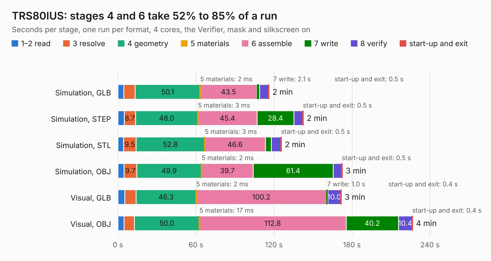

| Mode and format | 1–2 read | 3 resolve | 4 geometry | 5 materials | 6 assemble | 7 write | 8 verify | start-up and exit | Total |
|---|---:|---:|---:|---:|---:|---:|---:|---:|---:|
| Simulation, GLB | 4.6 | 8.6 | 50.1 | 2&nbsp;ms | 43.5 | 2.1 | 6.7 | 0.5 | 116.2 |
| Simulation, STEP | 4.9 | 8.7 | 48.0 | 3&nbsp;ms | 45.4 | 28.4 | 6.7 | 0.5 | 142.5 |
| Simulation, STL | 4.4 | 9.5 | 52.8 | 3&nbsp;ms | 46.6 | 4.6 | 7.3 | 0.5 | 125.7 |
| Simulation, OBJ | 4.8 | 9.7 | 49.9 | 2&nbsp;ms | 39.7 | 61.4 | 6.5 | 0.5 | 172.5 |
| Visual, GLB | 5.3 | 8.6 | 46.3 | 2&nbsp;ms | 100.2 | 1.0 | 10.0 | 0.4 | 171.7 |
| Visual, OBJ | 4.7 | 8.0 | 50.0 | 17&nbsp;ms | 112.8 | 40.2 | 10.4 | 0.4 | 226.5 |

<table align="center"><tr><td valign="top">

| Board | Repo: [Board-Folk/TRS80IUS](https://github.com/Board-Folk/TRS80IUS) Board: `TRS80IUS.kicad_pcb` |
|---|---|
| Folder | v1.1 / Kicad |
| Complexity | 308&nbsp;/&nbsp;1000 (size&nbsp;228, features&nbsp;80) |
| KESE&nbsp;features | through vias, custom pads, filled zones, copper drawings, copper text, curved board outline |
| Tested | 9th November 2026 |
| Copper&nbsp;layers | 2 |
| File&nbsp;format | KiCad 7 (20221018) |
| Parts,&nbsp;tracks,&nbsp;vias | 231, 9,962, 380 |
| Triangles,&nbsp;simulation | 8,820,422 in 392 parts |
| Verifier | PASS in all six runs |

</td><td valign="top">

<table>
<tr><th>File type</th><th>File size</th><th>Peak memory used</th></tr>
<tr><th colspan="3" align="left">Simulation</th></tr>
<tr><td>GLB</td><td align="right">296&nbsp;MB</td><td align="right">2.4&nbsp;GB</td></tr>
<tr><td>STEP</td><td align="right">1.3&nbsp;GB</td><td align="right">3.3&nbsp;GB</td></tr>
<tr><td>STL</td><td align="right">441&nbsp;MB</td><td align="right">2.5&nbsp;GB</td></tr>
<tr><td>OBJ</td><td align="right">933&nbsp;MB</td><td align="right">5.5&nbsp;GB</td></tr>
<tr><th colspan="3" align="left">Visual</th></tr>
<tr><td>GLB</td><td align="right">183&nbsp;MB</td><td align="right">3.0&nbsp;GB</td></tr>
<tr><td>OBJ</td><td align="right">587&nbsp;MB</td><td align="right">3.7&nbsp;GB</td></tr>
</table>

</td></tr></table>

## 677. Debug_Adapter

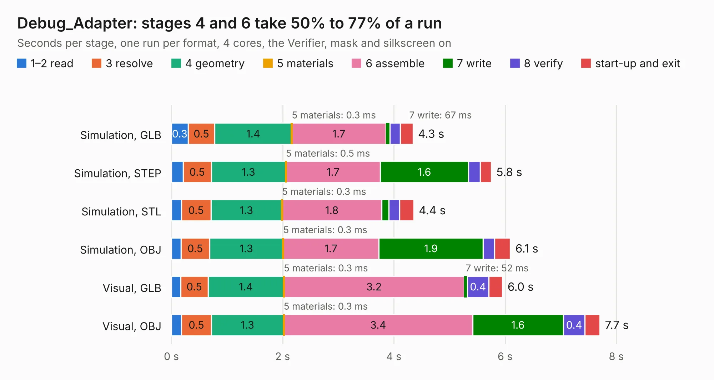

| Mode and format | 1–2 read | 3 resolve | 4 geometry | 5 materials | 6 assemble | 7 write | 8 verify | start-up and exit | Total |
|---|---:|---:|---:|---:|---:|---:|---:|---:|---:|
| Simulation, GLB | 0.3 | 0.5 | 1.4 | 0.3&nbsp;ms | 1.7 | 67&nbsp;ms | 0.2 | 0.2 | 4.3 |
| Simulation, STEP | 0.2 | 0.5 | 1.3 | 0.5&nbsp;ms | 1.7 | 1.6 | 0.2 | 0.2 | 5.8 |
| Simulation, STL | 0.2 | 0.5 | 1.3 | 0.3&nbsp;ms | 1.8 | 0.1 | 0.2 | 0.3 | 4.4 |
| Simulation, OBJ | 0.2 | 0.5 | 1.3 | 0.3&nbsp;ms | 1.7 | 1.9 | 0.2 | 0.3 | 6.1 |
| Visual, GLB | 0.2 | 0.5 | 1.4 | 0.3&nbsp;ms | 3.2 | 52&nbsp;ms | 0.4 | 0.2 | 6.0 |
| Visual, OBJ | 0.2 | 0.5 | 1.3 | 0.3&nbsp;ms | 3.4 | 1.6 | 0.4 | 0.3 | 7.7 |

<table align="center"><tr><td valign="top">

| Board | Repo: [bogdan8266/h616-board](https://github.com/bogdan8266/h616-board) Board: `Debug_Adapter.kicad_pcb` |
|---|---|
| Folder | Hardware / Debug_Adapter |
| Complexity | 261&nbsp;/&nbsp;1000 (size&nbsp;161, features&nbsp;100) |
| KESE&nbsp;features | through vias, slotted holes, rounded, trapezoid or chamfered pads, filled zones, copper drawings, copper text, curved board outline, knockout text |
| Tested | 9th November 2026 |
| Copper&nbsp;layers | 2 |
| File&nbsp;format | KiCad 9 (20241229) |
| Parts,&nbsp;tracks,&nbsp;vias | 25, 251, 179 |
| Triangles,&nbsp;simulation | 370,438 in 57 parts |
| Verifier | PASS in all six runs |

</td><td valign="top">

<table>
<tr><th>File type</th><th>File size</th><th>Peak memory used</th></tr>
<tr><th colspan="3" align="left">Simulation</th></tr>
<tr><td>GLB</td><td align="right">13&nbsp;MB</td><td align="right">306&nbsp;MB</td></tr>
<tr><td>STEP</td><td align="right">50&nbsp;MB</td><td align="right">338&nbsp;MB</td></tr>
<tr><td>STL</td><td align="right">19&nbsp;MB</td><td align="right">299&nbsp;MB</td></tr>
<tr><td>OBJ</td><td align="right">37&nbsp;MB</td><td align="right">298&nbsp;MB</td></tr>
<tr><th colspan="3" align="left">Visual</th></tr>
<tr><td>GLB</td><td align="right">11&nbsp;MB</td><td align="right">334&nbsp;MB</td></tr>
<tr><td>OBJ</td><td align="right">32&nbsp;MB</td><td align="right">337&nbsp;MB</td></tr>
</table>

</td></tr></table>

## 678. H616_devboard

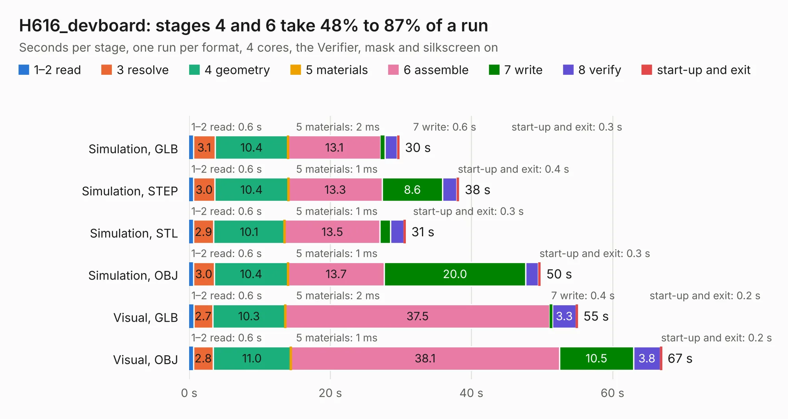

| Mode and format | 1–2 read | 3 resolve | 4 geometry | 5 materials | 6 assemble | 7 write | 8 verify | start-up and exit | Total |
|---|---:|---:|---:|---:|---:|---:|---:|---:|---:|
| Simulation, GLB | 0.6 | 3.1 | 10.4 | 2&nbsp;ms | 13.1 | 0.6 | 1.7 | 0.3 | 29.8 |
| Simulation, STEP | 0.6 | 3.0 | 10.4 | 1&nbsp;ms | 13.3 | 8.6 | 2.0 | 0.4 | 38.3 |
| Simulation, STL | 0.6 | 2.9 | 10.1 | 1&nbsp;ms | 13.5 | 1.5 | 1.9 | 0.3 | 30.7 |
| Simulation, OBJ | 0.6 | 3.0 | 10.4 | 1&nbsp;ms | 13.7 | 20.0 | 1.8 | 0.3 | 49.8 |
| Visual, GLB | 0.6 | 2.7 | 10.3 | 2&nbsp;ms | 37.5 | 0.4 | 3.3 | 0.2 | 55.1 |
| Visual, OBJ | 0.6 | 2.8 | 11.0 | 1&nbsp;ms | 38.1 | 10.5 | 3.8 | 0.2 | 67.0 |

<table align="center"><tr><td valign="top">

| Board | Repo: [bogdan8266/h616-board](https://github.com/bogdan8266/h616-board) Board: `H616_devboard.kicad_pcb` |
|---|---|
| Folder | Hardware / H616_DDR3 |
| Complexity | 412&nbsp;/&nbsp;1000 (size&nbsp;297, features&nbsp;115) |
| KESE&nbsp;features | through vias, slotted holes, rounded, trapezoid or chamfered pads, drill offsets, arc tracks, copper text, stack-up, dielectric εr and tanδ, copper finish |
| Tested | 9th November 2026 |
| Copper&nbsp;layers | 8 |
| File&nbsp;format | KiCad 10 (20260206) |
| Parts,&nbsp;tracks,&nbsp;vias | 167, 1,531, 263 |
| Triangles,&nbsp;simulation | 4,056,192 in 464 parts |
| Verifier | PASS in all six runs |

</td><td valign="top">

<table>
<tr><th>File type</th><th>File size</th><th>Peak memory used</th></tr>
<tr><th colspan="3" align="left">Simulation</th></tr>
<tr><td>GLB</td><td align="right">131&nbsp;MB</td><td align="right">1.1&nbsp;GB</td></tr>
<tr><td>STEP</td><td align="right">460&nbsp;MB</td><td align="right">1.3&nbsp;GB</td></tr>
<tr><td>STL</td><td align="right">203&nbsp;MB</td><td align="right">1.1&nbsp;GB</td></tr>
<tr><td>OBJ</td><td align="right">426&nbsp;MB</td><td align="right">2.5&nbsp;GB</td></tr>
<tr><th colspan="3" align="left">Visual</th></tr>
<tr><td>GLB</td><td align="right">73&nbsp;MB</td><td align="right">1.3&nbsp;GB</td></tr>
<tr><td>OBJ</td><td align="right">230&nbsp;MB</td><td align="right">1.5&nbsp;GB</td></tr>
</table>

</td></tr></table>

## 679. H616_devboard

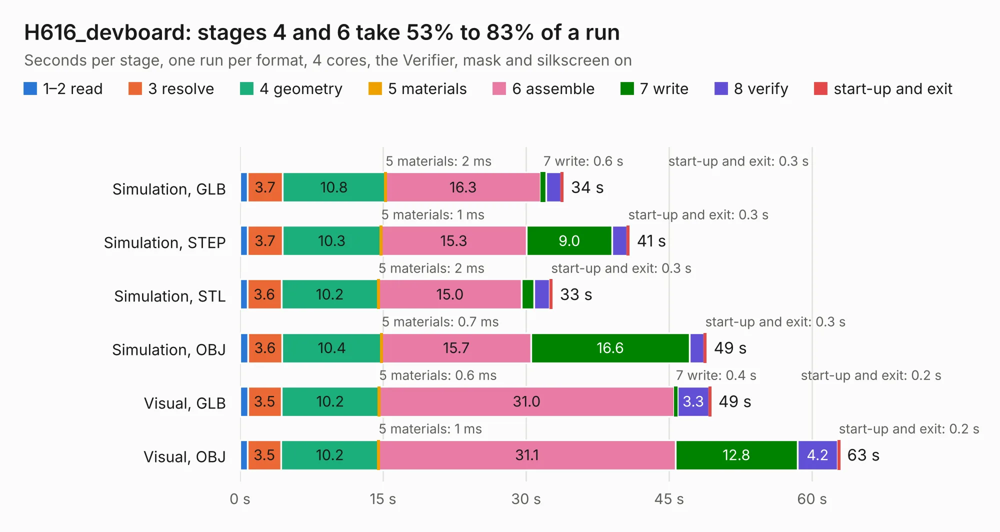

| Mode and format | 1–2 read | 3 resolve | 4 geometry | 5 materials | 6 assemble | 7 write | 8 verify | start-up and exit | Total |
|---|---:|---:|---:|---:|---:|---:|---:|---:|---:|
| Simulation, GLB | 0.8 | 3.7 | 10.8 | 2&nbsp;ms | 16.3 | 0.6 | 1.5 | 0.3 | 33.9 |
| Simulation, STEP | 0.8 | 3.7 | 10.3 | 1&nbsp;ms | 15.3 | 9.0 | 1.5 | 0.3 | 40.9 |
| Simulation, STL | 0.8 | 3.6 | 10.2 | 2&nbsp;ms | 15.0 | 1.3 | 1.6 | 0.3 | 32.8 |
| Simulation, OBJ | 0.8 | 3.6 | 10.4 | 0.7&nbsp;ms | 15.7 | 16.6 | 1.5 | 0.3 | 48.9 |
| Visual, GLB | 0.8 | 3.5 | 10.2 | 0.6&nbsp;ms | 31.0 | 0.4 | 3.3 | 0.2 | 49.4 |
| Visual, OBJ | 0.8 | 3.5 | 10.2 | 1&nbsp;ms | 31.1 | 12.8 | 4.2 | 0.2 | 62.9 |

<table align="center"><tr><td valign="top">

| Board | Repo: [bogdan8266/h616-board](https://github.com/bogdan8266/h616-board) Board: `H616_devboard.kicad_pcb` |
|---|---|
| Folder | Hardware / H616_LPDDR4 |
| Complexity | 447&nbsp;/&nbsp;1000 (size&nbsp;297, features&nbsp;150) |
| KESE&nbsp;features | through vias, rounded, trapezoid or chamfered pads, arc tracks, filled zones, copper drawings, copper text, curved board outline, knockout text, stack-up, dielectric εr and tanδ, copper finish |
| Tested | 9th November 2026 |
| Copper&nbsp;layers | 4 |
| File&nbsp;format | KiCad 9 (20241229) |
| Parts,&nbsp;tracks,&nbsp;vias | 152, 6,210, 715 |
| Triangles,&nbsp;simulation | 4,013,826 in 333 parts |
| Verifier | PASS in all six runs |

</td><td valign="top">

<table>
<tr><th>File type</th><th>File size</th><th>Peak memory used</th></tr>
<tr><th colspan="3" align="left">Simulation</th></tr>
<tr><td>GLB</td><td align="right">135&nbsp;MB</td><td align="right">1.3&nbsp;GB</td></tr>
<tr><td>STEP</td><td align="right">567&nbsp;MB</td><td align="right">1.7&nbsp;GB</td></tr>
<tr><td>STL</td><td align="right">201&nbsp;MB</td><td align="right">1.3&nbsp;GB</td></tr>
<tr><td>OBJ</td><td align="right">422&nbsp;MB</td><td align="right">2.5&nbsp;GB</td></tr>
<tr><th colspan="3" align="left">Visual</th></tr>
<tr><td>GLB</td><td align="right">99&nbsp;MB</td><td align="right">1.7&nbsp;GB</td></tr>
<tr><td>OBJ</td><td align="right">316&nbsp;MB</td><td align="right">2.2&nbsp;GB</td></tr>
</table>

</td></tr></table>

## 680. SmartPrintCoreH7x

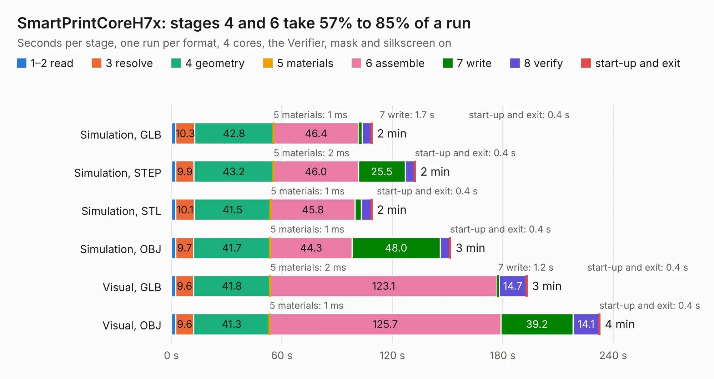

| Mode and format | 1–2 read | 3 resolve | 4 geometry | 5 materials | 6 assemble | 7 write | 8 verify | start-up and exit | Total |
|---|---:|---:|---:|---:|---:|---:|---:|---:|---:|
| Simulation, GLB | 2.4 | 10.3 | 42.8 | 1&nbsp;ms | 46.4 | 1.7 | 5.0 | 0.4 | 109.0 |
| Simulation, STEP | 2.4 | 9.9 | 43.2 | 2&nbsp;ms | 46.0 | 25.5 | 5.1 | 0.4 | 132.5 |
| Simulation, STL | 2.4 | 10.1 | 41.5 | 1&nbsp;ms | 45.8 | 3.5 | 5.3 | 0.4 | 108.9 |
| Simulation, OBJ | 2.4 | 9.7 | 41.7 | 1&nbsp;ms | 44.3 | 48.0 | 5.1 | 0.4 | 151.6 |
| Visual, GLB | 2.3 | 9.6 | 41.8 | 2&nbsp;ms | 123.1 | 1.2 | 14.7 | 0.4 | 193.2 |
| Visual, OBJ | 2.4 | 9.6 | 41.3 | 1&nbsp;ms | 125.7 | 39.2 | 14.1 | 0.4 | 232.7 |

<table align="center"><tr><td valign="top">

| Board | Repo: [BoltzRnD/SmartPrintCoreH7x](https://github.com/BoltzRnD/SmartPrintCoreH7x) Board: `SmartPrintCoreH7x.kicad_pcb` |
|---|---|
| Folder | SmartPrintCoreH7x |
| Complexity | 410&nbsp;/&nbsp;1000 (size&nbsp;280, features&nbsp;130) |
| KESE&nbsp;features | through vias, slotted holes, custom pads, rounded, trapezoid or chamfered pads, arc tracks, filled zones, copper drawings, stack-up, dielectric εr and tanδ, mask and silkscreen colours |
| Tested | 9th November 2026 |
| Copper&nbsp;layers | 2 |
| File&nbsp;format | KiCad 7 (20221018) |
| Parts,&nbsp;tracks,&nbsp;vias | 541, 8,490, 1,506 |
| Triangles,&nbsp;simulation | 7,949,190 in 428 parts |
| Verifier | PASS in all six runs |

</td><td valign="top">

<table>
<tr><th>File type</th><th>File size</th><th>Peak memory used</th></tr>
<tr><th colspan="3" align="left">Simulation</th></tr>
<tr><td>GLB</td><td align="right">273&nbsp;MB</td><td align="right">2.7&nbsp;GB</td></tr>
<tr><td>STEP</td><td align="right">1.5&nbsp;GB</td><td align="right">3.1&nbsp;GB</td></tr>
<tr><td>STL</td><td align="right">397&nbsp;MB</td><td align="right">2.8&nbsp;GB</td></tr>
<tr><td>OBJ</td><td align="right">851&nbsp;MB</td><td align="right">5.0&nbsp;GB</td></tr>
<tr><th colspan="3" align="left">Visual</th></tr>
<tr><td>GLB</td><td align="right">238&nbsp;MB</td><td align="right">3.5&nbsp;GB</td></tr>
<tr><td>OBJ</td><td align="right">764&nbsp;MB</td><td align="right">4.9&nbsp;GB</td></tr>
</table>

</td></tr></table>

## 681. other-m68k

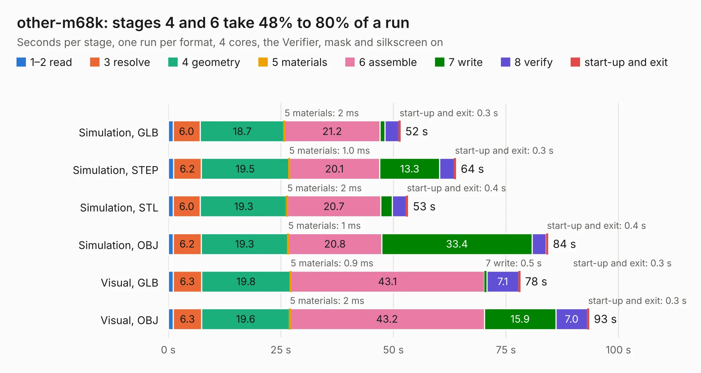

| Mode and format | 1–2 read | 3 resolve | 4 geometry | 5 materials | 6 assemble | 7 write | 8 verify | start-up and exit | Total |
|---|---:|---:|---:|---:|---:|---:|---:|---:|---:|
| Simulation, GLB | 1.1 | 6.0 | 18.7 | 2&nbsp;ms | 21.2 | 1.1 | 3.1 | 0.3 | 51.5 |
| Simulation, STEP | 1.1 | 6.2 | 19.5 | 1.0&nbsp;ms | 20.1 | 13.3 | 3.2 | 0.3 | 63.9 |
| Simulation, STL | 1.1 | 6.0 | 19.3 | 2&nbsp;ms | 20.7 | 2.6 | 3.1 | 0.4 | 53.2 |
| Simulation, OBJ | 1.1 | 6.2 | 19.3 | 1&nbsp;ms | 20.8 | 33.4 | 3.1 | 0.4 | 84.3 |
| Visual, GLB | 1.1 | 6.3 | 19.8 | 0.9&nbsp;ms | 43.1 | 0.5 | 7.1 | 0.3 | 78.1 |
| Visual, OBJ | 1.1 | 6.3 | 19.6 | 2&nbsp;ms | 43.2 | 15.9 | 7.0 | 0.3 | 93.4 |

<table align="center"><tr><td valign="top">

| Board | Repo: [bradgrantham/other-m68k](https://github.com/bradgrantham/other-m68k) Board: `other-m68k.kicad_pcb` |
|---|---|
| Folder | kicad / release |
| Complexity | 349&nbsp;/&nbsp;1000 (size&nbsp;284, features&nbsp;65) |
| KESE&nbsp;features | through vias, slotted holes, rounded, trapezoid or chamfered pads, filled zones, curved board outline |
| Tested | 9th November 2026 |
| Copper&nbsp;layers | 4 |
| File&nbsp;format | KiCad 9 (20241229) |
| Parts,&nbsp;tracks,&nbsp;vias | 163, 6,720, 665 |
| Triangles,&nbsp;simulation | 6,929,688 in 267 parts |
| Verifier | PASS in all six runs |

</td><td valign="top">

<table>
<tr><th>File type</th><th>File size</th><th>Peak memory used</th></tr>
<tr><th colspan="3" align="left">Simulation</th></tr>
<tr><td>GLB</td><td align="right">234&nbsp;MB</td><td align="right">2.0&nbsp;GB</td></tr>
<tr><td>STEP</td><td align="right">837&nbsp;MB</td><td align="right">2.3&nbsp;GB</td></tr>
<tr><td>STL</td><td align="right">347&nbsp;MB</td><td align="right">1.9&nbsp;GB</td></tr>
<tr><td>OBJ</td><td align="right">734&nbsp;MB</td><td align="right">4.3&nbsp;GB</td></tr>
<tr><th colspan="3" align="left">Visual</th></tr>
<tr><td>GLB</td><td align="right">126&nbsp;MB</td><td align="right">2.1&nbsp;GB</td></tr>
<tr><td>OBJ</td><td align="right">403&nbsp;MB</td><td align="right">2.6&nbsp;GB</td></tr>
</table>

</td></tr></table>

## 682. ClassicIIReloaded

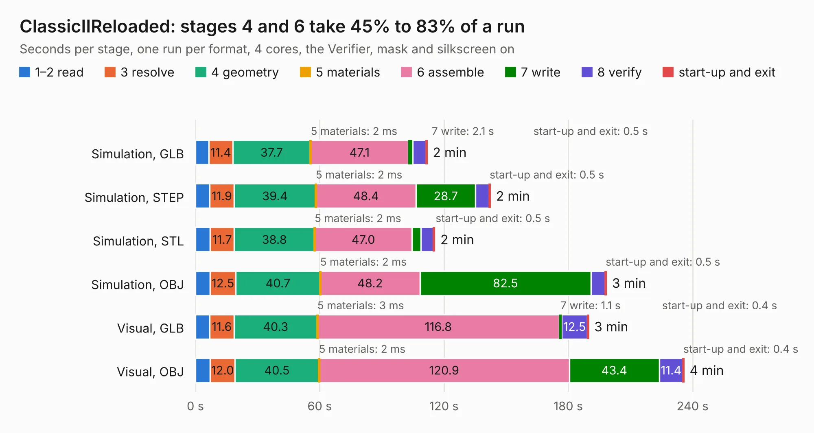

| Mode and format | 1–2 read | 3 resolve | 4 geometry | 5 materials | 6 assemble | 7 write | 8 verify | start-up and exit | Total |
|---|---:|---:|---:|---:|---:|---:|---:|---:|---:|
| Simulation, GLB | 6.6 | 11.4 | 37.7 | 2&nbsp;ms | 47.1 | 2.1 | 6.4 | 0.5 | 111.8 |
| Simulation, STEP | 6.8 | 11.9 | 39.4 | 2&nbsp;ms | 48.4 | 28.7 | 6.6 | 0.5 | 142.3 |
| Simulation, STL | 7.1 | 11.7 | 38.8 | 2&nbsp;ms | 47.0 | 4.2 | 6.1 | 0.5 | 115.4 |
| Simulation, OBJ | 7.0 | 12.5 | 40.7 | 2&nbsp;ms | 48.2 | 82.5 | 6.9 | 0.5 | 198.3 |
| Visual, GLB | 6.9 | 11.6 | 40.3 | 3&nbsp;ms | 116.8 | 1.1 | 12.5 | 0.4 | 189.7 |
| Visual, OBJ | 7.1 | 12.0 | 40.5 | 2&nbsp;ms | 120.9 | 43.4 | 11.4 | 0.4 | 235.7 |

<table align="center"><tr><td valign="top">

| Board | Repo: [btb/ClassicII](https://github.com/btb/ClassicII) Board: `ClassicIIReloaded.kicad_pcb` |
|---|---|
| Folder | ClassicIIReloaded |
| Complexity | 450&nbsp;/&nbsp;1000 (size&nbsp;305, features&nbsp;145) |
| KESE&nbsp;features | through vias, slotted holes, rounded, trapezoid or chamfered pads, drill offsets, arc tracks, filled zones, copper drawings, copper text, TrueType text, stack-up, dielectric εr and tanδ |
| Tested | 9th November 2026 |
| Copper&nbsp;layers | 4 |
| File&nbsp;format | KiCad 9 (20241229) |
| Parts,&nbsp;tracks,&nbsp;vias | 290, 10,450, 1,255 |
| Triangles,&nbsp;simulation | 11,075,382 in 454 parts |
| Verifier | PASS in all six runs |

</td><td valign="top">

<table>
<tr><th>File type</th><th>File size</th><th>Peak memory used</th></tr>
<tr><th colspan="3" align="left">Simulation</th></tr>
<tr><td>GLB</td><td align="right">378&nbsp;MB</td><td align="right">2.7&nbsp;GB</td></tr>
<tr><td>STEP</td><td align="right">1.5&nbsp;GB</td><td align="right">3.6&nbsp;GB</td></tr>
<tr><td>STL</td><td align="right">554&nbsp;MB</td><td align="right">2.5&nbsp;GB</td></tr>
<tr><td>OBJ</td><td align="right">1.2&nbsp;GB</td><td align="right">7.1&nbsp;GB</td></tr>
<tr><th colspan="3" align="left">Visual</th></tr>
<tr><td>GLB</td><td align="right">223&nbsp;MB</td><td align="right">3.7&nbsp;GB</td></tr>
<tr><td>OBJ</td><td align="right">726&nbsp;MB</td><td align="right">4.9&nbsp;GB</td></tr>
</table>

</td></tr></table>

## 683. ClassicIIRevB

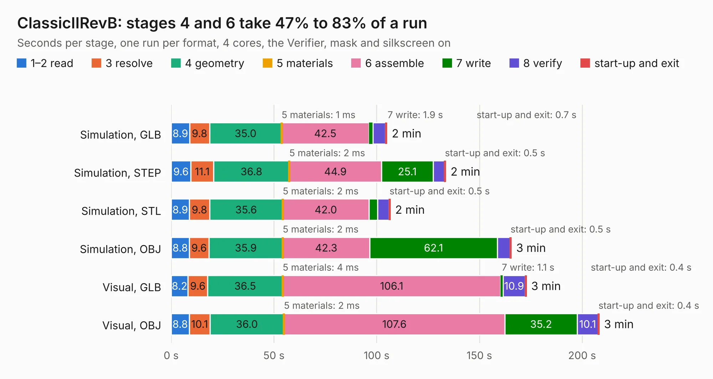

| Mode and format | 1–2 read | 3 resolve | 4 geometry | 5 materials | 6 assemble | 7 write | 8 verify | start-up and exit | Total |
|---|---:|---:|---:|---:|---:|---:|---:|---:|---:|
| Simulation, GLB | 8.9 | 9.8 | 35.0 | 1&nbsp;ms | 42.5 | 1.9 | 6.0 | 0.7 | 104.9 |
| Simulation, STEP | 9.6 | 11.1 | 36.8 | 2&nbsp;ms | 44.9 | 25.1 | 5.6 | 0.5 | 133.5 |
| Simulation, STL | 8.9 | 9.8 | 35.6 | 2&nbsp;ms | 42.0 | 4.2 | 5.6 | 0.5 | 106.6 |
| Simulation, OBJ | 8.8 | 9.6 | 35.9 | 2&nbsp;ms | 42.3 | 62.1 | 6.2 | 0.5 | 165.5 |
| Visual, GLB | 8.2 | 9.6 | 36.5 | 4&nbsp;ms | 106.1 | 1.1 | 10.9 | 0.4 | 172.8 |
| Visual, OBJ | 8.8 | 10.1 | 36.0 | 2&nbsp;ms | 107.6 | 35.2 | 10.1 | 0.4 | 208.2 |

<table align="center"><tr><td valign="top">

| Board | Repo: [btb/ClassicII](https://github.com/btb/ClassicII) Board: `ClassicIIRevB.kicad_pcb` |
|---|---|
| Folder | ClassicIIRevB |
| Complexity | 449&nbsp;/&nbsp;1000 (size&nbsp;304, features&nbsp;145) |
| KESE&nbsp;features | through vias, slotted holes, rounded, trapezoid or chamfered pads, drill offsets, arc tracks, filled zones, copper drawings, copper text, TrueType text, stack-up, dielectric εr and tanδ |
| Tested | 9th November 2026 |
| Copper&nbsp;layers | 4 |
| File&nbsp;format | KiCad 9 (20241229) |
| Parts,&nbsp;tracks,&nbsp;vias | 281, 10,002, 1,306 |
| Triangles,&nbsp;simulation | 10,662,252 in 454 parts |
| Verifier | PASS in all six runs |

</td><td valign="top">

<table>
<tr><th>File type</th><th>File size</th><th>Peak memory used</th></tr>
<tr><th colspan="3" align="left">Simulation</th></tr>
<tr><td>GLB</td><td align="right">365&nbsp;MB</td><td align="right">2.6&nbsp;GB</td></tr>
<tr><td>STEP</td><td align="right">1.4&nbsp;GB</td><td align="right">3.6&nbsp;GB</td></tr>
<tr><td>STL</td><td align="right">533&nbsp;MB</td><td align="right">2.6&nbsp;GB</td></tr>
<tr><td>OBJ</td><td align="right">1.1&nbsp;GB</td><td align="right">6.9&nbsp;GB</td></tr>
<tr><th colspan="3" align="left">Visual</th></tr>
<tr><td>GLB</td><td align="right">217&nbsp;MB</td><td align="right">3.6&nbsp;GB</td></tr>
<tr><td>OBJ</td><td align="right">706&nbsp;MB</td><td align="right">4.8&nbsp;GB</td></tr>
</table>

</td></tr></table>

## 684. ButterStick

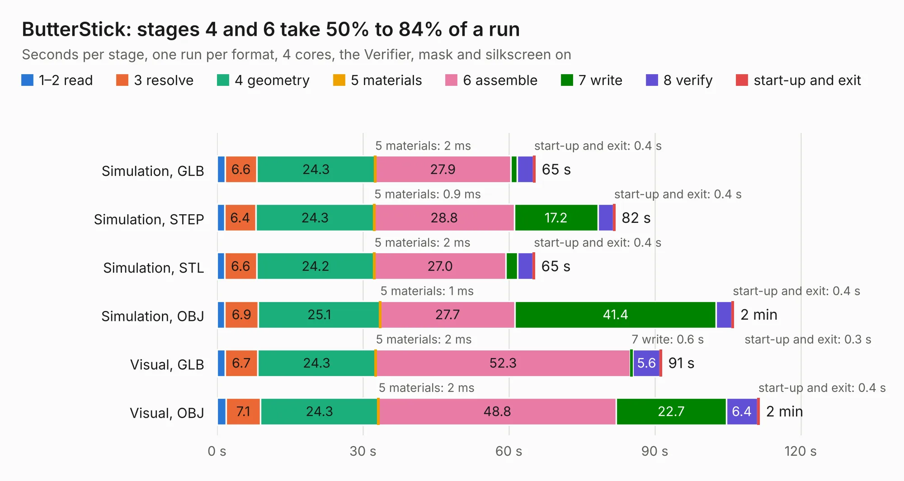

| Mode and format | 1–2 read | 3 resolve | 4 geometry | 5 materials | 6 assemble | 7 write | 8 verify | start-up and exit | Total |
|---|---:|---:|---:|---:|---:|---:|---:|---:|---:|
| Simulation, GLB | 1.6 | 6.6 | 24.3 | 2&nbsp;ms | 27.9 | 1.4 | 3.3 | 0.4 | 65.4 |
| Simulation, STEP | 1.6 | 6.4 | 24.3 | 0.9&nbsp;ms | 28.8 | 17.2 | 3.1 | 0.4 | 81.8 |
| Simulation, STL | 1.6 | 6.6 | 24.2 | 2&nbsp;ms | 27.0 | 2.4 | 3.2 | 0.4 | 65.3 |
| Simulation, OBJ | 1.6 | 6.9 | 25.1 | 1&nbsp;ms | 27.7 | 41.4 | 3.2 | 0.4 | 106.2 |
| Visual, GLB | 1.6 | 6.7 | 24.3 | 2&nbsp;ms | 52.3 | 0.6 | 5.6 | 0.3 | 91.4 |
| Visual, OBJ | 1.8 | 7.1 | 24.3 | 2&nbsp;ms | 48.8 | 22.7 | 6.4 | 0.4 | 111.5 |

<table align="center"><tr><td valign="top">

| Board | Repo: [butterstick-fpga/butterstick-hardware](https://github.com/butterstick-fpga/butterstick-hardware) Board: `ButterStick.kicad_pcb` |
|---|---|
| Folder | hardware / ButterStick_r0.1 |
| Complexity | 398&nbsp;/&nbsp;1000 (size&nbsp;318, features&nbsp;80) |
| KESE&nbsp;features | through vias, custom pads, rounded, trapezoid or chamfered pads, filled zones, copper drawings, curved board outline |
| Tested | 9th November 2026 |
| Copper&nbsp;layers | 6 |
| File&nbsp;format | KiCad 5 (20171130) |
| Parts,&nbsp;tracks,&nbsp;vias | 181, 17,618, 671 |
| Triangles,&nbsp;simulation | 6,232,652 in 340 parts |
| Verifier | PASS in all six runs |

</td><td valign="top">

<table>
<tr><th>File type</th><th>File size</th><th>Peak memory used</th></tr>
<tr><th colspan="3" align="left">Simulation</th></tr>
<tr><td>GLB</td><td align="right">214&nbsp;MB</td><td align="right">1.6&nbsp;GB</td></tr>
<tr><td>STEP</td><td align="right">881&nbsp;MB</td><td align="right">2.3&nbsp;GB</td></tr>
<tr><td>STL</td><td align="right">312&nbsp;MB</td><td align="right">1.7&nbsp;GB</td></tr>
<tr><td>OBJ</td><td align="right">667&nbsp;MB</td><td align="right">4.0&nbsp;GB</td></tr>
<tr><th colspan="3" align="left">Visual</th></tr>
<tr><td>GLB</td><td align="right">114&nbsp;MB</td><td align="right">2.0&nbsp;GB</td></tr>
<tr><td>OBJ</td><td align="right">374&nbsp;MB</td><td align="right">2.6&nbsp;GB</td></tr>
</table>

</td></tr></table>

## 685. ButterStick

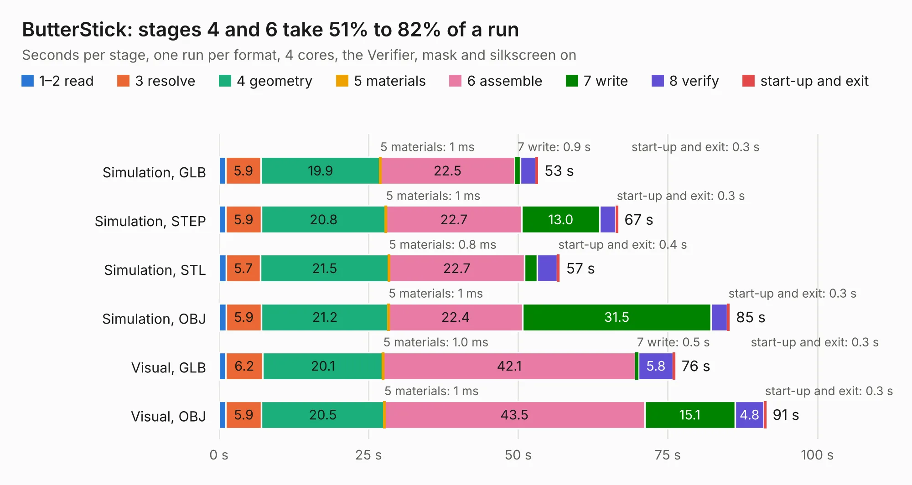

| Mode and format | 1–2 read | 3 resolve | 4 geometry | 5 materials | 6 assemble | 7 write | 8 verify | start-up and exit | Total |
|---|---:|---:|---:|---:|---:|---:|---:|---:|---:|
| Simulation, GLB | 1.1 | 5.9 | 19.9 | 1&nbsp;ms | 22.5 | 0.9 | 2.6 | 0.3 | 53.3 |
| Simulation, STEP | 1.1 | 5.9 | 20.8 | 1&nbsp;ms | 22.7 | 13.0 | 2.7 | 0.3 | 66.7 |
| Simulation, STL | 1.2 | 5.7 | 21.5 | 0.8&nbsp;ms | 22.7 | 2.1 | 3.3 | 0.4 | 56.9 |
| Simulation, OBJ | 1.2 | 5.9 | 21.2 | 1&nbsp;ms | 22.4 | 31.5 | 2.8 | 0.3 | 85.3 |
| Visual, GLB | 1.2 | 6.2 | 20.1 | 1.0&nbsp;ms | 42.1 | 0.5 | 5.8 | 0.3 | 76.2 |
| Visual, OBJ | 1.2 | 5.9 | 20.5 | 1&nbsp;ms | 43.5 | 15.1 | 4.8 | 0.3 | 91.4 |

<table align="center"><tr><td valign="top">

| Board | Repo: [butterstick-fpga/butterstick-hardware](https://github.com/butterstick-fpga/butterstick-hardware) Board: `ButterStick.kicad_pcb` |
|---|---|
| Folder | hardware / ButterStick_r0.2 |
| Complexity | 410&nbsp;/&nbsp;1000 (size&nbsp;320, features&nbsp;90) |
| KESE&nbsp;features | through vias, custom pads, rounded, trapezoid or chamfered pads, filled zones, copper drawings, copper text, curved board outline |
| Tested | 9th November 2026 |
| Copper&nbsp;layers | 6 |
| File&nbsp;format | KiCad 5 (20171130) |
| Parts,&nbsp;tracks,&nbsp;vias | 223, 16,942, 792 |
| Triangles,&nbsp;simulation | 6,727,172 in 339 parts |
| Verifier | PASS in all six runs |

</td><td valign="top">

<table>
<tr><th>File type</th><th>File size</th><th>Peak memory used</th></tr>
<tr><th colspan="3" align="left">Simulation</th></tr>
<tr><td>GLB</td><td align="right">231&nbsp;MB</td><td align="right">1.7&nbsp;GB</td></tr>
<tr><td>STEP</td><td align="right">896&nbsp;MB</td><td align="right">2.3&nbsp;GB</td></tr>
<tr><td>STL</td><td align="right">336&nbsp;MB</td><td align="right">1.6&nbsp;GB</td></tr>
<tr><td>OBJ</td><td align="right">722&nbsp;MB</td><td align="right">4.2&nbsp;GB</td></tr>
<tr><th colspan="3" align="left">Visual</th></tr>
<tr><td>GLB</td><td align="right">117&nbsp;MB</td><td align="right">2.1&nbsp;GB</td></tr>
<tr><td>OBJ</td><td align="right">383&nbsp;MB</td><td align="right">2.6&nbsp;GB</td></tr>
</table>

</td></tr></table>

## 686. ButterStick

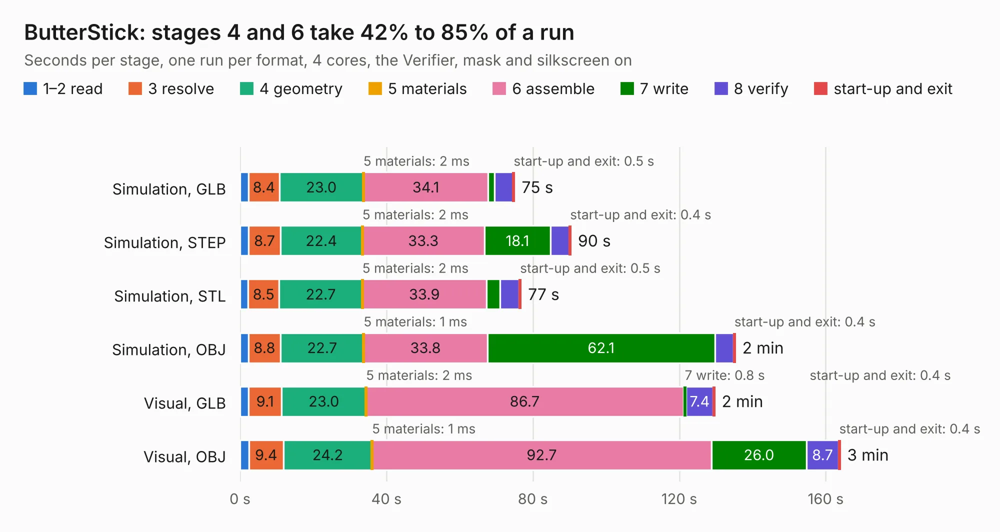

| Mode and format | 1–2 read | 3 resolve | 4 geometry | 5 materials | 6 assemble | 7 write | 8 verify | start-up and exit | Total |
|---|---:|---:|---:|---:|---:|---:|---:|---:|---:|
| Simulation, GLB | 2.4 | 8.4 | 23.0 | 2&nbsp;ms | 34.1 | 1.6 | 5.1 | 0.5 | 75.0 |
| Simulation, STEP | 2.4 | 8.7 | 22.4 | 2&nbsp;ms | 33.3 | 18.1 | 5.2 | 0.4 | 90.4 |
| Simulation, STL | 2.2 | 8.5 | 22.7 | 2&nbsp;ms | 33.9 | 3.7 | 5.2 | 0.5 | 76.7 |
| Simulation, OBJ | 2.3 | 8.8 | 22.7 | 1&nbsp;ms | 33.8 | 62.1 | 5.1 | 0.4 | 135.3 |
| Visual, GLB | 2.3 | 9.1 | 23.0 | 2&nbsp;ms | 86.7 | 0.8 | 7.4 | 0.4 | 129.6 |
| Visual, OBJ | 2.4 | 9.4 | 24.2 | 1&nbsp;ms | 92.7 | 26.0 | 8.7 | 0.4 | 163.9 |

<table align="center"><tr><td valign="top">

| Board | Repo: [butterstick-fpga/butterstick-hardware](https://github.com/butterstick-fpga/butterstick-hardware) Board: `ButterStick.kicad_pcb` |
|---|---|
| Folder | hardware / ButterStick_r1.0 |
| Complexity | 491&nbsp;/&nbsp;1000 (size&nbsp;341, features&nbsp;150) |
| KESE&nbsp;features | through vias, slotted holes, custom pads, rounded, trapezoid or chamfered pads, filled zones, copper drawings, copper text, curved board outline, stack-up, dielectric εr and tanδ, copper finish, mask and silkscreen colours |
| Tested | 9th November 2026 |
| Copper&nbsp;layers | 8 |
| File&nbsp;format | KiCad 6 (20211014) |
| Parts,&nbsp;tracks,&nbsp;vias | 327, 19,487, 1,061 |
| Triangles,&nbsp;simulation | 10,425,092 in 367 parts |
| Verifier | PASS in all six runs |

</td><td valign="top">

<table>
<tr><th>File type</th><th>File size</th><th>Peak memory used</th></tr>
<tr><th colspan="3" align="left">Simulation</th></tr>
<tr><td>GLB</td><td align="right">345&nbsp;MB</td><td align="right">2.1&nbsp;GB</td></tr>
<tr><td>STEP</td><td align="right">1.1&nbsp;GB</td><td align="right">3.1&nbsp;GB</td></tr>
<tr><td>STL</td><td align="right">521&nbsp;MB</td><td align="right">2.1&nbsp;GB</td></tr>
<tr><td>OBJ</td><td align="right">1.1&nbsp;GB</td><td align="right">6.5&nbsp;GB</td></tr>
<tr><th colspan="3" align="left">Visual</th></tr>
<tr><td>GLB</td><td align="right">154&nbsp;MB</td><td align="right">2.8&nbsp;GB</td></tr>
<tr><td>OBJ</td><td align="right">520&nbsp;MB</td><td align="right">3.5&nbsp;GB</td></tr>
</table>

</td></tr></table>

## 687. 250407_

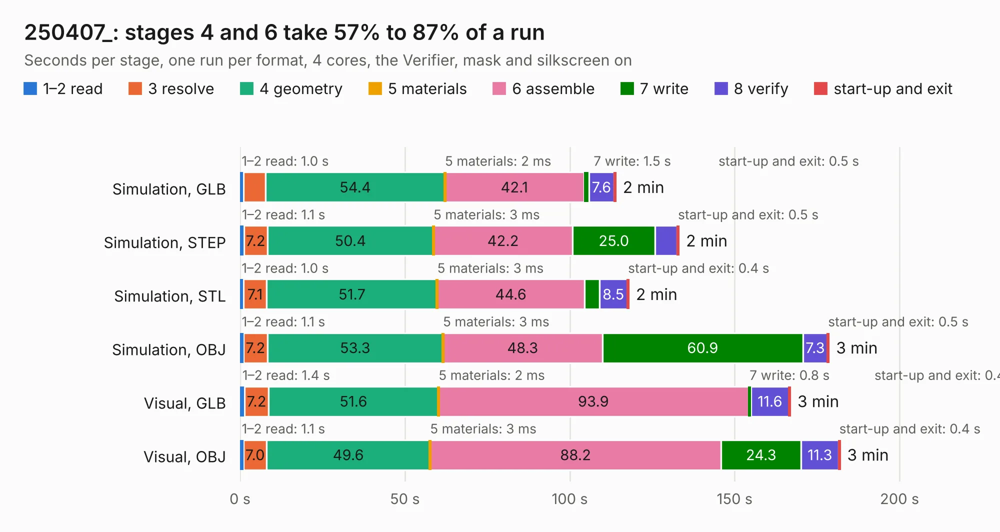

| Mode and format | 1–2 read | 3 resolve | 4 geometry | 5 materials | 6 assemble | 7 write | 8 verify | start-up and exit | Total |
|---|---:|---:|---:|---:|---:|---:|---:|---:|---:|
| Simulation, GLB | 1.0 | 6.7 | 54.4 | 2&nbsp;ms | 42.1 | 1.5 | 7.6 | 0.5 | 113.9 |
| Simulation, STEP | 1.1 | 7.2 | 50.4 | 3&nbsp;ms | 42.2 | 25.0 | 6.7 | 0.5 | 133.1 |
| Simulation, STL | 1.0 | 7.1 | 51.7 | 3&nbsp;ms | 44.6 | 4.6 | 8.5 | 0.4 | 117.9 |
| Simulation, OBJ | 1.1 | 7.2 | 53.3 | 3&nbsp;ms | 48.3 | 60.9 | 7.3 | 0.5 | 178.6 |
| Visual, GLB | 1.4 | 7.2 | 51.6 | 2&nbsp;ms | 93.9 | 0.8 | 11.6 | 0.4 | 166.9 |
| Visual, OBJ | 1.1 | 7.0 | 49.6 | 3&nbsp;ms | 88.2 | 24.3 | 11.3 | 0.4 | 181.9 |

<table align="center"><tr><td valign="top">

| Board | Repo: [bwack/C64-250407-Replica-KiCad](https://github.com/bwack/C64-250407-Replica-KiCad) Board: `250407_.kicad_pcb` |
|---|---|
| Complexity | 283&nbsp;/&nbsp;1000 (size&nbsp;223, features&nbsp;60) |
| KESE&nbsp;features | through vias, custom pads, filled zones, copper drawings |
| Tested | 9th November 2026 |
| Copper&nbsp;layers | 2 |
| File&nbsp;format | KiCad 9 (20241229) |
| Parts,&nbsp;tracks,&nbsp;vias | 215, 6,552, 574 |
| Triangles,&nbsp;simulation | 8,877,004 in 261 parts |
| Verifier | PASS in all six runs |

</td><td valign="top">

<table>
<tr><th>File type</th><th>File size</th><th>Peak memory used</th></tr>
<tr><th colspan="3" align="left">Simulation</th></tr>
<tr><td>GLB</td><td align="right">301&nbsp;MB</td><td align="right">2.3&nbsp;GB</td></tr>
<tr><td>STEP</td><td align="right">1.4&nbsp;GB</td><td align="right">3.1&nbsp;GB</td></tr>
<tr><td>STL</td><td align="right">444&nbsp;MB</td><td align="right">2.3&nbsp;GB</td></tr>
<tr><td>OBJ</td><td align="right">949&nbsp;MB</td><td align="right">5.6&nbsp;GB</td></tr>
<tr><th colspan="3" align="left">Visual</th></tr>
<tr><td>GLB</td><td align="right">152&nbsp;MB</td><td align="right">2.5&nbsp;GB</td></tr>
<tr><td>OBJ</td><td align="right">484&nbsp;MB</td><td align="right">3.2&nbsp;GB</td></tr>
</table>

</td></tr></table>

## 688. C64-250469-KiCad

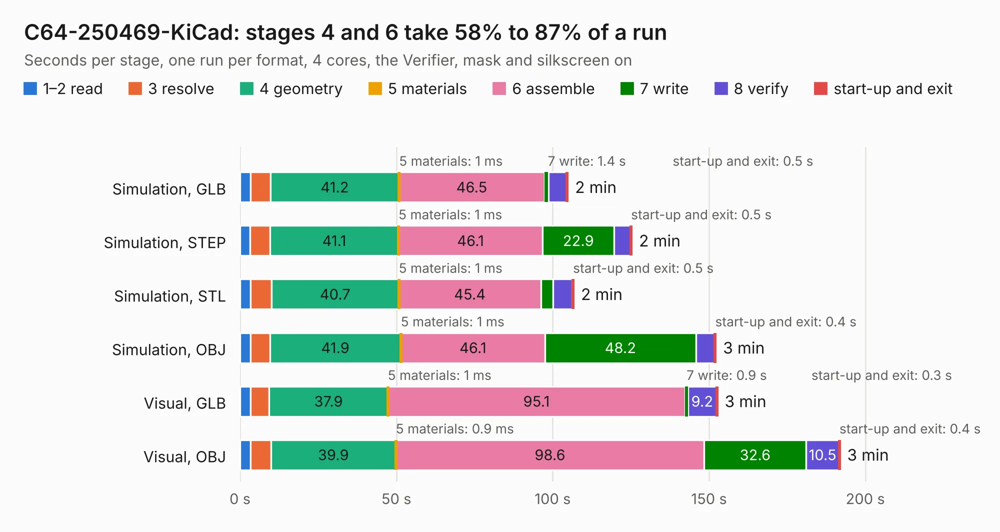

| Mode and format | 1–2 read | 3 resolve | 4 geometry | 5 materials | 6 assemble | 7 write | 8 verify | start-up and exit | Total |
|---|---:|---:|---:|---:|---:|---:|---:|---:|---:|
| Simulation, GLB | 3.3 | 6.4 | 41.2 | 1&nbsp;ms | 46.5 | 1.4 | 5.7 | 0.5 | 104.9 |
| Simulation, STEP | 3.3 | 6.3 | 41.1 | 1&nbsp;ms | 46.1 | 22.9 | 5.2 | 0.5 | 125.3 |
| Simulation, STL | 3.4 | 6.7 | 40.7 | 1&nbsp;ms | 45.4 | 3.9 | 6.1 | 0.5 | 106.8 |
| Simulation, OBJ | 3.3 | 6.2 | 41.9 | 1&nbsp;ms | 46.1 | 48.2 | 6.0 | 0.4 | 152.2 |
| Visual, GLB | 3.3 | 6.0 | 37.9 | 1&nbsp;ms | 95.1 | 0.9 | 9.2 | 0.3 | 152.7 |
| Visual, OBJ | 3.4 | 6.5 | 39.9 | 0.9&nbsp;ms | 98.6 | 32.6 | 10.5 | 0.4 | 191.9 |

<table align="center"><tr><td valign="top">

| Board | Repo: [bwack/C64C-250469-KiCAD-Replica](https://github.com/bwack/C64C-250469-KiCAD-Replica) Board: `C64-250469-KiCad.kicad_pcb` |
|---|---|
| Complexity | 322&nbsp;/&nbsp;1000 (size&nbsp;222, features&nbsp;100) |
| KESE&nbsp;features | through vias, slotted holes, rounded, trapezoid or chamfered pads, arc tracks, filled zones, stack-up, dielectric εr and tanδ |
| Tested | 9th November 2026 to 10th November 2026 |
| Copper&nbsp;layers | 2 |
| File&nbsp;format | KiCad 7 (20221018) |
| Parts,&nbsp;tracks,&nbsp;vias | 138, 8,544, 642 |
| Triangles,&nbsp;simulation | 8,242,170 in 213 parts |
| Verifier | PASS in all six runs |
| Run&nbsp;again | Simulation, GLB; Simulation, STEP; Simulation, STL; Simulation, OBJ: failed in the corpus run, run again with fixes to KESE made after the corpus run, and passed |

</td><td valign="top">

<table>
<tr><th>File type</th><th>File size</th><th>Peak memory used</th></tr>
<tr><th colspan="3" align="left">Simulation</th></tr>
<tr><td>GLB</td><td align="right">280&nbsp;MB</td><td align="right">2.3&nbsp;GB</td></tr>
<tr><td>STEP</td><td align="right">1.4&nbsp;GB</td><td align="right">3.1&nbsp;GB</td></tr>
<tr><td>STL</td><td align="right">412&nbsp;MB</td><td align="right">2.3&nbsp;GB</td></tr>
<tr><td>OBJ</td><td align="right">880&nbsp;MB</td><td align="right">5.2&nbsp;GB</td></tr>
<tr><th colspan="3" align="left">Visual</th></tr>
<tr><td>GLB</td><td align="right">191&nbsp;MB</td><td align="right">3.0&nbsp;GB</td></tr>
<tr><td>OBJ</td><td align="right">615&nbsp;MB</td><td align="right">3.8&nbsp;GB</td></tr>
</table>

</td></tr></table>

## 689. audio

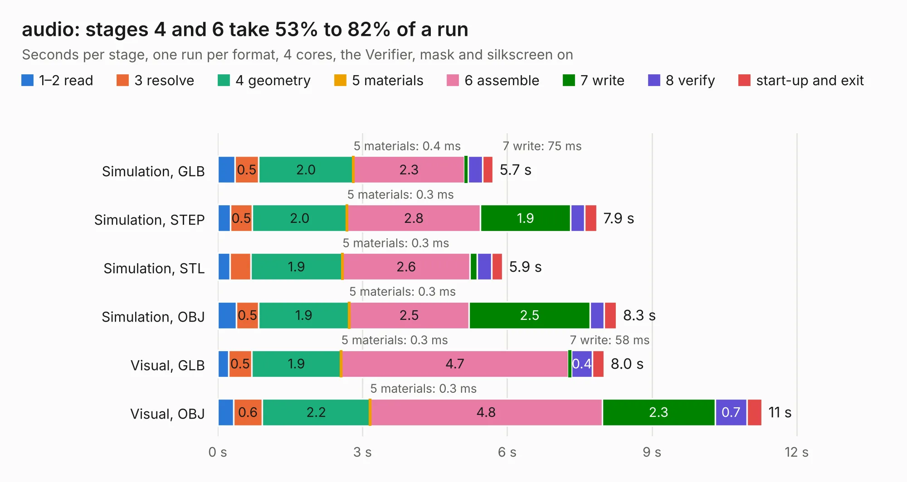

| Mode and format | 1–2 read | 3 resolve | 4 geometry | 5 materials | 6 assemble | 7 write | 8 verify | start-up and exit | Total |
|---|---:|---:|---:|---:|---:|---:|---:|---:|---:|
| Simulation, GLB | 0.4 | 0.5 | 2.0 | 0.4&nbsp;ms | 2.3 | 75&nbsp;ms | 0.3 | 0.2 | 5.7 |
| Simulation, STEP | 0.3 | 0.5 | 2.0 | 0.3&nbsp;ms | 2.8 | 1.9 | 0.3 | 0.3 | 7.9 |
| Simulation, STL | 0.3 | 0.4 | 1.9 | 0.3&nbsp;ms | 2.6 | 0.1 | 0.3 | 0.2 | 5.9 |
| Simulation, OBJ | 0.4 | 0.5 | 1.9 | 0.3&nbsp;ms | 2.5 | 2.5 | 0.3 | 0.3 | 8.3 |
| Visual, GLB | 0.2 | 0.5 | 1.9 | 0.3&nbsp;ms | 4.7 | 58&nbsp;ms | 0.4 | 0.2 | 8.0 |
| Visual, OBJ | 0.3 | 0.6 | 2.2 | 0.3&nbsp;ms | 4.8 | 2.3 | 0.7 | 0.3 | 11.3 |

<table align="center"><tr><td valign="top">

| Board | Repo: [byrantech/laptop](https://github.com/byrantech/laptop) Board: `audio.kicad_pcb` |
|---|---|
| Folder | audio |
| Complexity | 291&nbsp;/&nbsp;1000 (size&nbsp;196, features&nbsp;95) |
| KESE&nbsp;features | through vias, custom pads, rounded, trapezoid or chamfered pads, filled zones, copper drawings, curved board outline, TrueType text |
| Tested | 9th November 2026 |
| Copper&nbsp;layers | 2 |
| File&nbsp;format | KiCad 9 (20241007) |
| Parts,&nbsp;tracks,&nbsp;vias | 41, 244, 58 |
| Triangles,&nbsp;simulation | 416,276 in 71 parts |
| Verifier | PASS in all six runs |

</td><td valign="top">

<table>
<tr><th>File type</th><th>File size</th><th>Peak memory used</th></tr>
<tr><th colspan="3" align="left">Simulation</th></tr>
<tr><td>GLB</td><td align="right">14&nbsp;MB</td><td align="right">272&nbsp;MB</td></tr>
<tr><td>STEP</td><td align="right">74&nbsp;MB</td><td align="right">305&nbsp;MB</td></tr>
<tr><td>STL</td><td align="right">21&nbsp;MB</td><td align="right">272&nbsp;MB</td></tr>
<tr><td>OBJ</td><td align="right">42&nbsp;MB</td><td align="right">313&nbsp;MB</td></tr>
<tr><th colspan="3" align="left">Visual</th></tr>
<tr><td>GLB</td><td align="right">12&nbsp;MB</td><td align="right">318&nbsp;MB</td></tr>
<tr><td>OBJ</td><td align="right">35&nbsp;MB</td><td align="right">310&nbsp;MB</td></tr>
</table>

</td></tr></table>

## 690. encoder

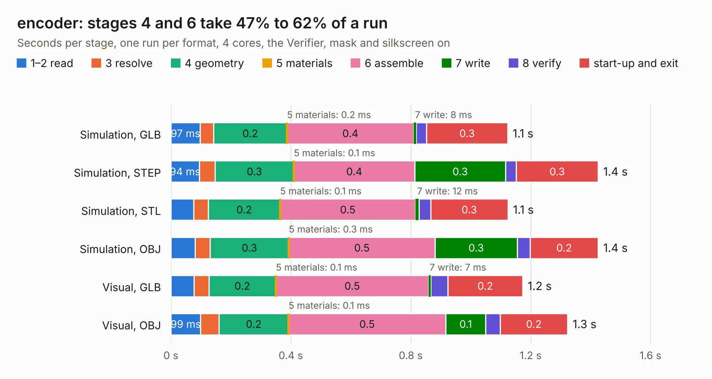

| Mode and format | 1–2 read | 3 resolve | 4 geometry | 5 materials | 6 assemble | 7 write | 8 verify | start-up and exit | Total |
|---|---:|---:|---:|---:|---:|---:|---:|---:|---:|
| Simulation, GLB | 97&nbsp;ms | 45&nbsp;ms | 0.2 | 0.2&nbsp;ms | 0.4 | 8&nbsp;ms | 35&nbsp;ms | 0.3 | 1.1 |
| Simulation, STEP | 94&nbsp;ms | 53&nbsp;ms | 0.3 | 0.1&nbsp;ms | 0.4 | 0.3 | 36&nbsp;ms | 0.3 | 1.4 |
| Simulation, STL | 76&nbsp;ms | 49&nbsp;ms | 0.2 | 0.1&nbsp;ms | 0.5 | 12&nbsp;ms | 39&nbsp;ms | 0.3 | 1.1 |
| Simulation, OBJ | 80&nbsp;ms | 50&nbsp;ms | 0.3 | 0.3&nbsp;ms | 0.5 | 0.3 | 43&nbsp;ms | 0.2 | 1.4 |
| Visual, GLB | 78&nbsp;ms | 49&nbsp;ms | 0.2 | 0.1&nbsp;ms | 0.5 | 7&nbsp;ms | 58&nbsp;ms | 0.2 | 1.2 |
| Visual, OBJ | 99&nbsp;ms | 61&nbsp;ms | 0.2 | 0.1&nbsp;ms | 0.5 | 0.1 | 48&nbsp;ms | 0.2 | 1.3 |

<table align="center"><tr><td valign="top">

| Board | Repo: [byrantech/laptop](https://github.com/byrantech/laptop) Board: `encoder.kicad_pcb` |
|---|---|
| Folder | haptic / encoder |
| Complexity | 101&nbsp;/&nbsp;1000 (size&nbsp;81, features&nbsp;20) |
| KESE&nbsp;features | rounded, trapezoid or chamfered pads, curved board outline |
| Tested | 9th November 2026 |
| Copper&nbsp;layers | 2 |
| File&nbsp;format | KiCad 9 (20240225) |
| Parts,&nbsp;tracks,&nbsp;vias | 2, 24, 0 |
| Triangles,&nbsp;simulation | 43,206 in 17 parts |
| Verifier | PASS in all six runs |

</td><td valign="top">

<table>
<tr><th>File type</th><th>File size</th><th>Peak memory used</th></tr>
<tr><th colspan="3" align="left">Simulation</th></tr>
<tr><td>GLB</td><td align="right">1.5&nbsp;MB</td><td align="right">67&nbsp;MB</td></tr>
<tr><td>STEP</td><td align="right">7.1&nbsp;MB</td><td align="right">72&nbsp;MB</td></tr>
<tr><td>STL</td><td align="right">2.2&nbsp;MB</td><td align="right">68&nbsp;MB</td></tr>
<tr><td>OBJ</td><td align="right">4.1&nbsp;MB</td><td align="right">77&nbsp;MB</td></tr>
<tr><th colspan="3" align="left">Visual</th></tr>
<tr><td>GLB</td><td align="right">990&nbsp;kB</td><td align="right">102&nbsp;MB</td></tr>
<tr><td>OBJ</td><td align="right">2.7&nbsp;MB</td><td align="right">103&nbsp;MB</td></tr>
</table>

</td></tr></table>

## 691. keyboard

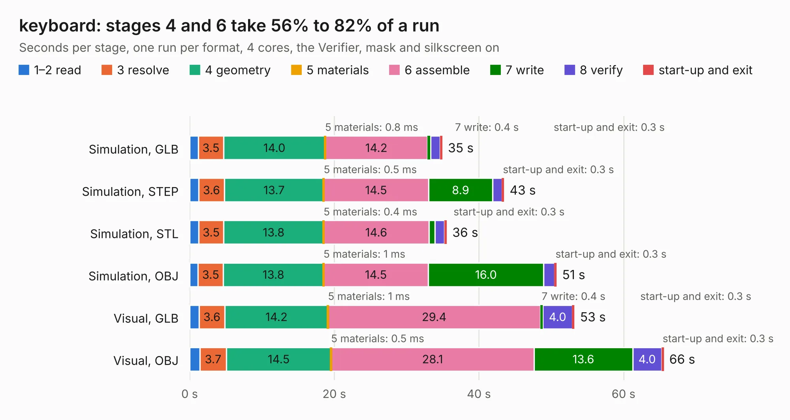

| Mode and format | 1–2 read | 3 resolve | 4 geometry | 5 materials | 6 assemble | 7 write | 8 verify | start-up and exit | Total |
|---|---:|---:|---:|---:|---:|---:|---:|---:|---:|
| Simulation, GLB | 1.2 | 3.5 | 14.0 | 0.8&nbsp;ms | 14.2 | 0.4 | 1.3 | 0.3 | 34.9 |
| Simulation, STEP | 1.2 | 3.6 | 13.7 | 0.5&nbsp;ms | 14.5 | 8.9 | 1.3 | 0.3 | 43.5 |
| Simulation, STL | 1.2 | 3.5 | 13.8 | 0.4&nbsp;ms | 14.6 | 0.8 | 1.3 | 0.3 | 35.5 |
| Simulation, OBJ | 1.2 | 3.5 | 13.8 | 1&nbsp;ms | 14.5 | 16.0 | 1.5 | 0.3 | 50.7 |
| Visual, GLB | 1.3 | 3.6 | 14.2 | 1&nbsp;ms | 29.4 | 0.4 | 4.0 | 0.3 | 53.2 |
| Visual, OBJ | 1.4 | 3.7 | 14.5 | 0.5&nbsp;ms | 28.1 | 13.6 | 4.0 | 0.3 | 65.5 |

<table align="center"><tr><td valign="top">

| Board | Repo: [byrantech/laptop](https://github.com/byrantech/laptop) Board: `keyboard.kicad_pcb` |
|---|---|
| Folder | keyboard |
| Complexity | 327&nbsp;/&nbsp;1000 (size&nbsp;247, features&nbsp;80) |
| KESE&nbsp;features | through vias, slotted holes, rounded, trapezoid or chamfered pads, filled zones, curved board outline, TrueType text |
| Tested | 9th November 2026 |
| Copper&nbsp;layers | 2 |
| File&nbsp;format | KiCad 9 (20240225) |
| Parts,&nbsp;tracks,&nbsp;vias | 208, 1,484, 571 |
| Triangles,&nbsp;simulation | 2,715,872 in 171 parts |
| Verifier | PASS in all six runs |

</td><td valign="top">

<table>
<tr><th>File type</th><th>File size</th><th>Peak memory used</th></tr>
<tr><th colspan="3" align="left">Simulation</th></tr>
<tr><td>GLB</td><td align="right">94&nbsp;MB</td><td align="right">1.1&nbsp;GB</td></tr>
<tr><td>STEP</td><td align="right">491&nbsp;MB</td><td align="right">1.5&nbsp;GB</td></tr>
<tr><td>STL</td><td align="right">136&nbsp;MB</td><td align="right">1.1&nbsp;GB</td></tr>
<tr><td>OBJ</td><td align="right">290&nbsp;MB</td><td align="right">1.9&nbsp;GB</td></tr>
<tr><th colspan="3" align="left">Visual</th></tr>
<tr><td>GLB</td><td align="right">84&nbsp;MB</td><td align="right">1.4&nbsp;GB</td></tr>
<tr><td>OBJ</td><td align="right">261&nbsp;MB</td><td align="right">1.8&nbsp;GB</td></tr>
</table>

</td></tr></table>

## 692. protector

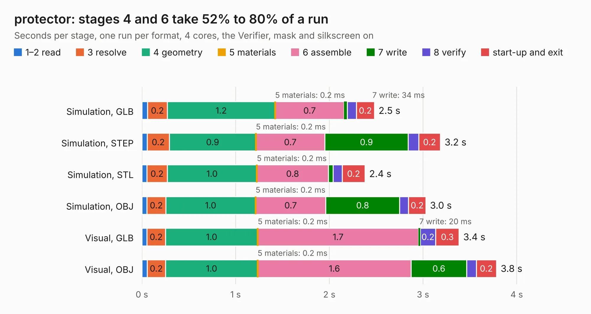

| Mode and format | 1–2 read | 3 resolve | 4 geometry | 5 materials | 6 assemble | 7 write | 8 verify | start-up and exit | Total |
|---|---:|---:|---:|---:|---:|---:|---:|---:|---:|
| Simulation, GLB | 61&nbsp;ms | 0.2 | 1.2 | 0.2&nbsp;ms | 0.7 | 34&nbsp;ms | 97&nbsp;ms | 0.2 | 2.5 |
| Simulation, STEP | 57&nbsp;ms | 0.2 | 0.9 | 0.2&nbsp;ms | 0.7 | 0.9 | 0.1 | 0.2 | 3.2 |
| Simulation, STL | 54&nbsp;ms | 0.2 | 1.0 | 0.2&nbsp;ms | 0.8 | 51&nbsp;ms | 97&nbsp;ms | 0.2 | 2.4 |
| Simulation, OBJ | 54&nbsp;ms | 0.2 | 1.0 | 0.2&nbsp;ms | 0.7 | 0.8 | 96&nbsp;ms | 0.2 | 3.0 |
| Visual, GLB | 53&nbsp;ms | 0.2 | 1.0 | 0.2&nbsp;ms | 1.7 | 20&nbsp;ms | 0.2 | 0.3 | 3.4 |
| Visual, OBJ | 55&nbsp;ms | 0.2 | 1.0 | 0.2&nbsp;ms | 1.6 | 0.6 | 0.1 | 0.2 | 3.8 |

<table align="center"><tr><td valign="top">

| Board | Repo: [byrantech/laptop](https://github.com/byrantech/laptop) Board: `protector.kicad_pcb` |
|---|---|
| Folder | keyboard / protector |
| Complexity | 218&nbsp;/&nbsp;1000 (size&nbsp;133, features&nbsp;85) |
| KESE&nbsp;features | through vias, rounded, trapezoid or chamfered pads, filled zones, copper text, knockout text, TrueType text |
| Tested | 9th November 2026 |
| Copper&nbsp;layers | 2 |
| File&nbsp;format | KiCad 9 (20240225) |
| Parts,&nbsp;tracks,&nbsp;vias | 6, 37, 97 |
| Triangles,&nbsp;simulation | 203,696 in 21 parts |
| Verifier | PASS in all six runs |

</td><td valign="top">

<table>
<tr><th>File type</th><th>File size</th><th>Peak memory used</th></tr>
<tr><th colspan="3" align="left">Simulation</th></tr>
<tr><td>GLB</td><td align="right">6.9&nbsp;MB</td><td align="right">193&nbsp;MB</td></tr>
<tr><td>STEP</td><td align="right">23&nbsp;MB</td><td align="right">202&nbsp;MB</td></tr>
<tr><td>STL</td><td align="right">10&nbsp;MB</td><td align="right">196&nbsp;MB</td></tr>
<tr><td>OBJ</td><td align="right">20&nbsp;MB</td><td align="right">194&nbsp;MB</td></tr>
<tr><th colspan="3" align="left">Visual</th></tr>
<tr><td>GLB</td><td align="right">4.5&nbsp;MB</td><td align="right">162&nbsp;MB</td></tr>
<tr><td>OBJ</td><td align="right">13&nbsp;MB</td><td align="right">159&nbsp;MB</td></tr>
</table>

</td></tr></table>

## 693. display_eval

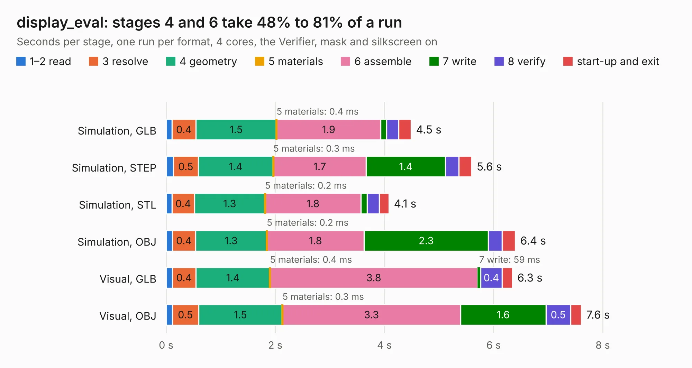

| Mode and format | 1–2 read | 3 resolve | 4 geometry | 5 materials | 6 assemble | 7 write | 8 verify | start-up and exit | Total |
|---|---:|---:|---:|---:|---:|---:|---:|---:|---:|
| Simulation, GLB | 0.1 | 0.4 | 1.5 | 0.4&nbsp;ms | 1.9 | 0.1 | 0.2 | 0.2 | 4.5 |
| Simulation, STEP | 0.1 | 0.5 | 1.4 | 0.3&nbsp;ms | 1.7 | 1.4 | 0.2 | 0.2 | 5.6 |
| Simulation, STL | 0.1 | 0.4 | 1.3 | 0.2&nbsp;ms | 1.8 | 0.1 | 0.2 | 0.2 | 4.1 |
| Simulation, OBJ | 0.1 | 0.4 | 1.3 | 0.2&nbsp;ms | 1.8 | 2.3 | 0.3 | 0.2 | 6.4 |
| Visual, GLB | 0.1 | 0.4 | 1.4 | 0.4&nbsp;ms | 3.8 | 59&nbsp;ms | 0.4 | 0.2 | 6.3 |
| Visual, OBJ | 0.1 | 0.5 | 1.5 | 0.3&nbsp;ms | 3.3 | 1.6 | 0.5 | 0.2 | 7.6 |

<table align="center"><tr><td valign="top">

| Board | Repo: [byrantech/laptop](https://github.com/byrantech/laptop) Board: `display_eval.kicad_pcb` |
|---|---|
| Folder | motherboard / display_eval |
| Complexity | 296&nbsp;/&nbsp;1000 (size&nbsp;171, features&nbsp;125) |
| KESE&nbsp;features | through vias, slotted holes, rounded, trapezoid or chamfered pads, arc tracks, filled zones, curved board outline, TrueType text, stack-up, dielectric εr and tanδ |
| Tested | 9th November 2026 |
| Copper&nbsp;layers | 4 |
| File&nbsp;format | KiCad 9 (20240225) |
| Parts,&nbsp;tracks,&nbsp;vias | 10, 577, 108 |
| Triangles,&nbsp;simulation | 523,320 in 47 parts |
| Verifier | PASS in all six runs |

</td><td valign="top">

<table>
<tr><th>File type</th><th>File size</th><th>Peak memory used</th></tr>
<tr><th colspan="3" align="left">Simulation</th></tr>
<tr><td>GLB</td><td align="right">18&nbsp;MB</td><td align="right">311&nbsp;MB</td></tr>
<tr><td>STEP</td><td align="right">66&nbsp;MB</td><td align="right">353&nbsp;MB</td></tr>
<tr><td>STL</td><td align="right">26&nbsp;MB</td><td align="right">286&nbsp;MB</td></tr>
<tr><td>OBJ</td><td align="right">52&nbsp;MB</td><td align="right">383&nbsp;MB</td></tr>
<tr><th colspan="3" align="left">Visual</th></tr>
<tr><td>GLB</td><td align="right">12&nbsp;MB</td><td align="right">322&nbsp;MB</td></tr>
<tr><td>OBJ</td><td align="right">36&nbsp;MB</td><td align="right">348&nbsp;MB</td></tr>
</table>

</td></tr></table>

## 694. display_eval_short

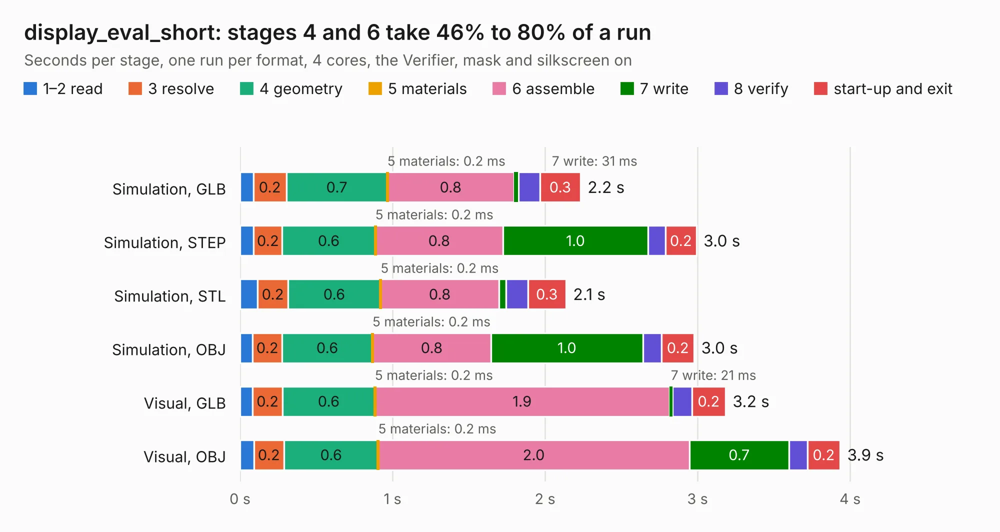

| Mode and format | 1–2 read | 3 resolve | 4 geometry | 5 materials | 6 assemble | 7 write | 8 verify | start-up and exit | Total |
|---|---:|---:|---:|---:|---:|---:|---:|---:|---:|
| Simulation, GLB | 87&nbsp;ms | 0.2 | 0.7 | 0.2&nbsp;ms | 0.8 | 31&nbsp;ms | 0.1 | 0.3 | 2.2 |
| Simulation, STEP | 89&nbsp;ms | 0.2 | 0.6 | 0.2&nbsp;ms | 0.8 | 1.0 | 0.1 | 0.2 | 3.0 |
| Simulation, STL | 0.1 | 0.2 | 0.6 | 0.2&nbsp;ms | 0.8 | 48&nbsp;ms | 0.1 | 0.3 | 2.1 |
| Simulation, OBJ | 82&nbsp;ms | 0.2 | 0.6 | 0.2&nbsp;ms | 0.8 | 1.0 | 0.1 | 0.2 | 3.0 |
| Visual, GLB | 82&nbsp;ms | 0.2 | 0.6 | 0.2&nbsp;ms | 1.9 | 21&nbsp;ms | 0.1 | 0.2 | 3.2 |
| Visual, OBJ | 90&nbsp;ms | 0.2 | 0.6 | 0.2&nbsp;ms | 2.0 | 0.7 | 0.1 | 0.2 | 3.9 |

<table align="center"><tr><td valign="top">

| Board | Repo: [byrantech/laptop](https://github.com/byrantech/laptop) Board: `display_eval_short.kicad_pcb` |
|---|---|
| Folder | motherboard / display_eval_short |
| Complexity | 224&nbsp;/&nbsp;1000 (size&nbsp;134, features&nbsp;90) |
| KESE&nbsp;features | through vias, filled zones, curved board outline, TrueType text, stack-up, dielectric εr and tanδ |
| Tested | 9th November 2026 |
| Copper&nbsp;layers | 4 |
| File&nbsp;format | KiCad 9 (20240225) |
| Parts,&nbsp;tracks,&nbsp;vias | 4, 121, 13 |
| Triangles,&nbsp;simulation | 165,308 in 43 parts |
| Verifier | PASS in all six runs |

</td><td valign="top">

<table>
<tr><th>File type</th><th>File size</th><th>Peak memory used</th></tr>
<tr><th colspan="3" align="left">Simulation</th></tr>
<tr><td>GLB</td><td align="right">5.9&nbsp;MB</td><td align="right">174&nbsp;MB</td></tr>
<tr><td>STEP</td><td align="right">25&nbsp;MB</td><td align="right">188&nbsp;MB</td></tr>
<tr><td>STL</td><td align="right">8.3&nbsp;MB</td><td align="right">184&nbsp;MB</td></tr>
<tr><td>OBJ</td><td align="right">17&nbsp;MB</td><td align="right">183&nbsp;MB</td></tr>
<tr><th colspan="3" align="left">Visual</th></tr>
<tr><td>GLB</td><td align="right">4.1&nbsp;MB</td><td align="right">145&nbsp;MB</td></tr>
<tr><td>OBJ</td><td align="right">12&nbsp;MB</td><td align="right">141&nbsp;MB</td></tr>
</table>

</td></tr></table>

## 695. motherboard

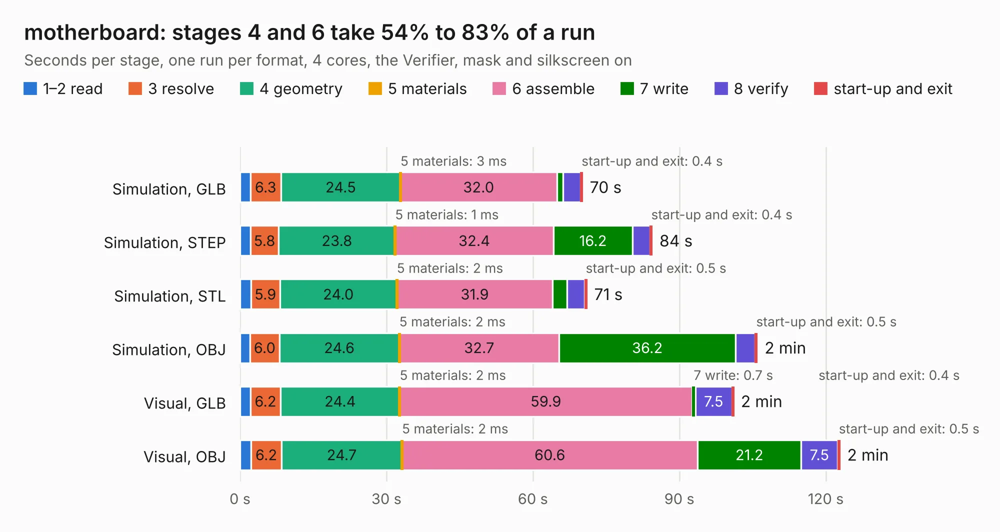

| Mode and format | 1–2 read | 3 resolve | 4 geometry | 5 materials | 6 assemble | 7 write | 8 verify | start-up and exit | Total |
|---|---:|---:|---:|---:|---:|---:|---:|---:|---:|
| Simulation, GLB | 2.1 | 6.3 | 24.5 | 3&nbsp;ms | 32.0 | 1.2 | 3.6 | 0.4 | 70.2 |
| Simulation, STEP | 2.1 | 5.8 | 23.8 | 1&nbsp;ms | 32.4 | 16.2 | 3.6 | 0.4 | 84.5 |
| Simulation, STL | 2.2 | 5.9 | 24.0 | 2&nbsp;ms | 31.9 | 2.9 | 3.6 | 0.5 | 71.1 |
| Simulation, OBJ | 2.1 | 6.0 | 24.6 | 2&nbsp;ms | 32.7 | 36.2 | 4.0 | 0.5 | 106.0 |
| Visual, GLB | 2.1 | 6.2 | 24.4 | 2&nbsp;ms | 59.9 | 0.7 | 7.5 | 0.4 | 101.1 |
| Visual, OBJ | 2.3 | 6.2 | 24.7 | 2&nbsp;ms | 60.6 | 21.2 | 7.5 | 0.5 | 122.9 |

<table align="center"><tr><td valign="top">

| Board | Repo: [byrantech/laptop](https://github.com/byrantech/laptop) Board: `motherboard.kicad_pcb` |
|---|---|
| Folder | motherboard |
| Complexity | 417&nbsp;/&nbsp;1000 (size&nbsp;247, features&nbsp;170) |
| KESE&nbsp;features | through vias, slotted holes, custom pads, rounded, trapezoid or chamfered pads, arc tracks, filled zones, copper drawings, curved board outline, TrueType text, stack-up, dielectric εr and tanδ, copper finish, mask and silkscreen colours |
| Tested | 9th November 2026 |
| Copper&nbsp;layers | 6 |
| File&nbsp;format | KiCad 9 (20241007) |
| Parts,&nbsp;tracks,&nbsp;vias | 258, 4,080, 734 |
| Triangles,&nbsp;simulation | 6,514,532 in 491 parts |
| Verifier | PASS in all six runs |

</td><td valign="top">

<table>
<tr><th>File type</th><th>File size</th><th>Peak memory used</th></tr>
<tr><th colspan="3" align="left">Simulation</th></tr>
<tr><td>GLB</td><td align="right">222&nbsp;MB</td><td align="right">1.6&nbsp;GB</td></tr>
<tr><td>STEP</td><td align="right">900&nbsp;MB</td><td align="right">2.2&nbsp;GB</td></tr>
<tr><td>STL</td><td align="right">326&nbsp;MB</td><td align="right">1.7&nbsp;GB</td></tr>
<tr><td>OBJ</td><td align="right">698&nbsp;MB</td><td align="right">4.2&nbsp;GB</td></tr>
<tr><th colspan="3" align="left">Visual</th></tr>
<tr><td>GLB</td><td align="right">132&nbsp;MB</td><td align="right">2.2&nbsp;GB</td></tr>
<tr><td>OBJ</td><td align="right">425&nbsp;MB</td><td align="right">2.7&nbsp;GB</td></tr>
</table>

</td></tr></table>

## 696. power

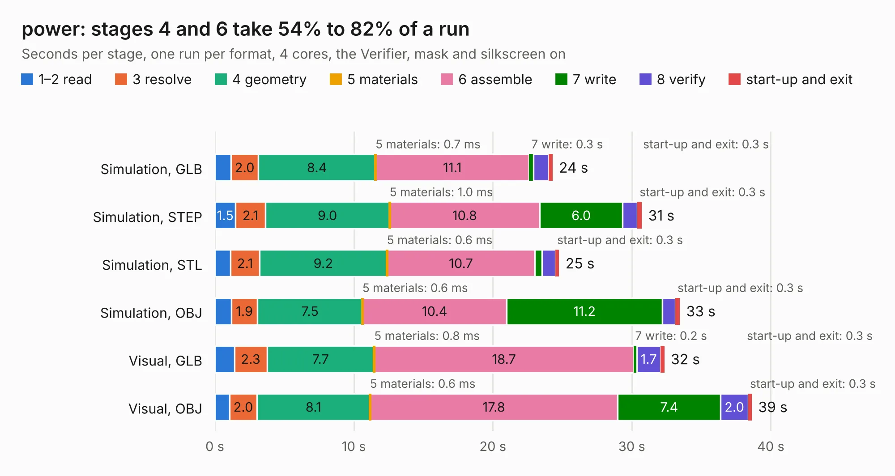

| Mode and format | 1–2 read | 3 resolve | 4 geometry | 5 materials | 6 assemble | 7 write | 8 verify | start-up and exit | Total |
|---|---:|---:|---:|---:|---:|---:|---:|---:|---:|
| Simulation, GLB | 1.2 | 2.0 | 8.4 | 0.7&nbsp;ms | 11.1 | 0.3 | 1.1 | 0.3 | 24.3 |
| Simulation, STEP | 1.5 | 2.1 | 9.0 | 1.0&nbsp;ms | 10.8 | 6.0 | 1.1 | 0.3 | 30.7 |
| Simulation, STL | 1.1 | 2.1 | 9.2 | 0.6&nbsp;ms | 10.7 | 0.5 | 1.0 | 0.3 | 24.8 |
| Simulation, OBJ | 1.2 | 1.9 | 7.5 | 0.6&nbsp;ms | 10.4 | 11.2 | 0.9 | 0.3 | 33.5 |
| Visual, GLB | 1.4 | 2.3 | 7.7 | 0.8&nbsp;ms | 18.7 | 0.2 | 1.7 | 0.3 | 32.3 |
| Visual, OBJ | 1.1 | 2.0 | 8.1 | 0.6&nbsp;ms | 17.8 | 7.4 | 2.0 | 0.3 | 38.6 |

<table align="center"><tr><td valign="top">

| Board | Repo: [byrantech/laptop](https://github.com/byrantech/laptop) Board: `power.kicad_pcb` |
|---|---|
| Folder | power |
| Complexity | 394&nbsp;/&nbsp;1000 (size&nbsp;239, features&nbsp;155) |
| KESE&nbsp;features | through vias, slotted holes, custom pads, rounded, trapezoid or chamfered pads, filled zones, copper drawings, curved board outline, TrueType text, stack-up, dielectric εr and tanδ, copper finish, mask and silkscreen colours |
| Tested | 9th November 2026 |
| Copper&nbsp;layers | 13 |
| File&nbsp;format | KiCad 9 (20241007) |
| Parts,&nbsp;tracks,&nbsp;vias | 176, 1,129, 167 |
| Triangles,&nbsp;simulation | 1,717,024 in 153 parts |
| Verifier | PASS in all six runs |

</td><td valign="top">

<table>
<tr><th>File type</th><th>File size</th><th>Peak memory used</th></tr>
<tr><th colspan="3" align="left">Simulation</th></tr>
<tr><td>GLB</td><td align="right">59&nbsp;MB</td><td align="right">647&nbsp;MB</td></tr>
<tr><td>STEP</td><td align="right">289&nbsp;MB</td><td align="right">811&nbsp;MB</td></tr>
<tr><td>STL</td><td align="right">86&nbsp;MB</td><td align="right">658&nbsp;MB</td></tr>
<tr><td>OBJ</td><td align="right">179&nbsp;MB</td><td align="right">1.2&nbsp;GB</td></tr>
<tr><th colspan="3" align="left">Visual</th></tr>
<tr><td>GLB</td><td align="right">42&nbsp;MB</td><td align="right">857&nbsp;MB</td></tr>
<tr><td>OBJ</td><td align="right">126&nbsp;MB</td><td align="right">959&nbsp;MB</td></tr>
</table>

</td></tr></table>

## 697. switch

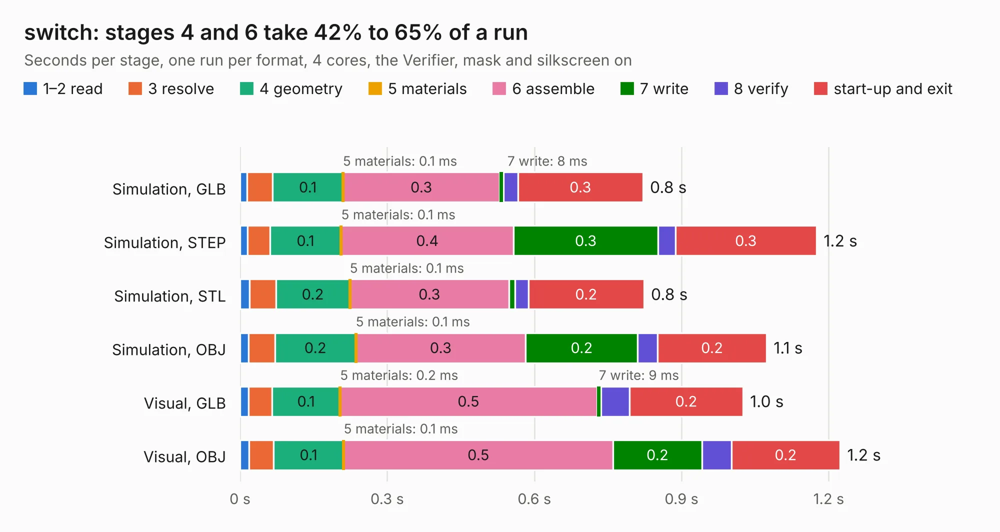

| Mode and format | 1–2 read | 3 resolve | 4 geometry | 5 materials | 6 assemble | 7 write | 8 verify | start-up and exit | Total |
|---|---:|---:|---:|---:|---:|---:|---:|---:|---:|
| Simulation, GLB | 15&nbsp;ms | 52&nbsp;ms | 0.1 | 0.1&nbsp;ms | 0.3 | 8&nbsp;ms | 29&nbsp;ms | 0.3 | 0.8 |
| Simulation, STEP | 15&nbsp;ms | 46&nbsp;ms | 0.1 | 0.1&nbsp;ms | 0.4 | 0.3 | 35&nbsp;ms | 0.3 | 1.2 |
| Simulation, STL | 19&nbsp;ms | 54&nbsp;ms | 0.2 | 0.1&nbsp;ms | 0.3 | 12&nbsp;ms | 27&nbsp;ms | 0.2 | 0.8 |
| Simulation, OBJ | 18&nbsp;ms | 54&nbsp;ms | 0.2 | 0.1&nbsp;ms | 0.3 | 0.2 | 41&nbsp;ms | 0.2 | 1.1 |
| Visual, GLB | 17&nbsp;ms | 48&nbsp;ms | 0.1 | 0.2&nbsp;ms | 0.5 | 9&nbsp;ms | 58&nbsp;ms | 0.2 | 1.0 |
| Visual, OBJ | 19&nbsp;ms | 49&nbsp;ms | 0.1 | 0.1&nbsp;ms | 0.5 | 0.2 | 60&nbsp;ms | 0.2 | 1.2 |

<table align="center"><tr><td valign="top">

| Board | Repo: [byrantech/laptop](https://github.com/byrantech/laptop) Board: `switch.kicad_pcb` |
|---|---|
| Folder | switch |
| Complexity | 151&nbsp;/&nbsp;1000 (size&nbsp;101, features&nbsp;50) |
| KESE&nbsp;features | through vias, rounded, trapezoid or chamfered pads, curved board outline, TrueType text |
| Tested | 9th November 2026 |
| Copper&nbsp;layers | 2 |
| File&nbsp;format | KiCad 9 (20241007) |
| Parts,&nbsp;tracks,&nbsp;vias | 6, 32, 5 |
| Triangles,&nbsp;simulation | 39,470 in 15 parts |
| Verifier | PASS in all six runs |

</td><td valign="top">

<table>
<tr><th>File type</th><th>File size</th><th>Peak memory used</th></tr>
<tr><th colspan="3" align="left">Simulation</th></tr>
<tr><td>GLB</td><td align="right">1.4&nbsp;MB</td><td align="right">46&nbsp;MB</td></tr>
<tr><td>STEP</td><td align="right">5.5&nbsp;MB</td><td align="right">52&nbsp;MB</td></tr>
<tr><td>STL</td><td align="right">2.0&nbsp;MB</td><td align="right">48&nbsp;MB</td></tr>
<tr><td>OBJ</td><td align="right">3.7&nbsp;MB</td><td align="right">60&nbsp;MB</td></tr>
<tr><th colspan="3" align="left">Visual</th></tr>
<tr><td>GLB</td><td align="right">1.0&nbsp;MB</td><td align="right">71&nbsp;MB</td></tr>
<tr><td>OBJ</td><td align="right">2.9&nbsp;MB</td><td align="right">78&nbsp;MB</td></tr>
</table>

</td></tr></table>

## 698. motherboard-stable

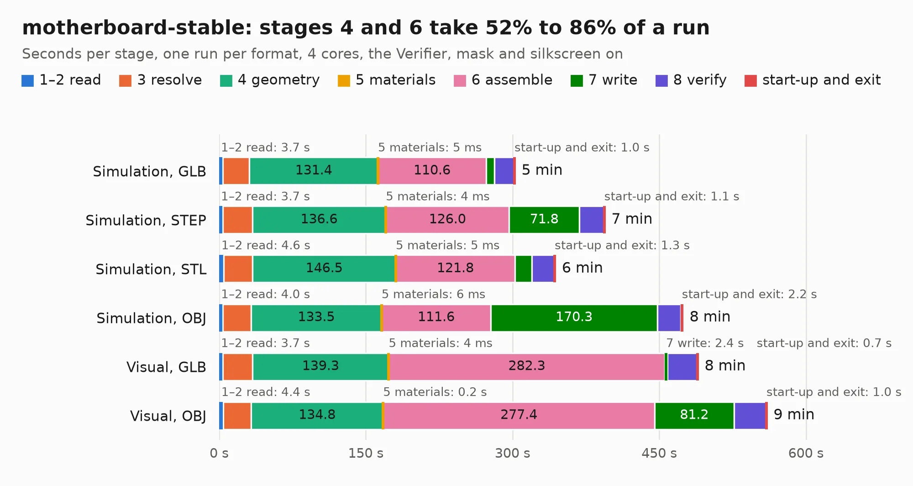

| Mode and format | 1–2 read | 3 resolve | 4 geometry | 5 materials | 6 assemble | 7 write | 8 verify | start-up and exit | Total |
|---|---:|---:|---:|---:|---:|---:|---:|---:|---:|
| Simulation, GLB | 3.7 | 27.2 | 131.4 | 5&nbsp;ms | 110.6 | 8.4 | 20.1 | 1.0 | 302.5 |
| Simulation, STEP | 3.7 | 30.1 | 136.6 | 4&nbsp;ms | 126.0 | 71.8 | 25.0 | 1.1 | 394.3 |
| Simulation, STL | 4.6 | 29.6 | 146.5 | 5&nbsp;ms | 121.8 | 17.4 | 22.6 | 1.3 | 343.7 |
| Simulation, OBJ |  |  |  |  |  |  |  |  | exceeded 11 GB on a 16 GB machine (stopped there, not a KESE failure); it will be run again on a machine with more memory |
| Visual, GLB | 3.7 | 30.4 | 139.3 | 4&nbsp;ms | 282.3 | 2.4 | 30.8 | 0.7 | 489.6 |
| Visual, OBJ | 4.4 | 28.4 | 134.8 | 0.2 | 277.4 | 81.2 | 32.7 | 1.0 | 560.1 |

<table align="center"><tr><td valign="top">

| Board | Repo: [c4puter/motherboard](https://github.com/c4puter/motherboard) Board: `motherboard-stable.kicad_pcb` |
|---|---|
| Complexity | 402&nbsp;/&nbsp;1000 (size&nbsp;327, features&nbsp;75) |
| KESE&nbsp;features | through vias, slotted holes, drill offsets, filled zones, copper text, curved board outline |
| Tested | 9th November 2026 |
| Copper&nbsp;layers | 6 |
| File&nbsp;format | KiCad 4 (4) |
| Parts,&nbsp;tracks,&nbsp;vias | 591, 22,267, 2,074 |
| Triangles,&nbsp;simulation | 22,500,734 in 1157 parts |
| Verifier | Simulation, OBJ: exceeded 11 GB on a 16 GB machine (stopped there, not a KESE failure); it will be run again on a machine with more memory |

</td><td valign="top">

<table>
<tr><th>File type</th><th>File size</th><th>Peak memory used</th></tr>
<tr><th colspan="3" align="left">Simulation</th></tr>
<tr><td>GLB</td><td align="right">775&nbsp;MB</td><td align="right">4.3&nbsp;GB</td></tr>
<tr><td>STEP</td><td align="right">3.1&nbsp;GB</td><td align="right">6.1&nbsp;GB</td></tr>
<tr><td>STL</td><td align="right">1.1&nbsp;GB</td><td align="right">4.6&nbsp;GB</td></tr>
<tr><td>OBJ</td><td align="right">–</td><td align="right">11&nbsp;GB</td></tr>
<tr><th colspan="3" align="left">Visual</th></tr>
<tr><td>GLB</td><td align="right">389&nbsp;MB</td><td align="right">6.3&nbsp;GB</td></tr>
<tr><td>OBJ</td><td align="right">1.3&nbsp;GB</td><td align="right">8.1&nbsp;GB</td></tr>
</table>

</td></tr></table>

## 699. motherboard

| Mode and format | 1–2 read | 3 resolve | 4 geometry | 5 materials | 6 assemble | 7 write | 8 verify | start-up and exit | Total |
|---|---:|---:|---:|---:|---:|---:|---:|---:|---:|
| Simulation, GLB | 3.5 | 27.8 | 135.1 | 5&nbsp;ms | 111.7 | 7.1 | 20.4 | 0.8 | 306.4 |
| Simulation, STEP | 3.7 | 27.8 | 132.8 | 4&nbsp;ms | 106.6 | 61.4 | 19.2 | 1.0 | 352.4 |
| Simulation, STL | 3.7 | 27.5 | 132.6 | 4&nbsp;ms | 102.8 | 11.9 | 17.2 | 0.9 | 296.6 |
| Simulation, OBJ | 4.3 | 28.6 | 135.9 | 4&nbsp;ms | 104.3 | 162.5 | 18.3 | 1.1 | 455.0 |
| Visual, GLB | 3.7 | 26.6 | 131.1 | 4&nbsp;ms | 266.9 | 2.9 | 23.8 | 0.6 | 455.7 |
| Visual, OBJ | 3.8 | 27.6 | 132.1 | 4&nbsp;ms | 263.7 | 72.5 | 23.1 | 0.6 | 523.4 |

<table align="center"><tr><td valign="top">

| Board | Repo: [c4puter/motherboard](https://github.com/c4puter/motherboard) Board: `motherboard.kicad_pcb` |
|---|---|
| Complexity | 402&nbsp;/&nbsp;1000 (size&nbsp;327, features&nbsp;75) |
| KESE&nbsp;features | through vias, slotted holes, drill offsets, filled zones, copper text, curved board outline |
| Tested | 9th November 2026 to 10th November 2026 |
| Copper&nbsp;layers | 6 |
| File&nbsp;format | KiCad 5 (20160815) |
| Parts,&nbsp;tracks,&nbsp;vias | 591, 22,267, 2,074 |
| Triangles,&nbsp;simulation | 22,500,734 in 1157 parts |
| Verifier | PASS in all six runs |
| Run&nbsp;again | Simulation, OBJ: failed in the corpus run, run again with the memory cap raised from 11 GB to 14.5 GB, and passed |

</td><td valign="top">

<table>
<tr><th>File type</th><th>File size</th><th>Peak memory used</th></tr>
<tr><th colspan="3" align="left">Simulation</th></tr>
<tr><td>GLB</td><td align="right">775&nbsp;MB</td><td align="right">4.5&nbsp;GB</td></tr>
<tr><td>STEP</td><td align="right">3.1&nbsp;GB</td><td align="right">6.1&nbsp;GB</td></tr>
<tr><td>STL</td><td align="right">1.1&nbsp;GB</td><td align="right">4.6&nbsp;GB</td></tr>
<tr><td>OBJ</td><td align="right">2.5&nbsp;GB</td><td align="right">14&nbsp;GB</td></tr>
<tr><th colspan="3" align="left">Visual</th></tr>
<tr><td>GLB</td><td align="right">389&nbsp;MB</td><td align="right">6.3&nbsp;GB</td></tr>
<tr><td>OBJ</td><td align="right">1.3&nbsp;GB</td><td align="right">7.9&nbsp;GB</td></tr>
</table>

</td></tr></table>

## 700. OBC Development Board

| Mode and format | 1–2 read | 3 resolve | 4 geometry | 5 materials | 6 assemble | 7 write | 8 verify | start-up and exit | Total |
|---|---:|---:|---:|---:|---:|---:|---:|---:|---:|
| Simulation, GLB | 1.0 | 6.4 | 21.5 | 4&nbsp;ms | 19.8 | 1.0 | 2.6 | 0.4 | 52.7 |
| Simulation, STEP | 1.0 | 6.2 | 20.1 | 2&nbsp;ms | 19.3 | 10.1 | 2.4 | 0.4 | 59.4 |
| Simulation, STL | 1.4 | 6.1 | 21.6 | 2&nbsp;ms | 19.2 | 2.3 | 2.3 | 0.4 | 53.4 |
| Simulation, OBJ | 1.2 | 5.7 | 20.2 | 3&nbsp;ms | 19.7 | 28.2 | 2.8 | 0.3 | 78.1 |
| Visual, GLB | 1.1 | 6.6 | 21.6 | 1&nbsp;ms | 39.7 | 0.4 | 5.8 | 0.4 | 75.5 |
| Visual, OBJ | 1.1 | 6.0 | 20.7 | 0.9&nbsp;ms | 37.8 | 13.7 | 6.1 | 0.3 | 85.7 |

<table align="center"><tr><td valign="top">

| Board | Repo: [calgarytospace/cts-sat-2-obc-pcb](https://github.com/calgarytospace/cts-sat-2-obc-pcb) Board: `OBC Development Board.kicad_pcb` |
|---|---|
| Folder | CTS-SAT-1 Hardware |
| Complexity | 337&nbsp;/&nbsp;1000 (size&nbsp;237, features&nbsp;100) |
| KESE&nbsp;features | through vias, padstacks, rounded, trapezoid or chamfered pads, arc tracks, filled zones, curved board outline |
| Tested | 9th November 2026 |
| Copper&nbsp;layers | 6 |
| File&nbsp;format | KiCad 9 (20241229) |
| Parts,&nbsp;tracks,&nbsp;vias | 221, 1,889, 667 |
| Triangles,&nbsp;simulation | 5,120,894 in 206 parts |
| Verifier | PASS in all six runs |

</td><td valign="top">

<table>
<tr><th>File type</th><th>File size</th><th>Peak memory used</th></tr>
<tr><th colspan="3" align="left">Simulation</th></tr>
<tr><td>GLB</td><td align="right">176&nbsp;MB</td><td align="right">1.4&nbsp;GB</td></tr>
<tr><td>STEP</td><td align="right">525&nbsp;MB</td><td align="right">1.8&nbsp;GB</td></tr>
<tr><td>STL</td><td align="right">256&nbsp;MB</td><td align="right">1.4&nbsp;GB</td></tr>
<tr><td>OBJ</td><td align="right">565&nbsp;MB</td><td align="right">3.3&nbsp;GB</td></tr>
<tr><th colspan="3" align="left">Visual</th></tr>
<tr><td>GLB</td><td align="right">87&nbsp;MB</td><td align="right">1.6&nbsp;GB</td></tr>
<tr><td>OBJ</td><td align="right">280&nbsp;MB</td><td align="right">1.9&nbsp;GB</td></tr>
</table>

</td></tr></table>

## 701. CTS-SAT-2-OBC-PCB

| Mode and format | 1–2 read | 3 resolve | 4 geometry | 5 materials | 6 assemble | 7 write | 8 verify | start-up and exit | Total |
|---|---:|---:|---:|---:|---:|---:|---:|---:|---:|
| Simulation, GLB | 1.4 | 4.4 | 16.4 | 2&nbsp;ms | 16.0 | 0.8 | 2.4 | 0.4 | 41.7 |
| Simulation, STEP | 1.2 | 4.4 | 16.6 | 3&nbsp;ms | 16.3 | 11.5 | 2.3 | 0.4 | 52.7 |
| Simulation, STL | 1.3 | 4.4 | 16.8 | 3&nbsp;ms | 16.6 | 1.7 | 2.2 | 0.3 | 43.3 |
| Simulation, OBJ | 1.3 | 4.2 | 16.9 | 2&nbsp;ms | 16.6 | 23.4 | 2.2 | 0.4 | 64.9 |
| Visual, GLB | 1.3 | 4.3 | 16.7 | 2&nbsp;ms | 38.0 | 0.5 | 4.8 | 0.4 | 65.9 |
| Visual, OBJ | 1.2 | 4.4 | 16.6 | 1&nbsp;ms | 37.9 | 13.6 | 4.9 | 0.4 | 79.0 |

<table align="center"><tr><td valign="top">

| Board | Repo: [calgarytospace/cts-sat-2-obc-pcb](https://github.com/calgarytospace/cts-sat-2-obc-pcb) Board: `CTS-SAT-2-OBC-PCB.kicad_pcb` |
|---|---|
| Folder | Hardware |
| Complexity | 395&nbsp;/&nbsp;1000 (size&nbsp;280, features&nbsp;115) |
| KESE&nbsp;features | through vias, padstacks, slotted holes, rounded, trapezoid or chamfered pads, filled zones, stack-up, dielectric εr and tanδ |
| Tested | 9th November 2026 |
| Copper&nbsp;layers | 6 |
| File&nbsp;format | KiCad 9 (20241229) |
| Parts,&nbsp;tracks,&nbsp;vias | 219, 1,783, 433 |
| Triangles,&nbsp;simulation | 4,523,508 in 424 parts |
| Verifier | PASS in all six runs |

</td><td valign="top">

<table>
<tr><th>File type</th><th>File size</th><th>Peak memory used</th></tr>
<tr><th colspan="3" align="left">Simulation</th></tr>
<tr><td>GLB</td><td align="right">149&nbsp;MB</td><td align="right">1.3&nbsp;GB</td></tr>
<tr><td>STEP</td><td align="right">573&nbsp;MB</td><td align="right">1.6&nbsp;GB</td></tr>
<tr><td>STL</td><td align="right">226&nbsp;MB</td><td align="right">1.3&nbsp;GB</td></tr>
<tr><td>OBJ</td><td align="right">475&nbsp;MB</td><td align="right">2.9&nbsp;GB</td></tr>
<tr><th colspan="3" align="left">Visual</th></tr>
<tr><td>GLB</td><td align="right">93&nbsp;MB</td><td align="right">1.6&nbsp;GB</td></tr>
<tr><td>OBJ</td><td align="right">293&nbsp;MB</td><td align="right">2.1&nbsp;GB</td></tr>
</table>

</td></tr></table>

## 702. MiniLatteLedArray

| Mode and format | 1–2 read | 3 resolve | 4 geometry | 5 materials | 6 assemble | 7 write | 8 verify | start-up and exit | Total |
|---|---:|---:|---:|---:|---:|---:|---:|---:|---:|
| Simulation, GLB | 0.5 | 1.3 | 5.2 | 0.7&nbsp;ms | 6.1 | 0.2 | 0.8 | 0.2 | 14.3 |
| Simulation, STEP | 0.5 | 1.2 | 5.1 | 0.6&nbsp;ms | 6.4 | 4.8 | 0.8 | 0.2 | 18.9 |
| Simulation, STL | 0.5 | 1.2 | 5.4 | 0.7&nbsp;ms | 6.7 | 0.4 | 0.8 | 0.2 | 15.2 |
| Simulation, OBJ | 0.5 | 1.3 | 5.4 | 1&nbsp;ms | 6.8 | 4.7 | 0.8 | 0.2 | 19.7 |
| Visual, GLB | 0.5 | 1.3 | 5.2 | 0.8&nbsp;ms | 11.3 | 0.1 | 1.2 | 0.2 | 20.0 |
| Visual, OBJ | 0.5 | 1.3 | 5.2 | 0.8&nbsp;ms | 11.5 | 4.6 | 1.7 | 0.2 | 24.9 |

<table align="center"><tr><td valign="top">

| Board | Repo: [cath272/minilatte](https://github.com/cath272/minilatte) Board: `MiniLatteLedArray.kicad_pcb` |
|---|---|
| Folder | MiniLatteLedArray |
| Complexity | 294&nbsp;/&nbsp;1000 (size&nbsp;204, features&nbsp;90) |
| KESE&nbsp;features | through vias, arc tracks, filled zones, curved board outline, stack-up, dielectric εr and tanδ |
| Tested | 9th November 2026 |
| Copper&nbsp;layers | 2 |
| File&nbsp;format | KiCad 9 (20241229) |
| Parts,&nbsp;tracks,&nbsp;vias | 225, 1,844, 229 |
| Triangles,&nbsp;simulation | 1,114,792 in 235 parts |
| Note | panel |
| Verifier | PASS in all six runs |

</td><td valign="top">

<table>
<tr><th>File type</th><th>File size</th><th>Peak memory used</th></tr>
<tr><th colspan="3" align="left">Simulation</th></tr>
<tr><td>GLB</td><td align="right">39&nbsp;MB</td><td align="right">626&nbsp;MB</td></tr>
<tr><td>STEP</td><td align="right">201&nbsp;MB</td><td align="right">665&nbsp;MB</td></tr>
<tr><td>STL</td><td align="right">56&nbsp;MB</td><td align="right">631&nbsp;MB</td></tr>
<tr><td>OBJ</td><td align="right">117&nbsp;MB</td><td align="right">760&nbsp;MB</td></tr>
<tr><th colspan="3" align="left">Visual</th></tr>
<tr><td>GLB</td><td align="right">37&nbsp;MB</td><td align="right">933&nbsp;MB</td></tr>
<tr><td>OBJ</td><td align="right">110&nbsp;MB</td><td align="right">806&nbsp;MB</td></tr>
</table>

</td></tr></table>

## 703. MiniLatte

| Mode and format | 1–2 read | 3 resolve | 4 geometry | 5 materials | 6 assemble | 7 write | 8 verify | start-up and exit | Total |
|---|---:|---:|---:|---:|---:|---:|---:|---:|---:|
| Simulation, GLB | 5.5 | 10.3 | 40.3 | 2&nbsp;ms | 71.5 | 2.5 | 7.7 | 0.5 | 138.3 |
| Simulation, STEP | 5.5 | 10.6 | 42.1 | 2&nbsp;ms | 74.8 | 38.8 | 7.4 | 0.6 | 179.8 |
| Simulation, STL | 5.9 | 10.5 | 42.3 | 2&nbsp;ms | 76.6 | 5.2 | 8.0 | 0.5 | 149.0 |
| Simulation, OBJ | 5.6 | 11.0 | 42.0 | 2&nbsp;ms | 80.8 | 85.1 | 8.3 | 0.6 | 233.4 |
| Visual, GLB | 6.2 | 11.5 | 46.0 | 2&nbsp;ms | 132.9 | 2.6 | 13.5 | 0.5 | 213.3 |
| Visual, OBJ | 5.7 | 10.2 | 40.8 | 2&nbsp;ms | 135.9 | 49.2 | 14.7 | 0.5 | 257.0 |

<table align="center"><tr><td valign="top">

| Board | Repo: [cath272/minilatte](https://github.com/cath272/minilatte) Board: `MiniLatte.kicad_pcb` |
|---|---|
| Folder | PCB |
| Complexity | 450&nbsp;/&nbsp;1000 (size&nbsp;315, features&nbsp;135) |
| KESE&nbsp;features | through vias, slotted holes, custom pads, rounded, trapezoid or chamfered pads, arc tracks, filled zones, copper drawings, curved board outline, stack-up, dielectric εr and tanδ |
| Tested | 9th November 2026 |
| Copper&nbsp;layers | 4 |
| File&nbsp;format | KiCad 10 (20260206) |
| Parts,&nbsp;tracks,&nbsp;vias | 495, 11,156, 736 |
| Triangles,&nbsp;simulation | 8,966,200 in 848 parts |
| Verifier | PASS in all six runs |

</td><td valign="top">

<table>
<tr><th>File type</th><th>File size</th><th>Peak memory used</th></tr>
<tr><th colspan="3" align="left">Simulation</th></tr>
<tr><td>GLB</td><td align="right">306&nbsp;MB</td><td align="right">2.9&nbsp;GB</td></tr>
<tr><td>STEP</td><td align="right">1.5&nbsp;GB</td><td align="right">3.5&nbsp;GB</td></tr>
<tr><td>STL</td><td align="right">448&nbsp;MB</td><td align="right">2.8&nbsp;GB</td></tr>
<tr><td>OBJ</td><td align="right">971&nbsp;MB</td><td align="right">5.8&nbsp;GB</td></tr>
<tr><th colspan="3" align="left">Visual</th></tr>
<tr><td>GLB</td><td align="right">232&nbsp;MB</td><td align="right">3.6&nbsp;GB</td></tr>
<tr><td>OBJ</td><td align="right">752&nbsp;MB</td><td align="right">4.7&nbsp;GB</td></tr>
</table>

</td></tr></table>

## 704. hdmi-edp2

| Mode and format | 1–2 read | 3 resolve | 4 geometry | 5 materials | 6 assemble | 7 write | 8 verify | start-up and exit | Total |
|---|---:|---:|---:|---:|---:|---:|---:|---:|---:|
| Simulation, GLB | 0.3 | 1.1 | 3.6 | 0.5&nbsp;ms | 4.1 | 0.2 | 0.6 | 0.2 | 10.1 |
| Simulation, STEP | 0.4 | 1.1 | 3.5 | 0.3&nbsp;ms | 4.1 | 3.3 | 0.6 | 0.2 | 13.2 |
| Simulation, STL | 0.4 | 1.1 | 3.5 | 0.5&nbsp;ms | 4.2 | 0.3 | 0.6 | 0.2 | 10.2 |
| Simulation, OBJ | 0.4 | 1.2 | 3.7 | 0.4&nbsp;ms | 4.5 | 5.9 | 0.6 | 0.2 | 16.5 |
| Visual, GLB | 0.4 | 1.0 | 3.5 | 0.4&nbsp;ms | 9.0 | 0.1 | 1.0 | 0.2 | 15.4 |
| Visual, OBJ | 0.4 | 1.2 | 3.8 | 0.6&nbsp;ms | 8.3 | 4.4 | 1.4 | 0.2 | 19.7 |

<table align="center"><tr><td valign="top">

| Board | Repo: [cetola/reform-next-mirror](https://github.com/cetola/reform-next-mirror) Board: `hdmi-edp2.kicad_pcb` |
|---|---|
| Folder | hdmi-edp2 |
| Complexity | 329&nbsp;/&nbsp;1000 (size&nbsp;254, features&nbsp;75) |
| KESE&nbsp;features | through vias, rounded, trapezoid or chamfered pads, filled zones, stack-up, dielectric εr and tanδ |
| Tested | 9th November 2026 |
| Copper&nbsp;layers | 4 |
| File&nbsp;format | KiCad 8 (20240108) |
| Parts,&nbsp;tracks,&nbsp;vias | 93, 910, 170 |
| Triangles,&nbsp;simulation | 1,071,490 in 92 parts |
| Verifier | PASS in all six runs |

</td><td valign="top">

<table>
<tr><th>File type</th><th>File size</th><th>Peak memory used</th></tr>
<tr><th colspan="3" align="left">Simulation</th></tr>
<tr><td>GLB</td><td align="right">37&nbsp;MB</td><td align="right">460&nbsp;MB</td></tr>
<tr><td>STEP</td><td align="right">156&nbsp;MB</td><td align="right">547&nbsp;MB</td></tr>
<tr><td>STL</td><td align="right">54&nbsp;MB</td><td align="right">452&nbsp;MB</td></tr>
<tr><td>OBJ</td><td align="right">108&nbsp;MB</td><td align="right">740&nbsp;MB</td></tr>
<tr><th colspan="3" align="left">Visual</th></tr>
<tr><td>GLB</td><td align="right">27&nbsp;MB</td><td align="right">635&nbsp;MB</td></tr>
<tr><td>OBJ</td><td align="right">81&nbsp;MB</td><td align="right">626&nbsp;MB</td></tr>
</table>

</td></tr></table>

## 705. nref-batterypack-backside

| Mode and format | 1–2 read | 3 resolve | 4 geometry | 5 materials | 6 assemble | 7 write | 8 verify | start-up and exit | Total |
|---|---:|---:|---:|---:|---:|---:|---:|---:|---:|
| Simulation, GLB | 0.1 | 0.1 | 0.4 | 0.1&nbsp;ms | 0.5 | 16&nbsp;ms | 48&nbsp;ms | 0.3 | 1.5 |
| Simulation, STEP | 0.2 | 0.1 | 0.4 | 0.1&nbsp;ms | 0.5 | 0.8 | 48&nbsp;ms | 0.3 | 2.4 |
| Simulation, STL | 0.2 | 0.1 | 0.4 | 0.1&nbsp;ms | 0.5 | 31&nbsp;ms | 49&nbsp;ms | 0.2 | 1.5 |
| Simulation, OBJ | 0.1 | 0.1 | 0.4 | 0.1&nbsp;ms | 0.5 | 0.5 | 48&nbsp;ms | 0.2 | 1.9 |
| Visual, GLB | 0.1 | 0.1 | 0.4 | 0.1&nbsp;ms | 1.2 | 13&nbsp;ms | 79&nbsp;ms | 0.3 | 2.1 |
| Visual, OBJ | 0.1 | 0.1 | 0.4 | 0.2&nbsp;ms | 1.1 | 0.4 | 0.1 | 0.2 | 2.4 |

<table align="center"><tr><td valign="top">

| Board | Repo: [cetola/reform-next-mirror](https://github.com/cetola/reform-next-mirror) Board: `nref-batterypack-backside.kicad_pcb` |
|---|---|
| Folder | nref-batterypack-v3 |
| Complexity | 229&nbsp;/&nbsp;1000 (size&nbsp;114, features&nbsp;115) |
| KESE&nbsp;features | through vias, rounded, trapezoid or chamfered pads, filled zones, curved board outline, knockout text, TrueType text, stack-up, dielectric εr and tanδ |
| Tested | 9th November 2026 |
| Copper&nbsp;layers | 4 |
| File&nbsp;format | KiCad 10 (20260206) |
| Parts,&nbsp;tracks,&nbsp;vias | 3, 16, 13 |
| Triangles,&nbsp;simulation | 82,176 in 16 parts |
| Verifier | PASS in all six runs |

</td><td valign="top">

<table>
<tr><th>File type</th><th>File size</th><th>Peak memory used</th></tr>
<tr><th colspan="3" align="left">Simulation</th></tr>
<tr><td>GLB</td><td align="right">2.9&nbsp;MB</td><td align="right">183&nbsp;MB</td></tr>
<tr><td>STEP</td><td align="right">13&nbsp;MB</td><td align="right">185&nbsp;MB</td></tr>
<tr><td>STL</td><td align="right">4.1&nbsp;MB</td><td align="right">178&nbsp;MB</td></tr>
<tr><td>OBJ</td><td align="right">8.0&nbsp;MB</td><td align="right">176&nbsp;MB</td></tr>
<tr><th colspan="3" align="left">Visual</th></tr>
<tr><td>GLB</td><td align="right">2.3&nbsp;MB</td><td align="right">151&nbsp;MB</td></tr>
<tr><td>OBJ</td><td align="right">6.3&nbsp;MB</td><td align="right">153&nbsp;MB</td></tr>
</table>

</td></tr></table>

## 706. nref-batterypack

| Mode and format | 1–2 read | 3 resolve | 4 geometry | 5 materials | 6 assemble | 7 write | 8 verify | start-up and exit | Total |
|---|---:|---:|---:|---:|---:|---:|---:|---:|---:|
| Simulation, GLB | 0.4 | 1.0 | 3.0 | 0.4&nbsp;ms | 3.6 | 0.2 | 0.6 | 0.2 | 9.0 |
| Simulation, STEP | 0.5 | 1.0 | 3.1 | 0.3&nbsp;ms | 3.3 | 2.8 | 0.5 | 0.3 | 11.6 |
| Simulation, STL | 0.4 | 1.0 | 3.2 | 0.2&nbsp;ms | 3.8 | 0.3 | 0.6 | 0.3 | 9.5 |
| Simulation, OBJ | 0.4 | 1.0 | 3.1 | 0.5&nbsp;ms | 3.5 | 4.8 | 0.5 | 0.3 | 13.6 |
| Visual, GLB | 0.4 | 1.0 | 3.1 | 0.3&nbsp;ms | 7.7 | 0.1 | 0.9 | 0.2 | 13.4 |
| Visual, OBJ | 0.4 | 1.0 | 3.2 | 0.4&nbsp;ms | 8.0 | 3.6 | 1.1 | 0.2 | 17.6 |

<table align="center"><tr><td valign="top">

| Board | Repo: [cetola/reform-next-mirror](https://github.com/cetola/reform-next-mirror) Board: `nref-batterypack.kicad_pcb` |
|---|---|
| Folder | nref-batterypack-v3 |
| Complexity | 355&nbsp;/&nbsp;1000 (size&nbsp;240, features&nbsp;115) |
| KESE&nbsp;features | through vias, rounded, trapezoid or chamfered pads, filled zones, curved board outline, knockout text, TrueType text, stack-up, dielectric εr and tanδ |
| Tested | 9th November 2026 |
| Copper&nbsp;layers | 4 |
| File&nbsp;format | KiCad 10 (20260206) |
| Parts,&nbsp;tracks,&nbsp;vias | 85, 776, 191 |
| Triangles,&nbsp;simulation | 978,200 in 77 parts |
| Verifier | PASS in all six runs |

</td><td valign="top">

<table>
<tr><th>File type</th><th>File size</th><th>Peak memory used</th></tr>
<tr><th colspan="3" align="left">Simulation</th></tr>
<tr><td>GLB</td><td align="right">33&nbsp;MB</td><td align="right">421&nbsp;MB</td></tr>
<tr><td>STEP</td><td align="right">142&nbsp;MB</td><td align="right">545&nbsp;MB</td></tr>
<tr><td>STL</td><td align="right">49&nbsp;MB</td><td align="right">418&nbsp;MB</td></tr>
<tr><td>OBJ</td><td align="right">98&nbsp;MB</td><td align="right">700&nbsp;MB</td></tr>
<tr><th colspan="3" align="left">Visual</th></tr>
<tr><td>GLB</td><td align="right">24&nbsp;MB</td><td align="right">617&nbsp;MB</td></tr>
<tr><td>OBJ</td><td align="right">72&nbsp;MB</td><td align="right">599&nbsp;MB</td></tr>
</table>

</td></tr></table>

## 707. nref-batterypack-backside

| Mode and format | 1–2 read | 3 resolve | 4 geometry | 5 materials | 6 assemble | 7 write | 8 verify | start-up and exit | Total |
|---|---:|---:|---:|---:|---:|---:|---:|---:|---:|
| Simulation, GLB | 0.1 | 99&nbsp;ms | 0.2 | 0.1&nbsp;ms | 0.3 | 7&nbsp;ms | 23&nbsp;ms | 0.2 | 1.0 |
| Simulation, STEP | 0.1 | 90&nbsp;ms | 0.2 | 0.1&nbsp;ms | 0.3 | 0.3 | 20&nbsp;ms | 0.3 | 1.2 |
| Simulation, STL | 0.1 | 0.1 | 0.2 | 0.1&nbsp;ms | 0.3 | 11&nbsp;ms | 25&nbsp;ms | 0.2 | 1.0 |
| Simulation, OBJ | 0.1 | 0.1 | 0.2 | 0.1&nbsp;ms | 0.3 | 0.2 | 21&nbsp;ms | 0.2 | 1.2 |
| Visual, GLB | 0.1 | 90&nbsp;ms | 0.2 | 0.1&nbsp;ms | 0.6 | 8&nbsp;ms | 49&nbsp;ms | 0.2 | 1.2 |
| Visual, OBJ | 0.2 | 0.1 | 0.2 | 0.1&nbsp;ms | 0.6 | 0.3 | 48&nbsp;ms | 0.2 | 1.6 |

<table align="center"><tr><td valign="top">

| Board | Repo: [cetola/reform-next-mirror](https://github.com/cetola/reform-next-mirror) Board: `nref-batterypack-backside.kicad_pcb` |
|---|---|
| Folder | nref-batterypack |
| Complexity | 122&nbsp;/&nbsp;1000 (size&nbsp;72, features&nbsp;50) |
| KESE&nbsp;features | through vias, rounded, trapezoid or chamfered pads, curved board outline, knockout text |
| Tested | 9th November 2026 |
| Copper&nbsp;layers | 2 |
| File&nbsp;format | KiCad 8 (20240108) |
| Parts,&nbsp;tracks,&nbsp;vias | 1, 12, 2 |
| Triangles,&nbsp;simulation | 31,336 in 12 parts |
| Verifier | PASS in all six runs |

</td><td valign="top">

<table>
<tr><th>File type</th><th>File size</th><th>Peak memory used</th></tr>
<tr><th colspan="3" align="left">Simulation</th></tr>
<tr><td>GLB</td><td align="right">1.2&nbsp;MB</td><td align="right">72&nbsp;MB</td></tr>
<tr><td>STEP</td><td align="right">7.0&nbsp;MB</td><td align="right">77&nbsp;MB</td></tr>
<tr><td>STL</td><td align="right">1.6&nbsp;MB</td><td align="right">72&nbsp;MB</td></tr>
<tr><td>OBJ</td><td align="right">3.2&nbsp;MB</td><td align="right">79&nbsp;MB</td></tr>
<tr><th colspan="3" align="left">Visual</th></tr>
<tr><td>GLB</td><td align="right">1.1&nbsp;MB</td><td align="right">88&nbsp;MB</td></tr>
<tr><td>OBJ</td><td align="right">3.1&nbsp;MB</td><td align="right">101&nbsp;MB</td></tr>
</table>

</td></tr></table>

## 708. nref-batterypack

| Mode and format | 1–2 read | 3 resolve | 4 geometry | 5 materials | 6 assemble | 7 write | 8 verify | start-up and exit | Total |
|---|---:|---:|---:|---:|---:|---:|---:|---:|---:|
| Simulation, GLB | 0.3 | 0.7 | 2.3 | 0.4&nbsp;ms | 2.7 | 98&nbsp;ms | 0.3 | 0.3 | 6.7 |
| Simulation, STEP | 0.3 | 0.7 | 2.2 | 0.4&nbsp;ms | 2.6 | 2.3 | 0.4 | 0.2 | 8.7 |
| Simulation, STL | 0.3 | 0.7 | 2.2 | 0.3&nbsp;ms | 2.7 | 0.2 | 0.4 | 0.3 | 6.7 |
| Simulation, OBJ | 0.3 | 0.6 | 2.1 | 0.3&nbsp;ms | 2.6 | 3.3 | 0.4 | 0.2 | 9.6 |
| Visual, GLB | 0.4 | 0.7 | 2.2 | 0.3&nbsp;ms | 5.6 | 71&nbsp;ms | 0.5 | 0.3 | 9.6 |
| Visual, OBJ | 0.3 | 0.7 | 2.3 | 0.4&nbsp;ms | 5.1 | 2.6 | 0.6 | 0.2 | 11.7 |

<table align="center"><tr><td valign="top">

| Board | Repo: [cetola/reform-next-mirror](https://github.com/cetola/reform-next-mirror) Board: `nref-batterypack.kicad_pcb` |
|---|---|
| Folder | nref-batterypack |
| Complexity | 334&nbsp;/&nbsp;1000 (size&nbsp;224, features&nbsp;110) |
| KESE&nbsp;features | through vias, custom pads, rounded, trapezoid or chamfered pads, filled zones, copper drawings, curved board outline, stack-up, dielectric εr and tanδ |
| Tested | 9th November 2026 |
| Copper&nbsp;layers | 4 |
| File&nbsp;format | KiCad 9 (20241229) |
| Parts,&nbsp;tracks,&nbsp;vias | 59, 456, 67 |
| Triangles,&nbsp;simulation | 555,620 in 64 parts |
| Verifier | PASS in all six runs |

</td><td valign="top">

<table>
<tr><th>File type</th><th>File size</th><th>Peak memory used</th></tr>
<tr><th colspan="3" align="left">Simulation</th></tr>
<tr><td>GLB</td><td align="right">19&nbsp;MB</td><td align="right">321&nbsp;MB</td></tr>
<tr><td>STEP</td><td align="right">88&nbsp;MB</td><td align="right">389&nbsp;MB</td></tr>
<tr><td>STL</td><td align="right">28&nbsp;MB</td><td align="right">320&nbsp;MB</td></tr>
<tr><td>OBJ</td><td align="right">56&nbsp;MB</td><td align="right">422&nbsp;MB</td></tr>
<tr><th colspan="3" align="left">Visual</th></tr>
<tr><td>GLB</td><td align="right">14&nbsp;MB</td><td align="right">425&nbsp;MB</td></tr>
<tr><td>OBJ</td><td align="right">43&nbsp;MB</td><td align="right">368&nbsp;MB</td></tr>
</table>

</td></tr></table>

## 709. nref-camera-adapter

| Mode and format | 1–2 read | 3 resolve | 4 geometry | 5 materials | 6 assemble | 7 write | 8 verify | start-up and exit | Total |
|---|---:|---:|---:|---:|---:|---:|---:|---:|---:|
| Simulation, GLB | 0.2 | 0.4 | 1.0 | 0.2&nbsp;ms | 1.1 | 51&nbsp;ms | 0.2 | 0.2 | 3.2 |
| Simulation, STEP | 0.2 | 0.4 | 0.9 | 0.2&nbsp;ms | 1.2 | 1.2 | 0.2 | 0.2 | 4.3 |
| Simulation, STL | 0.2 | 0.4 | 1.0 | 0.2&nbsp;ms | 1.2 | 0.1 | 0.2 | 0.2 | 3.4 |
| Simulation, OBJ | 0.2 | 0.4 | 1.0 | 0.2&nbsp;ms | 1.2 | 1.9 | 0.2 | 0.3 | 5.0 |
| Visual, GLB | 0.2 | 0.4 | 1.0 | 0.3&nbsp;ms | 2.3 | 44&nbsp;ms | 0.3 | 0.2 | 4.4 |
| Visual, OBJ | 0.2 | 0.4 | 1.0 | 0.2&nbsp;ms | 2.4 | 1.1 | 0.2 | 0.3 | 5.5 |

<table align="center"><tr><td valign="top">

| Board | Repo: [cetola/reform-next-mirror](https://github.com/cetola/reform-next-mirror) Board: `nref-camera-adapter.kicad_pcb` |
|---|---|
| Folder | nref-camera-adapter |
| Complexity | 236&nbsp;/&nbsp;1000 (size&nbsp;146, features&nbsp;90) |
| KESE&nbsp;features | through vias, rounded, trapezoid or chamfered pads, filled zones, TrueType text, stack-up, dielectric εr and tanδ |
| Tested | 9th November 2026 |
| Copper&nbsp;layers | 4 |
| File&nbsp;format | KiCad 9 (20241229) |
| Parts,&nbsp;tracks,&nbsp;vias | 2, 157, 101 |
| Triangles,&nbsp;simulation | 308,202 in 36 parts |
| Verifier | PASS in all six runs |

</td><td valign="top">

<table>
<tr><th>File type</th><th>File size</th><th>Peak memory used</th></tr>
<tr><th colspan="3" align="left">Simulation</th></tr>
<tr><td>GLB</td><td align="right">11&nbsp;MB</td><td align="right">273&nbsp;MB</td></tr>
<tr><td>STEP</td><td align="right">31&nbsp;MB</td><td align="right">278&nbsp;MB</td></tr>
<tr><td>STL</td><td align="right">15&nbsp;MB</td><td align="right">269&nbsp;MB</td></tr>
<tr><td>OBJ</td><td align="right">30&nbsp;MB</td><td align="right">260&nbsp;MB</td></tr>
<tr><th colspan="3" align="left">Visual</th></tr>
<tr><td>GLB</td><td align="right">7.0&nbsp;MB</td><td align="right">233&nbsp;MB</td></tr>
<tr><td>OBJ</td><td align="right">21&nbsp;MB</td><td align="right">237&nbsp;MB</td></tr>
</table>

</td></tr></table>

## 710. reform-camera

| Mode and format | 1–2 read | 3 resolve | 4 geometry | 5 materials | 6 assemble | 7 write | 8 verify | start-up and exit | Total |
|---|---:|---:|---:|---:|---:|---:|---:|---:|---:|
| Simulation, GLB | 0.7 | 2.0 | 7.9 | 0.5&nbsp;ms | 8.1 | 0.3 | 0.8 | 0.4 | 20.1 |
| Simulation, STEP | 0.6 | 1.6 | 7.4 | 0.4&nbsp;ms | 8.0 | 5.6 | 0.8 | 0.3 | 24.3 |
| Simulation, STL | 0.6 | 1.7 | 7.5 | 0.4&nbsp;ms | 8.3 | 0.4 | 0.8 | 0.3 | 19.6 |
| Simulation, OBJ | 0.6 | 1.6 | 7.4 | 0.6&nbsp;ms | 8.0 | 9.8 | 0.9 | 0.3 | 28.6 |
| Visual, GLB | 0.6 | 1.7 | 7.4 | 0.4&nbsp;ms | 14.7 | 0.2 | 1.6 | 0.3 | 26.4 |
| Visual, OBJ | 0.6 | 1.7 | 7.8 | 0.4&nbsp;ms | 15.2 | 7.3 | 1.6 | 0.3 | 34.4 |

<table align="center"><tr><td valign="top">

| Board | Repo: [cetola/reform-next-mirror](https://github.com/cetola/reform-next-mirror) Board: `reform-camera.kicad_pcb` |
|---|---|
| Folder | nref-camera |
| Complexity | 356&nbsp;/&nbsp;1000 (size&nbsp;261, features&nbsp;95) |
| KESE&nbsp;features | through vias, rounded, trapezoid or chamfered pads, arc tracks, filled zones, stack-up, dielectric εr and tanδ, mask and silkscreen colours |
| Tested | 9th November 2026 |
| Copper&nbsp;layers | 4 |
| File&nbsp;format | KiCad 8 (20240108) |
| Parts,&nbsp;tracks,&nbsp;vias | 114, 1,298, 235 |
| Triangles,&nbsp;simulation | 1,605,780 in 148 parts |
| Verifier | PASS in all six runs |

</td><td valign="top">

<table>
<tr><th>File type</th><th>File size</th><th>Peak memory used</th></tr>
<tr><th colspan="3" align="left">Simulation</th></tr>
<tr><td>GLB</td><td align="right">54&nbsp;MB</td><td align="right">613&nbsp;MB</td></tr>
<tr><td>STEP</td><td align="right">253&nbsp;MB</td><td align="right">747&nbsp;MB</td></tr>
<tr><td>STL</td><td align="right">80&nbsp;MB</td><td align="right">622&nbsp;MB</td></tr>
<tr><td>OBJ</td><td align="right">165&nbsp;MB</td><td align="right">1.1&nbsp;GB</td></tr>
<tr><th colspan="3" align="left">Visual</th></tr>
<tr><td>GLB</td><td align="right">39&nbsp;MB</td><td align="right">755&nbsp;MB</td></tr>
<tr><td>OBJ</td><td align="right">119&nbsp;MB</td><td align="right">902&nbsp;MB</td></tr>
</table>

</td></tr></table>

## 711. nref-flex-eth

| Mode and format | 1–2 read | 3 resolve | 4 geometry | 5 materials | 6 assemble | 7 write | 8 verify | start-up and exit | Total |
|---|---:|---:|---:|---:|---:|---:|---:|---:|---:|
| Simulation, GLB | 0.1 | 0.2 | 0.7 | 0.2&nbsp;ms | 0.7 | 27&nbsp;ms | 95&nbsp;ms | 0.2 | 2.0 |
| Simulation, STEP | 0.1 | 0.2 | 0.7 | 0.3&nbsp;ms | 0.7 | 0.9 | 94&nbsp;ms | 0.2 | 2.9 |
| Simulation, STL | 0.1 | 0.2 | 0.6 | 0.1&nbsp;ms | 0.7 | 34&nbsp;ms | 84&nbsp;ms | 0.3 | 2.0 |
| Simulation, OBJ | 98&nbsp;ms | 0.2 | 0.6 | 0.2&nbsp;ms | 0.7 | 0.7 | 80&nbsp;ms | 0.2 | 2.6 |
| Visual, GLB | 94&nbsp;ms | 0.2 | 0.8 | 0.2&nbsp;ms | 1.6 | 24&nbsp;ms | 0.2 | 0.2 | 3.0 |
| Visual, OBJ | 94&nbsp;ms | 0.2 | 0.6 | 0.2&nbsp;ms | 1.7 | 0.7 | 0.2 | 0.2 | 3.7 |

<table align="center"><tr><td valign="top">

| Board | Repo: [cetola/reform-next-mirror](https://github.com/cetola/reform-next-mirror) Board: `nref-flex-eth.kicad_pcb` |
|---|---|
| Folder | nref-flex / nref-flex-eth |
| Complexity | 176&nbsp;/&nbsp;1000 (size&nbsp;126, features&nbsp;50) |
| KESE&nbsp;features | through vias, filled zones, TrueType text |
| Tested | 9th November 2026 |
| Copper&nbsp;layers | 2 |
| File&nbsp;format | KiCad 9 (20241229) |
| Parts,&nbsp;tracks,&nbsp;vias | 2, 88, 98 |
| Triangles,&nbsp;simulation | 147,362 in 22 parts |
| Verifier | PASS in all six runs |

</td><td valign="top">

<table>
<tr><th>File type</th><th>File size</th><th>Peak memory used</th></tr>
<tr><th colspan="3" align="left">Simulation</th></tr>
<tr><td>GLB</td><td align="right">5.2&nbsp;MB</td><td align="right">212&nbsp;MB</td></tr>
<tr><td>STEP</td><td align="right">18&nbsp;MB</td><td align="right">223&nbsp;MB</td></tr>
<tr><td>STL</td><td align="right">7.4&nbsp;MB</td><td align="right">211&nbsp;MB</td></tr>
<tr><td>OBJ</td><td align="right">15&nbsp;MB</td><td align="right">217&nbsp;MB</td></tr>
<tr><th colspan="3" align="left">Visual</th></tr>
<tr><td>GLB</td><td align="right">5.4&nbsp;MB</td><td align="right">205&nbsp;MB</td></tr>
<tr><td>OBJ</td><td align="right">15&nbsp;MB</td><td align="right">203&nbsp;MB</td></tr>
</table>

</td></tr></table>

## 712. nref-flex-dp-140mm

| Mode and format | 1–2 read | 3 resolve | 4 geometry | 5 materials | 6 assemble | 7 write | 8 verify | start-up and exit | Total |
|---|---:|---:|---:|---:|---:|---:|---:|---:|---:|
| Simulation, GLB | 0.1 | 0.2 | 0.6 | 0.1&nbsp;ms | 0.7 | 20&nbsp;ms | 69&nbsp;ms | 0.2 | 1.9 |
| Simulation, STEP | 0.1 | 0.1 | 0.5 | 0.1&nbsp;ms | 0.8 | 0.9 | 51&nbsp;ms | 0.2 | 2.7 |
| Simulation, STL | 0.1 | 0.1 | 0.5 | 0.1&nbsp;ms | 0.7 | 25&nbsp;ms | 67&nbsp;ms | 0.2 | 1.8 |
| Simulation, OBJ | 0.1 | 0.1 | 0.6 | 0.1&nbsp;ms | 0.8 | 0.5 | 51&nbsp;ms | 0.2 | 2.4 |
| Visual, GLB | 0.1 | 0.1 | 0.5 | 0.1&nbsp;ms | 1.3 | 19&nbsp;ms | 0.1 | 0.2 | 2.4 |
| Visual, OBJ | 0.1 | 0.1 | 0.5 | 0.1&nbsp;ms | 1.3 | 0.6 | 0.1 | 0.2 | 2.9 |

<table align="center"><tr><td valign="top">

| Board | Repo: [cetola/reform-next-mirror](https://github.com/cetola/reform-next-mirror) Board: `nref-flex-dp-140mm.kicad_pcb` |
|---|---|
| Folder | nref-flex / nref-flex-hdmi |
| Complexity | 165&nbsp;/&nbsp;1000 (size&nbsp;115, features&nbsp;50) |
| KESE&nbsp;features | through vias, filled zones, TrueType text |
| Tested | 9th November 2026 |
| Copper&nbsp;layers | 2 |
| File&nbsp;format | KiCad 9 (20241229) |
| Parts,&nbsp;tracks,&nbsp;vias | 2, 75, 40 |
| Triangles,&nbsp;simulation | 89,198 in 23 parts |
| Verifier | PASS in all six runs |

</td><td valign="top">

<table>
<tr><th>File type</th><th>File size</th><th>Peak memory used</th></tr>
<tr><th colspan="3" align="left">Simulation</th></tr>
<tr><td>GLB</td><td align="right">3.3&nbsp;MB</td><td align="right">185&nbsp;MB</td></tr>
<tr><td>STEP</td><td align="right">16&nbsp;MB</td><td align="right">203&nbsp;MB</td></tr>
<tr><td>STL</td><td align="right">4.5&nbsp;MB</td><td align="right">190&nbsp;MB</td></tr>
<tr><td>OBJ</td><td align="right">9.1&nbsp;MB</td><td align="right">187&nbsp;MB</td></tr>
<tr><th colspan="3" align="left">Visual</th></tr>
<tr><td>GLB</td><td align="right">4.0&nbsp;MB</td><td align="right">174&nbsp;MB</td></tr>
<tr><td>OBJ</td><td align="right">11&nbsp;MB</td><td align="right">171&nbsp;MB</td></tr>
</table>

</td></tr></table>

## 713. nref-flex-hdmi

| Mode and format | 1–2 read | 3 resolve | 4 geometry | 5 materials | 6 assemble | 7 write | 8 verify | start-up and exit | Total |
|---|---:|---:|---:|---:|---:|---:|---:|---:|---:|
| Simulation, GLB | 0.1 | 0.1 | 0.5 | 0.1&nbsp;ms | 0.7 | 18&nbsp;ms | 59&nbsp;ms | 0.2 | 1.7 |
| Simulation, STEP | 0.1 | 0.2 | 0.5 | 0.1&nbsp;ms | 0.7 | 0.9 | 53&nbsp;ms | 0.2 | 2.6 |
| Simulation, STL | 0.1 | 0.1 | 0.5 | 0.1&nbsp;ms | 0.7 | 24&nbsp;ms | 57&nbsp;ms | 0.2 | 1.7 |
| Simulation, OBJ | 0.1 | 0.1 | 0.5 | 0.1&nbsp;ms | 0.7 | 0.5 | 57&nbsp;ms | 0.2 | 2.2 |
| Visual, GLB | 0.1 | 0.1 | 0.4 | 0.1&nbsp;ms | 1.3 | 19&nbsp;ms | 0.1 | 0.2 | 2.3 |
| Visual, OBJ | 0.1 | 0.1 | 0.4 | 0.1&nbsp;ms | 1.3 | 0.6 | 0.1 | 0.2 | 2.8 |

<table align="center"><tr><td valign="top">

| Board | Repo: [cetola/reform-next-mirror](https://github.com/cetola/reform-next-mirror) Board: `nref-flex-hdmi.kicad_pcb` |
|---|---|
| Folder | nref-flex / nref-flex-hdmi |
| Complexity | 166&nbsp;/&nbsp;1000 (size&nbsp;116, features&nbsp;50) |
| KESE&nbsp;features | through vias, filled zones, TrueType text |
| Tested | 9th November 2026 |
| Copper&nbsp;layers | 2 |
| File&nbsp;format | KiCad 9 (20241229) |
| Parts,&nbsp;tracks,&nbsp;vias | 2, 76, 44 |
| Triangles,&nbsp;simulation | 91,684 in 23 parts |
| Verifier | PASS in all six runs |

</td><td valign="top">

<table>
<tr><th>File type</th><th>File size</th><th>Peak memory used</th></tr>
<tr><th colspan="3" align="left">Simulation</th></tr>
<tr><td>GLB</td><td align="right">3.4&nbsp;MB</td><td align="right">189&nbsp;MB</td></tr>
<tr><td>STEP</td><td align="right">16&nbsp;MB</td><td align="right">195&nbsp;MB</td></tr>
<tr><td>STL</td><td align="right">4.6&nbsp;MB</td><td align="right">193&nbsp;MB</td></tr>
<tr><td>OBJ</td><td align="right">9.3&nbsp;MB</td><td align="right">194&nbsp;MB</td></tr>
<tr><th colspan="3" align="left">Visual</th></tr>
<tr><td>GLB</td><td align="right">4.1&nbsp;MB</td><td align="right">166&nbsp;MB</td></tr>
<tr><td>OBJ</td><td align="right">11&nbsp;MB</td><td align="right">167&nbsp;MB</td></tr>
</table>

</td></tr></table>

## 714. nref-flex-pcie

| Mode and format | 1–2 read | 3 resolve | 4 geometry | 5 materials | 6 assemble | 7 write | 8 verify | start-up and exit | Total |
|---|---:|---:|---:|---:|---:|---:|---:|---:|---:|
| Simulation, GLB | 0.1 | 0.2 | 0.4 | 0.2&nbsp;ms | 0.6 | 26&nbsp;ms | 66&nbsp;ms | 0.3 | 1.7 |
| Simulation, STEP | 0.1 | 0.1 | 0.5 | 0.2&nbsp;ms | 0.7 | 0.8 | 68&nbsp;ms | 0.2 | 2.5 |
| Simulation, STL | 0.1 | 0.2 | 0.4 | 0.1&nbsp;ms | 0.7 | 25&nbsp;ms | 64&nbsp;ms | 0.2 | 1.7 |
| Simulation, OBJ | 0.1 | 0.1 | 0.4 | 0.2&nbsp;ms | 0.6 | 0.6 | 88&nbsp;ms | 0.3 | 2.2 |
| Visual, GLB | 0.1 | 0.1 | 0.4 | 0.2&nbsp;ms | 1.4 | 20&nbsp;ms | 0.1 | 0.2 | 2.5 |
| Visual, OBJ | 0.1 | 0.1 | 0.4 | 0.2&nbsp;ms | 1.4 | 0.6 | 0.1 | 0.3 | 3.1 |

<table align="center"><tr><td valign="top">

| Board | Repo: [cetola/reform-next-mirror](https://github.com/cetola/reform-next-mirror) Board: `nref-flex-pcie.kicad_pcb` |
|---|---|
| Folder | nref-flex / nref-flex-pcie |
| Complexity | 195&nbsp;/&nbsp;1000 (size&nbsp;115, features&nbsp;80) |
| KESE&nbsp;features | through vias, filled zones, TrueType text, stack-up, dielectric εr and tanδ |
| Tested | 9th November 2026 |
| Copper&nbsp;layers | 2 |
| File&nbsp;format | KiCad 9 (20241229) |
| Parts,&nbsp;tracks,&nbsp;vias | 2, 95, 32 |
| Triangles,&nbsp;simulation | 97,104 in 24 parts |
| Verifier | PASS in all six runs |

</td><td valign="top">

<table>
<tr><th>File type</th><th>File size</th><th>Peak memory used</th></tr>
<tr><th colspan="3" align="left">Simulation</th></tr>
<tr><td>GLB</td><td align="right">3.4&nbsp;MB</td><td align="right">181&nbsp;MB</td></tr>
<tr><td>STEP</td><td align="right">16&nbsp;MB</td><td align="right">195&nbsp;MB</td></tr>
<tr><td>STL</td><td align="right">4.9&nbsp;MB</td><td align="right">185&nbsp;MB</td></tr>
<tr><td>OBJ</td><td align="right">9.6&nbsp;MB</td><td align="right">190&nbsp;MB</td></tr>
<tr><th colspan="3" align="left">Visual</th></tr>
<tr><td>GLB</td><td align="right">3.5&nbsp;MB</td><td align="right">158&nbsp;MB</td></tr>
<tr><td>OBJ</td><td align="right">9.9&nbsp;MB</td><td align="right">166&nbsp;MB</td></tr>
</table>

</td></tr></table>

## 715. nref-flex-sdcard

| Mode and format | 1–2 read | 3 resolve | 4 geometry | 5 materials | 6 assemble | 7 write | 8 verify | start-up and exit | Total |
|---|---:|---:|---:|---:|---:|---:|---:|---:|---:|
| Simulation, GLB | 97&nbsp;ms | 0.1 | 0.3 | 0.1&nbsp;ms | 0.6 | 15&nbsp;ms | 65&nbsp;ms | 0.2 | 1.4 |
| Simulation, STEP | 0.1 | 0.1 | 0.4 | 0.1&nbsp;ms | 0.6 | 0.7 | 50&nbsp;ms | 0.2 | 2.1 |
| Simulation, STL | 88&nbsp;ms | 0.1 | 0.3 | 0.1&nbsp;ms | 0.5 | 22&nbsp;ms | 52&nbsp;ms | 0.2 | 1.3 |
| Simulation, OBJ | 85&nbsp;ms | 0.1 | 0.3 | 0.1&nbsp;ms | 0.5 | 0.4 | 51&nbsp;ms | 0.2 | 1.7 |
| Visual, GLB | 95&nbsp;ms | 0.1 | 0.4 | 0.1&nbsp;ms | 1.4 | 20&nbsp;ms | 0.1 | 0.2 | 2.3 |
| Visual, OBJ | 0.1 | 0.1 | 0.3 | 0.1&nbsp;ms | 1.3 | 0.4 | 0.1 | 0.2 | 2.6 |

<table align="center"><tr><td valign="top">

| Board | Repo: [cetola/reform-next-mirror](https://github.com/cetola/reform-next-mirror) Board: `nref-flex-sdcard.kicad_pcb` |
|---|---|
| Folder | nref-flex / nref-flex-sdcard |
| Complexity | 163&nbsp;/&nbsp;1000 (size&nbsp;113, features&nbsp;50) |
| KESE&nbsp;features | through vias, filled zones, TrueType text |
| Tested | 9th November 2026 |
| Copper&nbsp;layers | 2 |
| File&nbsp;format | KiCad 9 (20241229) |
| Parts,&nbsp;tracks,&nbsp;vias | 2, 32, 48 |
| Triangles,&nbsp;simulation | 93,212 in 19 parts |
| Verifier | PASS in all six runs |

</td><td valign="top">

<table>
<tr><th>File type</th><th>File size</th><th>Peak memory used</th></tr>
<tr><th colspan="3" align="left">Simulation</th></tr>
<tr><td>GLB</td><td align="right">3.4&nbsp;MB</td><td align="right">182&nbsp;MB</td></tr>
<tr><td>STEP</td><td align="right">15&nbsp;MB</td><td align="right">199&nbsp;MB</td></tr>
<tr><td>STL</td><td align="right">4.7&nbsp;MB</td><td align="right">184&nbsp;MB</td></tr>
<tr><td>OBJ</td><td align="right">9.2&nbsp;MB</td><td align="right">184&nbsp;MB</td></tr>
<tr><th colspan="3" align="left">Visual</th></tr>
<tr><td>GLB</td><td align="right">4.0&nbsp;MB</td><td align="right">168&nbsp;MB</td></tr>
<tr><td>OBJ</td><td align="right">11&nbsp;MB</td><td align="right">158&nbsp;MB</td></tr>
</table>

</td></tr></table>

## 716. nref-flex-sound

| Mode and format | 1–2 read | 3 resolve | 4 geometry | 5 materials | 6 assemble | 7 write | 8 verify | start-up and exit | Total |
|---|---:|---:|---:|---:|---:|---:|---:|---:|---:|
| Simulation, GLB | 0.1 | 0.1 | 0.5 | 0.1&nbsp;ms | 0.7 | 23&nbsp;ms | 70&nbsp;ms | 0.2 | 1.8 |
| Simulation, STEP | 0.1 | 0.1 | 0.5 | 0.2&nbsp;ms | 0.7 | 0.9 | 60&nbsp;ms | 0.2 | 2.6 |
| Simulation, STL | 0.1 | 0.1 | 0.4 | 0.1&nbsp;ms | 0.6 | 36&nbsp;ms | 67&nbsp;ms | 0.2 | 1.6 |
| Simulation, OBJ | 0.1 | 0.1 | 0.4 | 0.1&nbsp;ms | 0.8 | 0.6 | 97&nbsp;ms | 0.2 | 2.4 |
| Visual, GLB | 0.1 | 0.2 | 0.4 | 0.1&nbsp;ms | 1.3 | 20&nbsp;ms | 0.1 | 0.2 | 2.4 |
| Visual, OBJ | 0.1 | 0.1 | 0.4 | 0.1&nbsp;ms | 1.4 | 0.7 | 0.1 | 0.3 | 3.0 |

<table align="center"><tr><td valign="top">

| Board | Repo: [cetola/reform-next-mirror](https://github.com/cetola/reform-next-mirror) Board: `nref-flex-sound.kicad_pcb` |
|---|---|
| Folder | nref-flex / nref-flex-sound |
| Complexity | 162&nbsp;/&nbsp;1000 (size&nbsp;112, features&nbsp;50) |
| KESE&nbsp;features | through vias, filled zones, TrueType text |
| Tested | 9th November 2026 |
| Copper&nbsp;layers | 2 |
| File&nbsp;format | KiCad 9 (20241229) |
| Parts,&nbsp;tracks,&nbsp;vias | 2, 29, 44 |
| Triangles,&nbsp;simulation | 89,318 in 19 parts |
| Verifier | PASS in all six runs |

</td><td valign="top">

<table>
<tr><th>File type</th><th>File size</th><th>Peak memory used</th></tr>
<tr><th colspan="3" align="left">Simulation</th></tr>
<tr><td>GLB</td><td align="right">3.2&nbsp;MB</td><td align="right">185&nbsp;MB</td></tr>
<tr><td>STEP</td><td align="right">15&nbsp;MB</td><td align="right">197&nbsp;MB</td></tr>
<tr><td>STL</td><td align="right">4.5&nbsp;MB</td><td align="right">179&nbsp;MB</td></tr>
<tr><td>OBJ</td><td align="right">8.9&nbsp;MB</td><td align="right">184&nbsp;MB</td></tr>
<tr><th colspan="3" align="left">Visual</th></tr>
<tr><td>GLB</td><td align="right">3.8&nbsp;MB</td><td align="right">163&nbsp;MB</td></tr>
<tr><td>OBJ</td><td align="right">11&nbsp;MB</td><td align="right">163&nbsp;MB</td></tr>
</table>

</td></tr></table>

## 717. nref-flex-usb3-camera

| Mode and format | 1–2 read | 3 resolve | 4 geometry | 5 materials | 6 assemble | 7 write | 8 verify | start-up and exit | Total |
|---|---:|---:|---:|---:|---:|---:|---:|---:|---:|
| Simulation, GLB | 0.1 | 0.2 | 0.5 | 0.5&nbsp;ms | 0.6 | 22&nbsp;ms | 63&nbsp;ms | 0.3 | 1.7 |
| Simulation, STEP | 98&nbsp;ms | 0.2 | 0.4 | 0.4&nbsp;ms | 0.6 | 0.8 | 60&nbsp;ms | 0.2 | 2.3 |
| Simulation, STL | 0.1 | 0.1 | 0.4 | 0.1&nbsp;ms | 0.6 | 31&nbsp;ms | 60&nbsp;ms | 0.3 | 1.6 |
| Simulation, OBJ | 0.1 | 0.2 | 0.4 | 0.1&nbsp;ms | 0.6 | 0.6 | 65&nbsp;ms | 0.2 | 2.1 |
| Visual, GLB | 0.1 | 0.1 | 0.4 | 0.1&nbsp;ms | 1.3 | 19&nbsp;ms | 0.1 | 0.2 | 2.2 |
| Visual, OBJ | 0.1 | 0.1 | 0.7 | 0.2&nbsp;ms | 1.4 | 0.7 | 98&nbsp;ms | 0.2 | 3.4 |

<table align="center"><tr><td valign="top">

| Board | Repo: [cetola/reform-next-mirror](https://github.com/cetola/reform-next-mirror) Board: `nref-flex-usb3-camera.kicad_pcb` |
|---|---|
| Folder | nref-flex / nref-flex-usb3-one |
| Complexity | 199&nbsp;/&nbsp;1000 (size&nbsp;119, features&nbsp;80) |
| KESE&nbsp;features | through vias, filled zones, TrueType text, stack-up, dielectric εr and tanδ |
| Tested | 9th November 2026 |
| Copper&nbsp;layers | 2 |
| File&nbsp;format | KiCad 9 (20241229) |
| Parts,&nbsp;tracks,&nbsp;vias | 2, 66, 60 |
| Triangles,&nbsp;simulation | 97,574 in 19 parts |
| Verifier | PASS in all six runs |

</td><td valign="top">

<table>
<tr><th>File type</th><th>File size</th><th>Peak memory used</th></tr>
<tr><th colspan="3" align="left">Simulation</th></tr>
<tr><td>GLB</td><td align="right">3.4&nbsp;MB</td><td align="right">186&nbsp;MB</td></tr>
<tr><td>STEP</td><td align="right">13&nbsp;MB</td><td align="right">195&nbsp;MB</td></tr>
<tr><td>STL</td><td align="right">4.9&nbsp;MB</td><td align="right">190&nbsp;MB</td></tr>
<tr><td>OBJ</td><td align="right">9.5&nbsp;MB</td><td align="right">188&nbsp;MB</td></tr>
<tr><th colspan="3" align="left">Visual</th></tr>
<tr><td>GLB</td><td align="right">3.6&nbsp;MB</td><td align="right">157&nbsp;MB</td></tr>
<tr><td>OBJ</td><td align="right">10.0&nbsp;MB</td><td align="right">156&nbsp;MB</td></tr>
</table>

</td></tr></table>

## 718. nref-flex-usb3-one-130mm

| Mode and format | 1–2 read | 3 resolve | 4 geometry | 5 materials | 6 assemble | 7 write | 8 verify | start-up and exit | Total |
|---|---:|---:|---:|---:|---:|---:|---:|---:|---:|
| Simulation, GLB | 0.1 | 88&nbsp;ms | 0.3 | 0.1&nbsp;ms | 0.6 | 15&nbsp;ms | 45&nbsp;ms | 0.2 | 1.3 |
| Simulation, STEP | 0.1 | 0.1 | 0.4 | 0.3&nbsp;ms | 0.6 | 0.7 | 43&nbsp;ms | 0.2 | 2.1 |
| Simulation, STL | 0.1 | 98&nbsp;ms | 0.3 | 0.2&nbsp;ms | 0.6 | 20&nbsp;ms | 49&nbsp;ms | 0.2 | 1.4 |
| Simulation, OBJ | 0.1 | 98&nbsp;ms | 0.3 | 0.1&nbsp;ms | 0.6 | 0.5 | 50&nbsp;ms | 0.2 | 1.8 |
| Visual, GLB | 98&nbsp;ms | 88&nbsp;ms | 0.3 | 0.1&nbsp;ms | 1.2 | 23&nbsp;ms | 0.1 | 0.2 | 2.0 |
| Visual, OBJ | 0.1 | 94&nbsp;ms | 0.3 | 0.1&nbsp;ms | 1.2 | 0.4 | 87&nbsp;ms | 0.2 | 2.4 |

<table align="center"><tr><td valign="top">

| Board | Repo: [cetola/reform-next-mirror](https://github.com/cetola/reform-next-mirror) Board: `nref-flex-usb3-one-130mm.kicad_pcb` |
|---|---|
| Folder | nref-flex / nref-flex-usb3-one |
| Complexity | 189&nbsp;/&nbsp;1000 (size&nbsp;109, features&nbsp;80) |
| KESE&nbsp;features | through vias, filled zones, TrueType text, stack-up, dielectric εr and tanδ |
| Tested | 9th November 2026 |
| Copper&nbsp;layers | 2 |
| File&nbsp;format | KiCad 9 (20241229) |
| Parts,&nbsp;tracks,&nbsp;vias | 2, 62, 25 |
| Triangles,&nbsp;simulation | 74,446 in 17 parts |
| Verifier | PASS in all six runs |

</td><td valign="top">

<table>
<tr><th>File type</th><th>File size</th><th>Peak memory used</th></tr>
<tr><th colspan="3" align="left">Simulation</th></tr>
<tr><td>GLB</td><td align="right">2.7&nbsp;MB</td><td align="right">177&nbsp;MB</td></tr>
<tr><td>STEP</td><td align="right">14&nbsp;MB</td><td align="right">189&nbsp;MB</td></tr>
<tr><td>STL</td><td align="right">3.7&nbsp;MB</td><td align="right">179&nbsp;MB</td></tr>
<tr><td>OBJ</td><td align="right">7.4&nbsp;MB</td><td align="right">179&nbsp;MB</td></tr>
<tr><th colspan="3" align="left">Visual</th></tr>
<tr><td>GLB</td><td align="right">3.2&nbsp;MB</td><td align="right">155&nbsp;MB</td></tr>
<tr><td>OBJ</td><td align="right">8.8&nbsp;MB</td><td align="right">154&nbsp;MB</td></tr>
</table>

</td></tr></table>

## 719. nref-flex-usb3-one

| Mode and format | 1–2 read | 3 resolve | 4 geometry | 5 materials | 6 assemble | 7 write | 8 verify | start-up and exit | Total |
|---|---:|---:|---:|---:|---:|---:|---:|---:|---:|
| Simulation, GLB | 0.1 | 0.2 | 0.7 | 0.1&nbsp;ms | 0.7 | 25&nbsp;ms | 73&nbsp;ms | 0.3 | 2.1 |
| Simulation, STEP | 0.1 | 0.2 | 0.6 | 0.1&nbsp;ms | 0.7 | 0.9 | 77&nbsp;ms | 0.2 | 2.9 |
| Simulation, STL | 0.1 | 0.2 | 0.6 | 0.2&nbsp;ms | 0.7 | 39&nbsp;ms | 85&nbsp;ms | 0.2 | 2.0 |
| Simulation, OBJ | 0.1 | 0.2 | 0.6 | 0.1&nbsp;ms | 0.7 | 0.7 | 81&nbsp;ms | 0.2 | 2.6 |
| Visual, GLB | 0.1 | 0.2 | 0.6 | 0.2&nbsp;ms | 1.5 | 26&nbsp;ms | 0.1 | 0.2 | 2.8 |
| Visual, OBJ | 0.1 | 0.2 | 0.6 | 0.2&nbsp;ms | 1.5 | 0.8 | 0.1 | 0.3 | 3.7 |

<table align="center"><tr><td valign="top">

| Board | Repo: [cetola/reform-next-mirror](https://github.com/cetola/reform-next-mirror) Board: `nref-flex-usb3-one.kicad_pcb` |
|---|---|
| Folder | nref-flex / nref-flex-usb3-one |
| Complexity | 203&nbsp;/&nbsp;1000 (size&nbsp;123, features&nbsp;80) |
| KESE&nbsp;features | through vias, filled zones, TrueType text, stack-up, dielectric εr and tanδ |
| Tested | 9th November 2026 |
| Copper&nbsp;layers | 2 |
| File&nbsp;format | KiCad 9 (20241229) |
| Parts,&nbsp;tracks,&nbsp;vias | 2, 66, 81 |
| Triangles,&nbsp;simulation | 127,254 in 19 parts |
| Verifier | PASS in all six runs |

</td><td valign="top">

<table>
<tr><th>File type</th><th>File size</th><th>Peak memory used</th></tr>
<tr><th colspan="3" align="left">Simulation</th></tr>
<tr><td>GLB</td><td align="right">4.5&nbsp;MB</td><td align="right">197&nbsp;MB</td></tr>
<tr><td>STEP</td><td align="right">17&nbsp;MB</td><td align="right">215&nbsp;MB</td></tr>
<tr><td>STL</td><td align="right">6.4&nbsp;MB</td><td align="right">191&nbsp;MB</td></tr>
<tr><td>OBJ</td><td align="right">13&nbsp;MB</td><td align="right">198&nbsp;MB</td></tr>
<tr><th colspan="3" align="left">Visual</th></tr>
<tr><td>GLB</td><td align="right">4.9&nbsp;MB</td><td align="right">190&nbsp;MB</td></tr>
<tr><td>OBJ</td><td align="right">14&nbsp;MB</td><td align="right">182&nbsp;MB</td></tr>
</table>

</td></tr></table>

## 720. nref-motherboard

| Mode and format | 1–2 read | 3 resolve | 4 geometry | 5 materials | 6 assemble | 7 write | 8 verify | start-up and exit | Total |
|---|---:|---:|---:|---:|---:|---:|---:|---:|---:|
| Simulation, GLB | 1.7 | 7.3 | 20.6 | 0.9&nbsp;ms | 22.1 | 1.0 | 3.4 | 0.4 | 56.3 |
| Simulation, STEP | 1.7 | 6.6 | 19.9 | 1.0&nbsp;ms | 21.6 | 13.9 | 3.3 | 0.3 | 67.3 |
| Simulation, STL | 1.8 | 6.5 | 20.0 | 1.0&nbsp;ms | 21.3 | 2.3 | 3.3 | 0.3 | 55.5 |
| Simulation, OBJ | 1.7 | 7.0 | 20.3 | 1.0&nbsp;ms | 22.3 | 36.7 | 3.1 | 0.3 | 91.4 |
| Visual, GLB | 1.6 | 6.7 | 19.6 | 1&nbsp;ms | 53.6 | 0.6 | 6.6 | 0.3 | 88.9 |
| Visual, OBJ | 1.7 | 6.7 | 20.2 | 1&nbsp;ms | 52.6 | 21.1 | 7.0 | 0.3 | 109.6 |

<table align="center"><tr><td valign="top">

| Board | Repo: [cetola/reform-next-mirror](https://github.com/cetola/reform-next-mirror) Board: `nref-motherboard.kicad_pcb` |
|---|---|
| Folder | nref-motherboard |
| Complexity | 452&nbsp;/&nbsp;1000 (size&nbsp;302, features&nbsp;150) |
| KESE&nbsp;features | through vias, custom pads, rounded, trapezoid or chamfered pads, arc tracks, filled zones, copper drawings, knockout text, stack-up, dielectric εr and tanδ, copper finish, mask and silkscreen colours |
| Tested | 9th November 2026 |
| Copper&nbsp;layers | 6 |
| File&nbsp;format | KiCad 10 (20260206) |
| Parts,&nbsp;tracks,&nbsp;vias | 267, 4,810, 1,094 |
| Triangles,&nbsp;simulation | 6,534,402 in 430 parts |
| Verifier | PASS in all six runs |

</td><td valign="top">

<table>
<tr><th>File type</th><th>File size</th><th>Peak memory used</th></tr>
<tr><th colspan="3" align="left">Simulation</th></tr>
<tr><td>GLB</td><td align="right">219&nbsp;MB</td><td align="right">1.9&nbsp;GB</td></tr>
<tr><td>STEP</td><td align="right">770&nbsp;MB</td><td align="right">2.4&nbsp;GB</td></tr>
<tr><td>STL</td><td align="right">327&nbsp;MB</td><td align="right">1.8&nbsp;GB</td></tr>
<tr><td>OBJ</td><td align="right">691&nbsp;MB</td><td align="right">4.1&nbsp;GB</td></tr>
<tr><th colspan="3" align="left">Visual</th></tr>
<tr><td>GLB</td><td align="right">129&nbsp;MB</td><td align="right">2.2&nbsp;GB</td></tr>
<tr><td>OBJ</td><td align="right">418&nbsp;MB</td><td align="right">2.7&nbsp;GB</td></tr>
</table>

</td></tr></table>

## 721. nref-ports-one

| Mode and format | 1–2 read | 3 resolve | 4 geometry | 5 materials | 6 assemble | 7 write | 8 verify | start-up and exit | Total |
|---|---:|---:|---:|---:|---:|---:|---:|---:|---:|
| Simulation, GLB | 0.7 | 2.4 | 8.2 | 1.0&nbsp;ms | 10.3 | 0.5 | 1.1 | 0.3 | 23.5 |
| Simulation, STEP | 0.7 | 2.5 | 8.3 | 0.9&nbsp;ms | 10.3 | 6.7 | 1.2 | 0.3 | 30.0 |
| Simulation, STL | 0.7 | 2.7 | 8.8 | 0.9&nbsp;ms | 10.6 | 0.8 | 1.1 | 0.3 | 25.2 |
| Simulation, OBJ | 0.6 | 2.5 | 8.4 | 0.9&nbsp;ms | 10.0 | 11.8 | 1.2 | 0.3 | 34.8 |
| Visual, GLB | 0.7 | 2.5 | 8.3 | 0.8&nbsp;ms | 20.1 | 0.3 | 2.4 | 0.2 | 34.6 |
| Visual, OBJ | 0.8 | 2.6 | 8.7 | 1&nbsp;ms | 21.0 | 8.6 | 3.0 | 0.3 | 45.1 |

<table align="center"><tr><td valign="top">

| Board | Repo: [cetola/reform-next-mirror](https://github.com/cetola/reform-next-mirror) Board: `nref-ports-one.kicad_pcb` |
|---|---|
| Folder | nref-ports-one |
| Complexity | 376&nbsp;/&nbsp;1000 (size&nbsp;261, features&nbsp;115) |
| KESE&nbsp;features | through vias, slotted holes, rounded, trapezoid or chamfered pads, arc tracks, filled zones, knockout text, stack-up, dielectric εr and tanδ |
| Tested | 9th November 2026 |
| Copper&nbsp;layers | 4 |
| File&nbsp;format | KiCad 9 (20241229) |
| Parts,&nbsp;tracks,&nbsp;vias | 146, 2,113, 461 |
| Triangles,&nbsp;simulation | 2,380,888 in 187 parts |
| Verifier | PASS in all six runs |

</td><td valign="top">

<table>
<tr><th>File type</th><th>File size</th><th>Peak memory used</th></tr>
<tr><th colspan="3" align="left">Simulation</th></tr>
<tr><td>GLB</td><td align="right">81&nbsp;MB</td><td align="right">821&nbsp;MB</td></tr>
<tr><td>STEP</td><td align="right">339&nbsp;MB</td><td align="right">1.0&nbsp;GB</td></tr>
<tr><td>STL</td><td align="right">119&nbsp;MB</td><td align="right">815&nbsp;MB</td></tr>
<tr><td>OBJ</td><td align="right">248&nbsp;MB</td><td align="right">1.6&nbsp;GB</td></tr>
<tr><th colspan="3" align="left">Visual</th></tr>
<tr><td>GLB</td><td align="right">56&nbsp;MB</td><td align="right">1.0&nbsp;GB</td></tr>
<tr><td>OBJ</td><td align="right">174&nbsp;MB</td><td align="right">1.2&nbsp;GB</td></tr>
</table>

</td></tr></table>

## 722. nref-ports-two

| Mode and format | 1–2 read | 3 resolve | 4 geometry | 5 materials | 6 assemble | 7 write | 8 verify | start-up and exit | Total |
|---|---:|---:|---:|---:|---:|---:|---:|---:|---:|
| Simulation, GLB | 0.7 | 2.4 | 10.0 | 1&nbsp;ms | 11.1 | 0.4 | 1.1 | 0.3 | 26.2 |
| Simulation, STEP | 0.7 | 2.4 | 10.2 | 1.0&nbsp;ms | 10.9 | 7.1 | 1.1 | 0.3 | 32.9 |
| Simulation, STL | 0.7 | 2.3 | 9.8 | 1&nbsp;ms | 11.2 | 0.9 | 1.2 | 0.3 | 26.4 |
| Simulation, OBJ | 0.7 | 2.5 | 9.9 | 1&nbsp;ms | 11.2 | 12.6 | 1.2 | 0.3 | 38.4 |
| Visual, GLB | 0.7 | 2.5 | 10.4 | 1&nbsp;ms | 23.4 | 0.3 | 2.7 | 0.3 | 40.3 |
| Visual, OBJ | 0.7 | 2.4 | 10.2 | 1&nbsp;ms | 22.2 | 8.9 | 3.0 | 0.3 | 47.7 |

<table align="center"><tr><td valign="top">

| Board | Repo: [cetola/reform-next-mirror](https://github.com/cetola/reform-next-mirror) Board: `nref-ports-two.kicad_pcb` |
|---|---|
| Folder | nref-ports-two |
| Complexity | 381&nbsp;/&nbsp;1000 (size&nbsp;266, features&nbsp;115) |
| KESE&nbsp;features | through vias, slotted holes, rounded, trapezoid or chamfered pads, arc tracks, filled zones, knockout text, stack-up, dielectric εr and tanδ |
| Tested | 9th November 2026 |
| Copper&nbsp;layers | 4 |
| File&nbsp;format | KiCad 10 (20260206) |
| Parts,&nbsp;tracks,&nbsp;vias | 137, 1,989, 422 |
| Triangles,&nbsp;simulation | 2,497,724 in 191 parts |
| Verifier | PASS in all six runs |

</td><td valign="top">

<table>
<tr><th>File type</th><th>File size</th><th>Peak memory used</th></tr>
<tr><th colspan="3" align="left">Simulation</th></tr>
<tr><td>GLB</td><td align="right">86&nbsp;MB</td><td align="right">825&nbsp;MB</td></tr>
<tr><td>STEP</td><td align="right">366&nbsp;MB</td><td align="right">1.1&nbsp;GB</td></tr>
<tr><td>STL</td><td align="right">125&nbsp;MB</td><td align="right">853&nbsp;MB</td></tr>
<tr><td>OBJ</td><td align="right">262&nbsp;MB</td><td align="right">1.6&nbsp;GB</td></tr>
<tr><th colspan="3" align="left">Visual</th></tr>
<tr><td>GLB</td><td align="right">57&nbsp;MB</td><td align="right">1.1&nbsp;GB</td></tr>
<tr><td>OBJ</td><td align="right">175&nbsp;MB</td><td align="right">1.3&nbsp;GB</td></tr>
</table>

</td></tr></table>

## 723. Trackpad_IQS9150

| Mode and format | 1–2 read | 3 resolve | 4 geometry | 5 materials | 6 assemble | 7 write | 8 verify | start-up and exit | Total |
|---|---:|---:|---:|---:|---:|---:|---:|---:|---:|
| Simulation, GLB | 0.5 | 1.9 | 5.2 | 0.3&nbsp;ms | 8.6 | 0.3 | 1.0 | 0.3 | 17.7 |
| Simulation, STEP | 0.4 | 1.8 | 5.0 | 0.4&nbsp;ms | 8.9 | 6.6 | 0.9 | 0.3 | 24.0 |
| Simulation, STL | 0.5 | 1.7 | 5.1 | 0.2&nbsp;ms | 8.8 | 0.5 | 0.8 | 0.3 | 17.7 |
| Simulation, OBJ | 0.5 | 1.7 | 5.3 | 0.3&nbsp;ms | 9.5 | 8.4 | 0.9 | 0.3 | 26.6 |
| Visual, GLB | 0.4 | 1.9 | 5.2 | 0.4&nbsp;ms | 14.4 | 0.2 | 1.6 | 0.3 | 24.0 |
| Visual, OBJ | 0.5 | 1.9 | 5.0 | 0.2&nbsp;ms | 13.9 | 8.1 | 1.6 | 0.3 | 31.3 |

<table align="center"><tr><td valign="top">

| Board | Repo: [cetola/reform-next-mirror](https://github.com/cetola/reform-next-mirror) Board: `Trackpad_IQS9150.kicad_pcb` |
|---|---|
| Folder | nref-trackpad-sensor |
| Complexity | 259&nbsp;/&nbsp;1000 (size&nbsp;174, features&nbsp;85) |
| KESE&nbsp;features | through vias, rounded, trapezoid or chamfered pads, filled zones, curved board outline, stack-up, dielectric εr and tanδ |
| Tested | 9th November 2026 |
| Copper&nbsp;layers | 2 |
| File&nbsp;format | KiCad 10 (20260206) |
| Parts,&nbsp;tracks,&nbsp;vias | 10, 1,065, 633 |
| Triangles,&nbsp;simulation | 1,517,980 in 63 parts |
| Verifier | PASS in all six runs |

</td><td valign="top">

<table>
<tr><th>File type</th><th>File size</th><th>Peak memory used</th></tr>
<tr><th colspan="3" align="left">Simulation</th></tr>
<tr><td>GLB</td><td align="right">52&nbsp;MB</td><td align="right">712&nbsp;MB</td></tr>
<tr><td>STEP</td><td align="right">213&nbsp;MB</td><td align="right">789&nbsp;MB</td></tr>
<tr><td>STL</td><td align="right">76&nbsp;MB</td><td align="right">702&nbsp;MB</td></tr>
<tr><td>OBJ</td><td align="right">156&nbsp;MB</td><td align="right">1.0&nbsp;GB</td></tr>
<tr><th colspan="3" align="left">Visual</th></tr>
<tr><td>GLB</td><td align="right">46&nbsp;MB</td><td align="right">1.0&nbsp;GB</td></tr>
<tr><td>OBJ</td><td align="right">141&nbsp;MB</td><td align="right">1.0&nbsp;GB</td></tr>
</table>

</td></tr></table>

## 724. nref-trackpad

| Mode and format | 1–2 read | 3 resolve | 4 geometry | 5 materials | 6 assemble | 7 write | 8 verify | start-up and exit | Total |
|---|---:|---:|---:|---:|---:|---:|---:|---:|---:|
| Simulation, GLB | 0.2 | 0.2 | 0.7 | 0.2&nbsp;ms | 1.3 | 39&nbsp;ms | 0.1 | 0.3 | 2.9 |
| Simulation, STEP | 0.2 | 0.2 | 0.8 | 0.3&nbsp;ms | 1.4 | 1.4 | 0.1 | 0.3 | 4.4 |
| Simulation, STL | 0.2 | 0.2 | 0.8 | 0.2&nbsp;ms | 1.3 | 59&nbsp;ms | 0.1 | 0.3 | 2.9 |
| Simulation, OBJ | 0.2 | 0.2 | 0.9 | 0.2&nbsp;ms | 1.4 | 1.1 | 0.1 | 0.3 | 4.3 |
| Visual, GLB | 0.2 | 0.2 | 0.7 | 0.2&nbsp;ms | 2.1 | 30&nbsp;ms | 0.2 | 0.3 | 3.6 |
| Visual, OBJ | 0.2 | 0.2 | 0.7 | 0.2&nbsp;ms | 2.4 | 1.0 | 0.2 | 0.3 | 4.9 |

<table align="center"><tr><td valign="top">

| Board | Repo: [cetola/reform-next-mirror](https://github.com/cetola/reform-next-mirror) Board: `nref-trackpad.kicad_pcb` |
|---|---|
| Folder | nref-trackpad |
| Complexity | 243&nbsp;/&nbsp;1000 (size&nbsp;168, features&nbsp;75) |
| KESE&nbsp;features | through vias, rounded, trapezoid or chamfered pads, filled zones, stack-up, dielectric εr and tanδ |
| Tested | 9th November 2026 |
| Copper&nbsp;layers | 2 |
| File&nbsp;format | KiCad 9 (20241229) |
| Parts,&nbsp;tracks,&nbsp;vias | 12, 93, 22 |
| Triangles,&nbsp;simulation | 162,486 in 36 parts |
| Verifier | PASS in all six runs |

</td><td valign="top">

<table>
<tr><th>File type</th><th>File size</th><th>Peak memory used</th></tr>
<tr><th colspan="3" align="left">Simulation</th></tr>
<tr><td>GLB</td><td align="right">5.6&nbsp;MB</td><td align="right">209&nbsp;MB</td></tr>
<tr><td>STEP</td><td align="right">27&nbsp;MB</td><td align="right">230&nbsp;MB</td></tr>
<tr><td>STL</td><td align="right">8.1&nbsp;MB</td><td align="right">210&nbsp;MB</td></tr>
<tr><td>OBJ</td><td align="right">16&nbsp;MB</td><td align="right">212&nbsp;MB</td></tr>
<tr><th colspan="3" align="left">Visual</th></tr>
<tr><td>GLB</td><td align="right">4.8&nbsp;MB</td><td align="right">210&nbsp;MB</td></tr>
<tr><td>OBJ</td><td align="right">14&nbsp;MB</td><td align="right">209&nbsp;MB</td></tr>
</table>

</td></tr></table>

## 725. nref-usb3-redriver

| Mode and format | 1–2 read | 3 resolve | 4 geometry | 5 materials | 6 assemble | 7 write | 8 verify | start-up and exit | Total |
|---|---:|---:|---:|---:|---:|---:|---:|---:|---:|
| Simulation, GLB | 0.2 | 0.7 | 2.0 | 0.5&nbsp;ms | 2.6 | 0.1 | 0.4 | 0.2 | 6.2 |
| Simulation, STEP | 0.3 | 0.7 | 2.0 | 0.3&nbsp;ms | 2.5 | 2.2 | 0.4 | 0.2 | 8.3 |
| Simulation, STL | 0.2 | 0.8 | 2.2 | 0.3&nbsp;ms | 2.6 | 0.2 | 0.4 | 0.3 | 6.6 |
| Simulation, OBJ | 0.3 | 0.7 | 2.0 | 0.4&nbsp;ms | 2.8 | 3.6 | 0.4 | 0.3 | 10.1 |
| Visual, GLB | 0.2 | 0.8 | 2.0 | 0.4&nbsp;ms | 4.8 | 0.1 | 0.7 | 0.3 | 8.9 |
| Visual, OBJ | 0.3 | 0.7 | 1.9 | 0.3&nbsp;ms | 4.4 | 2.4 | 0.5 | 0.2 | 10.3 |

<table align="center"><tr><td valign="top">

| Board | Repo: [cetola/reform-next-mirror](https://github.com/cetola/reform-next-mirror) Board: `nref-usb3-redriver.kicad_pcb` |
|---|---|
| Folder | nref-usb3-redriver |
| Complexity | 287&nbsp;/&nbsp;1000 (size&nbsp;187, features&nbsp;100) |
| KESE&nbsp;features | through vias, slotted holes, rounded, trapezoid or chamfered pads, filled zones, knockout text, stack-up, dielectric εr and tanδ |
| Tested | 9th November 2026 |
| Copper&nbsp;layers | 4 |
| File&nbsp;format | KiCad 9 (20241229) |
| Parts,&nbsp;tracks,&nbsp;vias | 40, 496, 171 |
| Triangles,&nbsp;simulation | 669,168 in 65 parts |
| Verifier | PASS in all six runs |

</td><td valign="top">

<table>
<tr><th>File type</th><th>File size</th><th>Peak memory used</th></tr>
<tr><th colspan="3" align="left">Simulation</th></tr>
<tr><td>GLB</td><td align="right">23&nbsp;MB</td><td align="right">378&nbsp;MB</td></tr>
<tr><td>STEP</td><td align="right">84&nbsp;MB</td><td align="right">442&nbsp;MB</td></tr>
<tr><td>STL</td><td align="right">33&nbsp;MB</td><td align="right">380&nbsp;MB</td></tr>
<tr><td>OBJ</td><td align="right">67&nbsp;MB</td><td align="right">489&nbsp;MB</td></tr>
<tr><th colspan="3" align="left">Visual</th></tr>
<tr><td>GLB</td><td align="right">16&nbsp;MB</td><td align="right">381&nbsp;MB</td></tr>
<tr><td>OBJ</td><td align="right">47&nbsp;MB</td><td align="right">431&nbsp;MB</td></tr>
</table>

</td></tr></table>

## 726. nref-wifi-m2

| Mode and format | 1–2 read | 3 resolve | 4 geometry | 5 materials | 6 assemble | 7 write | 8 verify | start-up and exit | Total |
|---|---:|---:|---:|---:|---:|---:|---:|---:|---:|
| Simulation, GLB | 0.4 | 0.7 | 1.8 | 0.3&nbsp;ms | 2.5 | 0.1 | 0.4 | 0.3 | 6.2 |
| Simulation, STEP | 0.3 | 0.6 | 1.9 | 0.4&nbsp;ms | 2.4 | 2.2 | 0.4 | 0.3 | 8.0 |
| Simulation, STL | 0.3 | 0.7 | 1.9 | 0.4&nbsp;ms | 2.5 | 0.2 | 0.4 | 0.2 | 6.1 |
| Simulation, OBJ | 0.3 | 0.7 | 1.8 | 0.3&nbsp;ms | 2.5 | 3.6 | 0.3 | 0.3 | 9.5 |
| Visual, GLB | 0.3 | 0.7 | 1.8 | 0.9&nbsp;ms | 5.0 | 67&nbsp;ms | 0.4 | 0.3 | 8.6 |
| Visual, OBJ | 0.3 | 0.7 | 1.8 | 0.4&nbsp;ms | 4.9 | 2.7 | 0.8 | 0.3 | 11.3 |

<table align="center"><tr><td valign="top">

| Board | Repo: [cetola/reform-next-mirror](https://github.com/cetola/reform-next-mirror) Board: `nref-wifi-m2.kicad_pcb` |
|---|---|
| Folder | nref-wifi-m2 |
| Complexity | 280&nbsp;/&nbsp;1000 (size&nbsp;180, features&nbsp;100) |
| KESE&nbsp;features | through vias, custom pads, rounded, trapezoid or chamfered pads, filled zones, copper drawings, stack-up, dielectric εr and tanδ |
| Tested | 9th November 2026 |
| Copper&nbsp;layers | 4 |
| File&nbsp;format | KiCad 9 (20241229) |
| Parts,&nbsp;tracks,&nbsp;vias | 28, 402, 141 |
| Triangles,&nbsp;simulation | 588,790 in 76 parts |
| Verifier | PASS in all six runs |

</td><td valign="top">

<table>
<tr><th>File type</th><th>File size</th><th>Peak memory used</th></tr>
<tr><th colspan="3" align="left">Simulation</th></tr>
<tr><td>GLB</td><td align="right">20&nbsp;MB</td><td align="right">332&nbsp;MB</td></tr>
<tr><td>STEP</td><td align="right">80&nbsp;MB</td><td align="right">393&nbsp;MB</td></tr>
<tr><td>STL</td><td align="right">29&nbsp;MB</td><td align="right">320&nbsp;MB</td></tr>
<tr><td>OBJ</td><td align="right">59&nbsp;MB</td><td align="right">448&nbsp;MB</td></tr>
<tr><th colspan="3" align="left">Visual</th></tr>
<tr><td>GLB</td><td align="right">14&nbsp;MB</td><td align="right">382&nbsp;MB</td></tr>
<tr><td>OBJ</td><td align="right">43&nbsp;MB</td><td align="right">410&nbsp;MB</td></tr>
</table>

</td></tr></table>

## 727. nref-wifi

| Mode and format | 1–2 read | 3 resolve | 4 geometry | 5 materials | 6 assemble | 7 write | 8 verify | start-up and exit | Total |
|---|---:|---:|---:|---:|---:|---:|---:|---:|---:|
| Simulation, GLB | 0.2 | 0.4 | 1.5 | 0.2&nbsp;ms | 1.5 | 59&nbsp;ms | 0.2 | 0.2 | 4.0 |
| Simulation, STEP | 0.2 | 0.4 | 1.6 | 0.2&nbsp;ms | 1.5 | 1.5 | 0.2 | 0.2 | 5.5 |
| Simulation, STL | 0.2 | 0.4 | 1.5 | 0.3&nbsp;ms | 1.6 | 79&nbsp;ms | 0.2 | 0.2 | 4.1 |
| Simulation, OBJ | 0.2 | 0.4 | 1.5 | 0.3&nbsp;ms | 1.5 | 1.7 | 0.2 | 0.2 | 5.7 |
| Visual, GLB | 0.2 | 0.4 | 1.5 | 0.2&nbsp;ms | 2.9 | 50&nbsp;ms | 0.2 | 0.2 | 5.4 |
| Visual, OBJ | 0.2 | 0.4 | 1.6 | 0.2&nbsp;ms | 2.8 | 1.5 | 0.3 | 0.2 | 6.9 |

<table align="center"><tr><td valign="top">

| Board | Repo: [cetola/reform-next-mirror](https://github.com/cetola/reform-next-mirror) Board: `nref-wifi.kicad_pcb` |
|---|---|
| Folder | nref-wifi |
| Complexity | 232&nbsp;/&nbsp;1000 (size&nbsp;157, features&nbsp;75) |
| KESE&nbsp;features | through vias, rounded, trapezoid or chamfered pads, filled zones, stack-up, dielectric εr and tanδ |
| Tested | 9th November 2026 |
| Copper&nbsp;layers | 2 |
| File&nbsp;format | KiCad 8 (20240108) |
| Parts,&nbsp;tracks,&nbsp;vias | 23, 351, 98 |
| Triangles,&nbsp;simulation | 336,550 in 54 parts |
| Verifier | PASS in all six runs |

</td><td valign="top">

<table>
<tr><th>File type</th><th>File size</th><th>Peak memory used</th></tr>
<tr><th colspan="3" align="left">Simulation</th></tr>
<tr><td>GLB</td><td align="right">12&nbsp;MB</td><td align="right">272&nbsp;MB</td></tr>
<tr><td>STEP</td><td align="right">56&nbsp;MB</td><td align="right">312&nbsp;MB</td></tr>
<tr><td>STL</td><td align="right">17&nbsp;MB</td><td align="right">275&nbsp;MB</td></tr>
<tr><td>OBJ</td><td align="right">34&nbsp;MB</td><td align="right">274&nbsp;MB</td></tr>
<tr><th colspan="3" align="left">Visual</th></tr>
<tr><td>GLB</td><td align="right">10&nbsp;MB</td><td align="right">297&nbsp;MB</td></tr>
<tr><td>OBJ</td><td align="right">30&nbsp;MB</td><td align="right">300&nbsp;MB</td></tr>
</table>

</td></tr></table>

## 728. cm0

| Mode and format | 1–2 read | 3 resolve | 4 geometry | 5 materials | 6 assemble | 7 write | 8 verify | start-up and exit | Total |
|---|---:|---:|---:|---:|---:|---:|---:|---:|---:|
| Simulation, GLB | 2.0 | 6.1 | 26.1 | 2&nbsp;ms | 32.7 | 1.0 | 2.9 | 0.4 | 71.0 |
| Simulation, STEP | 1.6 | 4.8 | 22.9 | 2&nbsp;ms | 31.7 | 15.2 | 2.9 | 0.4 | 79.4 |
| Simulation, STL | 2.0 | 5.6 | 23.1 | 3&nbsp;ms | 34.7 | 2.9 | 3.6 | 0.4 | 72.2 |
| Simulation, OBJ | 1.9 | 5.5 | 24.1 | 3&nbsp;ms | 33.4 | 31.9 | 3.2 | 0.6 | 100.6 |
| Visual, GLB | 2.0 | 5.6 | 25.4 | 3&nbsp;ms | 72.5 | 0.8 | 8.2 | 0.3 | 114.9 |
| Visual, OBJ | 2.5 | 6.1 | 28.2 | 2&nbsp;ms | 70.8 | 23.0 | 8.2 | 0.4 | 139.1 |

<table align="center"><tr><td valign="top">

| Board | Repo: [cheyao/icepi-sbc](https://github.com/cheyao/icepi-sbc) Board: `cm0.kicad_pcb` |
|---|---|
| Folder | hardware |
| Complexity | 438&nbsp;/&nbsp;1000 (size&nbsp;303, features&nbsp;135) |
| KESE&nbsp;features | through vias, slotted holes, rounded, trapezoid or chamfered pads, arc tracks, filled zones, copper drawings, curved board outline, TrueType text, stack-up, dielectric εr and tanδ |
| Tested | 9th November 2026 |
| Copper&nbsp;layers | 4 |
| File&nbsp;format | KiCad 9 (20241229) |
| Parts,&nbsp;tracks,&nbsp;vias | 269, 5,249, 823 |
| Triangles,&nbsp;simulation | 4,795,238 in 480 parts |
| Verifier | PASS in all six runs |

</td><td valign="top">

<table>
<tr><th>File type</th><th>File size</th><th>Peak memory used</th></tr>
<tr><th colspan="3" align="left">Simulation</th></tr>
<tr><td>GLB</td><td align="right">161&nbsp;MB</td><td align="right">1.4&nbsp;GB</td></tr>
<tr><td>STEP</td><td align="right">691&nbsp;MB</td><td align="right">1.9&nbsp;GB</td></tr>
<tr><td>STL</td><td align="right">240&nbsp;MB</td><td align="right">1.4&nbsp;GB</td></tr>
<tr><td>OBJ</td><td align="right">511&nbsp;MB</td><td align="right">3.1&nbsp;GB</td></tr>
<tr><th colspan="3" align="left">Visual</th></tr>
<tr><td>GLB</td><td align="right">109&nbsp;MB</td><td align="right">2.1&nbsp;GB</td></tr>
<tr><td>OBJ</td><td align="right">356&nbsp;MB</td><td align="right">2.3&nbsp;GB</td></tr>
</table>

</td></tr></table>

## 729. icepi-zero

| Mode and format | 1–2 read | 3 resolve | 4 geometry | 5 materials | 6 assemble | 7 write | 8 verify | start-up and exit | Total |
|---|---:|---:|---:|---:|---:|---:|---:|---:|---:|
| Simulation, GLB | 0.5 | 2.0 | 9.1 | 1&nbsp;ms | 8.7 | 0.4 | 1.0 | 0.3 | 22.1 |
| Simulation, STEP | 0.7 | 2.0 | 9.2 | 1&nbsp;ms | 8.5 | 6.1 | 1.1 | 0.3 | 27.7 |
| Simulation, STL | 0.6 | 1.9 | 8.8 | 1.0&nbsp;ms | 8.5 | 0.7 | 1.1 | 0.3 | 22.0 |
| Simulation, OBJ | 0.6 | 2.0 | 8.8 | 1.0&nbsp;ms | 8.6 | 11.0 | 1.1 | 0.3 | 32.4 |
| Visual, GLB | 0.6 | 1.9 | 8.8 | 0.9&nbsp;ms | 20.0 | 0.2 | 2.0 | 0.3 | 33.8 |
| Visual, OBJ | 0.6 | 2.1 | 9.6 | 2&nbsp;ms | 20.5 | 6.7 | 2.1 | 0.4 | 42.0 |

<table align="center"><tr><td valign="top">

| Board | Repo: [cheyao/icepi-zero](https://github.com/cheyao/icepi-zero) Board: `icepi-zero.kicad_pcb` |
|---|---|
| Folder | hardware / v1.0 |
| Complexity | 397&nbsp;/&nbsp;1000 (size&nbsp;267, features&nbsp;130) |
| KESE&nbsp;features | through vias, slotted holes, rounded, trapezoid or chamfered pads, arc tracks, filled zones, curved board outline, TrueType text, stack-up, dielectric εr and tanδ, mask and silkscreen colours |
| Tested | 9th November 2026 |
| Copper&nbsp;layers | 4 |
| File&nbsp;format | KiCad 9 (20241229) |
| Parts,&nbsp;tracks,&nbsp;vias | 119, 2,041, 256 |
| Triangles,&nbsp;simulation | 2,163,986 in 265 parts |
| Verifier | PASS in all six runs |

</td><td valign="top">

<table>
<tr><th>File type</th><th>File size</th><th>Peak memory used</th></tr>
<tr><th colspan="3" align="left">Simulation</th></tr>
<tr><td>GLB</td><td align="right">75&nbsp;MB</td><td align="right">754&nbsp;MB</td></tr>
<tr><td>STEP</td><td align="right">328&nbsp;MB</td><td align="right">932&nbsp;MB</td></tr>
<tr><td>STL</td><td align="right">108&nbsp;MB</td><td align="right">745&nbsp;MB</td></tr>
<tr><td>OBJ</td><td align="right">227&nbsp;MB</td><td align="right">1.4&nbsp;GB</td></tr>
<tr><th colspan="3" align="left">Visual</th></tr>
<tr><td>GLB</td><td align="right">47&nbsp;MB</td><td align="right">1.1&nbsp;GB</td></tr>
<tr><td>OBJ</td><td align="right">144&nbsp;MB</td><td align="right">1.1&nbsp;GB</td></tr>
</table>

</td></tr></table>

## 730. icepi-zero

| Mode and format | 1–2 read | 3 resolve | 4 geometry | 5 materials | 6 assemble | 7 write | 8 verify | start-up and exit | Total |
|---|---:|---:|---:|---:|---:|---:|---:|---:|---:|
| Simulation, GLB | 0.6 | 1.9 | 9.0 | 0.7&nbsp;ms | 8.5 | 0.4 | 1.1 | 0.3 | 21.9 |
| Simulation, STEP | 0.7 | 2.0 | 8.5 | 0.6&nbsp;ms | 8.1 | 5.9 | 1.0 | 0.2 | 26.5 |
| Simulation, STL | 0.5 | 1.9 | 8.5 | 0.6&nbsp;ms | 8.3 | 0.6 | 1.0 | 0.3 | 21.1 |
| Simulation, OBJ | 0.5 | 1.9 | 8.5 | 0.6&nbsp;ms | 8.2 | 10.6 | 1.0 | 0.2 | 31.0 |
| Visual, GLB | 0.6 | 1.9 | 8.6 | 0.8&nbsp;ms | 19.3 | 0.2 | 1.7 | 0.3 | 32.6 |
| Visual, OBJ | 0.6 | 2.0 | 8.4 | 0.6&nbsp;ms | 19.0 | 6.6 | 1.8 | 0.2 | 38.6 |

<table align="center"><tr><td valign="top">

| Board | Repo: [cheyao/icepi-zero](https://github.com/cheyao/icepi-zero) Board: `icepi-zero.kicad_pcb` |
|---|---|
| Folder | hardware / v1.1 |
| Complexity | 397&nbsp;/&nbsp;1000 (size&nbsp;267, features&nbsp;130) |
| KESE&nbsp;features | through vias, slotted holes, rounded, trapezoid or chamfered pads, arc tracks, filled zones, curved board outline, TrueType text, stack-up, dielectric εr and tanδ, mask and silkscreen colours |
| Tested | 9th November 2026 |
| Copper&nbsp;layers | 4 |
| File&nbsp;format | KiCad 9 (20241229) |
| Parts,&nbsp;tracks,&nbsp;vias | 124, 1,947, 269 |
| Triangles,&nbsp;simulation | 2,216,300 in 265 parts |
| Verifier | PASS in all six runs |

</td><td valign="top">

<table>
<tr><th>File type</th><th>File size</th><th>Peak memory used</th></tr>
<tr><th colspan="3" align="left">Simulation</th></tr>
<tr><td>GLB</td><td align="right">76&nbsp;MB</td><td align="right">777&nbsp;MB</td></tr>
<tr><td>STEP</td><td align="right">334&nbsp;MB</td><td align="right">955&nbsp;MB</td></tr>
<tr><td>STL</td><td align="right">111&nbsp;MB</td><td align="right">787&nbsp;MB</td></tr>
<tr><td>OBJ</td><td align="right">236&nbsp;MB</td><td align="right">1.5&nbsp;GB</td></tr>
<tr><th colspan="3" align="left">Visual</th></tr>
<tr><td>GLB</td><td align="right">48&nbsp;MB</td><td align="right">902&nbsp;MB</td></tr>
<tr><td>OBJ</td><td align="right">149&nbsp;MB</td><td align="right">1.1&nbsp;GB</td></tr>
</table>

</td></tr></table>

## 731. icepi-zero

| Mode and format | 1–2 read | 3 resolve | 4 geometry | 5 materials | 6 assemble | 7 write | 8 verify | start-up and exit | Total |
|---|---:|---:|---:|---:|---:|---:|---:|---:|---:|
| Simulation, GLB | 0.5 | 1.7 | 7.8 | 0.8&nbsp;ms | 8.1 | 0.3 | 0.9 | 0.2 | 19.6 |
| Simulation, STEP | 0.5 | 1.6 | 7.6 | 0.8&nbsp;ms | 7.6 | 5.2 | 0.9 | 0.3 | 23.9 |
| Simulation, STL | 0.6 | 1.8 | 8.0 | 1.0&nbsp;ms | 7.8 | 0.7 | 1.0 | 0.3 | 19.9 |
| Simulation, OBJ | 0.6 | 1.7 | 8.0 | 0.8&nbsp;ms | 8.1 | 10.0 | 1.0 | 0.3 | 29.7 |
| Visual, GLB | 0.5 | 1.7 | 7.7 | 1&nbsp;ms | 17.6 | 0.2 | 2.0 | 0.2 | 30.1 |
| Visual, OBJ | 0.5 | 1.6 | 7.5 | 0.8&nbsp;ms | 18.1 | 6.3 | 2.3 | 0.2 | 36.6 |

<table align="center"><tr><td valign="top">

| Board | Repo: [cheyao/icepi-zero](https://github.com/cheyao/icepi-zero) Board: `icepi-zero.kicad_pcb` |
|---|---|
| Folder | hardware / v1.2 |
| Complexity | 399&nbsp;/&nbsp;1000 (size&nbsp;269, features&nbsp;130) |
| KESE&nbsp;features | through vias, slotted holes, rounded, trapezoid or chamfered pads, arc tracks, filled zones, curved board outline, TrueType text, stack-up, dielectric εr and tanδ, mask and silkscreen colours |
| Tested | 9th November 2026 |
| Copper&nbsp;layers | 4 |
| File&nbsp;format | KiCad 9 (20241229) |
| Parts,&nbsp;tracks,&nbsp;vias | 140, 2,064, 271 |
| Triangles,&nbsp;simulation | 2,281,968 in 274 parts |
| Verifier | PASS in all six runs |

</td><td valign="top">

<table>
<tr><th>File type</th><th>File size</th><th>Peak memory used</th></tr>
<tr><th colspan="3" align="left">Simulation</th></tr>
<tr><td>GLB</td><td align="right">79&nbsp;MB</td><td align="right">797&nbsp;MB</td></tr>
<tr><td>STEP</td><td align="right">349&nbsp;MB</td><td align="right">991&nbsp;MB</td></tr>
<tr><td>STL</td><td align="right">114&nbsp;MB</td><td align="right">794&nbsp;MB</td></tr>
<tr><td>OBJ</td><td align="right">244&nbsp;MB</td><td align="right">1.6&nbsp;GB</td></tr>
<tr><th colspan="3" align="left">Visual</th></tr>
<tr><td>GLB</td><td align="right">49&nbsp;MB</td><td align="right">905&nbsp;MB</td></tr>
<tr><td>OBJ</td><td align="right">154&nbsp;MB</td><td align="right">1.1&nbsp;GB</td></tr>
</table>

</td></tr></table>

## 732. icepi-zero

| Mode and format | 1–2 read | 3 resolve | 4 geometry | 5 materials | 6 assemble | 7 write | 8 verify | start-up and exit | Total |
|---|---:|---:|---:|---:|---:|---:|---:|---:|---:|
| Simulation, GLB | 0.8 | 2.1 | 9.3 | 2&nbsp;ms | 9.7 | 0.5 | 1.2 | 0.3 | 23.9 |
| Simulation, STEP | 0.8 | 2.2 | 9.4 | 0.8&nbsp;ms | 9.6 | 6.9 | 1.1 | 0.3 | 30.3 |
| Simulation, STL | 0.8 | 2.2 | 9.6 | 0.8&nbsp;ms | 9.5 | 0.9 | 1.2 | 0.3 | 24.6 |
| Simulation, OBJ | 1.0 | 2.3 | 10.1 | 0.9&nbsp;ms | 9.5 | 13.4 | 1.3 | 0.3 | 37.8 |
| Visual, GLB | 1.0 | 2.2 | 9.6 | 0.9&nbsp;ms | 21.0 | 0.2 | 2.3 | 0.3 | 36.5 |
| Visual, OBJ | 0.8 | 2.1 | 9.8 | 0.8&nbsp;ms | 21.0 | 8.5 | 2.4 | 0.2 | 44.7 |

<table align="center"><tr><td valign="top">

| Board | Repo: [cheyao/icepi-zero](https://github.com/cheyao/icepi-zero) Board: `icepi-zero.kicad_pcb` |
|---|---|
| Folder | hardware / v1.3 |
| Complexity | 401&nbsp;/&nbsp;1000 (size&nbsp;271, features&nbsp;130) |
| KESE&nbsp;features | through vias, slotted holes, rounded, trapezoid or chamfered pads, arc tracks, filled zones, curved board outline, TrueType text, stack-up, dielectric εr and tanδ, mask and silkscreen colours |
| Tested | 9th November 2026 |
| Copper&nbsp;layers | 4 |
| File&nbsp;format | KiCad 10 (20260206) |
| Parts,&nbsp;tracks,&nbsp;vias | 143, 2,234, 272 |
| Triangles,&nbsp;simulation | 2,347,416 in 277 parts |
| Verifier | PASS in all six runs |

</td><td valign="top">

<table>
<tr><th>File type</th><th>File size</th><th>Peak memory used</th></tr>
<tr><th colspan="3" align="left">Simulation</th></tr>
<tr><td>GLB</td><td align="right">81&nbsp;MB</td><td align="right">773&nbsp;MB</td></tr>
<tr><td>STEP</td><td align="right">369&nbsp;MB</td><td align="right">992&nbsp;MB</td></tr>
<tr><td>STL</td><td align="right">117&nbsp;MB</td><td align="right">890&nbsp;MB</td></tr>
<tr><td>OBJ</td><td align="right">250&nbsp;MB</td><td align="right">1.6&nbsp;GB</td></tr>
<tr><th colspan="3" align="left">Visual</th></tr>
<tr><td>GLB</td><td align="right">51&nbsp;MB</td><td align="right">1.1&nbsp;GB</td></tr>
<tr><td>OBJ</td><td align="right">160&nbsp;MB</td><td align="right">1.1&nbsp;GB</td></tr>
</table>

</td></tr></table>

## 733. icepi-zero

| Mode and format | 1–2 read | 3 resolve | 4 geometry | 5 materials | 6 assemble | 7 write | 8 verify | start-up and exit | Total |
|---|---:|---:|---:|---:|---:|---:|---:|---:|---:|
| Simulation, GLB | 0.7 | 1.8 | 9.3 | 1&nbsp;ms | 9.2 | 0.4 | 1.3 | 0.3 | 23.0 |
| Simulation, STEP | 0.7 | 1.9 | 9.3 | 1&nbsp;ms | 9.3 | 6.4 | 1.2 | 0.3 | 29.1 |
| Simulation, STL | 0.7 | 2.1 | 9.2 | 1.0&nbsp;ms | 9.2 | 0.7 | 1.1 | 0.3 | 23.3 |
| Simulation, OBJ | 0.7 | 2.2 | 9.2 | 1&nbsp;ms | 9.3 | 11.7 | 1.2 | 0.3 | 34.7 |
| Visual, GLB | 0.7 | 2.1 | 9.5 | 1&nbsp;ms | 21.4 | 0.3 | 2.1 | 0.2 | 36.3 |
| Visual, OBJ | 0.7 | 2.2 | 9.4 | 1.0&nbsp;ms | 21.8 | 7.6 | 2.3 | 0.3 | 44.3 |

<table align="center"><tr><td valign="top">

| Board | Repo: [cheyao/icepi-zero](https://github.com/cheyao/icepi-zero) Board: `icepi-zero.kicad_pcb` |
|---|---|
| Folder | hardware / v1.4 |
| Complexity | 416&nbsp;/&nbsp;1000 (size&nbsp;271, features&nbsp;145) |
| KESE&nbsp;features | through vias, slotted holes, rounded, trapezoid or chamfered pads, arc tracks, filled zones, curved board outline, TrueType text, stack-up, dielectric εr and tanδ, copper finish, mask and silkscreen colours |
| Tested | 9th November 2026 |
| Copper&nbsp;layers | 4 |
| File&nbsp;format | KiCad 10 (20260206) |
| Parts,&nbsp;tracks,&nbsp;vias | 144, 2,286, 277 |
| Triangles,&nbsp;simulation | 2,359,720 in 277 parts |
| Verifier | PASS in all six runs |

</td><td valign="top">

<table>
<tr><th>File type</th><th>File size</th><th>Peak memory used</th></tr>
<tr><th colspan="3" align="left">Simulation</th></tr>
<tr><td>GLB</td><td align="right">81&nbsp;MB</td><td align="right">818&nbsp;MB</td></tr>
<tr><td>STEP</td><td align="right">373&nbsp;MB</td><td align="right">1.0&nbsp;GB</td></tr>
<tr><td>STL</td><td align="right">118&nbsp;MB</td><td align="right">925&nbsp;MB</td></tr>
<tr><td>OBJ</td><td align="right">252&nbsp;MB</td><td align="right">1.6&nbsp;GB</td></tr>
<tr><th colspan="3" align="left">Visual</th></tr>
<tr><td>GLB</td><td align="right">51&nbsp;MB</td><td align="right">1.0&nbsp;GB</td></tr>
<tr><td>OBJ</td><td align="right">161&nbsp;MB</td><td align="right">1.1&nbsp;GB</td></tr>
</table>

</td></tr></table>

## 734. breakout-tt04-qfn-openframe

| Mode and format | 1–2 read | 3 resolve | 4 geometry | 5 materials | 6 assemble | 7 write | 8 verify | start-up and exit | Total |
|---|---:|---:|---:|---:|---:|---:|---:|---:|---:|
| Simulation, GLB | 0.6 | 1.2 | 3.7 | 0.6&nbsp;ms | 2.8 | 0.1 | 0.5 | 0.2 | 9.1 |
| Simulation, STEP | 0.6 | 1.1 | 3.6 | 0.5&nbsp;ms | 2.7 | 2.3 | 0.5 | 0.3 | 11.1 |
| Simulation, STL | 0.7 | 1.2 | 3.5 | 0.4&nbsp;ms | 2.7 | 0.2 | 0.4 | 0.3 | 9.0 |
| Simulation, OBJ | 0.6 | 1.1 | 3.5 | 0.5&nbsp;ms | 2.8 | 4.2 | 0.5 | 0.2 | 13.0 |
| Visual, GLB | 0.7 | 1.1 | 3.4 | 0.3&nbsp;ms | 6.8 | 0.1 | 0.7 | 0.3 | 13.1 |
| Visual, OBJ | 0.7 | 1.1 | 3.4 | 0.5&nbsp;ms | 7.0 | 3.9 | 0.7 | 0.3 | 17.1 |

<table align="center"><tr><td valign="top">

| Board | Repo: [chipfoundry/breakout-pcb-standalone](https://github.com/chipfoundry/breakout-pcb-standalone) Board: `breakout-tt04-qfn-openframe.kicad_pcb` |
|---|---|
| Folder | breakout-tt04-qfn-openframe |
| Complexity | 280&nbsp;/&nbsp;1000 (size&nbsp;195, features&nbsp;85) |
| KESE&nbsp;features | through vias, rounded, trapezoid or chamfered pads, filled zones, curved board outline, knockout text, TrueType text |
| Tested | 9th November 2026 |
| Copper&nbsp;layers | 2 |
| File&nbsp;format | KiCad 9 (20241229) |
| Parts,&nbsp;tracks,&nbsp;vias | 13, 529, 93 |
| Triangles,&nbsp;simulation | 688,812 in 81 parts |
| Verifier | PASS in all six runs |

</td><td valign="top">

<table>
<tr><th>File type</th><th>File size</th><th>Peak memory used</th></tr>
<tr><th colspan="3" align="left">Simulation</th></tr>
<tr><td>GLB</td><td align="right">24&nbsp;MB</td><td align="right">388&nbsp;MB</td></tr>
<tr><td>STEP</td><td align="right">127&nbsp;MB</td><td align="right">468&nbsp;MB</td></tr>
<tr><td>STL</td><td align="right">34&nbsp;MB</td><td align="right">388&nbsp;MB</td></tr>
<tr><td>OBJ</td><td align="right">71&nbsp;MB</td><td align="right">500&nbsp;MB</td></tr>
<tr><th colspan="3" align="left">Visual</th></tr>
<tr><td>GLB</td><td align="right">23&nbsp;MB</td><td align="right">553&nbsp;MB</td></tr>
<tr><td>OBJ</td><td align="right">69&nbsp;MB</td><td align="right">550&nbsp;MB</td></tr>
</table>

</td></tr></table>

## 735. caravel-M.2-card-QFN

| Mode and format | 1–2 read | 3 resolve | 4 geometry | 5 materials | 6 assemble | 7 write | 8 verify | start-up and exit | Total |
|---|---:|---:|---:|---:|---:|---:|---:|---:|---:|
| Simulation, GLB | 0.2 | 0.7 | 1.5 | 0.4&nbsp;ms | 1.9 | 0.1 | 0.4 | 0.3 | 5.1 |
| Simulation, STEP | 0.2 | 0.6 | 1.5 | 0.3&nbsp;ms | 1.9 | 1.7 | 0.4 | 0.2 | 6.6 |
| Simulation, STL | 0.2 | 0.6 | 1.5 | 0.3&nbsp;ms | 2.0 | 0.2 | 0.4 | 0.3 | 5.1 |
| Simulation, OBJ | 0.2 | 0.6 | 1.5 | 0.5&nbsp;ms | 2.0 | 2.6 | 0.3 | 0.2 | 7.4 |
| Visual, GLB | 0.2 | 0.6 | 1.5 | 0.3&nbsp;ms | 5.5 | 59&nbsp;ms | 0.5 | 0.2 | 8.6 |
| Visual, OBJ | 0.2 | 0.6 | 1.6 | 0.4&nbsp;ms | 5.4 | 1.7 | 0.6 | 0.3 | 10.4 |

<table align="center"><tr><td valign="top">

| Board | Repo: [chipfoundry/caravel_board](https://github.com/chipfoundry/caravel_board) Board: `caravel-M.2-card-QFN.kicad_pcb` |
|---|---|
| Folder | hardware / breakout / caravel-M.2-card-QFN |
| Complexity | 301&nbsp;/&nbsp;1000 (size&nbsp;211, features&nbsp;90) |
| KESE&nbsp;features | through vias, rounded, trapezoid or chamfered pads, filled zones, stack-up, dielectric εr and tanδ, copper finish |
| Tested | 9th November 2026 |
| Copper&nbsp;layers | 4 |
| File&nbsp;format | KiCad 7 (20221018) |
| Parts,&nbsp;tracks,&nbsp;vias | 11, 592, 95 |
| Triangles,&nbsp;simulation | 547,288 in 77 parts |
| Verifier | PASS in all six runs |

</td><td valign="top">

<table>
<tr><th>File type</th><th>File size</th><th>Peak memory used</th></tr>
<tr><th colspan="3" align="left">Simulation</th></tr>
<tr><td>GLB</td><td align="right">19&nbsp;MB</td><td align="right">299&nbsp;MB</td></tr>
<tr><td>STEP</td><td align="right">85&nbsp;MB</td><td align="right">352&nbsp;MB</td></tr>
<tr><td>STL</td><td align="right">27&nbsp;MB</td><td align="right">300&nbsp;MB</td></tr>
<tr><td>OBJ</td><td align="right">56&nbsp;MB</td><td align="right">417&nbsp;MB</td></tr>
<tr><th colspan="3" align="left">Visual</th></tr>
<tr><td>GLB</td><td align="right">13&nbsp;MB</td><td align="right">371&nbsp;MB</td></tr>
<tr><td>OBJ</td><td align="right">40&nbsp;MB</td><td align="right">369&nbsp;MB</td></tr>
</table>

</td></tr></table>

## 736. Fab-Drawing-caravel-M.2-card-QFN

| Mode and format | 1–2 read | 3 resolve | 4 geometry | 5 materials | 6 assemble | 7 write | 8 verify | start-up and exit | Total |
|---|---:|---:|---:|---:|---:|---:|---:|---:|---:|
| Simulation, GLB | 0.3 | 0.7 | 1.6 | 0.3&nbsp;ms | 1.9 | 92&nbsp;ms | 0.4 | 0.2 | 5.2 |
| Simulation, STEP | 0.3 | 0.6 | 1.5 | 0.3&nbsp;ms | 1.9 | 1.6 | 0.4 | 0.2 | 6.4 |
| Simulation, STL | 0.3 | 0.6 | 1.5 | 0.2&nbsp;ms | 2.0 | 0.2 | 0.4 | 0.2 | 5.1 |
| Simulation, OBJ | 0.2 | 0.6 | 1.6 | 0.2&nbsp;ms | 2.1 | 2.5 | 0.4 | 0.2 | 7.6 |
| Visual, GLB | 0.3 | 0.6 | 1.6 | 0.2&nbsp;ms | 5.2 | 67&nbsp;ms | 0.5 | 0.2 | 8.4 |
| Visual, OBJ | 0.3 | 0.6 | 1.5 | 0.3&nbsp;ms | 5.2 | 1.8 | 0.5 | 0.2 | 10.1 |

<table align="center"><tr><td valign="top">

| Board | Repo: [chipfoundry/caravel_board](https://github.com/chipfoundry/caravel_board) Board: `Fab-Drawing-caravel-M.2-card-QFN.kicad_pcb` |
|---|---|
| Folder | hardware / breakout / caravel-M.2-card-QFN |
| Complexity | 301&nbsp;/&nbsp;1000 (size&nbsp;211, features&nbsp;90) |
| KESE&nbsp;features | through vias, rounded, trapezoid or chamfered pads, filled zones, stack-up, dielectric εr and tanδ, copper finish |
| Tested | 9th November 2026 |
| Copper&nbsp;layers | 4 |
| File&nbsp;format | KiCad 7 (20221018) |
| Parts,&nbsp;tracks,&nbsp;vias | 11, 592, 95 |
| Triangles,&nbsp;simulation | 547,288 in 77 parts |
| Verifier | PASS in all six runs |

</td><td valign="top">

<table>
<tr><th>File type</th><th>File size</th><th>Peak memory used</th></tr>
<tr><th colspan="3" align="left">Simulation</th></tr>
<tr><td>GLB</td><td align="right">19&nbsp;MB</td><td align="right">305&nbsp;MB</td></tr>
<tr><td>STEP</td><td align="right">85&nbsp;MB</td><td align="right">362&nbsp;MB</td></tr>
<tr><td>STL</td><td align="right">27&nbsp;MB</td><td align="right">299&nbsp;MB</td></tr>
<tr><td>OBJ</td><td align="right">56&nbsp;MB</td><td align="right">429&nbsp;MB</td></tr>
<tr><th colspan="3" align="left">Visual</th></tr>
<tr><td>GLB</td><td align="right">13&nbsp;MB</td><td align="right">368&nbsp;MB</td></tr>
<tr><td>OBJ</td><td align="right">40&nbsp;MB</td><td align="right">369&nbsp;MB</td></tr>
</table>

</td></tr></table>

## 737. caravel-M.2-card-WCSP

| Mode and format | 1–2 read | 3 resolve | 4 geometry | 5 materials | 6 assemble | 7 write | 8 verify | start-up and exit | Total |
|---|---:|---:|---:|---:|---:|---:|---:|---:|---:|
| Simulation, GLB | 0.2 | 0.5 | 1.5 | 0.3&nbsp;ms | 2.2 | 91&nbsp;ms | 0.3 | 0.2 | 4.9 |
| Simulation, STEP | 0.2 | 0.5 | 1.4 | 0.3&nbsp;ms | 2.2 | 1.7 | 0.4 | 0.3 | 6.6 |
| Simulation, STL | 0.2 | 0.5 | 1.4 | 0.3&nbsp;ms | 2.1 | 0.1 | 0.4 | 0.3 | 4.9 |
| Simulation, OBJ | 0.2 | 0.5 | 1.5 | 0.2&nbsp;ms | 2.2 | 2.7 | 0.4 | 0.2 | 7.7 |
| Visual, GLB | 0.2 | 0.5 | 1.5 | 0.3&nbsp;ms | 4.8 | 56&nbsp;ms | 0.3 | 0.3 | 7.7 |
| Visual, OBJ | 0.2 | 0.5 | 1.4 | 0.3&nbsp;ms | 4.9 | 1.9 | 0.4 | 0.2 | 9.6 |

<table align="center"><tr><td valign="top">

| Board | Repo: [chipfoundry/caravel_board](https://github.com/chipfoundry/caravel_board) Board: `caravel-M.2-card-WCSP.kicad_pcb` |
|---|---|
| Folder | hardware / breakout / caravel-M.2-card-WCSP |
| Complexity | 309&nbsp;/&nbsp;1000 (size&nbsp;219, features&nbsp;90) |
| KESE&nbsp;features | through vias, rounded, trapezoid or chamfered pads, filled zones, stack-up, dielectric εr and tanδ, copper finish |
| Tested | 9th November 2026 |
| Copper&nbsp;layers | 4 |
| File&nbsp;format | KiCad 7 (20221018) |
| Parts,&nbsp;tracks,&nbsp;vias | 9, 555, 62 |
| Triangles,&nbsp;simulation | 439,070 in 76 parts |
| Verifier | PASS in all six runs |

</td><td valign="top">

<table>
<tr><th>File type</th><th>File size</th><th>Peak memory used</th></tr>
<tr><th colspan="3" align="left">Simulation</th></tr>
<tr><td>GLB</td><td align="right">16&nbsp;MB</td><td align="right">278&nbsp;MB</td></tr>
<tr><td>STEP</td><td align="right">72&nbsp;MB</td><td align="right">320&nbsp;MB</td></tr>
<tr><td>STL</td><td align="right">22&nbsp;MB</td><td align="right">274&nbsp;MB</td></tr>
<tr><td>OBJ</td><td align="right">45&nbsp;MB</td><td align="right">356&nbsp;MB</td></tr>
<tr><th colspan="3" align="left">Visual</th></tr>
<tr><td>GLB</td><td align="right">11&nbsp;MB</td><td align="right">329&nbsp;MB</td></tr>
<tr><td>OBJ</td><td align="right">33&nbsp;MB</td><td align="right">327&nbsp;MB</td></tr>
</table>

</td></tr></table>

## 738. caravel-5V-dev-v6-M.2

| Mode and format | 1–2 read | 3 resolve | 4 geometry | 5 materials | 6 assemble | 7 write | 8 verify | start-up and exit | Total |
|---|---:|---:|---:|---:|---:|---:|---:|---:|---:|
| Simulation, GLB | 0.5 | 1.9 | 5.9 | 0.7&nbsp;ms | 5.6 | 0.3 | 0.8 | 0.3 | 15.3 |
| Simulation, STEP | 0.5 | 1.8 | 6.4 | 0.9&nbsp;ms | 5.4 | 4.3 | 0.8 | 0.3 | 19.5 |
| Simulation, STL | 0.5 | 1.8 | 5.9 | 0.6&nbsp;ms | 5.9 | 0.5 | 0.7 | 0.2 | 15.5 |
| Simulation, OBJ | 0.5 | 1.9 | 6.3 | 0.6&nbsp;ms | 5.2 | 9.8 | 0.8 | 0.2 | 24.7 |
| Visual, GLB | 0.5 | 1.8 | 6.2 | 0.5&nbsp;ms | 11.6 | 0.2 | 1.2 | 0.3 | 21.8 |
| Visual, OBJ | 0.5 | 1.8 | 5.9 | 1&nbsp;ms | 11.4 | 5.9 | 1.3 | 0.3 | 27.1 |

<table align="center"><tr><td valign="top">

| Board | Repo: [chipfoundry/caravel_board](https://github.com/chipfoundry/caravel_board) Board: `caravel-5V-dev-v6-M.2.kicad_pcb` |
|---|---|
| Folder | hardware / development / _archive / caravel-dev-gf180-v6-M.2 |
| Complexity | 327&nbsp;/&nbsp;1000 (size&nbsp;242, features&nbsp;85) |
| KESE&nbsp;features | through vias, slotted holes, rounded, trapezoid or chamfered pads, filled zones, stack-up, dielectric εr and tanδ |
| Tested | 9th November 2026 |
| Copper&nbsp;layers | 4 |
| File&nbsp;format | KiCad 7 (20221018) |
| Parts,&nbsp;tracks,&nbsp;vias | 82, 1,102, 175 |
| Triangles,&nbsp;simulation | 1,609,950 in 124 parts |
| Verifier | PASS in all six runs |

</td><td valign="top">

<table>
<tr><th>File type</th><th>File size</th><th>Peak memory used</th></tr>
<tr><th colspan="3" align="left">Simulation</th></tr>
<tr><td>GLB</td><td align="right">55&nbsp;MB</td><td align="right">545&nbsp;MB</td></tr>
<tr><td>STEP</td><td align="right">201&nbsp;MB</td><td align="right">697&nbsp;MB</td></tr>
<tr><td>STL</td><td align="right">81&nbsp;MB</td><td align="right">556&nbsp;MB</td></tr>
<tr><td>OBJ</td><td align="right">167&nbsp;MB</td><td align="right">1.1&nbsp;GB</td></tr>
<tr><th colspan="3" align="left">Visual</th></tr>
<tr><td>GLB</td><td align="right">34&nbsp;MB</td><td align="right">661&nbsp;MB</td></tr>
<tr><td>OBJ</td><td align="right">102&nbsp;MB</td><td align="right">828&nbsp;MB</td></tr>
</table>

</td></tr></table>

## 739. caravel_pcb_v3_FTDI_flexy

| Mode and format | 1–2 read | 3 resolve | 4 geometry | 5 materials | 6 assemble | 7 write | 8 verify | start-up and exit | Total |
|---|---:|---:|---:|---:|---:|---:|---:|---:|---:|
| Simulation, GLB | 0.5 | 1.3 | 7.5 | 0.7&nbsp;ms | 5.1 | 0.3 | 0.7 | 0.3 | 15.6 |
| Simulation, STEP | 0.5 | 1.2 | 6.9 | 0.9&nbsp;ms | 4.9 | 4.4 | 0.7 | 0.3 | 18.9 |
| Simulation, STL | 0.4 | 1.5 | 7.1 | 0.9&nbsp;ms | 4.7 | 0.5 | 0.8 | 0.2 | 15.2 |
| Simulation, OBJ | 0.4 | 1.2 | 7.2 | 1&nbsp;ms | 4.6 | 7.7 | 0.6 | 0.3 | 22.0 |
| Visual, GLB | 0.3 | 1.3 | 6.7 | 1&nbsp;ms | 10.5 | 0.2 | 1.0 | 0.2 | 20.2 |
| Visual, OBJ | 0.3 | 1.3 | 6.8 | 0.6&nbsp;ms | 10.8 | 5.4 | 1.0 | 0.3 | 26.0 |

<table align="center"><tr><td valign="top">

| Board | Repo: [chipfoundry/caravel_board](https://github.com/chipfoundry/caravel_board) Board: `caravel_pcb_v3_FTDI_flexy.kicad_pcb` |
|---|---|
| Folder | hardware / development / _archive / caravel_pcb_v3_FTDI_prev |
| Complexity | 311&nbsp;/&nbsp;1000 (size&nbsp;216, features&nbsp;95) |
| KESE&nbsp;features | through vias, slotted holes, rounded, trapezoid or chamfered pads, drill offsets, filled zones, stack-up, dielectric εr and tanδ |
| Tested | 9th November 2026 |
| Copper&nbsp;layers | 2 |
| File&nbsp;format | KiCad 6 (20211014) |
| Parts,&nbsp;tracks,&nbsp;vias | 58, 822, 104 |
| Triangles,&nbsp;simulation | 1,330,166 in 97 parts |
| Verifier | PASS in all six runs |

</td><td valign="top">

<table>
<tr><th>File type</th><th>File size</th><th>Peak memory used</th></tr>
<tr><th colspan="3" align="left">Simulation</th></tr>
<tr><td>GLB</td><td align="right">45&nbsp;MB</td><td align="right">549&nbsp;MB</td></tr>
<tr><td>STEP</td><td align="right">229&nbsp;MB</td><td align="right">652&nbsp;MB</td></tr>
<tr><td>STL</td><td align="right">67&nbsp;MB</td><td align="right">511&nbsp;MB</td></tr>
<tr><td>OBJ</td><td align="right">136&nbsp;MB</td><td align="right">893&nbsp;MB</td></tr>
<tr><th colspan="3" align="left">Visual</th></tr>
<tr><td>GLB</td><td align="right">32&nbsp;MB</td><td align="right">703&nbsp;MB</td></tr>
<tr><td>OBJ</td><td align="right">96&nbsp;MB</td><td align="right">802&nbsp;MB</td></tr>
</table>

</td></tr></table>

## 740. caravel_pcb_v3_FTDI_flexy_fixed

| Mode and format | 1–2 read | 3 resolve | 4 geometry | 5 materials | 6 assemble | 7 write | 8 verify | start-up and exit | Total |
|---|---:|---:|---:|---:|---:|---:|---:|---:|---:|
| Simulation, GLB | 0.4 | 1.2 | 6.9 | 0.6&nbsp;ms | 4.6 | 0.2 | 0.6 | 0.2 | 14.1 |
| Simulation, STEP | 0.4 | 1.2 | 6.5 | 0.5&nbsp;ms | 4.7 | 4.0 | 0.6 | 0.2 | 17.6 |
| Simulation, STL | 0.3 | 1.2 | 6.6 | 0.5&nbsp;ms | 5.1 | 0.5 | 0.6 | 0.2 | 14.6 |
| Simulation, OBJ | 0.4 | 1.2 | 6.7 | 0.6&nbsp;ms | 4.7 | 7.0 | 0.6 | 0.2 | 20.9 |
| Visual, GLB | 0.4 | 1.2 | 6.7 | 1.0&nbsp;ms | 10.8 | 0.2 | 1.4 | 0.2 | 20.9 |
| Visual, OBJ | 0.4 | 1.2 | 7.1 | 0.8&nbsp;ms | 10.7 | 5.5 | 1.5 | 0.2 | 26.6 |

<table align="center"><tr><td valign="top">

| Board | Repo: [chipfoundry/caravel_board](https://github.com/chipfoundry/caravel_board) Board: `caravel_pcb_v3_FTDI_flexy_fixed.kicad_pcb` |
|---|---|
| Folder | hardware / development / _archive / caravel_pcb_v3_FTDI_prev |
| Complexity | 311&nbsp;/&nbsp;1000 (size&nbsp;216, features&nbsp;95) |
| KESE&nbsp;features | through vias, slotted holes, rounded, trapezoid or chamfered pads, drill offsets, filled zones, stack-up, dielectric εr and tanδ |
| Tested | 9th November 2026 |
| Copper&nbsp;layers | 2 |
| File&nbsp;format | KiCad 6 (20211014) |
| Parts,&nbsp;tracks,&nbsp;vias | 58, 836, 104 |
| Triangles,&nbsp;simulation | 1,330,918 in 97 parts |
| Verifier | PASS in all six runs |

</td><td valign="top">

<table>
<tr><th>File type</th><th>File size</th><th>Peak memory used</th></tr>
<tr><th colspan="3" align="left">Simulation</th></tr>
<tr><td>GLB</td><td align="right">45&nbsp;MB</td><td align="right">534&nbsp;MB</td></tr>
<tr><td>STEP</td><td align="right">229&nbsp;MB</td><td align="right">680&nbsp;MB</td></tr>
<tr><td>STL</td><td align="right">67&nbsp;MB</td><td align="right">514&nbsp;MB</td></tr>
<tr><td>OBJ</td><td align="right">137&nbsp;MB</td><td align="right">932&nbsp;MB</td></tr>
<tr><th colspan="3" align="left">Visual</th></tr>
<tr><td>GLB</td><td align="right">32&nbsp;MB</td><td align="right">649&nbsp;MB</td></tr>
<tr><td>OBJ</td><td align="right">96&nbsp;MB</td><td align="right">746&nbsp;MB</td></tr>
</table>

</td></tr></table>

## 741. clear-dev-v1

| Mode and format | 1–2 read | 3 resolve | 4 geometry | 5 materials | 6 assemble | 7 write | 8 verify | start-up and exit | Total |
|---|---:|---:|---:|---:|---:|---:|---:|---:|---:|
| Simulation, GLB | 0.5 | 1.4 | 5.8 | 1&nbsp;ms | 6.6 | 0.2 | 0.8 | 0.2 | 15.5 |
| Simulation, STEP | 0.4 | 1.4 | 6.0 | 0.8&nbsp;ms | 6.3 | 4.9 | 0.8 | 0.2 | 20.0 |
| Simulation, STL | 0.5 | 1.5 | 6.4 | 0.7&nbsp;ms | 6.0 | 0.5 | 0.8 | 0.3 | 16.0 |
| Simulation, OBJ | 0.5 | 1.5 | 6.6 | 2&nbsp;ms | 6.4 | 7.3 | 0.8 | 0.3 | 23.2 |
| Visual, GLB | 0.4 | 1.6 | 6.2 | 0.9&nbsp;ms | 13.5 | 0.2 | 1.6 | 0.2 | 23.7 |
| Visual, OBJ | 0.5 | 1.5 | 6.7 | 0.8&nbsp;ms | 13.1 | 6.0 | 1.6 | 0.2 | 29.6 |

<table align="center"><tr><td valign="top">

| Board | Repo: [chipfoundry/caravel_board](https://github.com/chipfoundry/caravel_board) Board: `clear-dev-v1.kicad_pcb` |
|---|---|
| Folder | hardware / development / _archive / clear-dev-v1 |
| Complexity | 328&nbsp;/&nbsp;1000 (size&nbsp;228, features&nbsp;100) |
| KESE&nbsp;features | through vias, slotted holes, rounded, trapezoid or chamfered pads, filled zones, knockout text, stack-up, dielectric εr and tanδ |
| Tested | 9th November 2026 |
| Copper&nbsp;layers | 2 |
| File&nbsp;format | KiCad 7 (20221018) |
| Parts,&nbsp;tracks,&nbsp;vias | 82, 1,321, 186 |
| Triangles,&nbsp;simulation | 1,469,894 in 111 parts |
| Verifier | PASS in all six runs |

</td><td valign="top">

<table>
<tr><th>File type</th><th>File size</th><th>Peak memory used</th></tr>
<tr><th colspan="3" align="left">Simulation</th></tr>
<tr><td>GLB</td><td align="right">51&nbsp;MB</td><td align="right">614&nbsp;MB</td></tr>
<tr><td>STEP</td><td align="right">256&nbsp;MB</td><td align="right">780&nbsp;MB</td></tr>
<tr><td>STL</td><td align="right">74&nbsp;MB</td><td align="right">646&nbsp;MB</td></tr>
<tr><td>OBJ</td><td align="right">152&nbsp;MB</td><td align="right">1.0&nbsp;GB</td></tr>
<tr><th colspan="3" align="left">Visual</th></tr>
<tr><td>GLB</td><td align="right">42&nbsp;MB</td><td align="right">890&nbsp;MB</td></tr>
<tr><td>OBJ</td><td align="right">126&nbsp;MB</td><td align="right">928&nbsp;MB</td></tr>
</table>

</td></tr></table>

## 742. Fab-Drawing-clear-dev-v1

| Mode and format | 1–2 read | 3 resolve | 4 geometry | 5 materials | 6 assemble | 7 write | 8 verify | start-up and exit | Total |
|---|---:|---:|---:|---:|---:|---:|---:|---:|---:|
| Simulation, GLB | 0.6 | 1.3 | 5.4 | 0.7&nbsp;ms | 7.4 | 0.3 | 0.6 | 0.3 | 15.8 |
| Simulation, STEP | 0.6 | 1.2 | 5.5 | 0.6&nbsp;ms | 7.9 | 4.6 | 0.6 | 0.2 | 20.6 |
| Simulation, STL | 0.6 | 1.3 | 5.3 | 0.6&nbsp;ms | 7.9 | 0.4 | 0.6 | 0.2 | 16.3 |
| Simulation, OBJ | 0.6 | 1.2 | 5.3 | 0.5&nbsp;ms | 7.5 | 7.1 | 0.6 | 0.2 | 22.6 |
| Visual, GLB | 0.6 | 1.4 | 5.5 | 0.5&nbsp;ms | 12.9 | 0.2 | 1.4 | 0.2 | 22.3 |
| Visual, OBJ | 0.6 | 1.2 | 5.2 | 0.6&nbsp;ms | 13.3 | 5.8 | 1.7 | 0.2 | 28.0 |

<table align="center"><tr><td valign="top">

| Board | Repo: [chipfoundry/caravel_board](https://github.com/chipfoundry/caravel_board) Board: `Fab-Drawing-clear-dev-v1.kicad_pcb` |
|---|---|
| Folder | hardware / development / _archive / clear-dev-v1 |
| Complexity | 333&nbsp;/&nbsp;1000 (size&nbsp;228, features&nbsp;105) |
| KESE&nbsp;features | through vias, slotted holes, rounded, trapezoid or chamfered pads, filled zones, knockout text, stack-up, dielectric εr and tanδ, mask and silkscreen colours |
| Tested | 9th November 2026 |
| Copper&nbsp;layers | 2 |
| File&nbsp;format | KiCad 7 (20221018) |
| Parts,&nbsp;tracks,&nbsp;vias | 82, 1,321, 186 |
| Triangles,&nbsp;simulation | 1,657,796 in 11 parts |
| Verifier | PASS in all six runs |

</td><td valign="top">

<table>
<tr><th>File type</th><th>File size</th><th>Peak memory used</th></tr>
<tr><th colspan="3" align="left">Simulation</th></tr>
<tr><td>GLB</td><td align="right">57&nbsp;MB</td><td align="right">732&nbsp;MB</td></tr>
<tr><td>STEP</td><td align="right">309&nbsp;MB</td><td align="right">949&nbsp;MB</td></tr>
<tr><td>STL</td><td align="right">83&nbsp;MB</td><td align="right">705&nbsp;MB</td></tr>
<tr><td>OBJ</td><td align="right">172&nbsp;MB</td><td align="right">1.1&nbsp;GB</td></tr>
<tr><th colspan="3" align="left">Visual</th></tr>
<tr><td>GLB</td><td align="right">48&nbsp;MB</td><td align="right">1.1&nbsp;GB</td></tr>
<tr><td>OBJ</td><td align="right">146&nbsp;MB</td><td align="right">999&nbsp;MB</td></tr>
</table>

</td></tr></table>

## 743. caravel-dev-v5-M.2

| Mode and format | 1–2 read | 3 resolve | 4 geometry | 5 materials | 6 assemble | 7 write | 8 verify | start-up and exit | Total |
|---|---:|---:|---:|---:|---:|---:|---:|---:|---:|
| Simulation, GLB | 0.3 | 0.9 | 4.4 | 0.7&nbsp;ms | 4.3 | 0.2 | 0.6 | 0.2 | 10.9 |
| Simulation, STEP | 0.3 | 0.9 | 4.3 | 0.6&nbsp;ms | 4.2 | 3.2 | 0.6 | 0.2 | 13.7 |
| Simulation, STL | 0.3 | 0.9 | 4.3 | 0.6&nbsp;ms | 4.1 | 0.3 | 0.6 | 0.2 | 10.7 |
| Simulation, OBJ | 0.3 | 0.9 | 4.5 | 0.6&nbsp;ms | 4.3 | 4.9 | 0.6 | 0.2 | 15.7 |
| Visual, GLB | 0.3 | 0.9 | 4.3 | 0.7&nbsp;ms | 8.7 | 0.1 | 1.1 | 0.2 | 15.6 |
| Visual, OBJ | 0.3 | 0.9 | 4.4 | 0.6&nbsp;ms | 8.5 | 3.9 | 1.0 | 0.2 | 19.1 |

<table align="center"><tr><td valign="top">

| Board | Repo: [chipfoundry/caravel_board](https://github.com/chipfoundry/caravel_board) Board: `caravel-dev-v5-M.2.kicad_pcb` |
|---|---|
| Folder | hardware / development / caravel-dev-v5-M.2-revA |
| Complexity | 304&nbsp;/&nbsp;1000 (size&nbsp;219, features&nbsp;85) |
| KESE&nbsp;features | through vias, slotted holes, rounded, trapezoid or chamfered pads, filled zones, stack-up, dielectric εr and tanδ |
| Tested | 9th November 2026 |
| Copper&nbsp;layers | 2 |
| File&nbsp;format | KiCad 7 (20221018) |
| Parts,&nbsp;tracks,&nbsp;vias | 61, 946, 125 |
| Triangles,&nbsp;simulation | 1,185,610 in 112 parts |
| Verifier | PASS in all six runs |

</td><td valign="top">

<table>
<tr><th>File type</th><th>File size</th><th>Peak memory used</th></tr>
<tr><th colspan="3" align="left">Simulation</th></tr>
<tr><td>GLB</td><td align="right">41&nbsp;MB</td><td align="right">508&nbsp;MB</td></tr>
<tr><td>STEP</td><td align="right">199&nbsp;MB</td><td align="right">642&nbsp;MB</td></tr>
<tr><td>STL</td><td align="right">59&nbsp;MB</td><td align="right">494&nbsp;MB</td></tr>
<tr><td>OBJ</td><td align="right">121&nbsp;MB</td><td align="right">806&nbsp;MB</td></tr>
<tr><th colspan="3" align="left">Visual</th></tr>
<tr><td>GLB</td><td align="right">32&nbsp;MB</td><td align="right">631&nbsp;MB</td></tr>
<tr><td>OBJ</td><td align="right">97&nbsp;MB</td><td align="right">736&nbsp;MB</td></tr>
</table>

</td></tr></table>

## 744. caravel-dev-v5-M.2

| Mode and format | 1–2 read | 3 resolve | 4 geometry | 5 materials | 6 assemble | 7 write | 8 verify | start-up and exit | Total |
|---|---:|---:|---:|---:|---:|---:|---:|---:|---:|
| Simulation, GLB | 0.5 | 1.3 | 6.5 | 0.6&nbsp;ms | 5.4 | 0.2 | 0.7 | 0.2 | 14.9 |
| Simulation, STEP | 0.5 | 1.4 | 6.4 | 0.6&nbsp;ms | 5.4 | 4.3 | 0.7 | 0.3 | 18.9 |
| Simulation, STL | 0.5 | 1.3 | 6.3 | 0.6&nbsp;ms | 5.4 | 0.4 | 0.7 | 0.3 | 14.8 |
| Simulation, OBJ | 0.5 | 1.4 | 6.4 | 0.6&nbsp;ms | 5.4 | 7.0 | 0.7 | 0.2 | 21.5 |
| Visual, GLB | 0.5 | 1.3 | 6.2 | 0.6&nbsp;ms | 11.5 | 0.2 | 1.3 | 0.3 | 21.3 |
| Visual, OBJ | 0.5 | 1.3 | 6.4 | 0.9&nbsp;ms | 11.3 | 6.1 | 1.3 | 0.2 | 27.2 |

<table align="center"><tr><td valign="top">

| Board | Repo: [chipfoundry/caravel_board](https://github.com/chipfoundry/caravel_board) Board: `caravel-dev-v5-M.2.kicad_pcb` |
|---|---|
| Folder | hardware / development / caravel-dev-v5-M.2-revB |
| Complexity | 320&nbsp;/&nbsp;1000 (size&nbsp;220, features&nbsp;100) |
| KESE&nbsp;features | through vias, slotted holes, rounded, trapezoid or chamfered pads, filled zones, knockout text, stack-up, dielectric εr and tanδ |
| Tested | 9th November 2026 |
| Copper&nbsp;layers | 2 |
| File&nbsp;format | KiCad 7 (20221018) |
| Parts,&nbsp;tracks,&nbsp;vias | 67, 982, 118 |
| Triangles,&nbsp;simulation | 1,221,970 in 111 parts |
| Verifier | PASS in all six runs |

</td><td valign="top">

<table>
<tr><th>File type</th><th>File size</th><th>Peak memory used</th></tr>
<tr><th colspan="3" align="left">Simulation</th></tr>
<tr><td>GLB</td><td align="right">42&nbsp;MB</td><td align="right">559&nbsp;MB</td></tr>
<tr><td>STEP</td><td align="right">212&nbsp;MB</td><td align="right">651&nbsp;MB</td></tr>
<tr><td>STL</td><td align="right">61&nbsp;MB</td><td align="right">525&nbsp;MB</td></tr>
<tr><td>OBJ</td><td align="right">125&nbsp;MB</td><td align="right">843&nbsp;MB</td></tr>
<tr><th colspan="3" align="left">Visual</th></tr>
<tr><td>GLB</td><td align="right">34&nbsp;MB</td><td align="right">734&nbsp;MB</td></tr>
<tr><td>OBJ</td><td align="right">101&nbsp;MB</td><td align="right">799&nbsp;MB</td></tr>
</table>

</td></tr></table>

## 745. Fab-Drawing-caravel-dev-v5-M.2

| Mode and format | 1–2 read | 3 resolve | 4 geometry | 5 materials | 6 assemble | 7 write | 8 verify | start-up and exit | Total |
|---|---:|---:|---:|---:|---:|---:|---:|---:|---:|
| Simulation, GLB | 0.7 | 1.3 | 6.4 | 0.6&nbsp;ms | 5.4 | 0.3 | 0.7 | 0.3 | 15.1 |
| Simulation, STEP | 0.7 | 1.3 | 6.5 | 0.7&nbsp;ms | 5.3 | 4.2 | 0.7 | 0.3 | 19.0 |
| Simulation, STL | 0.8 | 1.4 | 6.4 | 0.7&nbsp;ms | 5.3 | 0.4 | 0.7 | 0.3 | 15.3 |
| Simulation, OBJ | 0.8 | 1.3 | 6.2 | 0.6&nbsp;ms | 5.3 | 7.2 | 0.7 | 0.3 | 21.8 |
| Visual, GLB | 0.7 | 1.3 | 6.2 | 0.9&nbsp;ms | 10.8 | 0.2 | 1.1 | 0.2 | 20.5 |
| Visual, OBJ | 0.7 | 1.3 | 6.3 | 1&nbsp;ms | 11.5 | 5.4 | 1.1 | 0.3 | 26.6 |

<table align="center"><tr><td valign="top">

| Board | Repo: [chipfoundry/caravel_board](https://github.com/chipfoundry/caravel_board) Board: `Fab-Drawing-caravel-dev-v5-M.2.kicad_pcb` |
|---|---|
| Folder | hardware / development / caravel-dev-v5-M.2-revB |
| Complexity | 325&nbsp;/&nbsp;1000 (size&nbsp;220, features&nbsp;105) |
| KESE&nbsp;features | through vias, slotted holes, rounded, trapezoid or chamfered pads, filled zones, knockout text, stack-up, dielectric εr and tanδ, mask and silkscreen colours |
| Tested | 9th November 2026 |
| Copper&nbsp;layers | 2 |
| File&nbsp;format | KiCad 7 (20221018) |
| Parts,&nbsp;tracks,&nbsp;vias | 67, 982, 118 |
| Triangles,&nbsp;simulation | 1,222,914 in 111 parts |
| Verifier | PASS in all six runs |

</td><td valign="top">

<table>
<tr><th>File type</th><th>File size</th><th>Peak memory used</th></tr>
<tr><th colspan="3" align="left">Simulation</th></tr>
<tr><td>GLB</td><td align="right">42&nbsp;MB</td><td align="right">584&nbsp;MB</td></tr>
<tr><td>STEP</td><td align="right">212&nbsp;MB</td><td align="right">679&nbsp;MB</td></tr>
<tr><td>STL</td><td align="right">61&nbsp;MB</td><td align="right">534&nbsp;MB</td></tr>
<tr><td>OBJ</td><td align="right">125&nbsp;MB</td><td align="right">843&nbsp;MB</td></tr>
<tr><th colspan="3" align="left">Visual</th></tr>
<tr><td>GLB</td><td align="right">34&nbsp;MB</td><td align="right">649&nbsp;MB</td></tr>
<tr><td>OBJ</td><td align="right">102&nbsp;MB</td><td align="right">776&nbsp;MB</td></tr>
</table>

</td></tr></table>

## 746. caravel-Nucleo-v2-M.2

| Mode and format | 1–2 read | 3 resolve | 4 geometry | 5 materials | 6 assemble | 7 write | 8 verify | start-up and exit | Total |
|---|---:|---:|---:|---:|---:|---:|---:|---:|---:|
| Simulation, GLB | 0.6 | 1.9 | 9.8 | 1&nbsp;ms | 8.9 | 0.3 | 1.0 | 0.3 | 22.8 |
| Simulation, STEP | 0.6 | 1.7 | 9.6 | 1&nbsp;ms | 9.0 | 6.7 | 1.1 | 0.3 | 29.0 |
| Simulation, STL | 0.6 | 1.8 | 9.7 | 1&nbsp;ms | 8.9 | 0.6 | 1.1 | 0.3 | 22.9 |
| Simulation, OBJ | 0.6 | 1.8 | 9.8 | 1&nbsp;ms | 9.3 | 11.7 | 1.1 | 0.2 | 34.4 |
| Visual, GLB | 0.5 | 1.9 | 9.8 | 1.0&nbsp;ms | 18.9 | 0.3 | 1.9 | 0.3 | 33.7 |
| Visual, OBJ | 0.5 | 1.9 | 9.7 | 1&nbsp;ms | 18.6 | 8.3 | 1.9 | 0.3 | 41.2 |

<table align="center"><tr><td valign="top">

| Board | Repo: [chipfoundry/caravel_board](https://github.com/chipfoundry/caravel_board) Board: `caravel-Nucleo-v2-M.2.kicad_pcb` |
|---|---|
| Folder | hardware / nucleo / caravel-Nucleo-v2-M.2 |
| Complexity | 322&nbsp;/&nbsp;1000 (size&nbsp;227, features&nbsp;95) |
| KESE&nbsp;features | through vias, slotted holes, rounded, trapezoid or chamfered pads, filled zones, curved board outline, stack-up, dielectric εr and tanδ |
| Tested | 9th November 2026 |
| Copper&nbsp;layers | 2 |
| File&nbsp;format | KiCad 7 (20221018) |
| Parts,&nbsp;tracks,&nbsp;vias | 89, 1,180, 157 |
| Triangles,&nbsp;simulation | 1,978,734 in 216 parts |
| Verifier | PASS in all six runs |

</td><td valign="top">

<table>
<tr><th>File type</th><th>File size</th><th>Peak memory used</th></tr>
<tr><th colspan="3" align="left">Simulation</th></tr>
<tr><td>GLB</td><td align="right">68&nbsp;MB</td><td align="right">702&nbsp;MB</td></tr>
<tr><td>STEP</td><td align="right">347&nbsp;MB</td><td align="right">912&nbsp;MB</td></tr>
<tr><td>STL</td><td align="right">99&nbsp;MB</td><td align="right">692&nbsp;MB</td></tr>
<tr><td>OBJ</td><td align="right">208&nbsp;MB</td><td align="right">1.3&nbsp;GB</td></tr>
<tr><th colspan="3" align="left">Visual</th></tr>
<tr><td>GLB</td><td align="right">49&nbsp;MB</td><td align="right">985&nbsp;MB</td></tr>
<tr><td>OBJ</td><td align="right">149&nbsp;MB</td><td align="right">1.0&nbsp;GB</td></tr>
</table>

</td></tr></table>

## 747. led-bar-pcb

| Mode and format | 1–2 read | 3 resolve | 4 geometry | 5 materials | 6 assemble | 7 write | 8 verify | start-up and exit | Total |
|---|---:|---:|---:|---:|---:|---:|---:|---:|---:|
| Simulation, GLB | 0.1 | 0.2 | 0.9 | 0.2&nbsp;ms | 0.8 | 35&nbsp;ms | 0.1 | 0.2 | 2.4 |
| Simulation, STEP | 0.1 | 0.2 | 0.9 | 0.2&nbsp;ms | 0.8 | 1.2 | 0.1 | 0.3 | 3.6 |
| Simulation, STL | 0.1 | 0.2 | 0.9 | 0.3&nbsp;ms | 0.9 | 54&nbsp;ms | 0.1 | 0.2 | 2.4 |
| Simulation, OBJ | 0.1 | 0.2 | 0.9 | 0.3&nbsp;ms | 0.9 | 1.2 | 0.1 | 0.2 | 3.6 |
| Visual, GLB | 0.1 | 0.2 | 0.9 | 0.2&nbsp;ms | 1.8 | 20&nbsp;ms | 0.1 | 0.3 | 3.5 |
| Visual, OBJ | 0.1 | 0.2 | 0.8 | 0.2&nbsp;ms | 1.7 | 0.7 | 0.1 | 0.3 | 3.9 |

<table align="center"><tr><td valign="top">

| Board | Repo: [chipfoundry/caravel_board](https://github.com/chipfoundry/caravel_board) Board: `led-bar-pcb.kicad_pcb` |
|---|---|
| Folder | hardware / other / led-bar-pcb |
| Complexity | 175&nbsp;/&nbsp;1000 (size&nbsp;105, features&nbsp;70) |
| KESE&nbsp;features | rounded, trapezoid or chamfered pads, filled zones, curved board outline, stack-up, dielectric εr and tanδ |
| Tested | 9th November 2026 |
| Copper&nbsp;layers | 2 |
| File&nbsp;format | KiCad 7 (20221018) |
| Parts,&nbsp;tracks,&nbsp;vias | 12, 39, 0 |
| Triangles,&nbsp;simulation | 199,000 in 31 parts |
| Verifier | PASS in all six runs |

</td><td valign="top">

<table>
<tr><th>File type</th><th>File size</th><th>Peak memory used</th></tr>
<tr><th colspan="3" align="left">Simulation</th></tr>
<tr><td>GLB</td><td align="right">6.8&nbsp;MB</td><td align="right">207&nbsp;MB</td></tr>
<tr><td>STEP</td><td align="right">30&nbsp;MB</td><td align="right">228&nbsp;MB</td></tr>
<tr><td>STL</td><td align="right">10.0&nbsp;MB</td><td align="right">209&nbsp;MB</td></tr>
<tr><td>OBJ</td><td align="right">20&nbsp;MB</td><td align="right">207&nbsp;MB</td></tr>
<tr><th colspan="3" align="left">Visual</th></tr>
<tr><td>GLB</td><td align="right">4.1&nbsp;MB</td><td align="right">194&nbsp;MB</td></tr>
<tr><td>OBJ</td><td align="right">12&nbsp;MB</td><td align="right">195&nbsp;MB</td></tr>
</table>

</td></tr></table>

## 748. ciaa_acc

| Mode and format | 1–2 read | 3 resolve | 4 geometry | 5 materials | 6 assemble | 7 write | 8 verify | start-up and exit | Total |
|---|---:|---:|---:|---:|---:|---:|---:|---:|---:|
| Simulation, GLB | 6.7 | 33.1 | 61.3 | 3&nbsp;ms | 92.6 | 6.8 | 16.7 | 0.9 | 218.0 |
| Simulation, STEP | 7.2 | 33.6 | 63.9 | 2&nbsp;ms | 94.6 | 52.5 | 16.7 | 1.0 | 269.5 |
| Simulation, STL | 6.7 | 33.4 | 63.8 | 2&nbsp;ms | 94.1 | 10.7 | 16.6 | 1.1 | 226.4 |
| Simulation, OBJ |  |  |  |  |  |  |  |  | exceeded 11 GB on a 16 GB machine (stopped there, not a KESE failure); it will be run again on a machine with more memory |
| Visual, GLB | 6.2 | 29.9 | 57.1 | 4&nbsp;ms | 149.9 | 1.7 | 14.5 | 0.6 | 259.9 |
| Visual, OBJ | 6.2 | 31.5 | 58.0 | 2&nbsp;ms | 149.5 | 62.7 | 14.5 | 0.7 | 323.1 |

<table align="center"><tr><td valign="top">

| Board | Repo: [ciaa/Hardware](https://github.com/ciaa/Hardware) Board: `ciaa_acc.kicad_pcb` |
|---|---|
| Folder | PCB / ACC / CIAA_ACC |
| Complexity | 422&nbsp;/&nbsp;1000 (size&nbsp;377, features&nbsp;45) |
| KESE&nbsp;features | through vias, slotted holes, filled zones |
| Tested | 9th November 2026 |
| Copper&nbsp;layers | 12 |
| File&nbsp;format | KiCad 5 (20171130) |
| Parts,&nbsp;tracks,&nbsp;vias | 550, 59,024, 1,875 |
| Triangles,&nbsp;simulation | 25,101,984 in 809 parts |
| Verifier | Simulation, OBJ: exceeded 11 GB on a 16 GB machine (stopped there, not a KESE failure); it will be run again on a machine with more memory |

</td><td valign="top">

<table>
<tr><th>File type</th><th>File size</th><th>Peak memory used</th></tr>
<tr><th colspan="3" align="left">Simulation</th></tr>
<tr><td>GLB</td><td align="right">858&nbsp;MB</td><td align="right">4.7&nbsp;GB</td></tr>
<tr><td>STEP</td><td align="right">2.3&nbsp;GB</td><td align="right">6.1&nbsp;GB</td></tr>
<tr><td>STL</td><td align="right">1.3&nbsp;GB</td><td align="right">4.9&nbsp;GB</td></tr>
<tr><td>OBJ</td><td align="right">–</td><td align="right">11&nbsp;GB</td></tr>
<tr><th colspan="3" align="left">Visual</th></tr>
<tr><td>GLB</td><td align="right">300&nbsp;MB</td><td align="right">5.3&nbsp;GB</td></tr>
<tr><td>OBJ</td><td align="right">1.0&nbsp;GB</td><td align="right">6.7&nbsp;GB</td></tr>
</table>

</td></tr></table>

## 749. FPGA para todos

| Mode and format | 1–2 read | 3 resolve | 4 geometry | 5 materials | 6 assemble | 7 write | 8 verify | start-up and exit | Total |
|---|---:|---:|---:|---:|---:|---:|---:|---:|---:|
| Simulation, GLB | 0.7 | 3.6 | 12.1 | 0.8&nbsp;ms | 7.9 | 0.3 | 1.1 | 0.3 | 26.0 |
| Simulation, STEP | 0.6 | 3.6 | 12.2 | 0.5&nbsp;ms | 8.1 | 6.1 | 1.0 | 0.3 | 31.9 |
| Simulation, STL | 0.6 | 3.6 | 12.6 | 1&nbsp;ms | 8.5 | 0.6 | 1.0 | 0.3 | 27.2 |
| Simulation, OBJ | 0.6 | 3.6 | 12.6 | 0.6&nbsp;ms | 8.5 | 11.6 | 0.9 | 0.3 | 38.1 |
| Visual, GLB | 0.5 | 3.5 | 12.5 | 1.0&nbsp;ms | 17.5 | 0.2 | 2.0 | 0.3 | 36.5 |
| Visual, OBJ | 0.6 | 3.8 | 12.1 | 0.8&nbsp;ms | 17.8 | 8.5 | 2.5 | 0.3 | 45.6 |

<table align="center"><tr><td valign="top">

| Board | Repo: [ciaa/Hardware](https://github.com/ciaa/Hardware) Board: `FPGA para todos.kicad_pcb` |
|---|---|
| Folder | PCB / EDU-FPGA / Schematic |
| Complexity | 297&nbsp;/&nbsp;1000 (size&nbsp;242, features&nbsp;55) |
| KESE&nbsp;features | through vias, slotted holes, rounded, trapezoid or chamfered pads, filled zones |
| Tested | 9th November 2026 |
| Copper&nbsp;layers | 2 |
| File&nbsp;format | KiCad 5 (20171130) |
| Parts,&nbsp;tracks,&nbsp;vias | 125, 1,674, 196 |
| Triangles,&nbsp;simulation | 1,757,582 in 196 parts |
| Verifier | PASS in all six runs |

</td><td valign="top">

<table>
<tr><th>File type</th><th>File size</th><th>Peak memory used</th></tr>
<tr><th colspan="3" align="left">Simulation</th></tr>
<tr><td>GLB</td><td align="right">62&nbsp;MB</td><td align="right">760&nbsp;MB</td></tr>
<tr><td>STEP</td><td align="right">327&nbsp;MB</td><td align="right">841&nbsp;MB</td></tr>
<tr><td>STL</td><td align="right">88&nbsp;MB</td><td align="right">762&nbsp;MB</td></tr>
<tr><td>OBJ</td><td align="right">187&nbsp;MB</td><td align="right">1.2&nbsp;GB</td></tr>
<tr><th colspan="3" align="left">Visual</th></tr>
<tr><td>GLB</td><td align="right">46&nbsp;MB</td><td align="right">825&nbsp;MB</td></tr>
<tr><td>OBJ</td><td align="right">141&nbsp;MB</td><td align="right">971&nbsp;MB</td></tr>
</table>

</td></tr></table>

## 750. EDU_CIAA_K60

| Mode and format | 1–2 read | 3 resolve | 4 geometry | 5 materials | 6 assemble | 7 write | 8 verify | start-up and exit | Total |
|---|---:|---:|---:|---:|---:|---:|---:|---:|---:|
| Simulation, GLB | 0.8 | 3.0 | 20.9 | 1&nbsp;ms | 22.1 | 0.5 | 1.7 | 0.3 | 49.3 |
| Simulation, STEP | 0.8 | 2.8 | 19.7 | 0.7&nbsp;ms | 22.4 | 8.3 | 1.6 | 0.3 | 55.9 |
| Simulation, STL | 0.7 | 2.9 | 19.9 | 0.8&nbsp;ms | 22.7 | 0.8 | 1.6 | 0.3 | 49.0 |
| Simulation, OBJ | 0.8 | 3.0 | 20.0 | 0.7&nbsp;ms | 22.9 | 15.6 | 1.8 | 0.4 | 64.4 |
| Visual, GLB | 0.9 | 3.0 | 20.4 | 0.7&nbsp;ms | 29.1 | 0.3 | 3.3 | 0.3 | 57.2 |
| Visual, OBJ | 0.7 | 3.0 | 20.0 | 0.8&nbsp;ms | 28.7 | 11.8 | 3.5 | 0.3 | 68.0 |

<table align="center"><tr><td valign="top">

| Board | Repo: [ciaa/Hardware](https://github.com/ciaa/Hardware) Board: `EDU_CIAA_K60.kicad_pcb` |
|---|---|
| Folder | PCB / EDU-FSL / EDU_CIAA_K60 |
| Complexity | 307&nbsp;/&nbsp;1000 (size&nbsp;252, features&nbsp;55) |
| KESE&nbsp;features | through vias, slotted holes, filled zones, curved board outline |
| Tested | 9th November 2026 |
| Copper&nbsp;layers | 2 |
| File&nbsp;format | KiCad 4 (4) |
| Parts,&nbsp;tracks,&nbsp;vias | 177, 2,647, 173 |
| Triangles,&nbsp;simulation | 2,377,654 in 250 parts |
| Verifier | PASS in all six runs |

</td><td valign="top">

<table>
<tr><th>File type</th><th>File size</th><th>Peak memory used</th></tr>
<tr><th colspan="3" align="left">Simulation</th></tr>
<tr><td>GLB</td><td align="right">85&nbsp;MB</td><td align="right">878&nbsp;MB</td></tr>
<tr><td>STEP</td><td align="right">460&nbsp;MB</td><td align="right">1.2&nbsp;GB</td></tr>
<tr><td>STL</td><td align="right">119&nbsp;MB</td><td align="right">880&nbsp;MB</td></tr>
<tr><td>OBJ</td><td align="right">259&nbsp;MB</td><td align="right">1.6&nbsp;GB</td></tr>
<tr><th colspan="3" align="left">Visual</th></tr>
<tr><td>GLB</td><td align="right">68&nbsp;MB</td><td align="right">1.3&nbsp;GB</td></tr>
<tr><td>OBJ</td><td align="right">208&nbsp;MB</td><td align="right">1.4&nbsp;GB</td></tr>
</table>

</td></tr></table>

## 751. edk

| Mode and format | 1–2 read | 3 resolve | 4 geometry | 5 materials | 6 assemble | 7 write | 8 verify | start-up and exit | Total |
|---|---:|---:|---:|---:|---:|---:|---:|---:|---:|
| Simulation, GLB | 0.4 | 1.4 | 6.6 | 0.6&nbsp;ms | 5.2 | 0.2 | 0.7 | 0.3 | 14.7 |
| Simulation, STEP | 0.3 | 1.3 | 6.6 | 0.6&nbsp;ms | 5.1 | 4.2 | 0.7 | 0.3 | 18.5 |
| Simulation, STL | 0.4 | 1.3 | 6.6 | 1.0&nbsp;ms | 5.1 | 0.3 | 0.7 | 0.2 | 14.7 |
| Simulation, OBJ | 0.3 | 1.4 | 6.5 | 0.9&nbsp;ms | 5.1 | 6.6 | 0.7 | 0.2 | 20.8 |
| Visual, GLB | 0.4 | 1.4 | 6.5 | 0.7&nbsp;ms | 13.9 | 0.2 | 1.2 | 0.2 | 23.8 |
| Visual, OBJ | 0.4 | 1.3 | 6.4 | 0.6&nbsp;ms | 14.4 | 6.2 | 1.5 | 0.3 | 30.5 |

<table align="center"><tr><td valign="top">

| Board | Repo: [ciaa/Hardware](https://github.com/ciaa/Hardware) Board: `edk.kicad_pcb` |
|---|---|
| Folder | PCB / EDU-INTEL |
| Complexity | 271&nbsp;/&nbsp;1000 (size&nbsp;226, features&nbsp;45) |
| KESE&nbsp;features | through vias, slotted holes, filled zones |
| Tested | 9th November 2026 |
| Copper&nbsp;layers | 2 |
| File&nbsp;format | KiCad 4 (4) |
| Parts,&nbsp;tracks,&nbsp;vias | 83, 1,298, 110 |
| Triangles,&nbsp;simulation | 1,143,178 in 162 parts |
| Verifier | PASS in all six runs |

</td><td valign="top">

<table>
<tr><th>File type</th><th>File size</th><th>Peak memory used</th></tr>
<tr><th colspan="3" align="left">Simulation</th></tr>
<tr><td>GLB</td><td align="right">40&nbsp;MB</td><td align="right">588&nbsp;MB</td></tr>
<tr><td>STEP</td><td align="right">221&nbsp;MB</td><td align="right">647&nbsp;MB</td></tr>
<tr><td>STL</td><td align="right">57&nbsp;MB</td><td align="right">576&nbsp;MB</td></tr>
<tr><td>OBJ</td><td align="right">119&nbsp;MB</td><td align="right">783&nbsp;MB</td></tr>
<tr><th colspan="3" align="left">Visual</th></tr>
<tr><td>GLB</td><td align="right">37&nbsp;MB</td><td align="right">759&nbsp;MB</td></tr>
<tr><td>OBJ</td><td align="right">111&nbsp;MB</td><td align="right">789&nbsp;MB</td></tr>
</table>

</td></tr></table>

## 752. edu-ciaa-nxp

| Mode and format | 1–2 read | 3 resolve | 4 geometry | 5 materials | 6 assemble | 7 write | 8 verify | start-up and exit | Total |
|---|---:|---:|---:|---:|---:|---:|---:|---:|---:|
| Simulation, GLB | 0.8 | 3.0 | 21.5 | 0.7&nbsp;ms | 49.2 | 0.5 | 1.8 | 0.3 | 77.2 |
| Simulation, STEP | 0.9 | 3.2 | 21.9 | 0.6&nbsp;ms | 48.1 | 9.1 | 1.7 | 0.3 | 85.2 |
| Simulation, STL | 0.8 | 2.9 | 20.4 | 0.6&nbsp;ms | 47.8 | 0.9 | 1.7 | 0.3 | 74.8 |
| Simulation, OBJ | 0.9 | 3.0 | 21.0 | 0.5&nbsp;ms | 47.6 | 14.7 | 1.7 | 0.3 | 89.2 |
| Visual, GLB | 0.9 | 3.2 | 21.0 | 0.9&nbsp;ms | 31.4 | 0.4 | 3.5 | 0.3 | 60.6 |
| Visual, OBJ | 0.9 | 3.1 | 20.8 | 0.7&nbsp;ms | 30.1 | 12.5 | 3.8 | 0.3 | 71.4 |

<table align="center"><tr><td valign="top">

| Board | Repo: [ciaa/Hardware](https://github.com/ciaa/Hardware) Board: `edu-ciaa-nxp.kicad_pcb` |
|---|---|
| Folder | PCB / EDU-NXP |
| Complexity | 310&nbsp;/&nbsp;1000 (size&nbsp;255, features&nbsp;55) |
| KESE&nbsp;features | through vias, slotted holes, filled zones, curved board outline |
| Tested | 9th November 2026 |
| Copper&nbsp;layers | 2 |
| File&nbsp;format | KiCad 4 (4) |
| Parts,&nbsp;tracks,&nbsp;vias | 183, 3,006, 261 |
| Triangles,&nbsp;simulation | 2,584,942 in 178 parts |
| Verifier | PASS in all six runs |

</td><td valign="top">

<table>
<tr><th>File type</th><th>File size</th><th>Peak memory used</th></tr>
<tr><th colspan="3" align="left">Simulation</th></tr>
<tr><td>GLB</td><td align="right">92&nbsp;MB</td><td align="right">957&nbsp;MB</td></tr>
<tr><td>STEP</td><td align="right">500&nbsp;MB</td><td align="right">1.2&nbsp;GB</td></tr>
<tr><td>STL</td><td align="right">129&nbsp;MB</td><td align="right">951&nbsp;MB</td></tr>
<tr><td>OBJ</td><td align="right">280&nbsp;MB</td><td align="right">1.8&nbsp;GB</td></tr>
<tr><th colspan="3" align="left">Visual</th></tr>
<tr><td>GLB</td><td align="right">74&nbsp;MB</td><td align="right">1.3&nbsp;GB</td></tr>
<tr><td>OBJ</td><td align="right">228&nbsp;MB</td><td align="right">1.5&nbsp;GB</td></tr>
</table>

</td></tr></table>

## 753. CIAA_FSL_MINI

| Mode and format | 1–2 read | 3 resolve | 4 geometry | 5 materials | 6 assemble | 7 write | 8 verify | start-up and exit | Total |
|---|---:|---:|---:|---:|---:|---:|---:|---:|---:|
| Simulation, GLB | 0.7 | 3.1 | 9.4 | 1&nbsp;ms | 8.6 | 0.5 | 1.3 | 0.3 | 24.0 |
| Simulation, STEP | 0.6 | 2.9 | 9.2 | 1&nbsp;ms | 8.1 | 6.1 | 1.4 | 0.3 | 28.6 |
| Simulation, STL | 0.6 | 3.0 | 9.4 | 1&nbsp;ms | 8.4 | 0.9 | 1.4 | 0.3 | 24.0 |
| Simulation, OBJ | 0.5 | 3.0 | 9.1 | 1&nbsp;ms | 8.2 | 12.2 | 1.4 | 0.3 | 34.8 |
| Visual, GLB | 0.5 | 3.0 | 9.0 | 1&nbsp;ms | 18.4 | 0.2 | 2.4 | 0.3 | 34.0 |
| Visual, OBJ | 0.6 | 2.8 | 9.2 | 1&nbsp;ms | 18.6 | 7.8 | 2.6 | 0.2 | 41.8 |

<table align="center"><tr><td valign="top">

| Board | Repo: [ciaa/Hardware](https://github.com/ciaa/Hardware) Board: `CIAA_FSL_MINI.kicad_pcb` |
|---|---|
| Folder | PCB / FSL-MINI |
| Complexity | 294&nbsp;/&nbsp;1000 (size&nbsp;259, features&nbsp;35) |
| KESE&nbsp;features | through vias, filled zones |
| Tested | 9th November 2026 |
| Copper&nbsp;layers | 4 |
| File&nbsp;format | KiCad 4 (4) |
| Parts,&nbsp;tracks,&nbsp;vias | 132, 2,318, 294 |
| Triangles,&nbsp;simulation | 2,465,310 in 200 parts |
| Verifier | PASS in all six runs |

</td><td valign="top">

<table>
<tr><th>File type</th><th>File size</th><th>Peak memory used</th></tr>
<tr><th colspan="3" align="left">Simulation</th></tr>
<tr><td>GLB</td><td align="right">85&nbsp;MB</td><td align="right">915&nbsp;MB</td></tr>
<tr><td>STEP</td><td align="right">316&nbsp;MB</td><td align="right">950&nbsp;MB</td></tr>
<tr><td>STL</td><td align="right">123&nbsp;MB</td><td align="right">856&nbsp;MB</td></tr>
<tr><td>OBJ</td><td align="right">260&nbsp;MB</td><td align="right">1.6&nbsp;GB</td></tr>
<tr><th colspan="3" align="left">Visual</th></tr>
<tr><td>GLB</td><td align="right">52&nbsp;MB</td><td align="right">983&nbsp;MB</td></tr>
<tr><td>OBJ</td><td align="right">161&nbsp;MB</td><td align="right">1.1&nbsp;GB</td></tr>
</table>

</td></tr></table>

## 754. CIAA_K60

| Mode and format | 1–2 read | 3 resolve | 4 geometry | 5 materials | 6 assemble | 7 write | 8 verify | start-up and exit | Total |
|---|---:|---:|---:|---:|---:|---:|---:|---:|---:|
| Simulation, GLB | 1.4 | 6.9 | 24.8 | 1&nbsp;ms | 20.6 | 1.2 | 3.1 | 0.3 | 58.3 |
| Simulation, STEP | 1.3 | 7.1 | 25.0 | 2&nbsp;ms | 20.5 | 12.8 | 2.8 | 0.3 | 69.9 |
| Simulation, STL | 1.3 | 7.2 | 24.9 | 1&nbsp;ms | 20.8 | 1.9 | 3.1 | 0.4 | 59.5 |
| Simulation, OBJ | 1.3 | 7.1 | 25.0 | 1&nbsp;ms | 20.7 | 29.9 | 2.8 | 0.4 | 87.2 |
| Visual, GLB | 1.3 | 7.0 | 25.1 | 1&nbsp;ms | 48.5 | 0.6 | 7.0 | 0.3 | 89.8 |
| Visual, OBJ | 1.3 | 7.3 | 24.8 | 2&nbsp;ms | 49.8 | 21.1 | 7.7 | 0.3 | 112.3 |

<table align="center"><tr><td valign="top">

| Board | Repo: [ciaa/Hardware](https://github.com/ciaa/Hardware) Board: `CIAA_K60.kicad_pcb` |
|---|---|
| Folder | PCB / FSL / CIAA_K60 |
| Complexity | 337&nbsp;/&nbsp;1000 (size&nbsp;292, features&nbsp;45) |
| KESE&nbsp;features | through vias, filled zones, curved board outline |
| Tested | 9th November 2026 |
| Copper&nbsp;layers | 4 |
| File&nbsp;format | KiCad 3 (3) |
| Parts,&nbsp;tracks,&nbsp;vias | 455, 4,461, 456 |
| Triangles,&nbsp;simulation | 4,924,524 in 340 parts |
| Verifier | PASS in all six runs |

</td><td valign="top">

<table>
<tr><th>File type</th><th>File size</th><th>Peak memory used</th></tr>
<tr><th colspan="3" align="left">Simulation</th></tr>
<tr><td>GLB</td><td align="right">176&nbsp;MB</td><td align="right">1.4&nbsp;GB</td></tr>
<tr><td>STEP</td><td align="right">795&nbsp;MB</td><td align="right">1.8&nbsp;GB</td></tr>
<tr><td>STL</td><td align="right">246&nbsp;MB</td><td align="right">1.4&nbsp;GB</td></tr>
<tr><td>OBJ</td><td align="right">544&nbsp;MB</td><td align="right">3.3&nbsp;GB</td></tr>
<tr><th colspan="3" align="left">Visual</th></tr>
<tr><td>GLB</td><td align="right">125&nbsp;MB</td><td align="right">2.0&nbsp;GB</td></tr>
<tr><td>OBJ</td><td align="right">394&nbsp;MB</td><td align="right">2.6&nbsp;GB</td></tr>
</table>

</td></tr></table>

## 755. ciaa-nxp

| Mode and format | 1–2 read | 3 resolve | 4 geometry | 5 materials | 6 assemble | 7 write | 8 verify | start-up and exit | Total |
|---|---:|---:|---:|---:|---:|---:|---:|---:|---:|
| Simulation, GLB | 1.5 | 6.4 | 22.6 | 1&nbsp;ms | 22.4 | 1.1 | 3.0 | 0.4 | 57.4 |
| Simulation, STEP | 1.6 | 7.2 | 22.4 | 2&nbsp;ms | 21.8 | 12.9 | 3.3 | 0.3 | 69.5 |
| Simulation, STL | 1.6 | 6.7 | 21.2 | 1&nbsp;ms | 21.8 | 2.1 | 3.2 | 0.4 | 56.9 |
| Simulation, OBJ | 1.6 | 6.5 | 22.6 | 2&nbsp;ms | 22.2 | 29.2 | 3.1 | 0.4 | 85.7 |
| Visual, GLB | 1.5 | 6.8 | 22.5 | 1&nbsp;ms | 54.3 | 0.6 | 6.7 | 0.4 | 92.7 |
| Visual, OBJ | 1.6 | 6.5 | 23.1 | 1&nbsp;ms | 53.4 | 19.3 | 6.6 | 0.3 | 110.7 |

<table align="center"><tr><td valign="top">

| Board | Repo: [ciaa/Hardware](https://github.com/ciaa/Hardware) Board: `ciaa-nxp.kicad_pcb` |
|---|---|
| Folder | PCB / NXP |
| Complexity | 332&nbsp;/&nbsp;1000 (size&nbsp;297, features&nbsp;35) |
| KESE&nbsp;features | through vias, filled zones |
| Tested | 9th November 2026 |
| Copper&nbsp;layers | 4 |
| File&nbsp;format | KiCad 5 (20171130) |
| Parts,&nbsp;tracks,&nbsp;vias | 430, 8,086, 618 |
| Triangles,&nbsp;simulation | 5,554,394 in 389 parts |
| Verifier | PASS in all six runs |

</td><td valign="top">

<table>
<tr><th>File type</th><th>File size</th><th>Peak memory used</th></tr>
<tr><th colspan="3" align="left">Simulation</th></tr>
<tr><td>GLB</td><td align="right">197&nbsp;MB</td><td align="right">1.6&nbsp;GB</td></tr>
<tr><td>STEP</td><td align="right">840&nbsp;MB</td><td align="right">1.9&nbsp;GB</td></tr>
<tr><td>STL</td><td align="right">278&nbsp;MB</td><td align="right">1.6&nbsp;GB</td></tr>
<tr><td>OBJ</td><td align="right">610&nbsp;MB</td><td align="right">3.6&nbsp;GB</td></tr>
<tr><th colspan="3" align="left">Visual</th></tr>
<tr><td>GLB</td><td align="right">130&nbsp;MB</td><td align="right">2.1&nbsp;GB</td></tr>
<tr><td>OBJ</td><td align="right">414&nbsp;MB</td><td align="right">2.8&nbsp;GB</td></tr>
</table>

</td></tr></table>

## 756. ciaa-pic

| Mode and format | 1–2 read | 3 resolve | 4 geometry | 5 materials | 6 assemble | 7 write | 8 verify | start-up and exit | Total |
|---|---:|---:|---:|---:|---:|---:|---:|---:|---:|
| Simulation, GLB | 1.2 | 6.0 | 17.0 | 3&nbsp;ms | 16.4 | 0.8 | 2.0 | 0.3 | 43.7 |
| Simulation, STEP | 1.1 | 6.4 | 16.9 | 1&nbsp;ms | 16.3 | 9.7 | 2.0 | 0.3 | 52.6 |
| Simulation, STL | 1.1 | 6.4 | 17.0 | 1&nbsp;ms | 16.3 | 1.4 | 2.1 | 0.3 | 44.6 |
| Simulation, OBJ | 1.0 | 6.2 | 16.9 | 1&nbsp;ms | 16.3 | 21.9 | 2.3 | 0.4 | 65.0 |
| Visual, GLB | 1.0 | 6.5 | 17.0 | 2&nbsp;ms | 40.2 | 0.5 | 5.5 | 0.3 | 71.0 |
| Visual, OBJ | 1.1 | 6.4 | 17.2 | 1&nbsp;ms | 41.3 | 15.0 | 6.3 | 0.3 | 87.6 |

<table align="center"><tr><td valign="top">

| Board | Repo: [ciaa/Hardware](https://github.com/ciaa/Hardware) Board: `ciaa-pic.kicad_pcb` |
|---|---|
| Folder | PCB / PIC |
| Complexity | 340&nbsp;/&nbsp;1000 (size&nbsp;295, features&nbsp;45) |
| KESE&nbsp;features | through vias, filled zones, curved board outline |
| Tested | 9th November 2026 |
| Copper&nbsp;layers | 4 |
| File&nbsp;format | KiCad 4 (4) |
| Parts,&nbsp;tracks,&nbsp;vias | 423, 5,588, 506 |
| Triangles,&nbsp;simulation | 4,767,406 in 329 parts |
| Verifier | PASS in all six runs |

</td><td valign="top">

<table>
<tr><th>File type</th><th>File size</th><th>Peak memory used</th></tr>
<tr><th colspan="3" align="left">Simulation</th></tr>
<tr><td>GLB</td><td align="right">170&nbsp;MB</td><td align="right">1.3&nbsp;GB</td></tr>
<tr><td>STEP</td><td align="right">762&nbsp;MB</td><td align="right">1.8&nbsp;GB</td></tr>
<tr><td>STL</td><td align="right">238&nbsp;MB</td><td align="right">1.4&nbsp;GB</td></tr>
<tr><td>OBJ</td><td align="right">524&nbsp;MB</td><td align="right">3.2&nbsp;GB</td></tr>
<tr><th colspan="3" align="left">Visual</th></tr>
<tr><td>GLB</td><td align="right">119&nbsp;MB</td><td align="right">1.9&nbsp;GB</td></tr>
<tr><td>OBJ</td><td align="right">376&nbsp;MB</td><td align="right">2.5&nbsp;GB</td></tr>
</table>

</td></tr></table>

| Previous | Next |
|:---|---:|
| [Corpus Page 6](Corpus-Testing-06.md) | [Corpus Page 8](Corpus-Testing-08.md) |
