# Corpus Page 8

Part 8 of 29 of [Corpus Testing](../Corpus-Testing.md): boards 757 to 864, six runs each, one file format a run, as [Corpus Testing](../Corpus-Testing.md) describes.

## 757. panel_proto_data_slicer_board

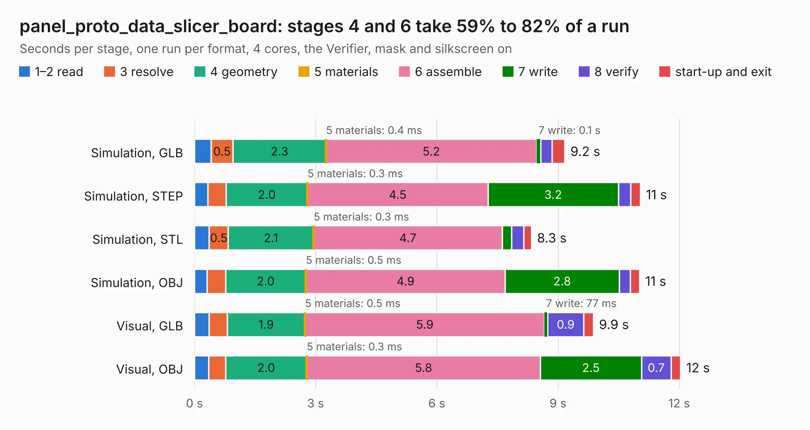

| Mode and format | 1–2 read | 3 resolve | 4 geometry | 5 materials | 6 assemble | 7 write | 8 verify | start-up and exit | Total |
|---|---:|---:|---:|---:|---:|---:|---:|---:|---:|
| Simulation, GLB | 0.4 | 0.5 | 2.3 | 0.4&nbsp;ms | 5.2 | 0.1 | 0.3 | 0.3 | 9.2 |
| Simulation, STEP | 0.3 | 0.5 | 2.0 | 0.3&nbsp;ms | 4.5 | 3.2 | 0.3 | 0.2 | 11.0 |
| Simulation, STL | 0.4 | 0.5 | 2.1 | 0.3&nbsp;ms | 4.7 | 0.2 | 0.3 | 0.2 | 8.3 |
| Simulation, OBJ | 0.3 | 0.5 | 2.0 | 0.5&nbsp;ms | 4.9 | 2.8 | 0.3 | 0.2 | 11.0 |
| Visual, GLB | 0.4 | 0.5 | 1.9 | 0.5&nbsp;ms | 5.9 | 77&nbsp;ms | 0.9 | 0.2 | 9.9 |
| Visual, OBJ | 0.4 | 0.4 | 2.0 | 0.3&nbsp;ms | 5.8 | 2.5 | 0.7 | 0.2 | 12.0 |

<table align="center"><tr><td valign="top">

| Board | Repo: [CoolNamesAllTaken/adsbee](https://github.com/CoolNamesAllTaken/adsbee) Board: `panel_proto_data_slicer_board.kicad_pcb` |
|---|---|
| Folder | kicad / prototyping / panel_proto_data_slicer_board |
| Complexity | 234&nbsp;/&nbsp;1000 (size&nbsp;179, features&nbsp;55) |
| KESE&nbsp;features | through vias, rounded, trapezoid or chamfered pads, filled zones, copper text |
| Tested | 9th November 2026 |
| Copper&nbsp;layers | 2 |
| File&nbsp;format | KiCad 8 (20240108) |
| Parts,&nbsp;tracks,&nbsp;vias | 156, 552, 48 |
| Triangles,&nbsp;simulation | 616,084 in 105 parts |
| Note | panel |
| Verifier | PASS in all six runs |

</td><td valign="top">

<table>
<tr><th>File type</th><th>File size</th><th>Peak memory used</th></tr>
<tr><th colspan="3" align="left">Simulation</th></tr>
<tr><td>GLB</td><td align="right">20&nbsp;MB</td><td align="right">400&nbsp;MB</td></tr>
<tr><td>STEP</td><td align="right">116&nbsp;MB</td><td align="right">446&nbsp;MB</td></tr>
<tr><td>STL</td><td align="right">31&nbsp;MB</td><td align="right">402&nbsp;MB</td></tr>
<tr><td>OBJ</td><td align="right">62&nbsp;MB</td><td align="right">470&nbsp;MB</td></tr>
<tr><th colspan="3" align="left">Visual</th></tr>
<tr><td>GLB</td><td align="right">17&nbsp;MB</td><td align="right">550&nbsp;MB</td></tr>
<tr><td>OBJ</td><td align="right">49&nbsp;MB</td><td align="right">531&nbsp;MB</td></tr>
</table>

</td></tr></table>

## 758. panel_proto_lna_board

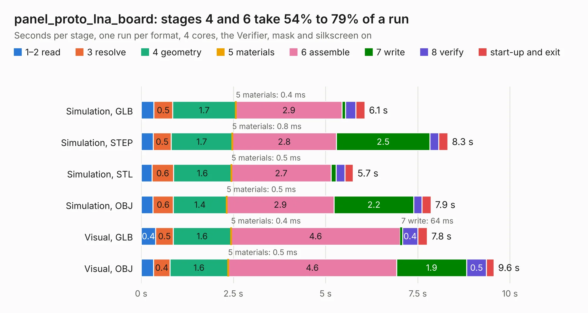

| Mode and format | 1–2 read | 3 resolve | 4 geometry | 5 materials | 6 assemble | 7 write | 8 verify | start-up and exit | Total |
|---|---:|---:|---:|---:|---:|---:|---:|---:|---:|
| Simulation, GLB | 0.3 | 0.5 | 1.7 | 0.4&nbsp;ms | 2.9 | 96&nbsp;ms | 0.3 | 0.2 | 6.1 |
| Simulation, STEP | 0.3 | 0.5 | 1.7 | 0.8&nbsp;ms | 2.8 | 2.5 | 0.2 | 0.2 | 8.3 |
| Simulation, STL | 0.3 | 0.6 | 1.6 | 0.5&nbsp;ms | 2.7 | 0.1 | 0.2 | 0.2 | 5.7 |
| Simulation, OBJ | 0.3 | 0.6 | 1.4 | 0.5&nbsp;ms | 2.9 | 2.2 | 0.2 | 0.2 | 7.9 |
| Visual, GLB | 0.4 | 0.5 | 1.6 | 0.4&nbsp;ms | 4.6 | 64&nbsp;ms | 0.4 | 0.3 | 7.8 |
| Visual, OBJ | 0.3 | 0.4 | 1.6 | 0.5&nbsp;ms | 4.6 | 1.9 | 0.5 | 0.2 | 9.6 |

<table align="center"><tr><td valign="top">

| Board | Repo: [CoolNamesAllTaken/adsbee](https://github.com/CoolNamesAllTaken/adsbee) Board: `panel_proto_lna_board.kicad_pcb` |
|---|---|
| Folder | kicad / prototyping / panel_proto_lna_board |
| Complexity | 226&nbsp;/&nbsp;1000 (size&nbsp;171, features&nbsp;55) |
| KESE&nbsp;features | through vias, rounded, trapezoid or chamfered pads, filled zones, copper text |
| Tested | 9th November 2026 |
| Copper&nbsp;layers | 2 |
| File&nbsp;format | KiCad 8 (20240108) |
| Parts,&nbsp;tracks,&nbsp;vias | 144, 240, 72 |
| Triangles,&nbsp;simulation | 491,028 in 164 parts |
| Note | panel |
| Verifier | PASS in all six runs |

</td><td valign="top">

<table>
<tr><th>File type</th><th>File size</th><th>Peak memory used</th></tr>
<tr><th colspan="3" align="left">Simulation</th></tr>
<tr><td>GLB</td><td align="right">16&nbsp;MB</td><td align="right">355&nbsp;MB</td></tr>
<tr><td>STEP</td><td align="right">89&nbsp;MB</td><td align="right">406&nbsp;MB</td></tr>
<tr><td>STL</td><td align="right">25&nbsp;MB</td><td align="right">351&nbsp;MB</td></tr>
<tr><td>OBJ</td><td align="right">49&nbsp;MB</td><td align="right">406&nbsp;MB</td></tr>
<tr><th colspan="3" align="left">Visual</th></tr>
<tr><td>GLB</td><td align="right">13&nbsp;MB</td><td align="right">453&nbsp;MB</td></tr>
<tr><td>OBJ</td><td align="right">38&nbsp;MB</td><td align="right">444&nbsp;MB</td></tr>
</table>

</td></tr></table>

## 759. panel_proto_tracking_comparator_board

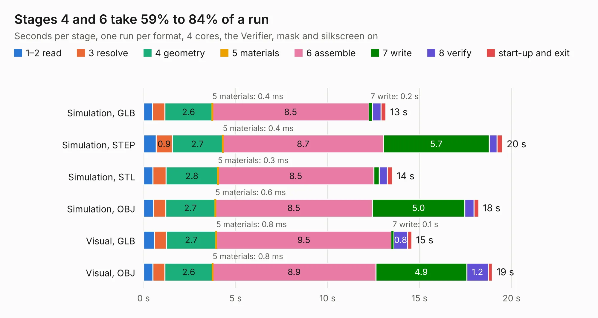

| Mode and format | 1–2 read | 3 resolve | 4 geometry | 5 materials | 6 assemble | 7 write | 8 verify | start-up and exit | Total |
|---|---:|---:|---:|---:|---:|---:|---:|---:|---:|
| Simulation, GLB | 0.5 | 0.7 | 2.6 | 0.4&nbsp;ms | 8.5 | 0.2 | 0.5 | 0.3 | 13.2 |
| Simulation, STEP | 0.7 | 0.9 | 2.7 | 0.4&nbsp;ms | 8.7 | 5.7 | 0.4 | 0.3 | 19.5 |
| Simulation, STL | 0.5 | 0.7 | 2.8 | 0.3&nbsp;ms | 8.5 | 0.3 | 0.4 | 0.3 | 13.5 |
| Simulation, OBJ | 0.5 | 0.7 | 2.7 | 0.6&nbsp;ms | 8.5 | 5.0 | 0.5 | 0.3 | 18.2 |
| Visual, GLB | 0.6 | 0.7 | 2.7 | 0.8&nbsp;ms | 9.5 | 0.1 | 0.8 | 0.2 | 14.6 |
| Visual, OBJ | 0.5 | 0.6 | 2.6 | 0.8&nbsp;ms | 8.9 | 4.9 | 1.2 | 0.2 | 19.0 |

<table align="center"><tr><td valign="top">

| Board | Repo: [CoolNamesAllTaken/adsbee](https://github.com/CoolNamesAllTaken/adsbee) Board: `panel_proto_tracking_comparator_board.kicad_pcb` |
|---|---|
| Folder | kicad / prototyping / panel_proto_tracking_comparator_board |
| Complexity | 211&nbsp;/&nbsp;1000 (size&nbsp;181, features&nbsp;30) |
| KESE&nbsp;features | rounded, trapezoid or chamfered pads, copper drawings, copper text |
| Tested | 9th November 2026 |
| Copper&nbsp;layers | 2 |
| File&nbsp;format | KiCad 8 (20240108) |
| Parts,&nbsp;tracks,&nbsp;vias | 192, 696, 0 |
| Triangles,&nbsp;simulation | 897,184 in 175 parts |
| Note | panel |
| Verifier | PASS in all six runs |

</td><td valign="top">

<table>
<tr><th>File type</th><th>File size</th><th>Peak memory used</th></tr>
<tr><th colspan="3" align="left">Simulation</th></tr>
<tr><td>GLB</td><td align="right">30&nbsp;MB</td><td align="right">551&nbsp;MB</td></tr>
<tr><td>STEP</td><td align="right">182&nbsp;MB</td><td align="right">587&nbsp;MB</td></tr>
<tr><td>STL</td><td align="right">45&nbsp;MB</td><td align="right">551&nbsp;MB</td></tr>
<tr><td>OBJ</td><td align="right">90&nbsp;MB</td><td align="right">645&nbsp;MB</td></tr>
<tr><th colspan="3" align="left">Visual</th></tr>
<tr><td>GLB</td><td align="right">27&nbsp;MB</td><td align="right">620&nbsp;MB</td></tr>
<tr><td>OBJ</td><td align="right">82&nbsp;MB</td><td align="right">612&nbsp;MB</td></tr>
</table>

</td></tr></table>

## 760. panel_saw_eval_board

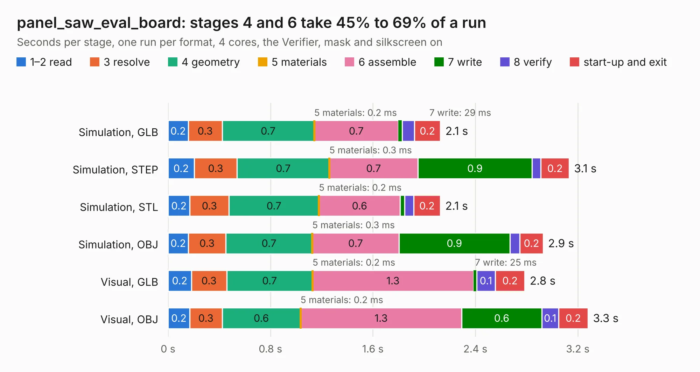

| Mode and format | 1–2 read | 3 resolve | 4 geometry | 5 materials | 6 assemble | 7 write | 8 verify | start-up and exit | Total |
|---|---:|---:|---:|---:|---:|---:|---:|---:|---:|
| Simulation, GLB | 0.2 | 0.3 | 0.7 | 0.2&nbsp;ms | 0.7 | 29&nbsp;ms | 97&nbsp;ms | 0.2 | 2.1 |
| Simulation, STEP | 0.2 | 0.3 | 0.7 | 0.3&nbsp;ms | 0.7 | 0.9 | 69&nbsp;ms | 0.2 | 3.1 |
| Simulation, STL | 0.2 | 0.3 | 0.7 | 0.2&nbsp;ms | 0.6 | 35&nbsp;ms | 70&nbsp;ms | 0.2 | 2.1 |
| Simulation, OBJ | 0.2 | 0.3 | 0.7 | 0.3&nbsp;ms | 0.7 | 0.9 | 78&nbsp;ms | 0.2 | 2.9 |
| Visual, GLB | 0.2 | 0.3 | 0.7 | 0.2&nbsp;ms | 1.3 | 25&nbsp;ms | 0.1 | 0.2 | 2.8 |
| Visual, OBJ | 0.2 | 0.3 | 0.6 | 0.2&nbsp;ms | 1.3 | 0.6 | 0.1 | 0.2 | 3.3 |

<table align="center"><tr><td valign="top">

| Board | Repo: [CoolNamesAllTaken/adsbee](https://github.com/CoolNamesAllTaken/adsbee) Board: `panel_saw_eval_board.kicad_pcb` |
|---|---|
| Folder | kicad / prototyping / panel_saw_eval_board |
| Complexity | 201&nbsp;/&nbsp;1000 (size&nbsp;151, features&nbsp;50) |
| KESE&nbsp;features | through vias, filled zones, knockout text |
| Tested | 9th November 2026 |
| Copper&nbsp;layers | 2 |
| File&nbsp;format | KiCad 8 (20240108) |
| Parts,&nbsp;tracks,&nbsp;vias | 36, 48, 96 |
| Triangles,&nbsp;simulation | 147,520 in 44 parts |
| Note | panel |
| Verifier | PASS in all six runs |

</td><td valign="top">

<table>
<tr><th>File type</th><th>File size</th><th>Peak memory used</th></tr>
<tr><th colspan="3" align="left">Simulation</th></tr>
<tr><td>GLB</td><td align="right">5.0&nbsp;MB</td><td align="right">199&nbsp;MB</td></tr>
<tr><td>STEP</td><td align="right">17&nbsp;MB</td><td align="right">212&nbsp;MB</td></tr>
<tr><td>STL</td><td align="right">7.4&nbsp;MB</td><td align="right">199&nbsp;MB</td></tr>
<tr><td>OBJ</td><td align="right">15&nbsp;MB</td><td align="right">199&nbsp;MB</td></tr>
<tr><th colspan="3" align="left">Visual</th></tr>
<tr><td>GLB</td><td align="right">4.0&nbsp;MB</td><td align="right">176&nbsp;MB</td></tr>
<tr><td>OBJ</td><td align="right">12&nbsp;MB</td><td align="right">179&nbsp;MB</td></tr>
</table>

</td></tr></table>

## 761. proto_ads_bee_detector_board

| Mode and format | 1–2 read | 3 resolve | 4 geometry | 5 materials | 6 assemble | 7 write | 8 verify | start-up and exit | Total |
|---|---:|---:|---:|---:|---:|---:|---:|---:|---:|
| Simulation, GLB | 0.3 | 0.6 | 2.1 | 0.3&nbsp;ms | 2.0 | 80&nbsp;ms | 0.2 | 0.2 | 5.5 |
| Simulation, STEP | 0.4 | 0.6 | 2.1 | 0.2&nbsp;ms | 2.1 | 2.0 | 0.2 | 0.2 | 7.7 |
| Simulation, STL | 0.3 | 0.6 | 2.1 | 0.2&nbsp;ms | 2.0 | 0.2 | 0.2 | 0.2 | 5.6 |
| Simulation, OBJ | 0.3 | 0.6 | 2.1 | 0.2&nbsp;ms | 2.0 | 2.9 | 0.2 | 0.2 | 8.4 |
| Visual, GLB | 0.3 | 0.6 | 2.0 | 0.3&nbsp;ms | 3.9 | 71&nbsp;ms | 0.4 | 0.2 | 7.5 |
| Visual, OBJ | 0.3 | 0.6 | 2.0 | 0.3&nbsp;ms | 3.9 | 2.1 | 0.5 | 0.2 | 9.6 |

<table align="center"><tr><td valign="top">

| Board | Repo: [CoolNamesAllTaken/adsbee](https://github.com/CoolNamesAllTaken/adsbee) Board: `proto_ads_bee_detector_board.kicad_pcb` |
|---|---|
| Folder | kicad / prototyping / proto_ads_bee_detector_board |
| Complexity | 260&nbsp;/&nbsp;1000 (size&nbsp;160, features&nbsp;100) |
| KESE&nbsp;features | through vias, rounded, trapezoid or chamfered pads, filled zones, copper text, knockout text, stack-up, dielectric εr and tanδ |
| Tested | 9th November 2026 |
| Copper&nbsp;layers | 2 |
| File&nbsp;format | KiCad 7 (20221018) |
| Parts,&nbsp;tracks,&nbsp;vias | 70, 204, 58 |
| Triangles,&nbsp;simulation | 509,420 in 26 parts |
| Verifier | PASS in all six runs |

</td><td valign="top">

<table>
<tr><th>File type</th><th>File size</th><th>Peak memory used</th></tr>
<tr><th colspan="3" align="left">Simulation</th></tr>
<tr><td>GLB</td><td align="right">18&nbsp;MB</td><td align="right">319&nbsp;MB</td></tr>
<tr><td>STEP</td><td align="right">78&nbsp;MB</td><td align="right">383&nbsp;MB</td></tr>
<tr><td>STL</td><td align="right">25&nbsp;MB</td><td align="right">311&nbsp;MB</td></tr>
<tr><td>OBJ</td><td align="right">51&nbsp;MB</td><td align="right">408&nbsp;MB</td></tr>
<tr><th colspan="3" align="left">Visual</th></tr>
<tr><td>GLB</td><td align="right">14&nbsp;MB</td><td align="right">372&nbsp;MB</td></tr>
<tr><td>OBJ</td><td align="right">40&nbsp;MB</td><td align="right">413&nbsp;MB</td></tr>
</table>

</td></tr></table>

## 762. proto_ads_bee_mcu_board

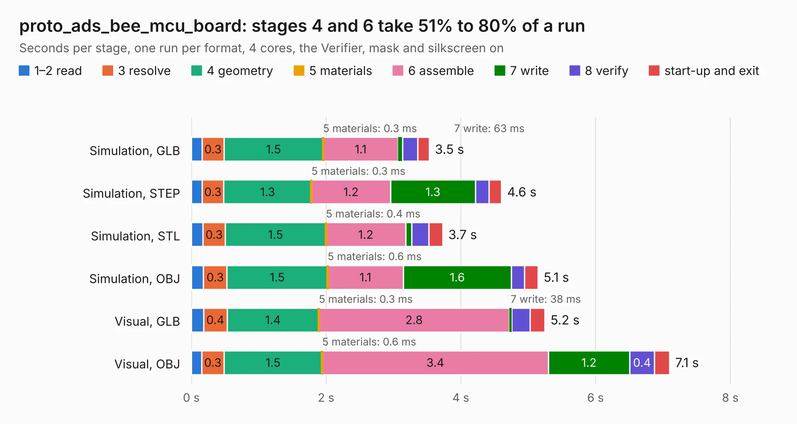

| Mode and format | 1–2 read | 3 resolve | 4 geometry | 5 materials | 6 assemble | 7 write | 8 verify | start-up and exit | Total |
|---|---:|---:|---:|---:|---:|---:|---:|---:|---:|
| Simulation, GLB | 0.2 | 0.3 | 1.5 | 0.3&nbsp;ms | 1.1 | 63&nbsp;ms | 0.2 | 0.2 | 3.5 |
| Simulation, STEP | 0.2 | 0.3 | 1.3 | 0.3&nbsp;ms | 1.2 | 1.3 | 0.2 | 0.2 | 4.6 |
| Simulation, STL | 0.2 | 0.3 | 1.5 | 0.4&nbsp;ms | 1.2 | 90&nbsp;ms | 0.3 | 0.2 | 3.7 |
| Simulation, OBJ | 0.2 | 0.3 | 1.5 | 0.6&nbsp;ms | 1.1 | 1.6 | 0.2 | 0.2 | 5.1 |
| Visual, GLB | 0.2 | 0.4 | 1.4 | 0.3&nbsp;ms | 2.8 | 38&nbsp;ms | 0.3 | 0.2 | 5.2 |
| Visual, OBJ | 0.2 | 0.3 | 1.5 | 0.6&nbsp;ms | 3.4 | 1.2 | 0.4 | 0.2 | 7.1 |

<table align="center"><tr><td valign="top">

| Board | Repo: [CoolNamesAllTaken/adsbee](https://github.com/CoolNamesAllTaken/adsbee) Board: `proto_ads_bee_mcu_board.kicad_pcb` |
|---|---|
| Folder | kicad / prototyping / proto_ads_bee_mcu_board |
| Complexity | 237&nbsp;/&nbsp;1000 (size&nbsp;137, features&nbsp;100) |
| KESE&nbsp;features | through vias, rounded, trapezoid or chamfered pads, drill offsets, filled zones, knockout text, stack-up, dielectric εr and tanδ |
| Tested | 9th November 2026 |
| Copper&nbsp;layers | 2 |
| File&nbsp;format | KiCad 7 (20221018) |
| Parts,&nbsp;tracks,&nbsp;vias | 20, 182, 6 |
| Triangles,&nbsp;simulation | 403,648 in 60 parts |
| Verifier | PASS in all six runs |

</td><td valign="top">

<table>
<tr><th>File type</th><th>File size</th><th>Peak memory used</th></tr>
<tr><th colspan="3" align="left">Simulation</th></tr>
<tr><td>GLB</td><td align="right">14&nbsp;MB</td><td align="right">258&nbsp;MB</td></tr>
<tr><td>STEP</td><td align="right">61&nbsp;MB</td><td align="right">306&nbsp;MB</td></tr>
<tr><td>STL</td><td align="right">20&nbsp;MB</td><td align="right">269&nbsp;MB</td></tr>
<tr><td>OBJ</td><td align="right">40&nbsp;MB</td><td align="right">320&nbsp;MB</td></tr>
<tr><th colspan="3" align="left">Visual</th></tr>
<tr><td>GLB</td><td align="right">9.6&nbsp;MB</td><td align="right">332&nbsp;MB</td></tr>
<tr><td>OBJ</td><td align="right">28&nbsp;MB</td><td align="right">338&nbsp;MB</td></tr>
</table>

</td></tr></table>

## 763. proto_ads_bee_rf_board

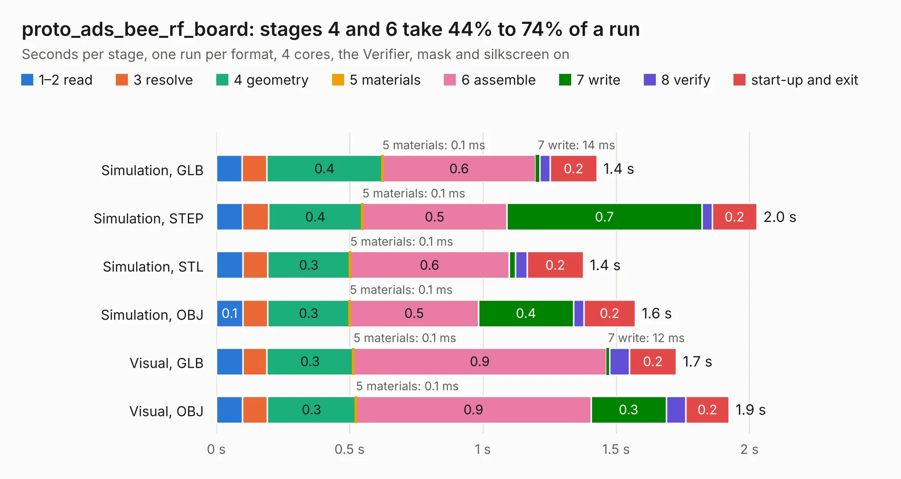

| Mode and format | 1–2 read | 3 resolve | 4 geometry | 5 materials | 6 assemble | 7 write | 8 verify | start-up and exit | Total |
|---|---:|---:|---:|---:|---:|---:|---:|---:|---:|
| Simulation, GLB | 96&nbsp;ms | 93&nbsp;ms | 0.4 | 0.1&nbsp;ms | 0.6 | 14&nbsp;ms | 39&nbsp;ms | 0.2 | 1.4 |
| Simulation, STEP | 98&nbsp;ms | 97&nbsp;ms | 0.4 | 0.1&nbsp;ms | 0.5 | 0.7 | 38&nbsp;ms | 0.2 | 2.0 |
| Simulation, STL | 99&nbsp;ms | 93&nbsp;ms | 0.3 | 0.1&nbsp;ms | 0.6 | 25&nbsp;ms | 44&nbsp;ms | 0.2 | 1.4 |
| Simulation, OBJ | 0.1 | 93&nbsp;ms | 0.3 | 0.1&nbsp;ms | 0.5 | 0.4 | 40&nbsp;ms | 0.2 | 1.6 |
| Visual, GLB | 99&nbsp;ms | 91&nbsp;ms | 0.3 | 0.1&nbsp;ms | 0.9 | 12&nbsp;ms | 75&nbsp;ms | 0.2 | 1.7 |
| Visual, OBJ | 98&nbsp;ms | 93&nbsp;ms | 0.3 | 0.1&nbsp;ms | 0.9 | 0.3 | 73&nbsp;ms | 0.2 | 1.9 |

<table align="center"><tr><td valign="top">

| Board | Repo: [CoolNamesAllTaken/adsbee](https://github.com/CoolNamesAllTaken/adsbee) Board: `proto_ads_bee_rf_board.kicad_pcb` |
|---|---|
| Folder | kicad / prototyping / proto_ads_bee_rf_board |
| Complexity | 218&nbsp;/&nbsp;1000 (size&nbsp;118, features&nbsp;100) |
| KESE&nbsp;features | through vias, rounded, trapezoid or chamfered pads, filled zones, copper text, knockout text, stack-up, dielectric εr and tanδ |
| Tested | 9th November 2026 |
| Copper&nbsp;layers | 2 |
| File&nbsp;format | KiCad 7 (20221018) |
| Parts,&nbsp;tracks,&nbsp;vias | 16, 30, 14 |
| Triangles,&nbsp;simulation | 91,664 in 24 parts |
| Verifier | PASS in all six runs |

</td><td valign="top">

<table>
<tr><th>File type</th><th>File size</th><th>Peak memory used</th></tr>
<tr><th colspan="3" align="left">Simulation</th></tr>
<tr><td>GLB</td><td align="right">3.2&nbsp;MB</td><td align="right">183&nbsp;MB</td></tr>
<tr><td>STEP</td><td align="right">15&nbsp;MB</td><td align="right">192&nbsp;MB</td></tr>
<tr><td>STL</td><td align="right">4.6&nbsp;MB</td><td align="right">177&nbsp;MB</td></tr>
<tr><td>OBJ</td><td align="right">8.8&nbsp;MB</td><td align="right">181&nbsp;MB</td></tr>
<tr><th colspan="3" align="left">Visual</th></tr>
<tr><td>GLB</td><td align="right">2.5&nbsp;MB</td><td align="right">154&nbsp;MB</td></tr>
<tr><td>OBJ</td><td align="right">7.0&nbsp;MB</td><td align="right">150&nbsp;MB</td></tr>
</table>

</td></tr></table>

## 764. proto_amp_bodge_board

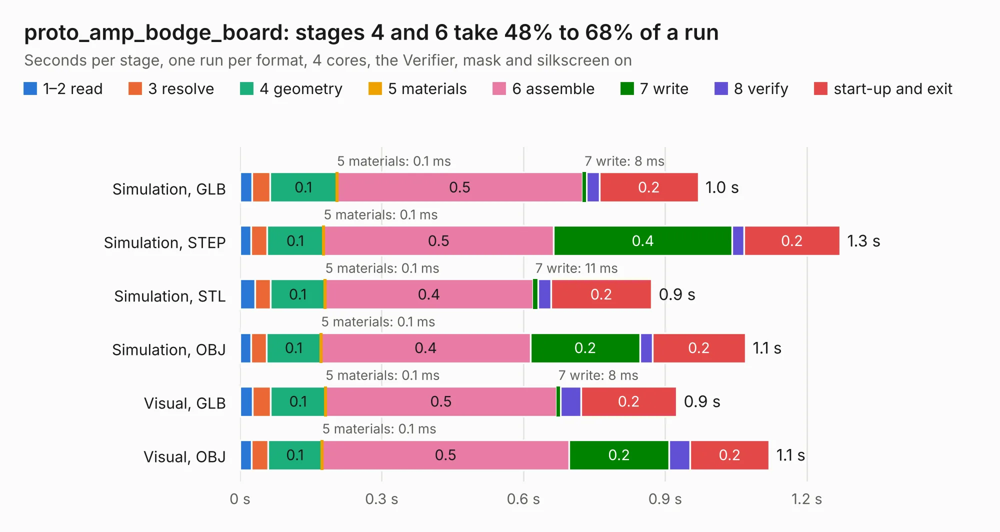

| Mode and format | 1–2 read | 3 resolve | 4 geometry | 5 materials | 6 assemble | 7 write | 8 verify | start-up and exit | Total |
|---|---:|---:|---:|---:|---:|---:|---:|---:|---:|
| Simulation, GLB | 25&nbsp;ms | 38&nbsp;ms | 0.1 | 0.1&nbsp;ms | 0.5 | 8&nbsp;ms | 27&nbsp;ms | 0.2 | 1.0 |
| Simulation, STEP | 23&nbsp;ms | 34&nbsp;ms | 0.1 | 0.1&nbsp;ms | 0.5 | 0.4 | 25&nbsp;ms | 0.2 | 1.3 |
| Simulation, STL | 32&nbsp;ms | 32&nbsp;ms | 0.1 | 0.1&nbsp;ms | 0.4 | 11&nbsp;ms | 28&nbsp;ms | 0.2 | 0.9 |
| Simulation, OBJ | 23&nbsp;ms | 33&nbsp;ms | 0.1 | 0.1&nbsp;ms | 0.4 | 0.2 | 26&nbsp;ms | 0.2 | 1.1 |
| Visual, GLB | 27&nbsp;ms | 38&nbsp;ms | 0.1 | 0.1&nbsp;ms | 0.5 | 8&nbsp;ms | 44&nbsp;ms | 0.2 | 0.9 |
| Visual, OBJ | 25&nbsp;ms | 34&nbsp;ms | 0.1 | 0.1&nbsp;ms | 0.5 | 0.2 | 45&nbsp;ms | 0.2 | 1.1 |

<table align="center"><tr><td valign="top">

| Board | Repo: [CoolNamesAllTaken/adsbee](https://github.com/CoolNamesAllTaken/adsbee) Board: `proto_amp_bodge_board.kicad_pcb` |
|---|---|
| Folder | kicad / prototyping / proto_amp_bodge_board |
| Complexity | 131&nbsp;/&nbsp;1000 (size&nbsp;96, features&nbsp;35) |
| KESE&nbsp;features | rounded, trapezoid or chamfered pads, copper text, TrueType text |
| Tested | 9th November 2026 |
| Copper&nbsp;layers | 2 |
| File&nbsp;format | KiCad 8 (20240108) |
| Parts,&nbsp;tracks,&nbsp;vias | 6, 33, 0 |
| Triangles,&nbsp;simulation | 46,370 in 13 parts |
| Verifier | PASS in all six runs |

</td><td valign="top">

<table>
<tr><th>File type</th><th>File size</th><th>Peak memory used</th></tr>
<tr><th colspan="3" align="left">Simulation</th></tr>
<tr><td>GLB</td><td align="right">1.6&nbsp;MB</td><td align="right">58&nbsp;MB</td></tr>
<tr><td>STEP</td><td align="right">9.8&nbsp;MB</td><td align="right">63&nbsp;MB</td></tr>
<tr><td>STL</td><td align="right">2.3&nbsp;MB</td><td align="right">58&nbsp;MB</td></tr>
<tr><td>OBJ</td><td align="right">4.4&nbsp;MB</td><td align="right">73&nbsp;MB</td></tr>
<tr><th colspan="3" align="left">Visual</th></tr>
<tr><td>GLB</td><td align="right">1.5&nbsp;MB</td><td align="right">79&nbsp;MB</td></tr>
<tr><td>OBJ</td><td align="right">4.1&nbsp;MB</td><td align="right">79&nbsp;MB</td></tr>
</table>

</td></tr></table>

## 765. proto_data_slicer_board

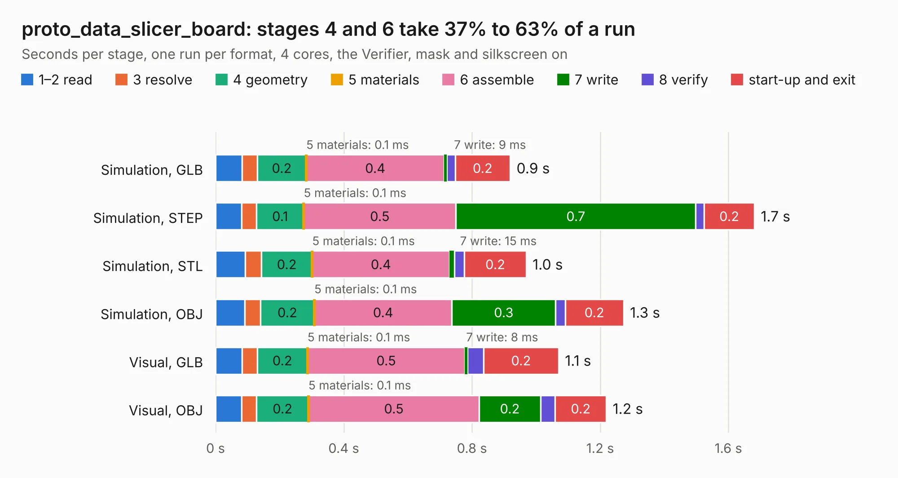

| Mode and format | 1–2 read | 3 resolve | 4 geometry | 5 materials | 6 assemble | 7 write | 8 verify | start-up and exit | Total |
|---|---:|---:|---:|---:|---:|---:|---:|---:|---:|
| Simulation, GLB | 83&nbsp;ms | 48&nbsp;ms | 0.2 | 0.1&nbsp;ms | 0.4 | 9&nbsp;ms | 25&nbsp;ms | 0.2 | 0.9 |
| Simulation, STEP | 81&nbsp;ms | 47&nbsp;ms | 0.1 | 0.1&nbsp;ms | 0.5 | 0.7 | 26&nbsp;ms | 0.2 | 1.7 |
| Simulation, STL | 92&nbsp;ms | 51&nbsp;ms | 0.2 | 0.1&nbsp;ms | 0.4 | 15&nbsp;ms | 31&nbsp;ms | 0.2 | 1.0 |
| Simulation, OBJ | 91&nbsp;ms | 49&nbsp;ms | 0.2 | 0.1&nbsp;ms | 0.4 | 0.3 | 30&nbsp;ms | 0.2 | 1.3 |
| Visual, GLB | 83&nbsp;ms | 47&nbsp;ms | 0.2 | 0.1&nbsp;ms | 0.5 | 8&nbsp;ms | 50&nbsp;ms | 0.2 | 1.1 |
| Visual, OBJ | 81&nbsp;ms | 47&nbsp;ms | 0.2 | 0.1&nbsp;ms | 0.5 | 0.2 | 46&nbsp;ms | 0.2 | 1.2 |

<table align="center"><tr><td valign="top">

| Board | Repo: [CoolNamesAllTaken/adsbee](https://github.com/CoolNamesAllTaken/adsbee) Board: `proto_data_slicer_board.kicad_pcb` |
|---|---|
| Folder | kicad / prototyping / proto_data_slicer_board |
| Complexity | 167&nbsp;/&nbsp;1000 (size&nbsp;112, features&nbsp;55) |
| KESE&nbsp;features | through vias, rounded, trapezoid or chamfered pads, filled zones, copper text |
| Tested | 9th November 2026 |
| Copper&nbsp;layers | 2 |
| File&nbsp;format | KiCad 8 (20240108) |
| Parts,&nbsp;tracks,&nbsp;vias | 13, 46, 4 |
| Triangles,&nbsp;simulation | 51,216 in 17 parts |
| Verifier | PASS in all six runs |

</td><td valign="top">

<table>
<tr><th>File type</th><th>File size</th><th>Peak memory used</th></tr>
<tr><th colspan="3" align="left">Simulation</th></tr>
<tr><td>GLB</td><td align="right">1.8&nbsp;MB</td><td align="right">77&nbsp;MB</td></tr>
<tr><td>STEP</td><td align="right">9.4&nbsp;MB</td><td align="right">186&nbsp;MB</td></tr>
<tr><td>STL</td><td align="right">2.6&nbsp;MB</td><td align="right">78&nbsp;MB</td></tr>
<tr><td>OBJ</td><td align="right">4.8&nbsp;MB</td><td align="right">94&nbsp;MB</td></tr>
<tr><th colspan="3" align="left">Visual</th></tr>
<tr><td>GLB</td><td align="right">1.4&nbsp;MB</td><td align="right">113&nbsp;MB</td></tr>
<tr><td>OBJ</td><td align="right">3.8&nbsp;MB</td><td align="right">111&nbsp;MB</td></tr>
</table>

</td></tr></table>

## 766. proto_lna_board

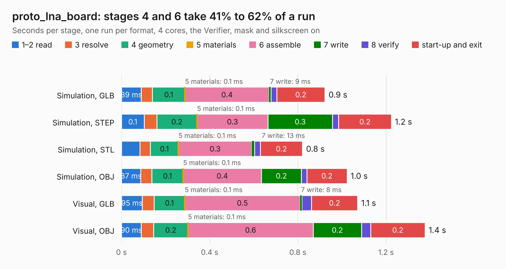

| Mode and format | 1–2 read | 3 resolve | 4 geometry | 5 materials | 6 assemble | 7 write | 8 verify | start-up and exit | Total |
|---|---:|---:|---:|---:|---:|---:|---:|---:|---:|
| Simulation, GLB | 89&nbsp;ms | 51&nbsp;ms | 0.1 | 0.1&nbsp;ms | 0.4 | 9&nbsp;ms | 26&nbsp;ms | 0.2 | 0.9 |
| Simulation, STEP | 0.1 | 57&nbsp;ms | 0.2 | 0.1&nbsp;ms | 0.3 | 0.3 | 27&nbsp;ms | 0.2 | 1.2 |
| Simulation, STL | 84&nbsp;ms | 47&nbsp;ms | 0.1 | 0.1&nbsp;ms | 0.3 | 13&nbsp;ms | 26&nbsp;ms | 0.2 | 0.8 |
| Simulation, OBJ | 87&nbsp;ms | 51&nbsp;ms | 0.1 | 0.1&nbsp;ms | 0.4 | 0.2 | 25&nbsp;ms | 0.2 | 1.0 |
| Visual, GLB | 95&nbsp;ms | 54&nbsp;ms | 0.1 | 0.1&nbsp;ms | 0.5 | 8&nbsp;ms | 44&nbsp;ms | 0.2 | 1.1 |
| Visual, OBJ | 90&nbsp;ms | 56&nbsp;ms | 0.2 | 0.1&nbsp;ms | 0.6 | 0.2 | 41&nbsp;ms | 0.2 | 1.4 |

<table align="center"><tr><td valign="top">

| Board | Repo: [CoolNamesAllTaken/adsbee](https://github.com/CoolNamesAllTaken/adsbee) Board: `proto_lna_board.kicad_pcb` |
|---|---|
| Folder | kicad / prototyping / proto_lna_board |
| Complexity | 160&nbsp;/&nbsp;1000 (size&nbsp;105, features&nbsp;55) |
| KESE&nbsp;features | through vias, rounded, trapezoid or chamfered pads, filled zones, copper text |
| Tested | 9th November 2026 |
| Copper&nbsp;layers | 2 |
| File&nbsp;format | KiCad 8 (20240108) |
| Parts,&nbsp;tracks,&nbsp;vias | 12, 20, 6 |
| Triangles,&nbsp;simulation | 41,780 in 21 parts |
| Verifier | PASS in all six runs |

</td><td valign="top">

<table>
<tr><th>File type</th><th>File size</th><th>Peak memory used</th></tr>
<tr><th colspan="3" align="left">Simulation</th></tr>
<tr><td>GLB</td><td align="right">1.5&nbsp;MB</td><td align="right">72&nbsp;MB</td></tr>
<tr><td>STEP</td><td align="right">7.6&nbsp;MB</td><td align="right">75&nbsp;MB</td></tr>
<tr><td>STL</td><td align="right">2.1&nbsp;MB</td><td align="right">72&nbsp;MB</td></tr>
<tr><td>OBJ</td><td align="right">3.9&nbsp;MB</td><td align="right">79&nbsp;MB</td></tr>
<tr><th colspan="3" align="left">Visual</th></tr>
<tr><td>GLB</td><td align="right">1.1&nbsp;MB</td><td align="right">96&nbsp;MB</td></tr>
<tr><td>OBJ</td><td align="right">3.0&nbsp;MB</td><td align="right">97&nbsp;MB</td></tr>
</table>

</td></tr></table>

## 767. proto_tracking_comparator_board

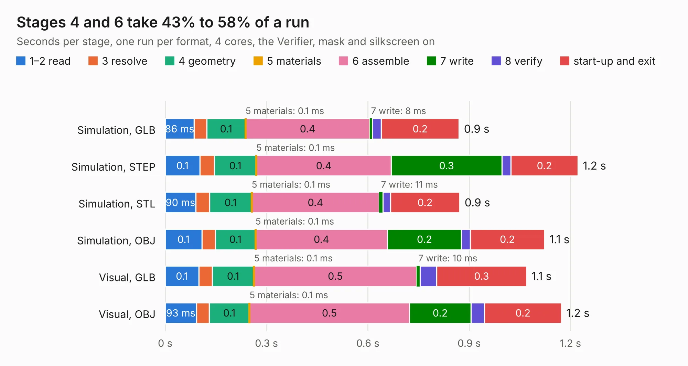

| Mode and format | 1–2 read | 3 resolve | 4 geometry | 5 materials | 6 assemble | 7 write | 8 verify | start-up and exit | Total |
|---|---:|---:|---:|---:|---:|---:|---:|---:|---:|
| Simulation, GLB | 86&nbsp;ms | 38&nbsp;ms | 0.1 | 0.1&nbsp;ms | 0.4 | 8&nbsp;ms | 26&nbsp;ms | 0.2 | 0.9 |
| Simulation, STEP | 0.1 | 43&nbsp;ms | 0.1 | 0.1&nbsp;ms | 0.4 | 0.3 | 27&nbsp;ms | 0.2 | 1.2 |
| Simulation, STL | 90&nbsp;ms | 41&nbsp;ms | 0.1 | 0.1&nbsp;ms | 0.4 | 11&nbsp;ms | 22&nbsp;ms | 0.2 | 0.9 |
| Simulation, OBJ | 0.1 | 40&nbsp;ms | 0.1 | 0.1&nbsp;ms | 0.4 | 0.2 | 26&nbsp;ms | 0.2 | 1.1 |
| Visual, GLB | 0.1 | 40&nbsp;ms | 0.1 | 0.1&nbsp;ms | 0.5 | 10&nbsp;ms | 49&nbsp;ms | 0.3 | 1.1 |
| Visual, OBJ | 93&nbsp;ms | 38&nbsp;ms | 0.1 | 0.1&nbsp;ms | 0.5 | 0.2 | 40&nbsp;ms | 0.2 | 1.2 |

<table align="center"><tr><td valign="top">

| Board | Repo: [CoolNamesAllTaken/adsbee](https://github.com/CoolNamesAllTaken/adsbee) Board: `proto_tracking_comparator_board.kicad_pcb` |
|---|---|
| Folder | kicad / prototyping / proto_tracking_comparator_board |
| Complexity | 126&nbsp;/&nbsp;1000 (size&nbsp;96, features&nbsp;30) |
| KESE&nbsp;features | rounded, trapezoid or chamfered pads, copper drawings, copper text |
| Tested | 9th November 2026 |
| Copper&nbsp;layers | 2 |
| File&nbsp;format | KiCad 8 (20240108) |
| Parts,&nbsp;tracks,&nbsp;vias | 8, 29, 0 |
| Triangles,&nbsp;simulation | 39,648 in 14 parts |
| Verifier | PASS in all six runs |

</td><td valign="top">

<table>
<tr><th>File type</th><th>File size</th><th>Peak memory used</th></tr>
<tr><th colspan="3" align="left">Simulation</th></tr>
<tr><td>GLB</td><td align="right">1.4&nbsp;MB</td><td align="right">74&nbsp;MB</td></tr>
<tr><td>STEP</td><td align="right">8.4&nbsp;MB</td><td align="right">79&nbsp;MB</td></tr>
<tr><td>STL</td><td align="right">2.0&nbsp;MB</td><td align="right">74&nbsp;MB</td></tr>
<tr><td>OBJ</td><td align="right">3.8&nbsp;MB</td><td align="right">82&nbsp;MB</td></tr>
<tr><th colspan="3" align="left">Visual</th></tr>
<tr><td>GLB</td><td align="right">1.2&nbsp;MB</td><td align="right">100&nbsp;MB</td></tr>
<tr><td>OBJ</td><td align="right">3.3&nbsp;MB</td><td align="right">101&nbsp;MB</td></tr>
</table>

</td></tr></table>

## 768. proto_ufl_match_board

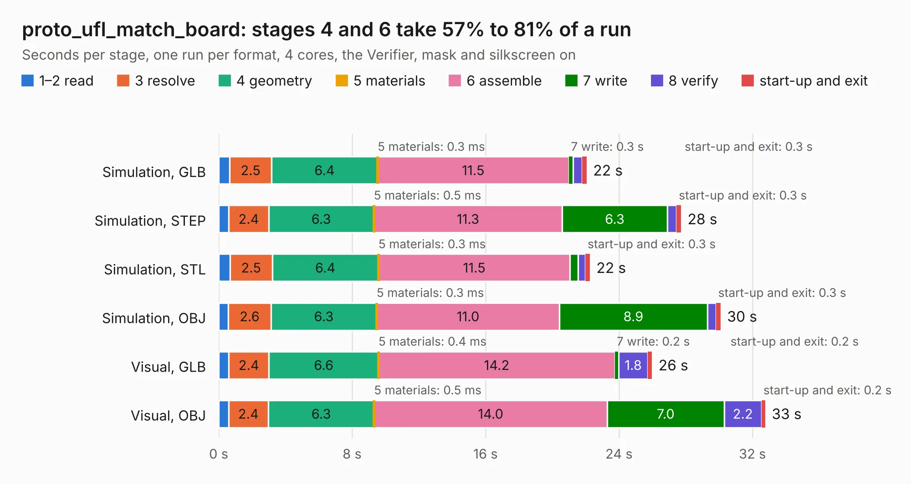

| Mode and format | 1–2 read | 3 resolve | 4 geometry | 5 materials | 6 assemble | 7 write | 8 verify | start-up and exit | Total |
|---|---:|---:|---:|---:|---:|---:|---:|---:|---:|
| Simulation, GLB | 0.7 | 2.5 | 6.4 | 0.3&nbsp;ms | 11.5 | 0.3 | 0.5 | 0.3 | 22.1 |
| Simulation, STEP | 0.6 | 2.4 | 6.3 | 0.5&nbsp;ms | 11.3 | 6.3 | 0.6 | 0.3 | 27.7 |
| Simulation, STL | 0.7 | 2.5 | 6.4 | 0.3&nbsp;ms | 11.5 | 0.5 | 0.4 | 0.3 | 22.3 |
| Simulation, OBJ | 0.6 | 2.6 | 6.3 | 0.3&nbsp;ms | 11.0 | 8.9 | 0.5 | 0.3 | 30.1 |
| Visual, GLB | 0.6 | 2.4 | 6.6 | 0.4&nbsp;ms | 14.2 | 0.2 | 1.8 | 0.2 | 26.0 |
| Visual, OBJ | 0.6 | 2.4 | 6.3 | 0.5&nbsp;ms | 14.0 | 7.0 | 2.2 | 0.2 | 32.8 |

<table align="center"><tr><td valign="top">

| Board | Repo: [CoolNamesAllTaken/adsbee](https://github.com/CoolNamesAllTaken/adsbee) Board: `proto_ufl_match_board.kicad_pcb` |
|---|---|
| Folder | kicad / prototyping / proto_ufl_match_board |
| Complexity | 289&nbsp;/&nbsp;1000 (size&nbsp;204, features&nbsp;85) |
| KESE&nbsp;features | through vias, rounded, trapezoid or chamfered pads, filled zones, copper text, stack-up, dielectric εr and tanδ |
| Tested | 9th November 2026 |
| Copper&nbsp;layers | 2 |
| File&nbsp;format | KiCad 7 (20221018) |
| Parts,&nbsp;tracks,&nbsp;vias | 224, 384, 736 |
| Triangles,&nbsp;simulation | 1,600,152 in 13 parts |
| Verifier | PASS in all six runs |

</td><td valign="top">

<table>
<tr><th>File type</th><th>File size</th><th>Peak memory used</th></tr>
<tr><th colspan="3" align="left">Simulation</th></tr>
<tr><td>GLB</td><td align="right">56&nbsp;MB</td><td align="right">762&nbsp;MB</td></tr>
<tr><td>STEP</td><td align="right">246&nbsp;MB</td><td align="right">918&nbsp;MB</td></tr>
<tr><td>STL</td><td align="right">80&nbsp;MB</td><td align="right">739&nbsp;MB</td></tr>
<tr><td>OBJ</td><td align="right">166&nbsp;MB</td><td align="right">1.1&nbsp;GB</td></tr>
<tr><th colspan="3" align="left">Visual</th></tr>
<tr><td>GLB</td><td align="right">45&nbsp;MB</td><td align="right">921&nbsp;MB</td></tr>
<tr><td>OBJ</td><td align="right">135&nbsp;MB</td><td align="right">943&nbsp;MB</td></tr>
</table>

</td></tr></table>

## 769. proto_ufl_pi_board

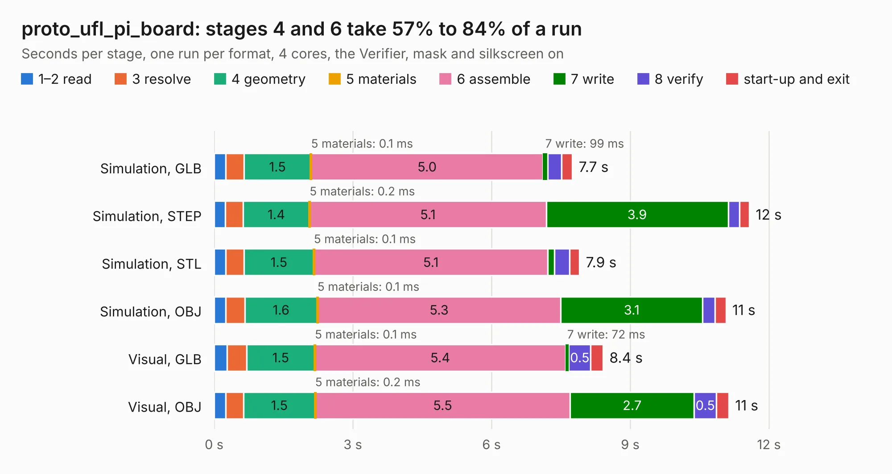

| Mode and format | 1–2 read | 3 resolve | 4 geometry | 5 materials | 6 assemble | 7 write | 8 verify | start-up and exit | Total |
|---|---:|---:|---:|---:|---:|---:|---:|---:|---:|
| Simulation, GLB | 0.3 | 0.4 | 1.5 | 0.1&nbsp;ms | 5.0 | 99&nbsp;ms | 0.3 | 0.2 | 7.7 |
| Simulation, STEP | 0.2 | 0.4 | 1.4 | 0.2&nbsp;ms | 5.1 | 3.9 | 0.2 | 0.2 | 11.6 |
| Simulation, STL | 0.3 | 0.4 | 1.5 | 0.1&nbsp;ms | 5.1 | 0.1 | 0.3 | 0.2 | 7.9 |
| Simulation, OBJ | 0.3 | 0.4 | 1.6 | 0.1&nbsp;ms | 5.3 | 3.1 | 0.3 | 0.2 | 11.1 |
| Visual, GLB | 0.3 | 0.4 | 1.5 | 0.1&nbsp;ms | 5.4 | 72&nbsp;ms | 0.5 | 0.3 | 8.4 |
| Visual, OBJ | 0.2 | 0.4 | 1.5 | 0.2&nbsp;ms | 5.5 | 2.7 | 0.5 | 0.3 | 11.1 |

<table align="center"><tr><td valign="top">

| Board | Repo: [CoolNamesAllTaken/adsbee](https://github.com/CoolNamesAllTaken/adsbee) Board: `proto_ufl_pi_board.kicad_pcb` |
|---|---|
| Folder | kicad / prototyping / proto_ufl_pi_board |
| Complexity | 209&nbsp;/&nbsp;1000 (size&nbsp;139, features&nbsp;70) |
| KESE&nbsp;features | rounded, trapezoid or chamfered pads, filled zones, copper text, stack-up, dielectric εr and tanδ |
| Tested | 9th November 2026 |
| Copper&nbsp;layers | 2 |
| File&nbsp;format | KiCad 7 (20221018) |
| Parts,&nbsp;tracks,&nbsp;vias | 100, 80, 0 |
| Triangles,&nbsp;simulation | 498,460 in 10 parts |
| Verifier | PASS in all six runs |

</td><td valign="top">

<table>
<tr><th>File type</th><th>File size</th><th>Peak memory used</th></tr>
<tr><th colspan="3" align="left">Simulation</th></tr>
<tr><td>GLB</td><td align="right">17&nbsp;MB</td><td align="right">399&nbsp;MB</td></tr>
<tr><td>STEP</td><td align="right">110&nbsp;MB</td><td align="right">429&nbsp;MB</td></tr>
<tr><td>STL</td><td align="right">25&nbsp;MB</td><td align="right">400&nbsp;MB</td></tr>
<tr><td>OBJ</td><td align="right">50&nbsp;MB</td><td align="right">396&nbsp;MB</td></tr>
<tr><th colspan="3" align="left">Visual</th></tr>
<tr><td>GLB</td><td align="right">16&nbsp;MB</td><td align="right">536&nbsp;MB</td></tr>
<tr><td>OBJ</td><td align="right">47&nbsp;MB</td><td align="right">542&nbsp;MB</td></tr>
</table>

</td></tr></table>

## 770. saw_eval_board

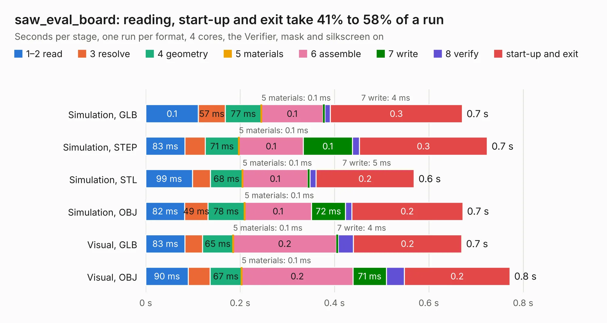

| Mode and format | 1–2 read | 3 resolve | 4 geometry | 5 materials | 6 assemble | 7 write | 8 verify | start-up and exit | Total |
|---|---:|---:|---:|---:|---:|---:|---:|---:|---:|
| Simulation, GLB | 0.1 | 57&nbsp;ms | 77&nbsp;ms | 0.1&nbsp;ms | 0.1 | 4&nbsp;ms | 12&nbsp;ms | 0.3 | 0.7 |
| Simulation, STEP | 83&nbsp;ms | 43&nbsp;ms | 71&nbsp;ms | 0.1&nbsp;ms | 0.1 | 0.1 | 15&nbsp;ms | 0.3 | 0.7 |
| Simulation, STL | 99&nbsp;ms | 38&nbsp;ms | 68&nbsp;ms | 0.1&nbsp;ms | 0.1 | 5&nbsp;ms | 13&nbsp;ms | 0.2 | 0.6 |
| Simulation, OBJ | 82&nbsp;ms | 49&nbsp;ms | 78&nbsp;ms | 0.1&nbsp;ms | 0.1 | 72&nbsp;ms | 13&nbsp;ms | 0.2 | 0.7 |
| Visual, GLB | 83&nbsp;ms | 37&nbsp;ms | 65&nbsp;ms | 0.1&nbsp;ms | 0.2 | 4&nbsp;ms | 32&nbsp;ms | 0.2 | 0.7 |
| Visual, OBJ | 90&nbsp;ms | 46&nbsp;ms | 67&nbsp;ms | 0.1&nbsp;ms | 0.2 | 71&nbsp;ms | 38&nbsp;ms | 0.2 | 0.8 |

<table align="center"><tr><td valign="top">

| Board | Repo: [CoolNamesAllTaken/adsbee](https://github.com/CoolNamesAllTaken/adsbee) Board: `saw_eval_board.kicad_pcb` |
|---|---|
| Folder | kicad / prototyping / saw_eval_board |
| Complexity | 137&nbsp;/&nbsp;1000 (size&nbsp;87, features&nbsp;50) |
| KESE&nbsp;features | through vias, filled zones, knockout text |
| Tested | 9th November 2026 |
| Copper&nbsp;layers | 2 |
| File&nbsp;format | KiCad 8 (20240108) |
| Parts,&nbsp;tracks,&nbsp;vias | 3, 4, 8 |
| Triangles,&nbsp;simulation | 12,296 in 11 parts |
| Verifier | PASS in all six runs |

</td><td valign="top">

<table>
<tr><th>File type</th><th>File size</th><th>Peak memory used</th></tr>
<tr><th colspan="3" align="left">Simulation</th></tr>
<tr><td>GLB</td><td align="right">454&nbsp;kB</td><td align="right">66&nbsp;MB</td></tr>
<tr><td>STEP</td><td align="right">1.4&nbsp;MB</td><td align="right">66&nbsp;MB</td></tr>
<tr><td>STL</td><td align="right">616&nbsp;kB</td><td align="right">61&nbsp;MB</td></tr>
<tr><td>OBJ</td><td align="right">1.2&nbsp;MB</td><td align="right">66&nbsp;MB</td></tr>
<tr><th colspan="3" align="left">Visual</th></tr>
<tr><td>GLB</td><td align="right">372&nbsp;kB</td><td align="right">69&nbsp;MB</td></tr>
<tr><td>OBJ</td><td align="right">943&nbsp;kB</td><td align="right">83&nbsp;MB</td></tr>
</table>

</td></tr></table>

## 771. discipline-pcb

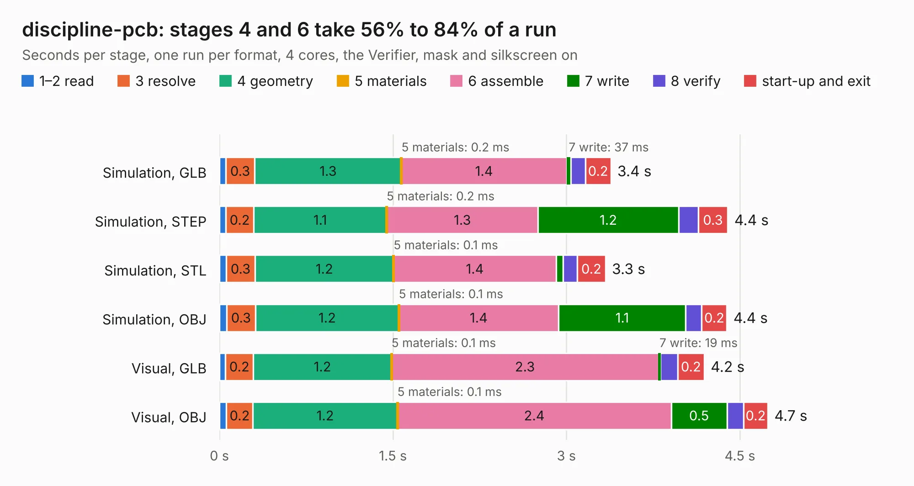

| Mode and format | 1–2 read | 3 resolve | 4 geometry | 5 materials | 6 assemble | 7 write | 8 verify | start-up and exit | Total |
|---|---:|---:|---:|---:|---:|---:|---:|---:|---:|
| Simulation, GLB | 54&nbsp;ms | 0.3 | 1.3 | 0.2&nbsp;ms | 1.4 | 37&nbsp;ms | 0.1 | 0.2 | 3.4 |
| Simulation, STEP | 55&nbsp;ms | 0.2 | 1.1 | 0.2&nbsp;ms | 1.3 | 1.2 | 0.2 | 0.3 | 4.4 |
| Simulation, STL | 58&nbsp;ms | 0.3 | 1.2 | 0.1&nbsp;ms | 1.4 | 62&nbsp;ms | 0.1 | 0.2 | 3.3 |
| Simulation, OBJ | 61&nbsp;ms | 0.3 | 1.2 | 0.1&nbsp;ms | 1.4 | 1.1 | 0.1 | 0.2 | 4.4 |
| Visual, GLB | 52&nbsp;ms | 0.2 | 1.2 | 0.1&nbsp;ms | 2.3 | 19&nbsp;ms | 0.1 | 0.2 | 4.2 |
| Visual, OBJ | 61&nbsp;ms | 0.2 | 1.2 | 0.1&nbsp;ms | 2.4 | 0.5 | 0.1 | 0.2 | 4.7 |

<table align="center"><tr><td valign="top">

| Board | Repo: [coseyfannitutti/discipline](https://github.com/coseyfannitutti/discipline) Board: `discipline-pcb.kicad_pcb` |
|---|---|
| Folder | bottom |
| Complexity | 84&nbsp;/&nbsp;1000 (size&nbsp;39, features&nbsp;45) |
| KESE&nbsp;features | through vias, filled zones, curved board outline |
| Tested | 9th November 2026 |
| Copper&nbsp;layers | 2 |
| File&nbsp;format | KiCad 5 (20171130) |
| Parts,&nbsp;tracks,&nbsp;vias | 0, 0, 1 |
| Triangles,&nbsp;simulation | 225,470 in 12 parts |
| Note | no components |
| Verifier | PASS in all six runs |

</td><td valign="top">

<table>
<tr><th>File type</th><th>File size</th><th>Peak memory used</th></tr>
<tr><th colspan="3" align="left">Simulation</th></tr>
<tr><td>GLB</td><td align="right">8.0&nbsp;MB</td><td align="right">204&nbsp;MB</td></tr>
<tr><td>STEP</td><td align="right">49&nbsp;MB</td><td align="right">236&nbsp;MB</td></tr>
<tr><td>STL</td><td align="right">11&nbsp;MB</td><td align="right">215&nbsp;MB</td></tr>
<tr><td>OBJ</td><td align="right">23&nbsp;MB</td><td align="right">208&nbsp;MB</td></tr>
<tr><th colspan="3" align="left">Visual</th></tr>
<tr><td>GLB</td><td align="right">4.0&nbsp;MB</td><td align="right">160&nbsp;MB</td></tr>
<tr><td>OBJ</td><td align="right">11&nbsp;MB</td><td align="right">158&nbsp;MB</td></tr>
</table>

</td></tr></table>

## 772. discipline-pcb

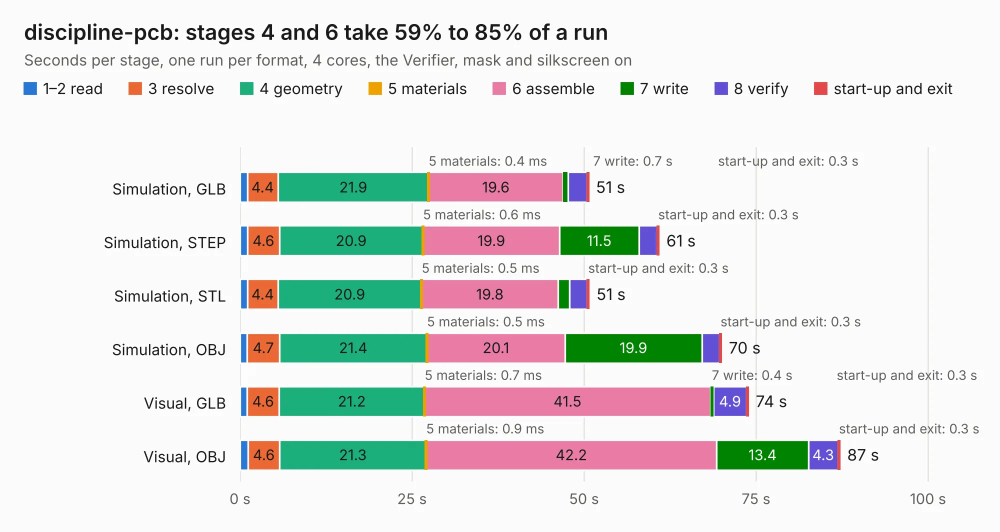

| Mode and format | 1–2 read | 3 resolve | 4 geometry | 5 materials | 6 assemble | 7 write | 8 verify | start-up and exit | Total |
|---|---:|---:|---:|---:|---:|---:|---:|---:|---:|
| Simulation, GLB | 1.1 | 4.4 | 21.9 | 0.4&nbsp;ms | 19.6 | 0.7 | 2.7 | 0.3 | 50.7 |
| Simulation, STEP | 1.1 | 4.6 | 20.9 | 0.6&nbsp;ms | 19.9 | 11.5 | 2.7 | 0.3 | 60.9 |
| Simulation, STL | 1.1 | 4.4 | 20.9 | 0.5&nbsp;ms | 19.8 | 1.7 | 2.5 | 0.3 | 50.8 |
| Simulation, OBJ | 1.0 | 4.7 | 21.4 | 0.5&nbsp;ms | 20.1 | 19.9 | 2.6 | 0.3 | 70.0 |
| Visual, GLB | 1.0 | 4.6 | 21.2 | 0.7&nbsp;ms | 41.5 | 0.4 | 4.9 | 0.3 | 73.9 |
| Visual, OBJ | 1.2 | 4.6 | 21.3 | 0.9&nbsp;ms | 42.2 | 13.4 | 4.3 | 0.3 | 87.2 |

<table align="center"><tr><td valign="top">

| Board | Repo: [coseyfannitutti/discipline](https://github.com/coseyfannitutti/discipline) Board: `discipline-pcb.kicad_pcb` |
|---|---|
| Complexity | 255&nbsp;/&nbsp;1000 (size&nbsp;200, features&nbsp;55) |
| KESE&nbsp;features | through vias, slotted holes, filled zones, curved board outline |
| Tested | 9th November 2026 |
| Copper&nbsp;layers | 2 |
| File&nbsp;format | KiCad 5 (20171130) |
| Parts,&nbsp;tracks,&nbsp;vias | 171, 2,199, 77 |
| Triangles,&nbsp;simulation | 4,100,942 in 126 parts |
| Verifier | PASS in all six runs |

</td><td valign="top">

<table>
<tr><th>File type</th><th>File size</th><th>Peak memory used</th></tr>
<tr><th colspan="3" align="left">Simulation</th></tr>
<tr><td>GLB</td><td align="right">141&nbsp;MB</td><td align="right">1.3&nbsp;GB</td></tr>
<tr><td>STEP</td><td align="right">744&nbsp;MB</td><td align="right">1.6&nbsp;GB</td></tr>
<tr><td>STL</td><td align="right">205&nbsp;MB</td><td align="right">1.4&nbsp;GB</td></tr>
<tr><td>OBJ</td><td align="right">439&nbsp;MB</td><td align="right">2.7&nbsp;GB</td></tr>
<tr><th colspan="3" align="left">Visual</th></tr>
<tr><td>GLB</td><td align="right">91&nbsp;MB</td><td align="right">1.5&nbsp;GB</td></tr>
<tr><td>OBJ</td><td align="right">284&nbsp;MB</td><td align="right">1.9&nbsp;GB</td></tr>
</table>

</td></tr></table>

## 773. discipline-pcb

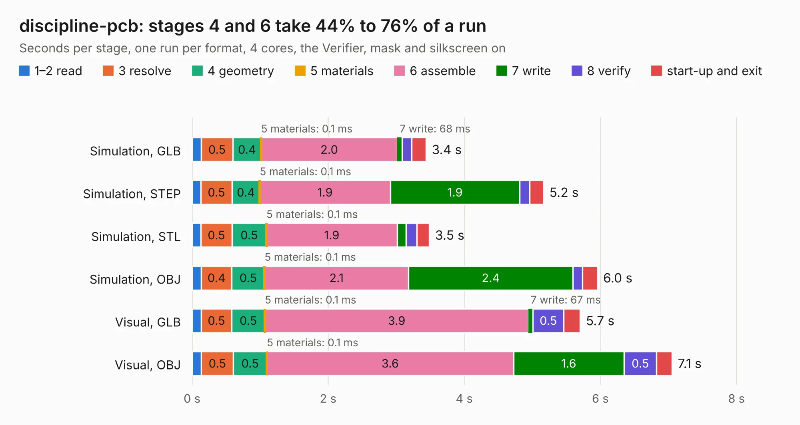

| Mode and format | 1–2 read | 3 resolve | 4 geometry | 5 materials | 6 assemble | 7 write | 8 verify | start-up and exit | Total |
|---|---:|---:|---:|---:|---:|---:|---:|---:|---:|
| Simulation, GLB | 0.1 | 0.5 | 0.4 | 0.1&nbsp;ms | 2.0 | 68&nbsp;ms | 0.1 | 0.2 | 3.4 |
| Simulation, STEP | 0.1 | 0.5 | 0.4 | 0.1&nbsp;ms | 1.9 | 1.9 | 0.1 | 0.2 | 5.2 |
| Simulation, STL | 0.1 | 0.5 | 0.5 | 0.1&nbsp;ms | 1.9 | 0.1 | 0.2 | 0.2 | 3.5 |
| Simulation, OBJ | 0.1 | 0.4 | 0.5 | 0.1&nbsp;ms | 2.1 | 2.4 | 0.1 | 0.2 | 6.0 |
| Visual, GLB | 0.1 | 0.5 | 0.5 | 0.1&nbsp;ms | 3.9 | 67&nbsp;ms | 0.5 | 0.2 | 5.7 |
| Visual, OBJ | 0.1 | 0.5 | 0.5 | 0.1&nbsp;ms | 3.6 | 1.6 | 0.5 | 0.2 | 7.1 |

<table align="center"><tr><td valign="top">

| Board | Repo: [coseyfannitutti/discipline](https://github.com/coseyfannitutti/discipline) Board: `discipline-pcb.kicad_pcb` |
|---|---|
| Folder | plate |
| Complexity | 47&nbsp;/&nbsp;1000 (size&nbsp;17, features&nbsp;30) |
| KESE&nbsp;features | filled zones, curved board outline |
| Tested | 9th November 2026 |
| Copper&nbsp;layers | 2 |
| File&nbsp;format | KiCad 5 (20171130) |
| Parts,&nbsp;tracks,&nbsp;vias | 0, 0, 0 |
| Triangles,&nbsp;simulation | 443,680 in 8 parts |
| Note | no components |
| Verifier | PASS in all six runs |

</td><td valign="top">

<table>
<tr><th>File type</th><th>File size</th><th>Peak memory used</th></tr>
<tr><th colspan="3" align="left">Simulation</th></tr>
<tr><td>GLB</td><td align="right">15&nbsp;MB</td><td align="right">365&nbsp;MB</td></tr>
<tr><td>STEP</td><td align="right">112&nbsp;MB</td><td align="right">375&nbsp;MB</td></tr>
<tr><td>STL</td><td align="right">22&nbsp;MB</td><td align="right">357&nbsp;MB</td></tr>
<tr><td>OBJ</td><td align="right">45&nbsp;MB</td><td align="right">362&nbsp;MB</td></tr>
<tr><th colspan="3" align="left">Visual</th></tr>
<tr><td>GLB</td><td align="right">12&nbsp;MB</td><td align="right">347&nbsp;MB</td></tr>
<tr><td>OBJ</td><td align="right">37&nbsp;MB</td><td align="right">350&nbsp;MB</td></tr>
</table>

</td></tr></table>

## 774. BlankMSXCartHSH

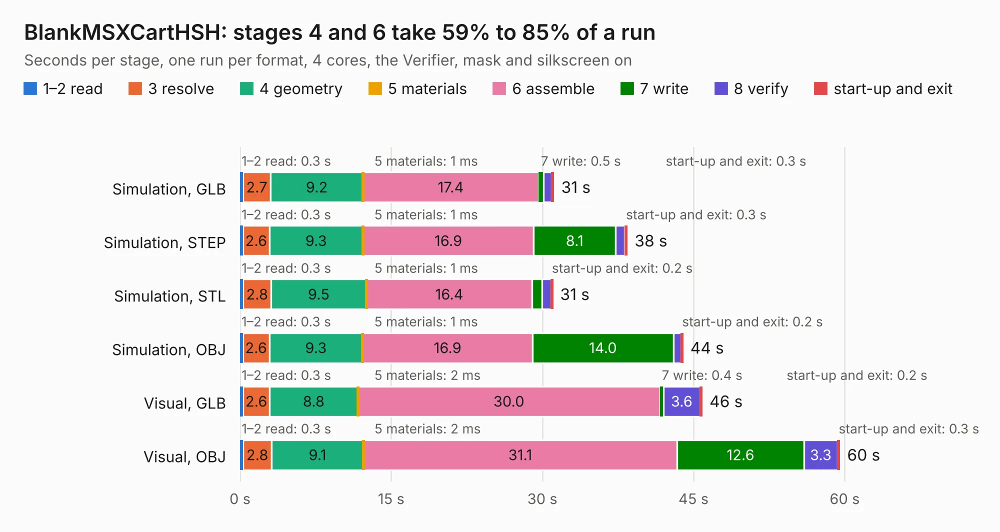

| Mode and format | 1–2 read | 3 resolve | 4 geometry | 5 materials | 6 assemble | 7 write | 8 verify | start-up and exit | Total |
|---|---:|---:|---:|---:|---:|---:|---:|---:|---:|
| Simulation, GLB | 0.3 | 2.7 | 9.2 | 1&nbsp;ms | 17.4 | 0.5 | 0.8 | 0.3 | 31.2 |
| Simulation, STEP | 0.3 | 2.6 | 9.3 | 1&nbsp;ms | 16.9 | 8.1 | 0.9 | 0.3 | 38.4 |
| Simulation, STL | 0.3 | 2.8 | 9.5 | 1&nbsp;ms | 16.4 | 1.0 | 0.9 | 0.2 | 31.1 |
| Simulation, OBJ | 0.3 | 2.6 | 9.3 | 1&nbsp;ms | 16.9 | 14.0 | 0.8 | 0.2 | 44.0 |
| Visual, GLB | 0.3 | 2.6 | 8.8 | 2&nbsp;ms | 30.0 | 0.4 | 3.6 | 0.2 | 45.9 |
| Visual, OBJ | 0.3 | 2.8 | 9.1 | 2&nbsp;ms | 31.1 | 12.6 | 3.3 | 0.3 | 59.5 |

<table align="center"><tr><td valign="top">

| Board | Repo: [cristianoag/trh9000](https://github.com/cristianoag/trh9000) Board: `BlankMSXCartHSH.kicad_pcb` |
|---|---|
| Folder | Hardware / Kicad / MSX_Breadboard_Large_V9990 |
| Complexity | 270&nbsp;/&nbsp;1000 (size&nbsp;215, features&nbsp;55) |
| KESE&nbsp;features | through vias, rounded, trapezoid or chamfered pads, stack-up, dielectric εr and tanδ |
| Tested | 9th November 2026 |
| Copper&nbsp;layers | 2 |
| File&nbsp;format | KiCad 6 (20211014) |
| Parts,&nbsp;tracks,&nbsp;vias | 6, 1,220, 1,034 |
| Triangles,&nbsp;simulation | 2,765,694 in 299 parts |
| Verifier | PASS in all six runs |

</td><td valign="top">

<table>
<tr><th>File type</th><th>File size</th><th>Peak memory used</th></tr>
<tr><th colspan="3" align="left">Simulation</th></tr>
<tr><td>GLB</td><td align="right">93&nbsp;MB</td><td align="right">1.1&nbsp;GB</td></tr>
<tr><td>STEP</td><td align="right">369&nbsp;MB</td><td align="right">1.4&nbsp;GB</td></tr>
<tr><td>STL</td><td align="right">138&nbsp;MB</td><td align="right">1.1&nbsp;GB</td></tr>
<tr><td>OBJ</td><td align="right">288&nbsp;MB</td><td align="right">1.8&nbsp;GB</td></tr>
<tr><th colspan="3" align="left">Visual</th></tr>
<tr><td>GLB</td><td align="right">80&nbsp;MB</td><td align="right">1.5&nbsp;GB</td></tr>
<tr><td>OBJ</td><td align="right">255&nbsp;MB</td><td align="right">1.7&nbsp;GB</td></tr>
</table>

</td></tr></table>

## 775. TRH9000

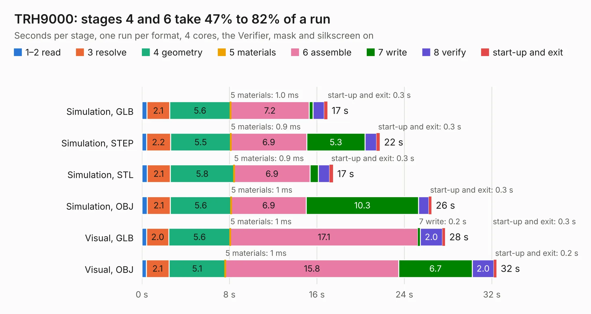

| Mode and format | 1–2 read | 3 resolve | 4 geometry | 5 materials | 6 assemble | 7 write | 8 verify | start-up and exit | Total |
|---|---:|---:|---:|---:|---:|---:|---:|---:|---:|
| Simulation, GLB | 0.5 | 2.1 | 5.6 | 1.0&nbsp;ms | 7.2 | 0.3 | 1.0 | 0.3 | 17.0 |
| Simulation, STEP | 0.4 | 2.2 | 5.5 | 0.9&nbsp;ms | 6.9 | 5.3 | 1.1 | 0.3 | 21.8 |
| Simulation, STL | 0.5 | 2.1 | 5.8 | 0.9&nbsp;ms | 6.9 | 0.8 | 1.0 | 0.3 | 17.5 |
| Simulation, OBJ | 0.5 | 2.1 | 5.6 | 1&nbsp;ms | 6.9 | 10.3 | 0.9 | 0.3 | 26.5 |
| Visual, GLB | 0.4 | 2.0 | 5.6 | 1&nbsp;ms | 17.1 | 0.2 | 2.0 | 0.3 | 27.7 |
| Visual, OBJ | 0.4 | 2.1 | 5.1 | 1&nbsp;ms | 15.8 | 6.7 | 2.0 | 0.2 | 32.4 |

<table align="center"><tr><td valign="top">

| Board | Repo: [cristianoag/trh9000](https://github.com/cristianoag/trh9000) Board: `TRH9000.kicad_pcb` |
|---|---|
| Folder | Hardware / Kicad / TRH9000_1.7 |
| Complexity | 345&nbsp;/&nbsp;1000 (size&nbsp;250, features&nbsp;95) |
| KESE&nbsp;features | through vias, slotted holes, rounded, trapezoid or chamfered pads, filled zones, curved board outline, stack-up, dielectric εr and tanδ |
| Tested | 9th November 2026 |
| Copper&nbsp;layers | 4 |
| File&nbsp;format | KiCad 8 (20240108) |
| Parts,&nbsp;tracks,&nbsp;vias | 64, 2,127, 295 |
| Triangles,&nbsp;simulation | 2,038,064 in 215 parts |
| Verifier | PASS in all six runs |

</td><td valign="top">

<table>
<tr><th>File type</th><th>File size</th><th>Peak memory used</th></tr>
<tr><th colspan="3" align="left">Simulation</th></tr>
<tr><td>GLB</td><td align="right">69&nbsp;MB</td><td align="right">822&nbsp;MB</td></tr>
<tr><td>STEP</td><td align="right">289&nbsp;MB</td><td align="right">844&nbsp;MB</td></tr>
<tr><td>STL</td><td align="right">102&nbsp;MB</td><td align="right">814&nbsp;MB</td></tr>
<tr><td>OBJ</td><td align="right">214&nbsp;MB</td><td align="right">1.3&nbsp;GB</td></tr>
<tr><th colspan="3" align="left">Visual</th></tr>
<tr><td>GLB</td><td align="right">45&nbsp;MB</td><td align="right">858&nbsp;MB</td></tr>
<tr><td>OBJ</td><td align="right">141&nbsp;MB</td><td align="right">995&nbsp;MB</td></tr>
</table>

</td></tr></table>

## 776. trhmsx

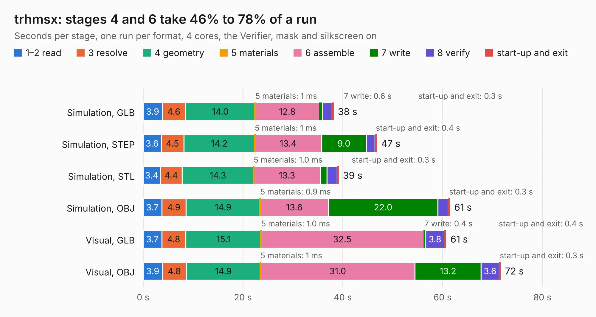

| Mode and format | 1–2 read | 3 resolve | 4 geometry | 5 materials | 6 assemble | 7 write | 8 verify | start-up and exit | Total |
|---|---:|---:|---:|---:|---:|---:|---:|---:|---:|
| Simulation, GLB | 3.9 | 4.6 | 14.0 | 1&nbsp;ms | 12.8 | 0.6 | 1.9 | 0.3 | 38.2 |
| Simulation, STEP | 3.6 | 4.5 | 14.2 | 1&nbsp;ms | 13.4 | 9.0 | 1.7 | 0.4 | 46.8 |
| Simulation, STL | 3.4 | 4.4 | 14.3 | 1.0&nbsp;ms | 13.3 | 1.4 | 2.0 | 0.3 | 39.2 |
| Simulation, OBJ | 3.7 | 4.9 | 14.9 | 0.9&nbsp;ms | 13.6 | 22.0 | 2.1 | 0.3 | 61.5 |
| Visual, GLB | 3.7 | 4.8 | 15.1 | 1.0&nbsp;ms | 32.5 | 0.4 | 3.8 | 0.4 | 60.7 |
| Visual, OBJ | 3.9 | 4.8 | 14.9 | 1&nbsp;ms | 31.0 | 13.2 | 3.6 | 0.3 | 71.6 |

<table align="center"><tr><td valign="top">

| Board | Repo: [cristianoag/trhmsx](https://github.com/cristianoag/trhmsx) Board: `trhmsx.kicad_pcb` |
|---|---|
| Folder | hardware / trhmsx |
| Complexity | 358&nbsp;/&nbsp;1000 (size&nbsp;263, features&nbsp;95) |
| KESE&nbsp;features | through vias, slotted holes, rounded, trapezoid or chamfered pads, filled zones, curved board outline, stack-up, dielectric εr and tanδ |
| Tested | 9th November 2026 |
| Copper&nbsp;layers | 4 |
| File&nbsp;format | KiCad 8 (20240108) |
| Parts,&nbsp;tracks,&nbsp;vias | 130, 3,267, 305 |
| Triangles,&nbsp;simulation | 3,447,680 in 379 parts |
| Verifier | PASS in all six runs |

</td><td valign="top">

<table>
<tr><th>File type</th><th>File size</th><th>Peak memory used</th></tr>
<tr><th colspan="3" align="left">Simulation</th></tr>
<tr><td>GLB</td><td align="right">120&nbsp;MB</td><td align="right">1.1&nbsp;GB</td></tr>
<tr><td>STEP</td><td align="right">470&nbsp;MB</td><td align="right">1.3&nbsp;GB</td></tr>
<tr><td>STL</td><td align="right">172&nbsp;MB</td><td align="right">1.1&nbsp;GB</td></tr>
<tr><td>OBJ</td><td align="right">370&nbsp;MB</td><td align="right">2.3&nbsp;GB</td></tr>
<tr><th colspan="3" align="left">Visual</th></tr>
<tr><td>GLB</td><td align="right">70&nbsp;MB</td><td align="right">1.4&nbsp;GB</td></tr>
<tr><td>OBJ</td><td align="right">221&nbsp;MB</td><td align="right">1.6&nbsp;GB</td></tr>
</table>

</td></tr></table>

## 777. mackerel-10-dram

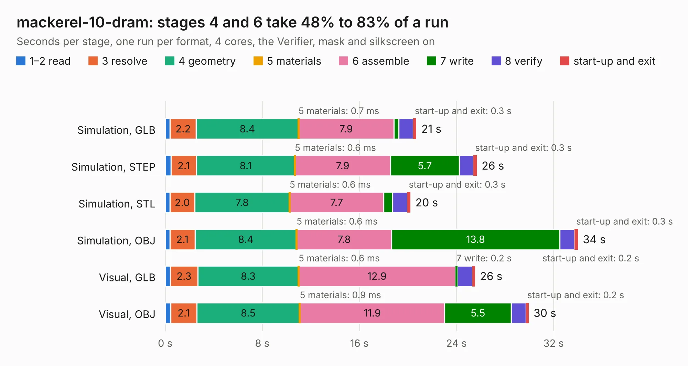

| Mode and format | 1–2 read | 3 resolve | 4 geometry | 5 materials | 6 assemble | 7 write | 8 verify | start-up and exit | Total |
|---|---:|---:|---:|---:|---:|---:|---:|---:|---:|
| Simulation, GLB | 0.4 | 2.2 | 8.4 | 0.7&nbsp;ms | 7.9 | 0.4 | 1.2 | 0.3 | 20.7 |
| Simulation, STEP | 0.5 | 2.1 | 8.1 | 0.6&nbsp;ms | 7.9 | 5.7 | 1.2 | 0.3 | 25.7 |
| Simulation, STL | 0.4 | 2.0 | 7.8 | 0.6&nbsp;ms | 7.7 | 0.7 | 1.2 | 0.3 | 20.2 |
| Simulation, OBJ | 0.4 | 2.1 | 8.4 | 0.6&nbsp;ms | 7.8 | 13.8 | 1.2 | 0.3 | 34.0 |
| Visual, GLB | 0.4 | 2.3 | 8.3 | 0.6&nbsp;ms | 12.9 | 0.2 | 1.2 | 0.2 | 25.5 |
| Visual, OBJ | 0.5 | 2.1 | 8.5 | 0.9&nbsp;ms | 11.9 | 5.5 | 1.2 | 0.2 | 29.9 |

<table align="center"><tr><td valign="top">

| Board | Repo: [crmaykish/mackerel-68k](https://github.com/crmaykish/mackerel-68k) Board: `mackerel-10-dram.kicad_pcb` |
|---|---|
| Folder | hardware / mack-10-proto / mackerel-10-dram |
| Complexity | 304&nbsp;/&nbsp;1000 (size&nbsp;219, features&nbsp;85) |
| KESE&nbsp;features | through vias, rounded, trapezoid or chamfered pads, filled zones, curved board outline, stack-up, dielectric εr and tanδ |
| Tested | 9th November 2026 |
| Copper&nbsp;layers | 4 |
| File&nbsp;format | KiCad 8 (20240108) |
| Parts,&nbsp;tracks,&nbsp;vias | 41, 533, 31 |
| Triangles,&nbsp;simulation | 2,580,718 in 140 parts |
| Verifier | PASS in all six runs |

</td><td valign="top">

<table>
<tr><th>File type</th><th>File size</th><th>Peak memory used</th></tr>
<tr><th colspan="3" align="left">Simulation</th></tr>
<tr><td>GLB</td><td align="right">86&nbsp;MB</td><td align="right">743&nbsp;MB</td></tr>
<tr><td>STEP</td><td align="right">277&nbsp;MB</td><td align="right">928&nbsp;MB</td></tr>
<tr><td>STL</td><td align="right">129&nbsp;MB</td><td align="right">708&nbsp;MB</td></tr>
<tr><td>OBJ</td><td align="right">268&nbsp;MB</td><td align="right">1.7&nbsp;GB</td></tr>
<tr><th colspan="3" align="left">Visual</th></tr>
<tr><td>GLB</td><td align="right">36&nbsp;MB</td><td align="right">1.0&nbsp;GB</td></tr>
<tr><td>OBJ</td><td align="right">111&nbsp;MB</td><td align="right">850&nbsp;MB</td></tr>
</table>

</td></tr></table>

## 778. mackerel-10-ide

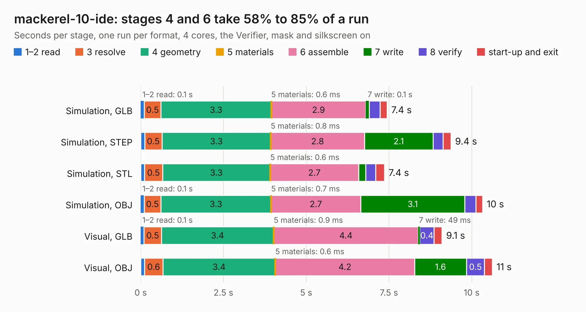

| Mode and format | 1–2 read | 3 resolve | 4 geometry | 5 materials | 6 assemble | 7 write | 8 verify | start-up and exit | Total |
|---|---:|---:|---:|---:|---:|---:|---:|---:|---:|
| Simulation, GLB | 0.1 | 0.5 | 3.3 | 0.6&nbsp;ms | 2.9 | 0.1 | 0.3 | 0.2 | 7.4 |
| Simulation, STEP | 0.1 | 0.5 | 3.3 | 0.8&nbsp;ms | 2.8 | 2.1 | 0.3 | 0.2 | 9.4 |
| Simulation, STL | 0.1 | 0.5 | 3.3 | 0.6&nbsp;ms | 2.7 | 0.2 | 0.3 | 0.3 | 7.4 |
| Simulation, OBJ | 0.1 | 0.5 | 3.3 | 0.7&nbsp;ms | 2.7 | 3.1 | 0.3 | 0.2 | 10.3 |
| Visual, GLB | 0.1 | 0.5 | 3.4 | 0.9&nbsp;ms | 4.4 | 49&nbsp;ms | 0.4 | 0.2 | 9.1 |
| Visual, OBJ | 0.1 | 0.6 | 3.4 | 0.6&nbsp;ms | 4.2 | 1.6 | 0.5 | 0.2 | 10.6 |

<table align="center"><tr><td valign="top">

| Board | Repo: [crmaykish/mackerel-68k](https://github.com/crmaykish/mackerel-68k) Board: `mackerel-10-ide.kicad_pcb` |
|---|---|
| Folder | hardware / mack-10-proto / mackerel-10-ide |
| Complexity | 46&nbsp;/&nbsp;1000 (size&nbsp;36, features&nbsp;10) |
| KESE&nbsp;features | rounded, trapezoid or chamfered pads |
| Tested | 9th November 2026 |
| Copper&nbsp;layers | 2 |
| File&nbsp;format | KiCad 8 (20240108) |
| Parts,&nbsp;tracks,&nbsp;vias | 5, 0, 0 |
| Triangles,&nbsp;simulation | 692,920 in 102 parts |
| Verifier | PASS in all six runs |

</td><td valign="top">

<table>
<tr><th>File type</th><th>File size</th><th>Peak memory used</th></tr>
<tr><th colspan="3" align="left">Simulation</th></tr>
<tr><td>GLB</td><td align="right">20&nbsp;MB</td><td align="right">320&nbsp;MB</td></tr>
<tr><td>STEP</td><td align="right">69&nbsp;MB</td><td align="right">392&nbsp;MB</td></tr>
<tr><td>STL</td><td align="right">35&nbsp;MB</td><td align="right">320&nbsp;MB</td></tr>
<tr><td>OBJ</td><td align="right">69&nbsp;MB</td><td align="right">499&nbsp;MB</td></tr>
<tr><th colspan="3" align="left">Visual</th></tr>
<tr><td>GLB</td><td align="right">12&nbsp;MB</td><td align="right">414&nbsp;MB</td></tr>
<tr><td>OBJ</td><td align="right">37&nbsp;MB</td><td align="right">408&nbsp;MB</td></tr>
</table>

</td></tr></table>

## 779. mackerel-10-v1

| Mode and format | 1–2 read | 3 resolve | 4 geometry | 5 materials | 6 assemble | 7 write | 8 verify | start-up and exit | Total |
|---|---:|---:|---:|---:|---:|---:|---:|---:|---:|
| Simulation, GLB | 0.8 | 4.3 | 15.3 | 1&nbsp;ms | 15.0 | 0.7 | 2.2 | 0.3 | 38.7 |
| Simulation, STEP | 0.7 | 4.0 | 15.1 | 1&nbsp;ms | 14.7 | 9.9 | 2.2 | 0.3 | 47.1 |
| Simulation, STL | 0.8 | 4.4 | 15.4 | 2&nbsp;ms | 15.5 | 1.6 | 2.4 | 0.3 | 40.3 |
| Simulation, OBJ | 0.9 | 4.5 | 15.3 | 2&nbsp;ms | 15.5 | 26.2 | 2.3 | 0.3 | 64.9 |
| Visual, GLB | 0.8 | 4.5 | 15.8 | 1&nbsp;ms | 26.6 | 0.3 | 3.1 | 0.3 | 51.4 |
| Visual, OBJ | 0.8 | 4.3 | 14.6 | 1&nbsp;ms | 26.5 | 11.4 | 3.6 | 0.3 | 61.4 |

<table align="center"><tr><td valign="top">

| Board | Repo: [crmaykish/mackerel-68k](https://github.com/crmaykish/mackerel-68k) Board: `mackerel-10-v1.kicad_pcb` |
|---|---|
| Folder | hardware / mack-10-proto / mackerel-10-v1 |
| Complexity | 342&nbsp;/&nbsp;1000 (size&nbsp;247, features&nbsp;95) |
| KESE&nbsp;features | through vias, slotted holes, rounded, trapezoid or chamfered pads, filled zones, curved board outline, stack-up, dielectric εr and tanδ |
| Tested | 9th November 2026 |
| Copper&nbsp;layers | 4 |
| File&nbsp;format | KiCad 8 (20240108) |
| Parts,&nbsp;tracks,&nbsp;vias | 61, 1,430, 118 |
| Triangles,&nbsp;simulation | 4,120,696 in 142 parts |
| Verifier | PASS in all six runs |

</td><td valign="top">

<table>
<tr><th>File type</th><th>File size</th><th>Peak memory used</th></tr>
<tr><th colspan="3" align="left">Simulation</th></tr>
<tr><td>GLB</td><td align="right">137&nbsp;MB</td><td align="right">1.1&nbsp;GB</td></tr>
<tr><td>STEP</td><td align="right">460&nbsp;MB</td><td align="right">1.4&nbsp;GB</td></tr>
<tr><td>STL</td><td align="right">206&nbsp;MB</td><td align="right">1.1&nbsp;GB</td></tr>
<tr><td>OBJ</td><td align="right">434&nbsp;MB</td><td align="right">2.6&nbsp;GB</td></tr>
<tr><th colspan="3" align="left">Visual</th></tr>
<tr><td>GLB</td><td align="right">62&nbsp;MB</td><td align="right">1.2&nbsp;GB</td></tr>
<tr><td>OBJ</td><td align="right">195&nbsp;MB</td><td align="right">1.4&nbsp;GB</td></tr>
</table>

</td></tr></table>

## 780. mackerel-08-v1

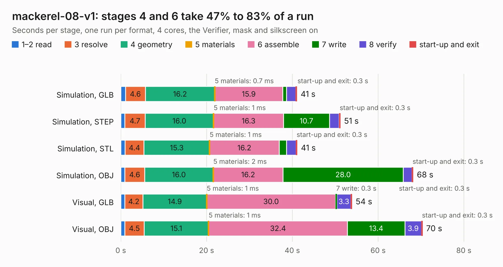

| Mode and format | 1–2 read | 3 resolve | 4 geometry | 5 materials | 6 assemble | 7 write | 8 verify | start-up and exit | Total |
|---|---:|---:|---:|---:|---:|---:|---:|---:|---:|
| Simulation, GLB | 1.1 | 4.6 | 16.2 | 0.7&nbsp;ms | 15.9 | 0.9 | 2.2 | 0.3 | 41.1 |
| Simulation, STEP | 1.0 | 4.7 | 16.0 | 1&nbsp;ms | 16.3 | 10.7 | 2.2 | 0.3 | 51.2 |
| Simulation, STL | 1.0 | 4.4 | 15.3 | 1&nbsp;ms | 16.2 | 1.7 | 2.2 | 0.3 | 41.2 |
| Simulation, OBJ | 1.0 | 4.6 | 16.0 | 2&nbsp;ms | 16.2 | 28.0 | 2.0 | 0.3 | 68.2 |
| Visual, GLB | 0.9 | 4.2 | 14.9 | 1&nbsp;ms | 30.0 | 0.3 | 3.3 | 0.3 | 53.9 |
| Visual, OBJ | 0.9 | 4.5 | 15.1 | 1&nbsp;ms | 32.4 | 13.4 | 3.9 | 0.3 | 70.4 |

<table align="center"><tr><td valign="top">

| Board | Repo: [crmaykish/mackerel-68k](https://github.com/crmaykish/mackerel-68k) Board: `mackerel-08-v1.kicad_pcb` |
|---|---|
| Folder | hardware / mackerel-08-v1 |
| Complexity | 352&nbsp;/&nbsp;1000 (size&nbsp;257, features&nbsp;95) |
| KESE&nbsp;features | through vias, slotted holes, rounded, trapezoid or chamfered pads, filled zones, curved board outline, stack-up, dielectric εr and tanδ |
| Tested | 9th November 2026 |
| Copper&nbsp;layers | 4 |
| File&nbsp;format | KiCad 8 (20240108) |
| Parts,&nbsp;tracks,&nbsp;vias | 80, 2,060, 208 |
| Triangles,&nbsp;simulation | 5,252,394 in 146 parts |
| Verifier | PASS in all six runs |

</td><td valign="top">

<table>
<tr><th>File type</th><th>File size</th><th>Peak memory used</th></tr>
<tr><th colspan="3" align="left">Simulation</th></tr>
<tr><td>GLB</td><td align="right">175&nbsp;MB</td><td align="right">1.3&nbsp;GB</td></tr>
<tr><td>STEP</td><td align="right">584&nbsp;MB</td><td align="right">1.8&nbsp;GB</td></tr>
<tr><td>STL</td><td align="right">263&nbsp;MB</td><td align="right">1.3&nbsp;GB</td></tr>
<tr><td>OBJ</td><td align="right">554&nbsp;MB</td><td align="right">3.3&nbsp;GB</td></tr>
<tr><th colspan="3" align="left">Visual</th></tr>
<tr><td>GLB</td><td align="right">83&nbsp;MB</td><td align="right">1.5&nbsp;GB</td></tr>
<tr><td>OBJ</td><td align="right">264&nbsp;MB</td><td align="right">1.8&nbsp;GB</td></tr>
</table>

</td></tr></table>

## 781. mackerel-10-v1

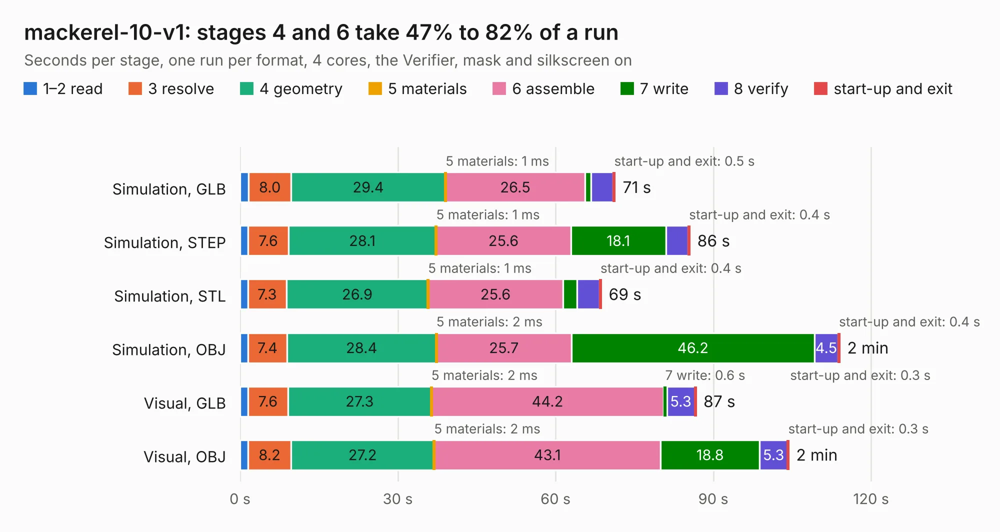

| Mode and format | 1–2 read | 3 resolve | 4 geometry | 5 materials | 6 assemble | 7 write | 8 verify | start-up and exit | Total |
|---|---:|---:|---:|---:|---:|---:|---:|---:|---:|
| Simulation, GLB | 1.7 | 8.0 | 29.4 | 1&nbsp;ms | 26.5 | 1.2 | 4.2 | 0.5 | 71.4 |
| Simulation, STEP | 1.6 | 7.6 | 28.1 | 1&nbsp;ms | 25.6 | 18.1 | 4.2 | 0.4 | 85.6 |
| Simulation, STL | 1.5 | 7.3 | 26.9 | 1&nbsp;ms | 25.6 | 2.6 | 4.3 | 0.4 | 68.7 |
| Simulation, OBJ | 1.5 | 7.4 | 28.4 | 2&nbsp;ms | 25.7 | 46.2 | 4.5 | 0.4 | 114.1 |
| Visual, GLB | 1.5 | 7.6 | 27.3 | 2&nbsp;ms | 44.2 | 0.6 | 5.3 | 0.3 | 86.8 |
| Visual, OBJ | 1.5 | 8.2 | 27.2 | 2&nbsp;ms | 43.1 | 18.8 | 5.3 | 0.3 | 104.4 |

<table align="center"><tr><td valign="top">

| Board | Repo: [crmaykish/mackerel-68k](https://github.com/crmaykish/mackerel-68k) Board: `mackerel-10-v1.kicad_pcb` |
|---|---|
| Folder | hardware / mackerel-10-v1 |
| Complexity | 361&nbsp;/&nbsp;1000 (size&nbsp;266, features&nbsp;95) |
| KESE&nbsp;features | through vias, slotted holes, rounded, trapezoid or chamfered pads, filled zones, curved board outline, stack-up, dielectric εr and tanδ |
| Tested | 9th November 2026 |
| Copper&nbsp;layers | 4 |
| File&nbsp;format | KiCad 8 (20240108) |
| Parts,&nbsp;tracks,&nbsp;vias | 113, 2,261, 200 |
| Triangles,&nbsp;simulation | 7,002,228 in 217 parts |
| Verifier | PASS in all six runs |

</td><td valign="top">

<table>
<tr><th>File type</th><th>File size</th><th>Peak memory used</th></tr>
<tr><th colspan="3" align="left">Simulation</th></tr>
<tr><td>GLB</td><td align="right">235&nbsp;MB</td><td align="right">1.6&nbsp;GB</td></tr>
<tr><td>STEP</td><td align="right">776&nbsp;MB</td><td align="right">2.2&nbsp;GB</td></tr>
<tr><td>STL</td><td align="right">350&nbsp;MB</td><td align="right">1.6&nbsp;GB</td></tr>
<tr><td>OBJ</td><td align="right">743&nbsp;MB</td><td align="right">4.3&nbsp;GB</td></tr>
<tr><th colspan="3" align="left">Visual</th></tr>
<tr><td>GLB</td><td align="right">102&nbsp;MB</td><td align="right">2.2&nbsp;GB</td></tr>
<tr><td>OBJ</td><td align="right">326&nbsp;MB</td><td align="right">2.2&nbsp;GB</td></tr>
</table>

</td></tr></table>

## 782. mackerel-30-proto

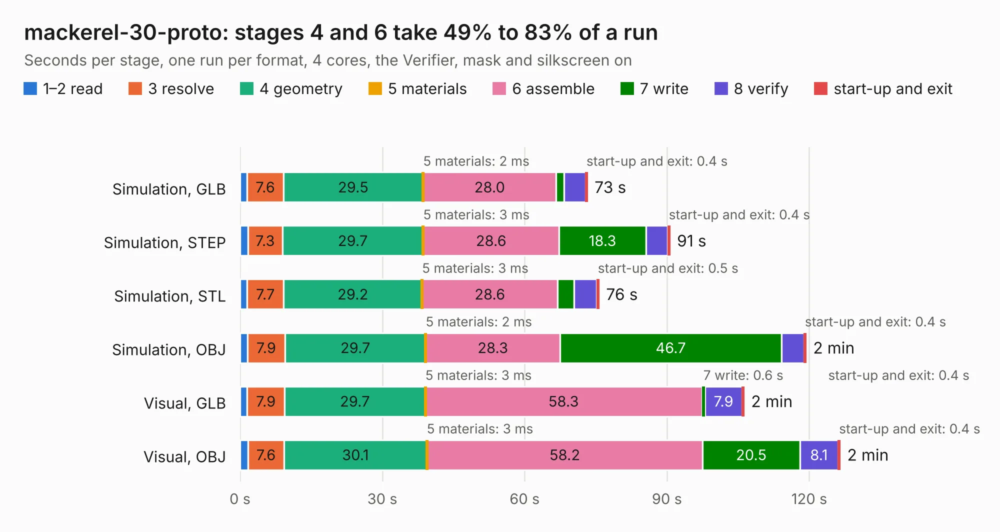

| Mode and format | 1–2 read | 3 resolve | 4 geometry | 5 materials | 6 assemble | 7 write | 8 verify | start-up and exit | Total |
|---|---:|---:|---:|---:|---:|---:|---:|---:|---:|
| Simulation, GLB | 1.5 | 7.6 | 29.5 | 2&nbsp;ms | 28.0 | 1.6 | 4.5 | 0.4 | 73.2 |
| Simulation, STEP | 1.6 | 7.3 | 29.7 | 3&nbsp;ms | 28.6 | 18.3 | 4.6 | 0.4 | 90.6 |
| Simulation, STL | 1.5 | 7.7 | 29.2 | 3&nbsp;ms | 28.6 | 3.5 | 4.8 | 0.5 | 75.7 |
| Simulation, OBJ | 1.6 | 7.9 | 29.7 | 2&nbsp;ms | 28.3 | 46.7 | 4.7 | 0.4 | 119.3 |
| Visual, GLB | 1.5 | 7.9 | 29.7 | 3&nbsp;ms | 58.3 | 0.6 | 7.9 | 0.4 | 106.2 |
| Visual, OBJ | 1.7 | 7.6 | 30.1 | 3&nbsp;ms | 58.2 | 20.5 | 8.1 | 0.4 | 126.5 |

<table align="center"><tr><td valign="top">

| Board | Repo: [crmaykish/mackerel-68k](https://github.com/crmaykish/mackerel-68k) Board: `mackerel-30-proto.kicad_pcb` |
|---|---|
| Folder | hardware / mackerel-30-proto |
| Complexity | 368&nbsp;/&nbsp;1000 (size&nbsp;273, features&nbsp;95) |
| KESE&nbsp;features | through vias, slotted holes, rounded, trapezoid or chamfered pads, filled zones, curved board outline, stack-up, dielectric εr and tanδ |
| Tested | 9th November 2026 |
| Copper&nbsp;layers | 4 |
| File&nbsp;format | KiCad 8 (20240108) |
| Parts,&nbsp;tracks,&nbsp;vias | 130, 2,615, 294 |
| Triangles,&nbsp;simulation | 8,393,056 in 304 parts |
| Verifier | PASS in all six runs |

</td><td valign="top">

<table>
<tr><th>File type</th><th>File size</th><th>Peak memory used</th></tr>
<tr><th colspan="3" align="left">Simulation</th></tr>
<tr><td>GLB</td><td align="right">281&nbsp;MB</td><td align="right">1.9&nbsp;GB</td></tr>
<tr><td>STEP</td><td align="right">930&nbsp;MB</td><td align="right">2.6&nbsp;GB</td></tr>
<tr><td>STL</td><td align="right">420&nbsp;MB</td><td align="right">1.9&nbsp;GB</td></tr>
<tr><td>OBJ</td><td align="right">892&nbsp;MB</td><td align="right">5.2&nbsp;GB</td></tr>
<tr><th colspan="3" align="left">Visual</th></tr>
<tr><td>GLB</td><td align="right">129&nbsp;MB</td><td align="right">2.3&nbsp;GB</td></tr>
<tr><td>OBJ</td><td align="right">417&nbsp;MB</td><td align="right">2.8&nbsp;GB</td></tr>
</table>

</td></tr></table>

## 783. hdmi_adapter

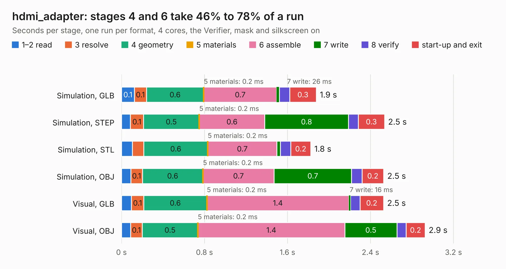

| Mode and format | 1–2 read | 3 resolve | 4 geometry | 5 materials | 6 assemble | 7 write | 8 verify | start-up and exit | Total |
|---|---:|---:|---:|---:|---:|---:|---:|---:|---:|
| Simulation, GLB | 0.1 | 0.1 | 0.6 | 0.2&nbsp;ms | 0.7 | 26&nbsp;ms | 99&nbsp;ms | 0.3 | 1.9 |
| Simulation, STEP | 86&nbsp;ms | 0.1 | 0.5 | 0.2&nbsp;ms | 0.6 | 0.8 | 95&nbsp;ms | 0.3 | 2.5 |
| Simulation, STL | 0.1 | 0.1 | 0.6 | 0.2&nbsp;ms | 0.7 | 34&nbsp;ms | 0.1 | 0.2 | 1.8 |
| Simulation, OBJ | 89&nbsp;ms | 0.1 | 0.6 | 0.2&nbsp;ms | 0.7 | 0.7 | 0.1 | 0.2 | 2.5 |
| Visual, GLB | 96&nbsp;ms | 0.1 | 0.6 | 0.2&nbsp;ms | 1.4 | 16&nbsp;ms | 91&nbsp;ms | 0.2 | 2.5 |
| Visual, OBJ | 87&nbsp;ms | 0.1 | 0.5 | 0.2&nbsp;ms | 1.4 | 0.5 | 89&nbsp;ms | 0.2 | 2.9 |

<table align="center"><tr><td valign="top">

| Board | Repo: [cropinghigh/zynq_a9_mb](https://github.com/cropinghigh/zynq_a9_mb) Board: `hdmi_adapter.kicad_pcb` |
|---|---|
| Folder | hardware / hdmi_adapter |
| Complexity | 158&nbsp;/&nbsp;1000 (size&nbsp;113, features&nbsp;45) |
| KESE&nbsp;features | through vias, slotted holes, filled zones |
| Tested | 9th November 2026 |
| Copper&nbsp;layers | 2 |
| File&nbsp;format | KiCad 9 (20241229) |
| Parts,&nbsp;tracks,&nbsp;vias | 2, 153, 6 |
| Triangles,&nbsp;simulation | 145,640 in 31 parts |
| Verifier | PASS in all six runs |

</td><td valign="top">

<table>
<tr><th>File type</th><th>File size</th><th>Peak memory used</th></tr>
<tr><th colspan="3" align="left">Simulation</th></tr>
<tr><td>GLB</td><td align="right">4.8&nbsp;MB</td><td align="right">193&nbsp;MB</td></tr>
<tr><td>STEP</td><td align="right">21&nbsp;MB</td><td align="right">204&nbsp;MB</td></tr>
<tr><td>STL</td><td align="right">7.3&nbsp;MB</td><td align="right">196&nbsp;MB</td></tr>
<tr><td>OBJ</td><td align="right">14&nbsp;MB</td><td align="right">193&nbsp;MB</td></tr>
<tr><th colspan="3" align="left">Visual</th></tr>
<tr><td>GLB</td><td align="right">3.1&nbsp;MB</td><td align="right">157&nbsp;MB</td></tr>
<tr><td>OBJ</td><td align="right">8.8&nbsp;MB</td><td align="right">157&nbsp;MB</td></tr>
</table>

</td></tr></table>

## 784. zynq_test

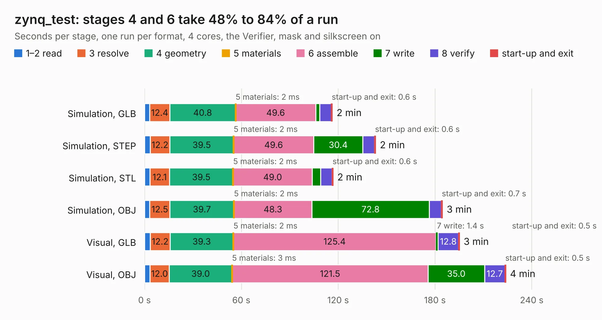

| Mode and format | 1–2 read | 3 resolve | 4 geometry | 5 materials | 6 assemble | 7 write | 8 verify | start-up and exit | Total |
|---|---:|---:|---:|---:|---:|---:|---:|---:|---:|
| Simulation, GLB | 3.2 | 12.4 | 40.8 | 2&nbsp;ms | 49.6 | 2.6 | 7.1 | 0.6 | 116.4 |
| Simulation, STEP | 3.5 | 12.2 | 39.5 | 2&nbsp;ms | 49.6 | 30.4 | 7.3 | 0.6 | 143.2 |
| Simulation, STL | 3.3 | 12.1 | 39.5 | 2&nbsp;ms | 49.0 | 5.2 | 7.1 | 0.6 | 116.9 |
| Simulation, OBJ | 3.2 | 12.5 | 39.7 | 2&nbsp;ms | 48.3 | 72.8 | 7.5 | 0.7 | 184.6 |
| Visual, GLB | 3.6 | 12.2 | 39.3 | 2&nbsp;ms | 125.4 | 1.4 | 12.8 | 0.5 | 195.2 |
| Visual, OBJ | 3.3 | 12.0 | 39.0 | 3&nbsp;ms | 121.5 | 35.0 | 12.7 | 0.5 | 223.9 |

<table align="center"><tr><td valign="top">

| Board | Repo: [cropinghigh/zynq_a9_mb](https://github.com/cropinghigh/zynq_a9_mb) Board: `zynq_test.kicad_pcb` |
|---|---|
| Folder | hardware |
| Complexity | 490&nbsp;/&nbsp;1000 (size&nbsp;335, features&nbsp;155) |
| KESE&nbsp;features | through vias, slotted holes, custom pads, rounded, trapezoid or chamfered pads, arc tracks, filled zones, copper drawings, copper text, stack-up, dielectric εr and tanδ, copper finish, mask and silkscreen colours |
| Tested | 9th November 2026 |
| Copper&nbsp;layers | 6 |
| File&nbsp;format | KiCad 9 (20241229) |
| Parts,&nbsp;tracks,&nbsp;vias | 471, 18,336, 1,096 |
| Triangles,&nbsp;simulation | 12,610,460 in 489 parts |
| Verifier | PASS in all six runs |

</td><td valign="top">

<table>
<tr><th>File type</th><th>File size</th><th>Peak memory used</th></tr>
<tr><th colspan="3" align="left">Simulation</th></tr>
<tr><td>GLB</td><td align="right">425&nbsp;MB</td><td align="right">2.8&nbsp;GB</td></tr>
<tr><td>STEP</td><td align="right">1.7&nbsp;GB</td><td align="right">4.0&nbsp;GB</td></tr>
<tr><td>STL</td><td align="right">631&nbsp;MB</td><td align="right">2.8&nbsp;GB</td></tr>
<tr><td>OBJ</td><td align="right">1.4&nbsp;GB</td><td align="right">8.0&nbsp;GB</td></tr>
<tr><th colspan="3" align="left">Visual</th></tr>
<tr><td>GLB</td><td align="right">233&nbsp;MB</td><td align="right">3.7&nbsp;GB</td></tr>
<tr><td>OBJ</td><td align="right">753&nbsp;MB</td><td align="right">4.9&nbsp;GB</td></tr>
</table>

</td></tr></table>

## 785. aquila_main

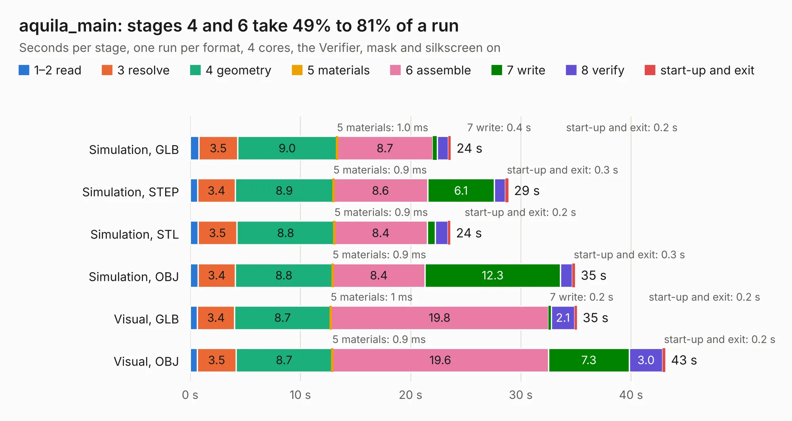

| Mode and format | 1–2 read | 3 resolve | 4 geometry | 5 materials | 6 assemble | 7 write | 8 verify | start-up and exit | Total |
|---|---:|---:|---:|---:|---:|---:|---:|---:|---:|
| Simulation, GLB | 0.8 | 3.5 | 9.0 | 1.0&nbsp;ms | 8.7 | 0.4 | 1.0 | 0.2 | 23.7 |
| Simulation, STEP | 0.7 | 3.4 | 8.9 | 0.9&nbsp;ms | 8.6 | 6.1 | 1.0 | 0.3 | 28.9 |
| Simulation, STL | 0.7 | 3.5 | 8.8 | 0.9&nbsp;ms | 8.4 | 0.7 | 1.1 | 0.2 | 23.6 |
| Simulation, OBJ | 0.7 | 3.4 | 8.8 | 0.9&nbsp;ms | 8.4 | 12.3 | 1.1 | 0.3 | 34.9 |
| Visual, GLB | 0.7 | 3.4 | 8.7 | 1&nbsp;ms | 19.8 | 0.2 | 2.1 | 0.2 | 35.1 |
| Visual, OBJ | 0.7 | 3.5 | 8.7 | 0.9&nbsp;ms | 19.6 | 7.3 | 3.0 | 0.2 | 43.1 |

<table align="center"><tr><td valign="top">

| Board | Repo: [cuspaceflight/aquila-avionics](https://github.com/cuspaceflight/aquila-avionics) Board: `aquila_main.kicad_pcb` |
|---|---|
| Folder | schematics / aquila_main |
| Complexity | 313&nbsp;/&nbsp;1000 (size&nbsp;213, features&nbsp;100) |
| KESE&nbsp;features | through vias, rounded, trapezoid or chamfered pads, arc tracks, filled zones, copper drawings, stack-up, dielectric εr and tanδ |
| Tested | 9th November 2026 |
| Copper&nbsp;layers | 4 |
| File&nbsp;format | KiCad 6 (20211014) |
| Parts,&nbsp;tracks,&nbsp;vias | 130, 870, 472 |
| Triangles,&nbsp;simulation | 2,961,764 in 147 parts |
| Verifier | PASS in all six runs |

</td><td valign="top">

<table>
<tr><th>File type</th><th>File size</th><th>Peak memory used</th></tr>
<tr><th colspan="3" align="left">Simulation</th></tr>
<tr><td>GLB</td><td align="right">101&nbsp;MB</td><td align="right">1.1&nbsp;GB</td></tr>
<tr><td>STEP</td><td align="right">371&nbsp;MB</td><td align="right">1.2&nbsp;GB</td></tr>
<tr><td>STL</td><td align="right">148&nbsp;MB</td><td align="right">1.1&nbsp;GB</td></tr>
<tr><td>OBJ</td><td align="right">313&nbsp;MB</td><td align="right">2.0&nbsp;GB</td></tr>
<tr><th colspan="3" align="left">Visual</th></tr>
<tr><td>GLB</td><td align="right">59&nbsp;MB</td><td align="right">1.3&nbsp;GB</td></tr>
<tr><td>OBJ</td><td align="right">185&nbsp;MB</td><td align="right">1.3&nbsp;GB</td></tr>
</table>

</td></tr></table>

## 786. daq_griffin

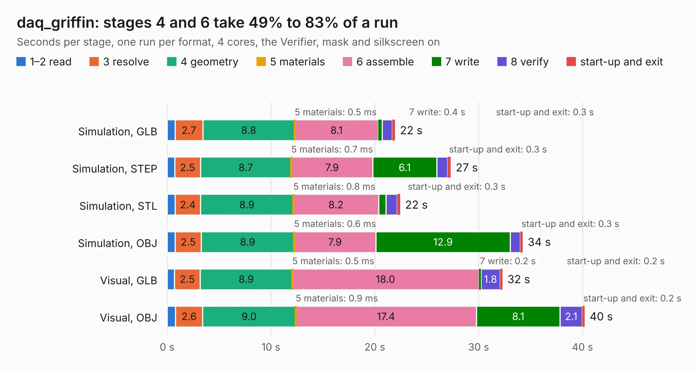

| Mode and format | 1–2 read | 3 resolve | 4 geometry | 5 materials | 6 assemble | 7 write | 8 verify | start-up and exit | Total |
|---|---:|---:|---:|---:|---:|---:|---:|---:|---:|
| Simulation, GLB | 0.8 | 2.7 | 8.8 | 0.5&nbsp;ms | 8.1 | 0.4 | 1.0 | 0.3 | 21.9 |
| Simulation, STEP | 0.7 | 2.5 | 8.7 | 0.7&nbsp;ms | 7.9 | 6.1 | 1.0 | 0.3 | 27.3 |
| Simulation, STL | 0.8 | 2.4 | 8.9 | 0.8&nbsp;ms | 8.2 | 0.7 | 1.1 | 0.3 | 22.4 |
| Simulation, OBJ | 0.8 | 2.5 | 8.9 | 0.6&nbsp;ms | 7.9 | 12.9 | 1.0 | 0.3 | 34.2 |
| Visual, GLB | 0.7 | 2.5 | 8.9 | 0.5&nbsp;ms | 18.0 | 0.2 | 1.8 | 0.2 | 32.3 |
| Visual, OBJ | 0.8 | 2.6 | 9.0 | 0.9&nbsp;ms | 17.4 | 8.1 | 2.1 | 0.2 | 40.2 |

<table align="center"><tr><td valign="top">

| Board | Repo: [cuspaceflight/white-giant-sensing-pcb](https://github.com/cuspaceflight/white-giant-sensing-pcb) Board: `daq_griffin.kicad_pcb` |
|---|---|
| Folder | daq_griffin |
| Complexity | 311&nbsp;/&nbsp;1000 (size&nbsp;211, features&nbsp;100) |
| KESE&nbsp;features | through vias, custom pads, rounded, trapezoid or chamfered pads, filled zones, copper drawings, stack-up, dielectric εr and tanδ |
| Tested | 9th November 2026 |
| Copper&nbsp;layers | 4 |
| File&nbsp;format | KiCad 8 (20240108) |
| Parts,&nbsp;tracks,&nbsp;vias | 220, 962, 166 |
| Triangles,&nbsp;simulation | 2,543,048 in 175 parts |
| Verifier | PASS in all six runs |

</td><td valign="top">

<table>
<tr><th>File type</th><th>File size</th><th>Peak memory used</th></tr>
<tr><th colspan="3" align="left">Simulation</th></tr>
<tr><td>GLB</td><td align="right">84&nbsp;MB</td><td align="right">827&nbsp;MB</td></tr>
<tr><td>STEP</td><td align="right">332&nbsp;MB</td><td align="right">930&nbsp;MB</td></tr>
<tr><td>STL</td><td align="right">127&nbsp;MB</td><td align="right">788&nbsp;MB</td></tr>
<tr><td>OBJ</td><td align="right">266&nbsp;MB</td><td align="right">1.7&nbsp;GB</td></tr>
<tr><th colspan="3" align="left">Visual</th></tr>
<tr><td>GLB</td><td align="right">53&nbsp;MB</td><td align="right">1.2&nbsp;GB</td></tr>
<tr><td>OBJ</td><td align="right">163&nbsp;MB</td><td align="right">1.2&nbsp;GB</td></tr>
</table>

</td></tr></table>

## 787. OpeN64

| Mode and format | 1–2 read | 3 resolve | 4 geometry | 5 materials | 6 assemble | 7 write | 8 verify | start-up and exit | Total |
|---|---:|---:|---:|---:|---:|---:|---:|---:|---:|
| Simulation, GLB | 1.8 | 5.1 | 22.9 | 1&nbsp;ms | 23.5 | 0.8 | 2.6 | 0.3 | 57.0 |
| Simulation, STEP | 2.1 | 5.2 | 23.6 | 2&nbsp;ms | 24.1 | 14.8 | 2.7 | 0.4 | 72.7 |
| Simulation, STL | 1.8 | 5.1 | 22.9 | 2&nbsp;ms | 24.3 | 1.8 | 2.6 | 0.3 | 58.8 |
| Simulation, OBJ | 2.0 | 5.4 | 23.7 | 0.7&nbsp;ms | 24.7 | 28.8 | 2.9 | 0.3 | 87.9 |
| Visual, GLB | 1.8 | 5.2 | 23.6 | 2&nbsp;ms | 53.6 | 0.6 | 6.7 | 0.3 | 91.8 |
| Visual, OBJ | 1.9 | 5.2 | 23.8 | 0.7&nbsp;ms | 55.1 | 22.3 | 7.1 | 0.3 | 115.7 |

<table align="center"><tr><td valign="top">

| Board | Repo: [cy-888/OpeN64](https://github.com/cy-888/OpeN64) Board: `OpeN64.kicad_pcb` |
|---|---|
| Folder | OpeN64 |
| Complexity | 312&nbsp;/&nbsp;1000 (size&nbsp;217, features&nbsp;95) |
| KESE&nbsp;features | through vias, slotted holes, rounded, trapezoid or chamfered pads, filled zones, copper drawings, knockout text, TrueType text |
| Tested | 9th November 2026 |
| Copper&nbsp;layers | 2 |
| File&nbsp;format | KiCad 10 (20260206) |
| Parts,&nbsp;tracks,&nbsp;vias | 273, 2,133, 934 |
| Triangles,&nbsp;simulation | 5,227,676 in 220 parts |
| Verifier | PASS in all six runs |

</td><td valign="top">

<table>
<tr><th>File type</th><th>File size</th><th>Peak memory used</th></tr>
<tr><th colspan="3" align="left">Simulation</th></tr>
<tr><td>GLB</td><td align="right">178&nbsp;MB</td><td align="right">1.7&nbsp;GB</td></tr>
<tr><td>STEP</td><td align="right">1.0&nbsp;GB</td><td align="right">2.2&nbsp;GB</td></tr>
<tr><td>STL</td><td align="right">261&nbsp;MB</td><td align="right">1.7&nbsp;GB</td></tr>
<tr><td>OBJ</td><td align="right">553&nbsp;MB</td><td align="right">3.4&nbsp;GB</td></tr>
<tr><th colspan="3" align="left">Visual</th></tr>
<tr><td>GLB</td><td align="right">137&nbsp;MB</td><td align="right">2.2&nbsp;GB</td></tr>
<tr><td>OBJ</td><td align="right">431&nbsp;MB</td><td align="right">2.7&nbsp;GB</td></tr>
</table>

</td></tr></table>

## 788. HDMI-to-LH550WF1

| Mode and format | 1–2 read | 3 resolve | 4 geometry | 5 materials | 6 assemble | 7 write | 8 verify | start-up and exit | Total |
|---|---:|---:|---:|---:|---:|---:|---:|---:|---:|
| Simulation, GLB | 0.3 | 1.3 | 6.5 | 0.9&nbsp;ms | 4.9 | 0.2 | 0.5 | 0.2 | 14.0 |
| Simulation, STEP | 0.4 | 1.3 | 6.6 | 0.6&nbsp;ms | 4.7 | 2.9 | 0.5 | 0.2 | 16.7 |
| Simulation, STL | 0.4 | 1.3 | 6.5 | 0.7&nbsp;ms | 5.3 | 0.4 | 0.6 | 0.2 | 14.8 |
| Simulation, OBJ | 0.3 | 1.5 | 6.7 | 0.7&nbsp;ms | 4.8 | 6.4 | 0.5 | 0.2 | 20.4 |
| Visual, GLB | 0.3 | 1.3 | 6.7 | 1.0&nbsp;ms | 10.2 | 0.1 | 1.1 | 0.2 | 20.0 |
| Visual, OBJ | 0.4 | 1.4 | 7.2 | 0.7&nbsp;ms | 9.7 | 4.1 | 1.0 | 0.2 | 24.0 |

<table align="center"><tr><td valign="top">

| Board | Repo: [cyrozap/HDMI-to-MIPI](https://github.com/cyrozap/HDMI-to-MIPI) Board: `HDMI-to-LH550WF1.kicad_pcb` |
|---|---|
| Folder | HDMI-to-LH550WF1 |
| Complexity | 314&nbsp;/&nbsp;1000 (size&nbsp;269, features&nbsp;45) |
| KESE&nbsp;features | through vias, filled zones, copper text |
| Tested | 9th November 2026 |
| Copper&nbsp;layers | 4 |
| File&nbsp;format | KiCad 4 (4) |
| Parts,&nbsp;tracks,&nbsp;vias | 139, 1,897, 159 |
| Triangles,&nbsp;simulation | 1,463,414 in 125 parts |
| Verifier | PASS in all six runs |

</td><td valign="top">

<table>
<tr><th>File type</th><th>File size</th><th>Peak memory used</th></tr>
<tr><th colspan="3" align="left">Simulation</th></tr>
<tr><td>GLB</td><td align="right">52&nbsp;MB</td><td align="right">601&nbsp;MB</td></tr>
<tr><td>STEP</td><td align="right">222&nbsp;MB</td><td align="right">714&nbsp;MB</td></tr>
<tr><td>STL</td><td align="right">73&nbsp;MB</td><td align="right">599&nbsp;MB</td></tr>
<tr><td>OBJ</td><td align="right">156&nbsp;MB</td><td align="right">1.0&nbsp;GB</td></tr>
<tr><th colspan="3" align="left">Visual</th></tr>
<tr><td>GLB</td><td align="right">34&nbsp;MB</td><td align="right">769&nbsp;MB</td></tr>
<tr><td>OBJ</td><td align="right">102&nbsp;MB</td><td align="right">804&nbsp;MB</td></tr>
</table>

</td></tr></table>

## 789. LH550WF1-breakout

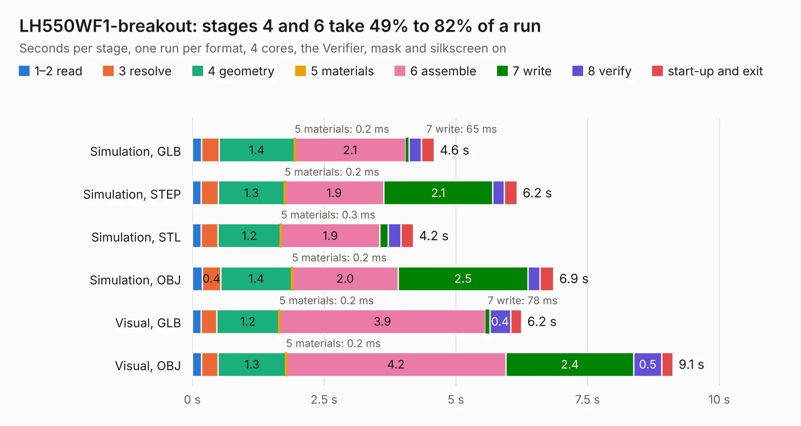

| Mode and format | 1–2 read | 3 resolve | 4 geometry | 5 materials | 6 assemble | 7 write | 8 verify | start-up and exit | Total |
|---|---:|---:|---:|---:|---:|---:|---:|---:|---:|
| Simulation, GLB | 0.2 | 0.3 | 1.4 | 0.2&nbsp;ms | 2.1 | 65&nbsp;ms | 0.2 | 0.2 | 4.6 |
| Simulation, STEP | 0.2 | 0.3 | 1.3 | 0.2&nbsp;ms | 1.9 | 2.1 | 0.2 | 0.2 | 6.2 |
| Simulation, STL | 0.2 | 0.3 | 1.2 | 0.3&nbsp;ms | 1.9 | 0.2 | 0.2 | 0.2 | 4.2 |
| Simulation, OBJ | 0.2 | 0.4 | 1.4 | 0.2&nbsp;ms | 2.0 | 2.5 | 0.2 | 0.3 | 6.9 |
| Visual, GLB | 0.2 | 0.3 | 1.2 | 0.2&nbsp;ms | 3.9 | 78&nbsp;ms | 0.4 | 0.2 | 6.2 |
| Visual, OBJ | 0.2 | 0.3 | 1.3 | 0.2&nbsp;ms | 4.2 | 2.4 | 0.5 | 0.2 | 9.1 |

<table align="center"><tr><td valign="top">

| Board | Repo: [cyrozap/HDMI-to-MIPI](https://github.com/cyrozap/HDMI-to-MIPI) Board: `LH550WF1-breakout.kicad_pcb` |
|---|---|
| Folder | LH550WF1-breakout |
| Complexity | 185&nbsp;/&nbsp;1000 (size&nbsp;150, features&nbsp;35) |
| KESE&nbsp;features | through vias, filled zones |
| Tested | 9th November 2026 |
| Copper&nbsp;layers | 2 |
| File&nbsp;format | KiCad 4 (4) |
| Parts,&nbsp;tracks,&nbsp;vias | 2, 1,462, 47 |
| Triangles,&nbsp;simulation | 423,170 in 28 parts |
| Verifier | PASS in all six runs |

</td><td valign="top">

<table>
<tr><th>File type</th><th>File size</th><th>Peak memory used</th></tr>
<tr><th colspan="3" align="left">Simulation</th></tr>
<tr><td>GLB</td><td align="right">14&nbsp;MB</td><td align="right">295&nbsp;MB</td></tr>
<tr><td>STEP</td><td align="right">83&nbsp;MB</td><td align="right">330&nbsp;MB</td></tr>
<tr><td>STL</td><td align="right">21&nbsp;MB</td><td align="right">294&nbsp;MB</td></tr>
<tr><td>OBJ</td><td align="right">42&nbsp;MB</td><td align="right">343&nbsp;MB</td></tr>
<tr><th colspan="3" align="left">Visual</th></tr>
<tr><td>GLB</td><td align="right">12&nbsp;MB</td><td align="right">357&nbsp;MB</td></tr>
<tr><td>OBJ</td><td align="right">35&nbsp;MB</td><td align="right">384&nbsp;MB</td></tr>
</table>

</td></tr></table>

## 790. SSD2828QN4-breakout

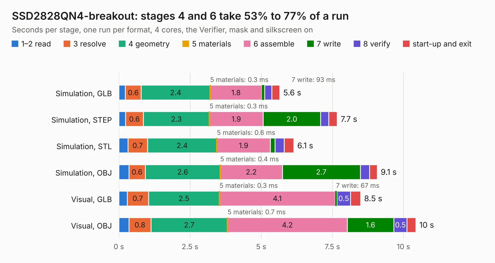

| Mode and format | 1–2 read | 3 resolve | 4 geometry | 5 materials | 6 assemble | 7 write | 8 verify | start-up and exit | Total |
|---|---:|---:|---:|---:|---:|---:|---:|---:|---:|
| Simulation, GLB | 0.2 | 0.6 | 2.4 | 0.3&nbsp;ms | 1.8 | 93&nbsp;ms | 0.3 | 0.3 | 5.6 |
| Simulation, STEP | 0.2 | 0.6 | 2.3 | 0.3&nbsp;ms | 1.9 | 2.0 | 0.3 | 0.3 | 7.7 |
| Simulation, STL | 0.3 | 0.7 | 2.4 | 0.6&nbsp;ms | 1.9 | 0.2 | 0.3 | 0.3 | 6.1 |
| Simulation, OBJ | 0.4 | 0.6 | 2.6 | 0.4&nbsp;ms | 2.2 | 2.7 | 0.3 | 0.3 | 9.1 |
| Visual, GLB | 0.3 | 0.7 | 2.5 | 0.3&nbsp;ms | 4.1 | 67&nbsp;ms | 0.5 | 0.4 | 8.5 |
| Visual, OBJ | 0.4 | 0.8 | 2.7 | 0.7&nbsp;ms | 4.2 | 1.6 | 0.5 | 0.3 | 10.4 |

<table align="center"><tr><td valign="top">

| Board | Repo: [cyrozap/HDMI-to-MIPI](https://github.com/cyrozap/HDMI-to-MIPI) Board: `SSD2828QN4-breakout.kicad_pcb` |
|---|---|
| Folder | SSD2828QN4-breakout |
| Complexity | 207&nbsp;/&nbsp;1000 (size&nbsp;207, features&nbsp;0) |
| Tested | 9th November 2026 |
| Copper&nbsp;layers | 2 |
| File&nbsp;format | KiCad 4 (4) |
| Parts,&nbsp;tracks,&nbsp;vias | 18, 1,423, 0 |
| Triangles,&nbsp;simulation | 357,258 in 69 parts |
| Verifier | PASS in all six runs |

</td><td valign="top">

<table>
<tr><th>File type</th><th>File size</th><th>Peak memory used</th></tr>
<tr><th colspan="3" align="left">Simulation</th></tr>
<tr><td>GLB</td><td align="right">12&nbsp;MB</td><td align="right">262&nbsp;MB</td></tr>
<tr><td>STEP</td><td align="right">64&nbsp;MB</td><td align="right">302&nbsp;MB</td></tr>
<tr><td>STL</td><td align="right">18&nbsp;MB</td><td align="right">271&nbsp;MB</td></tr>
<tr><td>OBJ</td><td align="right">37&nbsp;MB</td><td align="right">305&nbsp;MB</td></tr>
<tr><th colspan="3" align="left">Visual</th></tr>
<tr><td>GLB</td><td align="right">7.9&nbsp;MB</td><td align="right">275&nbsp;MB</td></tr>
<tr><td>OBJ</td><td align="right">23&nbsp;MB</td><td align="right">285&nbsp;MB</td></tr>
</table>

</td></tr></table>

## 791. reDIP-SID

| Mode and format | 1–2 read | 3 resolve | 4 geometry | 5 materials | 6 assemble | 7 write | 8 verify | start-up and exit | Total |
|---|---:|---:|---:|---:|---:|---:|---:|---:|---:|
| Simulation, GLB | 0.4 | 1.3 | 5.2 | 0.8&nbsp;ms | 5.0 | 0.2 | 0.6 | 0.2 | 12.9 |
| Simulation, STEP | 0.4 | 1.2 | 5.2 | 0.5&nbsp;ms | 5.2 | 3.4 | 0.6 | 0.3 | 16.2 |
| Simulation, STL | 0.4 | 1.2 | 5.4 | 0.5&nbsp;ms | 5.2 | 0.3 | 0.7 | 0.2 | 13.4 |
| Simulation, OBJ | 0.4 | 1.1 | 5.3 | 0.5&nbsp;ms | 5.0 | 7.7 | 0.6 | 0.2 | 20.4 |
| Visual, GLB | 0.4 | 1.2 | 5.2 | 0.5&nbsp;ms | 9.6 | 0.1 | 1.1 | 0.2 | 17.9 |
| Visual, OBJ | 0.4 | 1.2 | 5.3 | 0.5&nbsp;ms | 9.8 | 4.1 | 1.2 | 0.2 | 22.3 |

<table align="center"><tr><td valign="top">

| Board | Repo: [daglem/reDIP-SID](https://github.com/daglem/reDIP-SID) Board: `reDIP-SID.kicad_pcb` |
|---|---|
| Folder | hardware |
| Complexity | 364&nbsp;/&nbsp;1000 (size&nbsp;239, features&nbsp;125) |
| KESE&nbsp;features | through vias, slotted holes, custom pads, rounded, trapezoid or chamfered pads, filled zones, copper drawings, curved board outline, stack-up, dielectric εr and tanδ, mask and silkscreen colours |
| Tested | 9th November 2026 |
| Copper&nbsp;layers | 4 |
| File&nbsp;format | KiCad 7 (20221018) |
| Parts,&nbsp;tracks,&nbsp;vias | 68, 1,168, 124 |
| Triangles,&nbsp;simulation | 1,333,082 in 116 parts |
| Verifier | PASS in all six runs |

</td><td valign="top">

<table>
<tr><th>File type</th><th>File size</th><th>Peak memory used</th></tr>
<tr><th colspan="3" align="left">Simulation</th></tr>
<tr><td>GLB</td><td align="right">47&nbsp;MB</td><td align="right">480&nbsp;MB</td></tr>
<tr><td>STEP</td><td align="right">226&nbsp;MB</td><td align="right">582&nbsp;MB</td></tr>
<tr><td>STL</td><td align="right">67&nbsp;MB</td><td align="right">475&nbsp;MB</td></tr>
<tr><td>OBJ</td><td align="right">140&nbsp;MB</td><td align="right">909&nbsp;MB</td></tr>
<tr><th colspan="3" align="left">Visual</th></tr>
<tr><td>GLB</td><td align="right">26&nbsp;MB</td><td align="right">584&nbsp;MB</td></tr>
<tr><td>OBJ</td><td align="right">78&nbsp;MB</td><td align="right">643&nbsp;MB</td></tr>
</table>

</td></tr></table>

## 792. qca7000

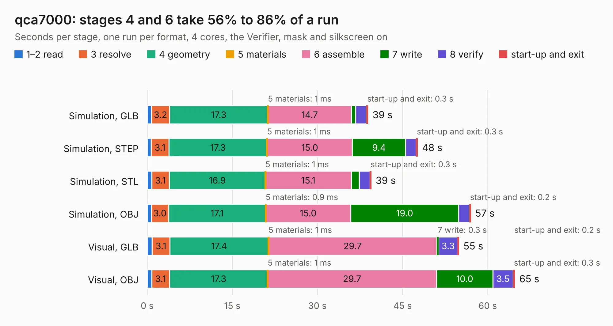

| Mode and format | 1–2 read | 3 resolve | 4 geometry | 5 materials | 6 assemble | 7 write | 8 verify | start-up and exit | Total |
|---|---:|---:|---:|---:|---:|---:|---:|---:|---:|
| Simulation, GLB | 0.8 | 3.2 | 17.3 | 1&nbsp;ms | 14.7 | 0.8 | 1.9 | 0.3 | 38.9 |
| Simulation, STEP | 0.7 | 3.1 | 17.3 | 1&nbsp;ms | 15.0 | 9.4 | 1.8 | 0.3 | 47.7 |
| Simulation, STL | 0.8 | 3.1 | 16.9 | 1&nbsp;ms | 15.1 | 1.4 | 1.9 | 0.3 | 39.5 |
| Simulation, OBJ | 0.7 | 3.0 | 17.1 | 0.9&nbsp;ms | 15.0 | 19.0 | 1.9 | 0.2 | 57.0 |
| Visual, GLB | 0.9 | 3.1 | 17.4 | 1&nbsp;ms | 29.7 | 0.3 | 3.3 | 0.2 | 54.9 |
| Visual, OBJ | 0.8 | 3.1 | 17.3 | 1&nbsp;ms | 29.7 | 10.0 | 3.5 | 0.3 | 64.8 |

<table align="center"><tr><td valign="top">

| Board | Repo: [damienmaguire/foccci](https://github.com/damienmaguire/foccci) Board: `qca7000.kicad_pcb` |
|---|---|
| Folder | pcb |
| Complexity | 379&nbsp;/&nbsp;1000 (size&nbsp;269, features&nbsp;110) |
| KESE&nbsp;features | through vias, custom pads, rounded, trapezoid or chamfered pads, filled zones, copper drawings, copper text, stack-up, dielectric εr and tanδ |
| Tested | 9th November 2026 |
| Copper&nbsp;layers | 4 |
| File&nbsp;format | KiCad 7 (20221018) |
| Parts,&nbsp;tracks,&nbsp;vias | 195, 1,854, 411 |
| Triangles,&nbsp;simulation | 4,480,960 in 225 parts |
| Verifier | PASS in all six runs |

</td><td valign="top">

<table>
<tr><th>File type</th><th>File size</th><th>Peak memory used</th></tr>
<tr><th colspan="3" align="left">Simulation</th></tr>
<tr><td>GLB</td><td align="right">151&nbsp;MB</td><td align="right">1.3&nbsp;GB</td></tr>
<tr><td>STEP</td><td align="right">622&nbsp;MB</td><td align="right">1.6&nbsp;GB</td></tr>
<tr><td>STL</td><td align="right">224&nbsp;MB</td><td align="right">1.3&nbsp;GB</td></tr>
<tr><td>OBJ</td><td align="right">473&nbsp;MB</td><td align="right">2.8&nbsp;GB</td></tr>
<tr><th colspan="3" align="left">Visual</th></tr>
<tr><td>GLB</td><td align="right">82&nbsp;MB</td><td align="right">1.4&nbsp;GB</td></tr>
<tr><td>OBJ</td><td align="right">259&nbsp;MB</td><td align="right">1.7&nbsp;GB</td></tr>
</table>

</td></tr></table>

## 793. blank-plank-rev0b

| Mode and format | 1–2 read | 3 resolve | 4 geometry | 5 materials | 6 assemble | 7 write | 8 verify | start-up and exit | Total |
|---|---:|---:|---:|---:|---:|---:|---:|---:|---:|
| Simulation, GLB | 1.2 | 2.7 | 9.8 | 0.4&nbsp;ms | 8.2 | 0.3 | 0.9 | 0.3 | 23.4 |
| Simulation, STEP | 1.2 | 2.8 | 9.7 | 0.4&nbsp;ms | 8.6 | 5.7 | 0.9 | 0.3 | 29.3 |
| Simulation, STL | 1.1 | 2.9 | 9.9 | 0.4&nbsp;ms | 8.3 | 0.7 | 0.9 | 0.3 | 24.1 |
| Simulation, OBJ | 1.2 | 2.6 | 9.6 | 0.5&nbsp;ms | 8.2 | 10.1 | 0.9 | 0.3 | 32.9 |
| Visual, GLB | 1.1 | 2.7 | 9.3 | 0.4&nbsp;ms | 14.8 | 0.2 | 1.3 | 0.2 | 29.6 |
| Visual, OBJ | 1.2 | 2.9 | 9.8 | 0.5&nbsp;ms | 14.9 | 6.1 | 1.6 | 0.2 | 36.8 |

<table align="center"><tr><td valign="top">

| Board | Repo: [DangerousPrototypes/BusPirate5-hardware](https://github.com/DangerousPrototypes/BusPirate5-hardware) Board: `blank-plank-rev0b.kicad_pcb` |
|---|---|
| Folder | adapter-blank-plank-1REV0B |
| Complexity | 258&nbsp;/&nbsp;1000 (size&nbsp;148, features&nbsp;110) |
| KESE&nbsp;features | through vias, rounded, trapezoid or chamfered pads, filled zones, copper drawings, curved board outline, knockout text, stack-up, dielectric εr and tanδ |
| Tested | 9th November 2026 |
| Copper&nbsp;layers | 2 |
| File&nbsp;format | KiCad 8 (20240108) |
| Parts,&nbsp;tracks,&nbsp;vias | 908, 21, 4 |
| Triangles,&nbsp;simulation | 1,992,666 in 22 parts |
| Note | mostly unrouted |
| Verifier | PASS in all six runs |

</td><td valign="top">

<table>
<tr><th>File type</th><th>File size</th><th>Peak memory used</th></tr>
<tr><th colspan="3" align="left">Simulation</th></tr>
<tr><td>GLB</td><td align="right">70&nbsp;MB</td><td align="right">894&nbsp;MB</td></tr>
<tr><td>STEP</td><td align="right">303&nbsp;MB</td><td align="right">971&nbsp;MB</td></tr>
<tr><td>STL</td><td align="right">100&nbsp;MB</td><td align="right">877&nbsp;MB</td></tr>
<tr><td>OBJ</td><td align="right">214&nbsp;MB</td><td align="right">1.4&nbsp;GB</td></tr>
<tr><th colspan="3" align="left">Visual</th></tr>
<tr><td>GLB</td><td align="right">39&nbsp;MB</td><td align="right">970&nbsp;MB</td></tr>
<tr><td>OBJ</td><td align="right">117&nbsp;MB</td><td align="right">976&nbsp;MB</td></tr>
</table>

</td></tr></table>

## 794. flash-zif-rev3

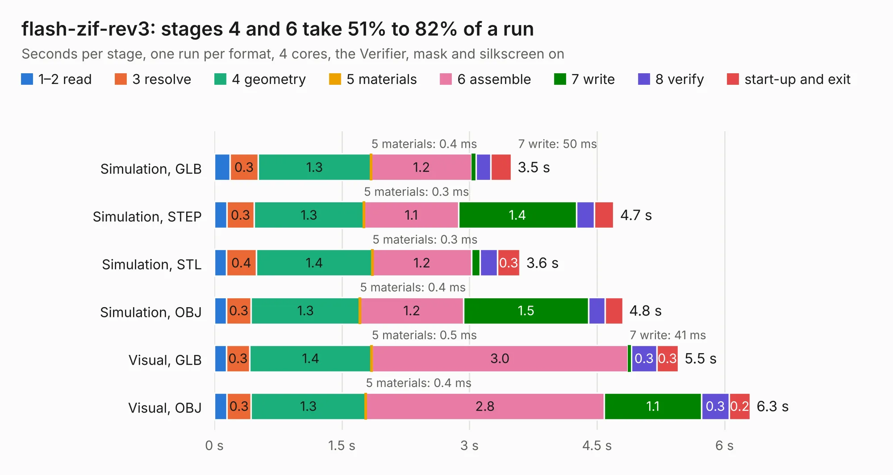

| Mode and format | 1–2 read | 3 resolve | 4 geometry | 5 materials | 6 assemble | 7 write | 8 verify | start-up and exit | Total |
|---|---:|---:|---:|---:|---:|---:|---:|---:|---:|
| Simulation, GLB | 0.2 | 0.3 | 1.3 | 0.4&nbsp;ms | 1.2 | 50&nbsp;ms | 0.2 | 0.2 | 3.5 |
| Simulation, STEP | 0.1 | 0.3 | 1.3 | 0.3&nbsp;ms | 1.1 | 1.4 | 0.2 | 0.2 | 4.7 |
| Simulation, STL | 0.1 | 0.4 | 1.4 | 0.3&nbsp;ms | 1.2 | 0.1 | 0.2 | 0.3 | 3.6 |
| Simulation, OBJ | 0.1 | 0.3 | 1.3 | 0.4&nbsp;ms | 1.2 | 1.5 | 0.2 | 0.2 | 4.8 |
| Visual, GLB | 0.1 | 0.3 | 1.4 | 0.5&nbsp;ms | 3.0 | 41&nbsp;ms | 0.3 | 0.3 | 5.5 |
| Visual, OBJ | 0.1 | 0.3 | 1.3 | 0.4&nbsp;ms | 2.8 | 1.1 | 0.3 | 0.2 | 6.3 |

<table align="center"><tr><td valign="top">

| Board | Repo: [DangerousPrototypes/BusPirate5-hardware](https://github.com/DangerousPrototypes/BusPirate5-hardware) Board: `flash-zif-rev3.kicad_pcb` |
|---|---|
| Folder | adapter-flash-dip-1REV3 |
| Complexity | 201&nbsp;/&nbsp;1000 (size&nbsp;131, features&nbsp;70) |
| KESE&nbsp;features | through vias, rounded, trapezoid or chamfered pads, filled zones, curved board outline, knockout text |
| Tested | 9th November 2026 |
| Copper&nbsp;layers | 2 |
| File&nbsp;format | KiCad 7 (20221018) |
| Parts,&nbsp;tracks,&nbsp;vias | 8, 138, 36 |
| Triangles,&nbsp;simulation | 313,026 in 25 parts |
| Verifier | PASS in all six runs |

</td><td valign="top">

<table>
<tr><th>File type</th><th>File size</th><th>Peak memory used</th></tr>
<tr><th colspan="3" align="left">Simulation</th></tr>
<tr><td>GLB</td><td align="right">11&nbsp;MB</td><td align="right">252&nbsp;MB</td></tr>
<tr><td>STEP</td><td align="right">49&nbsp;MB</td><td align="right">275&nbsp;MB</td></tr>
<tr><td>STL</td><td align="right">16&nbsp;MB</td><td align="right">251&nbsp;MB</td></tr>
<tr><td>OBJ</td><td align="right">31&nbsp;MB</td><td align="right">268&nbsp;MB</td></tr>
<tr><th colspan="3" align="left">Visual</th></tr>
<tr><td>GLB</td><td align="right">8.3&nbsp;MB</td><td align="right">261&nbsp;MB</td></tr>
<tr><td>OBJ</td><td align="right">24&nbsp;MB</td><td align="right">261&nbsp;MB</td></tr>
</table>

</td></tr></table>

## 795. flash-sop-rev3

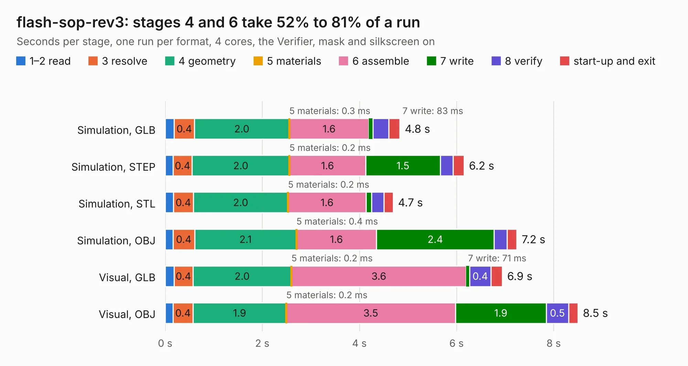

| Mode and format | 1–2 read | 3 resolve | 4 geometry | 5 materials | 6 assemble | 7 write | 8 verify | start-up and exit | Total |
|---|---:|---:|---:|---:|---:|---:|---:|---:|---:|
| Simulation, GLB | 0.2 | 0.4 | 2.0 | 0.3&nbsp;ms | 1.6 | 83&nbsp;ms | 0.3 | 0.2 | 4.8 |
| Simulation, STEP | 0.2 | 0.4 | 2.0 | 0.2&nbsp;ms | 1.6 | 1.5 | 0.3 | 0.2 | 6.2 |
| Simulation, STL | 0.2 | 0.4 | 2.0 | 0.2&nbsp;ms | 1.6 | 0.1 | 0.3 | 0.2 | 4.7 |
| Simulation, OBJ | 0.2 | 0.4 | 2.1 | 0.4&nbsp;ms | 1.6 | 2.4 | 0.3 | 0.2 | 7.2 |
| Visual, GLB | 0.2 | 0.4 | 2.0 | 0.2&nbsp;ms | 3.6 | 71&nbsp;ms | 0.4 | 0.2 | 6.9 |
| Visual, OBJ | 0.2 | 0.4 | 1.9 | 0.2&nbsp;ms | 3.5 | 1.9 | 0.5 | 0.2 | 8.5 |

<table align="center"><tr><td valign="top">

| Board | Repo: [DangerousPrototypes/BusPirate5-hardware](https://github.com/DangerousPrototypes/BusPirate5-hardware) Board: `flash-sop-rev3.kicad_pcb` |
|---|---|
| Folder | adapter-flash-sop-1REV3 |
| Complexity | 207&nbsp;/&nbsp;1000 (size&nbsp;137, features&nbsp;70) |
| KESE&nbsp;features | through vias, rounded, trapezoid or chamfered pads, filled zones, curved board outline, knockout text |
| Tested | 9th November 2026 |
| Copper&nbsp;layers | 2 |
| File&nbsp;format | KiCad 7 (20221018) |
| Parts,&nbsp;tracks,&nbsp;vias | 10, 168, 49 |
| Triangles,&nbsp;simulation | 501,934 in 29 parts |
| Verifier | PASS in all six runs |

</td><td valign="top">

<table>
<tr><th>File type</th><th>File size</th><th>Peak memory used</th></tr>
<tr><th colspan="3" align="left">Simulation</th></tr>
<tr><td>GLB</td><td align="right">17&nbsp;MB</td><td align="right">294&nbsp;MB</td></tr>
<tr><td>STEP</td><td align="right">76&nbsp;MB</td><td align="right">346&nbsp;MB</td></tr>
<tr><td>STL</td><td align="right">25&nbsp;MB</td><td align="right">282&nbsp;MB</td></tr>
<tr><td>OBJ</td><td align="right">50&nbsp;MB</td><td align="right">386&nbsp;MB</td></tr>
<tr><th colspan="3" align="left">Visual</th></tr>
<tr><td>GLB</td><td align="right">13&nbsp;MB</td><td align="right">363&nbsp;MB</td></tr>
<tr><td>OBJ</td><td align="right">38&nbsp;MB</td><td align="right">364&nbsp;MB</td></tr>
</table>

</td></tr></table>

## 796. flash-sop-lotes-rev3

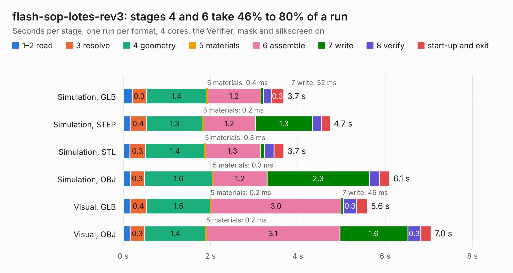

| Mode and format | 1–2 read | 3 resolve | 4 geometry | 5 materials | 6 assemble | 7 write | 8 verify | start-up and exit | Total |
|---|---:|---:|---:|---:|---:|---:|---:|---:|---:|
| Simulation, GLB | 0.2 | 0.3 | 1.4 | 0.4&nbsp;ms | 1.2 | 52&nbsp;ms | 0.2 | 0.3 | 3.7 |
| Simulation, STEP | 0.2 | 0.4 | 1.3 | 0.2&nbsp;ms | 1.2 | 1.3 | 0.2 | 0.2 | 4.7 |
| Simulation, STL | 0.2 | 0.3 | 1.4 | 0.3&nbsp;ms | 1.3 | 96&nbsp;ms | 0.2 | 0.2 | 3.7 |
| Simulation, OBJ | 0.2 | 0.3 | 1.6 | 0.3&nbsp;ms | 1.2 | 2.3 | 0.2 | 0.2 | 6.1 |
| Visual, GLB | 0.2 | 0.4 | 1.5 | 0.2&nbsp;ms | 3.0 | 46&nbsp;ms | 0.3 | 0.2 | 5.6 |
| Visual, OBJ | 0.2 | 0.3 | 1.4 | 0.2&nbsp;ms | 3.1 | 1.6 | 0.3 | 0.2 | 7.0 |

<table align="center"><tr><td valign="top">

| Board | Repo: [DangerousPrototypes/BusPirate5-hardware](https://github.com/DangerousPrototypes/BusPirate5-hardware) Board: `flash-sop-lotes-rev3.kicad_pcb` |
|---|---|
| Folder | adapter-flash-sop-lotes-1REV3 |
| Complexity | 205&nbsp;/&nbsp;1000 (size&nbsp;135, features&nbsp;70) |
| KESE&nbsp;features | through vias, rounded, trapezoid or chamfered pads, filled zones, curved board outline, knockout text |
| Tested | 9th November 2026 |
| Copper&nbsp;layers | 2 |
| File&nbsp;format | KiCad 7 (20221018) |
| Parts,&nbsp;tracks,&nbsp;vias | 10, 148, 42 |
| Triangles,&nbsp;simulation | 315,852 in 25 parts |
| Verifier | PASS in all six runs |

</td><td valign="top">

<table>
<tr><th>File type</th><th>File size</th><th>Peak memory used</th></tr>
<tr><th colspan="3" align="left">Simulation</th></tr>
<tr><td>GLB</td><td align="right">11&nbsp;MB</td><td align="right">247&nbsp;MB</td></tr>
<tr><td>STEP</td><td align="right">52&nbsp;MB</td><td align="right">279&nbsp;MB</td></tr>
<tr><td>STL</td><td align="right">16&nbsp;MB</td><td align="right">241&nbsp;MB</td></tr>
<tr><td>OBJ</td><td align="right">32&nbsp;MB</td><td align="right">268&nbsp;MB</td></tr>
<tr><th colspan="3" align="left">Visual</th></tr>
<tr><td>GLB</td><td align="right">9.4&nbsp;MB</td><td align="right">278&nbsp;MB</td></tr>
<tr><td>OBJ</td><td align="right">27&nbsp;MB</td><td align="right">289&nbsp;MB</td></tr>
</table>

</td></tr></table>

## 797. flash-wson-rev3

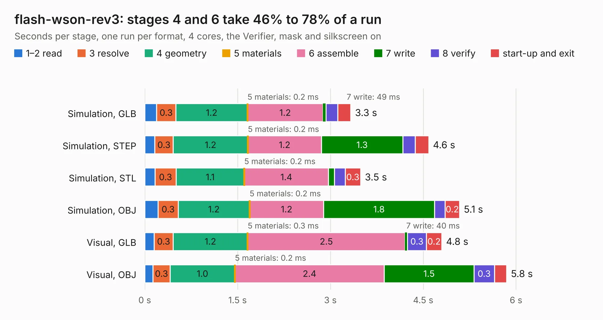

| Mode and format | 1–2 read | 3 resolve | 4 geometry | 5 materials | 6 assemble | 7 write | 8 verify | start-up and exit | Total |
|---|---:|---:|---:|---:|---:|---:|---:|---:|---:|
| Simulation, GLB | 0.2 | 0.3 | 1.2 | 0.2&nbsp;ms | 1.2 | 49&nbsp;ms | 0.2 | 0.2 | 3.3 |
| Simulation, STEP | 0.2 | 0.3 | 1.2 | 0.2&nbsp;ms | 1.2 | 1.3 | 0.2 | 0.2 | 4.6 |
| Simulation, STL | 0.2 | 0.3 | 1.1 | 0.2&nbsp;ms | 1.4 | 95&nbsp;ms | 0.2 | 0.3 | 3.5 |
| Simulation, OBJ | 0.2 | 0.3 | 1.2 | 0.2&nbsp;ms | 1.2 | 1.8 | 0.2 | 0.2 | 5.1 |
| Visual, GLB | 0.2 | 0.3 | 1.2 | 0.3&nbsp;ms | 2.5 | 40&nbsp;ms | 0.3 | 0.2 | 4.8 |
| Visual, OBJ | 0.1 | 0.3 | 1.0 | 0.2&nbsp;ms | 2.4 | 1.5 | 0.3 | 0.2 | 5.8 |

<table align="center"><tr><td valign="top">

| Board | Repo: [DangerousPrototypes/BusPirate5-hardware](https://github.com/DangerousPrototypes/BusPirate5-hardware) Board: `flash-wson-rev3.kicad_pcb` |
|---|---|
| Folder | adapter-flash-wson-1REV3 |
| Complexity | 204&nbsp;/&nbsp;1000 (size&nbsp;134, features&nbsp;70) |
| KESE&nbsp;features | through vias, rounded, trapezoid or chamfered pads, filled zones, curved board outline, knockout text |
| Tested | 9th November 2026 |
| Copper&nbsp;layers | 2 |
| File&nbsp;format | KiCad 7 (20221018) |
| Parts,&nbsp;tracks,&nbsp;vias | 10, 143, 41 |
| Triangles,&nbsp;simulation | 302,386 in 25 parts |
| Verifier | PASS in all six runs |

</td><td valign="top">

<table>
<tr><th>File type</th><th>File size</th><th>Peak memory used</th></tr>
<tr><th colspan="3" align="left">Simulation</th></tr>
<tr><td>GLB</td><td align="right">10&nbsp;MB</td><td align="right">237&nbsp;MB</td></tr>
<tr><td>STEP</td><td align="right">48&nbsp;MB</td><td align="right">275&nbsp;MB</td></tr>
<tr><td>STL</td><td align="right">15&nbsp;MB</td><td align="right">238&nbsp;MB</td></tr>
<tr><td>OBJ</td><td align="right">30&nbsp;MB</td><td align="right">241&nbsp;MB</td></tr>
<tr><th colspan="3" align="left">Visual</th></tr>
<tr><td>GLB</td><td align="right">8.8&nbsp;MB</td><td align="right">270&nbsp;MB</td></tr>
<tr><td>OBJ</td><td align="right">26&nbsp;MB</td><td align="right">271&nbsp;MB</td></tr>
</table>

</td></tr></table>

## 798. bp5-ir-toy-v3-rev3

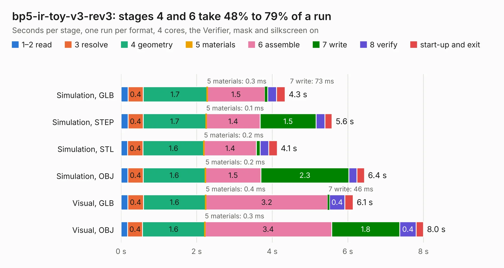

| Mode and format | 1–2 read | 3 resolve | 4 geometry | 5 materials | 6 assemble | 7 write | 8 verify | start-up and exit | Total |
|---|---:|---:|---:|---:|---:|---:|---:|---:|---:|
| Simulation, GLB | 0.2 | 0.4 | 1.7 | 0.3&nbsp;ms | 1.5 | 73&nbsp;ms | 0.2 | 0.2 | 4.3 |
| Simulation, STEP | 0.2 | 0.4 | 1.7 | 0.1&nbsp;ms | 1.4 | 1.5 | 0.2 | 0.2 | 5.6 |
| Simulation, STL | 0.2 | 0.4 | 1.6 | 0.2&nbsp;ms | 1.4 | 96&nbsp;ms | 0.2 | 0.2 | 4.1 |
| Simulation, OBJ | 0.2 | 0.4 | 1.6 | 0.2&nbsp;ms | 1.5 | 2.3 | 0.2 | 0.2 | 6.4 |
| Visual, GLB | 0.2 | 0.4 | 1.6 | 0.4&nbsp;ms | 3.2 | 46&nbsp;ms | 0.4 | 0.2 | 6.1 |
| Visual, OBJ | 0.2 | 0.4 | 1.6 | 0.3&nbsp;ms | 3.4 | 1.8 | 0.4 | 0.2 | 8.0 |

<table align="center"><tr><td valign="top">

| Board | Repo: [DangerousPrototypes/BusPirate5-hardware](https://github.com/DangerousPrototypes/BusPirate5-hardware) Board: `bp5-ir-toy-v3-rev3.kicad_pcb` |
|---|---|
| Folder | adapter-ir-toy-3REV3 |
| Complexity | 203&nbsp;/&nbsp;1000 (size&nbsp;148, features&nbsp;55) |
| KESE&nbsp;features | through vias, rounded, trapezoid or chamfered pads, filled zones, curved board outline |
| Tested | 9th November 2026 |
| Copper&nbsp;layers | 2 |
| File&nbsp;format | KiCad 8 (20240108) |
| Parts,&nbsp;tracks,&nbsp;vias | 35, 168, 37 |
| Triangles,&nbsp;simulation | 445,936 in 35 parts |
| Verifier | PASS in all six runs |

</td><td valign="top">

<table>
<tr><th>File type</th><th>File size</th><th>Peak memory used</th></tr>
<tr><th colspan="3" align="left">Simulation</th></tr>
<tr><td>GLB</td><td align="right">15&nbsp;MB</td><td align="right">277&nbsp;MB</td></tr>
<tr><td>STEP</td><td align="right">75&nbsp;MB</td><td align="right">321&nbsp;MB</td></tr>
<tr><td>STL</td><td align="right">22&nbsp;MB</td><td align="right">280&nbsp;MB</td></tr>
<tr><td>OBJ</td><td align="right">45&nbsp;MB</td><td align="right">355&nbsp;MB</td></tr>
<tr><th colspan="3" align="left">Visual</th></tr>
<tr><td>GLB</td><td align="right">12&nbsp;MB</td><td align="right">322&nbsp;MB</td></tr>
<tr><td>OBJ</td><td align="right">34&nbsp;MB</td><td align="right">320&nbsp;MB</td></tr>
</table>

</td></tr></table>

## 799. wago kf141r adapter

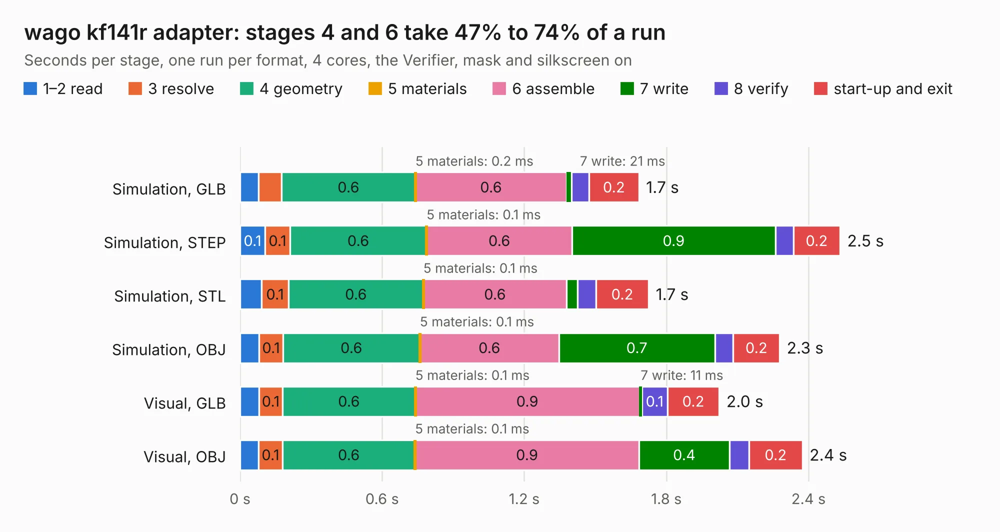

| Mode and format | 1–2 read | 3 resolve | 4 geometry | 5 materials | 6 assemble | 7 write | 8 verify | start-up and exit | Total |
|---|---:|---:|---:|---:|---:|---:|---:|---:|---:|
| Simulation, GLB | 78&nbsp;ms | 98&nbsp;ms | 0.6 | 0.2&nbsp;ms | 0.6 | 21&nbsp;ms | 73&nbsp;ms | 0.2 | 1.7 |
| Simulation, STEP | 0.1 | 0.1 | 0.6 | 0.1&nbsp;ms | 0.6 | 0.9 | 76&nbsp;ms | 0.2 | 2.5 |
| Simulation, STL | 91&nbsp;ms | 0.1 | 0.6 | 0.1&nbsp;ms | 0.6 | 45&nbsp;ms | 78&nbsp;ms | 0.2 | 1.7 |
| Simulation, OBJ | 81&nbsp;ms | 0.1 | 0.6 | 0.1&nbsp;ms | 0.6 | 0.7 | 78&nbsp;ms | 0.2 | 2.3 |
| Visual, GLB | 80&nbsp;ms | 0.1 | 0.6 | 0.1&nbsp;ms | 0.9 | 11&nbsp;ms | 0.1 | 0.2 | 2.0 |
| Visual, OBJ | 78&nbsp;ms | 0.1 | 0.6 | 0.1&nbsp;ms | 0.9 | 0.4 | 82&nbsp;ms | 0.2 | 2.4 |

<table align="center"><tr><td valign="top">

| Board | Repo: [DangerousPrototypes/BusPirate5-hardware](https://github.com/DangerousPrototypes/BusPirate5-hardware) Board: `wago kf141r adapter.kicad_pcb` |
|---|---|
| Folder | adapter-kf141r-quick-connect-1REV0 |
| Complexity | 95&nbsp;/&nbsp;1000 (size&nbsp;85, features&nbsp;10) |
| KESE&nbsp;features | curved board outline |
| Tested | 9th November 2026 |
| Copper&nbsp;layers | 2 |
| File&nbsp;format | KiCad 7 (20221018) |
| Parts,&nbsp;tracks,&nbsp;vias | 2, 30, 0 |
| Triangles,&nbsp;simulation | 132,576 in 20 parts |
| Verifier | PASS in all six runs |

</td><td valign="top">

<table>
<tr><th>File type</th><th>File size</th><th>Peak memory used</th></tr>
<tr><th colspan="3" align="left">Simulation</th></tr>
<tr><td>GLB</td><td align="right">4.1&nbsp;MB</td><td align="right">182&nbsp;MB</td></tr>
<tr><td>STEP</td><td align="right">15&nbsp;MB</td><td align="right">195&nbsp;MB</td></tr>
<tr><td>STL</td><td align="right">6.6&nbsp;MB</td><td align="right">182&nbsp;MB</td></tr>
<tr><td>OBJ</td><td align="right">13&nbsp;MB</td><td align="right">185&nbsp;MB</td></tr>
<tr><th colspan="3" align="left">Visual</th></tr>
<tr><td>GLB</td><td align="right">2.3&nbsp;MB</td><td align="right">154&nbsp;MB</td></tr>
<tr><td>OBJ</td><td align="right">6.5&nbsp;MB</td><td align="right">155&nbsp;MB</td></tr>
</table>

</td></tr></table>

## 800. wago kf141v adapter

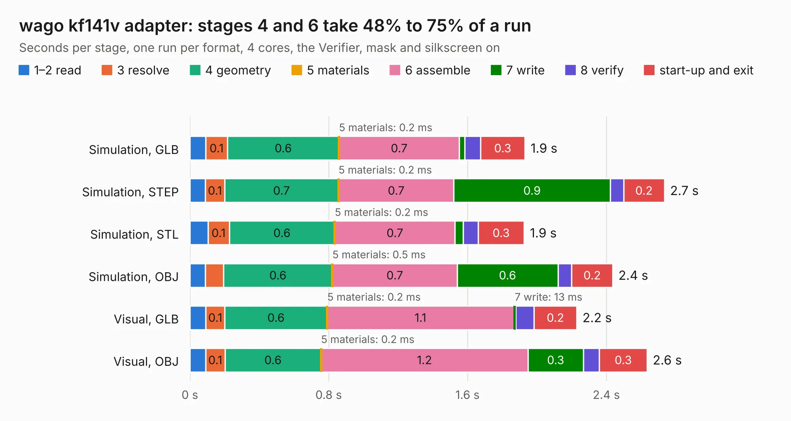

| Mode and format | 1–2 read | 3 resolve | 4 geometry | 5 materials | 6 assemble | 7 write | 8 verify | start-up and exit | Total |
|---|---:|---:|---:|---:|---:|---:|---:|---:|---:|
| Simulation, GLB | 91&nbsp;ms | 0.1 | 0.6 | 0.2&nbsp;ms | 0.7 | 31&nbsp;ms | 90&nbsp;ms | 0.3 | 1.9 |
| Simulation, STEP | 89&nbsp;ms | 0.1 | 0.7 | 0.2&nbsp;ms | 0.7 | 0.9 | 76&nbsp;ms | 0.2 | 2.7 |
| Simulation, STL | 0.1 | 0.1 | 0.6 | 0.2&nbsp;ms | 0.7 | 47&nbsp;ms | 85&nbsp;ms | 0.3 | 1.9 |
| Simulation, OBJ | 90&nbsp;ms | 0.1 | 0.6 | 0.5&nbsp;ms | 0.7 | 0.6 | 79&nbsp;ms | 0.2 | 2.4 |
| Visual, GLB | 92&nbsp;ms | 0.1 | 0.6 | 0.2&nbsp;ms | 1.1 | 13&nbsp;ms | 0.1 | 0.2 | 2.2 |
| Visual, OBJ | 91&nbsp;ms | 0.1 | 0.6 | 0.2&nbsp;ms | 1.2 | 0.3 | 92&nbsp;ms | 0.3 | 2.6 |

<table align="center"><tr><td valign="top">

| Board | Repo: [DangerousPrototypes/BusPirate5-hardware](https://github.com/DangerousPrototypes/BusPirate5-hardware) Board: `wago kf141v adapter.kicad_pcb` |
|---|---|
| Folder | adapter-kf141v-quick-connect-1REV0 |
| Complexity | 95&nbsp;/&nbsp;1000 (size&nbsp;85, features&nbsp;10) |
| KESE&nbsp;features | curved board outline |
| Tested | 9th November 2026 |
| Copper&nbsp;layers | 2 |
| File&nbsp;format | KiCad 7 (20221018) |
| Parts,&nbsp;tracks,&nbsp;vias | 2, 30, 0 |
| Triangles,&nbsp;simulation | 132,656 in 20 parts |
| Verifier | PASS in all six runs |

</td><td valign="top">

<table>
<tr><th>File type</th><th>File size</th><th>Peak memory used</th></tr>
<tr><th colspan="3" align="left">Simulation</th></tr>
<tr><td>GLB</td><td align="right">4.1&nbsp;MB</td><td align="right">186&nbsp;MB</td></tr>
<tr><td>STEP</td><td align="right">15&nbsp;MB</td><td align="right">196&nbsp;MB</td></tr>
<tr><td>STL</td><td align="right">6.6&nbsp;MB</td><td align="right">181&nbsp;MB</td></tr>
<tr><td>OBJ</td><td align="right">13&nbsp;MB</td><td align="right">186&nbsp;MB</td></tr>
<tr><th colspan="3" align="left">Visual</th></tr>
<tr><td>GLB</td><td align="right">2.3&nbsp;MB</td><td align="right">154&nbsp;MB</td></tr>
<tr><td>OBJ</td><td align="right">6.5&nbsp;MB</td><td align="right">155&nbsp;MB</td></tr>
</table>

</td></tr></table>

## 801. adapter-ram-ddr5-1REV2

| Mode and format | 1–2 read | 3 resolve | 4 geometry | 5 materials | 6 assemble | 7 write | 8 verify | start-up and exit | Total |
|---|---:|---:|---:|---:|---:|---:|---:|---:|---:|
| Simulation, GLB | 0.3 | 0.9 | 4.3 | 0.6&nbsp;ms | 3.6 | 0.1 | 0.3 | 0.2 | 9.8 |
| Simulation, STEP | 0.3 | 0.9 | 4.6 | 0.6&nbsp;ms | 3.5 | 3.0 | 0.3 | 0.3 | 13.0 |
| Simulation, STL | 0.3 | 0.9 | 4.3 | 0.6&nbsp;ms | 3.6 | 0.2 | 0.4 | 0.2 | 9.9 |
| Simulation, OBJ | 0.3 | 1.0 | 4.3 | 0.6&nbsp;ms | 3.5 | 3.8 | 0.4 | 0.2 | 13.5 |
| Visual, GLB | 0.3 | 1.0 | 4.1 | 0.5&nbsp;ms | 7.6 | 96&nbsp;ms | 0.8 | 0.2 | 14.2 |
| Visual, OBJ | 0.4 | 0.9 | 4.2 | 0.5&nbsp;ms | 7.1 | 3.1 | 0.9 | 0.3 | 16.9 |

<table align="center"><tr><td valign="top">

| Board | Repo: [DangerousPrototypes/BusPirate5-hardware](https://github.com/DangerousPrototypes/BusPirate5-hardware) Board: `adapter-ram-ddr5-1REV2.kicad_pcb` |
|---|---|
| Folder | adapter-ram-ddr5-1REV2 |
| Complexity | 256&nbsp;/&nbsp;1000 (size&nbsp;146, features&nbsp;110) |
| KESE&nbsp;features | through vias, slotted holes, rounded, trapezoid or chamfered pads, filled zones, curved board outline, knockout text, stack-up, dielectric εr and tanδ |
| Tested | 9th November 2026 |
| Copper&nbsp;layers | 2 |
| File&nbsp;format | KiCad 9 (20241229) |
| Parts,&nbsp;tracks,&nbsp;vias | 21, 165, 59 |
| Triangles,&nbsp;simulation | 690,766 in 213 parts |
| Verifier | PASS in all six runs |

</td><td valign="top">

<table>
<tr><th>File type</th><th>File size</th><th>Peak memory used</th></tr>
<tr><th colspan="3" align="left">Simulation</th></tr>
<tr><td>GLB</td><td align="right">25&nbsp;MB</td><td align="right">429&nbsp;MB</td></tr>
<tr><td>STEP</td><td align="right">118&nbsp;MB</td><td align="right">461&nbsp;MB</td></tr>
<tr><td>STL</td><td align="right">35&nbsp;MB</td><td align="right">436&nbsp;MB</td></tr>
<tr><td>OBJ</td><td align="right">72&nbsp;MB</td><td align="right">533&nbsp;MB</td></tr>
<tr><th colspan="3" align="left">Visual</th></tr>
<tr><td>GLB</td><td align="right">20&nbsp;MB</td><td align="right">497&nbsp;MB</td></tr>
<tr><td>OBJ</td><td align="right">60&nbsp;MB</td><td align="right">526&nbsp;MB</td></tr>
</table>

</td></tr></table>

## 802. rs232-dual-adapter

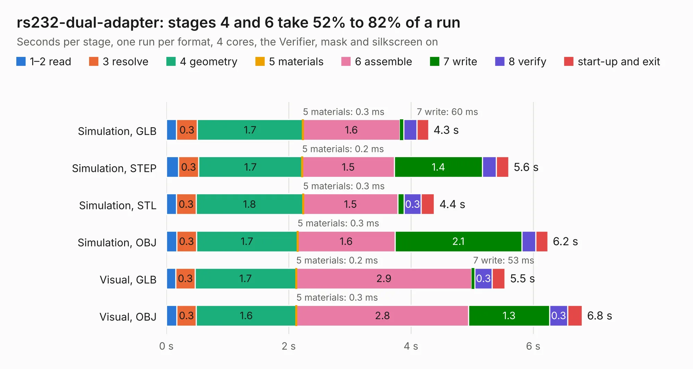

| Mode and format | 1–2 read | 3 resolve | 4 geometry | 5 materials | 6 assemble | 7 write | 8 verify | start-up and exit | Total |
|---|---:|---:|---:|---:|---:|---:|---:|---:|---:|
| Simulation, GLB | 0.2 | 0.3 | 1.7 | 0.3&nbsp;ms | 1.6 | 60&nbsp;ms | 0.2 | 0.2 | 4.3 |
| Simulation, STEP | 0.2 | 0.3 | 1.7 | 0.2&nbsp;ms | 1.5 | 1.4 | 0.2 | 0.2 | 5.6 |
| Simulation, STL | 0.2 | 0.3 | 1.8 | 0.3&nbsp;ms | 1.5 | 0.1 | 0.3 | 0.2 | 4.4 |
| Simulation, OBJ | 0.2 | 0.3 | 1.7 | 0.3&nbsp;ms | 1.6 | 2.1 | 0.2 | 0.2 | 6.2 |
| Visual, GLB | 0.2 | 0.3 | 1.7 | 0.2&nbsp;ms | 2.9 | 53&nbsp;ms | 0.3 | 0.2 | 5.5 |
| Visual, OBJ | 0.2 | 0.3 | 1.6 | 0.3&nbsp;ms | 2.8 | 1.3 | 0.3 | 0.2 | 6.8 |

<table align="center"><tr><td valign="top">

| Board | Repo: [DangerousPrototypes/BusPirate5-hardware](https://github.com/DangerousPrototypes/BusPirate5-hardware) Board: `rs232-dual-adapter.kicad_pcb` |
|---|---|
| Folder | adapter-rs232-dual-1REV0 |
| Complexity | 238&nbsp;/&nbsp;1000 (size&nbsp;138, features&nbsp;100) |
| KESE&nbsp;features | through vias, rounded, trapezoid or chamfered pads, filled zones, curved board outline, knockout text, stack-up, dielectric εr and tanδ |
| Tested | 9th November 2026 |
| Copper&nbsp;layers | 2 |
| File&nbsp;format | KiCad 8 (20240108) |
| Parts,&nbsp;tracks,&nbsp;vias | 18, 168, 22 |
| Triangles,&nbsp;simulation | 414,134 in 52 parts |
| Verifier | PASS in all six runs |

</td><td valign="top">

<table>
<tr><th>File type</th><th>File size</th><th>Peak memory used</th></tr>
<tr><th colspan="3" align="left">Simulation</th></tr>
<tr><td>GLB</td><td align="right">14&nbsp;MB</td><td align="right">273&nbsp;MB</td></tr>
<tr><td>STEP</td><td align="right">62&nbsp;MB</td><td align="right">314&nbsp;MB</td></tr>
<tr><td>STL</td><td align="right">21&nbsp;MB</td><td align="right">276&nbsp;MB</td></tr>
<tr><td>OBJ</td><td align="right">41&nbsp;MB</td><td align="right">335&nbsp;MB</td></tr>
<tr><th colspan="3" align="left">Visual</th></tr>
<tr><td>GLB</td><td align="right">10&nbsp;MB</td><td align="right">309&nbsp;MB</td></tr>
<tr><td>OBJ</td><td align="right">29&nbsp;MB</td><td align="right">314&nbsp;MB</td></tr>
</table>

</td></tr></table>

## 803. sim-rev3c

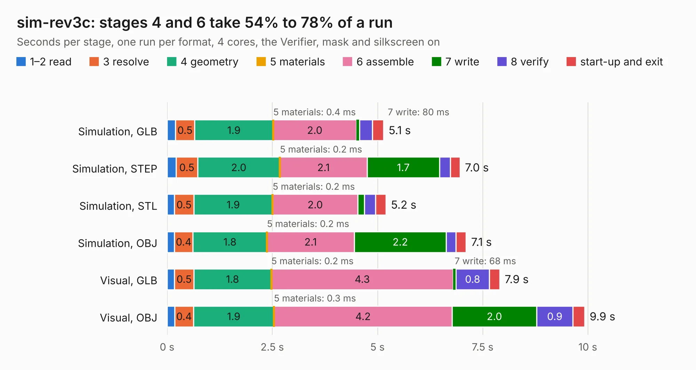

| Mode and format | 1–2 read | 3 resolve | 4 geometry | 5 materials | 6 assemble | 7 write | 8 verify | start-up and exit | Total |
|---|---:|---:|---:|---:|---:|---:|---:|---:|---:|
| Simulation, GLB | 0.2 | 0.5 | 1.9 | 0.4&nbsp;ms | 2.0 | 80&nbsp;ms | 0.3 | 0.3 | 5.1 |
| Simulation, STEP | 0.2 | 0.5 | 2.0 | 0.2&nbsp;ms | 2.1 | 1.7 | 0.3 | 0.2 | 7.0 |
| Simulation, STL | 0.2 | 0.5 | 1.9 | 0.2&nbsp;ms | 2.0 | 0.2 | 0.3 | 0.2 | 5.2 |
| Simulation, OBJ | 0.2 | 0.4 | 1.8 | 0.2&nbsp;ms | 2.1 | 2.2 | 0.2 | 0.2 | 7.1 |
| Visual, GLB | 0.2 | 0.5 | 1.8 | 0.2&nbsp;ms | 4.3 | 68&nbsp;ms | 0.8 | 0.2 | 7.9 |
| Visual, OBJ | 0.2 | 0.4 | 1.9 | 0.3&nbsp;ms | 4.2 | 2.0 | 0.9 | 0.3 | 9.9 |

<table align="center"><tr><td valign="top">

| Board | Repo: [DangerousPrototypes/BusPirate5-hardware](https://github.com/DangerousPrototypes/BusPirate5-hardware) Board: `sim-rev3c.kicad_pcb` |
|---|---|
| Folder | adapter-sim-iccard-1REV3C |
| Complexity | 248&nbsp;/&nbsp;1000 (size&nbsp;148, features&nbsp;100) |
| KESE&nbsp;features | through vias, rounded, trapezoid or chamfered pads, filled zones, curved board outline, knockout text, stack-up, dielectric εr and tanδ |
| Tested | 9th November 2026 |
| Copper&nbsp;layers | 2 |
| File&nbsp;format | KiCad 7 (20221018) |
| Parts,&nbsp;tracks,&nbsp;vias | 12, 262, 97 |
| Triangles,&nbsp;simulation | 450,316 in 27 parts |
| Verifier | PASS in all six runs |

</td><td valign="top">

<table>
<tr><th>File type</th><th>File size</th><th>Peak memory used</th></tr>
<tr><th colspan="3" align="left">Simulation</th></tr>
<tr><td>GLB</td><td align="right">16&nbsp;MB</td><td align="right">291&nbsp;MB</td></tr>
<tr><td>STEP</td><td align="right">78&nbsp;MB</td><td align="right">353&nbsp;MB</td></tr>
<tr><td>STL</td><td align="right">23&nbsp;MB</td><td align="right">294&nbsp;MB</td></tr>
<tr><td>OBJ</td><td align="right">46&nbsp;MB</td><td align="right">360&nbsp;MB</td></tr>
<tr><th colspan="3" align="left">Visual</th></tr>
<tr><td>GLB</td><td align="right">14&nbsp;MB</td><td align="right">370&nbsp;MB</td></tr>
<tr><td>OBJ</td><td align="right">40&nbsp;MB</td><td align="right">391&nbsp;MB</td></tr>
</table>

</td></tr></table>

## 804. stemma-qwiic-grove-gravity-bog-plank-1REV1

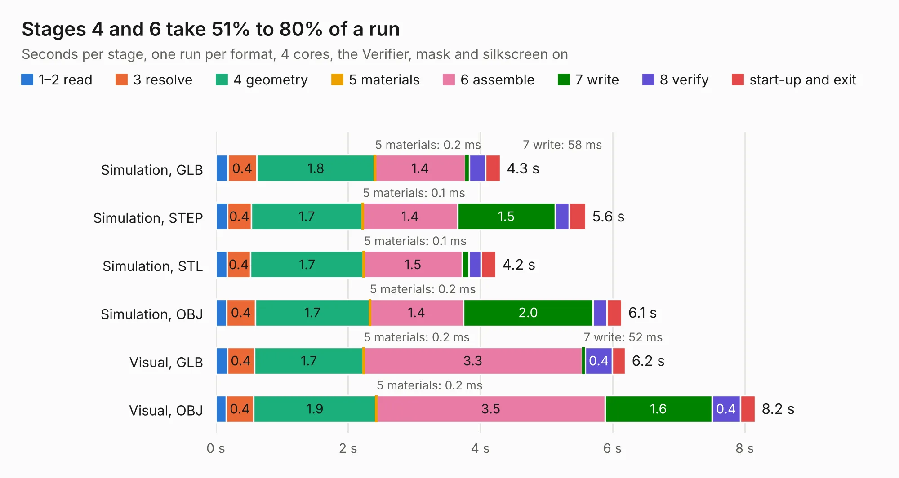

| Mode and format | 1–2 read | 3 resolve | 4 geometry | 5 materials | 6 assemble | 7 write | 8 verify | start-up and exit | Total |
|---|---:|---:|---:|---:|---:|---:|---:|---:|---:|
| Simulation, GLB | 0.2 | 0.4 | 1.8 | 0.2&nbsp;ms | 1.4 | 58&nbsp;ms | 0.2 | 0.2 | 4.3 |
| Simulation, STEP | 0.2 | 0.4 | 1.7 | 0.1&nbsp;ms | 1.4 | 1.5 | 0.2 | 0.2 | 5.6 |
| Simulation, STL | 0.2 | 0.4 | 1.7 | 0.1&nbsp;ms | 1.5 | 0.1 | 0.2 | 0.2 | 4.2 |
| Simulation, OBJ | 0.2 | 0.4 | 1.7 | 0.2&nbsp;ms | 1.4 | 2.0 | 0.2 | 0.2 | 6.1 |
| Visual, GLB | 0.2 | 0.4 | 1.7 | 0.2&nbsp;ms | 3.3 | 52&nbsp;ms | 0.4 | 0.2 | 6.2 |
| Visual, OBJ | 0.2 | 0.4 | 1.9 | 0.2&nbsp;ms | 3.5 | 1.6 | 0.4 | 0.2 | 8.2 |

<table align="center"><tr><td valign="top">

| Board | Repo: [DangerousPrototypes/BusPirate5-hardware](https://github.com/DangerousPrototypes/BusPirate5-hardware) Board: `stemma-qwiic-grove-gravity-bog-plank-1REV1.kicad_pcb` |
|---|---|
| Folder | adapter-stemma-qwiic-grove-gravity-bog-plank-1REV1 |
| Complexity | 242&nbsp;/&nbsp;1000 (size&nbsp;142, features&nbsp;100) |
| KESE&nbsp;features | through vias, rounded, trapezoid or chamfered pads, filled zones, curved board outline, knockout text, stack-up, dielectric εr and tanδ |
| Tested | 9th November 2026 |
| Copper&nbsp;layers | 2 |
| File&nbsp;format | KiCad 9 (20241229) |
| Parts,&nbsp;tracks,&nbsp;vias | 13, 135, 77 |
| Triangles,&nbsp;simulation | 427,608 in 22 parts |
| Verifier | PASS in all six runs |

</td><td valign="top">

<table>
<tr><th>File type</th><th>File size</th><th>Peak memory used</th></tr>
<tr><th colspan="3" align="left">Simulation</th></tr>
<tr><td>GLB</td><td align="right">15&nbsp;MB</td><td align="right">267&nbsp;MB</td></tr>
<tr><td>STEP</td><td align="right">67&nbsp;MB</td><td align="right">309&nbsp;MB</td></tr>
<tr><td>STL</td><td align="right">21&nbsp;MB</td><td align="right">270&nbsp;MB</td></tr>
<tr><td>OBJ</td><td align="right">44&nbsp;MB</td><td align="right">343&nbsp;MB</td></tr>
<tr><th colspan="3" align="left">Visual</th></tr>
<tr><td>GLB</td><td align="right">11&nbsp;MB</td><td align="right">303&nbsp;MB</td></tr>
<tr><td>OBJ</td><td align="right">34&nbsp;MB</td><td align="right">311&nbsp;MB</td></tr>
</table>

</td></tr></table>

## 805. vpp-maker-rev6-ian

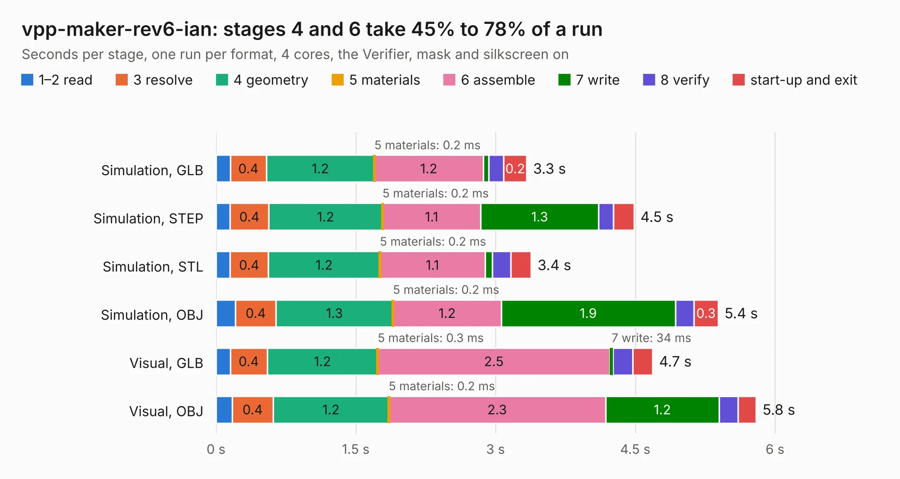

| Mode and format | 1–2 read | 3 resolve | 4 geometry | 5 materials | 6 assemble | 7 write | 8 verify | start-up and exit | Total |
|---|---:|---:|---:|---:|---:|---:|---:|---:|---:|
| Simulation, GLB | 0.2 | 0.4 | 1.2 | 0.2&nbsp;ms | 1.2 | 58&nbsp;ms | 0.2 | 0.2 | 3.3 |
| Simulation, STEP | 0.2 | 0.4 | 1.2 | 0.2&nbsp;ms | 1.1 | 1.3 | 0.2 | 0.2 | 4.5 |
| Simulation, STL | 0.1 | 0.4 | 1.2 | 0.2&nbsp;ms | 1.1 | 79&nbsp;ms | 0.2 | 0.2 | 3.4 |
| Simulation, OBJ | 0.2 | 0.4 | 1.3 | 0.2&nbsp;ms | 1.2 | 1.9 | 0.2 | 0.3 | 5.4 |
| Visual, GLB | 0.2 | 0.4 | 1.2 | 0.3&nbsp;ms | 2.5 | 34&nbsp;ms | 0.2 | 0.2 | 4.7 |
| Visual, OBJ | 0.2 | 0.4 | 1.2 | 0.2&nbsp;ms | 2.3 | 1.2 | 0.2 | 0.2 | 5.8 |

<table align="center"><tr><td valign="top">

| Board | Repo: [DangerousPrototypes/BusPirate5-hardware](https://github.com/DangerousPrototypes/BusPirate5-hardware) Board: `vpp-maker-rev6-ian.kicad_pcb` |
|---|---|
| Folder | adapter-vpp-maker-1REV6 |
| Complexity | 209&nbsp;/&nbsp;1000 (size&nbsp;139, features&nbsp;70) |
| KESE&nbsp;features | through vias, rounded, trapezoid or chamfered pads, filled zones, curved board outline, knockout text |
| Tested | 9th November 2026 |
| Copper&nbsp;layers | 2 |
| File&nbsp;format | KiCad 8 (20240108) |
| Parts,&nbsp;tracks,&nbsp;vias | 23, 115, 34 |
| Triangles,&nbsp;simulation | 301,980 in 31 parts |
| Verifier | PASS in all six runs |

</td><td valign="top">

<table>
<tr><th>File type</th><th>File size</th><th>Peak memory used</th></tr>
<tr><th colspan="3" align="left">Simulation</th></tr>
<tr><td>GLB</td><td align="right">10&nbsp;MB</td><td align="right">237&nbsp;MB</td></tr>
<tr><td>STEP</td><td align="right">44&nbsp;MB</td><td align="right">262&nbsp;MB</td></tr>
<tr><td>STL</td><td align="right">15&nbsp;MB</td><td align="right">260&nbsp;MB</td></tr>
<tr><td>OBJ</td><td align="right">30&nbsp;MB</td><td align="right">239&nbsp;MB</td></tr>
<tr><th colspan="3" align="left">Visual</th></tr>
<tr><td>GLB</td><td align="right">7.8&nbsp;MB</td><td align="right">233&nbsp;MB</td></tr>
<tr><td>OBJ</td><td align="right">23&nbsp;MB</td><td align="right">241&nbsp;MB</td></tr>
</table>

</td></tr></table>

## 806. REV10a

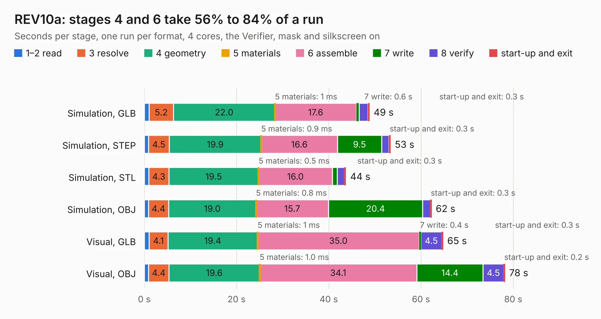

| Mode and format | 1–2 read | 3 resolve | 4 geometry | 5 materials | 6 assemble | 7 write | 8 verify | start-up and exit | Total |
|---|---:|---:|---:|---:|---:|---:|---:|---:|---:|
| Simulation, GLB | 1.1 | 5.2 | 22.0 | 1&nbsp;ms | 17.6 | 0.6 | 1.9 | 0.3 | 48.8 |
| Simulation, STEP | 0.9 | 4.5 | 19.9 | 0.9&nbsp;ms | 16.6 | 9.5 | 1.6 | 0.3 | 53.4 |
| Simulation, STL | 1.0 | 4.3 | 19.5 | 0.5&nbsp;ms | 16.0 | 1.1 | 1.6 | 0.3 | 43.7 |
| Simulation, OBJ | 0.9 | 4.4 | 19.0 | 0.8&nbsp;ms | 15.7 | 20.4 | 1.7 | 0.3 | 62.3 |
| Visual, GLB | 1.0 | 4.1 | 19.4 | 1&nbsp;ms | 35.0 | 0.4 | 4.5 | 0.3 | 64.8 |
| Visual, OBJ | 0.9 | 4.4 | 19.6 | 1.0&nbsp;ms | 34.1 | 14.4 | 4.5 | 0.2 | 78.2 |

<table align="center"><tr><td valign="top">

| Board | Repo: [DangerousPrototypes/BusPirate5-hardware](https://github.com/DangerousPrototypes/BusPirate5-hardware) Board: `REV10a.kicad_pcb` |
|---|---|
| Folder | bus_pirate_pcb / 5-REV10A |
| Complexity | 387&nbsp;/&nbsp;1000 (size&nbsp;267, features&nbsp;120) |
| KESE&nbsp;features | through vias, slotted holes, custom pads, rounded, trapezoid or chamfered pads, filled zones, copper drawings, curved board outline, stack-up, dielectric εr and tanδ |
| Tested | 9th November 2026 |
| Copper&nbsp;layers | 4 |
| File&nbsp;format | KiCad 7 (20221018) |
| Parts,&nbsp;tracks,&nbsp;vias | 210, 2,417, 547 |
| Triangles,&nbsp;simulation | 3,375,460 in 212 parts |
| Verifier | PASS in all six runs |

</td><td valign="top">

<table>
<tr><th>File type</th><th>File size</th><th>Peak memory used</th></tr>
<tr><th colspan="3" align="left">Simulation</th></tr>
<tr><td>GLB</td><td align="right">116&nbsp;MB</td><td align="right">1.1&nbsp;GB</td></tr>
<tr><td>STEP</td><td align="right">556&nbsp;MB</td><td align="right">1.4&nbsp;GB</td></tr>
<tr><td>STL</td><td align="right">169&nbsp;MB</td><td align="right">1.1&nbsp;GB</td></tr>
<tr><td>OBJ</td><td align="right">363&nbsp;MB</td><td align="right">2.3&nbsp;GB</td></tr>
<tr><th colspan="3" align="left">Visual</th></tr>
<tr><td>GLB</td><td align="right">77&nbsp;MB</td><td align="right">1.2&nbsp;GB</td></tr>
<tr><td>OBJ</td><td align="right">243&nbsp;MB</td><td align="right">1.7&nbsp;GB</td></tr>
</table>

</td></tr></table>

## 807. BusPirate-5-rev8

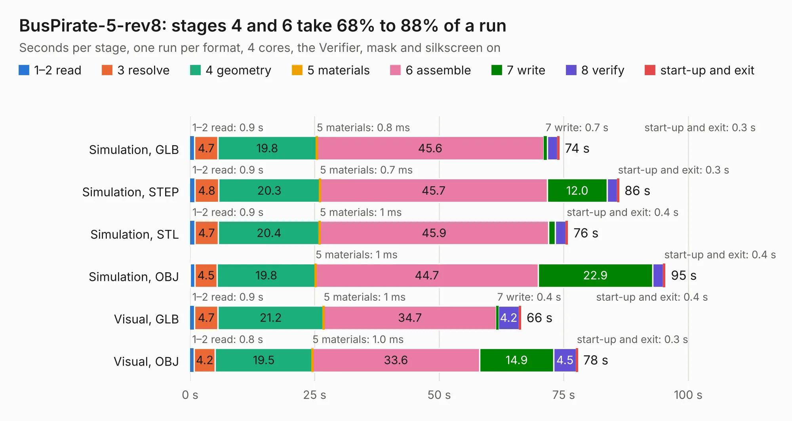

| Mode and format | 1–2 read | 3 resolve | 4 geometry | 5 materials | 6 assemble | 7 write | 8 verify | start-up and exit | Total |
|---|---:|---:|---:|---:|---:|---:|---:|---:|---:|
| Simulation, GLB | 0.9 | 4.7 | 19.8 | 0.8&nbsp;ms | 45.6 | 0.7 | 2.1 | 0.3 | 74.1 |
| Simulation, STEP | 0.9 | 4.8 | 20.3 | 0.7&nbsp;ms | 45.7 | 12.0 | 2.0 | 0.3 | 86.1 |
| Simulation, STL | 0.9 | 4.7 | 20.4 | 1&nbsp;ms | 45.9 | 1.4 | 2.1 | 0.4 | 75.8 |
| Simulation, OBJ | 1.0 | 4.5 | 19.8 | 1&nbsp;ms | 44.7 | 22.9 | 2.2 | 0.4 | 95.4 |
| Visual, GLB | 0.9 | 4.7 | 21.2 | 1&nbsp;ms | 34.7 | 0.4 | 4.2 | 0.4 | 66.4 |
| Visual, OBJ | 0.8 | 4.2 | 19.5 | 1.0&nbsp;ms | 33.6 | 14.9 | 4.5 | 0.3 | 77.8 |

<table align="center"><tr><td valign="top">

| Board | Repo: [DangerousPrototypes/BusPirate5-hardware](https://github.com/DangerousPrototypes/BusPirate5-hardware) Board: `BusPirate-5-rev8.kicad_pcb` |
|---|---|
| Folder | bus_pirate_pcb / 5-REV8 |
| Complexity | 355&nbsp;/&nbsp;1000 (size&nbsp;265, features&nbsp;90) |
| KESE&nbsp;features | through vias, slotted holes, custom pads, rounded, trapezoid or chamfered pads, filled zones, copper drawings, curved board outline |
| Tested | 9th November 2026 |
| Copper&nbsp;layers | 4 |
| File&nbsp;format | KiCad 5 (20171130) |
| Parts,&nbsp;tracks,&nbsp;vias | 193, 2,281, 490 |
| Triangles,&nbsp;simulation | 3,531,122 in 210 parts |
| Verifier | PASS in all six runs |

</td><td valign="top">

<table>
<tr><th>File type</th><th>File size</th><th>Peak memory used</th></tr>
<tr><th colspan="3" align="left">Simulation</th></tr>
<tr><td>GLB</td><td align="right">123&nbsp;MB</td><td align="right">1.1&nbsp;GB</td></tr>
<tr><td>STEP</td><td align="right">535&nbsp;MB</td><td align="right">1.5&nbsp;GB</td></tr>
<tr><td>STL</td><td align="right">177&nbsp;MB</td><td align="right">1.2&nbsp;GB</td></tr>
<tr><td>OBJ</td><td align="right">378&nbsp;MB</td><td align="right">2.3&nbsp;GB</td></tr>
<tr><th colspan="3" align="left">Visual</th></tr>
<tr><td>GLB</td><td align="right">82&nbsp;MB</td><td align="right">1.4&nbsp;GB</td></tr>
<tr><td>OBJ</td><td align="right">259&nbsp;MB</td><td align="right">1.8&nbsp;GB</td></tr>
</table>

</td></tr></table>

## 808. 5XL-REV0

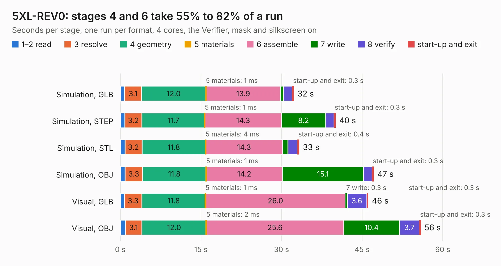

| Mode and format | 1–2 read | 3 resolve | 4 geometry | 5 materials | 6 assemble | 7 write | 8 verify | start-up and exit | Total |
|---|---:|---:|---:|---:|---:|---:|---:|---:|---:|
| Simulation, GLB | 0.8 | 3.1 | 12.0 | 1&nbsp;ms | 13.9 | 0.6 | 1.6 | 0.3 | 32.3 |
| Simulation, STEP | 0.9 | 3.2 | 11.7 | 1&nbsp;ms | 14.3 | 8.2 | 1.5 | 0.3 | 40.1 |
| Simulation, STL | 0.9 | 3.2 | 11.8 | 4&nbsp;ms | 14.3 | 1.0 | 1.8 | 0.4 | 33.3 |
| Simulation, OBJ | 0.9 | 3.3 | 11.8 | 1&nbsp;ms | 14.2 | 15.1 | 1.6 | 0.3 | 47.2 |
| Visual, GLB | 0.8 | 3.3 | 11.8 | 1&nbsp;ms | 26.0 | 0.3 | 3.6 | 0.3 | 46.2 |
| Visual, OBJ | 0.9 | 3.1 | 12.0 | 2&nbsp;ms | 25.6 | 10.4 | 3.7 | 0.3 | 55.9 |

<table align="center"><tr><td valign="top">

| Board | Repo: [DangerousPrototypes/BusPirate5-hardware](https://github.com/DangerousPrototypes/BusPirate5-hardware) Board: `5XL-REV0.kicad_pcb` |
|---|---|
| Folder | bus_pirate_pcb / 5XL-REV0 |
| Complexity | 388&nbsp;/&nbsp;1000 (size&nbsp;268, features&nbsp;120) |
| KESE&nbsp;features | through vias, slotted holes, custom pads, rounded, trapezoid or chamfered pads, filled zones, copper drawings, curved board outline, stack-up, dielectric εr and tanδ |
| Tested | 9th November 2026 |
| Copper&nbsp;layers | 4 |
| File&nbsp;format | KiCad 8 (20240108) |
| Parts,&nbsp;tracks,&nbsp;vias | 216, 2,471, 536 |
| Triangles,&nbsp;simulation | 2,905,454 in 218 parts |
| Verifier | PASS in all six runs |

</td><td valign="top">

<table>
<tr><th>File type</th><th>File size</th><th>Peak memory used</th></tr>
<tr><th colspan="3" align="left">Simulation</th></tr>
<tr><td>GLB</td><td align="right">99&nbsp;MB</td><td align="right">1.0&nbsp;GB</td></tr>
<tr><td>STEP</td><td align="right">432&nbsp;MB</td><td align="right">1.3&nbsp;GB</td></tr>
<tr><td>STL</td><td align="right">145&nbsp;MB</td><td align="right">1.0&nbsp;GB</td></tr>
<tr><td>OBJ</td><td align="right">309&nbsp;MB</td><td align="right">1.9&nbsp;GB</td></tr>
<tr><th colspan="3" align="left">Visual</th></tr>
<tr><td>GLB</td><td align="right">70&nbsp;MB</td><td align="right">1.2&nbsp;GB</td></tr>
<tr><td>OBJ</td><td align="right">221&nbsp;MB</td><td align="right">1.5&nbsp;GB</td></tr>
</table>

</td></tr></table>

## 809. 6-REV2b

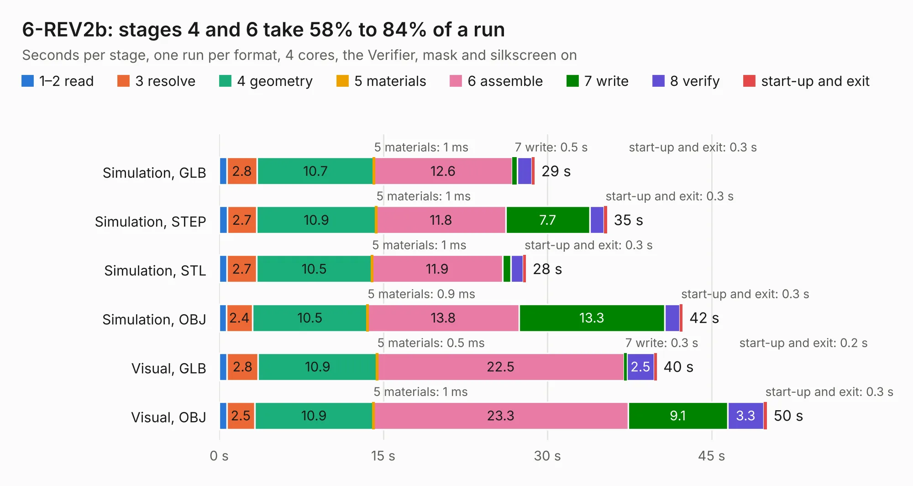

| Mode and format | 1–2 read | 3 resolve | 4 geometry | 5 materials | 6 assemble | 7 write | 8 verify | start-up and exit | Total |
|---|---:|---:|---:|---:|---:|---:|---:|---:|---:|
| Simulation, GLB | 0.7 | 2.8 | 10.7 | 1&nbsp;ms | 12.6 | 0.5 | 1.3 | 0.3 | 28.8 |
| Simulation, STEP | 0.7 | 2.7 | 10.9 | 1&nbsp;ms | 11.8 | 7.7 | 1.3 | 0.3 | 35.5 |
| Simulation, STL | 0.7 | 2.7 | 10.5 | 1&nbsp;ms | 11.9 | 0.8 | 1.1 | 0.3 | 28.1 |
| Simulation, OBJ | 0.7 | 2.4 | 10.5 | 0.9&nbsp;ms | 13.8 | 13.3 | 1.4 | 0.3 | 42.4 |
| Visual, GLB | 0.7 | 2.8 | 10.9 | 0.5&nbsp;ms | 22.5 | 0.3 | 2.5 | 0.2 | 40.0 |
| Visual, OBJ | 0.7 | 2.5 | 10.9 | 1&nbsp;ms | 23.3 | 9.1 | 3.3 | 0.3 | 50.1 |

<table align="center"><tr><td valign="top">

| Board | Repo: [DangerousPrototypes/BusPirate5-hardware](https://github.com/DangerousPrototypes/BusPirate5-hardware) Board: `6-REV2b.kicad_pcb` |
|---|---|
| Folder | bus_pirate_pcb / 6-REV2B |
| Complexity | 387&nbsp;/&nbsp;1000 (size&nbsp;267, features&nbsp;120) |
| KESE&nbsp;features | through vias, slotted holes, custom pads, rounded, trapezoid or chamfered pads, filled zones, copper drawings, curved board outline, stack-up, dielectric εr and tanδ |
| Tested | 9th November 2026 |
| Copper&nbsp;layers | 4 |
| File&nbsp;format | KiCad 9 (20241229) |
| Parts,&nbsp;tracks,&nbsp;vias | 216, 2,531, 445 |
| Triangles,&nbsp;simulation | 2,941,898 in 216 parts |
| Verifier | PASS in all six runs |

</td><td valign="top">

<table>
<tr><th>File type</th><th>File size</th><th>Peak memory used</th></tr>
<tr><th colspan="3" align="left">Simulation</th></tr>
<tr><td>GLB</td><td align="right">101&nbsp;MB</td><td align="right">1.0&nbsp;GB</td></tr>
<tr><td>STEP</td><td align="right">485&nbsp;MB</td><td align="right">1.3&nbsp;GB</td></tr>
<tr><td>STL</td><td align="right">147&nbsp;MB</td><td align="right">978&nbsp;MB</td></tr>
<tr><td>OBJ</td><td align="right">315&nbsp;MB</td><td align="right">1.9&nbsp;GB</td></tr>
<tr><th colspan="3" align="left">Visual</th></tr>
<tr><td>GLB</td><td align="right">70&nbsp;MB</td><td align="right">1.4&nbsp;GB</td></tr>
<tr><td>OBJ</td><td align="right">222&nbsp;MB</td><td align="right">1.5&nbsp;GB</td></tr>
</table>

</td></tr></table>

## 810. BusPirate-5-rev10

| Mode and format | 1–2 read | 3 resolve | 4 geometry | 5 materials | 6 assemble | 7 write | 8 verify | start-up and exit | Total |
|---|---:|---:|---:|---:|---:|---:|---:|---:|---:|
| Simulation, GLB | 0.9 | 3.8 | 17.4 | 0.5&nbsp;ms | 14.2 | 0.5 | 1.5 | 0.2 | 38.7 |
| Simulation, STEP | 0.8 | 3.9 | 17.5 | 0.5&nbsp;ms | 13.6 | 8.7 | 1.4 | 0.2 | 46.3 |
| Simulation, STL | 0.8 | 3.8 | 17.6 | 0.9&nbsp;ms | 13.9 | 1.1 | 1.6 | 0.3 | 39.1 |
| Simulation, OBJ | 0.9 | 4.1 | 17.9 | 0.5&nbsp;ms | 14.1 | 18.0 | 1.6 | 0.3 | 56.9 |
| Visual, GLB | 0.8 | 3.8 | 17.6 | 0.6&nbsp;ms | 28.0 | 0.4 | 3.5 | 0.2 | 54.4 |
| Visual, OBJ | 0.9 | 4.0 | 17.7 | 0.9&nbsp;ms | 26.8 | 11.7 | 3.5 | 0.2 | 64.9 |

<table align="center"><tr><td valign="top">

| Board | Repo: [DangerousPrototypes/BusPirate5-hardware](https://github.com/DangerousPrototypes/BusPirate5-hardware) Board: `BusPirate-5-rev10.kicad_pcb` |
|---|---|
| Folder | bus_pirate_pcb / development / 5-REV10-PFET-bug |
| Complexity | 387&nbsp;/&nbsp;1000 (size&nbsp;267, features&nbsp;120) |
| KESE&nbsp;features | through vias, slotted holes, custom pads, rounded, trapezoid or chamfered pads, filled zones, copper drawings, curved board outline, stack-up, dielectric εr and tanδ |
| Tested | 9th November 2026 |
| Copper&nbsp;layers | 4 |
| File&nbsp;format | KiCad 7 (20221018) |
| Parts,&nbsp;tracks,&nbsp;vias | 210, 2,414, 548 |
| Triangles,&nbsp;simulation | 3,359,754 in 215 parts |
| Verifier | PASS in all six runs |

</td><td valign="top">

<table>
<tr><th>File type</th><th>File size</th><th>Peak memory used</th></tr>
<tr><th colspan="3" align="left">Simulation</th></tr>
<tr><td>GLB</td><td align="right">116&nbsp;MB</td><td align="right">1.1&nbsp;GB</td></tr>
<tr><td>STEP</td><td align="right">551&nbsp;MB</td><td align="right">1.4&nbsp;GB</td></tr>
<tr><td>STL</td><td align="right">168&nbsp;MB</td><td align="right">1.1&nbsp;GB</td></tr>
<tr><td>OBJ</td><td align="right">362&nbsp;MB</td><td align="right">2.2&nbsp;GB</td></tr>
<tr><th colspan="3" align="left">Visual</th></tr>
<tr><td>GLB</td><td align="right">76&nbsp;MB</td><td align="right">1.3&nbsp;GB</td></tr>
<tr><td>OBJ</td><td align="right">242&nbsp;MB</td><td align="right">1.6&nbsp;GB</td></tr>
</table>

</td></tr></table>

## 811. 7-REV0

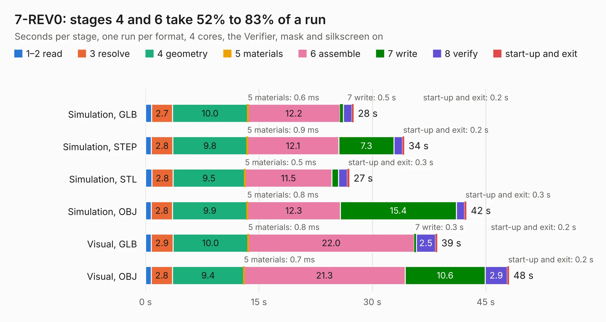

| Mode and format | 1–2 read | 3 resolve | 4 geometry | 5 materials | 6 assemble | 7 write | 8 verify | start-up and exit | Total |
|---|---:|---:|---:|---:|---:|---:|---:|---:|---:|
| Simulation, GLB | 0.8 | 2.7 | 10.0 | 0.6&nbsp;ms | 12.2 | 0.5 | 1.1 | 0.2 | 27.5 |
| Simulation, STEP | 0.8 | 2.8 | 9.8 | 0.9&nbsp;ms | 12.1 | 7.3 | 1.1 | 0.2 | 34.2 |
| Simulation, STL | 0.8 | 2.8 | 9.5 | 0.5&nbsp;ms | 11.5 | 0.9 | 1.2 | 0.3 | 27.0 |
| Simulation, OBJ | 0.8 | 2.8 | 9.9 | 0.8&nbsp;ms | 12.3 | 15.4 | 1.1 | 0.3 | 42.5 |
| Visual, GLB | 0.7 | 2.9 | 10.0 | 0.8&nbsp;ms | 22.0 | 0.3 | 2.5 | 0.2 | 38.6 |
| Visual, OBJ | 0.7 | 2.8 | 9.4 | 0.7&nbsp;ms | 21.3 | 10.6 | 2.9 | 0.2 | 48.1 |

<table align="center"><tr><td valign="top">

| Board | Repo: [DangerousPrototypes/BusPirate5-hardware](https://github.com/DangerousPrototypes/BusPirate5-hardware) Board: `7-REV0.kicad_pcb` |
|---|---|
| Folder | bus_pirate_pcb / development / 7-REV0A-prototype-1 |
| Complexity | 390&nbsp;/&nbsp;1000 (size&nbsp;270, features&nbsp;120) |
| KESE&nbsp;features | through vias, slotted holes, custom pads, rounded, trapezoid or chamfered pads, filled zones, copper drawings, curved board outline, stack-up, dielectric εr and tanδ |
| Tested | 9th November 2026 |
| Copper&nbsp;layers | 4 |
| File&nbsp;format | KiCad 8 (20240108) |
| Parts,&nbsp;tracks,&nbsp;vias | 241, 2,812, 465 |
| Triangles,&nbsp;simulation | 2,913,992 in 247 parts |
| Verifier | PASS in all six runs |

</td><td valign="top">

<table>
<tr><th>File type</th><th>File size</th><th>Peak memory used</th></tr>
<tr><th colspan="3" align="left">Simulation</th></tr>
<tr><td>GLB</td><td align="right">99&nbsp;MB</td><td align="right">993&nbsp;MB</td></tr>
<tr><td>STEP</td><td align="right">404&nbsp;MB</td><td align="right">1.3&nbsp;GB</td></tr>
<tr><td>STL</td><td align="right">146&nbsp;MB</td><td align="right">970&nbsp;MB</td></tr>
<tr><td>OBJ</td><td align="right">308&nbsp;MB</td><td align="right">2.0&nbsp;GB</td></tr>
<tr><th colspan="3" align="left">Visual</th></tr>
<tr><td>GLB</td><td align="right">70&nbsp;MB</td><td align="right">1.3&nbsp;GB</td></tr>
<tr><td>OBJ</td><td align="right">220&nbsp;MB</td><td align="right">1.5&nbsp;GB</td></tr>
</table>

</td></tr></table>

## 812. 7-REV1-freeze

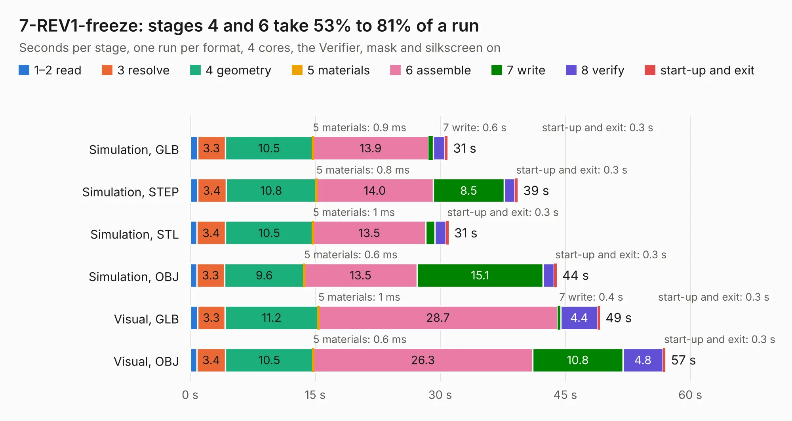

| Mode and format | 1–2 read | 3 resolve | 4 geometry | 5 materials | 6 assemble | 7 write | 8 verify | start-up and exit | Total |
|---|---:|---:|---:|---:|---:|---:|---:|---:|---:|
| Simulation, GLB | 0.9 | 3.3 | 10.5 | 0.9&nbsp;ms | 13.9 | 0.6 | 1.4 | 0.3 | 30.9 |
| Simulation, STEP | 0.9 | 3.4 | 10.8 | 0.8&nbsp;ms | 14.0 | 8.5 | 1.3 | 0.3 | 39.3 |
| Simulation, STL | 0.8 | 3.4 | 10.5 | 1&nbsp;ms | 13.5 | 1.1 | 1.3 | 0.3 | 31.0 |
| Simulation, OBJ | 0.8 | 3.3 | 9.6 | 0.6&nbsp;ms | 13.5 | 15.1 | 1.3 | 0.3 | 44.0 |
| Visual, GLB | 0.9 | 3.3 | 11.2 | 1&nbsp;ms | 28.7 | 0.4 | 4.4 | 0.3 | 49.2 |
| Visual, OBJ | 0.8 | 3.4 | 10.5 | 0.6&nbsp;ms | 26.3 | 10.8 | 4.8 | 0.3 | 57.0 |

<table align="center"><tr><td valign="top">

| Board | Repo: [DangerousPrototypes/BusPirate5-hardware](https://github.com/DangerousPrototypes/BusPirate5-hardware) Board: `7-REV1-freeze.kicad_pcb` |
|---|---|
| Folder | bus_pirate_pcb / development / 7-REV1-vout-protection |
| Complexity | 390&nbsp;/&nbsp;1000 (size&nbsp;270, features&nbsp;120) |
| KESE&nbsp;features | through vias, slotted holes, custom pads, rounded, trapezoid or chamfered pads, filled zones, copper drawings, curved board outline, stack-up, dielectric εr and tanδ |
| Tested | 9th November 2026 |
| Copper&nbsp;layers | 4 |
| File&nbsp;format | KiCad 8 (20240108) |
| Parts,&nbsp;tracks,&nbsp;vias | 249, 2,812, 465 |
| Triangles,&nbsp;simulation | 2,909,062 in 247 parts |
| Verifier | PASS in all six runs |

</td><td valign="top">

<table>
<tr><th>File type</th><th>File size</th><th>Peak memory used</th></tr>
<tr><th colspan="3" align="left">Simulation</th></tr>
<tr><td>GLB</td><td align="right">98&nbsp;MB</td><td align="right">969&nbsp;MB</td></tr>
<tr><td>STEP</td><td align="right">404&nbsp;MB</td><td align="right">1.3&nbsp;GB</td></tr>
<tr><td>STL</td><td align="right">145&nbsp;MB</td><td align="right">995&nbsp;MB</td></tr>
<tr><td>OBJ</td><td align="right">307&nbsp;MB</td><td align="right">2.0&nbsp;GB</td></tr>
<tr><th colspan="3" align="left">Visual</th></tr>
<tr><td>GLB</td><td align="right">70&nbsp;MB</td><td align="right">1.2&nbsp;GB</td></tr>
<tr><td>OBJ</td><td align="right">220&nbsp;MB</td><td align="right">1.5&nbsp;GB</td></tr>
</table>

</td></tr></table>

## 813. 7-REV1B

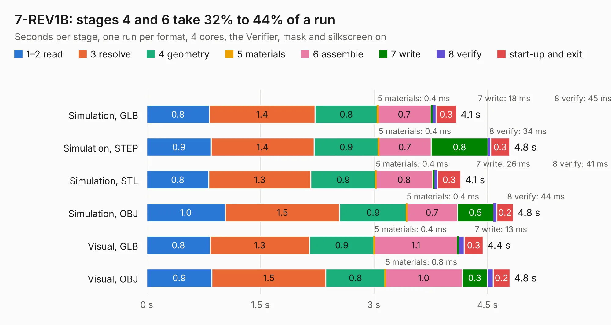

| Mode and format | 1–2 read | 3 resolve | 4 geometry | 5 materials | 6 assemble | 7 write | 8 verify | start-up and exit | Total |
|---|---:|---:|---:|---:|---:|---:|---:|---:|---:|
| Simulation, GLB | 0.8 | 1.4 | 0.8 | 0.4&nbsp;ms | 0.7 | 18&nbsp;ms | 45&nbsp;ms | 0.3 | 4.1 |
| Simulation, STEP | 0.9 | 1.4 | 0.9 | 0.4&nbsp;ms | 0.7 | 0.8 | 34&nbsp;ms | 0.3 | 4.8 |
| Simulation, STL | 0.8 | 1.3 | 0.9 | 0.4&nbsp;ms | 0.8 | 26&nbsp;ms | 41&nbsp;ms | 0.3 | 4.1 |
| Simulation, OBJ | 1.0 | 1.5 | 0.9 | 0.4&nbsp;ms | 0.7 | 0.5 | 44&nbsp;ms | 0.2 | 4.8 |
| Visual, GLB | 0.8 | 1.3 | 0.9 | 0.4&nbsp;ms | 1.1 | 13&nbsp;ms | 77&nbsp;ms | 0.3 | 4.4 |
| Visual, OBJ | 0.9 | 1.5 | 0.8 | 0.8&nbsp;ms | 1.0 | 0.3 | 78&nbsp;ms | 0.2 | 4.8 |

<table align="center"><tr><td valign="top">

| Board | Repo: [DangerousPrototypes/BusPirate5-hardware](https://github.com/DangerousPrototypes/BusPirate5-hardware) Board: `7-REV1B.kicad_pcb` |
|---|---|
| Folder | bus_pirate_pcb / development / 7-REV1B-prototype-2 |
| Complexity | 390&nbsp;/&nbsp;1000 (size&nbsp;270, features&nbsp;120) |
| KESE&nbsp;features | through vias, slotted holes, custom pads, rounded, trapezoid or chamfered pads, filled zones, copper drawings, curved board outline, stack-up, dielectric εr and tanδ |
| Tested | 9th November 2026 |
| Copper&nbsp;layers | 4 |
| File&nbsp;format | KiCad 8 (20240108) |
| Parts,&nbsp;tracks,&nbsp;vias | 240, 2,924, 508 |
| Triangles,&nbsp;simulation | 95,348 in 26 parts |
| Verifier | PASS in all six runs |

</td><td valign="top">

<table>
<tr><th>File type</th><th>File size</th><th>Peak memory used</th></tr>
<tr><th colspan="3" align="left">Simulation</th></tr>
<tr><td>GLB</td><td align="right">3.2&nbsp;MB</td><td align="right">230&nbsp;MB</td></tr>
<tr><td>STEP</td><td align="right">7.6&nbsp;MB</td><td align="right">229&nbsp;MB</td></tr>
<tr><td>STL</td><td align="right">4.8&nbsp;MB</td><td align="right">232&nbsp;MB</td></tr>
<tr><td>OBJ</td><td align="right">9.5&nbsp;MB</td><td align="right">228&nbsp;MB</td></tr>
<tr><th colspan="3" align="left">Visual</th></tr>
<tr><td>GLB</td><td align="right">2.6&nbsp;MB</td><td align="right">207&nbsp;MB</td></tr>
<tr><td>OBJ</td><td align="right">7.3&nbsp;MB</td><td align="right">205&nbsp;MB</td></tr>
</table>

</td></tr></table>

## 814. 7-REV2-vout-protection

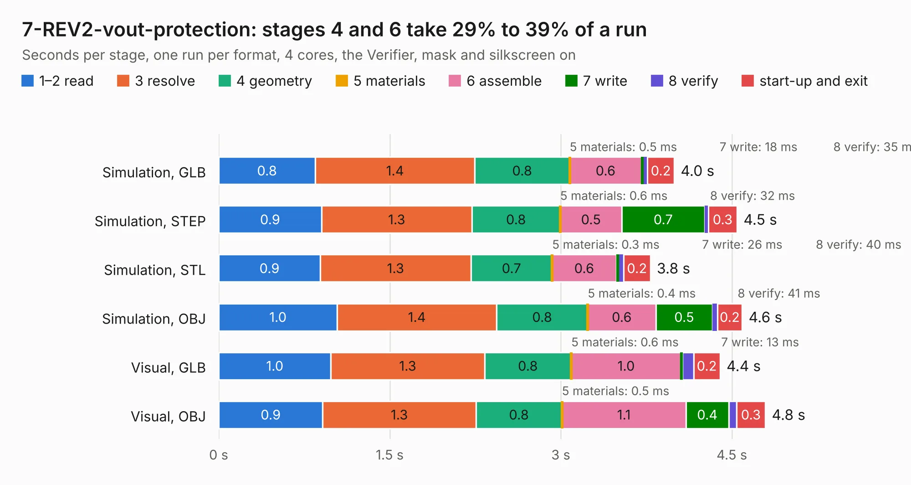

| Mode and format | 1–2 read | 3 resolve | 4 geometry | 5 materials | 6 assemble | 7 write | 8 verify | start-up and exit | Total |
|---|---:|---:|---:|---:|---:|---:|---:|---:|---:|
| Simulation, GLB | 0.8 | 1.4 | 0.8 | 0.5&nbsp;ms | 0.6 | 18&nbsp;ms | 35&nbsp;ms | 0.2 | 4.0 |
| Simulation, STEP | 0.9 | 1.3 | 0.8 | 0.6&nbsp;ms | 0.5 | 0.7 | 32&nbsp;ms | 0.3 | 4.5 |
| Simulation, STL | 0.9 | 1.3 | 0.7 | 0.3&nbsp;ms | 0.6 | 26&nbsp;ms | 40&nbsp;ms | 0.2 | 3.8 |
| Simulation, OBJ | 1.0 | 1.4 | 0.8 | 0.4&nbsp;ms | 0.6 | 0.5 | 41&nbsp;ms | 0.2 | 4.6 |
| Visual, GLB | 1.0 | 1.3 | 0.8 | 0.6&nbsp;ms | 1.0 | 13&nbsp;ms | 98&nbsp;ms | 0.2 | 4.4 |
| Visual, OBJ | 0.9 | 1.3 | 0.8 | 0.5&nbsp;ms | 1.1 | 0.4 | 67&nbsp;ms | 0.3 | 4.8 |

<table align="center"><tr><td valign="top">

| Board | Repo: [DangerousPrototypes/BusPirate5-hardware](https://github.com/DangerousPrototypes/BusPirate5-hardware) Board: `7-REV2-vout-protection.kicad_pcb` |
|---|---|
| Folder | bus_pirate_pcb / development / 7-REV2-prototype3a |
| Complexity | 393&nbsp;/&nbsp;1000 (size&nbsp;273, features&nbsp;120) |
| KESE&nbsp;features | through vias, slotted holes, custom pads, rounded, trapezoid or chamfered pads, filled zones, copper drawings, curved board outline, stack-up, dielectric εr and tanδ |
| Tested | 9th November 2026 |
| Copper&nbsp;layers | 4 |
| File&nbsp;format | KiCad 9 (20241229) |
| Parts,&nbsp;tracks,&nbsp;vias | 265, 3,158, 537 |
| Triangles,&nbsp;simulation | 89,118 in 26 parts |
| Verifier | PASS in all six runs |

</td><td valign="top">

<table>
<tr><th>File type</th><th>File size</th><th>Peak memory used</th></tr>
<tr><th colspan="3" align="left">Simulation</th></tr>
<tr><td>GLB</td><td align="right">3.0&nbsp;MB</td><td align="right">233&nbsp;MB</td></tr>
<tr><td>STEP</td><td align="right">6.4&nbsp;MB</td><td align="right">239&nbsp;MB</td></tr>
<tr><td>STL</td><td align="right">4.5&nbsp;MB</td><td align="right">237&nbsp;MB</td></tr>
<tr><td>OBJ</td><td align="right">8.9&nbsp;MB</td><td align="right">228&nbsp;MB</td></tr>
<tr><th colspan="3" align="left">Visual</th></tr>
<tr><td>GLB</td><td align="right">2.4&nbsp;MB</td><td align="right">212&nbsp;MB</td></tr>
<tr><td>OBJ</td><td align="right">6.7&nbsp;MB</td><td align="right">213&nbsp;MB</td></tr>
</table>

</td></tr></table>

## 815. 7-REV2-vout-protection

| Mode and format | 1–2 read | 3 resolve | 4 geometry | 5 materials | 6 assemble | 7 write | 8 verify | start-up and exit | Total |
|---|---:|---:|---:|---:|---:|---:|---:|---:|---:|
| Simulation, GLB | 1.0 | 1.1 | 0.3 | 0.3&nbsp;ms | 58&nbsp;ms | 2&nbsp;ms | 4&nbsp;ms | 0.2 | 2.6 |
| Simulation, STEP | 0.9 | 1.1 | 0.2 | 0.3&nbsp;ms | 44&nbsp;ms | 38&nbsp;ms | 4&nbsp;ms | 0.2 | 2.5 |
| Simulation, STL | 1.0 | 1.1 | 0.2 | 0.1&nbsp;ms | 44&nbsp;ms | 2&nbsp;ms | 4&nbsp;ms | 0.2 | 2.6 |
| Simulation, OBJ | 0.9 | 1.1 | 0.2 | 0.2&nbsp;ms | 44&nbsp;ms | 22&nbsp;ms | 3&nbsp;ms | 0.2 | 2.4 |
| Visual, GLB | 0.9 | 1.1 | 0.2 | 0.1&nbsp;ms | 81&nbsp;ms | 2&nbsp;ms | 18&nbsp;ms | 0.2 | 2.6 |
| Visual, OBJ | 0.9 | 1.1 | 0.3 | 0.1&nbsp;ms | 74&nbsp;ms | 17&nbsp;ms | 17&nbsp;ms | 0.2 | 2.6 |

<table align="center"><tr><td valign="top">

| Board | Repo: [DangerousPrototypes/BusPirate5-hardware](https://github.com/DangerousPrototypes/BusPirate5-hardware) Board: `7-REV2-vout-protection.kicad_pcb` |
|---|---|
| Folder | bus_pirate_pcb / development / 7-REV2-prototype3b-side-leds |
| Complexity | 393&nbsp;/&nbsp;1000 (size&nbsp;273, features&nbsp;120) |
| KESE&nbsp;features | through vias, slotted holes, custom pads, rounded, trapezoid or chamfered pads, filled zones, copper drawings, curved board outline, stack-up, dielectric εr and tanδ |
| Tested | 9th November 2026 |
| Copper&nbsp;layers | 4 |
| File&nbsp;format | KiCad 9 (20241229) |
| Parts,&nbsp;tracks,&nbsp;vias | 265, 3,201, 529 |
| Triangles,&nbsp;simulation | 4,188 in 6 parts |
| Verifier | PASS in all six runs |

</td><td valign="top">

<table>
<tr><th>File type</th><th>File size</th><th>Peak memory used</th></tr>
<tr><th colspan="3" align="left">Simulation</th></tr>
<tr><td>GLB</td><td align="right">114&nbsp;kB</td><td align="right">133&nbsp;MB</td></tr>
<tr><td>STEP</td><td align="right">586&nbsp;kB</td><td align="right">134&nbsp;MB</td></tr>
<tr><td>STL</td><td align="right">210&nbsp;kB</td><td align="right">133&nbsp;MB</td></tr>
<tr><td>OBJ</td><td align="right">375&nbsp;kB</td><td align="right">133&nbsp;MB</td></tr>
<tr><th colspan="3" align="left">Visual</th></tr>
<tr><td>GLB</td><td align="right">133&nbsp;kB</td><td align="right">133&nbsp;MB</td></tr>
<tr><td>OBJ</td><td align="right">327&nbsp;kB</td><td align="right">133&nbsp;MB</td></tr>
</table>

</td></tr></table>

## 816. programming_pin_mount.v1.0

| Mode and format | 1–2 read | 3 resolve | 4 geometry | 5 materials | 6 assemble | 7 write | 8 verify | start-up and exit | Total |
|---|---:|---:|---:|---:|---:|---:|---:|---:|---:|
| Simulation, GLB | 13&nbsp;ms | 43&nbsp;ms | 98&nbsp;ms | 0.1&nbsp;ms | 0.2 | 4&nbsp;ms | 18&nbsp;ms | 0.2 | 0.6 |
| Simulation, STEP | 8&nbsp;ms | 43&nbsp;ms | 94&nbsp;ms | 0.1&nbsp;ms | 0.2 | 0.1 | 18&nbsp;ms | 0.2 | 0.6 |
| Simulation, STL | 8&nbsp;ms | 28&nbsp;ms | 85&nbsp;ms | 0.1&nbsp;ms | 0.2 | 7&nbsp;ms | 17&nbsp;ms | 0.2 | 0.5 |
| Simulation, OBJ | 14&nbsp;ms | 37&nbsp;ms | 93&nbsp;ms | 0.1&nbsp;ms | 0.2 | 84&nbsp;ms | 19&nbsp;ms | 0.2 | 0.7 |
| Visual, GLB | 8&nbsp;ms | 28&nbsp;ms | 93&nbsp;ms | 0.1&nbsp;ms | 0.3 | 3&nbsp;ms | 25&nbsp;ms | 0.1 | 0.6 |
| Visual, OBJ | 8&nbsp;ms | 35&nbsp;ms | 86&nbsp;ms | 0.1&nbsp;ms | 0.2 | 39&nbsp;ms | 24&nbsp;ms | 0.2 | 0.6 |

<table align="center"><tr><td valign="top">

| Board | Repo: [DangerousPrototypes/BusPirate5-hardware](https://github.com/DangerousPrototypes/BusPirate5-hardware) Board: `programming_pin_mount.v1.0.kicad_pcb` |
|---|---|
| Folder | debug-station |
| Complexity | 47&nbsp;/&nbsp;1000 (size&nbsp;47, features&nbsp;0) |
| Tested | 9th November 2026 |
| Copper&nbsp;layers | 2 |
| File&nbsp;format | KiCad 5 (20171130) |
| Parts,&nbsp;tracks,&nbsp;vias | 1, 3, 0 |
| Triangles,&nbsp;simulation | 21,728 in 13 parts |
| Verifier | PASS in all six runs |

</td><td valign="top">

<table>
<tr><th>File type</th><th>File size</th><th>Peak memory used</th></tr>
<tr><th colspan="3" align="left">Simulation</th></tr>
<tr><td>GLB</td><td align="right">711&nbsp;kB</td><td align="right">42&nbsp;MB</td></tr>
<tr><td>STEP</td><td align="right">2.3&nbsp;MB</td><td align="right">44&nbsp;MB</td></tr>
<tr><td>STL</td><td align="right">1.1&nbsp;MB</td><td align="right">41&nbsp;MB</td></tr>
<tr><td>OBJ</td><td align="right">2.0&nbsp;MB</td><td align="right">46&nbsp;MB</td></tr>
<tr><th colspan="3" align="left">Visual</th></tr>
<tr><td>GLB</td><td align="right">357&nbsp;kB</td><td align="right">50&nbsp;MB</td></tr>
<tr><td>OBJ</td><td align="right">918&nbsp;kB</td><td align="right">58&nbsp;MB</td></tr>
</table>

</td></tr></table>

## 817. flash-dip-rev4

| Mode and format | 1–2 read | 3 resolve | 4 geometry | 5 materials | 6 assemble | 7 write | 8 verify | start-up and exit | Total |
|---|---:|---:|---:|---:|---:|---:|---:|---:|---:|
| Simulation, GLB | 0.1 | 0.3 | 1.0 | 0.3&nbsp;ms | 0.9 | 44&nbsp;ms | 0.2 | 0.2 | 2.7 |
| Simulation, STEP | 0.1 | 0.3 | 1.1 | 0.2&nbsp;ms | 0.9 | 1.0 | 0.1 | 0.2 | 3.8 |
| Simulation, STL | 0.1 | 0.2 | 1.1 | 0.1&nbsp;ms | 0.9 | 69&nbsp;ms | 0.2 | 0.2 | 2.8 |
| Simulation, OBJ | 0.1 | 0.2 | 1.1 | 0.3&nbsp;ms | 1.0 | 1.3 | 0.2 | 0.2 | 4.0 |
| Visual, GLB | 0.1 | 0.2 | 1.1 | 0.2&nbsp;ms | 2.3 | 35&nbsp;ms | 0.3 | 0.2 | 4.2 |
| Visual, OBJ | 0.1 | 0.2 | 1.2 | 0.2&nbsp;ms | 2.3 | 1.0 | 0.3 | 0.2 | 5.3 |

<table align="center"><tr><td valign="top">

| Board | Repo: [DangerousPrototypes/BusPirate5-hardware](https://github.com/DangerousPrototypes/BusPirate5-hardware) Board: `flash-dip-rev4.kicad_pcb` |
|---|---|
| Folder | development / adapter-flash-dip-1REV4 |
| Complexity | 201&nbsp;/&nbsp;1000 (size&nbsp;131, features&nbsp;70) |
| KESE&nbsp;features | through vias, rounded, trapezoid or chamfered pads, filled zones, curved board outline, knockout text |
| Tested | 9th November 2026 |
| Copper&nbsp;layers | 2 |
| File&nbsp;format | KiCad 9 (20241229) |
| Parts,&nbsp;tracks,&nbsp;vias | 8, 141, 37 |
| Triangles,&nbsp;simulation | 325,172 in 25 parts |
| Verifier | PASS in all six runs |

</td><td valign="top">

<table>
<tr><th>File type</th><th>File size</th><th>Peak memory used</th></tr>
<tr><th colspan="3" align="left">Simulation</th></tr>
<tr><td>GLB</td><td align="right">11&nbsp;MB</td><td align="right">240&nbsp;MB</td></tr>
<tr><td>STEP</td><td align="right">49&nbsp;MB</td><td align="right">282&nbsp;MB</td></tr>
<tr><td>STL</td><td align="right">16&nbsp;MB</td><td align="right">241&nbsp;MB</td></tr>
<tr><td>OBJ</td><td align="right">32&nbsp;MB</td><td align="right">246&nbsp;MB</td></tr>
<tr><th colspan="3" align="left">Visual</th></tr>
<tr><td>GLB</td><td align="right">8.7&nbsp;MB</td><td align="right">268&nbsp;MB</td></tr>
<tr><td>OBJ</td><td align="right">25&nbsp;MB</td><td align="right">270&nbsp;MB</td></tr>
</table>

</td></tr></table>

## 818. flash-sop-rev4

| Mode and format | 1–2 read | 3 resolve | 4 geometry | 5 materials | 6 assemble | 7 write | 8 verify | start-up and exit | Total |
|---|---:|---:|---:|---:|---:|---:|---:|---:|---:|
| Simulation, GLB | 0.2 | 0.5 | 2.4 | 0.3&nbsp;ms | 2.0 | 90&nbsp;ms | 0.4 | 0.2 | 5.8 |
| Simulation, STEP | 0.2 | 0.6 | 2.5 | 0.3&nbsp;ms | 1.8 | 1.9 | 0.4 | 0.2 | 7.6 |
| Simulation, STL | 0.2 | 0.5 | 2.6 | 0.5&nbsp;ms | 2.0 | 0.2 | 0.4 | 0.3 | 6.2 |
| Simulation, OBJ | 0.2 | 0.5 | 2.5 | 0.3&nbsp;ms | 1.9 | 3.2 | 0.4 | 0.2 | 9.0 |
| Visual, GLB | 0.2 | 0.5 | 2.6 | 0.4&nbsp;ms | 4.5 | 87&nbsp;ms | 0.6 | 0.3 | 8.8 |
| Visual, OBJ | 0.2 | 0.5 | 2.5 | 0.3&nbsp;ms | 4.3 | 2.5 | 0.6 | 0.2 | 10.8 |

<table align="center"><tr><td valign="top">

| Board | Repo: [DangerousPrototypes/BusPirate5-hardware](https://github.com/DangerousPrototypes/BusPirate5-hardware) Board: `flash-sop-rev4.kicad_pcb` |
|---|---|
| Folder | development / adapter-flash-sop-1REV4 |
| Complexity | 207&nbsp;/&nbsp;1000 (size&nbsp;137, features&nbsp;70) |
| KESE&nbsp;features | through vias, rounded, trapezoid or chamfered pads, filled zones, curved board outline, knockout text |
| Tested | 9th November 2026 |
| Copper&nbsp;layers | 2 |
| File&nbsp;format | KiCad 9 (20241229) |
| Parts,&nbsp;tracks,&nbsp;vias | 10, 172, 48 |
| Triangles,&nbsp;simulation | 493,998 in 29 parts |
| Verifier | PASS in all six runs |

</td><td valign="top">

<table>
<tr><th>File type</th><th>File size</th><th>Peak memory used</th></tr>
<tr><th colspan="3" align="left">Simulation</th></tr>
<tr><td>GLB</td><td align="right">17&nbsp;MB</td><td align="right">299&nbsp;MB</td></tr>
<tr><td>STEP</td><td align="right">71&nbsp;MB</td><td align="right">344&nbsp;MB</td></tr>
<tr><td>STL</td><td align="right">25&nbsp;MB</td><td align="right">297&nbsp;MB</td></tr>
<tr><td>OBJ</td><td align="right">50&nbsp;MB</td><td align="right">368&nbsp;MB</td></tr>
<tr><th colspan="3" align="left">Visual</th></tr>
<tr><td>GLB</td><td align="right">13&nbsp;MB</td><td align="right">359&nbsp;MB</td></tr>
<tr><td>OBJ</td><td align="right">37&nbsp;MB</td><td align="right">360&nbsp;MB</td></tr>
</table>

</td></tr></table>

## 819. kaybee-plank

| Mode and format | 1–2 read | 3 resolve | 4 geometry | 5 materials | 6 assemble | 7 write | 8 verify | start-up and exit | Total |
|---|---:|---:|---:|---:|---:|---:|---:|---:|---:|
| Simulation, GLB | 0.2 | 0.4 | 2.3 | 0.2&nbsp;ms | 1.8 | 84&nbsp;ms | 0.4 | 0.3 | 5.5 |
| Simulation, STEP | 0.2 | 0.5 | 2.2 | 0.3&nbsp;ms | 1.9 | 1.8 | 0.3 | 0.2 | 7.2 |
| Simulation, STL | 0.2 | 0.5 | 2.5 | 0.2&nbsp;ms | 2.0 | 0.1 | 0.3 | 0.3 | 5.9 |
| Simulation, OBJ | 0.2 | 0.5 | 2.2 | 0.5&nbsp;ms | 2.0 | 3.3 | 0.3 | 0.3 | 8.8 |
| Visual, GLB | 0.3 | 0.5 | 2.2 | 0.2&nbsp;ms | 4.0 | 58&nbsp;ms | 0.4 | 0.2 | 7.8 |
| Visual, OBJ | 0.2 | 0.5 | 2.1 | 0.5&nbsp;ms | 4.1 | 2.0 | 0.4 | 0.3 | 9.6 |

<table align="center"><tr><td valign="top">

| Board | Repo: [DangerousPrototypes/BusPirate5-hardware](https://github.com/DangerousPrototypes/BusPirate5-hardware) Board: `kaybee-plank.kicad_pcb` |
|---|---|
| Folder | development / adapter-kaybee-plank-1REV0 |
| Complexity | 250&nbsp;/&nbsp;1000 (size&nbsp;140, features&nbsp;110) |
| KESE&nbsp;features | through vias, slotted holes, rounded, trapezoid or chamfered pads, filled zones, curved board outline, knockout text, stack-up, dielectric εr and tanδ |
| Tested | 9th November 2026 |
| Copper&nbsp;layers | 2 |
| File&nbsp;format | KiCad 8 (20240108) |
| Parts,&nbsp;tracks,&nbsp;vias | 20, 175, 24 |
| Triangles,&nbsp;simulation | 421,190 in 37 parts |
| Verifier | PASS in all six runs |

</td><td valign="top">

<table>
<tr><th>File type</th><th>File size</th><th>Peak memory used</th></tr>
<tr><th colspan="3" align="left">Simulation</th></tr>
<tr><td>GLB</td><td align="right">15&nbsp;MB</td><td align="right">270&nbsp;MB</td></tr>
<tr><td>STEP</td><td align="right">70&nbsp;MB</td><td align="right">310&nbsp;MB</td></tr>
<tr><td>STL</td><td align="right">21&nbsp;MB</td><td align="right">266&nbsp;MB</td></tr>
<tr><td>OBJ</td><td align="right">43&nbsp;MB</td><td align="right">317&nbsp;MB</td></tr>
<tr><th colspan="3" align="left">Visual</th></tr>
<tr><td>GLB</td><td align="right">10&nbsp;MB</td><td align="right">315&nbsp;MB</td></tr>
<tr><td>OBJ</td><td align="right">30&nbsp;MB</td><td align="right">313&nbsp;MB</td></tr>
</table>

</td></tr></table>

## 820. kaybee-plank

| Mode and format | 1–2 read | 3 resolve | 4 geometry | 5 materials | 6 assemble | 7 write | 8 verify | start-up and exit | Total |
|---|---:|---:|---:|---:|---:|---:|---:|---:|---:|
| Simulation, GLB | 0.2 | 0.4 | 2.3 | 0.4&nbsp;ms | 2.0 | 76&nbsp;ms | 0.3 | 0.2 | 5.5 |
| Simulation, STEP | 0.2 | 0.4 | 2.2 | 0.2&nbsp;ms | 1.9 | 1.8 | 0.3 | 0.3 | 7.1 |
| Simulation, STL | 0.2 | 0.6 | 2.3 | 0.3&nbsp;ms | 1.9 | 0.1 | 0.3 | 0.3 | 5.7 |
| Simulation, OBJ | 0.2 | 0.6 | 2.2 | 0.3&nbsp;ms | 1.9 | 2.7 | 0.3 | 0.2 | 8.1 |
| Visual, GLB | 0.2 | 0.5 | 2.2 | 0.3&nbsp;ms | 4.1 | 53&nbsp;ms | 0.4 | 0.2 | 7.7 |
| Visual, OBJ | 0.2 | 0.4 | 2.3 | 0.4&nbsp;ms | 3.8 | 1.8 | 0.4 | 0.2 | 9.2 |

<table align="center"><tr><td valign="top">

| Board | Repo: [DangerousPrototypes/BusPirate5-hardware](https://github.com/DangerousPrototypes/BusPirate5-hardware) Board: `kaybee-plank.kicad_pcb` |
|---|---|
| Folder | development / adapter-kaybee-plank-1REV1 |
| Complexity | 259&nbsp;/&nbsp;1000 (size&nbsp;149, features&nbsp;110) |
| KESE&nbsp;features | through vias, slotted holes, rounded, trapezoid or chamfered pads, filled zones, curved board outline, knockout text, stack-up, dielectric εr and tanδ |
| Tested | 9th November 2026 |
| Copper&nbsp;layers | 2 |
| File&nbsp;format | KiCad 9 (20241229) |
| Parts,&nbsp;tracks,&nbsp;vias | 27, 220, 47 |
| Triangles,&nbsp;simulation | 490,076 in 41 parts |
| Verifier | PASS in all six runs |

</td><td valign="top">

<table>
<tr><th>File type</th><th>File size</th><th>Peak memory used</th></tr>
<tr><th colspan="3" align="left">Simulation</th></tr>
<tr><td>GLB</td><td align="right">17&nbsp;MB</td><td align="right">290&nbsp;MB</td></tr>
<tr><td>STEP</td><td align="right">81&nbsp;MB</td><td align="right">344&nbsp;MB</td></tr>
<tr><td>STL</td><td align="right">25&nbsp;MB</td><td align="right">287&nbsp;MB</td></tr>
<tr><td>OBJ</td><td align="right">50&nbsp;MB</td><td align="right">388&nbsp;MB</td></tr>
<tr><th colspan="3" align="left">Visual</th></tr>
<tr><td>GLB</td><td align="right">12&nbsp;MB</td><td align="right">344&nbsp;MB</td></tr>
<tr><td>OBJ</td><td align="right">36&nbsp;MB</td><td align="right">349&nbsp;MB</td></tr>
</table>

</td></tr></table>

## 821. ram-ddr5

| Mode and format | 1–2 read | 3 resolve | 4 geometry | 5 materials | 6 assemble | 7 write | 8 verify | start-up and exit | Total |
|---|---:|---:|---:|---:|---:|---:|---:|---:|---:|
| Simulation, GLB | 0.3 | 0.9 | 3.9 | 0.8&nbsp;ms | 3.4 | 0.1 | 0.3 | 0.2 | 9.2 |
| Simulation, STEP | 0.3 | 0.9 | 4.0 | 0.6&nbsp;ms | 3.6 | 3.0 | 0.3 | 0.3 | 12.4 |
| Simulation, STL | 0.3 | 0.8 | 4.0 | 0.6&nbsp;ms | 3.4 | 0.3 | 0.3 | 0.3 | 9.4 |
| Simulation, OBJ | 0.3 | 0.9 | 3.9 | 0.8&nbsp;ms | 3.6 | 3.2 | 0.3 | 0.2 | 12.5 |
| Visual, GLB | 0.3 | 0.8 | 3.9 | 0.6&nbsp;ms | 7.0 | 91&nbsp;ms | 0.9 | 0.3 | 13.2 |
| Visual, OBJ | 0.3 | 0.8 | 3.9 | 0.6&nbsp;ms | 7.1 | 3.0 | 0.9 | 0.2 | 16.1 |

<table align="center"><tr><td valign="top">

| Board | Repo: [DangerousPrototypes/BusPirate5-hardware](https://github.com/DangerousPrototypes/BusPirate5-hardware) Board: `ram-ddr5.kicad_pcb` |
|---|---|
| Folder | development / adapter-ram-ddr5-1REV0 |
| Complexity | 248&nbsp;/&nbsp;1000 (size&nbsp;148, features&nbsp;100) |
| KESE&nbsp;features | through vias, slotted holes, rounded, trapezoid or chamfered pads, filled zones, knockout text, stack-up, dielectric εr and tanδ |
| Tested | 9th November 2026 |
| Copper&nbsp;layers | 2 |
| File&nbsp;format | KiCad 9 (20241229) |
| Parts,&nbsp;tracks,&nbsp;vias | 23, 188, 60 |
| Triangles,&nbsp;simulation | 679,542 in 213 parts |
| Verifier | PASS in all six runs |

</td><td valign="top">

<table>
<tr><th>File type</th><th>File size</th><th>Peak memory used</th></tr>
<tr><th colspan="3" align="left">Simulation</th></tr>
<tr><td>GLB</td><td align="right">24&nbsp;MB</td><td align="right">427&nbsp;MB</td></tr>
<tr><td>STEP</td><td align="right">117&nbsp;MB</td><td align="right">471&nbsp;MB</td></tr>
<tr><td>STL</td><td align="right">34&nbsp;MB</td><td align="right">427&nbsp;MB</td></tr>
<tr><td>OBJ</td><td align="right">71&nbsp;MB</td><td align="right">527&nbsp;MB</td></tr>
<tr><th colspan="3" align="left">Visual</th></tr>
<tr><td>GLB</td><td align="right">20&nbsp;MB</td><td align="right">538&nbsp;MB</td></tr>
<tr><td>OBJ</td><td align="right">59&nbsp;MB</td><td align="right">496&nbsp;MB</td></tr>
</table>

</td></tr></table>

## 822. ram-ddr5-1REV1

| Mode and format | 1–2 read | 3 resolve | 4 geometry | 5 materials | 6 assemble | 7 write | 8 verify | start-up and exit | Total |
|---|---:|---:|---:|---:|---:|---:|---:|---:|---:|
| Simulation, GLB | 0.3 | 0.8 | 3.9 | 0.7&nbsp;ms | 2.9 | 98&nbsp;ms | 0.3 | 0.2 | 8.5 |
| Simulation, STEP | 0.3 | 0.8 | 3.7 | 0.4&nbsp;ms | 3.1 | 2.5 | 0.3 | 0.2 | 10.9 |
| Simulation, STL | 0.3 | 0.8 | 3.6 | 0.6&nbsp;ms | 3.1 | 0.2 | 0.3 | 0.2 | 8.5 |
| Simulation, OBJ | 0.3 | 0.8 | 3.8 | 2&nbsp;ms | 2.9 | 2.9 | 0.3 | 0.2 | 11.1 |
| Visual, GLB | 0.2 | 0.8 | 3.7 | 0.4&nbsp;ms | 6.1 | 85&nbsp;ms | 0.7 | 0.2 | 11.8 |
| Visual, OBJ | 0.3 | 0.8 | 3.8 | 0.4&nbsp;ms | 6.2 | 2.5 | 0.8 | 0.2 | 14.6 |

<table align="center"><tr><td valign="top">

| Board | Repo: [DangerousPrototypes/BusPirate5-hardware](https://github.com/DangerousPrototypes/BusPirate5-hardware) Board: `ram-ddr5-1REV1.kicad_pcb` |
|---|---|
| Folder | development / adapter-ram-ddr5-1REV1 |
| Complexity | 258&nbsp;/&nbsp;1000 (size&nbsp;148, features&nbsp;110) |
| KESE&nbsp;features | through vias, slotted holes, rounded, trapezoid or chamfered pads, filled zones, curved board outline, knockout text, stack-up, dielectric εr and tanδ |
| Tested | 9th November 2026 |
| Copper&nbsp;layers | 2 |
| File&nbsp;format | KiCad 9 (20241229) |
| Parts,&nbsp;tracks,&nbsp;vias | 23, 184, 61 |
| Triangles,&nbsp;simulation | 701,270 in 213 parts |
| Verifier | PASS in all six runs |

</td><td valign="top">

<table>
<tr><th>File type</th><th>File size</th><th>Peak memory used</th></tr>
<tr><th colspan="3" align="left">Simulation</th></tr>
<tr><td>GLB</td><td align="right">25&nbsp;MB</td><td align="right">420&nbsp;MB</td></tr>
<tr><td>STEP</td><td align="right">121&nbsp;MB</td><td align="right">469&nbsp;MB</td></tr>
<tr><td>STL</td><td align="right">35&nbsp;MB</td><td align="right">420&nbsp;MB</td></tr>
<tr><td>OBJ</td><td align="right">73&nbsp;MB</td><td align="right">540&nbsp;MB</td></tr>
<tr><th colspan="3" align="left">Visual</th></tr>
<tr><td>GLB</td><td align="right">21&nbsp;MB</td><td align="right">478&nbsp;MB</td></tr>
<tr><td>OBJ</td><td align="right">61&nbsp;MB</td><td align="right">586&nbsp;MB</td></tr>
</table>

</td></tr></table>

## 823. sim-iccard-rev4

| Mode and format | 1–2 read | 3 resolve | 4 geometry | 5 materials | 6 assemble | 7 write | 8 verify | start-up and exit | Total |
|---|---:|---:|---:|---:|---:|---:|---:|---:|---:|
| Simulation, GLB | 0.2 | 0.4 | 1.6 | 0.2&nbsp;ms | 1.5 | 75&nbsp;ms | 0.3 | 0.2 | 4.2 |
| Simulation, STEP | 0.2 | 0.4 | 1.6 | 0.2&nbsp;ms | 1.5 | 1.3 | 0.2 | 0.2 | 5.4 |
| Simulation, STL | 0.2 | 0.5 | 1.5 | 0.2&nbsp;ms | 1.6 | 0.1 | 0.2 | 0.2 | 4.2 |
| Simulation, OBJ | 0.2 | 0.4 | 1.5 | 0.2&nbsp;ms | 1.5 | 2.0 | 0.2 | 0.2 | 6.0 |
| Visual, GLB | 0.2 | 0.4 | 1.5 | 0.2&nbsp;ms | 3.3 | 50&nbsp;ms | 0.4 | 0.2 | 6.0 |
| Visual, OBJ | 0.2 | 0.4 | 1.6 | 0.2&nbsp;ms | 3.2 | 1.7 | 0.5 | 0.2 | 7.8 |

<table align="center"><tr><td valign="top">

| Board | Repo: [DangerousPrototypes/BusPirate5-hardware](https://github.com/DangerousPrototypes/BusPirate5-hardware) Board: `sim-iccard-rev4.kicad_pcb` |
|---|---|
| Folder | development / adapter-sim-iccard-1REV4 |
| Complexity | 247&nbsp;/&nbsp;1000 (size&nbsp;147, features&nbsp;100) |
| KESE&nbsp;features | through vias, rounded, trapezoid or chamfered pads, filled zones, curved board outline, knockout text, stack-up, dielectric εr and tanδ |
| Tested | 9th November 2026 |
| Copper&nbsp;layers | 2 |
| File&nbsp;format | KiCad 9 (20241229) |
| Parts,&nbsp;tracks,&nbsp;vias | 12, 261, 87 |
| Triangles,&nbsp;simulation | 395,666 in 27 parts |
| Verifier | PASS in all six runs |

</td><td valign="top">

<table>
<tr><th>File type</th><th>File size</th><th>Peak memory used</th></tr>
<tr><th colspan="3" align="left">Simulation</th></tr>
<tr><td>GLB</td><td align="right">14&nbsp;MB</td><td align="right">269&nbsp;MB</td></tr>
<tr><td>STEP</td><td align="right">62&nbsp;MB</td><td align="right">324&nbsp;MB</td></tr>
<tr><td>STL</td><td align="right">20&nbsp;MB</td><td align="right">268&nbsp;MB</td></tr>
<tr><td>OBJ</td><td align="right">40&nbsp;MB</td><td align="right">323&nbsp;MB</td></tr>
<tr><th colspan="3" align="left">Visual</th></tr>
<tr><td>GLB</td><td align="right">12&nbsp;MB</td><td align="right">335&nbsp;MB</td></tr>
<tr><td>OBJ</td><td align="right">35&nbsp;MB</td><td align="right">334&nbsp;MB</td></tr>
</table>

</td></tr></table>

## 824. stemma-qwiic-grove-gravity-bog-plank

| Mode and format | 1–2 read | 3 resolve | 4 geometry | 5 materials | 6 assemble | 7 write | 8 verify | start-up and exit | Total |
|---|---:|---:|---:|---:|---:|---:|---:|---:|---:|
| Simulation, GLB | 0.2 | 0.4 | 1.8 | 0.1&nbsp;ms | 1.5 | 64&nbsp;ms | 0.2 | 0.2 | 4.2 |
| Simulation, STEP | 0.2 | 0.4 | 1.7 | 0.4&nbsp;ms | 1.4 | 1.4 | 0.2 | 0.2 | 5.5 |
| Simulation, STL | 0.1 | 0.4 | 1.8 | 0.2&nbsp;ms | 1.4 | 94&nbsp;ms | 0.2 | 0.2 | 4.2 |
| Simulation, OBJ | 0.1 | 0.3 | 1.8 | 0.2&nbsp;ms | 1.6 | 2.0 | 0.2 | 0.2 | 6.3 |
| Visual, GLB | 0.2 | 0.4 | 1.9 | 0.2&nbsp;ms | 4.1 | 51&nbsp;ms | 0.4 | 0.2 | 7.3 |
| Visual, OBJ | 0.2 | 0.4 | 1.9 | 0.4&nbsp;ms | 3.7 | 1.7 | 0.6 | 0.3 | 8.7 |

<table align="center"><tr><td valign="top">

| Board | Repo: [DangerousPrototypes/BusPirate5-hardware](https://github.com/DangerousPrototypes/BusPirate5-hardware) Board: `stemma-qwiic-grove-gravity-bog-plank.kicad_pcb` |
|---|---|
| Folder | development / adapter-stemma-qwiic-grove-gravity-bog-1REV0 |
| Complexity | 242&nbsp;/&nbsp;1000 (size&nbsp;142, features&nbsp;100) |
| KESE&nbsp;features | through vias, rounded, trapezoid or chamfered pads, filled zones, curved board outline, knockout text, stack-up, dielectric εr and tanδ |
| Tested | 9th November 2026 |
| Copper&nbsp;layers | 2 |
| File&nbsp;format | KiCad 9 (20241229) |
| Parts,&nbsp;tracks,&nbsp;vias | 13, 124, 77 |
| Triangles,&nbsp;simulation | 397,162 in 24 parts |
| Verifier | PASS in all six runs |

</td><td valign="top">

<table>
<tr><th>File type</th><th>File size</th><th>Peak memory used</th></tr>
<tr><th colspan="3" align="left">Simulation</th></tr>
<tr><td>GLB</td><td align="right">14&nbsp;MB</td><td align="right">271&nbsp;MB</td></tr>
<tr><td>STEP</td><td align="right">60&nbsp;MB</td><td align="right">302&nbsp;MB</td></tr>
<tr><td>STL</td><td align="right">20&nbsp;MB</td><td align="right">265&nbsp;MB</td></tr>
<tr><td>OBJ</td><td align="right">41&nbsp;MB</td><td align="right">324&nbsp;MB</td></tr>
<tr><th colspan="3" align="left">Visual</th></tr>
<tr><td>GLB</td><td align="right">10&nbsp;MB</td><td align="right">299&nbsp;MB</td></tr>
<tr><td>OBJ</td><td align="right">31&nbsp;MB</td><td align="right">297&nbsp;MB</td></tr>
</table>

</td></tr></table>

## 825. BPUv2a

| Mode and format | 1–2 read | 3 resolve | 4 geometry | 5 materials | 6 assemble | 7 write | 8 verify | start-up and exit | Total |
|---|---:|---:|---:|---:|---:|---:|---:|---:|---:|
| Simulation, GLB | 1.5 | 7.6 | 26.9 | 2&nbsp;ms | 23.2 | 1.3 | 3.3 | 0.4 | 64.3 |
| Simulation, STEP | 1.4 | 7.4 | 26.9 | 1&nbsp;ms | 23.1 | 15.8 | 3.2 | 0.4 | 78.2 |
| Simulation, STL | 1.4 | 7.0 | 25.8 | 0.9&nbsp;ms | 22.9 | 2.1 | 3.4 | 0.4 | 63.0 |
| Simulation, OBJ | 1.3 | 6.9 | 26.3 | 2&nbsp;ms | 22.7 | 35.6 | 3.3 | 0.4 | 96.4 |
| Visual, GLB | 1.5 | 7.3 | 26.0 | 2&nbsp;ms | 52.2 | 0.7 | 7.1 | 0.3 | 95.1 |
| Visual, OBJ | 1.4 | 6.9 | 26.2 | 1&nbsp;ms | 53.6 | 26.0 | 7.7 | 0.3 | 122.0 |

<table align="center"><tr><td valign="top">

| Board | Repo: [DangerousPrototypes/BusPirateUltraHardware](https://github.com/DangerousPrototypes/BusPirateUltraHardware) Board: `BPUv2a.kicad_pcb` |
|---|---|
| Folder | BPUv2a |
| Complexity | 334&nbsp;/&nbsp;1000 (size&nbsp;289, features&nbsp;45) |
| KESE&nbsp;features | through vias, rounded, trapezoid or chamfered pads, filled zones |
| Tested | 9th November 2026 |
| Copper&nbsp;layers | 4 |
| File&nbsp;format | KiCad 5 (20171130) |
| Parts,&nbsp;tracks,&nbsp;vias | 211, 4,865, 509 |
| Triangles,&nbsp;simulation | 5,364,414 in 332 parts |
| Verifier | PASS in all six runs |

</td><td valign="top">

<table>
<tr><th>File type</th><th>File size</th><th>Peak memory used</th></tr>
<tr><th colspan="3" align="left">Simulation</th></tr>
<tr><td>GLB</td><td align="right">186&nbsp;MB</td><td align="right">1.7&nbsp;GB</td></tr>
<tr><td>STEP</td><td align="right">904&nbsp;MB</td><td align="right">1.8&nbsp;GB</td></tr>
<tr><td>STL</td><td align="right">268&nbsp;MB</td><td align="right">1.6&nbsp;GB</td></tr>
<tr><td>OBJ</td><td align="right">579&nbsp;MB</td><td align="right">3.5&nbsp;GB</td></tr>
<tr><th colspan="3" align="left">Visual</th></tr>
<tr><td>GLB</td><td align="right">119&nbsp;MB</td><td align="right">1.9&nbsp;GB</td></tr>
<tr><td>OBJ</td><td align="right">380&nbsp;MB</td><td align="right">2.5&nbsp;GB</td></tr>
</table>

</td></tr></table>

## 826. dragon64

| Mode and format | 1–2 read | 3 resolve | 4 geometry | 5 materials | 6 assemble | 7 write | 8 verify | start-up and exit | Total |
|---|---:|---:|---:|---:|---:|---:|---:|---:|---:|
| Simulation, GLB | 1.5 | 7.1 | 41.8 | 2&nbsp;ms | 27.1 | 1.3 | 6.1 | 0.4 | 85.3 |
| Simulation, STEP | 1.5 | 7.0 | 40.3 | 2&nbsp;ms | 26.5 | 19.8 | 5.5 | 0.4 | 100.9 |
| Simulation, STL | 1.4 | 6.9 | 40.9 | 2&nbsp;ms | 26.1 | 2.7 | 6.0 | 0.4 | 84.4 |
| Simulation, OBJ | 1.4 | 6.9 | 41.1 | 2&nbsp;ms | 27.4 | 43.0 | 5.4 | 0.3 | 125.5 |
| Visual, GLB | 1.3 | 6.7 | 40.3 | 1&nbsp;ms | 67.5 | 0.8 | 6.9 | 0.3 | 123.7 |
| Visual, OBJ | 1.4 | 6.8 | 40.8 | 2&nbsp;ms | 72.4 | 27.0 | 8.6 | 0.3 | 157.3 |

<table align="center"><tr><td valign="top">

| Board | Repo: [danwerner21/Dragon64](https://github.com/danwerner21/Dragon64) Board: `dragon64.kicad_pcb` |
|---|---|
| Folder | Dragon64Board |
| Complexity | 286&nbsp;/&nbsp;1000 (size&nbsp;221, features&nbsp;65) |
| KESE&nbsp;features | through vias, rounded, trapezoid or chamfered pads, drill offsets, filled zones, curved board outline |
| Tested | 9th November 2026 |
| Copper&nbsp;layers | 2 |
| File&nbsp;format | KiCad 5 (20171130) |
| Parts,&nbsp;tracks,&nbsp;vias | 224, 6,439, 226 |
| Triangles,&nbsp;simulation | 7,758,606 in 277 parts |
| Verifier | PASS in all six runs |

</td><td valign="top">

<table>
<tr><th>File type</th><th>File size</th><th>Peak memory used</th></tr>
<tr><th colspan="3" align="left">Simulation</th></tr>
<tr><td>GLB</td><td align="right">262&nbsp;MB</td><td align="right">2.4&nbsp;GB</td></tr>
<tr><td>STEP</td><td align="right">1.3&nbsp;GB</td><td align="right">3.0&nbsp;GB</td></tr>
<tr><td>STL</td><td align="right">388&nbsp;MB</td><td align="right">2.3&nbsp;GB</td></tr>
<tr><td>OBJ</td><td align="right">823&nbsp;MB</td><td align="right">4.9&nbsp;GB</td></tr>
<tr><th colspan="3" align="left">Visual</th></tr>
<tr><td>GLB</td><td align="right">166&nbsp;MB</td><td align="right">2.6&nbsp;GB</td></tr>
<tr><td>OBJ</td><td align="right">529&nbsp;MB</td><td align="right">3.2&nbsp;GB</td></tr>
</table>

</td></tr></table>

## 827. DragonKeyboard

| Mode and format | 1–2 read | 3 resolve | 4 geometry | 5 materials | 6 assemble | 7 write | 8 verify | start-up and exit | Total |
|---|---:|---:|---:|---:|---:|---:|---:|---:|---:|
| Simulation, GLB | 0.3 | 1.1 | 5.4 | 0.5&nbsp;ms | 3.2 | 0.2 | 0.4 | 0.3 | 10.8 |
| Simulation, STEP | 0.3 | 1.1 | 5.3 | 0.5&nbsp;ms | 3.1 | 2.8 | 0.4 | 0.2 | 13.3 |
| Simulation, STL | 0.3 | 1.1 | 5.3 | 0.6&nbsp;ms | 3.3 | 0.2 | 0.4 | 0.2 | 10.9 |
| Simulation, OBJ | 0.3 | 1.1 | 5.2 | 0.5&nbsp;ms | 3.1 | 5.9 | 0.4 | 0.2 | 16.2 |
| Visual, GLB | 0.3 | 1.1 | 5.2 | 0.8&nbsp;ms | 6.4 | 96&nbsp;ms | 0.7 | 0.2 | 14.1 |
| Visual, OBJ | 0.4 | 1.0 | 5.4 | 0.5&nbsp;ms | 6.2 | 3.3 | 0.9 | 0.2 | 17.4 |

<table align="center"><tr><td valign="top">

| Board | Repo: [danwerner21/Dragon64](https://github.com/danwerner21/Dragon64) Board: `DragonKeyboard.kicad_pcb` |
|---|---|
| Folder | Dragon64Keyboard |
| Complexity | 192&nbsp;/&nbsp;1000 (size&nbsp;167, features&nbsp;25) |
| KESE&nbsp;features | through vias, curved board outline |
| Tested | 9th November 2026 |
| Copper&nbsp;layers | 2 |
| File&nbsp;format | KiCad 5 (20171130) |
| Parts,&nbsp;tracks,&nbsp;vias | 55, 590, 27 |
| Triangles,&nbsp;simulation | 1,111,518 in 27 parts |
| Verifier | PASS in all six runs |

</td><td valign="top">

<table>
<tr><th>File type</th><th>File size</th><th>Peak memory used</th></tr>
<tr><th colspan="3" align="left">Simulation</th></tr>
<tr><td>GLB</td><td align="right">38&nbsp;MB</td><td align="right">480&nbsp;MB</td></tr>
<tr><td>STEP</td><td align="right">177&nbsp;MB</td><td align="right">544&nbsp;MB</td></tr>
<tr><td>STL</td><td align="right">56&nbsp;MB</td><td align="right">516&nbsp;MB</td></tr>
<tr><td>OBJ</td><td align="right">114&nbsp;MB</td><td align="right">790&nbsp;MB</td></tr>
<tr><th colspan="3" align="left">Visual</th></tr>
<tr><td>GLB</td><td align="right">22&nbsp;MB</td><td align="right">524&nbsp;MB</td></tr>
<tr><td>OBJ</td><td align="right">66&nbsp;MB</td><td align="right">530&nbsp;MB</td></tr>
</table>

</td></tr></table>

## 828. CartRiser

| Mode and format | 1–2 read | 3 resolve | 4 geometry | 5 materials | 6 assemble | 7 write | 8 verify | start-up and exit | Total |
|---|---:|---:|---:|---:|---:|---:|---:|---:|---:|
| Simulation, GLB | 0.1 | 0.3 | 1.4 | 0.3&nbsp;ms | 1.2 | 58&nbsp;ms | 0.2 | 0.2 | 3.5 |
| Simulation, STEP | 0.1 | 0.3 | 1.4 | 0.2&nbsp;ms | 1.4 | 1.3 | 0.2 | 0.2 | 4.8 |
| Simulation, STL | 0.1 | 0.2 | 1.4 | 0.4&nbsp;ms | 1.3 | 86&nbsp;ms | 0.2 | 0.2 | 3.5 |
| Simulation, OBJ | 0.1 | 0.3 | 1.4 | 0.3&nbsp;ms | 1.3 | 2.0 | 0.2 | 0.2 | 5.4 |
| Visual, GLB | 0.1 | 0.2 | 1.3 | 0.3&nbsp;ms | 2.5 | 31&nbsp;ms | 0.2 | 0.2 | 4.6 |
| Visual, OBJ | 0.1 | 0.2 | 1.4 | 0.3&nbsp;ms | 2.5 | 1.3 | 0.3 | 0.2 | 6.0 |

<table align="center"><tr><td valign="top">

| Board | Repo: [danwerner21/TI99_22](https://github.com/danwerner21/TI99_22) Board: `CartRiser.kicad_pcb` |
|---|---|
| Folder | CartRiser / CartRiser |
| Complexity | 162&nbsp;/&nbsp;1000 (size&nbsp;112, features&nbsp;50) |
| KESE&nbsp;features | filled zones, stack-up, dielectric εr and tanδ |
| Tested | 9th November 2026 |
| Copper&nbsp;layers | 2 |
| File&nbsp;format | KiCad 6 (20211014) |
| Parts,&nbsp;tracks,&nbsp;vias | 2, 159, 0 |
| Triangles,&nbsp;simulation | 407,960 in 45 parts |
| Verifier | PASS in all six runs |

</td><td valign="top">

<table>
<tr><th>File type</th><th>File size</th><th>Peak memory used</th></tr>
<tr><th colspan="3" align="left">Simulation</th></tr>
<tr><td>GLB</td><td align="right">13&nbsp;MB</td><td align="right">268&nbsp;MB</td></tr>
<tr><td>STEP</td><td align="right">55&nbsp;MB</td><td align="right">302&nbsp;MB</td></tr>
<tr><td>STL</td><td align="right">20&nbsp;MB</td><td align="right">275&nbsp;MB</td></tr>
<tr><td>OBJ</td><td align="right">40&nbsp;MB</td><td align="right">307&nbsp;MB</td></tr>
<tr><th colspan="3" align="left">Visual</th></tr>
<tr><td>GLB</td><td align="right">8.1&nbsp;MB</td><td align="right">292&nbsp;MB</td></tr>
<tr><td>OBJ</td><td align="right">24&nbsp;MB</td><td align="right">291&nbsp;MB</td></tr>
</table>

</td></tr></table>

## 829. IO_Riser

| Mode and format | 1–2 read | 3 resolve | 4 geometry | 5 materials | 6 assemble | 7 write | 8 verify | start-up and exit | Total |
|---|---:|---:|---:|---:|---:|---:|---:|---:|---:|
| Simulation, GLB | 0.1 | 0.2 | 1.1 | 0.2&nbsp;ms | 0.9 | 40&nbsp;ms | 0.2 | 0.3 | 2.8 |
| Simulation, STEP | 0.1 | 0.2 | 1.0 | 0.6&nbsp;ms | 1.0 | 1.1 | 0.2 | 0.2 | 3.7 |
| Simulation, STL | 0.1 | 0.2 | 1.0 | 0.2&nbsp;ms | 1.0 | 61&nbsp;ms | 0.2 | 0.2 | 2.8 |
| Simulation, OBJ | 95&nbsp;ms | 0.2 | 1.1 | 0.3&nbsp;ms | 0.9 | 1.3 | 0.2 | 0.2 | 4.0 |
| Visual, GLB | 98&nbsp;ms | 0.2 | 1.0 | 0.2&nbsp;ms | 1.9 | 22&nbsp;ms | 0.2 | 0.2 | 3.6 |
| Visual, OBJ | 99&nbsp;ms | 0.2 | 1.1 | 0.2&nbsp;ms | 2.0 | 0.8 | 0.2 | 0.2 | 4.6 |

<table align="center"><tr><td valign="top">

| Board | Repo: [danwerner21/TI99_22](https://github.com/danwerner21/TI99_22) Board: `IO_Riser.kicad_pcb` |
|---|---|
| Folder | IORiser / IO_Riser |
| Complexity | 187&nbsp;/&nbsp;1000 (size&nbsp;122, features&nbsp;65) |
| KESE&nbsp;features | through vias, filled zones, stack-up, dielectric εr and tanδ |
| Tested | 9th November 2026 |
| Copper&nbsp;layers | 2 |
| File&nbsp;format | KiCad 6 (20211014) |
| Parts,&nbsp;tracks,&nbsp;vias | 2, 274, 7 |
| Triangles,&nbsp;simulation | 249,684 in 51 parts |
| Verifier | PASS in all six runs |

</td><td valign="top">

<table>
<tr><th>File type</th><th>File size</th><th>Peak memory used</th></tr>
<tr><th colspan="3" align="left">Simulation</th></tr>
<tr><td>GLB</td><td align="right">8.0&nbsp;MB</td><td align="right">237&nbsp;MB</td></tr>
<tr><td>STEP</td><td align="right">34&nbsp;MB</td><td align="right">244&nbsp;MB</td></tr>
<tr><td>STL</td><td align="right">12&nbsp;MB</td><td align="right">221&nbsp;MB</td></tr>
<tr><td>OBJ</td><td align="right">24&nbsp;MB</td><td align="right">229&nbsp;MB</td></tr>
<tr><th colspan="3" align="left">Visual</th></tr>
<tr><td>GLB</td><td align="right">4.8&nbsp;MB</td><td align="right">217&nbsp;MB</td></tr>
<tr><td>OBJ</td><td align="right">14&nbsp;MB</td><td align="right">217&nbsp;MB</td></tr>
</table>

</td></tr></table>

## 830. Keyboard

| Mode and format | 1–2 read | 3 resolve | 4 geometry | 5 materials | 6 assemble | 7 write | 8 verify | start-up and exit | Total |
|---|---:|---:|---:|---:|---:|---:|---:|---:|---:|
| Simulation, GLB | 0.5 | 1.0 | 5.6 | 0.4&nbsp;ms | 4.5 | 0.2 | 0.5 | 0.3 | 12.6 |
| Simulation, STEP | 0.5 | 1.1 | 5.5 | 0.3&nbsp;ms | 4.5 | 3.5 | 0.5 | 0.2 | 15.8 |
| Simulation, STL | 0.5 | 1.1 | 5.6 | 0.3&nbsp;ms | 4.4 | 0.3 | 0.6 | 0.3 | 12.8 |
| Simulation, OBJ | 0.5 | 1.1 | 5.7 | 0.3&nbsp;ms | 4.4 | 6.6 | 0.6 | 0.2 | 19.1 |
| Visual, GLB | 0.4 | 1.0 | 5.8 | 0.4&nbsp;ms | 10.0 | 0.1 | 1.1 | 0.2 | 18.7 |
| Visual, OBJ | 0.5 | 1.1 | 5.7 | 0.5&nbsp;ms | 9.9 | 4.1 | 1.3 | 0.2 | 22.7 |

<table align="center"><tr><td valign="top">

| Board | Repo: [danwerner21/TI99_22](https://github.com/danwerner21/TI99_22) Board: `Keyboard.kicad_pcb` |
|---|---|
| Folder | Keyboard |
| Complexity | 205&nbsp;/&nbsp;1000 (size&nbsp;160, features&nbsp;45) |
| KESE&nbsp;features | through vias, filled zones, curved board outline |
| Tested | 9th November 2026 |
| Copper&nbsp;layers | 2 |
| File&nbsp;format | KiCad 6 (20211014) |
| Parts,&nbsp;tracks,&nbsp;vias | 57, 390, 8 |
| Triangles,&nbsp;simulation | 1,564,256 in 45 parts |
| Verifier | PASS in all six runs |

</td><td valign="top">

<table>
<tr><th>File type</th><th>File size</th><th>Peak memory used</th></tr>
<tr><th colspan="3" align="left">Simulation</th></tr>
<tr><td>GLB</td><td align="right">53&nbsp;MB</td><td align="right">691&nbsp;MB</td></tr>
<tr><td>STEP</td><td align="right">255&nbsp;MB</td><td align="right">755&nbsp;MB</td></tr>
<tr><td>STL</td><td align="right">78&nbsp;MB</td><td align="right">687&nbsp;MB</td></tr>
<tr><td>OBJ</td><td align="right">162&nbsp;MB</td><td align="right">1.1&nbsp;GB</td></tr>
<tr><th colspan="3" align="left">Visual</th></tr>
<tr><td>GLB</td><td align="right">34&nbsp;MB</td><td align="right">683&nbsp;MB</td></tr>
<tr><td>OBJ</td><td align="right">101&nbsp;MB</td><td align="right">818&nbsp;MB</td></tr>
</table>

</td></tr></table>

## 831. Console

| Mode and format | 1–2 read | 3 resolve | 4 geometry | 5 materials | 6 assemble | 7 write | 8 verify | start-up and exit | Total |
|---|---:|---:|---:|---:|---:|---:|---:|---:|---:|
| Simulation, GLB | 1.6 | 9.8 | 49.2 | 4&nbsp;ms | 37.8 | 1.9 | 7.5 | 0.5 | 108.2 |
| Simulation, STEP | 1.6 | 8.7 | 51.3 | 2&nbsp;ms | 37.5 | 28.0 | 7.1 | 0.5 | 134.7 |
| Simulation, STL | 2.0 | 9.7 | 50.7 | 2&nbsp;ms | 37.4 | 4.2 | 7.1 | 0.4 | 111.7 |
| Simulation, OBJ | 2.1 | 9.5 | 49.6 | 2&nbsp;ms | 37.2 | 53.6 | 7.1 | 0.6 | 159.6 |
| Visual, GLB | 2.0 | 9.2 | 49.3 | 3&nbsp;ms | 106.8 | 1.1 | 14.5 | 0.4 | 183.5 |
| Visual, OBJ | 2.2 | 10.2 | 52.6 | 2&nbsp;ms | 113.4 | 33.7 | 14.5 | 0.4 | 227.0 |

<table align="center"><tr><td valign="top">

| Board | Repo: [danwerner21/TI99_22](https://github.com/danwerner21/TI99_22) Board: `Console.kicad_pcb` |
|---|---|
| Folder | mainboard |
| Complexity | 294&nbsp;/&nbsp;1000 (size&nbsp;229, features&nbsp;65) |
| KESE&nbsp;features | through vias, rounded, trapezoid or chamfered pads, drill offsets, filled zones, curved board outline |
| Tested | 9th November 2026 |
| Copper&nbsp;layers | 2 |
| File&nbsp;format | KiCad 6 (20211014) |
| Parts,&nbsp;tracks,&nbsp;vias | 244, 9,062, 592 |
| Triangles,&nbsp;simulation | 9,777,460 in 365 parts |
| Verifier | PASS in all six runs |

</td><td valign="top">

<table>
<tr><th>File type</th><th>File size</th><th>Peak memory used</th></tr>
<tr><th colspan="3" align="left">Simulation</th></tr>
<tr><td>GLB</td><td align="right">334&nbsp;MB</td><td align="right">3.2&nbsp;GB</td></tr>
<tr><td>STEP</td><td align="right">1.8&nbsp;GB</td><td align="right">3.8&nbsp;GB</td></tr>
<tr><td>STL</td><td align="right">489&nbsp;MB</td><td align="right">3.2&nbsp;GB</td></tr>
<tr><td>OBJ</td><td align="right">1.0&nbsp;GB</td><td align="right">6.1&nbsp;GB</td></tr>
<tr><th colspan="3" align="left">Visual</th></tr>
<tr><td>GLB</td><td align="right">215&nbsp;MB</td><td align="right">3.3&nbsp;GB</td></tr>
<tr><td>OBJ</td><td align="right">688&nbsp;MB</td><td align="right">4.2&nbsp;GB</td></tr>
</table>

</td></tr></table>

## 832. unicorn

| Mode and format | 1–2 read | 3 resolve | 4 geometry | 5 materials | 6 assemble | 7 write | 8 verify | start-up and exit | Total |
|---|---:|---:|---:|---:|---:|---:|---:|---:|---:|
| Simulation, GLB | 0.3 | 0.6 | 2.8 | 0.3&nbsp;ms | 2.8 | 0.1 | 0.5 | 0.4 | 7.4 |
| Simulation, STEP | 0.2 | 0.5 | 2.8 | 0.4&nbsp;ms | 2.8 | 2.6 | 0.5 | 0.3 | 9.6 |
| Simulation, STL | 0.2 | 0.5 | 2.7 | 0.3&nbsp;ms | 2.7 | 0.3 | 0.5 | 0.2 | 7.1 |
| Simulation, OBJ | 0.2 | 0.6 | 2.9 | 0.4&nbsp;ms | 3.0 | 3.7 | 0.5 | 0.3 | 11.1 |
| Visual, GLB | 0.2 | 0.5 | 2.7 | 0.5&nbsp;ms | 5.4 | 81&nbsp;ms | 0.7 | 0.3 | 9.9 |
| Visual, OBJ | 0.2 | 0.5 | 2.9 | 0.6&nbsp;ms | 4.9 | 2.6 | 0.8 | 0.2 | 12.2 |

<table align="center"><tr><td valign="top">

| Board | Repo: [danwerner21/TI99_22](https://github.com/danwerner21/TI99_22) Board: `unicorn.kicad_pcb` |
|---|---|
| Folder | unicornboard / unicorn |
| Complexity | 197&nbsp;/&nbsp;1000 (size&nbsp;132, features&nbsp;65) |
| KESE&nbsp;features | through vias, filled zones, stack-up, dielectric εr and tanδ |
| Tested | 9th November 2026 |
| Copper&nbsp;layers | 2 |
| File&nbsp;format | KiCad 6 (20211014) |
| Parts,&nbsp;tracks,&nbsp;vias | 6, 281, 8 |
| Triangles,&nbsp;simulation | 666,686 in 57 parts |
| Verifier | PASS in all six runs |

</td><td valign="top">

<table>
<tr><th>File type</th><th>File size</th><th>Peak memory used</th></tr>
<tr><th colspan="3" align="left">Simulation</th></tr>
<tr><td>GLB</td><td align="right">22&nbsp;MB</td><td align="right">372&nbsp;MB</td></tr>
<tr><td>STEP</td><td align="right">106&nbsp;MB</td><td align="right">417&nbsp;MB</td></tr>
<tr><td>STL</td><td align="right">33&nbsp;MB</td><td align="right">373&nbsp;MB</td></tr>
<tr><td>OBJ</td><td align="right">66&nbsp;MB</td><td align="right">470&nbsp;MB</td></tr>
<tr><th colspan="3" align="left">Visual</th></tr>
<tr><td>GLB</td><td align="right">14&nbsp;MB</td><td align="right">408&nbsp;MB</td></tr>
<tr><td>OBJ</td><td align="right">43&nbsp;MB</td><td align="right">402&nbsp;MB</td></tr>
</table>

</td></tr></table>

## 833. vic2020keyboard

| Mode and format | 1–2 read | 3 resolve | 4 geometry | 5 materials | 6 assemble | 7 write | 8 verify | start-up and exit | Total |
|---|---:|---:|---:|---:|---:|---:|---:|---:|---:|
| Simulation, GLB | 0.4 | 1.2 | 6.4 | 0.7&nbsp;ms | 6.1 | 0.2 | 0.6 | 0.3 | 15.2 |
| Simulation, STEP | 0.4 | 1.3 | 6.3 | 0.9&nbsp;ms | 6.0 | 4.0 | 0.6 | 0.3 | 18.8 |
| Simulation, STL | 0.4 | 1.3 | 6.3 | 0.4&nbsp;ms | 5.8 | 0.4 | 0.6 | 0.3 | 15.0 |
| Simulation, OBJ | 0.4 | 1.2 | 6.3 | 0.6&nbsp;ms | 5.9 | 7.0 | 0.7 | 0.3 | 21.9 |
| Visual, GLB | 0.4 | 1.3 | 6.2 | 0.2&nbsp;ms | 10.6 | 0.1 | 1.1 | 0.3 | 20.0 |
| Visual, OBJ | 0.4 | 1.2 | 6.5 | 0.5&nbsp;ms | 10.3 | 4.3 | 1.3 | 0.3 | 24.3 |

<table align="center"><tr><td valign="top">

| Board | Repo: [danwerner21/vic2020](https://github.com/danwerner21/vic2020) Board: `vic2020keyboard.kicad_pcb` |
|---|---|
| Folder | vic2020keyboard |
| Complexity | 223&nbsp;/&nbsp;1000 (size&nbsp;168, features&nbsp;55) |
| KESE&nbsp;features | through vias, filled zones, copper text, curved board outline |
| Tested | 9th November 2026 |
| Copper&nbsp;layers | 2 |
| File&nbsp;format | KiCad 5 (20171130) |
| Parts,&nbsp;tracks,&nbsp;vias | 68, 545, 19 |
| Triangles,&nbsp;simulation | 1,505,518 in 31 parts |
| Verifier | PASS in all six runs |

</td><td valign="top">

<table>
<tr><th>File type</th><th>File size</th><th>Peak memory used</th></tr>
<tr><th colspan="3" align="left">Simulation</th></tr>
<tr><td>GLB</td><td align="right">51&nbsp;MB</td><td align="right">549&nbsp;MB</td></tr>
<tr><td>STEP</td><td align="right">232&nbsp;MB</td><td align="right">695&nbsp;MB</td></tr>
<tr><td>STL</td><td align="right">75&nbsp;MB</td><td align="right">559&nbsp;MB</td></tr>
<tr><td>OBJ</td><td align="right">156&nbsp;MB</td><td align="right">1.0&nbsp;GB</td></tr>
<tr><th colspan="3" align="left">Visual</th></tr>
<tr><td>GLB</td><td align="right">31&nbsp;MB</td><td align="right">680&nbsp;MB</td></tr>
<tr><td>OBJ</td><td align="right">94&nbsp;MB</td><td align="right">708&nbsp;MB</td></tr>
</table>

</td></tr></table>

## 834. Vic2020mainboard

| Mode and format | 1–2 read | 3 resolve | 4 geometry | 5 materials | 6 assemble | 7 write | 8 verify | start-up and exit | Total |
|---|---:|---:|---:|---:|---:|---:|---:|---:|---:|
| Simulation, GLB | 1.1 | 7.8 | 41.6 | 2&nbsp;ms | 28.2 | 1.4 | 4.8 | 0.4 | 85.3 |
| Simulation, STEP | 1.0 | 7.6 | 42.0 | 2&nbsp;ms | 29.1 | 19.6 | 4.7 | 0.5 | 104.5 |
| Simulation, STL | 1.1 | 7.6 | 41.6 | 1&nbsp;ms | 30.8 | 3.0 | 5.3 | 0.4 | 89.9 |
| Simulation, OBJ | 1.1 | 7.9 | 44.3 | 0.9&nbsp;ms | 29.9 | 45.6 | 5.3 | 0.5 | 134.7 |
| Visual, GLB | 1.4 | 7.8 | 43.0 | 2&nbsp;ms | 66.1 | 0.8 | 6.4 | 0.4 | 125.7 |
| Visual, OBJ | 1.0 | 7.7 | 41.4 | 2&nbsp;ms | 65.5 | 25.5 | 5.8 | 0.3 | 147.3 |

<table align="center"><tr><td valign="top">

| Board | Repo: [danwerner21/vic2020](https://github.com/danwerner21/vic2020) Board: `Vic2020mainboard.kicad_pcb` |
|---|---|
| Folder | vic2020mainboard |
| Complexity | 270&nbsp;/&nbsp;1000 (size&nbsp;215, features&nbsp;55) |
| KESE&nbsp;features | through vias, slotted holes, filled zones, curved board outline |
| Tested | 9th November 2026 |
| Copper&nbsp;layers | 2 |
| File&nbsp;format | KiCad 5 (20171130) |
| Parts,&nbsp;tracks,&nbsp;vias | 129, 5,946, 398 |
| Triangles,&nbsp;simulation | 6,529,804 in 197 parts |
| Verifier | PASS in all six runs |

</td><td valign="top">

<table>
<tr><th>File type</th><th>File size</th><th>Peak memory used</th></tr>
<tr><th colspan="3" align="left">Simulation</th></tr>
<tr><td>GLB</td><td align="right">225&nbsp;MB</td><td align="right">1.7&nbsp;GB</td></tr>
<tr><td>STEP</td><td align="right">1.2&nbsp;GB</td><td align="right">2.3&nbsp;GB</td></tr>
<tr><td>STL</td><td align="right">327&nbsp;MB</td><td align="right">1.8&nbsp;GB</td></tr>
<tr><td>OBJ</td><td align="right">704&nbsp;MB</td><td align="right">4.2&nbsp;GB</td></tr>
<tr><th colspan="3" align="left">Visual</th></tr>
<tr><td>GLB</td><td align="right">136&nbsp;MB</td><td align="right">2.2&nbsp;GB</td></tr>
<tr><td>OBJ</td><td align="right">430&nbsp;MB</td><td align="right">2.8&nbsp;GB</td></tr>
</table>

</td></tr></table>

## 835. we816

| Mode and format | 1–2 read | 3 resolve | 4 geometry | 5 materials | 6 assemble | 7 write | 8 verify | start-up and exit | Total |
|---|---:|---:|---:|---:|---:|---:|---:|---:|---:|
| Simulation, GLB | 1.2 | 6.7 | 44.3 | 1&nbsp;ms | 38.1 | 1.4 | 7.0 | 0.4 | 99.0 |
| Simulation, STEP | 1.4 | 6.5 | 47.7 | 1&nbsp;ms | 38.0 | 22.2 | 5.8 | 0.4 | 122.0 |
| Simulation, STL | 1.3 | 6.6 | 45.6 | 1&nbsp;ms | 38.2 | 2.9 | 6.5 | 0.4 | 101.5 |
| Simulation, OBJ | 1.3 | 6.5 | 45.5 | 1&nbsp;ms | 36.8 | 43.9 | 5.7 | 0.4 | 140.0 |
| Visual, GLB | 1.2 | 6.2 | 45.9 | 2&nbsp;ms | 80.1 | 0.7 | 7.2 | 0.3 | 141.8 |
| Visual, OBJ | 1.4 | 6.1 | 43.5 | 1&nbsp;ms | 80.3 | 24.2 | 7.3 | 0.3 | 163.0 |

<table align="center"><tr><td valign="top">

| Board | Repo: [danwerner21/we816](https://github.com/danwerner21/we816) Board: `we816.kicad_pcb` |
|---|---|
| Folder | Hardware |
| Complexity | 287&nbsp;/&nbsp;1000 (size&nbsp;212, features&nbsp;75) |
| KESE&nbsp;features | through vias, slotted holes, rounded, trapezoid or chamfered pads, drill offsets, filled zones, curved board outline |
| Tested | 9th November 2026 |
| Copper&nbsp;layers | 2 |
| File&nbsp;format | KiCad 6 (20211014) |
| Parts,&nbsp;tracks,&nbsp;vias | 130, 5,339, 183 |
| Triangles,&nbsp;simulation | 7,297,986 in 342 parts |
| Verifier | PASS in all six runs |

</td><td valign="top">

<table>
<tr><th>File type</th><th>File size</th><th>Peak memory used</th></tr>
<tr><th colspan="3" align="left">Simulation</th></tr>
<tr><td>GLB</td><td align="right">252&nbsp;MB</td><td align="right">2.0&nbsp;GB</td></tr>
<tr><td>STEP</td><td align="right">1.4&nbsp;GB</td><td align="right">2.5&nbsp;GB</td></tr>
<tr><td>STL</td><td align="right">365&nbsp;MB</td><td align="right">1.9&nbsp;GB</td></tr>
<tr><td>OBJ</td><td align="right">797&nbsp;MB</td><td align="right">4.7&nbsp;GB</td></tr>
<tr><th colspan="3" align="left">Visual</th></tr>
<tr><td>GLB</td><td align="right">144&nbsp;MB</td><td align="right">2.3&nbsp;GB</td></tr>
<tr><td>OBJ</td><td align="right">462&nbsp;MB</td><td align="right">3.0&nbsp;GB</td></tr>
</table>

</td></tr></table>

## 836. AudioSID

| Mode and format | 1–2 read | 3 resolve | 4 geometry | 5 materials | 6 assemble | 7 write | 8 verify | start-up and exit | Total |
|---|---:|---:|---:|---:|---:|---:|---:|---:|---:|
| Simulation, GLB | 0.6 | 2.3 | 7.5 | 0.7&nbsp;ms | 7.8 | 0.4 | 1.1 | 0.3 | 20.1 |
| Simulation, STEP | 0.5 | 2.2 | 7.1 | 0.7&nbsp;ms | 7.6 | 5.3 | 1.0 | 0.2 | 23.9 |
| Simulation, STL | 0.6 | 2.3 | 7.5 | 0.7&nbsp;ms | 7.9 | 0.6 | 1.1 | 0.2 | 20.2 |
| Simulation, OBJ | 0.6 | 2.3 | 7.3 | 1&nbsp;ms | 7.9 | 13.4 | 1.1 | 0.3 | 32.9 |
| Visual, GLB | 0.5 | 2.4 | 7.6 | 0.7&nbsp;ms | 12.2 | 0.2 | 1.4 | 0.2 | 24.5 |
| Visual, OBJ | 0.6 | 2.4 | 7.6 | 0.7&nbsp;ms | 12.7 | 6.2 | 1.3 | 0.2 | 31.1 |

<table align="center"><tr><td valign="top">

| Board | Repo: [ddraig68k/hardware](https://github.com/ddraig68k/hardware) Board: `AudioSID.kicad_pcb` |
|---|---|
| Folder | expansion / AudioSID |
| Complexity | 308&nbsp;/&nbsp;1000 (size&nbsp;233, features&nbsp;75) |
| KESE&nbsp;features | through vias, slotted holes, rounded, trapezoid or chamfered pads, filled zones, copper text, curved board outline |
| Tested | 9th November 2026 |
| Copper&nbsp;layers | 4 |
| File&nbsp;format | KiCad 8 (20240108) |
| Parts,&nbsp;tracks,&nbsp;vias | 69, 754, 92 |
| Triangles,&nbsp;simulation | 2,551,884 in 130 parts |
| Verifier | PASS in all six runs |

</td><td valign="top">

<table>
<tr><th>File type</th><th>File size</th><th>Peak memory used</th></tr>
<tr><th colspan="3" align="left">Simulation</th></tr>
<tr><td>GLB</td><td align="right">85&nbsp;MB</td><td align="right">750&nbsp;MB</td></tr>
<tr><td>STEP</td><td align="right">276&nbsp;MB</td><td align="right">911&nbsp;MB</td></tr>
<tr><td>STL</td><td align="right">128&nbsp;MB</td><td align="right">723&nbsp;MB</td></tr>
<tr><td>OBJ</td><td align="right">266&nbsp;MB</td><td align="right">1.7&nbsp;GB</td></tr>
<tr><th colspan="3" align="left">Visual</th></tr>
<tr><td>GLB</td><td align="right">39&nbsp;MB</td><td align="right">859&nbsp;MB</td></tr>
<tr><td>OBJ</td><td align="right">120&nbsp;MB</td><td align="right">933&nbsp;MB</td></tr>
</table>

</td></tr></table>

## 837. AudioYM2151

| Mode and format | 1–2 read | 3 resolve | 4 geometry | 5 materials | 6 assemble | 7 write | 8 verify | start-up and exit | Total |
|---|---:|---:|---:|---:|---:|---:|---:|---:|---:|
| Simulation, GLB | 0.5 | 2.1 | 7.3 | 0.9&nbsp;ms | 7.3 | 0.4 | 1.1 | 0.3 | 19.1 |
| Simulation, STEP | 0.5 | 2.1 | 7.3 | 0.8&nbsp;ms | 7.1 | 5.5 | 1.1 | 0.3 | 23.8 |
| Simulation, STL | 0.7 | 1.8 | 7.2 | 0.7&nbsp;ms | 7.1 | 0.7 | 1.1 | 0.3 | 19.0 |
| Simulation, OBJ | 0.6 | 2.0 | 6.9 | 1&nbsp;ms | 7.2 | 11.1 | 1.1 | 0.3 | 29.0 |
| Visual, GLB | 0.6 | 1.9 | 6.8 | 1&nbsp;ms | 14.1 | 0.2 | 1.4 | 0.3 | 25.1 |
| Visual, OBJ | 0.6 | 1.9 | 6.9 | 0.7&nbsp;ms | 13.8 | 5.1 | 1.6 | 0.3 | 30.2 |

<table align="center"><tr><td valign="top">

| Board | Repo: [ddraig68k/hardware](https://github.com/ddraig68k/hardware) Board: `AudioYM2151.kicad_pcb` |
|---|---|
| Folder | expansion / AudioYM2151 |
| Complexity | 301&nbsp;/&nbsp;1000 (size&nbsp;226, features&nbsp;75) |
| KESE&nbsp;features | through vias, slotted holes, rounded, trapezoid or chamfered pads, filled zones, copper text, curved board outline |
| Tested | 9th November 2026 |
| Copper&nbsp;layers | 4 |
| File&nbsp;format | KiCad 8 (20240108) |
| Parts,&nbsp;tracks,&nbsp;vias | 54, 666, 47 |
| Triangles,&nbsp;simulation | 2,254,706 in 163 parts |
| Verifier | PASS in all six runs |

</td><td valign="top">

<table>
<tr><th>File type</th><th>File size</th><th>Peak memory used</th></tr>
<tr><th colspan="3" align="left">Simulation</th></tr>
<tr><td>GLB</td><td align="right">76&nbsp;MB</td><td align="right">727&nbsp;MB</td></tr>
<tr><td>STEP</td><td align="right">271&nbsp;MB</td><td align="right">866&nbsp;MB</td></tr>
<tr><td>STL</td><td align="right">113&nbsp;MB</td><td align="right">734&nbsp;MB</td></tr>
<tr><td>OBJ</td><td align="right">235&nbsp;MB</td><td align="right">1.5&nbsp;GB</td></tr>
<tr><th colspan="3" align="left">Visual</th></tr>
<tr><td>GLB</td><td align="right">37&nbsp;MB</td><td align="right">838&nbsp;MB</td></tr>
<tr><td>OBJ</td><td align="right">111&nbsp;MB</td><td align="right">876&nbsp;MB</td></tr>
</table>

</td></tr></table>

## 838. Eth8019

| Mode and format | 1–2 read | 3 resolve | 4 geometry | 5 materials | 6 assemble | 7 write | 8 verify | start-up and exit | Total |
|---|---:|---:|---:|---:|---:|---:|---:|---:|---:|
| Simulation, GLB | 0.3 | 1.0 | 3.0 | 0.5&nbsp;ms | 3.4 | 0.2 | 0.5 | 0.2 | 8.6 |
| Simulation, STEP | 0.3 | 1.0 | 3.1 | 0.6&nbsp;ms | 3.3 | 2.7 | 0.5 | 0.2 | 11.2 |
| Simulation, STL | 0.3 | 1.0 | 3.1 | 0.6&nbsp;ms | 3.4 | 0.3 | 0.5 | 0.2 | 8.8 |
| Simulation, OBJ | 0.3 | 1.0 | 3.2 | 0.6&nbsp;ms | 3.4 | 5.8 | 0.5 | 0.2 | 14.4 |
| Visual, GLB | 0.3 | 1.0 | 3.0 | 0.6&nbsp;ms | 6.5 | 0.1 | 0.8 | 0.2 | 12.0 |
| Visual, OBJ | 0.3 | 0.9 | 3.2 | 0.6&nbsp;ms | 6.3 | 3.3 | 0.9 | 0.2 | 15.1 |

<table align="center"><tr><td valign="top">

| Board | Repo: [ddraig68k/hardware](https://github.com/ddraig68k/hardware) Board: `Eth8019.kicad_pcb` |
|---|---|
| Folder | expansion / Eth8019 |
| Complexity | 290&nbsp;/&nbsp;1000 (size&nbsp;225, features&nbsp;65) |
| KESE&nbsp;features | through vias, rounded, trapezoid or chamfered pads, filled zones, copper text, curved board outline |
| Tested | 9th November 2026 |
| Copper&nbsp;layers | 4 |
| File&nbsp;format | KiCad 8 (20240108) |
| Parts,&nbsp;tracks,&nbsp;vias | 30, 734, 109 |
| Triangles,&nbsp;simulation | 1,182,046 in 138 parts |
| Verifier | PASS in all six runs |

</td><td valign="top">

<table>
<tr><th>File type</th><th>File size</th><th>Peak memory used</th></tr>
<tr><th colspan="3" align="left">Simulation</th></tr>
<tr><td>GLB</td><td align="right">40&nbsp;MB</td><td align="right">444&nbsp;MB</td></tr>
<tr><td>STEP</td><td align="right">143&nbsp;MB</td><td align="right">523&nbsp;MB</td></tr>
<tr><td>STL</td><td align="right">59&nbsp;MB</td><td align="right">483&nbsp;MB</td></tr>
<tr><td>OBJ</td><td align="right">120&nbsp;MB</td><td align="right">804&nbsp;MB</td></tr>
<tr><th colspan="3" align="left">Visual</th></tr>
<tr><td>GLB</td><td align="right">22&nbsp;MB</td><td align="right">589&nbsp;MB</td></tr>
<tr><td>OBJ</td><td align="right">67&nbsp;MB</td><td align="right">581&nbsp;MB</td></tr>
</table>

</td></tr></table>

## 839. GfxTMS9918

| Mode and format | 1–2 read | 3 resolve | 4 geometry | 5 materials | 6 assemble | 7 write | 8 verify | start-up and exit | Total |
|---|---:|---:|---:|---:|---:|---:|---:|---:|---:|
| Simulation, GLB | 0.4 | 2.3 | 7.3 | 0.5&nbsp;ms | 7.5 | 0.4 | 1.2 | 0.4 | 19.4 |
| Simulation, STEP | 0.5 | 2.2 | 7.0 | 0.8&nbsp;ms | 7.7 | 5.2 | 1.1 | 0.3 | 24.0 |
| Simulation, STL | 0.6 | 2.3 | 7.0 | 0.5&nbsp;ms | 7.7 | 0.7 | 1.1 | 0.2 | 19.7 |
| Simulation, OBJ | 0.4 | 2.3 | 7.2 | 0.4&nbsp;ms | 7.9 | 12.3 | 1.1 | 0.3 | 31.5 |
| Visual, GLB | 0.5 | 2.2 | 7.4 | 0.8&nbsp;ms | 12.9 | 0.2 | 1.5 | 0.3 | 24.9 |
| Visual, OBJ | 0.5 | 2.0 | 7.3 | 0.5&nbsp;ms | 13.0 | 5.3 | 1.6 | 0.3 | 29.9 |

<table align="center"><tr><td valign="top">

| Board | Repo: [ddraig68k/hardware](https://github.com/ddraig68k/hardware) Board: `GfxTMS9918.kicad_pcb` |
|---|---|
| Folder | expansion / GfxTMS9918 |
| Complexity | 280&nbsp;/&nbsp;1000 (size&nbsp;225, features&nbsp;55) |
| KESE&nbsp;features | through vias, rounded, trapezoid or chamfered pads, filled zones, curved board outline |
| Tested | 9th November 2026 |
| Copper&nbsp;layers | 4 |
| File&nbsp;format | KiCad 8 (20240108) |
| Parts,&nbsp;tracks,&nbsp;vias | 33, 687, 120 |
| Triangles,&nbsp;simulation | 2,607,248 in 139 parts |
| Verifier | PASS in all six runs |

</td><td valign="top">

<table>
<tr><th>File type</th><th>File size</th><th>Peak memory used</th></tr>
<tr><th colspan="3" align="left">Simulation</th></tr>
<tr><td>GLB</td><td align="right">86&nbsp;MB</td><td align="right">756&nbsp;MB</td></tr>
<tr><td>STEP</td><td align="right">276&nbsp;MB</td><td align="right">973&nbsp;MB</td></tr>
<tr><td>STL</td><td align="right">130&nbsp;MB</td><td align="right">738&nbsp;MB</td></tr>
<tr><td>OBJ</td><td align="right">272&nbsp;MB</td><td align="right">1.7&nbsp;GB</td></tr>
<tr><th colspan="3" align="left">Visual</th></tr>
<tr><td>GLB</td><td align="right">38&nbsp;MB</td><td align="right">966&nbsp;MB</td></tr>
<tr><td>OBJ</td><td align="right">117&nbsp;MB</td><td align="right">1.0&nbsp;GB</td></tr>
</table>

</td></tr></table>

## 840. GfxV9958

| Mode and format | 1–2 read | 3 resolve | 4 geometry | 5 materials | 6 assemble | 7 write | 8 verify | start-up and exit | Total |
|---|---:|---:|---:|---:|---:|---:|---:|---:|---:|
| Simulation, GLB | 0.7 | 2.5 | 13.1 | 0.8&nbsp;ms | 13.0 | 0.5 | 1.5 | 0.3 | 31.6 |
| Simulation, STEP | 0.8 | 2.4 | 13.2 | 0.7&nbsp;ms | 13.3 | 8.4 | 1.5 | 0.3 | 39.9 |
| Simulation, STL | 0.7 | 2.4 | 13.4 | 1&nbsp;ms | 13.1 | 1.4 | 1.5 | 0.3 | 32.9 |
| Simulation, OBJ | 0.8 | 2.4 | 13.8 | 1.0&nbsp;ms | 13.2 | 17.2 | 1.7 | 0.3 | 49.5 |
| Visual, GLB | 0.7 | 2.5 | 14.1 | 1&nbsp;ms | 29.7 | 0.3 | 4.1 | 0.3 | 51.8 |
| Visual, OBJ | 0.8 | 2.5 | 13.5 | 1&nbsp;ms | 30.0 | 10.4 | 4.5 | 0.3 | 62.0 |

<table align="center"><tr><td valign="top">

| Board | Repo: [ddraig68k/hardware](https://github.com/ddraig68k/hardware) Board: `GfxV9958.kicad_pcb` |
|---|---|
| Folder | expansion / GfxV9958 |
| Complexity | 298&nbsp;/&nbsp;1000 (size&nbsp;223, features&nbsp;75) |
| KESE&nbsp;features | through vias, slotted holes, rounded, trapezoid or chamfered pads, filled zones, copper text, curved board outline |
| Tested | 9th November 2026 |
| Copper&nbsp;layers | 2 |
| File&nbsp;format | KiCad 8 (20240108) |
| Parts,&nbsp;tracks,&nbsp;vias | 69, 1,045, 153 |
| Triangles,&nbsp;simulation | 3,196,584 in 176 parts |
| Verifier | PASS in all six runs |

</td><td valign="top">

<table>
<tr><th>File type</th><th>File size</th><th>Peak memory used</th></tr>
<tr><th colspan="3" align="left">Simulation</th></tr>
<tr><td>GLB</td><td align="right">107&nbsp;MB</td><td align="right">1.1&nbsp;GB</td></tr>
<tr><td>STEP</td><td align="right">460&nbsp;MB</td><td align="right">1.3&nbsp;GB</td></tr>
<tr><td>STL</td><td align="right">160&nbsp;MB</td><td align="right">1.1&nbsp;GB</td></tr>
<tr><td>OBJ</td><td align="right">334&nbsp;MB</td><td align="right">2.0&nbsp;GB</td></tr>
<tr><th colspan="3" align="left">Visual</th></tr>
<tr><td>GLB</td><td align="right">69&nbsp;MB</td><td align="right">1.2&nbsp;GB</td></tr>
<tr><td>OBJ</td><td align="right">216&nbsp;MB</td><td align="right">1.4&nbsp;GB</td></tr>
</table>

</td></tr></table>

## 841. GfxV9990

| Mode and format | 1–2 read | 3 resolve | 4 geometry | 5 materials | 6 assemble | 7 write | 8 verify | start-up and exit | Total |
|---|---:|---:|---:|---:|---:|---:|---:|---:|---:|
| Simulation, GLB | 0.5 | 1.6 | 5.1 | 1&nbsp;ms | 5.6 | 0.2 | 0.7 | 0.3 | 14.0 |
| Simulation, STEP | 0.4 | 1.6 | 4.8 | 0.8&nbsp;ms | 5.5 | 4.1 | 0.8 | 0.2 | 17.4 |
| Simulation, STL | 0.5 | 1.8 | 5.3 | 1&nbsp;ms | 5.8 | 0.5 | 0.8 | 0.2 | 14.8 |
| Simulation, OBJ | 0.5 | 1.7 | 5.4 | 1&nbsp;ms | 5.6 | 7.7 | 0.7 | 0.3 | 21.9 |
| Visual, GLB | 0.5 | 1.7 | 5.0 | 0.9&nbsp;ms | 11.0 | 0.2 | 1.3 | 0.3 | 19.9 |
| Visual, OBJ | 0.5 | 1.7 | 5.1 | 2&nbsp;ms | 11.3 | 4.5 | 1.4 | 0.2 | 24.6 |

<table align="center"><tr><td valign="top">

| Board | Repo: [ddraig68k/hardware](https://github.com/ddraig68k/hardware) Board: `GfxV9990.kicad_pcb` |
|---|---|
| Folder | expansion / GfxV9990 |
| Complexity | 331&nbsp;/&nbsp;1000 (size&nbsp;256, features&nbsp;75) |
| KESE&nbsp;features | through vias, slotted holes, rounded, trapezoid or chamfered pads, filled zones, copper text, curved board outline |
| Tested | 9th November 2026 |
| Copper&nbsp;layers | 4 |
| File&nbsp;format | KiCad 8 (20240108) |
| Parts,&nbsp;tracks,&nbsp;vias | 70, 1,292, 182 |
| Triangles,&nbsp;simulation | 1,889,402 in 232 parts |
| Verifier | PASS in all six runs |

</td><td valign="top">

<table>
<tr><th>File type</th><th>File size</th><th>Peak memory used</th></tr>
<tr><th colspan="3" align="left">Simulation</th></tr>
<tr><td>GLB</td><td align="right">64&nbsp;MB</td><td align="right">644&nbsp;MB</td></tr>
<tr><td>STEP</td><td align="right">237&nbsp;MB</td><td align="right">777&nbsp;MB</td></tr>
<tr><td>STL</td><td align="right">94&nbsp;MB</td><td align="right">636&nbsp;MB</td></tr>
<tr><td>OBJ</td><td align="right">195&nbsp;MB</td><td align="right">1.3&nbsp;GB</td></tr>
<tr><th colspan="3" align="left">Visual</th></tr>
<tr><td>GLB</td><td align="right">37&nbsp;MB</td><td align="right">782&nbsp;MB</td></tr>
<tr><td>OBJ</td><td align="right">114&nbsp;MB</td><td align="right">869&nbsp;MB</td></tr>
</table>

</td></tr></table>

## 842. GfxVGA

| Mode and format | 1–2 read | 3 resolve | 4 geometry | 5 materials | 6 assemble | 7 write | 8 verify | start-up and exit | Total |
|---|---:|---:|---:|---:|---:|---:|---:|---:|---:|
| Simulation, GLB | 0.5 | 2.4 | 7.4 | 1&nbsp;ms | 7.5 | 0.3 | 1.2 | 0.3 | 19.5 |
| Simulation, STEP | 0.5 | 2.3 | 7.4 | 0.9&nbsp;ms | 7.6 | 5.9 | 1.2 | 0.3 | 25.2 |
| Simulation, STL | 0.6 | 2.3 | 7.3 | 1.0&nbsp;ms | 7.0 | 0.7 | 1.2 | 0.4 | 19.3 |
| Simulation, OBJ | 0.6 | 2.2 | 7.1 | 0.9&nbsp;ms | 7.3 | 10.9 | 1.1 | 0.3 | 29.4 |
| Visual, GLB | 0.5 | 2.3 | 7.0 | 0.5&nbsp;ms | 21.4 | 0.2 | 2.3 | 0.3 | 34.1 |
| Visual, OBJ | 0.5 | 2.2 | 7.3 | 0.5&nbsp;ms | 21.0 | 6.6 | 2.5 | 0.3 | 40.3 |

<table align="center"><tr><td valign="top">

| Board | Repo: [ddraig68k/hardware](https://github.com/ddraig68k/hardware) Board: `GfxVGA.kicad_pcb` |
|---|---|
| Folder | expansion / GfxVGA |
| Complexity | 294&nbsp;/&nbsp;1000 (size&nbsp;209, features&nbsp;85) |
| KESE&nbsp;features | through vias, rounded, trapezoid or chamfered pads, filled zones, curved board outline, stack-up, dielectric εr and tanδ |
| Tested | 9th November 2026 |
| Copper&nbsp;layers | 4 |
| File&nbsp;format | KiCad 9 (20241229) |
| Parts,&nbsp;tracks,&nbsp;vias | 96, 1,375, 250 |
| Triangles,&nbsp;simulation | 2,112,700 in 219 parts |
| Verifier | PASS in all six runs |

</td><td valign="top">

<table>
<tr><th>File type</th><th>File size</th><th>Peak memory used</th></tr>
<tr><th colspan="3" align="left">Simulation</th></tr>
<tr><td>GLB</td><td align="right">71&nbsp;MB</td><td align="right">739&nbsp;MB</td></tr>
<tr><td>STEP</td><td align="right">264&nbsp;MB</td><td align="right">893&nbsp;MB</td></tr>
<tr><td>STL</td><td align="right">106&nbsp;MB</td><td align="right">702&nbsp;MB</td></tr>
<tr><td>OBJ</td><td align="right">221&nbsp;MB</td><td align="right">1.4&nbsp;GB</td></tr>
<tr><th colspan="3" align="left">Visual</th></tr>
<tr><td>GLB</td><td align="right">45&nbsp;MB</td><td align="right">921&nbsp;MB</td></tr>
<tr><td>OBJ</td><td align="right">139&nbsp;MB</td><td align="right">1.0&nbsp;GB</td></tr>
</table>

</td></tr></table>

## 843. JoypadController

| Mode and format | 1–2 read | 3 resolve | 4 geometry | 5 materials | 6 assemble | 7 write | 8 verify | start-up and exit | Total |
|---|---:|---:|---:|---:|---:|---:|---:|---:|---:|
| Simulation, GLB | 0.3 | 1.0 | 6.3 | 0.7&nbsp;ms | 4.8 | 0.2 | 0.7 | 0.3 | 13.7 |
| Simulation, STEP | 0.3 | 1.0 | 6.0 | 0.6&nbsp;ms | 5.0 | 4.1 | 0.7 | 0.2 | 17.4 |
| Simulation, STL | 0.3 | 1.0 | 5.8 | 0.7&nbsp;ms | 5.1 | 0.4 | 0.7 | 0.3 | 13.6 |
| Simulation, OBJ | 0.3 | 1.0 | 5.9 | 0.5&nbsp;ms | 5.1 | 6.9 | 0.7 | 0.3 | 20.1 |
| Visual, GLB | 0.4 | 1.0 | 5.9 | 0.5&nbsp;ms | 10.8 | 0.1 | 1.4 | 0.2 | 19.8 |
| Visual, OBJ | 0.3 | 1.0 | 5.8 | 0.7&nbsp;ms | 10.9 | 4.7 | 1.4 | 0.3 | 24.5 |

<table align="center"><tr><td valign="top">

| Board | Repo: [ddraig68k/hardware](https://github.com/ddraig68k/hardware) Board: `JoypadController.kicad_pcb` |
|---|---|
| Folder | expansion / JoypadController |
| Complexity | 265&nbsp;/&nbsp;1000 (size&nbsp;200, features&nbsp;65) |
| KESE&nbsp;features | through vias, rounded, trapezoid or chamfered pads, filled zones, copper text, curved board outline |
| Tested | 9th November 2026 |
| Copper&nbsp;layers | 2 |
| File&nbsp;format | KiCad 8 (20240108) |
| Parts,&nbsp;tracks,&nbsp;vias | 32, 421, 66 |
| Triangles,&nbsp;simulation | 1,511,678 in 115 parts |
| Verifier | PASS in all six runs |

</td><td valign="top">

<table>
<tr><th>File type</th><th>File size</th><th>Peak memory used</th></tr>
<tr><th colspan="3" align="left">Simulation</th></tr>
<tr><td>GLB</td><td align="right">49&nbsp;MB</td><td align="right">689&nbsp;MB</td></tr>
<tr><td>STEP</td><td align="right">215&nbsp;MB</td><td align="right">703&nbsp;MB</td></tr>
<tr><td>STL</td><td align="right">76&nbsp;MB</td><td align="right">677&nbsp;MB</td></tr>
<tr><td>OBJ</td><td align="right">154&nbsp;MB</td><td align="right">979&nbsp;MB</td></tr>
<tr><th colspan="3" align="left">Visual</th></tr>
<tr><td>GLB</td><td align="right">32&nbsp;MB</td><td align="right">658&nbsp;MB</td></tr>
<tr><td>OBJ</td><td align="right">98&nbsp;MB</td><td align="right">746&nbsp;MB</td></tr>
</table>

</td></tr></table>

## 844. yddraig

| Mode and format | 1–2 read | 3 resolve | 4 geometry | 5 materials | 6 assemble | 7 write | 8 verify | start-up and exit | Total |
|---|---:|---:|---:|---:|---:|---:|---:|---:|---:|
| Simulation, GLB | 2.6 | 14.0 | 48.7 | 3&nbsp;ms | 50.2 | 3.0 | 6.0 | 0.6 | 125.2 |
| Simulation, STEP | 2.5 | 13.6 | 48.5 | 3&nbsp;ms | 50.1 | 30.3 | 6.4 | 0.6 | 152.1 |
| Simulation, STL | 2.8 | 14.1 | 48.7 | 3&nbsp;ms | 50.3 | 6.8 | 6.0 | 0.6 | 129.2 |
| Simulation, OBJ | 2.7 | 13.6 | 47.8 | 4&nbsp;ms | 50.3 | 89.8 | 6.3 | 0.6 | 211.0 |
| Visual, GLB | 2.6 | 13.9 | 47.9 | 3&nbsp;ms | 95.8 | 1.1 | 14.1 | 0.5 | 175.9 |
| Visual, OBJ | 2.6 | 13.5 | 47.2 | 3&nbsp;ms | 96.1 | 35.9 | 13.9 | 0.5 | 209.7 |

<table align="center"><tr><td valign="top">

| Board | Repo: [ddraig68k/hardware](https://github.com/ddraig68k/hardware) Board: `yddraig.kicad_pcb` |
|---|---|
| Folder | yddraig |
| Complexity | 344&nbsp;/&nbsp;1000 (size&nbsp;279, features&nbsp;65) |
| KESE&nbsp;features | through vias, rounded, trapezoid or chamfered pads, filled zones, copper text, curved board outline |
| Tested | 9th November 2026 |
| Copper&nbsp;layers | 4 |
| File&nbsp;format | KiCad 9 (20241229) |
| Parts,&nbsp;tracks,&nbsp;vias | 217, 4,848, 1,042 |
| Triangles,&nbsp;simulation | 16,082,112 in 493 parts |
| Verifier | PASS in all six runs |

</td><td valign="top">

<table>
<tr><th>File type</th><th>File size</th><th>Peak memory used</th></tr>
<tr><th colspan="3" align="left">Simulation</th></tr>
<tr><td>GLB</td><td align="right">540&nbsp;MB</td><td align="right">3.2&nbsp;GB</td></tr>
<tr><td>STEP</td><td align="right">1.8&nbsp;GB</td><td align="right">4.5&nbsp;GB</td></tr>
<tr><td>STL</td><td align="right">804&nbsp;MB</td><td align="right">3.5&nbsp;GB</td></tr>
<tr><td>OBJ</td><td align="right">1.7&nbsp;GB</td><td align="right">10&nbsp;GB</td></tr>
<tr><th colspan="3" align="left">Visual</th></tr>
<tr><td>GLB</td><td align="right">244&nbsp;MB</td><td align="right">4.0&nbsp;GB</td></tr>
<tr><td>OBJ</td><td align="right">795&nbsp;MB</td><td align="right">5.2&nbsp;GB</td></tr>
</table>

</td></tr></table>

## 845. muon

| Mode and format | 1–2 read | 3 resolve | 4 geometry | 5 materials | 6 assemble | 7 write | 8 verify | start-up and exit | Total |
|---|---:|---:|---:|---:|---:|---:|---:|---:|---:|
| Simulation, GLB | 0.3 | 0.6 | 2.3 | 0.3&nbsp;ms | 3.0 | 0.1 | 0.4 | 0.2 | 6.9 |
| Simulation, STEP | 0.3 | 0.6 | 2.3 | 0.2&nbsp;ms | 3.5 | 2.9 | 0.4 | 0.2 | 10.3 |
| Simulation, STL | 0.4 | 0.6 | 2.4 | 0.3&nbsp;ms | 3.0 | 0.2 | 0.4 | 0.3 | 7.2 |
| Simulation, OBJ | 0.3 | 0.6 | 2.3 | 0.3&nbsp;ms | 3.1 | 3.7 | 0.4 | 0.2 | 10.6 |
| Visual, GLB | 0.3 | 0.6 | 2.3 | 0.2&nbsp;ms | 6.8 | 0.1 | 0.7 | 0.2 | 11.1 |
| Visual, OBJ | 0.3 | 0.7 | 2.5 | 0.3&nbsp;ms | 6.6 | 2.9 | 0.7 | 0.3 | 13.9 |

<table align="center"><tr><td valign="top">

| Board | Repo: [Dekanova/muon-kbd](https://github.com/Dekanova/muon-kbd) Board: `muon.kicad_pcb` |
|---|---|
| Folder | pcb |
| Complexity | 298&nbsp;/&nbsp;1000 (size&nbsp;203, features&nbsp;95) |
| KESE&nbsp;features | through vias, slotted holes, rounded, trapezoid or chamfered pads, filled zones, curved board outline, stack-up, dielectric εr and tanδ |
| Tested | 9th November 2026 |
| Copper&nbsp;layers | 2 |
| File&nbsp;format | KiCad 6 (20211014) |
| Parts,&nbsp;tracks,&nbsp;vias | 55, 381, 50 |
| Triangles,&nbsp;simulation | 568,856 in 79 parts |
| Verifier | PASS in all six runs |

</td><td valign="top">

<table>
<tr><th>File type</th><th>File size</th><th>Peak memory used</th></tr>
<tr><th colspan="3" align="left">Simulation</th></tr>
<tr><td>GLB</td><td align="right">20&nbsp;MB</td><td align="right">347&nbsp;MB</td></tr>
<tr><td>STEP</td><td align="right">108&nbsp;MB</td><td align="right">421&nbsp;MB</td></tr>
<tr><td>STL</td><td align="right">28&nbsp;MB</td><td align="right">350&nbsp;MB</td></tr>
<tr><td>OBJ</td><td align="right">58&nbsp;MB</td><td align="right">436&nbsp;MB</td></tr>
<tr><th colspan="3" align="left">Visual</th></tr>
<tr><td>GLB</td><td align="right">17&nbsp;MB</td><td align="right">474&nbsp;MB</td></tr>
<tr><td>OBJ</td><td align="right">50&nbsp;MB</td><td align="right">481&nbsp;MB</td></tr>
</table>

</td></tr></table>

## 846. FC_REV_A

| Mode and format | 1–2 read | 3 resolve | 4 geometry | 5 materials | 6 assemble | 7 write | 8 verify | start-up and exit | Total |
|---|---:|---:|---:|---:|---:|---:|---:|---:|---:|
| Simulation, GLB | 0.9 | 4.3 | 17.1 | 1&nbsp;ms | 15.3 | 0.7 | 1.9 | 0.3 | 40.5 |
| Simulation, STEP | 0.8 | 4.2 | 17.3 | 0.8&nbsp;ms | 15.2 | 9.5 | 1.8 | 0.3 | 49.2 |
| Simulation, STL | 0.8 | 4.2 | 17.1 | 0.8&nbsp;ms | 15.3 | 1.4 | 1.7 | 0.3 | 40.8 |
| Simulation, OBJ | 1.0 | 4.2 | 17.2 | 1.0&nbsp;ms | 15.3 | 20.5 | 2.0 | 0.3 | 60.6 |
| Visual, GLB | 0.9 | 4.1 | 17.1 | 1&nbsp;ms | 30.0 | 0.4 | 3.9 | 0.2 | 56.7 |
| Visual, OBJ | 0.9 | 4.2 | 17.2 | 1&nbsp;ms | 29.3 | 10.6 | 3.5 | 0.3 | 65.9 |

<table align="center"><tr><td valign="top">

| Board | Repo: [desanv01/flight-controller-v1](https://github.com/desanv01/flight-controller-v1) Board: `FC_REV_A.kicad_pcb` |
|---|---|
| Folder | fabrication / jlcpcb / source / hardware |
| Complexity | 342&nbsp;/&nbsp;1000 (size&nbsp;287, features&nbsp;55) |
| KESE&nbsp;features | through vias, slotted holes, rounded, trapezoid or chamfered pads, filled zones |
| Tested | 9th November 2026 |
| Copper&nbsp;layers | 6 |
| File&nbsp;format | KiCad 10 (20260206) |
| Parts,&nbsp;tracks,&nbsp;vias | 311, 3,989, 531 |
| Triangles,&nbsp;simulation | 4,674,492 in 318 parts |
| Verifier | PASS in all six runs |

</td><td valign="top">

<table>
<tr><th>File type</th><th>File size</th><th>Peak memory used</th></tr>
<tr><th colspan="3" align="left">Simulation</th></tr>
<tr><td>GLB</td><td align="right">162&nbsp;MB</td><td align="right">1.2&nbsp;GB</td></tr>
<tr><td>STEP</td><td align="right">672&nbsp;MB</td><td align="right">1.7&nbsp;GB</td></tr>
<tr><td>STL</td><td align="right">234&nbsp;MB</td><td align="right">1.2&nbsp;GB</td></tr>
<tr><td>OBJ</td><td align="right">503&nbsp;MB</td><td align="right">3.1&nbsp;GB</td></tr>
<tr><th colspan="3" align="left">Visual</th></tr>
<tr><td>GLB</td><td align="right">81&nbsp;MB</td><td align="right">1.4&nbsp;GB</td></tr>
<tr><td>OBJ</td><td align="right">265&nbsp;MB</td><td align="right">1.8&nbsp;GB</td></tr>
</table>

</td></tr></table>

## 847. stm32_board

| Mode and format | 1–2 read | 3 resolve | 4 geometry | 5 materials | 6 assemble | 7 write | 8 verify | start-up and exit | Total |
|---|---:|---:|---:|---:|---:|---:|---:|---:|---:|
| Simulation, GLB | 0.2 | 0.3 | 1.2 | 1&nbsp;ms | 1.4 | 50&nbsp;ms | 0.2 | 0.3 | 3.6 |
| Simulation, STEP | 0.2 | 0.3 | 1.1 | 0.5&nbsp;ms | 1.5 | 1.6 | 0.2 | 0.2 | 5.1 |
| Simulation, STL | 0.2 | 0.3 | 1.2 | 0.2&nbsp;ms | 1.5 | 80&nbsp;ms | 0.2 | 0.2 | 3.7 |
| Simulation, OBJ | 0.3 | 0.4 | 1.2 | 0.2&nbsp;ms | 1.6 | 1.7 | 0.2 | 0.3 | 5.6 |
| Visual, GLB | 0.2 | 0.3 | 1.2 | 0.2&nbsp;ms | 2.6 | 43&nbsp;ms | 0.3 | 0.3 | 4.9 |
| Visual, OBJ | 0.2 | 0.3 | 1.1 | 0.2&nbsp;ms | 2.4 | 1.1 | 0.2 | 0.3 | 5.4 |

<table align="center"><tr><td valign="top">

| Board | Repo: [devnithw/stm32-devboard](https://github.com/devnithw/stm32-devboard) Board: `stm32_board.kicad_pcb` |
|---|---|
| Complexity | 280&nbsp;/&nbsp;1000 (size&nbsp;185, features&nbsp;95) |
| KESE&nbsp;features | through vias, slotted holes, rounded, trapezoid or chamfered pads, filled zones, curved board outline, stack-up, dielectric εr and tanδ |
| Tested | 9th November 2026 |
| Copper&nbsp;layers | 2 |
| File&nbsp;format | KiCad 7 (20221018) |
| Parts,&nbsp;tracks,&nbsp;vias | 28, 198, 23 |
| Triangles,&nbsp;simulation | 249,750 in 58 parts |
| Verifier | PASS in all six runs |

</td><td valign="top">

<table>
<tr><th>File type</th><th>File size</th><th>Peak memory used</th></tr>
<tr><th colspan="3" align="left">Simulation</th></tr>
<tr><td>GLB</td><td align="right">8.5&nbsp;MB</td><td align="right">233&nbsp;MB</td></tr>
<tr><td>STEP</td><td align="right">38&nbsp;MB</td><td align="right">255&nbsp;MB</td></tr>
<tr><td>STL</td><td align="right">12&nbsp;MB</td><td align="right">230&nbsp;MB</td></tr>
<tr><td>OBJ</td><td align="right">25&nbsp;MB</td><td align="right">234&nbsp;MB</td></tr>
<tr><th colspan="3" align="left">Visual</th></tr>
<tr><td>GLB</td><td align="right">6.5&nbsp;MB</td><td align="right">237&nbsp;MB</td></tr>
<tr><td>OBJ</td><td align="right">19&nbsp;MB</td><td align="right">237&nbsp;MB</td></tr>
</table>

</td></tr></table>

## 848. DDR4_8GB_UDIMM

| Mode and format | 1–2 read | 3 resolve | 4 geometry | 5 materials | 6 assemble | 7 write | 8 verify | start-up and exit | Total |
|---|---:|---:|---:|---:|---:|---:|---:|---:|---:|
| Simulation, GLB | 2.5 | 13.6 | 20.5 | 2&nbsp;ms | 38.8 | 2.6 | 5.5 | 0.5 | 83.9 |
| Simulation, STEP | 2.3 | 13.1 | 19.9 | 1&nbsp;ms | 39.0 | 21.9 | 5.6 | 0.5 | 102.3 |
| Simulation, STL | 2.3 | 13.1 | 20.3 | 2&nbsp;ms | 40.3 | 5.7 | 5.8 | 0.5 | 88.1 |
| Simulation, OBJ | 2.4 | 13.3 | 20.4 | 0.8&nbsp;ms | 39.6 | 92.7 | 6.1 | 0.5 | 175.0 |
| Visual, GLB | 2.6 | 13.7 | 20.1 | 0.9&nbsp;ms | 65.9 | 0.9 | 9.0 | 0.4 | 112.6 |
| Visual, OBJ | 2.1 | 13.1 | 20.0 | 1&nbsp;ms | 66.2 | 30.5 | 8.9 | 0.3 | 141.2 |

<table align="center"><tr><td valign="top">

| Board | Repo: [dganin-hw/ddr4-8gb-udimm](https://github.com/dganin-hw/ddr4-8gb-udimm) Board: `DDR4_8GB_UDIMM.kicad_pcb` |
|---|---|
| Folder | kicad |
| Complexity | 478&nbsp;/&nbsp;1000 (size&nbsp;348, features&nbsp;130) |
| KESE&nbsp;features | through vias, covered, plugged, capped or filled vias, rounded, trapezoid or chamfered pads, filled zones, curved board outline, stack-up, dielectric εr and tanδ, copper finish |
| Tested | 9th November 2026 |
| Copper&nbsp;layers | 10 |
| File&nbsp;format | KiCad 10 (20260206) |
| Parts,&nbsp;tracks,&nbsp;vias | 306, 11,005, 1,577 |
| Triangles,&nbsp;simulation | 13,736,090 in 319 parts |
| Verifier | PASS in all six runs |

</td><td valign="top">

<table>
<tr><th>File type</th><th>File size</th><th>Peak memory used</th></tr>
<tr><th colspan="3" align="left">Simulation</th></tr>
<tr><td>GLB</td><td align="right">453&nbsp;MB</td><td align="right">2.9&nbsp;GB</td></tr>
<tr><td>STEP</td><td align="right">1.1&nbsp;GB</td><td align="right">4.0&nbsp;GB</td></tr>
<tr><td>STL</td><td align="right">687&nbsp;MB</td><td align="right">2.8&nbsp;GB</td></tr>
<tr><td>OBJ</td><td align="right">1.5&nbsp;GB</td><td align="right">8.5&nbsp;GB</td></tr>
<tr><th colspan="3" align="left">Visual</th></tr>
<tr><td>GLB</td><td align="right">180&nbsp;MB</td><td align="right">3.1&nbsp;GB</td></tr>
<tr><td>OBJ</td><td align="right">601&nbsp;MB</td><td align="right">3.8&nbsp;GB</td></tr>
</table>

</td></tr></table>

## 849. dfb1_r5

| Mode and format | 1–2 read | 3 resolve | 4 geometry | 5 materials | 6 assemble | 7 write | 8 verify | start-up and exit | Total |
|---|---:|---:|---:|---:|---:|---:|---:|---:|---:|
| Simulation, GLB | 0.8 | 5.5 | 22.4 | 2&nbsp;ms | 20.9 | 1.1 | 4.8 | 0.4 | 55.9 |
| Simulation, STEP | 0.8 | 5.9 | 25.8 | 1&nbsp;ms | 26.7 | 25.2 | 6.2 | 0.5 | 91.0 |
| Simulation, STL | 1.1 | 8.2 | 30.8 | 3&nbsp;ms | 28.4 | 3.0 | 6.6 | 0.5 | 78.5 |
| Simulation, OBJ | 1.0 | 8.3 | 31.7 | 1&nbsp;ms | 29.8 | 42.3 | 5.2 | 0.5 | 118.7 |
| Visual, GLB | 0.9 | 6.8 | 27.2 | 2&nbsp;ms | 47.7 | 0.4 | 4.7 | 0.4 | 88.0 |
| Visual, OBJ | 0.7 | 5.4 | 24.4 | 1&nbsp;ms | 44.6 | 16.6 | 5.3 | 0.3 | 97.4 |

<table align="center"><tr><td valign="top">

| Board | Repo: [dh219/DFB](https://github.com/dh219/DFB) Board: `dfb1_r5.kicad_pcb` |
|---|---|
| Folder | DFB1 / kicad5 / dfb1_r5 |
| Complexity | 334&nbsp;/&nbsp;1000 (size&nbsp;264, features&nbsp;70) |
| KESE&nbsp;features | through vias, custom pads, rounded, trapezoid or chamfered pads, filled zones, copper drawings |
| Tested | 9th November 2026 |
| Copper&nbsp;layers | 4 |
| File&nbsp;format | KiCad 5 (20171130) |
| Parts,&nbsp;tracks,&nbsp;vias | 79, 3,144, 369 |
| Triangles,&nbsp;simulation | 5,193,380 in 255 parts |
| Verifier | PASS in all six runs |

</td><td valign="top">

<table>
<tr><th>File type</th><th>File size</th><th>Peak memory used</th></tr>
<tr><th colspan="3" align="left">Simulation</th></tr>
<tr><td>GLB</td><td align="right">175&nbsp;MB</td><td align="right">1.5&nbsp;GB</td></tr>
<tr><td>STEP</td><td align="right">634&nbsp;MB</td><td align="right">1.7&nbsp;GB</td></tr>
<tr><td>STL</td><td align="right">260&nbsp;MB</td><td align="right">1.5&nbsp;GB</td></tr>
<tr><td>OBJ</td><td align="right">548&nbsp;MB</td><td align="right">3.3&nbsp;GB</td></tr>
<tr><th colspan="3" align="left">Visual</th></tr>
<tr><td>GLB</td><td align="right">87&nbsp;MB</td><td align="right">1.5&nbsp;GB</td></tr>
<tr><td>OBJ</td><td align="right">273&nbsp;MB</td><td align="right">1.8&nbsp;GB</td></tr>
</table>

</td></tr></table>

## 850. laptop_kbrd

| Mode and format | 1–2 read | 3 resolve | 4 geometry | 5 materials | 6 assemble | 7 write | 8 verify | start-up and exit | Total |
|---|---:|---:|---:|---:|---:|---:|---:|---:|---:|
| Simulation, GLB | 0.6 | 0.8 | 0.1 | 0.1&nbsp;ms | 16&nbsp;ms | 2&nbsp;ms | 2&nbsp;ms | 0.2 | 1.8 |
| Simulation, STEP | 0.5 | 0.8 | 0.1 | 0.1&nbsp;ms | 10&nbsp;ms | 10&nbsp;ms | 2&nbsp;ms | 0.2 | 1.6 |
| Simulation, STL | 0.5 | 0.8 | 0.1 | 0.1&nbsp;ms | 11&nbsp;ms | 1&nbsp;ms | 2&nbsp;ms | 0.2 | 1.6 |
| Simulation, OBJ | 0.5 | 0.9 | 0.2 | 0.2&nbsp;ms | 12&nbsp;ms | 4&nbsp;ms | 2&nbsp;ms | 0.3 | 1.8 |
| Visual, GLB | 0.4 | 0.8 | 0.1 | 0.1&nbsp;ms | 25&nbsp;ms | 1&nbsp;ms | 10&nbsp;ms | 0.2 | 1.6 |
| Visual, OBJ | 0.5 | 0.8 | 0.1 | 0.1&nbsp;ms | 20&nbsp;ms | 3&nbsp;ms | 8&nbsp;ms | 0.2 | 1.7 |

<table align="center"><tr><td valign="top">

| Board | Repo: [dileepvr/novenaX_kicad](https://github.com/dileepvr/novenaX_kicad) Board: `laptop_kbrd.kicad_pcb` |
|---|---|
| Complexity | 288&nbsp;/&nbsp;1000 (size&nbsp;263, features&nbsp;25) |
| KESE&nbsp;features | through vias, curved board outline |
| Tested | 9th November 2026 |
| Copper&nbsp;layers | 2 |
| File&nbsp;format | KiCad 3 (3) |
| Parts,&nbsp;tracks,&nbsp;vias | 143, 3,347, 349 |
| Triangles,&nbsp;simulation | 536 in 3 parts |
| Verifier | PASS in all six runs |

</td><td valign="top">

<table>
<tr><th>File type</th><th>File size</th><th>Peak memory used</th></tr>
<tr><th colspan="3" align="left">Simulation</th></tr>
<tr><td>GLB</td><td align="right">18&nbsp;kB</td><td align="right">89&nbsp;MB</td></tr>
<tr><td>STEP</td><td align="right">126&nbsp;kB</td><td align="right">88&nbsp;MB</td></tr>
<tr><td>STL</td><td align="right">27&nbsp;kB</td><td align="right">89&nbsp;MB</td></tr>
<tr><td>OBJ</td><td align="right">50&nbsp;kB</td><td align="right">87&nbsp;MB</td></tr>
<tr><th colspan="3" align="left">Visual</th></tr>
<tr><td>GLB</td><td align="right">24&nbsp;kB</td><td align="right">88&nbsp;MB</td></tr>
<tr><td>OBJ</td><td align="right">50&nbsp;kB</td><td align="right">87&nbsp;MB</td></tr>
</table>

</td></tr></table>

## 851. Piunora

| Mode and format | 1–2 read | 3 resolve | 4 geometry | 5 materials | 6 assemble | 7 write | 8 verify | start-up and exit | Total |
|---|---:|---:|---:|---:|---:|---:|---:|---:|---:|
| Simulation, GLB | 10.3 | 3.4 | 10.9 | 0.5&nbsp;ms | 11.3 | 0.6 | 1.2 | 0.6 | 38.3 |
| Simulation, STEP | 9.7 | 3.2 | 10.6 | 1&nbsp;ms | 11.3 | 6.7 | 1.7 | 0.5 | 43.8 |
| Simulation, STL | 9.5 | 3.2 | 10.7 | 1&nbsp;ms | 11.2 | 1.0 | 1.2 | 0.5 | 37.1 |
| Simulation, OBJ | 10.0 | 3.2 | 10.7 | 1&nbsp;ms | 11.3 | 16.8 | 1.2 | 0.4 | 53.7 |
| Visual, GLB | 9.9 | 3.1 | 10.8 | 1.0&nbsp;ms | 26.7 | 0.3 | 2.9 | 0.5 | 54.3 |
| Visual, OBJ | 10.4 | 3.4 | 11.0 | 0.5&nbsp;ms | 26.5 | 11.2 | 3.0 | 0.5 | 66.0 |

<table align="center"><tr><td valign="top">

| Board | Repo: [Diodes-Delight/Piunora-Hardware](https://github.com/Diodes-Delight/Piunora-Hardware) Board: `Piunora.kicad_pcb` |
|---|---|
| Folder | KiCad |
| Complexity | 274&nbsp;/&nbsp;1000 (size&nbsp;214, features&nbsp;60) |
| KESE&nbsp;features | microvias, rounded, trapezoid or chamfered pads, curved board outline |
| Tested | 9th November 2026 |
| Copper&nbsp;layers | 4 |
| File&nbsp;format | KiCad 6 (20211014) |
| Parts,&nbsp;tracks,&nbsp;vias | 67, 2,148, 570 |
| Triangles,&nbsp;simulation | 2,836,050 in 130 parts |
| Verifier | PASS in all six runs |

</td><td valign="top">

<table>
<tr><th>File type</th><th>File size</th><th>Peak memory used</th></tr>
<tr><th colspan="3" align="left">Simulation</th></tr>
<tr><td>GLB</td><td align="right">97&nbsp;MB</td><td align="right">1.3&nbsp;GB</td></tr>
<tr><td>STEP</td><td align="right">318&nbsp;MB</td><td align="right">1.5&nbsp;GB</td></tr>
<tr><td>STL</td><td align="right">142&nbsp;MB</td><td align="right">1.3&nbsp;GB</td></tr>
<tr><td>OBJ</td><td align="right">299&nbsp;MB</td><td align="right">2.2&nbsp;GB</td></tr>
<tr><th colspan="3" align="left">Visual</th></tr>
<tr><td>GLB</td><td align="right">62&nbsp;MB</td><td align="right">1.5&nbsp;GB</td></tr>
<tr><td>OBJ</td><td align="right">194&nbsp;MB</td><td align="right">1.7&nbsp;GB</td></tr>
</table>

</td></tr></table>

## 852. Nixie_proj

| Mode and format | 1–2 read | 3 resolve | 4 geometry | 5 materials | 6 assemble | 7 write | 8 verify | start-up and exit | Total |
|---|---:|---:|---:|---:|---:|---:|---:|---:|---:|
| Simulation, GLB | 0.3 | 1.1 | 4.0 | 0.8&nbsp;ms | 4.2 | 0.2 | 0.5 | 0.2 | 10.6 |
| Simulation, STEP | 0.4 | 1.0 | 4.0 | 0.7&nbsp;ms | 4.5 | 3.1 | 0.5 | 0.2 | 13.6 |
| Simulation, STL | 0.4 | 1.1 | 4.1 | 0.7&nbsp;ms | 4.7 | 0.3 | 0.5 | 0.2 | 11.3 |
| Simulation, OBJ | 0.3 | 1.0 | 4.2 | 0.8&nbsp;ms | 4.3 | 5.4 | 0.5 | 0.2 | 16.0 |
| Visual, GLB | 0.3 | 1.1 | 4.1 | 0.7&nbsp;ms | 9.7 | 0.1 | 1.2 | 0.2 | 16.7 |
| Visual, OBJ | 0.4 | 1.0 | 4.0 | 0.9&nbsp;ms | 9.7 | 4.1 | 1.5 | 0.2 | 20.9 |

<table align="center"><tr><td valign="top">

| Board | Repo: [dm2lct/tlnixie](https://github.com/dm2lct/tlnixie) Board: `Nixie_proj.kicad_pcb` |
|---|---|
| Complexity | 300&nbsp;/&nbsp;1000 (size&nbsp;235, features&nbsp;65) |
| KESE&nbsp;features | through vias, drill offsets, filled zones, copper text, curved board outline |
| Tested | 9th November 2026 |
| Copper&nbsp;layers | 2 |
| File&nbsp;format | KiCad 4 (4) |
| Parts,&nbsp;tracks,&nbsp;vias | 109, 1,235, 117 |
| Triangles,&nbsp;simulation | 1,284,986 in 121 parts |
| Verifier | PASS in all six runs |

</td><td valign="top">

<table>
<tr><th>File type</th><th>File size</th><th>Peak memory used</th></tr>
<tr><th colspan="3" align="left">Simulation</th></tr>
<tr><td>GLB</td><td align="right">45&nbsp;MB</td><td align="right">503&nbsp;MB</td></tr>
<tr><td>STEP</td><td align="right">218&nbsp;MB</td><td align="right">640&nbsp;MB</td></tr>
<tr><td>STL</td><td align="right">64&nbsp;MB</td><td align="right">508&nbsp;MB</td></tr>
<tr><td>OBJ</td><td align="right">133&nbsp;MB</td><td align="right">874&nbsp;MB</td></tr>
<tr><th colspan="3" align="left">Visual</th></tr>
<tr><td>GLB</td><td align="right">34&nbsp;MB</td><td align="right">705&nbsp;MB</td></tr>
<tr><td>OBJ</td><td align="right">102&nbsp;MB</td><td align="right">740&nbsp;MB</td></tr>
</table>

</td></tr></table>

## 853. Nixie_proj_conflict-20171112-163801

| Mode and format | 1–2 read | 3 resolve | 4 geometry | 5 materials | 6 assemble | 7 write | 8 verify | start-up and exit | Total |
|---|---:|---:|---:|---:|---:|---:|---:|---:|---:|
| Simulation, GLB | 0.7 | 1.4 | 6.2 | 0.7&nbsp;ms | 5.9 | 0.3 | 0.8 | 0.2 | 15.4 |
| Simulation, STEP | 0.5 | 1.4 | 6.1 | 0.5&nbsp;ms | 6.0 | 4.3 | 0.8 | 0.2 | 19.4 |
| Simulation, STL | 0.5 | 1.4 | 5.9 | 0.4&nbsp;ms | 5.9 | 0.5 | 0.7 | 0.3 | 15.3 |
| Simulation, OBJ | 0.5 | 1.5 | 5.8 | 0.6&nbsp;ms | 6.0 | 8.4 | 0.8 | 0.2 | 23.1 |
| Visual, GLB | 0.5 | 1.5 | 5.7 | 0.4&nbsp;ms | 13.2 | 0.2 | 1.3 | 0.3 | 22.7 |
| Visual, OBJ | 0.5 | 1.5 | 5.7 | 0.6&nbsp;ms | 13.0 | 6.6 | 1.4 | 0.3 | 29.0 |

<table align="center"><tr><td valign="top">

| Board | Repo: [dm2lct/tlnixie](https://github.com/dm2lct/tlnixie) Board: `Nixie_proj_conflict-20171112-163801.kicad_pcb` |
|---|---|
| Complexity | 300&nbsp;/&nbsp;1000 (size&nbsp;235, features&nbsp;65) |
| KESE&nbsp;features | through vias, drill offsets, filled zones, copper text, curved board outline |
| Tested | 9th November 2026 |
| Copper&nbsp;layers | 2 |
| File&nbsp;format | KiCad 4 (4) |
| Parts,&nbsp;tracks,&nbsp;vias | 110, 1,233, 118 |
| Triangles,&nbsp;simulation | 1,296,404 in 121 parts |
| Verifier | PASS in all six runs |

</td><td valign="top">

<table>
<tr><th>File type</th><th>File size</th><th>Peak memory used</th></tr>
<tr><th colspan="3" align="left">Simulation</th></tr>
<tr><td>GLB</td><td align="right">45&nbsp;MB</td><td align="right">484&nbsp;MB</td></tr>
<tr><td>STEP</td><td align="right">219&nbsp;MB</td><td align="right">631&nbsp;MB</td></tr>
<tr><td>STL</td><td align="right">65&nbsp;MB</td><td align="right">488&nbsp;MB</td></tr>
<tr><td>OBJ</td><td align="right">134&nbsp;MB</td><td align="right">896&nbsp;MB</td></tr>
<tr><th colspan="3" align="left">Visual</th></tr>
<tr><td>GLB</td><td align="right">34&nbsp;MB</td><td align="right">815&nbsp;MB</td></tr>
<tr><td>OBJ</td><td align="right">102&nbsp;MB</td><td align="right">747&nbsp;MB</td></tr>
</table>

</td></tr></table>

## 854. Nucleo2USB

| Mode and format | 1–2 read | 3 resolve | 4 geometry | 5 materials | 6 assemble | 7 write | 8 verify | start-up and exit | Total |
|---|---:|---:|---:|---:|---:|---:|---:|---:|---:|
| Simulation, GLB | 0.2 | 0.7 | 3.3 | 0.6&nbsp;ms | 2.4 | 0.1 | 0.4 | 0.2 | 7.3 |
| Simulation, STEP | 0.2 | 0.7 | 3.1 | 0.8&nbsp;ms | 2.4 | 2.2 | 0.3 | 0.2 | 9.1 |
| Simulation, STL | 0.2 | 0.7 | 3.3 | 0.5&nbsp;ms | 2.4 | 0.2 | 0.4 | 0.2 | 7.4 |
| Simulation, OBJ | 0.2 | 0.7 | 3.3 | 0.5&nbsp;ms | 2.5 | 3.9 | 0.4 | 0.2 | 11.1 |
| Visual, GLB | 0.2 | 0.6 | 3.3 | 0.5&nbsp;ms | 5.7 | 82&nbsp;ms | 0.6 | 0.2 | 10.6 |
| Visual, OBJ | 0.2 | 0.7 | 3.3 | 0.5&nbsp;ms | 5.1 | 2.4 | 0.6 | 0.2 | 12.5 |

<table align="center"><tr><td valign="top">

| Board | Repo: [dmitrystu/Nucleo2USB](https://github.com/dmitrystu/Nucleo2USB) Board: `Nucleo2USB.kicad_pcb` |
|---|---|
| Complexity | 224&nbsp;/&nbsp;1000 (size&nbsp;159, features&nbsp;65) |
| KESE&nbsp;features | through vias, slotted holes, rounded, trapezoid or chamfered pads, filled zones, curved board outline |
| Tested | 9th November 2026 |
| Copper&nbsp;layers | 2 |
| File&nbsp;format | KiCad 5 (20171130) |
| Parts,&nbsp;tracks,&nbsp;vias | 44, 341, 41 |
| Triangles,&nbsp;simulation | 735,744 in 102 parts |
| Verifier | PASS in all six runs |

</td><td valign="top">

<table>
<tr><th>File type</th><th>File size</th><th>Peak memory used</th></tr>
<tr><th colspan="3" align="left">Simulation</th></tr>
<tr><td>GLB</td><td align="right">25&nbsp;MB</td><td align="right">358&nbsp;MB</td></tr>
<tr><td>STEP</td><td align="right">118&nbsp;MB</td><td align="right">403&nbsp;MB</td></tr>
<tr><td>STL</td><td align="right">37&nbsp;MB</td><td align="right">358&nbsp;MB</td></tr>
<tr><td>OBJ</td><td align="right">76&nbsp;MB</td><td align="right">548&nbsp;MB</td></tr>
<tr><th colspan="3" align="left">Visual</th></tr>
<tr><td>GLB</td><td align="right">17&nbsp;MB</td><td align="right">437&nbsp;MB</td></tr>
<tr><td>OBJ</td><td align="right">49&nbsp;MB</td><td align="right">436&nbsp;MB</td></tr>
</table>

</td></tr></table>

## 855. nuco-v

| Mode and format | 1–2 read | 3 resolve | 4 geometry | 5 materials | 6 assemble | 7 write | 8 verify | start-up and exit | Total |
|---|---:|---:|---:|---:|---:|---:|---:|---:|---:|
| Simulation, GLB | 0.6 | 2.0 | 10.3 | 1&nbsp;ms | 7.5 | 0.3 | 1.0 | 0.3 | 22.0 |
| Simulation, STEP | 0.6 | 2.1 | 10.1 | 0.7&nbsp;ms | 7.7 | 5.8 | 1.0 | 0.3 | 27.6 |
| Simulation, STL | 0.6 | 2.2 | 10.5 | 0.8&nbsp;ms | 7.8 | 0.6 | 1.1 | 0.3 | 23.0 |
| Simulation, OBJ | 0.6 | 2.0 | 10.7 | 1&nbsp;ms | 7.6 | 11.0 | 1.1 | 0.3 | 33.3 |
| Visual, GLB | 0.5 | 2.2 | 10.5 | 0.8&nbsp;ms | 20.9 | 0.4 | 2.3 | 0.3 | 37.1 |
| Visual, OBJ | 0.6 | 2.1 | 10.3 | 0.9&nbsp;ms | 20.3 | 9.8 | 2.5 | 0.3 | 45.9 |

<table align="center"><tr><td valign="top">

| Board | Repo: [dmitrystu/nuco-v](https://github.com/dmitrystu/nuco-v) Board: `nuco-v.kicad_pcb` |
|---|---|
| Complexity | 335&nbsp;/&nbsp;1000 (size&nbsp;245, features&nbsp;90) |
| KESE&nbsp;features | through vias, slotted holes, custom pads, rounded, trapezoid or chamfered pads, filled zones, copper drawings, curved board outline |
| Tested | 9th November 2026 |
| Copper&nbsp;layers | 2 |
| File&nbsp;format | KiCad 5 (20171130) |
| Parts,&nbsp;tracks,&nbsp;vias | 137, 1,827, 208 |
| Triangles,&nbsp;simulation | 1,844,586 in 195 parts |
| Verifier | PASS in all six runs |

</td><td valign="top">

<table>
<tr><th>File type</th><th>File size</th><th>Peak memory used</th></tr>
<tr><th colspan="3" align="left">Simulation</th></tr>
<tr><td>GLB</td><td align="right">64&nbsp;MB</td><td align="right">694&nbsp;MB</td></tr>
<tr><td>STEP</td><td align="right">309&nbsp;MB</td><td align="right">891&nbsp;MB</td></tr>
<tr><td>STL</td><td align="right">92&nbsp;MB</td><td align="right">746&nbsp;MB</td></tr>
<tr><td>OBJ</td><td align="right">193&nbsp;MB</td><td align="right">1.2&nbsp;GB</td></tr>
<tr><th colspan="3" align="left">Visual</th></tr>
<tr><td>GLB</td><td align="right">54&nbsp;MB</td><td align="right">1.0&nbsp;GB</td></tr>
<tr><td>OBJ</td><td align="right">166&nbsp;MB</td><td align="right">1.2&nbsp;GB</td></tr>
</table>

</td></tr></table>

## 856. twonkie

| Mode and format | 1–2 read | 3 resolve | 4 geometry | 5 materials | 6 assemble | 7 write | 8 verify | start-up and exit | Total |
|---|---:|---:|---:|---:|---:|---:|---:|---:|---:|
| Simulation, GLB | 0.3 | 0.9 | 3.7 | 0.5&nbsp;ms | 3.6 | 0.2 | 0.6 | 0.3 | 9.5 |
| Simulation, STEP | 0.4 | 0.9 | 3.8 | 0.4&nbsp;ms | 3.4 | 2.6 | 0.5 | 0.3 | 11.9 |
| Simulation, STL | 0.3 | 0.9 | 3.9 | 0.3&nbsp;ms | 3.5 | 0.3 | 0.5 | 0.3 | 9.8 |
| Simulation, OBJ | 0.3 | 0.9 | 3.8 | 0.3&nbsp;ms | 3.5 | 4.9 | 0.5 | 0.3 | 14.1 |
| Visual, GLB | 0.3 | 0.9 | 3.6 | 0.4&nbsp;ms | 8.6 | 0.1 | 0.9 | 0.2 | 14.6 |
| Visual, OBJ | 0.3 | 0.9 | 3.8 | 0.4&nbsp;ms | 8.8 | 3.2 | 1.0 | 0.3 | 18.2 |

<table align="center"><tr><td valign="top">

| Board | Repo: [dojoe/Twonkie](https://github.com/dojoe/Twonkie) Board: `twonkie.kicad_pcb` |
|---|---|
| Folder | hw |
| Complexity | 329&nbsp;/&nbsp;1000 (size&nbsp;234, features&nbsp;95) |
| KESE&nbsp;features | through vias, slotted holes, rounded, trapezoid or chamfered pads, filled zones, curved board outline, stack-up, dielectric εr and tanδ |
| Tested | 9th November 2026 |
| Copper&nbsp;layers | 4 |
| File&nbsp;format | KiCad 8 (20240108) |
| Parts,&nbsp;tracks,&nbsp;vias | 56, 879, 120 |
| Triangles,&nbsp;simulation | 971,502 in 94 parts |
| Verifier | PASS in all six runs |

</td><td valign="top">

<table>
<tr><th>File type</th><th>File size</th><th>Peak memory used</th></tr>
<tr><th colspan="3" align="left">Simulation</th></tr>
<tr><td>GLB</td><td align="right">34&nbsp;MB</td><td align="right">431&nbsp;MB</td></tr>
<tr><td>STEP</td><td align="right">176&nbsp;MB</td><td align="right">466&nbsp;MB</td></tr>
<tr><td>STL</td><td align="right">49&nbsp;MB</td><td align="right">433&nbsp;MB</td></tr>
<tr><td>OBJ</td><td align="right">102&nbsp;MB</td><td align="right">710&nbsp;MB</td></tr>
<tr><th colspan="3" align="left">Visual</th></tr>
<tr><td>GLB</td><td align="right">22&nbsp;MB</td><td align="right">492&nbsp;MB</td></tr>
<tr><td>OBJ</td><td align="right">67&nbsp;MB</td><td align="right">542&nbsp;MB</td></tr>
</table>

</td></tr></table>

## 857. Domesday Duplicator

| Mode and format | 1–2 read | 3 resolve | 4 geometry | 5 materials | 6 assemble | 7 write | 8 verify | start-up and exit | Total |
|---|---:|---:|---:|---:|---:|---:|---:|---:|---:|
| Simulation, GLB | 0.6 | 1.3 | 6.6 | 0.6&nbsp;ms | 4.4 | 0.2 | 0.6 | 0.3 | 14.1 |
| Simulation, STEP | 0.6 | 1.3 | 6.5 | 0.5&nbsp;ms | 4.5 | 3.5 | 0.5 | 0.3 | 17.1 |
| Simulation, STL | 0.6 | 1.4 | 6.2 | 0.5&nbsp;ms | 4.6 | 0.3 | 0.6 | 0.3 | 13.9 |
| Simulation, OBJ | 0.6 | 1.3 | 6.6 | 0.6&nbsp;ms | 4.4 | 7.7 | 0.7 | 0.3 | 21.5 |
| Visual, GLB | 0.6 | 1.4 | 6.5 | 0.5&nbsp;ms | 12.1 | 0.2 | 1.2 | 0.3 | 22.2 |
| Visual, OBJ | 0.8 | 1.5 | 6.4 | 0.6&nbsp;ms | 11.7 | 5.2 | 1.1 | 0.2 | 26.9 |

<table align="center"><tr><td valign="top">

| Board | Repo: [domesday86/domesdayduplicator](https://github.com/domesday86/domesdayduplicator) Board: `Domesday Duplicator.kicad_pcb` |
|---|---|
| Folder | hardware / pcb |
| Complexity | 208&nbsp;/&nbsp;1000 (size&nbsp;173, features&nbsp;35) |
| KESE&nbsp;features | through vias, filled zones |
| Tested | 9th November 2026 |
| Copper&nbsp;layers | 2 |
| File&nbsp;format | KiCad 10 (20260206) |
| Parts,&nbsp;tracks,&nbsp;vias | 59, 766, 49 |
| Triangles,&nbsp;simulation | 1,224,380 in 103 parts |
| Verifier | PASS in all six runs |

</td><td valign="top">

<table>
<tr><th>File type</th><th>File size</th><th>Peak memory used</th></tr>
<tr><th colspan="3" align="left">Simulation</th></tr>
<tr><td>GLB</td><td align="right">41&nbsp;MB</td><td align="right">496&nbsp;MB</td></tr>
<tr><td>STEP</td><td align="right">198&nbsp;MB</td><td align="right">578&nbsp;MB</td></tr>
<tr><td>STL</td><td align="right">61&nbsp;MB</td><td align="right">486&nbsp;MB</td></tr>
<tr><td>OBJ</td><td align="right">126&nbsp;MB</td><td align="right">854&nbsp;MB</td></tr>
<tr><th colspan="3" align="left">Visual</th></tr>
<tr><td>GLB</td><td align="right">30&nbsp;MB</td><td align="right">699&nbsp;MB</td></tr>
<tr><td>OBJ</td><td align="right">90&nbsp;MB</td><td align="right">690&nbsp;MB</td></tr>
</table>

</td></tr></table>

## 858. haasoscope_pro_adc_fpga_board

| Mode and format | 1–2 read | 3 resolve | 4 geometry | 5 materials | 6 assemble | 7 write | 8 verify | start-up and exit | Total |
|---|---:|---:|---:|---:|---:|---:|---:|---:|---:|
| Simulation, GLB | 3.6 | 17.0 | 69.2 | 2&nbsp;ms | 63.4 | 3.5 | 11.2 | 0.7 | 168.6 |
| Simulation, STEP | 3.8 | 17.0 | 72.5 | 1&nbsp;ms | 62.7 | 31.1 | 11.5 | 0.7 | 199.2 |
| Simulation, STL | 3.7 | 17.2 | 72.6 | 2&nbsp;ms | 64.2 | 7.7 | 11.4 | 0.7 | 177.6 |
| Simulation, OBJ | 3.6 | 16.7 | 71.3 | 2&nbsp;ms | 62.2 | 105.4 | 11.2 | 0.8 | 271.2 |
| Visual, GLB | 3.8 | 17.0 | 72.2 | 2&nbsp;ms | 154.7 | 1.2 | 15.2 | 0.5 | 264.6 |
| Visual, OBJ | 3.7 | 17.0 | 70.1 | 2&nbsp;ms | 157.9 | 36.0 | 14.5 | 0.5 | 299.7 |

<table align="center"><tr><td valign="top">

| Board | Repo: [drandyhaas/HaasoscopePro](https://github.com/drandyhaas/HaasoscopePro) Board: `haasoscope_pro_adc_fpga_board.kicad_pcb` |
|---|---|
| Folder | adc board / Kicad |
| Complexity | 412&nbsp;/&nbsp;1000 (size&nbsp;337, features&nbsp;75) |
| KESE&nbsp;features | through vias, rounded, trapezoid or chamfered pads, filled zones, stack-up, dielectric εr and tanδ |
| Tested | 9th November 2026 |
| Copper&nbsp;layers | 10 |
| File&nbsp;format | KiCad 9 (20241229) |
| Parts,&nbsp;tracks,&nbsp;vias | 582, 6,239, 1,360 |
| Triangles,&nbsp;simulation | 16,440,106 in 497 parts |
| Verifier | PASS in all six runs |

</td><td valign="top">

<table>
<tr><th>File type</th><th>File size</th><th>Peak memory used</th></tr>
<tr><th colspan="3" align="left">Simulation</th></tr>
<tr><td>GLB</td><td align="right">549&nbsp;MB</td><td align="right">3.8&nbsp;GB</td></tr>
<tr><td>STEP</td><td align="right">1.7&nbsp;GB</td><td align="right">4.8&nbsp;GB</td></tr>
<tr><td>STL</td><td align="right">822&nbsp;MB</td><td align="right">3.5&nbsp;GB</td></tr>
<tr><td>OBJ</td><td align="right">1.9&nbsp;GB</td><td align="right">11&nbsp;GB</td></tr>
<tr><th colspan="3" align="left">Visual</th></tr>
<tr><td>GLB</td><td align="right">229&nbsp;MB</td><td align="right">4.0&nbsp;GB</td></tr>
<tr><td>OBJ</td><td align="right">763&nbsp;MB</td><td align="right">5.0&nbsp;GB</td></tr>
</table>

</td></tr></table>

## 859. Duet2Maestro

| Mode and format | 1–2 read | 3 resolve | 4 geometry | 5 materials | 6 assemble | 7 write | 8 verify | start-up and exit | Total |
|---|---:|---:|---:|---:|---:|---:|---:|---:|---:|
| Simulation, GLB | 1.1 | 6.5 | 26.7 | 2&nbsp;ms | 25.2 | 1.0 | 2.9 | 0.3 | 63.6 |
| Simulation, STEP | 1.4 | 6.7 | 28.2 | 2&nbsp;ms | 25.6 | 13.2 | 2.7 | 0.3 | 78.1 |
| Simulation, STL | 1.2 | 6.8 | 27.6 | 0.9&nbsp;ms | 25.0 | 1.9 | 2.6 | 0.4 | 65.5 |
| Simulation, OBJ | 1.1 | 7.1 | 26.9 | 2&nbsp;ms | 24.4 | 32.8 | 2.8 | 0.4 | 95.6 |
| Visual, GLB | 1.1 | 6.7 | 27.1 | 2&nbsp;ms | 51.3 | 0.5 | 4.8 | 0.3 | 91.9 |
| Visual, OBJ | 1.2 | 6.9 | 26.3 | 2&nbsp;ms | 51.4 | 18.4 | 4.7 | 0.3 | 109.1 |

<table align="center"><tr><td valign="top">

| Board | Repo: [Duet3D/Duet-2-Hardware](https://github.com/Duet3D/Duet-2-Hardware) Board: `Duet2Maestro.kicad_pcb` |
|---|---|
| Folder | Duet2 / Duet2Maestro_v1.0 |
| Complexity | 345&nbsp;/&nbsp;1000 (size&nbsp;300, features&nbsp;45) |
| KESE&nbsp;features | through vias, slotted holes, filled zones |
| Tested | 9th November 2026 |
| Copper&nbsp;layers | 4 |
| File&nbsp;format | KiCad 5 (20171130) |
| Parts,&nbsp;tracks,&nbsp;vias | 322, 4,775, 786 |
| Triangles,&nbsp;simulation | 5,568,974 in 257 parts |
| Verifier | PASS in all six runs |

</td><td valign="top">

<table>
<tr><th>File type</th><th>File size</th><th>Peak memory used</th></tr>
<tr><th colspan="3" align="left">Simulation</th></tr>
<tr><td>GLB</td><td align="right">194&nbsp;MB</td><td align="right">1.4&nbsp;GB</td></tr>
<tr><td>STEP</td><td align="right">772&nbsp;MB</td><td align="right">1.8&nbsp;GB</td></tr>
<tr><td>STL</td><td align="right">278&nbsp;MB</td><td align="right">1.3&nbsp;GB</td></tr>
<tr><td>OBJ</td><td align="right">618&nbsp;MB</td><td align="right">3.6&nbsp;GB</td></tr>
<tr><th colspan="3" align="left">Visual</th></tr>
<tr><td>GLB</td><td align="right">114&nbsp;MB</td><td align="right">1.9&nbsp;GB</td></tr>
<tr><td>OBJ</td><td align="right">366&nbsp;MB</td><td align="right">2.3&nbsp;GB</td></tr>
</table>

</td></tr></table>

## 860. DuetWifi

| Mode and format | 1–2 read | 3 resolve | 4 geometry | 5 materials | 6 assemble | 7 write | 8 verify | start-up and exit | Total |
|---|---:|---:|---:|---:|---:|---:|---:|---:|---:|
| Simulation, GLB | 1.5 | 9.2 | 35.3 | 2&nbsp;ms | 33.9 | 1.4 | 3.6 | 0.4 | 85.2 |
| Simulation, STEP | 1.5 | 8.6 | 34.5 | 1&nbsp;ms | 33.5 | 16.5 | 3.8 | 0.4 | 98.8 |
| Simulation, STL | 1.5 | 9.0 | 35.6 | 1&nbsp;ms | 34.1 | 2.8 | 4.1 | 0.4 | 87.5 |
| Simulation, OBJ | 1.5 | 9.0 | 36.3 | 1&nbsp;ms | 35.0 | 46.9 | 4.2 | 0.4 | 133.4 |
| Visual, GLB | 1.6 | 9.2 | 37.6 | 1&nbsp;ms | 71.1 | 0.8 | 7.6 | 0.3 | 128.2 |
| Visual, OBJ | 1.4 | 8.8 | 35.3 | 1&nbsp;ms | 69.8 | 26.0 | 7.1 | 0.3 | 148.7 |

<table align="center"><tr><td valign="top">

| Board | Repo: [Duet3D/Duet-2-Hardware](https://github.com/Duet3D/Duet-2-Hardware) Board: `DuetWifi.kicad_pcb` |
|---|---|
| Folder | Duet2 / Duet2v1.04 |
| Complexity | 293&nbsp;/&nbsp;1000 (size&nbsp;248, features&nbsp;45) |
| KESE&nbsp;features | through vias, slotted holes, filled zones |
| Tested | 9th November 2026 |
| Copper&nbsp;layers | 4 |
| File&nbsp;format | KiCad 4 (4) |
| Parts,&nbsp;tracks,&nbsp;vias | 330, 7,068, 1,086 |
| Triangles,&nbsp;simulation | 6,864,890 in 294 parts |
| Verifier | PASS in all six runs |

</td><td valign="top">

<table>
<tr><th>File type</th><th>File size</th><th>Peak memory used</th></tr>
<tr><th colspan="3" align="left">Simulation</th></tr>
<tr><td>GLB</td><td align="right">240&nbsp;MB</td><td align="right">1.6&nbsp;GB</td></tr>
<tr><td>STEP</td><td align="right">965&nbsp;MB</td><td align="right">2.2&nbsp;GB</td></tr>
<tr><td>STL</td><td align="right">343&nbsp;MB</td><td align="right">1.6&nbsp;GB</td></tr>
<tr><td>OBJ</td><td align="right">765&nbsp;MB</td><td align="right">4.5&nbsp;GB</td></tr>
<tr><th colspan="3" align="left">Visual</th></tr>
<tr><td>GLB</td><td align="right">146&nbsp;MB</td><td align="right">2.3&nbsp;GB</td></tr>
<tr><td>OBJ</td><td align="right">474&nbsp;MB</td><td align="right">3.2&nbsp;GB</td></tr>
</table>

</td></tr></table>

## 861. Duet2

| Mode and format | 1–2 read | 3 resolve | 4 geometry | 5 materials | 6 assemble | 7 write | 8 verify | start-up and exit | Total |
|---|---:|---:|---:|---:|---:|---:|---:|---:|---:|
| Simulation, GLB | 1.6 | 9.0 | 33.5 | 1&nbsp;ms | 31.3 | 1.3 | 4.4 | 0.4 | 81.6 |
| Simulation, STEP | 1.7 | 8.9 | 34.0 | 2&nbsp;ms | 32.6 | 17.4 | 4.4 | 0.4 | 99.4 |
| Simulation, STL | 1.7 | 9.1 | 34.2 | 1&nbsp;ms | 32.5 | 2.7 | 4.3 | 0.4 | 84.9 |
| Simulation, OBJ | 1.6 | 9.2 | 34.2 | 1&nbsp;ms | 32.4 | 45.8 | 4.3 | 0.4 | 127.9 |
| Visual, GLB | 1.7 | 9.2 | 33.9 | 2&nbsp;ms | 78.1 | 0.8 | 7.4 | 0.3 | 131.4 |
| Visual, OBJ | 1.7 | 9.2 | 34.6 | 2&nbsp;ms | 76.4 | 26.5 | 8.1 | 0.3 | 156.8 |

<table align="center"><tr><td valign="top">

| Board | Repo: [Duet3D/Duet-2-Hardware](https://github.com/Duet3D/Duet-2-Hardware) Board: `Duet2.kicad_pcb` |
|---|---|
| Folder | Duet2 / Duet2v1.05 |
| Complexity | 332&nbsp;/&nbsp;1000 (size&nbsp;287, features&nbsp;45) |
| KESE&nbsp;features | through vias, slotted holes, filled zones |
| Tested | 9th November 2026 |
| Copper&nbsp;layers | 4 |
| File&nbsp;format | KiCad 5 (20171130) |
| Parts,&nbsp;tracks,&nbsp;vias | 333, 6,897, 1,084 |
| Triangles,&nbsp;simulation | 7,008,616 in 317 parts |
| Verifier | PASS in all six runs |

</td><td valign="top">

<table>
<tr><th>File type</th><th>File size</th><th>Peak memory used</th></tr>
<tr><th colspan="3" align="left">Simulation</th></tr>
<tr><td>GLB</td><td align="right">245&nbsp;MB</td><td align="right">1.6&nbsp;GB</td></tr>
<tr><td>STEP</td><td align="right">951&nbsp;MB</td><td align="right">2.2&nbsp;GB</td></tr>
<tr><td>STL</td><td align="right">350&nbsp;MB</td><td align="right">1.6&nbsp;GB</td></tr>
<tr><td>OBJ</td><td align="right">781&nbsp;MB</td><td align="right">4.6&nbsp;GB</td></tr>
<tr><th colspan="3" align="left">Visual</th></tr>
<tr><td>GLB</td><td align="right">146&nbsp;MB</td><td align="right">2.4&nbsp;GB</td></tr>
<tr><td>OBJ</td><td align="right">475&nbsp;MB</td><td align="right">3.0&nbsp;GB</td></tr>
</table>

</td></tr></table>

## 862. Duet2

| Mode and format | 1–2 read | 3 resolve | 4 geometry | 5 materials | 6 assemble | 7 write | 8 verify | start-up and exit | Total |
|---|---:|---:|---:|---:|---:|---:|---:|---:|---:|
| Simulation, GLB | 1.8 | 9.6 | 29.8 | 2&nbsp;ms | 32.4 | 1.5 | 3.9 | 0.5 | 79.6 |
| Simulation, STEP | 1.6 | 10.6 | 31.0 | 1&nbsp;ms | 30.6 | 18.0 | 3.3 | 0.5 | 95.6 |
| Simulation, STL | 1.7 | 9.9 | 28.1 | 2&nbsp;ms | 29.9 | 2.7 | 3.4 | 0.4 | 76.0 |
| Simulation, OBJ | 1.8 | 9.5 | 27.5 | 1&nbsp;ms | 29.9 | 44.1 | 3.6 | 0.4 | 116.8 |
| Visual, GLB | 1.8 | 9.2 | 28.1 | 1&nbsp;ms | 60.7 | 0.6 | 6.6 | 0.3 | 107.3 |
| Visual, OBJ | 1.8 | 9.3 | 27.6 | 1&nbsp;ms | 60.4 | 25.1 | 7.4 | 0.4 | 132.0 |

<table align="center"><tr><td valign="top">

| Board | Repo: [Duet3D/Duet-2-Hardware](https://github.com/Duet3D/Duet-2-Hardware) Board: `Duet2.kicad_pcb` |
|---|---|
| Folder | Duet2 / Duet2v1.06 |
| Complexity | 370&nbsp;/&nbsp;1000 (size&nbsp;285, features&nbsp;85) |
| KESE&nbsp;features | through vias, slotted holes, rounded, trapezoid or chamfered pads, filled zones, stack-up, dielectric εr and tanδ |
| Tested | 9th November 2026 |
| Copper&nbsp;layers | 4 |
| File&nbsp;format | KiCad 6 (20211014) |
| Parts,&nbsp;tracks,&nbsp;vias | 338, 5,521, 1,073 |
| Triangles,&nbsp;simulation | 6,360,830 in 315 parts |
| Verifier | PASS in all six runs |

</td><td valign="top">

<table>
<tr><th>File type</th><th>File size</th><th>Peak memory used</th></tr>
<tr><th colspan="3" align="left">Simulation</th></tr>
<tr><td>GLB</td><td align="right">216&nbsp;MB</td><td align="right">1.6&nbsp;GB</td></tr>
<tr><td>STEP</td><td align="right">836&nbsp;MB</td><td align="right">2.2&nbsp;GB</td></tr>
<tr><td>STL</td><td align="right">318&nbsp;MB</td><td align="right">1.6&nbsp;GB</td></tr>
<tr><td>OBJ</td><td align="right">685&nbsp;MB</td><td align="right">4.1&nbsp;GB</td></tr>
<tr><th colspan="3" align="left">Visual</th></tr>
<tr><td>GLB</td><td align="right">133&nbsp;MB</td><td align="right">2.2&nbsp;GB</td></tr>
<tr><td>OBJ</td><td align="right">428&nbsp;MB</td><td align="right">2.8&nbsp;GB</td></tr>
</table>

</td></tr></table>

## 863. DuetEthernet

| Mode and format | 1–2 read | 3 resolve | 4 geometry | 5 materials | 6 assemble | 7 write | 8 verify | start-up and exit | Total |
|---|---:|---:|---:|---:|---:|---:|---:|---:|---:|
| Simulation, GLB | 0.2 | 0.5 | 2.3 | 0.5&nbsp;ms | 1.5 | 75&nbsp;ms | 0.3 | 0.3 | 5.1 |
| Simulation, STEP | 0.2 | 0.5 | 2.2 | 0.3&nbsp;ms | 1.4 | 1.5 | 0.3 | 0.3 | 6.5 |
| Simulation, STL | 0.2 | 0.5 | 2.2 | 0.2&nbsp;ms | 1.4 | 0.1 | 0.3 | 0.2 | 4.9 |
| Simulation, OBJ | 0.2 | 0.6 | 2.2 | 0.2&nbsp;ms | 1.4 | 2.4 | 0.3 | 0.3 | 7.4 |
| Visual, GLB | 0.2 | 0.5 | 2.3 | 0.2&nbsp;ms | 4.0 | 56&nbsp;ms | 0.4 | 0.2 | 7.7 |
| Visual, OBJ | 0.2 | 0.5 | 2.3 | 0.2&nbsp;ms | 3.9 | 2.0 | 0.4 | 0.3 | 9.5 |

<table align="center"><tr><td valign="top">

| Board | Repo: [Duet3D/Duet-2-Hardware](https://github.com/Duet3D/Duet-2-Hardware) Board: `DuetEthernet.kicad_pcb` |
|---|---|
| Folder | Duet2 / EthernetModule |
| Complexity | 246&nbsp;/&nbsp;1000 (size&nbsp;201, features&nbsp;45) |
| KESE&nbsp;features | through vias, filled zones, copper text |
| Tested | 9th November 2026 |
| Copper&nbsp;layers | 2 |
| File&nbsp;format | KiCad 4 (4) |
| Parts,&nbsp;tracks,&nbsp;vias | 36, 475, 44 |
| Triangles,&nbsp;simulation | 421,536 in 44 parts |
| Verifier | PASS in all six runs |

</td><td valign="top">

<table>
<tr><th>File type</th><th>File size</th><th>Peak memory used</th></tr>
<tr><th colspan="3" align="left">Simulation</th></tr>
<tr><td>GLB</td><td align="right">15&nbsp;MB</td><td align="right">296&nbsp;MB</td></tr>
<tr><td>STEP</td><td align="right">74&nbsp;MB</td><td align="right">307&nbsp;MB</td></tr>
<tr><td>STL</td><td align="right">21&nbsp;MB</td><td align="right">292&nbsp;MB</td></tr>
<tr><td>OBJ</td><td align="right">43&nbsp;MB</td><td align="right">343&nbsp;MB</td></tr>
<tr><th colspan="3" align="left">Visual</th></tr>
<tr><td>GLB</td><td align="right">11&nbsp;MB</td><td align="right">312&nbsp;MB</td></tr>
<tr><td>OBJ</td><td align="right">33&nbsp;MB</td><td align="right">317&nbsp;MB</td></tr>
</table>

</td></tr></table>

## 864. Duex5

| Mode and format | 1–2 read | 3 resolve | 4 geometry | 5 materials | 6 assemble | 7 write | 8 verify | start-up and exit | Total |
|---|---:|---:|---:|---:|---:|---:|---:|---:|---:|
| Simulation, GLB | 0.9 | 6.0 | 24.1 | 1&nbsp;ms | 22.9 | 1.3 | 2.5 | 0.4 | 58.0 |
| Simulation, STEP | 1.0 | 6.1 | 24.8 | 0.8&nbsp;ms | 23.3 | 12.1 | 2.5 | 0.3 | 70.0 |
| Simulation, STL | 1.0 | 6.2 | 25.3 | 3&nbsp;ms | 23.5 | 2.5 | 2.6 | 0.3 | 61.4 |
| Simulation, OBJ | 0.9 | 6.2 | 24.4 | 0.8&nbsp;ms | 22.6 | 30.0 | 2.2 | 0.3 | 86.7 |
| Visual, GLB | 0.9 | 5.9 | 24.1 | 1&nbsp;ms | 43.8 | 0.4 | 5.3 | 0.3 | 80.7 |
| Visual, OBJ | 0.9 | 5.9 | 23.9 | 0.8&nbsp;ms | 44.8 | 14.8 | 5.9 | 0.3 | 96.3 |

<table align="center"><tr><td valign="top">

| Board | Repo: [Duet3D/Duet-2-Hardware](https://github.com/Duet3D/Duet-2-Hardware) Board: `Duex5.kicad_pcb` |
|---|---|
| Folder | Duet_Expansion / Duex5v0.11 |
| Complexity | 331&nbsp;/&nbsp;1000 (size&nbsp;276, features&nbsp;55) |
| KESE&nbsp;features | through vias, slotted holes, rounded, trapezoid or chamfered pads, filled zones |
| Tested | 9th November 2026 |
| Copper&nbsp;layers | 4 |
| File&nbsp;format | KiCad 5 (20171130) |
| Parts,&nbsp;tracks,&nbsp;vias | 251, 2,906, 1,119 |
| Triangles,&nbsp;simulation | 6,417,510 in 217 parts |
| Verifier | PASS in all six runs |

</td><td valign="top">

<table>
<tr><th>File type</th><th>File size</th><th>Peak memory used</th></tr>
<tr><th colspan="3" align="left">Simulation</th></tr>
<tr><td>GLB</td><td align="right">222&nbsp;MB</td><td align="right">1.4&nbsp;GB</td></tr>
<tr><td>STEP</td><td align="right">810&nbsp;MB</td><td align="right">1.9&nbsp;GB</td></tr>
<tr><td>STL</td><td align="right">321&nbsp;MB</td><td align="right">1.5&nbsp;GB</td></tr>
<tr><td>OBJ</td><td align="right">710&nbsp;MB</td><td align="right">4.2&nbsp;GB</td></tr>
<tr><th colspan="3" align="left">Visual</th></tr>
<tr><td>GLB</td><td align="right">115&nbsp;MB</td><td align="right">1.9&nbsp;GB</td></tr>
<tr><td>OBJ</td><td align="right">371&nbsp;MB</td><td align="right">2.5&nbsp;GB</td></tr>
</table>

</td></tr></table>

| Previous | Next |
|:---|---:|
| [Corpus Page 7](Corpus-Testing-07.md) | [Corpus Page 9](Corpus-Testing-09.md) |
