# Corpus Page 9

Part 9 of 29 of [Corpus Testing](../Corpus-Testing.md): boards 865 to 972, six runs each, one file format a run, as [Corpus Testing](../Corpus-Testing.md) describes.

## 865. Nixie_proj_conflict-20171112-163801

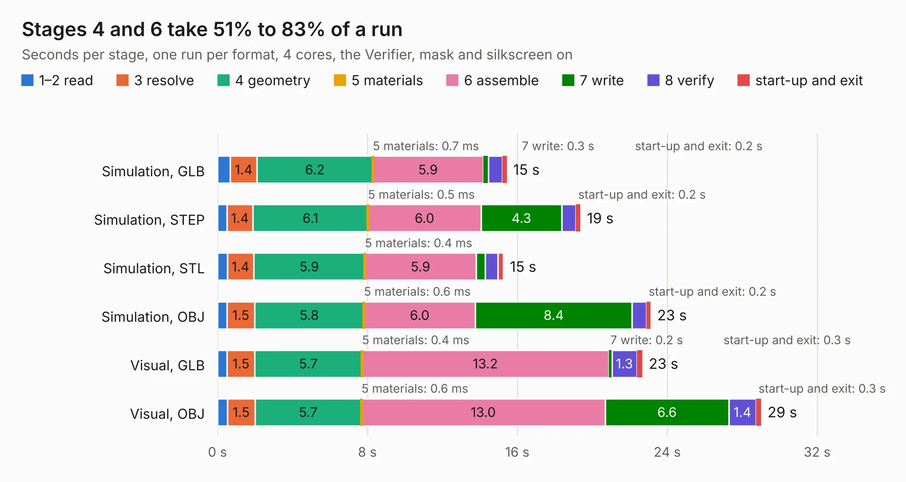

| Mode and format | 1–2 read | 3 resolve | 4 geometry | 5 materials | 6 assemble | 7 write | 8 verify | start-up and exit | Total |
|---|---:|---:|---:|---:|---:|---:|---:|---:|---:|
| Simulation, GLB | 0.7 | 1.4 | 6.2 | 0.7&nbsp;ms | 5.9 | 0.3 | 0.8 | 0.2 | 15.4 |
| Simulation, STEP | 0.5 | 1.4 | 6.1 | 0.5&nbsp;ms | 6.0 | 4.3 | 0.8 | 0.2 | 19.4 |
| Simulation, STL | 0.5 | 1.4 | 5.9 | 0.4&nbsp;ms | 5.9 | 0.5 | 0.7 | 0.3 | 15.3 |
| Simulation, OBJ | 0.5 | 1.5 | 5.8 | 0.6&nbsp;ms | 6.0 | 8.4 | 0.8 | 0.2 | 23.1 |
| Visual, GLB | 0.5 | 1.5 | 5.7 | 0.4&nbsp;ms | 13.2 | 0.2 | 1.3 | 0.3 | 22.7 |
| Visual, OBJ | 0.5 | 1.5 | 5.7 | 0.6&nbsp;ms | 13.0 | 6.6 | 1.4 | 0.3 | 29.0 |

<table align="center"><tr><td valign="top">

| Board | Repo: [dm2lct/tlnixie](https://github.com/dm2lct/tlnixie) Board: `Nixie_proj_conflict-20171112-163801.kicad_pcb` |
|---|---|
| Complexity | 300&nbsp;/&nbsp;1000 (size&nbsp;235, features&nbsp;65) |
| KESE&nbsp;features | through vias, drill offsets, filled zones, copper text, curved board outline |
| Tested | 9th November 2026 |
| Copper&nbsp;layers | 2 |
| File&nbsp;format | KiCad 4 (4) |
| Parts,&nbsp;tracks,&nbsp;vias | 110, 1,233, 118 |
| Triangles,&nbsp;simulation | 1,296,404 in 121 parts |
| Verifier | PASS in all six runs |

</td><td valign="top">

<table>
<tr><th>File type</th><th>File size</th><th>Peak memory used</th></tr>
<tr><th colspan="3" align="left">Simulation</th></tr>
<tr><td>GLB</td><td align="right">45&nbsp;MB</td><td align="right">484&nbsp;MB</td></tr>
<tr><td>STEP</td><td align="right">219&nbsp;MB</td><td align="right">631&nbsp;MB</td></tr>
<tr><td>STL</td><td align="right">65&nbsp;MB</td><td align="right">488&nbsp;MB</td></tr>
<tr><td>OBJ</td><td align="right">134&nbsp;MB</td><td align="right">896&nbsp;MB</td></tr>
<tr><th colspan="3" align="left">Visual</th></tr>
<tr><td>GLB</td><td align="right">34&nbsp;MB</td><td align="right">815&nbsp;MB</td></tr>
<tr><td>OBJ</td><td align="right">102&nbsp;MB</td><td align="right">747&nbsp;MB</td></tr>
</table>

</td></tr></table>

## 866. Nucleo2USB

| Mode and format | 1–2 read | 3 resolve | 4 geometry | 5 materials | 6 assemble | 7 write | 8 verify | start-up and exit | Total |
|---|---:|---:|---:|---:|---:|---:|---:|---:|---:|
| Simulation, GLB | 0.2 | 0.7 | 3.3 | 0.6&nbsp;ms | 2.4 | 0.1 | 0.4 | 0.2 | 7.3 |
| Simulation, STEP | 0.2 | 0.7 | 3.1 | 0.8&nbsp;ms | 2.4 | 2.2 | 0.3 | 0.2 | 9.1 |
| Simulation, STL | 0.2 | 0.7 | 3.3 | 0.5&nbsp;ms | 2.4 | 0.2 | 0.4 | 0.2 | 7.4 |
| Simulation, OBJ | 0.2 | 0.7 | 3.3 | 0.5&nbsp;ms | 2.5 | 3.9 | 0.4 | 0.2 | 11.1 |
| Visual, GLB | 0.2 | 0.6 | 3.3 | 0.5&nbsp;ms | 5.7 | 82&nbsp;ms | 0.6 | 0.2 | 10.6 |
| Visual, OBJ | 0.2 | 0.7 | 3.3 | 0.5&nbsp;ms | 5.1 | 2.4 | 0.6 | 0.2 | 12.5 |

<table align="center"><tr><td valign="top">

| Board | Repo: [dmitrystu/Nucleo2USB](https://github.com/dmitrystu/Nucleo2USB) Board: `Nucleo2USB.kicad_pcb` |
|---|---|
| Complexity | 224&nbsp;/&nbsp;1000 (size&nbsp;159, features&nbsp;65) |
| KESE&nbsp;features | through vias, slotted holes, rounded, trapezoid or chamfered pads, filled zones, curved board outline |
| Tested | 9th November 2026 |
| Copper&nbsp;layers | 2 |
| File&nbsp;format | KiCad 5 (20171130) |
| Parts,&nbsp;tracks,&nbsp;vias | 44, 341, 41 |
| Triangles,&nbsp;simulation | 735,744 in 102 parts |
| Verifier | PASS in all six runs |

</td><td valign="top">

<table>
<tr><th>File type</th><th>File size</th><th>Peak memory used</th></tr>
<tr><th colspan="3" align="left">Simulation</th></tr>
<tr><td>GLB</td><td align="right">25&nbsp;MB</td><td align="right">358&nbsp;MB</td></tr>
<tr><td>STEP</td><td align="right">118&nbsp;MB</td><td align="right">403&nbsp;MB</td></tr>
<tr><td>STL</td><td align="right">37&nbsp;MB</td><td align="right">358&nbsp;MB</td></tr>
<tr><td>OBJ</td><td align="right">76&nbsp;MB</td><td align="right">548&nbsp;MB</td></tr>
<tr><th colspan="3" align="left">Visual</th></tr>
<tr><td>GLB</td><td align="right">17&nbsp;MB</td><td align="right">437&nbsp;MB</td></tr>
<tr><td>OBJ</td><td align="right">49&nbsp;MB</td><td align="right">436&nbsp;MB</td></tr>
</table>

</td></tr></table>

## 867. nuco-v

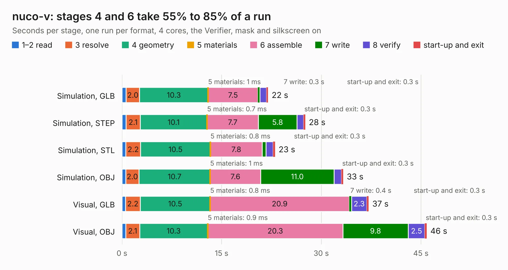

| Mode and format | 1–2 read | 3 resolve | 4 geometry | 5 materials | 6 assemble | 7 write | 8 verify | start-up and exit | Total |
|---|---:|---:|---:|---:|---:|---:|---:|---:|---:|
| Simulation, GLB | 0.6 | 2.0 | 10.3 | 1&nbsp;ms | 7.5 | 0.3 | 1.0 | 0.3 | 22.0 |
| Simulation, STEP | 0.6 | 2.1 | 10.1 | 0.7&nbsp;ms | 7.7 | 5.8 | 1.0 | 0.3 | 27.6 |
| Simulation, STL | 0.6 | 2.2 | 10.5 | 0.8&nbsp;ms | 7.8 | 0.6 | 1.1 | 0.3 | 23.0 |
| Simulation, OBJ | 0.6 | 2.0 | 10.7 | 1&nbsp;ms | 7.6 | 11.0 | 1.1 | 0.3 | 33.3 |
| Visual, GLB | 0.5 | 2.2 | 10.5 | 0.8&nbsp;ms | 20.9 | 0.4 | 2.3 | 0.3 | 37.1 |
| Visual, OBJ | 0.6 | 2.1 | 10.3 | 0.9&nbsp;ms | 20.3 | 9.8 | 2.5 | 0.3 | 45.9 |

<table align="center"><tr><td valign="top">

| Board | Repo: [dmitrystu/nuco-v](https://github.com/dmitrystu/nuco-v) Board: `nuco-v.kicad_pcb` |
|---|---|
| Complexity | 335&nbsp;/&nbsp;1000 (size&nbsp;245, features&nbsp;90) |
| KESE&nbsp;features | through vias, slotted holes, custom pads, rounded, trapezoid or chamfered pads, filled zones, copper drawings, curved board outline |
| Tested | 9th November 2026 |
| Copper&nbsp;layers | 2 |
| File&nbsp;format | KiCad 5 (20171130) |
| Parts,&nbsp;tracks,&nbsp;vias | 137, 1,827, 208 |
| Triangles,&nbsp;simulation | 1,844,586 in 195 parts |
| Verifier | PASS in all six runs |

</td><td valign="top">

<table>
<tr><th>File type</th><th>File size</th><th>Peak memory used</th></tr>
<tr><th colspan="3" align="left">Simulation</th></tr>
<tr><td>GLB</td><td align="right">64&nbsp;MB</td><td align="right">694&nbsp;MB</td></tr>
<tr><td>STEP</td><td align="right">309&nbsp;MB</td><td align="right">891&nbsp;MB</td></tr>
<tr><td>STL</td><td align="right">92&nbsp;MB</td><td align="right">746&nbsp;MB</td></tr>
<tr><td>OBJ</td><td align="right">193&nbsp;MB</td><td align="right">1.2&nbsp;GB</td></tr>
<tr><th colspan="3" align="left">Visual</th></tr>
<tr><td>GLB</td><td align="right">54&nbsp;MB</td><td align="right">1.0&nbsp;GB</td></tr>
<tr><td>OBJ</td><td align="right">166&nbsp;MB</td><td align="right">1.2&nbsp;GB</td></tr>
</table>

</td></tr></table>

## 868. twonkie

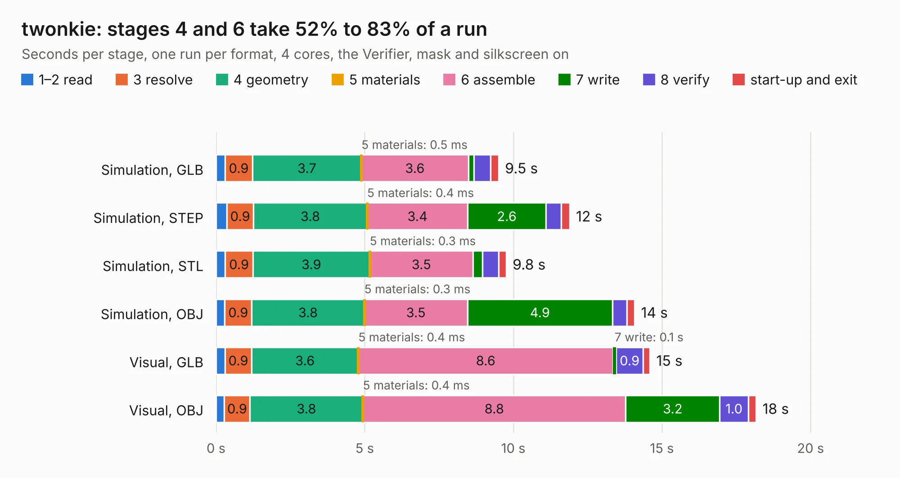

| Mode and format | 1–2 read | 3 resolve | 4 geometry | 5 materials | 6 assemble | 7 write | 8 verify | start-up and exit | Total |
|---|---:|---:|---:|---:|---:|---:|---:|---:|---:|
| Simulation, GLB | 0.3 | 0.9 | 3.7 | 0.5&nbsp;ms | 3.6 | 0.2 | 0.6 | 0.3 | 9.5 |
| Simulation, STEP | 0.4 | 0.9 | 3.8 | 0.4&nbsp;ms | 3.4 | 2.6 | 0.5 | 0.3 | 11.9 |
| Simulation, STL | 0.3 | 0.9 | 3.9 | 0.3&nbsp;ms | 3.5 | 0.3 | 0.5 | 0.3 | 9.8 |
| Simulation, OBJ | 0.3 | 0.9 | 3.8 | 0.3&nbsp;ms | 3.5 | 4.9 | 0.5 | 0.3 | 14.1 |
| Visual, GLB | 0.3 | 0.9 | 3.6 | 0.4&nbsp;ms | 8.6 | 0.1 | 0.9 | 0.2 | 14.6 |
| Visual, OBJ | 0.3 | 0.9 | 3.8 | 0.4&nbsp;ms | 8.8 | 3.2 | 1.0 | 0.3 | 18.2 |

<table align="center"><tr><td valign="top">

| Board | Repo: [dojoe/Twonkie](https://github.com/dojoe/Twonkie) Board: `twonkie.kicad_pcb` |
|---|---|
| Folder | hw |
| Complexity | 329&nbsp;/&nbsp;1000 (size&nbsp;234, features&nbsp;95) |
| KESE&nbsp;features | through vias, slotted holes, rounded, trapezoid or chamfered pads, filled zones, curved board outline, stack-up, dielectric εr and tanδ |
| Tested | 9th November 2026 |
| Copper&nbsp;layers | 4 |
| File&nbsp;format | KiCad 8 (20240108) |
| Parts,&nbsp;tracks,&nbsp;vias | 56, 879, 120 |
| Triangles,&nbsp;simulation | 971,502 in 94 parts |
| Verifier | PASS in all six runs |

</td><td valign="top">

<table>
<tr><th>File type</th><th>File size</th><th>Peak memory used</th></tr>
<tr><th colspan="3" align="left">Simulation</th></tr>
<tr><td>GLB</td><td align="right">34&nbsp;MB</td><td align="right">431&nbsp;MB</td></tr>
<tr><td>STEP</td><td align="right">176&nbsp;MB</td><td align="right">466&nbsp;MB</td></tr>
<tr><td>STL</td><td align="right">49&nbsp;MB</td><td align="right">433&nbsp;MB</td></tr>
<tr><td>OBJ</td><td align="right">102&nbsp;MB</td><td align="right">710&nbsp;MB</td></tr>
<tr><th colspan="3" align="left">Visual</th></tr>
<tr><td>GLB</td><td align="right">22&nbsp;MB</td><td align="right">492&nbsp;MB</td></tr>
<tr><td>OBJ</td><td align="right">67&nbsp;MB</td><td align="right">542&nbsp;MB</td></tr>
</table>

</td></tr></table>

## 869. Domesday Duplicator

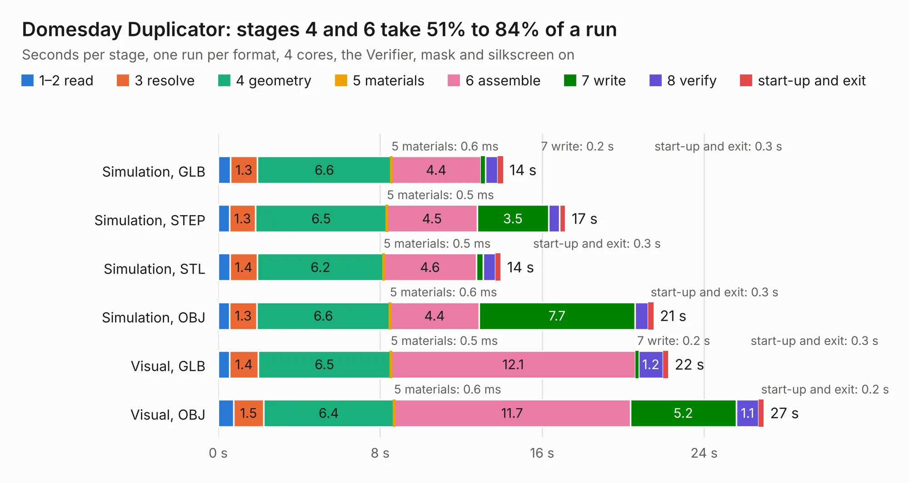

| Mode and format | 1–2 read | 3 resolve | 4 geometry | 5 materials | 6 assemble | 7 write | 8 verify | start-up and exit | Total |
|---|---:|---:|---:|---:|---:|---:|---:|---:|---:|
| Simulation, GLB | 0.6 | 1.3 | 6.6 | 0.6&nbsp;ms | 4.4 | 0.2 | 0.6 | 0.3 | 14.1 |
| Simulation, STEP | 0.6 | 1.3 | 6.5 | 0.5&nbsp;ms | 4.5 | 3.5 | 0.5 | 0.3 | 17.1 |
| Simulation, STL | 0.6 | 1.4 | 6.2 | 0.5&nbsp;ms | 4.6 | 0.3 | 0.6 | 0.3 | 13.9 |
| Simulation, OBJ | 0.6 | 1.3 | 6.6 | 0.6&nbsp;ms | 4.4 | 7.7 | 0.7 | 0.3 | 21.5 |
| Visual, GLB | 0.6 | 1.4 | 6.5 | 0.5&nbsp;ms | 12.1 | 0.2 | 1.2 | 0.3 | 22.2 |
| Visual, OBJ | 0.8 | 1.5 | 6.4 | 0.6&nbsp;ms | 11.7 | 5.2 | 1.1 | 0.2 | 26.9 |

<table align="center"><tr><td valign="top">

| Board | Repo: [domesday86/domesdayduplicator](https://github.com/domesday86/domesdayduplicator) Board: `Domesday Duplicator.kicad_pcb` |
|---|---|
| Folder | hardware / pcb |
| Complexity | 208&nbsp;/&nbsp;1000 (size&nbsp;173, features&nbsp;35) |
| KESE&nbsp;features | through vias, filled zones |
| Tested | 9th November 2026 |
| Copper&nbsp;layers | 2 |
| File&nbsp;format | KiCad 10 (20260206) |
| Parts,&nbsp;tracks,&nbsp;vias | 59, 766, 49 |
| Triangles,&nbsp;simulation | 1,224,380 in 103 parts |
| Verifier | PASS in all six runs |

</td><td valign="top">

<table>
<tr><th>File type</th><th>File size</th><th>Peak memory used</th></tr>
<tr><th colspan="3" align="left">Simulation</th></tr>
<tr><td>GLB</td><td align="right">41&nbsp;MB</td><td align="right">496&nbsp;MB</td></tr>
<tr><td>STEP</td><td align="right">198&nbsp;MB</td><td align="right">578&nbsp;MB</td></tr>
<tr><td>STL</td><td align="right">61&nbsp;MB</td><td align="right">486&nbsp;MB</td></tr>
<tr><td>OBJ</td><td align="right">126&nbsp;MB</td><td align="right">854&nbsp;MB</td></tr>
<tr><th colspan="3" align="left">Visual</th></tr>
<tr><td>GLB</td><td align="right">30&nbsp;MB</td><td align="right">699&nbsp;MB</td></tr>
<tr><td>OBJ</td><td align="right">90&nbsp;MB</td><td align="right">690&nbsp;MB</td></tr>
</table>

</td></tr></table>

## 870. haasoscope_pro_adc_fpga_board

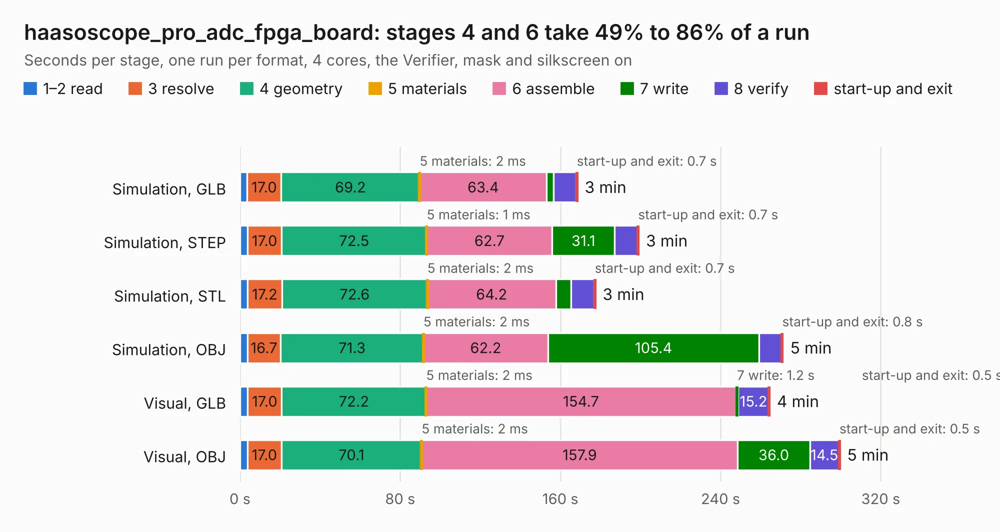

| Mode and format | 1–2 read | 3 resolve | 4 geometry | 5 materials | 6 assemble | 7 write | 8 verify | start-up and exit | Total |
|---|---:|---:|---:|---:|---:|---:|---:|---:|---:|
| Simulation, GLB | 3.6 | 17.0 | 69.2 | 2&nbsp;ms | 63.4 | 3.5 | 11.2 | 0.7 | 168.6 |
| Simulation, STEP | 3.8 | 17.0 | 72.5 | 1&nbsp;ms | 62.7 | 31.1 | 11.5 | 0.7 | 199.2 |
| Simulation, STL | 3.7 | 17.2 | 72.6 | 2&nbsp;ms | 64.2 | 7.7 | 11.4 | 0.7 | 177.6 |
| Simulation, OBJ | 3.6 | 16.7 | 71.3 | 2&nbsp;ms | 62.2 | 105.4 | 11.2 | 0.8 | 271.2 |
| Visual, GLB | 3.8 | 17.0 | 72.2 | 2&nbsp;ms | 154.7 | 1.2 | 15.2 | 0.5 | 264.6 |
| Visual, OBJ | 3.7 | 17.0 | 70.1 | 2&nbsp;ms | 157.9 | 36.0 | 14.5 | 0.5 | 299.7 |

<table align="center"><tr><td valign="top">

| Board | Repo: [drandyhaas/HaasoscopePro](https://github.com/drandyhaas/HaasoscopePro) Board: `haasoscope_pro_adc_fpga_board.kicad_pcb` |
|---|---|
| Folder | adc board / Kicad |
| Complexity | 412&nbsp;/&nbsp;1000 (size&nbsp;337, features&nbsp;75) |
| KESE&nbsp;features | through vias, rounded, trapezoid or chamfered pads, filled zones, stack-up, dielectric εr and tanδ |
| Tested | 9th November 2026 |
| Copper&nbsp;layers | 10 |
| File&nbsp;format | KiCad 9 (20241229) |
| Parts,&nbsp;tracks,&nbsp;vias | 582, 6,239, 1,360 |
| Triangles,&nbsp;simulation | 16,440,106 in 497 parts |
| Verifier | PASS in all six runs |

</td><td valign="top">

<table>
<tr><th>File type</th><th>File size</th><th>Peak memory used</th></tr>
<tr><th colspan="3" align="left">Simulation</th></tr>
<tr><td>GLB</td><td align="right">549&nbsp;MB</td><td align="right">3.8&nbsp;GB</td></tr>
<tr><td>STEP</td><td align="right">1.7&nbsp;GB</td><td align="right">4.8&nbsp;GB</td></tr>
<tr><td>STL</td><td align="right">822&nbsp;MB</td><td align="right">3.5&nbsp;GB</td></tr>
<tr><td>OBJ</td><td align="right">1.9&nbsp;GB</td><td align="right">11&nbsp;GB</td></tr>
<tr><th colspan="3" align="left">Visual</th></tr>
<tr><td>GLB</td><td align="right">229&nbsp;MB</td><td align="right">4.0&nbsp;GB</td></tr>
<tr><td>OBJ</td><td align="right">763&nbsp;MB</td><td align="right">5.0&nbsp;GB</td></tr>
</table>

</td></tr></table>

## 871. Duet2Maestro

| Mode and format | 1–2 read | 3 resolve | 4 geometry | 5 materials | 6 assemble | 7 write | 8 verify | start-up and exit | Total |
|---|---:|---:|---:|---:|---:|---:|---:|---:|---:|
| Simulation, GLB | 1.1 | 6.5 | 26.7 | 2&nbsp;ms | 25.2 | 1.0 | 2.9 | 0.3 | 63.6 |
| Simulation, STEP | 1.4 | 6.7 | 28.2 | 2&nbsp;ms | 25.6 | 13.2 | 2.7 | 0.3 | 78.1 |
| Simulation, STL | 1.2 | 6.8 | 27.6 | 0.9&nbsp;ms | 25.0 | 1.9 | 2.6 | 0.4 | 65.5 |
| Simulation, OBJ | 1.1 | 7.1 | 26.9 | 2&nbsp;ms | 24.4 | 32.8 | 2.8 | 0.4 | 95.6 |
| Visual, GLB | 1.1 | 6.7 | 27.1 | 2&nbsp;ms | 51.3 | 0.5 | 4.8 | 0.3 | 91.9 |
| Visual, OBJ | 1.2 | 6.9 | 26.3 | 2&nbsp;ms | 51.4 | 18.4 | 4.7 | 0.3 | 109.1 |

<table align="center"><tr><td valign="top">

| Board | Repo: [Duet3D/Duet-2-Hardware](https://github.com/Duet3D/Duet-2-Hardware) Board: `Duet2Maestro.kicad_pcb` |
|---|---|
| Folder | Duet2 / Duet2Maestro_v1.0 |
| Complexity | 345&nbsp;/&nbsp;1000 (size&nbsp;300, features&nbsp;45) |
| KESE&nbsp;features | through vias, slotted holes, filled zones |
| Tested | 9th November 2026 |
| Copper&nbsp;layers | 4 |
| File&nbsp;format | KiCad 5 (20171130) |
| Parts,&nbsp;tracks,&nbsp;vias | 322, 4,775, 786 |
| Triangles,&nbsp;simulation | 5,568,974 in 257 parts |
| Verifier | PASS in all six runs |

</td><td valign="top">

<table>
<tr><th>File type</th><th>File size</th><th>Peak memory used</th></tr>
<tr><th colspan="3" align="left">Simulation</th></tr>
<tr><td>GLB</td><td align="right">194&nbsp;MB</td><td align="right">1.4&nbsp;GB</td></tr>
<tr><td>STEP</td><td align="right">772&nbsp;MB</td><td align="right">1.8&nbsp;GB</td></tr>
<tr><td>STL</td><td align="right">278&nbsp;MB</td><td align="right">1.3&nbsp;GB</td></tr>
<tr><td>OBJ</td><td align="right">618&nbsp;MB</td><td align="right">3.6&nbsp;GB</td></tr>
<tr><th colspan="3" align="left">Visual</th></tr>
<tr><td>GLB</td><td align="right">114&nbsp;MB</td><td align="right">1.9&nbsp;GB</td></tr>
<tr><td>OBJ</td><td align="right">366&nbsp;MB</td><td align="right">2.3&nbsp;GB</td></tr>
</table>

</td></tr></table>

## 872. DuetWifi

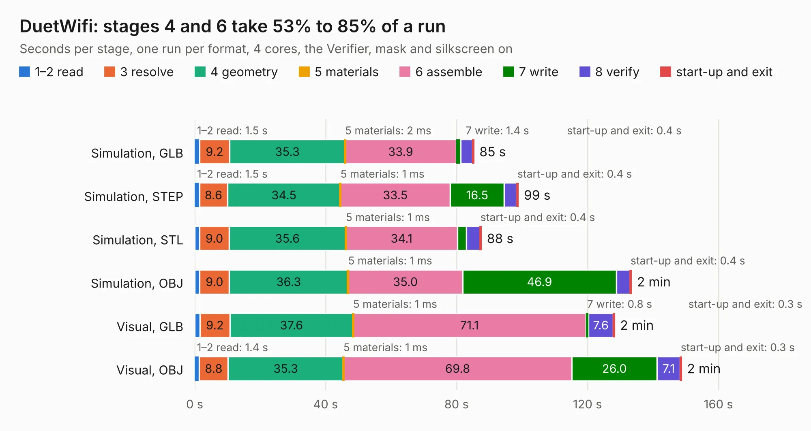

| Mode and format | 1–2 read | 3 resolve | 4 geometry | 5 materials | 6 assemble | 7 write | 8 verify | start-up and exit | Total |
|---|---:|---:|---:|---:|---:|---:|---:|---:|---:|
| Simulation, GLB | 1.5 | 9.2 | 35.3 | 2&nbsp;ms | 33.9 | 1.4 | 3.6 | 0.4 | 85.2 |
| Simulation, STEP | 1.5 | 8.6 | 34.5 | 1&nbsp;ms | 33.5 | 16.5 | 3.8 | 0.4 | 98.8 |
| Simulation, STL | 1.5 | 9.0 | 35.6 | 1&nbsp;ms | 34.1 | 2.8 | 4.1 | 0.4 | 87.5 |
| Simulation, OBJ | 1.5 | 9.0 | 36.3 | 1&nbsp;ms | 35.0 | 46.9 | 4.2 | 0.4 | 133.4 |
| Visual, GLB | 1.6 | 9.2 | 37.6 | 1&nbsp;ms | 71.1 | 0.8 | 7.6 | 0.3 | 128.2 |
| Visual, OBJ | 1.4 | 8.8 | 35.3 | 1&nbsp;ms | 69.8 | 26.0 | 7.1 | 0.3 | 148.7 |

<table align="center"><tr><td valign="top">

| Board | Repo: [Duet3D/Duet-2-Hardware](https://github.com/Duet3D/Duet-2-Hardware) Board: `DuetWifi.kicad_pcb` |
|---|---|
| Folder | Duet2 / Duet2v1.04 |
| Complexity | 293&nbsp;/&nbsp;1000 (size&nbsp;248, features&nbsp;45) |
| KESE&nbsp;features | through vias, slotted holes, filled zones |
| Tested | 9th November 2026 |
| Copper&nbsp;layers | 4 |
| File&nbsp;format | KiCad 4 (4) |
| Parts,&nbsp;tracks,&nbsp;vias | 330, 7,068, 1,086 |
| Triangles,&nbsp;simulation | 6,864,890 in 294 parts |
| Verifier | PASS in all six runs |

</td><td valign="top">

<table>
<tr><th>File type</th><th>File size</th><th>Peak memory used</th></tr>
<tr><th colspan="3" align="left">Simulation</th></tr>
<tr><td>GLB</td><td align="right">240&nbsp;MB</td><td align="right">1.6&nbsp;GB</td></tr>
<tr><td>STEP</td><td align="right">965&nbsp;MB</td><td align="right">2.2&nbsp;GB</td></tr>
<tr><td>STL</td><td align="right">343&nbsp;MB</td><td align="right">1.6&nbsp;GB</td></tr>
<tr><td>OBJ</td><td align="right">765&nbsp;MB</td><td align="right">4.5&nbsp;GB</td></tr>
<tr><th colspan="3" align="left">Visual</th></tr>
<tr><td>GLB</td><td align="right">146&nbsp;MB</td><td align="right">2.3&nbsp;GB</td></tr>
<tr><td>OBJ</td><td align="right">474&nbsp;MB</td><td align="right">3.2&nbsp;GB</td></tr>
</table>

</td></tr></table>

## 873. Duet2

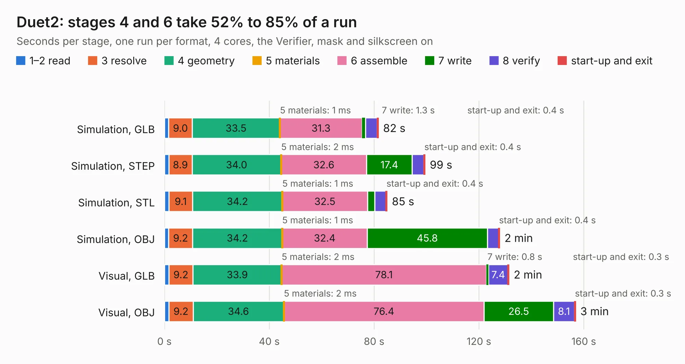

| Mode and format | 1–2 read | 3 resolve | 4 geometry | 5 materials | 6 assemble | 7 write | 8 verify | start-up and exit | Total |
|---|---:|---:|---:|---:|---:|---:|---:|---:|---:|
| Simulation, GLB | 1.6 | 9.0 | 33.5 | 1&nbsp;ms | 31.3 | 1.3 | 4.4 | 0.4 | 81.6 |
| Simulation, STEP | 1.7 | 8.9 | 34.0 | 2&nbsp;ms | 32.6 | 17.4 | 4.4 | 0.4 | 99.4 |
| Simulation, STL | 1.7 | 9.1 | 34.2 | 1&nbsp;ms | 32.5 | 2.7 | 4.3 | 0.4 | 84.9 |
| Simulation, OBJ | 1.6 | 9.2 | 34.2 | 1&nbsp;ms | 32.4 | 45.8 | 4.3 | 0.4 | 127.9 |
| Visual, GLB | 1.7 | 9.2 | 33.9 | 2&nbsp;ms | 78.1 | 0.8 | 7.4 | 0.3 | 131.4 |
| Visual, OBJ | 1.7 | 9.2 | 34.6 | 2&nbsp;ms | 76.4 | 26.5 | 8.1 | 0.3 | 156.8 |

<table align="center"><tr><td valign="top">

| Board | Repo: [Duet3D/Duet-2-Hardware](https://github.com/Duet3D/Duet-2-Hardware) Board: `Duet2.kicad_pcb` |
|---|---|
| Folder | Duet2 / Duet2v1.05 |
| Complexity | 332&nbsp;/&nbsp;1000 (size&nbsp;287, features&nbsp;45) |
| KESE&nbsp;features | through vias, slotted holes, filled zones |
| Tested | 9th November 2026 |
| Copper&nbsp;layers | 4 |
| File&nbsp;format | KiCad 5 (20171130) |
| Parts,&nbsp;tracks,&nbsp;vias | 333, 6,897, 1,084 |
| Triangles,&nbsp;simulation | 7,008,616 in 317 parts |
| Verifier | PASS in all six runs |

</td><td valign="top">

<table>
<tr><th>File type</th><th>File size</th><th>Peak memory used</th></tr>
<tr><th colspan="3" align="left">Simulation</th></tr>
<tr><td>GLB</td><td align="right">245&nbsp;MB</td><td align="right">1.6&nbsp;GB</td></tr>
<tr><td>STEP</td><td align="right">951&nbsp;MB</td><td align="right">2.2&nbsp;GB</td></tr>
<tr><td>STL</td><td align="right">350&nbsp;MB</td><td align="right">1.6&nbsp;GB</td></tr>
<tr><td>OBJ</td><td align="right">781&nbsp;MB</td><td align="right">4.6&nbsp;GB</td></tr>
<tr><th colspan="3" align="left">Visual</th></tr>
<tr><td>GLB</td><td align="right">146&nbsp;MB</td><td align="right">2.4&nbsp;GB</td></tr>
<tr><td>OBJ</td><td align="right">475&nbsp;MB</td><td align="right">3.0&nbsp;GB</td></tr>
</table>

</td></tr></table>

## 874. Duet2

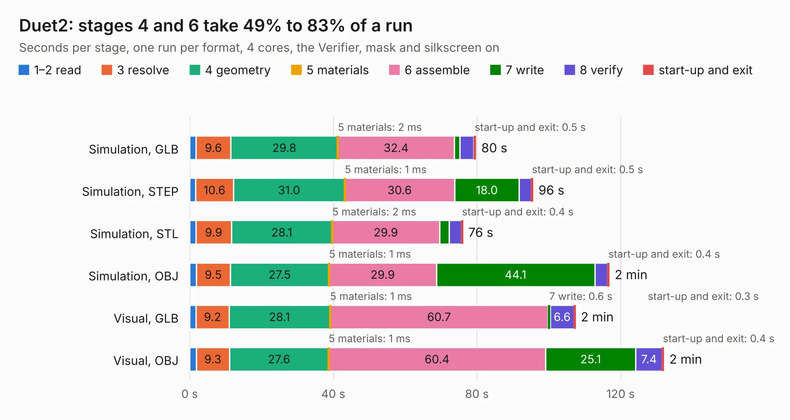

| Mode and format | 1–2 read | 3 resolve | 4 geometry | 5 materials | 6 assemble | 7 write | 8 verify | start-up and exit | Total |
|---|---:|---:|---:|---:|---:|---:|---:|---:|---:|
| Simulation, GLB | 1.8 | 9.6 | 29.8 | 2&nbsp;ms | 32.4 | 1.5 | 3.9 | 0.5 | 79.6 |
| Simulation, STEP | 1.6 | 10.6 | 31.0 | 1&nbsp;ms | 30.6 | 18.0 | 3.3 | 0.5 | 95.6 |
| Simulation, STL | 1.7 | 9.9 | 28.1 | 2&nbsp;ms | 29.9 | 2.7 | 3.4 | 0.4 | 76.0 |
| Simulation, OBJ | 1.8 | 9.5 | 27.5 | 1&nbsp;ms | 29.9 | 44.1 | 3.6 | 0.4 | 116.8 |
| Visual, GLB | 1.8 | 9.2 | 28.1 | 1&nbsp;ms | 60.7 | 0.6 | 6.6 | 0.3 | 107.3 |
| Visual, OBJ | 1.8 | 9.3 | 27.6 | 1&nbsp;ms | 60.4 | 25.1 | 7.4 | 0.4 | 132.0 |

<table align="center"><tr><td valign="top">

| Board | Repo: [Duet3D/Duet-2-Hardware](https://github.com/Duet3D/Duet-2-Hardware) Board: `Duet2.kicad_pcb` |
|---|---|
| Folder | Duet2 / Duet2v1.06 |
| Complexity | 370&nbsp;/&nbsp;1000 (size&nbsp;285, features&nbsp;85) |
| KESE&nbsp;features | through vias, slotted holes, rounded, trapezoid or chamfered pads, filled zones, stack-up, dielectric εr and tanδ |
| Tested | 9th November 2026 |
| Copper&nbsp;layers | 4 |
| File&nbsp;format | KiCad 6 (20211014) |
| Parts,&nbsp;tracks,&nbsp;vias | 338, 5,521, 1,073 |
| Triangles,&nbsp;simulation | 6,360,830 in 315 parts |
| Verifier | PASS in all six runs |

</td><td valign="top">

<table>
<tr><th>File type</th><th>File size</th><th>Peak memory used</th></tr>
<tr><th colspan="3" align="left">Simulation</th></tr>
<tr><td>GLB</td><td align="right">216&nbsp;MB</td><td align="right">1.6&nbsp;GB</td></tr>
<tr><td>STEP</td><td align="right">836&nbsp;MB</td><td align="right">2.2&nbsp;GB</td></tr>
<tr><td>STL</td><td align="right">318&nbsp;MB</td><td align="right">1.6&nbsp;GB</td></tr>
<tr><td>OBJ</td><td align="right">685&nbsp;MB</td><td align="right">4.1&nbsp;GB</td></tr>
<tr><th colspan="3" align="left">Visual</th></tr>
<tr><td>GLB</td><td align="right">133&nbsp;MB</td><td align="right">2.2&nbsp;GB</td></tr>
<tr><td>OBJ</td><td align="right">428&nbsp;MB</td><td align="right">2.8&nbsp;GB</td></tr>
</table>

</td></tr></table>

## 875. DuetEthernet

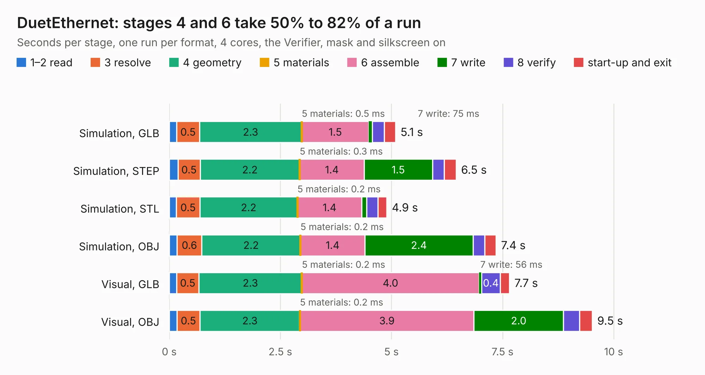

| Mode and format | 1–2 read | 3 resolve | 4 geometry | 5 materials | 6 assemble | 7 write | 8 verify | start-up and exit | Total |
|---|---:|---:|---:|---:|---:|---:|---:|---:|---:|
| Simulation, GLB | 0.2 | 0.5 | 2.3 | 0.5&nbsp;ms | 1.5 | 75&nbsp;ms | 0.3 | 0.3 | 5.1 |
| Simulation, STEP | 0.2 | 0.5 | 2.2 | 0.3&nbsp;ms | 1.4 | 1.5 | 0.3 | 0.3 | 6.5 |
| Simulation, STL | 0.2 | 0.5 | 2.2 | 0.2&nbsp;ms | 1.4 | 0.1 | 0.3 | 0.2 | 4.9 |
| Simulation, OBJ | 0.2 | 0.6 | 2.2 | 0.2&nbsp;ms | 1.4 | 2.4 | 0.3 | 0.3 | 7.4 |
| Visual, GLB | 0.2 | 0.5 | 2.3 | 0.2&nbsp;ms | 4.0 | 56&nbsp;ms | 0.4 | 0.2 | 7.7 |
| Visual, OBJ | 0.2 | 0.5 | 2.3 | 0.2&nbsp;ms | 3.9 | 2.0 | 0.4 | 0.3 | 9.5 |

<table align="center"><tr><td valign="top">

| Board | Repo: [Duet3D/Duet-2-Hardware](https://github.com/Duet3D/Duet-2-Hardware) Board: `DuetEthernet.kicad_pcb` |
|---|---|
| Folder | Duet2 / EthernetModule |
| Complexity | 246&nbsp;/&nbsp;1000 (size&nbsp;201, features&nbsp;45) |
| KESE&nbsp;features | through vias, filled zones, copper text |
| Tested | 9th November 2026 |
| Copper&nbsp;layers | 2 |
| File&nbsp;format | KiCad 4 (4) |
| Parts,&nbsp;tracks,&nbsp;vias | 36, 475, 44 |
| Triangles,&nbsp;simulation | 421,536 in 44 parts |
| Verifier | PASS in all six runs |

</td><td valign="top">

<table>
<tr><th>File type</th><th>File size</th><th>Peak memory used</th></tr>
<tr><th colspan="3" align="left">Simulation</th></tr>
<tr><td>GLB</td><td align="right">15&nbsp;MB</td><td align="right">296&nbsp;MB</td></tr>
<tr><td>STEP</td><td align="right">74&nbsp;MB</td><td align="right">307&nbsp;MB</td></tr>
<tr><td>STL</td><td align="right">21&nbsp;MB</td><td align="right">292&nbsp;MB</td></tr>
<tr><td>OBJ</td><td align="right">43&nbsp;MB</td><td align="right">343&nbsp;MB</td></tr>
<tr><th colspan="3" align="left">Visual</th></tr>
<tr><td>GLB</td><td align="right">11&nbsp;MB</td><td align="right">312&nbsp;MB</td></tr>
<tr><td>OBJ</td><td align="right">33&nbsp;MB</td><td align="right">317&nbsp;MB</td></tr>
</table>

</td></tr></table>

## 876. Duex5

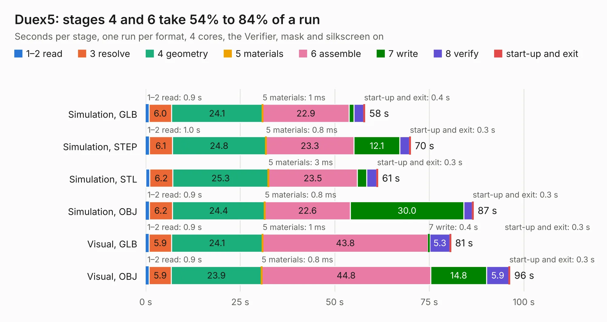

| Mode and format | 1–2 read | 3 resolve | 4 geometry | 5 materials | 6 assemble | 7 write | 8 verify | start-up and exit | Total |
|---|---:|---:|---:|---:|---:|---:|---:|---:|---:|
| Simulation, GLB | 0.9 | 6.0 | 24.1 | 1&nbsp;ms | 22.9 | 1.3 | 2.5 | 0.4 | 58.0 |
| Simulation, STEP | 1.0 | 6.1 | 24.8 | 0.8&nbsp;ms | 23.3 | 12.1 | 2.5 | 0.3 | 70.0 |
| Simulation, STL | 1.0 | 6.2 | 25.3 | 3&nbsp;ms | 23.5 | 2.5 | 2.6 | 0.3 | 61.4 |
| Simulation, OBJ | 0.9 | 6.2 | 24.4 | 0.8&nbsp;ms | 22.6 | 30.0 | 2.2 | 0.3 | 86.7 |
| Visual, GLB | 0.9 | 5.9 | 24.1 | 1&nbsp;ms | 43.8 | 0.4 | 5.3 | 0.3 | 80.7 |
| Visual, OBJ | 0.9 | 5.9 | 23.9 | 0.8&nbsp;ms | 44.8 | 14.8 | 5.9 | 0.3 | 96.3 |

<table align="center"><tr><td valign="top">

| Board | Repo: [Duet3D/Duet-2-Hardware](https://github.com/Duet3D/Duet-2-Hardware) Board: `Duex5.kicad_pcb` |
|---|---|
| Folder | Duet_Expansion / Duex5v0.11 |
| Complexity | 331&nbsp;/&nbsp;1000 (size&nbsp;276, features&nbsp;55) |
| KESE&nbsp;features | through vias, slotted holes, rounded, trapezoid or chamfered pads, filled zones |
| Tested | 9th November 2026 |
| Copper&nbsp;layers | 4 |
| File&nbsp;format | KiCad 5 (20171130) |
| Parts,&nbsp;tracks,&nbsp;vias | 251, 2,906, 1,119 |
| Triangles,&nbsp;simulation | 6,417,510 in 217 parts |
| Verifier | PASS in all six runs |

</td><td valign="top">

<table>
<tr><th>File type</th><th>File size</th><th>Peak memory used</th></tr>
<tr><th colspan="3" align="left">Simulation</th></tr>
<tr><td>GLB</td><td align="right">222&nbsp;MB</td><td align="right">1.4&nbsp;GB</td></tr>
<tr><td>STEP</td><td align="right">810&nbsp;MB</td><td align="right">1.9&nbsp;GB</td></tr>
<tr><td>STL</td><td align="right">321&nbsp;MB</td><td align="right">1.5&nbsp;GB</td></tr>
<tr><td>OBJ</td><td align="right">710&nbsp;MB</td><td align="right">4.2&nbsp;GB</td></tr>
<tr><th colspan="3" align="left">Visual</th></tr>
<tr><td>GLB</td><td align="right">115&nbsp;MB</td><td align="right">1.9&nbsp;GB</td></tr>
<tr><td>OBJ</td><td align="right">371&nbsp;MB</td><td align="right">2.5&nbsp;GB</td></tr>
</table>

</td></tr></table>

## 877. Duex5

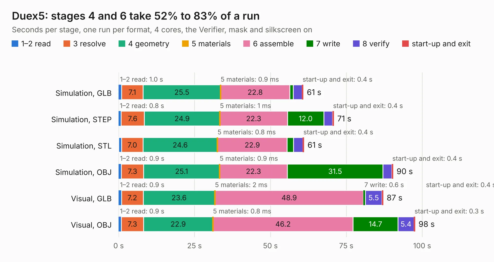

| Mode and format | 1–2 read | 3 resolve | 4 geometry | 5 materials | 6 assemble | 7 write | 8 verify | start-up and exit | Total |
|---|---:|---:|---:|---:|---:|---:|---:|---:|---:|
| Simulation, GLB | 1.0 | 7.1 | 25.5 | 0.9&nbsp;ms | 22.8 | 1.1 | 2.9 | 0.4 | 60.8 |
| Simulation, STEP | 0.8 | 7.6 | 24.9 | 1&nbsp;ms | 22.3 | 12.0 | 2.9 | 0.4 | 70.9 |
| Simulation, STL | 1.0 | 7.0 | 24.6 | 0.8&nbsp;ms | 22.9 | 2.1 | 3.1 | 0.4 | 61.1 |
| Simulation, OBJ | 0.9 | 7.3 | 25.1 | 0.9&nbsp;ms | 22.3 | 31.5 | 2.9 | 0.4 | 90.4 |
| Visual, GLB | 0.9 | 7.2 | 23.6 | 2&nbsp;ms | 48.9 | 0.6 | 5.5 | 0.4 | 87.2 |
| Visual, OBJ | 0.9 | 7.3 | 22.9 | 0.8&nbsp;ms | 46.2 | 14.7 | 5.4 | 0.3 | 97.6 |

<table align="center"><tr><td valign="top">

| Board | Repo: [Duet3D/Duet-2-Hardware](https://github.com/Duet3D/Duet-2-Hardware) Board: `Duex5.kicad_pcb` |
|---|---|
| Folder | Duet_Expansion / Duex5v0.7 |
| Complexity | 271&nbsp;/&nbsp;1000 (size&nbsp;236, features&nbsp;35) |
| KESE&nbsp;features | through vias, filled zones |
| Tested | 9th November 2026 |
| Copper&nbsp;layers | 4 |
| File&nbsp;format | KiCad 4 (4) |
| Parts,&nbsp;tracks,&nbsp;vias | 201, 3,551, 1,147 |
| Triangles,&nbsp;simulation | 5,628,398 in 190 parts |
| Verifier | PASS in all six runs |

</td><td valign="top">

<table>
<tr><th>File type</th><th>File size</th><th>Peak memory used</th></tr>
<tr><th colspan="3" align="left">Simulation</th></tr>
<tr><td>GLB</td><td align="right">194&nbsp;MB</td><td align="right">1.2&nbsp;GB</td></tr>
<tr><td>STEP</td><td align="right">644&nbsp;MB</td><td align="right">1.7&nbsp;GB</td></tr>
<tr><td>STL</td><td align="right">281&nbsp;MB</td><td align="right">1.1&nbsp;GB</td></tr>
<tr><td>OBJ</td><td align="right">622&nbsp;MB</td><td align="right">3.6&nbsp;GB</td></tr>
<tr><th colspan="3" align="left">Visual</th></tr>
<tr><td>GLB</td><td align="right">102&nbsp;MB</td><td align="right">1.8&nbsp;GB</td></tr>
<tr><td>OBJ</td><td align="right">330&nbsp;MB</td><td align="right">2.2&nbsp;GB</td></tr>
</table>

</td></tr></table>

## 878. Duex5

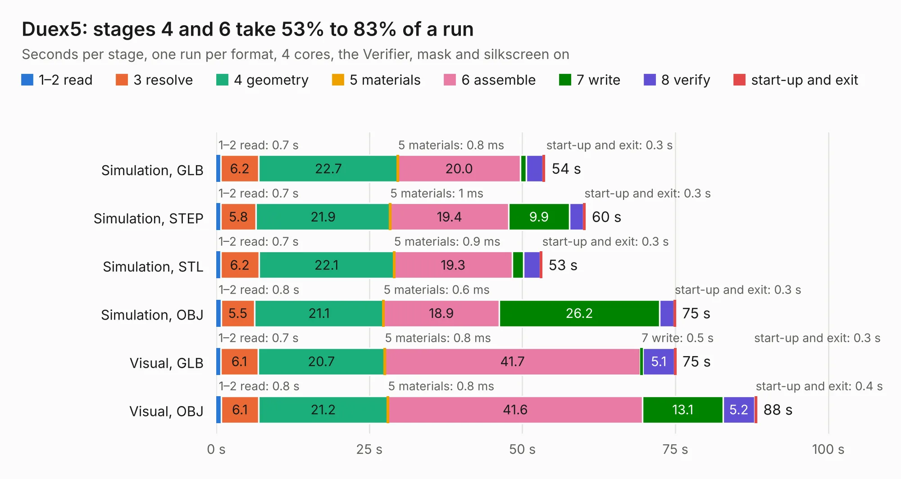

| Mode and format | 1–2 read | 3 resolve | 4 geometry | 5 materials | 6 assemble | 7 write | 8 verify | start-up and exit | Total |
|---|---:|---:|---:|---:|---:|---:|---:|---:|---:|
| Simulation, GLB | 0.7 | 6.2 | 22.7 | 0.8&nbsp;ms | 20.0 | 1.0 | 2.7 | 0.3 | 53.7 |
| Simulation, STEP | 0.7 | 5.8 | 21.9 | 1&nbsp;ms | 19.4 | 9.9 | 2.3 | 0.3 | 60.3 |
| Simulation, STL | 0.7 | 6.2 | 22.1 | 0.9&nbsp;ms | 19.3 | 1.9 | 2.7 | 0.3 | 53.2 |
| Simulation, OBJ | 0.8 | 5.5 | 21.1 | 0.6&nbsp;ms | 18.9 | 26.2 | 2.3 | 0.3 | 75.1 |
| Visual, GLB | 0.7 | 6.1 | 20.7 | 0.8&nbsp;ms | 41.7 | 0.5 | 5.1 | 0.3 | 75.1 |
| Visual, OBJ | 0.8 | 6.1 | 21.2 | 0.8&nbsp;ms | 41.6 | 13.1 | 5.2 | 0.4 | 88.3 |

<table align="center"><tr><td valign="top">

| Board | Repo: [Duet3D/Duet-2-Hardware](https://github.com/Duet3D/Duet-2-Hardware) Board: `Duex5.kicad_pcb` |
|---|---|
| Folder | Duet_Expansion / Duex5v0.8 |
| Complexity | 272&nbsp;/&nbsp;1000 (size&nbsp;237, features&nbsp;35) |
| KESE&nbsp;features | through vias, filled zones |
| Tested | 9th November 2026 |
| Copper&nbsp;layers | 4 |
| File&nbsp;format | KiCad 4 (4) |
| Parts,&nbsp;tracks,&nbsp;vias | 212, 3,656, 1,153 |
| Triangles,&nbsp;simulation | 5,703,054 in 193 parts |
| Verifier | PASS in all six runs |

</td><td valign="top">

<table>
<tr><th>File type</th><th>File size</th><th>Peak memory used</th></tr>
<tr><th colspan="3" align="left">Simulation</th></tr>
<tr><td>GLB</td><td align="right">197&nbsp;MB</td><td align="right">1.2&nbsp;GB</td></tr>
<tr><td>STEP</td><td align="right">657&nbsp;MB</td><td align="right">1.6&nbsp;GB</td></tr>
<tr><td>STL</td><td align="right">285&nbsp;MB</td><td align="right">1.2&nbsp;GB</td></tr>
<tr><td>OBJ</td><td align="right">631&nbsp;MB</td><td align="right">3.7&nbsp;GB</td></tr>
<tr><th colspan="3" align="left">Visual</th></tr>
<tr><td>GLB</td><td align="right">104&nbsp;MB</td><td align="right">1.7&nbsp;GB</td></tr>
<tr><td>OBJ</td><td align="right">336&nbsp;MB</td><td align="right">2.2&nbsp;GB</td></tr>
</table>

</td></tr></table>

## 879. Duex5

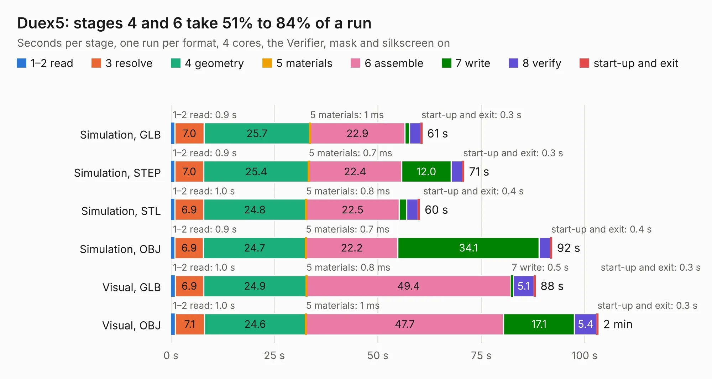

| Mode and format | 1–2 read | 3 resolve | 4 geometry | 5 materials | 6 assemble | 7 write | 8 verify | start-up and exit | Total |
|---|---:|---:|---:|---:|---:|---:|---:|---:|---:|
| Simulation, GLB | 0.9 | 7.0 | 25.7 | 1&nbsp;ms | 22.9 | 1.1 | 2.8 | 0.3 | 60.7 |
| Simulation, STEP | 0.9 | 7.0 | 25.4 | 0.7&nbsp;ms | 22.4 | 12.0 | 2.7 | 0.3 | 70.8 |
| Simulation, STL | 1.0 | 6.9 | 24.8 | 0.8&nbsp;ms | 22.5 | 1.8 | 2.8 | 0.4 | 60.1 |
| Simulation, OBJ | 0.9 | 6.9 | 24.7 | 0.7&nbsp;ms | 22.2 | 34.1 | 2.8 | 0.4 | 92.1 |
| Visual, GLB | 1.0 | 6.9 | 24.9 | 0.8&nbsp;ms | 49.4 | 0.5 | 5.1 | 0.3 | 88.1 |
| Visual, OBJ | 1.0 | 7.1 | 24.6 | 1&nbsp;ms | 47.7 | 17.1 | 5.4 | 0.3 | 103.2 |

<table align="center"><tr><td valign="top">

| Board | Repo: [Duet3D/Duet-2-Hardware](https://github.com/Duet3D/Duet-2-Hardware) Board: `Duex5.kicad_pcb` |
|---|---|
| Folder | Duet_Expansion / Duex5v0.9a |
| Complexity | 283&nbsp;/&nbsp;1000 (size&nbsp;238, features&nbsp;45) |
| KESE&nbsp;features | through vias, slotted holes, filled zones |
| Tested | 9th November 2026 |
| Copper&nbsp;layers | 4 |
| File&nbsp;format | KiCad 4 (4) |
| Parts,&nbsp;tracks,&nbsp;vias | 233, 3,810, 1,144 |
| Triangles,&nbsp;simulation | 5,782,378 in 195 parts |
| Verifier | PASS in all six runs |

</td><td valign="top">

<table>
<tr><th>File type</th><th>File size</th><th>Peak memory used</th></tr>
<tr><th colspan="3" align="left">Simulation</th></tr>
<tr><td>GLB</td><td align="right">200&nbsp;MB</td><td align="right">1.3&nbsp;GB</td></tr>
<tr><td>STEP</td><td align="right">680&nbsp;MB</td><td align="right">1.7&nbsp;GB</td></tr>
<tr><td>STL</td><td align="right">289&nbsp;MB</td><td align="right">1.2&nbsp;GB</td></tr>
<tr><td>OBJ</td><td align="right">640&nbsp;MB</td><td align="right">3.8&nbsp;GB</td></tr>
<tr><th colspan="3" align="left">Visual</th></tr>
<tr><td>GLB</td><td align="right">106&nbsp;MB</td><td align="right">1.7&nbsp;GB</td></tr>
<tr><td>OBJ</td><td align="right">343&nbsp;MB</td><td align="right">2.3&nbsp;GB</td></tr>
</table>

</td></tr></table>

## 880. ExpBreakout

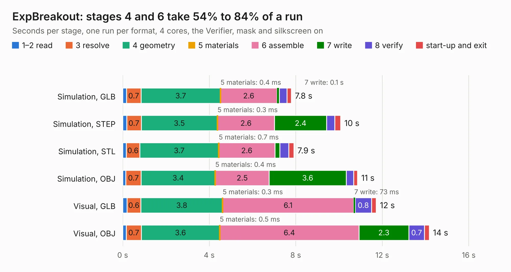

| Mode and format | 1–2 read | 3 resolve | 4 geometry | 5 materials | 6 assemble | 7 write | 8 verify | start-up and exit | Total |
|---|---:|---:|---:|---:|---:|---:|---:|---:|---:|
| Simulation, GLB | 0.2 | 0.7 | 3.7 | 0.4&nbsp;ms | 2.6 | 0.1 | 0.4 | 0.2 | 7.8 |
| Simulation, STEP | 0.2 | 0.7 | 3.5 | 0.3&nbsp;ms | 2.6 | 2.4 | 0.4 | 0.3 | 10.1 |
| Simulation, STL | 0.2 | 0.6 | 3.7 | 0.7&nbsp;ms | 2.6 | 0.2 | 0.4 | 0.2 | 7.9 |
| Simulation, OBJ | 0.1 | 0.7 | 3.4 | 0.4&nbsp;ms | 2.5 | 3.6 | 0.3 | 0.2 | 10.9 |
| Visual, GLB | 0.2 | 0.6 | 3.8 | 0.3&nbsp;ms | 6.1 | 73&nbsp;ms | 0.8 | 0.2 | 11.7 |
| Visual, OBJ | 0.2 | 0.7 | 3.6 | 0.5&nbsp;ms | 6.4 | 2.3 | 0.7 | 0.2 | 14.2 |

<table align="center"><tr><td valign="top">

| Board | Repo: [Duet3D/Duet-2-Hardware](https://github.com/Duet3D/Duet-2-Hardware) Board: `ExpBreakout.kicad_pcb` |
|---|---|
| Folder | Duet_Expansion / Expansion_Breakoutv1.1 |
| Complexity | 188&nbsp;/&nbsp;1000 (size&nbsp;153, features&nbsp;35) |
| KESE&nbsp;features | through vias, filled zones |
| Tested | 9th November 2026 |
| Copper&nbsp;layers | 2 |
| File&nbsp;format | KiCad 4 (4) |
| Parts,&nbsp;tracks,&nbsp;vias | 18, 472, 37 |
| Triangles,&nbsp;simulation | 811,298 in 65 parts |
| Verifier | PASS in all six runs |

</td><td valign="top">

<table>
<tr><th>File type</th><th>File size</th><th>Peak memory used</th></tr>
<tr><th colspan="3" align="left">Simulation</th></tr>
<tr><td>GLB</td><td align="right">28&nbsp;MB</td><td align="right">347&nbsp;MB</td></tr>
<tr><td>STEP</td><td align="right">151&nbsp;MB</td><td align="right">423&nbsp;MB</td></tr>
<tr><td>STL</td><td align="right">41&nbsp;MB</td><td align="right">353&nbsp;MB</td></tr>
<tr><td>OBJ</td><td align="right">85&nbsp;MB</td><td align="right">577&nbsp;MB</td></tr>
<tr><th colspan="3" align="left">Visual</th></tr>
<tr><td>GLB</td><td align="right">17&nbsp;MB</td><td align="right">427&nbsp;MB</td></tr>
<tr><td>OBJ</td><td align="right">52&nbsp;MB</td><td align="right">436&nbsp;MB</td></tr>
</table>

</td></tr></table>

## 881. EthernetModule

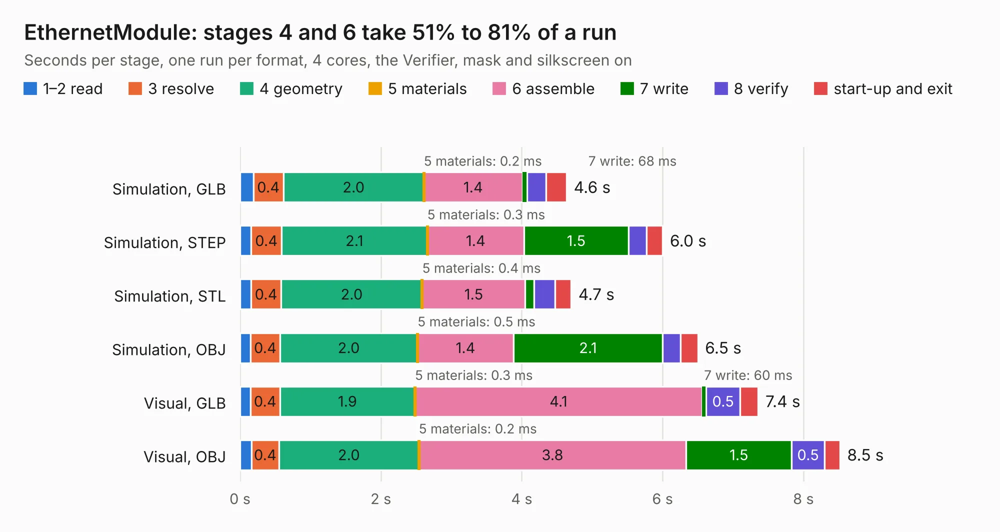

| Mode and format | 1–2 read | 3 resolve | 4 geometry | 5 materials | 6 assemble | 7 write | 8 verify | start-up and exit | Total |
|---|---:|---:|---:|---:|---:|---:|---:|---:|---:|
| Simulation, GLB | 0.2 | 0.4 | 2.0 | 0.2&nbsp;ms | 1.4 | 68&nbsp;ms | 0.3 | 0.3 | 4.6 |
| Simulation, STEP | 0.2 | 0.4 | 2.1 | 0.3&nbsp;ms | 1.4 | 1.5 | 0.3 | 0.2 | 6.0 |
| Simulation, STL | 0.2 | 0.4 | 2.0 | 0.4&nbsp;ms | 1.5 | 0.1 | 0.3 | 0.2 | 4.7 |
| Simulation, OBJ | 0.1 | 0.4 | 2.0 | 0.5&nbsp;ms | 1.4 | 2.1 | 0.3 | 0.2 | 6.5 |
| Visual, GLB | 0.1 | 0.4 | 1.9 | 0.3&nbsp;ms | 4.1 | 60&nbsp;ms | 0.5 | 0.3 | 7.4 |
| Visual, OBJ | 0.2 | 0.4 | 2.0 | 0.2&nbsp;ms | 3.8 | 1.5 | 0.5 | 0.2 | 8.5 |

<table align="center"><tr><td valign="top">

| Board | Repo: [Duet3D/Duet-2-Hardware](https://github.com/Duet3D/Duet-2-Hardware) Board: `EthernetModule.kicad_pcb` |
|---|---|
| Folder | Ethernet_Module |
| Complexity | 246&nbsp;/&nbsp;1000 (size&nbsp;201, features&nbsp;45) |
| KESE&nbsp;features | through vias, filled zones, copper text |
| Tested | 9th November 2026 |
| Copper&nbsp;layers | 2 |
| File&nbsp;format | KiCad 5 (20171130) |
| Parts,&nbsp;tracks,&nbsp;vias | 36, 475, 44 |
| Triangles,&nbsp;simulation | 416,418 in 44 parts |
| Verifier | PASS in all six runs |

</td><td valign="top">

<table>
<tr><th>File type</th><th>File size</th><th>Peak memory used</th></tr>
<tr><th colspan="3" align="left">Simulation</th></tr>
<tr><td>GLB</td><td align="right">15&nbsp;MB</td><td align="right">282&nbsp;MB</td></tr>
<tr><td>STEP</td><td align="right">72&nbsp;MB</td><td align="right">306&nbsp;MB</td></tr>
<tr><td>STL</td><td align="right">21&nbsp;MB</td><td align="right">289&nbsp;MB</td></tr>
<tr><td>OBJ</td><td align="right">43&nbsp;MB</td><td align="right">332&nbsp;MB</td></tr>
<tr><th colspan="3" align="left">Visual</th></tr>
<tr><td>GLB</td><td align="right">11&nbsp;MB</td><td align="right">310&nbsp;MB</td></tr>
<tr><td>OBJ</td><td align="right">33&nbsp;MB</td><td align="right">306&nbsp;MB</td></tr>
</table>

</td></tr></table>

## 882. Zephyr-80-CPU

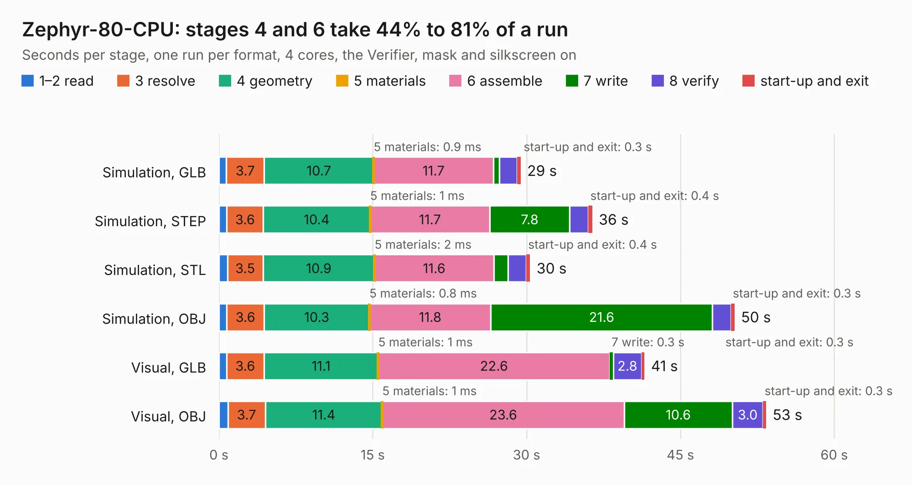

| Mode and format | 1–2 read | 3 resolve | 4 geometry | 5 materials | 6 assemble | 7 write | 8 verify | start-up and exit | Total |
|---|---:|---:|---:|---:|---:|---:|---:|---:|---:|
| Simulation, GLB | 0.7 | 3.7 | 10.7 | 0.9&nbsp;ms | 11.7 | 0.6 | 1.7 | 0.3 | 29.4 |
| Simulation, STEP | 0.8 | 3.6 | 10.4 | 1&nbsp;ms | 11.7 | 7.8 | 1.8 | 0.4 | 36.4 |
| Simulation, STL | 0.8 | 3.5 | 10.9 | 2&nbsp;ms | 11.6 | 1.4 | 1.8 | 0.4 | 30.3 |
| Simulation, OBJ | 0.8 | 3.6 | 10.3 | 0.8&nbsp;ms | 11.8 | 21.6 | 1.8 | 0.3 | 50.3 |
| Visual, GLB | 0.7 | 3.6 | 11.1 | 1&nbsp;ms | 22.6 | 0.3 | 2.8 | 0.3 | 41.5 |
| Visual, OBJ | 0.9 | 3.7 | 11.4 | 1&nbsp;ms | 23.6 | 10.6 | 3.0 | 0.3 | 53.4 |

<table align="center"><tr><td valign="top">

| Board | Repo: [dumaiss/Zephyr-80](https://github.com/dumaiss/Zephyr-80) Board: `Zephyr-80-CPU.kicad_pcb` |
|---|---|
| Folder | Schem / Zephyr-80-CPU |
| Complexity | 272&nbsp;/&nbsp;1000 (size&nbsp;197, features&nbsp;75) |
| KESE&nbsp;features | through vias, rounded, trapezoid or chamfered pads, filled zones, stack-up, dielectric εr and tanδ |
| Tested | 9th November 2026 |
| Copper&nbsp;layers | 6 |
| File&nbsp;format | KiCad 10 (20260206) |
| Parts,&nbsp;tracks,&nbsp;vias | 18, 1,053, 221 |
| Triangles,&nbsp;simulation | 3,420,402 in 131 parts |
| Verifier | PASS in all six runs |

</td><td valign="top">

<table>
<tr><th>File type</th><th>File size</th><th>Peak memory used</th></tr>
<tr><th colspan="3" align="left">Simulation</th></tr>
<tr><td>GLB</td><td align="right">114&nbsp;MB</td><td align="right">1.0&nbsp;GB</td></tr>
<tr><td>STEP</td><td align="right">359&nbsp;MB</td><td align="right">1.2&nbsp;GB</td></tr>
<tr><td>STL</td><td align="right">171&nbsp;MB</td><td align="right">967&nbsp;MB</td></tr>
<tr><td>OBJ</td><td align="right">358&nbsp;MB</td><td align="right">2.2&nbsp;GB</td></tr>
<tr><th colspan="3" align="left">Visual</th></tr>
<tr><td>GLB</td><td align="right">51&nbsp;MB</td><td align="right">1.2&nbsp;GB</td></tr>
<tr><td>OBJ</td><td align="right">159&nbsp;MB</td><td align="right">1.2&nbsp;GB</td></tr>
</table>

</td></tr></table>

## 883. Zephyr-80-IO

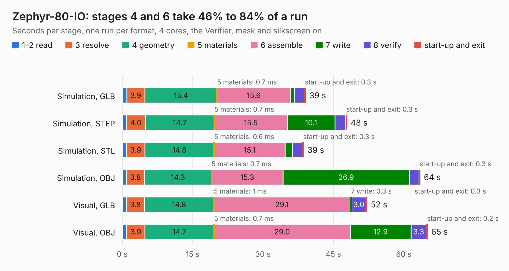

| Mode and format | 1–2 read | 3 resolve | 4 geometry | 5 materials | 6 assemble | 7 write | 8 verify | start-up and exit | Total |
|---|---:|---:|---:|---:|---:|---:|---:|---:|---:|
| Simulation, GLB | 1.0 | 3.9 | 15.4 | 0.7&nbsp;ms | 15.6 | 0.8 | 2.1 | 0.3 | 39.1 |
| Simulation, STEP | 0.9 | 4.0 | 14.7 | 0.7&nbsp;ms | 15.5 | 10.1 | 2.3 | 0.3 | 47.9 |
| Simulation, STL | 0.9 | 3.9 | 14.8 | 0.6&nbsp;ms | 15.1 | 1.5 | 2.1 | 0.3 | 38.7 |
| Simulation, OBJ | 0.9 | 3.8 | 14.3 | 0.7&nbsp;ms | 15.3 | 26.9 | 2.1 | 0.3 | 63.5 |
| Visual, GLB | 0.9 | 3.8 | 14.8 | 1&nbsp;ms | 29.1 | 0.3 | 3.0 | 0.3 | 52.2 |
| Visual, OBJ | 0.9 | 3.9 | 14.7 | 0.7&nbsp;ms | 29.0 | 12.9 | 3.3 | 0.2 | 65.1 |

<table align="center"><tr><td valign="top">

| Board | Repo: [dumaiss/Zephyr-80](https://github.com/dumaiss/Zephyr-80) Board: `Zephyr-80-IO.kicad_pcb` |
|---|---|
| Folder | Schem / Zephyr-80-IO |
| Complexity | 348&nbsp;/&nbsp;1000 (size&nbsp;263, features&nbsp;85) |
| KESE&nbsp;features | through vias, slotted holes, rounded, trapezoid or chamfered pads, filled zones, stack-up, dielectric εr and tanδ |
| Tested | 9th November 2026 |
| Copper&nbsp;layers | 6 |
| File&nbsp;format | KiCad 10 (20260206) |
| Parts,&nbsp;tracks,&nbsp;vias | 95, 1,806, 359 |
| Triangles,&nbsp;simulation | 4,990,652 in 224 parts |
| Verifier | PASS in all six runs |

</td><td valign="top">

<table>
<tr><th>File type</th><th>File size</th><th>Peak memory used</th></tr>
<tr><th colspan="3" align="left">Simulation</th></tr>
<tr><td>GLB</td><td align="right">166&nbsp;MB</td><td align="right">1.3&nbsp;GB</td></tr>
<tr><td>STEP</td><td align="right">571&nbsp;MB</td><td align="right">1.6&nbsp;GB</td></tr>
<tr><td>STL</td><td align="right">250&nbsp;MB</td><td align="right">1.3&nbsp;GB</td></tr>
<tr><td>OBJ</td><td align="right">529&nbsp;MB</td><td align="right">3.1&nbsp;GB</td></tr>
<tr><th colspan="3" align="left">Visual</th></tr>
<tr><td>GLB</td><td align="right">84&nbsp;MB</td><td align="right">1.5&nbsp;GB</td></tr>
<tr><td>OBJ</td><td align="right">268&nbsp;MB</td><td align="right">1.8&nbsp;GB</td></tr>
</table>

</td></tr></table>

## 884. ESP32_TouchDown_Rev1.1

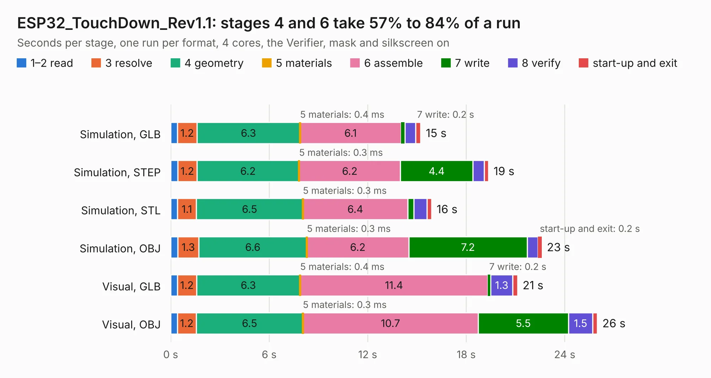

| Mode and format | 1–2 read | 3 resolve | 4 geometry | 5 materials | 6 assemble | 7 write | 8 verify | start-up and exit | Total |
|---|---:|---:|---:|---:|---:|---:|---:|---:|---:|
| Simulation, GLB | 0.4 | 1.2 | 6.3 | 0.4&nbsp;ms | 6.1 | 0.2 | 0.7 | 0.3 | 15.2 |
| Simulation, STEP | 0.4 | 1.2 | 6.2 | 0.3&nbsp;ms | 6.2 | 4.4 | 0.7 | 0.3 | 19.4 |
| Simulation, STL | 0.4 | 1.1 | 6.5 | 0.3&nbsp;ms | 6.4 | 0.4 | 0.8 | 0.3 | 15.9 |
| Simulation, OBJ | 0.4 | 1.3 | 6.6 | 0.3&nbsp;ms | 6.2 | 7.2 | 0.7 | 0.2 | 22.6 |
| Visual, GLB | 0.4 | 1.2 | 6.3 | 0.4&nbsp;ms | 11.4 | 0.2 | 1.3 | 0.3 | 21.1 |
| Visual, OBJ | 0.4 | 1.2 | 6.5 | 0.3&nbsp;ms | 10.7 | 5.5 | 1.5 | 0.3 | 26.0 |

<table align="center"><tr><td valign="top">

| Board | Repo: [DustinWatts/esp32-touchdown](https://github.com/DustinWatts/esp32-touchdown) Board: `ESP32_TouchDown_Rev1.1.kicad_pcb` |
|---|---|
| Folder | Hardware / ESP32_TouchDown_Rev1.1 |
| Complexity | 309&nbsp;/&nbsp;1000 (size&nbsp;219, features&nbsp;90) |
| KESE&nbsp;features | through vias, slotted holes, custom pads, rounded, trapezoid or chamfered pads, filled zones, copper drawings, curved board outline |
| Tested | 9th November 2026 |
| Copper&nbsp;layers | 2 |
| File&nbsp;format | KiCad 5 (20171130) |
| Parts,&nbsp;tracks,&nbsp;vias | 65, 802, 157 |
| Triangles,&nbsp;simulation | 1,157,818 in 107 parts |
| Verifier | PASS in all six runs |

</td><td valign="top">

<table>
<tr><th>File type</th><th>File size</th><th>Peak memory used</th></tr>
<tr><th colspan="3" align="left">Simulation</th></tr>
<tr><td>GLB</td><td align="right">40&nbsp;MB</td><td align="right">543&nbsp;MB</td></tr>
<tr><td>STEP</td><td align="right">199&nbsp;MB</td><td align="right">647&nbsp;MB</td></tr>
<tr><td>STL</td><td align="right">58&nbsp;MB</td><td align="right">547&nbsp;MB</td></tr>
<tr><td>OBJ</td><td align="right">119&nbsp;MB</td><td align="right">824&nbsp;MB</td></tr>
<tr><th colspan="3" align="left">Visual</th></tr>
<tr><td>GLB</td><td align="right">33&nbsp;MB</td><td align="right">728&nbsp;MB</td></tr>
<tr><td>OBJ</td><td align="right">98&nbsp;MB</td><td align="right">743&nbsp;MB</td></tr>
</table>

</td></tr></table>

## 885. ESP32_TouchDown

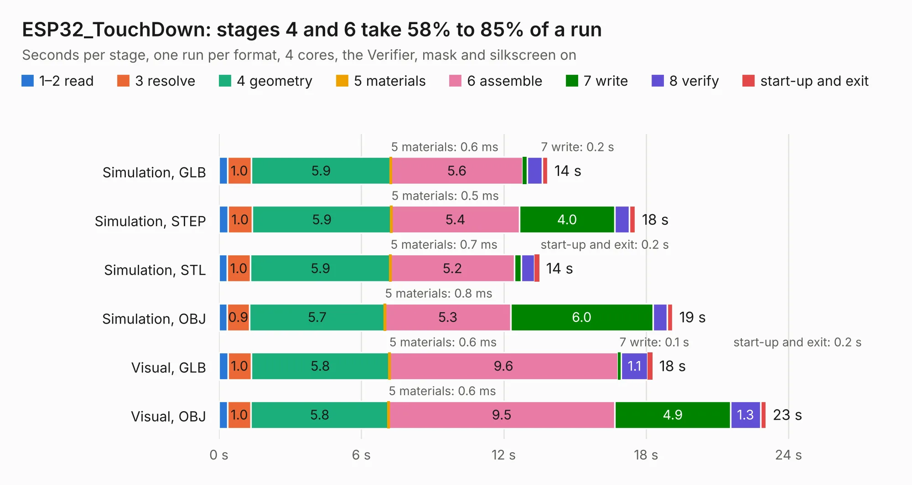

| Mode and format | 1–2 read | 3 resolve | 4 geometry | 5 materials | 6 assemble | 7 write | 8 verify | start-up and exit | Total |
|---|---:|---:|---:|---:|---:|---:|---:|---:|---:|
| Simulation, GLB | 0.4 | 1.0 | 5.9 | 0.6&nbsp;ms | 5.6 | 0.2 | 0.6 | 0.2 | 13.9 |
| Simulation, STEP | 0.4 | 1.0 | 5.9 | 0.5&nbsp;ms | 5.4 | 4.0 | 0.6 | 0.3 | 17.6 |
| Simulation, STL | 0.3 | 1.0 | 5.9 | 0.7&nbsp;ms | 5.2 | 0.3 | 0.6 | 0.2 | 13.5 |
| Simulation, OBJ | 0.3 | 0.9 | 5.7 | 0.8&nbsp;ms | 5.3 | 6.0 | 0.6 | 0.2 | 19.1 |
| Visual, GLB | 0.4 | 1.0 | 5.8 | 0.6&nbsp;ms | 9.6 | 0.1 | 1.1 | 0.2 | 18.3 |
| Visual, OBJ | 0.4 | 1.0 | 5.8 | 0.6&nbsp;ms | 9.5 | 4.9 | 1.3 | 0.2 | 23.1 |

<table align="center"><tr><td valign="top">

| Board | Repo: [DustinWatts/esp32-touchdown](https://github.com/DustinWatts/esp32-touchdown) Board: `ESP32_TouchDown.kicad_pcb` |
|---|---|
| Folder | Hardware / ESP32_TouchDown_Rev1 |
| Complexity | 309&nbsp;/&nbsp;1000 (size&nbsp;219, features&nbsp;90) |
| KESE&nbsp;features | through vias, slotted holes, custom pads, rounded, trapezoid or chamfered pads, filled zones, copper drawings, curved board outline |
| Tested | 9th November 2026 |
| Copper&nbsp;layers | 2 |
| File&nbsp;format | KiCad 5 (20171130) |
| Parts,&nbsp;tracks,&nbsp;vias | 65, 802, 157 |
| Triangles,&nbsp;simulation | 1,138,490 in 106 parts |
| Verifier | PASS in all six runs |

</td><td valign="top">

<table>
<tr><th>File type</th><th>File size</th><th>Peak memory used</th></tr>
<tr><th colspan="3" align="left">Simulation</th></tr>
<tr><td>GLB</td><td align="right">40&nbsp;MB</td><td align="right">535&nbsp;MB</td></tr>
<tr><td>STEP</td><td align="right">194&nbsp;MB</td><td align="right">638&nbsp;MB</td></tr>
<tr><td>STL</td><td align="right">57&nbsp;MB</td><td align="right">543&nbsp;MB</td></tr>
<tr><td>OBJ</td><td align="right">117&nbsp;MB</td><td align="right">810&nbsp;MB</td></tr>
<tr><th colspan="3" align="left">Visual</th></tr>
<tr><td>GLB</td><td align="right">31&nbsp;MB</td><td align="right">594&nbsp;MB</td></tr>
<tr><td>OBJ</td><td align="right">93&nbsp;MB</td><td align="right">744&nbsp;MB</td></tr>
</table>

</td></tr></table>

## 886. PCIe-Adapter

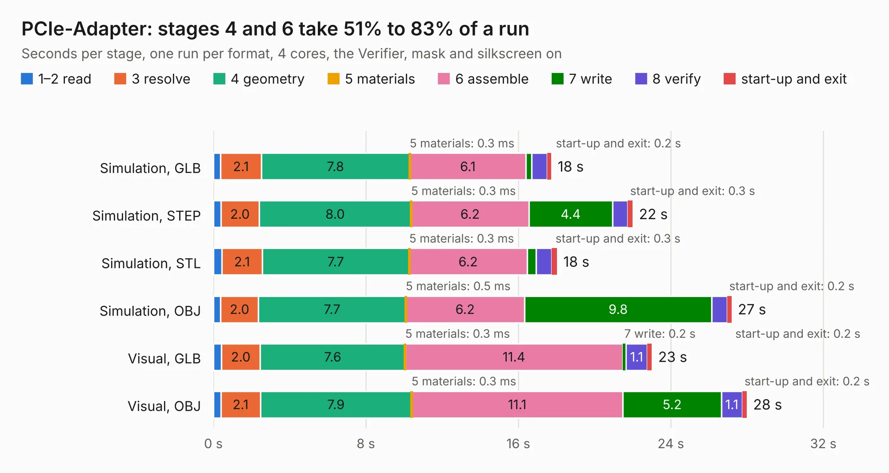

| Mode and format | 1–2 read | 3 resolve | 4 geometry | 5 materials | 6 assemble | 7 write | 8 verify | start-up and exit | Total |
|---|---:|---:|---:|---:|---:|---:|---:|---:|---:|
| Simulation, GLB | 0.4 | 2.1 | 7.8 | 0.3&nbsp;ms | 6.1 | 0.3 | 0.8 | 0.2 | 17.7 |
| Simulation, STEP | 0.4 | 2.0 | 8.0 | 0.3&nbsp;ms | 6.2 | 4.4 | 0.8 | 0.3 | 22.0 |
| Simulation, STL | 0.4 | 2.1 | 7.7 | 0.3&nbsp;ms | 6.2 | 0.5 | 0.8 | 0.3 | 18.0 |
| Simulation, OBJ | 0.4 | 2.0 | 7.7 | 0.5&nbsp;ms | 6.2 | 9.8 | 0.8 | 0.2 | 27.2 |
| Visual, GLB | 0.4 | 2.0 | 7.6 | 0.3&nbsp;ms | 11.4 | 0.2 | 1.1 | 0.2 | 23.0 |
| Visual, OBJ | 0.4 | 2.1 | 7.9 | 0.3&nbsp;ms | 11.1 | 5.2 | 1.1 | 0.2 | 28.0 |

<table align="center"><tr><td valign="top">

| Board | Repo: [ecp5-pcie/ecp5-pcie](https://github.com/ecp5-pcie/ecp5-pcie) Board: `PCIe-Adapter.kicad_pcb` |
|---|---|
| Folder | PCIe-Adapter |
| Complexity | 313&nbsp;/&nbsp;1000 (size&nbsp;248, features&nbsp;65) |
| KESE&nbsp;features | through vias, rounded, trapezoid or chamfered pads, filled zones, copper text, curved board outline |
| Tested | 9th November 2026 |
| Copper&nbsp;layers | 4 |
| File&nbsp;format | KiCad 5 (20171130) |
| Parts,&nbsp;tracks,&nbsp;vias | 50, 1,628, 146 |
| Triangles,&nbsp;simulation | 1,930,774 in 107 parts |
| Verifier | PASS in all six runs |

</td><td valign="top">

<table>
<tr><th>File type</th><th>File size</th><th>Peak memory used</th></tr>
<tr><th colspan="3" align="left">Simulation</th></tr>
<tr><td>GLB</td><td align="right">66&nbsp;MB</td><td align="right">694&nbsp;MB</td></tr>
<tr><td>STEP</td><td align="right">290&nbsp;MB</td><td align="right">786&nbsp;MB</td></tr>
<tr><td>STL</td><td align="right">97&nbsp;MB</td><td align="right">665&nbsp;MB</td></tr>
<tr><td>OBJ</td><td align="right">202&nbsp;MB</td><td align="right">1.3&nbsp;GB</td></tr>
<tr><th colspan="3" align="left">Visual</th></tr>
<tr><td>GLB</td><td align="right">35&nbsp;MB</td><td align="right">855&nbsp;MB</td></tr>
<tr><td>OBJ</td><td align="right">105&nbsp;MB</td><td align="right">801&nbsp;MB</td></tr>
</table>

</td></tr></table>

## 887. Edgeberry

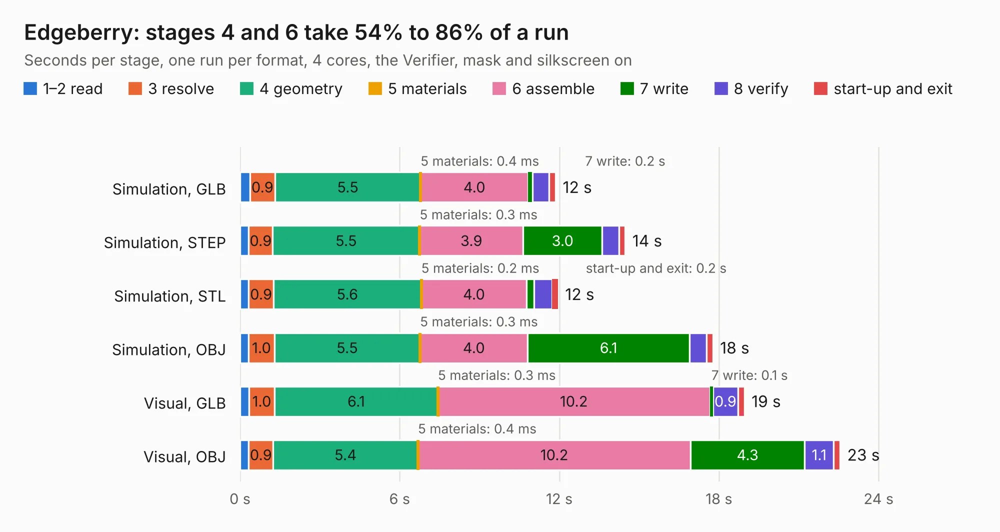

| Mode and format | 1–2 read | 3 resolve | 4 geometry | 5 materials | 6 assemble | 7 write | 8 verify | start-up and exit | Total |
|---|---:|---:|---:|---:|---:|---:|---:|---:|---:|
| Simulation, GLB | 0.4 | 0.9 | 5.5 | 0.4&nbsp;ms | 4.0 | 0.2 | 0.6 | 0.2 | 11.9 |
| Simulation, STEP | 0.3 | 0.9 | 5.5 | 0.3&nbsp;ms | 3.9 | 3.0 | 0.6 | 0.2 | 14.5 |
| Simulation, STL | 0.3 | 0.9 | 5.6 | 0.2&nbsp;ms | 4.0 | 0.3 | 0.7 | 0.2 | 11.9 |
| Simulation, OBJ | 0.3 | 1.0 | 5.5 | 0.3&nbsp;ms | 4.0 | 6.1 | 0.6 | 0.2 | 17.8 |
| Visual, GLB | 0.3 | 1.0 | 6.1 | 0.3&nbsp;ms | 10.2 | 0.1 | 0.9 | 0.2 | 19.0 |
| Visual, OBJ | 0.3 | 0.9 | 5.4 | 0.4&nbsp;ms | 10.2 | 4.3 | 1.1 | 0.2 | 22.5 |

<table align="center"><tr><td valign="top">

| Board | Repo: [Edgeberry/Edgeberry-Baseboard](https://github.com/Edgeberry/Edgeberry-Baseboard) Board: `Edgeberry.kicad_pcb` |
|---|---|
| Complexity | 248&nbsp;/&nbsp;1000 (size&nbsp;158, features&nbsp;90) |
| KESE&nbsp;features | through vias, slotted holes, rounded, trapezoid or chamfered pads, filled zones, copper text, curved board outline, TrueType text |
| Tested | 9th November 2026 |
| Copper&nbsp;layers | 2 |
| File&nbsp;format | KiCad 8 (20240108) |
| Parts,&nbsp;tracks,&nbsp;vias | 28, 303, 97 |
| Triangles,&nbsp;simulation | 1,044,388 in 55 parts |
| Verifier | PASS in all six runs |

</td><td valign="top">

<table>
<tr><th>File type</th><th>File size</th><th>Peak memory used</th></tr>
<tr><th colspan="3" align="left">Simulation</th></tr>
<tr><td>GLB</td><td align="right">38&nbsp;MB</td><td align="right">472&nbsp;MB</td></tr>
<tr><td>STEP</td><td align="right">208&nbsp;MB</td><td align="right">531&nbsp;MB</td></tr>
<tr><td>STL</td><td align="right">52&nbsp;MB</td><td align="right">495&nbsp;MB</td></tr>
<tr><td>OBJ</td><td align="right">110&nbsp;MB</td><td align="right">776&nbsp;MB</td></tr>
<tr><th colspan="3" align="left">Visual</th></tr>
<tr><td>GLB</td><td align="right">27&nbsp;MB</td><td align="right">619&nbsp;MB</td></tr>
<tr><td>OBJ</td><td align="right">81&nbsp;MB</td><td align="right">597&nbsp;MB</td></tr>
</table>

</td></tr></table>

## 888. k-1008-visable-memory

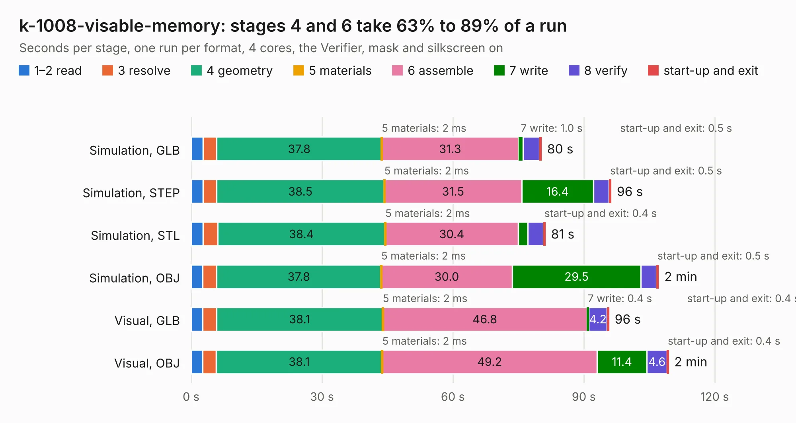

| Mode and format | 1–2 read | 3 resolve | 4 geometry | 5 materials | 6 assemble | 7 write | 8 verify | start-up and exit | Total |
|---|---:|---:|---:|---:|---:|---:|---:|---:|---:|
| Simulation, GLB | 2.7 | 3.2 | 37.8 | 2&nbsp;ms | 31.3 | 1.0 | 3.7 | 0.5 | 80.3 |
| Simulation, STEP | 2.7 | 3.1 | 38.5 | 2&nbsp;ms | 31.5 | 16.4 | 3.6 | 0.5 | 96.3 |
| Simulation, STL | 2.7 | 3.3 | 38.4 | 2&nbsp;ms | 30.4 | 2.2 | 3.6 | 0.4 | 81.2 |
| Simulation, OBJ | 2.6 | 3.2 | 37.8 | 2&nbsp;ms | 30.0 | 29.5 | 3.6 | 0.5 | 107.1 |
| Visual, GLB | 2.6 | 3.2 | 38.1 | 2&nbsp;ms | 46.8 | 0.4 | 4.2 | 0.4 | 95.8 |
| Visual, OBJ | 2.6 | 3.1 | 38.1 | 2&nbsp;ms | 49.2 | 11.4 | 4.6 | 0.4 | 109.4 |

<table align="center"><tr><td valign="top">

| Board | Repo: [eduardocasino/k-1008-visable-memory-card-replica](https://github.com/eduardocasino/k-1008-visable-memory-card-replica) Board: `k-1008-visable-memory.kicad_pcb` |
|---|---|
| Complexity | 303&nbsp;/&nbsp;1000 (size&nbsp;203, features&nbsp;100) |
| KESE&nbsp;features | through vias, rounded, trapezoid or chamfered pads, filled zones, curved board outline, stack-up, dielectric εr and tanδ, copper finish |
| Tested | 9th November 2026 |
| Copper&nbsp;layers | 2 |
| File&nbsp;format | KiCad 7 (20221018) |
| Parts,&nbsp;tracks,&nbsp;vias | 134, 2,849, 141 |
| Triangles,&nbsp;simulation | 5,533,298 in 229 parts |
| Verifier | PASS in all six runs |

</td><td valign="top">

<table>
<tr><th>File type</th><th>File size</th><th>Peak memory used</th></tr>
<tr><th colspan="3" align="left">Simulation</th></tr>
<tr><td>GLB</td><td align="right">189&nbsp;MB</td><td align="right">1.9&nbsp;GB</td></tr>
<tr><td>STEP</td><td align="right">914&nbsp;MB</td><td align="right">2.3&nbsp;GB</td></tr>
<tr><td>STL</td><td align="right">277&nbsp;MB</td><td align="right">1.8&nbsp;GB</td></tr>
<tr><td>OBJ</td><td align="right">588&nbsp;MB</td><td align="right">3.7&nbsp;GB</td></tr>
<tr><th colspan="3" align="left">Visual</th></tr>
<tr><td>GLB</td><td align="right">70&nbsp;MB</td><td align="right">1.7&nbsp;GB</td></tr>
<tr><td>OBJ</td><td align="right">221&nbsp;MB</td><td align="right">1.8&nbsp;GB</td></tr>
</table>

</td></tr></table>

## 889. k-1013-floppy-controller-replica

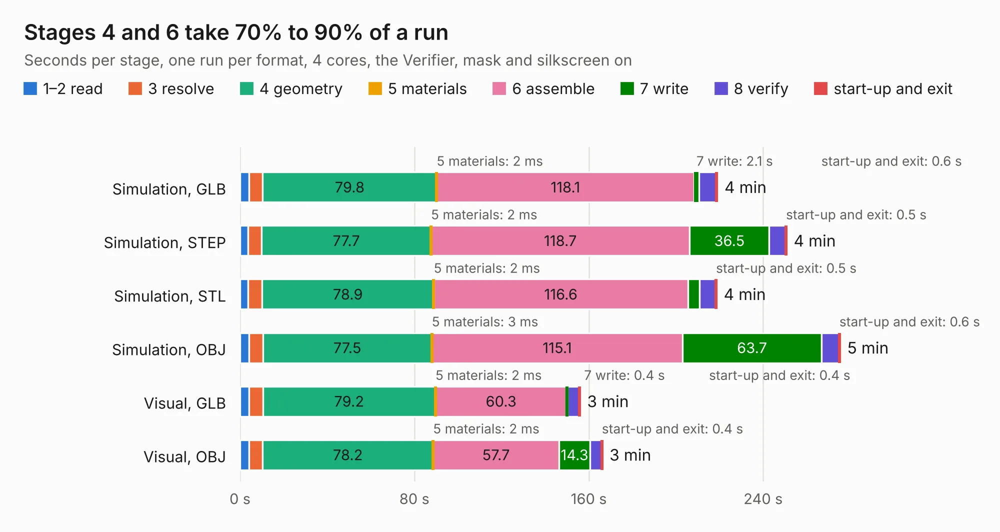

| Mode and format | 1–2 read | 3 resolve | 4 geometry | 5 materials | 6 assemble | 7 write | 8 verify | start-up and exit | Total |
|---|---:|---:|---:|---:|---:|---:|---:|---:|---:|
| Simulation, GLB | 4.1 | 6.3 | 79.8 | 2&nbsp;ms | 118.1 | 2.1 | 7.8 | 0.6 | 219.0 |
| Simulation, STEP | 3.6 | 6.3 | 77.7 | 2&nbsp;ms | 118.7 | 36.5 | 7.5 | 0.5 | 250.7 |
| Simulation, STL | 3.7 | 6.3 | 78.9 | 2&nbsp;ms | 116.6 | 5.3 | 7.4 | 0.5 | 218.6 |
| Simulation, OBJ | 4.1 | 6.3 | 77.5 | 3&nbsp;ms | 115.1 | 63.7 | 7.9 | 0.6 | 275.3 |
| Visual, GLB | 4.1 | 6.4 | 79.2 | 2&nbsp;ms | 60.3 | 0.4 | 5.2 | 0.4 | 156.0 |
| Visual, OBJ | 4.0 | 6.3 | 78.2 | 2&nbsp;ms | 57.7 | 14.3 | 5.2 | 0.4 | 166.2 |

<table align="center"><tr><td valign="top">

| Board | Repo: [eduardocasino/k-1013-floppy-disk-controller-replica](https://github.com/eduardocasino/k-1013-floppy-disk-controller-replica) Board: `k-1013-floppy-controller-replica.kicad_pcb` |
|---|---|
| Complexity | 380&nbsp;/&nbsp;1000 (size&nbsp;230, features&nbsp;150) |
| KESE&nbsp;features | through vias, custom pads, rounded, trapezoid or chamfered pads, arc tracks, filled zones, copper drawings, copper text, curved board outline, TrueType text, stack-up, dielectric εr and tanδ |
| Tested | 9th November 2026 |
| Copper&nbsp;layers | 2 |
| File&nbsp;format | KiCad 7 (20221018) |
| Parts,&nbsp;tracks,&nbsp;vias | 239, 10,519, 385 |
| Triangles,&nbsp;simulation | 10,474,278 in 405 parts |
| Verifier | PASS in all six runs |

</td><td valign="top">

<table>
<tr><th>File type</th><th>File size</th><th>Peak memory used</th></tr>
<tr><th colspan="3" align="left">Simulation</th></tr>
<tr><td>GLB</td><td align="right">351&nbsp;MB</td><td align="right">2.8&nbsp;GB</td></tr>
<tr><td>STEP</td><td align="right">1.9&nbsp;GB</td><td align="right">4.3&nbsp;GB</td></tr>
<tr><td>STL</td><td align="right">524&nbsp;MB</td><td align="right">2.9&nbsp;GB</td></tr>
<tr><td>OBJ</td><td align="right">1.1&nbsp;GB</td><td align="right">6.7&nbsp;GB</td></tr>
<tr><th colspan="3" align="left">Visual</th></tr>
<tr><td>GLB</td><td align="right">89&nbsp;MB</td><td align="right">2.6&nbsp;GB</td></tr>
<tr><td>OBJ</td><td align="right">284&nbsp;MB</td><td align="right">2.6&nbsp;GB</td></tr>
</table>

</td></tr></table>

## 890. kim-1

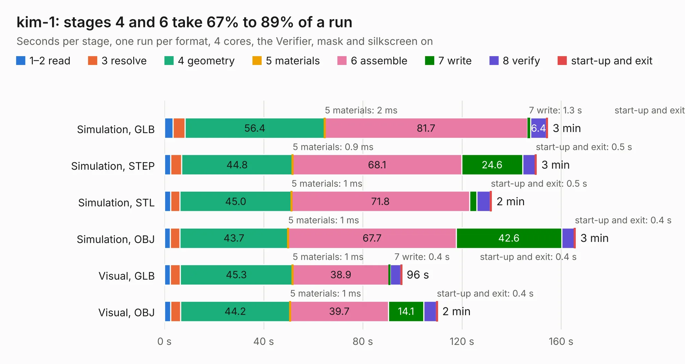

| Mode and format | 1–2 read | 3 resolve | 4 geometry | 5 materials | 6 assemble | 7 write | 8 verify | start-up and exit | Total |
|---|---:|---:|---:|---:|---:|---:|---:|---:|---:|
| Simulation, GLB | 3.4 | 4.8 | 56.4 | 2&nbsp;ms | 81.7 | 1.3 | 6.4 | 0.5 | 154.6 |
| Simulation, STEP | 2.5 | 4.4 | 44.8 | 0.9&nbsp;ms | 68.1 | 24.6 | 5.1 | 0.5 | 150.0 |
| Simulation, STL | 2.4 | 3.8 | 45.0 | 1&nbsp;ms | 71.8 | 3.0 | 5.4 | 0.5 | 131.9 |
| Simulation, OBJ | 2.4 | 3.8 | 43.7 | 1&nbsp;ms | 67.7 | 42.6 | 5.1 | 0.4 | 165.8 |
| Visual, GLB | 2.4 | 3.9 | 45.3 | 1&nbsp;ms | 38.9 | 0.4 | 4.4 | 0.4 | 95.7 |
| Visual, OBJ | 2.5 | 4.0 | 44.2 | 1&nbsp;ms | 39.7 | 14.1 | 5.2 | 0.4 | 110.1 |

<table align="center"><tr><td valign="top">

| Board | Repo: [eduardocasino/kim-1](https://github.com/eduardocasino/kim-1) Board: `kim-1.kicad_pcb` |
|---|---|
| Complexity | 355&nbsp;/&nbsp;1000 (size&nbsp;235, features&nbsp;120) |
| KESE&nbsp;features | through vias, slotted holes, custom pads, rounded, trapezoid or chamfered pads, filled zones, copper drawings, curved board outline, stack-up, dielectric εr and tanδ |
| Tested | 9th November 2026 |
| Copper&nbsp;layers | 2 |
| File&nbsp;format | KiCad 7 (20221018) |
| Parts,&nbsp;tracks,&nbsp;vias | 118, 26,242, 112 |
| Triangles,&nbsp;simulation | 6,263,966 in 210 parts |
| Verifier | PASS in all six runs |

</td><td valign="top">

<table>
<tr><th>File type</th><th>File size</th><th>Peak memory used</th></tr>
<tr><th colspan="3" align="left">Simulation</th></tr>
<tr><td>GLB</td><td align="right">213&nbsp;MB</td><td align="right">2.0&nbsp;GB</td></tr>
<tr><td>STEP</td><td align="right">1.4&nbsp;GB</td><td align="right">2.8&nbsp;GB</td></tr>
<tr><td>STL</td><td align="right">313&nbsp;MB</td><td align="right">1.9&nbsp;GB</td></tr>
<tr><td>OBJ</td><td align="right">667&nbsp;MB</td><td align="right">4.1&nbsp;GB</td></tr>
<tr><th colspan="3" align="left">Visual</th></tr>
<tr><td>GLB</td><td align="right">75&nbsp;MB</td><td align="right">1.7&nbsp;GB</td></tr>
<tr><td>OBJ</td><td align="right">237&nbsp;MB</td><td align="right">1.8&nbsp;GB</td></tr>
</table>

</td></tr></table>

## 891. Interposer_Board_IOCrest

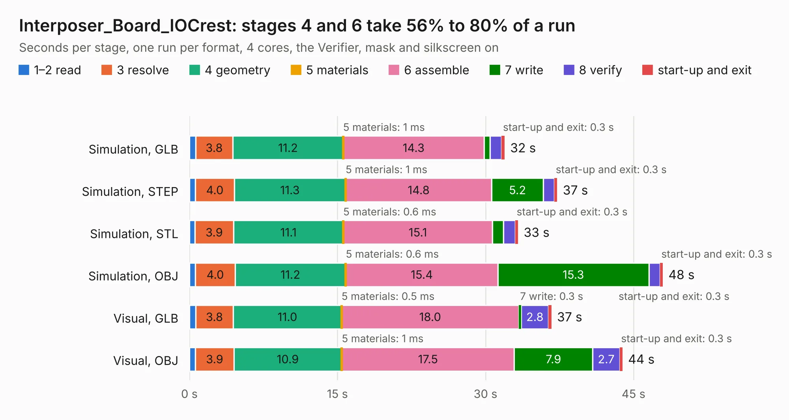

| Mode and format | 1–2 read | 3 resolve | 4 geometry | 5 materials | 6 assemble | 7 write | 8 verify | start-up and exit | Total |
|---|---:|---:|---:|---:|---:|---:|---:|---:|---:|
| Simulation, GLB | 0.6 | 3.8 | 11.2 | 1&nbsp;ms | 14.3 | 0.6 | 1.2 | 0.3 | 31.9 |
| Simulation, STEP | 0.6 | 4.0 | 11.3 | 1&nbsp;ms | 14.8 | 5.2 | 1.1 | 0.3 | 37.3 |
| Simulation, STL | 0.5 | 3.9 | 11.1 | 0.6&nbsp;ms | 15.1 | 1.1 | 1.2 | 0.3 | 33.3 |
| Simulation, OBJ | 0.6 | 4.0 | 11.2 | 0.6&nbsp;ms | 15.4 | 15.3 | 1.1 | 0.3 | 48.0 |
| Visual, GLB | 0.6 | 3.8 | 11.0 | 0.5&nbsp;ms | 18.0 | 0.3 | 2.8 | 0.3 | 36.7 |
| Visual, OBJ | 0.6 | 3.9 | 10.9 | 1&nbsp;ms | 17.5 | 7.9 | 2.7 | 0.3 | 43.9 |

<table align="center"><tr><td valign="top">

| Board | Repo: [EEVengers/ThunderScope](https://github.com/EEVengers/ThunderScope) Board: `Interposer_Board_IOCrest.kicad_pcb` |
|---|---|
| Folder | Hardware / Interposer_Board_IOCrest |
| Complexity | 282&nbsp;/&nbsp;1000 (size&nbsp;192, features&nbsp;90) |
| KESE&nbsp;features | through vias, arc tracks, filled zones, curved board outline, stack-up, dielectric εr and tanδ |
| Tested | 9th November 2026 |
| Copper&nbsp;layers | 4 |
| File&nbsp;format | KiCad 9 (20241229) |
| Parts,&nbsp;tracks,&nbsp;vias | 7, 211, 1,239 |
| Triangles,&nbsp;simulation | 3,285,988 in 83 parts |
| Verifier | PASS in all six runs |

</td><td valign="top">

<table>
<tr><th>File type</th><th>File size</th><th>Peak memory used</th></tr>
<tr><th colspan="3" align="left">Simulation</th></tr>
<tr><td>GLB</td><td align="right">110&nbsp;MB</td><td align="right">1.2&nbsp;GB</td></tr>
<tr><td>STEP</td><td align="right">241&nbsp;MB</td><td align="right">1.5&nbsp;GB</td></tr>
<tr><td>STL</td><td align="right">164&nbsp;MB</td><td align="right">1.2&nbsp;GB</td></tr>
<tr><td>OBJ</td><td align="right">343&nbsp;MB</td><td align="right">2.2&nbsp;GB</td></tr>
<tr><th colspan="3" align="left">Visual</th></tr>
<tr><td>GLB</td><td align="right">58&nbsp;MB</td><td align="right">1.2&nbsp;GB</td></tr>
<tr><td>OBJ</td><td align="right">182&nbsp;MB</td><td align="right">1.2&nbsp;GB</td></tr>
</table>

</td></tr></table>

## 892. Interposer_Board_JoneyTech

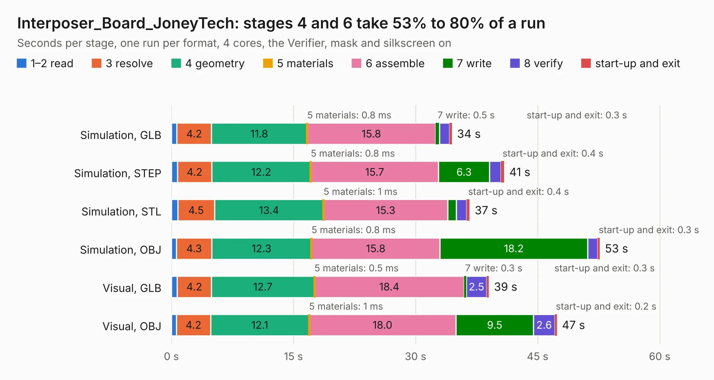

| Mode and format | 1–2 read | 3 resolve | 4 geometry | 5 materials | 6 assemble | 7 write | 8 verify | start-up and exit | Total |
|---|---:|---:|---:|---:|---:|---:|---:|---:|---:|
| Simulation, GLB | 0.7 | 4.2 | 11.8 | 0.8&nbsp;ms | 15.8 | 0.5 | 1.2 | 0.3 | 34.5 |
| Simulation, STEP | 0.7 | 4.2 | 12.2 | 0.8&nbsp;ms | 15.7 | 6.3 | 1.4 | 0.4 | 40.9 |
| Simulation, STL | 0.8 | 4.5 | 13.4 | 1&nbsp;ms | 15.3 | 1.1 | 1.3 | 0.4 | 36.6 |
| Simulation, OBJ | 0.6 | 4.3 | 12.3 | 0.8&nbsp;ms | 15.8 | 18.2 | 1.2 | 0.3 | 52.6 |
| Visual, GLB | 0.7 | 4.2 | 12.7 | 0.5&nbsp;ms | 18.4 | 0.3 | 2.5 | 0.3 | 39.0 |
| Visual, OBJ | 0.6 | 4.2 | 12.1 | 1&nbsp;ms | 18.0 | 9.5 | 2.6 | 0.2 | 47.4 |

<table align="center"><tr><td valign="top">

| Board | Repo: [EEVengers/ThunderScope](https://github.com/EEVengers/ThunderScope) Board: `Interposer_Board_JoneyTech.kicad_pcb` |
|---|---|
| Folder | Hardware / Interposer_Board_JoneyTech |
| Complexity | 281&nbsp;/&nbsp;1000 (size&nbsp;191, features&nbsp;90) |
| KESE&nbsp;features | through vias, arc tracks, filled zones, curved board outline, stack-up, dielectric εr and tanδ |
| Tested | 9th November 2026 |
| Copper&nbsp;layers | 4 |
| File&nbsp;format | KiCad 9 (20241229) |
| Parts,&nbsp;tracks,&nbsp;vias | 7, 261, 1,191 |
| Triangles,&nbsp;simulation | 3,142,600 in 83 parts |
| Verifier | PASS in all six runs |

</td><td valign="top">

<table>
<tr><th>File type</th><th>File size</th><th>Peak memory used</th></tr>
<tr><th colspan="3" align="left">Simulation</th></tr>
<tr><td>GLB</td><td align="right">105&nbsp;MB</td><td align="right">1.2&nbsp;GB</td></tr>
<tr><td>STEP</td><td align="right">230&nbsp;MB</td><td align="right">1.5&nbsp;GB</td></tr>
<tr><td>STL</td><td align="right">157&nbsp;MB</td><td align="right">1.2&nbsp;GB</td></tr>
<tr><td>OBJ</td><td align="right">328&nbsp;MB</td><td align="right">2.0&nbsp;GB</td></tr>
<tr><th colspan="3" align="left">Visual</th></tr>
<tr><td>GLB</td><td align="right">55&nbsp;MB</td><td align="right">1.1&nbsp;GB</td></tr>
<tr><td>OBJ</td><td align="right">172&nbsp;MB</td><td align="right">1.2&nbsp;GB</td></tr>
</table>

</td></tr></table>

## 893. Thunderscope_Rev5.3

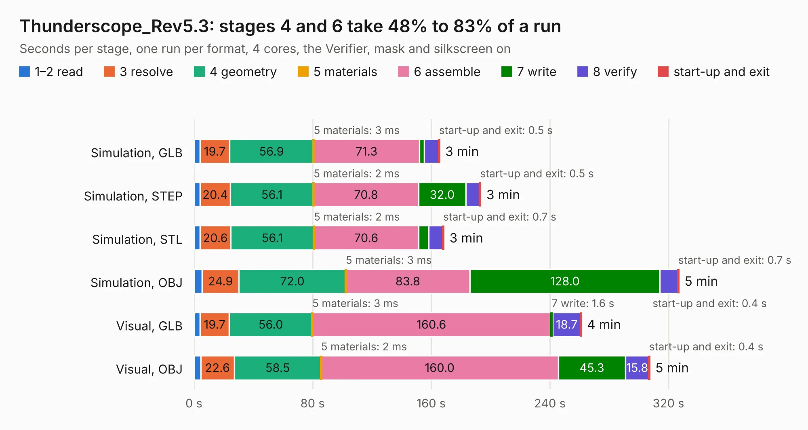

| Mode and format | 1–2 read | 3 resolve | 4 geometry | 5 materials | 6 assemble | 7 write | 8 verify | start-up and exit | Total |
|---|---:|---:|---:|---:|---:|---:|---:|---:|---:|
| Simulation, GLB | 4.2 | 19.7 | 56.9 | 3&nbsp;ms | 71.3 | 3.3 | 9.6 | 0.5 | 165.6 |
| Simulation, STEP | 4.1 | 20.4 | 56.1 | 2&nbsp;ms | 70.8 | 32.0 | 9.3 | 0.5 | 193.3 |
| Simulation, STL | 4.2 | 20.6 | 56.1 | 2&nbsp;ms | 70.6 | 6.8 | 9.5 | 0.7 | 168.4 |
| Simulation, OBJ | 5.5 | 24.9 | 72.0 | 3&nbsp;ms | 83.8 | 128.0 | 12.1 | 0.7 | 326.9 |
| Visual, GLB | 4.1 | 19.7 | 56.0 | 3&nbsp;ms | 160.6 | 1.6 | 18.7 | 0.4 | 261.2 |
| Visual, OBJ | 4.6 | 22.6 | 58.5 | 2&nbsp;ms | 160.0 | 45.3 | 15.8 | 0.4 | 307.2 |

<table align="center"><tr><td valign="top">

| Board | Repo: [EEVengers/ThunderScope](https://github.com/EEVengers/ThunderScope) Board: `Thunderscope_Rev5.3.kicad_pcb` |
|---|---|
| Folder | Hardware / Thunderscope_Rev5.3 |
| Complexity | 535&nbsp;/&nbsp;1000 (size&nbsp;325, features&nbsp;210) |
| KESE&nbsp;features | through vias, padstacks, slotted holes, custom pads, rounded, trapezoid or chamfered pads, arc tracks, filled zones, copper drawings, copper text, curved board outline, TrueType text, stack-up, dielectric εr and tanδ, copper finish, mask and silkscreen colours |
| Tested | 9th November 2026 to 10th November 2026 |
| Copper&nbsp;layers | 6 |
| File&nbsp;format | KiCad 9 (20241229) |
| Parts,&nbsp;tracks,&nbsp;vias | 811, 9,180, 3,741 |
| Triangles,&nbsp;simulation | 18,225,752 in 648 parts |
| Verifier | PASS in all six runs |
| Run&nbsp;again | Simulation, OBJ: failed in the corpus run, run again with the memory cap raised from 11 GB to 14.5 GB, and passed |

</td><td valign="top">

<table>
<tr><th>File type</th><th>File size</th><th>Peak memory used</th></tr>
<tr><th colspan="3" align="left">Simulation</th></tr>
<tr><td>GLB</td><td align="right">601&nbsp;MB</td><td align="right">4.9&nbsp;GB</td></tr>
<tr><td>STEP</td><td align="right">1.8&nbsp;GB</td><td align="right">6.4&nbsp;GB</td></tr>
<tr><td>STL</td><td align="right">911&nbsp;MB</td><td align="right">4.8&nbsp;GB</td></tr>
<tr><td>OBJ</td><td align="right">2.0&nbsp;GB</td><td align="right">11&nbsp;GB</td></tr>
<tr><th colspan="3" align="left">Visual</th></tr>
<tr><td>GLB</td><td align="right">327&nbsp;MB</td><td align="right">5.3&nbsp;GB</td></tr>
<tr><td>OBJ</td><td align="right">1.1&nbsp;GB</td><td align="right">6.6&nbsp;GB</td></tr>
</table>

</td></tr></table>

## 894. TS_Back_Endcap

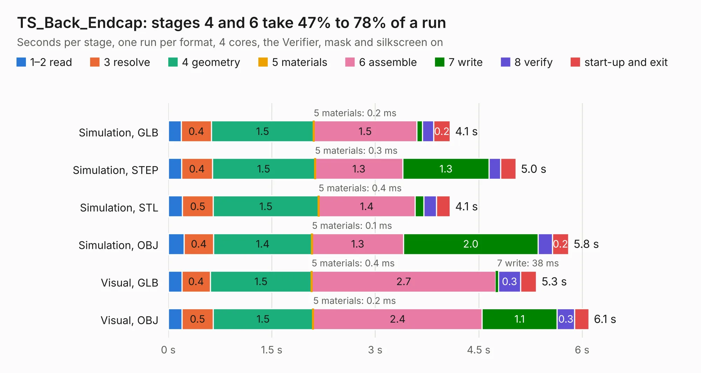

| Mode and format | 1–2 read | 3 resolve | 4 geometry | 5 materials | 6 assemble | 7 write | 8 verify | start-up and exit | Total |
|---|---:|---:|---:|---:|---:|---:|---:|---:|---:|
| Simulation, GLB | 0.2 | 0.4 | 1.5 | 0.2&nbsp;ms | 1.5 | 82&nbsp;ms | 0.2 | 0.2 | 4.1 |
| Simulation, STEP | 0.2 | 0.4 | 1.5 | 0.3&nbsp;ms | 1.3 | 1.3 | 0.2 | 0.2 | 5.0 |
| Simulation, STL | 0.2 | 0.5 | 1.5 | 0.4&nbsp;ms | 1.4 | 0.1 | 0.2 | 0.2 | 4.1 |
| Simulation, OBJ | 0.2 | 0.4 | 1.4 | 0.1&nbsp;ms | 1.3 | 2.0 | 0.2 | 0.2 | 5.8 |
| Visual, GLB | 0.2 | 0.4 | 1.5 | 0.4&nbsp;ms | 2.7 | 38&nbsp;ms | 0.3 | 0.2 | 5.3 |
| Visual, OBJ | 0.2 | 0.5 | 1.5 | 0.2&nbsp;ms | 2.4 | 1.1 | 0.3 | 0.2 | 6.1 |

<table align="center"><tr><td valign="top">

| Board | Repo: [EEVengers/ThunderScope](https://github.com/EEVengers/ThunderScope) Board: `TS_Back_Endcap.kicad_pcb` |
|---|---|
| Folder | Hardware / TS_Back_Endcap |
| Complexity | 257&nbsp;/&nbsp;1000 (size&nbsp;127, features&nbsp;130) |
| KESE&nbsp;features | through vias, padstacks, rounded, trapezoid or chamfered pads, filled zones, curved board outline, TrueType text, stack-up, dielectric εr and tanδ |
| Tested | 9th November 2026 |
| Copper&nbsp;layers | 2 |
| File&nbsp;format | KiCad 9 (20241229) |
| Parts,&nbsp;tracks,&nbsp;vias | 1, 4, 171 |
| Triangles,&nbsp;simulation | 462,308 in 13 parts |
| Verifier | PASS in all six runs |

</td><td valign="top">

<table>
<tr><th>File type</th><th>File size</th><th>Peak memory used</th></tr>
<tr><th colspan="3" align="left">Simulation</th></tr>
<tr><td>GLB</td><td align="right">16&nbsp;MB</td><td align="right">320&nbsp;MB</td></tr>
<tr><td>STEP</td><td align="right">46&nbsp;MB</td><td align="right">336&nbsp;MB</td></tr>
<tr><td>STL</td><td align="right">23&nbsp;MB</td><td align="right">307&nbsp;MB</td></tr>
<tr><td>OBJ</td><td align="right">47&nbsp;MB</td><td align="right">367&nbsp;MB</td></tr>
<tr><th colspan="3" align="left">Visual</th></tr>
<tr><td>GLB</td><td align="right">8.5&nbsp;MB</td><td align="right">270&nbsp;MB</td></tr>
<tr><td>OBJ</td><td align="right">25&nbsp;MB</td><td align="right">275&nbsp;MB</td></tr>
</table>

</td></tr></table>

## 895. TS_Front_Endcap

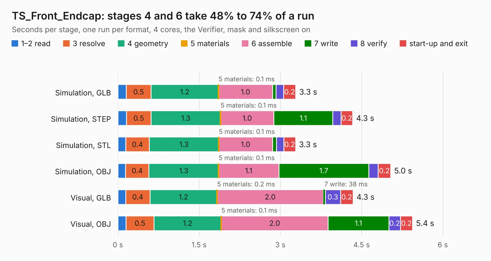

| Mode and format | 1–2 read | 3 resolve | 4 geometry | 5 materials | 6 assemble | 7 write | 8 verify | start-up and exit | Total |
|---|---:|---:|---:|---:|---:|---:|---:|---:|---:|
| Simulation, GLB | 0.2 | 0.5 | 1.2 | 0.1&nbsp;ms | 1.0 | 61&nbsp;ms | 0.1 | 0.2 | 3.3 |
| Simulation, STEP | 0.2 | 0.5 | 1.3 | 0.1&nbsp;ms | 1.0 | 1.1 | 0.2 | 0.2 | 4.3 |
| Simulation, STL | 0.1 | 0.4 | 1.3 | 0.1&nbsp;ms | 1.0 | 72&nbsp;ms | 0.1 | 0.2 | 3.3 |
| Simulation, OBJ | 0.1 | 0.4 | 1.3 | 0.1&nbsp;ms | 1.1 | 1.7 | 0.2 | 0.2 | 5.0 |
| Visual, GLB | 0.1 | 0.4 | 1.2 | 0.2&nbsp;ms | 2.0 | 38&nbsp;ms | 0.3 | 0.2 | 4.3 |
| Visual, OBJ | 0.2 | 0.5 | 1.2 | 0.1&nbsp;ms | 2.0 | 1.1 | 0.2 | 0.2 | 5.4 |

<table align="center"><tr><td valign="top">

| Board | Repo: [EEVengers/ThunderScope](https://github.com/EEVengers/ThunderScope) Board: `TS_Front_Endcap.kicad_pcb` |
|---|---|
| Folder | Hardware / TS_Front_Endcap |
| Complexity | 232&nbsp;/&nbsp;1000 (size&nbsp;132, features&nbsp;100) |
| KESE&nbsp;features | through vias, rounded, trapezoid or chamfered pads, filled zones, curved board outline, TrueType text, stack-up, dielectric εr and tanδ |
| Tested | 9th November 2026 |
| Copper&nbsp;layers | 2 |
| File&nbsp;format | KiCad 9 (20241228) |
| Parts,&nbsp;tracks,&nbsp;vias | 2, 5, 180 |
| Triangles,&nbsp;simulation | 317,676 in 13 parts |
| Verifier | PASS in all six runs |

</td><td valign="top">

<table>
<tr><th>File type</th><th>File size</th><th>Peak memory used</th></tr>
<tr><th colspan="3" align="left">Simulation</th></tr>
<tr><td>GLB</td><td align="right">11&nbsp;MB</td><td align="right">276&nbsp;MB</td></tr>
<tr><td>STEP</td><td align="right">29&nbsp;MB</td><td align="right">281&nbsp;MB</td></tr>
<tr><td>STL</td><td align="right">16&nbsp;MB</td><td align="right">271&nbsp;MB</td></tr>
<tr><td>OBJ</td><td align="right">31&nbsp;MB</td><td align="right">271&nbsp;MB</td></tr>
<tr><th colspan="3" align="left">Visual</th></tr>
<tr><td>GLB</td><td align="right">6.8&nbsp;MB</td><td align="right">226&nbsp;MB</td></tr>
<tr><td>OBJ</td><td align="right">20&nbsp;MB</td><td align="right">225&nbsp;MB</td></tr>
</table>

</td></tr></table>

## 896. TS_FPGA_Module_Rev2

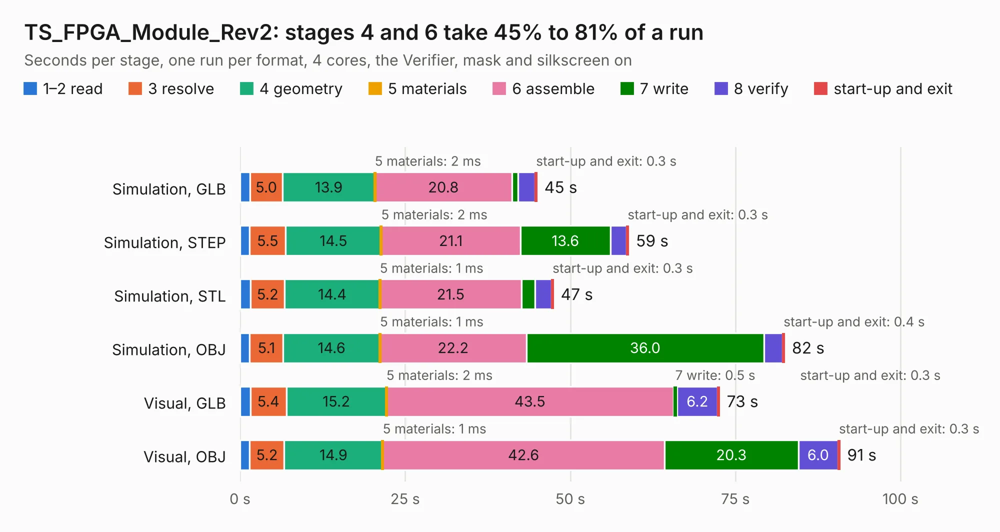

| Mode and format | 1–2 read | 3 resolve | 4 geometry | 5 materials | 6 assemble | 7 write | 8 verify | start-up and exit | Total |
|---|---:|---:|---:|---:|---:|---:|---:|---:|---:|
| Simulation, GLB | 1.5 | 5.0 | 13.9 | 2&nbsp;ms | 20.8 | 0.9 | 2.5 | 0.3 | 45.0 |
| Simulation, STEP | 1.5 | 5.5 | 14.5 | 2&nbsp;ms | 21.1 | 13.6 | 2.4 | 0.3 | 58.9 |
| Simulation, STL | 1.6 | 5.2 | 14.4 | 1&nbsp;ms | 21.5 | 2.0 | 2.5 | 0.3 | 47.5 |
| Simulation, OBJ | 1.5 | 5.1 | 14.6 | 1&nbsp;ms | 22.2 | 36.0 | 2.8 | 0.4 | 82.5 |
| Visual, GLB | 1.6 | 5.4 | 15.2 | 2&nbsp;ms | 43.5 | 0.5 | 6.2 | 0.3 | 72.6 |
| Visual, OBJ | 1.5 | 5.2 | 14.9 | 1&nbsp;ms | 42.6 | 20.3 | 6.0 | 0.3 | 90.8 |

<table align="center"><tr><td valign="top">

| Board | Repo: [EEVengers/ts_hardware_archive](https://github.com/EEVengers/ts_hardware_archive) Board: `TS_FPGA_Module_Rev2.kicad_pcb` |
|---|---|
| Folder | KiCad / FPGA_Module_Rev2 |
| Complexity | 340&nbsp;/&nbsp;1000 (size&nbsp;250, features&nbsp;90) |
| KESE&nbsp;features | through vias, rounded, trapezoid or chamfered pads, arc tracks, filled zones, stack-up, dielectric εr and tanδ |
| Tested | 9th November 2026 |
| Copper&nbsp;layers | 6 |
| File&nbsp;format | KiCad 7 (20221018) |
| Parts,&nbsp;tracks,&nbsp;vias | 170, 8,286, 669 |
| Triangles,&nbsp;simulation | 5,769,364 in 405 parts |
| Verifier | PASS in all six runs |

</td><td valign="top">

<table>
<tr><th>File type</th><th>File size</th><th>Peak memory used</th></tr>
<tr><th colspan="3" align="left">Simulation</th></tr>
<tr><td>GLB</td><td align="right">191&nbsp;MB</td><td align="right">1.6&nbsp;GB</td></tr>
<tr><td>STEP</td><td align="right">710&nbsp;MB</td><td align="right">2.1&nbsp;GB</td></tr>
<tr><td>STL</td><td align="right">289&nbsp;MB</td><td align="right">1.7&nbsp;GB</td></tr>
<tr><td>OBJ</td><td align="right">612&nbsp;MB</td><td align="right">3.6&nbsp;GB</td></tr>
<tr><th colspan="3" align="left">Visual</th></tr>
<tr><td>GLB</td><td align="right">111&nbsp;MB</td><td align="right">1.9&nbsp;GB</td></tr>
<tr><td>OBJ</td><td align="right">361&nbsp;MB</td><td align="right">2.5&nbsp;GB</td></tr>
</table>

</td></tr></table>

## 897. Thunderscope_Rev5.1

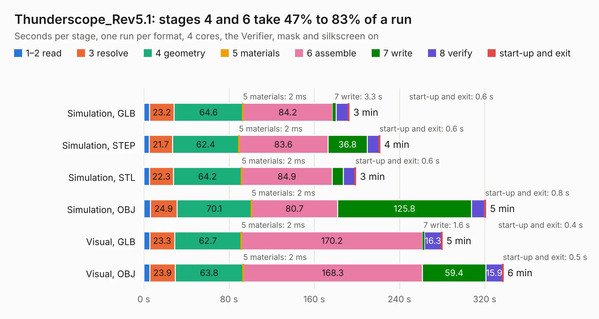

| Mode and format | 1–2 read | 3 resolve | 4 geometry | 5 materials | 6 assemble | 7 write | 8 verify | start-up and exit | Total |
|---|---:|---:|---:|---:|---:|---:|---:|---:|---:|
| Simulation, GLB | 5.3 | 23.2 | 64.6 | 2&nbsp;ms | 84.2 | 3.3 | 11.5 | 0.6 | 192.7 |
| Simulation, STEP | 5.2 | 21.7 | 62.4 | 2&nbsp;ms | 83.6 | 36.8 | 11.4 | 0.6 | 221.6 |
| Simulation, STL | 5.4 | 22.3 | 64.2 | 2&nbsp;ms | 84.9 | 10.4 | 11.2 | 0.6 | 199.0 |
| Simulation, OBJ | 6.2 | 24.9 | 70.1 | 2&nbsp;ms | 80.7 | 125.8 | 12.5 | 0.8 | 320.9 |
| Visual, GLB | 5.5 | 23.3 | 62.7 | 2&nbsp;ms | 170.2 | 1.6 | 16.3 | 0.4 | 280.1 |
| Visual, OBJ | 5.6 | 23.9 | 63.8 | 2&nbsp;ms | 168.3 | 59.4 | 15.9 | 0.5 | 337.4 |

<table align="center"><tr><td valign="top">

| Board | Repo: [EEVengers/ts_hardware_archive](https://github.com/EEVengers/ts_hardware_archive) Board: `Thunderscope_Rev5.1.kicad_pcb` |
|---|---|
| Folder | KiCad / Thunderscope_Rev5.1 |
| Complexity | 514&nbsp;/&nbsp;1000 (size&nbsp;324, features&nbsp;190) |
| KESE&nbsp;features | through vias, padstacks, slotted holes, custom pads, rounded, trapezoid or chamfered pads, arc tracks, filled zones, copper drawings, copper text, curved board outline, TrueType text, stack-up, dielectric εr and tanδ |
| Tested | 9th November 2026 to 10th November 2026 |
| Copper&nbsp;layers | 6 |
| File&nbsp;format | KiCad 9 (20241229) |
| Parts,&nbsp;tracks,&nbsp;vias | 757, 8,814, 3,766 |
| Triangles,&nbsp;simulation | 18,063,610 in 618 parts |
| Verifier | PASS in all six runs |
| Run&nbsp;again | Simulation, OBJ: failed in the corpus run, run again with the memory cap raised from 11 GB to 14.5 GB, and passed |

</td><td valign="top">

<table>
<tr><th>File type</th><th>File size</th><th>Peak memory used</th></tr>
<tr><th colspan="3" align="left">Simulation</th></tr>
<tr><td>GLB</td><td align="right">595&nbsp;MB</td><td align="right">5.3&nbsp;GB</td></tr>
<tr><td>STEP</td><td align="right">1.7&nbsp;GB</td><td align="right">6.5&nbsp;GB</td></tr>
<tr><td>STL</td><td align="right">903&nbsp;MB</td><td align="right">4.8&nbsp;GB</td></tr>
<tr><td>OBJ</td><td align="right">2.0&nbsp;GB</td><td align="right">11&nbsp;GB</td></tr>
<tr><th colspan="3" align="left">Visual</th></tr>
<tr><td>GLB</td><td align="right">322&nbsp;MB</td><td align="right">5.2&nbsp;GB</td></tr>
<tr><td>OBJ</td><td align="right">1.1&nbsp;GB</td><td align="right">6.5&nbsp;GB</td></tr>
</table>

</td></tr></table>

## 898. Thunderscope_Rev5.2

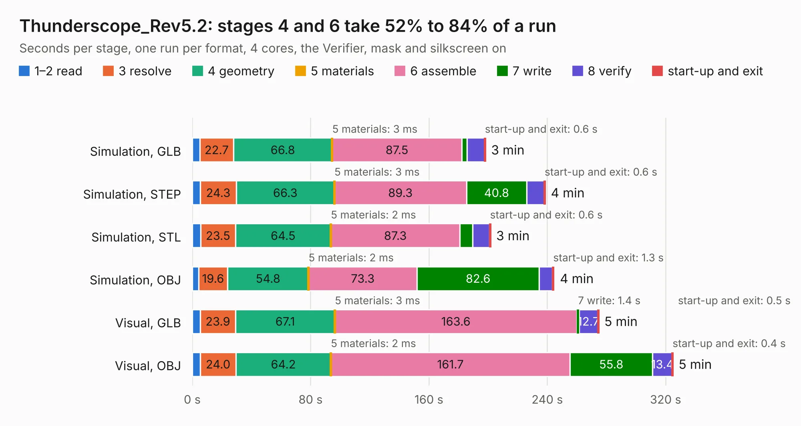

| Mode and format | 1–2 read | 3 resolve | 4 geometry | 5 materials | 6 assemble | 7 write | 8 verify | start-up and exit | Total |
|---|---:|---:|---:|---:|---:|---:|---:|---:|---:|
| Simulation, GLB | 5.1 | 22.7 | 66.8 | 3&nbsp;ms | 87.5 | 3.7 | 11.7 | 0.6 | 198.2 |
| Simulation, STEP | 5.4 | 24.3 | 66.3 | 3&nbsp;ms | 89.3 | 40.8 | 11.8 | 0.6 | 238.6 |
| Simulation, STL | 5.7 | 23.5 | 64.5 | 2&nbsp;ms | 87.3 | 8.5 | 11.6 | 0.6 | 201.6 |
| Simulation, OBJ | 4.2 | 19.6 | 54.8 | 2&nbsp;ms | 73.3 | 82.6 | 8.8 | 1.3 | 244.7 |
| Visual, GLB | 5.4 | 23.9 | 67.1 | 3&nbsp;ms | 163.6 | 1.4 | 12.7 | 0.5 | 274.7 |
| Visual, OBJ | 5.5 | 24.0 | 64.2 | 2&nbsp;ms | 161.7 | 55.8 | 13.4 | 0.4 | 324.9 |

<table align="center"><tr><td valign="top">

| Board | Repo: [EEVengers/ts_hardware_archive](https://github.com/EEVengers/ts_hardware_archive) Board: `Thunderscope_Rev5.2.kicad_pcb` |
|---|---|
| Folder | KiCad / Thunderscope_Rev5.2 |
| Complexity | 514&nbsp;/&nbsp;1000 (size&nbsp;324, features&nbsp;190) |
| KESE&nbsp;features | through vias, padstacks, slotted holes, custom pads, rounded, trapezoid or chamfered pads, arc tracks, filled zones, copper drawings, copper text, curved board outline, TrueType text, stack-up, dielectric εr and tanδ |
| Tested | 9th November 2026 to 10th November 2026 |
| Copper&nbsp;layers | 6 |
| File&nbsp;format | KiCad 9 (20241229) |
| Parts,&nbsp;tracks,&nbsp;vias | 765, 8,886, 3,810 |
| Triangles,&nbsp;simulation | 18,239,728 in 618 parts |
| Verifier | PASS in all six runs |
| Run&nbsp;again | Simulation, OBJ: failed in the corpus run, run again with the memory cap raised from 11 GB to 14.5 GB, and passed |

</td><td valign="top">

<table>
<tr><th>File type</th><th>File size</th><th>Peak memory used</th></tr>
<tr><th colspan="3" align="left">Simulation</th></tr>
<tr><td>GLB</td><td align="right">601&nbsp;MB</td><td align="right">4.8&nbsp;GB</td></tr>
<tr><td>STEP</td><td align="right">1.7&nbsp;GB</td><td align="right">6.5&nbsp;GB</td></tr>
<tr><td>STL</td><td align="right">912&nbsp;MB</td><td align="right">4.9&nbsp;GB</td></tr>
<tr><td>OBJ</td><td align="right">2.0&nbsp;GB</td><td align="right">12&nbsp;GB</td></tr>
<tr><th colspan="3" align="left">Visual</th></tr>
<tr><td>GLB</td><td align="right">326&nbsp;MB</td><td align="right">5.3&nbsp;GB</td></tr>
<tr><td>OBJ</td><td align="right">1.1&nbsp;GB</td><td align="right">6.5&nbsp;GB</td></tr>
</table>

</td></tr></table>

## 899. Thunderscope_Rev5

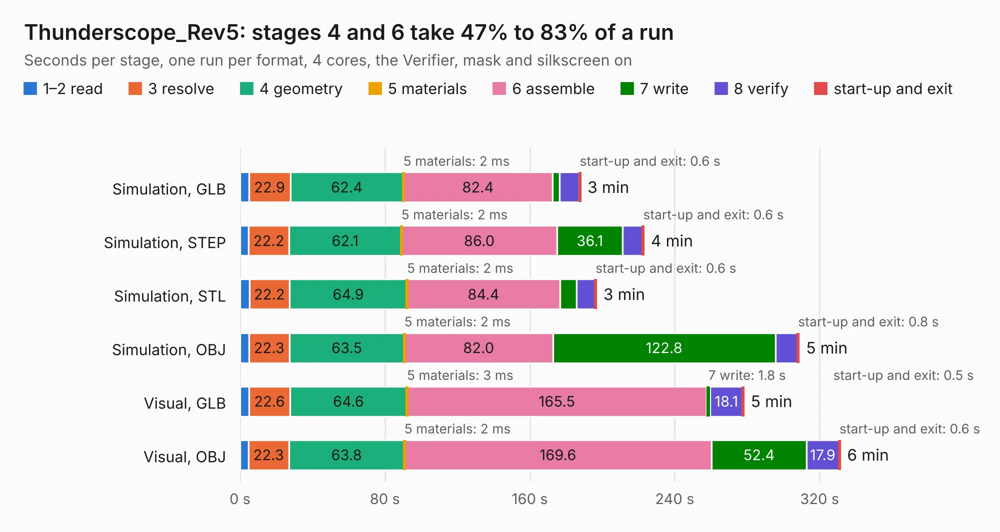

| Mode and format | 1–2 read | 3 resolve | 4 geometry | 5 materials | 6 assemble | 7 write | 8 verify | start-up and exit | Total |
|---|---:|---:|---:|---:|---:|---:|---:|---:|---:|
| Simulation, GLB | 4.8 | 22.9 | 62.4 | 2&nbsp;ms | 82.4 | 3.8 | 10.9 | 0.6 | 187.9 |
| Simulation, STEP | 4.8 | 22.2 | 62.1 | 2&nbsp;ms | 86.0 | 36.1 | 11.1 | 0.6 | 222.9 |
| Simulation, STL | 5.1 | 22.2 | 64.9 | 2&nbsp;ms | 84.4 | 9.0 | 10.4 | 0.6 | 196.7 |
| Simulation, OBJ | 4.9 | 22.3 | 63.5 | 2&nbsp;ms | 82.0 | 122.8 | 12.2 | 0.8 | 308.6 |
| Visual, GLB | 4.9 | 22.6 | 64.6 | 3&nbsp;ms | 165.5 | 1.8 | 18.1 | 0.5 | 278.0 |
| Visual, OBJ | 4.7 | 22.3 | 63.8 | 2&nbsp;ms | 169.6 | 52.4 | 17.9 | 0.6 | 331.3 |

<table align="center"><tr><td valign="top">

| Board | Repo: [EEVengers/ts_hardware_archive](https://github.com/EEVengers/ts_hardware_archive) Board: `Thunderscope_Rev5.kicad_pcb` |
|---|---|
| Folder | KiCad / Thunderscope_Rev5 |
| Complexity | 488&nbsp;/&nbsp;1000 (size&nbsp;323, features&nbsp;165) |
| KESE&nbsp;features | through vias, padstacks, slotted holes, rounded, trapezoid or chamfered pads, arc tracks, filled zones, copper text, curved board outline, TrueType text, stack-up, dielectric εr and tanδ |
| Tested | 9th November 2026 to 10th November 2026 |
| Copper&nbsp;layers | 6 |
| File&nbsp;format | KiCad 9 (20241229) |
| Parts,&nbsp;tracks,&nbsp;vias | 698, 8,782, 3,768 |
| Triangles,&nbsp;simulation | 18,033,920 in 603 parts |
| Verifier | PASS in all six runs |
| Run&nbsp;again | Simulation, OBJ: failed in the corpus run, run again with the memory cap raised from 11 GB to 14.5 GB, and passed |

</td><td valign="top">

<table>
<tr><th>File type</th><th>File size</th><th>Peak memory used</th></tr>
<tr><th colspan="3" align="left">Simulation</th></tr>
<tr><td>GLB</td><td align="right">594&nbsp;MB</td><td align="right">5.1&nbsp;GB</td></tr>
<tr><td>STEP</td><td align="right">1.7&nbsp;GB</td><td align="right">6.3&nbsp;GB</td></tr>
<tr><td>STL</td><td align="right">902&nbsp;MB</td><td align="right">5.3&nbsp;GB</td></tr>
<tr><td>OBJ</td><td align="right">2.0&nbsp;GB</td><td align="right">11&nbsp;GB</td></tr>
<tr><th colspan="3" align="left">Visual</th></tr>
<tr><td>GLB</td><td align="right">321&nbsp;MB</td><td align="right">5.2&nbsp;GB</td></tr>
<tr><td>OBJ</td><td align="right">1.1&nbsp;GB</td><td align="right">6.7&nbsp;GB</td></tr>
</table>

</td></tr></table>

## 900. Thunderscope_Rev5_Mech_Model

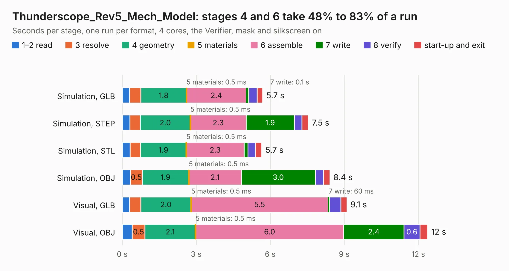

| Mode and format | 1–2 read | 3 resolve | 4 geometry | 5 materials | 6 assemble | 7 write | 8 verify | start-up and exit | Total |
|---|---:|---:|---:|---:|---:|---:|---:|---:|---:|
| Simulation, GLB | 0.3 | 0.5 | 1.8 | 0.5&nbsp;ms | 2.4 | 0.1 | 0.3 | 0.2 | 5.7 |
| Simulation, STEP | 0.3 | 0.4 | 2.0 | 0.5&nbsp;ms | 2.3 | 1.9 | 0.3 | 0.3 | 7.5 |
| Simulation, STL | 0.3 | 0.4 | 1.9 | 0.5&nbsp;ms | 2.3 | 0.2 | 0.3 | 0.3 | 5.7 |
| Simulation, OBJ | 0.3 | 0.5 | 1.9 | 0.5&nbsp;ms | 2.1 | 3.0 | 0.3 | 0.3 | 8.4 |
| Visual, GLB | 0.3 | 0.5 | 2.0 | 0.5&nbsp;ms | 5.5 | 60&nbsp;ms | 0.5 | 0.2 | 9.1 |
| Visual, OBJ | 0.4 | 0.5 | 2.1 | 0.5&nbsp;ms | 6.0 | 2.4 | 0.6 | 0.3 | 12.4 |

<table align="center"><tr><td valign="top">

| Board | Repo: [EEVengers/ts_hardware_archive](https://github.com/EEVengers/ts_hardware_archive) Board: `Thunderscope_Rev5_Mech_Model.kicad_pcb` |
|---|---|
| Folder | KiCad / Thunderscope_Rev5_Mech_Model |
| Complexity | 228&nbsp;/&nbsp;1000 (size&nbsp;98, features&nbsp;130) |
| KESE&nbsp;features | padstacks, rounded, trapezoid or chamfered pads, arc tracks, filled zones, curved board outline, TrueType text, stack-up, dielectric εr and tanδ |
| Tested | 9th November 2026 |
| Copper&nbsp;layers | 2 |
| File&nbsp;format | KiCad 9 (20241228) |
| Parts,&nbsp;tracks,&nbsp;vias | 20, 18, 0 |
| Triangles,&nbsp;simulation | 524,420 in 183 parts |
| Verifier | PASS in all six runs |

</td><td valign="top">

<table>
<tr><th>File type</th><th>File size</th><th>Peak memory used</th></tr>
<tr><th colspan="3" align="left">Simulation</th></tr>
<tr><td>GLB</td><td align="right">18&nbsp;MB</td><td align="right">316&nbsp;MB</td></tr>
<tr><td>STEP</td><td align="right">83&nbsp;MB</td><td align="right">374&nbsp;MB</td></tr>
<tr><td>STL</td><td align="right">26&nbsp;MB</td><td align="right">343&nbsp;MB</td></tr>
<tr><td>OBJ</td><td align="right">53&nbsp;MB</td><td align="right">402&nbsp;MB</td></tr>
<tr><th colspan="3" align="left">Visual</th></tr>
<tr><td>GLB</td><td align="right">13&nbsp;MB</td><td align="right">388&nbsp;MB</td></tr>
<tr><td>OBJ</td><td align="right">38&nbsp;MB</td><td align="right">383&nbsp;MB</td></tr>
</table>

</td></tr></table>

## 901. HMCAD1520_Impedence_Checker

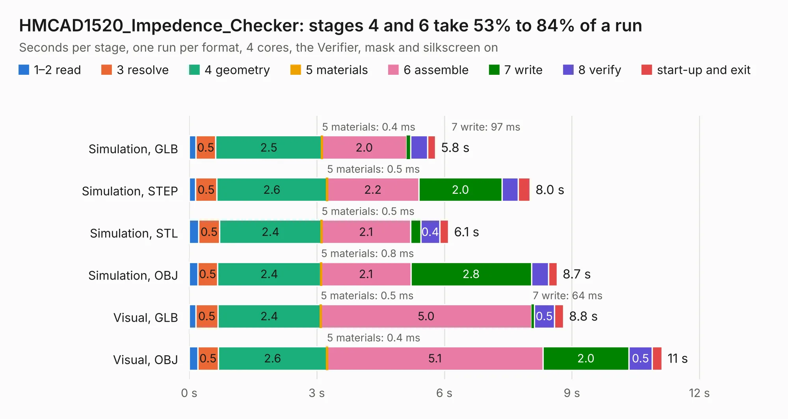

| Mode and format | 1–2 read | 3 resolve | 4 geometry | 5 materials | 6 assemble | 7 write | 8 verify | start-up and exit | Total |
|---|---:|---:|---:|---:|---:|---:|---:|---:|---:|
| Simulation, GLB | 0.2 | 0.5 | 2.5 | 0.4&nbsp;ms | 2.0 | 97&nbsp;ms | 0.4 | 0.2 | 5.8 |
| Simulation, STEP | 0.1 | 0.5 | 2.6 | 0.5&nbsp;ms | 2.2 | 2.0 | 0.4 | 0.3 | 8.0 |
| Simulation, STL | 0.2 | 0.5 | 2.4 | 0.5&nbsp;ms | 2.1 | 0.2 | 0.4 | 0.2 | 6.1 |
| Simulation, OBJ | 0.2 | 0.5 | 2.4 | 0.8&nbsp;ms | 2.1 | 2.8 | 0.4 | 0.2 | 8.7 |
| Visual, GLB | 0.2 | 0.5 | 2.4 | 0.5&nbsp;ms | 5.0 | 64&nbsp;ms | 0.5 | 0.2 | 8.8 |
| Visual, OBJ | 0.2 | 0.5 | 2.6 | 0.4&nbsp;ms | 5.1 | 2.0 | 0.5 | 0.2 | 11.1 |

<table align="center"><tr><td valign="top">

| Board | Repo: [EEVengers/ts_test_fixtures](https://github.com/EEVengers/ts_test_fixtures) Board: `HMCAD1520_Impedence_Checker.kicad_pcb` |
|---|---|
| Folder | HMCAD1520_Impedence_Checker |
| Complexity | 223&nbsp;/&nbsp;1000 (size&nbsp;138, features&nbsp;85) |
| KESE&nbsp;features | through vias, rounded, trapezoid or chamfered pads, drill offsets, filled zones, stack-up, dielectric εr and tanδ |
| Tested | 9th November 2026 |
| Copper&nbsp;layers | 2 |
| File&nbsp;format | KiCad 8 (20240108) |
| Parts,&nbsp;tracks,&nbsp;vias | 24, 164, 8 |
| Triangles,&nbsp;simulation | 651,784 in 134 parts |
| Verifier | PASS in all six runs |

</td><td valign="top">

<table>
<tr><th>File type</th><th>File size</th><th>Peak memory used</th></tr>
<tr><th colspan="3" align="left">Simulation</th></tr>
<tr><td>GLB</td><td align="right">21&nbsp;MB</td><td align="right">364&nbsp;MB</td></tr>
<tr><td>STEP</td><td align="right">94&nbsp;MB</td><td align="right">395&nbsp;MB</td></tr>
<tr><td>STL</td><td align="right">33&nbsp;MB</td><td align="right">348&nbsp;MB</td></tr>
<tr><td>OBJ</td><td align="right">65&nbsp;MB</td><td align="right">467&nbsp;MB</td></tr>
<tr><th colspan="3" align="left">Visual</th></tr>
<tr><td>GLB</td><td align="right">14&nbsp;MB</td><td align="right">408&nbsp;MB</td></tr>
<tr><td>OBJ</td><td align="right">41&nbsp;MB</td><td align="right">439&nbsp;MB</td></tr>
</table>

</td></tr></table>

## 902. Interposer_Board_Test_Fixture

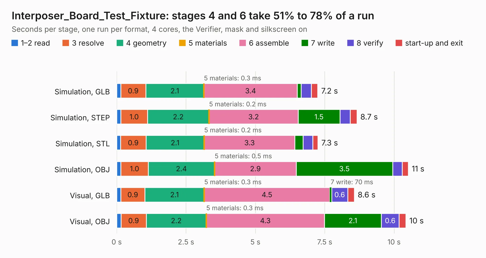

| Mode and format | 1–2 read | 3 resolve | 4 geometry | 5 materials | 6 assemble | 7 write | 8 verify | start-up and exit | Total |
|---|---:|---:|---:|---:|---:|---:|---:|---:|---:|
| Simulation, GLB | 0.1 | 0.9 | 2.1 | 0.3&nbsp;ms | 3.4 | 0.1 | 0.4 | 0.2 | 7.2 |
| Simulation, STEP | 0.2 | 1.0 | 2.2 | 0.2&nbsp;ms | 3.2 | 1.5 | 0.4 | 0.2 | 8.7 |
| Simulation, STL | 0.1 | 0.9 | 2.1 | 0.2&nbsp;ms | 3.3 | 0.3 | 0.4 | 0.2 | 7.3 |
| Simulation, OBJ | 0.2 | 1.0 | 2.4 | 0.5&nbsp;ms | 2.9 | 3.5 | 0.3 | 0.2 | 10.5 |
| Visual, GLB | 0.1 | 0.9 | 2.1 | 0.3&nbsp;ms | 4.5 | 70&nbsp;ms | 0.6 | 0.2 | 8.6 |
| Visual, OBJ | 0.2 | 0.9 | 2.2 | 0.3&nbsp;ms | 4.3 | 2.1 | 0.6 | 0.2 | 10.4 |

<table align="center"><tr><td valign="top">

| Board | Repo: [EEVengers/ts_test_fixtures](https://github.com/EEVengers/ts_test_fixtures) Board: `Interposer_Board_Test_Fixture.kicad_pcb` |
|---|---|
| Folder | Interposer_Board_Test_Fixture |
| Complexity | 266&nbsp;/&nbsp;1000 (size&nbsp;176, features&nbsp;90) |
| KESE&nbsp;features | through vias, arc tracks, filled zones, curved board outline, stack-up, dielectric εr and tanδ |
| Tested | 9th November 2026 |
| Copper&nbsp;layers | 4 |
| File&nbsp;format | KiCad 9 (20241229) |
| Parts,&nbsp;tracks,&nbsp;vias | 7, 444, 355 |
| Triangles,&nbsp;simulation | 923,008 in 100 parts |
| Verifier | PASS in all six runs |

</td><td valign="top">

<table>
<tr><th>File type</th><th>File size</th><th>Peak memory used</th></tr>
<tr><th colspan="3" align="left">Simulation</th></tr>
<tr><td>GLB</td><td align="right">31&nbsp;MB</td><td align="right">458&nbsp;MB</td></tr>
<tr><td>STEP</td><td align="right">63&nbsp;MB</td><td align="right">552&nbsp;MB</td></tr>
<tr><td>STL</td><td align="right">46&nbsp;MB</td><td align="right">460&nbsp;MB</td></tr>
<tr><td>OBJ</td><td align="right">92&nbsp;MB</td><td align="right">639&nbsp;MB</td></tr>
<tr><th colspan="3" align="left">Visual</th></tr>
<tr><td>GLB</td><td align="right">17&nbsp;MB</td><td align="right">470&nbsp;MB</td></tr>
<tr><td>OBJ</td><td align="right">51&nbsp;MB</td><td align="right">467&nbsp;MB</td></tr>
</table>

</td></tr></table>

## 903. Thunderscope Digital Test

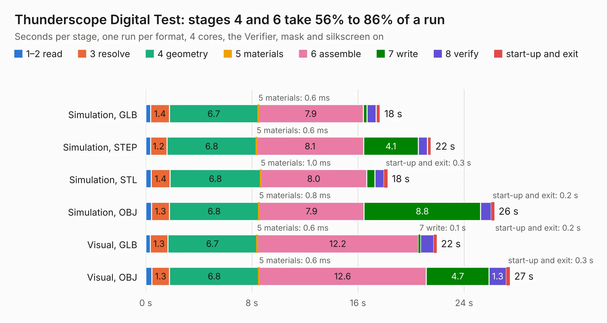

| Mode and format | 1–2 read | 3 resolve | 4 geometry | 5 materials | 6 assemble | 7 write | 8 verify | start-up and exit | Total |
|---|---:|---:|---:|---:|---:|---:|---:|---:|---:|
| Simulation, GLB | 0.4 | 1.4 | 6.7 | 0.6&nbsp;ms | 7.9 | 0.3 | 0.7 | 0.3 | 17.7 |
| Simulation, STEP | 0.4 | 1.2 | 6.8 | 0.6&nbsp;ms | 8.1 | 4.1 | 0.7 | 0.3 | 21.5 |
| Simulation, STL | 0.4 | 1.4 | 6.8 | 1.0&nbsp;ms | 8.0 | 0.6 | 0.7 | 0.3 | 18.2 |
| Simulation, OBJ | 0.4 | 1.3 | 6.8 | 0.8&nbsp;ms | 7.9 | 8.8 | 0.8 | 0.2 | 26.3 |
| Visual, GLB | 0.3 | 1.3 | 6.7 | 0.6&nbsp;ms | 12.2 | 0.1 | 1.0 | 0.2 | 21.9 |
| Visual, OBJ | 0.5 | 1.3 | 6.8 | 0.6&nbsp;ms | 12.6 | 4.7 | 1.3 | 0.3 | 27.5 |

<table align="center"><tr><td valign="top">

| Board | Repo: [EEVengers/ts_test_fixtures](https://github.com/EEVengers/ts_test_fixtures) Board: `Thunderscope Digital Test.kicad_pcb` |
|---|---|
| Folder | Thunderscope Digital Test Fixture / Thunderscope Digital Test |
| Complexity | 322&nbsp;/&nbsp;1000 (size&nbsp;232, features&nbsp;90) |
| KESE&nbsp;features | through vias, rounded, trapezoid or chamfered pads, filled zones, TrueType text, stack-up, dielectric εr and tanδ |
| Tested | 9th November 2026 |
| Copper&nbsp;layers | 4 |
| File&nbsp;format | KiCad 9 (20241229) |
| Parts,&nbsp;tracks,&nbsp;vias | 68, 750, 80 |
| Triangles,&nbsp;simulation | 1,825,262 in 167 parts |
| Verifier | PASS in all six runs |

</td><td valign="top">

<table>
<tr><th>File type</th><th>File size</th><th>Peak memory used</th></tr>
<tr><th colspan="3" align="left">Simulation</th></tr>
<tr><td>GLB</td><td align="right">61&nbsp;MB</td><td align="right">610&nbsp;MB</td></tr>
<tr><td>STEP</td><td align="right">222&nbsp;MB</td><td align="right">795&nbsp;MB</td></tr>
<tr><td>STL</td><td align="right">91&nbsp;MB</td><td align="right">604&nbsp;MB</td></tr>
<tr><td>OBJ</td><td align="right">188&nbsp;MB</td><td align="right">1.2&nbsp;GB</td></tr>
<tr><th colspan="3" align="left">Visual</th></tr>
<tr><td>GLB</td><td align="right">31&nbsp;MB</td><td align="right">776&nbsp;MB</td></tr>
<tr><td>OBJ</td><td align="right">95&nbsp;MB</td><td align="right">729&nbsp;MB</td></tr>
</table>

</td></tr></table>

## 904. ThunderScope Muxboard

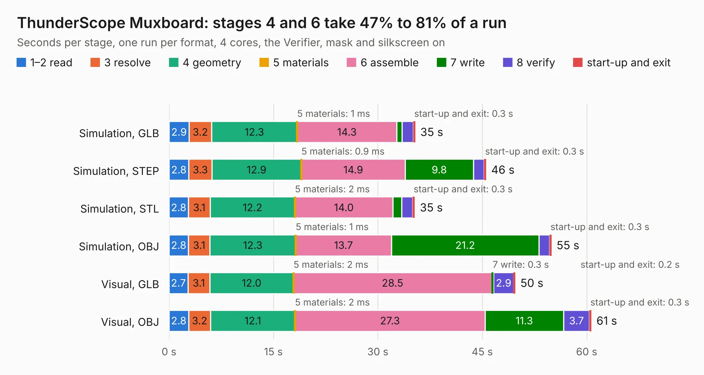

| Mode and format | 1–2 read | 3 resolve | 4 geometry | 5 materials | 6 assemble | 7 write | 8 verify | start-up and exit | Total |
|---|---:|---:|---:|---:|---:|---:|---:|---:|---:|
| Simulation, GLB | 2.9 | 3.2 | 12.3 | 1&nbsp;ms | 14.3 | 0.8 | 1.6 | 0.3 | 35.4 |
| Simulation, STEP | 2.8 | 3.3 | 12.9 | 0.9&nbsp;ms | 14.9 | 9.8 | 1.5 | 0.3 | 45.6 |
| Simulation, STL | 2.8 | 3.1 | 12.2 | 2&nbsp;ms | 14.0 | 1.3 | 1.6 | 0.3 | 35.3 |
| Simulation, OBJ | 2.8 | 3.1 | 12.3 | 1&nbsp;ms | 13.7 | 21.2 | 1.5 | 0.3 | 54.9 |
| Visual, GLB | 2.7 | 3.1 | 12.0 | 2&nbsp;ms | 28.5 | 0.3 | 2.9 | 0.2 | 49.7 |
| Visual, OBJ | 2.8 | 3.2 | 12.1 | 2&nbsp;ms | 27.3 | 11.3 | 3.7 | 0.3 | 60.7 |

<table align="center"><tr><td valign="top">

| Board | Repo: [EEVengers/ts_test_fixtures](https://github.com/EEVengers/ts_test_fixtures) Board: `ThunderScope Muxboard.kicad_pcb` |
|---|---|
| Folder | ThunderScope MUXboard |
| Complexity | 295&nbsp;/&nbsp;1000 (size&nbsp;220, features&nbsp;75) |
| KESE&nbsp;features | through vias, rounded, trapezoid or chamfered pads, filled zones, stack-up, dielectric εr and tanδ |
| Tested | 9th November 2026 |
| Copper&nbsp;layers | 4 |
| File&nbsp;format | KiCad 9 (20241229) |
| Parts,&nbsp;tracks,&nbsp;vias | 167, 1,860, 395 |
| Triangles,&nbsp;simulation | 3,883,746 in 427 parts |
| Verifier | PASS in all six runs |

</td><td valign="top">

<table>
<tr><th>File type</th><th>File size</th><th>Peak memory used</th></tr>
<tr><th colspan="3" align="left">Simulation</th></tr>
<tr><td>GLB</td><td align="right">127&nbsp;MB</td><td align="right">1.2&nbsp;GB</td></tr>
<tr><td>STEP</td><td align="right">437&nbsp;MB</td><td align="right">1.5&nbsp;GB</td></tr>
<tr><td>STL</td><td align="right">194&nbsp;MB</td><td align="right">1.2&nbsp;GB</td></tr>
<tr><td>OBJ</td><td align="right">407&nbsp;MB</td><td align="right">2.6&nbsp;GB</td></tr>
<tr><th colspan="3" align="left">Visual</th></tr>
<tr><td>GLB</td><td align="right">71&nbsp;MB</td><td align="right">1.4&nbsp;GB</td></tr>
<tr><td>OBJ</td><td align="right">226&nbsp;MB</td><td align="right">1.6&nbsp;GB</td></tr>
</table>

</td></tr></table>

## 905. Thunderscope_Rev5.1_Bed_Of_Nails

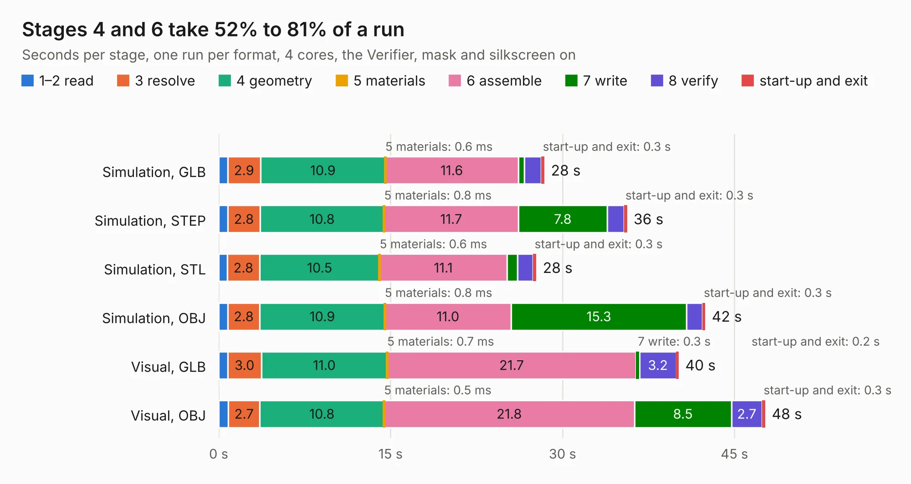

| Mode and format | 1–2 read | 3 resolve | 4 geometry | 5 materials | 6 assemble | 7 write | 8 verify | start-up and exit | Total |
|---|---:|---:|---:|---:|---:|---:|---:|---:|---:|
| Simulation, GLB | 0.8 | 2.9 | 10.9 | 0.6&nbsp;ms | 11.6 | 0.6 | 1.5 | 0.3 | 28.4 |
| Simulation, STEP | 0.8 | 2.8 | 10.8 | 0.8&nbsp;ms | 11.7 | 7.8 | 1.4 | 0.3 | 35.6 |
| Simulation, STL | 0.7 | 2.8 | 10.5 | 0.6&nbsp;ms | 11.1 | 0.9 | 1.3 | 0.3 | 27.7 |
| Simulation, OBJ | 0.8 | 2.8 | 10.9 | 0.8&nbsp;ms | 11.0 | 15.3 | 1.4 | 0.3 | 42.5 |
| Visual, GLB | 0.8 | 3.0 | 11.0 | 0.7&nbsp;ms | 21.7 | 0.3 | 3.2 | 0.2 | 40.1 |
| Visual, OBJ | 0.8 | 2.7 | 10.8 | 0.5&nbsp;ms | 21.8 | 8.5 | 2.7 | 0.3 | 47.7 |

<table align="center"><tr><td valign="top">

| Board | Repo: [EEVengers/ts_test_fixtures](https://github.com/EEVengers/ts_test_fixtures) Board: `Thunderscope_Rev5.1_Bed_Of_Nails.kicad_pcb` |
|---|---|
| Folder | Thunderscope_Rev5.1_Bed_Of_Nails_Adaptor |
| Complexity | 295&nbsp;/&nbsp;1000 (size&nbsp;205, features&nbsp;90) |
| KESE&nbsp;features | through vias, rounded, trapezoid or chamfered pads, filled zones, TrueType text, stack-up, dielectric εr and tanδ |
| Tested | 9th November 2026 |
| Copper&nbsp;layers | 4 |
| File&nbsp;format | KiCad 9 (20241229) |
| Parts,&nbsp;tracks,&nbsp;vias | 170, 595, 202 |
| Triangles,&nbsp;simulation | 3,683,612 in 177 parts |
| Verifier | PASS in all six runs |

</td><td valign="top">

<table>
<tr><th>File type</th><th>File size</th><th>Peak memory used</th></tr>
<tr><th colspan="3" align="left">Simulation</th></tr>
<tr><td>GLB</td><td align="right">123&nbsp;MB</td><td align="right">1.1&nbsp;GB</td></tr>
<tr><td>STEP</td><td align="right">452&nbsp;MB</td><td align="right">1.5&nbsp;GB</td></tr>
<tr><td>STL</td><td align="right">184&nbsp;MB</td><td align="right">1.2&nbsp;GB</td></tr>
<tr><td>OBJ</td><td align="right">386&nbsp;MB</td><td align="right">2.3&nbsp;GB</td></tr>
<tr><th colspan="3" align="left">Visual</th></tr>
<tr><td>GLB</td><td align="right">70&nbsp;MB</td><td align="right">1.2&nbsp;GB</td></tr>
<tr><td>OBJ</td><td align="right">217&nbsp;MB</td><td align="right">1.5&nbsp;GB</td></tr>
</table>

</td></tr></table>

## 906. EEZ DIB DCP405plus front mask (Basic)

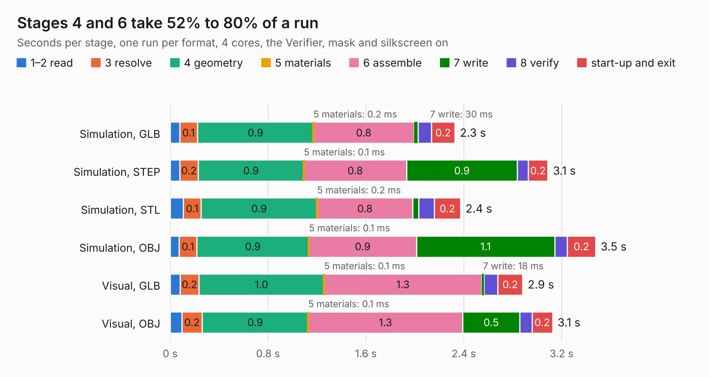

| Mode and format | 1–2 read | 3 resolve | 4 geometry | 5 materials | 6 assemble | 7 write | 8 verify | start-up and exit | Total |
|---|---:|---:|---:|---:|---:|---:|---:|---:|---:|
| Simulation, GLB | 77&nbsp;ms | 0.1 | 0.9 | 0.2&nbsp;ms | 0.8 | 30&nbsp;ms | 0.1 | 0.2 | 2.3 |
| Simulation, STEP | 78&nbsp;ms | 0.2 | 0.9 | 0.1&nbsp;ms | 0.8 | 0.9 | 87&nbsp;ms | 0.2 | 3.1 |
| Simulation, STL | 0.1 | 0.1 | 0.9 | 0.2&nbsp;ms | 0.8 | 48&nbsp;ms | 0.1 | 0.2 | 2.4 |
| Simulation, OBJ | 74&nbsp;ms | 0.1 | 0.9 | 0.1&nbsp;ms | 0.9 | 1.1 | 0.1 | 0.2 | 3.5 |
| Visual, GLB | 81&nbsp;ms | 0.2 | 1.0 | 0.1&nbsp;ms | 1.3 | 18&nbsp;ms | 0.1 | 0.2 | 2.9 |
| Visual, OBJ | 94&nbsp;ms | 0.2 | 0.9 | 0.1&nbsp;ms | 1.3 | 0.5 | 0.1 | 0.2 | 3.1 |

<table align="center"><tr><td valign="top">

| Board | Repo: [eez-open/dib-dcp405plus](https://github.com/eez-open/dib-dcp405plus) Board: `EEZ DIB DCP405plus front mask (Basic).kicad_pcb` |
|---|---|
| Folder | KiCad |
| Complexity | 103&nbsp;/&nbsp;1000 (size&nbsp;38, features&nbsp;65) |
| KESE&nbsp;features | filled zones, curved board outline, stack-up, dielectric εr and tanδ, mask and silkscreen colours |
| Tested | 9th November 2026 |
| Copper&nbsp;layers | 2 |
| File&nbsp;format | KiCad 10 (20260206) |
| Parts,&nbsp;tracks,&nbsp;vias | 6, 0, 0 |
| Triangles,&nbsp;simulation | 217,728 in 11 parts |
| Verifier | PASS in all six runs |

</td><td valign="top">

<table>
<tr><th>File type</th><th>File size</th><th>Peak memory used</th></tr>
<tr><th colspan="3" align="left">Simulation</th></tr>
<tr><td>GLB</td><td align="right">7.3&nbsp;MB</td><td align="right">193&nbsp;MB</td></tr>
<tr><td>STEP</td><td align="right">28&nbsp;MB</td><td align="right">213&nbsp;MB</td></tr>
<tr><td>STL</td><td align="right">11&nbsp;MB</td><td align="right">198&nbsp;MB</td></tr>
<tr><td>OBJ</td><td align="right">21&nbsp;MB</td><td align="right">198&nbsp;MB</td></tr>
<tr><th colspan="3" align="left">Visual</th></tr>
<tr><td>GLB</td><td align="right">3.2&nbsp;MB</td><td align="right">145&nbsp;MB</td></tr>
<tr><td>OBJ</td><td align="right">9.1&nbsp;MB</td><td align="right">146&nbsp;MB</td></tr>
</table>

</td></tr></table>

## 907. EEZ DIB DCP405plus front mask

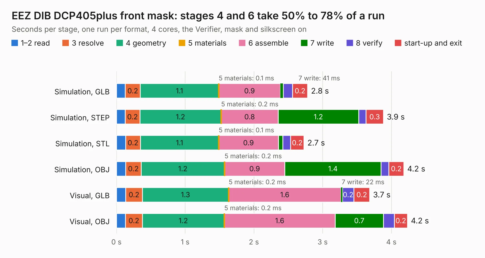

| Mode and format | 1–2 read | 3 resolve | 4 geometry | 5 materials | 6 assemble | 7 write | 8 verify | start-up and exit | Total |
|---|---:|---:|---:|---:|---:|---:|---:|---:|---:|
| Simulation, GLB | 0.1 | 0.2 | 1.1 | 0.1&nbsp;ms | 0.9 | 41&nbsp;ms | 0.1 | 0.2 | 2.8 |
| Simulation, STEP | 0.1 | 0.2 | 1.2 | 0.2&nbsp;ms | 0.8 | 1.2 | 0.1 | 0.3 | 3.9 |
| Simulation, STL | 0.1 | 0.2 | 1.1 | 0.1&nbsp;ms | 0.9 | 65&nbsp;ms | 0.1 | 0.2 | 2.7 |
| Simulation, OBJ | 0.1 | 0.2 | 1.2 | 0.2&nbsp;ms | 0.9 | 1.4 | 0.1 | 0.2 | 4.2 |
| Visual, GLB | 0.1 | 0.2 | 1.3 | 0.2&nbsp;ms | 1.6 | 22&nbsp;ms | 0.2 | 0.2 | 3.7 |
| Visual, OBJ | 0.1 | 0.2 | 1.2 | 0.2&nbsp;ms | 1.6 | 0.7 | 0.2 | 0.2 | 4.2 |

<table align="center"><tr><td valign="top">

| Board | Repo: [eez-open/dib-dcp405plus](https://github.com/eez-open/dib-dcp405plus) Board: `EEZ DIB DCP405plus front mask.kicad_pcb` |
|---|---|
| Folder | KiCad |
| Complexity | 103&nbsp;/&nbsp;1000 (size&nbsp;38, features&nbsp;65) |
| KESE&nbsp;features | filled zones, curved board outline, stack-up, dielectric εr and tanδ, mask and silkscreen colours |
| Tested | 9th November 2026 |
| Copper&nbsp;layers | 2 |
| File&nbsp;format | KiCad 10 (20260206) |
| Parts,&nbsp;tracks,&nbsp;vias | 6, 0, 0 |
| Triangles,&nbsp;simulation | 256,028 in 11 parts |
| Verifier | PASS in all six runs |

</td><td valign="top">

<table>
<tr><th>File type</th><th>File size</th><th>Peak memory used</th></tr>
<tr><th colspan="3" align="left">Simulation</th></tr>
<tr><td>GLB</td><td align="right">8.6&nbsp;MB</td><td align="right">213&nbsp;MB</td></tr>
<tr><td>STEP</td><td align="right">36&nbsp;MB</td><td align="right">236&nbsp;MB</td></tr>
<tr><td>STL</td><td align="right">13&nbsp;MB</td><td align="right">211&nbsp;MB</td></tr>
<tr><td>OBJ</td><td align="right">25&nbsp;MB</td><td align="right">211&nbsp;MB</td></tr>
<tr><th colspan="3" align="left">Visual</th></tr>
<tr><td>GLB</td><td align="right">4.5&nbsp;MB</td><td align="right">155&nbsp;MB</td></tr>
<tr><td>OBJ</td><td align="right">13&nbsp;MB</td><td align="right">162&nbsp;MB</td></tr>
</table>

</td></tr></table>

## 908. EEZ DIB DCP405plus

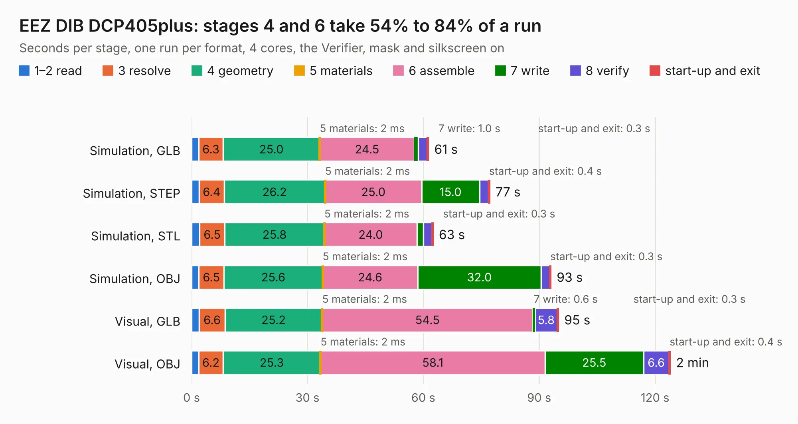

| Mode and format | 1–2 read | 3 resolve | 4 geometry | 5 materials | 6 assemble | 7 write | 8 verify | start-up and exit | Total |
|---|---:|---:|---:|---:|---:|---:|---:|---:|---:|
| Simulation, GLB | 1.9 | 6.3 | 25.0 | 2&nbsp;ms | 24.5 | 1.0 | 2.4 | 0.3 | 61.4 |
| Simulation, STEP | 2.0 | 6.4 | 26.2 | 2&nbsp;ms | 25.0 | 15.0 | 2.3 | 0.4 | 77.2 |
| Simulation, STL | 2.1 | 6.5 | 25.8 | 2&nbsp;ms | 24.0 | 1.6 | 2.2 | 0.3 | 62.5 |
| Simulation, OBJ | 1.9 | 6.5 | 25.6 | 2&nbsp;ms | 24.6 | 32.0 | 2.2 | 0.3 | 93.1 |
| Visual, GLB | 2.0 | 6.6 | 25.2 | 2&nbsp;ms | 54.5 | 0.6 | 5.8 | 0.3 | 95.0 |
| Visual, OBJ | 1.9 | 6.2 | 25.3 | 2&nbsp;ms | 58.1 | 25.5 | 6.6 | 0.4 | 124.0 |

<table align="center"><tr><td valign="top">

| Board | Repo: [eez-open/dib-dcp405plus](https://github.com/eez-open/dib-dcp405plus) Board: `EEZ DIB DCP405plus.kicad_pcb` |
|---|---|
| Folder | KiCad |
| Complexity | 424&nbsp;/&nbsp;1000 (size&nbsp;289, features&nbsp;135) |
| KESE&nbsp;features | through vias, slotted holes, rounded, trapezoid or chamfered pads, filled zones, copper text, curved board outline, knockout text, TrueType text, stack-up, dielectric εr and tanδ |
| Tested | 9th November 2026 |
| Copper&nbsp;layers | 4 |
| File&nbsp;format | KiCad 10 (20260206) |
| Parts,&nbsp;tracks,&nbsp;vias | 407, 3,169, 692 |
| Triangles,&nbsp;simulation | 4,974,744 in 339 parts |
| Verifier | PASS in all six runs |

</td><td valign="top">

<table>
<tr><th>File type</th><th>File size</th><th>Peak memory used</th></tr>
<tr><th colspan="3" align="left">Simulation</th></tr>
<tr><td>GLB</td><td align="right">169&nbsp;MB</td><td align="right">1.5&nbsp;GB</td></tr>
<tr><td>STEP</td><td align="right">744&nbsp;MB</td><td align="right">1.9&nbsp;GB</td></tr>
<tr><td>STL</td><td align="right">249&nbsp;MB</td><td align="right">1.5&nbsp;GB</td></tr>
<tr><td>OBJ</td><td align="right">533&nbsp;MB</td><td align="right">3.3&nbsp;GB</td></tr>
<tr><th colspan="3" align="left">Visual</th></tr>
<tr><td>GLB</td><td align="right">110&nbsp;MB</td><td align="right">1.9&nbsp;GB</td></tr>
<tr><td>OBJ</td><td align="right">349&nbsp;MB</td><td align="right">2.4&nbsp;GB</td></tr>
</table>

</td></tr></table>

## 909. EEZ DIB MIO168plus front mask

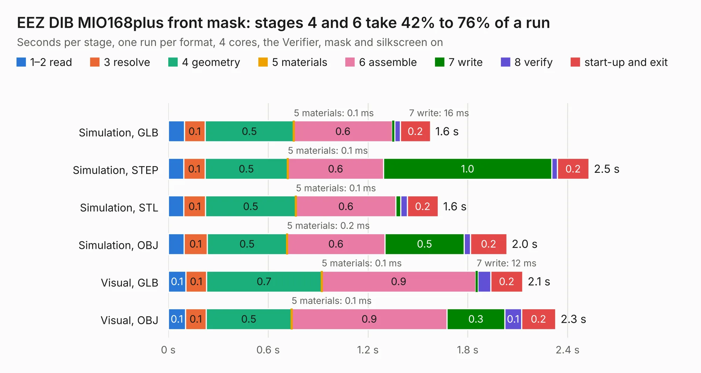

| Mode and format | 1–2 read | 3 resolve | 4 geometry | 5 materials | 6 assemble | 7 write | 8 verify | start-up and exit | Total |
|---|---:|---:|---:|---:|---:|---:|---:|---:|---:|
| Simulation, GLB | 97&nbsp;ms | 0.1 | 0.5 | 0.1&nbsp;ms | 0.6 | 16&nbsp;ms | 34&nbsp;ms | 0.2 | 1.6 |
| Simulation, STEP | 92&nbsp;ms | 0.1 | 0.5 | 0.1&nbsp;ms | 0.6 | 1.0 | 33&nbsp;ms | 0.2 | 2.5 |
| Simulation, STL | 94&nbsp;ms | 0.1 | 0.5 | 0.1&nbsp;ms | 0.6 | 29&nbsp;ms | 39&nbsp;ms | 0.2 | 1.6 |
| Simulation, OBJ | 95&nbsp;ms | 0.1 | 0.5 | 0.2&nbsp;ms | 0.6 | 0.5 | 38&nbsp;ms | 0.2 | 2.0 |
| Visual, GLB | 0.1 | 0.1 | 0.7 | 0.1&nbsp;ms | 0.9 | 12&nbsp;ms | 78&nbsp;ms | 0.2 | 2.1 |
| Visual, OBJ | 0.1 | 0.1 | 0.5 | 0.1&nbsp;ms | 0.9 | 0.3 | 0.1 | 0.2 | 2.3 |

<table align="center"><tr><td valign="top">

| Board | Repo: [eez-open/dib-mio168plus](https://github.com/eez-open/dib-mio168plus) Board: `EEZ DIB MIO168plus front mask.kicad_pcb` |
|---|---|
| Folder | KiCad |
| Complexity | 94&nbsp;/&nbsp;1000 (size&nbsp;29, features&nbsp;65) |
| KESE&nbsp;features | filled zones, curved board outline, stack-up, dielectric εr and tanδ, mask and silkscreen colours |
| Tested | 9th November 2026 |
| Copper&nbsp;layers | 2 |
| File&nbsp;format | KiCad 10 (20260206) |
| Parts,&nbsp;tracks,&nbsp;vias | 2, 0, 0 |
| Triangles,&nbsp;simulation | 106,434 in 9 parts |
| Verifier | PASS in all six runs |

</td><td valign="top">

<table>
<tr><th>File type</th><th>File size</th><th>Peak memory used</th></tr>
<tr><th colspan="3" align="left">Simulation</th></tr>
<tr><td>GLB</td><td align="right">3.8&nbsp;MB</td><td align="right">176&nbsp;MB</td></tr>
<tr><td>STEP</td><td align="right">21&nbsp;MB</td><td align="right">187&nbsp;MB</td></tr>
<tr><td>STL</td><td align="right">5.3&nbsp;MB</td><td align="right">175&nbsp;MB</td></tr>
<tr><td>OBJ</td><td align="right">10&nbsp;MB</td><td align="right">174&nbsp;MB</td></tr>
<tr><th colspan="3" align="left">Visual</th></tr>
<tr><td>GLB</td><td align="right">2.8&nbsp;MB</td><td align="right">141&nbsp;MB</td></tr>
<tr><td>OBJ</td><td align="right">7.7&nbsp;MB</td><td align="right">139&nbsp;MB</td></tr>
</table>

</td></tr></table>

## 910. EEZ DIB MIO168plus

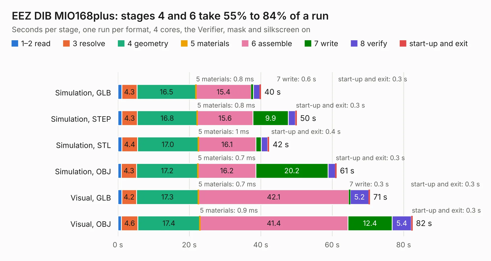

| Mode and format | 1–2 read | 3 resolve | 4 geometry | 5 materials | 6 assemble | 7 write | 8 verify | start-up and exit | Total |
|---|---:|---:|---:|---:|---:|---:|---:|---:|---:|
| Simulation, GLB | 1.1 | 4.3 | 16.5 | 0.8&nbsp;ms | 15.4 | 0.6 | 1.9 | 0.3 | 40.0 |
| Simulation, STEP | 1.1 | 4.3 | 16.8 | 0.8&nbsp;ms | 15.6 | 9.9 | 2.0 | 0.3 | 50.0 |
| Simulation, STL | 1.1 | 4.4 | 17.0 | 1&nbsp;ms | 16.1 | 1.5 | 1.8 | 0.4 | 42.4 |
| Simulation, OBJ | 0.9 | 4.3 | 17.2 | 0.7&nbsp;ms | 16.2 | 20.2 | 2.1 | 0.3 | 61.2 |
| Visual, GLB | 1.1 | 4.2 | 17.3 | 0.7&nbsp;ms | 42.1 | 0.3 | 5.2 | 0.3 | 70.5 |
| Visual, OBJ | 1.0 | 4.6 | 17.4 | 0.9&nbsp;ms | 41.4 | 12.4 | 5.4 | 0.3 | 82.5 |

<table align="center"><tr><td valign="top">

| Board | Repo: [eez-open/dib-mio168plus](https://github.com/eez-open/dib-mio168plus) Board: `EEZ DIB MIO168plus.kicad_pcb` |
|---|---|
| Folder | KiCad |
| Complexity | 409&nbsp;/&nbsp;1000 (size&nbsp;279, features&nbsp;130) |
| KESE&nbsp;features | through vias, rounded, trapezoid or chamfered pads, arc tracks, filled zones, curved board outline, knockout text, TrueType text, stack-up, dielectric εr and tanδ |
| Tested | 9th November 2026 |
| Copper&nbsp;layers | 4 |
| File&nbsp;format | KiCad 10 (20260206) |
| Parts,&nbsp;tracks,&nbsp;vias | 241, 3,356, 585 |
| Triangles,&nbsp;simulation | 4,042,762 in 289 parts |
| Verifier | PASS in all six runs |

</td><td valign="top">

<table>
<tr><th>File type</th><th>File size</th><th>Peak memory used</th></tr>
<tr><th colspan="3" align="left">Simulation</th></tr>
<tr><td>GLB</td><td align="right">137&nbsp;MB</td><td align="right">1.2&nbsp;GB</td></tr>
<tr><td>STEP</td><td align="right">589&nbsp;MB</td><td align="right">1.5&nbsp;GB</td></tr>
<tr><td>STL</td><td align="right">202&nbsp;MB</td><td align="right">1.2&nbsp;GB</td></tr>
<tr><td>OBJ</td><td align="right">438&nbsp;MB</td><td align="right">2.7&nbsp;GB</td></tr>
<tr><th colspan="3" align="left">Visual</th></tr>
<tr><td>GLB</td><td align="right">87&nbsp;MB</td><td align="right">1.5&nbsp;GB</td></tr>
<tr><td>OBJ</td><td align="right">280&nbsp;MB</td><td align="right">1.8&nbsp;GB</td></tr>
</table>

</td></tr></table>

## 911. EEZ DIB AFE3plus

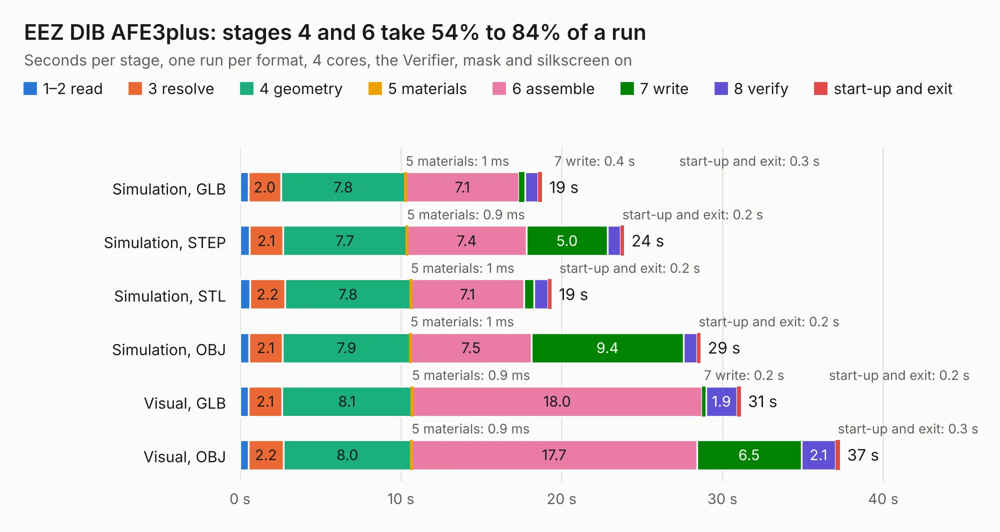

| Mode and format | 1–2 read | 3 resolve | 4 geometry | 5 materials | 6 assemble | 7 write | 8 verify | start-up and exit | Total |
|---|---:|---:|---:|---:|---:|---:|---:|---:|---:|
| Simulation, GLB | 0.5 | 2.0 | 7.8 | 1&nbsp;ms | 7.1 | 0.4 | 0.8 | 0.3 | 18.8 |
| Simulation, STEP | 0.6 | 2.1 | 7.7 | 0.9&nbsp;ms | 7.4 | 5.0 | 0.8 | 0.2 | 23.9 |
| Simulation, STL | 0.6 | 2.2 | 7.8 | 1&nbsp;ms | 7.1 | 0.6 | 0.9 | 0.2 | 19.4 |
| Simulation, OBJ | 0.5 | 2.1 | 7.9 | 1&nbsp;ms | 7.5 | 9.4 | 0.8 | 0.2 | 28.6 |
| Visual, GLB | 0.5 | 2.1 | 8.1 | 0.9&nbsp;ms | 18.0 | 0.2 | 1.9 | 0.2 | 31.1 |
| Visual, OBJ | 0.5 | 2.2 | 8.0 | 0.9&nbsp;ms | 17.7 | 6.5 | 2.1 | 0.3 | 37.3 |

<table align="center"><tr><td valign="top">

| Board | Repo: [eez-open/dib-mio168plus-afe3](https://github.com/eez-open/dib-mio168plus-afe3) Board: `EEZ DIB AFE3plus.kicad_pcb` |
|---|---|
| Folder | KiCad |
| Complexity | 332&nbsp;/&nbsp;1000 (size&nbsp;217, features&nbsp;115) |
| KESE&nbsp;features | through vias, rounded, trapezoid or chamfered pads, filled zones, curved board outline, knockout text, TrueType text, stack-up, dielectric εr and tanδ |
| Tested | 9th November 2026 |
| Copper&nbsp;layers | 4 |
| File&nbsp;format | KiCad 10 (20260206) |
| Parts,&nbsp;tracks,&nbsp;vias | 153, 1,420, 388 |
| Triangles,&nbsp;simulation | 2,307,398 in 182 parts |
| Verifier | PASS in all six runs |

</td><td valign="top">

<table>
<tr><th>File type</th><th>File size</th><th>Peak memory used</th></tr>
<tr><th colspan="3" align="left">Simulation</th></tr>
<tr><td>GLB</td><td align="right">78&nbsp;MB</td><td align="right">757&nbsp;MB</td></tr>
<tr><td>STEP</td><td align="right">328&nbsp;MB</td><td align="right">937&nbsp;MB</td></tr>
<tr><td>STL</td><td align="right">115&nbsp;MB</td><td align="right">785&nbsp;MB</td></tr>
<tr><td>OBJ</td><td align="right">243&nbsp;MB</td><td align="right">1.6&nbsp;GB</td></tr>
<tr><th colspan="3" align="left">Visual</th></tr>
<tr><td>GLB</td><td align="right">52&nbsp;MB</td><td align="right">1.0&nbsp;GB</td></tr>
<tr><td>OBJ</td><td align="right">161&nbsp;MB</td><td align="right">1.1&nbsp;GB</td></tr>
</table>

</td></tr></table>

## 912. BB3plus DVID adapter

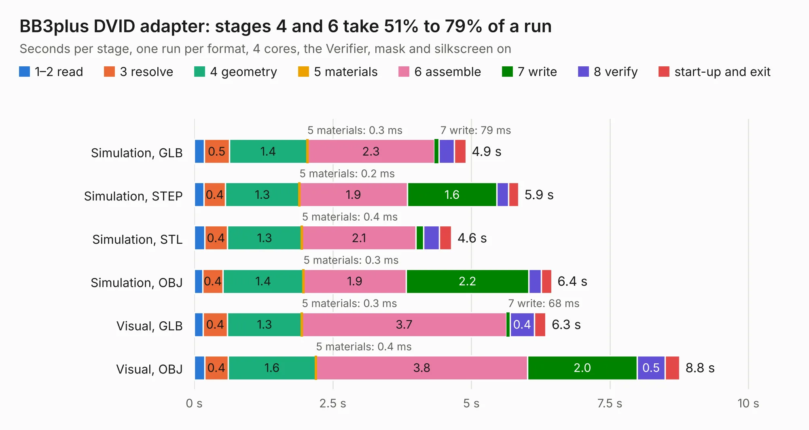

| Mode and format | 1–2 read | 3 resolve | 4 geometry | 5 materials | 6 assemble | 7 write | 8 verify | start-up and exit | Total |
|---|---:|---:|---:|---:|---:|---:|---:|---:|---:|
| Simulation, GLB | 0.2 | 0.5 | 1.4 | 0.3&nbsp;ms | 2.3 | 79&nbsp;ms | 0.3 | 0.2 | 4.9 |
| Simulation, STEP | 0.2 | 0.4 | 1.3 | 0.2&nbsp;ms | 1.9 | 1.6 | 0.2 | 0.2 | 5.9 |
| Simulation, STL | 0.2 | 0.4 | 1.3 | 0.4&nbsp;ms | 2.1 | 0.1 | 0.3 | 0.2 | 4.6 |
| Simulation, OBJ | 0.2 | 0.4 | 1.4 | 0.3&nbsp;ms | 1.9 | 2.2 | 0.2 | 0.2 | 6.4 |
| Visual, GLB | 0.2 | 0.4 | 1.3 | 0.3&nbsp;ms | 3.7 | 68&nbsp;ms | 0.4 | 0.2 | 6.3 |
| Visual, OBJ | 0.2 | 0.4 | 1.6 | 0.4&nbsp;ms | 3.8 | 2.0 | 0.5 | 0.3 | 8.8 |

<table align="center"><tr><td valign="top">

| Board | Repo: [eez-open/eez-bb3plus](https://github.com/eez-open/eez-bb3plus) Board: `BB3plus DVID adapter.kicad_pcb` |
|---|---|
| Folder | Experimental / KiCad / BB3plus DVID adapter |
| Complexity | 277&nbsp;/&nbsp;1000 (size&nbsp;177, features&nbsp;100) |
| KESE&nbsp;features | through vias, rounded, trapezoid or chamfered pads, arc tracks, filled zones, curved board outline, stack-up, dielectric εr and tanδ |
| Tested | 9th November 2026 |
| Copper&nbsp;layers | 4 |
| File&nbsp;format | KiCad 9 (20241229) |
| Parts,&nbsp;tracks,&nbsp;vias | 16, 781, 61 |
| Triangles,&nbsp;simulation | 509,226 in 41 parts |
| Verifier | PASS in all six runs |

</td><td valign="top">

<table>
<tr><th>File type</th><th>File size</th><th>Peak memory used</th></tr>
<tr><th colspan="3" align="left">Simulation</th></tr>
<tr><td>GLB</td><td align="right">17&nbsp;MB</td><td align="right">300&nbsp;MB</td></tr>
<tr><td>STEP</td><td align="right">75&nbsp;MB</td><td align="right">361&nbsp;MB</td></tr>
<tr><td>STL</td><td align="right">25&nbsp;MB</td><td align="right">300&nbsp;MB</td></tr>
<tr><td>OBJ</td><td align="right">50&nbsp;MB</td><td align="right">389&nbsp;MB</td></tr>
<tr><th colspan="3" align="left">Visual</th></tr>
<tr><td>GLB</td><td align="right">13&nbsp;MB</td><td align="right">373&nbsp;MB</td></tr>
<tr><td>OBJ</td><td align="right">37&nbsp;MB</td><td align="right">351&nbsp;MB</td></tr>
</table>

</td></tr></table>

## 913. BB3plus test mainboard

| Mode and format | 1–2 read | 3 resolve | 4 geometry | 5 materials | 6 assemble | 7 write | 8 verify | start-up and exit | Total |
|---|---:|---:|---:|---:|---:|---:|---:|---:|---:|
| Simulation, GLB | 1.6 | 6.2 | 27.1 | 1&nbsp;ms | 23.1 | 1.1 | 3.3 | 0.3 | 62.9 |
| Simulation, STEP | 1.5 | 5.9 | 28.4 | 1&nbsp;ms | 24.4 | 16.8 | 3.2 | 0.3 | 80.5 |
| Simulation, STL | 1.5 | 6.1 | 28.2 | 1&nbsp;ms | 23.7 | 2.1 | 3.4 | 0.3 | 65.3 |
| Simulation, OBJ | 1.4 | 6.2 | 27.3 | 1&nbsp;ms | 23.8 | 39.7 | 3.3 | 0.4 | 102.2 |
| Visual, GLB | 1.7 | 6.2 | 29.1 | 1&nbsp;ms | 64.3 | 0.6 | 6.6 | 0.3 | 108.8 |
| Visual, OBJ | 1.7 | 6.1 | 28.2 | 2&nbsp;ms | 60.8 | 22.6 | 7.1 | 0.3 | 126.7 |

<table align="center"><tr><td valign="top">

| Board | Repo: [eez-open/eez-bb3plus](https://github.com/eez-open/eez-bb3plus) Board: `BB3plus test mainboard.kicad_pcb` |
|---|---|
| Folder | Experimental / KiCad |
| Complexity | 449&nbsp;/&nbsp;1000 (size&nbsp;289, features&nbsp;160) |
| KESE&nbsp;features | through vias, slotted holes, custom pads, rounded, trapezoid or chamfered pads, arc tracks, filled zones, copper drawings, copper text, curved board outline, knockout text, stack-up, dielectric εr and tanδ |
| Tested | 9th November 2026 |
| Copper&nbsp;layers | 4 |
| File&nbsp;format | KiCad 9 (20241229) |
| Parts,&nbsp;tracks,&nbsp;vias | 274, 5,609, 871 |
| Triangles,&nbsp;simulation | 6,719,504 in 488 parts |
| Verifier | PASS in all six runs |

</td><td valign="top">

<table>
<tr><th>File type</th><th>File size</th><th>Peak memory used</th></tr>
<tr><th colspan="3" align="left">Simulation</th></tr>
<tr><td>GLB</td><td align="right">230&nbsp;MB</td><td align="right">1.9&nbsp;GB</td></tr>
<tr><td>STEP</td><td align="right">919&nbsp;MB</td><td align="right">2.4&nbsp;GB</td></tr>
<tr><td>STL</td><td align="right">336&nbsp;MB</td><td align="right">1.9&nbsp;GB</td></tr>
<tr><td>OBJ</td><td align="right">729&nbsp;MB</td><td align="right">4.3&nbsp;GB</td></tr>
<tr><th colspan="3" align="left">Visual</th></tr>
<tr><td>GLB</td><td align="right">139&nbsp;MB</td><td align="right">2.3&nbsp;GB</td></tr>
<tr><td>OBJ</td><td align="right">449&nbsp;MB</td><td align="right">2.8&nbsp;GB</td></tr>
</table>

</td></tr></table>

## 914. BB3plus USB hub test

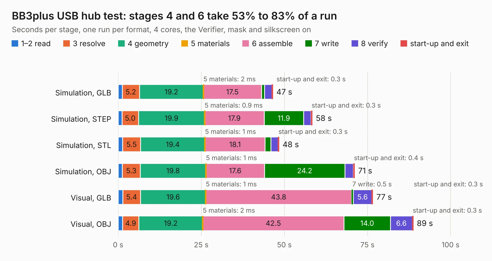

| Mode and format | 1–2 read | 3 resolve | 4 geometry | 5 materials | 6 assemble | 7 write | 8 verify | start-up and exit | Total |
|---|---:|---:|---:|---:|---:|---:|---:|---:|---:|
| Simulation, GLB | 1.2 | 5.2 | 19.2 | 2&nbsp;ms | 17.5 | 1.0 | 2.2 | 0.3 | 46.5 |
| Simulation, STEP | 1.1 | 5.0 | 19.9 | 0.9&nbsp;ms | 17.9 | 11.9 | 2.2 | 0.3 | 58.4 |
| Simulation, STL | 1.3 | 5.5 | 19.4 | 1&nbsp;ms | 18.1 | 1.8 | 2.1 | 0.3 | 48.4 |
| Simulation, OBJ | 1.3 | 5.3 | 19.8 | 1&nbsp;ms | 17.6 | 24.2 | 2.5 | 0.4 | 71.1 |
| Visual, GLB | 1.4 | 5.4 | 19.6 | 1&nbsp;ms | 43.8 | 0.5 | 5.6 | 0.3 | 76.6 |
| Visual, OBJ | 1.3 | 4.9 | 19.2 | 2&nbsp;ms | 42.5 | 14.0 | 6.6 | 0.3 | 88.8 |

<table align="center"><tr><td valign="top">

| Board | Repo: [eez-open/eez-bb3plus](https://github.com/eez-open/eez-bb3plus) Board: `BB3plus USB hub test.kicad_pcb` |
|---|---|
| Folder | Experimental / KiCad / BB3plus USB hub test |
| Complexity | 434&nbsp;/&nbsp;1000 (size&nbsp;284, features&nbsp;150) |
| KESE&nbsp;features | through vias, slotted holes, custom pads, rounded, trapezoid or chamfered pads, arc tracks, filled zones, copper drawings, curved board outline, knockout text, stack-up, dielectric εr and tanδ |
| Tested | 9th November 2026 |
| Copper&nbsp;layers | 4 |
| File&nbsp;format | KiCad 9 (20241229) |
| Parts,&nbsp;tracks,&nbsp;vias | 248, 4,383, 713 |
| Triangles,&nbsp;simulation | 5,494,414 in 442 parts |
| Verifier | PASS in all six runs |

</td><td valign="top">

<table>
<tr><th>File type</th><th>File size</th><th>Peak memory used</th></tr>
<tr><th colspan="3" align="left">Simulation</th></tr>
<tr><td>GLB</td><td align="right">188&nbsp;MB</td><td align="right">1.6&nbsp;GB</td></tr>
<tr><td>STEP</td><td align="right">735&nbsp;MB</td><td align="right">2.0&nbsp;GB</td></tr>
<tr><td>STL</td><td align="right">275&nbsp;MB</td><td align="right">1.6&nbsp;GB</td></tr>
<tr><td>OBJ</td><td align="right">592&nbsp;MB</td><td align="right">3.6&nbsp;GB</td></tr>
<tr><th colspan="3" align="left">Visual</th></tr>
<tr><td>GLB</td><td align="right">115&nbsp;MB</td><td align="right">1.9&nbsp;GB</td></tr>
<tr><td>OBJ</td><td align="right">367&nbsp;MB</td><td align="right">2.3&nbsp;GB</td></tr>
</table>

</td></tr></table>

## 915. DIB2 USB adapter front mask

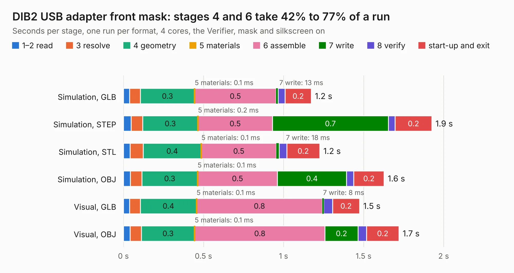

| Mode and format | 1–2 read | 3 resolve | 4 geometry | 5 materials | 6 assemble | 7 write | 8 verify | start-up and exit | Total |
|---|---:|---:|---:|---:|---:|---:|---:|---:|---:|
| Simulation, GLB | 39&nbsp;ms | 67&nbsp;ms | 0.3 | 0.1&nbsp;ms | 0.5 | 13&nbsp;ms | 44&nbsp;ms | 0.2 | 1.2 |
| Simulation, STEP | 49&nbsp;ms | 72&nbsp;ms | 0.3 | 0.2&nbsp;ms | 0.5 | 0.7 | 42&nbsp;ms | 0.2 | 1.9 |
| Simulation, STL | 41&nbsp;ms | 82&nbsp;ms | 0.4 | 0.1&nbsp;ms | 0.5 | 18&nbsp;ms | 48&nbsp;ms | 0.2 | 1.2 |
| Simulation, OBJ | 43&nbsp;ms | 73&nbsp;ms | 0.3 | 0.1&nbsp;ms | 0.5 | 0.4 | 45&nbsp;ms | 0.2 | 1.6 |
| Visual, GLB | 38&nbsp;ms | 68&nbsp;ms | 0.4 | 0.1&nbsp;ms | 0.8 | 8&nbsp;ms | 56&nbsp;ms | 0.2 | 1.5 |
| Visual, OBJ | 42&nbsp;ms | 71&nbsp;ms | 0.3 | 0.1&nbsp;ms | 0.8 | 0.2 | 53&nbsp;ms | 0.2 | 1.7 |

<table align="center"><tr><td valign="top">

| Board | Repo: [eez-open/eez-bb3plus](https://github.com/eez-open/eez-bb3plus) Board: `DIB2 USB adapter front mask.kicad_pcb` |
|---|---|
| Folder | Experimental / KiCad / DIB2 USB adapter |
| Complexity | 89&nbsp;/&nbsp;1000 (size&nbsp;29, features&nbsp;60) |
| KESE&nbsp;features | filled zones, curved board outline, stack-up, dielectric εr and tanδ |
| Tested | 9th November 2026 |
| Copper&nbsp;layers | 2 |
| File&nbsp;format | KiCad 10 (20260206) |
| Parts,&nbsp;tracks,&nbsp;vias | 2, 0, 0 |
| Triangles,&nbsp;simulation | 76,636 in 13 parts |
| Verifier | PASS in all six runs |

</td><td valign="top">

<table>
<tr><th>File type</th><th>File size</th><th>Peak memory used</th></tr>
<tr><th colspan="3" align="left">Simulation</th></tr>
<tr><td>GLB</td><td align="right">2.6&nbsp;MB</td><td align="right">156&nbsp;MB</td></tr>
<tr><td>STEP</td><td align="right">11&nbsp;MB</td><td align="right">157&nbsp;MB</td></tr>
<tr><td>STL</td><td align="right">3.8&nbsp;MB</td><td align="right">155&nbsp;MB</td></tr>
<tr><td>OBJ</td><td align="right">7.2&nbsp;MB</td><td align="right">150&nbsp;MB</td></tr>
<tr><th colspan="3" align="left">Visual</th></tr>
<tr><td>GLB</td><td align="right">1.3&nbsp;MB</td><td align="right">134&nbsp;MB</td></tr>
<tr><td>OBJ</td><td align="right">3.5&nbsp;MB</td><td align="right">133&nbsp;MB</td></tr>
</table>

</td></tr></table>

## 916. DIB2 USB adapter

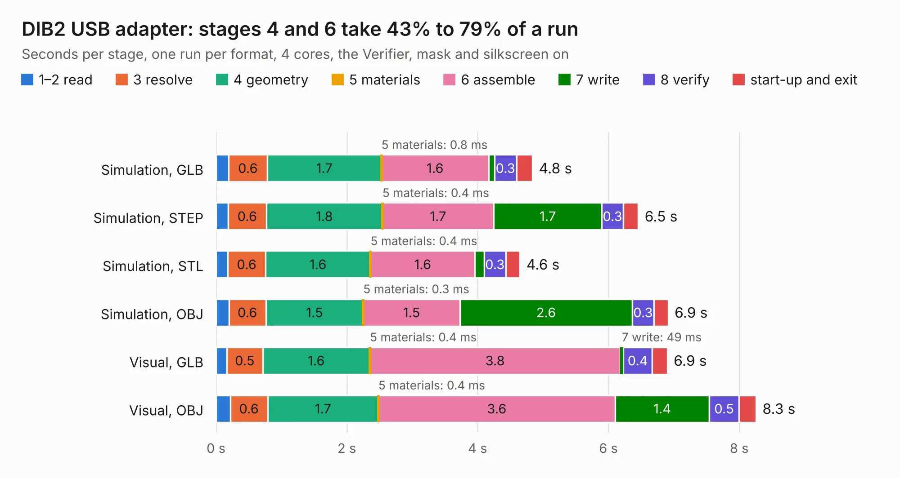

| Mode and format | 1–2 read | 3 resolve | 4 geometry | 5 materials | 6 assemble | 7 write | 8 verify | start-up and exit | Total |
|---|---:|---:|---:|---:|---:|---:|---:|---:|---:|
| Simulation, GLB | 0.2 | 0.6 | 1.7 | 0.8&nbsp;ms | 1.6 | 89&nbsp;ms | 0.3 | 0.2 | 4.8 |
| Simulation, STEP | 0.2 | 0.6 | 1.8 | 0.4&nbsp;ms | 1.7 | 1.7 | 0.3 | 0.2 | 6.5 |
| Simulation, STL | 0.2 | 0.6 | 1.6 | 0.4&nbsp;ms | 1.6 | 0.1 | 0.3 | 0.2 | 4.6 |
| Simulation, OBJ | 0.2 | 0.6 | 1.5 | 0.3&nbsp;ms | 1.5 | 2.6 | 0.3 | 0.2 | 6.9 |
| Visual, GLB | 0.2 | 0.5 | 1.6 | 0.4&nbsp;ms | 3.8 | 49&nbsp;ms | 0.4 | 0.2 | 6.9 |
| Visual, OBJ | 0.2 | 0.6 | 1.7 | 0.4&nbsp;ms | 3.6 | 1.4 | 0.5 | 0.3 | 8.3 |

<table align="center"><tr><td valign="top">

| Board | Repo: [eez-open/eez-bb3plus](https://github.com/eez-open/eez-bb3plus) Board: `DIB2 USB adapter.kicad_pcb` |
|---|---|
| Folder | Experimental / KiCad / DIB2 USB adapter |
| Complexity | 273&nbsp;/&nbsp;1000 (size&nbsp;163, features&nbsp;110) |
| KESE&nbsp;features | through vias, rounded, trapezoid or chamfered pads, arc tracks, filled zones, copper text, curved board outline, stack-up, dielectric εr and tanδ |
| Tested | 9th November 2026 |
| Copper&nbsp;layers | 4 |
| File&nbsp;format | KiCad 10 (20260206) |
| Parts,&nbsp;tracks,&nbsp;vias | 10, 389, 53 |
| Triangles,&nbsp;simulation | 560,658 in 63 parts |
| Verifier | PASS in all six runs |

</td><td valign="top">

<table>
<tr><th>File type</th><th>File size</th><th>Peak memory used</th></tr>
<tr><th colspan="3" align="left">Simulation</th></tr>
<tr><td>GLB</td><td align="right">19&nbsp;MB</td><td align="right">292&nbsp;MB</td></tr>
<tr><td>STEP</td><td align="right">73&nbsp;MB</td><td align="right">327&nbsp;MB</td></tr>
<tr><td>STL</td><td align="right">28&nbsp;MB</td><td align="right">292&nbsp;MB</td></tr>
<tr><td>OBJ</td><td align="right">57&nbsp;MB</td><td align="right">417&nbsp;MB</td></tr>
<tr><th colspan="3" align="left">Visual</th></tr>
<tr><td>GLB</td><td align="right">10&nbsp;MB</td><td align="right">322&nbsp;MB</td></tr>
<tr><td>OBJ</td><td align="right">31&nbsp;MB</td><td align="right">324&nbsp;MB</td></tr>
</table>

</td></tr></table>

## 917. BB3plus DSI TFT display

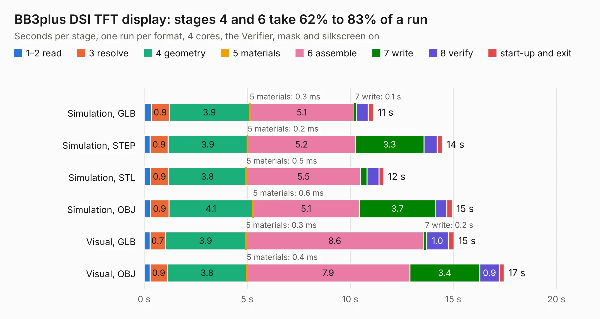

| Mode and format | 1–2 read | 3 resolve | 4 geometry | 5 materials | 6 assemble | 7 write | 8 verify | start-up and exit | Total |
|---|---:|---:|---:|---:|---:|---:|---:|---:|---:|
| Simulation, GLB | 0.3 | 0.9 | 3.9 | 0.3&nbsp;ms | 5.1 | 0.1 | 0.6 | 0.3 | 11.1 |
| Simulation, STEP | 0.3 | 0.9 | 3.9 | 0.2&nbsp;ms | 5.2 | 3.3 | 0.6 | 0.3 | 14.5 |
| Simulation, STL | 0.3 | 0.9 | 3.8 | 0.5&nbsp;ms | 5.5 | 0.3 | 0.6 | 0.2 | 11.6 |
| Simulation, OBJ | 0.3 | 0.9 | 4.1 | 0.6&nbsp;ms | 5.1 | 3.7 | 0.5 | 0.3 | 14.9 |
| Visual, GLB | 0.3 | 0.7 | 3.9 | 0.3&nbsp;ms | 8.6 | 0.2 | 1.0 | 0.3 | 15.0 |
| Visual, OBJ | 0.3 | 0.9 | 3.8 | 0.4&nbsp;ms | 7.9 | 3.4 | 0.9 | 0.2 | 17.5 |

<table align="center"><tr><td valign="top">

| Board | Repo: [eez-open/eez-bb3plus](https://github.com/eez-open/eez-bb3plus) Board: `BB3plus DSI TFT display.kicad_pcb` |
|---|---|
| Folder | Experimental / KiCad / TFT DSI module |
| Complexity | 294&nbsp;/&nbsp;1000 (size&nbsp;174, features&nbsp;120) |
| KESE&nbsp;features | through vias, rounded, trapezoid or chamfered pads, arc tracks, filled zones, curved board outline, knockout text, stack-up, dielectric εr and tanδ, mask and silkscreen colours |
| Tested | 9th November 2026 |
| Copper&nbsp;layers | 2 |
| File&nbsp;format | KiCad 9 (20241229) |
| Parts,&nbsp;tracks,&nbsp;vias | 34, 953, 137 |
| Triangles,&nbsp;simulation | 747,444 in 91 parts |
| Verifier | PASS in all six runs |

</td><td valign="top">

<table>
<tr><th>File type</th><th>File size</th><th>Peak memory used</th></tr>
<tr><th colspan="3" align="left">Simulation</th></tr>
<tr><td>GLB</td><td align="right">26&nbsp;MB</td><td align="right">434&nbsp;MB</td></tr>
<tr><td>STEP</td><td align="right">138&nbsp;MB</td><td align="right">478&nbsp;MB</td></tr>
<tr><td>STL</td><td align="right">37&nbsp;MB</td><td align="right">418&nbsp;MB</td></tr>
<tr><td>OBJ</td><td align="right">77&nbsp;MB</td><td align="right">545&nbsp;MB</td></tr>
<tr><th colspan="3" align="left">Visual</th></tr>
<tr><td>GLB</td><td align="right">23&nbsp;MB</td><td align="right">591&nbsp;MB</td></tr>
<tr><td>OBJ</td><td align="right">70&nbsp;MB</td><td align="right">593&nbsp;MB</td></tr>
</table>

</td></tr></table>

## 918. BB3plus mainboard

| Mode and format | 1–2 read | 3 resolve | 4 geometry | 5 materials | 6 assemble | 7 write | 8 verify | start-up and exit | Total |
|---|---:|---:|---:|---:|---:|---:|---:|---:|---:|
| Simulation, GLB | 4.3 | 12.1 | 59.9 | 3&nbsp;ms | 52.1 | 2.5 | 7.4 | 0.5 | 138.9 |
| Simulation, STEP | 4.4 | 12.1 | 57.3 | 2&nbsp;ms | 51.6 | 28.2 | 7.1 | 0.5 | 161.1 |
| Simulation, STL | 4.3 | 12.9 | 58.1 | 2&nbsp;ms | 50.3 | 5.1 | 7.4 | 0.6 | 138.7 |
| Simulation, OBJ | 4.6 | 12.1 | 59.1 | 2&nbsp;ms | 53.0 | 80.1 | 7.9 | 0.5 | 217.4 |
| Visual, GLB | 4.9 | 12.0 | 60.1 | 3&nbsp;ms | 124.2 | 1.2 | 12.3 | 0.4 | 215.0 |
| Visual, OBJ | 4.2 | 11.6 | 56.4 | 2&nbsp;ms | 119.5 | 36.9 | 12.6 | 0.4 | 241.6 |

<table align="center"><tr><td valign="top">

| Board | Repo: [eez-open/eez-bb3plus](https://github.com/eez-open/eez-bb3plus) Board: `BB3plus mainboard.kicad_pcb` |
|---|---|
| Folder | KiCad / BB3plus mainboard |
| Complexity | 481&nbsp;/&nbsp;1000 (size&nbsp;301, features&nbsp;180) |
| KESE&nbsp;features | through vias, slotted holes, custom pads, rounded, trapezoid or chamfered pads, arc tracks, filled zones, copper drawings, copper text, curved board outline, knockout text, TrueType text, stack-up, dielectric εr and tanδ, mask and silkscreen colours |
| Tested | 9th November 2026 |
| Copper&nbsp;layers | 4 |
| File&nbsp;format | KiCad 10 (20260206) |
| Parts,&nbsp;tracks,&nbsp;vias | 399, 9,092, 1,533 |
| Triangles,&nbsp;simulation | 12,566,544 in 718 parts |
| Verifier | PASS in all six runs |

</td><td valign="top">

<table>
<tr><th>File type</th><th>File size</th><th>Peak memory used</th></tr>
<tr><th colspan="3" align="left">Simulation</th></tr>
<tr><td>GLB</td><td align="right">428&nbsp;MB</td><td align="right">3.0&nbsp;GB</td></tr>
<tr><td>STEP</td><td align="right">1.7&nbsp;GB</td><td align="right">3.8&nbsp;GB</td></tr>
<tr><td>STL</td><td align="right">628&nbsp;MB</td><td align="right">3.0&nbsp;GB</td></tr>
<tr><td>OBJ</td><td align="right">1.4&nbsp;GB</td><td align="right">8.0&nbsp;GB</td></tr>
<tr><th colspan="3" align="left">Visual</th></tr>
<tr><td>GLB</td><td align="right">240&nbsp;MB</td><td align="right">3.9&nbsp;GB</td></tr>
<tr><td>OBJ</td><td align="right">783&nbsp;MB</td><td align="right">5.1&nbsp;GB</td></tr>
</table>

</td></tr></table>

## 919. Bare front mask full width

| Mode and format | 1–2 read | 3 resolve | 4 geometry | 5 materials | 6 assemble | 7 write | 8 verify | start-up and exit | Total |
|---|---:|---:|---:|---:|---:|---:|---:|---:|---:|
| Simulation, GLB | 33&nbsp;ms | 0.1 | 0.7 | 0.1&nbsp;ms | 0.6 | 19&nbsp;ms | 63&nbsp;ms | 0.2 | 1.7 |
| Simulation, STEP | 34&nbsp;ms | 0.1 | 0.7 | 0.1&nbsp;ms | 0.6 | 0.8 | 67&nbsp;ms | 0.2 | 2.5 |
| Simulation, STL | 33&nbsp;ms | 0.1 | 0.7 | 0.1&nbsp;ms | 0.6 | 30&nbsp;ms | 66&nbsp;ms | 0.2 | 1.7 |
| Simulation, OBJ | 36&nbsp;ms | 0.1 | 0.7 | 0.1&nbsp;ms | 0.6 | 0.6 | 69&nbsp;ms | 0.2 | 2.3 |
| Visual, GLB | 32&nbsp;ms | 0.1 | 0.7 | 0.1&nbsp;ms | 0.9 | 9&nbsp;ms | 75&nbsp;ms | 0.2 | 2.0 |
| Visual, OBJ | 46&nbsp;ms | 0.1 | 0.7 | 0.1&nbsp;ms | 0.8 | 0.2 | 70&nbsp;ms | 0.2 | 2.2 |

<table align="center"><tr><td valign="top">

| Board | Repo: [eez-open/eez-bb3plus](https://github.com/eez-open/eez-bb3plus) Board: `Bare front mask full width.kicad_pcb` |
|---|---|
| Folder | KiCad / Front masks |
| Complexity | 93&nbsp;/&nbsp;1000 (size&nbsp;38, features&nbsp;55) |
| KESE&nbsp;features | filled zones, stack-up, dielectric εr and tanδ, mask and silkscreen colours |
| Tested | 9th November 2026 |
| Copper&nbsp;layers | 2 |
| File&nbsp;format | KiCad 10 (20260206) |
| Parts,&nbsp;tracks,&nbsp;vias | 6, 0, 0 |
| Triangles,&nbsp;simulation | 137,530 in 9 parts |
| Verifier | PASS in all six runs |

</td><td valign="top">

<table>
<tr><th>File type</th><th>File size</th><th>Peak memory used</th></tr>
<tr><th colspan="3" align="left">Simulation</th></tr>
<tr><td>GLB</td><td align="right">4.6&nbsp;MB</td><td align="right">178&nbsp;MB</td></tr>
<tr><td>STEP</td><td align="right">14&nbsp;MB</td><td align="right">184&nbsp;MB</td></tr>
<tr><td>STL</td><td align="right">6.9&nbsp;MB</td><td align="right">176&nbsp;MB</td></tr>
<tr><td>OBJ</td><td align="right">13&nbsp;MB</td><td align="right">180&nbsp;MB</td></tr>
<tr><th colspan="3" align="left">Visual</th></tr>
<tr><td>GLB</td><td align="right">1.9&nbsp;MB</td><td align="right">139&nbsp;MB</td></tr>
<tr><td>OBJ</td><td align="right">5.3&nbsp;MB</td><td align="right">141&nbsp;MB</td></tr>
</table>

</td></tr></table>

## 920. Bare front mask half width

| Mode and format | 1–2 read | 3 resolve | 4 geometry | 5 materials | 6 assemble | 7 write | 8 verify | start-up and exit | Total |
|---|---:|---:|---:|---:|---:|---:|---:|---:|---:|
| Simulation, GLB | 36&nbsp;ms | 66&nbsp;ms | 0.4 | 0.1&nbsp;ms | 0.5 | 12&nbsp;ms | 47&nbsp;ms | 0.2 | 1.3 |
| Simulation, STEP | 29&nbsp;ms | 63&nbsp;ms | 0.4 | 0.2&nbsp;ms | 0.5 | 0.8 | 45&nbsp;ms | 0.2 | 2.0 |
| Simulation, STL | 24&nbsp;ms | 65&nbsp;ms | 0.4 | 0.2&nbsp;ms | 0.6 | 28&nbsp;ms | 50&nbsp;ms | 0.2 | 1.4 |
| Simulation, OBJ | 36&nbsp;ms | 77&nbsp;ms | 0.4 | 0.1&nbsp;ms | 0.5 | 0.4 | 47&nbsp;ms | 0.3 | 1.6 |
| Visual, GLB | 26&nbsp;ms | 56&nbsp;ms | 0.3 | 0.2&nbsp;ms | 0.8 | 6&nbsp;ms | 40&nbsp;ms | 0.2 | 1.5 |
| Visual, OBJ | 36&nbsp;ms | 66&nbsp;ms | 0.4 | 0.1&nbsp;ms | 0.8 | 0.1 | 36&nbsp;ms | 0.2 | 1.8 |

<table align="center"><tr><td valign="top">

| Board | Repo: [eez-open/eez-bb3plus](https://github.com/eez-open/eez-bb3plus) Board: `Bare front mask half width.kicad_pcb` |
|---|---|
| Folder | KiCad / Front masks |
| Complexity | 94&nbsp;/&nbsp;1000 (size&nbsp;29, features&nbsp;65) |
| KESE&nbsp;features | filled zones, curved board outline, stack-up, dielectric εr and tanδ, mask and silkscreen colours |
| Tested | 9th November 2026 |
| Copper&nbsp;layers | 2 |
| File&nbsp;format | KiCad 10 (20260206) |
| Parts,&nbsp;tracks,&nbsp;vias | 2, 0, 0 |
| Triangles,&nbsp;simulation | 62,832 in 13 parts |
| Verifier | PASS in all six runs |

</td><td valign="top">

<table>
<tr><th>File type</th><th>File size</th><th>Peak memory used</th></tr>
<tr><th colspan="3" align="left">Simulation</th></tr>
<tr><td>GLB</td><td align="right">2.1&nbsp;MB</td><td align="right">146&nbsp;MB</td></tr>
<tr><td>STEP</td><td align="right">7.9&nbsp;MB</td><td align="right">153&nbsp;MB</td></tr>
<tr><td>STL</td><td align="right">3.1&nbsp;MB</td><td align="right">147&nbsp;MB</td></tr>
<tr><td>OBJ</td><td align="right">5.8&nbsp;MB</td><td align="right">149&nbsp;MB</td></tr>
<tr><th colspan="3" align="left">Visual</th></tr>
<tr><td>GLB</td><td align="right">741&nbsp;kB</td><td align="right">131&nbsp;MB</td></tr>
<tr><td>OBJ</td><td align="right">2.0&nbsp;MB</td><td align="right">132&nbsp;MB</td></tr>
</table>

</td></tr></table>

## 921. BB3plus DVID TFT display

| Mode and format | 1–2 read | 3 resolve | 4 geometry | 5 materials | 6 assemble | 7 write | 8 verify | start-up and exit | Total |
|---|---:|---:|---:|---:|---:|---:|---:|---:|---:|
| Simulation, GLB | 0.6 | 1.4 | 6.5 | 0.5&nbsp;ms | 7.3 | 0.2 | 0.8 | 0.3 | 17.1 |
| Simulation, STEP | 0.6 | 1.4 | 6.5 | 0.4&nbsp;ms | 7.0 | 4.8 | 0.8 | 0.3 | 21.3 |
| Simulation, STL | 0.5 | 1.4 | 6.7 | 0.5&nbsp;ms | 6.9 | 0.4 | 0.7 | 0.3 | 16.8 |
| Simulation, OBJ | 0.5 | 1.4 | 6.6 | 0.4&nbsp;ms | 7.2 | 7.0 | 0.7 | 0.2 | 23.7 |
| Visual, GLB | 0.5 | 1.4 | 6.5 | 0.4&nbsp;ms | 12.5 | 0.2 | 1.3 | 0.2 | 22.5 |
| Visual, OBJ | 0.5 | 1.3 | 6.5 | 0.6&nbsp;ms | 12.3 | 5.6 | 1.4 | 0.2 | 27.9 |

<table align="center"><tr><td valign="top">

| Board | Repo: [eez-open/eez-bb3plus](https://github.com/eez-open/eez-bb3plus) Board: `BB3plus DVID TFT display.kicad_pcb` |
|---|---|
| Folder | KiCad / TFT module |
| Complexity | 358&nbsp;/&nbsp;1000 (size&nbsp;223, features&nbsp;135) |
| KESE&nbsp;features | through vias, rounded, trapezoid or chamfered pads, arc tracks, filled zones, curved board outline, knockout text, TrueType text, stack-up, dielectric εr and tanδ, mask and silkscreen colours |
| Tested | 9th November 2026 |
| Copper&nbsp;layers | 2 |
| File&nbsp;format | KiCad 10 (20260206) |
| Parts,&nbsp;tracks,&nbsp;vias | 66, 1,092, 166 |
| Triangles,&nbsp;simulation | 1,166,944 in 158 parts |
| Verifier | PASS in all six runs |

</td><td valign="top">

<table>
<tr><th>File type</th><th>File size</th><th>Peak memory used</th></tr>
<tr><th colspan="3" align="left">Simulation</th></tr>
<tr><td>GLB</td><td align="right">41&nbsp;MB</td><td align="right">579&nbsp;MB</td></tr>
<tr><td>STEP</td><td align="right">232&nbsp;MB</td><td align="right">665&nbsp;MB</td></tr>
<tr><td>STL</td><td align="right">58&nbsp;MB</td><td align="right">574&nbsp;MB</td></tr>
<tr><td>OBJ</td><td align="right">121&nbsp;MB</td><td align="right">831&nbsp;MB</td></tr>
<tr><th colspan="3" align="left">Visual</th></tr>
<tr><td>GLB</td><td align="right">35&nbsp;MB</td><td align="right">682&nbsp;MB</td></tr>
<tr><td>OBJ</td><td align="right">106&nbsp;MB</td><td align="right">868&nbsp;MB</td></tr>
</table>

</td></tr></table>

## 922. BB3plus CM5 STM32H7 module

| Mode and format | 1–2 read | 3 resolve | 4 geometry | 5 materials | 6 assemble | 7 write | 8 verify | start-up and exit | Total |
|---|---:|---:|---:|---:|---:|---:|---:|---:|---:|
| Simulation, GLB | 1.3 | 4.8 | 14.4 | 1&nbsp;ms | 17.5 | 1.0 | 2.3 | 0.4 | 41.6 |
| Simulation, STEP | 1.3 | 4.8 | 14.2 | 2&nbsp;ms | 18.0 | 11.3 | 2.3 | 0.4 | 52.3 |
| Simulation, STL | 1.3 | 4.9 | 14.9 | 1&nbsp;ms | 19.3 | 2.0 | 2.4 | 0.4 | 45.2 |
| Simulation, OBJ | 1.3 | 5.1 | 15.1 | 1.0&nbsp;ms | 19.0 | 30.1 | 2.2 | 0.3 | 73.2 |
| Visual, GLB | 1.2 | 5.1 | 14.9 | 2&nbsp;ms | 50.6 | 0.5 | 5.2 | 0.3 | 77.8 |
| Visual, OBJ | 1.4 | 5.0 | 14.7 | 2&nbsp;ms | 48.7 | 17.4 | 5.1 | 0.3 | 92.5 |

<table align="center"><tr><td valign="top">

| Board | Repo: [eez-open/eez-bb3plus-cm5-mcu](https://github.com/eez-open/eez-bb3plus-cm5-mcu) Board: `BB3plus CM5 STM32H7 module.kicad_pcb` |
|---|---|
| Folder | KiCad |
| Complexity | 402&nbsp;/&nbsp;1000 (size&nbsp;297, features&nbsp;105) |
| KESE&nbsp;features | through vias, rounded, trapezoid or chamfered pads, arc tracks, filled zones, TrueType text, stack-up, dielectric εr and tanδ |
| Tested | 9th November 2026 |
| Copper&nbsp;layers | 6 |
| File&nbsp;format | KiCad 10 (20260206) |
| Parts,&nbsp;tracks,&nbsp;vias | 154, 6,042, 725 |
| Triangles,&nbsp;simulation | 5,243,850 in 339 parts |
| Verifier | PASS in all six runs |

</td><td valign="top">

<table>
<tr><th>File type</th><th>File size</th><th>Peak memory used</th></tr>
<tr><th colspan="3" align="left">Simulation</th></tr>
<tr><td>GLB</td><td align="right">177&nbsp;MB</td><td align="right">1.3&nbsp;GB</td></tr>
<tr><td>STEP</td><td align="right">630&nbsp;MB</td><td align="right">1.7&nbsp;GB</td></tr>
<tr><td>STL</td><td align="right">262&nbsp;MB</td><td align="right">1.5&nbsp;GB</td></tr>
<tr><td>OBJ</td><td align="right">561&nbsp;MB</td><td align="right">3.3&nbsp;GB</td></tr>
<tr><th colspan="3" align="left">Visual</th></tr>
<tr><td>GLB</td><td align="right">102&nbsp;MB</td><td align="right">1.8&nbsp;GB</td></tr>
<tr><td>OBJ</td><td align="right">332&nbsp;MB</td><td align="right">2.3&nbsp;GB</td></tr>
</table>

</td></tr></table>

## 923. EEZ DIB AUX-PS

| Mode and format | 1–2 read | 3 resolve | 4 geometry | 5 materials | 6 assemble | 7 write | 8 verify | start-up and exit | Total |
|---|---:|---:|---:|---:|---:|---:|---:|---:|---:|
| Simulation, GLB | 0.3 | 1.0 | 5.1 | 0.3&nbsp;ms | 3.8 | 0.2 | 0.5 | 0.3 | 11.1 |
| Simulation, STEP | 0.3 | 1.0 | 5.2 | 0.4&nbsp;ms | 3.7 | 2.8 | 0.4 | 0.2 | 13.6 |
| Simulation, STL | 0.3 | 1.0 | 5.4 | 0.3&nbsp;ms | 4.0 | 0.3 | 0.4 | 0.2 | 11.7 |
| Simulation, OBJ | 0.3 | 1.1 | 5.6 | 0.7&nbsp;ms | 4.0 | 4.9 | 0.4 | 0.2 | 16.6 |
| Visual, GLB | 0.3 | 1.0 | 5.3 | 0.5&nbsp;ms | 7.9 | 0.1 | 1.0 | 0.2 | 15.8 |
| Visual, OBJ | 0.3 | 1.1 | 5.3 | 0.3&nbsp;ms | 8.3 | 3.2 | 0.8 | 0.2 | 19.2 |

<table align="center"><tr><td valign="top">

| Board | Repo: [eez-open/modular-psu](https://github.com/eez-open/modular-psu) Board: `EEZ DIB AUX-PS.kicad_pcb` |
|---|---|
| Folder | aux-ps / EDA files / KiCad |
| Complexity | 245&nbsp;/&nbsp;1000 (size&nbsp;180, features&nbsp;65) |
| KESE&nbsp;features | through vias, rounded, trapezoid or chamfered pads, filled zones, copper text, curved board outline |
| Tested | 9th November 2026 |
| Copper&nbsp;layers | 2 |
| File&nbsp;format | KiCad 7 (20221018) |
| Parts,&nbsp;tracks,&nbsp;vias | 82, 767, 129 |
| Triangles,&nbsp;simulation | 1,149,688 in 67 parts |
| Verifier | PASS in all six runs |

</td><td valign="top">

<table>
<tr><th>File type</th><th>File size</th><th>Peak memory used</th></tr>
<tr><th colspan="3" align="left">Simulation</th></tr>
<tr><td>GLB</td><td align="right">40&nbsp;MB</td><td align="right">492&nbsp;MB</td></tr>
<tr><td>STEP</td><td align="right">191&nbsp;MB</td><td align="right">555&nbsp;MB</td></tr>
<tr><td>STL</td><td align="right">57&nbsp;MB</td><td align="right">469&nbsp;MB</td></tr>
<tr><td>OBJ</td><td align="right">120&nbsp;MB</td><td align="right">835&nbsp;MB</td></tr>
<tr><th colspan="3" align="left">Visual</th></tr>
<tr><td>GLB</td><td align="right">26&nbsp;MB</td><td align="right">563&nbsp;MB</td></tr>
<tr><td>OBJ</td><td align="right">79&nbsp;MB</td><td align="right">626&nbsp;MB</td></tr>
</table>

</td></tr></table>

## 924. EEZ DIB B3C

| Mode and format | 1–2 read | 3 resolve | 4 geometry | 5 materials | 6 assemble | 7 write | 8 verify | start-up and exit | Total |
|---|---:|---:|---:|---:|---:|---:|---:|---:|---:|
| Simulation, GLB | 0.5 | 1.6 | 10.4 | 0.6&nbsp;ms | 7.2 | 0.3 | 1.0 | 0.3 | 21.2 |
| Simulation, STEP | 0.5 | 1.8 | 10.0 | 0.7&nbsp;ms | 6.9 | 4.5 | 1.0 | 0.3 | 25.0 |
| Simulation, STL | 0.5 | 1.8 | 9.9 | 0.6&nbsp;ms | 7.0 | 0.5 | 1.1 | 0.3 | 21.1 |
| Simulation, OBJ | 0.5 | 1.8 | 10.3 | 0.6&nbsp;ms | 6.8 | 9.1 | 1.0 | 0.3 | 29.7 |
| Visual, GLB | 0.5 | 1.7 | 10.0 | 0.6&nbsp;ms | 14.3 | 0.2 | 1.3 | 0.2 | 28.4 |
| Visual, OBJ | 0.5 | 1.7 | 10.2 | 0.6&nbsp;ms | 13.8 | 5.8 | 1.5 | 0.3 | 33.7 |

<table align="center"><tr><td valign="top">

| Board | Repo: [eez-open/modular-psu](https://github.com/eez-open/modular-psu) Board: `EEZ DIB B3C.kicad_pcb` |
|---|---|
| Folder | bp3c / EDA files / KiCad |
| Complexity | 231&nbsp;/&nbsp;1000 (size&nbsp;176, features&nbsp;55) |
| KESE&nbsp;features | through vias, rounded, trapezoid or chamfered pads, filled zones, curved board outline |
| Tested | 9th November 2026 |
| Copper&nbsp;layers | 2 |
| File&nbsp;format | KiCad 7 (20221018) |
| Parts,&nbsp;tracks,&nbsp;vias | 55, 698, 145 |
| Triangles,&nbsp;simulation | 1,777,810 in 97 parts |
| Verifier | PASS in all six runs |

</td><td valign="top">

<table>
<tr><th>File type</th><th>File size</th><th>Peak memory used</th></tr>
<tr><th colspan="3" align="left">Simulation</th></tr>
<tr><td>GLB</td><td align="right">64&nbsp;MB</td><td align="right">653&nbsp;MB</td></tr>
<tr><td>STEP</td><td align="right">321&nbsp;MB</td><td align="right">811&nbsp;MB</td></tr>
<tr><td>STL</td><td align="right">89&nbsp;MB</td><td align="right">662&nbsp;MB</td></tr>
<tr><td>OBJ</td><td align="right">194&nbsp;MB</td><td align="right">1.3&nbsp;GB</td></tr>
<tr><th colspan="3" align="left">Visual</th></tr>
<tr><td>GLB</td><td align="right">41&nbsp;MB</td><td align="right">814&nbsp;MB</td></tr>
<tr><td>OBJ</td><td align="right">124&nbsp;MB</td><td align="right">932&nbsp;MB</td></tr>
</table>

</td></tr></table>

## 925. EEZ DIB MCU r1B1

| Mode and format | 1–2 read | 3 resolve | 4 geometry | 5 materials | 6 assemble | 7 write | 8 verify | start-up and exit | Total |
|---|---:|---:|---:|---:|---:|---:|---:|---:|---:|
| Simulation, GLB | 1.0 | 4.3 | 15.8 | 0.8&nbsp;ms | 15.4 | 0.7 | 2.0 | 0.3 | 39.4 |
| Simulation, STEP | 0.9 | 4.2 | 16.4 | 1&nbsp;ms | 15.8 | 9.3 | 2.1 | 0.3 | 49.0 |
| Simulation, STL | 0.9 | 3.9 | 16.6 | 0.8&nbsp;ms | 15.9 | 1.2 | 1.9 | 0.3 | 40.7 |
| Simulation, OBJ | 0.9 | 3.9 | 16.1 | 0.8&nbsp;ms | 15.9 | 20.2 | 2.0 | 0.3 | 59.3 |
| Visual, GLB | 0.9 | 4.2 | 16.1 | 1&nbsp;ms | 39.3 | 0.4 | 3.6 | 0.3 | 64.8 |
| Visual, OBJ | 0.9 | 3.9 | 16.7 | 1.0&nbsp;ms | 36.8 | 12.8 | 3.4 | 0.3 | 74.8 |

<table align="center"><tr><td valign="top">

| Board | Repo: [eez-open/modular-psu](https://github.com/eez-open/modular-psu) Board: `EEZ DIB MCU r1B1.kicad_pcb` |
|---|---|
| Folder | previous designs / mcu / KiCad |
| Complexity | 292&nbsp;/&nbsp;1000 (size&nbsp;237, features&nbsp;55) |
| KESE&nbsp;features | through vias, rounded, trapezoid or chamfered pads, filled zones, curved board outline |
| Tested | 9th November 2026 |
| Copper&nbsp;layers | 4 |
| File&nbsp;format | KiCad 5 (20171130) |
| Parts,&nbsp;tracks,&nbsp;vias | 187, 5,990, 593 |
| Triangles,&nbsp;simulation | 4,621,818 in 275 parts |
| Verifier | PASS in all six runs |

</td><td valign="top">

<table>
<tr><th>File type</th><th>File size</th><th>Peak memory used</th></tr>
<tr><th colspan="3" align="left">Simulation</th></tr>
<tr><td>GLB</td><td align="right">160&nbsp;MB</td><td align="right">1.3&nbsp;GB</td></tr>
<tr><td>STEP</td><td align="right">660&nbsp;MB</td><td align="right">1.7&nbsp;GB</td></tr>
<tr><td>STL</td><td align="right">231&nbsp;MB</td><td align="right">1.3&nbsp;GB</td></tr>
<tr><td>OBJ</td><td align="right">497&nbsp;MB</td><td align="right">3.0&nbsp;GB</td></tr>
<tr><th colspan="3" align="left">Visual</th></tr>
<tr><td>GLB</td><td align="right">97&nbsp;MB</td><td align="right">1.7&nbsp;GB</td></tr>
<tr><td>OBJ</td><td align="right">312&nbsp;MB</td><td align="right">2.2&nbsp;GB</td></tr>
</table>

</td></tr></table>

## 926. EEZ DIB MCU r1B2

| Mode and format | 1–2 read | 3 resolve | 4 geometry | 5 materials | 6 assemble | 7 write | 8 verify | start-up and exit | Total |
|---|---:|---:|---:|---:|---:|---:|---:|---:|---:|
| Simulation, GLB | 1.6 | 5.8 | 21.4 | 1&nbsp;ms | 21.3 | 0.8 | 2.6 | 0.3 | 53.7 |
| Simulation, STEP | 1.4 | 5.2 | 22.4 | 1&nbsp;ms | 20.9 | 12.8 | 2.4 | 0.3 | 65.5 |
| Simulation, STL | 1.5 | 5.1 | 20.6 | 0.9&nbsp;ms | 20.4 | 1.4 | 2.2 | 0.3 | 51.6 |
| Simulation, OBJ | 1.2 | 5.0 | 20.2 | 0.7&nbsp;ms | 19.9 | 26.7 | 2.5 | 0.3 | 75.8 |
| Visual, GLB | 1.4 | 5.2 | 20.8 | 0.6&nbsp;ms | 47.9 | 0.6 | 5.4 | 0.3 | 81.5 |
| Visual, OBJ | 1.5 | 5.3 | 20.7 | 1&nbsp;ms | 46.7 | 18.0 | 4.6 | 0.3 | 97.0 |

<table align="center"><tr><td valign="top">

| Board | Repo: [eez-open/modular-psu](https://github.com/eez-open/modular-psu) Board: `EEZ DIB MCU r1B2.kicad_pcb` |
|---|---|
| Folder | previous designs / mcu / KiCad |
| Complexity | 313&nbsp;/&nbsp;1000 (size&nbsp;243, features&nbsp;70) |
| KESE&nbsp;features | through vias, custom pads, rounded, trapezoid or chamfered pads, filled zones, curved board outline |
| Tested | 9th November 2026 |
| Copper&nbsp;layers | 4 |
| File&nbsp;format | KiCad 5 (20171130) |
| Parts,&nbsp;tracks,&nbsp;vias | 187, 9,426, 591 |
| Triangles,&nbsp;simulation | 4,914,760 in 274 parts |
| Verifier | PASS in all six runs |

</td><td valign="top">

<table>
<tr><th>File type</th><th>File size</th><th>Peak memory used</th></tr>
<tr><th colspan="3" align="left">Simulation</th></tr>
<tr><td>GLB</td><td align="right">170&nbsp;MB</td><td align="right">1.4&nbsp;GB</td></tr>
<tr><td>STEP</td><td align="right">763&nbsp;MB</td><td align="right">1.8&nbsp;GB</td></tr>
<tr><td>STL</td><td align="right">246&nbsp;MB</td><td align="right">1.4&nbsp;GB</td></tr>
<tr><td>OBJ</td><td align="right">529&nbsp;MB</td><td align="right">3.2&nbsp;GB</td></tr>
<tr><th colspan="3" align="left">Visual</th></tr>
<tr><td>GLB</td><td align="right">109&nbsp;MB</td><td align="right">1.9&nbsp;GB</td></tr>
<tr><td>OBJ</td><td align="right">348&nbsp;MB</td><td align="right">2.3&nbsp;GB</td></tr>
</table>

</td></tr></table>

## 927. EEZ PSU consolidated r5B13a

| Mode and format | 1–2 read | 3 resolve | 4 geometry | 5 materials | 6 assemble | 7 write | 8 verify | start-up and exit | Total |
|---|---:|---:|---:|---:|---:|---:|---:|---:|---:|
| Simulation, GLB | 2.2 | 10.3 | 52.2 | 2&nbsp;ms | 42.4 | 1.9 | 4.5 | 0.5 | 113.9 |
| Simulation, STEP | 2.1 | 9.7 | 52.5 | 2&nbsp;ms | 42.3 | 25.5 | 5.3 | 0.5 | 138.0 |
| Simulation, STL | 2.2 | 10.0 | 53.6 | 2&nbsp;ms | 43.7 | 4.1 | 5.1 | 0.5 | 119.2 |
| Simulation, OBJ | 2.1 | 10.2 | 54.4 | 2&nbsp;ms | 42.2 | 49.5 | 5.3 | 0.6 | 164.3 |
| Visual, GLB | 2.3 | 10.3 | 53.3 | 2&nbsp;ms | 122.3 | 1.3 | 14.7 | 0.5 | 204.6 |
| Visual, OBJ | 2.1 | 10.1 | 53.4 | 2&nbsp;ms | 123.5 | 36.1 | 15.9 | 0.4 | 241.6 |

<table align="center"><tr><td valign="top">

| Board | Repo: [eez-open/psu-hw](https://github.com/eez-open/psu-hw) Board: `EEZ PSU consolidated r5B13a.kicad_pcb` |
|---|---|
| Folder | Consolidated / KiCad |
| Complexity | 289&nbsp;/&nbsp;1000 (size&nbsp;234, features&nbsp;55) |
| KESE&nbsp;features | through vias, rounded, trapezoid or chamfered pads, filled zones, curved board outline |
| Tested | 9th November 2026 |
| Copper&nbsp;layers | 2 |
| File&nbsp;format | KiCad 5 (20171130) |
| Parts,&nbsp;tracks,&nbsp;vias | 541, 5,476, 1,204 |
| Triangles,&nbsp;simulation | 8,606,616 in 501 parts |
| Verifier | PASS in all six runs |

</td><td valign="top">

<table>
<tr><th>File type</th><th>File size</th><th>Peak memory used</th></tr>
<tr><th colspan="3" align="left">Simulation</th></tr>
<tr><td>GLB</td><td align="right">301&nbsp;MB</td><td align="right">2.5&nbsp;GB</td></tr>
<tr><td>STEP</td><td align="right">1.6&nbsp;GB</td><td align="right">3.2&nbsp;GB</td></tr>
<tr><td>STL</td><td align="right">430&nbsp;MB</td><td align="right">2.4&nbsp;GB</td></tr>
<tr><td>OBJ</td><td align="right">941&nbsp;MB</td><td align="right">5.5&nbsp;GB</td></tr>
<tr><th colspan="3" align="left">Visual</th></tr>
<tr><td>GLB</td><td align="right">230&nbsp;MB</td><td align="right">3.4&nbsp;GB</td></tr>
<tr><td>OBJ</td><td align="right">735&nbsp;MB</td><td align="right">4.5&nbsp;GB</td></tr>
</table>

</td></tr></table>

## 928. PCIeDMA

| Mode and format | 1–2 read | 3 resolve | 4 geometry | 5 materials | 6 assemble | 7 write | 8 verify | start-up and exit | Total |
|---|---:|---:|---:|---:|---:|---:|---:|---:|---:|
| Simulation, GLB | 1.5 | 8.9 | 37.5 | 2&nbsp;ms | 25.8 | 1.3 | 4.4 | 0.4 | 79.8 |
| Simulation, STEP | 1.7 | 8.9 | 36.9 | 3&nbsp;ms | 25.9 | 16.3 | 4.4 | 0.4 | 94.5 |
| Simulation, STL | 1.7 | 8.7 | 38.5 | 2&nbsp;ms | 27.6 | 3.0 | 4.5 | 0.4 | 84.4 |
| Simulation, OBJ | 1.7 | 9.0 | 37.7 | 2&nbsp;ms | 26.2 | 39.5 | 3.9 | 0.4 | 118.4 |
| Visual, GLB | 1.6 | 8.5 | 37.1 | 1&nbsp;ms | 58.4 | 0.6 | 6.1 | 0.3 | 112.7 |
| Visual, OBJ | 1.6 | 8.9 | 35.9 | 2&nbsp;ms | 55.2 | 20.5 | 6.5 | 0.3 | 128.8 |

<table align="center"><tr><td valign="top">

| Board | Repo: [eggsampler/pciedma](https://github.com/eggsampler/pciedma) Board: `PCIeDMA.kicad_pcb` |
|---|---|
| Complexity | 452&nbsp;/&nbsp;1000 (size&nbsp;302, features&nbsp;150) |
| KESE&nbsp;features | through vias, slotted holes, rounded, trapezoid or chamfered pads, arc tracks, filled zones, curved board outline, stack-up, dielectric εr and tanδ, copper finish, plated board edge |
| Tested | 9th November 2026 |
| Copper&nbsp;layers | 6 |
| File&nbsp;format | KiCad 8 (20240108) |
| Parts,&nbsp;tracks,&nbsp;vias | 255, 2,459, 801 |
| Triangles,&nbsp;simulation | 6,162,192 in 457 parts |
| Verifier | PASS in all six runs |

</td><td valign="top">

<table>
<tr><th>File type</th><th>File size</th><th>Peak memory used</th></tr>
<tr><th colspan="3" align="left">Simulation</th></tr>
<tr><td>GLB</td><td align="right">207&nbsp;MB</td><td align="right">1.6&nbsp;GB</td></tr>
<tr><td>STEP</td><td align="right">780&nbsp;MB</td><td align="right">2.1&nbsp;GB</td></tr>
<tr><td>STL</td><td align="right">308&nbsp;MB</td><td align="right">1.6&nbsp;GB</td></tr>
<tr><td>OBJ</td><td align="right">661&nbsp;MB</td><td align="right">4.0&nbsp;GB</td></tr>
<tr><th colspan="3" align="left">Visual</th></tr>
<tr><td>GLB</td><td align="right">113&nbsp;MB</td><td align="right">1.9&nbsp;GB</td></tr>
<tr><td>OBJ</td><td align="right">364&nbsp;MB</td><td align="right">2.5&nbsp;GB</td></tr>
</table>

</td></tr></table>

## 929. ulx3s

| Mode and format | 1–2 read | 3 resolve | 4 geometry | 5 materials | 6 assemble | 7 write | 8 verify | start-up and exit | Total |
|---|---:|---:|---:|---:|---:|---:|---:|---:|---:|
| Simulation, GLB | 1.4 | 7.7 | 28.3 | 2&nbsp;ms | 24.1 | 1.1 | 3.7 | 0.3 | 66.6 |
| Simulation, STEP | 1.6 | 8.1 | 26.9 | 1&nbsp;ms | 24.5 | 17.4 | 3.7 | 0.4 | 82.7 |
| Simulation, STL | 1.5 | 7.6 | 27.9 | 1&nbsp;ms | 22.7 | 1.9 | 3.6 | 0.4 | 65.7 |
| Simulation, OBJ | 1.6 | 7.8 | 26.8 | 1&nbsp;ms | 23.0 | 33.2 | 3.5 | 0.4 | 96.2 |
| Visual, GLB | 1.4 | 7.9 | 27.2 | 1&nbsp;ms | 53.7 | 0.6 | 6.6 | 0.3 | 97.7 |
| Visual, OBJ | 1.5 | 7.6 | 26.4 | 2&nbsp;ms | 55.5 | 22.8 | 6.9 | 0.4 | 121.1 |

<table align="center"><tr><td valign="top">

| Board | Repo: [emard/ulx3s](https://github.com/emard/ulx3s) Board: `ulx3s.kicad_pcb` |
|---|---|
| Complexity | 365&nbsp;/&nbsp;1000 (size&nbsp;290, features&nbsp;75) |
| KESE&nbsp;features | through vias, rounded, trapezoid or chamfered pads, filled zones, stack-up, dielectric εr and tanδ |
| Tested | 9th November 2026 |
| Copper&nbsp;layers | 4 |
| File&nbsp;format | KiCad 7 (20221018) |
| Parts,&nbsp;tracks,&nbsp;vias | 221, 4,811, 554 |
| Triangles,&nbsp;simulation | 5,258,670 in 343 parts |
| Verifier | PASS in all six runs |

</td><td valign="top">

<table>
<tr><th>File type</th><th>File size</th><th>Peak memory used</th></tr>
<tr><th colspan="3" align="left">Simulation</th></tr>
<tr><td>GLB</td><td align="right">181&nbsp;MB</td><td align="right">1.5&nbsp;GB</td></tr>
<tr><td>STEP</td><td align="right">939&nbsp;MB</td><td align="right">1.8&nbsp;GB</td></tr>
<tr><td>STL</td><td align="right">263&nbsp;MB</td><td align="right">1.5&nbsp;GB</td></tr>
<tr><td>OBJ</td><td align="right">569&nbsp;MB</td><td align="right">3.4&nbsp;GB</td></tr>
<tr><th colspan="3" align="left">Visual</th></tr>
<tr><td>GLB</td><td align="right">116&nbsp;MB</td><td align="right">1.9&nbsp;GB</td></tr>
<tr><td>OBJ</td><td align="right">372&nbsp;MB</td><td align="right">2.4&nbsp;GB</td></tr>
</table>

</td></tr></table>

## 930. ice-dongle

| Mode and format | 1–2 read | 3 resolve | 4 geometry | 5 materials | 6 assemble | 7 write | 8 verify | start-up and exit | Total |
|---|---:|---:|---:|---:|---:|---:|---:|---:|---:|
| Simulation, GLB | 0.2 | 0.7 | 2.5 | 0.4&nbsp;ms | 1.9 | 96&nbsp;ms | 0.3 | 0.2 | 5.9 |
| Simulation, STEP | 0.2 | 0.6 | 2.4 | 0.3&nbsp;ms | 2.0 | 1.7 | 0.3 | 0.2 | 7.4 |
| Simulation, STL | 0.2 | 0.6 | 2.5 | 0.2&nbsp;ms | 1.9 | 0.2 | 0.3 | 0.3 | 5.9 |
| Simulation, OBJ | 0.2 | 0.6 | 2.4 | 0.2&nbsp;ms | 2.0 | 3.0 | 0.3 | 0.2 | 8.7 |
| Visual, GLB | 0.2 | 0.6 | 2.4 | 0.2&nbsp;ms | 5.1 | 68&nbsp;ms | 0.6 | 0.2 | 9.1 |
| Visual, OBJ | 0.2 | 0.6 | 2.3 | 0.2&nbsp;ms | 4.9 | 2.0 | 0.6 | 0.3 | 10.9 |

<table align="center"><tr><td valign="top">

| Board | Repo: [emeb/ice-dongle](https://github.com/emeb/ice-dongle) Board: `ice-dongle.kicad_pcb` |
|---|---|
| Folder | Hardware / ice-dongle |
| Complexity | 336&nbsp;/&nbsp;1000 (size&nbsp;226, features&nbsp;110) |
| KESE&nbsp;features | through vias, slotted holes, custom pads, rounded, trapezoid or chamfered pads, filled zones, copper drawings, stack-up, dielectric εr and tanδ |
| Tested | 9th November 2026 |
| Copper&nbsp;layers | 4 |
| File&nbsp;format | KiCad 6 (20211014) |
| Parts,&nbsp;tracks,&nbsp;vias | 45, 613, 95 |
| Triangles,&nbsp;simulation | 730,502 in 73 parts |
| Verifier | PASS in all six runs |

</td><td valign="top">

<table>
<tr><th>File type</th><th>File size</th><th>Peak memory used</th></tr>
<tr><th colspan="3" align="left">Simulation</th></tr>
<tr><td>GLB</td><td align="right">25&nbsp;MB</td><td align="right">380&nbsp;MB</td></tr>
<tr><td>STEP</td><td align="right">117&nbsp;MB</td><td align="right">417&nbsp;MB</td></tr>
<tr><td>STL</td><td align="right">37&nbsp;MB</td><td align="right">363&nbsp;MB</td></tr>
<tr><td>OBJ</td><td align="right">76&nbsp;MB</td><td align="right">543&nbsp;MB</td></tr>
<tr><th colspan="3" align="left">Visual</th></tr>
<tr><td>GLB</td><td align="right">17&nbsp;MB</td><td align="right">425&nbsp;MB</td></tr>
<tr><td>OBJ</td><td align="right">52&nbsp;MB</td><td align="right">434&nbsp;MB</td></tr>
</table>

</td></tr></table>

## 931. ice-fpc-pmod

| Mode and format | 1–2 read | 3 resolve | 4 geometry | 5 materials | 6 assemble | 7 write | 8 verify | start-up and exit | Total |
|---|---:|---:|---:|---:|---:|---:|---:|---:|---:|
| Simulation, GLB | 96&nbsp;ms | 0.2 | 0.6 | 0.2&nbsp;ms | 0.7 | 27&nbsp;ms | 94&nbsp;ms | 0.2 | 1.9 |
| Simulation, STEP | 0.1 | 0.2 | 0.7 | 0.3&nbsp;ms | 0.6 | 0.9 | 99&nbsp;ms | 0.2 | 2.8 |
| Simulation, STL | 94&nbsp;ms | 0.2 | 0.7 | 0.2&nbsp;ms | 0.7 | 62&nbsp;ms | 0.1 | 0.2 | 2.0 |
| Simulation, OBJ | 95&nbsp;ms | 0.2 | 0.7 | 0.2&nbsp;ms | 0.6 | 0.8 | 95&nbsp;ms | 0.2 | 2.7 |
| Visual, GLB | 95&nbsp;ms | 0.2 | 0.6 | 0.2&nbsp;ms | 1.5 | 19&nbsp;ms | 0.1 | 0.2 | 2.8 |
| Visual, OBJ | 96&nbsp;ms | 0.2 | 0.7 | 0.4&nbsp;ms | 1.6 | 0.6 | 0.1 | 0.2 | 3.4 |

<table align="center"><tr><td valign="top">

| Board | Repo: [emeb/ice-dongle](https://github.com/emeb/ice-dongle) Board: `ice-fpc-pmod.kicad_pcb` |
|---|---|
| Folder | Hardware / ice-fpc-pmod |
| Complexity | 203&nbsp;/&nbsp;1000 (size&nbsp;113, features&nbsp;90) |
| KESE&nbsp;features | through vias, custom pads, filled zones, copper drawings, stack-up, dielectric εr and tanδ |
| Tested | 9th November 2026 |
| Copper&nbsp;layers | 2 |
| File&nbsp;format | KiCad 6 (20211014) |
| Parts,&nbsp;tracks,&nbsp;vias | 5, 97, 3 |
| Triangles,&nbsp;simulation | 162,208 in 32 parts |
| Verifier | PASS in all six runs |

</td><td valign="top">

<table>
<tr><th>File type</th><th>File size</th><th>Peak memory used</th></tr>
<tr><th colspan="3" align="left">Simulation</th></tr>
<tr><td>GLB</td><td align="right">5.5&nbsp;MB</td><td align="right">195&nbsp;MB</td></tr>
<tr><td>STEP</td><td align="right">24&nbsp;MB</td><td align="right">207&nbsp;MB</td></tr>
<tr><td>STL</td><td align="right">8.1&nbsp;MB</td><td align="right">201&nbsp;MB</td></tr>
<tr><td>OBJ</td><td align="right">16&nbsp;MB</td><td align="right">192&nbsp;MB</td></tr>
<tr><th colspan="3" align="left">Visual</th></tr>
<tr><td>GLB</td><td align="right">3.9&nbsp;MB</td><td align="right">171&nbsp;MB</td></tr>
<tr><td>OBJ</td><td align="right">11&nbsp;MB</td><td align="right">176&nbsp;MB</td></tr>
</table>

</td></tr></table>

## 932. ice-prog-adapt

| Mode and format | 1–2 read | 3 resolve | 4 geometry | 5 materials | 6 assemble | 7 write | 8 verify | start-up and exit | Total |
|---|---:|---:|---:|---:|---:|---:|---:|---:|---:|
| Simulation, GLB | 0.1 | 0.1 | 0.4 | 0.1&nbsp;ms | 0.5 | 19&nbsp;ms | 47&nbsp;ms | 0.2 | 1.3 |
| Simulation, STEP | 88&nbsp;ms | 97&nbsp;ms | 0.4 | 0.2&nbsp;ms | 0.5 | 0.8 | 49&nbsp;ms | 0.2 | 2.1 |
| Simulation, STL | 86&nbsp;ms | 95&nbsp;ms | 0.4 | 0.3&nbsp;ms | 0.5 | 32&nbsp;ms | 50&nbsp;ms | 0.2 | 1.3 |
| Simulation, OBJ | 77&nbsp;ms | 91&nbsp;ms | 0.3 | 0.1&nbsp;ms | 0.5 | 0.5 | 68&nbsp;ms | 0.2 | 1.8 |
| Visual, GLB | 92&nbsp;ms | 0.1 | 0.4 | 0.2&nbsp;ms | 1.3 | 12&nbsp;ms | 73&nbsp;ms | 0.2 | 2.1 |
| Visual, OBJ | 90&nbsp;ms | 91&nbsp;ms | 0.3 | 0.5&nbsp;ms | 1.1 | 0.3 | 91&nbsp;ms | 0.2 | 2.2 |

<table align="center"><tr><td valign="top">

| Board | Repo: [emeb/ice-dongle](https://github.com/emeb/ice-dongle) Board: `ice-prog-adapt.kicad_pcb` |
|---|---|
| Folder | Hardware / ice-prog-adapt |
| Complexity | 132&nbsp;/&nbsp;1000 (size&nbsp;97, features&nbsp;35) |
| KESE&nbsp;features | through vias, filled zones |
| Tested | 9th November 2026 |
| Copper&nbsp;layers | 2 |
| File&nbsp;format | KiCad 6 (20211014) |
| Parts,&nbsp;tracks,&nbsp;vias | 3, 40, 4 |
| Triangles,&nbsp;simulation | 82,282 in 21 parts |
| Verifier | PASS in all six runs |

</td><td valign="top">

<table>
<tr><th>File type</th><th>File size</th><th>Peak memory used</th></tr>
<tr><th colspan="3" align="left">Simulation</th></tr>
<tr><td>GLB</td><td align="right">2.8&nbsp;MB</td><td align="right">173&nbsp;MB</td></tr>
<tr><td>STEP</td><td align="right">13&nbsp;MB</td><td align="right">183&nbsp;MB</td></tr>
<tr><td>STL</td><td align="right">4.1&nbsp;MB</td><td align="right">171&nbsp;MB</td></tr>
<tr><td>OBJ</td><td align="right">8.0&nbsp;MB</td><td align="right">176&nbsp;MB</td></tr>
<tr><th colspan="3" align="left">Visual</th></tr>
<tr><td>GLB</td><td align="right">2.1&nbsp;MB</td><td align="right">151&nbsp;MB</td></tr>
<tr><td>OBJ</td><td align="right">5.9&nbsp;MB</td><td align="right">151&nbsp;MB</td></tr>
</table>

</td></tr></table>

## 933. icehat

| Mode and format | 1–2 read | 3 resolve | 4 geometry | 5 materials | 6 assemble | 7 write | 8 verify | start-up and exit | Total |
|---|---:|---:|---:|---:|---:|---:|---:|---:|---:|
| Simulation, GLB | 0.2 | 0.9 | 2.7 | 0.4&nbsp;ms | 2.3 | 0.1 | 0.5 | 0.3 | 6.9 |
| Simulation, STEP | 0.2 | 0.9 | 2.8 | 0.4&nbsp;ms | 2.3 | 1.8 | 0.4 | 0.2 | 8.5 |
| Simulation, STL | 0.2 | 0.7 | 2.6 | 0.4&nbsp;ms | 2.1 | 0.2 | 0.4 | 0.2 | 6.3 |
| Simulation, OBJ | 0.2 | 0.9 | 2.7 | 0.4&nbsp;ms | 2.2 | 3.4 | 0.4 | 0.2 | 9.9 |
| Visual, GLB | 0.2 | 0.7 | 2.5 | 0.4&nbsp;ms | 5.4 | 78&nbsp;ms | 0.7 | 0.2 | 9.8 |
| Visual, OBJ | 0.2 | 0.8 | 2.5 | 0.4&nbsp;ms | 5.6 | 2.1 | 0.7 | 0.3 | 12.1 |

<table align="center"><tr><td valign="top">

| Board | Repo: [emeb/icehat](https://github.com/emeb/icehat) Board: `icehat.kicad_pcb` |
|---|---|
| Folder | kicad |
| Complexity | 262&nbsp;/&nbsp;1000 (size&nbsp;217, features&nbsp;45) |
| KESE&nbsp;features | through vias, filled zones, curved board outline |
| Tested | 9th November 2026 |
| Copper&nbsp;layers | 4 |
| File&nbsp;format | KiCad 4 (4) |
| Parts,&nbsp;tracks,&nbsp;vias | 33, 519, 41 |
| Triangles,&nbsp;simulation | 839,602 in 88 parts |
| Verifier | PASS in all six runs |

</td><td valign="top">

<table>
<tr><th>File type</th><th>File size</th><th>Peak memory used</th></tr>
<tr><th colspan="3" align="left">Simulation</th></tr>
<tr><td>GLB</td><td align="right">28&nbsp;MB</td><td align="right">350&nbsp;MB</td></tr>
<tr><td>STEP</td><td align="right">104&nbsp;MB</td><td align="right">409&nbsp;MB</td></tr>
<tr><td>STL</td><td align="right">42&nbsp;MB</td><td align="right">352&nbsp;MB</td></tr>
<tr><td>OBJ</td><td align="right">85&nbsp;MB</td><td align="right">576&nbsp;MB</td></tr>
<tr><th colspan="3" align="left">Visual</th></tr>
<tr><td>GLB</td><td align="right">17&nbsp;MB</td><td align="right">459&nbsp;MB</td></tr>
<tr><td>OBJ</td><td align="right">51&nbsp;MB</td><td align="right">464&nbsp;MB</td></tr>
</table>

</td></tr></table>

## 934. board_presignal

| Mode and format | 1–2 read | 3 resolve | 4 geometry | 5 materials | 6 assemble | 7 write | 8 verify | start-up and exit | Total |
|---|---:|---:|---:|---:|---:|---:|---:|---:|---:|
| Simulation, GLB | 10.3 | 37.5 | 113.0 | 9&nbsp;ms | 202.7 | 6.0 | 10.5 | 0.9 | 380.8 |
| Simulation, STEP | 13.7 | 43.8 | 134.5 | 11&nbsp;ms | 235.7 | 114.3 | 12.4 | 1.0 | 555.4 |
| Simulation, STL | 9.9 | 37.1 | 111.5 | 11&nbsp;ms | 239.8 | 20.4 | 11.1 | 0.9 | 430.7 |
| Simulation, OBJ | 13.0 | 46.8 | 147.4 | 13&nbsp;ms | 322.0 | 390.1 | 20.7 | 3.1 | 943.3 |
| Visual, GLB | 14.5 | 44.0 | 136.5 | 8&nbsp;ms | 475.7 | 4.4 | 44.8 | 0.8 | 720.7 |
| Visual, OBJ | 12.5 | 47.2 | 141.6 | 15&nbsp;ms | 687.6 | 173.0 | 68.2 | 5.0 | 1135.1 |

<table align="center"><tr><td valign="top">

| Board | Repo: [epatel/discrete6502](https://github.com/epatel/discrete6502) Board: `board_presignal.kicad_pcb` |
|---|---|
| Folder | gen |
| Complexity | 378&nbsp;/&nbsp;1000 (size&nbsp;298, features&nbsp;80) |
| KESE&nbsp;features | through vias, custom pads, rounded, trapezoid or chamfered pads, drill offsets, filled zones, copper drawings |
| Tested | 9th November 2026 to 11th November 2026 |
| Copper&nbsp;layers | 6 |
| File&nbsp;format | KiCad 10 (20260206) |
| Parts,&nbsp;tracks,&nbsp;vias | 5,385, 7,252, 3,852 |
| Triangles,&nbsp;simulation | 37,350,070 in 2640 parts |
| Verifier | PASS in all six runs |
| Run&nbsp;again | Simulation, STEP; Visual, GLB: failed in the corpus run, run again with the memory cap raised from 11 GB to 14.5 GB, and passed |
| Run&nbsp;again | Simulation, OBJ; Visual, OBJ: failed in the corpus run, run again with no memory cap and no time limit (swap added to a 16 GB machine), and passed |

</td><td valign="top">

<table>
<tr><th>File type</th><th>File size</th><th>Peak memory used</th></tr>
<tr><th colspan="3" align="left">Simulation</th></tr>
<tr><td>GLB</td><td align="right">1.2&nbsp;GB</td><td align="right">9.8&nbsp;GB</td></tr>
<tr><td>STEP</td><td align="right">4.8&nbsp;GB</td><td align="right">12&nbsp;GB</td></tr>
<tr><td>STL</td><td align="right">1.9&nbsp;GB</td><td align="right">9.8&nbsp;GB</td></tr>
<tr><td>OBJ</td><td align="right">4.1&nbsp;GB</td><td align="right">23&nbsp;GB</td></tr>
<tr><th colspan="3" align="left">Visual</th></tr>
<tr><td>GLB</td><td align="right">839&nbsp;MB</td><td align="right">12&nbsp;GB</td></tr>
<tr><td>OBJ</td><td align="right">2.8&nbsp;GB</td><td align="right">16&nbsp;GB</td></tr>
</table>

</td></tr></table>

## 935. rv1106

| Mode and format | 1–2 read | 3 resolve | 4 geometry | 5 materials | 6 assemble | 7 write | 8 verify | start-up and exit | Total |
|---|---:|---:|---:|---:|---:|---:|---:|---:|---:|
| Simulation, GLB | 0.8 | 3.3 | 9.4 | 1&nbsp;ms | 12.8 | 0.5 | 1.4 | 0.3 | 28.5 |
| Simulation, STEP | 0.8 | 3.1 | 8.6 | 2&nbsp;ms | 12.2 | 8.0 | 1.4 | 0.3 | 34.4 |
| Simulation, STL | 0.9 | 3.1 | 9.1 | 1&nbsp;ms | 12.9 | 1.1 | 1.3 | 0.3 | 28.6 |
| Simulation, OBJ | 0.8 | 3.2 | 8.9 | 1&nbsp;ms | 11.4 | 14.3 | 1.4 | 0.3 | 40.3 |
| Visual, GLB | 0.8 | 3.5 | 9.3 | 2&nbsp;ms | 24.8 | 0.3 | 3.0 | 0.2 | 41.8 |
| Visual, OBJ | 1.0 | 3.2 | 8.8 | 2&nbsp;ms | 23.2 | 9.8 | 3.1 | 0.3 | 49.3 |

<table align="center"><tr><td valign="top">

| Board | Repo: [epsilon0-dev/raven1106](https://github.com/epsilon0-dev/raven1106) Board: `rv1106.kicad_pcb` |
|---|---|
| Folder | pcb / v1.0 |
| Complexity | 415&nbsp;/&nbsp;1000 (size&nbsp;265, features&nbsp;150) |
| KESE&nbsp;features | through vias, slotted holes, rounded, trapezoid or chamfered pads, arc tracks, filled zones, copper text, curved board outline, knockout text, TrueType text, stack-up, dielectric εr and tanδ |
| Tested | 9th November 2026 |
| Copper&nbsp;layers | 4 |
| File&nbsp;format | KiCad 10 (20260206) |
| Parts,&nbsp;tracks,&nbsp;vias | 209, 2,225, 415 |
| Triangles,&nbsp;simulation | 3,150,404 in 257 parts |
| Verifier | PASS in all six runs |

</td><td valign="top">

<table>
<tr><th>File type</th><th>File size</th><th>Peak memory used</th></tr>
<tr><th colspan="3" align="left">Simulation</th></tr>
<tr><td>GLB</td><td align="right">107&nbsp;MB</td><td align="right">1.0&nbsp;GB</td></tr>
<tr><td>STEP</td><td align="right">462&nbsp;MB</td><td align="right">1.3&nbsp;GB</td></tr>
<tr><td>STL</td><td align="right">158&nbsp;MB</td><td align="right">981&nbsp;MB</td></tr>
<tr><td>OBJ</td><td align="right">335&nbsp;MB</td><td align="right">2.0&nbsp;GB</td></tr>
<tr><th colspan="3" align="left">Visual</th></tr>
<tr><td>GLB</td><td align="right">69&nbsp;MB</td><td align="right">1.2&nbsp;GB</td></tr>
<tr><td>OBJ</td><td align="right">222&nbsp;MB</td><td align="right">1.5&nbsp;GB</td></tr>
</table>

</td></tr></table>

## 936. rv1106

| Mode and format | 1–2 read | 3 resolve | 4 geometry | 5 materials | 6 assemble | 7 write | 8 verify | start-up and exit | Total |
|---|---:|---:|---:|---:|---:|---:|---:|---:|---:|
| Simulation, GLB | 0.9 | 3.3 | 8.9 | 0.9&nbsp;ms | 11.7 | 0.5 | 1.4 | 0.3 | 26.9 |
| Simulation, STEP | 0.9 | 3.1 | 9.3 | 1&nbsp;ms | 12.4 | 8.7 | 1.4 | 0.3 | 36.1 |
| Simulation, STL | 1.0 | 3.3 | 9.2 | 1.0&nbsp;ms | 12.8 | 1.0 | 1.3 | 0.3 | 28.8 |
| Simulation, OBJ | 1.0 | 3.2 | 9.1 | 1.0&nbsp;ms | 11.9 | 17.9 | 1.4 | 0.3 | 44.7 |
| Visual, GLB | 0.9 | 3.2 | 8.9 | 1&nbsp;ms | 22.7 | 0.3 | 2.5 | 0.3 | 38.8 |
| Visual, OBJ | 0.9 | 3.4 | 9.2 | 0.9&nbsp;ms | 24.3 | 10.9 | 2.7 | 0.3 | 51.7 |

<table align="center"><tr><td valign="top">

| Board | Repo: [epsilon0-dev/raven1106](https://github.com/epsilon0-dev/raven1106) Board: `rv1106.kicad_pcb` |
|---|---|
| Folder | pcb / v1.1 |
| Complexity | 415&nbsp;/&nbsp;1000 (size&nbsp;265, features&nbsp;150) |
| KESE&nbsp;features | through vias, slotted holes, rounded, trapezoid or chamfered pads, arc tracks, filled zones, copper text, curved board outline, knockout text, TrueType text, stack-up, dielectric εr and tanδ |
| Tested | 9th November 2026 |
| Copper&nbsp;layers | 4 |
| File&nbsp;format | KiCad 10 (20260206) |
| Parts,&nbsp;tracks,&nbsp;vias | 209, 2,225, 415 |
| Triangles,&nbsp;simulation | 3,143,474 in 257 parts |
| Verifier | PASS in all six runs |

</td><td valign="top">

<table>
<tr><th>File type</th><th>File size</th><th>Peak memory used</th></tr>
<tr><th colspan="3" align="left">Simulation</th></tr>
<tr><td>GLB</td><td align="right">107&nbsp;MB</td><td align="right">1.0&nbsp;GB</td></tr>
<tr><td>STEP</td><td align="right">460&nbsp;MB</td><td align="right">1.3&nbsp;GB</td></tr>
<tr><td>STL</td><td align="right">157&nbsp;MB</td><td align="right">985&nbsp;MB</td></tr>
<tr><td>OBJ</td><td align="right">334&nbsp;MB</td><td align="right">2.0&nbsp;GB</td></tr>
<tr><th colspan="3" align="left">Visual</th></tr>
<tr><td>GLB</td><td align="right">69&nbsp;MB</td><td align="right">1.2&nbsp;GB</td></tr>
<tr><td>OBJ</td><td align="right">221&nbsp;MB</td><td align="right">1.5&nbsp;GB</td></tr>
</table>

</td></tr></table>

## 937. icebreaker-bitsy

| Mode and format | 1–2 read | 3 resolve | 4 geometry | 5 materials | 6 assemble | 7 write | 8 verify | start-up and exit | Total |
|---|---:|---:|---:|---:|---:|---:|---:|---:|---:|
| Simulation, GLB | 0.3 | 1.0 | 4.3 | 0.3&nbsp;ms | 3.9 | 0.2 | 0.6 | 0.2 | 10.4 |
| Simulation, STEP | 0.3 | 0.9 | 4.4 | 0.4&nbsp;ms | 3.8 | 3.1 | 0.5 | 0.3 | 13.2 |
| Simulation, STL | 0.3 | 1.0 | 4.3 | 0.3&nbsp;ms | 4.1 | 0.4 | 0.6 | 0.3 | 11.0 |
| Simulation, OBJ | 0.3 | 1.0 | 4.8 | 0.4&nbsp;ms | 4.1 | 5.9 | 0.6 | 0.2 | 16.8 |
| Visual, GLB | 0.3 | 1.0 | 4.3 | 0.4&nbsp;ms | 8.4 | 0.1 | 1.0 | 0.2 | 15.3 |
| Visual, OBJ | 0.2 | 1.0 | 4.5 | 0.5&nbsp;ms | 8.8 | 3.6 | 1.0 | 0.2 | 19.4 |

<table align="center"><tr><td valign="top">

| Board | Repo: [esden/icebreaker](https://github.com/esden/icebreaker) Board: `icebreaker-bitsy.kicad_pcb` |
|---|---|
| Folder | hardware / bitsy-v0.1a |
| Complexity | 283&nbsp;/&nbsp;1000 (size&nbsp;228, features&nbsp;55) |
| KESE&nbsp;features | through vias, rounded, trapezoid or chamfered pads, filled zones, curved board outline |
| Tested | 9th November 2026 |
| Copper&nbsp;layers | 4 |
| File&nbsp;format | KiCad 5 (20171130) |
| Parts,&nbsp;tracks,&nbsp;vias | 54, 570, 99 |
| Triangles,&nbsp;simulation | 1,272,178 in 73 parts |
| Verifier | PASS in all six runs |

</td><td valign="top">

<table>
<tr><th>File type</th><th>File size</th><th>Peak memory used</th></tr>
<tr><th colspan="3" align="left">Simulation</th></tr>
<tr><td>GLB</td><td align="right">44&nbsp;MB</td><td align="right">510&nbsp;MB</td></tr>
<tr><td>STEP</td><td align="right">211&nbsp;MB</td><td align="right">576&nbsp;MB</td></tr>
<tr><td>STL</td><td align="right">64&nbsp;MB</td><td align="right">498&nbsp;MB</td></tr>
<tr><td>OBJ</td><td align="right">131&nbsp;MB</td><td align="right">876&nbsp;MB</td></tr>
<tr><th colspan="3" align="left">Visual</th></tr>
<tr><td>GLB</td><td align="right">28&nbsp;MB</td><td align="right">676&nbsp;MB</td></tr>
<tr><td>OBJ</td><td align="right">83&nbsp;MB</td><td align="right">679&nbsp;MB</td></tr>
</table>

</td></tr></table>

## 938. icebreaker-bitsy

| Mode and format | 1–2 read | 3 resolve | 4 geometry | 5 materials | 6 assemble | 7 write | 8 verify | start-up and exit | Total |
|---|---:|---:|---:|---:|---:|---:|---:|---:|---:|
| Simulation, GLB | 0.4 | 1.1 | 4.8 | 0.4&nbsp;ms | 4.3 | 0.2 | 0.6 | 0.3 | 11.7 |
| Simulation, STEP | 0.3 | 1.1 | 4.7 | 0.4&nbsp;ms | 4.1 | 3.5 | 0.7 | 0.3 | 14.7 |
| Simulation, STL | 0.3 | 1.1 | 4.7 | 0.4&nbsp;ms | 4.3 | 0.4 | 0.7 | 0.2 | 11.6 |
| Simulation, OBJ | 0.3 | 1.0 | 4.9 | 0.4&nbsp;ms | 4.3 | 6.4 | 0.6 | 0.2 | 17.7 |
| Visual, GLB | 0.3 | 1.1 | 4.9 | 0.4&nbsp;ms | 9.7 | 0.2 | 1.2 | 0.2 | 17.4 |
| Visual, OBJ | 0.4 | 1.1 | 5.0 | 0.4&nbsp;ms | 9.6 | 4.5 | 1.2 | 0.3 | 22.1 |

<table align="center"><tr><td valign="top">

| Board | Repo: [esden/icebreaker](https://github.com/esden/icebreaker) Board: `icebreaker-bitsy.kicad_pcb` |
|---|---|
| Folder | hardware / bitsy-v0.2a |
| Complexity | 283&nbsp;/&nbsp;1000 (size&nbsp;228, features&nbsp;55) |
| KESE&nbsp;features | through vias, rounded, trapezoid or chamfered pads, filled zones, curved board outline |
| Tested | 9th November 2026 |
| Copper&nbsp;layers | 4 |
| File&nbsp;format | KiCad 5 (20171130) |
| Parts,&nbsp;tracks,&nbsp;vias | 54, 594, 102 |
| Triangles,&nbsp;simulation | 1,303,736 in 73 parts |
| Verifier | PASS in all six runs |

</td><td valign="top">

<table>
<tr><th>File type</th><th>File size</th><th>Peak memory used</th></tr>
<tr><th colspan="3" align="left">Simulation</th></tr>
<tr><td>GLB</td><td align="right">45&nbsp;MB</td><td align="right">507&nbsp;MB</td></tr>
<tr><td>STEP</td><td align="right">217&nbsp;MB</td><td align="right">611&nbsp;MB</td></tr>
<tr><td>STL</td><td align="right">65&nbsp;MB</td><td align="right">520&nbsp;MB</td></tr>
<tr><td>OBJ</td><td align="right">135&nbsp;MB</td><td align="right">875&nbsp;MB</td></tr>
<tr><th colspan="3" align="left">Visual</th></tr>
<tr><td>GLB</td><td align="right">28&nbsp;MB</td><td align="right">636&nbsp;MB</td></tr>
<tr><td>OBJ</td><td align="right">86&nbsp;MB</td><td align="right">648&nbsp;MB</td></tr>
</table>

</td></tr></table>

## 939. icebreaker-bitsy

| Mode and format | 1–2 read | 3 resolve | 4 geometry | 5 materials | 6 assemble | 7 write | 8 verify | start-up and exit | Total |
|---|---:|---:|---:|---:|---:|---:|---:|---:|---:|
| Simulation, GLB | 0.4 | 1.4 | 6.5 | 0.4&nbsp;ms | 5.8 | 0.3 | 0.7 | 0.3 | 15.4 |
| Simulation, STEP | 0.4 | 1.3 | 6.4 | 0.4&nbsp;ms | 5.6 | 4.1 | 0.7 | 0.3 | 18.7 |
| Simulation, STL | 0.4 | 1.4 | 6.2 | 0.4&nbsp;ms | 5.4 | 0.5 | 0.7 | 0.3 | 14.9 |
| Simulation, OBJ | 0.4 | 1.3 | 6.0 | 0.4&nbsp;ms | 5.4 | 9.0 | 0.8 | 0.2 | 23.1 |
| Visual, GLB | 0.3 | 1.3 | 6.2 | 0.6&nbsp;ms | 11.3 | 0.2 | 1.0 | 0.3 | 20.6 |
| Visual, OBJ | 0.5 | 1.4 | 6.6 | 0.4&nbsp;ms | 11.6 | 5.6 | 1.2 | 0.2 | 27.1 |

<table align="center"><tr><td valign="top">

| Board | Repo: [esden/icebreaker](https://github.com/esden/icebreaker) Board: `icebreaker-bitsy.kicad_pcb` |
|---|---|
| Folder | hardware / bitsy-v0.3a |
| Complexity | 285&nbsp;/&nbsp;1000 (size&nbsp;230, features&nbsp;55) |
| KESE&nbsp;features | through vias, rounded, trapezoid or chamfered pads, filled zones, curved board outline |
| Tested | 9th November 2026 |
| Copper&nbsp;layers | 4 |
| File&nbsp;format | KiCad 5 (20171130) |
| Parts,&nbsp;tracks,&nbsp;vias | 56, 629, 113 |
| Triangles,&nbsp;simulation | 1,465,352 in 80 parts |
| Verifier | PASS in all six runs |

</td><td valign="top">

<table>
<tr><th>File type</th><th>File size</th><th>Peak memory used</th></tr>
<tr><th colspan="3" align="left">Simulation</th></tr>
<tr><td>GLB</td><td align="right">51&nbsp;MB</td><td align="right">565&nbsp;MB</td></tr>
<tr><td>STEP</td><td align="right">230&nbsp;MB</td><td align="right">643&nbsp;MB</td></tr>
<tr><td>STL</td><td align="right">73&nbsp;MB</td><td align="right">560&nbsp;MB</td></tr>
<tr><td>OBJ</td><td align="right">152&nbsp;MB</td><td align="right">997&nbsp;MB</td></tr>
<tr><th colspan="3" align="left">Visual</th></tr>
<tr><td>GLB</td><td align="right">31&nbsp;MB</td><td align="right">706&nbsp;MB</td></tr>
<tr><td>OBJ</td><td align="right">95&nbsp;MB</td><td align="right">732&nbsp;MB</td></tr>
</table>

</td></tr></table>

## 940. icebreaker-bitsy

| Mode and format | 1–2 read | 3 resolve | 4 geometry | 5 materials | 6 assemble | 7 write | 8 verify | start-up and exit | Total |
|---|---:|---:|---:|---:|---:|---:|---:|---:|---:|
| Simulation, GLB | 0.3 | 0.9 | 5.2 | 0.6&nbsp;ms | 3.7 | 0.2 | 0.5 | 0.3 | 10.9 |
| Simulation, STEP | 0.3 | 1.1 | 5.4 | 0.3&nbsp;ms | 3.7 | 2.8 | 0.5 | 0.2 | 14.1 |
| Simulation, STL | 0.2 | 1.0 | 4.8 | 0.3&nbsp;ms | 3.4 | 0.3 | 0.5 | 0.2 | 10.5 |
| Simulation, OBJ | 0.2 | 1.0 | 5.2 | 0.4&nbsp;ms | 3.6 | 5.9 | 0.6 | 0.2 | 16.8 |
| Visual, GLB | 0.3 | 1.1 | 5.3 | 0.5&nbsp;ms | 8.2 | 0.1 | 0.9 | 0.2 | 16.2 |
| Visual, OBJ | 0.3 | 1.0 | 5.1 | 0.3&nbsp;ms | 8.4 | 3.3 | 0.9 | 0.3 | 19.1 |

<table align="center"><tr><td valign="top">

| Board | Repo: [esden/icebreaker](https://github.com/esden/icebreaker) Board: `icebreaker-bitsy.kicad_pcb` |
|---|---|
| Folder | hardware / bitsy-v1.0a |
| Complexity | 297&nbsp;/&nbsp;1000 (size&nbsp;232, features&nbsp;65) |
| KESE&nbsp;features | through vias, slotted holes, rounded, trapezoid or chamfered pads, filled zones, curved board outline |
| Tested | 9th November 2026 |
| Copper&nbsp;layers | 4 |
| File&nbsp;format | KiCad 5 (20171130) |
| Parts,&nbsp;tracks,&nbsp;vias | 85, 644, 74 |
| Triangles,&nbsp;simulation | 1,107,654 in 85 parts |
| Verifier | PASS in all six runs |

</td><td valign="top">

<table>
<tr><th>File type</th><th>File size</th><th>Peak memory used</th></tr>
<tr><th colspan="3" align="left">Simulation</th></tr>
<tr><td>GLB</td><td align="right">39&nbsp;MB</td><td align="right">420&nbsp;MB</td></tr>
<tr><td>STEP</td><td align="right">181&nbsp;MB</td><td align="right">487&nbsp;MB</td></tr>
<tr><td>STL</td><td align="right">55&nbsp;MB</td><td align="right">395&nbsp;MB</td></tr>
<tr><td>OBJ</td><td align="right">115&nbsp;MB</td><td align="right">776&nbsp;MB</td></tr>
<tr><th colspan="3" align="left">Visual</th></tr>
<tr><td>GLB</td><td align="right">21&nbsp;MB</td><td align="right">495&nbsp;MB</td></tr>
<tr><td>OBJ</td><td align="right">64&nbsp;MB</td><td align="right">547&nbsp;MB</td></tr>
</table>

</td></tr></table>

## 941. icebreaker-bitsy

| Mode and format | 1–2 read | 3 resolve | 4 geometry | 5 materials | 6 assemble | 7 write | 8 verify | start-up and exit | Total |
|---|---:|---:|---:|---:|---:|---:|---:|---:|---:|
| Simulation, GLB | 0.4 | 1.2 | 6.0 | 0.5&nbsp;ms | 4.3 | 0.2 | 0.7 | 0.3 | 13.0 |
| Simulation, STEP | 0.4 | 1.3 | 5.6 | 0.3&nbsp;ms | 4.2 | 3.1 | 0.7 | 0.3 | 15.6 |
| Simulation, STL | 0.3 | 1.2 | 5.6 | 0.3&nbsp;ms | 4.3 | 0.3 | 0.6 | 0.3 | 12.7 |
| Simulation, OBJ | 0.4 | 1.2 | 5.3 | 0.6&nbsp;ms | 4.4 | 6.6 | 0.6 | 0.3 | 18.9 |
| Visual, GLB | 0.3 | 1.2 | 5.6 | 0.3&nbsp;ms | 8.5 | 0.1 | 0.6 | 0.2 | 16.6 |
| Visual, OBJ | 0.3 | 1.1 | 5.5 | 0.3&nbsp;ms | 8.7 | 3.8 | 0.7 | 0.2 | 20.3 |

<table align="center"><tr><td valign="top">

| Board | Repo: [esden/icebreaker](https://github.com/esden/icebreaker) Board: `icebreaker-bitsy.kicad_pcb` |
|---|---|
| Folder | hardware / bitsy-v1.1a |
| Complexity | 288&nbsp;/&nbsp;1000 (size&nbsp;233, features&nbsp;55) |
| KESE&nbsp;features | through vias, slotted holes, rounded, trapezoid or chamfered pads, filled zones |
| Tested | 9th November 2026 |
| Copper&nbsp;layers | 4 |
| File&nbsp;format | KiCad 5 (20171130) |
| Parts,&nbsp;tracks,&nbsp;vias | 84, 665, 73 |
| Triangles,&nbsp;simulation | 1,101,462 in 85 parts |
| Verifier | PASS in all six runs |

</td><td valign="top">

<table>
<tr><th>File type</th><th>File size</th><th>Peak memory used</th></tr>
<tr><th colspan="3" align="left">Simulation</th></tr>
<tr><td>GLB</td><td align="right">39&nbsp;MB</td><td align="right">418&nbsp;MB</td></tr>
<tr><td>STEP</td><td align="right">186&nbsp;MB</td><td align="right">498&nbsp;MB</td></tr>
<tr><td>STL</td><td align="right">55&nbsp;MB</td><td align="right">430&nbsp;MB</td></tr>
<tr><td>OBJ</td><td align="right">114&nbsp;MB</td><td align="right">784&nbsp;MB</td></tr>
<tr><th colspan="3" align="left">Visual</th></tr>
<tr><td>GLB</td><td align="right">21&nbsp;MB</td><td align="right">519&nbsp;MB</td></tr>
<tr><td>OBJ</td><td align="right">64&nbsp;MB</td><td align="right">537&nbsp;MB</td></tr>
</table>

</td></tr></table>

## 942. icebreaker

| Mode and format | 1–2 read | 3 resolve | 4 geometry | 5 materials | 6 assemble | 7 write | 8 verify | start-up and exit | Total |
|---|---:|---:|---:|---:|---:|---:|---:|---:|---:|
| Simulation, GLB | 0.5 | 2.0 | 14.0 | 0.6&nbsp;ms | 10.7 | 0.4 | 1.3 | 0.3 | 29.2 |
| Simulation, STEP | 0.5 | 2.0 | 13.0 | 0.6&nbsp;ms | 11.5 | 7.4 | 1.5 | 0.3 | 36.1 |
| Simulation, STL | 0.5 | 2.1 | 13.8 | 0.7&nbsp;ms | 10.7 | 0.7 | 1.3 | 0.3 | 29.5 |
| Simulation, OBJ | 0.5 | 1.9 | 13.8 | 0.4&nbsp;ms | 11.0 | 16.5 | 1.4 | 0.3 | 45.5 |
| Visual, GLB | 0.5 | 2.4 | 13.0 | 0.4&nbsp;ms | 23.0 | 0.3 | 2.4 | 0.4 | 42.0 |
| Visual, OBJ | 0.6 | 2.1 | 13.6 | 0.6&nbsp;ms | 23.1 | 9.2 | 2.1 | 0.3 | 51.0 |

<table align="center"><tr><td valign="top">

| Board | Repo: [esden/icebreaker](https://github.com/esden/icebreaker) Board: `icebreaker.kicad_pcb` |
|---|---|
| Folder | hardware / v0.1a |
| Complexity | 307&nbsp;/&nbsp;1000 (size&nbsp;252, features&nbsp;55) |
| KESE&nbsp;features | through vias, rounded, trapezoid or chamfered pads, filled zones, curved board outline |
| Tested | 9th November 2026 |
| Copper&nbsp;layers | 4 |
| File&nbsp;format | KiCad 5 (20171130) |
| Parts,&nbsp;tracks,&nbsp;vias | 108, 1,183, 141 |
| Triangles,&nbsp;simulation | 2,183,702 in 113 parts |
| Verifier | PASS in all six runs |

</td><td valign="top">

<table>
<tr><th>File type</th><th>File size</th><th>Peak memory used</th></tr>
<tr><th colspan="3" align="left">Simulation</th></tr>
<tr><td>GLB</td><td align="right">76&nbsp;MB</td><td align="right">850&nbsp;MB</td></tr>
<tr><td>STEP</td><td align="right">388&nbsp;MB</td><td align="right">922&nbsp;MB</td></tr>
<tr><td>STL</td><td align="right">109&nbsp;MB</td><td align="right">796&nbsp;MB</td></tr>
<tr><td>OBJ</td><td align="right">232&nbsp;MB</td><td align="right">1.5&nbsp;GB</td></tr>
<tr><th colspan="3" align="left">Visual</th></tr>
<tr><td>GLB</td><td align="right">49&nbsp;MB</td><td align="right">885&nbsp;MB</td></tr>
<tr><td>OBJ</td><td align="right">151&nbsp;MB</td><td align="right">1.1&nbsp;GB</td></tr>
</table>

</td></tr></table>

## 943. icebreaker

| Mode and format | 1–2 read | 3 resolve | 4 geometry | 5 materials | 6 assemble | 7 write | 8 verify | start-up and exit | Total |
|---|---:|---:|---:|---:|---:|---:|---:|---:|---:|
| Simulation, GLB | 0.5 | 2.1 | 13.8 | 0.4&nbsp;ms | 10.5 | 0.5 | 1.3 | 0.3 | 28.9 |
| Simulation, STEP | 0.5 | 1.9 | 13.0 | 0.3&nbsp;ms | 9.8 | 6.3 | 1.2 | 0.3 | 33.0 |
| Simulation, STL | 0.5 | 1.9 | 12.5 | 0.6&nbsp;ms | 9.3 | 0.7 | 1.2 | 0.3 | 26.4 |
| Simulation, OBJ | 0.5 | 1.9 | 12.3 | 0.7&nbsp;ms | 9.9 | 11.1 | 1.3 | 0.3 | 37.2 |
| Visual, GLB | 0.5 | 1.8 | 12.7 | 0.4&nbsp;ms | 20.6 | 0.2 | 2.3 | 0.3 | 38.5 |
| Visual, OBJ | 0.5 | 1.9 | 12.8 | 0.6&nbsp;ms | 21.1 | 8.4 | 2.6 | 0.2 | 47.6 |

<table align="center"><tr><td valign="top">

| Board | Repo: [esden/icebreaker](https://github.com/esden/icebreaker) Board: `icebreaker.kicad_pcb` |
|---|---|
| Folder | hardware / v0.2a |
| Complexity | 308&nbsp;/&nbsp;1000 (size&nbsp;253, features&nbsp;55) |
| KESE&nbsp;features | through vias, rounded, trapezoid or chamfered pads, filled zones, curved board outline |
| Tested | 9th November 2026 |
| Copper&nbsp;layers | 4 |
| File&nbsp;format | KiCad 5 (20171130) |
| Parts,&nbsp;tracks,&nbsp;vias | 114, 1,260, 144 |
| Triangles,&nbsp;simulation | 2,325,360 in 138 parts |
| Verifier | PASS in all six runs |

</td><td valign="top">

<table>
<tr><th>File type</th><th>File size</th><th>Peak memory used</th></tr>
<tr><th colspan="3" align="left">Simulation</th></tr>
<tr><td>GLB</td><td align="right">81&nbsp;MB</td><td align="right">857&nbsp;MB</td></tr>
<tr><td>STEP</td><td align="right">420&nbsp;MB</td><td align="right">942&nbsp;MB</td></tr>
<tr><td>STL</td><td align="right">116&nbsp;MB</td><td align="right">907&nbsp;MB</td></tr>
<tr><td>OBJ</td><td align="right">248&nbsp;MB</td><td align="right">1.6&nbsp;GB</td></tr>
<tr><th colspan="3" align="left">Visual</th></tr>
<tr><td>GLB</td><td align="right">53&nbsp;MB</td><td align="right">947&nbsp;MB</td></tr>
<tr><td>OBJ</td><td align="right">164&nbsp;MB</td><td align="right">1.1&nbsp;GB</td></tr>
</table>

</td></tr></table>

## 944. icebreaker

| Mode and format | 1–2 read | 3 resolve | 4 geometry | 5 materials | 6 assemble | 7 write | 8 verify | start-up and exit | Total |
|---|---:|---:|---:|---:|---:|---:|---:|---:|---:|
| Simulation, GLB | 0.6 | 2.5 | 14.5 | 1&nbsp;ms | 11.5 | 0.4 | 1.6 | 0.4 | 31.5 |
| Simulation, STEP | 0.7 | 2.4 | 14.5 | 0.5&nbsp;ms | 12.0 | 8.1 | 1.5 | 0.3 | 39.5 |
| Simulation, STL | 0.7 | 2.5 | 14.2 | 0.6&nbsp;ms | 11.7 | 0.8 | 1.4 | 0.3 | 31.7 |
| Simulation, OBJ | 0.6 | 2.3 | 14.1 | 0.6&nbsp;ms | 11.4 | 16.1 | 1.6 | 0.3 | 46.4 |
| Visual, GLB | 0.7 | 2.9 | 14.9 | 0.7&nbsp;ms | 24.9 | 0.3 | 3.1 | 0.3 | 47.0 |
| Visual, OBJ | 0.6 | 2.6 | 15.5 | 0.5&nbsp;ms | 27.1 | 11.2 | 2.9 | 0.3 | 60.1 |

<table align="center"><tr><td valign="top">

| Board | Repo: [esden/icebreaker](https://github.com/esden/icebreaker) Board: `icebreaker.kicad_pcb` |
|---|---|
| Folder | hardware / v1.0a |
| Complexity | 309&nbsp;/&nbsp;1000 (size&nbsp;254, features&nbsp;55) |
| KESE&nbsp;features | through vias, rounded, trapezoid or chamfered pads, filled zones, curved board outline |
| Tested | 9th November 2026 |
| Copper&nbsp;layers | 4 |
| File&nbsp;format | KiCad 5 (20171130) |
| Parts,&nbsp;tracks,&nbsp;vias | 117, 1,319, 148 |
| Triangles,&nbsp;simulation | 2,403,204 in 147 parts |
| Verifier | PASS in all six runs |

</td><td valign="top">

<table>
<tr><th>File type</th><th>File size</th><th>Peak memory used</th></tr>
<tr><th colspan="3" align="left">Simulation</th></tr>
<tr><td>GLB</td><td align="right">84&nbsp;MB</td><td align="right">892&nbsp;MB</td></tr>
<tr><td>STEP</td><td align="right">436&nbsp;MB</td><td align="right">991&nbsp;MB</td></tr>
<tr><td>STL</td><td align="right">120&nbsp;MB</td><td align="right">908&nbsp;MB</td></tr>
<tr><td>OBJ</td><td align="right">256&nbsp;MB</td><td align="right">1.6&nbsp;GB</td></tr>
<tr><th colspan="3" align="left">Visual</th></tr>
<tr><td>GLB</td><td align="right">56&nbsp;MB</td><td align="right">967&nbsp;MB</td></tr>
<tr><td>OBJ</td><td align="right">171&nbsp;MB</td><td align="right">1.2&nbsp;GB</td></tr>
</table>

</td></tr></table>

## 945. icebreaker

| Mode and format | 1–2 read | 3 resolve | 4 geometry | 5 materials | 6 assemble | 7 write | 8 verify | start-up and exit | Total |
|---|---:|---:|---:|---:|---:|---:|---:|---:|---:|
| Simulation, GLB | 0.7 | 3.1 | 13.3 | 0.5&nbsp;ms | 12.5 | 0.5 | 1.5 | 0.3 | 31.9 |
| Simulation, STEP | 0.7 | 2.9 | 13.4 | 0.9&nbsp;ms | 12.2 | 7.3 | 1.4 | 0.3 | 38.2 |
| Simulation, STL | 0.6 | 2.9 | 13.1 | 0.5&nbsp;ms | 11.9 | 0.7 | 1.5 | 0.3 | 31.1 |
| Simulation, OBJ | 0.7 | 2.8 | 13.3 | 0.4&nbsp;ms | 11.8 | 14.6 | 1.5 | 0.3 | 44.9 |
| Visual, GLB | 0.6 | 2.9 | 13.3 | 0.5&nbsp;ms | 21.8 | 0.3 | 2.1 | 0.3 | 41.3 |
| Visual, OBJ | 0.6 | 3.0 | 13.4 | 0.5&nbsp;ms | 21.6 | 9.5 | 2.2 | 0.3 | 50.6 |

<table align="center"><tr><td valign="top">

| Board | Repo: [esden/icebreaker](https://github.com/esden/icebreaker) Board: `icebreaker.kicad_pcb` |
|---|---|
| Folder | hardware / v1.0b |
| Complexity | 309&nbsp;/&nbsp;1000 (size&nbsp;254, features&nbsp;55) |
| KESE&nbsp;features | through vias, rounded, trapezoid or chamfered pads, filled zones, curved board outline |
| Tested | 9th November 2026 |
| Copper&nbsp;layers | 4 |
| File&nbsp;format | KiCad 5 (20171130) |
| Parts,&nbsp;tracks,&nbsp;vias | 117, 1,330, 148 |
| Triangles,&nbsp;simulation | 2,375,498 in 147 parts |
| Verifier | PASS in all six runs |

</td><td valign="top">

<table>
<tr><th>File type</th><th>File size</th><th>Peak memory used</th></tr>
<tr><th colspan="3" align="left">Simulation</th></tr>
<tr><td>GLB</td><td align="right">83&nbsp;MB</td><td align="right">782&nbsp;MB</td></tr>
<tr><td>STEP</td><td align="right">430&nbsp;MB</td><td align="right">969&nbsp;MB</td></tr>
<tr><td>STL</td><td align="right">119&nbsp;MB</td><td align="right">775&nbsp;MB</td></tr>
<tr><td>OBJ</td><td align="right">253&nbsp;MB</td><td align="right">1.6&nbsp;GB</td></tr>
<tr><th colspan="3" align="left">Visual</th></tr>
<tr><td>GLB</td><td align="right">55&nbsp;MB</td><td align="right">1.1&nbsp;GB</td></tr>
<tr><td>OBJ</td><td align="right">168&nbsp;MB</td><td align="right">1.2&nbsp;GB</td></tr>
</table>

</td></tr></table>

## 946. icebreaker

| Mode and format | 1–2 read | 3 resolve | 4 geometry | 5 materials | 6 assemble | 7 write | 8 verify | start-up and exit | Total |
|---|---:|---:|---:|---:|---:|---:|---:|---:|---:|
| Simulation, GLB | 0.6 | 3.1 | 14.2 | 0.7&nbsp;ms | 13.8 | 0.5 | 1.7 | 0.3 | 34.1 |
| Simulation, STEP | 0.6 | 2.8 | 13.8 | 0.7&nbsp;ms | 14.2 | 7.3 | 1.4 | 0.3 | 40.3 |
| Simulation, STL | 0.6 | 3.0 | 13.6 | 0.8&nbsp;ms | 14.4 | 1.0 | 1.6 | 0.3 | 34.6 |
| Simulation, OBJ | 0.6 | 3.2 | 14.1 | 0.7&nbsp;ms | 13.3 | 16.5 | 1.6 | 0.3 | 49.8 |
| Visual, GLB | 0.7 | 2.9 | 13.6 | 0.7&nbsp;ms | 24.1 | 0.3 | 2.4 | 0.3 | 44.2 |
| Visual, OBJ | 0.5 | 2.8 | 13.8 | 0.7&nbsp;ms | 23.4 | 10.0 | 2.3 | 0.2 | 53.0 |

<table align="center"><tr><td valign="top">

| Board | Repo: [esden/icebreaker](https://github.com/esden/icebreaker) Board: `icebreaker.kicad_pcb` |
|---|---|
| Folder | hardware / v1.0c |
| Complexity | 311&nbsp;/&nbsp;1000 (size&nbsp;256, features&nbsp;55) |
| KESE&nbsp;features | through vias, rounded, trapezoid or chamfered pads, filled zones, curved board outline |
| Tested | 9th November 2026 |
| Copper&nbsp;layers | 4 |
| File&nbsp;format | KiCad 5 (20171130) |
| Parts,&nbsp;tracks,&nbsp;vias | 128, 1,403, 157 |
| Triangles,&nbsp;simulation | 2,762,312 in 163 parts |
| Verifier | PASS in all six runs |

</td><td valign="top">

<table>
<tr><th>File type</th><th>File size</th><th>Peak memory used</th></tr>
<tr><th colspan="3" align="left">Simulation</th></tr>
<tr><td>GLB</td><td align="right">96&nbsp;MB</td><td align="right">868&nbsp;MB</td></tr>
<tr><td>STEP</td><td align="right">491&nbsp;MB</td><td align="right">1.1&nbsp;GB</td></tr>
<tr><td>STL</td><td align="right">138&nbsp;MB</td><td align="right">870&nbsp;MB</td></tr>
<tr><td>OBJ</td><td align="right">295&nbsp;MB</td><td align="right">1.8&nbsp;GB</td></tr>
<tr><th colspan="3" align="left">Visual</th></tr>
<tr><td>GLB</td><td align="right">63&nbsp;MB</td><td align="right">1.1&nbsp;GB</td></tr>
<tr><td>OBJ</td><td align="right">195&nbsp;MB</td><td align="right">1.4&nbsp;GB</td></tr>
</table>

</td></tr></table>

## 947. icebreaker

| Mode and format | 1–2 read | 3 resolve | 4 geometry | 5 materials | 6 assemble | 7 write | 8 verify | start-up and exit | Total |
|---|---:|---:|---:|---:|---:|---:|---:|---:|---:|
| Simulation, GLB | 0.8 | 3.2 | 16.3 | 0.7&nbsp;ms | 18.9 | 0.6 | 1.8 | 0.3 | 42.0 |
| Simulation, STEP | 0.8 | 3.4 | 17.7 | 0.7&nbsp;ms | 20.4 | 8.9 | 1.7 | 0.3 | 53.2 |
| Simulation, STL | 0.7 | 3.2 | 16.4 | 0.6&nbsp;ms | 19.7 | 0.9 | 1.8 | 0.3 | 43.0 |
| Simulation, OBJ | 0.8 | 3.5 | 16.6 | 0.9&nbsp;ms | 19.1 | 19.0 | 1.8 | 0.3 | 61.2 |
| Visual, GLB | 0.8 | 3.3 | 17.0 | 0.7&nbsp;ms | 29.1 | 0.3 | 3.1 | 0.3 | 53.9 |
| Visual, OBJ | 0.7 | 3.6 | 16.8 | 0.7&nbsp;ms | 27.8 | 12.5 | 2.8 | 0.3 | 64.3 |

<table align="center"><tr><td valign="top">

| Board | Repo: [esden/icebreaker](https://github.com/esden/icebreaker) Board: `icebreaker.kicad_pcb` |
|---|---|
| Folder | hardware / v1.0d |
| Complexity | 311&nbsp;/&nbsp;1000 (size&nbsp;256, features&nbsp;55) |
| KESE&nbsp;features | through vias, rounded, trapezoid or chamfered pads, filled zones, curved board outline |
| Tested | 9th November 2026 |
| Copper&nbsp;layers | 4 |
| File&nbsp;format | KiCad 5 (20171130) |
| Parts,&nbsp;tracks,&nbsp;vias | 128, 1,393, 157 |
| Triangles,&nbsp;simulation | 3,032,728 in 140 parts |
| Verifier | PASS in all six runs |

</td><td valign="top">

<table>
<tr><th>File type</th><th>File size</th><th>Peak memory used</th></tr>
<tr><th colspan="3" align="left">Simulation</th></tr>
<tr><td>GLB</td><td align="right">106&nbsp;MB</td><td align="right">927&nbsp;MB</td></tr>
<tr><td>STEP</td><td align="right">504&nbsp;MB</td><td align="right">1.2&nbsp;GB</td></tr>
<tr><td>STL</td><td align="right">152&nbsp;MB</td><td align="right">954&nbsp;MB</td></tr>
<tr><td>OBJ</td><td align="right">325&nbsp;MB</td><td align="right">2.0&nbsp;GB</td></tr>
<tr><th colspan="3" align="left">Visual</th></tr>
<tr><td>GLB</td><td align="right">68&nbsp;MB</td><td align="right">1.2&nbsp;GB</td></tr>
<tr><td>OBJ</td><td align="right">210&nbsp;MB</td><td align="right">1.5&nbsp;GB</td></tr>
</table>

</td></tr></table>

## 948. icebreaker

| Mode and format | 1–2 read | 3 resolve | 4 geometry | 5 materials | 6 assemble | 7 write | 8 verify | start-up and exit | Total |
|---|---:|---:|---:|---:|---:|---:|---:|---:|---:|
| Simulation, GLB | 0.6 | 3.0 | 14.7 | 0.9&nbsp;ms | 17.1 | 0.5 | 1.6 | 0.3 | 37.9 |
| Simulation, STEP | 0.6 | 2.8 | 14.6 | 0.7&nbsp;ms | 17.6 | 8.2 | 1.5 | 0.3 | 45.5 |
| Simulation, STL | 0.7 | 2.9 | 14.4 | 1.0&nbsp;ms | 18.1 | 1.0 | 1.6 | 0.3 | 39.0 |
| Simulation, OBJ | 0.7 | 3.2 | 15.3 | 0.6&nbsp;ms | 17.9 | 17.3 | 1.6 | 0.3 | 56.3 |
| Visual, GLB | 0.7 | 3.2 | 15.8 | 0.6&nbsp;ms | 26.9 | 0.3 | 2.7 | 0.2 | 49.8 |
| Visual, OBJ | 0.7 | 3.2 | 15.3 | 0.7&nbsp;ms | 26.3 | 11.5 | 2.7 | 0.3 | 60.0 |

<table align="center"><tr><td valign="top">

| Board | Repo: [esden/icebreaker](https://github.com/esden/icebreaker) Board: `icebreaker.kicad_pcb` |
|---|---|
| Folder | hardware / v1.0e |
| Complexity | 311&nbsp;/&nbsp;1000 (size&nbsp;256, features&nbsp;55) |
| KESE&nbsp;features | through vias, rounded, trapezoid or chamfered pads, filled zones, curved board outline |
| Tested | 9th November 2026 |
| Copper&nbsp;layers | 4 |
| File&nbsp;format | KiCad 5 (20171130) |
| Parts,&nbsp;tracks,&nbsp;vias | 128, 1,394, 157 |
| Triangles,&nbsp;simulation | 3,033,694 in 140 parts |
| Verifier | PASS in all six runs |

</td><td valign="top">

<table>
<tr><th>File type</th><th>File size</th><th>Peak memory used</th></tr>
<tr><th colspan="3" align="left">Simulation</th></tr>
<tr><td>GLB</td><td align="right">106&nbsp;MB</td><td align="right">932&nbsp;MB</td></tr>
<tr><td>STEP</td><td align="right">504&nbsp;MB</td><td align="right">1.2&nbsp;GB</td></tr>
<tr><td>STL</td><td align="right">152&nbsp;MB</td><td align="right">959&nbsp;MB</td></tr>
<tr><td>OBJ</td><td align="right">325&nbsp;MB</td><td align="right">2.1&nbsp;GB</td></tr>
<tr><th colspan="3" align="left">Visual</th></tr>
<tr><td>GLB</td><td align="right">68&nbsp;MB</td><td align="right">1.3&nbsp;GB</td></tr>
<tr><td>OBJ</td><td align="right">210&nbsp;MB</td><td align="right">1.4&nbsp;GB</td></tr>
</table>

</td></tr></table>

## 949. esp-rust-board

| Mode and format | 1–2 read | 3 resolve | 4 geometry | 5 materials | 6 assemble | 7 write | 8 verify | start-up and exit | Total |
|---|---:|---:|---:|---:|---:|---:|---:|---:|---:|
| Simulation, GLB | 0.5 | 1.2 | 4.3 | 0.5&nbsp;ms | 5.1 | 0.2 | 0.5 | 0.2 | 12.0 |
| Simulation, STEP | 0.5 | 1.1 | 4.1 | 0.6&nbsp;ms | 6.1 | 4.3 | 0.5 | 0.2 | 16.8 |
| Simulation, STL | 0.5 | 1.1 | 4.4 | 0.5&nbsp;ms | 5.4 | 0.4 | 0.5 | 0.2 | 12.5 |
| Simulation, OBJ | 0.5 | 1.0 | 4.3 | 0.5&nbsp;ms | 5.7 | 5.4 | 0.6 | 0.3 | 17.7 |
| Visual, GLB | 0.4 | 1.0 | 4.1 | 0.5&nbsp;ms | 10.4 | 0.2 | 1.2 | 0.2 | 17.5 |
| Visual, OBJ | 0.4 | 0.8 | 4.4 | 0.4&nbsp;ms | 10.6 | 4.9 | 1.4 | 0.2 | 22.7 |

<table align="center"><tr><td valign="top">

| Board | Repo: [esp-rs/esp-rust-board](https://github.com/esp-rs/esp-rust-board) Board: `esp-rust-board.kicad_pcb` |
|---|---|
| Folder | hardware / esp-rust-board |
| Complexity | 316&nbsp;/&nbsp;1000 (size&nbsp;176, features&nbsp;140) |
| KESE&nbsp;features | through vias, slotted holes, custom pads, rounded, trapezoid or chamfered pads, filled zones, copper drawings, curved board outline, stack-up, dielectric εr and tanδ, copper finish, mask and silkscreen colours |
| Tested | 9th November 2026 |
| Copper&nbsp;layers | 2 |
| File&nbsp;format | KiCad 6 (20211014) |
| Parts,&nbsp;tracks,&nbsp;vias | 54, 543, 216 |
| Triangles,&nbsp;simulation | 1,142,746 in 75 parts |
| Verifier | PASS in all six runs |

</td><td valign="top">

<table>
<tr><th>File type</th><th>File size</th><th>Peak memory used</th></tr>
<tr><th colspan="3" align="left">Simulation</th></tr>
<tr><td>GLB</td><td align="right">40&nbsp;MB</td><td align="right">547&nbsp;MB</td></tr>
<tr><td>STEP</td><td align="right">225&nbsp;MB</td><td align="right">648&nbsp;MB</td></tr>
<tr><td>STL</td><td align="right">57&nbsp;MB</td><td align="right">533&nbsp;MB</td></tr>
<tr><td>OBJ</td><td align="right">117&nbsp;MB</td><td align="right">792&nbsp;MB</td></tr>
<tr><th colspan="3" align="left">Visual</th></tr>
<tr><td>GLB</td><td align="right">33&nbsp;MB</td><td align="right">629&nbsp;MB</td></tr>
<tr><td>OBJ</td><td align="right">100&nbsp;MB</td><td align="right">724&nbsp;MB</td></tr>
</table>

</td></tr></table>

## 950. Home Assistant Voice PE

| Mode and format | 1–2 read | 3 resolve | 4 geometry | 5 materials | 6 assemble | 7 write | 8 verify | start-up and exit | Total |
|---|---:|---:|---:|---:|---:|---:|---:|---:|---:|
| Simulation, GLB | 2.6 | 6.3 | 17.5 | 1&nbsp;ms | 19.1 | 0.9 | 2.8 | 0.4 | 49.6 |
| Simulation, STEP | 2.8 | 6.8 | 16.7 | 2&nbsp;ms | 19.7 | 12.4 | 2.7 | 0.3 | 61.4 |
| Simulation, STL | 2.7 | 7.0 | 17.9 | 0.9&nbsp;ms | 19.8 | 2.1 | 2.7 | 0.4 | 52.4 |
| Simulation, OBJ | 2.7 | 6.8 | 16.9 | 2&nbsp;ms | 19.8 | 26.3 | 2.9 | 0.4 | 75.8 |
| Visual, GLB | 2.7 | 7.2 | 17.9 | 0.9&nbsp;ms | 50.1 | 0.7 | 6.7 | 0.3 | 85.5 |
| Visual, OBJ | 2.7 | 6.7 | 17.3 | 2&nbsp;ms | 49.1 | 18.5 | 7.0 | 0.4 | 101.6 |

<table align="center"><tr><td valign="top">

| Board | Repo: [esphome/home-assistant-voice-pe](https://github.com/esphome/home-assistant-voice-pe) Board: `Home Assistant Voice PE.kicad_pcb` |
|---|---|
| Folder | hardware / KiCad |
| Complexity | 417&nbsp;/&nbsp;1000 (size&nbsp;282, features&nbsp;135) |
| KESE&nbsp;features | through vias, slotted holes, custom pads, rounded, trapezoid or chamfered pads, arc tracks, filled zones, copper drawings, curved board outline, stack-up, dielectric εr and tanδ |
| Tested | 9th November 2026 |
| Copper&nbsp;layers | 4 |
| File&nbsp;format | KiCad 9 (20241229) |
| Parts,&nbsp;tracks,&nbsp;vias | 398, 3,481, 932 |
| Triangles,&nbsp;simulation | 5,197,348 in 277 parts |
| Verifier | PASS in all six runs |

</td><td valign="top">

<table>
<tr><th>File type</th><th>File size</th><th>Peak memory used</th></tr>
<tr><th colspan="3" align="left">Simulation</th></tr>
<tr><td>GLB</td><td align="right">178&nbsp;MB</td><td align="right">1.7&nbsp;GB</td></tr>
<tr><td>STEP</td><td align="right">846&nbsp;MB</td><td align="right">2.0&nbsp;GB</td></tr>
<tr><td>STL</td><td align="right">260&nbsp;MB</td><td align="right">1.7&nbsp;GB</td></tr>
<tr><td>OBJ</td><td align="right">555&nbsp;MB</td><td align="right">3.4&nbsp;GB</td></tr>
<tr><th colspan="3" align="left">Visual</th></tr>
<tr><td>GLB</td><td align="right">123&nbsp;MB</td><td align="right">1.9&nbsp;GB</td></tr>
<tr><td>OBJ</td><td align="right">393&nbsp;MB</td><td align="right">2.6&nbsp;GB</td></tr>
</table>

</td></tr></table>

## 951. bms

| Mode and format | 1–2 read | 3 resolve | 4 geometry | 5 materials | 6 assemble | 7 write | 8 verify | start-up and exit | Total |
|---|---:|---:|---:|---:|---:|---:|---:|---:|---:|
| Simulation, GLB | 0.7 | 2.4 | 9.6 | 0.8&nbsp;ms | 11.2 | 0.4 | 1.1 | 0.3 | 25.6 |
| Simulation, STEP | 0.7 | 2.2 | 9.6 | 0.6&nbsp;ms | 11.2 | 6.8 | 1.2 | 0.3 | 32.0 |
| Simulation, STL | 0.8 | 2.1 | 9.5 | 0.6&nbsp;ms | 11.1 | 0.6 | 1.2 | 0.3 | 25.7 |
| Simulation, OBJ | 0.7 | 2.2 | 9.4 | 0.8&nbsp;ms | 11.0 | 22.4 | 1.7 | 0.3 | 47.8 |
| Visual, GLB | 0.7 | 2.4 | 9.6 | 0.9&nbsp;ms | 21.1 | 0.3 | 1.7 | 0.3 | 36.1 |
| Visual, OBJ | 0.9 | 2.4 | 10.0 | 0.7&nbsp;ms | 21.3 | 9.0 | 1.7 | 0.3 | 45.4 |

<table align="center"><tr><td valign="top">

| Board | Repo: [ewoudvv/ducktop2](https://github.com/ewoudvv/ducktop2) Board: `bms.kicad_pcb` |
|---|---|
| Folder | bms |
| Complexity | 392&nbsp;/&nbsp;1000 (size&nbsp;267, features&nbsp;125) |
| KESE&nbsp;features | through vias, custom pads, rounded, trapezoid or chamfered pads, filled zones, copper drawings, curved board outline, stack-up, dielectric εr and tanδ, copper finish |
| Tested | 9th November 2026 |
| Copper&nbsp;layers | 4 |
| File&nbsp;format | KiCad 10 (20260206) |
| Parts,&nbsp;tracks,&nbsp;vias | 171, 2,100, 280 |
| Triangles,&nbsp;simulation | 2,326,810 in 113 parts |
| Verifier | PASS in all six runs |

</td><td valign="top">

<table>
<tr><th>File type</th><th>File size</th><th>Peak memory used</th></tr>
<tr><th colspan="3" align="left">Simulation</th></tr>
<tr><td>GLB</td><td align="right">81&nbsp;MB</td><td align="right">787&nbsp;MB</td></tr>
<tr><td>STEP</td><td align="right">424&nbsp;MB</td><td align="right">997&nbsp;MB</td></tr>
<tr><td>STL</td><td align="right">116&nbsp;MB</td><td align="right">743&nbsp;MB</td></tr>
<tr><td>OBJ</td><td align="right">250&nbsp;MB</td><td align="right">1.6&nbsp;GB</td></tr>
<tr><th colspan="3" align="left">Visual</th></tr>
<tr><td>GLB</td><td align="right">51&nbsp;MB</td><td align="right">1.1&nbsp;GB</td></tr>
<tr><td>OBJ</td><td align="right">160&nbsp;MB</td><td align="right">1.1&nbsp;GB</td></tr>
</table>

</td></tr></table>

## 952. ducktop2-center

| Mode and format | 1–2 read | 3 resolve | 4 geometry | 5 materials | 6 assemble | 7 write | 8 verify | start-up and exit | Total |
|---|---:|---:|---:|---:|---:|---:|---:|---:|---:|
| Simulation, GLB | 2.8 | 13.3 | 60.6 | 2&nbsp;ms | 54.6 | 2.6 | 6.0 | 0.6 | 140.5 |
| Simulation, STEP | 2.9 | 13.2 | 58.5 | 3&nbsp;ms | 55.2 | 32.6 | 6.8 | 0.5 | 169.6 |
| Simulation, STL | 3.1 | 13.7 | 62.8 | 2&nbsp;ms | 58.4 | 6.3 | 6.6 | 0.5 | 151.5 |
| Simulation, OBJ | 2.9 | 15.0 | 68.5 | 2&nbsp;ms | 66.0 | 119.8 | 6.9 | 0.6 | 279.7 |
| Visual, GLB | 3.2 | 15.0 | 66.0 | 3&nbsp;ms | 116.3 | 1.2 | 11.6 | 0.5 | 213.9 |
| Visual, OBJ | 3.4 | 14.5 | 65.7 | 3&nbsp;ms | 123.7 | 49.2 | 12.9 | 0.5 | 270.0 |

<table align="center"><tr><td valign="top">

| Board | Repo: [ewoudvv/ducktop2](https://github.com/ewoudvv/ducktop2) Board: `ducktop2-center.kicad_pcb` |
|---|---|
| Complexity | 481&nbsp;/&nbsp;1000 (size&nbsp;331, features&nbsp;150) |
| KESE&nbsp;features | through vias, slotted holes, custom pads, rounded, trapezoid or chamfered pads, arc tracks, filled zones, copper drawings, curved board outline, stack-up, dielectric εr and tanδ, copper finish |
| Tested | 9th November 2026 |
| Copper&nbsp;layers | 8 |
| File&nbsp;format | KiCad 10 (20260206) |
| Parts,&nbsp;tracks,&nbsp;vias | 840, 5,710, 1,165 |
| Triangles,&nbsp;simulation | 12,421,056 in 703 parts |
| Verifier | PASS in all six runs |

</td><td valign="top">

<table>
<tr><th>File type</th><th>File size</th><th>Peak memory used</th></tr>
<tr><th colspan="3" align="left">Simulation</th></tr>
<tr><td>GLB</td><td align="right">419&nbsp;MB</td><td align="right">2.8&nbsp;GB</td></tr>
<tr><td>STEP</td><td align="right">1.6&nbsp;GB</td><td align="right">4.0&nbsp;GB</td></tr>
<tr><td>STL</td><td align="right">621&nbsp;MB</td><td align="right">2.6&nbsp;GB</td></tr>
<tr><td>OBJ</td><td align="right">1.4&nbsp;GB</td><td align="right">7.9&nbsp;GB</td></tr>
<tr><th colspan="3" align="left">Visual</th></tr>
<tr><td>GLB</td><td align="right">207&nbsp;MB</td><td align="right">3.4&nbsp;GB</td></tr>
<tr><td>OBJ</td><td align="right">682&nbsp;MB</td><td align="right">4.5&nbsp;GB</td></tr>
</table>

</td></tr></table>

## 953. 12_keyboard_daughterboard

| Mode and format | 1–2 read | 3 resolve | 4 geometry | 5 materials | 6 assemble | 7 write | 8 verify | start-up and exit | Total |
|---|---:|---:|---:|---:|---:|---:|---:|---:|---:|
| Simulation, GLB | 1.1 | 4.3 | 11.3 | 1&nbsp;ms | 14.8 | 0.7 | 1.8 | 0.2 | 34.3 |
| Simulation, STEP | 1.0 | 4.4 | 11.1 | 1&nbsp;ms | 14.4 | 10.2 | 1.8 | 0.3 | 43.1 |
| Simulation, STL | 1.0 | 4.2 | 11.1 | 0.4&nbsp;ms | 14.8 | 1.3 | 1.8 | 0.2 | 34.6 |
| Simulation, OBJ | 1.0 | 4.3 | 11.5 | 1&nbsp;ms | 15.0 | 20.6 | 1.9 | 0.3 | 54.6 |
| Visual, GLB | 1.1 | 4.5 | 11.5 | 0.3&nbsp;ms | 31.3 | 0.4 | 5.7 | 0.3 | 54.9 |
| Visual, OBJ | 1.1 | 4.4 | 11.1 | 0.3&nbsp;ms | 31.7 | 14.1 | 5.9 | 0.2 | 68.6 |

<table align="center"><tr><td valign="top">

| Board | Repo: [ewoudvv/ducktop2](https://github.com/ewoudvv/ducktop2) Board: `12_keyboard_daughterboard.kicad_pcb` |
|---|---|
| Folder | keyboard |
| Complexity | 319&nbsp;/&nbsp;1000 (size&nbsp;274, features&nbsp;45) |
| KESE&nbsp;features | through vias, rounded, trapezoid or chamfered pads, filled zones |
| Tested | 9th November 2026 |
| Copper&nbsp;layers | 4 |
| File&nbsp;format | KiCad 10 (20260206) |
| Parts,&nbsp;tracks,&nbsp;vias | 215, 3,335, 830 |
| Triangles,&nbsp;simulation | 4,762,772 in 147 parts |
| Verifier | PASS in all six runs |

</td><td valign="top">

<table>
<tr><th>File type</th><th>File size</th><th>Peak memory used</th></tr>
<tr><th colspan="3" align="left">Simulation</th></tr>
<tr><td>GLB</td><td align="right">165&nbsp;MB</td><td align="right">1.4&nbsp;GB</td></tr>
<tr><td>STEP</td><td align="right">659&nbsp;MB</td><td align="right">2.0&nbsp;GB</td></tr>
<tr><td>STL</td><td align="right">238&nbsp;MB</td><td align="right">1.5&nbsp;GB</td></tr>
<tr><td>OBJ</td><td align="right">517&nbsp;MB</td><td align="right">3.2&nbsp;GB</td></tr>
<tr><th colspan="3" align="left">Visual</th></tr>
<tr><td>GLB</td><td align="right">109&nbsp;MB</td><td align="right">1.8&nbsp;GB</td></tr>
<tr><td>OBJ</td><td align="right">342&nbsp;MB</td><td align="right">2.3&nbsp;GB</td></tr>
</table>

</td></tr></table>

## 954. left_io

| Mode and format | 1–2 read | 3 resolve | 4 geometry | 5 materials | 6 assemble | 7 write | 8 verify | start-up and exit | Total |
|---|---:|---:|---:|---:|---:|---:|---:|---:|---:|
| Simulation, GLB | 0.8 | 3.1 | 14.0 | 1&nbsp;ms | 11.5 | 0.5 | 1.1 | 0.3 | 31.3 |
| Simulation, STEP | 0.7 | 3.1 | 13.4 | 1&nbsp;ms | 11.5 | 8.6 | 1.1 | 0.3 | 38.8 |
| Simulation, STL | 0.9 | 2.9 | 13.8 | 0.6&nbsp;ms | 11.7 | 1.0 | 1.1 | 0.3 | 31.7 |
| Simulation, OBJ | 0.9 | 3.2 | 13.8 | 0.6&nbsp;ms | 10.9 | 14.8 | 1.2 | 0.4 | 45.1 |
| Visual, GLB | 0.9 | 3.1 | 14.1 | 1.0&nbsp;ms | 22.4 | 0.3 | 2.9 | 0.3 | 43.9 |
| Visual, OBJ | 0.8 | 3.1 | 14.2 | 0.8&nbsp;ms | 21.2 | 8.2 | 2.7 | 0.3 | 50.5 |

<table align="center"><tr><td valign="top">

| Board | Repo: [ewoudvv/ducktop2](https://github.com/ewoudvv/ducktop2) Board: `left_io.kicad_pcb` |
|---|---|
| Folder | left_io |
| Complexity | 388&nbsp;/&nbsp;1000 (size&nbsp;263, features&nbsp;125) |
| KESE&nbsp;features | through vias, slotted holes, custom pads, rounded, trapezoid or chamfered pads, filled zones, copper drawings, stack-up, dielectric εr and tanδ, copper finish |
| Tested | 9th November 2026 |
| Copper&nbsp;layers | 8 |
| File&nbsp;format | KiCad 10 (20260206) |
| Parts,&nbsp;tracks,&nbsp;vias | 328, 181, 38 |
| Triangles,&nbsp;simulation | 3,133,228 in 238 parts |
| Verifier | PASS in all six runs |

</td><td valign="top">

<table>
<tr><th>File type</th><th>File size</th><th>Peak memory used</th></tr>
<tr><th colspan="3" align="left">Simulation</th></tr>
<tr><td>GLB</td><td align="right">108&nbsp;MB</td><td align="right">930&nbsp;MB</td></tr>
<tr><td>STEP</td><td align="right">542&nbsp;MB</td><td align="right">1.3&nbsp;GB</td></tr>
<tr><td>STL</td><td align="right">157&nbsp;MB</td><td align="right">994&nbsp;MB</td></tr>
<tr><td>OBJ</td><td align="right">337&nbsp;MB</td><td align="right">2.2&nbsp;GB</td></tr>
<tr><th colspan="3" align="left">Visual</th></tr>
<tr><td>GLB</td><td align="right">56&nbsp;MB</td><td align="right">1.1&nbsp;GB</td></tr>
<tr><td>OBJ</td><td align="right">175&nbsp;MB</td><td align="right">1.3&nbsp;GB</td></tr>
</table>

</td></tr></table>

## 955. radio_daughterboard

| Mode and format | 1–2 read | 3 resolve | 4 geometry | 5 materials | 6 assemble | 7 write | 8 verify | start-up and exit | Total |
|---|---:|---:|---:|---:|---:|---:|---:|---:|---:|
| Simulation, GLB | 0.4 | 0.8 | 2.4 | 0.3&nbsp;ms | 3.1 | 0.1 | 0.3 | 0.3 | 7.4 |
| Simulation, STEP | 0.3 | 0.7 | 2.3 | 0.5&nbsp;ms | 2.9 | 2.7 | 0.3 | 0.2 | 9.3 |
| Simulation, STL | 0.3 | 0.7 | 2.3 | 0.3&nbsp;ms | 2.9 | 0.2 | 0.3 | 0.2 | 6.8 |
| Simulation, OBJ | 0.3 | 0.7 | 2.3 | 0.3&nbsp;ms | 3.0 | 3.4 | 0.3 | 0.2 | 10.2 |
| Visual, GLB | 0.3 | 0.7 | 2.4 | 0.3&nbsp;ms | 5.3 | 81&nbsp;ms | 0.5 | 0.2 | 9.5 |
| Visual, OBJ | 0.3 | 0.7 | 2.4 | 0.5&nbsp;ms | 5.6 | 2.6 | 0.4 | 0.2 | 12.3 |

<table align="center"><tr><td valign="top">

| Board | Repo: [ewoudvv/ducktop2](https://github.com/ewoudvv/ducktop2) Board: `radio_daughterboard.kicad_pcb` |
|---|---|
| Folder | radio_daughterboard |
| Complexity | 142&nbsp;/&nbsp;1000 (size&nbsp;132, features&nbsp;10) |
| KESE&nbsp;features | rounded, trapezoid or chamfered pads |
| Tested | 9th November 2026 |
| Copper&nbsp;layers | 4 |
| File&nbsp;format | KiCad 10 (20260206) |
| Parts,&nbsp;tracks,&nbsp;vias | 122, 0, 0 |
| Triangles,&nbsp;simulation | 661,740 in 109 parts |
| Note | mostly unrouted |
| Verifier | PASS in all six runs |

</td><td valign="top">

<table>
<tr><th>File type</th><th>File size</th><th>Peak memory used</th></tr>
<tr><th colspan="3" align="left">Simulation</th></tr>
<tr><td>GLB</td><td align="right">22&nbsp;MB</td><td align="right">395&nbsp;MB</td></tr>
<tr><td>STEP</td><td align="right">115&nbsp;MB</td><td align="right">481&nbsp;MB</td></tr>
<tr><td>STL</td><td align="right">33&nbsp;MB</td><td align="right">420&nbsp;MB</td></tr>
<tr><td>OBJ</td><td align="right">67&nbsp;MB</td><td align="right">462&nbsp;MB</td></tr>
<tr><th colspan="3" align="left">Visual</th></tr>
<tr><td>GLB</td><td align="right">18&nbsp;MB</td><td align="right">500&nbsp;MB</td></tr>
<tr><td>OBJ</td><td align="right">53&nbsp;MB</td><td align="right">487&nbsp;MB</td></tr>
</table>

</td></tr></table>

## 956. monolith_ducktop2

| Mode and format | 1–2 read | 3 resolve | 4 geometry | 5 materials | 6 assemble | 7 write | 8 verify | start-up and exit | Total |
|---|---:|---:|---:|---:|---:|---:|---:|---:|---:|
| Simulation, GLB | 2.1 | 13.2 | 67.8 | 3&nbsp;ms | 47.3 | 1.7 | 3.2 | 0.6 | 135.9 |
| Simulation, STEP | 2.2 | 13.5 | 68.6 | 2&nbsp;ms | 47.0 | 27.8 | 3.2 | 0.5 | 162.7 |
| Simulation, STL | 2.1 | 13.0 | 69.3 | 2&nbsp;ms | 46.8 | 3.5 | 3.0 | 0.5 | 138.3 |
| Simulation, OBJ | 2.2 | 13.3 | 67.1 | 3&nbsp;ms | 47.1 | 46.5 | 3.4 | 0.5 | 180.3 |
| Visual, GLB | 2.1 | 13.3 | 68.7 | 2&nbsp;ms | 74.4 | 0.8 | 9.3 | 0.4 | 169.1 |
| Visual, OBJ | 2.0 | 13.5 | 68.6 | 2&nbsp;ms | 75.1 | 21.6 | 9.2 | 0.4 | 190.3 |

<table align="center"><tr><td valign="top">

| Board | Repo: [ewoudvv/ducktop2](https://github.com/ewoudvv/ducktop2) Board: `monolith_ducktop2.kicad_pcb` |
|---|---|
| Folder | reference / monolith |
| Complexity | 420&nbsp;/&nbsp;1000 (size&nbsp;295, features&nbsp;125) |
| KESE&nbsp;features | through vias, slotted holes, custom pads, rounded, trapezoid or chamfered pads, filled zones, copper drawings, stack-up, dielectric εr and tanδ, copper finish |
| Tested | 9th November 2026 |
| Copper&nbsp;layers | 8 |
| File&nbsp;format | KiCad 10 (20260206) |
| Parts,&nbsp;tracks,&nbsp;vias | 1,193, 254, 70 |
| Triangles,&nbsp;simulation | 9,070,318 in 930 parts |
| Note | mostly unrouted |
| Verifier | PASS in all six runs |

</td><td valign="top">

<table>
<tr><th>File type</th><th>File size</th><th>Peak memory used</th></tr>
<tr><th colspan="3" align="left">Simulation</th></tr>
<tr><td>GLB</td><td align="right">307&nbsp;MB</td><td align="right">2.6&nbsp;GB</td></tr>
<tr><td>STEP</td><td align="right">1.6&nbsp;GB</td><td align="right">3.9&nbsp;GB</td></tr>
<tr><td>STL</td><td align="right">454&nbsp;MB</td><td align="right">2.6&nbsp;GB</td></tr>
<tr><td>OBJ</td><td align="right">981&nbsp;MB</td><td align="right">6.0&nbsp;GB</td></tr>
<tr><th colspan="3" align="left">Visual</th></tr>
<tr><td>GLB</td><td align="right">165&nbsp;MB</td><td align="right">3.3&nbsp;GB</td></tr>
<tr><td>OBJ</td><td align="right">523&nbsp;MB</td><td align="right">3.4&nbsp;GB</td></tr>
</table>

</td></tr></table>

## 957. right_io

| Mode and format | 1–2 read | 3 resolve | 4 geometry | 5 materials | 6 assemble | 7 write | 8 verify | start-up and exit | Total |
|---|---:|---:|---:|---:|---:|---:|---:|---:|---:|
| Simulation, GLB | 0.6 | 1.7 | 8.9 | 0.4&nbsp;ms | 7.1 | 0.4 | 0.9 | 0.3 | 19.9 |
| Simulation, STEP | 0.5 | 1.5 | 9.3 | 0.4&nbsp;ms | 6.9 | 5.4 | 0.9 | 0.3 | 24.8 |
| Simulation, STL | 0.5 | 1.7 | 9.4 | 0.5&nbsp;ms | 7.2 | 0.7 | 0.9 | 0.3 | 20.6 |
| Simulation, OBJ | 0.5 | 1.7 | 9.4 | 0.4&nbsp;ms | 6.9 | 9.4 | 1.0 | 0.3 | 29.3 |
| Visual, GLB | 0.6 | 1.6 | 9.5 | 0.5&nbsp;ms | 14.8 | 0.2 | 1.4 | 0.3 | 28.4 |
| Visual, OBJ | 0.6 | 1.6 | 9.1 | 0.9&nbsp;ms | 14.7 | 4.8 | 1.5 | 0.3 | 32.6 |

<table align="center"><tr><td valign="top">

| Board | Repo: [ewoudvv/ducktop2](https://github.com/ewoudvv/ducktop2) Board: `right_io.kicad_pcb` |
|---|---|
| Folder | right_io |
| Complexity | 382&nbsp;/&nbsp;1000 (size&nbsp;257, features&nbsp;125) |
| KESE&nbsp;features | through vias, slotted holes, custom pads, rounded, trapezoid or chamfered pads, filled zones, copper drawings, stack-up, dielectric εr and tanδ, copper finish |
| Tested | 9th November 2026 |
| Copper&nbsp;layers | 8 |
| File&nbsp;format | KiCad 10 (20260206) |
| Parts,&nbsp;tracks,&nbsp;vias | 169, 295, 57 |
| Triangles,&nbsp;simulation | 1,901,546 in 146 parts |
| Verifier | PASS in all six runs |

</td><td valign="top">

<table>
<tr><th>File type</th><th>File size</th><th>Peak memory used</th></tr>
<tr><th colspan="3" align="left">Simulation</th></tr>
<tr><td>GLB</td><td align="right">66&nbsp;MB</td><td align="right">779&nbsp;MB</td></tr>
<tr><td>STEP</td><td align="right">334&nbsp;MB</td><td align="right">839&nbsp;MB</td></tr>
<tr><td>STL</td><td align="right">95&nbsp;MB</td><td align="right">763&nbsp;MB</td></tr>
<tr><td>OBJ</td><td align="right">202&nbsp;MB</td><td align="right">1.3&nbsp;GB</td></tr>
<tr><th colspan="3" align="left">Visual</th></tr>
<tr><td>GLB</td><td align="right">37&nbsp;MB</td><td align="right">835&nbsp;MB</td></tr>
<tr><td>OBJ</td><td align="right">111&nbsp;MB</td><td align="right">852&nbsp;MB</td></tr>
</table>

</td></tr></table>

## 958. ACE-COLOUR

| Mode and format | 1–2 read | 3 resolve | 4 geometry | 5 materials | 6 assemble | 7 write | 8 verify | start-up and exit | Total |
|---|---:|---:|---:|---:|---:|---:|---:|---:|---:|
| Simulation, GLB | 0.5 | 2.4 | 14.4 | 0.8&nbsp;ms | 10.1 | 0.4 | 1.2 | 0.3 | 29.4 |
| Simulation, STEP | 0.5 | 2.6 | 14.3 | 0.8&nbsp;ms | 10.0 | 7.7 | 1.3 | 0.3 | 36.6 |
| Simulation, STL | 0.5 | 2.5 | 14.5 | 0.9&nbsp;ms | 10.1 | 0.8 | 1.3 | 0.3 | 29.9 |
| Simulation, OBJ | 0.5 | 2.4 | 14.2 | 0.7&nbsp;ms | 10.3 | 14.2 | 1.2 | 0.3 | 43.1 |
| Visual, GLB | 0.5 | 2.5 | 15.3 | 0.9&nbsp;ms | 16.8 | 0.3 | 1.5 | 0.3 | 37.2 |
| Visual, OBJ | 0.5 | 2.5 | 13.9 | 0.7&nbsp;ms | 15.4 | 6.1 | 1.5 | 0.3 | 40.1 |

<table align="center"><tr><td valign="top">

| Board | Repo: [flypie/Ace-2019](https://github.com/flypie/Ace-2019) Board: `ACE-COLOUR.kicad_pcb` |
|---|---|
| Folder | KiCad / ACE-COLOUR |
| Complexity | 210&nbsp;/&nbsp;1000 (size&nbsp;185, features&nbsp;25) |
| KESE&nbsp;features | through vias, slotted holes |
| Tested | 9th November 2026 |
| Copper&nbsp;layers | 2 |
| File&nbsp;format | KiCad 6 (20211014) |
| Parts,&nbsp;tracks,&nbsp;vias | 95, 1,389, 13 |
| Triangles,&nbsp;simulation | 2,408,720 in 137 parts |
| Verifier | PASS in all six runs |

</td><td valign="top">

<table>
<tr><th>File type</th><th>File size</th><th>Peak memory used</th></tr>
<tr><th colspan="3" align="left">Simulation</th></tr>
<tr><td>GLB</td><td align="right">83&nbsp;MB</td><td align="right">852&nbsp;MB</td></tr>
<tr><td>STEP</td><td align="right">408&nbsp;MB</td><td align="right">977&nbsp;MB</td></tr>
<tr><td>STL</td><td align="right">120&nbsp;MB</td><td align="right">859&nbsp;MB</td></tr>
<tr><td>OBJ</td><td align="right">256&nbsp;MB</td><td align="right">1.6&nbsp;GB</td></tr>
<tr><th colspan="3" align="left">Visual</th></tr>
<tr><td>GLB</td><td align="right">41&nbsp;MB</td><td align="right">957&nbsp;MB</td></tr>
<tr><td>OBJ</td><td align="right">124&nbsp;MB</td><td align="right">949&nbsp;MB</td></tr>
</table>

</td></tr></table>

## 959. ACE-COLOUR2

| Mode and format | 1–2 read | 3 resolve | 4 geometry | 5 materials | 6 assemble | 7 write | 8 verify | start-up and exit | Total |
|---|---:|---:|---:|---:|---:|---:|---:|---:|---:|
| Simulation, GLB | 0.5 | 2.8 | 15.2 | 0.5&nbsp;ms | 10.5 | 0.5 | 1.4 | 0.3 | 31.2 |
| Simulation, STEP | 0.5 | 2.6 | 15.8 | 0.7&nbsp;ms | 10.9 | 7.6 | 1.3 | 0.3 | 39.1 |
| Simulation, STL | 0.5 | 2.7 | 15.7 | 0.9&nbsp;ms | 10.9 | 1.0 | 1.4 | 0.3 | 32.5 |
| Simulation, OBJ | 0.6 | 2.6 | 15.6 | 0.9&nbsp;ms | 11.1 | 16.0 | 1.5 | 0.3 | 47.7 |
| Visual, GLB | 0.5 | 2.7 | 16.3 | 0.5&nbsp;ms | 18.0 | 0.2 | 1.8 | 0.3 | 39.8 |
| Visual, OBJ | 0.5 | 2.5 | 15.5 | 0.8&nbsp;ms | 17.0 | 7.3 | 2.0 | 0.3 | 45.1 |

<table align="center"><tr><td valign="top">

| Board | Repo: [flypie/Ace-2019](https://github.com/flypie/Ace-2019) Board: `ACE-COLOUR2.kicad_pcb` |
|---|---|
| Folder | KiCad / ACE-COLOUR2 |
| Complexity | 212&nbsp;/&nbsp;1000 (size&nbsp;187, features&nbsp;25) |
| KESE&nbsp;features | through vias, slotted holes |
| Tested | 9th November 2026 |
| Copper&nbsp;layers | 2 |
| File&nbsp;format | KiCad 6 (20211014) |
| Parts,&nbsp;tracks,&nbsp;vias | 95, 1,536, 9 |
| Triangles,&nbsp;simulation | 2,411,700 in 137 parts |
| Verifier | PASS in all six runs |

</td><td valign="top">

<table>
<tr><th>File type</th><th>File size</th><th>Peak memory used</th></tr>
<tr><th colspan="3" align="left">Simulation</th></tr>
<tr><td>GLB</td><td align="right">83&nbsp;MB</td><td align="right">825&nbsp;MB</td></tr>
<tr><td>STEP</td><td align="right">410&nbsp;MB</td><td align="right">971&nbsp;MB</td></tr>
<tr><td>STL</td><td align="right">121&nbsp;MB</td><td align="right">864&nbsp;MB</td></tr>
<tr><td>OBJ</td><td align="right">256&nbsp;MB</td><td align="right">1.6&nbsp;GB</td></tr>
<tr><th colspan="3" align="left">Visual</th></tr>
<tr><td>GLB</td><td align="right">41&nbsp;MB</td><td align="right">834&nbsp;MB</td></tr>
<tr><td>OBJ</td><td align="right">124&nbsp;MB</td><td align="right">940&nbsp;MB</td></tr>
</table>

</td></tr></table>

## 960. ACE1

| Mode and format | 1–2 read | 3 resolve | 4 geometry | 5 materials | 6 assemble | 7 write | 8 verify | start-up and exit | Total |
|---|---:|---:|---:|---:|---:|---:|---:|---:|---:|
| Simulation, GLB | 0.9 | 5.6 | 27.4 | 1&nbsp;ms | 18.6 | 0.9 | 3.0 | 0.3 | 56.7 |
| Simulation, STEP | 1.1 | 5.7 | 27.1 | 0.8&nbsp;ms | 19.7 | 14.1 | 2.8 | 0.4 | 70.7 |
| Simulation, STL | 1.1 | 5.9 | 27.1 | 0.9&nbsp;ms | 19.3 | 1.7 | 3.1 | 0.3 | 58.4 |
| Simulation, OBJ | 1.1 | 5.6 | 27.2 | 1&nbsp;ms | 18.9 | 25.9 | 3.3 | 0.4 | 82.4 |
| Visual, GLB | 1.0 | 5.7 | 27.2 | 1.0&nbsp;ms | 41.9 | 0.5 | 4.5 | 0.3 | 80.9 |
| Visual, OBJ | 0.9 | 5.8 | 27.8 | 1&nbsp;ms | 43.5 | 14.5 | 5.1 | 0.3 | 97.8 |

<table align="center"><tr><td valign="top">

| Board | Repo: [flypie/Ace-2019](https://github.com/flypie/Ace-2019) Board: `ACE1.kicad_pcb` |
|---|---|
| Folder | KiCad / ACE1 |
| Complexity | 254&nbsp;/&nbsp;1000 (size&nbsp;209, features&nbsp;45) |
| KESE&nbsp;features | through vias, slotted holes, rounded, trapezoid or chamfered pads, copper text |
| Tested | 9th November 2026 |
| Copper&nbsp;layers | 2 |
| File&nbsp;format | KiCad 7 (20221018) |
| Parts,&nbsp;tracks,&nbsp;vias | 146, 4,172, 128 |
| Triangles,&nbsp;simulation | 5,100,936 in 190 parts |
| Verifier | PASS in all six runs |

</td><td valign="top">

<table>
<tr><th>File type</th><th>File size</th><th>Peak memory used</th></tr>
<tr><th colspan="3" align="left">Simulation</th></tr>
<tr><td>GLB</td><td align="right">176&nbsp;MB</td><td align="right">1.5&nbsp;GB</td></tr>
<tr><td>STEP</td><td align="right">922&nbsp;MB</td><td align="right">1.9&nbsp;GB</td></tr>
<tr><td>STL</td><td align="right">255&nbsp;MB</td><td align="right">1.5&nbsp;GB</td></tr>
<tr><td>OBJ</td><td align="right">548&nbsp;MB</td><td align="right">3.3&nbsp;GB</td></tr>
<tr><th colspan="3" align="left">Visual</th></tr>
<tr><td>GLB</td><td align="right">100&nbsp;MB</td><td align="right">1.8&nbsp;GB</td></tr>
<tr><td>OBJ</td><td align="right">316&nbsp;MB</td><td align="right">2.1&nbsp;GB</td></tr>
</table>

</td></tr></table>

## 961. ACE2NOKBV2

| Mode and format | 1–2 read | 3 resolve | 4 geometry | 5 materials | 6 assemble | 7 write | 8 verify | start-up and exit | Total |
|---|---:|---:|---:|---:|---:|---:|---:|---:|---:|
| Simulation, GLB | 0.8 | 5.3 | 26.1 | 0.9&nbsp;ms | 17.9 | 0.8 | 2.8 | 0.3 | 54.0 |
| Simulation, STEP | 0.8 | 5.3 | 26.1 | 1&nbsp;ms | 17.7 | 12.2 | 2.5 | 0.3 | 65.1 |
| Simulation, STL | 0.8 | 5.4 | 25.2 | 0.9&nbsp;ms | 18.4 | 1.9 | 3.2 | 0.4 | 55.2 |
| Simulation, OBJ | 0.9 | 5.6 | 26.3 | 1&nbsp;ms | 18.3 | 23.3 | 2.7 | 0.3 | 77.4 |
| Visual, GLB | 0.8 | 5.3 | 25.8 | 1&nbsp;ms | 38.6 | 0.4 | 5.5 | 0.3 | 76.8 |
| Visual, OBJ | 0.8 | 5.3 | 25.4 | 1&nbsp;ms | 39.6 | 13.4 | 5.5 | 0.3 | 90.4 |

<table align="center"><tr><td valign="top">

| Board | Repo: [flypie/Ace-2019](https://github.com/flypie/Ace-2019) Board: `ACE2NOKBV2.kicad_pcb` |
|---|---|
| Folder | KiCad / ACE2NOKBV2 |
| Complexity | 221&nbsp;/&nbsp;1000 (size&nbsp;206, features&nbsp;15) |
| KESE&nbsp;features | through vias |
| Tested | 9th November 2026 |
| Copper&nbsp;layers | 2 |
| File&nbsp;format | KiCad 5 (20171130) |
| Parts,&nbsp;tracks,&nbsp;vias | 106, 4,313, 168 |
| Triangles,&nbsp;simulation | 4,331,298 in 189 parts |
| Verifier | PASS in all six runs |

</td><td valign="top">

<table>
<tr><th>File type</th><th>File size</th><th>Peak memory used</th></tr>
<tr><th colspan="3" align="left">Simulation</th></tr>
<tr><td>GLB</td><td align="right">149&nbsp;MB</td><td align="right">1.3&nbsp;GB</td></tr>
<tr><td>STEP</td><td align="right">749&nbsp;MB</td><td align="right">1.7&nbsp;GB</td></tr>
<tr><td>STL</td><td align="right">217&nbsp;MB</td><td align="right">1.4&nbsp;GB</td></tr>
<tr><td>OBJ</td><td align="right">463&nbsp;MB</td><td align="right">2.9&nbsp;GB</td></tr>
<tr><th colspan="3" align="left">Visual</th></tr>
<tr><td>GLB</td><td align="right">86&nbsp;MB</td><td align="right">1.5&nbsp;GB</td></tr>
<tr><td>OBJ</td><td align="right">269&nbsp;MB</td><td align="right">1.8&nbsp;GB</td></tr>
</table>

</td></tr></table>

## 962. ACE2NOKBV2MK2

| Mode and format | 1–2 read | 3 resolve | 4 geometry | 5 materials | 6 assemble | 7 write | 8 verify | start-up and exit | Total |
|---|---:|---:|---:|---:|---:|---:|---:|---:|---:|
| Simulation, GLB | 0.8 | 5.1 | 27.1 | 0.9&nbsp;ms | 18.3 | 0.9 | 3.0 | 0.4 | 55.6 |
| Simulation, STEP | 0.8 | 5.2 | 26.4 | 0.9&nbsp;ms | 18.5 | 12.1 | 2.6 | 0.4 | 66.0 |
| Simulation, STL | 0.8 | 4.8 | 25.5 | 0.9&nbsp;ms | 17.7 | 1.6 | 3.1 | 0.3 | 53.9 |
| Simulation, OBJ | 0.7 | 4.7 | 26.3 | 0.8&nbsp;ms | 17.6 | 21.8 | 2.8 | 0.3 | 74.2 |
| Visual, GLB | 0.7 | 4.6 | 24.3 | 1&nbsp;ms | 40.3 | 0.5 | 5.4 | 0.3 | 76.1 |
| Visual, OBJ | 0.8 | 4.8 | 25.6 | 1&nbsp;ms | 37.2 | 11.7 | 4.5 | 0.3 | 84.8 |

<table align="center"><tr><td valign="top">

| Board | Repo: [flypie/Ace-2019](https://github.com/flypie/Ace-2019) Board: `ACE2NOKBV2MK2.kicad_pcb` |
|---|---|
| Folder | KiCad / ACE2NOKBV2MK2 |
| Complexity | 269&nbsp;/&nbsp;1000 (size&nbsp;254, features&nbsp;15) |
| KESE&nbsp;features | through vias |
| Tested | 9th November 2026 |
| Copper&nbsp;layers | 2 |
| File&nbsp;format | KiCad 7 (20221018) |
| Parts,&nbsp;tracks,&nbsp;vias | 108, 4,569, 171 |
| Triangles,&nbsp;simulation | 5,075,774 in 206 parts |
| Verifier | PASS in all six runs |

</td><td valign="top">

<table>
<tr><th>File type</th><th>File size</th><th>Peak memory used</th></tr>
<tr><th colspan="3" align="left">Simulation</th></tr>
<tr><td>GLB</td><td align="right">175&nbsp;MB</td><td align="right">1.5&nbsp;GB</td></tr>
<tr><td>STEP</td><td align="right">904&nbsp;MB</td><td align="right">1.8&nbsp;GB</td></tr>
<tr><td>STL</td><td align="right">254&nbsp;MB</td><td align="right">1.5&nbsp;GB</td></tr>
<tr><td>OBJ</td><td align="right">546&nbsp;MB</td><td align="right">3.3&nbsp;GB</td></tr>
<tr><th colspan="3" align="left">Visual</th></tr>
<tr><td>GLB</td><td align="right">98&nbsp;MB</td><td align="right">1.7&nbsp;GB</td></tr>
<tr><td>OBJ</td><td align="right">310&nbsp;MB</td><td align="right">2.1&nbsp;GB</td></tr>
</table>

</td></tr></table>

## 963. ACE3NOKB

| Mode and format | 1–2 read | 3 resolve | 4 geometry | 5 materials | 6 assemble | 7 write | 8 verify | start-up and exit | Total |
|---|---:|---:|---:|---:|---:|---:|---:|---:|---:|
| Simulation, GLB | 1.4 | 5.5 | 30.2 | 3&nbsp;ms | 23.4 | 1.1 | 4.1 | 0.4 | 66.0 |
| Simulation, STEP | 1.4 | 5.5 | 29.2 | 2&nbsp;ms | 23.3 | 16.3 | 3.9 | 0.4 | 80.0 |
| Simulation, STL | 1.5 | 5.5 | 29.6 | 2&nbsp;ms | 24.2 | 2.6 | 4.1 | 0.4 | 68.0 |
| Simulation, OBJ | 1.3 | 5.6 | 29.5 | 2&nbsp;ms | 23.0 | 34.5 | 4.1 | 0.3 | 98.4 |
| Visual, GLB | 1.4 | 5.4 | 30.6 | 2&nbsp;ms | 60.5 | 0.6 | 6.6 | 0.3 | 105.4 |
| Visual, OBJ | 1.5 | 5.4 | 29.8 | 2&nbsp;ms | 60.9 | 22.6 | 7.1 | 0.4 | 127.7 |

<table align="center"><tr><td valign="top">

| Board | Repo: [flypie/Ace-2019](https://github.com/flypie/Ace-2019) Board: `ACE3NOKB.kicad_pcb` |
|---|---|
| Folder | KiCad / ACE3NOKB |
| Complexity | 364&nbsp;/&nbsp;1000 (size&nbsp;264, features&nbsp;100) |
| KESE&nbsp;features | through vias, rounded, trapezoid or chamfered pads, filled zones, copper drawings, stack-up, dielectric εr and tanδ, copper finish |
| Tested | 9th November 2026 |
| Copper&nbsp;layers | 2 |
| File&nbsp;format | KiCad 9 (20241229) |
| Parts,&nbsp;tracks,&nbsp;vias | 142, 5,351, 235 |
| Triangles,&nbsp;simulation | 5,704,722 in 318 parts |
| Verifier | PASS in all six runs |

</td><td valign="top">

<table>
<tr><th>File type</th><th>File size</th><th>Peak memory used</th></tr>
<tr><th colspan="3" align="left">Simulation</th></tr>
<tr><td>GLB</td><td align="right">192&nbsp;MB</td><td align="right">1.8&nbsp;GB</td></tr>
<tr><td>STEP</td><td align="right">859&nbsp;MB</td><td align="right">2.2&nbsp;GB</td></tr>
<tr><td>STL</td><td align="right">285&nbsp;MB</td><td align="right">1.8&nbsp;GB</td></tr>
<tr><td>OBJ</td><td align="right">606&nbsp;MB</td><td align="right">3.6&nbsp;GB</td></tr>
<tr><th colspan="3" align="left">Visual</th></tr>
<tr><td>GLB</td><td align="right">126&nbsp;MB</td><td align="right">2.1&nbsp;GB</td></tr>
<tr><td>OBJ</td><td align="right">404&nbsp;MB</td><td align="right">2.7&nbsp;GB</td></tr>
</table>

</td></tr></table>

## 964. ACE4NOKB

| Mode and format | 1–2 read | 3 resolve | 4 geometry | 5 materials | 6 assemble | 7 write | 8 verify | start-up and exit | Total |
|---|---:|---:|---:|---:|---:|---:|---:|---:|---:|
| Simulation, GLB | 1.2 | 4.5 | 21.7 | 2&nbsp;ms | 17.8 | 0.9 | 2.8 | 0.4 | 49.3 |
| Simulation, STEP | 1.2 | 5.0 | 23.0 | 2&nbsp;ms | 18.2 | 13.7 | 3.1 | 0.4 | 64.6 |
| Simulation, STL | 1.1 | 4.5 | 23.2 | 2&nbsp;ms | 19.5 | 2.0 | 3.4 | 0.4 | 54.0 |
| Simulation, OBJ | 1.2 | 4.8 | 24.2 | 1&nbsp;ms | 19.9 | 33.8 | 3.1 | 0.4 | 87.3 |
| Visual, GLB | 1.5 | 5.1 | 22.4 | 1&nbsp;ms | 47.6 | 0.5 | 5.5 | 0.3 | 83.0 |
| Visual, OBJ | 1.3 | 5.2 | 22.2 | 2&nbsp;ms | 46.2 | 21.7 | 7.3 | 0.3 | 104.3 |

<table align="center"><tr><td valign="top">

| Board | Repo: [flypie/Ace-2019](https://github.com/flypie/Ace-2019) Board: `ACE4NOKB.kicad_pcb` |
|---|---|
| Folder | KiCad / ACE4NOKB |
| Complexity | 318&nbsp;/&nbsp;1000 (size&nbsp;263, features&nbsp;55) |
| KESE&nbsp;features | through vias, rounded, trapezoid or chamfered pads, stack-up, dielectric εr and tanδ |
| Tested | 9th November 2026 |
| Copper&nbsp;layers | 2 |
| File&nbsp;format | KiCad 8 (20240108) |
| Parts,&nbsp;tracks,&nbsp;vias | 136, 4,351, 198 |
| Triangles,&nbsp;simulation | 4,384,454 in 286 parts |
| Verifier | PASS in all six runs |

</td><td valign="top">

<table>
<tr><th>File type</th><th>File size</th><th>Peak memory used</th></tr>
<tr><th colspan="3" align="left">Simulation</th></tr>
<tr><td>GLB</td><td align="right">148&nbsp;MB</td><td align="right">1.4&nbsp;GB</td></tr>
<tr><td>STEP</td><td align="right">643&nbsp;MB</td><td align="right">1.7&nbsp;GB</td></tr>
<tr><td>STL</td><td align="right">219&nbsp;MB</td><td align="right">1.4&nbsp;GB</td></tr>
<tr><td>OBJ</td><td align="right">461&nbsp;MB</td><td align="right">2.7&nbsp;GB</td></tr>
<tr><th colspan="3" align="left">Visual</th></tr>
<tr><td>GLB</td><td align="right">98&nbsp;MB</td><td align="right">1.8&nbsp;GB</td></tr>
<tr><td>OBJ</td><td align="right">310&nbsp;MB</td><td align="right">2.0&nbsp;GB</td></tr>
</table>

</td></tr></table>

## 965. ACEBREAKPOINT

| Mode and format | 1–2 read | 3 resolve | 4 geometry | 5 materials | 6 assemble | 7 write | 8 verify | start-up and exit | Total |
|---|---:|---:|---:|---:|---:|---:|---:|---:|---:|
| Simulation, GLB | 0.2 | 1.0 | 5.7 | 0.6&nbsp;ms | 4.6 | 0.2 | 0.6 | 0.2 | 12.5 |
| Simulation, STEP | 0.2 | 1.0 | 5.8 | 0.5&nbsp;ms | 4.7 | 3.5 | 0.6 | 0.2 | 16.1 |
| Simulation, STL | 0.2 | 1.0 | 5.7 | 2&nbsp;ms | 4.9 | 0.4 | 0.6 | 0.2 | 13.0 |
| Simulation, OBJ | 0.2 | 1.0 | 5.9 | 0.6&nbsp;ms | 4.8 | 6.8 | 0.6 | 0.3 | 19.6 |
| Visual, GLB | 0.2 | 1.0 | 5.8 | 0.6&nbsp;ms | 8.2 | 0.1 | 1.1 | 0.2 | 16.7 |
| Visual, OBJ | 0.2 | 1.0 | 5.9 | 0.5&nbsp;ms | 8.6 | 3.9 | 1.1 | 0.2 | 20.9 |

<table align="center"><tr><td valign="top">

| Board | Repo: [flypie/Ace-2019](https://github.com/flypie/Ace-2019) Board: `ACEBREAKPOINT.kicad_pcb` |
|---|---|
| Folder | KiCad / ACEBREAKPOINT |
| Complexity | 192&nbsp;/&nbsp;1000 (size&nbsp;162, features&nbsp;30) |
| KESE&nbsp;features | stack-up, dielectric εr and tanδ |
| Tested | 9th November 2026 |
| Copper&nbsp;layers | 2 |
| File&nbsp;format | KiCad 6 (20211014) |
| Parts,&nbsp;tracks,&nbsp;vias | 29, 749, 0 |
| Triangles,&nbsp;simulation | 1,187,190 in 117 parts |
| Verifier | PASS in all six runs |

</td><td valign="top">

<table>
<tr><th>File type</th><th>File size</th><th>Peak memory used</th></tr>
<tr><th colspan="3" align="left">Simulation</th></tr>
<tr><td>GLB</td><td align="right">40&nbsp;MB</td><td align="right">479&nbsp;MB</td></tr>
<tr><td>STEP</td><td align="right">163&nbsp;MB</td><td align="right">581&nbsp;MB</td></tr>
<tr><td>STL</td><td align="right">59&nbsp;MB</td><td align="right">459&nbsp;MB</td></tr>
<tr><td>OBJ</td><td align="right">120&nbsp;MB</td><td align="right">815&nbsp;MB</td></tr>
<tr><th colspan="3" align="left">Visual</th></tr>
<tr><td>GLB</td><td align="right">23&nbsp;MB</td><td align="right">536&nbsp;MB</td></tr>
<tr><td>OBJ</td><td align="right">70&nbsp;MB</td><td align="right">671&nbsp;MB</td></tr>
</table>

</td></tr></table>

## 966. ACEDIAGBOARD

| Mode and format | 1–2 read | 3 resolve | 4 geometry | 5 materials | 6 assemble | 7 write | 8 verify | start-up and exit | Total |
|---|---:|---:|---:|---:|---:|---:|---:|---:|---:|
| Simulation, GLB | 0.4 | 2.0 | 10.1 | 0.9&nbsp;ms | 8.5 | 0.4 | 1.5 | 0.3 | 23.1 |
| Simulation, STEP | 0.4 | 2.0 | 10.0 | 0.8&nbsp;ms | 8.4 | 6.3 | 1.3 | 0.3 | 28.7 |
| Simulation, STL | 0.5 | 2.0 | 9.7 | 0.7&nbsp;ms | 8.2 | 0.8 | 1.5 | 0.3 | 23.0 |
| Simulation, OBJ | 0.4 | 2.0 | 10.0 | 2&nbsp;ms | 8.2 | 12.8 | 1.3 | 0.3 | 35.0 |
| Visual, GLB | 0.4 | 2.0 | 10.1 | 0.7&nbsp;ms | 16.7 | 0.2 | 1.9 | 0.2 | 31.5 |
| Visual, OBJ | 0.4 | 2.1 | 10.1 | 0.8&nbsp;ms | 17.8 | 8.1 | 2.0 | 0.3 | 40.7 |

<table align="center"><tr><td valign="top">

| Board | Repo: [flypie/Ace-2019](https://github.com/flypie/Ace-2019) Board: `ACEDIAGBOARD.kicad_pcb` |
|---|---|
| Folder | KiCad / ACEDIAGBOARD |
| Complexity | 225&nbsp;/&nbsp;1000 (size&nbsp;180, features&nbsp;45) |
| KESE&nbsp;features | through vias, stack-up, dielectric εr and tanδ |
| Tested | 9th November 2026 |
| Copper&nbsp;layers | 2 |
| File&nbsp;format | KiCad 8 (20240108) |
| Parts,&nbsp;tracks,&nbsp;vias | 44, 1,624, 39 |
| Triangles,&nbsp;simulation | 2,163,402 in 160 parts |
| Verifier | PASS in all six runs |

</td><td valign="top">

<table>
<tr><th>File type</th><th>File size</th><th>Peak memory used</th></tr>
<tr><th colspan="3" align="left">Simulation</th></tr>
<tr><td>GLB</td><td align="right">73&nbsp;MB</td><td align="right">701&nbsp;MB</td></tr>
<tr><td>STEP</td><td align="right">306&nbsp;MB</td><td align="right">928&nbsp;MB</td></tr>
<tr><td>STL</td><td align="right">108&nbsp;MB</td><td align="right">702&nbsp;MB</td></tr>
<tr><td>OBJ</td><td align="right">224&nbsp;MB</td><td align="right">1.4&nbsp;GB</td></tr>
<tr><th colspan="3" align="left">Visual</th></tr>
<tr><td>GLB</td><td align="right">46&nbsp;MB</td><td align="right">867&nbsp;MB</td></tr>
<tr><td>OBJ</td><td align="right">140&nbsp;MB</td><td align="right">1.0&nbsp;GB</td></tr>
</table>

</td></tr></table>

## 967. ACEKEYBOARD

| Mode and format | 1–2 read | 3 resolve | 4 geometry | 5 materials | 6 assemble | 7 write | 8 verify | start-up and exit | Total |
|---|---:|---:|---:|---:|---:|---:|---:|---:|---:|
| Simulation, GLB | 0.3 | 0.7 | 2.6 | 0.5&nbsp;ms | 1.9 | 88&nbsp;ms | 0.3 | 0.3 | 6.1 |
| Simulation, STEP | 0.3 | 0.7 | 2.3 | 0.7&nbsp;ms | 1.9 | 1.9 | 0.3 | 0.3 | 7.7 |
| Simulation, STL | 0.3 | 0.7 | 2.4 | 0.5&nbsp;ms | 1.9 | 0.2 | 0.3 | 0.2 | 5.8 |
| Simulation, OBJ | 0.3 | 0.7 | 2.5 | 0.4&nbsp;ms | 1.7 | 3.1 | 0.3 | 0.3 | 8.7 |
| Visual, GLB | 0.3 | 0.7 | 2.8 | 4&nbsp;ms | 3.9 | 71&nbsp;ms | 0.5 | 0.2 | 8.5 |
| Visual, OBJ | 0.2 | 0.7 | 2.5 | 0.4&nbsp;ms | 3.7 | 1.7 | 0.6 | 0.3 | 9.6 |

<table align="center"><tr><td valign="top">

| Board | Repo: [flypie/Ace-2019](https://github.com/flypie/Ace-2019) Board: `ACEKEYBOARD.kicad_pcb` |
|---|---|
| Folder | KiCad / ACEKEYBOARD |
| Complexity | 209&nbsp;/&nbsp;1000 (size&nbsp;149, features&nbsp;60) |
| KESE&nbsp;features | through vias, TrueType text, stack-up, dielectric εr and tanδ |
| Tested | 9th November 2026 |
| Copper&nbsp;layers | 2 |
| File&nbsp;format | KiCad 7 (20221018) |
| Parts,&nbsp;tracks,&nbsp;vias | 44, 254, 3 |
| Triangles,&nbsp;simulation | 641,244 in 27 parts |
| Verifier | PASS in all six runs |

</td><td valign="top">

<table>
<tr><th>File type</th><th>File size</th><th>Peak memory used</th></tr>
<tr><th colspan="3" align="left">Simulation</th></tr>
<tr><td>GLB</td><td align="right">21&nbsp;MB</td><td align="right">348&nbsp;MB</td></tr>
<tr><td>STEP</td><td align="right">75&nbsp;MB</td><td align="right">395&nbsp;MB</td></tr>
<tr><td>STL</td><td align="right">32&nbsp;MB</td><td align="right">341&nbsp;MB</td></tr>
<tr><td>OBJ</td><td align="right">64&nbsp;MB</td><td align="right">466&nbsp;MB</td></tr>
<tr><th colspan="3" align="left">Visual</th></tr>
<tr><td>GLB</td><td align="right">13&nbsp;MB</td><td align="right">388&nbsp;MB</td></tr>
<tr><td>OBJ</td><td align="right">38&nbsp;MB</td><td align="right">396&nbsp;MB</td></tr>
</table>

</td></tr></table>

## 968. acez180

| Mode and format | 1–2 read | 3 resolve | 4 geometry | 5 materials | 6 assemble | 7 write | 8 verify | start-up and exit | Total |
|---|---:|---:|---:|---:|---:|---:|---:|---:|---:|
| Simulation, GLB | 1.3 | 6.9 | 37.1 | 1&nbsp;ms | 24.7 | 1.2 | 3.3 | 0.3 | 74.9 |
| Simulation, STEP | 1.3 | 6.8 | 36.8 | 2&nbsp;ms | 25.7 | 17.2 | 3.7 | 0.4 | 92.0 |
| Simulation, STL | 1.3 | 6.5 | 36.8 | 2&nbsp;ms | 25.4 | 2.7 | 3.6 | 0.3 | 76.7 |
| Simulation, OBJ | 1.3 | 6.6 | 37.1 | 1&nbsp;ms | 25.4 | 36.6 | 3.4 | 0.3 | 110.8 |
| Visual, GLB | 1.2 | 6.8 | 37.5 | 1&nbsp;ms | 56.4 | 0.5 | 6.5 | 0.3 | 109.4 |
| Visual, OBJ | 1.3 | 6.6 | 38.1 | 1&nbsp;ms | 56.9 | 20.8 | 7.5 | 0.3 | 131.5 |

<table align="center"><tr><td valign="top">

| Board | Repo: [flypie/Ace-2019](https://github.com/flypie/Ace-2019) Board: `acez180.kicad_pcb` |
|---|---|
| Folder | KiCad / ACEZ180 |
| Complexity | 312&nbsp;/&nbsp;1000 (size&nbsp;267, features&nbsp;45) |
| KESE&nbsp;features | through vias, rounded, trapezoid or chamfered pads, filled zones |
| Tested | 9th November 2026 |
| Copper&nbsp;layers | 2 |
| File&nbsp;format | KiCad 6 (20211014) |
| Parts,&nbsp;tracks,&nbsp;vias | 137, 5,331, 338 |
| Triangles,&nbsp;simulation | 5,785,928 in 419 parts |
| Verifier | PASS in all six runs |

</td><td valign="top">

<table>
<tr><th>File type</th><th>File size</th><th>Peak memory used</th></tr>
<tr><th colspan="3" align="left">Simulation</th></tr>
<tr><td>GLB</td><td align="right">200&nbsp;MB</td><td align="right">1.7&nbsp;GB</td></tr>
<tr><td>STEP</td><td align="right">1.1&nbsp;GB</td><td align="right">2.2&nbsp;GB</td></tr>
<tr><td>STL</td><td align="right">289&nbsp;MB</td><td align="right">1.5&nbsp;GB</td></tr>
<tr><td>OBJ</td><td align="right">625&nbsp;MB</td><td align="right">3.8&nbsp;GB</td></tr>
<tr><th colspan="3" align="left">Visual</th></tr>
<tr><td>GLB</td><td align="right">120&nbsp;MB</td><td align="right">2.0&nbsp;GB</td></tr>
<tr><td>OBJ</td><td align="right">380&nbsp;MB</td><td align="right">2.4&nbsp;GB</td></tr>
</table>

</td></tr></table>

## 969. acez380

| Mode and format | 1–2 read | 3 resolve | 4 geometry | 5 materials | 6 assemble | 7 write | 8 verify | start-up and exit | Total |
|---|---:|---:|---:|---:|---:|---:|---:|---:|---:|
| Simulation, GLB | 0.8 | 5.9 | 22.4 | 1&nbsp;ms | 16.8 | 0.8 | 1.7 | 0.3 | 48.8 |
| Simulation, STEP | 0.9 | 5.8 | 23.1 | 2&nbsp;ms | 15.9 | 11.3 | 1.8 | 0.4 | 59.3 |
| Simulation, STL | 0.8 | 5.7 | 22.4 | 1&nbsp;ms | 16.1 | 1.4 | 1.9 | 0.3 | 48.6 |
| Simulation, OBJ | 0.9 | 5.8 | 23.5 | 1&nbsp;ms | 16.6 | 21.0 | 1.7 | 0.4 | 70.0 |
| Visual, GLB | 0.8 | 6.0 | 23.8 | 2&nbsp;ms | 27.9 | 0.3 | 3.6 | 0.3 | 62.6 |
| Visual, OBJ | 0.8 | 5.9 | 23.5 | 2&nbsp;ms | 27.5 | 10.6 | 4.1 | 0.3 | 72.7 |

<table align="center"><tr><td valign="top">

| Board | Repo: [flypie/Ace-2019](https://github.com/flypie/Ace-2019) Board: `acez380.kicad_pcb` |
|---|---|
| Folder | KiCad / ACEZ380 |
| Complexity | 134&nbsp;/&nbsp;1000 (size&nbsp;124, features&nbsp;10) |
| KESE&nbsp;features | rounded, trapezoid or chamfered pads |
| Tested | 9th November 2026 |
| Copper&nbsp;layers | 2 |
| File&nbsp;format | KiCad 6 (20211014) |
| Parts,&nbsp;tracks,&nbsp;vias | 140, 0, 0 |
| Triangles,&nbsp;simulation | 4,005,516 in 410 parts |
| Note | mostly unrouted |
| Verifier | PASS in all six runs |

</td><td valign="top">

<table>
<tr><th>File type</th><th>File size</th><th>Peak memory used</th></tr>
<tr><th colspan="3" align="left">Simulation</th></tr>
<tr><td>GLB</td><td align="right">135&nbsp;MB</td><td align="right">1.4&nbsp;GB</td></tr>
<tr><td>STEP</td><td align="right">642&nbsp;MB</td><td align="right">1.5&nbsp;GB</td></tr>
<tr><td>STL</td><td align="right">200&nbsp;MB</td><td align="right">1.3&nbsp;GB</td></tr>
<tr><td>OBJ</td><td align="right">428&nbsp;MB</td><td align="right">2.7&nbsp;GB</td></tr>
<tr><th colspan="3" align="left">Visual</th></tr>
<tr><td>GLB</td><td align="right">68&nbsp;MB</td><td align="right">1.3&nbsp;GB</td></tr>
<tr><td>OBJ</td><td align="right">213&nbsp;MB</td><td align="right">1.5&nbsp;GB</td></tr>
</table>

</td></tr></table>

## 970. CFCARD

| Mode and format | 1–2 read | 3 resolve | 4 geometry | 5 materials | 6 assemble | 7 write | 8 verify | start-up and exit | Total |
|---|---:|---:|---:|---:|---:|---:|---:|---:|---:|
| Simulation, GLB | 0.2 | 0.7 | 3.1 | 0.8&nbsp;ms | 2.0 | 0.1 | 0.3 | 0.2 | 6.6 |
| Simulation, STEP | 0.2 | 0.7 | 3.3 | 0.6&nbsp;ms | 2.0 | 1.9 | 0.3 | 0.3 | 8.6 |
| Simulation, STL | 0.2 | 0.8 | 3.0 | 0.5&nbsp;ms | 2.1 | 0.2 | 0.4 | 0.2 | 6.8 |
| Simulation, OBJ | 0.2 | 0.8 | 2.9 | 0.6&nbsp;ms | 2.0 | 3.1 | 0.4 | 0.2 | 9.5 |
| Visual, GLB | 0.2 | 0.7 | 3.1 | 0.5&nbsp;ms | 4.9 | 55&nbsp;ms | 0.5 | 0.3 | 9.8 |
| Visual, OBJ | 0.2 | 0.7 | 3.1 | 0.6&nbsp;ms | 4.5 | 1.7 | 0.5 | 0.2 | 10.9 |

<table align="center"><tr><td valign="top">

| Board | Repo: [flypie/Ace-2019](https://github.com/flypie/Ace-2019) Board: `CFCARD.kicad_pcb` |
|---|---|
| Folder | KiCad / CFCARD |
| Complexity | 170&nbsp;/&nbsp;1000 (size&nbsp;155, features&nbsp;15) |
| KESE&nbsp;features | through vias |
| Tested | 9th November 2026 |
| Copper&nbsp;layers | 2 |
| File&nbsp;format | KiCad 6 (20211014) |
| Parts,&nbsp;tracks,&nbsp;vias | 19, 542, 32 |
| Triangles,&nbsp;simulation | 606,862 in 121 parts |
| Verifier | PASS in all six runs |

</td><td valign="top">

<table>
<tr><th>File type</th><th>File size</th><th>Peak memory used</th></tr>
<tr><th colspan="3" align="left">Simulation</th></tr>
<tr><td>GLB</td><td align="right">21&nbsp;MB</td><td align="right">327&nbsp;MB</td></tr>
<tr><td>STEP</td><td align="right">99&nbsp;MB</td><td align="right">365&nbsp;MB</td></tr>
<tr><td>STL</td><td align="right">30&nbsp;MB</td><td align="right">329&nbsp;MB</td></tr>
<tr><td>OBJ</td><td align="right">63&nbsp;MB</td><td align="right">456&nbsp;MB</td></tr>
<tr><th colspan="3" align="left">Visual</th></tr>
<tr><td>GLB</td><td align="right">13&nbsp;MB</td><td align="right">362&nbsp;MB</td></tr>
<tr><td>OBJ</td><td align="right">38&nbsp;MB</td><td align="right">365&nbsp;MB</td></tr>
</table>

</td></tr></table>

## 971. eBigRam

| Mode and format | 1–2 read | 3 resolve | 4 geometry | 5 materials | 6 assemble | 7 write | 8 verify | start-up and exit | Total |
|---|---:|---:|---:|---:|---:|---:|---:|---:|---:|
| Simulation, GLB | 0.2 | 0.7 | 3.2 | 0.4&nbsp;ms | 4.2 | 0.1 | 0.6 | 0.3 | 9.4 |
| Simulation, STEP | 0.2 | 0.9 | 3.5 | 0.3&nbsp;ms | 4.4 | 2.9 | 0.7 | 0.3 | 12.9 |
| Simulation, STL | 0.2 | 0.7 | 3.2 | 0.4&nbsp;ms | 4.4 | 0.2 | 0.7 | 0.3 | 9.8 |
| Simulation, OBJ | 0.2 | 0.7 | 3.3 | 0.4&nbsp;ms | 4.4 | 3.3 | 0.7 | 0.2 | 12.9 |
| Visual, GLB | 0.2 | 0.7 | 3.3 | 0.4&nbsp;ms | 8.0 | 95&nbsp;ms | 0.9 | 0.3 | 13.6 |
| Visual, OBJ | 0.3 | 0.8 | 3.2 | 0.7&nbsp;ms | 7.9 | 3.3 | 1.0 | 0.3 | 16.6 |

<table align="center"><tr><td valign="top">

| Board | Repo: [flypie/Ace-2019](https://github.com/flypie/Ace-2019) Board: `eBigRam.kicad_pcb` |
|---|---|
| Folder | KiCad / eBigRam |
| Complexity | 184&nbsp;/&nbsp;1000 (size&nbsp;169, features&nbsp;15) |
| KESE&nbsp;features | through vias |
| Tested | 9th November 2026 |
| Copper&nbsp;layers | 2 |
| File&nbsp;format | KiCad 6 (20211014) |
| Parts,&nbsp;tracks,&nbsp;vias | 8, 2,022, 151 |
| Triangles,&nbsp;simulation | 730,898 in 135 parts |
| Verifier | PASS in all six runs |

</td><td valign="top">

<table>
<tr><th>File type</th><th>File size</th><th>Peak memory used</th></tr>
<tr><th colspan="3" align="left">Simulation</th></tr>
<tr><td>GLB</td><td align="right">25&nbsp;MB</td><td align="right">400&nbsp;MB</td></tr>
<tr><td>STEP</td><td align="right">126&nbsp;MB</td><td align="right">465&nbsp;MB</td></tr>
<tr><td>STL</td><td align="right">37&nbsp;MB</td><td align="right">402&nbsp;MB</td></tr>
<tr><td>OBJ</td><td align="right">75&nbsp;MB</td><td align="right">531&nbsp;MB</td></tr>
<tr><th colspan="3" align="left">Visual</th></tr>
<tr><td>GLB</td><td align="right">23&nbsp;MB</td><td align="right">582&nbsp;MB</td></tr>
<tr><td>OBJ</td><td align="right">68&nbsp;MB</td><td align="right">632&nbsp;MB</td></tr>
</table>

</td></tr></table>

## 972. Edgeboard

| Mode and format | 1–2 read | 3 resolve | 4 geometry | 5 materials | 6 assemble | 7 write | 8 verify | start-up and exit | Total |
|---|---:|---:|---:|---:|---:|---:|---:|---:|---:|
| Simulation, GLB | 0.1 | 0.3 | 1.6 | 0.4&nbsp;ms | 1.3 | 73&nbsp;ms | 0.2 | 0.2 | 3.9 |
| Simulation, STEP | 0.1 | 0.3 | 1.6 | 0.3&nbsp;ms | 1.4 | 1.3 | 0.2 | 0.2 | 5.1 |
| Simulation, STL | 0.1 | 0.3 | 1.5 | 1&nbsp;ms | 1.3 | 85&nbsp;ms | 0.2 | 0.2 | 3.9 |
| Simulation, OBJ | 0.1 | 0.4 | 1.5 | 0.2&nbsp;ms | 1.3 | 2.1 | 0.3 | 0.2 | 5.7 |
| Visual, GLB | 0.1 | 0.3 | 1.6 | 0.3&nbsp;ms | 2.9 | 32&nbsp;ms | 0.3 | 0.3 | 5.4 |
| Visual, OBJ | 0.1 | 0.3 | 1.5 | 0.3&nbsp;ms | 2.6 | 0.8 | 0.2 | 0.2 | 5.6 |

<table align="center"><tr><td valign="top">

| Board | Repo: [flypie/Ace-2019](https://github.com/flypie/Ace-2019) Board: `Edgeboard.kicad_pcb` |
|---|---|
| Folder | KiCad / Edgeboard |
| Complexity | 145&nbsp;/&nbsp;1000 (size&nbsp;115, features&nbsp;30) |
| KESE&nbsp;features | rounded, trapezoid or chamfered pads, filled zones |
| Tested | 9th November 2026 |
| Copper&nbsp;layers | 2 |
| File&nbsp;format | KiCad 7 (20221018) |
| Parts,&nbsp;tracks,&nbsp;vias | 2, 191, 0 |
| Triangles,&nbsp;simulation | 349,290 in 56 parts |
| Verifier | PASS in all six runs |

</td><td valign="top">

<table>
<tr><th>File type</th><th>File size</th><th>Peak memory used</th></tr>
<tr><th colspan="3" align="left">Simulation</th></tr>
<tr><td>GLB</td><td align="right">12&nbsp;MB</td><td align="right">242&nbsp;MB</td></tr>
<tr><td>STEP</td><td align="right">62&nbsp;MB</td><td align="right">270&nbsp;MB</td></tr>
<tr><td>STL</td><td align="right">17&nbsp;MB</td><td align="right">240&nbsp;MB</td></tr>
<tr><td>OBJ</td><td align="right">35&nbsp;MB</td><td align="right">288&nbsp;MB</td></tr>
<tr><th colspan="3" align="left">Visual</th></tr>
<tr><td>GLB</td><td align="right">6.1&nbsp;MB</td><td align="right">213&nbsp;MB</td></tr>
<tr><td>OBJ</td><td align="right">18&nbsp;MB</td><td align="right">216&nbsp;MB</td></tr>
</table>

</td></tr></table>

| Previous | Next |
|:---|---:|
| [Corpus Page 8](Corpus-Testing-08.md) | [Corpus Page 10](Corpus-Testing-10.md) |
