# Corpus Page 10

Part 10 of 29 of [Corpus Testing](../Corpus-Testing.md): boards 973 to 1,080, six runs each, one file format a run, as [Corpus Testing](../Corpus-Testing.md) describes.

## 973. Edgeboard

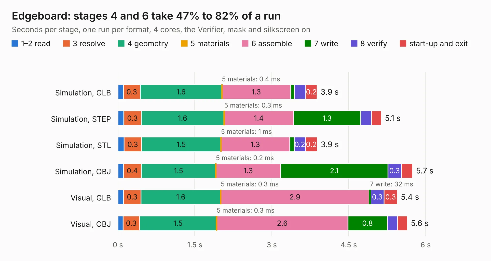

| Mode and format | 1–2 read | 3 resolve | 4 geometry | 5 materials | 6 assemble | 7 write | 8 verify | start-up and exit | Total |
|---|---:|---:|---:|---:|---:|---:|---:|---:|---:|
| Simulation, GLB | 0.1 | 0.3 | 1.6 | 0.4&nbsp;ms | 1.3 | 73&nbsp;ms | 0.2 | 0.2 | 3.9 |
| Simulation, STEP | 0.1 | 0.3 | 1.6 | 0.3&nbsp;ms | 1.4 | 1.3 | 0.2 | 0.2 | 5.1 |
| Simulation, STL | 0.1 | 0.3 | 1.5 | 1&nbsp;ms | 1.3 | 85&nbsp;ms | 0.2 | 0.2 | 3.9 |
| Simulation, OBJ | 0.1 | 0.4 | 1.5 | 0.2&nbsp;ms | 1.3 | 2.1 | 0.3 | 0.2 | 5.7 |
| Visual, GLB | 0.1 | 0.3 | 1.6 | 0.3&nbsp;ms | 2.9 | 32&nbsp;ms | 0.3 | 0.3 | 5.4 |
| Visual, OBJ | 0.1 | 0.3 | 1.5 | 0.3&nbsp;ms | 2.6 | 0.8 | 0.2 | 0.2 | 5.6 |

<table align="center"><tr><td valign="top">

| Board | Repo: [flypie/Ace-2019](https://github.com/flypie/Ace-2019) Board: `Edgeboard.kicad_pcb` |
|---|---|
| Folder | KiCad / Edgeboard |
| Complexity | 145&nbsp;/&nbsp;1000 (size&nbsp;115, features&nbsp;30) |
| KESE&nbsp;features | rounded, trapezoid or chamfered pads, filled zones |
| Tested | 9th November 2026 |
| Copper&nbsp;layers | 2 |
| File&nbsp;format | KiCad 7 (20221018) |
| Parts,&nbsp;tracks,&nbsp;vias | 2, 191, 0 |
| Triangles,&nbsp;simulation | 349,290 in 56 parts |
| Verifier | PASS in all six runs |

</td><td valign="top">

<table>
<tr><th>File type</th><th>File size</th><th>Peak memory used</th></tr>
<tr><th colspan="3" align="left">Simulation</th></tr>
<tr><td>GLB</td><td align="right">12&nbsp;MB</td><td align="right">242&nbsp;MB</td></tr>
<tr><td>STEP</td><td align="right">62&nbsp;MB</td><td align="right">270&nbsp;MB</td></tr>
<tr><td>STL</td><td align="right">17&nbsp;MB</td><td align="right">240&nbsp;MB</td></tr>
<tr><td>OBJ</td><td align="right">35&nbsp;MB</td><td align="right">288&nbsp;MB</td></tr>
<tr><th colspan="3" align="left">Visual</th></tr>
<tr><td>GLB</td><td align="right">6.1&nbsp;MB</td><td align="right">213&nbsp;MB</td></tr>
<tr><td>OBJ</td><td align="right">18&nbsp;MB</td><td align="right">216&nbsp;MB</td></tr>
</table>

</td></tr></table>

## 974. eMultiUniBoard

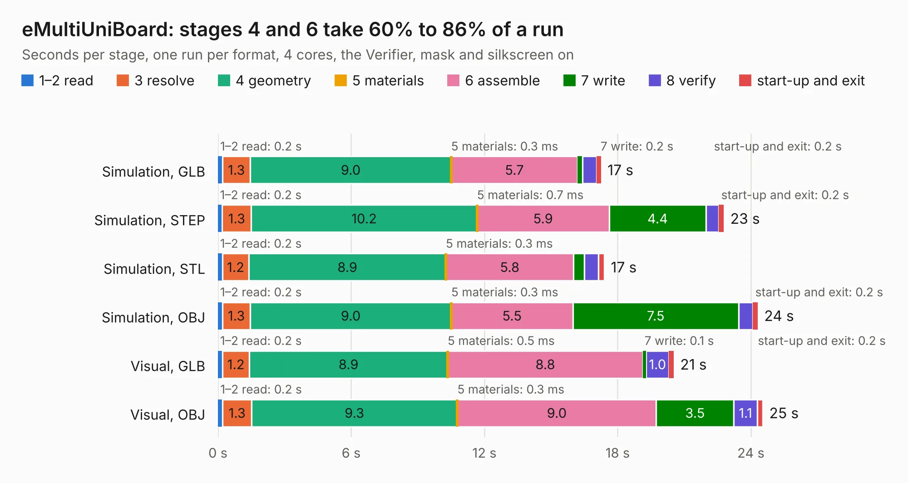

| Mode and format | 1–2 read | 3 resolve | 4 geometry | 5 materials | 6 assemble | 7 write | 8 verify | start-up and exit | Total |
|---|---:|---:|---:|---:|---:|---:|---:|---:|---:|
| Simulation, GLB | 0.2 | 1.3 | 9.0 | 0.3&nbsp;ms | 5.7 | 0.2 | 0.6 | 0.2 | 17.2 |
| Simulation, STEP | 0.2 | 1.3 | 10.2 | 0.7&nbsp;ms | 5.9 | 4.4 | 0.6 | 0.2 | 22.8 |
| Simulation, STL | 0.2 | 1.2 | 8.9 | 0.3&nbsp;ms | 5.8 | 0.5 | 0.6 | 0.3 | 17.4 |
| Simulation, OBJ | 0.2 | 1.3 | 9.0 | 0.3&nbsp;ms | 5.5 | 7.5 | 0.6 | 0.2 | 24.3 |
| Visual, GLB | 0.2 | 1.2 | 8.9 | 0.5&nbsp;ms | 8.8 | 0.1 | 1.0 | 0.2 | 20.5 |
| Visual, OBJ | 0.2 | 1.3 | 9.3 | 0.3&nbsp;ms | 9.0 | 3.5 | 1.1 | 0.3 | 24.5 |

<table align="center"><tr><td valign="top">

| Board | Repo: [flypie/Ace-2019](https://github.com/flypie/Ace-2019) Board: `eMultiUniBoard.kicad_pcb` |
|---|---|
| Folder | KiCad / eMultiUniBoard |
| Complexity | 151&nbsp;/&nbsp;1000 (size&nbsp;151, features&nbsp;0) |
| Tested | 9th November 2026 |
| Copper&nbsp;layers | 2 |
| File&nbsp;format | KiCad 6 (20211014) |
| Parts,&nbsp;tracks,&nbsp;vias | 5, 1,093, 0 |
| Triangles,&nbsp;simulation | 1,477,974 in 60 parts |
| Verifier | PASS in all six runs |

</td><td valign="top">

<table>
<tr><th>File type</th><th>File size</th><th>Peak memory used</th></tr>
<tr><th colspan="3" align="left">Simulation</th></tr>
<tr><td>GLB</td><td align="right">51&nbsp;MB</td><td align="right">584&nbsp;MB</td></tr>
<tr><td>STEP</td><td align="right">253&nbsp;MB</td><td align="right">686&nbsp;MB</td></tr>
<tr><td>STL</td><td align="right">74&nbsp;MB</td><td align="right">580&nbsp;MB</td></tr>
<tr><td>OBJ</td><td align="right">154&nbsp;MB</td><td align="right">1.0&nbsp;GB</td></tr>
<tr><th colspan="3" align="left">Visual</th></tr>
<tr><td>GLB</td><td align="right">24&nbsp;MB</td><td align="right">625&nbsp;MB</td></tr>
<tr><td>OBJ</td><td align="right">72&nbsp;MB</td><td align="right">632&nbsp;MB</td></tr>
</table>

</td></tr></table>

## 975. eUniBoard

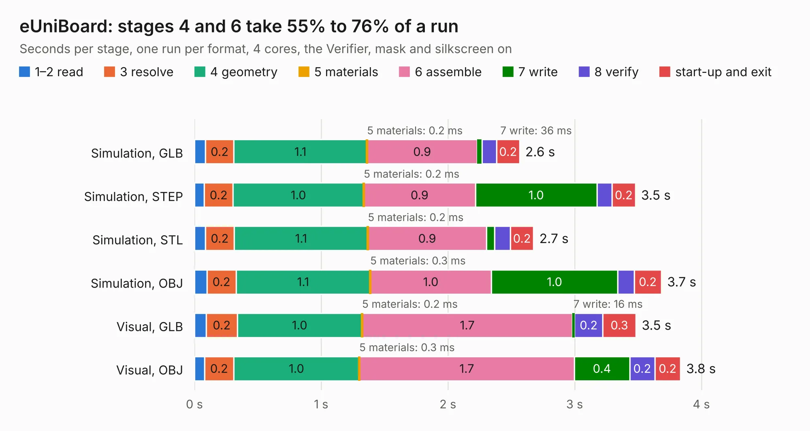

| Mode and format | 1–2 read | 3 resolve | 4 geometry | 5 materials | 6 assemble | 7 write | 8 verify | start-up and exit | Total |
|---|---:|---:|---:|---:|---:|---:|---:|---:|---:|
| Simulation, GLB | 87&nbsp;ms | 0.2 | 1.1 | 0.2&nbsp;ms | 0.9 | 36&nbsp;ms | 0.1 | 0.2 | 2.6 |
| Simulation, STEP | 77&nbsp;ms | 0.2 | 1.0 | 0.2&nbsp;ms | 0.9 | 1.0 | 0.1 | 0.2 | 3.5 |
| Simulation, STL | 85&nbsp;ms | 0.2 | 1.1 | 0.2&nbsp;ms | 0.9 | 63&nbsp;ms | 0.1 | 0.2 | 2.7 |
| Simulation, OBJ | 98&nbsp;ms | 0.2 | 1.1 | 0.3&nbsp;ms | 1.0 | 1.0 | 0.1 | 0.2 | 3.7 |
| Visual, GLB | 93&nbsp;ms | 0.2 | 1.0 | 0.2&nbsp;ms | 1.7 | 16&nbsp;ms | 0.2 | 0.3 | 3.5 |
| Visual, OBJ | 79&nbsp;ms | 0.2 | 1.0 | 0.3&nbsp;ms | 1.7 | 0.4 | 0.2 | 0.2 | 3.8 |

<table align="center"><tr><td valign="top">

| Board | Repo: [flypie/Ace-2019](https://github.com/flypie/Ace-2019) Board: `eUniBoard.kicad_pcb` |
|---|---|
| Folder | KiCad / eUniBoard |
| Complexity | 42&nbsp;/&nbsp;1000 (size&nbsp;42, features&nbsp;0) |
| Tested | 9th November 2026 |
| Copper&nbsp;layers | 2 |
| File&nbsp;format | KiCad 6 (20211014) |
| Parts,&nbsp;tracks,&nbsp;vias | 1, 2, 0 |
| Triangles,&nbsp;simulation | 268,800 in 60 parts |
| Verifier | PASS in all six runs |

</td><td valign="top">

<table>
<tr><th>File type</th><th>File size</th><th>Peak memory used</th></tr>
<tr><th colspan="3" align="left">Simulation</th></tr>
<tr><td>GLB</td><td align="right">8.8&nbsp;MB</td><td align="right">224&nbsp;MB</td></tr>
<tr><td>STEP</td><td align="right">39&nbsp;MB</td><td align="right">247&nbsp;MB</td></tr>
<tr><td>STL</td><td align="right">13&nbsp;MB</td><td align="right">218&nbsp;MB</td></tr>
<tr><td>OBJ</td><td align="right">27&nbsp;MB</td><td align="right">218&nbsp;MB</td></tr>
<tr><th colspan="3" align="left">Visual</th></tr>
<tr><td>GLB</td><td align="right">4.0&nbsp;MB</td><td align="right">262&nbsp;MB</td></tr>
<tr><td>OBJ</td><td align="right">11&nbsp;MB</td><td align="right">245&nbsp;MB</td></tr>
</table>

</td></tr></table>

## 976. MultiUniBoard

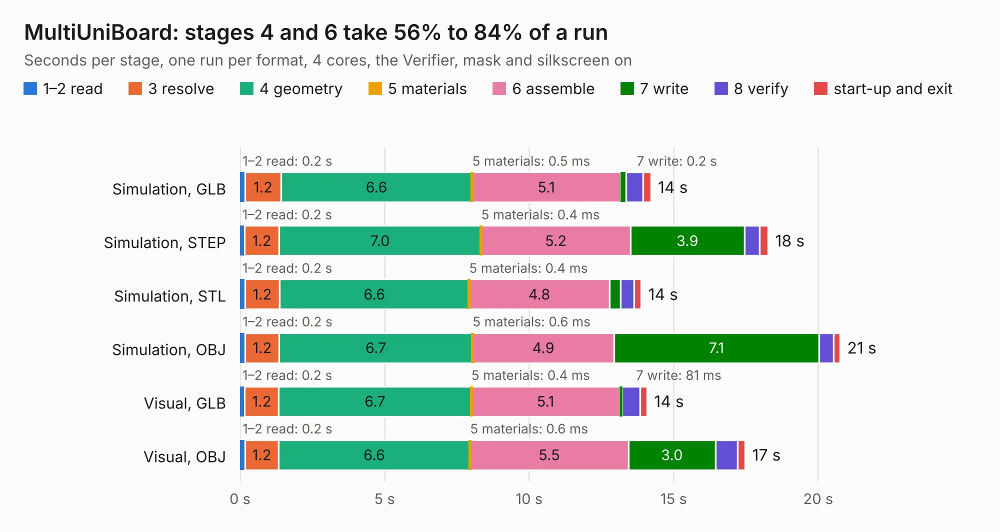

| Mode and format | 1–2 read | 3 resolve | 4 geometry | 5 materials | 6 assemble | 7 write | 8 verify | start-up and exit | Total |
|---|---:|---:|---:|---:|---:|---:|---:|---:|---:|
| Simulation, GLB | 0.2 | 1.2 | 6.6 | 0.5&nbsp;ms | 5.1 | 0.2 | 0.6 | 0.3 | 14.2 |
| Simulation, STEP | 0.2 | 1.2 | 7.0 | 0.4&nbsp;ms | 5.2 | 3.9 | 0.5 | 0.3 | 18.3 |
| Simulation, STL | 0.2 | 1.2 | 6.6 | 0.4&nbsp;ms | 4.8 | 0.4 | 0.5 | 0.3 | 13.9 |
| Simulation, OBJ | 0.2 | 1.2 | 6.7 | 0.6&nbsp;ms | 4.9 | 7.1 | 0.5 | 0.2 | 20.8 |
| Visual, GLB | 0.2 | 1.2 | 6.7 | 0.4&nbsp;ms | 5.1 | 81&nbsp;ms | 0.6 | 0.2 | 14.1 |
| Visual, OBJ | 0.2 | 1.2 | 6.6 | 0.6&nbsp;ms | 5.5 | 3.0 | 0.8 | 0.3 | 17.5 |

<table align="center"><tr><td valign="top">

| Board | Repo: [flypie/Ace-2019](https://github.com/flypie/Ace-2019) Board: `MultiUniBoard.kicad_pcb` |
|---|---|
| Folder | KiCad / MultiUniBoard |
| Complexity | 36&nbsp;/&nbsp;1000 (size&nbsp;36, features&nbsp;0) |
| Tested | 9th November 2026 |
| Copper&nbsp;layers | 2 |
| File&nbsp;format | KiCad 6 (20211014) |
| Parts,&nbsp;tracks,&nbsp;vias | 5, 0, 0 |
| Triangles,&nbsp;simulation | 1,216,112 in 72 parts |
| Verifier | PASS in all six runs |

</td><td valign="top">

<table>
<tr><th>File type</th><th>File size</th><th>Peak memory used</th></tr>
<tr><th colspan="3" align="left">Simulation</th></tr>
<tr><td>GLB</td><td align="right">37&nbsp;MB</td><td align="right">478&nbsp;MB</td></tr>
<tr><td>STEP</td><td align="right">184&nbsp;MB</td><td align="right">605&nbsp;MB</td></tr>
<tr><td>STL</td><td align="right">61&nbsp;MB</td><td align="right">458&nbsp;MB</td></tr>
<tr><td>OBJ</td><td align="right">124&nbsp;MB</td><td align="right">861&nbsp;MB</td></tr>
<tr><th colspan="3" align="left">Visual</th></tr>
<tr><td>GLB</td><td align="right">17&nbsp;MB</td><td align="right">480&nbsp;MB</td></tr>
<tr><td>OBJ</td><td align="right">53&nbsp;MB</td><td align="right">494&nbsp;MB</td></tr>
</table>

</td></tr></table>

## 977. PS2

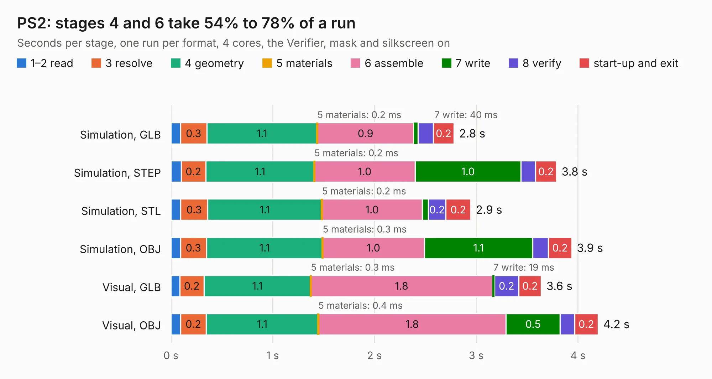

| Mode and format | 1–2 read | 3 resolve | 4 geometry | 5 materials | 6 assemble | 7 write | 8 verify | start-up and exit | Total |
|---|---:|---:|---:|---:|---:|---:|---:|---:|---:|
| Simulation, GLB | 94&nbsp;ms | 0.3 | 1.1 | 0.2&nbsp;ms | 0.9 | 40&nbsp;ms | 0.2 | 0.2 | 2.8 |
| Simulation, STEP | 0.1 | 0.2 | 1.1 | 0.2&nbsp;ms | 1.0 | 1.0 | 0.1 | 0.2 | 3.8 |
| Simulation, STL | 95&nbsp;ms | 0.3 | 1.1 | 0.2&nbsp;ms | 1.0 | 61&nbsp;ms | 0.2 | 0.2 | 2.9 |
| Simulation, OBJ | 93&nbsp;ms | 0.3 | 1.1 | 0.3&nbsp;ms | 1.0 | 1.1 | 0.2 | 0.2 | 3.9 |
| Visual, GLB | 86&nbsp;ms | 0.2 | 1.1 | 0.3&nbsp;ms | 1.8 | 19&nbsp;ms | 0.2 | 0.2 | 3.6 |
| Visual, OBJ | 96&nbsp;ms | 0.2 | 1.1 | 0.4&nbsp;ms | 1.8 | 0.5 | 0.1 | 0.2 | 4.2 |

<table align="center"><tr><td valign="top">

| Board | Repo: [flypie/Ace-2019](https://github.com/flypie/Ace-2019) Board: `PS2.kicad_pcb` |
|---|---|
| Folder | KiCad / PS2 |
| Complexity | 112&nbsp;/&nbsp;1000 (size&nbsp;112, features&nbsp;0) |
| Tested | 9th November 2026 |
| Copper&nbsp;layers | 2 |
| File&nbsp;format | KiCad 6 (20211014) |
| Parts,&nbsp;tracks,&nbsp;vias | 5, 104, 0 |
| Triangles,&nbsp;simulation | 239,970 in 27 parts |
| Verifier | PASS in all six runs |

</td><td valign="top">

<table>
<tr><th>File type</th><th>File size</th><th>Peak memory used</th></tr>
<tr><th colspan="3" align="left">Simulation</th></tr>
<tr><td>GLB</td><td align="right">8.3&nbsp;MB</td><td align="right">230&nbsp;MB</td></tr>
<tr><td>STEP</td><td align="right">37&nbsp;MB</td><td align="right">235&nbsp;MB</td></tr>
<tr><td>STL</td><td align="right">12&nbsp;MB</td><td align="right">220&nbsp;MB</td></tr>
<tr><td>OBJ</td><td align="right">24&nbsp;MB</td><td align="right">223&nbsp;MB</td></tr>
<tr><th colspan="3" align="left">Visual</th></tr>
<tr><td>GLB</td><td align="right">3.9&nbsp;MB</td><td align="right">177&nbsp;MB</td></tr>
<tr><td>OBJ</td><td align="right">11&nbsp;MB</td><td align="right">174&nbsp;MB</td></tr>
</table>

</td></tr></table>

## 978. PS2TestCard

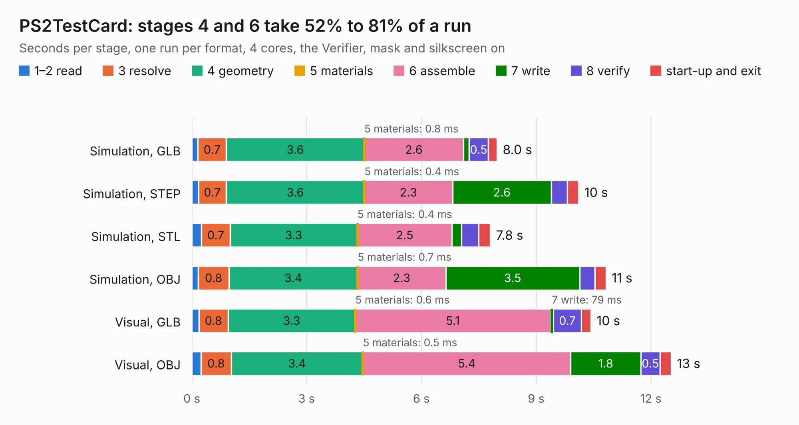

| Mode and format | 1–2 read | 3 resolve | 4 geometry | 5 materials | 6 assemble | 7 write | 8 verify | start-up and exit | Total |
|---|---:|---:|---:|---:|---:|---:|---:|---:|---:|
| Simulation, GLB | 0.2 | 0.7 | 3.6 | 0.8&nbsp;ms | 2.6 | 0.1 | 0.5 | 0.2 | 8.0 |
| Simulation, STEP | 0.2 | 0.7 | 3.6 | 0.4&nbsp;ms | 2.3 | 2.6 | 0.4 | 0.3 | 10.1 |
| Simulation, STL | 0.3 | 0.7 | 3.3 | 0.4&nbsp;ms | 2.5 | 0.2 | 0.4 | 0.3 | 7.8 |
| Simulation, OBJ | 0.2 | 0.8 | 3.4 | 0.7&nbsp;ms | 2.3 | 3.5 | 0.4 | 0.3 | 10.8 |
| Visual, GLB | 0.2 | 0.8 | 3.3 | 0.6&nbsp;ms | 5.1 | 79&nbsp;ms | 0.7 | 0.2 | 10.4 |
| Visual, OBJ | 0.2 | 0.8 | 3.4 | 0.5&nbsp;ms | 5.4 | 1.8 | 0.5 | 0.3 | 12.5 |

<table align="center"><tr><td valign="top">

| Board | Repo: [flypie/Ace-2019](https://github.com/flypie/Ace-2019) Board: `PS2TestCard.kicad_pcb` |
|---|---|
| Folder | KiCad / PS2TestCard |
| Complexity | 161&nbsp;/&nbsp;1000 (size&nbsp;146, features&nbsp;15) |
| KESE&nbsp;features | through vias |
| Tested | 9th November 2026 |
| Copper&nbsp;layers | 2 |
| File&nbsp;format | KiCad 6 (20211014) |
| Parts,&nbsp;tracks,&nbsp;vias | 13, 401, 20 |
| Triangles,&nbsp;simulation | 569,862 in 106 parts |
| Verifier | PASS in all six runs |

</td><td valign="top">

<table>
<tr><th>File type</th><th>File size</th><th>Peak memory used</th></tr>
<tr><th colspan="3" align="left">Simulation</th></tr>
<tr><td>GLB</td><td align="right">20&nbsp;MB</td><td align="right">305&nbsp;MB</td></tr>
<tr><td>STEP</td><td align="right">93&nbsp;MB</td><td align="right">343&nbsp;MB</td></tr>
<tr><td>STL</td><td align="right">29&nbsp;MB</td><td align="right">329&nbsp;MB</td></tr>
<tr><td>OBJ</td><td align="right">59&nbsp;MB</td><td align="right">425&nbsp;MB</td></tr>
<tr><th colspan="3" align="left">Visual</th></tr>
<tr><td>GLB</td><td align="right">11&nbsp;MB</td><td align="right">339&nbsp;MB</td></tr>
<tr><td>OBJ</td><td align="right">33&nbsp;MB</td><td align="right">328&nbsp;MB</td></tr>
</table>

</td></tr></table>

## 979. STM8SUBSYS

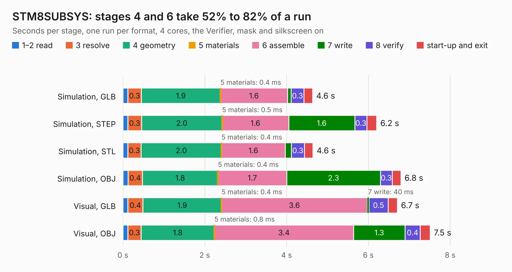

| Mode and format | 1–2 read | 3 resolve | 4 geometry | 5 materials | 6 assemble | 7 write | 8 verify | start-up and exit | Total |
|---|---:|---:|---:|---:|---:|---:|---:|---:|---:|
| Simulation, GLB | 0.1 | 0.3 | 1.9 | 0.4&nbsp;ms | 1.6 | 89&nbsp;ms | 0.3 | 0.2 | 4.6 |
| Simulation, STEP | 0.1 | 0.3 | 2.0 | 0.5&nbsp;ms | 1.6 | 1.6 | 0.3 | 0.2 | 6.2 |
| Simulation, STL | 0.1 | 0.3 | 2.0 | 0.4&nbsp;ms | 1.6 | 0.2 | 0.3 | 0.2 | 4.6 |
| Simulation, OBJ | 0.1 | 0.4 | 1.8 | 0.4&nbsp;ms | 1.7 | 2.3 | 0.3 | 0.2 | 6.8 |
| Visual, GLB | 0.1 | 0.4 | 1.9 | 0.4&nbsp;ms | 3.6 | 40&nbsp;ms | 0.5 | 0.2 | 6.7 |
| Visual, OBJ | 0.1 | 0.3 | 1.8 | 0.8&nbsp;ms | 3.4 | 1.3 | 0.4 | 0.2 | 7.5 |

<table align="center"><tr><td valign="top">

| Board | Repo: [flypie/Ace-2019](https://github.com/flypie/Ace-2019) Board: `STM8SUBSYS.kicad_pcb` |
|---|---|
| Folder | KiCad / STM8SUBSYS |
| Complexity | 162&nbsp;/&nbsp;1000 (size&nbsp;137, features&nbsp;25) |
| KESE&nbsp;features | through vias, rounded, trapezoid or chamfered pads |
| Tested | 9th November 2026 |
| Copper&nbsp;layers | 2 |
| File&nbsp;format | KiCad 6 (20211014) |
| Parts,&nbsp;tracks,&nbsp;vias | 12, 277, 3 |
| Triangles,&nbsp;simulation | 465,296 in 70 parts |
| Verifier | PASS in all six runs |

</td><td valign="top">

<table>
<tr><th>File type</th><th>File size</th><th>Peak memory used</th></tr>
<tr><th colspan="3" align="left">Simulation</th></tr>
<tr><td>GLB</td><td align="right">15&nbsp;MB</td><td align="right">271&nbsp;MB</td></tr>
<tr><td>STEP</td><td align="right">60&nbsp;MB</td><td align="right">313&nbsp;MB</td></tr>
<tr><td>STL</td><td align="right">23&nbsp;MB</td><td align="right">269&nbsp;MB</td></tr>
<tr><td>OBJ</td><td align="right">46&nbsp;MB</td><td align="right">354&nbsp;MB</td></tr>
<tr><th colspan="3" align="left">Visual</th></tr>
<tr><td>GLB</td><td align="right">8.8&nbsp;MB</td><td align="right">306&nbsp;MB</td></tr>
<tr><td>OBJ</td><td align="right">26&nbsp;MB</td><td align="right">314&nbsp;MB</td></tr>
</table>

</td></tr></table>

## 980. UniBoard

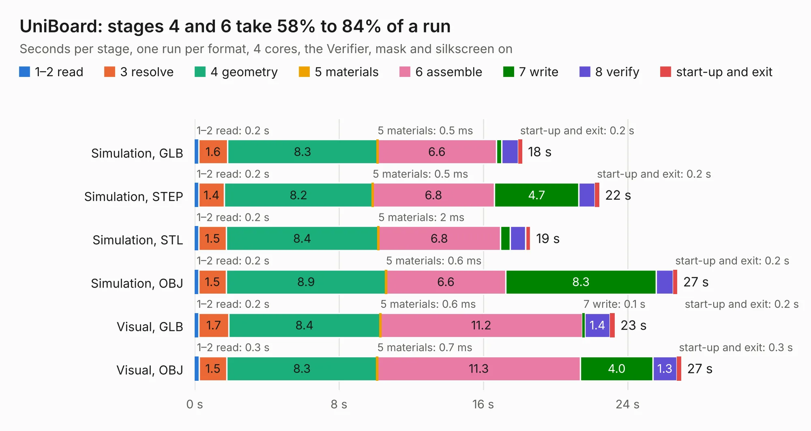

| Mode and format | 1–2 read | 3 resolve | 4 geometry | 5 materials | 6 assemble | 7 write | 8 verify | start-up and exit | Total |
|---|---:|---:|---:|---:|---:|---:|---:|---:|---:|
| Simulation, GLB | 0.2 | 1.6 | 8.3 | 0.5&nbsp;ms | 6.6 | 0.3 | 0.9 | 0.2 | 18.2 |
| Simulation, STEP | 0.2 | 1.4 | 8.2 | 0.5&nbsp;ms | 6.8 | 4.7 | 0.9 | 0.2 | 22.4 |
| Simulation, STL | 0.2 | 1.5 | 8.4 | 2&nbsp;ms | 6.8 | 0.5 | 0.8 | 0.3 | 18.6 |
| Simulation, OBJ | 0.2 | 1.5 | 8.9 | 0.6&nbsp;ms | 6.6 | 8.3 | 1.0 | 0.2 | 26.8 |
| Visual, GLB | 0.2 | 1.7 | 8.4 | 0.6&nbsp;ms | 11.2 | 0.1 | 1.4 | 0.2 | 23.3 |
| Visual, OBJ | 0.3 | 1.5 | 8.3 | 0.7&nbsp;ms | 11.3 | 4.0 | 1.3 | 0.3 | 27.0 |

<table align="center"><tr><td valign="top">

| Board | Repo: [flypie/Ace-2019](https://github.com/flypie/Ace-2019) Board: `UniBoard.kicad_pcb` |
|---|---|
| Folder | KiCad / UniBoard |
| Complexity | 187&nbsp;/&nbsp;1000 (size&nbsp;172, features&nbsp;15) |
| KESE&nbsp;features | through vias |
| Tested | 9th November 2026 |
| Copper&nbsp;layers | 2 |
| File&nbsp;format | KiCad 6 (20211014) |
| Parts,&nbsp;tracks,&nbsp;vias | 20, 1,628, 34 |
| Triangles,&nbsp;simulation | 1,946,730 in 145 parts |
| Verifier | PASS in all six runs |

</td><td valign="top">

<table>
<tr><th>File type</th><th>File size</th><th>Peak memory used</th></tr>
<tr><th colspan="3" align="left">Simulation</th></tr>
<tr><td>GLB</td><td align="right">67&nbsp;MB</td><td align="right">733&nbsp;MB</td></tr>
<tr><td>STEP</td><td align="right">329&nbsp;MB</td><td align="right">815&nbsp;MB</td></tr>
<tr><td>STL</td><td align="right">97&nbsp;MB</td><td align="right">787&nbsp;MB</td></tr>
<tr><td>OBJ</td><td align="right">205&nbsp;MB</td><td align="right">1.3&nbsp;GB</td></tr>
<tr><th colspan="3" align="left">Visual</th></tr>
<tr><td>GLB</td><td align="right">33&nbsp;MB</td><td align="right">825&nbsp;MB</td></tr>
<tr><td>OBJ</td><td align="right">100&nbsp;MB</td><td align="right">748&nbsp;MB</td></tr>
</table>

</td></tr></table>

## 981. Full Card

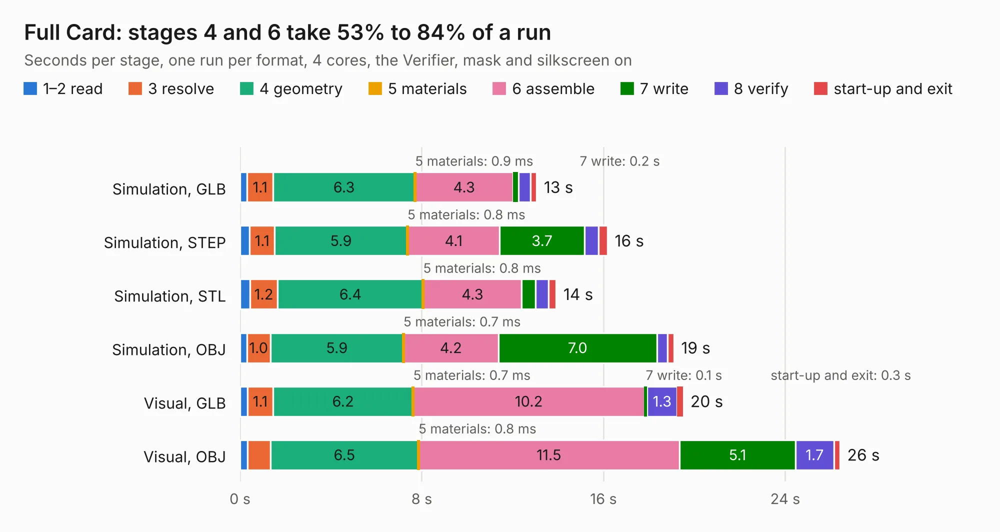

| Mode and format | 1–2 read | 3 resolve | 4 geometry | 5 materials | 6 assemble | 7 write | 8 verify | start-up and exit | Total |
|---|---:|---:|---:|---:|---:|---:|---:|---:|---:|
| Simulation, GLB | 0.3 | 1.1 | 6.3 | 0.9&nbsp;ms | 4.3 | 0.2 | 0.5 | 0.3 | 13.1 |
| Simulation, STEP | 0.4 | 1.1 | 5.9 | 0.8&nbsp;ms | 4.1 | 3.7 | 0.6 | 0.4 | 16.2 |
| Simulation, STL | 0.4 | 1.2 | 6.4 | 0.8&nbsp;ms | 4.3 | 0.6 | 0.6 | 0.3 | 13.9 |
| Simulation, OBJ | 0.3 | 1.0 | 5.9 | 0.7&nbsp;ms | 4.2 | 7.0 | 0.5 | 0.3 | 19.1 |
| Visual, GLB | 0.3 | 1.1 | 6.2 | 0.7&nbsp;ms | 10.2 | 0.1 | 1.3 | 0.3 | 19.5 |
| Visual, OBJ | 0.3 | 1.0 | 6.5 | 0.8&nbsp;ms | 11.5 | 5.1 | 1.7 | 0.3 | 26.4 |

<table align="center"><tr><td valign="top">

| Board | Repo: [flypie/Ace-2019](https://github.com/flypie/Ace-2019) Board: `Full Card.kicad_pcb` |
|---|---|
| Folder | VGA / Full Card |
| Complexity | 74&nbsp;/&nbsp;1000 (size&nbsp;64, features&nbsp;10) |
| KESE&nbsp;features | rounded, trapezoid or chamfered pads |
| Tested | 9th November 2026 |
| Copper&nbsp;layers | 2 |
| File&nbsp;format | KiCad 6 (20211014) |
| Parts,&nbsp;tracks,&nbsp;vias | 76, 0, 0 |
| Triangles,&nbsp;simulation | 1,119,752 in 201 parts |
| Note | mostly unrouted |
| Verifier | PASS in all six runs |

</td><td valign="top">

<table>
<tr><th>File type</th><th>File size</th><th>Peak memory used</th></tr>
<tr><th colspan="3" align="left">Simulation</th></tr>
<tr><td>GLB</td><td align="right">37&nbsp;MB</td><td align="right">510&nbsp;MB</td></tr>
<tr><td>STEP</td><td align="right">146&nbsp;MB</td><td align="right">564&nbsp;MB</td></tr>
<tr><td>STL</td><td align="right">56&nbsp;MB</td><td align="right">490&nbsp;MB</td></tr>
<tr><td>OBJ</td><td align="right">115&nbsp;MB</td><td align="right">765&nbsp;MB</td></tr>
<tr><th colspan="3" align="left">Visual</th></tr>
<tr><td>GLB</td><td align="right">26&nbsp;MB</td><td align="right">588&nbsp;MB</td></tr>
<tr><td>OBJ</td><td align="right">79&nbsp;MB</td><td align="right">596&nbsp;MB</td></tr>
</table>

</td></tr></table>

## 982. VGAGAL

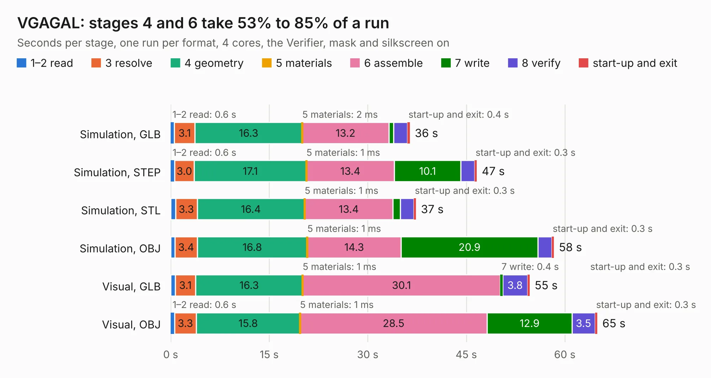

| Mode and format | 1–2 read | 3 resolve | 4 geometry | 5 materials | 6 assemble | 7 write | 8 verify | start-up and exit | Total |
|---|---:|---:|---:|---:|---:|---:|---:|---:|---:|
| Simulation, GLB | 0.6 | 3.1 | 16.3 | 2&nbsp;ms | 13.2 | 0.7 | 2.1 | 0.4 | 36.4 |
| Simulation, STEP | 0.6 | 3.0 | 17.1 | 1&nbsp;ms | 13.4 | 10.1 | 2.1 | 0.3 | 46.6 |
| Simulation, STL | 0.7 | 3.3 | 16.4 | 1&nbsp;ms | 13.4 | 1.1 | 2.1 | 0.3 | 37.3 |
| Simulation, OBJ | 0.7 | 3.4 | 16.8 | 1&nbsp;ms | 14.3 | 20.9 | 2.1 | 0.3 | 58.3 |
| Visual, GLB | 0.7 | 3.1 | 16.3 | 1&nbsp;ms | 30.1 | 0.4 | 3.8 | 0.3 | 54.6 |
| Visual, OBJ | 0.6 | 3.3 | 15.8 | 1&nbsp;ms | 28.5 | 12.9 | 3.5 | 0.3 | 64.9 |

<table align="center"><tr><td valign="top">

| Board | Repo: [flypie/Ace-2019](https://github.com/flypie/Ace-2019) Board: `VGAGAL.kicad_pcb` |
|---|---|
| Folder | VGA / VGAGAL |
| Complexity | 278&nbsp;/&nbsp;1000 (size&nbsp;253, features&nbsp;25) |
| KESE&nbsp;features | through vias, rounded, trapezoid or chamfered pads |
| Tested | 9th November 2026 |
| Copper&nbsp;layers | 2 |
| File&nbsp;format | KiCad 6 (20211014) |
| Parts,&nbsp;tracks,&nbsp;vias | 77, 3,325, 230 |
| Triangles,&nbsp;simulation | 3,129,196 in 217 parts |
| Verifier | PASS in all six runs |

</td><td valign="top">

<table>
<tr><th>File type</th><th>File size</th><th>Peak memory used</th></tr>
<tr><th colspan="3" align="left">Simulation</th></tr>
<tr><td>GLB</td><td align="right">105&nbsp;MB</td><td align="right">1.1&nbsp;GB</td></tr>
<tr><td>STEP</td><td align="right">452&nbsp;MB</td><td align="right">1.3&nbsp;GB</td></tr>
<tr><td>STL</td><td align="right">156&nbsp;MB</td><td align="right">1.1&nbsp;GB</td></tr>
<tr><td>OBJ</td><td align="right">326&nbsp;MB</td><td align="right">2.0&nbsp;GB</td></tr>
<tr><th colspan="3" align="left">Visual</th></tr>
<tr><td>GLB</td><td align="right">67&nbsp;MB</td><td align="right">1.2&nbsp;GB</td></tr>
<tr><td>OBJ</td><td align="right">211&nbsp;MB</td><td align="right">1.5&nbsp;GB</td></tr>
</table>

</td></tr></table>

## 983. VGAVDG

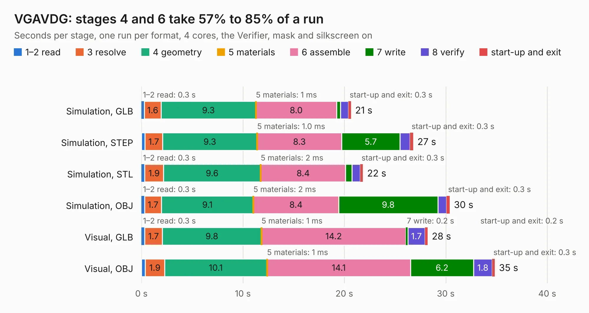

| Mode and format | 1–2 read | 3 resolve | 4 geometry | 5 materials | 6 assemble | 7 write | 8 verify | start-up and exit | Total |
|---|---:|---:|---:|---:|---:|---:|---:|---:|---:|
| Simulation, GLB | 0.3 | 1.6 | 9.3 | 1&nbsp;ms | 8.0 | 0.4 | 0.8 | 0.3 | 20.7 |
| Simulation, STEP | 0.4 | 1.7 | 9.3 | 1.0&nbsp;ms | 8.3 | 5.7 | 1.0 | 0.3 | 26.8 |
| Simulation, STL | 0.3 | 1.9 | 9.6 | 2&nbsp;ms | 8.4 | 0.6 | 0.8 | 0.3 | 21.8 |
| Simulation, OBJ | 0.3 | 1.7 | 9.1 | 2&nbsp;ms | 8.4 | 9.8 | 0.9 | 0.3 | 30.4 |
| Visual, GLB | 0.3 | 1.7 | 9.8 | 1&nbsp;ms | 14.2 | 0.2 | 1.7 | 0.2 | 28.2 |
| Visual, OBJ | 0.4 | 1.9 | 10.1 | 1&nbsp;ms | 14.1 | 6.2 | 1.8 | 0.3 | 34.8 |

<table align="center"><tr><td valign="top">

| Board | Repo: [flypie/Ace-2019](https://github.com/flypie/Ace-2019) Board: `VGAVDG.kicad_pcb` |
|---|---|
| Folder | VGA |
| Complexity | 128&nbsp;/&nbsp;1000 (size&nbsp;118, features&nbsp;10) |
| KESE&nbsp;features | rounded, trapezoid or chamfered pads |
| Tested | 9th November 2026 |
| Copper&nbsp;layers | 2 |
| File&nbsp;format | KiCad 6 (20211014) |
| Parts,&nbsp;tracks,&nbsp;vias | 87, 0, 0 |
| Triangles,&nbsp;simulation | 2,092,560 in 266 parts |
| Note | mostly unrouted |
| Verifier | PASS in all six runs |

</td><td valign="top">

<table>
<tr><th>File type</th><th>File size</th><th>Peak memory used</th></tr>
<tr><th colspan="3" align="left">Simulation</th></tr>
<tr><td>GLB</td><td align="right">69&nbsp;MB</td><td align="right">702&nbsp;MB</td></tr>
<tr><td>STEP</td><td align="right">235&nbsp;MB</td><td align="right">890&nbsp;MB</td></tr>
<tr><td>STL</td><td align="right">105&nbsp;MB</td><td align="right">711&nbsp;MB</td></tr>
<tr><td>OBJ</td><td align="right">219&nbsp;MB</td><td align="right">1.4&nbsp;GB</td></tr>
<tr><th colspan="3" align="left">Visual</th></tr>
<tr><td>GLB</td><td align="right">43&nbsp;MB</td><td align="right">985&nbsp;MB</td></tr>
<tr><td>OBJ</td><td align="right">131&nbsp;MB</td><td align="right">957&nbsp;MB</td></tr>
</table>

</td></tr></table>

## 984. Gigatron

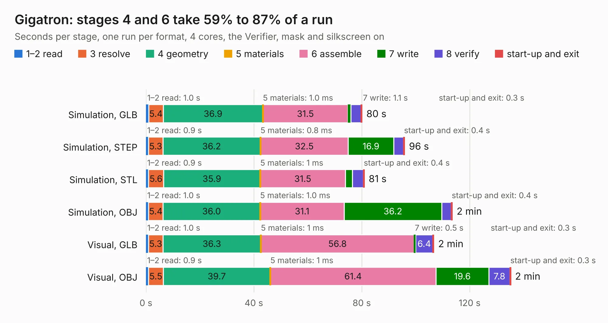

| Mode and format | 1–2 read | 3 resolve | 4 geometry | 5 materials | 6 assemble | 7 write | 8 verify | start-up and exit | Total |
|---|---:|---:|---:|---:|---:|---:|---:|---:|---:|
| Simulation, GLB | 1.0 | 5.4 | 36.9 | 1.0&nbsp;ms | 31.5 | 1.1 | 3.8 | 0.3 | 80.1 |
| Simulation, STEP | 0.9 | 5.3 | 36.2 | 0.8&nbsp;ms | 32.5 | 16.9 | 3.6 | 0.4 | 95.9 |
| Simulation, STL | 0.9 | 5.6 | 35.9 | 1&nbsp;ms | 31.5 | 2.6 | 4.1 | 0.4 | 81.0 |
| Simulation, OBJ | 1.0 | 5.4 | 36.0 | 1.0&nbsp;ms | 31.1 | 36.2 | 3.5 | 0.4 | 113.6 |
| Visual, GLB | 1.0 | 5.3 | 36.3 | 1&nbsp;ms | 56.8 | 0.5 | 6.4 | 0.3 | 106.7 |
| Visual, OBJ | 0.9 | 5.5 | 39.7 | 1&nbsp;ms | 61.4 | 19.6 | 7.8 | 0.3 | 135.2 |

<table align="center"><tr><td valign="top">

| Board | Repo: [flypie/Gigatron](https://github.com/flypie/Gigatron) Board: `Gigatron.kicad_pcb` |
|---|---|
| Folder | Kicad |
| Complexity | 233&nbsp;/&nbsp;1000 (size&nbsp;208, features&nbsp;25) |
| KESE&nbsp;features | through vias, slotted holes |
| Tested | 9th November 2026 |
| Copper&nbsp;layers | 2 |
| File&nbsp;format | KiCad 5 (20171130) |
| Parts,&nbsp;tracks,&nbsp;vias | 146, 4,153, 92 |
| Triangles,&nbsp;simulation | 5,836,684 in 223 parts |
| Verifier | PASS in all six runs |

</td><td valign="top">

<table>
<tr><th>File type</th><th>File size</th><th>Peak memory used</th></tr>
<tr><th colspan="3" align="left">Simulation</th></tr>
<tr><td>GLB</td><td align="right">202&nbsp;MB</td><td align="right">1.8&nbsp;GB</td></tr>
<tr><td>STEP</td><td align="right">1.0&nbsp;GB</td><td align="right">2.1&nbsp;GB</td></tr>
<tr><td>STL</td><td align="right">292&nbsp;MB</td><td align="right">1.8&nbsp;GB</td></tr>
<tr><td>OBJ</td><td align="right">630&nbsp;MB</td><td align="right">3.8&nbsp;GB</td></tr>
<tr><th colspan="3" align="left">Visual</th></tr>
<tr><td>GLB</td><td align="right">108&nbsp;MB</td><td align="right">1.9&nbsp;GB</td></tr>
<tr><td>OBJ</td><td align="right">338&nbsp;MB</td><td align="right">2.2&nbsp;GB</td></tr>
</table>

</td></tr></table>

## 985. NewBrain Keyboard A

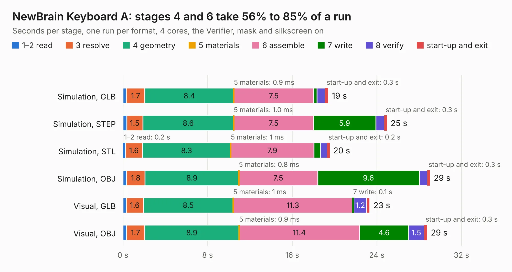

| Mode and format | 1–2 read | 3 resolve | 4 geometry | 5 materials | 6 assemble | 7 write | 8 verify | start-up and exit | Total |
|---|---:|---:|---:|---:|---:|---:|---:|---:|---:|
| Simulation, GLB | 0.3 | 1.7 | 8.4 | 0.9&nbsp;ms | 7.5 | 0.3 | 0.8 | 0.3 | 19.4 |
| Simulation, STEP | 0.4 | 1.5 | 8.6 | 1.0&nbsp;ms | 7.5 | 5.9 | 0.8 | 0.3 | 25.0 |
| Simulation, STL | 0.2 | 1.6 | 8.3 | 1&nbsp;ms | 7.9 | 0.6 | 0.6 | 0.2 | 19.5 |
| Simulation, OBJ | 0.3 | 1.8 | 8.9 | 0.8&nbsp;ms | 7.5 | 9.6 | 0.8 | 0.3 | 29.0 |
| Visual, GLB | 0.3 | 1.6 | 8.5 | 1&nbsp;ms | 11.3 | 0.1 | 1.2 | 0.3 | 23.3 |
| Visual, OBJ | 0.3 | 1.7 | 8.9 | 0.9&nbsp;ms | 11.4 | 4.6 | 1.5 | 0.3 | 28.8 |

<table align="center"><tr><td valign="top">

| Board | Repo: [flypie/NewBrain](https://github.com/flypie/NewBrain) Board: `NewBrain Keyboard A.kicad_pcb` |
|---|---|
| Folder | NewBrain Keyboard A |
| Complexity | 66&nbsp;/&nbsp;1000 (size&nbsp;66, features&nbsp;0) |
| Tested | 9th November 2026 |
| Copper&nbsp;layers | 2 |
| File&nbsp;format | KiCad 5 (20171130) |
| Parts,&nbsp;tracks,&nbsp;vias | 89, 0, 0 |
| Triangles,&nbsp;simulation | 2,004,382 in 140 parts |
| Note | mostly unrouted |
| Verifier | PASS in all six runs |

</td><td valign="top">

<table>
<tr><th>File type</th><th>File size</th><th>Peak memory used</th></tr>
<tr><th colspan="3" align="left">Simulation</th></tr>
<tr><td>GLB</td><td align="right">63&nbsp;MB</td><td align="right">693&nbsp;MB</td></tr>
<tr><td>STEP</td><td align="right">300&nbsp;MB</td><td align="right">844&nbsp;MB</td></tr>
<tr><td>STL</td><td align="right">100&nbsp;MB</td><td align="right">650&nbsp;MB</td></tr>
<tr><td>OBJ</td><td align="right">210&nbsp;MB</td><td align="right">1.4&nbsp;GB</td></tr>
<tr><th colspan="3" align="left">Visual</th></tr>
<tr><td>GLB</td><td align="right">32&nbsp;MB</td><td align="right">724&nbsp;MB</td></tr>
<tr><td>OBJ</td><td align="right">96&nbsp;MB</td><td align="right">750&nbsp;MB</td></tr>
</table>

</td></tr></table>

## 986. NewBrain Original

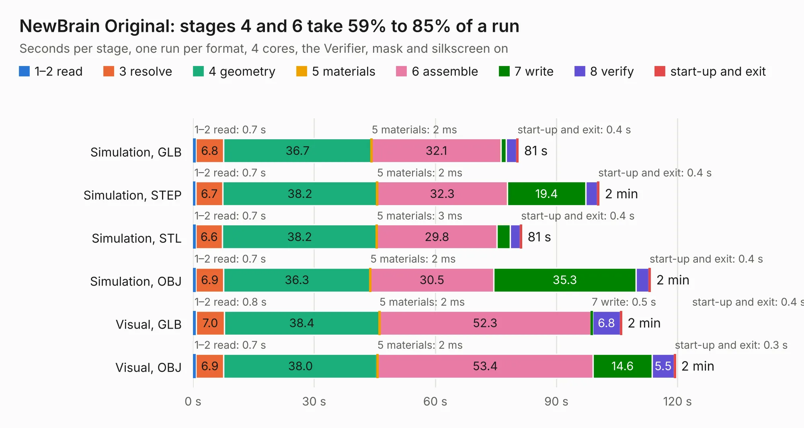

| Mode and format | 1–2 read | 3 resolve | 4 geometry | 5 materials | 6 assemble | 7 write | 8 verify | start-up and exit | Total |
|---|---:|---:|---:|---:|---:|---:|---:|---:|---:|
| Simulation, GLB | 0.7 | 6.8 | 36.7 | 2&nbsp;ms | 32.1 | 1.2 | 2.6 | 0.4 | 80.6 |
| Simulation, STEP | 0.7 | 6.7 | 38.2 | 2&nbsp;ms | 32.3 | 19.4 | 2.9 | 0.4 | 100.6 |
| Simulation, STL | 0.7 | 6.6 | 38.2 | 3&nbsp;ms | 29.8 | 3.3 | 2.5 | 0.4 | 81.4 |
| Simulation, OBJ | 0.7 | 6.9 | 36.3 | 2&nbsp;ms | 30.5 | 35.3 | 3.1 | 0.4 | 113.3 |
| Visual, GLB | 0.8 | 7.0 | 38.4 | 2&nbsp;ms | 52.3 | 0.5 | 6.8 | 0.4 | 106.2 |
| Visual, OBJ | 0.7 | 6.9 | 38.0 | 2&nbsp;ms | 53.4 | 14.6 | 5.5 | 0.3 | 119.5 |

<table align="center"><tr><td valign="top">

| Board | Repo: [flypie/NewBrain](https://github.com/flypie/NewBrain) Board: `NewBrain Original.kicad_pcb` |
|---|---|
| Folder | NewBrain MainBoard Original KiCad |
| Complexity | 85&nbsp;/&nbsp;1000 (size&nbsp;75, features&nbsp;10) |
| KESE&nbsp;features | rounded, trapezoid or chamfered pads |
| Tested | 9th November 2026 |
| Copper&nbsp;layers | 2 |
| File&nbsp;format | KiCad 5 (20171130) |
| Parts,&nbsp;tracks,&nbsp;vias | 209, 0, 0 |
| Triangles,&nbsp;simulation | 7,779,384 in 422 parts |
| Note | mostly unrouted |
| Verifier | Simulation, GLB: Verifier FAIL Simulation, STEP: Verifier FAIL Simulation, STL: Verifier FAIL Simulation, OBJ: Verifier FAIL |
| Bad&nbsp;design | Bad design according to KESE: copper of two nets on top of each other in the file, a short KiCad's DRC reports; C118 pad 2 and C82 pad 1 overlap at (100.32, 170.52) mm, plated holes 0.25 mm apart (the file also has no Edge.Cuts outline). KESE models what the file says, so the Verifier rightly finds the two nets' solids overlapping |

</td><td valign="top">

<table>
<tr><th>File type</th><th>File size</th><th>Peak memory used</th></tr>
<tr><th colspan="3" align="left">Simulation</th></tr>
<tr><td>GLB</td><td align="right">244&nbsp;MB</td><td align="right">2.0&nbsp;GB</td></tr>
<tr><td>STEP</td><td align="right">1.2&nbsp;GB</td><td align="right">2.8&nbsp;GB</td></tr>
<tr><td>STL</td><td align="right">389&nbsp;MB</td><td align="right">2.0&nbsp;GB</td></tr>
<tr><td>OBJ</td><td align="right">831&nbsp;MB</td><td align="right">4.9&nbsp;GB</td></tr>
<tr><th colspan="3" align="left">Visual</th></tr>
<tr><td>GLB</td><td align="right">116&nbsp;MB</td><td align="right">2.3&nbsp;GB</td></tr>
<tr><td>OBJ</td><td align="right">368&nbsp;MB</td><td align="right">2.5&nbsp;GB</td></tr>
</table>

</td></tr></table>

## 987. NewBrain PSU

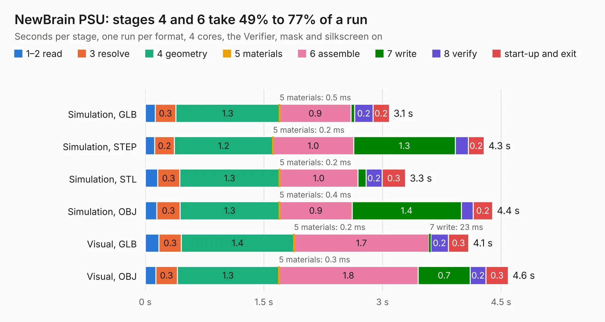

| Mode and format | 1–2 read | 3 resolve | 4 geometry | 5 materials | 6 assemble | 7 write | 8 verify | start-up and exit | Total |
|---|---:|---:|---:|---:|---:|---:|---:|---:|---:|
| Simulation, GLB | 0.1 | 0.3 | 1.3 | 0.5&nbsp;ms | 0.9 | 48&nbsp;ms | 0.2 | 0.2 | 3.1 |
| Simulation, STEP | 0.1 | 0.2 | 1.2 | 0.2&nbsp;ms | 1.0 | 1.3 | 0.2 | 0.2 | 4.3 |
| Simulation, STL | 0.2 | 0.3 | 1.3 | 0.2&nbsp;ms | 1.0 | 0.1 | 0.2 | 0.3 | 3.3 |
| Simulation, OBJ | 0.1 | 0.3 | 1.3 | 0.4&nbsp;ms | 0.9 | 1.4 | 0.2 | 0.2 | 4.4 |
| Visual, GLB | 0.2 | 0.3 | 1.4 | 0.2&nbsp;ms | 1.7 | 23&nbsp;ms | 0.2 | 0.3 | 4.1 |
| Visual, OBJ | 0.1 | 0.3 | 1.3 | 0.3&nbsp;ms | 1.8 | 0.7 | 0.2 | 0.3 | 4.6 |

<table align="center"><tr><td valign="top">

| Board | Repo: [flypie/NewBrain](https://github.com/flypie/NewBrain) Board: `NewBrain PSU.kicad_pcb` |
|---|---|
| Folder | NewBrain PSU |
| Complexity | 50&nbsp;/&nbsp;1000 (size&nbsp;50, features&nbsp;0) |
| Tested | 9th November 2026 |
| Copper&nbsp;layers | 2 |
| File&nbsp;format | KiCad 5 (20171130) |
| Parts,&nbsp;tracks,&nbsp;vias | 20, 0, 0 |
| Triangles,&nbsp;simulation | 289,290 in 32 parts |
| Verifier | PASS in all six runs |

</td><td valign="top">

<table>
<tr><th>File type</th><th>File size</th><th>Peak memory used</th></tr>
<tr><th colspan="3" align="left">Simulation</th></tr>
<tr><td>GLB</td><td align="right">9.3&nbsp;MB</td><td align="right">225&nbsp;MB</td></tr>
<tr><td>STEP</td><td align="right">42&nbsp;MB</td><td align="right">257&nbsp;MB</td></tr>
<tr><td>STL</td><td align="right">14&nbsp;MB</td><td align="right">222&nbsp;MB</td></tr>
<tr><td>OBJ</td><td align="right">29&nbsp;MB</td><td align="right">245&nbsp;MB</td></tr>
<tr><th colspan="3" align="left">Visual</th></tr>
<tr><td>GLB</td><td align="right">4.7&nbsp;MB</td><td align="right">220&nbsp;MB</td></tr>
<tr><td>OBJ</td><td align="right">14&nbsp;MB</td><td align="right">220&nbsp;MB</td></tr>
</table>

</td></tr></table>

## 988. NewBrain StoreBoard

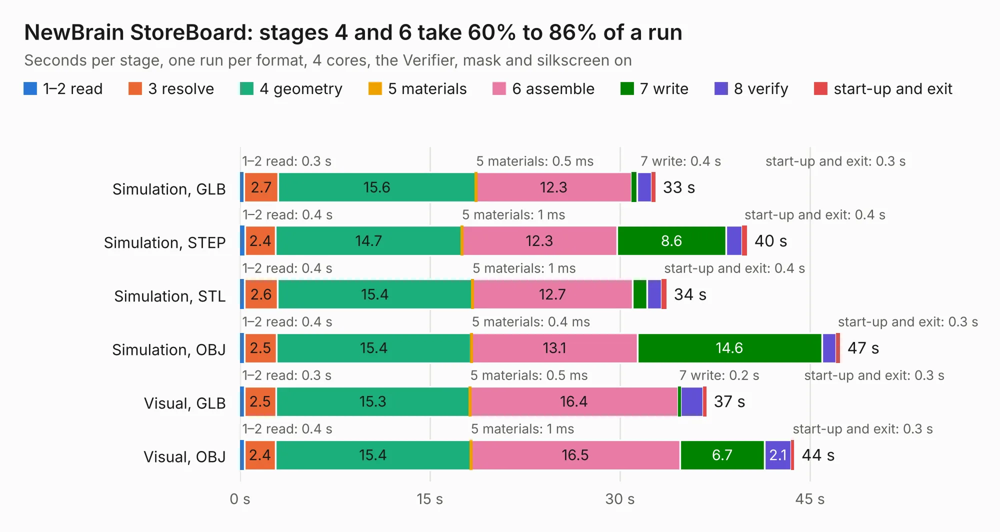

| Mode and format | 1–2 read | 3 resolve | 4 geometry | 5 materials | 6 assemble | 7 write | 8 verify | start-up and exit | Total |
|---|---:|---:|---:|---:|---:|---:|---:|---:|---:|
| Simulation, GLB | 0.3 | 2.7 | 15.6 | 0.5&nbsp;ms | 12.3 | 0.4 | 1.2 | 0.3 | 32.8 |
| Simulation, STEP | 0.4 | 2.4 | 14.7 | 1&nbsp;ms | 12.3 | 8.6 | 1.3 | 0.4 | 40.0 |
| Simulation, STL | 0.4 | 2.6 | 15.4 | 1&nbsp;ms | 12.7 | 1.2 | 1.1 | 0.4 | 33.7 |
| Simulation, OBJ | 0.4 | 2.5 | 15.4 | 0.4&nbsp;ms | 13.1 | 14.6 | 1.1 | 0.3 | 47.4 |
| Visual, GLB | 0.3 | 2.5 | 15.3 | 0.5&nbsp;ms | 16.4 | 0.2 | 1.8 | 0.3 | 36.8 |
| Visual, OBJ | 0.4 | 2.4 | 15.4 | 1&nbsp;ms | 16.5 | 6.7 | 2.1 | 0.3 | 43.8 |

<table align="center"><tr><td valign="top">

| Board | Repo: [flypie/NewBrain](https://github.com/flypie/NewBrain) Board: `NewBrain StoreBoard.kicad_pcb` |
|---|---|
| Folder | NewBrain StoreBoard |
| Complexity | 75&nbsp;/&nbsp;1000 (size&nbsp;65, features&nbsp;10) |
| KESE&nbsp;features | rounded, trapezoid or chamfered pads |
| Tested | 9th November 2026 |
| Copper&nbsp;layers | 2 |
| File&nbsp;format | KiCad 5 (20171130) |
| Parts,&nbsp;tracks,&nbsp;vias | 85, 0, 0 |
| Triangles,&nbsp;simulation | 3,036,484 in 98 parts |
| Note | mostly unrouted |
| Verifier | PASS in all six runs |

</td><td valign="top">

<table>
<tr><th>File type</th><th>File size</th><th>Peak memory used</th></tr>
<tr><th colspan="3" align="left">Simulation</th></tr>
<tr><td>GLB</td><td align="right">95&nbsp;MB</td><td align="right">904&nbsp;MB</td></tr>
<tr><td>STEP</td><td align="right">463&nbsp;MB</td><td align="right">1.2&nbsp;GB</td></tr>
<tr><td>STL</td><td align="right">152&nbsp;MB</td><td align="right">910&nbsp;MB</td></tr>
<tr><td>OBJ</td><td align="right">320&nbsp;MB</td><td align="right">2.0&nbsp;GB</td></tr>
<tr><th colspan="3" align="left">Visual</th></tr>
<tr><td>GLB</td><td align="right">45&nbsp;MB</td><td align="right">935&nbsp;MB</td></tr>
<tr><td>OBJ</td><td align="right">137&nbsp;MB</td><td align="right">1.1&nbsp;GB</td></tr>
</table>

</td></tr></table>

## 989. corne-cherry

| Mode and format | 1–2 read | 3 resolve | 4 geometry | 5 materials | 6 assemble | 7 write | 8 verify | start-up and exit | Total |
|---|---:|---:|---:|---:|---:|---:|---:|---:|---:|
| Simulation, GLB | 1.2 | 3.3 | 13.6 | 0.9&nbsp;ms | 11.2 | 0.5 | 1.3 | 0.3 | 31.5 |
| Simulation, STEP | 1.1 | 3.4 | 13.7 | 0.5&nbsp;ms | 11.7 | 8.6 | 1.5 | 0.3 | 40.2 |
| Simulation, STL | 1.1 | 3.3 | 14.3 | 0.9&nbsp;ms | 11.9 | 0.9 | 1.4 | 0.3 | 33.1 |
| Simulation, OBJ | 1.1 | 3.4 | 13.9 | 0.8&nbsp;ms | 11.4 | 15.0 | 1.4 | 0.3 | 46.6 |
| Visual, GLB | 1.1 | 3.4 | 13.8 | 0.6&nbsp;ms | 30.3 | 0.4 | 3.6 | 0.3 | 52.9 |
| Visual, OBJ | 1.1 | 3.3 | 13.7 | 0.6&nbsp;ms | 29.8 | 12.0 | 3.8 | 0.2 | 64.0 |

<table align="center"><tr><td valign="top">

| Board | Repo: [foostan/crkbd](https://github.com/foostan/crkbd) Board: `corne-cherry.kicad_pcb` |
|---|---|
| Folder | pcbs / corne-cherry / hotswap |
| Complexity | 377&nbsp;/&nbsp;1000 (size&nbsp;257, features&nbsp;120) |
| KESE&nbsp;features | through vias, slotted holes, custom pads, rounded, trapezoid or chamfered pads, filled zones, copper drawings, curved board outline, stack-up, dielectric εr and tanδ |
| Tested | 9th November 2026 |
| Copper&nbsp;layers | 2 |
| File&nbsp;format | KiCad 7 (20221018) |
| Parts,&nbsp;tracks,&nbsp;vias | 178, 3,027, 452 |
| Triangles,&nbsp;simulation | 2,936,448 in 170 parts |
| Verifier | PASS in all six runs |

</td><td valign="top">

<table>
<tr><th>File type</th><th>File size</th><th>Peak memory used</th></tr>
<tr><th colspan="3" align="left">Simulation</th></tr>
<tr><td>GLB</td><td align="right">103&nbsp;MB</td><td align="right">1.2&nbsp;GB</td></tr>
<tr><td>STEP</td><td align="right">563&nbsp;MB</td><td align="right">1.4&nbsp;GB</td></tr>
<tr><td>STL</td><td align="right">147&nbsp;MB</td><td align="right">1.2&nbsp;GB</td></tr>
<tr><td>OBJ</td><td align="right">317&nbsp;MB</td><td align="right">2.0&nbsp;GB</td></tr>
<tr><th colspan="3" align="left">Visual</th></tr>
<tr><td>GLB</td><td align="right">81&nbsp;MB</td><td align="right">1.5&nbsp;GB</td></tr>
<tr><td>OBJ</td><td align="right">254&nbsp;MB</td><td align="right">1.7&nbsp;GB</td></tr>
</table>

</td></tr></table>

## 990. corne-chocolate

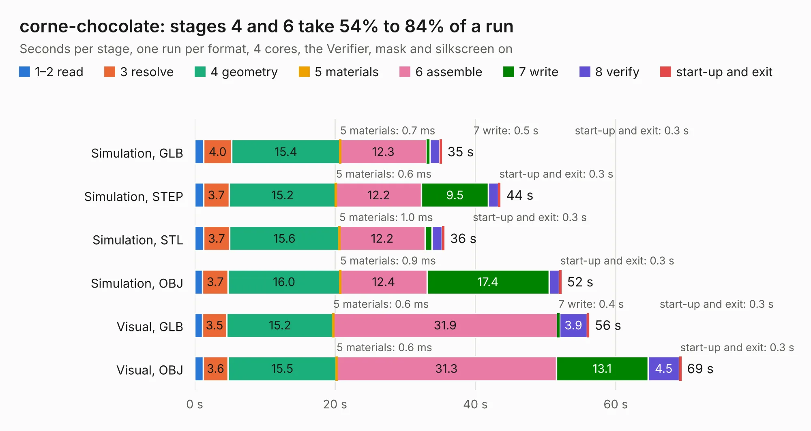

| Mode and format | 1–2 read | 3 resolve | 4 geometry | 5 materials | 6 assemble | 7 write | 8 verify | start-up and exit | Total |
|---|---:|---:|---:|---:|---:|---:|---:|---:|---:|
| Simulation, GLB | 1.3 | 4.0 | 15.4 | 0.7&nbsp;ms | 12.3 | 0.5 | 1.4 | 0.3 | 35.2 |
| Simulation, STEP | 1.3 | 3.7 | 15.2 | 0.6&nbsp;ms | 12.2 | 9.5 | 1.4 | 0.3 | 43.6 |
| Simulation, STL | 1.3 | 3.7 | 15.6 | 1.0&nbsp;ms | 12.2 | 1.0 | 1.4 | 0.3 | 35.6 |
| Simulation, OBJ | 1.1 | 3.7 | 16.0 | 0.9&nbsp;ms | 12.4 | 17.4 | 1.5 | 0.3 | 52.2 |
| Visual, GLB | 1.1 | 3.5 | 15.2 | 0.6&nbsp;ms | 31.9 | 0.4 | 3.9 | 0.3 | 56.2 |
| Visual, OBJ | 1.2 | 3.6 | 15.5 | 0.6&nbsp;ms | 31.3 | 13.1 | 4.5 | 0.3 | 69.3 |

<table align="center"><tr><td valign="top">

| Board | Repo: [foostan/crkbd](https://github.com/foostan/crkbd) Board: `corne-chocolate.kicad_pcb` |
|---|---|
| Folder | pcbs / corne-chocolate / hotswap |
| Complexity | 377&nbsp;/&nbsp;1000 (size&nbsp;257, features&nbsp;120) |
| KESE&nbsp;features | through vias, slotted holes, custom pads, rounded, trapezoid or chamfered pads, filled zones, copper drawings, curved board outline, stack-up, dielectric εr and tanδ |
| Tested | 9th November 2026 |
| Copper&nbsp;layers | 2 |
| File&nbsp;format | KiCad 7 (20221018) |
| Parts,&nbsp;tracks,&nbsp;vias | 178, 3,255, 429 |
| Triangles,&nbsp;simulation | 2,994,126 in 170 parts |
| Verifier | PASS in all six runs |

</td><td valign="top">

<table>
<tr><th>File type</th><th>File size</th><th>Peak memory used</th></tr>
<tr><th colspan="3" align="left">Simulation</th></tr>
<tr><td>GLB</td><td align="right">105&nbsp;MB</td><td align="right">1.3&nbsp;GB</td></tr>
<tr><td>STEP</td><td align="right">577&nbsp;MB</td><td align="right">1.4&nbsp;GB</td></tr>
<tr><td>STL</td><td align="right">150&nbsp;MB</td><td align="right">1.3&nbsp;GB</td></tr>
<tr><td>OBJ</td><td align="right">323&nbsp;MB</td><td align="right">2.0&nbsp;GB</td></tr>
<tr><th colspan="3" align="left">Visual</th></tr>
<tr><td>GLB</td><td align="right">83&nbsp;MB</td><td align="right">1.4&nbsp;GB</td></tr>
<tr><td>OBJ</td><td align="right">260&nbsp;MB</td><td align="right">1.8&nbsp;GB</td></tr>
</table>

</td></tr></table>

## 991. MyCPU

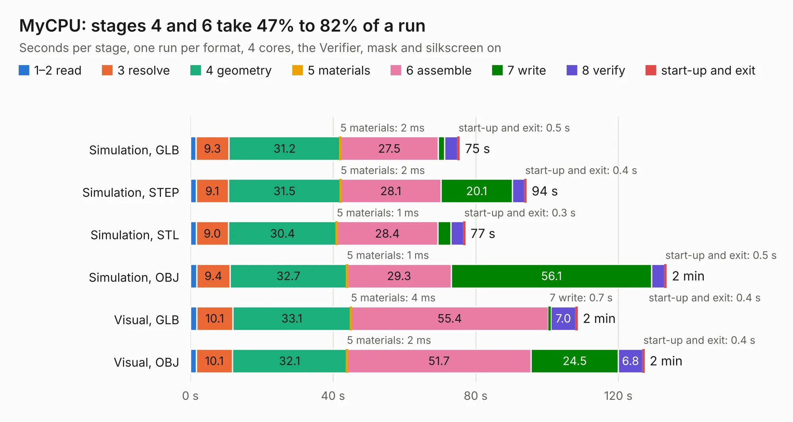

| Mode and format | 1–2 read | 3 resolve | 4 geometry | 5 materials | 6 assemble | 7 write | 8 verify | start-up and exit | Total |
|---|---:|---:|---:|---:|---:|---:|---:|---:|---:|
| Simulation, GLB | 1.5 | 9.3 | 31.2 | 2&nbsp;ms | 27.5 | 1.7 | 3.7 | 0.5 | 75.4 |
| Simulation, STEP | 1.6 | 9.1 | 31.5 | 2&nbsp;ms | 28.1 | 20.1 | 3.4 | 0.4 | 94.1 |
| Simulation, STL | 1.6 | 9.0 | 30.4 | 1&nbsp;ms | 28.4 | 3.6 | 3.6 | 0.3 | 77.0 |
| Simulation, OBJ | 1.8 | 9.4 | 32.7 | 1&nbsp;ms | 29.3 | 56.1 | 3.6 | 0.5 | 133.4 |
| Visual, GLB | 1.8 | 10.1 | 33.1 | 4&nbsp;ms | 55.4 | 0.7 | 7.0 | 0.4 | 108.4 |
| Visual, OBJ | 1.7 | 10.1 | 32.1 | 2&nbsp;ms | 51.7 | 24.5 | 6.8 | 0.4 | 127.2 |

<table align="center"><tr><td valign="top">

| Board | Repo: [fortinsylvain/MyCpu](https://github.com/fortinsylvain/MyCpu) Board: `MyCPU.kicad_pcb` |
|---|---|
| Folder | Kicad |
| Complexity | 317&nbsp;/&nbsp;1000 (size&nbsp;227, features&nbsp;90) |
| KESE&nbsp;features | through vias, rounded, trapezoid or chamfered pads, filled zones, TrueType text, stack-up, dielectric εr and tanδ |
| Tested | 9th November 2026 |
| Copper&nbsp;layers | 4 |
| File&nbsp;format | KiCad 9 (20241229) |
| Parts,&nbsp;tracks,&nbsp;vias | 161, 2,736, 666 |
| Triangles,&nbsp;simulation | 9,058,616 in 251 parts |
| Verifier | PASS in all six runs |

</td><td valign="top">

<table>
<tr><th>File type</th><th>File size</th><th>Peak memory used</th></tr>
<tr><th colspan="3" align="left">Simulation</th></tr>
<tr><td>GLB</td><td align="right">306&nbsp;MB</td><td align="right">2.0&nbsp;GB</td></tr>
<tr><td>STEP</td><td align="right">1.1&nbsp;GB</td><td align="right">2.6&nbsp;GB</td></tr>
<tr><td>STL</td><td align="right">453&nbsp;MB</td><td align="right">2.0&nbsp;GB</td></tr>
<tr><td>OBJ</td><td align="right">965&nbsp;MB</td><td align="right">5.6&nbsp;GB</td></tr>
<tr><th colspan="3" align="left">Visual</th></tr>
<tr><td>GLB</td><td align="right">138&nbsp;MB</td><td align="right">2.4&nbsp;GB</td></tr>
<tr><td>OBJ</td><td align="right">444&nbsp;MB</td><td align="right">2.9&nbsp;GB</td></tr>
</table>

</td></tr></table>

## 992. PCBs

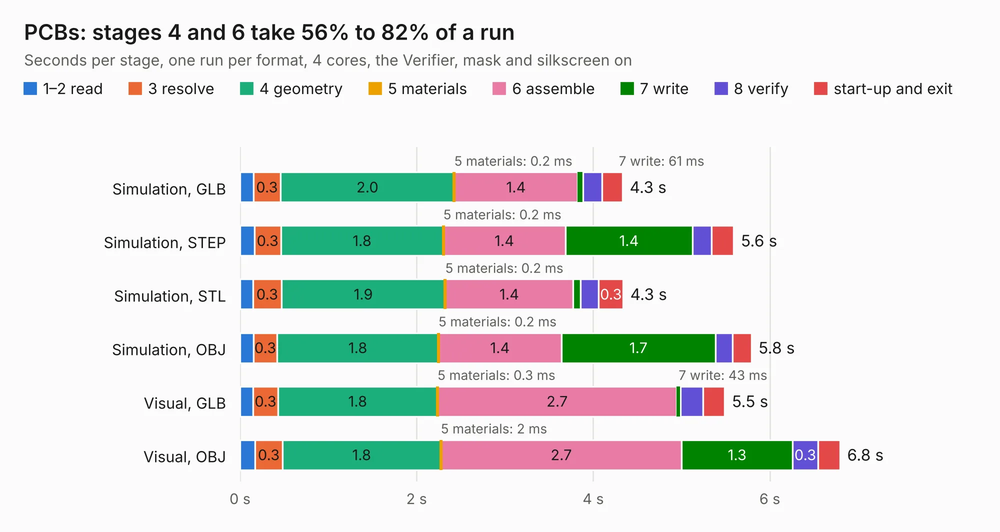

| Mode and format | 1–2 read | 3 resolve | 4 geometry | 5 materials | 6 assemble | 7 write | 8 verify | start-up and exit | Total |
|---|---:|---:|---:|---:|---:|---:|---:|---:|---:|
| Simulation, GLB | 0.2 | 0.3 | 2.0 | 0.2&nbsp;ms | 1.4 | 61&nbsp;ms | 0.2 | 0.2 | 4.3 |
| Simulation, STEP | 0.2 | 0.3 | 1.8 | 0.2&nbsp;ms | 1.4 | 1.4 | 0.2 | 0.3 | 5.6 |
| Simulation, STL | 0.1 | 0.3 | 1.9 | 0.2&nbsp;ms | 1.4 | 82&nbsp;ms | 0.2 | 0.3 | 4.3 |
| Simulation, OBJ | 0.2 | 0.3 | 1.8 | 0.2&nbsp;ms | 1.4 | 1.7 | 0.2 | 0.2 | 5.8 |
| Visual, GLB | 0.1 | 0.3 | 1.8 | 0.3&nbsp;ms | 2.7 | 43&nbsp;ms | 0.3 | 0.2 | 5.5 |
| Visual, OBJ | 0.2 | 0.3 | 1.8 | 2&nbsp;ms | 2.7 | 1.3 | 0.3 | 0.2 | 6.8 |

<table align="center"><tr><td valign="top">

| Board | Repo: [fossasia/pslab-hardware](https://github.com/fossasia/pslab-hardware) Board: `PCBs.kicad_pcb` |
|---|---|
| Folder | archives / Breakout_Boards |
| Complexity | 220&nbsp;/&nbsp;1000 (size&nbsp;185, features&nbsp;35) |
| KESE&nbsp;features | through vias, filled zones |
| Tested | 9th November 2026 |
| Copper&nbsp;layers | 2 |
| File&nbsp;format | KiCad 4 (4) |
| Parts,&nbsp;tracks,&nbsp;vias | 28, 249, 7 |
| Triangles,&nbsp;simulation | 293,214 in 34 parts |
| Verifier | PASS in all six runs |

</td><td valign="top">

<table>
<tr><th>File type</th><th>File size</th><th>Peak memory used</th></tr>
<tr><th colspan="3" align="left">Simulation</th></tr>
<tr><td>GLB</td><td align="right">10&nbsp;MB</td><td align="right">238&nbsp;MB</td></tr>
<tr><td>STEP</td><td align="right">54&nbsp;MB</td><td align="right">273&nbsp;MB</td></tr>
<tr><td>STL</td><td align="right">15&nbsp;MB</td><td align="right">241&nbsp;MB</td></tr>
<tr><td>OBJ</td><td align="right">30&nbsp;MB</td><td align="right">260&nbsp;MB</td></tr>
<tr><th colspan="3" align="left">Visual</th></tr>
<tr><td>GLB</td><td align="right">7.6&nbsp;MB</td><td align="right">253&nbsp;MB</td></tr>
<tr><td>OBJ</td><td align="right">22&nbsp;MB</td><td align="right">249&nbsp;MB</td></tr>
</table>

</td></tr></table>

## 993. PSLab

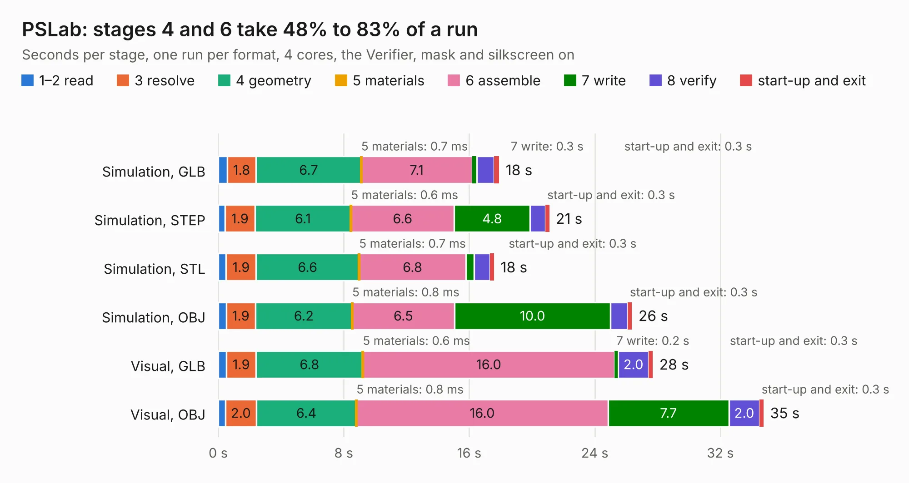

| Mode and format | 1–2 read | 3 resolve | 4 geometry | 5 materials | 6 assemble | 7 write | 8 verify | start-up and exit | Total |
|---|---:|---:|---:|---:|---:|---:|---:|---:|---:|
| Simulation, GLB | 0.6 | 1.8 | 6.7 | 0.7&nbsp;ms | 7.1 | 0.3 | 1.1 | 0.3 | 17.9 |
| Simulation, STEP | 0.4 | 1.9 | 6.1 | 0.6&nbsp;ms | 6.6 | 4.8 | 1.0 | 0.3 | 21.1 |
| Simulation, STL | 0.5 | 1.9 | 6.6 | 0.7&nbsp;ms | 6.8 | 0.5 | 1.0 | 0.3 | 17.6 |
| Simulation, OBJ | 0.5 | 1.9 | 6.2 | 0.8&nbsp;ms | 6.5 | 10.0 | 1.1 | 0.3 | 26.4 |
| Visual, GLB | 0.5 | 1.9 | 6.8 | 0.6&nbsp;ms | 16.0 | 0.2 | 2.0 | 0.3 | 27.7 |
| Visual, OBJ | 0.5 | 2.0 | 6.4 | 0.8&nbsp;ms | 16.0 | 7.7 | 2.0 | 0.3 | 34.8 |

<table align="center"><tr><td valign="top">

| Board | Repo: [fossasia/pslab-hardware](https://github.com/fossasia/pslab-hardware) Board: `PSLab.kicad_pcb` |
|---|---|
| Folder | archives / PSLab KiCAD v2 |
| Complexity | 294&nbsp;/&nbsp;1000 (size&nbsp;249, features&nbsp;45) |
| KESE&nbsp;features | through vias, slotted holes, filled zones |
| Tested | 9th November 2026 |
| Copper&nbsp;layers | 4 |
| File&nbsp;format | KiCad 4 (4) |
| Parts,&nbsp;tracks,&nbsp;vias | 136, 1,348, 144 |
| Triangles,&nbsp;simulation | 1,868,202 in 156 parts |
| Verifier | PASS in all six runs |

</td><td valign="top">

<table>
<tr><th>File type</th><th>File size</th><th>Peak memory used</th></tr>
<tr><th colspan="3" align="left">Simulation</th></tr>
<tr><td>GLB</td><td align="right">65&nbsp;MB</td><td align="right">765&nbsp;MB</td></tr>
<tr><td>STEP</td><td align="right">306&nbsp;MB</td><td align="right">839&nbsp;MB</td></tr>
<tr><td>STL</td><td align="right">93&nbsp;MB</td><td align="right">790&nbsp;MB</td></tr>
<tr><td>OBJ</td><td align="right">196&nbsp;MB</td><td align="right">1.2&nbsp;GB</td></tr>
<tr><th colspan="3" align="left">Visual</th></tr>
<tr><td>GLB</td><td align="right">47&nbsp;MB</td><td align="right">809&nbsp;MB</td></tr>
<tr><td>OBJ</td><td align="right">143&nbsp;MB</td><td align="right">1.1&nbsp;GB</td></tr>
</table>

</td></tr></table>

## 994. PSLab

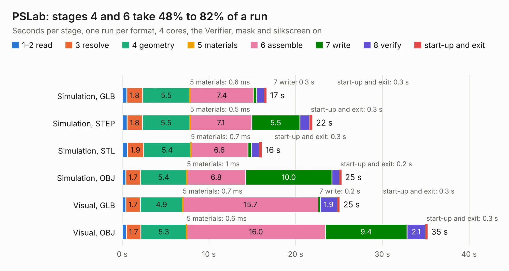

| Mode and format | 1–2 read | 3 resolve | 4 geometry | 5 materials | 6 assemble | 7 write | 8 verify | start-up and exit | Total |
|---|---:|---:|---:|---:|---:|---:|---:|---:|---:|
| Simulation, GLB | 0.5 | 1.8 | 5.5 | 0.6&nbsp;ms | 7.4 | 0.3 | 0.9 | 0.3 | 16.6 |
| Simulation, STEP | 0.6 | 1.8 | 5.5 | 0.5&nbsp;ms | 7.1 | 5.5 | 1.1 | 0.3 | 21.9 |
| Simulation, STL | 0.6 | 1.9 | 5.4 | 0.7&nbsp;ms | 6.6 | 0.4 | 0.9 | 0.3 | 16.1 |
| Simulation, OBJ | 0.4 | 1.7 | 5.4 | 1&nbsp;ms | 6.8 | 10.0 | 0.8 | 0.2 | 25.3 |
| Visual, GLB | 0.4 | 1.7 | 4.9 | 0.7&nbsp;ms | 15.7 | 0.2 | 1.9 | 0.3 | 25.1 |
| Visual, OBJ | 0.5 | 1.7 | 5.3 | 0.6&nbsp;ms | 16.0 | 9.4 | 2.1 | 0.3 | 35.2 |

<table align="center"><tr><td valign="top">

| Board | Repo: [fossasia/pslab-hardware](https://github.com/fossasia/pslab-hardware) Board: `PSLab.kicad_pcb` |
|---|---|
| Folder | archives / PSLab KiCAD v3 |
| Complexity | 297&nbsp;/&nbsp;1000 (size&nbsp;252, features&nbsp;45) |
| KESE&nbsp;features | through vias, slotted holes, filled zones |
| Tested | 9th November 2026 |
| Copper&nbsp;layers | 4 |
| File&nbsp;format | KiCad 4 (4) |
| Parts,&nbsp;tracks,&nbsp;vias | 134, 1,653, 174 |
| Triangles,&nbsp;simulation | 1,676,062 in 128 parts |
| Verifier | PASS in all six runs |

</td><td valign="top">

<table>
<tr><th>File type</th><th>File size</th><th>Peak memory used</th></tr>
<tr><th colspan="3" align="left">Simulation</th></tr>
<tr><td>GLB</td><td align="right">58&nbsp;MB</td><td align="right">605&nbsp;MB</td></tr>
<tr><td>STEP</td><td align="right">256&nbsp;MB</td><td align="right">759&nbsp;MB</td></tr>
<tr><td>STL</td><td align="right">84&nbsp;MB</td><td align="right">581&nbsp;MB</td></tr>
<tr><td>OBJ</td><td align="right">174&nbsp;MB</td><td align="right">1.1&nbsp;GB</td></tr>
<tr><th colspan="3" align="left">Visual</th></tr>
<tr><td>GLB</td><td align="right">44&nbsp;MB</td><td align="right">804&nbsp;MB</td></tr>
<tr><td>OBJ</td><td align="right">134&nbsp;MB</td><td align="right">959&nbsp;MB</td></tr>
</table>

</td></tr></table>

## 995. PSLab

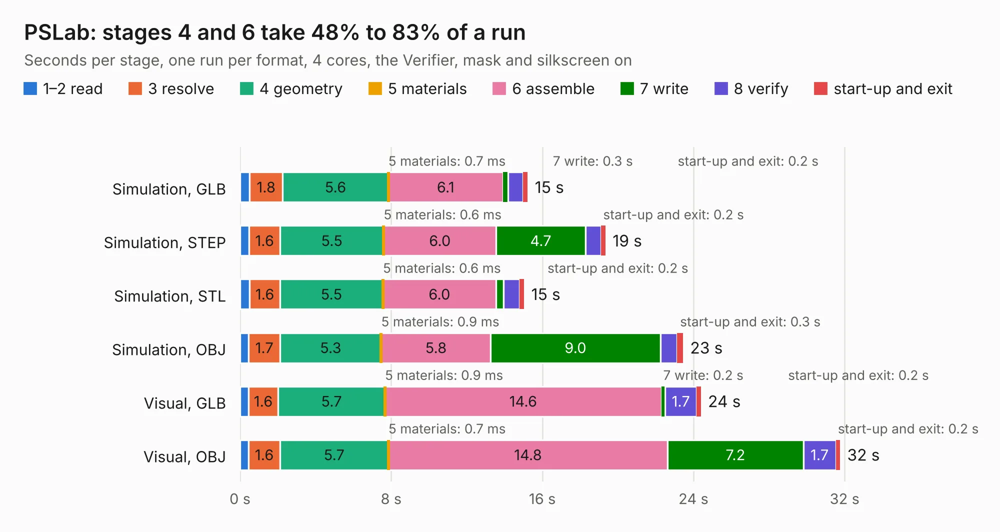

| Mode and format | 1–2 read | 3 resolve | 4 geometry | 5 materials | 6 assemble | 7 write | 8 verify | start-up and exit | Total |
|---|---:|---:|---:|---:|---:|---:|---:|---:|---:|
| Simulation, GLB | 0.5 | 1.8 | 5.6 | 0.7&nbsp;ms | 6.1 | 0.3 | 0.8 | 0.2 | 15.2 |
| Simulation, STEP | 0.5 | 1.6 | 5.5 | 0.6&nbsp;ms | 6.0 | 4.7 | 0.8 | 0.2 | 19.3 |
| Simulation, STL | 0.5 | 1.6 | 5.5 | 0.6&nbsp;ms | 6.0 | 0.4 | 0.9 | 0.2 | 15.0 |
| Simulation, OBJ | 0.5 | 1.7 | 5.3 | 0.9&nbsp;ms | 5.8 | 9.0 | 0.9 | 0.3 | 23.4 |
| Visual, GLB | 0.5 | 1.6 | 5.7 | 0.9&nbsp;ms | 14.6 | 0.2 | 1.7 | 0.2 | 24.4 |
| Visual, OBJ | 0.5 | 1.6 | 5.7 | 0.7&nbsp;ms | 14.8 | 7.2 | 1.7 | 0.2 | 31.8 |

<table align="center"><tr><td valign="top">

| Board | Repo: [fossasia/pslab-hardware](https://github.com/fossasia/pslab-hardware) Board: `PSLab.kicad_pcb` |
|---|---|
| Folder | archives / PSLab KiCAD |
| Complexity | 293&nbsp;/&nbsp;1000 (size&nbsp;248, features&nbsp;45) |
| KESE&nbsp;features | through vias, slotted holes, filled zones |
| Tested | 9th November 2026 |
| Copper&nbsp;layers | 4 |
| File&nbsp;format | KiCad 4 (4) |
| Parts,&nbsp;tracks,&nbsp;vias | 139, 1,212, 126 |
| Triangles,&nbsp;simulation | 1,689,648 in 152 parts |
| Verifier | PASS in all six runs |

</td><td valign="top">

<table>
<tr><th>File type</th><th>File size</th><th>Peak memory used</th></tr>
<tr><th colspan="3" align="left">Simulation</th></tr>
<tr><td>GLB</td><td align="right">59&nbsp;MB</td><td align="right">718&nbsp;MB</td></tr>
<tr><td>STEP</td><td align="right">279&nbsp;MB</td><td align="right">768&nbsp;MB</td></tr>
<tr><td>STL</td><td align="right">84&nbsp;MB</td><td align="right">734&nbsp;MB</td></tr>
<tr><td>OBJ</td><td align="right">177&nbsp;MB</td><td align="right">1.1&nbsp;GB</td></tr>
<tr><th colspan="3" align="left">Visual</th></tr>
<tr><td>GLB</td><td align="right">43&nbsp;MB</td><td align="right">803&nbsp;MB</td></tr>
<tr><td>OBJ</td><td align="right">132&nbsp;MB</td><td align="right">929&nbsp;MB</td></tr>
</table>

</td></tr></table>

## 996. PSLab

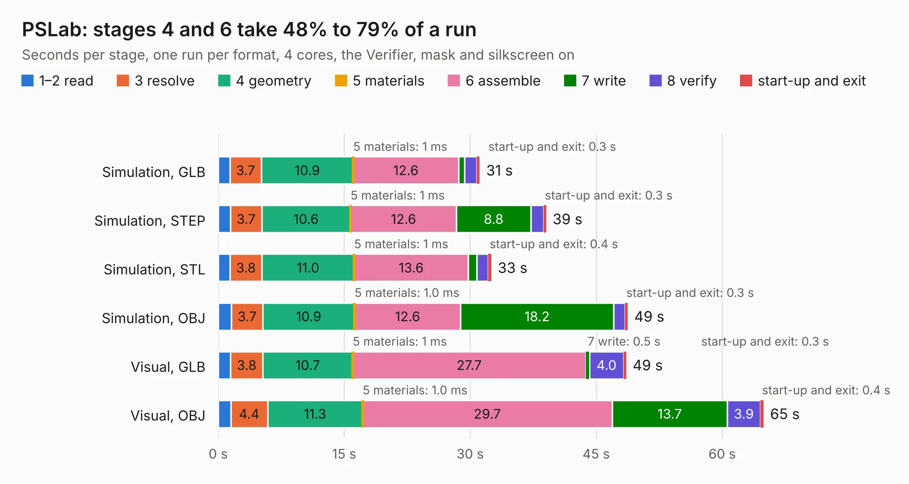

| Mode and format | 1–2 read | 3 resolve | 4 geometry | 5 materials | 6 assemble | 7 write | 8 verify | start-up and exit | Total |
|---|---:|---:|---:|---:|---:|---:|---:|---:|---:|
| Simulation, GLB | 1.4 | 3.7 | 10.9 | 1&nbsp;ms | 12.6 | 0.7 | 1.5 | 0.3 | 31.1 |
| Simulation, STEP | 1.5 | 3.7 | 10.6 | 1&nbsp;ms | 12.6 | 8.8 | 1.5 | 0.3 | 39.0 |
| Simulation, STL | 1.4 | 3.8 | 11.0 | 1&nbsp;ms | 13.6 | 1.0 | 1.4 | 0.4 | 32.5 |
| Simulation, OBJ | 1.6 | 3.7 | 10.9 | 1.0&nbsp;ms | 12.6 | 18.2 | 1.3 | 0.3 | 48.8 |
| Visual, GLB | 1.5 | 3.8 | 10.7 | 1&nbsp;ms | 27.7 | 0.5 | 4.0 | 0.3 | 48.6 |
| Visual, OBJ | 1.5 | 4.4 | 11.3 | 1.0&nbsp;ms | 29.7 | 13.7 | 3.9 | 0.4 | 64.9 |

<table align="center"><tr><td valign="top">

| Board | Repo: [fossasia/pslab-hardware](https://github.com/fossasia/pslab-hardware) Board: `PSLab.kicad_pcb` |
|---|---|
| Folder | schematics |
| Complexity | 361&nbsp;/&nbsp;1000 (size&nbsp;261, features&nbsp;100) |
| KESE&nbsp;features | through vias, custom pads, rounded, trapezoid or chamfered pads, filled zones, curved board outline, stack-up, dielectric εr and tanδ |
| Tested | 9th November 2026 |
| Copper&nbsp;layers | 4 |
| File&nbsp;format | KiCad 7 (20221018) |
| Parts,&nbsp;tracks,&nbsp;vias | 175, 1,922, 365 |
| Triangles,&nbsp;simulation | 3,005,790 in 187 parts |
| Verifier | PASS in all six runs |

</td><td valign="top">

<table>
<tr><th>File type</th><th>File size</th><th>Peak memory used</th></tr>
<tr><th colspan="3" align="left">Simulation</th></tr>
<tr><td>GLB</td><td align="right">102&nbsp;MB</td><td align="right">929&nbsp;MB</td></tr>
<tr><td>STEP</td><td align="right">454&nbsp;MB</td><td align="right">1.2&nbsp;GB</td></tr>
<tr><td>STL</td><td align="right">150&nbsp;MB</td><td align="right">944&nbsp;MB</td></tr>
<tr><td>OBJ</td><td align="right">318&nbsp;MB</td><td align="right">1.9&nbsp;GB</td></tr>
<tr><th colspan="3" align="left">Visual</th></tr>
<tr><td>GLB</td><td align="right">75&nbsp;MB</td><td align="right">1.3&nbsp;GB</td></tr>
<tr><td>OBJ</td><td align="right">234&nbsp;MB</td><td align="right">1.6&nbsp;GB</td></tr>
</table>

</td></tr></table>

## 997. FABulous_board

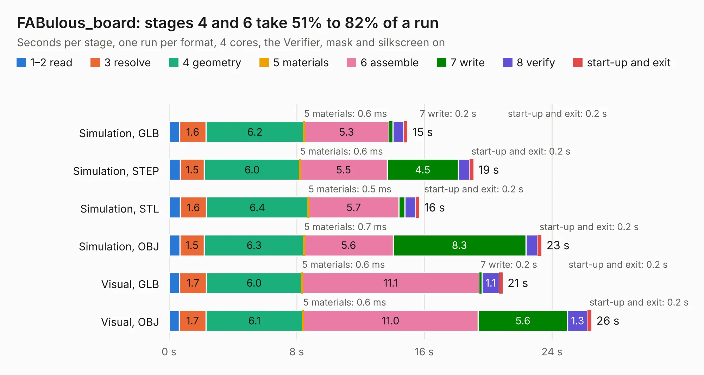

| Mode and format | 1–2 read | 3 resolve | 4 geometry | 5 materials | 6 assemble | 7 write | 8 verify | start-up and exit | Total |
|---|---:|---:|---:|---:|---:|---:|---:|---:|---:|
| Simulation, GLB | 0.7 | 1.6 | 6.2 | 0.6&nbsp;ms | 5.3 | 0.2 | 0.7 | 0.2 | 14.9 |
| Simulation, STEP | 0.7 | 1.5 | 6.0 | 0.6&nbsp;ms | 5.5 | 4.5 | 0.7 | 0.2 | 19.1 |
| Simulation, STL | 0.7 | 1.6 | 6.4 | 0.5&nbsp;ms | 5.7 | 0.4 | 0.7 | 0.2 | 15.7 |
| Simulation, OBJ | 0.7 | 1.5 | 6.3 | 0.7&nbsp;ms | 5.6 | 8.3 | 0.7 | 0.2 | 23.3 |
| Visual, GLB | 0.7 | 1.7 | 6.0 | 0.6&nbsp;ms | 11.1 | 0.2 | 1.1 | 0.2 | 20.9 |
| Visual, OBJ | 0.6 | 1.7 | 6.1 | 0.6&nbsp;ms | 11.0 | 5.6 | 1.3 | 0.2 | 26.5 |

<table align="center"><tr><td valign="top">

| Board | Repo: [fpga-research/fabulous_board](https://github.com/fpga-research/fabulous_board) Board: `FABulous_board.kicad_pcb` |
|---|---|
| Folder | hardware / kicad_files / project |
| Complexity | 332&nbsp;/&nbsp;1000 (size&nbsp;237, features&nbsp;95) |
| KESE&nbsp;features | through vias, slotted holes, rounded, trapezoid or chamfered pads, filled zones, curved board outline, stack-up, dielectric εr and tanδ |
| Tested | 9th November 2026 |
| Copper&nbsp;layers | 4 |
| File&nbsp;format | KiCad 8 (20240108) |
| Parts,&nbsp;tracks,&nbsp;vias | 75, 878, 130 |
| Triangles,&nbsp;simulation | 1,583,870 in 128 parts |
| Verifier | PASS in all six runs |

</td><td valign="top">

<table>
<tr><th>File type</th><th>File size</th><th>Peak memory used</th></tr>
<tr><th colspan="3" align="left">Simulation</th></tr>
<tr><td>GLB</td><td align="right">55&nbsp;MB</td><td align="right">620&nbsp;MB</td></tr>
<tr><td>STEP</td><td align="right">239&nbsp;MB</td><td align="right">738&nbsp;MB</td></tr>
<tr><td>STL</td><td align="right">79&nbsp;MB</td><td align="right">613&nbsp;MB</td></tr>
<tr><td>OBJ</td><td align="right">166&nbsp;MB</td><td align="right">1.1&nbsp;GB</td></tr>
<tr><th colspan="3" align="left">Visual</th></tr>
<tr><td>GLB</td><td align="right">36&nbsp;MB</td><td align="right">836&nbsp;MB</td></tr>
<tr><td>OBJ</td><td align="right">108&nbsp;MB</td><td align="right">824&nbsp;MB</td></tr>
</table>

</td></tr></table>

## 998. DroneController

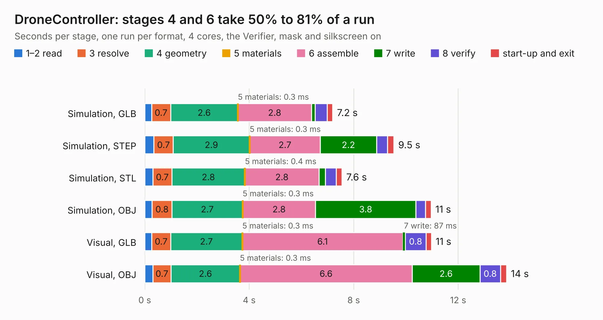

| Mode and format | 1–2 read | 3 resolve | 4 geometry | 5 materials | 6 assemble | 7 write | 8 verify | start-up and exit | Total |
|---|---:|---:|---:|---:|---:|---:|---:|---:|---:|
| Simulation, GLB | 0.3 | 0.7 | 2.6 | 0.3&nbsp;ms | 2.8 | 0.1 | 0.5 | 0.2 | 7.2 |
| Simulation, STEP | 0.3 | 0.7 | 2.9 | 0.3&nbsp;ms | 2.7 | 2.2 | 0.4 | 0.2 | 9.5 |
| Simulation, STL | 0.3 | 0.7 | 2.8 | 0.4&nbsp;ms | 2.8 | 0.2 | 0.4 | 0.2 | 7.6 |
| Simulation, OBJ | 0.3 | 0.8 | 2.7 | 0.3&nbsp;ms | 2.8 | 3.8 | 0.4 | 0.2 | 11.0 |
| Visual, GLB | 0.3 | 0.7 | 2.7 | 0.3&nbsp;ms | 6.1 | 87&nbsp;ms | 0.8 | 0.2 | 11.0 |
| Visual, OBJ | 0.3 | 0.7 | 2.6 | 0.3&nbsp;ms | 6.6 | 2.6 | 0.8 | 0.2 | 13.9 |

<table align="center"><tr><td valign="top">

| Board | Repo: [FPV-Drone-STM32F411/DroneController](https://github.com/FPV-Drone-STM32F411/DroneController) Board: `DroneController.kicad_pcb` |
|---|---|
| Folder | KiCad |
| Complexity | 338&nbsp;/&nbsp;1000 (size&nbsp;228, features&nbsp;110) |
| KESE&nbsp;features | through vias, slotted holes, rounded, trapezoid or chamfered pads, filled zones, curved board outline, knockout text, stack-up, dielectric εr and tanδ |
| Tested | 9th November 2026 |
| Copper&nbsp;layers | 4 |
| File&nbsp;format | KiCad 9 (20241229) |
| Parts,&nbsp;tracks,&nbsp;vias | 59, 450, 126 |
| Triangles,&nbsp;simulation | 859,154 in 89 parts |
| Verifier | PASS in all six runs |

</td><td valign="top">

<table>
<tr><th>File type</th><th>File size</th><th>Peak memory used</th></tr>
<tr><th colspan="3" align="left">Simulation</th></tr>
<tr><td>GLB</td><td align="right">30&nbsp;MB</td><td align="right">397&nbsp;MB</td></tr>
<tr><td>STEP</td><td align="right">115&nbsp;MB</td><td align="right">472&nbsp;MB</td></tr>
<tr><td>STL</td><td align="right">43&nbsp;MB</td><td align="right">375&nbsp;MB</td></tr>
<tr><td>OBJ</td><td align="right">88&nbsp;MB</td><td align="right">633&nbsp;MB</td></tr>
<tr><th colspan="3" align="left">Visual</th></tr>
<tr><td>GLB</td><td align="right">18&nbsp;MB</td><td align="right">470&nbsp;MB</td></tr>
<tr><td>OBJ</td><td align="right">54&nbsp;MB</td><td align="right">490&nbsp;MB</td></tr>
</table>

</td></tr></table>

## 999. ESC_Board

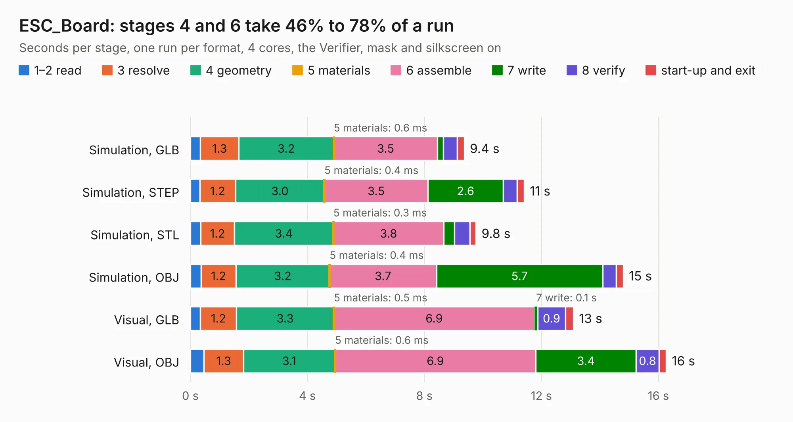

| Mode and format | 1–2 read | 3 resolve | 4 geometry | 5 materials | 6 assemble | 7 write | 8 verify | start-up and exit | Total |
|---|---:|---:|---:|---:|---:|---:|---:|---:|---:|
| Simulation, GLB | 0.3 | 1.3 | 3.2 | 0.6&nbsp;ms | 3.5 | 0.2 | 0.5 | 0.2 | 9.4 |
| Simulation, STEP | 0.3 | 1.2 | 3.0 | 0.4&nbsp;ms | 3.5 | 2.6 | 0.5 | 0.2 | 11.4 |
| Simulation, STL | 0.3 | 1.2 | 3.4 | 0.3&nbsp;ms | 3.8 | 0.4 | 0.5 | 0.2 | 9.8 |
| Simulation, OBJ | 0.4 | 1.2 | 3.2 | 0.4&nbsp;ms | 3.7 | 5.7 | 0.5 | 0.2 | 14.8 |
| Visual, GLB | 0.3 | 1.2 | 3.3 | 0.5&nbsp;ms | 6.9 | 0.1 | 0.9 | 0.3 | 13.1 |
| Visual, OBJ | 0.5 | 1.3 | 3.1 | 0.6&nbsp;ms | 6.9 | 3.4 | 0.8 | 0.2 | 16.3 |

<table align="center"><tr><td valign="top">

| Board | Repo: [FPV-Drone-STM32F411/DroneController](https://github.com/FPV-Drone-STM32F411/DroneController) Board: `ESC_Board.kicad_pcb` |
|---|---|
| Folder | KiCad / ESC_Board |
| Complexity | 366&nbsp;/&nbsp;1000 (size&nbsp;236, features&nbsp;130) |
| KESE&nbsp;features | through vias, custom pads, rounded, trapezoid or chamfered pads, filled zones, copper text, knockout text, TrueType text, stack-up, dielectric εr and tanδ |
| Tested | 9th November 2026 |
| Copper&nbsp;layers | 4 |
| File&nbsp;format | KiCad 9 (20241229) |
| Parts,&nbsp;tracks,&nbsp;vias | 70, 368, 296 |
| Triangles,&nbsp;simulation | 1,260,224 in 79 parts |
| Verifier | PASS in all six runs |

</td><td valign="top">

<table>
<tr><th>File type</th><th>File size</th><th>Peak memory used</th></tr>
<tr><th colspan="3" align="left">Simulation</th></tr>
<tr><td>GLB</td><td align="right">43&nbsp;MB</td><td align="right">576&nbsp;MB</td></tr>
<tr><td>STEP</td><td align="right">136&nbsp;MB</td><td align="right">627&nbsp;MB</td></tr>
<tr><td>STL</td><td align="right">63&nbsp;MB</td><td align="right">578&nbsp;MB</td></tr>
<tr><td>OBJ</td><td align="right">128&nbsp;MB</td><td align="right">852&nbsp;MB</td></tr>
<tr><th colspan="3" align="left">Visual</th></tr>
<tr><td>GLB</td><td align="right">24&nbsp;MB</td><td align="right">611&nbsp;MB</td></tr>
<tr><td>OBJ</td><td align="right">74&nbsp;MB</td><td align="right">591&nbsp;MB</td></tr>
</table>

</td></tr></table>

## 1000. Expansion_Card

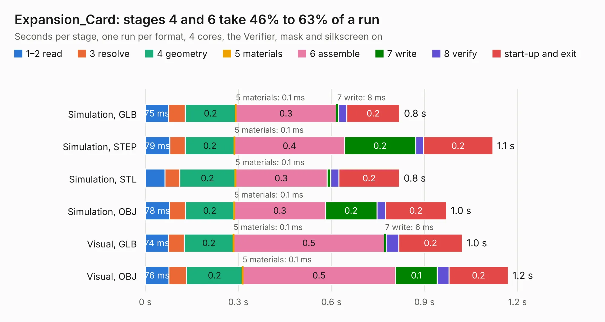

| Mode and format | 1–2 read | 3 resolve | 4 geometry | 5 materials | 6 assemble | 7 write | 8 verify | start-up and exit | Total |
|---|---:|---:|---:|---:|---:|---:|---:|---:|---:|
| Simulation, GLB | 75&nbsp;ms | 54&nbsp;ms | 0.2 | 0.1&nbsp;ms | 0.3 | 8&nbsp;ms | 27&nbsp;ms | 0.2 | 0.8 |
| Simulation, STEP | 79&nbsp;ms | 50&nbsp;ms | 0.2 | 0.1&nbsp;ms | 0.4 | 0.2 | 25&nbsp;ms | 0.2 | 1.1 |
| Simulation, STL | 63&nbsp;ms | 48&nbsp;ms | 0.2 | 0.1&nbsp;ms | 0.3 | 12&nbsp;ms | 26&nbsp;ms | 0.2 | 0.8 |
| Simulation, OBJ | 78&nbsp;ms | 51&nbsp;ms | 0.2 | 0.1&nbsp;ms | 0.3 | 0.2 | 27&nbsp;ms | 0.2 | 1.0 |
| Visual, GLB | 74&nbsp;ms | 52&nbsp;ms | 0.2 | 0.1&nbsp;ms | 0.5 | 6&nbsp;ms | 41&nbsp;ms | 0.2 | 1.0 |
| Visual, OBJ | 76&nbsp;ms | 57&nbsp;ms | 0.2 | 0.1&nbsp;ms | 0.5 | 0.1 | 38&nbsp;ms | 0.2 | 1.2 |

<table align="center"><tr><td valign="top">

| Board | Repo: [FrameworkComputer/ExpansionCards](https://github.com/FrameworkComputer/ExpansionCards) Board: `Expansion_Card.kicad_pcb` |
|---|---|
| Folder | Electrical / KiCad_templates / Expansion_Card |
| Complexity | 124&nbsp;/&nbsp;1000 (size&nbsp;89, features&nbsp;35) |
| KESE&nbsp;features | through vias, rounded, trapezoid or chamfered pads, curved board outline |
| Tested | 9th November 2026 |
| Copper&nbsp;layers | 2 |
| File&nbsp;format | KiCad 5 (20171130) |
| Parts,&nbsp;tracks,&nbsp;vias | 5, 0, 8 |
| Triangles,&nbsp;simulation | 42,988 in 16 parts |
| Verifier | PASS in all six runs |

</td><td valign="top">

<table>
<tr><th>File type</th><th>File size</th><th>Peak memory used</th></tr>
<tr><th colspan="3" align="left">Simulation</th></tr>
<tr><td>GLB</td><td align="right">1.5&nbsp;MB</td><td align="right">66&nbsp;MB</td></tr>
<tr><td>STEP</td><td align="right">5.4&nbsp;MB</td><td align="right">70&nbsp;MB</td></tr>
<tr><td>STL</td><td align="right">2.2&nbsp;MB</td><td align="right">67&nbsp;MB</td></tr>
<tr><td>OBJ</td><td align="right">4.2&nbsp;MB</td><td align="right">74&nbsp;MB</td></tr>
<tr><th colspan="3" align="left">Visual</th></tr>
<tr><td>GLB</td><td align="right">1.1&nbsp;MB</td><td align="right">97&nbsp;MB</td></tr>
<tr><td>OBJ</td><td align="right">2.9&nbsp;MB</td><td align="right">98&nbsp;MB</td></tr>
</table>

</td></tr></table>

## 1001. Expansion_Card_Retrofit

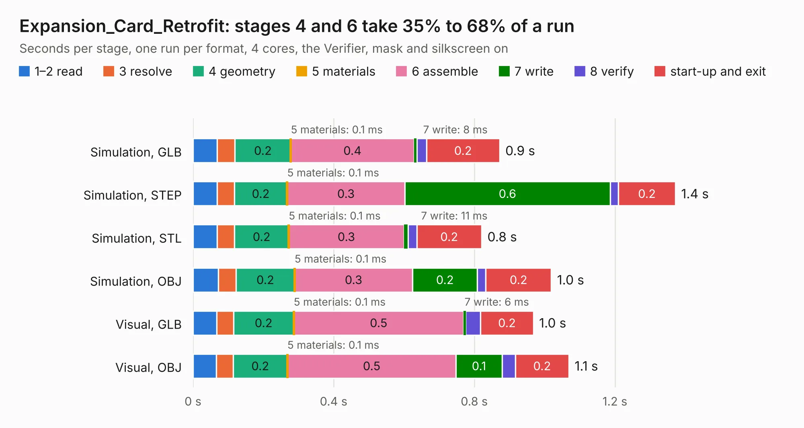

| Mode and format | 1–2 read | 3 resolve | 4 geometry | 5 materials | 6 assemble | 7 write | 8 verify | start-up and exit | Total |
|---|---:|---:|---:|---:|---:|---:|---:|---:|---:|
| Simulation, GLB | 68&nbsp;ms | 51&nbsp;ms | 0.2 | 0.1&nbsp;ms | 0.4 | 8&nbsp;ms | 27&nbsp;ms | 0.2 | 0.9 |
| Simulation, STEP | 69&nbsp;ms | 48&nbsp;ms | 0.2 | 0.1&nbsp;ms | 0.3 | 0.6 | 23&nbsp;ms | 0.2 | 1.4 |
| Simulation, STL | 69&nbsp;ms | 50&nbsp;ms | 0.2 | 0.1&nbsp;ms | 0.3 | 11&nbsp;ms | 25&nbsp;ms | 0.2 | 0.8 |
| Simulation, OBJ | 73&nbsp;ms | 50&nbsp;ms | 0.2 | 0.1&nbsp;ms | 0.3 | 0.2 | 24&nbsp;ms | 0.2 | 1.0 |
| Visual, GLB | 67&nbsp;ms | 48&nbsp;ms | 0.2 | 0.1&nbsp;ms | 0.5 | 6&nbsp;ms | 43&nbsp;ms | 0.2 | 1.0 |
| Visual, OBJ | 66&nbsp;ms | 48&nbsp;ms | 0.2 | 0.1&nbsp;ms | 0.5 | 0.1 | 38&nbsp;ms | 0.2 | 1.1 |

<table align="center"><tr><td valign="top">

| Board | Repo: [FrameworkComputer/ExpansionCards](https://github.com/FrameworkComputer/ExpansionCards) Board: `Expansion_Card_Retrofit.kicad_pcb` |
|---|---|
| Folder | Electrical / KiCad_templates / Expansion_Card_Retrofit |
| Complexity | 124&nbsp;/&nbsp;1000 (size&nbsp;89, features&nbsp;35) |
| KESE&nbsp;features | through vias, rounded, trapezoid or chamfered pads, curved board outline |
| Tested | 9th November 2026 |
| Copper&nbsp;layers | 2 |
| File&nbsp;format | KiCad 5 (20171130) |
| Parts,&nbsp;tracks,&nbsp;vias | 5, 0, 8 |
| Triangles,&nbsp;simulation | 47,004 in 16 parts |
| Verifier | PASS in all six runs |

</td><td valign="top">

<table>
<tr><th>File type</th><th>File size</th><th>Peak memory used</th></tr>
<tr><th colspan="3" align="left">Simulation</th></tr>
<tr><td>GLB</td><td align="right">1.7&nbsp;MB</td><td align="right">67&nbsp;MB</td></tr>
<tr><td>STEP</td><td align="right">6.4&nbsp;MB</td><td align="right">167&nbsp;MB</td></tr>
<tr><td>STL</td><td align="right">2.4&nbsp;MB</td><td align="right">68&nbsp;MB</td></tr>
<tr><td>OBJ</td><td align="right">4.6&nbsp;MB</td><td align="right">76&nbsp;MB</td></tr>
<tr><th colspan="3" align="left">Visual</th></tr>
<tr><td>GLB</td><td align="right">1.2&nbsp;MB</td><td align="right">104&nbsp;MB</td></tr>
<tr><td>OBJ</td><td align="right">3.4&nbsp;MB</td><td align="right">106&nbsp;MB</td></tr>
</table>

</td></tr></table>

## 1002. Microcontroller

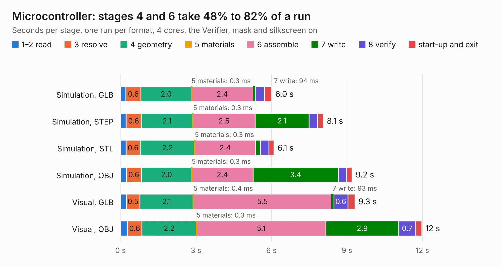

| Mode and format | 1–2 read | 3 resolve | 4 geometry | 5 materials | 6 assemble | 7 write | 8 verify | start-up and exit | Total |
|---|---:|---:|---:|---:|---:|---:|---:|---:|---:|
| Simulation, GLB | 0.2 | 0.6 | 2.0 | 0.3&nbsp;ms | 2.4 | 94&nbsp;ms | 0.3 | 0.3 | 6.0 |
| Simulation, STEP | 0.2 | 0.6 | 2.1 | 0.3&nbsp;ms | 2.5 | 2.1 | 0.3 | 0.2 | 8.1 |
| Simulation, STL | 0.2 | 0.6 | 2.2 | 0.3&nbsp;ms | 2.4 | 0.2 | 0.3 | 0.2 | 6.1 |
| Simulation, OBJ | 0.2 | 0.6 | 2.0 | 0.3&nbsp;ms | 2.4 | 3.4 | 0.3 | 0.2 | 9.2 |
| Visual, GLB | 0.2 | 0.5 | 2.1 | 0.4&nbsp;ms | 5.5 | 93&nbsp;ms | 0.6 | 0.3 | 9.3 |
| Visual, OBJ | 0.3 | 0.6 | 2.2 | 0.3&nbsp;ms | 5.1 | 2.9 | 0.7 | 0.2 | 12.0 |

<table align="center"><tr><td valign="top">

| Board | Repo: [FrameworkComputer/ExpansionCards](https://github.com/FrameworkComputer/ExpansionCards) Board: `Microcontroller.kicad_pcb` |
|---|---|
| Folder | Electrical / Microcontroller |
| Complexity | 258&nbsp;/&nbsp;1000 (size&nbsp;203, features&nbsp;55) |
| KESE&nbsp;features | through vias, rounded, trapezoid or chamfered pads, filled zones, curved board outline |
| Tested | 9th November 2026 |
| Copper&nbsp;layers | 2 |
| File&nbsp;format | KiCad 5 (20171130) |
| Parts,&nbsp;tracks,&nbsp;vias | 26, 539, 110 |
| Triangles,&nbsp;simulation | 566,184 in 50 parts |
| Verifier | PASS in all six runs |

</td><td valign="top">

<table>
<tr><th>File type</th><th>File size</th><th>Peak memory used</th></tr>
<tr><th colspan="3" align="left">Simulation</th></tr>
<tr><td>GLB</td><td align="right">19&nbsp;MB</td><td align="right">320&nbsp;MB</td></tr>
<tr><td>STEP</td><td align="right">90&nbsp;MB</td><td align="right">393&nbsp;MB</td></tr>
<tr><td>STL</td><td align="right">28&nbsp;MB</td><td align="right">324&nbsp;MB</td></tr>
<tr><td>OBJ</td><td align="right">57&nbsp;MB</td><td align="right">419&nbsp;MB</td></tr>
<tr><th colspan="3" align="left">Visual</th></tr>
<tr><td>GLB</td><td align="right">17&nbsp;MB</td><td align="right">466&nbsp;MB</td></tr>
<tr><td>OBJ</td><td align="right">51&nbsp;MB</td><td align="right">412&nbsp;MB</td></tr>
</table>

</td></tr></table>

## 1003. hram_regs_patch

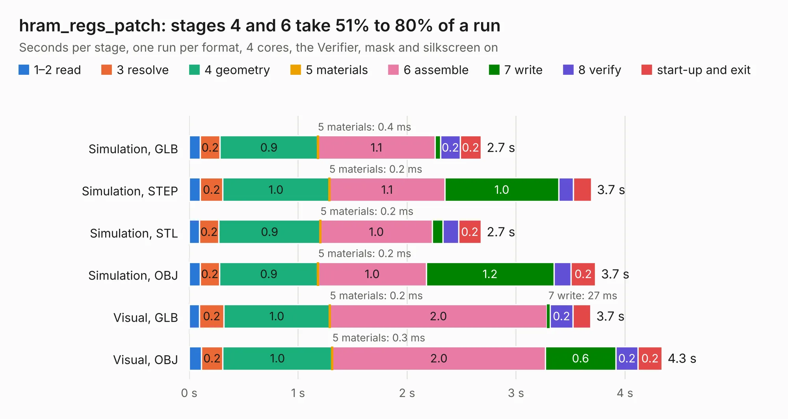

| Mode and format | 1–2 read | 3 resolve | 4 geometry | 5 materials | 6 assemble | 7 write | 8 verify | start-up and exit | Total |
|---|---:|---:|---:|---:|---:|---:|---:|---:|---:|
| Simulation, GLB | 0.1 | 0.2 | 0.9 | 0.4&nbsp;ms | 1.1 | 53&nbsp;ms | 0.2 | 0.2 | 2.7 |
| Simulation, STEP | 0.1 | 0.2 | 1.0 | 0.2&nbsp;ms | 1.1 | 1.0 | 0.1 | 0.2 | 3.7 |
| Simulation, STL | 94&nbsp;ms | 0.2 | 0.9 | 0.2&nbsp;ms | 1.0 | 99&nbsp;ms | 0.1 | 0.2 | 2.7 |
| Simulation, OBJ | 0.1 | 0.2 | 0.9 | 0.2&nbsp;ms | 1.0 | 1.2 | 0.2 | 0.2 | 3.7 |
| Visual, GLB | 95&nbsp;ms | 0.2 | 1.0 | 0.2&nbsp;ms | 2.0 | 27&nbsp;ms | 0.2 | 0.2 | 3.7 |
| Visual, OBJ | 0.1 | 0.2 | 1.0 | 0.3&nbsp;ms | 2.0 | 0.6 | 0.2 | 0.2 | 4.3 |

<table align="center"><tr><td valign="top">

| Board | Repo: [frubem/NE_Delta_Schematics](https://github.com/frubem/NE_Delta_Schematics) Board: `hram_regs_patch.kicad_pcb` |
|---|---|
| Folder | hram_regs_patch |
| Complexity | 146&nbsp;/&nbsp;1000 (size&nbsp;101, features&nbsp;45) |
| KESE&nbsp;features | rounded, trapezoid or chamfered pads, arc tracks, filled zones |
| Tested | 9th November 2026 |
| Copper&nbsp;layers | 2 |
| File&nbsp;format | KiCad 9 (20241229) |
| Parts,&nbsp;tracks,&nbsp;vias | 5, 51, 0 |
| Triangles,&nbsp;simulation | 303,608 in 45 parts |
| Verifier | PASS in all six runs |

</td><td valign="top">

<table>
<tr><th>File type</th><th>File size</th><th>Peak memory used</th></tr>
<tr><th colspan="3" align="left">Simulation</th></tr>
<tr><td>GLB</td><td align="right">9.8&nbsp;MB</td><td align="right">232&nbsp;MB</td></tr>
<tr><td>STEP</td><td align="right">38&nbsp;MB</td><td align="right">261&nbsp;MB</td></tr>
<tr><td>STL</td><td align="right">15&nbsp;MB</td><td align="right">228&nbsp;MB</td></tr>
<tr><td>OBJ</td><td align="right">30&nbsp;MB</td><td align="right">246&nbsp;MB</td></tr>
<tr><th colspan="3" align="left">Visual</th></tr>
<tr><td>GLB</td><td align="right">5.5&nbsp;MB</td><td align="right">244&nbsp;MB</td></tr>
<tr><td>OBJ</td><td align="right">16&nbsp;MB</td><td align="right">245&nbsp;MB</td></tr>
</table>

</td></tr></table>

## 1004. NE_Delta

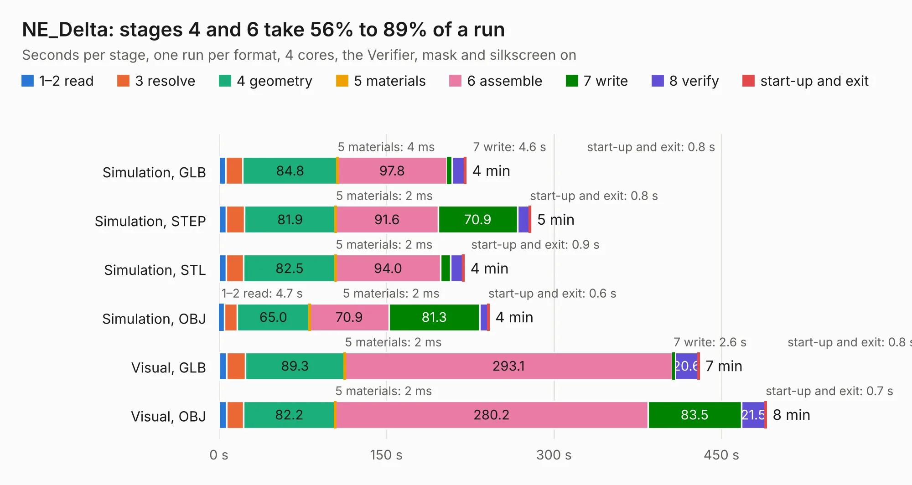

| Mode and format | 1–2 read | 3 resolve | 4 geometry | 5 materials | 6 assemble | 7 write | 8 verify | start-up and exit | Total |
|---|---:|---:|---:|---:|---:|---:|---:|---:|---:|
| Simulation, GLB | 5.9 | 15.5 | 84.8 | 4&nbsp;ms | 97.8 | 4.6 | 11.5 | 0.8 | 220.9 |
| Simulation, STEP | 6.7 | 16.1 | 81.9 | 2&nbsp;ms | 91.6 | 70.9 | 10.9 | 0.8 | 279.0 |
| Simulation, STL | 6.5 | 15.5 | 82.5 | 2&nbsp;ms | 94.0 | 9.0 | 10.9 | 0.9 | 219.3 |
| Simulation, OBJ | 4.7 | 11.5 | 65.0 | 2&nbsp;ms | 70.9 | 81.3 | 7.5 | 0.6 | 241.6 |
| Visual, GLB | 7.0 | 16.5 | 89.3 | 2&nbsp;ms | 293.1 | 2.6 | 20.6 | 0.8 | 429.9 |
| Visual, OBJ | 7.0 | 14.8 | 82.2 | 2&nbsp;ms | 280.2 | 83.5 | 21.5 | 0.7 | 490.0 |

<table align="center"><tr><td valign="top">

| Board | Repo: [frubem/NE_Delta_Schematics](https://github.com/frubem/NE_Delta_Schematics) Board: `NE_Delta.kicad_pcb` |
|---|---|
| Folder | LX780_Delta-fixed |
| Complexity | 422&nbsp;/&nbsp;1000 (size&nbsp;252, features&nbsp;170) |
| KESE&nbsp;features | through vias, slotted holes, custom pads, rounded, trapezoid or chamfered pads, drill offsets, arc tracks, filled zones, copper drawings, copper text, curved board outline, TrueType text, stack-up, dielectric εr and tanδ |
| Tested | 9th November 2026 to 10th November 2026 |
| Copper&nbsp;layers | 2 |
| File&nbsp;format | KiCad 10 (20260206) |
| Parts,&nbsp;tracks,&nbsp;vias | 185, 51,593, 989 |
| Triangles,&nbsp;simulation | 16,659,534 in 413 parts |
| Verifier | PASS in all six runs |
| Run&nbsp;again | Simulation, OBJ: failed in the corpus run, run again with the memory cap raised from 11 GB to 14.5 GB, and passed |

</td><td valign="top">

<table>
<tr><th>File type</th><th>File size</th><th>Peak memory used</th></tr>
<tr><th colspan="3" align="left">Simulation</th></tr>
<tr><td>GLB</td><td align="right">566&nbsp;MB</td><td align="right">5.0&nbsp;GB</td></tr>
<tr><td>STEP</td><td align="right">3.3&nbsp;GB</td><td align="right">6.0&nbsp;GB</td></tr>
<tr><td>STL</td><td align="right">833&nbsp;MB</td><td align="right">5.4&nbsp;GB</td></tr>
<tr><td>OBJ</td><td align="right">1.8&nbsp;GB</td><td align="right">14&nbsp;GB</td></tr>
<tr><th colspan="3" align="left">Visual</th></tr>
<tr><td>GLB</td><td align="right">392&nbsp;MB</td><td align="right">6.0&nbsp;GB</td></tr>
<tr><td>OBJ</td><td align="right">1.3&nbsp;GB</td><td align="right">11&nbsp;GB</td></tr>
</table>

</td></tr></table>

## 1005. NE_Delta

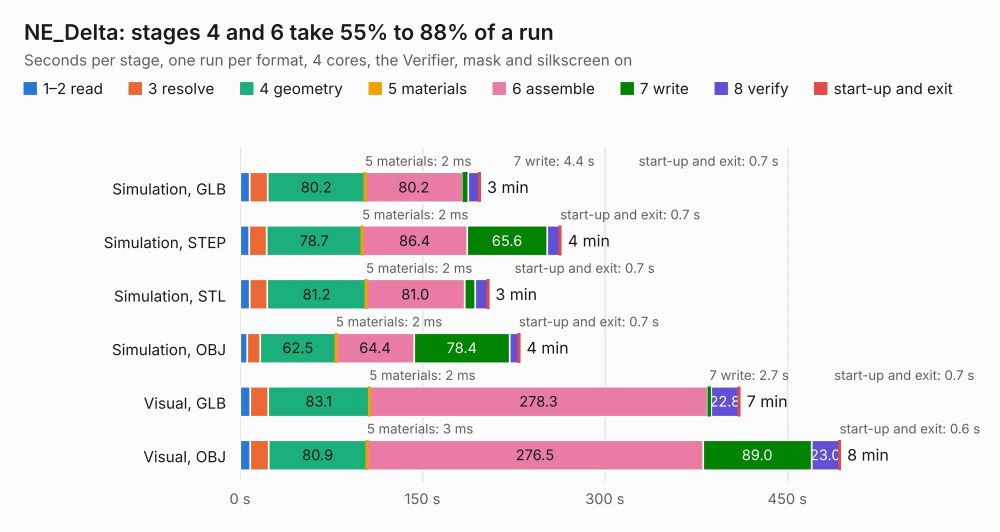

| Mode and format | 1–2 read | 3 resolve | 4 geometry | 5 materials | 6 assemble | 7 write | 8 verify | start-up and exit | Total |
|---|---:|---:|---:|---:|---:|---:|---:|---:|---:|
| Simulation, GLB | 7.8 | 14.8 | 80.2 | 2&nbsp;ms | 80.2 | 4.4 | 9.1 | 0.7 | 197.3 |
| Simulation, STEP | 7.5 | 14.2 | 78.7 | 2&nbsp;ms | 86.4 | 65.6 | 10.6 | 0.7 | 263.6 |
| Simulation, STL | 8.0 | 14.4 | 81.2 | 2&nbsp;ms | 81.0 | 8.8 | 10.0 | 0.7 | 204.1 |
| Simulation, OBJ | 5.6 | 10.7 | 62.5 | 2&nbsp;ms | 64.4 | 78.4 | 7.4 | 0.7 | 229.7 |
| Visual, GLB | 8.3 | 14.9 | 83.1 | 2&nbsp;ms | 278.3 | 2.7 | 22.8 | 0.7 | 410.8 |
| Visual, OBJ | 8.3 | 15.1 | 80.9 | 3&nbsp;ms | 276.5 | 89.0 | 23.0 | 0.6 | 493.4 |

<table align="center"><tr><td valign="top">

| Board | Repo: [frubem/NE_Delta_Schematics](https://github.com/frubem/NE_Delta_Schematics) Board: `NE_Delta.kicad_pcb` |
|---|---|
| Folder | LX780_Delta-original |
| Complexity | 422&nbsp;/&nbsp;1000 (size&nbsp;252, features&nbsp;170) |
| KESE&nbsp;features | through vias, slotted holes, custom pads, rounded, trapezoid or chamfered pads, drill offsets, arc tracks, filled zones, copper drawings, copper text, curved board outline, TrueType text, stack-up, dielectric εr and tanδ |
| Tested | 9th November 2026 to 10th November 2026 |
| Copper&nbsp;layers | 2 |
| File&nbsp;format | KiCad 9 (20241229) |
| Parts,&nbsp;tracks,&nbsp;vias | 185, 51,566, 969 |
| Triangles,&nbsp;simulation | 16,535,996 in 415 parts |
| Verifier | PASS in all six runs |
| Run&nbsp;again | Simulation, OBJ: failed in the corpus run, run again with the memory cap raised from 11 GB to 14.5 GB, and passed |

</td><td valign="top">

<table>
<tr><th>File type</th><th>File size</th><th>Peak memory used</th></tr>
<tr><th colspan="3" align="left">Simulation</th></tr>
<tr><td>GLB</td><td align="right">562&nbsp;MB</td><td align="right">5.2&nbsp;GB</td></tr>
<tr><td>STEP</td><td align="right">3.3&nbsp;GB</td><td align="right">6.1&nbsp;GB</td></tr>
<tr><td>STL</td><td align="right">827&nbsp;MB</td><td align="right">5.0&nbsp;GB</td></tr>
<tr><td>OBJ</td><td align="right">1.8&nbsp;GB</td><td align="right">14&nbsp;GB</td></tr>
<tr><th colspan="3" align="left">Visual</th></tr>
<tr><td>GLB</td><td align="right">387&nbsp;MB</td><td align="right">6.0&nbsp;GB</td></tr>
<tr><td>OBJ</td><td align="right">1.3&nbsp;GB</td><td align="right">10&nbsp;GB</td></tr>
</table>

</td></tr></table>

## 1006. LX782

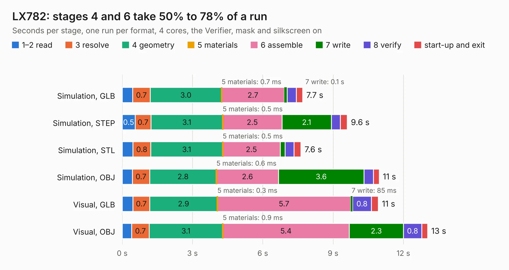

| Mode and format | 1–2 read | 3 resolve | 4 geometry | 5 materials | 6 assemble | 7 write | 8 verify | start-up and exit | Total |
|---|---:|---:|---:|---:|---:|---:|---:|---:|---:|
| Simulation, GLB | 0.4 | 0.7 | 3.0 | 0.7&nbsp;ms | 2.7 | 0.1 | 0.4 | 0.3 | 7.7 |
| Simulation, STEP | 0.5 | 0.7 | 3.1 | 0.5&nbsp;ms | 2.5 | 2.1 | 0.4 | 0.3 | 9.6 |
| Simulation, STL | 0.5 | 0.8 | 3.1 | 0.5&nbsp;ms | 2.5 | 0.2 | 0.4 | 0.3 | 7.6 |
| Simulation, OBJ | 0.4 | 0.7 | 2.8 | 0.6&nbsp;ms | 2.6 | 3.6 | 0.4 | 0.2 | 11.0 |
| Visual, GLB | 0.5 | 0.7 | 2.9 | 0.3&nbsp;ms | 5.7 | 85&nbsp;ms | 0.8 | 0.3 | 10.9 |
| Visual, OBJ | 0.4 | 0.7 | 3.1 | 0.9&nbsp;ms | 5.4 | 2.3 | 0.8 | 0.3 | 13.0 |

<table align="center"><tr><td valign="top">

| Board | Repo: [frubem/NE_Delta_Schematics](https://github.com/frubem/NE_Delta_Schematics) Board: `LX782.kicad_pcb` |
|---|---|
| Folder | LX782_Monochrome_Video |
| Complexity | 255&nbsp;/&nbsp;1000 (size&nbsp;155, features&nbsp;100) |
| KESE&nbsp;features | through vias, slotted holes, rounded, trapezoid or chamfered pads, drill offsets, arc tracks, filled zones, copper text, curved board outline |
| Tested | 9th November 2026 |
| Copper&nbsp;layers | 2 |
| File&nbsp;format | KiCad 9 (20241229) |
| Parts,&nbsp;tracks,&nbsp;vias | 47, 347, 1 |
| Triangles,&nbsp;simulation | 753,366 in 47 parts |
| Verifier | PASS in all six runs |

</td><td valign="top">

<table>
<tr><th>File type</th><th>File size</th><th>Peak memory used</th></tr>
<tr><th colspan="3" align="left">Simulation</th></tr>
<tr><td>GLB</td><td align="right">26&nbsp;MB</td><td align="right">401&nbsp;MB</td></tr>
<tr><td>STEP</td><td align="right">111&nbsp;MB</td><td align="right">444&nbsp;MB</td></tr>
<tr><td>STL</td><td align="right">38&nbsp;MB</td><td align="right">384&nbsp;MB</td></tr>
<tr><td>OBJ</td><td align="right">76&nbsp;MB</td><td align="right">548&nbsp;MB</td></tr>
<tr><th colspan="3" align="left">Visual</th></tr>
<tr><td>GLB</td><td align="right">16&nbsp;MB</td><td align="right">475&nbsp;MB</td></tr>
<tr><td>OBJ</td><td align="right">47&nbsp;MB</td><td align="right">452&nbsp;MB</td></tr>
</table>

</td></tr></table>

## 1007. LX783

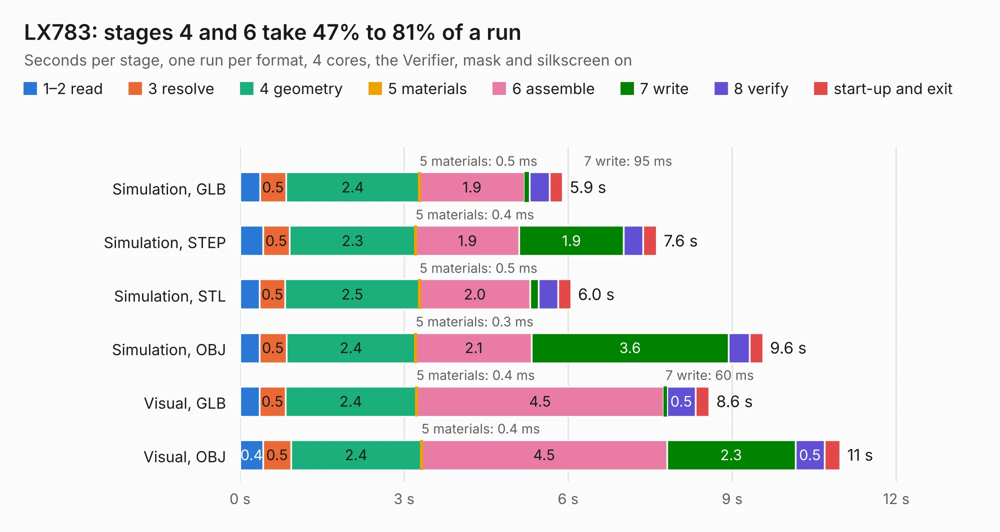

| Mode and format | 1–2 read | 3 resolve | 4 geometry | 5 materials | 6 assemble | 7 write | 8 verify | start-up and exit | Total |
|---|---:|---:|---:|---:|---:|---:|---:|---:|---:|
| Simulation, GLB | 0.4 | 0.5 | 2.4 | 0.5&nbsp;ms | 1.9 | 95&nbsp;ms | 0.4 | 0.2 | 5.9 |
| Simulation, STEP | 0.4 | 0.5 | 2.3 | 0.4&nbsp;ms | 1.9 | 1.9 | 0.4 | 0.2 | 7.6 |
| Simulation, STL | 0.4 | 0.5 | 2.5 | 0.5&nbsp;ms | 2.0 | 0.2 | 0.4 | 0.2 | 6.0 |
| Simulation, OBJ | 0.4 | 0.5 | 2.4 | 0.3&nbsp;ms | 2.1 | 3.6 | 0.4 | 0.2 | 9.6 |
| Visual, GLB | 0.4 | 0.5 | 2.4 | 0.4&nbsp;ms | 4.5 | 60&nbsp;ms | 0.5 | 0.3 | 8.6 |
| Visual, OBJ | 0.4 | 0.5 | 2.4 | 0.4&nbsp;ms | 4.5 | 2.3 | 0.5 | 0.3 | 11.0 |

<table align="center"><tr><td valign="top">

| Board | Repo: [frubem/NE_Delta_Schematics](https://github.com/frubem/NE_Delta_Schematics) Board: `LX783.kicad_pcb` |
|---|---|
| Folder | LX783_RGB_Video |
| Complexity | 237&nbsp;/&nbsp;1000 (size&nbsp;147, features&nbsp;90) |
| KESE&nbsp;features | through vias, rounded, trapezoid or chamfered pads, drill offsets, arc tracks, filled zones, copper text, curved board outline |
| Tested | 9th November 2026 |
| Copper&nbsp;layers | 2 |
| File&nbsp;format | KiCad 9 (20241229) |
| Parts,&nbsp;tracks,&nbsp;vias | 27, 301, 3 |
| Triangles,&nbsp;simulation | 566,684 in 47 parts |
| Verifier | PASS in all six runs |

</td><td valign="top">

<table>
<tr><th>File type</th><th>File size</th><th>Peak memory used</th></tr>
<tr><th colspan="3" align="left">Simulation</th></tr>
<tr><td>GLB</td><td align="right">19&nbsp;MB</td><td align="right">320&nbsp;MB</td></tr>
<tr><td>STEP</td><td align="right">82&nbsp;MB</td><td align="right">363&nbsp;MB</td></tr>
<tr><td>STL</td><td align="right">28&nbsp;MB</td><td align="right">327&nbsp;MB</td></tr>
<tr><td>OBJ</td><td align="right">56&nbsp;MB</td><td align="right">421&nbsp;MB</td></tr>
<tr><th colspan="3" align="left">Visual</th></tr>
<tr><td>GLB</td><td align="right">12&nbsp;MB</td><td align="right">402&nbsp;MB</td></tr>
<tr><td>OBJ</td><td align="right">36&nbsp;MB</td><td align="right">387&nbsp;MB</td></tr>
</table>

</td></tr></table>

## 1008. vera-module-rev2

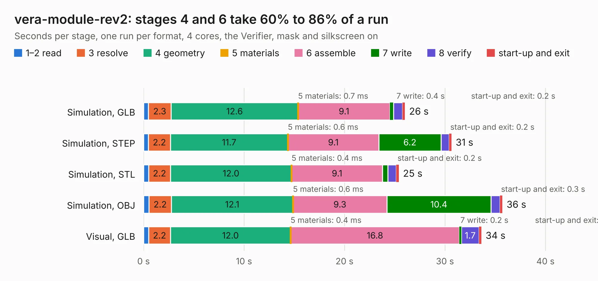

| Mode and format | 1–2 read | 3 resolve | 4 geometry | 5 materials | 6 assemble | 7 write | 8 verify | start-up and exit | Total |
|---|---:|---:|---:|---:|---:|---:|---:|---:|---:|
| Simulation, GLB | 0.5 | 2.3 | 12.6 | 0.7&nbsp;ms | 9.1 | 0.4 | 0.9 | 0.2 | 26.0 |
| Simulation, STEP | 0.5 | 2.2 | 11.7 | 0.6&nbsp;ms | 9.1 | 6.2 | 0.8 | 0.2 | 30.6 |
| Simulation, STL | 0.5 | 2.2 | 12.0 | 0.4&nbsp;ms | 9.1 | 0.5 | 0.8 | 0.2 | 25.4 |
| Simulation, OBJ | 0.5 | 2.2 | 12.1 | 0.6&nbsp;ms | 9.3 | 10.4 | 0.9 | 0.3 | 35.7 |
| Visual, GLB | 0.5 | 2.2 | 12.0 | 0.4&nbsp;ms | 16.8 | 0.2 | 1.7 | 0.2 | 33.6 |
| Visual, OBJ | 0.4 | 1.9 | 10.4 | 0.3&nbsp;ms | 17.3 | 5.7 | 2.0 | 0.3 | 38.0 |

<table align="center"><tr><td valign="top">

| Board | Repo: [fvdhoef/vera-module](https://github.com/fvdhoef/vera-module) Board: `vera-module-rev2.kicad_pcb` |
|---|---|
| Folder | pcb / rev2 |
| Complexity | 287&nbsp;/&nbsp;1000 (size&nbsp;232, features&nbsp;55) |
| KESE&nbsp;features | through vias, rounded, trapezoid or chamfered pads, filled zones, curved board outline |
| Tested | 9th November 2026 |
| Copper&nbsp;layers | 2 |
| File&nbsp;format | KiCad 5 (20171130) |
| Parts,&nbsp;tracks,&nbsp;vias | 111, 1,215, 256 |
| Triangles,&nbsp;simulation | 1,904,622 in 145 parts |
| Verifier | PASS in all six runs |

</td><td valign="top">

<table>
<tr><th>File type</th><th>File size</th><th>Peak memory used</th></tr>
<tr><th colspan="3" align="left">Simulation</th></tr>
<tr><td>GLB</td><td align="right">67&nbsp;MB</td><td align="right">786&nbsp;MB</td></tr>
<tr><td>STEP</td><td align="right">341&nbsp;MB</td><td align="right">912&nbsp;MB</td></tr>
<tr><td>STL</td><td align="right">95&nbsp;MB</td><td align="right">758&nbsp;MB</td></tr>
<tr><td>OBJ</td><td align="right">201&nbsp;MB</td><td align="right">1.3&nbsp;GB</td></tr>
<tr><th colspan="3" align="left">Visual</th></tr>
<tr><td>GLB</td><td align="right">49&nbsp;MB</td><td align="right">953&nbsp;MB</td></tr>
<tr><td>OBJ</td><td align="right">150&nbsp;MB</td><td align="right">1.1&nbsp;GB</td></tr>
</table>

</td></tr></table>

## 1009. vera-module-rev3

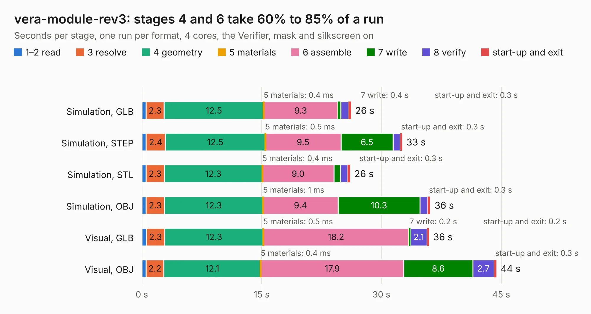

| Mode and format | 1–2 read | 3 resolve | 4 geometry | 5 materials | 6 assemble | 7 write | 8 verify | start-up and exit | Total |
|---|---:|---:|---:|---:|---:|---:|---:|---:|---:|
| Simulation, GLB | 0.5 | 2.3 | 12.5 | 0.4&nbsp;ms | 9.3 | 0.4 | 1.0 | 0.3 | 26.2 |
| Simulation, STEP | 0.5 | 2.4 | 12.5 | 0.5&nbsp;ms | 9.5 | 6.5 | 0.9 | 0.3 | 32.6 |
| Simulation, STL | 0.5 | 2.3 | 12.3 | 0.4&nbsp;ms | 9.0 | 0.8 | 0.9 | 0.3 | 26.1 |
| Simulation, OBJ | 0.5 | 2.3 | 12.3 | 1&nbsp;ms | 9.4 | 10.3 | 1.0 | 0.3 | 36.1 |
| Visual, GLB | 0.6 | 2.3 | 12.3 | 0.5&nbsp;ms | 18.2 | 0.2 | 2.1 | 0.2 | 36.0 |
| Visual, OBJ | 0.5 | 2.2 | 12.1 | 0.4&nbsp;ms | 17.9 | 8.6 | 2.7 | 0.3 | 44.4 |

<table align="center"><tr><td valign="top">

| Board | Repo: [fvdhoef/vera-module](https://github.com/fvdhoef/vera-module) Board: `vera-module-rev3.kicad_pcb` |
|---|---|
| Folder | pcb / rev3 |
| Complexity | 285&nbsp;/&nbsp;1000 (size&nbsp;230, features&nbsp;55) |
| KESE&nbsp;features | through vias, rounded, trapezoid or chamfered pads, filled zones, curved board outline |
| Tested | 9th November 2026 |
| Copper&nbsp;layers | 2 |
| File&nbsp;format | KiCad 5 (20171130) |
| Parts,&nbsp;tracks,&nbsp;vias | 100, 1,125, 243 |
| Triangles,&nbsp;simulation | 1,720,326 in 136 parts |
| Verifier | PASS in all six runs |

</td><td valign="top">

<table>
<tr><th>File type</th><th>File size</th><th>Peak memory used</th></tr>
<tr><th colspan="3" align="left">Simulation</th></tr>
<tr><td>GLB</td><td align="right">60&nbsp;MB</td><td align="right">753&nbsp;MB</td></tr>
<tr><td>STEP</td><td align="right">308&nbsp;MB</td><td align="right">829&nbsp;MB</td></tr>
<tr><td>STL</td><td align="right">86&nbsp;MB</td><td align="right">743&nbsp;MB</td></tr>
<tr><td>OBJ</td><td align="right">181&nbsp;MB</td><td align="right">1.2&nbsp;GB</td></tr>
<tr><th colspan="3" align="left">Visual</th></tr>
<tr><td>GLB</td><td align="right">45&nbsp;MB</td><td align="right">833&nbsp;MB</td></tr>
<tr><td>OBJ</td><td align="right">135&nbsp;MB</td><td align="right">971&nbsp;MB</td></tr>
</table>

</td></tr></table>

## 1010. vera-module-rev4

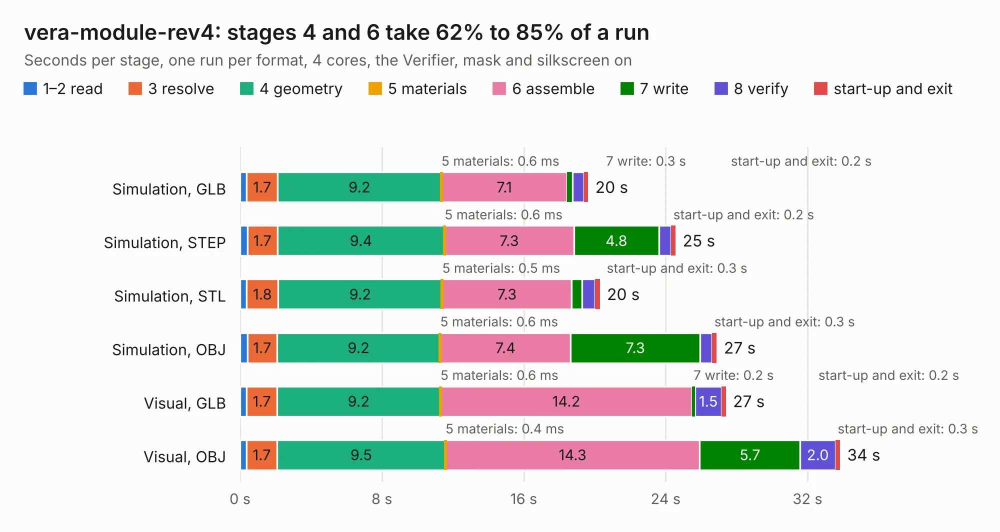

| Mode and format | 1–2 read | 3 resolve | 4 geometry | 5 materials | 6 assemble | 7 write | 8 verify | start-up and exit | Total |
|---|---:|---:|---:|---:|---:|---:|---:|---:|---:|
| Simulation, GLB | 0.4 | 1.7 | 9.2 | 0.6&nbsp;ms | 7.1 | 0.3 | 0.7 | 0.2 | 19.6 |
| Simulation, STEP | 0.4 | 1.7 | 9.4 | 0.6&nbsp;ms | 7.3 | 4.8 | 0.7 | 0.2 | 24.6 |
| Simulation, STL | 0.4 | 1.8 | 9.2 | 0.5&nbsp;ms | 7.3 | 0.6 | 0.7 | 0.3 | 20.3 |
| Simulation, OBJ | 0.4 | 1.7 | 9.2 | 0.6&nbsp;ms | 7.4 | 7.3 | 0.7 | 0.3 | 26.9 |
| Visual, GLB | 0.4 | 1.7 | 9.2 | 0.6&nbsp;ms | 14.2 | 0.2 | 1.5 | 0.2 | 27.4 |
| Visual, OBJ | 0.4 | 1.7 | 9.5 | 0.4&nbsp;ms | 14.3 | 5.7 | 2.0 | 0.3 | 33.8 |

<table align="center"><tr><td valign="top">

| Board | Repo: [fvdhoef/vera-module](https://github.com/fvdhoef/vera-module) Board: `vera-module-rev4.kicad_pcb` |
|---|---|
| Folder | pcb / rev4 |
| Complexity | 285&nbsp;/&nbsp;1000 (size&nbsp;230, features&nbsp;55) |
| KESE&nbsp;features | through vias, rounded, trapezoid or chamfered pads, filled zones, curved board outline |
| Tested | 9th November 2026 |
| Copper&nbsp;layers | 2 |
| File&nbsp;format | KiCad 5 (20171130) |
| Parts,&nbsp;tracks,&nbsp;vias | 99, 1,157, 255 |
| Triangles,&nbsp;simulation | 1,770,960 in 145 parts |
| Verifier | PASS in all six runs |

</td><td valign="top">

<table>
<tr><th>File type</th><th>File size</th><th>Peak memory used</th></tr>
<tr><th colspan="3" align="left">Simulation</th></tr>
<tr><td>GLB</td><td align="right">62&nbsp;MB</td><td align="right">722&nbsp;MB</td></tr>
<tr><td>STEP</td><td align="right">317&nbsp;MB</td><td align="right">817&nbsp;MB</td></tr>
<tr><td>STL</td><td align="right">89&nbsp;MB</td><td align="right">746&nbsp;MB</td></tr>
<tr><td>OBJ</td><td align="right">187&nbsp;MB</td><td align="right">1.2&nbsp;GB</td></tr>
<tr><th colspan="3" align="left">Visual</th></tr>
<tr><td>GLB</td><td align="right">46&nbsp;MB</td><td align="right">840&nbsp;MB</td></tr>
<tr><td>OBJ</td><td align="right">140&nbsp;MB</td><td align="right">1.0&nbsp;GB</td></tr>
</table>

</td></tr></table>

## 1011. GR8RAM

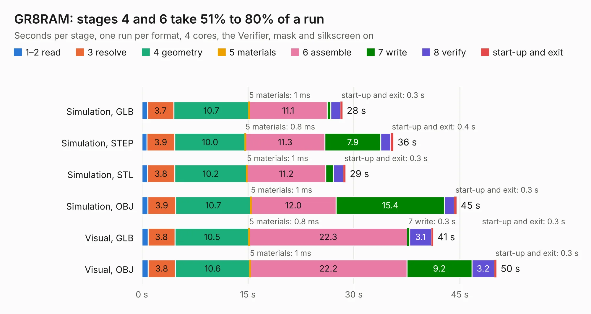

| Mode and format | 1–2 read | 3 resolve | 4 geometry | 5 materials | 6 assemble | 7 write | 8 verify | start-up and exit | Total |
|---|---:|---:|---:|---:|---:|---:|---:|---:|---:|
| Simulation, GLB | 0.8 | 3.7 | 10.7 | 1&nbsp;ms | 11.1 | 0.5 | 1.4 | 0.3 | 28.4 |
| Simulation, STEP | 0.7 | 3.9 | 10.0 | 0.8&nbsp;ms | 11.3 | 7.9 | 1.4 | 0.4 | 35.6 |
| Simulation, STL | 0.8 | 3.8 | 10.2 | 1&nbsp;ms | 11.2 | 1.1 | 1.4 | 0.3 | 28.8 |
| Simulation, OBJ | 0.8 | 3.9 | 10.7 | 1&nbsp;ms | 12.0 | 15.4 | 1.4 | 0.3 | 44.5 |
| Visual, GLB | 0.9 | 3.8 | 10.5 | 0.8&nbsp;ms | 22.3 | 0.3 | 3.1 | 0.3 | 41.3 |
| Visual, OBJ | 0.9 | 3.8 | 10.6 | 1&nbsp;ms | 22.2 | 9.2 | 3.2 | 0.3 | 50.2 |

<table align="center"><tr><td valign="top">

| Board | Repo: [garrettsworkshop/GR8RAM](https://github.com/garrettsworkshop/GR8RAM) Board: `GR8RAM.kicad_pcb` |
|---|---|
| Complexity | 304&nbsp;/&nbsp;1000 (size&nbsp;249, features&nbsp;55) |
| KESE&nbsp;features | through vias, rounded, trapezoid or chamfered pads, filled zones, curved board outline |
| Tested | 9th November 2026 |
| Copper&nbsp;layers | 4 |
| File&nbsp;format | KiCad 6 (20211014) |
| Parts,&nbsp;tracks,&nbsp;vias | 58, 1,689, 476 |
| Triangles,&nbsp;simulation | 3,124,046 in 178 parts |
| Verifier | PASS in all six runs |

</td><td valign="top">

<table>
<tr><th>File type</th><th>File size</th><th>Peak memory used</th></tr>
<tr><th colspan="3" align="left">Simulation</th></tr>
<tr><td>GLB</td><td align="right">107&nbsp;MB</td><td align="right">1.2&nbsp;GB</td></tr>
<tr><td>STEP</td><td align="right">422&nbsp;MB</td><td align="right">1.3&nbsp;GB</td></tr>
<tr><td>STL</td><td align="right">156&nbsp;MB</td><td align="right">1.2&nbsp;GB</td></tr>
<tr><td>OBJ</td><td align="right">331&nbsp;MB</td><td align="right">2.2&nbsp;GB</td></tr>
<tr><th colspan="3" align="left">Visual</th></tr>
<tr><td>GLB</td><td align="right">64&nbsp;MB</td><td align="right">1.2&nbsp;GB</td></tr>
<tr><td>OBJ</td><td align="right">202&nbsp;MB</td><td align="right">1.4&nbsp;GB</td></tr>
</table>

</td></tr></table>

## 1012. NuBus-ESP32

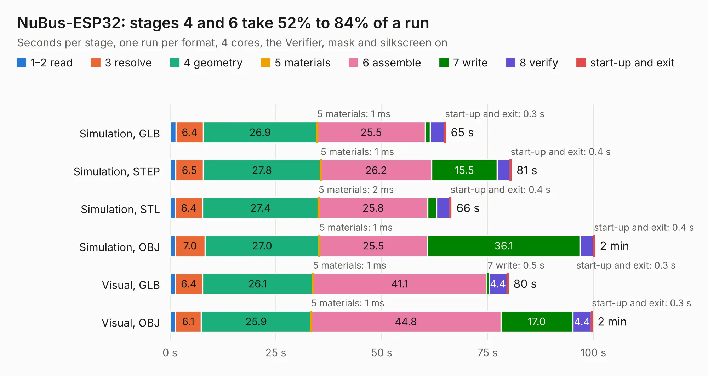

| Mode and format | 1–2 read | 3 resolve | 4 geometry | 5 materials | 6 assemble | 7 write | 8 verify | start-up and exit | Total |
|---|---:|---:|---:|---:|---:|---:|---:|---:|---:|
| Simulation, GLB | 1.5 | 6.4 | 26.9 | 1&nbsp;ms | 25.5 | 1.1 | 3.4 | 0.3 | 65.1 |
| Simulation, STEP | 1.3 | 6.5 | 27.8 | 1&nbsp;ms | 26.2 | 15.5 | 3.0 | 0.4 | 80.6 |
| Simulation, STL | 1.3 | 6.4 | 27.4 | 2&nbsp;ms | 25.8 | 2.0 | 3.1 | 0.4 | 66.5 |
| Simulation, OBJ | 1.2 | 7.0 | 27.0 | 1&nbsp;ms | 25.5 | 36.1 | 3.1 | 0.4 | 100.3 |
| Visual, GLB | 1.2 | 6.4 | 26.1 | 1&nbsp;ms | 41.1 | 0.5 | 4.4 | 0.3 | 79.9 |
| Visual, OBJ | 1.3 | 6.1 | 25.9 | 1&nbsp;ms | 44.8 | 17.0 | 4.4 | 0.3 | 99.8 |

<table align="center"><tr><td valign="top">

| Board | Repo: [garrettsworkshop/NuBus-ESP32](https://github.com/garrettsworkshop/NuBus-ESP32) Board: `NuBus-ESP32.kicad_pcb` |
|---|---|
| Complexity | 373&nbsp;/&nbsp;1000 (size&nbsp;288, features&nbsp;85) |
| KESE&nbsp;features | through vias, rounded, trapezoid or chamfered pads, filled zones, curved board outline, stack-up, dielectric εr and tanδ |
| Tested | 9th November 2026 |
| Copper&nbsp;layers | 6 |
| File&nbsp;format | KiCad 8 (20240108) |
| Parts,&nbsp;tracks,&nbsp;vias | 162, 2,390, 698 |
| Triangles,&nbsp;simulation | 5,988,802 in 354 parts |
| Verifier | PASS in all six runs |

</td><td valign="top">

<table>
<tr><th>File type</th><th>File size</th><th>Peak memory used</th></tr>
<tr><th colspan="3" align="left">Simulation</th></tr>
<tr><td>GLB</td><td align="right">198&nbsp;MB</td><td align="right">1.5&nbsp;GB</td></tr>
<tr><td>STEP</td><td align="right">799&nbsp;MB</td><td align="right">2.2&nbsp;GB</td></tr>
<tr><td>STL</td><td align="right">299&nbsp;MB</td><td align="right">1.6&nbsp;GB</td></tr>
<tr><td>OBJ</td><td align="right">643&nbsp;MB</td><td align="right">3.9&nbsp;GB</td></tr>
<tr><th colspan="3" align="left">Visual</th></tr>
<tr><td>GLB</td><td align="right">100&nbsp;MB</td><td align="right">1.9&nbsp;GB</td></tr>
<tr><td>OBJ</td><td align="right">322&nbsp;MB</td><td align="right">2.2&nbsp;GB</td></tr>
</table>

</td></tr></table>

## 1013. RAM2E

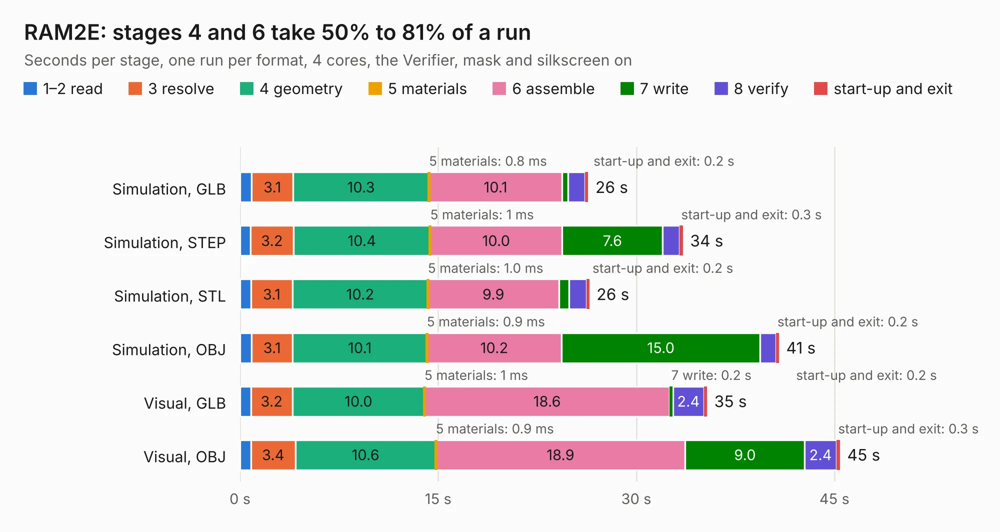

| Mode and format | 1–2 read | 3 resolve | 4 geometry | 5 materials | 6 assemble | 7 write | 8 verify | start-up and exit | Total |
|---|---:|---:|---:|---:|---:|---:|---:|---:|---:|
| Simulation, GLB | 0.9 | 3.1 | 10.3 | 0.8&nbsp;ms | 10.1 | 0.5 | 1.3 | 0.2 | 26.4 |
| Simulation, STEP | 0.8 | 3.2 | 10.4 | 1&nbsp;ms | 10.0 | 7.6 | 1.3 | 0.3 | 33.5 |
| Simulation, STL | 0.8 | 3.1 | 10.2 | 1.0&nbsp;ms | 9.9 | 0.8 | 1.3 | 0.2 | 26.5 |
| Simulation, OBJ | 0.9 | 3.1 | 10.1 | 0.9&nbsp;ms | 10.2 | 15.0 | 1.2 | 0.2 | 40.8 |
| Visual, GLB | 0.8 | 3.2 | 10.0 | 1&nbsp;ms | 18.6 | 0.2 | 2.4 | 0.2 | 35.4 |
| Visual, OBJ | 0.8 | 3.4 | 10.6 | 0.9&nbsp;ms | 18.9 | 9.0 | 2.4 | 0.3 | 45.4 |

<table align="center"><tr><td valign="top">

| Board | Repo: [garrettsworkshop/RAM2E](https://github.com/garrettsworkshop/RAM2E) Board: `RAM2E.kicad_pcb` |
|---|---|
| Folder | Hardware / LCMXO2 |
| Complexity | 338&nbsp;/&nbsp;1000 (size&nbsp;253, features&nbsp;85) |
| KESE&nbsp;features | through vias, rounded, trapezoid or chamfered pads, filled zones, curved board outline, stack-up, dielectric εr and tanδ |
| Tested | 9th November 2026 |
| Copper&nbsp;layers | 4 |
| File&nbsp;format | KiCad 8 (20240108) |
| Parts,&nbsp;tracks,&nbsp;vias | 69, 1,905, 527 |
| Triangles,&nbsp;simulation | 2,836,766 in 177 parts |
| Verifier | PASS in all six runs |

</td><td valign="top">

<table>
<tr><th>File type</th><th>File size</th><th>Peak memory used</th></tr>
<tr><th colspan="3" align="left">Simulation</th></tr>
<tr><td>GLB</td><td align="right">97&nbsp;MB</td><td align="right">1.1&nbsp;GB</td></tr>
<tr><td>STEP</td><td align="right">425&nbsp;MB</td><td align="right">1.2&nbsp;GB</td></tr>
<tr><td>STL</td><td align="right">142&nbsp;MB</td><td align="right">1.1&nbsp;GB</td></tr>
<tr><td>OBJ</td><td align="right">305&nbsp;MB</td><td align="right">1.9&nbsp;GB</td></tr>
<tr><th colspan="3" align="left">Visual</th></tr>
<tr><td>GLB</td><td align="right">58&nbsp;MB</td><td align="right">1.1&nbsp;GB</td></tr>
<tr><td>OBJ</td><td align="right">186&nbsp;MB</td><td align="right">1.3&nbsp;GB</td></tr>
</table>

</td></tr></table>

## 1014. RAM2E

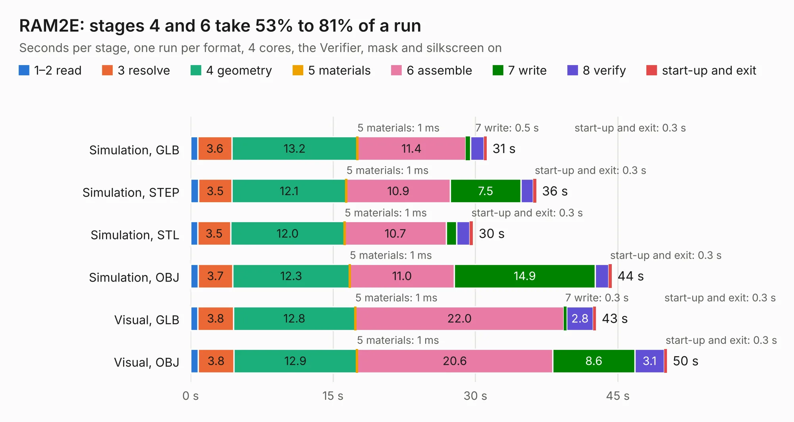

| Mode and format | 1–2 read | 3 resolve | 4 geometry | 5 materials | 6 assemble | 7 write | 8 verify | start-up and exit | Total |
|---|---:|---:|---:|---:|---:|---:|---:|---:|---:|
| Simulation, GLB | 0.8 | 3.6 | 13.2 | 1&nbsp;ms | 11.4 | 0.5 | 1.4 | 0.3 | 31.2 |
| Simulation, STEP | 0.8 | 3.5 | 12.1 | 1&nbsp;ms | 10.9 | 7.5 | 1.3 | 0.3 | 36.4 |
| Simulation, STL | 0.7 | 3.5 | 12.0 | 1&nbsp;ms | 10.7 | 1.1 | 1.4 | 0.3 | 29.7 |
| Simulation, OBJ | 0.8 | 3.7 | 12.3 | 1&nbsp;ms | 11.0 | 14.9 | 1.4 | 0.3 | 44.4 |
| Visual, GLB | 0.8 | 3.8 | 12.8 | 1&nbsp;ms | 22.0 | 0.3 | 2.8 | 0.3 | 42.7 |
| Visual, OBJ | 0.8 | 3.8 | 12.9 | 1&nbsp;ms | 20.6 | 8.6 | 3.1 | 0.3 | 50.2 |

<table align="center"><tr><td valign="top">

| Board | Repo: [garrettsworkshop/RAM2E](https://github.com/garrettsworkshop/RAM2E) Board: `RAM2E.kicad_pcb` |
|---|---|
| Folder | Hardware / MAX |
| Complexity | 338&nbsp;/&nbsp;1000 (size&nbsp;253, features&nbsp;85) |
| KESE&nbsp;features | through vias, rounded, trapezoid or chamfered pads, filled zones, curved board outline, stack-up, dielectric εr and tanδ |
| Tested | 9th November 2026 |
| Copper&nbsp;layers | 4 |
| File&nbsp;format | KiCad 8 (20240108) |
| Parts,&nbsp;tracks,&nbsp;vias | 66, 1,883, 548 |
| Triangles,&nbsp;simulation | 2,861,040 in 179 parts |
| Verifier | PASS in all six runs |

</td><td valign="top">

<table>
<tr><th>File type</th><th>File size</th><th>Peak memory used</th></tr>
<tr><th colspan="3" align="left">Simulation</th></tr>
<tr><td>GLB</td><td align="right">97&nbsp;MB</td><td align="right">1.1&nbsp;GB</td></tr>
<tr><td>STEP</td><td align="right">418&nbsp;MB</td><td align="right">1.3&nbsp;GB</td></tr>
<tr><td>STL</td><td align="right">143&nbsp;MB</td><td align="right">1.1&nbsp;GB</td></tr>
<tr><td>OBJ</td><td align="right">308&nbsp;MB</td><td align="right">1.9&nbsp;GB</td></tr>
<tr><th colspan="3" align="left">Visual</th></tr>
<tr><td>GLB</td><td align="right">58&nbsp;MB</td><td align="right">1.1&nbsp;GB</td></tr>
<tr><td>OBJ</td><td align="right">185&nbsp;MB</td><td align="right">1.3&nbsp;GB</td></tr>
</table>

</td></tr></table>

## 1015. SE-030

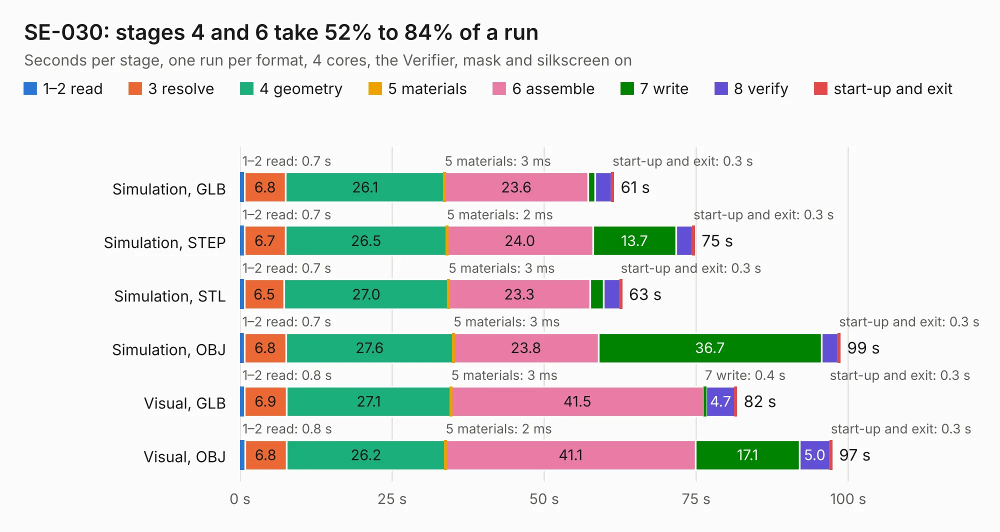

| Mode and format | 1–2 read | 3 resolve | 4 geometry | 5 materials | 6 assemble | 7 write | 8 verify | start-up and exit | Total |
|---|---:|---:|---:|---:|---:|---:|---:|---:|---:|
| Simulation, GLB | 0.7 | 6.8 | 26.1 | 3&nbsp;ms | 23.6 | 1.2 | 2.7 | 0.3 | 61.4 |
| Simulation, STEP | 0.7 | 6.7 | 26.5 | 2&nbsp;ms | 24.0 | 13.7 | 2.7 | 0.3 | 74.7 |
| Simulation, STL | 0.7 | 6.5 | 27.0 | 3&nbsp;ms | 23.3 | 2.2 | 2.6 | 0.3 | 62.8 |
| Simulation, OBJ | 0.7 | 6.8 | 27.6 | 3&nbsp;ms | 23.8 | 36.7 | 2.7 | 0.3 | 98.7 |
| Visual, GLB | 0.8 | 6.9 | 27.1 | 3&nbsp;ms | 41.5 | 0.4 | 4.7 | 0.3 | 81.6 |
| Visual, OBJ | 0.8 | 6.8 | 26.2 | 2&nbsp;ms | 41.1 | 17.1 | 5.0 | 0.3 | 97.3 |

<table align="center"><tr><td valign="top">

| Board | Repo: [garrettsworkshop/Warp-LC](https://github.com/garrettsworkshop/Warp-LC) Board: `SE-030.kicad_pcb` |
|---|---|
| Complexity | 364&nbsp;/&nbsp;1000 (size&nbsp;289, features&nbsp;75) |
| KESE&nbsp;features | through vias, slotted holes, rounded, trapezoid or chamfered pads, curved board outline, stack-up, dielectric εr and tanδ |
| Tested | 9th November 2026 |
| Copper&nbsp;layers | 6 |
| File&nbsp;format | KiCad 7 (20221018) |
| Parts,&nbsp;tracks,&nbsp;vias | 177, 2,044, 604 |
| Triangles,&nbsp;simulation | 6,234,746 in 682 parts |
| Verifier | PASS in all six runs |

</td><td valign="top">

<table>
<tr><th>File type</th><th>File size</th><th>Peak memory used</th></tr>
<tr><th colspan="3" align="left">Simulation</th></tr>
<tr><td>GLB</td><td align="right">204&nbsp;MB</td><td align="right">1.5&nbsp;GB</td></tr>
<tr><td>STEP</td><td align="right">786&nbsp;MB</td><td align="right">2.0&nbsp;GB</td></tr>
<tr><td>STL</td><td align="right">312&nbsp;MB</td><td align="right">1.5&nbsp;GB</td></tr>
<tr><td>OBJ</td><td align="right">665&nbsp;MB</td><td align="right">4.0&nbsp;GB</td></tr>
<tr><th colspan="3" align="left">Visual</th></tr>
<tr><td>GLB</td><td align="right">100&nbsp;MB</td><td align="right">1.7&nbsp;GB</td></tr>
<tr><td>OBJ</td><td align="right">327&nbsp;MB</td><td align="right">2.2&nbsp;GB</td></tr>
</table>

</td></tr></table>

## 1016. WarpSE

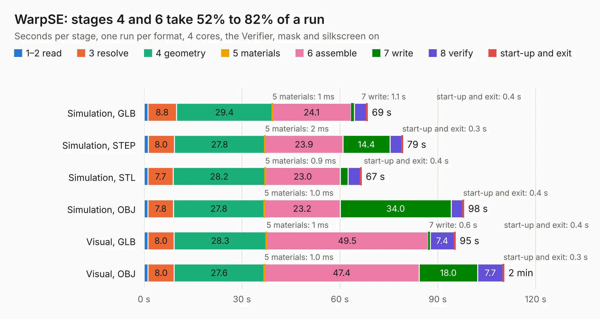

| Mode and format | 1–2 read | 3 resolve | 4 geometry | 5 materials | 6 assemble | 7 write | 8 verify | start-up and exit | Total |
|---|---:|---:|---:|---:|---:|---:|---:|---:|---:|
| Simulation, GLB | 1.2 | 8.8 | 29.4 | 1&nbsp;ms | 24.1 | 1.1 | 3.7 | 0.4 | 68.5 |
| Simulation, STEP | 1.3 | 8.0 | 27.8 | 2&nbsp;ms | 23.9 | 14.4 | 3.6 | 0.3 | 79.3 |
| Simulation, STL | 1.2 | 7.7 | 28.2 | 0.9&nbsp;ms | 23.0 | 2.3 | 3.8 | 0.4 | 66.6 |
| Simulation, OBJ | 1.2 | 7.8 | 27.8 | 1.0&nbsp;ms | 23.2 | 34.0 | 3.5 | 0.4 | 98.0 |
| Visual, GLB | 1.2 | 8.0 | 28.3 | 1&nbsp;ms | 49.5 | 0.6 | 7.4 | 0.4 | 95.4 |
| Visual, OBJ | 1.2 | 8.0 | 27.6 | 1.0&nbsp;ms | 47.4 | 18.0 | 7.7 | 0.3 | 110.3 |

<table align="center"><tr><td valign="top">

| Board | Repo: [garrettsworkshop/WarpSE](https://github.com/garrettsworkshop/WarpSE) Board: `WarpSE.kicad_pcb` |
|---|---|
| Complexity | 374&nbsp;/&nbsp;1000 (size&nbsp;289, features&nbsp;85) |
| KESE&nbsp;features | through vias, rounded, trapezoid or chamfered pads, filled zones, curved board outline, stack-up, dielectric εr and tanδ |
| Tested | 9th November 2026 |
| Copper&nbsp;layers | 4 |
| File&nbsp;format | KiCad 8 (20240108) |
| Parts,&nbsp;tracks,&nbsp;vias | 135, 4,359, 1,470 |
| Triangles,&nbsp;simulation | 7,022,420 in 267 parts |
| Verifier | PASS in all six runs |

</td><td valign="top">

<table>
<tr><th>File type</th><th>File size</th><th>Peak memory used</th></tr>
<tr><th colspan="3" align="left">Simulation</th></tr>
<tr><td>GLB</td><td align="right">235&nbsp;MB</td><td align="right">2.1&nbsp;GB</td></tr>
<tr><td>STEP</td><td align="right">916&nbsp;MB</td><td align="right">2.7&nbsp;GB</td></tr>
<tr><td>STL</td><td align="right">351&nbsp;MB</td><td align="right">2.0&nbsp;GB</td></tr>
<tr><td>OBJ</td><td align="right">758&nbsp;MB</td><td align="right">4.4&nbsp;GB</td></tr>
<tr><th colspan="3" align="left">Visual</th></tr>
<tr><td>GLB</td><td align="right">138&nbsp;MB</td><td align="right">2.3&nbsp;GB</td></tr>
<tr><td>OBJ</td><td align="right">452&nbsp;MB</td><td align="right">3.0&nbsp;GB</td></tr>
</table>

</td></tr></table>

## 1017. ecp5_mainboard

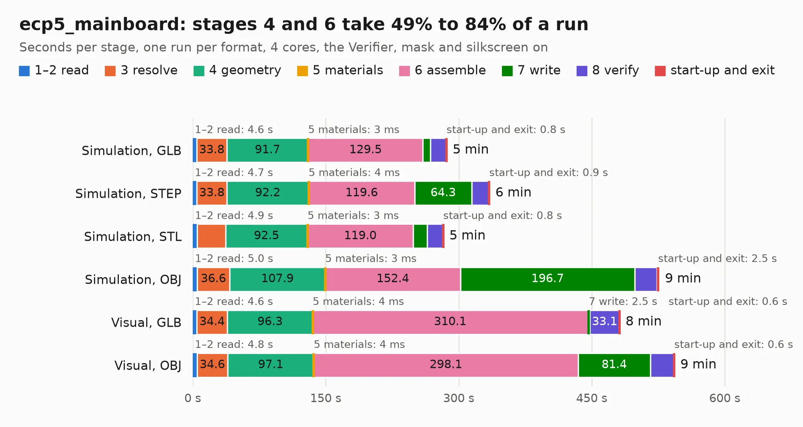

| Mode and format | 1–2 read | 3 resolve | 4 geometry | 5 materials | 6 assemble | 7 write | 8 verify | start-up and exit | Total |
|---|---:|---:|---:|---:|---:|---:|---:|---:|---:|
| Simulation, GLB | 4.6 | 33.8 | 91.7 | 3&nbsp;ms | 129.5 | 8.5 | 17.7 | 0.8 | 286.6 |
| Simulation, STEP | 4.7 | 33.8 | 92.2 | 4&nbsp;ms | 119.6 | 64.3 | 19.3 | 0.9 | 334.8 |
| Simulation, STL | 4.9 | 32.1 | 92.5 | 3&nbsp;ms | 119.0 | 16.1 | 17.5 | 0.8 | 282.9 |
| Simulation, OBJ | 5.0 | 36.6 | 107.9 | 3&nbsp;ms | 152.4 | 196.7 | 25.0 | 2.5 | 526.1 |
| Visual, GLB | 4.6 | 34.4 | 96.3 | 4&nbsp;ms | 310.1 | 2.5 | 33.1 | 0.6 | 481.6 |
| Visual, OBJ | 4.8 | 34.6 | 97.1 | 4&nbsp;ms | 298.1 | 81.4 | 26.7 | 0.6 | 543.3 |

<table align="center"><tr><td valign="top">

| Board | Repo: [gatecat/TrellisBoard](https://github.com/gatecat/TrellisBoard) Board: `ecp5_mainboard.kicad_pcb` |
|---|---|
| Folder | hardware / ecp5_mainboard |
| Complexity | 424&nbsp;/&nbsp;1000 (size&nbsp;359, features&nbsp;65) |
| KESE&nbsp;features | through vias, slotted holes, rounded, trapezoid or chamfered pads, filled zones, curved board outline |
| Tested | 9th November 2026 to 11th November 2026 |
| Copper&nbsp;layers | 8 |
| File&nbsp;format | KiCad 5 (20171130) |
| Parts,&nbsp;tracks,&nbsp;vias | 498, 44,254, 3,208 |
| Triangles,&nbsp;simulation | 26,783,694 in 768 parts |
| Verifier | PASS in all six runs |
| Run&nbsp;again | Simulation, OBJ: failed in the corpus run, run again with no memory cap and no time limit (swap added to a 16 GB machine), and passed |

</td><td valign="top">

<table>
<tr><th>File type</th><th>File size</th><th>Peak memory used</th></tr>
<tr><th colspan="3" align="left">Simulation</th></tr>
<tr><td>GLB</td><td align="right">911&nbsp;MB</td><td align="right">5.8&nbsp;GB</td></tr>
<tr><td>STEP</td><td align="right">2.8&nbsp;GB</td><td align="right">8.1&nbsp;GB</td></tr>
<tr><td>STL</td><td align="right">1.3&nbsp;GB</td><td align="right">5.6&nbsp;GB</td></tr>
<tr><td>OBJ</td><td align="right">3.0&nbsp;GB</td><td align="right">17&nbsp;GB</td></tr>
<tr><th colspan="3" align="left">Visual</th></tr>
<tr><td>GLB</td><td align="right">424&nbsp;MB</td><td align="right">6.9&nbsp;GB</td></tr>
<tr><td>OBJ</td><td align="right">1.4&nbsp;GB</td><td align="right">8.7&nbsp;GB</td></tr>
</table>

</td></tr></table>

## 1018. OpenDropV2

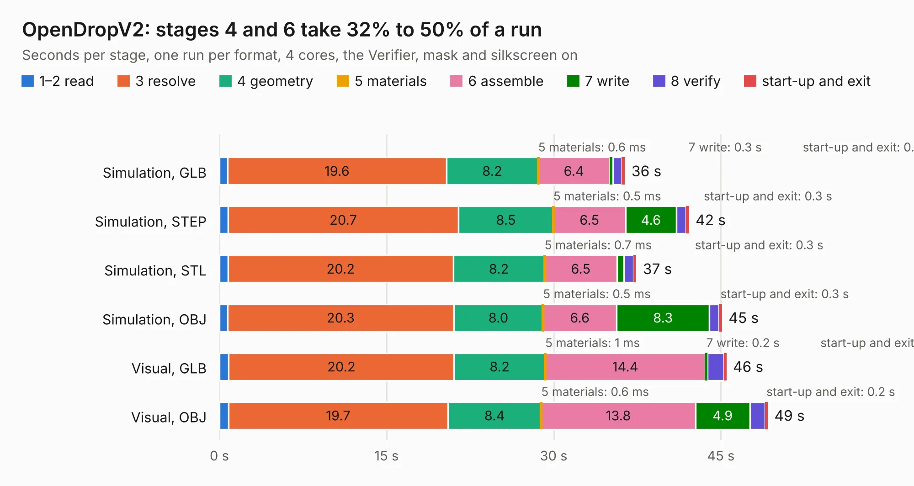

| Mode and format | 1–2 read | 3 resolve | 4 geometry | 5 materials | 6 assemble | 7 write | 8 verify | start-up and exit | Total |
|---|---:|---:|---:|---:|---:|---:|---:|---:|---:|
| Simulation, GLB | 0.7 | 19.6 | 8.2 | 0.6&nbsp;ms | 6.4 | 0.3 | 0.8 | 0.3 | 36.4 |
| Simulation, STEP | 0.8 | 20.7 | 8.5 | 0.5&nbsp;ms | 6.5 | 4.6 | 0.9 | 0.3 | 42.1 |
| Simulation, STL | 0.8 | 20.2 | 8.2 | 0.7&nbsp;ms | 6.5 | 0.6 | 0.9 | 0.3 | 37.4 |
| Simulation, OBJ | 0.7 | 20.3 | 8.0 | 0.5&nbsp;ms | 6.6 | 8.3 | 0.9 | 0.3 | 45.1 |
| Visual, GLB | 0.8 | 20.2 | 8.2 | 1&nbsp;ms | 14.4 | 0.2 | 1.5 | 0.2 | 45.5 |
| Visual, OBJ | 0.8 | 19.7 | 8.4 | 0.6&nbsp;ms | 13.8 | 4.9 | 1.4 | 0.2 | 49.2 |

<table align="center"><tr><td valign="top">

| Board | Repo: [GaudiLabs/OpenDrop](https://github.com/GaudiLabs/OpenDrop) Board: `OpenDropV2.kicad_pcb` |
|---|---|
| Folder | OpenDropV2 / DesignFiles |
| Complexity | 292&nbsp;/&nbsp;1000 (size&nbsp;247, features&nbsp;45) |
| KESE&nbsp;features | through vias, filled zones, curved board outline |
| Tested | 9th November 2026 |
| Copper&nbsp;layers | 2 |
| File&nbsp;format | KiCad 4 (4) |
| Parts,&nbsp;tracks,&nbsp;vias | 211, 1,878, 96 |
| Triangles,&nbsp;simulation | 1,898,760 in 203 parts |
| Verifier | PASS in all six runs |

</td><td valign="top">

<table>
<tr><th>File type</th><th>File size</th><th>Peak memory used</th></tr>
<tr><th colspan="3" align="left">Simulation</th></tr>
<tr><td>GLB</td><td align="right">68&nbsp;MB</td><td align="right">689&nbsp;MB</td></tr>
<tr><td>STEP</td><td align="right">379&nbsp;MB</td><td align="right">821&nbsp;MB</td></tr>
<tr><td>STL</td><td align="right">95&nbsp;MB</td><td align="right">696&nbsp;MB</td></tr>
<tr><td>OBJ</td><td align="right">206&nbsp;MB</td><td align="right">1.3&nbsp;GB</td></tr>
<tr><th colspan="3" align="left">Visual</th></tr>
<tr><td>GLB</td><td align="right">41&nbsp;MB</td><td align="right">868&nbsp;MB</td></tr>
<tr><td>OBJ</td><td align="right">124&nbsp;MB</td><td align="right">939&nbsp;MB</td></tr>
</table>

</td></tr></table>

## 1019. PCBFrame

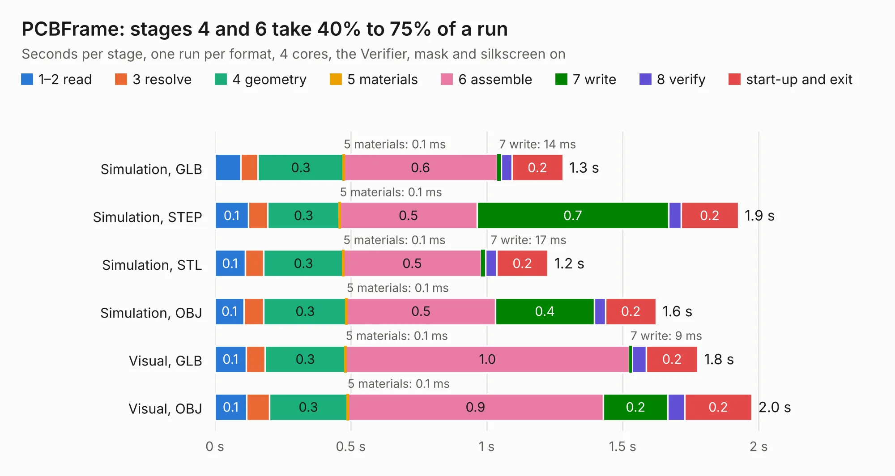

| Mode and format | 1–2 read | 3 resolve | 4 geometry | 5 materials | 6 assemble | 7 write | 8 verify | start-up and exit | Total |
|---|---:|---:|---:|---:|---:|---:|---:|---:|---:|
| Simulation, GLB | 96&nbsp;ms | 63&nbsp;ms | 0.3 | 0.1&nbsp;ms | 0.6 | 14&nbsp;ms | 40&nbsp;ms | 0.2 | 1.3 |
| Simulation, STEP | 0.1 | 70&nbsp;ms | 0.3 | 0.1&nbsp;ms | 0.5 | 0.7 | 46&nbsp;ms | 0.2 | 1.9 |
| Simulation, STL | 0.1 | 68&nbsp;ms | 0.3 | 0.1&nbsp;ms | 0.5 | 17&nbsp;ms | 41&nbsp;ms | 0.2 | 1.2 |
| Simulation, OBJ | 0.1 | 73&nbsp;ms | 0.3 | 0.1&nbsp;ms | 0.5 | 0.4 | 41&nbsp;ms | 0.2 | 1.6 |
| Visual, GLB | 0.1 | 69&nbsp;ms | 0.3 | 0.1&nbsp;ms | 1.0 | 9&nbsp;ms | 54&nbsp;ms | 0.2 | 1.8 |
| Visual, OBJ | 0.1 | 84&nbsp;ms | 0.3 | 0.1&nbsp;ms | 0.9 | 0.2 | 62&nbsp;ms | 0.2 | 2.0 |

<table align="center"><tr><td valign="top">

| Board | Repo: [GaudiLabs/OpenDrop](https://github.com/GaudiLabs/OpenDrop) Board: `PCBFrame.kicad_pcb` |
|---|---|
| Folder | OpenDropV3 / Carrier / PCBFrame |
| Complexity | 69&nbsp;/&nbsp;1000 (size&nbsp;39, features&nbsp;30) |
| KESE&nbsp;features | filled zones, curved board outline |
| Tested | 9th November 2026 |
| Copper&nbsp;layers | 2 |
| File&nbsp;format | KiCad 4 (4) |
| Parts,&nbsp;tracks,&nbsp;vias | 0, 3, 0 |
| Triangles,&nbsp;simulation | 69,738 in 12 parts |
| Note | no components |
| Verifier | PASS in all six runs |

</td><td valign="top">

<table>
<tr><th>File type</th><th>File size</th><th>Peak memory used</th></tr>
<tr><th colspan="3" align="left">Simulation</th></tr>
<tr><td>GLB</td><td align="right">2.5&nbsp;MB</td><td align="right">173&nbsp;MB</td></tr>
<tr><td>STEP</td><td align="right">16&nbsp;MB</td><td align="right">179&nbsp;MB</td></tr>
<tr><td>STL</td><td align="right">3.5&nbsp;MB</td><td align="right">175&nbsp;MB</td></tr>
<tr><td>OBJ</td><td align="right">6.8&nbsp;MB</td><td align="right">173&nbsp;MB</td></tr>
<tr><th colspan="3" align="left">Visual</th></tr>
<tr><td>GLB</td><td align="right">1.6&nbsp;MB</td><td align="right">156&nbsp;MB</td></tr>
<tr><td>OBJ</td><td align="right">4.3&nbsp;MB</td><td align="right">156&nbsp;MB</td></tr>
</table>

</td></tr></table>

## 1020. OpenDropV3

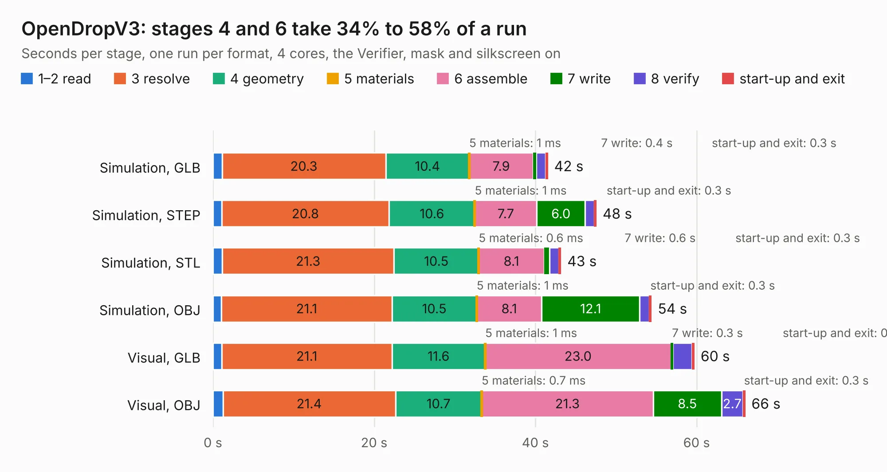

| Mode and format | 1–2 read | 3 resolve | 4 geometry | 5 materials | 6 assemble | 7 write | 8 verify | start-up and exit | Total |
|---|---:|---:|---:|---:|---:|---:|---:|---:|---:|
| Simulation, GLB | 1.1 | 20.3 | 10.4 | 1&nbsp;ms | 7.9 | 0.4 | 1.2 | 0.3 | 41.5 |
| Simulation, STEP | 1.1 | 20.8 | 10.6 | 1&nbsp;ms | 7.7 | 6.0 | 1.1 | 0.3 | 47.6 |
| Simulation, STL | 1.2 | 21.3 | 10.5 | 0.6&nbsp;ms | 8.1 | 0.6 | 1.2 | 0.3 | 43.2 |
| Simulation, OBJ | 1.1 | 21.1 | 10.5 | 1&nbsp;ms | 8.1 | 12.1 | 1.2 | 0.3 | 54.4 |
| Visual, GLB | 1.1 | 21.1 | 11.6 | 1&nbsp;ms | 23.0 | 0.3 | 2.4 | 0.3 | 59.7 |
| Visual, OBJ | 1.2 | 21.4 | 10.7 | 0.7&nbsp;ms | 21.3 | 8.5 | 2.7 | 0.3 | 66.0 |

<table align="center"><tr><td valign="top">

| Board | Repo: [GaudiLabs/OpenDrop](https://github.com/GaudiLabs/OpenDrop) Board: `OpenDropV3.kicad_pcb` |
|---|---|
| Folder | OpenDropV3 / Electronics / KiCad_Files |
| Complexity | 314&nbsp;/&nbsp;1000 (size&nbsp;259, features&nbsp;55) |
| KESE&nbsp;features | through vias, slotted holes, filled zones, curved board outline |
| Tested | 9th November 2026 |
| Copper&nbsp;layers | 2 |
| File&nbsp;format | KiCad 4 (4) |
| Parts,&nbsp;tracks,&nbsp;vias | 260, 2,641, 168 |
| Triangles,&nbsp;simulation | 2,229,422 in 287 parts |
| Verifier | PASS in all six runs |

</td><td valign="top">

<table>
<tr><th>File type</th><th>File size</th><th>Peak memory used</th></tr>
<tr><th colspan="3" align="left">Simulation</th></tr>
<tr><td>GLB</td><td align="right">80&nbsp;MB</td><td align="right">856&nbsp;MB</td></tr>
<tr><td>STEP</td><td align="right">434&nbsp;MB</td><td align="right">942&nbsp;MB</td></tr>
<tr><td>STL</td><td align="right">111&nbsp;MB</td><td align="right">809&nbsp;MB</td></tr>
<tr><td>OBJ</td><td align="right">242&nbsp;MB</td><td align="right">1.5&nbsp;GB</td></tr>
<tr><th colspan="3" align="left">Visual</th></tr>
<tr><td>GLB</td><td align="right">52&nbsp;MB</td><td align="right">988&nbsp;MB</td></tr>
<tr><td>OBJ</td><td align="right">160&nbsp;MB</td><td align="right">1.2&nbsp;GB</td></tr>
</table>

</td></tr></table>

## 1021. DIMMCartridgeConect

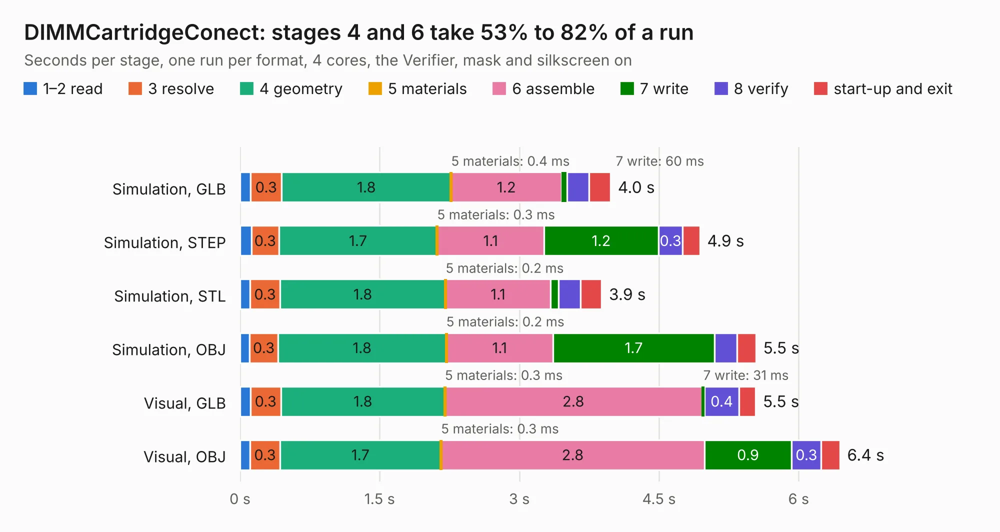

| Mode and format | 1–2 read | 3 resolve | 4 geometry | 5 materials | 6 assemble | 7 write | 8 verify | start-up and exit | Total |
|---|---:|---:|---:|---:|---:|---:|---:|---:|---:|
| Simulation, GLB | 0.1 | 0.3 | 1.8 | 0.4&nbsp;ms | 1.2 | 60&nbsp;ms | 0.2 | 0.2 | 4.0 |
| Simulation, STEP | 0.1 | 0.3 | 1.7 | 0.3&nbsp;ms | 1.1 | 1.2 | 0.3 | 0.2 | 4.9 |
| Simulation, STL | 0.1 | 0.3 | 1.8 | 0.2&nbsp;ms | 1.1 | 88&nbsp;ms | 0.2 | 0.2 | 3.9 |
| Simulation, OBJ | 0.1 | 0.3 | 1.8 | 0.2&nbsp;ms | 1.1 | 1.7 | 0.2 | 0.2 | 5.5 |
| Visual, GLB | 0.1 | 0.3 | 1.8 | 0.3&nbsp;ms | 2.8 | 31&nbsp;ms | 0.4 | 0.2 | 5.5 |
| Visual, OBJ | 0.1 | 0.3 | 1.7 | 0.3&nbsp;ms | 2.8 | 0.9 | 0.3 | 0.2 | 6.4 |

<table align="center"><tr><td valign="top">

| Board | Repo: [GaudiLabs/OpenDrop](https://github.com/GaudiLabs/OpenDrop) Board: `DIMMCartridgeConect.kicad_pcb` |
|---|---|
| Folder | OpenDropV4 / Electronics / Cartridge_Connector / DIMMCartridge_connector |
| Complexity | 194&nbsp;/&nbsp;1000 (size&nbsp;169, features&nbsp;25) |
| KESE&nbsp;features | through vias, curved board outline |
| Tested | 9th November 2026 |
| Copper&nbsp;layers | 2 |
| File&nbsp;format | KiCad 5 (20171130) |
| Parts,&nbsp;tracks,&nbsp;vias | 3, 364, 2 |
| Triangles,&nbsp;simulation | 419,974 in 48 parts |
| Verifier | PASS in all six runs |

</td><td valign="top">

<table>
<tr><th>File type</th><th>File size</th><th>Peak memory used</th></tr>
<tr><th colspan="3" align="left">Simulation</th></tr>
<tr><td>GLB</td><td align="right">15&nbsp;MB</td><td align="right">287&nbsp;MB</td></tr>
<tr><td>STEP</td><td align="right">69&nbsp;MB</td><td align="right">302&nbsp;MB</td></tr>
<tr><td>STL</td><td align="right">21&nbsp;MB</td><td align="right">287&nbsp;MB</td></tr>
<tr><td>OBJ</td><td align="right">43&nbsp;MB</td><td align="right">330&nbsp;MB</td></tr>
<tr><th colspan="3" align="left">Visual</th></tr>
<tr><td>GLB</td><td align="right">8.1&nbsp;MB</td><td align="right">290&nbsp;MB</td></tr>
<tr><td>OBJ</td><td align="right">24&nbsp;MB</td><td align="right">295&nbsp;MB</td></tr>
</table>

</td></tr></table>

## 1022. DIMMCartridgeV4

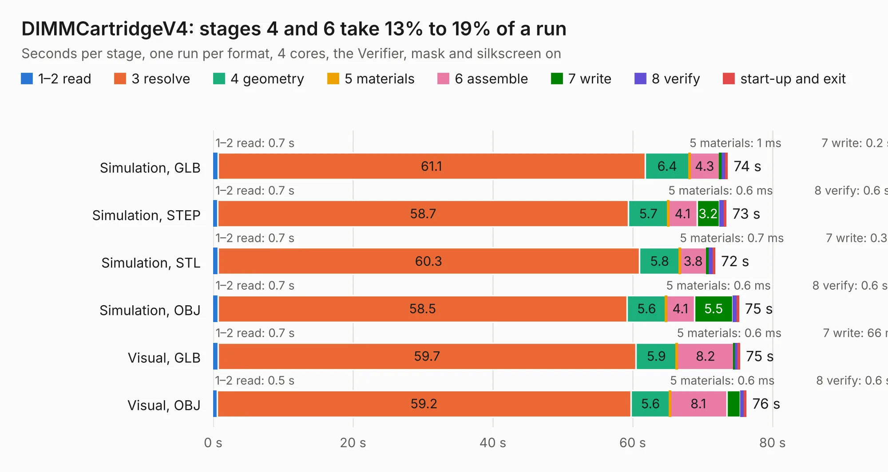

| Mode and format | 1–2 read | 3 resolve | 4 geometry | 5 materials | 6 assemble | 7 write | 8 verify | start-up and exit | Total |
|---|---:|---:|---:|---:|---:|---:|---:|---:|---:|
| Simulation, GLB | 0.7 | 61.1 | 6.4 | 1&nbsp;ms | 4.3 | 0.2 | 0.7 | 0.2 | 73.5 |
| Simulation, STEP | 0.7 | 58.7 | 5.7 | 0.6&nbsp;ms | 4.1 | 3.2 | 0.6 | 0.3 | 73.3 |
| Simulation, STL | 0.7 | 60.3 | 5.8 | 0.7&nbsp;ms | 3.8 | 0.3 | 0.6 | 0.3 | 71.7 |
| Simulation, OBJ | 0.7 | 58.5 | 5.6 | 0.6&nbsp;ms | 4.1 | 5.5 | 0.6 | 0.2 | 75.1 |
| Visual, GLB | 0.7 | 59.7 | 5.9 | 0.6&nbsp;ms | 8.2 | 66&nbsp;ms | 0.5 | 0.2 | 75.3 |
| Visual, OBJ | 0.5 | 59.2 | 5.6 | 0.6&nbsp;ms | 8.1 | 1.9 | 0.6 | 0.2 | 76.2 |

<table align="center"><tr><td valign="top">

| Board | Repo: [GaudiLabs/OpenDrop](https://github.com/GaudiLabs/OpenDrop) Board: `DIMMCartridgeV4.kicad_pcb` |
|---|---|
| Folder | OpenDropV4 / Electronics / CartridgeV4 / DIMMCartridgeV4 |
| Complexity | 244&nbsp;/&nbsp;1000 (size&nbsp;219, features&nbsp;25) |
| KESE&nbsp;features | through vias, curved board outline |
| Tested | 9th November 2026 |
| Copper&nbsp;layers | 2 |
| File&nbsp;format | KiCad 5 (20171130) |
| Parts,&nbsp;tracks,&nbsp;vias | 133, 781, 6 |
| Triangles,&nbsp;simulation | 1,208,380 in 142 parts |
| Verifier | PASS in all six runs |

</td><td valign="top">

<table>
<tr><th>File type</th><th>File size</th><th>Peak memory used</th></tr>
<tr><th colspan="3" align="left">Simulation</th></tr>
<tr><td>GLB</td><td align="right">43&nbsp;MB</td><td align="right">525&nbsp;MB</td></tr>
<tr><td>STEP</td><td align="right">242&nbsp;MB</td><td align="right">659&nbsp;MB</td></tr>
<tr><td>STL</td><td align="right">60&nbsp;MB</td><td align="right">531&nbsp;MB</td></tr>
<tr><td>OBJ</td><td align="right">131&nbsp;MB</td><td align="right">872&nbsp;MB</td></tr>
<tr><th colspan="3" align="left">Visual</th></tr>
<tr><td>GLB</td><td align="right">17&nbsp;MB</td><td align="right">548&nbsp;MB</td></tr>
<tr><td>OBJ</td><td align="right">50&nbsp;MB</td><td align="right">523&nbsp;MB</td></tr>
</table>

</td></tr></table>

## 1023. DIMMTop

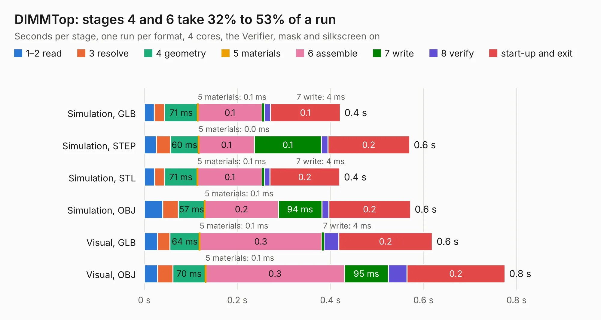

| Mode and format | 1–2 read | 3 resolve | 4 geometry | 5 materials | 6 assemble | 7 write | 8 verify | start-up and exit | Total |
|---|---:|---:|---:|---:|---:|---:|---:|---:|---:|
| Simulation, GLB | 21&nbsp;ms | 22&nbsp;ms | 71&nbsp;ms | 0.1&nbsp;ms | 0.1 | 4&nbsp;ms | 14&nbsp;ms | 0.1 | 0.4 |
| Simulation, STEP | 26&nbsp;ms | 30&nbsp;ms | 60&nbsp;ms | 0.0&nbsp;ms | 0.1 | 0.1 | 14&nbsp;ms | 0.2 | 0.6 |
| Simulation, STL | 22&nbsp;ms | 21&nbsp;ms | 71&nbsp;ms | 0.1&nbsp;ms | 0.1 | 4&nbsp;ms | 12&nbsp;ms | 0.2 | 0.4 |
| Simulation, OBJ | 39&nbsp;ms | 34&nbsp;ms | 57&nbsp;ms | 0.1&nbsp;ms | 0.2 | 94&nbsp;ms | 15&nbsp;ms | 0.2 | 0.6 |
| Visual, GLB | 28&nbsp;ms | 27&nbsp;ms | 64&nbsp;ms | 0.1&nbsp;ms | 0.3 | 4&nbsp;ms | 32&nbsp;ms | 0.2 | 0.6 |
| Visual, OBJ | 28&nbsp;ms | 33&nbsp;ms | 70&nbsp;ms | 0.1&nbsp;ms | 0.3 | 95&nbsp;ms | 40&nbsp;ms | 0.2 | 0.8 |

<table align="center"><tr><td valign="top">

| Board | Repo: [GaudiLabs/OpenDrop](https://github.com/GaudiLabs/OpenDrop) Board: `DIMMTop.kicad_pcb` |
|---|---|
| Folder | OpenDropV4 / Electronics / CartridgeV4 / DIMMTop |
| Complexity | 17&nbsp;/&nbsp;1000 (size&nbsp;17, features&nbsp;0) |
| Tested | 9th November 2026 |
| Copper&nbsp;layers | 2 |
| File&nbsp;format | KiCad 5 (20171130) |
| Parts,&nbsp;tracks,&nbsp;vias | 0, 0, 0 |
| Triangles,&nbsp;simulation | 19,290 in 7 parts |
| Note | no components |
| Verifier | PASS in all six runs |

</td><td valign="top">

<table>
<tr><th>File type</th><th>File size</th><th>Peak memory used</th></tr>
<tr><th colspan="3" align="left">Simulation</th></tr>
<tr><td>GLB</td><td align="right">705&nbsp;kB</td><td align="right">43&nbsp;MB</td></tr>
<tr><td>STEP</td><td align="right">5.3&nbsp;MB</td><td align="right">46&nbsp;MB</td></tr>
<tr><td>STL</td><td align="right">965&nbsp;kB</td><td align="right">43&nbsp;MB</td></tr>
<tr><td>OBJ</td><td align="right">1.9&nbsp;MB</td><td align="right">46&nbsp;MB</td></tr>
<tr><th colspan="3" align="left">Visual</th></tr>
<tr><td>GLB</td><td align="right">615&nbsp;kB</td><td align="right">54&nbsp;MB</td></tr>
<tr><td>OBJ</td><td align="right">1.6&nbsp;MB</td><td align="right">58&nbsp;MB</td></tr>
</table>

</td></tr></table>

## 1024. DIMMCartridge_heaters

| Mode and format | 1–2 read | 3 resolve | 4 geometry | 5 materials | 6 assemble | 7 write | 8 verify | start-up and exit | Total |
|---|---:|---:|---:|---:|---:|---:|---:|---:|---:|
| Simulation, GLB | 0.8 | 58.7 | 7.5 | 0.5&nbsp;ms | 6.3 | 0.3 | 1.0 | 0.2 | 74.8 |
| Simulation, STEP | 0.9 | 59.3 | 7.8 | 1&nbsp;ms | 5.7 | 4.1 | 0.9 | 0.3 | 79.1 |
| Simulation, STL | 0.8 | 56.8 | 8.3 | 0.5&nbsp;ms | 5.3 | 0.4 | 0.9 | 0.3 | 72.7 |
| Simulation, OBJ | 0.8 | 56.2 | 7.2 | 1&nbsp;ms | 5.5 | 7.9 | 0.8 | 0.3 | 78.8 |
| Visual, GLB | 0.8 | 56.2 | 7.1 | 0.6&nbsp;ms | 11.4 | 0.1 | 0.8 | 0.2 | 76.6 |
| Visual, OBJ | 0.8 | 55.3 | 7.3 | 0.7&nbsp;ms | 11.6 | 3.4 | 1.1 | 0.2 | 79.5 |

<table align="center"><tr><td valign="top">

| Board | Repo: [GaudiLabs/OpenDrop](https://github.com/GaudiLabs/OpenDrop) Board: `DIMMCartridge_heaters.kicad_pcb` |
|---|---|
| Folder | OpenDropV4 / Electronics / DIMMCartridge_heaters |
| Complexity | 296&nbsp;/&nbsp;1000 (size&nbsp;231, features&nbsp;65) |
| KESE&nbsp;features | through vias, rounded, trapezoid or chamfered pads, curved board outline, stack-up, dielectric εr and tanδ |
| Tested | 9th November 2026 |
| Copper&nbsp;layers | 2 |
| File&nbsp;format | KiCad 6 (20211014) |
| Parts,&nbsp;tracks,&nbsp;vias | 142, 1,400, 41 |
| Triangles,&nbsp;simulation | 1,375,622 in 248 parts |
| Verifier | PASS in all six runs |

</td><td valign="top">

<table>
<tr><th>File type</th><th>File size</th><th>Peak memory used</th></tr>
<tr><th colspan="3" align="left">Simulation</th></tr>
<tr><td>GLB</td><td align="right">49&nbsp;MB</td><td align="right">538&nbsp;MB</td></tr>
<tr><td>STEP</td><td align="right">272&nbsp;MB</td><td align="right">699&nbsp;MB</td></tr>
<tr><td>STL</td><td align="right">69&nbsp;MB</td><td align="right">530&nbsp;MB</td></tr>
<tr><td>OBJ</td><td align="right">149&nbsp;MB</td><td align="right">1.0&nbsp;GB</td></tr>
<tr><th colspan="3" align="left">Visual</th></tr>
<tr><td>GLB</td><td align="right">23&nbsp;MB</td><td align="right">619&nbsp;MB</td></tr>
<tr><td>OBJ</td><td align="right">68&nbsp;MB</td><td align="right">608&nbsp;MB</td></tr>
</table>

</td></tr></table>

## 1025. ModulAdapterBasic

| Mode and format | 1–2 read | 3 resolve | 4 geometry | 5 materials | 6 assemble | 7 write | 8 verify | start-up and exit | Total |
|---|---:|---:|---:|---:|---:|---:|---:|---:|---:|
| Simulation, GLB | 0.5 | 1.1 | 3.7 | 0.9&nbsp;ms | 5.2 | 0.2 | 0.5 | 0.2 | 11.5 |
| Simulation, STEP | 0.4 | 1.1 | 3.5 | 1&nbsp;ms | 5.3 | 4.0 | 0.6 | 0.3 | 15.2 |
| Simulation, STL | 0.4 | 1.1 | 3.6 | 1&nbsp;ms | 5.1 | 0.3 | 0.6 | 0.3 | 11.5 |
| Simulation, OBJ | 0.4 | 1.1 | 3.6 | 2&nbsp;ms | 5.1 | 4.9 | 0.6 | 0.2 | 16.0 |
| Visual, GLB | 0.4 | 1.1 | 3.5 | 1.0&nbsp;ms | 12.8 | 0.2 | 1.3 | 0.3 | 19.5 |
| Visual, OBJ | 0.5 | 1.2 | 3.6 | 0.9&nbsp;ms | 13.1 | 4.7 | 1.3 | 0.3 | 24.6 |

<table align="center"><tr><td valign="top">

| Board | Repo: [GaudiLabs/OpenDrop](https://github.com/GaudiLabs/OpenDrop) Board: `ModulAdapterBasic.kicad_pcb` |
|---|---|
| Folder | OpenDropV4 / Electronics / ModulAdapter_basic / PCB |
| Complexity | 333&nbsp;/&nbsp;1000 (size&nbsp;248, features&nbsp;85) |
| KESE&nbsp;features | through vias, rounded, trapezoid or chamfered pads, filled zones, curved board outline, stack-up, dielectric εr and tanδ |
| Tested | 9th November 2026 |
| Copper&nbsp;layers | 2 |
| File&nbsp;format | KiCad 6 (20211014) |
| Parts,&nbsp;tracks,&nbsp;vias | 138, 1,749, 195 |
| Triangles,&nbsp;simulation | 1,100,508 in 404 parts |
| Verifier | PASS in all six runs |

</td><td valign="top">

<table>
<tr><th>File type</th><th>File size</th><th>Peak memory used</th></tr>
<tr><th colspan="3" align="left">Simulation</th></tr>
<tr><td>GLB</td><td align="right">37&nbsp;MB</td><td align="right">576&nbsp;MB</td></tr>
<tr><td>STEP</td><td align="right">195&nbsp;MB</td><td align="right">652&nbsp;MB</td></tr>
<tr><td>STL</td><td align="right">55&nbsp;MB</td><td align="right">546&nbsp;MB</td></tr>
<tr><td>OBJ</td><td align="right">112&nbsp;MB</td><td align="right">765&nbsp;MB</td></tr>
<tr><th colspan="3" align="left">Visual</th></tr>
<tr><td>GLB</td><td align="right">34&nbsp;MB</td><td align="right">707&nbsp;MB</td></tr>
<tr><td>OBJ</td><td align="right">104&nbsp;MB</td><td align="right">876&nbsp;MB</td></tr>
</table>

</td></tr></table>

## 1026. ModulAdapterMagnet

| Mode and format | 1–2 read | 3 resolve | 4 geometry | 5 materials | 6 assemble | 7 write | 8 verify | start-up and exit | Total |
|---|---:|---:|---:|---:|---:|---:|---:|---:|---:|
| Simulation, GLB | 0.2 | 1.0 | 2.6 | 0.7&nbsp;ms | 4.2 | 0.1 | 0.4 | 0.2 | 8.8 |
| Simulation, STEP | 0.3 | 0.9 | 2.5 | 0.6&nbsp;ms | 4.1 | 2.6 | 0.4 | 0.2 | 10.9 |
| Simulation, STL | 0.2 | 0.9 | 2.6 | 0.6&nbsp;ms | 4.3 | 0.2 | 0.4 | 0.2 | 9.0 |
| Simulation, OBJ | 0.3 | 1.0 | 2.6 | 0.6&nbsp;ms | 4.1 | 3.7 | 0.4 | 0.2 | 12.2 |
| Visual, GLB | 0.3 | 1.0 | 2.4 | 0.6&nbsp;ms | 9.0 | 0.2 | 0.9 | 0.3 | 14.0 |
| Visual, OBJ | 0.3 | 1.0 | 2.7 | 0.9&nbsp;ms | 9.0 | 3.7 | 1.3 | 0.2 | 18.1 |

<table align="center"><tr><td valign="top">

| Board | Repo: [GaudiLabs/OpenDrop](https://github.com/GaudiLabs/OpenDrop) Board: `ModulAdapterMagnet.kicad_pcb` |
|---|---|
| Folder | OpenDropV4 / Electronics / ModulAdapter_Magnet / PCB |
| Complexity | 285&nbsp;/&nbsp;1000 (size&nbsp;230, features&nbsp;55) |
| KESE&nbsp;features | through vias, rounded, trapezoid or chamfered pads, filled zones, curved board outline |
| Tested | 9th November 2026 |
| Copper&nbsp;layers | 2 |
| File&nbsp;format | KiCad 5 (20171130) |
| Parts,&nbsp;tracks,&nbsp;vias | 25, 1,746, 207 |
| Triangles,&nbsp;simulation | 876,500 in 175 parts |
| Verifier | PASS in all six runs |

</td><td valign="top">

<table>
<tr><th>File type</th><th>File size</th><th>Peak memory used</th></tr>
<tr><th colspan="3" align="left">Simulation</th></tr>
<tr><td>GLB</td><td align="right">30&nbsp;MB</td><td align="right">481&nbsp;MB</td></tr>
<tr><td>STEP</td><td align="right">152&nbsp;MB</td><td align="right">542&nbsp;MB</td></tr>
<tr><td>STL</td><td align="right">44&nbsp;MB</td><td align="right">477&nbsp;MB</td></tr>
<tr><td>OBJ</td><td align="right">90&nbsp;MB</td><td align="right">634&nbsp;MB</td></tr>
<tr><th colspan="3" align="left">Visual</th></tr>
<tr><td>GLB</td><td align="right">28&nbsp;MB</td><td align="right">715&nbsp;MB</td></tr>
<tr><td>OBJ</td><td align="right">87&nbsp;MB</td><td align="right">724&nbsp;MB</td></tr>
</table>

</td></tr></table>

## 1027. ModulAdapter_universal

| Mode and format | 1–2 read | 3 resolve | 4 geometry | 5 materials | 6 assemble | 7 write | 8 verify | start-up and exit | Total |
|---|---:|---:|---:|---:|---:|---:|---:|---:|---:|
| Simulation, GLB | 0.3 | 1.4 | 3.9 | 0.7&nbsp;ms | 6.1 | 0.2 | 0.6 | 0.3 | 12.9 |
| Simulation, STEP | 0.4 | 1.5 | 4.0 | 0.7&nbsp;ms | 6.1 | 3.9 | 0.7 | 0.2 | 16.7 |
| Simulation, STL | 0.4 | 1.3 | 4.0 | 1.0&nbsp;ms | 6.2 | 0.3 | 0.6 | 0.3 | 13.2 |
| Simulation, OBJ | 0.4 | 1.4 | 3.9 | 0.7&nbsp;ms | 6.0 | 5.4 | 0.7 | 0.3 | 18.1 |
| Visual, GLB | 0.3 | 1.4 | 4.1 | 1.0&nbsp;ms | 13.3 | 0.2 | 1.3 | 0.2 | 20.8 |
| Visual, OBJ | 0.4 | 1.4 | 3.9 | 0.8&nbsp;ms | 13.2 | 5.9 | 1.4 | 0.2 | 26.5 |

<table align="center"><tr><td valign="top">

| Board | Repo: [GaudiLabs/OpenDrop](https://github.com/GaudiLabs/OpenDrop) Board: `ModulAdapter_universal.kicad_pcb` |
|---|---|
| Folder | OpenDropV4 / Electronics / ModulAdapter_universal / PCB |
| Complexity | 299&nbsp;/&nbsp;1000 (size&nbsp;244, features&nbsp;55) |
| KESE&nbsp;features | through vias, rounded, trapezoid or chamfered pads, filled zones, curved board outline |
| Tested | 9th November 2026 |
| Copper&nbsp;layers | 2 |
| File&nbsp;format | KiCad 5 (20171130) |
| Parts,&nbsp;tracks,&nbsp;vias | 43, 2,459, 269 |
| Triangles,&nbsp;simulation | 1,149,118 in 188 parts |
| Verifier | PASS in all six runs |

</td><td valign="top">

<table>
<tr><th>File type</th><th>File size</th><th>Peak memory used</th></tr>
<tr><th colspan="3" align="left">Simulation</th></tr>
<tr><td>GLB</td><td align="right">40&nbsp;MB</td><td align="right">655&nbsp;MB</td></tr>
<tr><td>STEP</td><td align="right">200&nbsp;MB</td><td align="right">656&nbsp;MB</td></tr>
<tr><td>STL</td><td align="right">57&nbsp;MB</td><td align="right">648&nbsp;MB</td></tr>
<tr><td>OBJ</td><td align="right">118&nbsp;MB</td><td align="right">811&nbsp;MB</td></tr>
<tr><th colspan="3" align="left">Visual</th></tr>
<tr><td>GLB</td><td align="right">37&nbsp;MB</td><td align="right">939&nbsp;MB</td></tr>
<tr><td>OBJ</td><td align="right">114&nbsp;MB</td><td align="right">844&nbsp;MB</td></tr>
</table>

</td></tr></table>

## 1028. OpenDropV4

| Mode and format | 1–2 read | 3 resolve | 4 geometry | 5 materials | 6 assemble | 7 write | 8 verify | start-up and exit | Total |
|---|---:|---:|---:|---:|---:|---:|---:|---:|---:|
| Simulation, GLB | 0.4 | 1.5 | 5.0 | 0.8&nbsp;ms | 4.5 | 0.2 | 0.6 | 0.2 | 12.4 |
| Simulation, STEP | 0.5 | 1.6 | 4.6 | 0.4&nbsp;ms | 4.7 | 3.7 | 0.6 | 0.2 | 15.9 |
| Simulation, STL | 0.5 | 1.6 | 4.7 | 0.7&nbsp;ms | 4.5 | 0.3 | 0.6 | 0.3 | 12.6 |
| Simulation, OBJ | 0.5 | 1.6 | 4.8 | 0.8&nbsp;ms | 4.6 | 6.1 | 0.6 | 0.3 | 18.6 |
| Visual, GLB | 0.5 | 1.8 | 4.7 | 0.3&nbsp;ms | 12.6 | 0.2 | 1.5 | 0.2 | 21.5 |
| Visual, OBJ | 0.5 | 1.6 | 5.0 | 0.5&nbsp;ms | 12.4 | 5.9 | 1.7 | 0.3 | 27.4 |

<table align="center"><tr><td valign="top">

| Board | Repo: [GaudiLabs/OpenDrop](https://github.com/GaudiLabs/OpenDrop) Board: `OpenDropV4.kicad_pcb` |
|---|---|
| Folder | OpenDropV4 / Electronics / OpenDropV4_MainBoard / PCB |
| Complexity | 303&nbsp;/&nbsp;1000 (size&nbsp;238, features&nbsp;65) |
| KESE&nbsp;features | through vias, slotted holes, rounded, trapezoid or chamfered pads, filled zones, curved board outline |
| Tested | 9th November 2026 |
| Copper&nbsp;layers | 2 |
| File&nbsp;format | KiCad 5 (20171130) |
| Parts,&nbsp;tracks,&nbsp;vias | 114, 2,175, 197 |
| Triangles,&nbsp;simulation | 1,200,262 in 117 parts |
| Verifier | PASS in all six runs |

</td><td valign="top">

<table>
<tr><th>File type</th><th>File size</th><th>Peak memory used</th></tr>
<tr><th colspan="3" align="left">Simulation</th></tr>
<tr><td>GLB</td><td align="right">42&nbsp;MB</td><td align="right">645&nbsp;MB</td></tr>
<tr><td>STEP</td><td align="right">222&nbsp;MB</td><td align="right">670&nbsp;MB</td></tr>
<tr><td>STL</td><td align="right">60&nbsp;MB</td><td align="right">665&nbsp;MB</td></tr>
<tr><td>OBJ</td><td align="right">125&nbsp;MB</td><td align="right">838&nbsp;MB</td></tr>
<tr><th colspan="3" align="left">Visual</th></tr>
<tr><td>GLB</td><td align="right">39&nbsp;MB</td><td align="right">798&nbsp;MB</td></tr>
<tr><td>OBJ</td><td align="right">117&nbsp;MB</td><td align="right">858&nbsp;MB</td></tr>
</table>

</td></tr></table>

## 1029. OpenFrame

| Mode and format | 1–2 read | 3 resolve | 4 geometry | 5 materials | 6 assemble | 7 write | 8 verify | start-up and exit | Total |
|---|---:|---:|---:|---:|---:|---:|---:|---:|---:|
| Simulation, GLB | 95&nbsp;ms | 56&nbsp;ms | 0.1 | 0.1&nbsp;ms | 0.5 | 6&nbsp;ms | 21&nbsp;ms | 0.2 | 1.0 |
| Simulation, STEP | 92&nbsp;ms | 53&nbsp;ms | 0.1 | 0.1&nbsp;ms | 0.5 | 0.3 | 23&nbsp;ms | 0.2 | 1.3 |
| Simulation, STL | 89&nbsp;ms | 50&nbsp;ms | 0.1 | 0.1&nbsp;ms | 0.5 | 8&nbsp;ms | 24&nbsp;ms | 0.2 | 1.0 |
| Simulation, OBJ | 94&nbsp;ms | 54&nbsp;ms | 0.2 | 0.1&nbsp;ms | 0.5 | 0.2 | 26&nbsp;ms | 0.2 | 1.2 |
| Visual, GLB | 93&nbsp;ms | 54&nbsp;ms | 0.1 | 0.1&nbsp;ms | 0.4 | 5&nbsp;ms | 28&nbsp;ms | 0.2 | 0.9 |
| Visual, OBJ | 88&nbsp;ms | 51&nbsp;ms | 0.1 | 0.1&nbsp;ms | 0.4 | 0.1 | 27&nbsp;ms | 0.2 | 1.0 |

<table align="center"><tr><td valign="top">

| Board | Repo: [GaudiLabs/OpenDrop](https://github.com/GaudiLabs/OpenDrop) Board: `OpenFrame.kicad_pcb` |
|---|---|
| Folder | OpenDropV4 / Electronics / OpenFrame |
| Complexity | 84&nbsp;/&nbsp;1000 (size&nbsp;49, features&nbsp;35) |
| KESE&nbsp;features | through vias, filled zones |
| Tested | 9th November 2026 |
| Copper&nbsp;layers | 2 |
| File&nbsp;format | KiCad 5 (20171130) |
| Parts,&nbsp;tracks,&nbsp;vias | 0, 3, 1 |
| Triangles,&nbsp;simulation | 32,040 in 12 parts |
| Note | no components |
| Verifier | PASS in all six runs |

</td><td valign="top">

<table>
<tr><th>File type</th><th>File size</th><th>Peak memory used</th></tr>
<tr><th colspan="3" align="left">Simulation</th></tr>
<tr><td>GLB</td><td align="right">1.1&nbsp;MB</td><td align="right">66&nbsp;MB</td></tr>
<tr><td>STEP</td><td align="right">8.8&nbsp;MB</td><td align="right">71&nbsp;MB</td></tr>
<tr><td>STL</td><td align="right">1.6&nbsp;MB</td><td align="right">67&nbsp;MB</td></tr>
<tr><td>OBJ</td><td align="right">3.1&nbsp;MB</td><td align="right">73&nbsp;MB</td></tr>
<tr><th colspan="3" align="left">Visual</th></tr>
<tr><td>GLB</td><td align="right">721&nbsp;kB</td><td align="right">87&nbsp;MB</td></tr>
<tr><td>OBJ</td><td align="right">1.9&nbsp;MB</td><td align="right">76&nbsp;MB</td></tr>
</table>

</td></tr></table>

## 1030. gd rp2040 keyboard proto pcb

| Mode and format | 1–2 read | 3 resolve | 4 geometry | 5 materials | 6 assemble | 7 write | 8 verify | start-up and exit | Total |
|---|---:|---:|---:|---:|---:|---:|---:|---:|---:|
| Simulation, GLB | 0.4 | 2.4 | 12.3 | 0.4&nbsp;ms | 9.3 | 0.4 | 1.2 | 0.3 | 26.3 |
| Simulation, STEP | 0.5 | 2.3 | 11.9 | 0.5&nbsp;ms | 8.8 | 6.4 | 1.2 | 0.3 | 31.5 |
| Simulation, STL | 0.5 | 2.2 | 11.6 | 0.6&nbsp;ms | 9.1 | 0.8 | 1.2 | 0.3 | 25.7 |
| Simulation, OBJ | 0.5 | 2.3 | 11.7 | 0.5&nbsp;ms | 8.8 | 11.5 | 1.2 | 0.3 | 36.3 |
| Visual, GLB | 0.5 | 2.3 | 11.8 | 0.4&nbsp;ms | 19.6 | 0.2 | 2.0 | 0.3 | 36.7 |
| Visual, OBJ | 0.4 | 2.3 | 11.4 | 0.4&nbsp;ms | 19.7 | 7.5 | 2.3 | 0.2 | 43.9 |

<table align="center"><tr><td valign="top">

| Board | Repo: [geekbozu/Golden-Delicious](https://github.com/geekbozu/Golden-Delicious) Board: `gd rp2040 keyboard proto pcb.kicad_pcb` |
|---|---|
| Folder | kicad files / gd rp2040 keyboard proto pcb / kicad |
| Complexity | 278&nbsp;/&nbsp;1000 (size&nbsp;213, features&nbsp;65) |
| KESE&nbsp;features | through vias, slotted holes, rounded, trapezoid or chamfered pads, filled zones, curved board outline |
| Tested | 9th November 2026 |
| Copper&nbsp;layers | 2 |
| File&nbsp;format | KiCad 5 (20171130) |
| Parts,&nbsp;tracks,&nbsp;vias | 60, 645, 97 |
| Triangles,&nbsp;simulation | 2,321,572 in 111 parts |
| Verifier | PASS in all six runs |

</td><td valign="top">

<table>
<tr><th>File type</th><th>File size</th><th>Peak memory used</th></tr>
<tr><th colspan="3" align="left">Simulation</th></tr>
<tr><td>GLB</td><td align="right">80&nbsp;MB</td><td align="right">854&nbsp;MB</td></tr>
<tr><td>STEP</td><td align="right">405&nbsp;MB</td><td align="right">984&nbsp;MB</td></tr>
<tr><td>STL</td><td align="right">116&nbsp;MB</td><td align="right">805&nbsp;MB</td></tr>
<tr><td>OBJ</td><td align="right">246&nbsp;MB</td><td align="right">1.6&nbsp;GB</td></tr>
<tr><th colspan="3" align="left">Visual</th></tr>
<tr><td>GLB</td><td align="right">52&nbsp;MB</td><td align="right">1.0&nbsp;GB</td></tr>
<tr><td>OBJ</td><td align="right">159&nbsp;MB</td><td align="right">1.1&nbsp;GB</td></tr>
</table>

</td></tr></table>

## 1031. DRV-StepStick

| Mode and format | 1–2 read | 3 resolve | 4 geometry | 5 materials | 6 assemble | 7 write | 8 verify | start-up and exit | Total |
|---|---:|---:|---:|---:|---:|---:|---:|---:|---:|
| Simulation, GLB | 0.1 | 0.4 | 1.4 | 0.4&nbsp;ms | 1.2 | 82&nbsp;ms | 0.2 | 0.3 | 3.7 |
| Simulation, STEP | 0.2 | 0.3 | 1.3 | 0.3&nbsp;ms | 1.2 | 1.3 | 0.2 | 0.2 | 4.8 |
| Simulation, STL | 0.2 | 0.4 | 1.3 | 0.3&nbsp;ms | 1.2 | 97&nbsp;ms | 0.2 | 0.2 | 3.6 |
| Simulation, OBJ | 0.2 | 0.4 | 1.3 | 0.3&nbsp;ms | 1.3 | 1.8 | 0.2 | 0.2 | 5.4 |
| Visual, GLB | 0.2 | 0.4 | 1.3 | 0.3&nbsp;ms | 3.2 | 46&nbsp;ms | 0.3 | 0.2 | 5.7 |
| Visual, OBJ | 0.2 | 0.3 | 1.3 | 0.3&nbsp;ms | 3.1 | 1.4 | 0.3 | 0.2 | 6.8 |

<table align="center"><tr><td valign="top">

| Board | Repo: [ghent360/prntrboardv2](https://github.com/ghent360/prntrboardv2) Board: `DRV-StepStick.kicad_pcb` |
|---|---|
| Folder | hardware |
| Complexity | 237&nbsp;/&nbsp;1000 (size&nbsp;147, features&nbsp;90) |
| KESE&nbsp;features | through vias, rounded, trapezoid or chamfered pads, filled zones, curved board outline, stack-up, dielectric εr and tanδ, mask and silkscreen colours |
| Tested | 9th November 2026 |
| Copper&nbsp;layers | 2 |
| File&nbsp;format | KiCad 6 (20210108) |
| Parts,&nbsp;tracks,&nbsp;vias | 18, 238, 55 |
| Triangles,&nbsp;simulation | 388,600 in 36 parts |
| Verifier | PASS in all six runs |

</td><td valign="top">

<table>
<tr><th>File type</th><th>File size</th><th>Peak memory used</th></tr>
<tr><th colspan="3" align="left">Simulation</th></tr>
<tr><td>GLB</td><td align="right">13&nbsp;MB</td><td align="right">289&nbsp;MB</td></tr>
<tr><td>STEP</td><td align="right">59&nbsp;MB</td><td align="right">300&nbsp;MB</td></tr>
<tr><td>STL</td><td align="right">19&nbsp;MB</td><td align="right">272&nbsp;MB</td></tr>
<tr><td>OBJ</td><td align="right">39&nbsp;MB</td><td align="right">304&nbsp;MB</td></tr>
<tr><th colspan="3" align="left">Visual</th></tr>
<tr><td>GLB</td><td align="right">9.9&nbsp;MB</td><td align="right">308&nbsp;MB</td></tr>
<tr><td>OBJ</td><td align="right">29&nbsp;MB</td><td align="right">300&nbsp;MB</td></tr>
</table>

</td></tr></table>

## 1032. LcdFlip

| Mode and format | 1–2 read | 3 resolve | 4 geometry | 5 materials | 6 assemble | 7 write | 8 verify | start-up and exit | Total |
|---|---:|---:|---:|---:|---:|---:|---:|---:|---:|
| Simulation, GLB | 81&nbsp;ms | 0.2 | 0.7 | 0.2&nbsp;ms | 0.8 | 31&nbsp;ms | 97&nbsp;ms | 0.2 | 2.1 |
| Simulation, STEP | 76&nbsp;ms | 0.2 | 0.7 | 0.2&nbsp;ms | 0.9 | 1.0 | 0.1 | 0.2 | 3.2 |
| Simulation, STL | 84&nbsp;ms | 0.2 | 0.8 | 0.2&nbsp;ms | 0.8 | 65&nbsp;ms | 0.1 | 0.2 | 2.2 |
| Simulation, OBJ | 0.1 | 0.2 | 0.8 | 0.2&nbsp;ms | 0.7 | 0.7 | 0.1 | 0.2 | 2.9 |
| Visual, GLB | 84&nbsp;ms | 0.2 | 0.7 | 0.2&nbsp;ms | 1.7 | 17&nbsp;ms | 0.1 | 0.2 | 3.0 |
| Visual, OBJ | 87&nbsp;ms | 0.2 | 0.8 | 0.2&nbsp;ms | 1.6 | 0.4 | 84&nbsp;ms | 0.2 | 3.4 |

<table align="center"><tr><td valign="top">

| Board | Repo: [ghent360/prntrboardv2](https://github.com/ghent360/prntrboardv2) Board: `LcdFlip.kicad_pcb` |
|---|---|
| Folder | hardware |
| Complexity | 141&nbsp;/&nbsp;1000 (size&nbsp;106, features&nbsp;35) |
| KESE&nbsp;features | stack-up, dielectric εr and tanδ, mask and silkscreen colours |
| Tested | 9th November 2026 |
| Copper&nbsp;layers | 2 |
| File&nbsp;format | KiCad 6 (20210108) |
| Parts,&nbsp;tracks,&nbsp;vias | 4, 81, 0 |
| Triangles,&nbsp;simulation | 186,074 in 31 parts |
| Verifier | PASS in all six runs |

</td><td valign="top">

<table>
<tr><th>File type</th><th>File size</th><th>Peak memory used</th></tr>
<tr><th colspan="3" align="left">Simulation</th></tr>
<tr><td>GLB</td><td align="right">5.9&nbsp;MB</td><td align="right">196&nbsp;MB</td></tr>
<tr><td>STEP</td><td align="right">23&nbsp;MB</td><td align="right">213&nbsp;MB</td></tr>
<tr><td>STL</td><td align="right">9.3&nbsp;MB</td><td align="right">196&nbsp;MB</td></tr>
<tr><td>OBJ</td><td align="right">18&nbsp;MB</td><td align="right">193&nbsp;MB</td></tr>
<tr><th colspan="3" align="left">Visual</th></tr>
<tr><td>GLB</td><td align="right">3.4&nbsp;MB</td><td align="right">172&nbsp;MB</td></tr>
<tr><td>OBJ</td><td align="right">9.6&nbsp;MB</td><td align="right">173&nbsp;MB</td></tr>
</table>

</td></tr></table>

## 1033. MP-Power

| Mode and format | 1–2 read | 3 resolve | 4 geometry | 5 materials | 6 assemble | 7 write | 8 verify | start-up and exit | Total |
|---|---:|---:|---:|---:|---:|---:|---:|---:|---:|
| Simulation, GLB | 91&nbsp;ms | 0.2 | 0.6 | 0.2&nbsp;ms | 0.6 | 25&nbsp;ms | 86&nbsp;ms | 0.2 | 1.9 |
| Simulation, STEP | 0.1 | 0.2 | 0.6 | 0.1&nbsp;ms | 0.6 | 0.9 | 72&nbsp;ms | 0.2 | 2.6 |
| Simulation, STL | 97&nbsp;ms | 0.2 | 0.6 | 0.3&nbsp;ms | 0.6 | 42&nbsp;ms | 61&nbsp;ms | 0.2 | 1.8 |
| Simulation, OBJ | 0.1 | 0.2 | 0.6 | 0.2&nbsp;ms | 0.7 | 0.7 | 64&nbsp;ms | 0.2 | 2.6 |
| Visual, GLB | 86&nbsp;ms | 0.2 | 0.6 | 0.2&nbsp;ms | 1.5 | 16&nbsp;ms | 0.2 | 0.2 | 2.7 |
| Visual, OBJ | 99&nbsp;ms | 0.2 | 0.7 | 0.2&nbsp;ms | 1.5 | 0.4 | 0.1 | 0.3 | 3.2 |

<table align="center"><tr><td valign="top">

| Board | Repo: [ghent360/prntrboardv2](https://github.com/ghent360/prntrboardv2) Board: `MP-Power.kicad_pcb` |
|---|---|
| Folder | hardware |
| Complexity | 177&nbsp;/&nbsp;1000 (size&nbsp;132, features&nbsp;45) |
| KESE&nbsp;features | through vias, rounded, trapezoid or chamfered pads, filled zones |
| Tested | 9th November 2026 |
| Copper&nbsp;layers | 2 |
| File&nbsp;format | KiCad 6 (20191123) |
| Parts,&nbsp;tracks,&nbsp;vias | 12, 23, 60 |
| Triangles,&nbsp;simulation | 148,318 in 19 parts |
| Verifier | PASS in all six runs |

</td><td valign="top">

<table>
<tr><th>File type</th><th>File size</th><th>Peak memory used</th></tr>
<tr><th colspan="3" align="left">Simulation</th></tr>
<tr><td>GLB</td><td align="right">5.1&nbsp;MB</td><td align="right">202&nbsp;MB</td></tr>
<tr><td>STEP</td><td align="right">18&nbsp;MB</td><td align="right">204&nbsp;MB</td></tr>
<tr><td>STL</td><td align="right">7.4&nbsp;MB</td><td align="right">211&nbsp;MB</td></tr>
<tr><td>OBJ</td><td align="right">14&nbsp;MB</td><td align="right">199&nbsp;MB</td></tr>
<tr><th colspan="3" align="left">Visual</th></tr>
<tr><td>GLB</td><td align="right">3.4&nbsp;MB</td><td align="right">164&nbsp;MB</td></tr>
<tr><td>OBJ</td><td align="right">9.6&nbsp;MB</td><td align="right">163&nbsp;MB</td></tr>
</table>

</td></tr></table>

## 1034. PrntrBoardV2

| Mode and format | 1–2 read | 3 resolve | 4 geometry | 5 materials | 6 assemble | 7 write | 8 verify | start-up and exit | Total |
|---|---:|---:|---:|---:|---:|---:|---:|---:|---:|
| Simulation, GLB | 1.4 | 6.0 | 26.0 | 1.0&nbsp;ms | 23.3 | 0.8 | 3.2 | 0.3 | 61.1 |
| Simulation, STEP | 1.5 | 6.2 | 26.0 | 0.8&nbsp;ms | 22.7 | 15.5 | 3.3 | 0.3 | 75.6 |
| Simulation, STL | 1.5 | 5.9 | 25.1 | 0.9&nbsp;ms | 22.3 | 1.7 | 3.3 | 0.4 | 60.1 |
| Simulation, OBJ | 1.3 | 6.0 | 25.3 | 1&nbsp;ms | 22.9 | 30.2 | 3.2 | 0.3 | 89.2 |
| Visual, GLB | 1.5 | 6.1 | 25.5 | 0.9&nbsp;ms | 57.9 | 0.6 | 6.4 | 0.3 | 98.3 |
| Visual, OBJ | 1.5 | 6.3 | 26.4 | 1.0&nbsp;ms | 57.6 | 23.2 | 6.6 | 0.3 | 122.0 |

<table align="center"><tr><td valign="top">

| Board | Repo: [ghent360/prntrboardv2](https://github.com/ghent360/prntrboardv2) Board: `PrntrBoardV2.kicad_pcb` |
|---|---|
| Folder | hardware |
| Complexity | 366&nbsp;/&nbsp;1000 (size&nbsp;261, features&nbsp;105) |
| KESE&nbsp;features | through vias, rounded, trapezoid or chamfered pads, filled zones, curved board outline, stack-up, dielectric εr and tanδ, copper finish, mask and silkscreen colours |
| Tested | 9th November 2026 |
| Copper&nbsp;layers | 2 |
| File&nbsp;format | KiCad 6 (20211014) |
| Parts,&nbsp;tracks,&nbsp;vias | 279, 3,476, 915 |
| Triangles,&nbsp;simulation | 5,407,066 in 262 parts |
| Verifier | PASS in all six runs |

</td><td valign="top">

<table>
<tr><th>File type</th><th>File size</th><th>Peak memory used</th></tr>
<tr><th colspan="3" align="left">Simulation</th></tr>
<tr><td>GLB</td><td align="right">185&nbsp;MB</td><td align="right">1.7&nbsp;GB</td></tr>
<tr><td>STEP</td><td align="right">955&nbsp;MB</td><td align="right">2.2&nbsp;GB</td></tr>
<tr><td>STL</td><td align="right">270&nbsp;MB</td><td align="right">1.6&nbsp;GB</td></tr>
<tr><td>OBJ</td><td align="right">578&nbsp;MB</td><td align="right">3.5&nbsp;GB</td></tr>
<tr><th colspan="3" align="left">Visual</th></tr>
<tr><td>GLB</td><td align="right">143&nbsp;MB</td><td align="right">2.3&nbsp;GB</td></tr>
<tr><td>OBJ</td><td align="right">456&nbsp;MB</td><td align="right">2.9&nbsp;GB</td></tr>
</table>

</td></tr></table>

## 1035. T12_Control

| Mode and format | 1–2 read | 3 resolve | 4 geometry | 5 materials | 6 assemble | 7 write | 8 verify | start-up and exit | Total |
|---|---:|---:|---:|---:|---:|---:|---:|---:|---:|
| Simulation, GLB | 0.3 | 0.6 | 2.3 | 0.4&nbsp;ms | 3.0 | 0.1 | 0.4 | 0.2 | 7.1 |
| Simulation, STEP | 0.2 | 0.7 | 2.3 | 0.4&nbsp;ms | 3.2 | 2.4 | 0.4 | 0.2 | 9.5 |
| Simulation, STL | 0.3 | 0.6 | 2.2 | 0.3&nbsp;ms | 2.8 | 0.2 | 0.4 | 0.2 | 6.7 |
| Simulation, OBJ | 0.3 | 0.7 | 2.4 | 0.3&nbsp;ms | 3.0 | 3.4 | 0.4 | 0.2 | 10.4 |
| Visual, GLB | 0.3 | 0.6 | 2.3 | 0.3&nbsp;ms | 5.5 | 0.1 | 0.8 | 0.2 | 9.7 |
| Visual, OBJ | 0.3 | 0.7 | 2.3 | 0.3&nbsp;ms | 5.5 | 2.4 | 0.7 | 0.2 | 12.1 |

<table align="center"><tr><td valign="top">

| Board | Repo: [ghent360/prntrboardv2](https://github.com/ghent360/prntrboardv2) Board: `T12_Control.kicad_pcb` |
|---|---|
| Folder | hardware |
| Complexity | 325&nbsp;/&nbsp;1000 (size&nbsp;220, features&nbsp;105) |
| KESE&nbsp;features | through vias, rounded, trapezoid or chamfered pads, filled zones, curved board outline, stack-up, dielectric εr and tanδ, copper finish, mask and silkscreen colours |
| Tested | 9th November 2026 |
| Copper&nbsp;layers | 4 |
| File&nbsp;format | KiCad 6 (20210623) |
| Parts,&nbsp;tracks,&nbsp;vias | 52, 375, 66 |
| Triangles,&nbsp;simulation | 813,464 in 51 parts |
| Verifier | PASS in all six runs |

</td><td valign="top">

<table>
<tr><th>File type</th><th>File size</th><th>Peak memory used</th></tr>
<tr><th colspan="3" align="left">Simulation</th></tr>
<tr><td>GLB</td><td align="right">28&nbsp;MB</td><td align="right">402&nbsp;MB</td></tr>
<tr><td>STEP</td><td align="right">132&nbsp;MB</td><td align="right">464&nbsp;MB</td></tr>
<tr><td>STL</td><td align="right">41&nbsp;MB</td><td align="right">403&nbsp;MB</td></tr>
<tr><td>OBJ</td><td align="right">83&nbsp;MB</td><td align="right">588&nbsp;MB</td></tr>
<tr><th colspan="3" align="left">Visual</th></tr>
<tr><td>GLB</td><td align="right">19&nbsp;MB</td><td align="right">525&nbsp;MB</td></tr>
<tr><td>OBJ</td><td align="right">56&nbsp;MB</td><td align="right">531&nbsp;MB</td></tr>
</table>

</td></tr></table>

## 1036. TMC2130_Driver

| Mode and format | 1–2 read | 3 resolve | 4 geometry | 5 materials | 6 assemble | 7 write | 8 verify | start-up and exit | Total |
|---|---:|---:|---:|---:|---:|---:|---:|---:|---:|
| Simulation, GLB | 0.2 | 0.5 | 1.4 | 0.3&nbsp;ms | 1.7 | 62&nbsp;ms | 0.3 | 0.2 | 4.3 |
| Simulation, STEP | 0.2 | 0.4 | 1.4 | 0.3&nbsp;ms | 1.7 | 1.6 | 0.2 | 0.2 | 5.7 |
| Simulation, STL | 0.2 | 0.4 | 1.4 | 0.4&nbsp;ms | 1.7 | 0.1 | 0.2 | 0.2 | 4.3 |
| Simulation, OBJ | 0.2 | 0.4 | 1.3 | 0.2&nbsp;ms | 1.6 | 1.9 | 0.2 | 0.2 | 5.9 |
| Visual, GLB | 0.2 | 0.4 | 1.5 | 0.5&nbsp;ms | 3.6 | 48&nbsp;ms | 0.4 | 0.2 | 6.4 |
| Visual, OBJ | 0.2 | 0.4 | 1.4 | 0.2&nbsp;ms | 3.3 | 1.6 | 0.3 | 0.2 | 7.4 |

<table align="center"><tr><td valign="top">

| Board | Repo: [ghent360/prntrboardv2](https://github.com/ghent360/prntrboardv2) Board: `TMC2130_Driver.kicad_pcb` |
|---|---|
| Folder | hardware |
| Complexity | 253&nbsp;/&nbsp;1000 (size&nbsp;163, features&nbsp;90) |
| KESE&nbsp;features | through vias, rounded, trapezoid or chamfered pads, filled zones, curved board outline, stack-up, dielectric εr and tanδ, mask and silkscreen colours |
| Tested | 9th November 2026 |
| Copper&nbsp;layers | 2 |
| File&nbsp;format | KiCad 6 (20210925) |
| Parts,&nbsp;tracks,&nbsp;vias | 28, 429, 121 |
| Triangles,&nbsp;simulation | 384,240 in 59 parts |
| Verifier | PASS in all six runs |

</td><td valign="top">

<table>
<tr><th>File type</th><th>File size</th><th>Peak memory used</th></tr>
<tr><th colspan="3" align="left">Simulation</th></tr>
<tr><td>GLB</td><td align="right">13&nbsp;MB</td><td align="right">275&nbsp;MB</td></tr>
<tr><td>STEP</td><td align="right">60&nbsp;MB</td><td align="right">320&nbsp;MB</td></tr>
<tr><td>STL</td><td align="right">19&nbsp;MB</td><td align="right">271&nbsp;MB</td></tr>
<tr><td>OBJ</td><td align="right">39&nbsp;MB</td><td align="right">319&nbsp;MB</td></tr>
<tr><th colspan="3" align="left">Visual</th></tr>
<tr><td>GLB</td><td align="right">11&nbsp;MB</td><td align="right">324&nbsp;MB</td></tr>
<tr><td>OBJ</td><td align="right">32&nbsp;MB</td><td align="right">321&nbsp;MB</td></tr>
</table>

</td></tr></table>

## 1037. TMC2209_Driver

| Mode and format | 1–2 read | 3 resolve | 4 geometry | 5 materials | 6 assemble | 7 write | 8 verify | start-up and exit | Total |
|---|---:|---:|---:|---:|---:|---:|---:|---:|---:|
| Simulation, GLB | 0.2 | 0.6 | 1.5 | 0.2&nbsp;ms | 1.8 | 83&nbsp;ms | 0.3 | 0.2 | 4.7 |
| Simulation, STEP | 0.3 | 0.6 | 1.6 | 0.4&nbsp;ms | 1.6 | 1.8 | 0.2 | 0.3 | 6.4 |
| Simulation, STL | 0.2 | 0.6 | 1.5 | 0.3&nbsp;ms | 1.7 | 0.1 | 0.3 | 0.2 | 4.5 |
| Simulation, OBJ | 0.3 | 0.7 | 1.6 | 0.3&nbsp;ms | 1.8 | 2.5 | 0.3 | 0.3 | 7.4 |
| Visual, GLB | 0.2 | 0.5 | 1.5 | 0.3&nbsp;ms | 4.4 | 54&nbsp;ms | 0.3 | 0.3 | 7.2 |
| Visual, OBJ | 0.3 | 0.6 | 1.6 | 0.3&nbsp;ms | 4.3 | 2.2 | 0.4 | 0.3 | 9.6 |

<table align="center"><tr><td valign="top">

| Board | Repo: [ghent360/prntrboardv2](https://github.com/ghent360/prntrboardv2) Board: `TMC2209_Driver.kicad_pcb` |
|---|---|
| Folder | hardware |
| Complexity | 249&nbsp;/&nbsp;1000 (size&nbsp;159, features&nbsp;90) |
| KESE&nbsp;features | through vias, rounded, trapezoid or chamfered pads, filled zones, curved board outline, stack-up, dielectric εr and tanδ, mask and silkscreen colours |
| Tested | 9th November 2026 |
| Copper&nbsp;layers | 2 |
| File&nbsp;format | KiCad 6 (20210925) |
| Parts,&nbsp;tracks,&nbsp;vias | 28, 349, 101 |
| Triangles,&nbsp;simulation | 341,348 in 56 parts |
| Verifier | PASS in all six runs |

</td><td valign="top">

<table>
<tr><th>File type</th><th>File size</th><th>Peak memory used</th></tr>
<tr><th colspan="3" align="left">Simulation</th></tr>
<tr><td>GLB</td><td align="right">12&nbsp;MB</td><td align="right">259&nbsp;MB</td></tr>
<tr><td>STEP</td><td align="right">54&nbsp;MB</td><td align="right">292&nbsp;MB</td></tr>
<tr><td>STL</td><td align="right">17&nbsp;MB</td><td align="right">261&nbsp;MB</td></tr>
<tr><td>OBJ</td><td align="right">34&nbsp;MB</td><td align="right">291&nbsp;MB</td></tr>
<tr><th colspan="3" align="left">Visual</th></tr>
<tr><td>GLB</td><td align="right">9.5&nbsp;MB</td><td align="right">299&nbsp;MB</td></tr>
<tr><td>OBJ</td><td align="right">28&nbsp;MB</td><td align="right">295&nbsp;MB</td></tr>
</table>

</td></tr></table>

## 1038. TMC2660_Driver

| Mode and format | 1–2 read | 3 resolve | 4 geometry | 5 materials | 6 assemble | 7 write | 8 verify | start-up and exit | Total |
|---|---:|---:|---:|---:|---:|---:|---:|---:|---:|
| Simulation, GLB | 0.3 | 0.7 | 1.4 | 0.4&nbsp;ms | 1.9 | 97&nbsp;ms | 0.3 | 0.2 | 4.9 |
| Simulation, STEP | 0.3 | 0.7 | 1.5 | 0.3&nbsp;ms | 1.9 | 1.8 | 0.3 | 0.2 | 6.7 |
| Simulation, STL | 0.3 | 0.7 | 1.4 | 0.4&nbsp;ms | 1.9 | 0.2 | 0.4 | 0.2 | 5.1 |
| Simulation, OBJ | 0.3 | 0.7 | 1.6 | 0.5&nbsp;ms | 1.9 | 3.2 | 0.4 | 0.2 | 8.2 |
| Visual, GLB | 0.2 | 0.7 | 1.5 | 0.2&nbsp;ms | 4.3 | 62&nbsp;ms | 0.4 | 0.2 | 7.4 |
| Visual, OBJ | 0.3 | 0.7 | 1.4 | 0.4&nbsp;ms | 4.1 | 2.1 | 0.4 | 0.3 | 9.4 |

<table align="center"><tr><td valign="top">

| Board | Repo: [ghent360/prntrboardv2](https://github.com/ghent360/prntrboardv2) Board: `TMC2660_Driver.kicad_pcb` |
|---|---|
| Folder | hardware |
| Complexity | 283&nbsp;/&nbsp;1000 (size&nbsp;178, features&nbsp;105) |
| KESE&nbsp;features | through vias, rounded, trapezoid or chamfered pads, filled zones, curved board outline, stack-up, dielectric εr and tanδ, copper finish, mask and silkscreen colours |
| Tested | 9th November 2026 |
| Copper&nbsp;layers | 4 |
| File&nbsp;format | KiCad 6 (20210925) |
| Parts,&nbsp;tracks,&nbsp;vias | 28, 427, 105 |
| Triangles,&nbsp;simulation | 538,536 in 43 parts |
| Verifier | PASS in all six runs |

</td><td valign="top">

<table>
<tr><th>File type</th><th>File size</th><th>Peak memory used</th></tr>
<tr><th colspan="3" align="left">Simulation</th></tr>
<tr><td>GLB</td><td align="right">18&nbsp;MB</td><td align="right">307&nbsp;MB</td></tr>
<tr><td>STEP</td><td align="right">71&nbsp;MB</td><td align="right">372&nbsp;MB</td></tr>
<tr><td>STL</td><td align="right">27&nbsp;MB</td><td align="right">302&nbsp;MB</td></tr>
<tr><td>OBJ</td><td align="right">54&nbsp;MB</td><td align="right">419&nbsp;MB</td></tr>
<tr><th colspan="3" align="left">Visual</th></tr>
<tr><td>GLB</td><td align="right">12&nbsp;MB</td><td align="right">355&nbsp;MB</td></tr>
<tr><td>OBJ</td><td align="right">37&nbsp;MB</td><td align="right">353&nbsp;MB</td></tr>
</table>

</td></tr></table>

## 1039. WiFi-Addon

| Mode and format | 1–2 read | 3 resolve | 4 geometry | 5 materials | 6 assemble | 7 write | 8 verify | start-up and exit | Total |
|---|---:|---:|---:|---:|---:|---:|---:|---:|---:|
| Simulation, GLB | 0.2 | 0.2 | 1.1 | 0.2&nbsp;ms | 1.2 | 42&nbsp;ms | 0.2 | 0.2 | 3.0 |
| Simulation, STEP | 0.2 | 0.2 | 1.1 | 0.3&nbsp;ms | 1.1 | 1.2 | 0.2 | 0.2 | 4.1 |
| Simulation, STL | 0.2 | 0.2 | 1.0 | 0.2&nbsp;ms | 1.0 | 62&nbsp;ms | 0.2 | 0.2 | 2.9 |
| Simulation, OBJ | 0.2 | 0.3 | 1.1 | 0.2&nbsp;ms | 1.2 | 1.5 | 0.2 | 0.2 | 4.6 |
| Visual, GLB | 0.2 | 0.3 | 1.1 | 0.2&nbsp;ms | 2.7 | 38&nbsp;ms | 0.2 | 0.2 | 4.7 |
| Visual, OBJ | 0.2 | 0.2 | 1.1 | 0.4&nbsp;ms | 2.7 | 1.2 | 0.2 | 0.2 | 5.7 |

<table align="center"><tr><td valign="top">

| Board | Repo: [ghent360/prntrboardv2](https://github.com/ghent360/prntrboardv2) Board: `WiFi-Addon.kicad_pcb` |
|---|---|
| Folder | hardware |
| Complexity | 230&nbsp;/&nbsp;1000 (size&nbsp;140, features&nbsp;90) |
| KESE&nbsp;features | through vias, drill offsets, filled zones, curved board outline, stack-up, dielectric εr and tanδ, mask and silkscreen colours |
| Tested | 9th November 2026 |
| Copper&nbsp;layers | 2 |
| File&nbsp;format | KiCad 6 (20210108) |
| Parts,&nbsp;tracks,&nbsp;vias | 30, 143, 17 |
| Triangles,&nbsp;simulation | 281,736 in 42 parts |
| Verifier | PASS in all six runs |

</td><td valign="top">

<table>
<tr><th>File type</th><th>File size</th><th>Peak memory used</th></tr>
<tr><th colspan="3" align="left">Simulation</th></tr>
<tr><td>GLB</td><td align="right">9.8&nbsp;MB</td><td align="right">238&nbsp;MB</td></tr>
<tr><td>STEP</td><td align="right">49&nbsp;MB</td><td align="right">267&nbsp;MB</td></tr>
<tr><td>STL</td><td align="right">14&nbsp;MB</td><td align="right">239&nbsp;MB</td></tr>
<tr><td>OBJ</td><td align="right">28&nbsp;MB</td><td align="right">248&nbsp;MB</td></tr>
<tr><th colspan="3" align="left">Visual</th></tr>
<tr><td>GLB</td><td align="right">7.7&nbsp;MB</td><td align="right">271&nbsp;MB</td></tr>
<tr><td>OBJ</td><td align="right">23&nbsp;MB</td><td align="right">265&nbsp;MB</td></tr>
</table>

</td></tr></table>

## 1040. XL-Power

| Mode and format | 1–2 read | 3 resolve | 4 geometry | 5 materials | 6 assemble | 7 write | 8 verify | start-up and exit | Total |
|---|---:|---:|---:|---:|---:|---:|---:|---:|---:|
| Simulation, GLB | 83&nbsp;ms | 83&nbsp;ms | 0.3 | 0.1&nbsp;ms | 0.4 | 10&nbsp;ms | 27&nbsp;ms | 0.2 | 1.1 |
| Simulation, STEP | 68&nbsp;ms | 76&nbsp;ms | 0.2 | 0.1&nbsp;ms | 0.4 | 0.7 | 30&nbsp;ms | 0.2 | 1.7 |
| Simulation, STL | 87&nbsp;ms | 92&nbsp;ms | 0.2 | 0.1&nbsp;ms | 0.5 | 15&nbsp;ms | 34&nbsp;ms | 0.2 | 1.2 |
| Simulation, OBJ | 81&nbsp;ms | 70&nbsp;ms | 0.2 | 0.1&nbsp;ms | 0.5 | 0.2 | 28&nbsp;ms | 0.2 | 1.4 |
| Visual, GLB | 81&nbsp;ms | 80&nbsp;ms | 0.2 | 0.2&nbsp;ms | 0.5 | 7&nbsp;ms | 49&nbsp;ms | 0.2 | 1.1 |
| Visual, OBJ | 73&nbsp;ms | 89&nbsp;ms | 0.2 | 0.1&nbsp;ms | 0.5 | 0.2 | 45&nbsp;ms | 0.2 | 1.4 |

<table align="center"><tr><td valign="top">

| Board | Repo: [ghent360/prntrboardv2](https://github.com/ghent360/prntrboardv2) Board: `XL-Power.kicad_pcb` |
|---|---|
| Folder | hardware |
| Complexity | 153&nbsp;/&nbsp;1000 (size&nbsp;108, features&nbsp;45) |
| KESE&nbsp;features | through vias, rounded, trapezoid or chamfered pads, filled zones |
| Tested | 9th November 2026 |
| Copper&nbsp;layers | 2 |
| File&nbsp;format | KiCad 6 (20191123) |
| Parts,&nbsp;tracks,&nbsp;vias | 6, 13, 20 |
| Triangles,&nbsp;simulation | 54,472 in 12 parts |
| Verifier | PASS in all six runs |

</td><td valign="top">

<table>
<tr><th>File type</th><th>File size</th><th>Peak memory used</th></tr>
<tr><th colspan="3" align="left">Simulation</th></tr>
<tr><td>GLB</td><td align="right">1.9&nbsp;MB</td><td align="right">70&nbsp;MB</td></tr>
<tr><td>STEP</td><td align="right">6.8&nbsp;MB</td><td align="right">175&nbsp;MB</td></tr>
<tr><td>STL</td><td align="right">2.7&nbsp;MB</td><td align="right">71&nbsp;MB</td></tr>
<tr><td>OBJ</td><td align="right">5.2&nbsp;MB</td><td align="right">93&nbsp;MB</td></tr>
<tr><th colspan="3" align="left">Visual</th></tr>
<tr><td>GLB</td><td align="right">1.3&nbsp;MB</td><td align="right">106&nbsp;MB</td></tr>
<tr><td>OBJ</td><td align="right">3.5&nbsp;MB</td><td align="right">108&nbsp;MB</td></tr>
</table>

</td></tr></table>

## 1041. ESP32 Demo Project

| Mode and format | 1–2 read | 3 resolve | 4 geometry | 5 materials | 6 assemble | 7 write | 8 verify | start-up and exit | Total |
|---|---:|---:|---:|---:|---:|---:|---:|---:|---:|
| Simulation, GLB | 0.4 | 1.0 | 3.6 | 0.3&nbsp;ms | 3.5 | 0.2 | 0.5 | 0.2 | 9.4 |
| Simulation, STEP | 0.3 | 1.0 | 3.6 | 0.4&nbsp;ms | 3.5 | 2.7 | 0.4 | 0.2 | 11.9 |
| Simulation, STL | 0.3 | 1.0 | 3.6 | 0.3&nbsp;ms | 3.4 | 0.3 | 0.5 | 0.2 | 9.3 |
| Simulation, OBJ | 0.4 | 1.0 | 3.6 | 0.5&nbsp;ms | 3.5 | 5.9 | 0.5 | 0.3 | 15.2 |
| Visual, GLB | 0.3 | 1.0 | 3.7 | 0.4&nbsp;ms | 7.5 | 0.1 | 0.9 | 0.2 | 13.7 |
| Visual, OBJ | 0.3 | 1.1 | 3.6 | 0.6&nbsp;ms | 7.7 | 3.9 | 1.0 | 0.3 | 17.9 |

<table align="center"><tr><td valign="top">

| Board | Repo: [gitRaksha/esp32-4layer-iot-board](https://github.com/gitRaksha/esp32-4layer-iot-board) Board: `ESP32 Demo Project.kicad_pcb` |
|---|---|
| Complexity | 305&nbsp;/&nbsp;1000 (size&nbsp;195, features&nbsp;110) |
| KESE&nbsp;features | through vias, slotted holes, rounded, trapezoid or chamfered pads, arc tracks, filled zones, curved board outline, stack-up, dielectric εr and tanδ |
| Tested | 9th November 2026 |
| Copper&nbsp;layers | 4 |
| File&nbsp;format | KiCad 9 (20241229) |
| Parts,&nbsp;tracks,&nbsp;vias | 80, 700, 123 |
| Triangles,&nbsp;simulation | 978,974 in 89 parts |
| Verifier | PASS in all six runs |

</td><td valign="top">

<table>
<tr><th>File type</th><th>File size</th><th>Peak memory used</th></tr>
<tr><th colspan="3" align="left">Simulation</th></tr>
<tr><td>GLB</td><td align="right">34&nbsp;MB</td><td align="right">442&nbsp;MB</td></tr>
<tr><td>STEP</td><td align="right">127&nbsp;MB</td><td align="right">499&nbsp;MB</td></tr>
<tr><td>STL</td><td align="right">49&nbsp;MB</td><td align="right">454&nbsp;MB</td></tr>
<tr><td>OBJ</td><td align="right">100&nbsp;MB</td><td align="right">711&nbsp;MB</td></tr>
<tr><th colspan="3" align="left">Visual</th></tr>
<tr><td>GLB</td><td align="right">21&nbsp;MB</td><td align="right">549&nbsp;MB</td></tr>
<tr><td>OBJ</td><td align="right">63&nbsp;MB</td><td align="right">538&nbsp;MB</td></tr>
</table>

</td></tr></table>

## 1042. glasgow

| Mode and format | 1–2 read | 3 resolve | 4 geometry | 5 materials | 6 assemble | 7 write | 8 verify | start-up and exit | Total |
|---|---:|---:|---:|---:|---:|---:|---:|---:|---:|
| Simulation, GLB | 0.3 | 1.5 | 3.8 | 0.3&nbsp;ms | 4.1 | 0.2 | 0.6 | 0.3 | 10.8 |
| Simulation, STEP | 0.3 | 1.5 | 4.1 | 0.4&nbsp;ms | 3.9 | 3.1 | 0.5 | 0.2 | 13.8 |
| Simulation, STL | 0.3 | 1.6 | 3.9 | 0.3&nbsp;ms | 4.0 | 0.4 | 0.5 | 0.2 | 11.0 |
| Simulation, OBJ | 0.4 | 1.5 | 4.0 | 0.4&nbsp;ms | 4.0 | 6.0 | 0.6 | 0.3 | 16.8 |
| Visual, GLB | 0.4 | 1.5 | 3.8 | 0.4&nbsp;ms | 9.5 | 0.2 | 1.0 | 0.3 | 16.6 |
| Visual, OBJ | 0.3 | 1.4 | 3.9 | 0.4&nbsp;ms | 9.1 | 4.2 | 1.2 | 0.2 | 20.3 |

<table align="center"><tr><td valign="top">

| Board | Repo: [GlasgowEmbedded/glasgow](https://github.com/GlasgowEmbedded/glasgow) Board: `glasgow.kicad_pcb` |
|---|---|
| Folder | hardware / boards / glasgow / revA |
| Complexity | 296&nbsp;/&nbsp;1000 (size&nbsp;251, features&nbsp;45) |
| KESE&nbsp;features | through vias, filled zones, curved board outline |
| Tested | 9th November 2026 |
| Copper&nbsp;layers | 4 |
| File&nbsp;format | KiCad 5 (20171130) |
| Parts,&nbsp;tracks,&nbsp;vias | 101, 1,151, 160 |
| Triangles,&nbsp;simulation | 1,236,276 in 124 parts |
| Verifier | PASS in all six runs |

</td><td valign="top">

<table>
<tr><th>File type</th><th>File size</th><th>Peak memory used</th></tr>
<tr><th colspan="3" align="left">Simulation</th></tr>
<tr><td>GLB</td><td align="right">43&nbsp;MB</td><td align="right">465&nbsp;MB</td></tr>
<tr><td>STEP</td><td align="right">155&nbsp;MB</td><td align="right">600&nbsp;MB</td></tr>
<tr><td>STL</td><td align="right">62&nbsp;MB</td><td align="right">502&nbsp;MB</td></tr>
<tr><td>OBJ</td><td align="right">127&nbsp;MB</td><td align="right">846&nbsp;MB</td></tr>
<tr><th colspan="3" align="left">Visual</th></tr>
<tr><td>GLB</td><td align="right">28&nbsp;MB</td><td align="right">600&nbsp;MB</td></tr>
<tr><td>OBJ</td><td align="right">86&nbsp;MB</td><td align="right">698&nbsp;MB</td></tr>
</table>

</td></tr></table>

## 1043. glasgow

| Mode and format | 1–2 read | 3 resolve | 4 geometry | 5 materials | 6 assemble | 7 write | 8 verify | start-up and exit | Total |
|---|---:|---:|---:|---:|---:|---:|---:|---:|---:|
| Simulation, GLB | 0.4 | 1.5 | 4.3 | 1&nbsp;ms | 4.1 | 0.2 | 0.5 | 0.3 | 11.3 |
| Simulation, STEP | 0.3 | 1.5 | 4.0 | 0.6&nbsp;ms | 4.1 | 3.0 | 0.5 | 0.3 | 13.8 |
| Simulation, STL | 0.3 | 1.4 | 4.0 | 1&nbsp;ms | 4.0 | 0.4 | 0.6 | 0.2 | 10.9 |
| Simulation, OBJ | 0.3 | 1.5 | 4.1 | 0.7&nbsp;ms | 4.2 | 6.1 | 0.5 | 0.3 | 17.0 |
| Visual, GLB | 0.3 | 1.3 | 3.8 | 0.6&nbsp;ms | 9.5 | 0.1 | 1.1 | 0.2 | 16.4 |
| Visual, OBJ | 0.5 | 1.6 | 4.0 | 1&nbsp;ms | 9.4 | 4.2 | 1.0 | 0.2 | 21.0 |

<table align="center"><tr><td valign="top">

| Board | Repo: [GlasgowEmbedded/glasgow](https://github.com/GlasgowEmbedded/glasgow) Board: `glasgow.kicad_pcb` |
|---|---|
| Folder | hardware / boards / glasgow / revB |
| Complexity | 298&nbsp;/&nbsp;1000 (size&nbsp;253, features&nbsp;45) |
| KESE&nbsp;features | through vias, filled zones, curved board outline |
| Tested | 9th November 2026 |
| Copper&nbsp;layers | 4 |
| File&nbsp;format | KiCad 5 (20171130) |
| Parts,&nbsp;tracks,&nbsp;vias | 106, 1,300, 163 |
| Triangles,&nbsp;simulation | 1,302,156 in 156 parts |
| Verifier | PASS in all six runs |

</td><td valign="top">

<table>
<tr><th>File type</th><th>File size</th><th>Peak memory used</th></tr>
<tr><th colspan="3" align="left">Simulation</th></tr>
<tr><td>GLB</td><td align="right">45&nbsp;MB</td><td align="right">502&nbsp;MB</td></tr>
<tr><td>STEP</td><td align="right">166&nbsp;MB</td><td align="right">627&nbsp;MB</td></tr>
<tr><td>STL</td><td align="right">65&nbsp;MB</td><td align="right">497&nbsp;MB</td></tr>
<tr><td>OBJ</td><td align="right">134&nbsp;MB</td><td align="right">917&nbsp;MB</td></tr>
<tr><th colspan="3" align="left">Visual</th></tr>
<tr><td>GLB</td><td align="right">30&nbsp;MB</td><td align="right">663&nbsp;MB</td></tr>
<tr><td>OBJ</td><td align="right">90&nbsp;MB</td><td align="right">683&nbsp;MB</td></tr>
</table>

</td></tr></table>

## 1044. glasgow

| Mode and format | 1–2 read | 3 resolve | 4 geometry | 5 materials | 6 assemble | 7 write | 8 verify | start-up and exit | Total |
|---|---:|---:|---:|---:|---:|---:|---:|---:|---:|
| Simulation, GLB | 0.9 | 3.7 | 10.1 | 1&nbsp;ms | 10.3 | 0.5 | 1.4 | 0.4 | 27.2 |
| Simulation, STEP | 0.8 | 3.7 | 10.2 | 1&nbsp;ms | 10.4 | 7.8 | 1.4 | 0.3 | 34.6 |
| Simulation, STL | 0.8 | 3.9 | 10.2 | 1&nbsp;ms | 10.0 | 1.1 | 1.3 | 0.4 | 27.7 |
| Simulation, OBJ | 0.9 | 3.7 | 9.7 | 2&nbsp;ms | 10.4 | 15.2 | 1.5 | 0.3 | 41.7 |
| Visual, GLB | 0.8 | 3.5 | 10.3 | 1&nbsp;ms | 24.7 | 0.3 | 3.4 | 0.3 | 43.2 |
| Visual, OBJ | 0.7 | 3.5 | 10.3 | 1&nbsp;ms | 25.0 | 10.1 | 3.7 | 0.3 | 53.6 |

<table align="center"><tr><td valign="top">

| Board | Repo: [GlasgowEmbedded/glasgow](https://github.com/GlasgowEmbedded/glasgow) Board: `glasgow.kicad_pcb` |
|---|---|
| Folder | hardware / boards / glasgow / revC0 |
| Complexity | 341&nbsp;/&nbsp;1000 (size&nbsp;286, features&nbsp;55) |
| KESE&nbsp;features | through vias, rounded, trapezoid or chamfered pads, filled zones, curved board outline |
| Tested | 9th November 2026 |
| Copper&nbsp;layers | 4 |
| File&nbsp;format | KiCad 5 (20171130) |
| Parts,&nbsp;tracks,&nbsp;vias | 187, 4,561, 325 |
| Triangles,&nbsp;simulation | 2,954,940 in 238 parts |
| Verifier | PASS in all six runs |

</td><td valign="top">

<table>
<tr><th>File type</th><th>File size</th><th>Peak memory used</th></tr>
<tr><th colspan="3" align="left">Simulation</th></tr>
<tr><td>GLB</td><td align="right">102&nbsp;MB</td><td align="right">902&nbsp;MB</td></tr>
<tr><td>STEP</td><td align="right">446&nbsp;MB</td><td align="right">1.2&nbsp;GB</td></tr>
<tr><td>STL</td><td align="right">148&nbsp;MB</td><td align="right">955&nbsp;MB</td></tr>
<tr><td>OBJ</td><td align="right">312&nbsp;MB</td><td align="right">1.9&nbsp;GB</td></tr>
<tr><th colspan="3" align="left">Visual</th></tr>
<tr><td>GLB</td><td align="right">70&nbsp;MB</td><td align="right">1.4&nbsp;GB</td></tr>
<tr><td>OBJ</td><td align="right">220&nbsp;MB</td><td align="right">1.5&nbsp;GB</td></tr>
</table>

</td></tr></table>

## 1045. glasgow

| Mode and format | 1–2 read | 3 resolve | 4 geometry | 5 materials | 6 assemble | 7 write | 8 verify | start-up and exit | Total |
|---|---:|---:|---:|---:|---:|---:|---:|---:|---:|
| Simulation, GLB | 0.7 | 3.4 | 10.0 | 0.6&nbsp;ms | 11.3 | 0.6 | 1.4 | 0.3 | 27.8 |
| Simulation, STEP | 0.8 | 3.7 | 9.8 | 0.6&nbsp;ms | 10.6 | 7.4 | 1.4 | 0.3 | 34.0 |
| Simulation, STL | 0.8 | 3.6 | 10.6 | 0.7&nbsp;ms | 11.0 | 1.1 | 1.3 | 0.3 | 28.7 |
| Simulation, OBJ | 0.7 | 3.2 | 10.4 | 0.7&nbsp;ms | 11.2 | 14.8 | 1.4 | 0.2 | 42.0 |
| Visual, GLB | 0.8 | 3.5 | 9.6 | 0.6&nbsp;ms | 25.1 | 0.3 | 3.3 | 0.3 | 43.0 |
| Visual, OBJ | 0.8 | 3.5 | 11.1 | 1.0&nbsp;ms | 27.4 | 9.9 | 3.6 | 0.2 | 56.5 |

<table align="center"><tr><td valign="top">

| Board | Repo: [GlasgowEmbedded/glasgow](https://github.com/GlasgowEmbedded/glasgow) Board: `glasgow.kicad_pcb` |
|---|---|
| Folder | hardware / boards / glasgow / revC1 |
| Complexity | 378&nbsp;/&nbsp;1000 (size&nbsp;288, features&nbsp;90) |
| KESE&nbsp;features | through vias, custom pads, rounded, trapezoid or chamfered pads, drill offsets, filled zones, copper drawings, curved board outline |
| Tested | 9th November 2026 |
| Copper&nbsp;layers | 4 |
| File&nbsp;format | KiCad 5 (20171130) |
| Parts,&nbsp;tracks,&nbsp;vias | 211, 4,790, 386 |
| Triangles,&nbsp;simulation | 3,515,526 in 261 parts |
| Verifier | PASS in all six runs |

</td><td valign="top">

<table>
<tr><th>File type</th><th>File size</th><th>Peak memory used</th></tr>
<tr><th colspan="3" align="left">Simulation</th></tr>
<tr><td>GLB</td><td align="right">121&nbsp;MB</td><td align="right">1.1&nbsp;GB</td></tr>
<tr><td>STEP</td><td align="right">513&nbsp;MB</td><td align="right">1.3&nbsp;GB</td></tr>
<tr><td>STL</td><td align="right">176&nbsp;MB</td><td align="right">1.1&nbsp;GB</td></tr>
<tr><td>OBJ</td><td align="right">373&nbsp;MB</td><td align="right">2.3&nbsp;GB</td></tr>
<tr><th colspan="3" align="left">Visual</th></tr>
<tr><td>GLB</td><td align="right">82&nbsp;MB</td><td align="right">1.4&nbsp;GB</td></tr>
<tr><td>OBJ</td><td align="right">257&nbsp;MB</td><td align="right">1.7&nbsp;GB</td></tr>
</table>

</td></tr></table>

## 1046. glasgow

| Mode and format | 1–2 read | 3 resolve | 4 geometry | 5 materials | 6 assemble | 7 write | 8 verify | start-up and exit | Total |
|---|---:|---:|---:|---:|---:|---:|---:|---:|---:|
| Simulation, GLB | 1.0 | 3.4 | 12.4 | 0.8&nbsp;ms | 14.1 | 0.7 | 1.6 | 0.3 | 33.5 |
| Simulation, STEP | 1.1 | 3.5 | 12.3 | 0.7&nbsp;ms | 14.7 | 9.3 | 1.5 | 0.3 | 42.5 |
| Simulation, STL | 1.0 | 3.1 | 11.9 | 0.7&nbsp;ms | 13.8 | 1.0 | 1.4 | 0.2 | 32.5 |
| Simulation, OBJ | 0.9 | 3.4 | 11.8 | 0.6&nbsp;ms | 13.7 | 20.5 | 1.5 | 0.3 | 52.1 |
| Visual, GLB | 1.0 | 3.2 | 12.1 | 0.7&nbsp;ms | 27.2 | 0.3 | 3.2 | 0.3 | 47.5 |
| Visual, OBJ | 0.9 | 3.3 | 11.7 | 1&nbsp;ms | 26.2 | 12.8 | 3.4 | 0.2 | 58.6 |

<table align="center"><tr><td valign="top">

| Board | Repo: [GlasgowEmbedded/glasgow](https://github.com/GlasgowEmbedded/glasgow) Board: `glasgow.kicad_pcb` |
|---|---|
| Folder | hardware / boards / glasgow / revC2 |
| Complexity | 380&nbsp;/&nbsp;1000 (size&nbsp;290, features&nbsp;90) |
| KESE&nbsp;features | through vias, slotted holes, custom pads, rounded, trapezoid or chamfered pads, filled zones, copper drawings, curved board outline |
| Tested | 9th November 2026 |
| Copper&nbsp;layers | 4 |
| File&nbsp;format | KiCad 5 (20171130) |
| Parts,&nbsp;tracks,&nbsp;vias | 237, 4,737, 411 |
| Triangles,&nbsp;simulation | 3,784,492 in 241 parts |
| Verifier | PASS in all six runs |

</td><td valign="top">

<table>
<tr><th>File type</th><th>File size</th><th>Peak memory used</th></tr>
<tr><th colspan="3" align="left">Simulation</th></tr>
<tr><td>GLB</td><td align="right">128&nbsp;MB</td><td align="right">1.1&nbsp;GB</td></tr>
<tr><td>STEP</td><td align="right">524&nbsp;MB</td><td align="right">1.4&nbsp;GB</td></tr>
<tr><td>STL</td><td align="right">189&nbsp;MB</td><td align="right">1.2&nbsp;GB</td></tr>
<tr><td>OBJ</td><td align="right">397&nbsp;MB</td><td align="right">2.5&nbsp;GB</td></tr>
<tr><th colspan="3" align="left">Visual</th></tr>
<tr><td>GLB</td><td align="right">81&nbsp;MB</td><td align="right">1.6&nbsp;GB</td></tr>
<tr><td>OBJ</td><td align="right">258&nbsp;MB</td><td align="right">1.7&nbsp;GB</td></tr>
</table>

</td></tr></table>

## 1047. glasgow

| Mode and format | 1–2 read | 3 resolve | 4 geometry | 5 materials | 6 assemble | 7 write | 8 verify | start-up and exit | Total |
|---|---:|---:|---:|---:|---:|---:|---:|---:|---:|
| Simulation, GLB | 1.1 | 3.9 | 14.1 | 1&nbsp;ms | 18.4 | 0.6 | 1.7 | 0.3 | 40.2 |
| Simulation, STEP | 1.2 | 3.7 | 14.5 | 0.6&nbsp;ms | 19.3 | 10.6 | 1.8 | 0.3 | 51.4 |
| Simulation, STL | 1.1 | 3.8 | 14.0 | 0.6&nbsp;ms | 19.2 | 1.4 | 1.7 | 0.3 | 41.6 |
| Simulation, OBJ | 1.2 | 3.8 | 13.6 | 1&nbsp;ms | 18.8 | 21.5 | 1.7 | 0.3 | 60.9 |
| Visual, GLB | 1.1 | 3.8 | 14.2 | 0.7&nbsp;ms | 31.8 | 0.4 | 4.2 | 0.3 | 55.6 |
| Visual, OBJ | 1.1 | 3.7 | 13.6 | 1&nbsp;ms | 31.0 | 14.4 | 4.5 | 0.3 | 68.6 |

<table align="center"><tr><td valign="top">

| Board | Repo: [GlasgowEmbedded/glasgow](https://github.com/GlasgowEmbedded/glasgow) Board: `glasgow.kicad_pcb` |
|---|---|
| Folder | hardware / boards / glasgow / revC3 |
| Complexity | 389&nbsp;/&nbsp;1000 (size&nbsp;289, features&nbsp;100) |
| KESE&nbsp;features | through vias, slotted holes, rounded, trapezoid or chamfered pads, filled zones, curved board outline, stack-up, dielectric εr and tanδ, mask and silkscreen colours |
| Tested | 9th November 2026 |
| Copper&nbsp;layers | 4 |
| File&nbsp;format | KiCad 7 (20221018) |
| Parts,&nbsp;tracks,&nbsp;vias | 238, 4,662, 409 |
| Triangles,&nbsp;simulation | 3,938,690 in 265 parts |
| Verifier | PASS in all six runs |

</td><td valign="top">

<table>
<tr><th>File type</th><th>File size</th><th>Peak memory used</th></tr>
<tr><th colspan="3" align="left">Simulation</th></tr>
<tr><td>GLB</td><td align="right">132&nbsp;MB</td><td align="right">1.2&nbsp;GB</td></tr>
<tr><td>STEP</td><td align="right">597&nbsp;MB</td><td align="right">1.5&nbsp;GB</td></tr>
<tr><td>STL</td><td align="right">197&nbsp;MB</td><td align="right">1.2&nbsp;GB</td></tr>
<tr><td>OBJ</td><td align="right">415&nbsp;MB</td><td align="right">2.6&nbsp;GB</td></tr>
<tr><th colspan="3" align="left">Visual</th></tr>
<tr><td>GLB</td><td align="right">89&nbsp;MB</td><td align="right">1.5&nbsp;GB</td></tr>
<tr><td>OBJ</td><td align="right">283&nbsp;MB</td><td align="right">1.9&nbsp;GB</td></tr>
</table>

</td></tr></table>

## 1048. glasgow

| Mode and format | 1–2 read | 3 resolve | 4 geometry | 5 materials | 6 assemble | 7 write | 8 verify | start-up and exit | Total |
|---|---:|---:|---:|---:|---:|---:|---:|---:|---:|
| Simulation, GLB | 2.4 | 9.9 | 42.7 | 2&nbsp;ms | 43.3 | 1.9 | 6.5 | 0.5 | 107.3 |
| Simulation, STEP | 2.3 | 9.3 | 41.7 | 2&nbsp;ms | 43.6 | 27.3 | 6.5 | 0.4 | 131.1 |
| Simulation, STL | 2.7 | 9.5 | 41.2 | 2&nbsp;ms | 42.7 | 4.8 | 7.1 | 0.5 | 108.7 |
| Simulation, OBJ | 2.4 | 8.8 | 41.8 | 2&nbsp;ms | 42.4 | 69.9 | 6.6 | 0.6 | 172.4 |
| Visual, GLB | 2.6 | 9.0 | 41.9 | 2&nbsp;ms | 113.6 | 1.0 | 14.7 | 0.4 | 183.2 |
| Visual, OBJ | 2.2 | 8.5 | 40.3 | 3&nbsp;ms | 116.3 | 34.4 | 14.3 | 0.3 | 216.2 |

<table align="center"><tr><td valign="top">

| Board | Repo: [GlasgowEmbedded/glasgow](https://github.com/GlasgowEmbedded/glasgow) Board: `glasgow.kicad_pcb` |
|---|---|
| Folder | hardware / boards / glasgow / revD0 |
| Complexity | 449&nbsp;/&nbsp;1000 (size&nbsp;324, features&nbsp;125) |
| KESE&nbsp;features | through vias, slotted holes, custom pads, rounded, trapezoid or chamfered pads, filled zones, copper drawings, stack-up, dielectric εr and tanδ, copper finish |
| Tested | 9th November 2026 |
| Copper&nbsp;layers | 6 |
| File&nbsp;format | KiCad 10 (20260206) |
| Parts,&nbsp;tracks,&nbsp;vias | 711, 7,621, 1,429 |
| Triangles,&nbsp;simulation | 11,344,886 in 599 parts |
| Verifier | PASS in all six runs |

</td><td valign="top">

<table>
<tr><th>File type</th><th>File size</th><th>Peak memory used</th></tr>
<tr><th colspan="3" align="left">Simulation</th></tr>
<tr><td>GLB</td><td align="right">378&nbsp;MB</td><td align="right">2.8&nbsp;GB</td></tr>
<tr><td>STEP</td><td align="right">1.6&nbsp;GB</td><td align="right">3.9&nbsp;GB</td></tr>
<tr><td>STL</td><td align="right">567&nbsp;MB</td><td align="right">2.7&nbsp;GB</td></tr>
<tr><td>OBJ</td><td align="right">1.2&nbsp;GB</td><td align="right">7.1&nbsp;GB</td></tr>
<tr><th colspan="3" align="left">Visual</th></tr>
<tr><td>GLB</td><td align="right">223&nbsp;MB</td><td align="right">3.6&nbsp;GB</td></tr>
<tr><td>OBJ</td><td align="right">735&nbsp;MB</td><td align="right">4.7&nbsp;GB</td></tr>
</table>

</td></tr></table>

## 1049. glasgow

| Mode and format | 1–2 read | 3 resolve | 4 geometry | 5 materials | 6 assemble | 7 write | 8 verify | start-up and exit | Total |
|---|---:|---:|---:|---:|---:|---:|---:|---:|---:|
| Simulation, GLB | 2.0 | 8.7 | 37.8 | 2&nbsp;ms | 43.6 | 1.8 | 6.2 | 0.4 | 100.6 |
| Simulation, STEP | 2.2 | 9.2 | 38.1 | 3&nbsp;ms | 43.4 | 26.4 | 5.9 | 0.5 | 125.8 |
| Simulation, STL | 2.1 | 8.9 | 39.1 | 2&nbsp;ms | 44.4 | 5.0 | 6.3 | 0.5 | 106.2 |
| Simulation, OBJ | 2.1 | 9.1 | 38.0 | 2&nbsp;ms | 43.6 | 63.3 | 6.0 | 0.4 | 162.5 |
| Visual, GLB | 2.1 | 8.6 | 37.1 | 3&nbsp;ms | 110.4 | 1.0 | 14.2 | 0.4 | 173.9 |
| Visual, OBJ | 2.1 | 8.9 | 37.9 | 2&nbsp;ms | 108.6 | 32.3 | 13.2 | 0.3 | 203.3 |

<table align="center"><tr><td valign="top">

| Board | Repo: [GlasgowEmbedded/glasgow](https://github.com/GlasgowEmbedded/glasgow) Board: `glasgow.kicad_pcb` |
|---|---|
| Folder | hardware / boards / glasgow / revD1 |
| Complexity | 465&nbsp;/&nbsp;1000 (size&nbsp;325, features&nbsp;140) |
| KESE&nbsp;features | through vias, slotted holes, custom pads, rounded, trapezoid or chamfered pads, arc tracks, filled zones, copper drawings, stack-up, dielectric εr and tanδ, copper finish |
| Tested | 9th November 2026 |
| Copper&nbsp;layers | 6 |
| File&nbsp;format | KiCad 10 (20260206) |
| Parts,&nbsp;tracks,&nbsp;vias | 746, 7,211, 1,532 |
| Triangles,&nbsp;simulation | 12,015,490 in 614 parts |
| Verifier | PASS in all six runs |

</td><td valign="top">

<table>
<tr><th>File type</th><th>File size</th><th>Peak memory used</th></tr>
<tr><th colspan="3" align="left">Simulation</th></tr>
<tr><td>GLB</td><td align="right">400&nbsp;MB</td><td align="right">2.7&nbsp;GB</td></tr>
<tr><td>STEP</td><td align="right">1.6&nbsp;GB</td><td align="right">4.0&nbsp;GB</td></tr>
<tr><td>STL</td><td align="right">601&nbsp;MB</td><td align="right">2.8&nbsp;GB</td></tr>
<tr><td>OBJ</td><td align="right">1.3&nbsp;GB</td><td align="right">7.5&nbsp;GB</td></tr>
<tr><th colspan="3" align="left">Visual</th></tr>
<tr><td>GLB</td><td align="right">235&nbsp;MB</td><td align="right">3.8&nbsp;GB</td></tr>
<tr><td>OBJ</td><td align="right">776&nbsp;MB</td><td align="right">4.8&nbsp;GB</td></tr>
</table>

</td></tr></table>

## 1050. test-jig

| Mode and format | 1–2 read | 3 resolve | 4 geometry | 5 materials | 6 assemble | 7 write | 8 verify | start-up and exit | Total |
|---|---:|---:|---:|---:|---:|---:|---:|---:|---:|
| Simulation, GLB | 0.4 | 2.1 | 12.2 | 2&nbsp;ms | 7.4 | 0.4 | 1.0 | 0.3 | 23.8 |
| Simulation, STEP | 0.5 | 2.1 | 12.4 | 2&nbsp;ms | 7.6 | 5.2 | 0.9 | 0.3 | 29.0 |
| Simulation, STL | 0.5 | 2.2 | 12.0 | 0.9&nbsp;ms | 7.4 | 0.7 | 0.9 | 0.3 | 24.0 |
| Simulation, OBJ | 0.4 | 2.0 | 12.3 | 1&nbsp;ms | 7.4 | 10.0 | 1.0 | 0.3 | 33.5 |
| Visual, GLB | 0.4 | 2.2 | 12.0 | 1&nbsp;ms | 16.2 | 0.2 | 2.0 | 0.3 | 33.5 |
| Visual, OBJ | 0.4 | 2.2 | 12.1 | 0.9&nbsp;ms | 16.0 | 7.3 | 2.1 | 0.2 | 40.4 |

<table align="center"><tr><td valign="top">

| Board | Repo: [GlasgowEmbedded/glasgow](https://github.com/GlasgowEmbedded/glasgow) Board: `test-jig.kicad_pcb` |
|---|---|
| Folder | hardware / boards / test-jig |
| Complexity | 270&nbsp;/&nbsp;1000 (size&nbsp;190, features&nbsp;80) |
| KESE&nbsp;features | through vias, custom pads, rounded, trapezoid or chamfered pads, filled zones, copper drawings, curved board outline |
| Tested | 9th November 2026 |
| Copper&nbsp;layers | 2 |
| File&nbsp;format | KiCad 5 (20171130) |
| Parts,&nbsp;tracks,&nbsp;vias | 117, 1,257, 123 |
| Triangles,&nbsp;simulation | 1,980,538 in 106 parts |
| Verifier | PASS in all six runs |

</td><td valign="top">

<table>
<tr><th>File type</th><th>File size</th><th>Peak memory used</th></tr>
<tr><th colspan="3" align="left">Simulation</th></tr>
<tr><td>GLB</td><td align="right">69&nbsp;MB</td><td align="right">722&nbsp;MB</td></tr>
<tr><td>STEP</td><td align="right">372&nbsp;MB</td><td align="right">855&nbsp;MB</td></tr>
<tr><td>STL</td><td align="right">99&nbsp;MB</td><td align="right">792&nbsp;MB</td></tr>
<tr><td>OBJ</td><td align="right">210&nbsp;MB</td><td align="right">1.4&nbsp;GB</td></tr>
<tr><th colspan="3" align="left">Visual</th></tr>
<tr><td>GLB</td><td align="right">47&nbsp;MB</td><td align="right">936&nbsp;MB</td></tr>
<tr><td>OBJ</td><td align="right">143&nbsp;MB</td><td align="right">1.0&nbsp;GB</td></tr>
</table>

</td></tr></table>

## 1051. gmm

| Mode and format | 1–2 read | 3 resolve | 4 geometry | 5 materials | 6 assemble | 7 write | 8 verify | start-up and exit | Total |
|---|---:|---:|---:|---:|---:|---:|---:|---:|---:|
| Simulation, GLB | 1.2 | 5.8 | 14.9 | 0.7&nbsp;ms | 21.9 | 1.1 | 2.6 | 0.4 | 47.7 |
| Simulation, STEP | 1.1 | 5.4 | 15.5 | 0.9&nbsp;ms | 22.2 | 12.6 | 3.1 | 0.4 | 60.2 |
| Simulation, STL | 1.1 | 6.3 | 16.2 | 0.8&nbsp;ms | 23.6 | 2.9 | 3.0 | 0.4 | 53.4 |
| Simulation, OBJ | 1.1 | 5.8 | 15.2 | 0.8&nbsp;ms | 23.2 | 30.0 | 2.7 | 0.4 | 78.4 |
| Visual, GLB | 1.2 | 5.6 | 15.9 | 0.9&nbsp;ms | 42.9 | 0.5 | 5.9 | 0.4 | 72.4 |
| Visual, OBJ | 1.1 | 5.7 | 15.6 | 1&nbsp;ms | 41.4 | 16.8 | 6.4 | 0.4 | 87.4 |

<table align="center"><tr><td valign="top">

| Board | Repo: [GMM-7550/gmm7550-hardware](https://github.com/GMM-7550/gmm7550-hardware) Board: `gmm.kicad_pcb` |
|---|---|
| Folder | gmm7550.kicad |
| Complexity | 430&nbsp;/&nbsp;1000 (size&nbsp;300, features&nbsp;130) |
| KESE&nbsp;features | through vias, custom pads, rounded, trapezoid or chamfered pads, filled zones, copper drawings, curved board outline, stack-up, dielectric εr and tanδ, copper finish, mask and silkscreen colours |
| Tested | 9th November 2026 |
| Copper&nbsp;layers | 6 |
| File&nbsp;format | KiCad 7 (20221018) |
| Parts,&nbsp;tracks,&nbsp;vias | 240, 3,535, 855 |
| Triangles,&nbsp;simulation | 5,758,096 in 293 parts |
| Verifier | PASS in all six runs |

</td><td valign="top">

<table>
<tr><th>File type</th><th>File size</th><th>Peak memory used</th></tr>
<tr><th colspan="3" align="left">Simulation</th></tr>
<tr><td>GLB</td><td align="right">190&nbsp;MB</td><td align="right">1.4&nbsp;GB</td></tr>
<tr><td>STEP</td><td align="right">627&nbsp;MB</td><td align="right">2.1&nbsp;GB</td></tr>
<tr><td>STL</td><td align="right">288&nbsp;MB</td><td align="right">1.4&nbsp;GB</td></tr>
<tr><td>OBJ</td><td align="right">610&nbsp;MB</td><td align="right">3.6&nbsp;GB</td></tr>
<tr><th colspan="3" align="left">Visual</th></tr>
<tr><td>GLB</td><td align="right">105&nbsp;MB</td><td align="right">1.9&nbsp;GB</td></tr>
<tr><td>OBJ</td><td align="right">344&nbsp;MB</td><td align="right">2.3&nbsp;GB</td></tr>
</table>

</td></tr></table>

## 1052. hat-gmm7550

| Mode and format | 1–2 read | 3 resolve | 4 geometry | 5 materials | 6 assemble | 7 write | 8 verify | start-up and exit | Total |
|---|---:|---:|---:|---:|---:|---:|---:|---:|---:|
| Simulation, GLB | 0.6 | 1.5 | 4.7 | 0.8&nbsp;ms | 4.9 | 0.3 | 0.7 | 0.2 | 12.8 |
| Simulation, STEP | 0.5 | 1.6 | 4.6 | 1&nbsp;ms | 5.1 | 3.9 | 0.7 | 0.2 | 16.6 |
| Simulation, STL | 0.6 | 1.6 | 4.5 | 0.8&nbsp;ms | 5.1 | 0.5 | 0.7 | 0.2 | 13.1 |
| Simulation, OBJ | 0.6 | 1.6 | 4.6 | 0.7&nbsp;ms | 4.9 | 8.1 | 0.7 | 0.3 | 20.7 |
| Visual, GLB | 0.6 | 1.5 | 4.6 | 0.8&nbsp;ms | 9.4 | 0.1 | 1.0 | 0.2 | 17.6 |
| Visual, OBJ | 0.6 | 1.5 | 4.7 | 0.7&nbsp;ms | 9.1 | 4.8 | 1.3 | 0.2 | 22.1 |

<table align="center"><tr><td valign="top">

| Board | Repo: [GMM-7550/gmm7550-hardware](https://github.com/GMM-7550/gmm7550-hardware) Board: `hat-gmm7550.kicad_pcb` |
|---|---|
| Folder | hat-gmm7550.kicad |
| Complexity | 303&nbsp;/&nbsp;1000 (size&nbsp;198, features&nbsp;105) |
| KESE&nbsp;features | through vias, rounded, trapezoid or chamfered pads, filled zones, curved board outline, stack-up, dielectric εr and tanδ, copper finish, mask and silkscreen colours |
| Tested | 9th November 2026 |
| Copper&nbsp;layers | 4 |
| File&nbsp;format | KiCad 7 (20221018) |
| Parts,&nbsp;tracks,&nbsp;vias | 68, 891, 174 |
| Triangles,&nbsp;simulation | 1,643,322 in 158 parts |
| Verifier | PASS in all six runs |

</td><td valign="top">

<table>
<tr><th>File type</th><th>File size</th><th>Peak memory used</th></tr>
<tr><th colspan="3" align="left">Simulation</th></tr>
<tr><td>GLB</td><td align="right">55&nbsp;MB</td><td align="right">621&nbsp;MB</td></tr>
<tr><td>STEP</td><td align="right">207&nbsp;MB</td><td align="right">755&nbsp;MB</td></tr>
<tr><td>STL</td><td align="right">82&nbsp;MB</td><td align="right">592&nbsp;MB</td></tr>
<tr><td>OBJ</td><td align="right">169&nbsp;MB</td><td align="right">1.1&nbsp;GB</td></tr>
<tr><th colspan="3" align="left">Visual</th></tr>
<tr><td>GLB</td><td align="right">32&nbsp;MB</td><td align="right">674&nbsp;MB</td></tr>
<tr><td>OBJ</td><td align="right">97&nbsp;MB</td><td align="right">777&nbsp;MB</td></tr>
</table>

</td></tr></table>

## 1053. ram-gmm7550

| Mode and format | 1–2 read | 3 resolve | 4 geometry | 5 materials | 6 assemble | 7 write | 8 verify | start-up and exit | Total |
|---|---:|---:|---:|---:|---:|---:|---:|---:|---:|
| Simulation, GLB | 0.2 | 0.3 | 0.9 | 0.3&nbsp;ms | 1.5 | 60&nbsp;ms | 0.2 | 0.2 | 3.3 |
| Simulation, STEP | 0.2 | 0.3 | 1.0 | 0.3&nbsp;ms | 1.4 | 1.4 | 0.2 | 0.2 | 4.7 |
| Simulation, STL | 0.2 | 0.3 | 1.0 | 0.3&nbsp;ms | 1.4 | 77&nbsp;ms | 0.2 | 0.2 | 3.3 |
| Simulation, OBJ | 0.2 | 0.2 | 0.9 | 0.3&nbsp;ms | 1.6 | 1.5 | 0.2 | 0.2 | 4.7 |
| Visual, GLB | 0.2 | 0.3 | 0.9 | 0.2&nbsp;ms | 2.5 | 41&nbsp;ms | 0.2 | 0.2 | 4.3 |
| Visual, OBJ | 0.2 | 0.3 | 0.9 | 0.3&nbsp;ms | 2.5 | 1.2 | 0.2 | 0.2 | 5.5 |

<table align="center"><tr><td valign="top">

| Board | Repo: [GMM-7550/gmm7550-hardware](https://github.com/GMM-7550/gmm7550-hardware) Board: `ram-gmm7550.kicad_pcb` |
|---|---|
| Folder | ram-gmm7550.kicad |
| Complexity | 228&nbsp;/&nbsp;1000 (size&nbsp;143, features&nbsp;85) |
| KESE&nbsp;features | through vias, rounded, trapezoid or chamfered pads, filled zones, curved board outline, stack-up, dielectric εr and tanδ |
| Tested | 9th November 2026 |
| Copper&nbsp;layers | 2 |
| File&nbsp;format | KiCad 7 (20221018) |
| Parts,&nbsp;tracks,&nbsp;vias | 10, 284, 60 |
| Triangles,&nbsp;simulation | 310,704 in 58 parts |
| Verifier | PASS in all six runs |

</td><td valign="top">

<table>
<tr><th>File type</th><th>File size</th><th>Peak memory used</th></tr>
<tr><th colspan="3" align="left">Simulation</th></tr>
<tr><td>GLB</td><td align="right">11&nbsp;MB</td><td align="right">254&nbsp;MB</td></tr>
<tr><td>STEP</td><td align="right">46&nbsp;MB</td><td align="right">284&nbsp;MB</td></tr>
<tr><td>STL</td><td align="right">16&nbsp;MB</td><td align="right">254&nbsp;MB</td></tr>
<tr><td>OBJ</td><td align="right">31&nbsp;MB</td><td align="right">254&nbsp;MB</td></tr>
<tr><th colspan="3" align="left">Visual</th></tr>
<tr><td>GLB</td><td align="right">8.6&nbsp;MB</td><td align="right">288&nbsp;MB</td></tr>
<tr><td>OBJ</td><td align="right">25&nbsp;MB</td><td align="right">287&nbsp;MB</td></tr>
</table>

</td></tr></table>

## 1054. ram-gmm7550_R5mm

| Mode and format | 1–2 read | 3 resolve | 4 geometry | 5 materials | 6 assemble | 7 write | 8 verify | start-up and exit | Total |
|---|---:|---:|---:|---:|---:|---:|---:|---:|---:|
| Simulation, GLB | 0.2 | 0.3 | 0.9 | 0.2&nbsp;ms | 1.4 | 62&nbsp;ms | 0.2 | 0.2 | 3.1 |
| Simulation, STEP | 0.2 | 0.3 | 0.9 | 0.2&nbsp;ms | 1.4 | 1.4 | 0.2 | 0.2 | 4.4 |
| Simulation, STL | 0.2 | 0.3 | 0.9 | 0.3&nbsp;ms | 1.5 | 79&nbsp;ms | 0.2 | 0.2 | 3.3 |
| Simulation, OBJ | 0.2 | 0.3 | 0.9 | 0.2&nbsp;ms | 1.4 | 1.6 | 0.2 | 0.2 | 4.8 |
| Visual, GLB | 0.2 | 0.3 | 0.9 | 0.2&nbsp;ms | 2.7 | 43&nbsp;ms | 0.3 | 0.2 | 4.6 |
| Visual, OBJ | 0.2 | 0.3 | 1.0 | 0.2&nbsp;ms | 2.7 | 1.3 | 0.3 | 0.2 | 5.9 |

<table align="center"><tr><td valign="top">

| Board | Repo: [GMM-7550/gmm7550-hardware](https://github.com/GMM-7550/gmm7550-hardware) Board: `ram-gmm7550_R5mm.kicad_pcb` |
|---|---|
| Folder | ram-gmm7550.kicad |
| Complexity | 228&nbsp;/&nbsp;1000 (size&nbsp;143, features&nbsp;85) |
| KESE&nbsp;features | through vias, rounded, trapezoid or chamfered pads, filled zones, curved board outline, stack-up, dielectric εr and tanδ |
| Tested | 9th November 2026 |
| Copper&nbsp;layers | 2 |
| File&nbsp;format | KiCad 7 (20221018) |
| Parts,&nbsp;tracks,&nbsp;vias | 10, 280, 61 |
| Triangles,&nbsp;simulation | 313,926 in 58 parts |
| Verifier | PASS in all six runs |

</td><td valign="top">

<table>
<tr><th>File type</th><th>File size</th><th>Peak memory used</th></tr>
<tr><th colspan="3" align="left">Simulation</th></tr>
<tr><td>GLB</td><td align="right">11&nbsp;MB</td><td align="right">258&nbsp;MB</td></tr>
<tr><td>STEP</td><td align="right">46&nbsp;MB</td><td align="right">285&nbsp;MB</td></tr>
<tr><td>STL</td><td align="right">16&nbsp;MB</td><td align="right">254&nbsp;MB</td></tr>
<tr><td>OBJ</td><td align="right">31&nbsp;MB</td><td align="right">267&nbsp;MB</td></tr>
<tr><th colspan="3" align="left">Visual</th></tr>
<tr><td>GLB</td><td align="right">8.7&nbsp;MB</td><td align="right">288&nbsp;MB</td></tr>
<tr><td>OBJ</td><td align="right">26&nbsp;MB</td><td align="right">289&nbsp;MB</td></tr>
</table>

</td></tr></table>

## 1055. usb3-gmm7550

| Mode and format | 1–2 read | 3 resolve | 4 geometry | 5 materials | 6 assemble | 7 write | 8 verify | start-up and exit | Total |
|---|---:|---:|---:|---:|---:|---:|---:|---:|---:|
| Simulation, GLB | 0.7 | 2.2 | 5.6 | 0.7&nbsp;ms | 9.8 | 0.4 | 1.1 | 0.3 | 20.1 |
| Simulation, STEP | 0.8 | 2.2 | 5.8 | 0.6&nbsp;ms | 8.9 | 6.3 | 0.9 | 0.3 | 25.1 |
| Simulation, STL | 0.8 | 2.2 | 5.7 | 0.7&nbsp;ms | 9.8 | 0.8 | 1.0 | 0.3 | 20.6 |
| Simulation, OBJ | 0.7 | 2.2 | 5.5 | 0.5&nbsp;ms | 9.4 | 11.5 | 1.0 | 0.3 | 30.5 |
| Visual, GLB | 0.7 | 2.2 | 5.9 | 0.5&nbsp;ms | 18.0 | 0.3 | 2.4 | 0.2 | 29.8 |
| Visual, OBJ | 0.8 | 2.5 | 5.9 | 0.6&nbsp;ms | 18.5 | 8.2 | 2.4 | 0.3 | 38.6 |

<table align="center"><tr><td valign="top">

| Board | Repo: [GMM-7550/gmm7550-hardware](https://github.com/GMM-7550/gmm7550-hardware) Board: `usb3-gmm7550.kicad_pcb` |
|---|---|
| Folder | usb3-gmm7550.kicad |
| Complexity | 385&nbsp;/&nbsp;1000 (size&nbsp;270, features&nbsp;115) |
| KESE&nbsp;features | through vias, slotted holes, rounded, trapezoid or chamfered pads, filled zones, curved board outline, stack-up, dielectric εr and tanδ, copper finish, mask and silkscreen colours |
| Tested | 9th November 2026 |
| Copper&nbsp;layers | 4 |
| File&nbsp;format | KiCad 9 (20241229) |
| Parts,&nbsp;tracks,&nbsp;vias | 198, 2,003, 432 |
| Triangles,&nbsp;simulation | 2,449,588 in 217 parts |
| Verifier | PASS in all six runs |

</td><td valign="top">

<table>
<tr><th>File type</th><th>File size</th><th>Peak memory used</th></tr>
<tr><th colspan="3" align="left">Simulation</th></tr>
<tr><td>GLB</td><td align="right">83&nbsp;MB</td><td align="right">883&nbsp;MB</td></tr>
<tr><td>STEP</td><td align="right">319&nbsp;MB</td><td align="right">1.1&nbsp;GB</td></tr>
<tr><td>STL</td><td align="right">122&nbsp;MB</td><td align="right">866&nbsp;MB</td></tr>
<tr><td>OBJ</td><td align="right">254&nbsp;MB</td><td align="right">1.6&nbsp;GB</td></tr>
<tr><th colspan="3" align="left">Visual</th></tr>
<tr><td>GLB</td><td align="right">57&nbsp;MB</td><td align="right">1.0&nbsp;GB</td></tr>
<tr><td>OBJ</td><td align="right">179&nbsp;MB</td><td align="right">1.3&nbsp;GB</td></tr>
</table>

</td></tr></table>

## 1056. V501

| Mode and format | 1–2 read | 3 resolve | 4 geometry | 5 materials | 6 assemble | 7 write | 8 verify | start-up and exit | Total |
|---|---:|---:|---:|---:|---:|---:|---:|---:|---:|
| Simulation, GLB | 0.2 | 0.7 | 2.9 | 0.5&nbsp;ms | 2.4 | 0.1 | 0.4 | 0.3 | 7.1 |
| Simulation, STEP | 0.2 | 0.7 | 2.8 | 0.6&nbsp;ms | 2.6 | 2.2 | 0.4 | 0.2 | 9.1 |
| Simulation, STL | 0.2 | 0.7 | 2.9 | 0.4&nbsp;ms | 2.5 | 0.2 | 0.4 | 0.3 | 7.2 |
| Simulation, OBJ | 0.2 | 0.8 | 3.0 | 0.5&nbsp;ms | 2.5 | 4.8 | 0.4 | 0.2 | 11.8 |
| Visual, GLB | 0.2 | 0.7 | 2.8 | 0.4&nbsp;ms | 4.6 | 61&nbsp;ms | 0.4 | 0.2 | 9.0 |
| Visual, OBJ | 0.2 | 0.7 | 2.9 | 0.5&nbsp;ms | 4.5 | 1.9 | 0.4 | 0.3 | 10.9 |

<table align="center"><tr><td valign="top">

| Board | Repo: [gmofishsauce/yarc](https://github.com/gmofishsauce/yarc) Board: `V501.kicad_pcb` |
|---|---|
| Folder | pcb / V501 |
| Complexity | 201&nbsp;/&nbsp;1000 (size&nbsp;151, features&nbsp;50) |
| KESE&nbsp;features | filled zones, stack-up, dielectric εr and tanδ |
| Tested | 9th November 2026 |
| Copper&nbsp;layers | 4 |
| File&nbsp;format | KiCad 7 (20221018) |
| Parts,&nbsp;tracks,&nbsp;vias | 10, 267, 0 |
| Triangles,&nbsp;simulation | 833,216 in 58 parts |
| Verifier | PASS in all six runs |

</td><td valign="top">

<table>
<tr><th>File type</th><th>File size</th><th>Peak memory used</th></tr>
<tr><th colspan="3" align="left">Simulation</th></tr>
<tr><td>GLB</td><td align="right">27&nbsp;MB</td><td align="right">330&nbsp;MB</td></tr>
<tr><td>STEP</td><td align="right">86&nbsp;MB</td><td align="right">406&nbsp;MB</td></tr>
<tr><td>STL</td><td align="right">42&nbsp;MB</td><td align="right">329&nbsp;MB</td></tr>
<tr><td>OBJ</td><td align="right">83&nbsp;MB</td><td align="right">597&nbsp;MB</td></tr>
<tr><th colspan="3" align="left">Visual</th></tr>
<tr><td>GLB</td><td align="right">12&nbsp;MB</td><td align="right">410&nbsp;MB</td></tr>
<tr><td>OBJ</td><td align="right">35&nbsp;MB</td><td align="right">413&nbsp;MB</td></tr>
</table>

</td></tr></table>

## 1057. V502

| Mode and format | 1–2 read | 3 resolve | 4 geometry | 5 materials | 6 assemble | 7 write | 8 verify | start-up and exit | Total |
|---|---:|---:|---:|---:|---:|---:|---:|---:|---:|
| Simulation, GLB | 0.4 | 2.2 | 8.1 | 0.9&nbsp;ms | 8.1 | 0.5 | 1.2 | 0.3 | 20.8 |
| Simulation, STEP | 0.4 | 2.4 | 7.6 | 0.8&nbsp;ms | 8.2 | 5.8 | 1.1 | 0.3 | 25.7 |
| Simulation, STL | 0.4 | 2.6 | 8.4 | 0.7&nbsp;ms | 8.5 | 0.9 | 1.3 | 0.3 | 22.4 |
| Simulation, OBJ | 0.5 | 2.7 | 8.2 | 0.8&nbsp;ms | 8.7 | 14.1 | 1.2 | 0.3 | 35.6 |
| Visual, GLB | 0.4 | 2.7 | 8.3 | 0.9&nbsp;ms | 15.1 | 0.2 | 1.5 | 0.2 | 28.4 |
| Visual, OBJ | 0.4 | 2.4 | 7.9 | 0.6&nbsp;ms | 14.1 | 6.0 | 1.5 | 0.3 | 32.4 |

<table align="center"><tr><td valign="top">

| Board | Repo: [gmofishsauce/yarc](https://github.com/gmofishsauce/yarc) Board: `V502.kicad_pcb` |
|---|---|
| Folder | pcb / V502 |
| Complexity | 254&nbsp;/&nbsp;1000 (size&nbsp;189, features&nbsp;65) |
| KESE&nbsp;features | through vias, filled zones, stack-up, dielectric εr and tanδ |
| Tested | 9th November 2026 |
| Copper&nbsp;layers | 4 |
| File&nbsp;format | KiCad 7 (20221018) |
| Parts,&nbsp;tracks,&nbsp;vias | 36, 858, 127 |
| Triangles,&nbsp;simulation | 2,989,296 in 111 parts |
| Verifier | PASS in all six runs |

</td><td valign="top">

<table>
<tr><th>File type</th><th>File size</th><th>Peak memory used</th></tr>
<tr><th colspan="3" align="left">Simulation</th></tr>
<tr><td>GLB</td><td align="right">101&nbsp;MB</td><td align="right">816&nbsp;MB</td></tr>
<tr><td>STEP</td><td align="right">316&nbsp;MB</td><td align="right">1.1&nbsp;GB</td></tr>
<tr><td>STL</td><td align="right">149&nbsp;MB</td><td align="right">821&nbsp;MB</td></tr>
<tr><td>OBJ</td><td align="right">313&nbsp;MB</td><td align="right">1.9&nbsp;GB</td></tr>
<tr><th colspan="3" align="left">Visual</th></tr>
<tr><td>GLB</td><td align="right">45&nbsp;MB</td><td align="right">1.0&nbsp;GB</td></tr>
<tr><td>OBJ</td><td align="right">140&nbsp;MB</td><td align="right">992&nbsp;MB</td></tr>
</table>

</td></tr></table>

## 1058. V503

| Mode and format | 1–2 read | 3 resolve | 4 geometry | 5 materials | 6 assemble | 7 write | 8 verify | start-up and exit | Total |
|---|---:|---:|---:|---:|---:|---:|---:|---:|---:|
| Simulation, GLB | 0.3 | 2.1 | 7.4 | 0.6&nbsp;ms | 8.1 | 0.4 | 1.2 | 0.3 | 19.8 |
| Simulation, STEP | 0.4 | 2.0 | 7.7 | 0.7&nbsp;ms | 7.9 | 5.6 | 1.2 | 0.3 | 25.1 |
| Simulation, STL | 0.4 | 2.2 | 7.4 | 0.7&nbsp;ms | 8.1 | 0.9 | 1.2 | 0.3 | 20.5 |
| Simulation, OBJ | 0.4 | 2.2 | 7.3 | 0.6&nbsp;ms | 8.1 | 12.9 | 1.2 | 0.3 | 32.5 |
| Visual, GLB | 0.4 | 2.3 | 7.7 | 0.9&nbsp;ms | 13.1 | 0.2 | 1.6 | 0.2 | 25.4 |
| Visual, OBJ | 0.4 | 2.1 | 7.6 | 0.7&nbsp;ms | 13.1 | 5.1 | 1.6 | 0.3 | 30.2 |

<table align="center"><tr><td valign="top">

| Board | Repo: [gmofishsauce/yarc](https://github.com/gmofishsauce/yarc) Board: `V503.kicad_pcb` |
|---|---|
| Folder | pcb / V503 |
| Complexity | 248&nbsp;/&nbsp;1000 (size&nbsp;183, features&nbsp;65) |
| KESE&nbsp;features | through vias, filled zones, stack-up, dielectric εr and tanδ |
| Tested | 9th November 2026 |
| Copper&nbsp;layers | 4 |
| File&nbsp;format | KiCad 7 (20221018) |
| Parts,&nbsp;tracks,&nbsp;vias | 32, 672, 75 |
| Triangles,&nbsp;simulation | 2,602,026 in 110 parts |
| Verifier | PASS in all six runs |

</td><td valign="top">

<table>
<tr><th>File type</th><th>File size</th><th>Peak memory used</th></tr>
<tr><th colspan="3" align="left">Simulation</th></tr>
<tr><td>GLB</td><td align="right">87&nbsp;MB</td><td align="right">714&nbsp;MB</td></tr>
<tr><td>STEP</td><td align="right">272&nbsp;MB</td><td align="right">963&nbsp;MB</td></tr>
<tr><td>STL</td><td align="right">130&nbsp;MB</td><td align="right">732&nbsp;MB</td></tr>
<tr><td>OBJ</td><td align="right">271&nbsp;MB</td><td align="right">1.7&nbsp;GB</td></tr>
<tr><th colspan="3" align="left">Visual</th></tr>
<tr><td>GLB</td><td align="right">35&nbsp;MB</td><td align="right">800&nbsp;MB</td></tr>
<tr><td>OBJ</td><td align="right">109&nbsp;MB</td><td align="right">858&nbsp;MB</td></tr>
</table>

</td></tr></table>

## 1059. MegaDrive

| Mode and format | 1–2 read | 3 resolve | 4 geometry | 5 materials | 6 assemble | 7 write | 8 verify | start-up and exit | Total |
|---|---:|---:|---:|---:|---:|---:|---:|---:|---:|
| Simulation, GLB | 2.0 | 9.5 | 45.1 | 1&nbsp;ms | 55.2 | 1.5 | 7.3 | 0.4 | 121.1 |
| Simulation, STEP | 2.6 | 9.5 | 44.0 | 2&nbsp;ms | 56.7 | 30.8 | 8.1 | 0.5 | 152.2 |
| Simulation, STL | 3.0 | 10.4 | 43.4 | 2&nbsp;ms | 55.0 | 3.0 | 7.2 | 0.4 | 122.4 |
| Simulation, OBJ | 2.2 | 9.4 | 42.4 | 1&nbsp;ms | 55.0 | 63.2 | 7.5 | 0.5 | 180.3 |
| Visual, GLB | 2.6 | 9.1 | 41.5 | 1&nbsp;ms | 139.6 | 1.1 | 11.3 | 0.4 | 205.5 |
| Visual, OBJ | 1.9 | 8.0 | 38.0 | 1&nbsp;ms | 124.6 | 36.6 | 11.4 | 0.4 | 220.9 |

<table align="center"><tr><td valign="top">

| Board | Repo: [goodtofufriday/Mega-Drive-model-1-schematic](https://github.com/goodtofufriday/Mega-Drive-model-1-schematic) Board: `MegaDrive.kicad_pcb` |
|---|---|
| Complexity | 354&nbsp;/&nbsp;1000 (size&nbsp;279, features&nbsp;75) |
| KESE&nbsp;features | through vias, slotted holes, rounded, trapezoid or chamfered pads, filled zones, copper text, curved board outline |
| Tested | 9th November 2026 |
| Copper&nbsp;layers | 2 |
| File&nbsp;format | KiCad 7 (20221018) |
| Parts,&nbsp;tracks,&nbsp;vias | 266, 10,876, 785 |
| Triangles,&nbsp;simulation | 7,577,304 in 344 parts |
| Verifier | PASS in all six runs |

</td><td valign="top">

<table>
<tr><th>File type</th><th>File size</th><th>Peak memory used</th></tr>
<tr><th colspan="3" align="left">Simulation</th></tr>
<tr><td>GLB</td><td align="right">257&nbsp;MB</td><td align="right">2.5&nbsp;GB</td></tr>
<tr><td>STEP</td><td align="right">1.3&nbsp;GB</td><td align="right">3.0&nbsp;GB</td></tr>
<tr><td>STL</td><td align="right">379&nbsp;MB</td><td align="right">2.5&nbsp;GB</td></tr>
<tr><td>OBJ</td><td align="right">806&nbsp;MB</td><td align="right">4.8&nbsp;GB</td></tr>
<tr><th colspan="3" align="left">Visual</th></tr>
<tr><td>GLB</td><td align="right">193&nbsp;MB</td><td align="right">3.0&nbsp;GB</td></tr>
<tr><td>OBJ</td><td align="right">622&nbsp;MB</td><td align="right">4.0&nbsp;GB</td></tr>
</table>

</td></tr></table>

## 1060. flash_cartridge

| Mode and format | 1–2 read | 3 resolve | 4 geometry | 5 materials | 6 assemble | 7 write | 8 verify | start-up and exit | Total |
|---|---:|---:|---:|---:|---:|---:|---:|---:|---:|
| Simulation, GLB | 0.1 | 0.3 | 0.9 | 0.2&nbsp;ms | 1.1 | 46&nbsp;ms | 0.2 | 0.2 | 2.8 |
| Simulation, STEP | 0.1 | 0.3 | 1.0 | 0.2&nbsp;ms | 1.1 | 1.2 | 0.2 | 0.2 | 4.2 |
| Simulation, STL | 0.1 | 0.3 | 1.1 | 0.2&nbsp;ms | 1.1 | 68&nbsp;ms | 0.2 | 0.2 | 3.0 |
| Simulation, OBJ | 0.1 | 0.3 | 0.9 | 0.2&nbsp;ms | 1.2 | 1.2 | 0.2 | 0.2 | 4.0 |
| Visual, GLB | 0.1 | 0.3 | 1.0 | 0.2&nbsp;ms | 2.9 | 44&nbsp;ms | 0.3 | 0.2 | 4.8 |
| Visual, OBJ | 0.1 | 0.3 | 0.9 | 0.2&nbsp;ms | 3.1 | 1.2 | 0.3 | 0.2 | 6.2 |

<table align="center"><tr><td valign="top">

| Board | Repo: [google/myelin-acorn-electron-hardware](https://github.com/google/myelin-acorn-electron-hardware) Board: `flash_cartridge.kicad_pcb` |
|---|---|
| Folder | 32kb_flash_cartridge / pcb-mini |
| Complexity | 221&nbsp;/&nbsp;1000 (size&nbsp;176, features&nbsp;45) |
| KESE&nbsp;features | through vias, filled zones, curved board outline |
| Tested | 9th November 2026 |
| Copper&nbsp;layers | 2 |
| File&nbsp;format | KiCad 4 (4) |
| Parts,&nbsp;tracks,&nbsp;vias | 6, 266, 46 |
| Triangles,&nbsp;simulation | 251,966 in 41 parts |
| Verifier | PASS in all six runs |

</td><td valign="top">

<table>
<tr><th>File type</th><th>File size</th><th>Peak memory used</th></tr>
<tr><th colspan="3" align="left">Simulation</th></tr>
<tr><td>GLB</td><td align="right">9.1&nbsp;MB</td><td align="right">243&nbsp;MB</td></tr>
<tr><td>STEP</td><td align="right">45&nbsp;MB</td><td align="right">264&nbsp;MB</td></tr>
<tr><td>STL</td><td align="right">13&nbsp;MB</td><td align="right">233&nbsp;MB</td></tr>
<tr><td>OBJ</td><td align="right">26&nbsp;MB</td><td align="right">234&nbsp;MB</td></tr>
<tr><th colspan="3" align="left">Visual</th></tr>
<tr><td>GLB</td><td align="right">8.7&nbsp;MB</td><td align="right">259&nbsp;MB</td></tr>
<tr><td>OBJ</td><td align="right">25&nbsp;MB</td><td align="right">259&nbsp;MB</td></tr>
</table>

</td></tr></table>

## 1061. flash_cartridge

| Mode and format | 1–2 read | 3 resolve | 4 geometry | 5 materials | 6 assemble | 7 write | 8 verify | start-up and exit | Total |
|---|---:|---:|---:|---:|---:|---:|---:|---:|---:|
| Simulation, GLB | 0.1 | 0.3 | 1.0 | 0.2&nbsp;ms | 1.5 | 64&nbsp;ms | 0.3 | 0.2 | 3.4 |
| Simulation, STEP | 0.1 | 0.3 | 1.2 | 0.3&nbsp;ms | 1.5 | 1.7 | 0.2 | 0.2 | 5.2 |
| Simulation, STL | 0.1 | 0.3 | 1.0 | 0.2&nbsp;ms | 1.4 | 0.1 | 0.2 | 0.2 | 3.4 |
| Simulation, OBJ | 0.2 | 0.3 | 0.9 | 0.2&nbsp;ms | 1.5 | 1.8 | 0.2 | 0.3 | 5.2 |
| Visual, GLB | 0.1 | 0.3 | 1.0 | 0.3&nbsp;ms | 3.1 | 55&nbsp;ms | 0.3 | 0.2 | 5.2 |
| Visual, OBJ | 0.1 | 0.3 | 1.0 | 0.2&nbsp;ms | 3.0 | 1.8 | 0.3 | 0.2 | 6.9 |

<table align="center"><tr><td valign="top">

| Board | Repo: [google/myelin-acorn-electron-hardware](https://github.com/google/myelin-acorn-electron-hardware) Board: `flash_cartridge.kicad_pcb` |
|---|---|
| Folder | 32kb_flash_cartridge / pcb-standard |
| Complexity | 212&nbsp;/&nbsp;1000 (size&nbsp;177, features&nbsp;35) |
| KESE&nbsp;features | through vias, filled zones |
| Tested | 9th November 2026 |
| Copper&nbsp;layers | 2 |
| File&nbsp;format | KiCad 4 (4) |
| Parts,&nbsp;tracks,&nbsp;vias | 6, 288, 48 |
| Triangles,&nbsp;simulation | 277,490 in 41 parts |
| Verifier | PASS in all six runs |

</td><td valign="top">

<table>
<tr><th>File type</th><th>File size</th><th>Peak memory used</th></tr>
<tr><th colspan="3" align="left">Simulation</th></tr>
<tr><td>GLB</td><td align="right">9.7&nbsp;MB</td><td align="right">254&nbsp;MB</td></tr>
<tr><td>STEP</td><td align="right">51&nbsp;MB</td><td align="right">281&nbsp;MB</td></tr>
<tr><td>STL</td><td align="right">14&nbsp;MB</td><td align="right">255&nbsp;MB</td></tr>
<tr><td>OBJ</td><td align="right">28&nbsp;MB</td><td align="right">254&nbsp;MB</td></tr>
<tr><th colspan="3" align="left">Visual</th></tr>
<tr><td>GLB</td><td align="right">9.7&nbsp;MB</td><td align="right">294&nbsp;MB</td></tr>
<tr><td>OBJ</td><td align="right">29&nbsp;MB</td><td align="right">293&nbsp;MB</td></tr>
</table>

</td></tr></table>

## 1062. a3000_ram_buffer

| Mode and format | 1–2 read | 3 resolve | 4 geometry | 5 materials | 6 assemble | 7 write | 8 verify | start-up and exit | Total |
|---|---:|---:|---:|---:|---:|---:|---:|---:|---:|
| Simulation, GLB | 0.4 | 2.0 | 10.3 | 1&nbsp;ms | 11.6 | 0.3 | 1.1 | 0.3 | 26.0 |
| Simulation, STEP | 0.4 | 2.0 | 9.7 | 0.8&nbsp;ms | 11.5 | 6.2 | 1.0 | 0.2 | 31.0 |
| Simulation, STL | 0.4 | 1.9 | 9.4 | 0.8&nbsp;ms | 11.3 | 0.5 | 1.0 | 0.3 | 24.8 |
| Simulation, OBJ | 0.4 | 1.8 | 9.6 | 0.9&nbsp;ms | 11.9 | 10.9 | 1.0 | 0.3 | 35.8 |
| Visual, GLB | 0.4 | 2.0 | 10.2 | 1&nbsp;ms | 19.7 | 0.2 | 2.0 | 0.3 | 34.8 |
| Visual, OBJ | 0.6 | 2.4 | 10.8 | 1&nbsp;ms | 19.6 | 8.4 | 2.2 | 0.3 | 44.3 |

<table align="center"><tr><td valign="top">

| Board | Repo: [google/myelin-acorn-electron-hardware](https://github.com/google/myelin-acorn-electron-hardware) Board: `a3000_ram_buffer.kicad_pcb` |
|---|---|
| Folder | a3000_ram_buffer / pcb |
| Complexity | 214&nbsp;/&nbsp;1000 (size&nbsp;169, features&nbsp;45) |
| KESE&nbsp;features | through vias, rounded, trapezoid or chamfered pads, filled zones |
| Tested | 9th November 2026 |
| Copper&nbsp;layers | 2 |
| File&nbsp;format | KiCad 5 (20171130) |
| Parts,&nbsp;tracks,&nbsp;vias | 38, 882, 28 |
| Triangles,&nbsp;simulation | 1,704,328 in 168 parts |
| Verifier | PASS in all six runs |

</td><td valign="top">

<table>
<tr><th>File type</th><th>File size</th><th>Peak memory used</th></tr>
<tr><th colspan="3" align="left">Simulation</th></tr>
<tr><td>GLB</td><td align="right">58&nbsp;MB</td><td align="right">654&nbsp;MB</td></tr>
<tr><td>STEP</td><td align="right">296&nbsp;MB</td><td align="right">815&nbsp;MB</td></tr>
<tr><td>STL</td><td align="right">85&nbsp;MB</td><td align="right">648&nbsp;MB</td></tr>
<tr><td>OBJ</td><td align="right">176&nbsp;MB</td><td align="right">1.1&nbsp;GB</td></tr>
<tr><th colspan="3" align="left">Visual</th></tr>
<tr><td>GLB</td><td align="right">45&nbsp;MB</td><td align="right">881&nbsp;MB</td></tr>
<tr><td>OBJ</td><td align="right">136&nbsp;MB</td><td align="right">962&nbsp;MB</td></tr>
</table>

</td></tr></table>

## 1063. arc_keyboard_to_a3000

| Mode and format | 1–2 read | 3 resolve | 4 geometry | 5 materials | 6 assemble | 7 write | 8 verify | start-up and exit | Total |
|---|---:|---:|---:|---:|---:|---:|---:|---:|---:|
| Simulation, GLB | 84&nbsp;ms | 0.1 | 0.6 | 0.1&nbsp;ms | 0.6 | 23&nbsp;ms | 85&nbsp;ms | 0.2 | 1.8 |
| Simulation, STEP | 88&nbsp;ms | 0.1 | 0.6 | 0.1&nbsp;ms | 0.7 | 0.9 | 82&nbsp;ms | 0.3 | 2.6 |
| Simulation, STL | 85&nbsp;ms | 0.1 | 0.6 | 0.1&nbsp;ms | 0.6 | 34&nbsp;ms | 82&nbsp;ms | 0.2 | 1.8 |
| Simulation, OBJ | 89&nbsp;ms | 0.1 | 0.5 | 0.2&nbsp;ms | 0.6 | 0.8 | 86&nbsp;ms | 0.2 | 2.5 |
| Visual, GLB | 84&nbsp;ms | 0.1 | 0.6 | 0.2&nbsp;ms | 1.3 | 18&nbsp;ms | 97&nbsp;ms | 0.2 | 2.4 |
| Visual, OBJ | 0.1 | 0.1 | 0.5 | 0.1&nbsp;ms | 1.2 | 0.5 | 98&nbsp;ms | 0.2 | 2.8 |

<table align="center"><tr><td valign="top">

| Board | Repo: [google/myelin-acorn-electron-hardware](https://github.com/google/myelin-acorn-electron-hardware) Board: `arc_keyboard_to_a3000.kicad_pcb` |
|---|---|
| Folder | arc_keyboard_to_a3000 / pcb |
| Complexity | 104&nbsp;/&nbsp;1000 (size&nbsp;84, features&nbsp;20) |
| KESE&nbsp;features | filled zones |
| Tested | 9th November 2026 |
| Copper&nbsp;layers | 2 |
| File&nbsp;format | KiCad 5 (20171130) |
| Parts,&nbsp;tracks,&nbsp;vias | 2, 28, 0 |
| Triangles,&nbsp;simulation | 129,382 in 18 parts |
| Verifier | PASS in all six runs |

</td><td valign="top">

<table>
<tr><th>File type</th><th>File size</th><th>Peak memory used</th></tr>
<tr><th colspan="3" align="left">Simulation</th></tr>
<tr><td>GLB</td><td align="right">4.3&nbsp;MB</td><td align="right">189&nbsp;MB</td></tr>
<tr><td>STEP</td><td align="right">20&nbsp;MB</td><td align="right">198&nbsp;MB</td></tr>
<tr><td>STL</td><td align="right">6.5&nbsp;MB</td><td align="right">191&nbsp;MB</td></tr>
<tr><td>OBJ</td><td align="right">12&nbsp;MB</td><td align="right">186&nbsp;MB</td></tr>
<tr><th colspan="3" align="left">Visual</th></tr>
<tr><td>GLB</td><td align="right">3.1&nbsp;MB</td><td align="right">154&nbsp;MB</td></tr>
<tr><td>OBJ</td><td align="right">8.7&nbsp;MB</td><td align="right">153&nbsp;MB</td></tr>
</table>

</td></tr></table>

## 1064. arc_mouse_breakout

| Mode and format | 1–2 read | 3 resolve | 4 geometry | 5 materials | 6 assemble | 7 write | 8 verify | start-up and exit | Total |
|---|---:|---:|---:|---:|---:|---:|---:|---:|---:|
| Simulation, GLB | 91&nbsp;ms | 0.2 | 0.6 | 0.2&nbsp;ms | 0.7 | 27&nbsp;ms | 97&nbsp;ms | 0.2 | 1.9 |
| Simulation, STEP | 87&nbsp;ms | 0.1 | 0.6 | 0.2&nbsp;ms | 0.6 | 0.9 | 0.1 | 0.2 | 2.7 |
| Simulation, STL | 80&nbsp;ms | 0.1 | 0.7 | 0.3&nbsp;ms | 0.7 | 44&nbsp;ms | 0.1 | 0.2 | 2.0 |
| Simulation, OBJ | 90&nbsp;ms | 0.2 | 0.7 | 0.2&nbsp;ms | 0.7 | 0.7 | 0.1 | 0.2 | 2.7 |
| Visual, GLB | 85&nbsp;ms | 0.2 | 0.6 | 0.3&nbsp;ms | 1.6 | 17&nbsp;ms | 0.1 | 0.2 | 2.8 |
| Visual, OBJ | 86&nbsp;ms | 0.1 | 0.6 | 0.1&nbsp;ms | 1.6 | 0.5 | 0.1 | 0.2 | 3.3 |

<table align="center"><tr><td valign="top">

| Board | Repo: [google/myelin-acorn-electron-hardware](https://github.com/google/myelin-acorn-electron-hardware) Board: `arc_mouse_breakout.kicad_pcb` |
|---|---|
| Folder | arc_mouse_breakout / pcb |
| Complexity | 128&nbsp;/&nbsp;1000 (size&nbsp;93, features&nbsp;35) |
| KESE&nbsp;features | through vias, filled zones |
| Tested | 9th November 2026 |
| Copper&nbsp;layers | 2 |
| File&nbsp;format | KiCad 5 (20171130) |
| Parts,&nbsp;tracks,&nbsp;vias | 2, 43, 2 |
| Triangles,&nbsp;simulation | 181,218 in 21 parts |
| Verifier | PASS in all six runs |

</td><td valign="top">

<table>
<tr><th>File type</th><th>File size</th><th>Peak memory used</th></tr>
<tr><th colspan="3" align="left">Simulation</th></tr>
<tr><td>GLB</td><td align="right">6.1&nbsp;MB</td><td align="right">206&nbsp;MB</td></tr>
<tr><td>STEP</td><td align="right">28&nbsp;MB</td><td align="right">213&nbsp;MB</td></tr>
<tr><td>STL</td><td align="right">9.1&nbsp;MB</td><td align="right">206&nbsp;MB</td></tr>
<tr><td>OBJ</td><td align="right">18&nbsp;MB</td><td align="right">214&nbsp;MB</td></tr>
<tr><th colspan="3" align="left">Visual</th></tr>
<tr><td>GLB</td><td align="right">4.4&nbsp;MB</td><td align="right">192&nbsp;MB</td></tr>
<tr><td>OBJ</td><td align="right">12&nbsp;MB</td><td align="right">188&nbsp;MB</td></tr>
</table>

</td></tr></table>

## 1065. archimedes_bus_scope

| Mode and format | 1–2 read | 3 resolve | 4 geometry | 5 materials | 6 assemble | 7 write | 8 verify | start-up and exit | Total |
|---|---:|---:|---:|---:|---:|---:|---:|---:|---:|
| Simulation, GLB | 0.2 | 0.8 | 3.1 | 0.2&nbsp;ms | 2.3 | 92&nbsp;ms | 0.3 | 0.2 | 7.1 |
| Simulation, STEP | 0.2 | 0.9 | 3.0 | 0.1&nbsp;ms | 2.2 | 2.1 | 0.3 | 0.2 | 8.8 |
| Simulation, STL | 0.2 | 0.9 | 3.0 | 0.2&nbsp;ms | 2.5 | 0.1 | 0.3 | 0.2 | 7.1 |
| Simulation, OBJ | 0.2 | 0.8 | 3.0 | 0.2&nbsp;ms | 2.3 | 3.0 | 0.3 | 0.3 | 9.8 |
| Visual, GLB | 0.3 | 0.8 | 3.0 | 0.2&nbsp;ms | 3.1 | 49&nbsp;ms | 0.3 | 0.2 | 7.8 |
| Visual, OBJ | 0.2 | 0.8 | 3.1 | 0.1&nbsp;ms | 3.3 | 1.9 | 0.3 | 0.2 | 9.8 |

<table align="center"><tr><td valign="top">

| Board | Repo: [google/myelin-acorn-electron-hardware](https://github.com/google/myelin-acorn-electron-hardware) Board: `archimedes_bus_scope.kicad_pcb` |
|---|---|
| Folder | archimedes_bus_scope / pcb |
| Complexity | 243&nbsp;/&nbsp;1000 (size&nbsp;198, features&nbsp;45) |
| KESE&nbsp;features | through vias, rounded, trapezoid or chamfered pads, filled zones |
| Tested | 9th November 2026 |
| Copper&nbsp;layers | 4 |
| File&nbsp;format | KiCad 5 (20171130) |
| Parts,&nbsp;tracks,&nbsp;vias | 6, 141, 41 |
| Triangles,&nbsp;simulation | 571,910 in 23 parts |
| Verifier | PASS in all six runs |

</td><td valign="top">

<table>
<tr><th>File type</th><th>File size</th><th>Peak memory used</th></tr>
<tr><th colspan="3" align="left">Simulation</th></tr>
<tr><td>GLB</td><td align="right">20&nbsp;MB</td><td align="right">346&nbsp;MB</td></tr>
<tr><td>STEP</td><td align="right">96&nbsp;MB</td><td align="right">421&nbsp;MB</td></tr>
<tr><td>STL</td><td align="right">29&nbsp;MB</td><td align="right">345&nbsp;MB</td></tr>
<tr><td>OBJ</td><td align="right">58&nbsp;MB</td><td align="right">391&nbsp;MB</td></tr>
<tr><th colspan="3" align="left">Visual</th></tr>
<tr><td>GLB</td><td align="right">12&nbsp;MB</td><td align="right">375&nbsp;MB</td></tr>
<tr><td>OBJ</td><td align="right">34&nbsp;MB</td><td align="right">372&nbsp;MB</td></tr>
</table>

</td></tr></table>

## 1066. atsamd11_pro_micro

| Mode and format | 1–2 read | 3 resolve | 4 geometry | 5 materials | 6 assemble | 7 write | 8 verify | start-up and exit | Total |
|---|---:|---:|---:|---:|---:|---:|---:|---:|---:|
| Simulation, GLB | 0.1 | 0.3 | 1.0 | 0.2&nbsp;ms | 1.0 | 46&nbsp;ms | 0.2 | 0.2 | 2.8 |
| Simulation, STEP | 0.1 | 0.2 | 1.0 | 0.2&nbsp;ms | 1.1 | 1.3 | 0.1 | 0.3 | 4.1 |
| Simulation, STL | 0.1 | 0.2 | 1.0 | 3&nbsp;ms | 1.0 | 65&nbsp;ms | 0.1 | 0.2 | 2.8 |
| Simulation, OBJ | 95&nbsp;ms | 0.2 | 1.0 | 0.2&nbsp;ms | 1.0 | 1.1 | 0.1 | 0.2 | 3.7 |
| Visual, GLB | 0.1 | 0.2 | 1.0 | 0.9&nbsp;ms | 2.4 | 34&nbsp;ms | 0.2 | 0.2 | 4.2 |
| Visual, OBJ | 0.1 | 0.2 | 1.0 | 0.2&nbsp;ms | 2.4 | 1.0 | 0.3 | 0.2 | 5.3 |

<table align="center"><tr><td valign="top">

| Board | Repo: [google/myelin-acorn-electron-hardware](https://github.com/google/myelin-acorn-electron-hardware) Board: `atsamd11_pro_micro.kicad_pcb` |
|---|---|
| Folder | atsamd11_pro_micro / pcb |
| Complexity | 176&nbsp;/&nbsp;1000 (size&nbsp;131, features&nbsp;45) |
| KESE&nbsp;features | through vias, rounded, trapezoid or chamfered pads, filled zones |
| Tested | 9th November 2026 |
| Copper&nbsp;layers | 2 |
| File&nbsp;format | KiCad 4 (4) |
| Parts,&nbsp;tracks,&nbsp;vias | 10, 169, 15 |
| Triangles,&nbsp;simulation | 286,208 in 30 parts |
| Verifier | PASS in all six runs |

</td><td valign="top">

<table>
<tr><th>File type</th><th>File size</th><th>Peak memory used</th></tr>
<tr><th colspan="3" align="left">Simulation</th></tr>
<tr><td>GLB</td><td align="right">9.7&nbsp;MB</td><td align="right">234&nbsp;MB</td></tr>
<tr><td>STEP</td><td align="right">45&nbsp;MB</td><td align="right">265&nbsp;MB</td></tr>
<tr><td>STL</td><td align="right">14&nbsp;MB</td><td align="right">232&nbsp;MB</td></tr>
<tr><td>OBJ</td><td align="right">28&nbsp;MB</td><td align="right">248&nbsp;MB</td></tr>
<tr><th colspan="3" align="left">Visual</th></tr>
<tr><td>GLB</td><td align="right">7.9&nbsp;MB</td><td align="right">247&nbsp;MB</td></tr>
<tr><td>OBJ</td><td align="right">23&nbsp;MB</td><td align="right">248&nbsp;MB</td></tr>
</table>

</td></tr></table>

## 1067. atsamd21_usb

| Mode and format | 1–2 read | 3 resolve | 4 geometry | 5 materials | 6 assemble | 7 write | 8 verify | start-up and exit | Total |
|---|---:|---:|---:|---:|---:|---:|---:|---:|---:|
| Simulation, GLB | 0.1 | 0.3 | 1.6 | 0.4&nbsp;ms | 1.4 | 64&nbsp;ms | 0.3 | 0.3 | 4.0 |
| Simulation, STEP | 0.1 | 0.3 | 1.6 | 0.3&nbsp;ms | 1.4 | 1.5 | 0.2 | 0.2 | 5.4 |
| Simulation, STL | 0.2 | 0.3 | 1.6 | 0.2&nbsp;ms | 1.4 | 0.1 | 0.3 | 0.2 | 4.2 |
| Simulation, OBJ | 0.2 | 0.4 | 1.6 | 0.3&nbsp;ms | 1.3 | 1.9 | 0.3 | 0.3 | 5.8 |
| Visual, GLB | 0.2 | 0.4 | 1.7 | 0.3&nbsp;ms | 3.5 | 51&nbsp;ms | 0.4 | 0.2 | 6.4 |
| Visual, OBJ | 0.2 | 0.3 | 1.6 | 1&nbsp;ms | 3.7 | 1.7 | 0.4 | 0.2 | 8.1 |

<table align="center"><tr><td valign="top">

| Board | Repo: [google/myelin-acorn-electron-hardware](https://github.com/google/myelin-acorn-electron-hardware) Board: `atsamd21_usb.kicad_pcb` |
|---|---|
| Folder | atsamd21_usb_host / pcb |
| Complexity | 233&nbsp;/&nbsp;1000 (size&nbsp;188, features&nbsp;45) |
| KESE&nbsp;features | through vias, rounded, trapezoid or chamfered pads, filled zones |
| Tested | 9th November 2026 |
| Copper&nbsp;layers | 2 |
| File&nbsp;format | KiCad 4 (4) |
| Parts,&nbsp;tracks,&nbsp;vias | 20, 362, 15 |
| Triangles,&nbsp;simulation | 395,358 in 45 parts |
| Verifier | PASS in all six runs |

</td><td valign="top">

<table>
<tr><th>File type</th><th>File size</th><th>Peak memory used</th></tr>
<tr><th colspan="3" align="left">Simulation</th></tr>
<tr><td>GLB</td><td align="right">14&nbsp;MB</td><td align="right">271&nbsp;MB</td></tr>
<tr><td>STEP</td><td align="right">64&nbsp;MB</td><td align="right">300&nbsp;MB</td></tr>
<tr><td>STL</td><td align="right">20&nbsp;MB</td><td align="right">263&nbsp;MB</td></tr>
<tr><td>OBJ</td><td align="right">40&nbsp;MB</td><td align="right">308&nbsp;MB</td></tr>
<tr><th colspan="3" align="left">Visual</th></tr>
<tr><td>GLB</td><td align="right">11&nbsp;MB</td><td align="right">315&nbsp;MB</td></tr>
<tr><td>OBJ</td><td align="right">32&nbsp;MB</td><td align="right">320&nbsp;MB</td></tr>
</table>

</td></tr></table>

## 1068. bbc_128kb_sram

| Mode and format | 1–2 read | 3 resolve | 4 geometry | 5 materials | 6 assemble | 7 write | 8 verify | start-up and exit | Total |
|---|---:|---:|---:|---:|---:|---:|---:|---:|---:|
| Simulation, GLB | 0.1 | 0.3 | 1.3 | 0.3&nbsp;ms | 1.1 | 51&nbsp;ms | 0.2 | 0.2 | 3.3 |
| Simulation, STEP | 0.1 | 0.3 | 1.1 | 0.2&nbsp;ms | 1.1 | 1.2 | 0.2 | 0.2 | 4.2 |
| Simulation, STL | 0.1 | 0.3 | 1.0 | 0.2&nbsp;ms | 1.0 | 82&nbsp;ms | 0.1 | 0.2 | 2.9 |
| Simulation, OBJ | 0.1 | 0.3 | 1.1 | 0.2&nbsp;ms | 1.1 | 1.3 | 0.2 | 0.2 | 4.3 |
| Visual, GLB | 0.1 | 0.3 | 1.2 | 0.2&nbsp;ms | 2.5 | 32&nbsp;ms | 0.3 | 0.2 | 4.6 |
| Visual, OBJ | 0.1 | 0.3 | 1.0 | 0.2&nbsp;ms | 2.8 | 1.1 | 0.3 | 0.2 | 5.7 |

<table align="center"><tr><td valign="top">

| Board | Repo: [google/myelin-acorn-electron-hardware](https://github.com/google/myelin-acorn-electron-hardware) Board: `bbc_128kb_sram.kicad_pcb` |
|---|---|
| Folder | bbc_128kb_sram / pcb |
| Complexity | 169&nbsp;/&nbsp;1000 (size&nbsp;134, features&nbsp;35) |
| KESE&nbsp;features | through vias, filled zones |
| Tested | 9th November 2026 |
| Copper&nbsp;layers | 2 |
| File&nbsp;format | KiCad 4 (4) |
| Parts,&nbsp;tracks,&nbsp;vias | 9, 225, 20 |
| Triangles,&nbsp;simulation | 326,668 in 52 parts |
| Verifier | PASS in all six runs |

</td><td valign="top">

<table>
<tr><th>File type</th><th>File size</th><th>Peak memory used</th></tr>
<tr><th colspan="3" align="left">Simulation</th></tr>
<tr><td>GLB</td><td align="right">11&nbsp;MB</td><td align="right">268&nbsp;MB</td></tr>
<tr><td>STEP</td><td align="right">51&nbsp;MB</td><td align="right">281&nbsp;MB</td></tr>
<tr><td>STL</td><td align="right">16&nbsp;MB</td><td align="right">255&nbsp;MB</td></tr>
<tr><td>OBJ</td><td align="right">33&nbsp;MB</td><td align="right">269&nbsp;MB</td></tr>
<tr><th colspan="3" align="left">Visual</th></tr>
<tr><td>GLB</td><td align="right">8.6&nbsp;MB</td><td align="right">284&nbsp;MB</td></tr>
<tr><td>OBJ</td><td align="right">25&nbsp;MB</td><td align="right">284&nbsp;MB</td></tr>
</table>

</td></tr></table>

## 1069. bbc_power

| Mode and format | 1–2 read | 3 resolve | 4 geometry | 5 materials | 6 assemble | 7 write | 8 verify | start-up and exit | Total |
|---|---:|---:|---:|---:|---:|---:|---:|---:|---:|
| Simulation, GLB | 0.1 | 0.2 | 1.0 | 0.2&nbsp;ms | 0.9 | 43&nbsp;ms | 0.1 | 0.2 | 2.6 |
| Simulation, STEP | 0.1 | 0.2 | 1.0 | 0.2&nbsp;ms | 0.8 | 1.1 | 0.1 | 0.2 | 3.6 |
| Simulation, STL | 0.1 | 0.2 | 1.0 | 0.2&nbsp;ms | 0.9 | 61&nbsp;ms | 0.1 | 0.2 | 2.5 |
| Simulation, OBJ | 0.1 | 0.2 | 1.0 | 0.2&nbsp;ms | 0.9 | 1.2 | 0.2 | 0.2 | 3.8 |
| Visual, GLB | 0.1 | 0.2 | 1.0 | 0.3&nbsp;ms | 1.9 | 32&nbsp;ms | 0.2 | 0.3 | 3.7 |
| Visual, OBJ | 0.1 | 0.2 | 1.0 | 0.1&nbsp;ms | 2.0 | 0.9 | 0.2 | 0.3 | 4.6 |

<table align="center"><tr><td valign="top">

| Board | Repo: [google/myelin-acorn-electron-hardware](https://github.com/google/myelin-acorn-electron-hardware) Board: `bbc_power.kicad_pcb` |
|---|---|
| Folder | bbc_power_distribution / pcb |
| Complexity | 143&nbsp;/&nbsp;1000 (size&nbsp;108, features&nbsp;35) |
| KESE&nbsp;features | through vias, filled zones |
| Tested | 9th November 2026 |
| Copper&nbsp;layers | 2 |
| File&nbsp;format | KiCad 4 (4) |
| Parts,&nbsp;tracks,&nbsp;vias | 11, 43, 2 |
| Triangles,&nbsp;simulation | 249,304 in 18 parts |
| Verifier | PASS in all six runs |

</td><td valign="top">

<table>
<tr><th>File type</th><th>File size</th><th>Peak memory used</th></tr>
<tr><th colspan="3" align="left">Simulation</th></tr>
<tr><td>GLB</td><td align="right">8.3&nbsp;MB</td><td align="right">233&nbsp;MB</td></tr>
<tr><td>STEP</td><td align="right">39&nbsp;MB</td><td align="right">237&nbsp;MB</td></tr>
<tr><td>STL</td><td align="right">12&nbsp;MB</td><td align="right">222&nbsp;MB</td></tr>
<tr><td>OBJ</td><td align="right">25&nbsp;MB</td><td align="right">227&nbsp;MB</td></tr>
<tr><th colspan="3" align="left">Visual</th></tr>
<tr><td>GLB</td><td align="right">6.0&nbsp;MB</td><td align="right">234&nbsp;MB</td></tr>
<tr><td>OBJ</td><td align="right">17&nbsp;MB</td><td align="right">234&nbsp;MB</td></tr>
</table>

</td></tr></table>

## 1070. bga_in_two_layers

| Mode and format | 1–2 read | 3 resolve | 4 geometry | 5 materials | 6 assemble | 7 write | 8 verify | start-up and exit | Total |
|---|---:|---:|---:|---:|---:|---:|---:|---:|---:|
| Simulation, GLB | 0.2 | 0.7 | 4.3 | 0.3&nbsp;ms | 3.8 | 0.1 | 0.5 | 0.2 | 9.8 |
| Simulation, STEP | 0.2 | 0.6 | 4.5 | 0.5&nbsp;ms | 3.9 | 2.9 | 0.5 | 0.2 | 12.8 |
| Simulation, STL | 0.2 | 0.6 | 4.1 | 0.6&nbsp;ms | 3.7 | 0.3 | 0.5 | 0.2 | 9.6 |
| Simulation, OBJ | 0.2 | 0.6 | 4.4 | 0.4&nbsp;ms | 3.7 | 4.4 | 0.5 | 0.2 | 14.0 |
| Visual, GLB | 0.2 | 0.6 | 4.3 | 0.4&nbsp;ms | 8.7 | 0.1 | 0.9 | 0.3 | 15.1 |
| Visual, OBJ | 0.2 | 0.6 | 4.1 | 0.6&nbsp;ms | 9.0 | 3.4 | 1.1 | 0.3 | 18.7 |

<table align="center"><tr><td valign="top">

| Board | Repo: [google/myelin-acorn-electron-hardware](https://github.com/google/myelin-acorn-electron-hardware) Board: `bga_in_two_layers.kicad_pcb` |
|---|---|
| Folder | bga_in_two_layers / pcb |
| Complexity | 255&nbsp;/&nbsp;1000 (size&nbsp;220, features&nbsp;35) |
| KESE&nbsp;features | through vias, filled zones |
| Tested | 9th November 2026 |
| Copper&nbsp;layers | 2 |
| File&nbsp;format | KiCad 4 (4) |
| Parts,&nbsp;tracks,&nbsp;vias | 24, 1,108, 43 |
| Triangles,&nbsp;simulation | 982,312 in 116 parts |
| Verifier | PASS in all six runs |

</td><td valign="top">

<table>
<tr><th>File type</th><th>File size</th><th>Peak memory used</th></tr>
<tr><th colspan="3" align="left">Simulation</th></tr>
<tr><td>GLB</td><td align="right">33&nbsp;MB</td><td align="right">419&nbsp;MB</td></tr>
<tr><td>STEP</td><td align="right">160&nbsp;MB</td><td align="right">524&nbsp;MB</td></tr>
<tr><td>STL</td><td align="right">49&nbsp;MB</td><td align="right">423&nbsp;MB</td></tr>
<tr><td>OBJ</td><td align="right">98&nbsp;MB</td><td align="right">667&nbsp;MB</td></tr>
<tr><th colspan="3" align="left">Visual</th></tr>
<tr><td>GLB</td><td align="right">23&nbsp;MB</td><td align="right">588&nbsp;MB</td></tr>
<tr><td>OBJ</td><td align="right">71&nbsp;MB</td><td align="right">618&nbsp;MB</td></tr>
</table>

</td></tr></table>

## 1071. cherry_mx

| Mode and format | 1–2 read | 3 resolve | 4 geometry | 5 materials | 6 assemble | 7 write | 8 verify | start-up and exit | Total |
|---|---:|---:|---:|---:|---:|---:|---:|---:|---:|
| Simulation, GLB | 68&nbsp;ms | 52&nbsp;ms | 0.2 | 0.1&nbsp;ms | 0.3 | 8&nbsp;ms | 31&nbsp;ms | 0.2 | 0.9 |
| Simulation, STEP | 74&nbsp;ms | 58&nbsp;ms | 0.2 | 0.1&nbsp;ms | 0.4 | 0.3 | 34&nbsp;ms | 0.2 | 1.3 |
| Simulation, STL | 69&nbsp;ms | 53&nbsp;ms | 0.2 | 0.1&nbsp;ms | 0.3 | 11&nbsp;ms | 36&nbsp;ms | 0.2 | 0.9 |
| Simulation, OBJ | 67&nbsp;ms | 47&nbsp;ms | 0.2 | 0.1&nbsp;ms | 0.4 | 0.2 | 33&nbsp;ms | 0.2 | 1.1 |
| Visual, GLB | 74&nbsp;ms | 57&nbsp;ms | 0.2 | 0.1&nbsp;ms | 0.5 | 5&nbsp;ms | 44&nbsp;ms | 0.2 | 1.0 |
| Visual, OBJ | 70&nbsp;ms | 52&nbsp;ms | 0.2 | 0.1&nbsp;ms | 0.5 | 0.1 | 37&nbsp;ms | 0.2 | 1.1 |

<table align="center"><tr><td valign="top">

| Board | Repo: [google/myelin-acorn-electron-hardware](https://github.com/google/myelin-acorn-electron-hardware) Board: `cherry_mx.kicad_pcb` |
|---|---|
| Folder | cherry_mx_keyswitch_tester / pcb |
| Complexity | 87&nbsp;/&nbsp;1000 (size&nbsp;87, features&nbsp;0) |
| Tested | 9th November 2026 |
| Copper&nbsp;layers | 2 |
| File&nbsp;format | KiCad 4 (4) |
| Parts,&nbsp;tracks,&nbsp;vias | 4, 24, 0 |
| Triangles,&nbsp;simulation | 47,042 in 16 parts |
| Verifier | PASS in all six runs |

</td><td valign="top">

<table>
<tr><th>File type</th><th>File size</th><th>Peak memory used</th></tr>
<tr><th colspan="3" align="left">Simulation</th></tr>
<tr><td>GLB</td><td align="right">1.6&nbsp;MB</td><td align="right">66&nbsp;MB</td></tr>
<tr><td>STEP</td><td align="right">5.6&nbsp;MB</td><td align="right">71&nbsp;MB</td></tr>
<tr><td>STL</td><td align="right">2.4&nbsp;MB</td><td align="right">66&nbsp;MB</td></tr>
<tr><td>OBJ</td><td align="right">4.4&nbsp;MB</td><td align="right">77&nbsp;MB</td></tr>
<tr><th colspan="3" align="left">Visual</th></tr>
<tr><td>GLB</td><td align="right">1000&nbsp;kB</td><td align="right">99&nbsp;MB</td></tr>
<tr><td>OBJ</td><td align="right">2.7&nbsp;MB</td><td align="right">90&nbsp;MB</td></tr>
</table>

</td></tr></table>

## 1072. cpu_socket_expansion

| Mode and format | 1–2 read | 3 resolve | 4 geometry | 5 materials | 6 assemble | 7 write | 8 verify | start-up and exit | Total |
|---|---:|---:|---:|---:|---:|---:|---:|---:|---:|
| Simulation, GLB | 0.2 | 0.8 | 5.0 | 0.8&nbsp;ms | 4.3 | 0.2 | 0.6 | 0.2 | 11.4 |
| Simulation, STEP | 0.2 | 0.8 | 4.9 | 0.8&nbsp;ms | 4.2 | 3.1 | 0.7 | 0.2 | 14.1 |
| Simulation, STL | 0.2 | 0.9 | 5.0 | 0.6&nbsp;ms | 4.0 | 0.4 | 0.6 | 0.3 | 11.4 |
| Simulation, OBJ | 0.2 | 0.9 | 5.0 | 0.6&nbsp;ms | 4.4 | 5.4 | 0.6 | 0.3 | 16.9 |
| Visual, GLB | 0.2 | 0.8 | 5.1 | 0.7&nbsp;ms | 9.5 | 0.2 | 1.1 | 0.3 | 17.2 |
| Visual, OBJ | 0.2 | 0.8 | 4.9 | 0.8&nbsp;ms | 9.1 | 4.0 | 1.2 | 0.2 | 20.3 |

<table align="center"><tr><td valign="top">

| Board | Repo: [google/myelin-acorn-electron-hardware](https://github.com/google/myelin-acorn-electron-hardware) Board: `cpu_socket_expansion.kicad_pcb` |
|---|---|
| Folder | cpu_socket_expansion / pcb |
| Complexity | 207&nbsp;/&nbsp;1000 (size&nbsp;162, features&nbsp;45) |
| KESE&nbsp;features | through vias, rounded, trapezoid or chamfered pads, filled zones |
| Tested | 9th November 2026 |
| Copper&nbsp;layers | 2 |
| File&nbsp;format | KiCad 4 (4) |
| Parts,&nbsp;tracks,&nbsp;vias | 26, 734, 27 |
| Triangles,&nbsp;simulation | 1,090,992 in 101 parts |
| Verifier | PASS in all six runs |

</td><td valign="top">

<table>
<tr><th>File type</th><th>File size</th><th>Peak memory used</th></tr>
<tr><th colspan="3" align="left">Simulation</th></tr>
<tr><td>GLB</td><td align="right">37&nbsp;MB</td><td align="right">446&nbsp;MB</td></tr>
<tr><td>STEP</td><td align="right">178&nbsp;MB</td><td align="right">557&nbsp;MB</td></tr>
<tr><td>STL</td><td align="right">55&nbsp;MB</td><td align="right">455&nbsp;MB</td></tr>
<tr><td>OBJ</td><td align="right">110&nbsp;MB</td><td align="right">756&nbsp;MB</td></tr>
<tr><th colspan="3" align="left">Visual</th></tr>
<tr><td>GLB</td><td align="right">28&nbsp;MB</td><td align="right">630&nbsp;MB</td></tr>
<tr><td>OBJ</td><td align="right">84&nbsp;MB</td><td align="right">677&nbsp;MB</td></tr>
</table>

</td></tr></table>

## 1073. cpu_socket_minispartan_daughterboard

| Mode and format | 1–2 read | 3 resolve | 4 geometry | 5 materials | 6 assemble | 7 write | 8 verify | start-up and exit | Total |
|---|---:|---:|---:|---:|---:|---:|---:|---:|---:|
| Simulation, GLB | 0.1 | 0.8 | 4.7 | 1&nbsp;ms | 3.2 | 0.2 | 0.5 | 0.2 | 9.7 |
| Simulation, STEP | 0.2 | 0.8 | 4.7 | 0.7&nbsp;ms | 3.3 | 2.5 | 0.4 | 0.3 | 12.1 |
| Simulation, STL | 0.2 | 0.7 | 4.8 | 0.6&nbsp;ms | 3.3 | 0.3 | 0.5 | 0.2 | 10.1 |
| Simulation, OBJ | 0.2 | 0.7 | 4.6 | 0.7&nbsp;ms | 3.4 | 4.4 | 0.4 | 0.2 | 13.9 |
| Visual, GLB | 0.2 | 0.8 | 4.7 | 0.7&nbsp;ms | 6.9 | 0.1 | 0.8 | 0.2 | 13.8 |
| Visual, OBJ | 0.2 | 0.7 | 4.8 | 0.7&nbsp;ms | 6.4 | 2.8 | 0.8 | 0.3 | 15.8 |

<table align="center"><tr><td valign="top">

| Board | Repo: [google/myelin-acorn-electron-hardware](https://github.com/google/myelin-acorn-electron-hardware) Board: `cpu_socket_minispartan_daughterboard.kicad_pcb` |
|---|---|
| Folder | cpu_socket_minispartan_daughterboard / pcb |
| Complexity | 163&nbsp;/&nbsp;1000 (size&nbsp;128, features&nbsp;35) |
| KESE&nbsp;features | through vias, filled zones |
| Tested | 9th November 2026 |
| Copper&nbsp;layers | 2 |
| File&nbsp;format | KiCad 4 (4) |
| Parts,&nbsp;tracks,&nbsp;vias | 5, 272, 1 |
| Triangles,&nbsp;simulation | 1,079,078 in 85 parts |
| Verifier | PASS in all six runs |

</td><td valign="top">

<table>
<tr><th>File type</th><th>File size</th><th>Peak memory used</th></tr>
<tr><th colspan="3" align="left">Simulation</th></tr>
<tr><td>GLB</td><td align="right">35&nbsp;MB</td><td align="right">445&nbsp;MB</td></tr>
<tr><td>STEP</td><td align="right">149&nbsp;MB</td><td align="right">540&nbsp;MB</td></tr>
<tr><td>STL</td><td align="right">54&nbsp;MB</td><td align="right">432&nbsp;MB</td></tr>
<tr><td>OBJ</td><td align="right">108&nbsp;MB</td><td align="right">739&nbsp;MB</td></tr>
<tr><th colspan="3" align="left">Visual</th></tr>
<tr><td>GLB</td><td align="right">21&nbsp;MB</td><td align="right">574&nbsp;MB</td></tr>
<tr><td>OBJ</td><td align="right">64&nbsp;MB</td><td align="right">598&nbsp;MB</td></tr>
</table>

</td></tr></table>

## 1074. econet_standalone

| Mode and format | 1–2 read | 3 resolve | 4 geometry | 5 materials | 6 assemble | 7 write | 8 verify | start-up and exit | Total |
|---|---:|---:|---:|---:|---:|---:|---:|---:|---:|
| Simulation, GLB | 0.2 | 0.7 | 2.7 | 0.4&nbsp;ms | 2.5 | 98&nbsp;ms | 0.4 | 0.3 | 6.9 |
| Simulation, STEP | 0.2 | 0.7 | 2.6 | 0.6&nbsp;ms | 2.5 | 2.3 | 0.4 | 0.3 | 8.9 |
| Simulation, STL | 0.2 | 0.7 | 2.6 | 0.5&nbsp;ms | 2.6 | 0.2 | 0.4 | 0.2 | 6.9 |
| Simulation, OBJ | 0.2 | 0.6 | 2.5 | 0.4&nbsp;ms | 2.4 | 3.1 | 0.4 | 0.2 | 9.5 |
| Visual, GLB | 0.2 | 0.6 | 2.6 | 0.3&nbsp;ms | 5.5 | 0.1 | 0.7 | 0.2 | 9.9 |
| Visual, OBJ | 0.2 | 0.7 | 2.4 | 0.4&nbsp;ms | 5.1 | 3.0 | 0.8 | 0.2 | 12.4 |

<table align="center"><tr><td valign="top">

| Board | Repo: [google/myelin-acorn-electron-hardware](https://github.com/google/myelin-acorn-electron-hardware) Board: `econet_standalone.kicad_pcb` |
|---|---|
| Folder | econet_from_scratch / pcb |
| Complexity | 249&nbsp;/&nbsp;1000 (size&nbsp;204, features&nbsp;45) |
| KESE&nbsp;features | through vias, rounded, trapezoid or chamfered pads, filled zones |
| Tested | 9th November 2026 |
| Copper&nbsp;layers | 2 |
| File&nbsp;format | KiCad 5 (20171130) |
| Parts,&nbsp;tracks,&nbsp;vias | 42, 614, 22 |
| Triangles,&nbsp;simulation | 583,200 in 75 parts |
| Verifier | PASS in all six runs |

</td><td valign="top">

<table>
<tr><th>File type</th><th>File size</th><th>Peak memory used</th></tr>
<tr><th colspan="3" align="left">Simulation</th></tr>
<tr><td>GLB</td><td align="right">20&nbsp;MB</td><td align="right">322&nbsp;MB</td></tr>
<tr><td>STEP</td><td align="right">104&nbsp;MB</td><td align="right">406&nbsp;MB</td></tr>
<tr><td>STL</td><td align="right">29&nbsp;MB</td><td align="right">321&nbsp;MB</td></tr>
<tr><td>OBJ</td><td align="right">59&nbsp;MB</td><td align="right">433&nbsp;MB</td></tr>
<tr><th colspan="3" align="left">Visual</th></tr>
<tr><td>GLB</td><td align="right">18&nbsp;MB</td><td align="right">442&nbsp;MB</td></tr>
<tr><td>OBJ</td><td align="right">52&nbsp;MB</td><td align="right">475&nbsp;MB</td></tr>
</table>

</td></tr></table>

## 1075. econet_hub

| Mode and format | 1–2 read | 3 resolve | 4 geometry | 5 materials | 6 assemble | 7 write | 8 verify | start-up and exit | Total |
|---|---:|---:|---:|---:|---:|---:|---:|---:|---:|
| Simulation, GLB | 0.2 | 0.5 | 2.7 | 0.3&nbsp;ms | 1.9 | 90&nbsp;ms | 0.3 | 0.2 | 5.9 |
| Simulation, STEP | 0.2 | 0.5 | 2.6 | 0.3&nbsp;ms | 1.9 | 2.0 | 0.4 | 0.2 | 7.8 |
| Simulation, STL | 0.2 | 0.5 | 2.6 | 0.4&nbsp;ms | 1.9 | 0.2 | 0.3 | 0.2 | 5.8 |
| Simulation, OBJ | 0.2 | 0.5 | 2.7 | 0.3&nbsp;ms | 2.0 | 3.5 | 0.4 | 0.2 | 9.5 |
| Visual, GLB | 0.2 | 0.6 | 2.6 | 0.3&nbsp;ms | 4.4 | 72&nbsp;ms | 0.4 | 0.2 | 8.3 |
| Visual, OBJ | 0.2 | 0.5 | 2.7 | 0.3&nbsp;ms | 4.2 | 2.5 | 0.4 | 0.2 | 10.6 |

<table align="center"><tr><td valign="top">

| Board | Repo: [google/myelin-acorn-electron-hardware](https://github.com/google/myelin-acorn-electron-hardware) Board: `econet_hub.kicad_pcb` |
|---|---|
| Folder | econet_hub / pcb |
| Complexity | 177&nbsp;/&nbsp;1000 (size&nbsp;142, features&nbsp;35) |
| KESE&nbsp;features | through vias, filled zones |
| Tested | 9th November 2026 |
| Copper&nbsp;layers | 2 |
| File&nbsp;format | KiCad 5 (20171130) |
| Parts,&nbsp;tracks,&nbsp;vias | 19, 216, 23 |
| Triangles,&nbsp;simulation | 639,792 in 24 parts |
| Verifier | PASS in all six runs |

</td><td valign="top">

<table>
<tr><th>File type</th><th>File size</th><th>Peak memory used</th></tr>
<tr><th colspan="3" align="left">Simulation</th></tr>
<tr><td>GLB</td><td align="right">22&nbsp;MB</td><td align="right">353&nbsp;MB</td></tr>
<tr><td>STEP</td><td align="right">104&nbsp;MB</td><td align="right">382&nbsp;MB</td></tr>
<tr><td>STL</td><td align="right">32&nbsp;MB</td><td align="right">349&nbsp;MB</td></tr>
<tr><td>OBJ</td><td align="right">64&nbsp;MB</td><td align="right">462&nbsp;MB</td></tr>
<tr><th colspan="3" align="left">Visual</th></tr>
<tr><td>GLB</td><td align="right">16&nbsp;MB</td><td align="right">451&nbsp;MB</td></tr>
<tr><td>OBJ</td><td align="right">47&nbsp;MB</td><td align="right">448&nbsp;MB</td></tr>
</table>

</td></tr></table>

## 1076. elk_pi_tube_direct

| Mode and format | 1–2 read | 3 resolve | 4 geometry | 5 materials | 6 assemble | 7 write | 8 verify | start-up and exit | Total |
|---|---:|---:|---:|---:|---:|---:|---:|---:|---:|
| Simulation, GLB | 0.2 | 0.7 | 3.6 | 0.4&nbsp;ms | 2.5 | 0.1 | 0.4 | 0.2 | 7.7 |
| Simulation, STEP | 0.2 | 0.7 | 3.6 | 0.3&nbsp;ms | 2.3 | 2.4 | 0.4 | 0.2 | 9.9 |
| Simulation, STL | 0.2 | 0.7 | 3.4 | 0.4&nbsp;ms | 2.4 | 0.2 | 0.4 | 0.3 | 7.5 |
| Simulation, OBJ | 0.2 | 0.7 | 3.7 | 0.3&nbsp;ms | 2.4 | 4.2 | 0.4 | 0.2 | 11.8 |
| Visual, GLB | 0.2 | 0.7 | 3.6 | 0.3&nbsp;ms | 5.3 | 95&nbsp;ms | 0.4 | 0.2 | 10.6 |
| Visual, OBJ | 0.2 | 0.7 | 3.4 | 0.4&nbsp;ms | 5.1 | 2.4 | 0.5 | 0.3 | 12.6 |

<table align="center"><tr><td valign="top">

| Board | Repo: [google/myelin-acorn-electron-hardware](https://github.com/google/myelin-acorn-electron-hardware) Board: `elk_pi_tube_direct.kicad_pcb` |
|---|---|
| Folder | elk_pi_tube_direct / pcb |
| Complexity | 185&nbsp;/&nbsp;1000 (size&nbsp;140, features&nbsp;45) |
| KESE&nbsp;features | through vias, filled zones, curved board outline |
| Tested | 9th November 2026 |
| Copper&nbsp;layers | 2 |
| File&nbsp;format | KiCad 5 (20171130) |
| Parts,&nbsp;tracks,&nbsp;vias | 10, 289, 29 |
| Triangles,&nbsp;simulation | 731,816 in 57 parts |
| Verifier | PASS in all six runs |

</td><td valign="top">

<table>
<tr><th>File type</th><th>File size</th><th>Peak memory used</th></tr>
<tr><th colspan="3" align="left">Simulation</th></tr>
<tr><td>GLB</td><td align="right">26&nbsp;MB</td><td align="right">344&nbsp;MB</td></tr>
<tr><td>STEP</td><td align="right">140&nbsp;MB</td><td align="right">398&nbsp;MB</td></tr>
<tr><td>STL</td><td align="right">37&nbsp;MB</td><td align="right">338&nbsp;MB</td></tr>
<tr><td>OBJ</td><td align="right">75&nbsp;MB</td><td align="right">519&nbsp;MB</td></tr>
<tr><th colspan="3" align="left">Visual</th></tr>
<tr><td>GLB</td><td align="right">14&nbsp;MB</td><td align="right">373&nbsp;MB</td></tr>
<tr><td>OBJ</td><td align="right">43&nbsp;MB</td><td align="right">367&nbsp;MB</td></tr>
</table>

</td></tr></table>

## 1077. acorn-electron-expansion

| Mode and format | 1–2 read | 3 resolve | 4 geometry | 5 materials | 6 assemble | 7 write | 8 verify | start-up and exit | Total |
|---|---:|---:|---:|---:|---:|---:|---:|---:|---:|
| Simulation, GLB | 0.3 | 1.2 | 10.0 | 0.9&nbsp;ms | 7.8 | 0.3 | 0.8 | 0.3 | 20.7 |
| Simulation, STEP | 0.3 | 1.1 | 9.6 | 1&nbsp;ms | 7.8 | 5.0 | 1.0 | 0.3 | 25.0 |
| Simulation, STL | 0.2 | 1.4 | 10.0 | 1.0&nbsp;ms | 8.1 | 0.6 | 0.8 | 0.2 | 21.5 |
| Simulation, OBJ | 0.3 | 1.3 | 9.7 | 2&nbsp;ms | 8.0 | 9.8 | 0.9 | 0.3 | 30.1 |
| Visual, GLB | 0.3 | 1.3 | 10.0 | 1&nbsp;ms | 13.7 | 0.1 | 1.3 | 0.3 | 27.0 |
| Visual, OBJ | 0.3 | 1.2 | 10.0 | 0.9&nbsp;ms | 13.6 | 4.6 | 1.3 | 0.2 | 31.1 |

<table align="center"><tr><td valign="top">

| Board | Repo: [google/myelin-acorn-electron-hardware](https://github.com/google/myelin-acorn-electron-hardware) Board: `acorn-electron-expansion.kicad_pcb` |
|---|---|
| Folder | expansion_minispartan_breakout / pcb |
| Complexity | 204&nbsp;/&nbsp;1000 (size&nbsp;159, features&nbsp;45) |
| KESE&nbsp;features | through vias, filled zones, curved board outline |
| Tested | 9th November 2026 |
| Copper&nbsp;layers | 2 |
| File&nbsp;format | KiCad 4 (4) |
| Parts,&nbsp;tracks,&nbsp;vias | 21, 682, 34 |
| Triangles,&nbsp;simulation | 1,840,834 in 125 parts |
| Verifier | PASS in all six runs |

</td><td valign="top">

<table>
<tr><th>File type</th><th>File size</th><th>Peak memory used</th></tr>
<tr><th colspan="3" align="left">Simulation</th></tr>
<tr><td>GLB</td><td align="right">64&nbsp;MB</td><td align="right">717&nbsp;MB</td></tr>
<tr><td>STEP</td><td align="right">357&nbsp;MB</td><td align="right">793&nbsp;MB</td></tr>
<tr><td>STL</td><td align="right">92&nbsp;MB</td><td align="right">697&nbsp;MB</td></tr>
<tr><td>OBJ</td><td align="right">195&nbsp;MB</td><td align="right">1.3&nbsp;GB</td></tr>
<tr><th colspan="3" align="left">Visual</th></tr>
<tr><td>GLB</td><td align="right">34&nbsp;MB</td><td align="right">687&nbsp;MB</td></tr>
<tr><td>OBJ</td><td align="right">101&nbsp;MB</td><td align="right">739&nbsp;MB</td></tr>
</table>

</td></tr></table>

## 1078. fx2_tube_cartridge_adapter

| Mode and format | 1–2 read | 3 resolve | 4 geometry | 5 materials | 6 assemble | 7 write | 8 verify | start-up and exit | Total |
|---|---:|---:|---:|---:|---:|---:|---:|---:|---:|
| Simulation, GLB | 0.3 | 1.0 | 5.2 | 0.4&nbsp;ms | 4.3 | 0.2 | 0.7 | 0.3 | 11.9 |
| Simulation, STEP | 0.3 | 0.9 | 5.5 | 0.5&nbsp;ms | 4.4 | 3.8 | 0.7 | 0.3 | 15.8 |
| Simulation, STL | 0.3 | 1.0 | 5.4 | 0.4&nbsp;ms | 4.5 | 0.3 | 0.6 | 0.2 | 12.3 |
| Simulation, OBJ | 0.3 | 1.0 | 5.3 | 0.6&nbsp;ms | 4.4 | 6.7 | 0.6 | 0.2 | 18.4 |
| Visual, GLB | 0.2 | 1.0 | 5.2 | 0.5&nbsp;ms | 9.7 | 0.1 | 1.1 | 0.2 | 17.6 |
| Visual, OBJ | 0.2 | 1.0 | 5.2 | 0.5&nbsp;ms | 10.2 | 4.9 | 1.4 | 0.2 | 23.1 |

<table align="center"><tr><td valign="top">

| Board | Repo: [google/myelin-acorn-electron-hardware](https://github.com/google/myelin-acorn-electron-hardware) Board: `fx2_tube_cartridge_adapter.kicad_pcb` |
|---|---|
| Folder | fx2_tube_cartridge_adapter / pcb |
| Complexity | 220&nbsp;/&nbsp;1000 (size&nbsp;165, features&nbsp;55) |
| KESE&nbsp;features | through vias, rounded, trapezoid or chamfered pads, filled zones, curved board outline |
| Tested | 9th November 2026 |
| Copper&nbsp;layers | 2 |
| File&nbsp;format | KiCad 4 (4) |
| Parts,&nbsp;tracks,&nbsp;vias | 24, 825, 55 |
| Triangles,&nbsp;simulation | 1,279,324 in 73 parts |
| Verifier | PASS in all six runs |

</td><td valign="top">

<table>
<tr><th>File type</th><th>File size</th><th>Peak memory used</th></tr>
<tr><th colspan="3" align="left">Simulation</th></tr>
<tr><td>GLB</td><td align="right">44&nbsp;MB</td><td align="right">577&nbsp;MB</td></tr>
<tr><td>STEP</td><td align="right">206&nbsp;MB</td><td align="right">638&nbsp;MB</td></tr>
<tr><td>STL</td><td align="right">64&nbsp;MB</td><td align="right">599&nbsp;MB</td></tr>
<tr><td>OBJ</td><td align="right">130&nbsp;MB</td><td align="right">856&nbsp;MB</td></tr>
<tr><th colspan="3" align="left">Visual</th></tr>
<tr><td>GLB</td><td align="right">33&nbsp;MB</td><td align="right">688&nbsp;MB</td></tr>
<tr><td>OBJ</td><td align="right">100&nbsp;MB</td><td align="right">715&nbsp;MB</td></tr>
</table>

</td></tr></table>

## 1079. master_updateable_megarom

| Mode and format | 1–2 read | 3 resolve | 4 geometry | 5 materials | 6 assemble | 7 write | 8 verify | start-up and exit | Total |
|---|---:|---:|---:|---:|---:|---:|---:|---:|---:|
| Simulation, GLB | 0.2 | 0.6 | 2.6 | 0.7&nbsp;ms | 2.4 | 0.1 | 0.4 | 0.2 | 6.4 |
| Simulation, STEP | 0.2 | 0.5 | 2.3 | 0.3&nbsp;ms | 2.3 | 2.2 | 0.4 | 0.2 | 8.1 |
| Simulation, STL | 0.2 | 0.6 | 2.4 | 0.3&nbsp;ms | 2.3 | 0.2 | 0.4 | 0.2 | 6.2 |
| Simulation, OBJ | 0.2 | 0.5 | 2.3 | 0.3&nbsp;ms | 2.4 | 3.6 | 0.4 | 0.2 | 9.6 |
| Visual, GLB | 0.2 | 0.5 | 2.4 | 0.3&nbsp;ms | 5.5 | 86&nbsp;ms | 0.7 | 0.2 | 9.5 |
| Visual, OBJ | 0.2 | 0.5 | 2.3 | 0.4&nbsp;ms | 5.6 | 2.8 | 0.8 | 0.2 | 12.4 |

<table align="center"><tr><td valign="top">

| Board | Repo: [google/myelin-acorn-electron-hardware](https://github.com/google/myelin-acorn-electron-hardware) Board: `master_updateable_megarom.kicad_pcb` |
|---|---|
| Folder | master_updateable_megarom / pcb |
| Complexity | 243&nbsp;/&nbsp;1000 (size&nbsp;198, features&nbsp;45) |
| KESE&nbsp;features | through vias, rounded, trapezoid or chamfered pads, filled zones |
| Tested | 9th November 2026 |
| Copper&nbsp;layers | 2 |
| File&nbsp;format | KiCad 4 (4) |
| Parts,&nbsp;tracks,&nbsp;vias | 15, 648, 78 |
| Triangles,&nbsp;simulation | 647,566 in 71 parts |
| Verifier | PASS in all six runs |

</td><td valign="top">

<table>
<tr><th>File type</th><th>File size</th><th>Peak memory used</th></tr>
<tr><th colspan="3" align="left">Simulation</th></tr>
<tr><td>GLB</td><td align="right">22&nbsp;MB</td><td align="right">378&nbsp;MB</td></tr>
<tr><td>STEP</td><td align="right">105&nbsp;MB</td><td align="right">429&nbsp;MB</td></tr>
<tr><td>STL</td><td align="right">32&nbsp;MB</td><td align="right">372&nbsp;MB</td></tr>
<tr><td>OBJ</td><td align="right">65&nbsp;MB</td><td align="right">463&nbsp;MB</td></tr>
<tr><th colspan="3" align="left">Visual</th></tr>
<tr><td>GLB</td><td align="right">18&nbsp;MB</td><td align="right">500&nbsp;MB</td></tr>
<tr><td>OBJ</td><td align="right">55&nbsp;MB</td><td align="right">471&nbsp;MB</td></tr>
</table>

</td></tr></table>

## 1080. minus_one

| Mode and format | 1–2 read | 3 resolve | 4 geometry | 5 materials | 6 assemble | 7 write | 8 verify | start-up and exit | Total |
|---|---:|---:|---:|---:|---:|---:|---:|---:|---:|
| Simulation, GLB | 0.3 | 1.6 | 12.2 | 0.6&nbsp;ms | 11.8 | 0.4 | 1.0 | 0.2 | 27.5 |
| Simulation, STEP | 0.3 | 1.5 | 11.4 | 0.9&nbsp;ms | 12.0 | 6.3 | 1.0 | 0.2 | 32.7 |
| Simulation, STL | 0.3 | 1.5 | 11.8 | 1&nbsp;ms | 12.1 | 0.6 | 1.0 | 0.2 | 27.6 |
| Simulation, OBJ | 0.3 | 1.5 | 11.6 | 1&nbsp;ms | 11.7 | 12.3 | 1.1 | 0.2 | 38.8 |
| Visual, GLB | 0.4 | 1.6 | 12.4 | 0.9&nbsp;ms | 17.3 | 0.2 | 1.6 | 0.3 | 33.7 |
| Visual, OBJ | 0.3 | 1.7 | 12.1 | 0.7&nbsp;ms | 17.3 | 7.2 | 1.8 | 0.2 | 40.7 |

<table align="center"><tr><td valign="top">

| Board | Repo: [google/myelin-acorn-electron-hardware](https://github.com/google/myelin-acorn-electron-hardware) Board: `minus_one.kicad_pcb` |
|---|---|
| Folder | minus_one / pcb |
| Complexity | 223&nbsp;/&nbsp;1000 (size&nbsp;168, features&nbsp;55) |
| KESE&nbsp;features | through vias, rounded, trapezoid or chamfered pads, filled zones, curved board outline |
| Tested | 9th November 2026 |
| Copper&nbsp;layers | 2 |
| File&nbsp;format | KiCad 4 (4) |
| Parts,&nbsp;tracks,&nbsp;vias | 15, 1,332, 97 |
| Triangles,&nbsp;simulation | 2,310,048 in 64 parts |
| Verifier | PASS in all six runs |

</td><td valign="top">

<table>
<tr><th>File type</th><th>File size</th><th>Peak memory used</th></tr>
<tr><th colspan="3" align="left">Simulation</th></tr>
<tr><td>GLB</td><td align="right">80&nbsp;MB</td><td align="right">670&nbsp;MB</td></tr>
<tr><td>STEP</td><td align="right">445&nbsp;MB</td><td align="right">935&nbsp;MB</td></tr>
<tr><td>STL</td><td align="right">116&nbsp;MB</td><td align="right">680&nbsp;MB</td></tr>
<tr><td>OBJ</td><td align="right">245&nbsp;MB</td><td align="right">1.6&nbsp;GB</td></tr>
<tr><th colspan="3" align="left">Visual</th></tr>
<tr><td>GLB</td><td align="right">44&nbsp;MB</td><td align="right">844&nbsp;MB</td></tr>
<tr><td>OBJ</td><td align="right">136&nbsp;MB</td><td align="right">974&nbsp;MB</td></tr>
</table>

</td></tr></table>

| Previous | Next |
|:---|---:|
| [Corpus Page 9](Corpus-Testing-09.md) | [Corpus Page 11](Corpus-Testing-11.md) |
