# Corpus Page 11

Part 11 of 30 of [Corpus Testing](../Corpus-Testing.md): boards 1,081 to 1,188, six runs each, one file format a run, as [Corpus Testing](../Corpus-Testing.md) describes.

## 1081 minus_one

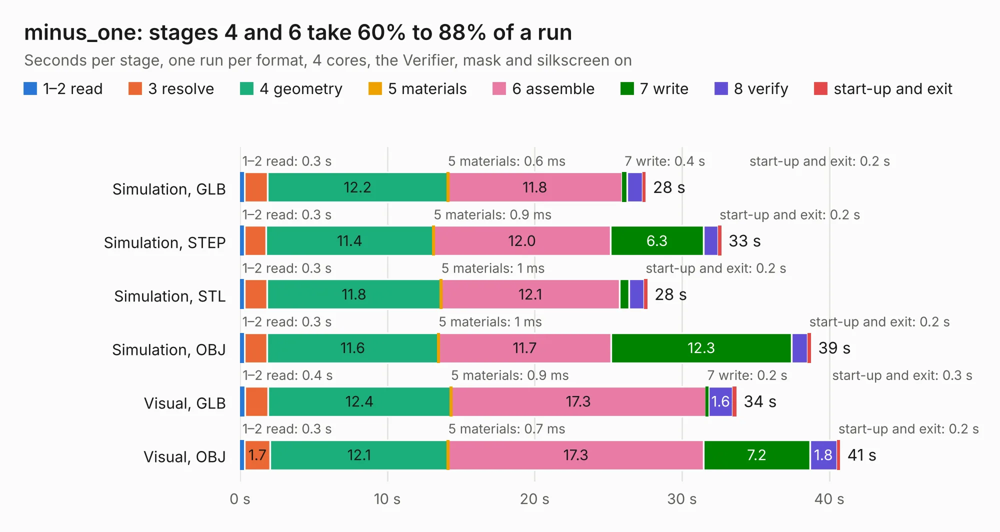

| Mode and format | 1–2 read | 3 resolve | 4 geometry | 5 materials | 6 assemble | 7 write | 8 verify | start-up and exit | Total |
|---|---:|---:|---:|---:|---:|---:|---:|---:|---:|
| Simulation, GLB | 0.3 | 1.6 | 12.2 | 0.6&nbsp;ms | 11.8 | 0.4 | 1.0 | 0.2 | 27.5 |
| Simulation, STEP | 0.3 | 1.5 | 11.4 | 0.9&nbsp;ms | 12.0 | 6.3 | 1.0 | 0.2 | 32.7 |
| Simulation, STL | 0.3 | 1.5 | 11.8 | 1&nbsp;ms | 12.1 | 0.6 | 1.0 | 0.2 | 27.6 |
| Simulation, OBJ | 0.3 | 1.5 | 11.6 | 1&nbsp;ms | 11.7 | 12.3 | 1.1 | 0.2 | 38.8 |
| Visual, GLB | 0.4 | 1.6 | 12.4 | 0.9&nbsp;ms | 17.3 | 0.2 | 1.6 | 0.3 | 33.7 |
| Visual, OBJ | 0.3 | 1.7 | 12.1 | 0.7&nbsp;ms | 17.3 | 7.2 | 1.8 | 0.2 | 40.7 |

<table align="center"><tr><td valign="top">

| Board | Repo: [google/myelin-acorn-electron-hardware](https://github.com/google/myelin-acorn-electron-hardware) Board: `minus_one.kicad_pcb` |
|---|---|
| Folder | minus_one / pcb |
| Complexity | 223&nbsp;/&nbsp;1000 (size&nbsp;168, features&nbsp;55) |
| KESE&nbsp;features | through vias, rounded, trapezoid or chamfered pads, filled zones, curved board outline |
| Tested | 9th November 2026 |
| Copper&nbsp;layers | 2 |
| File&nbsp;format | KiCad 4 (4) |
| Parts,&nbsp;tracks,&nbsp;vias | 15, 1,332, 97 |
| Triangles,&nbsp;simulation | 2,310,048 in 64 parts |
| Verifier | PASS in all six runs |

</td><td valign="top">

<table>
<tr><th>File type</th><th>File size</th><th>Peak memory used</th></tr>
<tr><th colspan="3" align="left">Simulation</th></tr>
<tr><td>GLB</td><td align="right">80&nbsp;MB</td><td align="right">670&nbsp;MB</td></tr>
<tr><td>STEP</td><td align="right">445&nbsp;MB</td><td align="right">935&nbsp;MB</td></tr>
<tr><td>STL</td><td align="right">116&nbsp;MB</td><td align="right">680&nbsp;MB</td></tr>
<tr><td>OBJ</td><td align="right">245&nbsp;MB</td><td align="right">1.6&nbsp;GB</td></tr>
<tr><th colspan="3" align="left">Visual</th></tr>
<tr><td>GLB</td><td align="right">44&nbsp;MB</td><td align="right">844&nbsp;MB</td></tr>
<tr><td>OBJ</td><td align="right">136&nbsp;MB</td><td align="right">974&nbsp;MB</td></tr>
</table>

</td></tr></table>

## 1082 pcf8583_daughterboard

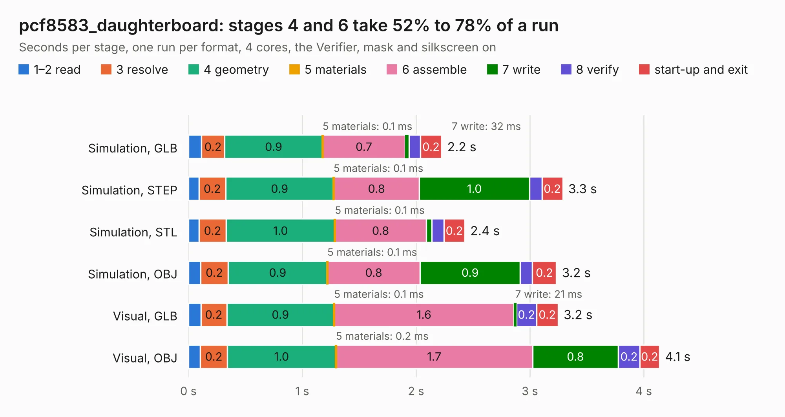

| Mode and format | 1–2 read | 3 resolve | 4 geometry | 5 materials | 6 assemble | 7 write | 8 verify | start-up and exit | Total |
|---|---:|---:|---:|---:|---:|---:|---:|---:|---:|
| Simulation, GLB | 0.1 | 0.2 | 0.9 | 0.1&nbsp;ms | 0.7 | 32&nbsp;ms | 0.1 | 0.2 | 2.2 |
| Simulation, STEP | 93&nbsp;ms | 0.2 | 0.9 | 0.1&nbsp;ms | 0.8 | 1.0 | 0.1 | 0.2 | 3.3 |
| Simulation, STL | 92&nbsp;ms | 0.2 | 1.0 | 0.1&nbsp;ms | 0.8 | 50&nbsp;ms | 0.1 | 0.2 | 2.4 |
| Simulation, OBJ | 0.1 | 0.2 | 0.9 | 0.1&nbsp;ms | 0.8 | 0.9 | 0.1 | 0.2 | 3.2 |
| Visual, GLB | 0.1 | 0.2 | 0.9 | 0.1&nbsp;ms | 1.6 | 21&nbsp;ms | 0.2 | 0.2 | 3.2 |
| Visual, OBJ | 0.1 | 0.2 | 1.0 | 0.2&nbsp;ms | 1.7 | 0.8 | 0.2 | 0.2 | 4.1 |

<table align="center"><tr><td valign="top">

| Board | Repo: [google/myelin-acorn-electron-hardware](https://github.com/google/myelin-acorn-electron-hardware) Board: `pcf8583_daughterboard.kicad_pcb` |
|---|---|
| Folder | pcf8583_daughterboard / pcb |
| Complexity | 171&nbsp;/&nbsp;1000 (size&nbsp;116, features&nbsp;55) |
| KESE&nbsp;features | through vias, rounded, trapezoid or chamfered pads, filled zones, curved board outline |
| Tested | 9th November 2026 |
| Copper&nbsp;layers | 2 |
| File&nbsp;format | KiCad 5 (20171130) |
| Parts,&nbsp;tracks,&nbsp;vias | 14, 65, 2 |
| Triangles,&nbsp;simulation | 214,068 in 23 parts |
| Verifier | PASS in all six runs |

</td><td valign="top">

<table>
<tr><th>File type</th><th>File size</th><th>Peak memory used</th></tr>
<tr><th colspan="3" align="left">Simulation</th></tr>
<tr><td>GLB</td><td align="right">7.4&nbsp;MB</td><td align="right">215&nbsp;MB</td></tr>
<tr><td>STEP</td><td align="right">37&nbsp;MB</td><td align="right">237&nbsp;MB</td></tr>
<tr><td>STL</td><td align="right">11&nbsp;MB</td><td align="right">212&nbsp;MB</td></tr>
<tr><td>OBJ</td><td align="right">21&nbsp;MB</td><td align="right">213&nbsp;MB</td></tr>
<tr><th colspan="3" align="left">Visual</th></tr>
<tr><td>GLB</td><td align="right">5.7&nbsp;MB</td><td align="right">212&nbsp;MB</td></tr>
<tr><td>OBJ</td><td align="right">16&nbsp;MB</td><td align="right">216&nbsp;MB</td></tr>
</table>

</td></tr></table>

## 1083 post_box_usb

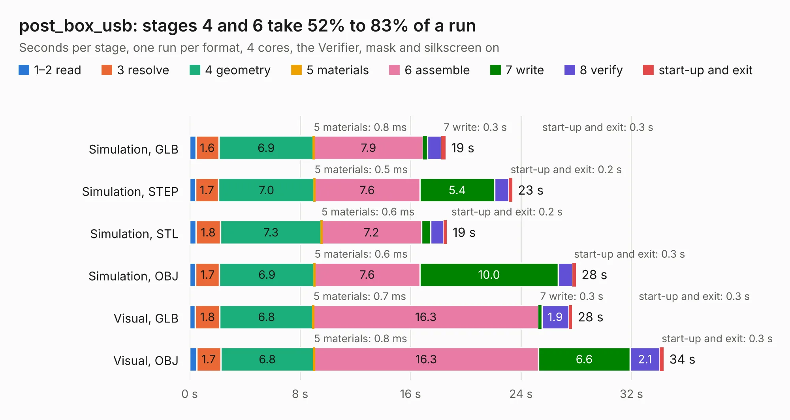

| Mode and format | 1–2 read | 3 resolve | 4 geometry | 5 materials | 6 assemble | 7 write | 8 verify | start-up and exit | Total |
|---|---:|---:|---:|---:|---:|---:|---:|---:|---:|
| Simulation, GLB | 0.5 | 1.6 | 6.9 | 0.8&nbsp;ms | 7.9 | 0.3 | 1.0 | 0.3 | 18.5 |
| Simulation, STEP | 0.4 | 1.7 | 7.0 | 0.5&nbsp;ms | 7.6 | 5.4 | 1.0 | 0.2 | 23.4 |
| Simulation, STL | 0.4 | 1.8 | 7.3 | 0.6&nbsp;ms | 7.2 | 0.7 | 0.9 | 0.2 | 18.6 |
| Simulation, OBJ | 0.4 | 1.7 | 6.9 | 0.6&nbsp;ms | 7.6 | 10.0 | 1.0 | 0.3 | 28.0 |
| Visual, GLB | 0.4 | 1.8 | 6.8 | 0.7&nbsp;ms | 16.3 | 0.3 | 1.9 | 0.3 | 27.7 |
| Visual, OBJ | 0.5 | 1.7 | 6.8 | 0.8&nbsp;ms | 16.3 | 6.6 | 2.1 | 0.3 | 34.3 |

<table align="center"><tr><td valign="top">

| Board | Repo: [google/myelin-acorn-electron-hardware](https://github.com/google/myelin-acorn-electron-hardware) Board: `post_box_usb.kicad_pcb` |
|---|---|
| Folder | post_box_usb / pcb |
| Complexity | 293&nbsp;/&nbsp;1000 (size&nbsp;238, features&nbsp;55) |
| KESE&nbsp;features | through vias, slotted holes, rounded, trapezoid or chamfered pads, filled zones |
| Tested | 9th November 2026 |
| Copper&nbsp;layers | 4 |
| File&nbsp;format | KiCad 5 (20171130) |
| Parts,&nbsp;tracks,&nbsp;vias | 66, 1,109, 99 |
| Triangles,&nbsp;simulation | 2,050,030 in 121 parts |
| Verifier | PASS in all six runs |

</td><td valign="top">

<table>
<tr><th>File type</th><th>File size</th><th>Peak memory used</th></tr>
<tr><th colspan="3" align="left">Simulation</th></tr>
<tr><td>GLB</td><td align="right">70&nbsp;MB</td><td align="right">673&nbsp;MB</td></tr>
<tr><td>STEP</td><td align="right">262&nbsp;MB</td><td align="right">871&nbsp;MB</td></tr>
<tr><td>STL</td><td align="right">103&nbsp;MB</td><td align="right">671&nbsp;MB</td></tr>
<tr><td>OBJ</td><td align="right">213&nbsp;MB</td><td align="right">1.4&nbsp;GB</td></tr>
<tr><th colspan="3" align="left">Visual</th></tr>
<tr><td>GLB</td><td align="right">46&nbsp;MB</td><td align="right">956&nbsp;MB</td></tr>
<tr><td>OBJ</td><td align="right">141&nbsp;MB</td><td align="right">1.0&nbsp;GB</td></tr>
</table>

</td></tr></table>

## 1084 rom_socket_level_shifter

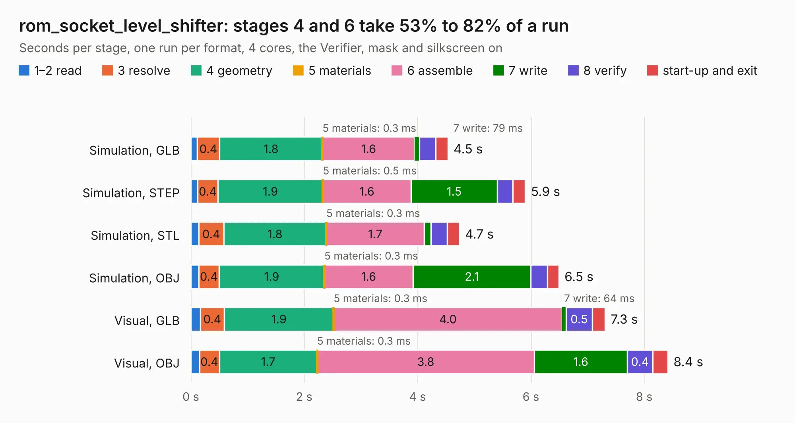

| Mode and format | 1–2 read | 3 resolve | 4 geometry | 5 materials | 6 assemble | 7 write | 8 verify | start-up and exit | Total |
|---|---:|---:|---:|---:|---:|---:|---:|---:|---:|
| Simulation, GLB | 0.1 | 0.4 | 1.8 | 0.3&nbsp;ms | 1.6 | 79&nbsp;ms | 0.3 | 0.2 | 4.5 |
| Simulation, STEP | 0.1 | 0.4 | 1.9 | 0.5&nbsp;ms | 1.6 | 1.5 | 0.3 | 0.2 | 5.9 |
| Simulation, STL | 0.1 | 0.4 | 1.8 | 0.3&nbsp;ms | 1.7 | 0.1 | 0.3 | 0.2 | 4.7 |
| Simulation, OBJ | 0.1 | 0.4 | 1.9 | 0.3&nbsp;ms | 1.6 | 2.1 | 0.3 | 0.2 | 6.5 |
| Visual, GLB | 0.2 | 0.4 | 1.9 | 0.3&nbsp;ms | 4.0 | 64&nbsp;ms | 0.5 | 0.2 | 7.3 |
| Visual, OBJ | 0.2 | 0.4 | 1.7 | 0.3&nbsp;ms | 3.8 | 1.6 | 0.4 | 0.3 | 8.4 |

<table align="center"><tr><td valign="top">

| Board | Repo: [google/myelin-acorn-electron-hardware](https://github.com/google/myelin-acorn-electron-hardware) Board: `rom_socket_level_shifter.kicad_pcb` |
|---|---|
| Folder | rom_socket_level_shifter / pcb |
| Complexity | 194&nbsp;/&nbsp;1000 (size&nbsp;149, features&nbsp;45) |
| KESE&nbsp;features | through vias, rounded, trapezoid or chamfered pads, filled zones |
| Tested | 9th November 2026 |
| Copper&nbsp;layers | 2 |
| File&nbsp;format | KiCad 4 (4) |
| Parts,&nbsp;tracks,&nbsp;vias | 13, 463, 34 |
| Triangles,&nbsp;simulation | 479,746 in 64 parts |
| Verifier | PASS in all six runs |

</td><td valign="top">

<table>
<tr><th>File type</th><th>File size</th><th>Peak memory used</th></tr>
<tr><th colspan="3" align="left">Simulation</th></tr>
<tr><td>GLB</td><td align="right">16&nbsp;MB</td><td align="right">277&nbsp;MB</td></tr>
<tr><td>STEP</td><td align="right">76&nbsp;MB</td><td align="right">341&nbsp;MB</td></tr>
<tr><td>STL</td><td align="right">24&nbsp;MB</td><td align="right">278&nbsp;MB</td></tr>
<tr><td>OBJ</td><td align="right">48&nbsp;MB</td><td align="right">361&nbsp;MB</td></tr>
<tr><th colspan="3" align="left">Visual</th></tr>
<tr><td>GLB</td><td align="right">13&nbsp;MB</td><td align="right">357&nbsp;MB</td></tr>
<tr><td>OBJ</td><td align="right">38&nbsp;MB</td><td align="right">350&nbsp;MB</td></tr>
</table>

</td></tr></table>

## 1085 bbc_1mhz_serial_sd

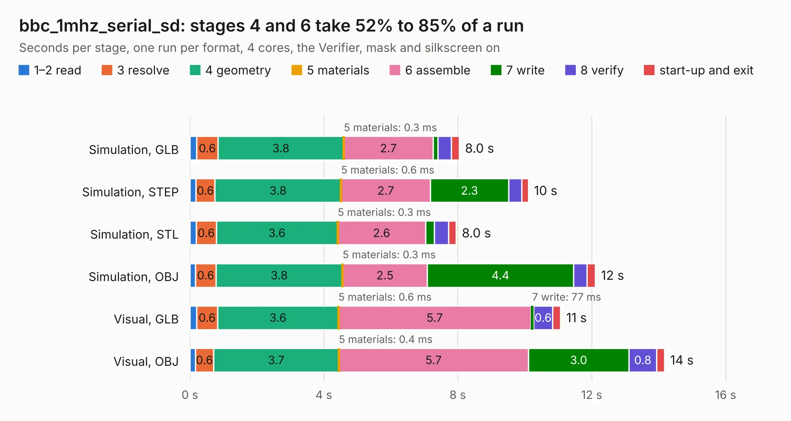

| Mode and format | 1–2 read | 3 resolve | 4 geometry | 5 materials | 6 assemble | 7 write | 8 verify | start-up and exit | Total |
|---|---:|---:|---:|---:|---:|---:|---:|---:|---:|
| Simulation, GLB | 0.2 | 0.6 | 3.8 | 0.3&nbsp;ms | 2.7 | 0.1 | 0.4 | 0.2 | 8.0 |
| Simulation, STEP | 0.2 | 0.6 | 3.8 | 0.6&nbsp;ms | 2.7 | 2.3 | 0.4 | 0.2 | 10.1 |
| Simulation, STL | 0.2 | 0.6 | 3.6 | 0.3&nbsp;ms | 2.6 | 0.3 | 0.4 | 0.2 | 8.0 |
| Simulation, OBJ | 0.2 | 0.6 | 3.8 | 0.3&nbsp;ms | 2.5 | 4.4 | 0.4 | 0.3 | 12.1 |
| Visual, GLB | 0.2 | 0.6 | 3.6 | 0.6&nbsp;ms | 5.7 | 77&nbsp;ms | 0.6 | 0.2 | 11.1 |
| Visual, OBJ | 0.2 | 0.6 | 3.7 | 0.4&nbsp;ms | 5.7 | 3.0 | 0.8 | 0.2 | 14.2 |

<table align="center"><tr><td valign="top">

| Board | Repo: [google/myelin-acorn-electron-hardware](https://github.com/google/myelin-acorn-electron-hardware) Board: `bbc_1mhz_serial_sd.kicad_pcb` |
|---|---|
| Folder | serial_sd_adapter / bbc_1mhz_bus_pcb |
| Complexity | 189&nbsp;/&nbsp;1000 (size&nbsp;144, features&nbsp;45) |
| KESE&nbsp;features | through vias, rounded, trapezoid or chamfered pads, filled zones |
| Tested | 9th November 2026 |
| Copper&nbsp;layers | 2 |
| File&nbsp;format | KiCad 4 (4) |
| Parts,&nbsp;tracks,&nbsp;vias | 13, 361, 19 |
| Triangles,&nbsp;simulation | 754,086 in 55 parts |
| Verifier | PASS in all six runs |

</td><td valign="top">

<table>
<tr><th>File type</th><th>File size</th><th>Peak memory used</th></tr>
<tr><th colspan="3" align="left">Simulation</th></tr>
<tr><td>GLB</td><td align="right">26&nbsp;MB</td><td align="right">362&nbsp;MB</td></tr>
<tr><td>STEP</td><td align="right">138&nbsp;MB</td><td align="right">422&nbsp;MB</td></tr>
<tr><td>STL</td><td align="right">38&nbsp;MB</td><td align="right">359&nbsp;MB</td></tr>
<tr><td>OBJ</td><td align="right">77&nbsp;MB</td><td align="right">545&nbsp;MB</td></tr>
<tr><th colspan="3" align="left">Visual</th></tr>
<tr><td>GLB</td><td align="right">18&nbsp;MB</td><td align="right">435&nbsp;MB</td></tr>
<tr><td>OBJ</td><td align="right">54&nbsp;MB</td><td align="right">464&nbsp;MB</td></tr>
</table>

</td></tr></table>

## 1086 standalone_programmer

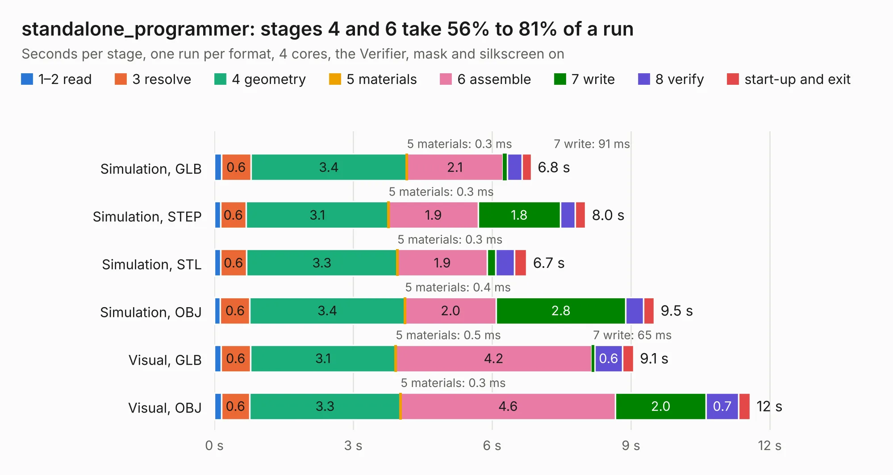

| Mode and format | 1–2 read | 3 resolve | 4 geometry | 5 materials | 6 assemble | 7 write | 8 verify | start-up and exit | Total |
|---|---:|---:|---:|---:|---:|---:|---:|---:|---:|
| Simulation, GLB | 0.2 | 0.6 | 3.4 | 0.3&nbsp;ms | 2.1 | 91&nbsp;ms | 0.3 | 0.2 | 6.8 |
| Simulation, STEP | 0.1 | 0.6 | 3.1 | 0.3&nbsp;ms | 1.9 | 1.8 | 0.3 | 0.2 | 8.0 |
| Simulation, STL | 0.1 | 0.6 | 3.3 | 0.3&nbsp;ms | 1.9 | 0.2 | 0.4 | 0.3 | 6.7 |
| Simulation, OBJ | 0.1 | 0.6 | 3.4 | 0.4&nbsp;ms | 2.0 | 2.8 | 0.4 | 0.2 | 9.5 |
| Visual, GLB | 0.1 | 0.6 | 3.1 | 0.5&nbsp;ms | 4.2 | 65&nbsp;ms | 0.6 | 0.2 | 9.1 |
| Visual, OBJ | 0.2 | 0.6 | 3.3 | 0.3&nbsp;ms | 4.6 | 2.0 | 0.7 | 0.3 | 11.6 |

<table align="center"><tr><td valign="top">

| Board | Repo: [google/myelin-acorn-electron-hardware](https://github.com/google/myelin-acorn-electron-hardware) Board: `standalone_programmer.kicad_pcb` |
|---|---|
| Folder | standalone_cartridge_programmer / pcb |
| Complexity | 198&nbsp;/&nbsp;1000 (size&nbsp;143, features&nbsp;55) |
| KESE&nbsp;features | through vias, rounded, trapezoid or chamfered pads, filled zones, curved board outline |
| Tested | 9th November 2026 |
| Copper&nbsp;layers | 2 |
| File&nbsp;format | KiCad 5 (20171130) |
| Parts,&nbsp;tracks,&nbsp;vias | 11, 366, 18 |
| Triangles,&nbsp;simulation | 681,416 in 58 parts |
| Verifier | PASS in all six runs |

</td><td valign="top">

<table>
<tr><th>File type</th><th>File size</th><th>Peak memory used</th></tr>
<tr><th colspan="3" align="left">Simulation</th></tr>
<tr><td>GLB</td><td align="right">24&nbsp;MB</td><td align="right">348&nbsp;MB</td></tr>
<tr><td>STEP</td><td align="right">120&nbsp;MB</td><td align="right">390&nbsp;MB</td></tr>
<tr><td>STL</td><td align="right">34&nbsp;MB</td><td align="right">326&nbsp;MB</td></tr>
<tr><td>OBJ</td><td align="right">70&nbsp;MB</td><td align="right">492&nbsp;MB</td></tr>
<tr><th colspan="3" align="left">Visual</th></tr>
<tr><td>GLB</td><td align="right">15&nbsp;MB</td><td align="right">406&nbsp;MB</td></tr>
<tr><td>OBJ</td><td align="right">45&nbsp;MB</td><td align="right">405&nbsp;MB</td></tr>
</table>

</td></tr></table>

## 1087 xc9500xl_44_breakout

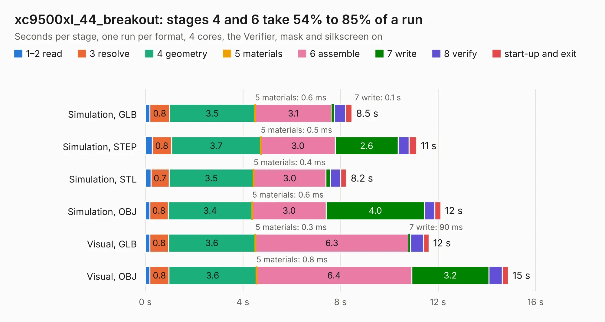

| Mode and format | 1–2 read | 3 resolve | 4 geometry | 5 materials | 6 assemble | 7 write | 8 verify | start-up and exit | Total |
|---|---:|---:|---:|---:|---:|---:|---:|---:|---:|
| Simulation, GLB | 0.2 | 0.8 | 3.5 | 0.6&nbsp;ms | 3.1 | 0.1 | 0.5 | 0.3 | 8.5 |
| Simulation, STEP | 0.3 | 0.8 | 3.7 | 0.5&nbsp;ms | 3.0 | 2.6 | 0.5 | 0.3 | 11.1 |
| Simulation, STL | 0.2 | 0.7 | 3.5 | 0.4&nbsp;ms | 3.0 | 0.2 | 0.4 | 0.2 | 8.2 |
| Simulation, OBJ | 0.2 | 0.8 | 3.4 | 0.6&nbsp;ms | 3.0 | 4.0 | 0.4 | 0.2 | 12.1 |
| Visual, GLB | 0.2 | 0.8 | 3.6 | 0.3&nbsp;ms | 6.3 | 90&nbsp;ms | 0.5 | 0.2 | 11.6 |
| Visual, OBJ | 0.2 | 0.8 | 3.6 | 0.8&nbsp;ms | 6.4 | 3.2 | 0.5 | 0.3 | 14.9 |

<table align="center"><tr><td valign="top">

| Board | Repo: [google/myelin-acorn-electron-hardware](https://github.com/google/myelin-acorn-electron-hardware) Board: `xc9500xl_44_breakout.kicad_pcb` |
|---|---|
| Folder | xc9500xl_44_breakout / pcb |
| Complexity | 188&nbsp;/&nbsp;1000 (size&nbsp;143, features&nbsp;45) |
| KESE&nbsp;features | through vias, rounded, trapezoid or chamfered pads, filled zones |
| Tested | 9th November 2026 |
| Copper&nbsp;layers | 2 |
| File&nbsp;format | KiCad 5 (20171130) |
| Parts,&nbsp;tracks,&nbsp;vias | 13, 269, 40 |
| Triangles,&nbsp;simulation | 750,304 in 53 parts |
| Verifier | PASS in all six runs |

</td><td valign="top">

<table>
<tr><th>File type</th><th>File size</th><th>Peak memory used</th></tr>
<tr><th colspan="3" align="left">Simulation</th></tr>
<tr><td>GLB</td><td align="right">26&nbsp;MB</td><td align="right">405&nbsp;MB</td></tr>
<tr><td>STEP</td><td align="right">123&nbsp;MB</td><td align="right">460&nbsp;MB</td></tr>
<tr><td>STL</td><td align="right">38&nbsp;MB</td><td align="right">405&nbsp;MB</td></tr>
<tr><td>OBJ</td><td align="right">76&nbsp;MB</td><td align="right">535&nbsp;MB</td></tr>
<tr><th colspan="3" align="left">Visual</th></tr>
<tr><td>GLB</td><td align="right">18&nbsp;MB</td><td align="right">442&nbsp;MB</td></tr>
<tr><td>OBJ</td><td align="right">55&nbsp;MB</td><td align="right">488&nbsp;MB</td></tr>
</table>

</td></tr></table>

## 1088 dvk-mx8m-bsb

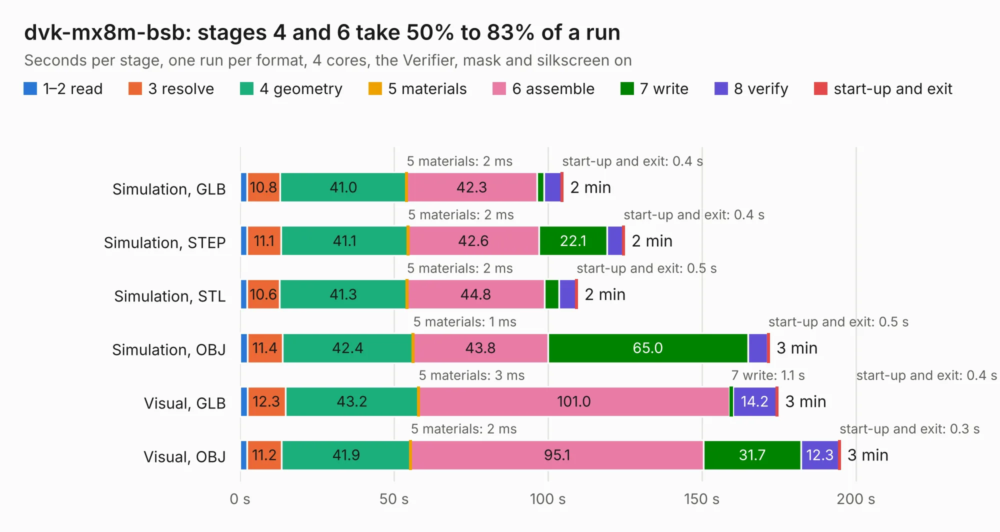

| Mode and format | 1–2 read | 3 resolve | 4 geometry | 5 materials | 6 assemble | 7 write | 8 verify | start-up and exit | Total |
|---|---:|---:|---:|---:|---:|---:|---:|---:|---:|
| Simulation, GLB | 2.2 | 10.8 | 41.0 | 2&nbsp;ms | 42.3 | 2.3 | 5.6 | 0.4 | 104.8 |
| Simulation, STEP | 2.3 | 11.1 | 41.1 | 2&nbsp;ms | 42.6 | 22.1 | 5.1 | 0.4 | 124.8 |
| Simulation, STL | 2.3 | 10.6 | 41.3 | 2&nbsp;ms | 44.8 | 4.6 | 5.5 | 0.5 | 109.5 |
| Simulation, OBJ | 2.4 | 11.4 | 42.4 | 1&nbsp;ms | 43.8 | 65.0 | 6.4 | 0.5 | 171.8 |
| Visual, GLB | 2.4 | 12.3 | 43.2 | 3&nbsp;ms | 101.0 | 1.1 | 14.2 | 0.4 | 174.6 |
| Visual, OBJ | 2.4 | 11.2 | 41.9 | 2&nbsp;ms | 95.1 | 31.7 | 12.3 | 0.3 | 194.8 |

<table align="center"><tr><td valign="top">

| Board | Repo: [gralco/dvk-mx8m-bsb](https://github.com/gralco/dvk-mx8m-bsb) Board: `dvk-mx8m-bsb.kicad_pcb` |
|---|---|
| Complexity | 407&nbsp;/&nbsp;1000 (size&nbsp;317, features&nbsp;90) |
| KESE&nbsp;features | through vias, slotted holes, custom pads, rounded, trapezoid or chamfered pads, filled zones, copper text, curved board outline |
| Tested | 9th November 2026 |
| Copper&nbsp;layers | 6 |
| File&nbsp;format | KiCad 5 (20171130) |
| Parts,&nbsp;tracks,&nbsp;vias | 651, 17,587, 1,474 |
| Triangles,&nbsp;simulation | 11,609,834 in 629 parts |
| Verifier | PASS in all six runs |

</td><td valign="top">

<table>
<tr><th>File type</th><th>File size</th><th>Peak memory used</th></tr>
<tr><th colspan="3" align="left">Simulation</th></tr>
<tr><td>GLB</td><td align="right">403&nbsp;MB</td><td align="right">2.7&nbsp;GB</td></tr>
<tr><td>STEP</td><td align="right">1.6&nbsp;GB</td><td align="right">3.7&nbsp;GB</td></tr>
<tr><td>STL</td><td align="right">581&nbsp;MB</td><td align="right">2.9&nbsp;GB</td></tr>
<tr><td>OBJ</td><td align="right">1.3&nbsp;GB</td><td align="right">7.4&nbsp;GB</td></tr>
<tr><th colspan="3" align="left">Visual</th></tr>
<tr><td>GLB</td><td align="right">236&nbsp;MB</td><td align="right">3.6&nbsp;GB</td></tr>
<tr><td>OBJ</td><td align="right">764&nbsp;MB</td><td align="right">4.9&nbsp;GB</td></tr>
</table>

</td></tr></table>

## 1089 librem5_mainboard

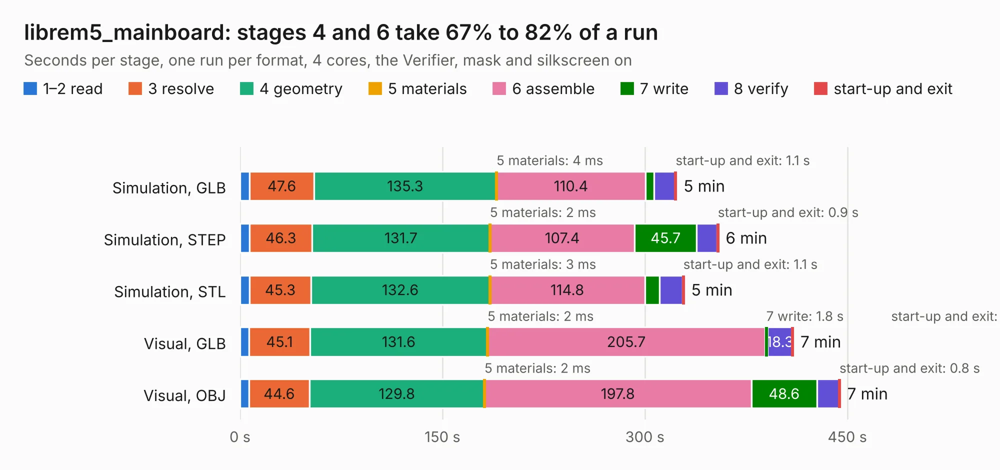

| Mode and format | 1–2 read | 3 resolve | 4 geometry | 5 materials | 6 assemble | 7 write | 8 verify | start-up and exit | Total |
|---|---:|---:|---:|---:|---:|---:|---:|---:|---:|
| Simulation, GLB | 7.2 | 47.6 | 135.3 | 4&nbsp;ms | 110.4 | 6.2 | 15.7 | 1.1 | 323.3 |
| Simulation, STEP | 7.2 | 46.3 | 131.7 | 2&nbsp;ms | 107.4 | 45.7 | 15.4 | 0.9 | 354.5 |
| Simulation, STL | 7.2 | 45.3 | 132.6 | 3&nbsp;ms | 114.8 | 11.0 | 17.0 | 1.1 | 329.0 |
| Simulation, OBJ |  |  |  |  |  |  |  |  | exceeded 11 GB on a 15 GB machine (stopped there, not a KESE failure); it will be run again on a machine with more memory |
| Visual, GLB | 6.7 | 45.1 | 131.6 | 2&nbsp;ms | 205.7 | 1.8 | 18.3 | 0.8 | 409.9 |
| Visual, OBJ | 6.8 | 44.6 | 129.8 | 2&nbsp;ms | 197.8 | 48.6 | 16.3 | 0.8 | 444.6 |

<table align="center"><tr><td valign="top">

| Board | Repo: [gralco/l5-schematic](https://github.com/gralco/l5-schematic) Board: `librem5_mainboard.kicad_pcb` |
|---|---|
| Folder | CAD / KiCad / librem5_mainboard |
| Complexity | 600&nbsp;/&nbsp;1000 (size&nbsp;370, features&nbsp;230) |
| KESE&nbsp;features | through vias, blind and buried vias, microvias, slotted holes, custom pads, rounded, trapezoid or chamfered pads, arc tracks, filled zones, copper drawings, copper text, curved board outline, stack-up, dielectric εr and tanδ, mask and silkscreen colours |
| Tested | 9th November 2026 |
| Copper&nbsp;layers | 10 |
| File&nbsp;format | KiCad 10 (20260206) |
| Parts,&nbsp;tracks,&nbsp;vias | 1,164, 19,488, 5,044 |
| Triangles,&nbsp;simulation | 21,846,464 in 866 parts |
| Verifier | Simulation, OBJ: exceeded 11 GB on a 15 GB machine (stopped there, not a KESE failure); it will be run again on a machine with more memory |

</td><td valign="top">

<table>
<tr><th>File type</th><th>File size</th><th>Peak memory used</th></tr>
<tr><th colspan="3" align="left">Simulation</th></tr>
<tr><td>GLB</td><td align="right">751&nbsp;MB</td><td align="right">4.8&nbsp;GB</td></tr>
<tr><td>STEP</td><td align="right">2.5&nbsp;GB</td><td align="right">6.1&nbsp;GB</td></tr>
<tr><td>STL</td><td align="right">1.1&nbsp;GB</td><td align="right">4.7&nbsp;GB</td></tr>
<tr><td>OBJ</td><td align="right">–</td><td align="right">11&nbsp;GB</td></tr>
<tr><th colspan="3" align="left">Visual</th></tr>
<tr><td>GLB</td><td align="right">283&nbsp;MB</td><td align="right">5.3&nbsp;GB</td></tr>
<tr><td>OBJ</td><td align="right">948&nbsp;MB</td><td align="right">6.3&nbsp;GB</td></tr>
</table>

</td></tr></table>

## 1090 librem5_usb-c_board

| Mode and format | 1–2 read | 3 resolve | 4 geometry | 5 materials | 6 assemble | 7 write | 8 verify | start-up and exit | Total |
|---|---:|---:|---:|---:|---:|---:|---:|---:|---:|
| Simulation, GLB | 0.8 | 2.2 | 5.7 | 0.5&nbsp;ms | 5.8 | 0.2 | 0.7 | 0.2 | 15.6 |
| Simulation, STEP | 0.8 | 2.1 | 5.6 | 0.5&nbsp;ms | 5.8 | 2.8 | 0.7 | 0.2 | 17.9 |
| Simulation, STL | 0.7 | 2.0 | 5.5 | 0.3&nbsp;ms | 5.9 | 0.5 | 0.7 | 0.2 | 15.5 |
| Simulation, OBJ | 0.8 | 2.2 | 5.8 | 0.7&nbsp;ms | 5.7 | 8.2 | 0.7 | 0.3 | 23.6 |
| Visual, GLB | 0.8 | 2.0 | 5.8 | 0.7&nbsp;ms | 11.8 | 0.1 | 0.9 | 0.2 | 21.6 |
| Visual, OBJ | 0.8 | 2.2 | 5.6 | 0.4&nbsp;ms | 11.6 | 4.5 | 0.9 | 0.3 | 25.8 |

<table align="center"><tr><td valign="top">

| Board | Repo: [gralco/l5-schematic](https://github.com/gralco/l5-schematic) Board: `librem5_usb-c_board.kicad_pcb` |
|---|---|
| Folder | CAD / KiCad / librem5_usb-c_board |
| Complexity | 397&nbsp;/&nbsp;1000 (size&nbsp;212, features&nbsp;185) |
| KESE&nbsp;features | through vias, blind and buried vias, microvias, slotted holes, custom pads, rounded, trapezoid or chamfered pads, arc tracks, filled zones, copper drawings, curved board outline |
| Tested | 9th November 2026 |
| Copper&nbsp;layers | 6 |
| File&nbsp;format | KiCad 9 (20241229) |
| Parts,&nbsp;tracks,&nbsp;vias | 52, 1,102, 355 |
| Triangles,&nbsp;simulation | 1,417,846 in 76 parts |
| Verifier | PASS in all six runs |

</td><td valign="top">

<table>
<tr><th>File type</th><th>File size</th><th>Peak memory used</th></tr>
<tr><th colspan="3" align="left">Simulation</th></tr>
<tr><td>GLB</td><td align="right">49&nbsp;MB</td><td align="right">563&nbsp;MB</td></tr>
<tr><td>STEP</td><td align="right">149&nbsp;MB</td><td align="right">640&nbsp;MB</td></tr>
<tr><td>STL</td><td align="right">71&nbsp;MB</td><td align="right">564&nbsp;MB</td></tr>
<tr><td>OBJ</td><td align="right">147&nbsp;MB</td><td align="right">978&nbsp;MB</td></tr>
<tr><th colspan="3" align="left">Visual</th></tr>
<tr><td>GLB</td><td align="right">25&nbsp;MB</td><td align="right">594&nbsp;MB</td></tr>
<tr><td>OBJ</td><td align="right">77&nbsp;MB</td><td align="right">639&nbsp;MB</td></tr>
</table>

</td></tr></table>

## 1091 librem5_usb-c_fpc

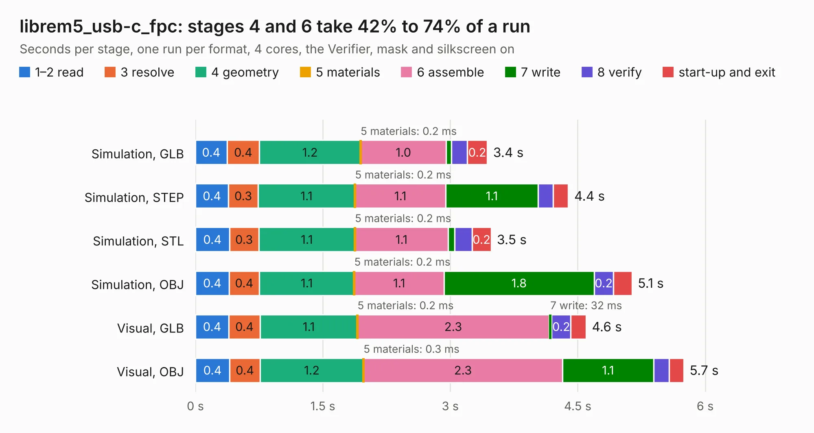

| Mode and format | 1–2 read | 3 resolve | 4 geometry | 5 materials | 6 assemble | 7 write | 8 verify | start-up and exit | Total |
|---|---:|---:|---:|---:|---:|---:|---:|---:|---:|
| Simulation, GLB | 0.4 | 0.4 | 1.2 | 0.2&nbsp;ms | 1.0 | 59&nbsp;ms | 0.2 | 0.2 | 3.4 |
| Simulation, STEP | 0.4 | 0.3 | 1.1 | 0.2&nbsp;ms | 1.1 | 1.1 | 0.2 | 0.2 | 4.4 |
| Simulation, STL | 0.4 | 0.3 | 1.1 | 0.2&nbsp;ms | 1.1 | 80&nbsp;ms | 0.2 | 0.2 | 3.5 |
| Simulation, OBJ | 0.4 | 0.4 | 1.1 | 0.2&nbsp;ms | 1.1 | 1.8 | 0.2 | 0.2 | 5.1 |
| Visual, GLB | 0.4 | 0.4 | 1.1 | 0.2&nbsp;ms | 2.3 | 32&nbsp;ms | 0.2 | 0.2 | 4.6 |
| Visual, OBJ | 0.4 | 0.4 | 1.2 | 0.3&nbsp;ms | 2.3 | 1.1 | 0.2 | 0.2 | 5.7 |

<table align="center"><tr><td valign="top">

| Board | Repo: [gralco/l5-schematic](https://github.com/gralco/l5-schematic) Board: `librem5_usb-c_fpc.kicad_pcb` |
|---|---|
| Folder | CAD / KiCad / librem5_usb-c_fpc |
| Complexity | 203&nbsp;/&nbsp;1000 (size&nbsp;148, features&nbsp;55) |
| KESE&nbsp;features | through vias, filled zones, copper drawings, curved board outline |
| Tested | 9th November 2026 |
| Copper&nbsp;layers | 4 |
| File&nbsp;format | KiCad 9 (20241229) |
| Parts,&nbsp;tracks,&nbsp;vias | 2, 240, 96 |
| Triangles,&nbsp;simulation | 367,218 in 38 parts |
| Verifier | PASS in all six runs |

</td><td valign="top">

<table>
<tr><th>File type</th><th>File size</th><th>Peak memory used</th></tr>
<tr><th colspan="3" align="left">Simulation</th></tr>
<tr><td>GLB</td><td align="right">13&nbsp;MB</td><td align="right">271&nbsp;MB</td></tr>
<tr><td>STEP</td><td align="right">39&nbsp;MB</td><td align="right">289&nbsp;MB</td></tr>
<tr><td>STL</td><td align="right">18&nbsp;MB</td><td align="right">266&nbsp;MB</td></tr>
<tr><td>OBJ</td><td align="right">37&nbsp;MB</td><td align="right">278&nbsp;MB</td></tr>
<tr><th colspan="3" align="left">Visual</th></tr>
<tr><td>GLB</td><td align="right">7.5&nbsp;MB</td><td align="right">254&nbsp;MB</td></tr>
<tr><td>OBJ</td><td align="right">22&nbsp;MB</td><td align="right">247&nbsp;MB</td></tr>
</table>

</td></tr></table>

## 1092 librem5_mainboard

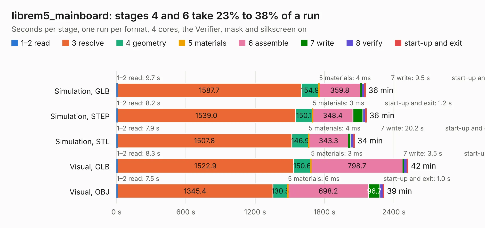

| Mode and format | 1–2 read | 3 resolve | 4 geometry | 5 materials | 6 assemble | 7 write | 8 verify | start-up and exit | Total |
|---|---:|---:|---:|---:|---:|---:|---:|---:|---:|
| Simulation, GLB | 9.7 | 1587.7 | 154.9 | 4&nbsp;ms | 359.8 | 9.5 | 26.9 | 1.4 | 2149.9 |
| Simulation, STEP | 8.2 | 1539.0 | 150.1 | 3&nbsp;ms | 348.4 | 85.7 | 26.2 | 1.2 | 2158.9 |
| Simulation, STL | 7.9 | 1507.8 | 146.9 | 4&nbsp;ms | 343.3 | 20.2 | 27.7 | 1.4 | 2055.2 |
| Simulation, OBJ |  |  |  |  |  |  |  |  | exceeded 11 GB on a 15 GB machine (stopped there, not a KESE failure); it will be run again on a machine with more memory |
| Visual, GLB | 8.3 | 1522.9 | 150.6 | 3&nbsp;ms | 798.7 | 3.5 | 32.1 | 0.9 | 2517.0 |
| Visual, OBJ | 7.5 | 1345.4 | 130.5 | 6&nbsp;ms | 698.2 | 96.7 | 30.9 | 1.0 | 2310.2 |

<table align="center"><tr><td valign="top">

| Board | Repo: [gralco/l5-schematic](https://github.com/gralco/l5-schematic) Board: `librem5_mainboard.kicad_pcb` |
|---|---|
| Folder | CAD / PADS / librem5_mainboard / librem5_mainboard_kicad_conversion |
| Complexity | 536&nbsp;/&nbsp;1000 (size&nbsp;371, features&nbsp;165) |
| KESE&nbsp;features | through vias, padstacks, slotted holes, drill offsets, arc tracks, filled zones, copper drawings, copper text, curved board outline, stack-up, dielectric εr and tanδ, mask and silkscreen colours |
| Tested | 9th November 2026 to 10th November 2026 |
| Copper&nbsp;layers | 10 |
| File&nbsp;format | KiCad 10 (20260206) |
| Parts,&nbsp;tracks,&nbsp;vias | 1,161, 23,746, 5,044 |
| Triangles,&nbsp;simulation | 42,957,272 in 866 parts |
| Verifier | Simulation, GLB: Verifier FAIL Simulation, STEP: Verifier FAIL Simulation, STL: Verifier FAIL Simulation, OBJ: exceeded 11 GB on a 15 GB machine (stopped there, not a KESE failure); it will be run again on a machine with more memory |
| Bad&nbsp;design | Bad design according to KESE: copper of two nets on top of each other in the file, a short KiCad's DRC reports; GND and `4G_POWER_KEY` vias about 0.01 mm apart in 238 places, the first at (149.77, 116.06) mm (left so by the conversion from PADS). KESE models what the file says, so the Verifier rightly finds the two nets' solids overlapping |
| Run&nbsp;again | Visual, OBJ: failed in the corpus run, run again with the memory cap raised from 11 GB to 14.5 GB, and passed |

</td><td valign="top">

<table>
<tr><th>File type</th><th>File size</th><th>Peak memory used</th></tr>
<tr><th colspan="3" align="left">Simulation</th></tr>
<tr><td>GLB</td><td align="right">1.4&nbsp;GB</td><td align="right">9.2&nbsp;GB</td></tr>
<tr><td>STEP</td><td align="right">4.5&nbsp;GB</td><td align="right">11&nbsp;GB</td></tr>
<tr><td>STL</td><td align="right">2.1&nbsp;GB</td><td align="right">9.2&nbsp;GB</td></tr>
<tr><td>OBJ</td><td align="right">–</td><td align="right">11&nbsp;GB</td></tr>
<tr><th colspan="3" align="left">Visual</th></tr>
<tr><td>GLB</td><td align="right">655&nbsp;MB</td><td align="right">11&nbsp;GB</td></tr>
<tr><td>OBJ</td><td align="right">2.2&nbsp;GB</td><td align="right">14&nbsp;GB</td></tr>
</table>

</td></tr></table>

## 1093 amalthea

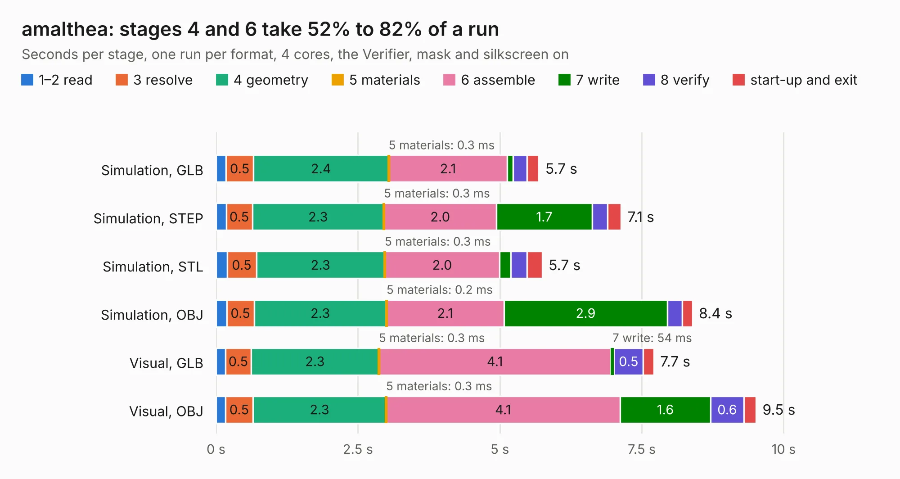

| Mode and format | 1–2 read | 3 resolve | 4 geometry | 5 materials | 6 assemble | 7 write | 8 verify | start-up and exit | Total |
|---|---:|---:|---:|---:|---:|---:|---:|---:|---:|
| Simulation, GLB | 0.2 | 0.5 | 2.4 | 0.3&nbsp;ms | 2.1 | 0.1 | 0.2 | 0.2 | 5.7 |
| Simulation, STEP | 0.2 | 0.5 | 2.3 | 0.3&nbsp;ms | 2.0 | 1.7 | 0.3 | 0.2 | 7.1 |
| Simulation, STL | 0.2 | 0.5 | 2.3 | 0.3&nbsp;ms | 2.0 | 0.2 | 0.3 | 0.3 | 5.7 |
| Simulation, OBJ | 0.2 | 0.5 | 2.3 | 0.2&nbsp;ms | 2.1 | 2.9 | 0.3 | 0.2 | 8.4 |
| Visual, GLB | 0.2 | 0.5 | 2.3 | 0.3&nbsp;ms | 4.1 | 54&nbsp;ms | 0.5 | 0.2 | 7.7 |
| Visual, OBJ | 0.2 | 0.5 | 2.3 | 0.3&nbsp;ms | 4.1 | 1.6 | 0.6 | 0.2 | 9.5 |

<table align="center"><tr><td valign="top">

| Board | Repo: [greatscottgadgets/amalthea-hardware](https://github.com/greatscottgadgets/amalthea-hardware) Board: `amalthea.kicad_pcb` |
|---|---|
| Complexity | 334&nbsp;/&nbsp;1000 (size&nbsp;219, features&nbsp;115) |
| KESE&nbsp;features | through vias, rounded, trapezoid or chamfered pads, arc tracks, filled zones, copper text, curved board outline, stack-up, dielectric εr and tanδ, mask and silkscreen colours |
| Tested | 9th November 2026 |
| Copper&nbsp;layers | 4 |
| File&nbsp;format | KiCad 7 (20221018) |
| Parts,&nbsp;tracks,&nbsp;vias | 41, 440, 63 |
| Triangles,&nbsp;simulation | 747,338 in 69 parts |
| Verifier | PASS in all six runs |

</td><td valign="top">

<table>
<tr><th>File type</th><th>File size</th><th>Peak memory used</th></tr>
<tr><th colspan="3" align="left">Simulation</th></tr>
<tr><td>GLB</td><td align="right">26&nbsp;MB</td><td align="right">350&nbsp;MB</td></tr>
<tr><td>STEP</td><td align="right">103&nbsp;MB</td><td align="right">410&nbsp;MB</td></tr>
<tr><td>STL</td><td align="right">37&nbsp;MB</td><td align="right">342&nbsp;MB</td></tr>
<tr><td>OBJ</td><td align="right">76&nbsp;MB</td><td align="right">532&nbsp;MB</td></tr>
<tr><th colspan="3" align="left">Visual</th></tr>
<tr><td>GLB</td><td align="right">14&nbsp;MB</td><td align="right">388&nbsp;MB</td></tr>
<tr><td>OBJ</td><td align="right">41&nbsp;MB</td><td align="right">388&nbsp;MB</td></tr>
</table>

</td></tr></table>

## 1094 cydonia

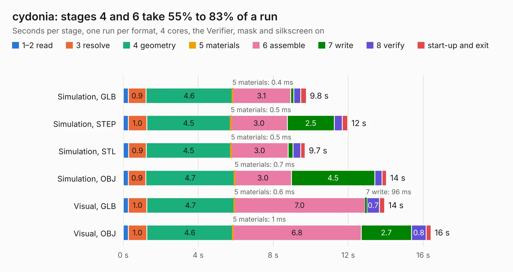

| Mode and format | 1–2 read | 3 resolve | 4 geometry | 5 materials | 6 assemble | 7 write | 8 verify | start-up and exit | Total |
|---|---:|---:|---:|---:|---:|---:|---:|---:|---:|
| Simulation, GLB | 0.3 | 0.9 | 4.6 | 0.4&nbsp;ms | 3.1 | 0.2 | 0.4 | 0.3 | 9.8 |
| Simulation, STEP | 0.3 | 1.0 | 4.5 | 0.5&nbsp;ms | 3.0 | 2.5 | 0.4 | 0.3 | 12.0 |
| Simulation, STL | 0.3 | 0.9 | 4.5 | 0.5&nbsp;ms | 3.0 | 0.3 | 0.4 | 0.2 | 9.7 |
| Simulation, OBJ | 0.3 | 0.9 | 4.7 | 0.7&nbsp;ms | 3.0 | 4.5 | 0.4 | 0.2 | 14.0 |
| Visual, GLB | 0.3 | 1.0 | 4.7 | 0.6&nbsp;ms | 7.0 | 96&nbsp;ms | 0.7 | 0.3 | 13.9 |
| Visual, OBJ | 0.3 | 1.0 | 4.6 | 1&nbsp;ms | 6.8 | 2.7 | 0.8 | 0.3 | 16.4 |

<table align="center"><tr><td valign="top">

| Board | Repo: [greatscottgadgets/cydonia](https://github.com/greatscottgadgets/cydonia) Board: `cydonia.kicad_pcb` |
|---|---|
| Complexity | 299&nbsp;/&nbsp;1000 (size&nbsp;234, features&nbsp;65) |
| KESE&nbsp;features | through vias, rounded, trapezoid or chamfered pads, filled zones, copper text, curved board outline |
| Tested | 9th November 2026 |
| Copper&nbsp;layers | 4 |
| File&nbsp;format | KiCad 5 (20171130) |
| Parts,&nbsp;tracks,&nbsp;vias | 107, 574, 74 |
| Triangles,&nbsp;simulation | 920,804 in 93 parts |
| Verifier | PASS in all six runs |

</td><td valign="top">

<table>
<tr><th>File type</th><th>File size</th><th>Peak memory used</th></tr>
<tr><th colspan="3" align="left">Simulation</th></tr>
<tr><td>GLB</td><td align="right">33&nbsp;MB</td><td align="right">452&nbsp;MB</td></tr>
<tr><td>STEP</td><td align="right">124&nbsp;MB</td><td align="right">484&nbsp;MB</td></tr>
<tr><td>STL</td><td align="right">46&nbsp;MB</td><td align="right">454&nbsp;MB</td></tr>
<tr><td>OBJ</td><td align="right">96&nbsp;MB</td><td align="right">679&nbsp;MB</td></tr>
<tr><th colspan="3" align="left">Visual</th></tr>
<tr><td>GLB</td><td align="right">19&nbsp;MB</td><td align="right">473&nbsp;MB</td></tr>
<tr><td>OBJ</td><td align="right">57&nbsp;MB</td><td align="right">499&nbsp;MB</td></tr>
</table>

</td></tr></table>

## 1095 cynthion

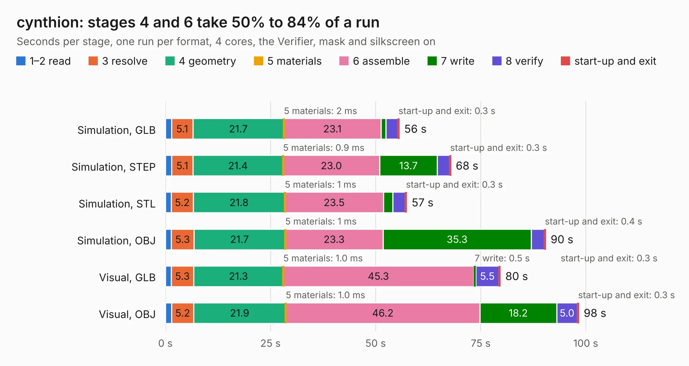

| Mode and format | 1–2 read | 3 resolve | 4 geometry | 5 materials | 6 assemble | 7 write | 8 verify | start-up and exit | Total |
|---|---:|---:|---:|---:|---:|---:|---:|---:|---:|
| Simulation, GLB | 1.4 | 5.1 | 21.7 | 2&nbsp;ms | 23.1 | 1.2 | 2.9 | 0.3 | 55.6 |
| Simulation, STEP | 1.5 | 5.1 | 21.4 | 0.9&nbsp;ms | 23.0 | 13.7 | 2.9 | 0.3 | 67.9 |
| Simulation, STL | 1.4 | 5.2 | 21.8 | 1&nbsp;ms | 23.5 | 2.2 | 3.0 | 0.3 | 57.4 |
| Simulation, OBJ | 1.4 | 5.3 | 21.7 | 1&nbsp;ms | 23.3 | 35.3 | 3.1 | 0.4 | 90.5 |
| Visual, GLB | 1.4 | 5.3 | 21.3 | 1.0&nbsp;ms | 45.3 | 0.5 | 5.5 | 0.3 | 79.7 |
| Visual, OBJ | 1.5 | 5.2 | 21.9 | 1.0&nbsp;ms | 46.2 | 18.2 | 5.0 | 0.3 | 98.3 |

<table align="center"><tr><td valign="top">

| Board | Repo: [greatscottgadgets/cynthion-hardware](https://github.com/greatscottgadgets/cynthion-hardware) Board: `cynthion.kicad_pcb` |
|---|---|
| Complexity | 454&nbsp;/&nbsp;1000 (size&nbsp;304, features&nbsp;150) |
| KESE&nbsp;features | through vias, slotted holes, custom pads, rounded, trapezoid or chamfered pads, arc tracks, filled zones, copper drawings, copper text, curved board outline, stack-up, dielectric εr and tanδ, mask and silkscreen colours |
| Tested | 9th November 2026 |
| Copper&nbsp;layers | 6 |
| File&nbsp;format | KiCad 7 (20221018) |
| Parts,&nbsp;tracks,&nbsp;vias | 294, 3,622, 651 |
| Triangles,&nbsp;simulation | 6,192,160 in 391 parts |
| Verifier | PASS in all six runs |

</td><td valign="top">

<table>
<tr><th>File type</th><th>File size</th><th>Peak memory used</th></tr>
<tr><th colspan="3" align="left">Simulation</th></tr>
<tr><td>GLB</td><td align="right">212&nbsp;MB</td><td align="right">1.5&nbsp;GB</td></tr>
<tr><td>STEP</td><td align="right">929&nbsp;MB</td><td align="right">2.1&nbsp;GB</td></tr>
<tr><td>STL</td><td align="right">310&nbsp;MB</td><td align="right">1.7&nbsp;GB</td></tr>
<tr><td>OBJ</td><td align="right">676&nbsp;MB</td><td align="right">4.0&nbsp;GB</td></tr>
<tr><th colspan="3" align="left">Visual</th></tr>
<tr><td>GLB</td><td align="right">112&nbsp;MB</td><td align="right">1.9&nbsp;GB</td></tr>
<tr><td>OBJ</td><td align="right">364&nbsp;MB</td><td align="right">2.5&nbsp;GB</td></tr>
</table>

</td></tr></table>

## 1096 gig-e

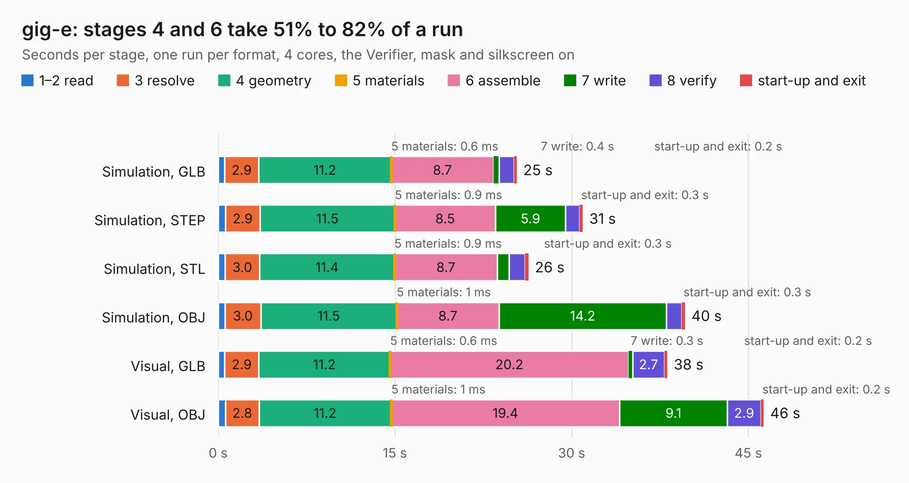

| Mode and format | 1–2 read | 3 resolve | 4 geometry | 5 materials | 6 assemble | 7 write | 8 verify | start-up and exit | Total |
|---|---:|---:|---:|---:|---:|---:|---:|---:|---:|
| Simulation, GLB | 0.6 | 2.9 | 11.2 | 0.6&nbsp;ms | 8.7 | 0.4 | 1.3 | 0.2 | 25.3 |
| Simulation, STEP | 0.6 | 2.9 | 11.5 | 0.9&nbsp;ms | 8.5 | 5.9 | 1.2 | 0.3 | 30.9 |
| Simulation, STL | 0.6 | 3.0 | 11.4 | 0.9&nbsp;ms | 8.7 | 1.0 | 1.3 | 0.3 | 26.3 |
| Simulation, OBJ | 0.6 | 3.0 | 11.5 | 1&nbsp;ms | 8.7 | 14.2 | 1.3 | 0.3 | 39.6 |
| Visual, GLB | 0.6 | 2.9 | 11.2 | 0.6&nbsp;ms | 20.2 | 0.3 | 2.7 | 0.2 | 38.1 |
| Visual, OBJ | 0.6 | 2.8 | 11.2 | 1&nbsp;ms | 19.4 | 9.1 | 2.9 | 0.2 | 46.3 |

<table align="center"><tr><td valign="top">

| Board | Repo: [greatscottgadgets/daisho](https://github.com/greatscottgadgets/daisho) Board: `gig-e.kicad_pcb` |
|---|---|
| Folder | hw / de2-115-frontend / gig-e |
| Complexity | 307&nbsp;/&nbsp;1000 (size&nbsp;272, features&nbsp;35) |
| KESE&nbsp;features | through vias, filled zones |
| Tested | 9th November 2026 |
| Copper&nbsp;layers | 4 |
| File&nbsp;format | KiCad 3 (3) |
| Parts,&nbsp;tracks,&nbsp;vias | 181, 2,692, 396 |
| Triangles,&nbsp;simulation | 2,547,136 in 199 parts |
| Verifier | PASS in all six runs |

</td><td valign="top">

<table>
<tr><th>File type</th><th>File size</th><th>Peak memory used</th></tr>
<tr><th colspan="3" align="left">Simulation</th></tr>
<tr><td>GLB</td><td align="right">90&nbsp;MB</td><td align="right">882&nbsp;MB</td></tr>
<tr><td>STEP</td><td align="right">353&nbsp;MB</td><td align="right">1.1&nbsp;GB</td></tr>
<tr><td>STL</td><td align="right">127&nbsp;MB</td><td align="right">911&nbsp;MB</td></tr>
<tr><td>OBJ</td><td align="right">273&nbsp;MB</td><td align="right">1.7&nbsp;GB</td></tr>
<tr><th colspan="3" align="left">Visual</th></tr>
<tr><td>GLB</td><td align="right">61&nbsp;MB</td><td align="right">1.1&nbsp;GB</td></tr>
<tr><td>OBJ</td><td align="right">188&nbsp;MB</td><td align="right">1.3&nbsp;GB</td></tr>
</table>

</td></tr></table>

## 1097 hdmi

| Mode and format | 1–2 read | 3 resolve | 4 geometry | 5 materials | 6 assemble | 7 write | 8 verify | start-up and exit | Total |
|---|---:|---:|---:|---:|---:|---:|---:|---:|---:|
| Simulation, GLB | 1.0 | 4.9 | 15.8 | 1.0&nbsp;ms | 18.6 | 0.9 | 2.6 | 0.3 | 44.2 |
| Simulation, STEP | 0.9 | 5.0 | 14.8 | 1.0&nbsp;ms | 19.3 | 11.5 | 2.5 | 0.3 | 54.4 |
| Simulation, STL | 1.0 | 5.3 | 15.1 | 3&nbsp;ms | 20.2 | 1.8 | 2.5 | 0.4 | 46.2 |
| Simulation, OBJ | 1.0 | 4.9 | 15.1 | 2&nbsp;ms | 19.9 | 33.3 | 2.8 | 0.4 | 77.4 |
| Visual, GLB | 1.0 | 5.0 | 16.8 | 1&nbsp;ms | 43.3 | 0.6 | 5.0 | 0.4 | 71.9 |
| Visual, OBJ | 1.0 | 5.4 | 15.0 | 1&nbsp;ms | 42.8 | 17.9 | 4.4 | 0.3 | 86.8 |

<table align="center"><tr><td valign="top">

| Board | Repo: [greatscottgadgets/daisho](https://github.com/greatscottgadgets/daisho) Board: `hdmi.kicad_pcb` |
|---|---|
| Folder | hw / de2-115-frontend / hdmi |
| Complexity | 354&nbsp;/&nbsp;1000 (size&nbsp;299, features&nbsp;55) |
| KESE&nbsp;features | through vias, slotted holes, filled zones, copper text |
| Tested | 9th November 2026 |
| Copper&nbsp;layers | 6 |
| File&nbsp;format | KiCad 3 (3) |
| Parts,&nbsp;tracks,&nbsp;vias | 221, 2,755, 605 |
| Triangles,&nbsp;simulation | 4,787,176 in 387 parts |
| Verifier | PASS in all six runs |

</td><td valign="top">

<table>
<tr><th>File type</th><th>File size</th><th>Peak memory used</th></tr>
<tr><th colspan="3" align="left">Simulation</th></tr>
<tr><td>GLB</td><td align="right">164&nbsp;MB</td><td align="right">1.4&nbsp;GB</td></tr>
<tr><td>STEP</td><td align="right">555&nbsp;MB</td><td align="right">1.7&nbsp;GB</td></tr>
<tr><td>STL</td><td align="right">239&nbsp;MB</td><td align="right">1.3&nbsp;GB</td></tr>
<tr><td>OBJ</td><td align="right">513&nbsp;MB</td><td align="right">3.0&nbsp;GB</td></tr>
<tr><th colspan="3" align="left">Visual</th></tr>
<tr><td>GLB</td><td align="right">92&nbsp;MB</td><td align="right">1.7&nbsp;GB</td></tr>
<tr><td>OBJ</td><td align="right">296&nbsp;MB</td><td align="right">1.9&nbsp;GB</td></tr>
</table>

</td></tr></table>

## 1098 rs232

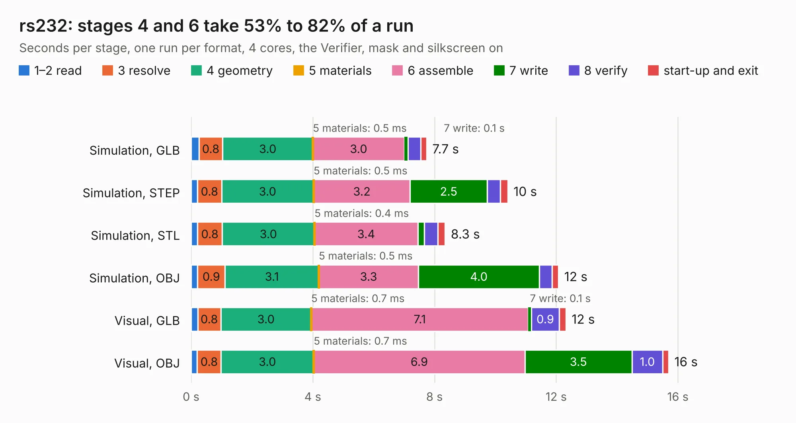

| Mode and format | 1–2 read | 3 resolve | 4 geometry | 5 materials | 6 assemble | 7 write | 8 verify | start-up and exit | Total |
|---|---:|---:|---:|---:|---:|---:|---:|---:|---:|
| Simulation, GLB | 0.3 | 0.8 | 3.0 | 0.5&nbsp;ms | 3.0 | 0.1 | 0.4 | 0.2 | 7.7 |
| Simulation, STEP | 0.2 | 0.8 | 3.0 | 0.5&nbsp;ms | 3.2 | 2.5 | 0.4 | 0.2 | 10.4 |
| Simulation, STL | 0.2 | 0.8 | 3.0 | 0.4&nbsp;ms | 3.4 | 0.2 | 0.4 | 0.2 | 8.3 |
| Simulation, OBJ | 0.2 | 0.9 | 3.1 | 0.5&nbsp;ms | 3.3 | 4.0 | 0.4 | 0.2 | 12.1 |
| Visual, GLB | 0.2 | 0.8 | 3.0 | 0.7&nbsp;ms | 7.1 | 0.1 | 0.9 | 0.2 | 12.3 |
| Visual, OBJ | 0.2 | 0.8 | 3.0 | 0.7&nbsp;ms | 6.9 | 3.5 | 1.0 | 0.2 | 15.7 |

<table align="center"><tr><td valign="top">

| Board | Repo: [greatscottgadgets/daisho](https://github.com/greatscottgadgets/daisho) Board: `rs232.kicad_pcb` |
|---|---|
| Folder | hw / de2-115-frontend / rs232 |
| Complexity | 222&nbsp;/&nbsp;1000 (size&nbsp;177, features&nbsp;45) |
| KESE&nbsp;features | through vias, filled zones, curved board outline |
| Tested | 9th November 2026 |
| Copper&nbsp;layers | 2 |
| File&nbsp;format | KiCad 3 (3) |
| Parts,&nbsp;tracks,&nbsp;vias | 41, 1,007, 149 |
| Triangles,&nbsp;simulation | 780,252 in 111 parts |
| Verifier | PASS in all six runs |

</td><td valign="top">

<table>
<tr><th>File type</th><th>File size</th><th>Peak memory used</th></tr>
<tr><th colspan="3" align="left">Simulation</th></tr>
<tr><td>GLB</td><td align="right">27&nbsp;MB</td><td align="right">447&nbsp;MB</td></tr>
<tr><td>STEP</td><td align="right">129&nbsp;MB</td><td align="right">483&nbsp;MB</td></tr>
<tr><td>STL</td><td align="right">39&nbsp;MB</td><td align="right">423&nbsp;MB</td></tr>
<tr><td>OBJ</td><td align="right">79&nbsp;MB</td><td align="right">563&nbsp;MB</td></tr>
<tr><th colspan="3" align="left">Visual</th></tr>
<tr><td>GLB</td><td align="right">23&nbsp;MB</td><td align="right">577&nbsp;MB</td></tr>
<tr><td>OBJ</td><td align="right">71&nbsp;MB</td><td align="right">596&nbsp;MB</td></tr>
</table>

</td></tr></table>

## 1099 gige_fe

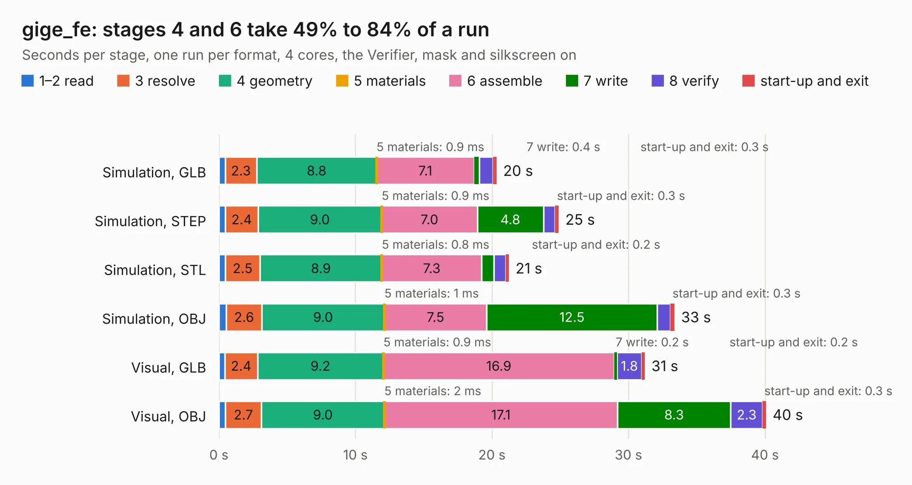

| Mode and format | 1–2 read | 3 resolve | 4 geometry | 5 materials | 6 assemble | 7 write | 8 verify | start-up and exit | Total |
|---|---:|---:|---:|---:|---:|---:|---:|---:|---:|
| Simulation, GLB | 0.5 | 2.3 | 8.8 | 0.9&nbsp;ms | 7.1 | 0.4 | 1.0 | 0.3 | 20.3 |
| Simulation, STEP | 0.5 | 2.4 | 9.0 | 0.9&nbsp;ms | 7.0 | 4.8 | 0.9 | 0.3 | 24.9 |
| Simulation, STL | 0.5 | 2.5 | 8.9 | 0.8&nbsp;ms | 7.3 | 0.9 | 0.9 | 0.2 | 21.3 |
| Simulation, OBJ | 0.5 | 2.6 | 9.0 | 1&nbsp;ms | 7.5 | 12.5 | 1.0 | 0.3 | 33.4 |
| Visual, GLB | 0.4 | 2.4 | 9.2 | 0.9&nbsp;ms | 16.9 | 0.2 | 1.8 | 0.2 | 31.2 |
| Visual, OBJ | 0.5 | 2.7 | 9.0 | 2&nbsp;ms | 17.1 | 8.3 | 2.3 | 0.3 | 40.1 |

<table align="center"><tr><td valign="top">

| Board | Repo: [greatscottgadgets/daisho](https://github.com/greatscottgadgets/daisho) Board: `gige_fe.kicad_pcb` |
|---|---|
| Folder | hw / frontend / daisho_gige_fe |
| Complexity | 306&nbsp;/&nbsp;1000 (size&nbsp;261, features&nbsp;45) |
| KESE&nbsp;features | through vias, filled zones, curved board outline |
| Tested | 9th November 2026 |
| Copper&nbsp;layers | 4 |
| File&nbsp;format | KiCad 4 (4) |
| Parts,&nbsp;tracks,&nbsp;vias | 138, 1,686, 264 |
| Triangles,&nbsp;simulation | 2,142,834 in 260 parts |
| Verifier | PASS in all six runs |

</td><td valign="top">

<table>
<tr><th>File type</th><th>File size</th><th>Peak memory used</th></tr>
<tr><th colspan="3" align="left">Simulation</th></tr>
<tr><td>GLB</td><td align="right">75&nbsp;MB</td><td align="right">801&nbsp;MB</td></tr>
<tr><td>STEP</td><td align="right">291&nbsp;MB</td><td align="right">856&nbsp;MB</td></tr>
<tr><td>STL</td><td align="right">107&nbsp;MB</td><td align="right">840&nbsp;MB</td></tr>
<tr><td>OBJ</td><td align="right">228&nbsp;MB</td><td align="right">1.4&nbsp;GB</td></tr>
<tr><th colspan="3" align="left">Visual</th></tr>
<tr><td>GLB</td><td align="right">46&nbsp;MB</td><td align="right">890&nbsp;MB</td></tr>
<tr><td>OBJ</td><td align="right">140&nbsp;MB</td><td align="right">1.0&nbsp;GB</td></tr>
</table>

</td></tr></table>

## 1100 rs232_fe

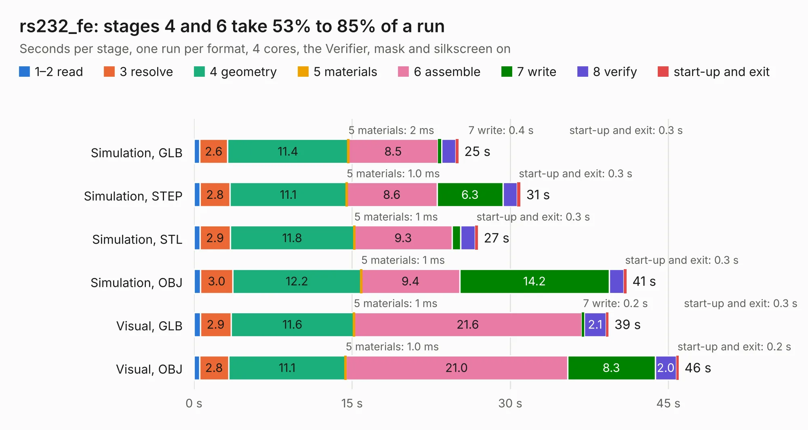

| Mode and format | 1–2 read | 3 resolve | 4 geometry | 5 materials | 6 assemble | 7 write | 8 verify | start-up and exit | Total |
|---|---:|---:|---:|---:|---:|---:|---:|---:|---:|
| Simulation, GLB | 0.5 | 2.6 | 11.4 | 2&nbsp;ms | 8.5 | 0.4 | 1.3 | 0.3 | 25.1 |
| Simulation, STEP | 0.6 | 2.8 | 11.1 | 1.0&nbsp;ms | 8.6 | 6.3 | 1.3 | 0.3 | 31.0 |
| Simulation, STL | 0.6 | 2.9 | 11.8 | 1&nbsp;ms | 9.3 | 0.8 | 1.4 | 0.3 | 26.9 |
| Simulation, OBJ | 0.6 | 3.0 | 12.2 | 1&nbsp;ms | 9.4 | 14.2 | 1.4 | 0.3 | 41.0 |
| Visual, GLB | 0.6 | 2.9 | 11.6 | 1&nbsp;ms | 21.6 | 0.2 | 2.1 | 0.3 | 39.3 |
| Visual, OBJ | 0.5 | 2.8 | 11.1 | 1.0&nbsp;ms | 21.0 | 8.3 | 2.0 | 0.2 | 46.0 |

<table align="center"><tr><td valign="top">

| Board | Repo: [greatscottgadgets/daisho](https://github.com/greatscottgadgets/daisho) Board: `rs232_fe.kicad_pcb` |
|---|---|
| Folder | hw / frontend / daisho_rs232_fe / rs232_fe |
| Complexity | 275&nbsp;/&nbsp;1000 (size&nbsp;220, features&nbsp;55) |
| KESE&nbsp;features | through vias, filled zones, copper text, curved board outline |
| Tested | 9th November 2026 |
| Copper&nbsp;layers | 4 |
| File&nbsp;format | KiCad 4 (4) |
| Parts,&nbsp;tracks,&nbsp;vias | 165, 2,512, 181 |
| Triangles,&nbsp;simulation | 2,309,022 in 309 parts |
| Verifier | PASS in all six runs |

</td><td valign="top">

<table>
<tr><th>File type</th><th>File size</th><th>Peak memory used</th></tr>
<tr><th colspan="3" align="left">Simulation</th></tr>
<tr><td>GLB</td><td align="right">82&nbsp;MB</td><td align="right">871&nbsp;MB</td></tr>
<tr><td>STEP</td><td align="right">345&nbsp;MB</td><td align="right">921&nbsp;MB</td></tr>
<tr><td>STL</td><td align="right">115&nbsp;MB</td><td align="right">817&nbsp;MB</td></tr>
<tr><td>OBJ</td><td align="right">250&nbsp;MB</td><td align="right">1.6&nbsp;GB</td></tr>
<tr><th colspan="3" align="left">Visual</th></tr>
<tr><td>GLB</td><td align="right">52&nbsp;MB</td><td align="right">1.0&nbsp;GB</td></tr>
<tr><td>OBJ</td><td align="right">161&nbsp;MB</td><td align="right">1.1&nbsp;GB</td></tr>
</table>

</td></tr></table>

## 1101 hdmi

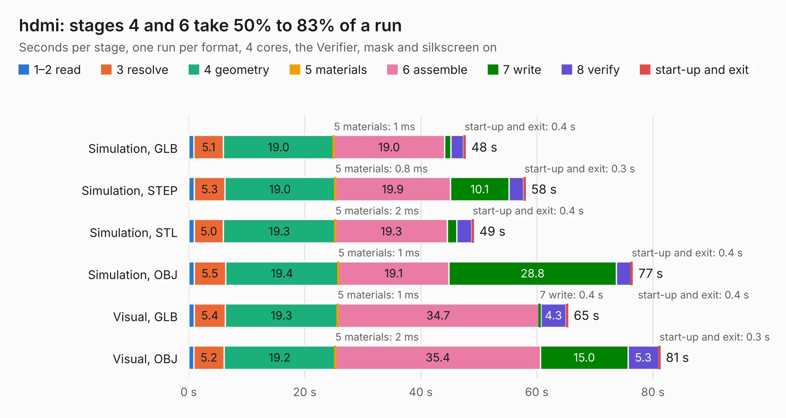

| Mode and format | 1–2 read | 3 resolve | 4 geometry | 5 materials | 6 assemble | 7 write | 8 verify | start-up and exit | Total |
|---|---:|---:|---:|---:|---:|---:|---:|---:|---:|
| Simulation, GLB | 0.9 | 5.1 | 19.0 | 1&nbsp;ms | 19.0 | 1.1 | 2.2 | 0.4 | 47.7 |
| Simulation, STEP | 1.0 | 5.3 | 19.0 | 0.8&nbsp;ms | 19.9 | 10.1 | 2.6 | 0.3 | 58.0 |
| Simulation, STL | 1.0 | 5.0 | 19.3 | 2&nbsp;ms | 19.3 | 1.6 | 2.6 | 0.4 | 49.1 |
| Simulation, OBJ | 0.9 | 5.5 | 19.4 | 1&nbsp;ms | 19.1 | 28.8 | 2.5 | 0.4 | 76.5 |
| Visual, GLB | 1.0 | 5.4 | 19.3 | 1&nbsp;ms | 34.7 | 0.4 | 4.3 | 0.4 | 65.4 |
| Visual, OBJ | 0.9 | 5.2 | 19.2 | 2&nbsp;ms | 35.4 | 15.0 | 5.3 | 0.3 | 81.3 |

<table align="center"><tr><td valign="top">

| Board | Repo: [greatscottgadgets/daisho](https://github.com/greatscottgadgets/daisho) Board: `hdmi.kicad_pcb` |
|---|---|
| Folder | hw / frontend / hdmi |
| Complexity | 346&nbsp;/&nbsp;1000 (size&nbsp;301, features&nbsp;45) |
| KESE&nbsp;features | through vias, filled zones, curved board outline |
| Tested | 9th November 2026 |
| Copper&nbsp;layers | 6 |
| File&nbsp;format | KiCad 4 (4) |
| Parts,&nbsp;tracks,&nbsp;vias | 224, 3,608, 525 |
| Triangles,&nbsp;simulation | 4,443,754 in 345 parts |
| Verifier | PASS in all six runs |

</td><td valign="top">

<table>
<tr><th>File type</th><th>File size</th><th>Peak memory used</th></tr>
<tr><th colspan="3" align="left">Simulation</th></tr>
<tr><td>GLB</td><td align="right">155&nbsp;MB</td><td align="right">1.3&nbsp;GB</td></tr>
<tr><td>STEP</td><td align="right">527&nbsp;MB</td><td align="right">1.6&nbsp;GB</td></tr>
<tr><td>STL</td><td align="right">222&nbsp;MB</td><td align="right">1.3&nbsp;GB</td></tr>
<tr><td>OBJ</td><td align="right">480&nbsp;MB</td><td align="right">2.9&nbsp;GB</td></tr>
<tr><th colspan="3" align="left">Visual</th></tr>
<tr><td>GLB</td><td align="right">83&nbsp;MB</td><td align="right">1.6&nbsp;GB</td></tr>
<tr><td>OBJ</td><td align="right">264&nbsp;MB</td><td align="right">1.8&nbsp;GB</td></tr>
</table>

</td></tr></table>

## 1102 prod_fe

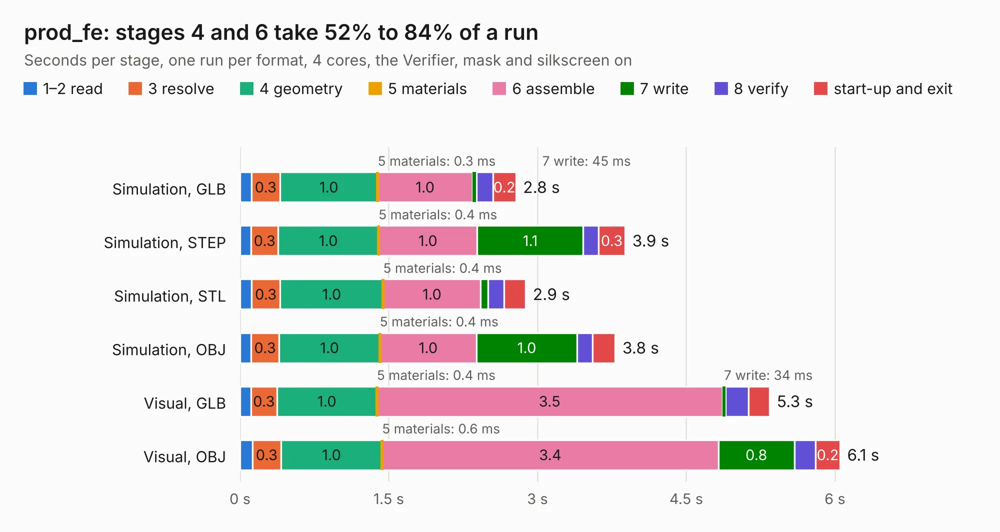

| Mode and format | 1–2 read | 3 resolve | 4 geometry | 5 materials | 6 assemble | 7 write | 8 verify | start-up and exit | Total |
|---|---:|---:|---:|---:|---:|---:|---:|---:|---:|
| Simulation, GLB | 0.1 | 0.3 | 1.0 | 0.3&nbsp;ms | 1.0 | 45&nbsp;ms | 0.2 | 0.2 | 2.8 |
| Simulation, STEP | 0.1 | 0.3 | 1.0 | 0.4&nbsp;ms | 1.0 | 1.1 | 0.2 | 0.3 | 3.9 |
| Simulation, STL | 0.1 | 0.3 | 1.0 | 0.4&nbsp;ms | 1.0 | 71&nbsp;ms | 0.2 | 0.2 | 2.9 |
| Simulation, OBJ | 0.1 | 0.3 | 1.0 | 0.4&nbsp;ms | 1.0 | 1.0 | 0.2 | 0.2 | 3.8 |
| Visual, GLB | 0.1 | 0.3 | 1.0 | 0.4&nbsp;ms | 3.5 | 34&nbsp;ms | 0.2 | 0.2 | 5.3 |
| Visual, OBJ | 0.1 | 0.3 | 1.0 | 0.6&nbsp;ms | 3.4 | 0.8 | 0.2 | 0.2 | 6.1 |

<table align="center"><tr><td valign="top">

| Board | Repo: [greatscottgadgets/daisho](https://github.com/greatscottgadgets/daisho) Board: `prod_fe.kicad_pcb` |
|---|---|
| Folder | hw / frontend / prod_fe_template |
| Complexity | 171&nbsp;/&nbsp;1000 (size&nbsp;146, features&nbsp;25) |
| KESE&nbsp;features | through vias, curved board outline |
| Tested | 9th November 2026 |
| Copper&nbsp;layers | 4 |
| File&nbsp;format | KiCad 3 (3) |
| Parts,&nbsp;tracks,&nbsp;vias | 5, 208, 28 |
| Triangles,&nbsp;simulation | 204,920 in 174 parts |
| Verifier | PASS in all six runs |

</td><td valign="top">

<table>
<tr><th>File type</th><th>File size</th><th>Peak memory used</th></tr>
<tr><th colspan="3" align="left">Simulation</th></tr>
<tr><td>GLB</td><td align="right">7.5&nbsp;MB</td><td align="right">224&nbsp;MB</td></tr>
<tr><td>STEP</td><td align="right">28&nbsp;MB</td><td align="right">232&nbsp;MB</td></tr>
<tr><td>STL</td><td align="right">10&nbsp;MB</td><td align="right">216&nbsp;MB</td></tr>
<tr><td>OBJ</td><td align="right">21&nbsp;MB</td><td align="right">224&nbsp;MB</td></tr>
<tr><th colspan="3" align="left">Visual</th></tr>
<tr><td>GLB</td><td align="right">5.3&nbsp;MB</td><td align="right">199&nbsp;MB</td></tr>
<tr><td>OBJ</td><td align="right">15&nbsp;MB</td><td align="right">204&nbsp;MB</td></tr>
</table>

</td></tr></table>

## 1103 usb

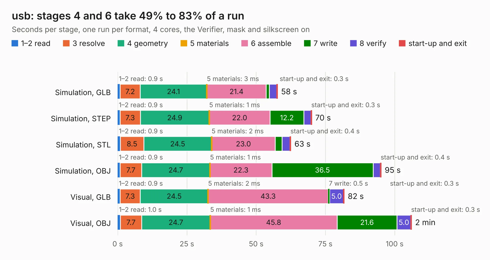

| Mode and format | 1–2 read | 3 resolve | 4 geometry | 5 materials | 6 assemble | 7 write | 8 verify | start-up and exit | Total |
|---|---:|---:|---:|---:|---:|---:|---:|---:|---:|
| Simulation, GLB | 0.9 | 7.2 | 24.1 | 3&nbsp;ms | 21.4 | 1.1 | 2.7 | 0.3 | 57.7 |
| Simulation, STEP | 0.9 | 7.3 | 24.9 | 1&nbsp;ms | 22.0 | 12.2 | 2.6 | 0.3 | 70.1 |
| Simulation, STL | 0.9 | 8.5 | 24.5 | 2&nbsp;ms | 23.0 | 2.4 | 2.9 | 0.4 | 62.6 |
| Simulation, OBJ | 0.9 | 7.7 | 24.7 | 1&nbsp;ms | 22.3 | 36.5 | 2.6 | 0.4 | 95.2 |
| Visual, GLB | 0.9 | 7.3 | 24.5 | 2&nbsp;ms | 43.3 | 0.5 | 5.0 | 0.3 | 81.8 |
| Visual, OBJ | 1.0 | 7.7 | 24.7 | 1&nbsp;ms | 45.8 | 21.6 | 5.0 | 0.3 | 106.1 |

<table align="center"><tr><td valign="top">

| Board | Repo: [greatscottgadgets/daisho](https://github.com/greatscottgadgets/daisho) Board: `usb.kicad_pcb` |
|---|---|
| Folder | hw / frontend / usb |
| Complexity | 333&nbsp;/&nbsp;1000 (size&nbsp;308, features&nbsp;25) |
| KESE&nbsp;features | through vias, curved board outline |
| Tested | 9th November 2026 |
| Copper&nbsp;layers | 6 |
| File&nbsp;format | KiCad 4 (4) |
| Parts,&nbsp;tracks,&nbsp;vias | 249, 5,119, 831 |
| Triangles,&nbsp;simulation | 5,867,216 in 325 parts |
| Verifier | PASS in all six runs |

</td><td valign="top">

<table>
<tr><th>File type</th><th>File size</th><th>Peak memory used</th></tr>
<tr><th colspan="3" align="left">Simulation</th></tr>
<tr><td>GLB</td><td align="right">202&nbsp;MB</td><td align="right">1.5&nbsp;GB</td></tr>
<tr><td>STEP</td><td align="right">706&nbsp;MB</td><td align="right">2.0&nbsp;GB</td></tr>
<tr><td>STL</td><td align="right">293&nbsp;MB</td><td align="right">1.6&nbsp;GB</td></tr>
<tr><td>OBJ</td><td align="right">640&nbsp;MB</td><td align="right">3.8&nbsp;GB</td></tr>
<tr><th colspan="3" align="left">Visual</th></tr>
<tr><td>GLB</td><td align="right">110&nbsp;MB</td><td align="right">1.8&nbsp;GB</td></tr>
<tr><td>OBJ</td><td align="right">360&nbsp;MB</td><td align="right">2.4&nbsp;GB</td></tr>
</table>

</td></tr></table>

## 1104 main_board

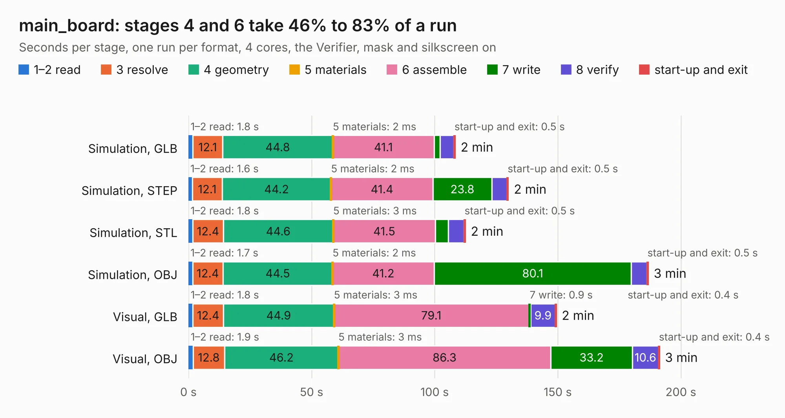

| Mode and format | 1–2 read | 3 resolve | 4 geometry | 5 materials | 6 assemble | 7 write | 8 verify | start-up and exit | Total |
|---|---:|---:|---:|---:|---:|---:|---:|---:|---:|
| Simulation, GLB | 1.8 | 12.1 | 44.8 | 2&nbsp;ms | 41.1 | 2.4 | 5.7 | 0.5 | 108.3 |
| Simulation, STEP | 1.6 | 12.1 | 44.2 | 2&nbsp;ms | 41.4 | 23.8 | 6.2 | 0.5 | 129.9 |
| Simulation, STL | 1.8 | 12.4 | 44.6 | 3&nbsp;ms | 41.5 | 5.2 | 6.4 | 0.5 | 112.4 |
| Simulation, OBJ | 1.7 | 12.4 | 44.5 | 2&nbsp;ms | 41.2 | 80.1 | 6.3 | 0.5 | 186.7 |
| Visual, GLB | 1.8 | 12.4 | 44.9 | 3&nbsp;ms | 79.1 | 0.9 | 9.9 | 0.4 | 149.3 |
| Visual, OBJ | 1.9 | 12.8 | 46.2 | 3&nbsp;ms | 86.3 | 33.2 | 10.6 | 0.4 | 191.3 |

<table align="center"><tr><td valign="top">

| Board | Repo: [greatscottgadgets/daisho](https://github.com/greatscottgadgets/daisho) Board: `main_board.kicad_pcb` |
|---|---|
| Folder | hw / main_board |
| Complexity | 375&nbsp;/&nbsp;1000 (size&nbsp;330, features&nbsp;45) |
| KESE&nbsp;features | through vias, filled zones, curved board outline |
| Tested | 9th November 2026 |
| Copper&nbsp;layers | 8 |
| File&nbsp;format | KiCad 4 (4) |
| Parts,&nbsp;tracks,&nbsp;vias | 383, 8,842, 1,485 |
| Triangles,&nbsp;simulation | 12,543,244 in 692 parts |
| Verifier | PASS in all six runs |

</td><td valign="top">

<table>
<tr><th>File type</th><th>File size</th><th>Peak memory used</th></tr>
<tr><th colspan="3" align="left">Simulation</th></tr>
<tr><td>GLB</td><td align="right">428&nbsp;MB</td><td align="right">2.4&nbsp;GB</td></tr>
<tr><td>STEP</td><td align="right">1.3&nbsp;GB</td><td align="right">3.6&nbsp;GB</td></tr>
<tr><td>STL</td><td align="right">627&nbsp;MB</td><td align="right">2.4&nbsp;GB</td></tr>
<tr><td>OBJ</td><td align="right">1.4&nbsp;GB</td><td align="right">7.9&nbsp;GB</td></tr>
<tr><th colspan="3" align="left">Visual</th></tr>
<tr><td>GLB</td><td align="right">192&nbsp;MB</td><td align="right">3.2&nbsp;GB</td></tr>
<tr><td>OBJ</td><td align="right">649&nbsp;MB</td><td align="right">4.2&nbsp;GB</td></tr>
</table>

</td></tr></table>

## 1105 azalea

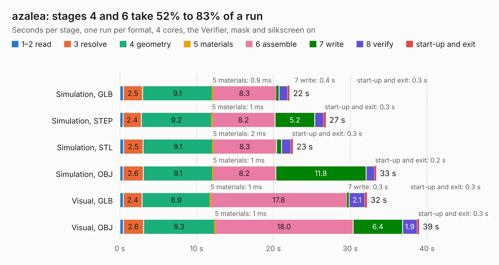

| Mode and format | 1–2 read | 3 resolve | 4 geometry | 5 materials | 6 assemble | 7 write | 8 verify | start-up and exit | Total |
|---|---:|---:|---:|---:|---:|---:|---:|---:|---:|
| Simulation, GLB | 0.4 | 2.5 | 9.1 | 0.9&nbsp;ms | 8.3 | 0.4 | 1.1 | 0.3 | 22.1 |
| Simulation, STEP | 0.4 | 2.4 | 9.2 | 1&nbsp;ms | 8.2 | 5.2 | 1.2 | 0.3 | 26.8 |
| Simulation, STL | 0.5 | 2.5 | 9.1 | 2&nbsp;ms | 8.3 | 0.7 | 1.2 | 0.3 | 22.6 |
| Simulation, OBJ | 0.4 | 2.6 | 9.1 | 1&nbsp;ms | 8.2 | 11.8 | 1.1 | 0.2 | 33.4 |
| Visual, GLB | 0.5 | 2.4 | 8.9 | 1&nbsp;ms | 17.8 | 0.3 | 2.1 | 0.3 | 32.2 |
| Visual, OBJ | 0.4 | 2.6 | 9.3 | 1&nbsp;ms | 18.0 | 6.4 | 1.9 | 0.3 | 39.0 |

<table align="center"><tr><td valign="top">

| Board | Repo: [greatscottgadgets/greatfet-hardware](https://github.com/greatscottgadgets/greatfet-hardware) Board: `azalea.kicad_pcb` |
|---|---|
| Folder | azalea |
| Complexity | 300&nbsp;/&nbsp;1000 (size&nbsp;245, features&nbsp;55) |
| KESE&nbsp;features | through vias, filled zones, copper text, curved board outline |
| Tested | 9th November 2026 |
| Copper&nbsp;layers | 4 |
| File&nbsp;format | KiCad 4 (4) |
| Parts,&nbsp;tracks,&nbsp;vias | 84, 1,412, 176 |
| Triangles,&nbsp;simulation | 2,293,082 in 149 parts |
| Verifier | PASS in all six runs |

</td><td valign="top">

<table>
<tr><th>File type</th><th>File size</th><th>Peak memory used</th></tr>
<tr><th colspan="3" align="left">Simulation</th></tr>
<tr><td>GLB</td><td align="right">80&nbsp;MB</td><td align="right">702&nbsp;MB</td></tr>
<tr><td>STEP</td><td align="right">329&nbsp;MB</td><td align="right">832&nbsp;MB</td></tr>
<tr><td>STL</td><td align="right">115&nbsp;MB</td><td align="right">717&nbsp;MB</td></tr>
<tr><td>OBJ</td><td align="right">244&nbsp;MB</td><td align="right">1.5&nbsp;GB</td></tr>
<tr><th colspan="3" align="left">Visual</th></tr>
<tr><td>GLB</td><td align="right">48&nbsp;MB</td><td align="right">870&nbsp;MB</td></tr>
<tr><td>OBJ</td><td align="right">149&nbsp;MB</td><td align="right">1.1&nbsp;GB</td></tr>
</table>

</td></tr></table>

## 1106 begonia

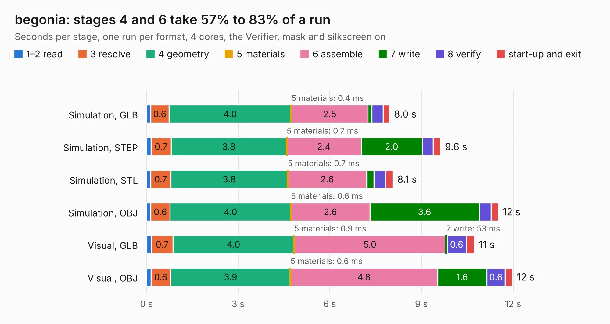

| Mode and format | 1–2 read | 3 resolve | 4 geometry | 5 materials | 6 assemble | 7 write | 8 verify | start-up and exit | Total |
|---|---:|---:|---:|---:|---:|---:|---:|---:|---:|
| Simulation, GLB | 0.1 | 0.6 | 4.0 | 0.4&nbsp;ms | 2.5 | 0.1 | 0.4 | 0.2 | 8.0 |
| Simulation, STEP | 0.2 | 0.7 | 3.8 | 0.7&nbsp;ms | 2.4 | 2.0 | 0.4 | 0.2 | 9.6 |
| Simulation, STL | 0.1 | 0.7 | 3.8 | 0.7&nbsp;ms | 2.6 | 0.2 | 0.4 | 0.2 | 8.1 |
| Simulation, OBJ | 0.1 | 0.6 | 4.0 | 0.6&nbsp;ms | 2.6 | 3.6 | 0.4 | 0.2 | 11.5 |
| Visual, GLB | 0.2 | 0.7 | 4.0 | 0.9&nbsp;ms | 5.0 | 53&nbsp;ms | 0.6 | 0.3 | 10.7 |
| Visual, OBJ | 0.2 | 0.6 | 3.9 | 0.6&nbsp;ms | 4.8 | 1.6 | 0.6 | 0.2 | 12.0 |

<table align="center"><tr><td valign="top">

| Board | Repo: [greatscottgadgets/greatfet-hardware](https://github.com/greatscottgadgets/greatfet-hardware) Board: `begonia.kicad_pcb` |
|---|---|
| Folder | begonia |
| Complexity | 162&nbsp;/&nbsp;1000 (size&nbsp;117, features&nbsp;45) |
| KESE&nbsp;features | through vias, filled zones, curved board outline |
| Tested | 9th November 2026 |
| Copper&nbsp;layers | 2 |
| File&nbsp;format | KiCad 4 (4) |
| Parts,&nbsp;tracks,&nbsp;vias | 13, 68, 3 |
| Triangles,&nbsp;simulation | 705,624 in 117 parts |
| Verifier | PASS in all six runs |

</td><td valign="top">

<table>
<tr><th>File type</th><th>File size</th><th>Peak memory used</th></tr>
<tr><th colspan="3" align="left">Simulation</th></tr>
<tr><td>GLB</td><td align="right">23&nbsp;MB</td><td align="right">327&nbsp;MB</td></tr>
<tr><td>STEP</td><td align="right">106&nbsp;MB</td><td align="right">411&nbsp;MB</td></tr>
<tr><td>STL</td><td align="right">35&nbsp;MB</td><td align="right">326&nbsp;MB</td></tr>
<tr><td>OBJ</td><td align="right">71&nbsp;MB</td><td align="right">506&nbsp;MB</td></tr>
<tr><th colspan="3" align="left">Visual</th></tr>
<tr><td>GLB</td><td align="right">12&nbsp;MB</td><td align="right">363&nbsp;MB</td></tr>
<tr><td>OBJ</td><td align="right">34&nbsp;MB</td><td align="right">368&nbsp;MB</td></tr>
</table>

</td></tr></table>

## 1107 crocus

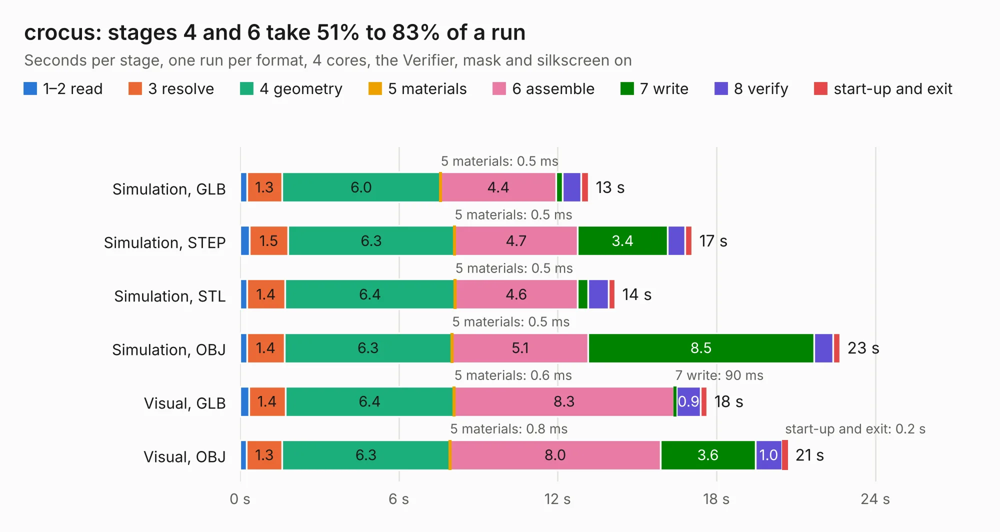

| Mode and format | 1–2 read | 3 resolve | 4 geometry | 5 materials | 6 assemble | 7 write | 8 verify | start-up and exit | Total |
|---|---:|---:|---:|---:|---:|---:|---:|---:|---:|
| Simulation, GLB | 0.3 | 1.3 | 6.0 | 0.5&nbsp;ms | 4.4 | 0.3 | 0.7 | 0.3 | 13.2 |
| Simulation, STEP | 0.4 | 1.5 | 6.3 | 0.5&nbsp;ms | 4.7 | 3.4 | 0.7 | 0.3 | 17.1 |
| Simulation, STL | 0.3 | 1.4 | 6.4 | 0.5&nbsp;ms | 4.6 | 0.4 | 0.8 | 0.2 | 14.2 |
| Simulation, OBJ | 0.3 | 1.4 | 6.3 | 0.5&nbsp;ms | 5.1 | 8.5 | 0.7 | 0.3 | 22.7 |
| Visual, GLB | 0.3 | 1.4 | 6.4 | 0.6&nbsp;ms | 8.3 | 90&nbsp;ms | 0.9 | 0.2 | 17.6 |
| Visual, OBJ | 0.3 | 1.3 | 6.3 | 0.8&nbsp;ms | 8.0 | 3.6 | 1.0 | 0.2 | 20.7 |

<table align="center"><tr><td valign="top">

| Board | Repo: [greatscottgadgets/greatfet-hardware](https://github.com/greatscottgadgets/greatfet-hardware) Board: `crocus.kicad_pcb` |
|---|---|
| Folder | crocus |
| Complexity | 220&nbsp;/&nbsp;1000 (size&nbsp;175, features&nbsp;45) |
| KESE&nbsp;features | through vias, filled zones, curved board outline |
| Tested | 9th November 2026 |
| Copper&nbsp;layers | 4 |
| File&nbsp;format | KiCad 4 (4) |
| Parts,&nbsp;tracks,&nbsp;vias | 49, 298, 46 |
| Triangles,&nbsp;simulation | 1,310,436 in 132 parts |
| Verifier | PASS in all six runs |

</td><td valign="top">

<table>
<tr><th>File type</th><th>File size</th><th>Peak memory used</th></tr>
<tr><th colspan="3" align="left">Simulation</th></tr>
<tr><td>GLB</td><td align="right">44&nbsp;MB</td><td align="right">471&nbsp;MB</td></tr>
<tr><td>STEP</td><td align="right">169&nbsp;MB</td><td align="right">546&nbsp;MB</td></tr>
<tr><td>STL</td><td align="right">66&nbsp;MB</td><td align="right">486&nbsp;MB</td></tr>
<tr><td>OBJ</td><td align="right">135&nbsp;MB</td><td align="right">870&nbsp;MB</td></tr>
<tr><th colspan="3" align="left">Visual</th></tr>
<tr><td>GLB</td><td align="right">21&nbsp;MB</td><td align="right">577&nbsp;MB</td></tr>
<tr><td>OBJ</td><td align="right">62&nbsp;MB</td><td align="right">529&nbsp;MB</td></tr>
</table>

</td></tr></table>

## 1108 daffodil

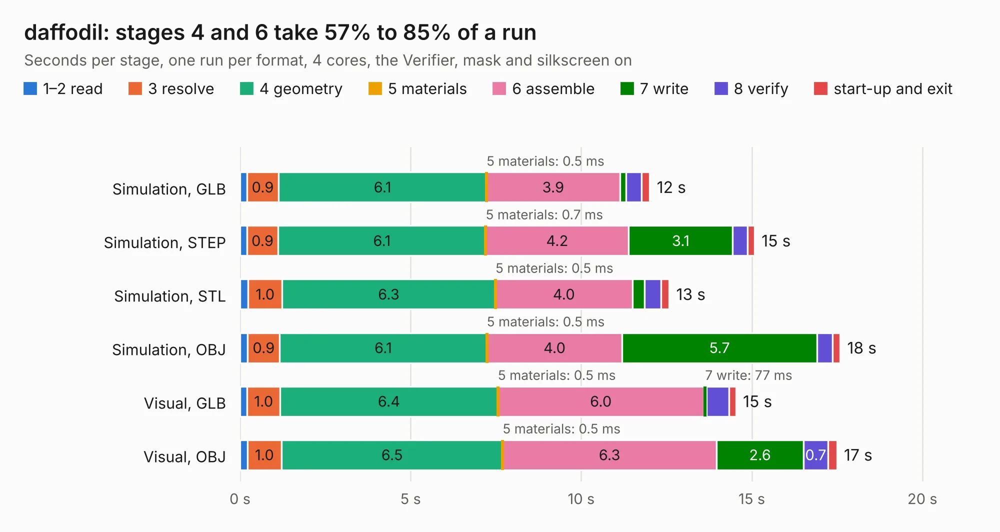

| Mode and format | 1–2 read | 3 resolve | 4 geometry | 5 materials | 6 assemble | 7 write | 8 verify | start-up and exit | Total |
|---|---:|---:|---:|---:|---:|---:|---:|---:|---:|
| Simulation, GLB | 0.2 | 0.9 | 6.1 | 0.5&nbsp;ms | 3.9 | 0.2 | 0.4 | 0.2 | 12.0 |
| Simulation, STEP | 0.2 | 0.9 | 6.1 | 0.7&nbsp;ms | 4.2 | 3.1 | 0.4 | 0.2 | 15.1 |
| Simulation, STL | 0.2 | 1.0 | 6.3 | 0.5&nbsp;ms | 4.0 | 0.4 | 0.5 | 0.2 | 12.6 |
| Simulation, OBJ | 0.2 | 0.9 | 6.1 | 0.5&nbsp;ms | 4.0 | 5.7 | 0.5 | 0.2 | 17.6 |
| Visual, GLB | 0.2 | 1.0 | 6.4 | 0.5&nbsp;ms | 6.0 | 77&nbsp;ms | 0.7 | 0.2 | 14.5 |
| Visual, OBJ | 0.2 | 1.0 | 6.5 | 0.5&nbsp;ms | 6.3 | 2.6 | 0.7 | 0.3 | 17.5 |

<table align="center"><tr><td valign="top">

| Board | Repo: [greatscottgadgets/greatfet-hardware](https://github.com/greatscottgadgets/greatfet-hardware) Board: `daffodil.kicad_pcb` |
|---|---|
| Folder | daffodil |
| Complexity | 137&nbsp;/&nbsp;1000 (size&nbsp;97, features&nbsp;40) |
| KESE&nbsp;features | filled zones, copper text, curved board outline |
| Tested | 9th November 2026 |
| Copper&nbsp;layers | 2 |
| File&nbsp;format | KiCad 5 (20171130) |
| Parts,&nbsp;tracks,&nbsp;vias | 8, 30, 0 |
| Triangles,&nbsp;simulation | 1,112,878 in 154 parts |
| Verifier | PASS in all six runs |

</td><td valign="top">

<table>
<tr><th>File type</th><th>File size</th><th>Peak memory used</th></tr>
<tr><th colspan="3" align="left">Simulation</th></tr>
<tr><td>GLB</td><td align="right">37&nbsp;MB</td><td align="right">443&nbsp;MB</td></tr>
<tr><td>STEP</td><td align="right">172&nbsp;MB</td><td align="right">558&nbsp;MB</td></tr>
<tr><td>STL</td><td align="right">56&nbsp;MB</td><td align="right">430&nbsp;MB</td></tr>
<tr><td>OBJ</td><td align="right">113&nbsp;MB</td><td align="right">786&nbsp;MB</td></tr>
<tr><th colspan="3" align="left">Visual</th></tr>
<tr><td>GLB</td><td align="right">18&nbsp;MB</td><td align="right">491&nbsp;MB</td></tr>
<tr><td>OBJ</td><td align="right">53&nbsp;MB</td><td align="right">513&nbsp;MB</td></tr>
</table>

</td></tr></table>

## 1109 edelweiss

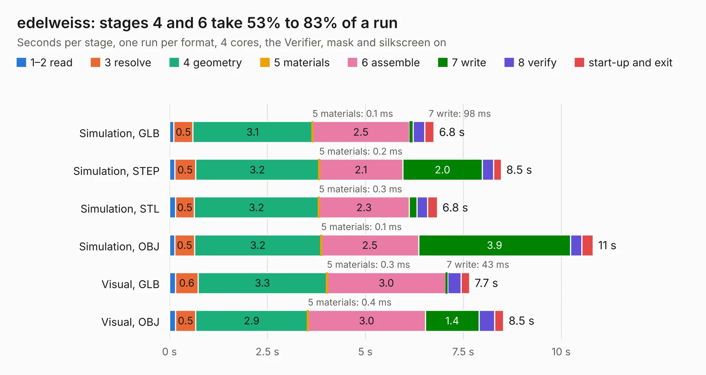

| Mode and format | 1–2 read | 3 resolve | 4 geometry | 5 materials | 6 assemble | 7 write | 8 verify | start-up and exit | Total |
|---|---:|---:|---:|---:|---:|---:|---:|---:|---:|
| Simulation, GLB | 0.1 | 0.5 | 3.1 | 0.1&nbsp;ms | 2.5 | 98&nbsp;ms | 0.3 | 0.2 | 6.8 |
| Simulation, STEP | 0.1 | 0.5 | 3.2 | 0.2&nbsp;ms | 2.1 | 2.0 | 0.3 | 0.2 | 8.5 |
| Simulation, STL | 0.2 | 0.5 | 3.2 | 0.3&nbsp;ms | 2.3 | 0.2 | 0.3 | 0.3 | 6.8 |
| Simulation, OBJ | 0.1 | 0.5 | 3.2 | 0.1&nbsp;ms | 2.5 | 3.9 | 0.3 | 0.3 | 10.8 |
| Visual, GLB | 0.2 | 0.6 | 3.3 | 0.3&nbsp;ms | 3.0 | 43&nbsp;ms | 0.3 | 0.2 | 7.7 |
| Visual, OBJ | 0.2 | 0.5 | 2.9 | 0.4&nbsp;ms | 3.0 | 1.4 | 0.4 | 0.2 | 8.5 |

<table align="center"><tr><td valign="top">

| Board | Repo: [greatscottgadgets/greatfet-hardware](https://github.com/greatscottgadgets/greatfet-hardware) Board: `edelweiss.kicad_pcb` |
|---|---|
| Folder | edelweiss |
| Complexity | 96&nbsp;/&nbsp;1000 (size&nbsp;56, features&nbsp;40) |
| KESE&nbsp;features | filled zones, copper text, curved board outline |
| Tested | 9th November 2026 |
| Copper&nbsp;layers | 4 |
| File&nbsp;format | KiCad 4 (4) |
| Parts,&nbsp;tracks,&nbsp;vias | 7, 0, 0 |
| Triangles,&nbsp;simulation | 829,404 in 16 parts |
| Verifier | PASS in all six runs |

</td><td valign="top">

<table>
<tr><th>File type</th><th>File size</th><th>Peak memory used</th></tr>
<tr><th colspan="3" align="left">Simulation</th></tr>
<tr><td>GLB</td><td align="right">28&nbsp;MB</td><td align="right">371&nbsp;MB</td></tr>
<tr><td>STEP</td><td align="right">99&nbsp;MB</td><td align="right">443&nbsp;MB</td></tr>
<tr><td>STL</td><td align="right">41&nbsp;MB</td><td align="right">376&nbsp;MB</td></tr>
<tr><td>OBJ</td><td align="right">83&nbsp;MB</td><td align="right">591&nbsp;MB</td></tr>
<tr><th colspan="3" align="left">Visual</th></tr>
<tr><td>GLB</td><td align="right">10&nbsp;MB</td><td align="right">362&nbsp;MB</td></tr>
<tr><td>OBJ</td><td align="right">30&nbsp;MB</td><td align="right">360&nbsp;MB</td></tr>
</table>

</td></tr></table>

## 1110 foxglove

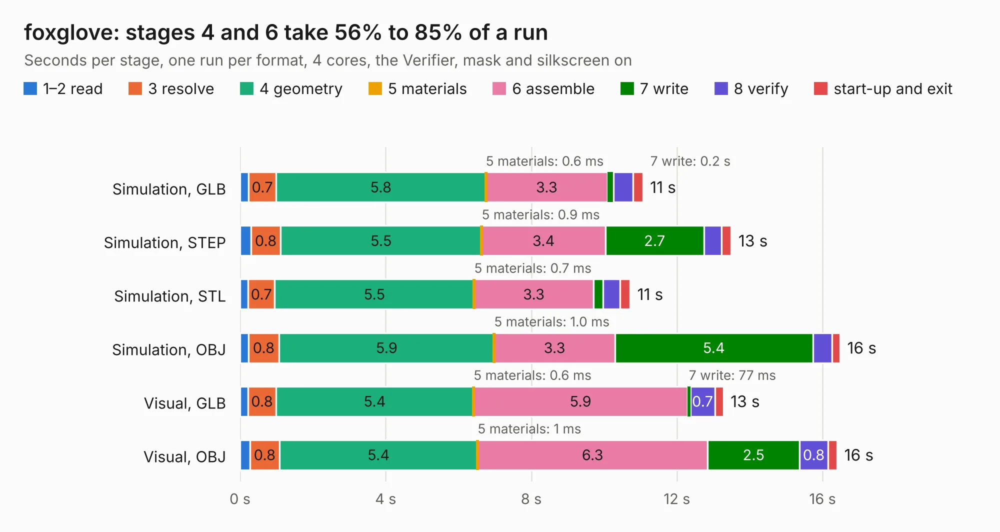

| Mode and format | 1–2 read | 3 resolve | 4 geometry | 5 materials | 6 assemble | 7 write | 8 verify | start-up and exit | Total |
|---|---:|---:|---:|---:|---:|---:|---:|---:|---:|
| Simulation, GLB | 0.2 | 0.7 | 5.8 | 0.6&nbsp;ms | 3.3 | 0.2 | 0.5 | 0.3 | 11.1 |
| Simulation, STEP | 0.3 | 0.8 | 5.5 | 0.9&nbsp;ms | 3.4 | 2.7 | 0.5 | 0.3 | 13.5 |
| Simulation, STL | 0.2 | 0.7 | 5.5 | 0.7&nbsp;ms | 3.3 | 0.3 | 0.5 | 0.3 | 10.7 |
| Simulation, OBJ | 0.2 | 0.8 | 5.9 | 1.0&nbsp;ms | 3.3 | 5.4 | 0.5 | 0.2 | 16.5 |
| Visual, GLB | 0.2 | 0.8 | 5.4 | 0.6&nbsp;ms | 5.9 | 77&nbsp;ms | 0.7 | 0.2 | 13.3 |
| Visual, OBJ | 0.3 | 0.8 | 5.4 | 1&nbsp;ms | 6.3 | 2.5 | 0.8 | 0.3 | 16.4 |

<table align="center"><tr><td valign="top">

| Board | Repo: [greatscottgadgets/greatfet-hardware](https://github.com/greatscottgadgets/greatfet-hardware) Board: `foxglove.kicad_pcb` |
|---|---|
| Folder | foxglove |
| Complexity | 242&nbsp;/&nbsp;1000 (size&nbsp;187, features&nbsp;55) |
| KESE&nbsp;features | through vias, filled zones, copper text, curved board outline |
| Tested | 9th November 2026 |
| Copper&nbsp;layers | 2 |
| File&nbsp;format | KiCad 4 (4) |
| Parts,&nbsp;tracks,&nbsp;vias | 19, 318, 24 |
| Triangles,&nbsp;simulation | 855,148 in 137 parts |
| Verifier | PASS in all six runs |

</td><td valign="top">

<table>
<tr><th>File type</th><th>File size</th><th>Peak memory used</th></tr>
<tr><th colspan="3" align="left">Simulation</th></tr>
<tr><td>GLB</td><td align="right">29&nbsp;MB</td><td align="right">375&nbsp;MB</td></tr>
<tr><td>STEP</td><td align="right">133&nbsp;MB</td><td align="right">464&nbsp;MB</td></tr>
<tr><td>STL</td><td align="right">43&nbsp;MB</td><td align="right">361&nbsp;MB</td></tr>
<tr><td>OBJ</td><td align="right">87&nbsp;MB</td><td align="right">632&nbsp;MB</td></tr>
<tr><th colspan="3" align="left">Visual</th></tr>
<tr><td>GLB</td><td align="right">15&nbsp;MB</td><td align="right">433&nbsp;MB</td></tr>
<tr><td>OBJ</td><td align="right">44&nbsp;MB</td><td align="right">427&nbsp;MB</td></tr>
</table>

</td></tr></table>

## 1111 gladiolus

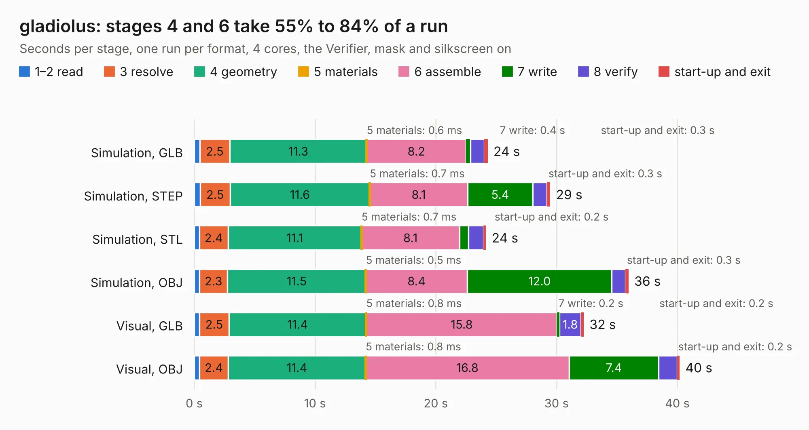

| Mode and format | 1–2 read | 3 resolve | 4 geometry | 5 materials | 6 assemble | 7 write | 8 verify | start-up and exit | Total |
|---|---:|---:|---:|---:|---:|---:|---:|---:|---:|
| Simulation, GLB | 0.5 | 2.5 | 11.3 | 0.6&nbsp;ms | 8.2 | 0.4 | 1.1 | 0.3 | 24.3 |
| Simulation, STEP | 0.5 | 2.5 | 11.6 | 0.7&nbsp;ms | 8.1 | 5.4 | 1.2 | 0.3 | 29.5 |
| Simulation, STL | 0.4 | 2.4 | 11.1 | 0.7&nbsp;ms | 8.1 | 0.8 | 1.2 | 0.2 | 24.2 |
| Simulation, OBJ | 0.4 | 2.3 | 11.5 | 0.5&nbsp;ms | 8.4 | 12.0 | 1.1 | 0.3 | 36.0 |
| Visual, GLB | 0.4 | 2.5 | 11.4 | 0.8&nbsp;ms | 15.8 | 0.2 | 1.8 | 0.2 | 32.3 |
| Visual, OBJ | 0.4 | 2.4 | 11.4 | 0.8&nbsp;ms | 16.8 | 7.4 | 1.5 | 0.2 | 40.2 |

<table align="center"><tr><td valign="top">

| Board | Repo: [greatscottgadgets/greatfet-hardware](https://github.com/greatscottgadgets/greatfet-hardware) Board: `gladiolus.kicad_pcb` |
|---|---|
| Folder | gladiolus |
| Complexity | 299&nbsp;/&nbsp;1000 (size&nbsp;244, features&nbsp;55) |
| KESE&nbsp;features | through vias, filled zones, copper text, curved board outline |
| Tested | 9th November 2026 |
| Copper&nbsp;layers | 4 |
| File&nbsp;format | KiCad 5 (20171130) |
| Parts,&nbsp;tracks,&nbsp;vias | 138, 962, 106 |
| Triangles,&nbsp;simulation | 2,062,476 in 114 parts |
| Verifier | PASS in all six runs |

</td><td valign="top">

<table>
<tr><th>File type</th><th>File size</th><th>Peak memory used</th></tr>
<tr><th colspan="3" align="left">Simulation</th></tr>
<tr><td>GLB</td><td align="right">71&nbsp;MB</td><td align="right">782&nbsp;MB</td></tr>
<tr><td>STEP</td><td align="right">326&nbsp;MB</td><td align="right">859&nbsp;MB</td></tr>
<tr><td>STL</td><td align="right">103&nbsp;MB</td><td align="right">661&nbsp;MB</td></tr>
<tr><td>OBJ</td><td align="right">217&nbsp;MB</td><td align="right">1.3&nbsp;GB</td></tr>
<tr><th colspan="3" align="left">Visual</th></tr>
<tr><td>GLB</td><td align="right">40&nbsp;MB</td><td align="right">856&nbsp;MB</td></tr>
<tr><td>OBJ</td><td align="right">122&nbsp;MB</td><td align="right">938&nbsp;MB</td></tr>
</table>

</td></tr></table>

## 1112 jasmine

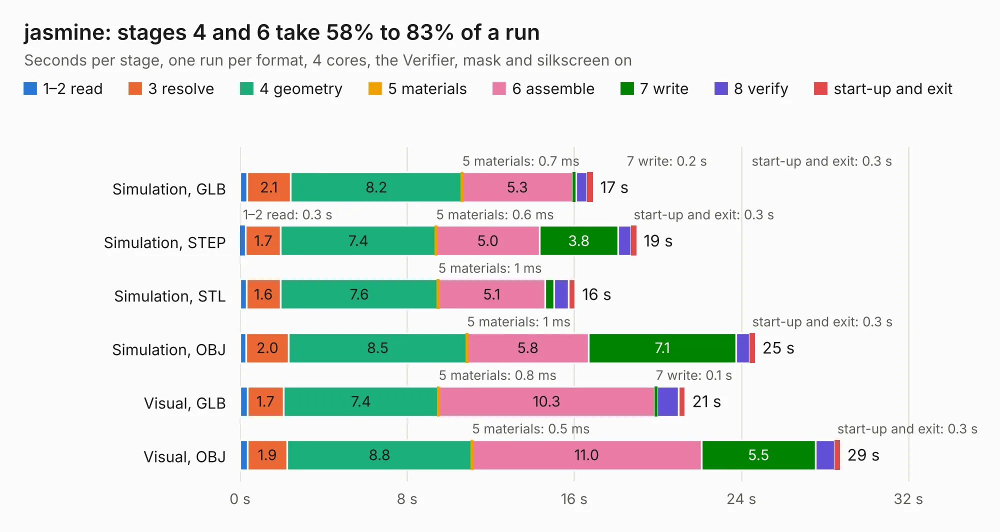

| Mode and format | 1–2 read | 3 resolve | 4 geometry | 5 materials | 6 assemble | 7 write | 8 verify | start-up and exit | Total |
|---|---:|---:|---:|---:|---:|---:|---:|---:|---:|
| Simulation, GLB | 0.3 | 2.1 | 8.2 | 0.7&nbsp;ms | 5.3 | 0.2 | 0.5 | 0.3 | 16.9 |
| Simulation, STEP | 0.3 | 1.7 | 7.4 | 0.6&nbsp;ms | 5.0 | 3.8 | 0.6 | 0.3 | 19.0 |
| Simulation, STL | 0.3 | 1.6 | 7.6 | 1&nbsp;ms | 5.1 | 0.4 | 0.7 | 0.3 | 16.0 |
| Simulation, OBJ | 0.3 | 2.0 | 8.5 | 1&nbsp;ms | 5.8 | 7.1 | 0.6 | 0.3 | 24.7 |
| Visual, GLB | 0.4 | 1.7 | 7.4 | 0.8&nbsp;ms | 10.3 | 0.1 | 1.0 | 0.3 | 21.3 |
| Visual, OBJ | 0.3 | 1.9 | 8.8 | 0.5&nbsp;ms | 11.0 | 5.5 | 0.9 | 0.3 | 28.7 |

<table align="center"><tr><td valign="top">

| Board | Repo: [greatscottgadgets/greatfet-hardware](https://github.com/greatscottgadgets/greatfet-hardware) Board: `jasmine.kicad_pcb` |
|---|---|
| Folder | jasmine |
| Complexity | 218&nbsp;/&nbsp;1000 (size&nbsp;163, features&nbsp;55) |
| KESE&nbsp;features | through vias, filled zones, copper text, curved board outline |
| Tested | 9th November 2026 |
| Copper&nbsp;layers | 2 |
| File&nbsp;format | KiCad 5 (20171130) |
| Parts,&nbsp;tracks,&nbsp;vias | 69, 349, 37 |
| Triangles,&nbsp;simulation | 1,031,328 in 156 parts |
| Verifier | PASS in all six runs |

</td><td valign="top">

<table>
<tr><th>File type</th><th>File size</th><th>Peak memory used</th></tr>
<tr><th colspan="3" align="left">Simulation</th></tr>
<tr><td>GLB</td><td align="right">35&nbsp;MB</td><td align="right">408&nbsp;MB</td></tr>
<tr><td>STEP</td><td align="right">163&nbsp;MB</td><td align="right">510&nbsp;MB</td></tr>
<tr><td>STL</td><td align="right">52&nbsp;MB</td><td align="right">428&nbsp;MB</td></tr>
<tr><td>OBJ</td><td align="right">106&nbsp;MB</td><td align="right">754&nbsp;MB</td></tr>
<tr><th colspan="3" align="left">Visual</th></tr>
<tr><td>GLB</td><td align="right">20&nbsp;MB</td><td align="right">504&nbsp;MB</td></tr>
<tr><td>OBJ</td><td align="right">59&nbsp;MB</td><td align="right">484&nbsp;MB</td></tr>
</table>

</td></tr></table>

## 1113 lily

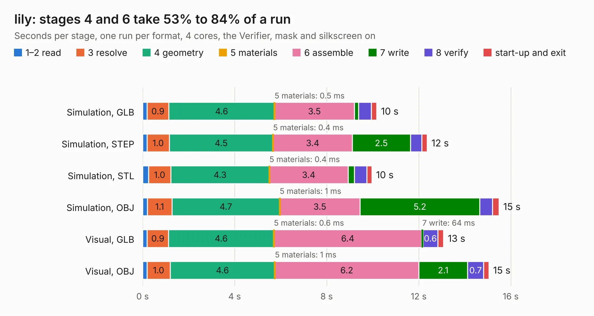

| Mode and format | 1–2 read | 3 resolve | 4 geometry | 5 materials | 6 assemble | 7 write | 8 verify | start-up and exit | Total |
|---|---:|---:|---:|---:|---:|---:|---:|---:|---:|
| Simulation, GLB | 0.2 | 0.9 | 4.6 | 0.5&nbsp;ms | 3.5 | 0.2 | 0.6 | 0.2 | 10.2 |
| Simulation, STEP | 0.2 | 1.0 | 4.5 | 0.4&nbsp;ms | 3.4 | 2.5 | 0.5 | 0.2 | 12.4 |
| Simulation, STL | 0.3 | 1.0 | 4.3 | 0.4&nbsp;ms | 3.4 | 0.3 | 0.5 | 0.2 | 10.0 |
| Simulation, OBJ | 0.2 | 1.1 | 4.7 | 1&nbsp;ms | 3.5 | 5.2 | 0.6 | 0.3 | 15.5 |
| Visual, GLB | 0.2 | 0.9 | 4.6 | 0.6&nbsp;ms | 6.4 | 64&nbsp;ms | 0.6 | 0.3 | 13.1 |
| Visual, OBJ | 0.2 | 1.0 | 4.6 | 1&nbsp;ms | 6.2 | 2.1 | 0.7 | 0.2 | 15.1 |

<table align="center"><tr><td valign="top">

| Board | Repo: [greatscottgadgets/greatfet-hardware](https://github.com/greatscottgadgets/greatfet-hardware) Board: `lily.kicad_pcb` |
|---|---|
| Folder | lily |
| Complexity | 212&nbsp;/&nbsp;1000 (size&nbsp;157, features&nbsp;55) |
| KESE&nbsp;features | through vias, filled zones, copper text, curved board outline |
| Tested | 9th November 2026 |
| Copper&nbsp;layers | 4 |
| File&nbsp;format | KiCad 4 (4) |
| Parts,&nbsp;tracks,&nbsp;vias | 31, 139, 17 |
| Triangles,&nbsp;simulation | 1,061,168 in 122 parts |
| Verifier | PASS in all six runs |

</td><td valign="top">

<table>
<tr><th>File type</th><th>File size</th><th>Peak memory used</th></tr>
<tr><th colspan="3" align="left">Simulation</th></tr>
<tr><td>GLB</td><td align="right">35&nbsp;MB</td><td align="right">383&nbsp;MB</td></tr>
<tr><td>STEP</td><td align="right">134&nbsp;MB</td><td align="right">472&nbsp;MB</td></tr>
<tr><td>STL</td><td align="right">53&nbsp;MB</td><td align="right">394&nbsp;MB</td></tr>
<tr><td>OBJ</td><td align="right">107&nbsp;MB</td><td align="right">747&nbsp;MB</td></tr>
<tr><th colspan="3" align="left">Visual</th></tr>
<tr><td>GLB</td><td align="right">15&nbsp;MB</td><td align="right">436&nbsp;MB</td></tr>
<tr><td>OBJ</td><td align="right">44&nbsp;MB</td><td align="right">428&nbsp;MB</td></tr>
</table>

</td></tr></table>

## 1114 luckybamboo

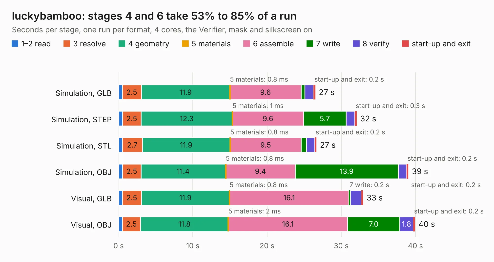

| Mode and format | 1–2 read | 3 resolve | 4 geometry | 5 materials | 6 assemble | 7 write | 8 verify | start-up and exit | Total |
|---|---:|---:|---:|---:|---:|---:|---:|---:|---:|
| Simulation, GLB | 0.5 | 2.5 | 11.9 | 0.8&nbsp;ms | 9.6 | 0.5 | 1.2 | 0.2 | 26.5 |
| Simulation, STEP | 0.5 | 2.5 | 12.3 | 1&nbsp;ms | 9.6 | 5.7 | 1.2 | 0.3 | 32.1 |
| Simulation, STL | 0.5 | 2.7 | 11.9 | 0.8&nbsp;ms | 9.5 | 0.7 | 1.1 | 0.2 | 26.7 |
| Simulation, OBJ | 0.5 | 2.5 | 11.4 | 0.8&nbsp;ms | 9.4 | 13.9 | 1.1 | 0.2 | 39.0 |
| Visual, GLB | 0.5 | 2.5 | 11.9 | 0.8&nbsp;ms | 16.1 | 0.2 | 1.5 | 0.2 | 32.9 |
| Visual, OBJ | 0.5 | 2.5 | 11.8 | 2&nbsp;ms | 16.1 | 7.0 | 1.8 | 0.2 | 39.9 |

<table align="center"><tr><td valign="top">

| Board | Repo: [greatscottgadgets/greatfet-hardware](https://github.com/greatscottgadgets/greatfet-hardware) Board: `luckybamboo.kicad_pcb` |
|---|---|
| Folder | luckybamboo |
| Complexity | 336&nbsp;/&nbsp;1000 (size&nbsp;281, features&nbsp;55) |
| KESE&nbsp;features | through vias, filled zones, copper text, curved board outline |
| Tested | 9th November 2026 |
| Copper&nbsp;layers | 4 |
| File&nbsp;format | KiCad 5 (20171130) |
| Parts,&nbsp;tracks,&nbsp;vias | 153, 1,754, 197 |
| Triangles,&nbsp;simulation | 2,657,326 in 183 parts |
| Verifier | PASS in all six runs |

</td><td valign="top">

<table>
<tr><th>File type</th><th>File size</th><th>Peak memory used</th></tr>
<tr><th colspan="3" align="left">Simulation</th></tr>
<tr><td>GLB</td><td align="right">92&nbsp;MB</td><td align="right">827&nbsp;MB</td></tr>
<tr><td>STEP</td><td align="right">351&nbsp;MB</td><td align="right">979&nbsp;MB</td></tr>
<tr><td>STL</td><td align="right">133&nbsp;MB</td><td align="right">884&nbsp;MB</td></tr>
<tr><td>OBJ</td><td align="right">283&nbsp;MB</td><td align="right">1.8&nbsp;GB</td></tr>
<tr><th colspan="3" align="left">Visual</th></tr>
<tr><td>GLB</td><td align="right">48&nbsp;MB</td><td align="right">901&nbsp;MB</td></tr>
<tr><td>OBJ</td><td align="right">147&nbsp;MB</td><td align="right">1.0&nbsp;GB</td></tr>
</table>

</td></tr></table>

## 1115 narcissus

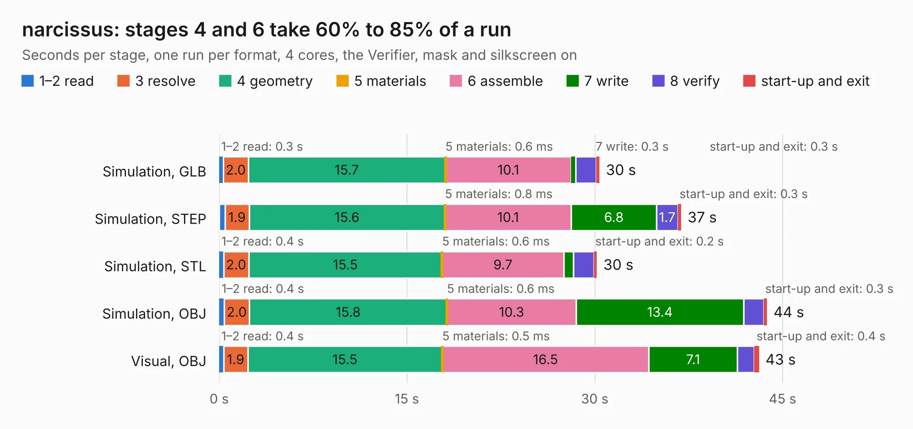

| Mode and format | 1–2 read | 3 resolve | 4 geometry | 5 materials | 6 assemble | 7 write | 8 verify | start-up and exit | Total |
|---|---:|---:|---:|---:|---:|---:|---:|---:|---:|
| Simulation, GLB | 0.3 | 2.0 | 15.7 | 0.6&nbsp;ms | 10.1 | 0.3 | 1.6 | 0.3 | 30.4 |
| Simulation, STEP | 0.5 | 1.9 | 15.6 | 0.8&nbsp;ms | 10.1 | 6.8 | 1.7 | 0.3 | 36.9 |
| Simulation, STL | 0.4 | 2.0 | 15.5 | 0.6&nbsp;ms | 9.7 | 0.8 | 1.6 | 0.2 | 30.2 |
| Simulation, OBJ | 0.4 | 2.0 | 15.8 | 0.6&nbsp;ms | 10.3 | 13.4 | 1.6 | 0.3 | 43.8 |
| Visual, GLB | 0.4 | 1.7 | 13.4 | 0.8&nbsp;ms | 18.6 | 0.3 | 1.7 | 0.3 | 36.4 |
| Visual, OBJ | 0.4 | 1.9 | 15.5 | 0.5&nbsp;ms | 16.5 | 7.1 | 1.4 | 0.4 | 43.1 |

<table align="center"><tr><td valign="top">

| Board | Repo: [greatscottgadgets/greatfet-hardware](https://github.com/greatscottgadgets/greatfet-hardware) Board: `narcissus.kicad_pcb` |
|---|---|
| Folder | narcissus |
| Complexity | 280&nbsp;/&nbsp;1000 (size&nbsp;225, features&nbsp;55) |
| KESE&nbsp;features | through vias, filled zones, copper text, curved board outline |
| Tested | 9th November 2026 |
| Copper&nbsp;layers | 2 |
| File&nbsp;format | KiCad 4 (4) |
| Parts,&nbsp;tracks,&nbsp;vias | 51, 1,212, 68 |
| Triangles,&nbsp;simulation | 2,432,446 in 193 parts |
| Verifier | PASS in all six runs |

</td><td valign="top">

<table>
<tr><th>File type</th><th>File size</th><th>Peak memory used</th></tr>
<tr><th colspan="3" align="left">Simulation</th></tr>
<tr><td>GLB</td><td align="right">83&nbsp;MB</td><td align="right">728&nbsp;MB</td></tr>
<tr><td>STEP</td><td align="right">424&nbsp;MB</td><td align="right">977&nbsp;MB</td></tr>
<tr><td>STL</td><td align="right">122&nbsp;MB</td><td align="right">752&nbsp;MB</td></tr>
<tr><td>OBJ</td><td align="right">257&nbsp;MB</td><td align="right">1.6&nbsp;GB</td></tr>
<tr><th colspan="3" align="left">Visual</th></tr>
<tr><td>GLB</td><td align="right">44&nbsp;MB</td><td align="right">977&nbsp;MB</td></tr>
<tr><td>OBJ</td><td align="right">135&nbsp;MB</td><td align="right">1.0&nbsp;GB</td></tr>
</table>

</td></tr></table>

## 1116 neighbor-template

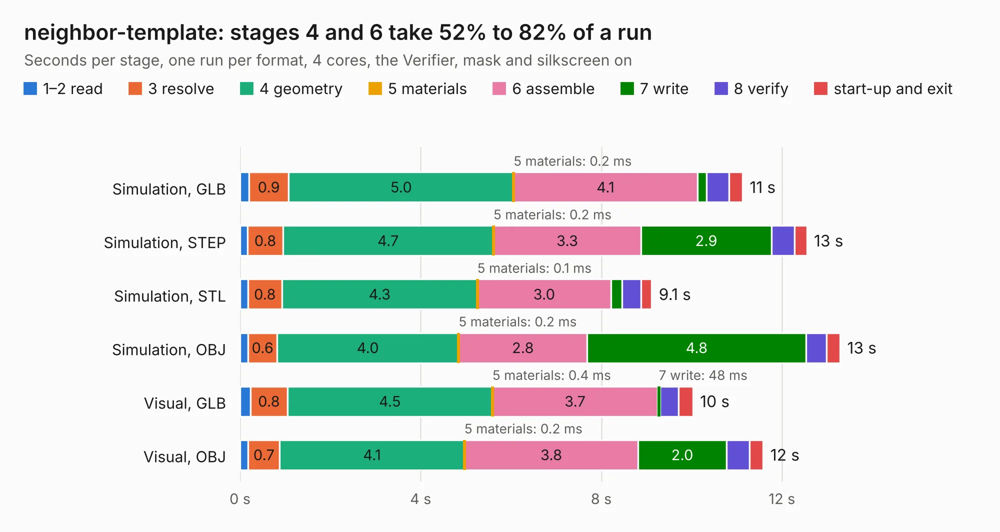

| Mode and format | 1–2 read | 3 resolve | 4 geometry | 5 materials | 6 assemble | 7 write | 8 verify | start-up and exit | Total |
|---|---:|---:|---:|---:|---:|---:|---:|---:|---:|
| Simulation, GLB | 0.2 | 0.9 | 5.0 | 0.2&nbsp;ms | 4.1 | 0.2 | 0.5 | 0.3 | 11.1 |
| Simulation, STEP | 0.2 | 0.8 | 4.7 | 0.2&nbsp;ms | 3.3 | 2.9 | 0.5 | 0.3 | 12.6 |
| Simulation, STL | 0.2 | 0.8 | 4.3 | 0.1&nbsp;ms | 3.0 | 0.2 | 0.4 | 0.2 | 9.1 |
| Simulation, OBJ | 0.2 | 0.6 | 4.0 | 0.2&nbsp;ms | 2.8 | 4.8 | 0.5 | 0.3 | 13.3 |
| Visual, GLB | 0.2 | 0.8 | 4.5 | 0.4&nbsp;ms | 3.7 | 48&nbsp;ms | 0.4 | 0.3 | 10.0 |
| Visual, OBJ | 0.2 | 0.7 | 4.1 | 0.2&nbsp;ms | 3.8 | 2.0 | 0.5 | 0.3 | 11.6 |

<table align="center"><tr><td valign="top">

| Board | Repo: [greatscottgadgets/greatfet-hardware](https://github.com/greatscottgadgets/greatfet-hardware) Board: `neighbor-template.kicad_pcb` |
|---|---|
| Folder | neighbor-template |
| Complexity | 96&nbsp;/&nbsp;1000 (size&nbsp;56, features&nbsp;40) |
| KESE&nbsp;features | filled zones, copper text, curved board outline |
| Tested | 9th November 2026 |
| Copper&nbsp;layers | 4 |
| File&nbsp;format | KiCad 4 (4) |
| Parts,&nbsp;tracks,&nbsp;vias | 7, 0, 0 |
| Triangles,&nbsp;simulation | 829,656 in 16 parts |
| Verifier | PASS in all six runs |

</td><td valign="top">

<table>
<tr><th>File type</th><th>File size</th><th>Peak memory used</th></tr>
<tr><th colspan="3" align="left">Simulation</th></tr>
<tr><td>GLB</td><td align="right">28&nbsp;MB</td><td align="right">353&nbsp;MB</td></tr>
<tr><td>STEP</td><td align="right">99&nbsp;MB</td><td align="right">441&nbsp;MB</td></tr>
<tr><td>STL</td><td align="right">41&nbsp;MB</td><td align="right">380&nbsp;MB</td></tr>
<tr><td>OBJ</td><td align="right">83&nbsp;MB</td><td align="right">589&nbsp;MB</td></tr>
<tr><th colspan="3" align="left">Visual</th></tr>
<tr><td>GLB</td><td align="right">10&nbsp;MB</td><td align="right">360&nbsp;MB</td></tr>
<tr><td>OBJ</td><td align="right">30&nbsp;MB</td><td align="right">365&nbsp;MB</td></tr>
</table>

</td></tr></table>

## 1117 quince

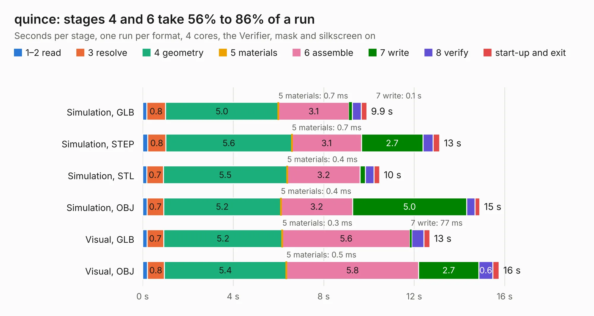

| Mode and format | 1–2 read | 3 resolve | 4 geometry | 5 materials | 6 assemble | 7 write | 8 verify | start-up and exit | Total |
|---|---:|---:|---:|---:|---:|---:|---:|---:|---:|
| Simulation, GLB | 0.2 | 0.8 | 5.0 | 0.7&nbsp;ms | 3.1 | 0.1 | 0.4 | 0.2 | 9.9 |
| Simulation, STEP | 0.2 | 0.8 | 5.6 | 0.7&nbsp;ms | 3.1 | 2.7 | 0.4 | 0.3 | 13.1 |
| Simulation, STL | 0.2 | 0.7 | 5.5 | 0.4&nbsp;ms | 3.2 | 0.2 | 0.4 | 0.2 | 10.5 |
| Simulation, OBJ | 0.2 | 0.7 | 5.2 | 0.4&nbsp;ms | 3.2 | 5.0 | 0.4 | 0.2 | 14.9 |
| Visual, GLB | 0.2 | 0.7 | 5.2 | 0.3&nbsp;ms | 5.6 | 77&nbsp;ms | 0.5 | 0.3 | 12.7 |
| Visual, OBJ | 0.2 | 0.8 | 5.4 | 0.5&nbsp;ms | 5.8 | 2.7 | 0.6 | 0.3 | 15.7 |

<table align="center"><tr><td valign="top">

| Board | Repo: [greatscottgadgets/greatfet-hardware](https://github.com/greatscottgadgets/greatfet-hardware) Board: `quince.kicad_pcb` |
|---|---|
| Folder | quince |
| Complexity | 184&nbsp;/&nbsp;1000 (size&nbsp;129, features&nbsp;55) |
| KESE&nbsp;features | through vias, filled zones, copper text, curved board outline |
| Tested | 9th November 2026 |
| Copper&nbsp;layers | 2 |
| File&nbsp;format | KiCad 4 (4) |
| Parts,&nbsp;tracks,&nbsp;vias | 26, 76, 10 |
| Triangles,&nbsp;simulation | 859,922 in 26 parts |
| Verifier | PASS in all six runs |

</td><td valign="top">

<table>
<tr><th>File type</th><th>File size</th><th>Peak memory used</th></tr>
<tr><th colspan="3" align="left">Simulation</th></tr>
<tr><td>GLB</td><td align="right">30&nbsp;MB</td><td align="right">390&nbsp;MB</td></tr>
<tr><td>STEP</td><td align="right">134&nbsp;MB</td><td align="right">456&nbsp;MB</td></tr>
<tr><td>STL</td><td align="right">43&nbsp;MB</td><td align="right">421&nbsp;MB</td></tr>
<tr><td>OBJ</td><td align="right">88&nbsp;MB</td><td align="right">627&nbsp;MB</td></tr>
<tr><th colspan="3" align="left">Visual</th></tr>
<tr><td>GLB</td><td align="right">15&nbsp;MB</td><td align="right">439&nbsp;MB</td></tr>
<tr><td>OBJ</td><td align="right">46&nbsp;MB</td><td align="right">424&nbsp;MB</td></tr>
</table>

</td></tr></table>

## 1118 hackrf-one

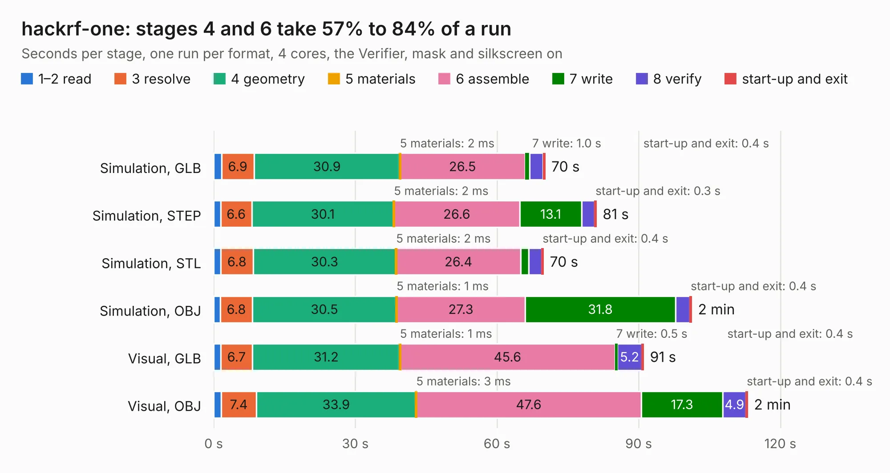

| Mode and format | 1–2 read | 3 resolve | 4 geometry | 5 materials | 6 assemble | 7 write | 8 verify | start-up and exit | Total |
|---|---:|---:|---:|---:|---:|---:|---:|---:|---:|
| Simulation, GLB | 1.6 | 6.9 | 30.9 | 2&nbsp;ms | 26.5 | 1.0 | 2.8 | 0.4 | 70.2 |
| Simulation, STEP | 1.5 | 6.6 | 30.1 | 2&nbsp;ms | 26.6 | 13.1 | 2.7 | 0.3 | 81.0 |
| Simulation, STL | 1.5 | 6.8 | 30.3 | 2&nbsp;ms | 26.4 | 1.7 | 2.7 | 0.4 | 69.8 |
| Simulation, OBJ | 1.4 | 6.8 | 30.5 | 1&nbsp;ms | 27.3 | 31.8 | 3.0 | 0.4 | 101.2 |
| Visual, GLB | 1.5 | 6.7 | 31.2 | 1&nbsp;ms | 45.6 | 0.5 | 5.2 | 0.4 | 91.0 |
| Visual, OBJ | 1.6 | 7.4 | 33.9 | 3&nbsp;ms | 47.6 | 17.3 | 4.9 | 0.4 | 113.1 |

<table align="center"><tr><td valign="top">

| Board | Repo: [greatscottgadgets/hackrf](https://github.com/greatscottgadgets/hackrf) Board: `hackrf-one.kicad_pcb` |
|---|---|
| Folder | hardware / hackrf-one |
| Complexity | 396&nbsp;/&nbsp;1000 (size&nbsp;291, features&nbsp;105) |
| KESE&nbsp;features | through vias, filled zones, copper text, curved board outline, stack-up, dielectric εr and tanδ, copper finish, mask and silkscreen colours |
| Tested | 9th November 2026 |
| Copper&nbsp;layers | 4 |
| File&nbsp;format | KiCad 6 (20211014) |
| Parts,&nbsp;tracks,&nbsp;vias | 346, 3,817, 498 |
| Triangles,&nbsp;simulation | 4,917,978 in 392 parts |
| Verifier | PASS in all six runs |

</td><td valign="top">

<table>
<tr><th>File type</th><th>File size</th><th>Peak memory used</th></tr>
<tr><th colspan="3" align="left">Simulation</th></tr>
<tr><td>GLB</td><td align="right">173&nbsp;MB</td><td align="right">1.5&nbsp;GB</td></tr>
<tr><td>STEP</td><td align="right">687&nbsp;MB</td><td align="right">1.8&nbsp;GB</td></tr>
<tr><td>STL</td><td align="right">246&nbsp;MB</td><td align="right">1.5&nbsp;GB</td></tr>
<tr><td>OBJ</td><td align="right">541&nbsp;MB</td><td align="right">3.3&nbsp;GB</td></tr>
<tr><th colspan="3" align="left">Visual</th></tr>
<tr><td>GLB</td><td align="right">95&nbsp;MB</td><td align="right">1.6&nbsp;GB</td></tr>
<tr><td>OBJ</td><td align="right">304&nbsp;MB</td><td align="right">2.1&nbsp;GB</td></tr>
</table>

</td></tr></table>

## 1119 LNA915

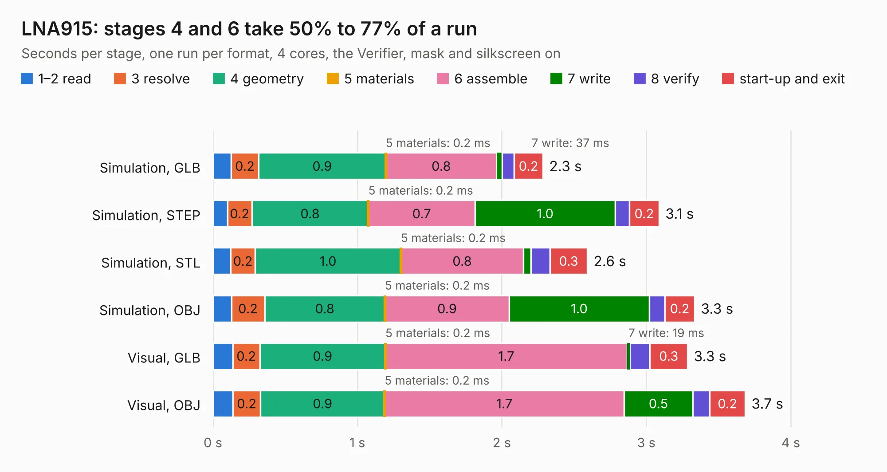

| Mode and format | 1–2 read | 3 resolve | 4 geometry | 5 materials | 6 assemble | 7 write | 8 verify | start-up and exit | Total |
|---|---:|---:|---:|---:|---:|---:|---:|---:|---:|
| Simulation, GLB | 0.1 | 0.2 | 0.9 | 0.2&nbsp;ms | 0.8 | 37&nbsp;ms | 84&nbsp;ms | 0.2 | 2.3 |
| Simulation, STEP | 0.1 | 0.2 | 0.8 | 0.2&nbsp;ms | 0.7 | 1.0 | 98&nbsp;ms | 0.2 | 3.1 |
| Simulation, STL | 0.1 | 0.2 | 1.0 | 0.2&nbsp;ms | 0.8 | 50&nbsp;ms | 0.1 | 0.3 | 2.6 |
| Simulation, OBJ | 0.1 | 0.2 | 0.8 | 0.2&nbsp;ms | 0.9 | 1.0 | 0.1 | 0.2 | 3.3 |
| Visual, GLB | 0.1 | 0.2 | 0.9 | 0.2&nbsp;ms | 1.7 | 19&nbsp;ms | 0.1 | 0.3 | 3.3 |
| Visual, OBJ | 0.1 | 0.2 | 0.9 | 0.2&nbsp;ms | 1.7 | 0.5 | 0.1 | 0.2 | 3.7 |

<table align="center"><tr><td valign="top">

| Board | Repo: [greatscottgadgets/hackrf](https://github.com/greatscottgadgets/hackrf) Board: `LNA915.kicad_pcb` |
|---|---|
| Folder | hardware / LNA915 |
| Complexity | 186&nbsp;/&nbsp;1000 (size&nbsp;151, features&nbsp;35) |
| KESE&nbsp;features | through vias, filled zones |
| Tested | 9th November 2026 |
| Copper&nbsp;layers | 4 |
| File&nbsp;format | KiCad 5 (20171130) |
| Parts,&nbsp;tracks,&nbsp;vias | 25, 124, 8 |
| Triangles,&nbsp;simulation | 207,672 in 30 parts |
| Verifier | PASS in all six runs |

</td><td valign="top">

<table>
<tr><th>File type</th><th>File size</th><th>Peak memory used</th></tr>
<tr><th colspan="3" align="left">Simulation</th></tr>
<tr><td>GLB</td><td align="right">7.5&nbsp;MB</td><td align="right">205&nbsp;MB</td></tr>
<tr><td>STEP</td><td align="right">26&nbsp;MB</td><td align="right">221&nbsp;MB</td></tr>
<tr><td>STL</td><td align="right">10&nbsp;MB</td><td align="right">211&nbsp;MB</td></tr>
<tr><td>OBJ</td><td align="right">22&nbsp;MB</td><td align="right">214&nbsp;MB</td></tr>
<tr><th colspan="3" align="left">Visual</th></tr>
<tr><td>GLB</td><td align="right">3.8&nbsp;MB</td><td align="right">167&nbsp;MB</td></tr>
<tr><td>OBJ</td><td align="right">11&nbsp;MB</td><td align="right">165&nbsp;MB</td></tr>
</table>

</td></tr></table>

## 1120 marzipan

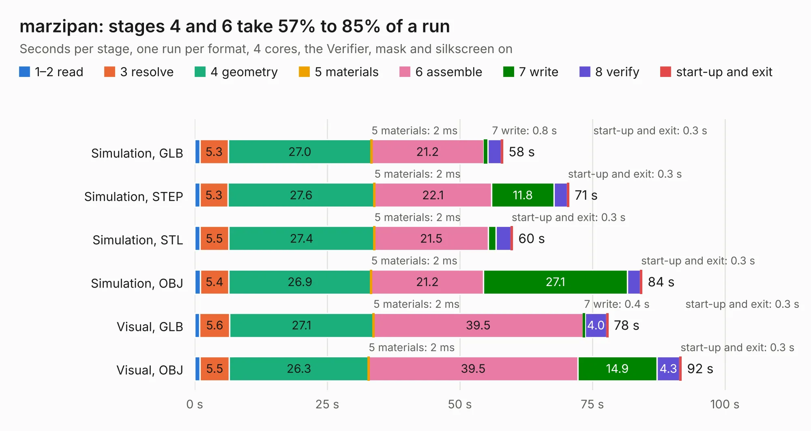

| Mode and format | 1–2 read | 3 resolve | 4 geometry | 5 materials | 6 assemble | 7 write | 8 verify | start-up and exit | Total |
|---|---:|---:|---:|---:|---:|---:|---:|---:|---:|
| Simulation, GLB | 1.0 | 5.3 | 27.0 | 2&nbsp;ms | 21.2 | 0.8 | 2.5 | 0.3 | 58.1 |
| Simulation, STEP | 1.0 | 5.3 | 27.6 | 2&nbsp;ms | 22.1 | 11.8 | 2.5 | 0.3 | 70.6 |
| Simulation, STL | 1.0 | 5.5 | 27.4 | 2&nbsp;ms | 21.5 | 1.5 | 2.8 | 0.3 | 59.9 |
| Simulation, OBJ | 1.0 | 5.4 | 26.9 | 2&nbsp;ms | 21.2 | 27.1 | 2.5 | 0.3 | 84.4 |
| Visual, GLB | 0.9 | 5.6 | 27.1 | 2&nbsp;ms | 39.5 | 0.4 | 4.0 | 0.3 | 78.0 |
| Visual, OBJ | 1.0 | 5.5 | 26.3 | 2&nbsp;ms | 39.5 | 14.9 | 4.3 | 0.3 | 91.8 |

<table align="center"><tr><td valign="top">

| Board | Repo: [greatscottgadgets/hackrf](https://github.com/greatscottgadgets/hackrf) Board: `marzipan.kicad_pcb` |
|---|---|
| Folder | hardware / marzipan |
| Complexity | 336&nbsp;/&nbsp;1000 (size&nbsp;291, features&nbsp;45) |
| KESE&nbsp;features | through vias, filled zones, curved board outline |
| Tested | 9th November 2026 |
| Copper&nbsp;layers | 4 |
| File&nbsp;format | KiCad 4 (4) |
| Parts,&nbsp;tracks,&nbsp;vias | 340, 3,928, 500 |
| Triangles,&nbsp;simulation | 4,858,612 in 391 parts |
| Verifier | PASS in all six runs |

</td><td valign="top">

<table>
<tr><th>File type</th><th>File size</th><th>Peak memory used</th></tr>
<tr><th colspan="3" align="left">Simulation</th></tr>
<tr><td>GLB</td><td align="right">170&nbsp;MB</td><td align="right">1.4&nbsp;GB</td></tr>
<tr><td>STEP</td><td align="right">669&nbsp;MB</td><td align="right">1.8&nbsp;GB</td></tr>
<tr><td>STL</td><td align="right">243&nbsp;MB</td><td align="right">1.4&nbsp;GB</td></tr>
<tr><td>OBJ</td><td align="right">539&nbsp;MB</td><td align="right">3.2&nbsp;GB</td></tr>
<tr><th colspan="3" align="left">Visual</th></tr>
<tr><td>GLB</td><td align="right">95&nbsp;MB</td><td align="right">1.6&nbsp;GB</td></tr>
<tr><td>OBJ</td><td align="right">303&nbsp;MB</td><td align="right">2.1&nbsp;GB</td></tr>
</table>

</td></tr></table>

## 1121 neapolitan

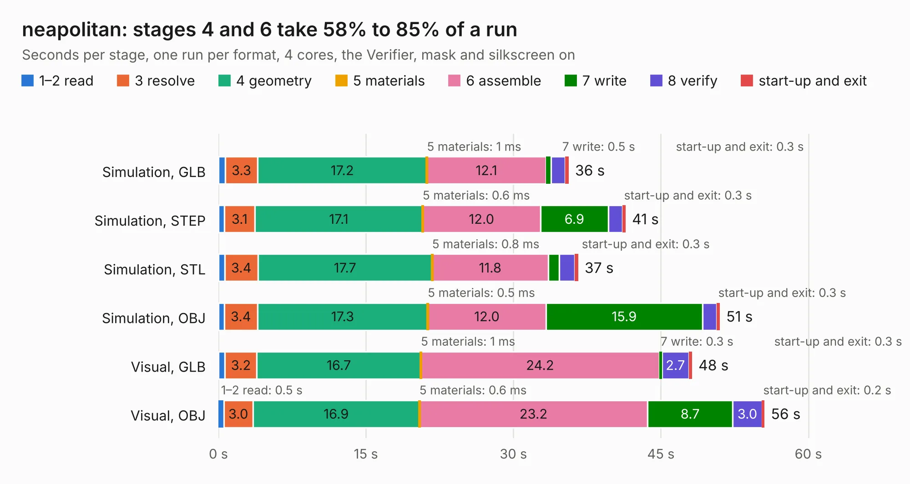

| Mode and format | 1–2 read | 3 resolve | 4 geometry | 5 materials | 6 assemble | 7 write | 8 verify | start-up and exit | Total |
|---|---:|---:|---:|---:|---:|---:|---:|---:|---:|
| Simulation, GLB | 0.7 | 3.3 | 17.2 | 1&nbsp;ms | 12.1 | 0.5 | 1.4 | 0.3 | 35.6 |
| Simulation, STEP | 0.6 | 3.1 | 17.1 | 0.6&nbsp;ms | 12.0 | 6.9 | 1.5 | 0.3 | 41.4 |
| Simulation, STL | 0.6 | 3.4 | 17.7 | 0.8&nbsp;ms | 11.8 | 1.1 | 1.6 | 0.3 | 36.6 |
| Simulation, OBJ | 0.6 | 3.4 | 17.3 | 0.5&nbsp;ms | 12.0 | 15.9 | 1.5 | 0.3 | 51.0 |
| Visual, GLB | 0.7 | 3.2 | 16.7 | 1&nbsp;ms | 24.2 | 0.3 | 2.7 | 0.3 | 48.2 |
| Visual, OBJ | 0.5 | 3.0 | 16.9 | 0.6&nbsp;ms | 23.2 | 8.7 | 3.0 | 0.2 | 55.5 |

<table align="center"><tr><td valign="top">

| Board | Repo: [greatscottgadgets/hackrf](https://github.com/greatscottgadgets/hackrf) Board: `neapolitan.kicad_pcb` |
|---|---|
| Folder | hardware / neapolitan |
| Complexity | 318&nbsp;/&nbsp;1000 (size&nbsp;273, features&nbsp;45) |
| KESE&nbsp;features | through vias, filled zones, curved board outline |
| Tested | 9th November 2026 |
| Copper&nbsp;layers | 4 |
| File&nbsp;format | KiCad 4 (4) |
| Parts,&nbsp;tracks,&nbsp;vias | 241, 1,961, 272 |
| Triangles,&nbsp;simulation | 3,033,820 in 180 parts |
| Verifier | PASS in all six runs |

</td><td valign="top">

<table>
<tr><th>File type</th><th>File size</th><th>Peak memory used</th></tr>
<tr><th colspan="3" align="left">Simulation</th></tr>
<tr><td>GLB</td><td align="right">106&nbsp;MB</td><td align="right">1.0&nbsp;GB</td></tr>
<tr><td>STEP</td><td align="right">411&nbsp;MB</td><td align="right">1.2&nbsp;GB</td></tr>
<tr><td>STL</td><td align="right">152&nbsp;MB</td><td align="right">948&nbsp;MB</td></tr>
<tr><td>OBJ</td><td align="right">334&nbsp;MB</td><td align="right">2.1&nbsp;GB</td></tr>
<tr><th colspan="3" align="left">Visual</th></tr>
<tr><td>GLB</td><td align="right">58&nbsp;MB</td><td align="right">1.2&nbsp;GB</td></tr>
<tr><td>OBJ</td><td align="right">181&nbsp;MB</td><td align="right">1.3&nbsp;GB</td></tr>
</table>

</td></tr></table>

## 1122 operacake

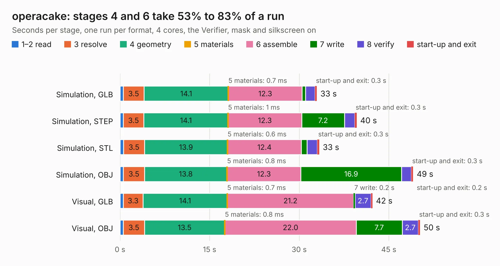

| Mode and format | 1–2 read | 3 resolve | 4 geometry | 5 materials | 6 assemble | 7 write | 8 verify | start-up and exit | Total |
|---|---:|---:|---:|---:|---:|---:|---:|---:|---:|
| Simulation, GLB | 0.5 | 3.5 | 14.1 | 0.7&nbsp;ms | 12.3 | 0.6 | 1.6 | 0.3 | 33.0 |
| Simulation, STEP | 0.5 | 3.5 | 14.1 | 1&nbsp;ms | 12.3 | 7.2 | 1.7 | 0.3 | 39.6 |
| Simulation, STL | 0.6 | 3.5 | 13.9 | 0.6&nbsp;ms | 12.4 | 0.9 | 1.7 | 0.3 | 33.4 |
| Simulation, OBJ | 0.6 | 3.5 | 13.8 | 0.8&nbsp;ms | 12.3 | 16.9 | 1.6 | 0.3 | 49.1 |
| Visual, GLB | 0.5 | 3.3 | 14.1 | 0.7&nbsp;ms | 21.2 | 0.2 | 2.7 | 0.2 | 42.3 |
| Visual, OBJ | 0.6 | 3.5 | 13.5 | 0.8&nbsp;ms | 22.0 | 7.7 | 2.7 | 0.3 | 50.2 |

<table align="center"><tr><td valign="top">

| Board | Repo: [greatscottgadgets/hackrf](https://github.com/greatscottgadgets/hackrf) Board: `operacake.kicad_pcb` |
|---|---|
| Folder | hardware / operacake |
| Complexity | 252&nbsp;/&nbsp;1000 (size&nbsp;207, features&nbsp;45) |
| KESE&nbsp;features | through vias, filled zones, curved board outline |
| Tested | 9th November 2026 |
| Copper&nbsp;layers | 4 |
| File&nbsp;format | KiCad 4 (4) |
| Parts,&nbsp;tracks,&nbsp;vias | 122, 1,091, 182 |
| Triangles,&nbsp;simulation | 3,263,706 in 217 parts |
| Verifier | PASS in all six runs |

</td><td valign="top">

<table>
<tr><th>File type</th><th>File size</th><th>Peak memory used</th></tr>
<tr><th colspan="3" align="left">Simulation</th></tr>
<tr><td>GLB</td><td align="right">110&nbsp;MB</td><td align="right">1.0&nbsp;GB</td></tr>
<tr><td>STEP</td><td align="right">391&nbsp;MB</td><td align="right">1.2&nbsp;GB</td></tr>
<tr><td>STL</td><td align="right">163&nbsp;MB</td><td align="right">993&nbsp;MB</td></tr>
<tr><td>OBJ</td><td align="right">354&nbsp;MB</td><td align="right">2.2&nbsp;GB</td></tr>
<tr><th colspan="3" align="left">Visual</th></tr>
<tr><td>GLB</td><td align="right">50&nbsp;MB</td><td align="right">975&nbsp;MB</td></tr>
<tr><td>OBJ</td><td align="right">157&nbsp;MB</td><td align="right">1.2&nbsp;GB</td></tr>
</table>

</td></tr></table>

## 1123 praline

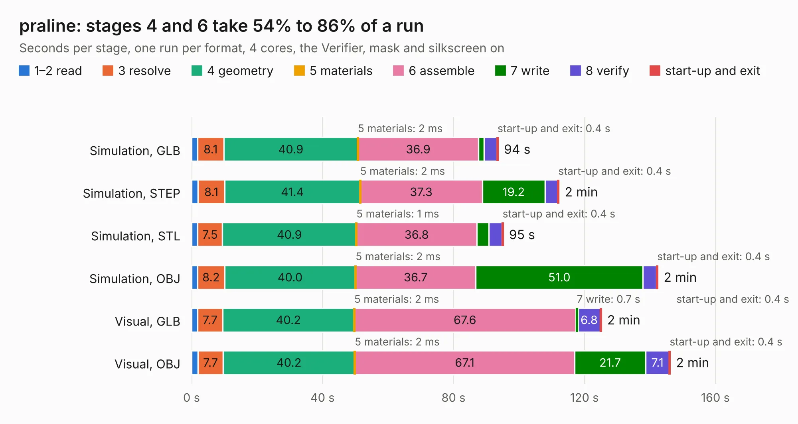

| Mode and format | 1–2 read | 3 resolve | 4 geometry | 5 materials | 6 assemble | 7 write | 8 verify | start-up and exit | Total |
|---|---:|---:|---:|---:|---:|---:|---:|---:|---:|
| Simulation, GLB | 1.8 | 8.1 | 40.9 | 2&nbsp;ms | 36.9 | 1.6 | 4.0 | 0.4 | 93.7 |
| Simulation, STEP | 2.0 | 8.1 | 41.4 | 2&nbsp;ms | 37.3 | 19.2 | 3.8 | 0.4 | 112.2 |
| Simulation, STL | 1.9 | 7.5 | 40.9 | 1&nbsp;ms | 36.8 | 3.7 | 4.0 | 0.4 | 95.2 |
| Simulation, OBJ | 1.9 | 8.2 | 40.0 | 2&nbsp;ms | 36.7 | 51.0 | 4.2 | 0.4 | 142.5 |
| Visual, GLB | 1.8 | 7.7 | 40.2 | 2&nbsp;ms | 67.6 | 0.7 | 6.8 | 0.4 | 125.2 |
| Visual, OBJ | 1.9 | 7.7 | 40.2 | 2&nbsp;ms | 67.1 | 21.7 | 7.1 | 0.4 | 146.2 |

<table align="center"><tr><td valign="top">

| Board | Repo: [greatscottgadgets/hackrf-pro](https://github.com/greatscottgadgets/hackrf-pro) Board: `praline.kicad_pcb` |
|---|---|
| Complexity | 466&nbsp;/&nbsp;1000 (size&nbsp;316, features&nbsp;150) |
| KESE&nbsp;features | through vias, slotted holes, custom pads, rounded, trapezoid or chamfered pads, filled zones, copper drawings, copper text, curved board outline, stack-up, dielectric εr and tanδ, copper finish, mask and silkscreen colours |
| Tested | 9th November 2026 |
| Copper&nbsp;layers | 6 |
| File&nbsp;format | KiCad 9 (20241229) |
| Parts,&nbsp;tracks,&nbsp;vias | 511, 4,690, 953 |
| Triangles,&nbsp;simulation | 9,435,120 in 508 parts |
| Verifier | PASS in all six runs |

</td><td valign="top">

<table>
<tr><th>File type</th><th>File size</th><th>Peak memory used</th></tr>
<tr><th colspan="3" align="left">Simulation</th></tr>
<tr><td>GLB</td><td align="right">319&nbsp;MB</td><td align="right">2.2&nbsp;GB</td></tr>
<tr><td>STEP</td><td align="right">1.2&nbsp;GB</td><td align="right">3.3&nbsp;GB</td></tr>
<tr><td>STL</td><td align="right">472&nbsp;MB</td><td align="right">2.2&nbsp;GB</td></tr>
<tr><td>OBJ</td><td align="right">1.0&nbsp;GB</td><td align="right">6.1&nbsp;GB</td></tr>
<tr><th colspan="3" align="left">Visual</th></tr>
<tr><td>GLB</td><td align="right">149&nbsp;MB</td><td align="right">2.6&nbsp;GB</td></tr>
<tr><td>OBJ</td><td align="right">491&nbsp;MB</td><td align="right">3.3&nbsp;GB</td></tr>
</table>

</td></tr></table>

## 1124 swg_test

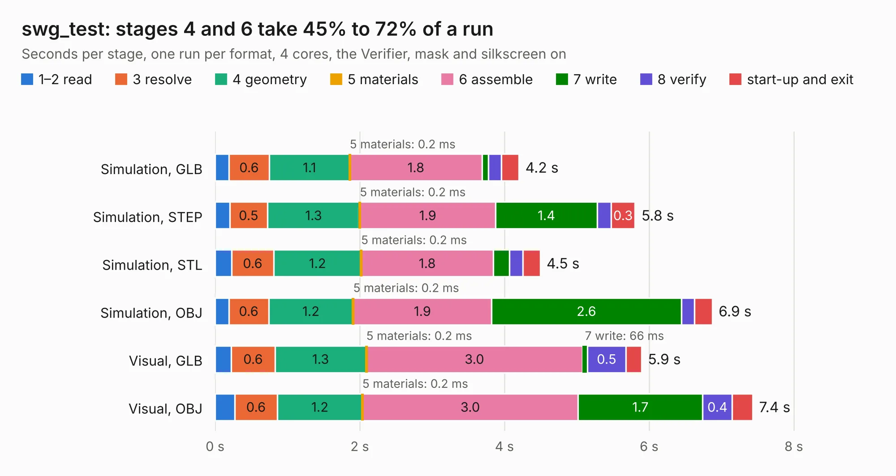

| Mode and format | 1–2 read | 3 resolve | 4 geometry | 5 materials | 6 assemble | 7 write | 8 verify | start-up and exit | Total |
|---|---:|---:|---:|---:|---:|---:|---:|---:|---:|
| Simulation, GLB | 0.2 | 0.6 | 1.1 | 0.2&nbsp;ms | 1.8 | 85&nbsp;ms | 0.2 | 0.2 | 4.2 |
| Simulation, STEP | 0.2 | 0.5 | 1.3 | 0.2&nbsp;ms | 1.9 | 1.4 | 0.2 | 0.3 | 5.8 |
| Simulation, STL | 0.2 | 0.6 | 1.2 | 0.2&nbsp;ms | 1.8 | 0.2 | 0.2 | 0.2 | 4.5 |
| Simulation, OBJ | 0.2 | 0.6 | 1.2 | 0.2&nbsp;ms | 1.9 | 2.6 | 0.2 | 0.2 | 6.9 |
| Visual, GLB | 0.2 | 0.6 | 1.3 | 0.2&nbsp;ms | 3.0 | 66&nbsp;ms | 0.5 | 0.2 | 5.9 |
| Visual, OBJ | 0.3 | 0.6 | 1.2 | 0.2&nbsp;ms | 3.0 | 1.7 | 0.4 | 0.3 | 7.4 |

<table align="center"><tr><td valign="top">

| Board | Repo: [greatscottgadgets/lab-notes](https://github.com/greatscottgadgets/lab-notes) Board: `swg_test.kicad_pcb` |
|---|---|
| Folder | rf-testing / 2023-05-16-swg-test-board / swg_test_kicad |
| Complexity | 266&nbsp;/&nbsp;1000 (size&nbsp;166, features&nbsp;100) |
| KESE&nbsp;features | through vias, rounded, trapezoid or chamfered pads, filled zones, copper text, stack-up, dielectric εr and tanδ, copper finish |
| Tested | 9th November 2026 |
| Copper&nbsp;layers | 4 |
| File&nbsp;format | KiCad 7 (20221018) |
| Parts,&nbsp;tracks,&nbsp;vias | 23, 17, 129 |
| Triangles,&nbsp;simulation | 425,002 in 29 parts |
| Verifier | PASS in all six runs |

</td><td valign="top">

<table>
<tr><th>File type</th><th>File size</th><th>Peak memory used</th></tr>
<tr><th colspan="3" align="left">Simulation</th></tr>
<tr><td>GLB</td><td align="right">14&nbsp;MB</td><td align="right">313&nbsp;MB</td></tr>
<tr><td>STEP</td><td align="right">46&nbsp;MB</td><td align="right">357&nbsp;MB</td></tr>
<tr><td>STL</td><td align="right">21&nbsp;MB</td><td align="right">315&nbsp;MB</td></tr>
<tr><td>OBJ</td><td align="right">42&nbsp;MB</td><td align="right">342&nbsp;MB</td></tr>
<tr><th colspan="3" align="left">Visual</th></tr>
<tr><td>GLB</td><td align="right">9.3&nbsp;MB</td><td align="right">297&nbsp;MB</td></tr>
<tr><td>OBJ</td><td align="right">27&nbsp;MB</td><td align="right">294&nbsp;MB</td></tr>
</table>

</td></tr></table>

## 1125 LNA1109

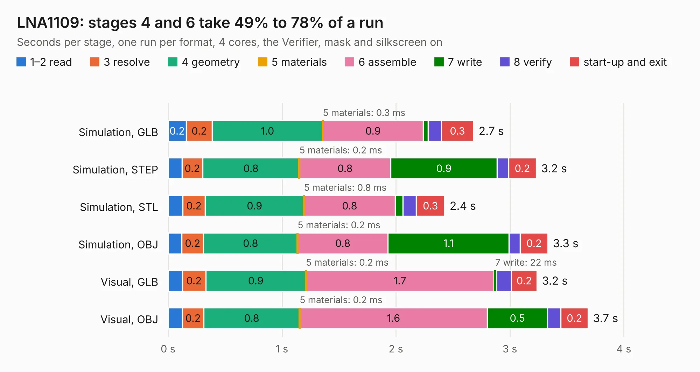

| Mode and format | 1–2 read | 3 resolve | 4 geometry | 5 materials | 6 assemble | 7 write | 8 verify | start-up and exit | Total |
|---|---:|---:|---:|---:|---:|---:|---:|---:|---:|
| Simulation, GLB | 0.2 | 0.2 | 1.0 | 0.3&nbsp;ms | 0.9 | 44&nbsp;ms | 0.1 | 0.3 | 2.7 |
| Simulation, STEP | 0.1 | 0.2 | 0.8 | 0.2&nbsp;ms | 0.8 | 0.9 | 0.1 | 0.2 | 3.2 |
| Simulation, STL | 0.1 | 0.2 | 0.9 | 0.8&nbsp;ms | 0.8 | 66&nbsp;ms | 0.1 | 0.3 | 2.4 |
| Simulation, OBJ | 0.1 | 0.2 | 0.8 | 0.2&nbsp;ms | 0.8 | 1.1 | 98&nbsp;ms | 0.2 | 3.3 |
| Visual, GLB | 0.1 | 0.2 | 0.9 | 0.2&nbsp;ms | 1.7 | 22&nbsp;ms | 0.1 | 0.2 | 3.2 |
| Visual, OBJ | 0.1 | 0.2 | 0.8 | 0.2&nbsp;ms | 1.6 | 0.5 | 0.1 | 0.2 | 3.7 |

<table align="center"><tr><td valign="top">

| Board | Repo: [greatscottgadgets/LNA1109](https://github.com/greatscottgadgets/LNA1109) Board: `LNA1109.kicad_pcb` |
|---|---|
| Complexity | 186&nbsp;/&nbsp;1000 (size&nbsp;151, features&nbsp;35) |
| KESE&nbsp;features | through vias, filled zones |
| Tested | 9th November 2026 |
| Copper&nbsp;layers | 4 |
| File&nbsp;format | KiCad 5 (20171130) |
| Parts,&nbsp;tracks,&nbsp;vias | 25, 129, 8 |
| Triangles,&nbsp;simulation | 207,670 in 30 parts |
| Verifier | PASS in all six runs |

</td><td valign="top">

<table>
<tr><th>File type</th><th>File size</th><th>Peak memory used</th></tr>
<tr><th colspan="3" align="left">Simulation</th></tr>
<tr><td>GLB</td><td align="right">7.5&nbsp;MB</td><td align="right">211&nbsp;MB</td></tr>
<tr><td>STEP</td><td align="right">26&nbsp;MB</td><td align="right">224&nbsp;MB</td></tr>
<tr><td>STL</td><td align="right">10&nbsp;MB</td><td align="right">218&nbsp;MB</td></tr>
<tr><td>OBJ</td><td align="right">22&nbsp;MB</td><td align="right">212&nbsp;MB</td></tr>
<tr><th colspan="3" align="left">Visual</th></tr>
<tr><td>GLB</td><td align="right">3.9&nbsp;MB</td><td align="right">167&nbsp;MB</td></tr>
<tr><td>OBJ</td><td align="right">11&nbsp;MB</td><td align="right">167&nbsp;MB</td></tr>
</table>

</td></tr></table>

## 1126 LNA3030

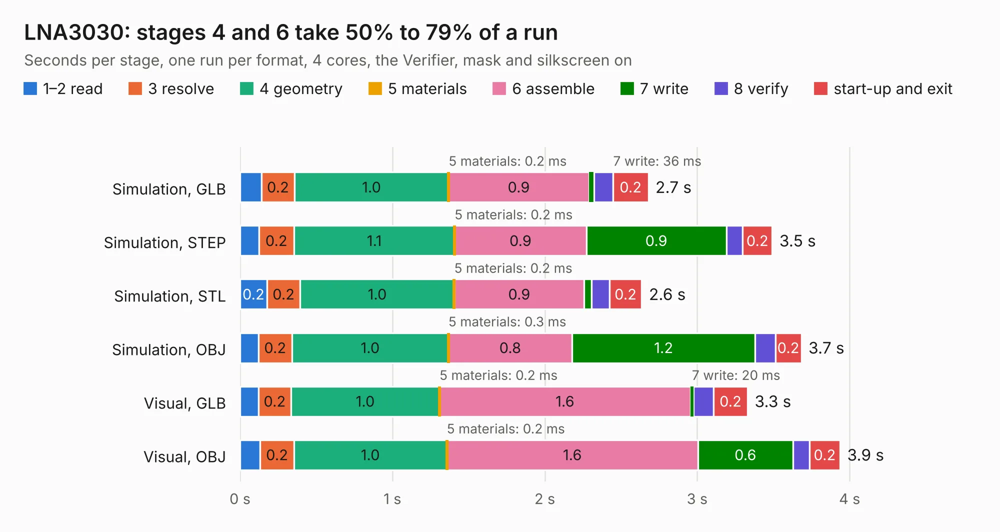

| Mode and format | 1–2 read | 3 resolve | 4 geometry | 5 materials | 6 assemble | 7 write | 8 verify | start-up and exit | Total |
|---|---:|---:|---:|---:|---:|---:|---:|---:|---:|
| Simulation, GLB | 0.1 | 0.2 | 1.0 | 0.2&nbsp;ms | 0.9 | 36&nbsp;ms | 0.1 | 0.2 | 2.7 |
| Simulation, STEP | 0.1 | 0.2 | 1.1 | 0.2&nbsp;ms | 0.9 | 0.9 | 0.1 | 0.2 | 3.5 |
| Simulation, STL | 0.2 | 0.2 | 1.0 | 0.2&nbsp;ms | 0.9 | 49&nbsp;ms | 0.1 | 0.2 | 2.6 |
| Simulation, OBJ | 0.1 | 0.2 | 1.0 | 0.3&nbsp;ms | 0.8 | 1.2 | 0.1 | 0.2 | 3.7 |
| Visual, GLB | 0.1 | 0.2 | 1.0 | 0.2&nbsp;ms | 1.6 | 20&nbsp;ms | 0.1 | 0.2 | 3.3 |
| Visual, OBJ | 0.1 | 0.2 | 1.0 | 0.2&nbsp;ms | 1.6 | 0.6 | 0.1 | 0.2 | 3.9 |

<table align="center"><tr><td valign="top">

| Board | Repo: [greatscottgadgets/LNA3030](https://github.com/greatscottgadgets/LNA3030) Board: `LNA3030.kicad_pcb` |
|---|---|
| Complexity | 186&nbsp;/&nbsp;1000 (size&nbsp;151, features&nbsp;35) |
| KESE&nbsp;features | through vias, filled zones |
| Tested | 9th November 2026 |
| Copper&nbsp;layers | 4 |
| File&nbsp;format | KiCad 5 (20171130) |
| Parts,&nbsp;tracks,&nbsp;vias | 25, 125, 9 |
| Triangles,&nbsp;simulation | 211,622 in 30 parts |
| Verifier | PASS in all six runs |

</td><td valign="top">

<table>
<tr><th>File type</th><th>File size</th><th>Peak memory used</th></tr>
<tr><th colspan="3" align="left">Simulation</th></tr>
<tr><td>GLB</td><td align="right">7.6&nbsp;MB</td><td align="right">209&nbsp;MB</td></tr>
<tr><td>STEP</td><td align="right">27&nbsp;MB</td><td align="right">224&nbsp;MB</td></tr>
<tr><td>STL</td><td align="right">11&nbsp;MB</td><td align="right">211&nbsp;MB</td></tr>
<tr><td>OBJ</td><td align="right">22&nbsp;MB</td><td align="right">204&nbsp;MB</td></tr>
<tr><th colspan="3" align="left">Visual</th></tr>
<tr><td>GLB</td><td align="right">3.9&nbsp;MB</td><td align="right">168&nbsp;MB</td></tr>
<tr><td>OBJ</td><td align="right">11&nbsp;MB</td><td align="right">171&nbsp;MB</td></tr>
</table>

</td></tr></table>

## 1127 baluns

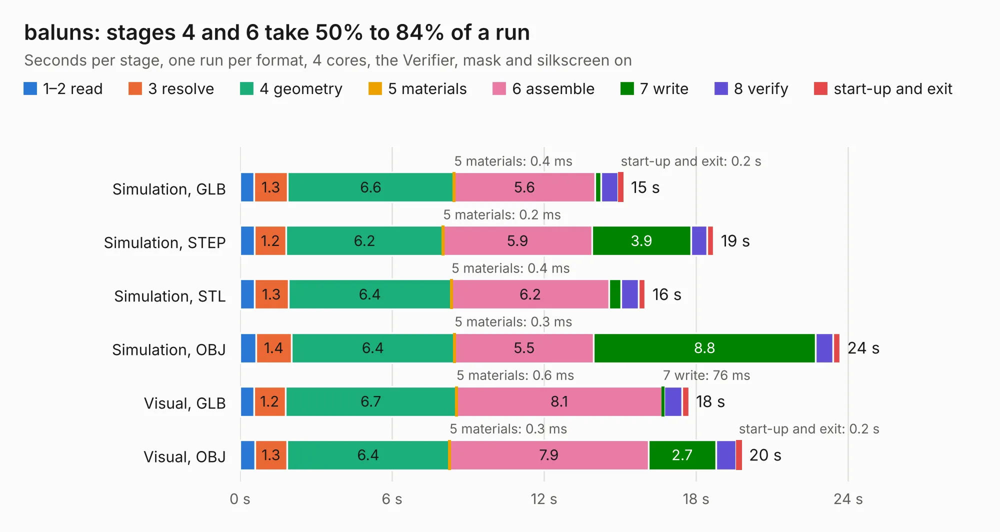

| Mode and format | 1–2 read | 3 resolve | 4 geometry | 5 materials | 6 assemble | 7 write | 8 verify | start-up and exit | Total |
|---|---:|---:|---:|---:|---:|---:|---:|---:|---:|
| Simulation, GLB | 0.6 | 1.3 | 6.6 | 0.4&nbsp;ms | 5.6 | 0.2 | 0.7 | 0.2 | 15.1 |
| Simulation, STEP | 0.6 | 1.2 | 6.2 | 0.2&nbsp;ms | 5.9 | 3.9 | 0.6 | 0.3 | 18.7 |
| Simulation, STL | 0.6 | 1.3 | 6.4 | 0.4&nbsp;ms | 6.2 | 0.5 | 0.7 | 0.3 | 16.0 |
| Simulation, OBJ | 0.6 | 1.4 | 6.4 | 0.3&nbsp;ms | 5.5 | 8.8 | 0.7 | 0.3 | 23.7 |
| Visual, GLB | 0.5 | 1.2 | 6.7 | 0.6&nbsp;ms | 8.1 | 76&nbsp;ms | 0.7 | 0.3 | 17.7 |
| Visual, OBJ | 0.6 | 1.3 | 6.4 | 0.3&nbsp;ms | 7.9 | 2.7 | 0.8 | 0.2 | 19.8 |

<table align="center"><tr><td valign="top">

| Board | Repo: [greatscottgadgets/misc](https://github.com/greatscottgadgets/misc) Board: `baluns.kicad_pcb` |
|---|---|
| Folder | evaluation-boards / baluns |
| Complexity | 232&nbsp;/&nbsp;1000 (size&nbsp;177, features&nbsp;55) |
| KESE&nbsp;features | through vias, rounded, trapezoid or chamfered pads, filled zones, copper text |
| Tested | 9th November 2026 |
| Copper&nbsp;layers | 4 |
| File&nbsp;format | KiCad 9 (20241229) |
| Parts,&nbsp;tracks,&nbsp;vias | 92, 230, 30 |
| Triangles,&nbsp;simulation | 1,559,312 in 64 parts |
| Verifier | PASS in all six runs |

</td><td valign="top">

<table>
<tr><th>File type</th><th>File size</th><th>Peak memory used</th></tr>
<tr><th colspan="3" align="left">Simulation</th></tr>
<tr><td>GLB</td><td align="right">54&nbsp;MB</td><td align="right">662&nbsp;MB</td></tr>
<tr><td>STEP</td><td align="right">192&nbsp;MB</td><td align="right">770&nbsp;MB</td></tr>
<tr><td>STL</td><td align="right">78&nbsp;MB</td><td align="right">645&nbsp;MB</td></tr>
<tr><td>OBJ</td><td align="right">162&nbsp;MB</td><td align="right">1.1&nbsp;GB</td></tr>
<tr><th colspan="3" align="left">Visual</th></tr>
<tr><td>GLB</td><td align="right">17&nbsp;MB</td><td align="right">551&nbsp;MB</td></tr>
<tr><td>OBJ</td><td align="right">51&nbsp;MB</td><td align="right">552&nbsp;MB</td></tr>
</table>

</td></tr></table>

## 1128 BGA622H6820

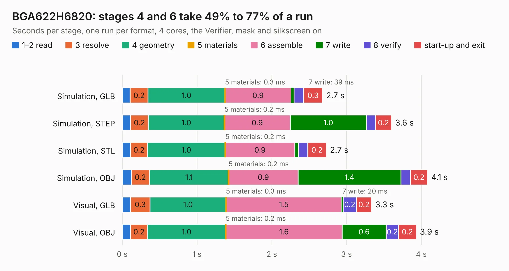

| Mode and format | 1–2 read | 3 resolve | 4 geometry | 5 materials | 6 assemble | 7 write | 8 verify | start-up and exit | Total |
|---|---:|---:|---:|---:|---:|---:|---:|---:|---:|
| Simulation, GLB | 0.1 | 0.2 | 1.0 | 0.3&nbsp;ms | 0.9 | 39&nbsp;ms | 0.1 | 0.3 | 2.7 |
| Simulation, STEP | 0.1 | 0.2 | 1.0 | 0.2&nbsp;ms | 0.9 | 1.0 | 0.1 | 0.2 | 3.6 |
| Simulation, STL | 0.1 | 0.2 | 1.0 | 0.2&nbsp;ms | 0.9 | 53&nbsp;ms | 0.1 | 0.2 | 2.7 |
| Simulation, OBJ | 0.1 | 0.2 | 1.1 | 0.2&nbsp;ms | 0.9 | 1.4 | 0.1 | 0.2 | 4.1 |
| Visual, GLB | 0.1 | 0.3 | 1.0 | 0.3&nbsp;ms | 1.5 | 20&nbsp;ms | 0.2 | 0.2 | 3.3 |
| Visual, OBJ | 0.1 | 0.2 | 1.0 | 0.2&nbsp;ms | 1.6 | 0.6 | 0.2 | 0.2 | 3.9 |

<table align="center"><tr><td valign="top">

| Board | Repo: [greatscottgadgets/misc](https://github.com/greatscottgadgets/misc) Board: `BGA622H6820.kicad_pcb` |
|---|---|
| Folder | evaluation-boards / BGA622H6820 |
| Complexity | 163&nbsp;/&nbsp;1000 (size&nbsp;128, features&nbsp;35) |
| KESE&nbsp;features | through vias, filled zones |
| Tested | 9th November 2026 |
| Copper&nbsp;layers | 4 |
| File&nbsp;format | KiCad 4 (4) |
| Parts,&nbsp;tracks,&nbsp;vias | 15, 33, 6 |
| Triangles,&nbsp;simulation | 226,944 in 22 parts |
| Verifier | PASS in all six runs |

</td><td valign="top">

<table>
<tr><th>File type</th><th>File size</th><th>Peak memory used</th></tr>
<tr><th colspan="3" align="left">Simulation</th></tr>
<tr><td>GLB</td><td align="right">7.8&nbsp;MB</td><td align="right">212&nbsp;MB</td></tr>
<tr><td>STEP</td><td align="right">30&nbsp;MB</td><td align="right">222&nbsp;MB</td></tr>
<tr><td>STL</td><td align="right">11&nbsp;MB</td><td align="right">214&nbsp;MB</td></tr>
<tr><td>OBJ</td><td align="right">23&nbsp;MB</td><td align="right">212&nbsp;MB</td></tr>
<tr><th colspan="3" align="left">Visual</th></tr>
<tr><td>GLB</td><td align="right">3.5&nbsp;MB</td><td align="right">166&nbsp;MB</td></tr>
<tr><td>OBJ</td><td align="right">9.9&nbsp;MB</td><td align="right">166&nbsp;MB</td></tr>
</table>

</td></tr></table>

## 1129 CC-test

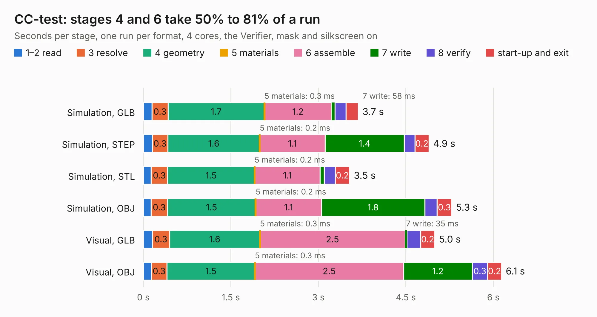

| Mode and format | 1–2 read | 3 resolve | 4 geometry | 5 materials | 6 assemble | 7 write | 8 verify | start-up and exit | Total |
|---|---:|---:|---:|---:|---:|---:|---:|---:|---:|
| Simulation, GLB | 0.1 | 0.3 | 1.7 | 0.3&nbsp;ms | 1.2 | 58&nbsp;ms | 0.2 | 0.2 | 3.7 |
| Simulation, STEP | 0.2 | 0.3 | 1.6 | 0.2&nbsp;ms | 1.1 | 1.4 | 0.2 | 0.2 | 4.9 |
| Simulation, STL | 0.1 | 0.3 | 1.5 | 0.2&nbsp;ms | 1.1 | 68&nbsp;ms | 0.2 | 0.2 | 3.5 |
| Simulation, OBJ | 0.1 | 0.3 | 1.5 | 0.2&nbsp;ms | 1.1 | 1.8 | 0.2 | 0.3 | 5.3 |
| Visual, GLB | 0.2 | 0.3 | 1.6 | 0.3&nbsp;ms | 2.5 | 35&nbsp;ms | 0.2 | 0.2 | 5.0 |
| Visual, OBJ | 0.1 | 0.3 | 1.5 | 0.3&nbsp;ms | 2.5 | 1.2 | 0.3 | 0.2 | 6.1 |

<table align="center"><tr><td valign="top">

| Board | Repo: [greatscottgadgets/misc](https://github.com/greatscottgadgets/misc) Board: `CC-test.kicad_pcb` |
|---|---|
| Folder | evaluation-boards / CC-test |
| Complexity | 206&nbsp;/&nbsp;1000 (size&nbsp;141, features&nbsp;65) |
| KESE&nbsp;features | through vias, slotted holes, rounded, trapezoid or chamfered pads, filled zones, curved board outline |
| Tested | 9th November 2026 |
| Copper&nbsp;layers | 2 |
| File&nbsp;format | KiCad 5 (20171130) |
| Parts,&nbsp;tracks,&nbsp;vias | 23, 186, 20 |
| Triangles,&nbsp;simulation | 303,426 in 35 parts |
| Verifier | PASS in all six runs |

</td><td valign="top">

<table>
<tr><th>File type</th><th>File size</th><th>Peak memory used</th></tr>
<tr><th colspan="3" align="left">Simulation</th></tr>
<tr><td>GLB</td><td align="right">11&nbsp;MB</td><td align="right">240&nbsp;MB</td></tr>
<tr><td>STEP</td><td align="right">52&nbsp;MB</td><td align="right">258&nbsp;MB</td></tr>
<tr><td>STL</td><td align="right">15&nbsp;MB</td><td align="right">238&nbsp;MB</td></tr>
<tr><td>OBJ</td><td align="right">31&nbsp;MB</td><td align="right">258&nbsp;MB</td></tr>
<tr><th colspan="3" align="left">Visual</th></tr>
<tr><td>GLB</td><td align="right">6.8&nbsp;MB</td><td align="right">218&nbsp;MB</td></tr>
<tr><td>OBJ</td><td align="right">20&nbsp;MB</td><td align="right">218&nbsp;MB</td></tr>
</table>

</td></tr></table>

## 1130 DC1722J5005AHF

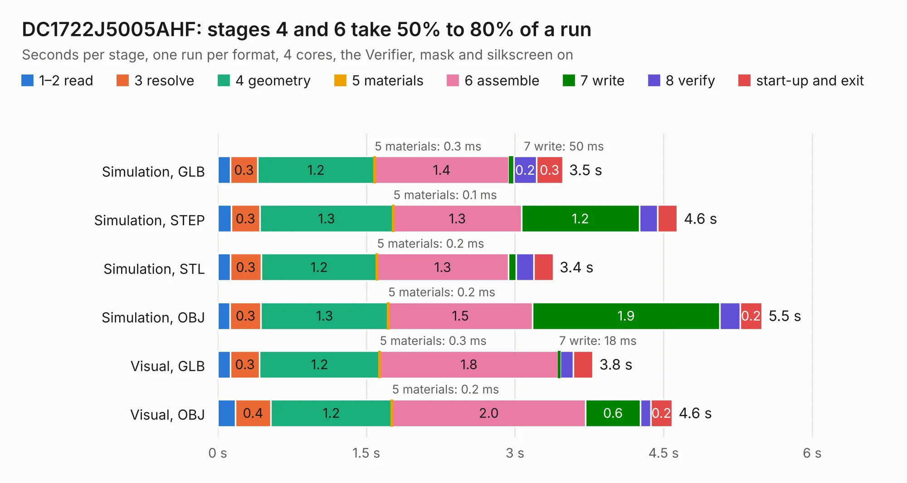

| Mode and format | 1–2 read | 3 resolve | 4 geometry | 5 materials | 6 assemble | 7 write | 8 verify | start-up and exit | Total |
|---|---:|---:|---:|---:|---:|---:|---:|---:|---:|
| Simulation, GLB | 0.1 | 0.3 | 1.2 | 0.3&nbsp;ms | 1.4 | 50&nbsp;ms | 0.2 | 0.3 | 3.5 |
| Simulation, STEP | 0.1 | 0.3 | 1.3 | 0.1&nbsp;ms | 1.3 | 1.2 | 0.2 | 0.2 | 4.6 |
| Simulation, STL | 0.1 | 0.3 | 1.2 | 0.2&nbsp;ms | 1.3 | 79&nbsp;ms | 0.2 | 0.2 | 3.4 |
| Simulation, OBJ | 0.1 | 0.3 | 1.3 | 0.2&nbsp;ms | 1.5 | 1.9 | 0.2 | 0.2 | 5.5 |
| Visual, GLB | 0.1 | 0.3 | 1.2 | 0.3&nbsp;ms | 1.8 | 18&nbsp;ms | 0.1 | 0.2 | 3.8 |
| Visual, OBJ | 0.2 | 0.4 | 1.2 | 0.2&nbsp;ms | 2.0 | 0.6 | 0.1 | 0.2 | 4.6 |

<table align="center"><tr><td valign="top">

| Board | Repo: [greatscottgadgets/misc](https://github.com/greatscottgadgets/misc) Board: `DC1722J5005AHF.kicad_pcb` |
|---|---|
| Folder | evaluation-boards / DC1722J5005AHF |
| Complexity | 172&nbsp;/&nbsp;1000 (size&nbsp;117, features&nbsp;55) |
| KESE&nbsp;features | through vias, rounded, trapezoid or chamfered pads, filled zones, curved board outline |
| Tested | 9th November 2026 |
| Copper&nbsp;layers | 4 |
| File&nbsp;format | KiCad 5 (20171130) |
| Parts,&nbsp;tracks,&nbsp;vias | 9, 16, 6 |
| Triangles,&nbsp;simulation | 333,628 in 18 parts |
| Verifier | PASS in all six runs |

</td><td valign="top">

<table>
<tr><th>File type</th><th>File size</th><th>Peak memory used</th></tr>
<tr><th colspan="3" align="left">Simulation</th></tr>
<tr><td>GLB</td><td align="right">11&nbsp;MB</td><td align="right">266&nbsp;MB</td></tr>
<tr><td>STEP</td><td align="right">37&nbsp;MB</td><td align="right">292&nbsp;MB</td></tr>
<tr><td>STL</td><td align="right">17&nbsp;MB</td><td align="right">268&nbsp;MB</td></tr>
<tr><td>OBJ</td><td align="right">33&nbsp;MB</td><td align="right">284&nbsp;MB</td></tr>
<tr><th colspan="3" align="left">Visual</th></tr>
<tr><td>GLB</td><td align="right">3.7&nbsp;MB</td><td align="right">202&nbsp;MB</td></tr>
<tr><td>OBJ</td><td align="right">10&nbsp;MB</td><td align="right">199&nbsp;MB</td></tr>
</table>

</td></tr></table>

## 1131 filters

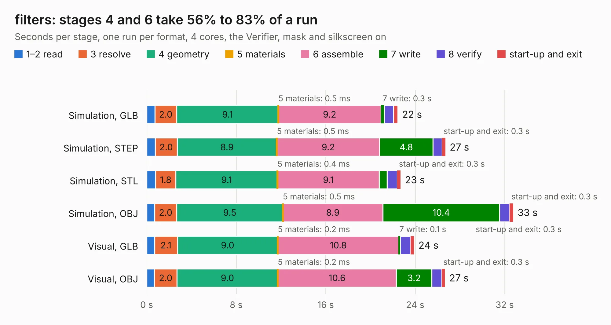

| Mode and format | 1–2 read | 3 resolve | 4 geometry | 5 materials | 6 assemble | 7 write | 8 verify | start-up and exit | Total |
|---|---:|---:|---:|---:|---:|---:|---:|---:|---:|
| Simulation, GLB | 0.7 | 2.0 | 9.1 | 0.5&nbsp;ms | 9.2 | 0.3 | 0.8 | 0.4 | 22.4 |
| Simulation, STEP | 0.8 | 2.0 | 8.9 | 0.5&nbsp;ms | 9.2 | 4.8 | 0.8 | 0.3 | 26.7 |
| Simulation, STL | 0.8 | 1.8 | 9.1 | 0.4&nbsp;ms | 9.1 | 0.7 | 0.9 | 0.3 | 22.7 |
| Simulation, OBJ | 0.7 | 2.0 | 9.5 | 0.5&nbsp;ms | 8.9 | 10.4 | 0.9 | 0.3 | 32.8 |
| Visual, GLB | 0.7 | 2.1 | 9.0 | 0.2&nbsp;ms | 10.8 | 0.1 | 1.0 | 0.3 | 23.9 |
| Visual, OBJ | 0.7 | 2.0 | 9.0 | 0.2&nbsp;ms | 10.6 | 3.2 | 0.9 | 0.3 | 26.7 |

<table align="center"><tr><td valign="top">

| Board | Repo: [greatscottgadgets/misc](https://github.com/greatscottgadgets/misc) Board: `filters.kicad_pcb` |
|---|---|
| Folder | evaluation-boards / filters |
| Complexity | 218&nbsp;/&nbsp;1000 (size&nbsp;163, features&nbsp;55) |
| KESE&nbsp;features | through vias, rounded, trapezoid or chamfered pads, filled zones, curved board outline |
| Tested | 9th November 2026 |
| Copper&nbsp;layers | 4 |
| File&nbsp;format | KiCad 9 (20241229) |
| Parts,&nbsp;tracks,&nbsp;vias | 30, 41, 78 |
| Triangles,&nbsp;simulation | 2,127,510 in 31 parts |
| Verifier | PASS in all six runs |

</td><td valign="top">

<table>
<tr><th>File type</th><th>File size</th><th>Peak memory used</th></tr>
<tr><th colspan="3" align="left">Simulation</th></tr>
<tr><td>GLB</td><td align="right">70&nbsp;MB</td><td align="right">911&nbsp;MB</td></tr>
<tr><td>STEP</td><td align="right">237&nbsp;MB</td><td align="right">1.0&nbsp;GB</td></tr>
<tr><td>STL</td><td align="right">106&nbsp;MB</td><td align="right">985&nbsp;MB</td></tr>
<tr><td>OBJ</td><td align="right">223&nbsp;MB</td><td align="right">1.4&nbsp;GB</td></tr>
<tr><th colspan="3" align="left">Visual</th></tr>
<tr><td>GLB</td><td align="right">23&nbsp;MB</td><td align="right">624&nbsp;MB</td></tr>
<tr><td>OBJ</td><td align="right">69&nbsp;MB</td><td align="right">626&nbsp;MB</td></tr>
</table>

</td></tr></table>

## 1132 leds

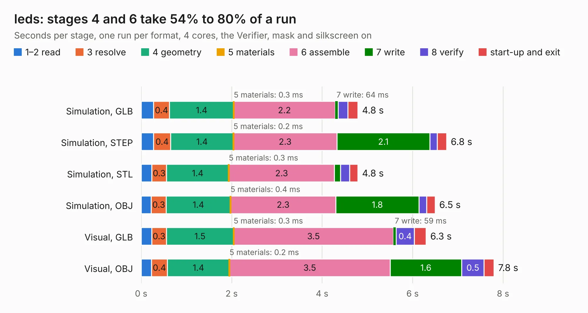

| Mode and format | 1–2 read | 3 resolve | 4 geometry | 5 materials | 6 assemble | 7 write | 8 verify | start-up and exit | Total |
|---|---:|---:|---:|---:|---:|---:|---:|---:|---:|
| Simulation, GLB | 0.3 | 0.4 | 1.4 | 0.3&nbsp;ms | 2.2 | 64&nbsp;ms | 0.2 | 0.2 | 4.8 |
| Simulation, STEP | 0.3 | 0.4 | 1.4 | 0.2&nbsp;ms | 2.3 | 2.1 | 0.2 | 0.2 | 6.8 |
| Simulation, STL | 0.2 | 0.3 | 1.4 | 0.3&nbsp;ms | 2.3 | 0.1 | 0.2 | 0.2 | 4.8 |
| Simulation, OBJ | 0.2 | 0.3 | 1.4 | 0.4&nbsp;ms | 2.3 | 1.8 | 0.2 | 0.2 | 6.5 |
| Visual, GLB | 0.2 | 0.3 | 1.5 | 0.3&nbsp;ms | 3.5 | 59&nbsp;ms | 0.4 | 0.3 | 6.3 |
| Visual, OBJ | 0.2 | 0.4 | 1.4 | 0.2&nbsp;ms | 3.5 | 1.6 | 0.5 | 0.2 | 7.8 |

<table align="center"><tr><td valign="top">

| Board | Repo: [greatscottgadgets/misc](https://github.com/greatscottgadgets/misc) Board: `leds.kicad_pcb` |
|---|---|
| Folder | evaluation-boards / leds |
| Complexity | 247&nbsp;/&nbsp;1000 (size&nbsp;172, features&nbsp;75) |
| KESE&nbsp;features | through vias, rounded, trapezoid or chamfered pads, filled zones, stack-up, dielectric εr and tanδ |
| Tested | 9th November 2026 |
| Copper&nbsp;layers | 2 |
| File&nbsp;format | KiCad 8 (20240108) |
| Parts,&nbsp;tracks,&nbsp;vias | 128, 372, 54 |
| Triangles,&nbsp;simulation | 457,374 in 66 parts |
| Verifier | PASS in all six runs |

</td><td valign="top">

<table>
<tr><th>File type</th><th>File size</th><th>Peak memory used</th></tr>
<tr><th colspan="3" align="left">Simulation</th></tr>
<tr><td>GLB</td><td align="right">15&nbsp;MB</td><td align="right">331&nbsp;MB</td></tr>
<tr><td>STEP</td><td align="right">79&nbsp;MB</td><td align="right">384&nbsp;MB</td></tr>
<tr><td>STL</td><td align="right">23&nbsp;MB</td><td align="right">331&nbsp;MB</td></tr>
<tr><td>OBJ</td><td align="right">46&nbsp;MB</td><td align="right">370&nbsp;MB</td></tr>
<tr><th colspan="3" align="left">Visual</th></tr>
<tr><td>GLB</td><td align="right">13&nbsp;MB</td><td align="right">427&nbsp;MB</td></tr>
<tr><td>OBJ</td><td align="right">37&nbsp;MB</td><td align="right">421&nbsp;MB</td></tr>
</table>

</td></tr></table>

## 1133 limiters

| Mode and format | 1–2 read | 3 resolve | 4 geometry | 5 materials | 6 assemble | 7 write | 8 verify | start-up and exit | Total |
|---|---:|---:|---:|---:|---:|---:|---:|---:|---:|
| Simulation, GLB | 0.6 | 1.3 | 6.2 | 0.5&nbsp;ms | 6.3 | 0.3 | 0.7 | 0.3 | 15.7 |
| Simulation, STEP | 0.6 | 1.3 | 5.9 | 0.4&nbsp;ms | 5.6 | 3.7 | 0.6 | 0.3 | 18.1 |
| Simulation, STL | 0.6 | 1.3 | 6.4 | 0.8&nbsp;ms | 5.8 | 0.6 | 0.6 | 0.3 | 15.5 |
| Simulation, OBJ | 0.5 | 1.3 | 6.3 | 0.4&nbsp;ms | 5.8 | 9.3 | 0.6 | 0.3 | 24.1 |
| Visual, GLB | 0.6 | 1.3 | 6.2 | 0.5&nbsp;ms | 9.7 | 0.1 | 0.9 | 0.3 | 19.1 |
| Visual, OBJ | 0.7 | 1.4 | 6.5 | 0.4&nbsp;ms | 9.5 | 3.6 | 0.8 | 0.3 | 22.8 |

<table align="center"><tr><td valign="top">

| Board | Repo: [greatscottgadgets/misc](https://github.com/greatscottgadgets/misc) Board: `limiters.kicad_pcb` |
|---|---|
| Folder | evaluation-boards / limiters |
| Complexity | 267&nbsp;/&nbsp;1000 (size&nbsp;192, features&nbsp;75) |
| KESE&nbsp;features | through vias, rounded, trapezoid or chamfered pads, filled zones, stack-up, dielectric εr and tanδ |
| Tested | 9th November 2026 |
| Copper&nbsp;layers | 4 |
| File&nbsp;format | KiCad 8 (20240108) |
| Parts,&nbsp;tracks,&nbsp;vias | 143, 397, 61 |
| Triangles,&nbsp;simulation | 1,536,570 in 79 parts |
| Verifier | PASS in all six runs |

</td><td valign="top">

<table>
<tr><th>File type</th><th>File size</th><th>Peak memory used</th></tr>
<tr><th colspan="3" align="left">Simulation</th></tr>
<tr><td>GLB</td><td align="right">52&nbsp;MB</td><td align="right">735&nbsp;MB</td></tr>
<tr><td>STEP</td><td align="right">184&nbsp;MB</td><td align="right">748&nbsp;MB</td></tr>
<tr><td>STL</td><td align="right">77&nbsp;MB</td><td align="right">667&nbsp;MB</td></tr>
<tr><td>OBJ</td><td align="right">157&nbsp;MB</td><td align="right">1.1&nbsp;GB</td></tr>
<tr><th colspan="3" align="left">Visual</th></tr>
<tr><td>GLB</td><td align="right">21&nbsp;MB</td><td align="right">611&nbsp;MB</td></tr>
<tr><td>OBJ</td><td align="right">65&nbsp;MB</td><td align="right">614&nbsp;MB</td></tr>
</table>

</td></tr></table>

## 1134 passives

| Mode and format | 1–2 read | 3 resolve | 4 geometry | 5 materials | 6 assemble | 7 write | 8 verify | start-up and exit | Total |
|---|---:|---:|---:|---:|---:|---:|---:|---:|---:|
| Simulation, GLB | 0.5 | 1.1 | 5.4 | 0.3&nbsp;ms | 5.3 | 0.2 | 0.6 | 0.3 | 13.4 |
| Simulation, STEP | 0.4 | 1.2 | 5.2 | 0.3&nbsp;ms | 5.4 | 3.8 | 0.5 | 0.2 | 16.7 |
| Simulation, STL | 0.5 | 1.1 | 5.4 | 0.2&nbsp;ms | 5.0 | 0.4 | 0.6 | 0.3 | 13.2 |
| Simulation, OBJ | 0.4 | 1.1 | 5.2 | 0.3&nbsp;ms | 5.1 | 7.4 | 0.6 | 0.3 | 20.0 |
| Visual, GLB | 0.4 | 1.1 | 5.3 | 0.3&nbsp;ms | 6.8 | 68&nbsp;ms | 0.6 | 0.3 | 14.5 |
| Visual, OBJ | 0.4 | 1.0 | 5.1 | 0.3&nbsp;ms | 7.0 | 2.6 | 0.7 | 0.3 | 17.1 |

<table align="center"><tr><td valign="top">

| Board | Repo: [greatscottgadgets/misc](https://github.com/greatscottgadgets/misc) Board: `passives.kicad_pcb` |
|---|---|
| Folder | evaluation-boards / passives |
| Complexity | 239&nbsp;/&nbsp;1000 (size&nbsp;164, features&nbsp;75) |
| KESE&nbsp;features | through vias, rounded, trapezoid or chamfered pads, filled zones, stack-up, dielectric εr and tanδ |
| Tested | 9th November 2026 |
| Copper&nbsp;layers | 4 |
| File&nbsp;format | KiCad 8 (20240108) |
| Parts,&nbsp;tracks,&nbsp;vias | 59, 82, 38 |
| Triangles,&nbsp;simulation | 1,229,348 in 40 parts |
| Verifier | PASS in all six runs |

</td><td valign="top">

<table>
<tr><th>File type</th><th>File size</th><th>Peak memory used</th></tr>
<tr><th colspan="3" align="left">Simulation</th></tr>
<tr><td>GLB</td><td align="right">42&nbsp;MB</td><td align="right">599&nbsp;MB</td></tr>
<tr><td>STEP</td><td align="right">137&nbsp;MB</td><td align="right">661&nbsp;MB</td></tr>
<tr><td>STL</td><td align="right">61&nbsp;MB</td><td align="right">608&nbsp;MB</td></tr>
<tr><td>OBJ</td><td align="right">124&nbsp;MB</td><td align="right">835&nbsp;MB</td></tr>
<tr><th colspan="3" align="left">Visual</th></tr>
<tr><td>GLB</td><td align="right">15&nbsp;MB</td><td align="right">455&nbsp;MB</td></tr>
<tr><td>OBJ</td><td align="right">44&nbsp;MB</td><td align="right">483&nbsp;MB</td></tr>
</table>

</td></tr></table>

## 1135 pmos-or

| Mode and format | 1–2 read | 3 resolve | 4 geometry | 5 materials | 6 assemble | 7 write | 8 verify | start-up and exit | Total |
|---|---:|---:|---:|---:|---:|---:|---:|---:|---:|
| Simulation, GLB | 0.2 | 0.4 | 2.2 | 0.3&nbsp;ms | 1.5 | 70&nbsp;ms | 0.2 | 0.2 | 4.7 |
| Simulation, STEP | 0.2 | 0.4 | 2.2 | 0.2&nbsp;ms | 1.5 | 1.6 | 0.2 | 0.2 | 6.3 |
| Simulation, STL | 0.2 | 0.4 | 2.3 | 0.3&nbsp;ms | 1.5 | 92&nbsp;ms | 0.2 | 0.2 | 4.9 |
| Simulation, OBJ | 0.2 | 0.4 | 2.2 | 0.2&nbsp;ms | 1.5 | 2.2 | 0.2 | 0.2 | 6.9 |
| Visual, GLB | 0.2 | 0.4 | 2.3 | 0.2&nbsp;ms | 3.0 | 45&nbsp;ms | 0.3 | 0.2 | 6.3 |
| Visual, OBJ | 0.2 | 0.4 | 2.4 | 0.2&nbsp;ms | 3.0 | 1.5 | 0.3 | 0.2 | 7.9 |

<table align="center"><tr><td valign="top">

| Board | Repo: [greatscottgadgets/misc](https://github.com/greatscottgadgets/misc) Board: `pmos-or.kicad_pcb` |
|---|---|
| Folder | evaluation-boards / pmos-or |
| Complexity | 234&nbsp;/&nbsp;1000 (size&nbsp;149, features&nbsp;85) |
| KESE&nbsp;features | through vias, slotted holes, rounded, trapezoid or chamfered pads, filled zones, stack-up, dielectric εr and tanδ |
| Tested | 9th November 2026 |
| Copper&nbsp;layers | 2 |
| File&nbsp;format | KiCad 6 (20211014) |
| Parts,&nbsp;tracks,&nbsp;vias | 42, 193, 24 |
| Triangles,&nbsp;simulation | 441,360 in 48 parts |
| Verifier | PASS in all six runs |

</td><td valign="top">

<table>
<tr><th>File type</th><th>File size</th><th>Peak memory used</th></tr>
<tr><th colspan="3" align="left">Simulation</th></tr>
<tr><td>GLB</td><td align="right">16&nbsp;MB</td><td align="right">287&nbsp;MB</td></tr>
<tr><td>STEP</td><td align="right">83&nbsp;MB</td><td align="right">331&nbsp;MB</td></tr>
<tr><td>STL</td><td align="right">22&nbsp;MB</td><td align="right">281&nbsp;MB</td></tr>
<tr><td>OBJ</td><td align="right">45&nbsp;MB</td><td align="right">340&nbsp;MB</td></tr>
<tr><th colspan="3" align="left">Visual</th></tr>
<tr><td>GLB</td><td align="right">9.8&nbsp;MB</td><td align="right">309&nbsp;MB</td></tr>
<tr><td>OBJ</td><td align="right">29&nbsp;MB</td><td align="right">305&nbsp;MB</td></tr>
</table>

</td></tr></table>

## 1136 quad-balun-directional-coupler

| Mode and format | 1–2 read | 3 resolve | 4 geometry | 5 materials | 6 assemble | 7 write | 8 verify | start-up and exit | Total |
|---|---:|---:|---:|---:|---:|---:|---:|---:|---:|
| Simulation, GLB | 0.1 | 0.3 | 1.5 | 0.3&nbsp;ms | 1.5 | 55&nbsp;ms | 0.2 | 0.2 | 3.8 |
| Simulation, STEP | 0.1 | 0.3 | 1.4 | 0.3&nbsp;ms | 1.4 | 1.2 | 0.2 | 0.2 | 5.0 |
| Simulation, STL | 0.2 | 0.3 | 1.4 | 0.4&nbsp;ms | 1.4 | 81&nbsp;ms | 0.2 | 0.2 | 3.9 |
| Simulation, OBJ | 0.1 | 0.4 | 1.5 | 0.3&nbsp;ms | 1.5 | 1.9 | 0.2 | 0.3 | 5.8 |
| Visual, GLB | 0.2 | 0.3 | 1.4 | 0.3&nbsp;ms | 1.9 | 26&nbsp;ms | 0.1 | 0.2 | 4.2 |
| Visual, OBJ | 0.2 | 0.3 | 1.4 | 0.3&nbsp;ms | 2.2 | 0.6 | 0.1 | 0.2 | 5.0 |

<table align="center"><tr><td valign="top">

| Board | Repo: [greatscottgadgets/misc](https://github.com/greatscottgadgets/misc) Board: `quad-balun-directional-coupler.kicad_pcb` |
|---|---|
| Folder | evaluation-boards / quad-balun-directional-coupler |
| Complexity | 167&nbsp;/&nbsp;1000 (size&nbsp;132, features&nbsp;35) |
| KESE&nbsp;features | through vias, filled zones |
| Tested | 9th November 2026 |
| Copper&nbsp;layers | 4 |
| File&nbsp;format | KiCad 5 (20171130) |
| Parts,&nbsp;tracks,&nbsp;vias | 14, 55, 4 |
| Triangles,&nbsp;simulation | 337,942 in 27 parts |
| Verifier | PASS in all six runs |

</td><td valign="top">

<table>
<tr><th>File type</th><th>File size</th><th>Peak memory used</th></tr>
<tr><th colspan="3" align="left">Simulation</th></tr>
<tr><td>GLB</td><td align="right">11&nbsp;MB</td><td align="right">250&nbsp;MB</td></tr>
<tr><td>STEP</td><td align="right">37&nbsp;MB</td><td align="right">295&nbsp;MB</td></tr>
<tr><td>STL</td><td align="right">17&nbsp;MB</td><td align="right">252&nbsp;MB</td></tr>
<tr><td>OBJ</td><td align="right">34&nbsp;MB</td><td align="right">288&nbsp;MB</td></tr>
<tr><th colspan="3" align="left">Visual</th></tr>
<tr><td>GLB</td><td align="right">4.0&nbsp;MB</td><td align="right">205&nbsp;MB</td></tr>
<tr><td>OBJ</td><td align="right">11&nbsp;MB</td><td align="right">203&nbsp;MB</td></tr>
</table>

</td></tr></table>

## 1137 rf-amps

| Mode and format | 1–2 read | 3 resolve | 4 geometry | 5 materials | 6 assemble | 7 write | 8 verify | start-up and exit | Total |
|---|---:|---:|---:|---:|---:|---:|---:|---:|---:|
| Simulation, GLB | 0.3 | 0.8 | 3.9 | 0.2&nbsp;ms | 3.2 | 0.2 | 0.3 | 0.2 | 8.9 |
| Simulation, STEP | 0.3 | 0.7 | 3.9 | 0.2&nbsp;ms | 3.3 | 2.2 | 0.3 | 0.2 | 11.0 |
| Simulation, STL | 0.3 | 0.7 | 3.9 | 0.2&nbsp;ms | 3.3 | 0.2 | 0.4 | 0.3 | 9.2 |
| Simulation, OBJ | 0.3 | 0.7 | 3.7 | 0.2&nbsp;ms | 3.4 | 5.1 | 0.4 | 0.3 | 13.9 |
| Visual, GLB | 0.3 | 0.8 | 4.1 | 0.2&nbsp;ms | 5.5 | 52&nbsp;ms | 0.3 | 0.2 | 11.3 |
| Visual, OBJ | 0.3 | 0.8 | 3.8 | 0.2&nbsp;ms | 5.6 | 1.7 | 0.4 | 0.2 | 12.8 |

<table align="center"><tr><td valign="top">

| Board | Repo: [greatscottgadgets/misc](https://github.com/greatscottgadgets/misc) Board: `rf-amps.kicad_pcb` |
|---|---|
| Folder | evaluation-boards / rf-amps |
| Complexity | 231&nbsp;/&nbsp;1000 (size&nbsp;166, features&nbsp;65) |
| KESE&nbsp;features | through vias, rounded, trapezoid or chamfered pads, filled zones, copper text, curved board outline |
| Tested | 9th November 2026 |
| Copper&nbsp;layers | 4 |
| File&nbsp;format | KiCad 9 (20241229) |
| Parts,&nbsp;tracks,&nbsp;vias | 59, 149, 23 |
| Triangles,&nbsp;simulation | 984,660 in 47 parts |
| Verifier | PASS in all six runs |

</td><td valign="top">

<table>
<tr><th>File type</th><th>File size</th><th>Peak memory used</th></tr>
<tr><th colspan="3" align="left">Simulation</th></tr>
<tr><td>GLB</td><td align="right">34&nbsp;MB</td><td align="right">490&nbsp;MB</td></tr>
<tr><td>STEP</td><td align="right">122&nbsp;MB</td><td align="right">526&nbsp;MB</td></tr>
<tr><td>STL</td><td align="right">49&nbsp;MB</td><td align="right">456&nbsp;MB</td></tr>
<tr><td>OBJ</td><td align="right">100&nbsp;MB</td><td align="right">708&nbsp;MB</td></tr>
<tr><th colspan="3" align="left">Visual</th></tr>
<tr><td>GLB</td><td align="right">12&nbsp;MB</td><td align="right">424&nbsp;MB</td></tr>
<tr><td>OBJ</td><td align="right">35&nbsp;MB</td><td align="right">410&nbsp;MB</td></tr>
</table>

</td></tr></table>

## 1138 rf-switch-dpdt

| Mode and format | 1–2 read | 3 resolve | 4 geometry | 5 materials | 6 assemble | 7 write | 8 verify | start-up and exit | Total |
|---|---:|---:|---:|---:|---:|---:|---:|---:|---:|
| Simulation, GLB | 0.3 | 0.7 | 3.6 | 0.5&nbsp;ms | 3.3 | 0.2 | 0.5 | 0.2 | 8.8 |
| Simulation, STEP | 0.3 | 0.7 | 3.6 | 0.4&nbsp;ms | 3.4 | 2.2 | 0.4 | 0.2 | 11.0 |
| Simulation, STL | 0.3 | 0.7 | 3.5 | 0.5&nbsp;ms | 3.4 | 0.3 | 0.5 | 0.2 | 8.9 |
| Simulation, OBJ | 0.3 | 0.7 | 3.7 | 0.4&nbsp;ms | 3.5 | 5.4 | 0.5 | 0.2 | 14.3 |
| Visual, GLB | 0.3 | 0.7 | 3.5 | 0.4&nbsp;ms | 5.8 | 83&nbsp;ms | 0.5 | 0.3 | 11.2 |
| Visual, OBJ | 0.3 | 0.8 | 3.6 | 0.6&nbsp;ms | 5.7 | 2.3 | 0.6 | 0.2 | 13.6 |

<table align="center"><tr><td valign="top">

| Board | Repo: [greatscottgadgets/misc](https://github.com/greatscottgadgets/misc) Board: `rf-switch-dpdt.kicad_pcb` |
|---|---|
| Folder | evaluation-boards / rf-switch-dpdt |
| Complexity | 256&nbsp;/&nbsp;1000 (size&nbsp;156, features&nbsp;100) |
| KESE&nbsp;features | through vias, custom pads, rounded, trapezoid or chamfered pads, filled zones, copper drawings, stack-up, dielectric εr and tanδ |
| Tested | 9th November 2026 |
| Copper&nbsp;layers | 4 |
| File&nbsp;format | KiCad 7 (20221018) |
| Parts,&nbsp;tracks,&nbsp;vias | 29, 120, 24 |
| Triangles,&nbsp;simulation | 1,024,652 in 39 parts |
| Verifier | PASS in all six runs |

</td><td valign="top">

<table>
<tr><th>File type</th><th>File size</th><th>Peak memory used</th></tr>
<tr><th colspan="3" align="left">Simulation</th></tr>
<tr><td>GLB</td><td align="right">35&nbsp;MB</td><td align="right">432&nbsp;MB</td></tr>
<tr><td>STEP</td><td align="right">138&nbsp;MB</td><td align="right">521&nbsp;MB</td></tr>
<tr><td>STL</td><td align="right">51&nbsp;MB</td><td align="right">424&nbsp;MB</td></tr>
<tr><td>OBJ</td><td align="right">102&nbsp;MB</td><td align="right">724&nbsp;MB</td></tr>
<tr><th colspan="3" align="left">Visual</th></tr>
<tr><td>GLB</td><td align="right">16&nbsp;MB</td><td align="right">475&nbsp;MB</td></tr>
<tr><td>OBJ</td><td align="right">47&nbsp;MB</td><td align="right">494&nbsp;MB</td></tr>
</table>

</td></tr></table>

## 1139 rf-switch-sp3t

| Mode and format | 1–2 read | 3 resolve | 4 geometry | 5 materials | 6 assemble | 7 write | 8 verify | start-up and exit | Total |
|---|---:|---:|---:|---:|---:|---:|---:|---:|---:|
| Simulation, GLB | 0.3 | 0.7 | 3.5 | 0.4&nbsp;ms | 3.2 | 0.1 | 0.4 | 0.3 | 8.6 |
| Simulation, STEP | 0.3 | 0.7 | 3.5 | 0.2&nbsp;ms | 3.1 | 2.2 | 0.4 | 0.2 | 10.4 |
| Simulation, STL | 0.3 | 0.7 | 3.6 | 0.2&nbsp;ms | 3.4 | 0.3 | 0.4 | 0.3 | 9.0 |
| Simulation, OBJ | 0.3 | 0.8 | 3.6 | 0.3&nbsp;ms | 3.2 | 4.9 | 0.4 | 0.3 | 13.5 |
| Visual, GLB | 0.3 | 0.8 | 3.5 | 0.3&nbsp;ms | 4.7 | 79&nbsp;ms | 0.5 | 0.3 | 10.1 |
| Visual, OBJ | 0.3 | 0.7 | 3.6 | 0.3&nbsp;ms | 5.2 | 1.8 | 0.5 | 0.2 | 12.2 |

<table align="center"><tr><td valign="top">

| Board | Repo: [greatscottgadgets/misc](https://github.com/greatscottgadgets/misc) Board: `rf-switch-sp3t.kicad_pcb` |
|---|---|
| Folder | evaluation-boards / rf-switch-sp3t |
| Complexity | 241&nbsp;/&nbsp;1000 (size&nbsp;166, features&nbsp;75) |
| KESE&nbsp;features | through vias, rounded, trapezoid or chamfered pads, filled zones, stack-up, dielectric εr and tanδ |
| Tested | 9th November 2026 |
| Copper&nbsp;layers | 4 |
| File&nbsp;format | KiCad 8 (20240108) |
| Parts,&nbsp;tracks,&nbsp;vias | 33, 141, 57 |
| Triangles,&nbsp;simulation | 942,708 in 40 parts |
| Verifier | PASS in all six runs |

</td><td valign="top">

<table>
<tr><th>File type</th><th>File size</th><th>Peak memory used</th></tr>
<tr><th colspan="3" align="left">Simulation</th></tr>
<tr><td>GLB</td><td align="right">32&nbsp;MB</td><td align="right">468&nbsp;MB</td></tr>
<tr><td>STEP</td><td align="right">103&nbsp;MB</td><td align="right">532&nbsp;MB</td></tr>
<tr><td>STL</td><td align="right">47&nbsp;MB</td><td align="right">442&nbsp;MB</td></tr>
<tr><td>OBJ</td><td align="right">95&nbsp;MB</td><td align="right">673&nbsp;MB</td></tr>
<tr><th colspan="3" align="left">Visual</th></tr>
<tr><td>GLB</td><td align="right">13&nbsp;MB</td><td align="right">415&nbsp;MB</td></tr>
<tr><td>OBJ</td><td align="right">38&nbsp;MB</td><td align="right">441&nbsp;MB</td></tr>
</table>

</td></tr></table>

## 1140 rf-switch-sp4t

| Mode and format | 1–2 read | 3 resolve | 4 geometry | 5 materials | 6 assemble | 7 write | 8 verify | start-up and exit | Total |
|---|---:|---:|---:|---:|---:|---:|---:|---:|---:|
| Simulation, GLB | 0.5 | 1.5 | 6.2 | 0.4&nbsp;ms | 6.7 | 0.3 | 0.7 | 0.2 | 16.1 |
| Simulation, STEP | 0.5 | 1.5 | 6.1 | 0.3&nbsp;ms | 6.3 | 4.0 | 0.7 | 0.2 | 19.3 |
| Simulation, STL | 0.4 | 1.5 | 6.1 | 0.3&nbsp;ms | 6.6 | 0.6 | 0.8 | 0.2 | 16.1 |
| Simulation, OBJ | 0.4 | 1.3 | 5.9 | 0.5&nbsp;ms | 6.8 | 8.7 | 0.7 | 0.3 | 24.1 |
| Visual, GLB | 0.5 | 1.5 | 6.3 | 0.3&nbsp;ms | 10.3 | 0.1 | 1.0 | 0.3 | 19.9 |
| Visual, OBJ | 0.4 | 1.5 | 6.1 | 0.3&nbsp;ms | 9.9 | 3.4 | 1.0 | 0.2 | 22.5 |

<table align="center"><tr><td valign="top">

| Board | Repo: [greatscottgadgets/misc](https://github.com/greatscottgadgets/misc) Board: `rf-switch-sp4t.kicad_pcb` |
|---|---|
| Folder | evaluation-boards / rf-switch-sp4t |
| Complexity | 287&nbsp;/&nbsp;1000 (size&nbsp;187, features&nbsp;100) |
| KESE&nbsp;features | through vias, custom pads, rounded, trapezoid or chamfered pads, filled zones, copper drawings, stack-up, dielectric εr and tanδ |
| Tested | 9th November 2026 |
| Copper&nbsp;layers | 4 |
| File&nbsp;format | KiCad 8 (20240108) |
| Parts,&nbsp;tracks,&nbsp;vias | 73, 347, 109 |
| Triangles,&nbsp;simulation | 2,124,978 in 64 parts |
| Verifier | PASS in all six runs |

</td><td valign="top">

<table>
<tr><th>File type</th><th>File size</th><th>Peak memory used</th></tr>
<tr><th colspan="3" align="left">Simulation</th></tr>
<tr><td>GLB</td><td align="right">72&nbsp;MB</td><td align="right">865&nbsp;MB</td></tr>
<tr><td>STEP</td><td align="right">238&nbsp;MB</td><td align="right">950&nbsp;MB</td></tr>
<tr><td>STL</td><td align="right">106&nbsp;MB</td><td align="right">881&nbsp;MB</td></tr>
<tr><td>OBJ</td><td align="right">220&nbsp;MB</td><td align="right">1.4&nbsp;GB</td></tr>
<tr><th colspan="3" align="left">Visual</th></tr>
<tr><td>GLB</td><td align="right">28&nbsp;MB</td><td align="right">811&nbsp;MB</td></tr>
<tr><td>OBJ</td><td align="right">85&nbsp;MB</td><td align="right">718&nbsp;MB</td></tr>
</table>

</td></tr></table>

## 1141 rf-switch-spdt

| Mode and format | 1–2 read | 3 resolve | 4 geometry | 5 materials | 6 assemble | 7 write | 8 verify | start-up and exit | Total |
|---|---:|---:|---:|---:|---:|---:|---:|---:|---:|
| Simulation, GLB | 0.2 | 0.6 | 2.5 | 0.2&nbsp;ms | 2.5 | 0.1 | 0.5 | 0.2 | 6.6 |
| Simulation, STEP | 0.2 | 0.5 | 2.5 | 0.2&nbsp;ms | 2.4 | 1.8 | 0.4 | 0.2 | 8.1 |
| Simulation, STL | 0.2 | 0.6 | 2.4 | 0.1&nbsp;ms | 2.4 | 0.2 | 0.3 | 0.2 | 6.3 |
| Simulation, OBJ | 0.2 | 0.5 | 2.4 | 0.2&nbsp;ms | 2.3 | 3.7 | 0.4 | 0.3 | 9.9 |
| Visual, GLB | 0.2 | 0.5 | 2.4 | 0.2&nbsp;ms | 5.3 | 42&nbsp;ms | 0.3 | 0.2 | 9.0 |
| Visual, OBJ | 0.2 | 0.5 | 2.4 | 0.3&nbsp;ms | 5.4 | 1.5 | 0.3 | 0.2 | 10.5 |

<table align="center"><tr><td valign="top">

| Board | Repo: [greatscottgadgets/misc](https://github.com/greatscottgadgets/misc) Board: `rf-switch-spdt.kicad_pcb` |
|---|---|
| Folder | evaluation-boards / rf-switch-spdt |
| Complexity | 259&nbsp;/&nbsp;1000 (size&nbsp;159, features&nbsp;100) |
| KESE&nbsp;features | through vias, custom pads, rounded, trapezoid or chamfered pads, filled zones, copper drawings, stack-up, dielectric εr and tanδ |
| Tested | 9th November 2026 |
| Copper&nbsp;layers | 4 |
| File&nbsp;format | KiCad 8 (20240108) |
| Parts,&nbsp;tracks,&nbsp;vias | 28, 85, 48 |
| Triangles,&nbsp;simulation | 729,262 in 31 parts |
| Verifier | PASS in all six runs |

</td><td valign="top">

<table>
<tr><th>File type</th><th>File size</th><th>Peak memory used</th></tr>
<tr><th colspan="3" align="left">Simulation</th></tr>
<tr><td>GLB</td><td align="right">25&nbsp;MB</td><td align="right">391&nbsp;MB</td></tr>
<tr><td>STEP</td><td align="right">79&nbsp;MB</td><td align="right">447&nbsp;MB</td></tr>
<tr><td>STL</td><td align="right">36&nbsp;MB</td><td align="right">393&nbsp;MB</td></tr>
<tr><td>OBJ</td><td align="right">73&nbsp;MB</td><td align="right">523&nbsp;MB</td></tr>
<tr><th colspan="3" align="left">Visual</th></tr>
<tr><td>GLB</td><td align="right">10&nbsp;MB</td><td align="right">354&nbsp;MB</td></tr>
<tr><td>OBJ</td><td align="right">30&nbsp;MB</td><td align="right">352&nbsp;MB</td></tr>
</table>

</td></tr></table>

## 1142 Si5351A

| Mode and format | 1–2 read | 3 resolve | 4 geometry | 5 materials | 6 assemble | 7 write | 8 verify | start-up and exit | Total |
|---|---:|---:|---:|---:|---:|---:|---:|---:|---:|
| Simulation, GLB | 0.3 | 1.1 | 5.2 | 0.7&nbsp;ms | 4.3 | 0.2 | 0.6 | 0.2 | 11.9 |
| Simulation, STEP | 0.4 | 1.1 | 5.3 | 0.5&nbsp;ms | 4.2 | 3.0 | 0.5 | 0.3 | 14.7 |
| Simulation, STL | 0.4 | 1.1 | 5.4 | 0.5&nbsp;ms | 4.3 | 0.4 | 0.6 | 0.2 | 12.4 |
| Simulation, OBJ | 0.4 | 1.2 | 5.3 | 0.5&nbsp;ms | 4.3 | 7.1 | 0.5 | 0.2 | 19.0 |
| Visual, GLB | 0.3 | 1.1 | 5.4 | 0.3&nbsp;ms | 7.6 | 92&nbsp;ms | 0.9 | 0.2 | 15.6 |
| Visual, OBJ | 0.3 | 1.1 | 5.5 | 0.3&nbsp;ms | 7.2 | 3.2 | 1.0 | 0.2 | 18.5 |

<table align="center"><tr><td valign="top">

| Board | Repo: [greatscottgadgets/misc](https://github.com/greatscottgadgets/misc) Board: `Si5351A.kicad_pcb` |
|---|---|
| Folder | evaluation-boards / Si5351A |
| Complexity | 273&nbsp;/&nbsp;1000 (size&nbsp;188, features&nbsp;85) |
| KESE&nbsp;features | through vias, rounded, trapezoid or chamfered pads, filled zones, curved board outline, stack-up, dielectric εr and tanδ |
| Tested | 9th November 2026 |
| Copper&nbsp;layers | 4 |
| File&nbsp;format | KiCad 6 (20211014) |
| Parts,&nbsp;tracks,&nbsp;vias | 84, 439, 69 |
| Triangles,&nbsp;simulation | 1,313,314 in 62 parts |
| Verifier | PASS in all six runs |

</td><td valign="top">

<table>
<tr><th>File type</th><th>File size</th><th>Peak memory used</th></tr>
<tr><th colspan="3" align="left">Simulation</th></tr>
<tr><td>GLB</td><td align="right">43&nbsp;MB</td><td align="right">578&nbsp;MB</td></tr>
<tr><td>STEP</td><td align="right">152&nbsp;MB</td><td align="right">634&nbsp;MB</td></tr>
<tr><td>STL</td><td align="right">66&nbsp;MB</td><td align="right">566&nbsp;MB</td></tr>
<tr><td>OBJ</td><td align="right">133&nbsp;MB</td><td align="right">899&nbsp;MB</td></tr>
<tr><th colspan="3" align="left">Visual</th></tr>
<tr><td>GLB</td><td align="right">20&nbsp;MB</td><td align="right">627&nbsp;MB</td></tr>
<tr><td>OBJ</td><td align="right">61&nbsp;MB</td><td align="right">588&nbsp;MB</td></tr>
</table>

</td></tr></table>

## 1143 sky13350

| Mode and format | 1–2 read | 3 resolve | 4 geometry | 5 materials | 6 assemble | 7 write | 8 verify | start-up and exit | Total |
|---|---:|---:|---:|---:|---:|---:|---:|---:|---:|
| Simulation, GLB | 91&nbsp;ms | 0.2 | 1.1 | 0.3&nbsp;ms | 0.9 | 42&nbsp;ms | 0.1 | 0.2 | 2.7 |
| Simulation, STEP | 94&nbsp;ms | 0.2 | 1.1 | 0.2&nbsp;ms | 0.9 | 0.9 | 0.1 | 0.2 | 3.5 |
| Simulation, STL | 0.1 | 0.2 | 1.1 | 0.4&nbsp;ms | 0.8 | 68&nbsp;ms | 0.2 | 0.2 | 2.6 |
| Simulation, OBJ | 0.1 | 0.2 | 1.0 | 0.2&nbsp;ms | 0.9 | 1.2 | 0.1 | 0.2 | 3.7 |
| Visual, GLB | 99&nbsp;ms | 0.2 | 1.1 | 0.4&nbsp;ms | 1.8 | 20&nbsp;ms | 0.2 | 0.2 | 3.6 |
| Visual, OBJ | 0.1 | 0.3 | 1.1 | 0.3&nbsp;ms | 1.6 | 0.5 | 0.2 | 0.2 | 4.0 |

<table align="center"><tr><td valign="top">

| Board | Repo: [greatscottgadgets/misc](https://github.com/greatscottgadgets/misc) Board: `sky13350.kicad_pcb` |
|---|---|
| Folder | evaluation-boards / sky13350 |
| Complexity | 164&nbsp;/&nbsp;1000 (size&nbsp;129, features&nbsp;35) |
| KESE&nbsp;features | through vias, filled zones |
| Tested | 9th November 2026 |
| Copper&nbsp;layers | 4 |
| File&nbsp;format | KiCad 4 (4) |
| Parts,&nbsp;tracks,&nbsp;vias | 22, 34, 3 |
| Triangles,&nbsp;simulation | 292,626 in 27 parts |
| Verifier | PASS in all six runs |

</td><td valign="top">

<table>
<tr><th>File type</th><th>File size</th><th>Peak memory used</th></tr>
<tr><th colspan="3" align="left">Simulation</th></tr>
<tr><td>GLB</td><td align="right">10&nbsp;MB</td><td align="right">222&nbsp;MB</td></tr>
<tr><td>STEP</td><td align="right">39&nbsp;MB</td><td align="right">241&nbsp;MB</td></tr>
<tr><td>STL</td><td align="right">15&nbsp;MB</td><td align="right">225&nbsp;MB</td></tr>
<tr><td>OBJ</td><td align="right">30&nbsp;MB</td><td align="right">229&nbsp;MB</td></tr>
<tr><th colspan="3" align="left">Visual</th></tr>
<tr><td>GLB</td><td align="right">4.4&nbsp;MB</td><td align="right">203&nbsp;MB</td></tr>
<tr><td>OBJ</td><td align="right">13&nbsp;MB</td><td align="right">197&nbsp;MB</td></tr>
</table>

</td></tr></table>

## 1144 sky13351

| Mode and format | 1–2 read | 3 resolve | 4 geometry | 5 materials | 6 assemble | 7 write | 8 verify | start-up and exit | Total |
|---|---:|---:|---:|---:|---:|---:|---:|---:|---:|
| Simulation, GLB | 0.1 | 0.3 | 1.3 | 0.2&nbsp;ms | 1.0 | 47&nbsp;ms | 0.2 | 0.2 | 3.1 |
| Simulation, STEP | 0.1 | 0.3 | 1.4 | 0.1&nbsp;ms | 1.0 | 1.1 | 0.1 | 0.2 | 4.2 |
| Simulation, STL | 0.1 | 0.3 | 1.3 | 0.2&nbsp;ms | 1.0 | 70&nbsp;ms | 0.2 | 0.2 | 3.2 |
| Simulation, OBJ | 0.1 | 0.3 | 1.3 | 0.2&nbsp;ms | 1.0 | 1.4 | 0.2 | 0.2 | 4.6 |
| Visual, GLB | 0.1 | 0.3 | 1.3 | 0.2&nbsp;ms | 1.8 | 23&nbsp;ms | 0.2 | 0.2 | 4.0 |
| Visual, OBJ | 0.1 | 0.3 | 1.2 | 0.2&nbsp;ms | 1.8 | 0.7 | 0.2 | 0.3 | 4.5 |

<table align="center"><tr><td valign="top">

| Board | Repo: [greatscottgadgets/misc](https://github.com/greatscottgadgets/misc) Board: `sky13351.kicad_pcb` |
|---|---|
| Folder | evaluation-boards / sky13351 |
| Complexity | 167&nbsp;/&nbsp;1000 (size&nbsp;132, features&nbsp;35) |
| KESE&nbsp;features | through vias, filled zones |
| Tested | 9th November 2026 |
| Copper&nbsp;layers | 4 |
| File&nbsp;format | KiCad 4 (4) |
| Parts,&nbsp;tracks,&nbsp;vias | 22, 42, 3 |
| Triangles,&nbsp;simulation | 294,750 in 27 parts |
| Verifier | PASS in all six runs |

</td><td valign="top">

<table>
<tr><th>File type</th><th>File size</th><th>Peak memory used</th></tr>
<tr><th colspan="3" align="left">Simulation</th></tr>
<tr><td>GLB</td><td align="right">10&nbsp;MB</td><td align="right">233&nbsp;MB</td></tr>
<tr><td>STEP</td><td align="right">40&nbsp;MB</td><td align="right">241&nbsp;MB</td></tr>
<tr><td>STL</td><td align="right">15&nbsp;MB</td><td align="right">228&nbsp;MB</td></tr>
<tr><td>OBJ</td><td align="right">30&nbsp;MB</td><td align="right">231&nbsp;MB</td></tr>
<tr><th colspan="3" align="left">Visual</th></tr>
<tr><td>GLB</td><td align="right">4.5&nbsp;MB</td><td align="right">192&nbsp;MB</td></tr>
<tr><td>OBJ</td><td align="right">13&nbsp;MB</td><td align="right">193&nbsp;MB</td></tr>
</table>

</td></tr></table>

## 1145 sky13374

| Mode and format | 1–2 read | 3 resolve | 4 geometry | 5 materials | 6 assemble | 7 write | 8 verify | start-up and exit | Total |
|---|---:|---:|---:|---:|---:|---:|---:|---:|---:|
| Simulation, GLB | 0.2 | 0.4 | 1.9 | 0.2&nbsp;ms | 1.5 | 86&nbsp;ms | 0.2 | 0.3 | 4.6 |
| Simulation, STEP | 0.2 | 0.4 | 1.7 | 0.2&nbsp;ms | 1.4 | 1.6 | 0.2 | 0.3 | 5.8 |
| Simulation, STL | 0.2 | 0.5 | 1.7 | 0.4&nbsp;ms | 1.3 | 88&nbsp;ms | 0.2 | 0.3 | 4.2 |
| Simulation, OBJ | 0.1 | 0.4 | 1.7 | 0.2&nbsp;ms | 1.3 | 2.3 | 0.2 | 0.2 | 6.2 |
| Visual, GLB | 0.1 | 0.3 | 1.7 | 0.2&nbsp;ms | 2.3 | 25&nbsp;ms | 0.3 | 0.3 | 5.1 |
| Visual, OBJ | 0.1 | 0.3 | 1.8 | 0.4&nbsp;ms | 2.4 | 0.8 | 0.2 | 0.3 | 6.0 |

<table align="center"><tr><td valign="top">

| Board | Repo: [greatscottgadgets/misc](https://github.com/greatscottgadgets/misc) Board: `sky13374.kicad_pcb` |
|---|---|
| Folder | evaluation-boards / sky13374 |
| Complexity | 171&nbsp;/&nbsp;1000 (size&nbsp;136, features&nbsp;35) |
| KESE&nbsp;features | through vias, filled zones |
| Tested | 9th November 2026 |
| Copper&nbsp;layers | 4 |
| File&nbsp;format | KiCad 4 (4) |
| Parts,&nbsp;tracks,&nbsp;vias | 17, 45, 10 |
| Triangles,&nbsp;simulation | 299,316 in 23 parts |
| Verifier | PASS in all six runs |

</td><td valign="top">

<table>
<tr><th>File type</th><th>File size</th><th>Peak memory used</th></tr>
<tr><th colspan="3" align="left">Simulation</th></tr>
<tr><td>GLB</td><td align="right">10&nbsp;MB</td><td align="right">225&nbsp;MB</td></tr>
<tr><td>STEP</td><td align="right">40&nbsp;MB</td><td align="right">236&nbsp;MB</td></tr>
<tr><td>STL</td><td align="right">15&nbsp;MB</td><td align="right">226&nbsp;MB</td></tr>
<tr><td>OBJ</td><td align="right">30&nbsp;MB</td><td align="right">234&nbsp;MB</td></tr>
<tr><th colspan="3" align="left">Visual</th></tr>
<tr><td>GLB</td><td align="right">4.6&nbsp;MB</td><td align="right">202&nbsp;MB</td></tr>
<tr><td>OBJ</td><td align="right">13&nbsp;MB</td><td align="right">197&nbsp;MB</td></tr>
</table>

</td></tr></table>

## 1146 sky13411

| Mode and format | 1–2 read | 3 resolve | 4 geometry | 5 materials | 6 assemble | 7 write | 8 verify | start-up and exit | Total |
|---|---:|---:|---:|---:|---:|---:|---:|---:|---:|
| Simulation, GLB | 0.1 | 0.4 | 1.9 | 0.2&nbsp;ms | 1.3 | 84&nbsp;ms | 0.2 | 0.3 | 4.3 |
| Simulation, STEP | 0.1 | 0.5 | 1.9 | 0.2&nbsp;ms | 1.2 | 1.3 | 0.2 | 0.2 | 5.5 |
| Simulation, STL | 0.1 | 0.3 | 1.7 | 0.4&nbsp;ms | 1.2 | 88&nbsp;ms | 0.2 | 0.2 | 3.9 |
| Simulation, OBJ | 0.1 | 0.4 | 1.8 | 0.2&nbsp;ms | 1.2 | 2.0 | 0.2 | 0.2 | 6.0 |
| Visual, GLB | 0.2 | 0.4 | 1.7 | 0.2&nbsp;ms | 2.3 | 30&nbsp;ms | 0.2 | 0.3 | 5.0 |
| Visual, OBJ | 0.1 | 0.4 | 1.7 | 0.2&nbsp;ms | 2.4 | 1.1 | 0.2 | 0.2 | 6.2 |

<table align="center"><tr><td valign="top">

| Board | Repo: [greatscottgadgets/misc](https://github.com/greatscottgadgets/misc) Board: `sky13411.kicad_pcb` |
|---|---|
| Folder | evaluation-boards / sky13411 |
| Complexity | 172&nbsp;/&nbsp;1000 (size&nbsp;137, features&nbsp;35) |
| KESE&nbsp;features | through vias, filled zones |
| Tested | 9th November 2026 |
| Copper&nbsp;layers | 4 |
| File&nbsp;format | KiCad 4 (4) |
| Parts,&nbsp;tracks,&nbsp;vias | 26, 53, 3 |
| Triangles,&nbsp;simulation | 355,080 in 30 parts |
| Verifier | PASS in all six runs |

</td><td valign="top">

<table>
<tr><th>File type</th><th>File size</th><th>Peak memory used</th></tr>
<tr><th colspan="3" align="left">Simulation</th></tr>
<tr><td>GLB</td><td align="right">12&nbsp;MB</td><td align="right">240&nbsp;MB</td></tr>
<tr><td>STEP</td><td align="right">48&nbsp;MB</td><td align="right">258&nbsp;MB</td></tr>
<tr><td>STL</td><td align="right">18&nbsp;MB</td><td align="right">244&nbsp;MB</td></tr>
<tr><td>OBJ</td><td align="right">36&nbsp;MB</td><td align="right">288&nbsp;MB</td></tr>
<tr><th colspan="3" align="left">Visual</th></tr>
<tr><td>GLB</td><td align="right">5.3&nbsp;MB</td><td align="right">212&nbsp;MB</td></tr>
<tr><td>OBJ</td><td align="right">15&nbsp;MB</td><td align="right">216&nbsp;MB</td></tr>
</table>

</td></tr></table>

## 1147 sma-jlcpcb

| Mode and format | 1–2 read | 3 resolve | 4 geometry | 5 materials | 6 assemble | 7 write | 8 verify | start-up and exit | Total |
|---|---:|---:|---:|---:|---:|---:|---:|---:|---:|
| Simulation, GLB | 0.4 | 1.8 | 7.1 | 0.5&nbsp;ms | 7.6 | 0.3 | 0.8 | 0.3 | 18.2 |
| Simulation, STEP | 0.4 | 1.7 | 7.8 | 0.5&nbsp;ms | 7.6 | 3.8 | 0.8 | 0.3 | 22.5 |
| Simulation, STL | 0.4 | 1.8 | 6.9 | 0.4&nbsp;ms | 8.0 | 0.6 | 0.8 | 0.2 | 18.8 |
| Simulation, OBJ | 0.5 | 1.7 | 7.2 | 0.3&nbsp;ms | 7.9 | 9.6 | 0.7 | 0.3 | 27.7 |
| Visual, GLB | 0.4 | 1.6 | 7.5 | 0.4&nbsp;ms | 8.4 | 99&nbsp;ms | 0.9 | 0.3 | 19.1 |
| Visual, OBJ | 0.4 | 1.7 | 7.1 | 0.3&nbsp;ms | 9.1 | 3.1 | 1.0 | 0.3 | 22.7 |

<table align="center"><tr><td valign="top">

| Board | Repo: [greatscottgadgets/misc](https://github.com/greatscottgadgets/misc) Board: `sma-jlcpcb.kicad_pcb` |
|---|---|
| Folder | evaluation-boards / trace-width |
| Complexity | 236&nbsp;/&nbsp;1000 (size&nbsp;171, features&nbsp;65) |
| KESE&nbsp;features | through vias, filled zones, stack-up, dielectric εr and tanδ |
| Tested | 9th November 2026 |
| Copper&nbsp;layers | 6 |
| File&nbsp;format | KiCad 8 (20240108) |
| Parts,&nbsp;tracks,&nbsp;vias | 20, 10, 104 |
| Triangles,&nbsp;simulation | 1,934,558 in 25 parts |
| Verifier | PASS in all six runs |

</td><td valign="top">

<table>
<tr><th>File type</th><th>File size</th><th>Peak memory used</th></tr>
<tr><th colspan="3" align="left">Simulation</th></tr>
<tr><td>GLB</td><td align="right">64&nbsp;MB</td><td align="right">849&nbsp;MB</td></tr>
<tr><td>STEP</td><td align="right">181&nbsp;MB</td><td align="right">902&nbsp;MB</td></tr>
<tr><td>STL</td><td align="right">97&nbsp;MB</td><td align="right">838&nbsp;MB</td></tr>
<tr><td>OBJ</td><td align="right">199&nbsp;MB</td><td align="right">1.3&nbsp;GB</td></tr>
<tr><th colspan="3" align="left">Visual</th></tr>
<tr><td>GLB</td><td align="right">22&nbsp;MB</td><td align="right">662&nbsp;MB</td></tr>
<tr><td>OBJ</td><td align="right">65&nbsp;MB</td><td align="right">630&nbsp;MB</td></tr>
</table>

</td></tr></table>

## 1148 trace-width-jlcpcb

| Mode and format | 1–2 read | 3 resolve | 4 geometry | 5 materials | 6 assemble | 7 write | 8 verify | start-up and exit | Total |
|---|---:|---:|---:|---:|---:|---:|---:|---:|---:|
| Simulation, GLB | 0.3 | 1.1 | 5.0 | 0.3&nbsp;ms | 4.5 | 0.2 | 0.4 | 0.2 | 11.7 |
| Simulation, STEP | 0.3 | 1.1 | 5.0 | 0.4&nbsp;ms | 4.7 | 2.4 | 0.4 | 0.2 | 14.1 |
| Simulation, STL | 0.3 | 1.1 | 4.9 | 0.4&nbsp;ms | 4.4 | 0.3 | 0.5 | 0.2 | 11.7 |
| Simulation, OBJ | 0.3 | 1.1 | 4.9 | 0.4&nbsp;ms | 4.4 | 6.2 | 0.4 | 0.2 | 17.7 |
| Visual, GLB | 0.3 | 1.1 | 4.9 | 0.4&nbsp;ms | 4.8 | 55&nbsp;ms | 0.3 | 0.2 | 11.7 |
| Visual, OBJ | 0.3 | 1.1 | 5.1 | 0.4&nbsp;ms | 4.8 | 1.9 | 0.3 | 0.2 | 13.7 |

<table align="center"><tr><td valign="top">

| Board | Repo: [greatscottgadgets/misc](https://github.com/greatscottgadgets/misc) Board: `trace-width-jlcpcb.kicad_pcb` |
|---|---|
| Folder | evaluation-boards / trace-width |
| Complexity | 230&nbsp;/&nbsp;1000 (size&nbsp;165, features&nbsp;65) |
| KESE&nbsp;features | through vias, filled zones, stack-up, dielectric εr and tanδ |
| Tested | 9th November 2026 |
| Copper&nbsp;layers | 6 |
| File&nbsp;format | KiCad 8 (20240108) |
| Parts,&nbsp;tracks,&nbsp;vias | 16, 8, 84 |
| Triangles,&nbsp;simulation | 1,229,520 in 21 parts |
| Verifier | PASS in all six runs |

</td><td valign="top">

<table>
<tr><th>File type</th><th>File size</th><th>Peak memory used</th></tr>
<tr><th colspan="3" align="left">Simulation</th></tr>
<tr><td>GLB</td><td align="right">41&nbsp;MB</td><td align="right">555&nbsp;MB</td></tr>
<tr><td>STEP</td><td align="right">118&nbsp;MB</td><td align="right">668&nbsp;MB</td></tr>
<tr><td>STL</td><td align="right">61&nbsp;MB</td><td align="right">544&nbsp;MB</td></tr>
<tr><td>OBJ</td><td align="right">124&nbsp;MB</td><td align="right">853&nbsp;MB</td></tr>
<tr><th colspan="3" align="left">Visual</th></tr>
<tr><td>GLB</td><td align="right">13&nbsp;MB</td><td align="right">447&nbsp;MB</td></tr>
<tr><td>OBJ</td><td align="right">39&nbsp;MB</td><td align="right">413&nbsp;MB</td></tr>
</table>

</td></tr></table>

## 1149 trace-width-sunstone

| Mode and format | 1–2 read | 3 resolve | 4 geometry | 5 materials | 6 assemble | 7 write | 8 verify | start-up and exit | Total |
|---|---:|---:|---:|---:|---:|---:|---:|---:|---:|
| Simulation, GLB | 0.3 | 0.8 | 3.9 | 0.5&nbsp;ms | 3.9 | 0.1 | 0.4 | 0.3 | 9.7 |
| Simulation, STEP | 0.3 | 0.8 | 3.7 | 0.2&nbsp;ms | 4.2 | 2.6 | 0.4 | 0.2 | 12.2 |
| Simulation, STL | 0.3 | 0.8 | 3.8 | 0.2&nbsp;ms | 4.2 | 0.3 | 0.4 | 0.2 | 10.1 |
| Simulation, OBJ | 0.3 | 0.8 | 3.7 | 0.2&nbsp;ms | 4.0 | 5.3 | 0.4 | 0.2 | 14.6 |
| Visual, GLB | 0.3 | 0.8 | 3.8 | 0.2&nbsp;ms | 3.7 | 43&nbsp;ms | 0.4 | 0.2 | 9.2 |
| Visual, OBJ | 0.3 | 0.8 | 3.8 | 0.2&nbsp;ms | 3.7 | 1.3 | 0.4 | 0.2 | 10.5 |

<table align="center"><tr><td valign="top">

| Board | Repo: [greatscottgadgets/misc](https://github.com/greatscottgadgets/misc) Board: `trace-width-sunstone.kicad_pcb` |
|---|---|
| Folder | evaluation-boards / trace-width |
| Complexity | 113&nbsp;/&nbsp;1000 (size&nbsp;93, features&nbsp;20) |
| KESE&nbsp;features | filled zones |
| Tested | 9th November 2026 |
| Copper&nbsp;layers | 4 |
| File&nbsp;format | KiCad 4 (4) |
| Parts,&nbsp;tracks,&nbsp;vias | 12, 6, 0 |
| Triangles,&nbsp;simulation | 933,056 in 19 parts |
| Verifier | PASS in all six runs |

</td><td valign="top">

<table>
<tr><th>File type</th><th>File size</th><th>Peak memory used</th></tr>
<tr><th colspan="3" align="left">Simulation</th></tr>
<tr><td>GLB</td><td align="right">30&nbsp;MB</td><td align="right">488&nbsp;MB</td></tr>
<tr><td>STEP</td><td align="right">93&nbsp;MB</td><td align="right">590&nbsp;MB</td></tr>
<tr><td>STL</td><td align="right">47&nbsp;MB</td><td align="right">472&nbsp;MB</td></tr>
<tr><td>OBJ</td><td align="right">94&nbsp;MB</td><td align="right">681&nbsp;MB</td></tr>
<tr><th colspan="3" align="left">Visual</th></tr>
<tr><td>GLB</td><td align="right">7.2&nbsp;MB</td><td align="right">386&nbsp;MB</td></tr>
<tr><td>OBJ</td><td align="right">22&nbsp;MB</td><td align="right">361&nbsp;MB</td></tr>
</table>

</td></tr></table>

## 1150 trace-width

| Mode and format | 1–2 read | 3 resolve | 4 geometry | 5 materials | 6 assemble | 7 write | 8 verify | start-up and exit | Total |
|---|---:|---:|---:|---:|---:|---:|---:|---:|---:|
| Simulation, GLB | 0.2 | 0.9 | 4.6 | 0.2&nbsp;ms | 5.4 | 0.2 | 0.4 | 0.3 | 12.0 |
| Simulation, STEP | 0.2 | 0.9 | 4.3 | 0.3&nbsp;ms | 4.7 | 3.3 | 0.4 | 0.2 | 13.9 |
| Simulation, STL | 0.2 | 0.9 | 4.6 | 0.2&nbsp;ms | 5.2 | 0.3 | 0.4 | 0.2 | 11.8 |
| Simulation, OBJ | 0.2 | 0.8 | 4.7 | 0.3&nbsp;ms | 5.7 | 5.3 | 0.4 | 0.2 | 17.4 |
| Visual, GLB | 0.2 | 0.9 | 4.7 | 0.2&nbsp;ms | 5.3 | 54&nbsp;ms | 0.8 | 0.2 | 12.1 |
| Visual, OBJ | 0.2 | 1.0 | 4.9 | 0.3&nbsp;ms | 5.2 | 1.8 | 1.0 | 0.3 | 14.3 |

<table align="center"><tr><td valign="top">

| Board | Repo: [greatscottgadgets/misc](https://github.com/greatscottgadgets/misc) Board: `trace-width.kicad_pcb` |
|---|---|
| Folder | evaluation-boards / trace-width |
| Complexity | 132&nbsp;/&nbsp;1000 (size&nbsp;112, features&nbsp;20) |
| KESE&nbsp;features | filled zones |
| Tested | 9th November 2026 |
| Copper&nbsp;layers | 4 |
| File&nbsp;format | KiCad 6 (20211014) |
| Parts,&nbsp;tracks,&nbsp;vias | 26, 13, 0 |
| Triangles,&nbsp;simulation | 1,164,700 in 19 parts |
| Verifier | PASS in all six runs |

</td><td valign="top">

<table>
<tr><th>File type</th><th>File size</th><th>Peak memory used</th></tr>
<tr><th colspan="3" align="left">Simulation</th></tr>
<tr><td>GLB</td><td align="right">39&nbsp;MB</td><td align="right">511&nbsp;MB</td></tr>
<tr><td>STEP</td><td align="right">99&nbsp;MB</td><td align="right">672&nbsp;MB</td></tr>
<tr><td>STL</td><td align="right">58&nbsp;MB</td><td align="right">485&nbsp;MB</td></tr>
<tr><td>OBJ</td><td align="right">116&nbsp;MB</td><td align="right">812&nbsp;MB</td></tr>
<tr><th colspan="3" align="left">Visual</th></tr>
<tr><td>GLB</td><td align="right">12&nbsp;MB</td><td align="right">477&nbsp;MB</td></tr>
<tr><td>OBJ</td><td align="right">35&nbsp;MB</td><td align="right">505&nbsp;MB</td></tr>
</table>

</td></tr></table>

## 1151 ununs

| Mode and format | 1–2 read | 3 resolve | 4 geometry | 5 materials | 6 assemble | 7 write | 8 verify | start-up and exit | Total |
|---|---:|---:|---:|---:|---:|---:|---:|---:|---:|
| Simulation, GLB | 0.2 | 0.8 | 4.6 | 0.3&nbsp;ms | 3.9 | 0.2 | 0.4 | 0.2 | 10.5 |
| Simulation, STEP | 0.2 | 0.9 | 4.6 | 0.3&nbsp;ms | 3.9 | 2.9 | 0.4 | 0.2 | 13.0 |
| Simulation, STL | 0.2 | 0.9 | 4.3 | 0.4&nbsp;ms | 4.0 | 0.4 | 0.4 | 0.2 | 10.5 |
| Simulation, OBJ | 0.2 | 0.9 | 4.6 | 0.4&nbsp;ms | 4.0 | 5.8 | 0.5 | 0.3 | 16.3 |
| Visual, GLB | 0.2 | 1.0 | 4.7 | 0.4&nbsp;ms | 6.3 | 82&nbsp;ms | 0.7 | 0.2 | 13.2 |
| Visual, OBJ | 0.2 | 0.9 | 4.4 | 0.4&nbsp;ms | 6.4 | 2.5 | 0.7 | 0.2 | 15.3 |

<table align="center"><tr><td valign="top">

| Board | Repo: [greatscottgadgets/misc](https://github.com/greatscottgadgets/misc) Board: `ununs.kicad_pcb` |
|---|---|
| Folder | evaluation-boards / ununs |
| Complexity | 250&nbsp;/&nbsp;1000 (size&nbsp;175, features&nbsp;75) |
| KESE&nbsp;features | through vias, rounded, trapezoid or chamfered pads, filled zones, stack-up, dielectric εr and tanδ |
| Tested | 9th November 2026 |
| Copper&nbsp;layers | 4 |
| File&nbsp;format | KiCad 6 (20211014) |
| Parts,&nbsp;tracks,&nbsp;vias | 77, 196, 43 |
| Triangles,&nbsp;simulation | 1,471,406 in 61 parts |
| Verifier | PASS in all six runs |

</td><td valign="top">

<table>
<tr><th>File type</th><th>File size</th><th>Peak memory used</th></tr>
<tr><th colspan="3" align="left">Simulation</th></tr>
<tr><td>GLB</td><td align="right">48&nbsp;MB</td><td align="right">671&nbsp;MB</td></tr>
<tr><td>STEP</td><td align="right">147&nbsp;MB</td><td align="right">705&nbsp;MB</td></tr>
<tr><td>STL</td><td align="right">74&nbsp;MB</td><td align="right">645&nbsp;MB</td></tr>
<tr><td>OBJ</td><td align="right">148&nbsp;MB</td><td align="right">973&nbsp;MB</td></tr>
<tr><th colspan="3" align="left">Visual</th></tr>
<tr><td>GLB</td><td align="right">20&nbsp;MB</td><td align="right">584&nbsp;MB</td></tr>
<tr><td>OBJ</td><td align="right">62&nbsp;MB</td><td align="right">524&nbsp;MB</td></tr>
</table>

</td></tr></table>

## 1152 vbus-switch

| Mode and format | 1–2 read | 3 resolve | 4 geometry | 5 materials | 6 assemble | 7 write | 8 verify | start-up and exit | Total |
|---|---:|---:|---:|---:|---:|---:|---:|---:|---:|
| Simulation, GLB | 0.4 | 1.3 | 7.2 | 0.6&nbsp;ms | 4.3 | 0.2 | 0.6 | 0.2 | 14.2 |
| Simulation, STEP | 0.4 | 1.2 | 7.0 | 0.5&nbsp;ms | 4.3 | 3.9 | 0.5 | 0.2 | 17.6 |
| Simulation, STL | 0.4 | 1.3 | 7.0 | 0.6&nbsp;ms | 4.3 | 0.5 | 0.5 | 0.2 | 14.1 |
| Simulation, OBJ | 0.4 | 1.3 | 7.5 | 0.4&nbsp;ms | 4.3 | 7.0 | 0.5 | 0.2 | 21.2 |
| Visual, GLB | 0.4 | 1.1 | 7.3 | 0.4&nbsp;ms | 8.3 | 0.1 | 1.0 | 0.2 | 18.4 |
| Visual, OBJ | 0.4 | 1.2 | 7.2 | 0.6&nbsp;ms | 8.9 | 3.9 | 1.2 | 0.2 | 23.0 |

<table align="center"><tr><td valign="top">

| Board | Repo: [greatscottgadgets/misc](https://github.com/greatscottgadgets/misc) Board: `vbus-switch.kicad_pcb` |
|---|---|
| Folder | evaluation-boards / vbus-switch |
| Complexity | 282&nbsp;/&nbsp;1000 (size&nbsp;197, features&nbsp;85) |
| KESE&nbsp;features | through vias, slotted holes, rounded, trapezoid or chamfered pads, filled zones, stack-up, dielectric εr and tanδ |
| Tested | 9th November 2026 |
| Copper&nbsp;layers | 4 |
| File&nbsp;format | KiCad 6 (20211014) |
| Parts,&nbsp;tracks,&nbsp;vias | 109, 663, 96 |
| Triangles,&nbsp;simulation | 1,340,080 in 102 parts |
| Verifier | PASS in all six runs |

</td><td valign="top">

<table>
<tr><th>File type</th><th>File size</th><th>Peak memory used</th></tr>
<tr><th colspan="3" align="left">Simulation</th></tr>
<tr><td>GLB</td><td align="right">46&nbsp;MB</td><td align="right">557&nbsp;MB</td></tr>
<tr><td>STEP</td><td align="right">220&nbsp;MB</td><td align="right">633&nbsp;MB</td></tr>
<tr><td>STL</td><td align="right">67&nbsp;MB</td><td align="right">532&nbsp;MB</td></tr>
<tr><td>OBJ</td><td align="right">140&nbsp;MB</td><td align="right">930&nbsp;MB</td></tr>
<tr><th colspan="3" align="left">Visual</th></tr>
<tr><td>GLB</td><td align="right">27&nbsp;MB</td><td align="right">658&nbsp;MB</td></tr>
<tr><td>OBJ</td><td align="right">79&nbsp;MB</td><td align="right">631&nbsp;MB</td></tr>
</table>

</td></tr></table>

## 1153 throwing-star-pro

| Mode and format | 1–2 read | 3 resolve | 4 geometry | 5 materials | 6 assemble | 7 write | 8 verify | start-up and exit | Total |
|---|---:|---:|---:|---:|---:|---:|---:|---:|---:|
| Simulation, GLB | 0.1 | 0.3 | 3.0 | 0.5&nbsp;ms | 3.2 | 93&nbsp;ms | 0.5 | 0.2 | 7.4 |
| Simulation, STEP | 0.1 | 0.3 | 3.0 | 0.4&nbsp;ms | 3.2 | 1.9 | 0.5 | 0.2 | 9.2 |
| Simulation, STL | 0.1 | 0.3 | 2.8 | 0.3&nbsp;ms | 3.0 | 0.1 | 0.5 | 0.2 | 7.1 |
| Simulation, OBJ | 0.1 | 0.3 | 2.7 | 0.3&nbsp;ms | 3.0 | 2.7 | 0.5 | 0.2 | 9.5 |
| Visual, GLB | 0.1 | 0.2 | 2.7 | 0.3&nbsp;ms | 6.3 | 61&nbsp;ms | 0.5 | 0.2 | 10.0 |
| Visual, OBJ | 0.1 | 0.3 | 2.9 | 0.3&nbsp;ms | 6.0 | 1.7 | 0.5 | 0.2 | 11.6 |

<table align="center"><tr><td valign="top">

| Board | Repo: [greatscottgadgets/throwing-star-lan-tap](https://github.com/greatscottgadgets/throwing-star-lan-tap) Board: `throwing-star-pro.kicad_pcb` |
|---|---|
| Complexity | 152&nbsp;/&nbsp;1000 (size&nbsp;117, features&nbsp;35) |
| KESE&nbsp;features | through vias, filled zones |
| Tested | 9th November 2026 |
| Copper&nbsp;layers | 2 |
| File&nbsp;format | KiCad 5 (20171130) |
| Parts,&nbsp;tracks,&nbsp;vias | 6, 112, 4 |
| Triangles,&nbsp;simulation | 653,240 in 29 parts |
| Verifier | PASS in all six runs |

</td><td valign="top">

<table>
<tr><th>File type</th><th>File size</th><th>Peak memory used</th></tr>
<tr><th colspan="3" align="left">Simulation</th></tr>
<tr><td>GLB</td><td align="right">24&nbsp;MB</td><td align="right">342&nbsp;MB</td></tr>
<tr><td>STEP</td><td align="right">153&nbsp;MB</td><td align="right">432&nbsp;MB</td></tr>
<tr><td>STL</td><td align="right">33&nbsp;MB</td><td align="right">345&nbsp;MB</td></tr>
<tr><td>OBJ</td><td align="right">71&nbsp;MB</td><td align="right">509&nbsp;MB</td></tr>
<tr><th colspan="3" align="left">Visual</th></tr>
<tr><td>GLB</td><td align="right">16&nbsp;MB</td><td align="right">436&nbsp;MB</td></tr>
<tr><td>OBJ</td><td align="right">47&nbsp;MB</td><td align="right">436&nbsp;MB</td></tr>
</table>

</td></tr></table>

## 1154 throwing-star

| Mode and format | 1–2 read | 3 resolve | 4 geometry | 5 materials | 6 assemble | 7 write | 8 verify | start-up and exit | Total |
|---|---:|---:|---:|---:|---:|---:|---:|---:|---:|
| Simulation, GLB | 0.2 | 0.4 | 4.1 | 0.6&nbsp;ms | 3.7 | 0.1 | 0.9 | 0.2 | 9.6 |
| Simulation, STEP | 0.2 | 0.4 | 3.7 | 0.5&nbsp;ms | 3.5 | 2.3 | 0.8 | 0.2 | 11.3 |
| Simulation, STL | 0.2 | 0.4 | 3.9 | 0.3&nbsp;ms | 3.5 | 0.2 | 0.9 | 0.3 | 9.3 |
| Simulation, OBJ | 0.2 | 0.4 | 3.7 | 0.2&nbsp;ms | 3.6 | 4.3 | 0.9 | 0.3 | 13.3 |
| Visual, GLB | 0.2 | 0.4 | 3.6 | 0.3&nbsp;ms | 10.0 | 87&nbsp;ms | 0.5 | 0.3 | 15.1 |
| Visual, OBJ | 0.2 | 0.4 | 3.7 | 0.3&nbsp;ms | 9.6 | 2.6 | 0.6 | 0.2 | 17.4 |

<table align="center"><tr><td valign="top">

| Board | Repo: [greatscottgadgets/throwing-star-lan-tap](https://github.com/greatscottgadgets/throwing-star-lan-tap) Board: `throwing-star.kicad_pcb` |
|---|---|
| Complexity | 171&nbsp;/&nbsp;1000 (size&nbsp;126, features&nbsp;45) |
| KESE&nbsp;features | through vias, filled zones, curved board outline |
| Tested | 9th November 2026 |
| Copper&nbsp;layers | 2 |
| File&nbsp;format | KiCad 5 (20171130) |
| Parts,&nbsp;tracks,&nbsp;vias | 6, 204, 4 |
| Triangles,&nbsp;simulation | 695,490 in 29 parts |
| Verifier | PASS in all six runs |

</td><td valign="top">

<table>
<tr><th>File type</th><th>File size</th><th>Peak memory used</th></tr>
<tr><th colspan="3" align="left">Simulation</th></tr>
<tr><td>GLB</td><td align="right">26&nbsp;MB</td><td align="right">380&nbsp;MB</td></tr>
<tr><td>STEP</td><td align="right">165&nbsp;MB</td><td align="right">460&nbsp;MB</td></tr>
<tr><td>STL</td><td align="right">35&nbsp;MB</td><td align="right">385&nbsp;MB</td></tr>
<tr><td>OBJ</td><td align="right">76&nbsp;MB</td><td align="right">534&nbsp;MB</td></tr>
<tr><th colspan="3" align="left">Visual</th></tr>
<tr><td>GLB</td><td align="right">17&nbsp;MB</td><td align="right">438&nbsp;MB</td></tr>
<tr><td>OBJ</td><td align="right">50&nbsp;MB</td><td align="right">435&nbsp;MB</td></tr>
</table>

</td></tr></table>

## 1155 toorcamp2018badge

| Mode and format | 1–2 read | 3 resolve | 4 geometry | 5 materials | 6 assemble | 7 write | 8 verify | start-up and exit | Total |
|---|---:|---:|---:|---:|---:|---:|---:|---:|---:|
| Simulation, GLB | 0.2 | 0.4 | 1.8 | 0.2&nbsp;ms | 1.2 | 59&nbsp;ms | 0.2 | 0.2 | 4.1 |
| Simulation, STEP | 0.2 | 0.4 | 1.9 | 0.2&nbsp;ms | 1.2 | 1.3 | 0.2 | 0.2 | 5.4 |
| Simulation, STL | 0.1 | 0.4 | 1.8 | 0.2&nbsp;ms | 1.2 | 89&nbsp;ms | 0.2 | 0.2 | 4.0 |
| Simulation, OBJ | 0.2 | 0.4 | 1.8 | 0.1&nbsp;ms | 1.2 | 1.9 | 0.2 | 0.2 | 5.9 |
| Visual, GLB | 0.1 | 0.4 | 1.8 | 0.2&nbsp;ms | 2.9 | 42&nbsp;ms | 0.3 | 0.2 | 5.8 |
| Visual, OBJ | 0.1 | 0.4 | 1.8 | 0.2&nbsp;ms | 2.8 | 1.4 | 0.3 | 0.2 | 7.0 |

<table align="center"><tr><td valign="top">

| Board | Repo: [greatscottgadgets/toorcamp2018badge](https://github.com/greatscottgadgets/toorcamp2018badge) Board: `toorcamp2018badge.kicad_pcb` |
|---|---|
| Folder | hardware / badge |
| Complexity | 202&nbsp;/&nbsp;1000 (size&nbsp;147, features&nbsp;55) |
| KESE&nbsp;features | through vias, rounded, trapezoid or chamfered pads, filled zones, curved board outline |
| Tested | 9th November 2026 |
| Copper&nbsp;layers | 2 |
| File&nbsp;format | KiCad 4 (4) |
| Parts,&nbsp;tracks,&nbsp;vias | 30, 264, 8 |
| Triangles,&nbsp;simulation | 380,290 in 32 parts |
| Verifier | PASS in all six runs |

</td><td valign="top">

<table>
<tr><th>File type</th><th>File size</th><th>Peak memory used</th></tr>
<tr><th colspan="3" align="left">Simulation</th></tr>
<tr><td>GLB</td><td align="right">14&nbsp;MB</td><td align="right">265&nbsp;MB</td></tr>
<tr><td>STEP</td><td align="right">70&nbsp;MB</td><td align="right">288&nbsp;MB</td></tr>
<tr><td>STL</td><td align="right">19&nbsp;MB</td><td align="right">260&nbsp;MB</td></tr>
<tr><td>OBJ</td><td align="right">40&nbsp;MB</td><td align="right">302&nbsp;MB</td></tr>
<tr><th colspan="3" align="left">Visual</th></tr>
<tr><td>GLB</td><td align="right">9.8&nbsp;MB</td><td align="right">279&nbsp;MB</td></tr>
<tr><td>OBJ</td><td align="right">29&nbsp;MB</td><td align="right">273&nbsp;MB</td></tr>
</table>

</td></tr></table>

## 1156 toorcamp2018jig

| Mode and format | 1–2 read | 3 resolve | 4 geometry | 5 materials | 6 assemble | 7 write | 8 verify | start-up and exit | Total |
|---|---:|---:|---:|---:|---:|---:|---:|---:|---:|
| Simulation, GLB | 0.2 | 1.1 | 7.2 | 1&nbsp;ms | 5.1 | 0.2 | 0.7 | 0.2 | 14.8 |
| Simulation, STEP | 0.3 | 1.2 | 7.2 | 1&nbsp;ms | 5.1 | 3.3 | 0.7 | 0.2 | 18.0 |
| Simulation, STL | 0.2 | 1.2 | 7.1 | 1.0&nbsp;ms | 5.0 | 0.3 | 0.8 | 0.2 | 15.0 |
| Simulation, OBJ | 0.2 | 1.1 | 7.0 | 0.9&nbsp;ms | 4.9 | 5.9 | 0.9 | 0.2 | 20.2 |
| Visual, GLB | 0.2 | 1.2 | 7.3 | 0.8&nbsp;ms | 10.6 | 0.1 | 1.3 | 0.2 | 20.9 |
| Visual, OBJ | 0.3 | 1.1 | 7.2 | 0.9&nbsp;ms | 10.5 | 3.6 | 1.1 | 0.2 | 24.0 |

<table align="center"><tr><td valign="top">

| Board | Repo: [greatscottgadgets/toorcamp2018badge](https://github.com/greatscottgadgets/toorcamp2018badge) Board: `toorcamp2018jig.kicad_pcb` |
|---|---|
| Folder | hardware / jig |
| Complexity | 218&nbsp;/&nbsp;1000 (size&nbsp;173, features&nbsp;45) |
| KESE&nbsp;features | through vias, filled zones, curved board outline |
| Tested | 9th November 2026 |
| Copper&nbsp;layers | 2 |
| File&nbsp;format | KiCad 4 (4) |
| Parts,&nbsp;tracks,&nbsp;vias | 75, 705, 26 |
| Triangles,&nbsp;simulation | 1,475,914 in 181 parts |
| Verifier | PASS in all six runs |

</td><td valign="top">

<table>
<tr><th>File type</th><th>File size</th><th>Peak memory used</th></tr>
<tr><th colspan="3" align="left">Simulation</th></tr>
<tr><td>GLB</td><td align="right">51&nbsp;MB</td><td align="right">573&nbsp;MB</td></tr>
<tr><td>STEP</td><td align="right">257&nbsp;MB</td><td align="right">651&nbsp;MB</td></tr>
<tr><td>STL</td><td align="right">74&nbsp;MB</td><td align="right">573&nbsp;MB</td></tr>
<tr><td>OBJ</td><td align="right">156&nbsp;MB</td><td align="right">1.0&nbsp;GB</td></tr>
<tr><th colspan="3" align="left">Visual</th></tr>
<tr><td>GLB</td><td align="right">31&nbsp;MB</td><td align="right">690&nbsp;MB</td></tr>
<tr><td>OBJ</td><td align="right">93&nbsp;MB</td><td align="right">679&nbsp;MB</td></tr>
</table>

</td></tr></table>

## 1157 sasserides

| Mode and format | 1–2 read | 3 resolve | 4 geometry | 5 materials | 6 assemble | 7 write | 8 verify | start-up and exit | Total |
|---|---:|---:|---:|---:|---:|---:|---:|---:|---:|
| Simulation, GLB | 0.2 | 1.0 | 4.2 | 0.6&nbsp;ms | 2.9 | 0.2 | 0.4 | 0.2 | 9.1 |
| Simulation, STEP | 0.2 | 0.9 | 4.1 | 0.7&nbsp;ms | 2.6 | 2.3 | 0.4 | 0.2 | 10.7 |
| Simulation, STL | 0.2 | 0.9 | 4.5 | 0.6&nbsp;ms | 2.7 | 0.3 | 0.4 | 0.2 | 9.3 |
| Simulation, OBJ | 0.2 | 1.0 | 4.4 | 0.4&nbsp;ms | 2.9 | 4.1 | 0.4 | 0.2 | 13.2 |
| Visual, GLB | 0.2 | 0.9 | 4.4 | 1&nbsp;ms | 5.7 | 76&nbsp;ms | 0.6 | 0.2 | 12.1 |
| Visual, OBJ | 0.2 | 1.1 | 4.3 | 0.4&nbsp;ms | 5.8 | 2.4 | 0.8 | 0.2 | 14.9 |

<table align="center"><tr><td valign="top">

| Board | Repo: [greatscottgadgets/tycho](https://github.com/greatscottgadgets/tycho) Board: `sasserides.kicad_pcb` |
|---|---|
| Folder | sasserides |
| Complexity | 230&nbsp;/&nbsp;1000 (size&nbsp;150, features&nbsp;80) |
| KESE&nbsp;features | through vias, rounded, trapezoid or chamfered pads, filled zones, stack-up, dielectric εr and tanδ, mask and silkscreen colours |
| Tested | 9th November 2026 |
| Copper&nbsp;layers | 2 |
| File&nbsp;format | KiCad 7 (20221018) |
| Parts,&nbsp;tracks,&nbsp;vias | 30, 324, 12 |
| Triangles,&nbsp;simulation | 970,818 in 113 parts |
| Verifier | PASS in all six runs |

</td><td valign="top">

<table>
<tr><th>File type</th><th>File size</th><th>Peak memory used</th></tr>
<tr><th colspan="3" align="left">Simulation</th></tr>
<tr><td>GLB</td><td align="right">33&nbsp;MB</td><td align="right">453&nbsp;MB</td></tr>
<tr><td>STEP</td><td align="right">170&nbsp;MB</td><td align="right">519&nbsp;MB</td></tr>
<tr><td>STL</td><td align="right">49&nbsp;MB</td><td align="right">438&nbsp;MB</td></tr>
<tr><td>OBJ</td><td align="right">100&nbsp;MB</td><td align="right">696&nbsp;MB</td></tr>
<tr><th colspan="3" align="left">Visual</th></tr>
<tr><td>GLB</td><td align="right">19&nbsp;MB</td><td align="right">483&nbsp;MB</td></tr>
<tr><td>OBJ</td><td align="right">58&nbsp;MB</td><td align="right">479&nbsp;MB</td></tr>
</table>

</td></tr></table>

## 1158 tycho

| Mode and format | 1–2 read | 3 resolve | 4 geometry | 5 materials | 6 assemble | 7 write | 8 verify | start-up and exit | Total |
|---|---:|---:|---:|---:|---:|---:|---:|---:|---:|
| Simulation, GLB | 0.7 | 3.9 | 15.0 | 0.9&nbsp;ms | 12.6 | 0.5 | 1.4 | 0.3 | 34.3 |
| Simulation, STEP | 0.9 | 4.1 | 15.3 | 1&nbsp;ms | 13.5 | 7.9 | 1.5 | 0.3 | 43.4 |
| Simulation, STL | 0.7 | 4.1 | 16.4 | 0.8&nbsp;ms | 13.4 | 1.2 | 1.7 | 0.3 | 37.8 |
| Simulation, OBJ | 0.7 | 4.1 | 16.2 | 0.6&nbsp;ms | 13.5 | 16.3 | 1.6 | 0.3 | 52.6 |
| Visual, GLB | 0.8 | 3.8 | 15.9 | 1&nbsp;ms | 24.2 | 0.3 | 3.6 | 0.3 | 48.8 |
| Visual, OBJ | 0.7 | 4.1 | 15.9 | 1&nbsp;ms | 24.1 | 9.5 | 3.8 | 0.3 | 58.4 |

<table align="center"><tr><td valign="top">

| Board | Repo: [greatscottgadgets/tycho](https://github.com/greatscottgadgets/tycho) Board: `tycho.kicad_pcb` |
|---|---|
| Folder | tycho |
| Complexity | 399&nbsp;/&nbsp;1000 (size&nbsp;259, features&nbsp;140) |
| KESE&nbsp;features | through vias, slotted holes, custom pads, rounded, trapezoid or chamfered pads, filled zones, copper drawings, copper text, stack-up, dielectric εr and tanδ, copper finish, mask and silkscreen colours |
| Tested | 9th November 2026 |
| Copper&nbsp;layers | 4 |
| File&nbsp;format | KiCad 7 (20221018) |
| Parts,&nbsp;tracks,&nbsp;vias | 164, 1,623, 399 |
| Triangles,&nbsp;simulation | 3,419,022 in 267 parts |
| Verifier | PASS in all six runs |

</td><td valign="top">

<table>
<tr><th>File type</th><th>File size</th><th>Peak memory used</th></tr>
<tr><th colspan="3" align="left">Simulation</th></tr>
<tr><td>GLB</td><td align="right">118&nbsp;MB</td><td align="right">1.1&nbsp;GB</td></tr>
<tr><td>STEP</td><td align="right">518&nbsp;MB</td><td align="right">1.3&nbsp;GB</td></tr>
<tr><td>STL</td><td align="right">171&nbsp;MB</td><td align="right">1.1&nbsp;GB</td></tr>
<tr><td>OBJ</td><td align="right">369&nbsp;MB</td><td align="right">2.3&nbsp;GB</td></tr>
<tr><th colspan="3" align="left">Visual</th></tr>
<tr><td>GLB</td><td align="right">67&nbsp;MB</td><td align="right">1.2&nbsp;GB</td></tr>
<tr><td>OBJ</td><td align="right">210&nbsp;MB</td><td align="right">1.5&nbsp;GB</td></tr>
</table>

</td></tr></table>

## 1159 mainboard

| Mode and format | 1–2 read | 3 resolve | 4 geometry | 5 materials | 6 assemble | 7 write | 8 verify | start-up and exit | Total |
|---|---:|---:|---:|---:|---:|---:|---:|---:|---:|
| Simulation, GLB | 1.9 | 7.3 | 35.6 | 1&nbsp;ms | 35.2 | 1.3 | 4.0 | 0.4 | 85.8 |
| Simulation, STEP | 2.0 | 7.6 | 36.6 | 3&nbsp;ms | 37.5 | 17.6 | 4.2 | 0.4 | 105.8 |
| Simulation, STL | 2.1 | 7.8 | 36.2 | 2&nbsp;ms | 36.3 | 2.7 | 4.0 | 0.4 | 89.5 |
| Simulation, OBJ | 2.0 | 7.8 | 35.9 | 2&nbsp;ms | 37.3 | 45.7 | 4.4 | 0.4 | 133.5 |
| Visual, GLB | 2.2 | 7.7 | 36.3 | 2&nbsp;ms | 64.1 | 0.7 | 5.6 | 0.4 | 116.9 |
| Visual, OBJ | 2.0 | 7.9 | 35.6 | 2&nbsp;ms | 64.0 | 22.9 | 5.5 | 0.4 | 138.1 |

<table align="center"><tr><td valign="top">

| Board | Repo: [greatscottgadgets/urti-mainboard](https://github.com/greatscottgadgets/urti-mainboard) Board: `mainboard.kicad_pcb` |
|---|---|
| Complexity | 465&nbsp;/&nbsp;1000 (size&nbsp;315, features&nbsp;150) |
| KESE&nbsp;features | through vias, slotted holes, custom pads, rounded, trapezoid or chamfered pads, arc tracks, filled zones, copper drawings, copper text, curved board outline, stack-up, dielectric εr and tanδ, mask and silkscreen colours |
| Tested | 9th November 2026 |
| Copper&nbsp;layers | 6 |
| File&nbsp;format | KiCad 7 (20221018) |
| Parts,&nbsp;tracks,&nbsp;vias | 440, 3,761, 899 |
| Triangles,&nbsp;simulation | 7,380,624 in 471 parts |
| Verifier | PASS in all six runs |

</td><td valign="top">

<table>
<tr><th>File type</th><th>File size</th><th>Peak memory used</th></tr>
<tr><th colspan="3" align="left">Simulation</th></tr>
<tr><td>GLB</td><td align="right">251&nbsp;MB</td><td align="right">1.9&nbsp;GB</td></tr>
<tr><td>STEP</td><td align="right">1.0&nbsp;GB</td><td align="right">2.7&nbsp;GB</td></tr>
<tr><td>STL</td><td align="right">369&nbsp;MB</td><td align="right">1.9&nbsp;GB</td></tr>
<tr><td>OBJ</td><td align="right">803&nbsp;MB</td><td align="right">4.7&nbsp;GB</td></tr>
<tr><th colspan="3" align="left">Visual</th></tr>
<tr><td>GLB</td><td align="right">127&nbsp;MB</td><td align="right">2.2&nbsp;GB</td></tr>
<tr><td>OBJ</td><td align="right">411&nbsp;MB</td><td align="right">2.8&nbsp;GB</td></tr>
</table>

</td></tr></table>

## 1160 yardstickone

| Mode and format | 1–2 read | 3 resolve | 4 geometry | 5 materials | 6 assemble | 7 write | 8 verify | start-up and exit | Total |
|---|---:|---:|---:|---:|---:|---:|---:|---:|---:|
| Simulation, GLB | 0.3 | 0.8 | 4.1 | 0.4&nbsp;ms | 3.5 | 0.1 | 0.4 | 0.3 | 9.6 |
| Simulation, STEP | 0.3 | 0.8 | 3.9 | 0.3&nbsp;ms | 3.5 | 2.5 | 0.4 | 0.2 | 11.7 |
| Simulation, STL | 0.3 | 0.9 | 3.9 | 0.3&nbsp;ms | 3.4 | 0.3 | 0.4 | 0.3 | 9.4 |
| Simulation, OBJ | 0.3 | 0.9 | 3.9 | 0.4&nbsp;ms | 3.4 | 4.4 | 0.4 | 0.2 | 13.5 |
| Visual, GLB | 0.3 | 0.9 | 3.9 | 0.4&nbsp;ms | 7.0 | 91&nbsp;ms | 0.7 | 0.3 | 13.2 |
| Visual, OBJ | 0.3 | 0.8 | 4.0 | 0.2&nbsp;ms | 7.0 | 2.4 | 0.8 | 0.3 | 15.6 |

<table align="center"><tr><td valign="top">

| Board | Repo: [greatscottgadgets/yardstick](https://github.com/greatscottgadgets/yardstick) Board: `yardstickone.kicad_pcb` |
|---|---|
| Folder | yardstickone |
| Complexity | 317&nbsp;/&nbsp;1000 (size&nbsp;232, features&nbsp;85) |
| KESE&nbsp;features | through vias, rounded, trapezoid or chamfered pads, filled zones, copper text, stack-up, dielectric εr and tanδ |
| Tested | 9th November 2026 |
| Copper&nbsp;layers | 4 |
| File&nbsp;format | KiCad 6 (20211014) |
| Parts,&nbsp;tracks,&nbsp;vias | 74, 657, 83 |
| Triangles,&nbsp;simulation | 894,982 in 79 parts |
| Verifier | PASS in all six runs |

</td><td valign="top">

<table>
<tr><th>File type</th><th>File size</th><th>Peak memory used</th></tr>
<tr><th colspan="3" align="left">Simulation</th></tr>
<tr><td>GLB</td><td align="right">31&nbsp;MB</td><td align="right">423&nbsp;MB</td></tr>
<tr><td>STEP</td><td align="right">141&nbsp;MB</td><td align="right">497&nbsp;MB</td></tr>
<tr><td>STL</td><td align="right">45&nbsp;MB</td><td align="right">418&nbsp;MB</td></tr>
<tr><td>OBJ</td><td align="right">92&nbsp;MB</td><td align="right">672&nbsp;MB</td></tr>
<tr><th colspan="3" align="left">Visual</th></tr>
<tr><td>GLB</td><td align="right">18&nbsp;MB</td><td align="right">452&nbsp;MB</td></tr>
<tr><td>OBJ</td><td align="right">53&nbsp;MB</td><td align="right">455&nbsp;MB</td></tr>
</table>

</td></tr></table>

## 1161 arm-watch

| Mode and format | 1–2 read | 3 resolve | 4 geometry | 5 materials | 6 assemble | 7 write | 8 verify | start-up and exit | Total |
|---|---:|---:|---:|---:|---:|---:|---:|---:|---:|
| Simulation, GLB | 0.2 | 0.4 | 1.7 | 0.4&nbsp;ms | 2.2 | 75&nbsp;ms | 0.3 | 0.2 | 5.0 |
| Simulation, STEP | 0.2 | 0.4 | 1.7 | 0.3&nbsp;ms | 2.3 | 1.9 | 0.3 | 0.2 | 7.0 |
| Simulation, STL | 0.2 | 0.4 | 1.7 | 0.3&nbsp;ms | 2.1 | 0.2 | 0.3 | 0.2 | 5.1 |
| Simulation, OBJ | 0.2 | 0.4 | 1.7 | 0.3&nbsp;ms | 2.3 | 2.8 | 0.3 | 0.2 | 8.0 |
| Visual, GLB | 0.2 | 0.4 | 1.7 | 0.3&nbsp;ms | 4.4 | 51&nbsp;ms | 0.3 | 0.2 | 7.3 |
| Visual, OBJ | 0.2 | 0.4 | 1.6 | 0.3&nbsp;ms | 4.5 | 1.6 | 0.3 | 0.2 | 8.8 |

<table align="center"><tr><td valign="top">

| Board | Repo: [gregdavill/advent-calendar-of-circuits-2020](https://github.com/gregdavill/advent-calendar-of-circuits-2020) Board: `arm-watch.kicad_pcb` |
|---|---|
| Folder | arm-watch / kicad-src |
| Complexity | 323&nbsp;/&nbsp;1000 (size&nbsp;223, features&nbsp;100) |
| KESE&nbsp;features | through vias, slotted holes, rounded, trapezoid or chamfered pads, filled zones, curved board outline, stack-up, dielectric εr and tanδ, mask and silkscreen colours |
| Tested | 9th November 2026 |
| Copper&nbsp;layers | 4 |
| File&nbsp;format | KiCad 6 (20201116) |
| Parts,&nbsp;tracks,&nbsp;vias | 17, 496, 51 |
| Triangles,&nbsp;simulation | 448,504 in 106 parts |
| Verifier | PASS in all six runs |

</td><td valign="top">

<table>
<tr><th>File type</th><th>File size</th><th>Peak memory used</th></tr>
<tr><th colspan="3" align="left">Simulation</th></tr>
<tr><td>GLB</td><td align="right">15&nbsp;MB</td><td align="right">303&nbsp;MB</td></tr>
<tr><td>STEP</td><td align="right">72&nbsp;MB</td><td align="right">343&nbsp;MB</td></tr>
<tr><td>STL</td><td align="right">22&nbsp;MB</td><td align="right">306&nbsp;MB</td></tr>
<tr><td>OBJ</td><td align="right">47&nbsp;MB</td><td align="right">374&nbsp;MB</td></tr>
<tr><th colspan="3" align="left">Visual</th></tr>
<tr><td>GLB</td><td align="right">11&nbsp;MB</td><td align="right">338&nbsp;MB</td></tr>
<tr><td>OBJ</td><td align="right">33&nbsp;MB</td><td align="right">339&nbsp;MB</td></tr>
</table>

</td></tr></table>

## 1162 ecpbreaker

| Mode and format | 1–2 read | 3 resolve | 4 geometry | 5 materials | 6 assemble | 7 write | 8 verify | start-up and exit | Total |
|---|---:|---:|---:|---:|---:|---:|---:|---:|---:|
| Simulation, GLB | 1.0 | 3.9 | 10.0 | 1&nbsp;ms | 12.4 | 0.6 | 1.9 | 0.3 | 30.1 |
| Simulation, STEP | 1.1 | 3.7 | 10.0 | 1&nbsp;ms | 12.7 | 8.5 | 1.8 | 0.3 | 38.1 |
| Simulation, STL | 1.0 | 3.8 | 9.5 | 1&nbsp;ms | 12.6 | 1.2 | 1.9 | 0.3 | 30.4 |
| Simulation, OBJ | 1.0 | 3.9 | 9.5 | 1.0&nbsp;ms | 12.6 | 20.7 | 2.0 | 0.3 | 49.9 |
| Visual, GLB | 1.1 | 3.8 | 9.7 | 1&nbsp;ms | 27.1 | 0.4 | 3.3 | 0.3 | 45.6 |
| Visual, OBJ | 0.9 | 3.7 | 9.8 | 1&nbsp;ms | 27.4 | 11.4 | 3.5 | 0.3 | 57.1 |

<table align="center"><tr><td valign="top">

| Board | Repo: [gregdavill/advent-calendar-of-circuits-2020](https://github.com/gregdavill/advent-calendar-of-circuits-2020) Board: `ecpbreaker.kicad_pcb` |
|---|---|
| Folder | ecpbreaker / kicad-src |
| Complexity | 427&nbsp;/&nbsp;1000 (size&nbsp;287, features&nbsp;140) |
| KESE&nbsp;features | through vias, slotted holes, custom pads, rounded, trapezoid or chamfered pads, arc tracks, filled zones, copper drawings, curved board outline, stack-up, dielectric εr and tanδ, mask and silkscreen colours |
| Tested | 9th November 2026 |
| Copper&nbsp;layers | 6 |
| File&nbsp;format | KiCad 6 (20210126) |
| Parts,&nbsp;tracks,&nbsp;vias | 117, 3,175, 442 |
| Triangles,&nbsp;simulation | 3,875,838 in 294 parts |
| Verifier | PASS in all six runs |

</td><td valign="top">

<table>
<tr><th>File type</th><th>File size</th><th>Peak memory used</th></tr>
<tr><th colspan="3" align="left">Simulation</th></tr>
<tr><td>GLB</td><td align="right">129&nbsp;MB</td><td align="right">1.2&nbsp;GB</td></tr>
<tr><td>STEP</td><td align="right">499&nbsp;MB</td><td align="right">1.4&nbsp;GB</td></tr>
<tr><td>STL</td><td align="right">194&nbsp;MB</td><td align="right">1.3&nbsp;GB</td></tr>
<tr><td>OBJ</td><td align="right">409&nbsp;MB</td><td align="right">2.5&nbsp;GB</td></tr>
<tr><th colspan="3" align="left">Visual</th></tr>
<tr><td>GLB</td><td align="right">71&nbsp;MB</td><td align="right">1.3&nbsp;GB</td></tr>
<tr><td>OBJ</td><td align="right">229&nbsp;MB</td><td align="right">1.6&nbsp;GB</td></tr>
</table>

</td></tr></table>

## 1163 esp32s2-breakout

| Mode and format | 1–2 read | 3 resolve | 4 geometry | 5 materials | 6 assemble | 7 write | 8 verify | start-up and exit | Total |
|---|---:|---:|---:|---:|---:|---:|---:|---:|---:|
| Simulation, GLB | 0.8 | 2.4 | 12.0 | 0.5&nbsp;ms | 13.3 | 0.5 | 1.4 | 0.3 | 30.8 |
| Simulation, STEP | 0.8 | 2.4 | 11.8 | 1&nbsp;ms | 13.4 | 9.1 | 1.4 | 0.3 | 39.1 |
| Simulation, STL | 0.9 | 2.7 | 12.1 | 0.6&nbsp;ms | 13.2 | 1.1 | 1.4 | 0.3 | 31.7 |
| Simulation, OBJ | 0.7 | 2.5 | 12.2 | 1.0&nbsp;ms | 13.3 | 15.3 | 1.3 | 0.3 | 45.6 |
| Visual, GLB | 0.8 | 2.3 | 12.3 | 0.4&nbsp;ms | 28.2 | 0.4 | 4.2 | 0.2 | 48.5 |
| Visual, OBJ | 0.8 | 2.5 | 12.0 | 1&nbsp;ms | 29.2 | 11.9 | 4.8 | 0.3 | 61.4 |

<table align="center"><tr><td valign="top">

| Board | Repo: [gregdavill/advent-calendar-of-circuits-2020](https://github.com/gregdavill/advent-calendar-of-circuits-2020) Board: `esp32s2-breakout.kicad_pcb` |
|---|---|
| Folder | esp32s2-breakout / kicad-src |
| Complexity | 360&nbsp;/&nbsp;1000 (size&nbsp;245, features&nbsp;115) |
| KESE&nbsp;features | through vias, slotted holes, rounded, trapezoid or chamfered pads, arc tracks, filled zones, curved board outline, stack-up, dielectric εr and tanδ, mask and silkscreen colours |
| Tested | 9th November 2026 |
| Copper&nbsp;layers | 4 |
| File&nbsp;format | KiCad 6 (20201220) |
| Parts,&nbsp;tracks,&nbsp;vias | 64, 1,459, 252 |
| Triangles,&nbsp;simulation | 3,009,806 in 93 parts |
| Verifier | PASS in all six runs |

</td><td valign="top">

<table>
<tr><th>File type</th><th>File size</th><th>Peak memory used</th></tr>
<tr><th colspan="3" align="left">Simulation</th></tr>
<tr><td>GLB</td><td align="right">101&nbsp;MB</td><td align="right">988&nbsp;MB</td></tr>
<tr><td>STEP</td><td align="right">527&nbsp;MB</td><td align="right">1.2&nbsp;GB</td></tr>
<tr><td>STL</td><td align="right">150&nbsp;MB</td><td align="right">992&nbsp;MB</td></tr>
<tr><td>OBJ</td><td align="right">316&nbsp;MB</td><td align="right">1.9&nbsp;GB</td></tr>
<tr><th colspan="3" align="left">Visual</th></tr>
<tr><td>GLB</td><td align="right">75&nbsp;MB</td><td align="right">1.2&nbsp;GB</td></tr>
<tr><td>OBJ</td><td align="right">235&nbsp;MB</td><td align="right">1.5&nbsp;GB</td></tr>
</table>

</td></tr></table>

## 1164 esp32s2-co2-monitor

| Mode and format | 1–2 read | 3 resolve | 4 geometry | 5 materials | 6 assemble | 7 write | 8 verify | start-up and exit | Total |
|---|---:|---:|---:|---:|---:|---:|---:|---:|---:|
| Simulation, GLB | 0.5 | 1.8 | 4.9 | 0.6&nbsp;ms | 7.1 | 0.3 | 0.8 | 0.3 | 15.6 |
| Simulation, STEP | 0.5 | 1.7 | 5.2 | 0.6&nbsp;ms | 7.4 | 4.7 | 0.7 | 0.2 | 20.3 |
| Simulation, STL | 0.5 | 1.7 | 4.5 | 0.5&nbsp;ms | 7.3 | 0.5 | 0.7 | 0.2 | 15.4 |
| Simulation, OBJ | 0.5 | 1.6 | 4.7 | 0.5&nbsp;ms | 7.1 | 8.1 | 0.6 | 0.3 | 22.9 |
| Visual, GLB | 0.5 | 1.6 | 4.7 | 0.3&nbsp;ms | 11.7 | 0.2 | 1.6 | 0.2 | 20.5 |
| Visual, OBJ | 0.5 | 1.6 | 4.8 | 0.7&nbsp;ms | 12.1 | 5.2 | 1.8 | 0.3 | 26.3 |

<table align="center"><tr><td valign="top">

| Board | Repo: [gregdavill/advent-calendar-of-circuits-2020](https://github.com/gregdavill/advent-calendar-of-circuits-2020) Board: `esp32s2-co2-monitor.kicad_pcb` |
|---|---|
| Folder | esp32s2-co2-monitor / kicad-src |
| Complexity | 360&nbsp;/&nbsp;1000 (size&nbsp;245, features&nbsp;115) |
| KESE&nbsp;features | through vias, slotted holes, rounded, trapezoid or chamfered pads, arc tracks, filled zones, curved board outline, stack-up, dielectric εr and tanδ, mask and silkscreen colours |
| Tested | 9th November 2026 |
| Copper&nbsp;layers | 4 |
| File&nbsp;format | KiCad 6 (20201116) |
| Parts,&nbsp;tracks,&nbsp;vias | 67, 1,161, 346 |
| Triangles,&nbsp;simulation | 1,868,242 in 94 parts |
| Verifier | PASS in all six runs |

</td><td valign="top">

<table>
<tr><th>File type</th><th>File size</th><th>Peak memory used</th></tr>
<tr><th colspan="3" align="left">Simulation</th></tr>
<tr><td>GLB</td><td align="right">62&nbsp;MB</td><td align="right">710&nbsp;MB</td></tr>
<tr><td>STEP</td><td align="right">253&nbsp;MB</td><td align="right">871&nbsp;MB</td></tr>
<tr><td>STL</td><td align="right">93&nbsp;MB</td><td align="right">703&nbsp;MB</td></tr>
<tr><td>OBJ</td><td align="right">192&nbsp;MB</td><td align="right">1.2&nbsp;GB</td></tr>
<tr><th colspan="3" align="left">Visual</th></tr>
<tr><td>GLB</td><td align="right">41&nbsp;MB</td><td align="right">833&nbsp;MB</td></tr>
<tr><td>OBJ</td><td align="right">124&nbsp;MB</td><td align="right">873&nbsp;MB</td></tr>
</table>

</td></tr></table>

## 1165 esp32s2-lepton

| Mode and format | 1–2 read | 3 resolve | 4 geometry | 5 materials | 6 assemble | 7 write | 8 verify | start-up and exit | Total |
|---|---:|---:|---:|---:|---:|---:|---:|---:|---:|
| Simulation, GLB | 0.3 | 0.7 | 2.1 | 0.6&nbsp;ms | 3.5 | 0.1 | 0.6 | 0.2 | 7.6 |
| Simulation, STEP | 0.3 | 0.7 | 2.3 | 0.4&nbsp;ms | 3.4 | 2.9 | 0.5 | 0.2 | 10.3 |
| Simulation, STL | 0.3 | 0.7 | 2.1 | 0.4&nbsp;ms | 3.5 | 0.2 | 0.6 | 0.2 | 7.6 |
| Simulation, OBJ | 0.3 | 0.7 | 2.2 | 0.4&nbsp;ms | 3.7 | 4.3 | 0.5 | 0.2 | 12.0 |
| Visual, GLB | 0.3 | 0.6 | 2.1 | 0.6&nbsp;ms | 7.5 | 0.1 | 0.9 | 0.2 | 11.8 |
| Visual, OBJ | 0.3 | 0.7 | 2.4 | 0.3&nbsp;ms | 7.4 | 3.4 | 0.8 | 0.2 | 15.3 |

<table align="center"><tr><td valign="top">

| Board | Repo: [gregdavill/advent-calendar-of-circuits-2020](https://github.com/gregdavill/advent-calendar-of-circuits-2020) Board: `esp32s2-lepton.kicad_pcb` |
|---|---|
| Folder | esp32s2-lepton / kicad-src |
| Complexity | 377&nbsp;/&nbsp;1000 (size&nbsp;237, features&nbsp;140) |
| KESE&nbsp;features | through vias, slotted holes, custom pads, rounded, trapezoid or chamfered pads, arc tracks, filled zones, copper drawings, curved board outline, stack-up, dielectric εr and tanδ, mask and silkscreen colours |
| Tested | 9th November 2026 |
| Copper&nbsp;layers | 4 |
| File&nbsp;format | KiCad 6 (20201220) |
| Parts,&nbsp;tracks,&nbsp;vias | 62, 1,082, 116 |
| Triangles,&nbsp;simulation | 888,094 in 97 parts |
| Verifier | PASS in all six runs |

</td><td valign="top">

<table>
<tr><th>File type</th><th>File size</th><th>Peak memory used</th></tr>
<tr><th colspan="3" align="left">Simulation</th></tr>
<tr><td>GLB</td><td align="right">30&nbsp;MB</td><td align="right">466&nbsp;MB</td></tr>
<tr><td>STEP</td><td align="right">138&nbsp;MB</td><td align="right">512&nbsp;MB</td></tr>
<tr><td>STL</td><td align="right">44&nbsp;MB</td><td align="right">428&nbsp;MB</td></tr>
<tr><td>OBJ</td><td align="right">89&nbsp;MB</td><td align="right">621&nbsp;MB</td></tr>
<tr><th colspan="3" align="left">Visual</th></tr>
<tr><td>GLB</td><td align="right">22&nbsp;MB</td><td align="right">607&nbsp;MB</td></tr>
<tr><td>OBJ</td><td align="right">66&nbsp;MB</td><td align="right">593&nbsp;MB</td></tr>
</table>

</td></tr></table>

## 1166 gpdi-serdes

| Mode and format | 1–2 read | 3 resolve | 4 geometry | 5 materials | 6 assemble | 7 write | 8 verify | start-up and exit | Total |
|---|---:|---:|---:|---:|---:|---:|---:|---:|---:|
| Simulation, GLB | 0.2 | 0.4 | 1.1 | 0.4&nbsp;ms | 1.6 | 72&nbsp;ms | 0.3 | 0.2 | 3.8 |
| Simulation, STEP | 0.2 | 0.4 | 1.1 | 0.3&nbsp;ms | 1.5 | 1.5 | 0.2 | 0.2 | 5.1 |
| Simulation, STL | 0.2 | 0.4 | 1.2 | 0.4&nbsp;ms | 1.5 | 0.1 | 0.2 | 0.3 | 3.9 |
| Simulation, OBJ | 0.2 | 0.4 | 1.1 | 0.3&nbsp;ms | 1.5 | 2.3 | 0.3 | 0.2 | 6.0 |
| Visual, GLB | 0.2 | 0.4 | 1.1 | 0.3&nbsp;ms | 3.9 | 49&nbsp;ms | 0.3 | 0.2 | 6.2 |
| Visual, OBJ | 0.2 | 0.4 | 1.1 | 0.3&nbsp;ms | 3.8 | 1.6 | 0.4 | 0.3 | 7.7 |

<table align="center"><tr><td valign="top">

| Board | Repo: [gregdavill/advent-calendar-of-circuits-2020](https://github.com/gregdavill/advent-calendar-of-circuits-2020) Board: `gpdi-serdes.kicad_pcb` |
|---|---|
| Folder | gpdi-serdes / kicad-src |
| Complexity | 291&nbsp;/&nbsp;1000 (size&nbsp;166, features&nbsp;125) |
| KESE&nbsp;features | through vias, slotted holes, custom pads, rounded, trapezoid or chamfered pads, filled zones, copper drawings, curved board outline, stack-up, dielectric εr and tanδ, mask and silkscreen colours |
| Tested | 9th November 2026 |
| Copper&nbsp;layers | 4 |
| File&nbsp;format | KiCad 6 (20201116) |
| Parts,&nbsp;tracks,&nbsp;vias | 20, 300, 48 |
| Triangles,&nbsp;simulation | 418,796 in 84 parts |
| Verifier | PASS in all six runs |

</td><td valign="top">

<table>
<tr><th>File type</th><th>File size</th><th>Peak memory used</th></tr>
<tr><th colspan="3" align="left">Simulation</th></tr>
<tr><td>GLB</td><td align="right">14&nbsp;MB</td><td align="right">264&nbsp;MB</td></tr>
<tr><td>STEP</td><td align="right">57&nbsp;MB</td><td align="right">316&nbsp;MB</td></tr>
<tr><td>STL</td><td align="right">21&nbsp;MB</td><td align="right">287&nbsp;MB</td></tr>
<tr><td>OBJ</td><td align="right">41&nbsp;MB</td><td align="right">333&nbsp;MB</td></tr>
<tr><th colspan="3" align="left">Visual</th></tr>
<tr><td>GLB</td><td align="right">9.2&nbsp;MB</td><td align="right">307&nbsp;MB</td></tr>
<tr><td>OBJ</td><td align="right">28&nbsp;MB</td><td align="right">325&nbsp;MB</td></tr>
</table>

</td></tr></table>

## 1167 gpdi

| Mode and format | 1–2 read | 3 resolve | 4 geometry | 5 materials | 6 assemble | 7 write | 8 verify | start-up and exit | Total |
|---|---:|---:|---:|---:|---:|---:|---:|---:|---:|
| Simulation, GLB | 0.2 | 0.6 | 1.7 | 0.3&nbsp;ms | 2.3 | 89&nbsp;ms | 0.4 | 0.2 | 5.5 |
| Simulation, STEP | 0.3 | 0.6 | 1.7 | 0.4&nbsp;ms | 2.4 | 2.3 | 0.4 | 0.2 | 7.7 |
| Simulation, STL | 0.2 | 0.5 | 1.6 | 0.5&nbsp;ms | 2.4 | 0.2 | 0.3 | 0.2 | 5.4 |
| Simulation, OBJ | 0.2 | 0.5 | 1.6 | 0.3&nbsp;ms | 2.4 | 3.3 | 0.3 | 0.2 | 8.5 |
| Visual, GLB | 0.2 | 0.5 | 1.8 | 0.4&nbsp;ms | 4.9 | 63&nbsp;ms | 0.5 | 0.2 | 8.2 |
| Visual, OBJ | 0.2 | 0.5 | 1.6 | 0.3&nbsp;ms | 4.9 | 2.3 | 0.6 | 0.2 | 10.4 |

<table align="center"><tr><td valign="top">

| Board | Repo: [gregdavill/advent-calendar-of-circuits-2020](https://github.com/gregdavill/advent-calendar-of-circuits-2020) Board: `gpdi.kicad_pcb` |
|---|---|
| Folder | gpdi / kicad-src |
| Complexity | 313&nbsp;/&nbsp;1000 (size&nbsp;188, features&nbsp;125) |
| KESE&nbsp;features | through vias, slotted holes, custom pads, rounded, trapezoid or chamfered pads, filled zones, copper drawings, curved board outline, stack-up, dielectric εr and tanδ, mask and silkscreen colours |
| Tested | 9th November 2026 |
| Copper&nbsp;layers | 4 |
| File&nbsp;format | KiCad 6 (20210126) |
| Parts,&nbsp;tracks,&nbsp;vias | 53, 679, 67 |
| Triangles,&nbsp;simulation | 676,432 in 104 parts |
| Verifier | PASS in all six runs |

</td><td valign="top">

<table>
<tr><th>File type</th><th>File size</th><th>Peak memory used</th></tr>
<tr><th colspan="3" align="left">Simulation</th></tr>
<tr><td>GLB</td><td align="right">23&nbsp;MB</td><td align="right">342&nbsp;MB</td></tr>
<tr><td>STEP</td><td align="right">96&nbsp;MB</td><td align="right">414&nbsp;MB</td></tr>
<tr><td>STL</td><td align="right">34&nbsp;MB</td><td align="right">343&nbsp;MB</td></tr>
<tr><td>OBJ</td><td align="right">67&nbsp;MB</td><td align="right">488&nbsp;MB</td></tr>
<tr><th colspan="3" align="left">Visual</th></tr>
<tr><td>GLB</td><td align="right">15&nbsp;MB</td><td align="right">466&nbsp;MB</td></tr>
<tr><td>OBJ</td><td align="right">45&nbsp;MB</td><td align="right">413&nbsp;MB</td></tr>
</table>

</td></tr></table>

## 1168 hdmi-si

| Mode and format | 1–2 read | 3 resolve | 4 geometry | 5 materials | 6 assemble | 7 write | 8 verify | start-up and exit | Total |
|---|---:|---:|---:|---:|---:|---:|---:|---:|---:|
| Simulation, GLB | 0.2 | 0.9 | 2.6 | 0.2&nbsp;ms | 3.3 | 0.1 | 0.5 | 0.2 | 8.0 |
| Simulation, STEP | 0.3 | 0.9 | 2.5 | 0.2&nbsp;ms | 3.2 | 2.6 | 0.5 | 0.2 | 10.3 |
| Simulation, STL | 0.2 | 0.9 | 2.5 | 0.2&nbsp;ms | 3.3 | 0.2 | 0.6 | 0.2 | 8.0 |
| Simulation, OBJ | 0.2 | 0.9 | 2.6 | 0.2&nbsp;ms | 3.4 | 5.7 | 0.5 | 0.2 | 13.5 |
| Visual, GLB | 0.2 | 0.9 | 2.5 | 0.4&nbsp;ms | 6.0 | 88&nbsp;ms | 0.8 | 0.3 | 10.8 |
| Visual, OBJ | 0.2 | 1.0 | 2.6 | 0.3&nbsp;ms | 6.2 | 3.3 | 0.7 | 0.3 | 14.2 |

<table align="center"><tr><td valign="top">

| Board | Repo: [gregdavill/advent-calendar-of-circuits-2020](https://github.com/gregdavill/advent-calendar-of-circuits-2020) Board: `hdmi-si.kicad_pcb` |
|---|---|
| Folder | hdmi-si / kicad-src |
| Complexity | 278&nbsp;/&nbsp;1000 (size&nbsp;178, features&nbsp;100) |
| KESE&nbsp;features | through vias, slotted holes, rounded, trapezoid or chamfered pads, filled zones, curved board outline, stack-up, dielectric εr and tanδ, mask and silkscreen colours |
| Tested | 9th November 2026 |
| Copper&nbsp;layers | 4 |
| File&nbsp;format | KiCad 6 (20201116) |
| Parts,&nbsp;tracks,&nbsp;vias | 26, 335, 138 |
| Triangles,&nbsp;simulation | 987,308 in 42 parts |
| Verifier | PASS in all six runs |

</td><td valign="top">

<table>
<tr><th>File type</th><th>File size</th><th>Peak memory used</th></tr>
<tr><th colspan="3" align="left">Simulation</th></tr>
<tr><td>GLB</td><td align="right">32&nbsp;MB</td><td align="right">491&nbsp;MB</td></tr>
<tr><td>STEP</td><td align="right">121&nbsp;MB</td><td align="right">540&nbsp;MB</td></tr>
<tr><td>STL</td><td align="right">49&nbsp;MB</td><td align="right">498&nbsp;MB</td></tr>
<tr><td>OBJ</td><td align="right">98&nbsp;MB</td><td align="right">689&nbsp;MB</td></tr>
<tr><th colspan="3" align="left">Visual</th></tr>
<tr><td>GLB</td><td align="right">19&nbsp;MB</td><td align="right">547&nbsp;MB</td></tr>
<tr><td>OBJ</td><td align="right">59&nbsp;MB</td><td align="right">483&nbsp;MB</td></tr>
</table>

</td></tr></table>

## 1169 icebreaker++

| Mode and format | 1–2 read | 3 resolve | 4 geometry | 5 materials | 6 assemble | 7 write | 8 verify | start-up and exit | Total |
|---|---:|---:|---:|---:|---:|---:|---:|---:|---:|
| Simulation, GLB | 0.5 | 1.9 | 7.5 | 0.8&nbsp;ms | 8.0 | 0.4 | 0.9 | 0.3 | 19.5 |
| Simulation, STEP | 0.6 | 1.9 | 7.6 | 0.9&nbsp;ms | 8.1 | 6.1 | 0.9 | 0.2 | 25.6 |
| Simulation, STL | 0.6 | 2.1 | 7.6 | 0.9&nbsp;ms | 8.6 | 0.6 | 1.0 | 0.3 | 20.8 |
| Simulation, OBJ | 0.6 | 1.9 | 7.5 | 0.9&nbsp;ms | 8.4 | 12.5 | 1.0 | 0.2 | 32.2 |
| Visual, GLB | 0.6 | 2.0 | 7.5 | 0.9&nbsp;ms | 16.9 | 0.3 | 1.9 | 0.2 | 29.4 |
| Visual, OBJ | 0.6 | 2.1 | 7.7 | 0.9&nbsp;ms | 17.3 | 8.1 | 2.4 | 0.2 | 38.3 |

<table align="center"><tr><td valign="top">

| Board | Repo: [gregdavill/advent-calendar-of-circuits-2020](https://github.com/gregdavill/advent-calendar-of-circuits-2020) Board: `icebreaker++.kicad_pcb` |
|---|---|
| Folder | icebreaker++ / kicad-src |
| Complexity | 365&nbsp;/&nbsp;1000 (size&nbsp;265, features&nbsp;100) |
| KESE&nbsp;features | through vias, slotted holes, rounded, trapezoid or chamfered pads, filled zones, curved board outline, stack-up, dielectric εr and tanδ, mask and silkscreen colours |
| Tested | 9th November 2026 |
| Copper&nbsp;layers | 4 |
| File&nbsp;format | KiCad 6 (20201116) |
| Parts,&nbsp;tracks,&nbsp;vias | 92, 1,852, 227 |
| Triangles,&nbsp;simulation | 2,188,308 in 276 parts |
| Verifier | PASS in all six runs |

</td><td valign="top">

<table>
<tr><th>File type</th><th>File size</th><th>Peak memory used</th></tr>
<tr><th colspan="3" align="left">Simulation</th></tr>
<tr><td>GLB</td><td align="right">74&nbsp;MB</td><td align="right">760&nbsp;MB</td></tr>
<tr><td>STEP</td><td align="right">341&nbsp;MB</td><td align="right">979&nbsp;MB</td></tr>
<tr><td>STL</td><td align="right">109&nbsp;MB</td><td align="right">770&nbsp;MB</td></tr>
<tr><td>OBJ</td><td align="right">229&nbsp;MB</td><td align="right">1.4&nbsp;GB</td></tr>
<tr><th colspan="3" align="left">Visual</th></tr>
<tr><td>GLB</td><td align="right">49&nbsp;MB</td><td align="right">945&nbsp;MB</td></tr>
<tr><td>OBJ</td><td align="right">150&nbsp;MB</td><td align="right">1.1&nbsp;GB</td></tr>
</table>

</td></tr></table>

## 1170 jtag-programmer

| Mode and format | 1–2 read | 3 resolve | 4 geometry | 5 materials | 6 assemble | 7 write | 8 verify | start-up and exit | Total |
|---|---:|---:|---:|---:|---:|---:|---:|---:|---:|
| Simulation, GLB | 0.2 | 0.4 | 1.2 | 0.2&nbsp;ms | 1.8 | 73&nbsp;ms | 0.2 | 0.2 | 4.1 |
| Simulation, STEP | 0.2 | 0.4 | 1.2 | 0.2&nbsp;ms | 1.8 | 1.7 | 0.3 | 0.2 | 5.8 |
| Simulation, STL | 0.2 | 0.4 | 1.2 | 0.2&nbsp;ms | 1.7 | 0.1 | 0.3 | 0.2 | 4.1 |
| Simulation, OBJ | 0.2 | 0.4 | 1.2 | 0.2&nbsp;ms | 1.8 | 2.7 | 0.3 | 0.2 | 6.9 |
| Visual, GLB | 0.2 | 0.4 | 1.2 | 0.2&nbsp;ms | 3.4 | 49&nbsp;ms | 0.3 | 0.2 | 5.8 |
| Visual, OBJ | 0.2 | 0.4 | 1.2 | 0.2&nbsp;ms | 3.8 | 1.8 | 0.5 | 0.2 | 8.1 |

<table align="center"><tr><td valign="top">

| Board | Repo: [gregdavill/advent-calendar-of-circuits-2020](https://github.com/gregdavill/advent-calendar-of-circuits-2020) Board: `jtag-programmer.kicad_pcb` |
|---|---|
| Folder | jtag-programmer / kicad-src |
| Complexity | 314&nbsp;/&nbsp;1000 (size&nbsp;214, features&nbsp;100) |
| KESE&nbsp;features | through vias, slotted holes, rounded, trapezoid or chamfered pads, filled zones, curved board outline, stack-up, dielectric εr and tanδ, mask and silkscreen colours |
| Tested | 9th November 2026 |
| Copper&nbsp;layers | 4 |
| File&nbsp;format | KiCad 6 (20201116) |
| Parts,&nbsp;tracks,&nbsp;vias | 25, 327, 92 |
| Triangles,&nbsp;simulation | 546,070 in 54 parts |
| Verifier | PASS in all six runs |

</td><td valign="top">

<table>
<tr><th>File type</th><th>File size</th><th>Peak memory used</th></tr>
<tr><th colspan="3" align="left">Simulation</th></tr>
<tr><td>GLB</td><td align="right">18&nbsp;MB</td><td align="right">310&nbsp;MB</td></tr>
<tr><td>STEP</td><td align="right">73&nbsp;MB</td><td align="right">372&nbsp;MB</td></tr>
<tr><td>STL</td><td align="right">27&nbsp;MB</td><td align="right">308&nbsp;MB</td></tr>
<tr><td>OBJ</td><td align="right">54&nbsp;MB</td><td align="right">411&nbsp;MB</td></tr>
<tr><th colspan="3" align="left">Visual</th></tr>
<tr><td>GLB</td><td align="right">12&nbsp;MB</td><td align="right">355&nbsp;MB</td></tr>
<tr><td>OBJ</td><td align="right">36&nbsp;MB</td><td align="right">386&nbsp;MB</td></tr>
</table>

</td></tr></table>

## 1171 led-panel

| Mode and format | 1–2 read | 3 resolve | 4 geometry | 5 materials | 6 assemble | 7 write | 8 verify | start-up and exit | Total |
|---|---:|---:|---:|---:|---:|---:|---:|---:|---:|
| Simulation, GLB | 0.2 | 0.2 | 1.0 | 0.3&nbsp;ms | 2.1 | 60&nbsp;ms | 0.2 | 0.2 | 4.0 |
| Simulation, STEP | 0.2 | 0.3 | 0.9 | 0.2&nbsp;ms | 2.2 | 1.9 | 0.3 | 0.2 | 6.0 |
| Simulation, STL | 0.2 | 0.3 | 1.0 | 0.3&nbsp;ms | 2.2 | 0.1 | 0.3 | 0.3 | 4.3 |
| Simulation, OBJ | 0.2 | 0.2 | 1.0 | 0.2&nbsp;ms | 2.1 | 1.9 | 0.2 | 0.2 | 5.9 |
| Visual, GLB | 0.2 | 0.3 | 0.9 | 0.2&nbsp;ms | 3.2 | 46&nbsp;ms | 0.3 | 0.2 | 5.1 |
| Visual, OBJ | 0.2 | 0.2 | 0.9 | 0.2&nbsp;ms | 3.2 | 1.4 | 0.3 | 0.2 | 6.5 |

<table align="center"><tr><td valign="top">

| Board | Repo: [gregdavill/advent-calendar-of-circuits-2020](https://github.com/gregdavill/advent-calendar-of-circuits-2020) Board: `led-panel.kicad_pcb` |
|---|---|
| Folder | led-panel / kicad-src |
| Complexity | 251&nbsp;/&nbsp;1000 (size&nbsp;161, features&nbsp;90) |
| KESE&nbsp;features | through vias, rounded, trapezoid or chamfered pads, filled zones, curved board outline, stack-up, dielectric εr and tanδ, mask and silkscreen colours |
| Tested | 9th November 2026 |
| Copper&nbsp;layers | 2 |
| File&nbsp;format | KiCad 6 (20201116) |
| Parts,&nbsp;tracks,&nbsp;vias | 58, 388, 16 |
| Triangles,&nbsp;simulation | 337,424 in 61 parts |
| Note | panel |
| Verifier | PASS in all six runs |

</td><td valign="top">

<table>
<tr><th>File type</th><th>File size</th><th>Peak memory used</th></tr>
<tr><th colspan="3" align="left">Simulation</th></tr>
<tr><td>GLB</td><td align="right">11&nbsp;MB</td><td align="right">295&nbsp;MB</td></tr>
<tr><td>STEP</td><td align="right">74&nbsp;MB</td><td align="right">324&nbsp;MB</td></tr>
<tr><td>STL</td><td align="right">17&nbsp;MB</td><td align="right">291&nbsp;MB</td></tr>
<tr><td>OBJ</td><td align="right">34&nbsp;MB</td><td align="right">294&nbsp;MB</td></tr>
<tr><th colspan="3" align="left">Visual</th></tr>
<tr><td>GLB</td><td align="right">9.0&nbsp;MB</td><td align="right">314&nbsp;MB</td></tr>
<tr><td>OBJ</td><td align="right">26&nbsp;MB</td><td align="right">316&nbsp;MB</td></tr>
</table>

</td></tr></table>

## 1172 meiji-led-ring

| Mode and format | 1–2 read | 3 resolve | 4 geometry | 5 materials | 6 assemble | 7 write | 8 verify | start-up and exit | Total |
|---|---:|---:|---:|---:|---:|---:|---:|---:|---:|
| Simulation, GLB | 0.3 | 0.7 | 1.7 | 0.3&nbsp;ms | 1.9 | 84&nbsp;ms | 0.4 | 0.2 | 5.3 |
| Simulation, STEP | 0.2 | 0.7 | 2.0 | 0.3&nbsp;ms | 2.3 | 2.0 | 0.4 | 0.2 | 7.9 |
| Simulation, STL | 0.3 | 0.7 | 1.8 | 0.3&nbsp;ms | 2.1 | 0.2 | 0.4 | 0.2 | 5.7 |
| Simulation, OBJ | 0.2 | 0.6 | 1.9 | 0.5&nbsp;ms | 2.1 | 3.1 | 0.4 | 0.2 | 8.6 |
| Visual, GLB | 0.4 | 0.7 | 1.9 | 0.4&nbsp;ms | 4.6 | 72&nbsp;ms | 0.6 | 0.3 | 8.4 |
| Visual, OBJ | 0.3 | 0.7 | 1.9 | 0.4&nbsp;ms | 5.0 | 2.3 | 0.6 | 0.2 | 10.9 |

<table align="center"><tr><td valign="top">

| Board | Repo: [gregdavill/advent-calendar-of-circuits-2020](https://github.com/gregdavill/advent-calendar-of-circuits-2020) Board: `meiji-led-ring.kicad_pcb` |
|---|---|
| Folder | meiji-led-ring / kicad-src |
| Complexity | 287&nbsp;/&nbsp;1000 (size&nbsp;187, features&nbsp;100) |
| KESE&nbsp;features | through vias, slotted holes, rounded, trapezoid or chamfered pads, filled zones, curved board outline, stack-up, dielectric εr and tanδ, mask and silkscreen colours |
| Tested | 9th November 2026 |
| Copper&nbsp;layers | 4 |
| File&nbsp;format | KiCad 6 (20210126) |
| Parts,&nbsp;tracks,&nbsp;vias | 61, 592, 59 |
| Triangles,&nbsp;simulation | 709,422 in 75 parts |
| Verifier | PASS in all six runs |

</td><td valign="top">

<table>
<tr><th>File type</th><th>File size</th><th>Peak memory used</th></tr>
<tr><th colspan="3" align="left">Simulation</th></tr>
<tr><td>GLB</td><td align="right">24&nbsp;MB</td><td align="right">399&nbsp;MB</td></tr>
<tr><td>STEP</td><td align="right">110&nbsp;MB</td><td align="right">424&nbsp;MB</td></tr>
<tr><td>STL</td><td align="right">35&nbsp;MB</td><td align="right">393&nbsp;MB</td></tr>
<tr><td>OBJ</td><td align="right">71&nbsp;MB</td><td align="right">510&nbsp;MB</td></tr>
<tr><th colspan="3" align="left">Visual</th></tr>
<tr><td>GLB</td><td align="right">16&nbsp;MB</td><td align="right">431&nbsp;MB</td></tr>
<tr><td>OBJ</td><td align="right">48&nbsp;MB</td><td align="right">434&nbsp;MB</td></tr>
</table>

</td></tr></table>

## 1173 memory-lcd-wing

| Mode and format | 1–2 read | 3 resolve | 4 geometry | 5 materials | 6 assemble | 7 write | 8 verify | start-up and exit | Total |
|---|---:|---:|---:|---:|---:|---:|---:|---:|---:|
| Simulation, GLB | 0.1 | 0.2 | 0.7 | 0.2&nbsp;ms | 1.0 | 33&nbsp;ms | 0.1 | 0.2 | 2.4 |
| Simulation, STEP | 0.1 | 0.2 | 0.8 | 0.2&nbsp;ms | 0.9 | 1.1 | 0.1 | 0.3 | 3.5 |
| Simulation, STL | 0.1 | 0.2 | 0.7 | 0.3&nbsp;ms | 1.0 | 52&nbsp;ms | 0.1 | 0.2 | 2.4 |
| Simulation, OBJ | 0.1 | 0.2 | 0.8 | 0.2&nbsp;ms | 0.9 | 1.1 | 0.1 | 0.2 | 3.5 |
| Visual, GLB | 0.1 | 0.2 | 0.7 | 0.2&nbsp;ms | 1.8 | 33&nbsp;ms | 0.2 | 0.2 | 3.3 |
| Visual, OBJ | 0.1 | 0.2 | 0.9 | 0.2&nbsp;ms | 2.2 | 0.9 | 0.2 | 0.2 | 4.6 |

<table align="center"><tr><td valign="top">

| Board | Repo: [gregdavill/advent-calendar-of-circuits-2020](https://github.com/gregdavill/advent-calendar-of-circuits-2020) Board: `memory-lcd-wing.kicad_pcb` |
|---|---|
| Folder | memory-lcd-wing / kicad-src |
| Complexity | 196&nbsp;/&nbsp;1000 (size&nbsp;106, features&nbsp;90) |
| KESE&nbsp;features | through vias, rounded, trapezoid or chamfered pads, filled zones, curved board outline, stack-up, dielectric εr and tanδ, mask and silkscreen colours |
| Tested | 9th November 2026 |
| Copper&nbsp;layers | 2 |
| File&nbsp;format | KiCad 6 (20201116) |
| Parts,&nbsp;tracks,&nbsp;vias | 4, 68, 3 |
| Triangles,&nbsp;simulation | 192,292 in 39 parts |
| Verifier | PASS in all six runs |

</td><td valign="top">

<table>
<tr><th>File type</th><th>File size</th><th>Peak memory used</th></tr>
<tr><th colspan="3" align="left">Simulation</th></tr>
<tr><td>GLB</td><td align="right">6.2&nbsp;MB</td><td align="right">206&nbsp;MB</td></tr>
<tr><td>STEP</td><td align="right">28&nbsp;MB</td><td align="right">225&nbsp;MB</td></tr>
<tr><td>STL</td><td align="right">9.6&nbsp;MB</td><td align="right">207&nbsp;MB</td></tr>
<tr><td>OBJ</td><td align="right">19&nbsp;MB</td><td align="right">209&nbsp;MB</td></tr>
<tr><th colspan="3" align="left">Visual</th></tr>
<tr><td>GLB</td><td align="right">4.2&nbsp;MB</td><td align="right">188&nbsp;MB</td></tr>
<tr><td>OBJ</td><td align="right">12&nbsp;MB</td><td align="right">191&nbsp;MB</td></tr>
</table>

</td></tr></table>

## 1174 pcie_x1

| Mode and format | 1–2 read | 3 resolve | 4 geometry | 5 materials | 6 assemble | 7 write | 8 verify | start-up and exit | Total |
|---|---:|---:|---:|---:|---:|---:|---:|---:|---:|
| Simulation, GLB | 0.1 | 0.2 | 0.6 | 0.3&nbsp;ms | 0.9 | 45&nbsp;ms | 0.1 | 0.2 | 2.3 |
| Simulation, STEP | 0.1 | 0.2 | 0.6 | 0.3&nbsp;ms | 1.0 | 1.1 | 0.2 | 0.2 | 3.5 |
| Simulation, STL | 0.1 | 0.2 | 0.6 | 0.3&nbsp;ms | 0.9 | 65&nbsp;ms | 0.1 | 0.2 | 2.3 |
| Simulation, OBJ | 0.1 | 0.3 | 0.7 | 0.2&nbsp;ms | 1.0 | 1.4 | 0.2 | 0.2 | 3.8 |
| Visual, GLB | 0.1 | 0.3 | 0.7 | 0.3&nbsp;ms | 2.6 | 30&nbsp;ms | 0.2 | 0.2 | 4.1 |
| Visual, OBJ | 0.1 | 0.2 | 0.7 | 0.3&nbsp;ms | 2.6 | 1.0 | 0.3 | 0.2 | 5.1 |

<table align="center"><tr><td valign="top">

| Board | Repo: [gregdavill/advent-calendar-of-circuits-2020](https://github.com/gregdavill/advent-calendar-of-circuits-2020) Board: `pcie_x1.kicad_pcb` |
|---|---|
| Folder | pcie_x1 / kicad-src |
| Complexity | 271&nbsp;/&nbsp;1000 (size&nbsp;156, features&nbsp;115) |
| KESE&nbsp;features | through vias, custom pads, rounded, trapezoid or chamfered pads, filled zones, copper drawings, curved board outline, stack-up, dielectric εr and tanδ, mask and silkscreen colours |
| Tested | 9th November 2026 |
| Copper&nbsp;layers | 4 |
| File&nbsp;format | KiCad 6 (20201116) |
| Parts,&nbsp;tracks,&nbsp;vias | 10, 248, 37 |
| Triangles,&nbsp;simulation | 286,956 in 84 parts |
| Verifier | PASS in all six runs |

</td><td valign="top">

<table>
<tr><th>File type</th><th>File size</th><th>Peak memory used</th></tr>
<tr><th colspan="3" align="left">Simulation</th></tr>
<tr><td>GLB</td><td align="right">9.6&nbsp;MB</td><td align="right">253&nbsp;MB</td></tr>
<tr><td>STEP</td><td align="right">41&nbsp;MB</td><td align="right">259&nbsp;MB</td></tr>
<tr><td>STL</td><td align="right">14&nbsp;MB</td><td align="right">249&nbsp;MB</td></tr>
<tr><td>OBJ</td><td align="right">28&nbsp;MB</td><td align="right">243&nbsp;MB</td></tr>
<tr><th colspan="3" align="left">Visual</th></tr>
<tr><td>GLB</td><td align="right">6.5&nbsp;MB</td><td align="right">235&nbsp;MB</td></tr>
<tr><td>OBJ</td><td align="right">19&nbsp;MB</td><td align="right">233&nbsp;MB</td></tr>
</table>

</td></tr></table>

## 1175 pcie_x4

| Mode and format | 1–2 read | 3 resolve | 4 geometry | 5 materials | 6 assemble | 7 write | 8 verify | start-up and exit | Total |
|---|---:|---:|---:|---:|---:|---:|---:|---:|---:|
| Simulation, GLB | 0.2 | 0.4 | 1.0 | 0.3&nbsp;ms | 1.5 | 0.1 | 0.2 | 0.2 | 3.7 |
| Simulation, STEP | 0.2 | 0.4 | 1.1 | 0.3&nbsp;ms | 1.4 | 1.5 | 0.2 | 0.3 | 5.0 |
| Simulation, STL | 0.2 | 0.4 | 1.2 | 0.3&nbsp;ms | 1.5 | 0.1 | 0.2 | 0.3 | 3.9 |
| Simulation, OBJ | 0.2 | 0.4 | 1.0 | 1&nbsp;ms | 1.4 | 2.1 | 0.2 | 0.3 | 5.5 |
| Visual, GLB | 0.2 | 0.4 | 1.1 | 0.5&nbsp;ms | 3.7 | 43&nbsp;ms | 0.3 | 0.2 | 5.9 |
| Visual, OBJ | 0.2 | 0.4 | 1.0 | 0.4&nbsp;ms | 3.6 | 1.4 | 0.3 | 0.2 | 7.1 |

<table align="center"><tr><td valign="top">

| Board | Repo: [gregdavill/advent-calendar-of-circuits-2020](https://github.com/gregdavill/advent-calendar-of-circuits-2020) Board: `pcie_x4.kicad_pcb` |
|---|---|
| Folder | pcie_x4 / kicad-src |
| Complexity | 282&nbsp;/&nbsp;1000 (size&nbsp;167, features&nbsp;115) |
| KESE&nbsp;features | through vias, custom pads, rounded, trapezoid or chamfered pads, filled zones, copper drawings, curved board outline, stack-up, dielectric εr and tanδ, mask and silkscreen colours |
| Tested | 9th November 2026 |
| Copper&nbsp;layers | 4 |
| File&nbsp;format | KiCad 6 (20201116) |
| Parts,&nbsp;tracks,&nbsp;vias | 16, 374, 53 |
| Triangles,&nbsp;simulation | 370,874 in 94 parts |
| Verifier | PASS in all six runs |

</td><td valign="top">

<table>
<tr><th>File type</th><th>File size</th><th>Peak memory used</th></tr>
<tr><th colspan="3" align="left">Simulation</th></tr>
<tr><td>GLB</td><td align="right">12&nbsp;MB</td><td align="right">275&nbsp;MB</td></tr>
<tr><td>STEP</td><td align="right">52&nbsp;MB</td><td align="right">296&nbsp;MB</td></tr>
<tr><td>STL</td><td align="right">19&nbsp;MB</td><td align="right">273&nbsp;MB</td></tr>
<tr><td>OBJ</td><td align="right">37&nbsp;MB</td><td align="right">285&nbsp;MB</td></tr>
<tr><th colspan="3" align="left">Visual</th></tr>
<tr><td>GLB</td><td align="right">8.3&nbsp;MB</td><td align="right">282&nbsp;MB</td></tr>
<tr><td>OBJ</td><td align="right">25&nbsp;MB</td><td align="right">282&nbsp;MB</td></tr>
</table>

</td></tr></table>

## 1176 pmod-gnss

| Mode and format | 1–2 read | 3 resolve | 4 geometry | 5 materials | 6 assemble | 7 write | 8 verify | start-up and exit | Total |
|---|---:|---:|---:|---:|---:|---:|---:|---:|---:|
| Simulation, GLB | 0.2 | 0.3 | 0.9 | 0.3&nbsp;ms | 1.1 | 55&nbsp;ms | 0.2 | 0.2 | 2.8 |
| Simulation, STEP | 0.2 | 0.3 | 0.8 | 0.2&nbsp;ms | 1.1 | 1.2 | 0.2 | 0.3 | 4.0 |
| Simulation, STL | 0.2 | 0.3 | 0.8 | 0.2&nbsp;ms | 1.0 | 84&nbsp;ms | 0.2 | 0.3 | 2.8 |
| Simulation, OBJ | 0.2 | 0.3 | 0.9 | 0.2&nbsp;ms | 1.1 | 1.6 | 0.2 | 0.2 | 4.5 |
| Visual, GLB | 0.2 | 0.3 | 0.8 | 0.2&nbsp;ms | 2.4 | 36&nbsp;ms | 0.2 | 0.3 | 4.2 |
| Visual, OBJ | 0.1 | 0.3 | 0.9 | 0.2&nbsp;ms | 2.4 | 1.0 | 0.2 | 0.2 | 5.2 |

<table align="center"><tr><td valign="top">

| Board | Repo: [gregdavill/advent-calendar-of-circuits-2020](https://github.com/gregdavill/advent-calendar-of-circuits-2020) Board: `pmod-gnss.kicad_pcb` |
|---|---|
| Folder | pmod-gnss / kicad-src |
| Complexity | 261&nbsp;/&nbsp;1000 (size&nbsp;156, features&nbsp;105) |
| KESE&nbsp;features | through vias, rounded, trapezoid or chamfered pads, arc tracks, filled zones, curved board outline, stack-up, dielectric εr and tanδ, mask and silkscreen colours |
| Tested | 9th November 2026 |
| Copper&nbsp;layers | 4 |
| File&nbsp;format | KiCad 6 (20201116) |
| Parts,&nbsp;tracks,&nbsp;vias | 22, 135, 30 |
| Triangles,&nbsp;simulation | 281,488 in 41 parts |
| Verifier | PASS in all six runs |

</td><td valign="top">

<table>
<tr><th>File type</th><th>File size</th><th>Peak memory used</th></tr>
<tr><th colspan="3" align="left">Simulation</th></tr>
<tr><td>GLB</td><td align="right">9.3&nbsp;MB</td><td align="right">234&nbsp;MB</td></tr>
<tr><td>STEP</td><td align="right">34&nbsp;MB</td><td align="right">250&nbsp;MB</td></tr>
<tr><td>STL</td><td align="right">14&nbsp;MB</td><td align="right">234&nbsp;MB</td></tr>
<tr><td>OBJ</td><td align="right">28&nbsp;MB</td><td align="right">237&nbsp;MB</td></tr>
<tr><th colspan="3" align="left">Visual</th></tr>
<tr><td>GLB</td><td align="right">5.8&nbsp;MB</td><td align="right">218&nbsp;MB</td></tr>
<tr><td>OBJ</td><td align="right">17&nbsp;MB</td><td align="right">222&nbsp;MB</td></tr>
</table>

</td></tr></table>

## 1177 pmod-quad-7segment

| Mode and format | 1–2 read | 3 resolve | 4 geometry | 5 materials | 6 assemble | 7 write | 8 verify | start-up and exit | Total |
|---|---:|---:|---:|---:|---:|---:|---:|---:|---:|
| Simulation, GLB | 0.2 | 0.4 | 1.2 | 0.3&nbsp;ms | 1.7 | 81&nbsp;ms | 0.3 | 0.2 | 4.1 |
| Simulation, STEP | 0.2 | 0.4 | 1.4 | 0.4&nbsp;ms | 1.7 | 1.8 | 0.3 | 0.2 | 5.9 |
| Simulation, STL | 0.2 | 0.4 | 1.2 | 0.3&nbsp;ms | 1.6 | 99&nbsp;ms | 0.3 | 0.2 | 4.0 |
| Simulation, OBJ | 0.2 | 0.4 | 1.3 | 0.3&nbsp;ms | 1.6 | 2.3 | 0.2 | 0.2 | 6.2 |
| Visual, GLB | 0.2 | 0.4 | 1.3 | 0.3&nbsp;ms | 3.6 | 50&nbsp;ms | 0.3 | 0.2 | 6.1 |
| Visual, OBJ | 0.2 | 0.4 | 1.2 | 0.2&nbsp;ms | 3.4 | 1.7 | 0.3 | 0.3 | 7.3 |

<table align="center"><tr><td valign="top">

| Board | Repo: [gregdavill/advent-calendar-of-circuits-2020](https://github.com/gregdavill/advent-calendar-of-circuits-2020) Board: `pmod-quad-7segment.kicad_pcb` |
|---|---|
| Folder | pmod-quad-7segment / kicad-src |
| Complexity | 244&nbsp;/&nbsp;1000 (size&nbsp;154, features&nbsp;90) |
| KESE&nbsp;features | through vias, rounded, trapezoid or chamfered pads, filled zones, curved board outline, stack-up, dielectric εr and tanδ, mask and silkscreen colours |
| Tested | 9th November 2026 |
| Copper&nbsp;layers | 2 |
| File&nbsp;format | KiCad 6 (20201116) |
| Parts,&nbsp;tracks,&nbsp;vias | 21, 385, 63 |
| Triangles,&nbsp;simulation | 398,938 in 49 parts |
| Verifier | PASS in all six runs |

</td><td valign="top">

<table>
<tr><th>File type</th><th>File size</th><th>Peak memory used</th></tr>
<tr><th colspan="3" align="left">Simulation</th></tr>
<tr><td>GLB</td><td align="right">13&nbsp;MB</td><td align="right">272&nbsp;MB</td></tr>
<tr><td>STEP</td><td align="right">67&nbsp;MB</td><td align="right">312&nbsp;MB</td></tr>
<tr><td>STL</td><td align="right">20&nbsp;MB</td><td align="right">272&nbsp;MB</td></tr>
<tr><td>OBJ</td><td align="right">40&nbsp;MB</td><td align="right">322&nbsp;MB</td></tr>
<tr><th colspan="3" align="left">Visual</th></tr>
<tr><td>GLB</td><td align="right">11&nbsp;MB</td><td align="right">333&nbsp;MB</td></tr>
<tr><td>OBJ</td><td align="right">33&nbsp;MB</td><td align="right">334&nbsp;MB</td></tr>
</table>

</td></tr></table>

## 1178 sd-dummy

| Mode and format | 1–2 read | 3 resolve | 4 geometry | 5 materials | 6 assemble | 7 write | 8 verify | start-up and exit | Total |
|---|---:|---:|---:|---:|---:|---:|---:|---:|---:|
| Simulation, GLB | 0.1 | 0.2 | 0.5 | 0.3&nbsp;ms | 0.7 | 29&nbsp;ms | 90&nbsp;ms | 0.2 | 1.7 |
| Simulation, STEP | 0.1 | 0.2 | 0.5 | 0.1&nbsp;ms | 0.7 | 0.8 | 85&nbsp;ms | 0.2 | 2.5 |
| Simulation, STL | 0.1 | 0.2 | 0.5 | 0.1&nbsp;ms | 0.6 | 39&nbsp;ms | 0.1 | 0.2 | 1.7 |
| Simulation, OBJ | 99&nbsp;ms | 0.2 | 0.5 | 0.2&nbsp;ms | 0.7 | 0.9 | 96&nbsp;ms | 0.2 | 2.6 |
| Visual, GLB | 0.1 | 0.2 | 0.5 | 0.1&nbsp;ms | 1.2 | 16&nbsp;ms | 0.1 | 0.2 | 2.3 |
| Visual, OBJ | 0.1 | 0.2 | 0.5 | 0.1&nbsp;ms | 1.3 | 0.5 | 0.1 | 0.2 | 2.9 |

<table align="center"><tr><td valign="top">

| Board | Repo: [gregdavill/advent-calendar-of-circuits-2020](https://github.com/gregdavill/advent-calendar-of-circuits-2020) Board: `sd-dummy.kicad_pcb` |
|---|---|
| Folder | pmod-sd-dummy / kicad-src |
| Complexity | 212&nbsp;/&nbsp;1000 (size&nbsp;122, features&nbsp;90) |
| KESE&nbsp;features | through vias, rounded, trapezoid or chamfered pads, filled zones, curved board outline, stack-up, dielectric εr and tanδ, mask and silkscreen colours |
| Tested | 9th November 2026 |
| Copper&nbsp;layers | 4 |
| File&nbsp;format | KiCad 6 (20201116) |
| Parts,&nbsp;tracks,&nbsp;vias | 4, 57, 7 |
| Triangles,&nbsp;simulation | 165,454 in 23 parts |
| Verifier | PASS in all six runs |

</td><td valign="top">

<table>
<tr><th>File type</th><th>File size</th><th>Peak memory used</th></tr>
<tr><th colspan="3" align="left">Simulation</th></tr>
<tr><td>GLB</td><td align="right">5.6&nbsp;MB</td><td align="right">194&nbsp;MB</td></tr>
<tr><td>STEP</td><td align="right">24&nbsp;MB</td><td align="right">203&nbsp;MB</td></tr>
<tr><td>STL</td><td align="right">8.3&nbsp;MB</td><td align="right">196&nbsp;MB</td></tr>
<tr><td>OBJ</td><td align="right">16&nbsp;MB</td><td align="right">196&nbsp;MB</td></tr>
<tr><th colspan="3" align="left">Visual</th></tr>
<tr><td>GLB</td><td align="right">3.5&nbsp;MB</td><td align="right">165&nbsp;MB</td></tr>
<tr><td>OBJ</td><td align="right">9.9&nbsp;MB</td><td align="right">159&nbsp;MB</td></tr>
</table>

</td></tr></table>

## 1179 resonance

| Mode and format | 1–2 read | 3 resolve | 4 geometry | 5 materials | 6 assemble | 7 write | 8 verify | start-up and exit | Total |
|---|---:|---:|---:|---:|---:|---:|---:|---:|---:|
| Simulation, GLB | 0.5 | 1.6 | 7.1 | 0.5&nbsp;ms | 7.2 | 0.2 | 0.7 | 0.3 | 17.6 |
| Simulation, STEP | 0.4 | 1.4 | 6.8 | 0.5&nbsp;ms | 7.8 | 4.4 | 0.7 | 0.2 | 21.7 |
| Simulation, STL | 0.4 | 1.4 | 6.9 | 0.6&nbsp;ms | 6.8 | 0.4 | 0.6 | 0.2 | 16.7 |
| Simulation, OBJ | 0.5 | 1.4 | 6.6 | 0.5&nbsp;ms | 7.1 | 8.5 | 0.7 | 0.2 | 24.9 |
| Visual, GLB | 0.5 | 1.5 | 7.1 | 0.5&nbsp;ms | 11.7 | 0.1 | 1.5 | 0.3 | 22.7 |
| Visual, OBJ | 0.4 | 1.3 | 6.8 | 0.8&nbsp;ms | 11.7 | 5.0 | 1.6 | 0.3 | 27.1 |

<table align="center"><tr><td valign="top">

| Board | Repo: [gregdavill/advent-calendar-of-circuits-2020](https://github.com/gregdavill/advent-calendar-of-circuits-2020) Board: `resonance.kicad_pcb` |
|---|---|
| Folder | resonance / kicad-src |
| Complexity | 348&nbsp;/&nbsp;1000 (size&nbsp;248, features&nbsp;100) |
| KESE&nbsp;features | through vias, slotted holes, rounded, trapezoid or chamfered pads, filled zones, curved board outline, stack-up, dielectric εr and tanδ, mask and silkscreen colours |
| Tested | 9th November 2026 |
| Copper&nbsp;layers | 4 |
| File&nbsp;format | KiCad 6 (20201116) |
| Parts,&nbsp;tracks,&nbsp;vias | 64, 858, 149 |
| Triangles,&nbsp;simulation | 1,380,012 in 139 parts |
| Verifier | PASS in all six runs |

</td><td valign="top">

<table>
<tr><th>File type</th><th>File size</th><th>Peak memory used</th></tr>
<tr><th colspan="3" align="left">Simulation</th></tr>
<tr><td>GLB</td><td align="right">46&nbsp;MB</td><td align="right">548&nbsp;MB</td></tr>
<tr><td>STEP</td><td align="right">218&nbsp;MB</td><td align="right">674&nbsp;MB</td></tr>
<tr><td>STL</td><td align="right">69&nbsp;MB</td><td align="right">533&nbsp;MB</td></tr>
<tr><td>OBJ</td><td align="right">147&nbsp;MB</td><td align="right">942&nbsp;MB</td></tr>
<tr><th colspan="3" align="left">Visual</th></tr>
<tr><td>GLB</td><td align="right">28&nbsp;MB</td><td align="right">608&nbsp;MB</td></tr>
<tr><td>OBJ</td><td align="right">90&nbsp;MB</td><td align="right">699&nbsp;MB</td></tr>
</table>

</td></tr></table>

## 1180 rpi-hq-camera

| Mode and format | 1–2 read | 3 resolve | 4 geometry | 5 materials | 6 assemble | 7 write | 8 verify | start-up and exit | Total |
|---|---:|---:|---:|---:|---:|---:|---:|---:|---:|
| Simulation, GLB | 0.2 | 0.4 | 0.8 | 0.2&nbsp;ms | 1.4 | 68&nbsp;ms | 0.2 | 0.3 | 3.3 |
| Simulation, STEP | 0.2 | 0.3 | 0.9 | 0.3&nbsp;ms | 1.4 | 1.8 | 0.2 | 0.2 | 5.0 |
| Simulation, STL | 0.2 | 0.3 | 0.9 | 0.3&nbsp;ms | 1.4 | 0.1 | 0.2 | 0.2 | 3.3 |
| Simulation, OBJ | 0.2 | 0.3 | 0.8 | 0.5&nbsp;ms | 1.3 | 2.2 | 0.2 | 0.2 | 5.2 |
| Visual, GLB | 0.2 | 0.3 | 0.8 | 0.3&nbsp;ms | 3.5 | 52&nbsp;ms | 0.3 | 0.3 | 5.4 |
| Visual, OBJ | 0.2 | 0.3 | 0.7 | 0.2&nbsp;ms | 3.4 | 1.4 | 0.3 | 0.3 | 6.6 |

<table align="center"><tr><td valign="top">

| Board | Repo: [gregdavill/advent-calendar-of-circuits-2020](https://github.com/gregdavill/advent-calendar-of-circuits-2020) Board: `rpi-hq-camera.kicad_pcb` |
|---|---|
| Folder | rpi-hq-camera / kicad-src |
| Complexity | 274&nbsp;/&nbsp;1000 (size&nbsp;159, features&nbsp;115) |
| KESE&nbsp;features | through vias, custom pads, rounded, trapezoid or chamfered pads, filled zones, copper drawings, curved board outline, stack-up, dielectric εr and tanδ, mask and silkscreen colours |
| Tested | 9th November 2026 |
| Copper&nbsp;layers | 4 |
| File&nbsp;format | KiCad 6 (20201116) |
| Parts,&nbsp;tracks,&nbsp;vias | 7, 453, 31 |
| Triangles,&nbsp;simulation | 341,220 in 70 parts |
| Verifier | PASS in all six runs |

</td><td valign="top">

<table>
<tr><th>File type</th><th>File size</th><th>Peak memory used</th></tr>
<tr><th colspan="3" align="left">Simulation</th></tr>
<tr><td>GLB</td><td align="right">11&nbsp;MB</td><td align="right">279&nbsp;MB</td></tr>
<tr><td>STEP</td><td align="right">57&nbsp;MB</td><td align="right">290&nbsp;MB</td></tr>
<tr><td>STL</td><td align="right">17&nbsp;MB</td><td align="right">262&nbsp;MB</td></tr>
<tr><td>OBJ</td><td align="right">34&nbsp;MB</td><td align="right">286&nbsp;MB</td></tr>
<tr><th colspan="3" align="left">Visual</th></tr>
<tr><td>GLB</td><td align="right">8.1&nbsp;MB</td><td align="right">270&nbsp;MB</td></tr>
<tr><td>OBJ</td><td align="right">24&nbsp;MB</td><td align="right">283&nbsp;MB</td></tr>
</table>

</td></tr></table>

## 1181 SCD30-3d-model

| Mode and format | 1–2 read | 3 resolve | 4 geometry | 5 materials | 6 assemble | 7 write | 8 verify | start-up and exit | Total |
|---|---:|---:|---:|---:|---:|---:|---:|---:|---:|
| Simulation, GLB | 98&nbsp;ms | 0.1 | 0.5 | 0.1&nbsp;ms | 0.7 | 24&nbsp;ms | 61&nbsp;ms | 0.2 | 1.7 |
| Simulation, STEP | 0.1 | 0.1 | 0.5 | 0.1&nbsp;ms | 0.7 | 0.9 | 60&nbsp;ms | 0.2 | 2.7 |
| Simulation, STL | 0.1 | 0.1 | 0.5 | 0.1&nbsp;ms | 0.8 | 41&nbsp;ms | 63&nbsp;ms | 0.2 | 1.9 |
| Simulation, OBJ | 0.1 | 0.1 | 0.5 | 0.2&nbsp;ms | 0.8 | 0.9 | 73&nbsp;ms | 0.2 | 2.8 |
| Visual, GLB | 0.1 | 0.1 | 0.5 | 0.1&nbsp;ms | 1.4 | 19&nbsp;ms | 0.1 | 0.2 | 2.5 |
| Visual, OBJ | 0.1 | 0.1 | 0.5 | 0.1&nbsp;ms | 1.4 | 0.6 | 0.1 | 0.3 | 3.2 |

<table align="center"><tr><td valign="top">

| Board | Repo: [gregdavill/advent-calendar-of-circuits-2020](https://github.com/gregdavill/advent-calendar-of-circuits-2020) Board: `SCD30-3d-model.kicad_pcb` |
|---|---|
| Folder | SCD30-3d-model / kicad-src |
| Complexity | 121&nbsp;/&nbsp;1000 (size&nbsp;66, features&nbsp;55) |
| KESE&nbsp;features | rounded, trapezoid or chamfered pads, curved board outline, stack-up, dielectric εr and tanδ, mask and silkscreen colours |
| Tested | 9th November 2026 |
| Copper&nbsp;layers | 4 |
| File&nbsp;format | KiCad 6 (20201116) |
| Parts,&nbsp;tracks,&nbsp;vias | 19, 0, 0 |
| Triangles,&nbsp;simulation | 138,320 in 13 parts |
| Verifier | PASS in all six runs |

</td><td valign="top">

<table>
<tr><th>File type</th><th>File size</th><th>Peak memory used</th></tr>
<tr><th colspan="3" align="left">Simulation</th></tr>
<tr><td>GLB</td><td align="right">4.7&nbsp;MB</td><td align="right">197&nbsp;MB</td></tr>
<tr><td>STEP</td><td align="right">18&nbsp;MB</td><td align="right">206&nbsp;MB</td></tr>
<tr><td>STL</td><td align="right">6.9&nbsp;MB</td><td align="right">196&nbsp;MB</td></tr>
<tr><td>OBJ</td><td align="right">14&nbsp;MB</td><td align="right">197&nbsp;MB</td></tr>
<tr><th colspan="3" align="left">Visual</th></tr>
<tr><td>GLB</td><td align="right">3.6&nbsp;MB</td><td align="right">173&nbsp;MB</td></tr>
<tr><td>OBJ</td><td align="right">10&nbsp;MB</td><td align="right">171&nbsp;MB</td></tr>
</table>

</td></tr></table>

## 1182 syzygy-breakout

| Mode and format | 1–2 read | 3 resolve | 4 geometry | 5 materials | 6 assemble | 7 write | 8 verify | start-up and exit | Total |
|---|---:|---:|---:|---:|---:|---:|---:|---:|---:|
| Simulation, GLB | 0.3 | 1.2 | 5.3 | 0.3&nbsp;ms | 5.4 | 0.3 | 0.6 | 0.3 | 13.3 |
| Simulation, STEP | 0.3 | 1.2 | 5.3 | 0.4&nbsp;ms | 5.4 | 3.8 | 0.6 | 0.2 | 16.9 |
| Simulation, STL | 0.3 | 1.2 | 5.4 | 0.5&nbsp;ms | 5.5 | 0.5 | 0.6 | 0.3 | 13.7 |
| Simulation, OBJ | 0.2 | 1.1 | 5.5 | 0.7&nbsp;ms | 5.4 | 9.1 | 0.7 | 0.2 | 22.3 |
| Visual, GLB | 0.4 | 1.3 | 5.4 | 0.3&nbsp;ms | 9.8 | 0.1 | 0.9 | 0.2 | 18.0 |
| Visual, OBJ | 0.3 | 1.2 | 5.6 | 0.3&nbsp;ms | 9.4 | 4.0 | 1.1 | 0.3 | 21.9 |

<table align="center"><tr><td valign="top">

| Board | Repo: [gregdavill/advent-calendar-of-circuits-2020](https://github.com/gregdavill/advent-calendar-of-circuits-2020) Board: `syzygy-breakout.kicad_pcb` |
|---|---|
| Folder | syzygy-breakout / kicad-src |
| Complexity | 273&nbsp;/&nbsp;1000 (size&nbsp;158, features&nbsp;115) |
| KESE&nbsp;features | through vias, custom pads, rounded, trapezoid or chamfered pads, filled zones, copper drawings, curved board outline, stack-up, dielectric εr and tanδ, mask and silkscreen colours |
| Tested | 9th November 2026 |
| Copper&nbsp;layers | 4 |
| File&nbsp;format | KiCad 6 (20201116) |
| Parts,&nbsp;tracks,&nbsp;vias | 7, 399, 41 |
| Triangles,&nbsp;simulation | 1,777,548 in 70 parts |
| Verifier | PASS in all six runs |

</td><td valign="top">

<table>
<tr><th>File type</th><th>File size</th><th>Peak memory used</th></tr>
<tr><th colspan="3" align="left">Simulation</th></tr>
<tr><td>GLB</td><td align="right">58&nbsp;MB</td><td align="right">694&nbsp;MB</td></tr>
<tr><td>STEP</td><td align="right">216&nbsp;MB</td><td align="right">801&nbsp;MB</td></tr>
<tr><td>STL</td><td align="right">89&nbsp;MB</td><td align="right">673&nbsp;MB</td></tr>
<tr><td>OBJ</td><td align="right">181&nbsp;MB</td><td align="right">1.1&nbsp;GB</td></tr>
<tr><th colspan="3" align="left">Visual</th></tr>
<tr><td>GLB</td><td align="right">28&nbsp;MB</td><td align="right">682&nbsp;MB</td></tr>
<tr><td>OBJ</td><td align="right">85&nbsp;MB</td><td align="right">750&nbsp;MB</td></tr>
</table>

</td></tr></table>

## 1183 syzygy-dual-atto320

| Mode and format | 1–2 read | 3 resolve | 4 geometry | 5 materials | 6 assemble | 7 write | 8 verify | start-up and exit | Total |
|---|---:|---:|---:|---:|---:|---:|---:|---:|---:|
| Simulation, GLB | 0.2 | 0.6 | 1.6 | 0.2&nbsp;ms | 1.8 | 98&nbsp;ms | 0.3 | 0.2 | 4.7 |
| Simulation, STEP | 0.2 | 0.5 | 1.7 | 0.4&nbsp;ms | 1.8 | 1.6 | 0.3 | 0.2 | 6.3 |
| Simulation, STL | 0.2 | 0.5 | 1.5 | 0.3&nbsp;ms | 1.7 | 0.1 | 0.3 | 0.2 | 4.6 |
| Simulation, OBJ | 0.2 | 0.5 | 1.5 | 0.3&nbsp;ms | 1.9 | 3.0 | 0.3 | 0.2 | 7.5 |
| Visual, GLB | 0.2 | 0.5 | 1.6 | 0.2&nbsp;ms | 4.4 | 60&nbsp;ms | 0.5 | 0.2 | 7.4 |
| Visual, OBJ | 0.2 | 0.5 | 1.5 | 0.3&nbsp;ms | 4.2 | 2.1 | 0.7 | 0.2 | 9.5 |

<table align="center"><tr><td valign="top">

| Board | Repo: [gregdavill/advent-calendar-of-circuits-2020](https://github.com/gregdavill/advent-calendar-of-circuits-2020) Board: `syzygy-dual-atto320.kicad_pcb` |
|---|---|
| Folder | syzygy-dual-atto320 / kicad-src |
| Complexity | 275&nbsp;/&nbsp;1000 (size&nbsp;160, features&nbsp;115) |
| KESE&nbsp;features | through vias, custom pads, rounded, trapezoid or chamfered pads, filled zones, copper drawings, curved board outline, stack-up, dielectric εr and tanδ, mask and silkscreen colours |
| Tested | 9th November 2026 |
| Copper&nbsp;layers | 4 |
| File&nbsp;format | KiCad 6 (20201116) |
| Parts,&nbsp;tracks,&nbsp;vias | 8, 323, 73 |
| Triangles,&nbsp;simulation | 559,920 in 70 parts |
| Verifier | PASS in all six runs |

</td><td valign="top">

<table>
<tr><th>File type</th><th>File size</th><th>Peak memory used</th></tr>
<tr><th colspan="3" align="left">Simulation</th></tr>
<tr><td>GLB</td><td align="right">19&nbsp;MB</td><td align="right">324&nbsp;MB</td></tr>
<tr><td>STEP</td><td align="right">89&nbsp;MB</td><td align="right">351&nbsp;MB</td></tr>
<tr><td>STL</td><td align="right">28&nbsp;MB</td><td align="right">317&nbsp;MB</td></tr>
<tr><td>OBJ</td><td align="right">56&nbsp;MB</td><td align="right">402&nbsp;MB</td></tr>
<tr><th colspan="3" align="left">Visual</th></tr>
<tr><td>GLB</td><td align="right">13&nbsp;MB</td><td align="right">368&nbsp;MB</td></tr>
<tr><td>OBJ</td><td align="right">40&nbsp;MB</td><td align="right">361&nbsp;MB</td></tr>
</table>

</td></tr></table>

## 1184 syzygy-epc901

| Mode and format | 1–2 read | 3 resolve | 4 geometry | 5 materials | 6 assemble | 7 write | 8 verify | start-up and exit | Total |
|---|---:|---:|---:|---:|---:|---:|---:|---:|---:|
| Simulation, GLB | 0.5 | 1.7 | 4.6 | 0.5&nbsp;ms | 6.7 | 0.3 | 0.8 | 0.2 | 14.8 |
| Simulation, STEP | 0.5 | 1.6 | 4.5 | 0.5&nbsp;ms | 6.3 | 4.8 | 0.8 | 0.2 | 18.7 |
| Simulation, STL | 0.5 | 1.5 | 4.4 | 0.6&nbsp;ms | 6.7 | 0.5 | 0.8 | 0.3 | 14.7 |
| Simulation, OBJ | 0.5 | 1.6 | 4.5 | 0.4&nbsp;ms | 6.2 | 9.1 | 0.9 | 0.2 | 23.2 |
| Visual, GLB | 0.5 | 1.6 | 4.3 | 0.6&nbsp;ms | 11.7 | 0.2 | 1.0 | 0.2 | 19.6 |
| Visual, OBJ | 0.5 | 1.6 | 4.5 | 0.8&nbsp;ms | 11.6 | 6.1 | 1.7 | 0.2 | 26.3 |

<table align="center"><tr><td valign="top">

| Board | Repo: [gregdavill/advent-calendar-of-circuits-2020](https://github.com/gregdavill/advent-calendar-of-circuits-2020) Board: `syzygy-epc901.kicad_pcb` |
|---|---|
| Folder | syzygy-epc901 / kicad-src |
| Complexity | 380&nbsp;/&nbsp;1000 (size&nbsp;250, features&nbsp;130) |
| KESE&nbsp;features | through vias, custom pads, rounded, trapezoid or chamfered pads, arc tracks, filled zones, copper drawings, curved board outline, stack-up, dielectric εr and tanδ, mask and silkscreen colours |
| Tested | 9th November 2026 |
| Copper&nbsp;layers | 4 |
| File&nbsp;format | KiCad 6 (20210126) |
| Parts,&nbsp;tracks,&nbsp;vias | 97, 1,339, 308 |
| Triangles,&nbsp;simulation | 1,768,478 in 129 parts |
| Verifier | PASS in all six runs |

</td><td valign="top">

<table>
<tr><th>File type</th><th>File size</th><th>Peak memory used</th></tr>
<tr><th colspan="3" align="left">Simulation</th></tr>
<tr><td>GLB</td><td align="right">59&nbsp;MB</td><td align="right">645&nbsp;MB</td></tr>
<tr><td>STEP</td><td align="right">233&nbsp;MB</td><td align="right">869&nbsp;MB</td></tr>
<tr><td>STL</td><td align="right">88&nbsp;MB</td><td align="right">656&nbsp;MB</td></tr>
<tr><td>OBJ</td><td align="right">181&nbsp;MB</td><td align="right">1.2&nbsp;GB</td></tr>
<tr><th colspan="3" align="left">Visual</th></tr>
<tr><td>GLB</td><td align="right">39&nbsp;MB</td><td align="right">833&nbsp;MB</td></tr>
<tr><td>OBJ</td><td align="right">121&nbsp;MB</td><td align="right">895&nbsp;MB</td></tr>
</table>

</td></tr></table>

## 1185 syzygy-flir-boson

| Mode and format | 1–2 read | 3 resolve | 4 geometry | 5 materials | 6 assemble | 7 write | 8 verify | start-up and exit | Total |
|---|---:|---:|---:|---:|---:|---:|---:|---:|---:|
| Simulation, GLB | 0.4 | 1.5 | 5.5 | 0.3&nbsp;ms | 5.0 | 0.2 | 0.6 | 0.2 | 13.4 |
| Simulation, STEP | 0.5 | 1.4 | 5.1 | 0.3&nbsp;ms | 5.1 | 3.3 | 0.6 | 0.3 | 16.3 |
| Simulation, STL | 0.3 | 1.4 | 5.5 | 0.7&nbsp;ms | 5.0 | 0.4 | 0.6 | 0.2 | 13.5 |
| Simulation, OBJ | 0.4 | 1.4 | 5.5 | 0.4&nbsp;ms | 5.0 | 6.2 | 0.7 | 0.2 | 19.4 |
| Visual, GLB | 0.4 | 1.4 | 5.2 | 0.3&nbsp;ms | 10.3 | 0.2 | 1.3 | 0.2 | 19.0 |
| Visual, OBJ | 0.3 | 1.2 | 5.3 | 0.4&nbsp;ms | 10.5 | 4.6 | 1.3 | 0.2 | 23.4 |

<table align="center"><tr><td valign="top">

| Board | Repo: [gregdavill/advent-calendar-of-circuits-2020](https://github.com/gregdavill/advent-calendar-of-circuits-2020) Board: `syzygy-flir-boson.kicad_pcb` |
|---|---|
| Folder | syzygy-flir-boson / kicad-src |
| Complexity | 312&nbsp;/&nbsp;1000 (size&nbsp;197, features&nbsp;115) |
| KESE&nbsp;features | through vias, custom pads, rounded, trapezoid or chamfered pads, filled zones, copper drawings, curved board outline, stack-up, dielectric εr and tanδ, mask and silkscreen colours |
| Tested | 9th November 2026 |
| Copper&nbsp;layers | 4 |
| File&nbsp;format | KiCad 6 (20210126) |
| Parts,&nbsp;tracks,&nbsp;vias | 35, 906, 375 |
| Triangles,&nbsp;simulation | 1,359,476 in 105 parts |
| Verifier | PASS in all six runs |

</td><td valign="top">

<table>
<tr><th>File type</th><th>File size</th><th>Peak memory used</th></tr>
<tr><th colspan="3" align="left">Simulation</th></tr>
<tr><td>GLB</td><td align="right">45&nbsp;MB</td><td align="right">599&nbsp;MB</td></tr>
<tr><td>STEP</td><td align="right">179&nbsp;MB</td><td align="right">701&nbsp;MB</td></tr>
<tr><td>STL</td><td align="right">68&nbsp;MB</td><td align="right">606&nbsp;MB</td></tr>
<tr><td>OBJ</td><td align="right">137&nbsp;MB</td><td align="right">919&nbsp;MB</td></tr>
<tr><th colspan="3" align="left">Visual</th></tr>
<tr><td>GLB</td><td align="right">32&nbsp;MB</td><td align="right">758&nbsp;MB</td></tr>
<tr><td>OBJ</td><td align="right">98&nbsp;MB</td><td align="right">812&nbsp;MB</td></tr>
</table>

</td></tr></table>

## 1186 syzygy-flir-tau2

| Mode and format | 1–2 read | 3 resolve | 4 geometry | 5 materials | 6 assemble | 7 write | 8 verify | start-up and exit | Total |
|---|---:|---:|---:|---:|---:|---:|---:|---:|---:|
| Simulation, GLB | 0.3 | 0.9 | 2.6 | 0.4&nbsp;ms | 3.1 | 0.1 | 0.4 | 0.2 | 7.7 |
| Simulation, STEP | 0.4 | 0.8 | 2.7 | 0.3&nbsp;ms | 3.1 | 2.9 | 0.5 | 0.2 | 10.6 |
| Simulation, STL | 0.4 | 0.9 | 2.8 | 0.5&nbsp;ms | 3.1 | 0.2 | 0.5 | 0.2 | 8.1 |
| Simulation, OBJ | 0.4 | 0.9 | 2.7 | 0.4&nbsp;ms | 3.2 | 4.3 | 0.5 | 0.2 | 12.3 |
| Visual, GLB | 0.4 | 0.8 | 2.8 | 0.4&nbsp;ms | 7.1 | 0.1 | 0.8 | 0.2 | 12.2 |
| Visual, OBJ | 0.4 | 0.9 | 2.6 | 0.3&nbsp;ms | 7.4 | 3.3 | 0.9 | 0.2 | 15.6 |

<table align="center"><tr><td valign="top">

| Board | Repo: [gregdavill/advent-calendar-of-circuits-2020](https://github.com/gregdavill/advent-calendar-of-circuits-2020) Board: `syzygy-flir-tau2.kicad_pcb` |
|---|---|
| Folder | syzygy-flir-tau2 / kicad-src |
| Complexity | 310&nbsp;/&nbsp;1000 (size&nbsp;195, features&nbsp;115) |
| KESE&nbsp;features | through vias, custom pads, rounded, trapezoid or chamfered pads, filled zones, copper drawings, curved board outline, stack-up, dielectric εr and tanδ, mask and silkscreen colours |
| Tested | 9th November 2026 |
| Copper&nbsp;layers | 4 |
| File&nbsp;format | KiCad 6 (20201116) |
| Parts,&nbsp;tracks,&nbsp;vias | 32, 1,446, 138 |
| Triangles,&nbsp;simulation | 1,050,638 in 82 parts |
| Verifier | PASS in all six runs |

</td><td valign="top">

<table>
<tr><th>File type</th><th>File size</th><th>Peak memory used</th></tr>
<tr><th colspan="3" align="left">Simulation</th></tr>
<tr><td>GLB</td><td align="right">36&nbsp;MB</td><td align="right">541&nbsp;MB</td></tr>
<tr><td>STEP</td><td align="right">182&nbsp;MB</td><td align="right">589&nbsp;MB</td></tr>
<tr><td>STL</td><td align="right">53&nbsp;MB</td><td align="right">508&nbsp;MB</td></tr>
<tr><td>OBJ</td><td align="right">106&nbsp;MB</td><td align="right">737&nbsp;MB</td></tr>
<tr><th colspan="3" align="left">Visual</th></tr>
<tr><td>GLB</td><td align="right">26&nbsp;MB</td><td align="right">673&nbsp;MB</td></tr>
<tr><td>OBJ</td><td align="right">80&nbsp;MB</td><td align="right">676&nbsp;MB</td></tr>
</table>

</td></tr></table>

## 1187 syzygy-pmod

| Mode and format | 1–2 read | 3 resolve | 4 geometry | 5 materials | 6 assemble | 7 write | 8 verify | start-up and exit | Total |
|---|---:|---:|---:|---:|---:|---:|---:|---:|---:|
| Simulation, GLB | 0.2 | 0.6 | 1.8 | 0.3&nbsp;ms | 1.8 | 90&nbsp;ms | 0.4 | 0.2 | 5.0 |
| Simulation, STEP | 0.2 | 0.6 | 1.8 | 0.3&nbsp;ms | 2.0 | 1.8 | 0.4 | 0.2 | 7.0 |
| Simulation, STL | 0.2 | 0.6 | 2.0 | 0.3&nbsp;ms | 2.0 | 0.2 | 0.4 | 0.2 | 5.6 |
| Simulation, OBJ | 0.2 | 0.6 | 1.9 | 0.3&nbsp;ms | 2.0 | 3.0 | 0.4 | 0.2 | 8.4 |
| Visual, GLB | 0.2 | 0.6 | 1.9 | 0.3&nbsp;ms | 4.6 | 61&nbsp;ms | 0.5 | 0.2 | 8.1 |
| Visual, OBJ | 0.2 | 0.6 | 1.9 | 0.3&nbsp;ms | 4.4 | 1.8 | 0.6 | 0.2 | 9.8 |

<table align="center"><tr><td valign="top">

| Board | Repo: [gregdavill/advent-calendar-of-circuits-2020](https://github.com/gregdavill/advent-calendar-of-circuits-2020) Board: `syzygy-pmod.kicad_pcb` |
|---|---|
| Folder | syzygy-pmod / kicad-src |
| Complexity | 281&nbsp;/&nbsp;1000 (size&nbsp;166, features&nbsp;115) |
| KESE&nbsp;features | through vias, custom pads, rounded, trapezoid or chamfered pads, filled zones, copper drawings, curved board outline, stack-up, dielectric εr and tanδ, mask and silkscreen colours |
| Tested | 9th November 2026 |
| Copper&nbsp;layers | 4 |
| File&nbsp;format | KiCad 6 (20201116) |
| Parts,&nbsp;tracks,&nbsp;vias | 16, 387, 36 |
| Triangles,&nbsp;simulation | 702,838 in 70 parts |
| Verifier | PASS in all six runs |

</td><td valign="top">

<table>
<tr><th>File type</th><th>File size</th><th>Peak memory used</th></tr>
<tr><th colspan="3" align="left">Simulation</th></tr>
<tr><td>GLB</td><td align="right">23&nbsp;MB</td><td align="right">340&nbsp;MB</td></tr>
<tr><td>STEP</td><td align="right">93&nbsp;MB</td><td align="right">381&nbsp;MB</td></tr>
<tr><td>STL</td><td align="right">35&nbsp;MB</td><td align="right">331&nbsp;MB</td></tr>
<tr><td>OBJ</td><td align="right">71&nbsp;MB</td><td align="right">506&nbsp;MB</td></tr>
<tr><th colspan="3" align="left">Visual</th></tr>
<tr><td>GLB</td><td align="right">13&nbsp;MB</td><td align="right">392&nbsp;MB</td></tr>
<tr><td>OBJ</td><td align="right">39&nbsp;MB</td><td align="right">390&nbsp;MB</td></tr>
</table>

</td></tr></table>

## 1188 syzygy-rgb888-lcd

| Mode and format | 1–2 read | 3 resolve | 4 geometry | 5 materials | 6 assemble | 7 write | 8 verify | start-up and exit | Total |
|---|---:|---:|---:|---:|---:|---:|---:|---:|---:|
| Simulation, GLB | 0.2 | 0.4 | 1.0 | 0.4&nbsp;ms | 1.5 | 74&nbsp;ms | 0.3 | 0.2 | 3.6 |
| Simulation, STEP | 0.2 | 0.4 | 1.0 | 0.2&nbsp;ms | 1.4 | 1.5 | 0.3 | 0.2 | 5.0 |
| Simulation, STL | 0.2 | 0.4 | 0.9 | 0.3&nbsp;ms | 1.4 | 0.1 | 0.2 | 0.3 | 3.6 |
| Simulation, OBJ | 0.2 | 0.4 | 0.9 | 0.3&nbsp;ms | 1.6 | 2.2 | 0.2 | 0.2 | 5.7 |
| Visual, GLB | 0.2 | 0.4 | 1.0 | 0.3&nbsp;ms | 3.9 | 49&nbsp;ms | 0.3 | 0.2 | 6.1 |
| Visual, OBJ | 0.2 | 0.4 | 1.0 | 0.3&nbsp;ms | 4.0 | 1.4 | 0.4 | 0.2 | 7.6 |

<table align="center"><tr><td valign="top">

| Board | Repo: [gregdavill/advent-calendar-of-circuits-2020](https://github.com/gregdavill/advent-calendar-of-circuits-2020) Board: `syzygy-rgb888-lcd.kicad_pcb` |
|---|---|
| Folder | syzygy-rgb888-lcd / kicad-src |
| Complexity | 282&nbsp;/&nbsp;1000 (size&nbsp;167, features&nbsp;115) |
| KESE&nbsp;features | through vias, custom pads, rounded, trapezoid or chamfered pads, filled zones, copper drawings, curved board outline, stack-up, dielectric εr and tanδ, mask and silkscreen colours |
| Tested | 9th November 2026 |
| Copper&nbsp;layers | 4 |
| File&nbsp;format | KiCad 6 (20201116) |
| Parts,&nbsp;tracks,&nbsp;vias | 15, 359, 65 |
| Triangles,&nbsp;simulation | 448,792 in 79 parts |
| Verifier | PASS in all six runs |

</td><td valign="top">

<table>
<tr><th>File type</th><th>File size</th><th>Peak memory used</th></tr>
<tr><th colspan="3" align="left">Simulation</th></tr>
<tr><td>GLB</td><td align="right">15&nbsp;MB</td><td align="right">305&nbsp;MB</td></tr>
<tr><td>STEP</td><td align="right">62&nbsp;MB</td><td align="right">317&nbsp;MB</td></tr>
<tr><td>STL</td><td align="right">22&nbsp;MB</td><td align="right">299&nbsp;MB</td></tr>
<tr><td>OBJ</td><td align="right">45&nbsp;MB</td><td align="right">348&nbsp;MB</td></tr>
<tr><th colspan="3" align="left">Visual</th></tr>
<tr><td>GLB</td><td align="right">9.8&nbsp;MB</td><td align="right">317&nbsp;MB</td></tr>
<tr><td>OBJ</td><td align="right">30&nbsp;MB</td><td align="right">321&nbsp;MB</td></tr>
</table>

</td></tr></table>

| Previous | Next |
|:---|---:|
| [Corpus Page 10](Corpus-Testing-10.md) | [Corpus Page 12](Corpus-Testing-12.md) |
