# Corpus Page 12

Part 12 of 29 of [Corpus Testing](../Corpus-Testing.md): boards 1,189 to 1,296, six runs each, one file format a run, as [Corpus Testing](../Corpus-Testing.md) describes.

## 1189. StackLink

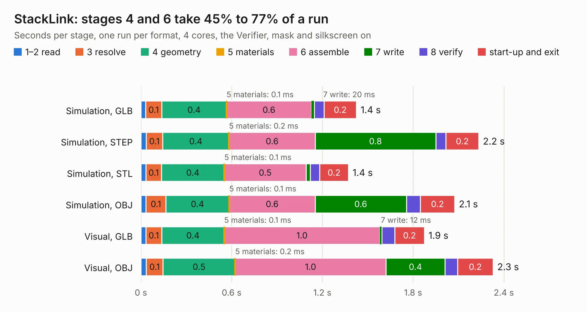

| Mode and format | 1–2 read | 3 resolve | 4 geometry | 5 materials | 6 assemble | 7 write | 8 verify | start-up and exit | Total |
|---|---:|---:|---:|---:|---:|---:|---:|---:|---:|
| Simulation, GLB | 32&nbsp;ms | 0.1 | 0.4 | 0.1&nbsp;ms | 0.6 | 20&nbsp;ms | 65&nbsp;ms | 0.2 | 1.4 |
| Simulation, STEP | 35&nbsp;ms | 0.1 | 0.4 | 0.2&nbsp;ms | 0.6 | 0.8 | 67&nbsp;ms | 0.2 | 2.2 |
| Simulation, STL | 34&nbsp;ms | 0.1 | 0.4 | 0.1&nbsp;ms | 0.5 | 27&nbsp;ms | 63&nbsp;ms | 0.2 | 1.4 |
| Simulation, OBJ | 34&nbsp;ms | 0.1 | 0.4 | 0.1&nbsp;ms | 0.6 | 0.6 | 92&nbsp;ms | 0.2 | 2.1 |
| Visual, GLB | 33&nbsp;ms | 0.1 | 0.4 | 0.1&nbsp;ms | 1.0 | 12&nbsp;ms | 86&nbsp;ms | 0.2 | 1.9 |
| Visual, OBJ | 36&nbsp;ms | 0.1 | 0.5 | 0.2&nbsp;ms | 1.0 | 0.4 | 83&nbsp;ms | 0.2 | 2.3 |

<table align="center"><tr><td valign="top">

| Board | Repo: [gusmanb/logicanalyzer](https://github.com/gusmanb/logicanalyzer) Board: `StackLink.kicad_pcb` |
|---|---|
| Folder | Electronics / LogicAnalyzer / StackLink / StackLink |
| Complexity | 137&nbsp;/&nbsp;1000 (size&nbsp;92, features&nbsp;45) |
| KESE&nbsp;features | through vias, slotted holes, filled zones |
| Tested | 9th November 2026 |
| Copper&nbsp;layers | 2 |
| File&nbsp;format | KiCad 8 (20240108) |
| Parts,&nbsp;tracks,&nbsp;vias | 5, 12, 6 |
| Triangles,&nbsp;simulation | 108,050 in 13 parts |
| Verifier | PASS in all six runs |

</td><td valign="top">

<table>
<tr><th>File type</th><th>File size</th><th>Peak memory used</th></tr>
<tr><th colspan="3" align="left">Simulation</th></tr>
<tr><td>GLB</td><td align="right">3.6&nbsp;MB</td><td align="right">170&nbsp;MB</td></tr>
<tr><td>STEP</td><td align="right">16&nbsp;MB</td><td align="right">170&nbsp;MB</td></tr>
<tr><td>STL</td><td align="right">5.4&nbsp;MB</td><td align="right">162&nbsp;MB</td></tr>
<tr><td>OBJ</td><td align="right">10&nbsp;MB</td><td align="right">169&nbsp;MB</td></tr>
<tr><th colspan="3" align="left">Visual</th></tr>
<tr><td>GLB</td><td align="right">2.4&nbsp;MB</td><td align="right">130&nbsp;MB</td></tr>
<tr><td>OBJ</td><td align="right">6.6&nbsp;MB</td><td align="right">133&nbsp;MB</td></tr>
</table>

</td></tr></table>

## 1190. sprig_console

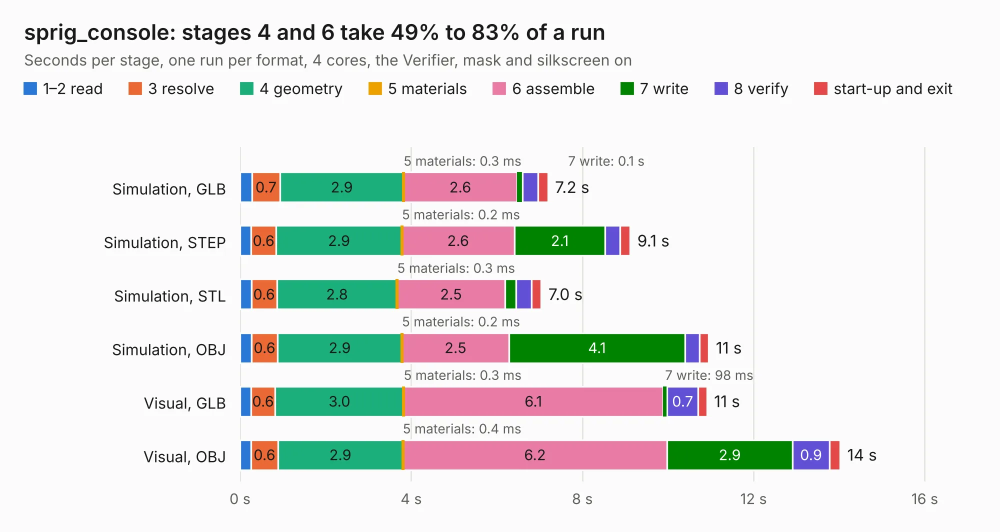

| Mode and format | 1–2 read | 3 resolve | 4 geometry | 5 materials | 6 assemble | 7 write | 8 verify | start-up and exit | Total |
|---|---:|---:|---:|---:|---:|---:|---:|---:|---:|
| Simulation, GLB | 0.3 | 0.7 | 2.9 | 0.3&nbsp;ms | 2.6 | 0.1 | 0.4 | 0.2 | 7.2 |
| Simulation, STEP | 0.3 | 0.6 | 2.9 | 0.2&nbsp;ms | 2.6 | 2.1 | 0.3 | 0.2 | 9.1 |
| Simulation, STL | 0.3 | 0.6 | 2.8 | 0.3&nbsp;ms | 2.5 | 0.3 | 0.4 | 0.2 | 7.0 |
| Simulation, OBJ | 0.3 | 0.6 | 2.9 | 0.2&nbsp;ms | 2.5 | 4.1 | 0.3 | 0.2 | 11.0 |
| Visual, GLB | 0.3 | 0.6 | 3.0 | 0.3&nbsp;ms | 6.1 | 98&nbsp;ms | 0.7 | 0.2 | 10.9 |
| Visual, OBJ | 0.3 | 0.6 | 2.9 | 0.4&nbsp;ms | 6.2 | 2.9 | 0.9 | 0.2 | 14.0 |

<table align="center"><tr><td valign="top">

| Board | Repo: [hackclub/sprig](https://github.com/hackclub/sprig) Board: `sprig_console.kicad_pcb` |
|---|---|
| Folder | hardware / mainboard_PCB / kicad |
| Complexity | 231&nbsp;/&nbsp;1000 (size&nbsp;146, features&nbsp;85) |
| KESE&nbsp;features | through vias, rounded, trapezoid or chamfered pads, filled zones, curved board outline, stack-up, dielectric εr and tanδ |
| Tested | 9th November 2026 |
| Copper&nbsp;layers | 2 |
| File&nbsp;format | KiCad 8 (20240108) |
| Parts,&nbsp;tracks,&nbsp;vias | 25, 254, 19 |
| Triangles,&nbsp;simulation | 808,388 in 55 parts |
| Verifier | PASS in all six runs |

</td><td valign="top">

<table>
<tr><th>File type</th><th>File size</th><th>Peak memory used</th></tr>
<tr><th colspan="3" align="left">Simulation</th></tr>
<tr><td>GLB</td><td align="right">28&nbsp;MB</td><td align="right">409&nbsp;MB</td></tr>
<tr><td>STEP</td><td align="right">137&nbsp;MB</td><td align="right">435&nbsp;MB</td></tr>
<tr><td>STL</td><td align="right">40&nbsp;MB</td><td align="right">408&nbsp;MB</td></tr>
<tr><td>OBJ</td><td align="right">82&nbsp;MB</td><td align="right">590&nbsp;MB</td></tr>
<tr><th colspan="3" align="left">Visual</th></tr>
<tr><td>GLB</td><td align="right">19&nbsp;MB</td><td align="right">502&nbsp;MB</td></tr>
<tr><td>OBJ</td><td align="right">58&nbsp;MB</td><td align="right">472&nbsp;MB</td></tr>
</table>

</td></tr></table>

## 1191. pico-reset

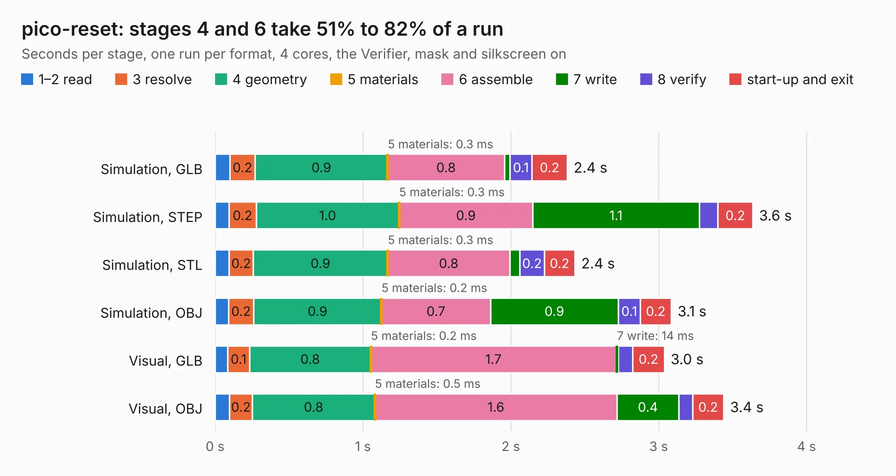

| Mode and format | 1–2 read | 3 resolve | 4 geometry | 5 materials | 6 assemble | 7 write | 8 verify | start-up and exit | Total |
|---|---:|---:|---:|---:|---:|---:|---:|---:|---:|
| Simulation, GLB | 0.1 | 0.2 | 0.9 | 0.3&nbsp;ms | 0.8 | 38&nbsp;ms | 0.1 | 0.2 | 2.4 |
| Simulation, STEP | 94&nbsp;ms | 0.2 | 1.0 | 0.3&nbsp;ms | 0.9 | 1.1 | 0.1 | 0.2 | 3.6 |
| Simulation, STL | 95&nbsp;ms | 0.2 | 0.9 | 0.3&nbsp;ms | 0.8 | 68&nbsp;ms | 0.2 | 0.2 | 2.4 |
| Simulation, OBJ | 91&nbsp;ms | 0.2 | 0.9 | 0.2&nbsp;ms | 0.7 | 0.9 | 0.1 | 0.2 | 3.1 |
| Visual, GLB | 85&nbsp;ms | 0.1 | 0.8 | 0.2&nbsp;ms | 1.7 | 14&nbsp;ms | 99&nbsp;ms | 0.2 | 3.0 |
| Visual, OBJ | 97&nbsp;ms | 0.2 | 0.8 | 0.5&nbsp;ms | 1.6 | 0.4 | 93&nbsp;ms | 0.2 | 3.4 |

<table align="center"><tr><td valign="top">

| Board | Repo: [hackclub/sprig](https://github.com/hackclub/sprig) Board: `pico-reset.kicad_pcb` |
|---|---|
| Folder | sprig-hax / hardware / DebugShimPCB |
| Complexity | 82&nbsp;/&nbsp;1000 (size&nbsp;82, features&nbsp;0) |
| Tested | 9th November 2026 |
| Copper&nbsp;layers | 2 |
| File&nbsp;format | KiCad 8 (20240108) |
| Parts,&nbsp;tracks,&nbsp;vias | 3, 21, 0 |
| Triangles,&nbsp;simulation | 162,188 in 52 parts |
| Verifier | PASS in all six runs |

</td><td valign="top">

<table>
<tr><th>File type</th><th>File size</th><th>Peak memory used</th></tr>
<tr><th colspan="3" align="left">Simulation</th></tr>
<tr><td>GLB</td><td align="right">5.1&nbsp;MB</td><td align="right">194&nbsp;MB</td></tr>
<tr><td>STEP</td><td align="right">22&nbsp;MB</td><td align="right">213&nbsp;MB</td></tr>
<tr><td>STL</td><td align="right">8.1&nbsp;MB</td><td align="right">194&nbsp;MB</td></tr>
<tr><td>OBJ</td><td align="right">16&nbsp;MB</td><td align="right">194&nbsp;MB</td></tr>
<tr><th colspan="3" align="left">Visual</th></tr>
<tr><td>GLB</td><td align="right">2.7&nbsp;MB</td><td align="right">158&nbsp;MB</td></tr>
<tr><td>OBJ</td><td align="right">7.6&nbsp;MB</td><td align="right">159&nbsp;MB</td></tr>
</table>

</td></tr></table>

## 1192. sprig_console

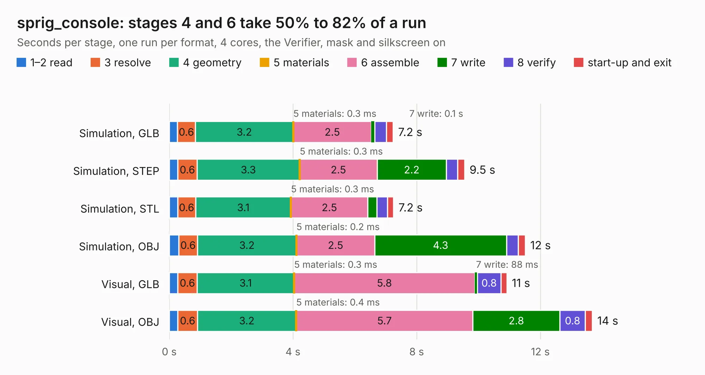

| Mode and format | 1–2 read | 3 resolve | 4 geometry | 5 materials | 6 assemble | 7 write | 8 verify | start-up and exit | Total |
|---|---:|---:|---:|---:|---:|---:|---:|---:|---:|
| Simulation, GLB | 0.3 | 0.6 | 3.2 | 0.3&nbsp;ms | 2.5 | 0.1 | 0.4 | 0.2 | 7.2 |
| Simulation, STEP | 0.3 | 0.6 | 3.3 | 0.3&nbsp;ms | 2.5 | 2.2 | 0.4 | 0.2 | 9.5 |
| Simulation, STL | 0.3 | 0.6 | 3.1 | 0.3&nbsp;ms | 2.5 | 0.3 | 0.4 | 0.2 | 7.2 |
| Simulation, OBJ | 0.3 | 0.6 | 3.2 | 0.2&nbsp;ms | 2.5 | 4.3 | 0.4 | 0.2 | 11.5 |
| Visual, GLB | 0.3 | 0.6 | 3.1 | 0.3&nbsp;ms | 5.8 | 88&nbsp;ms | 0.8 | 0.2 | 10.9 |
| Visual, OBJ | 0.3 | 0.6 | 3.2 | 0.4&nbsp;ms | 5.7 | 2.8 | 0.8 | 0.2 | 13.7 |

<table align="center"><tr><td valign="top">

| Board | Repo: [hackclub/sprig](https://github.com/hackclub/sprig) Board: `sprig_console.kicad_pcb` |
|---|---|
| Folder | sprig-hax / hardware / SprigHaxPCB / kicad |
| Complexity | 230&nbsp;/&nbsp;1000 (size&nbsp;145, features&nbsp;85) |
| KESE&nbsp;features | through vias, rounded, trapezoid or chamfered pads, filled zones, curved board outline, stack-up, dielectric εr and tanδ |
| Tested | 9th November 2026 |
| Copper&nbsp;layers | 2 |
| File&nbsp;format | KiCad 7 (20221018) |
| Parts,&nbsp;tracks,&nbsp;vias | 25, 242, 16 |
| Triangles,&nbsp;simulation | 816,372 in 55 parts |
| Verifier | PASS in all six runs |

</td><td valign="top">

<table>
<tr><th>File type</th><th>File size</th><th>Peak memory used</th></tr>
<tr><th colspan="3" align="left">Simulation</th></tr>
<tr><td>GLB</td><td align="right">28&nbsp;MB</td><td align="right">382&nbsp;MB</td></tr>
<tr><td>STEP</td><td align="right">144&nbsp;MB</td><td align="right">463&nbsp;MB</td></tr>
<tr><td>STL</td><td align="right">41&nbsp;MB</td><td align="right">399&nbsp;MB</td></tr>
<tr><td>OBJ</td><td align="right">83&nbsp;MB</td><td align="right">597&nbsp;MB</td></tr>
<tr><th colspan="3" align="left">Visual</th></tr>
<tr><td>GLB</td><td align="right">19&nbsp;MB</td><td align="right">439&nbsp;MB</td></tr>
<tr><td>OBJ</td><td align="right">58&nbsp;MB</td><td align="right">460&nbsp;MB</td></tr>
</table>

</td></tr></table>

## 1193. ZU64DR_RFSOC_A5

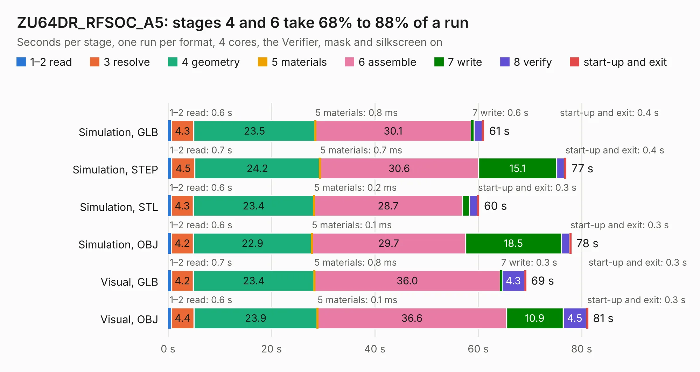

| Mode and format | 1–2 read | 3 resolve | 4 geometry | 5 materials | 6 assemble | 7 write | 8 verify | start-up and exit | Total |
|---|---:|---:|---:|---:|---:|---:|---:|---:|---:|
| Simulation, GLB | 0.6 | 4.3 | 23.5 | 0.8&nbsp;ms | 30.1 | 0.6 | 1.6 | 0.4 | 61.1 |
| Simulation, STEP | 0.7 | 4.5 | 24.2 | 0.7&nbsp;ms | 30.6 | 15.1 | 1.5 | 0.4 | 77.1 |
| Simulation, STL | 0.6 | 4.3 | 23.4 | 0.2&nbsp;ms | 28.7 | 1.4 | 1.5 | 0.3 | 60.1 |
| Simulation, OBJ | 0.6 | 4.2 | 22.9 | 0.1&nbsp;ms | 29.7 | 18.5 | 1.6 | 0.3 | 78.0 |
| Visual, GLB | 0.7 | 4.2 | 23.4 | 0.8&nbsp;ms | 36.0 | 0.3 | 4.3 | 0.3 | 69.3 |
| Visual, OBJ | 0.6 | 4.4 | 23.9 | 0.1&nbsp;ms | 36.6 | 10.9 | 4.5 | 0.3 | 81.2 |

<table align="center"><tr><td valign="top">

| Board | Repo: [hamedroghani/zu64dr_rfsoc_kicad](https://github.com/hamedroghani/zu64dr_rfsoc_kicad) Board: `ZU64DR_RFSOC_A5.kicad_pcb` |
|---|---|
| Complexity | 229&nbsp;/&nbsp;1000 (size&nbsp;184, features&nbsp;45) |
| KESE&nbsp;features | stack-up, dielectric εr and tanδ, copper finish |
| Tested | 9th November 2026 |
| Copper&nbsp;layers | 12 |
| File&nbsp;format | KiCad 8 (20231120) |
| Parts,&nbsp;tracks,&nbsp;vias | 75, 0, 0 |
| Triangles,&nbsp;simulation | 3,488,834 in 35 parts |
| Note | mostly unrouted |
| Verifier | PASS in all six runs |

</td><td valign="top">

<table>
<tr><th>File type</th><th>File size</th><th>Peak memory used</th></tr>
<tr><th colspan="3" align="left">Simulation</th></tr>
<tr><td>GLB</td><td align="right">123&nbsp;MB</td><td align="right">1.5&nbsp;GB</td></tr>
<tr><td>STEP</td><td align="right">685&nbsp;MB</td><td align="right">2.0&nbsp;GB</td></tr>
<tr><td>STL</td><td align="right">174&nbsp;MB</td><td align="right">1.5&nbsp;GB</td></tr>
<tr><td>OBJ</td><td align="right">374&nbsp;MB</td><td align="right">2.4&nbsp;GB</td></tr>
<tr><th colspan="3" align="left">Visual</th></tr>
<tr><td>GLB</td><td align="right">72&nbsp;MB</td><td align="right">1.6&nbsp;GB</td></tr>
<tr><td>OBJ</td><td align="right">221&nbsp;MB</td><td align="right">1.6&nbsp;GB</td></tr>
</table>

</td></tr></table>

## 1194. Easyduino_Atmega_Nano

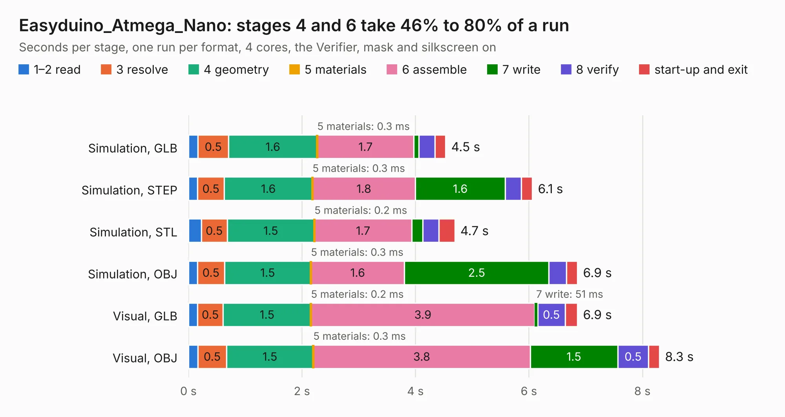

| Mode and format | 1–2 read | 3 resolve | 4 geometry | 5 materials | 6 assemble | 7 write | 8 verify | start-up and exit | Total |
|---|---:|---:|---:|---:|---:|---:|---:|---:|---:|
| Simulation, GLB | 0.2 | 0.5 | 1.6 | 0.3&nbsp;ms | 1.7 | 87&nbsp;ms | 0.3 | 0.2 | 4.5 |
| Simulation, STEP | 0.2 | 0.5 | 1.6 | 0.3&nbsp;ms | 1.8 | 1.6 | 0.3 | 0.2 | 6.1 |
| Simulation, STL | 0.2 | 0.5 | 1.5 | 0.2&nbsp;ms | 1.7 | 0.2 | 0.3 | 0.3 | 4.7 |
| Simulation, OBJ | 0.2 | 0.5 | 1.5 | 0.3&nbsp;ms | 1.6 | 2.5 | 0.3 | 0.2 | 6.9 |
| Visual, GLB | 0.2 | 0.5 | 1.5 | 0.2&nbsp;ms | 3.9 | 51&nbsp;ms | 0.5 | 0.2 | 6.9 |
| Visual, OBJ | 0.2 | 0.5 | 1.5 | 0.3&nbsp;ms | 3.8 | 1.5 | 0.5 | 0.2 | 8.3 |

<table align="center"><tr><td valign="top">

| Board | Repo: [Hanqaqa/Easyduino](https://github.com/Hanqaqa/Easyduino) Board: `Easyduino_Atmega_Nano.kicad_pcb` |
|---|---|
| Folder | Atmega328p Arduino Nano |
| Complexity | 304&nbsp;/&nbsp;1000 (size&nbsp;219, features&nbsp;85) |
| KESE&nbsp;features | through vias, slotted holes, rounded, trapezoid or chamfered pads, filled zones, stack-up, dielectric εr and tanδ |
| Tested | 9th November 2026 |
| Copper&nbsp;layers | 4 |
| File&nbsp;format | KiCad 10 (20260206) |
| Parts,&nbsp;tracks,&nbsp;vias | 31, 332, 57 |
| Triangles,&nbsp;simulation | 632,874 in 75 parts |
| Verifier | PASS in all six runs |

</td><td valign="top">

<table>
<tr><th>File type</th><th>File size</th><th>Peak memory used</th></tr>
<tr><th colspan="3" align="left">Simulation</th></tr>
<tr><td>GLB</td><td align="right">21&nbsp;MB</td><td align="right">312&nbsp;MB</td></tr>
<tr><td>STEP</td><td align="right">78&nbsp;MB</td><td align="right">369&nbsp;MB</td></tr>
<tr><td>STL</td><td align="right">32&nbsp;MB</td><td align="right">318&nbsp;MB</td></tr>
<tr><td>OBJ</td><td align="right">63&nbsp;MB</td><td align="right">462&nbsp;MB</td></tr>
<tr><th colspan="3" align="left">Visual</th></tr>
<tr><td>GLB</td><td align="right">13&nbsp;MB</td><td align="right">366&nbsp;MB</td></tr>
<tr><td>OBJ</td><td align="right">39&nbsp;MB</td><td align="right">363&nbsp;MB</td></tr>
</table>

</td></tr></table>

## 1195. Easyduino_Atmega

| Mode and format | 1–2 read | 3 resolve | 4 geometry | 5 materials | 6 assemble | 7 write | 8 verify | start-up and exit | Total |
|---|---:|---:|---:|---:|---:|---:|---:|---:|---:|
| Simulation, GLB | 0.2 | 0.8 | 2.6 | 0.4&nbsp;ms | 2.8 | 0.2 | 0.5 | 0.2 | 7.3 |
| Simulation, STEP | 0.3 | 0.7 | 2.4 | 0.4&nbsp;ms | 2.8 | 2.4 | 0.5 | 0.2 | 9.4 |
| Simulation, STL | 0.3 | 0.8 | 2.5 | 0.3&nbsp;ms | 2.9 | 0.2 | 0.5 | 0.2 | 7.4 |
| Simulation, OBJ | 0.3 | 0.8 | 2.3 | 0.2&nbsp;ms | 2.8 | 4.2 | 0.5 | 0.2 | 11.3 |
| Visual, GLB | 0.3 | 0.8 | 2.6 | 0.3&nbsp;ms | 5.5 | 81&nbsp;ms | 0.8 | 0.3 | 10.2 |
| Visual, OBJ | 0.3 | 0.8 | 2.5 | 0.3&nbsp;ms | 5.3 | 2.4 | 0.8 | 0.2 | 12.3 |

<table align="center"><tr><td valign="top">

| Board | Repo: [Hanqaqa/Easyduino](https://github.com/Hanqaqa/Easyduino) Board: `Easyduino_Atmega.kicad_pcb` |
|---|---|
| Folder | Atmega328p Arduino Uno |
| Complexity | 320&nbsp;/&nbsp;1000 (size&nbsp;220, features&nbsp;100) |
| KESE&nbsp;features | through vias, slotted holes, rounded, trapezoid or chamfered pads, filled zones, knockout text, stack-up, dielectric εr and tanδ |
| Tested | 9th November 2026 |
| Copper&nbsp;layers | 4 |
| File&nbsp;format | KiCad 10 (20260206) |
| Parts,&nbsp;tracks,&nbsp;vias | 36, 391, 106 |
| Triangles,&nbsp;simulation | 859,494 in 68 parts |
| Verifier | PASS in all six runs |

</td><td valign="top">

<table>
<tr><th>File type</th><th>File size</th><th>Peak memory used</th></tr>
<tr><th colspan="3" align="left">Simulation</th></tr>
<tr><td>GLB</td><td align="right">29&nbsp;MB</td><td align="right">388&nbsp;MB</td></tr>
<tr><td>STEP</td><td align="right">99&nbsp;MB</td><td align="right">470&nbsp;MB</td></tr>
<tr><td>STL</td><td align="right">43&nbsp;MB</td><td align="right">382&nbsp;MB</td></tr>
<tr><td>OBJ</td><td align="right">86&nbsp;MB</td><td align="right">622&nbsp;MB</td></tr>
<tr><th colspan="3" align="left">Visual</th></tr>
<tr><td>GLB</td><td align="right">17&nbsp;MB</td><td align="right">498&nbsp;MB</td></tr>
<tr><td>OBJ</td><td align="right">52&nbsp;MB</td><td align="right">458&nbsp;MB</td></tr>
</table>

</td></tr></table>

## 1196. Easyduino_ESP32

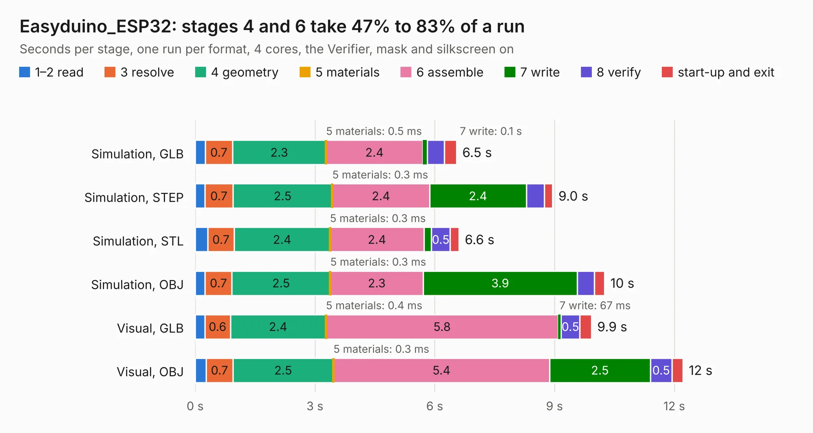

| Mode and format | 1–2 read | 3 resolve | 4 geometry | 5 materials | 6 assemble | 7 write | 8 verify | start-up and exit | Total |
|---|---:|---:|---:|---:|---:|---:|---:|---:|---:|
| Simulation, GLB | 0.3 | 0.7 | 2.3 | 0.5&nbsp;ms | 2.4 | 0.1 | 0.4 | 0.3 | 6.5 |
| Simulation, STEP | 0.2 | 0.7 | 2.5 | 0.3&nbsp;ms | 2.4 | 2.4 | 0.5 | 0.2 | 9.0 |
| Simulation, STL | 0.3 | 0.7 | 2.4 | 0.3&nbsp;ms | 2.4 | 0.2 | 0.5 | 0.2 | 6.6 |
| Simulation, OBJ | 0.2 | 0.7 | 2.5 | 0.3&nbsp;ms | 2.3 | 3.9 | 0.4 | 0.3 | 10.3 |
| Visual, GLB | 0.2 | 0.6 | 2.4 | 0.4&nbsp;ms | 5.8 | 67&nbsp;ms | 0.5 | 0.3 | 9.9 |
| Visual, OBJ | 0.3 | 0.7 | 2.5 | 0.3&nbsp;ms | 5.4 | 2.5 | 0.5 | 0.3 | 12.2 |

<table align="center"><tr><td valign="top">

| Board | Repo: [Hanqaqa/Easyduino](https://github.com/Hanqaqa/Easyduino) Board: `Easyduino_ESP32.kicad_pcb` |
|---|---|
| Folder | ESP32 |
| Complexity | 299&nbsp;/&nbsp;1000 (size&nbsp;214, features&nbsp;85) |
| KESE&nbsp;features | through vias, slotted holes, rounded, trapezoid or chamfered pads, filled zones, stack-up, dielectric εr and tanδ |
| Tested | 9th November 2026 |
| Copper&nbsp;layers | 4 |
| File&nbsp;format | KiCad 10 (20260206) |
| Parts,&nbsp;tracks,&nbsp;vias | 29, 372, 64 |
| Triangles,&nbsp;simulation | 663,478 in 86 parts |
| Verifier | PASS in all six runs |

</td><td valign="top">

<table>
<tr><th>File type</th><th>File size</th><th>Peak memory used</th></tr>
<tr><th colspan="3" align="left">Simulation</th></tr>
<tr><td>GLB</td><td align="right">23&nbsp;MB</td><td align="right">324&nbsp;MB</td></tr>
<tr><td>STEP</td><td align="right">98&nbsp;MB</td><td align="right">385&nbsp;MB</td></tr>
<tr><td>STL</td><td align="right">33&nbsp;MB</td><td align="right">324&nbsp;MB</td></tr>
<tr><td>OBJ</td><td align="right">67&nbsp;MB</td><td align="right">494&nbsp;MB</td></tr>
<tr><th colspan="3" align="left">Visual</th></tr>
<tr><td>GLB</td><td align="right">14&nbsp;MB</td><td align="right">412&nbsp;MB</td></tr>
<tr><td>OBJ</td><td align="right">42&nbsp;MB</td><td align="right">377&nbsp;MB</td></tr>
</table>

</td></tr></table>

## 1197. Easyduino_ESP32S3

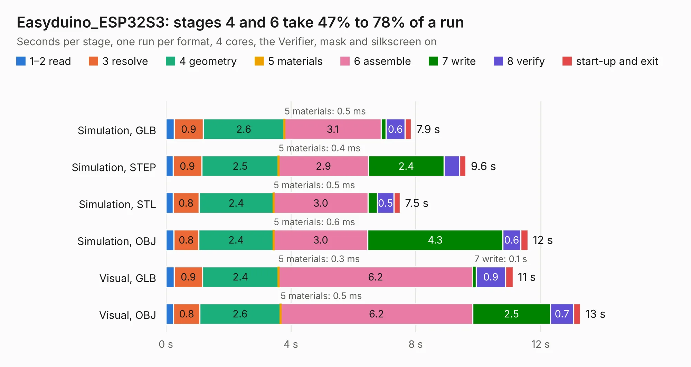

| Mode and format | 1–2 read | 3 resolve | 4 geometry | 5 materials | 6 assemble | 7 write | 8 verify | start-up and exit | Total |
|---|---:|---:|---:|---:|---:|---:|---:|---:|---:|
| Simulation, GLB | 0.3 | 0.9 | 2.6 | 0.5&nbsp;ms | 3.1 | 0.2 | 0.6 | 0.2 | 7.9 |
| Simulation, STEP | 0.2 | 0.9 | 2.5 | 0.4&nbsp;ms | 2.9 | 2.4 | 0.5 | 0.2 | 9.6 |
| Simulation, STL | 0.2 | 0.8 | 2.4 | 0.5&nbsp;ms | 3.0 | 0.3 | 0.5 | 0.2 | 7.5 |
| Simulation, OBJ | 0.3 | 0.8 | 2.4 | 0.6&nbsp;ms | 3.0 | 4.3 | 0.6 | 0.2 | 11.6 |
| Visual, GLB | 0.3 | 0.9 | 2.4 | 0.3&nbsp;ms | 6.2 | 0.1 | 0.9 | 0.2 | 11.1 |
| Visual, OBJ | 0.2 | 0.8 | 2.6 | 0.5&nbsp;ms | 6.2 | 2.5 | 0.7 | 0.2 | 13.3 |

<table align="center"><tr><td valign="top">

| Board | Repo: [Hanqaqa/Easyduino](https://github.com/Hanqaqa/Easyduino) Board: `Easyduino_ESP32S3.kicad_pcb` |
|---|---|
| Folder | ESP32S3 |
| Complexity | 312&nbsp;/&nbsp;1000 (size&nbsp;227, features&nbsp;85) |
| KESE&nbsp;features | through vias, slotted holes, rounded, trapezoid or chamfered pads, filled zones, stack-up, dielectric εr and tanδ |
| Tested | 9th November 2026 |
| Copper&nbsp;layers | 4 |
| File&nbsp;format | KiCad 10 (20260206) |
| Parts,&nbsp;tracks,&nbsp;vias | 35, 703, 137 |
| Triangles,&nbsp;simulation | 980,336 in 89 parts |
| Verifier | PASS in all six runs |

</td><td valign="top">

<table>
<tr><th>File type</th><th>File size</th><th>Peak memory used</th></tr>
<tr><th colspan="3" align="left">Simulation</th></tr>
<tr><td>GLB</td><td align="right">33&nbsp;MB</td><td align="right">420&nbsp;MB</td></tr>
<tr><td>STEP</td><td align="right">135&nbsp;MB</td><td align="right">519&nbsp;MB</td></tr>
<tr><td>STL</td><td align="right">49&nbsp;MB</td><td align="right">409&nbsp;MB</td></tr>
<tr><td>OBJ</td><td align="right">99&nbsp;MB</td><td align="right">696&nbsp;MB</td></tr>
<tr><th colspan="3" align="left">Visual</th></tr>
<tr><td>GLB</td><td align="right">19&nbsp;MB</td><td align="right">536&nbsp;MB</td></tr>
<tr><td>OBJ</td><td align="right">58&nbsp;MB</td><td align="right">509&nbsp;MB</td></tr>
</table>

</td></tr></table>

## 1198. Easyduino_RP2040

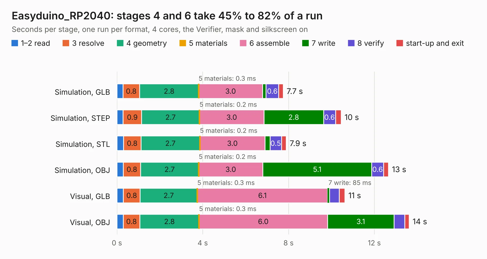

| Mode and format | 1–2 read | 3 resolve | 4 geometry | 5 materials | 6 assemble | 7 write | 8 verify | start-up and exit | Total |
|---|---:|---:|---:|---:|---:|---:|---:|---:|---:|
| Simulation, GLB | 0.3 | 0.8 | 2.8 | 0.3&nbsp;ms | 3.0 | 0.2 | 0.6 | 0.2 | 7.7 |
| Simulation, STEP | 0.3 | 0.9 | 2.7 | 0.2&nbsp;ms | 3.0 | 2.8 | 0.6 | 0.3 | 10.4 |
| Simulation, STL | 0.3 | 0.8 | 2.7 | 0.2&nbsp;ms | 3.0 | 0.2 | 0.5 | 0.2 | 7.9 |
| Simulation, OBJ | 0.3 | 0.8 | 2.7 | 0.2&nbsp;ms | 3.0 | 5.1 | 0.6 | 0.2 | 12.7 |
| Visual, GLB | 0.3 | 0.8 | 2.7 | 0.3&nbsp;ms | 6.1 | 85&nbsp;ms | 0.5 | 0.3 | 10.6 |
| Visual, OBJ | 0.3 | 0.8 | 2.8 | 0.3&nbsp;ms | 6.0 | 3.1 | 0.5 | 0.2 | 13.6 |

<table align="center"><tr><td valign="top">

| Board | Repo: [Hanqaqa/Easyduino](https://github.com/Hanqaqa/Easyduino) Board: `Easyduino_RP2040.kicad_pcb` |
|---|---|
| Folder | Raspberry Pi Pico 2040 |
| Complexity | 325&nbsp;/&nbsp;1000 (size&nbsp;225, features&nbsp;100) |
| KESE&nbsp;features | through vias, slotted holes, rounded, trapezoid or chamfered pads, filled zones, curved board outline, stack-up, dielectric εr and tanδ, mask and silkscreen colours |
| Tested | 9th November 2026 |
| Copper&nbsp;layers | 4 |
| File&nbsp;format | KiCad 10 (20260206) |
| Parts,&nbsp;tracks,&nbsp;vias | 47, 570, 88 |
| Triangles,&nbsp;simulation | 947,692 in 74 parts |
| Verifier | PASS in all six runs |

</td><td valign="top">

<table>
<tr><th>File type</th><th>File size</th><th>Peak memory used</th></tr>
<tr><th colspan="3" align="left">Simulation</th></tr>
<tr><td>GLB</td><td align="right">32&nbsp;MB</td><td align="right">399&nbsp;MB</td></tr>
<tr><td>STEP</td><td align="right">133&nbsp;MB</td><td align="right">493&nbsp;MB</td></tr>
<tr><td>STL</td><td align="right">47&nbsp;MB</td><td align="right">399&nbsp;MB</td></tr>
<tr><td>OBJ</td><td align="right">95&nbsp;MB</td><td align="right">702&nbsp;MB</td></tr>
<tr><th colspan="3" align="left">Visual</th></tr>
<tr><td>GLB</td><td align="right">20&nbsp;MB</td><td align="right">492&nbsp;MB</td></tr>
<tr><td>OBJ</td><td align="right">61&nbsp;MB</td><td align="right">515&nbsp;MB</td></tr>
</table>

</td></tr></table>

## 1199. Easyduino_STM32F103

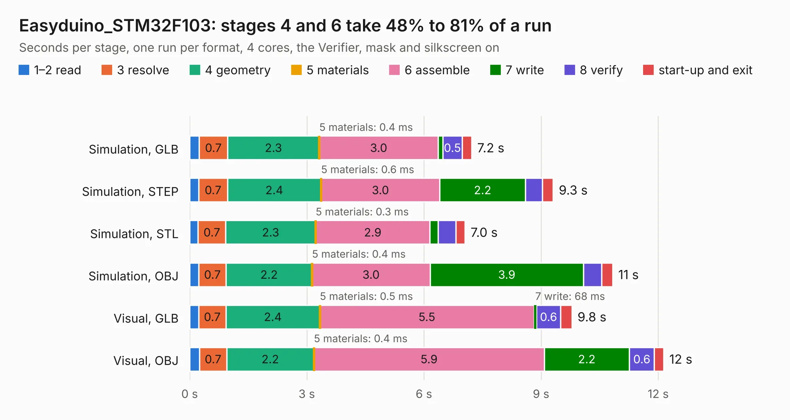

| Mode and format | 1–2 read | 3 resolve | 4 geometry | 5 materials | 6 assemble | 7 write | 8 verify | start-up and exit | Total |
|---|---:|---:|---:|---:|---:|---:|---:|---:|---:|
| Simulation, GLB | 0.2 | 0.7 | 2.3 | 0.4&nbsp;ms | 3.0 | 0.1 | 0.5 | 0.2 | 7.2 |
| Simulation, STEP | 0.2 | 0.7 | 2.4 | 0.6&nbsp;ms | 3.0 | 2.2 | 0.4 | 0.3 | 9.3 |
| Simulation, STL | 0.2 | 0.7 | 2.3 | 0.3&nbsp;ms | 2.9 | 0.2 | 0.5 | 0.2 | 7.0 |
| Simulation, OBJ | 0.2 | 0.7 | 2.2 | 0.4&nbsp;ms | 3.0 | 3.9 | 0.5 | 0.3 | 10.8 |
| Visual, GLB | 0.2 | 0.7 | 2.4 | 0.5&nbsp;ms | 5.5 | 68&nbsp;ms | 0.6 | 0.3 | 9.8 |
| Visual, OBJ | 0.3 | 0.7 | 2.2 | 0.4&nbsp;ms | 5.9 | 2.2 | 0.6 | 0.2 | 12.1 |

<table align="center"><tr><td valign="top">

| Board | Repo: [Hanqaqa/Easyduino](https://github.com/Hanqaqa/Easyduino) Board: `Easyduino_STM32F103.kicad_pcb` |
|---|---|
| Folder | STM32F103 Bluepill |
| Complexity | 313&nbsp;/&nbsp;1000 (size&nbsp;218, features&nbsp;95) |
| KESE&nbsp;features | through vias, slotted holes, rounded, trapezoid or chamfered pads, filled zones, curved board outline, stack-up, dielectric εr and tanδ |
| Tested | 9th November 2026 |
| Copper&nbsp;layers | 4 |
| File&nbsp;format | KiCad 10 (20260206) |
| Parts,&nbsp;tracks,&nbsp;vias | 30, 484, 75 |
| Triangles,&nbsp;simulation | 780,722 in 62 parts |
| Verifier | PASS in all six runs |

</td><td valign="top">

<table>
<tr><th>File type</th><th>File size</th><th>Peak memory used</th></tr>
<tr><th colspan="3" align="left">Simulation</th></tr>
<tr><td>GLB</td><td align="right">26&nbsp;MB</td><td align="right">355&nbsp;MB</td></tr>
<tr><td>STEP</td><td align="right">93&nbsp;MB</td><td align="right">435&nbsp;MB</td></tr>
<tr><td>STL</td><td align="right">39&nbsp;MB</td><td align="right">355&nbsp;MB</td></tr>
<tr><td>OBJ</td><td align="right">78&nbsp;MB</td><td align="right">586&nbsp;MB</td></tr>
<tr><th colspan="3" align="left">Visual</th></tr>
<tr><td>GLB</td><td align="right">16&nbsp;MB</td><td align="right">388&nbsp;MB</td></tr>
<tr><td>OBJ</td><td align="right">48&nbsp;MB</td><td align="right">472&nbsp;MB</td></tr>
</table>

</td></tr></table>

## 1200. stepperdriver front panel

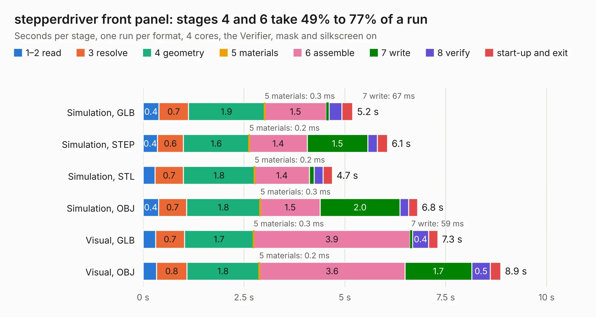

| Mode and format | 1–2 read | 3 resolve | 4 geometry | 5 materials | 6 assemble | 7 write | 8 verify | start-up and exit | Total |
|---|---:|---:|---:|---:|---:|---:|---:|---:|---:|
| Simulation, GLB | 0.4 | 0.7 | 1.9 | 0.3&nbsp;ms | 1.5 | 67&nbsp;ms | 0.3 | 0.3 | 5.2 |
| Simulation, STEP | 0.4 | 0.6 | 1.6 | 0.2&nbsp;ms | 1.4 | 1.5 | 0.2 | 0.2 | 6.1 |
| Simulation, STL | 0.3 | 0.7 | 1.8 | 0.2&nbsp;ms | 1.4 | 0.1 | 0.2 | 0.2 | 4.7 |
| Simulation, OBJ | 0.4 | 0.7 | 1.8 | 0.3&nbsp;ms | 1.5 | 2.0 | 0.2 | 0.2 | 6.8 |
| Visual, GLB | 0.3 | 0.7 | 1.7 | 0.3&nbsp;ms | 3.9 | 59&nbsp;ms | 0.4 | 0.2 | 7.3 |
| Visual, OBJ | 0.3 | 0.8 | 1.8 | 0.2&nbsp;ms | 3.6 | 1.7 | 0.5 | 0.3 | 8.9 |

<table align="center"><tr><td valign="top">

| Board | Repo: [harp-tech/device.stepperdriver](https://github.com/harp-tech/device.stepperdriver) Board: `stepperdriver front panel.kicad_pcb` |
|---|---|
| Folder | Hardware / PCB / stepper driver front panel |
| Complexity | 239&nbsp;/&nbsp;1000 (size&nbsp;149, features&nbsp;90) |
| KESE&nbsp;features | through vias, rounded, trapezoid or chamfered pads, filled zones, curved board outline, stack-up, dielectric εr and tanδ, mask and silkscreen colours |
| Tested | 9th November 2026 |
| Copper&nbsp;layers | 2 |
| File&nbsp;format | KiCad 9 (20241229) |
| Parts,&nbsp;tracks,&nbsp;vias | 22, 219, 57 |
| Triangles,&nbsp;simulation | 410,638 in 37 parts |
| Note | panel |
| Verifier | PASS in all six runs |

</td><td valign="top">

<table>
<tr><th>File type</th><th>File size</th><th>Peak memory used</th></tr>
<tr><th colspan="3" align="left">Simulation</th></tr>
<tr><td>GLB</td><td align="right">14&nbsp;MB</td><td align="right">291&nbsp;MB</td></tr>
<tr><td>STEP</td><td align="right">73&nbsp;MB</td><td align="right">326&nbsp;MB</td></tr>
<tr><td>STL</td><td align="right">21&nbsp;MB</td><td align="right">290&nbsp;MB</td></tr>
<tr><td>OBJ</td><td align="right">42&nbsp;MB</td><td align="right">345&nbsp;MB</td></tr>
<tr><th colspan="3" align="left">Visual</th></tr>
<tr><td>GLB</td><td align="right">11&nbsp;MB</td><td align="right">326&nbsp;MB</td></tr>
<tr><td>OBJ</td><td align="right">34&nbsp;MB</td><td align="right">329&nbsp;MB</td></tr>
</table>

</td></tr></table>

## 1201. stepper driver rear panel

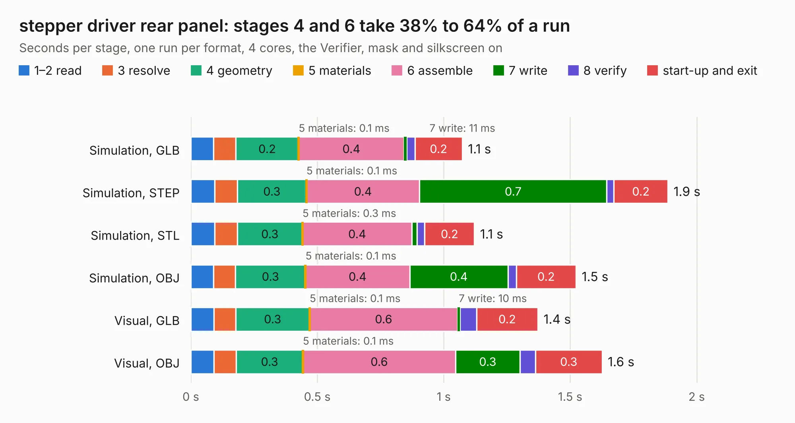

| Mode and format | 1–2 read | 3 resolve | 4 geometry | 5 materials | 6 assemble | 7 write | 8 verify | start-up and exit | Total |
|---|---:|---:|---:|---:|---:|---:|---:|---:|---:|
| Simulation, GLB | 90&nbsp;ms | 88&nbsp;ms | 0.2 | 0.1&nbsp;ms | 0.4 | 11&nbsp;ms | 32&nbsp;ms | 0.2 | 1.1 |
| Simulation, STEP | 95&nbsp;ms | 89&nbsp;ms | 0.3 | 0.1&nbsp;ms | 0.4 | 0.7 | 28&nbsp;ms | 0.2 | 1.9 |
| Simulation, STL | 95&nbsp;ms | 89&nbsp;ms | 0.3 | 0.3&nbsp;ms | 0.4 | 20&nbsp;ms | 31&nbsp;ms | 0.2 | 1.1 |
| Simulation, OBJ | 90&nbsp;ms | 87&nbsp;ms | 0.3 | 0.1&nbsp;ms | 0.4 | 0.4 | 33&nbsp;ms | 0.2 | 1.5 |
| Visual, GLB | 92&nbsp;ms | 86&nbsp;ms | 0.3 | 0.1&nbsp;ms | 0.6 | 10&nbsp;ms | 65&nbsp;ms | 0.2 | 1.4 |
| Visual, OBJ | 91&nbsp;ms | 89&nbsp;ms | 0.3 | 0.1&nbsp;ms | 0.6 | 0.3 | 62&nbsp;ms | 0.3 | 1.6 |

<table align="center"><tr><td valign="top">

| Board | Repo: [harp-tech/device.stepperdriver](https://github.com/harp-tech/device.stepperdriver) Board: `stepper driver rear panel.kicad_pcb` |
|---|---|
| Folder | Hardware / PCB / stepper driver rear panel |
| Complexity | 156&nbsp;/&nbsp;1000 (size&nbsp;66, features&nbsp;90) |
| KESE&nbsp;features | through vias, rounded, trapezoid or chamfered pads, filled zones, curved board outline, stack-up, dielectric εr and tanδ, mask and silkscreen colours |
| Tested | 9th November 2026 |
| Copper&nbsp;layers | 2 |
| File&nbsp;format | KiCad 9 (20241229) |
| Parts,&nbsp;tracks,&nbsp;vias | 1, 0, 4 |
| Triangles,&nbsp;simulation | 61,040 in 12 parts |
| Note | panel |
| Verifier | PASS in all six runs |

</td><td valign="top">

<table>
<tr><th>File type</th><th>File size</th><th>Peak memory used</th></tr>
<tr><th colspan="3" align="left">Simulation</th></tr>
<tr><td>GLB</td><td align="right">2.1&nbsp;MB</td><td align="right">72&nbsp;MB</td></tr>
<tr><td>STEP</td><td align="right">8.5&nbsp;MB</td><td align="right">177&nbsp;MB</td></tr>
<tr><td>STL</td><td align="right">3.1&nbsp;MB</td><td align="right">74&nbsp;MB</td></tr>
<tr><td>OBJ</td><td align="right">5.9&nbsp;MB</td><td align="right">85&nbsp;MB</td></tr>
<tr><th colspan="3" align="left">Visual</th></tr>
<tr><td>GLB</td><td align="right">1.6&nbsp;MB</td><td align="right">109&nbsp;MB</td></tr>
<tr><td>OBJ</td><td align="right">4.5&nbsp;MB</td><td align="right">109&nbsp;MB</td></tr>
</table>

</td></tr></table>

## 1202. stepper driver

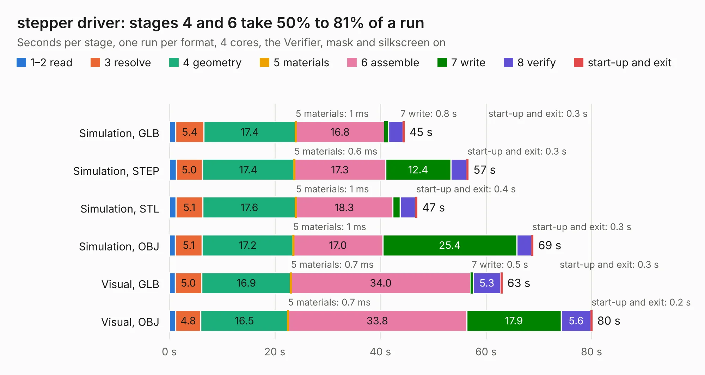

| Mode and format | 1–2 read | 3 resolve | 4 geometry | 5 materials | 6 assemble | 7 write | 8 verify | start-up and exit | Total |
|---|---:|---:|---:|---:|---:|---:|---:|---:|---:|
| Simulation, GLB | 1.2 | 5.4 | 17.4 | 1&nbsp;ms | 16.8 | 0.8 | 2.7 | 0.3 | 44.5 |
| Simulation, STEP | 1.3 | 5.0 | 17.4 | 0.6&nbsp;ms | 17.3 | 12.4 | 3.0 | 0.3 | 56.7 |
| Simulation, STL | 1.2 | 5.1 | 17.6 | 1&nbsp;ms | 18.3 | 1.4 | 2.9 | 0.4 | 47.0 |
| Simulation, OBJ | 1.2 | 5.1 | 17.2 | 1&nbsp;ms | 17.0 | 25.4 | 2.8 | 0.3 | 68.9 |
| Visual, GLB | 1.1 | 5.0 | 16.9 | 0.7&nbsp;ms | 34.0 | 0.5 | 5.3 | 0.3 | 63.1 |
| Visual, OBJ | 1.2 | 4.8 | 16.5 | 0.7&nbsp;ms | 33.8 | 17.9 | 5.6 | 0.2 | 80.1 |

<table align="center"><tr><td valign="top">

| Board | Repo: [harp-tech/device.stepperdriver](https://github.com/harp-tech/device.stepperdriver) Board: `stepper driver.kicad_pcb` |
|---|---|
| Folder | Hardware / PCB / stepper driver |
| Complexity | 408&nbsp;/&nbsp;1000 (size&nbsp;283, features&nbsp;125) |
| KESE&nbsp;features | through vias, slotted holes, custom pads, rounded, trapezoid or chamfered pads, arc tracks, filled zones, copper drawings, stack-up, dielectric εr and tanδ |
| Tested | 9th November 2026 |
| Copper&nbsp;layers | 4 |
| File&nbsp;format | KiCad 9 (20241229) |
| Parts,&nbsp;tracks,&nbsp;vias | 207, 2,022, 900 |
| Triangles,&nbsp;simulation | 4,340,758 in 241 parts |
| Verifier | PASS in all six runs |

</td><td valign="top">

<table>
<tr><th>File type</th><th>File size</th><th>Peak memory used</th></tr>
<tr><th colspan="3" align="left">Simulation</th></tr>
<tr><td>GLB</td><td align="right">144&nbsp;MB</td><td align="right">1.3&nbsp;GB</td></tr>
<tr><td>STEP</td><td align="right">566&nbsp;MB</td><td align="right">1.9&nbsp;GB</td></tr>
<tr><td>STL</td><td align="right">217&nbsp;MB</td><td align="right">1.4&nbsp;GB</td></tr>
<tr><td>OBJ</td><td align="right">457&nbsp;MB</td><td align="right">2.7&nbsp;GB</td></tr>
<tr><th colspan="3" align="left">Visual</th></tr>
<tr><td>GLB</td><td align="right">100&nbsp;MB</td><td align="right">1.7&nbsp;GB</td></tr>
<tr><td>OBJ</td><td align="right">320&nbsp;MB</td><td align="right">2.1&nbsp;GB</td></tr>
</table>

</td></tr></table>

## 1203. HALMET

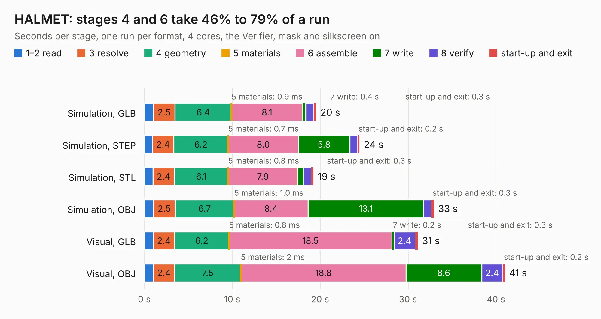

| Mode and format | 1–2 read | 3 resolve | 4 geometry | 5 materials | 6 assemble | 7 write | 8 verify | start-up and exit | Total |
|---|---:|---:|---:|---:|---:|---:|---:|---:|---:|
| Simulation, GLB | 1.0 | 2.5 | 6.4 | 0.9&nbsp;ms | 8.1 | 0.4 | 0.9 | 0.3 | 19.5 |
| Simulation, STEP | 0.9 | 2.4 | 6.2 | 0.7&nbsp;ms | 8.0 | 5.8 | 0.9 | 0.2 | 24.5 |
| Simulation, STL | 1.0 | 2.4 | 6.1 | 0.8&nbsp;ms | 7.9 | 0.7 | 0.9 | 0.3 | 19.2 |
| Simulation, OBJ | 1.0 | 2.5 | 6.7 | 1.0&nbsp;ms | 8.4 | 13.1 | 0.9 | 0.3 | 32.9 |
| Visual, GLB | 1.0 | 2.4 | 6.2 | 0.8&nbsp;ms | 18.5 | 0.2 | 2.4 | 0.3 | 31.1 |
| Visual, OBJ | 1.0 | 2.4 | 7.5 | 2&nbsp;ms | 18.8 | 8.6 | 2.4 | 0.2 | 41.0 |

<table align="center"><tr><td valign="top">

| Board | Repo: [hatlabs/halmet-hardware](https://github.com/hatlabs/halmet-hardware) Board: `HALMET.kicad_pcb` |
|---|---|
| Complexity | 369&nbsp;/&nbsp;1000 (size&nbsp;219, features&nbsp;150) |
| KESE&nbsp;features | through vias, slotted holes, custom pads, rounded, trapezoid or chamfered pads, filled zones, copper drawings, curved board outline, knockout text, TrueType text, stack-up, dielectric εr and tanδ |
| Tested | 9th November 2026 |
| Copper&nbsp;layers | 4 |
| File&nbsp;format | KiCad 9 (20241229) |
| Parts,&nbsp;tracks,&nbsp;vias | 215, 1,395, 333 |
| Triangles,&nbsp;simulation | 2,383,058 in 156 parts |
| Verifier | PASS in all six runs |

</td><td valign="top">

<table>
<tr><th>File type</th><th>File size</th><th>Peak memory used</th></tr>
<tr><th colspan="3" align="left">Simulation</th></tr>
<tr><td>GLB</td><td align="right">80&nbsp;MB</td><td align="right">816&nbsp;MB</td></tr>
<tr><td>STEP</td><td align="right">325&nbsp;MB</td><td align="right">972&nbsp;MB</td></tr>
<tr><td>STL</td><td align="right">119&nbsp;MB</td><td align="right">800&nbsp;MB</td></tr>
<tr><td>OBJ</td><td align="right">249&nbsp;MB</td><td align="right">1.6&nbsp;GB</td></tr>
<tr><th colspan="3" align="left">Visual</th></tr>
<tr><td>GLB</td><td align="right">53&nbsp;MB</td><td align="right">1.1&nbsp;GB</td></tr>
<tr><td>OBJ</td><td align="right">164&nbsp;MB</td><td align="right">1.2&nbsp;GB</td></tr>
</table>

</td></tr></table>

## 1204. HALPI2

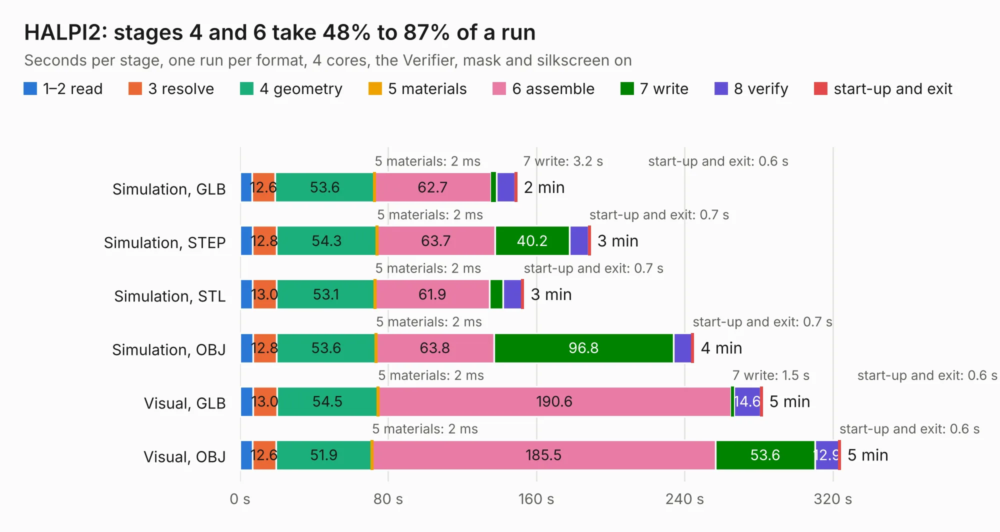

| Mode and format | 1–2 read | 3 resolve | 4 geometry | 5 materials | 6 assemble | 7 write | 8 verify | start-up and exit | Total |
|---|---:|---:|---:|---:|---:|---:|---:|---:|---:|
| Simulation, GLB | 6.4 | 12.6 | 53.6 | 2&nbsp;ms | 62.7 | 3.2 | 10.0 | 0.6 | 149.2 |
| Simulation, STEP | 6.8 | 12.8 | 54.3 | 2&nbsp;ms | 63.7 | 40.2 | 10.4 | 0.7 | 188.9 |
| Simulation, STL | 6.8 | 13.0 | 53.1 | 2&nbsp;ms | 61.9 | 7.1 | 10.4 | 0.7 | 152.9 |
| Simulation, OBJ | 6.9 | 12.8 | 53.6 | 2&nbsp;ms | 63.8 | 96.8 | 10.0 | 0.7 | 244.6 |
| Visual, GLB | 7.0 | 13.0 | 54.5 | 2&nbsp;ms | 190.6 | 1.5 | 14.6 | 0.6 | 281.7 |
| Visual, OBJ | 6.7 | 12.6 | 51.9 | 2&nbsp;ms | 185.5 | 53.6 | 12.9 | 0.6 | 323.8 |

<table align="center"><tr><td valign="top">

| Board | Repo: [hatlabs/halpi2-hardware](https://github.com/hatlabs/halpi2-hardware) Board: `HALPI2.kicad_pcb` |
|---|---|
| Complexity | 495&nbsp;/&nbsp;1000 (size&nbsp;310, features&nbsp;185) |
| KESE&nbsp;features | through vias, slotted holes, custom pads, rounded, trapezoid or chamfered pads, arc tracks, filled zones, copper drawings, curved board outline, knockout text, TrueType text, stack-up, dielectric εr and tanδ, copper finish, mask and silkscreen colours |
| Tested | 9th November 2026 |
| Copper&nbsp;layers | 6 |
| File&nbsp;format | KiCad 10 (20260206) |
| Parts,&nbsp;tracks,&nbsp;vias | 552, 5,434, 1,660 |
| Triangles,&nbsp;simulation | 14,008,076 in 554 parts |
| Verifier | PASS in all six runs |

</td><td valign="top">

<table>
<tr><th>File type</th><th>File size</th><th>Peak memory used</th></tr>
<tr><th colspan="3" align="left">Simulation</th></tr>
<tr><td>GLB</td><td align="right">464&nbsp;MB</td><td align="right">3.5&nbsp;GB</td></tr>
<tr><td>STEP</td><td align="right">2.1&nbsp;GB</td><td align="right">4.7&nbsp;GB</td></tr>
<tr><td>STL</td><td align="right">700&nbsp;MB</td><td align="right">3.6&nbsp;GB</td></tr>
<tr><td>OBJ</td><td align="right">1.5&nbsp;GB</td><td align="right">8.8&nbsp;GB</td></tr>
<tr><th colspan="3" align="left">Visual</th></tr>
<tr><td>GLB</td><td align="right">283&nbsp;MB</td><td align="right">4.7&nbsp;GB</td></tr>
<tr><td>OBJ</td><td align="right">929&nbsp;MB</td><td align="right">6.1&nbsp;GB</td></tr>
</table>

</td></tr></table>

## 1205. HALSER

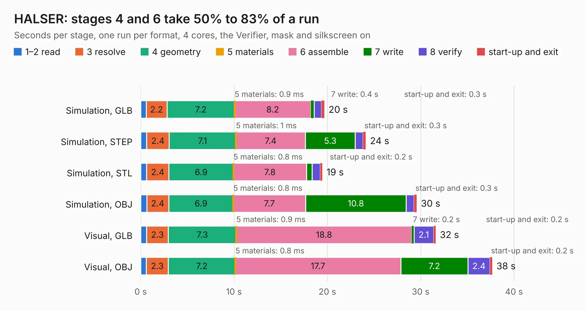

| Mode and format | 1–2 read | 3 resolve | 4 geometry | 5 materials | 6 assemble | 7 write | 8 verify | start-up and exit | Total |
|---|---:|---:|---:|---:|---:|---:|---:|---:|---:|
| Simulation, GLB | 0.6 | 2.2 | 7.2 | 0.9&nbsp;ms | 8.2 | 0.4 | 0.8 | 0.3 | 19.7 |
| Simulation, STEP | 0.6 | 2.4 | 7.1 | 1&nbsp;ms | 7.4 | 5.3 | 0.9 | 0.3 | 24.1 |
| Simulation, STL | 0.6 | 2.4 | 6.9 | 0.8&nbsp;ms | 7.8 | 0.6 | 0.9 | 0.2 | 19.5 |
| Simulation, OBJ | 0.6 | 2.4 | 6.9 | 0.8&nbsp;ms | 7.7 | 10.8 | 0.8 | 0.3 | 29.6 |
| Visual, GLB | 0.6 | 2.3 | 7.3 | 0.9&nbsp;ms | 18.8 | 0.2 | 2.1 | 0.2 | 31.6 |
| Visual, OBJ | 0.6 | 2.3 | 7.2 | 0.8&nbsp;ms | 17.7 | 7.2 | 2.4 | 0.2 | 37.7 |

<table align="center"><tr><td valign="top">

| Board | Repo: [hatlabs/halser-hardware](https://github.com/hatlabs/halser-hardware) Board: `HALSER.kicad_pcb` |
|---|---|
| Complexity | 366&nbsp;/&nbsp;1000 (size&nbsp;216, features&nbsp;150) |
| KESE&nbsp;features | through vias, slotted holes, custom pads, rounded, trapezoid or chamfered pads, filled zones, copper drawings, curved board outline, knockout text, TrueType text, stack-up, dielectric εr and tanδ |
| Tested | 9th November 2026 |
| Copper&nbsp;layers | 4 |
| File&nbsp;format | KiCad 9 (20241229) |
| Parts,&nbsp;tracks,&nbsp;vias | 174, 1,183, 354 |
| Triangles,&nbsp;simulation | 2,423,634 in 129 parts |
| Verifier | PASS in all six runs |

</td><td valign="top">

<table>
<tr><th>File type</th><th>File size</th><th>Peak memory used</th></tr>
<tr><th colspan="3" align="left">Simulation</th></tr>
<tr><td>GLB</td><td align="right">81&nbsp;MB</td><td align="right">771&nbsp;MB</td></tr>
<tr><td>STEP</td><td align="right">301&nbsp;MB</td><td align="right">972&nbsp;MB</td></tr>
<tr><td>STL</td><td align="right">121&nbsp;MB</td><td align="right">767&nbsp;MB</td></tr>
<tr><td>OBJ</td><td align="right">252&nbsp;MB</td><td align="right">1.6&nbsp;GB</td></tr>
<tr><th colspan="3" align="left">Visual</th></tr>
<tr><td>GLB</td><td align="right">54&nbsp;MB</td><td align="right">1.1&nbsp;GB</td></tr>
<tr><td>OBJ</td><td align="right">165&nbsp;MB</td><td align="right">1.2&nbsp;GB</td></tr>
</table>

</td></tr></table>

## 1206. SH-RPi

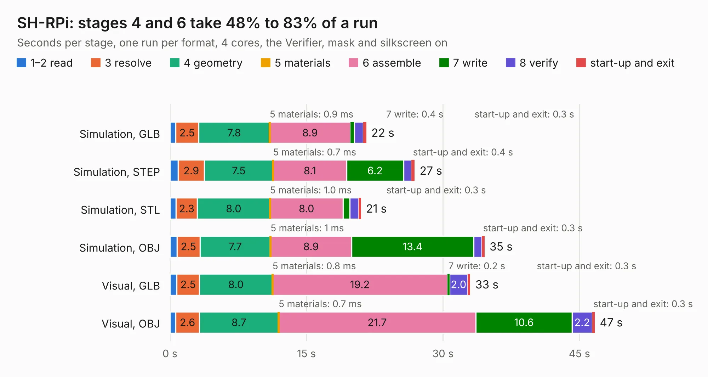

| Mode and format | 1–2 read | 3 resolve | 4 geometry | 5 materials | 6 assemble | 7 write | 8 verify | start-up and exit | Total |
|---|---:|---:|---:|---:|---:|---:|---:|---:|---:|
| Simulation, GLB | 0.6 | 2.5 | 7.8 | 0.9&nbsp;ms | 8.9 | 0.4 | 1.0 | 0.3 | 21.6 |
| Simulation, STEP | 0.9 | 2.9 | 7.5 | 0.7&nbsp;ms | 8.1 | 6.2 | 0.9 | 0.4 | 26.9 |
| Simulation, STL | 0.7 | 2.3 | 8.0 | 1.0&nbsp;ms | 8.0 | 0.7 | 1.0 | 0.3 | 21.0 |
| Simulation, OBJ | 0.8 | 2.5 | 7.7 | 1&nbsp;ms | 8.9 | 13.4 | 0.9 | 0.3 | 34.6 |
| Visual, GLB | 0.8 | 2.5 | 8.0 | 0.8&nbsp;ms | 19.2 | 0.2 | 2.0 | 0.3 | 33.0 |
| Visual, OBJ | 0.6 | 2.6 | 8.7 | 0.7&nbsp;ms | 21.7 | 10.6 | 2.2 | 0.3 | 46.7 |

<table align="center"><tr><td valign="top">

| Board | Repo: [hatlabs/sh-rpi-hardware](https://github.com/hatlabs/sh-rpi-hardware) Board: `SH-RPi.kicad_pcb` |
|---|---|
| Complexity | 343&nbsp;/&nbsp;1000 (size&nbsp;213, features&nbsp;130) |
| KESE&nbsp;features | through vias, custom pads, rounded, trapezoid or chamfered pads, filled zones, copper drawings, curved board outline, stack-up, dielectric εr and tanδ, copper finish, mask and silkscreen colours |
| Tested | 9th November 2026 |
| Copper&nbsp;layers | 4 |
| File&nbsp;format | KiCad 8 (20240108) |
| Parts,&nbsp;tracks,&nbsp;vias | 153, 925, 364 |
| Triangles,&nbsp;simulation | 2,241,942 in 132 parts |
| Verifier | PASS in all six runs |

</td><td valign="top">

<table>
<tr><th>File type</th><th>File size</th><th>Peak memory used</th></tr>
<tr><th colspan="3" align="left">Simulation</th></tr>
<tr><td>GLB</td><td align="right">75&nbsp;MB</td><td align="right">719&nbsp;MB</td></tr>
<tr><td>STEP</td><td align="right">275&nbsp;MB</td><td align="right">955&nbsp;MB</td></tr>
<tr><td>STL</td><td align="right">112&nbsp;MB</td><td align="right">743&nbsp;MB</td></tr>
<tr><td>OBJ</td><td align="right">234&nbsp;MB</td><td align="right">1.5&nbsp;GB</td></tr>
<tr><th colspan="3" align="left">Visual</th></tr>
<tr><td>GLB</td><td align="right">50&nbsp;MB</td><td align="right">926&nbsp;MB</td></tr>
<tr><td>OBJ</td><td align="right">155&nbsp;MB</td><td align="right">1.1&nbsp;GB</td></tr>
</table>

</td></tr></table>

## 1207. motor-controller-hw

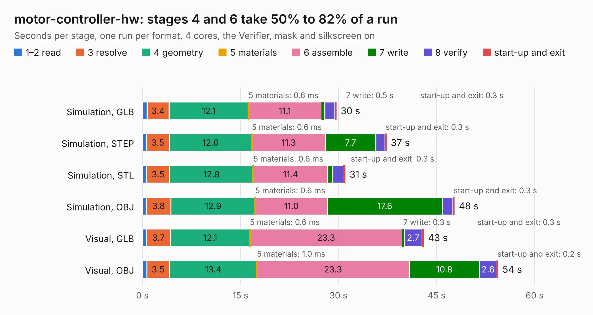

| Mode and format | 1–2 read | 3 resolve | 4 geometry | 5 materials | 6 assemble | 7 write | 8 verify | start-up and exit | Total |
|---|---:|---:|---:|---:|---:|---:|---:|---:|---:|
| Simulation, GLB | 0.7 | 3.4 | 12.1 | 0.6&nbsp;ms | 11.1 | 0.5 | 1.5 | 0.3 | 29.7 |
| Simulation, STEP | 0.6 | 3.5 | 12.6 | 0.6&nbsp;ms | 11.3 | 7.7 | 1.4 | 0.3 | 37.4 |
| Simulation, STL | 0.6 | 3.5 | 12.8 | 0.6&nbsp;ms | 11.4 | 0.8 | 1.6 | 0.3 | 31.1 |
| Simulation, OBJ | 0.6 | 3.8 | 12.9 | 0.6&nbsp;ms | 11.0 | 17.6 | 1.6 | 0.3 | 47.8 |
| Visual, GLB | 0.6 | 3.7 | 12.1 | 0.6&nbsp;ms | 23.3 | 0.3 | 2.7 | 0.3 | 43.1 |
| Visual, OBJ | 0.7 | 3.5 | 13.4 | 1.0&nbsp;ms | 23.3 | 10.8 | 2.6 | 0.2 | 54.4 |

<table align="center"><tr><td valign="top">

| Board | Repo: [heev/motor-controller-2018](https://github.com/heev/motor-controller-2018) Board: `motor-controller-hw.kicad_pcb` |
|---|---|
| Folder | motor-controller-hw |
| Complexity | 318&nbsp;/&nbsp;1000 (size&nbsp;263, features&nbsp;55) |
| KESE&nbsp;features | through vias, slotted holes, rounded, trapezoid or chamfered pads, filled zones |
| Tested | 9th November 2026 |
| Copper&nbsp;layers | 4 |
| File&nbsp;format | KiCad 5 (20171130) |
| Parts,&nbsp;tracks,&nbsp;vias | 156, 1,989, 192 |
| Triangles,&nbsp;simulation | 3,029,272 in 206 parts |
| Verifier | PASS in all six runs |

</td><td valign="top">

<table>
<tr><th>File type</th><th>File size</th><th>Peak memory used</th></tr>
<tr><th colspan="3" align="left">Simulation</th></tr>
<tr><td>GLB</td><td align="right">106&nbsp;MB</td><td align="right">1.0&nbsp;GB</td></tr>
<tr><td>STEP</td><td align="right">513&nbsp;MB</td><td align="right">1.1&nbsp;GB</td></tr>
<tr><td>STL</td><td align="right">151&nbsp;MB</td><td align="right">933&nbsp;MB</td></tr>
<tr><td>OBJ</td><td align="right">327&nbsp;MB</td><td align="right">2.0&nbsp;GB</td></tr>
<tr><th colspan="3" align="left">Visual</th></tr>
<tr><td>GLB</td><td align="right">65&nbsp;MB</td><td align="right">1.2&nbsp;GB</td></tr>
<tr><td>OBJ</td><td align="right">202&nbsp;MB</td><td align="right">1.3&nbsp;GB</td></tr>
</table>

</td></tr></table>

## 1208. MotorControllerPowerBoard

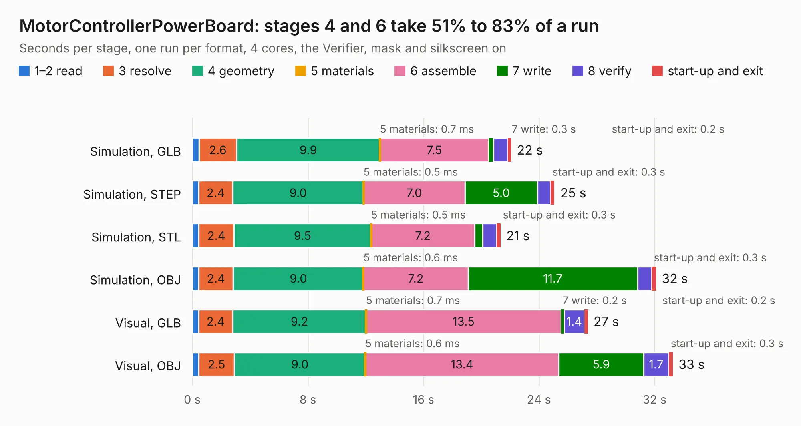

| Mode and format | 1–2 read | 3 resolve | 4 geometry | 5 materials | 6 assemble | 7 write | 8 verify | start-up and exit | Total |
|---|---:|---:|---:|---:|---:|---:|---:|---:|---:|
| Simulation, GLB | 0.5 | 2.6 | 9.9 | 0.7&nbsp;ms | 7.5 | 0.3 | 1.0 | 0.2 | 22.1 |
| Simulation, STEP | 0.4 | 2.4 | 9.0 | 0.5&nbsp;ms | 7.0 | 5.0 | 0.9 | 0.3 | 25.1 |
| Simulation, STL | 0.5 | 2.4 | 9.5 | 0.5&nbsp;ms | 7.2 | 0.6 | 1.0 | 0.3 | 21.3 |
| Simulation, OBJ | 0.5 | 2.4 | 9.0 | 0.6&nbsp;ms | 7.2 | 11.7 | 1.0 | 0.3 | 32.1 |
| Visual, GLB | 0.4 | 2.4 | 9.2 | 0.7&nbsp;ms | 13.5 | 0.2 | 1.4 | 0.2 | 27.4 |
| Visual, OBJ | 0.4 | 2.5 | 9.0 | 0.6&nbsp;ms | 13.4 | 5.9 | 1.7 | 0.3 | 33.3 |

<table align="center"><tr><td valign="top">

| Board | Repo: [heev/motor-controller-2018](https://github.com/heev/motor-controller-2018) Board: `MotorControllerPowerBoard.kicad_pcb` |
|---|---|
| Folder | MotorControllerPowerBoardRev2 / MotorControllerPowerBoard |
| Complexity | 271&nbsp;/&nbsp;1000 (size&nbsp;201, features&nbsp;70) |
| KESE&nbsp;features | through vias, custom pads, rounded, trapezoid or chamfered pads, filled zones, copper drawings |
| Tested | 9th November 2026 |
| Copper&nbsp;layers | 4 |
| File&nbsp;format | KiCad 5 (20171130) |
| Parts,&nbsp;tracks,&nbsp;vias | 131, 747, 108 |
| Triangles,&nbsp;simulation | 2,114,558 in 108 parts |
| Verifier | PASS in all six runs |

</td><td valign="top">

<table>
<tr><th>File type</th><th>File size</th><th>Peak memory used</th></tr>
<tr><th colspan="3" align="left">Simulation</th></tr>
<tr><td>GLB</td><td align="right">72&nbsp;MB</td><td align="right">652&nbsp;MB</td></tr>
<tr><td>STEP</td><td align="right">303&nbsp;MB</td><td align="right">793&nbsp;MB</td></tr>
<tr><td>STL</td><td align="right">106&nbsp;MB</td><td align="right">635&nbsp;MB</td></tr>
<tr><td>OBJ</td><td align="right">222&nbsp;MB</td><td align="right">1.4&nbsp;GB</td></tr>
<tr><th colspan="3" align="left">Visual</th></tr>
<tr><td>GLB</td><td align="right">38&nbsp;MB</td><td align="right">764&nbsp;MB</td></tr>
<tr><td>OBJ</td><td align="right">115&nbsp;MB</td><td align="right">836&nbsp;MB</td></tr>
</table>

</td></tr></table>

## 1209. voltage-regulator-module

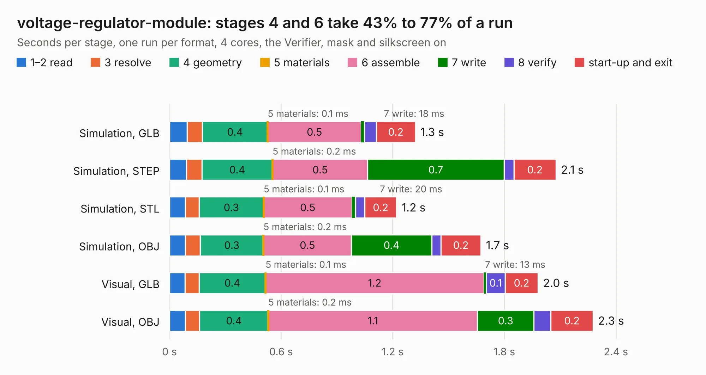

| Mode and format | 1–2 read | 3 resolve | 4 geometry | 5 materials | 6 assemble | 7 write | 8 verify | start-up and exit | Total |
|---|---:|---:|---:|---:|---:|---:|---:|---:|---:|
| Simulation, GLB | 95&nbsp;ms | 82&nbsp;ms | 0.4 | 0.1&nbsp;ms | 0.5 | 18&nbsp;ms | 64&nbsp;ms | 0.2 | 1.3 |
| Simulation, STEP | 90&nbsp;ms | 84&nbsp;ms | 0.4 | 0.2&nbsp;ms | 0.5 | 0.7 | 54&nbsp;ms | 0.2 | 2.1 |
| Simulation, STL | 85&nbsp;ms | 74&nbsp;ms | 0.3 | 0.1&nbsp;ms | 0.5 | 20&nbsp;ms | 49&nbsp;ms | 0.2 | 1.2 |
| Simulation, OBJ | 86&nbsp;ms | 79&nbsp;ms | 0.3 | 0.2&nbsp;ms | 0.5 | 0.4 | 50&nbsp;ms | 0.2 | 1.7 |
| Visual, GLB | 84&nbsp;ms | 75&nbsp;ms | 0.4 | 0.1&nbsp;ms | 1.2 | 13&nbsp;ms | 0.1 | 0.2 | 2.0 |
| Visual, OBJ | 86&nbsp;ms | 76&nbsp;ms | 0.4 | 0.2&nbsp;ms | 1.1 | 0.3 | 91&nbsp;ms | 0.2 | 2.3 |

<table align="center"><tr><td valign="top">

| Board | Repo: [heev/motor-controller-2018](https://github.com/heev/motor-controller-2018) Board: `voltage-regulator-module.kicad_pcb` |
|---|---|
| Folder | voltage-regulator-module |
| Complexity | 174&nbsp;/&nbsp;1000 (size&nbsp;129, features&nbsp;45) |
| KESE&nbsp;features | through vias, rounded, trapezoid or chamfered pads, filled zones |
| Tested | 9th November 2026 |
| Copper&nbsp;layers | 2 |
| File&nbsp;format | KiCad 5 (20171130) |
| Parts,&nbsp;tracks,&nbsp;vias | 14, 127, 10 |
| Triangles,&nbsp;simulation | 107,936 in 21 parts |
| Verifier | PASS in all six runs |

</td><td valign="top">

<table>
<tr><th>File type</th><th>File size</th><th>Peak memory used</th></tr>
<tr><th colspan="3" align="left">Simulation</th></tr>
<tr><td>GLB</td><td align="right">3.8&nbsp;MB</td><td align="right">178&nbsp;MB</td></tr>
<tr><td>STEP</td><td align="right">21&nbsp;MB</td><td align="right">189&nbsp;MB</td></tr>
<tr><td>STL</td><td align="right">5.4&nbsp;MB</td><td align="right">185&nbsp;MB</td></tr>
<tr><td>OBJ</td><td align="right">11&nbsp;MB</td><td align="right">178&nbsp;MB</td></tr>
<tr><th colspan="3" align="left">Visual</th></tr>
<tr><td>GLB</td><td align="right">2.7&nbsp;MB</td><td align="right">156&nbsp;MB</td></tr>
<tr><td>OBJ</td><td align="right">7.4&nbsp;MB</td><td align="right">157&nbsp;MB</td></tr>
</table>

</td></tr></table>

## 1210. ISA_CGA

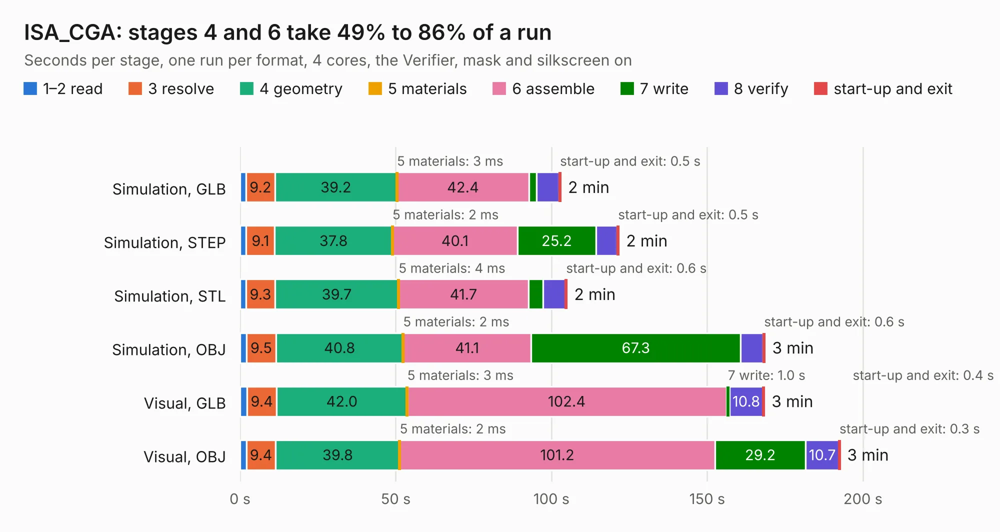

| Mode and format | 1–2 read | 3 resolve | 4 geometry | 5 materials | 6 assemble | 7 write | 8 verify | start-up and exit | Total |
|---|---:|---:|---:|---:|---:|---:|---:|---:|---:|
| Simulation, GLB | 1.9 | 9.2 | 39.2 | 3&nbsp;ms | 42.4 | 2.4 | 7.3 | 0.5 | 103.0 |
| Simulation, STEP | 2.0 | 9.1 | 37.8 | 2&nbsp;ms | 40.1 | 25.2 | 6.8 | 0.5 | 121.7 |
| Simulation, STL | 1.9 | 9.3 | 39.7 | 4&nbsp;ms | 41.7 | 4.8 | 7.1 | 0.6 | 105.0 |
| Simulation, OBJ | 2.0 | 9.5 | 40.8 | 2&nbsp;ms | 41.1 | 67.3 | 7.2 | 0.6 | 168.6 |
| Visual, GLB | 2.3 | 9.4 | 42.0 | 3&nbsp;ms | 102.4 | 1.0 | 10.8 | 0.4 | 168.4 |
| Visual, OBJ | 2.0 | 9.4 | 39.8 | 2&nbsp;ms | 101.2 | 29.2 | 10.7 | 0.3 | 192.6 |

<table align="center"><tr><td valign="top">

| Board | Repo: [hkzlab/CGA_Redux](https://github.com/hkzlab/CGA_Redux) Board: `ISA_CGA.kicad_pcb` |
|---|---|
| Complexity | 307&nbsp;/&nbsp;1000 (size&nbsp;237, features&nbsp;70) |
| KESE&nbsp;features | through vias, custom pads, filled zones, copper drawings, curved board outline |
| Tested | 9th November 2026 |
| Copper&nbsp;layers | 4 |
| File&nbsp;format | KiCad 7 (20221018) |
| Parts,&nbsp;tracks,&nbsp;vias | 170, 7,503, 328 |
| Triangles,&nbsp;simulation | 11,388,894 in 316 parts |
| Verifier | PASS in all six runs |

</td><td valign="top">

<table>
<tr><th>File type</th><th>File size</th><th>Peak memory used</th></tr>
<tr><th colspan="3" align="left">Simulation</th></tr>
<tr><td>GLB</td><td align="right">387&nbsp;MB</td><td align="right">2.5&nbsp;GB</td></tr>
<tr><td>STEP</td><td align="right">1.5&nbsp;GB</td><td align="right">3.5&nbsp;GB</td></tr>
<tr><td>STL</td><td align="right">569&nbsp;MB</td><td align="right">2.4&nbsp;GB</td></tr>
<tr><td>OBJ</td><td align="right">1.2&nbsp;GB</td><td align="right">7.1&nbsp;GB</td></tr>
<tr><th colspan="3" align="left">Visual</th></tr>
<tr><td>GLB</td><td align="right">196&nbsp;MB</td><td align="right">3.2&nbsp;GB</td></tr>
<tr><td>OBJ</td><td align="right">634&nbsp;MB</td><td align="right">4.0&nbsp;GB</td></tr>
</table>

</td></tr></table>

## 1211. ISA_ES1868

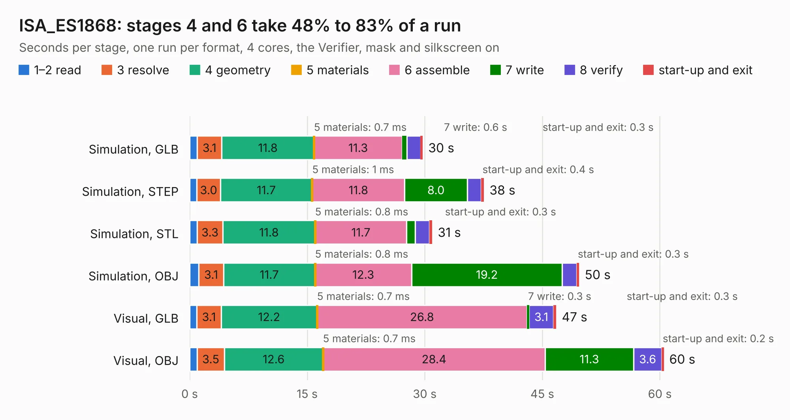

| Mode and format | 1–2 read | 3 resolve | 4 geometry | 5 materials | 6 assemble | 7 write | 8 verify | start-up and exit | Total |
|---|---:|---:|---:|---:|---:|---:|---:|---:|---:|
| Simulation, GLB | 1.0 | 3.1 | 11.8 | 0.7&nbsp;ms | 11.3 | 0.6 | 1.7 | 0.3 | 29.7 |
| Simulation, STEP | 0.9 | 3.0 | 11.7 | 1&nbsp;ms | 11.8 | 8.0 | 1.7 | 0.4 | 37.5 |
| Simulation, STL | 1.0 | 3.3 | 11.8 | 0.8&nbsp;ms | 11.7 | 1.1 | 1.9 | 0.3 | 30.9 |
| Simulation, OBJ | 1.2 | 3.1 | 11.7 | 0.8&nbsp;ms | 12.3 | 19.2 | 1.8 | 0.3 | 49.7 |
| Visual, GLB | 0.9 | 3.1 | 12.2 | 0.7&nbsp;ms | 26.8 | 0.3 | 3.1 | 0.3 | 46.8 |
| Visual, OBJ | 1.0 | 3.5 | 12.6 | 0.7&nbsp;ms | 28.4 | 11.3 | 3.6 | 0.2 | 60.5 |

<table align="center"><tr><td valign="top">

| Board | Repo: [hkzlab/ES1868_ISA8](https://github.com/hkzlab/ES1868_ISA8) Board: `ISA_ES1868.kicad_pcb` |
|---|---|
| Complexity | 329&nbsp;/&nbsp;1000 (size&nbsp;249, features&nbsp;80) |
| KESE&nbsp;features | through vias, custom pads, rounded, trapezoid or chamfered pads, filled zones, copper drawings, curved board outline |
| Tested | 9th November 2026 |
| Copper&nbsp;layers | 4 |
| File&nbsp;format | KiCad 7 (20221018) |
| Parts,&nbsp;tracks,&nbsp;vias | 119, 1,607, 85 |
| Triangles,&nbsp;simulation | 3,227,944 in 148 parts |
| Verifier | PASS in all six runs |

</td><td valign="top">

<table>
<tr><th>File type</th><th>File size</th><th>Peak memory used</th></tr>
<tr><th colspan="3" align="left">Simulation</th></tr>
<tr><td>GLB</td><td align="right">110&nbsp;MB</td><td align="right">1.1&nbsp;GB</td></tr>
<tr><td>STEP</td><td align="right">478&nbsp;MB</td><td align="right">1.3&nbsp;GB</td></tr>
<tr><td>STL</td><td align="right">161&nbsp;MB</td><td align="right">1.1&nbsp;GB</td></tr>
<tr><td>OBJ</td><td align="right">340&nbsp;MB</td><td align="right">2.1&nbsp;GB</td></tr>
<tr><th colspan="3" align="left">Visual</th></tr>
<tr><td>GLB</td><td align="right">65&nbsp;MB</td><td align="right">1.4&nbsp;GB</td></tr>
<tr><td>OBJ</td><td align="right">200&nbsp;MB</td><td align="right">1.3&nbsp;GB</td></tr>
</table>

</td></tr></table>

## 1212. ISA_ES688

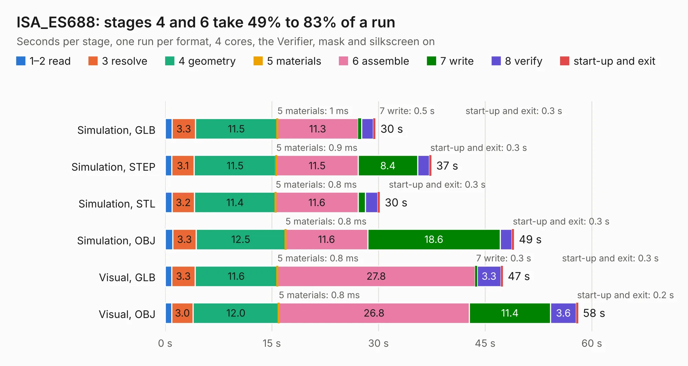

| Mode and format | 1–2 read | 3 resolve | 4 geometry | 5 materials | 6 assemble | 7 write | 8 verify | start-up and exit | Total |
|---|---:|---:|---:|---:|---:|---:|---:|---:|---:|
| Simulation, GLB | 1.0 | 3.3 | 11.5 | 1&nbsp;ms | 11.3 | 0.5 | 1.6 | 0.3 | 29.6 |
| Simulation, STEP | 0.9 | 3.1 | 11.5 | 0.9&nbsp;ms | 11.5 | 8.4 | 1.6 | 0.3 | 37.4 |
| Simulation, STL | 1.0 | 3.2 | 11.4 | 0.8&nbsp;ms | 11.6 | 1.0 | 1.7 | 0.3 | 30.2 |
| Simulation, OBJ | 1.1 | 3.3 | 12.5 | 0.8&nbsp;ms | 11.6 | 18.6 | 1.7 | 0.3 | 49.1 |
| Visual, GLB | 0.9 | 3.3 | 11.6 | 0.8&nbsp;ms | 27.8 | 0.3 | 3.3 | 0.3 | 47.5 |
| Visual, OBJ | 0.9 | 3.0 | 12.0 | 0.8&nbsp;ms | 26.8 | 11.4 | 3.6 | 0.2 | 58.1 |

<table align="center"><tr><td valign="top">

| Board | Repo: [hkzlab/ES688_ISA8](https://github.com/hkzlab/ES688_ISA8) Board: `ISA_ES688.kicad_pcb` |
|---|---|
| Complexity | 335&nbsp;/&nbsp;1000 (size&nbsp;255, features&nbsp;80) |
| KESE&nbsp;features | through vias, custom pads, rounded, trapezoid or chamfered pads, filled zones, copper drawings, curved board outline |
| Tested | 9th November 2026 |
| Copper&nbsp;layers | 4 |
| File&nbsp;format | KiCad 7 (20221018) |
| Parts,&nbsp;tracks,&nbsp;vias | 125, 2,157, 166 |
| Triangles,&nbsp;simulation | 3,361,666 in 167 parts |
| Verifier | PASS in all six runs |

</td><td valign="top">

<table>
<tr><th>File type</th><th>File size</th><th>Peak memory used</th></tr>
<tr><th colspan="3" align="left">Simulation</th></tr>
<tr><td>GLB</td><td align="right">115&nbsp;MB</td><td align="right">1.1&nbsp;GB</td></tr>
<tr><td>STEP</td><td align="right">512&nbsp;MB</td><td align="right">1.3&nbsp;GB</td></tr>
<tr><td>STL</td><td align="right">168&nbsp;MB</td><td align="right">1.1&nbsp;GB</td></tr>
<tr><td>OBJ</td><td align="right">355&nbsp;MB</td><td align="right">2.2&nbsp;GB</td></tr>
<tr><th colspan="3" align="left">Visual</th></tr>
<tr><td>GLB</td><td align="right">71&nbsp;MB</td><td align="right">1.4&nbsp;GB</td></tr>
<tr><td>OBJ</td><td align="right">221&nbsp;MB</td><td align="right">1.5&nbsp;GB</td></tr>
</table>

</td></tr></table>

## 1213. allwinner-h3

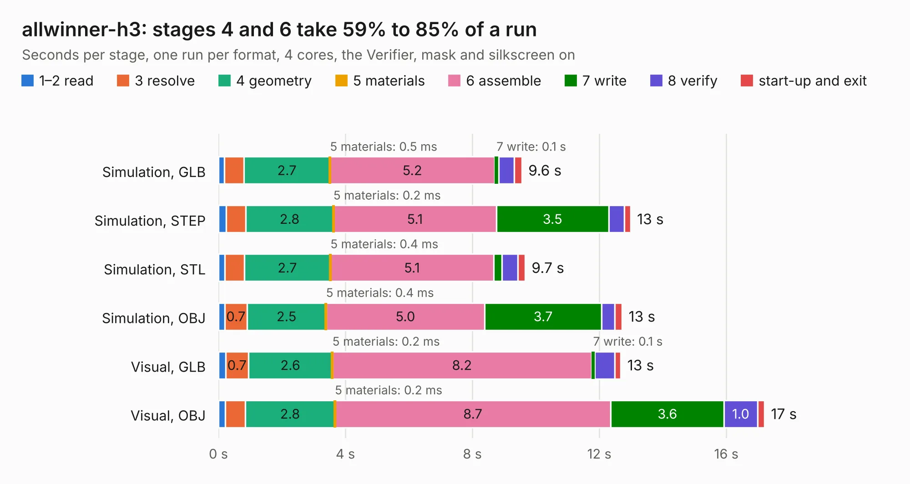

| Mode and format | 1–2 read | 3 resolve | 4 geometry | 5 materials | 6 assemble | 7 write | 8 verify | start-up and exit | Total |
|---|---:|---:|---:|---:|---:|---:|---:|---:|---:|
| Simulation, GLB | 0.2 | 0.6 | 2.7 | 0.5&nbsp;ms | 5.2 | 0.1 | 0.5 | 0.2 | 9.6 |
| Simulation, STEP | 0.2 | 0.6 | 2.8 | 0.2&nbsp;ms | 5.1 | 3.5 | 0.5 | 0.2 | 13.0 |
| Simulation, STL | 0.2 | 0.6 | 2.7 | 0.4&nbsp;ms | 5.1 | 0.3 | 0.5 | 0.2 | 9.7 |
| Simulation, OBJ | 0.2 | 0.7 | 2.5 | 0.4&nbsp;ms | 5.0 | 3.7 | 0.4 | 0.2 | 12.7 |
| Visual, GLB | 0.2 | 0.7 | 2.6 | 0.2&nbsp;ms | 8.2 | 0.1 | 0.6 | 0.2 | 12.7 |
| Visual, OBJ | 0.2 | 0.6 | 2.8 | 0.2&nbsp;ms | 8.7 | 3.6 | 1.0 | 0.2 | 17.2 |

<table align="center"><tr><td valign="top">

| Board | Repo: [hvwyl/allwinner-h3-ddr3-16x1-kicad](https://github.com/hvwyl/allwinner-h3-ddr3-16x1-kicad) Board: `allwinner-h3.kicad_pcb` |
|---|---|
| Folder | project |
| Complexity | 293&nbsp;/&nbsp;1000 (size&nbsp;223, features&nbsp;70) |
| KESE&nbsp;features | through vias, rounded, trapezoid or chamfered pads, arc tracks, stack-up, dielectric εr and tanδ |
| Tested | 9th November 2026 |
| Copper&nbsp;layers | 2 |
| File&nbsp;format | KiCad 6 (20211014) |
| Parts,&nbsp;tracks,&nbsp;vias | 20, 1,320, 119 |
| Triangles,&nbsp;simulation | 867,728 in 91 parts |
| Verifier | PASS in all six runs |

</td><td valign="top">

<table>
<tr><th>File type</th><th>File size</th><th>Peak memory used</th></tr>
<tr><th colspan="3" align="left">Simulation</th></tr>
<tr><td>GLB</td><td align="right">29&nbsp;MB</td><td align="right">506&nbsp;MB</td></tr>
<tr><td>STEP</td><td align="right">137&nbsp;MB</td><td align="right">533&nbsp;MB</td></tr>
<tr><td>STL</td><td align="right">43&nbsp;MB</td><td align="right">494&nbsp;MB</td></tr>
<tr><td>OBJ</td><td align="right">86&nbsp;MB</td><td align="right">615&nbsp;MB</td></tr>
<tr><th colspan="3" align="left">Visual</th></tr>
<tr><td>GLB</td><td align="right">25&nbsp;MB</td><td align="right">683&nbsp;MB</td></tr>
<tr><td>OBJ</td><td align="right">76&nbsp;MB</td><td align="right">678&nbsp;MB</td></tr>
</table>

</td></tr></table>

## 1214. FCCU-v2-schematic-pcb

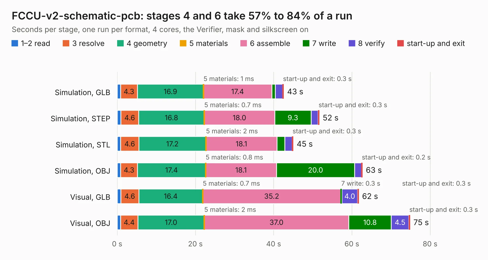

| Mode and format | 1–2 read | 3 resolve | 4 geometry | 5 materials | 6 assemble | 7 write | 8 verify | start-up and exit | Total |
|---|---:|---:|---:|---:|---:|---:|---:|---:|---:|
| Simulation, GLB | 0.8 | 4.3 | 16.9 | 1&nbsp;ms | 17.4 | 0.9 | 1.8 | 0.3 | 42.6 |
| Simulation, STEP | 0.9 | 4.6 | 16.8 | 0.7&nbsp;ms | 18.0 | 9.3 | 1.8 | 0.3 | 51.6 |
| Simulation, STL | 0.9 | 4.6 | 17.2 | 2&nbsp;ms | 18.1 | 2.0 | 1.9 | 0.3 | 45.0 |
| Simulation, OBJ | 0.9 | 4.3 | 17.4 | 0.8&nbsp;ms | 18.1 | 20.0 | 1.7 | 0.2 | 62.7 |
| Visual, GLB | 0.9 | 4.6 | 16.4 | 0.7&nbsp;ms | 35.2 | 0.3 | 4.0 | 0.3 | 61.7 |
| Visual, OBJ | 0.9 | 4.4 | 17.0 | 2&nbsp;ms | 37.0 | 10.8 | 4.5 | 0.3 | 74.8 |

<table align="center"><tr><td valign="top">

| Board | Repo: [hydrogreenpollub/fuel_cell_control_unit_pcb_fccu_v2_1](https://github.com/hydrogreenpollub/fuel_cell_control_unit_pcb_fccu_v2_1) Board: `FCCU-v2-schematic-pcb.kicad_pcb` |
|---|---|
| Complexity | 400&nbsp;/&nbsp;1000 (size&nbsp;270, features&nbsp;130) |
| KESE&nbsp;features | through vias, padstacks, rounded, trapezoid or chamfered pads, drill offsets, filled zones, TrueType text, stack-up, dielectric εr and tanδ |
| Tested | 9th November 2026 |
| Copper&nbsp;layers | 4 |
| File&nbsp;format | KiCad 10 (20260206) |
| Parts,&nbsp;tracks,&nbsp;vias | 207, 3,324, 532 |
| Triangles,&nbsp;simulation | 4,737,866 in 182 parts |
| Verifier | PASS in all six runs |

</td><td valign="top">

<table>
<tr><th>File type</th><th>File size</th><th>Peak memory used</th></tr>
<tr><th colspan="3" align="left">Simulation</th></tr>
<tr><td>GLB</td><td align="right">161&nbsp;MB</td><td align="right">1.4&nbsp;GB</td></tr>
<tr><td>STEP</td><td align="right">635&nbsp;MB</td><td align="right">1.7&nbsp;GB</td></tr>
<tr><td>STL</td><td align="right">237&nbsp;MB</td><td align="right">1.4&nbsp;GB</td></tr>
<tr><td>OBJ</td><td align="right">501&nbsp;MB</td><td align="right">3.0&nbsp;GB</td></tr>
<tr><th colspan="3" align="left">Visual</th></tr>
<tr><td>GLB</td><td align="right">86&nbsp;MB</td><td align="right">1.6&nbsp;GB</td></tr>
<tr><td>OBJ</td><td align="right">268&nbsp;MB</td><td align="right">1.8&nbsp;GB</td></tr>
</table>

</td></tr></table>

## 1215. FCCU-v21-schematic-pcb

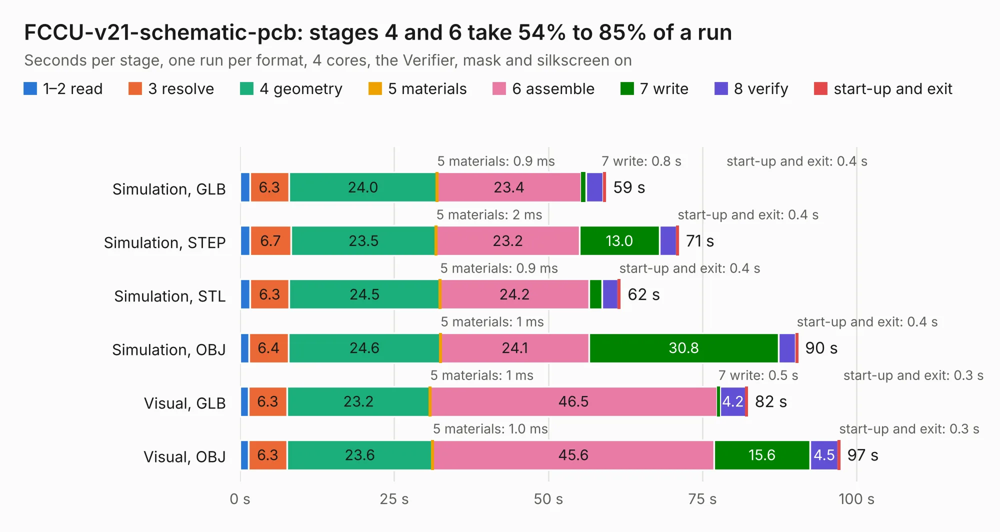

| Mode and format | 1–2 read | 3 resolve | 4 geometry | 5 materials | 6 assemble | 7 write | 8 verify | start-up and exit | Total |
|---|---:|---:|---:|---:|---:|---:|---:|---:|---:|
| Simulation, GLB | 1.6 | 6.3 | 24.0 | 0.9&nbsp;ms | 23.4 | 0.8 | 2.8 | 0.4 | 59.3 |
| Simulation, STEP | 1.6 | 6.7 | 23.5 | 2&nbsp;ms | 23.2 | 13.0 | 2.7 | 0.4 | 71.1 |
| Simulation, STL | 1.7 | 6.3 | 24.5 | 0.9&nbsp;ms | 24.2 | 2.1 | 2.6 | 0.4 | 61.7 |
| Simulation, OBJ | 1.4 | 6.4 | 24.6 | 1&nbsp;ms | 24.1 | 30.8 | 2.7 | 0.4 | 90.5 |
| Visual, GLB | 1.4 | 6.3 | 23.2 | 1&nbsp;ms | 46.5 | 0.5 | 4.2 | 0.3 | 82.3 |
| Visual, OBJ | 1.4 | 6.3 | 23.6 | 1.0&nbsp;ms | 45.6 | 15.6 | 4.5 | 0.3 | 97.3 |

<table align="center"><tr><td valign="top">

| Board | Repo: [hydrogreenpollub/fuel_cell_control_unit_pcb_fccu_v2_1](https://github.com/hydrogreenpollub/fuel_cell_control_unit_pcb_fccu_v2_1) Board: `FCCU-v21-schematic-pcb.kicad_pcb` |
|---|---|
| Complexity | 404&nbsp;/&nbsp;1000 (size&nbsp;274, features&nbsp;130) |
| KESE&nbsp;features | through vias, padstacks, rounded, trapezoid or chamfered pads, drill offsets, filled zones, TrueType text, stack-up, dielectric εr and tanδ |
| Tested | 9th November 2026 |
| Copper&nbsp;layers | 4 |
| File&nbsp;format | KiCad 10 (20260206) |
| Parts,&nbsp;tracks,&nbsp;vias | 258, 3,794, 507 |
| Triangles,&nbsp;simulation | 4,809,760 in 228 parts |
| Verifier | PASS in all six runs |

</td><td valign="top">

<table>
<tr><th>File type</th><th>File size</th><th>Peak memory used</th></tr>
<tr><th colspan="3" align="left">Simulation</th></tr>
<tr><td>GLB</td><td align="right">165&nbsp;MB</td><td align="right">1.2&nbsp;GB</td></tr>
<tr><td>STEP</td><td align="right">677&nbsp;MB</td><td align="right">1.7&nbsp;GB</td></tr>
<tr><td>STL</td><td align="right">241&nbsp;MB</td><td align="right">1.2&nbsp;GB</td></tr>
<tr><td>OBJ</td><td align="right">511&nbsp;MB</td><td align="right">3.1&nbsp;GB</td></tr>
<tr><th colspan="3" align="left">Visual</th></tr>
<tr><td>GLB</td><td align="right">90&nbsp;MB</td><td align="right">1.6&nbsp;GB</td></tr>
<tr><td>OBJ</td><td align="right">280&nbsp;MB</td><td align="right">1.9&nbsp;GB</td></tr>
</table>

</td></tr></table>

## 1216. Daughterboard

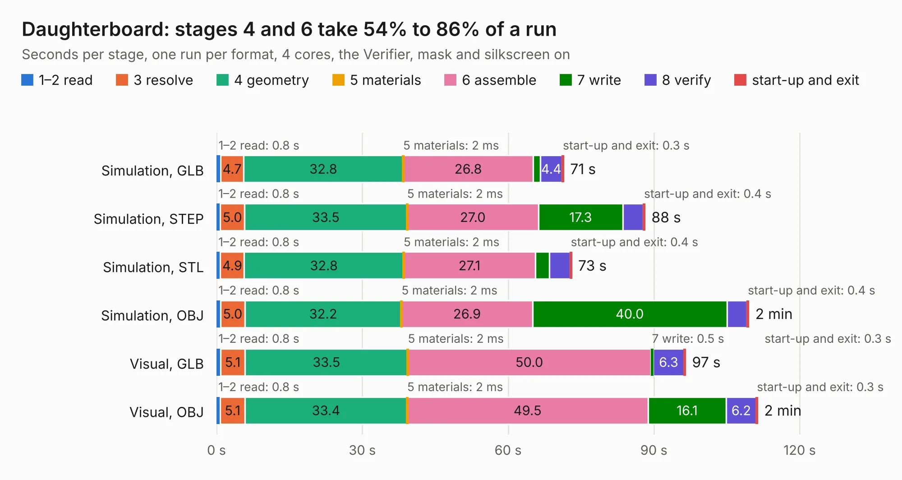

| Mode and format | 1–2 read | 3 resolve | 4 geometry | 5 materials | 6 assemble | 7 write | 8 verify | start-up and exit | Total |
|---|---:|---:|---:|---:|---:|---:|---:|---:|---:|
| Simulation, GLB | 0.8 | 4.7 | 32.8 | 2&nbsp;ms | 26.8 | 1.5 | 4.4 | 0.3 | 71.4 |
| Simulation, STEP | 0.8 | 5.0 | 33.5 | 2&nbsp;ms | 27.0 | 17.3 | 4.2 | 0.4 | 88.2 |
| Simulation, STL | 0.8 | 4.9 | 32.8 | 2&nbsp;ms | 27.1 | 2.9 | 4.3 | 0.4 | 73.1 |
| Simulation, OBJ | 0.8 | 5.0 | 32.2 | 2&nbsp;ms | 26.9 | 40.0 | 4.1 | 0.4 | 109.5 |
| Visual, GLB | 0.8 | 5.1 | 33.5 | 2&nbsp;ms | 50.0 | 0.5 | 6.3 | 0.3 | 96.5 |
| Visual, OBJ | 0.8 | 5.1 | 33.4 | 2&nbsp;ms | 49.5 | 16.1 | 6.2 | 0.3 | 111.4 |

<table align="center"><tr><td valign="top">

| Board | Repo: [iansbremner/Amiga-3000-Daughterboard](https://github.com/iansbremner/Amiga-3000-Daughterboard) Board: `Daughterboard.kicad_pcb` |
|---|---|
| Complexity | 253&nbsp;/&nbsp;1000 (size&nbsp;218, features&nbsp;35) |
| KESE&nbsp;features | through vias, filled zones |
| Tested | 9th November 2026 |
| Copper&nbsp;layers | 4 |
| File&nbsp;format | KiCad 5 (20171130) |
| Parts,&nbsp;tracks,&nbsp;vias | 90, 3,667, 102 |
| Triangles,&nbsp;simulation | 8,425,376 in 307 parts |
| Verifier | PASS in all six runs |

</td><td valign="top">

<table>
<tr><th>File type</th><th>File size</th><th>Peak memory used</th></tr>
<tr><th colspan="3" align="left">Simulation</th></tr>
<tr><td>GLB</td><td align="right">285&nbsp;MB</td><td align="right">1.9&nbsp;GB</td></tr>
<tr><td>STEP</td><td align="right">1.2&nbsp;GB</td><td align="right">2.6&nbsp;GB</td></tr>
<tr><td>STL</td><td align="right">421&nbsp;MB</td><td align="right">1.9&nbsp;GB</td></tr>
<tr><td>OBJ</td><td align="right">908&nbsp;MB</td><td align="right">5.3&nbsp;GB</td></tr>
<tr><th colspan="3" align="left">Visual</th></tr>
<tr><td>GLB</td><td align="right">125&nbsp;MB</td><td align="right">2.3&nbsp;GB</td></tr>
<tr><td>OBJ</td><td align="right">396&nbsp;MB</td><td align="right">2.6&nbsp;GB</td></tr>
</table>

</td></tr></table>

## 1217. Issue 4

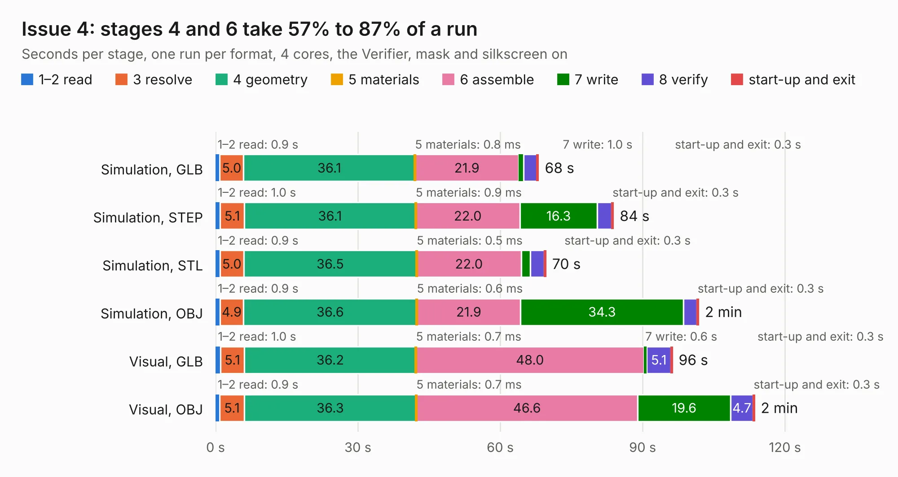

| Mode and format | 1–2 read | 3 resolve | 4 geometry | 5 materials | 6 assemble | 7 write | 8 verify | start-up and exit | Total |
|---|---:|---:|---:|---:|---:|---:|---:|---:|---:|
| Simulation, GLB | 0.9 | 5.0 | 36.1 | 0.8&nbsp;ms | 21.9 | 1.0 | 2.8 | 0.3 | 68.0 |
| Simulation, STEP | 1.0 | 5.1 | 36.1 | 0.9&nbsp;ms | 22.0 | 16.3 | 3.0 | 0.3 | 83.8 |
| Simulation, STL | 0.9 | 5.0 | 36.5 | 0.5&nbsp;ms | 22.0 | 2.0 | 2.9 | 0.3 | 69.6 |
| Simulation, OBJ | 0.9 | 4.9 | 36.6 | 0.6&nbsp;ms | 21.9 | 34.3 | 2.8 | 0.3 | 101.8 |
| Visual, GLB | 1.0 | 5.1 | 36.2 | 0.7&nbsp;ms | 48.0 | 0.6 | 5.1 | 0.3 | 96.2 |
| Visual, OBJ | 0.9 | 5.1 | 36.3 | 0.7&nbsp;ms | 46.6 | 19.6 | 4.7 | 0.3 | 113.5 |

<table align="center"><tr><td valign="top">

| Board | Repo: [iansbremner/ZX-Spectrum-Issue-4B-KiCAD](https://github.com/iansbremner/ZX-Spectrum-Issue-4B-KiCAD) Board: `Issue 4.kicad_pcb` |
|---|---|
| Complexity | 283&nbsp;/&nbsp;1000 (size&nbsp;218, features&nbsp;65) |
| KESE&nbsp;features | through vias, slotted holes, rounded, trapezoid or chamfered pads, filled zones, curved board outline |
| Tested | 9th November 2026 |
| Copper&nbsp;layers | 2 |
| File&nbsp;format | KiCad 5 (20171130) |
| Parts,&nbsp;tracks,&nbsp;vias | 195, 5,111, 429 |
| Triangles,&nbsp;simulation | 6,255,428 in 166 parts |
| Verifier | PASS in all six runs |

</td><td valign="top">

<table>
<tr><th>File type</th><th>File size</th><th>Peak memory used</th></tr>
<tr><th colspan="3" align="left">Simulation</th></tr>
<tr><td>GLB</td><td align="right">215&nbsp;MB</td><td align="right">1.8&nbsp;GB</td></tr>
<tr><td>STEP</td><td align="right">1.1&nbsp;GB</td><td align="right">2.2&nbsp;GB</td></tr>
<tr><td>STL</td><td align="right">313&nbsp;MB</td><td align="right">1.8&nbsp;GB</td></tr>
<tr><td>OBJ</td><td align="right">673&nbsp;MB</td><td align="right">4.0&nbsp;GB</td></tr>
<tr><th colspan="3" align="left">Visual</th></tr>
<tr><td>GLB</td><td align="right">125&nbsp;MB</td><td align="right">2.0&nbsp;GB</td></tr>
<tr><td>OBJ</td><td align="right">397&nbsp;MB</td><td align="right">2.6&nbsp;GB</td></tr>
</table>

</td></tr></table>

## 1218. tomu-fpga

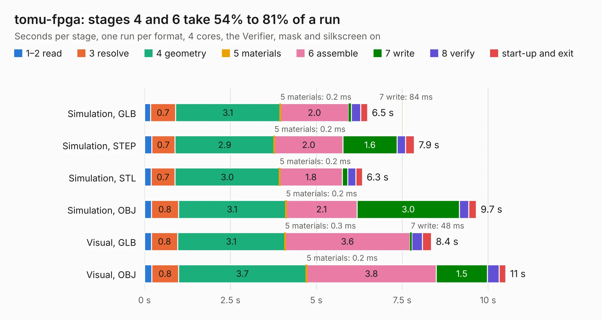

| Mode and format | 1–2 read | 3 resolve | 4 geometry | 5 materials | 6 assemble | 7 write | 8 verify | start-up and exit | Total |
|---|---:|---:|---:|---:|---:|---:|---:|---:|---:|
| Simulation, GLB | 0.2 | 0.7 | 3.1 | 0.2&nbsp;ms | 2.0 | 84&nbsp;ms | 0.3 | 0.2 | 6.5 |
| Simulation, STEP | 0.2 | 0.7 | 2.9 | 0.2&nbsp;ms | 2.0 | 1.6 | 0.2 | 0.3 | 7.9 |
| Simulation, STL | 0.2 | 0.7 | 3.0 | 0.2&nbsp;ms | 1.8 | 0.2 | 0.2 | 0.2 | 6.3 |
| Simulation, OBJ | 0.2 | 0.8 | 3.1 | 0.2&nbsp;ms | 2.1 | 3.0 | 0.3 | 0.2 | 9.7 |
| Visual, GLB | 0.2 | 0.8 | 3.1 | 0.3&nbsp;ms | 3.6 | 48&nbsp;ms | 0.3 | 0.3 | 8.4 |
| Visual, OBJ | 0.2 | 0.8 | 3.7 | 0.2&nbsp;ms | 3.8 | 1.5 | 0.3 | 0.2 | 10.5 |

<table align="center"><tr><td valign="top">

| Board | Repo: [im-tomu/fomu-hardware](https://github.com/im-tomu/fomu-hardware) Board: `tomu-fpga.kicad_pcb` |
|---|---|
| Folder | archive / dvt / pcb |
| Complexity | 347&nbsp;/&nbsp;1000 (size&nbsp;192, features&nbsp;155) |
| KESE&nbsp;features | blind and buried vias, microvias, custom pads, rounded, trapezoid or chamfered pads, filled zones, copper drawings, copper text, curved board outline |
| Tested | 9th November 2026 |
| Copper&nbsp;layers | 4 |
| File&nbsp;format | KiCad 5 (20171130) |
| Parts,&nbsp;tracks,&nbsp;vias | 41, 579, 249 |
| Triangles,&nbsp;simulation | 513,942 in 44 parts |
| Verifier | PASS in all six runs |

</td><td valign="top">

<table>
<tr><th>File type</th><th>File size</th><th>Peak memory used</th></tr>
<tr><th colspan="3" align="left">Simulation</th></tr>
<tr><td>GLB</td><td align="right">18&nbsp;MB</td><td align="right">313&nbsp;MB</td></tr>
<tr><td>STEP</td><td align="right">74&nbsp;MB</td><td align="right">348&nbsp;MB</td></tr>
<tr><td>STL</td><td align="right">26&nbsp;MB</td><td align="right">312&nbsp;MB</td></tr>
<tr><td>OBJ</td><td align="right">53&nbsp;MB</td><td align="right">408&nbsp;MB</td></tr>
<tr><th colspan="3" align="left">Visual</th></tr>
<tr><td>GLB</td><td align="right">9.8&nbsp;MB</td><td align="right">310&nbsp;MB</td></tr>
<tr><td>OBJ</td><td align="right">29&nbsp;MB</td><td align="right">307&nbsp;MB</td></tr>
</table>

</td></tr></table>

## 1219. tomu-fpga

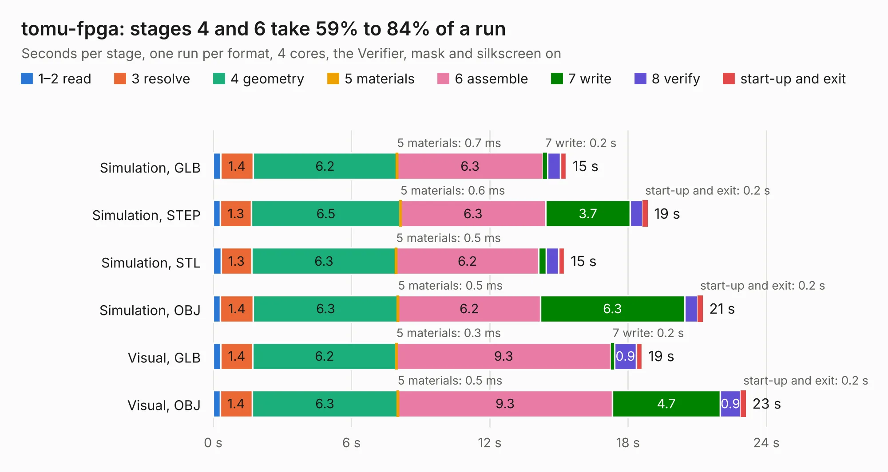

| Mode and format | 1–2 read | 3 resolve | 4 geometry | 5 materials | 6 assemble | 7 write | 8 verify | start-up and exit | Total |
|---|---:|---:|---:|---:|---:|---:|---:|---:|---:|
| Simulation, GLB | 0.3 | 1.4 | 6.2 | 0.7&nbsp;ms | 6.3 | 0.2 | 0.6 | 0.3 | 15.3 |
| Simulation, STEP | 0.3 | 1.3 | 6.5 | 0.6&nbsp;ms | 6.3 | 3.7 | 0.5 | 0.2 | 18.9 |
| Simulation, STL | 0.3 | 1.3 | 6.3 | 0.5&nbsp;ms | 6.2 | 0.3 | 0.5 | 0.3 | 15.2 |
| Simulation, OBJ | 0.3 | 1.4 | 6.3 | 0.5&nbsp;ms | 6.2 | 6.3 | 0.6 | 0.2 | 21.2 |
| Visual, GLB | 0.3 | 1.4 | 6.2 | 0.3&nbsp;ms | 9.3 | 0.2 | 0.9 | 0.2 | 18.6 |
| Visual, OBJ | 0.3 | 1.4 | 6.3 | 0.5&nbsp;ms | 9.3 | 4.7 | 0.9 | 0.2 | 23.1 |

<table align="center"><tr><td valign="top">

| Board | Repo: [im-tomu/fomu-hardware](https://github.com/im-tomu/fomu-hardware) Board: `tomu-fpga.kicad_pcb` |
|---|---|
| Folder | archive / evt / pcb |
| Complexity | 265&nbsp;/&nbsp;1000 (size&nbsp;220, features&nbsp;45) |
| KESE&nbsp;features | through vias, rounded, trapezoid or chamfered pads, filled zones |
| Tested | 9th November 2026 |
| Copper&nbsp;layers | 2 |
| File&nbsp;format | KiCad 5 (20171130) |
| Parts,&nbsp;tracks,&nbsp;vias | 62, 919, 162 |
| Triangles,&nbsp;simulation | 1,100,316 in 79 parts |
| Verifier | PASS in all six runs |

</td><td valign="top">

<table>
<tr><th>File type</th><th>File size</th><th>Peak memory used</th></tr>
<tr><th colspan="3" align="left">Simulation</th></tr>
<tr><td>GLB</td><td align="right">38&nbsp;MB</td><td align="right">474&nbsp;MB</td></tr>
<tr><td>STEP</td><td align="right">194&nbsp;MB</td><td align="right">565&nbsp;MB</td></tr>
<tr><td>STL</td><td align="right">55&nbsp;MB</td><td align="right">466&nbsp;MB</td></tr>
<tr><td>OBJ</td><td align="right">113&nbsp;MB</td><td align="right">811&nbsp;MB</td></tr>
<tr><th colspan="3" align="left">Visual</th></tr>
<tr><td>GLB</td><td align="right">27&nbsp;MB</td><td align="right">613&nbsp;MB</td></tr>
<tr><td>OBJ</td><td align="right">80&nbsp;MB</td><td align="right">616&nbsp;MB</td></tr>
</table>

</td></tr></table>

## 1220. tomu

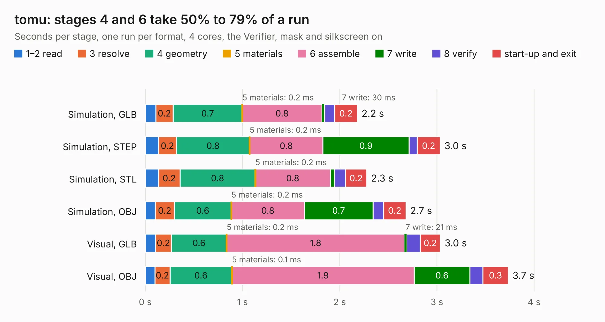

| Mode and format | 1–2 read | 3 resolve | 4 geometry | 5 materials | 6 assemble | 7 write | 8 verify | start-up and exit | Total |
|---|---:|---:|---:|---:|---:|---:|---:|---:|---:|
| Simulation, GLB | 0.1 | 0.2 | 0.7 | 0.2&nbsp;ms | 0.8 | 30&nbsp;ms | 0.1 | 0.2 | 2.2 |
| Simulation, STEP | 0.1 | 0.2 | 0.8 | 0.2&nbsp;ms | 0.8 | 0.9 | 84&nbsp;ms | 0.2 | 3.0 |
| Simulation, STL | 0.1 | 0.2 | 0.8 | 0.2&nbsp;ms | 0.8 | 46&nbsp;ms | 0.1 | 0.2 | 2.3 |
| Simulation, OBJ | 0.1 | 0.2 | 0.6 | 0.2&nbsp;ms | 0.8 | 0.7 | 0.1 | 0.2 | 2.7 |
| Visual, GLB | 0.1 | 0.2 | 0.6 | 0.2&nbsp;ms | 1.8 | 21&nbsp;ms | 0.1 | 0.2 | 3.0 |
| Visual, OBJ | 99&nbsp;ms | 0.2 | 0.6 | 0.1&nbsp;ms | 1.9 | 0.6 | 0.1 | 0.3 | 3.7 |

<table align="center"><tr><td valign="top">

| Board | Repo: [im-tomu/tomu-hardware](https://github.com/im-tomu/tomu-hardware) Board: `tomu.kicad_pcb` |
|---|---|
| Folder | pcb |
| Complexity | 193&nbsp;/&nbsp;1000 (size&nbsp;138, features&nbsp;55) |
| KESE&nbsp;features | through vias, rounded, trapezoid or chamfered pads, filled zones, curved board outline |
| Tested | 9th November 2026 |
| Copper&nbsp;layers | 2 |
| File&nbsp;format | KiCad 4 (4) |
| Parts,&nbsp;tracks,&nbsp;vias | 14, 193, 25 |
| Triangles,&nbsp;simulation | 162,358 in 34 parts |
| Verifier | PASS in all six runs |

</td><td valign="top">

<table>
<tr><th>File type</th><th>File size</th><th>Peak memory used</th></tr>
<tr><th colspan="3" align="left">Simulation</th></tr>
<tr><td>GLB</td><td align="right">5.7&nbsp;MB</td><td align="right">206&nbsp;MB</td></tr>
<tr><td>STEP</td><td align="right">26&nbsp;MB</td><td align="right">212&nbsp;MB</td></tr>
<tr><td>STL</td><td align="right">8.1&nbsp;MB</td><td align="right">204&nbsp;MB</td></tr>
<tr><td>OBJ</td><td align="right">16&nbsp;MB</td><td align="right">204&nbsp;MB</td></tr>
<tr><th colspan="3" align="left">Visual</th></tr>
<tr><td>GLB</td><td align="right">3.9&nbsp;MB</td><td align="right">173&nbsp;MB</td></tr>
<tr><td>OBJ</td><td align="right">11&nbsp;MB</td><td align="right">172&nbsp;MB</td></tr>
</table>

</td></tr></table>

## 1221. tomu

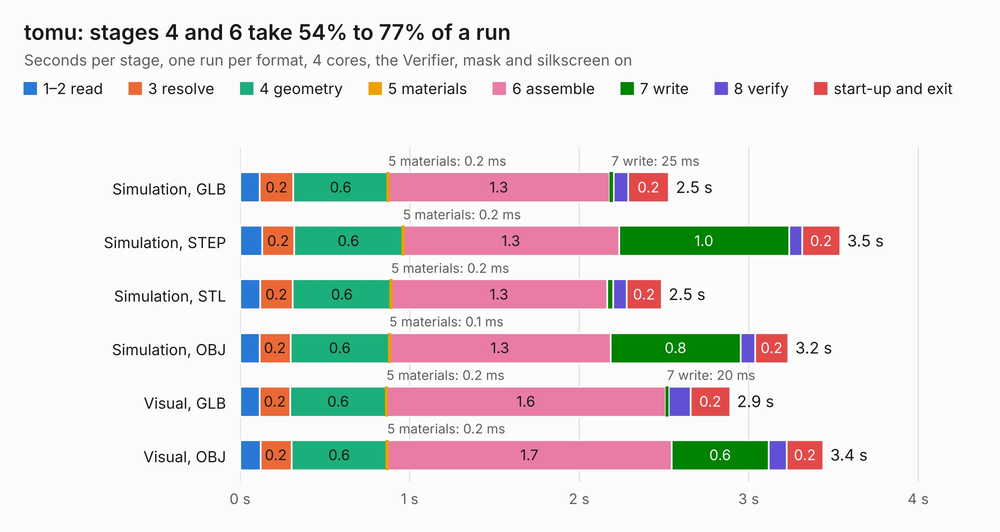

| Mode and format | 1–2 read | 3 resolve | 4 geometry | 5 materials | 6 assemble | 7 write | 8 verify | start-up and exit | Total |
|---|---:|---:|---:|---:|---:|---:|---:|---:|---:|
| Simulation, GLB | 0.1 | 0.2 | 0.6 | 0.2&nbsp;ms | 1.3 | 25&nbsp;ms | 87&nbsp;ms | 0.2 | 2.5 |
| Simulation, STEP | 0.1 | 0.2 | 0.6 | 0.2&nbsp;ms | 1.3 | 1.0 | 77&nbsp;ms | 0.2 | 3.5 |
| Simulation, STL | 0.1 | 0.2 | 0.6 | 0.2&nbsp;ms | 1.3 | 37&nbsp;ms | 79&nbsp;ms | 0.2 | 2.5 |
| Simulation, OBJ | 0.1 | 0.2 | 0.6 | 0.1&nbsp;ms | 1.3 | 0.8 | 84&nbsp;ms | 0.2 | 3.2 |
| Visual, GLB | 0.1 | 0.2 | 0.6 | 0.2&nbsp;ms | 1.6 | 20&nbsp;ms | 0.1 | 0.2 | 2.9 |
| Visual, OBJ | 0.1 | 0.2 | 0.6 | 0.2&nbsp;ms | 1.7 | 0.6 | 0.1 | 0.2 | 3.4 |

<table align="center"><tr><td valign="top">

| Board | Repo: [im-tomu/tomu-hardware](https://github.com/im-tomu/tomu-hardware) Board: `tomu.kicad_pcb` |
|---|---|
| Folder | releases / v0.0 / gerbers |
| Complexity | 211&nbsp;/&nbsp;1000 (size&nbsp;136, features&nbsp;75) |
| KESE&nbsp;features | through vias, slotted holes, rounded, trapezoid or chamfered pads, filled zones, copper text, curved board outline |
| Tested | 9th November 2026 |
| Copper&nbsp;layers | 2 |
| File&nbsp;format | KiCad 4 (4) |
| Parts,&nbsp;tracks,&nbsp;vias | 15, 198, 13 |
| Triangles,&nbsp;simulation | 122,700 in 35 parts |
| Verifier | PASS in all six runs |

</td><td valign="top">

<table>
<tr><th>File type</th><th>File size</th><th>Peak memory used</th></tr>
<tr><th colspan="3" align="left">Simulation</th></tr>
<tr><td>GLB</td><td align="right">4.4&nbsp;MB</td><td align="right">196&nbsp;MB</td></tr>
<tr><td>STEP</td><td align="right">24&nbsp;MB</td><td align="right">205&nbsp;MB</td></tr>
<tr><td>STL</td><td align="right">6.1&nbsp;MB</td><td align="right">195&nbsp;MB</td></tr>
<tr><td>OBJ</td><td align="right">12&nbsp;MB</td><td align="right">195&nbsp;MB</td></tr>
<tr><th colspan="3" align="left">Visual</th></tr>
<tr><td>GLB</td><td align="right">3.5&nbsp;MB</td><td align="right">163&nbsp;MB</td></tr>
<tr><td>OBJ</td><td align="right">9.8&nbsp;MB</td><td align="right">165&nbsp;MB</td></tr>
</table>

</td></tr></table>

## 1222. tomu

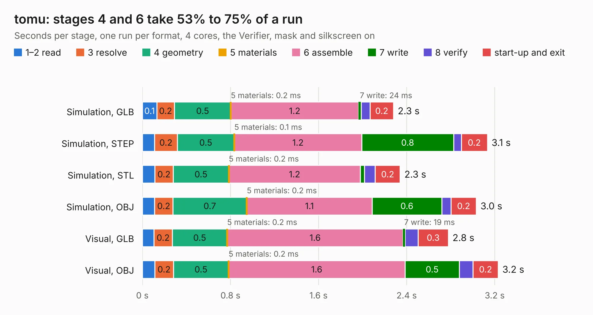

| Mode and format | 1–2 read | 3 resolve | 4 geometry | 5 materials | 6 assemble | 7 write | 8 verify | start-up and exit | Total |
|---|---:|---:|---:|---:|---:|---:|---:|---:|---:|
| Simulation, GLB | 0.1 | 0.2 | 0.5 | 0.2&nbsp;ms | 1.2 | 24&nbsp;ms | 80&nbsp;ms | 0.2 | 2.3 |
| Simulation, STEP | 0.1 | 0.2 | 0.5 | 0.1&nbsp;ms | 1.2 | 0.8 | 70&nbsp;ms | 0.2 | 3.1 |
| Simulation, STL | 0.1 | 0.2 | 0.5 | 0.2&nbsp;ms | 1.2 | 37&nbsp;ms | 98&nbsp;ms | 0.2 | 2.3 |
| Simulation, OBJ | 0.1 | 0.2 | 0.7 | 0.2&nbsp;ms | 1.1 | 0.6 | 85&nbsp;ms | 0.2 | 3.0 |
| Visual, GLB | 0.1 | 0.2 | 0.5 | 0.2&nbsp;ms | 1.6 | 19&nbsp;ms | 0.1 | 0.3 | 2.8 |
| Visual, OBJ | 0.1 | 0.2 | 0.5 | 0.2&nbsp;ms | 1.6 | 0.5 | 0.1 | 0.2 | 3.2 |

<table align="center"><tr><td valign="top">

| Board | Repo: [im-tomu/tomu-hardware](https://github.com/im-tomu/tomu-hardware) Board: `tomu.kicad_pcb` |
|---|---|
| Folder | releases / v0.1 / gerbers |
| Complexity | 211&nbsp;/&nbsp;1000 (size&nbsp;136, features&nbsp;75) |
| KESE&nbsp;features | through vias, slotted holes, rounded, trapezoid or chamfered pads, filled zones, copper text, curved board outline |
| Tested | 9th November 2026 |
| Copper&nbsp;layers | 2 |
| File&nbsp;format | KiCad 4 (4) |
| Parts,&nbsp;tracks,&nbsp;vias | 15, 198, 13 |
| Triangles,&nbsp;simulation | 122,368 in 35 parts |
| Verifier | PASS in all six runs |

</td><td valign="top">

<table>
<tr><th>File type</th><th>File size</th><th>Peak memory used</th></tr>
<tr><th colspan="3" align="left">Simulation</th></tr>
<tr><td>GLB</td><td align="right">4.4&nbsp;MB</td><td align="right">195&nbsp;MB</td></tr>
<tr><td>STEP</td><td align="right">23&nbsp;MB</td><td align="right">214&nbsp;MB</td></tr>
<tr><td>STL</td><td align="right">6.1&nbsp;MB</td><td align="right">195&nbsp;MB</td></tr>
<tr><td>OBJ</td><td align="right">12&nbsp;MB</td><td align="right">195&nbsp;MB</td></tr>
<tr><th colspan="3" align="left">Visual</th></tr>
<tr><td>GLB</td><td align="right">3.5&nbsp;MB</td><td align="right">165&nbsp;MB</td></tr>
<tr><td>OBJ</td><td align="right">9.8&nbsp;MB</td><td align="right">163&nbsp;MB</td></tr>
</table>

</td></tr></table>

## 1223. tomu

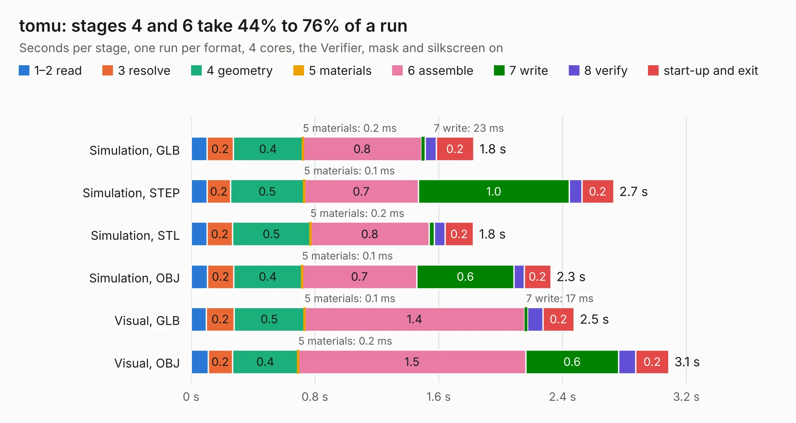

| Mode and format | 1–2 read | 3 resolve | 4 geometry | 5 materials | 6 assemble | 7 write | 8 verify | start-up and exit | Total |
|---|---:|---:|---:|---:|---:|---:|---:|---:|---:|
| Simulation, GLB | 0.1 | 0.2 | 0.4 | 0.2&nbsp;ms | 0.8 | 23&nbsp;ms | 72&nbsp;ms | 0.2 | 1.8 |
| Simulation, STEP | 0.1 | 0.2 | 0.5 | 0.1&nbsp;ms | 0.7 | 1.0 | 81&nbsp;ms | 0.2 | 2.7 |
| Simulation, STL | 0.1 | 0.2 | 0.5 | 0.2&nbsp;ms | 0.8 | 32&nbsp;ms | 70&nbsp;ms | 0.2 | 1.8 |
| Simulation, OBJ | 0.1 | 0.2 | 0.4 | 0.1&nbsp;ms | 0.7 | 0.6 | 66&nbsp;ms | 0.2 | 2.3 |
| Visual, GLB | 99&nbsp;ms | 0.2 | 0.5 | 0.1&nbsp;ms | 1.4 | 17&nbsp;ms | 99&nbsp;ms | 0.2 | 2.5 |
| Visual, OBJ | 0.1 | 0.2 | 0.4 | 0.2&nbsp;ms | 1.5 | 0.6 | 0.1 | 0.2 | 3.1 |

<table align="center"><tr><td valign="top">

| Board | Repo: [im-tomu/tomu-hardware](https://github.com/im-tomu/tomu-hardware) Board: `tomu.kicad_pcb` |
|---|---|
| Folder | releases / v0.2 / gerbers |
| Complexity | 210&nbsp;/&nbsp;1000 (size&nbsp;135, features&nbsp;75) |
| KESE&nbsp;features | through vias, slotted holes, rounded, trapezoid or chamfered pads, filled zones, copper text, curved board outline |
| Tested | 9th November 2026 |
| Copper&nbsp;layers | 2 |
| File&nbsp;format | KiCad 4 (4) |
| Parts,&nbsp;tracks,&nbsp;vias | 15, 176, 13 |
| Triangles,&nbsp;simulation | 121,252 in 34 parts |
| Verifier | PASS in all six runs |

</td><td valign="top">

<table>
<tr><th>File type</th><th>File size</th><th>Peak memory used</th></tr>
<tr><th colspan="3" align="left">Simulation</th></tr>
<tr><td>GLB</td><td align="right">4.3&nbsp;MB</td><td align="right">194&nbsp;MB</td></tr>
<tr><td>STEP</td><td align="right">24&nbsp;MB</td><td align="right">203&nbsp;MB</td></tr>
<tr><td>STL</td><td align="right">6.1&nbsp;MB</td><td align="right">193&nbsp;MB</td></tr>
<tr><td>OBJ</td><td align="right">12&nbsp;MB</td><td align="right">192&nbsp;MB</td></tr>
<tr><th colspan="3" align="left">Visual</th></tr>
<tr><td>GLB</td><td align="right">3.5&nbsp;MB</td><td align="right">162&nbsp;MB</td></tr>
<tr><td>OBJ</td><td align="right">9.7&nbsp;MB</td><td align="right">162&nbsp;MB</td></tr>
</table>

</td></tr></table>

## 1224. tomu

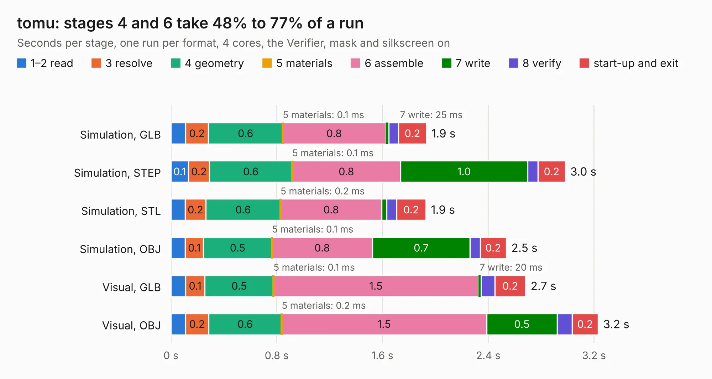

| Mode and format | 1–2 read | 3 resolve | 4 geometry | 5 materials | 6 assemble | 7 write | 8 verify | start-up and exit | Total |
|---|---:|---:|---:|---:|---:|---:|---:|---:|---:|
| Simulation, GLB | 0.1 | 0.2 | 0.6 | 0.1&nbsp;ms | 0.8 | 25&nbsp;ms | 74&nbsp;ms | 0.2 | 1.9 |
| Simulation, STEP | 0.1 | 0.2 | 0.6 | 0.1&nbsp;ms | 0.8 | 1.0 | 78&nbsp;ms | 0.2 | 3.0 |
| Simulation, STL | 0.1 | 0.2 | 0.6 | 0.2&nbsp;ms | 0.8 | 37&nbsp;ms | 74&nbsp;ms | 0.2 | 1.9 |
| Simulation, OBJ | 0.1 | 0.1 | 0.5 | 0.1&nbsp;ms | 0.8 | 0.7 | 77&nbsp;ms | 0.2 | 2.5 |
| Visual, GLB | 0.1 | 0.1 | 0.5 | 0.1&nbsp;ms | 1.5 | 20&nbsp;ms | 0.1 | 0.2 | 2.7 |
| Visual, OBJ | 0.1 | 0.2 | 0.6 | 0.2&nbsp;ms | 1.5 | 0.5 | 0.1 | 0.2 | 3.2 |

<table align="center"><tr><td valign="top">

| Board | Repo: [im-tomu/tomu-hardware](https://github.com/im-tomu/tomu-hardware) Board: `tomu.kicad_pcb` |
|---|---|
| Folder | releases / v0.3 / gerber |
| Complexity | 200&nbsp;/&nbsp;1000 (size&nbsp;135, features&nbsp;65) |
| KESE&nbsp;features | through vias, rounded, trapezoid or chamfered pads, filled zones, copper text, curved board outline |
| Tested | 9th November 2026 |
| Copper&nbsp;layers | 2 |
| File&nbsp;format | KiCad 4 (4) |
| Parts,&nbsp;tracks,&nbsp;vias | 15, 177, 13 |
| Triangles,&nbsp;simulation | 132,304 in 34 parts |
| Verifier | PASS in all six runs |

</td><td valign="top">

<table>
<tr><th>File type</th><th>File size</th><th>Peak memory used</th></tr>
<tr><th colspan="3" align="left">Simulation</th></tr>
<tr><td>GLB</td><td align="right">4.7&nbsp;MB</td><td align="right">198&nbsp;MB</td></tr>
<tr><td>STEP</td><td align="right">26&nbsp;MB</td><td align="right">209&nbsp;MB</td></tr>
<tr><td>STL</td><td align="right">6.6&nbsp;MB</td><td align="right">196&nbsp;MB</td></tr>
<tr><td>OBJ</td><td align="right">13&nbsp;MB</td><td align="right">196&nbsp;MB</td></tr>
<tr><th colspan="3" align="left">Visual</th></tr>
<tr><td>GLB</td><td align="right">3.7&nbsp;MB</td><td align="right">168&nbsp;MB</td></tr>
<tr><td>OBJ</td><td align="right">10&nbsp;MB</td><td align="right">169&nbsp;MB</td></tr>
</table>

</td></tr></table>

## 1225. alu

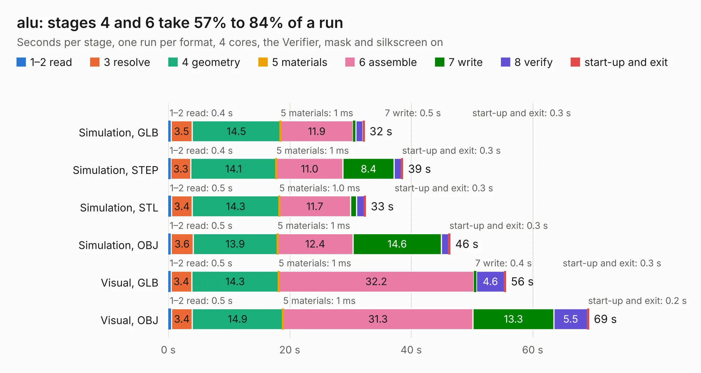

| Mode and format | 1–2 read | 3 resolve | 4 geometry | 5 materials | 6 assemble | 7 write | 8 verify | start-up and exit | Total |
|---|---:|---:|---:|---:|---:|---:|---:|---:|---:|
| Simulation, GLB | 0.4 | 3.5 | 14.5 | 1&nbsp;ms | 11.9 | 0.5 | 1.2 | 0.3 | 32.3 |
| Simulation, STEP | 0.4 | 3.3 | 14.1 | 1&nbsp;ms | 11.0 | 8.4 | 1.2 | 0.3 | 38.7 |
| Simulation, STL | 0.5 | 3.4 | 14.3 | 1.0&nbsp;ms | 11.7 | 1.0 | 1.3 | 0.3 | 32.5 |
| Simulation, OBJ | 0.5 | 3.6 | 13.9 | 1&nbsp;ms | 12.4 | 14.6 | 1.2 | 0.3 | 46.4 |
| Visual, GLB | 0.5 | 3.4 | 14.3 | 1&nbsp;ms | 32.2 | 0.4 | 4.6 | 0.3 | 55.6 |
| Visual, OBJ | 0.5 | 3.4 | 14.9 | 1&nbsp;ms | 31.3 | 13.3 | 5.5 | 0.2 | 69.3 |

<table align="center"><tr><td valign="top">

| Board | Repo: [imihajlow/ccpu](https://github.com/imihajlow/ccpu) Board: `alu.kicad_pcb` |
|---|---|
| Folder | boards / alu |
| Complexity | 262&nbsp;/&nbsp;1000 (size&nbsp;207, features&nbsp;55) |
| KESE&nbsp;features | through vias, rounded, trapezoid or chamfered pads, filled zones, copper text |
| Tested | 9th November 2026 |
| Copper&nbsp;layers | 2 |
| File&nbsp;format | KiCad 5 (20171130) |
| Parts,&nbsp;tracks,&nbsp;vias | 66, 4,386, 780 |
| Triangles,&nbsp;simulation | 3,122,734 in 178 parts |
| Verifier | PASS in all six runs |

</td><td valign="top">

<table>
<tr><th>File type</th><th>File size</th><th>Peak memory used</th></tr>
<tr><th colspan="3" align="left">Simulation</th></tr>
<tr><td>GLB</td><td align="right">108&nbsp;MB</td><td align="right">1.3&nbsp;GB</td></tr>
<tr><td>STEP</td><td align="right">542&nbsp;MB</td><td align="right">1.4&nbsp;GB</td></tr>
<tr><td>STL</td><td align="right">156&nbsp;MB</td><td align="right">1.3&nbsp;GB</td></tr>
<tr><td>OBJ</td><td align="right">332&nbsp;MB</td><td align="right">2.0&nbsp;GB</td></tr>
<tr><th colspan="3" align="left">Visual</th></tr>
<tr><td>GLB</td><td align="right">95&nbsp;MB</td><td align="right">1.7&nbsp;GB</td></tr>
<tr><td>OBJ</td><td align="right">300&nbsp;MB</td><td align="right">1.9&nbsp;GB</td></tr>
</table>

</td></tr></table>

## 1226. control

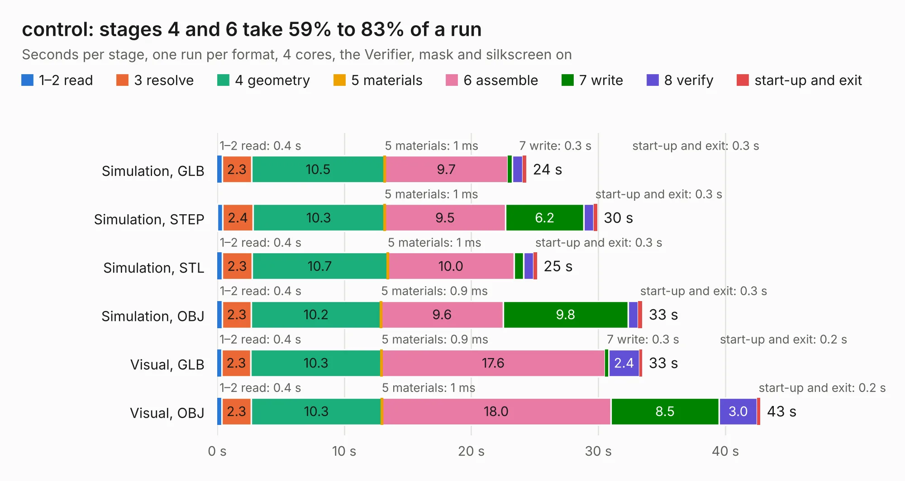

| Mode and format | 1–2 read | 3 resolve | 4 geometry | 5 materials | 6 assemble | 7 write | 8 verify | start-up and exit | Total |
|---|---:|---:|---:|---:|---:|---:|---:|---:|---:|
| Simulation, GLB | 0.4 | 2.3 | 10.5 | 1&nbsp;ms | 9.7 | 0.3 | 0.8 | 0.3 | 24.3 |
| Simulation, STEP | 0.4 | 2.4 | 10.3 | 1&nbsp;ms | 9.5 | 6.2 | 0.8 | 0.3 | 29.9 |
| Simulation, STL | 0.4 | 2.3 | 10.7 | 1&nbsp;ms | 10.0 | 0.7 | 0.8 | 0.3 | 25.2 |
| Simulation, OBJ | 0.4 | 2.3 | 10.2 | 0.9&nbsp;ms | 9.6 | 9.8 | 0.8 | 0.3 | 33.5 |
| Visual, GLB | 0.4 | 2.3 | 10.3 | 0.9&nbsp;ms | 17.6 | 0.3 | 2.4 | 0.2 | 33.5 |
| Visual, OBJ | 0.4 | 2.3 | 10.3 | 1&nbsp;ms | 18.0 | 8.5 | 3.0 | 0.2 | 42.7 |

<table align="center"><tr><td valign="top">

| Board | Repo: [imihajlow/ccpu](https://github.com/imihajlow/ccpu) Board: `control.kicad_pcb` |
|---|---|
| Folder | boards / control |
| Complexity | 250&nbsp;/&nbsp;1000 (size&nbsp;195, features&nbsp;55) |
| KESE&nbsp;features | through vias, rounded, trapezoid or chamfered pads, filled zones, copper text |
| Tested | 9th November 2026 |
| Copper&nbsp;layers | 2 |
| File&nbsp;format | KiCad 5 (20171130) |
| Parts,&nbsp;tracks,&nbsp;vias | 89, 1,430, 408 |
| Triangles,&nbsp;simulation | 1,991,990 in 129 parts |
| Verifier | PASS in all six runs |

</td><td valign="top">

<table>
<tr><th>File type</th><th>File size</th><th>Peak memory used</th></tr>
<tr><th colspan="3" align="left">Simulation</th></tr>
<tr><td>GLB</td><td align="right">69&nbsp;MB</td><td align="right">733&nbsp;MB</td></tr>
<tr><td>STEP</td><td align="right">343&nbsp;MB</td><td align="right">942&nbsp;MB</td></tr>
<tr><td>STL</td><td align="right">100&nbsp;MB</td><td align="right">747&nbsp;MB</td></tr>
<tr><td>OBJ</td><td align="right">209&nbsp;MB</td><td align="right">1.3&nbsp;GB</td></tr>
<tr><th colspan="3" align="left">Visual</th></tr>
<tr><td>GLB</td><td align="right">57&nbsp;MB</td><td align="right">1.1&nbsp;GB</td></tr>
<tr><td>OBJ</td><td align="right">176&nbsp;MB</td><td align="right">1.2&nbsp;GB</td></tr>
</table>

</td></tr></table>

## 1227. eth

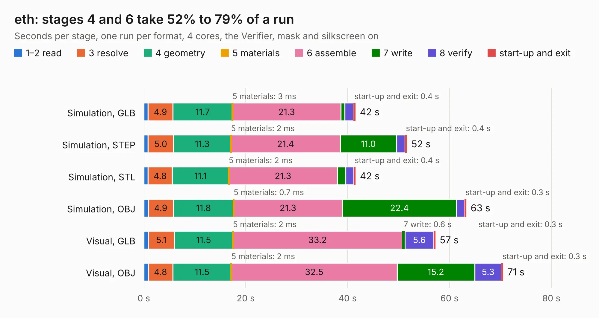

| Mode and format | 1–2 read | 3 resolve | 4 geometry | 5 materials | 6 assemble | 7 write | 8 verify | start-up and exit | Total |
|---|---:|---:|---:|---:|---:|---:|---:|---:|---:|
| Simulation, GLB | 0.8 | 4.9 | 11.7 | 3&nbsp;ms | 21.3 | 0.7 | 1.7 | 0.4 | 41.6 |
| Simulation, STEP | 0.8 | 5.0 | 11.3 | 2&nbsp;ms | 21.4 | 11.0 | 1.6 | 0.4 | 51.7 |
| Simulation, STL | 0.8 | 4.8 | 11.1 | 2&nbsp;ms | 21.3 | 1.7 | 1.6 | 0.4 | 41.6 |
| Simulation, OBJ | 0.9 | 4.9 | 11.8 | 0.7&nbsp;ms | 21.3 | 22.4 | 1.6 | 0.3 | 63.3 |
| Visual, GLB | 0.9 | 5.1 | 11.5 | 2&nbsp;ms | 33.2 | 0.6 | 5.6 | 0.3 | 57.2 |
| Visual, OBJ | 0.9 | 4.8 | 11.5 | 2&nbsp;ms | 32.5 | 15.2 | 5.3 | 0.3 | 70.5 |

<table align="center"><tr><td valign="top">

| Board | Repo: [imihajlow/ccpu](https://github.com/imihajlow/ccpu) Board: `eth.kicad_pcb` |
|---|---|
| Folder | boards / eth |
| Complexity | 323&nbsp;/&nbsp;1000 (size&nbsp;223, features&nbsp;100) |
| KESE&nbsp;features | through vias, rounded, trapezoid or chamfered pads, filled zones, copper text, stack-up, dielectric εr and tanδ, copper finish |
| Tested | 9th November 2026 |
| Copper&nbsp;layers | 4 |
| File&nbsp;format | KiCad 7 (20221018) |
| Parts,&nbsp;tracks,&nbsp;vias | 92, 2,811, 853 |
| Triangles,&nbsp;simulation | 4,559,284 in 229 parts |
| Verifier | PASS in all six runs |

</td><td valign="top">

<table>
<tr><th>File type</th><th>File size</th><th>Peak memory used</th></tr>
<tr><th colspan="3" align="left">Simulation</th></tr>
<tr><td>GLB</td><td align="right">151&nbsp;MB</td><td align="right">1.4&nbsp;GB</td></tr>
<tr><td>STEP</td><td align="right">514&nbsp;MB</td><td align="right">1.7&nbsp;GB</td></tr>
<tr><td>STL</td><td align="right">228&nbsp;MB</td><td align="right">1.4&nbsp;GB</td></tr>
<tr><td>OBJ</td><td align="right">494&nbsp;MB</td><td align="right">2.9&nbsp;GB</td></tr>
<tr><th colspan="3" align="left">Visual</th></tr>
<tr><td>GLB</td><td align="right">98&nbsp;MB</td><td align="right">1.6&nbsp;GB</td></tr>
<tr><td>OBJ</td><td align="right">323&nbsp;MB</td><td align="right">2.1&nbsp;GB</td></tr>
</table>

</td></tr></table>

## 1228. io

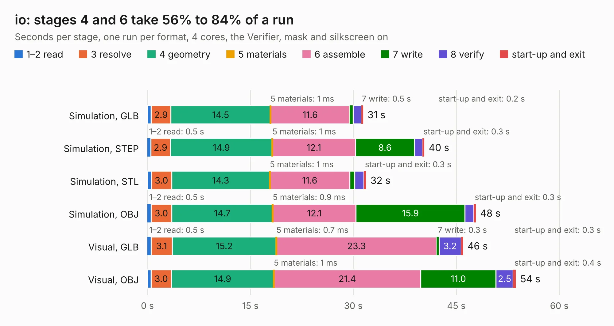

| Mode and format | 1–2 read | 3 resolve | 4 geometry | 5 materials | 6 assemble | 7 write | 8 verify | start-up and exit | Total |
|---|---:|---:|---:|---:|---:|---:|---:|---:|---:|
| Simulation, GLB | 0.6 | 2.9 | 14.5 | 1&nbsp;ms | 11.6 | 0.5 | 1.2 | 0.2 | 31.4 |
| Simulation, STEP | 0.5 | 2.9 | 14.9 | 1&nbsp;ms | 12.1 | 8.6 | 1.2 | 0.3 | 40.3 |
| Simulation, STL | 0.6 | 3.0 | 14.3 | 1&nbsp;ms | 11.6 | 0.7 | 1.3 | 0.3 | 31.9 |
| Simulation, OBJ | 0.5 | 3.0 | 14.7 | 0.9&nbsp;ms | 12.1 | 15.9 | 1.3 | 0.3 | 47.8 |
| Visual, GLB | 0.5 | 3.1 | 15.2 | 0.7&nbsp;ms | 23.3 | 0.3 | 3.2 | 0.3 | 46.0 |
| Visual, OBJ | 0.5 | 3.0 | 14.9 | 1&nbsp;ms | 21.4 | 11.0 | 2.5 | 0.4 | 53.7 |

<table align="center"><tr><td valign="top">

| Board | Repo: [imihajlow/ccpu](https://github.com/imihajlow/ccpu) Board: `io.kicad_pcb` |
|---|---|
| Folder | boards / io |
| Complexity | 306&nbsp;/&nbsp;1000 (size&nbsp;241, features&nbsp;65) |
| KESE&nbsp;features | through vias, slotted holes, rounded, trapezoid or chamfered pads, filled zones, copper text |
| Tested | 9th November 2026 |
| Copper&nbsp;layers | 2 |
| File&nbsp;format | KiCad 5 (20171130) |
| Parts,&nbsp;tracks,&nbsp;vias | 119, 1,990, 399 |
| Triangles,&nbsp;simulation | 2,577,618 in 121 parts |
| Verifier | PASS in all six runs |

</td><td valign="top">

<table>
<tr><th>File type</th><th>File size</th><th>Peak memory used</th></tr>
<tr><th colspan="3" align="left">Simulation</th></tr>
<tr><td>GLB</td><td align="right">89&nbsp;MB</td><td align="right">879&nbsp;MB</td></tr>
<tr><td>STEP</td><td align="right">447&nbsp;MB</td><td align="right">1.2&nbsp;GB</td></tr>
<tr><td>STL</td><td align="right">129&nbsp;MB</td><td align="right">832&nbsp;MB</td></tr>
<tr><td>OBJ</td><td align="right">272&nbsp;MB</td><td align="right">1.7&nbsp;GB</td></tr>
<tr><th colspan="3" align="left">Visual</th></tr>
<tr><td>GLB</td><td align="right">67&nbsp;MB</td><td align="right">1.2&nbsp;GB</td></tr>
<tr><td>OBJ</td><td align="right">208&nbsp;MB</td><td align="right">1.4&nbsp;GB</td></tr>
</table>

</td></tr></table>

## 1229. registers

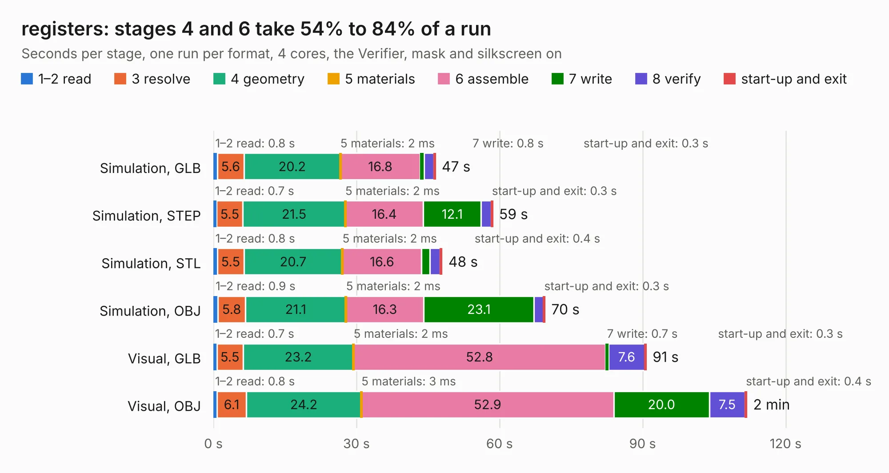

| Mode and format | 1–2 read | 3 resolve | 4 geometry | 5 materials | 6 assemble | 7 write | 8 verify | start-up and exit | Total |
|---|---:|---:|---:|---:|---:|---:|---:|---:|---:|
| Simulation, GLB | 0.8 | 5.6 | 20.2 | 2&nbsp;ms | 16.8 | 0.8 | 2.1 | 0.3 | 46.5 |
| Simulation, STEP | 0.7 | 5.5 | 21.5 | 2&nbsp;ms | 16.4 | 12.1 | 2.1 | 0.3 | 58.6 |
| Simulation, STL | 0.8 | 5.5 | 20.7 | 2&nbsp;ms | 16.6 | 1.7 | 2.2 | 0.4 | 47.9 |
| Simulation, OBJ | 0.9 | 5.8 | 21.1 | 2&nbsp;ms | 16.3 | 23.1 | 2.0 | 0.3 | 69.5 |
| Visual, GLB | 0.7 | 5.5 | 23.2 | 2&nbsp;ms | 52.8 | 0.7 | 7.6 | 0.3 | 90.8 |
| Visual, OBJ | 0.8 | 6.1 | 24.2 | 3&nbsp;ms | 52.9 | 20.0 | 7.5 | 0.4 | 111.8 |

<table align="center"><tr><td valign="top">

| Board | Repo: [imihajlow/ccpu](https://github.com/imihajlow/ccpu) Board: `registers.kicad_pcb` |
|---|---|
| Folder | boards / registers |
| Complexity | 278&nbsp;/&nbsp;1000 (size&nbsp;223, features&nbsp;55) |
| KESE&nbsp;features | through vias, rounded, trapezoid or chamfered pads, filled zones, copper text |
| Tested | 9th November 2026 |
| Copper&nbsp;layers | 2 |
| File&nbsp;format | KiCad 5 (20171130) |
| Parts,&nbsp;tracks,&nbsp;vias | 213, 5,186, 1,072 |
| Triangles,&nbsp;simulation | 4,822,450 in 238 parts |
| Verifier | PASS in all six runs |

</td><td valign="top">

<table>
<tr><th>File type</th><th>File size</th><th>Peak memory used</th></tr>
<tr><th colspan="3" align="left">Simulation</th></tr>
<tr><td>GLB</td><td align="right">166&nbsp;MB</td><td align="right">1.7&nbsp;GB</td></tr>
<tr><td>STEP</td><td align="right">859&nbsp;MB</td><td align="right">2.0&nbsp;GB</td></tr>
<tr><td>STL</td><td align="right">241&nbsp;MB</td><td align="right">2.0&nbsp;GB</td></tr>
<tr><td>OBJ</td><td align="right">517&nbsp;MB</td><td align="right">3.1&nbsp;GB</td></tr>
<tr><th colspan="3" align="left">Visual</th></tr>
<tr><td>GLB</td><td align="right">135&nbsp;MB</td><td align="right">2.2&nbsp;GB</td></tr>
<tr><td>OBJ</td><td align="right">434&nbsp;MB</td><td align="right">2.9&nbsp;GB</td></tr>
</table>

</td></tr></table>

## 1230. stack

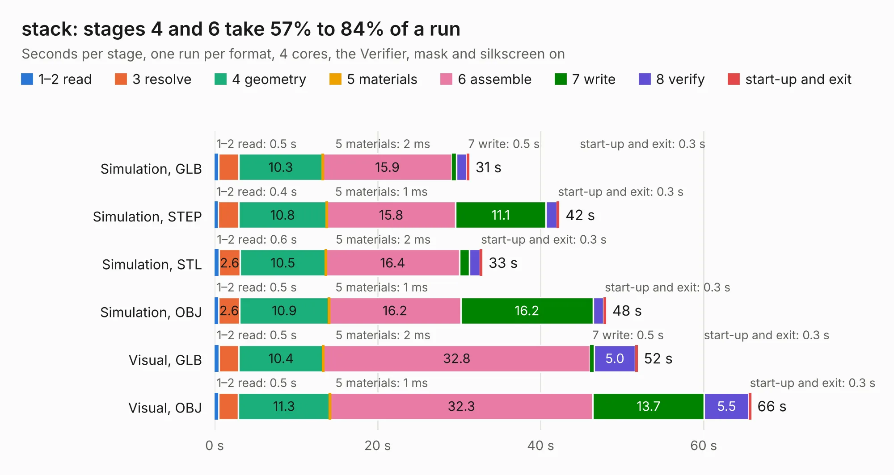

| Mode and format | 1–2 read | 3 resolve | 4 geometry | 5 materials | 6 assemble | 7 write | 8 verify | start-up and exit | Total |
|---|---:|---:|---:|---:|---:|---:|---:|---:|---:|
| Simulation, GLB | 0.5 | 2.5 | 10.3 | 2&nbsp;ms | 15.9 | 0.5 | 1.2 | 0.3 | 31.2 |
| Simulation, STEP | 0.4 | 2.5 | 10.8 | 1&nbsp;ms | 15.8 | 11.1 | 1.4 | 0.3 | 42.3 |
| Simulation, STL | 0.6 | 2.6 | 10.5 | 2&nbsp;ms | 16.4 | 1.2 | 1.3 | 0.3 | 32.8 |
| Simulation, OBJ | 0.5 | 2.6 | 10.9 | 1&nbsp;ms | 16.2 | 16.2 | 1.3 | 0.3 | 48.0 |
| Visual, GLB | 0.5 | 2.4 | 10.4 | 2&nbsp;ms | 32.8 | 0.5 | 5.0 | 0.3 | 51.9 |
| Visual, OBJ | 0.5 | 2.4 | 11.3 | 1&nbsp;ms | 32.3 | 13.7 | 5.5 | 0.3 | 65.8 |

<table align="center"><tr><td valign="top">

| Board | Repo: [imihajlow/ccpu](https://github.com/imihajlow/ccpu) Board: `stack.kicad_pcb` |
|---|---|
| Folder | boards / stack |
| Complexity | 293&nbsp;/&nbsp;1000 (size&nbsp;238, features&nbsp;55) |
| KESE&nbsp;features | through vias, rounded, trapezoid or chamfered pads, filled zones, copper text |
| Tested | 9th November 2026 |
| Copper&nbsp;layers | 2 |
| File&nbsp;format | KiCad 5 (20171130) |
| Parts,&nbsp;tracks,&nbsp;vias | 75, 2,008, 574 |
| Triangles,&nbsp;simulation | 3,306,378 in 155 parts |
| Verifier | PASS in all six runs |

</td><td valign="top">

<table>
<tr><th>File type</th><th>File size</th><th>Peak memory used</th></tr>
<tr><th colspan="3" align="left">Simulation</th></tr>
<tr><td>GLB</td><td align="right">110&nbsp;MB</td><td align="right">1.2&nbsp;GB</td></tr>
<tr><td>STEP</td><td align="right">477&nbsp;MB</td><td align="right">1.4&nbsp;GB</td></tr>
<tr><td>STL</td><td align="right">165&nbsp;MB</td><td align="right">1.2&nbsp;GB</td></tr>
<tr><td>OBJ</td><td align="right">343&nbsp;MB</td><td align="right">2.1&nbsp;GB</td></tr>
<tr><th colspan="3" align="left">Visual</th></tr>
<tr><td>GLB</td><td align="right">94&nbsp;MB</td><td align="right">1.5&nbsp;GB</td></tr>
<tr><td>OBJ</td><td align="right">297&nbsp;MB</td><td align="right">1.9&nbsp;GB</td></tr>
</table>

</td></tr></table>

## 1231. vario

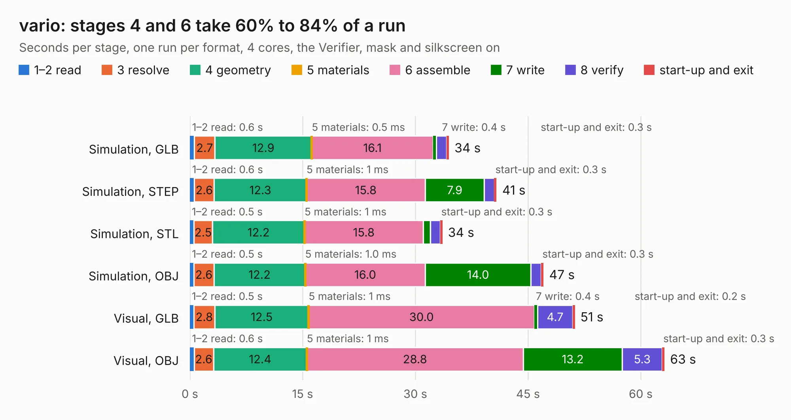

| Mode and format | 1–2 read | 3 resolve | 4 geometry | 5 materials | 6 assemble | 7 write | 8 verify | start-up and exit | Total |
|---|---:|---:|---:|---:|---:|---:|---:|---:|---:|
| Simulation, GLB | 0.6 | 2.7 | 12.9 | 0.5&nbsp;ms | 16.1 | 0.4 | 1.4 | 0.3 | 34.5 |
| Simulation, STEP | 0.6 | 2.6 | 12.3 | 1&nbsp;ms | 15.8 | 7.9 | 1.3 | 0.3 | 40.8 |
| Simulation, STL | 0.5 | 2.5 | 12.2 | 1&nbsp;ms | 15.8 | 1.0 | 1.3 | 0.3 | 33.6 |
| Simulation, OBJ | 0.5 | 2.6 | 12.2 | 1.0&nbsp;ms | 16.0 | 14.0 | 1.4 | 0.3 | 47.1 |
| Visual, GLB | 0.5 | 2.8 | 12.5 | 1&nbsp;ms | 30.0 | 0.4 | 4.7 | 0.2 | 51.2 |
| Visual, OBJ | 0.6 | 2.6 | 12.4 | 1&nbsp;ms | 28.8 | 13.2 | 5.3 | 0.3 | 63.2 |

<table align="center"><tr><td valign="top">

| Board | Repo: [imihajlow/ccpu](https://github.com/imihajlow/ccpu) Board: `vario.kicad_pcb` |
|---|---|
| Folder | boards / vario |
| Complexity | 263&nbsp;/&nbsp;1000 (size&nbsp;208, features&nbsp;55) |
| KESE&nbsp;features | through vias, rounded, trapezoid or chamfered pads, filled zones, copper text |
| Tested | 9th November 2026 |
| Copper&nbsp;layers | 2 |
| File&nbsp;format | KiCad 5 (20171130) |
| Parts,&nbsp;tracks,&nbsp;vias | 117, 2,905, 737 |
| Triangles,&nbsp;simulation | 3,018,872 in 181 parts |
| Verifier | PASS in all six runs |

</td><td valign="top">

<table>
<tr><th>File type</th><th>File size</th><th>Peak memory used</th></tr>
<tr><th colspan="3" align="left">Simulation</th></tr>
<tr><td>GLB</td><td align="right">105&nbsp;MB</td><td align="right">1.1&nbsp;GB</td></tr>
<tr><td>STEP</td><td align="right">485&nbsp;MB</td><td align="right">1.4&nbsp;GB</td></tr>
<tr><td>STL</td><td align="right">151&nbsp;MB</td><td align="right">1.1&nbsp;GB</td></tr>
<tr><td>OBJ</td><td align="right">322&nbsp;MB</td><td align="right">2.0&nbsp;GB</td></tr>
<tr><th colspan="3" align="left">Visual</th></tr>
<tr><td>GLB</td><td align="right">93&nbsp;MB</td><td align="right">1.5&nbsp;GB</td></tr>
<tr><td>OBJ</td><td align="right">296&nbsp;MB</td><td align="right">1.9&nbsp;GB</td></tr>
</table>

</td></tr></table>

## 1232. vga

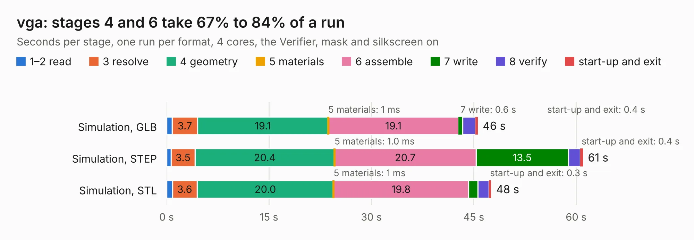

| Mode and format | 1–2 read | 3 resolve | 4 geometry | 5 materials | 6 assemble | 7 write | 8 verify | start-up and exit | Total |
|---|---:|---:|---:|---:|---:|---:|---:|---:|---:|
| Simulation, GLB | 0.8 | 3.7 | 19.1 | 1&nbsp;ms | 19.1 | 0.6 | 1.9 | 0.4 | 45.6 |
| Simulation, STEP | 0.6 | 3.5 | 20.4 | 1.0&nbsp;ms | 20.7 | 13.5 | 1.8 | 0.4 | 61.0 |
| Simulation, STL | 0.8 | 3.6 | 20.0 | 1&nbsp;ms | 19.8 | 1.4 | 1.6 | 0.3 | 47.5 |
| Simulation, OBJ | 0.7 | 3.4 | 19.6 | 0.6&nbsp;ms | 19.7 | 22.3 | 1.6 | 0.3 | 67.7 |
| Visual, GLB | 0.6 | 3.4 | 19.6 | 3&nbsp;ms | 39.9 | 0.5 | 4.7 | 0.4 | 69.0 |
| Visual, OBJ | 0.7 | 3.3 | 21.7 | 1&nbsp;ms | 39.0 | 16.9 | 4.6 | 0.3 | 86.5 |

<table align="center"><tr><td valign="top">

| Board | Repo: [imihajlow/ccpu](https://github.com/imihajlow/ccpu) Board: `vga.kicad_pcb` |
|---|---|
| Folder | boards / vga |
| Complexity | 300&nbsp;/&nbsp;1000 (size&nbsp;245, features&nbsp;55) |
| KESE&nbsp;features | through vias, rounded, trapezoid or chamfered pads, filled zones, copper text |
| Tested | 9th November 2026 |
| Copper&nbsp;layers | 2 |
| File&nbsp;format | KiCad 5 (20171130) |
| Parts,&nbsp;tracks,&nbsp;vias | 80, 3,075, 715 |
| Triangles,&nbsp;simulation | 3,380,028 in 171 parts |
| Verifier | PASS in all six runs |

</td><td valign="top">

<table>
<tr><th>File type</th><th>File size</th><th>Peak memory used</th></tr>
<tr><th colspan="3" align="left">Simulation</th></tr>
<tr><td>GLB</td><td align="right">116&nbsp;MB</td><td align="right">1.2&nbsp;GB</td></tr>
<tr><td>STEP</td><td align="right">593&nbsp;MB</td><td align="right">1.5&nbsp;GB</td></tr>
<tr><td>STL</td><td align="right">169&nbsp;MB</td><td align="right">1.1&nbsp;GB</td></tr>
<tr><td>OBJ</td><td align="right">358&nbsp;MB</td><td align="right">2.2&nbsp;GB</td></tr>
<tr><th colspan="3" align="left">Visual</th></tr>
<tr><td>GLB</td><td align="right">95&nbsp;MB</td><td align="right">1.6&nbsp;GB</td></tr>
<tr><td>OBJ</td><td align="right">302&nbsp;MB</td><td align="right">2.0&nbsp;GB</td></tr>
</table>

</td></tr></table>

## 1233. 4in1-panel

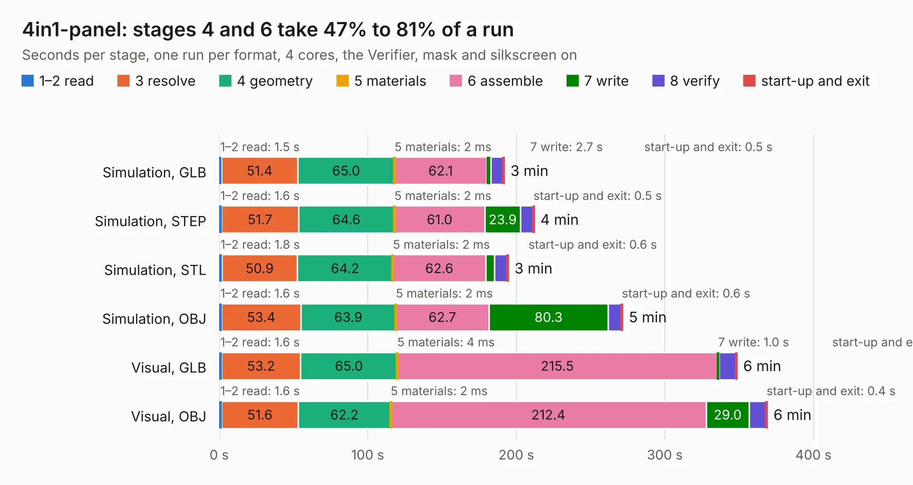

| Mode and format | 1–2 read | 3 resolve | 4 geometry | 5 materials | 6 assemble | 7 write | 8 verify | start-up and exit | Total |
|---|---:|---:|---:|---:|---:|---:|---:|---:|---:|
| Simulation, GLB | 1.5 | 51.4 | 65.0 | 2&nbsp;ms | 62.1 | 2.7 | 8.3 | 0.5 | 191.7 |
| Simulation, STEP | 1.6 | 51.7 | 64.6 | 2&nbsp;ms | 61.0 | 23.9 | 8.6 | 0.5 | 211.8 |
| Simulation, STL | 1.8 | 50.9 | 64.2 | 2&nbsp;ms | 62.6 | 5.8 | 8.6 | 0.6 | 194.4 |
| Simulation, OBJ | 1.6 | 53.4 | 63.9 | 2&nbsp;ms | 62.7 | 80.3 | 8.9 | 0.6 | 271.3 |
| Visual, GLB | 1.6 | 53.2 | 65.0 | 4&nbsp;ms | 215.5 | 1.0 | 11.5 | 0.4 | 348.3 |
| Visual, OBJ | 1.6 | 51.6 | 62.2 | 2&nbsp;ms | 212.4 | 29.0 | 11.5 | 0.4 | 368.7 |

<table align="center"><tr><td valign="top">

| Board | Repo: [incutec-hw/openesc-30x30](https://github.com/incutec-hw/openesc-30x30) Board: `4in1-panel.kicad_pcb` |
|---|---|
| Folder | hardware |
| Complexity | 464&nbsp;/&nbsp;1000 (size&nbsp;259, features&nbsp;205) |
| KESE&nbsp;features | through vias, padstacks, custom pads, rounded, trapezoid or chamfered pads, drill offsets, filled zones, copper drawings, curved board outline, TrueType text, stack-up, dielectric εr and tanδ, copper finish, plated board edge |
| Tested | 9th November 2026 |
| Copper&nbsp;layers | 6 |
| File&nbsp;format | KiCad 10 (20260206) |
| Parts,&nbsp;tracks,&nbsp;vias | 388, 2,655, 2,604 |
| Triangles,&nbsp;simulation | 13,067,554 in 279 parts |
| Note | panel |
| Verifier | PASS in all six runs |

</td><td valign="top">

<table>
<tr><th>File type</th><th>File size</th><th>Peak memory used</th></tr>
<tr><th colspan="3" align="left">Simulation</th></tr>
<tr><td>GLB</td><td align="right">427&nbsp;MB</td><td align="right">2.9&nbsp;GB</td></tr>
<tr><td>STEP</td><td align="right">1.4&nbsp;GB</td><td align="right">3.8&nbsp;GB</td></tr>
<tr><td>STL</td><td align="right">653&nbsp;MB</td><td align="right">2.8&nbsp;GB</td></tr>
<tr><td>OBJ</td><td align="right">1.4&nbsp;GB</td><td align="right">8.0&nbsp;GB</td></tr>
<tr><th colspan="3" align="left">Visual</th></tr>
<tr><td>GLB</td><td align="right">196&nbsp;MB</td><td align="right">3.4&nbsp;GB</td></tr>
<tr><td>OBJ</td><td align="right">636&nbsp;MB</td><td align="right">4.2&nbsp;GB</td></tr>
</table>

</td></tr></table>

## 1234. 4in1

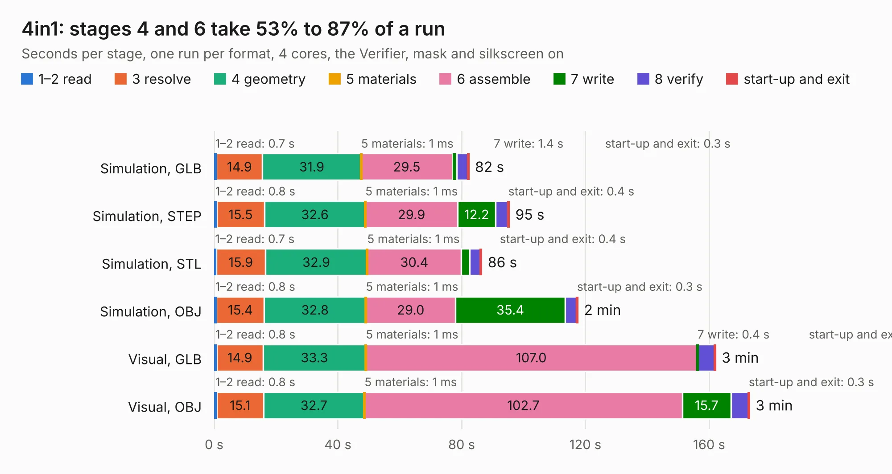

| Mode and format | 1–2 read | 3 resolve | 4 geometry | 5 materials | 6 assemble | 7 write | 8 verify | start-up and exit | Total |
|---|---:|---:|---:|---:|---:|---:|---:|---:|---:|
| Simulation, GLB | 0.7 | 14.9 | 31.9 | 1&nbsp;ms | 29.5 | 1.4 | 3.5 | 0.3 | 82.3 |
| Simulation, STEP | 0.8 | 15.5 | 32.6 | 1&nbsp;ms | 29.9 | 12.2 | 3.9 | 0.4 | 95.3 |
| Simulation, STL | 0.7 | 15.9 | 32.9 | 1&nbsp;ms | 30.4 | 2.7 | 3.4 | 0.4 | 86.4 |
| Simulation, OBJ | 0.8 | 15.4 | 32.8 | 1&nbsp;ms | 29.0 | 35.4 | 3.8 | 0.3 | 117.5 |
| Visual, GLB | 0.8 | 14.9 | 33.3 | 1&nbsp;ms | 107.0 | 0.4 | 5.2 | 0.3 | 162.0 |
| Visual, OBJ | 0.8 | 15.1 | 32.7 | 1&nbsp;ms | 102.7 | 15.7 | 5.6 | 0.3 | 173.0 |

<table align="center"><tr><td valign="top">

| Board | Repo: [incutec-hw/openesc-30x30](https://github.com/incutec-hw/openesc-30x30) Board: `4in1.kicad_pcb` |
|---|---|
| Folder | hardware |
| Complexity | 415&nbsp;/&nbsp;1000 (size&nbsp;245, features&nbsp;170) |
| KESE&nbsp;features | through vias, padstacks, rounded, trapezoid or chamfered pads, drill offsets, filled zones, TrueType text, stack-up, dielectric εr and tanδ, copper finish, plated board edge |
| Tested | 9th November 2026 |
| Copper&nbsp;layers | 6 |
| File&nbsp;format | KiCad 10 (20260206) |
| Parts,&nbsp;tracks,&nbsp;vias | 214, 1,220, 1,702 |
| Triangles,&nbsp;simulation | 7,517,890 in 211 parts |
| Verifier | PASS in all six runs |

</td><td valign="top">

<table>
<tr><th>File type</th><th>File size</th><th>Peak memory used</th></tr>
<tr><th colspan="3" align="left">Simulation</th></tr>
<tr><td>GLB</td><td align="right">243&nbsp;MB</td><td align="right">1.6&nbsp;GB</td></tr>
<tr><td>STEP</td><td align="right">760&nbsp;MB</td><td align="right">2.2&nbsp;GB</td></tr>
<tr><td>STL</td><td align="right">376&nbsp;MB</td><td align="right">1.6&nbsp;GB</td></tr>
<tr><td>OBJ</td><td align="right">786&nbsp;MB</td><td align="right">4.6&nbsp;GB</td></tr>
<tr><th colspan="3" align="left">Visual</th></tr>
<tr><td>GLB</td><td align="right">113&nbsp;MB</td><td align="right">2.3&nbsp;GB</td></tr>
<tr><td>OBJ</td><td align="right">366&nbsp;MB</td><td align="right">2.4&nbsp;GB</td></tr>
</table>

</td></tr></table>

## 1235. H745 CM4 module

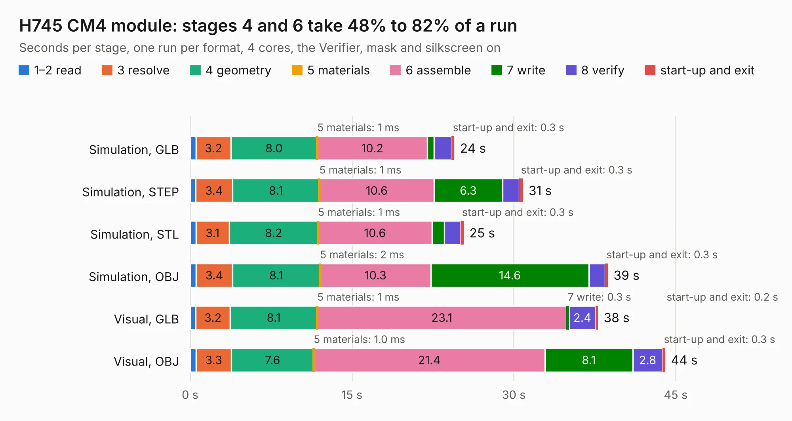

| Mode and format | 1–2 read | 3 resolve | 4 geometry | 5 materials | 6 assemble | 7 write | 8 verify | start-up and exit | Total |
|---|---:|---:|---:|---:|---:|---:|---:|---:|---:|
| Simulation, GLB | 0.6 | 3.2 | 8.0 | 1&nbsp;ms | 10.2 | 0.6 | 1.6 | 0.3 | 24.5 |
| Simulation, STEP | 0.5 | 3.4 | 8.1 | 1&nbsp;ms | 10.6 | 6.3 | 1.6 | 0.3 | 30.8 |
| Simulation, STL | 0.5 | 3.1 | 8.2 | 1&nbsp;ms | 10.6 | 1.2 | 1.5 | 0.3 | 25.4 |
| Simulation, OBJ | 0.6 | 3.4 | 8.1 | 2&nbsp;ms | 10.3 | 14.6 | 1.5 | 0.3 | 38.7 |
| Visual, GLB | 0.5 | 3.2 | 8.1 | 1&nbsp;ms | 23.1 | 0.3 | 2.4 | 0.2 | 37.8 |
| Visual, OBJ | 0.5 | 3.3 | 7.6 | 1.0&nbsp;ms | 21.4 | 8.1 | 2.8 | 0.3 | 44.0 |

<table align="center"><tr><td valign="top">

| Board | Repo: [intergalaktik/bb3-cm4](https://github.com/intergalaktik/bb3-cm4) Board: `H745 CM4 module.kicad_pcb` |
|---|---|
| Folder | EEZ_BB3_CM4_H7 |
| Complexity | 356&nbsp;/&nbsp;1000 (size&nbsp;271, features&nbsp;85) |
| KESE&nbsp;features | through vias, rounded, trapezoid or chamfered pads, filled zones, curved board outline, stack-up, dielectric εr and tanδ |
| Tested | 9th November 2026 |
| Copper&nbsp;layers | 6 |
| File&nbsp;format | KiCad 7 (20221018) |
| Parts,&nbsp;tracks,&nbsp;vias | 110, 2,859, 483 |
| Triangles,&nbsp;simulation | 3,491,940 in 292 parts |
| Verifier | PASS in all six runs |

</td><td valign="top">

<table>
<tr><th>File type</th><th>File size</th><th>Peak memory used</th></tr>
<tr><th colspan="3" align="left">Simulation</th></tr>
<tr><td>GLB</td><td align="right">119&nbsp;MB</td><td align="right">1.1&nbsp;GB</td></tr>
<tr><td>STEP</td><td align="right">439&nbsp;MB</td><td align="right">1.3&nbsp;GB</td></tr>
<tr><td>STL</td><td align="right">175&nbsp;MB</td><td align="right">1.0&nbsp;GB</td></tr>
<tr><td>OBJ</td><td align="right">375&nbsp;MB</td><td align="right">2.3&nbsp;GB</td></tr>
<tr><th colspan="3" align="left">Visual</th></tr>
<tr><td>GLB</td><td align="right">65&nbsp;MB</td><td align="right">1.2&nbsp;GB</td></tr>
<tr><td>OBJ</td><td align="right">213&nbsp;MB</td><td align="right">1.5&nbsp;GB</td></tr>
</table>

</td></tr></table>

## 1236. EEZ_BB3_CM4_R1B0

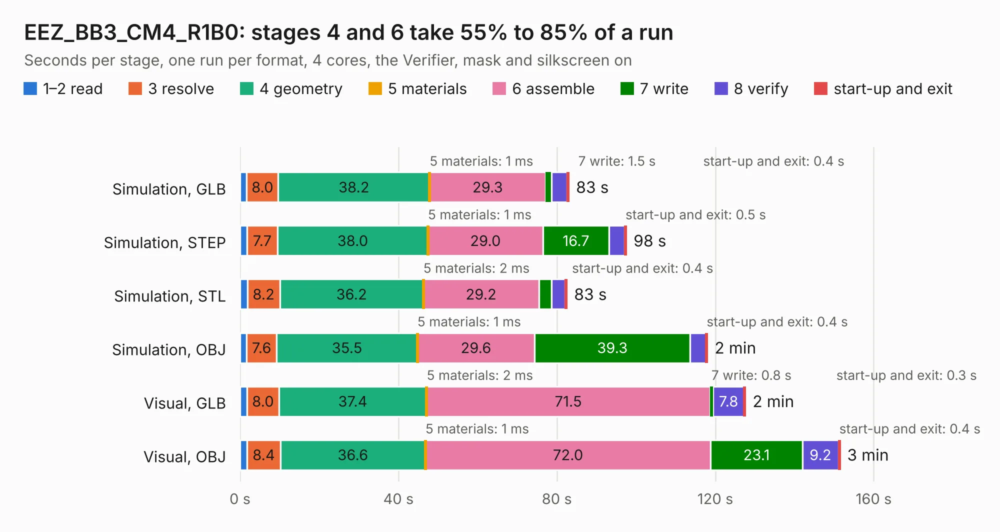

| Mode and format | 1–2 read | 3 resolve | 4 geometry | 5 materials | 6 assemble | 7 write | 8 verify | start-up and exit | Total |
|---|---:|---:|---:|---:|---:|---:|---:|---:|---:|
| Simulation, GLB | 1.7 | 8.0 | 38.2 | 1&nbsp;ms | 29.3 | 1.5 | 4.0 | 0.4 | 83.0 |
| Simulation, STEP | 1.7 | 7.7 | 38.0 | 1&nbsp;ms | 29.0 | 16.7 | 3.9 | 0.5 | 97.5 |
| Simulation, STL | 1.8 | 8.2 | 36.2 | 2&nbsp;ms | 29.2 | 3.2 | 3.4 | 0.4 | 82.5 |
| Simulation, OBJ | 1.6 | 7.6 | 35.5 | 1&nbsp;ms | 29.6 | 39.3 | 3.9 | 0.4 | 118.0 |
| Visual, GLB | 1.8 | 8.0 | 37.4 | 2&nbsp;ms | 71.5 | 0.8 | 7.8 | 0.3 | 127.6 |
| Visual, OBJ | 1.8 | 8.4 | 36.6 | 1&nbsp;ms | 72.0 | 23.1 | 9.2 | 0.4 | 151.5 |

<table align="center"><tr><td valign="top">

| Board | Repo: [intergalaktik/bb3-cm4](https://github.com/intergalaktik/bb3-cm4) Board: `EEZ_BB3_CM4_R1B0.kicad_pcb` |
|---|---|
| Folder | EEZ_BB3_CM4_R1B0 |
| Complexity | 376&nbsp;/&nbsp;1000 (size&nbsp;281, features&nbsp;95) |
| KESE&nbsp;features | through vias, rounded, trapezoid or chamfered pads, filled zones, copper text, curved board outline, stack-up, dielectric εr and tanδ |
| Tested | 9th November 2026 |
| Copper&nbsp;layers | 4 |
| File&nbsp;format | KiCad 6 (20211014) |
| Parts,&nbsp;tracks,&nbsp;vias | 239, 5,730, 914 |
| Triangles,&nbsp;simulation | 7,322,202 in 347 parts |
| Verifier | PASS in all six runs |

</td><td valign="top">

<table>
<tr><th>File type</th><th>File size</th><th>Peak memory used</th></tr>
<tr><th colspan="3" align="left">Simulation</th></tr>
<tr><td>GLB</td><td align="right">252&nbsp;MB</td><td align="right">2.0&nbsp;GB</td></tr>
<tr><td>STEP</td><td align="right">1.1&nbsp;GB</td><td align="right">2.5&nbsp;GB</td></tr>
<tr><td>STL</td><td align="right">366&nbsp;MB</td><td align="right">1.9&nbsp;GB</td></tr>
<tr><td>OBJ</td><td align="right">799&nbsp;MB</td><td align="right">4.7&nbsp;GB</td></tr>
<tr><th colspan="3" align="left">Visual</th></tr>
<tr><td>GLB</td><td align="right">149&nbsp;MB</td><td align="right">2.5&nbsp;GB</td></tr>
<tr><td>OBJ</td><td align="right">480&nbsp;MB</td><td align="right">3.2&nbsp;GB</td></tr>
</table>

</td></tr></table>

## 1237. EEZ_DIB_BP3C_r3B3

| Mode and format | 1–2 read | 3 resolve | 4 geometry | 5 materials | 6 assemble | 7 write | 8 verify | start-up and exit | Total |
|---|---:|---:|---:|---:|---:|---:|---:|---:|---:|
| Simulation, GLB | 0.7 | 3.0 | 12.4 | 0.7&nbsp;ms | 10.9 | 0.5 | 1.6 | 0.3 | 29.4 |
| Simulation, STEP | 0.7 | 3.2 | 12.8 | 0.7&nbsp;ms | 10.8 | 6.4 | 1.6 | 0.3 | 35.9 |
| Simulation, STL | 0.8 | 3.2 | 12.9 | 0.7&nbsp;ms | 11.3 | 0.9 | 1.6 | 0.4 | 31.2 |
| Simulation, OBJ | 0.7 | 3.3 | 13.8 | 0.7&nbsp;ms | 10.8 | 15.8 | 1.9 | 0.4 | 46.7 |
| Visual, GLB | 0.8 | 3.2 | 14.2 | 0.7&nbsp;ms | 21.9 | 0.3 | 2.0 | 0.4 | 42.7 |
| Visual, OBJ | 0.9 | 4.2 | 13.7 | 0.8&nbsp;ms | 23.7 | 7.8 | 1.9 | 0.3 | 52.5 |

<table align="center"><tr><td valign="top">

| Board | Repo: [intergalaktik/bb3-cm4](https://github.com/intergalaktik/bb3-cm4) Board: `EEZ_DIB_BP3C_r3B3.kicad_pcb` |
|---|---|
| Folder | EEZ_BB3_CM4_R1B0 |
| Complexity | 288&nbsp;/&nbsp;1000 (size&nbsp;193, features&nbsp;95) |
| KESE&nbsp;features | through vias, rounded, trapezoid or chamfered pads, filled zones, copper text, curved board outline, stack-up, dielectric εr and tanδ |
| Tested | 9th November 2026 |
| Copper&nbsp;layers | 4 |
| File&nbsp;format | KiCad 6 (20211014) |
| Parts,&nbsp;tracks,&nbsp;vias | 55, 718, 161 |
| Triangles,&nbsp;simulation | 2,232,070 in 92 parts |
| Verifier | PASS in all six runs |

</td><td valign="top">

<table>
<tr><th>File type</th><th>File size</th><th>Peak memory used</th></tr>
<tr><th colspan="3" align="left">Simulation</th></tr>
<tr><td>GLB</td><td align="right">78&nbsp;MB</td><td align="right">652&nbsp;MB</td></tr>
<tr><td>STEP</td><td align="right">333&nbsp;MB</td><td align="right">847&nbsp;MB</td></tr>
<tr><td>STL</td><td align="right">112&nbsp;MB</td><td align="right">684&nbsp;MB</td></tr>
<tr><td>OBJ</td><td align="right">240&nbsp;MB</td><td align="right">1.5&nbsp;GB</td></tr>
<tr><th colspan="3" align="left">Visual</th></tr>
<tr><td>GLB</td><td align="right">43&nbsp;MB</td><td align="right">856&nbsp;MB</td></tr>
<tr><td>OBJ</td><td align="right">131&nbsp;MB</td><td align="right">974&nbsp;MB</td></tr>
</table>

</td></tr></table>

## 1238. EEZ_DIB_MCU_r3B4

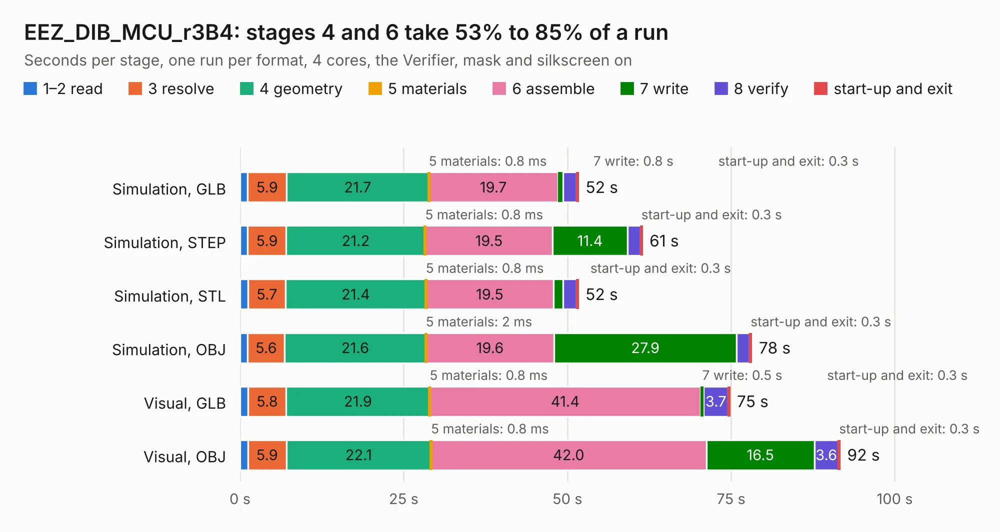

| Mode and format | 1–2 read | 3 resolve | 4 geometry | 5 materials | 6 assemble | 7 write | 8 verify | start-up and exit | Total |
|---|---:|---:|---:|---:|---:|---:|---:|---:|---:|
| Simulation, GLB | 1.2 | 5.9 | 21.7 | 0.8&nbsp;ms | 19.7 | 0.8 | 2.0 | 0.3 | 51.7 |
| Simulation, STEP | 1.2 | 5.9 | 21.2 | 0.8&nbsp;ms | 19.5 | 11.4 | 2.0 | 0.3 | 61.4 |
| Simulation, STL | 1.2 | 5.7 | 21.4 | 0.8&nbsp;ms | 19.5 | 1.4 | 2.0 | 0.3 | 51.7 |
| Simulation, OBJ | 1.2 | 5.6 | 21.6 | 2&nbsp;ms | 19.6 | 27.9 | 2.0 | 0.3 | 78.2 |
| Visual, GLB | 1.2 | 5.8 | 21.9 | 0.8&nbsp;ms | 41.4 | 0.5 | 3.7 | 0.3 | 74.8 |
| Visual, OBJ | 1.2 | 5.9 | 22.1 | 0.8&nbsp;ms | 42.0 | 16.5 | 3.6 | 0.3 | 91.6 |

<table align="center"><tr><td valign="top">

| Board | Repo: [intergalaktik/bb3-cm4](https://github.com/intergalaktik/bb3-cm4) Board: `EEZ_DIB_MCU_r3B4.kicad_pcb` |
|---|---|
| Folder | EEZ_BB3_CM4_R1B0 |
| Complexity | 371&nbsp;/&nbsp;1000 (size&nbsp;276, features&nbsp;95) |
| KESE&nbsp;features | through vias, rounded, trapezoid or chamfered pads, filled zones, copper text, curved board outline, stack-up, dielectric εr and tanδ |
| Tested | 9th November 2026 |
| Copper&nbsp;layers | 4 |
| File&nbsp;format | KiCad 6 (20211014) |
| Parts,&nbsp;tracks,&nbsp;vias | 185, 5,012, 755 |
| Triangles,&nbsp;simulation | 5,098,868 in 274 parts |
| Verifier | PASS in all six runs |

</td><td valign="top">

<table>
<tr><th>File type</th><th>File size</th><th>Peak memory used</th></tr>
<tr><th colspan="3" align="left">Simulation</th></tr>
<tr><td>GLB</td><td align="right">174&nbsp;MB</td><td align="right">1.4&nbsp;GB</td></tr>
<tr><td>STEP</td><td align="right">787&nbsp;MB</td><td align="right">1.9&nbsp;GB</td></tr>
<tr><td>STL</td><td align="right">255&nbsp;MB</td><td align="right">1.5&nbsp;GB</td></tr>
<tr><td>OBJ</td><td align="right">549&nbsp;MB</td><td align="right">3.3&nbsp;GB</td></tr>
<tr><th colspan="3" align="left">Visual</th></tr>
<tr><td>GLB</td><td align="right">106&nbsp;MB</td><td align="right">1.8&nbsp;GB</td></tr>
<tr><td>OBJ</td><td align="right">342&nbsp;MB</td><td align="right">2.4&nbsp;GB</td></tr>
</table>

</td></tr></table>

## 1239. EEZ_BB3_CM4_SoM

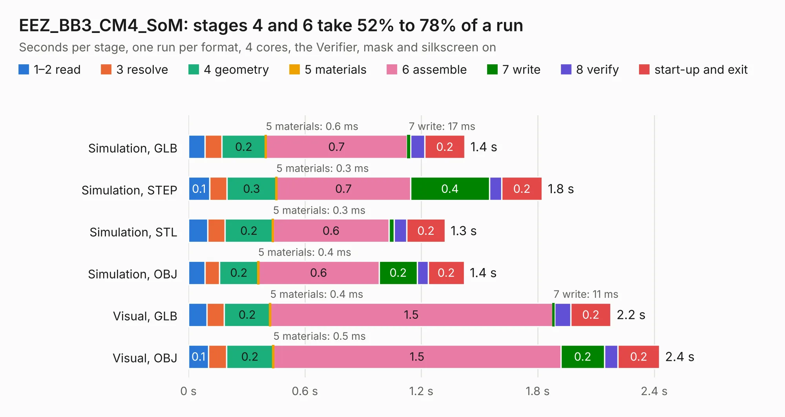

| Mode and format | 1–2 read | 3 resolve | 4 geometry | 5 materials | 6 assemble | 7 write | 8 verify | start-up and exit | Total |
|---|---:|---:|---:|---:|---:|---:|---:|---:|---:|
| Simulation, GLB | 84&nbsp;ms | 87&nbsp;ms | 0.2 | 0.6&nbsp;ms | 0.7 | 17&nbsp;ms | 74&nbsp;ms | 0.2 | 1.4 |
| Simulation, STEP | 0.1 | 90&nbsp;ms | 0.3 | 0.3&nbsp;ms | 0.7 | 0.4 | 63&nbsp;ms | 0.2 | 1.8 |
| Simulation, STL | 99&nbsp;ms | 89&nbsp;ms | 0.2 | 0.3&nbsp;ms | 0.6 | 26&nbsp;ms | 66&nbsp;ms | 0.2 | 1.3 |
| Simulation, OBJ | 85&nbsp;ms | 75&nbsp;ms | 0.2 | 0.4&nbsp;ms | 0.6 | 0.2 | 56&nbsp;ms | 0.2 | 1.4 |
| Visual, GLB | 95&nbsp;ms | 89&nbsp;ms | 0.2 | 0.4&nbsp;ms | 1.5 | 11&nbsp;ms | 83&nbsp;ms | 0.2 | 2.2 |
| Visual, OBJ | 0.1 | 93&nbsp;ms | 0.2 | 0.5&nbsp;ms | 1.5 | 0.2 | 69&nbsp;ms | 0.2 | 2.4 |

<table align="center"><tr><td valign="top">

| Board | Repo: [intergalaktik/bb3-cm4](https://github.com/intergalaktik/bb3-cm4) Board: `EEZ_BB3_CM4_SoM.kicad_pcb` |
|---|---|
| Folder | EEZ_BB3_CM4_SoM |
| Complexity | 75&nbsp;/&nbsp;1000 (size&nbsp;45, features&nbsp;30) |
| KESE&nbsp;features | stack-up, dielectric εr and tanδ |
| Tested | 9th November 2026 |
| Copper&nbsp;layers | 4 |
| File&nbsp;format | KiCad 7 (20221018) |
| Parts,&nbsp;tracks,&nbsp;vias | 2, 0, 0 |
| Triangles,&nbsp;simulation | 32,988 in 181 parts |
| Verifier | PASS in all six runs |

</td><td valign="top">

<table>
<tr><th>File type</th><th>File size</th><th>Peak memory used</th></tr>
<tr><th colspan="3" align="left">Simulation</th></tr>
<tr><td>GLB</td><td align="right">1.3&nbsp;MB</td><td align="right">75&nbsp;MB</td></tr>
<tr><td>STEP</td><td align="right">6.6&nbsp;MB</td><td align="right">78&nbsp;MB</td></tr>
<tr><td>STL</td><td align="right">1.7&nbsp;MB</td><td align="right">74&nbsp;MB</td></tr>
<tr><td>OBJ</td><td align="right">3.8&nbsp;MB</td><td align="right">81&nbsp;MB</td></tr>
<tr><th colspan="3" align="left">Visual</th></tr>
<tr><td>GLB</td><td align="right">1.8&nbsp;MB</td><td align="right">118&nbsp;MB</td></tr>
<tr><td>OBJ</td><td align="right">5.0&nbsp;MB</td><td align="right">115&nbsp;MB</td></tr>
</table>

</td></tr></table>

## 1240. EEZ_DIB_BP3C_r3B3

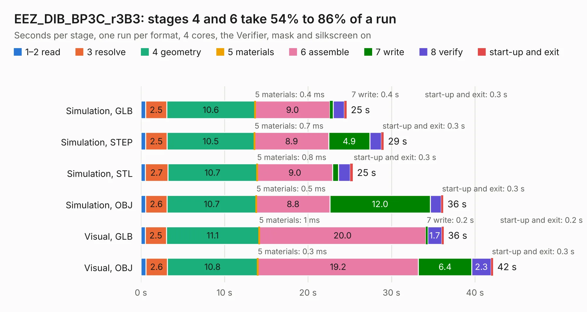

| Mode and format | 1–2 read | 3 resolve | 4 geometry | 5 materials | 6 assemble | 7 write | 8 verify | start-up and exit | Total |
|---|---:|---:|---:|---:|---:|---:|---:|---:|---:|
| Simulation, GLB | 0.6 | 2.5 | 10.6 | 0.4&nbsp;ms | 9.0 | 0.4 | 1.3 | 0.3 | 24.6 |
| Simulation, STEP | 0.6 | 2.5 | 10.5 | 0.7&nbsp;ms | 8.9 | 4.9 | 1.4 | 0.3 | 29.1 |
| Simulation, STL | 0.5 | 2.7 | 10.7 | 0.8&nbsp;ms | 9.0 | 0.7 | 1.4 | 0.3 | 25.4 |
| Simulation, OBJ | 0.6 | 2.6 | 10.7 | 0.5&nbsp;ms | 8.8 | 12.0 | 1.3 | 0.3 | 36.2 |
| Visual, GLB | 0.5 | 2.5 | 11.1 | 1&nbsp;ms | 20.0 | 0.2 | 1.7 | 0.2 | 36.3 |
| Visual, OBJ | 0.6 | 2.6 | 10.8 | 0.3&nbsp;ms | 19.2 | 6.4 | 2.3 | 0.3 | 42.2 |

<table align="center"><tr><td valign="top">

| Board | Repo: [intergalaktik/bb3-cm4](https://github.com/intergalaktik/bb3-cm4) Board: `EEZ_DIB_BP3C_r3B3.kicad_pcb` |
|---|---|
| Folder | EEZ_DIB_BP3C_R3B3 |
| Complexity | 288&nbsp;/&nbsp;1000 (size&nbsp;193, features&nbsp;95) |
| KESE&nbsp;features | through vias, rounded, trapezoid or chamfered pads, filled zones, copper text, curved board outline, stack-up, dielectric εr and tanδ |
| Tested | 9th November 2026 |
| Copper&nbsp;layers | 4 |
| File&nbsp;format | KiCad 6 (20211014) |
| Parts,&nbsp;tracks,&nbsp;vias | 55, 718, 161 |
| Triangles,&nbsp;simulation | 2,205,946 in 89 parts |
| Verifier | PASS in all six runs |

</td><td valign="top">

<table>
<tr><th>File type</th><th>File size</th><th>Peak memory used</th></tr>
<tr><th colspan="3" align="left">Simulation</th></tr>
<tr><td>GLB</td><td align="right">77&nbsp;MB</td><td align="right">660&nbsp;MB</td></tr>
<tr><td>STEP</td><td align="right">328&nbsp;MB</td><td align="right">851&nbsp;MB</td></tr>
<tr><td>STL</td><td align="right">110&nbsp;MB</td><td align="right">701&nbsp;MB</td></tr>
<tr><td>OBJ</td><td align="right">238&nbsp;MB</td><td align="right">1.5&nbsp;GB</td></tr>
<tr><th colspan="3" align="left">Visual</th></tr>
<tr><td>GLB</td><td align="right">42&nbsp;MB</td><td align="right">904&nbsp;MB</td></tr>
<tr><td>OBJ</td><td align="right">128&nbsp;MB</td><td align="right">958&nbsp;MB</td></tr>
</table>

</td></tr></table>

## 1241. EEZ_DIB_MCU_r3B4

| Mode and format | 1–2 read | 3 resolve | 4 geometry | 5 materials | 6 assemble | 7 write | 8 verify | start-up and exit | Total |
|---|---:|---:|---:|---:|---:|---:|---:|---:|---:|
| Simulation, GLB | 0.9 | 4.6 | 14.6 | 0.9&nbsp;ms | 13.6 | 0.6 | 1.9 | 0.3 | 36.6 |
| Simulation, STEP | 0.7 | 4.6 | 13.8 | 1&nbsp;ms | 13.2 | 8.9 | 1.8 | 0.3 | 43.3 |
| Simulation, STL | 0.7 | 4.4 | 14.0 | 1&nbsp;ms | 12.9 | 1.3 | 1.8 | 0.4 | 35.5 |
| Simulation, OBJ | 0.9 | 4.8 | 13.9 | 0.9&nbsp;ms | 12.6 | 19.5 | 1.6 | 0.3 | 53.5 |
| Visual, GLB | 0.8 | 4.5 | 13.1 | 1&nbsp;ms | 32.6 | 0.3 | 4.1 | 0.3 | 55.7 |
| Visual, OBJ | 0.6 | 4.5 | 14.1 | 1&nbsp;ms | 34.4 | 12.6 | 5.0 | 0.2 | 71.4 |

<table align="center"><tr><td valign="top">

| Board | Repo: [intergalaktik/bb3-cm4](https://github.com/intergalaktik/bb3-cm4) Board: `EEZ_DIB_MCU_r3B4.kicad_pcb` |
|---|---|
| Folder | EEZ_DIB_MCU_r3B4 |
| Complexity | 359&nbsp;/&nbsp;1000 (size&nbsp;264, features&nbsp;95) |
| KESE&nbsp;features | through vias, rounded, trapezoid or chamfered pads, filled zones, copper text, curved board outline, stack-up, dielectric εr and tanδ |
| Tested | 9th November 2026 |
| Copper&nbsp;layers | 4 |
| File&nbsp;format | KiCad 7 (20221018) |
| Parts,&nbsp;tracks,&nbsp;vias | 118, 2,912, 638 |
| Triangles,&nbsp;simulation | 3,889,020 in 275 parts |
| Verifier | PASS in all six runs |

</td><td valign="top">

<table>
<tr><th>File type</th><th>File size</th><th>Peak memory used</th></tr>
<tr><th colspan="3" align="left">Simulation</th></tr>
<tr><td>GLB</td><td align="right">131&nbsp;MB</td><td align="right">1.1&nbsp;GB</td></tr>
<tr><td>STEP</td><td align="right">509&nbsp;MB</td><td align="right">1.6&nbsp;GB</td></tr>
<tr><td>STL</td><td align="right">194&nbsp;MB</td><td align="right">1.2&nbsp;GB</td></tr>
<tr><td>OBJ</td><td align="right">414&nbsp;MB</td><td align="right">2.6&nbsp;GB</td></tr>
<tr><th colspan="3" align="left">Visual</th></tr>
<tr><td>GLB</td><td align="right">86&nbsp;MB</td><td align="right">1.4&nbsp;GB</td></tr>
<tr><td>OBJ</td><td align="right">274&nbsp;MB</td><td align="right">1.8&nbsp;GB</td></tr>
</table>

</td></tr></table>

## 1242. Intergalaktik_proto

| Mode and format | 1–2 read | 3 resolve | 4 geometry | 5 materials | 6 assemble | 7 write | 8 verify | start-up and exit | Total |
|---|---:|---:|---:|---:|---:|---:|---:|---:|---:|
| Simulation, GLB | 0.9 | 0.9 | 10.0 | 0.5&nbsp;ms | 12.5 | 0.3 | 0.7 | 0.3 | 25.5 |
| Simulation, STEP | 0.8 | 0.9 | 9.9 | 0.4&nbsp;ms | 13.0 | 5.5 | 0.6 | 0.3 | 30.8 |
| Simulation, STL | 0.8 | 0.9 | 9.6 | 0.3&nbsp;ms | 12.5 | 0.4 | 0.6 | 0.2 | 25.1 |
| Simulation, OBJ | 0.8 | 0.9 | 9.6 | 0.3&nbsp;ms | 12.8 | 9.1 | 0.6 | 0.2 | 34.1 |
| Visual, GLB | 0.8 | 0.9 | 9.6 | 0.6&nbsp;ms | 16.9 | 0.2 | 1.0 | 0.3 | 29.7 |
| Visual, OBJ | 0.9 | 0.9 | 9.7 | 0.5&nbsp;ms | 17.0 | 4.1 | 1.0 | 0.3 | 33.9 |

<table align="center"><tr><td valign="top">

| Board | Repo: [intergalaktik/business-card-smd-proto](https://github.com/intergalaktik/business-card-smd-proto) Board: `Intergalaktik_proto.kicad_pcb` |
|---|---|
| Folder | KiCad / Intergalaktik_proto |
| Complexity | 183&nbsp;/&nbsp;1000 (size&nbsp;98, features&nbsp;85) |
| KESE&nbsp;features | through vias, rounded, trapezoid or chamfered pads, filled zones, copper drawings, stack-up, dielectric εr and tanδ |
| Tested | 9th November 2026 |
| Copper&nbsp;layers | 2 |
| File&nbsp;format | KiCad 8 (20240108) |
| Parts,&nbsp;tracks,&nbsp;vias | 0, 119, 8 |
| Triangles,&nbsp;simulation | 1,533,816 in 24 parts |
| Note | no components |
| Verifier | PASS in all six runs |

</td><td valign="top">

<table>
<tr><th>File type</th><th>File size</th><th>Peak memory used</th></tr>
<tr><th colspan="3" align="left">Simulation</th></tr>
<tr><td>GLB</td><td align="right">53&nbsp;MB</td><td align="right">649&nbsp;MB</td></tr>
<tr><td>STEP</td><td align="right">319&nbsp;MB</td><td align="right">826&nbsp;MB</td></tr>
<tr><td>STL</td><td align="right">77&nbsp;MB</td><td align="right">683&nbsp;MB</td></tr>
<tr><td>OBJ</td><td align="right">161&nbsp;MB</td><td align="right">1.1&nbsp;GB</td></tr>
<tr><th colspan="3" align="left">Visual</th></tr>
<tr><td>GLB</td><td align="right">24&nbsp;MB</td><td align="right">675&nbsp;MB</td></tr>
<tr><td>OBJ</td><td align="right">74&nbsp;MB</td><td align="right">652&nbsp;MB</td></tr>
</table>

</td></tr></table>

## 1243. EMC_antenna

| Mode and format | 1–2 read | 3 resolve | 4 geometry | 5 materials | 6 assemble | 7 write | 8 verify | start-up and exit | Total |
|---|---:|---:|---:|---:|---:|---:|---:|---:|---:|
| Simulation, GLB | 0.1 | 85&nbsp;ms | 0.2 | 0.1&nbsp;ms | 0.4 | 10&nbsp;ms | 28&nbsp;ms | 0.2 | 1.1 |
| Simulation, STEP | 0.1 | 84&nbsp;ms | 0.2 | 0.1&nbsp;ms | 0.4 | 0.7 | 27&nbsp;ms | 0.2 | 1.8 |
| Simulation, STL | 0.1 | 0.1 | 0.2 | 0.1&nbsp;ms | 0.4 | 17&nbsp;ms | 25&nbsp;ms | 0.2 | 1.1 |
| Simulation, OBJ | 0.1 | 83&nbsp;ms | 0.2 | 0.1&nbsp;ms | 0.4 | 0.3 | 42&nbsp;ms | 0.2 | 1.4 |
| Visual, GLB | 0.1 | 93&nbsp;ms | 0.2 | 0.1&nbsp;ms | 0.4 | 9&nbsp;ms | 0.1 | 0.2 | 1.2 |
| Visual, OBJ | 0.1 | 79&nbsp;ms | 0.2 | 0.1&nbsp;ms | 0.4 | 0.3 | 0.1 | 0.2 | 1.4 |

<table align="center"><tr><td valign="top">

| Board | Repo: [intergalaktik/EMC-experiments](https://github.com/intergalaktik/EMC-experiments) Board: `EMC_antenna.kicad_pcb` |
|---|---|
| Folder | EMC_antenna |
| Complexity | 69&nbsp;/&nbsp;1000 (size&nbsp;24, features&nbsp;45) |
| KESE&nbsp;features | arc tracks, stack-up, dielectric εr and tanδ |
| Tested | 9th November 2026 |
| Copper&nbsp;layers | 2 |
| File&nbsp;format | KiCad 8 (20240108) |
| Parts,&nbsp;tracks,&nbsp;vias | 1, 0, 0 |
| Triangles,&nbsp;simulation | 75,346 in 9 parts |
| Verifier | PASS in all six runs |

</td><td valign="top">

<table>
<tr><th>File type</th><th>File size</th><th>Peak memory used</th></tr>
<tr><th colspan="3" align="left">Simulation</th></tr>
<tr><td>GLB</td><td align="right">2.8&nbsp;MB</td><td align="right">79&nbsp;MB</td></tr>
<tr><td>STEP</td><td align="right">19&nbsp;MB</td><td align="right">193&nbsp;MB</td></tr>
<tr><td>STL</td><td align="right">3.8&nbsp;MB</td><td align="right">76&nbsp;MB</td></tr>
<tr><td>OBJ</td><td align="right">7.6&nbsp;MB</td><td align="right">107&nbsp;MB</td></tr>
<tr><th colspan="3" align="left">Visual</th></tr>
<tr><td>GLB</td><td align="right">2.1&nbsp;MB</td><td align="right">115&nbsp;MB</td></tr>
<tr><td>OBJ</td><td align="right">5.7&nbsp;MB</td><td align="right">142&nbsp;MB</td></tr>
</table>

</td></tr></table>

## 1244. adcIO

| Mode and format | 1–2 read | 3 resolve | 4 geometry | 5 materials | 6 assemble | 7 write | 8 verify | start-up and exit | Total |
|---|---:|---:|---:|---:|---:|---:|---:|---:|---:|
| Simulation, GLB | 0.3 | 0.6 | 1.8 | 0.4&nbsp;ms | 2.1 | 99&nbsp;ms | 0.3 | 0.3 | 5.4 |
| Simulation, STEP | 0.3 | 0.6 | 1.8 | 0.4&nbsp;ms | 2.1 | 1.8 | 0.3 | 0.2 | 7.1 |
| Simulation, STL | 0.3 | 0.6 | 1.8 | 0.3&nbsp;ms | 2.0 | 0.2 | 0.3 | 0.2 | 5.3 |
| Simulation, OBJ | 0.3 | 0.5 | 1.8 | 0.4&nbsp;ms | 2.0 | 3.0 | 0.4 | 0.3 | 8.2 |
| Visual, GLB | 0.3 | 0.5 | 2.0 | 0.4&nbsp;ms | 4.6 | 64&nbsp;ms | 0.6 | 0.2 | 8.3 |
| Visual, OBJ | 0.3 | 0.5 | 1.7 | 0.5&nbsp;ms | 4.7 | 2.0 | 0.6 | 0.3 | 10.1 |

<table align="center"><tr><td valign="top">

| Board | Repo: [intergalaktik/Extension_Boards_for_Olimex_GateMate](https://github.com/intergalaktik/Extension_Boards_for_Olimex_GateMate) Board: `adcIO.kicad_pcb` |
|---|---|
| Folder | adcIO |
| Complexity | 286&nbsp;/&nbsp;1000 (size&nbsp;171, features&nbsp;115) |
| KESE&nbsp;features | through vias, rounded, trapezoid or chamfered pads, filled zones, curved board outline, knockout text, stack-up, dielectric εr and tanδ, copper finish |
| Tested | 9th November 2026 |
| Copper&nbsp;layers | 4 |
| File&nbsp;format | KiCad 8 (20240108) |
| Parts,&nbsp;tracks,&nbsp;vias | 36, 212, 66 |
| Triangles,&nbsp;simulation | 640,134 in 52 parts |
| Verifier | PASS in all six runs |

</td><td valign="top">

<table>
<tr><th>File type</th><th>File size</th><th>Peak memory used</th></tr>
<tr><th colspan="3" align="left">Simulation</th></tr>
<tr><td>GLB</td><td align="right">22&nbsp;MB</td><td align="right">355&nbsp;MB</td></tr>
<tr><td>STEP</td><td align="right">96&nbsp;MB</td><td align="right">393&nbsp;MB</td></tr>
<tr><td>STL</td><td align="right">32&nbsp;MB</td><td align="right">390&nbsp;MB</td></tr>
<tr><td>OBJ</td><td align="right">65&nbsp;MB</td><td align="right">469&nbsp;MB</td></tr>
<tr><th colspan="3" align="left">Visual</th></tr>
<tr><td>GLB</td><td align="right">15&nbsp;MB</td><td align="right">392&nbsp;MB</td></tr>
<tr><td>OBJ</td><td align="right">43&nbsp;MB</td><td align="right">383&nbsp;MB</td></tr>
</table>

</td></tr></table>

## 1245. camIO

| Mode and format | 1–2 read | 3 resolve | 4 geometry | 5 materials | 6 assemble | 7 write | 8 verify | start-up and exit | Total |
|---|---:|---:|---:|---:|---:|---:|---:|---:|---:|
| Simulation, GLB | 0.2 | 0.4 | 1.0 | 0.2&nbsp;ms | 1.1 | 58&nbsp;ms | 0.2 | 0.2 | 3.1 |
| Simulation, STEP | 0.2 | 0.4 | 1.0 | 0.2&nbsp;ms | 1.2 | 1.1 | 0.2 | 0.2 | 4.2 |
| Simulation, STL | 0.2 | 0.4 | 1.0 | 0.1&nbsp;ms | 1.2 | 0.1 | 0.2 | 0.2 | 3.2 |
| Simulation, OBJ | 0.2 | 0.4 | 1.0 | 0.2&nbsp;ms | 1.2 | 1.8 | 0.2 | 0.2 | 4.9 |
| Visual, GLB | 0.2 | 0.4 | 1.0 | 0.2&nbsp;ms | 3.0 | 49&nbsp;ms | 0.4 | 0.2 | 5.3 |
| Visual, OBJ | 0.2 | 0.4 | 1.0 | 0.3&nbsp;ms | 3.0 | 1.3 | 0.3 | 0.2 | 6.4 |

<table align="center"><tr><td valign="top">

| Board | Repo: [intergalaktik/Extension_Boards_for_Olimex_GateMate](https://github.com/intergalaktik/Extension_Boards_for_Olimex_GateMate) Board: `camIO.kicad_pcb` |
|---|---|
| Folder | camIO |
| Complexity | 286&nbsp;/&nbsp;1000 (size&nbsp;171, features&nbsp;115) |
| KESE&nbsp;features | through vias, rounded, trapezoid or chamfered pads, filled zones, curved board outline, knockout text, stack-up, dielectric εr and tanδ, copper finish |
| Tested | 9th November 2026 |
| Copper&nbsp;layers | 4 |
| File&nbsp;format | KiCad 8 (20240108) |
| Parts,&nbsp;tracks,&nbsp;vias | 25, 296, 76 |
| Triangles,&nbsp;simulation | 422,226 in 40 parts |
| Verifier | PASS in all six runs |

</td><td valign="top">

<table>
<tr><th>File type</th><th>File size</th><th>Peak memory used</th></tr>
<tr><th colspan="3" align="left">Simulation</th></tr>
<tr><td>GLB</td><td align="right">15&nbsp;MB</td><td align="right">290&nbsp;MB</td></tr>
<tr><td>STEP</td><td align="right">66&nbsp;MB</td><td align="right">323&nbsp;MB</td></tr>
<tr><td>STL</td><td align="right">21&nbsp;MB</td><td align="right">303&nbsp;MB</td></tr>
<tr><td>OBJ</td><td align="right">43&nbsp;MB</td><td align="right">337&nbsp;MB</td></tr>
<tr><th colspan="3" align="left">Visual</th></tr>
<tr><td>GLB</td><td align="right">12&nbsp;MB</td><td align="right">321&nbsp;MB</td></tr>
<tr><td>OBJ</td><td align="right">34&nbsp;MB</td><td align="right">315&nbsp;MB</td></tr>
</table>

</td></tr></table>

## 1246. dualTranslation

| Mode and format | 1–2 read | 3 resolve | 4 geometry | 5 materials | 6 assemble | 7 write | 8 verify | start-up and exit | Total |
|---|---:|---:|---:|---:|---:|---:|---:|---:|---:|
| Simulation, GLB | 0.4 | 1.1 | 5.4 | 0.3&nbsp;ms | 4.2 | 0.2 | 0.5 | 0.3 | 12.2 |
| Simulation, STEP | 0.4 | 1.1 | 5.3 | 0.2&nbsp;ms | 4.5 | 3.0 | 0.5 | 0.3 | 15.1 |
| Simulation, STL | 0.4 | 1.3 | 5.2 | 0.3&nbsp;ms | 4.2 | 0.3 | 0.6 | 0.3 | 12.2 |
| Simulation, OBJ | 0.4 | 1.2 | 5.3 | 0.3&nbsp;ms | 4.5 | 6.2 | 0.6 | 0.3 | 18.5 |
| Visual, GLB | 0.4 | 1.1 | 4.9 | 0.3&nbsp;ms | 9.4 | 0.1 | 0.8 | 0.2 | 17.0 |
| Visual, OBJ | 0.4 | 1.3 | 5.1 | 0.5&nbsp;ms | 9.6 | 4.0 | 0.9 | 0.3 | 21.5 |

<table align="center"><tr><td valign="top">

| Board | Repo: [intergalaktik/Extension_Boards_for_Olimex_GateMate](https://github.com/intergalaktik/Extension_Boards_for_Olimex_GateMate) Board: `dualTranslation.kicad_pcb` |
|---|---|
| Folder | dualTranslation |
| Complexity | 273&nbsp;/&nbsp;1000 (size&nbsp;188, features&nbsp;85) |
| KESE&nbsp;features | through vias, rounded, trapezoid or chamfered pads, filled zones, curved board outline, stack-up, dielectric εr and tanδ |
| Tested | 9th November 2026 |
| Copper&nbsp;layers | 4 |
| File&nbsp;format | KiCad 9 (20241229) |
| Parts,&nbsp;tracks,&nbsp;vias | 54, 521, 119 |
| Triangles,&nbsp;simulation | 941,732 in 56 parts |
| Verifier | PASS in all six runs |

</td><td valign="top">

<table>
<tr><th>File type</th><th>File size</th><th>Peak memory used</th></tr>
<tr><th colspan="3" align="left">Simulation</th></tr>
<tr><td>GLB</td><td align="right">33&nbsp;MB</td><td align="right">477&nbsp;MB</td></tr>
<tr><td>STEP</td><td align="right">153&nbsp;MB</td><td align="right">504&nbsp;MB</td></tr>
<tr><td>STL</td><td align="right">47&nbsp;MB</td><td align="right">443&nbsp;MB</td></tr>
<tr><td>OBJ</td><td align="right">97&nbsp;MB</td><td align="right">690&nbsp;MB</td></tr>
<tr><th colspan="3" align="left">Visual</th></tr>
<tr><td>GLB</td><td align="right">21&nbsp;MB</td><td align="right">537&nbsp;MB</td></tr>
<tr><td>OBJ</td><td align="right">64&nbsp;MB</td><td align="right">528&nbsp;MB</td></tr>
</table>

</td></tr></table>

## 1247. dvi

| Mode and format | 1–2 read | 3 resolve | 4 geometry | 5 materials | 6 assemble | 7 write | 8 verify | start-up and exit | Total |
|---|---:|---:|---:|---:|---:|---:|---:|---:|---:|
| Simulation, GLB | 0.3 | 0.5 | 1.6 | 0.3&nbsp;ms | 1.7 | 84&nbsp;ms | 0.3 | 0.2 | 4.9 |
| Simulation, STEP | 0.3 | 0.5 | 1.6 | 0.3&nbsp;ms | 1.8 | 1.6 | 0.3 | 0.2 | 6.3 |
| Simulation, STL | 0.3 | 0.6 | 1.6 | 0.3&nbsp;ms | 1.8 | 0.1 | 0.3 | 0.2 | 4.9 |
| Simulation, OBJ | 0.3 | 0.6 | 1.7 | 0.5&nbsp;ms | 1.9 | 3.2 | 0.3 | 0.2 | 8.2 |
| Visual, GLB | 0.3 | 0.6 | 1.8 | 0.2&nbsp;ms | 4.8 | 88&nbsp;ms | 0.5 | 0.3 | 8.4 |
| Visual, OBJ | 0.3 | 0.6 | 1.6 | 0.3&nbsp;ms | 4.8 | 2.3 | 0.6 | 0.2 | 10.5 |

<table align="center"><tr><td valign="top">

| Board | Repo: [intergalaktik/Extension_Boards_for_Olimex_GateMate](https://github.com/intergalaktik/Extension_Boards_for_Olimex_GateMate) Board: `dvi.kicad_pcb` |
|---|---|
| Folder | dvi |
| Complexity | 285&nbsp;/&nbsp;1000 (size&nbsp;185, features&nbsp;100) |
| KESE&nbsp;features | through vias, rounded, trapezoid or chamfered pads, filled zones, curved board outline, stack-up, dielectric εr and tanδ, copper finish |
| Tested | 9th November 2026 |
| Copper&nbsp;layers | 4 |
| File&nbsp;format | KiCad 8 (20240108) |
| Parts,&nbsp;tracks,&nbsp;vias | 47, 518, 89 |
| Triangles,&nbsp;simulation | 576,678 in 53 parts |
| Verifier | PASS in all six runs |

</td><td valign="top">

<table>
<tr><th>File type</th><th>File size</th><th>Peak memory used</th></tr>
<tr><th colspan="3" align="left">Simulation</th></tr>
<tr><td>GLB</td><td align="right">20&nbsp;MB</td><td align="right">339&nbsp;MB</td></tr>
<tr><td>STEP</td><td align="right">91&nbsp;MB</td><td align="right">384&nbsp;MB</td></tr>
<tr><td>STL</td><td align="right">29&nbsp;MB</td><td align="right">331&nbsp;MB</td></tr>
<tr><td>OBJ</td><td align="right">58&nbsp;MB</td><td align="right">439&nbsp;MB</td></tr>
<tr><th colspan="3" align="left">Visual</th></tr>
<tr><td>GLB</td><td align="right">15&nbsp;MB</td><td align="right">403&nbsp;MB</td></tr>
<tr><td>OBJ</td><td align="right">45&nbsp;MB</td><td align="right">403&nbsp;MB</td></tr>
</table>

</td></tr></table>

## 1248. eduIO

| Mode and format | 1–2 read | 3 resolve | 4 geometry | 5 materials | 6 assemble | 7 write | 8 verify | start-up and exit | Total |
|---|---:|---:|---:|---:|---:|---:|---:|---:|---:|
| Simulation, GLB | 0.2 | 0.3 | 1.2 | 0.2&nbsp;ms | 1.2 | 53&nbsp;ms | 0.2 | 0.2 | 3.4 |
| Simulation, STEP | 0.2 | 0.3 | 1.3 | 0.5&nbsp;ms | 1.2 | 1.3 | 0.2 | 0.2 | 4.7 |
| Simulation, STL | 0.2 | 0.3 | 1.3 | 0.3&nbsp;ms | 1.2 | 85&nbsp;ms | 0.2 | 0.2 | 3.5 |
| Simulation, OBJ | 0.2 | 0.3 | 1.3 | 0.3&nbsp;ms | 1.3 | 1.6 | 0.2 | 0.2 | 5.1 |
| Visual, GLB | 0.2 | 0.3 | 1.3 | 0.5&nbsp;ms | 3.2 | 49&nbsp;ms | 0.3 | 0.3 | 5.7 |
| Visual, OBJ | 0.2 | 0.4 | 1.3 | 0.3&nbsp;ms | 3.2 | 1.2 | 0.4 | 0.2 | 7.0 |

<table align="center"><tr><td valign="top">

| Board | Repo: [intergalaktik/Extension_Boards_for_Olimex_GateMate](https://github.com/intergalaktik/Extension_Boards_for_Olimex_GateMate) Board: `eduIO.kicad_pcb` |
|---|---|
| Folder | eduIO |
| Complexity | 257&nbsp;/&nbsp;1000 (size&nbsp;142, features&nbsp;115) |
| KESE&nbsp;features | through vias, rounded, trapezoid or chamfered pads, filled zones, curved board outline, knockout text, stack-up, dielectric εr and tanδ, copper finish |
| Tested | 9th November 2026 |
| Copper&nbsp;layers | 2 |
| File&nbsp;format | KiCad 8 (20240108) |
| Parts,&nbsp;tracks,&nbsp;vias | 22, 180, 25 |
| Triangles,&nbsp;simulation | 305,672 in 65 parts |
| Verifier | PASS in all six runs |

</td><td valign="top">

<table>
<tr><th>File type</th><th>File size</th><th>Peak memory used</th></tr>
<tr><th colspan="3" align="left">Simulation</th></tr>
<tr><td>GLB</td><td align="right">11&nbsp;MB</td><td align="right">246&nbsp;MB</td></tr>
<tr><td>STEP</td><td align="right">52&nbsp;MB</td><td align="right">279&nbsp;MB</td></tr>
<tr><td>STL</td><td align="right">15&nbsp;MB</td><td align="right">245&nbsp;MB</td></tr>
<tr><td>OBJ</td><td align="right">31&nbsp;MB</td><td align="right">270&nbsp;MB</td></tr>
<tr><th colspan="3" align="left">Visual</th></tr>
<tr><td>GLB</td><td align="right">8.7&nbsp;MB</td><td align="right">272&nbsp;MB</td></tr>
<tr><td>OBJ</td><td align="right">25&nbsp;MB</td><td align="right">271&nbsp;MB</td></tr>
</table>

</td></tr></table>

## 1249. ethIO

| Mode and format | 1–2 read | 3 resolve | 4 geometry | 5 materials | 6 assemble | 7 write | 8 verify | start-up and exit | Total |
|---|---:|---:|---:|---:|---:|---:|---:|---:|---:|
| Simulation, GLB | 0.4 | 1.0 | 3.1 | 0.2&nbsp;ms | 2.7 | 0.1 | 0.4 | 0.2 | 7.9 |
| Simulation, STEP | 0.4 | 1.0 | 2.8 | 0.3&nbsp;ms | 2.7 | 2.1 | 0.4 | 0.3 | 9.6 |
| Simulation, STL | 0.3 | 0.9 | 3.0 | 0.3&nbsp;ms | 2.6 | 0.2 | 0.4 | 0.2 | 7.8 |
| Simulation, OBJ | 0.3 | 1.0 | 2.9 | 0.2&nbsp;ms | 2.7 | 4.5 | 0.4 | 0.2 | 12.1 |
| Visual, GLB | 0.3 | 1.0 | 2.9 | 0.2&nbsp;ms | 6.8 | 0.1 | 0.6 | 0.2 | 11.9 |
| Visual, OBJ | 0.3 | 1.0 | 3.1 | 0.2&nbsp;ms | 6.5 | 2.9 | 0.8 | 0.2 | 14.9 |

<table align="center"><tr><td valign="top">

| Board | Repo: [intergalaktik/Extension_Boards_for_Olimex_GateMate](https://github.com/intergalaktik/Extension_Boards_for_Olimex_GateMate) Board: `ethIO.kicad_pcb` |
|---|---|
| Folder | ethIO |
| Complexity | 320&nbsp;/&nbsp;1000 (size&nbsp;190, features&nbsp;130) |
| KESE&nbsp;features | through vias, rounded, trapezoid or chamfered pads, filled zones, curved board outline, knockout text, TrueType text, stack-up, dielectric εr and tanδ, copper finish |
| Tested | 9th November 2026 |
| Copper&nbsp;layers | 4 |
| File&nbsp;format | KiCad 8 (20240108) |
| Parts,&nbsp;tracks,&nbsp;vias | 46, 708, 122 |
| Triangles,&nbsp;simulation | 860,620 in 62 parts |
| Verifier | PASS in all six runs |

</td><td valign="top">

<table>
<tr><th>File type</th><th>File size</th><th>Peak memory used</th></tr>
<tr><th colspan="3" align="left">Simulation</th></tr>
<tr><td>GLB</td><td align="right">30&nbsp;MB</td><td align="right">379&nbsp;MB</td></tr>
<tr><td>STEP</td><td align="right">141&nbsp;MB</td><td align="right">457&nbsp;MB</td></tr>
<tr><td>STL</td><td align="right">43&nbsp;MB</td><td align="right">379&nbsp;MB</td></tr>
<tr><td>OBJ</td><td align="right">89&nbsp;MB</td><td align="right">626&nbsp;MB</td></tr>
<tr><th colspan="3" align="left">Visual</th></tr>
<tr><td>GLB</td><td align="right">20&nbsp;MB</td><td align="right">466&nbsp;MB</td></tr>
<tr><td>OBJ</td><td align="right">61&nbsp;MB</td><td align="right">489&nbsp;MB</td></tr>
</table>

</td></tr></table>

## 1250. extension_template

| Mode and format | 1–2 read | 3 resolve | 4 geometry | 5 materials | 6 assemble | 7 write | 8 verify | start-up and exit | Total |
|---|---:|---:|---:|---:|---:|---:|---:|---:|---:|
| Simulation, GLB | 0.2 | 0.2 | 0.4 | 0.1&nbsp;ms | 0.7 | 22&nbsp;ms | 55&nbsp;ms | 0.2 | 1.7 |
| Simulation, STEP | 0.1 | 0.1 | 0.4 | 0.2&nbsp;ms | 0.6 | 0.9 | 69&nbsp;ms | 0.2 | 2.5 |
| Simulation, STL | 0.2 | 0.2 | 0.4 | 0.1&nbsp;ms | 0.6 | 40&nbsp;ms | 61&nbsp;ms | 0.2 | 1.7 |
| Simulation, OBJ | 0.2 | 0.2 | 0.4 | 0.2&nbsp;ms | 0.6 | 0.7 | 80&nbsp;ms | 0.3 | 2.4 |
| Visual, GLB | 0.1 | 0.1 | 0.4 | 0.1&nbsp;ms | 1.5 | 23&nbsp;ms | 0.2 | 0.2 | 2.6 |
| Visual, OBJ | 0.1 | 0.1 | 0.4 | 0.1&nbsp;ms | 1.6 | 0.5 | 0.2 | 0.2 | 3.1 |

<table align="center"><tr><td valign="top">

| Board | Repo: [intergalaktik/Extension_Boards_for_Olimex_GateMate](https://github.com/intergalaktik/Extension_Boards_for_Olimex_GateMate) Board: `extension_template.kicad_pcb` |
|---|---|
| Folder | extension_template |
| Complexity | 241&nbsp;/&nbsp;1000 (size&nbsp;126, features&nbsp;115) |
| KESE&nbsp;features | through vias, rounded, trapezoid or chamfered pads, filled zones, curved board outline, knockout text, stack-up, dielectric εr and tanδ, copper finish |
| Tested | 9th November 2026 |
| Copper&nbsp;layers | 4 |
| File&nbsp;format | KiCad 8 (20240108) |
| Parts,&nbsp;tracks,&nbsp;vias | 7, 51, 6 |
| Triangles,&nbsp;simulation | 139,358 in 36 parts |
| Verifier | PASS in all six runs |

</td><td valign="top">

<table>
<tr><th>File type</th><th>File size</th><th>Peak memory used</th></tr>
<tr><th colspan="3" align="left">Simulation</th></tr>
<tr><td>GLB</td><td align="right">5.0&nbsp;MB</td><td align="right">213&nbsp;MB</td></tr>
<tr><td>STEP</td><td align="right">28&nbsp;MB</td><td align="right">220&nbsp;MB</td></tr>
<tr><td>STL</td><td align="right">7.0&nbsp;MB</td><td align="right">211&nbsp;MB</td></tr>
<tr><td>OBJ</td><td align="right">14&nbsp;MB</td><td align="right">205&nbsp;MB</td></tr>
<tr><th colspan="3" align="left">Visual</th></tr>
<tr><td>GLB</td><td align="right">4.4&nbsp;MB</td><td align="right">170&nbsp;MB</td></tr>
<tr><td>OBJ</td><td align="right">12&nbsp;MB</td><td align="right">179&nbsp;MB</td></tr>
</table>

</td></tr></table>

## 1251. GamePad_I2S_audio

| Mode and format | 1–2 read | 3 resolve | 4 geometry | 5 materials | 6 assemble | 7 write | 8 verify | start-up and exit | Total |
|---|---:|---:|---:|---:|---:|---:|---:|---:|---:|
| Simulation, GLB | 0.3 | 0.4 | 0.6 | 0.2&nbsp;ms | 0.7 | 31&nbsp;ms | 91&nbsp;ms | 0.3 | 2.4 |
| Simulation, STEP | 0.3 | 0.4 | 0.7 | 0.3&nbsp;ms | 0.7 | 1.3 | 80&nbsp;ms | 0.3 | 3.7 |
| Simulation, STL | 0.3 | 0.4 | 0.7 | 0.4&nbsp;ms | 0.7 | 41&nbsp;ms | 73&nbsp;ms | 0.3 | 2.5 |
| Simulation, OBJ | 0.3 | 0.3 | 0.6 | 0.2&nbsp;ms | 0.7 | 0.7 | 67&nbsp;ms | 0.3 | 3.0 |
| Visual, GLB | 0.3 | 0.4 | 0.6 | 0.4&nbsp;ms | 2.0 | 26&nbsp;ms | 0.2 | 0.2 | 3.7 |
| Visual, OBJ | 0.3 | 0.4 | 0.6 | 0.2&nbsp;ms | 2.3 | 0.8 | 0.2 | 0.2 | 4.7 |

<table align="center"><tr><td valign="top">

| Board | Repo: [intergalaktik/Extension_Boards_for_Olimex_GateMate](https://github.com/intergalaktik/Extension_Boards_for_Olimex_GateMate) Board: `GamePad_I2S_audio.kicad_pcb` |
|---|---|
| Folder | GamePad_I2S_audio / KiCad |
| Complexity | 265&nbsp;/&nbsp;1000 (size&nbsp;180, features&nbsp;85) |
| KESE&nbsp;features | through vias, rounded, trapezoid or chamfered pads, filled zones, curved board outline, stack-up, dielectric εr and tanδ |
| Tested | 9th November 2026 |
| Copper&nbsp;layers | 4 |
| File&nbsp;format | KiCad 8 (20240108) |
| Parts,&nbsp;tracks,&nbsp;vias | 81, 268, 51 |
| Triangles,&nbsp;simulation | 131,540 in 65 parts |
| Verifier | PASS in all six runs |

</td><td valign="top">

<table>
<tr><th>File type</th><th>File size</th><th>Peak memory used</th></tr>
<tr><th colspan="3" align="left">Simulation</th></tr>
<tr><td>GLB</td><td align="right">4.8&nbsp;MB</td><td align="right">213&nbsp;MB</td></tr>
<tr><td>STEP</td><td align="right">21&nbsp;MB</td><td align="right">215&nbsp;MB</td></tr>
<tr><td>STL</td><td align="right">6.6&nbsp;MB</td><td align="right">212&nbsp;MB</td></tr>
<tr><td>OBJ</td><td align="right">14&nbsp;MB</td><td align="right">207&nbsp;MB</td></tr>
<tr><th colspan="3" align="left">Visual</th></tr>
<tr><td>GLB</td><td align="right">4.7&nbsp;MB</td><td align="right">197&nbsp;MB</td></tr>
<tr><td>OBJ</td><td align="right">13&nbsp;MB</td><td align="right">200&nbsp;MB</td></tr>
</table>

</td></tr></table>

## 1252. GamePad_I2S_audio

| Mode and format | 1–2 read | 3 resolve | 4 geometry | 5 materials | 6 assemble | 7 write | 8 verify | start-up and exit | Total |
|---|---:|---:|---:|---:|---:|---:|---:|---:|---:|
| Simulation, GLB | 0.4 | 0.8 | 3.2 | 0.4&nbsp;ms | 3.2 | 0.1 | 0.6 | 0.2 | 8.5 |
| Simulation, STEP | 0.4 | 0.9 | 3.1 | 0.3&nbsp;ms | 3.1 | 2.7 | 0.5 | 0.2 | 10.8 |
| Simulation, STL | 0.4 | 0.9 | 2.9 | 0.3&nbsp;ms | 3.0 | 0.2 | 0.5 | 0.2 | 8.1 |
| Simulation, OBJ | 0.4 | 0.9 | 3.0 | 0.4&nbsp;ms | 3.4 | 4.7 | 0.5 | 0.2 | 13.0 |
| Visual, GLB | 0.4 | 0.9 | 3.0 | 0.4&nbsp;ms | 6.8 | 0.1 | 0.6 | 0.2 | 12.0 |
| Visual, OBJ | 0.4 | 0.9 | 3.0 | 0.4&nbsp;ms | 7.1 | 3.6 | 0.6 | 0.2 | 15.8 |

<table align="center"><tr><td valign="top">

| Board | Repo: [intergalaktik/Extension_Boards_for_Olimex_GateMate](https://github.com/intergalaktik/Extension_Boards_for_Olimex_GateMate) Board: `GamePad_I2S_audio.kicad_pcb` |
|---|---|
| Folder | GamePad_I2S_audio_Buttons / KiCad |
| Complexity | 280&nbsp;/&nbsp;1000 (size&nbsp;195, features&nbsp;85) |
| KESE&nbsp;features | through vias, rounded, trapezoid or chamfered pads, filled zones, curved board outline, stack-up, dielectric εr and tanδ |
| Tested | 9th November 2026 |
| Copper&nbsp;layers | 4 |
| File&nbsp;format | KiCad 8 (20240108) |
| Parts,&nbsp;tracks,&nbsp;vias | 77, 713, 127 |
| Triangles,&nbsp;simulation | 866,552 in 91 parts |
| Verifier | PASS in all six runs |

</td><td valign="top">

<table>
<tr><th>File type</th><th>File size</th><th>Peak memory used</th></tr>
<tr><th colspan="3" align="left">Simulation</th></tr>
<tr><td>GLB</td><td align="right">30&nbsp;MB</td><td align="right">404&nbsp;MB</td></tr>
<tr><td>STEP</td><td align="right">135&nbsp;MB</td><td align="right">500&nbsp;MB</td></tr>
<tr><td>STL</td><td align="right">43&nbsp;MB</td><td align="right">405&nbsp;MB</td></tr>
<tr><td>OBJ</td><td align="right">88&nbsp;MB</td><td align="right">619&nbsp;MB</td></tr>
<tr><th colspan="3" align="left">Visual</th></tr>
<tr><td>GLB</td><td align="right">23&nbsp;MB</td><td align="right">579&nbsp;MB</td></tr>
<tr><td>OBJ</td><td align="right">69&nbsp;MB</td><td align="right">516&nbsp;MB</td></tr>
</table>

</td></tr></table>

## 1253. MikroBusIO

| Mode and format | 1–2 read | 3 resolve | 4 geometry | 5 materials | 6 assemble | 7 write | 8 verify | start-up and exit | Total |
|---|---:|---:|---:|---:|---:|---:|---:|---:|---:|
| Simulation, GLB | 0.4 | 0.8 | 2.6 | 0.4&nbsp;ms | 2.6 | 0.1 | 0.5 | 0.2 | 7.3 |
| Simulation, STEP | 0.4 | 0.8 | 2.6 | 0.4&nbsp;ms | 2.7 | 2.1 | 0.5 | 0.2 | 9.3 |
| Simulation, STL | 0.4 | 0.8 | 2.6 | 0.3&nbsp;ms | 2.6 | 0.2 | 0.5 | 0.2 | 7.4 |
| Simulation, OBJ | 0.4 | 0.9 | 2.6 | 0.4&nbsp;ms | 2.6 | 4.4 | 0.5 | 0.2 | 11.6 |
| Visual, GLB | 0.4 | 0.8 | 2.7 | 0.3&nbsp;ms | 6.6 | 95&nbsp;ms | 0.6 | 0.2 | 11.4 |
| Visual, OBJ | 0.4 | 0.8 | 2.7 | 0.3&nbsp;ms | 6.5 | 3.3 | 0.7 | 0.2 | 14.5 |

<table align="center"><tr><td valign="top">

| Board | Repo: [intergalaktik/Extension_Boards_for_Olimex_GateMate](https://github.com/intergalaktik/Extension_Boards_for_Olimex_GateMate) Board: `MikroBusIO.kicad_pcb` |
|---|---|
| Folder | MikroBusIO |
| Complexity | 300&nbsp;/&nbsp;1000 (size&nbsp;185, features&nbsp;115) |
| KESE&nbsp;features | through vias, rounded, trapezoid or chamfered pads, filled zones, curved board outline, knockout text, stack-up, dielectric εr and tanδ, copper finish |
| Tested | 9th November 2026 |
| Copper&nbsp;layers | 4 |
| File&nbsp;format | KiCad 8 (20240108) |
| Parts,&nbsp;tracks,&nbsp;vias | 55, 388, 109 |
| Triangles,&nbsp;simulation | 755,740 in 59 parts |
| Verifier | PASS in all six runs |

</td><td valign="top">

<table>
<tr><th>File type</th><th>File size</th><th>Peak memory used</th></tr>
<tr><th colspan="3" align="left">Simulation</th></tr>
<tr><td>GLB</td><td align="right">26&nbsp;MB</td><td align="right">382&nbsp;MB</td></tr>
<tr><td>STEP</td><td align="right">111&nbsp;MB</td><td align="right">432&nbsp;MB</td></tr>
<tr><td>STL</td><td align="right">38&nbsp;MB</td><td align="right">396&nbsp;MB</td></tr>
<tr><td>OBJ</td><td align="right">77&nbsp;MB</td><td align="right">537&nbsp;MB</td></tr>
<tr><th colspan="3" align="left">Visual</th></tr>
<tr><td>GLB</td><td align="right">19&nbsp;MB</td><td align="right">473&nbsp;MB</td></tr>
<tr><td>OBJ</td><td align="right">58&nbsp;MB</td><td align="right">479&nbsp;MB</td></tr>
</table>

</td></tr></table>

## 1254. pwrIO

| Mode and format | 1–2 read | 3 resolve | 4 geometry | 5 materials | 6 assemble | 7 write | 8 verify | start-up and exit | Total |
|---|---:|---:|---:|---:|---:|---:|---:|---:|---:|
| Simulation, GLB | 0.3 | 0.6 | 1.7 | 0.3&nbsp;ms | 1.8 | 93&nbsp;ms | 0.3 | 0.2 | 5.0 |
| Simulation, STEP | 0.3 | 0.6 | 1.8 | 0.3&nbsp;ms | 1.8 | 1.7 | 0.4 | 0.3 | 6.7 |
| Simulation, STL | 0.3 | 0.6 | 1.9 | 0.3&nbsp;ms | 1.7 | 0.2 | 0.4 | 0.2 | 5.3 |
| Simulation, OBJ | 0.4 | 0.6 | 1.7 | 0.3&nbsp;ms | 1.7 | 3.3 | 0.4 | 0.2 | 8.3 |
| Visual, GLB | 0.3 | 0.6 | 1.8 | 0.3&nbsp;ms | 4.8 | 73&nbsp;ms | 0.5 | 0.2 | 8.3 |
| Visual, OBJ | 0.3 | 0.6 | 1.8 | 0.3&nbsp;ms | 5.3 | 2.3 | 0.5 | 0.2 | 11.1 |

<table align="center"><tr><td valign="top">

| Board | Repo: [intergalaktik/Extension_Boards_for_Olimex_GateMate](https://github.com/intergalaktik/Extension_Boards_for_Olimex_GateMate) Board: `pwrIO.kicad_pcb` |
|---|---|
| Folder | pwrIO |
| Complexity | 255&nbsp;/&nbsp;1000 (size&nbsp;180, features&nbsp;75) |
| KESE&nbsp;features | through vias, rounded, trapezoid or chamfered pads, filled zones, stack-up, dielectric εr and tanδ |
| Tested | 9th November 2026 |
| Copper&nbsp;layers | 4 |
| File&nbsp;format | KiCad 8 (20240108) |
| Parts,&nbsp;tracks,&nbsp;vias | 45, 441, 59 |
| Triangles,&nbsp;simulation | 577,794 in 60 parts |
| Verifier | PASS in all six runs |

</td><td valign="top">

<table>
<tr><th>File type</th><th>File size</th><th>Peak memory used</th></tr>
<tr><th colspan="3" align="left">Simulation</th></tr>
<tr><td>GLB</td><td align="right">20&nbsp;MB</td><td align="right">329&nbsp;MB</td></tr>
<tr><td>STEP</td><td align="right">94&nbsp;MB</td><td align="right">370&nbsp;MB</td></tr>
<tr><td>STL</td><td align="right">29&nbsp;MB</td><td align="right">324&nbsp;MB</td></tr>
<tr><td>OBJ</td><td align="right">59&nbsp;MB</td><td align="right">434&nbsp;MB</td></tr>
<tr><th colspan="3" align="left">Visual</th></tr>
<tr><td>GLB</td><td align="right">15&nbsp;MB</td><td align="right">394&nbsp;MB</td></tr>
<tr><td>OBJ</td><td align="right">44&nbsp;MB</td><td align="right">409&nbsp;MB</td></tr>
</table>

</td></tr></table>

## 1255. simpleIO

| Mode and format | 1–2 read | 3 resolve | 4 geometry | 5 materials | 6 assemble | 7 write | 8 verify | start-up and exit | Total |
|---|---:|---:|---:|---:|---:|---:|---:|---:|---:|
| Simulation, GLB | 0.2 | 0.5 | 1.4 | 0.3&nbsp;ms | 1.7 | 84&nbsp;ms | 0.3 | 0.2 | 4.4 |
| Simulation, STEP | 0.2 | 0.5 | 1.3 | 0.3&nbsp;ms | 1.8 | 1.6 | 0.3 | 0.2 | 5.9 |
| Simulation, STL | 0.2 | 0.5 | 1.5 | 0.3&nbsp;ms | 1.8 | 0.2 | 0.3 | 0.2 | 4.6 |
| Simulation, OBJ | 0.3 | 0.5 | 1.4 | 0.3&nbsp;ms | 1.9 | 2.7 | 0.3 | 0.2 | 7.4 |
| Visual, GLB | 0.2 | 0.5 | 1.4 | 0.3&nbsp;ms | 4.2 | 55&nbsp;ms | 0.4 | 0.2 | 7.0 |
| Visual, OBJ | 0.3 | 0.5 | 1.4 | 0.2&nbsp;ms | 3.8 | 2.3 | 0.5 | 0.2 | 9.0 |

<table align="center"><tr><td valign="top">

| Board | Repo: [intergalaktik/Extension_Boards_for_Olimex_GateMate](https://github.com/intergalaktik/Extension_Boards_for_Olimex_GateMate) Board: `simpleIO.kicad_pcb` |
|---|---|
| Folder | simpleIO / KiCad |
| Complexity | 252&nbsp;/&nbsp;1000 (size&nbsp;177, features&nbsp;75) |
| KESE&nbsp;features | through vias, rounded, trapezoid or chamfered pads, filled zones, stack-up, dielectric εr and tanδ |
| Tested | 9th November 2026 |
| Copper&nbsp;layers | 4 |
| File&nbsp;format | KiCad 8 (20240108) |
| Parts,&nbsp;tracks,&nbsp;vias | 48, 247, 82 |
| Triangles,&nbsp;simulation | 455,592 in 69 parts |
| Verifier | PASS in all six runs |

</td><td valign="top">

<table>
<tr><th>File type</th><th>File size</th><th>Peak memory used</th></tr>
<tr><th colspan="3" align="left">Simulation</th></tr>
<tr><td>GLB</td><td align="right">16&nbsp;MB</td><td align="right">289&nbsp;MB</td></tr>
<tr><td>STEP</td><td align="right">63&nbsp;MB</td><td align="right">350&nbsp;MB</td></tr>
<tr><td>STL</td><td align="right">23&nbsp;MB</td><td align="right">288&nbsp;MB</td></tr>
<tr><td>OBJ</td><td align="right">46&nbsp;MB</td><td align="right">370&nbsp;MB</td></tr>
<tr><th colspan="3" align="left">Visual</th></tr>
<tr><td>GLB</td><td align="right">12&nbsp;MB</td><td align="right">365&nbsp;MB</td></tr>
<tr><td>OBJ</td><td align="right">36&nbsp;MB</td><td align="right">345&nbsp;MB</td></tr>
</table>

</td></tr></table>

## 1256. tmrIO

| Mode and format | 1–2 read | 3 resolve | 4 geometry | 5 materials | 6 assemble | 7 write | 8 verify | start-up and exit | Total |
|---|---:|---:|---:|---:|---:|---:|---:|---:|---:|
| Simulation, GLB | 0.3 | 0.4 | 1.2 | 0.3&nbsp;ms | 1.2 | 56&nbsp;ms | 0.2 | 0.2 | 3.6 |
| Simulation, STEP | 0.2 | 0.4 | 1.3 | 0.2&nbsp;ms | 1.2 | 1.2 | 0.2 | 0.2 | 4.7 |
| Simulation, STL | 0.2 | 0.4 | 1.2 | 0.4&nbsp;ms | 1.1 | 86&nbsp;ms | 0.2 | 0.2 | 3.4 |
| Simulation, OBJ | 0.2 | 0.4 | 1.3 | 0.2&nbsp;ms | 1.1 | 1.7 | 0.2 | 0.2 | 5.1 |
| Visual, GLB | 0.3 | 0.4 | 1.2 | 0.3&nbsp;ms | 3.0 | 46&nbsp;ms | 0.4 | 0.2 | 5.5 |
| Visual, OBJ | 0.3 | 0.4 | 1.3 | 0.3&nbsp;ms | 3.2 | 1.3 | 0.3 | 0.2 | 6.9 |

<table align="center"><tr><td valign="top">

| Board | Repo: [intergalaktik/Extension_Boards_for_Olimex_GateMate](https://github.com/intergalaktik/Extension_Boards_for_Olimex_GateMate) Board: `tmrIO.kicad_pcb` |
|---|---|
| Folder | tmrIO |
| Complexity | 270&nbsp;/&nbsp;1000 (size&nbsp;170, features&nbsp;100) |
| KESE&nbsp;features | through vias, rounded, trapezoid or chamfered pads, filled zones, curved board outline, stack-up, dielectric εr and tanδ, copper finish |
| Tested | 9th November 2026 |
| Copper&nbsp;layers | 4 |
| File&nbsp;format | KiCad 8 (20240108) |
| Parts,&nbsp;tracks,&nbsp;vias | 23, 282, 76 |
| Triangles,&nbsp;simulation | 442,664 in 51 parts |
| Verifier | PASS in all six runs |

</td><td valign="top">

<table>
<tr><th>File type</th><th>File size</th><th>Peak memory used</th></tr>
<tr><th colspan="3" align="left">Simulation</th></tr>
<tr><td>GLB</td><td align="right">15&nbsp;MB</td><td align="right">304&nbsp;MB</td></tr>
<tr><td>STEP</td><td align="right">62&nbsp;MB</td><td align="right">318&nbsp;MB</td></tr>
<tr><td>STL</td><td align="right">22&nbsp;MB</td><td align="right">291&nbsp;MB</td></tr>
<tr><td>OBJ</td><td align="right">45&nbsp;MB</td><td align="right">339&nbsp;MB</td></tr>
<tr><th colspan="3" align="left">Visual</th></tr>
<tr><td>GLB</td><td align="right">11&nbsp;MB</td><td align="right">309&nbsp;MB</td></tr>
<tr><td>OBJ</td><td align="right">33&nbsp;MB</td><td align="right">315&nbsp;MB</td></tr>
</table>

</td></tr></table>

## 1257. USB

| Mode and format | 1–2 read | 3 resolve | 4 geometry | 5 materials | 6 assemble | 7 write | 8 verify | start-up and exit | Total |
|---|---:|---:|---:|---:|---:|---:|---:|---:|---:|
| Simulation, GLB | 0.4 | 0.9 | 2.7 | 0.4&nbsp;ms | 3.0 | 0.1 | 0.5 | 0.3 | 7.8 |
| Simulation, STEP | 0.4 | 0.9 | 2.7 | 0.3&nbsp;ms | 3.0 | 2.3 | 0.5 | 0.2 | 9.9 |
| Simulation, STL | 0.3 | 0.9 | 2.7 | 0.4&nbsp;ms | 2.9 | 0.2 | 0.5 | 0.2 | 7.8 |
| Simulation, OBJ | 0.3 | 0.9 | 2.8 | 0.2&nbsp;ms | 2.8 | 4.4 | 0.5 | 0.2 | 11.9 |
| Visual, GLB | 0.3 | 0.8 | 2.7 | 0.4&nbsp;ms | 5.7 | 84&nbsp;ms | 0.6 | 0.2 | 10.5 |
| Visual, OBJ | 0.3 | 0.9 | 2.6 | 0.3&nbsp;ms | 5.4 | 3.1 | 0.7 | 0.2 | 13.2 |

<table align="center"><tr><td valign="top">

| Board | Repo: [intergalaktik/Extension_Boards_for_Olimex_GateMate](https://github.com/intergalaktik/Extension_Boards_for_Olimex_GateMate) Board: `USB.kicad_pcb` |
|---|---|
| Folder | USB |
| Complexity | 285&nbsp;/&nbsp;1000 (size&nbsp;185, features&nbsp;100) |
| KESE&nbsp;features | through vias, rounded, trapezoid or chamfered pads, filled zones, curved board outline, stack-up, dielectric εr and tanδ, copper finish |
| Tested | 9th November 2026 |
| Copper&nbsp;layers | 4 |
| File&nbsp;format | KiCad 9 (20241229) |
| Parts,&nbsp;tracks,&nbsp;vias | 38, 364, 189 |
| Triangles,&nbsp;simulation | 760,970 in 51 parts |
| Verifier | PASS in all six runs |

</td><td valign="top">

<table>
<tr><th>File type</th><th>File size</th><th>Peak memory used</th></tr>
<tr><th colspan="3" align="left">Simulation</th></tr>
<tr><td>GLB</td><td align="right">26&nbsp;MB</td><td align="right">402&nbsp;MB</td></tr>
<tr><td>STEP</td><td align="right">102&nbsp;MB</td><td align="right">458&nbsp;MB</td></tr>
<tr><td>STL</td><td align="right">38&nbsp;MB</td><td align="right">421&nbsp;MB</td></tr>
<tr><td>OBJ</td><td align="right">77&nbsp;MB</td><td align="right">553&nbsp;MB</td></tr>
<tr><th colspan="3" align="left">Visual</th></tr>
<tr><td>GLB</td><td align="right">18&nbsp;MB</td><td align="right">482&nbsp;MB</td></tr>
<tr><td>OBJ</td><td align="right">55&nbsp;MB</td><td align="right">448&nbsp;MB</td></tr>
</table>

</td></tr></table>

## 1258. intergalaktik

| Mode and format | 1–2 read | 3 resolve | 4 geometry | 5 materials | 6 assemble | 7 write | 8 verify | start-up and exit | Total |
|---|---:|---:|---:|---:|---:|---:|---:|---:|---:|
| Simulation, GLB | 0.1 | 74&nbsp;ms | 0.3 | 0.1&nbsp;ms | 0.4 | 13&nbsp;ms | 39&nbsp;ms | 0.2 | 1.2 |
| Simulation, STEP | 97&nbsp;ms | 71&nbsp;ms | 0.2 | 0.1&nbsp;ms | 0.4 | 0.7 | 43&nbsp;ms | 0.2 | 1.8 |
| Simulation, STL | 0.1 | 73&nbsp;ms | 0.3 | 0.2&nbsp;ms | 0.5 | 21&nbsp;ms | 39&nbsp;ms | 0.2 | 1.2 |
| Simulation, OBJ | 0.1 | 76&nbsp;ms | 0.3 | 0.1&nbsp;ms | 0.5 | 0.4 | 47&nbsp;ms | 0.2 | 1.5 |
| Visual, GLB | 0.1 | 71&nbsp;ms | 0.3 | 0.1&nbsp;ms | 0.8 | 8&nbsp;ms | 73&nbsp;ms | 0.3 | 1.7 |
| Visual, OBJ | 94&nbsp;ms | 67&nbsp;ms | 0.2 | 0.1&nbsp;ms | 0.9 | 0.2 | 61&nbsp;ms | 0.2 | 1.8 |

<table align="center"><tr><td valign="top">

| Board | Repo: [intergalaktik/KiCad-PCB](https://github.com/intergalaktik/KiCad-PCB) Board: `intergalaktik.kicad_pcb` |
|---|---|
| Folder | hardware |
| Complexity | 160&nbsp;/&nbsp;1000 (size&nbsp;80, features&nbsp;80) |
| KESE&nbsp;features | rounded, trapezoid or chamfered pads, filled zones, stack-up, dielectric εr and tanδ, copper finish, mask and silkscreen colours |
| Tested | 9th November 2026 |
| Copper&nbsp;layers | 4 |
| File&nbsp;format | KiCad 9 (20241229) |
| Parts,&nbsp;tracks,&nbsp;vias | 3, 6, 0 |
| Triangles,&nbsp;simulation | 68,008 in 16 parts |
| Verifier | PASS in all six runs |

</td><td valign="top">

<table>
<tr><th>File type</th><th>File size</th><th>Peak memory used</th></tr>
<tr><th colspan="3" align="left">Simulation</th></tr>
<tr><td>GLB</td><td align="right">2.4&nbsp;MB</td><td align="right">169&nbsp;MB</td></tr>
<tr><td>STEP</td><td align="right">9.1&nbsp;MB</td><td align="right">176&nbsp;MB</td></tr>
<tr><td>STL</td><td align="right">3.4&nbsp;MB</td><td align="right">167&nbsp;MB</td></tr>
<tr><td>OBJ</td><td align="right">6.6&nbsp;MB</td><td align="right">171&nbsp;MB</td></tr>
<tr><th colspan="3" align="left">Visual</th></tr>
<tr><td>GLB</td><td align="right">1.4&nbsp;MB</td><td align="right">152&nbsp;MB</td></tr>
<tr><td>OBJ</td><td align="right">4.0&nbsp;MB</td><td align="right">151&nbsp;MB</td></tr>
</table>

</td></tr></table>

## 1259. mono_addon

| Mode and format | 1–2 read | 3 resolve | 4 geometry | 5 materials | 6 assemble | 7 write | 8 verify | start-up and exit | Total |
|---|---:|---:|---:|---:|---:|---:|---:|---:|---:|
| Simulation, GLB | 0.3 | 0.6 | 5.1 | 0.3&nbsp;ms | 2.9 | 0.1 | 0.4 | 0.2 | 9.7 |
| Simulation, STEP | 0.3 | 0.6 | 5.2 | 0.4&nbsp;ms | 2.9 | 2.3 | 0.4 | 0.2 | 12.0 |
| Simulation, STL | 0.3 | 0.6 | 5.5 | 0.6&nbsp;ms | 2.8 | 0.2 | 0.5 | 0.2 | 10.2 |
| Simulation, OBJ | 0.3 | 0.6 | 5.0 | 0.3&nbsp;ms | 2.8 | 4.1 | 0.4 | 0.2 | 13.6 |
| Visual, GLB | 0.3 | 0.7 | 5.4 | 0.3&nbsp;ms | 8.7 | 84&nbsp;ms | 0.7 | 0.3 | 16.1 |
| Visual, OBJ | 0.3 | 0.6 | 5.2 | 0.3&nbsp;ms | 8.6 | 3.1 | 0.7 | 0.2 | 18.8 |

<table align="center"><tr><td valign="top">

| Board | Repo: [intergalaktik/mono_addon](https://github.com/intergalaktik/mono_addon) Board: `mono_addon.kicad_pcb` |
|---|---|
| Folder | KiCad / mono_addon |
| Complexity | 271&nbsp;/&nbsp;1000 (size&nbsp;161, features&nbsp;110) |
| KESE&nbsp;features | through vias, custom pads, rounded, trapezoid or chamfered pads, filled zones, copper drawings, curved board outline, stack-up, dielectric εr and tanδ |
| Tested | 9th November 2026 |
| Copper&nbsp;layers | 2 |
| File&nbsp;format | KiCad 8 (20240108) |
| Parts,&nbsp;tracks,&nbsp;vias | 44, 238, 95 |
| Triangles,&nbsp;simulation | 764,454 in 59 parts |
| Verifier | PASS in all six runs |

</td><td valign="top">

<table>
<tr><th>File type</th><th>File size</th><th>Peak memory used</th></tr>
<tr><th colspan="3" align="left">Simulation</th></tr>
<tr><td>GLB</td><td align="right">27&nbsp;MB</td><td align="right">399&nbsp;MB</td></tr>
<tr><td>STEP</td><td align="right">163&nbsp;MB</td><td align="right">475&nbsp;MB</td></tr>
<tr><td>STL</td><td align="right">38&nbsp;MB</td><td align="right">402&nbsp;MB</td></tr>
<tr><td>OBJ</td><td align="right">81&nbsp;MB</td><td align="right">579&nbsp;MB</td></tr>
<tr><th colspan="3" align="left">Visual</th></tr>
<tr><td>GLB</td><td align="right">20&nbsp;MB</td><td align="right">498&nbsp;MB</td></tr>
<tr><td>OBJ</td><td align="right">58&nbsp;MB</td><td align="right">509&nbsp;MB</td></tr>
</table>

</td></tr></table>

## 1260. ulx4m-panel

| Mode and format | 1–2 read | 3 resolve | 4 geometry | 5 materials | 6 assemble | 7 write | 8 verify | start-up and exit | Total |
|---|---:|---:|---:|---:|---:|---:|---:|---:|---:|
| Simulation, GLB | 4.0 | 22.4 | 72.7 | 5&nbsp;ms | 91.7 | 5.1 | 11.8 | 0.9 | 208.7 |
| Simulation, STEP | 4.5 | 23.2 | 71.9 | 4&nbsp;ms | 88.3 | 52.0 | 13.1 | 0.9 | 254.0 |
| Simulation, STL | 4.4 | 21.9 | 74.1 | 3&nbsp;ms | 90.4 | 9.4 | 11.0 | 0.8 | 211.9 |
| Simulation, OBJ | 5.1 | 26.6 | 89.5 | 6&nbsp;ms | 113.1 | 187.5 | 22.5 | 2.1 | 446.4 |
| Visual, GLB | 4.4 | 20.3 | 70.0 | 4&nbsp;ms | 208.0 | 2.0 | 24.5 | 0.6 | 329.9 |
| Visual, OBJ | 4.2 | 20.6 | 68.0 | 3&nbsp;ms | 215.5 | 64.0 | 24.3 | 0.6 | 397.4 |

<table align="center"><tr><td valign="top">

| Board | Repo: [intergalaktik/ULX4M](https://github.com/intergalaktik/ULX4M) Board: `ulx4m-panel.kicad_pcb` |
|---|---|
| Folder | plot / panel |
| Complexity | 402&nbsp;/&nbsp;1000 (size&nbsp;357, features&nbsp;45) |
| KESE&nbsp;features | through vias, rounded, trapezoid or chamfered pads, filled zones |
| Tested | 9th November 2026 to 11th November 2026 |
| Copper&nbsp;layers | 6 |
| File&nbsp;format | KiCad 5 (20171130) |
| Parts,&nbsp;tracks,&nbsp;vias | 860, 35,844, 2,856 |
| Triangles,&nbsp;simulation | 23,814,454 in 1200 parts |
| Note | panel |
| Verifier | PASS in all six runs |
| Run&nbsp;again | Simulation, OBJ: failed in the corpus run, run again with no memory cap and no time limit (swap added to a 16 GB machine), and passed |

</td><td valign="top">

<table>
<tr><th>File type</th><th>File size</th><th>Peak memory used</th></tr>
<tr><th colspan="3" align="left">Simulation</th></tr>
<tr><td>GLB</td><td align="right">788&nbsp;MB</td><td align="right">5.3&nbsp;GB</td></tr>
<tr><td>STEP</td><td align="right">3.2&nbsp;GB</td><td align="right">6.4&nbsp;GB</td></tr>
<tr><td>STL</td><td align="right">1.2&nbsp;GB</td><td align="right">5.2&nbsp;GB</td></tr>
<tr><td>OBJ</td><td align="right">2.6&nbsp;GB</td><td align="right">15&nbsp;GB</td></tr>
<tr><th colspan="3" align="left">Visual</th></tr>
<tr><td>GLB</td><td align="right">446&nbsp;MB</td><td align="right">7.2&nbsp;GB</td></tr>
<tr><td>OBJ</td><td align="right">1.5&nbsp;GB</td><td align="right">9.5&nbsp;GB</td></tr>
</table>

</td></tr></table>

## 1261. ulx4m

| Mode and format | 1–2 read | 3 resolve | 4 geometry | 5 materials | 6 assemble | 7 write | 8 verify | start-up and exit | Total |
|---|---:|---:|---:|---:|---:|---:|---:|---:|---:|
| Simulation, GLB | 1.4 | 5.6 | 17.8 | 1&nbsp;ms | 22.2 | 1.0 | 2.9 | 0.3 | 51.4 |
| Simulation, STEP | 1.4 | 5.7 | 18.5 | 2&nbsp;ms | 22.9 | 14.2 | 3.0 | 0.4 | 66.1 |
| Simulation, STL | 1.4 | 5.6 | 18.4 | 0.8&nbsp;ms | 22.4 | 2.1 | 3.0 | 0.3 | 53.1 |
| Simulation, OBJ | 1.4 | 5.9 | 18.2 | 1&nbsp;ms | 22.4 | 35.2 | 3.0 | 0.3 | 86.4 |
| Visual, GLB | 1.5 | 6.0 | 18.3 | 1&nbsp;ms | 50.6 | 0.5 | 5.8 | 0.3 | 83.2 |
| Visual, OBJ | 1.4 | 6.0 | 18.6 | 2&nbsp;ms | 49.5 | 21.4 | 6.3 | 0.3 | 103.5 |

<table align="center"><tr><td valign="top">

| Board | Repo: [intergalaktik/ULX4M](https://github.com/intergalaktik/ULX4M) Board: `ulx4m.kicad_pcb` |
|---|---|
| Folder | plot / panel |
| Complexity | 361&nbsp;/&nbsp;1000 (size&nbsp;306, features&nbsp;55) |
| KESE&nbsp;features | through vias, rounded, trapezoid or chamfered pads, filled zones, curved board outline |
| Tested | 9th November 2026 |
| Copper&nbsp;layers | 6 |
| File&nbsp;format | KiCad 5 (20171130) |
| Parts,&nbsp;tracks,&nbsp;vias | 215, 8,961, 714 |
| Triangles,&nbsp;simulation | 5,933,356 in 312 parts |
| Note | panel |
| Verifier | PASS in all six runs |

</td><td valign="top">

<table>
<tr><th>File type</th><th>File size</th><th>Peak memory used</th></tr>
<tr><th colspan="3" align="left">Simulation</th></tr>
<tr><td>GLB</td><td align="right">203&nbsp;MB</td><td align="right">1.5&nbsp;GB</td></tr>
<tr><td>STEP</td><td align="right">778&nbsp;MB</td><td align="right">2.0&nbsp;GB</td></tr>
<tr><td>STL</td><td align="right">297&nbsp;MB</td><td align="right">1.5&nbsp;GB</td></tr>
<tr><td>OBJ</td><td align="right">635&nbsp;MB</td><td align="right">3.8&nbsp;GB</td></tr>
<tr><th colspan="3" align="left">Visual</th></tr>
<tr><td>GLB</td><td align="right">112&nbsp;MB</td><td align="right">2.2&nbsp;GB</td></tr>
<tr><td>OBJ</td><td align="right">367&nbsp;MB</td><td align="right">2.4&nbsp;GB</td></tr>
</table>

</td></tr></table>

## 1262. ulx4m

| Mode and format | 1–2 read | 3 resolve | 4 geometry | 5 materials | 6 assemble | 7 write | 8 verify | start-up and exit | Total |
|---|---:|---:|---:|---:|---:|---:|---:|---:|---:|
| Simulation, GLB | 1.8 | 6.6 | 23.4 | 2&nbsp;ms | 26.6 | 1.3 | 3.9 | 0.4 | 64.0 |
| Simulation, STEP | 2.1 | 7.7 | 24.0 | 2&nbsp;ms | 26.2 | 16.6 | 4.2 | 0.4 | 81.1 |
| Simulation, STL | 1.8 | 6.8 | 24.3 | 2&nbsp;ms | 23.6 | 2.3 | 3.8 | 0.5 | 63.1 |
| Simulation, OBJ | 1.8 | 6.3 | 20.5 | 2&nbsp;ms | 24.0 | 38.8 | 3.5 | 0.4 | 95.3 |
| Visual, GLB | 1.7 | 6.2 | 19.4 | 1&nbsp;ms | 53.4 | 0.6 | 5.8 | 0.4 | 87.5 |
| Visual, OBJ | 1.6 | 6.0 | 19.7 | 3&nbsp;ms | 52.6 | 20.7 | 5.2 | 0.3 | 106.1 |

<table align="center"><tr><td valign="top">

| Board | Repo: [intergalaktik/ULX4M](https://github.com/intergalaktik/ULX4M) Board: `ulx4m.kicad_pcb` |
|---|---|
| Complexity | 390&nbsp;/&nbsp;1000 (size&nbsp;305, features&nbsp;85) |
| KESE&nbsp;features | through vias, rounded, trapezoid or chamfered pads, filled zones, curved board outline, stack-up, dielectric εr and tanδ |
| Tested | 9th November 2026 |
| Copper&nbsp;layers | 6 |
| File&nbsp;format | KiCad 8 (20240108) |
| Parts,&nbsp;tracks,&nbsp;vias | 218, 8,560, 700 |
| Triangles,&nbsp;simulation | 5,597,444 in 372 parts |
| Verifier | PASS in all six runs |

</td><td valign="top">

<table>
<tr><th>File type</th><th>File size</th><th>Peak memory used</th></tr>
<tr><th colspan="3" align="left">Simulation</th></tr>
<tr><td>GLB</td><td align="right">187&nbsp;MB</td><td align="right">1.6&nbsp;GB</td></tr>
<tr><td>STEP</td><td align="right">777&nbsp;MB</td><td align="right">1.9&nbsp;GB</td></tr>
<tr><td>STL</td><td align="right">280&nbsp;MB</td><td align="right">1.6&nbsp;GB</td></tr>
<tr><td>OBJ</td><td align="right">598&nbsp;MB</td><td align="right">3.6&nbsp;GB</td></tr>
<tr><th colspan="3" align="left">Visual</th></tr>
<tr><td>GLB</td><td align="right">111&nbsp;MB</td><td align="right">1.9&nbsp;GB</td></tr>
<tr><td>OBJ</td><td align="right">361&nbsp;MB</td><td align="right">2.4&nbsp;GB</td></tr>
</table>

</td></tr></table>

## 1263. ulx4m-cm4-hat

| Mode and format | 1–2 read | 3 resolve | 4 geometry | 5 materials | 6 assemble | 7 write | 8 verify | start-up and exit | Total |
|---|---:|---:|---:|---:|---:|---:|---:|---:|---:|
| Simulation, GLB | 0.2 | 0.8 | 2.6 | 0.6&nbsp;ms | 3.2 | 0.1 | 0.6 | 0.2 | 7.7 |
| Simulation, STEP | 0.2 | 0.7 | 2.6 | 0.6&nbsp;ms | 3.2 | 2.5 | 0.5 | 0.3 | 9.9 |
| Simulation, STL | 0.2 | 0.7 | 2.6 | 0.5&nbsp;ms | 3.1 | 0.2 | 0.5 | 0.2 | 7.6 |
| Simulation, OBJ | 0.2 | 0.7 | 2.5 | 0.4&nbsp;ms | 3.3 | 4.2 | 0.5 | 0.2 | 11.6 |
| Visual, GLB | 0.2 | 0.8 | 2.6 | 0.5&nbsp;ms | 6.1 | 90&nbsp;ms | 0.8 | 0.3 | 10.8 |
| Visual, OBJ | 0.2 | 0.7 | 2.6 | 0.4&nbsp;ms | 6.3 | 2.8 | 0.8 | 0.2 | 13.6 |

<table align="center"><tr><td valign="top">

| Board | Repo: [intergalaktik/ULX4M-CM4-HAT](https://github.com/intergalaktik/ULX4M-CM4-HAT) Board: `ulx4m-cm4-hat.kicad_pcb` |
|---|---|
| Complexity | 241&nbsp;/&nbsp;1000 (size&nbsp;186, features&nbsp;55) |
| KESE&nbsp;features | through vias, rounded, trapezoid or chamfered pads, filled zones, curved board outline |
| Tested | 9th November 2026 |
| Copper&nbsp;layers | 4 |
| File&nbsp;format | KiCad 5 (20171130) |
| Parts,&nbsp;tracks,&nbsp;vias | 37, 708, 95 |
| Triangles,&nbsp;simulation | 860,812 in 59 parts |
| Verifier | PASS in all six runs |

</td><td valign="top">

<table>
<tr><th>File type</th><th>File size</th><th>Peak memory used</th></tr>
<tr><th colspan="3" align="left">Simulation</th></tr>
<tr><td>GLB</td><td align="right">28&nbsp;MB</td><td align="right">374&nbsp;MB</td></tr>
<tr><td>STEP</td><td align="right">112&nbsp;MB</td><td align="right">460&nbsp;MB</td></tr>
<tr><td>STL</td><td align="right">43&nbsp;MB</td><td align="right">373&nbsp;MB</td></tr>
<tr><td>OBJ</td><td align="right">86&nbsp;MB</td><td align="right">622&nbsp;MB</td></tr>
<tr><th colspan="3" align="left">Visual</th></tr>
<tr><td>GLB</td><td align="right">19&nbsp;MB</td><td align="right">463&nbsp;MB</td></tr>
<tr><td>OBJ</td><td align="right">57&nbsp;MB</td><td align="right">509&nbsp;MB</td></tr>
</table>

</td></tr></table>

## 1264. ulx4m-ld

| Mode and format | 1–2 read | 3 resolve | 4 geometry | 5 materials | 6 assemble | 7 write | 8 verify | start-up and exit | Total |
|---|---:|---:|---:|---:|---:|---:|---:|---:|---:|
| Simulation, GLB | 1.4 | 5.0 | 16.7 | 1&nbsp;ms | 21.6 | 0.9 | 3.0 | 0.3 | 48.9 |
| Simulation, STEP | 1.4 | 5.1 | 17.2 | 0.9&nbsp;ms | 21.2 | 12.5 | 2.7 | 0.3 | 60.5 |
| Simulation, STL | 1.3 | 5.3 | 16.6 | 0.8&nbsp;ms | 21.4 | 2.0 | 2.7 | 0.3 | 49.7 |
| Simulation, OBJ | 1.3 | 5.1 | 16.9 | 1&nbsp;ms | 21.1 | 30.1 | 2.9 | 0.3 | 77.7 |
| Visual, GLB | 1.5 | 5.1 | 16.1 | 0.8&nbsp;ms | 49.5 | 0.6 | 7.2 | 0.3 | 80.2 |
| Visual, OBJ | 1.4 | 5.0 | 16.5 | 0.9&nbsp;ms | 50.4 | 17.5 | 4.9 | 0.3 | 96.0 |

<table align="center"><tr><td valign="top">

| Board | Repo: [intergalaktik/ULX4M-LD](https://github.com/intergalaktik/ULX4M-LD) Board: `ulx4m-ld.kicad_pcb` |
|---|---|
| Complexity | 409&nbsp;/&nbsp;1000 (size&nbsp;324, features&nbsp;85) |
| KESE&nbsp;features | through vias, rounded, trapezoid or chamfered pads, filled zones, curved board outline, stack-up, dielectric εr and tanδ |
| Tested | 9th November 2026 |
| Copper&nbsp;layers | 6 |
| File&nbsp;format | KiCad 8 (20240108) |
| Parts,&nbsp;tracks,&nbsp;vias | 253, 15,844, 801 |
| Triangles,&nbsp;simulation | 6,595,260 in 384 parts |
| Verifier | PASS in all six runs |

</td><td valign="top">

<table>
<tr><th>File type</th><th>File size</th><th>Peak memory used</th></tr>
<tr><th colspan="3" align="left">Simulation</th></tr>
<tr><td>GLB</td><td align="right">221&nbsp;MB</td><td align="right">1.8&nbsp;GB</td></tr>
<tr><td>STEP</td><td align="right">945&nbsp;MB</td><td align="right">2.2&nbsp;GB</td></tr>
<tr><td>STL</td><td align="right">330&nbsp;MB</td><td align="right">1.7&nbsp;GB</td></tr>
<tr><td>OBJ</td><td align="right">707&nbsp;MB</td><td align="right">4.2&nbsp;GB</td></tr>
<tr><th colspan="3" align="left">Visual</th></tr>
<tr><td>GLB</td><td align="right">135&nbsp;MB</td><td align="right">2.3&nbsp;GB</td></tr>
<tr><td>OBJ</td><td align="right">440&nbsp;MB</td><td align="right">3.0&nbsp;GB</td></tr>
</table>

</td></tr></table>

## 1265. ulx4m_panel

| Mode and format | 1–2 read | 3 resolve | 4 geometry | 5 materials | 6 assemble | 7 write | 8 verify | start-up and exit | Total |
|---|---:|---:|---:|---:|---:|---:|---:|---:|---:|
| Simulation, GLB | 5.2 | 22.8 | 86.8 | 4&nbsp;ms | 106.6 | 5.5 | 14.2 | 0.8 | 241.9 |
| Simulation, STEP | 5.1 | 22.7 | 84.5 | 4&nbsp;ms | 105.3 | 58.8 | 13.0 | 0.9 | 290.3 |
| Simulation, STL | 5.5 | 22.5 | 85.0 | 4&nbsp;ms | 105.8 | 11.2 | 13.0 | 0.9 | 243.9 |
| Simulation, OBJ | 5.5 | 24.7 | 91.1 | 4&nbsp;ms | 118.4 | 178.7 | 24.5 | 2.1 | 445.0 |
| Visual, GLB | 5.2 | 22.7 | 83.4 | 6&nbsp;ms | 269.6 | 3.0 | 25.6 | 0.7 | 410.2 |
| Visual, OBJ | 5.2 | 23.3 | 85.4 | 4&nbsp;ms | 270.1 | 78.5 | 26.3 | 0.6 | 489.4 |

<table align="center"><tr><td valign="top">

| Board | Repo: [intergalaktik/ULX4M-LS](https://github.com/intergalaktik/ULX4M-LS) Board: `ulx4m_panel.kicad_pcb` |
|---|---|
| Folder | panel |
| Complexity | 432&nbsp;/&nbsp;1000 (size&nbsp;357, features&nbsp;75) |
| KESE&nbsp;features | through vias, rounded, trapezoid or chamfered pads, filled zones, stack-up, dielectric εr and tanδ |
| Tested | 9th November 2026 to 11th November 2026 |
| Copper&nbsp;layers | 6 |
| File&nbsp;format | KiCad 8 (20240108) |
| Parts,&nbsp;tracks,&nbsp;vias | 872, 34,240, 2,800 |
| Triangles,&nbsp;simulation | 23,074,944 in 1440 parts |
| Note | panel |
| Verifier | PASS in all six runs |
| Run&nbsp;again | Simulation, OBJ: failed in the corpus run, run again with no memory cap and no time limit (swap added to a 16 GB machine), and passed |

</td><td valign="top">

<table>
<tr><th>File type</th><th>File size</th><th>Peak memory used</th></tr>
<tr><th colspan="3" align="left">Simulation</th></tr>
<tr><td>GLB</td><td align="right">746&nbsp;MB</td><td align="right">4.8&nbsp;GB</td></tr>
<tr><td>STEP</td><td align="right">3.5&nbsp;GB</td><td align="right">6.8&nbsp;GB</td></tr>
<tr><td>STL</td><td align="right">1.2&nbsp;GB</td><td align="right">4.8&nbsp;GB</td></tr>
<tr><td>OBJ</td><td align="right">2.6&nbsp;GB</td><td align="right">15&nbsp;GB</td></tr>
<tr><th colspan="3" align="left">Visual</th></tr>
<tr><td>GLB</td><td align="right">451&nbsp;MB</td><td align="right">7.2&nbsp;GB</td></tr>
<tr><td>OBJ</td><td align="right">1.5&nbsp;GB</td><td align="right">9.5&nbsp;GB</td></tr>
</table>

</td></tr></table>

## 1266. ULX4M-PCIe-IO_x4_half

| Mode and format | 1–2 read | 3 resolve | 4 geometry | 5 materials | 6 assemble | 7 write | 8 verify | start-up and exit | Total |
|---|---:|---:|---:|---:|---:|---:|---:|---:|---:|
| Simulation, GLB | 1.4 | 6.1 | 21.0 | 2&nbsp;ms | 17.6 | 0.8 | 2.6 | 0.4 | 49.9 |
| Simulation, STEP | 1.5 | 6.0 | 21.4 | 3&nbsp;ms | 18.1 | 11.2 | 2.7 | 0.4 | 61.2 |
| Simulation, STL | 1.5 | 6.1 | 21.1 | 2&nbsp;ms | 17.8 | 2.1 | 2.8 | 0.3 | 51.8 |
| Simulation, OBJ | 1.4 | 6.2 | 21.4 | 2&nbsp;ms | 18.0 | 25.4 | 2.7 | 0.4 | 75.6 |
| Visual, GLB | 1.4 | 6.3 | 21.6 | 2&nbsp;ms | 47.3 | 0.6 | 7.0 | 0.3 | 84.5 |
| Visual, OBJ | 1.5 | 6.6 | 21.6 | 2&nbsp;ms | 47.6 | 16.8 | 6.7 | 0.3 | 101.1 |

<table align="center"><tr><td valign="top">

| Board | Repo: [intergalaktik/ULX4M-PCIe-IO](https://github.com/intergalaktik/ULX4M-PCIe-IO) Board: `ULX4M-PCIe-IO_x4_half.kicad_pcb` |
|---|---|
| Folder | kicad |
| Complexity | 341&nbsp;/&nbsp;1000 (size&nbsp;231, features&nbsp;110) |
| KESE&nbsp;features | through vias, slotted holes, rounded, trapezoid or chamfered pads, arc tracks, filled zones, curved board outline, stack-up, dielectric εr and tanδ |
| Tested | 9th November 2026 |
| Copper&nbsp;layers | 4 |
| File&nbsp;format | KiCad 8 (20240108) |
| Parts,&nbsp;tracks,&nbsp;vias | 118, 6,055, 477 |
| Triangles,&nbsp;simulation | 4,666,562 in 233 parts |
| Verifier | PASS in all six runs |

</td><td valign="top">

<table>
<tr><th>File type</th><th>File size</th><th>Peak memory used</th></tr>
<tr><th colspan="3" align="left">Simulation</th></tr>
<tr><td>GLB</td><td align="right">160&nbsp;MB</td><td align="right">1.6&nbsp;GB</td></tr>
<tr><td>STEP</td><td align="right">718&nbsp;MB</td><td align="right">1.7&nbsp;GB</td></tr>
<tr><td>STL</td><td align="right">233&nbsp;MB</td><td align="right">1.5&nbsp;GB</td></tr>
<tr><td>OBJ</td><td align="right">503&nbsp;MB</td><td align="right">3.1&nbsp;GB</td></tr>
<tr><th colspan="3" align="left">Visual</th></tr>
<tr><td>GLB</td><td align="right">112&nbsp;MB</td><td align="right">2.0&nbsp;GB</td></tr>
<tr><td>OBJ</td><td align="right">357&nbsp;MB</td><td align="right">2.4&nbsp;GB</td></tr>
</table>

</td></tr></table>

## 1267. ULX4M_GPDI

| Mode and format | 1–2 read | 3 resolve | 4 geometry | 5 materials | 6 assemble | 7 write | 8 verify | start-up and exit | Total |
|---|---:|---:|---:|---:|---:|---:|---:|---:|---:|
| Simulation, GLB | 0.3 | 1.1 | 3.8 | 0.9&nbsp;ms | 5.2 | 0.3 | 0.6 | 0.2 | 11.5 |
| Simulation, STEP | 0.3 | 1.1 | 4.0 | 0.3&nbsp;ms | 5.2 | 3.9 | 0.5 | 0.2 | 15.2 |
| Simulation, STL | 0.3 | 1.0 | 3.8 | 0.4&nbsp;ms | 5.1 | 0.4 | 0.6 | 0.2 | 11.5 |
| Simulation, OBJ | 0.3 | 1.1 | 3.7 | 0.6&nbsp;ms | 5.1 | 6.9 | 0.5 | 0.2 | 17.9 |
| Visual, GLB | 0.3 | 1.0 | 3.9 | 0.6&nbsp;ms | 11.4 | 0.2 | 1.6 | 0.2 | 18.6 |
| Visual, OBJ | 0.3 | 1.1 | 3.9 | 0.6&nbsp;ms | 11.4 | 5.0 | 1.8 | 0.3 | 23.9 |

<table align="center"><tr><td valign="top">

| Board | Repo: [intergalaktik/ULX4M_documents](https://github.com/intergalaktik/ULX4M_documents) Board: `ULX4M_GPDI.kicad_pcb` |
|---|---|
| Folder | ULX4M_test |
| Complexity | 240&nbsp;/&nbsp;1000 (size&nbsp;185, features&nbsp;55) |
| KESE&nbsp;features | through vias, slotted holes, filled zones, curved board outline |
| Tested | 9th November 2026 |
| Copper&nbsp;layers | 4 |
| File&nbsp;format | KiCad 5 (20171130) |
| Parts,&nbsp;tracks,&nbsp;vias | 27, 690, 156 |
| Triangles,&nbsp;simulation | 1,632,014 in 83 parts |
| Verifier | PASS in all six runs |

</td><td valign="top">

<table>
<tr><th>File type</th><th>File size</th><th>Peak memory used</th></tr>
<tr><th colspan="3" align="left">Simulation</th></tr>
<tr><td>GLB</td><td align="right">57&nbsp;MB</td><td align="right">675&nbsp;MB</td></tr>
<tr><td>STEP</td><td align="right">260&nbsp;MB</td><td align="right">849&nbsp;MB</td></tr>
<tr><td>STL</td><td align="right">82&nbsp;MB</td><td align="right">704&nbsp;MB</td></tr>
<tr><td>OBJ</td><td align="right">172&nbsp;MB</td><td align="right">1.2&nbsp;GB</td></tr>
<tr><th colspan="3" align="left">Visual</th></tr>
<tr><td>GLB</td><td align="right">41&nbsp;MB</td><td align="right">864&nbsp;MB</td></tr>
<tr><td>OBJ</td><td align="right">126&nbsp;MB</td><td align="right">929&nbsp;MB</td></tr>
</table>

</td></tr></table>

## 1268. ulx5m-gs_panel_checked_v002

| Mode and format | 1–2 read | 3 resolve | 4 geometry | 5 materials | 6 assemble | 7 write | 8 verify | start-up and exit | Total |
|---|---:|---:|---:|---:|---:|---:|---:|---:|---:|
| Simulation, GLB | 5.7 | 24.6 | 80.1 | 4&nbsp;ms | 88.0 | 4.6 | 12.7 | 0.8 | 216.5 |
| Simulation, STEP | 5.9 | 23.0 | 76.3 | 3&nbsp;ms | 88.1 | 55.8 | 12.6 | 0.7 | 262.5 |
| Simulation, STL | 5.9 | 22.2 | 76.2 | 4&nbsp;ms | 90.9 | 10.7 | 13.4 | 0.9 | 220.1 |
| Simulation, OBJ | 7.1 | 27.0 | 94.8 | 4&nbsp;ms | 126.2 | 201.0 | 22.9 | 2.2 | 481.1 |
| Visual, GLB | 5.8 | 22.3 | 76.2 | 4&nbsp;ms | 305.0 | 2.9 | 33.0 | 0.7 | 445.8 |
| Visual, OBJ | 5.5 | 21.5 | 72.9 | 4&nbsp;ms | 289.5 | 78.4 | 26.9 | 0.6 | 495.3 |

<table align="center"><tr><td valign="top">

| Board | Repo: [intergalaktik/ulx5m-gs](https://github.com/intergalaktik/ulx5m-gs) Board: `ulx5m-gs_panel_checked_v002.kicad_pcb` |
|---|---|
| Folder | hardware / panel |
| Complexity | 501&nbsp;/&nbsp;1000 (size&nbsp;361, features&nbsp;140) |
| KESE&nbsp;features | through vias, slotted holes, custom pads, rounded, trapezoid or chamfered pads, arc tracks, filled zones, copper drawings, stack-up, dielectric εr and tanδ, copper finish |
| Tested | 9th November 2026 to 11th November 2026 |
| Copper&nbsp;layers | 6 |
| File&nbsp;format | KiCad 9 (20241229) |
| Parts,&nbsp;tracks,&nbsp;vias | 1,148, 30,512, 3,416 |
| Triangles,&nbsp;simulation | 25,478,436 in 1392 parts |
| Note | panel |
| Verifier | PASS in all six runs |
| Run&nbsp;again | Simulation, OBJ: failed in the corpus run, run again with no memory cap and no time limit (swap added to a 16 GB machine), and passed |

</td><td valign="top">

<table>
<tr><th>File type</th><th>File size</th><th>Peak memory used</th></tr>
<tr><th colspan="3" align="left">Simulation</th></tr>
<tr><td>GLB</td><td align="right">822&nbsp;MB</td><td align="right">6.0&nbsp;GB</td></tr>
<tr><td>STEP</td><td align="right">3.5&nbsp;GB</td><td align="right">7.6&nbsp;GB</td></tr>
<tr><td>STL</td><td align="right">1.3&nbsp;GB</td><td align="right">6.1&nbsp;GB</td></tr>
<tr><td>OBJ</td><td align="right">2.8&nbsp;GB</td><td align="right">16&nbsp;GB</td></tr>
<tr><th colspan="3" align="left">Visual</th></tr>
<tr><td>GLB</td><td align="right">507&nbsp;MB</td><td align="right">8.0&nbsp;GB</td></tr>
<tr><td>OBJ</td><td align="right">1.7&nbsp;GB</td><td align="right">11&nbsp;GB</td></tr>
</table>

</td></tr></table>

## 1269. ulx5m-gs

| Mode and format | 1–2 read | 3 resolve | 4 geometry | 5 materials | 6 assemble | 7 write | 8 verify | start-up and exit | Total |
|---|---:|---:|---:|---:|---:|---:|---:|---:|---:|
| Simulation, GLB | 1.5 | 5.8 | 18.3 | 1&nbsp;ms | 25.8 | 1.0 | 3.1 | 0.5 | 56.0 |
| Simulation, STEP | 1.5 | 5.7 | 18.3 | 1&nbsp;ms | 26.1 | 13.7 | 3.1 | 0.4 | 68.9 |
| Simulation, STL | 1.6 | 6.0 | 17.3 | 1&nbsp;ms | 25.4 | 2.3 | 3.3 | 0.4 | 56.3 |
| Simulation, OBJ | 1.5 | 5.8 | 18.6 | 1&nbsp;ms | 26.4 | 33.7 | 3.2 | 0.4 | 89.6 |
| Visual, GLB | 1.6 | 5.7 | 17.3 | 1&nbsp;ms | 59.9 | 0.6 | 7.0 | 0.3 | 92.4 |
| Visual, OBJ | 1.5 | 5.8 | 18.0 | 2&nbsp;ms | 60.2 | 19.2 | 7.1 | 0.3 | 112.2 |

<table align="center"><tr><td valign="top">

| Board | Repo: [intergalaktik/ulx5m-gs](https://github.com/intergalaktik/ulx5m-gs) Board: `ulx5m-gs.kicad_pcb` |
|---|---|
| Folder | hardware |
| Complexity | 460&nbsp;/&nbsp;1000 (size&nbsp;310, features&nbsp;150) |
| KESE&nbsp;features | through vias, slotted holes, custom pads, rounded, trapezoid or chamfered pads, arc tracks, filled zones, copper drawings, curved board outline, stack-up, dielectric εr and tanδ, copper finish |
| Tested | 9th November 2026 |
| Copper&nbsp;layers | 6 |
| File&nbsp;format | KiCad 9 (20241229) |
| Parts,&nbsp;tracks,&nbsp;vias | 287, 7,628, 854 |
| Triangles,&nbsp;simulation | 6,349,706 in 360 parts |
| Verifier | PASS in all six runs |

</td><td valign="top">

<table>
<tr><th>File type</th><th>File size</th><th>Peak memory used</th></tr>
<tr><th colspan="3" align="left">Simulation</th></tr>
<tr><td>GLB</td><td align="right">212&nbsp;MB</td><td align="right">1.5&nbsp;GB</td></tr>
<tr><td>STEP</td><td align="right">844&nbsp;MB</td><td align="right">2.2&nbsp;GB</td></tr>
<tr><td>STL</td><td align="right">318&nbsp;MB</td><td align="right">1.6&nbsp;GB</td></tr>
<tr><td>OBJ</td><td align="right">677&nbsp;MB</td><td align="right">4.0&nbsp;GB</td></tr>
<tr><th colspan="3" align="left">Visual</th></tr>
<tr><td>GLB</td><td align="right">127&nbsp;MB</td><td align="right">2.1&nbsp;GB</td></tr>
<tr><td>OBJ</td><td align="right">409&nbsp;MB</td><td align="right">2.6&nbsp;GB</td></tr>
</table>

</td></tr></table>

## 1270. ulx5m-m2

| Mode and format | 1–2 read | 3 resolve | 4 geometry | 5 materials | 6 assemble | 7 write | 8 verify | start-up and exit | Total |
|---|---:|---:|---:|---:|---:|---:|---:|---:|---:|
| Simulation, GLB | 1.6 | 3.7 | 10.4 | 1&nbsp;ms | 13.6 | 0.6 | 1.6 | 0.3 | 31.9 |
| Simulation, STEP | 1.4 | 3.8 | 9.9 | 2&nbsp;ms | 13.9 | 9.1 | 1.6 | 0.3 | 40.0 |
| Simulation, STL | 1.5 | 3.8 | 10.8 | 0.9&nbsp;ms | 14.4 | 1.3 | 1.8 | 0.3 | 33.9 |
| Simulation, OBJ | 1.4 | 3.8 | 10.7 | 1&nbsp;ms | 14.8 | 22.5 | 1.9 | 0.3 | 55.4 |
| Visual, GLB | 1.5 | 4.0 | 10.6 | 1&nbsp;ms | 37.6 | 0.4 | 4.0 | 0.3 | 58.4 |
| Visual, OBJ | 1.6 | 3.8 | 11.1 | 2&nbsp;ms | 39.2 | 13.3 | 4.2 | 0.3 | 73.4 |

<table align="center"><tr><td valign="top">

| Board | Repo: [intergalaktik/ulx5m-m2](https://github.com/intergalaktik/ulx5m-m2) Board: `ulx5m-m2.kicad_pcb` |
|---|---|
| Complexity | 405&nbsp;/&nbsp;1000 (size&nbsp;295, features&nbsp;110) |
| KESE&nbsp;features | through vias, slotted holes, custom pads, rounded, trapezoid or chamfered pads, filled zones, copper drawings, stack-up, dielectric εr and tanδ |
| Tested | 9th November 2026 |
| Copper&nbsp;layers | 6 |
| File&nbsp;format | KiCad 10 (20260206) |
| Parts,&nbsp;tracks,&nbsp;vias | 208, 4,044, 559 |
| Triangles,&nbsp;simulation | 3,982,396 in 294 parts |
| Verifier | PASS in all six runs |

</td><td valign="top">

<table>
<tr><th>File type</th><th>File size</th><th>Peak memory used</th></tr>
<tr><th colspan="3" align="left">Simulation</th></tr>
<tr><td>GLB</td><td align="right">134&nbsp;MB</td><td align="right">1.2&nbsp;GB</td></tr>
<tr><td>STEP</td><td align="right">534&nbsp;MB</td><td align="right">1.5&nbsp;GB</td></tr>
<tr><td>STL</td><td align="right">199&nbsp;MB</td><td align="right">1.1&nbsp;GB</td></tr>
<tr><td>OBJ</td><td align="right">429&nbsp;MB</td><td align="right">2.6&nbsp;GB</td></tr>
<tr><th colspan="3" align="left">Visual</th></tr>
<tr><td>GLB</td><td align="right">77&nbsp;MB</td><td align="right">1.5&nbsp;GB</td></tr>
<tr><td>OBJ</td><td align="right">249&nbsp;MB</td><td align="right">1.7&nbsp;GB</td></tr>
</table>

</td></tr></table>

## 1271. arena_10_of_10_v1r1

| Mode and format | 1–2 read | 3 resolve | 4 geometry | 5 materials | 6 assemble | 7 write | 8 verify | start-up and exit | Total |
|---|---:|---:|---:|---:|---:|---:|---:|---:|---:|
| Simulation, GLB | 2.6 | 5.9 | 27.5 | 4&nbsp;ms | 38.5 | 1.7 | 3.5 | 0.4 | 80.0 |
| Simulation, STEP | 2.7 | 6.1 | 27.5 | 2&nbsp;ms | 36.4 | 21.3 | 3.2 | 0.3 | 97.5 |
| Simulation, STL | 2.7 | 5.8 | 27.0 | 4&nbsp;ms | 36.9 | 2.7 | 3.1 | 0.3 | 78.5 |
| Simulation, OBJ | 2.4 | 5.8 | 26.9 | 1&nbsp;ms | 38.0 | 44.2 | 3.5 | 0.4 | 121.3 |
| Visual, GLB | 2.6 | 6.0 | 27.4 | 1&nbsp;ms | 66.8 | 0.9 | 7.1 | 0.3 | 111.1 |
| Visual, OBJ | 2.8 | 6.7 | 30.0 | 1&nbsp;ms | 65.9 | 29.0 | 7.1 | 0.4 | 142.0 |

<table align="center"><tr><td valign="top">

| Board | Repo: [iorodeo/led-display_g6_hardware_arena](https://github.com/iorodeo/led-display_g6_hardware_arena) Board: `arena_10_of_10_v1r1.kicad_pcb` |
|---|---|
| Folder | arena_10-10 / arena_10-10_v1 |
| Complexity | 402&nbsp;/&nbsp;1000 (size&nbsp;262, features&nbsp;140) |
| KESE&nbsp;features | through vias, slotted holes, rounded, trapezoid or chamfered pads, arc tracks, filled zones, curved board outline, tracks bare of mask, stack-up, dielectric εr and tanδ, copper finish |
| Tested | 9th November 2026 |
| Copper&nbsp;layers | 6 |
| File&nbsp;format | KiCad 9 (20241229) |
| Parts,&nbsp;tracks,&nbsp;vias | 509, 8,133, 666 |
| Triangles,&nbsp;simulation | 7,355,260 in 516 parts |
| Verifier | PASS in all six runs |

</td><td valign="top">

<table>
<tr><th>File type</th><th>File size</th><th>Peak memory used</th></tr>
<tr><th colspan="3" align="left">Simulation</th></tr>
<tr><td>GLB</td><td align="right">244&nbsp;MB</td><td align="right">2.2&nbsp;GB</td></tr>
<tr><td>STEP</td><td align="right">1.0&nbsp;GB</td><td align="right">2.7&nbsp;GB</td></tr>
<tr><td>STL</td><td align="right">368&nbsp;MB</td><td align="right">2.1&nbsp;GB</td></tr>
<tr><td>OBJ</td><td align="right">773&nbsp;MB</td><td align="right">4.6&nbsp;GB</td></tr>
<tr><th colspan="3" align="left">Visual</th></tr>
<tr><td>GLB</td><td align="right">168&nbsp;MB</td><td align="right">2.7&nbsp;GB</td></tr>
<tr><td>OBJ</td><td align="right">541&nbsp;MB</td><td align="right">3.5&nbsp;GB</td></tr>
</table>

</td></tr></table>

## 1272. arena_10_of_10_v1r1

| Mode and format | 1–2 read | 3 resolve | 4 geometry | 5 materials | 6 assemble | 7 write | 8 verify | start-up and exit | Total |
|---|---:|---:|---:|---:|---:|---:|---:|---:|---:|
| Simulation, GLB | 0.9 | 1.9 | 9.8 | 1&nbsp;ms | 10.0 | 0.3 | 0.6 | 0.2 | 23.8 |
| Simulation, STEP | 0.8 | 2.0 | 9.7 | 2&nbsp;ms | 10.3 | 6.4 | 0.7 | 0.2 | 30.1 |
| Simulation, STL | 0.9 | 2.0 | 9.8 | 1&nbsp;ms | 10.4 | 0.6 | 0.7 | 0.2 | 24.5 |
| Simulation, OBJ | 0.8 | 2.1 | 10.3 | 1&nbsp;ms | 10.0 | 10.5 | 0.7 | 0.2 | 34.6 |
| Visual, GLB | 0.7 | 2.0 | 9.6 | 1&nbsp;ms | 22.6 | 0.2 | 2.6 | 0.2 | 38.0 |
| Visual, OBJ | 0.7 | 1.9 | 9.3 | 2&nbsp;ms | 21.8 | 8.4 | 3.6 | 0.2 | 46.0 |

<table align="center"><tr><td valign="top">

| Board | Repo: [iorodeo/led-display_g6_hardware_arena](https://github.com/iorodeo/led-display_g6_hardware_arena) Board: `arena_10_of_10_v1r1.kicad_pcb` |
|---|---|
| Folder | arena_10-10 / arena_10-10_v1 / layout_tool |
| Complexity | 94&nbsp;/&nbsp;1000 (size&nbsp;84, features&nbsp;10) |
| KESE&nbsp;features | rounded, trapezoid or chamfered pads |
| Tested | 9th November 2026 |
| Copper&nbsp;layers | 2 |
| File&nbsp;format | KiCad 9 (20241229) |
| Parts,&nbsp;tracks,&nbsp;vias | 495, 0, 0 |
| Triangles,&nbsp;simulation | 2,474,306 in 511 parts |
| Note | mostly unrouted |
| Verifier | PASS in all six runs |

</td><td valign="top">

<table>
<tr><th>File type</th><th>File size</th><th>Peak memory used</th></tr>
<tr><th colspan="3" align="left">Simulation</th></tr>
<tr><td>GLB</td><td align="right">83&nbsp;MB</td><td align="right">922&nbsp;MB</td></tr>
<tr><td>STEP</td><td align="right">344&nbsp;MB</td><td align="right">1.2&nbsp;GB</td></tr>
<tr><td>STL</td><td align="right">124&nbsp;MB</td><td align="right">931&nbsp;MB</td></tr>
<tr><td>OBJ</td><td align="right">264&nbsp;MB</td><td align="right">1.7&nbsp;GB</td></tr>
<tr><th colspan="3" align="left">Visual</th></tr>
<tr><td>GLB</td><td align="right">67&nbsp;MB</td><td align="right">1.3&nbsp;GB</td></tr>
<tr><td>OBJ</td><td align="right">208&nbsp;MB</td><td align="right">1.5&nbsp;GB</td></tr>
</table>

</td></tr></table>

## 1273. modified_arena_10_of_10_v1r1

| Mode and format | 1–2 read | 3 resolve | 4 geometry | 5 materials | 6 assemble | 7 write | 8 verify | start-up and exit | Total |
|---|---:|---:|---:|---:|---:|---:|---:|---:|---:|
| Simulation, GLB | 1.1 | 1.7 | 5.6 | 2&nbsp;ms | 3.4 | 0.2 | 0.4 | 0.3 | 12.6 |
| Simulation, STEP | 1.1 | 1.7 | 5.5 | 0.8&nbsp;ms | 3.4 | 3.5 | 0.6 | 0.2 | 15.9 |
| Simulation, STL | 1.0 | 1.6 | 5.4 | 0.8&nbsp;ms | 3.7 | 0.3 | 0.5 | 0.3 | 12.8 |
| Simulation, OBJ | 1.1 | 1.8 | 5.6 | 1&nbsp;ms | 3.5 | 6.0 | 0.5 | 0.2 | 18.8 |
| Visual, GLB | 1.1 | 2.0 | 5.4 | 0.8&nbsp;ms | 8.5 | 0.1 | 1.1 | 0.3 | 18.6 |
| Visual, OBJ | 1.1 | 1.6 | 5.3 | 0.8&nbsp;ms | 8.8 | 4.5 | 1.1 | 0.2 | 22.6 |

<table align="center"><tr><td valign="top">

| Board | Repo: [iorodeo/led-display_g6_hardware_arena](https://github.com/iorodeo/led-display_g6_hardware_arena) Board: `modified_arena_10_of_10_v1r1.kicad_pcb` |
|---|---|
| Folder | arena_10-10 / arena_10-10_v1 / layout_tool |
| Complexity | 104&nbsp;/&nbsp;1000 (size&nbsp;84, features&nbsp;20) |
| KESE&nbsp;features | rounded, trapezoid or chamfered pads, curved board outline |
| Tested | 9th November 2026 |
| Copper&nbsp;layers | 2 |
| File&nbsp;format | KiCad 9 (20241229) |
| Parts,&nbsp;tracks,&nbsp;vias | 495, 0, 0 |
| Triangles,&nbsp;simulation | 990,208 in 253 parts |
| Note | mostly unrouted |
| Verifier | PASS in all six runs |

</td><td valign="top">

<table>
<tr><th>File type</th><th>File size</th><th>Peak memory used</th></tr>
<tr><th colspan="3" align="left">Simulation</th></tr>
<tr><td>GLB</td><td align="right">34&nbsp;MB</td><td align="right">473&nbsp;MB</td></tr>
<tr><td>STEP</td><td align="right">139&nbsp;MB</td><td align="right">576&nbsp;MB</td></tr>
<tr><td>STL</td><td align="right">50&nbsp;MB</td><td align="right">458&nbsp;MB</td></tr>
<tr><td>OBJ</td><td align="right">102&nbsp;MB</td><td align="right">715&nbsp;MB</td></tr>
<tr><th colspan="3" align="left">Visual</th></tr>
<tr><td>GLB</td><td align="right">26&nbsp;MB</td><td align="right">633&nbsp;MB</td></tr>
<tr><td>OBJ</td><td align="right">79&nbsp;MB</td><td align="right">671&nbsp;MB</td></tr>
</table>

</td></tr></table>

## 1274. arena_10_of_10_v1r1

| Mode and format | 1–2 read | 3 resolve | 4 geometry | 5 materials | 6 assemble | 7 write | 8 verify | start-up and exit | Total |
|---|---:|---:|---:|---:|---:|---:|---:|---:|---:|
| Simulation, GLB | 1.4 | 4.8 | 23.2 | 2&nbsp;ms | 22.3 | 1.1 | 2.3 | 0.3 | 55.4 |
| Simulation, STEP | 1.3 | 5.0 | 22.9 | 3&nbsp;ms | 23.0 | 16.0 | 2.4 | 0.4 | 71.0 |
| Simulation, STL | 1.3 | 4.6 | 23.7 | 2&nbsp;ms | 23.4 | 2.6 | 2.5 | 0.3 | 58.6 |
| Simulation, OBJ | 1.3 | 5.1 | 24.3 | 2&nbsp;ms | 22.4 | 34.3 | 2.3 | 0.3 | 90.0 |
| Visual, GLB | 1.4 | 5.2 | 22.7 | 2&nbsp;ms | 48.3 | 0.5 | 5.9 | 0.3 | 84.2 |
| Visual, OBJ | 1.5 | 4.9 | 23.2 | 2&nbsp;ms | 47.6 | 18.7 | 6.8 | 0.3 | 103.1 |

<table align="center"><tr><td valign="top">

| Board | Repo: [iorodeo/led-display_g6_hardware_arena](https://github.com/iorodeo/led-display_g6_hardware_arena) Board: `arena_10_of_10_v1r1.kicad_pcb` |
|---|---|
| Folder | arena_10-10 / arena_10-10_v1 / manual_route / v1 |
| Complexity | 387&nbsp;/&nbsp;1000 (size&nbsp;242, features&nbsp;145) |
| KESE&nbsp;features | through vias, blind and buried vias, slotted holes, rounded, trapezoid or chamfered pads, arc tracks, curved board outline, tracks bare of mask, stack-up, dielectric εr and tanδ |
| Tested | 9th November 2026 |
| Copper&nbsp;layers | 6 |
| File&nbsp;format | KiCad 9 (20241229) |
| Parts,&nbsp;tracks,&nbsp;vias | 505, 1,743, 403 |
| Triangles,&nbsp;simulation | 5,647,298 in 516 parts |
| Verifier | PASS in all six runs |

</td><td valign="top">

<table>
<tr><th>File type</th><th>File size</th><th>Peak memory used</th></tr>
<tr><th colspan="3" align="left">Simulation</th></tr>
<tr><td>GLB</td><td align="right">186&nbsp;MB</td><td align="right">1.5&nbsp;GB</td></tr>
<tr><td>STEP</td><td align="right">659&nbsp;MB</td><td align="right">2.0&nbsp;GB</td></tr>
<tr><td>STL</td><td align="right">282&nbsp;MB</td><td align="right">1.5&nbsp;GB</td></tr>
<tr><td>OBJ</td><td align="right">591&nbsp;MB</td><td align="right">3.5&nbsp;GB</td></tr>
<tr><th colspan="3" align="left">Visual</th></tr>
<tr><td>GLB</td><td align="right">103&nbsp;MB</td><td align="right">2.0&nbsp;GB</td></tr>
<tr><td>OBJ</td><td align="right">327&nbsp;MB</td><td align="right">2.2&nbsp;GB</td></tr>
</table>

</td></tr></table>

## 1275. arena_10_of_10_v1r1

| Mode and format | 1–2 read | 3 resolve | 4 geometry | 5 materials | 6 assemble | 7 write | 8 verify | start-up and exit | Total |
|---|---:|---:|---:|---:|---:|---:|---:|---:|---:|
| Simulation, GLB | 1.7 | 5.7 | 22.2 | 3&nbsp;ms | 24.0 | 1.2 | 3.4 | 0.3 | 58.6 |
| Simulation, STEP | 1.6 | 5.7 | 23.9 | 2&nbsp;ms | 23.7 | 16.1 | 3.1 | 0.4 | 74.4 |
| Simulation, STL | 1.6 | 5.6 | 23.1 | 2&nbsp;ms | 24.2 | 2.4 | 3.4 | 0.4 | 60.6 |
| Simulation, OBJ | 1.5 | 5.3 | 21.9 | 2&nbsp;ms | 23.4 | 36.4 | 2.9 | 0.3 | 91.7 |
| Visual, GLB | 1.7 | 5.9 | 22.8 | 2&nbsp;ms | 49.6 | 0.5 | 7.2 | 0.3 | 88.1 |
| Visual, OBJ | 1.7 | 5.6 | 23.2 | 3&nbsp;ms | 48.6 | 17.8 | 8.3 | 0.3 | 105.5 |

<table align="center"><tr><td valign="top">

| Board | Repo: [iorodeo/led-display_g6_hardware_arena](https://github.com/iorodeo/led-display_g6_hardware_arena) Board: `arena_10_of_10_v1r1.kicad_pcb` |
|---|---|
| Folder | arena_10-10 / arena_10-10_v1 / manual_route / v1 / routed |
| Complexity | 364&nbsp;/&nbsp;1000 (size&nbsp;254, features&nbsp;110) |
| KESE&nbsp;features | through vias, slotted holes, rounded, trapezoid or chamfered pads, filled zones, curved board outline, tracks bare of mask, stack-up, dielectric εr and tanδ |
| Tested | 9th November 2026 |
| Copper&nbsp;layers | 6 |
| File&nbsp;format | KiCad 9 (20241229) |
| Parts,&nbsp;tracks,&nbsp;vias | 505, 4,090, 677 |
| Triangles,&nbsp;simulation | 7,459,160 in 516 parts |
| Verifier | PASS in all six runs |

</td><td valign="top">

<table>
<tr><th>File type</th><th>File size</th><th>Peak memory used</th></tr>
<tr><th colspan="3" align="left">Simulation</th></tr>
<tr><td>GLB</td><td align="right">248&nbsp;MB</td><td align="right">1.9&nbsp;GB</td></tr>
<tr><td>STEP</td><td align="right">815&nbsp;MB</td><td align="right">2.4&nbsp;GB</td></tr>
<tr><td>STL</td><td align="right">373&nbsp;MB</td><td align="right">1.9&nbsp;GB</td></tr>
<tr><td>OBJ</td><td align="right">787&nbsp;MB</td><td align="right">4.7&nbsp;GB</td></tr>
<tr><th colspan="3" align="left">Visual</th></tr>
<tr><td>GLB</td><td align="right">128&nbsp;MB</td><td align="right">2.3&nbsp;GB</td></tr>
<tr><td>OBJ</td><td align="right">413&nbsp;MB</td><td align="right">2.7&nbsp;GB</td></tr>
</table>

</td></tr></table>

## 1276. arena_10_of_10_v1r1

| Mode and format | 1–2 read | 3 resolve | 4 geometry | 5 materials | 6 assemble | 7 write | 8 verify | start-up and exit | Total |
|---|---:|---:|---:|---:|---:|---:|---:|---:|---:|
| Simulation, GLB | 1.2 | 4.1 | 21.4 | 2&nbsp;ms | 19.7 | 1.0 | 2.3 | 0.3 | 50.0 |
| Simulation, STEP | 1.0 | 4.2 | 21.8 | 2&nbsp;ms | 18.8 | 13.4 | 2.1 | 0.3 | 61.6 |
| Simulation, STL | 1.2 | 4.2 | 21.4 | 3&nbsp;ms | 19.6 | 2.2 | 2.3 | 0.3 | 51.2 |
| Simulation, OBJ | 1.1 | 4.5 | 20.9 | 2&nbsp;ms | 20.0 | 28.7 | 2.3 | 0.4 | 77.9 |
| Visual, GLB | 0.9 | 3.9 | 20.0 | 2&nbsp;ms | 45.7 | 0.5 | 4.8 | 0.3 | 76.1 |
| Visual, OBJ | 1.2 | 3.8 | 20.6 | 2&nbsp;ms | 46.4 | 16.3 | 5.3 | 0.3 | 93.9 |

<table align="center"><tr><td valign="top">

| Board | Repo: [iorodeo/led-display_g6_hardware_arena](https://github.com/iorodeo/led-display_g6_hardware_arena) Board: `arena_10_of_10_v1r1.kicad_pcb` |
|---|---|
| Folder | arena_10-10 / arena_10-10_v1 / manual_route / v2 |
| Complexity | 387&nbsp;/&nbsp;1000 (size&nbsp;242, features&nbsp;145) |
| KESE&nbsp;features | through vias, blind and buried vias, slotted holes, rounded, trapezoid or chamfered pads, arc tracks, curved board outline, tracks bare of mask, stack-up, dielectric εr and tanδ |
| Tested | 9th November 2026 |
| Copper&nbsp;layers | 6 |
| File&nbsp;format | KiCad 9 (20241229) |
| Parts,&nbsp;tracks,&nbsp;vias | 505, 1,744, 405 |
| Triangles,&nbsp;simulation | 5,657,426 in 516 parts |
| Verifier | PASS in all six runs |

</td><td valign="top">

<table>
<tr><th>File type</th><th>File size</th><th>Peak memory used</th></tr>
<tr><th colspan="3" align="left">Simulation</th></tr>
<tr><td>GLB</td><td align="right">186&nbsp;MB</td><td align="right">1.5&nbsp;GB</td></tr>
<tr><td>STEP</td><td align="right">660&nbsp;MB</td><td align="right">2.0&nbsp;GB</td></tr>
<tr><td>STL</td><td align="right">283&nbsp;MB</td><td align="right">1.6&nbsp;GB</td></tr>
<tr><td>OBJ</td><td align="right">592&nbsp;MB</td><td align="right">3.6&nbsp;GB</td></tr>
<tr><th colspan="3" align="left">Visual</th></tr>
<tr><td>GLB</td><td align="right">104&nbsp;MB</td><td align="right">2.0&nbsp;GB</td></tr>
<tr><td>OBJ</td><td align="right">327&nbsp;MB</td><td align="right">2.1&nbsp;GB</td></tr>
</table>

</td></tr></table>

## 1277. arena_10_of_10_v1r1

| Mode and format | 1–2 read | 3 resolve | 4 geometry | 5 materials | 6 assemble | 7 write | 8 verify | start-up and exit | Total |
|---|---:|---:|---:|---:|---:|---:|---:|---:|---:|
| Simulation, GLB | 1.6 | 6.0 | 23.8 | 2&nbsp;ms | 24.5 | 1.1 | 3.6 | 0.4 | 61.0 |
| Simulation, STEP | 1.7 | 5.8 | 23.3 | 3&nbsp;ms | 24.6 | 15.8 | 3.2 | 0.4 | 74.8 |
| Simulation, STL | 1.8 | 5.8 | 23.1 | 3&nbsp;ms | 24.9 | 2.8 | 3.5 | 0.4 | 62.2 |
| Simulation, OBJ | 1.8 | 6.1 | 23.1 | 3&nbsp;ms | 25.3 | 41.0 | 3.6 | 0.4 | 101.3 |
| Visual, GLB | 1.9 | 5.9 | 22.9 | 2&nbsp;ms | 50.7 | 0.5 | 7.0 | 0.3 | 89.2 |
| Visual, OBJ | 1.7 | 5.8 | 23.3 | 2&nbsp;ms | 48.8 | 18.8 | 6.8 | 0.3 | 105.4 |

<table align="center"><tr><td valign="top">

| Board | Repo: [iorodeo/led-display_g6_hardware_arena](https://github.com/iorodeo/led-display_g6_hardware_arena) Board: `arena_10_of_10_v1r1.kicad_pcb` |
|---|---|
| Folder | arena_10-10 / arena_10-10_v1 / manual_route / v2 / routed |
| Complexity | 363&nbsp;/&nbsp;1000 (size&nbsp;253, features&nbsp;110) |
| KESE&nbsp;features | through vias, slotted holes, rounded, trapezoid or chamfered pads, filled zones, curved board outline, tracks bare of mask, stack-up, dielectric εr and tanδ |
| Tested | 9th November 2026 |
| Copper&nbsp;layers | 6 |
| File&nbsp;format | KiCad 9 (20241229) |
| Parts,&nbsp;tracks,&nbsp;vias | 505, 4,129, 652 |
| Triangles,&nbsp;simulation | 7,323,260 in 516 parts |
| Verifier | PASS in all six runs |

</td><td valign="top">

<table>
<tr><th>File type</th><th>File size</th><th>Peak memory used</th></tr>
<tr><th colspan="3" align="left">Simulation</th></tr>
<tr><td>GLB</td><td align="right">244&nbsp;MB</td><td align="right">1.8&nbsp;GB</td></tr>
<tr><td>STEP</td><td align="right">805&nbsp;MB</td><td align="right">2.5&nbsp;GB</td></tr>
<tr><td>STL</td><td align="right">366&nbsp;MB</td><td align="right">1.9&nbsp;GB</td></tr>
<tr><td>OBJ</td><td align="right">772&nbsp;MB</td><td align="right">4.6&nbsp;GB</td></tr>
<tr><th colspan="3" align="left">Visual</th></tr>
<tr><td>GLB</td><td align="right">126&nbsp;MB</td><td align="right">2.2&nbsp;GB</td></tr>
<tr><td>OBJ</td><td align="right">406&nbsp;MB</td><td align="right">2.8&nbsp;GB</td></tr>
</table>

</td></tr></table>

## 1278. arena_top_10-10

| Mode and format | 1–2 read | 3 resolve | 4 geometry | 5 materials | 6 assemble | 7 write | 8 verify | start-up and exit | Total |
|---|---:|---:|---:|---:|---:|---:|---:|---:|---:|
| Simulation, GLB | 0.7 | 1.1 | 4.0 | 0.5&nbsp;ms | 2.6 | 0.1 | 0.5 | 0.2 | 9.2 |
| Simulation, STEP | 0.6 | 1.0 | 4.1 | 0.8&nbsp;ms | 2.6 | 2.6 | 0.5 | 0.3 | 11.6 |
| Simulation, STL | 0.6 | 0.9 | 3.9 | 0.5&nbsp;ms | 2.6 | 0.3 | 0.5 | 0.2 | 9.0 |
| Simulation, OBJ | 0.6 | 1.0 | 4.0 | 0.9&nbsp;ms | 2.6 | 4.8 | 0.5 | 0.2 | 13.7 |
| Visual, GLB | 0.6 | 1.0 | 4.0 | 0.5&nbsp;ms | 6.2 | 89&nbsp;ms | 0.7 | 0.2 | 12.8 |
| Visual, OBJ | 0.7 | 1.0 | 4.0 | 0.4&nbsp;ms | 6.2 | 3.1 | 0.7 | 0.2 | 15.8 |

<table align="center"><tr><td valign="top">

| Board | Repo: [iorodeo/led-display_g6_hardware_arena](https://github.com/iorodeo/led-display_g6_hardware_arena) Board: `arena_top_10-10.kicad_pcb` |
|---|---|
| Folder | arena_10-10 / arena_top_10-10 |
| Complexity | 266&nbsp;/&nbsp;1000 (size&nbsp;136, features&nbsp;130) |
| KESE&nbsp;features | through vias, slotted holes, rounded, trapezoid or chamfered pads, filled zones, curved board outline, knockout text, stack-up, dielectric εr and tanδ, copper finish, mask and silkscreen colours |
| Tested | 9th November 2026 |
| Copper&nbsp;layers | 2 |
| File&nbsp;format | KiCad 10 (20260206) |
| Parts,&nbsp;tracks,&nbsp;vias | 32, 54, 30 |
| Triangles,&nbsp;simulation | 857,574 in 96 parts |
| Verifier | PASS in all six runs |

</td><td valign="top">

<table>
<tr><th>File type</th><th>File size</th><th>Peak memory used</th></tr>
<tr><th colspan="3" align="left">Simulation</th></tr>
<tr><td>GLB</td><td align="right">29&nbsp;MB</td><td align="right">467&nbsp;MB</td></tr>
<tr><td>STEP</td><td align="right">116&nbsp;MB</td><td align="right">483&nbsp;MB</td></tr>
<tr><td>STL</td><td align="right">43&nbsp;MB</td><td align="right">453&nbsp;MB</td></tr>
<tr><td>OBJ</td><td align="right">86&nbsp;MB</td><td align="right">617&nbsp;MB</td></tr>
<tr><th colspan="3" align="left">Visual</th></tr>
<tr><td>GLB</td><td align="right">19&nbsp;MB</td><td align="right">476&nbsp;MB</td></tr>
<tr><td>OBJ</td><td align="right">57&nbsp;MB</td><td align="right">489&nbsp;MB</td></tr>
</table>

</td></tr></table>

## 1279. arena_10-10_v2r1

| Mode and format | 1–2 read | 3 resolve | 4 geometry | 5 materials | 6 assemble | 7 write | 8 verify | start-up and exit | Total |
|---|---:|---:|---:|---:|---:|---:|---:|---:|---:|
| Simulation, GLB | 2.0 | 5.6 | 27.2 | 2&nbsp;ms | 33.6 | 1.4 | 3.1 | 0.4 | 73.3 |
| Simulation, STEP | 2.2 | 5.7 | 25.1 | 2&nbsp;ms | 35.3 | 18.4 | 3.2 | 0.4 | 90.2 |
| Simulation, STL | 2.2 | 5.3 | 25.8 | 1&nbsp;ms | 34.5 | 2.8 | 3.1 | 0.5 | 74.2 |
| Simulation, OBJ | 2.3 | 5.5 | 26.7 | 1&nbsp;ms | 35.1 | 35.5 | 2.7 | 0.4 | 108.1 |
| Visual, GLB | 2.1 | 5.3 | 24.4 | 2&nbsp;ms | 67.9 | 0.8 | 8.1 | 0.3 | 108.8 |
| Visual, OBJ | 2.1 | 5.7 | 25.9 | 1&nbsp;ms | 65.6 | 23.5 | 9.0 | 0.3 | 132.1 |

<table align="center"><tr><td valign="top">

| Board | Repo: [iorodeo/led-display_g6_hardware_arena](https://github.com/iorodeo/led-display_g6_hardware_arena) Board: `arena_10-10_v2r1.kicad_pcb` |
|---|---|
| Folder | arena_10-10 / develop / with_reg / arena_10-10_v2r1 |
| Complexity | 403&nbsp;/&nbsp;1000 (size&nbsp;263, features&nbsp;140) |
| KESE&nbsp;features | through vias, slotted holes, rounded, trapezoid or chamfered pads, arc tracks, filled zones, curved board outline, tracks bare of mask, stack-up, dielectric εr and tanδ, copper finish |
| Tested | 9th November 2026 |
| Copper&nbsp;layers | 6 |
| File&nbsp;format | KiCad 10 (20260206) |
| Parts,&nbsp;tracks,&nbsp;vias | 521, 8,209, 732 |
| Triangles,&nbsp;simulation | 7,924,200 in 530 parts |
| Verifier | PASS in all six runs |

</td><td valign="top">

<table>
<tr><th>File type</th><th>File size</th><th>Peak memory used</th></tr>
<tr><th colspan="3" align="left">Simulation</th></tr>
<tr><td>GLB</td><td align="right">261&nbsp;MB</td><td align="right">2.2&nbsp;GB</td></tr>
<tr><td>STEP</td><td align="right">1.1&nbsp;GB</td><td align="right">2.8&nbsp;GB</td></tr>
<tr><td>STL</td><td align="right">396&nbsp;MB</td><td align="right">2.2&nbsp;GB</td></tr>
<tr><td>OBJ</td><td align="right">829&nbsp;MB</td><td align="right">4.9&nbsp;GB</td></tr>
<tr><th colspan="3" align="left">Visual</th></tr>
<tr><td>GLB</td><td align="right">174&nbsp;MB</td><td align="right">2.8&nbsp;GB</td></tr>
<tr><td>OBJ</td><td align="right">559&nbsp;MB</td><td align="right">3.5&nbsp;GB</td></tr>
</table>

</td></tr></table>

## 1280. arena_10-10_v2r1

| Mode and format | 1–2 read | 3 resolve | 4 geometry | 5 materials | 6 assemble | 7 write | 8 verify | start-up and exit | Total |
|---|---:|---:|---:|---:|---:|---:|---:|---:|---:|
| Simulation, GLB | 2.1 | 6.0 | 24.6 | 1&nbsp;ms | 37.1 | 1.2 | 2.8 | 0.3 | 74.1 |
| Simulation, STEP | 2.0 | 5.5 | 23.7 | 1&nbsp;ms | 33.5 | 18.8 | 2.9 | 0.4 | 86.8 |
| Simulation, STL | 2.1 | 5.5 | 24.1 | 2&nbsp;ms | 34.0 | 2.5 | 2.9 | 0.3 | 71.3 |
| Simulation, OBJ | 1.9 | 5.4 | 23.5 | 2&nbsp;ms | 35.5 | 38.3 | 2.9 | 0.4 | 108.0 |
| Visual, GLB | 2.1 | 5.5 | 24.3 | 1&nbsp;ms | 62.1 | 0.7 | 9.6 | 0.3 | 104.6 |
| Visual, OBJ | 2.1 | 5.3 | 23.6 | 2&nbsp;ms | 61.6 | 22.8 | 9.9 | 0.3 | 125.7 |

<table align="center"><tr><td valign="top">

| Board | Repo: [iorodeo/led-display_g6_hardware_arena](https://github.com/iorodeo/led-display_g6_hardware_arena) Board: `arena_10-10_v2r1.kicad_pcb` |
|---|---|
| Folder | arena_10-10 / develop / without_reg / arena_10-10_v2r1 |
| Complexity | 388&nbsp;/&nbsp;1000 (size&nbsp;263, features&nbsp;125) |
| KESE&nbsp;features | through vias, slotted holes, rounded, trapezoid or chamfered pads, arc tracks, filled zones, curved board outline, stack-up, dielectric εr and tanδ, copper finish |
| Tested | 9th November 2026 |
| Copper&nbsp;layers | 6 |
| File&nbsp;format | KiCad 10 (20260206) |
| Parts,&nbsp;tracks,&nbsp;vias | 543, 8,276, 744 |
| Triangles,&nbsp;simulation | 8,057,822 in 539 parts |
| Verifier | PASS in all six runs |

</td><td valign="top">

<table>
<tr><th>File type</th><th>File size</th><th>Peak memory used</th></tr>
<tr><th colspan="3" align="left">Simulation</th></tr>
<tr><td>GLB</td><td align="right">264&nbsp;MB</td><td align="right">2.2&nbsp;GB</td></tr>
<tr><td>STEP</td><td align="right">1.1&nbsp;GB</td><td align="right">2.8&nbsp;GB</td></tr>
<tr><td>STL</td><td align="right">403&nbsp;MB</td><td align="right">2.3&nbsp;GB</td></tr>
<tr><td>OBJ</td><td align="right">840&nbsp;MB</td><td align="right">5.0&nbsp;GB</td></tr>
<tr><th colspan="3" align="left">Visual</th></tr>
<tr><td>GLB</td><td align="right">176&nbsp;MB</td><td align="right">2.8&nbsp;GB</td></tr>
<tr><td>OBJ</td><td align="right">566&nbsp;MB</td><td align="right">3.5&nbsp;GB</td></tr>
</table>

</td></tr></table>

## 1281. arena_12-18

| Mode and format | 1–2 read | 3 resolve | 4 geometry | 5 materials | 6 assemble | 7 write | 8 verify | start-up and exit | Total |
|---|---:|---:|---:|---:|---:|---:|---:|---:|---:|
| Simulation, GLB | 3.3 | 9.0 | 41.2 | 2&nbsp;ms | 37.4 | 1.9 | 6.3 | 0.5 | 99.6 |
| Simulation, STEP | 3.2 | 9.0 | 41.5 | 3&nbsp;ms | 35.9 | 25.7 | 6.4 | 0.5 | 122.2 |
| Simulation, STL | 3.2 | 9.1 | 41.0 | 2&nbsp;ms | 37.9 | 3.6 | 6.6 | 0.5 | 101.9 |
| Simulation, OBJ | 3.2 | 9.3 | 42.7 | 2&nbsp;ms | 37.9 | 61.5 | 6.4 | 0.5 | 161.6 |
| Visual, GLB | 3.1 | 9.5 | 41.5 | 2&nbsp;ms | 114.8 | 0.7 | 7.0 | 0.4 | 176.9 |
| Visual, OBJ | 3.2 | 9.4 | 41.7 | 2&nbsp;ms | 119.0 | 28.7 | 7.7 | 0.4 | 210.1 |

<table align="center"><tr><td valign="top">

| Board | Repo: [iorodeo/led-display_g6_hardware_arena](https://github.com/iorodeo/led-display_g6_hardware_arena) Board: `arena_12-18.kicad_pcb` |
|---|---|
| Folder | arena_12-18 |
| Complexity | 381&nbsp;/&nbsp;1000 (size&nbsp;256, features&nbsp;125) |
| KESE&nbsp;features | through vias, slotted holes, rounded, trapezoid or chamfered pads, filled zones, curved board outline, knockout text, stack-up, dielectric εr and tanδ, copper finish |
| Tested | 9th November 2026 |
| Copper&nbsp;layers | 6 |
| File&nbsp;format | KiCad 10 (20260206) |
| Parts,&nbsp;tracks,&nbsp;vias | 604, 3,679, 855 |
| Triangles,&nbsp;simulation | 9,784,698 in 604 parts |
| Verifier | PASS in all six runs |

</td><td valign="top">

<table>
<tr><th>File type</th><th>File size</th><th>Peak memory used</th></tr>
<tr><th colspan="3" align="left">Simulation</th></tr>
<tr><td>GLB</td><td align="right">333&nbsp;MB</td><td align="right">2.3&nbsp;GB</td></tr>
<tr><td>STEP</td><td align="right">1.3&nbsp;GB</td><td align="right">3.1&nbsp;GB</td></tr>
<tr><td>STL</td><td align="right">489&nbsp;MB</td><td align="right">2.3&nbsp;GB</td></tr>
<tr><td>OBJ</td><td align="right">1.1&nbsp;GB</td><td align="right">6.2&nbsp;GB</td></tr>
<tr><th colspan="3" align="left">Visual</th></tr>
<tr><td>GLB</td><td align="right">161&nbsp;MB</td><td align="right">2.8&nbsp;GB</td></tr>
<tr><td>OBJ</td><td align="right">516&nbsp;MB</td><td align="right">3.4&nbsp;GB</td></tr>
</table>

</td></tr></table>

## 1282. arena_12-18

| Mode and format | 1–2 read | 3 resolve | 4 geometry | 5 materials | 6 assemble | 7 write | 8 verify | start-up and exit | Total |
|---|---:|---:|---:|---:|---:|---:|---:|---:|---:|
| Simulation, GLB | 0.9 | 2.6 | 11.1 | 2&nbsp;ms | 10.9 | 0.4 | 1.2 | 0.3 | 27.3 |
| Simulation, STEP | 0.9 | 2.3 | 11.2 | 1&nbsp;ms | 10.6 | 7.2 | 1.0 | 0.3 | 33.5 |
| Simulation, STL | 0.9 | 2.2 | 11.5 | 2&nbsp;ms | 11.5 | 0.8 | 1.0 | 0.2 | 28.1 |
| Simulation, OBJ | 1.0 | 2.4 | 11.8 | 2&nbsp;ms | 11.6 | 12.9 | 1.0 | 0.3 | 40.9 |
| Visual, GLB | 1.0 | 2.3 | 11.5 | 1&nbsp;ms | 26.1 | 0.3 | 2.9 | 0.3 | 44.4 |
| Visual, OBJ | 1.1 | 2.1 | 11.4 | 1&nbsp;ms | 25.3 | 9.1 | 3.2 | 0.3 | 52.5 |

<table align="center"><tr><td valign="top">

| Board | Repo: [iorodeo/led-display_g6_hardware_arena](https://github.com/iorodeo/led-display_g6_hardware_arena) Board: `arena_12-18.kicad_pcb` |
|---|---|
| Folder | arena_12-18 / layout_tool |
| Complexity | 94&nbsp;/&nbsp;1000 (size&nbsp;84, features&nbsp;10) |
| KESE&nbsp;features | rounded, trapezoid or chamfered pads |
| Tested | 9th November 2026 |
| Copper&nbsp;layers | 2 |
| File&nbsp;format | KiCad 9 (20241229) |
| Parts,&nbsp;tracks,&nbsp;vias | 495, 0, 0 |
| Triangles,&nbsp;simulation | 2,474,306 in 511 parts |
| Note | mostly unrouted |
| Verifier | PASS in all six runs |

</td><td valign="top">

<table>
<tr><th>File type</th><th>File size</th><th>Peak memory used</th></tr>
<tr><th colspan="3" align="left">Simulation</th></tr>
<tr><td>GLB</td><td align="right">83&nbsp;MB</td><td align="right">952&nbsp;MB</td></tr>
<tr><td>STEP</td><td align="right">344&nbsp;MB</td><td align="right">1.2&nbsp;GB</td></tr>
<tr><td>STL</td><td align="right">124&nbsp;MB</td><td align="right">953&nbsp;MB</td></tr>
<tr><td>OBJ</td><td align="right">264&nbsp;MB</td><td align="right">1.7&nbsp;GB</td></tr>
<tr><th colspan="3" align="left">Visual</th></tr>
<tr><td>GLB</td><td align="right">67&nbsp;MB</td><td align="right">1.4&nbsp;GB</td></tr>
<tr><td>OBJ</td><td align="right">208&nbsp;MB</td><td align="right">1.4&nbsp;GB</td></tr>
</table>

</td></tr></table>

## 1283. modified_arena_10_of_10_v1r1

| Mode and format | 1–2 read | 3 resolve | 4 geometry | 5 materials | 6 assemble | 7 write | 8 verify | start-up and exit | Total |
|---|---:|---:|---:|---:|---:|---:|---:|---:|---:|
| Simulation, GLB | 1.1 | 1.6 | 5.0 | 1&nbsp;ms | 2.8 | 0.2 | 0.4 | 0.2 | 11.2 |
| Simulation, STEP | 1.1 | 1.6 | 5.0 | 0.8&nbsp;ms | 3.3 | 3.4 | 0.4 | 0.2 | 14.9 |
| Simulation, STL | 1.0 | 1.6 | 5.0 | 0.8&nbsp;ms | 3.3 | 0.3 | 0.4 | 0.2 | 11.8 |
| Simulation, OBJ | 1.0 | 1.5 | 5.0 | 0.9&nbsp;ms | 2.9 | 5.3 | 0.4 | 0.3 | 16.5 |
| Visual, GLB | 1.0 | 1.6 | 4.9 | 0.8&nbsp;ms | 7.4 | 0.1 | 0.7 | 0.2 | 16.0 |
| Visual, OBJ | 1.1 | 1.5 | 4.9 | 0.7&nbsp;ms | 7.5 | 4.2 | 0.8 | 0.2 | 20.2 |

<table align="center"><tr><td valign="top">

| Board | Repo: [iorodeo/led-display_g6_hardware_arena](https://github.com/iorodeo/led-display_g6_hardware_arena) Board: `modified_arena_10_of_10_v1r1.kicad_pcb` |
|---|---|
| Folder | arena_12-18 / layout_tool |
| Complexity | 104&nbsp;/&nbsp;1000 (size&nbsp;84, features&nbsp;20) |
| KESE&nbsp;features | rounded, trapezoid or chamfered pads, curved board outline |
| Tested | 9th November 2026 |
| Copper&nbsp;layers | 2 |
| File&nbsp;format | KiCad 9 (20241229) |
| Parts,&nbsp;tracks,&nbsp;vias | 495, 0, 0 |
| Triangles,&nbsp;simulation | 990,208 in 253 parts |
| Note | mostly unrouted |
| Verifier | PASS in all six runs |

</td><td valign="top">

<table>
<tr><th>File type</th><th>File size</th><th>Peak memory used</th></tr>
<tr><th colspan="3" align="left">Simulation</th></tr>
<tr><td>GLB</td><td align="right">34&nbsp;MB</td><td align="right">496&nbsp;MB</td></tr>
<tr><td>STEP</td><td align="right">139&nbsp;MB</td><td align="right">550&nbsp;MB</td></tr>
<tr><td>STL</td><td align="right">50&nbsp;MB</td><td align="right">489&nbsp;MB</td></tr>
<tr><td>OBJ</td><td align="right">102&nbsp;MB</td><td align="right">712&nbsp;MB</td></tr>
<tr><th colspan="3" align="left">Visual</th></tr>
<tr><td>GLB</td><td align="right">26&nbsp;MB</td><td align="right">737&nbsp;MB</td></tr>
<tr><td>OBJ</td><td align="right">79&nbsp;MB</td><td align="right">671&nbsp;MB</td></tr>
</table>

</td></tr></table>

## 1284. arena_12-18

| Mode and format | 1–2 read | 3 resolve | 4 geometry | 5 materials | 6 assemble | 7 write | 8 verify | start-up and exit | Total |
|---|---:|---:|---:|---:|---:|---:|---:|---:|---:|
| Simulation, GLB | 1.2 | 4.3 | 20.1 | 2&nbsp;ms | 19.9 | 0.9 | 2.1 | 0.3 | 48.9 |
| Simulation, STEP | 1.1 | 4.2 | 19.9 | 3&nbsp;ms | 19.1 | 13.4 | 2.0 | 0.3 | 60.0 |
| Simulation, STL | 1.2 | 4.1 | 20.6 | 2&nbsp;ms | 19.9 | 1.7 | 2.0 | 0.3 | 49.9 |
| Simulation, OBJ | 1.2 | 4.2 | 19.6 | 2&nbsp;ms | 19.5 | 31.0 | 2.1 | 0.3 | 77.9 |
| Visual, GLB | 1.1 | 4.2 | 19.7 | 2&nbsp;ms | 40.2 | 0.4 | 4.5 | 0.3 | 70.5 |
| Visual, OBJ | 1.1 | 4.2 | 19.8 | 2&nbsp;ms | 40.9 | 16.8 | 5.1 | 0.3 | 88.1 |

<table align="center"><tr><td valign="top">

| Board | Repo: [iorodeo/led-display_g6_hardware_arena](https://github.com/iorodeo/led-display_g6_hardware_arena) Board: `arena_12-18.kicad_pcb` |
|---|---|
| Folder | arena_12-18 / manual_route / v1 |
| Complexity | 387&nbsp;/&nbsp;1000 (size&nbsp;242, features&nbsp;145) |
| KESE&nbsp;features | through vias, blind and buried vias, slotted holes, rounded, trapezoid or chamfered pads, arc tracks, curved board outline, tracks bare of mask, stack-up, dielectric εr and tanδ |
| Tested | 9th November 2026 |
| Copper&nbsp;layers | 6 |
| File&nbsp;format | KiCad 9 (20241229) |
| Parts,&nbsp;tracks,&nbsp;vias | 505, 1,743, 403 |
| Triangles,&nbsp;simulation | 5,647,298 in 516 parts |
| Verifier | PASS in all six runs |

</td><td valign="top">

<table>
<tr><th>File type</th><th>File size</th><th>Peak memory used</th></tr>
<tr><th colspan="3" align="left">Simulation</th></tr>
<tr><td>GLB</td><td align="right">186&nbsp;MB</td><td align="right">1.5&nbsp;GB</td></tr>
<tr><td>STEP</td><td align="right">659&nbsp;MB</td><td align="right">2.0&nbsp;GB</td></tr>
<tr><td>STL</td><td align="right">282&nbsp;MB</td><td align="right">1.5&nbsp;GB</td></tr>
<tr><td>OBJ</td><td align="right">591&nbsp;MB</td><td align="right">3.5&nbsp;GB</td></tr>
<tr><th colspan="3" align="left">Visual</th></tr>
<tr><td>GLB</td><td align="right">103&nbsp;MB</td><td align="right">2.0&nbsp;GB</td></tr>
<tr><td>OBJ</td><td align="right">327&nbsp;MB</td><td align="right">2.1&nbsp;GB</td></tr>
</table>

</td></tr></table>

## 1285. arena_12-18

| Mode and format | 1–2 read | 3 resolve | 4 geometry | 5 materials | 6 assemble | 7 write | 8 verify | start-up and exit | Total |
|---|---:|---:|---:|---:|---:|---:|---:|---:|---:|
| Simulation, GLB | 2.1 | 6.8 | 28.2 | 2&nbsp;ms | 27.3 | 1.6 | 3.9 | 0.4 | 70.3 |
| Simulation, STEP | 2.2 | 7.1 | 28.7 | 2&nbsp;ms | 28.3 | 19.8 | 3.8 | 0.4 | 90.2 |
| Simulation, STL | 2.1 | 6.9 | 27.9 | 3&nbsp;ms | 28.0 | 3.0 | 4.0 | 0.4 | 72.3 |
| Simulation, OBJ | 2.1 | 6.7 | 27.2 | 2&nbsp;ms | 28.6 | 48.7 | 4.0 | 0.5 | 117.7 |
| Visual, GLB | 2.2 | 7.0 | 29.9 | 3&nbsp;ms | 55.7 | 0.6 | 6.4 | 0.4 | 102.2 |
| Visual, OBJ | 2.2 | 7.2 | 29.1 | 3&nbsp;ms | 54.5 | 24.1 | 5.7 | 0.3 | 123.3 |

<table align="center"><tr><td valign="top">

| Board | Repo: [iorodeo/led-display_g6_hardware_arena](https://github.com/iorodeo/led-display_g6_hardware_arena) Board: `arena_12-18.kicad_pcb` |
|---|---|
| Folder | arena_12-18 / manual_route / v1 / routed |
| Complexity | 364&nbsp;/&nbsp;1000 (size&nbsp;254, features&nbsp;110) |
| KESE&nbsp;features | through vias, slotted holes, rounded, trapezoid or chamfered pads, filled zones, curved board outline, tracks bare of mask, stack-up, dielectric εr and tanδ |
| Tested | 9th November 2026 |
| Copper&nbsp;layers | 6 |
| File&nbsp;format | KiCad 9 (20241229) |
| Parts,&nbsp;tracks,&nbsp;vias | 505, 4,090, 677 |
| Triangles,&nbsp;simulation | 7,459,160 in 516 parts |
| Verifier | PASS in all six runs |

</td><td valign="top">

<table>
<tr><th>File type</th><th>File size</th><th>Peak memory used</th></tr>
<tr><th colspan="3" align="left">Simulation</th></tr>
<tr><td>GLB</td><td align="right">248&nbsp;MB</td><td align="right">1.9&nbsp;GB</td></tr>
<tr><td>STEP</td><td align="right">815&nbsp;MB</td><td align="right">2.5&nbsp;GB</td></tr>
<tr><td>STL</td><td align="right">373&nbsp;MB</td><td align="right">1.9&nbsp;GB</td></tr>
<tr><td>OBJ</td><td align="right">787&nbsp;MB</td><td align="right">4.7&nbsp;GB</td></tr>
<tr><th colspan="3" align="left">Visual</th></tr>
<tr><td>GLB</td><td align="right">128&nbsp;MB</td><td align="right">2.3&nbsp;GB</td></tr>
<tr><td>OBJ</td><td align="right">413&nbsp;MB</td><td align="right">2.7&nbsp;GB</td></tr>
</table>

</td></tr></table>

## 1286. arena_12-18

| Mode and format | 1–2 read | 3 resolve | 4 geometry | 5 materials | 6 assemble | 7 write | 8 verify | start-up and exit | Total |
|---|---:|---:|---:|---:|---:|---:|---:|---:|---:|
| Simulation, GLB | 1.2 | 4.4 | 20.5 | 2&nbsp;ms | 19.7 | 0.9 | 2.1 | 0.4 | 49.3 |
| Simulation, STEP | 1.1 | 4.5 | 20.2 | 2&nbsp;ms | 20.1 | 13.6 | 2.2 | 0.3 | 62.1 |
| Simulation, STL | 1.2 | 4.3 | 20.0 | 2&nbsp;ms | 20.9 | 2.2 | 2.2 | 0.3 | 51.1 |
| Simulation, OBJ | 1.2 | 4.4 | 20.3 | 2&nbsp;ms | 19.9 | 27.3 | 2.3 | 0.4 | 75.8 |
| Visual, GLB | 1.2 | 4.2 | 20.2 | 2&nbsp;ms | 42.2 | 0.5 | 5.4 | 0.3 | 74.1 |
| Visual, OBJ | 1.0 | 4.3 | 20.6 | 2&nbsp;ms | 42.6 | 14.9 | 4.8 | 0.3 | 88.4 |

<table align="center"><tr><td valign="top">

| Board | Repo: [iorodeo/led-display_g6_hardware_arena](https://github.com/iorodeo/led-display_g6_hardware_arena) Board: `arena_12-18.kicad_pcb` |
|---|---|
| Folder | arena_12-18 / manual_route / v2 |
| Complexity | 387&nbsp;/&nbsp;1000 (size&nbsp;242, features&nbsp;145) |
| KESE&nbsp;features | through vias, blind and buried vias, slotted holes, rounded, trapezoid or chamfered pads, arc tracks, curved board outline, tracks bare of mask, stack-up, dielectric εr and tanδ |
| Tested | 9th November 2026 |
| Copper&nbsp;layers | 6 |
| File&nbsp;format | KiCad 9 (20241229) |
| Parts,&nbsp;tracks,&nbsp;vias | 505, 1,744, 405 |
| Triangles,&nbsp;simulation | 5,657,426 in 516 parts |
| Verifier | PASS in all six runs |

</td><td valign="top">

<table>
<tr><th>File type</th><th>File size</th><th>Peak memory used</th></tr>
<tr><th colspan="3" align="left">Simulation</th></tr>
<tr><td>GLB</td><td align="right">186&nbsp;MB</td><td align="right">1.5&nbsp;GB</td></tr>
<tr><td>STEP</td><td align="right">660&nbsp;MB</td><td align="right">2.0&nbsp;GB</td></tr>
<tr><td>STL</td><td align="right">283&nbsp;MB</td><td align="right">1.5&nbsp;GB</td></tr>
<tr><td>OBJ</td><td align="right">592&nbsp;MB</td><td align="right">3.5&nbsp;GB</td></tr>
<tr><th colspan="3" align="left">Visual</th></tr>
<tr><td>GLB</td><td align="right">104&nbsp;MB</td><td align="right">1.9&nbsp;GB</td></tr>
<tr><td>OBJ</td><td align="right">327&nbsp;MB</td><td align="right">2.1&nbsp;GB</td></tr>
</table>

</td></tr></table>

## 1287. arena_12-18

| Mode and format | 1–2 read | 3 resolve | 4 geometry | 5 materials | 6 assemble | 7 write | 8 verify | start-up and exit | Total |
|---|---:|---:|---:|---:|---:|---:|---:|---:|---:|
| Simulation, GLB | 1.6 | 5.5 | 21.7 | 2&nbsp;ms | 22.5 | 1.2 | 3.1 | 0.4 | 56.0 |
| Simulation, STEP | 1.4 | 5.4 | 21.3 | 2&nbsp;ms | 21.9 | 13.7 | 2.9 | 0.4 | 67.0 |
| Simulation, STL | 1.5 | 5.4 | 21.0 | 2&nbsp;ms | 22.2 | 2.8 | 3.4 | 0.5 | 56.8 |
| Simulation, OBJ | 1.6 | 5.8 | 22.2 | 3&nbsp;ms | 23.8 | 32.9 | 3.2 | 0.4 | 90.0 |
| Visual, GLB | 1.5 | 5.2 | 20.4 | 2&nbsp;ms | 45.0 | 0.5 | 5.8 | 0.3 | 78.7 |
| Visual, OBJ | 1.7 | 5.6 | 21.9 | 3&nbsp;ms | 43.8 | 16.7 | 6.3 | 0.3 | 96.4 |

<table align="center"><tr><td valign="top">

| Board | Repo: [iorodeo/led-display_g6_hardware_arena](https://github.com/iorodeo/led-display_g6_hardware_arena) Board: `arena_12-18.kicad_pcb` |
|---|---|
| Folder | arena_12-18 / manual_route / v2 / routed |
| Complexity | 363&nbsp;/&nbsp;1000 (size&nbsp;253, features&nbsp;110) |
| KESE&nbsp;features | through vias, slotted holes, rounded, trapezoid or chamfered pads, filled zones, curved board outline, tracks bare of mask, stack-up, dielectric εr and tanδ |
| Tested | 9th November 2026 |
| Copper&nbsp;layers | 6 |
| File&nbsp;format | KiCad 9 (20241229) |
| Parts,&nbsp;tracks,&nbsp;vias | 505, 4,129, 652 |
| Triangles,&nbsp;simulation | 7,323,260 in 516 parts |
| Verifier | PASS in all six runs |

</td><td valign="top">

<table>
<tr><th>File type</th><th>File size</th><th>Peak memory used</th></tr>
<tr><th colspan="3" align="left">Simulation</th></tr>
<tr><td>GLB</td><td align="right">244&nbsp;MB</td><td align="right">1.8&nbsp;GB</td></tr>
<tr><td>STEP</td><td align="right">805&nbsp;MB</td><td align="right">2.5&nbsp;GB</td></tr>
<tr><td>STL</td><td align="right">366&nbsp;MB</td><td align="right">1.9&nbsp;GB</td></tr>
<tr><td>OBJ</td><td align="right">772&nbsp;MB</td><td align="right">4.6&nbsp;GB</td></tr>
<tr><th colspan="3" align="left">Visual</th></tr>
<tr><td>GLB</td><td align="right">126&nbsp;MB</td><td align="right">2.2&nbsp;GB</td></tr>
<tr><td>OBJ</td><td align="right">406&nbsp;MB</td><td align="right">2.6&nbsp;GB</td></tr>
</table>

</td></tr></table>

## 1288. E1S_10slot_80x45_12V

| Mode and format | 1–2 read | 3 resolve | 4 geometry | 5 materials | 6 assemble | 7 write | 8 verify | start-up and exit | Total |
|---|---:|---:|---:|---:|---:|---:|---:|---:|---:|
| Simulation, GLB | 1.3 | 16.7 | 21.7 | 2&nbsp;ms | 47.1 | 3.1 | 8.8 | 0.5 | 99.1 |
| Simulation, STEP | 1.3 | 15.6 | 17.4 | 2&nbsp;ms | 44.0 | 17.9 | 8.3 | 0.5 | 105.1 |
| Simulation, STL | 1.1 | 15.6 | 18.8 | 2&nbsp;ms | 45.1 | 6.0 | 8.3 | 0.5 | 95.5 |
| Simulation, OBJ | 1.1 | 15.7 | 18.9 | 1&nbsp;ms | 45.8 | 97.3 | 9.2 | 0.5 | 188.5 |
| Visual, GLB | 1.4 | 16.2 | 20.1 | 3&nbsp;ms | 81.5 | 0.5 | 5.4 | 0.3 | 125.4 |
| Visual, OBJ | 1.3 | 16.0 | 20.0 | 3&nbsp;ms | 78.7 | 22.5 | 5.8 | 0.4 | 144.7 |

<table align="center"><tr><td valign="top">

| Board | Repo: [isarmg/pcie-switch-2](https://github.com/isarmg/pcie-switch-2) Board: `E1S_10slot_80x45_12V.kicad_pcb` |
|---|---|
| Folder | outputs / E1S_10slot_80x45_12V |
| Complexity | 406&nbsp;/&nbsp;1000 (size&nbsp;321, features&nbsp;85) |
| KESE&nbsp;features | through vias, blind and buried vias, rounded, trapezoid or chamfered pads, filled zones |
| Tested | 9th November 2026 |
| Copper&nbsp;layers | 20 |
| File&nbsp;format | KiCad 10 (20260206) |
| Parts,&nbsp;tracks,&nbsp;vias | 124, 3,688, 1,081 |
| Triangles,&nbsp;simulation | 13,560,038 in 502 parts |
| Verifier | PASS in all six runs |

</td><td valign="top">

<table>
<tr><th>File type</th><th>File size</th><th>Peak memory used</th></tr>
<tr><th colspan="3" align="left">Simulation</th></tr>
<tr><td>GLB</td><td align="right">455&nbsp;MB</td><td align="right">2.3&nbsp;GB</td></tr>
<tr><td>STEP</td><td align="right">679&nbsp;MB</td><td align="right">3.1&nbsp;GB</td></tr>
<tr><td>STL</td><td align="right">678&nbsp;MB</td><td align="right">2.5&nbsp;GB</td></tr>
<tr><td>OBJ</td><td align="right">1.5&nbsp;GB</td><td align="right">8.3&nbsp;GB</td></tr>
<tr><th colspan="3" align="left">Visual</th></tr>
<tr><td>GLB</td><td align="right">96&nbsp;MB</td><td align="right">2.2&nbsp;GB</td></tr>
<tr><td>OBJ</td><td align="right">366&nbsp;MB</td><td align="right">2.5&nbsp;GB</td></tr>
</table>

</td></tr></table>

## 1289. Assembly_View

| Mode and format | 1–2 read | 3 resolve | 4 geometry | 5 materials | 6 assemble | 7 write | 8 verify | start-up and exit | Total |
|---|---:|---:|---:|---:|---:|---:|---:|---:|---:|
| Simulation, GLB | 0.4 | 0.8 | 2.5 | 0.4&nbsp;ms | 3.6 | 0.2 | 0.3 | 0.2 | 8.0 |
| Simulation, STEP | 0.4 | 0.7 | 2.4 | 0.4&nbsp;ms | 3.3 | 2.8 | 0.3 | 0.2 | 10.1 |
| Simulation, STL | 0.4 | 0.7 | 2.3 | 0.3&nbsp;ms | 3.3 | 0.3 | 0.3 | 0.2 | 7.4 |
| Simulation, OBJ | 0.4 | 0.8 | 2.3 | 0.4&nbsp;ms | 3.3 | 5.1 | 0.3 | 0.2 | 12.4 |
| Visual, GLB | 0.4 | 0.8 | 2.5 | 0.6&nbsp;ms | 8.5 | 0.2 | 0.9 | 0.2 | 13.4 |
| Visual, OBJ | 0.4 | 0.8 | 2.4 | 0.1&nbsp;ms | 9.0 | 4.8 | 1.3 | 0.2 | 18.8 |

<table align="center"><tr><td valign="top">

| Board | Repo: [isarmg/pcie-switch-2](https://github.com/isarmg/pcie-switch-2) Board: `Assembly_View.kicad_pcb` |
|---|---|
| Folder | outputs / PCIe_3board_RevI / Assembly_View |
| Complexity | 140&nbsp;/&nbsp;1000 (size&nbsp;130, features&nbsp;10) |
| KESE&nbsp;features | rounded, trapezoid or chamfered pads |
| Tested | 9th November 2026 |
| Copper&nbsp;layers | 2 |
| File&nbsp;format | KiCad 10 (20260206) |
| Parts,&nbsp;tracks,&nbsp;vias | 292, 0, 0 |
| Triangles,&nbsp;simulation | 929,848 in 9 parts |
| Note | mostly unrouted |
| Verifier | PASS in all six runs |

</td><td valign="top">

<table>
<tr><th>File type</th><th>File size</th><th>Peak memory used</th></tr>
<tr><th colspan="3" align="left">Simulation</th></tr>
<tr><td>GLB</td><td align="right">35&nbsp;MB</td><td align="right">548&nbsp;MB</td></tr>
<tr><td>STEP</td><td align="right">149&nbsp;MB</td><td align="right">592&nbsp;MB</td></tr>
<tr><td>STL</td><td align="right">46&nbsp;MB</td><td align="right">533&nbsp;MB</td></tr>
<tr><td>OBJ</td><td align="right">100&nbsp;MB</td><td align="right">680&nbsp;MB</td></tr>
<tr><th colspan="3" align="left">Visual</th></tr>
<tr><td>GLB</td><td align="right">32&nbsp;MB</td><td align="right">736&nbsp;MB</td></tr>
<tr><td>OBJ</td><td align="right">95&nbsp;MB</td><td align="right">814&nbsp;MB</td></tr>
</table>

</td></tr></table>

## 1290. Left_2M2_Vertical

| Mode and format | 1–2 read | 3 resolve | 4 geometry | 5 materials | 6 assemble | 7 write | 8 verify | start-up and exit | Total |
|---|---:|---:|---:|---:|---:|---:|---:|---:|---:|
| Simulation, GLB | 0.5 | 3.1 | 3.7 | 0.5&nbsp;ms | 7.3 | 0.4 | 1.3 | 0.3 | 16.6 |
| Simulation, STEP | 0.5 | 3.2 | 4.2 | 0.5&nbsp;ms | 7.6 | 4.3 | 1.3 | 0.2 | 21.2 |
| Simulation, STL | 0.5 | 3.0 | 3.9 | 0.5&nbsp;ms | 7.5 | 0.6 | 1.2 | 0.3 | 17.0 |
| Simulation, OBJ | 0.4 | 3.0 | 3.7 | 0.6&nbsp;ms | 7.4 | 14.9 | 1.3 | 0.3 | 31.1 |
| Visual, GLB | 0.5 | 3.0 | 3.6 | 0.5&nbsp;ms | 14.0 | 0.1 | 0.9 | 0.2 | 22.4 |
| Visual, OBJ | 0.4 | 3.1 | 3.6 | 0.6&nbsp;ms | 14.3 | 5.0 | 0.9 | 0.2 | 27.6 |

<table align="center"><tr><td valign="top">

| Board | Repo: [isarmg/pcie-switch-2](https://github.com/isarmg/pcie-switch-2) Board: `Left_2M2_Vertical.kicad_pcb` |
|---|---|
| Folder | outputs / PCIe_3board_RevI / Left_2M2_Vertical |
| Complexity | 271&nbsp;/&nbsp;1000 (size&nbsp;226, features&nbsp;45) |
| KESE&nbsp;features | through vias, rounded, trapezoid or chamfered pads, filled zones |
| Tested | 9th November 2026 |
| Copper&nbsp;layers | 12 |
| File&nbsp;format | KiCad 10 (20260206) |
| Parts,&nbsp;tracks,&nbsp;vias | 62, 794, 266 |
| Triangles,&nbsp;simulation | 2,743,606 in 133 parts |
| Verifier | PASS in all six runs |

</td><td valign="top">

<table>
<tr><th>File type</th><th>File size</th><th>Peak memory used</th></tr>
<tr><th colspan="3" align="left">Simulation</th></tr>
<tr><td>GLB</td><td align="right">88&nbsp;MB</td><td align="right">761&nbsp;MB</td></tr>
<tr><td>STEP</td><td align="right">181&nbsp;MB</td><td align="right">866&nbsp;MB</td></tr>
<tr><td>STL</td><td align="right">137&nbsp;MB</td><td align="right">733&nbsp;MB</td></tr>
<tr><td>OBJ</td><td align="right">295&nbsp;MB</td><td align="right">1.8&nbsp;GB</td></tr>
<tr><th colspan="3" align="left">Visual</th></tr>
<tr><td>GLB</td><td align="right">30&nbsp;MB</td><td align="right">677&nbsp;MB</td></tr>
<tr><td>OBJ</td><td align="right">97&nbsp;MB</td><td align="right">801&nbsp;MB</td></tr>
</table>

</td></tr></table>

## 1291. Main_10E1S

| Mode and format | 1–2 read | 3 resolve | 4 geometry | 5 materials | 6 assemble | 7 write | 8 verify | start-up and exit | Total |
|---|---:|---:|---:|---:|---:|---:|---:|---:|---:|
| Simulation, GLB | 1.5 | 17.9 | 21.3 | 2&nbsp;ms | 55.7 | 5.4 | 13.3 | 0.6 | 115.5 |
| Simulation, STEP | 1.5 | 18.2 | 22.3 | 4&nbsp;ms | 56.2 | 23.9 | 13.4 | 0.5 | 136.0 |
| Simulation, STL | 1.6 | 18.5 | 22.1 | 2&nbsp;ms | 56.8 | 8.6 | 13.1 | 0.5 | 121.2 |
| Simulation, OBJ | 1.5 | 17.9 | 22.4 | 2&nbsp;ms | 53.0 | 96.6 | 11.3 | 0.6 | 203.3 |
| Visual, GLB | 1.7 | 18.2 | 22.3 | 2&nbsp;ms | 84.9 | 0.5 | 7.2 | 0.4 | 135.3 |
| Visual, OBJ | 1.6 | 18.7 | 22.9 | 2&nbsp;ms | 85.4 | 25.2 | 7.8 | 0.4 | 162.0 |

<table align="center"><tr><td valign="top">

| Board | Repo: [isarmg/pcie-switch-2](https://github.com/isarmg/pcie-switch-2) Board: `Main_10E1S.kicad_pcb` |
|---|---|
| Folder | outputs / PCIe_3board_RevI / Main_10E1S |
| Complexity | 425&nbsp;/&nbsp;1000 (size&nbsp;340, features&nbsp;85) |
| KESE&nbsp;features | through vias, blind and buried vias, rounded, trapezoid or chamfered pads, filled zones |
| Tested | 9th November 2026 to 10th November 2026 |
| Copper&nbsp;layers | 32 |
| File&nbsp;format | KiCad 10 (20260206) |
| Parts,&nbsp;tracks,&nbsp;vias | 180, 4,374, 1,354 |
| Triangles,&nbsp;simulation | 20,050,560 in 674 parts |
| Verifier | PASS in all six runs |
| Run&nbsp;again | Simulation, OBJ: failed in the corpus run, run again with the memory cap raised from 11 GB to 14.5 GB, and passed |

</td><td valign="top">

<table>
<tr><th>File type</th><th>File size</th><th>Peak memory used</th></tr>
<tr><th colspan="3" align="left">Simulation</th></tr>
<tr><td>GLB</td><td align="right">659&nbsp;MB</td><td align="right">3.4&nbsp;GB</td></tr>
<tr><td>STEP</td><td align="right">946&nbsp;MB</td><td align="right">4.1&nbsp;GB</td></tr>
<tr><td>STL</td><td align="right">1.0&nbsp;GB</td><td align="right">3.9&nbsp;GB</td></tr>
<tr><td>OBJ</td><td align="right">2.3&nbsp;GB</td><td align="right">12&nbsp;GB</td></tr>
<tr><th colspan="3" align="left">Visual</th></tr>
<tr><td>GLB</td><td align="right">123&nbsp;MB</td><td align="right">2.9&nbsp;GB</td></tr>
<tr><td>OBJ</td><td align="right">483&nbsp;MB</td><td align="right">3.2&nbsp;GB</td></tr>
</table>

</td></tr></table>

## 1292. Right_M2_Upstream

| Mode and format | 1–2 read | 3 resolve | 4 geometry | 5 materials | 6 assemble | 7 write | 8 verify | start-up and exit | Total |
|---|---:|---:|---:|---:|---:|---:|---:|---:|---:|
| Simulation, GLB | 0.4 | 2.6 | 3.0 | 0.8&nbsp;ms | 6.1 | 0.4 | 1.0 | 0.3 | 13.8 |
| Simulation, STEP | 0.4 | 2.4 | 2.9 | 0.4&nbsp;ms | 6.0 | 3.5 | 1.1 | 0.2 | 16.3 |
| Simulation, STL | 0.3 | 2.5 | 3.0 | 0.5&nbsp;ms | 6.2 | 0.5 | 1.1 | 0.2 | 13.9 |
| Simulation, OBJ | 0.4 | 2.5 | 3.0 | 0.4&nbsp;ms | 6.4 | 12.0 | 1.1 | 0.2 | 25.7 |
| Visual, GLB | 0.4 | 2.4 | 2.9 | 0.4&nbsp;ms | 13.1 | 0.1 | 0.9 | 0.2 | 20.0 |
| Visual, OBJ | 0.4 | 2.5 | 2.9 | 0.7&nbsp;ms | 13.0 | 4.1 | 0.9 | 0.2 | 24.0 |

<table align="center"><tr><td valign="top">

| Board | Repo: [isarmg/pcie-switch-2](https://github.com/isarmg/pcie-switch-2) Board: `Right_M2_Upstream.kicad_pcb` |
|---|---|
| Folder | outputs / PCIe_3board_RevI / Right_M2_Upstream |
| Complexity | 265&nbsp;/&nbsp;1000 (size&nbsp;220, features&nbsp;45) |
| KESE&nbsp;features | through vias, rounded, trapezoid or chamfered pads, filled zones |
| Tested | 9th November 2026 |
| Copper&nbsp;layers | 12 |
| File&nbsp;format | KiCad 10 (20260206) |
| Parts,&nbsp;tracks,&nbsp;vias | 50, 665, 225 |
| Triangles,&nbsp;simulation | 2,311,570 in 138 parts |
| Verifier | PASS in all six runs |

</td><td valign="top">

<table>
<tr><th>File type</th><th>File size</th><th>Peak memory used</th></tr>
<tr><th colspan="3" align="left">Simulation</th></tr>
<tr><td>GLB</td><td align="right">75&nbsp;MB</td><td align="right">673&nbsp;MB</td></tr>
<tr><td>STEP</td><td align="right">152&nbsp;MB</td><td align="right">773&nbsp;MB</td></tr>
<tr><td>STL</td><td align="right">116&nbsp;MB</td><td align="right">690&nbsp;MB</td></tr>
<tr><td>OBJ</td><td align="right">248&nbsp;MB</td><td align="right">1.5&nbsp;GB</td></tr>
<tr><th colspan="3" align="left">Visual</th></tr>
<tr><td>GLB</td><td align="right">24&nbsp;MB</td><td align="right">607&nbsp;MB</td></tr>
<tr><td>OBJ</td><td align="right">78&nbsp;MB</td><td align="right">643&nbsp;MB</td></tr>
</table>

</td></tr></table>

## 1293. Assembly_View

| Mode and format | 1–2 read | 3 resolve | 4 geometry | 5 materials | 6 assemble | 7 write | 8 verify | start-up and exit | Total |
|---|---:|---:|---:|---:|---:|---:|---:|---:|---:|
| Simulation, GLB | 0.4 | 0.8 | 2.6 | 0.3&nbsp;ms | 3.9 | 0.2 | 0.3 | 0.2 | 8.4 |
| Simulation, STEP | 0.4 | 0.8 | 2.7 | 0.4&nbsp;ms | 3.9 | 3.0 | 0.3 | 0.2 | 11.2 |
| Simulation, STL | 0.4 | 0.7 | 2.5 | 0.2&nbsp;ms | 4.0 | 0.3 | 0.3 | 0.2 | 8.5 |
| Simulation, OBJ | 0.4 | 0.8 | 2.6 | 0.3&nbsp;ms | 3.7 | 4.6 | 0.3 | 0.2 | 12.6 |
| Visual, GLB | 0.4 | 0.8 | 2.4 | 0.2&nbsp;ms | 10.3 | 0.1 | 1.5 | 0.3 | 15.8 |
| Visual, OBJ | 0.4 | 0.8 | 2.7 | 0.8&nbsp;ms | 10.2 | 4.3 | 1.3 | 0.2 | 20.0 |

<table align="center"><tr><td valign="top">

| Board | Repo: [isarmg/pcie-switch-2](https://github.com/isarmg/pcie-switch-2) Board: `Assembly_View.kicad_pcb` |
|---|---|
| Folder | outputs / PCIe_3board_RevJ / Assembly_View |
| Complexity | 143&nbsp;/&nbsp;1000 (size&nbsp;133, features&nbsp;10) |
| KESE&nbsp;features | rounded, trapezoid or chamfered pads |
| Tested | 9th November 2026 |
| Copper&nbsp;layers | 2 |
| File&nbsp;format | KiCad 10 (20260206) |
| Parts,&nbsp;tracks,&nbsp;vias | 370, 0, 0 |
| Triangles,&nbsp;simulation | 1,065,008 in 9 parts |
| Note | mostly unrouted |
| Verifier | PASS in all six runs |

</td><td valign="top">

<table>
<tr><th>File type</th><th>File size</th><th>Peak memory used</th></tr>
<tr><th colspan="3" align="left">Simulation</th></tr>
<tr><td>GLB</td><td align="right">40&nbsp;MB</td><td align="right">575&nbsp;MB</td></tr>
<tr><td>STEP</td><td align="right">174&nbsp;MB</td><td align="right">670&nbsp;MB</td></tr>
<tr><td>STL</td><td align="right">53&nbsp;MB</td><td align="right">580&nbsp;MB</td></tr>
<tr><td>OBJ</td><td align="right">116&nbsp;MB</td><td align="right">791&nbsp;MB</td></tr>
<tr><th colspan="3" align="left">Visual</th></tr>
<tr><td>GLB</td><td align="right">37&nbsp;MB</td><td align="right">726&nbsp;MB</td></tr>
<tr><td>OBJ</td><td align="right">110&nbsp;MB</td><td align="right">963&nbsp;MB</td></tr>
</table>

</td></tr></table>

## 1294. Left_2M2_Vertical

| Mode and format | 1–2 read | 3 resolve | 4 geometry | 5 materials | 6 assemble | 7 write | 8 verify | start-up and exit | Total |
|---|---:|---:|---:|---:|---:|---:|---:|---:|---:|
| Simulation, GLB | 0.7 | 4.7 | 6.2 | 0.6&nbsp;ms | 10.3 | 0.7 | 2.7 | 0.3 | 25.7 |
| Simulation, STEP | 0.7 | 4.8 | 6.2 | 0.7&nbsp;ms | 10.4 | 5.2 | 2.9 | 0.2 | 30.4 |
| Simulation, STL | 0.7 | 5.0 | 6.0 | 0.6&nbsp;ms | 10.4 | 1.2 | 2.8 | 0.3 | 26.5 |
| Simulation, OBJ | 0.7 | 4.9 | 6.3 | 0.8&nbsp;ms | 10.5 | 22.4 | 2.9 | 0.3 | 47.9 |
| Visual, GLB | 0.7 | 5.0 | 6.6 | 0.5&nbsp;ms | 18.2 | 0.1 | 1.0 | 0.3 | 31.8 |
| Visual, OBJ | 0.6 | 4.8 | 6.4 | 0.8&nbsp;ms | 17.9 | 3.7 | 1.1 | 0.2 | 34.8 |

<table align="center"><tr><td valign="top">

| Board | Repo: [isarmg/pcie-switch-2](https://github.com/isarmg/pcie-switch-2) Board: `Left_2M2_Vertical.kicad_pcb` |
|---|---|
| Folder | outputs / PCIe_3board_RevJ / Left_2M2_Vertical |
| Complexity | 345&nbsp;/&nbsp;1000 (size&nbsp;260, features&nbsp;85) |
| KESE&nbsp;features | through vias, blind and buried vias, rounded, trapezoid or chamfered pads, filled zones |
| Tested | 9th November 2026 |
| Copper&nbsp;layers | 32 |
| File&nbsp;format | KiCad 10 (20260206) |
| Parts,&nbsp;tracks,&nbsp;vias | 92, 1,023, 452 |
| Triangles,&nbsp;simulation | 5,219,168 in 207 parts |
| Verifier | PASS in all six runs |

</td><td valign="top">

<table>
<tr><th>File type</th><th>File size</th><th>Peak memory used</th></tr>
<tr><th colspan="3" align="left">Simulation</th></tr>
<tr><td>GLB</td><td align="right">177&nbsp;MB</td><td align="right">960&nbsp;MB</td></tr>
<tr><td>STEP</td><td align="right">229&nbsp;MB</td><td align="right">1.1&nbsp;GB</td></tr>
<tr><td>STL</td><td align="right">261&nbsp;MB</td><td align="right">1.1&nbsp;GB</td></tr>
<tr><td>OBJ</td><td align="right">577&nbsp;MB</td><td align="right">3.3&nbsp;GB</td></tr>
<tr><th colspan="3" align="left">Visual</th></tr>
<tr><td>GLB</td><td align="right">27&nbsp;MB</td><td align="right">808&nbsp;MB</td></tr>
<tr><td>OBJ</td><td align="right">93&nbsp;MB</td><td align="right">816&nbsp;MB</td></tr>
</table>

</td></tr></table>

## 1295. Main_10E1S

| Mode and format | 1–2 read | 3 resolve | 4 geometry | 5 materials | 6 assemble | 7 write | 8 verify | start-up and exit | Total |
|---|---:|---:|---:|---:|---:|---:|---:|---:|---:|
| Simulation, GLB | 1.9 | 20.5 | 25.2 | 3&nbsp;ms | 61.4 | 5.0 | 13.2 | 0.5 | 127.8 |
| Simulation, STEP | 1.8 | 19.9 | 24.6 | 3&nbsp;ms | 60.2 | 24.6 | 13.6 | 0.5 | 145.3 |
| Simulation, STL | 1.8 | 20.0 | 25.0 | 2&nbsp;ms | 60.7 | 8.9 | 14.9 | 0.6 | 131.9 |
| Simulation, OBJ | 2.1 | 22.6 | 28.0 | 2&nbsp;ms | 65.4 | 154.8 | 15.2 | 0.7 | 288.7 |
| Visual, GLB | 1.9 | 20.0 | 24.6 | 2&nbsp;ms | 90.7 | 0.6 | 6.3 | 0.4 | 144.5 |
| Visual, OBJ | 1.9 | 20.8 | 25.1 | 2&nbsp;ms | 88.8 | 25.5 | 6.7 | 0.4 | 169.2 |

<table align="center"><tr><td valign="top">

| Board | Repo: [isarmg/pcie-switch-2](https://github.com/isarmg/pcie-switch-2) Board: `Main_10E1S.kicad_pcb` |
|---|---|
| Folder | outputs / PCIe_3board_RevJ / Main_10E1S |
| Complexity | 428&nbsp;/&nbsp;1000 (size&nbsp;343, features&nbsp;85) |
| KESE&nbsp;features | through vias, blind and buried vias, rounded, trapezoid or chamfered pads, filled zones |
| Tested | 9th November 2026 to 10th November 2026 |
| Copper&nbsp;layers | 32 |
| File&nbsp;format | KiCad 10 (20260206) |
| Parts,&nbsp;tracks,&nbsp;vias | 198, 5,142, 1,511 |
| Triangles,&nbsp;simulation | 21,580,684 in 674 parts |
| Verifier | PASS in all six runs |
| Run&nbsp;again | Simulation, OBJ: failed in the corpus run, run again with the memory cap raised from 11 GB to 14.5 GB, and passed |

</td><td valign="top">

<table>
<tr><th>File type</th><th>File size</th><th>Peak memory used</th></tr>
<tr><th colspan="3" align="left">Simulation</th></tr>
<tr><td>GLB</td><td align="right">708&nbsp;MB</td><td align="right">3.7&nbsp;GB</td></tr>
<tr><td>STEP</td><td align="right">1.0&nbsp;GB</td><td align="right">4.3&nbsp;GB</td></tr>
<tr><td>STL</td><td align="right">1.1&nbsp;GB</td><td align="right">4.2&nbsp;GB</td></tr>
<tr><td>OBJ</td><td align="right">2.5&nbsp;GB</td><td align="right">13&nbsp;GB</td></tr>
<tr><th colspan="3" align="left">Visual</th></tr>
<tr><td>GLB</td><td align="right">132&nbsp;MB</td><td align="right">3.0&nbsp;GB</td></tr>
<tr><td>OBJ</td><td align="right">518&nbsp;MB</td><td align="right">3.3&nbsp;GB</td></tr>
</table>

</td></tr></table>

## 1296. Right_M2_Upstream

| Mode and format | 1–2 read | 3 resolve | 4 geometry | 5 materials | 6 assemble | 7 write | 8 verify | start-up and exit | Total |
|---|---:|---:|---:|---:|---:|---:|---:|---:|---:|
| Simulation, GLB | 0.6 | 5.6 | 6.8 | 0.8&nbsp;ms | 11.3 | 0.7 | 2.9 | 0.3 | 28.1 |
| Simulation, STEP | 0.7 | 4.9 | 7.0 | 1.0&nbsp;ms | 10.8 | 4.9 | 2.9 | 0.4 | 31.6 |
| Simulation, STL | 0.7 | 5.3 | 6.8 | 0.8&nbsp;ms | 10.7 | 1.4 | 3.3 | 0.3 | 28.5 |
| Simulation, OBJ | 0.8 | 5.5 | 6.5 | 0.7&nbsp;ms | 10.8 | 22.8 | 3.3 | 0.4 | 50.1 |
| Visual, GLB | 0.8 | 5.5 | 6.8 | 1&nbsp;ms | 19.9 | 0.1 | 0.8 | 0.3 | 34.1 |
| Visual, OBJ | 0.7 | 5.1 | 7.0 | 0.7&nbsp;ms | 18.9 | 4.0 | 1.0 | 0.3 | 37.0 |

<table align="center"><tr><td valign="top">

| Board | Repo: [isarmg/pcie-switch-2](https://github.com/isarmg/pcie-switch-2) Board: `Right_M2_Upstream.kicad_pcb` |
|---|---|
| Folder | outputs / PCIe_3board_RevJ / Right_M2_Upstream |
| Complexity | 342&nbsp;/&nbsp;1000 (size&nbsp;257, features&nbsp;85) |
| KESE&nbsp;features | through vias, blind and buried vias, rounded, trapezoid or chamfered pads, filled zones |
| Tested | 9th November 2026 |
| Copper&nbsp;layers | 32 |
| File&nbsp;format | KiCad 10 (20260206) |
| Parts,&nbsp;tracks,&nbsp;vias | 80, 866, 424 |
| Triangles,&nbsp;simulation | 4,790,716 in 212 parts |
| Verifier | PASS in all six runs |

</td><td valign="top">

<table>
<tr><th>File type</th><th>File size</th><th>Peak memory used</th></tr>
<tr><th colspan="3" align="left">Simulation</th></tr>
<tr><td>GLB</td><td align="right">162&nbsp;MB</td><td align="right">874&nbsp;MB</td></tr>
<tr><td>STEP</td><td align="right">208&nbsp;MB</td><td align="right">1.1&nbsp;GB</td></tr>
<tr><td>STL</td><td align="right">240&nbsp;MB</td><td align="right">1.0&nbsp;GB</td></tr>
<tr><td>OBJ</td><td align="right">531&nbsp;MB</td><td align="right">3.0&nbsp;GB</td></tr>
<tr><th colspan="3" align="left">Visual</th></tr>
<tr><td>GLB</td><td align="right">25&nbsp;MB</td><td align="right">759&nbsp;MB</td></tr>
<tr><td>OBJ</td><td align="right">86&nbsp;MB</td><td align="right">764&nbsp;MB</td></tr>
</table>

</td></tr></table>

| Previous | Next |
|:---|---:|
| [Corpus Page 11](Corpus-Testing-11.md) | [Corpus Page 13](Corpus-Testing-13.md) |
