# Corpus Page 13

Part 13 of 29 of [Corpus Testing](../Corpus-Testing.md): boards 1,297 to 1,404, six runs each, one file format a run, as [Corpus Testing](../Corpus-Testing.md) describes.

## 1297. Assembly_View

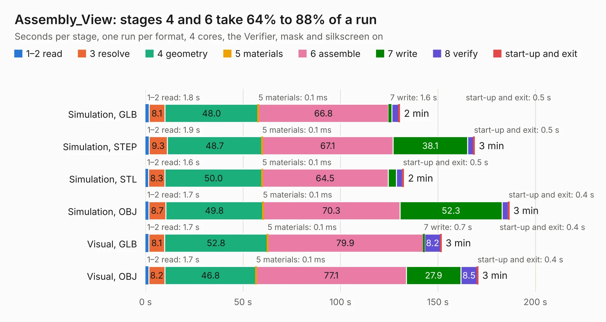

| Mode and format | 1–2 read | 3 resolve | 4 geometry | 5 materials | 6 assemble | 7 write | 8 verify | start-up and exit | Total |
|---|---:|---:|---:|---:|---:|---:|---:|---:|---:|
| Simulation, GLB | 1.8 | 8.1 | 48.0 | 0.1&nbsp;ms | 66.8 | 1.6 | 3.6 | 0.5 | 130.4 |
| Simulation, STEP | 1.9 | 9.3 | 48.7 | 0.1&nbsp;ms | 67.1 | 38.1 | 3.2 | 0.5 | 168.8 |
| Simulation, STL | 1.6 | 8.3 | 50.0 | 0.1&nbsp;ms | 64.5 | 4.2 | 3.2 | 0.5 | 132.4 |
| Simulation, OBJ | 1.7 | 8.7 | 49.8 | 0.1&nbsp;ms | 70.3 | 52.3 | 3.2 | 0.4 | 186.5 |
| Visual, GLB | 1.7 | 8.1 | 52.8 | 0.1&nbsp;ms | 79.9 | 0.7 | 8.2 | 0.4 | 151.8 |
| Visual, OBJ | 1.7 | 8.2 | 46.8 | 0.1&nbsp;ms | 77.1 | 27.9 | 8.5 | 0.4 | 170.5 |

<table align="center"><tr><td valign="top">

| Board | Repo: [isarmg/pcie-switch-2](https://github.com/isarmg/pcie-switch-2) Board: `Assembly_View.kicad_pcb` |
|---|---|
| Folder | outputs / PCIe_3board_RevL / Assembly_View |
| Complexity | 153&nbsp;/&nbsp;1000 (size&nbsp;143, features&nbsp;10) |
| KESE&nbsp;features | rounded, trapezoid or chamfered pads |
| Tested | 9th November 2026 |
| Copper&nbsp;layers | 2 |
| File&nbsp;format | KiCad 10 (20260206) |
| Parts,&nbsp;tracks,&nbsp;vias | 510, 0, 0 |
| Triangles,&nbsp;simulation | 6,665,036 in 9 parts |
| Note | mostly unrouted |
| Verifier | PASS in all six runs |

</td><td valign="top">

<table>
<tr><th>File type</th><th>File size</th><th>Peak memory used</th></tr>
<tr><th colspan="3" align="left">Simulation</th></tr>
<tr><td>GLB</td><td align="right">236&nbsp;MB</td><td align="right">3.1&nbsp;GB</td></tr>
<tr><td>STEP</td><td align="right">1.4&nbsp;GB</td><td align="right">3.7&nbsp;GB</td></tr>
<tr><td>STL</td><td align="right">333&nbsp;MB</td><td align="right">3.0&nbsp;GB</td></tr>
<tr><td>OBJ</td><td align="right">735&nbsp;MB</td><td align="right">4.5&nbsp;GB</td></tr>
<tr><th colspan="3" align="left">Visual</th></tr>
<tr><td>GLB</td><td align="right">138&nbsp;MB</td><td align="right">2.5&nbsp;GB</td></tr>
<tr><td>OBJ</td><td align="right">438&nbsp;MB</td><td align="right">2.8&nbsp;GB</td></tr>
</table>

</td></tr></table>

## 1298. Main_10E1S

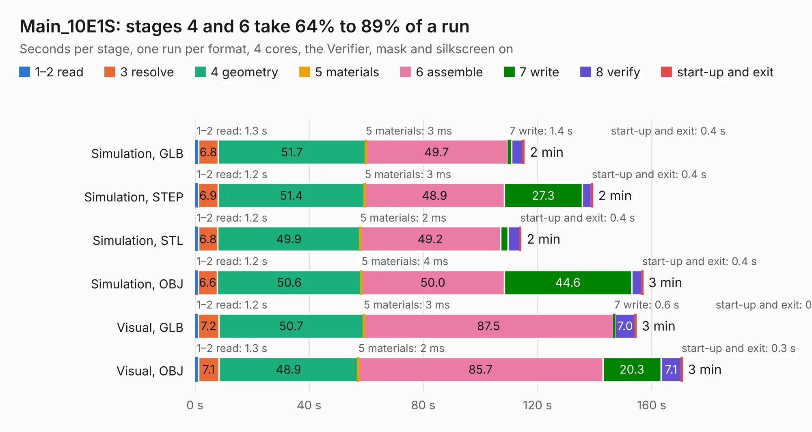

| Mode and format | 1–2 read | 3 resolve | 4 geometry | 5 materials | 6 assemble | 7 write | 8 verify | start-up and exit | Total |
|---|---:|---:|---:|---:|---:|---:|---:|---:|---:|
| Simulation, GLB | 1.3 | 6.8 | 51.7 | 3&nbsp;ms | 49.7 | 1.4 | 4.1 | 0.4 | 115.3 |
| Simulation, STEP | 1.2 | 6.9 | 51.4 | 3&nbsp;ms | 48.9 | 27.3 | 3.2 | 0.4 | 139.2 |
| Simulation, STL | 1.2 | 6.8 | 49.9 | 2&nbsp;ms | 49.2 | 2.6 | 4.2 | 0.4 | 114.2 |
| Simulation, OBJ | 1.2 | 6.6 | 50.6 | 4&nbsp;ms | 50.0 | 44.6 | 3.5 | 0.4 | 156.8 |
| Visual, GLB | 1.2 | 7.2 | 50.7 | 3&nbsp;ms | 87.5 | 0.6 | 7.0 | 0.3 | 154.5 |
| Visual, OBJ | 1.3 | 7.1 | 48.9 | 2&nbsp;ms | 85.7 | 20.3 | 7.1 | 0.3 | 170.7 |

<table align="center"><tr><td valign="top">

| Board | Repo: [isarmg/pcie-switch-2](https://github.com/isarmg/pcie-switch-2) Board: `Main_10E1S.kicad_pcb` |
|---|---|
| Folder | outputs / PCIe_3board_RevL / Main_10E1S |
| Complexity | 382&nbsp;/&nbsp;1000 (size&nbsp;312, features&nbsp;70) |
| KESE&nbsp;features | blind and buried vias, rounded, trapezoid or chamfered pads, filled zones |
| Tested | 9th November 2026 |
| Copper&nbsp;layers | 32 |
| File&nbsp;format | KiCad 10 (20260206) |
| Parts,&nbsp;tracks,&nbsp;vias | 338, 432, 78 |
| Triangles,&nbsp;simulation | 6,983,624 in 1582 parts |
| Verifier | PASS in all six runs |

</td><td valign="top">

<table>
<tr><th>File type</th><th>File size</th><th>Peak memory used</th></tr>
<tr><th colspan="3" align="left">Simulation</th></tr>
<tr><td>GLB</td><td align="right">243&nbsp;MB</td><td align="right">2.9&nbsp;GB</td></tr>
<tr><td>STEP</td><td align="right">1.3&nbsp;GB</td><td align="right">3.4&nbsp;GB</td></tr>
<tr><td>STL</td><td align="right">349&nbsp;MB</td><td align="right">2.9&nbsp;GB</td></tr>
<tr><td>OBJ</td><td align="right">769&nbsp;MB</td><td align="right">4.8&nbsp;GB</td></tr>
<tr><th colspan="3" align="left">Visual</th></tr>
<tr><td>GLB</td><td align="right">129&nbsp;MB</td><td align="right">2.5&nbsp;GB</td></tr>
<tr><td>OBJ</td><td align="right">412&nbsp;MB</td><td align="right">2.7&nbsp;GB</td></tr>
</table>

</td></tr></table>

## 1299. Assembly_View

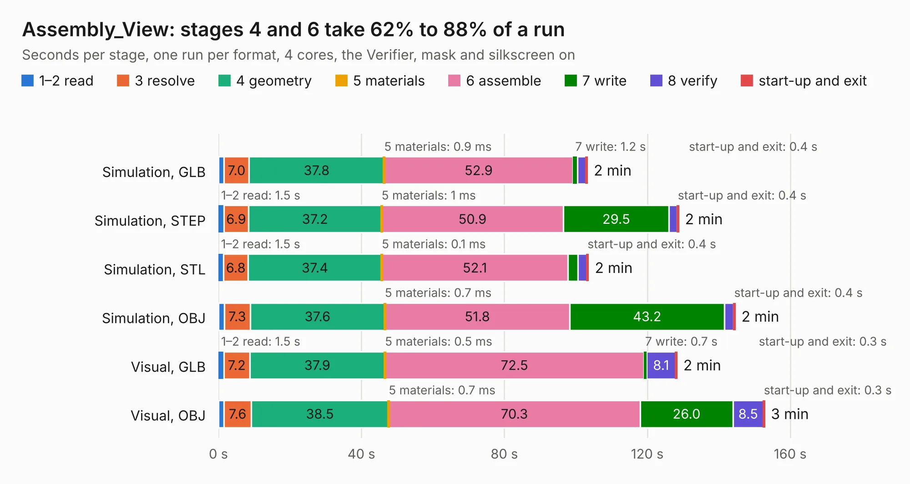

| Mode and format | 1–2 read | 3 resolve | 4 geometry | 5 materials | 6 assemble | 7 write | 8 verify | start-up and exit | Total |
|---|---:|---:|---:|---:|---:|---:|---:|---:|---:|
| Simulation, GLB | 1.6 | 7.0 | 37.8 | 0.9&nbsp;ms | 52.9 | 1.2 | 2.3 | 0.4 | 103.2 |
| Simulation, STEP | 1.5 | 6.9 | 37.2 | 1&nbsp;ms | 50.9 | 29.5 | 2.3 | 0.4 | 128.7 |
| Simulation, STL | 1.5 | 6.8 | 37.4 | 0.1&nbsp;ms | 52.1 | 2.8 | 2.5 | 0.4 | 103.5 |
| Simulation, OBJ | 1.6 | 7.3 | 37.6 | 0.7&nbsp;ms | 51.8 | 43.2 | 2.5 | 0.4 | 144.5 |
| Visual, GLB | 1.5 | 7.2 | 37.9 | 0.5&nbsp;ms | 72.5 | 0.7 | 8.1 | 0.3 | 128.3 |
| Visual, OBJ | 1.6 | 7.6 | 38.5 | 0.7&nbsp;ms | 70.3 | 26.0 | 8.5 | 0.3 | 152.8 |

<table align="center"><tr><td valign="top">

| Board | Repo: [isarmg/pcie-switch-2](https://github.com/isarmg/pcie-switch-2) Board: `Assembly_View.kicad_pcb` |
|---|---|
| Folder | outputs / PCIe_AllM2_RevN / Assembly_View |
| Complexity | 181&nbsp;/&nbsp;1000 (size&nbsp;146, features&nbsp;35) |
| KESE&nbsp;features | custom pads, rounded, trapezoid or chamfered pads, copper drawings |
| Tested | 9th November 2026 |
| Copper&nbsp;layers | 2 |
| File&nbsp;format | KiCad 10 (20260206) |
| Parts,&nbsp;tracks,&nbsp;vias | 696, 0, 0 |
| Triangles,&nbsp;simulation | 7,509,700 in 8 parts |
| Note | mostly unrouted |
| Verifier | PASS in all six runs |

</td><td valign="top">

<table>
<tr><th>File type</th><th>File size</th><th>Peak memory used</th></tr>
<tr><th colspan="3" align="left">Simulation</th></tr>
<tr><td>GLB</td><td align="right">266&nbsp;MB</td><td align="right">3.0&nbsp;GB</td></tr>
<tr><td>STEP</td><td align="right">1.5&nbsp;GB</td><td align="right">3.9&nbsp;GB</td></tr>
<tr><td>STL</td><td align="right">375&nbsp;MB</td><td align="right">3.3&nbsp;GB</td></tr>
<tr><td>OBJ</td><td align="right">830&nbsp;MB</td><td align="right">5.0&nbsp;GB</td></tr>
<tr><th colspan="3" align="left">Visual</th></tr>
<tr><td>GLB</td><td align="right">160&nbsp;MB</td><td align="right">2.7&nbsp;GB</td></tr>
<tr><td>OBJ</td><td align="right">506&nbsp;MB</td><td align="right">3.3&nbsp;GB</td></tr>
</table>

</td></tr></table>

## 1300. Main_23M2

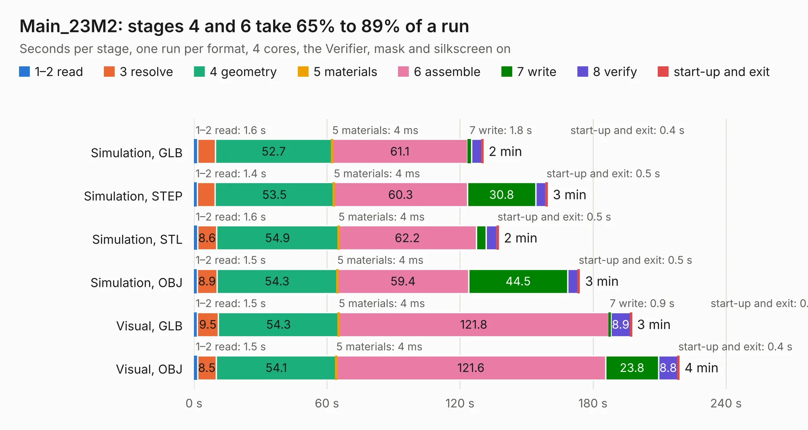

| Mode and format | 1–2 read | 3 resolve | 4 geometry | 5 materials | 6 assemble | 7 write | 8 verify | start-up and exit | Total |
|---|---:|---:|---:|---:|---:|---:|---:|---:|---:|
| Simulation, GLB | 1.6 | 8.0 | 52.7 | 4&nbsp;ms | 61.1 | 1.8 | 4.7 | 0.4 | 130.3 |
| Simulation, STEP | 1.4 | 8.1 | 53.5 | 4&nbsp;ms | 60.3 | 30.8 | 4.6 | 0.5 | 159.3 |
| Simulation, STL | 1.6 | 8.6 | 54.9 | 4&nbsp;ms | 62.2 | 4.3 | 5.0 | 0.5 | 137.2 |
| Simulation, OBJ | 1.5 | 8.9 | 54.3 | 4&nbsp;ms | 59.4 | 44.5 | 4.8 | 0.5 | 173.8 |
| Visual, GLB | 1.5 | 9.5 | 54.3 | 4&nbsp;ms | 121.8 | 0.9 | 8.9 | 0.4 | 197.3 |
| Visual, OBJ | 1.5 | 8.5 | 54.1 | 4&nbsp;ms | 121.6 | 23.8 | 8.8 | 0.4 | 218.7 |

<table align="center"><tr><td valign="top">

| Board | Repo: [isarmg/pcie-switch-2](https://github.com/isarmg/pcie-switch-2) Board: `Main_23M2.kicad_pcb` |
|---|---|
| Folder | outputs / PCIe_AllM2_RevN / Main_23M2 |
| Complexity | 415&nbsp;/&nbsp;1000 (size&nbsp;320, features&nbsp;95) |
| KESE&nbsp;features | blind and buried vias, custom pads, rounded, trapezoid or chamfered pads, filled zones, copper drawings |
| Tested | 9th November 2026 |
| Copper&nbsp;layers | 32 |
| File&nbsp;format | KiCad 10 (20260206) |
| Parts,&nbsp;tracks,&nbsp;vias | 696, 432, 78 |
| Triangles,&nbsp;simulation | 8,133,244 in 2246 parts |
| Verifier | PASS in all six runs |

</td><td valign="top">

<table>
<tr><th>File type</th><th>File size</th><th>Peak memory used</th></tr>
<tr><th colspan="3" align="left">Simulation</th></tr>
<tr><td>GLB</td><td align="right">283&nbsp;MB</td><td align="right">3.0&nbsp;GB</td></tr>
<tr><td>STEP</td><td align="right">1.5&nbsp;GB</td><td align="right">3.8&nbsp;GB</td></tr>
<tr><td>STL</td><td align="right">407&nbsp;MB</td><td align="right">3.2&nbsp;GB</td></tr>
<tr><td>OBJ</td><td align="right">899&nbsp;MB</td><td align="right">5.4&nbsp;GB</td></tr>
<tr><th colspan="3" align="left">Visual</th></tr>
<tr><td>GLB</td><td align="right">162&nbsp;MB</td><td align="right">2.7&nbsp;GB</td></tr>
<tr><td>OBJ</td><td align="right">518&nbsp;MB</td><td align="right">3.4&nbsp;GB</td></tr>
</table>

</td></tr></table>

## 1301. Main_27M2

| Mode and format | 1–2 read | 3 resolve | 4 geometry | 5 materials | 6 assemble | 7 write | 8 verify | start-up and exit | Total |
|---|---:|---:|---:|---:|---:|---:|---:|---:|---:|
| Simulation, GLB | 1.8 | 8.7 | 59.1 | 4&nbsp;ms | 64.7 | 1.6 | 5.9 | 0.5 | 142.3 |
| Simulation, STEP | 1.7 | 8.6 | 58.3 | 4&nbsp;ms | 65.7 | 34.2 | 5.6 | 0.5 | 174.5 |
| Simulation, STL | 1.7 | 8.9 | 57.8 | 4&nbsp;ms | 66.5 | 4.3 | 5.9 | 0.5 | 145.5 |
| Simulation, OBJ | 1.7 | 8.7 | 57.7 | 5&nbsp;ms | 65.7 | 51.6 | 4.9 | 0.4 | 190.7 |
| Visual, GLB | 1.7 | 8.7 | 57.6 | 7&nbsp;ms | 142.2 | 0.8 | 10.0 | 0.4 | 221.4 |
| Visual, OBJ | 1.8 | 8.9 | 58.0 | 5&nbsp;ms | 142.9 | 24.9 | 10.0 | 0.4 | 246.9 |

<table align="center"><tr><td valign="top">

| Board | Repo: [isarmg/pcie-switch-2](https://github.com/isarmg/pcie-switch-2) Board: `Main_27M2.kicad_pcb` |
|---|---|
| Folder | outputs / PCIe_AllM2_RevO / Main_27M2 |
| Complexity | 415&nbsp;/&nbsp;1000 (size&nbsp;320, features&nbsp;95) |
| KESE&nbsp;features | blind and buried vias, custom pads, rounded, trapezoid or chamfered pads, filled zones, copper drawings |
| Tested | 9th November 2026 |
| Copper&nbsp;layers | 32 |
| File&nbsp;format | KiCad 10 (20260206) |
| Parts,&nbsp;tracks,&nbsp;vias | 717, 432, 78 |
| Triangles,&nbsp;simulation | 8,236,800 in 2442 parts |
| Verifier | PASS in all six runs |

</td><td valign="top">

<table>
<tr><th>File type</th><th>File size</th><th>Peak memory used</th></tr>
<tr><th colspan="3" align="left">Simulation</th></tr>
<tr><td>GLB</td><td align="right">287&nbsp;MB</td><td align="right">3.1&nbsp;GB</td></tr>
<tr><td>STEP</td><td align="right">1.6&nbsp;GB</td><td align="right">3.8&nbsp;GB</td></tr>
<tr><td>STL</td><td align="right">412&nbsp;MB</td><td align="right">3.2&nbsp;GB</td></tr>
<tr><td>OBJ</td><td align="right">912&nbsp;MB</td><td align="right">5.5&nbsp;GB</td></tr>
<tr><th colspan="3" align="left">Visual</th></tr>
<tr><td>GLB</td><td align="right">166&nbsp;MB</td><td align="right">2.8&nbsp;GB</td></tr>
<tr><td>OBJ</td><td align="right">529&nbsp;MB</td><td align="right">3.4&nbsp;GB</td></tr>
</table>

</td></tr></table>

## 1302. Assembly_View

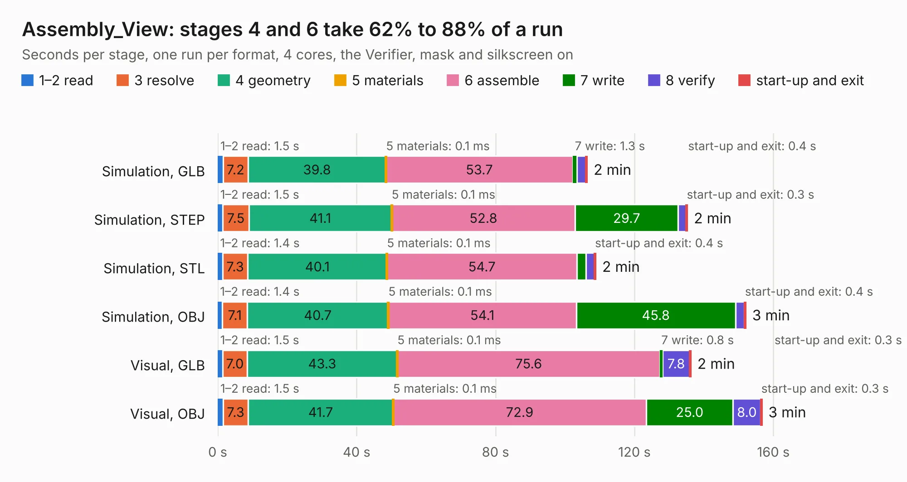

| Mode and format | 1–2 read | 3 resolve | 4 geometry | 5 materials | 6 assemble | 7 write | 8 verify | start-up and exit | Total |
|---|---:|---:|---:|---:|---:|---:|---:|---:|---:|
| Simulation, GLB | 1.5 | 7.2 | 39.8 | 0.1&nbsp;ms | 53.7 | 1.3 | 2.5 | 0.4 | 106.4 |
| Simulation, STEP | 1.5 | 7.5 | 41.1 | 0.1&nbsp;ms | 52.8 | 29.7 | 2.3 | 0.3 | 135.2 |
| Simulation, STL | 1.4 | 7.3 | 40.1 | 0.1&nbsp;ms | 54.7 | 2.7 | 2.4 | 0.4 | 108.8 |
| Simulation, OBJ | 1.4 | 7.1 | 40.7 | 0.1&nbsp;ms | 54.1 | 45.8 | 2.6 | 0.4 | 152.0 |
| Visual, GLB | 1.5 | 7.0 | 43.3 | 0.1&nbsp;ms | 75.6 | 0.8 | 7.8 | 0.3 | 136.2 |
| Visual, OBJ | 1.5 | 7.3 | 41.7 | 0.1&nbsp;ms | 72.9 | 25.0 | 8.0 | 0.3 | 156.7 |

<table align="center"><tr><td valign="top">

| Board | Repo: [isarmg/pcie-switch-2](https://github.com/isarmg/pcie-switch-2) Board: `Assembly_View.kicad_pcb` |
|---|---|
| Folder | outputs / PCIe_AllM2_RevP / Assembly_View |
| Complexity | 180&nbsp;/&nbsp;1000 (size&nbsp;145, features&nbsp;35) |
| KESE&nbsp;features | custom pads, rounded, trapezoid or chamfered pads, copper drawings |
| Tested | 9th November 2026 |
| Copper&nbsp;layers | 2 |
| File&nbsp;format | KiCad 10 (20260206) |
| Parts,&nbsp;tracks,&nbsp;vias | 630, 0, 0 |
| Triangles,&nbsp;simulation | 7,314,096 in 8 parts |
| Note | mostly unrouted |
| Verifier | PASS in all six runs |

</td><td valign="top">

<table>
<tr><th>File type</th><th>File size</th><th>Peak memory used</th></tr>
<tr><th colspan="3" align="left">Simulation</th></tr>
<tr><td>GLB</td><td align="right">259&nbsp;MB</td><td align="right">3.2&nbsp;GB</td></tr>
<tr><td>STEP</td><td align="right">1.5&nbsp;GB</td><td align="right">3.9&nbsp;GB</td></tr>
<tr><td>STL</td><td align="right">366&nbsp;MB</td><td align="right">3.1&nbsp;GB</td></tr>
<tr><td>OBJ</td><td align="right">807&nbsp;MB</td><td align="right">5.0&nbsp;GB</td></tr>
<tr><th colspan="3" align="left">Visual</th></tr>
<tr><td>GLB</td><td align="right">154&nbsp;MB</td><td align="right">2.8&nbsp;GB</td></tr>
<tr><td>OBJ</td><td align="right">486&nbsp;MB</td><td align="right">3.1&nbsp;GB</td></tr>
</table>

</td></tr></table>

## 1303. Main_20M2

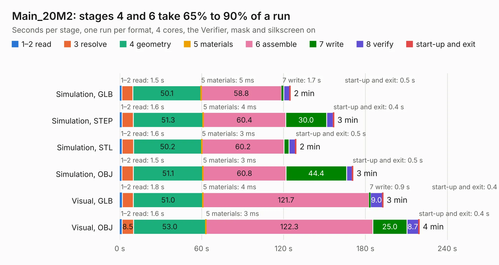

| Mode and format | 1–2 read | 3 resolve | 4 geometry | 5 materials | 6 assemble | 7 write | 8 verify | start-up and exit | Total |
|---|---:|---:|---:|---:|---:|---:|---:|---:|---:|
| Simulation, GLB | 1.5 | 7.9 | 50.1 | 5&nbsp;ms | 58.8 | 1.7 | 4.4 | 0.5 | 125.0 |
| Simulation, STEP | 1.6 | 8.2 | 51.3 | 4&nbsp;ms | 60.4 | 30.0 | 4.9 | 0.4 | 156.8 |
| Simulation, STL | 1.6 | 8.3 | 50.2 | 3&nbsp;ms | 60.2 | 3.7 | 4.7 | 0.5 | 129.2 |
| Simulation, OBJ | 1.5 | 8.3 | 51.1 | 3&nbsp;ms | 60.8 | 44.4 | 4.3 | 0.5 | 170.9 |
| Visual, GLB | 1.8 | 8.2 | 51.0 | 4&nbsp;ms | 121.7 | 0.9 | 9.0 | 0.4 | 192.9 |
| Visual, OBJ | 1.6 | 8.5 | 53.0 | 3&nbsp;ms | 122.3 | 25.0 | 8.7 | 0.4 | 219.4 |

<table align="center"><tr><td valign="top">

| Board | Repo: [isarmg/pcie-switch-2](https://github.com/isarmg/pcie-switch-2) Board: `Main_20M2.kicad_pcb` |
|---|---|
| Folder | outputs / PCIe_AllM2_RevP / Main_20M2 |
| Complexity | 455&nbsp;/&nbsp;1000 (size&nbsp;320, features&nbsp;135) |
| KESE&nbsp;features | blind and buried vias, microvias, custom pads, rounded, trapezoid or chamfered pads, filled zones, copper drawings |
| Tested | 9th November 2026 |
| Copper&nbsp;layers | 32 |
| File&nbsp;format | KiCad 10 (20260206) |
| Parts,&nbsp;tracks,&nbsp;vias | 634, 452, 94 |
| Triangles,&nbsp;simulation | 7,968,712 in 2129 parts |
| Verifier | PASS in all six runs |

</td><td valign="top">

<table>
<tr><th>File type</th><th>File size</th><th>Peak memory used</th></tr>
<tr><th colspan="3" align="left">Simulation</th></tr>
<tr><td>GLB</td><td align="right">277&nbsp;MB</td><td align="right">3.1&nbsp;GB</td></tr>
<tr><td>STEP</td><td align="right">1.5&nbsp;GB</td><td align="right">3.9&nbsp;GB</td></tr>
<tr><td>STL</td><td align="right">399&nbsp;MB</td><td align="right">3.1&nbsp;GB</td></tr>
<tr><td>OBJ</td><td align="right">881&nbsp;MB</td><td align="right">5.3&nbsp;GB</td></tr>
<tr><th colspan="3" align="left">Visual</th></tr>
<tr><td>GLB</td><td align="right">157&nbsp;MB</td><td align="right">2.9&nbsp;GB</td></tr>
<tr><td>OBJ</td><td align="right">500&nbsp;MB</td><td align="right">3.3&nbsp;GB</td></tr>
</table>

</td></tr></table>

## 1304. Main_10E1S

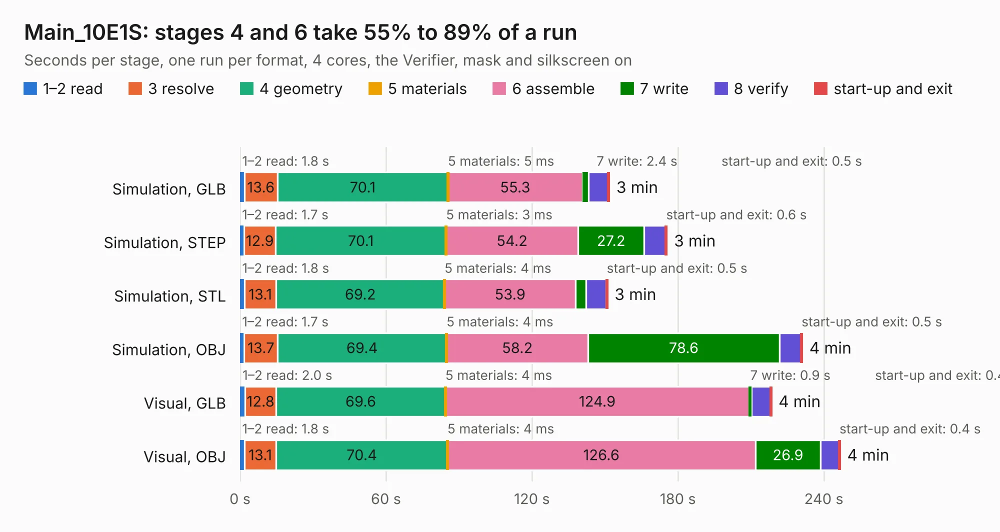

| Mode and format | 1–2 read | 3 resolve | 4 geometry | 5 materials | 6 assemble | 7 write | 8 verify | start-up and exit | Total |
|---|---:|---:|---:|---:|---:|---:|---:|---:|---:|
| Simulation, GLB | 1.8 | 13.6 | 70.1 | 5&nbsp;ms | 55.3 | 2.4 | 8.1 | 0.5 | 151.8 |
| Simulation, STEP | 1.7 | 12.9 | 70.1 | 3&nbsp;ms | 54.2 | 27.2 | 8.8 | 0.6 | 175.5 |
| Simulation, STL | 1.8 | 13.1 | 69.2 | 4&nbsp;ms | 53.9 | 4.3 | 8.2 | 0.5 | 151.1 |
| Simulation, OBJ | 1.7 | 13.7 | 69.4 | 4&nbsp;ms | 58.2 | 78.6 | 8.9 | 0.5 | 231.1 |
| Visual, GLB | 2.0 | 12.8 | 69.6 | 4&nbsp;ms | 124.9 | 0.9 | 7.9 | 0.4 | 218.4 |
| Visual, OBJ | 1.8 | 13.1 | 70.4 | 4&nbsp;ms | 126.6 | 26.9 | 7.5 | 0.4 | 246.7 |

<table align="center"><tr><td valign="top">

| Board | Repo: [isarmg/pcie-switch-2](https://github.com/isarmg/pcie-switch-2) Board: `Main_10E1S.kicad_pcb` |
|---|---|
| Folder | outputs / PCIe_E1S_82x45_FakePEX90064_RevS / Main_10E1S |
| Complexity | 410&nbsp;/&nbsp;1000 (size&nbsp;340, features&nbsp;70) |
| KESE&nbsp;features | blind and buried vias, rounded, trapezoid or chamfered pads, filled zones |
| Tested | 9th November 2026 |
| Copper&nbsp;layers | 32 |
| File&nbsp;format | KiCad 10 (20260206) |
| Parts,&nbsp;tracks,&nbsp;vias | 344, 2,245, 488 |
| Triangles,&nbsp;simulation | 11,626,382 in 1479 parts |
| Verifier | PASS in all six runs |

</td><td valign="top">

<table>
<tr><th>File type</th><th>File size</th><th>Peak memory used</th></tr>
<tr><th colspan="3" align="left">Simulation</th></tr>
<tr><td>GLB</td><td align="right">396&nbsp;MB</td><td align="right">3.0&nbsp;GB</td></tr>
<tr><td>STEP</td><td align="right">1.3&nbsp;GB</td><td align="right">3.7&nbsp;GB</td></tr>
<tr><td>STL</td><td align="right">581&nbsp;MB</td><td align="right">2.8&nbsp;GB</td></tr>
<tr><td>OBJ</td><td align="right">1.3&nbsp;GB</td><td align="right">7.3&nbsp;GB</td></tr>
<tr><th colspan="3" align="left">Visual</th></tr>
<tr><td>GLB</td><td align="right">138&nbsp;MB</td><td align="right">2.8&nbsp;GB</td></tr>
<tr><td>OBJ</td><td align="right">476&nbsp;MB</td><td align="right">3.3&nbsp;GB</td></tr>
</table>

</td></tr></table>

## 1305. Main_10E1S

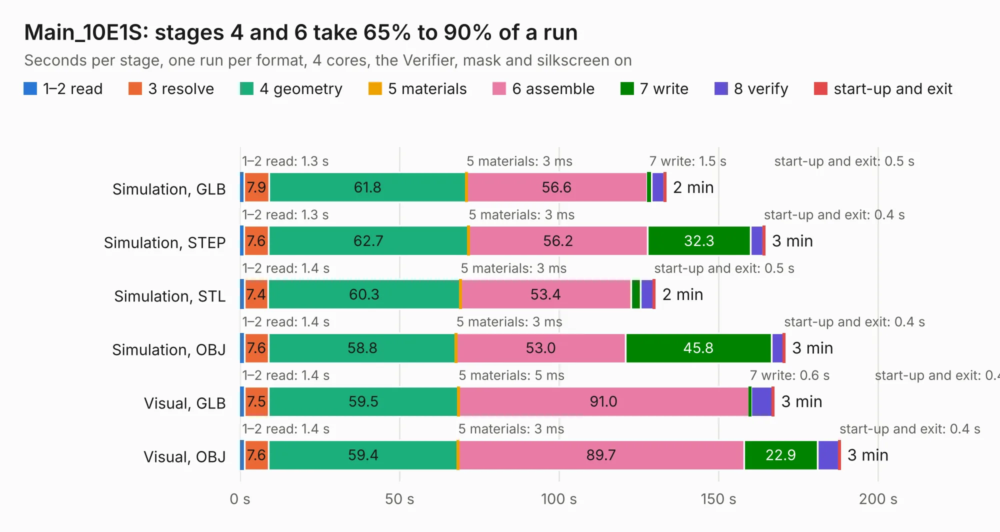

| Mode and format | 1–2 read | 3 resolve | 4 geometry | 5 materials | 6 assemble | 7 write | 8 verify | start-up and exit | Total |
|---|---:|---:|---:|---:|---:|---:|---:|---:|---:|
| Simulation, GLB | 1.3 | 7.9 | 61.8 | 3&nbsp;ms | 56.6 | 1.5 | 3.9 | 0.5 | 133.3 |
| Simulation, STEP | 1.3 | 7.6 | 62.7 | 3&nbsp;ms | 56.2 | 32.3 | 3.9 | 0.4 | 164.4 |
| Simulation, STL | 1.4 | 7.4 | 60.3 | 3&nbsp;ms | 53.4 | 3.0 | 4.0 | 0.5 | 130.0 |
| Simulation, OBJ | 1.4 | 7.6 | 58.8 | 3&nbsp;ms | 53.0 | 45.8 | 3.8 | 0.4 | 170.7 |
| Visual, GLB | 1.4 | 7.5 | 59.5 | 5&nbsp;ms | 91.0 | 0.6 | 6.8 | 0.4 | 167.3 |
| Visual, OBJ | 1.4 | 7.6 | 59.4 | 3&nbsp;ms | 89.7 | 22.9 | 6.8 | 0.4 | 188.0 |

<table align="center"><tr><td valign="top">

| Board | Repo: [isarmg/pcie-switch-2](https://github.com/isarmg/pcie-switch-2) Board: `Main_10E1S.kicad_pcb` |
|---|---|
| Folder | outputs / PCIe_E1S_82x45_RevR / Main_10E1S |
| Complexity | 386&nbsp;/&nbsp;1000 (size&nbsp;316, features&nbsp;70) |
| KESE&nbsp;features | blind and buried vias, rounded, trapezoid or chamfered pads, filled zones |
| Tested | 9th November 2026 |
| Copper&nbsp;layers | 32 |
| File&nbsp;format | KiCad 10 (20260206) |
| Parts,&nbsp;tracks,&nbsp;vias | 264, 770, 78 |
| Triangles,&nbsp;simulation | 6,917,600 in 1546 parts |
| Verifier | PASS in all six runs |

</td><td valign="top">

<table>
<tr><th>File type</th><th>File size</th><th>Peak memory used</th></tr>
<tr><th colspan="3" align="left">Simulation</th></tr>
<tr><td>GLB</td><td align="right">240&nbsp;MB</td><td align="right">2.9&nbsp;GB</td></tr>
<tr><td>STEP</td><td align="right">1.3&nbsp;GB</td><td align="right">3.4&nbsp;GB</td></tr>
<tr><td>STL</td><td align="right">346&nbsp;MB</td><td align="right">2.7&nbsp;GB</td></tr>
<tr><td>OBJ</td><td align="right">761&nbsp;MB</td><td align="right">4.7&nbsp;GB</td></tr>
<tr><th colspan="3" align="left">Visual</th></tr>
<tr><td>GLB</td><td align="right">126&nbsp;MB</td><td align="right">2.6&nbsp;GB</td></tr>
<tr><td>OBJ</td><td align="right">402&nbsp;MB</td><td align="right">2.7&nbsp;GB</td></tr>
</table>

</td></tr></table>

## 1306. Main_10E1S

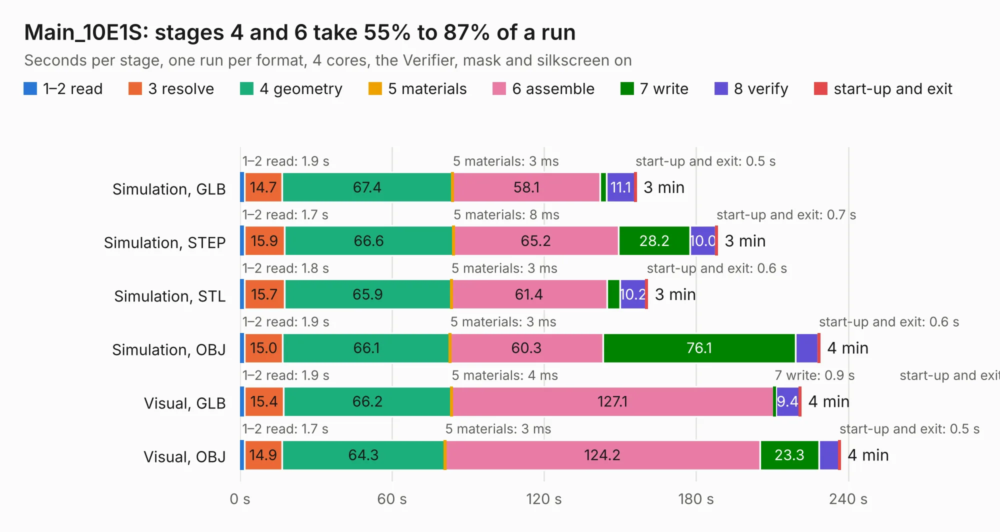

| Mode and format | 1–2 read | 3 resolve | 4 geometry | 5 materials | 6 assemble | 7 write | 8 verify | start-up and exit | Total |
|---|---:|---:|---:|---:|---:|---:|---:|---:|---:|
| Simulation, GLB | 1.9 | 14.7 | 67.4 | 3&nbsp;ms | 58.1 | 2.6 | 11.1 | 0.5 | 156.3 |
| Simulation, STEP | 1.7 | 15.9 | 66.6 | 8&nbsp;ms | 65.2 | 28.2 | 10.0 | 0.7 | 188.3 |
| Simulation, STL | 1.8 | 15.7 | 65.9 | 3&nbsp;ms | 61.4 | 5.2 | 10.2 | 0.6 | 160.8 |
| Simulation, OBJ | 1.9 | 15.0 | 66.1 | 3&nbsp;ms | 60.3 | 76.1 | 8.9 | 0.6 | 228.7 |
| Visual, GLB | 1.9 | 15.4 | 66.2 | 4&nbsp;ms | 127.1 | 0.9 | 9.4 | 0.4 | 221.2 |
| Visual, OBJ | 1.7 | 14.9 | 64.3 | 3&nbsp;ms | 124.2 | 23.3 | 7.8 | 0.5 | 236.7 |

<table align="center"><tr><td valign="top">

| Board | Repo: [isarmg/pcie-switch-2](https://github.com/isarmg/pcie-switch-2) Board: `Main_10E1S.kicad_pcb` |
|---|---|
| Folder | outputs / PCIe_E1S_82x45_TB3Host_RevT / Main_10E1S |
| Complexity | 435&nbsp;/&nbsp;1000 (size&nbsp;365, features&nbsp;70) |
| KESE&nbsp;features | blind and buried vias, rounded, trapezoid or chamfered pads, filled zones |
| Tested | 9th November 2026 |
| Copper&nbsp;layers | 32 |
| File&nbsp;format | KiCad 10 (20260206) |
| Parts,&nbsp;tracks,&nbsp;vias | 479, 6,525, 802 |
| Triangles,&nbsp;simulation | 15,370,960 in 1670 parts |
| Verifier | PASS in all six runs |

</td><td valign="top">

<table>
<tr><th>File type</th><th>File size</th><th>Peak memory used</th></tr>
<tr><th colspan="3" align="left">Simulation</th></tr>
<tr><td>GLB</td><td align="right">522&nbsp;MB</td><td align="right">3.6&nbsp;GB</td></tr>
<tr><td>STEP</td><td align="right">1.6&nbsp;GB</td><td align="right">4.7&nbsp;GB</td></tr>
<tr><td>STL</td><td align="right">769&nbsp;MB</td><td align="right">3.7&nbsp;GB</td></tr>
<tr><td>OBJ</td><td align="right">1.7&nbsp;GB</td><td align="right">9.7&nbsp;GB</td></tr>
<tr><th colspan="3" align="left">Visual</th></tr>
<tr><td>GLB</td><td align="right">167&nbsp;MB</td><td align="right">3.2&nbsp;GB</td></tr>
<tr><td>OBJ</td><td align="right">591&nbsp;MB</td><td align="right">4.0&nbsp;GB</td></tr>
</table>

</td></tr></table>

## 1307. Main_10E1S

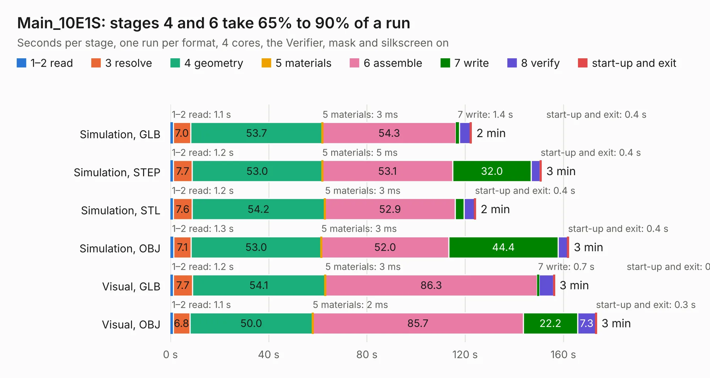

| Mode and format | 1–2 read | 3 resolve | 4 geometry | 5 materials | 6 assemble | 7 write | 8 verify | start-up and exit | Total |
|---|---:|---:|---:|---:|---:|---:|---:|---:|---:|
| Simulation, GLB | 1.1 | 7.0 | 53.7 | 3&nbsp;ms | 54.3 | 1.4 | 4.5 | 0.4 | 122.5 |
| Simulation, STEP | 1.2 | 7.7 | 53.0 | 5&nbsp;ms | 53.1 | 32.0 | 3.6 | 0.4 | 151.0 |
| Simulation, STL | 1.2 | 7.6 | 54.2 | 3&nbsp;ms | 52.9 | 3.7 | 4.3 | 0.4 | 124.2 |
| Simulation, OBJ | 1.3 | 7.1 | 53.0 | 3&nbsp;ms | 52.0 | 44.4 | 3.9 | 0.4 | 162.2 |
| Visual, GLB | 1.2 | 7.7 | 54.1 | 3&nbsp;ms | 86.3 | 0.7 | 6.0 | 0.4 | 156.4 |
| Visual, OBJ | 1.1 | 6.8 | 50.0 | 2&nbsp;ms | 85.7 | 22.2 | 7.3 | 0.3 | 173.5 |

<table align="center"><tr><td valign="top">

| Board | Repo: [isarmg/pcie-switch-2](https://github.com/isarmg/pcie-switch-2) Board: `Main_10E1S.kicad_pcb` |
|---|---|
| Folder | outputs / PCIe_E1S_Only_RevQ / Main_10E1S |
| Complexity | 379&nbsp;/&nbsp;1000 (size&nbsp;309, features&nbsp;70) |
| KESE&nbsp;features | blind and buried vias, rounded, trapezoid or chamfered pads, filled zones |
| Tested | 9th November 2026 |
| Copper&nbsp;layers | 32 |
| File&nbsp;format | KiCad 10 (20260206) |
| Parts,&nbsp;tracks,&nbsp;vias | 264, 432, 78 |
| Triangles,&nbsp;simulation | 6,915,136 in 1546 parts |
| Verifier | PASS in all six runs |

</td><td valign="top">

<table>
<tr><th>File type</th><th>File size</th><th>Peak memory used</th></tr>
<tr><th colspan="3" align="left">Simulation</th></tr>
<tr><td>GLB</td><td align="right">240&nbsp;MB</td><td align="right">2.8&nbsp;GB</td></tr>
<tr><td>STEP</td><td align="right">1.3&nbsp;GB</td><td align="right">3.6&nbsp;GB</td></tr>
<tr><td>STL</td><td align="right">346&nbsp;MB</td><td align="right">2.9&nbsp;GB</td></tr>
<tr><td>OBJ</td><td align="right">761&nbsp;MB</td><td align="right">4.7&nbsp;GB</td></tr>
<tr><th colspan="3" align="left">Visual</th></tr>
<tr><td>GLB</td><td align="right">126&nbsp;MB</td><td align="right">2.4&nbsp;GB</td></tr>
<tr><td>OBJ</td><td align="right">403&nbsp;MB</td><td align="right">2.5&nbsp;GB</td></tr>
</table>

</td></tr></table>

## 1308. Assembly_View

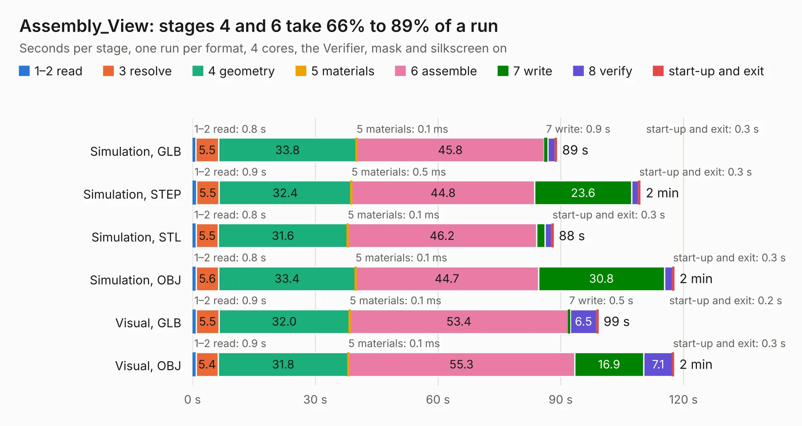

| Mode and format | 1–2 read | 3 resolve | 4 geometry | 5 materials | 6 assemble | 7 write | 8 verify | start-up and exit | Total |
|---|---:|---:|---:|---:|---:|---:|---:|---:|---:|
| Simulation, GLB | 0.8 | 5.5 | 33.8 | 0.1&nbsp;ms | 45.8 | 0.9 | 1.7 | 0.3 | 89.0 |
| Simulation, STEP | 0.9 | 5.5 | 32.4 | 0.5&nbsp;ms | 44.8 | 23.6 | 1.7 | 0.3 | 109.4 |
| Simulation, STL | 0.8 | 5.5 | 31.6 | 0.1&nbsp;ms | 46.2 | 2.0 | 1.7 | 0.3 | 88.1 |
| Simulation, OBJ | 0.8 | 5.6 | 33.4 | 0.1&nbsp;ms | 44.7 | 30.8 | 2.0 | 0.3 | 117.6 |
| Visual, GLB | 0.9 | 5.5 | 32.0 | 0.1&nbsp;ms | 53.4 | 0.5 | 6.5 | 0.2 | 99.1 |
| Visual, OBJ | 0.9 | 5.4 | 31.8 | 0.1&nbsp;ms | 55.3 | 16.9 | 7.1 | 0.3 | 117.6 |

<table align="center"><tr><td valign="top">

| Board | Repo: [isarmg/pcie-switch-2](https://github.com/isarmg/pcie-switch-2) Board: `Assembly_View.kicad_pcb` |
|---|---|
| Folder | outputs / PCIe_Main_RevM / Assembly_View |
| Complexity | 149&nbsp;/&nbsp;1000 (size&nbsp;139, features&nbsp;10) |
| KESE&nbsp;features | rounded, trapezoid or chamfered pads |
| Tested | 9th November 2026 |
| Copper&nbsp;layers | 2 |
| File&nbsp;format | KiCad 10 (20260206) |
| Parts,&nbsp;tracks,&nbsp;vias | 364, 0, 0 |
| Triangles,&nbsp;simulation | 6,504,356 in 9 parts |
| Note | mostly unrouted |
| Verifier | PASS in all six runs |

</td><td valign="top">

<table>
<tr><th>File type</th><th>File size</th><th>Peak memory used</th></tr>
<tr><th colspan="3" align="left">Simulation</th></tr>
<tr><td>GLB</td><td align="right">229&nbsp;MB</td><td align="right">2.7&nbsp;GB</td></tr>
<tr><td>STEP</td><td align="right">1.3&nbsp;GB</td><td align="right">3.5&nbsp;GB</td></tr>
<tr><td>STL</td><td align="right">325&nbsp;MB</td><td align="right">2.9&nbsp;GB</td></tr>
<tr><td>OBJ</td><td align="right">715&nbsp;MB</td><td align="right">4.5&nbsp;GB</td></tr>
<tr><th colspan="3" align="left">Visual</th></tr>
<tr><td>GLB</td><td align="right">132&nbsp;MB</td><td align="right">2.4&nbsp;GB</td></tr>
<tr><td>OBJ</td><td align="right">417&nbsp;MB</td><td align="right">2.7&nbsp;GB</td></tr>
</table>

</td></tr></table>

## 1309. Main_10E1S

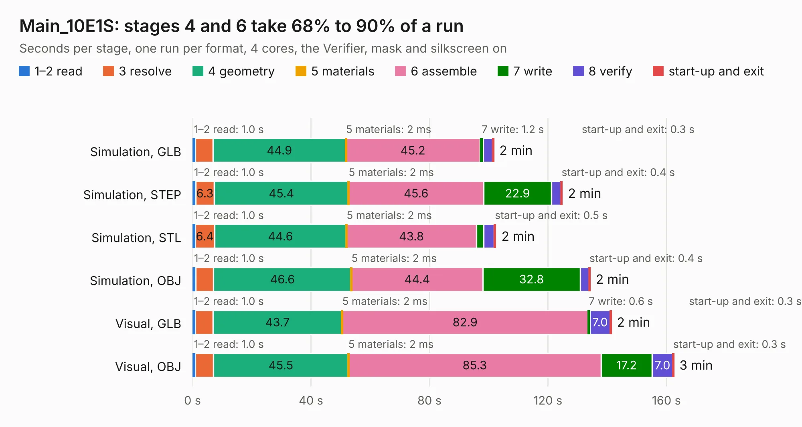

| Mode and format | 1–2 read | 3 resolve | 4 geometry | 5 materials | 6 assemble | 7 write | 8 verify | start-up and exit | Total |
|---|---:|---:|---:|---:|---:|---:|---:|---:|---:|
| Simulation, GLB | 1.0 | 5.9 | 44.9 | 2&nbsp;ms | 45.2 | 1.2 | 3.1 | 0.3 | 101.6 |
| Simulation, STEP | 1.0 | 6.3 | 45.4 | 2&nbsp;ms | 45.6 | 22.9 | 3.2 | 0.4 | 124.8 |
| Simulation, STL | 1.0 | 6.4 | 44.6 | 2&nbsp;ms | 43.8 | 2.5 | 3.6 | 0.5 | 102.4 |
| Simulation, OBJ | 1.0 | 6.0 | 46.6 | 2&nbsp;ms | 44.4 | 32.8 | 3.0 | 0.4 | 134.2 |
| Visual, GLB | 1.0 | 5.9 | 43.7 | 2&nbsp;ms | 82.9 | 0.6 | 7.0 | 0.3 | 141.3 |
| Visual, OBJ | 1.0 | 6.1 | 45.5 | 2&nbsp;ms | 85.3 | 17.2 | 7.0 | 0.3 | 162.5 |

<table align="center"><tr><td valign="top">

| Board | Repo: [isarmg/pcie-switch-2](https://github.com/isarmg/pcie-switch-2) Board: `Main_10E1S.kicad_pcb` |
|---|---|
| Folder | outputs / PCIe_Main_RevM / Main_10E1S |
| Complexity | 383&nbsp;/&nbsp;1000 (size&nbsp;313, features&nbsp;70) |
| KESE&nbsp;features | blind and buried vias, rounded, trapezoid or chamfered pads, filled zones |
| Tested | 9th November 2026 |
| Copper&nbsp;layers | 32 |
| File&nbsp;format | KiCad 10 (20260206) |
| Parts,&nbsp;tracks,&nbsp;vias | 364, 432, 78 |
| Triangles,&nbsp;simulation | 7,157,680 in 1710 parts |
| Verifier | PASS in all six runs |

</td><td valign="top">

<table>
<tr><th>File type</th><th>File size</th><th>Peak memory used</th></tr>
<tr><th colspan="3" align="left">Simulation</th></tr>
<tr><td>GLB</td><td align="right">249&nbsp;MB</td><td align="right">2.8&nbsp;GB</td></tr>
<tr><td>STEP</td><td align="right">1.4&nbsp;GB</td><td align="right">3.5&nbsp;GB</td></tr>
<tr><td>STL</td><td align="right">358&nbsp;MB</td><td align="right">2.7&nbsp;GB</td></tr>
<tr><td>OBJ</td><td align="right">789&nbsp;MB</td><td align="right">4.8&nbsp;GB</td></tr>
<tr><th colspan="3" align="left">Visual</th></tr>
<tr><td>GLB</td><td align="right">135&nbsp;MB</td><td align="right">2.5&nbsp;GB</td></tr>
<tr><td>OBJ</td><td align="right">431&nbsp;MB</td><td align="right">2.9&nbsp;GB</td></tr>
</table>

</td></tr></table>

## 1310. BAGEL-MK1

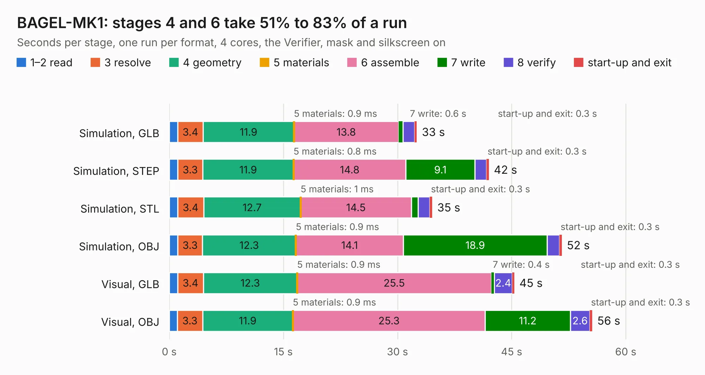

| Mode and format | 1–2 read | 3 resolve | 4 geometry | 5 materials | 6 assemble | 7 write | 8 verify | start-up and exit | Total |
|---|---:|---:|---:|---:|---:|---:|---:|---:|---:|
| Simulation, GLB | 1.1 | 3.4 | 11.9 | 0.9&nbsp;ms | 13.8 | 0.6 | 1.5 | 0.3 | 32.5 |
| Simulation, STEP | 1.1 | 3.3 | 11.9 | 0.8&nbsp;ms | 14.8 | 9.1 | 1.5 | 0.3 | 42.0 |
| Simulation, STL | 1.1 | 3.4 | 12.7 | 1&nbsp;ms | 14.5 | 0.9 | 1.5 | 0.3 | 34.6 |
| Simulation, OBJ | 1.1 | 3.3 | 12.3 | 0.9&nbsp;ms | 14.1 | 18.9 | 1.6 | 0.3 | 51.6 |
| Visual, GLB | 1.1 | 3.4 | 12.3 | 0.9&nbsp;ms | 25.5 | 0.4 | 2.4 | 0.3 | 45.4 |
| Visual, OBJ | 1.1 | 3.3 | 11.9 | 0.9&nbsp;ms | 25.3 | 11.2 | 2.6 | 0.3 | 55.6 |

<table align="center"><tr><td valign="top">

| Board | Repo: [issuiuc/iss-pcb](https://github.com/issuiuc/iss-pcb) Board: `BAGEL-MK1.kicad_pcb` |
|---|---|
| Folder | boards / BAGEL-MK1 / BAGEL-MK1-revA |
| Complexity | 402&nbsp;/&nbsp;1000 (size&nbsp;272, features&nbsp;130) |
| KESE&nbsp;features | through vias, custom pads, rounded, trapezoid or chamfered pads, arc tracks, filled zones, copper drawings, curved board outline, stack-up, dielectric εr and tanδ, mask and silkscreen colours |
| Tested | 9th November 2026 |
| Copper&nbsp;layers | 4 |
| File&nbsp;format | KiCad 9 (20241229) |
| Parts,&nbsp;tracks,&nbsp;vias | 192, 1,077, 525 |
| Triangles,&nbsp;simulation | 3,057,576 in 196 parts |
| Verifier | PASS in all six runs |

</td><td valign="top">

<table>
<tr><th>File type</th><th>File size</th><th>Peak memory used</th></tr>
<tr><th colspan="3" align="left">Simulation</th></tr>
<tr><td>GLB</td><td align="right">105&nbsp;MB</td><td align="right">923&nbsp;MB</td></tr>
<tr><td>STEP</td><td align="right">408&nbsp;MB</td><td align="right">1.2&nbsp;GB</td></tr>
<tr><td>STL</td><td align="right">153&nbsp;MB</td><td align="right">966&nbsp;MB</td></tr>
<tr><td>OBJ</td><td align="right">330&nbsp;MB</td><td align="right">2.1&nbsp;GB</td></tr>
<tr><th colspan="3" align="left">Visual</th></tr>
<tr><td>GLB</td><td align="right">61&nbsp;MB</td><td align="right">1.1&nbsp;GB</td></tr>
<tr><td>OBJ</td><td align="right">194&nbsp;MB</td><td align="right">1.3&nbsp;GB</td></tr>
</table>

</td></tr></table>

## 1311. BAGEL-MK1.1-Avocado

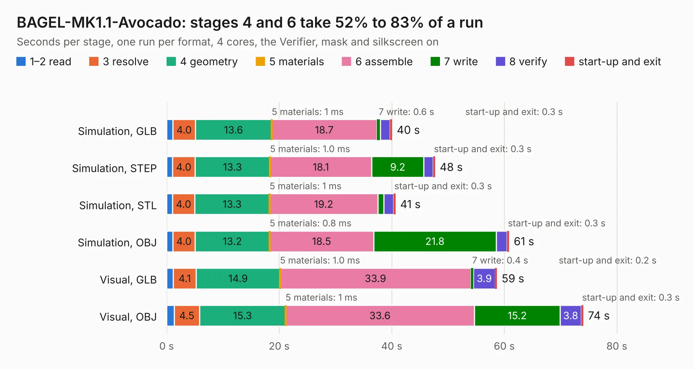

| Mode and format | 1–2 read | 3 resolve | 4 geometry | 5 materials | 6 assemble | 7 write | 8 verify | start-up and exit | Total |
|---|---:|---:|---:|---:|---:|---:|---:|---:|---:|
| Simulation, GLB | 1.1 | 4.0 | 13.6 | 1&nbsp;ms | 18.7 | 0.6 | 1.7 | 0.3 | 40.0 |
| Simulation, STEP | 1.1 | 4.0 | 13.3 | 1.0&nbsp;ms | 18.1 | 9.2 | 1.7 | 0.3 | 47.6 |
| Simulation, STL | 1.0 | 4.0 | 13.3 | 1&nbsp;ms | 19.2 | 1.1 | 1.7 | 0.3 | 40.6 |
| Simulation, OBJ | 1.1 | 4.0 | 13.2 | 0.8&nbsp;ms | 18.5 | 21.8 | 1.9 | 0.3 | 60.8 |
| Visual, GLB | 1.2 | 4.1 | 14.9 | 1.0&nbsp;ms | 33.9 | 0.4 | 3.9 | 0.2 | 58.6 |
| Visual, OBJ | 1.3 | 4.5 | 15.3 | 1&nbsp;ms | 33.6 | 15.2 | 3.8 | 0.3 | 74.0 |

<table align="center"><tr><td valign="top">

| Board | Repo: [issuiuc/iss-pcb](https://github.com/issuiuc/iss-pcb) Board: `BAGEL-MK1.1-Avocado.kicad_pcb` |
|---|---|
| Folder | boards / BAGEL-MK1 / BAGEL-MK1.1-Avocado |
| Complexity | 411&nbsp;/&nbsp;1000 (size&nbsp;281, features&nbsp;130) |
| KESE&nbsp;features | through vias, custom pads, rounded, trapezoid or chamfered pads, arc tracks, filled zones, copper drawings, curved board outline, stack-up, dielectric εr and tanδ, mask and silkscreen colours |
| Tested | 9th November 2026 |
| Copper&nbsp;layers | 4 |
| File&nbsp;format | KiCad 9 (20241229) |
| Parts,&nbsp;tracks,&nbsp;vias | 204, 2,048, 820 |
| Triangles,&nbsp;simulation | 3,889,388 in 216 parts |
| Verifier | PASS in all six runs |

</td><td valign="top">

<table>
<tr><th>File type</th><th>File size</th><th>Peak memory used</th></tr>
<tr><th colspan="3" align="left">Simulation</th></tr>
<tr><td>GLB</td><td align="right">133&nbsp;MB</td><td align="right">1.1&nbsp;GB</td></tr>
<tr><td>STEP</td><td align="right">495&nbsp;MB</td><td align="right">1.4&nbsp;GB</td></tr>
<tr><td>STL</td><td align="right">194&nbsp;MB</td><td align="right">1.1&nbsp;GB</td></tr>
<tr><td>OBJ</td><td align="right">420&nbsp;MB</td><td align="right">2.6&nbsp;GB</td></tr>
<tr><th colspan="3" align="left">Visual</th></tr>
<tr><td>GLB</td><td align="right">78&nbsp;MB</td><td align="right">1.4&nbsp;GB</td></tr>
<tr><td>OBJ</td><td align="right">252&nbsp;MB</td><td align="right">1.8&nbsp;GB</td></tr>
</table>

</td></tr></table>

## 1312. BAGEL-MK1.1-Butter

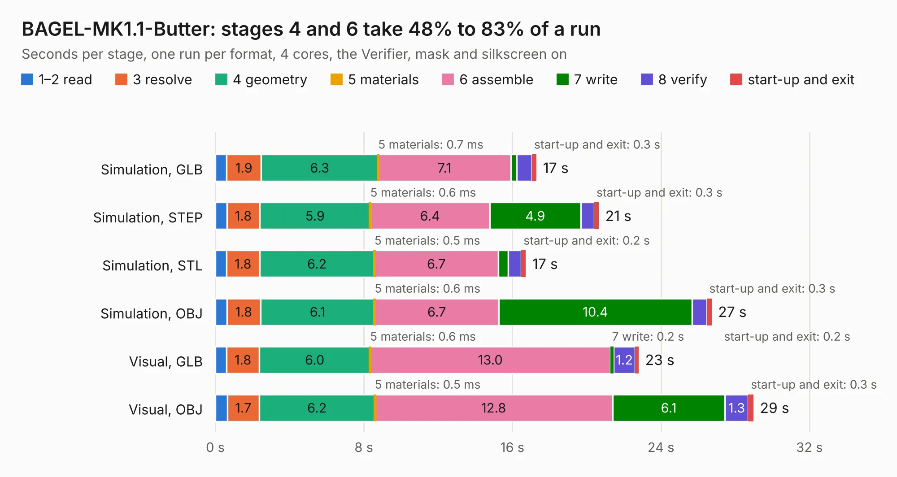

| Mode and format | 1–2 read | 3 resolve | 4 geometry | 5 materials | 6 assemble | 7 write | 8 verify | start-up and exit | Total |
|---|---:|---:|---:|---:|---:|---:|---:|---:|---:|
| Simulation, GLB | 0.6 | 1.9 | 6.3 | 0.7&nbsp;ms | 7.1 | 0.3 | 0.8 | 0.3 | 17.3 |
| Simulation, STEP | 0.6 | 1.8 | 5.9 | 0.6&nbsp;ms | 6.4 | 4.9 | 0.7 | 0.3 | 20.7 |
| Simulation, STL | 0.6 | 1.8 | 6.2 | 0.5&nbsp;ms | 6.7 | 0.5 | 0.7 | 0.2 | 16.7 |
| Simulation, OBJ | 0.6 | 1.8 | 6.1 | 0.6&nbsp;ms | 6.7 | 10.4 | 0.8 | 0.3 | 26.7 |
| Visual, GLB | 0.6 | 1.8 | 6.0 | 0.6&nbsp;ms | 13.0 | 0.2 | 1.2 | 0.2 | 22.8 |
| Visual, OBJ | 0.6 | 1.7 | 6.2 | 0.5&nbsp;ms | 12.8 | 6.1 | 1.3 | 0.3 | 29.0 |

<table align="center"><tr><td valign="top">

| Board | Repo: [issuiuc/iss-pcb](https://github.com/issuiuc/iss-pcb) Board: `BAGEL-MK1.1-Butter.kicad_pcb` |
|---|---|
| Folder | boards / BAGEL-MK1 / BAGEL-MK1.1-Butter |
| Complexity | 391&nbsp;/&nbsp;1000 (size&nbsp;261, features&nbsp;130) |
| KESE&nbsp;features | through vias, custom pads, rounded, trapezoid or chamfered pads, arc tracks, filled zones, copper drawings, curved board outline, stack-up, dielectric εr and tanδ, mask and silkscreen colours |
| Tested | 9th November 2026 |
| Copper&nbsp;layers | 4 |
| File&nbsp;format | KiCad 9 (20241229) |
| Parts,&nbsp;tracks,&nbsp;vias | 120, 754, 378 |
| Triangles,&nbsp;simulation | 1,967,478 in 123 parts |
| Verifier | PASS in all six runs |

</td><td valign="top">

<table>
<tr><th>File type</th><th>File size</th><th>Peak memory used</th></tr>
<tr><th colspan="3" align="left">Simulation</th></tr>
<tr><td>GLB</td><td align="right">68&nbsp;MB</td><td align="right">706&nbsp;MB</td></tr>
<tr><td>STEP</td><td align="right">248&nbsp;MB</td><td align="right">837&nbsp;MB</td></tr>
<tr><td>STL</td><td align="right">98&nbsp;MB</td><td align="right">698&nbsp;MB</td></tr>
<tr><td>OBJ</td><td align="right">209&nbsp;MB</td><td align="right">1.3&nbsp;GB</td></tr>
<tr><th colspan="3" align="left">Visual</th></tr>
<tr><td>GLB</td><td align="right">39&nbsp;MB</td><td align="right">855&nbsp;MB</td></tr>
<tr><td>OBJ</td><td align="right">123&nbsp;MB</td><td align="right">923&nbsp;MB</td></tr>
</table>

</td></tr></table>

## 1313. SG_CAM

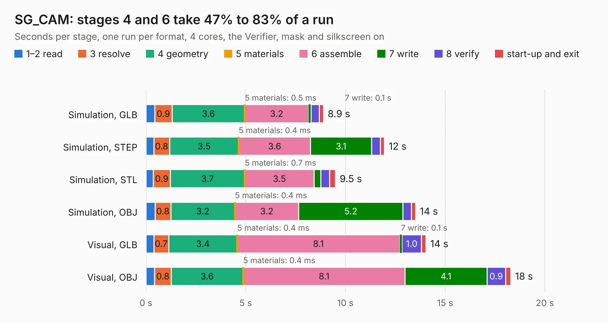

| Mode and format | 1–2 read | 3 resolve | 4 geometry | 5 materials | 6 assemble | 7 write | 8 verify | start-up and exit | Total |
|---|---:|---:|---:|---:|---:|---:|---:|---:|---:|
| Simulation, GLB | 0.4 | 0.9 | 3.6 | 0.5&nbsp;ms | 3.2 | 0.1 | 0.4 | 0.2 | 8.9 |
| Simulation, STEP | 0.4 | 0.8 | 3.5 | 0.4&nbsp;ms | 3.6 | 3.1 | 0.4 | 0.2 | 12.0 |
| Simulation, STL | 0.4 | 0.9 | 3.7 | 0.7&nbsp;ms | 3.5 | 0.3 | 0.4 | 0.3 | 9.5 |
| Simulation, OBJ | 0.5 | 0.8 | 3.2 | 0.4&nbsp;ms | 3.2 | 5.2 | 0.4 | 0.2 | 13.5 |
| Visual, GLB | 0.4 | 0.7 | 3.4 | 0.4&nbsp;ms | 8.1 | 0.1 | 1.0 | 0.2 | 14.0 |
| Visual, OBJ | 0.4 | 0.8 | 3.6 | 0.4&nbsp;ms | 8.1 | 4.1 | 0.9 | 0.3 | 18.3 |

<table align="center"><tr><td valign="top">

| Board | Repo: [issuiuc/iss-pcb](https://github.com/issuiuc/iss-pcb) Board: `SG_CAM.kicad_pcb` |
|---|---|
| Folder | boards / CAM-MK1 |
| Complexity | 326&nbsp;/&nbsp;1000 (size&nbsp;216, features&nbsp;110) |
| KESE&nbsp;features | through vias, slotted holes, rounded, trapezoid or chamfered pads, filled zones, curved board outline, TrueType text, stack-up, dielectric εr and tanδ |
| Tested | 9th November 2026 |
| Copper&nbsp;layers | 2 |
| File&nbsp;format | KiCad 7 (20221018) |
| Parts,&nbsp;tracks,&nbsp;vias | 113, 506, 78 |
| Triangles,&nbsp;simulation | 926,328 in 122 parts |
| Verifier | PASS in all six runs |

</td><td valign="top">

<table>
<tr><th>File type</th><th>File size</th><th>Peak memory used</th></tr>
<tr><th colspan="3" align="left">Simulation</th></tr>
<tr><td>GLB</td><td align="right">32&nbsp;MB</td><td align="right">458&nbsp;MB</td></tr>
<tr><td>STEP</td><td align="right">158&nbsp;MB</td><td align="right">514&nbsp;MB</td></tr>
<tr><td>STL</td><td align="right">46&nbsp;MB</td><td align="right">452&nbsp;MB</td></tr>
<tr><td>OBJ</td><td align="right">94&nbsp;MB</td><td align="right">672&nbsp;MB</td></tr>
<tr><th colspan="3" align="left">Visual</th></tr>
<tr><td>GLB</td><td align="right">24&nbsp;MB</td><td align="right">573&nbsp;MB</td></tr>
<tr><td>OBJ</td><td align="right">73&nbsp;MB</td><td align="right">604&nbsp;MB</td></tr>
</table>

</td></tr></table>

## 1314. CAM-MK2

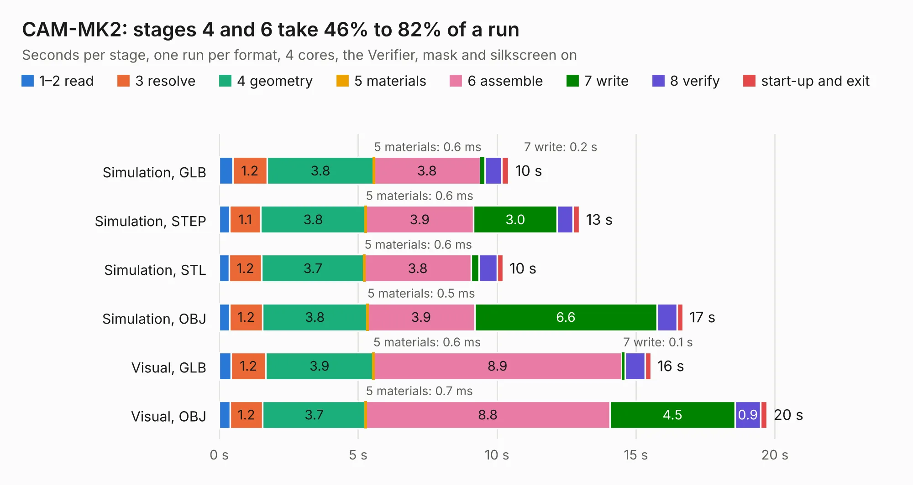

| Mode and format | 1–2 read | 3 resolve | 4 geometry | 5 materials | 6 assemble | 7 write | 8 verify | start-up and exit | Total |
|---|---:|---:|---:|---:|---:|---:|---:|---:|---:|
| Simulation, GLB | 0.5 | 1.2 | 3.8 | 0.6&nbsp;ms | 3.8 | 0.2 | 0.6 | 0.2 | 10.4 |
| Simulation, STEP | 0.4 | 1.1 | 3.8 | 0.6&nbsp;ms | 3.9 | 3.0 | 0.6 | 0.2 | 13.0 |
| Simulation, STL | 0.4 | 1.2 | 3.7 | 0.6&nbsp;ms | 3.8 | 0.3 | 0.7 | 0.2 | 10.2 |
| Simulation, OBJ | 0.4 | 1.2 | 3.8 | 0.5&nbsp;ms | 3.9 | 6.6 | 0.7 | 0.2 | 16.7 |
| Visual, GLB | 0.4 | 1.2 | 3.9 | 0.6&nbsp;ms | 8.9 | 0.1 | 0.7 | 0.2 | 15.5 |
| Visual, OBJ | 0.4 | 1.2 | 3.7 | 0.7&nbsp;ms | 8.8 | 4.5 | 0.9 | 0.2 | 19.7 |

<table align="center"><tr><td valign="top">

| Board | Repo: [issuiuc/iss-pcb](https://github.com/issuiuc/iss-pcb) Board: `CAM-MK2.kicad_pcb` |
|---|---|
| Folder | boards / CAM-MK2 / CAM-MK2-revA |
| Complexity | 334&nbsp;/&nbsp;1000 (size&nbsp;194, features&nbsp;140) |
| KESE&nbsp;features | through vias, slotted holes, custom pads, rounded, trapezoid or chamfered pads, filled zones, copper drawings, curved board outline, TrueType text, stack-up, dielectric εr and tanδ, mask and silkscreen colours |
| Tested | 9th November 2026 |
| Copper&nbsp;layers | 4 |
| File&nbsp;format | KiCad 8 (20240108) |
| Parts,&nbsp;tracks,&nbsp;vias | 99, 500, 123 |
| Triangles,&nbsp;simulation | 1,231,990 in 146 parts |
| Verifier | PASS in all six runs |

</td><td valign="top">

<table>
<tr><th>File type</th><th>File size</th><th>Peak memory used</th></tr>
<tr><th colspan="3" align="left">Simulation</th></tr>
<tr><td>GLB</td><td align="right">42&nbsp;MB</td><td align="right">492&nbsp;MB</td></tr>
<tr><td>STEP</td><td align="right">163&nbsp;MB</td><td align="right">583&nbsp;MB</td></tr>
<tr><td>STL</td><td align="right">62&nbsp;MB</td><td align="right">487&nbsp;MB</td></tr>
<tr><td>OBJ</td><td align="right">125&nbsp;MB</td><td align="right">875&nbsp;MB</td></tr>
<tr><th colspan="3" align="left">Visual</th></tr>
<tr><td>GLB</td><td align="right">26&nbsp;MB</td><td align="right">625&nbsp;MB</td></tr>
<tr><td>OBJ</td><td align="right">79&nbsp;MB</td><td align="right">656&nbsp;MB</td></tr>
</table>

</td></tr></table>

## 1315. CAM-MK2.1

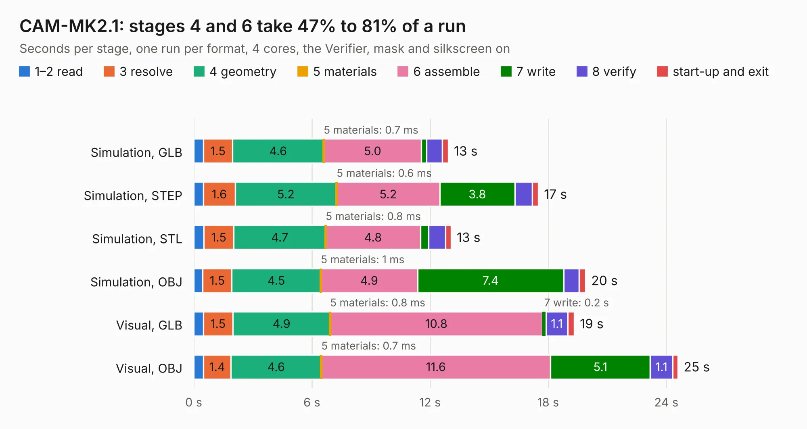

| Mode and format | 1–2 read | 3 resolve | 4 geometry | 5 materials | 6 assemble | 7 write | 8 verify | start-up and exit | Total |
|---|---:|---:|---:|---:|---:|---:|---:|---:|---:|
| Simulation, GLB | 0.5 | 1.5 | 4.6 | 0.7&nbsp;ms | 5.0 | 0.3 | 0.8 | 0.3 | 12.9 |
| Simulation, STEP | 0.5 | 1.6 | 5.2 | 0.6&nbsp;ms | 5.2 | 3.8 | 0.9 | 0.3 | 17.5 |
| Simulation, STL | 0.5 | 1.5 | 4.7 | 0.8&nbsp;ms | 4.8 | 0.4 | 0.8 | 0.3 | 13.1 |
| Simulation, OBJ | 0.5 | 1.5 | 4.5 | 1&nbsp;ms | 4.9 | 7.4 | 0.8 | 0.3 | 19.9 |
| Visual, GLB | 0.5 | 1.5 | 4.9 | 0.8&nbsp;ms | 10.8 | 0.2 | 1.1 | 0.3 | 19.3 |
| Visual, OBJ | 0.5 | 1.4 | 4.6 | 0.7&nbsp;ms | 11.6 | 5.1 | 1.1 | 0.3 | 24.6 |

<table align="center"><tr><td valign="top">

| Board | Repo: [issuiuc/iss-pcb](https://github.com/issuiuc/iss-pcb) Board: `CAM-MK2.1.kicad_pcb` |
|---|---|
| Folder | boards / CAM-MK2 / CAM-MK2.1-revA |
| Complexity | 337&nbsp;/&nbsp;1000 (size&nbsp;197, features&nbsp;140) |
| KESE&nbsp;features | through vias, slotted holes, custom pads, rounded, trapezoid or chamfered pads, filled zones, copper drawings, curved board outline, TrueType text, stack-up, dielectric εr and tanδ, mask and silkscreen colours |
| Tested | 9th November 2026 |
| Copper&nbsp;layers | 4 |
| File&nbsp;format | KiCad 8 (20240108) |
| Parts,&nbsp;tracks,&nbsp;vias | 110, 521, 142 |
| Triangles,&nbsp;simulation | 1,327,446 in 165 parts |
| Verifier | PASS in all six runs |

</td><td valign="top">

<table>
<tr><th>File type</th><th>File size</th><th>Peak memory used</th></tr>
<tr><th colspan="3" align="left">Simulation</th></tr>
<tr><td>GLB</td><td align="right">45&nbsp;MB</td><td align="right">530&nbsp;MB</td></tr>
<tr><td>STEP</td><td align="right">176&nbsp;MB</td><td align="right">621&nbsp;MB</td></tr>
<tr><td>STL</td><td align="right">66&nbsp;MB</td><td align="right">537&nbsp;MB</td></tr>
<tr><td>OBJ</td><td align="right">135&nbsp;MB</td><td align="right">912&nbsp;MB</td></tr>
<tr><th colspan="3" align="left">Visual</th></tr>
<tr><td>GLB</td><td align="right">28&nbsp;MB</td><td align="right">664&nbsp;MB</td></tr>
<tr><td>OBJ</td><td align="right">86&nbsp;MB</td><td align="right">693&nbsp;MB</td></tr>
</table>

</td></tr></table>

## 1316. CAM-MK3-revA

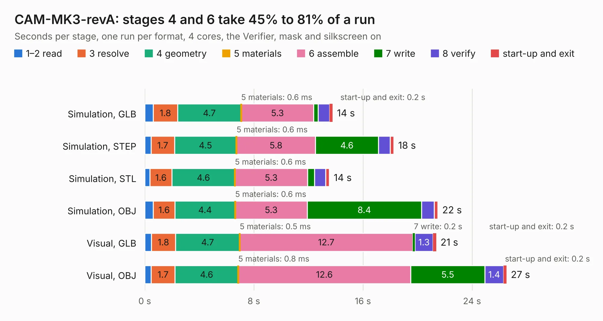

| Mode and format | 1–2 read | 3 resolve | 4 geometry | 5 materials | 6 assemble | 7 write | 8 verify | start-up and exit | Total |
|---|---:|---:|---:|---:|---:|---:|---:|---:|---:|
| Simulation, GLB | 0.6 | 1.8 | 4.7 | 0.6&nbsp;ms | 5.3 | 0.3 | 0.8 | 0.2 | 13.8 |
| Simulation, STEP | 0.5 | 1.7 | 4.5 | 0.6&nbsp;ms | 5.8 | 4.6 | 0.9 | 0.3 | 18.3 |
| Simulation, STL | 0.4 | 1.6 | 4.6 | 0.6&nbsp;ms | 5.3 | 0.5 | 0.8 | 0.3 | 13.5 |
| Simulation, OBJ | 0.6 | 1.6 | 4.4 | 0.6&nbsp;ms | 5.3 | 8.4 | 0.9 | 0.3 | 21.5 |
| Visual, GLB | 0.5 | 1.8 | 4.7 | 0.5&nbsp;ms | 12.7 | 0.2 | 1.3 | 0.2 | 21.4 |
| Visual, OBJ | 0.5 | 1.7 | 4.6 | 0.8&nbsp;ms | 12.6 | 5.5 | 1.4 | 0.2 | 26.5 |

<table align="center"><tr><td valign="top">

| Board | Repo: [issuiuc/iss-pcb](https://github.com/issuiuc/iss-pcb) Board: `CAM-MK3-revA.kicad_pcb` |
|---|---|
| Folder | boards / CAM-MK3 / CAM-MK3-revA |
| Complexity | 381&nbsp;/&nbsp;1000 (size&nbsp;241, features&nbsp;140) |
| KESE&nbsp;features | through vias, slotted holes, custom pads, rounded, trapezoid or chamfered pads, filled zones, copper drawings, curved board outline, TrueType text, stack-up, dielectric εr and tanδ, mask and silkscreen colours |
| Tested | 9th November 2026 |
| Copper&nbsp;layers | 4 |
| File&nbsp;format | KiCad 9 (20241229) |
| Parts,&nbsp;tracks,&nbsp;vias | 110, 645, 197 |
| Triangles,&nbsp;simulation | 1,678,810 in 202 parts |
| Verifier | PASS in all six runs |

</td><td valign="top">

<table>
<tr><th>File type</th><th>File size</th><th>Peak memory used</th></tr>
<tr><th colspan="3" align="left">Simulation</th></tr>
<tr><td>GLB</td><td align="right">56&nbsp;MB</td><td align="right">686&nbsp;MB</td></tr>
<tr><td>STEP</td><td align="right">227&nbsp;MB</td><td align="right">756&nbsp;MB</td></tr>
<tr><td>STL</td><td align="right">84&nbsp;MB</td><td align="right">729&nbsp;MB</td></tr>
<tr><td>OBJ</td><td align="right">175&nbsp;MB</td><td align="right">1.1&nbsp;GB</td></tr>
<tr><th colspan="3" align="left">Visual</th></tr>
<tr><td>GLB</td><td align="right">36&nbsp;MB</td><td align="right">823&nbsp;MB</td></tr>
<tr><td>OBJ</td><td align="right">111&nbsp;MB</td><td align="right">853&nbsp;MB</td></tr>
</table>

</td></tr></table>

## 1317. CAM-MK3-revB

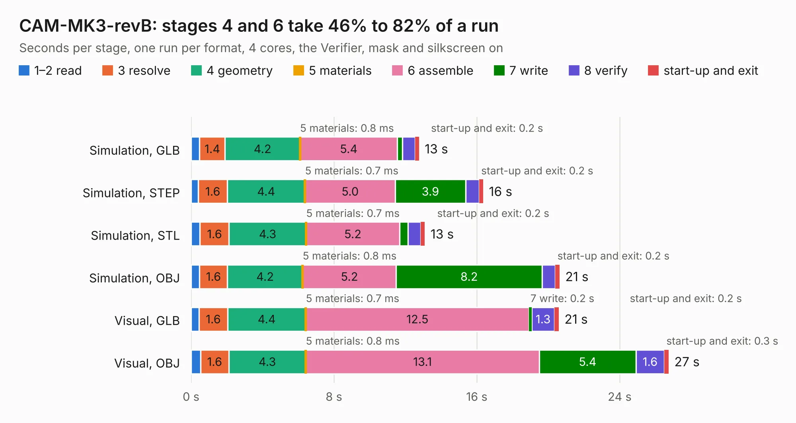

| Mode and format | 1–2 read | 3 resolve | 4 geometry | 5 materials | 6 assemble | 7 write | 8 verify | start-up and exit | Total |
|---|---:|---:|---:|---:|---:|---:|---:|---:|---:|
| Simulation, GLB | 0.5 | 1.4 | 4.2 | 0.8&nbsp;ms | 5.4 | 0.3 | 0.7 | 0.2 | 12.8 |
| Simulation, STEP | 0.4 | 1.6 | 4.4 | 0.7&nbsp;ms | 5.0 | 3.9 | 0.8 | 0.2 | 16.4 |
| Simulation, STL | 0.5 | 1.6 | 4.3 | 0.7&nbsp;ms | 5.2 | 0.5 | 0.7 | 0.2 | 13.1 |
| Simulation, OBJ | 0.5 | 1.6 | 4.2 | 0.8&nbsp;ms | 5.2 | 8.2 | 0.7 | 0.2 | 20.6 |
| Visual, GLB | 0.4 | 1.6 | 4.4 | 0.7&nbsp;ms | 12.5 | 0.2 | 1.3 | 0.2 | 20.6 |
| Visual, OBJ | 0.5 | 1.6 | 4.3 | 0.8&nbsp;ms | 13.1 | 5.4 | 1.6 | 0.3 | 26.7 |

<table align="center"><tr><td valign="top">

| Board | Repo: [issuiuc/iss-pcb](https://github.com/issuiuc/iss-pcb) Board: `CAM-MK3-revB.kicad_pcb` |
|---|---|
| Folder | boards / CAM-MK3 / CAM-MK3-revB |
| Complexity | 381&nbsp;/&nbsp;1000 (size&nbsp;241, features&nbsp;140) |
| KESE&nbsp;features | through vias, slotted holes, custom pads, rounded, trapezoid or chamfered pads, filled zones, copper drawings, curved board outline, TrueType text, stack-up, dielectric εr and tanδ, mask and silkscreen colours |
| Tested | 9th November 2026 |
| Copper&nbsp;layers | 4 |
| File&nbsp;format | KiCad 9 (20241229) |
| Parts,&nbsp;tracks,&nbsp;vias | 110, 658, 196 |
| Triangles,&nbsp;simulation | 1,681,368 in 202 parts |
| Verifier | PASS in all six runs |

</td><td valign="top">

<table>
<tr><th>File type</th><th>File size</th><th>Peak memory used</th></tr>
<tr><th colspan="3" align="left">Simulation</th></tr>
<tr><td>GLB</td><td align="right">56&nbsp;MB</td><td align="right">740&nbsp;MB</td></tr>
<tr><td>STEP</td><td align="right">227&nbsp;MB</td><td align="right">773&nbsp;MB</td></tr>
<tr><td>STL</td><td align="right">84&nbsp;MB</td><td align="right">725&nbsp;MB</td></tr>
<tr><td>OBJ</td><td align="right">176&nbsp;MB</td><td align="right">1.1&nbsp;GB</td></tr>
<tr><th colspan="3" align="left">Visual</th></tr>
<tr><td>GLB</td><td align="right">36&nbsp;MB</td><td align="right">684&nbsp;MB</td></tr>
<tr><td>OBJ</td><td align="right">111&nbsp;MB</td><td align="right">852&nbsp;MB</td></tr>
</table>

</td></tr></table>

## 1318. CAM-MK3-revC

| Mode and format | 1–2 read | 3 resolve | 4 geometry | 5 materials | 6 assemble | 7 write | 8 verify | start-up and exit | Total |
|---|---:|---:|---:|---:|---:|---:|---:|---:|---:|
| Simulation, GLB | 0.4 | 1.5 | 4.1 | 0.9&nbsp;ms | 5.1 | 0.2 | 0.7 | 0.2 | 12.2 |
| Simulation, STEP | 0.4 | 1.4 | 3.9 | 0.7&nbsp;ms | 5.1 | 4.0 | 0.7 | 0.2 | 15.7 |
| Simulation, STL | 0.4 | 1.5 | 4.0 | 0.7&nbsp;ms | 5.2 | 0.5 | 0.7 | 0.2 | 12.4 |
| Simulation, OBJ | 0.4 | 1.5 | 3.9 | 1&nbsp;ms | 5.2 | 7.1 | 0.8 | 0.2 | 19.1 |
| Visual, GLB | 0.4 | 1.4 | 4.2 | 0.8&nbsp;ms | 12.3 | 0.1 | 1.4 | 0.2 | 20.1 |
| Visual, OBJ | 0.5 | 1.7 | 4.1 | 0.7&nbsp;ms | 12.2 | 4.5 | 1.5 | 0.3 | 24.6 |

<table align="center"><tr><td valign="top">

| Board | Repo: [issuiuc/iss-pcb](https://github.com/issuiuc/iss-pcb) Board: `CAM-MK3-revC.kicad_pcb` |
|---|---|
| Folder | boards / CAM-MK3 / CAM-MK3-revC |
| Complexity | 382&nbsp;/&nbsp;1000 (size&nbsp;242, features&nbsp;140) |
| KESE&nbsp;features | through vias, slotted holes, custom pads, rounded, trapezoid or chamfered pads, filled zones, copper drawings, curved board outline, TrueType text, stack-up, dielectric εr and tanδ, mask and silkscreen colours |
| Tested | 9th November 2026 |
| Copper&nbsp;layers | 4 |
| File&nbsp;format | KiCad 9 (20241229) |
| Parts,&nbsp;tracks,&nbsp;vias | 110, 744, 198 |
| Triangles,&nbsp;simulation | 1,709,380 in 203 parts |
| Verifier | PASS in all six runs |

</td><td valign="top">

<table>
<tr><th>File type</th><th>File size</th><th>Peak memory used</th></tr>
<tr><th colspan="3" align="left">Simulation</th></tr>
<tr><td>GLB</td><td align="right">57&nbsp;MB</td><td align="right">723&nbsp;MB</td></tr>
<tr><td>STEP</td><td align="right">232&nbsp;MB</td><td align="right">757&nbsp;MB</td></tr>
<tr><td>STL</td><td align="right">85&nbsp;MB</td><td align="right">726&nbsp;MB</td></tr>
<tr><td>OBJ</td><td align="right">179&nbsp;MB</td><td align="right">1.2&nbsp;GB</td></tr>
<tr><th colspan="3" align="left">Visual</th></tr>
<tr><td>GLB</td><td align="right">36&nbsp;MB</td><td align="right">791&nbsp;MB</td></tr>
<tr><td>OBJ</td><td align="right">113&nbsp;MB</td><td align="right">846&nbsp;MB</td></tr>
</table>

</td></tr></table>

## 1319. drone_power_2_screws

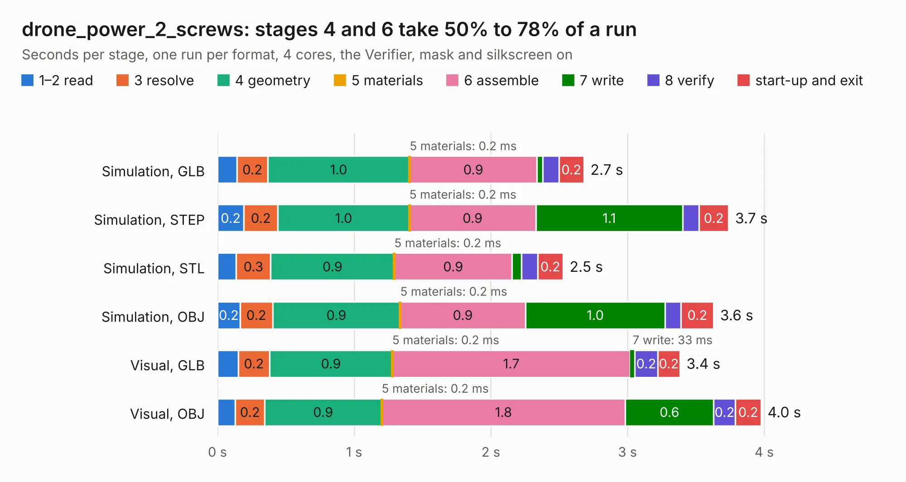

| Mode and format | 1–2 read | 3 resolve | 4 geometry | 5 materials | 6 assemble | 7 write | 8 verify | start-up and exit | Total |
|---|---:|---:|---:|---:|---:|---:|---:|---:|---:|
| Simulation, GLB | 0.1 | 0.2 | 1.0 | 0.2&nbsp;ms | 0.9 | 42&nbsp;ms | 0.1 | 0.2 | 2.7 |
| Simulation, STEP | 0.2 | 0.2 | 1.0 | 0.2&nbsp;ms | 0.9 | 1.1 | 0.1 | 0.2 | 3.7 |
| Simulation, STL | 0.1 | 0.3 | 0.9 | 0.2&nbsp;ms | 0.9 | 69&nbsp;ms | 0.1 | 0.2 | 2.5 |
| Simulation, OBJ | 0.2 | 0.2 | 0.9 | 0.2&nbsp;ms | 0.9 | 1.0 | 0.1 | 0.2 | 3.6 |
| Visual, GLB | 0.2 | 0.2 | 0.9 | 0.2&nbsp;ms | 1.7 | 33&nbsp;ms | 0.2 | 0.2 | 3.4 |
| Visual, OBJ | 0.1 | 0.2 | 0.9 | 0.2&nbsp;ms | 1.8 | 0.6 | 0.2 | 0.2 | 4.0 |

<table align="center"><tr><td valign="top">

| Board | Repo: [issuiuc/iss-pcb](https://github.com/issuiuc/iss-pcb) Board: `drone_power_2_screws.kicad_pcb` |
|---|---|
| Folder | boards / Drone_Power / drone_power_2_screws |
| Complexity | 197&nbsp;/&nbsp;1000 (size&nbsp;142, features&nbsp;55) |
| KESE&nbsp;features | through vias, rounded, trapezoid or chamfered pads, filled zones, curved board outline |
| Tested | 9th November 2026 |
| Copper&nbsp;layers | 2 |
| File&nbsp;format | KiCad 8 (20240108) |
| Parts,&nbsp;tracks,&nbsp;vias | 37, 109, 26 |
| Triangles,&nbsp;simulation | 259,008 in 47 parts |
| Verifier | PASS in all six runs |

</td><td valign="top">

<table>
<tr><th>File type</th><th>File size</th><th>Peak memory used</th></tr>
<tr><th colspan="3" align="left">Simulation</th></tr>
<tr><td>GLB</td><td align="right">9.0&nbsp;MB</td><td align="right">225&nbsp;MB</td></tr>
<tr><td>STEP</td><td align="right">41&nbsp;MB</td><td align="right">257&nbsp;MB</td></tr>
<tr><td>STL</td><td align="right">13&nbsp;MB</td><td align="right">225&nbsp;MB</td></tr>
<tr><td>OBJ</td><td align="right">26&nbsp;MB</td><td align="right">235&nbsp;MB</td></tr>
<tr><th colspan="3" align="left">Visual</th></tr>
<tr><td>GLB</td><td align="right">6.1&nbsp;MB</td><td align="right">213&nbsp;MB</td></tr>
<tr><td>OBJ</td><td align="right">17&nbsp;MB</td><td align="right">213&nbsp;MB</td></tr>
</table>

</td></tr></table>

## 1320. drone_power_2_screws_V2

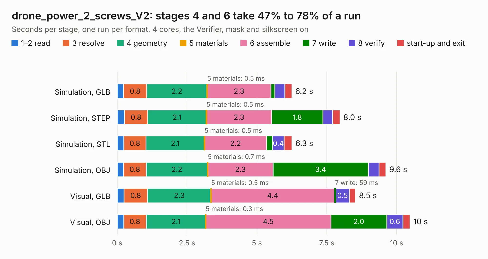

| Mode and format | 1–2 read | 3 resolve | 4 geometry | 5 materials | 6 assemble | 7 write | 8 verify | start-up and exit | Total |
|---|---:|---:|---:|---:|---:|---:|---:|---:|---:|
| Simulation, GLB | 0.2 | 0.8 | 2.2 | 0.5&nbsp;ms | 2.3 | 0.1 | 0.4 | 0.2 | 6.2 |
| Simulation, STEP | 0.3 | 0.8 | 2.1 | 0.5&nbsp;ms | 2.3 | 1.8 | 0.3 | 0.3 | 8.0 |
| Simulation, STL | 0.2 | 0.8 | 2.1 | 0.5&nbsp;ms | 2.2 | 0.2 | 0.4 | 0.3 | 6.3 |
| Simulation, OBJ | 0.2 | 0.8 | 2.2 | 0.7&nbsp;ms | 2.3 | 3.4 | 0.4 | 0.2 | 9.6 |
| Visual, GLB | 0.2 | 0.8 | 2.3 | 0.5&nbsp;ms | 4.4 | 59&nbsp;ms | 0.5 | 0.2 | 8.5 |
| Visual, OBJ | 0.2 | 0.8 | 2.1 | 0.3&nbsp;ms | 4.5 | 2.0 | 0.6 | 0.3 | 10.5 |

<table align="center"><tr><td valign="top">

| Board | Repo: [issuiuc/iss-pcb](https://github.com/issuiuc/iss-pcb) Board: `drone_power_2_screws_V2.kicad_pcb` |
|---|---|
| Folder | boards / Drone_Power / drone_power_2_screws_V2 |
| Complexity | 298&nbsp;/&nbsp;1000 (size&nbsp;183, features&nbsp;115) |
| KESE&nbsp;features | through vias, custom pads, rounded, trapezoid or chamfered pads, filled zones, copper drawings, curved board outline, stack-up, dielectric εr and tanδ, mask and silkscreen colours |
| Tested | 9th November 2026 |
| Copper&nbsp;layers | 4 |
| File&nbsp;format | KiCad 9 (20241229) |
| Parts,&nbsp;tracks,&nbsp;vias | 56, 129, 163 |
| Triangles,&nbsp;simulation | 688,940 in 78 parts |
| Verifier | PASS in all six runs |

</td><td valign="top">

<table>
<tr><th>File type</th><th>File size</th><th>Peak memory used</th></tr>
<tr><th colspan="3" align="left">Simulation</th></tr>
<tr><td>GLB</td><td align="right">23&nbsp;MB</td><td align="right">387&nbsp;MB</td></tr>
<tr><td>STEP</td><td align="right">62&nbsp;MB</td><td align="right">401&nbsp;MB</td></tr>
<tr><td>STL</td><td align="right">34&nbsp;MB</td><td align="right">387&nbsp;MB</td></tr>
<tr><td>OBJ</td><td align="right">69&nbsp;MB</td><td align="right">523&nbsp;MB</td></tr>
<tr><th colspan="3" align="left">Visual</th></tr>
<tr><td>GLB</td><td align="right">13&nbsp;MB</td><td align="right">393&nbsp;MB</td></tr>
<tr><td>OBJ</td><td align="right">40&nbsp;MB</td><td align="right">384&nbsp;MB</td></tr>
</table>

</td></tr></table>

## 1321. drone_power_3_screws

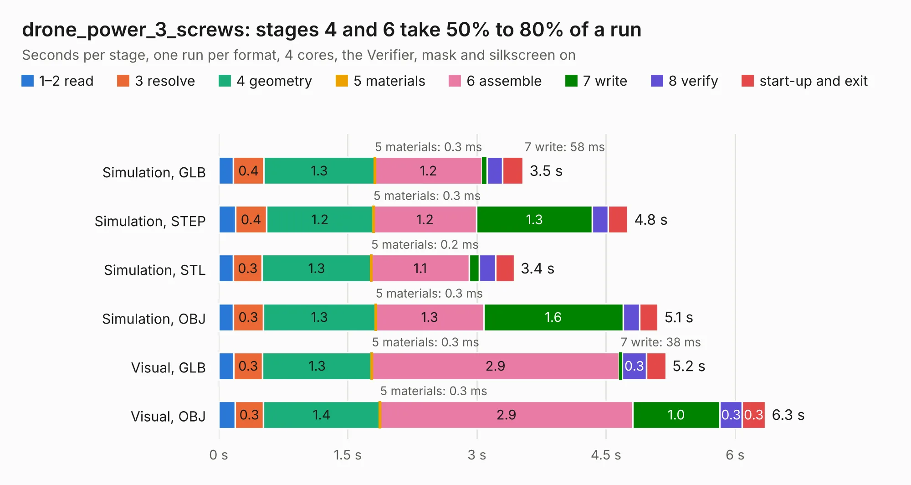

| Mode and format | 1–2 read | 3 resolve | 4 geometry | 5 materials | 6 assemble | 7 write | 8 verify | start-up and exit | Total |
|---|---:|---:|---:|---:|---:|---:|---:|---:|---:|
| Simulation, GLB | 0.2 | 0.4 | 1.3 | 0.3&nbsp;ms | 1.2 | 58&nbsp;ms | 0.2 | 0.2 | 3.5 |
| Simulation, STEP | 0.2 | 0.4 | 1.2 | 0.3&nbsp;ms | 1.2 | 1.3 | 0.2 | 0.2 | 4.8 |
| Simulation, STL | 0.2 | 0.3 | 1.3 | 0.2&nbsp;ms | 1.1 | 0.1 | 0.2 | 0.2 | 3.4 |
| Simulation, OBJ | 0.2 | 0.3 | 1.3 | 0.3&nbsp;ms | 1.3 | 1.6 | 0.2 | 0.2 | 5.1 |
| Visual, GLB | 0.2 | 0.3 | 1.3 | 0.3&nbsp;ms | 2.9 | 38&nbsp;ms | 0.3 | 0.2 | 5.2 |
| Visual, OBJ | 0.2 | 0.3 | 1.4 | 0.3&nbsp;ms | 2.9 | 1.0 | 0.3 | 0.3 | 6.3 |

<table align="center"><tr><td valign="top">

| Board | Repo: [issuiuc/iss-pcb](https://github.com/issuiuc/iss-pcb) Board: `drone_power_3_screws.kicad_pcb` |
|---|---|
| Folder | boards / Drone_Power / drone_power_3_screws |
| Complexity | 193&nbsp;/&nbsp;1000 (size&nbsp;148, features&nbsp;45) |
| KESE&nbsp;features | through vias, rounded, trapezoid or chamfered pads, filled zones |
| Tested | 9th November 2026 |
| Copper&nbsp;layers | 2 |
| File&nbsp;format | KiCad 8 (20240108) |
| Parts,&nbsp;tracks,&nbsp;vias | 38, 102, 54 |
| Triangles,&nbsp;simulation | 316,950 in 64 parts |
| Verifier | PASS in all six runs |

</td><td valign="top">

<table>
<tr><th>File type</th><th>File size</th><th>Peak memory used</th></tr>
<tr><th colspan="3" align="left">Simulation</th></tr>
<tr><td>GLB</td><td align="right">11&nbsp;MB</td><td align="right">240&nbsp;MB</td></tr>
<tr><td>STEP</td><td align="right">45&nbsp;MB</td><td align="right">267&nbsp;MB</td></tr>
<tr><td>STL</td><td align="right">16&nbsp;MB</td><td align="right">240&nbsp;MB</td></tr>
<tr><td>OBJ</td><td align="right">32&nbsp;MB</td><td align="right">272&nbsp;MB</td></tr>
<tr><th colspan="3" align="left">Visual</th></tr>
<tr><td>GLB</td><td align="right">7.2&nbsp;MB</td><td align="right">241&nbsp;MB</td></tr>
<tr><td>OBJ</td><td align="right">21&nbsp;MB</td><td align="right">240&nbsp;MB</td></tr>
</table>

</td></tr></table>

## 1322. EAGLE-MK1-revA

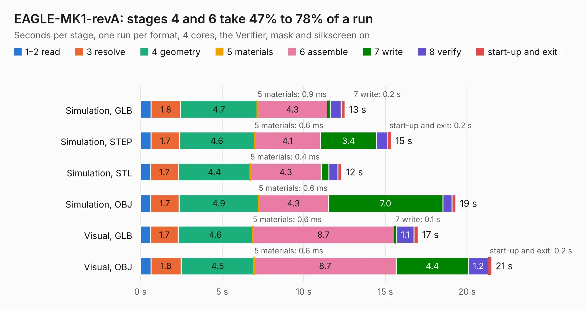

| Mode and format | 1–2 read | 3 resolve | 4 geometry | 5 materials | 6 assemble | 7 write | 8 verify | start-up and exit | Total |
|---|---:|---:|---:|---:|---:|---:|---:|---:|---:|
| Simulation, GLB | 0.7 | 1.8 | 4.7 | 0.9&nbsp;ms | 4.3 | 0.2 | 0.6 | 0.2 | 12.5 |
| Simulation, STEP | 0.6 | 1.7 | 4.6 | 0.6&nbsp;ms | 4.1 | 3.4 | 0.7 | 0.2 | 15.4 |
| Simulation, STL | 0.6 | 1.7 | 4.4 | 0.4&nbsp;ms | 4.3 | 0.5 | 0.6 | 0.2 | 12.3 |
| Simulation, OBJ | 0.6 | 1.7 | 4.9 | 0.6&nbsp;ms | 4.3 | 7.0 | 0.6 | 0.2 | 19.3 |
| Visual, GLB | 0.6 | 1.7 | 4.6 | 0.6&nbsp;ms | 8.7 | 0.1 | 1.1 | 0.2 | 17.0 |
| Visual, OBJ | 0.6 | 1.8 | 4.5 | 0.6&nbsp;ms | 8.7 | 4.4 | 1.2 | 0.2 | 21.5 |

<table align="center"><tr><td valign="top">

| Board | Repo: [issuiuc/iss-pcb](https://github.com/issuiuc/iss-pcb) Board: `EAGLE-MK1-revA.kicad_pcb` |
|---|---|
| Folder | boards / EAGLE-MK1 / EAGLE-MK1-revA |
| Complexity | 314&nbsp;/&nbsp;1000 (size&nbsp;194, features&nbsp;120) |
| KESE&nbsp;features | through vias, slotted holes, custom pads, rounded, trapezoid or chamfered pads, filled zones, copper drawings, curved board outline, stack-up, dielectric εr and tanδ |
| Tested | 9th November 2026 |
| Copper&nbsp;layers | 4 |
| File&nbsp;format | KiCad 9 (20241229) |
| Parts,&nbsp;tracks,&nbsp;vias | 68, 352, 259 |
| Triangles,&nbsp;simulation | 1,349,698 in 154 parts |
| Verifier | PASS in all six runs |

</td><td valign="top">

<table>
<tr><th>File type</th><th>File size</th><th>Peak memory used</th></tr>
<tr><th colspan="3" align="left">Simulation</th></tr>
<tr><td>GLB</td><td align="right">46&nbsp;MB</td><td align="right">631&nbsp;MB</td></tr>
<tr><td>STEP</td><td align="right">167&nbsp;MB</td><td align="right">679&nbsp;MB</td></tr>
<tr><td>STL</td><td align="right">67&nbsp;MB</td><td align="right">636&nbsp;MB</td></tr>
<tr><td>OBJ</td><td align="right">139&nbsp;MB</td><td align="right">944&nbsp;MB</td></tr>
<tr><th colspan="3" align="left">Visual</th></tr>
<tr><td>GLB</td><td align="right">29&nbsp;MB</td><td align="right">648&nbsp;MB</td></tr>
<tr><td>OBJ</td><td align="right">88&nbsp;MB</td><td align="right">683&nbsp;MB</td></tr>
</table>

</td></tr></table>

## 1323. EAGLE-MK1-revB

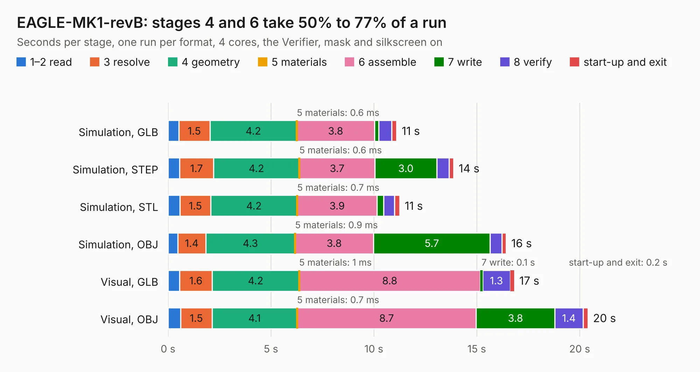

| Mode and format | 1–2 read | 3 resolve | 4 geometry | 5 materials | 6 assemble | 7 write | 8 verify | start-up and exit | Total |
|---|---:|---:|---:|---:|---:|---:|---:|---:|---:|
| Simulation, GLB | 0.5 | 1.5 | 4.2 | 0.6&nbsp;ms | 3.8 | 0.2 | 0.6 | 0.2 | 11.1 |
| Simulation, STEP | 0.6 | 1.7 | 4.2 | 0.6&nbsp;ms | 3.7 | 3.0 | 0.6 | 0.2 | 13.9 |
| Simulation, STL | 0.6 | 1.5 | 4.2 | 0.7&nbsp;ms | 3.9 | 0.3 | 0.5 | 0.3 | 11.3 |
| Simulation, OBJ | 0.5 | 1.4 | 4.3 | 0.9&nbsp;ms | 3.8 | 5.7 | 0.6 | 0.2 | 16.4 |
| Visual, GLB | 0.6 | 1.6 | 4.2 | 1&nbsp;ms | 8.8 | 0.1 | 1.3 | 0.2 | 16.8 |
| Visual, OBJ | 0.6 | 1.5 | 4.1 | 0.7&nbsp;ms | 8.7 | 3.8 | 1.4 | 0.2 | 20.4 |

<table align="center"><tr><td valign="top">

| Board | Repo: [issuiuc/iss-pcb](https://github.com/issuiuc/iss-pcb) Board: `EAGLE-MK1-revB.kicad_pcb` |
|---|---|
| Folder | boards / EAGLE-MK1 / EAGLE-MK1-revB |
| Complexity | 308&nbsp;/&nbsp;1000 (size&nbsp;188, features&nbsp;120) |
| KESE&nbsp;features | through vias, slotted holes, custom pads, rounded, trapezoid or chamfered pads, filled zones, copper drawings, curved board outline, stack-up, dielectric εr and tanδ |
| Tested | 9th November 2026 |
| Copper&nbsp;layers | 4 |
| File&nbsp;format | KiCad 9 (20241229) |
| Parts,&nbsp;tracks,&nbsp;vias | 49, 296, 216 |
| Triangles,&nbsp;simulation | 1,248,210 in 143 parts |
| Verifier | PASS in all six runs |

</td><td valign="top">

<table>
<tr><th>File type</th><th>File size</th><th>Peak memory used</th></tr>
<tr><th colspan="3" align="left">Simulation</th></tr>
<tr><td>GLB</td><td align="right">42&nbsp;MB</td><td align="right">559&nbsp;MB</td></tr>
<tr><td>STEP</td><td align="right">160&nbsp;MB</td><td align="right">627&nbsp;MB</td></tr>
<tr><td>STL</td><td align="right">62&nbsp;MB</td><td align="right">559&nbsp;MB</td></tr>
<tr><td>OBJ</td><td align="right">128&nbsp;MB</td><td align="right">900&nbsp;MB</td></tr>
<tr><th colspan="3" align="left">Visual</th></tr>
<tr><td>GLB</td><td align="right">28&nbsp;MB</td><td align="right">635&nbsp;MB</td></tr>
<tr><td>OBJ</td><td align="right">83&nbsp;MB</td><td align="right">647&nbsp;MB</td></tr>
</table>

</td></tr></table>

## 1324. Feather_Duo

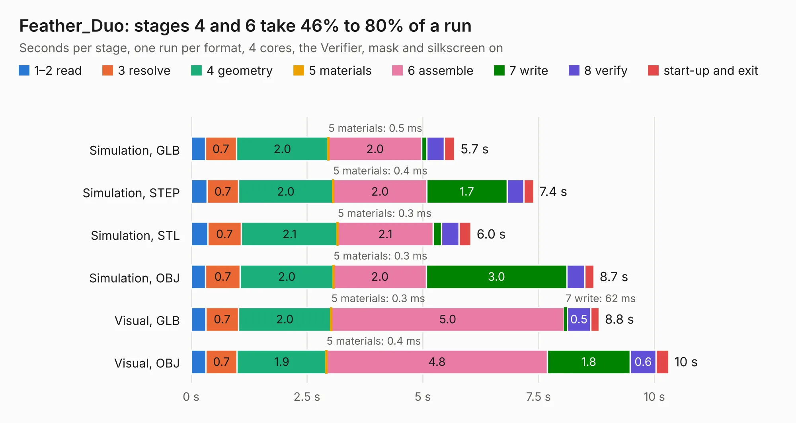

| Mode and format | 1–2 read | 3 resolve | 4 geometry | 5 materials | 6 assemble | 7 write | 8 verify | start-up and exit | Total |
|---|---:|---:|---:|---:|---:|---:|---:|---:|---:|
| Simulation, GLB | 0.3 | 0.7 | 2.0 | 0.5&nbsp;ms | 2.0 | 0.1 | 0.4 | 0.2 | 5.7 |
| Simulation, STEP | 0.3 | 0.7 | 2.0 | 0.4&nbsp;ms | 2.0 | 1.7 | 0.4 | 0.2 | 7.4 |
| Simulation, STL | 0.4 | 0.7 | 2.1 | 0.3&nbsp;ms | 2.1 | 0.2 | 0.4 | 0.3 | 6.0 |
| Simulation, OBJ | 0.3 | 0.7 | 2.0 | 0.3&nbsp;ms | 2.0 | 3.0 | 0.4 | 0.2 | 8.7 |
| Visual, GLB | 0.3 | 0.7 | 2.0 | 0.3&nbsp;ms | 5.0 | 62&nbsp;ms | 0.5 | 0.2 | 8.8 |
| Visual, OBJ | 0.3 | 0.7 | 1.9 | 0.4&nbsp;ms | 4.8 | 1.8 | 0.6 | 0.3 | 10.3 |

<table align="center"><tr><td valign="top">

| Board | Repo: [issuiuc/iss-pcb](https://github.com/issuiuc/iss-pcb) Board: `Feather_Duo.kicad_pcb` |
|---|---|
| Folder | boards / Feather_Duo |
| Complexity | 285&nbsp;/&nbsp;1000 (size&nbsp;175, features&nbsp;110) |
| KESE&nbsp;features | through vias, slotted holes, rounded, trapezoid or chamfered pads, filled zones, curved board outline, TrueType text, stack-up, dielectric εr and tanδ |
| Tested | 9th November 2026 |
| Copper&nbsp;layers | 4 |
| File&nbsp;format | KiCad 8 (20240108) |
| Parts,&nbsp;tracks,&nbsp;vias | 42, 255, 75 |
| Triangles,&nbsp;simulation | 748,228 in 106 parts |
| Verifier | PASS in all six runs |

</td><td valign="top">

<table>
<tr><th>File type</th><th>File size</th><th>Peak memory used</th></tr>
<tr><th colspan="3" align="left">Simulation</th></tr>
<tr><td>GLB</td><td align="right">25&nbsp;MB</td><td align="right">363&nbsp;MB</td></tr>
<tr><td>STEP</td><td align="right">98&nbsp;MB</td><td align="right">404&nbsp;MB</td></tr>
<tr><td>STL</td><td align="right">37&nbsp;MB</td><td align="right">367&nbsp;MB</td></tr>
<tr><td>OBJ</td><td align="right">76&nbsp;MB</td><td align="right">533&nbsp;MB</td></tr>
<tr><th colspan="3" align="left">Visual</th></tr>
<tr><td>GLB</td><td align="right">16&nbsp;MB</td><td align="right">408&nbsp;MB</td></tr>
<tr><td>OBJ</td><td align="right">47&nbsp;MB</td><td align="right">410&nbsp;MB</td></tr>
</table>

</td></tr></table>

## 1325. MIDAS-MK1

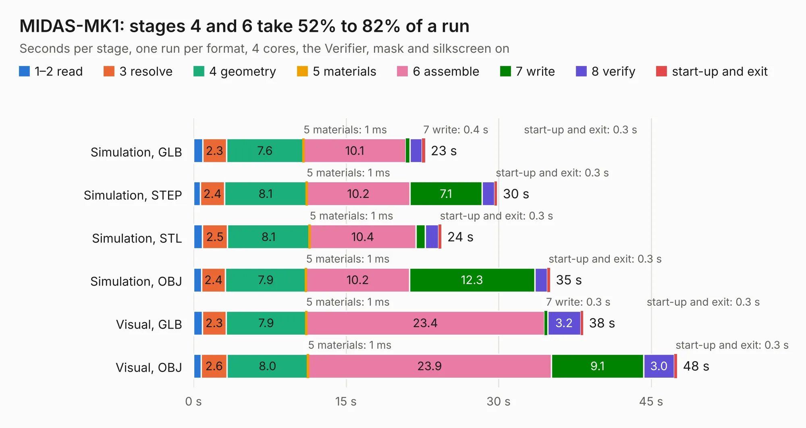

| Mode and format | 1–2 read | 3 resolve | 4 geometry | 5 materials | 6 assemble | 7 write | 8 verify | start-up and exit | Total |
|---|---:|---:|---:|---:|---:|---:|---:|---:|---:|
| Simulation, GLB | 0.9 | 2.3 | 7.6 | 1&nbsp;ms | 10.1 | 0.4 | 1.2 | 0.3 | 22.8 |
| Simulation, STEP | 0.7 | 2.4 | 8.1 | 1&nbsp;ms | 10.2 | 7.1 | 1.2 | 0.3 | 29.9 |
| Simulation, STL | 0.9 | 2.5 | 8.1 | 1&nbsp;ms | 10.4 | 0.9 | 1.3 | 0.3 | 24.4 |
| Simulation, OBJ | 0.8 | 2.4 | 7.9 | 1&nbsp;ms | 10.2 | 12.3 | 1.2 | 0.3 | 35.1 |
| Visual, GLB | 0.9 | 2.3 | 7.9 | 1&nbsp;ms | 23.4 | 0.3 | 3.2 | 0.3 | 38.3 |
| Visual, OBJ | 0.8 | 2.6 | 8.0 | 1&nbsp;ms | 23.9 | 9.1 | 3.0 | 0.3 | 47.6 |

<table align="center"><tr><td valign="top">

| Board | Repo: [issuiuc/iss-pcb](https://github.com/issuiuc/iss-pcb) Board: `MIDAS-MK1.kicad_pcb` |
|---|---|
| Folder | boards / MIDAS-MK1 / MIDAS-MK1-revA |
| Complexity | 412&nbsp;/&nbsp;1000 (size&nbsp;272, features&nbsp;140) |
| KESE&nbsp;features | through vias, slotted holes, rounded, trapezoid or chamfered pads, filled zones, copper text, curved board outline, TrueType text, stack-up, dielectric εr and tanδ, copper finish, mask and silkscreen colours |
| Tested | 9th November 2026 |
| Copper&nbsp;layers | 4 |
| File&nbsp;format | KiCad 7 (20221018) |
| Parts,&nbsp;tracks,&nbsp;vias | 206, 1,104, 275 |
| Triangles,&nbsp;simulation | 2,663,616 in 346 parts |
| Verifier | PASS in all six runs |

</td><td valign="top">

<table>
<tr><th>File type</th><th>File size</th><th>Peak memory used</th></tr>
<tr><th colspan="3" align="left">Simulation</th></tr>
<tr><td>GLB</td><td align="right">91&nbsp;MB</td><td align="right">847&nbsp;MB</td></tr>
<tr><td>STEP</td><td align="right">391&nbsp;MB</td><td align="right">1.1&nbsp;GB</td></tr>
<tr><td>STL</td><td align="right">133&nbsp;MB</td><td align="right">882&nbsp;MB</td></tr>
<tr><td>OBJ</td><td align="right">281&nbsp;MB</td><td align="right">1.7&nbsp;GB</td></tr>
<tr><th colspan="3" align="left">Visual</th></tr>
<tr><td>GLB</td><td align="right">61&nbsp;MB</td><td align="right">1.1&nbsp;GB</td></tr>
<tr><td>OBJ</td><td align="right">193&nbsp;MB</td><td align="right">1.4&nbsp;GB</td></tr>
</table>

</td></tr></table>

## 1326. MIDAS-MK1

| Mode and format | 1–2 read | 3 resolve | 4 geometry | 5 materials | 6 assemble | 7 write | 8 verify | start-up and exit | Total |
|---|---:|---:|---:|---:|---:|---:|---:|---:|---:|
| Simulation, GLB | 1.0 | 2.7 | 9.4 | 1&nbsp;ms | 12.5 | 0.5 | 1.4 | 0.3 | 27.8 |
| Simulation, STEP | 1.0 | 2.7 | 9.0 | 1&nbsp;ms | 11.8 | 8.5 | 1.5 | 0.3 | 34.9 |
| Simulation, STL | 1.1 | 2.7 | 9.4 | 1&nbsp;ms | 12.4 | 1.3 | 1.6 | 0.3 | 28.8 |
| Simulation, OBJ | 1.1 | 2.8 | 9.3 | 1&nbsp;ms | 11.6 | 16.0 | 1.3 | 0.3 | 42.4 |
| Visual, GLB | 1.0 | 2.8 | 9.9 | 1&nbsp;ms | 26.6 | 0.3 | 3.2 | 0.2 | 44.1 |
| Visual, OBJ | 1.0 | 2.7 | 9.1 | 1&nbsp;ms | 25.1 | 10.8 | 3.2 | 0.3 | 52.1 |

<table align="center"><tr><td valign="top">

| Board | Repo: [issuiuc/iss-pcb](https://github.com/issuiuc/iss-pcb) Board: `MIDAS-MK1.kicad_pcb` |
|---|---|
| Folder | boards / MIDAS-MK1 / MIDAS-MK1-revB |
| Complexity | 413&nbsp;/&nbsp;1000 (size&nbsp;273, features&nbsp;140) |
| KESE&nbsp;features | through vias, slotted holes, rounded, trapezoid or chamfered pads, filled zones, copper text, curved board outline, TrueType text, stack-up, dielectric εr and tanδ, copper finish, mask and silkscreen colours |
| Tested | 9th November 2026 |
| Copper&nbsp;layers | 4 |
| File&nbsp;format | KiCad 7 (20221018) |
| Parts,&nbsp;tracks,&nbsp;vias | 206, 1,110, 281 |
| Triangles,&nbsp;simulation | 2,713,870 in 346 parts |
| Verifier | PASS in all six runs |

</td><td valign="top">

<table>
<tr><th>File type</th><th>File size</th><th>Peak memory used</th></tr>
<tr><th colspan="3" align="left">Simulation</th></tr>
<tr><td>GLB</td><td align="right">92&nbsp;MB</td><td align="right">867&nbsp;MB</td></tr>
<tr><td>STEP</td><td align="right">399&nbsp;MB</td><td align="right">1.1&nbsp;GB</td></tr>
<tr><td>STL</td><td align="right">136&nbsp;MB</td><td align="right">898&nbsp;MB</td></tr>
<tr><td>OBJ</td><td align="right">286&nbsp;MB</td><td align="right">1.8&nbsp;GB</td></tr>
<tr><th colspan="3" align="left">Visual</th></tr>
<tr><td>GLB</td><td align="right">63&nbsp;MB</td><td align="right">1.2&nbsp;GB</td></tr>
<tr><td>OBJ</td><td align="right">197&nbsp;MB</td><td align="right">1.4&nbsp;GB</td></tr>
</table>

</td></tr></table>

## 1327. MIDAS-MK1.1

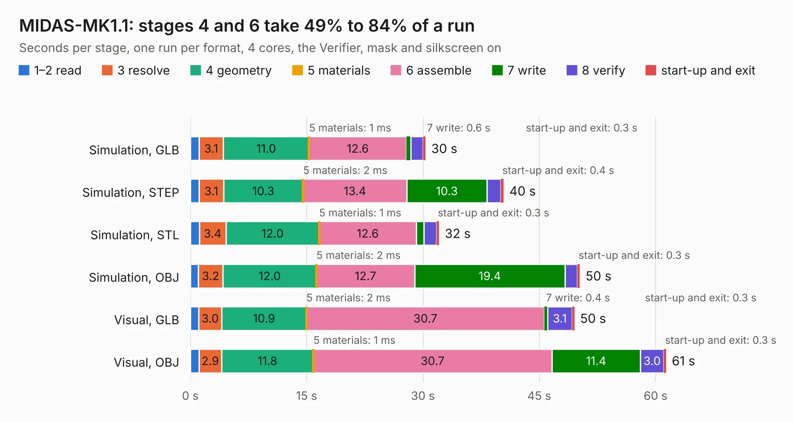

| Mode and format | 1–2 read | 3 resolve | 4 geometry | 5 materials | 6 assemble | 7 write | 8 verify | start-up and exit | Total |
|---|---:|---:|---:|---:|---:|---:|---:|---:|---:|
| Simulation, GLB | 1.1 | 3.1 | 11.0 | 1&nbsp;ms | 12.6 | 0.6 | 1.6 | 0.3 | 30.3 |
| Simulation, STEP | 1.1 | 3.1 | 10.3 | 2&nbsp;ms | 13.4 | 10.3 | 1.8 | 0.4 | 40.4 |
| Simulation, STL | 1.2 | 3.4 | 12.0 | 1&nbsp;ms | 12.6 | 1.0 | 1.6 | 0.3 | 32.1 |
| Simulation, OBJ | 1.0 | 3.2 | 12.0 | 2&nbsp;ms | 12.7 | 19.4 | 1.6 | 0.3 | 50.2 |
| Visual, GLB | 1.1 | 3.0 | 10.9 | 2&nbsp;ms | 30.7 | 0.4 | 3.1 | 0.3 | 49.5 |
| Visual, OBJ | 1.1 | 2.9 | 11.8 | 1&nbsp;ms | 30.7 | 11.4 | 3.0 | 0.3 | 61.4 |

<table align="center"><tr><td valign="top">

| Board | Repo: [issuiuc/iss-pcb](https://github.com/issuiuc/iss-pcb) Board: `MIDAS-MK1.1.kicad_pcb` |
|---|---|
| Folder | boards / MIDAS-MK1 / MIDAS-MK1.1-revA |
| Complexity | 412&nbsp;/&nbsp;1000 (size&nbsp;272, features&nbsp;140) |
| KESE&nbsp;features | through vias, slotted holes, rounded, trapezoid or chamfered pads, filled zones, copper text, curved board outline, TrueType text, stack-up, dielectric εr and tanδ, copper finish, mask and silkscreen colours |
| Tested | 9th November 2026 |
| Copper&nbsp;layers | 4 |
| File&nbsp;format | KiCad 7 (20221018) |
| Parts,&nbsp;tracks,&nbsp;vias | 198, 1,142, 273 |
| Triangles,&nbsp;simulation | 2,739,020 in 343 parts |
| Verifier | PASS in all six runs |

</td><td valign="top">

<table>
<tr><th>File type</th><th>File size</th><th>Peak memory used</th></tr>
<tr><th colspan="3" align="left">Simulation</th></tr>
<tr><td>GLB</td><td align="right">93&nbsp;MB</td><td align="right">861&nbsp;MB</td></tr>
<tr><td>STEP</td><td align="right">411&nbsp;MB</td><td align="right">1.1&nbsp;GB</td></tr>
<tr><td>STL</td><td align="right">137&nbsp;MB</td><td align="right">869&nbsp;MB</td></tr>
<tr><td>OBJ</td><td align="right">289&nbsp;MB</td><td align="right">1.8&nbsp;GB</td></tr>
<tr><th colspan="3" align="left">Visual</th></tr>
<tr><td>GLB</td><td align="right">64&nbsp;MB</td><td align="right">1.2&nbsp;GB</td></tr>
<tr><td>OBJ</td><td align="right">202&nbsp;MB</td><td align="right">1.4&nbsp;GB</td></tr>
</table>

</td></tr></table>

## 1328. MIDAS-MK1.1

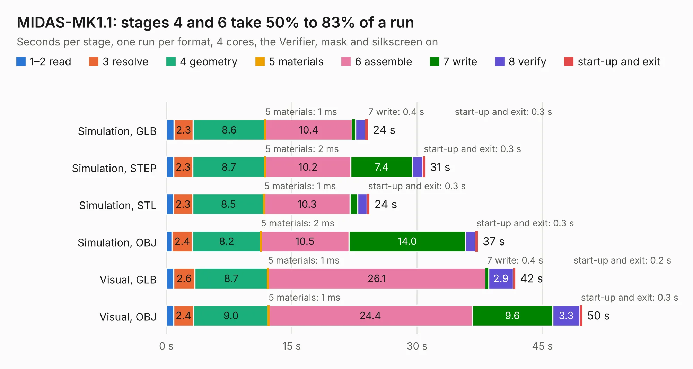

| Mode and format | 1–2 read | 3 resolve | 4 geometry | 5 materials | 6 assemble | 7 write | 8 verify | start-up and exit | Total |
|---|---:|---:|---:|---:|---:|---:|---:|---:|---:|
| Simulation, GLB | 0.9 | 2.3 | 8.6 | 1&nbsp;ms | 10.4 | 0.4 | 1.2 | 0.3 | 24.1 |
| Simulation, STEP | 0.9 | 2.3 | 8.7 | 2&nbsp;ms | 10.2 | 7.4 | 1.2 | 0.3 | 31.0 |
| Simulation, STL | 0.8 | 2.3 | 8.5 | 1&nbsp;ms | 10.3 | 0.9 | 1.2 | 0.3 | 24.3 |
| Simulation, OBJ | 0.7 | 2.4 | 8.2 | 2&nbsp;ms | 10.5 | 14.0 | 1.2 | 0.3 | 37.3 |
| Visual, GLB | 0.9 | 2.6 | 8.7 | 1&nbsp;ms | 26.1 | 0.4 | 2.9 | 0.2 | 41.7 |
| Visual, OBJ | 0.9 | 2.4 | 9.0 | 1&nbsp;ms | 24.4 | 9.6 | 3.3 | 0.3 | 49.8 |

<table align="center"><tr><td valign="top">

| Board | Repo: [issuiuc/iss-pcb](https://github.com/issuiuc/iss-pcb) Board: `MIDAS-MK1.1.kicad_pcb` |
|---|---|
| Folder | boards / MIDAS-MK1 / MIDAS-MK1.1-revB |
| Complexity | 413&nbsp;/&nbsp;1000 (size&nbsp;273, features&nbsp;140) |
| KESE&nbsp;features | through vias, slotted holes, rounded, trapezoid or chamfered pads, filled zones, copper text, curved board outline, TrueType text, stack-up, dielectric εr and tanδ, copper finish, mask and silkscreen colours |
| Tested | 9th November 2026 |
| Copper&nbsp;layers | 4 |
| File&nbsp;format | KiCad 7 (20221018) |
| Parts,&nbsp;tracks,&nbsp;vias | 203, 1,158, 279 |
| Triangles,&nbsp;simulation | 2,779,476 in 343 parts |
| Verifier | PASS in all six runs |

</td><td valign="top">

<table>
<tr><th>File type</th><th>File size</th><th>Peak memory used</th></tr>
<tr><th colspan="3" align="left">Simulation</th></tr>
<tr><td>GLB</td><td align="right">95&nbsp;MB</td><td align="right">895&nbsp;MB</td></tr>
<tr><td>STEP</td><td align="right">416&nbsp;MB</td><td align="right">1.1&nbsp;GB</td></tr>
<tr><td>STL</td><td align="right">139&nbsp;MB</td><td align="right">924&nbsp;MB</td></tr>
<tr><td>OBJ</td><td align="right">294&nbsp;MB</td><td align="right">1.8&nbsp;GB</td></tr>
<tr><th colspan="3" align="left">Visual</th></tr>
<tr><td>GLB</td><td align="right">65&nbsp;MB</td><td align="right">1.2&nbsp;GB</td></tr>
<tr><td>OBJ</td><td align="right">205&nbsp;MB</td><td align="right">1.4&nbsp;GB</td></tr>
</table>

</td></tr></table>

## 1329. MIDAS-MK2

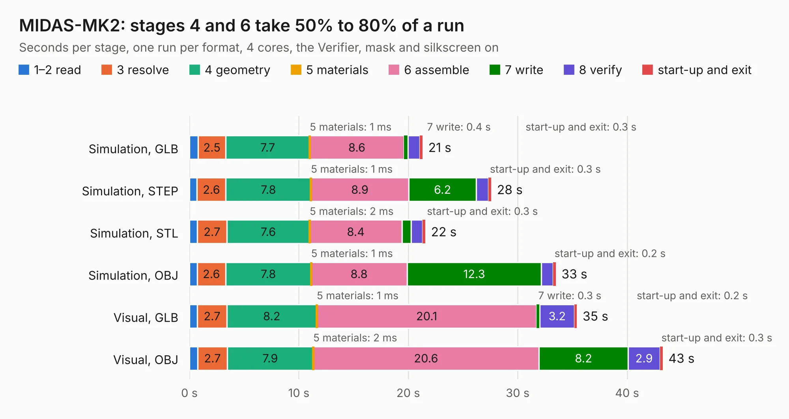

| Mode and format | 1–2 read | 3 resolve | 4 geometry | 5 materials | 6 assemble | 7 write | 8 verify | start-up and exit | Total |
|---|---:|---:|---:|---:|---:|---:|---:|---:|---:|
| Simulation, GLB | 0.8 | 2.5 | 7.7 | 1&nbsp;ms | 8.6 | 0.4 | 1.1 | 0.3 | 21.3 |
| Simulation, STEP | 0.7 | 2.6 | 7.8 | 1&nbsp;ms | 8.9 | 6.2 | 1.1 | 0.3 | 27.6 |
| Simulation, STL | 0.7 | 2.7 | 7.6 | 2&nbsp;ms | 8.4 | 0.8 | 1.0 | 0.3 | 21.6 |
| Simulation, OBJ | 0.7 | 2.6 | 7.8 | 1&nbsp;ms | 8.8 | 12.3 | 1.1 | 0.2 | 33.5 |
| Visual, GLB | 0.7 | 2.7 | 8.2 | 1&nbsp;ms | 20.1 | 0.3 | 3.2 | 0.2 | 35.4 |
| Visual, OBJ | 0.8 | 2.7 | 7.9 | 2&nbsp;ms | 20.6 | 8.2 | 2.9 | 0.3 | 43.3 |

<table align="center"><tr><td valign="top">

| Board | Repo: [issuiuc/iss-pcb](https://github.com/issuiuc/iss-pcb) Board: `MIDAS-MK2.kicad_pcb` |
|---|---|
| Folder | boards / MIDAS-MK2 / MIDAS-MK2-revA |
| Complexity | 432&nbsp;/&nbsp;1000 (size&nbsp;267, features&nbsp;165) |
| KESE&nbsp;features | through vias, slotted holes, custom pads, rounded, trapezoid or chamfered pads, filled zones, copper drawings, copper text, curved board outline, TrueType text, stack-up, dielectric εr and tanδ, copper finish, mask and silkscreen colours |
| Tested | 9th November 2026 |
| Copper&nbsp;layers | 4 |
| File&nbsp;format | KiCad 8 (20240108) |
| Parts,&nbsp;tracks,&nbsp;vias | 190, 1,192, 401 |
| Triangles,&nbsp;simulation | 2,793,012 in 259 parts |
| Verifier | PASS in all six runs |

</td><td valign="top">

<table>
<tr><th>File type</th><th>File size</th><th>Peak memory used</th></tr>
<tr><th colspan="3" align="left">Simulation</th></tr>
<tr><td>GLB</td><td align="right">95&nbsp;MB</td><td align="right">961&nbsp;MB</td></tr>
<tr><td>STEP</td><td align="right">378&nbsp;MB</td><td align="right">1.1&nbsp;GB</td></tr>
<tr><td>STL</td><td align="right">140&nbsp;MB</td><td align="right">834&nbsp;MB</td></tr>
<tr><td>OBJ</td><td align="right">293&nbsp;MB</td><td align="right">1.8&nbsp;GB</td></tr>
<tr><th colspan="3" align="left">Visual</th></tr>
<tr><td>GLB</td><td align="right">63&nbsp;MB</td><td align="right">1.2&nbsp;GB</td></tr>
<tr><td>OBJ</td><td align="right">197&nbsp;MB</td><td align="right">1.4&nbsp;GB</td></tr>
</table>

</td></tr></table>

## 1330. MIDAS-MK2.1

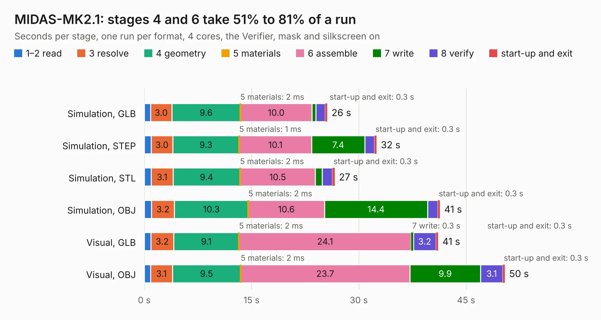

| Mode and format | 1–2 read | 3 resolve | 4 geometry | 5 materials | 6 assemble | 7 write | 8 verify | start-up and exit | Total |
|---|---:|---:|---:|---:|---:|---:|---:|---:|---:|
| Simulation, GLB | 0.9 | 3.0 | 9.6 | 2&nbsp;ms | 10.0 | 0.5 | 1.3 | 0.3 | 25.6 |
| Simulation, STEP | 1.0 | 3.0 | 9.3 | 1&nbsp;ms | 10.1 | 7.4 | 1.4 | 0.3 | 32.5 |
| Simulation, STL | 1.0 | 3.1 | 9.4 | 2&nbsp;ms | 10.5 | 1.0 | 1.4 | 0.3 | 26.6 |
| Simulation, OBJ | 1.0 | 3.2 | 10.3 | 2&nbsp;ms | 10.6 | 14.4 | 1.4 | 0.3 | 41.3 |
| Visual, GLB | 0.9 | 3.2 | 9.1 | 2&nbsp;ms | 24.1 | 0.3 | 3.2 | 0.3 | 41.1 |
| Visual, OBJ | 0.9 | 3.1 | 9.5 | 2&nbsp;ms | 23.7 | 9.9 | 3.1 | 0.3 | 50.4 |

<table align="center"><tr><td valign="top">

| Board | Repo: [issuiuc/iss-pcb](https://github.com/issuiuc/iss-pcb) Board: `MIDAS-MK2.1.kicad_pcb` |
|---|---|
| Folder | boards / MIDAS-MK2 / MIDAS-MK2.1-revA |
| Complexity | 432&nbsp;/&nbsp;1000 (size&nbsp;267, features&nbsp;165) |
| KESE&nbsp;features | through vias, slotted holes, custom pads, rounded, trapezoid or chamfered pads, filled zones, copper drawings, copper text, curved board outline, TrueType text, stack-up, dielectric εr and tanδ, copper finish, mask and silkscreen colours |
| Tested | 9th November 2026 |
| Copper&nbsp;layers | 4 |
| File&nbsp;format | KiCad 8 (20240108) |
| Parts,&nbsp;tracks,&nbsp;vias | 193, 1,196, 432 |
| Triangles,&nbsp;simulation | 2,838,746 in 255 parts |
| Verifier | PASS in all six runs |

</td><td valign="top">

<table>
<tr><th>File type</th><th>File size</th><th>Peak memory used</th></tr>
<tr><th colspan="3" align="left">Simulation</th></tr>
<tr><td>GLB</td><td align="right">97&nbsp;MB</td><td align="right">948&nbsp;MB</td></tr>
<tr><td>STEP</td><td align="right">377&nbsp;MB</td><td align="right">1.1&nbsp;GB</td></tr>
<tr><td>STL</td><td align="right">142&nbsp;MB</td><td align="right">917&nbsp;MB</td></tr>
<tr><td>OBJ</td><td align="right">298&nbsp;MB</td><td align="right">1.8&nbsp;GB</td></tr>
<tr><th colspan="3" align="left">Visual</th></tr>
<tr><td>GLB</td><td align="right">64&nbsp;MB</td><td align="right">1.2&nbsp;GB</td></tr>
<tr><td>OBJ</td><td align="right">199&nbsp;MB</td><td align="right">1.4&nbsp;GB</td></tr>
</table>

</td></tr></table>

## 1331. MIDAS-MK2.1

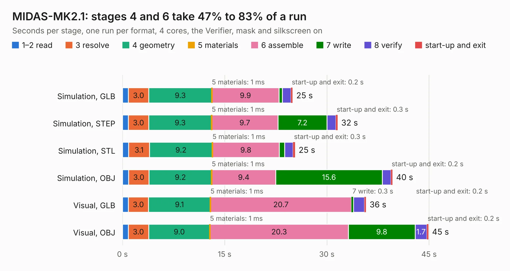

| Mode and format | 1–2 read | 3 resolve | 4 geometry | 5 materials | 6 assemble | 7 write | 8 verify | start-up and exit | Total |
|---|---:|---:|---:|---:|---:|---:|---:|---:|---:|
| Simulation, GLB | 0.9 | 3.0 | 9.3 | 1&nbsp;ms | 9.9 | 0.5 | 1.3 | 0.2 | 25.0 |
| Simulation, STEP | 0.9 | 3.0 | 9.3 | 1&nbsp;ms | 9.7 | 7.2 | 1.3 | 0.3 | 31.6 |
| Simulation, STL | 0.9 | 3.1 | 9.2 | 1&nbsp;ms | 9.8 | 0.8 | 1.3 | 0.3 | 25.3 |
| Simulation, OBJ | 0.9 | 3.0 | 9.2 | 1&nbsp;ms | 9.4 | 15.6 | 1.3 | 0.2 | 39.6 |
| Visual, GLB | 0.9 | 3.0 | 9.1 | 1&nbsp;ms | 20.7 | 0.3 | 1.6 | 0.2 | 35.7 |
| Visual, OBJ | 0.8 | 3.0 | 9.0 | 1&nbsp;ms | 20.3 | 9.8 | 1.7 | 0.2 | 44.9 |

<table align="center"><tr><td valign="top">

| Board | Repo: [issuiuc/iss-pcb](https://github.com/issuiuc/iss-pcb) Board: `MIDAS-MK2.1.kicad_pcb` |
|---|---|
| Folder | boards / MIDAS-MK2 / MIDAS-MK2.1-revB |
| Complexity | 433&nbsp;/&nbsp;1000 (size&nbsp;268, features&nbsp;165) |
| KESE&nbsp;features | through vias, slotted holes, custom pads, rounded, trapezoid or chamfered pads, filled zones, copper drawings, copper text, curved board outline, TrueType text, stack-up, dielectric εr and tanδ, copper finish, mask and silkscreen colours |
| Tested | 9th November 2026 |
| Copper&nbsp;layers | 4 |
| File&nbsp;format | KiCad 8 (20240108) |
| Parts,&nbsp;tracks,&nbsp;vias | 189, 1,223, 478 |
| Triangles,&nbsp;simulation | 2,942,062 in 250 parts |
| Verifier | PASS in all six runs |

</td><td valign="top">

<table>
<tr><th>File type</th><th>File size</th><th>Peak memory used</th></tr>
<tr><th colspan="3" align="left">Simulation</th></tr>
<tr><td>GLB</td><td align="right">100&nbsp;MB</td><td align="right">984&nbsp;MB</td></tr>
<tr><td>STEP</td><td align="right">381&nbsp;MB</td><td align="right">1.2&nbsp;GB</td></tr>
<tr><td>STL</td><td align="right">147&nbsp;MB</td><td align="right">980&nbsp;MB</td></tr>
<tr><td>OBJ</td><td align="right">309&nbsp;MB</td><td align="right">1.9&nbsp;GB</td></tr>
<tr><th colspan="3" align="left">Visual</th></tr>
<tr><td>GLB</td><td align="right">65&nbsp;MB</td><td align="right">1.2&nbsp;GB</td></tr>
<tr><td>OBJ</td><td align="right">205&nbsp;MB</td><td align="right">1.4&nbsp;GB</td></tr>
</table>

</td></tr></table>

## 1332. Mini-MK1

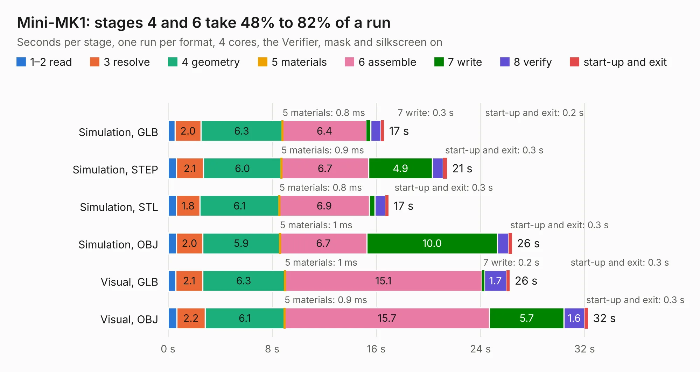

| Mode and format | 1–2 read | 3 resolve | 4 geometry | 5 materials | 6 assemble | 7 write | 8 verify | start-up and exit | Total |
|---|---:|---:|---:|---:|---:|---:|---:|---:|---:|
| Simulation, GLB | 0.5 | 2.0 | 6.3 | 0.8&nbsp;ms | 6.4 | 0.3 | 0.8 | 0.2 | 16.6 |
| Simulation, STEP | 0.6 | 2.1 | 6.0 | 0.9&nbsp;ms | 6.7 | 4.9 | 0.8 | 0.3 | 21.4 |
| Simulation, STL | 0.6 | 1.8 | 6.1 | 0.8&nbsp;ms | 6.9 | 0.4 | 0.8 | 0.3 | 16.9 |
| Simulation, OBJ | 0.6 | 2.0 | 5.9 | 1&nbsp;ms | 6.7 | 10.0 | 0.9 | 0.3 | 26.4 |
| Visual, GLB | 0.6 | 2.1 | 6.3 | 1&nbsp;ms | 15.1 | 0.2 | 1.7 | 0.3 | 26.2 |
| Visual, OBJ | 0.7 | 2.2 | 6.1 | 0.9&nbsp;ms | 15.7 | 5.7 | 1.6 | 0.3 | 32.3 |

<table align="center"><tr><td valign="top">

| Board | Repo: [issuiuc/iss-pcb](https://github.com/issuiuc/iss-pcb) Board: `Mini-MK1.kicad_pcb` |
|---|---|
| Folder | boards / Mini-MK1 |
| Complexity | 348&nbsp;/&nbsp;1000 (size&nbsp;208, features&nbsp;140) |
| KESE&nbsp;features | through vias, slotted holes, custom pads, rounded, trapezoid or chamfered pads, filled zones, copper drawings, curved board outline, TrueType text, stack-up, dielectric εr and tanδ, mask and silkscreen colours |
| Tested | 9th November 2026 |
| Copper&nbsp;layers | 4 |
| File&nbsp;format | KiCad 9 (20241229) |
| Parts,&nbsp;tracks,&nbsp;vias | 125, 697, 353 |
| Triangles,&nbsp;simulation | 2,044,106 in 172 parts |
| Verifier | PASS in all six runs |

</td><td valign="top">

<table>
<tr><th>File type</th><th>File size</th><th>Peak memory used</th></tr>
<tr><th colspan="3" align="left">Simulation</th></tr>
<tr><td>GLB</td><td align="right">69&nbsp;MB</td><td align="right">728&nbsp;MB</td></tr>
<tr><td>STEP</td><td align="right">255&nbsp;MB</td><td align="right">905&nbsp;MB</td></tr>
<tr><td>STL</td><td align="right">102&nbsp;MB</td><td align="right">741&nbsp;MB</td></tr>
<tr><td>OBJ</td><td align="right">216&nbsp;MB</td><td align="right">1.4&nbsp;GB</td></tr>
<tr><th colspan="3" align="left">Visual</th></tr>
<tr><td>GLB</td><td align="right">44&nbsp;MB</td><td align="right">820&nbsp;MB</td></tr>
<tr><td>OBJ</td><td align="right">137&nbsp;MB</td><td align="right">1.0&nbsp;GB</td></tr>
</table>

</td></tr></table>

## 1333. Motor-MK1

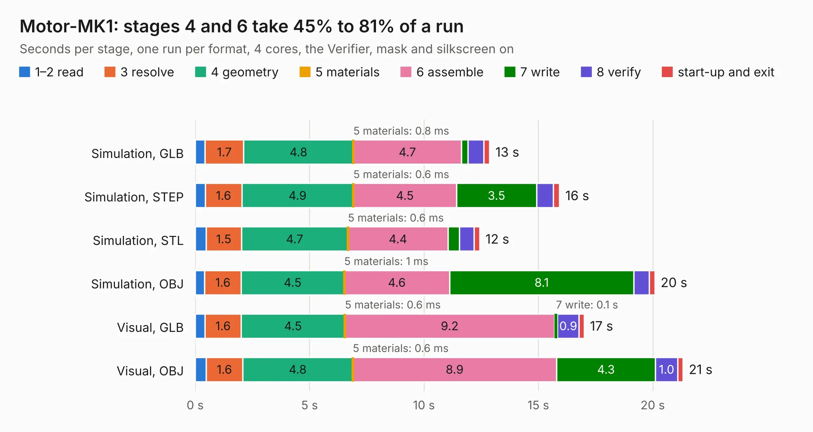

| Mode and format | 1–2 read | 3 resolve | 4 geometry | 5 materials | 6 assemble | 7 write | 8 verify | start-up and exit | Total |
|---|---:|---:|---:|---:|---:|---:|---:|---:|---:|
| Simulation, GLB | 0.4 | 1.7 | 4.8 | 0.8&nbsp;ms | 4.7 | 0.3 | 0.7 | 0.3 | 12.9 |
| Simulation, STEP | 0.4 | 1.6 | 4.9 | 0.6&nbsp;ms | 4.5 | 3.5 | 0.7 | 0.3 | 15.9 |
| Simulation, STL | 0.5 | 1.5 | 4.7 | 0.6&nbsp;ms | 4.4 | 0.5 | 0.6 | 0.2 | 12.4 |
| Simulation, OBJ | 0.4 | 1.6 | 4.5 | 1&nbsp;ms | 4.6 | 8.1 | 0.7 | 0.3 | 20.1 |
| Visual, GLB | 0.4 | 1.6 | 4.5 | 0.6&nbsp;ms | 9.2 | 0.1 | 0.9 | 0.2 | 17.0 |
| Visual, OBJ | 0.5 | 1.6 | 4.8 | 0.6&nbsp;ms | 8.9 | 4.3 | 1.0 | 0.2 | 21.3 |

<table align="center"><tr><td valign="top">

| Board | Repo: [issuiuc/iss-pcb](https://github.com/issuiuc/iss-pcb) Board: `Motor-MK1.kicad_pcb` |
|---|---|
| Folder | boards / Motor-MK1 |
| Complexity | 336&nbsp;/&nbsp;1000 (size&nbsp;241, features&nbsp;95) |
| KESE&nbsp;features | through vias, slotted holes, rounded, trapezoid or chamfered pads, filled zones, curved board outline, stack-up, dielectric εr and tanδ |
| Tested | 9th November 2026 |
| Copper&nbsp;layers | 4 |
| File&nbsp;format | KiCad 8 (20240108) |
| Parts,&nbsp;tracks,&nbsp;vias | 63, 431, 240 |
| Triangles,&nbsp;simulation | 1,392,234 in 139 parts |
| Verifier | PASS in all six runs |

</td><td valign="top">

<table>
<tr><th>File type</th><th>File size</th><th>Peak memory used</th></tr>
<tr><th colspan="3" align="left">Simulation</th></tr>
<tr><td>GLB</td><td align="right">46&nbsp;MB</td><td align="right">529&nbsp;MB</td></tr>
<tr><td>STEP</td><td align="right">145&nbsp;MB</td><td align="right">611&nbsp;MB</td></tr>
<tr><td>STL</td><td align="right">70&nbsp;MB</td><td align="right">527&nbsp;MB</td></tr>
<tr><td>OBJ</td><td align="right">142&nbsp;MB</td><td align="right">963&nbsp;MB</td></tr>
<tr><th colspan="3" align="left">Visual</th></tr>
<tr><td>GLB</td><td align="right">25&nbsp;MB</td><td align="right">638&nbsp;MB</td></tr>
<tr><td>OBJ</td><td align="right">78&nbsp;MB</td><td align="right">622&nbsp;MB</td></tr>
</table>

</td></tr></table>

## 1334. GATOR

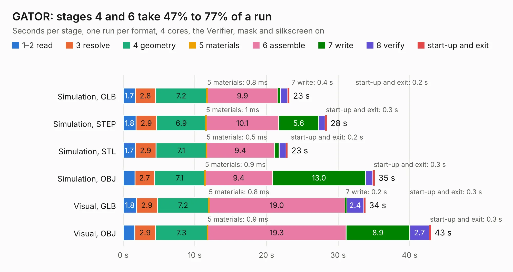

| Mode and format | 1–2 read | 3 resolve | 4 geometry | 5 materials | 6 assemble | 7 write | 8 verify | start-up and exit | Total |
|---|---:|---:|---:|---:|---:|---:|---:|---:|---:|
| Simulation, GLB | 1.7 | 2.8 | 7.2 | 0.8&nbsp;ms | 9.9 | 0.4 | 1.0 | 0.2 | 23.2 |
| Simulation, STEP | 1.8 | 2.9 | 6.9 | 1&nbsp;ms | 10.1 | 5.6 | 0.9 | 0.3 | 28.4 |
| Simulation, STL | 1.7 | 2.9 | 7.1 | 0.5&nbsp;ms | 9.4 | 0.7 | 1.0 | 0.2 | 23.0 |
| Simulation, OBJ | 1.6 | 2.7 | 7.1 | 0.9&nbsp;ms | 9.4 | 13.0 | 1.0 | 0.3 | 35.1 |
| Visual, GLB | 1.8 | 2.9 | 7.2 | 0.8&nbsp;ms | 19.0 | 0.2 | 2.4 | 0.3 | 33.8 |
| Visual, OBJ | 1.6 | 2.9 | 7.3 | 0.9&nbsp;ms | 19.3 | 8.9 | 2.7 | 0.3 | 43.0 |

<table align="center"><tr><td valign="top">

| Board | Repo: [issuiuc/iss-pcb](https://github.com/issuiuc/iss-pcb) Board: `GATOR.kicad_pcb` |
|---|---|
| Folder | boards / Motor-MK2 (GATOR) |
| Complexity | 376&nbsp;/&nbsp;1000 (size&nbsp;251, features&nbsp;125) |
| KESE&nbsp;features | through vias, slotted holes, custom pads, rounded, trapezoid or chamfered pads, filled zones, copper drawings, curved board outline, stack-up, dielectric εr and tanδ, mask and silkscreen colours |
| Tested | 9th November 2026 |
| Copper&nbsp;layers | 4 |
| File&nbsp;format | KiCad 10 (20260206) |
| Parts,&nbsp;tracks,&nbsp;vias | 79, 705, 397 |
| Triangles,&nbsp;simulation | 2,386,824 in 148 parts |
| Verifier | PASS in all six runs |

</td><td valign="top">

<table>
<tr><th>File type</th><th>File size</th><th>Peak memory used</th></tr>
<tr><th colspan="3" align="left">Simulation</th></tr>
<tr><td>GLB</td><td align="right">84&nbsp;MB</td><td align="right">870&nbsp;MB</td></tr>
<tr><td>STEP</td><td align="right">298&nbsp;MB</td><td align="right">1.1&nbsp;GB</td></tr>
<tr><td>STL</td><td align="right">119&nbsp;MB</td><td align="right">875&nbsp;MB</td></tr>
<tr><td>OBJ</td><td align="right">256&nbsp;MB</td><td align="right">1.7&nbsp;GB</td></tr>
<tr><th colspan="3" align="left">Visual</th></tr>
<tr><td>GLB</td><td align="right">56&nbsp;MB</td><td align="right">1.0&nbsp;GB</td></tr>
<tr><td>OBJ</td><td align="right">171&nbsp;MB</td><td align="right">1.2&nbsp;GB</td></tr>
</table>

</td></tr></table>

## 1335. 555-Timer-Demo-Circuit

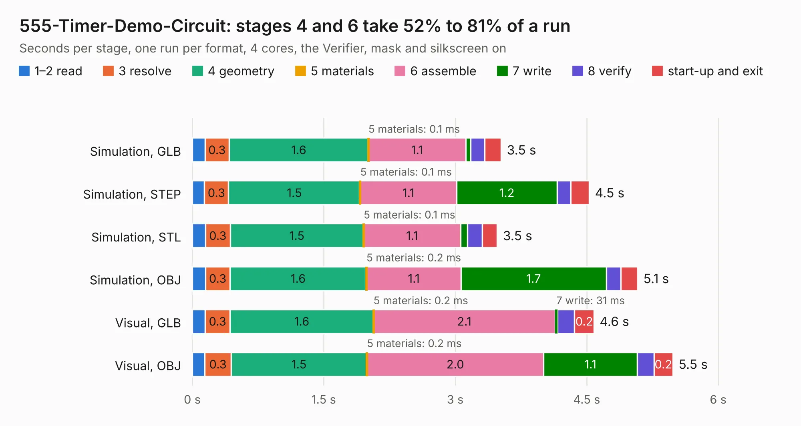

| Mode and format | 1–2 read | 3 resolve | 4 geometry | 5 materials | 6 assemble | 7 write | 8 verify | start-up and exit | Total |
|---|---:|---:|---:|---:|---:|---:|---:|---:|---:|
| Simulation, GLB | 0.1 | 0.3 | 1.6 | 0.1&nbsp;ms | 1.1 | 56&nbsp;ms | 0.2 | 0.2 | 3.5 |
| Simulation, STEP | 0.1 | 0.3 | 1.5 | 0.1&nbsp;ms | 1.1 | 1.2 | 0.2 | 0.2 | 4.5 |
| Simulation, STL | 0.2 | 0.3 | 1.5 | 0.1&nbsp;ms | 1.1 | 77&nbsp;ms | 0.2 | 0.2 | 3.5 |
| Simulation, OBJ | 0.2 | 0.3 | 1.6 | 0.2&nbsp;ms | 1.1 | 1.7 | 0.2 | 0.2 | 5.1 |
| Visual, GLB | 0.1 | 0.3 | 1.6 | 0.2&nbsp;ms | 2.1 | 31&nbsp;ms | 0.2 | 0.2 | 4.6 |
| Visual, OBJ | 0.1 | 0.3 | 1.5 | 0.2&nbsp;ms | 2.0 | 1.1 | 0.2 | 0.2 | 5.5 |

<table align="center"><tr><td valign="top">

| Board | Repo: [issuiuc/iss-pcb](https://github.com/issuiuc/iss-pcb) Board: `555-Timer-Demo-Circuit.kicad_pcb` |
|---|---|
| Folder | boards / Onboarding / 555-Timer-Demo-Circuit |
| Complexity | 168&nbsp;/&nbsp;1000 (size&nbsp;118, features&nbsp;50) |
| KESE&nbsp;features | filled zones, stack-up, dielectric εr and tanδ |
| Tested | 9th November 2026 |
| Copper&nbsp;layers | 2 |
| File&nbsp;format | KiCad 7 (20221018) |
| Parts,&nbsp;tracks,&nbsp;vias | 20, 64, 0 |
| Triangles,&nbsp;simulation | 340,078 in 21 parts |
| Verifier | PASS in all six runs |

</td><td valign="top">

<table>
<tr><th>File type</th><th>File size</th><th>Peak memory used</th></tr>
<tr><th colspan="3" align="left">Simulation</th></tr>
<tr><td>GLB</td><td align="right">12&nbsp;MB</td><td align="right">248&nbsp;MB</td></tr>
<tr><td>STEP</td><td align="right">47&nbsp;MB</td><td align="right">281&nbsp;MB</td></tr>
<tr><td>STL</td><td align="right">17&nbsp;MB</td><td align="right">251&nbsp;MB</td></tr>
<tr><td>OBJ</td><td align="right">34&nbsp;MB</td><td align="right">265&nbsp;MB</td></tr>
<tr><th colspan="3" align="left">Visual</th></tr>
<tr><td>GLB</td><td align="right">7.2&nbsp;MB</td><td align="right">252&nbsp;MB</td></tr>
<tr><td>OBJ</td><td align="right">21&nbsp;MB</td><td align="right">245&nbsp;MB</td></tr>
</table>

</td></tr></table>

## 1336. L1-Altimeter

| Mode and format | 1–2 read | 3 resolve | 4 geometry | 5 materials | 6 assemble | 7 write | 8 verify | start-up and exit | Total |
|---|---:|---:|---:|---:|---:|---:|---:|---:|---:|
| Simulation, GLB | 0.2 | 0.4 | 2.3 | 0.3&nbsp;ms | 1.7 | 78&nbsp;ms | 0.3 | 0.2 | 5.2 |
| Simulation, STEP | 0.2 | 0.4 | 2.2 | 0.2&nbsp;ms | 1.7 | 1.7 | 0.3 | 0.2 | 6.7 |
| Simulation, STL | 0.3 | 0.4 | 2.3 | 0.3&nbsp;ms | 1.7 | 0.2 | 0.3 | 0.2 | 5.3 |
| Simulation, OBJ | 0.2 | 0.4 | 2.3 | 0.3&nbsp;ms | 1.8 | 2.4 | 0.3 | 0.2 | 7.5 |
| Visual, GLB | 0.2 | 0.4 | 2.3 | 0.3&nbsp;ms | 4.5 | 53&nbsp;ms | 0.5 | 0.2 | 8.2 |
| Visual, OBJ | 0.2 | 0.4 | 2.3 | 0.3&nbsp;ms | 4.1 | 1.6 | 0.7 | 0.2 | 9.5 |

<table align="center"><tr><td valign="top">

| Board | Repo: [issuiuc/iss-pcb](https://github.com/issuiuc/iss-pcb) Board: `L1-Altimeter.kicad_pcb` |
|---|---|
| Folder | boards / Onboarding / L1-Altimeter |
| Complexity | 279&nbsp;/&nbsp;1000 (size&nbsp;204, features&nbsp;75) |
| KESE&nbsp;features | through vias, rounded, trapezoid or chamfered pads, filled zones, stack-up, dielectric εr and tanδ |
| Tested | 9th November 2026 |
| Copper&nbsp;layers | 2 |
| File&nbsp;format | KiCad 7 (20221018) |
| Parts,&nbsp;tracks,&nbsp;vias | 42, 260, 44 |
| Triangles,&nbsp;simulation | 574,084 in 67 parts |
| Verifier | PASS in all six runs |

</td><td valign="top">

<table>
<tr><th>File type</th><th>File size</th><th>Peak memory used</th></tr>
<tr><th colspan="3" align="left">Simulation</th></tr>
<tr><td>GLB</td><td align="right">20&nbsp;MB</td><td align="right">324&nbsp;MB</td></tr>
<tr><td>STEP</td><td align="right">86&nbsp;MB</td><td align="right">373&nbsp;MB</td></tr>
<tr><td>STL</td><td align="right">29&nbsp;MB</td><td align="right">339&nbsp;MB</td></tr>
<tr><td>OBJ</td><td align="right">58&nbsp;MB</td><td align="right">425&nbsp;MB</td></tr>
<tr><th colspan="3" align="left">Visual</th></tr>
<tr><td>GLB</td><td align="right">13&nbsp;MB</td><td align="right">394&nbsp;MB</td></tr>
<tr><td>OBJ</td><td align="right">40&nbsp;MB</td><td align="right">389&nbsp;MB</td></tr>
</table>

</td></tr></table>

## 1337. SPARK-MK1

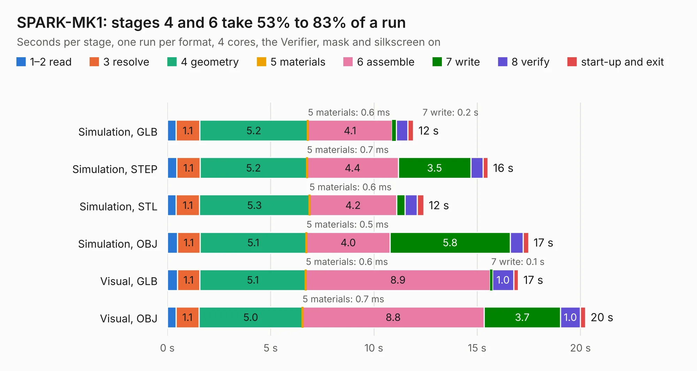

| Mode and format | 1–2 read | 3 resolve | 4 geometry | 5 materials | 6 assemble | 7 write | 8 verify | start-up and exit | Total |
|---|---:|---:|---:|---:|---:|---:|---:|---:|---:|
| Simulation, GLB | 0.4 | 1.1 | 5.2 | 0.6&nbsp;ms | 4.1 | 0.2 | 0.6 | 0.3 | 11.9 |
| Simulation, STEP | 0.5 | 1.1 | 5.2 | 0.7&nbsp;ms | 4.4 | 3.5 | 0.6 | 0.2 | 15.5 |
| Simulation, STL | 0.4 | 1.1 | 5.3 | 0.6&nbsp;ms | 4.2 | 0.4 | 0.6 | 0.3 | 12.4 |
| Simulation, OBJ | 0.5 | 1.1 | 5.1 | 0.5&nbsp;ms | 4.0 | 5.8 | 0.6 | 0.3 | 17.5 |
| Visual, GLB | 0.5 | 1.1 | 5.1 | 0.6&nbsp;ms | 8.9 | 0.1 | 1.0 | 0.2 | 17.0 |
| Visual, OBJ | 0.4 | 1.1 | 5.0 | 0.7&nbsp;ms | 8.8 | 3.7 | 1.0 | 0.3 | 20.2 |

<table align="center"><tr><td valign="top">

| Board | Repo: [issuiuc/iss-pcb](https://github.com/issuiuc/iss-pcb) Board: `SPARK-MK1.kicad_pcb` |
|---|---|
| Folder | boards / SPARK-MK1 |
| Complexity | 301&nbsp;/&nbsp;1000 (size&nbsp;161, features&nbsp;140) |
| KESE&nbsp;features | through vias, custom pads, rounded, trapezoid or chamfered pads, filled zones, copper drawings, curved board outline, knockout text, TrueType text, stack-up, dielectric εr and tanδ |
| Tested | 9th November 2026 |
| Copper&nbsp;layers | 2 |
| File&nbsp;format | KiCad 8 (20240108) |
| Parts,&nbsp;tracks,&nbsp;vias | 74, 254, 40 |
| Triangles,&nbsp;simulation | 1,005,830 in 128 parts |
| Verifier | PASS in all six runs |

</td><td valign="top">

<table>
<tr><th>File type</th><th>File size</th><th>Peak memory used</th></tr>
<tr><th colspan="3" align="left">Simulation</th></tr>
<tr><td>GLB</td><td align="right">34&nbsp;MB</td><td align="right">431&nbsp;MB</td></tr>
<tr><td>STEP</td><td align="right">162&nbsp;MB</td><td align="right">534&nbsp;MB</td></tr>
<tr><td>STL</td><td align="right">50&nbsp;MB</td><td align="right">409&nbsp;MB</td></tr>
<tr><td>OBJ</td><td align="right">102&nbsp;MB</td><td align="right">723&nbsp;MB</td></tr>
<tr><th colspan="3" align="left">Visual</th></tr>
<tr><td>GLB</td><td align="right">23&nbsp;MB</td><td align="right">568&nbsp;MB</td></tr>
<tr><td>OBJ</td><td align="right">68&nbsp;MB</td><td align="right">579&nbsp;MB</td></tr>
</table>

</td></tr></table>

## 1338. TeleDecoder-revA

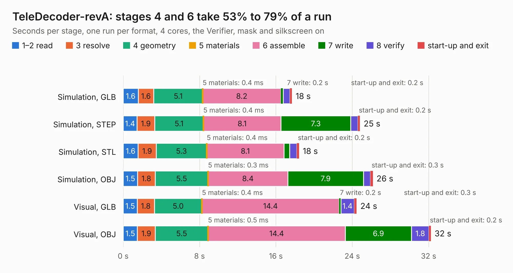

| Mode and format | 1–2 read | 3 resolve | 4 geometry | 5 materials | 6 assemble | 7 write | 8 verify | start-up and exit | Total |
|---|---:|---:|---:|---:|---:|---:|---:|---:|---:|
| Simulation, GLB | 1.6 | 1.6 | 5.1 | 0.4&nbsp;ms | 8.2 | 0.2 | 0.7 | 0.2 | 17.7 |
| Simulation, STEP | 1.4 | 1.9 | 5.1 | 0.4&nbsp;ms | 8.1 | 7.3 | 0.7 | 0.2 | 24.8 |
| Simulation, STL | 1.6 | 1.9 | 5.3 | 0.4&nbsp;ms | 8.1 | 0.6 | 0.8 | 0.2 | 18.4 |
| Simulation, OBJ | 1.5 | 1.8 | 5.5 | 0.3&nbsp;ms | 8.4 | 7.9 | 0.7 | 0.3 | 26.2 |
| Visual, GLB | 1.5 | 1.8 | 5.0 | 0.4&nbsp;ms | 14.4 | 0.2 | 1.4 | 0.3 | 24.5 |
| Visual, OBJ | 1.5 | 1.9 | 5.5 | 0.5&nbsp;ms | 14.4 | 6.9 | 1.8 | 0.2 | 32.2 |

<table align="center"><tr><td valign="top">

| Board | Repo: [issuiuc/iss-pcb](https://github.com/issuiuc/iss-pcb) Board: `TeleDecoder-revA.kicad_pcb` |
|---|---|
| Folder | boards / TeleDecoder / TeleDecoder-revA |
| Complexity | 337&nbsp;/&nbsp;1000 (size&nbsp;217, features&nbsp;120) |
| KESE&nbsp;features | through vias, slotted holes, custom pads, rounded, trapezoid or chamfered pads, filled zones, copper drawings, curved board outline, stack-up, dielectric εr and tanδ |
| Tested | 9th November 2026 |
| Copper&nbsp;layers | 4 |
| File&nbsp;format | KiCad 10 (20260206) |
| Parts,&nbsp;tracks,&nbsp;vias | 64, 282, 45 |
| Triangles,&nbsp;simulation | 1,445,822 in 92 parts |
| Verifier | PASS in all six runs |

</td><td valign="top">

<table>
<tr><th>File type</th><th>File size</th><th>Peak memory used</th></tr>
<tr><th colspan="3" align="left">Simulation</th></tr>
<tr><td>GLB</td><td align="right">51&nbsp;MB</td><td align="right">788&nbsp;MB</td></tr>
<tr><td>STEP</td><td align="right">178&nbsp;MB</td><td align="right">827&nbsp;MB</td></tr>
<tr><td>STL</td><td align="right">72&nbsp;MB</td><td align="right">779&nbsp;MB</td></tr>
<tr><td>OBJ</td><td align="right">152&nbsp;MB</td><td align="right">1.1&nbsp;GB</td></tr>
<tr><th colspan="3" align="left">Visual</th></tr>
<tr><td>GLB</td><td align="right">42&nbsp;MB</td><td align="right">833&nbsp;MB</td></tr>
<tr><td>OBJ</td><td align="right">126&nbsp;MB</td><td align="right">945&nbsp;MB</td></tr>
</table>

</td></tr></table>

## 1339. TeleDecoder-revB

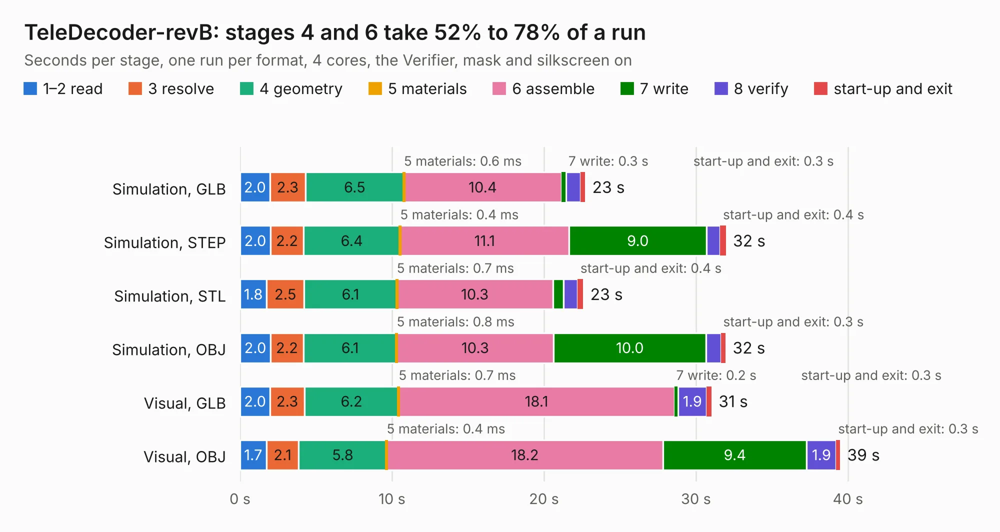

| Mode and format | 1–2 read | 3 resolve | 4 geometry | 5 materials | 6 assemble | 7 write | 8 verify | start-up and exit | Total |
|---|---:|---:|---:|---:|---:|---:|---:|---:|---:|
| Simulation, GLB | 2.0 | 2.3 | 6.5 | 0.6&nbsp;ms | 10.4 | 0.3 | 1.0 | 0.3 | 22.7 |
| Simulation, STEP | 2.0 | 2.2 | 6.4 | 0.4&nbsp;ms | 11.1 | 9.0 | 0.9 | 0.4 | 32.0 |
| Simulation, STL | 1.8 | 2.5 | 6.1 | 0.7&nbsp;ms | 10.3 | 0.7 | 0.9 | 0.4 | 22.6 |
| Simulation, OBJ | 2.0 | 2.2 | 6.1 | 0.8&nbsp;ms | 10.3 | 10.0 | 1.0 | 0.3 | 31.9 |
| Visual, GLB | 2.0 | 2.3 | 6.2 | 0.7&nbsp;ms | 18.1 | 0.2 | 1.9 | 0.3 | 31.0 |
| Visual, OBJ | 1.7 | 2.1 | 5.8 | 0.4&nbsp;ms | 18.2 | 9.4 | 1.9 | 0.3 | 39.5 |

<table align="center"><tr><td valign="top">

| Board | Repo: [issuiuc/iss-pcb](https://github.com/issuiuc/iss-pcb) Board: `TeleDecoder-revB.kicad_pcb` |
|---|---|
| Folder | boards / TeleDecoder / TeleDecoder-revB |
| Complexity | 346&nbsp;/&nbsp;1000 (size&nbsp;221, features&nbsp;125) |
| KESE&nbsp;features | through vias, slotted holes, custom pads, rounded, trapezoid or chamfered pads, filled zones, copper drawings, curved board outline, stack-up, dielectric εr and tanδ, mask and silkscreen colours |
| Tested | 9th November 2026 |
| Copper&nbsp;layers | 4 |
| File&nbsp;format | KiCad 10 (20260206) |
| Parts,&nbsp;tracks,&nbsp;vias | 64, 282, 81 |
| Triangles,&nbsp;simulation | 1,512,512 in 92 parts |
| Verifier | PASS in all six runs |

</td><td valign="top">

<table>
<tr><th>File type</th><th>File size</th><th>Peak memory used</th></tr>
<tr><th colspan="3" align="left">Simulation</th></tr>
<tr><td>GLB</td><td align="right">53&nbsp;MB</td><td align="right">788&nbsp;MB</td></tr>
<tr><td>STEP</td><td align="right">180&nbsp;MB</td><td align="right">820&nbsp;MB</td></tr>
<tr><td>STL</td><td align="right">76&nbsp;MB</td><td align="right">826&nbsp;MB</td></tr>
<tr><td>OBJ</td><td align="right">162&nbsp;MB</td><td align="right">1.1&nbsp;GB</td></tr>
<tr><th colspan="3" align="left">Visual</th></tr>
<tr><td>GLB</td><td align="right">43&nbsp;MB</td><td align="right">942&nbsp;MB</td></tr>
<tr><td>OBJ</td><td align="right">132&nbsp;MB</td><td align="right">975&nbsp;MB</td></tr>
</table>

</td></tr></table>

## 1340. Amiga600

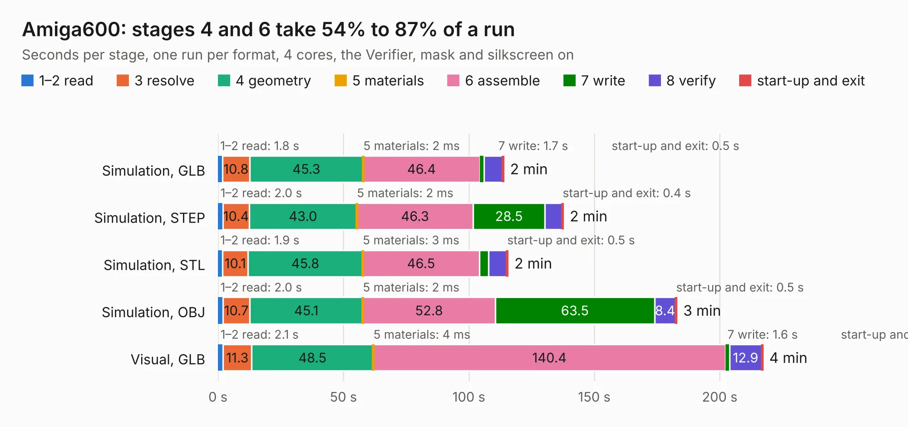

| Mode and format | 1–2 read | 3 resolve | 4 geometry | 5 materials | 6 assemble | 7 write | 8 verify | start-up and exit | Total |
|---|---:|---:|---:|---:|---:|---:|---:|---:|---:|
| Simulation, GLB | 1.8 | 10.8 | 45.3 | 2&nbsp;ms | 46.4 | 1.7 | 7.3 | 0.5 | 113.8 |
| Simulation, STEP | 2.0 | 10.4 | 43.0 | 2&nbsp;ms | 46.3 | 28.5 | 6.9 | 0.4 | 137.6 |
| Simulation, STL | 1.9 | 10.1 | 45.8 | 3&nbsp;ms | 46.5 | 3.6 | 7.3 | 0.5 | 115.6 |
| Simulation, OBJ | 2.0 | 10.7 | 45.1 | 2&nbsp;ms | 52.8 | 63.5 | 8.4 | 0.5 | 182.9 |
| Visual, GLB | 2.1 | 11.3 | 48.5 | 4&nbsp;ms | 140.4 | 1.6 | 12.9 | 0.4 | 217.1 |
| Visual, OBJ | 2.1 | 10.3 | 44.3 | 2&nbsp;ms | 147.3 | 64.4 | 14.9 | 0.4 | 283.7 |

<table align="center"><tr><td valign="top">

| Board | Repo: [istedman/A600Reborn](https://github.com/istedman/A600Reborn) Board: `Amiga600.kicad_pcb` |
|---|---|
| Folder | A600_Svideo_Working / KiCAD |
| Complexity | 386&nbsp;/&nbsp;1000 (size&nbsp;306, features&nbsp;80) |
| KESE&nbsp;features | through vias, slotted holes, custom pads, filled zones, copper drawings, curved board outline |
| Tested | 9th November 2026 |
| Copper&nbsp;layers | 2 |
| File&nbsp;format | KiCad 5 (20171130) |
| Parts,&nbsp;tracks,&nbsp;vias | 565, 13,837, 1,423 |
| Triangles,&nbsp;simulation | 8,472,872 in 626 parts |
| Verifier | PASS in all six runs |

</td><td valign="top">

<table>
<tr><th>File type</th><th>File size</th><th>Peak memory used</th></tr>
<tr><th colspan="3" align="left">Simulation</th></tr>
<tr><td>GLB</td><td align="right">293&nbsp;MB</td><td align="right">2.3&nbsp;GB</td></tr>
<tr><td>STEP</td><td align="right">1.6&nbsp;GB</td><td align="right">3.4&nbsp;GB</td></tr>
<tr><td>STL</td><td align="right">424&nbsp;MB</td><td align="right">2.3&nbsp;GB</td></tr>
<tr><td>OBJ</td><td align="right">911&nbsp;MB</td><td align="right">5.4&nbsp;GB</td></tr>
<tr><th colspan="3" align="left">Visual</th></tr>
<tr><td>GLB</td><td align="right">261&nbsp;MB</td><td align="right">3.8&nbsp;GB</td></tr>
<tr><td>OBJ</td><td align="right">837&nbsp;MB</td><td align="right">5.4&nbsp;GB</td></tr>
</table>

</td></tr></table>

## 1341. M68000

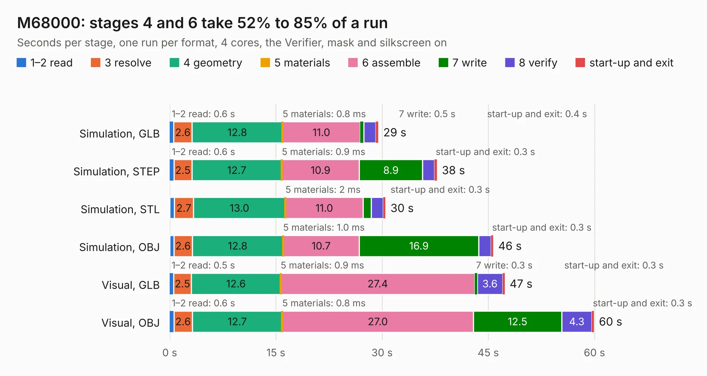

| Mode and format | 1–2 read | 3 resolve | 4 geometry | 5 materials | 6 assemble | 7 write | 8 verify | start-up and exit | Total |
|---|---:|---:|---:|---:|---:|---:|---:|---:|---:|
| Simulation, GLB | 0.6 | 2.6 | 12.8 | 0.8&nbsp;ms | 11.0 | 0.5 | 1.7 | 0.4 | 29.5 |
| Simulation, STEP | 0.6 | 2.5 | 12.7 | 0.9&nbsp;ms | 10.9 | 8.9 | 1.7 | 0.3 | 37.7 |
| Simulation, STL | 0.6 | 2.7 | 13.0 | 2&nbsp;ms | 11.0 | 1.2 | 1.7 | 0.3 | 30.5 |
| Simulation, OBJ | 0.6 | 2.6 | 12.8 | 1.0&nbsp;ms | 10.7 | 16.9 | 1.7 | 0.3 | 45.7 |
| Visual, GLB | 0.5 | 2.5 | 12.6 | 0.9&nbsp;ms | 27.4 | 0.3 | 3.6 | 0.3 | 47.3 |
| Visual, OBJ | 0.6 | 2.6 | 12.7 | 0.8&nbsp;ms | 27.0 | 12.5 | 4.3 | 0.3 | 59.9 |

<table align="center"><tr><td valign="top">

| Board | Repo: [jack-mil/mcd-pcb](https://github.com/jack-mil/mcd-pcb) Board: `M68000.kicad_pcb` |
|---|---|
| Complexity | 332&nbsp;/&nbsp;1000 (size&nbsp;247, features&nbsp;85) |
| KESE&nbsp;features | through vias, slotted holes, rounded, trapezoid or chamfered pads, filled zones, stack-up, dielectric εr and tanδ |
| Tested | 9th November 2026 |
| Copper&nbsp;layers | 2 |
| File&nbsp;format | KiCad 6 (20211014) |
| Parts,&nbsp;tracks,&nbsp;vias | 70, 1,709, 272 |
| Triangles,&nbsp;simulation | 2,985,686 in 191 parts |
| Verifier | PASS in all six runs |

</td><td valign="top">

<table>
<tr><th>File type</th><th>File size</th><th>Peak memory used</th></tr>
<tr><th colspan="3" align="left">Simulation</th></tr>
<tr><td>GLB</td><td align="right">100&nbsp;MB</td><td align="right">1.2&nbsp;GB</td></tr>
<tr><td>STEP</td><td align="right">460&nbsp;MB</td><td align="right">1.3&nbsp;GB</td></tr>
<tr><td>STL</td><td align="right">149&nbsp;MB</td><td align="right">1.2&nbsp;GB</td></tr>
<tr><td>OBJ</td><td align="right">311&nbsp;MB</td><td align="right">1.9&nbsp;GB</td></tr>
<tr><th colspan="3" align="left">Visual</th></tr>
<tr><td>GLB</td><td align="right">70&nbsp;MB</td><td align="right">1.2&nbsp;GB</td></tr>
<tr><td>OBJ</td><td align="right">221&nbsp;MB</td><td align="right">1.4&nbsp;GB</td></tr>
</table>

</td></tr></table>

## 1342. mntcomp-keyboard

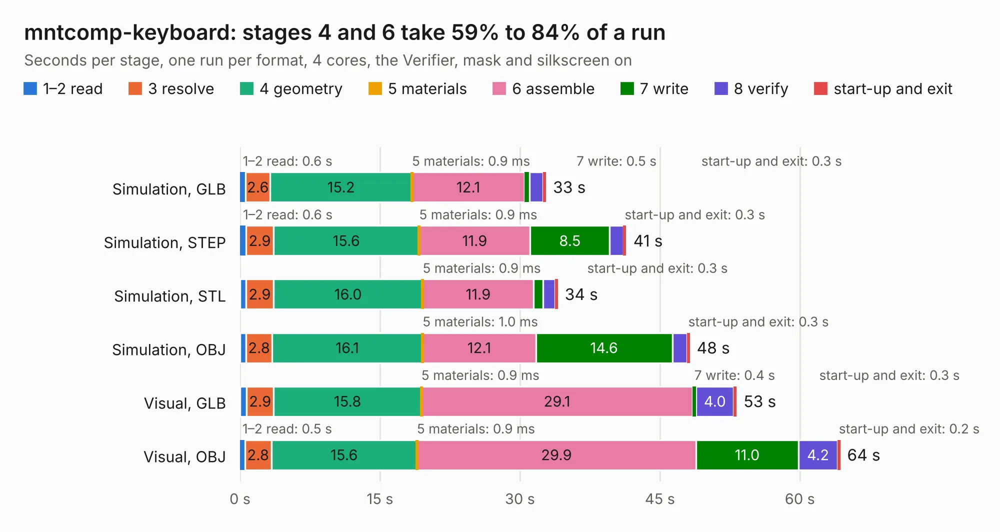

| Mode and format | 1–2 read | 3 resolve | 4 geometry | 5 materials | 6 assemble | 7 write | 8 verify | start-up and exit | Total |
|---|---:|---:|---:|---:|---:|---:|---:|---:|---:|
| Simulation, GLB | 0.6 | 2.6 | 15.2 | 0.9&nbsp;ms | 12.1 | 0.5 | 1.5 | 0.3 | 32.8 |
| Simulation, STEP | 0.6 | 2.9 | 15.6 | 0.9&nbsp;ms | 11.9 | 8.5 | 1.5 | 0.3 | 41.4 |
| Simulation, STL | 0.6 | 2.9 | 16.0 | 0.9&nbsp;ms | 11.9 | 1.0 | 1.3 | 0.3 | 34.0 |
| Simulation, OBJ | 0.7 | 2.8 | 16.1 | 1.0&nbsp;ms | 12.1 | 14.6 | 1.6 | 0.3 | 48.2 |
| Visual, GLB | 0.7 | 2.9 | 15.8 | 0.9&nbsp;ms | 29.1 | 0.4 | 4.0 | 0.3 | 53.2 |
| Visual, OBJ | 0.5 | 2.8 | 15.6 | 0.9&nbsp;ms | 29.9 | 11.0 | 4.2 | 0.2 | 64.3 |

<table align="center"><tr><td valign="top">

| Board | Repo: [jackhumbert/reform](https://github.com/jackhumbert/reform) Board: `mntcomp-keyboard.kicad_pcb` |
|---|---|
| Folder | historic-reform1 / reform-keyboard-pcb |
| Complexity | 265&nbsp;/&nbsp;1000 (size&nbsp;230, features&nbsp;35) |
| KESE&nbsp;features | through vias, filled zones |
| Tested | 9th November 2026 |
| Copper&nbsp;layers | 2 |
| File&nbsp;format | KiCad 4 (4) |
| Parts,&nbsp;tracks,&nbsp;vias | 173, 1,136, 55 |
| Triangles,&nbsp;simulation | 3,187,550 in 287 parts |
| Verifier | PASS in all six runs |

</td><td valign="top">

<table>
<tr><th>File type</th><th>File size</th><th>Peak memory used</th></tr>
<tr><th colspan="3" align="left">Simulation</th></tr>
<tr><td>GLB</td><td align="right">109&nbsp;MB</td><td align="right">1.0&nbsp;GB</td></tr>
<tr><td>STEP</td><td align="right">578&nbsp;MB</td><td align="right">1.2&nbsp;GB</td></tr>
<tr><td>STL</td><td align="right">159&nbsp;MB</td><td align="right">1.0&nbsp;GB</td></tr>
<tr><td>OBJ</td><td align="right">340&nbsp;MB</td><td align="right">2.1&nbsp;GB</td></tr>
<tr><th colspan="3" align="left">Visual</th></tr>
<tr><td>GLB</td><td align="right">76&nbsp;MB</td><td align="right">1.3&nbsp;GB</td></tr>
<tr><td>OBJ</td><td align="right">237&nbsp;MB</td><td align="right">1.6&nbsp;GB</td></tr>
</table>

</td></tr></table>

## 1343. reform-motherboard

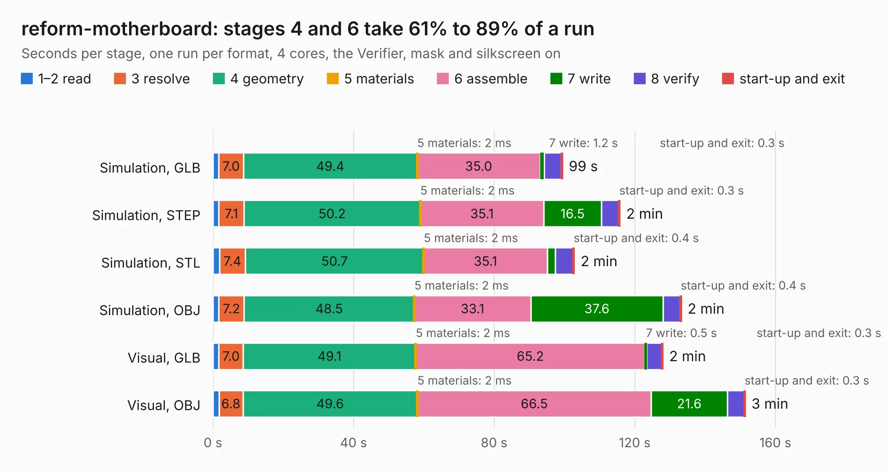

| Mode and format | 1–2 read | 3 resolve | 4 geometry | 5 materials | 6 assemble | 7 write | 8 verify | start-up and exit | Total |
|---|---:|---:|---:|---:|---:|---:|---:|---:|---:|
| Simulation, GLB | 1.7 | 7.0 | 49.4 | 2&nbsp;ms | 35.0 | 1.2 | 4.8 | 0.3 | 99.4 |
| Simulation, STEP | 1.7 | 7.1 | 50.2 | 2&nbsp;ms | 35.1 | 16.5 | 4.9 | 0.3 | 115.8 |
| Simulation, STL | 1.8 | 7.4 | 50.7 | 2&nbsp;ms | 35.1 | 2.3 | 5.0 | 0.4 | 102.8 |
| Simulation, OBJ | 1.7 | 7.2 | 48.5 | 2&nbsp;ms | 33.1 | 37.6 | 4.8 | 0.4 | 133.2 |
| Visual, GLB | 1.7 | 7.0 | 49.1 | 2&nbsp;ms | 65.2 | 0.5 | 4.3 | 0.3 | 128.0 |
| Visual, OBJ | 1.7 | 6.8 | 49.6 | 2&nbsp;ms | 66.5 | 21.6 | 4.8 | 0.3 | 151.4 |

<table align="center"><tr><td valign="top">

| Board | Repo: [jackhumbert/reform](https://github.com/jackhumbert/reform) Board: `reform-motherboard.kicad_pcb` |
|---|---|
| Folder | historic-reform1 / reform-motherboard |
| Complexity | 328&nbsp;/&nbsp;1000 (size&nbsp;283, features&nbsp;45) |
| KESE&nbsp;features | through vias, slotted holes, filled zones |
| Tested | 9th November 2026 |
| Copper&nbsp;layers | 4 |
| File&nbsp;format | KiCad 4 (4) |
| Parts,&nbsp;tracks,&nbsp;vias | 221, 3,746, 531 |
| Triangles,&nbsp;simulation | 6,884,110 in 445 parts |
| Verifier | PASS in all six runs |

</td><td valign="top">

<table>
<tr><th>File type</th><th>File size</th><th>Peak memory used</th></tr>
<tr><th colspan="3" align="left">Simulation</th></tr>
<tr><td>GLB</td><td align="right">241&nbsp;MB</td><td align="right">1.9&nbsp;GB</td></tr>
<tr><td>STEP</td><td align="right">1.0&nbsp;GB</td><td align="right">2.4&nbsp;GB</td></tr>
<tr><td>STL</td><td align="right">344&nbsp;MB</td><td align="right">1.8&nbsp;GB</td></tr>
<tr><td>OBJ</td><td align="right">747&nbsp;MB</td><td align="right">4.5&nbsp;GB</td></tr>
<tr><th colspan="3" align="left">Visual</th></tr>
<tr><td>GLB</td><td align="right">134&nbsp;MB</td><td align="right">2.2&nbsp;GB</td></tr>
<tr><td>OBJ</td><td align="right">426&nbsp;MB</td><td align="right">2.8&nbsp;GB</td></tr>
</table>

</td></tr></table>

## 1344. reform-trackball

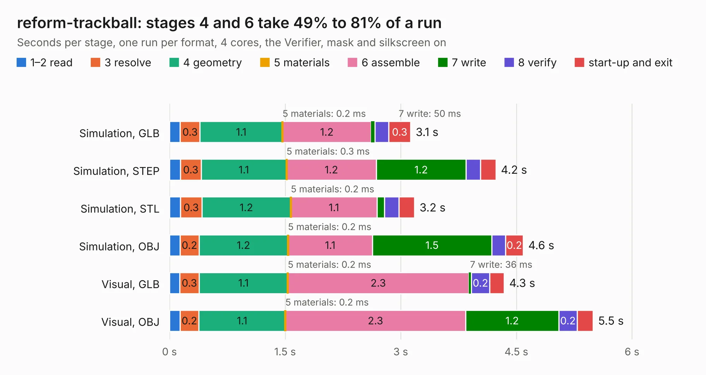

| Mode and format | 1–2 read | 3 resolve | 4 geometry | 5 materials | 6 assemble | 7 write | 8 verify | start-up and exit | Total |
|---|---:|---:|---:|---:|---:|---:|---:|---:|---:|
| Simulation, GLB | 0.1 | 0.3 | 1.1 | 0.2&nbsp;ms | 1.2 | 50&nbsp;ms | 0.2 | 0.3 | 3.1 |
| Simulation, STEP | 0.1 | 0.3 | 1.1 | 0.3&nbsp;ms | 1.2 | 1.2 | 0.2 | 0.2 | 4.2 |
| Simulation, STL | 0.1 | 0.3 | 1.2 | 0.2&nbsp;ms | 1.1 | 98&nbsp;ms | 0.2 | 0.2 | 3.2 |
| Simulation, OBJ | 0.1 | 0.2 | 1.2 | 0.2&nbsp;ms | 1.1 | 1.5 | 0.2 | 0.2 | 4.6 |
| Visual, GLB | 0.1 | 0.3 | 1.1 | 0.2&nbsp;ms | 2.3 | 36&nbsp;ms | 0.2 | 0.2 | 4.3 |
| Visual, OBJ | 0.1 | 0.2 | 1.1 | 0.2&nbsp;ms | 2.3 | 1.2 | 0.2 | 0.2 | 5.5 |

<table align="center"><tr><td valign="top">

| Board | Repo: [jackhumbert/reform](https://github.com/jackhumbert/reform) Board: `reform-trackball.kicad_pcb` |
|---|---|
| Folder | historic-reform1 / reform-trackball-pcb |
| Complexity | 229&nbsp;/&nbsp;1000 (size&nbsp;184, features&nbsp;45) |
| KESE&nbsp;features | through vias, filled zones, curved board outline |
| Tested | 9th November 2026 |
| Copper&nbsp;layers | 2 |
| File&nbsp;format | KiCad 5 (20171130) |
| Parts,&nbsp;tracks,&nbsp;vias | 15, 275, 35 |
| Triangles,&nbsp;simulation | 302,556 in 43 parts |
| Verifier | PASS in all six runs |

</td><td valign="top">

<table>
<tr><th>File type</th><th>File size</th><th>Peak memory used</th></tr>
<tr><th colspan="3" align="left">Simulation</th></tr>
<tr><td>GLB</td><td align="right">10&nbsp;MB</td><td align="right">238&nbsp;MB</td></tr>
<tr><td>STEP</td><td align="right">47&nbsp;MB</td><td align="right">274&nbsp;MB</td></tr>
<tr><td>STL</td><td align="right">15&nbsp;MB</td><td align="right">240&nbsp;MB</td></tr>
<tr><td>OBJ</td><td align="right">30&nbsp;MB</td><td align="right">259&nbsp;MB</td></tr>
<tr><th colspan="3" align="left">Visual</th></tr>
<tr><td>GLB</td><td align="right">8.0&nbsp;MB</td><td align="right">262&nbsp;MB</td></tr>
<tr><td>OBJ</td><td align="right">23&nbsp;MB</td><td align="right">259&nbsp;MB</td></tr>
</table>

</td></tr></table>

## 1345. reform2-batterypack-upstream

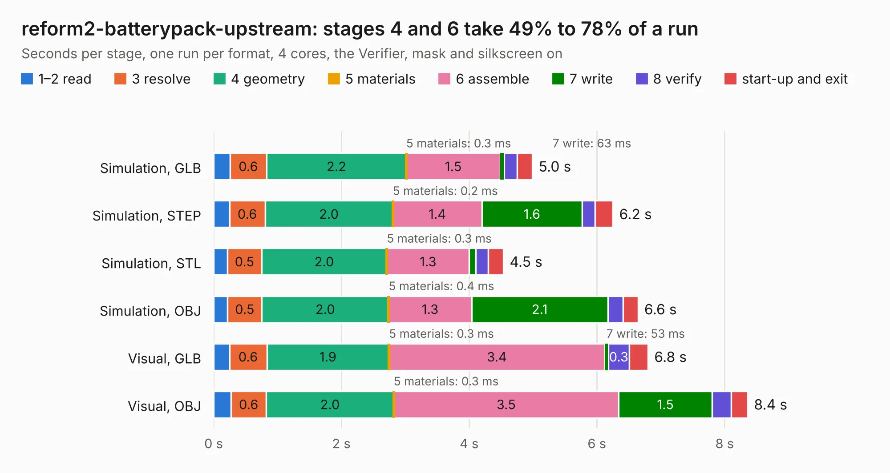

| Mode and format | 1–2 read | 3 resolve | 4 geometry | 5 materials | 6 assemble | 7 write | 8 verify | start-up and exit | Total |
|---|---:|---:|---:|---:|---:|---:|---:|---:|---:|
| Simulation, GLB | 0.3 | 0.6 | 2.2 | 0.3&nbsp;ms | 1.5 | 63&nbsp;ms | 0.2 | 0.2 | 5.0 |
| Simulation, STEP | 0.2 | 0.6 | 2.0 | 0.2&nbsp;ms | 1.4 | 1.6 | 0.2 | 0.3 | 6.2 |
| Simulation, STL | 0.2 | 0.5 | 2.0 | 0.3&nbsp;ms | 1.3 | 0.1 | 0.2 | 0.2 | 4.5 |
| Simulation, OBJ | 0.2 | 0.5 | 2.0 | 0.4&nbsp;ms | 1.3 | 2.1 | 0.2 | 0.2 | 6.6 |
| Visual, GLB | 0.2 | 0.6 | 1.9 | 0.3&nbsp;ms | 3.4 | 53&nbsp;ms | 0.3 | 0.3 | 6.8 |
| Visual, OBJ | 0.3 | 0.6 | 2.0 | 0.3&nbsp;ms | 3.5 | 1.5 | 0.3 | 0.3 | 8.4 |

<table align="center"><tr><td valign="top">

| Board | Repo: [jackhumbert/reform](https://github.com/jackhumbert/reform) Board: `reform2-batterypack-upstream.kicad_pcb` |
|---|---|
| Folder | reform2-batterypack-pcb |
| Complexity | 197&nbsp;/&nbsp;1000 (size&nbsp;152, features&nbsp;45) |
| KESE&nbsp;features | through vias, slotted holes, rounded, trapezoid or chamfered pads, curved board outline |
| Tested | 9th November 2026 |
| Copper&nbsp;layers | 2 |
| File&nbsp;format | KiCad 5 (20171130) |
| Parts,&nbsp;tracks,&nbsp;vias | 32, 288, 28 |
| Triangles,&nbsp;simulation | 344,852 in 41 parts |
| Verifier | PASS in all six runs |

</td><td valign="top">

<table>
<tr><th>File type</th><th>File size</th><th>Peak memory used</th></tr>
<tr><th colspan="3" align="left">Simulation</th></tr>
<tr><td>GLB</td><td align="right">12&nbsp;MB</td><td align="right">275&nbsp;MB</td></tr>
<tr><td>STEP</td><td align="right">70&nbsp;MB</td><td align="right">297&nbsp;MB</td></tr>
<tr><td>STL</td><td align="right">17&nbsp;MB</td><td align="right">269&nbsp;MB</td></tr>
<tr><td>OBJ</td><td align="right">36&nbsp;MB</td><td align="right">290&nbsp;MB</td></tr>
<tr><th colspan="3" align="left">Visual</th></tr>
<tr><td>GLB</td><td align="right">8.7&nbsp;MB</td><td align="right">260&nbsp;MB</td></tr>
<tr><td>OBJ</td><td align="right">25&nbsp;MB</td><td align="right">265&nbsp;MB</td></tr>
</table>

</td></tr></table>

## 1346. reform2-batterypack

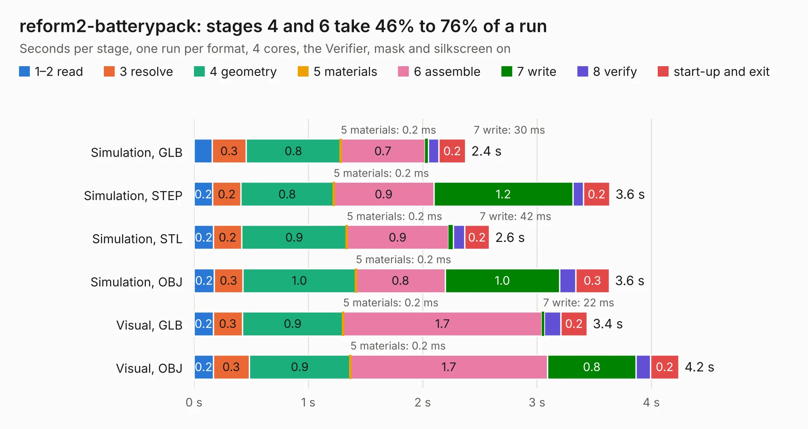

| Mode and format | 1–2 read | 3 resolve | 4 geometry | 5 materials | 6 assemble | 7 write | 8 verify | start-up and exit | Total |
|---|---:|---:|---:|---:|---:|---:|---:|---:|---:|
| Simulation, GLB | 0.2 | 0.3 | 0.8 | 0.2&nbsp;ms | 0.7 | 30&nbsp;ms | 92&nbsp;ms | 0.2 | 2.4 |
| Simulation, STEP | 0.2 | 0.2 | 0.8 | 0.2&nbsp;ms | 0.9 | 1.2 | 93&nbsp;ms | 0.2 | 3.6 |
| Simulation, STL | 0.2 | 0.2 | 0.9 | 0.2&nbsp;ms | 0.9 | 42&nbsp;ms | 98&nbsp;ms | 0.2 | 2.6 |
| Simulation, OBJ | 0.2 | 0.3 | 1.0 | 0.2&nbsp;ms | 0.8 | 1.0 | 0.1 | 0.3 | 3.6 |
| Visual, GLB | 0.2 | 0.3 | 0.9 | 0.2&nbsp;ms | 1.7 | 22&nbsp;ms | 0.1 | 0.2 | 3.4 |
| Visual, OBJ | 0.2 | 0.3 | 0.9 | 0.2&nbsp;ms | 1.7 | 0.8 | 0.1 | 0.2 | 4.2 |

<table align="center"><tr><td valign="top">

| Board | Repo: [jackhumbert/reform](https://github.com/jackhumbert/reform) Board: `reform2-batterypack.kicad_pcb` |
|---|---|
| Folder | reform2-batterypack-pcb |
| Complexity | 135&nbsp;/&nbsp;1000 (size&nbsp;105, features&nbsp;30) |
| KESE&nbsp;features | slotted holes, rounded, trapezoid or chamfered pads, curved board outline |
| Tested | 9th November 2026 |
| Copper&nbsp;layers | 2 |
| File&nbsp;format | KiCad 5 (20171130) |
| Parts,&nbsp;tracks,&nbsp;vias | 5, 64, 0 |
| Triangles,&nbsp;simulation | 172,212 in 16 parts |
| Verifier | PASS in all six runs |

</td><td valign="top">

<table>
<tr><th>File type</th><th>File size</th><th>Peak memory used</th></tr>
<tr><th colspan="3" align="left">Simulation</th></tr>
<tr><td>GLB</td><td align="right">6.1&nbsp;MB</td><td align="right">201&nbsp;MB</td></tr>
<tr><td>STEP</td><td align="right">37&nbsp;MB</td><td align="right">220&nbsp;MB</td></tr>
<tr><td>STL</td><td align="right">8.6&nbsp;MB</td><td align="right">202&nbsp;MB</td></tr>
<tr><td>OBJ</td><td align="right">17&nbsp;MB</td><td align="right">203&nbsp;MB</td></tr>
<tr><th colspan="3" align="left">Visual</th></tr>
<tr><td>GLB</td><td align="right">4.0&nbsp;MB</td><td align="right">173&nbsp;MB</td></tr>
<tr><td>OBJ</td><td align="right">11&nbsp;MB</td><td align="right">177&nbsp;MB</td></tr>
</table>

</td></tr></table>

## 1347. reform2-imx8mplus

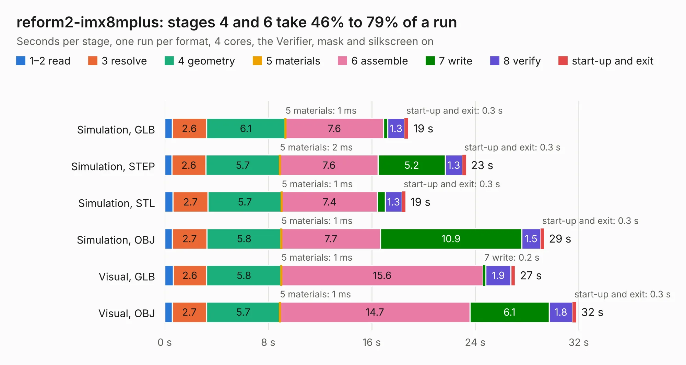

| Mode and format | 1–2 read | 3 resolve | 4 geometry | 5 materials | 6 assemble | 7 write | 8 verify | start-up and exit | Total |
|---|---:|---:|---:|---:|---:|---:|---:|---:|---:|
| Simulation, GLB | 0.6 | 2.6 | 6.1 | 1&nbsp;ms | 7.6 | 0.3 | 1.3 | 0.3 | 18.8 |
| Simulation, STEP | 0.6 | 2.6 | 5.7 | 2&nbsp;ms | 7.6 | 5.2 | 1.3 | 0.3 | 23.3 |
| Simulation, STL | 0.6 | 2.7 | 5.7 | 1&nbsp;ms | 7.4 | 0.6 | 1.3 | 0.3 | 18.6 |
| Simulation, OBJ | 0.6 | 2.7 | 5.8 | 1&nbsp;ms | 7.7 | 10.9 | 1.5 | 0.3 | 29.3 |
| Visual, GLB | 0.7 | 2.6 | 5.8 | 1&nbsp;ms | 15.6 | 0.2 | 1.9 | 0.3 | 27.1 |
| Visual, OBJ | 0.6 | 2.7 | 5.7 | 1&nbsp;ms | 14.7 | 6.1 | 1.8 | 0.3 | 31.8 |

<table align="center"><tr><td valign="top">

| Board | Repo: [jackhumbert/reform](https://github.com/jackhumbert/reform) Board: `reform2-imx8mplus.kicad_pcb` |
|---|---|
| Folder | reform2-imx8mplus |
| Complexity | 346&nbsp;/&nbsp;1000 (size&nbsp;246, features&nbsp;100) |
| KESE&nbsp;features | through vias, rounded, trapezoid or chamfered pads, arc tracks, filled zones, curved board outline, stack-up, dielectric εr and tanδ |
| Tested | 9th November 2026 |
| Copper&nbsp;layers | 6 |
| File&nbsp;format | KiCad 6 (20211014) |
| Parts,&nbsp;tracks,&nbsp;vias | 16, 2,171, 338 |
| Triangles,&nbsp;simulation | 2,120,290 in 326 parts |
| Verifier | PASS in all six runs |

</td><td valign="top">

<table>
<tr><th>File type</th><th>File size</th><th>Peak memory used</th></tr>
<tr><th colspan="3" align="left">Simulation</th></tr>
<tr><td>GLB</td><td align="right">70&nbsp;MB</td><td align="right">721&nbsp;MB</td></tr>
<tr><td>STEP</td><td align="right">257&nbsp;MB</td><td align="right">931&nbsp;MB</td></tr>
<tr><td>STL</td><td align="right">106&nbsp;MB</td><td align="right">726&nbsp;MB</td></tr>
<tr><td>OBJ</td><td align="right">221&nbsp;MB</td><td align="right">1.4&nbsp;GB</td></tr>
<tr><th colspan="3" align="left">Visual</th></tr>
<tr><td>GLB</td><td align="right">39&nbsp;MB</td><td align="right">772&nbsp;MB</td></tr>
<tr><td>OBJ</td><td align="right">124&nbsp;MB</td><td align="right">928&nbsp;MB</td></tr>
</table>

</td></tr></table>

## 1348. reform2-keyboard

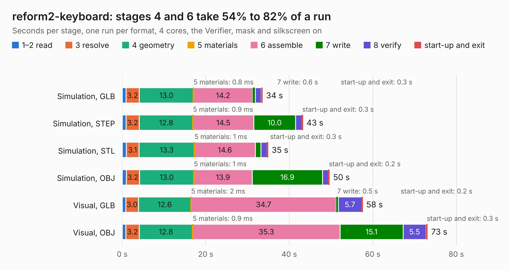

| Mode and format | 1–2 read | 3 resolve | 4 geometry | 5 materials | 6 assemble | 7 write | 8 verify | start-up and exit | Total |
|---|---:|---:|---:|---:|---:|---:|---:|---:|---:|
| Simulation, GLB | 0.9 | 3.2 | 13.0 | 0.8&nbsp;ms | 14.2 | 0.6 | 1.4 | 0.3 | 33.6 |
| Simulation, STEP | 0.9 | 3.2 | 12.8 | 0.9&nbsp;ms | 14.5 | 10.0 | 1.5 | 0.3 | 43.3 |
| Simulation, STL | 1.0 | 3.1 | 13.3 | 1&nbsp;ms | 14.6 | 1.3 | 1.5 | 0.3 | 34.9 |
| Simulation, OBJ | 1.0 | 3.2 | 13.0 | 1&nbsp;ms | 13.9 | 16.9 | 1.4 | 0.2 | 49.6 |
| Visual, GLB | 0.9 | 3.0 | 12.6 | 2&nbsp;ms | 34.7 | 0.5 | 5.7 | 0.2 | 57.6 |
| Visual, OBJ | 0.9 | 3.2 | 12.8 | 0.9&nbsp;ms | 35.3 | 15.1 | 5.5 | 0.3 | 73.1 |

<table align="center"><tr><td valign="top">

| Board | Repo: [jackhumbert/reform](https://github.com/jackhumbert/reform) Board: `reform2-keyboard.kicad_pcb` |
|---|---|
| Folder | reform2-keyboard-pcb |
| Complexity | 313&nbsp;/&nbsp;1000 (size&nbsp;258, features&nbsp;55) |
| KESE&nbsp;features | through vias, slotted holes, rounded, trapezoid or chamfered pads, filled zones |
| Tested | 9th November 2026 |
| Copper&nbsp;layers | 2 |
| File&nbsp;format | KiCad 5 (20171130) |
| Parts,&nbsp;tracks,&nbsp;vias | 293, 2,054, 411 |
| Triangles,&nbsp;simulation | 4,193,572 in 234 parts |
| Verifier | PASS in all six runs |

</td><td valign="top">

<table>
<tr><th>File type</th><th>File size</th><th>Peak memory used</th></tr>
<tr><th colspan="3" align="left">Simulation</th></tr>
<tr><td>GLB</td><td align="right">141&nbsp;MB</td><td align="right">1.6&nbsp;GB</td></tr>
<tr><td>STEP</td><td align="right">672&nbsp;MB</td><td align="right">1.8&nbsp;GB</td></tr>
<tr><td>STL</td><td align="right">210&nbsp;MB</td><td align="right">1.6&nbsp;GB</td></tr>
<tr><td>OBJ</td><td align="right">442&nbsp;MB</td><td align="right">2.7&nbsp;GB</td></tr>
<tr><th colspan="3" align="left">Visual</th></tr>
<tr><td>GLB</td><td align="right">122&nbsp;MB</td><td align="right">1.9&nbsp;GB</td></tr>
<tr><td>OBJ</td><td align="right">385&nbsp;MB</td><td align="right">2.4&nbsp;GB</td></tr>
</table>

</td></tr></table>

## 1349. reform2-keyboard3

| Mode and format | 1–2 read | 3 resolve | 4 geometry | 5 materials | 6 assemble | 7 write | 8 verify | start-up and exit | Total |
|---|---:|---:|---:|---:|---:|---:|---:|---:|---:|
| Simulation, GLB | 1.3 | 3.1 | 12.7 | 0.7&nbsp;ms | 13.2 | 0.5 | 1.4 | 0.3 | 32.7 |
| Simulation, STEP | 1.2 | 3.4 | 12.9 | 1&nbsp;ms | 13.4 | 9.5 | 1.4 | 0.3 | 42.2 |
| Simulation, STL | 1.3 | 3.4 | 12.8 | 0.8&nbsp;ms | 12.9 | 1.1 | 1.4 | 0.3 | 33.2 |
| Simulation, OBJ | 1.3 | 3.4 | 12.9 | 0.9&nbsp;ms | 12.7 | 16.4 | 1.5 | 0.2 | 48.4 |
| Visual, GLB | 1.3 | 3.1 | 12.6 | 0.7&nbsp;ms | 31.5 | 0.4 | 3.7 | 0.3 | 52.9 |
| Visual, OBJ | 1.2 | 3.3 | 12.9 | 0.8&nbsp;ms | 32.3 | 13.6 | 4.2 | 0.2 | 67.9 |

<table align="center"><tr><td valign="top">

| Board | Repo: [jackhumbert/reform](https://github.com/jackhumbert/reform) Board: `reform2-keyboard3.kicad_pcb` |
|---|---|
| Folder | reform2-keyboard3-pcb |
| Complexity | 347&nbsp;/&nbsp;1000 (size&nbsp;257, features&nbsp;90) |
| KESE&nbsp;features | through vias, slotted holes, rounded, trapezoid or chamfered pads, filled zones, stack-up, dielectric εr and tanδ, mask and silkscreen colours |
| Tested | 9th November 2026 |
| Copper&nbsp;layers | 2 |
| File&nbsp;format | KiCad 6 (20211014) |
| Parts,&nbsp;tracks,&nbsp;vias | 289, 2,085, 383 |
| Triangles,&nbsp;simulation | 3,916,436 in 232 parts |
| Verifier | PASS in all six runs |

</td><td valign="top">

<table>
<tr><th>File type</th><th>File size</th><th>Peak memory used</th></tr>
<tr><th colspan="3" align="left">Simulation</th></tr>
<tr><td>GLB</td><td align="right">133&nbsp;MB</td><td align="right">1.5&nbsp;GB</td></tr>
<tr><td>STEP</td><td align="right">671&nbsp;MB</td><td align="right">1.7&nbsp;GB</td></tr>
<tr><td>STL</td><td align="right">196&nbsp;MB</td><td align="right">1.6&nbsp;GB</td></tr>
<tr><td>OBJ</td><td align="right">415&nbsp;MB</td><td align="right">2.6&nbsp;GB</td></tr>
<tr><th colspan="3" align="left">Visual</th></tr>
<tr><td>GLB</td><td align="right">112&nbsp;MB</td><td align="right">2.2&nbsp;GB</td></tr>
<tr><td>OBJ</td><td align="right">354&nbsp;MB</td><td align="right">2.3&nbsp;GB</td></tr>
</table>

</td></tr></table>

## 1350. reform2-motherboard

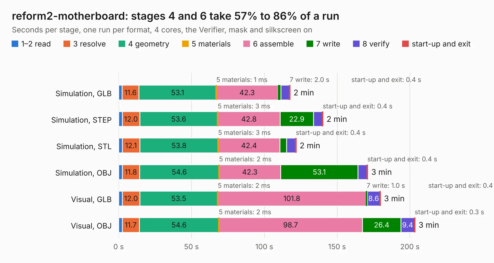

| Mode and format | 1–2 read | 3 resolve | 4 geometry | 5 materials | 6 assemble | 7 write | 8 verify | start-up and exit | Total |
|---|---:|---:|---:|---:|---:|---:|---:|---:|---:|
| Simulation, GLB | 2.4 | 11.6 | 53.1 | 1&nbsp;ms | 42.3 | 2.0 | 5.9 | 0.4 | 117.7 |
| Simulation, STEP | 2.5 | 12.0 | 53.6 | 3&nbsp;ms | 42.8 | 22.9 | 6.2 | 0.4 | 140.3 |
| Simulation, STL | 2.5 | 12.1 | 53.8 | 3&nbsp;ms | 42.4 | 4.6 | 6.2 | 0.4 | 121.9 |
| Simulation, OBJ | 2.5 | 11.8 | 54.6 | 2&nbsp;ms | 42.3 | 53.1 | 6.3 | 0.4 | 171.1 |
| Visual, GLB | 2.5 | 12.0 | 53.5 | 2&nbsp;ms | 101.8 | 1.0 | 8.6 | 0.4 | 179.8 |
| Visual, OBJ | 2.5 | 11.7 | 54.6 | 2&nbsp;ms | 98.7 | 26.4 | 9.4 | 0.3 | 203.5 |

<table align="center"><tr><td valign="top">

| Board | Repo: [jackhumbert/reform](https://github.com/jackhumbert/reform) Board: `reform2-motherboard.kicad_pcb` |
|---|---|
| Folder | reform2-motherboard-pcb |
| Complexity | 396&nbsp;/&nbsp;1000 (size&nbsp;326, features&nbsp;70) |
| KESE&nbsp;features | through vias, slotted holes, custom pads, rounded, trapezoid or chamfered pads, filled zones |
| Tested | 9th November 2026 |
| Copper&nbsp;layers | 6 |
| File&nbsp;format | KiCad 5 (20171130) |
| Parts,&nbsp;tracks,&nbsp;vias | 489, 11,666, 1,086 |
| Triangles,&nbsp;simulation | 11,131,628 in 664 parts |
| Verifier | PASS in all six runs |

</td><td valign="top">

<table>
<tr><th>File type</th><th>File size</th><th>Peak memory used</th></tr>
<tr><th colspan="3" align="left">Simulation</th></tr>
<tr><td>GLB</td><td align="right">385&nbsp;MB</td><td align="right">2.7&nbsp;GB</td></tr>
<tr><td>STEP</td><td align="right">1.6&nbsp;GB</td><td align="right">3.9&nbsp;GB</td></tr>
<tr><td>STL</td><td align="right">557&nbsp;MB</td><td align="right">2.5&nbsp;GB</td></tr>
<tr><td>OBJ</td><td align="right">1.2&nbsp;GB</td><td align="right">7.1&nbsp;GB</td></tr>
<tr><th colspan="3" align="left">Visual</th></tr>
<tr><td>GLB</td><td align="right">204&nbsp;MB</td><td align="right">3.2&nbsp;GB</td></tr>
<tr><td>OBJ</td><td align="right">661&nbsp;MB</td><td align="right">4.3&nbsp;GB</td></tr>
</table>

</td></tr></table>

## 1351. reform2-motherboard25

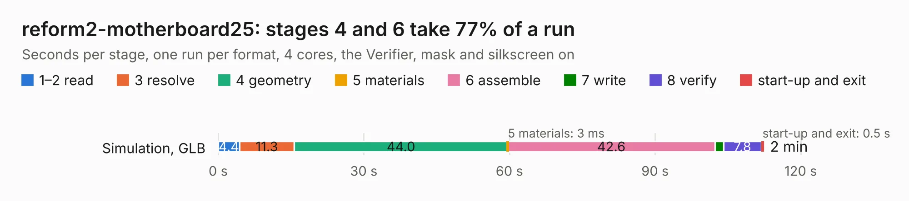

| Mode and format | 1–2 read | 3 resolve | 4 geometry | 5 materials | 6 assemble | 7 write | 8 verify | start-up and exit | Total |
|---|---:|---:|---:|---:|---:|---:|---:|---:|---:|
| Simulation, GLB | 4.4 | 11.3 | 44.0 | 3&nbsp;ms | 42.6 | 1.8 | 7.8 | 0.5 | 112.4 |
| Simulation, STEP | 4.4 | 11.1 | 43.4 | 2&nbsp;ms | 41.3 | 26.5 | 7.1 | 0.5 | 134.4 |
| Simulation, STL | 3.9 | 11.0 | 41.5 | 3&nbsp;ms | 41.0 | 3.8 | 7.4 | 0.5 | 109.0 |
| Simulation, OBJ | 3.8 | 10.6 | 40.2 | 4&nbsp;ms | 39.9 | 58.5 | 7.1 | 0.5 | 160.6 |
| Visual, GLB | 3.8 | 10.9 | 40.2 | 2&nbsp;ms | 92.0 | 1.0 | 8.6 | 0.4 | 156.9 |
| Visual, OBJ | 3.7 | 10.7 | 42.4 | 2&nbsp;ms | 93.4 | 36.9 | 11.2 | 0.4 | 198.7 |

<table align="center"><tr><td valign="top">

| Board | Repo: [jackhumbert/reform](https://github.com/jackhumbert/reform) Board: `reform2-motherboard25.kicad_pcb` |
|---|---|
| Folder | reform2-motherboard25-pcb |
| Complexity | 451&nbsp;/&nbsp;1000 (size&nbsp;326, features&nbsp;125) |
| KESE&nbsp;features | through vias, slotted holes, custom pads, rounded, trapezoid or chamfered pads, arc tracks, filled zones, copper drawings, stack-up, dielectric εr and tanδ |
| Tested | 9th November 2026 |
| Copper&nbsp;layers | 6 |
| File&nbsp;format | KiCad 6 (20211014) |
| Parts,&nbsp;tracks,&nbsp;vias | 486, 11,115, 1,079 |
| Triangles,&nbsp;simulation | 9,815,150 in 665 parts |
| Verifier | PASS in all six runs |

</td><td valign="top">

<table>
<tr><th>File type</th><th>File size</th><th>Peak memory used</th></tr>
<tr><th colspan="3" align="left">Simulation</th></tr>
<tr><td>GLB</td><td align="right">328&nbsp;MB</td><td align="right">2.5&nbsp;GB</td></tr>
<tr><td>STEP</td><td align="right">1.4&nbsp;GB</td><td align="right">3.6&nbsp;GB</td></tr>
<tr><td>STL</td><td align="right">491&nbsp;MB</td><td align="right">2.5&nbsp;GB</td></tr>
<tr><td>OBJ</td><td align="right">1.1&nbsp;GB</td><td align="right">6.2&nbsp;GB</td></tr>
<tr><th colspan="3" align="left">Visual</th></tr>
<tr><td>GLB</td><td align="right">187&nbsp;MB</td><td align="right">3.1&nbsp;GB</td></tr>
<tr><td>OBJ</td><td align="right">608&nbsp;MB</td><td align="right">4.0&nbsp;GB</td></tr>
</table>

</td></tr></table>

## 1352. reform2-oled

| Mode and format | 1–2 read | 3 resolve | 4 geometry | 5 materials | 6 assemble | 7 write | 8 verify | start-up and exit | Total |
|---|---:|---:|---:|---:|---:|---:|---:|---:|---:|
| Simulation, GLB | 0.2 | 0.3 | 0.8 | 0.1&nbsp;ms | 0.8 | 33&nbsp;ms | 94&nbsp;ms | 0.2 | 2.4 |
| Simulation, STEP | 0.2 | 0.3 | 0.9 | 0.2&nbsp;ms | 0.8 | 1.1 | 0.1 | 0.2 | 3.5 |
| Simulation, STL | 0.2 | 0.2 | 0.8 | 0.2&nbsp;ms | 0.8 | 45&nbsp;ms | 88&nbsp;ms | 0.3 | 2.4 |
| Simulation, OBJ | 0.2 | 0.2 | 0.8 | 0.1&nbsp;ms | 0.7 | 1.0 | 81&nbsp;ms | 0.2 | 3.2 |
| Visual, GLB | 0.2 | 0.2 | 0.8 | 0.1&nbsp;ms | 2.0 | 26&nbsp;ms | 0.2 | 0.2 | 3.6 |
| Visual, OBJ | 0.2 | 0.2 | 0.9 | 0.2&nbsp;ms | 1.9 | 0.8 | 0.2 | 0.3 | 4.4 |

<table align="center"><tr><td valign="top">

| Board | Repo: [jackhumbert/reform](https://github.com/jackhumbert/reform) Board: `reform2-oled.kicad_pcb` |
|---|---|
| Folder | reform2-oled-pcb |
| Complexity | 172&nbsp;/&nbsp;1000 (size&nbsp;127, features&nbsp;45) |
| KESE&nbsp;features | through vias, rounded, trapezoid or chamfered pads, filled zones |
| Tested | 9th November 2026 |
| Copper&nbsp;layers | 2 |
| File&nbsp;format | KiCad 5 (20171130) |
| Parts,&nbsp;tracks,&nbsp;vias | 11, 77, 27 |
| Triangles,&nbsp;simulation | 163,598 in 25 parts |
| Verifier | PASS in all six runs |

</td><td valign="top">

<table>
<tr><th>File type</th><th>File size</th><th>Peak memory used</th></tr>
<tr><th colspan="3" align="left">Simulation</th></tr>
<tr><td>GLB</td><td align="right">5.8&nbsp;MB</td><td align="right">201&nbsp;MB</td></tr>
<tr><td>STEP</td><td align="right">30&nbsp;MB</td><td align="right">225&nbsp;MB</td></tr>
<tr><td>STL</td><td align="right">8.2&nbsp;MB</td><td align="right">204&nbsp;MB</td></tr>
<tr><td>OBJ</td><td align="right">16&nbsp;MB</td><td align="right">215&nbsp;MB</td></tr>
<tr><th colspan="3" align="left">Visual</th></tr>
<tr><td>GLB</td><td align="right">4.7&nbsp;MB</td><td align="right">191&nbsp;MB</td></tr>
<tr><td>OBJ</td><td align="right">14&nbsp;MB</td><td align="right">185&nbsp;MB</td></tr>
</table>

</td></tr></table>

## 1353. reform2-protected-batterypack-pcb

| Mode and format | 1–2 read | 3 resolve | 4 geometry | 5 materials | 6 assemble | 7 write | 8 verify | start-up and exit | Total |
|---|---:|---:|---:|---:|---:|---:|---:|---:|---:|
| Simulation, GLB | 0.1 | 0.2 | 0.9 | 0.3&nbsp;ms | 0.9 | 45&nbsp;ms | 0.1 | 0.2 | 2.5 |
| Simulation, STEP | 0.1 | 0.2 | 0.9 | 0.2&nbsp;ms | 0.9 | 1.1 | 0.1 | 0.2 | 3.5 |
| Simulation, STL | 0.1 | 0.2 | 0.9 | 0.2&nbsp;ms | 0.8 | 51&nbsp;ms | 0.1 | 0.2 | 2.5 |
| Simulation, OBJ | 0.1 | 0.2 | 0.9 | 0.3&nbsp;ms | 0.9 | 1.0 | 0.1 | 0.2 | 3.4 |
| Visual, GLB | 0.1 | 0.3 | 0.9 | 0.3&nbsp;ms | 2.0 | 31&nbsp;ms | 0.2 | 0.2 | 3.7 |
| Visual, OBJ | 0.1 | 0.2 | 0.9 | 0.2&nbsp;ms | 2.0 | 0.9 | 0.3 | 0.2 | 4.6 |

<table align="center"><tr><td valign="top">

| Board | Repo: [jackhumbert/reform](https://github.com/jackhumbert/reform) Board: `reform2-protected-batterypack-pcb.kicad_pcb` |
|---|---|
| Folder | reform2-protected-batterypack-pcb |
| Complexity | 196&nbsp;/&nbsp;1000 (size&nbsp;151, features&nbsp;45) |
| KESE&nbsp;features | through vias, slotted holes, rounded, trapezoid or chamfered pads, curved board outline |
| Tested | 9th November 2026 |
| Copper&nbsp;layers | 2 |
| File&nbsp;format | KiCad 6 (20211014) |
| Parts,&nbsp;tracks,&nbsp;vias | 33, 297, 19 |
| Triangles,&nbsp;simulation | 258,834 in 48 parts |
| Verifier | PASS in all six runs |

</td><td valign="top">

<table>
<tr><th>File type</th><th>File size</th><th>Peak memory used</th></tr>
<tr><th colspan="3" align="left">Simulation</th></tr>
<tr><td>GLB</td><td align="right">9.0&nbsp;MB</td><td align="right">233&nbsp;MB</td></tr>
<tr><td>STEP</td><td align="right">47&nbsp;MB</td><td align="right">268&nbsp;MB</td></tr>
<tr><td>STL</td><td align="right">13&nbsp;MB</td><td align="right">234&nbsp;MB</td></tr>
<tr><td>OBJ</td><td align="right">26&nbsp;MB</td><td align="right">235&nbsp;MB</td></tr>
<tr><th colspan="3" align="left">Visual</th></tr>
<tr><td>GLB</td><td align="right">7.2&nbsp;MB</td><td align="right">248&nbsp;MB</td></tr>
<tr><td>OBJ</td><td align="right">21&nbsp;MB</td><td align="right">245&nbsp;MB</td></tr>
</table>

</td></tr></table>

## 1354. reform2-trackball

| Mode and format | 1–2 read | 3 resolve | 4 geometry | 5 materials | 6 assemble | 7 write | 8 verify | start-up and exit | Total |
|---|---:|---:|---:|---:|---:|---:|---:|---:|---:|
| Simulation, GLB | 0.3 | 0.5 | 1.9 | 0.8&nbsp;ms | 2.4 | 91&nbsp;ms | 0.3 | 0.2 | 5.7 |
| Simulation, STEP | 0.2 | 0.5 | 2.0 | 0.5&nbsp;ms | 2.7 | 2.2 | 0.3 | 0.2 | 8.2 |
| Simulation, STL | 0.3 | 0.4 | 1.8 | 0.3&nbsp;ms | 2.4 | 0.2 | 0.3 | 0.2 | 5.7 |
| Simulation, OBJ | 0.3 | 0.5 | 2.0 | 0.3&nbsp;ms | 2.5 | 2.7 | 0.3 | 0.2 | 8.6 |
| Visual, GLB | 0.3 | 0.5 | 1.8 | 0.4&nbsp;ms | 4.9 | 76&nbsp;ms | 0.6 | 0.2 | 8.3 |
| Visual, OBJ | 0.3 | 0.5 | 1.9 | 0.5&nbsp;ms | 4.9 | 1.9 | 0.8 | 0.3 | 10.5 |

<table align="center"><tr><td valign="top">

| Board | Repo: [jackhumbert/reform](https://github.com/jackhumbert/reform) Board: `reform2-trackball.kicad_pcb` |
|---|---|
| Folder | reform2-trackball-pcb |
| Complexity | 246&nbsp;/&nbsp;1000 (size&nbsp;201, features&nbsp;45) |
| KESE&nbsp;features | through vias, rounded, trapezoid or chamfered pads, filled zones |
| Tested | 9th November 2026 |
| Copper&nbsp;layers | 2 |
| File&nbsp;format | KiCad 5 (20171130) |
| Parts,&nbsp;tracks,&nbsp;vias | 37, 376, 74 |
| Triangles,&nbsp;simulation | 545,428 in 55 parts |
| Verifier | PASS in all six runs |

</td><td valign="top">

<table>
<tr><th>File type</th><th>File size</th><th>Peak memory used</th></tr>
<tr><th colspan="3" align="left">Simulation</th></tr>
<tr><td>GLB</td><td align="right">19&nbsp;MB</td><td align="right">328&nbsp;MB</td></tr>
<tr><td>STEP</td><td align="right">89&nbsp;MB</td><td align="right">410&nbsp;MB</td></tr>
<tr><td>STL</td><td align="right">27&nbsp;MB</td><td align="right">323&nbsp;MB</td></tr>
<tr><td>OBJ</td><td align="right">55&nbsp;MB</td><td align="right">414&nbsp;MB</td></tr>
<tr><th colspan="3" align="left">Visual</th></tr>
<tr><td>GLB</td><td align="right">16&nbsp;MB</td><td align="right">445&nbsp;MB</td></tr>
<tr><td>OBJ</td><td align="right">48&nbsp;MB</td><td align="right">444&nbsp;MB</td></tr>
</table>

</td></tr></table>

## 1355. reform2-trackball-sensor

| Mode and format | 1–2 read | 3 resolve | 4 geometry | 5 materials | 6 assemble | 7 write | 8 verify | start-up and exit | Total |
|---|---:|---:|---:|---:|---:|---:|---:|---:|---:|
| Simulation, GLB | 0.2 | 0.2 | 0.5 | 0.1&nbsp;ms | 0.6 | 21&nbsp;ms | 60&nbsp;ms | 0.3 | 1.8 |
| Simulation, STEP | 0.2 | 0.2 | 0.5 | 0.1&nbsp;ms | 0.6 | 1.1 | 57&nbsp;ms | 0.2 | 2.8 |
| Simulation, STL | 0.2 | 0.2 | 0.5 | 0.1&nbsp;ms | 0.6 | 37&nbsp;ms | 64&nbsp;ms | 0.2 | 1.8 |
| Simulation, OBJ | 0.2 | 0.2 | 0.5 | 0.2&nbsp;ms | 0.6 | 0.5 | 51&nbsp;ms | 0.3 | 2.2 |
| Visual, GLB | 0.2 | 0.2 | 0.5 | 0.1&nbsp;ms | 1.3 | 21&nbsp;ms | 0.1 | 0.2 | 2.6 |
| Visual, OBJ | 0.2 | 0.2 | 0.5 | 0.1&nbsp;ms | 1.3 | 0.5 | 0.1 | 0.2 | 3.0 |

<table align="center"><tr><td valign="top">

| Board | Repo: [jackhumbert/reform](https://github.com/jackhumbert/reform) Board: `reform2-trackball-sensor.kicad_pcb` |
|---|---|
| Folder | reform2-trackball-sensor-pcb |
| Complexity | 151&nbsp;/&nbsp;1000 (size&nbsp;106, features&nbsp;45) |
| KESE&nbsp;features | through vias, rounded, trapezoid or chamfered pads, filled zones |
| Tested | 9th November 2026 |
| Copper&nbsp;layers | 2 |
| File&nbsp;format | KiCad 5 (20171130) |
| Parts,&nbsp;tracks,&nbsp;vias | 6, 41, 8 |
| Triangles,&nbsp;simulation | 88,568 in 17 parts |
| Verifier | PASS in all six runs |

</td><td valign="top">

<table>
<tr><th>File type</th><th>File size</th><th>Peak memory used</th></tr>
<tr><th colspan="3" align="left">Simulation</th></tr>
<tr><td>GLB</td><td align="right">3.2&nbsp;MB</td><td align="right">194&nbsp;MB</td></tr>
<tr><td>STEP</td><td align="right">18&nbsp;MB</td><td align="right">198&nbsp;MB</td></tr>
<tr><td>STL</td><td align="right">4.4&nbsp;MB</td><td align="right">190&nbsp;MB</td></tr>
<tr><td>OBJ</td><td align="right">8.9&nbsp;MB</td><td align="right">192&nbsp;MB</td></tr>
<tr><th colspan="3" align="left">Visual</th></tr>
<tr><td>GLB</td><td align="right">2.8&nbsp;MB</td><td align="right">159&nbsp;MB</td></tr>
<tr><td>OBJ</td><td align="right">7.8&nbsp;MB</td><td align="right">158&nbsp;MB</td></tr>
</table>

</td></tr></table>

## 1356. reform2-trackball2

| Mode and format | 1–2 read | 3 resolve | 4 geometry | 5 materials | 6 assemble | 7 write | 8 verify | start-up and exit | Total |
|---|---:|---:|---:|---:|---:|---:|---:|---:|---:|
| Simulation, GLB | 0.4 | 0.8 | 3.0 | 0.3&nbsp;ms | 3.1 | 0.1 | 0.5 | 0.3 | 8.1 |
| Simulation, STEP | 0.4 | 0.8 | 3.3 | 0.7&nbsp;ms | 3.8 | 3.6 | 0.5 | 0.3 | 12.7 |
| Simulation, STL | 0.4 | 0.7 | 2.9 | 0.3&nbsp;ms | 3.2 | 0.2 | 0.4 | 0.3 | 8.1 |
| Simulation, OBJ | 0.4 | 0.7 | 2.9 | 0.4&nbsp;ms | 3.3 | 4.1 | 0.5 | 0.3 | 12.1 |
| Visual, GLB | 0.5 | 0.7 | 3.0 | 0.5&nbsp;ms | 7.3 | 0.1 | 1.4 | 0.3 | 13.3 |
| Visual, OBJ | 0.4 | 0.8 | 3.6 | 0.4&nbsp;ms | 7.3 | 4.1 | 1.1 | 0.3 | 17.5 |

<table align="center"><tr><td valign="top">

| Board | Repo: [jackhumbert/reform](https://github.com/jackhumbert/reform) Board: `reform2-trackball2.kicad_pcb` |
|---|---|
| Folder | reform2-trackball2-pcb |
| Complexity | 302&nbsp;/&nbsp;1000 (size&nbsp;207, features&nbsp;95) |
| KESE&nbsp;features | through vias, rounded, trapezoid or chamfered pads, filled zones, stack-up, dielectric εr and tanδ, copper finish, mask and silkscreen colours |
| Tested | 9th November 2026 |
| Copper&nbsp;layers | 2 |
| File&nbsp;format | KiCad 6 (20211014) |
| Parts,&nbsp;tracks,&nbsp;vias | 55, 473, 70 |
| Triangles,&nbsp;simulation | 665,254 in 76 parts |
| Verifier | PASS in all six runs |

</td><td valign="top">

<table>
<tr><th>File type</th><th>File size</th><th>Peak memory used</th></tr>
<tr><th colspan="3" align="left">Simulation</th></tr>
<tr><td>GLB</td><td align="right">23&nbsp;MB</td><td align="right">374&nbsp;MB</td></tr>
<tr><td>STEP</td><td align="right">121&nbsp;MB</td><td align="right">458&nbsp;MB</td></tr>
<tr><td>STL</td><td align="right">33&nbsp;MB</td><td align="right">373&nbsp;MB</td></tr>
<tr><td>OBJ</td><td align="right">67&nbsp;MB</td><td align="right">473&nbsp;MB</td></tr>
<tr><th colspan="3" align="left">Visual</th></tr>
<tr><td>GLB</td><td align="right">19&nbsp;MB</td><td align="right">524&nbsp;MB</td></tr>
<tr><td>OBJ</td><td align="right">57&nbsp;MB</td><td align="right">459&nbsp;MB</td></tr>
</table>

</td></tr></table>

## 1357. reform2-trackpad

| Mode and format | 1–2 read | 3 resolve | 4 geometry | 5 materials | 6 assemble | 7 write | 8 verify | start-up and exit | Total |
|---|---:|---:|---:|---:|---:|---:|---:|---:|---:|
| Simulation, GLB | 0.2 | 0.3 | 1.2 | 0.2&nbsp;ms | 0.9 | 41&nbsp;ms | 0.1 | 0.2 | 3.0 |
| Simulation, STEP | 0.2 | 0.3 | 1.3 | 0.2&nbsp;ms | 1.0 | 1.1 | 0.1 | 0.2 | 4.2 |
| Simulation, STL | 0.2 | 0.3 | 1.3 | 0.2&nbsp;ms | 0.9 | 57&nbsp;ms | 0.1 | 0.2 | 3.1 |
| Simulation, OBJ | 0.2 | 0.3 | 1.2 | 0.2&nbsp;ms | 0.9 | 1.3 | 0.1 | 0.2 | 4.2 |
| Visual, GLB | 0.2 | 0.4 | 1.3 | 0.2&nbsp;ms | 2.4 | 40&nbsp;ms | 0.2 | 0.2 | 4.7 |
| Visual, OBJ | 0.2 | 0.3 | 1.3 | 0.2&nbsp;ms | 2.3 | 1.0 | 0.2 | 0.2 | 5.7 |

<table align="center"><tr><td valign="top">

| Board | Repo: [jackhumbert/reform](https://github.com/jackhumbert/reform) Board: `reform2-trackpad.kicad_pcb` |
|---|---|
| Folder | reform2-trackpad-pcb |
| Complexity | 225&nbsp;/&nbsp;1000 (size&nbsp;180, features&nbsp;45) |
| KESE&nbsp;features | through vias, rounded, trapezoid or chamfered pads, filled zones |
| Tested | 9th November 2026 |
| Copper&nbsp;layers | 2 |
| File&nbsp;format | KiCad 5 (20171130) |
| Parts,&nbsp;tracks,&nbsp;vias | 22, 148, 30 |
| Triangles,&nbsp;simulation | 252,768 in 50 parts |
| Verifier | PASS in all six runs |

</td><td valign="top">

<table>
<tr><th>File type</th><th>File size</th><th>Peak memory used</th></tr>
<tr><th colspan="3" align="left">Simulation</th></tr>
<tr><td>GLB</td><td align="right">9.1&nbsp;MB</td><td align="right">231&nbsp;MB</td></tr>
<tr><td>STEP</td><td align="right">48&nbsp;MB</td><td align="right">261&nbsp;MB</td></tr>
<tr><td>STL</td><td align="right">13&nbsp;MB</td><td align="right">231&nbsp;MB</td></tr>
<tr><td>OBJ</td><td align="right">26&nbsp;MB</td><td align="right">239&nbsp;MB</td></tr>
<tr><th colspan="3" align="left">Visual</th></tr>
<tr><td>GLB</td><td align="right">7.5&nbsp;MB</td><td align="right">237&nbsp;MB</td></tr>
<tr><td>OBJ</td><td align="right">22&nbsp;MB</td><td align="right">228&nbsp;MB</td></tr>
</table>

</td></tr></table>

## 1358. bench_stm32_esc

| Mode and format | 1–2 read | 3 resolve | 4 geometry | 5 materials | 6 assemble | 7 write | 8 verify | start-up and exit | Total |
|---|---:|---:|---:|---:|---:|---:|---:|---:|---:|
| Simulation, GLB | 0.5 | 2.7 | 7.4 | 0.8&nbsp;ms | 7.1 | 0.4 | 0.9 | 0.3 | 19.2 |
| Simulation, STEP | 0.5 | 2.5 | 7.4 | 2&nbsp;ms | 6.9 | 4.1 | 0.9 | 0.3 | 22.6 |
| Simulation, STL | 0.5 | 2.6 | 7.6 | 0.9&nbsp;ms | 7.2 | 0.8 | 0.9 | 0.2 | 19.9 |
| Simulation, OBJ | 0.5 | 2.4 | 7.1 | 0.9&nbsp;ms | 7.5 | 10.4 | 0.9 | 0.2 | 29.0 |
| Visual, GLB | 0.5 | 2.5 | 6.9 | 1.0&nbsp;ms | 16.7 | 0.2 | 1.6 | 0.3 | 28.6 |
| Visual, OBJ | 0.5 | 2.3 | 7.1 | 1&nbsp;ms | 17.2 | 5.5 | 2.1 | 0.3 | 34.9 |

<table align="center"><tr><td valign="top">

| Board | Repo: [jamesgossy/stm32-brushless-motor-controller](https://github.com/jamesgossy/stm32-brushless-motor-controller) Board: `bench_stm32_esc.kicad_pcb` |
|---|---|
| Folder | controller_hardware |
| Complexity | 366&nbsp;/&nbsp;1000 (size&nbsp;266, features&nbsp;100) |
| KESE&nbsp;features | through vias, slotted holes, custom pads, rounded, trapezoid or chamfered pads, filled zones, stack-up, dielectric εr and tanδ |
| Tested | 9th November 2026 |
| Copper&nbsp;layers | 4 |
| File&nbsp;format | KiCad 10 (20260206) |
| Parts,&nbsp;tracks,&nbsp;vias | 171, 752, 666 |
| Triangles,&nbsp;simulation | 2,472,356 in 153 parts |
| Verifier | PASS in all six runs |

</td><td valign="top">

<table>
<tr><th>File type</th><th>File size</th><th>Peak memory used</th></tr>
<tr><th colspan="3" align="left">Simulation</th></tr>
<tr><td>GLB</td><td align="right">84&nbsp;MB</td><td align="right">847&nbsp;MB</td></tr>
<tr><td>STEP</td><td align="right">276&nbsp;MB</td><td align="right">1.0&nbsp;GB</td></tr>
<tr><td>STL</td><td align="right">124&nbsp;MB</td><td align="right">905&nbsp;MB</td></tr>
<tr><td>OBJ</td><td align="right">259&nbsp;MB</td><td align="right">1.6&nbsp;GB</td></tr>
<tr><th colspan="3" align="left">Visual</th></tr>
<tr><td>GLB</td><td align="right">46&nbsp;MB</td><td align="right">904&nbsp;MB</td></tr>
<tr><td>OBJ</td><td align="right">144&nbsp;MB</td><td align="right">985&nbsp;MB</td></tr>
</table>

</td></tr></table>

## 1359. LibreCAL

| Mode and format | 1–2 read | 3 resolve | 4 geometry | 5 materials | 6 assemble | 7 write | 8 verify | start-up and exit | Total |
|---|---:|---:|---:|---:|---:|---:|---:|---:|---:|
| Simulation, GLB | 0.5 | 3.9 | 17.7 | 1&nbsp;ms | 17.4 | 0.7 | 1.8 | 0.4 | 42.4 |
| Simulation, STEP | 0.5 | 3.9 | 17.0 | 0.6&nbsp;ms | 16.9 | 8.5 | 1.8 | 0.3 | 49.0 |
| Simulation, STL | 0.6 | 3.8 | 16.5 | 0.7&nbsp;ms | 16.7 | 1.6 | 1.6 | 0.3 | 41.1 |
| Simulation, OBJ | 0.4 | 3.7 | 16.7 | 0.9&nbsp;ms | 16.2 | 20.3 | 1.6 | 0.3 | 59.1 |
| Visual, GLB | 0.5 | 4.0 | 16.7 | 0.7&nbsp;ms | 29.5 | 0.3 | 3.3 | 0.3 | 54.7 |
| Visual, OBJ | 0.5 | 3.9 | 16.9 | 0.9&nbsp;ms | 29.6 | 9.1 | 3.2 | 0.3 | 63.4 |

<table align="center"><tr><td valign="top">

| Board | Repo: [jankae/LibreCAL](https://github.com/jankae/LibreCAL) Board: `LibreCAL.kicad_pcb` |
|---|---|
| Folder | Hardware / LibreCAL |
| Complexity | 350&nbsp;/&nbsp;1000 (size&nbsp;225, features&nbsp;125) |
| KESE&nbsp;features | through vias, slotted holes, rounded, trapezoid or chamfered pads, arc tracks, filled zones, curved board outline, stack-up, dielectric εr and tanδ, copper finish |
| Tested | 9th November 2026 |
| Copper&nbsp;layers | 4 |
| File&nbsp;format | KiCad 7 (20221018) |
| Parts,&nbsp;tracks,&nbsp;vias | 130, 1,232, 1,196 |
| Triangles,&nbsp;simulation | 4,302,336 in 137 parts |
| Verifier | PASS in all six runs |

</td><td valign="top">

<table>
<tr><th>File type</th><th>File size</th><th>Peak memory used</th></tr>
<tr><th colspan="3" align="left">Simulation</th></tr>
<tr><td>GLB</td><td align="right">143&nbsp;MB</td><td align="right">1.6&nbsp;GB</td></tr>
<tr><td>STEP</td><td align="right">426&nbsp;MB</td><td align="right">1.7&nbsp;GB</td></tr>
<tr><td>STL</td><td align="right">215&nbsp;MB</td><td align="right">1.5&nbsp;GB</td></tr>
<tr><td>OBJ</td><td align="right">445&nbsp;MB</td><td align="right">2.7&nbsp;GB</td></tr>
<tr><th colspan="3" align="left">Visual</th></tr>
<tr><td>GLB</td><td align="right">65&nbsp;MB</td><td align="right">1.2&nbsp;GB</td></tr>
<tr><td>OBJ</td><td align="right">207&nbsp;MB</td><td align="right">1.5&nbsp;GB</td></tr>
</table>

</td></tr></table>

## 1360. VNA

| Mode and format | 1–2 read | 3 resolve | 4 geometry | 5 materials | 6 assemble | 7 write | 8 verify | start-up and exit | Total |
|---|---:|---:|---:|---:|---:|---:|---:|---:|---:|
| Simulation, GLB | 2.4 | 14.3 | 60.7 | 3&nbsp;ms | 69.4 | 3.1 | 6.8 | 0.5 | 157.1 |
| Simulation, STEP | 2.2 | 14.4 | 60.3 | 2&nbsp;ms | 67.1 | 27.6 | 6.0 | 0.4 | 178.0 |
| Simulation, STL | 2.1 | 14.7 | 59.1 | 3&nbsp;ms | 65.0 | 6.6 | 6.1 | 0.4 | 153.9 |
| Simulation, OBJ | 2.4 | 13.4 | 56.9 | 2&nbsp;ms | 67.4 | 101.5 | 6.8 | 0.5 | 248.8 |
| Visual, GLB | 2.2 | 14.5 | 61.3 | 2&nbsp;ms | 191.4 | 1.5 | 13.9 | 0.4 | 285.3 |
| Visual, OBJ | 2.5 | 15.8 | 61.3 | 2&nbsp;ms | 198.5 | 40.6 | 11.9 | 0.4 | 330.9 |

<table align="center"><tr><td valign="top">

| Board | Repo: [jankae/LibreVNA](https://github.com/jankae/LibreVNA) Board: `VNA.kicad_pcb` |
|---|---|
| Folder | Hardware / Kicad |
| Complexity | 435&nbsp;/&nbsp;1000 (size&nbsp;320, features&nbsp;115) |
| KESE&nbsp;features | through vias, slotted holes, rounded, trapezoid or chamfered pads, arc tracks, filled zones, copper drawings, stack-up, dielectric εr and tanδ, mask and silkscreen colours |
| Tested | 9th November 2026 |
| Copper&nbsp;layers | 6 |
| File&nbsp;format | KiCad 9 (20241229) |
| Parts,&nbsp;tracks,&nbsp;vias | 571, 3,708, 2,932 |
| Triangles,&nbsp;simulation | 14,321,852 in 455 parts |
| Verifier | PASS in all six runs |

</td><td valign="top">

<table>
<tr><th>File type</th><th>File size</th><th>Peak memory used</th></tr>
<tr><th colspan="3" align="left">Simulation</th></tr>
<tr><td>GLB</td><td align="right">464&nbsp;MB</td><td align="right">3.8&nbsp;GB</td></tr>
<tr><td>STEP</td><td align="right">1.3&nbsp;GB</td><td align="right">5.1&nbsp;GB</td></tr>
<tr><td>STL</td><td align="right">716&nbsp;MB</td><td align="right">3.8&nbsp;GB</td></tr>
<tr><td>OBJ</td><td align="right">1.5&nbsp;GB</td><td align="right">8.8&nbsp;GB</td></tr>
<tr><th colspan="3" align="left">Visual</th></tr>
<tr><td>GLB</td><td align="right">202&nbsp;MB</td><td align="right">3.6&nbsp;GB</td></tr>
<tr><td>OBJ</td><td align="right">677&nbsp;MB</td><td align="right">4.3&nbsp;GB</td></tr>
</table>

</td></tr></table>

## 1361. TICK

| Mode and format | 1–2 read | 3 resolve | 4 geometry | 5 materials | 6 assemble | 7 write | 8 verify | start-up and exit | Total |
|---|---:|---:|---:|---:|---:|---:|---:|---:|---:|
| Simulation, GLB | 0.2 | 0.3 | 1.0 | 0.3&nbsp;ms | 1.1 | 40&nbsp;ms | 0.1 | 0.3 | 2.9 |
| Simulation, STEP | 0.1 | 0.3 | 1.0 | 0.2&nbsp;ms | 1.1 | 1.2 | 0.1 | 0.2 | 4.0 |
| Simulation, STL | 0.2 | 0.3 | 1.0 | 0.2&nbsp;ms | 1.1 | 64&nbsp;ms | 0.1 | 0.3 | 2.9 |
| Simulation, OBJ | 0.1 | 0.3 | 1.0 | 0.2&nbsp;ms | 1.0 | 1.3 | 0.1 | 0.2 | 4.1 |
| Visual, GLB | 0.1 | 0.3 | 0.9 | 0.2&nbsp;ms | 2.2 | 35&nbsp;ms | 0.3 | 0.2 | 4.1 |
| Visual, OBJ | 0.2 | 0.3 | 1.1 | 0.2&nbsp;ms | 2.2 | 1.2 | 0.2 | 0.2 | 5.4 |

<table align="center"><tr><td valign="top">

| Board | Repo: [jasonsbeer/Amiga-2000-EATX](https://github.com/jasonsbeer/Amiga-2000-EATX) Board: `TICK.kicad_pcb` |
|---|---|
| Folder | TICK / TICK-Dual-0805 |
| Complexity | 207&nbsp;/&nbsp;1000 (size&nbsp;122, features&nbsp;85) |
| KESE&nbsp;features | through vias, blind and buried vias, rounded, trapezoid or chamfered pads, filled zones |
| Tested | 9th November 2026 |
| Copper&nbsp;layers | 2 |
| File&nbsp;format | KiCad 6 (20211014) |
| Parts,&nbsp;tracks,&nbsp;vias | 12, 74, 12 |
| Triangles,&nbsp;simulation | 226,536 in 36 parts |
| Verifier | PASS in all six runs |

</td><td valign="top">

<table>
<tr><th>File type</th><th>File size</th><th>Peak memory used</th></tr>
<tr><th colspan="3" align="left">Simulation</th></tr>
<tr><td>GLB</td><td align="right">7.8&nbsp;MB</td><td align="right">219&nbsp;MB</td></tr>
<tr><td>STEP</td><td align="right">39&nbsp;MB</td><td align="right">248&nbsp;MB</td></tr>
<tr><td>STL</td><td align="right">11&nbsp;MB</td><td align="right">219&nbsp;MB</td></tr>
<tr><td>OBJ</td><td align="right">23&nbsp;MB</td><td align="right">218&nbsp;MB</td></tr>
<tr><th colspan="3" align="left">Visual</th></tr>
<tr><td>GLB</td><td align="right">6.5&nbsp;MB</td><td align="right">216&nbsp;MB</td></tr>
<tr><td>OBJ</td><td align="right">19&nbsp;MB</td><td align="right">217&nbsp;MB</td></tr>
</table>

</td></tr></table>

## 1362. TICK_AC

| Mode and format | 1–2 read | 3 resolve | 4 geometry | 5 materials | 6 assemble | 7 write | 8 verify | start-up and exit | Total |
|---|---:|---:|---:|---:|---:|---:|---:|---:|---:|
| Simulation, GLB | 0.1 | 0.1 | 0.5 | 0.1&nbsp;ms | 0.6 | 22&nbsp;ms | 60&nbsp;ms | 0.2 | 1.7 |
| Simulation, STEP | 0.1 | 0.1 | 0.6 | 0.1&nbsp;ms | 0.6 | 0.9 | 70&nbsp;ms | 0.3 | 2.7 |
| Simulation, STL | 0.1 | 0.1 | 0.5 | 0.1&nbsp;ms | 0.7 | 28&nbsp;ms | 63&nbsp;ms | 0.2 | 1.7 |
| Simulation, OBJ | 0.1 | 0.1 | 0.5 | 0.1&nbsp;ms | 0.6 | 0.6 | 58&nbsp;ms | 0.2 | 2.3 |
| Visual, GLB | 0.1 | 0.1 | 0.5 | 0.2&nbsp;ms | 1.3 | 17&nbsp;ms | 0.1 | 0.2 | 2.3 |
| Visual, OBJ | 0.1 | 0.1 | 0.5 | 0.1&nbsp;ms | 1.4 | 0.5 | 0.1 | 0.2 | 3.0 |

<table align="center"><tr><td valign="top">

| Board | Repo: [jasonsbeer/Amiga-2000-EATX](https://github.com/jasonsbeer/Amiga-2000-EATX) Board: `TICK_AC.kicad_pcb` |
|---|---|
| Folder | TICK / TICK_AC_KiCAD |
| Complexity | 155&nbsp;/&nbsp;1000 (size&nbsp;100, features&nbsp;55) |
| KESE&nbsp;features | through vias, slotted holes, rounded, trapezoid or chamfered pads, filled zones |
| Tested | 9th November 2026 |
| Copper&nbsp;layers | 2 |
| File&nbsp;format | KiCad 5 (20171130) |
| Parts,&nbsp;tracks,&nbsp;vias | 7, 12, 9 |
| Triangles,&nbsp;simulation | 101,752 in 19 parts |
| Verifier | PASS in all six runs |

</td><td valign="top">

<table>
<tr><th>File type</th><th>File size</th><th>Peak memory used</th></tr>
<tr><th colspan="3" align="left">Simulation</th></tr>
<tr><td>GLB</td><td align="right">3.5&nbsp;MB</td><td align="right">182&nbsp;MB</td></tr>
<tr><td>STEP</td><td align="right">16&nbsp;MB</td><td align="right">190&nbsp;MB</td></tr>
<tr><td>STL</td><td align="right">5.1&nbsp;MB</td><td align="right">180&nbsp;MB</td></tr>
<tr><td>OBJ</td><td align="right">9.9&nbsp;MB</td><td align="right">182&nbsp;MB</td></tr>
<tr><th colspan="3" align="left">Visual</th></tr>
<tr><td>GLB</td><td align="right">2.9&nbsp;MB</td><td align="right">154&nbsp;MB</td></tr>
<tr><td>OBJ</td><td align="right">8.1&nbsp;MB</td><td align="right">152&nbsp;MB</td></tr>
</table>

</td></tr></table>

## 1363. TICK

| Mode and format | 1–2 read | 3 resolve | 4 geometry | 5 materials | 6 assemble | 7 write | 8 verify | start-up and exit | Total |
|---|---:|---:|---:|---:|---:|---:|---:|---:|---:|
| Simulation, GLB | 0.1 | 0.2 | 0.7 | 0.2&nbsp;ms | 1.0 | 41&nbsp;ms | 0.1 | 0.2 | 2.3 |
| Simulation, STEP | 0.1 | 0.2 | 0.7 | 0.2&nbsp;ms | 0.9 | 1.0 | 0.1 | 0.2 | 3.2 |
| Simulation, STL | 0.1 | 0.2 | 0.7 | 0.2&nbsp;ms | 0.9 | 58&nbsp;ms | 0.1 | 0.2 | 2.3 |
| Simulation, OBJ | 0.1 | 0.2 | 0.8 | 0.2&nbsp;ms | 1.0 | 1.0 | 78&nbsp;ms | 0.2 | 3.4 |
| Visual, GLB | 0.1 | 0.2 | 0.7 | 0.2&nbsp;ms | 1.9 | 34&nbsp;ms | 0.2 | 0.3 | 3.5 |
| Visual, OBJ | 0.1 | 0.2 | 0.8 | 0.2&nbsp;ms | 1.9 | 0.8 | 0.2 | 0.2 | 4.2 |

<table align="center"><tr><td valign="top">

| Board | Repo: [jasonsbeer/Amiga-2000-EATX](https://github.com/jasonsbeer/Amiga-2000-EATX) Board: `TICK.kicad_pcb` |
|---|---|
| Folder | TICK / TICK_OSC_KiCAD |
| Complexity | 162&nbsp;/&nbsp;1000 (size&nbsp;117, features&nbsp;45) |
| KESE&nbsp;features | through vias, rounded, trapezoid or chamfered pads, filled zones |
| Tested | 9th November 2026 |
| Copper&nbsp;layers | 2 |
| File&nbsp;format | KiCad 5 (20171130) |
| Parts,&nbsp;tracks,&nbsp;vias | 10, 66, 9 |
| Triangles,&nbsp;simulation | 189,498 in 34 parts |
| Verifier | PASS in all six runs |

</td><td valign="top">

<table>
<tr><th>File type</th><th>File size</th><th>Peak memory used</th></tr>
<tr><th colspan="3" align="left">Simulation</th></tr>
<tr><td>GLB</td><td align="right">6.5&nbsp;MB</td><td align="right">212&nbsp;MB</td></tr>
<tr><td>STEP</td><td align="right">31&nbsp;MB</td><td align="right">232&nbsp;MB</td></tr>
<tr><td>STL</td><td align="right">9.5&nbsp;MB</td><td align="right">213&nbsp;MB</td></tr>
<tr><td>OBJ</td><td align="right">19&nbsp;MB</td><td align="right">212&nbsp;MB</td></tr>
<tr><th colspan="3" align="left">Visual</th></tr>
<tr><td>GLB</td><td align="right">5.6&nbsp;MB</td><td align="right">217&nbsp;MB</td></tr>
<tr><td>OBJ</td><td align="right">16&nbsp;MB</td><td align="right">212&nbsp;MB</td></tr>
</table>

</td></tr></table>

## 1364. N2360

| Mode and format | 1–2 read | 3 resolve | 4 geometry | 5 materials | 6 assemble | 7 write | 8 verify | start-up and exit | Total |
|---|---:|---:|---:|---:|---:|---:|---:|---:|---:|
| Simulation, GLB | 2.6 | 9.3 | 35.1 | 2&nbsp;ms | 36.7 | 1.6 | 6.6 | 0.4 | 92.2 |
| Simulation, STEP | 2.9 | 10.0 | 36.4 | 2&nbsp;ms | 35.8 | 24.9 | 5.6 | 0.5 | 115.9 |
| Simulation, STL | 2.6 | 9.4 | 35.1 | 1&nbsp;ms | 37.5 | 3.7 | 6.6 | 0.5 | 95.2 |
| Simulation, OBJ | 2.8 | 10.0 | 34.4 | 1&nbsp;ms | 35.1 | 58.9 | 5.9 | 0.4 | 147.5 |
| Visual, GLB | 2.7 | 8.9 | 32.3 | 1&nbsp;ms | 91.8 | 1.0 | 9.2 | 0.4 | 146.2 |
| Visual, OBJ | 2.6 | 8.5 | 31.8 | 2&nbsp;ms | 87.5 | 32.9 | 9.9 | 0.3 | 173.4 |

<table align="center"><tr><td valign="top">

| Board | Repo: [jasonsbeer/Amiga-N2630](https://github.com/jasonsbeer/Amiga-N2630) Board: `N2360.kicad_pcb` |
|---|---|
| Folder | KiCAD / A2630-New-KiCAD-Rev410-PGA |
| Complexity | 389&nbsp;/&nbsp;1000 (size&nbsp;294, features&nbsp;95) |
| KESE&nbsp;features | through vias, rounded, trapezoid or chamfered pads, filled zones, copper text, curved board outline, stack-up, dielectric εr and tanδ |
| Tested | 9th November 2026 |
| Copper&nbsp;layers | 4 |
| File&nbsp;format | KiCad 8 (20240108) |
| Parts,&nbsp;tracks,&nbsp;vias | 233, 7,443, 844 |
| Triangles,&nbsp;simulation | 9,166,598 in 471 parts |
| Verifier | PASS in all six runs |

</td><td valign="top">

<table>
<tr><th>File type</th><th>File size</th><th>Peak memory used</th></tr>
<tr><th colspan="3" align="left">Simulation</th></tr>
<tr><td>GLB</td><td align="right">312&nbsp;MB</td><td align="right">2.2&nbsp;GB</td></tr>
<tr><td>STEP</td><td align="right">1.4&nbsp;GB</td><td align="right">3.2&nbsp;GB</td></tr>
<tr><td>STL</td><td align="right">458&nbsp;MB</td><td align="right">2.2&nbsp;GB</td></tr>
<tr><td>OBJ</td><td align="right">992&nbsp;MB</td><td align="right">5.8&nbsp;GB</td></tr>
<tr><th colspan="3" align="left">Visual</th></tr>
<tr><td>GLB</td><td align="right">200&nbsp;MB</td><td align="right">3.2&nbsp;GB</td></tr>
<tr><td>OBJ</td><td align="right">646&nbsp;MB</td><td align="right">4.1&nbsp;GB</td></tr>
</table>

</td></tr></table>

## 1365. N2360

| Mode and format | 1–2 read | 3 resolve | 4 geometry | 5 materials | 6 assemble | 7 write | 8 verify | start-up and exit | Total |
|---|---:|---:|---:|---:|---:|---:|---:|---:|---:|
| Simulation, GLB | 2.6 | 9.0 | 35.4 | 3&nbsp;ms | 33.2 | 1.7 | 6.0 | 0.4 | 88.3 |
| Simulation, STEP | 2.7 | 8.6 | 34.6 | 1&nbsp;ms | 34.7 | 24.1 | 5.6 | 0.4 | 110.8 |
| Simulation, STL | 2.7 | 8.9 | 35.0 | 2&nbsp;ms | 36.9 | 3.5 | 6.3 | 0.5 | 93.7 |
| Simulation, OBJ | 2.6 | 8.9 | 34.9 | 1&nbsp;ms | 36.9 | 58.4 | 5.6 | 0.5 | 147.8 |
| Visual, GLB | 2.7 | 9.1 | 35.3 | 1&nbsp;ms | 90.9 | 1.0 | 10.0 | 0.4 | 149.5 |
| Visual, OBJ | 2.8 | 9.1 | 35.5 | 2&nbsp;ms | 94.3 | 34.8 | 9.6 | 0.4 | 186.6 |

<table align="center"><tr><td valign="top">

| Board | Repo: [jasonsbeer/Amiga-N2630](https://github.com/jasonsbeer/Amiga-N2630) Board: `N2360.kicad_pcb` |
|---|---|
| Folder | KiCAD / A2630-New-KiCAD-Rev410-PLCC |
| Complexity | 391&nbsp;/&nbsp;1000 (size&nbsp;296, features&nbsp;95) |
| KESE&nbsp;features | through vias, rounded, trapezoid or chamfered pads, filled zones, copper text, curved board outline, stack-up, dielectric εr and tanδ |
| Tested | 9th November 2026 |
| Copper&nbsp;layers | 4 |
| File&nbsp;format | KiCad 8 (20240108) |
| Parts,&nbsp;tracks,&nbsp;vias | 233, 7,314, 845 |
| Triangles,&nbsp;simulation | 9,182,036 in 471 parts |
| Verifier | PASS in all six runs |

</td><td valign="top">

<table>
<tr><th>File type</th><th>File size</th><th>Peak memory used</th></tr>
<tr><th colspan="3" align="left">Simulation</th></tr>
<tr><td>GLB</td><td align="right">313&nbsp;MB</td><td align="right">2.3&nbsp;GB</td></tr>
<tr><td>STEP</td><td align="right">1.4&nbsp;GB</td><td align="right">3.2&nbsp;GB</td></tr>
<tr><td>STL</td><td align="right">459&nbsp;MB</td><td align="right">2.3&nbsp;GB</td></tr>
<tr><td>OBJ</td><td align="right">993&nbsp;MB</td><td align="right">5.8&nbsp;GB</td></tr>
<tr><th colspan="3" align="left">Visual</th></tr>
<tr><td>GLB</td><td align="right">200&nbsp;MB</td><td align="right">3.2&nbsp;GB</td></tr>
<tr><td>OBJ</td><td align="right">647&nbsp;MB</td><td align="right">4.2&nbsp;GB</td></tr>
</table>

</td></tr></table>

## 1366. N2360

| Mode and format | 1–2 read | 3 resolve | 4 geometry | 5 materials | 6 assemble | 7 write | 8 verify | start-up and exit | Total |
|---|---:|---:|---:|---:|---:|---:|---:|---:|---:|
| Simulation, GLB | 2.7 | 8.9 | 33.3 | 1&nbsp;ms | 35.2 | 1.6 | 5.6 | 0.4 | 87.5 |
| Simulation, STEP | 2.6 | 8.5 | 33.2 | 2&nbsp;ms | 36.9 | 24.5 | 5.6 | 0.4 | 111.9 |
| Simulation, STL | 2.9 | 8.9 | 34.0 | 1&nbsp;ms | 36.4 | 3.1 | 5.5 | 0.4 | 91.3 |
| Simulation, OBJ | 2.7 | 8.6 | 33.4 | 1&nbsp;ms | 36.3 | 58.6 | 5.2 | 0.4 | 145.2 |
| Visual, GLB | 2.7 | 8.8 | 32.8 | 1&nbsp;ms | 91.5 | 1.0 | 9.4 | 0.3 | 146.3 |
| Visual, OBJ | 2.7 | 8.6 | 32.7 | 2&nbsp;ms | 91.6 | 34.3 | 9.3 | 0.4 | 179.4 |

<table align="center"><tr><td valign="top">

| Board | Repo: [jasonsbeer/Amiga-N2630](https://github.com/jasonsbeer/Amiga-N2630) Board: `N2360.kicad_pcb` |
|---|---|
| Folder | KiCAD / Archive / A2630-New-KiCAD-Rev401-PGA |
| Complexity | 389&nbsp;/&nbsp;1000 (size&nbsp;294, features&nbsp;95) |
| KESE&nbsp;features | through vias, rounded, trapezoid or chamfered pads, filled zones, copper text, curved board outline, stack-up, dielectric εr and tanδ |
| Tested | 9th November 2026 |
| Copper&nbsp;layers | 4 |
| File&nbsp;format | KiCad 6 (20211014) |
| Parts,&nbsp;tracks,&nbsp;vias | 230, 7,442, 838 |
| Triangles,&nbsp;simulation | 9,445,514 in 468 parts |
| Verifier | PASS in all six runs |

</td><td valign="top">

<table>
<tr><th>File type</th><th>File size</th><th>Peak memory used</th></tr>
<tr><th colspan="3" align="left">Simulation</th></tr>
<tr><td>GLB</td><td align="right">321&nbsp;MB</td><td align="right">2.4&nbsp;GB</td></tr>
<tr><td>STEP</td><td align="right">1.5&nbsp;GB</td><td align="right">3.3&nbsp;GB</td></tr>
<tr><td>STL</td><td align="right">472&nbsp;MB</td><td align="right">2.4&nbsp;GB</td></tr>
<tr><td>OBJ</td><td align="right">1.0&nbsp;GB</td><td align="right">6.0&nbsp;GB</td></tr>
<tr><th colspan="3" align="left">Visual</th></tr>
<tr><td>GLB</td><td align="right">206&nbsp;MB</td><td align="right">3.3&nbsp;GB</td></tr>
<tr><td>OBJ</td><td align="right">668&nbsp;MB</td><td align="right">4.3&nbsp;GB</td></tr>
</table>

</td></tr></table>

## 1367. N2360

| Mode and format | 1–2 read | 3 resolve | 4 geometry | 5 materials | 6 assemble | 7 write | 8 verify | start-up and exit | Total |
|---|---:|---:|---:|---:|---:|---:|---:|---:|---:|
| Simulation, GLB | 2.7 | 9.1 | 34.9 | 2&nbsp;ms | 38.1 | 1.8 | 6.1 | 0.5 | 93.2 |
| Simulation, STEP | 2.8 | 8.8 | 35.6 | 2&nbsp;ms | 37.6 | 24.6 | 5.9 | 0.5 | 115.8 |
| Simulation, STL | 2.9 | 9.1 | 35.4 | 2&nbsp;ms | 38.7 | 3.8 | 6.4 | 0.5 | 96.7 |
| Simulation, OBJ | 2.9 | 9.4 | 36.3 | 2&nbsp;ms | 38.7 | 54.8 | 6.4 | 0.5 | 149.0 |
| Visual, GLB | 3.0 | 9.5 | 35.9 | 2&nbsp;ms | 105.1 | 1.1 | 11.6 | 0.4 | 166.6 |
| Visual, OBJ | 2.9 | 9.0 | 34.7 | 2&nbsp;ms | 99.8 | 32.5 | 10.7 | 0.5 | 190.1 |

<table align="center"><tr><td valign="top">

| Board | Repo: [jasonsbeer/Amiga-N2630](https://github.com/jasonsbeer/Amiga-N2630) Board: `N2360.kicad_pcb` |
|---|---|
| Folder | KiCAD / Archive / A2630-New-KiCAD-Rev401-PLCC |
| Complexity | 391&nbsp;/&nbsp;1000 (size&nbsp;296, features&nbsp;95) |
| KESE&nbsp;features | through vias, rounded, trapezoid or chamfered pads, filled zones, copper text, curved board outline, stack-up, dielectric εr and tanδ |
| Tested | 9th November 2026 |
| Copper&nbsp;layers | 4 |
| File&nbsp;format | KiCad 6 (20211014) |
| Parts,&nbsp;tracks,&nbsp;vias | 230, 7,313, 839 |
| Triangles,&nbsp;simulation | 9,464,140 in 468 parts |
| Verifier | PASS in all six runs |

</td><td valign="top">

<table>
<tr><th>File type</th><th>File size</th><th>Peak memory used</th></tr>
<tr><th colspan="3" align="left">Simulation</th></tr>
<tr><td>GLB</td><td align="right">322&nbsp;MB</td><td align="right">2.4&nbsp;GB</td></tr>
<tr><td>STEP</td><td align="right">1.5&nbsp;GB</td><td align="right">3.3&nbsp;GB</td></tr>
<tr><td>STL</td><td align="right">473&nbsp;MB</td><td align="right">2.4&nbsp;GB</td></tr>
<tr><td>OBJ</td><td align="right">1.0&nbsp;GB</td><td align="right">6.1&nbsp;GB</td></tr>
<tr><th colspan="3" align="left">Visual</th></tr>
<tr><td>GLB</td><td align="right">207&nbsp;MB</td><td align="right">3.3&nbsp;GB</td></tr>
<tr><td>OBJ</td><td align="right">670&nbsp;MB</td><td align="right">4.3&nbsp;GB</td></tr>
</table>

</td></tr></table>

## 1368. BeamBender

| Mode and format | 1–2 read | 3 resolve | 4 geometry | 5 materials | 6 assemble | 7 write | 8 verify | start-up and exit | Total |
|---|---:|---:|---:|---:|---:|---:|---:|---:|---:|
| Simulation, GLB | 0.6 | 1.8 | 7.2 | 0.4&nbsp;ms | 9.8 | 0.4 | 1.0 | 0.3 | 21.1 |
| Simulation, STEP | 0.6 | 1.7 | 6.8 | 0.7&nbsp;ms | 9.5 | 6.4 | 1.0 | 0.3 | 26.3 |
| Simulation, STL | 0.7 | 1.8 | 7.0 | 0.5&nbsp;ms | 9.7 | 0.6 | 1.0 | 0.3 | 21.2 |
| Simulation, OBJ | 0.6 | 1.7 | 7.0 | 0.7&nbsp;ms | 9.6 | 10.7 | 1.0 | 0.3 | 30.9 |
| Visual, GLB | 0.6 | 1.7 | 7.0 | 0.7&nbsp;ms | 15.9 | 0.2 | 1.6 | 0.3 | 27.2 |
| Visual, OBJ | 0.6 | 1.8 | 7.0 | 0.4&nbsp;ms | 16.0 | 8.1 | 1.7 | 0.3 | 35.5 |

<table align="center"><tr><td valign="top">

| Board | Repo: [jbilander/BeamBender](https://github.com/jbilander/BeamBender) Board: `BeamBender.kicad_pcb` |
|---|---|
| Folder | KiCad / A1200-A500 |
| Complexity | 310&nbsp;/&nbsp;1000 (size&nbsp;255, features&nbsp;55) |
| KESE&nbsp;features | through vias, rounded, trapezoid or chamfered pads, filled zones, curved board outline |
| Tested | 9th November 2026 |
| Copper&nbsp;layers | 4 |
| File&nbsp;format | KiCad 5 (20171130) |
| Parts,&nbsp;tracks,&nbsp;vias | 100, 1,402, 218 |
| Triangles,&nbsp;simulation | 1,833,394 in 186 parts |
| Verifier | PASS in all six runs |

</td><td valign="top">

<table>
<tr><th>File type</th><th>File size</th><th>Peak memory used</th></tr>
<tr><th colspan="3" align="left">Simulation</th></tr>
<tr><td>GLB</td><td align="right">63&nbsp;MB</td><td align="right">716&nbsp;MB</td></tr>
<tr><td>STEP</td><td align="right">268&nbsp;MB</td><td align="right">878&nbsp;MB</td></tr>
<tr><td>STL</td><td align="right">92&nbsp;MB</td><td align="right">706&nbsp;MB</td></tr>
<tr><td>OBJ</td><td align="right">190&nbsp;MB</td><td align="right">1.2&nbsp;GB</td></tr>
<tr><th colspan="3" align="left">Visual</th></tr>
<tr><td>GLB</td><td align="right">46&nbsp;MB</td><td align="right">826&nbsp;MB</td></tr>
<tr><td>OBJ</td><td align="right">138&nbsp;MB</td><td align="right">1.0&nbsp;GB</td></tr>
</table>

</td></tr></table>

## 1369. SF2000

| Mode and format | 1–2 read | 3 resolve | 4 geometry | 5 materials | 6 assemble | 7 write | 8 verify | start-up and exit | Total |
|---|---:|---:|---:|---:|---:|---:|---:|---:|---:|
| Simulation, GLB | 1.3 | 6.0 | 19.5 | 1&nbsp;ms | 28.1 | 1.0 | 4.1 | 0.5 | 60.4 |
| Simulation, STEP | 1.4 | 5.7 | 21.4 | 3&nbsp;ms | 27.6 | 16.9 | 3.9 | 0.5 | 77.3 |
| Simulation, STL | 1.3 | 5.5 | 20.6 | 2&nbsp;ms | 27.0 | 1.9 | 3.8 | 0.5 | 60.6 |
| Simulation, OBJ | 1.2 | 5.9 | 20.4 | 2&nbsp;ms | 26.8 | 28.8 | 3.8 | 0.4 | 87.2 |
| Visual, GLB | 1.3 | 5.5 | 20.1 | 3&nbsp;ms | 56.5 | 0.6 | 7.1 | 0.4 | 91.4 |
| Visual, OBJ | 1.4 | 6.1 | 19.8 | 2&nbsp;ms | 53.6 | 21.7 | 6.5 | 0.3 | 109.3 |

<table align="center"><tr><td valign="top">

| Board | Repo: [jbilander/SF2000](https://github.com/jbilander/SF2000) Board: `SF2000.kicad_pcb` |
|---|---|
| Folder | KiCad |
| Complexity | 346&nbsp;/&nbsp;1000 (size&nbsp;291, features&nbsp;55) |
| KESE&nbsp;features | through vias, slotted holes, rounded, trapezoid or chamfered pads, filled zones |
| Tested | 9th November 2026 |
| Copper&nbsp;layers | 4 |
| File&nbsp;format | KiCad 5 (20171130) |
| Parts,&nbsp;tracks,&nbsp;vias | 134, 3,880, 579 |
| Triangles,&nbsp;simulation | 4,420,582 in 459 parts |
| Verifier | PASS in all six runs |

</td><td valign="top">

<table>
<tr><th>File type</th><th>File size</th><th>Peak memory used</th></tr>
<tr><th colspan="3" align="left">Simulation</th></tr>
<tr><td>GLB</td><td align="right">152&nbsp;MB</td><td align="right">1.4&nbsp;GB</td></tr>
<tr><td>STEP</td><td align="right">633&nbsp;MB</td><td align="right">1.8&nbsp;GB</td></tr>
<tr><td>STL</td><td align="right">221&nbsp;MB</td><td align="right">1.3&nbsp;GB</td></tr>
<tr><td>OBJ</td><td align="right">472&nbsp;MB</td><td align="right">2.9&nbsp;GB</td></tr>
<tr><th colspan="3" align="left">Visual</th></tr>
<tr><td>GLB</td><td align="right">113&nbsp;MB</td><td align="right">1.8&nbsp;GB</td></tr>
<tr><td>OBJ</td><td align="right">361&nbsp;MB</td><td align="right">2.3&nbsp;GB</td></tr>
</table>

</td></tr></table>

## 1370. baseboard

| Mode and format | 1–2 read | 3 resolve | 4 geometry | 5 materials | 6 assemble | 7 write | 8 verify | start-up and exit | Total |
|---|---:|---:|---:|---:|---:|---:|---:|---:|---:|
| Simulation, GLB | 72&nbsp;ms | 0.2 | 0.7 | 0.2&nbsp;ms | 0.8 | 34&nbsp;ms | 0.1 | 0.2 | 2.1 |
| Simulation, STEP | 72&nbsp;ms | 0.2 | 0.7 | 0.2&nbsp;ms | 0.8 | 0.9 | 0.1 | 0.2 | 3.1 |
| Simulation, STL | 71&nbsp;ms | 0.2 | 0.8 | 0.3&nbsp;ms | 0.8 | 56&nbsp;ms | 0.1 | 0.2 | 2.3 |
| Simulation, OBJ | 83&nbsp;ms | 0.2 | 0.8 | 0.2&nbsp;ms | 0.8 | 1.0 | 0.1 | 0.2 | 3.3 |
| Visual, GLB | 70&nbsp;ms | 0.2 | 0.8 | 0.2&nbsp;ms | 1.6 | 17&nbsp;ms | 0.1 | 0.2 | 3.0 |
| Visual, OBJ | 73&nbsp;ms | 0.2 | 0.7 | 0.2&nbsp;ms | 1.6 | 0.5 | 0.1 | 0.2 | 3.4 |

<table align="center"><tr><td valign="top">

| Board | Repo: [jescarri/baseboard](https://github.com/jescarri/baseboard) Board: `baseboard.kicad_pcb` |
|---|---|
| Complexity | 93&nbsp;/&nbsp;1000 (size&nbsp;53, features&nbsp;40) |
| KESE&nbsp;features | curved board outline, stack-up, dielectric εr and tanδ |
| Tested | 9th November 2026 |
| Copper&nbsp;layers | 4 |
| File&nbsp;format | KiCad 9 (20241229) |
| Parts,&nbsp;tracks,&nbsp;vias | 5, 0, 0 |
| Triangles,&nbsp;simulation | 249,774 in 50 parts |
| Verifier | PASS in all six runs |

</td><td valign="top">

<table>
<tr><th>File type</th><th>File size</th><th>Peak memory used</th></tr>
<tr><th colspan="3" align="left">Simulation</th></tr>
<tr><td>GLB</td><td align="right">7.2&nbsp;MB</td><td align="right">209&nbsp;MB</td></tr>
<tr><td>STEP</td><td align="right">20&nbsp;MB</td><td align="right">225&nbsp;MB</td></tr>
<tr><td>STL</td><td align="right">12&nbsp;MB</td><td align="right">208&nbsp;MB</td></tr>
<tr><td>OBJ</td><td align="right">25&nbsp;MB</td><td align="right">221&nbsp;MB</td></tr>
<tr><th colspan="3" align="left">Visual</th></tr>
<tr><td>GLB</td><td align="right">3.8&nbsp;MB</td><td align="right">187&nbsp;MB</td></tr>
<tr><td>OBJ</td><td align="right">11&nbsp;MB</td><td align="right">193&nbsp;MB</td></tr>
</table>

</td></tr></table>

## 1371. d1

| Mode and format | 1–2 read | 3 resolve | 4 geometry | 5 materials | 6 assemble | 7 write | 8 verify | start-up and exit | Total |
|---|---:|---:|---:|---:|---:|---:|---:|---:|---:|
| Simulation, GLB | 4.2 | 13.9 | 55.9 | 1&nbsp;ms | 46.7 | 2.2 | 6.4 | 0.5 | 129.9 |
| Simulation, STEP | 4.1 | 14.2 | 54.5 | 1&nbsp;ms | 45.9 | 31.0 | 6.4 | 0.5 | 156.5 |
| Simulation, STL | 4.3 | 14.4 | 57.2 | 1&nbsp;ms | 48.6 | 5.0 | 7.5 | 0.5 | 137.6 |
| Simulation, OBJ | 4.3 | 14.6 | 59.1 | 2&nbsp;ms | 50.7 | 79.7 | 7.0 | 0.5 | 215.8 |
| Visual, GLB | 4.4 | 14.9 | 56.6 | 2&nbsp;ms | 109.7 | 1.2 | 10.8 | 0.4 | 198.0 |
| Visual, OBJ | 4.2 | 14.0 | 57.0 | 1&nbsp;ms | 111.7 | 37.4 | 11.3 | 0.4 | 236.0 |

<table align="center"><tr><td valign="top">

| Board | Repo: [jgw4/doppel-1](https://github.com/jgw4/doppel-1) Board: `d1.kicad_pcb` |
|---|---|
| Complexity | 437&nbsp;/&nbsp;1000 (size&nbsp;237, features&nbsp;200) |
| KESE&nbsp;features | through vias, padstacks, arc tracks, filled zones, copper drawings, copper text, curved board outline, TrueType text, hatched fills, stack-up, dielectric εr and tanδ, copper finish, mask and silkscreen colours |
| Tested | 9th November 2026 |
| Copper&nbsp;layers | 2 |
| File&nbsp;format | KiCad 10 (20260206) |
| Parts,&nbsp;tracks,&nbsp;vias | 165, 22,935, 299 |
| Triangles,&nbsp;simulation | 10,495,926 in 298 parts |
| Verifier | PASS in all six runs |

</td><td valign="top">

<table>
<tr><th>File type</th><th>File size</th><th>Peak memory used</th></tr>
<tr><th colspan="3" align="left">Simulation</th></tr>
<tr><td>GLB</td><td align="right">354&nbsp;MB</td><td align="right">2.8&nbsp;GB</td></tr>
<tr><td>STEP</td><td align="right">1.9&nbsp;GB</td><td align="right">3.9&nbsp;GB</td></tr>
<tr><td>STL</td><td align="right">525&nbsp;MB</td><td align="right">2.7&nbsp;GB</td></tr>
<tr><td>OBJ</td><td align="right">1.1&nbsp;GB</td><td align="right">8.8&nbsp;GB</td></tr>
<tr><th colspan="3" align="left">Visual</th></tr>
<tr><td>GLB</td><td align="right">205&nbsp;MB</td><td align="right">3.3&nbsp;GB</td></tr>
<tr><td>OBJ</td><td align="right">654&nbsp;MB</td><td align="right">4.2&nbsp;GB</td></tr>
</table>

</td></tr></table>

## 1372. PCB-11

| Mode and format | 1–2 read | 3 resolve | 4 geometry | 5 materials | 6 assemble | 7 write | 8 verify | start-up and exit | Total |
|---|---:|---:|---:|---:|---:|---:|---:|---:|---:|
| Simulation, GLB | 3.3 | 9.5 | 74.2 | 0.7&nbsp;ms | 56.0 | 2.3 | 8.2 | 0.5 | 154.0 |
| Simulation, STEP | 3.1 | 9.4 | 73.7 | 0.7&nbsp;ms | 55.8 | 31.8 | 8.1 | 0.6 | 182.5 |
| Simulation, STL | 3.7 | 9.7 | 71.8 | 0.5&nbsp;ms | 55.5 | 5.2 | 7.6 | 0.5 | 154.0 |
| Simulation, OBJ | 3.2 | 9.0 | 71.5 | 0.6&nbsp;ms | 53.9 | 64.5 | 7.6 | 0.6 | 210.3 |
| Visual, GLB | 3.2 | 9.4 | 71.3 | 0.3&nbsp;ms | 92.9 | 0.9 | 10.0 | 0.5 | 188.1 |
| Visual, OBJ | 3.2 | 8.9 | 71.4 | 0.6&nbsp;ms | 96.7 | 27.3 | 10.6 | 0.5 | 218.6 |

<table align="center"><tr><td valign="top">

| Board | Repo: [jgw4/doppel-1](https://github.com/jgw4/doppel-1) Board: `PCB-11.kicad_pcb` |
|---|---|
| Folder | gerbers |
| Complexity | 214&nbsp;/&nbsp;1000 (size&nbsp;189, features&nbsp;25) |
| KESE&nbsp;features | through vias, copper drawings |
| Tested | 9th November 2026 |
| Copper&nbsp;layers | 2 |
| File&nbsp;format | KiCad 9 (20240928) |
| Parts,&nbsp;tracks,&nbsp;vias | 0, 31,410, 1,720 |
| Triangles,&nbsp;simulation | 10,815,304 in 11 parts |
| Note | no components |
| Verifier | PASS in all six runs |

</td><td valign="top">

<table>
<tr><th>File type</th><th>File size</th><th>Peak memory used</th></tr>
<tr><th colspan="3" align="left">Simulation</th></tr>
<tr><td>GLB</td><td align="right">369&nbsp;MB</td><td align="right">3.2&nbsp;GB</td></tr>
<tr><td>STEP</td><td align="right">2.0&nbsp;GB</td><td align="right">4.0&nbsp;GB</td></tr>
<tr><td>STL</td><td align="right">541&nbsp;MB</td><td align="right">3.3&nbsp;GB</td></tr>
<tr><td>OBJ</td><td align="right">1.2&nbsp;GB</td><td align="right">6.9&nbsp;GB</td></tr>
<tr><th colspan="3" align="left">Visual</th></tr>
<tr><td>GLB</td><td align="right">180&nbsp;MB</td><td align="right">3.2&nbsp;GB</td></tr>
<tr><td>OBJ</td><td align="right">576&nbsp;MB</td><td align="right">3.8&nbsp;GB</td></tr>
</table>

</td></tr></table>

## 1373. pong

| Mode and format | 1–2 read | 3 resolve | 4 geometry | 5 materials | 6 assemble | 7 write | 8 verify | start-up and exit | Total |
|---|---:|---:|---:|---:|---:|---:|---:|---:|---:|
| Simulation, GLB | 0.7 | 3.5 | 20.1 | 1&nbsp;ms | 19.5 | 0.7 | 2.2 | 0.3 | 47.1 |
| Simulation, STEP | 0.7 | 3.6 | 21.0 | 1&nbsp;ms | 20.1 | 12.9 | 2.1 | 0.3 | 60.7 |
| Simulation, STL | 0.7 | 3.6 | 20.8 | 1&nbsp;ms | 20.1 | 1.3 | 2.0 | 0.3 | 48.9 |
| Simulation, OBJ | 0.7 | 4.2 | 21.6 | 1&nbsp;ms | 21.6 | 23.9 | 2.0 | 0.3 | 74.5 |
| Visual, GLB | 0.8 | 3.8 | 21.7 | 2&nbsp;ms | 34.8 | 0.3 | 3.0 | 0.3 | 64.6 |
| Visual, OBJ | 0.7 | 3.7 | 21.5 | 1&nbsp;ms | 35.1 | 11.6 | 3.5 | 0.3 | 76.3 |

<table align="center"><tr><td valign="top">

| Board | Repo: [jgw4/pong](https://github.com/jgw4/pong) Board: `pong.kicad_pcb` |
|---|---|
| Complexity | 251&nbsp;/&nbsp;1000 (size&nbsp;186, features&nbsp;65) |
| KESE&nbsp;features | through vias, rounded, trapezoid or chamfered pads, filled zones, copper text, curved board outline |
| Tested | 9th November 2026 |
| Copper&nbsp;layers | 2 |
| File&nbsp;format | KiCad 10 (20260206) |
| Parts,&nbsp;tracks,&nbsp;vias | 131, 1,133, 20 |
| Triangles,&nbsp;simulation | 4,215,822 in 374 parts |
| Verifier | PASS in all six runs |

</td><td valign="top">

<table>
<tr><th>File type</th><th>File size</th><th>Peak memory used</th></tr>
<tr><th colspan="3" align="left">Simulation</th></tr>
<tr><td>GLB</td><td align="right">140&nbsp;MB</td><td align="right">1.2&nbsp;GB</td></tr>
<tr><td>STEP</td><td align="right">663&nbsp;MB</td><td align="right">1.7&nbsp;GB</td></tr>
<tr><td>STL</td><td align="right">211&nbsp;MB</td><td align="right">1.2&nbsp;GB</td></tr>
<tr><td>OBJ</td><td align="right">443&nbsp;MB</td><td align="right">2.7&nbsp;GB</td></tr>
<tr><th colspan="3" align="left">Visual</th></tr>
<tr><td>GLB</td><td align="right">68&nbsp;MB</td><td align="right">1.2&nbsp;GB</td></tr>
<tr><td>OBJ</td><td align="right">216&nbsp;MB</td><td align="right">1.5&nbsp;GB</td></tr>
</table>

</td></tr></table>

## 1374. Atari65XEC070067RevB

| Mode and format | 1–2 read | 3 resolve | 4 geometry | 5 materials | 6 assemble | 7 write | 8 verify | start-up and exit | Total |
|---|---:|---:|---:|---:|---:|---:|---:|---:|---:|
| Simulation, GLB | 2.9 | 9.0 | 37.6 | 2&nbsp;ms | 35.8 | 2.0 | 6.0 | 0.5 | 93.7 |
| Simulation, STEP | 2.9 | 8.4 | 38.5 | 2&nbsp;ms | 36.5 | 21.0 | 5.8 | 0.5 | 113.7 |
| Simulation, STL | 2.9 | 8.7 | 39.3 | 2&nbsp;ms | 37.8 | 4.3 | 5.9 | 0.5 | 99.3 |
| Simulation, OBJ | 3.0 | 8.7 | 37.4 | 2&nbsp;ms | 36.2 | 59.4 | 5.8 | 0.4 | 150.8 |
| Visual, GLB | 2.9 | 8.7 | 38.3 | 2&nbsp;ms | 73.8 | 0.7 | 9.0 | 0.4 | 133.8 |
| Visual, OBJ | 3.1 | 9.2 | 38.9 | 2&nbsp;ms | 74.7 | 23.2 | 9.0 | 0.4 | 158.5 |

<table align="center"><tr><td valign="top">

| Board | Repo: [jimbro1000/Atari65_130XE_C070067](https://github.com/jimbro1000/Atari65_130XE_C070067) Board: `Atari65XEC070067RevB.kicad_pcb` |
|---|---|
| Complexity | 338&nbsp;/&nbsp;1000 (size&nbsp;243, features&nbsp;95) |
| KESE&nbsp;features | through vias, slotted holes, rounded, trapezoid or chamfered pads, filled zones, copper text, stack-up, dielectric εr and tanδ |
| Tested | 9th November 2026 |
| Copper&nbsp;layers | 4 |
| File&nbsp;format | KiCad 9 (20241229) |
| Parts,&nbsp;tracks,&nbsp;vias | 340, 6,477, 429 |
| Triangles,&nbsp;simulation | 11,867,082 in 328 parts |
| Verifier | PASS in all six runs |

</td><td valign="top">

<table>
<tr><th>File type</th><th>File size</th><th>Peak memory used</th></tr>
<tr><th colspan="3" align="left">Simulation</th></tr>
<tr><td>GLB</td><td align="right">401&nbsp;MB</td><td align="right">2.6&nbsp;GB</td></tr>
<tr><td>STEP</td><td align="right">1.4&nbsp;GB</td><td align="right">3.5&nbsp;GB</td></tr>
<tr><td>STL</td><td align="right">593&nbsp;MB</td><td align="right">2.7&nbsp;GB</td></tr>
<tr><td>OBJ</td><td align="right">1.3&nbsp;GB</td><td align="right">7.4&nbsp;GB</td></tr>
<tr><th colspan="3" align="left">Visual</th></tr>
<tr><td>GLB</td><td align="right">179&nbsp;MB</td><td align="right">3.0&nbsp;GB</td></tr>
<tr><td>OBJ</td><td align="right">577&nbsp;MB</td><td align="right">3.6&nbsp;GB</td></tr>
</table>

</td></tr></table>

## 1375. Commodore-Vic-20

| Mode and format | 1–2 read | 3 resolve | 4 geometry | 5 materials | 6 assemble | 7 write | 8 verify | start-up and exit | Total |
|---|---:|---:|---:|---:|---:|---:|---:|---:|---:|
| Simulation, GLB | 1.0 | 4.4 | 23.6 | 2&nbsp;ms | 19.8 | 0.9 | 2.8 | 0.4 | 52.9 |
| Simulation, STEP | 1.0 | 4.2 | 23.7 | 2&nbsp;ms | 19.4 | 13.7 | 2.8 | 0.4 | 65.2 |
| Simulation, STL | 1.0 | 4.3 | 23.2 | 2&nbsp;ms | 19.1 | 2.1 | 2.6 | 0.3 | 52.6 |
| Simulation, OBJ | 1.0 | 4.2 | 23.9 | 1&nbsp;ms | 19.4 | 28.8 | 2.8 | 0.4 | 80.4 |
| Visual, GLB | 1.0 | 4.4 | 23.2 | 2&nbsp;ms | 42.8 | 0.6 | 5.5 | 0.3 | 77.7 |
| Visual, OBJ | 0.9 | 4.4 | 23.4 | 2&nbsp;ms | 42.4 | 15.7 | 5.6 | 0.3 | 92.8 |

<table align="center"><tr><td valign="top">

| Board | Repo: [jimbro1000/Commodore-Vic-20](https://github.com/jimbro1000/Commodore-Vic-20) Board: `Commodore-Vic-20.kicad_pcb` |
|---|---|
| Complexity | 265&nbsp;/&nbsp;1000 (size&nbsp;210, features&nbsp;55) |
| KESE&nbsp;features | through vias, slotted holes, rounded, trapezoid or chamfered pads, filled zones |
| Tested | 9th November 2026 |
| Copper&nbsp;layers | 2 |
| File&nbsp;format | KiCad 8 (20240108) |
| Parts,&nbsp;tracks,&nbsp;vias | 142, 4,040, 354 |
| Triangles,&nbsp;simulation | 5,241,754 in 218 parts |
| Verifier | PASS in all six runs |

</td><td valign="top">

<table>
<tr><th>File type</th><th>File size</th><th>Peak memory used</th></tr>
<tr><th colspan="3" align="left">Simulation</th></tr>
<tr><td>GLB</td><td align="right">175&nbsp;MB</td><td align="right">1.6&nbsp;GB</td></tr>
<tr><td>STEP</td><td align="right">731&nbsp;MB</td><td align="right">2.1&nbsp;GB</td></tr>
<tr><td>STL</td><td align="right">262&nbsp;MB</td><td align="right">1.5&nbsp;GB</td></tr>
<tr><td>OBJ</td><td align="right">552&nbsp;MB</td><td align="right">4.4&nbsp;GB</td></tr>
<tr><th colspan="3" align="left">Visual</th></tr>
<tr><td>GLB</td><td align="right">106&nbsp;MB</td><td align="right">1.8&nbsp;GB</td></tr>
<tr><td>OBJ</td><td align="right">339&nbsp;MB</td><td align="right">2.2&nbsp;GB</td></tr>
</table>

</td></tr></table>

## 1376. Dragon32

| Mode and format | 1–2 read | 3 resolve | 4 geometry | 5 materials | 6 assemble | 7 write | 8 verify | start-up and exit | Total |
|---|---:|---:|---:|---:|---:|---:|---:|---:|---:|
| Simulation, GLB | 1.5 | 8.5 | 46.1 | 2&nbsp;ms | 37.7 | 1.9 | 6.4 | 0.5 | 102.6 |
| Simulation, STEP | 1.5 | 8.9 | 47.2 | 2&nbsp;ms | 38.5 | 22.2 | 6.2 | 0.5 | 125.0 |
| Simulation, STL | 1.6 | 9.1 | 46.8 | 2&nbsp;ms | 36.4 | 3.1 | 6.0 | 0.4 | 103.4 |
| Simulation, OBJ | 1.4 | 8.2 | 43.7 | 1&nbsp;ms | 37.7 | 44.9 | 5.8 | 0.4 | 142.1 |
| Visual, GLB | 1.4 | 8.5 | 46.6 | 2&nbsp;ms | 98.8 | 1.0 | 11.2 | 0.3 | 167.8 |
| Visual, OBJ | 1.4 | 8.5 | 46.2 | 2&nbsp;ms | 105.6 | 29.4 | 10.9 | 0.3 | 202.4 |

<table align="center"><tr><td valign="top">

| Board | Repo: [jimbro1000/Dragon32Issue2](https://github.com/jimbro1000/Dragon32Issue2) Board: `Dragon32.kicad_pcb` |
|---|---|
| Complexity | 295&nbsp;/&nbsp;1000 (size&nbsp;220, features&nbsp;75) |
| KESE&nbsp;features | through vias, slotted holes, rounded, trapezoid or chamfered pads, filled zones, copper text, curved board outline |
| Tested | 9th November 2026 |
| Copper&nbsp;layers | 2 |
| File&nbsp;format | KiCad 9 (20241229) |
| Parts,&nbsp;tracks,&nbsp;vias | 208, 4,774, 755 |
| Triangles,&nbsp;simulation | 9,542,056 in 311 parts |
| Verifier | PASS in all six runs |

</td><td valign="top">

<table>
<tr><th>File type</th><th>File size</th><th>Peak memory used</th></tr>
<tr><th colspan="3" align="left">Simulation</th></tr>
<tr><td>GLB</td><td align="right">330&nbsp;MB</td><td align="right">2.8&nbsp;GB</td></tr>
<tr><td>STEP</td><td align="right">1.7&nbsp;GB</td><td align="right">3.4&nbsp;GB</td></tr>
<tr><td>STL</td><td align="right">477&nbsp;MB</td><td align="right">2.7&nbsp;GB</td></tr>
<tr><td>OBJ</td><td align="right">1.0&nbsp;GB</td><td align="right">6.1&nbsp;GB</td></tr>
<tr><th colspan="3" align="left">Visual</th></tr>
<tr><td>GLB</td><td align="right">229&nbsp;MB</td><td align="right">3.6&nbsp;GB</td></tr>
<tr><td>OBJ</td><td align="right">733&nbsp;MB</td><td align="right">4.7&nbsp;GB</td></tr>
</table>

</td></tr></table>

## 1377. Dragon32

| Mode and format | 1–2 read | 3 resolve | 4 geometry | 5 materials | 6 assemble | 7 write | 8 verify | start-up and exit | Total |
|---|---:|---:|---:|---:|---:|---:|---:|---:|---:|
| Simulation, GLB | 1.7 | 9.0 | 50.0 | 1&nbsp;ms | 40.0 | 1.7 | 6.7 | 0.5 | 109.8 |
| Simulation, STEP | 1.6 | 8.4 | 51.2 | 1&nbsp;ms | 38.5 | 25.4 | 6.3 | 0.4 | 131.7 |
| Simulation, STL | 1.4 | 9.1 | 50.2 | 1&nbsp;ms | 40.2 | 4.3 | 6.6 | 0.4 | 112.2 |
| Simulation, OBJ | 1.7 | 9.1 | 50.5 | 1&nbsp;ms | 40.5 | 53.3 | 6.4 | 0.4 | 161.8 |
| Visual, GLB | 1.7 | 9.0 | 48.8 | 1&nbsp;ms | 119.2 | 1.1 | 12.1 | 0.3 | 192.2 |
| Visual, OBJ | 1.7 | 9.5 | 50.6 | 2&nbsp;ms | 114.1 | 35.6 | 12.0 | 0.4 | 223.8 |

<table align="center"><tr><td valign="top">

| Board | Repo: [jimbro1000/Dragon32Rev3](https://github.com/jimbro1000/Dragon32Rev3) Board: `Dragon32.kicad_pcb` |
|---|---|
| Complexity | 324&nbsp;/&nbsp;1000 (size&nbsp;219, features&nbsp;105) |
| KESE&nbsp;features | through vias, slotted holes, rounded, trapezoid or chamfered pads, filled zones, copper text, curved board outline, stack-up, dielectric εr and tanδ |
| Tested | 9th November 2026 |
| Copper&nbsp;layers | 2 |
| File&nbsp;format | KiCad 9 (20241229) |
| Parts,&nbsp;tracks,&nbsp;vias | 169, 4,819, 960 |
| Triangles,&nbsp;simulation | 9,734,010 in 275 parts |
| Verifier | PASS in all six runs |

</td><td valign="top">

<table>
<tr><th>File type</th><th>File size</th><th>Peak memory used</th></tr>
<tr><th colspan="3" align="left">Simulation</th></tr>
<tr><td>GLB</td><td align="right">335&nbsp;MB</td><td align="right">2.9&nbsp;GB</td></tr>
<tr><td>STEP</td><td align="right">1.7&nbsp;GB</td><td align="right">3.5&nbsp;GB</td></tr>
<tr><td>STL</td><td align="right">487&nbsp;MB</td><td align="right">3.1&nbsp;GB</td></tr>
<tr><td>OBJ</td><td align="right">1.1&nbsp;GB</td><td align="right">6.2&nbsp;GB</td></tr>
<tr><th colspan="3" align="left">Visual</th></tr>
<tr><td>GLB</td><td align="right">240&nbsp;MB</td><td align="right">3.7&nbsp;GB</td></tr>
<tr><td>OBJ</td><td align="right">773&nbsp;MB</td><td align="right">4.9&nbsp;GB</td></tr>
</table>

</td></tr></table>

## 1378. cm4-carrier-net

| Mode and format | 1–2 read | 3 resolve | 4 geometry | 5 materials | 6 assemble | 7 write | 8 verify | start-up and exit | Total |
|---|---:|---:|---:|---:|---:|---:|---:|---:|---:|
| Simulation, GLB | 0.2 | 0.7 | 3.1 | 0.7&nbsp;ms | 3.4 | 0.2 | 0.5 | 0.3 | 8.4 |
| Simulation, STEP | 0.3 | 0.8 | 3.0 | 0.4&nbsp;ms | 3.6 | 2.8 | 0.5 | 0.2 | 11.3 |
| Simulation, STL | 0.2 | 0.9 | 3.3 | 0.6&nbsp;ms | 3.4 | 0.4 | 0.5 | 0.2 | 8.8 |
| Simulation, OBJ | 0.2 | 0.8 | 3.1 | 0.3&nbsp;ms | 3.8 | 4.3 | 0.5 | 0.2 | 12.9 |
| Visual, GLB | 0.2 | 0.8 | 3.1 | 0.5&nbsp;ms | 7.5 | 98&nbsp;ms | 1.0 | 0.2 | 12.8 |
| Visual, OBJ | 0.2 | 0.8 | 3.2 | 0.4&nbsp;ms | 7.7 | 3.1 | 0.9 | 0.2 | 16.2 |

<table align="center"><tr><td valign="top">

| Board | Repo: [jkiv/cm4-carriers](https://github.com/jkiv/cm4-carriers) Board: `cm4-carrier-net.kicad_pcb` |
|---|---|
| Folder | hardware / cm4-carrier-net |
| Complexity | 272&nbsp;/&nbsp;1000 (size&nbsp;197, features&nbsp;75) |
| KESE&nbsp;features | through vias, slotted holes, rounded, trapezoid or chamfered pads, filled zones, copper text, curved board outline |
| Tested | 9th November 2026 |
| Copper&nbsp;layers | 4 |
| File&nbsp;format | KiCad 5 (20171130) |
| Parts,&nbsp;tracks,&nbsp;vias | 38, 1,560, 107 |
| Triangles,&nbsp;simulation | 930,710 in 109 parts |
| Verifier | PASS in all six runs |

</td><td valign="top">

<table>
<tr><th>File type</th><th>File size</th><th>Peak memory used</th></tr>
<tr><th colspan="3" align="left">Simulation</th></tr>
<tr><td>GLB</td><td align="right">31&nbsp;MB</td><td align="right">416&nbsp;MB</td></tr>
<tr><td>STEP</td><td align="right">133&nbsp;MB</td><td align="right">512&nbsp;MB</td></tr>
<tr><td>STL</td><td align="right">47&nbsp;MB</td><td align="right">446&nbsp;MB</td></tr>
<tr><td>OBJ</td><td align="right">94&nbsp;MB</td><td align="right">653&nbsp;MB</td></tr>
<tr><th colspan="3" align="left">Visual</th></tr>
<tr><td>GLB</td><td align="right">21&nbsp;MB</td><td align="right">563&nbsp;MB</td></tr>
<tr><td>OBJ</td><td align="right">63&nbsp;MB</td><td align="right">569&nbsp;MB</td></tr>
</table>

</td></tr></table>

## 1379. cm4-carrier-template

| Mode and format | 1–2 read | 3 resolve | 4 geometry | 5 materials | 6 assemble | 7 write | 8 verify | start-up and exit | Total |
|---|---:|---:|---:|---:|---:|---:|---:|---:|---:|
| Simulation, GLB | 0.3 | 0.9 | 3.0 | 0.6&nbsp;ms | 4.1 | 0.2 | 0.4 | 0.3 | 9.2 |
| Simulation, STEP | 0.2 | 0.8 | 3.2 | 0.6&nbsp;ms | 4.0 | 3.6 | 0.5 | 0.2 | 12.5 |
| Simulation, STL | 0.3 | 0.9 | 3.1 | 0.5&nbsp;ms | 4.0 | 0.3 | 0.5 | 0.2 | 9.4 |
| Simulation, OBJ | 0.3 | 0.8 | 3.1 | 0.5&nbsp;ms | 4.2 | 4.8 | 0.5 | 0.2 | 13.9 |
| Visual, GLB | 0.3 | 0.8 | 3.2 | 1.0&nbsp;ms | 8.8 | 0.1 | 0.9 | 0.2 | 14.5 |
| Visual, OBJ | 0.3 | 0.9 | 3.2 | 0.5&nbsp;ms | 8.8 | 3.4 | 1.1 | 0.2 | 17.9 |

<table align="center"><tr><td valign="top">

| Board | Repo: [jkiv/cm4-carriers](https://github.com/jkiv/cm4-carriers) Board: `cm4-carrier-template.kicad_pcb` |
|---|---|
| Folder | hardware / cm4-carrier-template |
| Complexity | 273&nbsp;/&nbsp;1000 (size&nbsp;208, features&nbsp;65) |
| KESE&nbsp;features | through vias, slotted holes, rounded, trapezoid or chamfered pads, filled zones, curved board outline |
| Tested | 9th November 2026 |
| Copper&nbsp;layers | 4 |
| File&nbsp;format | KiCad 5 (20171130) |
| Parts,&nbsp;tracks,&nbsp;vias | 35, 3,631, 107 |
| Triangles,&nbsp;simulation | 1,017,770 in 108 parts |
| Verifier | PASS in all six runs |

</td><td valign="top">

<table>
<tr><th>File type</th><th>File size</th><th>Peak memory used</th></tr>
<tr><th colspan="3" align="left">Simulation</th></tr>
<tr><td>GLB</td><td align="right">34&nbsp;MB</td><td align="right">474&nbsp;MB</td></tr>
<tr><td>STEP</td><td align="right">160&nbsp;MB</td><td align="right">547&nbsp;MB</td></tr>
<tr><td>STL</td><td align="right">51&nbsp;MB</td><td align="right">460&nbsp;MB</td></tr>
<tr><td>OBJ</td><td align="right">103&nbsp;MB</td><td align="right">704&nbsp;MB</td></tr>
<tr><th colspan="3" align="left">Visual</th></tr>
<tr><td>GLB</td><td align="right">23&nbsp;MB</td><td align="right">671&nbsp;MB</td></tr>
<tr><td>OBJ</td><td align="right">71&nbsp;MB</td><td align="right">684&nbsp;MB</td></tr>
</table>

</td></tr></table>

## 1380. astra_piNas

| Mode and format | 1–2 read | 3 resolve | 4 geometry | 5 materials | 6 assemble | 7 write | 8 verify | start-up and exit | Total |
|---|---:|---:|---:|---:|---:|---:|---:|---:|---:|
| Simulation, GLB | 0.8 | 4.9 | 10.6 | 2&nbsp;ms | 15.0 | 0.7 | 1.7 | 0.3 | 34.1 |
| Simulation, STEP | 0.8 | 4.7 | 10.5 | 1&nbsp;ms | 14.9 | 9.8 | 1.9 | 0.3 | 42.8 |
| Simulation, STL | 0.8 | 5.0 | 10.8 | 2&nbsp;ms | 14.6 | 1.5 | 1.7 | 0.4 | 34.9 |
| Simulation, OBJ | 0.8 | 5.0 | 10.6 | 2&nbsp;ms | 15.4 | 27.7 | 2.2 | 0.3 | 62.1 |
| Visual, GLB | 0.9 | 5.1 | 10.5 | 2&nbsp;ms | 33.7 | 0.4 | 4.0 | 0.3 | 55.0 |
| Visual, OBJ | 0.9 | 5.4 | 11.0 | 2&nbsp;ms | 33.9 | 15.2 | 4.0 | 0.3 | 70.6 |

<table align="center"><tr><td valign="top">

| Board | Repo: [jlcjak/astra_pinas](https://github.com/jlcjak/astra_pinas) Board: `astra_piNas.kicad_pcb` |
|---|---|
| Complexity | 402&nbsp;/&nbsp;1000 (size&nbsp;277, features&nbsp;125) |
| KESE&nbsp;features | through vias, slotted holes, custom pads, rounded, trapezoid or chamfered pads, filled zones, copper drawings, stack-up, dielectric εr and tanδ, copper finish |
| Tested | 9th November 2026 |
| Copper&nbsp;layers | 6 |
| File&nbsp;format | KiCad 10 (20260206) |
| Parts,&nbsp;tracks,&nbsp;vias | 170, 2,408, 692 |
| Triangles,&nbsp;simulation | 4,388,718 in 390 parts |
| Verifier | PASS in all six runs |

</td><td valign="top">

<table>
<tr><th>File type</th><th>File size</th><th>Peak memory used</th></tr>
<tr><th colspan="3" align="left">Simulation</th></tr>
<tr><td>GLB</td><td align="right">145&nbsp;MB</td><td align="right">1.3&nbsp;GB</td></tr>
<tr><td>STEP</td><td align="right">425&nbsp;MB</td><td align="right">1.7&nbsp;GB</td></tr>
<tr><td>STL</td><td align="right">219&nbsp;MB</td><td align="right">1.4&nbsp;GB</td></tr>
<tr><td>OBJ</td><td align="right">466&nbsp;MB</td><td align="right">2.8&nbsp;GB</td></tr>
<tr><th colspan="3" align="left">Visual</th></tr>
<tr><td>GLB</td><td align="right">78&nbsp;MB</td><td align="right">1.5&nbsp;GB</td></tr>
<tr><td>OBJ</td><td align="right">255&nbsp;MB</td><td align="right">1.8&nbsp;GB</td></tr>
</table>

</td></tr></table>

## 1381. RK3576 SBCv2

| Mode and format | 1–2 read | 3 resolve | 4 geometry | 5 materials | 6 assemble | 7 write | 8 verify | start-up and exit | Total |
|---|---:|---:|---:|---:|---:|---:|---:|---:|---:|
| Simulation, GLB | 2.5 | 5.0 | 16.4 | 3&nbsp;ms | 20.7 | 0.6 | 1.9 | 0.3 | 47.4 |
| Simulation, STEP | 2.8 | 5.0 | 15.9 | 2&nbsp;ms | 19.0 | 11.7 | 2.0 | 0.4 | 56.8 |
| Simulation, STL | 2.5 | 4.6 | 16.3 | 3&nbsp;ms | 19.9 | 1.4 | 1.7 | 0.3 | 46.9 |
| Simulation, OBJ | 2.7 | 5.2 | 15.6 | 3&nbsp;ms | 18.6 | 20.6 | 1.7 | 0.4 | 64.8 |
| Visual, GLB | 2.4 | 4.7 | 14.1 | 3&nbsp;ms | 31.9 | 0.3 | 3.0 | 0.3 | 56.9 |
| Visual, OBJ | 2.3 | 4.5 | 15.3 | 2&nbsp;ms | 33.4 | 11.5 | 3.6 | 0.3 | 70.9 |

<table align="center"><tr><td valign="top">

| Board | Repo: [joengineer656/open-source-sbc-board](https://github.com/joengineer656/open-source-sbc-board) Board: `RK3576 SBCv2.kicad_pcb` |
|---|---|
| Complexity | 302&nbsp;/&nbsp;1000 (size&nbsp;232, features&nbsp;70) |
| KESE&nbsp;features | slotted holes, rounded, trapezoid or chamfered pads, stack-up, dielectric εr and tanδ, copper finish, mask and silkscreen colours |
| Tested | 9th November 2026 |
| Copper&nbsp;layers | 8 |
| File&nbsp;format | KiCad 10 (20260206) |
| Parts,&nbsp;tracks,&nbsp;vias | 830, 18, 0 |
| Triangles,&nbsp;simulation | 3,262,282 in 739 parts |
| Note | mostly unrouted |
| Verifier | PASS in all six runs |

</td><td valign="top">

<table>
<tr><th>File type</th><th>File size</th><th>Peak memory used</th></tr>
<tr><th colspan="3" align="left">Simulation</th></tr>
<tr><td>GLB</td><td align="right">102&nbsp;MB</td><td align="right">1.1&nbsp;GB</td></tr>
<tr><td>STEP</td><td align="right">384&nbsp;MB</td><td align="right">1.3&nbsp;GB</td></tr>
<tr><td>STL</td><td align="right">163&nbsp;MB</td><td align="right">1.1&nbsp;GB</td></tr>
<tr><td>OBJ</td><td align="right">344&nbsp;MB</td><td align="right">2.1&nbsp;GB</td></tr>
<tr><th colspan="3" align="left">Visual</th></tr>
<tr><td>GLB</td><td align="right">65&nbsp;MB</td><td align="right">1.4&nbsp;GB</td></tr>
<tr><td>OBJ</td><td align="right">207&nbsp;MB</td><td align="right">1.4&nbsp;GB</td></tr>
</table>

</td></tr></table>

## 1382. OSO-SWAT-B1-jig

| Mode and format | 1–2 read | 3 resolve | 4 geometry | 5 materials | 6 assemble | 7 write | 8 verify | start-up and exit | Total |
|---|---:|---:|---:|---:|---:|---:|---:|---:|---:|
| Simulation, GLB | 0.1 | 0.2 | 1.1 | 0.2&nbsp;ms | 0.8 | 49&nbsp;ms | 0.1 | 0.2 | 2.6 |
| Simulation, STEP | 0.1 | 0.3 | 0.9 | 0.2&nbsp;ms | 0.7 | 1.0 | 91&nbsp;ms | 0.2 | 3.4 |
| Simulation, STL | 0.1 | 0.2 | 0.9 | 0.2&nbsp;ms | 0.8 | 54&nbsp;ms | 0.1 | 0.2 | 2.4 |
| Simulation, OBJ | 0.1 | 0.2 | 0.9 | 0.2&nbsp;ms | 0.8 | 0.9 | 0.1 | 0.3 | 3.2 |
| Visual, GLB | 0.1 | 0.2 | 0.8 | 0.3&nbsp;ms | 1.8 | 20&nbsp;ms | 0.2 | 0.2 | 3.4 |
| Visual, OBJ | 0.1 | 0.3 | 1.0 | 0.2&nbsp;ms | 1.8 | 0.7 | 0.2 | 0.2 | 4.3 |

<table align="center"><tr><td valign="top">

| Board | Repo: [joeycastillo/Sensor-Watch](https://github.com/joeycastillo/Sensor-Watch) Board: `OSO-SWAT-B1-jig.kicad_pcb` |
|---|---|
| Folder | PCB / Main Boards / OSO-SWAT-B1 / OSO-SWAT-B1-jig |
| Complexity | 45&nbsp;/&nbsp;1000 (size&nbsp;45, features&nbsp;0) |
| Tested | 9th November 2026 |
| Copper&nbsp;layers | 2 |
| File&nbsp;format | KiCad 10 (20260206) |
| Parts,&nbsp;tracks,&nbsp;vias | 12, 0, 0 |
| Triangles,&nbsp;simulation | 162,116 in 52 parts |
| Verifier | PASS in all six runs |

</td><td valign="top">

<table>
<tr><th>File type</th><th>File size</th><th>Peak memory used</th></tr>
<tr><th colspan="3" align="left">Simulation</th></tr>
<tr><td>GLB</td><td align="right">5.4&nbsp;MB</td><td align="right">199&nbsp;MB</td></tr>
<tr><td>STEP</td><td align="right">19&nbsp;MB</td><td align="right">209&nbsp;MB</td></tr>
<tr><td>STL</td><td align="right">8.1&nbsp;MB</td><td align="right">192&nbsp;MB</td></tr>
<tr><td>OBJ</td><td align="right">16&nbsp;MB</td><td align="right">197&nbsp;MB</td></tr>
<tr><th colspan="3" align="left">Visual</th></tr>
<tr><td>GLB</td><td align="right">3.7&nbsp;MB</td><td align="right">172&nbsp;MB</td></tr>
<tr><td>OBJ</td><td align="right">10&nbsp;MB</td><td align="right">172&nbsp;MB</td></tr>
</table>

</td></tr></table>

## 1383. OSO-SWAT-B1

| Mode and format | 1–2 read | 3 resolve | 4 geometry | 5 materials | 6 assemble | 7 write | 8 verify | start-up and exit | Total |
|---|---:|---:|---:|---:|---:|---:|---:|---:|---:|
| Simulation, GLB | 0.4 | 0.6 | 3.4 | 0.4&nbsp;ms | 2.7 | 0.1 | 0.4 | 0.3 | 7.9 |
| Simulation, STEP | 0.3 | 0.7 | 3.0 | 0.4&nbsp;ms | 2.8 | 2.2 | 0.4 | 0.3 | 9.7 |
| Simulation, STL | 0.3 | 0.7 | 3.0 | 0.4&nbsp;ms | 2.7 | 0.2 | 0.4 | 0.2 | 7.6 |
| Simulation, OBJ | 0.4 | 0.7 | 3.2 | 0.4&nbsp;ms | 2.6 | 3.0 | 0.4 | 0.2 | 10.5 |
| Visual, GLB | 0.4 | 0.7 | 3.2 | 0.3&nbsp;ms | 6.0 | 77&nbsp;ms | 0.5 | 0.4 | 11.4 |
| Visual, OBJ | 0.3 | 0.7 | 2.9 | 0.5&nbsp;ms | 5.8 | 2.5 | 0.5 | 0.3 | 13.0 |

<table align="center"><tr><td valign="top">

| Board | Repo: [joeycastillo/Sensor-Watch](https://github.com/joeycastillo/Sensor-Watch) Board: `OSO-SWAT-B1.kicad_pcb` |
|---|---|
| Folder | PCB / Main Boards / OSO-SWAT-B1 |
| Complexity | 280&nbsp;/&nbsp;1000 (size&nbsp;200, features&nbsp;80) |
| KESE&nbsp;features | through vias, rounded, trapezoid or chamfered pads, filled zones, stack-up, dielectric εr and tanδ, mask and silkscreen colours |
| Tested | 9th November 2026 |
| Copper&nbsp;layers | 2 |
| File&nbsp;format | KiCad 10 (20260206) |
| Parts,&nbsp;tracks,&nbsp;vias | 23, 530, 79 |
| Triangles,&nbsp;simulation | 477,106 in 77 parts |
| Verifier | PASS in all six runs |

</td><td valign="top">

<table>
<tr><th>File type</th><th>File size</th><th>Peak memory used</th></tr>
<tr><th colspan="3" align="left">Simulation</th></tr>
<tr><td>GLB</td><td align="right">17&nbsp;MB</td><td align="right">308&nbsp;MB</td></tr>
<tr><td>STEP</td><td align="right">90&nbsp;MB</td><td align="right">367&nbsp;MB</td></tr>
<tr><td>STL</td><td align="right">24&nbsp;MB</td><td align="right">305&nbsp;MB</td></tr>
<tr><td>OBJ</td><td align="right">50&nbsp;MB</td><td align="right">394&nbsp;MB</td></tr>
<tr><th colspan="3" align="left">Visual</th></tr>
<tr><td>GLB</td><td align="right">15&nbsp;MB</td><td align="right">383&nbsp;MB</td></tr>
<tr><td>OBJ</td><td align="right">45&nbsp;MB</td><td align="right">388&nbsp;MB</td></tr>
</table>

</td></tr></table>

## 1384. OSO-SWAT-C1-jig

| Mode and format | 1–2 read | 3 resolve | 4 geometry | 5 materials | 6 assemble | 7 write | 8 verify | start-up and exit | Total |
|---|---:|---:|---:|---:|---:|---:|---:|---:|---:|
| Simulation, GLB | 0.1 | 0.3 | 1.5 | 0.4&nbsp;ms | 1.2 | 64&nbsp;ms | 0.2 | 0.2 | 3.5 |
| Simulation, STEP | 0.1 | 0.3 | 1.5 | 0.3&nbsp;ms | 1.3 | 1.2 | 0.2 | 0.2 | 4.8 |
| Simulation, STL | 0.1 | 0.3 | 1.4 | 0.6&nbsp;ms | 1.2 | 0.1 | 0.2 | 0.2 | 3.5 |
| Simulation, OBJ | 0.1 | 0.3 | 1.5 | 0.5&nbsp;ms | 1.4 | 1.6 | 0.2 | 0.2 | 5.3 |
| Visual, GLB | 0.1 | 0.3 | 1.5 | 0.6&nbsp;ms | 2.6 | 28&nbsp;ms | 0.2 | 0.2 | 5.0 |
| Visual, OBJ | 0.1 | 0.3 | 1.5 | 0.5&nbsp;ms | 2.5 | 0.9 | 0.3 | 0.2 | 5.8 |

<table align="center"><tr><td valign="top">

| Board | Repo: [joeycastillo/Sensor-Watch](https://github.com/joeycastillo/Sensor-Watch) Board: `OSO-SWAT-C1-jig.kicad_pcb` |
|---|---|
| Folder | PCB / Main Boards / OSO-SWAT-C1 / OSO-SWAT-C1-jig |
| Complexity | 44&nbsp;/&nbsp;1000 (size&nbsp;44, features&nbsp;0) |
| Tested | 9th November 2026 |
| Copper&nbsp;layers | 2 |
| File&nbsp;format | KiCad 10 (20260206) |
| Parts,&nbsp;tracks,&nbsp;vias | 11, 0, 0 |
| Triangles,&nbsp;simulation | 406,776 in 112 parts |
| Verifier | PASS in all six runs |

</td><td valign="top">

<table>
<tr><th>File type</th><th>File size</th><th>Peak memory used</th></tr>
<tr><th colspan="3" align="left">Simulation</th></tr>
<tr><td>GLB</td><td align="right">13&nbsp;MB</td><td align="right">249&nbsp;MB</td></tr>
<tr><td>STEP</td><td align="right">42&nbsp;MB</td><td align="right">292&nbsp;MB</td></tr>
<tr><td>STL</td><td align="right">20&nbsp;MB</td><td align="right">250&nbsp;MB</td></tr>
<tr><td>OBJ</td><td align="right">41&nbsp;MB</td><td align="right">326&nbsp;MB</td></tr>
<tr><th colspan="3" align="left">Visual</th></tr>
<tr><td>GLB</td><td align="right">7.9&nbsp;MB</td><td align="right">293&nbsp;MB</td></tr>
<tr><td>OBJ</td><td align="right">23&nbsp;MB</td><td align="right">288&nbsp;MB</td></tr>
</table>

</td></tr></table>

## 1385. OSO-SWAT-C1-rounded

| Mode and format | 1–2 read | 3 resolve | 4 geometry | 5 materials | 6 assemble | 7 write | 8 verify | start-up and exit | Total |
|---|---:|---:|---:|---:|---:|---:|---:|---:|---:|
| Simulation, GLB | 1.0 | 1.0 | 3.6 | 0.3&nbsp;ms | 3.4 | 0.1 | 0.5 | 0.3 | 9.9 |
| Simulation, STEP | 0.9 | 0.9 | 3.4 | 0.3&nbsp;ms | 3.9 | 2.6 | 0.5 | 0.3 | 12.5 |
| Simulation, STL | 0.9 | 1.0 | 3.6 | 0.3&nbsp;ms | 3.8 | 0.3 | 0.7 | 0.2 | 10.6 |
| Simulation, OBJ | 0.9 | 1.0 | 3.5 | 0.3&nbsp;ms | 3.5 | 4.6 | 0.5 | 0.2 | 14.1 |
| Visual, GLB | 1.0 | 1.1 | 4.0 | 0.4&nbsp;ms | 8.3 | 0.1 | 0.9 | 0.3 | 15.6 |
| Visual, OBJ | 1.0 | 1.1 | 3.7 | 0.3&nbsp;ms | 8.2 | 3.5 | 0.7 | 0.3 | 18.6 |

<table align="center"><tr><td valign="top">

| Board | Repo: [joeycastillo/Sensor-Watch](https://github.com/joeycastillo/Sensor-Watch) Board: `OSO-SWAT-C1-rounded.kicad_pcb` |
|---|---|
| Folder | PCB / Main Boards / OSO-SWAT-C1 |
| Complexity | 347&nbsp;/&nbsp;1000 (size&nbsp;227, features&nbsp;120) |
| KESE&nbsp;features | through vias, rounded, trapezoid or chamfered pads, arc tracks, filled zones, stack-up, dielectric εr and tanδ, mask and silkscreen colours, castellated pads |
| Tested | 9th November 2026 |
| Copper&nbsp;layers | 4 |
| File&nbsp;format | KiCad 8 (20240108) |
| Parts,&nbsp;tracks,&nbsp;vias | 31, 939, 81 |
| Triangles,&nbsp;simulation | 768,128 in 80 parts |
| Verifier | PASS in all six runs |

</td><td valign="top">

<table>
<tr><th>File type</th><th>File size</th><th>Peak memory used</th></tr>
<tr><th colspan="3" align="left">Simulation</th></tr>
<tr><td>GLB</td><td align="right">27&nbsp;MB</td><td align="right">370&nbsp;MB</td></tr>
<tr><td>STEP</td><td align="right">114&nbsp;MB</td><td align="right">459&nbsp;MB</td></tr>
<tr><td>STL</td><td align="right">38&nbsp;MB</td><td align="right">373&nbsp;MB</td></tr>
<tr><td>OBJ</td><td align="right">79&nbsp;MB</td><td align="right">596&nbsp;MB</td></tr>
<tr><th colspan="3" align="left">Visual</th></tr>
<tr><td>GLB</td><td align="right">20&nbsp;MB</td><td align="right">481&nbsp;MB</td></tr>
<tr><td>OBJ</td><td align="right">59&nbsp;MB</td><td align="right">509&nbsp;MB</td></tr>
</table>

</td></tr></table>

## 1386. OSO-SWAT-C1

| Mode and format | 1–2 read | 3 resolve | 4 geometry | 5 materials | 6 assemble | 7 write | 8 verify | start-up and exit | Total |
|---|---:|---:|---:|---:|---:|---:|---:|---:|---:|
| Simulation, GLB | 0.7 | 0.8 | 2.9 | 0.3&nbsp;ms | 2.4 | 0.1 | 0.4 | 0.3 | 7.6 |
| Simulation, STEP | 0.8 | 0.8 | 2.9 | 0.4&nbsp;ms | 2.3 | 1.8 | 0.4 | 0.2 | 9.3 |
| Simulation, STL | 0.7 | 0.8 | 2.8 | 0.3&nbsp;ms | 2.3 | 0.2 | 0.5 | 0.2 | 7.5 |
| Simulation, OBJ | 0.8 | 0.8 | 2.9 | 0.3&nbsp;ms | 2.3 | 3.3 | 0.4 | 0.2 | 10.7 |
| Visual, GLB | 0.8 | 0.9 | 2.7 | 0.3&nbsp;ms | 6.2 | 81&nbsp;ms | 0.6 | 0.3 | 11.5 |
| Visual, OBJ | 0.8 | 0.8 | 2.9 | 0.3&nbsp;ms | 6.5 | 2.4 | 0.7 | 0.3 | 14.3 |

<table align="center"><tr><td valign="top">

| Board | Repo: [joeycastillo/Sensor-Watch](https://github.com/joeycastillo/Sensor-Watch) Board: `OSO-SWAT-C1.kicad_pcb` |
|---|---|
| Folder | PCB / Main Boards / OSO-SWAT-C1 |
| Complexity | 301&nbsp;/&nbsp;1000 (size&nbsp;221, features&nbsp;80) |
| KESE&nbsp;features | through vias, rounded, trapezoid or chamfered pads, filled zones, stack-up, dielectric εr and tanδ, mask and silkscreen colours |
| Tested | 9th November 2026 |
| Copper&nbsp;layers | 4 |
| File&nbsp;format | KiCad 10 (20260206) |
| Parts,&nbsp;tracks,&nbsp;vias | 30, 587, 81 |
| Triangles,&nbsp;simulation | 658,516 in 80 parts |
| Verifier | PASS in all six runs |

</td><td valign="top">

<table>
<tr><th>File type</th><th>File size</th><th>Peak memory used</th></tr>
<tr><th colspan="3" align="left">Simulation</th></tr>
<tr><td>GLB</td><td align="right">23&nbsp;MB</td><td align="right">352&nbsp;MB</td></tr>
<tr><td>STEP</td><td align="right">99&nbsp;MB</td><td align="right">406&nbsp;MB</td></tr>
<tr><td>STL</td><td align="right">33&nbsp;MB</td><td align="right">341&nbsp;MB</td></tr>
<tr><td>OBJ</td><td align="right">68&nbsp;MB</td><td align="right">499&nbsp;MB</td></tr>
<tr><th colspan="3" align="left">Visual</th></tr>
<tr><td>GLB</td><td align="right">16&nbsp;MB</td><td align="right">432&nbsp;MB</td></tr>
<tr><td>OBJ</td><td align="right">50&nbsp;MB</td><td align="right">431&nbsp;MB</td></tr>
</table>

</td></tr></table>

## 1387. OSO-SWAB-B1-00 Sensor Watch Accelerometer

| Mode and format | 1–2 read | 3 resolve | 4 geometry | 5 materials | 6 assemble | 7 write | 8 verify | start-up and exit | Total |
|---|---:|---:|---:|---:|---:|---:|---:|---:|---:|
| Simulation, GLB | 65&nbsp;ms | 0.1 | 0.4 | 0.2&nbsp;ms | 0.5 | 13&nbsp;ms | 41&nbsp;ms | 0.2 | 1.3 |
| Simulation, STEP | 89&nbsp;ms | 0.1 | 0.3 | 0.1&nbsp;ms | 0.5 | 0.7 | 48&nbsp;ms | 0.2 | 2.0 |
| Simulation, STL | 80&nbsp;ms | 98&nbsp;ms | 0.3 | 0.2&nbsp;ms | 0.5 | 18&nbsp;ms | 42&nbsp;ms | 0.2 | 1.2 |
| Simulation, OBJ | 77&nbsp;ms | 0.1 | 0.3 | 0.2&nbsp;ms | 0.5 | 0.4 | 42&nbsp;ms | 0.2 | 1.6 |
| Visual, GLB | 88&nbsp;ms | 0.1 | 0.3 | 0.1&nbsp;ms | 1.1 | 13&nbsp;ms | 80&nbsp;ms | 0.2 | 1.9 |
| Visual, OBJ | 85&nbsp;ms | 0.1 | 0.3 | 0.2&nbsp;ms | 1.0 | 0.3 | 75&nbsp;ms | 0.2 | 2.2 |

<table align="center"><tr><td valign="top">

| Board | Repo: [joeycastillo/Sensor-Watch](https://github.com/joeycastillo/Sensor-Watch) Board: `OSO-SWAB-B1-00 Sensor Watch Accelerometer.kicad_pcb` |
|---|---|
| Folder | PCB / Sensor Boards / Kicad / OSO-SWAB-B1-00 Sensor Watch Accelerometer |
| Complexity | 182&nbsp;/&nbsp;1000 (size&nbsp;112, features&nbsp;70) |
| KESE&nbsp;features | through vias, rounded, trapezoid or chamfered pads, curved board outline, stack-up, dielectric εr and tanδ, mask and silkscreen colours |
| Tested | 9th November 2026 |
| Copper&nbsp;layers | 2 |
| File&nbsp;format | KiCad 6 (20211014) |
| Parts,&nbsp;tracks,&nbsp;vias | 4, 81, 12 |
| Triangles,&nbsp;simulation | 70,958 in 17 parts |
| Verifier | PASS in all six runs |

</td><td valign="top">

<table>
<tr><th>File type</th><th>File size</th><th>Peak memory used</th></tr>
<tr><th colspan="3" align="left">Simulation</th></tr>
<tr><td>GLB</td><td align="right">2.6&nbsp;MB</td><td align="right">177&nbsp;MB</td></tr>
<tr><td>STEP</td><td align="right">12&nbsp;MB</td><td align="right">177&nbsp;MB</td></tr>
<tr><td>STL</td><td align="right">3.5&nbsp;MB</td><td align="right">173&nbsp;MB</td></tr>
<tr><td>OBJ</td><td align="right">7.0&nbsp;MB</td><td align="right">182&nbsp;MB</td></tr>
<tr><th colspan="3" align="left">Visual</th></tr>
<tr><td>GLB</td><td align="right">2.2&nbsp;MB</td><td align="right">153&nbsp;MB</td></tr>
<tr><td>OBJ</td><td align="right">6.1&nbsp;MB</td><td align="right">153&nbsp;MB</td></tr>
</table>

</td></tr></table>

## 1388. Q3Q-SWAB-A1-00 Temperature + Test Points + OPT3001

| Mode and format | 1–2 read | 3 resolve | 4 geometry | 5 materials | 6 assemble | 7 write | 8 verify | start-up and exit | Total |
|---|---:|---:|---:|---:|---:|---:|---:|---:|---:|
| Simulation, GLB | 0.1 | 0.1 | 0.5 | 0.1&nbsp;ms | 0.5 | 20&nbsp;ms | 62&nbsp;ms | 0.2 | 1.6 |
| Simulation, STEP | 95&nbsp;ms | 0.1 | 0.5 | 0.1&nbsp;ms | 0.5 | 0.8 | 56&nbsp;ms | 0.2 | 2.3 |
| Simulation, STL | 0.1 | 0.2 | 0.5 | 0.1&nbsp;ms | 0.5 | 23&nbsp;ms | 70&nbsp;ms | 0.2 | 1.6 |
| Simulation, OBJ | 0.1 | 0.1 | 0.5 | 0.1&nbsp;ms | 0.6 | 0.6 | 61&nbsp;ms | 0.2 | 2.2 |
| Visual, GLB | 93&nbsp;ms | 0.1 | 0.4 | 0.2&nbsp;ms | 1.3 | 18&nbsp;ms | 0.1 | 0.2 | 2.3 |
| Visual, OBJ | 87&nbsp;ms | 0.1 | 0.5 | 0.1&nbsp;ms | 1.5 | 0.5 | 0.1 | 0.2 | 3.0 |

<table align="center"><tr><td valign="top">

| Board | Repo: [joeycastillo/Sensor-Watch](https://github.com/joeycastillo/Sensor-Watch) Board: `Q3Q-SWAB-A1-00 Temperature + Test Points + OPT3001.kicad_pcb` |
|---|---|
| Folder | PCB / Sensor Boards / Q3Q-SWAB-A1-00 Temperature + Test Points + OPT3001 |
| Complexity | 147&nbsp;/&nbsp;1000 (size&nbsp;112, features&nbsp;35) |
| KESE&nbsp;features | through vias, rounded, trapezoid or chamfered pads, curved board outline |
| Tested | 9th November 2026 |
| Copper&nbsp;layers | 2 |
| File&nbsp;format | KiCad 5 (20171130) |
| Parts,&nbsp;tracks,&nbsp;vias | 4, 79, 11 |
| Triangles,&nbsp;simulation | 91,820 in 23 parts |
| Verifier | PASS in all six runs |

</td><td valign="top">

<table>
<tr><th>File type</th><th>File size</th><th>Peak memory used</th></tr>
<tr><th colspan="3" align="left">Simulation</th></tr>
<tr><td>GLB</td><td align="right">3.4&nbsp;MB</td><td align="right">182&nbsp;MB</td></tr>
<tr><td>STEP</td><td align="right">17&nbsp;MB</td><td align="right">193&nbsp;MB</td></tr>
<tr><td>STL</td><td align="right">4.6&nbsp;MB</td><td align="right">186&nbsp;MB</td></tr>
<tr><td>OBJ</td><td align="right">9.3&nbsp;MB</td><td align="right">177&nbsp;MB</td></tr>
<tr><th colspan="3" align="left">Visual</th></tr>
<tr><td>GLB</td><td align="right">3.2&nbsp;MB</td><td align="right">155&nbsp;MB</td></tr>
<tr><td>OBJ</td><td align="right">8.8&nbsp;MB</td><td align="right">155&nbsp;MB</td></tr>
</table>

</td></tr></table>

## 1389. 2057-ICE40HX4K-TQ144-breakout

| Mode and format | 1–2 read | 3 resolve | 4 geometry | 5 materials | 6 assemble | 7 write | 8 verify | start-up and exit | Total |
|---|---:|---:|---:|---:|---:|---:|---:|---:|---:|
| Simulation, GLB | 0.8 | 4.3 | 23.6 | 0.9&nbsp;ms | 14.2 | 0.6 | 1.8 | 0.4 | 45.5 |
| Simulation, STEP | 0.6 | 3.6 | 23.4 | 0.6&nbsp;ms | 14.9 | 9.7 | 1.9 | 0.3 | 54.5 |
| Simulation, STL | 0.7 | 4.0 | 22.4 | 0.7&nbsp;ms | 14.4 | 1.3 | 1.9 | 0.4 | 45.1 |
| Simulation, OBJ | 0.7 | 4.0 | 23.3 | 0.7&nbsp;ms | 14.4 | 22.0 | 2.3 | 0.3 | 67.0 |
| Visual, GLB | 0.7 | 4.0 | 22.6 | 0.7&nbsp;ms | 37.6 | 0.4 | 3.6 | 0.3 | 69.2 |
| Visual, OBJ | 0.7 | 4.0 | 23.3 | 0.5&nbsp;ms | 34.7 | 12.3 | 3.6 | 0.2 | 78.9 |

<table align="center"><tr><td valign="top">

| Board | Repo: [johnwinans/2057-ICE40HX4K-TQ144-breakout](https://github.com/johnwinans/2057-ICE40HX4K-TQ144-breakout) Board: `2057-ICE40HX4K-TQ144-breakout.kicad_pcb` |
|---|---|
| Complexity | 310&nbsp;/&nbsp;1000 (size&nbsp;245, features&nbsp;65) |
| KESE&nbsp;features | through vias, slotted holes, rounded, trapezoid or chamfered pads, filled zones, curved board outline |
| Tested | 9th November 2026 |
| Copper&nbsp;layers | 4 |
| File&nbsp;format | KiCad 5 (20171130) |
| Parts,&nbsp;tracks,&nbsp;vias | 72, 1,453, 211 |
| Triangles,&nbsp;simulation | 3,669,038 in 195 parts |
| Verifier | PASS in all six runs |

</td><td valign="top">

<table>
<tr><th>File type</th><th>File size</th><th>Peak memory used</th></tr>
<tr><th colspan="3" align="left">Simulation</th></tr>
<tr><td>GLB</td><td align="right">126&nbsp;MB</td><td align="right">1.1&nbsp;GB</td></tr>
<tr><td>STEP</td><td align="right">556&nbsp;MB</td><td align="right">1.3&nbsp;GB</td></tr>
<tr><td>STL</td><td align="right">183&nbsp;MB</td><td align="right">1.1&nbsp;GB</td></tr>
<tr><td>OBJ</td><td align="right">394&nbsp;MB</td><td align="right">2.4&nbsp;GB</td></tr>
<tr><th colspan="3" align="left">Visual</th></tr>
<tr><td>GLB</td><td align="right">76&nbsp;MB</td><td align="right">1.2&nbsp;GB</td></tr>
<tr><td>OBJ</td><td align="right">236&nbsp;MB</td><td align="right">1.7&nbsp;GB</td></tr>
</table>

</td></tr></table>

## 1390. gw

| Mode and format | 1–2 read | 3 resolve | 4 geometry | 5 materials | 6 assemble | 7 write | 8 verify | start-up and exit | Total |
|---|---:|---:|---:|---:|---:|---:|---:|---:|---:|
| Simulation, GLB | 0.7 | 3.8 | 16.0 | 1&nbsp;ms | 16.1 | 0.6 | 1.8 | 0.3 | 39.1 |
| Simulation, STEP | 0.7 | 3.8 | 15.6 | 1&nbsp;ms | 15.5 | 8.2 | 1.5 | 0.3 | 45.6 |
| Simulation, STL | 0.7 | 3.7 | 16.3 | 1&nbsp;ms | 15.9 | 1.3 | 1.7 | 0.3 | 39.9 |
| Simulation, OBJ | 0.7 | 3.9 | 16.2 | 1.0&nbsp;ms | 16.0 | 20.2 | 1.8 | 0.3 | 59.0 |
| Visual, GLB | 0.7 | 3.8 | 16.0 | 1&nbsp;ms | 29.9 | 0.4 | 3.7 | 0.2 | 54.8 |
| Visual, OBJ | 0.6 | 3.7 | 16.5 | 0.9&nbsp;ms | 30.0 | 13.3 | 4.4 | 0.2 | 68.6 |

<table align="center"><tr><td valign="top">

| Board | Repo: [jonpe960/blixten](https://github.com/jonpe960/blixten) Board: `gw.kicad_pcb` |
|---|---|
| Folder | Blixten Gateway |
| Complexity | 341&nbsp;/&nbsp;1000 (size&nbsp;296, features&nbsp;45) |
| KESE&nbsp;features | through vias, filled zones, copper text |
| Tested | 9th November 2026 |
| Copper&nbsp;layers | 4 |
| File&nbsp;format | KiCad 4 (4) |
| Parts,&nbsp;tracks,&nbsp;vias | 165, 3,785, 748 |
| Triangles,&nbsp;simulation | 3,831,544 in 277 parts |
| Verifier | PASS in all six runs |

</td><td valign="top">

<table>
<tr><th>File type</th><th>File size</th><th>Peak memory used</th></tr>
<tr><th colspan="3" align="left">Simulation</th></tr>
<tr><td>GLB</td><td align="right">131&nbsp;MB</td><td align="right">1.1&nbsp;GB</td></tr>
<tr><td>STEP</td><td align="right">509&nbsp;MB</td><td align="right">1.4&nbsp;GB</td></tr>
<tr><td>STL</td><td align="right">192&nbsp;MB</td><td align="right">1.1&nbsp;GB</td></tr>
<tr><td>OBJ</td><td align="right">405&nbsp;MB</td><td align="right">2.5&nbsp;GB</td></tr>
<tr><th colspan="3" align="left">Visual</th></tr>
<tr><td>GLB</td><td align="right">83&nbsp;MB</td><td align="right">1.4&nbsp;GB</td></tr>
<tr><td>OBJ</td><td align="right">262&nbsp;MB</td><td align="right">1.8&nbsp;GB</td></tr>
</table>

</td></tr></table>

## 1391. Blixten

| Mode and format | 1–2 read | 3 resolve | 4 geometry | 5 materials | 6 assemble | 7 write | 8 verify | start-up and exit | Total |
|---|---:|---:|---:|---:|---:|---:|---:|---:|---:|
| Simulation, GLB | 0.2 | 0.9 | 3.2 | 0.5&nbsp;ms | 3.3 | 0.2 | 0.5 | 0.2 | 8.4 |
| Simulation, STEP | 0.2 | 0.8 | 2.8 | 0.4&nbsp;ms | 3.1 | 2.2 | 0.4 | 0.2 | 9.8 |
| Simulation, STL | 0.2 | 0.9 | 2.9 | 0.4&nbsp;ms | 3.3 | 0.3 | 0.5 | 0.2 | 8.3 |
| Simulation, OBJ | 0.2 | 0.9 | 2.9 | 0.4&nbsp;ms | 3.0 | 4.3 | 0.4 | 0.2 | 12.0 |
| Visual, GLB | 0.2 | 0.8 | 3.2 | 0.5&nbsp;ms | 6.2 | 83&nbsp;ms | 0.7 | 0.2 | 11.4 |
| Visual, OBJ | 0.2 | 0.8 | 3.0 | 0.3&nbsp;ms | 6.1 | 3.0 | 0.7 | 0.2 | 14.0 |

<table align="center"><tr><td valign="top">

| Board | Repo: [jonpe960/blixten](https://github.com/jonpe960/blixten) Board: `Blixten.kicad_pcb` |
|---|---|
| Folder | Blixten LED Device |
| Complexity | 282&nbsp;/&nbsp;1000 (size&nbsp;247, features&nbsp;35) |
| KESE&nbsp;features | through vias, filled zones |
| Tested | 9th November 2026 |
| Copper&nbsp;layers | 4 |
| File&nbsp;format | KiCad 4 (4) |
| Parts,&nbsp;tracks,&nbsp;vias | 60, 1,140, 201 |
| Triangles,&nbsp;simulation | 1,020,116 in 80 parts |
| Verifier | PASS in all six runs |

</td><td valign="top">

<table>
<tr><th>File type</th><th>File size</th><th>Peak memory used</th></tr>
<tr><th colspan="3" align="left">Simulation</th></tr>
<tr><td>GLB</td><td align="right">35&nbsp;MB</td><td align="right">419&nbsp;MB</td></tr>
<tr><td>STEP</td><td align="right">131&nbsp;MB</td><td align="right">546&nbsp;MB</td></tr>
<tr><td>STL</td><td align="right">51&nbsp;MB</td><td align="right">429&nbsp;MB</td></tr>
<tr><td>OBJ</td><td align="right">104&nbsp;MB</td><td align="right">709&nbsp;MB</td></tr>
<tr><th colspan="3" align="left">Visual</th></tr>
<tr><td>GLB</td><td align="right">22&nbsp;MB</td><td align="right">525&nbsp;MB</td></tr>
<tr><td>OBJ</td><td align="right">65&nbsp;MB</td><td align="right">540&nbsp;MB</td></tr>
</table>

</td></tr></table>

## 1392. clock-test

| Mode and format | 1–2 read | 3 resolve | 4 geometry | 5 materials | 6 assemble | 7 write | 8 verify | start-up and exit | Total |
|---|---:|---:|---:|---:|---:|---:|---:|---:|---:|
| Simulation, GLB | 0.3 | 0.9 | 6.8 | 0.5&nbsp;ms | 8.3 | 0.2 | 0.6 | 0.2 | 17.4 |
| Simulation, STEP | 0.3 | 1.0 | 6.5 | 0.5&nbsp;ms | 9.1 | 4.1 | 0.6 | 0.2 | 21.8 |
| Simulation, STL | 0.3 | 0.9 | 6.1 | 0.7&nbsp;ms | 7.6 | 0.4 | 0.5 | 0.2 | 16.1 |
| Simulation, OBJ | 0.3 | 0.9 | 7.1 | 0.5&nbsp;ms | 8.6 | 7.7 | 0.7 | 0.2 | 25.5 |
| Visual, GLB | 0.3 | 1.2 | 7.0 | 0.5&nbsp;ms | 11.7 | 0.2 | 1.4 | 0.3 | 22.0 |
| Visual, OBJ | 0.4 | 1.2 | 7.4 | 2&nbsp;ms | 12.2 | 5.7 | 1.4 | 0.2 | 28.5 |

<table align="center"><tr><td valign="top">

| Board | Repo: [joshajohnson/ecp5-mini](https://github.com/joshajohnson/ecp5-mini) Board: `clock-test.kicad_pcb` |
|---|---|
| Folder | breakouts / clock-test-0.1 |
| Complexity | 290&nbsp;/&nbsp;1000 (size&nbsp;185, features&nbsp;105) |
| KESE&nbsp;features | through vias, rounded, trapezoid or chamfered pads, filled zones, curved board outline, stack-up, dielectric εr and tanδ, copper finish, mask and silkscreen colours |
| Tested | 9th November 2026 |
| Copper&nbsp;layers | 2 |
| File&nbsp;format | KiCad 6 (20200916) |
| Parts,&nbsp;tracks,&nbsp;vias | 83, 1,218, 99 |
| Triangles,&nbsp;simulation | 1,195,948 in 141 parts |
| Verifier | PASS in all six runs |

</td><td valign="top">

<table>
<tr><th>File type</th><th>File size</th><th>Peak memory used</th></tr>
<tr><th colspan="3" align="left">Simulation</th></tr>
<tr><td>GLB</td><td align="right">43&nbsp;MB</td><td align="right">530&nbsp;MB</td></tr>
<tr><td>STEP</td><td align="right">233&nbsp;MB</td><td align="right">638&nbsp;MB</td></tr>
<tr><td>STL</td><td align="right">60&nbsp;MB</td><td align="right">524&nbsp;MB</td></tr>
<tr><td>OBJ</td><td align="right">127&nbsp;MB</td><td align="right">844&nbsp;MB</td></tr>
<tr><th colspan="3" align="left">Visual</th></tr>
<tr><td>GLB</td><td align="right">30&nbsp;MB</td><td align="right">598&nbsp;MB</td></tr>
<tr><td>OBJ</td><td align="right">89&nbsp;MB</td><td align="right">678&nbsp;MB</td></tr>
</table>

</td></tr></table>

## 1393. octa-pmod

| Mode and format | 1–2 read | 3 resolve | 4 geometry | 5 materials | 6 assemble | 7 write | 8 verify | start-up and exit | Total |
|---|---:|---:|---:|---:|---:|---:|---:|---:|---:|
| Simulation, GLB | 0.3 | 0.9 | 5.2 | 0.6&nbsp;ms | 3.8 | 0.2 | 0.6 | 0.3 | 11.2 |
| Simulation, STEP | 0.3 | 0.9 | 5.1 | 0.5&nbsp;ms | 3.7 | 3.2 | 0.5 | 0.2 | 13.9 |
| Simulation, STL | 0.3 | 1.0 | 5.1 | 0.5&nbsp;ms | 3.8 | 0.3 | 0.5 | 0.3 | 11.3 |
| Simulation, OBJ | 0.3 | 0.9 | 5.4 | 0.8&nbsp;ms | 3.9 | 6.0 | 0.6 | 0.3 | 17.3 |
| Visual, GLB | 0.3 | 0.9 | 5.0 | 0.4&nbsp;ms | 6.4 | 0.1 | 0.8 | 0.2 | 13.7 |
| Visual, OBJ | 0.2 | 0.9 | 5.1 | 0.7&nbsp;ms | 6.7 | 3.5 | 0.8 | 0.3 | 17.6 |

<table align="center"><tr><td valign="top">

| Board | Repo: [joshajohnson/ecp5-mini](https://github.com/joshajohnson/ecp5-mini) Board: `octa-pmod.kicad_pcb` |
|---|---|
| Folder | breakouts / octa-pmod-0.1 |
| Complexity | 232&nbsp;/&nbsp;1000 (size&nbsp;142, features&nbsp;90) |
| KESE&nbsp;features | rounded, trapezoid or chamfered pads, filled zones, curved board outline, stack-up, dielectric εr and tanδ, copper finish, mask and silkscreen colours |
| Tested | 9th November 2026 |
| Copper&nbsp;layers | 2 |
| File&nbsp;format | KiCad 6 (20201002) |
| Parts,&nbsp;tracks,&nbsp;vias | 14, 343, 0 |
| Triangles,&nbsp;simulation | 1,044,278 in 78 parts |
| Verifier | PASS in all six runs |

</td><td valign="top">

<table>
<tr><th>File type</th><th>File size</th><th>Peak memory used</th></tr>
<tr><th colspan="3" align="left">Simulation</th></tr>
<tr><td>GLB</td><td align="right">34&nbsp;MB</td><td align="right">444&nbsp;MB</td></tr>
<tr><td>STEP</td><td align="right">140&nbsp;MB</td><td align="right">522&nbsp;MB</td></tr>
<tr><td>STL</td><td align="right">52&nbsp;MB</td><td align="right">447&nbsp;MB</td></tr>
<tr><td>OBJ</td><td align="right">104&nbsp;MB</td><td align="right">717&nbsp;MB</td></tr>
<tr><th colspan="3" align="left">Visual</th></tr>
<tr><td>GLB</td><td align="right">20&nbsp;MB</td><td align="right">523&nbsp;MB</td></tr>
<tr><td>OBJ</td><td align="right">60&nbsp;MB</td><td align="right">527&nbsp;MB</td></tr>
</table>

</td></tr></table>

## 1394. octa-pmod

| Mode and format | 1–2 read | 3 resolve | 4 geometry | 5 materials | 6 assemble | 7 write | 8 verify | start-up and exit | Total |
|---|---:|---:|---:|---:|---:|---:|---:|---:|---:|
| Simulation, GLB | 0.2 | 0.7 | 4.5 | 2&nbsp;ms | 3.2 | 0.2 | 0.4 | 0.2 | 9.5 |
| Simulation, STEP | 0.2 | 0.7 | 4.3 | 0.8&nbsp;ms | 3.3 | 2.3 | 0.4 | 0.2 | 11.4 |
| Simulation, STL | 0.2 | 0.7 | 4.2 | 0.8&nbsp;ms | 3.3 | 0.3 | 0.4 | 0.2 | 9.4 |
| Simulation, OBJ | 0.2 | 0.7 | 3.9 | 0.8&nbsp;ms | 3.2 | 4.2 | 0.4 | 0.2 | 12.9 |
| Visual, GLB | 0.2 | 0.7 | 4.2 | 0.9&nbsp;ms | 6.1 | 90&nbsp;ms | 0.7 | 0.2 | 12.1 |
| Visual, OBJ | 0.2 | 0.7 | 4.1 | 0.6&nbsp;ms | 5.9 | 2.5 | 0.7 | 0.2 | 14.2 |

<table align="center"><tr><td valign="top">

| Board | Repo: [joshajohnson/ecp5-mini](https://github.com/joshajohnson/ecp5-mini) Board: `octa-pmod.kicad_pcb` |
|---|---|
| Folder | breakouts / octa-pmod-0.2 |
| Complexity | 241&nbsp;/&nbsp;1000 (size&nbsp;151, features&nbsp;90) |
| KESE&nbsp;features | rounded, trapezoid or chamfered pads, filled zones, curved board outline, stack-up, dielectric εr and tanδ, copper finish, mask and silkscreen colours |
| Tested | 9th November 2026 |
| Copper&nbsp;layers | 2 |
| File&nbsp;format | KiCad 6 (20201220) |
| Parts,&nbsp;tracks,&nbsp;vias | 14, 618, 0 |
| Triangles,&nbsp;simulation | 1,101,224 in 78 parts |
| Verifier | PASS in all six runs |

</td><td valign="top">

<table>
<tr><th>File type</th><th>File size</th><th>Peak memory used</th></tr>
<tr><th colspan="3" align="left">Simulation</th></tr>
<tr><td>GLB</td><td align="right">37&nbsp;MB</td><td align="right">484&nbsp;MB</td></tr>
<tr><td>STEP</td><td align="right">155&nbsp;MB</td><td align="right">547&nbsp;MB</td></tr>
<tr><td>STL</td><td align="right">55&nbsp;MB</td><td align="right">450&nbsp;MB</td></tr>
<tr><td>OBJ</td><td align="right">110&nbsp;MB</td><td align="right">775&nbsp;MB</td></tr>
<tr><th colspan="3" align="left">Visual</th></tr>
<tr><td>GLB</td><td align="right">22&nbsp;MB</td><td align="right">568&nbsp;MB</td></tr>
<tr><td>OBJ</td><td align="right">65&nbsp;MB</td><td align="right">558&nbsp;MB</td></tr>
</table>

</td></tr></table>

## 1395. octa-pmod

| Mode and format | 1–2 read | 3 resolve | 4 geometry | 5 materials | 6 assemble | 7 write | 8 verify | start-up and exit | Total |
|---|---:|---:|---:|---:|---:|---:|---:|---:|---:|
| Simulation, GLB | 0.3 | 1.0 | 5.4 | 1&nbsp;ms | 3.9 | 0.2 | 0.6 | 0.3 | 11.6 |
| Simulation, STEP | 0.3 | 1.1 | 5.3 | 1&nbsp;ms | 3.8 | 2.9 | 0.6 | 0.3 | 14.2 |
| Simulation, STL | 0.3 | 1.0 | 5.5 | 0.8&nbsp;ms | 4.1 | 0.3 | 0.5 | 0.3 | 12.1 |
| Simulation, OBJ | 0.3 | 1.0 | 5.3 | 0.9&nbsp;ms | 3.7 | 5.3 | 0.5 | 0.3 | 16.3 |
| Visual, GLB | 0.3 | 1.1 | 5.6 | 0.9&nbsp;ms | 9.2 | 0.1 | 1.1 | 0.2 | 17.6 |
| Visual, OBJ | 0.2 | 1.0 | 5.2 | 0.6&nbsp;ms | 8.9 | 3.1 | 1.1 | 0.2 | 19.8 |

<table align="center"><tr><td valign="top">

| Board | Repo: [joshajohnson/ecp5-mini](https://github.com/joshajohnson/ecp5-mini) Board: `octa-pmod.kicad_pcb` |
|---|---|
| Folder | breakouts / octa-pmod-horizontal-0.1 |
| Complexity | 249&nbsp;/&nbsp;1000 (size&nbsp;144, features&nbsp;105) |
| KESE&nbsp;features | through vias, rounded, trapezoid or chamfered pads, filled zones, curved board outline, stack-up, dielectric εr and tanδ, copper finish, mask and silkscreen colours |
| Tested | 9th November 2026 |
| Copper&nbsp;layers | 2 |
| File&nbsp;format | KiCad 6 (20201002) |
| Parts,&nbsp;tracks,&nbsp;vias | 16, 338, 6 |
| Triangles,&nbsp;simulation | 1,159,322 in 78 parts |
| Verifier | PASS in all six runs |

</td><td valign="top">

<table>
<tr><th>File type</th><th>File size</th><th>Peak memory used</th></tr>
<tr><th colspan="3" align="left">Simulation</th></tr>
<tr><td>GLB</td><td align="right">38&nbsp;MB</td><td align="right">497&nbsp;MB</td></tr>
<tr><td>STEP</td><td align="right">164&nbsp;MB</td><td align="right">583&nbsp;MB</td></tr>
<tr><td>STL</td><td align="right">58&nbsp;MB</td><td align="right">496&nbsp;MB</td></tr>
<tr><td>OBJ</td><td align="right">117&nbsp;MB</td><td align="right">810&nbsp;MB</td></tr>
<tr><th colspan="3" align="left">Visual</th></tr>
<tr><td>GLB</td><td align="right">26&nbsp;MB</td><td align="right">705&nbsp;MB</td></tr>
<tr><td>OBJ</td><td align="right">77&nbsp;MB</td><td align="right">641&nbsp;MB</td></tr>
</table>

</td></tr></table>

## 1396. octa-pmod

| Mode and format | 1–2 read | 3 resolve | 4 geometry | 5 materials | 6 assemble | 7 write | 8 verify | start-up and exit | Total |
|---|---:|---:|---:|---:|---:|---:|---:|---:|---:|
| Simulation, GLB | 0.3 | 1.1 | 6.0 | 0.8&nbsp;ms | 4.2 | 0.2 | 0.6 | 0.2 | 12.7 |
| Simulation, STEP | 0.3 | 1.2 | 6.2 | 0.5&nbsp;ms | 4.2 | 3.6 | 0.6 | 0.2 | 16.4 |
| Simulation, STL | 0.3 | 1.1 | 6.1 | 0.5&nbsp;ms | 4.2 | 0.3 | 0.6 | 0.2 | 12.9 |
| Simulation, OBJ | 0.3 | 1.2 | 5.9 | 0.6&nbsp;ms | 4.1 | 7.0 | 0.6 | 0.2 | 19.3 |
| Visual, GLB | 0.3 | 1.2 | 6.1 | 0.9&nbsp;ms | 9.8 | 0.1 | 0.9 | 0.3 | 18.7 |
| Visual, OBJ | 0.3 | 1.1 | 6.0 | 0.5&nbsp;ms | 10.0 | 4.7 | 1.2 | 0.3 | 23.5 |

<table align="center"><tr><td valign="top">

| Board | Repo: [joshajohnson/ecp5-mini](https://github.com/joshajohnson/ecp5-mini) Board: `octa-pmod.kicad_pcb` |
|---|---|
| Folder | breakouts / octa-pmod-horizontal-0.2 |
| Complexity | 256&nbsp;/&nbsp;1000 (size&nbsp;151, features&nbsp;105) |
| KESE&nbsp;features | through vias, rounded, trapezoid or chamfered pads, filled zones, curved board outline, stack-up, dielectric εr and tanδ, copper finish, mask and silkscreen colours |
| Tested | 9th November 2026 |
| Copper&nbsp;layers | 2 |
| File&nbsp;format | KiCad 6 (20201220) |
| Parts,&nbsp;tracks,&nbsp;vias | 16, 528, 6 |
| Triangles,&nbsp;simulation | 1,211,224 in 78 parts |
| Verifier | PASS in all six runs |

</td><td valign="top">

<table>
<tr><th>File type</th><th>File size</th><th>Peak memory used</th></tr>
<tr><th colspan="3" align="left">Simulation</th></tr>
<tr><td>GLB</td><td align="right">41&nbsp;MB</td><td align="right">491&nbsp;MB</td></tr>
<tr><td>STEP</td><td align="right">181&nbsp;MB</td><td align="right">594&nbsp;MB</td></tr>
<tr><td>STL</td><td align="right">61&nbsp;MB</td><td align="right">501&nbsp;MB</td></tr>
<tr><td>OBJ</td><td align="right">123&nbsp;MB</td><td align="right">853&nbsp;MB</td></tr>
<tr><th colspan="3" align="left">Visual</th></tr>
<tr><td>GLB</td><td align="right">27&nbsp;MB</td><td align="right">648&nbsp;MB</td></tr>
<tr><td>OBJ</td><td align="right">81&nbsp;MB</td><td align="right">664&nbsp;MB</td></tr>
</table>

</td></tr></table>

## 1397. quad-pmod

| Mode and format | 1–2 read | 3 resolve | 4 geometry | 5 materials | 6 assemble | 7 write | 8 verify | start-up and exit | Total |
|---|---:|---:|---:|---:|---:|---:|---:|---:|---:|
| Simulation, GLB | 0.2 | 0.6 | 3.2 | 0.7&nbsp;ms | 2.4 | 0.1 | 0.3 | 0.3 | 7.2 |
| Simulation, STEP | 0.2 | 0.6 | 3.1 | 0.9&nbsp;ms | 2.3 | 2.1 | 0.4 | 0.2 | 8.8 |
| Simulation, STL | 0.2 | 0.6 | 3.0 | 0.5&nbsp;ms | 2.3 | 0.2 | 0.3 | 0.3 | 6.9 |
| Simulation, OBJ | 0.2 | 0.6 | 2.9 | 0.5&nbsp;ms | 2.4 | 3.2 | 0.4 | 0.3 | 9.9 |
| Visual, GLB | 0.2 | 0.5 | 3.0 | 0.4&nbsp;ms | 4.2 | 63&nbsp;ms | 0.6 | 0.2 | 8.8 |
| Visual, OBJ | 0.2 | 0.5 | 2.9 | 0.5&nbsp;ms | 4.5 | 2.0 | 0.6 | 0.2 | 10.9 |

<table align="center"><tr><td valign="top">

| Board | Repo: [joshajohnson/ecp5-mini](https://github.com/joshajohnson/ecp5-mini) Board: `quad-pmod.kicad_pcb` |
|---|---|
| Folder | breakouts / quad-pmod-0.1 |
| Complexity | 219&nbsp;/&nbsp;1000 (size&nbsp;129, features&nbsp;90) |
| KESE&nbsp;features | rounded, trapezoid or chamfered pads, filled zones, curved board outline, stack-up, dielectric εr and tanδ, copper finish, mask and silkscreen colours |
| Tested | 9th November 2026 |
| Copper&nbsp;layers | 2 |
| File&nbsp;format | KiCad 6 (20201002) |
| Parts,&nbsp;tracks,&nbsp;vias | 8, 218, 0 |
| Triangles,&nbsp;simulation | 730,390 in 78 parts |
| Verifier | PASS in all six runs |

</td><td valign="top">

<table>
<tr><th>File type</th><th>File size</th><th>Peak memory used</th></tr>
<tr><th colspan="3" align="left">Simulation</th></tr>
<tr><td>GLB</td><td align="right">23&nbsp;MB</td><td align="right">336&nbsp;MB</td></tr>
<tr><td>STEP</td><td align="right">96&nbsp;MB</td><td align="right">414&nbsp;MB</td></tr>
<tr><td>STL</td><td align="right">37&nbsp;MB</td><td align="right">352&nbsp;MB</td></tr>
<tr><td>OBJ</td><td align="right">73&nbsp;MB</td><td align="right">517&nbsp;MB</td></tr>
<tr><th colspan="3" align="left">Visual</th></tr>
<tr><td>GLB</td><td align="right">14&nbsp;MB</td><td align="right">423&nbsp;MB</td></tr>
<tr><td>OBJ</td><td align="right">42&nbsp;MB</td><td align="right">421&nbsp;MB</td></tr>
</table>

</td></tr></table>

## 1398. quad-pmod

| Mode and format | 1–2 read | 3 resolve | 4 geometry | 5 materials | 6 assemble | 7 write | 8 verify | start-up and exit | Total |
|---|---:|---:|---:|---:|---:|---:|---:|---:|---:|
| Simulation, GLB | 0.3 | 0.6 | 3.0 | 0.6&nbsp;ms | 2.4 | 0.1 | 0.3 | 0.2 | 6.9 |
| Simulation, STEP | 0.2 | 0.5 | 3.1 | 0.8&nbsp;ms | 2.4 | 1.9 | 0.3 | 0.3 | 8.8 |
| Simulation, STL | 0.2 | 0.5 | 3.0 | 0.6&nbsp;ms | 2.5 | 0.2 | 0.3 | 0.2 | 7.0 |
| Simulation, OBJ | 0.2 | 0.5 | 3.2 | 0.7&nbsp;ms | 2.4 | 3.4 | 0.4 | 0.2 | 10.3 |
| Visual, GLB | 0.2 | 0.6 | 2.9 | 0.9&nbsp;ms | 4.5 | 81&nbsp;ms | 0.6 | 0.3 | 9.1 |
| Visual, OBJ | 0.2 | 0.6 | 3.0 | 0.5&nbsp;ms | 4.4 | 2.1 | 0.7 | 0.2 | 11.2 |

<table align="center"><tr><td valign="top">

| Board | Repo: [joshajohnson/ecp5-mini](https://github.com/joshajohnson/ecp5-mini) Board: `quad-pmod.kicad_pcb` |
|---|---|
| Folder | breakouts / quad-pmod-0.2 |
| Complexity | 224&nbsp;/&nbsp;1000 (size&nbsp;134, features&nbsp;90) |
| KESE&nbsp;features | rounded, trapezoid or chamfered pads, filled zones, curved board outline, stack-up, dielectric εr and tanδ, copper finish, mask and silkscreen colours |
| Tested | 9th November 2026 |
| Copper&nbsp;layers | 2 |
| File&nbsp;format | KiCad 6 (20201220) |
| Parts,&nbsp;tracks,&nbsp;vias | 8, 303, 0 |
| Triangles,&nbsp;simulation | 758,724 in 47 parts |
| Verifier | PASS in all six runs |

</td><td valign="top">

<table>
<tr><th>File type</th><th>File size</th><th>Peak memory used</th></tr>
<tr><th colspan="3" align="left">Simulation</th></tr>
<tr><td>GLB</td><td align="right">25&nbsp;MB</td><td align="right">352&nbsp;MB</td></tr>
<tr><td>STEP</td><td align="right">104&nbsp;MB</td><td align="right">422&nbsp;MB</td></tr>
<tr><td>STL</td><td align="right">38&nbsp;MB</td><td align="right">345&nbsp;MB</td></tr>
<tr><td>OBJ</td><td align="right">76&nbsp;MB</td><td align="right">539&nbsp;MB</td></tr>
<tr><th colspan="3" align="left">Visual</th></tr>
<tr><td>GLB</td><td align="right">15&nbsp;MB</td><td align="right">433&nbsp;MB</td></tr>
<tr><td>OBJ</td><td align="right">44&nbsp;MB</td><td align="right">434&nbsp;MB</td></tr>
</table>

</td></tr></table>

## 1399. ecp5-mini

| Mode and format | 1–2 read | 3 resolve | 4 geometry | 5 materials | 6 assemble | 7 write | 8 verify | start-up and exit | Total |
|---|---:|---:|---:|---:|---:|---:|---:|---:|---:|
| Simulation, GLB | 0.7 | 2.1 | 10.8 | 0.6&nbsp;ms | 9.5 | 0.4 | 1.2 | 0.3 | 25.1 |
| Simulation, STEP | 0.7 | 2.0 | 11.2 | 0.6&nbsp;ms | 9.6 | 6.9 | 1.2 | 0.3 | 31.8 |
| Simulation, STL | 0.7 | 2.0 | 11.1 | 0.7&nbsp;ms | 9.7 | 0.9 | 1.2 | 0.3 | 25.9 |
| Simulation, OBJ | 0.7 | 2.1 | 11.2 | 0.7&nbsp;ms | 9.6 | 14.0 | 1.2 | 0.3 | 39.1 |
| Visual, GLB | 0.7 | 2.1 | 11.3 | 0.7&nbsp;ms | 22.8 | 0.3 | 2.0 | 0.3 | 39.5 |
| Visual, OBJ | 0.7 | 2.3 | 11.2 | 0.9&nbsp;ms | 22.6 | 9.1 | 2.4 | 0.3 | 48.6 |

<table align="center"><tr><td valign="top">

| Board | Repo: [joshajohnson/ecp5-mini](https://github.com/joshajohnson/ecp5-mini) Board: `ecp5-mini.kicad_pcb` |
|---|---|
| Folder | hardware / 0.1 |
| Complexity | 400&nbsp;/&nbsp;1000 (size&nbsp;275, features&nbsp;125) |
| KESE&nbsp;features | through vias, slotted holes, rounded, trapezoid or chamfered pads, filled zones, copper text, curved board outline, stack-up, dielectric εr and tanδ, copper finish, mask and silkscreen colours |
| Tested | 9th November 2026 |
| Copper&nbsp;layers | 4 |
| File&nbsp;format | KiCad 6 (20200909) |
| Parts,&nbsp;tracks,&nbsp;vias | 103, 4,312, 222 |
| Triangles,&nbsp;simulation | 2,419,314 in 263 parts |
| Verifier | PASS in all six runs |

</td><td valign="top">

<table>
<tr><th>File type</th><th>File size</th><th>Peak memory used</th></tr>
<tr><th colspan="3" align="left">Simulation</th></tr>
<tr><td>GLB</td><td align="right">81&nbsp;MB</td><td align="right">811&nbsp;MB</td></tr>
<tr><td>STEP</td><td align="right">377&nbsp;MB</td><td align="right">1.0&nbsp;GB</td></tr>
<tr><td>STL</td><td align="right">121&nbsp;MB</td><td align="right">828&nbsp;MB</td></tr>
<tr><td>OBJ</td><td align="right">252&nbsp;MB</td><td align="right">1.6&nbsp;GB</td></tr>
<tr><th colspan="3" align="left">Visual</th></tr>
<tr><td>GLB</td><td align="right">52&nbsp;MB</td><td align="right">1.2&nbsp;GB</td></tr>
<tr><td>OBJ</td><td align="right">163&nbsp;MB</td><td align="right">1.2&nbsp;GB</td></tr>
</table>

</td></tr></table>

## 1400. ecp5-mini

| Mode and format | 1–2 read | 3 resolve | 4 geometry | 5 materials | 6 assemble | 7 write | 8 verify | start-up and exit | Total |
|---|---:|---:|---:|---:|---:|---:|---:|---:|---:|
| Simulation, GLB | 0.7 | 1.9 | 9.8 | 0.5&nbsp;ms | 9.4 | 0.4 | 1.3 | 0.3 | 23.8 |
| Simulation, STEP | 0.7 | 1.8 | 9.6 | 0.4&nbsp;ms | 9.6 | 6.4 | 1.2 | 0.3 | 29.6 |
| Simulation, STL | 0.6 | 1.7 | 9.6 | 0.8&nbsp;ms | 9.8 | 0.6 | 1.2 | 0.2 | 23.8 |
| Simulation, OBJ | 0.7 | 2.0 | 10.2 | 0.7&nbsp;ms | 9.5 | 12.8 | 1.1 | 0.3 | 36.6 |
| Visual, GLB | 0.7 | 2.0 | 9.6 | 0.5&nbsp;ms | 19.9 | 0.3 | 2.3 | 0.2 | 35.1 |
| Visual, OBJ | 0.7 | 2.0 | 10.0 | 0.5&nbsp;ms | 20.4 | 8.9 | 2.5 | 0.3 | 44.8 |

<table align="center"><tr><td valign="top">

| Board | Repo: [joshajohnson/ecp5-mini](https://github.com/joshajohnson/ecp5-mini) Board: `ecp5-mini.kicad_pcb` |
|---|---|
| Folder | hardware / 0.2 |
| Complexity | 423&nbsp;/&nbsp;1000 (size&nbsp;273, features&nbsp;150) |
| KESE&nbsp;features | through vias, slotted holes, custom pads, rounded, trapezoid or chamfered pads, filled zones, copper drawings, copper text, curved board outline, stack-up, dielectric εr and tanδ, copper finish, mask and silkscreen colours |
| Tested | 9th November 2026 |
| Copper&nbsp;layers | 4 |
| File&nbsp;format | KiCad 6 (20210228) |
| Parts,&nbsp;tracks,&nbsp;vias | 102, 3,883, 210 |
| Triangles,&nbsp;simulation | 2,372,054 in 162 parts |
| Verifier | PASS in all six runs |

</td><td valign="top">

<table>
<tr><th>File type</th><th>File size</th><th>Peak memory used</th></tr>
<tr><th colspan="3" align="left">Simulation</th></tr>
<tr><td>GLB</td><td align="right">80&nbsp;MB</td><td align="right">999&nbsp;MB</td></tr>
<tr><td>STEP</td><td align="right">394&nbsp;MB</td><td align="right">984&nbsp;MB</td></tr>
<tr><td>STL</td><td align="right">119&nbsp;MB</td><td align="right">968&nbsp;MB</td></tr>
<tr><td>OBJ</td><td align="right">248&nbsp;MB</td><td align="right">1.6&nbsp;GB</td></tr>
<tr><th colspan="3" align="left">Visual</th></tr>
<tr><td>GLB</td><td align="right">53&nbsp;MB</td><td align="right">1.1&nbsp;GB</td></tr>
<tr><td>OBJ</td><td align="right">166&nbsp;MB</td><td align="right">1.2&nbsp;GB</td></tr>
</table>

</td></tr></table>

## 1401. adapter

| Mode and format | 1–2 read | 3 resolve | 4 geometry | 5 materials | 6 assemble | 7 write | 8 verify | start-up and exit | Total |
|---|---:|---:|---:|---:|---:|---:|---:|---:|---:|
| Simulation, GLB | 0.2 | 0.5 | 1.5 | 0.4&nbsp;ms | 1.3 | 72&nbsp;ms | 0.2 | 0.2 | 4.0 |
| Simulation, STEP | 0.2 | 0.6 | 1.5 | 0.2&nbsp;ms | 1.3 | 1.6 | 0.2 | 0.3 | 5.6 |
| Simulation, STL | 0.1 | 0.5 | 1.5 | 0.2&nbsp;ms | 1.4 | 0.1 | 0.2 | 0.2 | 4.1 |
| Simulation, OBJ | 0.2 | 0.6 | 1.7 | 0.3&nbsp;ms | 1.4 | 1.8 | 0.2 | 0.3 | 6.1 |
| Visual, GLB | 0.2 | 0.6 | 1.5 | 0.3&nbsp;ms | 3.7 | 63&nbsp;ms | 0.5 | 0.3 | 6.8 |
| Visual, OBJ | 0.2 | 0.6 | 1.6 | 0.2&nbsp;ms | 3.6 | 1.9 | 0.6 | 0.2 | 8.6 |

<table align="center"><tr><td valign="top">

| Board | Repo: [jotego/jtcores](https://github.com/jotego/jtcores) Board: `adapter.kicad_pcb` |
|---|---|
| Folder | cores / argus / sch / adapter |
| Complexity | 199&nbsp;/&nbsp;1000 (size&nbsp;134, features&nbsp;65) |
| KESE&nbsp;features | through vias, filled zones, stack-up, dielectric εr and tanδ |
| Tested | 9th November 2026 |
| Copper&nbsp;layers | 2 |
| File&nbsp;format | KiCad 8 (20240108) |
| Parts,&nbsp;tracks,&nbsp;vias | 2, 334, 97 |
| Triangles,&nbsp;simulation | 365,054 in 51 parts |
| Verifier | PASS in all six runs |

</td><td valign="top">

<table>
<tr><th>File type</th><th>File size</th><th>Peak memory used</th></tr>
<tr><th colspan="3" align="left">Simulation</th></tr>
<tr><td>GLB</td><td align="right">13&nbsp;MB</td><td align="right">277&nbsp;MB</td></tr>
<tr><td>STEP</td><td align="right">66&nbsp;MB</td><td align="right">331&nbsp;MB</td></tr>
<tr><td>STL</td><td align="right">18&nbsp;MB</td><td align="right">287&nbsp;MB</td></tr>
<tr><td>OBJ</td><td align="right">38&nbsp;MB</td><td align="right">314&nbsp;MB</td></tr>
<tr><th colspan="3" align="left">Visual</th></tr>
<tr><td>GLB</td><td align="right">13&nbsp;MB</td><td align="right">340&nbsp;MB</td></tr>
<tr><td>OBJ</td><td align="right">38&nbsp;MB</td><td align="right">339&nbsp;MB</td></tr>
</table>

</td></tr></table>

## 1402. odyssey

| Mode and format | 1–2 read | 3 resolve | 4 geometry | 5 materials | 6 assemble | 7 write | 8 verify | start-up and exit | Total |
|---|---:|---:|---:|---:|---:|---:|---:|---:|---:|
| Simulation, GLB | 0.2 | 0.4 | 1.6 | 0.3&nbsp;ms | 1.6 | 71&nbsp;ms | 0.2 | 0.2 | 4.2 |
| Simulation, STEP | 0.2 | 0.4 | 1.6 | 0.3&nbsp;ms | 1.4 | 1.4 | 0.2 | 0.2 | 5.4 |
| Simulation, STL | 0.2 | 0.3 | 1.6 | 0.3&nbsp;ms | 1.5 | 0.1 | 0.2 | 0.2 | 4.0 |
| Simulation, OBJ | 0.2 | 0.4 | 1.6 | 0.4&nbsp;ms | 1.5 | 2.1 | 0.2 | 0.2 | 6.0 |
| Visual, GLB | 0.2 | 0.3 | 1.5 | 0.3&nbsp;ms | 3.8 | 47&nbsp;ms | 0.3 | 0.2 | 6.4 |
| Visual, OBJ | 0.2 | 0.3 | 1.5 | 0.3&nbsp;ms | 3.6 | 1.5 | 0.6 | 0.2 | 7.9 |

<table align="center"><tr><td valign="top">

| Board | Repo: [jotego/jtcores](https://github.com/jotego/jtcores) Board: `odyssey.kicad_pcb` |
|---|---|
| Folder | cores / odyssey / sch |
| Complexity | 250&nbsp;/&nbsp;1000 (size&nbsp;175, features&nbsp;75) |
| KESE&nbsp;features | through vias, rounded, trapezoid or chamfered pads, filled zones, stack-up, dielectric εr and tanδ |
| Tested | 9th November 2026 |
| Copper&nbsp;layers | 2 |
| File&nbsp;format | KiCad 7 (20221018) |
| Parts,&nbsp;tracks,&nbsp;vias | 22, 1,140, 257 |
| Triangles,&nbsp;simulation | 486,536 in 107 parts |
| Verifier | PASS in all six runs |

</td><td valign="top">

<table>
<tr><th>File type</th><th>File size</th><th>Peak memory used</th></tr>
<tr><th colspan="3" align="left">Simulation</th></tr>
<tr><td>GLB</td><td align="right">16&nbsp;MB</td><td align="right">299&nbsp;MB</td></tr>
<tr><td>STEP</td><td align="right">66&nbsp;MB</td><td align="right">354&nbsp;MB</td></tr>
<tr><td>STL</td><td align="right">24&nbsp;MB</td><td align="right">298&nbsp;MB</td></tr>
<tr><td>OBJ</td><td align="right">50&nbsp;MB</td><td align="right">378&nbsp;MB</td></tr>
<tr><th colspan="3" align="left">Visual</th></tr>
<tr><td>GLB</td><td align="right">13&nbsp;MB</td><td align="right">450&nbsp;MB</td></tr>
<tr><td>OBJ</td><td align="right">40&nbsp;MB</td><td align="right">396&nbsp;MB</td></tr>
</table>

</td></tr></table>

## 1403. adapter

| Mode and format | 1–2 read | 3 resolve | 4 geometry | 5 materials | 6 assemble | 7 write | 8 verify | start-up and exit | Total |
|---|---:|---:|---:|---:|---:|---:|---:|---:|---:|
| Simulation, GLB | 0.1 | 0.3 | 1.4 | 0.4&nbsp;ms | 1.0 | 52&nbsp;ms | 0.2 | 0.2 | 3.3 |
| Simulation, STEP | 0.1 | 0.3 | 1.3 | 0.4&nbsp;ms | 1.1 | 1.3 | 0.2 | 0.2 | 4.6 |
| Simulation, STL | 0.1 | 0.3 | 1.3 | 0.3&nbsp;ms | 1.1 | 83&nbsp;ms | 0.2 | 0.2 | 3.3 |
| Simulation, OBJ | 0.1 | 0.4 | 1.4 | 0.3&nbsp;ms | 1.0 | 1.5 | 0.2 | 0.2 | 4.8 |
| Visual, GLB | 0.1 | 0.4 | 1.4 | 0.4&nbsp;ms | 2.6 | 26&nbsp;ms | 0.3 | 0.2 | 5.0 |
| Visual, OBJ | 0.1 | 0.3 | 1.4 | 0.6&nbsp;ms | 2.5 | 0.9 | 0.3 | 0.2 | 5.7 |

<table align="center"><tr><td valign="top">

| Board | Repo: [jotego/jtcores](https://github.com/jotego/jtcores) Board: `adapter.kicad_pcb` |
|---|---|
| Folder | cores / wc / sch / adapter |
| Complexity | 38&nbsp;/&nbsp;1000 (size&nbsp;38, features&nbsp;0) |
| Tested | 9th November 2026 |
| Copper&nbsp;layers | 2 |
| File&nbsp;format | KiCad 8 (20240108) |
| Parts,&nbsp;tracks,&nbsp;vias | 6, 0, 0 |
| Triangles,&nbsp;simulation | 308,694 in 123 parts |
| Verifier | PASS in all six runs |

</td><td valign="top">

<table>
<tr><th>File type</th><th>File size</th><th>Peak memory used</th></tr>
<tr><th colspan="3" align="left">Simulation</th></tr>
<tr><td>GLB</td><td align="right">9.9&nbsp;MB</td><td align="right">228&nbsp;MB</td></tr>
<tr><td>STEP</td><td align="right">32&nbsp;MB</td><td align="right">262&nbsp;MB</td></tr>
<tr><td>STL</td><td align="right">15&nbsp;MB</td><td align="right">228&nbsp;MB</td></tr>
<tr><td>OBJ</td><td align="right">31&nbsp;MB</td><td align="right">250&nbsp;MB</td></tr>
<tr><th colspan="3" align="left">Visual</th></tr>
<tr><td>GLB</td><td align="right">6.5&nbsp;MB</td><td align="right">275&nbsp;MB</td></tr>
<tr><td>OBJ</td><td align="right">19&nbsp;MB</td><td align="right">277&nbsp;MB</td></tr>
</table>

</td></tr></table>

## 1404. QBusH723Z

| Mode and format | 1–2 read | 3 resolve | 4 geometry | 5 materials | 6 assemble | 7 write | 8 verify | start-up and exit | Total |
|---|---:|---:|---:|---:|---:|---:|---:|---:|---:|
| Simulation, GLB | 1.1 | 4.6 | 16.7 | 2&nbsp;ms | 24.8 | 0.8 | 2.8 | 0.3 | 51.1 |
| Simulation, STEP | 1.0 | 4.3 | 16.5 | 2&nbsp;ms | 24.6 | 13.1 | 2.8 | 0.3 | 62.6 |
| Simulation, STL | 1.1 | 4.4 | 16.9 | 3&nbsp;ms | 24.2 | 1.8 | 2.7 | 0.3 | 51.4 |
| Simulation, OBJ | 1.0 | 4.6 | 17.2 | 2&nbsp;ms | 25.0 | 23.0 | 2.6 | 0.3 | 73.7 |
| Visual, GLB | 1.0 | 4.6 | 16.6 | 2&nbsp;ms | 39.9 | 0.5 | 4.7 | 0.3 | 67.5 |
| Visual, OBJ | 1.1 | 4.5 | 16.8 | 2&nbsp;ms | 42.9 | 14.9 | 4.7 | 0.3 | 85.1 |

<table align="center"><tr><td valign="top">

| Board | Repo: [jrengdahl/MSCP](https://github.com/jrengdahl/MSCP) Board: `QBusH723Z.kicad_pcb` |
|---|---|
| Folder | QBusH723Z-JLCPCB-0.1 |
| Complexity | 402&nbsp;/&nbsp;1000 (size&nbsp;277, features&nbsp;125) |
| KESE&nbsp;features | through vias, slotted holes, custom pads, rounded, trapezoid or chamfered pads, arc tracks, filled zones, copper drawings, stack-up, dielectric εr and tanδ |
| Tested | 9th November 2026 |
| Copper&nbsp;layers | 4 |
| File&nbsp;format | KiCad 8 (20240108) |
| Parts,&nbsp;tracks,&nbsp;vias | 213, 2,741, 719 |
| Triangles,&nbsp;simulation | 5,270,402 in 348 parts |
| Verifier | PASS in all six runs |

</td><td valign="top">

<table>
<tr><th>File type</th><th>File size</th><th>Peak memory used</th></tr>
<tr><th colspan="3" align="left">Simulation</th></tr>
<tr><td>GLB</td><td align="right">179&nbsp;MB</td><td align="right">1.7&nbsp;GB</td></tr>
<tr><td>STEP</td><td align="right">751&nbsp;MB</td><td align="right">2.0&nbsp;GB</td></tr>
<tr><td>STL</td><td align="right">264&nbsp;MB</td><td align="right">1.6&nbsp;GB</td></tr>
<tr><td>OBJ</td><td align="right">559&nbsp;MB</td><td align="right">3.3&nbsp;GB</td></tr>
<tr><th colspan="3" align="left">Visual</th></tr>
<tr><td>GLB</td><td align="right">119&nbsp;MB</td><td align="right">2.0&nbsp;GB</td></tr>
<tr><td>OBJ</td><td align="right">385&nbsp;MB</td><td align="right">2.4&nbsp;GB</td></tr>
</table>

</td></tr></table>

| Previous | Next |
|:---|---:|
| [Corpus Page 12](Corpus-Testing-12.md) | [Corpus Page 14](Corpus-Testing-14.md) |
