# Corpus Page 15

Part 15 of 29 of [Corpus Testing](../Corpus-Testing.md): boards 1,513 to 1,620, six runs each, one file format a run, as [Corpus Testing](../Corpus-Testing.md) describes.

## 1513. coupler_test

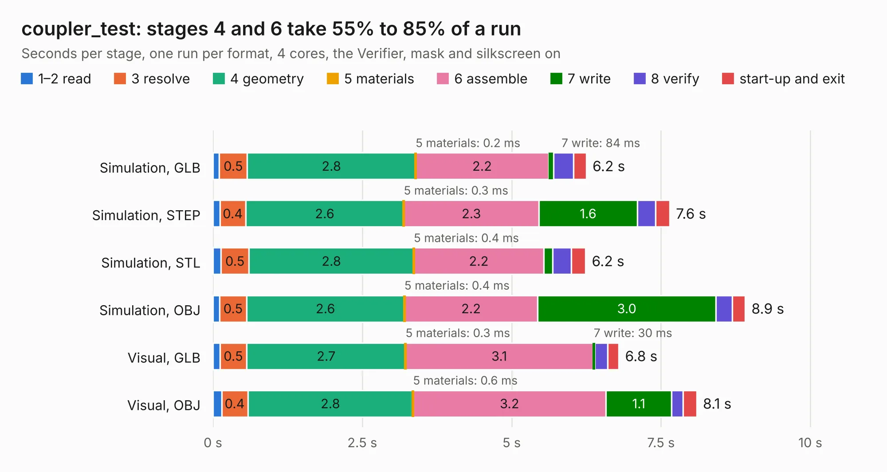

| Mode and format | 1–2 read | 3 resolve | 4 geometry | 5 materials | 6 assemble | 7 write | 8 verify | start-up and exit | Total |
|---|---:|---:|---:|---:|---:|---:|---:|---:|---:|
| Simulation, GLB | 0.1 | 0.5 | 2.8 | 0.2&nbsp;ms | 2.2 | 84&nbsp;ms | 0.3 | 0.2 | 6.2 |
| Simulation, STEP | 0.1 | 0.4 | 2.6 | 0.3&nbsp;ms | 2.3 | 1.6 | 0.3 | 0.2 | 7.6 |
| Simulation, STL | 0.1 | 0.5 | 2.8 | 0.4&nbsp;ms | 2.2 | 0.1 | 0.3 | 0.2 | 6.2 |
| Simulation, OBJ | 0.1 | 0.5 | 2.6 | 0.4&nbsp;ms | 2.2 | 3.0 | 0.3 | 0.2 | 8.9 |
| Visual, GLB | 0.1 | 0.5 | 2.7 | 0.3&nbsp;ms | 3.1 | 30&nbsp;ms | 0.2 | 0.2 | 6.8 |
| Visual, OBJ | 0.1 | 0.4 | 2.8 | 0.6&nbsp;ms | 3.2 | 1.1 | 0.2 | 0.2 | 8.1 |

<table align="center"><tr><td valign="top">

| Board | Repo: [loxodes/vna](https://github.com/loxodes/vna) Board: `coupler_test.kicad_pcb` |
|---|---|
| Folder | breakouts / coupler_test |
| Complexity | 120&nbsp;/&nbsp;1000 (size&nbsp;90, features&nbsp;30) |
| KESE&nbsp;features | rounded, trapezoid or chamfered pads, filled zones |
| Tested | 9th November 2026 |
| Copper&nbsp;layers | 4 |
| File&nbsp;format | KiCad 4 (4) |
| Parts,&nbsp;tracks,&nbsp;vias | 4, 10, 0 |
| Triangles,&nbsp;simulation | 592,560 in 19 parts |
| Verifier | PASS in all six runs |

</td><td valign="top">

<table>
<tr><th>File type</th><th>File size</th><th>Peak memory used</th></tr>
<tr><th colspan="3" align="left">Simulation</th></tr>
<tr><td>GLB</td><td align="right">20&nbsp;MB</td><td align="right">354&nbsp;MB</td></tr>
<tr><td>STEP</td><td align="right">60&nbsp;MB</td><td align="right">389&nbsp;MB</td></tr>
<tr><td>STL</td><td align="right">30&nbsp;MB</td><td align="right">345&nbsp;MB</td></tr>
<tr><td>OBJ</td><td align="right">58&nbsp;MB</td><td align="right">409&nbsp;MB</td></tr>
<tr><th colspan="3" align="left">Visual</th></tr>
<tr><td>GLB</td><td align="right">7.2&nbsp;MB</td><td align="right">296&nbsp;MB</td></tr>
<tr><td>OBJ</td><td align="right">21&nbsp;MB</td><td align="right">290&nbsp;MB</td></tr>
</table>

</td></tr></table>

## 1514. cpw_test

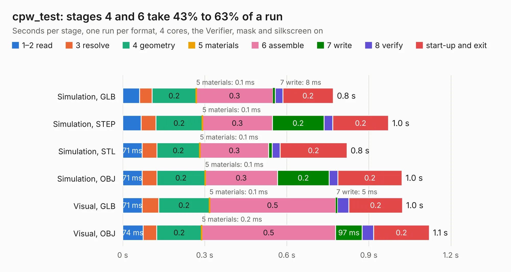

| Mode and format | 1–2 read | 3 resolve | 4 geometry | 5 materials | 6 assemble | 7 write | 8 verify | start-up and exit | Total |
|---|---:|---:|---:|---:|---:|---:|---:|---:|---:|
| Simulation, GLB | 62&nbsp;ms | 46&nbsp;ms | 0.2 | 0.1&nbsp;ms | 0.3 | 8&nbsp;ms | 29&nbsp;ms | 0.2 | 0.8 |
| Simulation, STEP | 67&nbsp;ms | 55&nbsp;ms | 0.2 | 0.1&nbsp;ms | 0.3 | 0.2 | 32&nbsp;ms | 0.2 | 1.0 |
| Simulation, STL | 71&nbsp;ms | 54&nbsp;ms | 0.2 | 0.1&nbsp;ms | 0.3 | 13&nbsp;ms | 29&nbsp;ms | 0.2 | 0.8 |
| Simulation, OBJ | 71&nbsp;ms | 54&nbsp;ms | 0.2 | 0.1&nbsp;ms | 0.3 | 0.2 | 32&nbsp;ms | 0.2 | 1.0 |
| Visual, GLB | 71&nbsp;ms | 60&nbsp;ms | 0.2 | 0.1&nbsp;ms | 0.5 | 5&nbsp;ms | 43&nbsp;ms | 0.2 | 1.0 |
| Visual, OBJ | 74&nbsp;ms | 50&nbsp;ms | 0.2 | 0.2&nbsp;ms | 0.5 | 97&nbsp;ms | 41&nbsp;ms | 0.2 | 1.1 |

<table align="center"><tr><td valign="top">

| Board | Repo: [loxodes/vna](https://github.com/loxodes/vna) Board: `cpw_test.kicad_pcb` |
|---|---|
| Folder | breakouts / cpw_test |
| Complexity | 78&nbsp;/&nbsp;1000 (size&nbsp;68, features&nbsp;10) |
| KESE&nbsp;features | rounded, trapezoid or chamfered pads |
| Tested | 9th November 2026 |
| Copper&nbsp;layers | 4 |
| File&nbsp;format | KiCad 4 (4) |
| Parts,&nbsp;tracks,&nbsp;vias | 2, 3, 0 |
| Triangles,&nbsp;simulation | 40,844 in 14 parts |
| Verifier | PASS in all six runs |

</td><td valign="top">

<table>
<tr><th>File type</th><th>File size</th><th>Peak memory used</th></tr>
<tr><th colspan="3" align="left">Simulation</th></tr>
<tr><td>GLB</td><td align="right">1.3&nbsp;MB</td><td align="right">65&nbsp;MB</td></tr>
<tr><td>STEP</td><td align="right">4.1&nbsp;MB</td><td align="right">69&nbsp;MB</td></tr>
<tr><td>STL</td><td align="right">2.0&nbsp;MB</td><td align="right">66&nbsp;MB</td></tr>
<tr><td>OBJ</td><td align="right">3.7&nbsp;MB</td><td align="right">74&nbsp;MB</td></tr>
<tr><th colspan="3" align="left">Visual</th></tr>
<tr><td>GLB</td><td align="right">731&nbsp;kB</td><td align="right">95&nbsp;MB</td></tr>
<tr><td>OBJ</td><td align="right">2.0&nbsp;MB</td><td align="right">94&nbsp;MB</td></tr>
</table>

</td></tr></table>

## 1515. crystal_filter

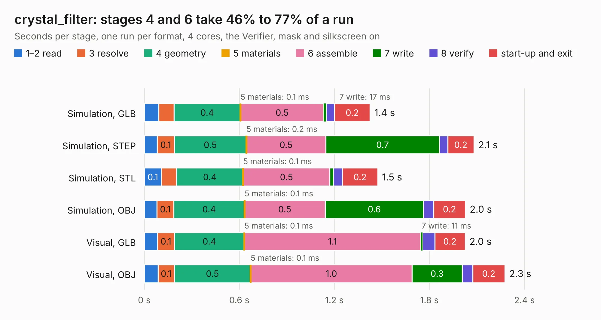

| Mode and format | 1–2 read | 3 resolve | 4 geometry | 5 materials | 6 assemble | 7 write | 8 verify | start-up and exit | Total |
|---|---:|---:|---:|---:|---:|---:|---:|---:|---:|
| Simulation, GLB | 91&nbsp;ms | 96&nbsp;ms | 0.4 | 0.1&nbsp;ms | 0.5 | 17&nbsp;ms | 51&nbsp;ms | 0.2 | 1.4 |
| Simulation, STEP | 81&nbsp;ms | 0.1 | 0.5 | 0.2&nbsp;ms | 0.5 | 0.7 | 53&nbsp;ms | 0.2 | 2.1 |
| Simulation, STL | 0.1 | 96&nbsp;ms | 0.4 | 0.1&nbsp;ms | 0.5 | 23&nbsp;ms | 57&nbsp;ms | 0.2 | 1.5 |
| Simulation, OBJ | 80&nbsp;ms | 0.1 | 0.4 | 0.1&nbsp;ms | 0.5 | 0.6 | 63&nbsp;ms | 0.2 | 2.0 |
| Visual, GLB | 84&nbsp;ms | 0.1 | 0.4 | 0.1&nbsp;ms | 1.1 | 11&nbsp;ms | 77&nbsp;ms | 0.2 | 2.0 |
| Visual, OBJ | 86&nbsp;ms | 0.1 | 0.5 | 0.1&nbsp;ms | 1.0 | 0.3 | 67&nbsp;ms | 0.2 | 2.3 |

<table align="center"><tr><td valign="top">

| Board | Repo: [loxodes/vna](https://github.com/loxodes/vna) Board: `crystal_filter.kicad_pcb` |
|---|---|
| Folder | breakouts / crystal_filter |
| Complexity | 146&nbsp;/&nbsp;1000 (size&nbsp;111, features&nbsp;35) |
| KESE&nbsp;features | through vias, filled zones |
| Tested | 9th November 2026 |
| Copper&nbsp;layers | 2 |
| File&nbsp;format | KiCad 4 (4) |
| Parts,&nbsp;tracks,&nbsp;vias | 9, 31, 12 |
| Triangles,&nbsp;simulation | 99,888 in 15 parts |
| Verifier | PASS in all six runs |

</td><td valign="top">

<table>
<tr><th>File type</th><th>File size</th><th>Peak memory used</th></tr>
<tr><th colspan="3" align="left">Simulation</th></tr>
<tr><td>GLB</td><td align="right">3.6&nbsp;MB</td><td align="right">178&nbsp;MB</td></tr>
<tr><td>STEP</td><td align="right">15&nbsp;MB</td><td align="right">185&nbsp;MB</td></tr>
<tr><td>STL</td><td align="right">5.0&nbsp;MB</td><td align="right">179&nbsp;MB</td></tr>
<tr><td>OBJ</td><td align="right">9.8&nbsp;MB</td><td align="right">181&nbsp;MB</td></tr>
<tr><th colspan="3" align="left">Visual</th></tr>
<tr><td>GLB</td><td align="right">2.2&nbsp;MB</td><td align="right">157&nbsp;MB</td></tr>
<tr><td>OBJ</td><td align="right">6.1&nbsp;MB</td><td align="right">158&nbsp;MB</td></tr>
</table>

</td></tr></table>

## 1516. demod_breakout

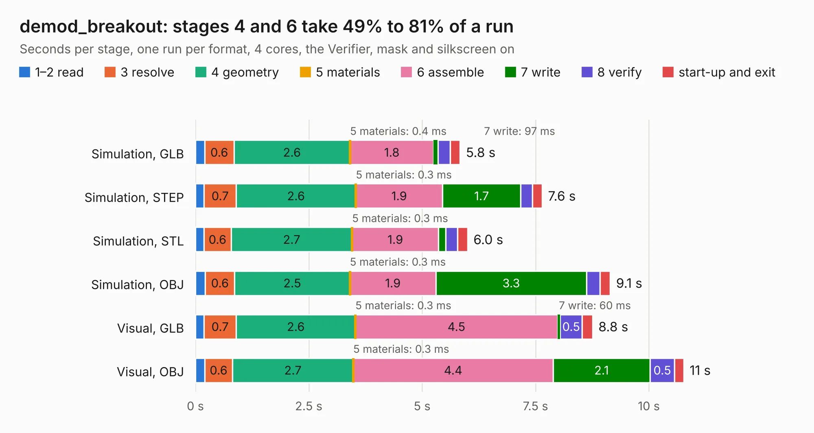

| Mode and format | 1–2 read | 3 resolve | 4 geometry | 5 materials | 6 assemble | 7 write | 8 verify | start-up and exit | Total |
|---|---:|---:|---:|---:|---:|---:|---:|---:|---:|
| Simulation, GLB | 0.2 | 0.6 | 2.6 | 0.4&nbsp;ms | 1.8 | 97&nbsp;ms | 0.3 | 0.2 | 5.8 |
| Simulation, STEP | 0.2 | 0.7 | 2.6 | 0.3&nbsp;ms | 1.9 | 1.7 | 0.3 | 0.2 | 7.6 |
| Simulation, STL | 0.2 | 0.6 | 2.7 | 0.3&nbsp;ms | 1.9 | 0.2 | 0.3 | 0.2 | 6.0 |
| Simulation, OBJ | 0.2 | 0.6 | 2.5 | 0.3&nbsp;ms | 1.9 | 3.3 | 0.3 | 0.2 | 9.1 |
| Visual, GLB | 0.2 | 0.7 | 2.6 | 0.3&nbsp;ms | 4.5 | 60&nbsp;ms | 0.5 | 0.2 | 8.8 |
| Visual, OBJ | 0.2 | 0.6 | 2.7 | 0.3&nbsp;ms | 4.4 | 2.1 | 0.5 | 0.2 | 10.8 |

<table align="center"><tr><td valign="top">

| Board | Repo: [loxodes/vna](https://github.com/loxodes/vna) Board: `demod_breakout.kicad_pcb` |
|---|---|
| Folder | breakouts / demod_breakout |
| Complexity | 220&nbsp;/&nbsp;1000 (size&nbsp;185, features&nbsp;35) |
| KESE&nbsp;features | through vias, filled zones |
| Tested | 9th November 2026 |
| Copper&nbsp;layers | 4 |
| File&nbsp;format | KiCad 4 (4) |
| Parts,&nbsp;tracks,&nbsp;vias | 67, 417, 72 |
| Triangles,&nbsp;simulation | 649,436 in 62 parts |
| Verifier | PASS in all six runs |

</td><td valign="top">

<table>
<tr><th>File type</th><th>File size</th><th>Peak memory used</th></tr>
<tr><th colspan="3" align="left">Simulation</th></tr>
<tr><td>GLB</td><td align="right">23&nbsp;MB</td><td align="right">330&nbsp;MB</td></tr>
<tr><td>STEP</td><td align="right">85&nbsp;MB</td><td align="right">374&nbsp;MB</td></tr>
<tr><td>STL</td><td align="right">32&nbsp;MB</td><td align="right">340&nbsp;MB</td></tr>
<tr><td>OBJ</td><td align="right">67&nbsp;MB</td><td align="right">482&nbsp;MB</td></tr>
<tr><th colspan="3" align="left">Visual</th></tr>
<tr><td>GLB</td><td align="right">14&nbsp;MB</td><td align="right">371&nbsp;MB</td></tr>
<tr><td>OBJ</td><td align="right">41&nbsp;MB</td><td align="right">371&nbsp;MB</td></tr>
</table>

</td></tr></table>

## 1517. filter_bank

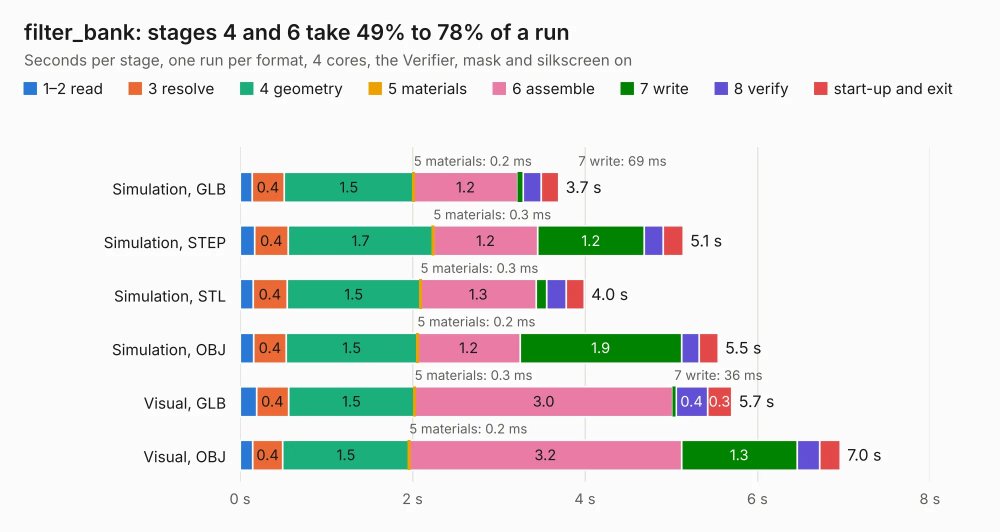

| Mode and format | 1–2 read | 3 resolve | 4 geometry | 5 materials | 6 assemble | 7 write | 8 verify | start-up and exit | Total |
|---|---:|---:|---:|---:|---:|---:|---:|---:|---:|
| Simulation, GLB | 0.1 | 0.4 | 1.5 | 0.2&nbsp;ms | 1.2 | 69&nbsp;ms | 0.2 | 0.2 | 3.7 |
| Simulation, STEP | 0.2 | 0.4 | 1.7 | 0.3&nbsp;ms | 1.2 | 1.2 | 0.2 | 0.2 | 5.1 |
| Simulation, STL | 0.1 | 0.4 | 1.5 | 0.3&nbsp;ms | 1.3 | 0.1 | 0.2 | 0.2 | 4.0 |
| Simulation, OBJ | 0.2 | 0.4 | 1.5 | 0.2&nbsp;ms | 1.2 | 1.9 | 0.2 | 0.2 | 5.5 |
| Visual, GLB | 0.2 | 0.4 | 1.5 | 0.3&nbsp;ms | 3.0 | 36&nbsp;ms | 0.4 | 0.3 | 5.7 |
| Visual, OBJ | 0.1 | 0.4 | 1.5 | 0.2&nbsp;ms | 3.2 | 1.3 | 0.3 | 0.2 | 7.0 |

<table align="center"><tr><td valign="top">

| Board | Repo: [loxodes/vna](https://github.com/loxodes/vna) Board: `filter_bank.kicad_pcb` |
|---|---|
| Folder | breakouts / filter_breakout |
| Complexity | 210&nbsp;/&nbsp;1000 (size&nbsp;175, features&nbsp;35) |
| KESE&nbsp;features | through vias, filled zones |
| Tested | 9th November 2026 |
| Copper&nbsp;layers | 4 |
| File&nbsp;format | KiCad 4 (4) |
| Parts,&nbsp;tracks,&nbsp;vias | 36, 361, 53 |
| Triangles,&nbsp;simulation | 321,342 in 56 parts |
| Verifier | PASS in all six runs |

</td><td valign="top">

<table>
<tr><th>File type</th><th>File size</th><th>Peak memory used</th></tr>
<tr><th colspan="3" align="left">Simulation</th></tr>
<tr><td>GLB</td><td align="right">11&nbsp;MB</td><td align="right">237&nbsp;MB</td></tr>
<tr><td>STEP</td><td align="right">40&nbsp;MB</td><td align="right">260&nbsp;MB</td></tr>
<tr><td>STL</td><td align="right">16&nbsp;MB</td><td align="right">253&nbsp;MB</td></tr>
<tr><td>OBJ</td><td align="right">33&nbsp;MB</td><td align="right">269&nbsp;MB</td></tr>
<tr><th colspan="3" align="left">Visual</th></tr>
<tr><td>GLB</td><td align="right">7.3&nbsp;MB</td><td align="right">235&nbsp;MB</td></tr>
<tr><td>OBJ</td><td align="right">21&nbsp;MB</td><td align="right">237&nbsp;MB</td></tr>
</table>

</td></tr></table>

## 1518. trl_thru

| Mode and format | 1–2 read | 3 resolve | 4 geometry | 5 materials | 6 assemble | 7 write | 8 verify | start-up and exit | Total |
|---|---:|---:|---:|---:|---:|---:|---:|---:|---:|
| Simulation, GLB | 91&nbsp;ms | 0.3 | 0.8 | 0.2&nbsp;ms | 0.9 | 39&nbsp;ms | 0.1 | 0.2 | 2.4 |
| Simulation, STEP | 96&nbsp;ms | 0.3 | 0.7 | 0.1&nbsp;ms | 0.8 | 0.9 | 0.1 | 0.2 | 3.2 |
| Simulation, STL | 92&nbsp;ms | 0.3 | 0.8 | 0.1&nbsp;ms | 0.9 | 70&nbsp;ms | 0.1 | 0.3 | 2.5 |
| Simulation, OBJ | 98&nbsp;ms | 0.3 | 0.8 | 0.1&nbsp;ms | 0.9 | 1.1 | 0.1 | 0.2 | 3.4 |
| Visual, GLB | 0.1 | 0.3 | 0.9 | 0.1&nbsp;ms | 1.5 | 19&nbsp;ms | 0.1 | 0.2 | 3.1 |
| Visual, OBJ | 93&nbsp;ms | 0.3 | 0.8 | 0.1&nbsp;ms | 1.6 | 0.6 | 0.1 | 0.2 | 3.6 |

<table align="center"><tr><td valign="top">

| Board | Repo: [loxodes/vna](https://github.com/loxodes/vna) Board: `trl_thru.kicad_pcb` |
|---|---|
| Folder | breakouts / hmc576_breakout |
| Complexity | 185&nbsp;/&nbsp;1000 (size&nbsp;140, features&nbsp;45) |
| KESE&nbsp;features | through vias, rounded, trapezoid or chamfered pads, filled zones |
| Tested | 9th November 2026 |
| Copper&nbsp;layers | 4 |
| File&nbsp;format | KiCad 5 (20171130) |
| Parts,&nbsp;tracks,&nbsp;vias | 10, 55, 27 |
| Triangles,&nbsp;simulation | 254,354 in 18 parts |
| Verifier | PASS in all six runs |

</td><td valign="top">

<table>
<tr><th>File type</th><th>File size</th><th>Peak memory used</th></tr>
<tr><th colspan="3" align="left">Simulation</th></tr>
<tr><td>GLB</td><td align="right">8.6&nbsp;MB</td><td align="right">236&nbsp;MB</td></tr>
<tr><td>STEP</td><td align="right">27&nbsp;MB</td><td align="right">244&nbsp;MB</td></tr>
<tr><td>STL</td><td align="right">13&nbsp;MB</td><td align="right">254&nbsp;MB</td></tr>
<tr><td>OBJ</td><td align="right">25&nbsp;MB</td><td align="right">229&nbsp;MB</td></tr>
<tr><th colspan="3" align="left">Visual</th></tr>
<tr><td>GLB</td><td align="right">4.1&nbsp;MB</td><td align="right">184&nbsp;MB</td></tr>
<tr><td>OBJ</td><td align="right">12&nbsp;MB</td><td align="right">184&nbsp;MB</td></tr>
</table>

</td></tr></table>

## 1519. hyperram_3p3v

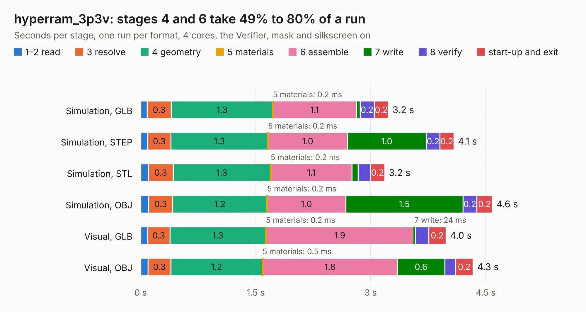

| Mode and format | 1–2 read | 3 resolve | 4 geometry | 5 materials | 6 assemble | 7 write | 8 verify | start-up and exit | Total |
|---|---:|---:|---:|---:|---:|---:|---:|---:|---:|
| Simulation, GLB | 84&nbsp;ms | 0.3 | 1.3 | 0.2&nbsp;ms | 1.1 | 51&nbsp;ms | 0.2 | 0.2 | 3.2 |
| Simulation, STEP | 92&nbsp;ms | 0.3 | 1.3 | 0.2&nbsp;ms | 1.0 | 1.0 | 0.2 | 0.2 | 4.1 |
| Simulation, STL | 0.1 | 0.3 | 1.3 | 0.2&nbsp;ms | 1.1 | 81&nbsp;ms | 0.2 | 0.2 | 3.2 |
| Simulation, OBJ | 0.1 | 0.3 | 1.2 | 0.2&nbsp;ms | 1.0 | 1.5 | 0.2 | 0.2 | 4.6 |
| Visual, GLB | 91&nbsp;ms | 0.3 | 1.3 | 0.2&nbsp;ms | 1.9 | 24&nbsp;ms | 0.2 | 0.2 | 4.0 |
| Visual, OBJ | 96&nbsp;ms | 0.3 | 1.2 | 0.5&nbsp;ms | 1.8 | 0.6 | 0.1 | 0.2 | 4.3 |

<table align="center"><tr><td valign="top">

| Board | Repo: [loxodes/vna](https://github.com/loxodes/vna) Board: `hyperram_3p3v.kicad_pcb` |
|---|---|
| Folder | breakouts / hyperram / hyperram_3p3v |
| Complexity | 184&nbsp;/&nbsp;1000 (size&nbsp;139, features&nbsp;45) |
| KESE&nbsp;features | through vias, rounded, trapezoid or chamfered pads, filled zones |
| Tested | 9th November 2026 |
| Copper&nbsp;layers | 4 |
| File&nbsp;format | KiCad 5 (20171130) |
| Parts,&nbsp;tracks,&nbsp;vias | 6, 129, 16 |
| Triangles,&nbsp;simulation | 371,994 in 27 parts |
| Verifier | PASS in all six runs |

</td><td valign="top">

<table>
<tr><th>File type</th><th>File size</th><th>Peak memory used</th></tr>
<tr><th colspan="3" align="left">Simulation</th></tr>
<tr><td>GLB</td><td align="right">13&nbsp;MB</td><td align="right">245&nbsp;MB</td></tr>
<tr><td>STEP</td><td align="right">48&nbsp;MB</td><td align="right">263&nbsp;MB</td></tr>
<tr><td>STL</td><td align="right">19&nbsp;MB</td><td align="right">246&nbsp;MB</td></tr>
<tr><td>OBJ</td><td align="right">37&nbsp;MB</td><td align="right">289&nbsp;MB</td></tr>
<tr><th colspan="3" align="left">Visual</th></tr>
<tr><td>GLB</td><td align="right">5.4&nbsp;MB</td><td align="right">225&nbsp;MB</td></tr>
<tr><td>OBJ</td><td align="right">16&nbsp;MB</td><td align="right">224&nbsp;MB</td></tr>
</table>

</td></tr></table>

## 1520. launchpad_synthcontrol

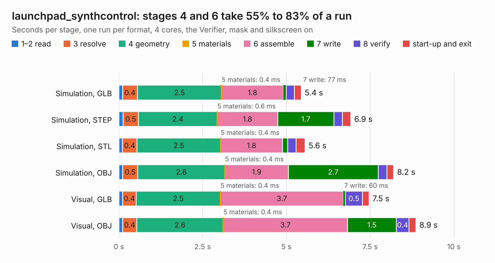

| Mode and format | 1–2 read | 3 resolve | 4 geometry | 5 materials | 6 assemble | 7 write | 8 verify | start-up and exit | Total |
|---|---:|---:|---:|---:|---:|---:|---:|---:|---:|
| Simulation, GLB | 0.1 | 0.4 | 2.5 | 0.4&nbsp;ms | 1.8 | 77&nbsp;ms | 0.2 | 0.2 | 5.4 |
| Simulation, STEP | 0.1 | 0.5 | 2.4 | 0.6&nbsp;ms | 1.8 | 1.7 | 0.2 | 0.3 | 6.9 |
| Simulation, STL | 0.1 | 0.4 | 2.5 | 0.4&nbsp;ms | 1.8 | 0.2 | 0.3 | 0.3 | 5.6 |
| Simulation, OBJ | 0.1 | 0.5 | 2.6 | 0.4&nbsp;ms | 1.9 | 2.7 | 0.3 | 0.2 | 8.2 |
| Visual, GLB | 0.1 | 0.4 | 2.5 | 0.4&nbsp;ms | 3.7 | 60&nbsp;ms | 0.5 | 0.2 | 7.5 |
| Visual, OBJ | 0.1 | 0.4 | 2.6 | 0.4&nbsp;ms | 3.7 | 1.5 | 0.4 | 0.2 | 8.9 |

<table align="center"><tr><td valign="top">

| Board | Repo: [loxodes/vna](https://github.com/loxodes/vna) Board: `launchpad_synthcontrol.kicad_pcb` |
|---|---|
| Folder | breakouts / launchpad_synthcontrol |
| Complexity | 147&nbsp;/&nbsp;1000 (size&nbsp;132, features&nbsp;15) |
| KESE&nbsp;features | through vias |
| Tested | 9th November 2026 |
| Copper&nbsp;layers | 2 |
| File&nbsp;format | KiCad 4 (4) |
| Parts,&nbsp;tracks,&nbsp;vias | 2, 308, 84 |
| Triangles,&nbsp;simulation | 603,278 in 50 parts |
| Verifier | PASS in all six runs |

</td><td valign="top">

<table>
<tr><th>File type</th><th>File size</th><th>Peak memory used</th></tr>
<tr><th colspan="3" align="left">Simulation</th></tr>
<tr><td>GLB</td><td align="right">21&nbsp;MB</td><td align="right">306&nbsp;MB</td></tr>
<tr><td>STEP</td><td align="right">92&nbsp;MB</td><td align="right">354&nbsp;MB</td></tr>
<tr><td>STL</td><td align="right">30&nbsp;MB</td><td align="right">309&nbsp;MB</td></tr>
<tr><td>OBJ</td><td align="right">61&nbsp;MB</td><td align="right">435&nbsp;MB</td></tr>
<tr><th colspan="3" align="left">Visual</th></tr>
<tr><td>GLB</td><td align="right">12&nbsp;MB</td><td align="right">342&nbsp;MB</td></tr>
<tr><td>OBJ</td><td align="right">35&nbsp;MB</td><td align="right">345&nbsp;MB</td></tr>
</table>

</td></tr></table>

## 1521. maam_011109

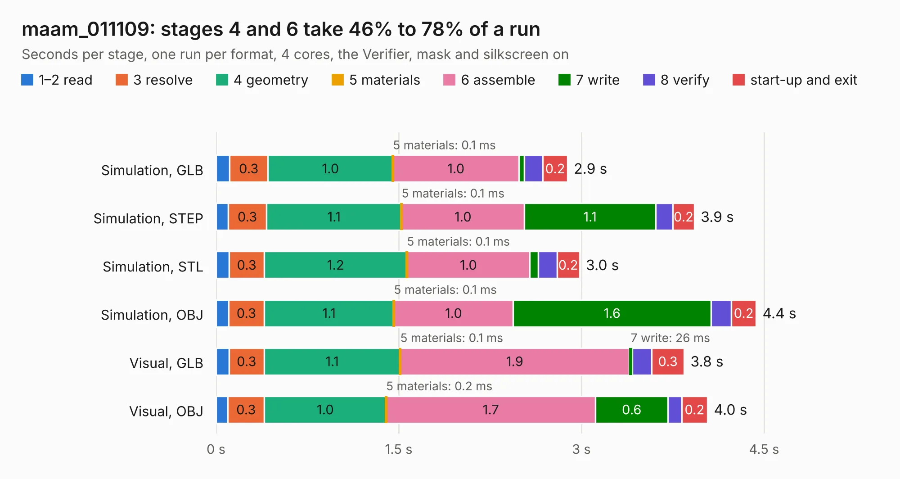

| Mode and format | 1–2 read | 3 resolve | 4 geometry | 5 materials | 6 assemble | 7 write | 8 verify | start-up and exit | Total |
|---|---:|---:|---:|---:|---:|---:|---:|---:|---:|
| Simulation, GLB | 0.1 | 0.3 | 1.0 | 0.1&nbsp;ms | 1.0 | 45&nbsp;ms | 0.2 | 0.2 | 2.9 |
| Simulation, STEP | 0.1 | 0.3 | 1.1 | 0.1&nbsp;ms | 1.0 | 1.1 | 0.1 | 0.2 | 3.9 |
| Simulation, STL | 0.1 | 0.3 | 1.2 | 0.1&nbsp;ms | 1.0 | 68&nbsp;ms | 0.2 | 0.2 | 3.0 |
| Simulation, OBJ | 0.1 | 0.3 | 1.1 | 0.1&nbsp;ms | 1.0 | 1.6 | 0.2 | 0.2 | 4.4 |
| Visual, GLB | 0.1 | 0.3 | 1.1 | 0.1&nbsp;ms | 1.9 | 26&nbsp;ms | 0.2 | 0.3 | 3.8 |
| Visual, OBJ | 97&nbsp;ms | 0.3 | 1.0 | 0.2&nbsp;ms | 1.7 | 0.6 | 0.1 | 0.2 | 4.0 |

<table align="center"><tr><td valign="top">

| Board | Repo: [loxodes/vna](https://github.com/loxodes/vna) Board: `maam_011109.kicad_pcb` |
|---|---|
| Folder | breakouts / maam_011109 / maam_011109 |
| Complexity | 188&nbsp;/&nbsp;1000 (size&nbsp;143, features&nbsp;45) |
| KESE&nbsp;features | through vias, rounded, trapezoid or chamfered pads, filled zones |
| Tested | 9th November 2026 |
| Copper&nbsp;layers | 4 |
| File&nbsp;format | KiCad 5 (20171130) |
| Parts,&nbsp;tracks,&nbsp;vias | 8, 51, 47 |
| Triangles,&nbsp;simulation | 316,726 in 23 parts |
| Verifier | PASS in all six runs |

</td><td valign="top">

<table>
<tr><th>File type</th><th>File size</th><th>Peak memory used</th></tr>
<tr><th colspan="3" align="left">Simulation</th></tr>
<tr><td>GLB</td><td align="right">11&nbsp;MB</td><td align="right">247&nbsp;MB</td></tr>
<tr><td>STEP</td><td align="right">31&nbsp;MB</td><td align="right">265&nbsp;MB</td></tr>
<tr><td>STL</td><td align="right">16&nbsp;MB</td><td align="right">268&nbsp;MB</td></tr>
<tr><td>OBJ</td><td align="right">31&nbsp;MB</td><td align="right">271&nbsp;MB</td></tr>
<tr><th colspan="3" align="left">Visual</th></tr>
<tr><td>GLB</td><td align="right">4.4&nbsp;MB</td><td align="right">210&nbsp;MB</td></tr>
<tr><td>OBJ</td><td align="right">12&nbsp;MB</td><td align="right">214&nbsp;MB</td></tr>
</table>

</td></tr></table>

## 1522. maam_011109_bias

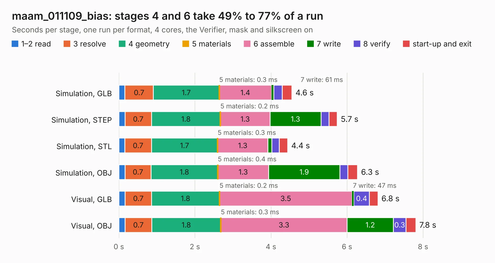

| Mode and format | 1–2 read | 3 resolve | 4 geometry | 5 materials | 6 assemble | 7 write | 8 verify | start-up and exit | Total |
|---|---:|---:|---:|---:|---:|---:|---:|---:|---:|
| Simulation, GLB | 0.2 | 0.7 | 1.7 | 0.3&nbsp;ms | 1.4 | 61&nbsp;ms | 0.2 | 0.3 | 4.6 |
| Simulation, STEP | 0.2 | 0.7 | 1.8 | 0.2&nbsp;ms | 1.3 | 1.3 | 0.2 | 0.2 | 5.7 |
| Simulation, STL | 0.2 | 0.7 | 1.7 | 0.3&nbsp;ms | 1.3 | 0.1 | 0.2 | 0.2 | 4.4 |
| Simulation, OBJ | 0.2 | 0.7 | 1.8 | 0.4&nbsp;ms | 1.3 | 1.9 | 0.2 | 0.3 | 6.3 |
| Visual, GLB | 0.2 | 0.7 | 1.8 | 0.2&nbsp;ms | 3.5 | 47&nbsp;ms | 0.4 | 0.2 | 6.8 |
| Visual, OBJ | 0.2 | 0.7 | 1.8 | 0.3&nbsp;ms | 3.3 | 1.2 | 0.3 | 0.3 | 7.8 |

<table align="center"><tr><td valign="top">

| Board | Repo: [loxodes/vna](https://github.com/loxodes/vna) Board: `maam_011109_bias.kicad_pcb` |
|---|---|
| Folder | breakouts / maam_011109_bias |
| Complexity | 202&nbsp;/&nbsp;1000 (size&nbsp;157, features&nbsp;45) |
| KESE&nbsp;features | through vias, filled zones, curved board outline |
| Tested | 9th November 2026 |
| Copper&nbsp;layers | 2 |
| File&nbsp;format | KiCad 5 (20171130) |
| Parts,&nbsp;tracks,&nbsp;vias | 48, 287, 36 |
| Triangles,&nbsp;simulation | 368,514 in 38 parts |
| Verifier | PASS in all six runs |

</td><td valign="top">

<table>
<tr><th>File type</th><th>File size</th><th>Peak memory used</th></tr>
<tr><th colspan="3" align="left">Simulation</th></tr>
<tr><td>GLB</td><td align="right">13&nbsp;MB</td><td align="right">279&nbsp;MB</td></tr>
<tr><td>STEP</td><td align="right">63&nbsp;MB</td><td align="right">305&nbsp;MB</td></tr>
<tr><td>STL</td><td align="right">18&nbsp;MB</td><td align="right">288&nbsp;MB</td></tr>
<tr><td>OBJ</td><td align="right">38&nbsp;MB</td><td align="right">315&nbsp;MB</td></tr>
<tr><th colspan="3" align="left">Visual</th></tr>
<tr><td>GLB</td><td align="right">9.6&nbsp;MB</td><td align="right">274&nbsp;MB</td></tr>
<tr><td>OBJ</td><td align="right">28&nbsp;MB</td><td align="right">281&nbsp;MB</td></tr>
</table>

</td></tr></table>

## 1523. mixer_breakout

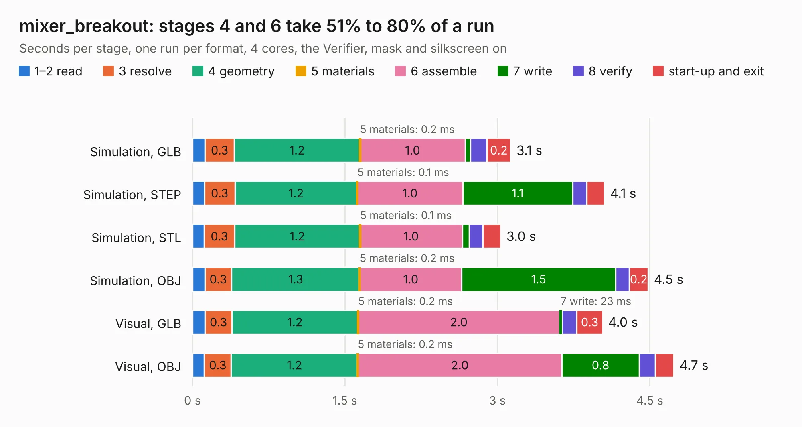

| Mode and format | 1–2 read | 3 resolve | 4 geometry | 5 materials | 6 assemble | 7 write | 8 verify | start-up and exit | Total |
|---|---:|---:|---:|---:|---:|---:|---:|---:|---:|
| Simulation, GLB | 0.1 | 0.3 | 1.2 | 0.2&nbsp;ms | 1.0 | 52&nbsp;ms | 0.2 | 0.2 | 3.1 |
| Simulation, STEP | 0.1 | 0.3 | 1.2 | 0.1&nbsp;ms | 1.0 | 1.1 | 0.1 | 0.2 | 4.1 |
| Simulation, STL | 0.1 | 0.3 | 1.2 | 0.1&nbsp;ms | 1.0 | 68&nbsp;ms | 0.1 | 0.2 | 3.0 |
| Simulation, OBJ | 0.1 | 0.3 | 1.3 | 0.2&nbsp;ms | 1.0 | 1.5 | 0.1 | 0.2 | 4.5 |
| Visual, GLB | 0.1 | 0.3 | 1.2 | 0.2&nbsp;ms | 2.0 | 23&nbsp;ms | 0.1 | 0.3 | 4.0 |
| Visual, OBJ | 0.1 | 0.3 | 1.2 | 0.2&nbsp;ms | 2.0 | 0.8 | 0.2 | 0.2 | 4.7 |

<table align="center"><tr><td valign="top">

| Board | Repo: [loxodes/vna](https://github.com/loxodes/vna) Board: `mixer_breakout.kicad_pcb` |
|---|---|
| Folder | breakouts / mixer_breakout |
| Complexity | 170&nbsp;/&nbsp;1000 (size&nbsp;135, features&nbsp;35) |
| KESE&nbsp;features | through vias, filled zones |
| Tested | 9th November 2026 |
| Copper&nbsp;layers | 4 |
| File&nbsp;format | KiCad 4 (4) |
| Parts,&nbsp;tracks,&nbsp;vias | 11, 88, 2 |
| Triangles,&nbsp;simulation | 306,878 in 24 parts |
| Verifier | PASS in all six runs |

</td><td valign="top">

<table>
<tr><th>File type</th><th>File size</th><th>Peak memory used</th></tr>
<tr><th colspan="3" align="left">Simulation</th></tr>
<tr><td>GLB</td><td align="right">10&nbsp;MB</td><td align="right">244&nbsp;MB</td></tr>
<tr><td>STEP</td><td align="right">35&nbsp;MB</td><td align="right">267&nbsp;MB</td></tr>
<tr><td>STL</td><td align="right">15&nbsp;MB</td><td align="right">242&nbsp;MB</td></tr>
<tr><td>OBJ</td><td align="right">31&nbsp;MB</td><td align="right">253&nbsp;MB</td></tr>
<tr><th colspan="3" align="left">Visual</th></tr>
<tr><td>GLB</td><td align="right">5.3&nbsp;MB</td><td align="right">211&nbsp;MB</td></tr>
<tr><td>OBJ</td><td align="right">15&nbsp;MB</td><td align="right">214&nbsp;MB</td></tr>
</table>

</td></tr></table>

## 1524. pe42520_breakout

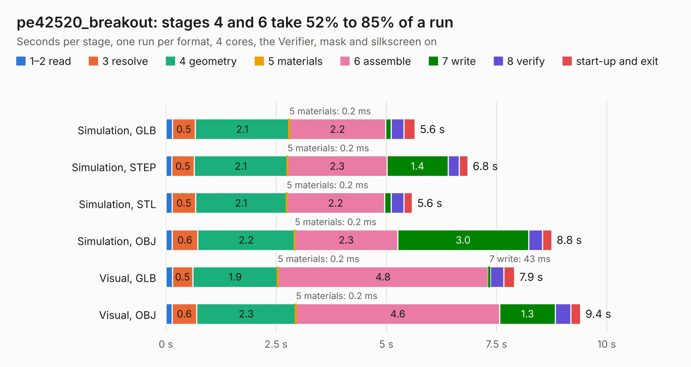

| Mode and format | 1–2 read | 3 resolve | 4 geometry | 5 materials | 6 assemble | 7 write | 8 verify | start-up and exit | Total |
|---|---:|---:|---:|---:|---:|---:|---:|---:|---:|
| Simulation, GLB | 0.1 | 0.5 | 2.1 | 0.2&nbsp;ms | 2.2 | 0.1 | 0.3 | 0.2 | 5.6 |
| Simulation, STEP | 0.1 | 0.5 | 2.1 | 0.2&nbsp;ms | 2.3 | 1.4 | 0.3 | 0.2 | 6.8 |
| Simulation, STL | 0.1 | 0.5 | 2.1 | 0.2&nbsp;ms | 2.2 | 0.1 | 0.3 | 0.2 | 5.6 |
| Simulation, OBJ | 0.1 | 0.6 | 2.2 | 0.2&nbsp;ms | 2.3 | 3.0 | 0.3 | 0.2 | 8.8 |
| Visual, GLB | 0.1 | 0.5 | 1.9 | 0.2&nbsp;ms | 4.8 | 43&nbsp;ms | 0.3 | 0.2 | 7.9 |
| Visual, OBJ | 0.1 | 0.6 | 2.3 | 0.2&nbsp;ms | 4.6 | 1.3 | 0.4 | 0.2 | 9.4 |

<table align="center"><tr><td valign="top">

| Board | Repo: [loxodes/vna](https://github.com/loxodes/vna) Board: `pe42520_breakout.kicad_pcb` |
|---|---|
| Folder | breakouts / pe42540_breakout |
| Complexity | 210&nbsp;/&nbsp;1000 (size&nbsp;190, features&nbsp;20) |
| KESE&nbsp;features | filled zones |
| Tested | 9th November 2026 |
| Copper&nbsp;layers | 4 |
| File&nbsp;format | KiCad 4 (4) |
| Parts,&nbsp;tracks,&nbsp;vias | 19, 83, 0 |
| Triangles,&nbsp;simulation | 614,274 in 30 parts |
| Verifier | PASS in all six runs |

</td><td valign="top">

<table>
<tr><th>File type</th><th>File size</th><th>Peak memory used</th></tr>
<tr><th colspan="3" align="left">Simulation</th></tr>
<tr><td>GLB</td><td align="right">21&nbsp;MB</td><td align="right">344&nbsp;MB</td></tr>
<tr><td>STEP</td><td align="right">46&nbsp;MB</td><td align="right">413&nbsp;MB</td></tr>
<tr><td>STL</td><td align="right">31&nbsp;MB</td><td align="right">348&nbsp;MB</td></tr>
<tr><td>OBJ</td><td align="right">61&nbsp;MB</td><td align="right">450&nbsp;MB</td></tr>
<tr><th colspan="3" align="left">Visual</th></tr>
<tr><td>GLB</td><td align="right">9.2&nbsp;MB</td><td align="right">314&nbsp;MB</td></tr>
<tr><td>OBJ</td><td align="right">27&nbsp;MB</td><td align="right">315&nbsp;MB</td></tr>
</table>

</td></tr></table>

## 1525. pe42543_breakout

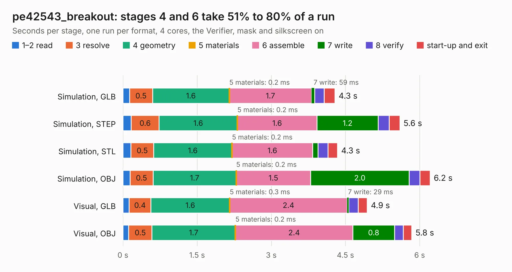

| Mode and format | 1–2 read | 3 resolve | 4 geometry | 5 materials | 6 assemble | 7 write | 8 verify | start-up and exit | Total |
|---|---:|---:|---:|---:|---:|---:|---:|---:|---:|
| Simulation, GLB | 0.1 | 0.5 | 1.6 | 0.2&nbsp;ms | 1.7 | 59&nbsp;ms | 0.2 | 0.2 | 4.3 |
| Simulation, STEP | 0.2 | 0.6 | 1.6 | 0.2&nbsp;ms | 1.6 | 1.2 | 0.2 | 0.2 | 5.6 |
| Simulation, STL | 0.2 | 0.5 | 1.6 | 0.2&nbsp;ms | 1.6 | 0.1 | 0.2 | 0.2 | 4.3 |
| Simulation, OBJ | 0.1 | 0.5 | 1.7 | 0.2&nbsp;ms | 1.5 | 2.0 | 0.2 | 0.2 | 6.2 |
| Visual, GLB | 0.1 | 0.4 | 1.6 | 0.3&nbsp;ms | 2.4 | 29&nbsp;ms | 0.2 | 0.2 | 4.9 |
| Visual, OBJ | 0.1 | 0.5 | 1.7 | 0.2&nbsp;ms | 2.4 | 0.8 | 0.2 | 0.2 | 5.8 |

<table align="center"><tr><td valign="top">

| Board | Repo: [loxodes/vna](https://github.com/loxodes/vna) Board: `pe42543_breakout.kicad_pcb` |
|---|---|
| Folder | breakouts / pe42543_breakout |
| Complexity | 197&nbsp;/&nbsp;1000 (size&nbsp;152, features&nbsp;45) |
| KESE&nbsp;features | through vias, rounded, trapezoid or chamfered pads, filled zones |
| Tested | 9th November 2026 |
| Copper&nbsp;layers | 4 |
| File&nbsp;format | KiCad 5 (20171130) |
| Parts,&nbsp;tracks,&nbsp;vias | 21, 106, 23 |
| Triangles,&nbsp;simulation | 427,902 in 35 parts |
| Verifier | PASS in all six runs |

</td><td valign="top">

<table>
<tr><th>File type</th><th>File size</th><th>Peak memory used</th></tr>
<tr><th colspan="3" align="left">Simulation</th></tr>
<tr><td>GLB</td><td align="right">15&nbsp;MB</td><td align="right">279&nbsp;MB</td></tr>
<tr><td>STEP</td><td align="right">45&nbsp;MB</td><td align="right">315&nbsp;MB</td></tr>
<tr><td>STL</td><td align="right">21&nbsp;MB</td><td align="right">276&nbsp;MB</td></tr>
<tr><td>OBJ</td><td align="right">43&nbsp;MB</td><td align="right">345&nbsp;MB</td></tr>
<tr><th colspan="3" align="left">Visual</th></tr>
<tr><td>GLB</td><td align="right">6.0&nbsp;MB</td><td align="right">240&nbsp;MB</td></tr>
<tr><td>OBJ</td><td align="right">18&nbsp;MB</td><td align="right">238&nbsp;MB</td></tr>
</table>

</td></tr></table>

## 1526. powerdet_breakout

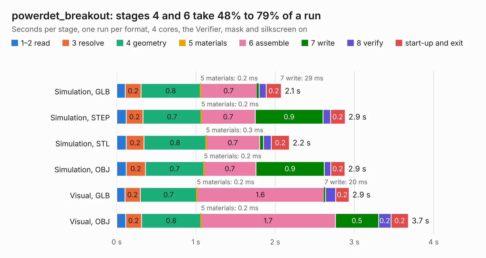

| Mode and format | 1–2 read | 3 resolve | 4 geometry | 5 materials | 6 assemble | 7 write | 8 verify | start-up and exit | Total |
|---|---:|---:|---:|---:|---:|---:|---:|---:|---:|
| Simulation, GLB | 0.1 | 0.2 | 0.8 | 0.2&nbsp;ms | 0.7 | 29&nbsp;ms | 91&nbsp;ms | 0.2 | 2.1 |
| Simulation, STEP | 0.1 | 0.2 | 0.7 | 0.2&nbsp;ms | 0.7 | 0.9 | 93&nbsp;ms | 0.2 | 2.9 |
| Simulation, STL | 0.1 | 0.2 | 0.8 | 0.3&nbsp;ms | 0.7 | 49&nbsp;ms | 0.1 | 0.2 | 2.2 |
| Simulation, OBJ | 0.1 | 0.2 | 0.7 | 0.2&nbsp;ms | 0.7 | 0.9 | 83&nbsp;ms | 0.2 | 2.9 |
| Visual, GLB | 0.1 | 0.2 | 0.7 | 0.2&nbsp;ms | 1.6 | 20&nbsp;ms | 0.1 | 0.2 | 2.9 |
| Visual, OBJ | 0.1 | 0.2 | 0.8 | 0.2&nbsp;ms | 1.7 | 0.5 | 0.2 | 0.2 | 3.7 |

<table align="center"><tr><td valign="top">

| Board | Repo: [loxodes/vna](https://github.com/loxodes/vna) Board: `powerdet_breakout.kicad_pcb` |
|---|---|
| Folder | breakouts / powerdet_breakout |
| Complexity | 193&nbsp;/&nbsp;1000 (size&nbsp;158, features&nbsp;35) |
| KESE&nbsp;features | through vias, filled zones |
| Tested | 9th November 2026 |
| Copper&nbsp;layers | 4 |
| File&nbsp;format | KiCad 4 (4) |
| Parts,&nbsp;tracks,&nbsp;vias | 26, 157, 25 |
| Triangles,&nbsp;simulation | 202,000 in 30 parts |
| Verifier | PASS in all six runs |

</td><td valign="top">

<table>
<tr><th>File type</th><th>File size</th><th>Peak memory used</th></tr>
<tr><th colspan="3" align="left">Simulation</th></tr>
<tr><td>GLB</td><td align="right">7.2&nbsp;MB</td><td align="right">210&nbsp;MB</td></tr>
<tr><td>STEP</td><td align="right">26&nbsp;MB</td><td align="right">223&nbsp;MB</td></tr>
<tr><td>STL</td><td align="right">10&nbsp;MB</td><td align="right">208&nbsp;MB</td></tr>
<tr><td>OBJ</td><td align="right">20&nbsp;MB</td><td align="right">209&nbsp;MB</td></tr>
<tr><th colspan="3" align="left">Visual</th></tr>
<tr><td>GLB</td><td align="right">4.7&nbsp;MB</td><td align="right">186&nbsp;MB</td></tr>
<tr><td>OBJ</td><td align="right">13&nbsp;MB</td><td align="right">187&nbsp;MB</td></tr>
</table>

</td></tr></table>

## 1527. refclk_breakout

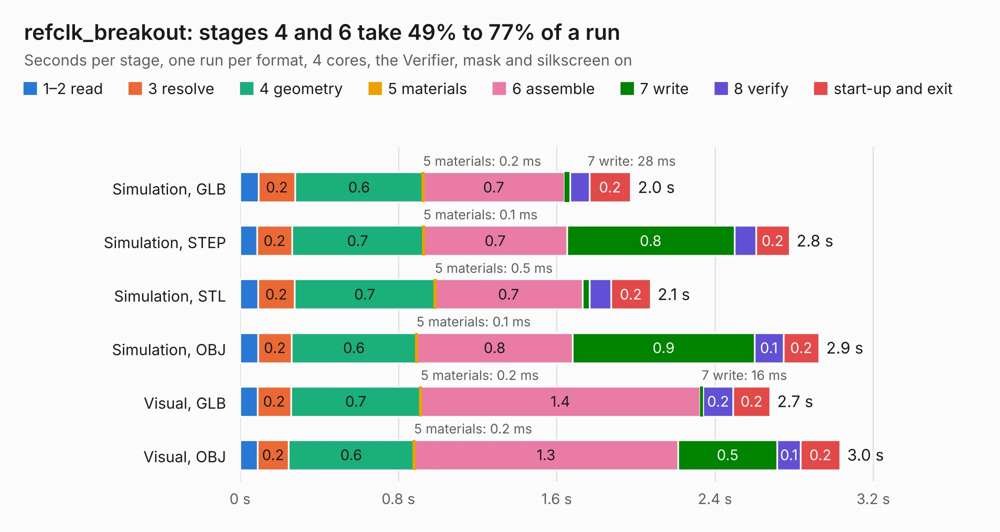

| Mode and format | 1–2 read | 3 resolve | 4 geometry | 5 materials | 6 assemble | 7 write | 8 verify | start-up and exit | Total |
|---|---:|---:|---:|---:|---:|---:|---:|---:|---:|
| Simulation, GLB | 94&nbsp;ms | 0.2 | 0.6 | 0.2&nbsp;ms | 0.7 | 28&nbsp;ms | 99&nbsp;ms | 0.2 | 2.0 |
| Simulation, STEP | 87&nbsp;ms | 0.2 | 0.7 | 0.1&nbsp;ms | 0.7 | 0.8 | 0.1 | 0.2 | 2.8 |
| Simulation, STL | 90&nbsp;ms | 0.2 | 0.7 | 0.5&nbsp;ms | 0.7 | 37&nbsp;ms | 0.1 | 0.2 | 2.1 |
| Simulation, OBJ | 92&nbsp;ms | 0.2 | 0.6 | 0.1&nbsp;ms | 0.8 | 0.9 | 0.1 | 0.2 | 2.9 |
| Visual, GLB | 87&nbsp;ms | 0.2 | 0.7 | 0.2&nbsp;ms | 1.4 | 16&nbsp;ms | 0.2 | 0.2 | 2.7 |
| Visual, OBJ | 89&nbsp;ms | 0.2 | 0.6 | 0.2&nbsp;ms | 1.3 | 0.5 | 0.1 | 0.2 | 3.0 |

<table align="center"><tr><td valign="top">

| Board | Repo: [loxodes/vna](https://github.com/loxodes/vna) Board: `refclk_breakout.kicad_pcb` |
|---|---|
| Folder | breakouts / refclk_breakout |
| Complexity | 176&nbsp;/&nbsp;1000 (size&nbsp;141, features&nbsp;35) |
| KESE&nbsp;features | through vias, filled zones |
| Tested | 9th November 2026 |
| Copper&nbsp;layers | 4 |
| File&nbsp;format | KiCad 4 (4) |
| Parts,&nbsp;tracks,&nbsp;vias | 13, 92, 10 |
| Triangles,&nbsp;simulation | 184,948 in 22 parts |
| Verifier | PASS in all six runs |

</td><td valign="top">

<table>
<tr><th>File type</th><th>File size</th><th>Peak memory used</th></tr>
<tr><th colspan="3" align="left">Simulation</th></tr>
<tr><td>GLB</td><td align="right">6.3&nbsp;MB</td><td align="right">194&nbsp;MB</td></tr>
<tr><td>STEP</td><td align="right">26&nbsp;MB</td><td align="right">208&nbsp;MB</td></tr>
<tr><td>STL</td><td align="right">9.2&nbsp;MB</td><td align="right">196&nbsp;MB</td></tr>
<tr><td>OBJ</td><td align="right">18&nbsp;MB</td><td align="right">195&nbsp;MB</td></tr>
<tr><th colspan="3" align="left">Visual</th></tr>
<tr><td>GLB</td><td align="right">3.5&nbsp;MB</td><td align="right">163&nbsp;MB</td></tr>
<tr><td>OBJ</td><td align="right">9.9&nbsp;MB</td><td align="right">162&nbsp;MB</td></tr>
</table>

</td></tr></table>

## 1528. trl_thru

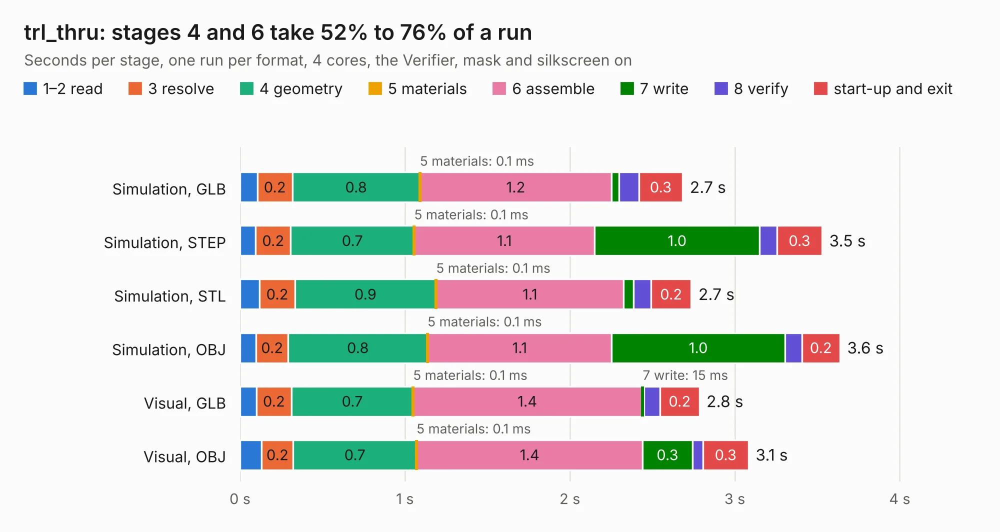

| Mode and format | 1–2 read | 3 resolve | 4 geometry | 5 materials | 6 assemble | 7 write | 8 verify | start-up and exit | Total |
|---|---:|---:|---:|---:|---:|---:|---:|---:|---:|
| Simulation, GLB | 0.1 | 0.2 | 0.8 | 0.1&nbsp;ms | 1.2 | 47&nbsp;ms | 0.1 | 0.3 | 2.7 |
| Simulation, STEP | 95&nbsp;ms | 0.2 | 0.7 | 0.1&nbsp;ms | 1.1 | 1.0 | 0.1 | 0.3 | 3.5 |
| Simulation, STL | 0.1 | 0.2 | 0.9 | 0.1&nbsp;ms | 1.1 | 59&nbsp;ms | 0.1 | 0.2 | 2.7 |
| Simulation, OBJ | 97&nbsp;ms | 0.2 | 0.8 | 0.1&nbsp;ms | 1.1 | 1.0 | 0.1 | 0.2 | 3.6 |
| Visual, GLB | 99&nbsp;ms | 0.2 | 0.7 | 0.1&nbsp;ms | 1.4 | 15&nbsp;ms | 97&nbsp;ms | 0.2 | 2.8 |
| Visual, OBJ | 0.1 | 0.2 | 0.7 | 0.1&nbsp;ms | 1.4 | 0.3 | 64&nbsp;ms | 0.3 | 3.1 |

<table align="center"><tr><td valign="top">

| Board | Repo: [loxodes/vna](https://github.com/loxodes/vna) Board: `trl_thru.kicad_pcb` |
|---|---|
| Folder | breakouts / res_splitter |
| Complexity | 147&nbsp;/&nbsp;1000 (size&nbsp;102, features&nbsp;45) |
| KESE&nbsp;features | through vias, rounded, trapezoid or chamfered pads, filled zones |
| Tested | 9th November 2026 |
| Copper&nbsp;layers | 4 |
| File&nbsp;format | KiCad 5 (20171130) |
| Parts,&nbsp;tracks,&nbsp;vias | 4, 13, 3 |
| Triangles,&nbsp;simulation | 174,854 in 17 parts |
| Verifier | PASS in all six runs |

</td><td valign="top">

<table>
<tr><th>File type</th><th>File size</th><th>Peak memory used</th></tr>
<tr><th colspan="3" align="left">Simulation</th></tr>
<tr><td>GLB</td><td align="right">5.9&nbsp;MB</td><td align="right">209&nbsp;MB</td></tr>
<tr><td>STEP</td><td align="right">15&nbsp;MB</td><td align="right">227&nbsp;MB</td></tr>
<tr><td>STL</td><td align="right">8.7&nbsp;MB</td><td align="right">206&nbsp;MB</td></tr>
<tr><td>OBJ</td><td align="right">17&nbsp;MB</td><td align="right">208&nbsp;MB</td></tr>
<tr><th colspan="3" align="left">Visual</th></tr>
<tr><td>GLB</td><td align="right">1.8&nbsp;MB</td><td align="right">166&nbsp;MB</td></tr>
<tr><td>OBJ</td><td align="right">5.1&nbsp;MB</td><td align="right">169&nbsp;MB</td></tr>
</table>

</td></tr></table>

## 1529. sequencing_ltc2937

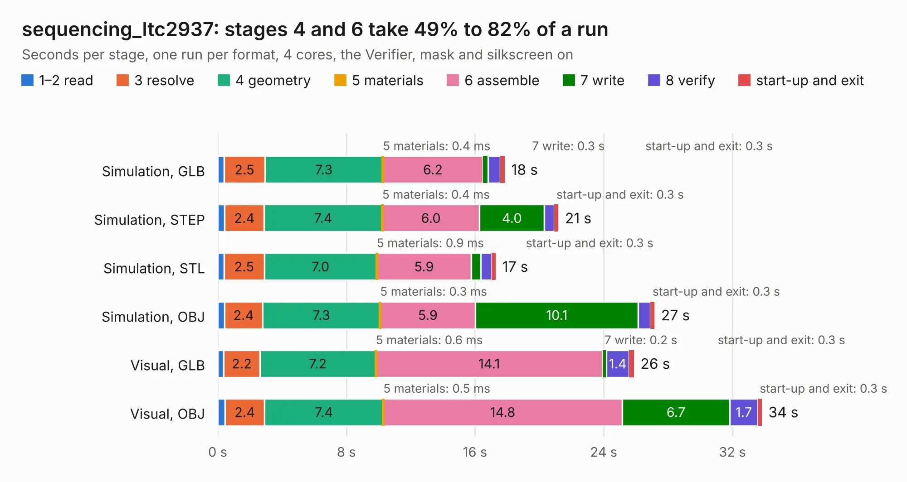

| Mode and format | 1–2 read | 3 resolve | 4 geometry | 5 materials | 6 assemble | 7 write | 8 verify | start-up and exit | Total |
|---|---:|---:|---:|---:|---:|---:|---:|---:|---:|
| Simulation, GLB | 0.4 | 2.5 | 7.3 | 0.4&nbsp;ms | 6.2 | 0.3 | 0.8 | 0.3 | 17.8 |
| Simulation, STEP | 0.4 | 2.4 | 7.4 | 0.4&nbsp;ms | 6.0 | 4.0 | 0.6 | 0.3 | 21.2 |
| Simulation, STL | 0.4 | 2.5 | 7.0 | 0.9&nbsp;ms | 5.9 | 0.6 | 0.7 | 0.3 | 17.3 |
| Simulation, OBJ | 0.4 | 2.4 | 7.3 | 0.3&nbsp;ms | 5.9 | 10.1 | 0.8 | 0.3 | 27.2 |
| Visual, GLB | 0.4 | 2.2 | 7.2 | 0.6&nbsp;ms | 14.1 | 0.2 | 1.4 | 0.3 | 25.9 |
| Visual, OBJ | 0.5 | 2.4 | 7.4 | 0.5&nbsp;ms | 14.8 | 6.7 | 1.7 | 0.3 | 33.8 |

<table align="center"><tr><td valign="top">

| Board | Repo: [loxodes/vna](https://github.com/loxodes/vna) Board: `sequencing_ltc2937.kicad_pcb` |
|---|---|
| Folder | breakouts / sequencing_ltc2937 |
| Complexity | 308&nbsp;/&nbsp;1000 (size&nbsp;263, features&nbsp;45) |
| KESE&nbsp;features | through vias, filled zones, curved board outline |
| Tested | 9th November 2026 |
| Copper&nbsp;layers | 4 |
| File&nbsp;format | KiCad 5 (20171130) |
| Parts,&nbsp;tracks,&nbsp;vias | 127, 1,208, 292 |
| Triangles,&nbsp;simulation | 1,853,264 in 101 parts |
| Verifier | PASS in all six runs |

</td><td valign="top">

<table>
<tr><th>File type</th><th>File size</th><th>Peak memory used</th></tr>
<tr><th colspan="3" align="left">Simulation</th></tr>
<tr><td>GLB</td><td align="right">65&nbsp;MB</td><td align="right">678&nbsp;MB</td></tr>
<tr><td>STEP</td><td align="right">232&nbsp;MB</td><td align="right">793&nbsp;MB</td></tr>
<tr><td>STL</td><td align="right">93&nbsp;MB</td><td align="right">692&nbsp;MB</td></tr>
<tr><td>OBJ</td><td align="right">195&nbsp;MB</td><td align="right">1.3&nbsp;GB</td></tr>
<tr><th colspan="3" align="left">Visual</th></tr>
<tr><td>GLB</td><td align="right">40&nbsp;MB</td><td align="right">792&nbsp;MB</td></tr>
<tr><td>OBJ</td><td align="right">122&nbsp;MB</td><td align="right">909&nbsp;MB</td></tr>
</table>

</td></tr></table>

## 1530. sot89_amp_test

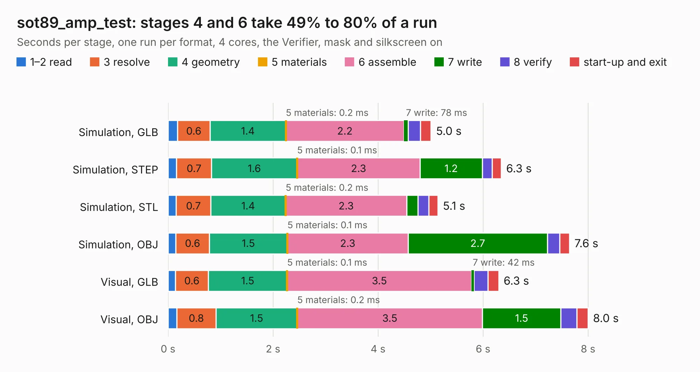

| Mode and format | 1–2 read | 3 resolve | 4 geometry | 5 materials | 6 assemble | 7 write | 8 verify | start-up and exit | Total |
|---|---:|---:|---:|---:|---:|---:|---:|---:|---:|
| Simulation, GLB | 0.2 | 0.6 | 1.4 | 0.2&nbsp;ms | 2.2 | 78&nbsp;ms | 0.2 | 0.2 | 5.0 |
| Simulation, STEP | 0.2 | 0.7 | 1.6 | 0.1&nbsp;ms | 2.3 | 1.2 | 0.2 | 0.2 | 6.3 |
| Simulation, STL | 0.2 | 0.7 | 1.4 | 0.2&nbsp;ms | 2.3 | 0.2 | 0.2 | 0.2 | 5.1 |
| Simulation, OBJ | 0.1 | 0.6 | 1.5 | 0.1&nbsp;ms | 2.3 | 2.7 | 0.2 | 0.2 | 7.6 |
| Visual, GLB | 0.1 | 0.6 | 1.5 | 0.1&nbsp;ms | 3.5 | 42&nbsp;ms | 0.3 | 0.2 | 6.3 |
| Visual, OBJ | 0.2 | 0.8 | 1.5 | 0.2&nbsp;ms | 3.5 | 1.5 | 0.3 | 0.2 | 8.0 |

<table align="center"><tr><td valign="top">

| Board | Repo: [loxodes/vna](https://github.com/loxodes/vna) Board: `sot89_amp_test.kicad_pcb` |
|---|---|
| Folder | breakouts / sot89_amp_test |
| Complexity | 180&nbsp;/&nbsp;1000 (size&nbsp;135, features&nbsp;45) |
| KESE&nbsp;features | through vias, rounded, trapezoid or chamfered pads, filled zones |
| Tested | 9th November 2026 |
| Copper&nbsp;layers | 4 |
| File&nbsp;format | KiCad 4 (4) |
| Parts,&nbsp;tracks,&nbsp;vias | 20, 38, 9 |
| Triangles,&nbsp;simulation | 549,398 in 25 parts |
| Verifier | PASS in all six runs |

</td><td valign="top">

<table>
<tr><th>File type</th><th>File size</th><th>Peak memory used</th></tr>
<tr><th colspan="3" align="left">Simulation</th></tr>
<tr><td>GLB</td><td align="right">19&nbsp;MB</td><td align="right">353&nbsp;MB</td></tr>
<tr><td>STEP</td><td align="right">27&nbsp;MB</td><td align="right">399&nbsp;MB</td></tr>
<tr><td>STL</td><td align="right">27&nbsp;MB</td><td align="right">352&nbsp;MB</td></tr>
<tr><td>OBJ</td><td align="right">54&nbsp;MB</td><td align="right">404&nbsp;MB</td></tr>
<tr><th colspan="3" align="left">Visual</th></tr>
<tr><td>GLB</td><td align="right">9.9&nbsp;MB</td><td align="right">350&nbsp;MB</td></tr>
<tr><td>OBJ</td><td align="right">29&nbsp;MB</td><td align="right">354&nbsp;MB</td></tr>
</table>

</td></tr></table>

## 1531. splitter_breakout

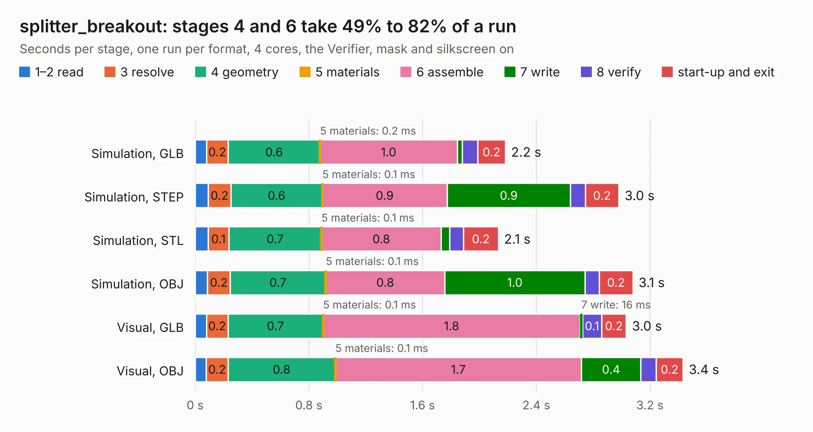

| Mode and format | 1–2 read | 3 resolve | 4 geometry | 5 materials | 6 assemble | 7 write | 8 verify | start-up and exit | Total |
|---|---:|---:|---:|---:|---:|---:|---:|---:|---:|
| Simulation, GLB | 80&nbsp;ms | 0.2 | 0.6 | 0.2&nbsp;ms | 1.0 | 35&nbsp;ms | 0.1 | 0.2 | 2.2 |
| Simulation, STEP | 92&nbsp;ms | 0.2 | 0.6 | 0.1&nbsp;ms | 0.9 | 0.9 | 0.1 | 0.2 | 3.0 |
| Simulation, STL | 91&nbsp;ms | 0.1 | 0.7 | 0.1&nbsp;ms | 0.8 | 58&nbsp;ms | 99&nbsp;ms | 0.2 | 2.1 |
| Simulation, OBJ | 86&nbsp;ms | 0.2 | 0.7 | 0.1&nbsp;ms | 0.8 | 1.0 | 0.1 | 0.2 | 3.1 |
| Visual, GLB | 79&nbsp;ms | 0.2 | 0.7 | 0.1&nbsp;ms | 1.8 | 16&nbsp;ms | 0.1 | 0.2 | 3.0 |
| Visual, OBJ | 78&nbsp;ms | 0.2 | 0.8 | 0.1&nbsp;ms | 1.7 | 0.4 | 0.1 | 0.2 | 3.4 |

<table align="center"><tr><td valign="top">

| Board | Repo: [loxodes/vna](https://github.com/loxodes/vna) Board: `splitter_breakout.kicad_pcb` |
|---|---|
| Folder | breakouts / splitter_breakout |
| Complexity | 115&nbsp;/&nbsp;1000 (size&nbsp;95, features&nbsp;20) |
| KESE&nbsp;features | filled zones |
| Tested | 9th November 2026 |
| Copper&nbsp;layers | 4 |
| File&nbsp;format | KiCad 4 (4) |
| Parts,&nbsp;tracks,&nbsp;vias | 4, 14, 0 |
| Triangles,&nbsp;simulation | 257,954 in 16 parts |
| Verifier | PASS in all six runs |

</td><td valign="top">

<table>
<tr><th>File type</th><th>File size</th><th>Peak memory used</th></tr>
<tr><th colspan="3" align="left">Simulation</th></tr>
<tr><td>GLB</td><td align="right">8.6&nbsp;MB</td><td align="right">230&nbsp;MB</td></tr>
<tr><td>STEP</td><td align="right">23&nbsp;MB</td><td align="right">256&nbsp;MB</td></tr>
<tr><td>STL</td><td align="right">13&nbsp;MB</td><td align="right">244&nbsp;MB</td></tr>
<tr><td>OBJ</td><td align="right">25&nbsp;MB</td><td align="right">246&nbsp;MB</td></tr>
<tr><th colspan="3" align="left">Visual</th></tr>
<tr><td>GLB</td><td align="right">3.6&nbsp;MB</td><td align="right">189&nbsp;MB</td></tr>
<tr><td>OBJ</td><td align="right">10&nbsp;MB</td><td align="right">185&nbsp;MB</td></tr>
</table>

</td></tr></table>

## 1532. siw

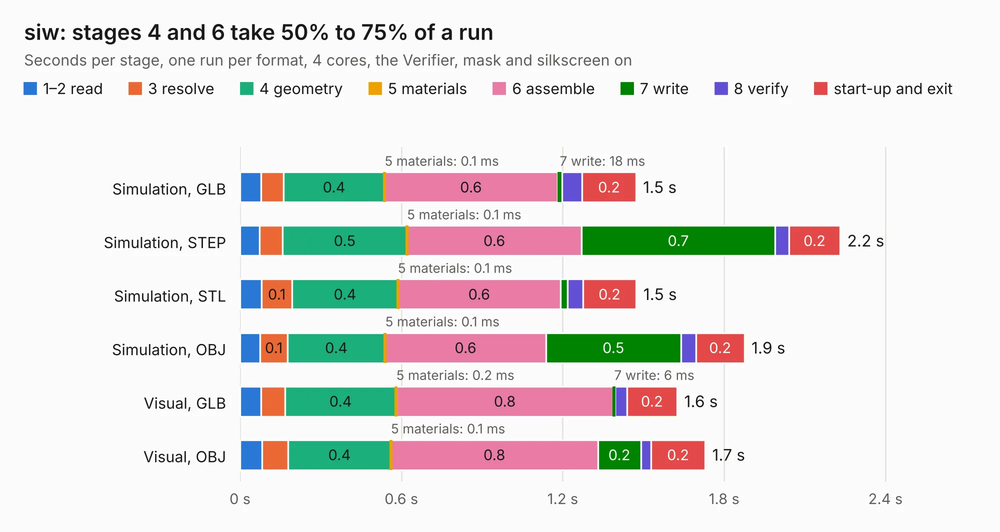

| Mode and format | 1–2 read | 3 resolve | 4 geometry | 5 materials | 6 assemble | 7 write | 8 verify | start-up and exit | Total |
|---|---:|---:|---:|---:|---:|---:|---:|---:|---:|
| Simulation, GLB | 78&nbsp;ms | 84&nbsp;ms | 0.4 | 0.1&nbsp;ms | 0.6 | 18&nbsp;ms | 75&nbsp;ms | 0.2 | 1.5 |
| Simulation, STEP | 73&nbsp;ms | 85&nbsp;ms | 0.5 | 0.1&nbsp;ms | 0.6 | 0.7 | 52&nbsp;ms | 0.2 | 2.2 |
| Simulation, STL | 80&nbsp;ms | 0.1 | 0.4 | 0.1&nbsp;ms | 0.6 | 25&nbsp;ms | 58&nbsp;ms | 0.2 | 1.5 |
| Simulation, OBJ | 75&nbsp;ms | 0.1 | 0.4 | 0.1&nbsp;ms | 0.6 | 0.5 | 56&nbsp;ms | 0.2 | 1.9 |
| Visual, GLB | 78&nbsp;ms | 89&nbsp;ms | 0.4 | 0.2&nbsp;ms | 0.8 | 6&nbsp;ms | 44&nbsp;ms | 0.2 | 1.6 |
| Visual, OBJ | 81&nbsp;ms | 97&nbsp;ms | 0.4 | 0.1&nbsp;ms | 0.8 | 0.2 | 38&nbsp;ms | 0.2 | 1.7 |

<table align="center"><tr><td valign="top">

| Board | Repo: [loxodes/vna](https://github.com/loxodes/vna) Board: `siw.kicad_pcb` |
|---|---|
| Folder | breakouts / sw_edge_fr408_oshpark / lpf_20ghz |
| Complexity | 108&nbsp;/&nbsp;1000 (size&nbsp;78, features&nbsp;30) |
| KESE&nbsp;features | rounded, trapezoid or chamfered pads, filled zones |
| Tested | 9th November 2026 |
| Copper&nbsp;layers | 4 |
| File&nbsp;format | KiCad 5 (20171130) |
| Parts,&nbsp;tracks,&nbsp;vias | 3, 5, 0 |
| Triangles,&nbsp;simulation | 105,776 in 16 parts |
| Verifier | PASS in all six runs |

</td><td valign="top">

<table>
<tr><th>File type</th><th>File size</th><th>Peak memory used</th></tr>
<tr><th colspan="3" align="left">Simulation</th></tr>
<tr><td>GLB</td><td align="right">3.5&nbsp;MB</td><td align="right">192&nbsp;MB</td></tr>
<tr><td>STEP</td><td align="right">8.5&nbsp;MB</td><td align="right">196&nbsp;MB</td></tr>
<tr><td>STL</td><td align="right">5.3&nbsp;MB</td><td align="right">192&nbsp;MB</td></tr>
<tr><td>OBJ</td><td align="right">9.9&nbsp;MB</td><td align="right">188&nbsp;MB</td></tr>
<tr><th colspan="3" align="left">Visual</th></tr>
<tr><td>GLB</td><td align="right">969&nbsp;kB</td><td align="right">156&nbsp;MB</td></tr>
<tr><td>OBJ</td><td align="right">2.7&nbsp;MB</td><td align="right">153&nbsp;MB</td></tr>
</table>

</td></tr></table>

## 1533. siw

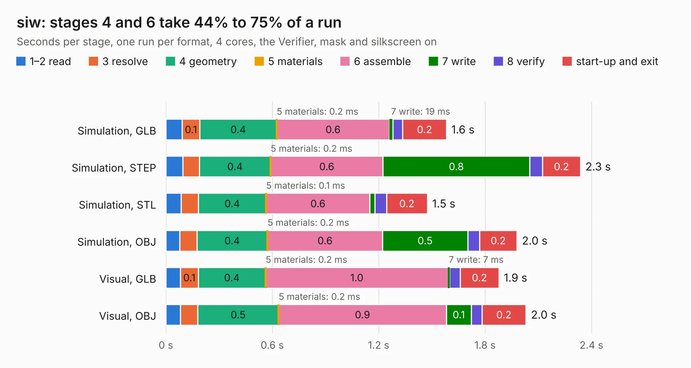

| Mode and format | 1–2 read | 3 resolve | 4 geometry | 5 materials | 6 assemble | 7 write | 8 verify | start-up and exit | Total |
|---|---:|---:|---:|---:|---:|---:|---:|---:|---:|
| Simulation, GLB | 92&nbsp;ms | 0.1 | 0.4 | 0.2&nbsp;ms | 0.6 | 19&nbsp;ms | 56&nbsp;ms | 0.2 | 1.6 |
| Simulation, STEP | 95&nbsp;ms | 95&nbsp;ms | 0.4 | 0.2&nbsp;ms | 0.6 | 0.8 | 71&nbsp;ms | 0.2 | 2.3 |
| Simulation, STL | 85&nbsp;ms | 98&nbsp;ms | 0.4 | 0.1&nbsp;ms | 0.6 | 29&nbsp;ms | 66&nbsp;ms | 0.2 | 1.5 |
| Simulation, OBJ | 79&nbsp;ms | 96&nbsp;ms | 0.4 | 0.2&nbsp;ms | 0.6 | 0.5 | 66&nbsp;ms | 0.2 | 2.0 |
| Visual, GLB | 83&nbsp;ms | 0.1 | 0.4 | 0.2&nbsp;ms | 1.0 | 7&nbsp;ms | 61&nbsp;ms | 0.2 | 1.9 |
| Visual, OBJ | 81&nbsp;ms | 98&nbsp;ms | 0.5 | 0.2&nbsp;ms | 0.9 | 0.1 | 60&nbsp;ms | 0.2 | 2.0 |

<table align="center"><tr><td valign="top">

| Board | Repo: [loxodes/vna](https://github.com/loxodes/vna) Board: `siw.kicad_pcb` |
|---|---|
| Folder | breakouts / sw_edge_fr408_oshpark / lpf_8ghz |
| Complexity | 108&nbsp;/&nbsp;1000 (size&nbsp;78, features&nbsp;30) |
| KESE&nbsp;features | rounded, trapezoid or chamfered pads, filled zones |
| Tested | 9th November 2026 |
| Copper&nbsp;layers | 4 |
| File&nbsp;format | KiCad 5 (20171130) |
| Parts,&nbsp;tracks,&nbsp;vias | 3, 5, 0 |
| Triangles,&nbsp;simulation | 104,500 in 18 parts |
| Verifier | PASS in all six runs |

</td><td valign="top">

<table>
<tr><th>File type</th><th>File size</th><th>Peak memory used</th></tr>
<tr><th colspan="3" align="left">Simulation</th></tr>
<tr><td>GLB</td><td align="right">3.5&nbsp;MB</td><td align="right">183&nbsp;MB</td></tr>
<tr><td>STEP</td><td align="right">8.4&nbsp;MB</td><td align="right">197&nbsp;MB</td></tr>
<tr><td>STL</td><td align="right">5.2&nbsp;MB</td><td align="right">191&nbsp;MB</td></tr>
<tr><td>OBJ</td><td align="right">9.7&nbsp;MB</td><td align="right">191&nbsp;MB</td></tr>
<tr><th colspan="3" align="left">Visual</th></tr>
<tr><td>GLB</td><td align="right">969&nbsp;kB</td><td align="right">156&nbsp;MB</td></tr>
<tr><td>OBJ</td><td align="right">2.7&nbsp;MB</td><td align="right">154&nbsp;MB</td></tr>
</table>

</td></tr></table>

## 1534. siw

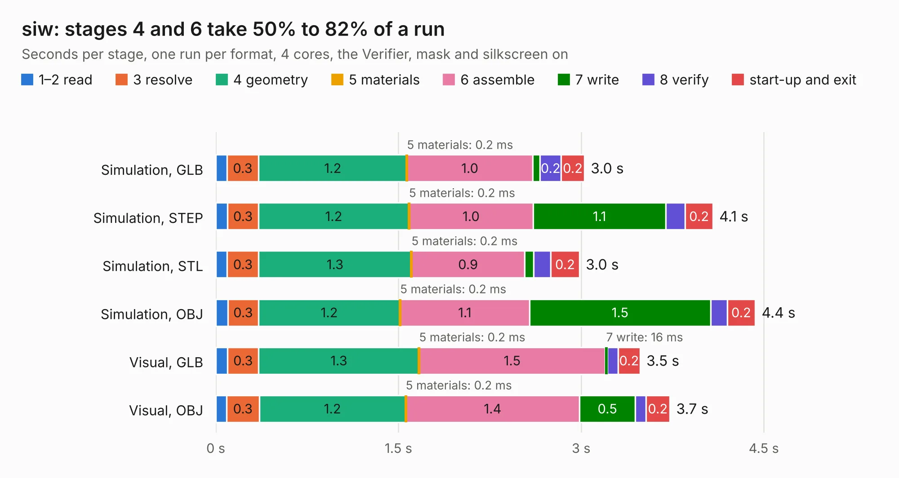

| Mode and format | 1–2 read | 3 resolve | 4 geometry | 5 materials | 6 assemble | 7 write | 8 verify | start-up and exit | Total |
|---|---:|---:|---:|---:|---:|---:|---:|---:|---:|
| Simulation, GLB | 91&nbsp;ms | 0.3 | 1.2 | 0.2&nbsp;ms | 1.0 | 60&nbsp;ms | 0.2 | 0.2 | 3.0 |
| Simulation, STEP | 96&nbsp;ms | 0.3 | 1.2 | 0.2&nbsp;ms | 1.0 | 1.1 | 0.2 | 0.2 | 4.1 |
| Simulation, STL | 94&nbsp;ms | 0.3 | 1.3 | 0.2&nbsp;ms | 0.9 | 73&nbsp;ms | 0.1 | 0.2 | 3.0 |
| Simulation, OBJ | 99&nbsp;ms | 0.3 | 1.2 | 0.2&nbsp;ms | 1.1 | 1.5 | 0.1 | 0.2 | 4.4 |
| Visual, GLB | 96&nbsp;ms | 0.3 | 1.3 | 0.2&nbsp;ms | 1.5 | 16&nbsp;ms | 90&nbsp;ms | 0.2 | 3.5 |
| Visual, OBJ | 88&nbsp;ms | 0.3 | 1.2 | 0.2&nbsp;ms | 1.4 | 0.5 | 86&nbsp;ms | 0.2 | 3.7 |

<table align="center"><tr><td valign="top">

| Board | Repo: [loxodes/vna](https://github.com/loxodes/vna) Board: `siw.kicad_pcb` |
|---|---|
| Folder | breakouts / sw_edge_fr408_oshpark / siw |
| Complexity | 105&nbsp;/&nbsp;1000 (size&nbsp;75, features&nbsp;30) |
| KESE&nbsp;features | rounded, trapezoid or chamfered pads, filled zones |
| Tested | 9th November 2026 |
| Copper&nbsp;layers | 4 |
| File&nbsp;format | KiCad 5 (20171130) |
| Parts,&nbsp;tracks,&nbsp;vias | 3, 4, 0 |
| Triangles,&nbsp;simulation | 305,108 in 16 parts |
| Verifier | PASS in all six runs |

</td><td valign="top">

<table>
<tr><th>File type</th><th>File size</th><th>Peak memory used</th></tr>
<tr><th colspan="3" align="left">Simulation</th></tr>
<tr><td>GLB</td><td align="right">10&nbsp;MB</td><td align="right">253&nbsp;MB</td></tr>
<tr><td>STEP</td><td align="right">32&nbsp;MB</td><td align="right">270&nbsp;MB</td></tr>
<tr><td>STL</td><td align="right">15&nbsp;MB</td><td align="right">255&nbsp;MB</td></tr>
<tr><td>OBJ</td><td align="right">30&nbsp;MB</td><td align="right">257&nbsp;MB</td></tr>
<tr><th colspan="3" align="left">Visual</th></tr>
<tr><td>GLB</td><td align="right">3.1&nbsp;MB</td><td align="right">186&nbsp;MB</td></tr>
<tr><td>OBJ</td><td align="right">8.9&nbsp;MB</td><td align="right">186&nbsp;MB</td></tr>
</table>

</td></tr></table>

## 1535. siw

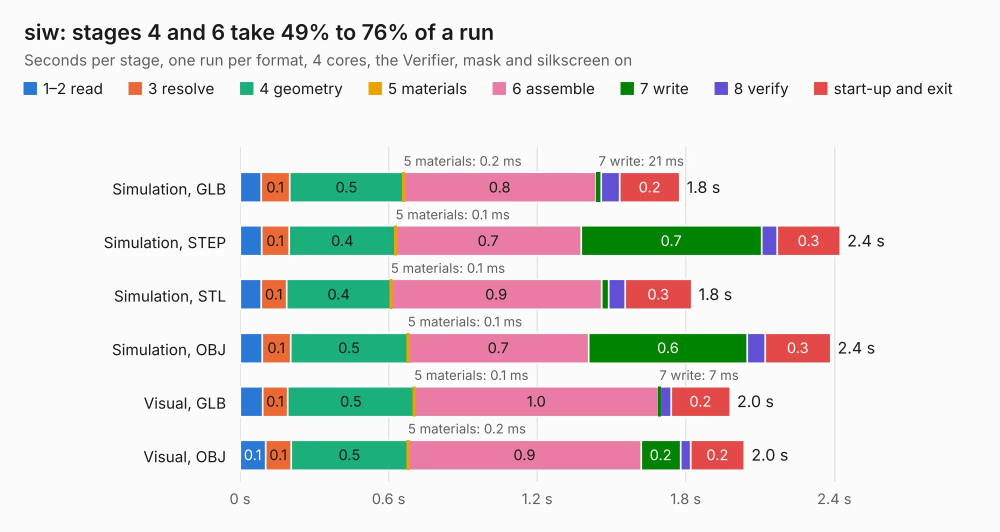

| Mode and format | 1–2 read | 3 resolve | 4 geometry | 5 materials | 6 assemble | 7 write | 8 verify | start-up and exit | Total |
|---|---:|---:|---:|---:|---:|---:|---:|---:|---:|
| Simulation, GLB | 85&nbsp;ms | 0.1 | 0.5 | 0.2&nbsp;ms | 0.8 | 21&nbsp;ms | 75&nbsp;ms | 0.2 | 1.8 |
| Simulation, STEP | 86&nbsp;ms | 0.1 | 0.4 | 0.1&nbsp;ms | 0.7 | 0.7 | 63&nbsp;ms | 0.3 | 2.4 |
| Simulation, STL | 85&nbsp;ms | 0.1 | 0.4 | 0.1&nbsp;ms | 0.9 | 29&nbsp;ms | 66&nbsp;ms | 0.3 | 1.8 |
| Simulation, OBJ | 90&nbsp;ms | 0.1 | 0.5 | 0.1&nbsp;ms | 0.7 | 0.6 | 72&nbsp;ms | 0.3 | 2.4 |
| Visual, GLB | 91&nbsp;ms | 0.1 | 0.5 | 0.1&nbsp;ms | 1.0 | 7&nbsp;ms | 44&nbsp;ms | 0.2 | 2.0 |
| Visual, OBJ | 0.1 | 0.1 | 0.5 | 0.2&nbsp;ms | 0.9 | 0.2 | 41&nbsp;ms | 0.2 | 2.0 |

<table align="center"><tr><td valign="top">

| Board | Repo: [loxodes/vna](https://github.com/loxodes/vna) Board: `siw.kicad_pcb` |
|---|---|
| Folder | breakouts / sw_edge_fr408_oshpark / trl_0402_series |
| Complexity | 110&nbsp;/&nbsp;1000 (size&nbsp;80, features&nbsp;30) |
| KESE&nbsp;features | rounded, trapezoid or chamfered pads, filled zones |
| Tested | 9th November 2026 |
| Copper&nbsp;layers | 4 |
| File&nbsp;format | KiCad 5 (20171130) |
| Parts,&nbsp;tracks,&nbsp;vias | 3, 6, 0 |
| Triangles,&nbsp;simulation | 106,076 in 15 parts |
| Verifier | PASS in all six runs |

</td><td valign="top">

<table>
<tr><th>File type</th><th>File size</th><th>Peak memory used</th></tr>
<tr><th colspan="3" align="left">Simulation</th></tr>
<tr><td>GLB</td><td align="right">3.6&nbsp;MB</td><td align="right">186&nbsp;MB</td></tr>
<tr><td>STEP</td><td align="right">8.5&nbsp;MB</td><td align="right">197&nbsp;MB</td></tr>
<tr><td>STL</td><td align="right">5.3&nbsp;MB</td><td align="right">181&nbsp;MB</td></tr>
<tr><td>OBJ</td><td align="right">9.9&nbsp;MB</td><td align="right">186&nbsp;MB</td></tr>
<tr><th colspan="3" align="left">Visual</th></tr>
<tr><td>GLB</td><td align="right">985&nbsp;kB</td><td align="right">156&nbsp;MB</td></tr>
<tr><td>OBJ</td><td align="right">2.8&nbsp;MB</td><td align="right">156&nbsp;MB</td></tr>
</table>

</td></tr></table>

## 1536. siw

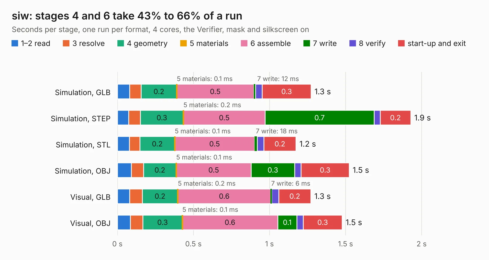

| Mode and format | 1–2 read | 3 resolve | 4 geometry | 5 materials | 6 assemble | 7 write | 8 verify | start-up and exit | Total |
|---|---:|---:|---:|---:|---:|---:|---:|---:|---:|
| Simulation, GLB | 80&nbsp;ms | 76&nbsp;ms | 0.2 | 0.1&nbsp;ms | 0.5 | 12&nbsp;ms | 44&nbsp;ms | 0.3 | 1.3 |
| Simulation, STEP | 74&nbsp;ms | 77&nbsp;ms | 0.3 | 0.2&nbsp;ms | 0.5 | 0.7 | 40&nbsp;ms | 0.2 | 1.9 |
| Simulation, STL | 78&nbsp;ms | 70&nbsp;ms | 0.2 | 0.1&nbsp;ms | 0.5 | 18&nbsp;ms | 44&nbsp;ms | 0.2 | 1.2 |
| Simulation, OBJ | 91&nbsp;ms | 81&nbsp;ms | 0.2 | 0.1&nbsp;ms | 0.5 | 0.3 | 43&nbsp;ms | 0.3 | 1.5 |
| Visual, GLB | 80&nbsp;ms | 83&nbsp;ms | 0.2 | 0.2&nbsp;ms | 0.6 | 6&nbsp;ms | 47&nbsp;ms | 0.2 | 1.3 |
| Visual, OBJ | 85&nbsp;ms | 82&nbsp;ms | 0.3 | 0.1&nbsp;ms | 0.6 | 0.1 | 42&nbsp;ms | 0.3 | 1.5 |

<table align="center"><tr><td valign="top">

| Board | Repo: [loxodes/vna](https://github.com/loxodes/vna) Board: `siw.kicad_pcb` |
|---|---|
| Folder | breakouts / sw_edge_fr408_oshpark / trl_0402_shunt |
| Complexity | 109&nbsp;/&nbsp;1000 (size&nbsp;79, features&nbsp;30) |
| KESE&nbsp;features | rounded, trapezoid or chamfered pads, filled zones |
| Tested | 9th November 2026 |
| Copper&nbsp;layers | 4 |
| File&nbsp;format | KiCad 5 (20171130) |
| Parts,&nbsp;tracks,&nbsp;vias | 2, 7, 0 |
| Triangles,&nbsp;simulation | 63,998 in 14 parts |
| Verifier | PASS in all six runs |

</td><td valign="top">

<table>
<tr><th>File type</th><th>File size</th><th>Peak memory used</th></tr>
<tr><th colspan="3" align="left">Simulation</th></tr>
<tr><td>GLB</td><td align="right">2.2&nbsp;MB</td><td align="right">73&nbsp;MB</td></tr>
<tr><td>STEP</td><td align="right">5.3&nbsp;MB</td><td align="right">176&nbsp;MB</td></tr>
<tr><td>STL</td><td align="right">3.2&nbsp;MB</td><td align="right">74&nbsp;MB</td></tr>
<tr><td>OBJ</td><td align="right">6.0&nbsp;MB</td><td align="right">99&nbsp;MB</td></tr>
<tr><th colspan="3" align="left">Visual</th></tr>
<tr><td>GLB</td><td align="right">760&nbsp;kB</td><td align="right">100&nbsp;MB</td></tr>
<tr><td>OBJ</td><td align="right">2.1&nbsp;MB</td><td align="right">101&nbsp;MB</td></tr>
</table>

</td></tr></table>

## 1537. siw

| Mode and format | 1–2 read | 3 resolve | 4 geometry | 5 materials | 6 assemble | 7 write | 8 verify | start-up and exit | Total |
|---|---:|---:|---:|---:|---:|---:|---:|---:|---:|
| Simulation, GLB | 0.1 | 0.2 | 0.9 | 0.3&nbsp;ms | 0.9 | 53&nbsp;ms | 0.2 | 0.2 | 2.7 |
| Simulation, STEP | 98&nbsp;ms | 0.2 | 0.9 | 0.2&nbsp;ms | 1.0 | 1.1 | 0.1 | 0.2 | 3.7 |
| Simulation, STL | 0.1 | 0.3 | 0.9 | 0.2&nbsp;ms | 1.0 | 70&nbsp;ms | 0.1 | 0.2 | 2.7 |
| Simulation, OBJ | 0.1 | 0.2 | 0.9 | 0.1&nbsp;ms | 0.9 | 1.2 | 0.1 | 0.2 | 3.8 |
| Visual, GLB | 0.1 | 0.3 | 1.0 | 0.1&nbsp;ms | 1.7 | 17&nbsp;ms | 0.1 | 0.2 | 3.4 |
| Visual, OBJ | 0.1 | 0.2 | 0.9 | 0.1&nbsp;ms | 1.7 | 0.5 | 0.1 | 0.3 | 3.8 |

<table align="center"><tr><td valign="top">

| Board | Repo: [loxodes/vna](https://github.com/loxodes/vna) Board: `siw.kicad_pcb` |
|---|---|
| Folder | breakouts / sw_edge_fr408_oshpark / trl_admv |
| Complexity | 214&nbsp;/&nbsp;1000 (size&nbsp;169, features&nbsp;45) |
| KESE&nbsp;features | through vias, rounded, trapezoid or chamfered pads, filled zones |
| Tested | 9th November 2026 |
| Copper&nbsp;layers | 4 |
| File&nbsp;format | KiCad 5 (20171130) |
| Parts,&nbsp;tracks,&nbsp;vias | 5, 98, 2 |
| Triangles,&nbsp;simulation | 276,854 in 19 parts |
| Verifier | PASS in all six runs |

</td><td valign="top">

<table>
<tr><th>File type</th><th>File size</th><th>Peak memory used</th></tr>
<tr><th colspan="3" align="left">Simulation</th></tr>
<tr><td>GLB</td><td align="right">9.5&nbsp;MB</td><td align="right">247&nbsp;MB</td></tr>
<tr><td>STEP</td><td align="right">29&nbsp;MB</td><td align="right">254&nbsp;MB</td></tr>
<tr><td>STL</td><td align="right">14&nbsp;MB</td><td align="right">244&nbsp;MB</td></tr>
<tr><td>OBJ</td><td align="right">27&nbsp;MB</td><td align="right">241&nbsp;MB</td></tr>
<tr><th colspan="3" align="left">Visual</th></tr>
<tr><td>GLB</td><td align="right">4.0&nbsp;MB</td><td align="right">193&nbsp;MB</td></tr>
<tr><td>OBJ</td><td align="right">11&nbsp;MB</td><td align="right">190&nbsp;MB</td></tr>
</table>

</td></tr></table>

## 1538. siw

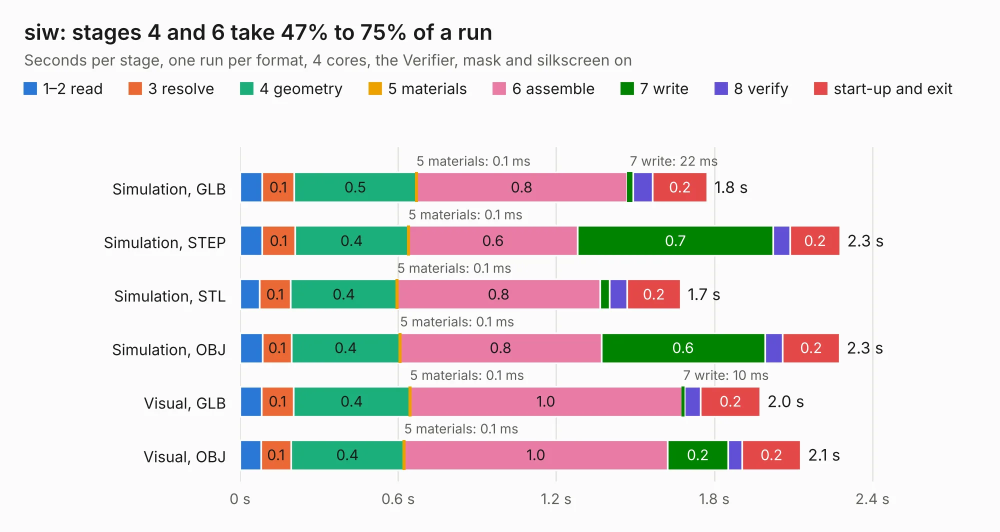

| Mode and format | 1–2 read | 3 resolve | 4 geometry | 5 materials | 6 assemble | 7 write | 8 verify | start-up and exit | Total |
|---|---:|---:|---:|---:|---:|---:|---:|---:|---:|
| Simulation, GLB | 84&nbsp;ms | 0.1 | 0.5 | 0.1&nbsp;ms | 0.8 | 22&nbsp;ms | 76&nbsp;ms | 0.2 | 1.8 |
| Simulation, STEP | 84&nbsp;ms | 0.1 | 0.4 | 0.1&nbsp;ms | 0.6 | 0.7 | 65&nbsp;ms | 0.2 | 2.3 |
| Simulation, STL | 75&nbsp;ms | 0.1 | 0.4 | 0.1&nbsp;ms | 0.8 | 35&nbsp;ms | 68&nbsp;ms | 0.2 | 1.7 |
| Simulation, OBJ | 86&nbsp;ms | 0.1 | 0.4 | 0.1&nbsp;ms | 0.8 | 0.6 | 68&nbsp;ms | 0.2 | 2.3 |
| Visual, GLB | 81&nbsp;ms | 0.1 | 0.4 | 0.1&nbsp;ms | 1.0 | 10&nbsp;ms | 62&nbsp;ms | 0.2 | 2.0 |
| Visual, OBJ | 80&nbsp;ms | 0.1 | 0.4 | 0.1&nbsp;ms | 1.0 | 0.2 | 54&nbsp;ms | 0.2 | 2.1 |

<table align="center"><tr><td valign="top">

| Board | Repo: [loxodes/vna](https://github.com/loxodes/vna) Board: `siw.kicad_pcb` |
|---|---|
| Folder | breakouts / sw_edge_fr408_oshpark / trl_att_hmc |
| Complexity | 114&nbsp;/&nbsp;1000 (size&nbsp;84, features&nbsp;30) |
| KESE&nbsp;features | rounded, trapezoid or chamfered pads, filled zones |
| Tested | 9th November 2026 |
| Copper&nbsp;layers | 4 |
| File&nbsp;format | KiCad 5 (20171130) |
| Parts,&nbsp;tracks,&nbsp;vias | 3, 8, 0 |
| Triangles,&nbsp;simulation | 139,976 in 15 parts |
| Verifier | PASS in all six runs |

</td><td valign="top">

<table>
<tr><th>File type</th><th>File size</th><th>Peak memory used</th></tr>
<tr><th colspan="3" align="left">Simulation</th></tr>
<tr><td>GLB</td><td align="right">4.7&nbsp;MB</td><td align="right">194&nbsp;MB</td></tr>
<tr><td>STEP</td><td align="right">11&nbsp;MB</td><td align="right">203&nbsp;MB</td></tr>
<tr><td>STL</td><td align="right">7.0&nbsp;MB</td><td align="right">194&nbsp;MB</td></tr>
<tr><td>OBJ</td><td align="right">13&nbsp;MB</td><td align="right">194&nbsp;MB</td></tr>
<tr><th colspan="3" align="left">Visual</th></tr>
<tr><td>GLB</td><td align="right">1.6&nbsp;MB</td><td align="right">157&nbsp;MB</td></tr>
<tr><td>OBJ</td><td align="right">4.5&nbsp;MB</td><td align="right">157&nbsp;MB</td></tr>
</table>

</td></tr></table>

## 1539. siw

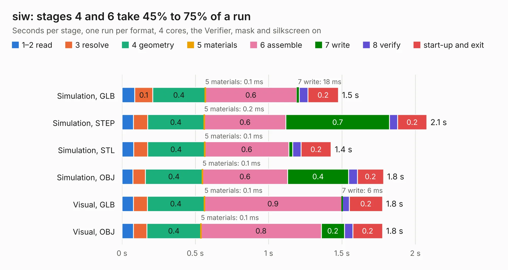

| Mode and format | 1–2 read | 3 resolve | 4 geometry | 5 materials | 6 assemble | 7 write | 8 verify | start-up and exit | Total |
|---|---:|---:|---:|---:|---:|---:|---:|---:|---:|
| Simulation, GLB | 87&nbsp;ms | 0.1 | 0.4 | 0.1&nbsp;ms | 0.6 | 18&nbsp;ms | 59&nbsp;ms | 0.2 | 1.5 |
| Simulation, STEP | 78&nbsp;ms | 97&nbsp;ms | 0.4 | 0.2&nbsp;ms | 0.6 | 0.7 | 55&nbsp;ms | 0.2 | 2.1 |
| Simulation, STL | 80&nbsp;ms | 95&nbsp;ms | 0.4 | 0.1&nbsp;ms | 0.6 | 27&nbsp;ms | 57&nbsp;ms | 0.2 | 1.4 |
| Simulation, OBJ | 74&nbsp;ms | 86&nbsp;ms | 0.4 | 0.1&nbsp;ms | 0.6 | 0.4 | 60&nbsp;ms | 0.2 | 1.8 |
| Visual, GLB | 79&nbsp;ms | 94&nbsp;ms | 0.4 | 0.1&nbsp;ms | 0.9 | 6&nbsp;ms | 46&nbsp;ms | 0.2 | 1.8 |
| Visual, OBJ | 78&nbsp;ms | 92&nbsp;ms | 0.4 | 0.1&nbsp;ms | 0.8 | 0.2 | 57&nbsp;ms | 0.2 | 1.8 |

<table align="center"><tr><td valign="top">

| Board | Repo: [loxodes/vna](https://github.com/loxodes/vna) Board: `siw.kicad_pcb` |
|---|---|
| Folder | breakouts / sw_edge_fr408_oshpark / trl_line_10p5mm |
| Complexity | 107&nbsp;/&nbsp;1000 (size&nbsp;77, features&nbsp;30) |
| KESE&nbsp;features | rounded, trapezoid or chamfered pads, filled zones |
| Tested | 9th November 2026 |
| Copper&nbsp;layers | 4 |
| File&nbsp;format | KiCad 5 (20171130) |
| Parts,&nbsp;tracks,&nbsp;vias | 2, 6, 0 |
| Triangles,&nbsp;simulation | 104,984 in 14 parts |
| Verifier | PASS in all six runs |

</td><td valign="top">

<table>
<tr><th>File type</th><th>File size</th><th>Peak memory used</th></tr>
<tr><th colspan="3" align="left">Simulation</th></tr>
<tr><td>GLB</td><td align="right">3.5&nbsp;MB</td><td align="right">193&nbsp;MB</td></tr>
<tr><td>STEP</td><td align="right">8.3&nbsp;MB</td><td align="right">195&nbsp;MB</td></tr>
<tr><td>STL</td><td align="right">5.3&nbsp;MB</td><td align="right">194&nbsp;MB</td></tr>
<tr><td>OBJ</td><td align="right">9.8&nbsp;MB</td><td align="right">193&nbsp;MB</td></tr>
<tr><th colspan="3" align="left">Visual</th></tr>
<tr><td>GLB</td><td align="right">956&nbsp;kB</td><td align="right">155&nbsp;MB</td></tr>
<tr><td>OBJ</td><td align="right">2.7&nbsp;MB</td><td align="right">154&nbsp;MB</td></tr>
</table>

</td></tr></table>

## 1540. siw

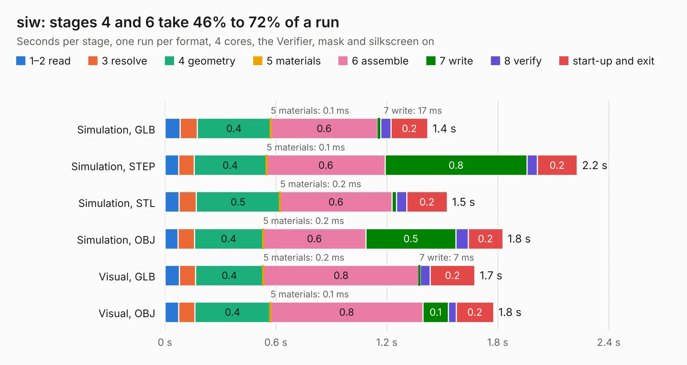

| Mode and format | 1–2 read | 3 resolve | 4 geometry | 5 materials | 6 assemble | 7 write | 8 verify | start-up and exit | Total |
|---|---:|---:|---:|---:|---:|---:|---:|---:|---:|
| Simulation, GLB | 82&nbsp;ms | 93&nbsp;ms | 0.4 | 0.1&nbsp;ms | 0.6 | 17&nbsp;ms | 56&nbsp;ms | 0.2 | 1.4 |
| Simulation, STEP | 75&nbsp;ms | 82&nbsp;ms | 0.4 | 0.1&nbsp;ms | 0.6 | 0.8 | 55&nbsp;ms | 0.2 | 2.2 |
| Simulation, STL | 76&nbsp;ms | 93&nbsp;ms | 0.5 | 0.2&nbsp;ms | 0.6 | 24&nbsp;ms | 57&nbsp;ms | 0.2 | 1.5 |
| Simulation, OBJ | 71&nbsp;ms | 88&nbsp;ms | 0.4 | 0.2&nbsp;ms | 0.6 | 0.5 | 67&nbsp;ms | 0.2 | 1.8 |
| Visual, GLB | 78&nbsp;ms | 88&nbsp;ms | 0.4 | 0.2&nbsp;ms | 0.8 | 7&nbsp;ms | 54&nbsp;ms | 0.2 | 1.7 |
| Visual, OBJ | 75&nbsp;ms | 86&nbsp;ms | 0.4 | 0.1&nbsp;ms | 0.8 | 0.1 | 42&nbsp;ms | 0.2 | 1.8 |

<table align="center"><tr><td valign="top">

| Board | Repo: [loxodes/vna](https://github.com/loxodes/vna) Board: `siw.kicad_pcb` |
|---|---|
| Folder | breakouts / sw_edge_fr408_oshpark / trl_line_20mm |
| Complexity | 105&nbsp;/&nbsp;1000 (size&nbsp;75, features&nbsp;30) |
| KESE&nbsp;features | rounded, trapezoid or chamfered pads, filled zones |
| Tested | 9th November 2026 |
| Copper&nbsp;layers | 4 |
| File&nbsp;format | KiCad 5 (20171130) |
| Parts,&nbsp;tracks,&nbsp;vias | 2, 5, 0 |
| Triangles,&nbsp;simulation | 104,820 in 16 parts |
| Verifier | PASS in all six runs |

</td><td valign="top">

<table>
<tr><th>File type</th><th>File size</th><th>Peak memory used</th></tr>
<tr><th colspan="3" align="left">Simulation</th></tr>
<tr><td>GLB</td><td align="right">3.5&nbsp;MB</td><td align="right">183&nbsp;MB</td></tr>
<tr><td>STEP</td><td align="right">8.3&nbsp;MB</td><td align="right">194&nbsp;MB</td></tr>
<tr><td>STL</td><td align="right">5.2&nbsp;MB</td><td align="right">185&nbsp;MB</td></tr>
<tr><td>OBJ</td><td align="right">9.8&nbsp;MB</td><td align="right">184&nbsp;MB</td></tr>
<tr><th colspan="3" align="left">Visual</th></tr>
<tr><td>GLB</td><td align="right">943&nbsp;kB</td><td align="right">157&nbsp;MB</td></tr>
<tr><td>OBJ</td><td align="right">2.6&nbsp;MB</td><td align="right">157&nbsp;MB</td></tr>
</table>

</td></tr></table>

## 1541. siw

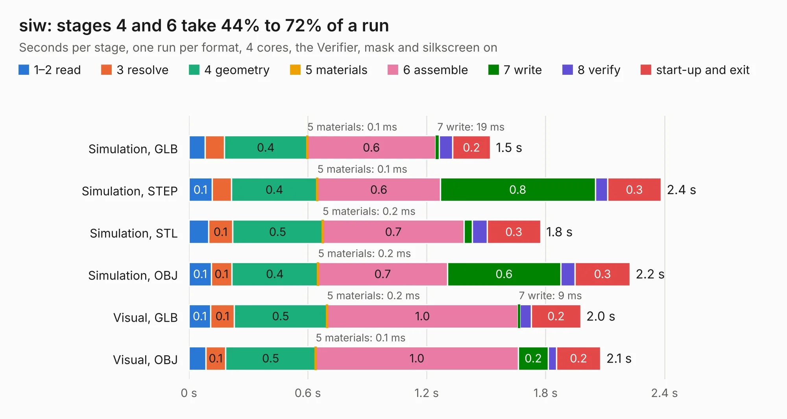

| Mode and format | 1–2 read | 3 resolve | 4 geometry | 5 materials | 6 assemble | 7 write | 8 verify | start-up and exit | Total |
|---|---:|---:|---:|---:|---:|---:|---:|---:|---:|
| Simulation, GLB | 82&nbsp;ms | 97&nbsp;ms | 0.4 | 0.1&nbsp;ms | 0.6 | 19&nbsp;ms | 68&nbsp;ms | 0.2 | 1.5 |
| Simulation, STEP | 0.1 | 98&nbsp;ms | 0.4 | 0.1&nbsp;ms | 0.6 | 0.8 | 63&nbsp;ms | 0.3 | 2.4 |
| Simulation, STL | 98&nbsp;ms | 0.1 | 0.5 | 0.2&nbsp;ms | 0.7 | 40&nbsp;ms | 76&nbsp;ms | 0.3 | 1.8 |
| Simulation, OBJ | 0.1 | 0.1 | 0.4 | 0.2&nbsp;ms | 0.7 | 0.6 | 72&nbsp;ms | 0.3 | 2.2 |
| Visual, GLB | 0.1 | 0.1 | 0.5 | 0.2&nbsp;ms | 1.0 | 9&nbsp;ms | 58&nbsp;ms | 0.2 | 2.0 |
| Visual, OBJ | 85&nbsp;ms | 0.1 | 0.5 | 0.1&nbsp;ms | 1.0 | 0.2 | 41&nbsp;ms | 0.2 | 2.1 |

<table align="center"><tr><td valign="top">

| Board | Repo: [loxodes/vna](https://github.com/loxodes/vna) Board: `siw.kicad_pcb` |
|---|---|
| Folder | breakouts / sw_edge_fr408_oshpark / trl_line_2mm |
| Complexity | 105&nbsp;/&nbsp;1000 (size&nbsp;75, features&nbsp;30) |
| KESE&nbsp;features | rounded, trapezoid or chamfered pads, filled zones |
| Tested | 9th November 2026 |
| Copper&nbsp;layers | 4 |
| File&nbsp;format | KiCad 5 (20171130) |
| Parts,&nbsp;tracks,&nbsp;vias | 2, 5, 0 |
| Triangles,&nbsp;simulation | 104,412 in 16 parts |
| Verifier | PASS in all six runs |

</td><td valign="top">

<table>
<tr><th>File type</th><th>File size</th><th>Peak memory used</th></tr>
<tr><th colspan="3" align="left">Simulation</th></tr>
<tr><td>GLB</td><td align="right">3.5&nbsp;MB</td><td align="right">183&nbsp;MB</td></tr>
<tr><td>STEP</td><td align="right">8.2&nbsp;MB</td><td align="right">195&nbsp;MB</td></tr>
<tr><td>STL</td><td align="right">5.2&nbsp;MB</td><td align="right">184&nbsp;MB</td></tr>
<tr><td>OBJ</td><td align="right">9.7&nbsp;MB</td><td align="right">188&nbsp;MB</td></tr>
<tr><th colspan="3" align="left">Visual</th></tr>
<tr><td>GLB</td><td align="right">932&nbsp;kB</td><td align="right">155&nbsp;MB</td></tr>
<tr><td>OBJ</td><td align="right">2.6&nbsp;MB</td><td align="right">157&nbsp;MB</td></tr>
</table>

</td></tr></table>

## 1542. siw

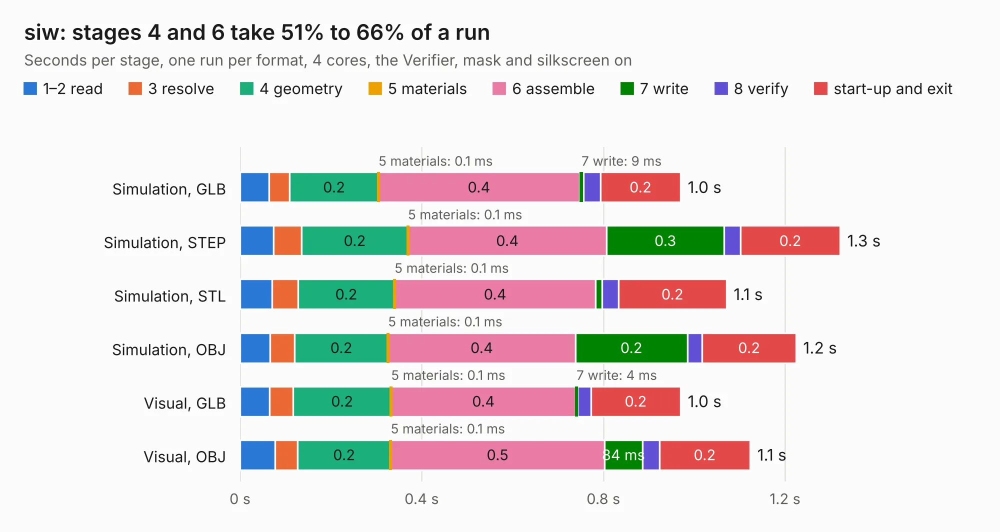

| Mode and format | 1–2 read | 3 resolve | 4 geometry | 5 materials | 6 assemble | 7 write | 8 verify | start-up and exit | Total |
|---|---:|---:|---:|---:|---:|---:|---:|---:|---:|
| Simulation, GLB | 63&nbsp;ms | 46&nbsp;ms | 0.2 | 0.1&nbsp;ms | 0.4 | 9&nbsp;ms | 37&nbsp;ms | 0.2 | 1.0 |
| Simulation, STEP | 74&nbsp;ms | 61&nbsp;ms | 0.2 | 0.1&nbsp;ms | 0.4 | 0.3 | 37&nbsp;ms | 0.2 | 1.3 |
| Simulation, STL | 70&nbsp;ms | 57&nbsp;ms | 0.2 | 0.1&nbsp;ms | 0.4 | 14&nbsp;ms | 36&nbsp;ms | 0.2 | 1.1 |
| Simulation, OBJ | 66&nbsp;ms | 54&nbsp;ms | 0.2 | 0.1&nbsp;ms | 0.4 | 0.2 | 33&nbsp;ms | 0.2 | 1.2 |
| Visual, GLB | 65&nbsp;ms | 52&nbsp;ms | 0.2 | 0.1&nbsp;ms | 0.4 | 4&nbsp;ms | 29&nbsp;ms | 0.2 | 1.0 |
| Visual, OBJ | 77&nbsp;ms | 49&nbsp;ms | 0.2 | 0.1&nbsp;ms | 0.5 | 84&nbsp;ms | 37&nbsp;ms | 0.2 | 1.1 |

<table align="center"><tr><td valign="top">

| Board | Repo: [loxodes/vna](https://github.com/loxodes/vna) Board: `siw.kicad_pcb` |
|---|---|
| Folder | breakouts / sw_edge_fr408_oshpark / trl_reflect |
| Complexity | 97&nbsp;/&nbsp;1000 (size&nbsp;67, features&nbsp;30) |
| KESE&nbsp;features | rounded, trapezoid or chamfered pads, filled zones |
| Tested | 9th November 2026 |
| Copper&nbsp;layers | 4 |
| File&nbsp;format | KiCad 5 (20171130) |
| Parts,&nbsp;tracks,&nbsp;vias | 1, 4, 0 |
| Triangles,&nbsp;simulation | 53,820 in 14 parts |
| Verifier | PASS in all six runs |

</td><td valign="top">

<table>
<tr><th>File type</th><th>File size</th><th>Peak memory used</th></tr>
<tr><th colspan="3" align="left">Simulation</th></tr>
<tr><td>GLB</td><td align="right">1.8&nbsp;MB</td><td align="right">70&nbsp;MB</td></tr>
<tr><td>STEP</td><td align="right">4.3&nbsp;MB</td><td align="right">74&nbsp;MB</td></tr>
<tr><td>STL</td><td align="right">2.7&nbsp;MB</td><td align="right">71&nbsp;MB</td></tr>
<tr><td>OBJ</td><td align="right">5.0&nbsp;MB</td><td align="right">82&nbsp;MB</td></tr>
<tr><th colspan="3" align="left">Visual</th></tr>
<tr><td>GLB</td><td align="right">514&nbsp;kB</td><td align="right">89&nbsp;MB</td></tr>
<tr><td>OBJ</td><td align="right">1.4&nbsp;MB</td><td align="right">90&nbsp;MB</td></tr>
</table>

</td></tr></table>

## 1543. siw

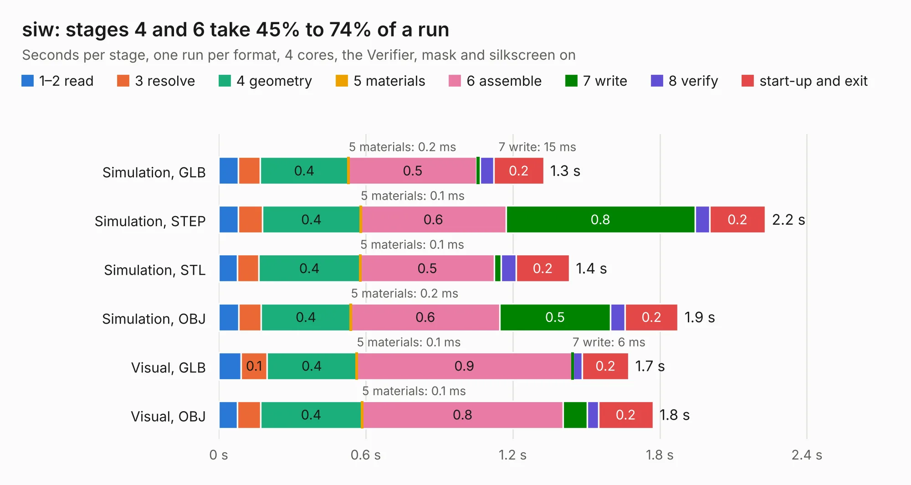

| Mode and format | 1–2 read | 3 resolve | 4 geometry | 5 materials | 6 assemble | 7 write | 8 verify | start-up and exit | Total |
|---|---:|---:|---:|---:|---:|---:|---:|---:|---:|
| Simulation, GLB | 80&nbsp;ms | 88&nbsp;ms | 0.4 | 0.2&nbsp;ms | 0.5 | 15&nbsp;ms | 55&nbsp;ms | 0.2 | 1.3 |
| Simulation, STEP | 80&nbsp;ms | 97&nbsp;ms | 0.4 | 0.1&nbsp;ms | 0.6 | 0.8 | 60&nbsp;ms | 0.2 | 2.2 |
| Simulation, STL | 76&nbsp;ms | 88&nbsp;ms | 0.4 | 0.1&nbsp;ms | 0.5 | 28&nbsp;ms | 60&nbsp;ms | 0.2 | 1.4 |
| Simulation, OBJ | 81&nbsp;ms | 92&nbsp;ms | 0.4 | 0.2&nbsp;ms | 0.6 | 0.5 | 60&nbsp;ms | 0.2 | 1.9 |
| Visual, GLB | 92&nbsp;ms | 0.1 | 0.4 | 0.1&nbsp;ms | 0.9 | 6&nbsp;ms | 37&nbsp;ms | 0.2 | 1.7 |
| Visual, OBJ | 77&nbsp;ms | 93&nbsp;ms | 0.4 | 0.1&nbsp;ms | 0.8 | 98&nbsp;ms | 45&nbsp;ms | 0.2 | 1.8 |

<table align="center"><tr><td valign="top">

| Board | Repo: [loxodes/vna](https://github.com/loxodes/vna) Board: `siw.kicad_pcb` |
|---|---|
| Folder | breakouts / sw_edge_fr408_oshpark / trl_thru |
| Complexity | 102&nbsp;/&nbsp;1000 (size&nbsp;72, features&nbsp;30) |
| KESE&nbsp;features | rounded, trapezoid or chamfered pads, filled zones |
| Tested | 9th November 2026 |
| Copper&nbsp;layers | 4 |
| File&nbsp;format | KiCad 5 (20171130) |
| Parts,&nbsp;tracks,&nbsp;vias | 2, 4, 0 |
| Triangles,&nbsp;simulation | 103,060 in 16 parts |
| Verifier | PASS in all six runs |

</td><td valign="top">

<table>
<tr><th>File type</th><th>File size</th><th>Peak memory used</th></tr>
<tr><th colspan="3" align="left">Simulation</th></tr>
<tr><td>GLB</td><td align="right">3.4&nbsp;MB</td><td align="right">188&nbsp;MB</td></tr>
<tr><td>STEP</td><td align="right">8.0&nbsp;MB</td><td align="right">191&nbsp;MB</td></tr>
<tr><td>STL</td><td align="right">5.2&nbsp;MB</td><td align="right">190&nbsp;MB</td></tr>
<tr><td>OBJ</td><td align="right">9.6&nbsp;MB</td><td align="right">192&nbsp;MB</td></tr>
<tr><th colspan="3" align="left">Visual</th></tr>
<tr><td>GLB</td><td align="right">927&nbsp;kB</td><td align="right">154&nbsp;MB</td></tr>
<tr><td>OBJ</td><td align="right">2.6&nbsp;MB</td><td align="right">155&nbsp;MB</td></tr>
</table>

</td></tr></table>

## 1544. siw

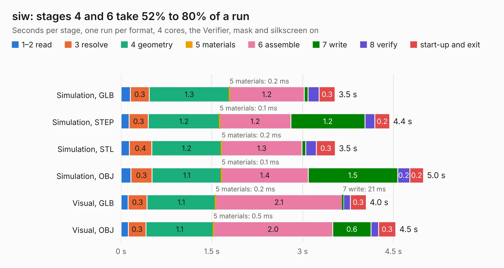

| Mode and format | 1–2 read | 3 resolve | 4 geometry | 5 materials | 6 assemble | 7 write | 8 verify | start-up and exit | Total |
|---|---:|---:|---:|---:|---:|---:|---:|---:|---:|
| Simulation, GLB | 0.2 | 0.3 | 1.3 | 0.2&nbsp;ms | 1.2 | 61&nbsp;ms | 0.2 | 0.3 | 3.5 |
| Simulation, STEP | 0.1 | 0.3 | 1.2 | 0.1&nbsp;ms | 1.2 | 1.2 | 0.2 | 0.2 | 4.4 |
| Simulation, STL | 0.1 | 0.4 | 1.2 | 0.2&nbsp;ms | 1.3 | 62&nbsp;ms | 0.2 | 0.3 | 3.5 |
| Simulation, OBJ | 0.2 | 0.3 | 1.1 | 0.1&nbsp;ms | 1.4 | 1.5 | 0.2 | 0.2 | 5.0 |
| Visual, GLB | 0.1 | 0.3 | 1.1 | 0.2&nbsp;ms | 2.1 | 21&nbsp;ms | 0.1 | 0.3 | 4.0 |
| Visual, OBJ | 0.1 | 0.3 | 1.1 | 0.5&nbsp;ms | 2.0 | 0.6 | 0.1 | 0.3 | 4.5 |

<table align="center"><tr><td valign="top">

| Board | Repo: [loxodes/vna](https://github.com/loxodes/vna) Board: `siw.kicad_pcb` |
|---|---|
| Folder | breakouts / sw_edge_fr408_oshpark / trl_vatt |
| Complexity | 177&nbsp;/&nbsp;1000 (size&nbsp;132, features&nbsp;45) |
| KESE&nbsp;features | through vias, rounded, trapezoid or chamfered pads, filled zones |
| Tested | 9th November 2026 |
| Copper&nbsp;layers | 4 |
| File&nbsp;format | KiCad 5 (20171130) |
| Parts,&nbsp;tracks,&nbsp;vias | 7, 95, 3 |
| Triangles,&nbsp;simulation | 234,680 in 23 parts |
| Verifier | PASS in all six runs |

</td><td valign="top">

<table>
<tr><th>File type</th><th>File size</th><th>Peak memory used</th></tr>
<tr><th colspan="3" align="left">Simulation</th></tr>
<tr><td>GLB</td><td align="right">8.0&nbsp;MB</td><td align="right">214&nbsp;MB</td></tr>
<tr><td>STEP</td><td align="right">25&nbsp;MB</td><td align="right">235&nbsp;MB</td></tr>
<tr><td>STL</td><td align="right">12&nbsp;MB</td><td align="right">215&nbsp;MB</td></tr>
<tr><td>OBJ</td><td align="right">23&nbsp;MB</td><td align="right">214&nbsp;MB</td></tr>
<tr><th colspan="3" align="left">Visual</th></tr>
<tr><td>GLB</td><td align="right">3.3&nbsp;MB</td><td align="right">172&nbsp;MB</td></tr>
<tr><td>OBJ</td><td align="right">9.3&nbsp;MB</td><td align="right">171&nbsp;MB</td></tr>
</table>

</td></tr></table>

## 1545. switch_breakout

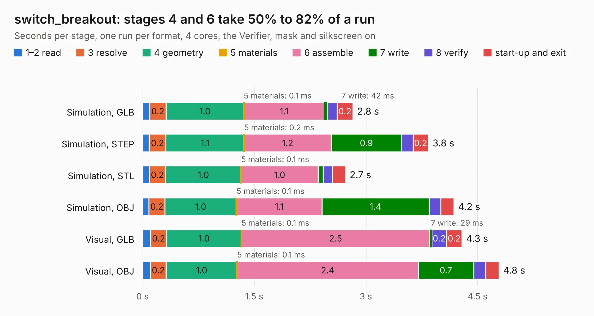

| Mode and format | 1–2 read | 3 resolve | 4 geometry | 5 materials | 6 assemble | 7 write | 8 verify | start-up and exit | Total |
|---|---:|---:|---:|---:|---:|---:|---:|---:|---:|
| Simulation, GLB | 95&nbsp;ms | 0.2 | 1.0 | 0.1&nbsp;ms | 1.1 | 42&nbsp;ms | 0.1 | 0.2 | 2.8 |
| Simulation, STEP | 89&nbsp;ms | 0.2 | 1.1 | 0.2&nbsp;ms | 1.2 | 0.9 | 0.2 | 0.2 | 3.8 |
| Simulation, STL | 90&nbsp;ms | 0.2 | 1.0 | 0.1&nbsp;ms | 1.0 | 70&nbsp;ms | 0.1 | 0.2 | 2.7 |
| Simulation, OBJ | 86&nbsp;ms | 0.2 | 1.0 | 0.1&nbsp;ms | 1.1 | 1.4 | 0.2 | 0.2 | 4.2 |
| Visual, GLB | 0.1 | 0.2 | 1.0 | 0.1&nbsp;ms | 2.5 | 29&nbsp;ms | 0.2 | 0.2 | 4.3 |
| Visual, OBJ | 0.1 | 0.2 | 1.0 | 0.1&nbsp;ms | 2.4 | 0.7 | 0.2 | 0.2 | 4.8 |

<table align="center"><tr><td valign="top">

| Board | Repo: [loxodes/vna](https://github.com/loxodes/vna) Board: `switch_breakout.kicad_pcb` |
|---|---|
| Folder | breakouts / switch_breakout |
| Complexity | 163&nbsp;/&nbsp;1000 (size&nbsp;128, features&nbsp;35) |
| KESE&nbsp;features | through vias, filled zones |
| Tested | 9th November 2026 |
| Copper&nbsp;layers | 4 |
| File&nbsp;format | KiCad 4 (4) |
| Parts,&nbsp;tracks,&nbsp;vias | 10, 54, 4 |
| Triangles,&nbsp;simulation | 371,498 in 22 parts |
| Verifier | PASS in all six runs |

</td><td valign="top">

<table>
<tr><th>File type</th><th>File size</th><th>Peak memory used</th></tr>
<tr><th colspan="3" align="left">Simulation</th></tr>
<tr><td>GLB</td><td align="right">12&nbsp;MB</td><td align="right">279&nbsp;MB</td></tr>
<tr><td>STEP</td><td align="right">35&nbsp;MB</td><td align="right">311&nbsp;MB</td></tr>
<tr><td>STL</td><td align="right">19&nbsp;MB</td><td align="right">279&nbsp;MB</td></tr>
<tr><td>OBJ</td><td align="right">36&nbsp;MB</td><td align="right">280&nbsp;MB</td></tr>
<tr><th colspan="3" align="left">Visual</th></tr>
<tr><td>GLB</td><td align="right">6.2&nbsp;MB</td><td align="right">262&nbsp;MB</td></tr>
<tr><td>OBJ</td><td align="right">18&nbsp;MB</td><td align="right">256&nbsp;MB</td></tr>
</table>

</td></tr></table>

## 1546. synth

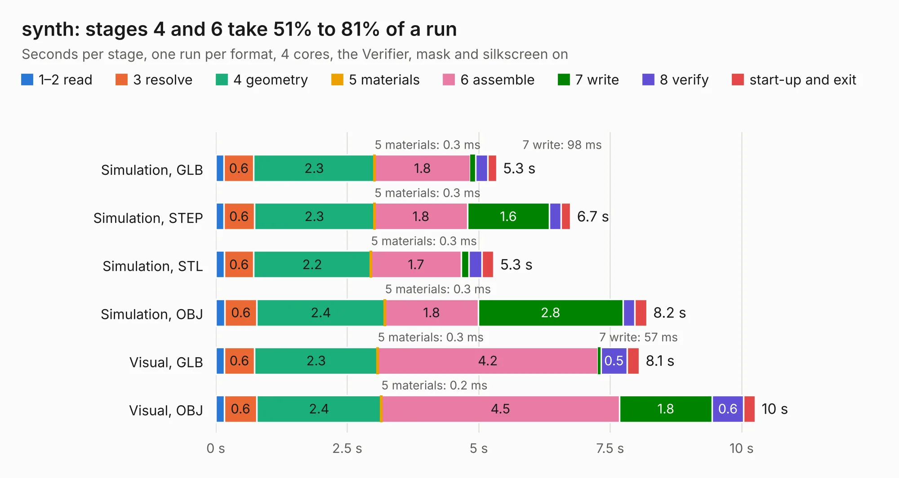

| Mode and format | 1–2 read | 3 resolve | 4 geometry | 5 materials | 6 assemble | 7 write | 8 verify | start-up and exit | Total |
|---|---:|---:|---:|---:|---:|---:|---:|---:|---:|
| Simulation, GLB | 0.2 | 0.6 | 2.3 | 0.3&nbsp;ms | 1.8 | 98&nbsp;ms | 0.2 | 0.2 | 5.3 |
| Simulation, STEP | 0.2 | 0.6 | 2.3 | 0.3&nbsp;ms | 1.8 | 1.6 | 0.2 | 0.2 | 6.7 |
| Simulation, STL | 0.2 | 0.6 | 2.2 | 0.3&nbsp;ms | 1.7 | 0.1 | 0.2 | 0.2 | 5.3 |
| Simulation, OBJ | 0.2 | 0.6 | 2.4 | 0.3&nbsp;ms | 1.8 | 2.8 | 0.2 | 0.2 | 8.2 |
| Visual, GLB | 0.2 | 0.6 | 2.3 | 0.3&nbsp;ms | 4.2 | 57&nbsp;ms | 0.5 | 0.2 | 8.1 |
| Visual, OBJ | 0.2 | 0.6 | 2.4 | 0.2&nbsp;ms | 4.5 | 1.8 | 0.6 | 0.2 | 10.3 |

<table align="center"><tr><td valign="top">

| Board | Repo: [loxodes/vna](https://github.com/loxodes/vna) Board: `synth.kicad_pcb` |
|---|---|
| Folder | breakouts / synth |
| Complexity | 261&nbsp;/&nbsp;1000 (size&nbsp;226, features&nbsp;35) |
| KESE&nbsp;features | through vias, filled zones |
| Tested | 9th November 2026 |
| Copper&nbsp;layers | 4 |
| File&nbsp;format | KiCad 4 (4) |
| Parts,&nbsp;tracks,&nbsp;vias | 79, 391, 73 |
| Triangles,&nbsp;simulation | 656,202 in 59 parts |
| Verifier | PASS in all six runs |

</td><td valign="top">

<table>
<tr><th>File type</th><th>File size</th><th>Peak memory used</th></tr>
<tr><th colspan="3" align="left">Simulation</th></tr>
<tr><td>GLB</td><td align="right">23&nbsp;MB</td><td align="right">339&nbsp;MB</td></tr>
<tr><td>STEP</td><td align="right">88&nbsp;MB</td><td align="right">377&nbsp;MB</td></tr>
<tr><td>STL</td><td align="right">33&nbsp;MB</td><td align="right">352&nbsp;MB</td></tr>
<tr><td>OBJ</td><td align="right">68&nbsp;MB</td><td align="right">467&nbsp;MB</td></tr>
<tr><th colspan="3" align="left">Visual</th></tr>
<tr><td>GLB</td><td align="right">14&nbsp;MB</td><td align="right">389&nbsp;MB</td></tr>
<tr><td>OBJ</td><td align="right">42&nbsp;MB</td><td align="right">389&nbsp;MB</td></tr>
</table>

</td></tr></table>

## 1547. cpw_test

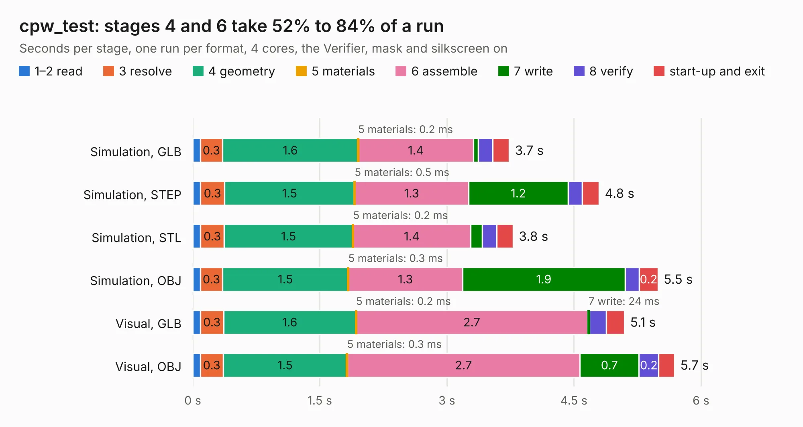

| Mode and format | 1–2 read | 3 resolve | 4 geometry | 5 materials | 6 assemble | 7 write | 8 verify | start-up and exit | Total |
|---|---:|---:|---:|---:|---:|---:|---:|---:|---:|
| Simulation, GLB | 90&nbsp;ms | 0.3 | 1.6 | 0.2&nbsp;ms | 1.4 | 58&nbsp;ms | 0.2 | 0.2 | 3.7 |
| Simulation, STEP | 90&nbsp;ms | 0.3 | 1.5 | 0.5&nbsp;ms | 1.3 | 1.2 | 0.2 | 0.2 | 4.8 |
| Simulation, STL | 92&nbsp;ms | 0.3 | 1.5 | 0.2&nbsp;ms | 1.4 | 0.1 | 0.2 | 0.2 | 3.8 |
| Simulation, OBJ | 90&nbsp;ms | 0.3 | 1.5 | 0.3&nbsp;ms | 1.3 | 1.9 | 0.2 | 0.2 | 5.5 |
| Visual, GLB | 89&nbsp;ms | 0.3 | 1.6 | 0.2&nbsp;ms | 2.7 | 24&nbsp;ms | 0.2 | 0.2 | 5.1 |
| Visual, OBJ | 89&nbsp;ms | 0.3 | 1.5 | 0.3&nbsp;ms | 2.7 | 0.7 | 0.2 | 0.2 | 5.7 |

<table align="center"><tr><td valign="top">

| Board | Repo: [loxodes/vna](https://github.com/loxodes/vna) Board: `cpw_test.kicad_pcb` |
|---|---|
| Folder | breakouts / ufl_test |
| Complexity | 133&nbsp;/&nbsp;1000 (size&nbsp;98, features&nbsp;35) |
| KESE&nbsp;features | through vias, filled zones |
| Tested | 9th November 2026 |
| Copper&nbsp;layers | 4 |
| File&nbsp;format | KiCad 4 (4) |
| Parts,&nbsp;tracks,&nbsp;vias | 2, 6, 6 |
| Triangles,&nbsp;simulation | 453,202 in 13 parts |
| Verifier | PASS in all six runs |

</td><td valign="top">

<table>
<tr><th>File type</th><th>File size</th><th>Peak memory used</th></tr>
<tr><th colspan="3" align="left">Simulation</th></tr>
<tr><td>GLB</td><td align="right">15&nbsp;MB</td><td align="right">322&nbsp;MB</td></tr>
<tr><td>STEP</td><td align="right">41&nbsp;MB</td><td align="right">362&nbsp;MB</td></tr>
<tr><td>STL</td><td align="right">23&nbsp;MB</td><td align="right">318&nbsp;MB</td></tr>
<tr><td>OBJ</td><td align="right">45&nbsp;MB</td><td align="right">356&nbsp;MB</td></tr>
<tr><th colspan="3" align="left">Visual</th></tr>
<tr><td>GLB</td><td align="right">6.0&nbsp;MB</td><td align="right">257&nbsp;MB</td></tr>
<tr><td>OBJ</td><td align="right">17&nbsp;MB</td><td align="right">256&nbsp;MB</td></tr>
</table>

</td></tr></table>

## 1548. usb_pd

| Mode and format | 1–2 read | 3 resolve | 4 geometry | 5 materials | 6 assemble | 7 write | 8 verify | start-up and exit | Total |
|---|---:|---:|---:|---:|---:|---:|---:|---:|---:|
| Simulation, GLB | 0.2 | 0.3 | 0.9 | 0.2&nbsp;ms | 0.8 | 37&nbsp;ms | 0.1 | 0.2 | 2.5 |
| Simulation, STEP | 0.2 | 0.3 | 0.8 | 0.2&nbsp;ms | 1.0 | 1.1 | 0.1 | 0.2 | 3.7 |
| Simulation, STL | 0.2 | 0.3 | 0.9 | 0.3&nbsp;ms | 0.9 | 70&nbsp;ms | 0.1 | 0.2 | 2.7 |
| Simulation, OBJ | 0.2 | 0.3 | 0.9 | 0.4&nbsp;ms | 0.9 | 1.4 | 0.1 | 0.2 | 3.9 |
| Visual, GLB | 0.2 | 0.3 | 1.0 | 0.2&nbsp;ms | 2.2 | 31&nbsp;ms | 0.2 | 0.2 | 4.1 |
| Visual, OBJ | 0.1 | 0.3 | 0.9 | 0.2&nbsp;ms | 2.3 | 0.9 | 0.3 | 0.2 | 5.0 |

<table align="center"><tr><td valign="top">

| Board | Repo: [loxodes/vna](https://github.com/loxodes/vna) Board: `usb_pd.kicad_pcb` |
|---|---|
| Folder | breakouts / usb_pd / usb_pd |
| Complexity | 263&nbsp;/&nbsp;1000 (size&nbsp;163, features&nbsp;100) |
| KESE&nbsp;features | through vias, slotted holes, rounded, trapezoid or chamfered pads, filled zones, curved board outline, stack-up, dielectric εr and tanδ, mask and silkscreen colours |
| Tested | 9th November 2026 |
| Copper&nbsp;layers | 4 |
| File&nbsp;format | KiCad 6 (20210606) |
| Parts,&nbsp;tracks,&nbsp;vias | 29, 149, 43 |
| Triangles,&nbsp;simulation | 294,948 in 34 parts |
| Verifier | PASS in all six runs |

</td><td valign="top">

<table>
<tr><th>File type</th><th>File size</th><th>Peak memory used</th></tr>
<tr><th colspan="3" align="left">Simulation</th></tr>
<tr><td>GLB</td><td align="right">9.9&nbsp;MB</td><td align="right">232&nbsp;MB</td></tr>
<tr><td>STEP</td><td align="right">39&nbsp;MB</td><td align="right">270&nbsp;MB</td></tr>
<tr><td>STL</td><td align="right">15&nbsp;MB</td><td align="right">245&nbsp;MB</td></tr>
<tr><td>OBJ</td><td align="right">29&nbsp;MB</td><td align="right">258&nbsp;MB</td></tr>
<tr><th colspan="3" align="left">Visual</th></tr>
<tr><td>GLB</td><td align="right">7.0&nbsp;MB</td><td align="right">240&nbsp;MB</td></tr>
<tr><td>OBJ</td><td align="right">20&nbsp;MB</td><td align="right">237&nbsp;MB</td></tr>
</table>

</td></tr></table>

## 1549. demod_module

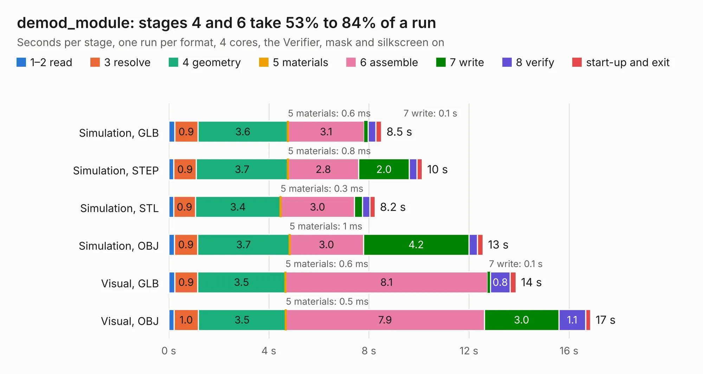

| Mode and format | 1–2 read | 3 resolve | 4 geometry | 5 materials | 6 assemble | 7 write | 8 verify | start-up and exit | Total |
|---|---:|---:|---:|---:|---:|---:|---:|---:|---:|
| Simulation, GLB | 0.2 | 0.9 | 3.6 | 0.6&nbsp;ms | 3.1 | 0.1 | 0.3 | 0.2 | 8.5 |
| Simulation, STEP | 0.2 | 0.9 | 3.7 | 0.8&nbsp;ms | 2.8 | 2.0 | 0.3 | 0.2 | 10.1 |
| Simulation, STL | 0.2 | 0.9 | 3.4 | 0.3&nbsp;ms | 3.0 | 0.3 | 0.3 | 0.2 | 8.2 |
| Simulation, OBJ | 0.2 | 0.9 | 3.7 | 1&nbsp;ms | 3.0 | 4.2 | 0.3 | 0.2 | 12.6 |
| Visual, GLB | 0.2 | 0.9 | 3.5 | 0.6&nbsp;ms | 8.1 | 0.1 | 0.8 | 0.2 | 13.9 |
| Visual, OBJ | 0.2 | 1.0 | 3.5 | 0.5&nbsp;ms | 7.9 | 3.0 | 1.1 | 0.2 | 16.9 |

<table align="center"><tr><td valign="top">

| Board | Repo: [loxodes/vna](https://github.com/loxodes/vna) Board: `demod_module.kicad_pcb` |
|---|---|
| Folder | hardware / archive / demod_module |
| Complexity | 279&nbsp;/&nbsp;1000 (size&nbsp;234, features&nbsp;45) |
| KESE&nbsp;features | through vias, filled zones, curved board outline |
| Tested | 9th November 2026 |
| Copper&nbsp;layers | 4 |
| File&nbsp;format | KiCad 4 (4) |
| Parts,&nbsp;tracks,&nbsp;vias | 99, 554, 95 |
| Triangles,&nbsp;simulation | 1,061,928 in 84 parts |
| Verifier | PASS in all six runs |

</td><td valign="top">

<table>
<tr><th>File type</th><th>File size</th><th>Peak memory used</th></tr>
<tr><th colspan="3" align="left">Simulation</th></tr>
<tr><td>GLB</td><td align="right">37&nbsp;MB</td><td align="right">478&nbsp;MB</td></tr>
<tr><td>STEP</td><td align="right">131&nbsp;MB</td><td align="right">540&nbsp;MB</td></tr>
<tr><td>STL</td><td align="right">53&nbsp;MB</td><td align="right">464&nbsp;MB</td></tr>
<tr><td>OBJ</td><td align="right">109&nbsp;MB</td><td align="right">756&nbsp;MB</td></tr>
<tr><th colspan="3" align="left">Visual</th></tr>
<tr><td>GLB</td><td align="right">24&nbsp;MB</td><td align="right">548&nbsp;MB</td></tr>
<tr><td>OBJ</td><td align="right">71&nbsp;MB</td><td align="right">550&nbsp;MB</td></tr>
</table>

</td></tr></table>

## 1550. doubler_switch

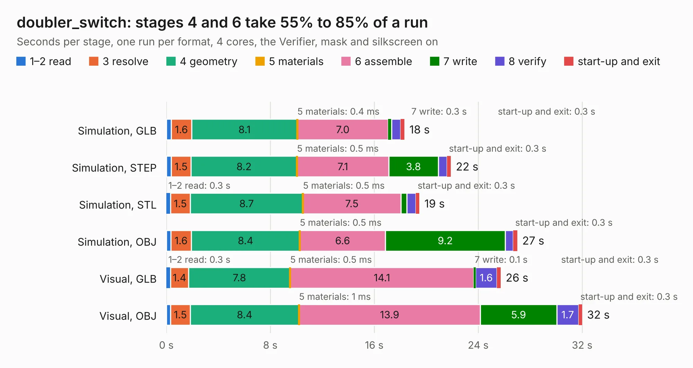

| Mode and format | 1–2 read | 3 resolve | 4 geometry | 5 materials | 6 assemble | 7 write | 8 verify | start-up and exit | Total |
|---|---:|---:|---:|---:|---:|---:|---:|---:|---:|
| Simulation, GLB | 0.4 | 1.6 | 8.1 | 0.4&nbsp;ms | 7.0 | 0.3 | 0.7 | 0.3 | 18.3 |
| Simulation, STEP | 0.4 | 1.5 | 8.2 | 0.5&nbsp;ms | 7.1 | 3.8 | 0.7 | 0.3 | 21.9 |
| Simulation, STL | 0.3 | 1.5 | 8.7 | 0.5&nbsp;ms | 7.5 | 0.5 | 0.7 | 0.3 | 19.5 |
| Simulation, OBJ | 0.3 | 1.6 | 8.4 | 0.5&nbsp;ms | 6.6 | 9.2 | 0.6 | 0.3 | 27.0 |
| Visual, GLB | 0.3 | 1.4 | 7.8 | 0.5&nbsp;ms | 14.1 | 0.1 | 1.6 | 0.3 | 25.7 |
| Visual, OBJ | 0.3 | 1.5 | 8.4 | 1&nbsp;ms | 13.9 | 5.9 | 1.7 | 0.3 | 32.0 |

<table align="center"><tr><td valign="top">

| Board | Repo: [loxodes/vna](https://github.com/loxodes/vna) Board: `doubler_switch.kicad_pcb` |
|---|---|
| Folder | hardware / archive / doubler_switch |
| Complexity | 215&nbsp;/&nbsp;1000 (size&nbsp;180, features&nbsp;35) |
| KESE&nbsp;features | through vias, filled zones |
| Tested | 9th November 2026 |
| Copper&nbsp;layers | 4 |
| File&nbsp;format | KiCad 4 (4) |
| Parts,&nbsp;tracks,&nbsp;vias | 50, 457, 42 |
| Triangles,&nbsp;simulation | 1,500,280 in 54 parts |
| Verifier | PASS in all six runs |

</td><td valign="top">

<table>
<tr><th>File type</th><th>File size</th><th>Peak memory used</th></tr>
<tr><th colspan="3" align="left">Simulation</th></tr>
<tr><td>GLB</td><td align="right">51&nbsp;MB</td><td align="right">641&nbsp;MB</td></tr>
<tr><td>STEP</td><td align="right">171&nbsp;MB</td><td align="right">725&nbsp;MB</td></tr>
<tr><td>STL</td><td align="right">75&nbsp;MB</td><td align="right">653&nbsp;MB</td></tr>
<tr><td>OBJ</td><td align="right">154&nbsp;MB</td><td align="right">994&nbsp;MB</td></tr>
<tr><th colspan="3" align="left">Visual</th></tr>
<tr><td>GLB</td><td align="right">31&nbsp;MB</td><td align="right">747&nbsp;MB</td></tr>
<tr><td>OBJ</td><td align="right">93&nbsp;MB</td><td align="right">695&nbsp;MB</td></tr>
</table>

</td></tr></table>

## 1551. frequency_synth

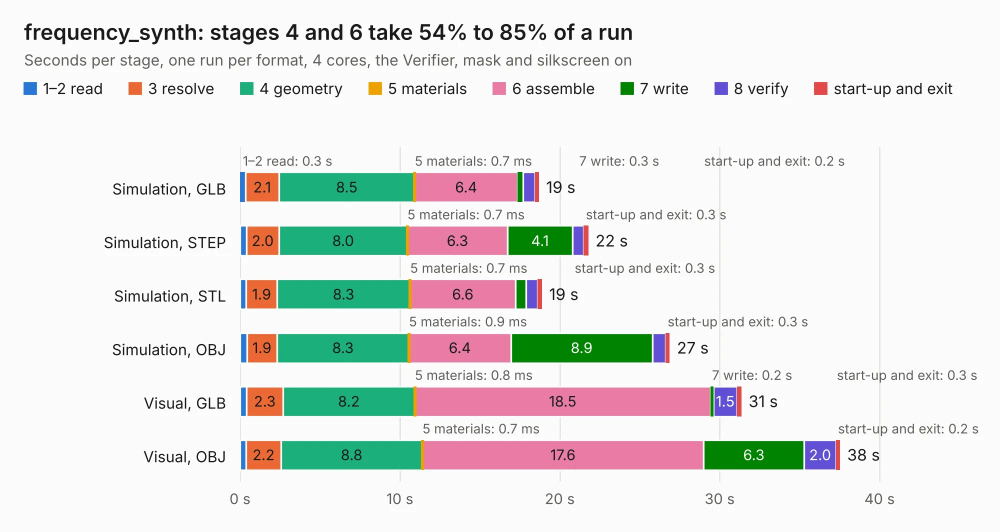

| Mode and format | 1–2 read | 3 resolve | 4 geometry | 5 materials | 6 assemble | 7 write | 8 verify | start-up and exit | Total |
|---|---:|---:|---:|---:|---:|---:|---:|---:|---:|
| Simulation, GLB | 0.3 | 2.1 | 8.5 | 0.7&nbsp;ms | 6.4 | 0.3 | 0.8 | 0.2 | 18.7 |
| Simulation, STEP | 0.4 | 2.0 | 8.0 | 0.7&nbsp;ms | 6.3 | 4.1 | 0.7 | 0.3 | 21.8 |
| Simulation, STL | 0.4 | 1.9 | 8.3 | 0.7&nbsp;ms | 6.6 | 0.7 | 0.7 | 0.3 | 18.9 |
| Simulation, OBJ | 0.4 | 1.9 | 8.3 | 0.9&nbsp;ms | 6.4 | 8.9 | 0.8 | 0.3 | 26.9 |
| Visual, GLB | 0.4 | 2.3 | 8.2 | 0.8&nbsp;ms | 18.5 | 0.2 | 1.5 | 0.3 | 31.4 |
| Visual, OBJ | 0.4 | 2.2 | 8.8 | 0.7&nbsp;ms | 17.6 | 6.3 | 2.0 | 0.2 | 37.5 |

<table align="center"><tr><td valign="top">

| Board | Repo: [loxodes/vna](https://github.com/loxodes/vna) Board: `frequency_synth.kicad_pcb` |
|---|---|
| Folder | hardware / archive / frequency_synth |
| Complexity | 297&nbsp;/&nbsp;1000 (size&nbsp;252, features&nbsp;45) |
| KESE&nbsp;features | through vias, filled zones, curved board outline |
| Tested | 9th November 2026 |
| Copper&nbsp;layers | 4 |
| File&nbsp;format | KiCad 4 (4) |
| Parts,&nbsp;tracks,&nbsp;vias | 159, 1,274, 215 |
| Triangles,&nbsp;simulation | 1,978,440 in 151 parts |
| Verifier | PASS in all six runs |

</td><td valign="top">

<table>
<tr><th>File type</th><th>File size</th><th>Peak memory used</th></tr>
<tr><th colspan="3" align="left">Simulation</th></tr>
<tr><td>GLB</td><td align="right">69&nbsp;MB</td><td align="right">670&nbsp;MB</td></tr>
<tr><td>STEP</td><td align="right">252&nbsp;MB</td><td align="right">878&nbsp;MB</td></tr>
<tr><td>STL</td><td align="right">99&nbsp;MB</td><td align="right">712&nbsp;MB</td></tr>
<tr><td>OBJ</td><td align="right">209&nbsp;MB</td><td align="right">1.4&nbsp;GB</td></tr>
<tr><th colspan="3" align="left">Visual</th></tr>
<tr><td>GLB</td><td align="right">42&nbsp;MB</td><td align="right">827&nbsp;MB</td></tr>
<tr><td>OBJ</td><td align="right">128&nbsp;MB</td><td align="right">936&nbsp;MB</td></tr>
</table>

</td></tr></table>

## 1552. trl_line

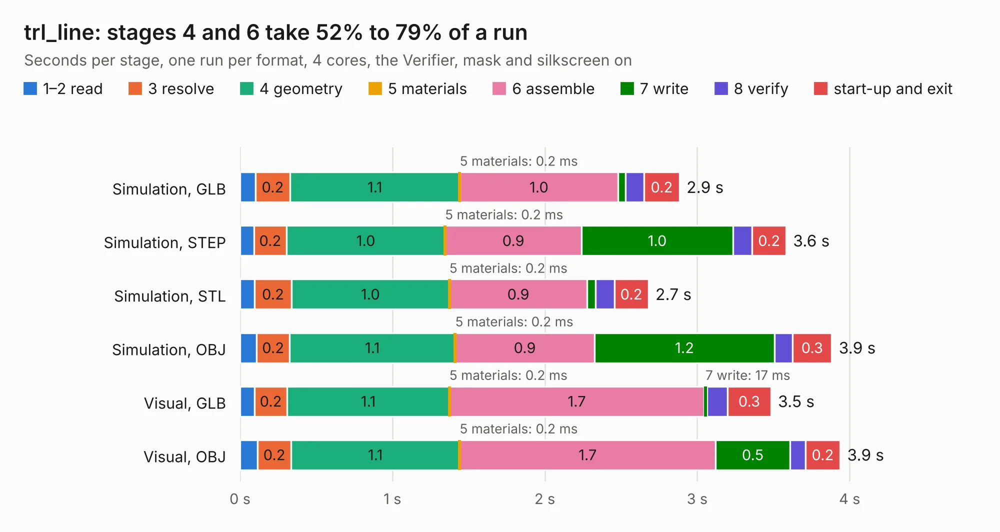

| Mode and format | 1–2 read | 3 resolve | 4 geometry | 5 materials | 6 assemble | 7 write | 8 verify | start-up and exit | Total |
|---|---:|---:|---:|---:|---:|---:|---:|---:|---:|
| Simulation, GLB | 0.1 | 0.2 | 1.1 | 0.2&nbsp;ms | 1.0 | 48&nbsp;ms | 0.1 | 0.2 | 2.9 |
| Simulation, STEP | 91&nbsp;ms | 0.2 | 1.0 | 0.2&nbsp;ms | 0.9 | 1.0 | 0.1 | 0.2 | 3.6 |
| Simulation, STL | 95&nbsp;ms | 0.2 | 1.0 | 0.2&nbsp;ms | 0.9 | 54&nbsp;ms | 0.1 | 0.2 | 2.7 |
| Simulation, OBJ | 0.1 | 0.2 | 1.1 | 0.2&nbsp;ms | 0.9 | 1.2 | 0.1 | 0.3 | 3.9 |
| Visual, GLB | 94&nbsp;ms | 0.2 | 1.1 | 0.2&nbsp;ms | 1.7 | 17&nbsp;ms | 0.1 | 0.3 | 3.5 |
| Visual, OBJ | 0.1 | 0.2 | 1.1 | 0.2&nbsp;ms | 1.7 | 0.5 | 0.1 | 0.2 | 3.9 |

<table align="center"><tr><td valign="top">

| Board | Repo: [loxodes/vna](https://github.com/loxodes/vna) Board: `trl_line.kicad_pcb` |
|---|---|
| Folder | hardware / archive / oshpark_4layer_trl_cal / cap_0201 |
| Complexity | 86&nbsp;/&nbsp;1000 (size&nbsp;66, features&nbsp;20) |
| KESE&nbsp;features | filled zones |
| Tested | 9th November 2026 |
| Copper&nbsp;layers | 4 |
| File&nbsp;format | KiCad 4 (4) |
| Parts,&nbsp;tracks,&nbsp;vias | 3, 2, 0 |
| Triangles,&nbsp;simulation | 227,180 in 15 parts |
| Verifier | PASS in all six runs |

</td><td valign="top">

<table>
<tr><th>File type</th><th>File size</th><th>Peak memory used</th></tr>
<tr><th colspan="3" align="left">Simulation</th></tr>
<tr><td>GLB</td><td align="right">7.5&nbsp;MB</td><td align="right">223&nbsp;MB</td></tr>
<tr><td>STEP</td><td align="right">22&nbsp;MB</td><td align="right">226&nbsp;MB</td></tr>
<tr><td>STL</td><td align="right">11&nbsp;MB</td><td align="right">231&nbsp;MB</td></tr>
<tr><td>OBJ</td><td align="right">22&nbsp;MB</td><td align="right">234&nbsp;MB</td></tr>
<tr><th colspan="3" align="left">Visual</th></tr>
<tr><td>GLB</td><td align="right">3.2&nbsp;MB</td><td align="right">167&nbsp;MB</td></tr>
<tr><td>OBJ</td><td align="right">9.0&nbsp;MB</td><td align="right">167&nbsp;MB</td></tr>
</table>

</td></tr></table>

## 1553. trl_line

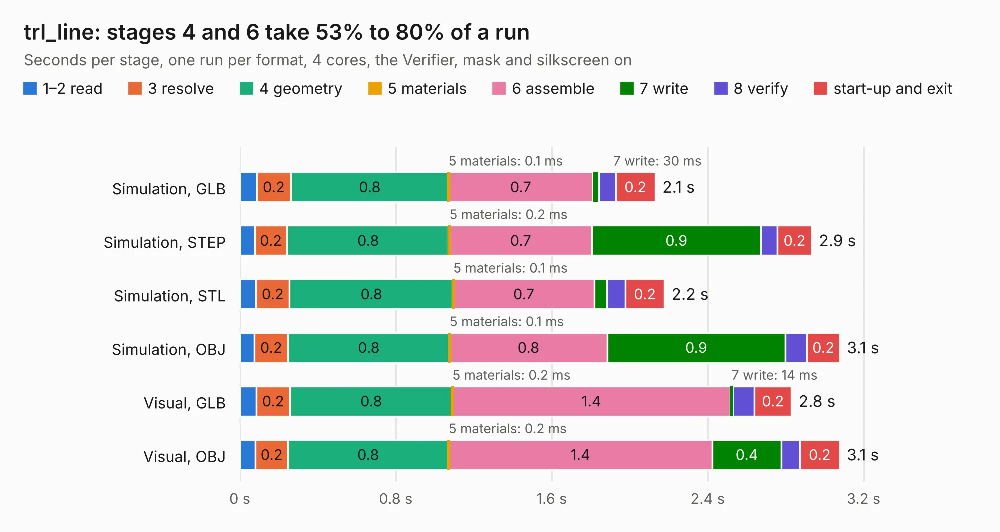

| Mode and format | 1–2 read | 3 resolve | 4 geometry | 5 materials | 6 assemble | 7 write | 8 verify | start-up and exit | Total |
|---|---:|---:|---:|---:|---:|---:|---:|---:|---:|
| Simulation, GLB | 86&nbsp;ms | 0.2 | 0.8 | 0.1&nbsp;ms | 0.7 | 30&nbsp;ms | 87&nbsp;ms | 0.2 | 2.1 |
| Simulation, STEP | 77&nbsp;ms | 0.2 | 0.8 | 0.2&nbsp;ms | 0.7 | 0.9 | 84&nbsp;ms | 0.2 | 2.9 |
| Simulation, STL | 83&nbsp;ms | 0.2 | 0.8 | 0.1&nbsp;ms | 0.7 | 65&nbsp;ms | 95&nbsp;ms | 0.2 | 2.2 |
| Simulation, OBJ | 75&nbsp;ms | 0.2 | 0.8 | 0.1&nbsp;ms | 0.8 | 0.9 | 0.1 | 0.2 | 3.1 |
| Visual, GLB | 84&nbsp;ms | 0.2 | 0.8 | 0.2&nbsp;ms | 1.4 | 14&nbsp;ms | 0.1 | 0.2 | 2.8 |
| Visual, OBJ | 81&nbsp;ms | 0.2 | 0.8 | 0.2&nbsp;ms | 1.4 | 0.4 | 94&nbsp;ms | 0.2 | 3.1 |

<table align="center"><tr><td valign="top">

| Board | Repo: [loxodes/vna](https://github.com/loxodes/vna) Board: `trl_line.kicad_pcb` |
|---|---|
| Folder | hardware / archive / oshpark_4layer_trl_cal / cap_0402 |
| Complexity | 86&nbsp;/&nbsp;1000 (size&nbsp;66, features&nbsp;20) |
| KESE&nbsp;features | filled zones |
| Tested | 9th November 2026 |
| Copper&nbsp;layers | 4 |
| File&nbsp;format | KiCad 4 (4) |
| Parts,&nbsp;tracks,&nbsp;vias | 3, 2, 0 |
| Triangles,&nbsp;simulation | 226,556 in 15 parts |
| Verifier | PASS in all six runs |

</td><td valign="top">

<table>
<tr><th>File type</th><th>File size</th><th>Peak memory used</th></tr>
<tr><th colspan="3" align="left">Simulation</th></tr>
<tr><td>GLB</td><td align="right">7.5&nbsp;MB</td><td align="right">234&nbsp;MB</td></tr>
<tr><td>STEP</td><td align="right">22&nbsp;MB</td><td align="right">238&nbsp;MB</td></tr>
<tr><td>STL</td><td align="right">11&nbsp;MB</td><td align="right">233&nbsp;MB</td></tr>
<tr><td>OBJ</td><td align="right">22&nbsp;MB</td><td align="right">220&nbsp;MB</td></tr>
<tr><th colspan="3" align="left">Visual</th></tr>
<tr><td>GLB</td><td align="right">3.2&nbsp;MB</td><td align="right">168&nbsp;MB</td></tr>
<tr><td>OBJ</td><td align="right">9.0&nbsp;MB</td><td align="right">167&nbsp;MB</td></tr>
</table>

</td></tr></table>

## 1554. trl_line

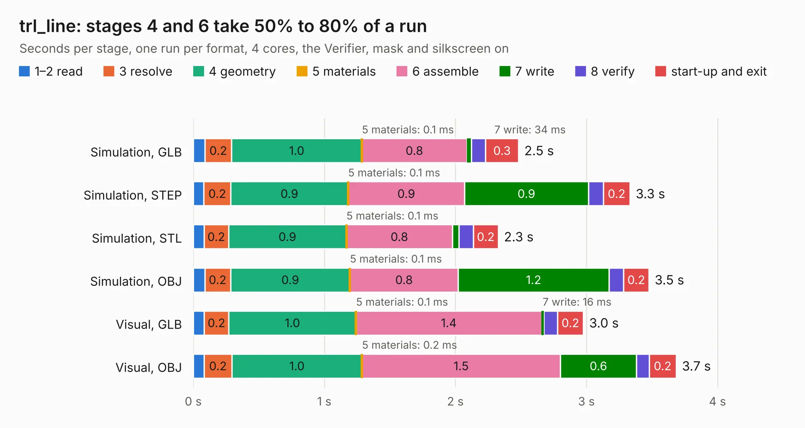

| Mode and format | 1–2 read | 3 resolve | 4 geometry | 5 materials | 6 assemble | 7 write | 8 verify | start-up and exit | Total |
|---|---:|---:|---:|---:|---:|---:|---:|---:|---:|
| Simulation, GLB | 90&nbsp;ms | 0.2 | 1.0 | 0.1&nbsp;ms | 0.8 | 34&nbsp;ms | 0.1 | 0.3 | 2.5 |
| Simulation, STEP | 81&nbsp;ms | 0.2 | 0.9 | 0.1&nbsp;ms | 0.9 | 0.9 | 0.1 | 0.2 | 3.3 |
| Simulation, STL | 83&nbsp;ms | 0.2 | 0.9 | 0.1&nbsp;ms | 0.8 | 49&nbsp;ms | 0.1 | 0.2 | 2.3 |
| Simulation, OBJ | 88&nbsp;ms | 0.2 | 0.9 | 0.1&nbsp;ms | 0.8 | 1.2 | 0.1 | 0.2 | 3.5 |
| Visual, GLB | 83&nbsp;ms | 0.2 | 1.0 | 0.1&nbsp;ms | 1.4 | 16&nbsp;ms | 0.1 | 0.2 | 3.0 |
| Visual, OBJ | 82&nbsp;ms | 0.2 | 1.0 | 0.2&nbsp;ms | 1.5 | 0.6 | 96&nbsp;ms | 0.2 | 3.7 |

<table align="center"><tr><td valign="top">

| Board | Repo: [loxodes/vna](https://github.com/loxodes/vna) Board: `trl_line.kicad_pcb` |
|---|---|
| Folder | hardware / archive / oshpark_4layer_trl_cal / shunt_0402 |
| Complexity | 136&nbsp;/&nbsp;1000 (size&nbsp;101, features&nbsp;35) |
| KESE&nbsp;features | through vias, filled zones |
| Tested | 9th November 2026 |
| Copper&nbsp;layers | 4 |
| File&nbsp;format | KiCad 4 (4) |
| Parts,&nbsp;tracks,&nbsp;vias | 5, 12, 2 |
| Triangles,&nbsp;simulation | 236,544 in 15 parts |
| Verifier | PASS in all six runs |

</td><td valign="top">

<table>
<tr><th>File type</th><th>File size</th><th>Peak memory used</th></tr>
<tr><th colspan="3" align="left">Simulation</th></tr>
<tr><td>GLB</td><td align="right">7.8&nbsp;MB</td><td align="right">232&nbsp;MB</td></tr>
<tr><td>STEP</td><td align="right">23&nbsp;MB</td><td align="right">239&nbsp;MB</td></tr>
<tr><td>STL</td><td align="right">12&nbsp;MB</td><td align="right">230&nbsp;MB</td></tr>
<tr><td>OBJ</td><td align="right">23&nbsp;MB</td><td align="right">232&nbsp;MB</td></tr>
<tr><th colspan="3" align="left">Visual</th></tr>
<tr><td>GLB</td><td align="right">3.4&nbsp;MB</td><td align="right">171&nbsp;MB</td></tr>
<tr><td>OBJ</td><td align="right">9.6&nbsp;MB</td><td align="right">172&nbsp;MB</td></tr>
</table>

</td></tr></table>

## 1555. trl_line

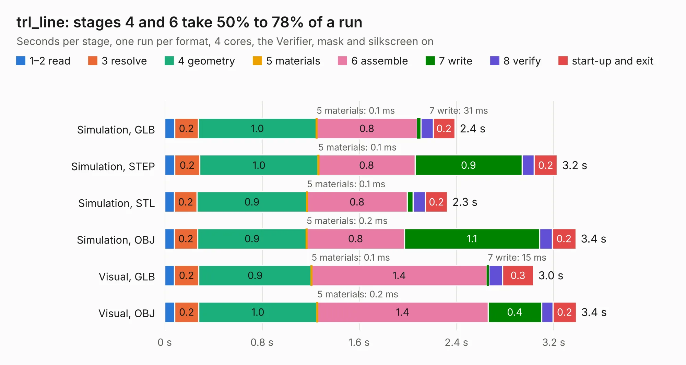

| Mode and format | 1–2 read | 3 resolve | 4 geometry | 5 materials | 6 assemble | 7 write | 8 verify | start-up and exit | Total |
|---|---:|---:|---:|---:|---:|---:|---:|---:|---:|
| Simulation, GLB | 81&nbsp;ms | 0.2 | 1.0 | 0.1&nbsp;ms | 0.8 | 31&nbsp;ms | 0.1 | 0.2 | 2.4 |
| Simulation, STEP | 81&nbsp;ms | 0.2 | 1.0 | 0.1&nbsp;ms | 0.8 | 0.9 | 0.1 | 0.2 | 3.2 |
| Simulation, STL | 80&nbsp;ms | 0.2 | 0.9 | 0.1&nbsp;ms | 0.8 | 51&nbsp;ms | 0.1 | 0.2 | 2.3 |
| Simulation, OBJ | 79&nbsp;ms | 0.2 | 0.9 | 0.2&nbsp;ms | 0.8 | 1.1 | 0.1 | 0.2 | 3.4 |
| Visual, GLB | 79&nbsp;ms | 0.2 | 0.9 | 0.1&nbsp;ms | 1.4 | 15&nbsp;ms | 0.1 | 0.3 | 3.0 |
| Visual, OBJ | 82&nbsp;ms | 0.2 | 1.0 | 0.2&nbsp;ms | 1.4 | 0.4 | 93&nbsp;ms | 0.2 | 3.4 |

<table align="center"><tr><td valign="top">

| Board | Repo: [loxodes/vna](https://github.com/loxodes/vna) Board: `trl_line.kicad_pcb` |
|---|---|
| Folder | hardware / archive / oshpark_4layer_trl_cal / trl_line |
| Complexity | 77&nbsp;/&nbsp;1000 (size&nbsp;57, features&nbsp;20) |
| KESE&nbsp;features | filled zones |
| Tested | 9th November 2026 |
| Copper&nbsp;layers | 4 |
| File&nbsp;format | KiCad 4 (4) |
| Parts,&nbsp;tracks,&nbsp;vias | 2, 1, 0 |
| Triangles,&nbsp;simulation | 227,780 in 14 parts |
| Verifier | PASS in all six runs |

</td><td valign="top">

<table>
<tr><th>File type</th><th>File size</th><th>Peak memory used</th></tr>
<tr><th colspan="3" align="left">Simulation</th></tr>
<tr><td>GLB</td><td align="right">7.5&nbsp;MB</td><td align="right">233&nbsp;MB</td></tr>
<tr><td>STEP</td><td align="right">22&nbsp;MB</td><td align="right">229&nbsp;MB</td></tr>
<tr><td>STL</td><td align="right">11&nbsp;MB</td><td align="right">224&nbsp;MB</td></tr>
<tr><td>OBJ</td><td align="right">22&nbsp;MB</td><td align="right">225&nbsp;MB</td></tr>
<tr><th colspan="3" align="left">Visual</th></tr>
<tr><td>GLB</td><td align="right">3.2&nbsp;MB</td><td align="right">169&nbsp;MB</td></tr>
<tr><td>OBJ</td><td align="right">9.1&nbsp;MB</td><td align="right">168&nbsp;MB</td></tr>
</table>

</td></tr></table>

## 1556. trl_reflect

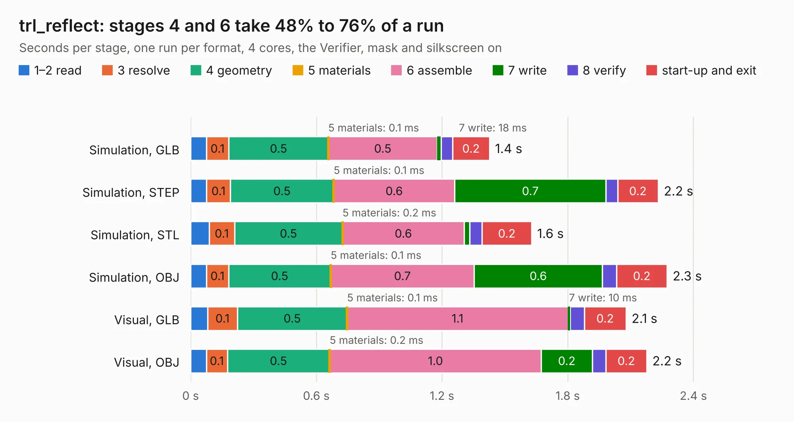

| Mode and format | 1–2 read | 3 resolve | 4 geometry | 5 materials | 6 assemble | 7 write | 8 verify | start-up and exit | Total |
|---|---:|---:|---:|---:|---:|---:|---:|---:|---:|
| Simulation, GLB | 75&nbsp;ms | 0.1 | 0.5 | 0.1&nbsp;ms | 0.5 | 18&nbsp;ms | 56&nbsp;ms | 0.2 | 1.4 |
| Simulation, STEP | 76&nbsp;ms | 0.1 | 0.5 | 0.1&nbsp;ms | 0.6 | 0.7 | 56&nbsp;ms | 0.2 | 2.2 |
| Simulation, STL | 88&nbsp;ms | 0.1 | 0.5 | 0.2&nbsp;ms | 0.6 | 26&nbsp;ms | 60&nbsp;ms | 0.2 | 1.6 |
| Simulation, OBJ | 75&nbsp;ms | 0.1 | 0.5 | 0.1&nbsp;ms | 0.7 | 0.6 | 68&nbsp;ms | 0.2 | 2.3 |
| Visual, GLB | 81&nbsp;ms | 0.1 | 0.5 | 0.1&nbsp;ms | 1.1 | 10&nbsp;ms | 68&nbsp;ms | 0.2 | 2.1 |
| Visual, OBJ | 75&nbsp;ms | 0.1 | 0.5 | 0.2&nbsp;ms | 1.0 | 0.2 | 65&nbsp;ms | 0.2 | 2.2 |

<table align="center"><tr><td valign="top">

| Board | Repo: [loxodes/vna](https://github.com/loxodes/vna) Board: `trl_reflect.kicad_pcb` |
|---|---|
| Folder | hardware / archive / oshpark_4layer_trl_cal / trl_reflect |
| Complexity | 84&nbsp;/&nbsp;1000 (size&nbsp;64, features&nbsp;20) |
| KESE&nbsp;features | filled zones |
| Tested | 9th November 2026 |
| Copper&nbsp;layers | 4 |
| File&nbsp;format | KiCad 4 (4) |
| Parts,&nbsp;tracks,&nbsp;vias | 1, 3, 0 |
| Triangles,&nbsp;simulation | 116,706 in 16 parts |
| Verifier | PASS in all six runs |

</td><td valign="top">

<table>
<tr><th>File type</th><th>File size</th><th>Peak memory used</th></tr>
<tr><th colspan="3" align="left">Simulation</th></tr>
<tr><td>GLB</td><td align="right">3.9&nbsp;MB</td><td align="right">186&nbsp;MB</td></tr>
<tr><td>STEP</td><td align="right">12&nbsp;MB</td><td align="right">190&nbsp;MB</td></tr>
<tr><td>STL</td><td align="right">5.8&nbsp;MB</td><td align="right">194&nbsp;MB</td></tr>
<tr><td>OBJ</td><td align="right">11&nbsp;MB</td><td align="right">184&nbsp;MB</td></tr>
<tr><th colspan="3" align="left">Visual</th></tr>
<tr><td>GLB</td><td align="right">1.7&nbsp;MB</td><td align="right">159&nbsp;MB</td></tr>
<tr><td>OBJ</td><td align="right">4.8&nbsp;MB</td><td align="right">159&nbsp;MB</td></tr>
</table>

</td></tr></table>

## 1557. trl_line

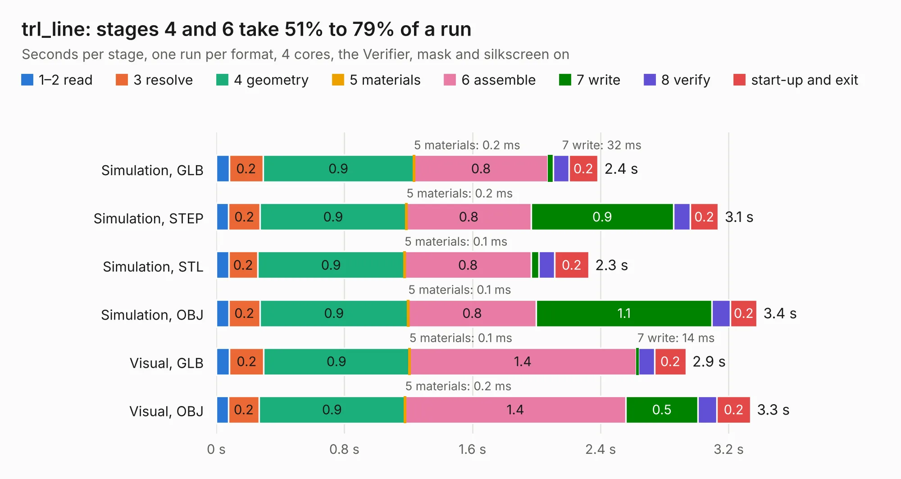

| Mode and format | 1–2 read | 3 resolve | 4 geometry | 5 materials | 6 assemble | 7 write | 8 verify | start-up and exit | Total |
|---|---:|---:|---:|---:|---:|---:|---:|---:|---:|
| Simulation, GLB | 81&nbsp;ms | 0.2 | 0.9 | 0.2&nbsp;ms | 0.8 | 32&nbsp;ms | 98&nbsp;ms | 0.2 | 2.4 |
| Simulation, STEP | 77&nbsp;ms | 0.2 | 0.9 | 0.2&nbsp;ms | 0.8 | 0.9 | 0.1 | 0.2 | 3.1 |
| Simulation, STL | 78&nbsp;ms | 0.2 | 0.9 | 0.1&nbsp;ms | 0.8 | 47&nbsp;ms | 98&nbsp;ms | 0.2 | 2.3 |
| Simulation, OBJ | 79&nbsp;ms | 0.2 | 0.9 | 0.1&nbsp;ms | 0.8 | 1.1 | 0.1 | 0.2 | 3.4 |
| Visual, GLB | 83&nbsp;ms | 0.2 | 0.9 | 0.1&nbsp;ms | 1.4 | 14&nbsp;ms | 0.1 | 0.2 | 2.9 |
| Visual, OBJ | 77&nbsp;ms | 0.2 | 0.9 | 0.2&nbsp;ms | 1.4 | 0.5 | 0.1 | 0.2 | 3.3 |

<table align="center"><tr><td valign="top">

| Board | Repo: [loxodes/vna](https://github.com/loxodes/vna) Board: `trl_line.kicad_pcb` |
|---|---|
| Folder | hardware / archive / oshpark_4layer_trl_cal / trl_thru |
| Complexity | 77&nbsp;/&nbsp;1000 (size&nbsp;57, features&nbsp;20) |
| KESE&nbsp;features | filled zones |
| Tested | 9th November 2026 |
| Copper&nbsp;layers | 4 |
| File&nbsp;format | KiCad 4 (4) |
| Parts,&nbsp;tracks,&nbsp;vias | 2, 1, 0 |
| Triangles,&nbsp;simulation | 226,164 in 14 parts |
| Verifier | PASS in all six runs |

</td><td valign="top">

<table>
<tr><th>File type</th><th>File size</th><th>Peak memory used</th></tr>
<tr><th colspan="3" align="left">Simulation</th></tr>
<tr><td>GLB</td><td align="right">7.4&nbsp;MB</td><td align="right">228&nbsp;MB</td></tr>
<tr><td>STEP</td><td align="right">22&nbsp;MB</td><td align="right">243&nbsp;MB</td></tr>
<tr><td>STL</td><td align="right">11&nbsp;MB</td><td align="right">233&nbsp;MB</td></tr>
<tr><td>OBJ</td><td align="right">22&nbsp;MB</td><td align="right">233&nbsp;MB</td></tr>
<tr><th colspan="3" align="left">Visual</th></tr>
<tr><td>GLB</td><td align="right">3.2&nbsp;MB</td><td align="right">167&nbsp;MB</td></tr>
<tr><td>OBJ</td><td align="right">9.0&nbsp;MB</td><td align="right">168&nbsp;MB</td></tr>
</table>

</td></tr></table>

## 1558. trl_line

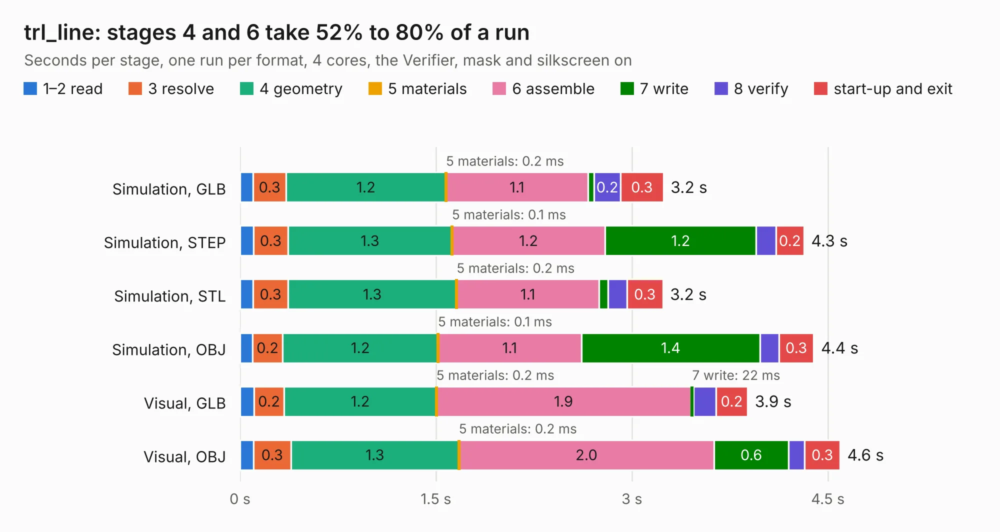

| Mode and format | 1–2 read | 3 resolve | 4 geometry | 5 materials | 6 assemble | 7 write | 8 verify | start-up and exit | Total |
|---|---:|---:|---:|---:|---:|---:|---:|---:|---:|
| Simulation, GLB | 0.1 | 0.3 | 1.2 | 0.2&nbsp;ms | 1.1 | 48&nbsp;ms | 0.2 | 0.3 | 3.2 |
| Simulation, STEP | 0.1 | 0.3 | 1.3 | 0.1&nbsp;ms | 1.2 | 1.2 | 0.2 | 0.2 | 4.3 |
| Simulation, STL | 0.1 | 0.3 | 1.3 | 0.2&nbsp;ms | 1.1 | 68&nbsp;ms | 0.1 | 0.3 | 3.2 |
| Simulation, OBJ | 94&nbsp;ms | 0.2 | 1.2 | 0.1&nbsp;ms | 1.1 | 1.4 | 0.1 | 0.3 | 4.4 |
| Visual, GLB | 0.1 | 0.2 | 1.2 | 0.2&nbsp;ms | 1.9 | 22&nbsp;ms | 0.2 | 0.2 | 3.9 |
| Visual, OBJ | 0.1 | 0.3 | 1.3 | 0.2&nbsp;ms | 2.0 | 0.6 | 0.1 | 0.3 | 4.6 |

<table align="center"><tr><td valign="top">

| Board | Repo: [loxodes/vna](https://github.com/loxodes/vna) Board: `trl_line.kicad_pcb` |
|---|---|
| Folder | hardware / archive / oshpark_4layer_trl_cal / trl_ustrip_test |
| Complexity | 83&nbsp;/&nbsp;1000 (size&nbsp;63, features&nbsp;20) |
| KESE&nbsp;features | filled zones |
| Tested | 9th November 2026 |
| Copper&nbsp;layers | 4 |
| File&nbsp;format | KiCad 4 (4) |
| Parts,&nbsp;tracks,&nbsp;vias | 2, 2, 0 |
| Triangles,&nbsp;simulation | 228,296 in 14 parts |
| Verifier | PASS in all six runs |

</td><td valign="top">

<table>
<tr><th>File type</th><th>File size</th><th>Peak memory used</th></tr>
<tr><th colspan="3" align="left">Simulation</th></tr>
<tr><td>GLB</td><td align="right">7.5&nbsp;MB</td><td align="right">233&nbsp;MB</td></tr>
<tr><td>STEP</td><td align="right">22&nbsp;MB</td><td align="right">238&nbsp;MB</td></tr>
<tr><td>STL</td><td align="right">11&nbsp;MB</td><td align="right">233&nbsp;MB</td></tr>
<tr><td>OBJ</td><td align="right">22&nbsp;MB</td><td align="right">232&nbsp;MB</td></tr>
<tr><th colspan="3" align="left">Visual</th></tr>
<tr><td>GLB</td><td align="right">3.2&nbsp;MB</td><td align="right">167&nbsp;MB</td></tr>
<tr><td>OBJ</td><td align="right">9.2&nbsp;MB</td><td align="right">167&nbsp;MB</td></tr>
</table>

</td></tr></table>

## 1559. switch_demod

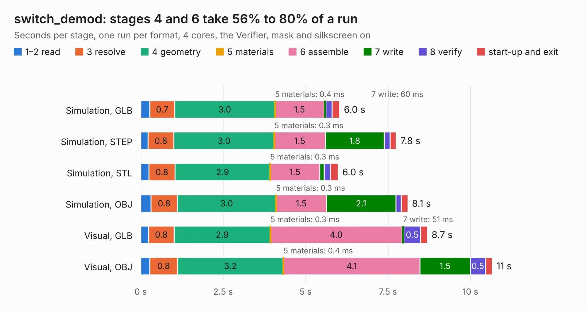

| Mode and format | 1–2 read | 3 resolve | 4 geometry | 5 materials | 6 assemble | 7 write | 8 verify | start-up and exit | Total |
|---|---:|---:|---:|---:|---:|---:|---:|---:|---:|
| Simulation, GLB | 0.3 | 0.7 | 3.0 | 0.4&nbsp;ms | 1.5 | 60&nbsp;ms | 0.2 | 0.2 | 6.0 |
| Simulation, STEP | 0.2 | 0.8 | 3.0 | 0.3&nbsp;ms | 1.5 | 1.8 | 0.2 | 0.2 | 7.8 |
| Simulation, STL | 0.2 | 0.8 | 2.9 | 0.3&nbsp;ms | 1.5 | 0.1 | 0.2 | 0.2 | 6.0 |
| Simulation, OBJ | 0.3 | 0.8 | 3.0 | 0.3&nbsp;ms | 1.5 | 2.1 | 0.2 | 0.2 | 8.1 |
| Visual, GLB | 0.2 | 0.8 | 2.9 | 0.3&nbsp;ms | 4.0 | 51&nbsp;ms | 0.5 | 0.2 | 8.7 |
| Visual, OBJ | 0.3 | 0.8 | 3.2 | 0.4&nbsp;ms | 4.1 | 1.5 | 0.5 | 0.2 | 10.7 |

<table align="center"><tr><td valign="top">

| Board | Repo: [loxodes/vna](https://github.com/loxodes/vna) Board: `switch_demod.kicad_pcb` |
|---|---|
| Folder | hardware / archive / switch_demod |
| Complexity | 172&nbsp;/&nbsp;1000 (size&nbsp;172, features&nbsp;0) |
| Tested | 9th November 2026 |
| Copper&nbsp;layers | 4 |
| File&nbsp;format | KiCad 4 (4) |
| Parts,&nbsp;tracks,&nbsp;vias | 140, 15, 0 |
| Triangles,&nbsp;simulation | 355,876 in 111 parts |
| Note | mostly unrouted |
| Verifier | PASS in all six runs |

</td><td valign="top">

<table>
<tr><th>File type</th><th>File size</th><th>Peak memory used</th></tr>
<tr><th colspan="3" align="left">Simulation</th></tr>
<tr><td>GLB</td><td align="right">13&nbsp;MB</td><td align="right">328&nbsp;MB</td></tr>
<tr><td>STEP</td><td align="right">54&nbsp;MB</td><td align="right">366&nbsp;MB</td></tr>
<tr><td>STL</td><td align="right">18&nbsp;MB</td><td align="right">340&nbsp;MB</td></tr>
<tr><td>OBJ</td><td align="right">39&nbsp;MB</td><td align="right">349&nbsp;MB</td></tr>
<tr><th colspan="3" align="left">Visual</th></tr>
<tr><td>GLB</td><td align="right">11&nbsp;MB</td><td align="right">331&nbsp;MB</td></tr>
<tr><td>OBJ</td><td align="right">31&nbsp;MB</td><td align="right">330&nbsp;MB</td></tr>
</table>

</td></tr></table>

## 1560. vna_control

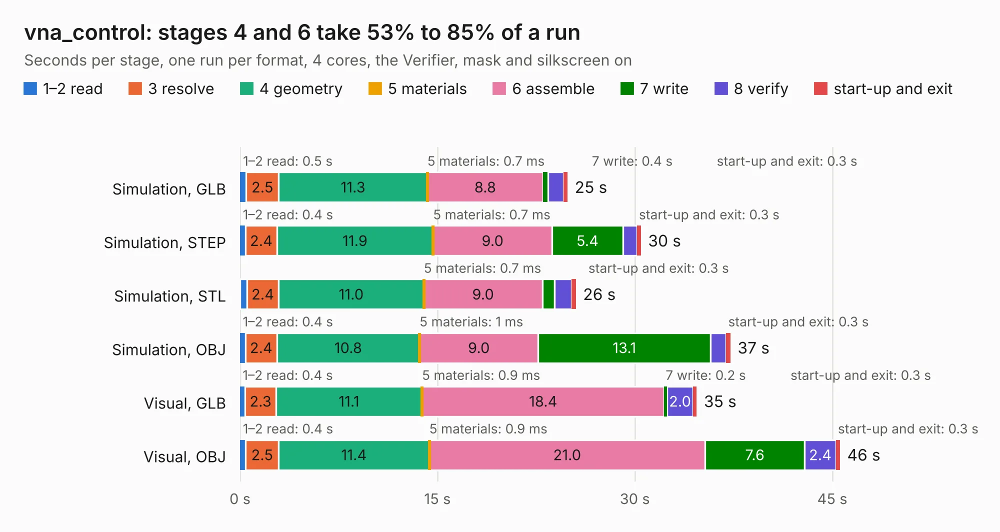

| Mode and format | 1–2 read | 3 resolve | 4 geometry | 5 materials | 6 assemble | 7 write | 8 verify | start-up and exit | Total |
|---|---:|---:|---:|---:|---:|---:|---:|---:|---:|
| Simulation, GLB | 0.5 | 2.5 | 11.3 | 0.7&nbsp;ms | 8.8 | 0.4 | 1.2 | 0.3 | 24.9 |
| Simulation, STEP | 0.4 | 2.4 | 11.9 | 0.7&nbsp;ms | 9.0 | 5.4 | 1.1 | 0.3 | 30.5 |
| Simulation, STL | 0.5 | 2.4 | 11.0 | 0.7&nbsp;ms | 9.0 | 0.9 | 1.3 | 0.3 | 25.5 |
| Simulation, OBJ | 0.4 | 2.4 | 10.8 | 1&nbsp;ms | 9.0 | 13.1 | 1.2 | 0.3 | 37.3 |
| Visual, GLB | 0.4 | 2.3 | 11.1 | 0.9&nbsp;ms | 18.4 | 0.2 | 2.0 | 0.3 | 34.7 |
| Visual, OBJ | 0.4 | 2.5 | 11.4 | 0.9&nbsp;ms | 21.0 | 7.6 | 2.4 | 0.3 | 45.6 |

<table align="center"><tr><td valign="top">

| Board | Repo: [loxodes/vna](https://github.com/loxodes/vna) Board: `vna_control.kicad_pcb` |
|---|---|
| Folder | hardware / archive / vna_r0 / vna_control |
| Complexity | 300&nbsp;/&nbsp;1000 (size&nbsp;245, features&nbsp;55) |
| KESE&nbsp;features | through vias, slotted holes, filled zones, curved board outline |
| Tested | 9th November 2026 |
| Copper&nbsp;layers | 4 |
| File&nbsp;format | KiCad 4 (4) |
| Parts,&nbsp;tracks,&nbsp;vias | 110, 1,091, 157 |
| Triangles,&nbsp;simulation | 2,132,360 in 102 parts |
| Verifier | PASS in all six runs |

</td><td valign="top">

<table>
<tr><th>File type</th><th>File size</th><th>Peak memory used</th></tr>
<tr><th colspan="3" align="left">Simulation</th></tr>
<tr><td>GLB</td><td align="right">74&nbsp;MB</td><td align="right">654&nbsp;MB</td></tr>
<tr><td>STEP</td><td align="right">276&nbsp;MB</td><td align="right">778&nbsp;MB</td></tr>
<tr><td>STL</td><td align="right">107&nbsp;MB</td><td align="right">662&nbsp;MB</td></tr>
<tr><td>OBJ</td><td align="right">225&nbsp;MB</td><td align="right">1.4&nbsp;GB</td></tr>
<tr><th colspan="3" align="left">Visual</th></tr>
<tr><td>GLB</td><td align="right">41&nbsp;MB</td><td align="right">922&nbsp;MB</td></tr>
<tr><td>OBJ</td><td align="right">124&nbsp;MB</td><td align="right">944&nbsp;MB</td></tr>
</table>

</td></tr></table>

## 1561. vna_demod

| Mode and format | 1–2 read | 3 resolve | 4 geometry | 5 materials | 6 assemble | 7 write | 8 verify | start-up and exit | Total |
|---|---:|---:|---:|---:|---:|---:|---:|---:|---:|
| Simulation, GLB | 0.8 | 5.6 | 19.7 | 2&nbsp;ms | 15.6 | 0.7 | 1.9 | 0.3 | 44.6 |
| Simulation, STEP | 0.9 | 5.7 | 19.5 | 0.8&nbsp;ms | 15.1 | 8.6 | 1.6 | 0.3 | 51.7 |
| Simulation, STL | 0.8 | 5.8 | 19.5 | 2&nbsp;ms | 15.4 | 1.7 | 1.7 | 0.3 | 45.2 |
| Simulation, OBJ | 0.8 | 5.7 | 19.7 | 2&nbsp;ms | 15.2 | 22.0 | 1.8 | 0.3 | 65.5 |
| Visual, GLB | 0.9 | 6.0 | 19.6 | 0.8&nbsp;ms | 49.1 | 0.5 | 4.6 | 0.3 | 80.9 |
| Visual, OBJ | 0.9 | 5.5 | 19.3 | 2&nbsp;ms | 48.8 | 14.0 | 4.3 | 0.3 | 93.2 |

<table align="center"><tr><td valign="top">

| Board | Repo: [loxodes/vna](https://github.com/loxodes/vna) Board: `vna_demod.kicad_pcb` |
|---|---|
| Folder | hardware / archive / vna_r0 / vna_demod |
| Complexity | 330&nbsp;/&nbsp;1000 (size&nbsp;285, features&nbsp;45) |
| KESE&nbsp;features | through vias, filled zones, curved board outline |
| Tested | 10th November 2026 |
| Copper&nbsp;layers | 4 |
| File&nbsp;format | KiCad 4 (4) |
| Parts,&nbsp;tracks,&nbsp;vias | 303, 2,447, 408 |
| Triangles,&nbsp;simulation | 4,214,150 in 243 parts |
| Verifier | PASS in all six runs |
| Run&nbsp;again | Simulation, GLB; Simulation, STEP; Simulation, STL; Simulation, OBJ; Visual, GLB; Visual, OBJ: failed in the corpus run, run again with fixes to KESE made after the corpus run, and passed |

</td><td valign="top">

<table>
<tr><th>File type</th><th>File size</th><th>Peak memory used</th></tr>
<tr><th colspan="3" align="left">Simulation</th></tr>
<tr><td>GLB</td><td align="right">146&nbsp;MB</td><td align="right">1.4&nbsp;GB</td></tr>
<tr><td>STEP</td><td align="right">498&nbsp;MB</td><td align="right">1.6&nbsp;GB</td></tr>
<tr><td>STL</td><td align="right">211&nbsp;MB</td><td align="right">1.3&nbsp;GB</td></tr>
<tr><td>OBJ</td><td align="right">451&nbsp;MB</td><td align="right">2.8&nbsp;GB</td></tr>
<tr><th colspan="3" align="left">Visual</th></tr>
<tr><td>GLB</td><td align="right">93&nbsp;MB</td><td align="right">1.5&nbsp;GB</td></tr>
<tr><td>OBJ</td><td align="right">294&nbsp;MB</td><td align="right">2.0&nbsp;GB</td></tr>
</table>

</td></tr></table>

## 1562. vna_rf

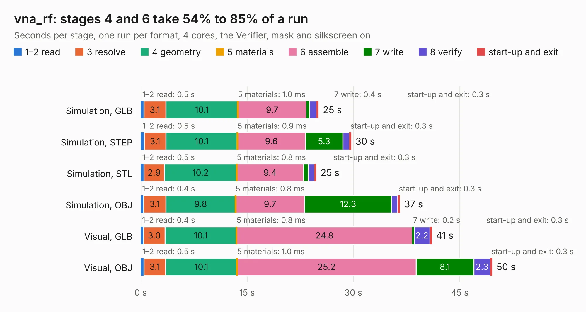

| Mode and format | 1–2 read | 3 resolve | 4 geometry | 5 materials | 6 assemble | 7 write | 8 verify | start-up and exit | Total |
|---|---:|---:|---:|---:|---:|---:|---:|---:|---:|
| Simulation, GLB | 0.5 | 3.1 | 10.1 | 1.0&nbsp;ms | 9.7 | 0.4 | 1.0 | 0.3 | 25.1 |
| Simulation, STEP | 0.5 | 3.1 | 10.1 | 0.9&nbsp;ms | 9.6 | 5.3 | 0.9 | 0.3 | 29.7 |
| Simulation, STL | 0.5 | 2.9 | 10.2 | 0.8&nbsp;ms | 9.4 | 0.7 | 0.9 | 0.3 | 24.8 |
| Simulation, OBJ | 0.4 | 3.1 | 9.8 | 0.8&nbsp;ms | 9.7 | 12.3 | 0.9 | 0.3 | 36.6 |
| Visual, GLB | 0.4 | 3.0 | 10.1 | 0.8&nbsp;ms | 24.8 | 0.2 | 2.2 | 0.3 | 41.1 |
| Visual, OBJ | 0.5 | 3.1 | 10.1 | 1.0&nbsp;ms | 25.2 | 8.1 | 2.3 | 0.3 | 49.6 |

<table align="center"><tr><td valign="top">

| Board | Repo: [loxodes/vna](https://github.com/loxodes/vna) Board: `vna_rf.kicad_pcb` |
|---|---|
| Folder | hardware / archive / vna_r0 / vna_rf |
| Complexity | 292&nbsp;/&nbsp;1000 (size&nbsp;247, features&nbsp;45) |
| KESE&nbsp;features | through vias, filled zones, curved board outline |
| Tested | 10th November 2026 |
| Copper&nbsp;layers | 4 |
| File&nbsp;format | KiCad 4 (4) |
| Parts,&nbsp;tracks,&nbsp;vias | 130, 1,060, 171 |
| Triangles,&nbsp;simulation | 2,515,716 in 103 parts |
| Verifier | PASS in all six runs |
| Run&nbsp;again | Simulation, GLB; Simulation, STEP; Simulation, STL; Simulation, OBJ; Visual, GLB; Visual, OBJ: failed in the corpus run, run again with fixes to KESE made after the corpus run, and passed |

</td><td valign="top">

<table>
<tr><th>File type</th><th>File size</th><th>Peak memory used</th></tr>
<tr><th colspan="3" align="left">Simulation</th></tr>
<tr><td>GLB</td><td align="right">86&nbsp;MB</td><td align="right">968&nbsp;MB</td></tr>
<tr><td>STEP</td><td align="right">276&nbsp;MB</td><td align="right">1.1&nbsp;GB</td></tr>
<tr><td>STL</td><td align="right">126&nbsp;MB</td><td align="right">978&nbsp;MB</td></tr>
<tr><td>OBJ</td><td align="right">264&nbsp;MB</td><td align="right">1.7&nbsp;GB</td></tr>
<tr><th colspan="3" align="left">Visual</th></tr>
<tr><td>GLB</td><td align="right">54&nbsp;MB</td><td align="right">1.0&nbsp;GB</td></tr>
<tr><td>OBJ</td><td align="right">167&nbsp;MB</td><td align="right">1.2&nbsp;GB</td></tr>
</table>

</td></tr></table>

## 1563. ecp5

| Mode and format | 1–2 read | 3 resolve | 4 geometry | 5 materials | 6 assemble | 7 write | 8 verify | start-up and exit | Total |
|---|---:|---:|---:|---:|---:|---:|---:|---:|---:|
| Simulation, GLB | 1.0 | 4.4 | 12.7 | 0.5&nbsp;ms | 14.8 | 0.6 | 1.7 | 0.3 | 35.6 |
| Simulation, STEP | 1.1 | 4.2 | 13.6 | 0.6&nbsp;ms | 15.6 | 9.4 | 1.9 | 0.3 | 46.1 |
| Simulation, STL | 1.1 | 4.3 | 13.4 | 0.6&nbsp;ms | 15.1 | 1.3 | 1.9 | 0.3 | 37.4 |
| Simulation, OBJ | 1.1 | 4.3 | 13.6 | 0.6&nbsp;ms | 14.5 | 20.2 | 1.9 | 0.3 | 55.9 |
| Visual, GLB | 1.2 | 4.2 | 13.7 | 1&nbsp;ms | 31.4 | 0.4 | 3.8 | 0.2 | 54.8 |
| Visual, OBJ | 0.8 | 4.5 | 13.7 | 0.7&nbsp;ms | 31.7 | 11.7 | 3.9 | 0.2 | 66.5 |

<table align="center"><tr><td valign="top">

| Board | Repo: [loxodes/vna](https://github.com/loxodes/vna) Board: `ecp5.kicad_pcb` |
|---|---|
| Folder | hardware / mm_reflectometer / evalboards / ecp5 |
| Complexity | 405&nbsp;/&nbsp;1000 (size&nbsp;290, features&nbsp;115) |
| KESE&nbsp;features | through vias, slotted holes, rounded, trapezoid or chamfered pads, filled zones, curved board outline, stack-up, dielectric εr and tanδ, copper finish, mask and silkscreen colours |
| Tested | 9th November 2026 |
| Copper&nbsp;layers | 6 |
| File&nbsp;format | KiCad 6 (20201220) |
| Parts,&nbsp;tracks,&nbsp;vias | 195, 2,373, 498 |
| Triangles,&nbsp;simulation | 4,130,736 in 192 parts |
| Verifier | PASS in all six runs |

</td><td valign="top">

<table>
<tr><th>File type</th><th>File size</th><th>Peak memory used</th></tr>
<tr><th colspan="3" align="left">Simulation</th></tr>
<tr><td>GLB</td><td align="right">138&nbsp;MB</td><td align="right">1.1&nbsp;GB</td></tr>
<tr><td>STEP</td><td align="right">545&nbsp;MB</td><td align="right">1.6&nbsp;GB</td></tr>
<tr><td>STL</td><td align="right">207&nbsp;MB</td><td align="right">1.2&nbsp;GB</td></tr>
<tr><td>OBJ</td><td align="right">439&nbsp;MB</td><td align="right">2.7&nbsp;GB</td></tr>
<tr><th colspan="3" align="left">Visual</th></tr>
<tr><td>GLB</td><td align="right">79&nbsp;MB</td><td align="right">1.3&nbsp;GB</td></tr>
<tr><td>OBJ</td><td align="right">252&nbsp;MB</td><td align="right">1.7&nbsp;GB</td></tr>
</table>

</td></tr></table>

## 1564. ep2k1P

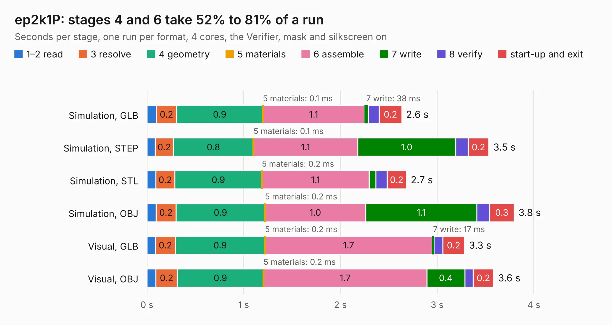

| Mode and format | 1–2 read | 3 resolve | 4 geometry | 5 materials | 6 assemble | 7 write | 8 verify | start-up and exit | Total |
|---|---:|---:|---:|---:|---:|---:|---:|---:|---:|
| Simulation, GLB | 98&nbsp;ms | 0.2 | 0.9 | 0.1&nbsp;ms | 1.1 | 38&nbsp;ms | 0.1 | 0.2 | 2.6 |
| Simulation, STEP | 85&nbsp;ms | 0.2 | 0.8 | 0.1&nbsp;ms | 1.1 | 1.0 | 0.1 | 0.2 | 3.5 |
| Simulation, STL | 91&nbsp;ms | 0.2 | 0.9 | 0.2&nbsp;ms | 1.1 | 69&nbsp;ms | 0.1 | 0.2 | 2.7 |
| Simulation, OBJ | 94&nbsp;ms | 0.2 | 0.9 | 0.2&nbsp;ms | 1.0 | 1.1 | 0.1 | 0.3 | 3.8 |
| Visual, GLB | 89&nbsp;ms | 0.2 | 0.9 | 0.2&nbsp;ms | 1.7 | 17&nbsp;ms | 91&nbsp;ms | 0.2 | 3.3 |
| Visual, OBJ | 93&nbsp;ms | 0.2 | 0.9 | 0.2&nbsp;ms | 1.7 | 0.4 | 86&nbsp;ms | 0.2 | 3.6 |

<table align="center"><tr><td valign="top">

| Board | Repo: [loxodes/vna](https://github.com/loxodes/vna) Board: `ep2k1P.kicad_pcb` |
|---|---|
| Folder | hardware / mm_reflectometer / evalboards / ep2k1P |
| Complexity | 243&nbsp;/&nbsp;1000 (size&nbsp;133, features&nbsp;110) |
| KESE&nbsp;features | through vias, rounded, trapezoid or chamfered pads, arc tracks, filled zones, stack-up, dielectric εr and tanδ, copper finish, mask and silkscreen colours |
| Tested | 9th November 2026 |
| Copper&nbsp;layers | 4 |
| File&nbsp;format | KiCad 6 (20201220) |
| Parts,&nbsp;tracks,&nbsp;vias | 4, 50, 33 |
| Triangles,&nbsp;simulation | 254,758 in 16 parts |
| Verifier | PASS in all six runs |

</td><td valign="top">

<table>
<tr><th>File type</th><th>File size</th><th>Peak memory used</th></tr>
<tr><th colspan="3" align="left">Simulation</th></tr>
<tr><td>GLB</td><td align="right">8.3&nbsp;MB</td><td align="right">238&nbsp;MB</td></tr>
<tr><td>STEP</td><td align="right">20&nbsp;MB</td><td align="right">257&nbsp;MB</td></tr>
<tr><td>STL</td><td align="right">13&nbsp;MB</td><td align="right">238&nbsp;MB</td></tr>
<tr><td>OBJ</td><td align="right">25&nbsp;MB</td><td align="right">238&nbsp;MB</td></tr>
<tr><th colspan="3" align="left">Visual</th></tr>
<tr><td>GLB</td><td align="right">3.0&nbsp;MB</td><td align="right">173&nbsp;MB</td></tr>
<tr><td>OBJ</td><td align="right">8.6&nbsp;MB</td><td align="right">173&nbsp;MB</td></tr>
</table>

</td></tr></table>

## 1565. fpc07181

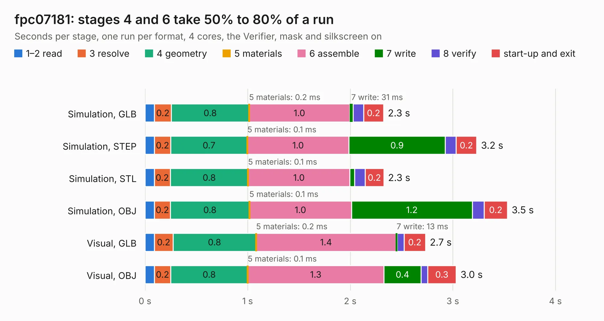

| Mode and format | 1–2 read | 3 resolve | 4 geometry | 5 materials | 6 assemble | 7 write | 8 verify | start-up and exit | Total |
|---|---:|---:|---:|---:|---:|---:|---:|---:|---:|
| Simulation, GLB | 92&nbsp;ms | 0.2 | 0.8 | 0.2&nbsp;ms | 1.0 | 31&nbsp;ms | 0.1 | 0.2 | 2.3 |
| Simulation, STEP | 91&nbsp;ms | 0.2 | 0.7 | 0.1&nbsp;ms | 1.0 | 0.9 | 0.1 | 0.2 | 3.2 |
| Simulation, STL | 90&nbsp;ms | 0.2 | 0.8 | 0.1&nbsp;ms | 1.0 | 45&nbsp;ms | 0.1 | 0.2 | 2.3 |
| Simulation, OBJ | 90&nbsp;ms | 0.2 | 0.8 | 0.1&nbsp;ms | 1.0 | 1.2 | 0.1 | 0.2 | 3.5 |
| Visual, GLB | 91&nbsp;ms | 0.2 | 0.8 | 0.2&nbsp;ms | 1.4 | 13&nbsp;ms | 66&nbsp;ms | 0.2 | 2.7 |
| Visual, OBJ | 92&nbsp;ms | 0.2 | 0.8 | 0.1&nbsp;ms | 1.3 | 0.4 | 62&nbsp;ms | 0.3 | 3.0 |

<table align="center"><tr><td valign="top">

| Board | Repo: [loxodes/vna](https://github.com/loxodes/vna) Board: `fpc07181.kicad_pcb` |
|---|---|
| Folder | hardware / mm_reflectometer / evalboards / fpc07181 |
| Complexity | 215&nbsp;/&nbsp;1000 (size&nbsp;120, features&nbsp;95) |
| KESE&nbsp;features | through vias, rounded, trapezoid or chamfered pads, filled zones, stack-up, dielectric εr and tanδ, copper finish, mask and silkscreen colours |
| Tested | 9th November 2026 |
| Copper&nbsp;layers | 4 |
| File&nbsp;format | KiCad 6 (20201220) |
| Parts,&nbsp;tracks,&nbsp;vias | 5, 20, 13 |
| Triangles,&nbsp;simulation | 192,820 in 17 parts |
| Verifier | PASS in all six runs |

</td><td valign="top">

<table>
<tr><th>File type</th><th>File size</th><th>Peak memory used</th></tr>
<tr><th colspan="3" align="left">Simulation</th></tr>
<tr><td>GLB</td><td align="right">6.3&nbsp;MB</td><td align="right">213&nbsp;MB</td></tr>
<tr><td>STEP</td><td align="right">16&nbsp;MB</td><td align="right">232&nbsp;MB</td></tr>
<tr><td>STL</td><td align="right">9.6&nbsp;MB</td><td align="right">214&nbsp;MB</td></tr>
<tr><td>OBJ</td><td align="right">19&nbsp;MB</td><td align="right">216&nbsp;MB</td></tr>
<tr><th colspan="3" align="left">Visual</th></tr>
<tr><td>GLB</td><td align="right">2.1&nbsp;MB</td><td align="right">166&nbsp;MB</td></tr>
<tr><td>OBJ</td><td align="right">6.1&nbsp;MB</td><td align="right">165&nbsp;MB</td></tr>
</table>

</td></tr></table>

## 1566. maam-011132

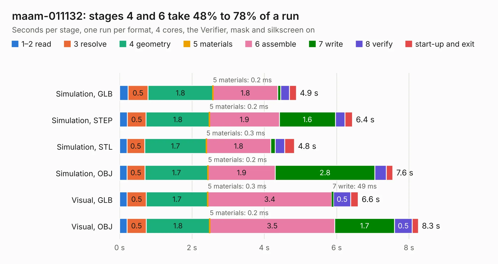

| Mode and format | 1–2 read | 3 resolve | 4 geometry | 5 materials | 6 assemble | 7 write | 8 verify | start-up and exit | Total |
|---|---:|---:|---:|---:|---:|---:|---:|---:|---:|
| Simulation, GLB | 0.2 | 0.5 | 1.8 | 0.2&nbsp;ms | 1.8 | 84&nbsp;ms | 0.2 | 0.2 | 4.9 |
| Simulation, STEP | 0.2 | 0.5 | 1.8 | 0.2&nbsp;ms | 1.9 | 1.6 | 0.3 | 0.2 | 6.4 |
| Simulation, STL | 0.2 | 0.5 | 1.7 | 0.3&nbsp;ms | 1.8 | 0.1 | 0.3 | 0.3 | 4.8 |
| Simulation, OBJ | 0.2 | 0.5 | 1.7 | 0.2&nbsp;ms | 1.9 | 2.8 | 0.3 | 0.2 | 7.6 |
| Visual, GLB | 0.2 | 0.5 | 1.7 | 0.3&nbsp;ms | 3.4 | 49&nbsp;ms | 0.5 | 0.2 | 6.6 |
| Visual, OBJ | 0.2 | 0.5 | 1.8 | 0.2&nbsp;ms | 3.5 | 1.7 | 0.5 | 0.2 | 8.3 |

<table align="center"><tr><td valign="top">

| Board | Repo: [loxodes/vna](https://github.com/loxodes/vna) Board: `maam-011132.kicad_pcb` |
|---|---|
| Folder | hardware / mm_reflectometer / evalboards / maam-011132 |
| Complexity | 290&nbsp;/&nbsp;1000 (size&nbsp;185, features&nbsp;105) |
| KESE&nbsp;features | through vias, rounded, trapezoid or chamfered pads, filled zones, curved board outline, stack-up, dielectric εr and tanδ, copper finish, mask and silkscreen colours |
| Tested | 9th November 2026 |
| Copper&nbsp;layers | 4 |
| File&nbsp;format | KiCad 6 (20210228) |
| Parts,&nbsp;tracks,&nbsp;vias | 66, 379, 89 |
| Triangles,&nbsp;simulation | 574,998 in 46 parts |
| Verifier | PASS in all six runs |

</td><td valign="top">

<table>
<tr><th>File type</th><th>File size</th><th>Peak memory used</th></tr>
<tr><th colspan="3" align="left">Simulation</th></tr>
<tr><td>GLB</td><td align="right">19&nbsp;MB</td><td align="right">332&nbsp;MB</td></tr>
<tr><td>STEP</td><td align="right">66&nbsp;MB</td><td align="right">385&nbsp;MB</td></tr>
<tr><td>STL</td><td align="right">29&nbsp;MB</td><td align="right">327&nbsp;MB</td></tr>
<tr><td>OBJ</td><td align="right">60&nbsp;MB</td><td align="right">438&nbsp;MB</td></tr>
<tr><th colspan="3" align="left">Visual</th></tr>
<tr><td>GLB</td><td align="right">11&nbsp;MB</td><td align="right">332&nbsp;MB</td></tr>
<tr><td>OBJ</td><td align="right">35&nbsp;MB</td><td align="right">337&nbsp;MB</td></tr>
</table>

</td></tr></table>

## 1567. maam_011101

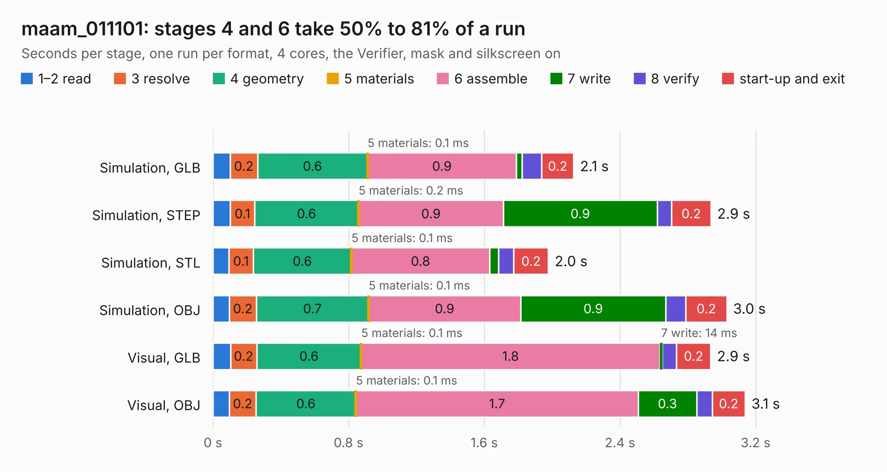

| Mode and format | 1–2 read | 3 resolve | 4 geometry | 5 materials | 6 assemble | 7 write | 8 verify | start-up and exit | Total |
|---|---:|---:|---:|---:|---:|---:|---:|---:|---:|
| Simulation, GLB | 0.1 | 0.2 | 0.6 | 0.1&nbsp;ms | 0.9 | 34&nbsp;ms | 0.1 | 0.2 | 2.1 |
| Simulation, STEP | 0.1 | 0.1 | 0.6 | 0.2&nbsp;ms | 0.9 | 0.9 | 85&nbsp;ms | 0.2 | 2.9 |
| Simulation, STL | 94&nbsp;ms | 0.1 | 0.6 | 0.1&nbsp;ms | 0.8 | 52&nbsp;ms | 90&nbsp;ms | 0.2 | 2.0 |
| Simulation, OBJ | 97&nbsp;ms | 0.2 | 0.7 | 0.1&nbsp;ms | 0.9 | 0.9 | 0.1 | 0.2 | 3.0 |
| Visual, GLB | 0.1 | 0.2 | 0.6 | 0.1&nbsp;ms | 1.8 | 14&nbsp;ms | 83&nbsp;ms | 0.2 | 2.9 |
| Visual, OBJ | 98&nbsp;ms | 0.2 | 0.6 | 0.1&nbsp;ms | 1.7 | 0.3 | 92&nbsp;ms | 0.2 | 3.1 |

<table align="center"><tr><td valign="top">

| Board | Repo: [loxodes/vna](https://github.com/loxodes/vna) Board: `maam_011101.kicad_pcb` |
|---|---|
| Folder | hardware / mm_reflectometer / evalboards / maam_011101 |
| Complexity | 222&nbsp;/&nbsp;1000 (size&nbsp;127, features&nbsp;95) |
| KESE&nbsp;features | through vias, rounded, trapezoid or chamfered pads, filled zones, stack-up, dielectric εr and tanδ, copper finish, mask and silkscreen colours |
| Tested | 9th November 2026 |
| Copper&nbsp;layers | 4 |
| File&nbsp;format | KiCad 6 (20210108) |
| Parts,&nbsp;tracks,&nbsp;vias | 8, 24, 16 |
| Triangles,&nbsp;simulation | 159,606 in 18 parts |
| Verifier | PASS in all six runs |

</td><td valign="top">

<table>
<tr><th>File type</th><th>File size</th><th>Peak memory used</th></tr>
<tr><th colspan="3" align="left">Simulation</th></tr>
<tr><td>GLB</td><td align="right">5.2&nbsp;MB</td><td align="right">199&nbsp;MB</td></tr>
<tr><td>STEP</td><td align="right">14&nbsp;MB</td><td align="right">214&nbsp;MB</td></tr>
<tr><td>STL</td><td align="right">8.0&nbsp;MB</td><td align="right">201&nbsp;MB</td></tr>
<tr><td>OBJ</td><td align="right">16&nbsp;MB</td><td align="right">198&nbsp;MB</td></tr>
<tr><th colspan="3" align="left">Visual</th></tr>
<tr><td>GLB</td><td align="right">2.1&nbsp;MB</td><td align="right">166&nbsp;MB</td></tr>
<tr><td>OBJ</td><td align="right">5.8&nbsp;MB</td><td align="right">167&nbsp;MB</td></tr>
</table>

</td></tr></table>

## 1568. mamx_011036

| Mode and format | 1–2 read | 3 resolve | 4 geometry | 5 materials | 6 assemble | 7 write | 8 verify | start-up and exit | Total |
|---|---:|---:|---:|---:|---:|---:|---:|---:|---:|
| Simulation, GLB | 0.2 | 0.5 | 1.9 | 0.2&nbsp;ms | 1.8 | 77&nbsp;ms | 0.3 | 0.2 | 4.9 |
| Simulation, STEP | 0.2 | 0.5 | 1.9 | 0.2&nbsp;ms | 1.8 | 1.5 | 0.3 | 0.2 | 6.4 |
| Simulation, STL | 0.2 | 0.5 | 1.8 | 0.2&nbsp;ms | 1.8 | 0.1 | 0.3 | 0.2 | 4.9 |
| Simulation, OBJ | 0.2 | 0.5 | 1.9 | 0.2&nbsp;ms | 1.7 | 3.2 | 0.3 | 0.2 | 7.9 |
| Visual, GLB | 0.2 | 0.5 | 1.8 | 0.2&nbsp;ms | 3.0 | 38&nbsp;ms | 0.3 | 0.2 | 6.0 |
| Visual, OBJ | 0.2 | 0.5 | 1.8 | 0.3&nbsp;ms | 2.9 | 1.3 | 0.2 | 0.2 | 7.2 |

<table align="center"><tr><td valign="top">

| Board | Repo: [loxodes/vna](https://github.com/loxodes/vna) Board: `mamx_011036.kicad_pcb` |
|---|---|
| Folder | hardware / mm_reflectometer / evalboards / mamx_011036 |
| Complexity | 266&nbsp;/&nbsp;1000 (size&nbsp;171, features&nbsp;95) |
| KESE&nbsp;features | through vias, rounded, trapezoid or chamfered pads, filled zones, stack-up, dielectric εr and tanδ, copper finish, mask and silkscreen colours |
| Tested | 9th November 2026 |
| Copper&nbsp;layers | 4 |
| File&nbsp;format | KiCad 6 (20201220) |
| Parts,&nbsp;tracks,&nbsp;vias | 31, 178, 90 |
| Triangles,&nbsp;simulation | 507,438 in 37 parts |
| Verifier | PASS in all six runs |

</td><td valign="top">

<table>
<tr><th>File type</th><th>File size</th><th>Peak memory used</th></tr>
<tr><th colspan="3" align="left">Simulation</th></tr>
<tr><td>GLB</td><td align="right">17&nbsp;MB</td><td align="right">305&nbsp;MB</td></tr>
<tr><td>STEP</td><td align="right">50&nbsp;MB</td><td align="right">345&nbsp;MB</td></tr>
<tr><td>STL</td><td align="right">25&nbsp;MB</td><td align="right">322&nbsp;MB</td></tr>
<tr><td>OBJ</td><td align="right">53&nbsp;MB</td><td align="right">343&nbsp;MB</td></tr>
<tr><th colspan="3" align="left">Visual</th></tr>
<tr><td>GLB</td><td align="right">7.9&nbsp;MB</td><td align="right">284&nbsp;MB</td></tr>
<tr><td>OBJ</td><td align="right">24&nbsp;MB</td><td align="right">286&nbsp;MB</td></tr>
</table>

</td></tr></table>

## 1569. sumusu_ats2012

| Mode and format | 1–2 read | 3 resolve | 4 geometry | 5 materials | 6 assemble | 7 write | 8 verify | start-up and exit | Total |
|---|---:|---:|---:|---:|---:|---:|---:|---:|---:|
| Simulation, GLB | 75&nbsp;ms | 0.1 | 0.5 | 0.1&nbsp;ms | 0.7 | 41&nbsp;ms | 71&nbsp;ms | 0.2 | 1.7 |
| Simulation, STEP | 76&nbsp;ms | 0.1 | 0.5 | 0.1&nbsp;ms | 0.7 | 0.7 | 64&nbsp;ms | 0.2 | 2.4 |
| Simulation, STL | 81&nbsp;ms | 0.1 | 0.5 | 0.1&nbsp;ms | 0.8 | 28&nbsp;ms | 66&nbsp;ms | 0.2 | 1.8 |
| Simulation, OBJ | 75&nbsp;ms | 0.1 | 0.4 | 0.1&nbsp;ms | 0.7 | 0.6 | 70&nbsp;ms | 0.2 | 2.2 |
| Visual, GLB | 87&nbsp;ms | 0.1 | 0.5 | 0.1&nbsp;ms | 1.4 | 10&nbsp;ms | 56&nbsp;ms | 0.2 | 2.3 |
| Visual, OBJ | 77&nbsp;ms | 0.1 | 0.5 | 0.1&nbsp;ms | 1.3 | 0.2 | 57&nbsp;ms | 0.2 | 2.4 |

<table align="center"><tr><td valign="top">

| Board | Repo: [loxodes/vna](https://github.com/loxodes/vna) Board: `sumusu_ats2012.kicad_pcb` |
|---|---|
| Folder | hardware / mm_reflectometer / evalboards / sumusu_ats2012 |
| Complexity | 206&nbsp;/&nbsp;1000 (size&nbsp;111, features&nbsp;95) |
| KESE&nbsp;features | through vias, rounded, trapezoid or chamfered pads, filled zones, stack-up, dielectric εr and tanδ, copper finish, mask and silkscreen colours |
| Tested | 9th November 2026 |
| Copper&nbsp;layers | 4 |
| File&nbsp;format | KiCad 6 (20201220) |
| Parts,&nbsp;tracks,&nbsp;vias | 3, 7, 13 |
| Triangles,&nbsp;simulation | 140,684 in 15 parts |
| Verifier | PASS in all six runs |

</td><td valign="top">

<table>
<tr><th>File type</th><th>File size</th><th>Peak memory used</th></tr>
<tr><th colspan="3" align="left">Simulation</th></tr>
<tr><td>GLB</td><td align="right">4.6&nbsp;MB</td><td align="right">198&nbsp;MB</td></tr>
<tr><td>STEP</td><td align="right">12&nbsp;MB</td><td align="right">210&nbsp;MB</td></tr>
<tr><td>STL</td><td align="right">7.0&nbsp;MB</td><td align="right">197&nbsp;MB</td></tr>
<tr><td>OBJ</td><td align="right">14&nbsp;MB</td><td align="right">197&nbsp;MB</td></tr>
<tr><th colspan="3" align="left">Visual</th></tr>
<tr><td>GLB</td><td align="right">1.6&nbsp;MB</td><td align="right">166&nbsp;MB</td></tr>
<tr><td>OBJ</td><td align="right">4.6&nbsp;MB</td><td align="right">167&nbsp;MB</td></tr>
</table>

</td></tr></table>

## 1570. xx1000-qt

| Mode and format | 1–2 read | 3 resolve | 4 geometry | 5 materials | 6 assemble | 7 write | 8 verify | start-up and exit | Total |
|---|---:|---:|---:|---:|---:|---:|---:|---:|---:|
| Simulation, GLB | 0.2 | 0.5 | 1.7 | 0.3&nbsp;ms | 1.6 | 65&nbsp;ms | 0.2 | 0.2 | 4.5 |
| Simulation, STEP | 0.2 | 0.5 | 1.7 | 0.3&nbsp;ms | 1.7 | 1.5 | 0.2 | 0.2 | 6.0 |
| Simulation, STL | 0.2 | 0.5 | 1.8 | 0.2&nbsp;ms | 1.6 | 0.2 | 0.2 | 0.2 | 4.7 |
| Simulation, OBJ | 0.2 | 0.4 | 1.6 | 0.2&nbsp;ms | 1.6 | 2.4 | 0.2 | 0.2 | 6.7 |
| Visual, GLB | 0.2 | 0.5 | 1.8 | 0.3&nbsp;ms | 3.4 | 50&nbsp;ms | 0.4 | 0.2 | 6.6 |
| Visual, OBJ | 0.2 | 0.5 | 1.6 | 0.2&nbsp;ms | 3.2 | 1.2 | 0.3 | 0.2 | 7.2 |

<table align="center"><tr><td valign="top">

| Board | Repo: [loxodes/vna](https://github.com/loxodes/vna) Board: `xx1000-qt.kicad_pcb` |
|---|---|
| Folder | hardware / mm_reflectometer / evalboards / xx1000-qt |
| Complexity | 287&nbsp;/&nbsp;1000 (size&nbsp;182, features&nbsp;105) |
| KESE&nbsp;features | through vias, rounded, trapezoid or chamfered pads, filled zones, curved board outline, stack-up, dielectric εr and tanδ, copper finish, mask and silkscreen colours |
| Tested | 9th November 2026 |
| Copper&nbsp;layers | 4 |
| File&nbsp;format | KiCad 6 (20210228) |
| Parts,&nbsp;tracks,&nbsp;vias | 58, 346, 84 |
| Triangles,&nbsp;simulation | 529,594 in 42 parts |
| Verifier | PASS in all six runs |

</td><td valign="top">

<table>
<tr><th>File type</th><th>File size</th><th>Peak memory used</th></tr>
<tr><th colspan="3" align="left">Simulation</th></tr>
<tr><td>GLB</td><td align="right">18&nbsp;MB</td><td align="right">324&nbsp;MB</td></tr>
<tr><td>STEP</td><td align="right">59&nbsp;MB</td><td align="right">356&nbsp;MB</td></tr>
<tr><td>STL</td><td align="right">26&nbsp;MB</td><td align="right">324&nbsp;MB</td></tr>
<tr><td>OBJ</td><td align="right">55&nbsp;MB</td><td align="right">405&nbsp;MB</td></tr>
<tr><th colspan="3" align="left">Visual</th></tr>
<tr><td>GLB</td><td align="right">11&nbsp;MB</td><td align="right">322&nbsp;MB</td></tr>
<tr><td>OBJ</td><td align="right">32&nbsp;MB</td><td align="right">326&nbsp;MB</td></tr>
</table>

</td></tr></table>

## 1571. mm_synth

| Mode and format | 1–2 read | 3 resolve | 4 geometry | 5 materials | 6 assemble | 7 write | 8 verify | start-up and exit | Total |
|---|---:|---:|---:|---:|---:|---:|---:|---:|---:|
| Simulation, GLB | 1.7 | 4.1 | 13.1 | 1&nbsp;ms | 11.6 | 0.6 | 1.2 | 0.3 | 32.6 |
| Simulation, STEP | 1.5 | 4.4 | 13.2 | 1&nbsp;ms | 11.6 | 8.3 | 1.1 | 0.3 | 40.4 |
| Simulation, STL | 1.3 | 4.2 | 13.2 | 1&nbsp;ms | 11.5 | 1.2 | 1.1 | 0.3 | 32.9 |
| Simulation, OBJ | 1.3 | 4.2 | 13.0 | 1&nbsp;ms | 11.4 | 16.3 | 1.1 | 0.3 | 47.7 |
| Visual, GLB | 1.4 | 4.4 | 13.4 | 1&nbsp;ms | 31.3 | 0.3 | 3.4 | 0.3 | 54.4 |
| Visual, OBJ | 1.1 | 4.3 | 13.2 | 1&nbsp;ms | 30.4 | 9.6 | 3.8 | 0.3 | 62.7 |

<table align="center"><tr><td valign="top">

| Board | Repo: [loxodes/vna](https://github.com/loxodes/vna) Board: `mm_synth.kicad_pcb` |
|---|---|
| Folder | hardware / mm_reflectometer / synth / mm_synth |
| Complexity | 297&nbsp;/&nbsp;1000 (size&nbsp;192, features&nbsp;105) |
| KESE&nbsp;features | slotted holes, custom pads, rounded, trapezoid or chamfered pads, drill offsets, copper drawings, stack-up, dielectric εr and tanδ, copper finish, mask and silkscreen colours |
| Tested | 9th November 2026 |
| Copper&nbsp;layers | 8 |
| File&nbsp;format | KiCad 6 (20211014) |
| Parts,&nbsp;tracks,&nbsp;vias | 679, 0, 0 |
| Triangles,&nbsp;simulation | 3,436,034 in 332 parts |
| Note | mostly unrouted |
| Verifier | PASS in all six runs |

</td><td valign="top">

<table>
<tr><th>File type</th><th>File size</th><th>Peak memory used</th></tr>
<tr><th colspan="3" align="left">Simulation</th></tr>
<tr><td>GLB</td><td align="right">111&nbsp;MB</td><td align="right">1.3&nbsp;GB</td></tr>
<tr><td>STEP</td><td align="right">488&nbsp;MB</td><td align="right">1.4&nbsp;GB</td></tr>
<tr><td>STL</td><td align="right">172&nbsp;MB</td><td align="right">1.2&nbsp;GB</td></tr>
<tr><td>OBJ</td><td align="right">358&nbsp;MB</td><td align="right">2.2&nbsp;GB</td></tr>
<tr><th colspan="3" align="left">Visual</th></tr>
<tr><td>GLB</td><td align="right">68&nbsp;MB</td><td align="right">1.3&nbsp;GB</td></tr>
<tr><td>OBJ</td><td align="right">211&nbsp;MB</td><td align="right">1.4&nbsp;GB</td></tr>
</table>

</td></tr></table>

## 1572. synth_pod

| Mode and format | 1–2 read | 3 resolve | 4 geometry | 5 materials | 6 assemble | 7 write | 8 verify | start-up and exit | Total |
|---|---:|---:|---:|---:|---:|---:|---:|---:|---:|
| Simulation, GLB | 1.1 | 4.2 | 16.6 | 1&nbsp;ms | 15.9 | 0.6 | 1.5 | 0.3 | 40.2 |
| Simulation, STEP | 1.1 | 4.3 | 16.8 | 1&nbsp;ms | 15.7 | 10.7 | 1.4 | 0.3 | 50.4 |
| Simulation, STL | 1.3 | 4.4 | 17.6 | 1&nbsp;ms | 15.9 | 1.4 | 1.5 | 0.3 | 42.3 |
| Simulation, OBJ | 1.1 | 4.3 | 16.8 | 0.9&nbsp;ms | 15.9 | 22.3 | 1.4 | 0.3 | 62.1 |
| Visual, GLB | 1.0 | 4.3 | 16.4 | 0.9&nbsp;ms | 35.0 | 0.4 | 3.0 | 0.3 | 60.4 |
| Visual, OBJ | 1.0 | 3.9 | 15.9 | 1.0&nbsp;ms | 35.1 | 12.5 | 3.2 | 0.3 | 72.0 |

<table align="center"><tr><td valign="top">

| Board | Repo: [loxodes/vna](https://github.com/loxodes/vna) Board: `synth_pod.kicad_pcb` |
|---|---|
| Folder | hardware / mm_reflectometer / synth / synth_pod |
| Complexity | 281&nbsp;/&nbsp;1000 (size&nbsp;186, features&nbsp;95) |
| KESE&nbsp;features | custom pads, rounded, trapezoid or chamfered pads, drill offsets, copper drawings, stack-up, dielectric εr and tanδ, copper finish, mask and silkscreen colours |
| Tested | 9th November 2026 |
| Copper&nbsp;layers | 8 |
| File&nbsp;format | KiCad 6 (20211014) |
| Parts,&nbsp;tracks,&nbsp;vias | 497, 0, 0 |
| Triangles,&nbsp;simulation | 4,161,276 in 367 parts |
| Note | mostly unrouted |
| Verifier | PASS in all six runs |

</td><td valign="top">

<table>
<tr><th>File type</th><th>File size</th><th>Peak memory used</th></tr>
<tr><th colspan="3" align="left">Simulation</th></tr>
<tr><td>GLB</td><td align="right">135&nbsp;MB</td><td align="right">1.2&nbsp;GB</td></tr>
<tr><td>STEP</td><td align="right">590&nbsp;MB</td><td align="right">1.8&nbsp;GB</td></tr>
<tr><td>STL</td><td align="right">208&nbsp;MB</td><td align="right">1.3&nbsp;GB</td></tr>
<tr><td>OBJ</td><td align="right">434&nbsp;MB</td><td align="right">2.6&nbsp;GB</td></tr>
<tr><th colspan="3" align="left">Visual</th></tr>
<tr><td>GLB</td><td align="right">82&nbsp;MB</td><td align="right">1.4&nbsp;GB</td></tr>
<tr><td>OBJ</td><td align="right">254&nbsp;MB</td><td align="right">1.7&nbsp;GB</td></tr>
</table>

</td></tr></table>

## 1573. vna_mm_ref

| Mode and format | 1–2 read | 3 resolve | 4 geometry | 5 materials | 6 assemble | 7 write | 8 verify | start-up and exit | Total |
|---|---:|---:|---:|---:|---:|---:|---:|---:|---:|
| Simulation, GLB | 0.4 | 2.7 | 11.7 | 0.5&nbsp;ms | 9.0 | 0.4 | 0.9 | 0.3 | 25.4 |
| Simulation, STEP | 0.5 | 2.8 | 12.5 | 0.4&nbsp;ms | 8.9 | 5.4 | 0.9 | 0.2 | 31.3 |
| Simulation, STL | 0.4 | 3.0 | 12.6 | 0.7&nbsp;ms | 8.9 | 0.8 | 0.9 | 0.2 | 26.8 |
| Simulation, OBJ | 0.4 | 3.0 | 12.3 | 0.4&nbsp;ms | 8.7 | 11.7 | 0.9 | 0.3 | 37.2 |
| Visual, GLB | 0.4 | 3.0 | 12.6 | 0.8&nbsp;ms | 16.1 | 0.2 | 1.6 | 0.2 | 34.2 |
| Visual, OBJ | 0.4 | 2.8 | 12.7 | 0.5&nbsp;ms | 15.7 | 6.1 | 2.2 | 0.2 | 40.1 |

<table align="center"><tr><td valign="top">

| Board | Repo: [loxodes/vna](https://github.com/loxodes/vna) Board: `vna_mm_ref.kicad_pcb` |
|---|---|
| Folder | hardware / vna_mm_ref |
| Complexity | 274&nbsp;/&nbsp;1000 (size&nbsp;219, features&nbsp;55) |
| KESE&nbsp;features | through vias, rounded, trapezoid or chamfered pads, filled zones, curved board outline |
| Tested | 9th November 2026 |
| Copper&nbsp;layers | 4 |
| File&nbsp;format | KiCad 5 (20171130) |
| Parts,&nbsp;tracks,&nbsp;vias | 221, 1,166, 395 |
| Triangles,&nbsp;simulation | 2,863,846 in 134 parts |
| Verifier | PASS in all six runs |

</td><td valign="top">

<table>
<tr><th>File type</th><th>File size</th><th>Peak memory used</th></tr>
<tr><th colspan="3" align="left">Simulation</th></tr>
<tr><td>GLB</td><td align="right">98&nbsp;MB</td><td align="right">912&nbsp;MB</td></tr>
<tr><td>STEP</td><td align="right">372&nbsp;MB</td><td align="right">1.2&nbsp;GB</td></tr>
<tr><td>STL</td><td align="right">143&nbsp;MB</td><td align="right">894&nbsp;MB</td></tr>
<tr><td>OBJ</td><td align="right">303&nbsp;MB</td><td align="right">1.9&nbsp;GB</td></tr>
<tr><th colspan="3" align="left">Visual</th></tr>
<tr><td>GLB</td><td align="right">50&nbsp;MB</td><td align="right">975&nbsp;MB</td></tr>
<tr><td>OBJ</td><td align="right">155&nbsp;MB</td><td align="right">1.1&nbsp;GB</td></tr>
</table>

</td></tr></table>

## 1574. vna_mm_synth

| Mode and format | 1–2 read | 3 resolve | 4 geometry | 5 materials | 6 assemble | 7 write | 8 verify | start-up and exit | Total |
|---|---:|---:|---:|---:|---:|---:|---:|---:|---:|
| Simulation, GLB | 0.9 | 5.5 | 22.6 | 1.0&nbsp;ms | 15.7 | 0.5 | 1.1 | 0.3 | 46.7 |
| Simulation, STEP | 1.0 | 5.6 | 23.7 | 1&nbsp;ms | 17.3 | 11.9 | 1.0 | 0.3 | 60.9 |
| Simulation, STL | 1.0 | 6.0 | 25.6 | 1&nbsp;ms | 18.5 | 1.4 | 1.1 | 0.4 | 54.0 |
| Simulation, OBJ | 1.1 | 6.1 | 25.7 | 1&nbsp;ms | 18.0 | 17.8 | 1.4 | 0.3 | 70.3 |
| Visual, GLB | 1.0 | 6.3 | 25.8 | 3&nbsp;ms | 26.0 | 0.3 | 3.2 | 0.3 | 62.9 |
| Visual, OBJ | 1.0 | 6.1 | 26.0 | 2&nbsp;ms | 27.3 | 9.7 | 3.4 | 0.3 | 73.9 |

<table align="center"><tr><td valign="top">

| Board | Repo: [loxodes/vna](https://github.com/loxodes/vna) Board: `vna_mm_synth.kicad_pcb` |
|---|---|
| Folder | hardware / vna_mm_synth |
| Complexity | 180&nbsp;/&nbsp;1000 (size&nbsp;170, features&nbsp;10) |
| KESE&nbsp;features | rounded, trapezoid or chamfered pads |
| Tested | 9th November 2026 |
| Copper&nbsp;layers | 6 |
| File&nbsp;format | KiCad 5 (20171130) |
| Parts,&nbsp;tracks,&nbsp;vias | 430, 0, 0 |
| Triangles,&nbsp;simulation | 2,684,964 in 356 parts |
| Note | mostly unrouted |
| Verifier | PASS in all six runs |

</td><td valign="top">

<table>
<tr><th>File type</th><th>File size</th><th>Peak memory used</th></tr>
<tr><th colspan="3" align="left">Simulation</th></tr>
<tr><td>GLB</td><td align="right">92&nbsp;MB</td><td align="right">1.0&nbsp;GB</td></tr>
<tr><td>STEP</td><td align="right">478&nbsp;MB</td><td align="right">1.3&nbsp;GB</td></tr>
<tr><td>STL</td><td align="right">134&nbsp;MB</td><td align="right">1.1&nbsp;GB</td></tr>
<tr><td>OBJ</td><td align="right">290&nbsp;MB</td><td align="right">1.9&nbsp;GB</td></tr>
<tr><th colspan="3" align="left">Visual</th></tr>
<tr><td>GLB</td><td align="right">54&nbsp;MB</td><td align="right">1.0&nbsp;GB</td></tr>
<tr><td>OBJ</td><td align="right">164&nbsp;MB</td><td align="right">1.2&nbsp;GB</td></tr>
</table>

</td></tr></table>

## 1575. vna_r1

| Mode and format | 1–2 read | 3 resolve | 4 geometry | 5 materials | 6 assemble | 7 write | 8 verify | start-up and exit | Total |
|---|---:|---:|---:|---:|---:|---:|---:|---:|---:|
| Simulation, GLB | 1.1 | 10.6 | 33.6 | 1&nbsp;ms | 23.8 | 1.1 | 3.0 | 0.4 | 73.5 |
| Simulation, STEP | 1.0 | 10.1 | 31.7 | 2&nbsp;ms | 23.1 | 13.7 | 3.1 | 0.4 | 83.1 |
| Simulation, STL | 1.1 | 10.4 | 32.0 | 2&nbsp;ms | 22.4 | 2.3 | 2.8 | 0.4 | 71.5 |
| Simulation, OBJ | 1.1 | 10.2 | 31.9 | 2&nbsp;ms | 22.4 | 34.1 | 2.9 | 0.4 | 102.8 |
| Visual, GLB | 1.1 | 10.1 | 31.4 | 2&nbsp;ms | 57.7 | 0.6 | 8.4 | 0.3 | 109.7 |
| Visual, OBJ | 1.1 | 10.1 | 31.7 | 1&nbsp;ms | 58.9 | 20.1 | 8.6 | 0.3 | 131.0 |

<table align="center"><tr><td valign="top">

| Board | Repo: [loxodes/vna](https://github.com/loxodes/vna) Board: `vna_r1.kicad_pcb` |
|---|---|
| Folder | hardware / vna_rev1 / vna_r1_controller |
| Complexity | 361&nbsp;/&nbsp;1000 (size&nbsp;306, features&nbsp;55) |
| KESE&nbsp;features | through vias, slotted holes, filled zones, curved board outline |
| Tested | 9th November 2026 |
| Copper&nbsp;layers | 4 |
| File&nbsp;format | KiCad 5 (20171130) |
| Parts,&nbsp;tracks,&nbsp;vias | 428, 4,487, 806 |
| Triangles,&nbsp;simulation | 5,750,876 in 391 parts |
| Verifier | PASS in all six runs |

</td><td valign="top">

<table>
<tr><th>File type</th><th>File size</th><th>Peak memory used</th></tr>
<tr><th colspan="3" align="left">Simulation</th></tr>
<tr><td>GLB</td><td align="right">202&nbsp;MB</td><td align="right">1.7&nbsp;GB</td></tr>
<tr><td>STEP</td><td align="right">797&nbsp;MB</td><td align="right">2.1&nbsp;GB</td></tr>
<tr><td>STL</td><td align="right">288&nbsp;MB</td><td align="right">1.8&nbsp;GB</td></tr>
<tr><td>OBJ</td><td align="right">624&nbsp;MB</td><td align="right">3.7&nbsp;GB</td></tr>
<tr><th colspan="3" align="left">Visual</th></tr>
<tr><td>GLB</td><td align="right">131&nbsp;MB</td><td align="right">2.1&nbsp;GB</td></tr>
<tr><td>OBJ</td><td align="right">418&nbsp;MB</td><td align="right">2.7&nbsp;GB</td></tr>
</table>

</td></tr></table>

## 1576. vna_r1_demod

| Mode and format | 1–2 read | 3 resolve | 4 geometry | 5 materials | 6 assemble | 7 write | 8 verify | start-up and exit | Total |
|---|---:|---:|---:|---:|---:|---:|---:|---:|---:|
| Simulation, GLB | 0.5 | 3.3 | 14.5 | 0.9&nbsp;ms | 18.3 | 0.6 | 1.4 | 0.3 | 38.9 |
| Simulation, STEP | 0.5 | 3.2 | 14.2 | 1.0&nbsp;ms | 17.7 | 7.3 | 1.3 | 0.3 | 44.5 |
| Simulation, STL | 0.5 | 3.2 | 14.4 | 0.9&nbsp;ms | 18.3 | 1.0 | 1.3 | 0.3 | 39.0 |
| Simulation, OBJ | 0.5 | 3.3 | 14.3 | 0.9&nbsp;ms | 19.1 | 19.4 | 1.4 | 0.3 | 58.3 |
| Visual, GLB | 0.6 | 3.3 | 14.1 | 0.9&nbsp;ms | 31.0 | 0.2 | 2.1 | 0.3 | 51.7 |
| Visual, OBJ | 0.5 | 3.4 | 16.0 | 1&nbsp;ms | 31.8 | 9.0 | 2.2 | 0.3 | 63.2 |

<table align="center"><tr><td valign="top">

| Board | Repo: [loxodes/vna](https://github.com/loxodes/vna) Board: `vna_r1_demod.kicad_pcb` |
|---|---|
| Folder | hardware / vna_rev1 / vna_r1_demod |
| Complexity | 255&nbsp;/&nbsp;1000 (size&nbsp;200, features&nbsp;55) |
| KESE&nbsp;features | through vias, rounded, trapezoid or chamfered pads, filled zones, curved board outline |
| Tested | 9th November 2026 |
| Copper&nbsp;layers | 4 |
| File&nbsp;format | KiCad 4 (4) |
| Parts,&nbsp;tracks,&nbsp;vias | 111, 678, 158 |
| Triangles,&nbsp;simulation | 3,341,808 in 93 parts |
| Verifier | PASS in all six runs |

</td><td valign="top">

<table>
<tr><th>File type</th><th>File size</th><th>Peak memory used</th></tr>
<tr><th colspan="3" align="left">Simulation</th></tr>
<tr><td>GLB</td><td align="right">113&nbsp;MB</td><td align="right">1.1&nbsp;GB</td></tr>
<tr><td>STEP</td><td align="right">344&nbsp;MB</td><td align="right">1.4&nbsp;GB</td></tr>
<tr><td>STL</td><td align="right">167&nbsp;MB</td><td align="right">1.0&nbsp;GB</td></tr>
<tr><td>OBJ</td><td align="right">349&nbsp;MB</td><td align="right">2.1&nbsp;GB</td></tr>
<tr><th colspan="3" align="left">Visual</th></tr>
<tr><td>GLB</td><td align="right">52&nbsp;MB</td><td align="right">1.1&nbsp;GB</td></tr>
<tr><td>OBJ</td><td align="right">161&nbsp;MB</td><td align="right">1.2&nbsp;GB</td></tr>
</table>

</td></tr></table>

## 1577. vna_r1_synth

| Mode and format | 1–2 read | 3 resolve | 4 geometry | 5 materials | 6 assemble | 7 write | 8 verify | start-up and exit | Total |
|---|---:|---:|---:|---:|---:|---:|---:|---:|---:|
| Simulation, GLB | 0.4 | 2.7 | 10.4 | 0.8&nbsp;ms | 11.3 | 0.5 | 1.1 | 0.3 | 26.6 |
| Simulation, STEP | 0.5 | 2.6 | 10.0 | 0.7&nbsp;ms | 11.1 | 5.6 | 1.1 | 0.3 | 31.1 |
| Simulation, STL | 0.5 | 2.6 | 10.3 | 0.6&nbsp;ms | 11.0 | 1.0 | 1.1 | 0.3 | 26.9 |
| Simulation, OBJ | 0.4 | 2.8 | 10.3 | 0.8&nbsp;ms | 11.5 | 13.4 | 1.1 | 0.3 | 39.8 |
| Visual, GLB | 0.4 | 2.6 | 10.4 | 0.5&nbsp;ms | 24.7 | 0.3 | 2.7 | 0.3 | 41.4 |
| Visual, OBJ | 0.5 | 2.9 | 10.2 | 0.7&nbsp;ms | 25.3 | 7.6 | 2.6 | 0.3 | 49.3 |

<table align="center"><tr><td valign="top">

| Board | Repo: [loxodes/vna](https://github.com/loxodes/vna) Board: `vna_r1_synth.kicad_pcb` |
|---|---|
| Folder | hardware / vna_rev1 / vna_r1_synth |
| Complexity | 292&nbsp;/&nbsp;1000 (size&nbsp;247, features&nbsp;45) |
| KESE&nbsp;features | through vias, filled zones, curved board outline |
| Tested | 9th November 2026 |
| Copper&nbsp;layers | 4 |
| File&nbsp;format | KiCad 4 (4) |
| Parts,&nbsp;tracks,&nbsp;vias | 135, 1,070, 169 |
| Triangles,&nbsp;simulation | 2,886,442 in 106 parts |
| Verifier | PASS in all six runs |

</td><td valign="top">

<table>
<tr><th>File type</th><th>File size</th><th>Peak memory used</th></tr>
<tr><th colspan="3" align="left">Simulation</th></tr>
<tr><td>GLB</td><td align="right">98&nbsp;MB</td><td align="right">995&nbsp;MB</td></tr>
<tr><td>STEP</td><td align="right">312&nbsp;MB</td><td align="right">1.2&nbsp;GB</td></tr>
<tr><td>STL</td><td align="right">144&nbsp;MB</td><td align="right">1.0&nbsp;GB</td></tr>
<tr><td>OBJ</td><td align="right">302&nbsp;MB</td><td align="right">1.9&nbsp;GB</td></tr>
<tr><th colspan="3" align="left">Visual</th></tr>
<tr><td>GLB</td><td align="right">55&nbsp;MB</td><td align="right">1.1&nbsp;GB</td></tr>
<tr><td>OBJ</td><td align="right">172&nbsp;MB</td><td align="right">1.3&nbsp;GB</td></tr>
</table>

</td></tr></table>

## 1578. [DFR1142]Lite Carrier for LattePanda Mu

| Mode and format | 1–2 read | 3 resolve | 4 geometry | 5 materials | 6 assemble | 7 write | 8 verify | start-up and exit | Total |
|---|---:|---:|---:|---:|---:|---:|---:|---:|---:|
| Simulation, GLB | 1.5 | 6.2 | 21.8 | 2&nbsp;ms | 20.8 | 0.9 | 2.2 | 0.3 | 53.7 |
| Simulation, STEP | 1.6 | 5.8 | 22.6 | 2&nbsp;ms | 21.3 | 13.7 | 2.3 | 0.4 | 67.7 |
| Simulation, STL | 1.6 | 5.7 | 21.4 | 2&nbsp;ms | 21.4 | 2.1 | 2.2 | 0.4 | 54.8 |
| Simulation, OBJ | 1.5 | 6.1 | 21.9 | 2&nbsp;ms | 22.0 | 26.1 | 2.4 | 0.4 | 80.5 |
| Visual, GLB | 1.6 | 6.1 | 23.0 | 2&nbsp;ms | 49.0 | 0.6 | 6.5 | 0.3 | 87.2 |
| Visual, OBJ | 1.7 | 6.5 | 23.1 | 2&nbsp;ms | 48.6 | 17.6 | 6.7 | 0.3 | 104.5 |

<table align="center"><tr><td valign="top">

| Board | Repo: [ltbrain/mubook](https://github.com/ltbrain/mubook) Board: `[DFR1142]Lite Carrier for LattePanda Mu.kicad_pcb` |
|---|---|
| Folder | hardware / v.1 |
| Complexity | 406&nbsp;/&nbsp;1000 (size&nbsp;286, features&nbsp;120) |
| KESE&nbsp;features | through vias, slotted holes, custom pads, rounded, trapezoid or chamfered pads, filled zones, copper drawings, curved board outline, stack-up, dielectric εr and tanδ |
| Tested | 9th November 2026 |
| Copper&nbsp;layers | 4 |
| File&nbsp;format | KiCad 9 (20241229) |
| Parts,&nbsp;tracks,&nbsp;vias | 273, 4,113, 1,035 |
| Triangles,&nbsp;simulation | 5,358,896 in 432 parts |
| Verifier | PASS in all six runs |

</td><td valign="top">

<table>
<tr><th>File type</th><th>File size</th><th>Peak memory used</th></tr>
<tr><th colspan="3" align="left">Simulation</th></tr>
<tr><td>GLB</td><td align="right">183&nbsp;MB</td><td align="right">1.5&nbsp;GB</td></tr>
<tr><td>STEP</td><td align="right">764&nbsp;MB</td><td align="right">2.2&nbsp;GB</td></tr>
<tr><td>STL</td><td align="right">268&nbsp;MB</td><td align="right">1.5&nbsp;GB</td></tr>
<tr><td>OBJ</td><td align="right">577&nbsp;MB</td><td align="right">3.5&nbsp;GB</td></tr>
<tr><th colspan="3" align="left">Visual</th></tr>
<tr><td>GLB</td><td align="right">118&nbsp;MB</td><td align="right">2.0&nbsp;GB</td></tr>
<tr><td>OBJ</td><td align="right">384&nbsp;MB</td><td align="right">2.5&nbsp;GB</td></tr>
</table>

</td></tr></table>

## 1579. Aleste520v4

| Mode and format | 1–2 read | 3 resolve | 4 geometry | 5 materials | 6 assemble | 7 write | 8 verify | start-up and exit | Total |
|---|---:|---:|---:|---:|---:|---:|---:|---:|---:|
| Simulation, GLB | 3.0 | 24.7 | 156.7 | 2&nbsp;ms | 94.6 | 3.8 | 16.9 | 0.7 | 300.4 |
| Simulation, STEP | 3.2 | 23.4 | 156.4 | 3&nbsp;ms | 93.3 | 55.9 | 18.5 | 0.7 | 351.3 |
| Simulation, STL | 3.3 | 24.9 | 158.0 | 5&nbsp;ms | 111.4 | 14.0 | 21.9 | 0.7 | 334.3 |
| Simulation, OBJ | 2.9 | 24.5 | 152.4 | 6&nbsp;ms | 97.5 | 137.6 | 20.2 | 0.9 | 436.1 |
| Visual, GLB | 3.3 | 25.7 | 170.1 | 4&nbsp;ms | 308.2 | 2.6 | 26.6 | 0.6 | 536.9 |
| Visual, OBJ | 3.7 | 27.6 | 164.6 | 3&nbsp;ms | 311.9 | 96.7 | 25.1 | 0.6 | 630.2 |

<table align="center"><tr><td valign="top">

| Board | Repo: [lucedoriente/Aleste520ex](https://github.com/lucedoriente/Aleste520ex) Board: `Aleste520v4.kicad_pcb` |
|---|---|
| Folder | board |
| Complexity | 318&nbsp;/&nbsp;1000 (size&nbsp;243, features&nbsp;75) |
| KESE&nbsp;features | through vias, rounded, trapezoid or chamfered pads, filled zones, stack-up, dielectric εr and tanδ |
| Tested | 9th November 2026 to 10th November 2026 |
| Copper&nbsp;layers | 2 |
| File&nbsp;format | KiCad 9 (20241229) |
| Parts,&nbsp;tracks,&nbsp;vias | 326, 9,389, 4,195 |
| Triangles,&nbsp;simulation | 19,250,030 in 466 parts |
| Verifier | PASS in all six runs |
| Run&nbsp;again | Simulation, OBJ: failed in the corpus run, run again with the memory cap raised from 11 GB to 14.5 GB, and passed |

</td><td valign="top">

<table>
<tr><th>File type</th><th>File size</th><th>Peak memory used</th></tr>
<tr><th colspan="3" align="left">Simulation</th></tr>
<tr><td>GLB</td><td align="right">660&nbsp;MB</td><td align="right">5.3&nbsp;GB</td></tr>
<tr><td>STEP</td><td align="right">3.1&nbsp;GB</td><td align="right">6.9&nbsp;GB</td></tr>
<tr><td>STL</td><td align="right">963&nbsp;MB</td><td align="right">5.7&nbsp;GB</td></tr>
<tr><td>OBJ</td><td align="right">2.1&nbsp;GB</td><td align="right">12&nbsp;GB</td></tr>
<tr><th colspan="3" align="left">Visual</th></tr>
<tr><td>GLB</td><td align="right">430&nbsp;MB</td><td align="right">6.7&nbsp;GB</td></tr>
<tr><td>OBJ</td><td align="right">1.4&nbsp;GB</td><td align="right">8.4&nbsp;GB</td></tr>
</table>

</td></tr></table>

## 1580. Aleste520_Keyboard

| Mode and format | 1–2 read | 3 resolve | 4 geometry | 5 materials | 6 assemble | 7 write | 8 verify | start-up and exit | Total |
|---|---:|---:|---:|---:|---:|---:|---:|---:|---:|
| Simulation, GLB | 1.4 | 3.2 | 13.4 | 0.6&nbsp;ms | 10.7 | 0.5 | 1.3 | 0.3 | 30.8 |
| Simulation, STEP | 1.4 | 3.1 | 13.2 | 0.7&nbsp;ms | 10.9 | 8.0 | 1.2 | 0.2 | 38.0 |
| Simulation, STL | 1.5 | 3.2 | 14.0 | 0.4&nbsp;ms | 12.2 | 1.0 | 1.2 | 0.3 | 33.4 |
| Simulation, OBJ | 1.4 | 3.1 | 13.4 | 0.5&nbsp;ms | 10.6 | 18.1 | 1.2 | 0.3 | 48.1 |
| Visual, GLB | 1.4 | 3.0 | 13.2 | 0.7&nbsp;ms | 25.9 | 0.3 | 3.5 | 0.3 | 47.6 |
| Visual, OBJ | 1.4 | 3.1 | 13.5 | 0.4&nbsp;ms | 25.9 | 12.6 | 4.0 | 0.3 | 60.8 |

<table align="center"><tr><td valign="top">

| Board | Repo: [lucedoriente/Aleste520ex](https://github.com/lucedoriente/Aleste520ex) Board: `Aleste520_Keyboard.kicad_pcb` |
|---|---|
| Folder | keyboard |
| Complexity | 268&nbsp;/&nbsp;1000 (size&nbsp;233, features&nbsp;35) |
| KESE&nbsp;features | through vias, filled zones |
| Tested | 9th November 2026 |
| Copper&nbsp;layers | 2 |
| File&nbsp;format | KiCad 9 (20241229) |
| Parts,&nbsp;tracks,&nbsp;vias | 167, 17,707, 141 |
| Triangles,&nbsp;simulation | 3,352,674 in 114 parts |
| Verifier | PASS in all six runs |

</td><td valign="top">

<table>
<tr><th>File type</th><th>File size</th><th>Peak memory used</th></tr>
<tr><th colspan="3" align="left">Simulation</th></tr>
<tr><td>GLB</td><td align="right">112&nbsp;MB</td><td align="right">1.4&nbsp;GB</td></tr>
<tr><td>STEP</td><td align="right">438&nbsp;MB</td><td align="right">1.5&nbsp;GB</td></tr>
<tr><td>STL</td><td align="right">168&nbsp;MB</td><td align="right">1.3&nbsp;GB</td></tr>
<tr><td>OBJ</td><td align="right">351&nbsp;MB</td><td align="right">2.2&nbsp;GB</td></tr>
<tr><th colspan="3" align="left">Visual</th></tr>
<tr><td>GLB</td><td align="right">79&nbsp;MB</td><td align="right">1.6&nbsp;GB</td></tr>
<tr><td>OBJ</td><td align="right">246&nbsp;MB</td><td align="right">1.7&nbsp;GB</td></tr>
</table>

</td></tr></table>

## 1581. DepthABC

| Mode and format | 1–2 read | 3 resolve | 4 geometry | 5 materials | 6 assemble | 7 write | 8 verify | start-up and exit | Total |
|---|---:|---:|---:|---:|---:|---:|---:|---:|---:|
| Simulation, GLB | 0.7 | 2.7 | 7.5 | 0.9&nbsp;ms | 10.3 | 0.4 | 1.1 | 0.3 | 23.0 |
| Simulation, STEP | 0.7 | 2.6 | 7.5 | 1&nbsp;ms | 9.9 | 7.0 | 1.1 | 0.3 | 29.2 |
| Simulation, STL | 0.7 | 2.5 | 7.7 | 1.0&nbsp;ms | 10.3 | 0.9 | 1.1 | 0.3 | 23.4 |
| Simulation, OBJ | 0.7 | 2.5 | 7.5 | 1&nbsp;ms | 10.0 | 12.9 | 1.2 | 0.3 | 35.1 |
| Visual, GLB | 0.6 | 2.7 | 7.2 | 1&nbsp;ms | 21.4 | 0.3 | 3.2 | 0.3 | 35.7 |
| Visual, OBJ | 0.7 | 2.4 | 7.4 | 1&nbsp;ms | 20.8 | 9.5 | 4.0 | 0.3 | 45.0 |

<table align="center"><tr><td valign="top">

| Board | Repo: [luxonis/depthai-hardware](https://github.com/luxonis/depthai-hardware) Board: `DepthABC.kicad_pcb` |
|---|---|
| Folder | OSHW_KiCad_Community / Reference Designs (In Progress) / DepthABC |
| Complexity | 315&nbsp;/&nbsp;1000 (size&nbsp;225, features&nbsp;90) |
| KESE&nbsp;features | through vias, custom pads, rounded, trapezoid or chamfered pads, filled zones, copper drawings, copper text, curved board outline |
| Tested | 9th November 2026 |
| Copper&nbsp;layers | 4 |
| File&nbsp;format | KiCad 5 (20171130) |
| Parts,&nbsp;tracks,&nbsp;vias | 83, 5,199, 450 |
| Triangles,&nbsp;simulation | 2,455,628 in 177 parts |
| Verifier | PASS in all six runs |

</td><td valign="top">

<table>
<tr><th>File type</th><th>File size</th><th>Peak memory used</th></tr>
<tr><th colspan="3" align="left">Simulation</th></tr>
<tr><td>GLB</td><td align="right">84&nbsp;MB</td><td align="right">856&nbsp;MB</td></tr>
<tr><td>STEP</td><td align="right">332&nbsp;MB</td><td align="right">1.1&nbsp;GB</td></tr>
<tr><td>STL</td><td align="right">123&nbsp;MB</td><td align="right">859&nbsp;MB</td></tr>
<tr><td>OBJ</td><td align="right">257&nbsp;MB</td><td align="right">1.6&nbsp;GB</td></tr>
<tr><th colspan="3" align="left">Visual</th></tr>
<tr><td>GLB</td><td align="right">60&nbsp;MB</td><td align="right">1.1&nbsp;GB</td></tr>
<tr><td>OBJ</td><td align="right">190&nbsp;MB</td><td align="right">1.3&nbsp;GB</td></tr>
</table>

</td></tr></table>

## 1582. payload_board

| Mode and format | 1–2 read | 3 resolve | 4 geometry | 5 materials | 6 assemble | 7 write | 8 verify | start-up and exit | Total |
|---|---:|---:|---:|---:|---:|---:|---:|---:|---:|
| Simulation, GLB | 0.2 | 0.6 | 3.5 | 0.6&nbsp;ms | 3.3 | 0.1 | 0.4 | 0.2 | 8.3 |
| Simulation, STEP | 0.2 | 0.6 | 3.6 | 0.7&nbsp;ms | 3.1 | 2.9 | 0.4 | 0.2 | 11.1 |
| Simulation, STL | 0.2 | 0.5 | 3.5 | 0.8&nbsp;ms | 3.1 | 0.3 | 0.4 | 0.3 | 8.3 |
| Simulation, OBJ | 0.2 | 0.6 | 3.5 | 1&nbsp;ms | 3.3 | 3.3 | 0.4 | 0.2 | 11.6 |
| Visual, GLB | 0.2 | 0.6 | 3.5 | 0.9&nbsp;ms | 8.7 | 95&nbsp;ms | 0.8 | 0.3 | 14.1 |
| Visual, OBJ | 0.2 | 0.6 | 3.5 | 0.9&nbsp;ms | 8.6 | 2.6 | 0.8 | 0.2 | 16.6 |

<table align="center"><tr><td valign="top">

| Board | Repo: [M2I-CySat/SDR-Carrier-Board](https://github.com/M2I-CySat/SDR-Carrier-Board) Board: `payload_board.kicad_pcb` |
|---|---|
| Folder | schematics / breakoutBoard |
| Complexity | 164&nbsp;/&nbsp;1000 (size&nbsp;129, features&nbsp;35) |
| KESE&nbsp;features | through vias, filled zones |
| Tested | 9th November 2026 |
| Copper&nbsp;layers | 2 |
| File&nbsp;format | KiCad 5 (20171130) |
| Parts,&nbsp;tracks,&nbsp;vias | 7, 172, 21 |
| Triangles,&nbsp;simulation | 714,524 in 392 parts |
| Verifier | PASS in all six runs |

</td><td valign="top">

<table>
<tr><th>File type</th><th>File size</th><th>Peak memory used</th></tr>
<tr><th colspan="3" align="left">Simulation</th></tr>
<tr><td>GLB</td><td align="right">24&nbsp;MB</td><td align="right">396&nbsp;MB</td></tr>
<tr><td>STEP</td><td align="right">126&nbsp;MB</td><td align="right">477&nbsp;MB</td></tr>
<tr><td>STL</td><td align="right">36&nbsp;MB</td><td align="right">405&nbsp;MB</td></tr>
<tr><td>OBJ</td><td align="right">72&nbsp;MB</td><td align="right">521&nbsp;MB</td></tr>
<tr><th colspan="3" align="left">Visual</th></tr>
<tr><td>GLB</td><td align="right">20&nbsp;MB</td><td align="right">551&nbsp;MB</td></tr>
<tr><td>OBJ</td><td align="right">59&nbsp;MB</td><td align="right">585&nbsp;MB</td></tr>
</table>

</td></tr></table>

## 1583. Mupi

| Mode and format | 1–2 read | 3 resolve | 4 geometry | 5 materials | 6 assemble | 7 write | 8 verify | start-up and exit | Total |
|---|---:|---:|---:|---:|---:|---:|---:|---:|---:|
| Simulation, GLB | 0.3 | 0.9 | 5.5 | 0.4&nbsp;ms | 3.5 | 0.2 | 0.4 | 0.2 | 11.0 |
| Simulation, STEP | 0.3 | 1.0 | 5.5 | 0.4&nbsp;ms | 3.5 | 2.9 | 0.4 | 0.2 | 13.8 |
| Simulation, STL | 0.3 | 1.0 | 5.5 | 0.4&nbsp;ms | 3.5 | 0.3 | 0.4 | 0.2 | 11.1 |
| Simulation, OBJ | 0.3 | 0.9 | 5.7 | 0.3&nbsp;ms | 3.4 | 4.9 | 0.4 | 0.2 | 15.7 |
| Visual, GLB | 0.2 | 1.0 | 5.2 | 0.6&nbsp;ms | 8.4 | 0.1 | 1.1 | 0.2 | 16.3 |
| Visual, OBJ | 0.3 | 1.0 | 5.4 | 0.4&nbsp;ms | 8.5 | 3.5 | 1.1 | 0.2 | 19.9 |

<table align="center"><tr><td valign="top">

| Board | Repo: [m47812/custom-3d-printer-controller](https://github.com/m47812/custom-3d-printer-controller) Board: `Mupi.kicad_pcb` |
|---|---|
| Folder | 3D_Printer_Handheld |
| Complexity | 227&nbsp;/&nbsp;1000 (size&nbsp;172, features&nbsp;55) |
| KESE&nbsp;features | through vias, slotted holes, rounded, trapezoid or chamfered pads, filled zones |
| Tested | 9th November 2026 |
| Copper&nbsp;layers | 2 |
| File&nbsp;format | KiCad 5 (20171130) |
| Parts,&nbsp;tracks,&nbsp;vias | 84, 497, 68 |
| Triangles,&nbsp;simulation | 1,166,542 in 73 parts |
| Verifier | PASS in all six runs |

</td><td valign="top">

<table>
<tr><th>File type</th><th>File size</th><th>Peak memory used</th></tr>
<tr><th colspan="3" align="left">Simulation</th></tr>
<tr><td>GLB</td><td align="right">41&nbsp;MB</td><td align="right">562&nbsp;MB</td></tr>
<tr><td>STEP</td><td align="right">213&nbsp;MB</td><td align="right">621&nbsp;MB</td></tr>
<tr><td>STL</td><td align="right">58&nbsp;MB</td><td align="right">563&nbsp;MB</td></tr>
<tr><td>OBJ</td><td align="right">121&nbsp;MB</td><td align="right">801&nbsp;MB</td></tr>
<tr><th colspan="3" align="left">Visual</th></tr>
<tr><td>GLB</td><td align="right">29&nbsp;MB</td><td align="right">608&nbsp;MB</td></tr>
<tr><td>OBJ</td><td align="right">87&nbsp;MB</td><td align="right">665&nbsp;MB</td></tr>
</table>

</td></tr></table>

## 1584. 3D_Printer_Mainboard_STM32

| Mode and format | 1–2 read | 3 resolve | 4 geometry | 5 materials | 6 assemble | 7 write | 8 verify | start-up and exit | Total |
|---|---:|---:|---:|---:|---:|---:|---:|---:|---:|
| Simulation, GLB | 0.7 | 3.7 | 20.5 | 0.9&nbsp;ms | 12.2 | 0.5 | 1.6 | 0.3 | 39.6 |
| Simulation, STEP | 0.8 | 3.7 | 20.1 | 0.9&nbsp;ms | 12.4 | 9.6 | 1.6 | 0.3 | 48.5 |
| Simulation, STL | 0.8 | 3.6 | 19.9 | 0.5&nbsp;ms | 12.3 | 1.1 | 1.7 | 0.3 | 39.7 |
| Simulation, OBJ | 0.6 | 3.8 | 20.0 | 2&nbsp;ms | 12.8 | 16.7 | 1.6 | 0.3 | 55.8 |
| Visual, GLB | 0.8 | 3.8 | 20.0 | 0.8&nbsp;ms | 29.9 | 0.4 | 4.5 | 0.3 | 59.6 |
| Visual, OBJ | 0.8 | 3.7 | 20.5 | 0.6&nbsp;ms | 31.1 | 12.4 | 4.4 | 0.3 | 73.2 |

<table align="center"><tr><td valign="top">

| Board | Repo: [m47812/custom-3d-printer-controller](https://github.com/m47812/custom-3d-printer-controller) Board: `3D_Printer_Mainboard_STM32.kicad_pcb` |
|---|---|
| Folder | 3D_Printer_Mainboard_STM32 |
| Complexity | 284&nbsp;/&nbsp;1000 (size&nbsp;239, features&nbsp;45) |
| KESE&nbsp;features | through vias, rounded, trapezoid or chamfered pads, filled zones |
| Tested | 9th November 2026 |
| Copper&nbsp;layers | 2 |
| File&nbsp;format | KiCad 5 (20171130) |
| Parts,&nbsp;tracks,&nbsp;vias | 191, 1,355, 233 |
| Triangles,&nbsp;simulation | 3,389,266 in 196 parts |
| Verifier | PASS in all six runs |

</td><td valign="top">

<table>
<tr><th>File type</th><th>File size</th><th>Peak memory used</th></tr>
<tr><th colspan="3" align="left">Simulation</th></tr>
<tr><td>GLB</td><td align="right">118&nbsp;MB</td><td align="right">1.2&nbsp;GB</td></tr>
<tr><td>STEP</td><td align="right">621&nbsp;MB</td><td align="right">1.4&nbsp;GB</td></tr>
<tr><td>STL</td><td align="right">169&nbsp;MB</td><td align="right">1.2&nbsp;GB</td></tr>
<tr><td>OBJ</td><td align="right">363&nbsp;MB</td><td align="right">2.3&nbsp;GB</td></tr>
<tr><th colspan="3" align="left">Visual</th></tr>
<tr><td>GLB</td><td align="right">86&nbsp;MB</td><td align="right">1.4&nbsp;GB</td></tr>
<tr><td>OBJ</td><td align="right">267&nbsp;MB</td><td align="right">1.8&nbsp;GB</td></tr>
</table>

</td></tr></table>

## 1585. 3D_Printer_Stepper_TMC2209

| Mode and format | 1–2 read | 3 resolve | 4 geometry | 5 materials | 6 assemble | 7 write | 8 verify | start-up and exit | Total |
|---|---:|---:|---:|---:|---:|---:|---:|---:|---:|
| Simulation, GLB | 0.1 | 0.4 | 1.5 | 0.2&nbsp;ms | 1.5 | 66&nbsp;ms | 0.2 | 0.3 | 4.1 |
| Simulation, STEP | 0.1 | 0.4 | 1.6 | 0.5&nbsp;ms | 1.7 | 1.5 | 0.2 | 0.2 | 5.7 |
| Simulation, STL | 0.2 | 0.4 | 1.3 | 0.2&nbsp;ms | 1.5 | 0.1 | 0.2 | 0.2 | 3.9 |
| Simulation, OBJ | 0.2 | 0.4 | 1.5 | 0.2&nbsp;ms | 1.7 | 2.2 | 0.2 | 0.2 | 6.3 |
| Visual, GLB | 0.1 | 0.5 | 1.5 | 0.2&nbsp;ms | 3.4 | 50&nbsp;ms | 0.5 | 0.3 | 6.3 |
| Visual, OBJ | 0.2 | 0.4 | 1.5 | 0.4&nbsp;ms | 3.0 | 1.5 | 0.4 | 0.2 | 7.2 |

<table align="center"><tr><td valign="top">

| Board | Repo: [m47812/custom-3d-printer-controller](https://github.com/m47812/custom-3d-printer-controller) Board: `3D_Printer_Stepper_TMC2209.kicad_pcb` |
|---|---|
| Folder | 3D_Printer_Motor_Driver |
| Complexity | 257&nbsp;/&nbsp;1000 (size&nbsp;187, features&nbsp;70) |
| KESE&nbsp;features | through vias, custom pads, rounded, trapezoid or chamfered pads, filled zones, copper drawings |
| Tested | 9th November 2026 |
| Copper&nbsp;layers | 2 |
| File&nbsp;format | KiCad 5 (20171130) |
| Parts,&nbsp;tracks,&nbsp;vias | 21, 227, 44 |
| Triangles,&nbsp;simulation | 417,724 in 38 parts |
| Verifier | PASS in all six runs |

</td><td valign="top">

<table>
<tr><th>File type</th><th>File size</th><th>Peak memory used</th></tr>
<tr><th colspan="3" align="left">Simulation</th></tr>
<tr><td>GLB</td><td align="right">14&nbsp;MB</td><td align="right">276&nbsp;MB</td></tr>
<tr><td>STEP</td><td align="right">77&nbsp;MB</td><td align="right">311&nbsp;MB</td></tr>
<tr><td>STL</td><td align="right">21&nbsp;MB</td><td align="right">291&nbsp;MB</td></tr>
<tr><td>OBJ</td><td align="right">42&nbsp;MB</td><td align="right">337&nbsp;MB</td></tr>
<tr><th colspan="3" align="left">Visual</th></tr>
<tr><td>GLB</td><td align="right">11&nbsp;MB</td><td align="right">289&nbsp;MB</td></tr>
<tr><td>OBJ</td><td align="right">31&nbsp;MB</td><td align="right">303&nbsp;MB</td></tr>
</table>

</td></tr></table>

## 1586. blaustahl

| Mode and format | 1–2 read | 3 resolve | 4 geometry | 5 materials | 6 assemble | 7 write | 8 verify | start-up and exit | Total |
|---|---:|---:|---:|---:|---:|---:|---:|---:|---:|
| Simulation, GLB | 0.2 | 0.4 | 2.5 | 0.4&nbsp;ms | 1.9 | 76&nbsp;ms | 0.2 | 0.3 | 5.5 |
| Simulation, STEP | 0.2 | 0.4 | 2.3 | 0.4&nbsp;ms | 1.8 | 1.7 | 0.2 | 0.2 | 6.8 |
| Simulation, STL | 0.2 | 0.4 | 2.6 | 2&nbsp;ms | 2.2 | 0.2 | 0.2 | 0.2 | 6.0 |
| Simulation, OBJ | 0.3 | 0.4 | 2.5 | 0.3&nbsp;ms | 1.9 | 2.4 | 0.3 | 0.3 | 8.1 |
| Visual, GLB | 0.2 | 0.4 | 2.5 | 0.3&nbsp;ms | 4.2 | 54&nbsp;ms | 0.5 | 0.3 | 8.2 |
| Visual, OBJ | 0.2 | 0.4 | 2.4 | 0.4&nbsp;ms | 4.2 | 1.7 | 0.4 | 0.3 | 9.5 |

<table align="center"><tr><td valign="top">

| Board | Repo: [machdyne/blaustahl](https://github.com/machdyne/blaustahl) Board: `blaustahl.kicad_pcb` |
|---|---|
| Folder | pcb / blaustahl_v0 |
| Complexity | 296&nbsp;/&nbsp;1000 (size&nbsp;201, features&nbsp;95) |
| KESE&nbsp;features | through vias, slotted holes, rounded, trapezoid or chamfered pads, filled zones, curved board outline, stack-up, dielectric εr and tanδ |
| Tested | 9th November 2026 |
| Copper&nbsp;layers | 2 |
| File&nbsp;format | KiCad 8 (20240108) |
| Parts,&nbsp;tracks,&nbsp;vias | 38, 388, 63 |
| Triangles,&nbsp;simulation | 388,128 in 64 parts |
| Verifier | PASS in all six runs |

</td><td valign="top">

<table>
<tr><th>File type</th><th>File size</th><th>Peak memory used</th></tr>
<tr><th colspan="3" align="left">Simulation</th></tr>
<tr><td>GLB</td><td align="right">14&nbsp;MB</td><td align="right">299&nbsp;MB</td></tr>
<tr><td>STEP</td><td align="right">75&nbsp;MB</td><td align="right">335&nbsp;MB</td></tr>
<tr><td>STL</td><td align="right">19&nbsp;MB</td><td align="right">285&nbsp;MB</td></tr>
<tr><td>OBJ</td><td align="right">40&nbsp;MB</td><td align="right">322&nbsp;MB</td></tr>
<tr><th colspan="3" align="left">Visual</th></tr>
<tr><td>GLB</td><td align="right">9.8&nbsp;MB</td><td align="right">299&nbsp;MB</td></tr>
<tr><td>OBJ</td><td align="right">29&nbsp;MB</td><td align="right">306&nbsp;MB</td></tr>
</table>

</td></tr></table>

## 1587. eis

| Mode and format | 1–2 read | 3 resolve | 4 geometry | 5 materials | 6 assemble | 7 write | 8 verify | start-up and exit | Total |
|---|---:|---:|---:|---:|---:|---:|---:|---:|---:|
| Simulation, GLB | 0.4 | 2.1 | 8.7 | 0.5&nbsp;ms | 7.3 | 0.3 | 0.8 | 0.2 | 19.8 |
| Simulation, STEP | 0.5 | 2.1 | 8.1 | 0.4&nbsp;ms | 7.2 | 5.3 | 0.8 | 0.3 | 24.1 |
| Simulation, STL | 0.5 | 2.1 | 8.2 | 0.5&nbsp;ms | 7.1 | 0.5 | 0.8 | 0.3 | 19.5 |
| Simulation, OBJ | 0.4 | 2.1 | 8.3 | 0.5&nbsp;ms | 7.3 | 10.0 | 0.8 | 0.2 | 29.3 |
| Visual, GLB | 0.5 | 2.1 | 8.2 | 0.4&nbsp;ms | 13.7 | 0.2 | 1.2 | 0.2 | 26.1 |
| Visual, OBJ | 0.5 | 2.1 | 8.4 | 0.5&nbsp;ms | 14.2 | 5.7 | 1.7 | 0.2 | 32.8 |

<table align="center"><tr><td valign="top">

| Board | Repo: [machdyne/eis](https://github.com/machdyne/eis) Board: `eis.kicad_pcb` |
|---|---|
| Folder | pcb / eis_v0 |
| Complexity | 364&nbsp;/&nbsp;1000 (size&nbsp;269, features&nbsp;95) |
| KESE&nbsp;features | through vias, slotted holes, rounded, trapezoid or chamfered pads, filled zones, curved board outline, stack-up, dielectric εr and tanδ |
| Tested | 9th November 2026 |
| Copper&nbsp;layers | 4 |
| File&nbsp;format | KiCad 6 (20211014) |
| Parts,&nbsp;tracks,&nbsp;vias | 103, 1,474, 220 |
| Triangles,&nbsp;simulation | 1,893,902 in 185 parts |
| Verifier | PASS in all six runs |

</td><td valign="top">

<table>
<tr><th>File type</th><th>File size</th><th>Peak memory used</th></tr>
<tr><th colspan="3" align="left">Simulation</th></tr>
<tr><td>GLB</td><td align="right">65&nbsp;MB</td><td align="right">753&nbsp;MB</td></tr>
<tr><td>STEP</td><td align="right">306&nbsp;MB</td><td align="right">895&nbsp;MB</td></tr>
<tr><td>STL</td><td align="right">95&nbsp;MB</td><td align="right">762&nbsp;MB</td></tr>
<tr><td>OBJ</td><td align="right">200&nbsp;MB</td><td align="right">1.3&nbsp;GB</td></tr>
<tr><th colspan="3" align="left">Visual</th></tr>
<tr><td>GLB</td><td align="right">37&nbsp;MB</td><td align="right">759&nbsp;MB</td></tr>
<tr><td>OBJ</td><td align="right">116&nbsp;MB</td><td align="right">927&nbsp;MB</td></tr>
</table>

</td></tr></table>

## 1588. ssx

| Mode and format | 1–2 read | 3 resolve | 4 geometry | 5 materials | 6 assemble | 7 write | 8 verify | start-up and exit | Total |
|---|---:|---:|---:|---:|---:|---:|---:|---:|---:|
| Simulation, GLB | 0.2 | 0.6 | 2.1 | 0.6&nbsp;ms | 2.7 | 0.1 | 0.4 | 0.2 | 6.4 |
| Simulation, STEP | 0.3 | 0.6 | 2.0 | 0.4&nbsp;ms | 2.6 | 2.2 | 0.4 | 0.2 | 8.3 |
| Simulation, STL | 0.3 | 0.6 | 1.9 | 0.3&nbsp;ms | 2.5 | 0.2 | 0.4 | 0.2 | 6.1 |
| Simulation, OBJ | 0.3 | 0.5 | 2.1 | 0.4&nbsp;ms | 2.6 | 3.5 | 0.4 | 0.2 | 9.6 |
| Visual, GLB | 0.3 | 0.5 | 2.0 | 0.4&nbsp;ms | 5.4 | 73&nbsp;ms | 0.6 | 0.3 | 9.2 |
| Visual, OBJ | 0.2 | 0.6 | 1.9 | 0.4&nbsp;ms | 5.4 | 2.2 | 0.6 | 0.2 | 11.0 |

<table align="center"><tr><td valign="top">

| Board | Repo: [machdyne/ferrit](https://github.com/machdyne/ferrit) Board: `ssx.kicad_pcb` |
|---|---|
| Folder | hw / ferrit-1 |
| Complexity | 347&nbsp;/&nbsp;1000 (size&nbsp;222, features&nbsp;125) |
| KESE&nbsp;features | through vias, slotted holes, rounded, trapezoid or chamfered pads, arc tracks, filled zones, curved board outline, TrueType text, stack-up, dielectric εr and tanδ |
| Tested | 9th November 2026 |
| Copper&nbsp;layers | 4 |
| File&nbsp;format | KiCad 10 (20260206) |
| Parts,&nbsp;tracks,&nbsp;vias | 43, 546, 60 |
| Triangles,&nbsp;simulation | 719,896 in 85 parts |
| Verifier | PASS in all six runs |

</td><td valign="top">

<table>
<tr><th>File type</th><th>File size</th><th>Peak memory used</th></tr>
<tr><th colspan="3" align="left">Simulation</th></tr>
<tr><td>GLB</td><td align="right">24&nbsp;MB</td><td align="right">349&nbsp;MB</td></tr>
<tr><td>STEP</td><td align="right">97&nbsp;MB</td><td align="right">435&nbsp;MB</td></tr>
<tr><td>STL</td><td align="right">36&nbsp;MB</td><td align="right">350&nbsp;MB</td></tr>
<tr><td>OBJ</td><td align="right">72&nbsp;MB</td><td align="right">533&nbsp;MB</td></tr>
<tr><th colspan="3" align="left">Visual</th></tr>
<tr><td>GLB</td><td align="right">15&nbsp;MB</td><td align="right">378&nbsp;MB</td></tr>
<tr><td>OBJ</td><td align="right">44&nbsp;MB</td><td align="right">405&nbsp;MB</td></tr>
</table>

</td></tr></table>

## 1589. ssu

| Mode and format | 1–2 read | 3 resolve | 4 geometry | 5 materials | 6 assemble | 7 write | 8 verify | start-up and exit | Total |
|---|---:|---:|---:|---:|---:|---:|---:|---:|---:|
| Simulation, GLB | 0.6 | 2.2 | 9.8 | 0.5&nbsp;ms | 9.7 | 0.6 | 1.2 | 0.3 | 24.4 |
| Simulation, STEP | 0.6 | 1.9 | 9.4 | 0.6&nbsp;ms | 9.6 | 7.0 | 1.2 | 0.3 | 29.9 |
| Simulation, STL | 0.6 | 1.9 | 9.1 | 0.5&nbsp;ms | 9.5 | 1.1 | 1.4 | 0.3 | 23.9 |
| Simulation, OBJ | 0.5 | 1.9 | 9.2 | 0.4&nbsp;ms | 9.6 | 15.6 | 1.3 | 0.3 | 38.3 |
| Visual, GLB | 0.5 | 1.8 | 9.0 | 0.8&nbsp;ms | 20.4 | 0.3 | 2.2 | 0.3 | 34.5 |
| Visual, OBJ | 0.5 | 1.9 | 9.4 | 0.6&nbsp;ms | 20.2 | 7.9 | 2.5 | 0.3 | 42.7 |

<table align="center"><tr><td valign="top">

| Board | Repo: [machdyne/ferrit](https://github.com/machdyne/ferrit) Board: `ssu.kicad_pcb` |
|---|---|
| Folder | hw / ferrit-16 |
| Complexity | 306&nbsp;/&nbsp;1000 (size&nbsp;191, features&nbsp;115) |
| KESE&nbsp;features | through vias, rounded, trapezoid or chamfered pads, arc tracks, filled zones, curved board outline, TrueType text, stack-up, dielectric εr and tanδ |
| Tested | 9th November 2026 |
| Copper&nbsp;layers | 4 |
| File&nbsp;format | KiCad 8 (20240108) |
| Parts,&nbsp;tracks,&nbsp;vias | 37, 1,219, 50 |
| Triangles,&nbsp;simulation | 2,954,306 in 46 parts |
| Verifier | PASS in all six runs |

</td><td valign="top">

<table>
<tr><th>File type</th><th>File size</th><th>Peak memory used</th></tr>
<tr><th colspan="3" align="left">Simulation</th></tr>
<tr><td>GLB</td><td align="right">100&nbsp;MB</td><td align="right">1.1&nbsp;GB</td></tr>
<tr><td>STEP</td><td align="right">396&nbsp;MB</td><td align="right">1.2&nbsp;GB</td></tr>
<tr><td>STL</td><td align="right">148&nbsp;MB</td><td align="right">1.0&nbsp;GB</td></tr>
<tr><td>OBJ</td><td align="right">310&nbsp;MB</td><td align="right">1.9&nbsp;GB</td></tr>
<tr><th colspan="3" align="left">Visual</th></tr>
<tr><td>GLB</td><td align="right">52&nbsp;MB</td><td align="right">989&nbsp;MB</td></tr>
<tr><td>OBJ</td><td align="right">161&nbsp;MB</td><td align="right">1.2&nbsp;GB</td></tr>
</table>

</td></tr></table>

## 1590. sxy

| Mode and format | 1–2 read | 3 resolve | 4 geometry | 5 materials | 6 assemble | 7 write | 8 verify | start-up and exit | Total |
|---|---:|---:|---:|---:|---:|---:|---:|---:|---:|
| Simulation, GLB | 0.2 | 0.4 | 1.2 | 0.4&nbsp;ms | 2.0 | 72&nbsp;ms | 0.3 | 0.2 | 4.3 |
| Simulation, STEP | 0.2 | 0.4 | 1.2 | 0.3&nbsp;ms | 2.0 | 1.7 | 0.3 | 0.2 | 5.9 |
| Simulation, STL | 0.2 | 0.4 | 1.3 | 0.3&nbsp;ms | 2.0 | 0.1 | 0.3 | 0.2 | 4.4 |
| Simulation, OBJ | 0.2 | 0.4 | 1.3 | 0.2&nbsp;ms | 1.9 | 2.3 | 0.3 | 0.2 | 6.5 |
| Visual, GLB | 0.2 | 0.4 | 1.3 | 0.2&nbsp;ms | 3.9 | 53&nbsp;ms | 0.4 | 0.2 | 6.5 |
| Visual, OBJ | 0.2 | 0.4 | 1.2 | 0.2&nbsp;ms | 3.9 | 1.5 | 0.6 | 0.2 | 8.0 |

<table align="center"><tr><td valign="top">

| Board | Repo: [machdyne/ferrit](https://github.com/machdyne/ferrit) Board: `sxy.kicad_pcb` |
|---|---|
| Folder | hw / ferrit-cy |
| Complexity | 349&nbsp;/&nbsp;1000 (size&nbsp;224, features&nbsp;125) |
| KESE&nbsp;features | through vias, slotted holes, rounded, trapezoid or chamfered pads, arc tracks, filled zones, curved board outline, TrueType text, stack-up, dielectric εr and tanδ |
| Tested | 9th November 2026 |
| Copper&nbsp;layers | 4 |
| File&nbsp;format | KiCad 8 (20240108) |
| Parts,&nbsp;tracks,&nbsp;vias | 45, 591, 64 |
| Triangles,&nbsp;simulation | 564,848 in 87 parts |
| Verifier | PASS in all six runs |

</td><td valign="top">

<table>
<tr><th>File type</th><th>File size</th><th>Peak memory used</th></tr>
<tr><th colspan="3" align="left">Simulation</th></tr>
<tr><td>GLB</td><td align="right">19&nbsp;MB</td><td align="right">329&nbsp;MB</td></tr>
<tr><td>STEP</td><td align="right">84&nbsp;MB</td><td align="right">385&nbsp;MB</td></tr>
<tr><td>STL</td><td align="right">28&nbsp;MB</td><td align="right">321&nbsp;MB</td></tr>
<tr><td>OBJ</td><td align="right">56&nbsp;MB</td><td align="right">415&nbsp;MB</td></tr>
<tr><th colspan="3" align="left">Visual</th></tr>
<tr><td>GLB</td><td align="right">13&nbsp;MB</td><td align="right">415&nbsp;MB</td></tr>
<tr><td>OBJ</td><td align="right">38&nbsp;MB</td><td align="right">352&nbsp;MB</td></tr>
</table>

</td></tr></table>

## 1591. sxa

| Mode and format | 1–2 read | 3 resolve | 4 geometry | 5 materials | 6 assemble | 7 write | 8 verify | start-up and exit | Total |
|---|---:|---:|---:|---:|---:|---:|---:|---:|---:|
| Simulation, GLB | 0.2 | 0.6 | 1.7 | 0.2&nbsp;ms | 3.7 | 0.1 | 0.4 | 0.2 | 7.0 |
| Simulation, STEP | 0.3 | 0.6 | 1.9 | 0.2&nbsp;ms | 4.0 | 3.0 | 0.5 | 0.3 | 10.6 |
| Simulation, STL | 0.3 | 0.8 | 1.9 | 0.3&nbsp;ms | 3.7 | 0.3 | 0.4 | 0.3 | 7.6 |
| Simulation, OBJ | 0.2 | 0.6 | 1.9 | 0.2&nbsp;ms | 3.7 | 3.8 | 0.4 | 0.3 | 11.0 |
| Visual, GLB | 0.3 | 0.6 | 1.7 | 0.3&nbsp;ms | 5.7 | 96&nbsp;ms | 0.6 | 0.2 | 9.2 |
| Visual, OBJ | 0.2 | 0.6 | 1.7 | 0.3&nbsp;ms | 5.2 | 2.9 | 0.7 | 0.2 | 11.7 |

<table align="center"><tr><td valign="top">

| Board | Repo: [machdyne/ferrit](https://github.com/machdyne/ferrit) Board: `sxa.kicad_pcb` |
|---|---|
| Folder | hw / ferrit-m8 |
| Complexity | 281&nbsp;/&nbsp;1000 (size&nbsp;181, features&nbsp;100) |
| KESE&nbsp;features | through vias, rounded, trapezoid or chamfered pads, filled zones, curved board outline, TrueType text, stack-up, dielectric εr and tanδ |
| Tested | 9th November 2026 |
| Copper&nbsp;layers | 4 |
| File&nbsp;format | KiCad 8 (20240108) |
| Parts,&nbsp;tracks,&nbsp;vias | 30, 525, 103 |
| Triangles,&nbsp;simulation | 658,288 in 32 parts |
| Verifier | PASS in all six runs |

</td><td valign="top">

<table>
<tr><th>File type</th><th>File size</th><th>Peak memory used</th></tr>
<tr><th colspan="3" align="left">Simulation</th></tr>
<tr><td>GLB</td><td align="right">22&nbsp;MB</td><td align="right">357&nbsp;MB</td></tr>
<tr><td>STEP</td><td align="right">92&nbsp;MB</td><td align="right">429&nbsp;MB</td></tr>
<tr><td>STL</td><td align="right">33&nbsp;MB</td><td align="right">357&nbsp;MB</td></tr>
<tr><td>OBJ</td><td align="right">66&nbsp;MB</td><td align="right">466&nbsp;MB</td></tr>
<tr><th colspan="3" align="left">Visual</th></tr>
<tr><td>GLB</td><td align="right">16&nbsp;MB</td><td align="right">483&nbsp;MB</td></tr>
<tr><td>OBJ</td><td align="right">48&nbsp;MB</td><td align="right">484&nbsp;MB</td></tr>
</table>

</td></tr></table>

## 1592. kaltstahl

| Mode and format | 1–2 read | 3 resolve | 4 geometry | 5 materials | 6 assemble | 7 write | 8 verify | start-up and exit | Total |
|---|---:|---:|---:|---:|---:|---:|---:|---:|---:|
| Simulation, GLB | 0.2 | 0.4 | 2.3 | 0.4&nbsp;ms | 1.9 | 71&nbsp;ms | 0.2 | 0.3 | 5.3 |
| Simulation, STEP | 0.2 | 0.4 | 2.6 | 0.3&nbsp;ms | 1.8 | 1.8 | 0.3 | 0.2 | 7.3 |
| Simulation, STL | 0.2 | 0.4 | 2.4 | 0.3&nbsp;ms | 1.8 | 0.1 | 0.3 | 0.3 | 5.4 |
| Simulation, OBJ | 0.3 | 0.4 | 2.5 | 0.4&nbsp;ms | 1.8 | 2.5 | 0.2 | 0.3 | 7.9 |
| Visual, GLB | 0.2 | 0.4 | 2.5 | 0.3&nbsp;ms | 3.9 | 67&nbsp;ms | 0.4 | 0.3 | 7.8 |
| Visual, OBJ | 0.2 | 0.4 | 2.4 | 0.3&nbsp;ms | 4.1 | 1.8 | 0.4 | 0.2 | 9.5 |

<table align="center"><tr><td valign="top">

| Board | Repo: [machdyne/kaltstahl](https://github.com/machdyne/kaltstahl) Board: `kaltstahl.kicad_pcb` |
|---|---|
| Folder | pcb / kaltstahl_v0 |
| Complexity | 296&nbsp;/&nbsp;1000 (size&nbsp;201, features&nbsp;95) |
| KESE&nbsp;features | through vias, slotted holes, rounded, trapezoid or chamfered pads, filled zones, curved board outline, stack-up, dielectric εr and tanδ |
| Tested | 9th November 2026 |
| Copper&nbsp;layers | 2 |
| File&nbsp;format | KiCad 8 (20240108) |
| Parts,&nbsp;tracks,&nbsp;vias | 39, 409, 61 |
| Triangles,&nbsp;simulation | 393,460 in 66 parts |
| Verifier | PASS in all six runs |

</td><td valign="top">

<table>
<tr><th>File type</th><th>File size</th><th>Peak memory used</th></tr>
<tr><th colspan="3" align="left">Simulation</th></tr>
<tr><td>GLB</td><td align="right">14&nbsp;MB</td><td align="right">293&nbsp;MB</td></tr>
<tr><td>STEP</td><td align="right">76&nbsp;MB</td><td align="right">341&nbsp;MB</td></tr>
<tr><td>STL</td><td align="right">20&nbsp;MB</td><td align="right">287&nbsp;MB</td></tr>
<tr><td>OBJ</td><td align="right">40&nbsp;MB</td><td align="right">331&nbsp;MB</td></tr>
<tr><th colspan="3" align="left">Visual</th></tr>
<tr><td>GLB</td><td align="right">9.9&nbsp;MB</td><td align="right">313&nbsp;MB</td></tr>
<tr><td>OBJ</td><td align="right">29&nbsp;MB</td><td align="right">318&nbsp;MB</td></tr>
</table>

</td></tr></table>

## 1593. pmod_ethernet

| Mode and format | 1–2 read | 3 resolve | 4 geometry | 5 materials | 6 assemble | 7 write | 8 verify | start-up and exit | Total |
|---|---:|---:|---:|---:|---:|---:|---:|---:|---:|
| Simulation, GLB | 0.2 | 0.4 | 1.0 | 0.2&nbsp;ms | 1.2 | 60&nbsp;ms | 0.2 | 0.3 | 3.3 |
| Simulation, STEP | 0.1 | 0.3 | 1.1 | 0.2&nbsp;ms | 1.2 | 1.3 | 0.2 | 0.2 | 4.5 |
| Simulation, STL | 0.2 | 0.4 | 1.1 | 0.2&nbsp;ms | 1.3 | 88&nbsp;ms | 0.3 | 0.2 | 3.4 |
| Simulation, OBJ | 0.2 | 0.3 | 1.1 | 0.2&nbsp;ms | 1.3 | 2.1 | 0.2 | 0.2 | 5.4 |
| Visual, GLB | 0.2 | 0.3 | 1.0 | 0.2&nbsp;ms | 2.6 | 35&nbsp;ms | 0.2 | 0.2 | 4.6 |
| Visual, OBJ | 0.2 | 0.3 | 1.0 | 0.3&nbsp;ms | 2.6 | 1.3 | 0.2 | 0.2 | 5.8 |

<table align="center"><tr><td valign="top">

| Board | Repo: [machdyne/katze](https://github.com/machdyne/katze) Board: `pmod_ethernet.kicad_pcb` |
|---|---|
| Folder | pcb / katze_v1 |
| Complexity | 248&nbsp;/&nbsp;1000 (size&nbsp;163, features&nbsp;85) |
| KESE&nbsp;features | through vias, rounded, trapezoid or chamfered pads, filled zones, curved board outline, stack-up, dielectric εr and tanδ |
| Tested | 9th November 2026 |
| Copper&nbsp;layers | 4 |
| File&nbsp;format | KiCad 6 (20211014) |
| Parts,&nbsp;tracks,&nbsp;vias | 21, 257, 30 |
| Triangles,&nbsp;simulation | 385,774 in 40 parts |
| Verifier | PASS in all six runs |

</td><td valign="top">

<table>
<tr><th>File type</th><th>File size</th><th>Peak memory used</th></tr>
<tr><th colspan="3" align="left">Simulation</th></tr>
<tr><td>GLB</td><td align="right">13&nbsp;MB</td><td align="right">261&nbsp;MB</td></tr>
<tr><td>STEP</td><td align="right">48&nbsp;MB</td><td align="right">273&nbsp;MB</td></tr>
<tr><td>STL</td><td align="right">19&nbsp;MB</td><td align="right">255&nbsp;MB</td></tr>
<tr><td>OBJ</td><td align="right">38&nbsp;MB</td><td align="right">278&nbsp;MB</td></tr>
<tr><th colspan="3" align="left">Visual</th></tr>
<tr><td>GLB</td><td align="right">7.7&nbsp;MB</td><td align="right">261&nbsp;MB</td></tr>
<tr><td>OBJ</td><td align="right">23&nbsp;MB</td><td align="right">259&nbsp;MB</td></tr>
</table>

</td></tr></table>

## 1594. kuchen

| Mode and format | 1–2 read | 3 resolve | 4 geometry | 5 materials | 6 assemble | 7 write | 8 verify | start-up and exit | Total |
|---|---:|---:|---:|---:|---:|---:|---:|---:|---:|
| Simulation, GLB | 0.4 | 1.6 | 5.8 | 0.7&nbsp;ms | 8.6 | 0.3 | 0.9 | 0.3 | 17.9 |
| Simulation, STEP | 0.5 | 1.6 | 5.7 | 0.7&nbsp;ms | 8.9 | 5.8 | 1.0 | 0.2 | 23.8 |
| Simulation, STL | 0.5 | 1.6 | 5.8 | 1.0&nbsp;ms | 8.7 | 0.6 | 0.9 | 0.4 | 18.5 |
| Simulation, OBJ | 0.4 | 1.6 | 5.6 | 0.9&nbsp;ms | 8.8 | 9.2 | 1.0 | 0.3 | 26.9 |
| Visual, GLB | 0.5 | 1.7 | 5.8 | 0.6&nbsp;ms | 16.4 | 0.2 | 1.7 | 0.2 | 26.4 |
| Visual, OBJ | 0.5 | 1.7 | 5.7 | 0.7&nbsp;ms | 15.5 | 6.0 | 2.3 | 0.3 | 32.0 |

<table align="center"><tr><td valign="top">

| Board | Repo: [machdyne/kuchen](https://github.com/machdyne/kuchen) Board: `kuchen.kicad_pcb` |
|---|---|
| Folder | pcb / kuchen_v0 |
| Complexity | 367&nbsp;/&nbsp;1000 (size&nbsp;257, features&nbsp;110) |
| KESE&nbsp;features | through vias, slotted holes, rounded, trapezoid or chamfered pads, arc tracks, filled zones, curved board outline, stack-up, dielectric εr and tanδ |
| Tested | 9th November 2026 |
| Copper&nbsp;layers | 4 |
| File&nbsp;format | KiCad 6 (20211014) |
| Parts,&nbsp;tracks,&nbsp;vias | 94, 1,189, 193 |
| Triangles,&nbsp;simulation | 1,833,026 in 266 parts |
| Verifier | PASS in all six runs |

</td><td valign="top">

<table>
<tr><th>File type</th><th>File size</th><th>Peak memory used</th></tr>
<tr><th colspan="3" align="left">Simulation</th></tr>
<tr><td>GLB</td><td align="right">61&nbsp;MB</td><td align="right">703&nbsp;MB</td></tr>
<tr><td>STEP</td><td align="right">267&nbsp;MB</td><td align="right">832&nbsp;MB</td></tr>
<tr><td>STL</td><td align="right">92&nbsp;MB</td><td align="right">698&nbsp;MB</td></tr>
<tr><td>OBJ</td><td align="right">194&nbsp;MB</td><td align="right">1.2&nbsp;GB</td></tr>
<tr><th colspan="3" align="left">Visual</th></tr>
<tr><td>GLB</td><td align="right">41&nbsp;MB</td><td align="right">981&nbsp;MB</td></tr>
<tr><td>OBJ</td><td align="right">130&nbsp;MB</td><td align="right">910&nbsp;MB</td></tr>
</table>

</td></tr></table>

## 1595. lakritz

| Mode and format | 1–2 read | 3 resolve | 4 geometry | 5 materials | 6 assemble | 7 write | 8 verify | start-up and exit | Total |
|---|---:|---:|---:|---:|---:|---:|---:|---:|---:|
| Simulation, GLB | 0.4 | 1.6 | 7.2 | 0.8&nbsp;ms | 9.0 | 0.3 | 0.8 | 0.3 | 19.6 |
| Simulation, STEP | 0.5 | 1.6 | 7.3 | 0.9&nbsp;ms | 9.9 | 6.0 | 0.9 | 0.2 | 26.4 |
| Simulation, STL | 0.5 | 1.6 | 7.6 | 1&nbsp;ms | 10.1 | 0.6 | 0.9 | 0.3 | 21.5 |
| Simulation, OBJ | 0.5 | 1.6 | 7.3 | 0.9&nbsp;ms | 9.3 | 10.8 | 0.8 | 0.2 | 30.6 |
| Visual, GLB | 0.5 | 1.7 | 7.6 | 1&nbsp;ms | 15.7 | 0.3 | 1.6 | 0.2 | 27.5 |
| Visual, OBJ | 0.5 | 1.7 | 7.4 | 0.8&nbsp;ms | 16.7 | 6.8 | 1.9 | 0.3 | 35.3 |

<table align="center"><tr><td valign="top">

| Board | Repo: [machdyne/lakritz](https://github.com/machdyne/lakritz) Board: `lakritz.kicad_pcb` |
|---|---|
| Folder | pcb / v0 |
| Complexity | 390&nbsp;/&nbsp;1000 (size&nbsp;260, features&nbsp;130) |
| KESE&nbsp;features | through vias, slotted holes, rounded, trapezoid or chamfered pads, arc tracks, filled zones, curved board outline, stack-up, dielectric εr and tanδ, copper finish, mask and silkscreen colours |
| Tested | 9th November 2026 |
| Copper&nbsp;layers | 4 |
| File&nbsp;format | KiCad 8 (20240108) |
| Parts,&nbsp;tracks,&nbsp;vias | 103, 1,372, 209 |
| Triangles,&nbsp;simulation | 1,936,052 in 266 parts |
| Verifier | PASS in all six runs |

</td><td valign="top">

<table>
<tr><th>File type</th><th>File size</th><th>Peak memory used</th></tr>
<tr><th colspan="3" align="left">Simulation</th></tr>
<tr><td>GLB</td><td align="right">65&nbsp;MB</td><td align="right">711&nbsp;MB</td></tr>
<tr><td>STEP</td><td align="right">293&nbsp;MB</td><td align="right">891&nbsp;MB</td></tr>
<tr><td>STL</td><td align="right">97&nbsp;MB</td><td align="right">733&nbsp;MB</td></tr>
<tr><td>OBJ</td><td align="right">201&nbsp;MB</td><td align="right">1.3&nbsp;GB</td></tr>
<tr><th colspan="3" align="left">Visual</th></tr>
<tr><td>GLB</td><td align="right">42&nbsp;MB</td><td align="right">904&nbsp;MB</td></tr>
<tr><td>OBJ</td><td align="right">130&nbsp;MB</td><td align="right">944&nbsp;MB</td></tr>
</table>

</td></tr></table>

## 1596. obst

| Mode and format | 1–2 read | 3 resolve | 4 geometry | 5 materials | 6 assemble | 7 write | 8 verify | start-up and exit | Total |
|---|---:|---:|---:|---:|---:|---:|---:|---:|---:|
| Simulation, GLB | 0.6 | 2.4 | 10.0 | 1&nbsp;ms | 12.9 | 0.3 | 1.4 | 0.3 | 27.9 |
| Simulation, STEP | 0.5 | 2.1 | 9.4 | 0.8&nbsp;ms | 12.8 | 7.2 | 1.2 | 0.3 | 33.6 |
| Simulation, STL | 0.6 | 2.3 | 9.4 | 0.7&nbsp;ms | 13.2 | 0.8 | 1.3 | 0.3 | 27.9 |
| Simulation, OBJ | 0.5 | 2.2 | 9.6 | 0.7&nbsp;ms | 12.6 | 13.2 | 1.3 | 0.2 | 39.6 |
| Visual, GLB | 0.6 | 2.3 | 9.7 | 0.8&nbsp;ms | 20.8 | 0.3 | 2.6 | 0.3 | 36.6 |
| Visual, OBJ | 0.6 | 2.2 | 9.6 | 1&nbsp;ms | 21.3 | 8.4 | 2.9 | 0.3 | 45.3 |

<table align="center"><tr><td valign="top">

| Board | Repo: [machdyne/obst](https://github.com/machdyne/obst) Board: `obst.kicad_pcb` |
|---|---|
| Folder | pcb / mdr_v0b |
| Complexity | 363&nbsp;/&nbsp;1000 (size&nbsp;268, features&nbsp;95) |
| KESE&nbsp;features | through vias, slotted holes, rounded, trapezoid or chamfered pads, filled zones, curved board outline, stack-up, dielectric εr and tanδ |
| Tested | 9th November 2026 |
| Copper&nbsp;layers | 4 |
| File&nbsp;format | KiCad 8 (20240108) |
| Parts,&nbsp;tracks,&nbsp;vias | 142, 1,666, 308 |
| Triangles,&nbsp;simulation | 2,753,452 in 280 parts |
| Verifier | PASS in all six runs |

</td><td valign="top">

<table>
<tr><th>File type</th><th>File size</th><th>Peak memory used</th></tr>
<tr><th colspan="3" align="left">Simulation</th></tr>
<tr><td>GLB</td><td align="right">94&nbsp;MB</td><td align="right">922&nbsp;MB</td></tr>
<tr><td>STEP</td><td align="right">393&nbsp;MB</td><td align="right">1.1&nbsp;GB</td></tr>
<tr><td>STL</td><td align="right">138&nbsp;MB</td><td align="right">923&nbsp;MB</td></tr>
<tr><td>OBJ</td><td align="right">288&nbsp;MB</td><td align="right">1.8&nbsp;GB</td></tr>
<tr><th colspan="3" align="left">Visual</th></tr>
<tr><td>GLB</td><td align="right">58&nbsp;MB</td><td align="right">1.3&nbsp;GB</td></tr>
<tr><td>OBJ</td><td align="right">182&nbsp;MB</td><td align="right">1.2&nbsp;GB</td></tr>
</table>

</td></tr></table>

## 1597. riegel

| Mode and format | 1–2 read | 3 resolve | 4 geometry | 5 materials | 6 assemble | 7 write | 8 verify | start-up and exit | Total |
|---|---:|---:|---:|---:|---:|---:|---:|---:|---:|
| Simulation, GLB | 0.4 | 1.7 | 9.0 | 0.9&nbsp;ms | 7.8 | 0.3 | 0.7 | 0.2 | 20.0 |
| Simulation, STEP | 0.4 | 1.8 | 8.5 | 0.9&nbsp;ms | 7.8 | 4.2 | 0.8 | 0.3 | 23.8 |
| Simulation, STL | 0.3 | 2.0 | 9.2 | 0.9&nbsp;ms | 7.6 | 0.6 | 0.8 | 0.3 | 20.7 |
| Simulation, OBJ | 0.3 | 2.0 | 9.0 | 1.0&nbsp;ms | 7.5 | 8.8 | 0.8 | 0.2 | 28.7 |
| Visual, GLB | 0.4 | 1.9 | 8.9 | 0.8&nbsp;ms | 11.9 | 0.1 | 1.3 | 0.2 | 24.7 |
| Visual, OBJ | 0.5 | 1.9 | 9.1 | 0.8&nbsp;ms | 11.5 | 4.5 | 1.1 | 0.2 | 28.9 |

<table align="center"><tr><td valign="top">

| Board | Repo: [machdyne/riegel](https://github.com/machdyne/riegel) Board: `riegel.kicad_pcb` |
|---|---|
| Folder | pcb / riegel_v4 |
| Complexity | 358&nbsp;/&nbsp;1000 (size&nbsp;263, features&nbsp;95) |
| KESE&nbsp;features | through vias, slotted holes, rounded, trapezoid or chamfered pads, filled zones, curved board outline, stack-up, dielectric εr and tanδ |
| Tested | 9th November 2026 |
| Copper&nbsp;layers | 4 |
| File&nbsp;format | KiCad 6 (20211014) |
| Parts,&nbsp;tracks,&nbsp;vias | 89, 1,297, 157 |
| Triangles,&nbsp;simulation | 1,733,082 in 152 parts |
| Verifier | PASS in all six runs |

</td><td valign="top">

<table>
<tr><th>File type</th><th>File size</th><th>Peak memory used</th></tr>
<tr><th colspan="3" align="left">Simulation</th></tr>
<tr><td>GLB</td><td align="right">59&nbsp;MB</td><td align="right">622&nbsp;MB</td></tr>
<tr><td>STEP</td><td align="right">278&nbsp;MB</td><td align="right">791&nbsp;MB</td></tr>
<tr><td>STL</td><td align="right">87&nbsp;MB</td><td align="right">617&nbsp;MB</td></tr>
<tr><td>OBJ</td><td align="right">182&nbsp;MB</td><td align="right">1.2&nbsp;GB</td></tr>
<tr><th colspan="3" align="left">Visual</th></tr>
<tr><td>GLB</td><td align="right">33&nbsp;MB</td><td align="right">682&nbsp;MB</td></tr>
<tr><td>OBJ</td><td align="right">100&nbsp;MB</td><td align="right">790&nbsp;MB</td></tr>
</table>

</td></tr></table>

## 1598. schoko

| Mode and format | 1–2 read | 3 resolve | 4 geometry | 5 materials | 6 assemble | 7 write | 8 verify | start-up and exit | Total |
|---|---:|---:|---:|---:|---:|---:|---:|---:|---:|
| Simulation, GLB | 0.4 | 2.2 | 10.3 | 0.6&nbsp;ms | 7.2 | 0.3 | 0.8 | 0.2 | 21.5 |
| Simulation, STEP | 0.4 | 2.2 | 9.8 | 0.6&nbsp;ms | 6.9 | 5.3 | 0.9 | 0.3 | 25.8 |
| Simulation, STL | 0.5 | 2.3 | 11.1 | 0.6&nbsp;ms | 7.6 | 0.7 | 0.9 | 0.3 | 23.5 |
| Simulation, OBJ | 0.4 | 2.0 | 10.5 | 0.6&nbsp;ms | 7.6 | 8.8 | 0.8 | 0.2 | 30.3 |
| Visual, GLB | 0.4 | 2.0 | 10.2 | 1&nbsp;ms | 13.4 | 0.2 | 1.3 | 0.2 | 27.9 |
| Visual, OBJ | 0.4 | 2.1 | 10.3 | 0.6&nbsp;ms | 14.3 | 5.0 | 1.5 | 0.2 | 33.8 |

<table align="center"><tr><td valign="top">

| Board | Repo: [machdyne/schoko](https://github.com/machdyne/schoko) Board: `schoko.kicad_pcb` |
|---|---|
| Folder | pcb / schoko_v2 |
| Complexity | 357&nbsp;/&nbsp;1000 (size&nbsp;262, features&nbsp;95) |
| KESE&nbsp;features | through vias, slotted holes, rounded, trapezoid or chamfered pads, filled zones, curved board outline, stack-up, dielectric εr and tanδ |
| Tested | 9th November 2026 |
| Copper&nbsp;layers | 4 |
| File&nbsp;format | KiCad 6 (20211014) |
| Parts,&nbsp;tracks,&nbsp;vias | 108, 1,544, 207 |
| Triangles,&nbsp;simulation | 2,133,590 in 269 parts |
| Verifier | PASS in all six runs |

</td><td valign="top">

<table>
<tr><th>File type</th><th>File size</th><th>Peak memory used</th></tr>
<tr><th colspan="3" align="left">Simulation</th></tr>
<tr><td>GLB</td><td align="right">73&nbsp;MB</td><td align="right">774&nbsp;MB</td></tr>
<tr><td>STEP</td><td align="right">349&nbsp;MB</td><td align="right">972&nbsp;MB</td></tr>
<tr><td>STL</td><td align="right">107&nbsp;MB</td><td align="right">728&nbsp;MB</td></tr>
<tr><td>OBJ</td><td align="right">227&nbsp;MB</td><td align="right">1.4&nbsp;GB</td></tr>
<tr><th colspan="3" align="left">Visual</th></tr>
<tr><td>GLB</td><td align="right">41&nbsp;MB</td><td align="right">978&nbsp;MB</td></tr>
<tr><td>OBJ</td><td align="right">127&nbsp;MB</td><td align="right">1.0&nbsp;GB</td></tr>
</table>

</td></tr></table>

## 1599. Main

| Mode and format | 1–2 read | 3 resolve | 4 geometry | 5 materials | 6 assemble | 7 write | 8 verify | start-up and exit | Total |
|---|---:|---:|---:|---:|---:|---:|---:|---:|---:|
| Simulation, GLB | 1.6 | 2.8 | 8.0 | 1&nbsp;ms | 7.1 | 0.3 | 0.6 | 0.3 | 20.8 |
| Simulation, STEP | 1.6 | 2.8 | 8.4 | 1&nbsp;ms | 7.4 | 5.3 | 0.6 | 0.3 | 26.3 |
| Simulation, STL | 1.6 | 2.6 | 8.0 | 0.9&nbsp;ms | 7.0 | 0.5 | 0.6 | 0.3 | 20.6 |
| Simulation, OBJ | 1.6 | 2.7 | 8.2 | 1&nbsp;ms | 7.2 | 7.2 | 0.7 | 0.3 | 27.8 |
| Visual, GLB | 1.7 | 2.8 | 8.1 | 1.0&nbsp;ms | 20.2 | 0.2 | 1.9 | 0.3 | 35.1 |
| Visual, OBJ | 1.7 | 2.8 | 8.3 | 1&nbsp;ms | 20.6 | 6.9 | 2.2 | 0.3 | 42.9 |

<table align="center"><tr><td valign="top">

| Board | Repo: [makerspet/oomwoo-pcb](https://github.com/makerspet/oomwoo-pcb) Board: `Main.kicad_pcb` |
|---|---|
| Folder | kicad / main |
| Complexity | 228&nbsp;/&nbsp;1000 (size&nbsp;138, features&nbsp;90) |
| KESE&nbsp;features | slotted holes, custom pads, rounded, trapezoid or chamfered pads, copper drawings, copper text, stack-up, dielectric εr and tanδ, mask and silkscreen colours |
| Tested | 9th November 2026 |
| Copper&nbsp;layers | 4 |
| File&nbsp;format | KiCad 10 (20260206) |
| Parts,&nbsp;tracks,&nbsp;vias | 385, 0, 0 |
| Triangles,&nbsp;simulation | 1,448,360 in 433 parts |
| Note | mostly unrouted |
| Verifier | PASS in all six runs |

</td><td valign="top">

<table>
<tr><th>File type</th><th>File size</th><th>Peak memory used</th></tr>
<tr><th colspan="3" align="left">Simulation</th></tr>
<tr><td>GLB</td><td align="right">52&nbsp;MB</td><td align="right">861&nbsp;MB</td></tr>
<tr><td>STEP</td><td align="right">259&nbsp;MB</td><td align="right">904&nbsp;MB</td></tr>
<tr><td>STL</td><td align="right">72&nbsp;MB</td><td align="right">837&nbsp;MB</td></tr>
<tr><td>OBJ</td><td align="right">157&nbsp;MB</td><td align="right">1.1&nbsp;GB</td></tr>
<tr><th colspan="3" align="left">Visual</th></tr>
<tr><td>GLB</td><td align="right">47&nbsp;MB</td><td align="right">1.1&nbsp;GB</td></tr>
<tr><td>OBJ</td><td align="right">140&nbsp;MB</td><td align="right">1.1&nbsp;GB</td></tr>
</table>

</td></tr></table>

## 1600. Main_PDB

| Mode and format | 1–2 read | 3 resolve | 4 geometry | 5 materials | 6 assemble | 7 write | 8 verify | start-up and exit | Total |
|---|---:|---:|---:|---:|---:|---:|---:|---:|---:|
| Simulation, GLB | 1.1 | 5.1 | 16.1 | 2&nbsp;ms | 18.3 | 0.9 | 2.2 | 0.4 | 44.1 |
| Simulation, STEP | 1.2 | 5.3 | 16.2 | 2&nbsp;ms | 18.1 | 9.8 | 2.2 | 0.3 | 53.2 |
| Simulation, STL | 1.2 | 4.9 | 15.6 | 1&nbsp;ms | 18.5 | 1.9 | 2.3 | 0.3 | 44.7 |
| Simulation, OBJ | 1.2 | 5.3 | 17.0 | 1&nbsp;ms | 18.3 | 25.4 | 2.3 | 0.3 | 69.8 |
| Visual, GLB | 1.0 | 5.1 | 15.7 | 1&nbsp;ms | 29.0 | 0.2 | 3.0 | 0.3 | 54.4 |
| Visual, OBJ | 1.1 | 5.1 | 16.0 | 1&nbsp;ms | 28.0 | 9.6 | 3.0 | 0.3 | 63.1 |

<table align="center"><tr><td valign="top">

| Board | Repo: [malcollm/pdb](https://github.com/malcollm/pdb) Board: `Main_PDB.kicad_pcb` |
|---|---|
| Complexity | 325&nbsp;/&nbsp;1000 (size&nbsp;215, features&nbsp;110) |
| KESE&nbsp;features | through vias, slotted holes, custom pads, rounded, trapezoid or chamfered pads, filled zones, copper drawings, stack-up, dielectric εr and tanδ |
| Tested | 9th November 2026 |
| Copper&nbsp;layers | 6 |
| File&nbsp;format | KiCad 10 (20260206) |
| Parts,&nbsp;tracks,&nbsp;vias | 186, 454, 216 |
| Triangles,&nbsp;simulation | 5,174,936 in 122 parts |
| Verifier | PASS in all six runs |

</td><td valign="top">

<table>
<tr><th>File type</th><th>File size</th><th>Peak memory used</th></tr>
<tr><th colspan="3" align="left">Simulation</th></tr>
<tr><td>GLB</td><td align="right">171&nbsp;MB</td><td align="right">1.3&nbsp;GB</td></tr>
<tr><td>STEP</td><td align="right">574&nbsp;MB</td><td align="right">1.5&nbsp;GB</td></tr>
<tr><td>STL</td><td align="right">259&nbsp;MB</td><td align="right">1.3&nbsp;GB</td></tr>
<tr><td>OBJ</td><td align="right">543&nbsp;MB</td><td align="right">3.3&nbsp;GB</td></tr>
<tr><th colspan="3" align="left">Visual</th></tr>
<tr><td>GLB</td><td align="right">67&nbsp;MB</td><td align="right">1.3&nbsp;GB</td></tr>
<tr><td>OBJ</td><td align="right">211&nbsp;MB</td><td align="right">1.6&nbsp;GB</td></tr>
</table>

</td></tr></table>

## 1601. homebrew_486

| Mode and format | 1–2 read | 3 resolve | 4 geometry | 5 materials | 6 assemble | 7 write | 8 verify | start-up and exit | Total |
|---|---:|---:|---:|---:|---:|---:|---:|---:|---:|
| Simulation, GLB | 2.2 | 9.2 | 35.2 | 2&nbsp;ms | 38.1 | 1.8 | 6.3 | 0.4 | 93.2 |
| Simulation, STEP | 2.2 | 9.0 | 35.0 | 1&nbsp;ms | 37.8 | 26.4 | 6.3 | 0.4 | 117.2 |
| Simulation, STL | 2.3 | 9.0 | 36.1 | 1&nbsp;ms | 40.0 | 3.6 | 6.4 | 0.4 | 97.8 |
| Simulation, OBJ | 2.3 | 9.3 | 36.0 | 1&nbsp;ms | 39.6 | 62.9 | 6.7 | 0.5 | 157.3 |
| Visual, GLB | 2.3 | 9.6 | 36.1 | 1&nbsp;ms | 90.1 | 1.0 | 9.1 | 0.3 | 148.5 |
| Visual, OBJ | 2.2 | 9.1 | 35.3 | 1&nbsp;ms | 87.3 | 38.3 | 9.1 | 0.3 | 181.6 |

<table align="center"><tr><td valign="top">

| Board | Repo: [maniekx86/m8sbc-486](https://github.com/maniekx86/m8sbc-486) Board: `homebrew_486.kicad_pcb` |
|---|---|
| Folder | pcb |
| Complexity | 393&nbsp;/&nbsp;1000 (size&nbsp;288, features&nbsp;105) |
| KESE&nbsp;features | through vias, slotted holes, rounded, trapezoid or chamfered pads, filled zones, TrueType text, stack-up, dielectric εr and tanδ, mask and silkscreen colours |
| Tested | 9th November 2026 |
| Copper&nbsp;layers | 4 |
| File&nbsp;format | KiCad 9 (20241229) |
| Parts,&nbsp;tracks,&nbsp;vias | 122, 10,279, 1,150 |
| Triangles,&nbsp;simulation | 10,969,982 in 348 parts |
| Verifier | PASS in all six runs |

</td><td valign="top">

<table>
<tr><th>File type</th><th>File size</th><th>Peak memory used</th></tr>
<tr><th colspan="3" align="left">Simulation</th></tr>
<tr><td>GLB</td><td align="right">372&nbsp;MB</td><td align="right">2.9&nbsp;GB</td></tr>
<tr><td>STEP</td><td align="right">1.5&nbsp;GB</td><td align="right">3.6&nbsp;GB</td></tr>
<tr><td>STL</td><td align="right">549&nbsp;MB</td><td align="right">2.8&nbsp;GB</td></tr>
<tr><td>OBJ</td><td align="right">1.2&nbsp;GB</td><td align="right">6.8&nbsp;GB</td></tr>
<tr><th colspan="3" align="left">Visual</th></tr>
<tr><td>GLB</td><td align="right">238&nbsp;MB</td><td align="right">3.7&nbsp;GB</td></tr>
<tr><td>OBJ</td><td align="right">768&nbsp;MB</td><td align="right">4.8&nbsp;GB</td></tr>
</table>

</td></tr></table>

## 1602. pcb

| Mode and format | 1–2 read | 3 resolve | 4 geometry | 5 materials | 6 assemble | 7 write | 8 verify | start-up and exit | Total |
|---|---:|---:|---:|---:|---:|---:|---:|---:|---:|
| Simulation, GLB | 1.4 | 5.8 | 8.4 | 1&nbsp;ms | 12.6 | 0.5 | 2.0 | 0.4 | 31.1 |
| Simulation, STEP | 0.9 | 5.0 | 7.8 | 1&nbsp;ms | 12.8 | 8.2 | 2.0 | 0.3 | 37.0 |
| Simulation, STL | 0.9 | 5.2 | 8.2 | 1&nbsp;ms | 12.3 | 1.1 | 2.0 | 0.3 | 30.0 |
| Simulation, OBJ | 0.9 | 5.3 | 8.0 | 1&nbsp;ms | 13.4 | 22.1 | 2.3 | 0.4 | 52.4 |
| Visual, GLB | 1.2 | 6.0 | 9.0 | 1&nbsp;ms | 26.1 | 0.3 | 3.1 | 0.3 | 46.1 |
| Visual, OBJ | 0.9 | 5.3 | 8.3 | 1&nbsp;ms | 26.7 | 10.1 | 3.6 | 0.3 | 55.2 |

<table align="center"><tr><td valign="top">

| Board | Repo: [manyetox/huma-rocket-flight-computer](https://github.com/manyetox/huma-rocket-flight-computer) Board: `pcb.kicad_pcb` |
|---|---|
| Folder | hardware |
| Complexity | 405&nbsp;/&nbsp;1000 (size&nbsp;270, features&nbsp;135) |
| KESE&nbsp;features | through vias, slotted holes, custom pads, rounded, trapezoid or chamfered pads, arc tracks, filled zones, copper drawings, curved board outline, stack-up, dielectric εr and tanδ |
| Tested | 9th November 2026 |
| Copper&nbsp;layers | 6 |
| File&nbsp;format | KiCad 9 (20241229) |
| Parts,&nbsp;tracks,&nbsp;vias | 151, 2,313, 327 |
| Triangles,&nbsp;simulation | 3,307,666 in 184 parts |
| Verifier | PASS in all six runs |

</td><td valign="top">

<table>
<tr><th>File type</th><th>File size</th><th>Peak memory used</th></tr>
<tr><th colspan="3" align="left">Simulation</th></tr>
<tr><td>GLB</td><td align="right">111&nbsp;MB</td><td align="right">949&nbsp;MB</td></tr>
<tr><td>STEP</td><td align="right">417&nbsp;MB</td><td align="right">1.3&nbsp;GB</td></tr>
<tr><td>STL</td><td align="right">165&nbsp;MB</td><td align="right">985&nbsp;MB</td></tr>
<tr><td>OBJ</td><td align="right">347&nbsp;MB</td><td align="right">2.1&nbsp;GB</td></tr>
<tr><th colspan="3" align="left">Visual</th></tr>
<tr><td>GLB</td><td align="right">61&nbsp;MB</td><td align="right">1.2&nbsp;GB</td></tr>
<tr><td>OBJ</td><td align="right">194&nbsp;MB</td><td align="right">1.3&nbsp;GB</td></tr>
</table>

</td></tr></table>

## 1603. dexx_video_adapter

| Mode and format | 1–2 read | 3 resolve | 4 geometry | 5 materials | 6 assemble | 7 write | 8 verify | start-up and exit | Total |
|---|---:|---:|---:|---:|---:|---:|---:|---:|---:|
| Simulation, GLB | 0.2 | 0.5 | 2.4 | 0.4&nbsp;ms | 1.8 | 84&nbsp;ms | 0.4 | 0.2 | 5.5 |
| Simulation, STEP | 0.2 | 0.5 | 2.5 | 0.4&nbsp;ms | 1.7 | 1.6 | 0.4 | 0.3 | 7.1 |
| Simulation, STL | 0.2 | 0.6 | 2.4 | 0.5&nbsp;ms | 1.7 | 0.2 | 0.3 | 0.2 | 5.5 |
| Simulation, OBJ | 0.2 | 0.5 | 2.6 | 0.3&nbsp;ms | 1.8 | 2.9 | 0.3 | 0.3 | 8.6 |
| Visual, GLB | 0.2 | 0.5 | 2.4 | 0.4&nbsp;ms | 4.5 | 65&nbsp;ms | 0.6 | 0.3 | 8.6 |
| Visual, OBJ | 0.2 | 0.6 | 2.4 | 0.3&nbsp;ms | 4.9 | 1.8 | 0.6 | 0.2 | 10.7 |

<table align="center"><tr><td valign="top">

| Board | Repo: [marqs85/ossc_pro_hw](https://github.com/marqs85/ossc_pro_hw) Board: `dexx_video_adapter.kicad_pcb` |
|---|---|
| Folder | adapters / av_adapter |
| Complexity | 228&nbsp;/&nbsp;1000 (size&nbsp;143, features&nbsp;85) |
| KESE&nbsp;features | through vias, slotted holes, rounded, trapezoid or chamfered pads, filled zones, stack-up, dielectric εr and tanδ |
| Tested | 9th November 2026 |
| Copper&nbsp;layers | 2 |
| File&nbsp;format | KiCad 10 (20260206) |
| Parts,&nbsp;tracks,&nbsp;vias | 11, 107, 109 |
| Triangles,&nbsp;simulation | 538,966 in 36 parts |
| Verifier | PASS in all six runs |

</td><td valign="top">

<table>
<tr><th>File type</th><th>File size</th><th>Peak memory used</th></tr>
<tr><th colspan="3" align="left">Simulation</th></tr>
<tr><td>GLB</td><td align="right">18&nbsp;MB</td><td align="right">317&nbsp;MB</td></tr>
<tr><td>STEP</td><td align="right">64&nbsp;MB</td><td align="right">351&nbsp;MB</td></tr>
<tr><td>STL</td><td align="right">27&nbsp;MB</td><td align="right">331&nbsp;MB</td></tr>
<tr><td>OBJ</td><td align="right">54&nbsp;MB</td><td align="right">397&nbsp;MB</td></tr>
<tr><th colspan="3" align="left">Visual</th></tr>
<tr><td>GLB</td><td align="right">13&nbsp;MB</td><td align="right">366&nbsp;MB</td></tr>
<tr><td>OBJ</td><td align="right">38&nbsp;MB</td><td align="right">358&nbsp;MB</td></tr>
</table>

</td></tr></table>

## 1604. pcb1p5_hv_syncfix

| Mode and format | 1–2 read | 3 resolve | 4 geometry | 5 materials | 6 assemble | 7 write | 8 verify | start-up and exit | Total |
|---|---:|---:|---:|---:|---:|---:|---:|---:|---:|
| Simulation, GLB | 80&nbsp;ms | 57&nbsp;ms | 0.2 | 0.1&nbsp;ms | 0.2 | 7&nbsp;ms | 23&nbsp;ms | 0.2 | 0.8 |
| Simulation, STEP | 74&nbsp;ms | 53&nbsp;ms | 0.2 | 0.1&nbsp;ms | 0.3 | 0.2 | 22&nbsp;ms | 0.2 | 1.0 |
| Simulation, STL | 81&nbsp;ms | 51&nbsp;ms | 0.2 | 0.1&nbsp;ms | 0.2 | 8&nbsp;ms | 18&nbsp;ms | 0.2 | 0.8 |
| Simulation, OBJ | 69&nbsp;ms | 42&nbsp;ms | 0.2 | 0.1&nbsp;ms | 0.2 | 0.1 | 20&nbsp;ms | 0.2 | 0.8 |
| Visual, GLB | 91&nbsp;ms | 52&nbsp;ms | 0.2 | 0.1&nbsp;ms | 0.4 | 5&nbsp;ms | 39&nbsp;ms | 0.2 | 1.0 |
| Visual, OBJ | 83&nbsp;ms | 54&nbsp;ms | 0.2 | 0.1&nbsp;ms | 0.4 | 0.2 | 37&nbsp;ms | 0.2 | 1.1 |

<table align="center"><tr><td valign="top">

| Board | Repo: [marqs85/ossc_pro_hw](https://github.com/marqs85/ossc_pro_hw) Board: `pcb1p5_hv_syncfix.kicad_pcb` |
|---|---|
| Folder | adapters / pcb1p5_hv_syncfix |
| Complexity | 170&nbsp;/&nbsp;1000 (size&nbsp;95, features&nbsp;75) |
| KESE&nbsp;features | through vias, rounded, trapezoid or chamfered pads, filled zones, stack-up, dielectric εr and tanδ |
| Tested | 9th November 2026 |
| Copper&nbsp;layers | 2 |
| File&nbsp;format | KiCad 9 (20241229) |
| Parts,&nbsp;tracks,&nbsp;vias | 2, 34, 8 |
| Triangles,&nbsp;simulation | 30,502 in 14 parts |
| Verifier | PASS in all six runs |

</td><td valign="top">

<table>
<tr><th>File type</th><th>File size</th><th>Peak memory used</th></tr>
<tr><th colspan="3" align="left">Simulation</th></tr>
<tr><td>GLB</td><td align="right">1.1&nbsp;MB</td><td align="right">66&nbsp;MB</td></tr>
<tr><td>STEP</td><td align="right">5.1&nbsp;MB</td><td align="right">70&nbsp;MB</td></tr>
<tr><td>STL</td><td align="right">1.5&nbsp;MB</td><td align="right">66&nbsp;MB</td></tr>
<tr><td>OBJ</td><td align="right">2.9&nbsp;MB</td><td align="right">71&nbsp;MB</td></tr>
<tr><th colspan="3" align="left">Visual</th></tr>
<tr><td>GLB</td><td align="right">954&nbsp;kB</td><td align="right">96&nbsp;MB</td></tr>
<tr><td>OBJ</td><td align="right">2.5&nbsp;MB</td><td align="right">98&nbsp;MB</td></tr>
</table>

</td></tr></table>

## 1605. panel

| Mode and format | 1–2 read | 3 resolve | 4 geometry | 5 materials | 6 assemble | 7 write | 8 verify | start-up and exit | Total |
|---|---:|---:|---:|---:|---:|---:|---:|---:|---:|
| Simulation, GLB | 82&nbsp;ms | 85&nbsp;ms | 0.5 | 0.2&nbsp;ms | 0.6 | 16&nbsp;ms | 59&nbsp;ms | 0.2 | 1.5 |
| Simulation, STEP | 80&nbsp;ms | 91&nbsp;ms | 0.5 | 0.1&nbsp;ms | 0.5 | 0.8 | 58&nbsp;ms | 0.2 | 2.2 |
| Simulation, STL | 74&nbsp;ms | 79&nbsp;ms | 0.4 | 0.1&nbsp;ms | 0.6 | 23&nbsp;ms | 67&nbsp;ms | 0.2 | 1.5 |
| Simulation, OBJ | 81&nbsp;ms | 93&nbsp;ms | 0.4 | 0.1&nbsp;ms | 0.5 | 0.6 | 57&nbsp;ms | 0.2 | 2.0 |
| Visual, GLB | 79&nbsp;ms | 80&nbsp;ms | 0.5 | 0.1&nbsp;ms | 0.9 | 9&nbsp;ms | 62&nbsp;ms | 0.2 | 1.8 |
| Visual, OBJ | 78&nbsp;ms | 81&nbsp;ms | 0.4 | 0.1&nbsp;ms | 0.9 | 0.4 | 65&nbsp;ms | 0.2 | 2.1 |

<table align="center"><tr><td valign="top">

| Board | Repo: [marqs85/ossc_pro_hw](https://github.com/marqs85/ossc_pro_hw) Board: `panel.kicad_pcb` |
|---|---|
| Folder | buttonpanel |
| Complexity | 87&nbsp;/&nbsp;1000 (size&nbsp;87, features&nbsp;0) |
| Tested | 9th November 2026 |
| Copper&nbsp;layers | 2 |
| File&nbsp;format | KiCad 5 (20171130) |
| Parts,&nbsp;tracks,&nbsp;vias | 5, 21, 0 |
| Triangles,&nbsp;simulation | 100,836 in 19 parts |
| Note | panel |
| Verifier | PASS in all six runs |

</td><td valign="top">

<table>
<tr><th>File type</th><th>File size</th><th>Peak memory used</th></tr>
<tr><th colspan="3" align="left">Simulation</th></tr>
<tr><td>GLB</td><td align="right">3.5&nbsp;MB</td><td align="right">176&nbsp;MB</td></tr>
<tr><td>STEP</td><td align="right">15&nbsp;MB</td><td align="right">182&nbsp;MB</td></tr>
<tr><td>STL</td><td align="right">5.0&nbsp;MB</td><td align="right">181&nbsp;MB</td></tr>
<tr><td>OBJ</td><td align="right">9.7&nbsp;MB</td><td align="right">178&nbsp;MB</td></tr>
<tr><th colspan="3" align="left">Visual</th></tr>
<tr><td>GLB</td><td align="right">1.7&nbsp;MB</td><td align="right">154&nbsp;MB</td></tr>
<tr><td>OBJ</td><td align="right">4.7&nbsp;MB</td><td align="right">153&nbsp;MB</td></tr>
</table>

</td></tr></table>

## 1606. extra_av_out

| Mode and format | 1–2 read | 3 resolve | 4 geometry | 5 materials | 6 assemble | 7 write | 8 verify | start-up and exit | Total |
|---|---:|---:|---:|---:|---:|---:|---:|---:|---:|
| Simulation, GLB | 0.5 | 2.1 | 7.3 | 2&nbsp;ms | 7.0 | 0.3 | 0.9 | 0.3 | 18.3 |
| Simulation, STEP | 0.5 | 1.9 | 7.1 | 0.8&nbsp;ms | 6.6 | 4.9 | 0.8 | 0.3 | 22.0 |
| Simulation, STL | 0.5 | 2.0 | 7.1 | 0.7&nbsp;ms | 6.8 | 0.6 | 0.9 | 0.3 | 18.2 |
| Simulation, OBJ | 0.5 | 2.0 | 6.9 | 2&nbsp;ms | 6.6 | 10.9 | 0.9 | 0.3 | 28.1 |
| Visual, GLB | 0.5 | 2.0 | 7.1 | 0.7&nbsp;ms | 13.7 | 0.2 | 1.5 | 0.3 | 25.2 |
| Visual, OBJ | 0.5 | 2.0 | 7.3 | 0.8&nbsp;ms | 13.8 | 6.6 | 1.5 | 0.3 | 32.0 |

<table align="center"><tr><td valign="top">

| Board | Repo: [marqs85/ossc_pro_hw](https://github.com/marqs85/ossc_pro_hw) Board: `extra_av_out.kicad_pcb` |
|---|---|
| Folder | expansions / extra_av_out |
| Complexity | 297&nbsp;/&nbsp;1000 (size&nbsp;242, features&nbsp;55) |
| KESE&nbsp;features | through vias, slotted holes, rounded, trapezoid or chamfered pads, filled zones |
| Tested | 9th November 2026 |
| Copper&nbsp;layers | 4 |
| File&nbsp;format | KiCad 10 (20260206) |
| Parts,&nbsp;tracks,&nbsp;vias | 73, 800, 316 |
| Triangles,&nbsp;simulation | 1,899,088 in 111 parts |
| Verifier | PASS in all six runs |

</td><td valign="top">

<table>
<tr><th>File type</th><th>File size</th><th>Peak memory used</th></tr>
<tr><th colspan="3" align="left">Simulation</th></tr>
<tr><td>GLB</td><td align="right">64&nbsp;MB</td><td align="right">723&nbsp;MB</td></tr>
<tr><td>STEP</td><td align="right">215&nbsp;MB</td><td align="right">860&nbsp;MB</td></tr>
<tr><td>STL</td><td align="right">95&nbsp;MB</td><td align="right">712&nbsp;MB</td></tr>
<tr><td>OBJ</td><td align="right">196&nbsp;MB</td><td align="right">1.3&nbsp;GB</td></tr>
<tr><th colspan="3" align="left">Visual</th></tr>
<tr><td>GLB</td><td align="right">38&nbsp;MB</td><td align="right">744&nbsp;MB</td></tr>
<tr><td>OBJ</td><td align="right">114&nbsp;MB</td><td align="right">861&nbsp;MB</td></tr>
</table>

</td></tr></table>

## 1607. legacy_av_in

| Mode and format | 1–2 read | 3 resolve | 4 geometry | 5 materials | 6 assemble | 7 write | 8 verify | start-up and exit | Total |
|---|---:|---:|---:|---:|---:|---:|---:|---:|---:|
| Simulation, GLB | 0.3 | 1.6 | 5.8 | 0.6&nbsp;ms | 5.5 | 0.3 | 0.7 | 0.2 | 14.4 |
| Simulation, STEP | 0.3 | 1.6 | 6.0 | 0.8&nbsp;ms | 5.5 | 3.5 | 0.7 | 0.3 | 17.9 |
| Simulation, STL | 0.4 | 1.7 | 5.7 | 0.7&nbsp;ms | 5.6 | 0.5 | 0.7 | 0.2 | 14.8 |
| Simulation, OBJ | 0.5 | 1.8 | 5.9 | 0.7&nbsp;ms | 5.4 | 7.5 | 0.7 | 0.3 | 22.1 |
| Visual, GLB | 0.4 | 1.6 | 5.8 | 0.4&nbsp;ms | 11.7 | 0.2 | 1.2 | 0.2 | 21.1 |
| Visual, OBJ | 0.4 | 1.6 | 6.0 | 3&nbsp;ms | 11.5 | 4.4 | 1.4 | 0.2 | 25.4 |

<table align="center"><tr><td valign="top">

| Board | Repo: [marqs85/ossc_pro_hw](https://github.com/marqs85/ossc_pro_hw) Board: `legacy_av_in.kicad_pcb` |
|---|---|
| Folder | expansions / legacy_av_in |
| Complexity | 341&nbsp;/&nbsp;1000 (size&nbsp;261, features&nbsp;80) |
| KESE&nbsp;features | through vias, slotted holes, custom pads, rounded, trapezoid or chamfered pads, filled zones, copper drawings |
| Tested | 9th November 2026 |
| Copper&nbsp;layers | 4 |
| File&nbsp;format | KiCad 9 (20241229) |
| Parts,&nbsp;tracks,&nbsp;vias | 87, 786, 394 |
| Triangles,&nbsp;simulation | 1,904,396 in 119 parts |
| Verifier | PASS in all six runs |

</td><td valign="top">

<table>
<tr><th>File type</th><th>File size</th><th>Peak memory used</th></tr>
<tr><th colspan="3" align="left">Simulation</th></tr>
<tr><td>GLB</td><td align="right">64&nbsp;MB</td><td align="right">838&nbsp;MB</td></tr>
<tr><td>STEP</td><td align="right">192&nbsp;MB</td><td align="right">862&nbsp;MB</td></tr>
<tr><td>STL</td><td align="right">95&nbsp;MB</td><td align="right">820&nbsp;MB</td></tr>
<tr><td>OBJ</td><td align="right">197&nbsp;MB</td><td align="right">1.3&nbsp;GB</td></tr>
<tr><th colspan="3" align="left">Visual</th></tr>
<tr><td>GLB</td><td align="right">38&nbsp;MB</td><td align="right">744&nbsp;MB</td></tr>
<tr><td>OBJ</td><td align="right">114&nbsp;MB</td><td align="right">844&nbsp;MB</td></tr>
</table>

</td></tr></table>

## 1608. ram_board

| Mode and format | 1–2 read | 3 resolve | 4 geometry | 5 materials | 6 assemble | 7 write | 8 verify | start-up and exit | Total |
|---|---:|---:|---:|---:|---:|---:|---:|---:|---:|
| Simulation, GLB | 0.2 | 0.8 | 2.6 | 0.3&nbsp;ms | 2.9 | 0.1 | 0.6 | 0.2 | 7.5 |
| Simulation, STEP | 0.2 | 0.8 | 2.6 | 0.3&nbsp;ms | 3.0 | 2.3 | 0.6 | 0.2 | 9.7 |
| Simulation, STL | 0.2 | 0.8 | 2.6 | 0.3&nbsp;ms | 3.0 | 0.2 | 0.5 | 0.2 | 7.5 |
| Simulation, OBJ | 0.2 | 0.9 | 2.6 | 0.3&nbsp;ms | 2.9 | 4.9 | 0.5 | 0.2 | 12.2 |
| Visual, GLB | 0.3 | 0.8 | 2.6 | 0.3&nbsp;ms | 5.9 | 71&nbsp;ms | 0.5 | 0.2 | 10.4 |
| Visual, OBJ | 0.2 | 0.8 | 2.6 | 0.3&nbsp;ms | 5.8 | 2.5 | 0.8 | 0.2 | 12.9 |

<table align="center"><tr><td valign="top">

| Board | Repo: [marqs85/ossc_pro_hw](https://github.com/marqs85/ossc_pro_hw) Board: `ram_board.kicad_pcb` |
|---|---|
| Folder | expansions / ram_board |
| Complexity | 254&nbsp;/&nbsp;1000 (size&nbsp;169, features&nbsp;85) |
| KESE&nbsp;features | through vias, slotted holes, rounded, trapezoid or chamfered pads, filled zones, stack-up, dielectric εr and tanδ |
| Tested | 9th November 2026 |
| Copper&nbsp;layers | 4 |
| File&nbsp;format | KiCad 6 (20211014) |
| Parts,&nbsp;tracks,&nbsp;vias | 11, 288, 153 |
| Triangles,&nbsp;simulation | 938,910 in 64 parts |
| Verifier | PASS in all six runs |

</td><td valign="top">

<table>
<tr><th>File type</th><th>File size</th><th>Peak memory used</th></tr>
<tr><th colspan="3" align="left">Simulation</th></tr>
<tr><td>GLB</td><td align="right">31&nbsp;MB</td><td align="right">439&nbsp;MB</td></tr>
<tr><td>STEP</td><td align="right">104&nbsp;MB</td><td align="right">509&nbsp;MB</td></tr>
<tr><td>STL</td><td align="right">47&nbsp;MB</td><td align="right">465&nbsp;MB</td></tr>
<tr><td>OBJ</td><td align="right">94&nbsp;MB</td><td align="right">644&nbsp;MB</td></tr>
<tr><th colspan="3" align="left">Visual</th></tr>
<tr><td>GLB</td><td align="right">17&nbsp;MB</td><td align="right">494&nbsp;MB</td></tr>
<tr><td>OBJ</td><td align="right">52&nbsp;MB</td><td align="right">448&nbsp;MB</td></tr>
</table>

</td></tr></table>

## 1609. ossc_pro

| Mode and format | 1–2 read | 3 resolve | 4 geometry | 5 materials | 6 assemble | 7 write | 8 verify | start-up and exit | Total |
|---|---:|---:|---:|---:|---:|---:|---:|---:|---:|
| Simulation, GLB | 1.5 | 7.1 | 15.2 | 1&nbsp;ms | 11.4 | 0.4 | 0.9 | 0.3 | 36.8 |
| Simulation, STEP | 1.5 | 6.8 | 15.1 | 1&nbsp;ms | 11.9 | 8.4 | 1.0 | 0.3 | 45.0 |
| Simulation, STL | 1.5 | 7.0 | 15.0 | 1&nbsp;ms | 12.1 | 0.9 | 1.0 | 0.3 | 37.8 |
| Simulation, OBJ | 1.4 | 6.9 | 14.9 | 1&nbsp;ms | 11.7 | 12.4 | 0.9 | 0.3 | 48.7 |
| Visual, GLB | 1.4 | 6.5 | 14.7 | 1&nbsp;ms | 15.7 | 0.2 | 1.2 | 0.3 | 39.9 |
| Visual, OBJ | 1.5 | 6.8 | 14.9 | 1&nbsp;ms | 15.1 | 6.6 | 1.7 | 0.3 | 47.0 |

<table align="center"><tr><td valign="top">

| Board | Repo: [marqs85/ossc_pro_hw](https://github.com/marqs85/ossc_pro_hw) Board: `ossc_pro.kicad_pcb` |
|---|---|
| Complexity | 154&nbsp;/&nbsp;1000 (size&nbsp;134, features&nbsp;20) |
| KESE&nbsp;features | slotted holes, rounded, trapezoid or chamfered pads |
| Tested | 9th November 2026 |
| Copper&nbsp;layers | 2 |
| File&nbsp;format | KiCad 9 (20241229) |
| Parts,&nbsp;tracks,&nbsp;vias | 492, 0, 0 |
| Triangles,&nbsp;simulation | 2,163,518 in 533 parts |
| Note | mostly unrouted |
| Verifier | PASS in all six runs |

</td><td valign="top">

<table>
<tr><th>File type</th><th>File size</th><th>Peak memory used</th></tr>
<tr><th colspan="3" align="left">Simulation</th></tr>
<tr><td>GLB</td><td align="right">74&nbsp;MB</td><td align="right">818&nbsp;MB</td></tr>
<tr><td>STEP</td><td align="right">389&nbsp;MB</td><td align="right">1.1&nbsp;GB</td></tr>
<tr><td>STL</td><td align="right">108&nbsp;MB</td><td align="right">828&nbsp;MB</td></tr>
<tr><td>OBJ</td><td align="right">229&nbsp;MB</td><td align="right">1.5&nbsp;GB</td></tr>
<tr><th colspan="3" align="left">Visual</th></tr>
<tr><td>GLB</td><td align="right">38&nbsp;MB</td><td align="right">1.1&nbsp;GB</td></tr>
<tr><td>OBJ</td><td align="right">114&nbsp;MB</td><td align="right">913&nbsp;MB</td></tr>
</table>

</td></tr></table>

## 1610. aux_board

| Mode and format | 1–2 read | 3 resolve | 4 geometry | 5 materials | 6 assemble | 7 write | 8 verify | start-up and exit | Total |
|---|---:|---:|---:|---:|---:|---:|---:|---:|---:|
| Simulation, GLB | 0.5 | 1.7 | 7.4 | 1&nbsp;ms | 6.5 | 0.3 | 0.8 | 0.2 | 17.5 |
| Simulation, STEP | 0.5 | 1.8 | 7.4 | 0.8&nbsp;ms | 6.7 | 4.5 | 0.8 | 0.2 | 21.9 |
| Simulation, STL | 0.4 | 1.8 | 7.2 | 0.7&nbsp;ms | 6.6 | 0.6 | 0.8 | 0.2 | 17.7 |
| Simulation, OBJ | 0.4 | 1.8 | 7.4 | 1.0&nbsp;ms | 6.7 | 8.5 | 0.8 | 0.2 | 25.8 |
| Visual, GLB | 0.5 | 1.7 | 7.2 | 0.7&nbsp;ms | 12.9 | 0.2 | 1.5 | 0.2 | 24.2 |
| Visual, OBJ | 0.5 | 1.8 | 7.6 | 0.8&nbsp;ms | 12.5 | 5.4 | 1.5 | 0.2 | 29.4 |

<table align="center"><tr><td valign="top">

| Board | Repo: [matthiasgeorgimhof/hardware_csat](https://github.com/matthiasgeorgimhof/hardware_csat) Board: `aux_board.kicad_pcb` |
|---|---|
| Folder | aux_board |
| Complexity | 350&nbsp;/&nbsp;1000 (size&nbsp;245, features&nbsp;105) |
| KESE&nbsp;features | through vias, slotted holes, rounded, trapezoid or chamfered pads, drill offsets, filled zones, curved board outline, stack-up, dielectric εr and tanδ |
| Tested | 9th November 2026 |
| Copper&nbsp;layers | 4 |
| File&nbsp;format | KiCad 9 (20241229) |
| Parts,&nbsp;tracks,&nbsp;vias | 125, 825, 201 |
| Triangles,&nbsp;simulation | 2,157,750 in 180 parts |
| Verifier | PASS in all six runs |

</td><td valign="top">

<table>
<tr><th>File type</th><th>File size</th><th>Peak memory used</th></tr>
<tr><th colspan="3" align="left">Simulation</th></tr>
<tr><td>GLB</td><td align="right">72&nbsp;MB</td><td align="right">693&nbsp;MB</td></tr>
<tr><td>STEP</td><td align="right">266&nbsp;MB</td><td align="right">890&nbsp;MB</td></tr>
<tr><td>STL</td><td align="right">108&nbsp;MB</td><td align="right">709&nbsp;MB</td></tr>
<tr><td>OBJ</td><td align="right">224&nbsp;MB</td><td align="right">1.4&nbsp;GB</td></tr>
<tr><th colspan="3" align="left">Visual</th></tr>
<tr><td>GLB</td><td align="right">43&nbsp;MB</td><td align="right">955&nbsp;MB</td></tr>
<tr><td>OBJ</td><td align="right">130&nbsp;MB</td><td align="right">958&nbsp;MB</td></tr>
</table>

</td></tr></table>

## 1611. auxio_board

| Mode and format | 1–2 read | 3 resolve | 4 geometry | 5 materials | 6 assemble | 7 write | 8 verify | start-up and exit | Total |
|---|---:|---:|---:|---:|---:|---:|---:|---:|---:|
| Simulation, GLB | 0.5 | 2.2 | 9.5 | 0.9&nbsp;ms | 8.5 | 0.3 | 1.1 | 0.2 | 22.4 |
| Simulation, STEP | 0.6 | 2.3 | 9.1 | 0.8&nbsp;ms | 8.7 | 5.6 | 1.0 | 0.2 | 27.6 |
| Simulation, STL | 0.5 | 2.2 | 9.6 | 0.9&nbsp;ms | 8.1 | 0.9 | 1.0 | 0.2 | 22.5 |
| Simulation, OBJ | 0.6 | 2.3 | 9.2 | 0.8&nbsp;ms | 8.1 | 10.7 | 1.2 | 0.3 | 32.2 |
| Visual, GLB | 0.6 | 2.4 | 9.9 | 1.0&nbsp;ms | 17.2 | 0.2 | 1.8 | 0.3 | 32.3 |
| Visual, OBJ | 0.5 | 2.4 | 9.6 | 1&nbsp;ms | 16.4 | 6.5 | 2.1 | 0.3 | 37.8 |

<table align="center"><tr><td valign="top">

| Board | Repo: [matthiasgeorgimhof/hardware_csat](https://github.com/matthiasgeorgimhof/hardware_csat) Board: `auxio_board.kicad_pcb` |
|---|---|
| Folder | auxio_board |
| Complexity | 351&nbsp;/&nbsp;1000 (size&nbsp;246, features&nbsp;105) |
| KESE&nbsp;features | through vias, slotted holes, rounded, trapezoid or chamfered pads, drill offsets, filled zones, curved board outline, stack-up, dielectric εr and tanδ |
| Tested | 9th November 2026 |
| Copper&nbsp;layers | 4 |
| File&nbsp;format | KiCad 9 (20241229) |
| Parts,&nbsp;tracks,&nbsp;vias | 128, 942, 204 |
| Triangles,&nbsp;simulation | 2,361,290 in 180 parts |
| Verifier | PASS in all six runs |

</td><td valign="top">

<table>
<tr><th>File type</th><th>File size</th><th>Peak memory used</th></tr>
<tr><th colspan="3" align="left">Simulation</th></tr>
<tr><td>GLB</td><td align="right">79&nbsp;MB</td><td align="right">766&nbsp;MB</td></tr>
<tr><td>STEP</td><td align="right">292&nbsp;MB</td><td align="right">986&nbsp;MB</td></tr>
<tr><td>STL</td><td align="right">118&nbsp;MB</td><td align="right">758&nbsp;MB</td></tr>
<tr><td>OBJ</td><td align="right">246&nbsp;MB</td><td align="right">1.6&nbsp;GB</td></tr>
<tr><th colspan="3" align="left">Visual</th></tr>
<tr><td>GLB</td><td align="right">47&nbsp;MB</td><td align="right">995&nbsp;MB</td></tr>
<tr><td>OBJ</td><td align="right">143&nbsp;MB</td><td align="right">1.0&nbsp;GB</td></tr>
</table>

</td></tr></table>

## 1612. AVIONICS_BOARD

| Mode and format | 1–2 read | 3 resolve | 4 geometry | 5 materials | 6 assemble | 7 write | 8 verify | start-up and exit | Total |
|---|---:|---:|---:|---:|---:|---:|---:|---:|---:|
| Simulation, GLB | 0.8 | 3.4 | 12.4 | 2&nbsp;ms | 13.4 | 0.5 | 1.6 | 0.3 | 32.5 |
| Simulation, STEP | 0.7 | 3.3 | 12.9 | 2&nbsp;ms | 12.7 | 8.6 | 1.6 | 0.3 | 40.0 |
| Simulation, STL | 0.8 | 3.0 | 12.4 | 2&nbsp;ms | 13.4 | 1.2 | 1.7 | 0.3 | 32.8 |
| Simulation, OBJ | 0.8 | 3.4 | 12.4 | 2&nbsp;ms | 13.1 | 15.9 | 1.7 | 0.3 | 47.6 |
| Visual, GLB | 0.9 | 3.3 | 12.0 | 2&nbsp;ms | 26.4 | 0.3 | 3.3 | 0.3 | 46.6 |
| Visual, OBJ | 0.9 | 3.1 | 12.8 | 2&nbsp;ms | 26.9 | 10.1 | 3.3 | 0.3 | 57.4 |

<table align="center"><tr><td valign="top">

| Board | Repo: [matthiasgeorgimhof/hardware_csat](https://github.com/matthiasgeorgimhof/hardware_csat) Board: `AVIONICS_BOARD.kicad_pcb` |
|---|---|
| Folder | avionics_board |
| Complexity | 367&nbsp;/&nbsp;1000 (size&nbsp;262, features&nbsp;105) |
| KESE&nbsp;features | through vias, slotted holes, rounded, trapezoid or chamfered pads, drill offsets, filled zones, curved board outline, stack-up, dielectric εr and tanδ |
| Tested | 9th November 2026 |
| Copper&nbsp;layers | 4 |
| File&nbsp;format | KiCad 9 (20241229) |
| Parts,&nbsp;tracks,&nbsp;vias | 182, 2,001, 367 |
| Triangles,&nbsp;simulation | 3,369,990 in 275 parts |
| Verifier | PASS in all six runs |

</td><td valign="top">

<table>
<tr><th>File type</th><th>File size</th><th>Peak memory used</th></tr>
<tr><th colspan="3" align="left">Simulation</th></tr>
<tr><td>GLB</td><td align="right">113&nbsp;MB</td><td align="right">1.1&nbsp;GB</td></tr>
<tr><td>STEP</td><td align="right">435&nbsp;MB</td><td align="right">1.4&nbsp;GB</td></tr>
<tr><td>STL</td><td align="right">169&nbsp;MB</td><td align="right">1.1&nbsp;GB</td></tr>
<tr><td>OBJ</td><td align="right">355&nbsp;MB</td><td align="right">2.2&nbsp;GB</td></tr>
<tr><th colspan="3" align="left">Visual</th></tr>
<tr><td>GLB</td><td align="right">69&nbsp;MB</td><td align="right">1.3&nbsp;GB</td></tr>
<tr><td>OBJ</td><td align="right">217&nbsp;MB</td><td align="right">1.4&nbsp;GB</td></tr>
</table>

</td></tr></table>

## 1613. comm_board

| Mode and format | 1–2 read | 3 resolve | 4 geometry | 5 materials | 6 assemble | 7 write | 8 verify | start-up and exit | Total |
|---|---:|---:|---:|---:|---:|---:|---:|---:|---:|
| Simulation, GLB | 0.9 | 2.6 | 9.9 | 1&nbsp;ms | 11.1 | 0.5 | 1.1 | 0.3 | 26.3 |
| Simulation, STEP | 0.8 | 2.4 | 9.6 | 0.9&nbsp;ms | 11.8 | 7.2 | 1.2 | 0.3 | 33.3 |
| Simulation, STL | 0.9 | 2.4 | 9.7 | 1&nbsp;ms | 11.5 | 0.8 | 1.5 | 0.4 | 27.2 |
| Simulation, OBJ | 1.0 | 2.6 | 10.1 | 1&nbsp;ms | 11.8 | 14.0 | 1.2 | 0.4 | 41.0 |
| Visual, GLB | 0.8 | 2.7 | 9.9 | 1&nbsp;ms | 21.0 | 0.2 | 2.1 | 0.3 | 37.1 |
| Visual, OBJ | 0.8 | 2.4 | 9.6 | 1&nbsp;ms | 20.1 | 8.8 | 2.2 | 0.3 | 44.1 |

<table align="center"><tr><td valign="top">

| Board | Repo: [matthiasgeorgimhof/hardware_csat](https://github.com/matthiasgeorgimhof/hardware_csat) Board: `comm_board.kicad_pcb` |
|---|---|
| Folder | comm_board |
| Complexity | 365&nbsp;/&nbsp;1000 (size&nbsp;260, features&nbsp;105) |
| KESE&nbsp;features | through vias, slotted holes, rounded, trapezoid or chamfered pads, drill offsets, filled zones, curved board outline, stack-up, dielectric εr and tanδ |
| Tested | 9th November 2026 |
| Copper&nbsp;layers | 4 |
| File&nbsp;format | KiCad 9 (20241229) |
| Parts,&nbsp;tracks,&nbsp;vias | 178, 1,254, 204 |
| Triangles,&nbsp;simulation | 2,325,158 in 222 parts |
| Verifier | PASS in all six runs |

</td><td valign="top">

<table>
<tr><th>File type</th><th>File size</th><th>Peak memory used</th></tr>
<tr><th colspan="3" align="left">Simulation</th></tr>
<tr><td>GLB</td><td align="right">78&nbsp;MB</td><td align="right">811&nbsp;MB</td></tr>
<tr><td>STEP</td><td align="right">326&nbsp;MB</td><td align="right">973&nbsp;MB</td></tr>
<tr><td>STL</td><td align="right">116&nbsp;MB</td><td align="right">822&nbsp;MB</td></tr>
<tr><td>OBJ</td><td align="right">243&nbsp;MB</td><td align="right">1.5&nbsp;GB</td></tr>
<tr><th colspan="3" align="left">Visual</th></tr>
<tr><td>GLB</td><td align="right">51&nbsp;MB</td><td align="right">1.1&nbsp;GB</td></tr>
<tr><td>OBJ</td><td align="right">158&nbsp;MB</td><td align="right">1.1&nbsp;GB</td></tr>
</table>

</td></tr></table>

## 1614. EPS

| Mode and format | 1–2 read | 3 resolve | 4 geometry | 5 materials | 6 assemble | 7 write | 8 verify | start-up and exit | Total |
|---|---:|---:|---:|---:|---:|---:|---:|---:|---:|
| Simulation, GLB | 1.1 | 4.0 | 20.0 | 1&nbsp;ms | 18.4 | 0.7 | 2.6 | 0.3 | 47.1 |
| Simulation, STEP | 1.1 | 3.9 | 19.9 | 1&nbsp;ms | 18.7 | 12.2 | 2.6 | 0.4 | 58.7 |
| Simulation, STL | 1.0 | 3.8 | 19.9 | 0.9&nbsp;ms | 18.6 | 1.7 | 2.6 | 0.3 | 47.9 |
| Simulation, OBJ | 1.1 | 3.9 | 20.2 | 1.0&nbsp;ms | 18.7 | 26.9 | 2.7 | 0.3 | 73.7 |
| Visual, GLB | 1.0 | 3.9 | 20.5 | 2&nbsp;ms | 36.2 | 0.5 | 4.2 | 0.3 | 66.6 |
| Visual, OBJ | 1.2 | 4.0 | 20.2 | 1.0&nbsp;ms | 35.8 | 14.3 | 3.9 | 0.4 | 79.7 |

<table align="center"><tr><td valign="top">

| Board | Repo: [matthiasgeorgimhof/hardware_csat](https://github.com/matthiasgeorgimhof/hardware_csat) Board: `EPS.kicad_pcb` |
|---|---|
| Folder | eps_board |
| Complexity | 372&nbsp;/&nbsp;1000 (size&nbsp;267, features&nbsp;105) |
| KESE&nbsp;features | through vias, slotted holes, rounded, trapezoid or chamfered pads, drill offsets, filled zones, curved board outline, stack-up, dielectric εr and tanδ |
| Tested | 9th November 2026 |
| Copper&nbsp;layers | 4 |
| File&nbsp;format | KiCad 9 (20241229) |
| Parts,&nbsp;tracks,&nbsp;vias | 242, 2,354, 416 |
| Triangles,&nbsp;simulation | 4,561,054 in 261 parts |
| Verifier | PASS in all six runs |

</td><td valign="top">

<table>
<tr><th>File type</th><th>File size</th><th>Peak memory used</th></tr>
<tr><th colspan="3" align="left">Simulation</th></tr>
<tr><td>GLB</td><td align="right">153&nbsp;MB</td><td align="right">1.4&nbsp;GB</td></tr>
<tr><td>STEP</td><td align="right">630&nbsp;MB</td><td align="right">1.6&nbsp;GB</td></tr>
<tr><td>STL</td><td align="right">228&nbsp;MB</td><td align="right">1.3&nbsp;GB</td></tr>
<tr><td>OBJ</td><td align="right">484&nbsp;MB</td><td align="right">2.9&nbsp;GB</td></tr>
<tr><th colspan="3" align="left">Visual</th></tr>
<tr><td>GLB</td><td align="right">82&nbsp;MB</td><td align="right">1.5&nbsp;GB</td></tr>
<tr><td>OBJ</td><td align="right">259&nbsp;MB</td><td align="right">1.7&nbsp;GB</td></tr>
</table>

</td></tr></table>

## 1615. sci_board

| Mode and format | 1–2 read | 3 resolve | 4 geometry | 5 materials | 6 assemble | 7 write | 8 verify | start-up and exit | Total |
|---|---:|---:|---:|---:|---:|---:|---:|---:|---:|
| Simulation, GLB | 1.0 | 4.2 | 14.0 | 2&nbsp;ms | 15.5 | 0.5 | 1.7 | 0.3 | 37.3 |
| Simulation, STEP | 1.0 | 4.2 | 13.8 | 0.7&nbsp;ms | 15.2 | 9.3 | 1.8 | 0.3 | 45.6 |
| Simulation, STL | 1.1 | 4.2 | 13.8 | 0.9&nbsp;ms | 15.2 | 1.1 | 1.6 | 0.3 | 37.2 |
| Simulation, OBJ | 1.1 | 4.1 | 14.4 | 1&nbsp;ms | 14.9 | 22.8 | 2.8 | 0.3 | 60.4 |
| Visual, GLB | 1.4 | 5.8 | 18.9 | 2&nbsp;ms | 36.3 | 0.4 | 3.5 | 0.4 | 66.8 |
| Visual, OBJ | 1.1 | 4.6 | 14.9 | 0.8&nbsp;ms | 37.7 | 13.5 | 5.3 | 0.3 | 77.4 |

<table align="center"><tr><td valign="top">

| Board | Repo: [matthiasgeorgimhof/hardware_csat](https://github.com/matthiasgeorgimhof/hardware_csat) Board: `sci_board.kicad_pcb` |
|---|---|
| Folder | sci_board.inactive |
| Complexity | 397&nbsp;/&nbsp;1000 (size&nbsp;267, features&nbsp;130) |
| KESE&nbsp;features | through vias, slotted holes, custom pads, rounded, trapezoid or chamfered pads, drill offsets, filled zones, copper drawings, curved board outline, stack-up, dielectric εr and tanδ |
| Tested | 9th November 2026 |
| Copper&nbsp;layers | 4 |
| File&nbsp;format | KiCad 9 (20241229) |
| Parts,&nbsp;tracks,&nbsp;vias | 210, 2,498, 466 |
| Triangles,&nbsp;simulation | 3,299,186 in 282 parts |
| Verifier | PASS in all six runs |

</td><td valign="top">

<table>
<tr><th>File type</th><th>File size</th><th>Peak memory used</th></tr>
<tr><th colspan="3" align="left">Simulation</th></tr>
<tr><td>GLB</td><td align="right">111&nbsp;MB</td><td align="right">1.1&nbsp;GB</td></tr>
<tr><td>STEP</td><td align="right">450&nbsp;MB</td><td align="right">1.4&nbsp;GB</td></tr>
<tr><td>STL</td><td align="right">165&nbsp;MB</td><td align="right">1.1&nbsp;GB</td></tr>
<tr><td>OBJ</td><td align="right">348&nbsp;MB</td><td align="right">2.2&nbsp;GB</td></tr>
<tr><th colspan="3" align="left">Visual</th></tr>
<tr><td>GLB</td><td align="right">75&nbsp;MB</td><td align="right">1.5&nbsp;GB</td></tr>
<tr><td>OBJ</td><td align="right">237&nbsp;MB</td><td align="right">1.6&nbsp;GB</td></tr>
</table>

</td></tr></table>

## 1616. sci_board_wo_switches

| Mode and format | 1–2 read | 3 resolve | 4 geometry | 5 materials | 6 assemble | 7 write | 8 verify | start-up and exit | Total |
|---|---:|---:|---:|---:|---:|---:|---:|---:|---:|
| Simulation, GLB | 0.8 | 2.7 | 10.0 | 0.6&nbsp;ms | 11.0 | 0.4 | 1.3 | 0.2 | 26.5 |
| Simulation, STEP | 0.8 | 2.9 | 10.3 | 1&nbsp;ms | 10.5 | 6.7 | 1.3 | 0.2 | 32.7 |
| Simulation, STL | 0.8 | 2.8 | 10.4 | 0.6&nbsp;ms | 10.8 | 0.9 | 1.4 | 0.2 | 27.3 |
| Simulation, OBJ | 0.8 | 2.8 | 10.1 | 0.7&nbsp;ms | 10.6 | 14.4 | 1.3 | 0.3 | 40.1 |
| Visual, GLB | 0.7 | 3.0 | 10.5 | 0.7&nbsp;ms | 21.2 | 0.3 | 2.4 | 0.3 | 38.3 |
| Visual, OBJ | 0.8 | 3.0 | 10.2 | 1&nbsp;ms | 22.0 | 9.6 | 2.7 | 0.2 | 48.5 |

<table align="center"><tr><td valign="top">

| Board | Repo: [matthiasgeorgimhof/hardware_csat](https://github.com/matthiasgeorgimhof/hardware_csat) Board: `sci_board_wo_switches.kicad_pcb` |
|---|---|
| Folder | sci_board_wo_switches |
| Complexity | 391&nbsp;/&nbsp;1000 (size&nbsp;261, features&nbsp;130) |
| KESE&nbsp;features | through vias, slotted holes, custom pads, rounded, trapezoid or chamfered pads, drill offsets, filled zones, copper drawings, curved board outline, stack-up, dielectric εr and tanδ |
| Tested | 9th November 2026 |
| Copper&nbsp;layers | 4 |
| File&nbsp;format | KiCad 9 (20241229) |
| Parts,&nbsp;tracks,&nbsp;vias | 181, 1,838, 364 |
| Triangles,&nbsp;simulation | 2,773,664 in 240 parts |
| Verifier | PASS in all six runs |

</td><td valign="top">

<table>
<tr><th>File type</th><th>File size</th><th>Peak memory used</th></tr>
<tr><th colspan="3" align="left">Simulation</th></tr>
<tr><td>GLB</td><td align="right">93&nbsp;MB</td><td align="right">918&nbsp;MB</td></tr>
<tr><td>STEP</td><td align="right">370&nbsp;MB</td><td align="right">1.1&nbsp;GB</td></tr>
<tr><td>STL</td><td align="right">139&nbsp;MB</td><td align="right">927&nbsp;MB</td></tr>
<tr><td>OBJ</td><td align="right">291&nbsp;MB</td><td align="right">1.8&nbsp;GB</td></tr>
<tr><th colspan="3" align="left">Visual</th></tr>
<tr><td>GLB</td><td align="right">62&nbsp;MB</td><td align="right">1.1&nbsp;GB</td></tr>
<tr><td>OBJ</td><td align="right">194&nbsp;MB</td><td align="right">1.3&nbsp;GB</td></tr>
</table>

</td></tr></table>

## 1617. bodge

| Mode and format | 1–2 read | 3 resolve | 4 geometry | 5 materials | 6 assemble | 7 write | 8 verify | start-up and exit | Total |
|---|---:|---:|---:|---:|---:|---:|---:|---:|---:|
| Simulation, GLB | 0.2 | 0.3 | 0.8 | 0.3&nbsp;ms | 1.1 | 50&nbsp;ms | 0.2 | 0.2 | 2.8 |
| Simulation, STEP | 0.1 | 0.3 | 0.7 | 0.2&nbsp;ms | 1.1 | 1.2 | 0.2 | 0.2 | 3.8 |
| Simulation, STL | 0.1 | 0.3 | 0.7 | 0.2&nbsp;ms | 1.1 | 85&nbsp;ms | 0.2 | 0.2 | 2.8 |
| Simulation, OBJ | 0.1 | 0.3 | 0.7 | 0.2&nbsp;ms | 1.1 | 1.6 | 0.2 | 0.2 | 4.2 |
| Visual, GLB | 0.2 | 0.3 | 0.7 | 0.2&nbsp;ms | 2.6 | 34&nbsp;ms | 0.2 | 0.3 | 4.4 |
| Visual, OBJ | 0.1 | 0.3 | 0.7 | 0.2&nbsp;ms | 2.5 | 1.1 | 0.3 | 0.2 | 5.3 |

<table align="center"><tr><td valign="top">

| Board | Repo: [matthiasgeorgimhof/hardware_csat](https://github.com/matthiasgeorgimhof/hardware_csat) Board: `bodge.kicad_pcb` |
|---|---|
| Folder | sci_extra / bodge |
| Complexity | 234&nbsp;/&nbsp;1000 (size&nbsp;159, features&nbsp;75) |
| KESE&nbsp;features | through vias, rounded, trapezoid or chamfered pads, filled zones, stack-up, dielectric εr and tanδ |
| Tested | 9th November 2026 |
| Copper&nbsp;layers | 4 |
| File&nbsp;format | KiCad 9 (20241229) |
| Parts,&nbsp;tracks,&nbsp;vias | 9, 315, 48 |
| Triangles,&nbsp;simulation | 273,140 in 48 parts |
| Verifier | PASS in all six runs |

</td><td valign="top">

<table>
<tr><th>File type</th><th>File size</th><th>Peak memory used</th></tr>
<tr><th colspan="3" align="left">Simulation</th></tr>
<tr><td>GLB</td><td align="right">9.6&nbsp;MB</td><td align="right">239&nbsp;MB</td></tr>
<tr><td>STEP</td><td align="right">38&nbsp;MB</td><td align="right">247&nbsp;MB</td></tr>
<tr><td>STL</td><td align="right">14&nbsp;MB</td><td align="right">236&nbsp;MB</td></tr>
<tr><td>OBJ</td><td align="right">27&nbsp;MB</td><td align="right">235&nbsp;MB</td></tr>
<tr><th colspan="3" align="left">Visual</th></tr>
<tr><td>GLB</td><td align="right">6.4&nbsp;MB</td><td align="right">246&nbsp;MB</td></tr>
<tr><td>OBJ</td><td align="right">19&nbsp;MB</td><td align="right">242&nbsp;MB</td></tr>
</table>

</td></tr></table>

## 1618. bodge_oshkosh

| Mode and format | 1–2 read | 3 resolve | 4 geometry | 5 materials | 6 assemble | 7 write | 8 verify | start-up and exit | Total |
|---|---:|---:|---:|---:|---:|---:|---:|---:|---:|
| Simulation, GLB | 0.1 | 0.3 | 0.7 | 0.2&nbsp;ms | 1.1 | 53&nbsp;ms | 0.2 | 0.2 | 2.6 |
| Simulation, STEP | 0.1 | 0.3 | 0.6 | 0.2&nbsp;ms | 1.0 | 1.2 | 0.2 | 0.2 | 3.6 |
| Simulation, STL | 0.1 | 0.3 | 0.7 | 0.2&nbsp;ms | 1.0 | 75&nbsp;ms | 0.2 | 0.2 | 2.6 |
| Simulation, OBJ | 0.1 | 0.3 | 0.7 | 0.2&nbsp;ms | 1.0 | 1.5 | 0.2 | 0.2 | 4.0 |
| Visual, GLB | 0.1 | 0.3 | 0.6 | 0.2&nbsp;ms | 2.4 | 30&nbsp;ms | 0.2 | 0.2 | 3.9 |
| Visual, OBJ | 0.1 | 0.3 | 0.7 | 0.2&nbsp;ms | 2.4 | 1.0 | 0.2 | 0.2 | 4.9 |

<table align="center"><tr><td valign="top">

| Board | Repo: [matthiasgeorgimhof/hardware_csat](https://github.com/matthiasgeorgimhof/hardware_csat) Board: `bodge_oshkosh.kicad_pcb` |
|---|---|
| Folder | sci_extra / bodge_oshkosh |
| Complexity | 234&nbsp;/&nbsp;1000 (size&nbsp;159, features&nbsp;75) |
| KESE&nbsp;features | through vias, rounded, trapezoid or chamfered pads, filled zones, stack-up, dielectric εr and tanδ |
| Tested | 9th November 2026 |
| Copper&nbsp;layers | 4 |
| File&nbsp;format | KiCad 9 (20241229) |
| Parts,&nbsp;tracks,&nbsp;vias | 9, 316, 48 |
| Triangles,&nbsp;simulation | 273,466 in 48 parts |
| Verifier | PASS in all six runs |

</td><td valign="top">

<table>
<tr><th>File type</th><th>File size</th><th>Peak memory used</th></tr>
<tr><th colspan="3" align="left">Simulation</th></tr>
<tr><td>GLB</td><td align="right">9.6&nbsp;MB</td><td align="right">241&nbsp;MB</td></tr>
<tr><td>STEP</td><td align="right">38&nbsp;MB</td><td align="right">247&nbsp;MB</td></tr>
<tr><td>STL</td><td align="right">14&nbsp;MB</td><td align="right">247&nbsp;MB</td></tr>
<tr><td>OBJ</td><td align="right">27&nbsp;MB</td><td align="right">239&nbsp;MB</td></tr>
<tr><th colspan="3" align="left">Visual</th></tr>
<tr><td>GLB</td><td align="right">6.4&nbsp;MB</td><td align="right">221&nbsp;MB</td></tr>
<tr><td>OBJ</td><td align="right">19&nbsp;MB</td><td align="right">243&nbsp;MB</td></tr>
</table>

</td></tr></table>

## 1619. antenna_switch

| Mode and format | 1–2 read | 3 resolve | 4 geometry | 5 materials | 6 assemble | 7 write | 8 verify | start-up and exit | Total |
|---|---:|---:|---:|---:|---:|---:|---:|---:|---:|
| Simulation, GLB | 0.2 | 2.0 | 7.3 | 0.2&nbsp;ms | 7.5 | 0.3 | 0.6 | 0.2 | 18.2 |
| Simulation, STEP | 0.2 | 2.1 | 7.5 | 0.2&nbsp;ms | 7.6 | 3.0 | 0.6 | 0.2 | 21.1 |
| Simulation, STL | 0.2 | 2.0 | 7.3 | 0.2&nbsp;ms | 7.4 | 0.7 | 0.6 | 0.2 | 18.4 |
| Simulation, OBJ | 0.2 | 2.1 | 7.3 | 0.1&nbsp;ms | 7.4 | 9.1 | 0.6 | 0.2 | 27.0 |
| Visual, GLB | 0.2 | 2.0 | 7.4 | 0.4&nbsp;ms | 15.2 | 0.1 | 1.1 | 0.2 | 26.4 |
| Visual, OBJ | 0.2 | 1.9 | 7.1 | 0.3&nbsp;ms | 15.8 | 4.6 | 1.2 | 0.2 | 31.2 |

<table align="center"><tr><td valign="top">

| Board | Repo: [matthuszagh/fmcw](https://github.com/matthuszagh/fmcw) Board: `antenna_switch.kicad_pcb` |
|---|---|
| Folder | hardware / antenna-switch |
| Complexity | 238&nbsp;/&nbsp;1000 (size&nbsp;193, features&nbsp;45) |
| KESE&nbsp;features | through vias, rounded, trapezoid or chamfered pads, filled zones |
| Tested | 9th November 2026 |
| Copper&nbsp;layers | 4 |
| File&nbsp;format | KiCad 6 (20190905) |
| Parts,&nbsp;tracks,&nbsp;vias | 32, 143, 525 |
| Triangles,&nbsp;simulation | 1,784,972 in 40 parts |
| Verifier | PASS in all six runs |

</td><td valign="top">

<table>
<tr><th>File type</th><th>File size</th><th>Peak memory used</th></tr>
<tr><th colspan="3" align="left">Simulation</th></tr>
<tr><td>GLB</td><td align="right">59&nbsp;MB</td><td align="right">786&nbsp;MB</td></tr>
<tr><td>STEP</td><td align="right">138&nbsp;MB</td><td align="right">845&nbsp;MB</td></tr>
<tr><td>STL</td><td align="right">89&nbsp;MB</td><td align="right">750&nbsp;MB</td></tr>
<tr><td>OBJ</td><td align="right">185&nbsp;MB</td><td align="right">1.2&nbsp;GB</td></tr>
<tr><th colspan="3" align="left">Visual</th></tr>
<tr><td>GLB</td><td align="right">29&nbsp;MB</td><td align="right">719&nbsp;MB</td></tr>
<tr><td>OBJ</td><td align="right">91&nbsp;MB</td><td align="right">777&nbsp;MB</td></tr>
</table>

</td></tr></table>

## 1620. fmcw

| Mode and format | 1–2 read | 3 resolve | 4 geometry | 5 materials | 6 assemble | 7 write | 8 verify | start-up and exit | Total |
|---|---:|---:|---:|---:|---:|---:|---:|---:|---:|
| Simulation, GLB | 1.3 | 8.1 | 42.8 | 1&nbsp;ms | 30.0 | 1.1 | 3.2 | 0.3 | 86.9 |
| Simulation, STEP | 1.3 | 7.1 | 42.3 | 1&nbsp;ms | 30.3 | 17.1 | 3.5 | 0.3 | 101.9 |
| Simulation, STL | 1.3 | 7.6 | 43.2 | 1&nbsp;ms | 30.1 | 2.3 | 3.3 | 0.4 | 88.2 |
| Simulation, OBJ | 1.3 | 7.5 | 43.3 | 1&nbsp;ms | 29.1 | 33.9 | 3.4 | 0.3 | 118.9 |
| Visual, GLB | 1.3 | 7.3 | 41.5 | 2&nbsp;ms | 61.8 | 0.7 | 7.2 | 0.3 | 120.2 |
| Visual, OBJ | 1.4 | 7.2 | 41.7 | 1&nbsp;ms | 62.7 | 21.5 | 7.4 | 0.3 | 142.3 |

<table align="center"><tr><td valign="top">

| Board | Repo: [matthuszagh/fmcw](https://github.com/matthuszagh/fmcw) Board: `fmcw.kicad_pcb` |
|---|---|
| Folder | hardware / boards / rev1 |
| Complexity | 387&nbsp;/&nbsp;1000 (size&nbsp;307, features&nbsp;80) |
| KESE&nbsp;features | through vias, slotted holes, custom pads, rounded, trapezoid or chamfered pads, filled zones, copper drawings |
| Tested | 9th November 2026 |
| Copper&nbsp;layers | 4 |
| File&nbsp;format | KiCad 5 (20171130) |
| Parts,&nbsp;tracks,&nbsp;vias | 406, 3,575, 947 |
| Triangles,&nbsp;simulation | 6,589,000 in 448 parts |
| Verifier | PASS in all six runs |

</td><td valign="top">

<table>
<tr><th>File type</th><th>File size</th><th>Peak memory used</th></tr>
<tr><th colspan="3" align="left">Simulation</th></tr>
<tr><td>GLB</td><td align="right">229&nbsp;MB</td><td align="right">1.9&nbsp;GB</td></tr>
<tr><td>STEP</td><td align="right">1.0&nbsp;GB</td><td align="right">2.5&nbsp;GB</td></tr>
<tr><td>STL</td><td align="right">329&nbsp;MB</td><td align="right">1.9&nbsp;GB</td></tr>
<tr><td>OBJ</td><td align="right">729&nbsp;MB</td><td align="right">4.3&nbsp;GB</td></tr>
<tr><th colspan="3" align="left">Visual</th></tr>
<tr><td>GLB</td><td align="right">143&nbsp;MB</td><td align="right">2.3&nbsp;GB</td></tr>
<tr><td>OBJ</td><td align="right">461&nbsp;MB</td><td align="right">3.0&nbsp;GB</td></tr>
</table>

</td></tr></table>

| Previous | Next |
|:---|---:|
| [Corpus Page 14](Corpus-Testing-14.md) | [Corpus Page 16](Corpus-Testing-16.md) |
