# Corpus Page 16

Part 16 of 29 of [Corpus Testing](../Corpus-Testing.md): boards 1,621 to 1,728, six runs each, one file format a run, as [Corpus Testing](../Corpus-Testing.md) describes.

## 1621. caps

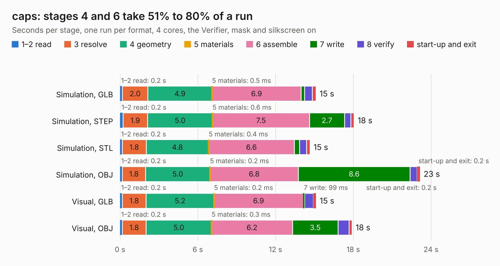

| Mode and format | 1–2 read | 3 resolve | 4 geometry | 5 materials | 6 assemble | 7 write | 8 verify | start-up and exit | Total |
|---|---:|---:|---:|---:|---:|---:|---:|---:|---:|
| Simulation, GLB | 0.2 | 2.0 | 4.9 | 0.5&nbsp;ms | 6.9 | 0.3 | 0.6 | 0.3 | 15.1 |
| Simulation, STEP | 0.2 | 1.9 | 5.0 | 0.6&nbsp;ms | 7.5 | 2.7 | 0.5 | 0.3 | 18.1 |
| Simulation, STL | 0.2 | 1.8 | 4.8 | 0.4&nbsp;ms | 6.6 | 0.4 | 0.5 | 0.3 | 14.7 |
| Simulation, OBJ | 0.2 | 1.8 | 5.0 | 0.2&nbsp;ms | 6.8 | 8.6 | 0.6 | 0.2 | 23.2 |
| Visual, GLB | 0.2 | 1.8 | 5.2 | 0.2&nbsp;ms | 6.9 | 99&nbsp;ms | 0.7 | 0.2 | 15.1 |
| Visual, OBJ | 0.2 | 1.8 | 5.0 | 0.3&nbsp;ms | 6.2 | 3.5 | 0.8 | 0.2 | 17.9 |

<table align="center"><tr><td valign="top">

| Board | Repo: [matthuszagh/fmcw](https://github.com/matthuszagh/fmcw) Board: `caps.kicad_pcb` |
|---|---|
| Folder | hardware / prototypes / caps |
| Complexity | 225&nbsp;/&nbsp;1000 (size&nbsp;180, features&nbsp;45) |
| KESE&nbsp;features | through vias, rounded, trapezoid or chamfered pads, filled zones |
| Tested | 9th November 2026 |
| Copper&nbsp;layers | 4 |
| File&nbsp;format | KiCad 5 (20171130) |
| Parts,&nbsp;tracks,&nbsp;vias | 11, 10, 492 |
| Triangles,&nbsp;simulation | 1,512,272 in 19 parts |
| Verifier | PASS in all six runs |

</td><td valign="top">

<table>
<tr><th>File type</th><th>File size</th><th>Peak memory used</th></tr>
<tr><th colspan="3" align="left">Simulation</th></tr>
<tr><td>GLB</td><td align="right">48&nbsp;MB</td><td align="right">646&nbsp;MB</td></tr>
<tr><td>STEP</td><td align="right">113&nbsp;MB</td><td align="right">753&nbsp;MB</td></tr>
<tr><td>STL</td><td align="right">76&nbsp;MB</td><td align="right">682&nbsp;MB</td></tr>
<tr><td>OBJ</td><td align="right">154&nbsp;MB</td><td align="right">992&nbsp;MB</td></tr>
<tr><th colspan="3" align="left">Visual</th></tr>
<tr><td>GLB</td><td align="right">21&nbsp;MB</td><td align="right">615&nbsp;MB</td></tr>
<tr><td>OBJ</td><td align="right">65&nbsp;MB</td><td align="right">663&nbsp;MB</td></tr>
</table>

</td></tr></table>

## 1622. caps_nightly

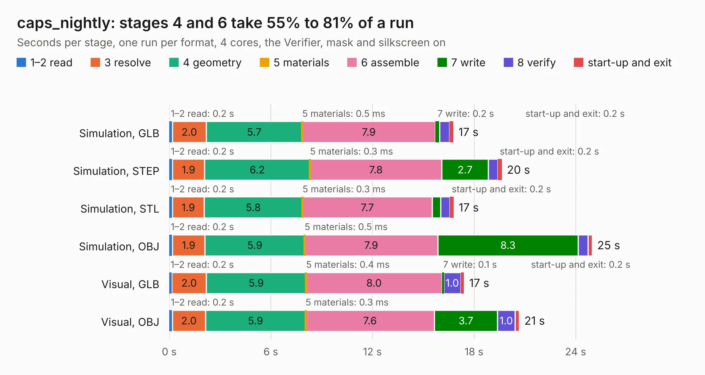

| Mode and format | 1–2 read | 3 resolve | 4 geometry | 5 materials | 6 assemble | 7 write | 8 verify | start-up and exit | Total |
|---|---:|---:|---:|---:|---:|---:|---:|---:|---:|
| Simulation, GLB | 0.2 | 2.0 | 5.7 | 0.5&nbsp;ms | 7.9 | 0.2 | 0.6 | 0.2 | 16.8 |
| Simulation, STEP | 0.2 | 1.9 | 6.2 | 0.3&nbsp;ms | 7.8 | 2.7 | 0.6 | 0.2 | 19.6 |
| Simulation, STL | 0.2 | 1.9 | 5.8 | 0.3&nbsp;ms | 7.7 | 0.5 | 0.6 | 0.2 | 16.8 |
| Simulation, OBJ | 0.2 | 1.9 | 5.9 | 0.5&nbsp;ms | 7.9 | 8.3 | 0.6 | 0.3 | 25.0 |
| Visual, GLB | 0.2 | 2.0 | 5.9 | 0.4&nbsp;ms | 8.0 | 0.1 | 1.0 | 0.2 | 17.4 |
| Visual, OBJ | 0.2 | 2.0 | 5.9 | 0.3&nbsp;ms | 7.6 | 3.7 | 1.0 | 0.3 | 20.7 |

<table align="center"><tr><td valign="top">

| Board | Repo: [matthuszagh/fmcw](https://github.com/matthuszagh/fmcw) Board: `caps_nightly.kicad_pcb` |
|---|---|
| Folder | hardware / prototypes / caps |
| Complexity | 264&nbsp;/&nbsp;1000 (size&nbsp;184, features&nbsp;80) |
| KESE&nbsp;features | through vias, rounded, trapezoid or chamfered pads, filled zones, stack-up, dielectric εr and tanδ, mask and silkscreen colours |
| Tested | 9th November 2026 |
| Copper&nbsp;layers | 4 |
| File&nbsp;format | KiCad 6 (20200119) |
| Parts,&nbsp;tracks,&nbsp;vias | 11, 11, 636 |
| Triangles,&nbsp;simulation | 1,737,368 in 19 parts |
| Verifier | PASS in all six runs |

</td><td valign="top">

<table>
<tr><th>File type</th><th>File size</th><th>Peak memory used</th></tr>
<tr><th colspan="3" align="left">Simulation</th></tr>
<tr><td>GLB</td><td align="right">55&nbsp;MB</td><td align="right">783&nbsp;MB</td></tr>
<tr><td>STEP</td><td align="right">118&nbsp;MB</td><td align="right">861&nbsp;MB</td></tr>
<tr><td>STL</td><td align="right">87&nbsp;MB</td><td align="right">770&nbsp;MB</td></tr>
<tr><td>OBJ</td><td align="right">176&nbsp;MB</td><td align="right">1.1&nbsp;GB</td></tr>
<tr><th colspan="3" align="left">Visual</th></tr>
<tr><td>GLB</td><td align="right">25&nbsp;MB</td><td align="right">706&nbsp;MB</td></tr>
<tr><td>OBJ</td><td align="right">77&nbsp;MB</td><td align="right">738&nbsp;MB</td></tr>
</table>

</td></tr></table>

## 1623. coupler

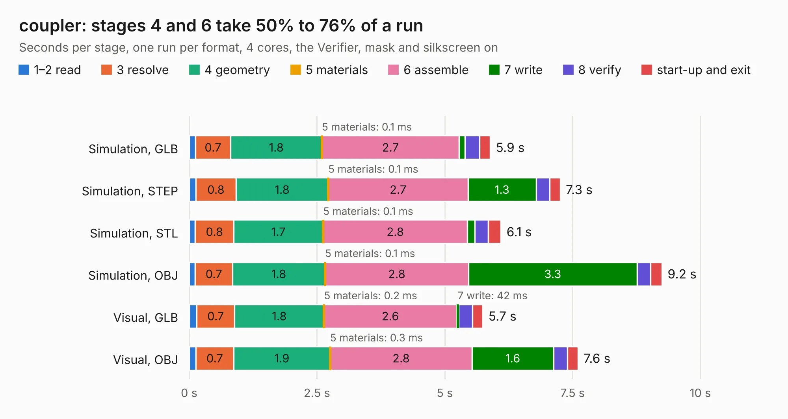

| Mode and format | 1–2 read | 3 resolve | 4 geometry | 5 materials | 6 assemble | 7 write | 8 verify | start-up and exit | Total |
|---|---:|---:|---:|---:|---:|---:|---:|---:|---:|
| Simulation, GLB | 0.1 | 0.7 | 1.8 | 0.1&nbsp;ms | 2.7 | 0.1 | 0.3 | 0.2 | 5.9 |
| Simulation, STEP | 0.1 | 0.8 | 1.8 | 0.1&nbsp;ms | 2.7 | 1.3 | 0.3 | 0.2 | 7.3 |
| Simulation, STL | 0.1 | 0.8 | 1.7 | 0.1&nbsp;ms | 2.8 | 0.1 | 0.3 | 0.2 | 6.1 |
| Simulation, OBJ | 0.1 | 0.7 | 1.8 | 0.1&nbsp;ms | 2.8 | 3.3 | 0.3 | 0.2 | 9.2 |
| Visual, GLB | 0.1 | 0.7 | 1.8 | 0.2&nbsp;ms | 2.6 | 42&nbsp;ms | 0.3 | 0.2 | 5.7 |
| Visual, OBJ | 0.1 | 0.7 | 1.9 | 0.3&nbsp;ms | 2.8 | 1.6 | 0.3 | 0.2 | 7.6 |

<table align="center"><tr><td valign="top">

| Board | Repo: [matthuszagh/fmcw](https://github.com/matthuszagh/fmcw) Board: `coupler.kicad_pcb` |
|---|---|
| Folder | hardware / prototypes / coupler |
| Complexity | 199&nbsp;/&nbsp;1000 (size&nbsp;164, features&nbsp;35) |
| KESE&nbsp;features | through vias, filled zones |
| Tested | 9th November 2026 |
| Copper&nbsp;layers | 4 |
| File&nbsp;format | KiCad 5 (20171130) |
| Parts,&nbsp;tracks,&nbsp;vias | 5, 72, 278 |
| Triangles,&nbsp;simulation | 647,556 in 18 parts |
| Verifier | PASS in all six runs |

</td><td valign="top">

<table>
<tr><th>File type</th><th>File size</th><th>Peak memory used</th></tr>
<tr><th colspan="3" align="left">Simulation</th></tr>
<tr><td>GLB</td><td align="right">21&nbsp;MB</td><td align="right">396&nbsp;MB</td></tr>
<tr><td>STEP</td><td align="right">38&nbsp;MB</td><td align="right">446&nbsp;MB</td></tr>
<tr><td>STL</td><td align="right">32&nbsp;MB</td><td align="right">404&nbsp;MB</td></tr>
<tr><td>OBJ</td><td align="right">65&nbsp;MB</td><td align="right">435&nbsp;MB</td></tr>
<tr><th colspan="3" align="left">Visual</th></tr>
<tr><td>GLB</td><td align="right">10&nbsp;MB</td><td align="right">377&nbsp;MB</td></tr>
<tr><td>OBJ</td><td align="right">31&nbsp;MB</td><td align="right">373&nbsp;MB</td></tr>
</table>

</td></tr></table>

## 1624. coupler_nightly

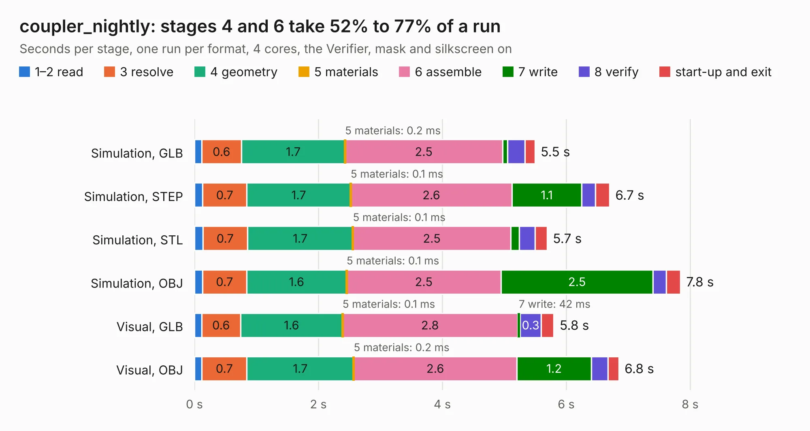

| Mode and format | 1–2 read | 3 resolve | 4 geometry | 5 materials | 6 assemble | 7 write | 8 verify | start-up and exit | Total |
|---|---:|---:|---:|---:|---:|---:|---:|---:|---:|
| Simulation, GLB | 0.1 | 0.6 | 1.7 | 0.2&nbsp;ms | 2.5 | 81&nbsp;ms | 0.3 | 0.2 | 5.5 |
| Simulation, STEP | 0.1 | 0.7 | 1.7 | 0.1&nbsp;ms | 2.6 | 1.1 | 0.2 | 0.2 | 6.7 |
| Simulation, STL | 0.1 | 0.7 | 1.7 | 0.1&nbsp;ms | 2.5 | 0.1 | 0.3 | 0.2 | 5.7 |
| Simulation, OBJ | 0.1 | 0.7 | 1.6 | 0.1&nbsp;ms | 2.5 | 2.5 | 0.2 | 0.2 | 7.8 |
| Visual, GLB | 0.1 | 0.6 | 1.6 | 0.1&nbsp;ms | 2.8 | 42&nbsp;ms | 0.3 | 0.2 | 5.8 |
| Visual, OBJ | 0.1 | 0.7 | 1.7 | 0.2&nbsp;ms | 2.6 | 1.2 | 0.3 | 0.2 | 6.8 |

<table align="center"><tr><td valign="top">

| Board | Repo: [matthuszagh/fmcw](https://github.com/matthuszagh/fmcw) Board: `coupler_nightly.kicad_pcb` |
|---|---|
| Folder | hardware / prototypes / coupler |
| Complexity | 237&nbsp;/&nbsp;1000 (size&nbsp;167, features&nbsp;70) |
| KESE&nbsp;features | through vias, filled zones, stack-up, dielectric εr and tanδ, mask and silkscreen colours |
| Tested | 9th November 2026 |
| Copper&nbsp;layers | 4 |
| File&nbsp;format | KiCad 6 (20200119) |
| Parts,&nbsp;tracks,&nbsp;vias | 5, 137, 305 |
| Triangles,&nbsp;simulation | 659,588 in 18 parts |
| Verifier | PASS in all six runs |

</td><td valign="top">

<table>
<tr><th>File type</th><th>File size</th><th>Peak memory used</th></tr>
<tr><th colspan="3" align="left">Simulation</th></tr>
<tr><td>GLB</td><td align="right">21&nbsp;MB</td><td align="right">412&nbsp;MB</td></tr>
<tr><td>STEP</td><td align="right">30&nbsp;MB</td><td align="right">458&nbsp;MB</td></tr>
<tr><td>STL</td><td align="right">33&nbsp;MB</td><td align="right">407&nbsp;MB</td></tr>
<tr><td>OBJ</td><td align="right">65&nbsp;MB</td><td align="right">434&nbsp;MB</td></tr>
<tr><th colspan="3" align="left">Visual</th></tr>
<tr><td>GLB</td><td align="right">11&nbsp;MB</td><td align="right">357&nbsp;MB</td></tr>
<tr><td>OBJ</td><td align="right">32&nbsp;MB</td><td align="right">382&nbsp;MB</td></tr>
</table>

</td></tr></table>

## 1625. microstrip_width

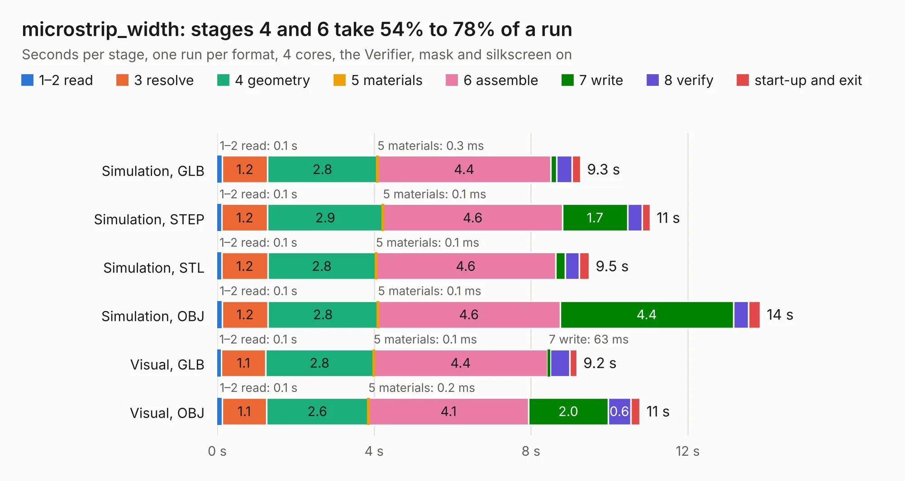

| Mode and format | 1–2 read | 3 resolve | 4 geometry | 5 materials | 6 assemble | 7 write | 8 verify | start-up and exit | Total |
|---|---:|---:|---:|---:|---:|---:|---:|---:|---:|
| Simulation, GLB | 0.1 | 1.2 | 2.8 | 0.3&nbsp;ms | 4.4 | 0.2 | 0.4 | 0.2 | 9.3 |
| Simulation, STEP | 0.1 | 1.2 | 2.9 | 0.1&nbsp;ms | 4.6 | 1.7 | 0.4 | 0.2 | 11.0 |
| Simulation, STL | 0.1 | 1.2 | 2.8 | 0.1&nbsp;ms | 4.6 | 0.2 | 0.4 | 0.3 | 9.5 |
| Simulation, OBJ | 0.1 | 1.2 | 2.8 | 0.1&nbsp;ms | 4.6 | 4.4 | 0.4 | 0.3 | 13.8 |
| Visual, GLB | 0.1 | 1.1 | 2.8 | 0.1&nbsp;ms | 4.4 | 63&nbsp;ms | 0.5 | 0.2 | 9.2 |
| Visual, OBJ | 0.1 | 1.1 | 2.6 | 0.2&nbsp;ms | 4.1 | 2.0 | 0.6 | 0.2 | 10.8 |

<table align="center"><tr><td valign="top">

| Board | Repo: [matthuszagh/fmcw](https://github.com/matthuszagh/fmcw) Board: `microstrip_width.kicad_pcb` |
|---|---|
| Folder | hardware / prototypes / microstrip_width |
| Complexity | 207&nbsp;/&nbsp;1000 (size&nbsp;172, features&nbsp;35) |
| KESE&nbsp;features | through vias, filled zones |
| Tested | 9th November 2026 |
| Copper&nbsp;layers | 4 |
| File&nbsp;format | KiCad 5 (20171130) |
| Parts,&nbsp;tracks,&nbsp;vias | 6, 3, 421 |
| Triangles,&nbsp;simulation | 947,684 in 16 parts |
| Verifier | PASS in all six runs |

</td><td valign="top">

<table>
<tr><th>File type</th><th>File size</th><th>Peak memory used</th></tr>
<tr><th colspan="3" align="left">Simulation</th></tr>
<tr><td>GLB</td><td align="right">30&nbsp;MB</td><td align="right">519&nbsp;MB</td></tr>
<tr><td>STEP</td><td align="right">49&nbsp;MB</td><td align="right">571&nbsp;MB</td></tr>
<tr><td>STL</td><td align="right">47&nbsp;MB</td><td align="right">510&nbsp;MB</td></tr>
<tr><td>OBJ</td><td align="right">95&nbsp;MB</td><td align="right">675&nbsp;MB</td></tr>
<tr><th colspan="3" align="left">Visual</th></tr>
<tr><td>GLB</td><td align="right">15&nbsp;MB</td><td align="right">428&nbsp;MB</td></tr>
<tr><td>OBJ</td><td align="right">45&nbsp;MB</td><td align="right">424&nbsp;MB</td></tr>
</table>

</td></tr></table>

## 1626. microstrip_width_nightly

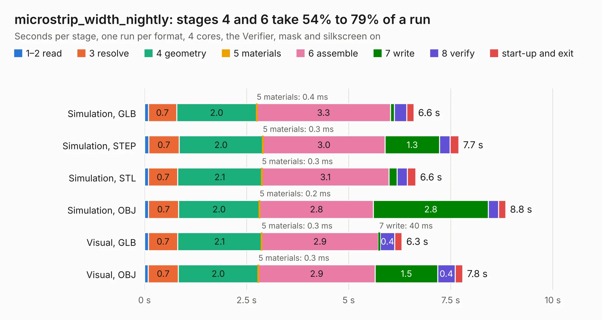

| Mode and format | 1–2 read | 3 resolve | 4 geometry | 5 materials | 6 assemble | 7 write | 8 verify | start-up and exit | Total |
|---|---:|---:|---:|---:|---:|---:|---:|---:|---:|
| Simulation, GLB | 93&nbsp;ms | 0.7 | 2.0 | 0.4&nbsp;ms | 3.3 | 94&nbsp;ms | 0.3 | 0.2 | 6.6 |
| Simulation, STEP | 0.1 | 0.7 | 2.0 | 0.3&nbsp;ms | 3.0 | 1.3 | 0.3 | 0.2 | 7.7 |
| Simulation, STL | 96&nbsp;ms | 0.7 | 2.1 | 0.3&nbsp;ms | 3.1 | 0.2 | 0.2 | 0.2 | 6.6 |
| Simulation, OBJ | 95&nbsp;ms | 0.7 | 2.0 | 0.2&nbsp;ms | 2.8 | 2.8 | 0.3 | 0.2 | 8.8 |
| Visual, GLB | 98&nbsp;ms | 0.7 | 2.1 | 0.3&nbsp;ms | 2.9 | 40&nbsp;ms | 0.4 | 0.2 | 6.3 |
| Visual, OBJ | 92&nbsp;ms | 0.7 | 2.0 | 0.3&nbsp;ms | 2.9 | 1.5 | 0.4 | 0.2 | 7.8 |

<table align="center"><tr><td valign="top">

| Board | Repo: [matthuszagh/fmcw](https://github.com/matthuszagh/fmcw) Board: `microstrip_width_nightly.kicad_pcb` |
|---|---|
| Folder | hardware / prototypes / microstrip_width |
| Complexity | 238&nbsp;/&nbsp;1000 (size&nbsp;168, features&nbsp;70) |
| KESE&nbsp;features | through vias, filled zones, stack-up, dielectric εr and tanδ, mask and silkscreen colours |
| Tested | 9th November 2026 |
| Copper&nbsp;layers | 4 |
| File&nbsp;format | KiCad 6 (20200119) |
| Parts,&nbsp;tracks,&nbsp;vias | 6, 3, 335 |
| Triangles,&nbsp;simulation | 749,524 in 16 parts |
| Verifier | PASS in all six runs |

</td><td valign="top">

<table>
<tr><th>File type</th><th>File size</th><th>Peak memory used</th></tr>
<tr><th colspan="3" align="left">Simulation</th></tr>
<tr><td>GLB</td><td align="right">23&nbsp;MB</td><td align="right">446&nbsp;MB</td></tr>
<tr><td>STEP</td><td align="right">30&nbsp;MB</td><td align="right">478&nbsp;MB</td></tr>
<tr><td>STL</td><td align="right">37&nbsp;MB</td><td align="right">448&nbsp;MB</td></tr>
<tr><td>OBJ</td><td align="right">74&nbsp;MB</td><td align="right">482&nbsp;MB</td></tr>
<tr><th colspan="3" align="left">Visual</th></tr>
<tr><td>GLB</td><td align="right">12&nbsp;MB</td><td align="right">372&nbsp;MB</td></tr>
<tr><td>OBJ</td><td align="right">35&nbsp;MB</td><td align="right">401&nbsp;MB</td></tr>
</table>

</td></tr></table>

## 1627. basic-ecp5-pcb

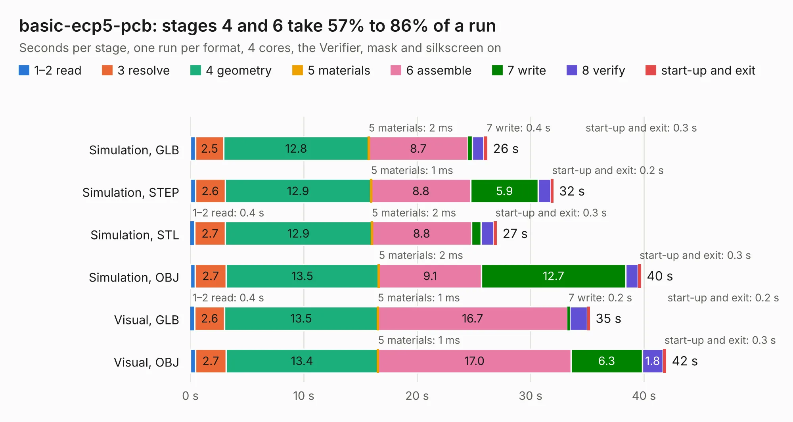

| Mode and format | 1–2 read | 3 resolve | 4 geometry | 5 materials | 6 assemble | 7 write | 8 verify | start-up and exit | Total |
|---|---:|---:|---:|---:|---:|---:|---:|---:|---:|
| Simulation, GLB | 0.4 | 2.5 | 12.8 | 2&nbsp;ms | 8.7 | 0.4 | 1.0 | 0.3 | 26.2 |
| Simulation, STEP | 0.4 | 2.6 | 12.9 | 1&nbsp;ms | 8.8 | 5.9 | 1.1 | 0.2 | 32.0 |
| Simulation, STL | 0.4 | 2.7 | 12.9 | 2&nbsp;ms | 8.8 | 0.8 | 1.1 | 0.3 | 27.0 |
| Simulation, OBJ | 0.4 | 2.7 | 13.5 | 2&nbsp;ms | 9.1 | 12.7 | 1.1 | 0.3 | 39.7 |
| Visual, GLB | 0.4 | 2.6 | 13.5 | 1&nbsp;ms | 16.7 | 0.2 | 1.6 | 0.2 | 35.2 |
| Visual, OBJ | 0.4 | 2.7 | 13.4 | 1&nbsp;ms | 17.0 | 6.3 | 1.8 | 0.3 | 42.0 |

<table align="center"><tr><td valign="top">

| Board | Repo: [mattvenn/basic-ecp5-pcb](https://github.com/mattvenn/basic-ecp5-pcb) Board: `basic-ecp5-pcb.kicad_pcb` |
|---|---|
| Folder | hardware |
| Complexity | 305&nbsp;/&nbsp;1000 (size&nbsp;250, features&nbsp;55) |
| KESE&nbsp;features | through vias, rounded, trapezoid or chamfered pads, filled zones, curved board outline |
| Tested | 9th November 2026 |
| Copper&nbsp;layers | 4 |
| File&nbsp;format | KiCad 5 (20171130) |
| Parts,&nbsp;tracks,&nbsp;vias | 62, 1,148, 130 |
| Triangles,&nbsp;simulation | 2,343,666 in 255 parts |
| Verifier | PASS in all six runs |

</td><td valign="top">

<table>
<tr><th>File type</th><th>File size</th><th>Peak memory used</th></tr>
<tr><th colspan="3" align="left">Simulation</th></tr>
<tr><td>GLB</td><td align="right">81&nbsp;MB</td><td align="right">707&nbsp;MB</td></tr>
<tr><td>STEP</td><td align="right">348&nbsp;MB</td><td align="right">928&nbsp;MB</td></tr>
<tr><td>STL</td><td align="right">117&nbsp;MB</td><td align="right">708&nbsp;MB</td></tr>
<tr><td>OBJ</td><td align="right">248&nbsp;MB</td><td align="right">1.6&nbsp;GB</td></tr>
<tr><th colspan="3" align="left">Visual</th></tr>
<tr><td>GLB</td><td align="right">42&nbsp;MB</td><td align="right">927&nbsp;MB</td></tr>
<tr><td>OBJ</td><td align="right">126&nbsp;MB</td><td align="right">925&nbsp;MB</td></tr>
</table>

</td></tr></table>

## 1628. ai-camera

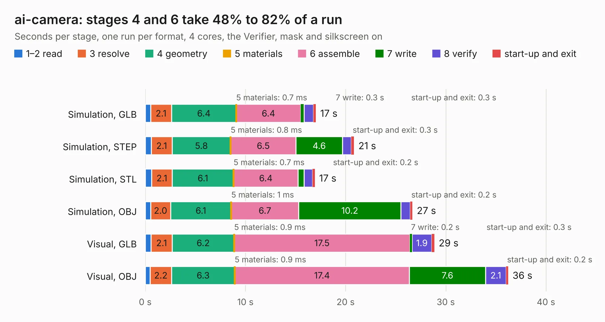

| Mode and format | 1–2 read | 3 resolve | 4 geometry | 5 materials | 6 assemble | 7 write | 8 verify | start-up and exit | Total |
|---|---:|---:|---:|---:|---:|---:|---:|---:|---:|
| Simulation, GLB | 0.5 | 2.1 | 6.4 | 0.7&nbsp;ms | 6.4 | 0.3 | 0.9 | 0.3 | 17.0 |
| Simulation, STEP | 0.6 | 2.1 | 5.8 | 0.8&nbsp;ms | 6.5 | 4.6 | 0.9 | 0.3 | 20.8 |
| Simulation, STL | 0.6 | 2.1 | 6.1 | 0.7&nbsp;ms | 6.4 | 0.6 | 0.8 | 0.2 | 16.9 |
| Simulation, OBJ | 0.5 | 2.0 | 6.1 | 1&nbsp;ms | 6.7 | 10.2 | 0.9 | 0.2 | 26.7 |
| Visual, GLB | 0.6 | 2.1 | 6.2 | 0.9&nbsp;ms | 17.5 | 0.2 | 1.9 | 0.3 | 28.9 |
| Visual, OBJ | 0.5 | 2.2 | 6.3 | 0.9&nbsp;ms | 17.4 | 7.6 | 2.1 | 0.2 | 36.2 |

<table align="center"><tr><td valign="top">

| Board | Repo: [maxlab-io/tokay-lite-pcb](https://github.com/maxlab-io/tokay-lite-pcb) Board: `ai-camera.kicad_pcb` |
|---|---|
| Folder | ai-camera-rev0 |
| Complexity | 339&nbsp;/&nbsp;1000 (size&nbsp;214, features&nbsp;125) |
| KESE&nbsp;features | through vias, slotted holes, custom pads, rounded, trapezoid or chamfered pads, filled zones, copper drawings, curved board outline, stack-up, dielectric εr and tanδ, mask and silkscreen colours |
| Tested | 9th November 2026 |
| Copper&nbsp;layers | 4 |
| File&nbsp;format | KiCad 6 (20211014) |
| Parts,&nbsp;tracks,&nbsp;vias | 130, 1,351, 340 |
| Triangles,&nbsp;simulation | 2,141,088 in 108 parts |
| Verifier | PASS in all six runs |

</td><td valign="top">

<table>
<tr><th>File type</th><th>File size</th><th>Peak memory used</th></tr>
<tr><th colspan="3" align="left">Simulation</th></tr>
<tr><td>GLB</td><td align="right">72&nbsp;MB</td><td align="right">876&nbsp;MB</td></tr>
<tr><td>STEP</td><td align="right">293&nbsp;MB</td><td align="right">965&nbsp;MB</td></tr>
<tr><td>STL</td><td align="right">107&nbsp;MB</td><td align="right">812&nbsp;MB</td></tr>
<tr><td>OBJ</td><td align="right">223&nbsp;MB</td><td align="right">1.4&nbsp;GB</td></tr>
<tr><th colspan="3" align="left">Visual</th></tr>
<tr><td>GLB</td><td align="right">51&nbsp;MB</td><td align="right">1.1&nbsp;GB</td></tr>
<tr><td>OBJ</td><td align="right">158&nbsp;MB</td><td align="right">1.2&nbsp;GB</td></tr>
</table>

</td></tr></table>

## 1629. ai-camera

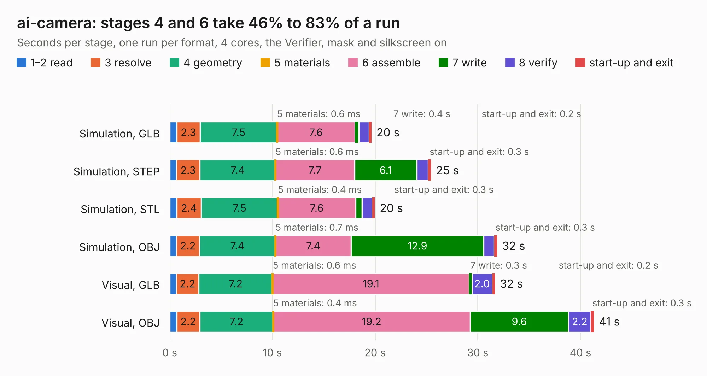

| Mode and format | 1–2 read | 3 resolve | 4 geometry | 5 materials | 6 assemble | 7 write | 8 verify | start-up and exit | Total |
|---|---:|---:|---:|---:|---:|---:|---:|---:|---:|
| Simulation, GLB | 0.7 | 2.3 | 7.5 | 0.6&nbsp;ms | 7.6 | 0.4 | 1.0 | 0.2 | 19.6 |
| Simulation, STEP | 0.6 | 2.3 | 7.4 | 0.6&nbsp;ms | 7.7 | 6.1 | 1.1 | 0.3 | 25.4 |
| Simulation, STL | 0.7 | 2.4 | 7.5 | 0.4&nbsp;ms | 7.6 | 0.6 | 1.0 | 0.3 | 20.0 |
| Simulation, OBJ | 0.7 | 2.2 | 7.4 | 0.7&nbsp;ms | 7.4 | 12.9 | 1.0 | 0.3 | 31.9 |
| Visual, GLB | 0.6 | 2.2 | 7.2 | 0.6&nbsp;ms | 19.1 | 0.3 | 2.0 | 0.2 | 31.7 |
| Visual, OBJ | 0.7 | 2.2 | 7.2 | 0.4&nbsp;ms | 19.2 | 9.6 | 2.2 | 0.3 | 41.3 |

<table align="center"><tr><td valign="top">

| Board | Repo: [maxlab-io/tokay-lite-pcb](https://github.com/maxlab-io/tokay-lite-pcb) Board: `ai-camera.kicad_pcb` |
|---|---|
| Folder | ai-camera-rev1 |
| Complexity | 339&nbsp;/&nbsp;1000 (size&nbsp;214, features&nbsp;125) |
| KESE&nbsp;features | through vias, slotted holes, custom pads, rounded, trapezoid or chamfered pads, filled zones, copper drawings, curved board outline, stack-up, dielectric εr and tanδ, mask and silkscreen colours |
| Tested | 9th November 2026 |
| Copper&nbsp;layers | 4 |
| File&nbsp;format | KiCad 7 (20221018) |
| Parts,&nbsp;tracks,&nbsp;vias | 151, 1,227, 305 |
| Triangles,&nbsp;simulation | 2,114,240 in 113 parts |
| Verifier | PASS in all six runs |

</td><td valign="top">

<table>
<tr><th>File type</th><th>File size</th><th>Peak memory used</th></tr>
<tr><th colspan="3" align="left">Simulation</th></tr>
<tr><td>GLB</td><td align="right">71&nbsp;MB</td><td align="right">818&nbsp;MB</td></tr>
<tr><td>STEP</td><td align="right">308&nbsp;MB</td><td align="right">943&nbsp;MB</td></tr>
<tr><td>STL</td><td align="right">106&nbsp;MB</td><td align="right">851&nbsp;MB</td></tr>
<tr><td>OBJ</td><td align="right">221&nbsp;MB</td><td align="right">1.4&nbsp;GB</td></tr>
<tr><th colspan="3" align="left">Visual</th></tr>
<tr><td>GLB</td><td align="right">52&nbsp;MB</td><td align="right">958&nbsp;MB</td></tr>
<tr><td>OBJ</td><td align="right">160&nbsp;MB</td><td align="right">1.1&nbsp;GB</td></tr>
</table>

</td></tr></table>

## 1630. ai-camera-rev2

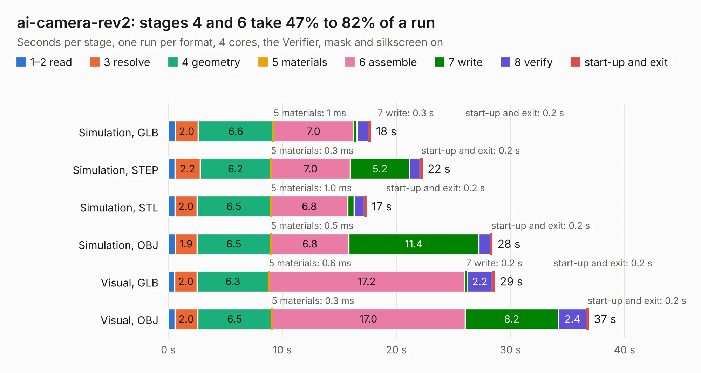

| Mode and format | 1–2 read | 3 resolve | 4 geometry | 5 materials | 6 assemble | 7 write | 8 verify | start-up and exit | Total |
|---|---:|---:|---:|---:|---:|---:|---:|---:|---:|
| Simulation, GLB | 0.6 | 2.0 | 6.6 | 1&nbsp;ms | 7.0 | 0.3 | 1.0 | 0.2 | 17.8 |
| Simulation, STEP | 0.6 | 2.2 | 6.2 | 0.3&nbsp;ms | 7.0 | 5.2 | 0.9 | 0.2 | 22.3 |
| Simulation, STL | 0.6 | 2.0 | 6.5 | 1.0&nbsp;ms | 6.8 | 0.5 | 0.9 | 0.2 | 17.4 |
| Simulation, OBJ | 0.6 | 1.9 | 6.5 | 0.5&nbsp;ms | 6.8 | 11.4 | 1.0 | 0.2 | 28.4 |
| Visual, GLB | 0.6 | 2.0 | 6.3 | 0.6&nbsp;ms | 17.2 | 0.2 | 2.2 | 0.2 | 28.6 |
| Visual, OBJ | 0.6 | 2.0 | 6.5 | 0.3&nbsp;ms | 17.0 | 8.2 | 2.4 | 0.2 | 36.9 |

<table align="center"><tr><td valign="top">

| Board | Repo: [maxlab-io/tokay-lite-pcb](https://github.com/maxlab-io/tokay-lite-pcb) Board: `ai-camera-rev2.kicad_pcb` |
|---|---|
| Folder | ai-camera-rev2 |
| Complexity | 314&nbsp;/&nbsp;1000 (size&nbsp;214, features&nbsp;100) |
| KESE&nbsp;features | through vias, slotted holes, rounded, trapezoid or chamfered pads, filled zones, curved board outline, stack-up, dielectric εr and tanδ, mask and silkscreen colours |
| Tested | 9th November 2026 |
| Copper&nbsp;layers | 4 |
| File&nbsp;format | KiCad 7 (20221018) |
| Parts,&nbsp;tracks,&nbsp;vias | 153, 1,208, 330 |
| Triangles,&nbsp;simulation | 2,131,926 in 113 parts |
| Verifier | PASS in all six runs |

</td><td valign="top">

<table>
<tr><th>File type</th><th>File size</th><th>Peak memory used</th></tr>
<tr><th colspan="3" align="left">Simulation</th></tr>
<tr><td>GLB</td><td align="right">72&nbsp;MB</td><td align="right">874&nbsp;MB</td></tr>
<tr><td>STEP</td><td align="right">309&nbsp;MB</td><td align="right">989&nbsp;MB</td></tr>
<tr><td>STL</td><td align="right">107&nbsp;MB</td><td align="right">793&nbsp;MB</td></tr>
<tr><td>OBJ</td><td align="right">222&nbsp;MB</td><td align="right">1.4&nbsp;GB</td></tr>
<tr><th colspan="3" align="left">Visual</th></tr>
<tr><td>GLB</td><td align="right">52&nbsp;MB</td><td align="right">1.0&nbsp;GB</td></tr>
<tr><td>OBJ</td><td align="right">159&nbsp;MB</td><td align="right">1.1&nbsp;GB</td></tr>
</table>

</td></tr></table>

## 1631. ai-camera-rev3.1

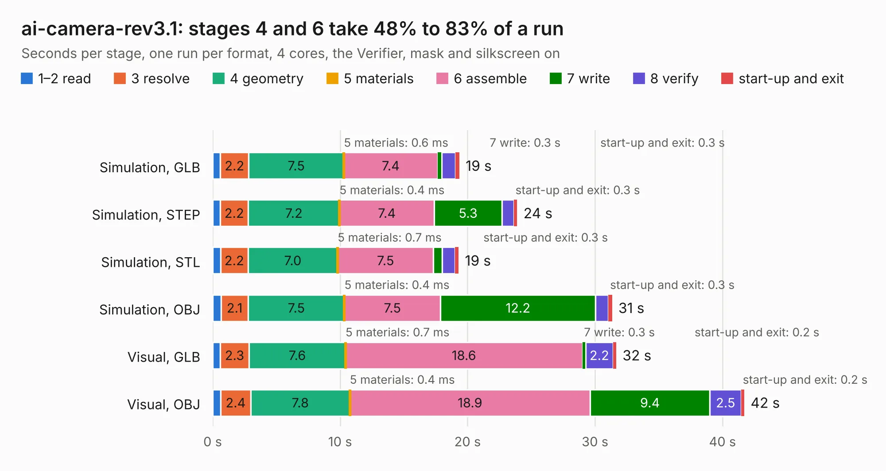

| Mode and format | 1–2 read | 3 resolve | 4 geometry | 5 materials | 6 assemble | 7 write | 8 verify | start-up and exit | Total |
|---|---:|---:|---:|---:|---:|---:|---:|---:|---:|
| Simulation, GLB | 0.6 | 2.2 | 7.5 | 0.6&nbsp;ms | 7.4 | 0.3 | 1.1 | 0.3 | 19.4 |
| Simulation, STEP | 0.6 | 2.2 | 7.2 | 0.4&nbsp;ms | 7.4 | 5.3 | 0.9 | 0.3 | 23.9 |
| Simulation, STL | 0.6 | 2.2 | 7.0 | 0.7&nbsp;ms | 7.5 | 0.7 | 1.0 | 0.3 | 19.3 |
| Simulation, OBJ | 0.7 | 2.1 | 7.5 | 0.4&nbsp;ms | 7.5 | 12.2 | 1.0 | 0.3 | 31.3 |
| Visual, GLB | 0.6 | 2.3 | 7.6 | 0.7&nbsp;ms | 18.6 | 0.3 | 2.2 | 0.2 | 31.7 |
| Visual, OBJ | 0.6 | 2.4 | 7.8 | 0.4&nbsp;ms | 18.9 | 9.4 | 2.5 | 0.2 | 41.7 |

<table align="center"><tr><td valign="top">

| Board | Repo: [maxlab-io/tokay-lite-pcb](https://github.com/maxlab-io/tokay-lite-pcb) Board: `ai-camera-rev3.1.kicad_pcb` |
|---|---|
| Folder | ai-camera-rev3.1 |
| Complexity | 314&nbsp;/&nbsp;1000 (size&nbsp;214, features&nbsp;100) |
| KESE&nbsp;features | through vias, slotted holes, rounded, trapezoid or chamfered pads, filled zones, curved board outline, stack-up, dielectric εr and tanδ, mask and silkscreen colours |
| Tested | 9th November 2026 |
| Copper&nbsp;layers | 4 |
| File&nbsp;format | KiCad 7 (20221018) |
| Parts,&nbsp;tracks,&nbsp;vias | 153, 1,223, 330 |
| Triangles,&nbsp;simulation | 2,082,322 in 113 parts |
| Verifier | PASS in all six runs |

</td><td valign="top">

<table>
<tr><th>File type</th><th>File size</th><th>Peak memory used</th></tr>
<tr><th colspan="3" align="left">Simulation</th></tr>
<tr><td>GLB</td><td align="right">70&nbsp;MB</td><td align="right">809&nbsp;MB</td></tr>
<tr><td>STEP</td><td align="right">291&nbsp;MB</td><td align="right">929&nbsp;MB</td></tr>
<tr><td>STL</td><td align="right">104&nbsp;MB</td><td align="right">822&nbsp;MB</td></tr>
<tr><td>OBJ</td><td align="right">217&nbsp;MB</td><td align="right">1.4&nbsp;GB</td></tr>
<tr><th colspan="3" align="left">Visual</th></tr>
<tr><td>GLB</td><td align="right">51&nbsp;MB</td><td align="right">933&nbsp;MB</td></tr>
<tr><td>OBJ</td><td align="right">156&nbsp;MB</td><td align="right">1.1&nbsp;GB</td></tr>
</table>

</td></tr></table>

## 1632. ai-camera-rev3.2

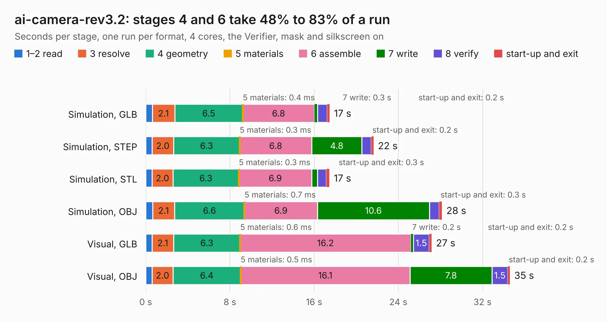

| Mode and format | 1–2 read | 3 resolve | 4 geometry | 5 materials | 6 assemble | 7 write | 8 verify | start-up and exit | Total |
|---|---:|---:|---:|---:|---:|---:|---:|---:|---:|
| Simulation, GLB | 0.6 | 2.1 | 6.5 | 0.4&nbsp;ms | 6.8 | 0.3 | 0.9 | 0.2 | 17.5 |
| Simulation, STEP | 0.6 | 2.0 | 6.3 | 0.3&nbsp;ms | 6.8 | 4.8 | 0.9 | 0.2 | 21.6 |
| Simulation, STL | 0.6 | 2.0 | 6.3 | 0.3&nbsp;ms | 6.9 | 0.5 | 0.9 | 0.3 | 17.5 |
| Simulation, OBJ | 0.6 | 2.1 | 6.6 | 0.7&nbsp;ms | 6.9 | 10.6 | 0.9 | 0.3 | 28.2 |
| Visual, GLB | 0.6 | 2.1 | 6.3 | 0.6&nbsp;ms | 16.2 | 0.2 | 1.5 | 0.2 | 27.2 |
| Visual, OBJ | 0.6 | 2.0 | 6.4 | 0.5&nbsp;ms | 16.1 | 7.8 | 1.5 | 0.2 | 34.6 |

<table align="center"><tr><td valign="top">

| Board | Repo: [maxlab-io/tokay-lite-pcb](https://github.com/maxlab-io/tokay-lite-pcb) Board: `ai-camera-rev3.2.kicad_pcb` |
|---|---|
| Folder | ai-camera-rev3.2 |
| Complexity | 315&nbsp;/&nbsp;1000 (size&nbsp;215, features&nbsp;100) |
| KESE&nbsp;features | through vias, slotted holes, rounded, trapezoid or chamfered pads, filled zones, curved board outline, stack-up, dielectric εr and tanδ, mask and silkscreen colours |
| Tested | 9th November 2026 |
| Copper&nbsp;layers | 4 |
| File&nbsp;format | KiCad 8 (20240108) |
| Parts,&nbsp;tracks,&nbsp;vias | 153, 1,274, 330 |
| Triangles,&nbsp;simulation | 2,092,308 in 113 parts |
| Verifier | PASS in all six runs |

</td><td valign="top">

<table>
<tr><th>File type</th><th>File size</th><th>Peak memory used</th></tr>
<tr><th colspan="3" align="left">Simulation</th></tr>
<tr><td>GLB</td><td align="right">70&nbsp;MB</td><td align="right">827&nbsp;MB</td></tr>
<tr><td>STEP</td><td align="right">294&nbsp;MB</td><td align="right">949&nbsp;MB</td></tr>
<tr><td>STL</td><td align="right">105&nbsp;MB</td><td align="right">874&nbsp;MB</td></tr>
<tr><td>OBJ</td><td align="right">218&nbsp;MB</td><td align="right">1.4&nbsp;GB</td></tr>
<tr><th colspan="3" align="left">Visual</th></tr>
<tr><td>GLB</td><td align="right">51&nbsp;MB</td><td align="right">919&nbsp;MB</td></tr>
<tr><td>OBJ</td><td align="right">157&nbsp;MB</td><td align="right">1.1&nbsp;GB</td></tr>
</table>

</td></tr></table>

## 1633. ai-camera-rev3

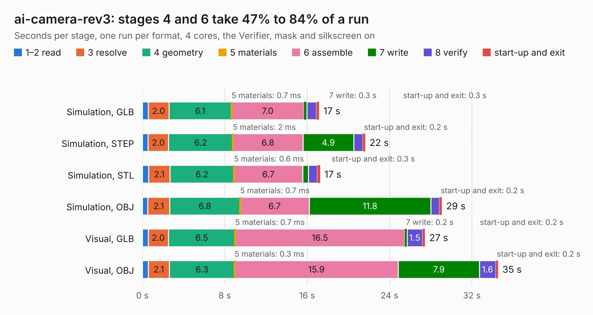

| Mode and format | 1–2 read | 3 resolve | 4 geometry | 5 materials | 6 assemble | 7 write | 8 verify | start-up and exit | Total |
|---|---:|---:|---:|---:|---:|---:|---:|---:|---:|
| Simulation, GLB | 0.6 | 2.0 | 6.1 | 0.7&nbsp;ms | 7.0 | 0.3 | 0.9 | 0.3 | 17.2 |
| Simulation, STEP | 0.6 | 2.0 | 6.2 | 2&nbsp;ms | 6.8 | 4.9 | 0.9 | 0.2 | 21.6 |
| Simulation, STL | 0.6 | 2.1 | 6.2 | 0.6&nbsp;ms | 6.7 | 0.5 | 0.9 | 0.3 | 17.3 |
| Simulation, OBJ | 0.5 | 2.1 | 6.8 | 0.7&nbsp;ms | 6.7 | 11.8 | 0.8 | 0.2 | 29.1 |
| Visual, GLB | 0.6 | 2.0 | 6.5 | 0.7&nbsp;ms | 16.5 | 0.2 | 1.5 | 0.2 | 27.5 |
| Visual, OBJ | 0.6 | 2.1 | 6.3 | 0.3&nbsp;ms | 15.9 | 7.9 | 1.6 | 0.2 | 34.5 |

<table align="center"><tr><td valign="top">

| Board | Repo: [maxlab-io/tokay-lite-pcb](https://github.com/maxlab-io/tokay-lite-pcb) Board: `ai-camera-rev3.kicad_pcb` |
|---|---|
| Folder | ai-camera-rev3 |
| Complexity | 314&nbsp;/&nbsp;1000 (size&nbsp;214, features&nbsp;100) |
| KESE&nbsp;features | through vias, slotted holes, rounded, trapezoid or chamfered pads, filled zones, curved board outline, stack-up, dielectric εr and tanδ, mask and silkscreen colours |
| Tested | 9th November 2026 |
| Copper&nbsp;layers | 4 |
| File&nbsp;format | KiCad 7 (20221018) |
| Parts,&nbsp;tracks,&nbsp;vias | 153, 1,215, 330 |
| Triangles,&nbsp;simulation | 2,090,940 in 113 parts |
| Verifier | PASS in all six runs |

</td><td valign="top">

<table>
<tr><th>File type</th><th>File size</th><th>Peak memory used</th></tr>
<tr><th colspan="3" align="left">Simulation</th></tr>
<tr><td>GLB</td><td align="right">70&nbsp;MB</td><td align="right">807&nbsp;MB</td></tr>
<tr><td>STEP</td><td align="right">293&nbsp;MB</td><td align="right">903&nbsp;MB</td></tr>
<tr><td>STL</td><td align="right">105&nbsp;MB</td><td align="right">790&nbsp;MB</td></tr>
<tr><td>OBJ</td><td align="right">218&nbsp;MB</td><td align="right">1.4&nbsp;GB</td></tr>
<tr><th colspan="3" align="left">Visual</th></tr>
<tr><td>GLB</td><td align="right">51&nbsp;MB</td><td align="right">1.1&nbsp;GB</td></tr>
<tr><td>OBJ</td><td align="right">156&nbsp;MB</td><td align="right">1.1&nbsp;GB</td></tr>
</table>

</td></tr></table>

## 1634. CM4_NAS

| Mode and format | 1–2 read | 3 resolve | 4 geometry | 5 materials | 6 assemble | 7 write | 8 verify | start-up and exit | Total |
|---|---:|---:|---:|---:|---:|---:|---:|---:|---:|
| Simulation, GLB | 0.5 | 1.4 | 6.0 | 1&nbsp;ms | 6.3 | 0.3 | 0.9 | 0.3 | 15.8 |
| Simulation, STEP | 0.5 | 1.5 | 5.8 | 1.0&nbsp;ms | 6.5 | 4.5 | 0.9 | 0.2 | 20.0 |
| Simulation, STL | 0.5 | 1.5 | 5.8 | 0.9&nbsp;ms | 6.3 | 0.5 | 0.9 | 0.2 | 15.8 |
| Simulation, OBJ | 0.5 | 1.6 | 5.8 | 0.9&nbsp;ms | 6.3 | 8.0 | 0.9 | 0.2 | 23.3 |
| Visual, GLB | 0.5 | 1.5 | 6.0 | 0.9&nbsp;ms | 12.9 | 0.2 | 1.5 | 0.2 | 22.8 |
| Visual, OBJ | 0.5 | 1.6 | 5.9 | 1&nbsp;ms | 12.9 | 4.9 | 1.6 | 0.2 | 27.5 |

<table align="center"><tr><td valign="top">

| Board | Repo: [mebs/CM4-NAS](https://github.com/mebs/CM4-NAS) Board: `CM4_NAS.kicad_pcb` |
|---|---|
| Complexity | 297&nbsp;/&nbsp;1000 (size&nbsp;197, features&nbsp;100) |
| KESE&nbsp;features | through vias, slotted holes, rounded, trapezoid or chamfered pads, filled zones, curved board outline, stack-up, dielectric εr and tanδ, mask and silkscreen colours |
| Tested | 9th November 2026 |
| Copper&nbsp;layers | 4 |
| File&nbsp;format | KiCad 6 (20201002) |
| Parts,&nbsp;tracks,&nbsp;vias | 32, 1,776, 141 |
| Triangles,&nbsp;simulation | 1,943,028 in 179 parts |
| Verifier | PASS in all six runs |

</td><td valign="top">

<table>
<tr><th>File type</th><th>File size</th><th>Peak memory used</th></tr>
<tr><th colspan="3" align="left">Simulation</th></tr>
<tr><td>GLB</td><td align="right">66&nbsp;MB</td><td align="right">675&nbsp;MB</td></tr>
<tr><td>STEP</td><td align="right">306&nbsp;MB</td><td align="right">880&nbsp;MB</td></tr>
<tr><td>STL</td><td align="right">97&nbsp;MB</td><td align="right">675&nbsp;MB</td></tr>
<tr><td>OBJ</td><td align="right">202&nbsp;MB</td><td align="right">1.3&nbsp;GB</td></tr>
<tr><th colspan="3" align="left">Visual</th></tr>
<tr><td>GLB</td><td align="right">41&nbsp;MB</td><td align="right">866&nbsp;MB</td></tr>
<tr><td>OBJ</td><td align="right">125&nbsp;MB</td><td align="right">934&nbsp;MB</td></tr>
</table>

</td></tr></table>

## 1635. ecp5-dev-board

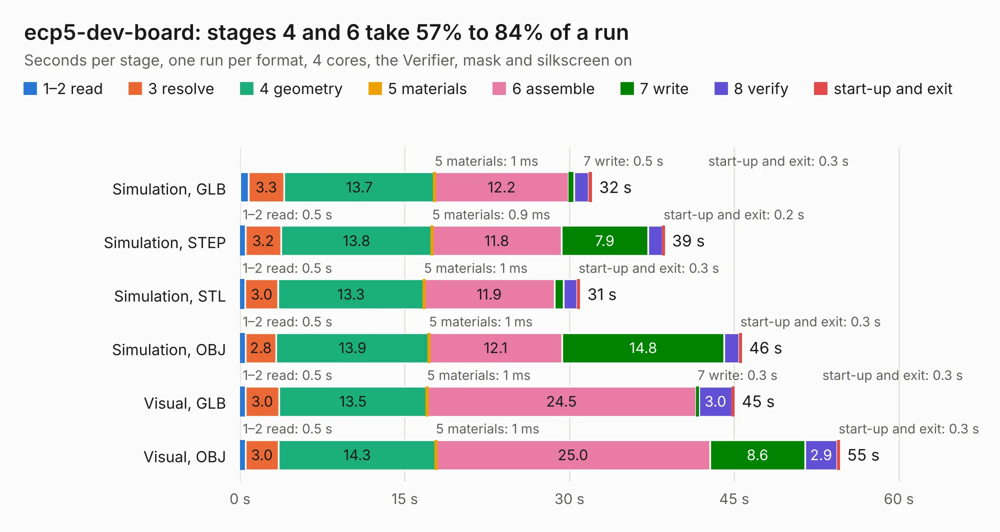

| Mode and format | 1–2 read | 3 resolve | 4 geometry | 5 materials | 6 assemble | 7 write | 8 verify | start-up and exit | Total |
|---|---:|---:|---:|---:|---:|---:|---:|---:|---:|
| Simulation, GLB | 0.8 | 3.3 | 13.7 | 1&nbsp;ms | 12.2 | 0.5 | 1.3 | 0.3 | 32.1 |
| Simulation, STEP | 0.5 | 3.2 | 13.8 | 0.9&nbsp;ms | 11.8 | 7.9 | 1.3 | 0.2 | 38.7 |
| Simulation, STL | 0.5 | 3.0 | 13.3 | 1&nbsp;ms | 11.9 | 0.8 | 1.2 | 0.3 | 31.0 |
| Simulation, OBJ | 0.5 | 2.8 | 13.9 | 1&nbsp;ms | 12.1 | 14.8 | 1.3 | 0.3 | 45.7 |
| Visual, GLB | 0.5 | 3.0 | 13.5 | 1&nbsp;ms | 24.5 | 0.3 | 3.0 | 0.3 | 45.0 |
| Visual, OBJ | 0.5 | 3.0 | 14.3 | 1&nbsp;ms | 25.0 | 8.6 | 2.9 | 0.3 | 54.6 |

<table align="center"><tr><td valign="top">

| Board | Repo: [medhyal/ecp5-dev-board](https://github.com/medhyal/ecp5-dev-board) Board: `ecp5-dev-board.kicad_pcb` |
|---|---|
| Folder | v0.1 |
| Complexity | 331&nbsp;/&nbsp;1000 (size&nbsp;276, features&nbsp;55) |
| KESE&nbsp;features | through vias, rounded, trapezoid or chamfered pads, filled zones, curved board outline |
| Tested | 9th November 2026 |
| Copper&nbsp;layers | 4 |
| File&nbsp;format | KiCad 5 (20171130) |
| Parts,&nbsp;tracks,&nbsp;vias | 107, 3,371, 336 |
| Triangles,&nbsp;simulation | 2,965,762 in 283 parts |
| Verifier | PASS in all six runs |

</td><td valign="top">

<table>
<tr><th>File type</th><th>File size</th><th>Peak memory used</th></tr>
<tr><th colspan="3" align="left">Simulation</th></tr>
<tr><td>GLB</td><td align="right">102&nbsp;MB</td><td align="right">1.0&nbsp;GB</td></tr>
<tr><td>STEP</td><td align="right">457&nbsp;MB</td><td align="right">1.2&nbsp;GB</td></tr>
<tr><td>STL</td><td align="right">148&nbsp;MB</td><td align="right">1.1&nbsp;GB</td></tr>
<tr><td>OBJ</td><td align="right">314&nbsp;MB</td><td align="right">1.9&nbsp;GB</td></tr>
<tr><th colspan="3" align="left">Visual</th></tr>
<tr><td>GLB</td><td align="right">60&nbsp;MB</td><td align="right">1.1&nbsp;GB</td></tr>
<tr><td>OBJ</td><td align="right">188&nbsp;MB</td><td align="right">1.3&nbsp;GB</td></tr>
</table>

</td></tr></table>

## 1636. mega65-kbd

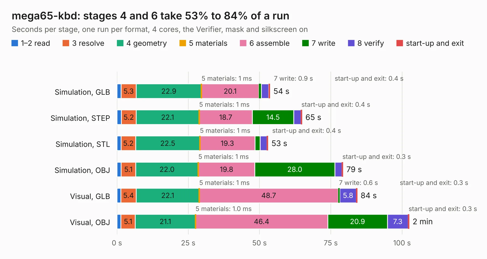

| Mode and format | 1–2 read | 3 resolve | 4 geometry | 5 materials | 6 assemble | 7 write | 8 verify | start-up and exit | Total |
|---|---:|---:|---:|---:|---:|---:|---:|---:|---:|
| Simulation, GLB | 1.4 | 5.3 | 22.9 | 1&nbsp;ms | 20.1 | 0.9 | 2.6 | 0.4 | 53.6 |
| Simulation, STEP | 1.5 | 5.2 | 22.1 | 1&nbsp;ms | 18.7 | 14.5 | 2.5 | 0.4 | 64.9 |
| Simulation, STL | 1.4 | 5.2 | 22.5 | 1&nbsp;ms | 19.3 | 1.8 | 2.4 | 0.4 | 53.0 |
| Simulation, OBJ | 1.5 | 5.1 | 22.0 | 1&nbsp;ms | 19.8 | 28.0 | 2.5 | 0.3 | 79.3 |
| Visual, GLB | 1.4 | 5.4 | 22.1 | 1&nbsp;ms | 48.7 | 0.6 | 5.8 | 0.3 | 84.3 |
| Visual, OBJ | 1.4 | 5.1 | 21.1 | 1.0&nbsp;ms | 46.4 | 20.9 | 7.3 | 0.3 | 102.5 |

<table align="center"><tr><td valign="top">

| Board | Repo: [MEGA65/mega65-kbd-pcb](https://github.com/MEGA65/mega65-kbd-pcb) Board: `mega65-kbd.kicad_pcb` |
|---|---|
| Complexity | 237&nbsp;/&nbsp;1000 (size&nbsp;192, features&nbsp;45) |
| KESE&nbsp;features | through vias, filled zones, curved board outline |
| Tested | 9th November 2026 |
| Copper&nbsp;layers | 2 |
| File&nbsp;format | KiCad 6 (20211014) |
| Parts,&nbsp;tracks,&nbsp;vias | 105, 1,364, 210 |
| Triangles,&nbsp;simulation | 4,669,240 in 287 parts |
| Verifier | PASS in all six runs |

</td><td valign="top">

<table>
<tr><th>File type</th><th>File size</th><th>Peak memory used</th></tr>
<tr><th colspan="3" align="left">Simulation</th></tr>
<tr><td>GLB</td><td align="right">157&nbsp;MB</td><td align="right">1.7&nbsp;GB</td></tr>
<tr><td>STEP</td><td align="right">680&nbsp;MB</td><td align="right">1.9&nbsp;GB</td></tr>
<tr><td>STL</td><td align="right">233&nbsp;MB</td><td align="right">1.7&nbsp;GB</td></tr>
<tr><td>OBJ</td><td align="right">493&nbsp;MB</td><td align="right">3.0&nbsp;GB</td></tr>
<tr><th colspan="3" align="left">Visual</th></tr>
<tr><td>GLB</td><td align="right">112&nbsp;MB</td><td align="right">2.0&nbsp;GB</td></tr>
<tr><td>OBJ</td><td align="right">357&nbsp;MB</td><td align="right">2.3&nbsp;GB</td></tr>
</table>

</td></tr></table>

## 1637. expansion_connector_board

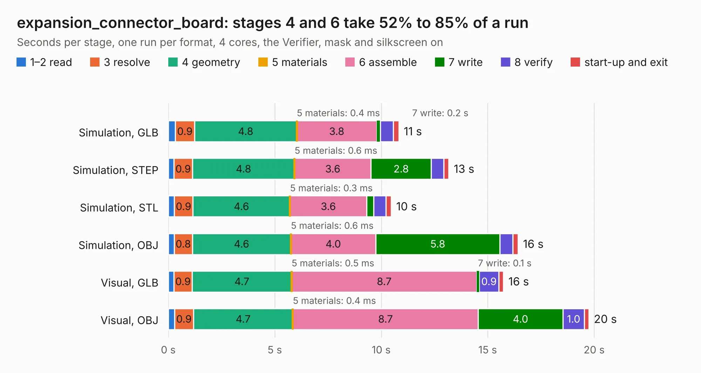

| Mode and format | 1–2 read | 3 resolve | 4 geometry | 5 materials | 6 assemble | 7 write | 8 verify | start-up and exit | Total |
|---|---:|---:|---:|---:|---:|---:|---:|---:|---:|
| Simulation, GLB | 0.3 | 0.9 | 4.8 | 0.4&nbsp;ms | 3.8 | 0.2 | 0.6 | 0.3 | 10.8 |
| Simulation, STEP | 0.3 | 0.9 | 4.8 | 0.6&nbsp;ms | 3.6 | 2.8 | 0.6 | 0.2 | 13.2 |
| Simulation, STL | 0.3 | 0.9 | 4.6 | 0.3&nbsp;ms | 3.6 | 0.3 | 0.6 | 0.3 | 10.5 |
| Simulation, OBJ | 0.3 | 0.8 | 4.6 | 0.6&nbsp;ms | 4.0 | 5.8 | 0.6 | 0.2 | 16.4 |
| Visual, GLB | 0.3 | 0.9 | 4.7 | 0.5&nbsp;ms | 8.7 | 0.1 | 0.9 | 0.2 | 15.7 |
| Visual, OBJ | 0.3 | 0.9 | 4.7 | 0.4&nbsp;ms | 8.7 | 4.0 | 1.0 | 0.2 | 19.8 |

<table align="center"><tr><td valign="top">

| Board | Repo: [MEGA65/mega65-r3-expansion-board](https://github.com/MEGA65/mega65-r3-expansion-board) Board: `expansion_connector_board.kicad_pcb` |
|---|---|
| Folder | expansion_connector_board |
| Complexity | 284&nbsp;/&nbsp;1000 (size&nbsp;159, features&nbsp;125) |
| KESE&nbsp;features | through vias, custom pads, rounded, trapezoid or chamfered pads, drill offsets, arc tracks, filled zones, copper drawings, stack-up, dielectric εr and tanδ |
| Tested | 9th November 2026 |
| Copper&nbsp;layers | 2 |
| File&nbsp;format | KiCad 9 (20241229) |
| Parts,&nbsp;tracks,&nbsp;vias | 18, 683, 47 |
| Triangles,&nbsp;simulation | 1,114,064 in 92 parts |
| Verifier | PASS in all six runs |

</td><td valign="top">

<table>
<tr><th>File type</th><th>File size</th><th>Peak memory used</th></tr>
<tr><th colspan="3" align="left">Simulation</th></tr>
<tr><td>GLB</td><td align="right">38&nbsp;MB</td><td align="right">511&nbsp;MB</td></tr>
<tr><td>STEP</td><td align="right">167&nbsp;MB</td><td align="right">568&nbsp;MB</td></tr>
<tr><td>STL</td><td align="right">56&nbsp;MB</td><td align="right">494&nbsp;MB</td></tr>
<tr><td>OBJ</td><td align="right">112&nbsp;MB</td><td align="right">768&nbsp;MB</td></tr>
<tr><th colspan="3" align="left">Visual</th></tr>
<tr><td>GLB</td><td align="right">26&nbsp;MB</td><td align="right">622&nbsp;MB</td></tr>
<tr><td>OBJ</td><td align="right">77&nbsp;MB</td><td align="right">605&nbsp;MB</td></tr>
</table>

</td></tr></table>

## 1638. external_drive_board

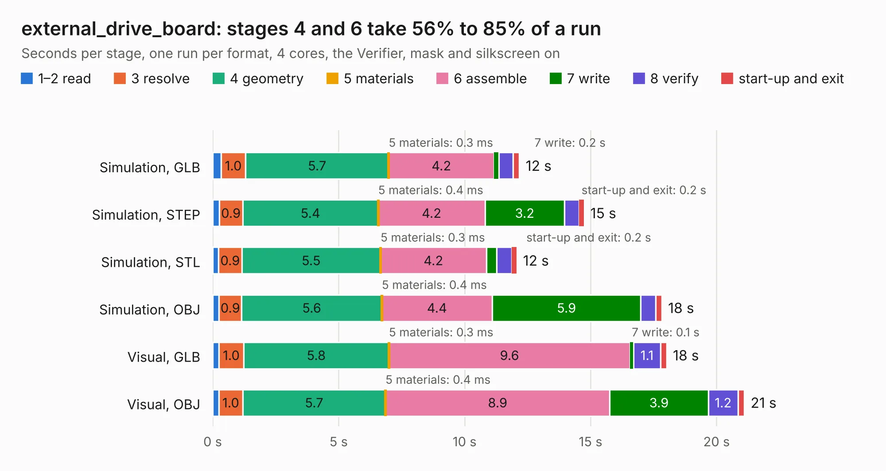

| Mode and format | 1–2 read | 3 resolve | 4 geometry | 5 materials | 6 assemble | 7 write | 8 verify | start-up and exit | Total |
|---|---:|---:|---:|---:|---:|---:|---:|---:|---:|
| Simulation, GLB | 0.3 | 1.0 | 5.7 | 0.3&nbsp;ms | 4.2 | 0.2 | 0.6 | 0.2 | 12.2 |
| Simulation, STEP | 0.3 | 0.9 | 5.4 | 0.4&nbsp;ms | 4.2 | 3.2 | 0.6 | 0.2 | 14.7 |
| Simulation, STL | 0.2 | 0.9 | 5.5 | 0.3&nbsp;ms | 4.2 | 0.4 | 0.6 | 0.2 | 12.1 |
| Simulation, OBJ | 0.3 | 0.9 | 5.6 | 0.4&nbsp;ms | 4.4 | 5.9 | 0.6 | 0.2 | 17.8 |
| Visual, GLB | 0.2 | 1.0 | 5.8 | 0.3&nbsp;ms | 9.6 | 0.1 | 1.1 | 0.2 | 18.0 |
| Visual, OBJ | 0.2 | 1.0 | 5.7 | 0.4&nbsp;ms | 8.9 | 3.9 | 1.2 | 0.2 | 21.1 |

<table align="center"><tr><td valign="top">

| Board | Repo: [MEGA65/mega65-r3-expansion-board](https://github.com/MEGA65/mega65-r3-expansion-board) Board: `external_drive_board.kicad_pcb` |
|---|---|
| Folder | external_drive_board |
| Complexity | 208&nbsp;/&nbsp;1000 (size&nbsp;163, features&nbsp;45) |
| KESE&nbsp;features | through vias, slotted holes, filled zones |
| Tested | 9th November 2026 |
| Copper&nbsp;layers | 2 |
| File&nbsp;format | KiCad 7 (20221018) |
| Parts,&nbsp;tracks,&nbsp;vias | 30, 578, 60 |
| Triangles,&nbsp;simulation | 1,447,024 in 69 parts |
| Verifier | PASS in all six runs |

</td><td valign="top">

<table>
<tr><th>File type</th><th>File size</th><th>Peak memory used</th></tr>
<tr><th colspan="3" align="left">Simulation</th></tr>
<tr><td>GLB</td><td align="right">49&nbsp;MB</td><td align="right">612&nbsp;MB</td></tr>
<tr><td>STEP</td><td align="right">221&nbsp;MB</td><td align="right">666&nbsp;MB</td></tr>
<tr><td>STL</td><td align="right">72&nbsp;MB</td><td align="right">678&nbsp;MB</td></tr>
<tr><td>OBJ</td><td align="right">148&nbsp;MB</td><td align="right">971&nbsp;MB</td></tr>
<tr><th colspan="3" align="left">Visual</th></tr>
<tr><td>GLB</td><td align="right">33&nbsp;MB</td><td align="right">712&nbsp;MB</td></tr>
<tr><td>OBJ</td><td align="right">98&nbsp;MB</td><td align="right">773&nbsp;MB</td></tr>
</table>

</td></tr></table>

## 1639. jtag_base_board

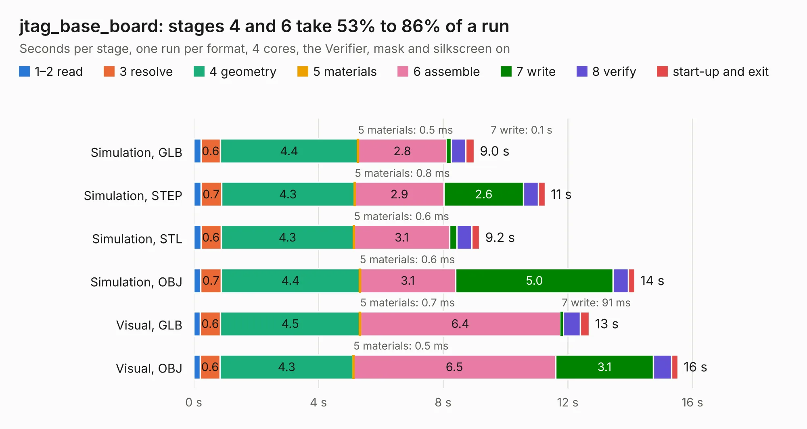

| Mode and format | 1–2 read | 3 resolve | 4 geometry | 5 materials | 6 assemble | 7 write | 8 verify | start-up and exit | Total |
|---|---:|---:|---:|---:|---:|---:|---:|---:|---:|
| Simulation, GLB | 0.2 | 0.6 | 4.4 | 0.5&nbsp;ms | 2.8 | 0.1 | 0.5 | 0.3 | 9.0 |
| Simulation, STEP | 0.2 | 0.7 | 4.3 | 0.8&nbsp;ms | 2.9 | 2.6 | 0.5 | 0.2 | 11.3 |
| Simulation, STL | 0.2 | 0.6 | 4.3 | 0.6&nbsp;ms | 3.1 | 0.2 | 0.5 | 0.2 | 9.2 |
| Simulation, OBJ | 0.2 | 0.7 | 4.4 | 0.6&nbsp;ms | 3.1 | 5.0 | 0.5 | 0.2 | 14.1 |
| Visual, GLB | 0.2 | 0.6 | 4.5 | 0.7&nbsp;ms | 6.4 | 91&nbsp;ms | 0.6 | 0.3 | 12.7 |
| Visual, OBJ | 0.2 | 0.6 | 4.3 | 0.5&nbsp;ms | 6.5 | 3.1 | 0.6 | 0.2 | 15.5 |

<table align="center"><tr><td valign="top">

| Board | Repo: [MEGA65/mega65-r3-expansion-board](https://github.com/MEGA65/mega65-r3-expansion-board) Board: `jtag_base_board.kicad_pcb` |
|---|---|
| Folder | jtag_base_board |
| Complexity | 197&nbsp;/&nbsp;1000 (size&nbsp;132, features&nbsp;65) |
| KESE&nbsp;features | through vias, filled zones, stack-up, dielectric εr and tanδ |
| Tested | 9th November 2026 |
| Copper&nbsp;layers | 2 |
| File&nbsp;format | KiCad 10 (20260206) |
| Parts,&nbsp;tracks,&nbsp;vias | 10, 229, 2 |
| Triangles,&nbsp;simulation | 936,044 in 72 parts |
| Verifier | PASS in all six runs |

</td><td valign="top">

<table>
<tr><th>File type</th><th>File size</th><th>Peak memory used</th></tr>
<tr><th colspan="3" align="left">Simulation</th></tr>
<tr><td>GLB</td><td align="right">32&nbsp;MB</td><td align="right">406&nbsp;MB</td></tr>
<tr><td>STEP</td><td align="right">139&nbsp;MB</td><td align="right">505&nbsp;MB</td></tr>
<tr><td>STL</td><td align="right">47&nbsp;MB</td><td align="right">416&nbsp;MB</td></tr>
<tr><td>OBJ</td><td align="right">95&nbsp;MB</td><td align="right">668&nbsp;MB</td></tr>
<tr><th colspan="3" align="left">Visual</th></tr>
<tr><td>GLB</td><td align="right">20&nbsp;MB</td><td align="right">530&nbsp;MB</td></tr>
<tr><td>OBJ</td><td align="right">59&nbsp;MB</td><td align="right">567&nbsp;MB</td></tr>
</table>

</td></tr></table>

## 1640. mega65-r3-expansion-board.kicad

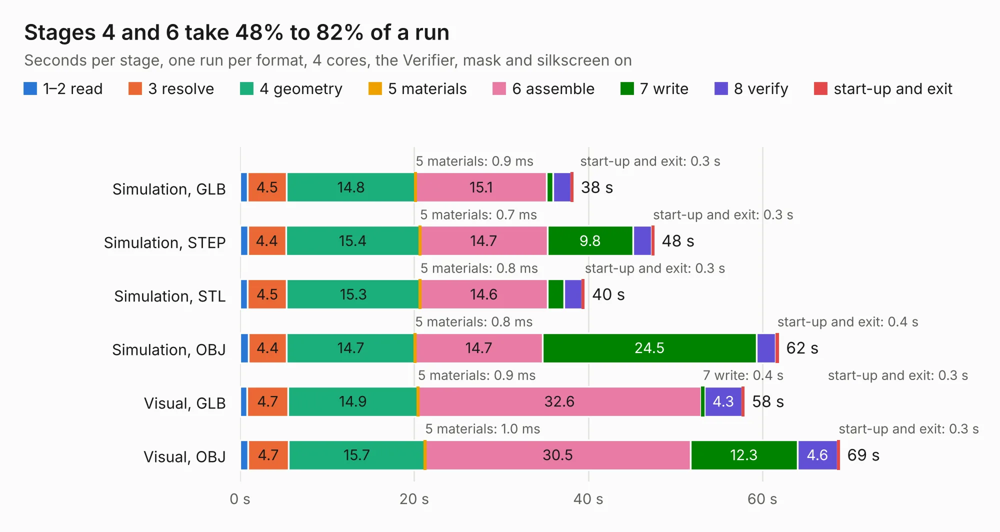

| Mode and format | 1–2 read | 3 resolve | 4 geometry | 5 materials | 6 assemble | 7 write | 8 verify | start-up and exit | Total |
|---|---:|---:|---:|---:|---:|---:|---:|---:|---:|
| Simulation, GLB | 0.9 | 4.5 | 14.8 | 0.9&nbsp;ms | 15.1 | 0.7 | 2.0 | 0.3 | 38.3 |
| Simulation, STEP | 0.9 | 4.4 | 15.4 | 0.7&nbsp;ms | 14.7 | 9.8 | 2.2 | 0.3 | 47.6 |
| Simulation, STL | 0.9 | 4.5 | 15.3 | 0.8&nbsp;ms | 14.6 | 1.9 | 2.0 | 0.3 | 39.6 |
| Simulation, OBJ | 1.0 | 4.4 | 14.7 | 0.8&nbsp;ms | 14.7 | 24.5 | 2.2 | 0.4 | 61.9 |
| Visual, GLB | 0.8 | 4.7 | 14.9 | 0.9&nbsp;ms | 32.6 | 0.4 | 4.3 | 0.3 | 58.0 |
| Visual, OBJ | 0.9 | 4.7 | 15.7 | 1.0&nbsp;ms | 30.5 | 12.3 | 4.6 | 0.3 | 68.9 |

<table align="center"><tr><td valign="top">

| Board | Repo: [MEGA65/mega65-r3-expansion-board](https://github.com/MEGA65/mega65-r3-expansion-board) Board: `mega65-r3-expansion-board.kicad.kicad_pcb` |
|---|---|
| Complexity | 304&nbsp;/&nbsp;1000 (size&nbsp;219, features&nbsp;85) |
| KESE&nbsp;features | through vias, slotted holes, filled zones, curved board outline, stack-up, dielectric εr and tanδ |
| Tested | 9th November 2026 |
| Copper&nbsp;layers | 4 |
| File&nbsp;format | KiCad 9 (20241229) |
| Parts,&nbsp;tracks,&nbsp;vias | 102, 2,880, 310 |
| Triangles,&nbsp;simulation | 5,028,540 in 186 parts |
| Verifier | PASS in all six runs |

</td><td valign="top">

<table>
<tr><th>File type</th><th>File size</th><th>Peak memory used</th></tr>
<tr><th colspan="3" align="left">Simulation</th></tr>
<tr><td>GLB</td><td align="right">169&nbsp;MB</td><td align="right">1.3&nbsp;GB</td></tr>
<tr><td>STEP</td><td align="right">591&nbsp;MB</td><td align="right">1.7&nbsp;GB</td></tr>
<tr><td>STL</td><td align="right">251&nbsp;MB</td><td align="right">1.3&nbsp;GB</td></tr>
<tr><td>OBJ</td><td align="right">538&nbsp;MB</td><td align="right">3.2&nbsp;GB</td></tr>
<tr><th colspan="3" align="left">Visual</th></tr>
<tr><td>GLB</td><td align="right">85&nbsp;MB</td><td align="right">1.6&nbsp;GB</td></tr>
<tr><td>OBJ</td><td align="right">272&nbsp;MB</td><td align="right">1.9&nbsp;GB</td></tr>
</table>

</td></tr></table>

## 1641. pmod_connector_board

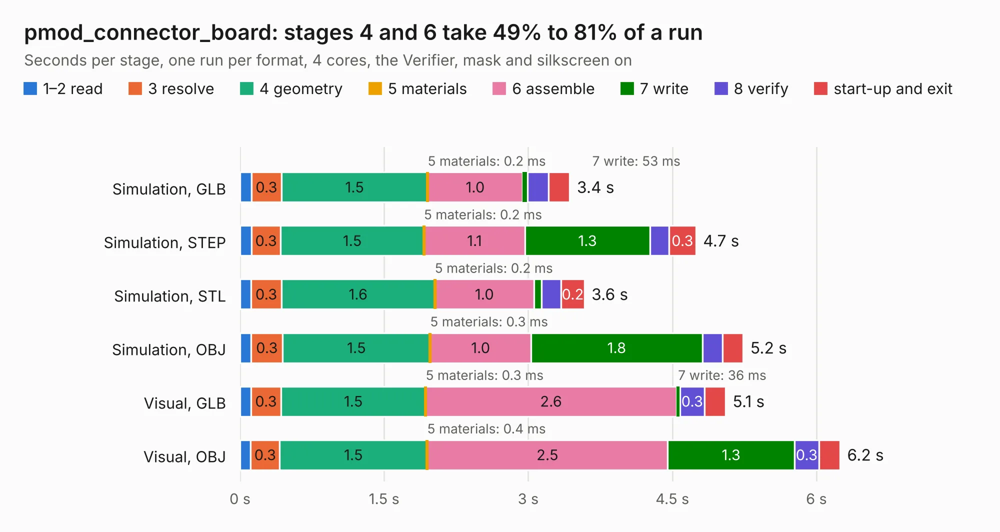

| Mode and format | 1–2 read | 3 resolve | 4 geometry | 5 materials | 6 assemble | 7 write | 8 verify | start-up and exit | Total |
|---|---:|---:|---:|---:|---:|---:|---:|---:|---:|
| Simulation, GLB | 0.1 | 0.3 | 1.5 | 0.2&nbsp;ms | 1.0 | 53&nbsp;ms | 0.2 | 0.2 | 3.4 |
| Simulation, STEP | 0.1 | 0.3 | 1.5 | 0.2&nbsp;ms | 1.1 | 1.3 | 0.2 | 0.3 | 4.7 |
| Simulation, STL | 0.1 | 0.3 | 1.6 | 0.2&nbsp;ms | 1.0 | 77&nbsp;ms | 0.2 | 0.2 | 3.6 |
| Simulation, OBJ | 0.1 | 0.3 | 1.5 | 0.3&nbsp;ms | 1.0 | 1.8 | 0.2 | 0.2 | 5.2 |
| Visual, GLB | 0.1 | 0.3 | 1.5 | 0.3&nbsp;ms | 2.6 | 36&nbsp;ms | 0.3 | 0.2 | 5.1 |
| Visual, OBJ | 0.1 | 0.3 | 1.5 | 0.4&nbsp;ms | 2.5 | 1.3 | 0.3 | 0.2 | 6.2 |

<table align="center"><tr><td valign="top">

| Board | Repo: [MEGA65/mega65-r3-expansion-board](https://github.com/MEGA65/mega65-r3-expansion-board) Board: `pmod_connector_board.kicad_pcb` |
|---|---|
| Folder | pmod_connector_board |
| Complexity | 170&nbsp;/&nbsp;1000 (size&nbsp;125, features&nbsp;45) |
| KESE&nbsp;features | through vias, stack-up, dielectric εr and tanδ |
| Tested | 9th November 2026 |
| Copper&nbsp;layers | 2 |
| File&nbsp;format | KiCad 6 (20211014) |
| Parts,&nbsp;tracks,&nbsp;vias | 4, 212, 16 |
| Triangles,&nbsp;simulation | 310,928 in 29 parts |
| Verifier | PASS in all six runs |

</td><td valign="top">

<table>
<tr><th>File type</th><th>File size</th><th>Peak memory used</th></tr>
<tr><th colspan="3" align="left">Simulation</th></tr>
<tr><td>GLB</td><td align="right">11&nbsp;MB</td><td align="right">227&nbsp;MB</td></tr>
<tr><td>STEP</td><td align="right">47&nbsp;MB</td><td align="right">258&nbsp;MB</td></tr>
<tr><td>STL</td><td align="right">16&nbsp;MB</td><td align="right">240&nbsp;MB</td></tr>
<tr><td>OBJ</td><td align="right">32&nbsp;MB</td><td align="right">259&nbsp;MB</td></tr>
<tr><th colspan="3" align="left">Visual</th></tr>
<tr><td>GLB</td><td align="right">7.5&nbsp;MB</td><td align="right">242&nbsp;MB</td></tr>
<tr><td>OBJ</td><td align="right">23&nbsp;MB</td><td align="right">245&nbsp;MB</td></tr>
</table>

</td></tr></table>

## 1642. IIsi-to-ztex

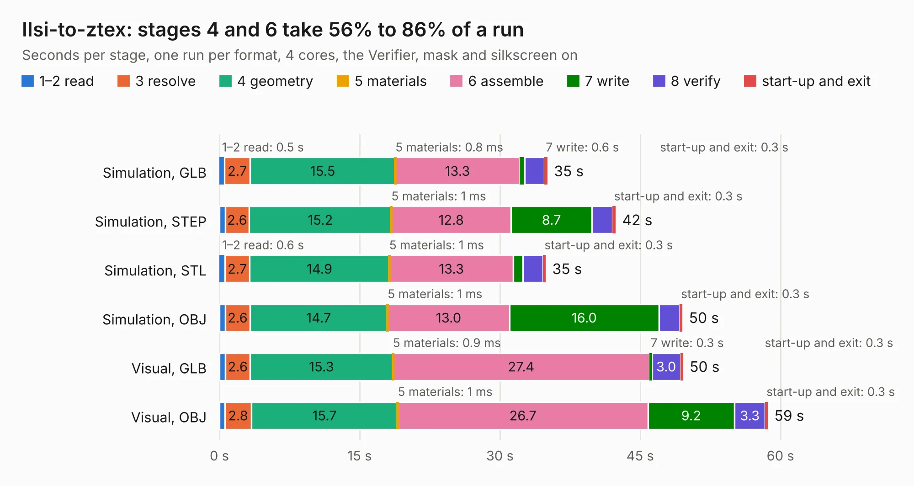

| Mode and format | 1–2 read | 3 resolve | 4 geometry | 5 materials | 6 assemble | 7 write | 8 verify | start-up and exit | Total |
|---|---:|---:|---:|---:|---:|---:|---:|---:|---:|
| Simulation, GLB | 0.5 | 2.7 | 15.5 | 0.8&nbsp;ms | 13.3 | 0.6 | 2.1 | 0.3 | 35.1 |
| Simulation, STEP | 0.6 | 2.6 | 15.2 | 1&nbsp;ms | 12.8 | 8.7 | 2.2 | 0.3 | 42.4 |
| Simulation, STL | 0.6 | 2.7 | 14.9 | 1&nbsp;ms | 13.3 | 1.0 | 2.2 | 0.3 | 34.9 |
| Simulation, OBJ | 0.7 | 2.6 | 14.7 | 1&nbsp;ms | 13.0 | 16.0 | 2.2 | 0.3 | 49.5 |
| Visual, GLB | 0.7 | 2.6 | 15.3 | 0.9&nbsp;ms | 27.4 | 0.3 | 3.0 | 0.3 | 49.6 |
| Visual, OBJ | 0.6 | 2.8 | 15.7 | 1&nbsp;ms | 26.7 | 9.2 | 3.3 | 0.3 | 58.6 |

<table align="center"><tr><td valign="top">

| Board | Repo: [MelkhiorVintageComputing/IIsiFPGA](https://github.com/MelkhiorVintageComputing/IIsiFPGA) Board: `IIsi-to-ztex.kicad_pcb` |
|---|---|
| Folder | IIsi-to-ztex |
| Complexity | 256&nbsp;/&nbsp;1000 (size&nbsp;211, features&nbsp;45) |
| KESE&nbsp;features | through vias, rounded, trapezoid or chamfered pads, filled zones |
| Tested | 9th November 2026 |
| Copper&nbsp;layers | 4 |
| File&nbsp;format | KiCad 5 (20171130) |
| Parts,&nbsp;tracks,&nbsp;vias | 63, 2,837, 112 |
| Triangles,&nbsp;simulation | 3,427,216 in 267 parts |
| Verifier | PASS in all six runs |

</td><td valign="top">

<table>
<tr><th>File type</th><th>File size</th><th>Peak memory used</th></tr>
<tr><th colspan="3" align="left">Simulation</th></tr>
<tr><td>GLB</td><td align="right">114&nbsp;MB</td><td align="right">1.0&nbsp;GB</td></tr>
<tr><td>STEP</td><td align="right">444&nbsp;MB</td><td align="right">1.3&nbsp;GB</td></tr>
<tr><td>STL</td><td align="right">171&nbsp;MB</td><td align="right">1.0&nbsp;GB</td></tr>
<tr><td>OBJ</td><td align="right">359&nbsp;MB</td><td align="right">2.2&nbsp;GB</td></tr>
<tr><th colspan="3" align="left">Visual</th></tr>
<tr><td>GLB</td><td align="right">65&nbsp;MB</td><td align="right">1.3&nbsp;GB</td></tr>
<tr><td>OBJ</td><td align="right">204&nbsp;MB</td><td align="right">1.4&nbsp;GB</td></tr>
</table>

</td></tr></table>

## 1643. IIsiA7_Mini

| Mode and format | 1–2 read | 3 resolve | 4 geometry | 5 materials | 6 assemble | 7 write | 8 verify | start-up and exit | Total |
|---|---:|---:|---:|---:|---:|---:|---:|---:|---:|
| Simulation, GLB | 1.3 | 4.7 | 21.1 | 1&nbsp;ms | 24.1 | 1.1 | 3.4 | 0.4 | 56.1 |
| Simulation, STEP | 1.4 | 4.9 | 20.7 | 1&nbsp;ms | 24.3 | 15.2 | 3.5 | 0.4 | 70.4 |
| Simulation, STL | 1.2 | 5.1 | 20.6 | 1&nbsp;ms | 23.3 | 2.5 | 3.7 | 0.4 | 57.0 |
| Simulation, OBJ | 1.3 | 4.7 | 20.5 | 1&nbsp;ms | 24.5 | 33.6 | 3.6 | 0.3 | 88.6 |
| Visual, GLB | 1.4 | 4.9 | 20.2 | 1&nbsp;ms | 51.7 | 0.6 | 6.5 | 0.3 | 85.6 |
| Visual, OBJ | 1.4 | 4.8 | 20.4 | 1&nbsp;ms | 51.3 | 18.6 | 6.3 | 0.3 | 103.1 |

<table align="center"><tr><td valign="top">

| Board | Repo: [MelkhiorVintageComputing/IIsiFPGA](https://github.com/MelkhiorVintageComputing/IIsiFPGA) Board: `IIsiA7_Mini.kicad_pcb` |
|---|---|
| Folder | IIsiA7_Mini |
| Complexity | 410&nbsp;/&nbsp;1000 (size&nbsp;310, features&nbsp;100) |
| KESE&nbsp;features | through vias, slotted holes, rounded, trapezoid or chamfered pads, arc tracks, filled zones, stack-up, dielectric εr and tanδ |
| Tested | 9th November 2026 |
| Copper&nbsp;layers | 6 |
| File&nbsp;format | KiCad 9 (20241229) |
| Parts,&nbsp;tracks,&nbsp;vias | 218, 5,573, 523 |
| Triangles,&nbsp;simulation | 6,574,296 in 382 parts |
| Verifier | PASS in all six runs |

</td><td valign="top">

<table>
<tr><th>File type</th><th>File size</th><th>Peak memory used</th></tr>
<tr><th colspan="3" align="left">Simulation</th></tr>
<tr><td>GLB</td><td align="right">219&nbsp;MB</td><td align="right">1.7&nbsp;GB</td></tr>
<tr><td>STEP</td><td align="right">881&nbsp;MB</td><td align="right">2.3&nbsp;GB</td></tr>
<tr><td>STL</td><td align="right">329&nbsp;MB</td><td align="right">1.7&nbsp;GB</td></tr>
<tr><td>OBJ</td><td align="right">695&nbsp;MB</td><td align="right">4.2&nbsp;GB</td></tr>
<tr><th colspan="3" align="left">Visual</th></tr>
<tr><td>GLB</td><td align="right">132&nbsp;MB</td><td align="right">2.1&nbsp;GB</td></tr>
<tr><td>OBJ</td><td align="right">419&nbsp;MB</td><td align="right">2.7&nbsp;GB</td></tr>
</table>

</td></tr></table>

## 1644. nubus-to-ztex

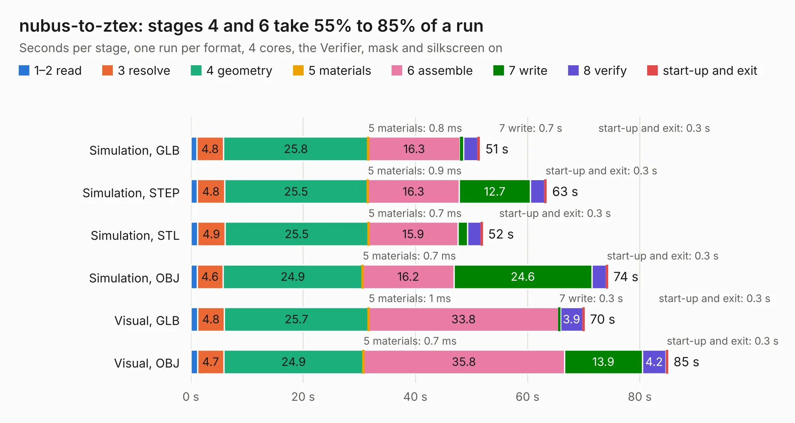

| Mode and format | 1–2 read | 3 resolve | 4 geometry | 5 materials | 6 assemble | 7 write | 8 verify | start-up and exit | Total |
|---|---:|---:|---:|---:|---:|---:|---:|---:|---:|
| Simulation, GLB | 1.0 | 4.8 | 25.8 | 0.8&nbsp;ms | 16.3 | 0.7 | 2.5 | 0.3 | 51.5 |
| Simulation, STEP | 1.2 | 4.8 | 25.5 | 0.9&nbsp;ms | 16.3 | 12.7 | 2.6 | 0.3 | 63.4 |
| Simulation, STL | 1.2 | 4.9 | 25.5 | 0.7&nbsp;ms | 15.9 | 1.7 | 2.4 | 0.3 | 52.0 |
| Simulation, OBJ | 1.1 | 4.6 | 24.9 | 0.7&nbsp;ms | 16.2 | 24.6 | 2.5 | 0.3 | 74.3 |
| Visual, GLB | 1.2 | 4.8 | 25.7 | 1&nbsp;ms | 33.8 | 0.3 | 3.9 | 0.3 | 70.1 |
| Visual, OBJ | 1.2 | 4.7 | 24.9 | 0.7&nbsp;ms | 35.8 | 13.9 | 4.2 | 0.3 | 85.0 |

<table align="center"><tr><td valign="top">

| Board | Repo: [MelkhiorVintageComputing/NuBusFPGA](https://github.com/MelkhiorVintageComputing/NuBusFPGA) Board: `nubus-to-ztex.kicad_pcb` |
|---|---|
| Folder | nubus-to-ztex |
| Complexity | 290&nbsp;/&nbsp;1000 (size&nbsp;225, features&nbsp;65) |
| KESE&nbsp;features | through vias, slotted holes, rounded, trapezoid or chamfered pads, filled zones, curved board outline |
| Tested | 9th November 2026 |
| Copper&nbsp;layers | 4 |
| File&nbsp;format | KiCad 5 (20171130) |
| Parts,&nbsp;tracks,&nbsp;vias | 101, 5,227, 164 |
| Triangles,&nbsp;simulation | 4,022,564 in 220 parts |
| Verifier | PASS in all six runs |

</td><td valign="top">

<table>
<tr><th>File type</th><th>File size</th><th>Peak memory used</th></tr>
<tr><th colspan="3" align="left">Simulation</th></tr>
<tr><td>GLB</td><td align="right">138&nbsp;MB</td><td align="right">1.3&nbsp;GB</td></tr>
<tr><td>STEP</td><td align="right">640&nbsp;MB</td><td align="right">1.5&nbsp;GB</td></tr>
<tr><td>STL</td><td align="right">201&nbsp;MB</td><td align="right">1.3&nbsp;GB</td></tr>
<tr><td>OBJ</td><td align="right">430&nbsp;MB</td><td align="right">2.7&nbsp;GB</td></tr>
<tr><th colspan="3" align="left">Visual</th></tr>
<tr><td>GLB</td><td align="right">80&nbsp;MB</td><td align="right">1.4&nbsp;GB</td></tr>
<tr><td>OBJ</td><td align="right">251&nbsp;MB</td><td align="right">1.7&nbsp;GB</td></tr>
</table>

</td></tr></table>

## 1645. PicoBerry_V1.0

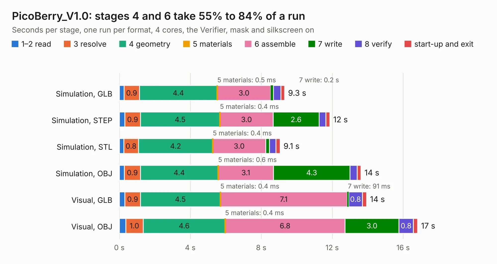

| Mode and format | 1–2 read | 3 resolve | 4 geometry | 5 materials | 6 assemble | 7 write | 8 verify | start-up and exit | Total |
|---|---:|---:|---:|---:|---:|---:|---:|---:|---:|
| Simulation, GLB | 0.3 | 0.9 | 4.4 | 0.5&nbsp;ms | 3.0 | 0.2 | 0.4 | 0.2 | 9.3 |
| Simulation, STEP | 0.3 | 0.9 | 4.5 | 0.4&nbsp;ms | 3.0 | 2.6 | 0.4 | 0.2 | 11.9 |
| Simulation, STL | 0.2 | 0.8 | 4.2 | 0.4&nbsp;ms | 3.0 | 0.2 | 0.4 | 0.2 | 9.1 |
| Simulation, OBJ | 0.3 | 0.9 | 4.4 | 0.6&nbsp;ms | 3.1 | 4.3 | 0.4 | 0.2 | 13.6 |
| Visual, GLB | 0.3 | 0.9 | 4.5 | 0.4&nbsp;ms | 7.1 | 91&nbsp;ms | 0.8 | 0.2 | 13.9 |
| Visual, OBJ | 0.4 | 1.0 | 4.6 | 0.4&nbsp;ms | 6.8 | 3.0 | 0.8 | 0.2 | 16.8 |

<table align="center"><tr><td valign="top">

| Board | Repo: [mfolejewski/PicoBerry](https://github.com/mfolejewski/PicoBerry) Board: `PicoBerry_V1.0.kicad_pcb` |
|---|---|
| Folder | source files / KiCad |
| Complexity | 285&nbsp;/&nbsp;1000 (size&nbsp;160, features&nbsp;125) |
| KESE&nbsp;features | through vias, slotted holes, rounded, trapezoid or chamfered pads, arc tracks, filled zones, curved board outline, stack-up, dielectric εr and tanδ, copper finish |
| Tested | 9th November 2026 |
| Copper&nbsp;layers | 2 |
| File&nbsp;format | KiCad 6 (20211014) |
| Parts,&nbsp;tracks,&nbsp;vias | 21, 637, 52 |
| Triangles,&nbsp;simulation | 823,516 in 98 parts |
| Verifier | PASS in all six runs |

</td><td valign="top">

<table>
<tr><th>File type</th><th>File size</th><th>Peak memory used</th></tr>
<tr><th colspan="3" align="left">Simulation</th></tr>
<tr><td>GLB</td><td align="right">29&nbsp;MB</td><td align="right">398&nbsp;MB</td></tr>
<tr><td>STEP</td><td align="right">164&nbsp;MB</td><td align="right">495&nbsp;MB</td></tr>
<tr><td>STL</td><td align="right">41&nbsp;MB</td><td align="right">406&nbsp;MB</td></tr>
<tr><td>OBJ</td><td align="right">84&nbsp;MB</td><td align="right">592&nbsp;MB</td></tr>
<tr><th colspan="3" align="left">Visual</th></tr>
<tr><td>GLB</td><td align="right">20&nbsp;MB</td><td align="right">494&nbsp;MB</td></tr>
<tr><td>OBJ</td><td align="right">60&nbsp;MB</td><td align="right">533&nbsp;MB</td></tr>
</table>

</td></tr></table>

## 1646. CM5IO

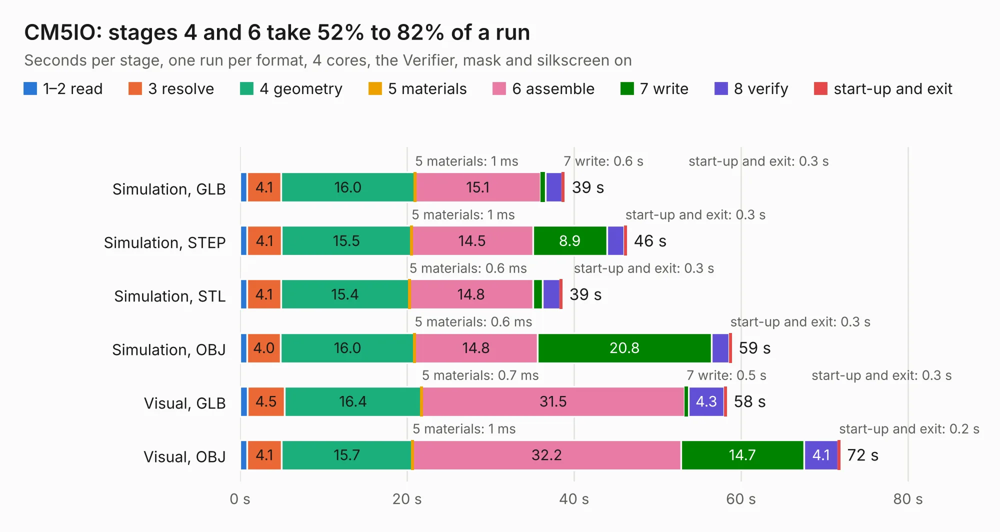

| Mode and format | 1–2 read | 3 resolve | 4 geometry | 5 materials | 6 assemble | 7 write | 8 verify | start-up and exit | Total |
|---|---:|---:|---:|---:|---:|---:|---:|---:|---:|
| Simulation, GLB | 0.8 | 4.1 | 16.0 | 1&nbsp;ms | 15.1 | 0.6 | 2.0 | 0.3 | 38.9 |
| Simulation, STEP | 0.9 | 4.1 | 15.5 | 1&nbsp;ms | 14.5 | 8.9 | 2.1 | 0.3 | 46.3 |
| Simulation, STL | 0.8 | 4.1 | 15.4 | 0.6&nbsp;ms | 14.8 | 1.1 | 2.1 | 0.3 | 38.6 |
| Simulation, OBJ | 0.9 | 4.0 | 16.0 | 0.6&nbsp;ms | 14.8 | 20.8 | 2.1 | 0.3 | 58.8 |
| Visual, GLB | 0.9 | 4.5 | 16.4 | 0.7&nbsp;ms | 31.5 | 0.5 | 4.3 | 0.3 | 58.2 |
| Visual, OBJ | 0.8 | 4.1 | 15.7 | 1&nbsp;ms | 32.2 | 14.7 | 4.1 | 0.2 | 71.8 |

<table align="center"><tr><td valign="top">

| Board | Repo: [mibs510/openxtcm5-head-unit](https://github.com/mibs510/openxtcm5-head-unit) Board: `CM5IO.kicad_pcb` |
|---|---|
| Folder | pcb / lib / RPI-CM5-IO |
| Complexity | 347&nbsp;/&nbsp;1000 (size&nbsp;222, features&nbsp;125) |
| KESE&nbsp;features | through vias, slotted holes, rounded, trapezoid or chamfered pads, arc tracks, filled zones, copper text, curved board outline, stack-up, dielectric εr and tanδ, mask and silkscreen colours |
| Tested | 9th November 2026 |
| Copper&nbsp;layers | 4 |
| File&nbsp;format | KiCad 8 (20240108) |
| Parts,&nbsp;tracks,&nbsp;vias | 64, 4,090, 703 |
| Triangles,&nbsp;simulation | 3,764,542 in 226 parts |
| Verifier | PASS in all six runs |

</td><td valign="top">

<table>
<tr><th>File type</th><th>File size</th><th>Peak memory used</th></tr>
<tr><th colspan="3" align="left">Simulation</th></tr>
<tr><td>GLB</td><td align="right">126&nbsp;MB</td><td align="right">1.2&nbsp;GB</td></tr>
<tr><td>STEP</td><td align="right">497&nbsp;MB</td><td align="right">1.6&nbsp;GB</td></tr>
<tr><td>STL</td><td align="right">188&nbsp;MB</td><td align="right">1.2&nbsp;GB</td></tr>
<tr><td>OBJ</td><td align="right">397&nbsp;MB</td><td align="right">2.5&nbsp;GB</td></tr>
<tr><th colspan="3" align="left">Visual</th></tr>
<tr><td>GLB</td><td align="right">86&nbsp;MB</td><td align="right">1.5&nbsp;GB</td></tr>
<tr><td>OBJ</td><td align="right">274&nbsp;MB</td><td align="right">1.8&nbsp;GB</td></tr>
</table>

</td></tr></table>

## 1647. 2070-S-100-bus-analyzer

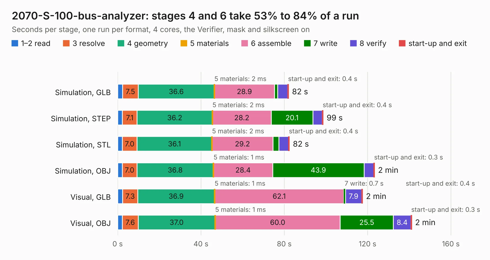

| Mode and format | 1–2 read | 3 resolve | 4 geometry | 5 materials | 6 assemble | 7 write | 8 verify | start-up and exit | Total |
|---|---:|---:|---:|---:|---:|---:|---:|---:|---:|
| Simulation, GLB | 2.4 | 7.5 | 36.6 | 2&nbsp;ms | 28.9 | 1.5 | 4.9 | 0.4 | 82.1 |
| Simulation, STEP | 2.3 | 7.1 | 36.2 | 2&nbsp;ms | 28.2 | 20.1 | 4.5 | 0.4 | 98.7 |
| Simulation, STL | 2.2 | 7.0 | 36.1 | 2&nbsp;ms | 29.2 | 2.8 | 4.7 | 0.4 | 82.5 |
| Simulation, OBJ | 2.2 | 7.0 | 36.8 | 1&nbsp;ms | 28.4 | 43.9 | 4.7 | 0.3 | 123.3 |
| Visual, GLB | 2.3 | 7.3 | 36.9 | 1&nbsp;ms | 62.1 | 0.7 | 7.9 | 0.4 | 117.6 |
| Visual, OBJ | 2.2 | 7.6 | 37.0 | 1&nbsp;ms | 60.0 | 25.5 | 8.4 | 0.3 | 141.2 |

<table align="center"><tr><td valign="top">

| Board | Repo: [MichaelPetry/2070-S-100-bus-analyzer](https://github.com/MichaelPetry/2070-S-100-bus-analyzer) Board: `2070-S-100-bus-analyzer.kicad_pcb` |
|---|---|
| Complexity | 366&nbsp;/&nbsp;1000 (size&nbsp;216, features&nbsp;150) |
| KESE&nbsp;features | through vias, slotted holes, custom pads, rounded, trapezoid or chamfered pads, arc tracks, filled zones, copper drawings, curved board outline, stack-up, dielectric εr and tanδ, copper finish |
| Tested | 9th November 2026 |
| Copper&nbsp;layers | 4 |
| File&nbsp;format | KiCad 9 (20241229) |
| Parts,&nbsp;tracks,&nbsp;vias | 90, 1,959, 520 |
| Triangles,&nbsp;simulation | 7,342,844 in 412 parts |
| Verifier | PASS in all six runs |

</td><td valign="top">

<table>
<tr><th>File type</th><th>File size</th><th>Peak memory used</th></tr>
<tr><th colspan="3" align="left">Simulation</th></tr>
<tr><td>GLB</td><td align="right">244&nbsp;MB</td><td align="right">2.1&nbsp;GB</td></tr>
<tr><td>STEP</td><td align="right">1.0&nbsp;GB</td><td align="right">2.8&nbsp;GB</td></tr>
<tr><td>STL</td><td align="right">367&nbsp;MB</td><td align="right">2.0&nbsp;GB</td></tr>
<tr><td>OBJ</td><td align="right">780&nbsp;MB</td><td align="right">4.7&nbsp;GB</td></tr>
<tr><th colspan="3" align="left">Visual</th></tr>
<tr><td>GLB</td><td align="right">151&nbsp;MB</td><td align="right">2.4&nbsp;GB</td></tr>
<tr><td>OBJ</td><td align="right">479&nbsp;MB</td><td align="right">3.1&nbsp;GB</td></tr>
</table>

</td></tr></table>

## 1648. EDA-02327-V2-0_pcb

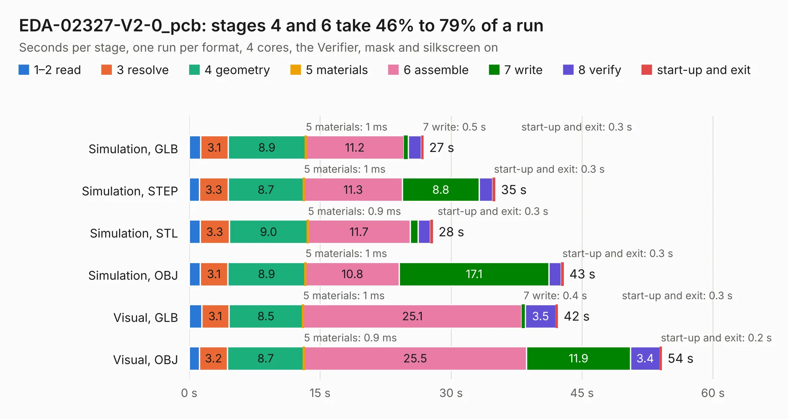

| Mode and format | 1–2 read | 3 resolve | 4 geometry | 5 materials | 6 assemble | 7 write | 8 verify | start-up and exit | Total |
|---|---:|---:|---:|---:|---:|---:|---:|---:|---:|
| Simulation, GLB | 1.3 | 3.1 | 8.9 | 1&nbsp;ms | 11.2 | 0.5 | 1.5 | 0.3 | 26.8 |
| Simulation, STEP | 1.2 | 3.3 | 8.7 | 1&nbsp;ms | 11.3 | 8.8 | 1.5 | 0.3 | 35.1 |
| Simulation, STL | 1.3 | 3.3 | 9.0 | 0.9&nbsp;ms | 11.7 | 0.9 | 1.4 | 0.3 | 27.9 |
| Simulation, OBJ | 1.3 | 3.1 | 8.9 | 1&nbsp;ms | 10.8 | 17.1 | 1.4 | 0.3 | 42.9 |
| Visual, GLB | 1.4 | 3.1 | 8.5 | 1&nbsp;ms | 25.1 | 0.4 | 3.5 | 0.3 | 42.3 |
| Visual, OBJ | 1.2 | 3.2 | 8.7 | 0.9&nbsp;ms | 25.5 | 11.9 | 3.4 | 0.2 | 54.2 |

<table align="center"><tr><td valign="top">

| Board | Repo: [michalgaska/fmc-tester-v2](https://github.com/michalgaska/fmc-tester-v2) Board: `EDA-02327-V2-0_pcb.kicad_pcb` |
|---|---|
| Complexity | 377&nbsp;/&nbsp;1000 (size&nbsp;272, features&nbsp;105) |
| KESE&nbsp;features | through vias, rounded, trapezoid or chamfered pads, filled zones, copper drawings, copper text, curved board outline, stack-up, dielectric εr and tanδ |
| Tested | 9th November 2026 |
| Copper&nbsp;layers | 4 |
| File&nbsp;format | KiCad 6 (20211014) |
| Parts,&nbsp;tracks,&nbsp;vias | 169, 4,424, 556 |
| Triangles,&nbsp;simulation | 3,191,776 in 347 parts |
| Verifier | PASS in all six runs |

</td><td valign="top">

<table>
<tr><th>File type</th><th>File size</th><th>Peak memory used</th></tr>
<tr><th colspan="3" align="left">Simulation</th></tr>
<tr><td>GLB</td><td align="right">108&nbsp;MB</td><td align="right">945&nbsp;MB</td></tr>
<tr><td>STEP</td><td align="right">425&nbsp;MB</td><td align="right">1.4&nbsp;GB</td></tr>
<tr><td>STL</td><td align="right">160&nbsp;MB</td><td align="right">958&nbsp;MB</td></tr>
<tr><td>OBJ</td><td align="right">348&nbsp;MB</td><td align="right">2.1&nbsp;GB</td></tr>
<tr><th colspan="3" align="left">Visual</th></tr>
<tr><td>GLB</td><td align="right">74&nbsp;MB</td><td align="right">1.3&nbsp;GB</td></tr>
<tr><td>OBJ</td><td align="right">246&nbsp;MB</td><td align="right">1.7&nbsp;GB</td></tr>
</table>

</td></tr></table>

## 1649. moteus_c1

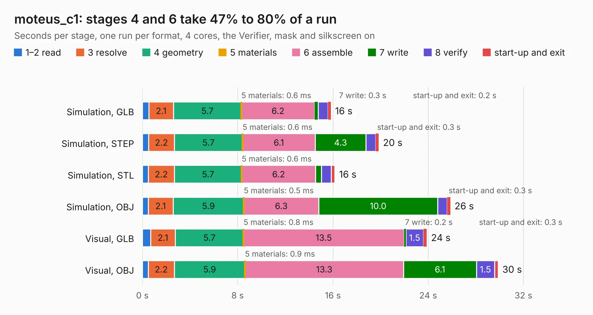

| Mode and format | 1–2 read | 3 resolve | 4 geometry | 5 materials | 6 assemble | 7 write | 8 verify | start-up and exit | Total |
|---|---:|---:|---:|---:|---:|---:|---:|---:|---:|
| Simulation, GLB | 0.6 | 2.1 | 5.7 | 0.6&nbsp;ms | 6.2 | 0.3 | 0.8 | 0.2 | 15.8 |
| Simulation, STEP | 0.5 | 2.2 | 5.7 | 0.6&nbsp;ms | 6.1 | 4.3 | 0.8 | 0.3 | 19.9 |
| Simulation, STL | 0.5 | 2.2 | 5.7 | 0.6&nbsp;ms | 6.2 | 0.5 | 0.8 | 0.3 | 16.2 |
| Simulation, OBJ | 0.5 | 2.1 | 5.9 | 0.5&nbsp;ms | 6.3 | 10.0 | 0.8 | 0.3 | 25.9 |
| Visual, GLB | 0.7 | 2.1 | 5.7 | 0.8&nbsp;ms | 13.5 | 0.2 | 1.5 | 0.3 | 23.9 |
| Visual, OBJ | 0.5 | 2.2 | 5.9 | 0.9&nbsp;ms | 13.3 | 6.1 | 1.5 | 0.3 | 29.9 |

<table align="center"><tr><td valign="top">

| Board | Repo: [mjbots/moteus](https://github.com/mjbots/moteus) Board: `moteus_c1.kicad_pcb` |
|---|---|
| Folder | hw / c1 |
| Complexity | 340&nbsp;/&nbsp;1000 (size&nbsp;250, features&nbsp;90) |
| KESE&nbsp;features | through vias, rounded, trapezoid or chamfered pads, filled zones, curved board outline, stack-up, dielectric εr and tanδ, mask and silkscreen colours |
| Tested | 9th November 2026 |
| Copper&nbsp;layers | 4 |
| File&nbsp;format | KiCad 7 (20221018) |
| Parts,&nbsp;tracks,&nbsp;vias | 120, 1,099, 290 |
| Triangles,&nbsp;simulation | 1,697,714 in 114 parts |
| Verifier | PASS in all six runs |

</td><td valign="top">

<table>
<tr><th>File type</th><th>File size</th><th>Peak memory used</th></tr>
<tr><th colspan="3" align="left">Simulation</th></tr>
<tr><td>GLB</td><td align="right">58&nbsp;MB</td><td align="right">613&nbsp;MB</td></tr>
<tr><td>STEP</td><td align="right">200&nbsp;MB</td><td align="right">687&nbsp;MB</td></tr>
<tr><td>STL</td><td align="right">85&nbsp;MB</td><td align="right">589&nbsp;MB</td></tr>
<tr><td>OBJ</td><td align="right">175&nbsp;MB</td><td align="right">1.2&nbsp;GB</td></tr>
<tr><th colspan="3" align="left">Visual</th></tr>
<tr><td>GLB</td><td align="right">35&nbsp;MB</td><td align="right">738&nbsp;MB</td></tr>
<tr><td>OBJ</td><td align="right">107&nbsp;MB</td><td align="right">831&nbsp;MB</td></tr>
</table>

</td></tr></table>

## 1650. moteus_c1

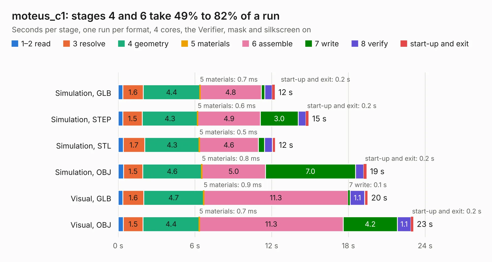

| Mode and format | 1–2 read | 3 resolve | 4 geometry | 5 materials | 6 assemble | 7 write | 8 verify | start-up and exit | Total |
|---|---:|---:|---:|---:|---:|---:|---:|---:|---:|
| Simulation, GLB | 0.4 | 1.6 | 4.4 | 0.7&nbsp;ms | 4.8 | 0.3 | 0.6 | 0.2 | 12.3 |
| Simulation, STEP | 0.4 | 1.5 | 4.3 | 0.6&nbsp;ms | 4.9 | 3.0 | 0.6 | 0.2 | 14.9 |
| Simulation, STL | 0.4 | 1.7 | 4.3 | 0.5&nbsp;ms | 4.6 | 0.5 | 0.6 | 0.2 | 12.3 |
| Simulation, OBJ | 0.4 | 1.5 | 4.6 | 0.8&nbsp;ms | 5.0 | 7.0 | 0.6 | 0.2 | 19.4 |
| Visual, GLB | 0.4 | 1.6 | 4.7 | 0.9&nbsp;ms | 11.3 | 0.1 | 1.1 | 0.2 | 19.5 |
| Visual, OBJ | 0.4 | 1.5 | 4.4 | 0.7&nbsp;ms | 11.3 | 4.2 | 1.1 | 0.2 | 23.1 |

<table align="center"><tr><td valign="top">

| Board | Repo: [mjbots/moteus](https://github.com/mjbots/moteus) Board: `moteus_c1.kicad_pcb` |
|---|---|
| Folder | hw / c1 / r1.0 |
| Complexity | 340&nbsp;/&nbsp;1000 (size&nbsp;250, features&nbsp;90) |
| KESE&nbsp;features | through vias, rounded, trapezoid or chamfered pads, filled zones, curved board outline, stack-up, dielectric εr and tanδ, mask and silkscreen colours |
| Tested | 9th November 2026 |
| Copper&nbsp;layers | 4 |
| File&nbsp;format | KiCad 7 (20221018) |
| Parts,&nbsp;tracks,&nbsp;vias | 130, 1,083, 286 |
| Triangles,&nbsp;simulation | 1,709,492 in 121 parts |
| Verifier | PASS in all six runs |

</td><td valign="top">

<table>
<tr><th>File type</th><th>File size</th><th>Peak memory used</th></tr>
<tr><th colspan="3" align="left">Simulation</th></tr>
<tr><td>GLB</td><td align="right">58&nbsp;MB</td><td align="right">599&nbsp;MB</td></tr>
<tr><td>STEP</td><td align="right">205&nbsp;MB</td><td align="right">681&nbsp;MB</td></tr>
<tr><td>STL</td><td align="right">85&nbsp;MB</td><td align="right">566&nbsp;MB</td></tr>
<tr><td>OBJ</td><td align="right">176&nbsp;MB</td><td align="right">1.1&nbsp;GB</td></tr>
<tr><th colspan="3" align="left">Visual</th></tr>
<tr><td>GLB</td><td align="right">36&nbsp;MB</td><td align="right">732&nbsp;MB</td></tr>
<tr><td>OBJ</td><td align="right">109&nbsp;MB</td><td align="right">866&nbsp;MB</td></tr>
</table>

</td></tr></table>

## 1651. moteus_c1

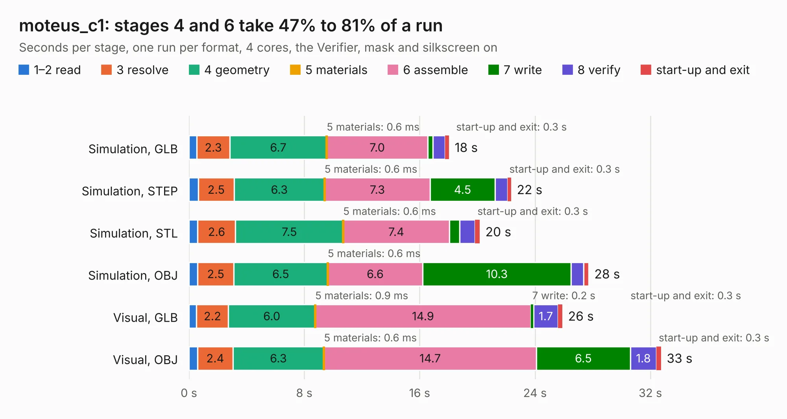

| Mode and format | 1–2 read | 3 resolve | 4 geometry | 5 materials | 6 assemble | 7 write | 8 verify | start-up and exit | Total |
|---|---:|---:|---:|---:|---:|---:|---:|---:|---:|
| Simulation, GLB | 0.5 | 2.3 | 6.7 | 0.6&nbsp;ms | 7.0 | 0.3 | 0.8 | 0.3 | 18.0 |
| Simulation, STEP | 0.6 | 2.5 | 6.3 | 0.6&nbsp;ms | 7.3 | 4.5 | 0.9 | 0.3 | 22.4 |
| Simulation, STL | 0.6 | 2.6 | 7.5 | 0.6&nbsp;ms | 7.4 | 0.7 | 1.1 | 0.3 | 20.2 |
| Simulation, OBJ | 0.6 | 2.5 | 6.5 | 0.6&nbsp;ms | 6.6 | 10.3 | 0.9 | 0.4 | 27.7 |
| Visual, GLB | 0.5 | 2.2 | 6.0 | 0.9&nbsp;ms | 14.9 | 0.2 | 1.7 | 0.3 | 25.9 |
| Visual, OBJ | 0.6 | 2.4 | 6.3 | 0.6&nbsp;ms | 14.7 | 6.5 | 1.8 | 0.3 | 32.7 |

<table align="center"><tr><td valign="top">

| Board | Repo: [mjbots/moteus](https://github.com/mjbots/moteus) Board: `moteus_c1.kicad_pcb` |
|---|---|
| Folder | hw / c1 / r1.1 |
| Complexity | 339&nbsp;/&nbsp;1000 (size&nbsp;249, features&nbsp;90) |
| KESE&nbsp;features | through vias, rounded, trapezoid or chamfered pads, filled zones, curved board outline, stack-up, dielectric εr and tanδ, mask and silkscreen colours |
| Tested | 9th November 2026 |
| Copper&nbsp;layers | 4 |
| File&nbsp;format | KiCad 7 (20221018) |
| Parts,&nbsp;tracks,&nbsp;vias | 120, 1,088, 289 |
| Triangles,&nbsp;simulation | 1,693,562 in 114 parts |
| Verifier | PASS in all six runs |

</td><td valign="top">

<table>
<tr><th>File type</th><th>File size</th><th>Peak memory used</th></tr>
<tr><th colspan="3" align="left">Simulation</th></tr>
<tr><td>GLB</td><td align="right">58&nbsp;MB</td><td align="right">597&nbsp;MB</td></tr>
<tr><td>STEP</td><td align="right">199&nbsp;MB</td><td align="right">664&nbsp;MB</td></tr>
<tr><td>STL</td><td align="right">85&nbsp;MB</td><td align="right">609&nbsp;MB</td></tr>
<tr><td>OBJ</td><td align="right">174&nbsp;MB</td><td align="right">1.2&nbsp;GB</td></tr>
<tr><th colspan="3" align="left">Visual</th></tr>
<tr><td>GLB</td><td align="right">35&nbsp;MB</td><td align="right">767&nbsp;MB</td></tr>
<tr><td>OBJ</td><td align="right">107&nbsp;MB</td><td align="right">819&nbsp;MB</td></tr>
</table>

</td></tr></table>

## 1652. mjuart

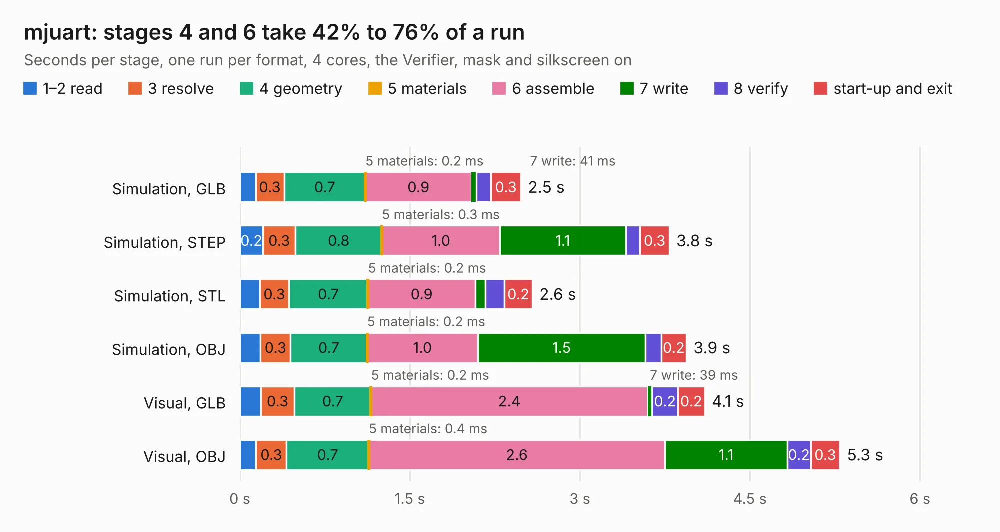

| Mode and format | 1–2 read | 3 resolve | 4 geometry | 5 materials | 6 assemble | 7 write | 8 verify | start-up and exit | Total |
|---|---:|---:|---:|---:|---:|---:|---:|---:|---:|
| Simulation, GLB | 0.1 | 0.3 | 0.7 | 0.2&nbsp;ms | 0.9 | 41&nbsp;ms | 0.1 | 0.3 | 2.5 |
| Simulation, STEP | 0.2 | 0.3 | 0.8 | 0.3&nbsp;ms | 1.0 | 1.1 | 0.1 | 0.3 | 3.8 |
| Simulation, STL | 0.2 | 0.3 | 0.7 | 0.2&nbsp;ms | 0.9 | 91&nbsp;ms | 0.2 | 0.2 | 2.6 |
| Simulation, OBJ | 0.2 | 0.3 | 0.7 | 0.2&nbsp;ms | 1.0 | 1.5 | 0.1 | 0.2 | 3.9 |
| Visual, GLB | 0.2 | 0.3 | 0.7 | 0.2&nbsp;ms | 2.4 | 39&nbsp;ms | 0.2 | 0.2 | 4.1 |
| Visual, OBJ | 0.1 | 0.3 | 0.7 | 0.4&nbsp;ms | 2.6 | 1.1 | 0.2 | 0.3 | 5.3 |

<table align="center"><tr><td valign="top">

| Board | Repo: [mjbots/moteus](https://github.com/mjbots/moteus) Board: `mjuart.kicad_pcb` |
|---|---|
| Folder | hw / mjuart |
| Complexity | 245&nbsp;/&nbsp;1000 (size&nbsp;155, features&nbsp;90) |
| KESE&nbsp;features | through vias, rounded, trapezoid or chamfered pads, filled zones, curved board outline, stack-up, dielectric εr and tanδ, mask and silkscreen colours |
| Tested | 9th November 2026 |
| Copper&nbsp;layers | 4 |
| File&nbsp;format | KiCad 9 (20241229) |
| Parts,&nbsp;tracks,&nbsp;vias | 16, 150, 37 |
| Triangles,&nbsp;simulation | 222,280 in 38 parts |
| Verifier | PASS in all six runs |

</td><td valign="top">

<table>
<tr><th>File type</th><th>File size</th><th>Peak memory used</th></tr>
<tr><th colspan="3" align="left">Simulation</th></tr>
<tr><td>GLB</td><td align="right">7.7&nbsp;MB</td><td align="right">220&nbsp;MB</td></tr>
<tr><td>STEP</td><td align="right">28&nbsp;MB</td><td align="right">232&nbsp;MB</td></tr>
<tr><td>STL</td><td align="right">11&nbsp;MB</td><td align="right">219&nbsp;MB</td></tr>
<tr><td>OBJ</td><td align="right">22&nbsp;MB</td><td align="right">226&nbsp;MB</td></tr>
<tr><th colspan="3" align="left">Visual</th></tr>
<tr><td>GLB</td><td align="right">5.4&nbsp;MB</td><td align="right">209&nbsp;MB</td></tr>
<tr><td>OBJ</td><td align="right">15&nbsp;MB</td><td align="right">212&nbsp;MB</td></tr>
</table>

</td></tr></table>

## 1653. moteus_x1

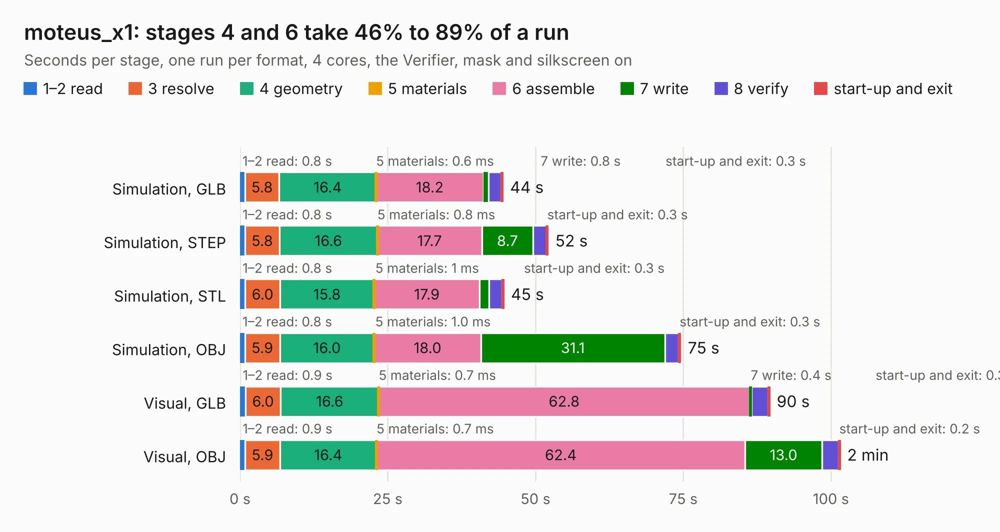

| Mode and format | 1–2 read | 3 resolve | 4 geometry | 5 materials | 6 assemble | 7 write | 8 verify | start-up and exit | Total |
|---|---:|---:|---:|---:|---:|---:|---:|---:|---:|
| Simulation, GLB | 0.8 | 5.8 | 16.4 | 0.6&nbsp;ms | 18.2 | 0.8 | 2.2 | 0.3 | 44.5 |
| Simulation, STEP | 0.8 | 5.8 | 16.6 | 0.8&nbsp;ms | 17.7 | 8.7 | 2.2 | 0.3 | 52.1 |
| Simulation, STL | 0.8 | 6.0 | 15.8 | 1&nbsp;ms | 17.9 | 1.6 | 2.2 | 0.3 | 44.6 |
| Simulation, OBJ | 0.8 | 5.9 | 16.0 | 1.0&nbsp;ms | 18.0 | 31.1 | 2.3 | 0.3 | 74.6 |
| Visual, GLB | 0.9 | 6.0 | 16.6 | 0.7&nbsp;ms | 62.8 | 0.4 | 2.8 | 0.3 | 89.6 |
| Visual, OBJ | 0.9 | 5.9 | 16.4 | 0.7&nbsp;ms | 62.4 | 13.0 | 2.8 | 0.2 | 101.5 |

<table align="center"><tr><td valign="top">

| Board | Repo: [mjbots/moteus](https://github.com/mjbots/moteus) Board: `moteus_x1.kicad_pcb` |
|---|---|
| Folder | hw / x1 |
| Complexity | 408&nbsp;/&nbsp;1000 (size&nbsp;278, features&nbsp;130) |
| KESE&nbsp;features | through vias, custom pads, rounded, trapezoid or chamfered pads, arc tracks, filled zones, copper drawings, curved board outline, stack-up, dielectric εr and tanδ, mask and silkscreen colours |
| Tested | 9th November 2026 |
| Copper&nbsp;layers | 6 |
| File&nbsp;format | KiCad 8 (20240108) |
| Parts,&nbsp;tracks,&nbsp;vias | 183, 1,473, 1,087 |
| Triangles,&nbsp;simulation | 5,602,952 in 146 parts |
| Verifier | PASS in all six runs |

</td><td valign="top">

<table>
<tr><th>File type</th><th>File size</th><th>Peak memory used</th></tr>
<tr><th colspan="3" align="left">Simulation</th></tr>
<tr><td>GLB</td><td align="right">183&nbsp;MB</td><td align="right">1.2&nbsp;GB</td></tr>
<tr><td>STEP</td><td align="right">471&nbsp;MB</td><td align="right">1.6&nbsp;GB</td></tr>
<tr><td>STL</td><td align="right">280&nbsp;MB</td><td align="right">1.2&nbsp;GB</td></tr>
<tr><td>OBJ</td><td align="right">588&nbsp;MB</td><td align="right">3.5&nbsp;GB</td></tr>
<tr><th colspan="3" align="left">Visual</th></tr>
<tr><td>GLB</td><td align="right">86&nbsp;MB</td><td align="right">1.6&nbsp;GB</td></tr>
<tr><td>OBJ</td><td align="right">275&nbsp;MB</td><td align="right">1.9&nbsp;GB</td></tr>
</table>

</td></tr></table>

## 1654. amiga-gfxcard-before-pour

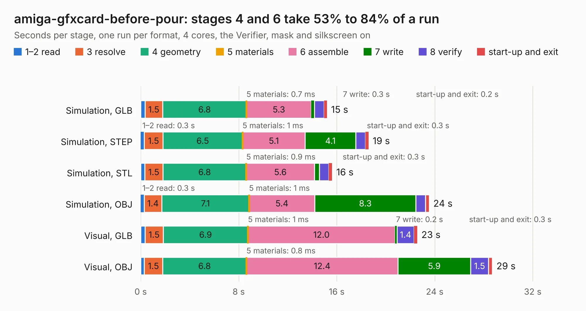

| Mode and format | 1–2 read | 3 resolve | 4 geometry | 5 materials | 6 assemble | 7 write | 8 verify | start-up and exit | Total |
|---|---:|---:|---:|---:|---:|---:|---:|---:|---:|
| Simulation, GLB | 0.3 | 1.5 | 6.8 | 0.7&nbsp;ms | 5.3 | 0.3 | 0.8 | 0.2 | 15.2 |
| Simulation, STEP | 0.3 | 1.5 | 6.5 | 1&nbsp;ms | 5.1 | 4.1 | 0.8 | 0.3 | 18.6 |
| Simulation, STL | 0.3 | 1.5 | 6.8 | 0.9&nbsp;ms | 5.6 | 0.4 | 0.8 | 0.3 | 15.6 |
| Simulation, OBJ | 0.3 | 1.4 | 7.1 | 1&nbsp;ms | 5.4 | 8.3 | 0.8 | 0.3 | 23.5 |
| Visual, GLB | 0.4 | 1.5 | 6.9 | 1&nbsp;ms | 12.0 | 0.2 | 1.4 | 0.3 | 22.6 |
| Visual, OBJ | 0.3 | 1.5 | 6.8 | 0.8&nbsp;ms | 12.4 | 5.9 | 1.5 | 0.3 | 28.7 |

<table align="center"><tr><td valign="top">

| Board | Repo: [mntmn/amiga2000-gfxcard](https://github.com/mntmn/amiga2000-gfxcard) Board: `amiga-gfxcard-before-pour.kicad_pcb` |
|---|---|
| Folder | kicad |
| Complexity | 245&nbsp;/&nbsp;1000 (size&nbsp;230, features&nbsp;15) |
| KESE&nbsp;features | through vias |
| Tested | 9th November 2026 |
| Copper&nbsp;layers | 2 |
| File&nbsp;format | KiCad 4 (4) |
| Parts,&nbsp;tracks,&nbsp;vias | 21, 1,740, 290 |
| Triangles,&nbsp;simulation | 1,270,194 in 237 parts |
| Verifier | PASS in all six runs |

</td><td valign="top">

<table>
<tr><th>File type</th><th>File size</th><th>Peak memory used</th></tr>
<tr><th colspan="3" align="left">Simulation</th></tr>
<tr><td>GLB</td><td align="right">44&nbsp;MB</td><td align="right">525&nbsp;MB</td></tr>
<tr><td>STEP</td><td align="right">204&nbsp;MB</td><td align="right">645&nbsp;MB</td></tr>
<tr><td>STL</td><td align="right">64&nbsp;MB</td><td align="right">522&nbsp;MB</td></tr>
<tr><td>OBJ</td><td align="right">132&nbsp;MB</td><td align="right">881&nbsp;MB</td></tr>
<tr><th colspan="3" align="left">Visual</th></tr>
<tr><td>GLB</td><td align="right">33&nbsp;MB</td><td align="right">684&nbsp;MB</td></tr>
<tr><td>OBJ</td><td align="right">101&nbsp;MB</td><td align="right">768&nbsp;MB</td></tr>
</table>

</td></tr></table>

## 1655. amiga-gfxcard

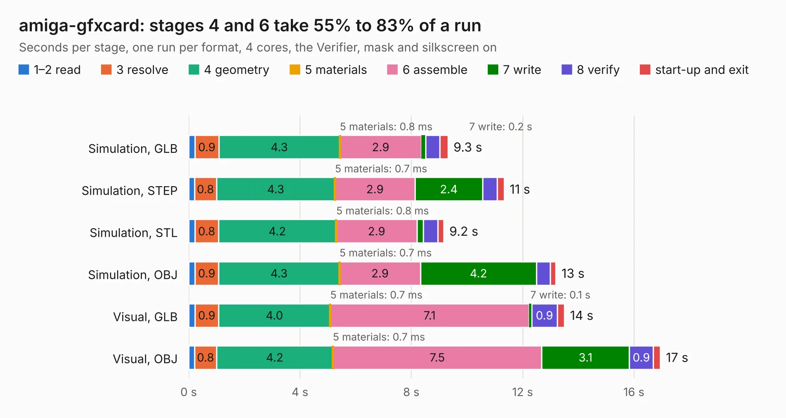

| Mode and format | 1–2 read | 3 resolve | 4 geometry | 5 materials | 6 assemble | 7 write | 8 verify | start-up and exit | Total |
|---|---:|---:|---:|---:|---:|---:|---:|---:|---:|
| Simulation, GLB | 0.2 | 0.9 | 4.3 | 0.8&nbsp;ms | 2.9 | 0.2 | 0.5 | 0.3 | 9.3 |
| Simulation, STEP | 0.2 | 0.8 | 4.3 | 0.7&nbsp;ms | 2.9 | 2.4 | 0.5 | 0.3 | 11.3 |
| Simulation, STL | 0.2 | 0.8 | 4.2 | 0.8&nbsp;ms | 2.9 | 0.2 | 0.5 | 0.2 | 9.2 |
| Simulation, OBJ | 0.2 | 0.9 | 4.3 | 0.7&nbsp;ms | 2.9 | 4.2 | 0.5 | 0.2 | 13.2 |
| Visual, GLB | 0.2 | 0.9 | 4.0 | 0.7&nbsp;ms | 7.1 | 0.1 | 0.9 | 0.3 | 13.5 |
| Visual, OBJ | 0.2 | 0.8 | 4.2 | 0.7&nbsp;ms | 7.5 | 3.1 | 0.9 | 0.2 | 16.9 |

<table align="center"><tr><td valign="top">

| Board | Repo: [mntmn/amiga2000-gfxcard](https://github.com/mntmn/amiga2000-gfxcard) Board: `amiga-gfxcard.kicad_pcb` |
|---|---|
| Folder | kicad |
| Complexity | 206&nbsp;/&nbsp;1000 (size&nbsp;171, features&nbsp;35) |
| KESE&nbsp;features | through vias, filled zones |
| Tested | 9th November 2026 |
| Copper&nbsp;layers | 2 |
| File&nbsp;format | KiCad 4 (4) |
| Parts,&nbsp;tracks,&nbsp;vias | 32, 871, 112 |
| Triangles,&nbsp;simulation | 842,260 in 159 parts |
| Verifier | PASS in all six runs |

</td><td valign="top">

<table>
<tr><th>File type</th><th>File size</th><th>Peak memory used</th></tr>
<tr><th colspan="3" align="left">Simulation</th></tr>
<tr><td>GLB</td><td align="right">30&nbsp;MB</td><td align="right">401&nbsp;MB</td></tr>
<tr><td>STEP</td><td align="right">147&nbsp;MB</td><td align="right">472&nbsp;MB</td></tr>
<tr><td>STL</td><td align="right">42&nbsp;MB</td><td align="right">423&nbsp;MB</td></tr>
<tr><td>OBJ</td><td align="right">87&nbsp;MB</td><td align="right">621&nbsp;MB</td></tr>
<tr><th colspan="3" align="left">Visual</th></tr>
<tr><td>GLB</td><td align="right">21&nbsp;MB</td><td align="right">538&nbsp;MB</td></tr>
<tr><td>OBJ</td><td align="right">65&nbsp;MB</td><td align="right">524&nbsp;MB</td></tr>
</table>

</td></tr></table>

## 1656. videoslot

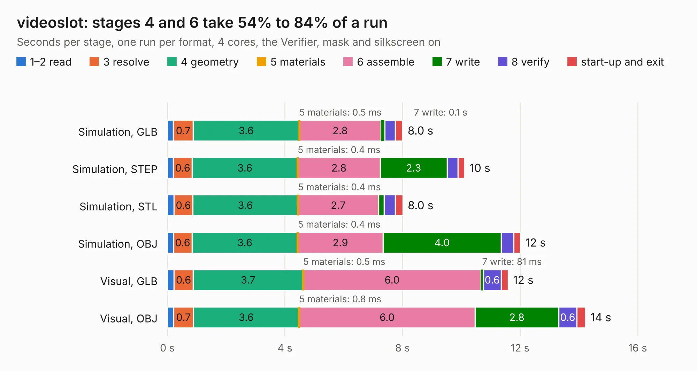

| Mode and format | 1–2 read | 3 resolve | 4 geometry | 5 materials | 6 assemble | 7 write | 8 verify | start-up and exit | Total |
|---|---:|---:|---:|---:|---:|---:|---:|---:|---:|
| Simulation, GLB | 0.2 | 0.7 | 3.6 | 0.5&nbsp;ms | 2.8 | 0.1 | 0.4 | 0.3 | 8.0 |
| Simulation, STEP | 0.2 | 0.6 | 3.6 | 0.4&nbsp;ms | 2.8 | 2.3 | 0.4 | 0.2 | 10.1 |
| Simulation, STL | 0.2 | 0.6 | 3.6 | 0.4&nbsp;ms | 2.7 | 0.2 | 0.4 | 0.3 | 8.0 |
| Simulation, OBJ | 0.2 | 0.6 | 3.6 | 0.4&nbsp;ms | 2.9 | 4.0 | 0.4 | 0.2 | 12.0 |
| Visual, GLB | 0.2 | 0.6 | 3.7 | 0.5&nbsp;ms | 6.0 | 81&nbsp;ms | 0.6 | 0.2 | 11.6 |
| Visual, OBJ | 0.2 | 0.7 | 3.6 | 0.8&nbsp;ms | 6.0 | 2.8 | 0.6 | 0.3 | 14.2 |

<table align="center"><tr><td valign="top">

| Board | Repo: [mntmn/amiga2000-gfxcard](https://github.com/mntmn/amiga2000-gfxcard) Board: `videoslot.kicad_pcb` |
|---|---|
| Folder | videoslot |
| Complexity | 184&nbsp;/&nbsp;1000 (size&nbsp;149, features&nbsp;35) |
| KESE&nbsp;features | through vias, filled zones |
| Tested | 9th November 2026 |
| Copper&nbsp;layers | 2 |
| File&nbsp;format | KiCad 5 (20160815) |
| Parts,&nbsp;tracks,&nbsp;vias | 13, 425, 49 |
| Triangles,&nbsp;simulation | 689,736 in 107 parts |
| Verifier | PASS in all six runs |

</td><td valign="top">

<table>
<tr><th>File type</th><th>File size</th><th>Peak memory used</th></tr>
<tr><th colspan="3" align="left">Simulation</th></tr>
<tr><td>GLB</td><td align="right">24&nbsp;MB</td><td align="right">343&nbsp;MB</td></tr>
<tr><td>STEP</td><td align="right">121&nbsp;MB</td><td align="right">403&nbsp;MB</td></tr>
<tr><td>STL</td><td align="right">34&nbsp;MB</td><td align="right">339&nbsp;MB</td></tr>
<tr><td>OBJ</td><td align="right">70&nbsp;MB</td><td align="right">495&nbsp;MB</td></tr>
<tr><th colspan="3" align="left">Visual</th></tr>
<tr><td>GLB</td><td align="right">16&nbsp;MB</td><td align="right">419&nbsp;MB</td></tr>
<tr><td>OBJ</td><td align="right">49&nbsp;MB</td><td align="right">420&nbsp;MB</td></tr>
</table>

</td></tr></table>

## 1657. adapter

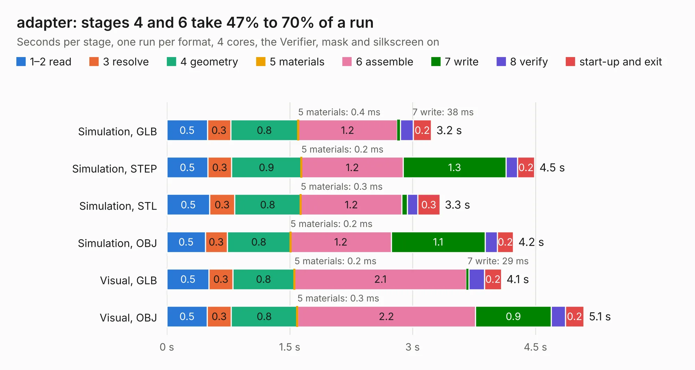

| Mode and format | 1–2 read | 3 resolve | 4 geometry | 5 materials | 6 assemble | 7 write | 8 verify | start-up and exit | Total |
|---|---:|---:|---:|---:|---:|---:|---:|---:|---:|
| Simulation, GLB | 0.5 | 0.3 | 0.8 | 0.4&nbsp;ms | 1.2 | 38&nbsp;ms | 0.2 | 0.2 | 3.2 |
| Simulation, STEP | 0.5 | 0.3 | 0.9 | 0.2&nbsp;ms | 1.2 | 1.3 | 0.1 | 0.2 | 4.5 |
| Simulation, STL | 0.5 | 0.3 | 0.8 | 0.3&nbsp;ms | 1.2 | 66&nbsp;ms | 0.1 | 0.3 | 3.3 |
| Simulation, OBJ | 0.5 | 0.3 | 0.8 | 0.2&nbsp;ms | 1.2 | 1.1 | 0.1 | 0.2 | 4.2 |
| Visual, GLB | 0.5 | 0.3 | 0.8 | 0.2&nbsp;ms | 2.1 | 29&nbsp;ms | 0.2 | 0.2 | 4.1 |
| Visual, OBJ | 0.5 | 0.3 | 0.8 | 0.3&nbsp;ms | 2.2 | 0.9 | 0.2 | 0.2 | 5.1 |

<table align="center"><tr><td valign="top">

| Board | Repo: [Modos-Labs/Glider](https://github.com/Modos-Labs/Glider) Board: `adapter.kicad_pcb` |
|---|---|
| Folder | pcb / 34p-adapter-a |
| Complexity | 214&nbsp;/&nbsp;1000 (size&nbsp;139, features&nbsp;75) |
| KESE&nbsp;features | through vias, filled zones, curved board outline, stack-up, dielectric εr and tanδ |
| Tested | 9th November 2026 |
| Copper&nbsp;layers | 2 |
| File&nbsp;format | KiCad 8 (20240108) |
| Parts,&nbsp;tracks,&nbsp;vias | 6, 255, 74 |
| Triangles,&nbsp;simulation | 197,086 in 71 parts |
| Verifier | PASS in all six runs |

</td><td valign="top">

<table>
<tr><th>File type</th><th>File size</th><th>Peak memory used</th></tr>
<tr><th colspan="3" align="left">Simulation</th></tr>
<tr><td>GLB</td><td align="right">6.9&nbsp;MB</td><td align="right">231&nbsp;MB</td></tr>
<tr><td>STEP</td><td align="right">32&nbsp;MB</td><td align="right">256&nbsp;MB</td></tr>
<tr><td>STL</td><td align="right">9.9&nbsp;MB</td><td align="right">232&nbsp;MB</td></tr>
<tr><td>OBJ</td><td align="right">20&nbsp;MB</td><td align="right">232&nbsp;MB</td></tr>
<tr><th colspan="3" align="left">Visual</th></tr>
<tr><td>GLB</td><td align="right">5.8&nbsp;MB</td><td align="right">226&nbsp;MB</td></tr>
<tr><td>OBJ</td><td align="right">17&nbsp;MB</td><td align="right">227&nbsp;MB</td></tr>
</table>

</td></tr></table>

## 1658. adapter

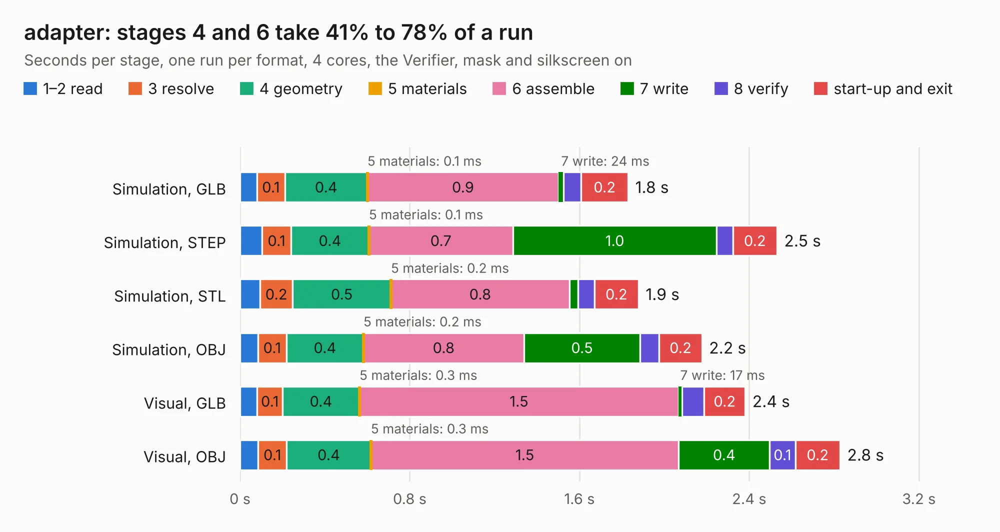

| Mode and format | 1–2 read | 3 resolve | 4 geometry | 5 materials | 6 assemble | 7 write | 8 verify | start-up and exit | Total |
|---|---:|---:|---:|---:|---:|---:|---:|---:|---:|
| Simulation, GLB | 80&nbsp;ms | 0.1 | 0.4 | 0.1&nbsp;ms | 0.9 | 24&nbsp;ms | 82&nbsp;ms | 0.2 | 1.8 |
| Simulation, STEP | 0.1 | 0.1 | 0.4 | 0.1&nbsp;ms | 0.7 | 1.0 | 76&nbsp;ms | 0.2 | 2.5 |
| Simulation, STL | 94&nbsp;ms | 0.2 | 0.5 | 0.2&nbsp;ms | 0.8 | 41&nbsp;ms | 77&nbsp;ms | 0.2 | 1.9 |
| Simulation, OBJ | 84&nbsp;ms | 0.1 | 0.4 | 0.2&nbsp;ms | 0.8 | 0.5 | 89&nbsp;ms | 0.2 | 2.2 |
| Visual, GLB | 81&nbsp;ms | 0.1 | 0.4 | 0.3&nbsp;ms | 1.5 | 17&nbsp;ms | 0.1 | 0.2 | 2.4 |
| Visual, OBJ | 85&nbsp;ms | 0.1 | 0.4 | 0.3&nbsp;ms | 1.5 | 0.4 | 0.1 | 0.2 | 2.8 |

<table align="center"><tr><td valign="top">

| Board | Repo: [Modos-Labs/Glider](https://github.com/Modos-Labs/Glider) Board: `adapter.kicad_pcb` |
|---|---|
| Folder | pcb / 34p-adapter-b |
| Complexity | 189&nbsp;/&nbsp;1000 (size&nbsp;124, features&nbsp;65) |
| KESE&nbsp;features | through vias, filled zones, stack-up, dielectric εr and tanδ |
| Tested | 9th November 2026 |
| Copper&nbsp;layers | 2 |
| File&nbsp;format | KiCad 8 (20240108) |
| Parts,&nbsp;tracks,&nbsp;vias | 2, 216, 40 |
| Triangles,&nbsp;simulation | 123,848 in 47 parts |
| Verifier | PASS in all six runs |

</td><td valign="top">

<table>
<tr><th>File type</th><th>File size</th><th>Peak memory used</th></tr>
<tr><th colspan="3" align="left">Simulation</th></tr>
<tr><td>GLB</td><td align="right">4.3&nbsp;MB</td><td align="right">199&nbsp;MB</td></tr>
<tr><td>STEP</td><td align="right">21&nbsp;MB</td><td align="right">207&nbsp;MB</td></tr>
<tr><td>STL</td><td align="right">6.2&nbsp;MB</td><td align="right">201&nbsp;MB</td></tr>
<tr><td>OBJ</td><td align="right">12&nbsp;MB</td><td align="right">199&nbsp;MB</td></tr>
<tr><th colspan="3" align="left">Visual</th></tr>
<tr><td>GLB</td><td align="right">3.5&nbsp;MB</td><td align="right">173&nbsp;MB</td></tr>
<tr><td>OBJ</td><td align="right">10&nbsp;MB</td><td align="right">171&nbsp;MB</td></tr>
</table>

</td></tr></table>

## 1659. adapter

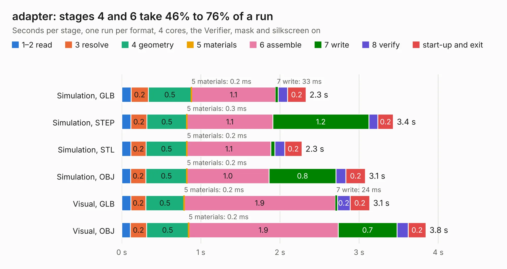

| Mode and format | 1–2 read | 3 resolve | 4 geometry | 5 materials | 6 assemble | 7 write | 8 verify | start-up and exit | Total |
|---|---:|---:|---:|---:|---:|---:|---:|---:|---:|
| Simulation, GLB | 0.1 | 0.2 | 0.5 | 0.2&nbsp;ms | 1.1 | 33&nbsp;ms | 0.1 | 0.2 | 2.3 |
| Simulation, STEP | 0.1 | 0.2 | 0.5 | 0.3&nbsp;ms | 1.1 | 1.2 | 0.1 | 0.2 | 3.4 |
| Simulation, STL | 0.1 | 0.2 | 0.5 | 0.2&nbsp;ms | 1.1 | 49&nbsp;ms | 0.1 | 0.2 | 2.3 |
| Simulation, OBJ | 0.1 | 0.2 | 0.5 | 0.2&nbsp;ms | 1.0 | 0.8 | 0.1 | 0.2 | 3.1 |
| Visual, GLB | 0.1 | 0.2 | 0.5 | 0.2&nbsp;ms | 1.9 | 24&nbsp;ms | 0.2 | 0.2 | 3.1 |
| Visual, OBJ | 0.1 | 0.2 | 0.5 | 0.2&nbsp;ms | 1.9 | 0.7 | 0.1 | 0.2 | 3.8 |

<table align="center"><tr><td valign="top">

| Board | Repo: [Modos-Labs/Glider](https://github.com/Modos-Labs/Glider) Board: `adapter.kicad_pcb` |
|---|---|
| Folder | pcb / 35p-adapter-a |
| Complexity | 190&nbsp;/&nbsp;1000 (size&nbsp;125, features&nbsp;65) |
| KESE&nbsp;features | through vias, filled zones, stack-up, dielectric εr and tanδ |
| Tested | 9th November 2026 |
| Copper&nbsp;layers | 2 |
| File&nbsp;format | KiCad 7 (20221018) |
| Parts,&nbsp;tracks,&nbsp;vias | 2, 195, 53 |
| Triangles,&nbsp;simulation | 155,366 in 50 parts |
| Verifier | PASS in all six runs |

</td><td valign="top">

<table>
<tr><th>File type</th><th>File size</th><th>Peak memory used</th></tr>
<tr><th colspan="3" align="left">Simulation</th></tr>
<tr><td>GLB</td><td align="right">5.4&nbsp;MB</td><td align="right">210&nbsp;MB</td></tr>
<tr><td>STEP</td><td align="right">27&nbsp;MB</td><td align="right">223&nbsp;MB</td></tr>
<tr><td>STL</td><td align="right">7.8&nbsp;MB</td><td align="right">211&nbsp;MB</td></tr>
<tr><td>OBJ</td><td align="right">15&nbsp;MB</td><td align="right">210&nbsp;MB</td></tr>
<tr><th colspan="3" align="left">Visual</th></tr>
<tr><td>GLB</td><td align="right">4.5&nbsp;MB</td><td align="right">199&nbsp;MB</td></tr>
<tr><td>OBJ</td><td align="right">13&nbsp;MB</td><td align="right">199&nbsp;MB</td></tr>
</table>

</td></tr></table>

## 1660. adapter

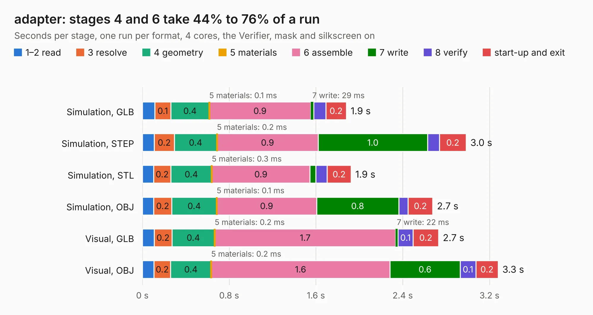

| Mode and format | 1–2 read | 3 resolve | 4 geometry | 5 materials | 6 assemble | 7 write | 8 verify | start-up and exit | Total |
|---|---:|---:|---:|---:|---:|---:|---:|---:|---:|
| Simulation, GLB | 0.1 | 0.1 | 0.4 | 0.1&nbsp;ms | 0.9 | 29&nbsp;ms | 0.1 | 0.2 | 1.9 |
| Simulation, STEP | 0.1 | 0.2 | 0.4 | 0.2&nbsp;ms | 0.9 | 1.0 | 0.1 | 0.2 | 3.0 |
| Simulation, STL | 0.1 | 0.2 | 0.4 | 0.3&nbsp;ms | 0.9 | 53&nbsp;ms | 0.1 | 0.2 | 1.9 |
| Simulation, OBJ | 0.1 | 0.2 | 0.4 | 0.1&nbsp;ms | 0.9 | 0.8 | 86&nbsp;ms | 0.2 | 2.7 |
| Visual, GLB | 0.1 | 0.2 | 0.4 | 0.2&nbsp;ms | 1.7 | 22&nbsp;ms | 0.1 | 0.2 | 2.7 |
| Visual, OBJ | 0.1 | 0.2 | 0.4 | 0.2&nbsp;ms | 1.6 | 0.6 | 0.1 | 0.2 | 3.3 |

<table align="center"><tr><td valign="top">

| Board | Repo: [Modos-Labs/Glider](https://github.com/Modos-Labs/Glider) Board: `adapter.kicad_pcb` |
|---|---|
| Folder | pcb / 39p-adapter-b |
| Complexity | 191&nbsp;/&nbsp;1000 (size&nbsp;126, features&nbsp;65) |
| KESE&nbsp;features | through vias, filled zones, stack-up, dielectric εr and tanδ |
| Tested | 9th November 2026 |
| Copper&nbsp;layers | 2 |
| File&nbsp;format | KiCad 8 (20240108) |
| Parts,&nbsp;tracks,&nbsp;vias | 2, 264, 42 |
| Triangles,&nbsp;simulation | 141,810 in 48 parts |
| Verifier | PASS in all six runs |

</td><td valign="top">

<table>
<tr><th>File type</th><th>File size</th><th>Peak memory used</th></tr>
<tr><th colspan="3" align="left">Simulation</th></tr>
<tr><td>GLB</td><td align="right">4.9&nbsp;MB</td><td align="right">216&nbsp;MB</td></tr>
<tr><td>STEP</td><td align="right">24&nbsp;MB</td><td align="right">216&nbsp;MB</td></tr>
<tr><td>STL</td><td align="right">7.1&nbsp;MB</td><td align="right">218&nbsp;MB</td></tr>
<tr><td>OBJ</td><td align="right">14&nbsp;MB</td><td align="right">217&nbsp;MB</td></tr>
<tr><th colspan="3" align="left">Visual</th></tr>
<tr><td>GLB</td><td align="right">3.9&nbsp;MB</td><td align="right">188&nbsp;MB</td></tr>
<tr><td>OBJ</td><td align="right">11&nbsp;MB</td><td align="right">186&nbsp;MB</td></tr>
</table>

</td></tr></table>

## 1661. adapter

| Mode and format | 1–2 read | 3 resolve | 4 geometry | 5 materials | 6 assemble | 7 write | 8 verify | start-up and exit | Total |
|---|---:|---:|---:|---:|---:|---:|---:|---:|---:|
| Simulation, GLB | 0.1 | 0.2 | 0.4 | 0.2&nbsp;ms | 0.9 | 25&nbsp;ms | 0.1 | 0.2 | 1.9 |
| Simulation, STEP | 0.1 | 0.2 | 0.4 | 0.2&nbsp;ms | 0.8 | 1.0 | 0.1 | 0.2 | 2.9 |
| Simulation, STL | 95&nbsp;ms | 0.2 | 0.4 | 0.2&nbsp;ms | 0.9 | 39&nbsp;ms | 99&nbsp;ms | 0.2 | 1.9 |
| Simulation, OBJ | 98&nbsp;ms | 0.2 | 0.3 | 0.2&nbsp;ms | 0.9 | 0.7 | 0.1 | 0.2 | 2.6 |
| Visual, GLB | 0.1 | 0.2 | 0.3 | 0.2&nbsp;ms | 1.8 | 21&nbsp;ms | 0.1 | 0.2 | 2.7 |
| Visual, OBJ | 0.1 | 0.2 | 0.4 | 0.2&nbsp;ms | 1.7 | 0.6 | 0.1 | 0.2 | 3.3 |

<table align="center"><tr><td valign="top">

| Board | Repo: [Modos-Labs/Glider](https://github.com/Modos-Labs/Glider) Board: `adapter.kicad_pcb` |
|---|---|
| Folder | pcb / 39p-adapter-c |
| Complexity | 204&nbsp;/&nbsp;1000 (size&nbsp;129, features&nbsp;75) |
| KESE&nbsp;features | through vias, rounded, trapezoid or chamfered pads, filled zones, stack-up, dielectric εr and tanδ |
| Tested | 9th November 2026 |
| Copper&nbsp;layers | 2 |
| File&nbsp;format | KiCad 8 (20240108) |
| Parts,&nbsp;tracks,&nbsp;vias | 3, 259, 42 |
| Triangles,&nbsp;simulation | 145,288 in 59 parts |
| Verifier | PASS in all six runs |

</td><td valign="top">

<table>
<tr><th>File type</th><th>File size</th><th>Peak memory used</th></tr>
<tr><th colspan="3" align="left">Simulation</th></tr>
<tr><td>GLB</td><td align="right">5.1&nbsp;MB</td><td align="right">211&nbsp;MB</td></tr>
<tr><td>STEP</td><td align="right">24&nbsp;MB</td><td align="right">218&nbsp;MB</td></tr>
<tr><td>STL</td><td align="right">7.3&nbsp;MB</td><td align="right">206&nbsp;MB</td></tr>
<tr><td>OBJ</td><td align="right">14&nbsp;MB</td><td align="right">205&nbsp;MB</td></tr>
<tr><th colspan="3" align="left">Visual</th></tr>
<tr><td>GLB</td><td align="right">4.0&nbsp;MB</td><td align="right">187&nbsp;MB</td></tr>
<tr><td>OBJ</td><td align="right">12&nbsp;MB</td><td align="right">190&nbsp;MB</td></tr>
</table>

</td></tr></table>

## 1662. adapter

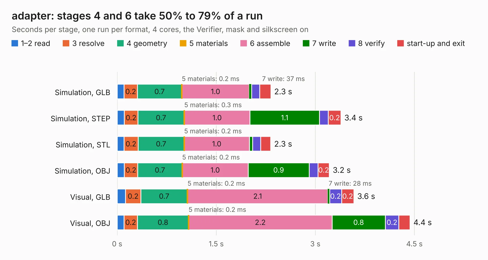

| Mode and format | 1–2 read | 3 resolve | 4 geometry | 5 materials | 6 assemble | 7 write | 8 verify | start-up and exit | Total |
|---|---:|---:|---:|---:|---:|---:|---:|---:|---:|
| Simulation, GLB | 0.1 | 0.2 | 0.7 | 0.2&nbsp;ms | 1.0 | 37&nbsp;ms | 0.1 | 0.2 | 2.3 |
| Simulation, STEP | 0.1 | 0.2 | 0.7 | 0.3&nbsp;ms | 1.0 | 1.1 | 0.1 | 0.2 | 3.4 |
| Simulation, STL | 0.1 | 0.2 | 0.7 | 0.2&nbsp;ms | 1.0 | 50&nbsp;ms | 0.1 | 0.2 | 2.3 |
| Simulation, OBJ | 0.1 | 0.2 | 0.7 | 0.2&nbsp;ms | 1.0 | 0.9 | 0.1 | 0.2 | 3.2 |
| Visual, GLB | 0.1 | 0.2 | 0.7 | 0.2&nbsp;ms | 2.1 | 28&nbsp;ms | 0.2 | 0.2 | 3.6 |
| Visual, OBJ | 0.1 | 0.2 | 0.8 | 0.2&nbsp;ms | 2.2 | 0.8 | 0.2 | 0.2 | 4.4 |

<table align="center"><tr><td valign="top">

| Board | Repo: [Modos-Labs/Glider](https://github.com/Modos-Labs/Glider) Board: `adapter.kicad_pcb` |
|---|---|
| Folder | pcb / 40p-adapter-ab |
| Complexity | 211&nbsp;/&nbsp;1000 (size&nbsp;146, features&nbsp;65) |
| KESE&nbsp;features | through vias, filled zones, stack-up, dielectric εr and tanδ |
| Tested | 9th November 2026 |
| Copper&nbsp;layers | 2 |
| File&nbsp;format | KiCad 8 (20240108) |
| Parts,&nbsp;tracks,&nbsp;vias | 8, 401, 69 |
| Triangles,&nbsp;simulation | 232,152 in 79 parts |
| Verifier | PASS in all six runs |

</td><td valign="top">

<table>
<tr><th>File type</th><th>File size</th><th>Peak memory used</th></tr>
<tr><th colspan="3" align="left">Simulation</th></tr>
<tr><td>GLB</td><td align="right">8.2&nbsp;MB</td><td align="right">239&nbsp;MB</td></tr>
<tr><td>STEP</td><td align="right">41&nbsp;MB</td><td align="right">259&nbsp;MB</td></tr>
<tr><td>STL</td><td align="right">12&nbsp;MB</td><td align="right">239&nbsp;MB</td></tr>
<tr><td>OBJ</td><td align="right">23&nbsp;MB</td><td align="right">239&nbsp;MB</td></tr>
<tr><th colspan="3" align="left">Visual</th></tr>
<tr><td>GLB</td><td align="right">6.9&nbsp;MB</td><td align="right">246&nbsp;MB</td></tr>
<tr><td>OBJ</td><td align="right">20&nbsp;MB</td><td align="right">244&nbsp;MB</td></tr>
</table>

</td></tr></table>

## 1663. adapter

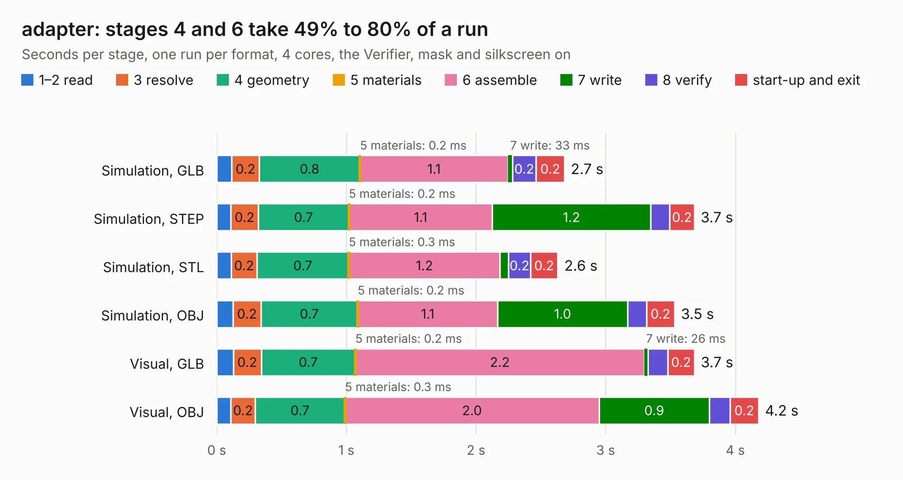

| Mode and format | 1–2 read | 3 resolve | 4 geometry | 5 materials | 6 assemble | 7 write | 8 verify | start-up and exit | Total |
|---|---:|---:|---:|---:|---:|---:|---:|---:|---:|
| Simulation, GLB | 0.1 | 0.2 | 0.8 | 0.2&nbsp;ms | 1.1 | 33&nbsp;ms | 0.2 | 0.2 | 2.7 |
| Simulation, STEP | 0.1 | 0.2 | 0.7 | 0.2&nbsp;ms | 1.1 | 1.2 | 0.1 | 0.2 | 3.7 |
| Simulation, STL | 0.1 | 0.2 | 0.7 | 0.3&nbsp;ms | 1.2 | 66&nbsp;ms | 0.2 | 0.2 | 2.6 |
| Simulation, OBJ | 0.1 | 0.2 | 0.7 | 0.2&nbsp;ms | 1.1 | 1.0 | 0.1 | 0.2 | 3.5 |
| Visual, GLB | 0.1 | 0.2 | 0.7 | 0.2&nbsp;ms | 2.2 | 26&nbsp;ms | 0.2 | 0.2 | 3.7 |
| Visual, OBJ | 0.1 | 0.2 | 0.7 | 0.3&nbsp;ms | 2.0 | 0.9 | 0.2 | 0.2 | 4.2 |

<table align="center"><tr><td valign="top">

| Board | Repo: [Modos-Labs/Glider](https://github.com/Modos-Labs/Glider) Board: `adapter.kicad_pcb` |
|---|---|
| Folder | pcb / 50p-adapter-b |
| Complexity | 211&nbsp;/&nbsp;1000 (size&nbsp;136, features&nbsp;75) |
| KESE&nbsp;features | through vias, rounded, trapezoid or chamfered pads, filled zones, stack-up, dielectric εr and tanδ |
| Tested | 9th November 2026 |
| Copper&nbsp;layers | 2 |
| File&nbsp;format | KiCad 8 (20240108) |
| Parts,&nbsp;tracks,&nbsp;vias | 5, 311, 44 |
| Triangles,&nbsp;simulation | 190,560 in 62 parts |
| Verifier | PASS in all six runs |

</td><td valign="top">

<table>
<tr><th>File type</th><th>File size</th><th>Peak memory used</th></tr>
<tr><th colspan="3" align="left">Simulation</th></tr>
<tr><td>GLB</td><td align="right">6.6&nbsp;MB</td><td align="right">214&nbsp;MB</td></tr>
<tr><td>STEP</td><td align="right">31&nbsp;MB</td><td align="right">233&nbsp;MB</td></tr>
<tr><td>STL</td><td align="right">9.5&nbsp;MB</td><td align="right">217&nbsp;MB</td></tr>
<tr><td>OBJ</td><td align="right">19&nbsp;MB</td><td align="right">216&nbsp;MB</td></tr>
<tr><th colspan="3" align="left">Visual</th></tr>
<tr><td>GLB</td><td align="right">5.5&nbsp;MB</td><td align="right">215&nbsp;MB</td></tr>
<tr><td>OBJ</td><td align="right">16&nbsp;MB</td><td align="right">212&nbsp;MB</td></tr>
</table>

</td></tr></table>

## 1664. adapter

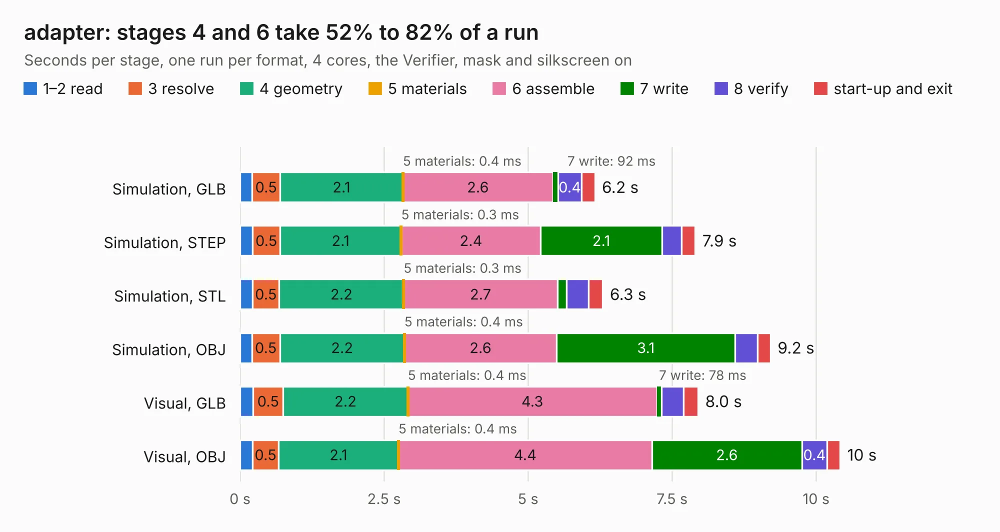

| Mode and format | 1–2 read | 3 resolve | 4 geometry | 5 materials | 6 assemble | 7 write | 8 verify | start-up and exit | Total |
|---|---:|---:|---:|---:|---:|---:|---:|---:|---:|
| Simulation, GLB | 0.2 | 0.5 | 2.1 | 0.4&nbsp;ms | 2.6 | 92&nbsp;ms | 0.4 | 0.2 | 6.2 |
| Simulation, STEP | 0.2 | 0.5 | 2.1 | 0.3&nbsp;ms | 2.4 | 2.1 | 0.3 | 0.2 | 7.9 |
| Simulation, STL | 0.2 | 0.5 | 2.2 | 0.3&nbsp;ms | 2.7 | 0.2 | 0.4 | 0.2 | 6.3 |
| Simulation, OBJ | 0.2 | 0.5 | 2.2 | 0.4&nbsp;ms | 2.6 | 3.1 | 0.4 | 0.2 | 9.2 |
| Visual, GLB | 0.2 | 0.5 | 2.2 | 0.4&nbsp;ms | 4.3 | 78&nbsp;ms | 0.4 | 0.3 | 8.0 |
| Visual, OBJ | 0.2 | 0.5 | 2.1 | 0.4&nbsp;ms | 4.4 | 2.6 | 0.4 | 0.2 | 10.4 |

<table align="center"><tr><td valign="top">

| Board | Repo: [Modos-Labs/Glider](https://github.com/Modos-Labs/Glider) Board: `adapter.kicad_pcb` |
|---|---|
| Folder | pcb / 50p-adapter-c |
| Complexity | 244&nbsp;/&nbsp;1000 (size&nbsp;169, features&nbsp;75) |
| KESE&nbsp;features | through vias, rounded, trapezoid or chamfered pads, filled zones, stack-up, dielectric εr and tanδ |
| Tested | 9th November 2026 |
| Copper&nbsp;layers | 2 |
| File&nbsp;format | KiCad 6 (20211014) |
| Parts,&nbsp;tracks,&nbsp;vias | 26, 982, 90 |
| Triangles,&nbsp;simulation | 554,128 in 87 parts |
| Verifier | PASS in all six runs |

</td><td valign="top">

<table>
<tr><th>File type</th><th>File size</th><th>Peak memory used</th></tr>
<tr><th colspan="3" align="left">Simulation</th></tr>
<tr><td>GLB</td><td align="right">19&nbsp;MB</td><td align="right">328&nbsp;MB</td></tr>
<tr><td>STEP</td><td align="right">100&nbsp;MB</td><td align="right">395&nbsp;MB</td></tr>
<tr><td>STL</td><td align="right">28&nbsp;MB</td><td align="right">332&nbsp;MB</td></tr>
<tr><td>OBJ</td><td align="right">56&nbsp;MB</td><td align="right">424&nbsp;MB</td></tr>
<tr><th colspan="3" align="left">Visual</th></tr>
<tr><td>GLB</td><td align="right">16&nbsp;MB</td><td align="right">405&nbsp;MB</td></tr>
<tr><td>OBJ</td><td align="right">46&nbsp;MB</td><td align="right">464&nbsp;MB</td></tr>
</table>

</td></tr></table>

## 1665. pcb

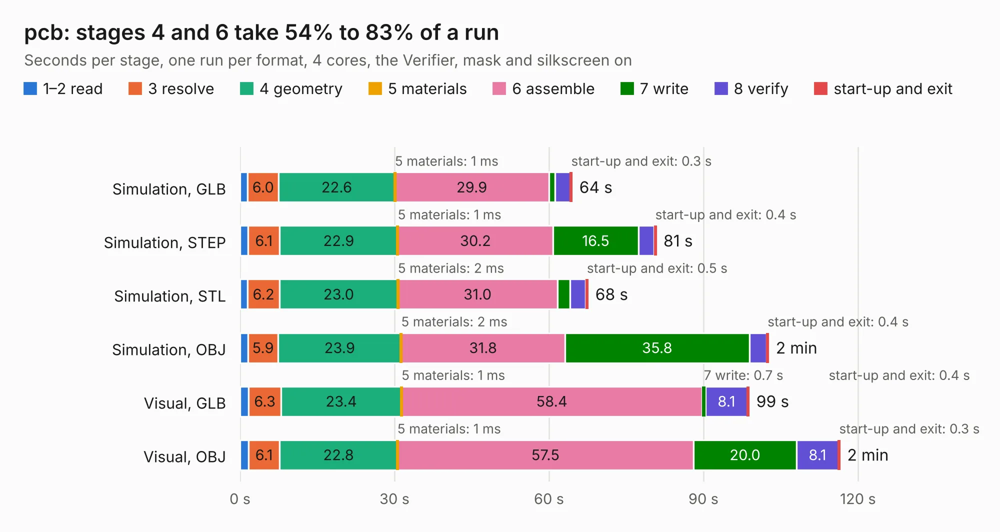

| Mode and format | 1–2 read | 3 resolve | 4 geometry | 5 materials | 6 assemble | 7 write | 8 verify | start-up and exit | Total |
|---|---:|---:|---:|---:|---:|---:|---:|---:|---:|
| Simulation, GLB | 1.5 | 6.0 | 22.6 | 1&nbsp;ms | 29.9 | 1.2 | 3.0 | 0.3 | 64.5 |
| Simulation, STEP | 1.6 | 6.1 | 22.9 | 1&nbsp;ms | 30.2 | 16.5 | 3.1 | 0.4 | 80.8 |
| Simulation, STL | 1.5 | 6.2 | 23.0 | 2&nbsp;ms | 31.0 | 2.4 | 3.1 | 0.5 | 67.6 |
| Simulation, OBJ | 1.5 | 5.9 | 23.9 | 2&nbsp;ms | 31.8 | 35.8 | 3.3 | 0.4 | 102.7 |
| Visual, GLB | 1.7 | 6.3 | 23.4 | 1&nbsp;ms | 58.4 | 0.7 | 8.1 | 0.4 | 98.9 |
| Visual, OBJ | 1.6 | 6.1 | 22.8 | 1&nbsp;ms | 57.5 | 20.0 | 8.1 | 0.3 | 116.5 |

<table align="center"><tr><td valign="top">

| Board | Repo: [Modos-Labs/Glider](https://github.com/Modos-Labs/Glider) Board: `pcb.kicad_pcb` |
|---|---|
| Folder | pcb / mainboard |
| Complexity | 464&nbsp;/&nbsp;1000 (size&nbsp;309, features&nbsp;155) |
| KESE&nbsp;features | through vias, slotted holes, custom pads, rounded, trapezoid or chamfered pads, filled zones, copper drawings, curved board outline, knockout text, stack-up, dielectric εr and tanδ, copper finish, mask and silkscreen colours |
| Tested | 9th November 2026 |
| Copper&nbsp;layers | 4 |
| File&nbsp;format | KiCad 8 (20240108) |
| Parts,&nbsp;tracks,&nbsp;vias | 375, 8,883, 900 |
| Triangles,&nbsp;simulation | 5,797,268 in 472 parts |
| Verifier | PASS in all six runs |

</td><td valign="top">

<table>
<tr><th>File type</th><th>File size</th><th>Peak memory used</th></tr>
<tr><th colspan="3" align="left">Simulation</th></tr>
<tr><td>GLB</td><td align="right">199&nbsp;MB</td><td align="right">1.7&nbsp;GB</td></tr>
<tr><td>STEP</td><td align="right">870&nbsp;MB</td><td align="right">2.2&nbsp;GB</td></tr>
<tr><td>STL</td><td align="right">290&nbsp;MB</td><td align="right">1.7&nbsp;GB</td></tr>
<tr><td>OBJ</td><td align="right">626&nbsp;MB</td><td align="right">3.7&nbsp;GB</td></tr>
<tr><th colspan="3" align="left">Visual</th></tr>
<tr><td>GLB</td><td align="right">127&nbsp;MB</td><td align="right">2.1&nbsp;GB</td></tr>
<tr><td>OBJ</td><td align="right">413&nbsp;MB</td><td align="right">2.6&nbsp;GB</td></tr>
</table>

</td></tr></table>

## 1666. adapter

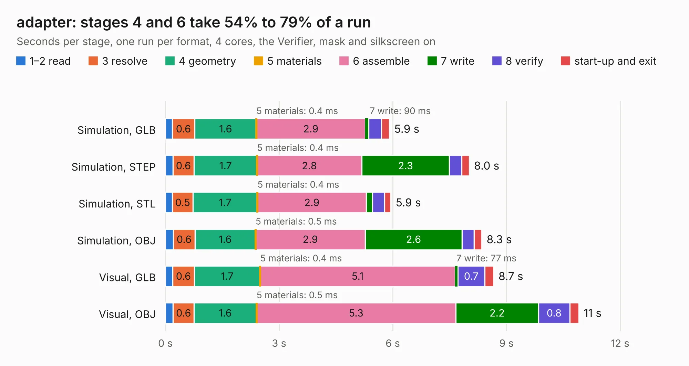

| Mode and format | 1–2 read | 3 resolve | 4 geometry | 5 materials | 6 assemble | 7 write | 8 verify | start-up and exit | Total |
|---|---:|---:|---:|---:|---:|---:|---:|---:|---:|
| Simulation, GLB | 0.2 | 0.6 | 1.6 | 0.4&nbsp;ms | 2.9 | 90&nbsp;ms | 0.3 | 0.2 | 5.9 |
| Simulation, STEP | 0.2 | 0.6 | 1.7 | 0.4&nbsp;ms | 2.8 | 2.3 | 0.3 | 0.2 | 8.0 |
| Simulation, STL | 0.2 | 0.5 | 1.7 | 0.4&nbsp;ms | 2.9 | 0.2 | 0.3 | 0.2 | 5.9 |
| Simulation, OBJ | 0.2 | 0.6 | 1.6 | 0.5&nbsp;ms | 2.9 | 2.6 | 0.3 | 0.2 | 8.3 |
| Visual, GLB | 0.2 | 0.6 | 1.7 | 0.4&nbsp;ms | 5.1 | 77&nbsp;ms | 0.7 | 0.2 | 8.7 |
| Visual, OBJ | 0.2 | 0.6 | 1.6 | 0.5&nbsp;ms | 5.3 | 2.2 | 0.8 | 0.2 | 10.9 |

<table align="center"><tr><td valign="top">

| Board | Repo: [Modos-Labs/Glider](https://github.com/Modos-Labs/Glider) Board: `adapter.kicad_pcb` |
|---|---|
| Folder | pcb / mega_adapter |
| Complexity | 261&nbsp;/&nbsp;1000 (size&nbsp;171, features&nbsp;90) |
| KESE&nbsp;features | through vias, rounded, trapezoid or chamfered pads, filled zones, knockout text, stack-up, dielectric εr and tanδ |
| Tested | 9th November 2026 |
| Copper&nbsp;layers | 2 |
| File&nbsp;format | KiCad 8 (20240108) |
| Parts,&nbsp;tracks,&nbsp;vias | 16, 1,300, 195 |
| Triangles,&nbsp;simulation | 655,760 in 108 parts |
| Verifier | PASS in all six runs |

</td><td valign="top">

<table>
<tr><th>File type</th><th>File size</th><th>Peak memory used</th></tr>
<tr><th colspan="3" align="left">Simulation</th></tr>
<tr><td>GLB</td><td align="right">23&nbsp;MB</td><td align="right">400&nbsp;MB</td></tr>
<tr><td>STEP</td><td align="right">117&nbsp;MB</td><td align="right">446&nbsp;MB</td></tr>
<tr><td>STL</td><td align="right">33&nbsp;MB</td><td align="right">403&nbsp;MB</td></tr>
<tr><td>OBJ</td><td align="right">66&nbsp;MB</td><td align="right">477&nbsp;MB</td></tr>
<tr><th colspan="3" align="left">Visual</th></tr>
<tr><td>GLB</td><td align="right">19&nbsp;MB</td><td align="right">428&nbsp;MB</td></tr>
<tr><td>OBJ</td><td align="right">57&nbsp;MB</td><td align="right">514&nbsp;MB</td></tr>
</table>

</td></tr></table>

## 1667. adapter

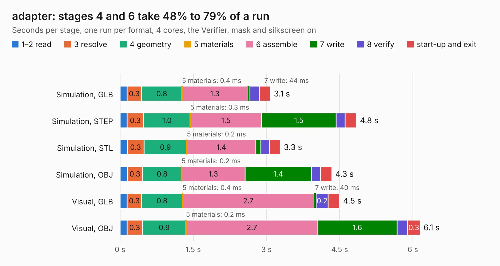

| Mode and format | 1–2 read | 3 resolve | 4 geometry | 5 materials | 6 assemble | 7 write | 8 verify | start-up and exit | Total |
|---|---:|---:|---:|---:|---:|---:|---:|---:|---:|
| Simulation, GLB | 0.1 | 0.3 | 0.8 | 0.4&nbsp;ms | 1.3 | 44&nbsp;ms | 0.2 | 0.2 | 3.1 |
| Simulation, STEP | 0.1 | 0.3 | 1.0 | 0.3&nbsp;ms | 1.5 | 1.5 | 0.2 | 0.2 | 4.8 |
| Simulation, STL | 0.1 | 0.3 | 0.9 | 0.2&nbsp;ms | 1.4 | 0.1 | 0.2 | 0.2 | 3.3 |
| Simulation, OBJ | 0.1 | 0.3 | 0.8 | 0.2&nbsp;ms | 1.3 | 1.4 | 0.2 | 0.2 | 4.3 |
| Visual, GLB | 0.1 | 0.3 | 0.8 | 0.4&nbsp;ms | 2.7 | 40&nbsp;ms | 0.2 | 0.2 | 4.5 |
| Visual, OBJ | 0.1 | 0.3 | 0.9 | 0.2&nbsp;ms | 2.7 | 1.6 | 0.2 | 0.3 | 6.1 |

<table align="center"><tr><td valign="top">

| Board | Repo: [Modos-Labs/Glider](https://github.com/Modos-Labs/Glider) Board: `adapter.kicad_pcb` |
|---|---|
| Folder | pcb / u133_adapter |
| Complexity | 229&nbsp;/&nbsp;1000 (size&nbsp;144, features&nbsp;85) |
| KESE&nbsp;features | through vias, rounded, trapezoid or chamfered pads, filled zones, curved board outline, stack-up, dielectric εr and tanδ |
| Tested | 9th November 2026 |
| Copper&nbsp;layers | 2 |
| File&nbsp;format | KiCad 8 (20240108) |
| Parts,&nbsp;tracks,&nbsp;vias | 7, 340, 86 |
| Triangles,&nbsp;simulation | 229,622 in 70 parts |
| Verifier | PASS in all six runs |

</td><td valign="top">

<table>
<tr><th>File type</th><th>File size</th><th>Peak memory used</th></tr>
<tr><th colspan="3" align="left">Simulation</th></tr>
<tr><td>GLB</td><td align="right">8.0&nbsp;MB</td><td align="right">234&nbsp;MB</td></tr>
<tr><td>STEP</td><td align="right">35&nbsp;MB</td><td align="right">260&nbsp;MB</td></tr>
<tr><td>STL</td><td align="right">11&nbsp;MB</td><td align="right">233&nbsp;MB</td></tr>
<tr><td>OBJ</td><td align="right">23&nbsp;MB</td><td align="right">234&nbsp;MB</td></tr>
<tr><th colspan="3" align="left">Visual</th></tr>
<tr><td>GLB</td><td align="right">6.6&nbsp;MB</td><td align="right">243&nbsp;MB</td></tr>
<tr><td>OBJ</td><td align="right">20&nbsp;MB</td><td align="right">240&nbsp;MB</td></tr>
</table>

</td></tr></table>

## 1668. pcb

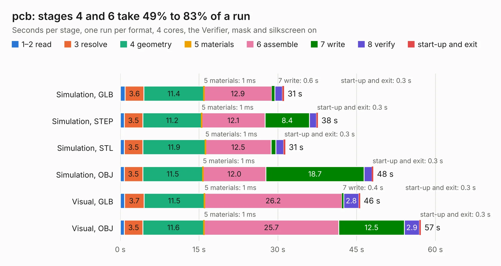

| Mode and format | 1–2 read | 3 resolve | 4 geometry | 5 materials | 6 assemble | 7 write | 8 verify | start-up and exit | Total |
|---|---:|---:|---:|---:|---:|---:|---:|---:|---:|
| Simulation, GLB | 0.9 | 3.6 | 11.4 | 1&nbsp;ms | 12.9 | 0.6 | 1.4 | 0.3 | 31.2 |
| Simulation, STEP | 0.8 | 3.5 | 11.2 | 1&nbsp;ms | 12.1 | 8.4 | 1.3 | 0.3 | 37.6 |
| Simulation, STL | 0.8 | 3.5 | 11.9 | 1&nbsp;ms | 12.5 | 0.9 | 1.5 | 0.3 | 31.4 |
| Simulation, OBJ | 0.7 | 3.5 | 11.5 | 1&nbsp;ms | 12.0 | 18.7 | 1.5 | 0.3 | 48.2 |
| Visual, GLB | 0.8 | 3.7 | 11.5 | 1&nbsp;ms | 26.2 | 0.4 | 2.8 | 0.3 | 45.7 |
| Visual, OBJ | 0.8 | 3.5 | 11.6 | 1&nbsp;ms | 25.7 | 12.5 | 2.9 | 0.3 | 57.2 |

<table align="center"><tr><td valign="top">

| Board | Repo: [Modos-Labs/Lancer](https://github.com/Modos-Labs/Lancer) Board: `pcb.kicad_pcb` |
|---|---|
| Folder | pcb / epdc_poc_board |
| Complexity | 390&nbsp;/&nbsp;1000 (size&nbsp;285, features&nbsp;105) |
| KESE&nbsp;features | through vias, custom pads, rounded, trapezoid or chamfered pads, filled zones, copper drawings, stack-up, dielectric εr and tanδ, mask and silkscreen colours |
| Tested | 9th November 2026 |
| Copper&nbsp;layers | 4 |
| File&nbsp;format | KiCad 6 (20210824) |
| Parts,&nbsp;tracks,&nbsp;vias | 152, 2,972, 478 |
| Triangles,&nbsp;simulation | 2,984,120 in 302 parts |
| Verifier | PASS in all six runs |

</td><td valign="top">

<table>
<tr><th>File type</th><th>File size</th><th>Peak memory used</th></tr>
<tr><th colspan="3" align="left">Simulation</th></tr>
<tr><td>GLB</td><td align="right">103&nbsp;MB</td><td align="right">941&nbsp;MB</td></tr>
<tr><td>STEP</td><td align="right">437&nbsp;MB</td><td align="right">1.2&nbsp;GB</td></tr>
<tr><td>STL</td><td align="right">149&nbsp;MB</td><td align="right">929&nbsp;MB</td></tr>
<tr><td>OBJ</td><td align="right">315&nbsp;MB</td><td align="right">2.0&nbsp;GB</td></tr>
<tr><th colspan="3" align="left">Visual</th></tr>
<tr><td>GLB</td><td align="right">71&nbsp;MB</td><td align="right">1.2&nbsp;GB</td></tr>
<tr><td>OBJ</td><td align="right">225&nbsp;MB</td><td align="right">1.5&nbsp;GB</td></tr>
</table>

</td></tr></table>

## 1669. pcb

| Mode and format | 1–2 read | 3 resolve | 4 geometry | 5 materials | 6 assemble | 7 write | 8 verify | start-up and exit | Total |
|---|---:|---:|---:|---:|---:|---:|---:|---:|---:|
| Simulation, GLB | 1.3 | 4.5 | 20.5 | 2&nbsp;ms | 22.0 | 0.6 | 2.5 | 0.3 | 51.6 |
| Simulation, STEP | 1.2 | 4.6 | 20.0 | 2&nbsp;ms | 21.8 | 13.5 | 2.5 | 0.3 | 63.8 |
| Simulation, STL | 1.3 | 4.7 | 20.4 | 2&nbsp;ms | 22.2 | 1.2 | 2.2 | 0.3 | 52.3 |
| Simulation, OBJ | 1.2 | 4.4 | 20.2 | 2&nbsp;ms | 21.5 | 19.1 | 2.3 | 0.3 | 69.0 |
| Visual, GLB | 1.3 | 4.5 | 20.1 | 2&nbsp;ms | 37.3 | 0.4 | 4.5 | 0.3 | 68.4 |
| Visual, OBJ | 1.3 | 4.7 | 20.7 | 2&nbsp;ms | 36.6 | 15.1 | 4.5 | 0.3 | 83.2 |

<table align="center"><tr><td valign="top">

| Board | Repo: [Modos-Labs/Lancer](https://github.com/Modos-Labs/Lancer) Board: `pcb.kicad_pcb` |
|---|---|
| Folder | pcb / mainboard |
| Complexity | 385&nbsp;/&nbsp;1000 (size&nbsp;270, features&nbsp;115) |
| KESE&nbsp;features | through vias, slotted holes, custom pads, rounded, trapezoid or chamfered pads, filled zones, copper drawings, stack-up, dielectric εr and tanδ, mask and silkscreen colours |
| Tested | 9th November 2026 |
| Copper&nbsp;layers | 2 |
| File&nbsp;format | KiCad 6 (20210824) |
| Parts,&nbsp;tracks,&nbsp;vias | 252, 3,168, 656 |
| Triangles,&nbsp;simulation | 3,434,270 in 443 parts |
| Verifier | PASS in all six runs |

</td><td valign="top">

<table>
<tr><th>File type</th><th>File size</th><th>Peak memory used</th></tr>
<tr><th colspan="3" align="left">Simulation</th></tr>
<tr><td>GLB</td><td align="right">119&nbsp;MB</td><td align="right">1.3&nbsp;GB</td></tr>
<tr><td>STEP</td><td align="right">679&nbsp;MB</td><td align="right">1.7&nbsp;GB</td></tr>
<tr><td>STL</td><td align="right">172&nbsp;MB</td><td align="right">1.3&nbsp;GB</td></tr>
<tr><td>OBJ</td><td align="right">368&nbsp;MB</td><td align="right">2.3&nbsp;GB</td></tr>
<tr><th colspan="3" align="left">Visual</th></tr>
<tr><td>GLB</td><td align="right">90&nbsp;MB</td><td align="right">1.7&nbsp;GB</td></tr>
<tr><td>OBJ</td><td align="right">282&nbsp;MB</td><td align="right">1.9&nbsp;GB</td></tr>
</table>

</td></tr></table>

## 1670. pcb

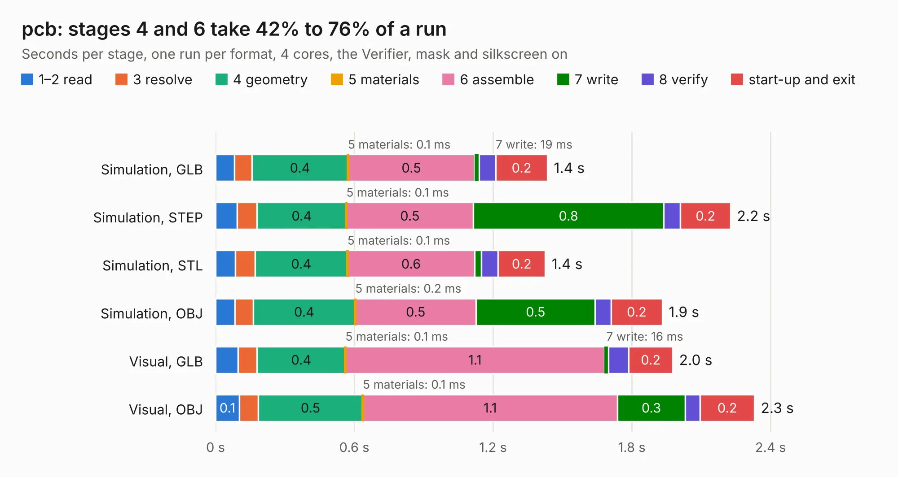

| Mode and format | 1–2 read | 3 resolve | 4 geometry | 5 materials | 6 assemble | 7 write | 8 verify | start-up and exit | Total |
|---|---:|---:|---:|---:|---:|---:|---:|---:|---:|
| Simulation, GLB | 81&nbsp;ms | 77&nbsp;ms | 0.4 | 0.1&nbsp;ms | 0.5 | 19&nbsp;ms | 72&nbsp;ms | 0.2 | 1.4 |
| Simulation, STEP | 93&nbsp;ms | 86&nbsp;ms | 0.4 | 0.1&nbsp;ms | 0.5 | 0.8 | 73&nbsp;ms | 0.2 | 2.2 |
| Simulation, STL | 85&nbsp;ms | 86&nbsp;ms | 0.4 | 0.1&nbsp;ms | 0.6 | 28&nbsp;ms | 73&nbsp;ms | 0.2 | 1.4 |
| Simulation, OBJ | 84&nbsp;ms | 79&nbsp;ms | 0.4 | 0.2&nbsp;ms | 0.5 | 0.5 | 69&nbsp;ms | 0.2 | 1.9 |
| Visual, GLB | 98&nbsp;ms | 82&nbsp;ms | 0.4 | 0.1&nbsp;ms | 1.1 | 16&nbsp;ms | 88&nbsp;ms | 0.2 | 2.0 |
| Visual, OBJ | 0.1 | 81&nbsp;ms | 0.5 | 0.1&nbsp;ms | 1.1 | 0.3 | 65&nbsp;ms | 0.2 | 2.3 |

<table align="center"><tr><td valign="top">

| Board | Repo: [Modos-Labs/Lancer](https://github.com/Modos-Labs/Lancer) Board: `pcb.kicad_pcb` |
|---|---|
| Folder | pcb / usb_adapter_board |
| Complexity | 148&nbsp;/&nbsp;1000 (size&nbsp;93, features&nbsp;55) |
| KESE&nbsp;features | filled zones, stack-up, dielectric εr and tanδ, mask and silkscreen colours |
| Tested | 9th November 2026 |
| Copper&nbsp;layers | 2 |
| File&nbsp;format | KiCad 6 (20210824) |
| Parts,&nbsp;tracks,&nbsp;vias | 3, 40, 0 |
| Triangles,&nbsp;simulation | 109,756 in 17 parts |
| Verifier | PASS in all six runs |

</td><td valign="top">

<table>
<tr><th>File type</th><th>File size</th><th>Peak memory used</th></tr>
<tr><th colspan="3" align="left">Simulation</th></tr>
<tr><td>GLB</td><td align="right">3.6&nbsp;MB</td><td align="right">186&nbsp;MB</td></tr>
<tr><td>STEP</td><td align="right">16&nbsp;MB</td><td align="right">191&nbsp;MB</td></tr>
<tr><td>STL</td><td align="right">5.5&nbsp;MB</td><td align="right">188&nbsp;MB</td></tr>
<tr><td>OBJ</td><td align="right">10&nbsp;MB</td><td align="right">180&nbsp;MB</td></tr>
<tr><th colspan="3" align="left">Visual</th></tr>
<tr><td>GLB</td><td align="right">2.1&nbsp;MB</td><td align="right">153&nbsp;MB</td></tr>
<tr><td>OBJ</td><td align="right">5.7&nbsp;MB</td><td align="right">152&nbsp;MB</td></tr>
</table>

</td></tr></table>

## 1671. Project NuXT

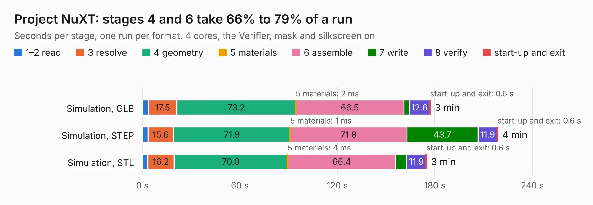

| Mode and format | 1–2 read | 3 resolve | 4 geometry | 5 materials | 6 assemble | 7 write | 8 verify | start-up and exit | Total |
|---|---:|---:|---:|---:|---:|---:|---:|---:|---:|
| Simulation, GLB | 3.7 | 17.5 | 73.2 | 2&nbsp;ms | 66.5 | 3.3 | 12.6 | 0.6 | 177.4 |
| Simulation, STEP | 3.5 | 15.6 | 71.9 | 1&nbsp;ms | 71.8 | 43.7 | 11.9 | 0.6 | 219.0 |
| Simulation, STL | 3.3 | 16.2 | 70.0 | 4&nbsp;ms | 66.4 | 6.8 | 11.9 | 0.6 | 175.1 |
| Simulation, OBJ | 3.0 | 15.5 | 71.4 | 4&nbsp;ms | 64.2 | 106.1 | 11.9 | 0.6 | 272.6 |
| Visual, GLB | 3.1 | 15.9 | 69.7 | 3&nbsp;ms | 176.1 | 1.8 | 16.1 | 0.5 | 283.3 |
| Visual, OBJ | 3.3 | 19.0 | 73.5 | 3&nbsp;ms | 174.4 | 61.4 | 16.1 | 0.4 | 348.1 |

<table align="center"><tr><td valign="top">

| Board | Repo: [monotech/NuXT](https://github.com/monotech/NuXT) Board: `Project NuXT.kicad_pcb` |
|---|---|
| Complexity | 302&nbsp;/&nbsp;1000 (size&nbsp;237, features&nbsp;65) |
| KESE&nbsp;features | through vias, rounded, trapezoid or chamfered pads, filled zones, copper text, curved board outline |
| Tested | 9th November 2026 |
| Copper&nbsp;layers | 4 |
| File&nbsp;format | KiCad 5 (20171130) |
| Parts,&nbsp;tracks,&nbsp;vias | 221, 6,262, 262 |
| Triangles,&nbsp;simulation | 15,376,478 in 341 parts |
| Verifier | PASS in all six runs |

</td><td valign="top">

<table>
<tr><th>File type</th><th>File size</th><th>Peak memory used</th></tr>
<tr><th colspan="3" align="left">Simulation</th></tr>
<tr><td>GLB</td><td align="right">521&nbsp;MB</td><td align="right">3.5&nbsp;GB</td></tr>
<tr><td>STEP</td><td align="right">2.1&nbsp;GB</td><td align="right">4.7&nbsp;GB</td></tr>
<tr><td>STL</td><td align="right">769&nbsp;MB</td><td align="right">3.5&nbsp;GB</td></tr>
<tr><td>OBJ</td><td align="right">1.7&nbsp;GB</td><td align="right">9.6&nbsp;GB</td></tr>
<tr><th colspan="3" align="left">Visual</th></tr>
<tr><td>GLB</td><td align="right">292&nbsp;MB</td><td align="right">4.5&nbsp;GB</td></tr>
<tr><td>OBJ</td><td align="right">941&nbsp;MB</td><td align="right">5.9&nbsp;GB</td></tr>
</table>

</td></tr></table>

## 1672. 96boards-robomezzi

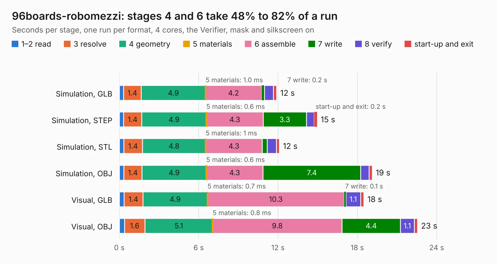

| Mode and format | 1–2 read | 3 resolve | 4 geometry | 5 materials | 6 assemble | 7 write | 8 verify | start-up and exit | Total |
|---|---:|---:|---:|---:|---:|---:|---:|---:|---:|
| Simulation, GLB | 0.3 | 1.4 | 4.9 | 1.0&nbsp;ms | 4.2 | 0.2 | 0.7 | 0.3 | 11.9 |
| Simulation, STEP | 0.3 | 1.4 | 4.9 | 0.6&nbsp;ms | 4.3 | 3.3 | 0.6 | 0.2 | 15.0 |
| Simulation, STL | 0.3 | 1.4 | 4.8 | 1&nbsp;ms | 4.3 | 0.4 | 0.7 | 0.2 | 12.1 |
| Simulation, OBJ | 0.3 | 1.4 | 4.9 | 0.6&nbsp;ms | 4.3 | 7.4 | 0.6 | 0.2 | 19.1 |
| Visual, GLB | 0.3 | 1.4 | 4.9 | 0.7&nbsp;ms | 10.3 | 0.1 | 1.1 | 0.3 | 18.5 |
| Visual, OBJ | 0.4 | 1.6 | 5.1 | 0.8&nbsp;ms | 9.8 | 4.4 | 1.1 | 0.2 | 22.6 |

<table align="center"><tr><td valign="top">

| Board | Repo: [mwelling/96boards-robomezzi](https://github.com/mwelling/96boards-robomezzi) Board: `96boards-robomezzi.kicad_pcb` |
|---|---|
| Complexity | 247&nbsp;/&nbsp;1000 (size&nbsp;202, features&nbsp;45) |
| KESE&nbsp;features | through vias, slotted holes, filled zones |
| Tested | 9th November 2026 |
| Copper&nbsp;layers | 4 |
| File&nbsp;format | KiCad 4 (4) |
| Parts,&nbsp;tracks,&nbsp;vias | 112, 968, 113 |
| Triangles,&nbsp;simulation | 1,414,434 in 142 parts |
| Verifier | PASS in all six runs |

</td><td valign="top">

<table>
<tr><th>File type</th><th>File size</th><th>Peak memory used</th></tr>
<tr><th colspan="3" align="left">Simulation</th></tr>
<tr><td>GLB</td><td align="right">48&nbsp;MB</td><td align="right">532&nbsp;MB</td></tr>
<tr><td>STEP</td><td align="right">195&nbsp;MB</td><td align="right">598&nbsp;MB</td></tr>
<tr><td>STL</td><td align="right">71&nbsp;MB</td><td align="right">490&nbsp;MB</td></tr>
<tr><td>OBJ</td><td align="right">147&nbsp;MB</td><td align="right">982&nbsp;MB</td></tr>
<tr><th colspan="3" align="left">Visual</th></tr>
<tr><td>GLB</td><td align="right">28&nbsp;MB</td><td align="right">712&nbsp;MB</td></tr>
<tr><td>OBJ</td><td align="right">86&nbsp;MB</td><td align="right">693&nbsp;MB</td></tr>
</table>

</td></tr></table>

## 1673. beagle-wire

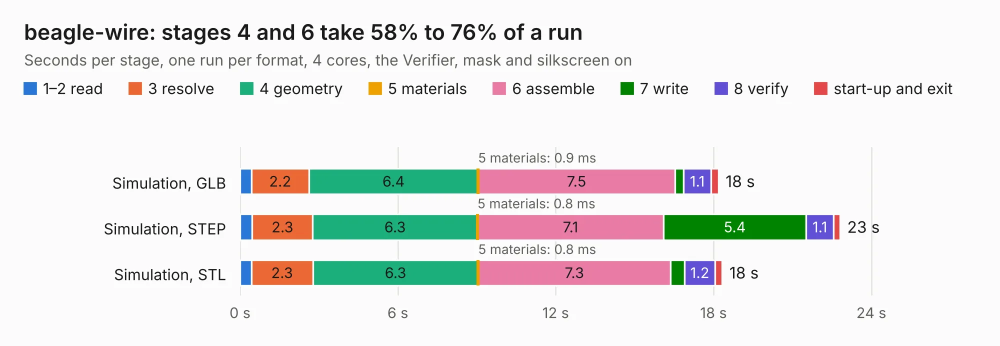

| Mode and format | 1–2 read | 3 resolve | 4 geometry | 5 materials | 6 assemble | 7 write | 8 verify | start-up and exit | Total |
|---|---:|---:|---:|---:|---:|---:|---:|---:|---:|
| Simulation, GLB | 0.4 | 2.2 | 6.4 | 0.9&nbsp;ms | 7.5 | 0.3 | 1.1 | 0.3 | 18.2 |
| Simulation, STEP | 0.5 | 2.3 | 6.3 | 0.8&nbsp;ms | 7.1 | 5.4 | 1.1 | 0.2 | 22.8 |
| Simulation, STL | 0.4 | 2.3 | 6.3 | 0.8&nbsp;ms | 7.3 | 0.5 | 1.2 | 0.3 | 18.3 |
| Simulation, OBJ | 0.4 | 2.4 | 6.7 | 0.9&nbsp;ms | 7.4 | 10.6 | 1.0 | 0.3 | 28.9 |
| Visual, GLB | 0.5 | 2.2 | 6.2 | 0.9&nbsp;ms | 14.8 | 0.2 | 1.5 | 0.2 | 25.7 |
| Visual, OBJ | 0.4 | 2.3 | 6.3 | 0.9&nbsp;ms | 15.3 | 7.1 | 1.7 | 0.2 | 33.3 |

<table align="center"><tr><td valign="top">

| Board | Repo: [mwelling/beagle-wire](https://github.com/mwelling/beagle-wire) Board: `beagle-wire.kicad_pcb` |
|---|---|
| Complexity | 316&nbsp;/&nbsp;1000 (size&nbsp;261, features&nbsp;55) |
| KESE&nbsp;features | through vias, rounded, trapezoid or chamfered pads, filled zones, curved board outline |
| Tested | 9th November 2026 |
| Copper&nbsp;layers | 4 |
| File&nbsp;format | KiCad 5 (20171130) |
| Parts,&nbsp;tracks,&nbsp;vias | 104, 2,019, 289 |
| Triangles,&nbsp;simulation | 2,045,158 in 200 parts |
| Verifier | PASS in all six runs |

</td><td valign="top">

<table>
<tr><th>File type</th><th>File size</th><th>Peak memory used</th></tr>
<tr><th colspan="3" align="left">Simulation</th></tr>
<tr><td>GLB</td><td align="right">70&nbsp;MB</td><td align="right">691&nbsp;MB</td></tr>
<tr><td>STEP</td><td align="right">302&nbsp;MB</td><td align="right">893&nbsp;MB</td></tr>
<tr><td>STL</td><td align="right">102&nbsp;MB</td><td align="right">668&nbsp;MB</td></tr>
<tr><td>OBJ</td><td align="right">216&nbsp;MB</td><td align="right">1.4&nbsp;GB</td></tr>
<tr><th colspan="3" align="left">Visual</th></tr>
<tr><td>GLB</td><td align="right">46&nbsp;MB</td><td align="right">875&nbsp;MB</td></tr>
<tr><td>OBJ</td><td align="right">145&nbsp;MB</td><td align="right">1.0&nbsp;GB</td></tr>
</table>

</td></tr></table>

## 1674. icebreaker++

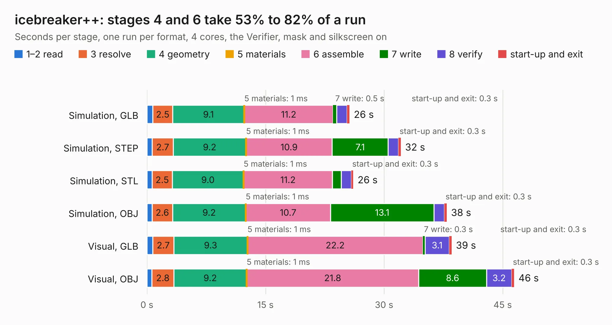

| Mode and format | 1–2 read | 3 resolve | 4 geometry | 5 materials | 6 assemble | 7 write | 8 verify | start-up and exit | Total |
|---|---:|---:|---:|---:|---:|---:|---:|---:|---:|
| Simulation, GLB | 0.7 | 2.5 | 9.1 | 1&nbsp;ms | 11.2 | 0.5 | 1.3 | 0.3 | 25.6 |
| Simulation, STEP | 0.7 | 2.7 | 9.2 | 1&nbsp;ms | 10.9 | 7.1 | 1.3 | 0.3 | 32.1 |
| Simulation, STL | 0.7 | 2.5 | 9.0 | 1&nbsp;ms | 11.2 | 1.1 | 1.3 | 0.3 | 26.1 |
| Simulation, OBJ | 0.7 | 2.6 | 9.2 | 1&nbsp;ms | 10.7 | 13.1 | 1.3 | 0.3 | 37.9 |
| Visual, GLB | 0.7 | 2.7 | 9.3 | 1&nbsp;ms | 22.2 | 0.3 | 3.1 | 0.3 | 38.5 |
| Visual, OBJ | 0.6 | 2.8 | 9.2 | 1&nbsp;ms | 21.8 | 8.6 | 3.2 | 0.3 | 46.4 |

<table align="center"><tr><td valign="top">

| Board | Repo: [mwelling/icecrusher](https://github.com/mwelling/icecrusher) Board: `icebreaker++.kicad_pcb` |
|---|---|
| Folder | kicad-src |
| Complexity | 369&nbsp;/&nbsp;1000 (size&nbsp;269, features&nbsp;100) |
| KESE&nbsp;features | through vias, slotted holes, rounded, trapezoid or chamfered pads, filled zones, curved board outline, stack-up, dielectric εr and tanδ, mask and silkscreen colours |
| Tested | 9th November 2026 |
| Copper&nbsp;layers | 4 |
| File&nbsp;format | KiCad 6 (20201116) |
| Parts,&nbsp;tracks,&nbsp;vias | 99, 2,201, 284 |
| Triangles,&nbsp;simulation | 2,479,698 in 300 parts |
| Verifier | PASS in all six runs |

</td><td valign="top">

<table>
<tr><th>File type</th><th>File size</th><th>Peak memory used</th></tr>
<tr><th colspan="3" align="left">Simulation</th></tr>
<tr><td>GLB</td><td align="right">83&nbsp;MB</td><td align="right">864&nbsp;MB</td></tr>
<tr><td>STEP</td><td align="right">381&nbsp;MB</td><td align="right">1.1&nbsp;GB</td></tr>
<tr><td>STL</td><td align="right">124&nbsp;MB</td><td align="right">854&nbsp;MB</td></tr>
<tr><td>OBJ</td><td align="right">260&nbsp;MB</td><td align="right">1.7&nbsp;GB</td></tr>
<tr><th colspan="3" align="left">Visual</th></tr>
<tr><td>GLB</td><td align="right">55&nbsp;MB</td><td align="right">1.1&nbsp;GB</td></tr>
<tr><td>OBJ</td><td align="right">172&nbsp;MB</td><td align="right">1.2&nbsp;GB</td></tr>
</table>

</td></tr></table>

## 1675. lofive

| Mode and format | 1–2 read | 3 resolve | 4 geometry | 5 materials | 6 assemble | 7 write | 8 verify | start-up and exit | Total |
|---|---:|---:|---:|---:|---:|---:|---:|---:|---:|
| Simulation, GLB | 0.2 | 1.0 | 3.1 | 0.3&nbsp;ms | 2.5 | 0.1 | 0.4 | 0.2 | 7.5 |
| Simulation, STEP | 0.2 | 1.0 | 3.0 | 0.3&nbsp;ms | 2.4 | 1.9 | 0.3 | 0.2 | 8.9 |
| Simulation, STL | 0.2 | 0.9 | 3.0 | 0.3&nbsp;ms | 2.4 | 0.3 | 0.3 | 0.2 | 7.3 |
| Simulation, OBJ | 0.2 | 0.9 | 3.1 | 0.3&nbsp;ms | 2.4 | 3.7 | 0.3 | 0.2 | 10.9 |
| Visual, GLB | 0.2 | 1.0 | 3.1 | 0.5&nbsp;ms | 5.6 | 69&nbsp;ms | 0.5 | 0.2 | 10.7 |
| Visual, OBJ | 0.2 | 1.0 | 3.1 | 0.3&nbsp;ms | 5.9 | 2.1 | 0.7 | 0.2 | 13.2 |

<table align="center"><tr><td valign="top">

| Board | Repo: [mwelling/lofive](https://github.com/mwelling/lofive) Board: `lofive.kicad_pcb` |
|---|---|
| Complexity | 264&nbsp;/&nbsp;1000 (size&nbsp;219, features&nbsp;45) |
| KESE&nbsp;features | through vias, rounded, trapezoid or chamfered pads, filled zones |
| Tested | 9th November 2026 |
| Copper&nbsp;layers | 4 |
| File&nbsp;format | KiCad 9 (20241229) |
| Parts,&nbsp;tracks,&nbsp;vias | 33, 445, 83 |
| Triangles,&nbsp;simulation | 899,502 in 64 parts |
| Verifier | PASS in all six runs |

</td><td valign="top">

<table>
<tr><th>File type</th><th>File size</th><th>Peak memory used</th></tr>
<tr><th colspan="3" align="left">Simulation</th></tr>
<tr><td>GLB</td><td align="right">31&nbsp;MB</td><td align="right">419&nbsp;MB</td></tr>
<tr><td>STEP</td><td align="right">149&nbsp;MB</td><td align="right">452&nbsp;MB</td></tr>
<tr><td>STL</td><td align="right">45&nbsp;MB</td><td align="right">407&nbsp;MB</td></tr>
<tr><td>OBJ</td><td align="right">93&nbsp;MB</td><td align="right">646&nbsp;MB</td></tr>
<tr><th colspan="3" align="left">Visual</th></tr>
<tr><td>GLB</td><td align="right">19&nbsp;MB</td><td align="right">464&nbsp;MB</td></tr>
<tr><td>OBJ</td><td align="right">56&nbsp;MB</td><td align="right">464&nbsp;MB</td></tr>
</table>

</td></tr></table>

## 1676. pocketbone-kicad

| Mode and format | 1–2 read | 3 resolve | 4 geometry | 5 materials | 6 assemble | 7 write | 8 verify | start-up and exit | Total |
|---|---:|---:|---:|---:|---:|---:|---:|---:|---:|
| Simulation, GLB | 0.3 | 1.2 | 6.5 | 0.4&nbsp;ms | 4.5 | 0.2 | 0.5 | 0.2 | 13.4 |
| Simulation, STEP | 0.3 | 1.1 | 6.3 | 0.4&nbsp;ms | 4.5 | 3.6 | 0.5 | 0.2 | 16.5 |
| Simulation, STL | 0.3 | 1.2 | 6.5 | 0.8&nbsp;ms | 4.7 | 0.4 | 0.6 | 0.2 | 13.9 |
| Simulation, OBJ | 0.3 | 1.2 | 6.6 | 0.6&nbsp;ms | 4.7 | 6.2 | 0.5 | 0.2 | 19.6 |
| Visual, GLB | 0.3 | 1.2 | 6.4 | 0.4&nbsp;ms | 9.3 | 0.1 | 1.3 | 0.2 | 18.8 |
| Visual, OBJ | 0.3 | 1.2 | 6.3 | 0.4&nbsp;ms | 9.1 | 3.9 | 1.1 | 0.2 | 22.2 |

<table align="center"><tr><td valign="top">

| Board | Repo: [mwelling/pocketbone-kicad](https://github.com/mwelling/pocketbone-kicad) Board: `pocketbone-kicad.kicad_pcb` |
|---|---|
| Complexity | 292&nbsp;/&nbsp;1000 (size&nbsp;247, features&nbsp;45) |
| KESE&nbsp;features | through vias, filled zones, curved board outline |
| Tested | 9th November 2026 |
| Copper&nbsp;layers | 4 |
| File&nbsp;format | KiCad 4 (4) |
| Parts,&nbsp;tracks,&nbsp;vias | 56, 891, 151 |
| Triangles,&nbsp;simulation | 1,477,718 in 88 parts |
| Verifier | PASS in all six runs |

</td><td valign="top">

<table>
<tr><th>File type</th><th>File size</th><th>Peak memory used</th></tr>
<tr><th colspan="3" align="left">Simulation</th></tr>
<tr><td>GLB</td><td align="right">52&nbsp;MB</td><td align="right">655&nbsp;MB</td></tr>
<tr><td>STEP</td><td align="right">247&nbsp;MB</td><td align="right">754&nbsp;MB</td></tr>
<tr><td>STL</td><td align="right">74&nbsp;MB</td><td align="right">652&nbsp;MB</td></tr>
<tr><td>OBJ</td><td align="right">155&nbsp;MB</td><td align="right">1.0&nbsp;GB</td></tr>
<tr><th colspan="3" align="left">Visual</th></tr>
<tr><td>GLB</td><td align="right">34&nbsp;MB</td><td align="right">687&nbsp;MB</td></tr>
<tr><td>OBJ</td><td align="right">102&nbsp;MB</td><td align="right">791&nbsp;MB</td></tr>
</table>

</td></tr></table>

## 1677. OpenCAPI-to-PCIe_for_MNV303212A_RevA2

| Mode and format | 1–2 read | 3 resolve | 4 geometry | 5 materials | 6 assemble | 7 write | 8 verify | start-up and exit | Total |
|---|---:|---:|---:|---:|---:|---:|---:|---:|---:|
| Simulation, GLB | 0.4 | 1.2 | 4.3 | 0.5&nbsp;ms | 5.6 | 0.2 | 0.7 | 0.3 | 12.7 |
| Simulation, STEP | 0.4 | 1.2 | 4.3 | 0.4&nbsp;ms | 5.8 | 4.5 | 0.8 | 0.3 | 17.3 |
| Simulation, STL | 0.4 | 1.3 | 4.4 | 0.4&nbsp;ms | 5.8 | 0.4 | 0.8 | 0.3 | 13.3 |
| Simulation, OBJ | 0.4 | 1.2 | 4.6 | 0.4&nbsp;ms | 5.6 | 7.6 | 0.8 | 0.2 | 20.4 |
| Visual, GLB | 0.4 | 1.2 | 4.3 | 0.4&nbsp;ms | 12.9 | 0.2 | 1.4 | 0.3 | 20.7 |
| Visual, OBJ | 0.4 | 1.2 | 4.2 | 0.5&nbsp;ms | 12.5 | 6.9 | 1.6 | 0.3 | 27.1 |

<table align="center"><tr><td valign="top">

| Board | Repo: [mwrnd/opencapi-to-pcie_for_mnv303212a_reva2](https://github.com/mwrnd/opencapi-to-pcie_for_mnv303212a_reva2) Board: `OpenCAPI-to-PCIe_for_MNV303212A_RevA2.kicad_pcb` |
|---|---|
| Complexity | 284&nbsp;/&nbsp;1000 (size&nbsp;184, features&nbsp;100) |
| KESE&nbsp;features | through vias, rounded, trapezoid or chamfered pads, arc tracks, filled zones, copper text, stack-up, dielectric εr and tanδ |
| Tested | 9th November 2026 |
| Copper&nbsp;layers | 4 |
| File&nbsp;format | KiCad 9 (20241229) |
| Parts,&nbsp;tracks,&nbsp;vias | 5, 2,398, 175 |
| Triangles,&nbsp;simulation | 1,358,418 in 85 parts |
| Verifier | PASS in all six runs |

</td><td valign="top">

<table>
<tr><th>File type</th><th>File size</th><th>Peak memory used</th></tr>
<tr><th colspan="3" align="left">Simulation</th></tr>
<tr><td>GLB</td><td align="right">46&nbsp;MB</td><td align="right">650&nbsp;MB</td></tr>
<tr><td>STEP</td><td align="right">212&nbsp;MB</td><td align="right">780&nbsp;MB</td></tr>
<tr><td>STL</td><td align="right">68&nbsp;MB</td><td align="right">645&nbsp;MB</td></tr>
<tr><td>OBJ</td><td align="right">139&nbsp;MB</td><td align="right">897&nbsp;MB</td></tr>
<tr><th colspan="3" align="left">Visual</th></tr>
<tr><td>GLB</td><td align="right">37&nbsp;MB</td><td align="right">720&nbsp;MB</td></tr>
<tr><td>OBJ</td><td align="right">112&nbsp;MB</td><td align="right">828&nbsp;MB</td></tr>
</table>

</td></tr></table>

## 1678. AnalogComputer

| Mode and format | 1–2 read | 3 resolve | 4 geometry | 5 materials | 6 assemble | 7 write | 8 verify | start-up and exit | Total |
|---|---:|---:|---:|---:|---:|---:|---:|---:|---:|
| Simulation, GLB | 1.1 | 5.2 | 20.7 | 0.9&nbsp;ms | 21.3 | 0.9 | 3.4 | 0.4 | 53.0 |
| Simulation, STEP | 1.1 | 4.7 | 19.1 | 1&nbsp;ms | 20.5 | 12.8 | 3.0 | 0.3 | 61.5 |
| Simulation, STL | 1.1 | 5.0 | 18.5 | 0.8&nbsp;ms | 21.5 | 2.2 | 3.1 | 0.3 | 51.9 |
| Simulation, OBJ | 1.1 | 4.9 | 18.5 | 0.9&nbsp;ms | 19.8 | 29.1 | 3.1 | 0.4 | 76.8 |
| Visual, GLB | 1.0 | 4.5 | 17.8 | 0.8&nbsp;ms | 39.2 | 0.3 | 4.0 | 0.3 | 67.2 |
| Visual, OBJ | 1.0 | 4.7 | 17.5 | 0.9&nbsp;ms | 39.0 | 13.2 | 4.8 | 0.3 | 80.5 |

<table align="center"><tr><td valign="top">

| Board | Repo: [mwwhited/embeddedbakery](https://github.com/mwwhited/embeddedbakery) Board: `AnalogComputer.kicad_pcb` |
|---|---|
| Folder | circuits / AnalogCalculator / AnalogComputer |
| Complexity | 285&nbsp;/&nbsp;1000 (size&nbsp;210, features&nbsp;75) |
| KESE&nbsp;features | through vias, rounded, trapezoid or chamfered pads, filled zones, stack-up, dielectric εr and tanδ |
| Tested | 9th November 2026 |
| Copper&nbsp;layers | 4 |
| File&nbsp;format | KiCad 7 (20221018) |
| Parts,&nbsp;tracks,&nbsp;vias | 113, 2,006, 31 |
| Triangles,&nbsp;simulation | 4,617,684 in 226 parts |
| Verifier | PASS in all six runs |

</td><td valign="top">

<table>
<tr><th>File type</th><th>File size</th><th>Peak memory used</th></tr>
<tr><th colspan="3" align="left">Simulation</th></tr>
<tr><td>GLB</td><td align="right">159&nbsp;MB</td><td align="right">1.2&nbsp;GB</td></tr>
<tr><td>STEP</td><td align="right">681&nbsp;MB</td><td align="right">1.6&nbsp;GB</td></tr>
<tr><td>STL</td><td align="right">231&nbsp;MB</td><td align="right">1.2&nbsp;GB</td></tr>
<tr><td>OBJ</td><td align="right">495&nbsp;MB</td><td align="right">3.0&nbsp;GB</td></tr>
<tr><th colspan="3" align="left">Visual</th></tr>
<tr><td>GLB</td><td align="right">73&nbsp;MB</td><td align="right">1.7&nbsp;GB</td></tr>
<tr><td>OBJ</td><td align="right">228&nbsp;MB</td><td align="right">1.5&nbsp;GB</td></tr>
</table>

</td></tr></table>

## 1679. Diode Function

| Mode and format | 1–2 read | 3 resolve | 4 geometry | 5 materials | 6 assemble | 7 write | 8 verify | start-up and exit | Total |
|---|---:|---:|---:|---:|---:|---:|---:|---:|---:|
| Simulation, GLB | 0.2 | 0.6 | 3.7 | 1.0&nbsp;ms | 2.7 | 0.1 | 0.4 | 0.2 | 8.0 |
| Simulation, STEP | 0.2 | 0.7 | 3.9 | 0.4&nbsp;ms | 3.0 | 2.2 | 0.4 | 0.2 | 10.5 |
| Simulation, STL | 0.2 | 0.7 | 3.9 | 0.5&nbsp;ms | 2.8 | 0.2 | 0.4 | 0.2 | 8.4 |
| Simulation, OBJ | 0.2 | 0.6 | 3.9 | 0.4&nbsp;ms | 2.8 | 4.1 | 0.3 | 0.2 | 12.3 |
| Visual, GLB | 0.3 | 0.6 | 3.9 | 0.5&nbsp;ms | 4.5 | 69&nbsp;ms | 0.5 | 0.2 | 10.0 |
| Visual, OBJ | 0.2 | 0.7 | 3.8 | 0.8&nbsp;ms | 4.7 | 2.4 | 0.5 | 0.2 | 12.5 |

<table align="center"><tr><td valign="top">

| Board | Repo: [mwwhited/embeddedbakery](https://github.com/mwwhited/embeddedbakery) Board: `Diode Function.kicad_pcb` |
|---|---|
| Folder | circuits / AnalogCalculator / Diode Function / Diode Function |
| Complexity | 173&nbsp;/&nbsp;1000 (size&nbsp;158, features&nbsp;15) |
| KESE&nbsp;features | through vias |
| Tested | 9th November 2026 |
| Copper&nbsp;layers | 2 |
| File&nbsp;format | KiCad 9 (20241229) |
| Parts,&nbsp;tracks,&nbsp;vias | 69, 320, 7 |
| Triangles,&nbsp;simulation | 845,732 in 56 parts |
| Verifier | PASS in all six runs |

</td><td valign="top">

<table>
<tr><th>File type</th><th>File size</th><th>Peak memory used</th></tr>
<tr><th colspan="3" align="left">Simulation</th></tr>
<tr><td>GLB</td><td align="right">28&nbsp;MB</td><td align="right">392&nbsp;MB</td></tr>
<tr><td>STEP</td><td align="right">109&nbsp;MB</td><td align="right">462&nbsp;MB</td></tr>
<tr><td>STL</td><td align="right">42&nbsp;MB</td><td align="right">375&nbsp;MB</td></tr>
<tr><td>OBJ</td><td align="right">84&nbsp;MB</td><td align="right">592&nbsp;MB</td></tr>
<tr><th colspan="3" align="left">Visual</th></tr>
<tr><td>GLB</td><td align="right">16&nbsp;MB</td><td align="right">464&nbsp;MB</td></tr>
<tr><td>OBJ</td><td align="right">48&nbsp;MB</td><td align="right">497&nbsp;MB</td></tr>
</table>

</td></tr></table>

## 1680. OperationalAmplifierExamples

| Mode and format | 1–2 read | 3 resolve | 4 geometry | 5 materials | 6 assemble | 7 write | 8 verify | start-up and exit | Total |
|---|---:|---:|---:|---:|---:|---:|---:|---:|---:|
| Simulation, GLB | 0.2 | 0.5 | 3.2 | 0.6&nbsp;ms | 2.6 | 0.1 | 0.4 | 0.2 | 7.2 |
| Simulation, STEP | 0.2 | 0.5 | 3.1 | 0.5&nbsp;ms | 2.9 | 2.1 | 0.4 | 0.3 | 9.5 |
| Simulation, STL | 0.2 | 0.5 | 3.2 | 0.5&nbsp;ms | 2.6 | 0.2 | 0.4 | 0.2 | 7.3 |
| Simulation, OBJ | 0.2 | 0.4 | 3.2 | 0.5&nbsp;ms | 2.8 | 4.1 | 0.4 | 0.3 | 11.3 |
| Visual, GLB | 0.2 | 0.5 | 3.4 | 1&nbsp;ms | 5.4 | 72&nbsp;ms | 0.5 | 0.3 | 10.5 |
| Visual, OBJ | 0.2 | 0.7 | 3.2 | 0.4&nbsp;ms | 5.6 | 2.2 | 0.8 | 0.2 | 13.0 |

<table align="center"><tr><td valign="top">

| Board | Repo: [mwwhited/embeddedbakery](https://github.com/mwwhited/embeddedbakery) Board: `OperationalAmplifierExamples.kicad_pcb` |
|---|---|
| Folder | circuits / AnalogCalculator / OperationalAmplifierExamples / OperationalAmplifierExamples |
| Complexity | 175&nbsp;/&nbsp;1000 (size&nbsp;145, features&nbsp;30) |
| KESE&nbsp;features | rounded, trapezoid or chamfered pads, filled zones |
| Tested | 9th November 2026 |
| Copper&nbsp;layers | 2 |
| File&nbsp;format | KiCad 9 (20241229) |
| Parts,&nbsp;tracks,&nbsp;vias | 48, 195, 0 |
| Triangles,&nbsp;simulation | 846,610 in 53 parts |
| Verifier | PASS in all six runs |

</td><td valign="top">

<table>
<tr><th>File type</th><th>File size</th><th>Peak memory used</th></tr>
<tr><th colspan="3" align="left">Simulation</th></tr>
<tr><td>GLB</td><td align="right">28&nbsp;MB</td><td align="right">409&nbsp;MB</td></tr>
<tr><td>STEP</td><td align="right">117&nbsp;MB</td><td align="right">469&nbsp;MB</td></tr>
<tr><td>STL</td><td align="right">42&nbsp;MB</td><td align="right">392&nbsp;MB</td></tr>
<tr><td>OBJ</td><td align="right">84&nbsp;MB</td><td align="right">589&nbsp;MB</td></tr>
<tr><th colspan="3" align="left">Visual</th></tr>
<tr><td>GLB</td><td align="right">17&nbsp;MB</td><td align="right">498&nbsp;MB</td></tr>
<tr><td>OBJ</td><td align="right">50&nbsp;MB</td><td align="right">466&nbsp;MB</td></tr>
</table>

</td></tr></table>

## 1681. Connectors

| Mode and format | 1–2 read | 3 resolve | 4 geometry | 5 materials | 6 assemble | 7 write | 8 verify | start-up and exit | Total |
|---|---:|---:|---:|---:|---:|---:|---:|---:|---:|
| Simulation, GLB | 0.1 | 0.2 | 0.8 | 0.2&nbsp;ms | 0.7 | 32&nbsp;ms | 0.1 | 0.2 | 2.2 |
| Simulation, STEP | 0.1 | 0.2 | 0.8 | 0.2&nbsp;ms | 0.7 | 1.0 | 0.1 | 0.2 | 3.1 |
| Simulation, STL | 0.1 | 0.2 | 0.7 | 0.1&nbsp;ms | 0.8 | 46&nbsp;ms | 0.1 | 0.3 | 2.2 |
| Simulation, OBJ | 0.1 | 0.2 | 0.8 | 0.2&nbsp;ms | 0.7 | 1.0 | 0.1 | 0.2 | 3.1 |
| Visual, GLB | 0.1 | 0.2 | 0.8 | 0.3&nbsp;ms | 1.6 | 21&nbsp;ms | 0.2 | 0.3 | 3.1 |
| Visual, OBJ | 89&nbsp;ms | 0.2 | 0.8 | 0.2&nbsp;ms | 1.5 | 0.5 | 0.1 | 0.2 | 3.3 |

<table align="center"><tr><td valign="top">

| Board | Repo: [mwwhited/embeddedbakery](https://github.com/mwwhited/embeddedbakery) Board: `Connectors.kicad_pcb` |
|---|---|
| Folder | circuits / AnalogCalculator / SimpleOpAmp / Connectors / Connectors |
| Complexity | 120&nbsp;/&nbsp;1000 (size&nbsp;105, features&nbsp;15) |
| KESE&nbsp;features | through vias |
| Tested | 9th November 2026 |
| Copper&nbsp;layers | 2 |
| File&nbsp;format | KiCad 9 (20241229) |
| Parts,&nbsp;tracks,&nbsp;vias | 1, 122, 4 |
| Triangles,&nbsp;simulation | 231,562 in 30 parts |
| Verifier | PASS in all six runs |

</td><td valign="top">

<table>
<tr><th>File type</th><th>File size</th><th>Peak memory used</th></tr>
<tr><th colspan="3" align="left">Simulation</th></tr>
<tr><td>GLB</td><td align="right">7.7&nbsp;MB</td><td align="right">216&nbsp;MB</td></tr>
<tr><td>STEP</td><td align="right">28&nbsp;MB</td><td align="right">229&nbsp;MB</td></tr>
<tr><td>STL</td><td align="right">12&nbsp;MB</td><td align="right">221&nbsp;MB</td></tr>
<tr><td>OBJ</td><td align="right">22&nbsp;MB</td><td align="right">213&nbsp;MB</td></tr>
<tr><th colspan="3" align="left">Visual</th></tr>
<tr><td>GLB</td><td align="right">4.3&nbsp;MB</td><td align="right">203&nbsp;MB</td></tr>
<tr><td>OBJ</td><td align="right">12&nbsp;MB</td><td align="right">200&nbsp;MB</td></tr>
</table>

</td></tr></table>

## 1682. Simple OpAmp

| Mode and format | 1–2 read | 3 resolve | 4 geometry | 5 materials | 6 assemble | 7 write | 8 verify | start-up and exit | Total |
|---|---:|---:|---:|---:|---:|---:|---:|---:|---:|
| Simulation, GLB | 0.6 | 3.2 | 15.7 | 1&nbsp;ms | 14.2 | 0.5 | 1.3 | 0.3 | 35.8 |
| Simulation, STEP | 0.6 | 3.2 | 15.7 | 1&nbsp;ms | 14.7 | 9.0 | 1.4 | 0.3 | 44.9 |
| Simulation, STL | 0.7 | 3.2 | 15.7 | 1&nbsp;ms | 14.9 | 1.1 | 1.5 | 0.3 | 37.3 |
| Simulation, OBJ | 0.6 | 3.2 | 16.1 | 1&nbsp;ms | 14.6 | 18.1 | 1.5 | 0.3 | 54.3 |
| Visual, GLB | 0.7 | 3.2 | 15.6 | 1&nbsp;ms | 22.3 | 0.3 | 2.6 | 0.3 | 45.0 |
| Visual, OBJ | 0.7 | 3.2 | 16.2 | 1&nbsp;ms | 22.2 | 9.6 | 2.8 | 0.3 | 54.9 |

<table align="center"><tr><td valign="top">

| Board | Repo: [mwwhited/embeddedbakery](https://github.com/mwwhited/embeddedbakery) Board: `Simple OpAmp.kicad_pcb` |
|---|---|
| Folder | circuits / AnalogCalculator / SimpleOpAmp / Simple OpAmp |
| Complexity | 83&nbsp;/&nbsp;1000 (size&nbsp;73, features&nbsp;10) |
| KESE&nbsp;features | rounded, trapezoid or chamfered pads |
| Tested | 9th November 2026 |
| Copper&nbsp;layers | 2 |
| File&nbsp;format | KiCad 9 (20241229) |
| Parts,&nbsp;tracks,&nbsp;vias | 174, 0, 0 |
| Triangles,&nbsp;simulation | 3,102,728 in 334 parts |
| Note | mostly unrouted |
| Verifier | PASS in all six runs |

</td><td valign="top">

<table>
<tr><th>File type</th><th>File size</th><th>Peak memory used</th></tr>
<tr><th colspan="3" align="left">Simulation</th></tr>
<tr><td>GLB</td><td align="right">98&nbsp;MB</td><td align="right">895&nbsp;MB</td></tr>
<tr><td>STEP</td><td align="right">366&nbsp;MB</td><td align="right">1.2&nbsp;GB</td></tr>
<tr><td>STL</td><td align="right">155&nbsp;MB</td><td align="right">904&nbsp;MB</td></tr>
<tr><td>OBJ</td><td align="right">330&nbsp;MB</td><td align="right">2.0&nbsp;GB</td></tr>
<tr><th colspan="3" align="left">Visual</th></tr>
<tr><td>GLB</td><td align="right">57&nbsp;MB</td><td align="right">1.1&nbsp;GB</td></tr>
<tr><td>OBJ</td><td align="right">178&nbsp;MB</td><td align="right">1.3&nbsp;GB</td></tr>
</table>

</td></tr></table>

## 1683. Regulator7913-1

| Mode and format | 1–2 read | 3 resolve | 4 geometry | 5 materials | 6 assemble | 7 write | 8 verify | start-up and exit | Total |
|---|---:|---:|---:|---:|---:|---:|---:|---:|---:|
| Simulation, GLB | 0.2 | 0.4 | 1.9 | 0.4&nbsp;ms | 1.8 | 76&nbsp;ms | 0.3 | 0.2 | 4.9 |
| Simulation, STEP | 0.2 | 0.4 | 2.1 | 0.3&nbsp;ms | 1.8 | 1.6 | 0.3 | 0.3 | 6.6 |
| Simulation, STL | 0.2 | 0.4 | 2.0 | 0.3&nbsp;ms | 1.8 | 0.1 | 0.2 | 0.2 | 4.9 |
| Simulation, OBJ | 0.2 | 0.4 | 2.0 | 0.3&nbsp;ms | 1.8 | 2.3 | 0.3 | 0.3 | 7.2 |
| Visual, GLB | 0.1 | 0.4 | 1.9 | 0.4&nbsp;ms | 3.0 | 45&nbsp;ms | 0.4 | 0.2 | 6.1 |
| Visual, OBJ | 0.2 | 0.3 | 2.0 | 0.4&nbsp;ms | 3.0 | 1.2 | 0.4 | 0.2 | 7.5 |

<table align="center"><tr><td valign="top">

| Board | Repo: [mwwhited/embeddedbakery](https://github.com/mwwhited/embeddedbakery) Board: `Regulator7913-1.kicad_pcb` |
|---|---|
| Folder | circuits / ComdynaGP6 / Regulator7913-1 |
| Complexity | 160&nbsp;/&nbsp;1000 (size&nbsp;145, features&nbsp;15) |
| KESE&nbsp;features | through vias |
| Tested | 9th November 2026 |
| Copper&nbsp;layers | 2 |
| File&nbsp;format | KiCad 7 (20221018) |
| Parts,&nbsp;tracks,&nbsp;vias | 34, 242, 1 |
| Triangles,&nbsp;simulation | 497,452 in 48 parts |
| Verifier | PASS in all six runs |

</td><td valign="top">

<table>
<tr><th>File type</th><th>File size</th><th>Peak memory used</th></tr>
<tr><th colspan="3" align="left">Simulation</th></tr>
<tr><td>GLB</td><td align="right">16&nbsp;MB</td><td align="right">275&nbsp;MB</td></tr>
<tr><td>STEP</td><td align="right">64&nbsp;MB</td><td align="right">337&nbsp;MB</td></tr>
<tr><td>STL</td><td align="right">25&nbsp;MB</td><td align="right">282&nbsp;MB</td></tr>
<tr><td>OBJ</td><td align="right">49&nbsp;MB</td><td align="right">376&nbsp;MB</td></tr>
<tr><th colspan="3" align="left">Visual</th></tr>
<tr><td>GLB</td><td align="right">9.0&nbsp;MB</td><td align="right">311&nbsp;MB</td></tr>
<tr><td>OBJ</td><td align="right">27&nbsp;MB</td><td align="right">316&nbsp;MB</td></tr>
</table>

</td></tr></table>

## 1684. Digital Logic Board

| Mode and format | 1–2 read | 3 resolve | 4 geometry | 5 materials | 6 assemble | 7 write | 8 verify | start-up and exit | Total |
|---|---:|---:|---:|---:|---:|---:|---:|---:|---:|
| Simulation, GLB | 0.1 | 0.7 | 2.0 | 0.4&nbsp;ms | 1.5 | 65&nbsp;ms | 0.3 | 0.2 | 4.9 |
| Simulation, STEP | 0.1 | 0.7 | 1.8 | 0.5&nbsp;ms | 1.5 | 1.6 | 0.3 | 0.2 | 6.3 |
| Simulation, STL | 0.1 | 0.8 | 1.9 | 0.4&nbsp;ms | 1.7 | 0.2 | 0.3 | 0.3 | 5.2 |
| Simulation, OBJ | 0.1 | 0.7 | 2.0 | 0.3&nbsp;ms | 1.5 | 2.4 | 0.3 | 0.3 | 7.4 |
| Visual, GLB | 0.2 | 0.7 | 2.0 | 0.4&nbsp;ms | 3.2 | 44&nbsp;ms | 0.4 | 0.2 | 6.8 |
| Visual, OBJ | 0.1 | 0.7 | 1.9 | 0.3&nbsp;ms | 3.2 | 1.3 | 0.4 | 0.2 | 8.0 |

<table align="center"><tr><td valign="top">

| Board | Repo: [mwwhited/embeddedbakery](https://github.com/mwwhited/embeddedbakery) Board: `Digital Logic Board.kicad_pcb` |
|---|---|
| Folder | circuits / Digital Tools / Digital Logic Board |
| Complexity | 176&nbsp;/&nbsp;1000 (size&nbsp;131, features&nbsp;45) |
| KESE&nbsp;features | through vias, rounded, trapezoid or chamfered pads, filled zones |
| Tested | 9th November 2026 |
| Copper&nbsp;layers | 2 |
| File&nbsp;format | KiCad 9 (20241229) |
| Parts,&nbsp;tracks,&nbsp;vias | 10, 194, 8 |
| Triangles,&nbsp;simulation | 509,302 in 44 parts |
| Verifier | PASS in all six runs |

</td><td valign="top">

<table>
<tr><th>File type</th><th>File size</th><th>Peak memory used</th></tr>
<tr><th colspan="3" align="left">Simulation</th></tr>
<tr><td>GLB</td><td align="right">17&nbsp;MB</td><td align="right">284&nbsp;MB</td></tr>
<tr><td>STEP</td><td align="right">82&nbsp;MB</td><td align="right">349&nbsp;MB</td></tr>
<tr><td>STL</td><td align="right">25&nbsp;MB</td><td align="right">296&nbsp;MB</td></tr>
<tr><td>OBJ</td><td align="right">51&nbsp;MB</td><td align="right">384&nbsp;MB</td></tr>
<tr><th colspan="3" align="left">Visual</th></tr>
<tr><td>GLB</td><td align="right">9.7&nbsp;MB</td><td align="right">328&nbsp;MB</td></tr>
<tr><td>OBJ</td><td align="right">29&nbsp;MB</td><td align="right">332&nbsp;MB</td></tr>
</table>

</td></tr></table>

## 1685. Examples

| Mode and format | 1–2 read | 3 resolve | 4 geometry | 5 materials | 6 assemble | 7 write | 8 verify | start-up and exit | Total |
|---|---:|---:|---:|---:|---:|---:|---:|---:|---:|
| Simulation, GLB | 0.2 | 0.4 | 2.1 | 0.5&nbsp;ms | 1.8 | 69&nbsp;ms | 0.2 | 0.2 | 5.1 |
| Simulation, STEP | 0.2 | 0.4 | 2.3 | 0.3&nbsp;ms | 1.9 | 1.6 | 0.2 | 0.2 | 6.8 |
| Simulation, STL | 0.2 | 0.4 | 2.2 | 0.4&nbsp;ms | 1.8 | 0.1 | 0.2 | 0.3 | 5.2 |
| Simulation, OBJ | 0.2 | 0.5 | 2.4 | 0.2&nbsp;ms | 1.9 | 2.4 | 0.2 | 0.2 | 7.8 |
| Visual, GLB | 0.2 | 0.4 | 2.1 | 0.3&nbsp;ms | 2.8 | 41&nbsp;ms | 0.3 | 0.2 | 6.2 |
| Visual, OBJ | 0.2 | 0.4 | 2.2 | 0.3&nbsp;ms | 2.8 | 1.7 | 0.3 | 0.2 | 7.9 |

<table align="center"><tr><td valign="top">

| Board | Repo: [mwwhited/embeddedbakery](https://github.com/mwwhited/embeddedbakery) Board: `Examples.kicad_pcb` |
|---|---|
| Folder | circuits / DiodeLogicBoards / Examples |
| Complexity | 57&nbsp;/&nbsp;1000 (size&nbsp;57, features&nbsp;0) |
| Tested | 9th November 2026 |
| Copper&nbsp;layers | 2 |
| File&nbsp;format | KiCad 7 (20221018) |
| Parts,&nbsp;tracks,&nbsp;vias | 41, 0, 0 |
| Triangles,&nbsp;simulation | 446,392 in 31 parts |
| Note | mostly unrouted |
| Verifier | PASS in all six runs |

</td><td valign="top">

<table>
<tr><th>File type</th><th>File size</th><th>Peak memory used</th></tr>
<tr><th colspan="3" align="left">Simulation</th></tr>
<tr><td>GLB</td><td align="right">15&nbsp;MB</td><td align="right">264&nbsp;MB</td></tr>
<tr><td>STEP</td><td align="right">48&nbsp;MB</td><td align="right">314&nbsp;MB</td></tr>
<tr><td>STL</td><td align="right">22&nbsp;MB</td><td align="right">262&nbsp;MB</td></tr>
<tr><td>OBJ</td><td align="right">45&nbsp;MB</td><td align="right">340&nbsp;MB</td></tr>
<tr><th colspan="3" align="left">Visual</th></tr>
<tr><td>GLB</td><td align="right">8.6&nbsp;MB</td><td align="right">303&nbsp;MB</td></tr>
<tr><td>OBJ</td><td align="right">25&nbsp;MB</td><td align="right">301&nbsp;MB</td></tr>
</table>

</td></tr></table>

## 1686. PROM

| Mode and format | 1–2 read | 3 resolve | 4 geometry | 5 materials | 6 assemble | 7 write | 8 verify | start-up and exit | Total |
|---|---:|---:|---:|---:|---:|---:|---:|---:|---:|
| Simulation, GLB | 0.4 | 1.8 | 8.4 | 1&nbsp;ms | 8.7 | 0.3 | 0.7 | 0.2 | 20.5 |
| Simulation, STEP | 0.4 | 1.9 | 8.7 | 0.9&nbsp;ms | 8.4 | 4.7 | 0.7 | 0.2 | 25.1 |
| Simulation, STL | 0.4 | 1.8 | 8.5 | 0.8&nbsp;ms | 8.5 | 0.7 | 0.7 | 0.2 | 20.7 |
| Simulation, OBJ | 0.4 | 1.7 | 8.3 | 1&nbsp;ms | 8.9 | 8.7 | 0.7 | 0.2 | 29.0 |
| Visual, GLB | 0.4 | 1.7 | 8.5 | 1&nbsp;ms | 11.2 | 0.2 | 1.0 | 0.2 | 23.2 |
| Visual, OBJ | 0.5 | 1.7 | 8.4 | 1.0&nbsp;ms | 11.2 | 5.0 | 1.6 | 0.2 | 28.7 |

<table align="center"><tr><td valign="top">

| Board | Repo: [mwwhited/embeddedbakery](https://github.com/mwwhited/embeddedbakery) Board: `PROM.kicad_pcb` |
|---|---|
| Folder | circuits / DiodeLogicBoards / PROM |
| Complexity | 71&nbsp;/&nbsp;1000 (size&nbsp;71, features&nbsp;0) |
| Tested | 9th November 2026 |
| Copper&nbsp;layers | 2 |
| File&nbsp;format | KiCad 7 (20221018) |
| Parts,&nbsp;tracks,&nbsp;vias | 145, 0, 0 |
| Triangles,&nbsp;simulation | 2,224,624 in 179 parts |
| Note | mostly unrouted |
| Verifier | PASS in all six runs |

</td><td valign="top">

<table>
<tr><th>File type</th><th>File size</th><th>Peak memory used</th></tr>
<tr><th colspan="3" align="left">Simulation</th></tr>
<tr><td>GLB</td><td align="right">65&nbsp;MB</td><td align="right">720&nbsp;MB</td></tr>
<tr><td>STEP</td><td align="right">243&nbsp;MB</td><td align="right">920&nbsp;MB</td></tr>
<tr><td>STL</td><td align="right">111&nbsp;MB</td><td align="right">713&nbsp;MB</td></tr>
<tr><td>OBJ</td><td align="right">232&nbsp;MB</td><td align="right">1.5&nbsp;GB</td></tr>
<tr><th colspan="3" align="left">Visual</th></tr>
<tr><td>GLB</td><td align="right">41&nbsp;MB</td><td align="right">1.1&nbsp;GB</td></tr>
<tr><td>OBJ</td><td align="right">123&nbsp;MB</td><td align="right">1.1&nbsp;GB</td></tr>
</table>

</td></tr></table>

## 1687. h4n2rs485

| Mode and format | 1–2 read | 3 resolve | 4 geometry | 5 materials | 6 assemble | 7 write | 8 verify | start-up and exit | Total |
|---|---:|---:|---:|---:|---:|---:|---:|---:|---:|
| Simulation, GLB | 98&nbsp;ms | 0.3 | 1.2 | 0.3&nbsp;ms | 0.9 | 41&nbsp;ms | 0.1 | 0.2 | 2.9 |
| Simulation, STEP | 0.1 | 0.3 | 1.3 | 0.2&nbsp;ms | 0.9 | 1.1 | 0.2 | 0.2 | 4.1 |
| Simulation, STL | 97&nbsp;ms | 0.3 | 1.2 | 0.3&nbsp;ms | 1.0 | 61&nbsp;ms | 0.1 | 0.2 | 3.0 |
| Simulation, OBJ | 0.1 | 0.3 | 1.2 | 0.2&nbsp;ms | 1.0 | 1.4 | 0.2 | 0.2 | 4.4 |
| Visual, GLB | 97&nbsp;ms | 0.3 | 1.3 | 0.2&nbsp;ms | 1.5 | 19&nbsp;ms | 0.2 | 0.2 | 3.5 |
| Visual, OBJ | 0.1 | 0.3 | 1.2 | 0.2&nbsp;ms | 1.6 | 0.7 | 0.2 | 0.2 | 4.3 |

<table align="center"><tr><td valign="top">

| Board | Repo: [mwwhited/embeddedbakery](https://github.com/mwwhited/embeddedbakery) Board: `h4n2rs485.kicad_pcb` |
|---|---|
| Folder | circuits / h4n2rs485 |
| Complexity | 58&nbsp;/&nbsp;1000 (size&nbsp;48, features&nbsp;10) |
| KESE&nbsp;features | rounded, trapezoid or chamfered pads |
| Tested | 9th November 2026 |
| Copper&nbsp;layers | 2 |
| File&nbsp;format | KiCad 5 (20171130) |
| Parts,&nbsp;tracks,&nbsp;vias | 17, 0, 0 |
| Triangles,&nbsp;simulation | 277,192 in 40 parts |
| Verifier | PASS in all six runs |

</td><td valign="top">

<table>
<tr><th>File type</th><th>File size</th><th>Peak memory used</th></tr>
<tr><th colspan="3" align="left">Simulation</th></tr>
<tr><td>GLB</td><td align="right">9.4&nbsp;MB</td><td align="right">226&nbsp;MB</td></tr>
<tr><td>STEP</td><td align="right">41&nbsp;MB</td><td align="right">250&nbsp;MB</td></tr>
<tr><td>STL</td><td align="right">14&nbsp;MB</td><td align="right">228&nbsp;MB</td></tr>
<tr><td>OBJ</td><td align="right">28&nbsp;MB</td><td align="right">245&nbsp;MB</td></tr>
<tr><th colspan="3" align="left">Visual</th></tr>
<tr><td>GLB</td><td align="right">4.4&nbsp;MB</td><td align="right">206&nbsp;MB</td></tr>
<tr><td>OBJ</td><td align="right">13&nbsp;MB</td><td align="right">199&nbsp;MB</td></tr>
</table>

</td></tr></table>

## 1688. Analog Controller

| Mode and format | 1–2 read | 3 resolve | 4 geometry | 5 materials | 6 assemble | 7 write | 8 verify | start-up and exit | Total |
|---|---:|---:|---:|---:|---:|---:|---:|---:|---:|
| Simulation, GLB | 0.2 | 0.6 | 2.9 | 0.4&nbsp;ms | 2.2 | 0.1 | 0.3 | 0.2 | 6.5 |
| Simulation, STEP | 0.2 | 0.6 | 3.1 | 0.4&nbsp;ms | 2.3 | 1.8 | 0.3 | 0.2 | 8.5 |
| Simulation, STL | 0.2 | 0.6 | 3.0 | 0.8&nbsp;ms | 2.3 | 0.2 | 0.4 | 0.2 | 6.8 |
| Simulation, OBJ | 0.2 | 0.6 | 3.0 | 0.2&nbsp;ms | 2.3 | 3.1 | 0.3 | 0.2 | 9.6 |
| Visual, GLB | 0.2 | 0.6 | 3.2 | 0.3&nbsp;ms | 4.4 | 51&nbsp;ms | 0.5 | 0.2 | 9.2 |
| Visual, OBJ | 0.2 | 0.6 | 3.0 | 0.4&nbsp;ms | 4.3 | 1.7 | 0.7 | 0.2 | 10.7 |

<table align="center"><tr><td valign="top">

| Board | Repo: [mwwhited/embeddedbakery](https://github.com/mwwhited/embeddedbakery) Board: `Analog Controller.kicad_pcb` |
|---|---|
| Folder | circuits / HelperBoards / Controller / Analog Controller |
| Complexity | 179&nbsp;/&nbsp;1000 (size&nbsp;154, features&nbsp;25) |
| KESE&nbsp;features | through vias, rounded, trapezoid or chamfered pads |
| Tested | 9th November 2026 |
| Copper&nbsp;layers | 2 |
| File&nbsp;format | KiCad 9 (20241229) |
| Parts,&nbsp;tracks,&nbsp;vias | 42, 313, 13 |
| Triangles,&nbsp;simulation | 784,554 in 68 parts |
| Verifier | PASS in all six runs |

</td><td valign="top">

<table>
<tr><th>File type</th><th>File size</th><th>Peak memory used</th></tr>
<tr><th colspan="3" align="left">Simulation</th></tr>
<tr><td>GLB</td><td align="right">26&nbsp;MB</td><td align="right">374&nbsp;MB</td></tr>
<tr><td>STEP</td><td align="right">108&nbsp;MB</td><td align="right">452&nbsp;MB</td></tr>
<tr><td>STL</td><td align="right">39&nbsp;MB</td><td align="right">369&nbsp;MB</td></tr>
<tr><td>OBJ</td><td align="right">78&nbsp;MB</td><td align="right">560&nbsp;MB</td></tr>
<tr><th colspan="3" align="left">Visual</th></tr>
<tr><td>GLB</td><td align="right">15&nbsp;MB</td><td align="right">452&nbsp;MB</td></tr>
<tr><td>OBJ</td><td align="right">46&nbsp;MB</td><td align="right">452&nbsp;MB</td></tr>
</table>

</td></tr></table>

## 1689. Analog Converter Backplane

| Mode and format | 1–2 read | 3 resolve | 4 geometry | 5 materials | 6 assemble | 7 write | 8 verify | start-up and exit | Total |
|---|---:|---:|---:|---:|---:|---:|---:|---:|---:|
| Simulation, GLB | 85&nbsp;ms | 0.2 | 1.2 | 0.4&nbsp;ms | 1.1 | 55&nbsp;ms | 0.2 | 0.2 | 3.0 |
| Simulation, STEP | 95&nbsp;ms | 0.2 | 1.2 | 0.4&nbsp;ms | 1.2 | 1.2 | 0.2 | 0.2 | 4.2 |
| Simulation, STL | 0.1 | 0.2 | 1.3 | 0.3&nbsp;ms | 1.2 | 91&nbsp;ms | 0.1 | 0.2 | 3.2 |
| Simulation, OBJ | 94&nbsp;ms | 0.2 | 1.2 | 0.3&nbsp;ms | 1.0 | 1.3 | 0.2 | 0.2 | 4.1 |
| Visual, GLB | 0.1 | 0.2 | 1.2 | 0.6&nbsp;ms | 1.7 | 25&nbsp;ms | 0.2 | 0.2 | 3.7 |
| Visual, OBJ | 0.1 | 0.2 | 1.1 | 0.3&nbsp;ms | 1.7 | 0.7 | 0.2 | 0.3 | 4.2 |

<table align="center"><tr><td valign="top">

| Board | Repo: [mwwhited/embeddedbakery](https://github.com/mwwhited/embeddedbakery) Board: `Analog Converter Backplane.kicad_pcb` |
|---|---|
| Folder | circuits / HelperBoards / Controller / Analog Converter Backplane / Analog Converter Backplane |
| Complexity | 138&nbsp;/&nbsp;1000 (size&nbsp;123, features&nbsp;15) |
| KESE&nbsp;features | through vias |
| Tested | 9th November 2026 |
| Copper&nbsp;layers | 2 |
| File&nbsp;format | KiCad 9 (20241229) |
| Parts,&nbsp;tracks,&nbsp;vias | 8, 144, 3 |
| Triangles,&nbsp;simulation | 276,700 in 35 parts |
| Verifier | PASS in all six runs |

</td><td valign="top">

<table>
<tr><th>File type</th><th>File size</th><th>Peak memory used</th></tr>
<tr><th colspan="3" align="left">Simulation</th></tr>
<tr><td>GLB</td><td align="right">8.9&nbsp;MB</td><td align="right">220&nbsp;MB</td></tr>
<tr><td>STEP</td><td align="right">34&nbsp;MB</td><td align="right">253&nbsp;MB</td></tr>
<tr><td>STL</td><td align="right">14&nbsp;MB</td><td align="right">221&nbsp;MB</td></tr>
<tr><td>OBJ</td><td align="right">27&nbsp;MB</td><td align="right">235&nbsp;MB</td></tr>
<tr><th colspan="3" align="left">Visual</th></tr>
<tr><td>GLB</td><td align="right">5.0&nbsp;MB</td><td align="right">226&nbsp;MB</td></tr>
<tr><td>OBJ</td><td align="right">15&nbsp;MB</td><td align="right">226&nbsp;MB</td></tr>
</table>

</td></tr></table>

## 1690. Analog Converter

| Mode and format | 1–2 read | 3 resolve | 4 geometry | 5 materials | 6 assemble | 7 write | 8 verify | start-up and exit | Total |
|---|---:|---:|---:|---:|---:|---:|---:|---:|---:|
| Simulation, GLB | 0.1 | 0.3 | 1.7 | 0.2&nbsp;ms | 1.5 | 64&nbsp;ms | 0.2 | 0.2 | 4.0 |
| Simulation, STEP | 0.1 | 0.3 | 1.6 | 0.2&nbsp;ms | 1.4 | 1.4 | 0.2 | 0.2 | 5.2 |
| Simulation, STL | 0.1 | 0.3 | 1.6 | 0.2&nbsp;ms | 1.4 | 88&nbsp;ms | 0.2 | 0.2 | 3.9 |
| Simulation, OBJ | 0.1 | 0.3 | 1.6 | 0.3&nbsp;ms | 1.3 | 2.2 | 0.3 | 0.2 | 6.0 |
| Visual, GLB | 0.1 | 0.3 | 1.6 | 0.2&nbsp;ms | 2.9 | 35&nbsp;ms | 0.2 | 0.2 | 5.4 |
| Visual, OBJ | 0.1 | 0.3 | 1.6 | 0.2&nbsp;ms | 3.0 | 1.2 | 0.2 | 0.2 | 6.6 |

<table align="center"><tr><td valign="top">

| Board | Repo: [mwwhited/embeddedbakery](https://github.com/mwwhited/embeddedbakery) Board: `Analog Converter.kicad_pcb` |
|---|---|
| Folder | circuits / HelperBoards / Controller / Analog Converter / Analog Converter |
| Complexity | 161&nbsp;/&nbsp;1000 (size&nbsp;131, features&nbsp;30) |
| KESE&nbsp;features | rounded, trapezoid or chamfered pads, filled zones |
| Tested | 9th November 2026 |
| Copper&nbsp;layers | 2 |
| File&nbsp;format | KiCad 9 (20241229) |
| Parts,&nbsp;tracks,&nbsp;vias | 17, 161, 0 |
| Triangles,&nbsp;simulation | 402,410 in 34 parts |
| Verifier | PASS in all six runs |

</td><td valign="top">

<table>
<tr><th>File type</th><th>File size</th><th>Peak memory used</th></tr>
<tr><th colspan="3" align="left">Simulation</th></tr>
<tr><td>GLB</td><td align="right">13&nbsp;MB</td><td align="right">257&nbsp;MB</td></tr>
<tr><td>STEP</td><td align="right">59&nbsp;MB</td><td align="right">304&nbsp;MB</td></tr>
<tr><td>STL</td><td align="right">20&nbsp;MB</td><td align="right">264&nbsp;MB</td></tr>
<tr><td>OBJ</td><td align="right">40&nbsp;MB</td><td align="right">310&nbsp;MB</td></tr>
<tr><th colspan="3" align="left">Visual</th></tr>
<tr><td>GLB</td><td align="right">7.9&nbsp;MB</td><td align="right">278&nbsp;MB</td></tr>
<tr><td>OBJ</td><td align="right">23&nbsp;MB</td><td align="right">280&nbsp;MB</td></tr>
</table>

</td></tr></table>

## 1691. Wave Form Generator Amplifier

| Mode and format | 1–2 read | 3 resolve | 4 geometry | 5 materials | 6 assemble | 7 write | 8 verify | start-up and exit | Total |
|---|---:|---:|---:|---:|---:|---:|---:|---:|---:|
| Simulation, GLB | 0.2 | 0.5 | 2.4 | 0.5&nbsp;ms | 1.9 | 91&nbsp;ms | 0.3 | 0.3 | 5.8 |
| Simulation, STEP | 0.2 | 0.5 | 2.3 | 0.4&nbsp;ms | 1.8 | 1.8 | 0.3 | 0.2 | 7.2 |
| Simulation, STL | 0.2 | 0.4 | 2.5 | 0.2&nbsp;ms | 1.8 | 0.1 | 0.4 | 0.2 | 5.6 |
| Simulation, OBJ | 0.3 | 0.4 | 2.3 | 0.2&nbsp;ms | 1.8 | 3.4 | 0.3 | 0.3 | 8.9 |
| Visual, GLB | 0.2 | 0.4 | 2.4 | 0.3&nbsp;ms | 4.7 | 52&nbsp;ms | 0.4 | 0.2 | 8.5 |
| Visual, OBJ | 0.2 | 0.4 | 2.3 | 0.4&nbsp;ms | 4.6 | 1.9 | 0.4 | 0.2 | 10.0 |

<table align="center"><tr><td valign="top">

| Board | Repo: [mwwhited/embeddedbakery](https://github.com/mwwhited/embeddedbakery) Board: `Wave Form Generator Amplifier.kicad_pcb` |
|---|---|
| Folder | circuits / HelperBoards / Wave Form Generator Amplifier |
| Complexity | 169&nbsp;/&nbsp;1000 (size&nbsp;139, features&nbsp;30) |
| KESE&nbsp;features | rounded, trapezoid or chamfered pads, filled zones |
| Tested | 9th November 2026 |
| Copper&nbsp;layers | 2 |
| File&nbsp;format | KiCad 7 (20221018) |
| Parts,&nbsp;tracks,&nbsp;vias | 22, 223, 0 |
| Triangles,&nbsp;simulation | 532,854 in 33 parts |
| Verifier | PASS in all six runs |

</td><td valign="top">

<table>
<tr><th>File type</th><th>File size</th><th>Peak memory used</th></tr>
<tr><th colspan="3" align="left">Simulation</th></tr>
<tr><td>GLB</td><td align="right">18&nbsp;MB</td><td align="right">330&nbsp;MB</td></tr>
<tr><td>STEP</td><td align="right">86&nbsp;MB</td><td align="right">354&nbsp;MB</td></tr>
<tr><td>STL</td><td align="right">27&nbsp;MB</td><td align="right">344&nbsp;MB</td></tr>
<tr><td>OBJ</td><td align="right">53&nbsp;MB</td><td align="right">393&nbsp;MB</td></tr>
<tr><th colspan="3" align="left">Visual</th></tr>
<tr><td>GLB</td><td align="right">11&nbsp;MB</td><td align="right">355&nbsp;MB</td></tr>
<tr><td>OBJ</td><td align="right">32&nbsp;MB</td><td align="right">354&nbsp;MB</td></tr>
</table>

</td></tr></table>

## 1692. MyIOShield

| Mode and format | 1–2 read | 3 resolve | 4 geometry | 5 materials | 6 assemble | 7 write | 8 verify | start-up and exit | Total |
|---|---:|---:|---:|---:|---:|---:|---:|---:|---:|
| Simulation, GLB | 0.1 | 0.3 | 2.1 | 0.5&nbsp;ms | 1.3 | 81&nbsp;ms | 0.2 | 0.2 | 4.4 |
| Simulation, STEP | 0.1 | 0.4 | 2.0 | 0.4&nbsp;ms | 1.3 | 1.5 | 0.3 | 0.2 | 5.8 |
| Simulation, STL | 0.1 | 0.4 | 2.0 | 0.6&nbsp;ms | 1.3 | 0.1 | 0.3 | 0.2 | 4.5 |
| Simulation, OBJ | 0.1 | 0.4 | 2.1 | 0.4&nbsp;ms | 1.3 | 2.2 | 0.2 | 0.2 | 6.6 |
| Visual, GLB | 0.1 | 0.3 | 2.0 | 0.4&nbsp;ms | 2.7 | 33&nbsp;ms | 0.4 | 0.2 | 5.8 |
| Visual, OBJ | 0.1 | 0.3 | 2.1 | 0.4&nbsp;ms | 2.5 | 1.2 | 0.4 | 0.2 | 6.9 |

<table align="center"><tr><td valign="top">

| Board | Repo: [mwwhited/embeddedbakery](https://github.com/mwwhited/embeddedbakery) Board: `MyIOShield.kicad_pcb` |
|---|---|
| Folder | circuits / MyIOShield |
| Complexity | 52&nbsp;/&nbsp;1000 (size&nbsp;52, features&nbsp;0) |
| Tested | 9th November 2026 |
| Copper&nbsp;layers | 2 |
| File&nbsp;format | KiCad 7 (20221018) |
| Parts,&nbsp;tracks,&nbsp;vias | 24, 0, 0 |
| Triangles,&nbsp;simulation | 442,126 in 47 parts |
| Verifier | PASS in all six runs |

</td><td valign="top">

<table>
<tr><th>File type</th><th>File size</th><th>Peak memory used</th></tr>
<tr><th colspan="3" align="left">Simulation</th></tr>
<tr><td>GLB</td><td align="right">14&nbsp;MB</td><td align="right">260&nbsp;MB</td></tr>
<tr><td>STEP</td><td align="right">58&nbsp;MB</td><td align="right">306&nbsp;MB</td></tr>
<tr><td>STL</td><td align="right">22&nbsp;MB</td><td align="right">260&nbsp;MB</td></tr>
<tr><td>OBJ</td><td align="right">45&nbsp;MB</td><td align="right">352&nbsp;MB</td></tr>
<tr><th colspan="3" align="left">Visual</th></tr>
<tr><td>GLB</td><td align="right">7.8&nbsp;MB</td><td align="right">292&nbsp;MB</td></tr>
<tr><td>OBJ</td><td align="right">23&nbsp;MB</td><td align="right">315&nbsp;MB</td></tr>
</table>

</td></tr></table>

## 1693. 16bit Banked Switches

| Mode and format | 1–2 read | 3 resolve | 4 geometry | 5 materials | 6 assemble | 7 write | 8 verify | start-up and exit | Total |
|---|---:|---:|---:|---:|---:|---:|---:|---:|---:|
| Simulation, GLB | 0.1 | 0.4 | 2.6 | 0.3&nbsp;ms | 1.7 | 76&nbsp;ms | 0.2 | 0.2 | 5.2 |
| Simulation, STEP | 0.1 | 0.4 | 2.3 | 0.3&nbsp;ms | 1.5 | 1.4 | 0.2 | 0.2 | 6.2 |
| Simulation, STL | 0.1 | 0.4 | 2.4 | 0.5&nbsp;ms | 1.5 | 95&nbsp;ms | 0.2 | 0.2 | 5.0 |
| Simulation, OBJ | 0.1 | 0.4 | 2.4 | 0.3&nbsp;ms | 1.6 | 2.3 | 0.2 | 0.2 | 7.3 |
| Visual, GLB | 0.2 | 0.4 | 2.4 | 0.3&nbsp;ms | 2.6 | 32&nbsp;ms | 0.3 | 0.2 | 6.1 |
| Visual, OBJ | 0.2 | 0.4 | 2.3 | 0.5&nbsp;ms | 2.5 | 1.1 | 0.3 | 0.2 | 7.1 |

<table align="center"><tr><td valign="top">

| Board | Repo: [mwwhited/embeddedbakery](https://github.com/mwwhited/embeddedbakery) Board: `16bit Banked Switches.kicad_pcb` |
|---|---|
| Folder | circuits / Pmod16bitBanked |
| Complexity | 147&nbsp;/&nbsp;1000 (size&nbsp;137, features&nbsp;10) |
| KESE&nbsp;features | rounded, trapezoid or chamfered pads |
| Tested | 9th November 2026 |
| Copper&nbsp;layers | 2 |
| File&nbsp;format | KiCad 7 (20221018) |
| Parts,&nbsp;tracks,&nbsp;vias | 24, 182, 0 |
| Triangles,&nbsp;simulation | 448,056 in 40 parts |
| Verifier | PASS in all six runs |

</td><td valign="top">

<table>
<tr><th>File type</th><th>File size</th><th>Peak memory used</th></tr>
<tr><th colspan="3" align="left">Simulation</th></tr>
<tr><td>GLB</td><td align="right">16&nbsp;MB</td><td align="right">266&nbsp;MB</td></tr>
<tr><td>STEP</td><td align="right">70&nbsp;MB</td><td align="right">310&nbsp;MB</td></tr>
<tr><td>STL</td><td align="right">22&nbsp;MB</td><td align="right">287&nbsp;MB</td></tr>
<tr><td>OBJ</td><td align="right">46&nbsp;MB</td><td align="right">362&nbsp;MB</td></tr>
<tr><th colspan="3" align="left">Visual</th></tr>
<tr><td>GLB</td><td align="right">7.7&nbsp;MB</td><td align="right">267&nbsp;MB</td></tr>
<tr><td>OBJ</td><td align="right">23&nbsp;MB</td><td align="right">278&nbsp;MB</td></tr>
</table>

</td></tr></table>

## 1694. SimpleClock

| Mode and format | 1–2 read | 3 resolve | 4 geometry | 5 materials | 6 assemble | 7 write | 8 verify | start-up and exit | Total |
|---|---:|---:|---:|---:|---:|---:|---:|---:|---:|
| Simulation, GLB | 0.1 | 0.3 | 1.8 | 0.3&nbsp;ms | 1.6 | 63&nbsp;ms | 0.2 | 0.2 | 4.3 |
| Simulation, STEP | 0.1 | 0.3 | 1.8 | 0.6&nbsp;ms | 1.6 | 1.4 | 0.2 | 0.2 | 5.7 |
| Simulation, STL | 0.1 | 0.4 | 1.7 | 0.4&nbsp;ms | 1.6 | 0.1 | 0.2 | 0.2 | 4.3 |
| Simulation, OBJ | 0.1 | 0.3 | 1.7 | 0.5&nbsp;ms | 1.6 | 1.9 | 0.2 | 0.3 | 6.2 |
| Visual, GLB | 0.2 | 0.4 | 1.8 | 0.4&nbsp;ms | 2.2 | 31&nbsp;ms | 0.3 | 0.2 | 5.0 |
| Visual, OBJ | 0.1 | 0.3 | 1.7 | 0.3&nbsp;ms | 2.2 | 1.0 | 0.3 | 0.2 | 5.8 |

<table align="center"><tr><td valign="top">

| Board | Repo: [mwwhited/embeddedbakery](https://github.com/mwwhited/embeddedbakery) Board: `SimpleClock.kicad_pcb` |
|---|---|
| Folder | circuits / SimpleClock / SimpleClock |
| Complexity | 54&nbsp;/&nbsp;1000 (size&nbsp;54, features&nbsp;0) |
| Tested | 9th November 2026 |
| Copper&nbsp;layers | 2 |
| File&nbsp;format | KiCad 6 (20211014) |
| Parts,&nbsp;tracks,&nbsp;vias | 31, 0, 0 |
| Triangles,&nbsp;simulation | 454,624 in 46 parts |
| Verifier | PASS in all six runs |

</td><td valign="top">

<table>
<tr><th>File type</th><th>File size</th><th>Peak memory used</th></tr>
<tr><th colspan="3" align="left">Simulation</th></tr>
<tr><td>GLB</td><td align="right">14&nbsp;MB</td><td align="right">264&nbsp;MB</td></tr>
<tr><td>STEP</td><td align="right">46&nbsp;MB</td><td align="right">309&nbsp;MB</td></tr>
<tr><td>STL</td><td align="right">23&nbsp;MB</td><td align="right">264&nbsp;MB</td></tr>
<tr><td>OBJ</td><td align="right">45&nbsp;MB</td><td align="right">351&nbsp;MB</td></tr>
<tr><th colspan="3" align="left">Visual</th></tr>
<tr><td>GLB</td><td align="right">8.4&nbsp;MB</td><td align="right">305&nbsp;MB</td></tr>
<tr><td>OBJ</td><td align="right">25&nbsp;MB</td><td align="right">304&nbsp;MB</td></tr>
</table>

</td></tr></table>

## 1695. LimeSDR_Sony

| Mode and format | 1–2 read | 3 resolve | 4 geometry | 5 materials | 6 assemble | 7 write | 8 verify | start-up and exit | Total |
|---|---:|---:|---:|---:|---:|---:|---:|---:|---:|
| Simulation, GLB | 0.8 | 5.3 | 14.9 | 2&nbsp;ms | 18.5 | 0.8 | 1.9 | 0.3 | 42.5 |
| Simulation, STEP | 0.8 | 5.5 | 14.8 | 2&nbsp;ms | 18.5 | 9.5 | 1.9 | 0.3 | 51.4 |
| Simulation, STL | 1.0 | 5.4 | 14.4 | 1&nbsp;ms | 18.2 | 1.9 | 1.9 | 0.3 | 43.1 |
| Simulation, OBJ | 0.8 | 5.2 | 14.0 | 1&nbsp;ms | 18.2 | 24.0 | 2.0 | 0.3 | 64.5 |
| Visual, GLB | 0.8 | 5.3 | 14.0 | 0.6&nbsp;ms | 38.0 | 0.5 | 5.4 | 0.3 | 64.2 |
| Visual, OBJ | 0.8 | 5.4 | 14.5 | 2&nbsp;ms | 38.9 | 14.0 | 5.6 | 0.3 | 79.5 |

<table align="center"><tr><td valign="top">

| Board | Repo: [myriadrf/front-end-modules](https://github.com/myriadrf/front-end-modules) Board: `LimeSDR_Sony.kicad_pcb` |
|---|---|
| Folder | LimeSDR_PA_LNA / hardware / v1r3 / KiCAD |
| Complexity | 319&nbsp;/&nbsp;1000 (size&nbsp;274, features&nbsp;45) |
| KESE&nbsp;features | through vias, slotted holes, filled zones |
| Tested | 9th November 2026 |
| Copper&nbsp;layers | 6 |
| File&nbsp;format | KiCad 4 (4) |
| Parts,&nbsp;tracks,&nbsp;vias | 244, 2,265, 237 |
| Triangles,&nbsp;simulation | 4,502,856 in 159 parts |
| Verifier | PASS in all six runs |

</td><td valign="top">

<table>
<tr><th>File type</th><th>File size</th><th>Peak memory used</th></tr>
<tr><th colspan="3" align="left">Simulation</th></tr>
<tr><td>GLB</td><td align="right">155&nbsp;MB</td><td align="right">1.2&nbsp;GB</td></tr>
<tr><td>STEP</td><td align="right">559&nbsp;MB</td><td align="right">1.7&nbsp;GB</td></tr>
<tr><td>STL</td><td align="right">225&nbsp;MB</td><td align="right">1.2&nbsp;GB</td></tr>
<tr><td>OBJ</td><td align="right">487&nbsp;MB</td><td align="right">2.9&nbsp;GB</td></tr>
<tr><th colspan="3" align="left">Visual</th></tr>
<tr><td>GLB</td><td align="right">89&nbsp;MB</td><td align="right">1.5&nbsp;GB</td></tr>
<tr><td>OBJ</td><td align="right">282&nbsp;MB</td><td align="right">1.9&nbsp;GB</td></tr>
</table>

</td></tr></table>

## 1696. lc-b3-mpa

| Mode and format | 1–2 read | 3 resolve | 4 geometry | 5 materials | 6 assemble | 7 write | 8 verify | start-up and exit | Total |
|---|---:|---:|---:|---:|---:|---:|---:|---:|---:|
| Simulation, GLB | 95&nbsp;ms | 0.2 | 0.9 | 0.1&nbsp;ms | 1.1 | 34&nbsp;ms | 0.1 | 0.2 | 2.5 |
| Simulation, STEP | 97&nbsp;ms | 0.2 | 0.8 | 0.2&nbsp;ms | 1.0 | 1.1 | 0.1 | 0.2 | 3.5 |
| Simulation, STL | 0.1 | 0.2 | 0.9 | 0.1&nbsp;ms | 1.1 | 57&nbsp;ms | 0.1 | 0.3 | 2.7 |
| Simulation, OBJ | 96&nbsp;ms | 0.1 | 0.8 | 0.1&nbsp;ms | 1.0 | 1.0 | 0.1 | 0.2 | 3.4 |
| Visual, GLB | 0.1 | 0.2 | 0.9 | 0.1&nbsp;ms | 1.7 | 17&nbsp;ms | 97&nbsp;ms | 0.2 | 3.1 |
| Visual, OBJ | 97&nbsp;ms | 0.2 | 0.9 | 0.1&nbsp;ms | 1.6 | 0.4 | 81&nbsp;ms | 0.2 | 3.3 |

<table align="center"><tr><td valign="top">

| Board | Repo: [myriadrf/lc-b3-mpa](https://github.com/myriadrf/lc-b3-mpa) Board: `lc-b3-mpa.kicad_pcb` |
|---|---|
| Folder | hardware / 0v1 |
| Complexity | 219&nbsp;/&nbsp;1000 (size&nbsp;149, features&nbsp;70) |
| KESE&nbsp;features | through vias, rounded, trapezoid or chamfered pads, drill offsets, arc tracks, filled zones |
| Tested | 9th November 2026 |
| Copper&nbsp;layers | 4 |
| File&nbsp;format | KiCad 6 (20201220) |
| Parts,&nbsp;tracks,&nbsp;vias | 15, 8, 57 |
| Triangles,&nbsp;simulation | 213,914 in 19 parts |
| Verifier | PASS in all six runs |

</td><td valign="top">

<table>
<tr><th>File type</th><th>File size</th><th>Peak memory used</th></tr>
<tr><th colspan="3" align="left">Simulation</th></tr>
<tr><td>GLB</td><td align="right">7.0&nbsp;MB</td><td align="right">210&nbsp;MB</td></tr>
<tr><td>STEP</td><td align="right">22&nbsp;MB</td><td align="right">236&nbsp;MB</td></tr>
<tr><td>STL</td><td align="right">11&nbsp;MB</td><td align="right">214&nbsp;MB</td></tr>
<tr><td>OBJ</td><td align="right">21&nbsp;MB</td><td align="right">232&nbsp;MB</td></tr>
<tr><th colspan="3" align="left">Visual</th></tr>
<tr><td>GLB</td><td align="right">2.8&nbsp;MB</td><td align="right">168&nbsp;MB</td></tr>
<tr><td>OBJ</td><td align="right">7.9&nbsp;MB</td><td align="right">168&nbsp;MB</td></tr>
</table>

</td></tr></table>

## 1697. lc-b3-mpa

| Mode and format | 1–2 read | 3 resolve | 4 geometry | 5 materials | 6 assemble | 7 write | 8 verify | start-up and exit | Total |
|---|---:|---:|---:|---:|---:|---:|---:|---:|---:|
| Simulation, GLB | 88&nbsp;ms | 0.1 | 0.8 | 0.1&nbsp;ms | 1.0 | 32&nbsp;ms | 0.1 | 0.2 | 2.4 |
| Simulation, STEP | 96&nbsp;ms | 0.2 | 0.8 | 0.1&nbsp;ms | 1.0 | 0.9 | 92&nbsp;ms | 0.2 | 3.3 |
| Simulation, STL | 96&nbsp;ms | 0.1 | 0.8 | 0.1&nbsp;ms | 0.9 | 57&nbsp;ms | 0.1 | 0.2 | 2.4 |
| Simulation, OBJ | 95&nbsp;ms | 0.1 | 0.8 | 0.1&nbsp;ms | 1.0 | 0.8 | 97&nbsp;ms | 0.3 | 3.1 |
| Visual, GLB | 97&nbsp;ms | 0.2 | 0.8 | 0.2&nbsp;ms | 1.5 | 13&nbsp;ms | 84&nbsp;ms | 0.2 | 2.8 |
| Visual, OBJ | 90&nbsp;ms | 0.1 | 0.8 | 0.1&nbsp;ms | 1.6 | 0.3 | 88&nbsp;ms | 0.2 | 3.2 |

<table align="center"><tr><td valign="top">

| Board | Repo: [myriadrf/lc-b3-mpa](https://github.com/myriadrf/lc-b3-mpa) Board: `lc-b3-mpa.kicad_pcb` |
|---|---|
| Folder | hardware / 1v0 |
| Complexity | 209&nbsp;/&nbsp;1000 (size&nbsp;149, features&nbsp;60) |
| KESE&nbsp;features | through vias, rounded, trapezoid or chamfered pads, arc tracks, filled zones |
| Tested | 9th November 2026 |
| Copper&nbsp;layers | 4 |
| File&nbsp;format | KiCad 7 (20221018) |
| Parts,&nbsp;tracks,&nbsp;vias | 15, 10, 57 |
| Triangles,&nbsp;simulation | 217,420 in 19 parts |
| Verifier | PASS in all six runs |

</td><td valign="top">

<table>
<tr><th>File type</th><th>File size</th><th>Peak memory used</th></tr>
<tr><th colspan="3" align="left">Simulation</th></tr>
<tr><td>GLB</td><td align="right">7.1&nbsp;MB</td><td align="right">219&nbsp;MB</td></tr>
<tr><td>STEP</td><td align="right">23&nbsp;MB</td><td align="right">239&nbsp;MB</td></tr>
<tr><td>STL</td><td align="right">11&nbsp;MB</td><td align="right">217&nbsp;MB</td></tr>
<tr><td>OBJ</td><td align="right">21&nbsp;MB</td><td align="right">233&nbsp;MB</td></tr>
<tr><th colspan="3" align="left">Visual</th></tr>
<tr><td>GLB</td><td align="right">2.9&nbsp;MB</td><td align="right">170&nbsp;MB</td></tr>
<tr><td>OBJ</td><td align="right">8.2&nbsp;MB</td><td align="right">168&nbsp;MB</td></tr>
</table>

</td></tr></table>

## 1698. CSAD10

| Mode and format | 1–2 read | 3 resolve | 4 geometry | 5 materials | 6 assemble | 7 write | 8 verify | start-up and exit | Total |
|---|---:|---:|---:|---:|---:|---:|---:|---:|---:|
| Simulation, GLB | 0.3 | 0.6 | 2.0 | 0.5&nbsp;ms | 2.6 | 88&nbsp;ms | 0.3 | 0.2 | 6.1 |
| Simulation, STEP | 0.3 | 0.6 | 2.1 | 0.3&nbsp;ms | 2.9 | 2.5 | 0.3 | 0.2 | 8.9 |
| Simulation, STL | 0.3 | 0.6 | 2.1 | 0.2&nbsp;ms | 3.0 | 0.2 | 0.3 | 0.2 | 6.6 |
| Simulation, OBJ | 0.3 | 0.6 | 2.1 | 0.3&nbsp;ms | 2.7 | 3.1 | 0.3 | 0.2 | 9.2 |
| Visual, GLB | 0.3 | 0.6 | 2.3 | 0.3&nbsp;ms | 4.9 | 80&nbsp;ms | 0.5 | 0.2 | 9.0 |
| Visual, OBJ | 0.3 | 0.6 | 2.0 | 0.2&nbsp;ms | 4.5 | 2.5 | 0.7 | 0.2 | 10.8 |

<table align="center"><tr><td valign="top">

| Board | Repo: [myriadrf/lc-clock](https://github.com/myriadrf/lc-clock) Board: `CSAD10.kicad_pcb` |
|---|---|
| Folder | csad10 |
| Complexity | 340&nbsp;/&nbsp;1000 (size&nbsp;225, features&nbsp;115) |
| KESE&nbsp;features | through vias, custom pads, rounded, trapezoid or chamfered pads, arc tracks, filled zones, copper drawings, stack-up, dielectric εr and tanδ |
| Tested | 9th November 2026 |
| Copper&nbsp;layers | 4 |
| File&nbsp;format | KiCad 7 (20221018) |
| Parts,&nbsp;tracks,&nbsp;vias | 60, 440, 81 |
| Triangles,&nbsp;simulation | 595,804 in 67 parts |
| Verifier | PASS in all six runs |

</td><td valign="top">

<table>
<tr><th>File type</th><th>File size</th><th>Peak memory used</th></tr>
<tr><th colspan="3" align="left">Simulation</th></tr>
<tr><td>GLB</td><td align="right">20&nbsp;MB</td><td align="right">355&nbsp;MB</td></tr>
<tr><td>STEP</td><td align="right">91&nbsp;MB</td><td align="right">415&nbsp;MB</td></tr>
<tr><td>STL</td><td align="right">30&nbsp;MB</td><td align="right">357&nbsp;MB</td></tr>
<tr><td>OBJ</td><td align="right">60&nbsp;MB</td><td align="right">415&nbsp;MB</td></tr>
<tr><th colspan="3" align="left">Visual</th></tr>
<tr><td>GLB</td><td align="right">16&nbsp;MB</td><td align="right">424&nbsp;MB</td></tr>
<tr><td>OBJ</td><td align="right">48&nbsp;MB</td><td align="right">480&nbsp;MB</td></tr>
</table>

</td></tr></table>

## 1699. CSAD2

| Mode and format | 1–2 read | 3 resolve | 4 geometry | 5 materials | 6 assemble | 7 write | 8 verify | start-up and exit | Total |
|---|---:|---:|---:|---:|---:|---:|---:|---:|---:|
| Simulation, GLB | 0.2 | 0.3 | 0.9 | 0.2&nbsp;ms | 1.2 | 42&nbsp;ms | 0.1 | 0.3 | 3.0 |
| Simulation, STEP | 0.2 | 0.3 | 0.8 | 0.2&nbsp;ms | 1.2 | 1.2 | 0.1 | 0.2 | 4.1 |
| Simulation, STL | 0.2 | 0.3 | 0.8 | 0.2&nbsp;ms | 1.2 | 74&nbsp;ms | 0.1 | 0.2 | 2.9 |
| Simulation, OBJ | 0.2 | 0.3 | 1.0 | 0.2&nbsp;ms | 1.2 | 1.6 | 0.2 | 0.2 | 4.6 |
| Visual, GLB | 0.2 | 0.3 | 0.9 | 0.2&nbsp;ms | 2.1 | 32&nbsp;ms | 0.3 | 0.2 | 3.9 |
| Visual, OBJ | 0.2 | 0.3 | 0.9 | 0.3&nbsp;ms | 2.2 | 1.1 | 0.2 | 0.2 | 5.0 |

<table align="center"><tr><td valign="top">

| Board | Repo: [myriadrf/lc-clock](https://github.com/myriadrf/lc-clock) Board: `CSAD2.kicad_pcb` |
|---|---|
| Folder | csad2 |
| Complexity | 278&nbsp;/&nbsp;1000 (size&nbsp;163, features&nbsp;115) |
| KESE&nbsp;features | through vias, custom pads, rounded, trapezoid or chamfered pads, arc tracks, filled zones, copper drawings, stack-up, dielectric εr and tanδ |
| Tested | 9th November 2026 |
| Copper&nbsp;layers | 4 |
| File&nbsp;format | KiCad 7 (20221018) |
| Parts,&nbsp;tracks,&nbsp;vias | 37, 121, 43 |
| Triangles,&nbsp;simulation | 293,046 in 44 parts |
| Verifier | PASS in all six runs |

</td><td valign="top">

<table>
<tr><th>File type</th><th>File size</th><th>Peak memory used</th></tr>
<tr><th colspan="3" align="left">Simulation</th></tr>
<tr><td>GLB</td><td align="right">10&nbsp;MB</td><td align="right">245&nbsp;MB</td></tr>
<tr><td>STEP</td><td align="right">44&nbsp;MB</td><td align="right">284&nbsp;MB</td></tr>
<tr><td>STL</td><td align="right">15&nbsp;MB</td><td align="right">242&nbsp;MB</td></tr>
<tr><td>OBJ</td><td align="right">29&nbsp;MB</td><td align="right">261&nbsp;MB</td></tr>
<tr><th colspan="3" align="left">Visual</th></tr>
<tr><td>GLB</td><td align="right">7.4&nbsp;MB</td><td align="right">258&nbsp;MB</td></tr>
<tr><td>OBJ</td><td align="right">22&nbsp;MB</td><td align="right">252&nbsp;MB</td></tr>
</table>

</td></tr></table>

## 1700. B3LPD

| Mode and format | 1–2 read | 3 resolve | 4 geometry | 5 materials | 6 assemble | 7 write | 8 verify | start-up and exit | Total |
|---|---:|---:|---:|---:|---:|---:|---:|---:|---:|
| Simulation, GLB | 0.1 | 0.3 | 0.6 | 0.1&nbsp;ms | 1.1 | 34&nbsp;ms | 86&nbsp;ms | 0.2 | 2.4 |
| Simulation, STEP | 0.1 | 0.3 | 0.6 | 0.2&nbsp;ms | 1.1 | 0.8 | 82&nbsp;ms | 0.2 | 3.2 |
| Simulation, STL | 0.1 | 0.3 | 0.6 | 0.2&nbsp;ms | 1.1 | 58&nbsp;ms | 89&nbsp;ms | 0.2 | 2.5 |
| Simulation, OBJ | 0.1 | 0.3 | 0.6 | 0.2&nbsp;ms | 1.0 | 1.2 | 89&nbsp;ms | 0.2 | 3.5 |
| Visual, GLB | 0.1 | 0.3 | 0.6 | 0.1&nbsp;ms | 1.5 | 21&nbsp;ms | 0.1 | 0.2 | 2.8 |
| Visual, OBJ | 0.1 | 0.3 | 0.6 | 0.2&nbsp;ms | 1.5 | 0.7 | 0.1 | 0.2 | 3.6 |

<table align="center"><tr><td valign="top">

| Board | Repo: [myriadrf/lc-filters](https://github.com/myriadrf/lc-filters) Board: `B3LPD.kicad_pcb` |
|---|---|
| Folder | b3lpd |
| Complexity | 240&nbsp;/&nbsp;1000 (size&nbsp;150, features&nbsp;90) |
| KESE&nbsp;features | through vias, rounded, trapezoid or chamfered pads, arc tracks, filled zones, stack-up, dielectric εr and tanδ |
| Tested | 9th November 2026 |
| Copper&nbsp;layers | 4 |
| File&nbsp;format | KiCad 7 (20221018) |
| Parts,&nbsp;tracks,&nbsp;vias | 7, 22, 96 |
| Triangles,&nbsp;simulation | 214,242 in 20 parts |
| Verifier | PASS in all six runs |

</td><td valign="top">

<table>
<tr><th>File type</th><th>File size</th><th>Peak memory used</th></tr>
<tr><th colspan="3" align="left">Simulation</th></tr>
<tr><td>GLB</td><td align="right">7.2&nbsp;MB</td><td align="right">233&nbsp;MB</td></tr>
<tr><td>STEP</td><td align="right">13&nbsp;MB</td><td align="right">246&nbsp;MB</td></tr>
<tr><td>STL</td><td align="right">11&nbsp;MB</td><td align="right">233&nbsp;MB</td></tr>
<tr><td>OBJ</td><td align="right">21&nbsp;MB</td><td align="right">233&nbsp;MB</td></tr>
<tr><th colspan="3" align="left">Visual</th></tr>
<tr><td>GLB</td><td align="right">4.3&nbsp;MB</td><td align="right">192&nbsp;MB</td></tr>
<tr><td>OBJ</td><td align="right">12&nbsp;MB</td><td align="right">191&nbsp;MB</td></tr>
</table>

</td></tr></table>

## 1701. LC_RFE-RevA1

| Mode and format | 1–2 read | 3 resolve | 4 geometry | 5 materials | 6 assemble | 7 write | 8 verify | start-up and exit | Total |
|---|---:|---:|---:|---:|---:|---:|---:|---:|---:|
| Simulation, GLB | 1.0 | 5.2 | 16.9 | 2&nbsp;ms | 16.4 | 0.7 | 1.6 | 0.3 | 42.2 |
| Simulation, STEP | 0.9 | 5.0 | 17.3 | 2&nbsp;ms | 17.1 | 8.5 | 1.8 | 0.4 | 51.0 |
| Simulation, STL | 1.1 | 5.4 | 17.4 | 2&nbsp;ms | 16.9 | 2.1 | 1.8 | 0.3 | 44.9 |
| Simulation, OBJ | 0.9 | 5.6 | 17.4 | 2&nbsp;ms | 17.5 | 22.7 | 1.7 | 0.4 | 66.2 |
| Visual, GLB | 0.9 | 5.6 | 17.1 | 2&nbsp;ms | 33.6 | 0.4 | 3.9 | 0.3 | 61.9 |
| Visual, OBJ | 0.9 | 5.2 | 16.5 | 1&nbsp;ms | 32.4 | 12.5 | 4.0 | 0.3 | 71.8 |

<table align="center"><tr><td valign="top">

| Board | Repo: [myriadrf/lc-rfe](https://github.com/myriadrf/lc-rfe) Board: `LC_RFE-RevA1.kicad_pcb` |
|---|---|
| Folder | revisions / LC_RFE-RevA1 |
| Complexity | 399&nbsp;/&nbsp;1000 (size&nbsp;284, features&nbsp;115) |
| KESE&nbsp;features | through vias, rounded, trapezoid or chamfered pads, arc tracks, filled zones, curved board outline, TrueType text, stack-up, dielectric εr and tanδ |
| Tested | 9th November 2026 |
| Copper&nbsp;layers | 4 |
| File&nbsp;format | KiCad 8 (20240108) |
| Parts,&nbsp;tracks,&nbsp;vias | 228, 1,247, 1,393 |
| Triangles,&nbsp;simulation | 4,623,948 in 206 parts |
| Verifier | PASS in all six runs |

</td><td valign="top">

<table>
<tr><th>File type</th><th>File size</th><th>Peak memory used</th></tr>
<tr><th colspan="3" align="left">Simulation</th></tr>
<tr><td>GLB</td><td align="right">154&nbsp;MB</td><td align="right">1.6&nbsp;GB</td></tr>
<tr><td>STEP</td><td align="right">422&nbsp;MB</td><td align="right">1.9&nbsp;GB</td></tr>
<tr><td>STL</td><td align="right">231&nbsp;MB</td><td align="right">1.7&nbsp;GB</td></tr>
<tr><td>OBJ</td><td align="right">482&nbsp;MB</td><td align="right">3.0&nbsp;GB</td></tr>
<tr><th colspan="3" align="left">Visual</th></tr>
<tr><td>GLB</td><td align="right">89&nbsp;MB</td><td align="right">1.6&nbsp;GB</td></tr>
<tr><td>OBJ</td><td align="right">283&nbsp;MB</td><td align="right">1.9&nbsp;GB</td></tr>
</table>

</td></tr></table>

## 1702. LC_RFE-RevA2

| Mode and format | 1–2 read | 3 resolve | 4 geometry | 5 materials | 6 assemble | 7 write | 8 verify | start-up and exit | Total |
|---|---:|---:|---:|---:|---:|---:|---:|---:|---:|
| Simulation, GLB | 1.4 | 8.1 | 27.0 | 2&nbsp;ms | 31.8 | 1.2 | 2.5 | 0.4 | 72.6 |
| Simulation, STEP | 1.4 | 8.4 | 26.6 | 2&nbsp;ms | 29.6 | 10.7 | 2.2 | 0.3 | 79.2 |
| Simulation, STL | 1.2 | 8.0 | 25.8 | 3&nbsp;ms | 29.5 | 2.4 | 2.5 | 0.4 | 69.8 |
| Simulation, OBJ | 1.1 | 8.0 | 25.3 | 3&nbsp;ms | 30.3 | 32.2 | 2.6 | 0.4 | 99.9 |
| Visual, GLB | 1.3 | 8.1 | 26.0 | 3&nbsp;ms | 52.7 | 0.6 | 7.2 | 0.4 | 96.4 |
| Visual, OBJ | 1.3 | 7.9 | 26.1 | 2&nbsp;ms | 54.4 | 17.7 | 7.4 | 0.3 | 115.1 |

<table align="center"><tr><td valign="top">

| Board | Repo: [myriadrf/lc-rfe](https://github.com/myriadrf/lc-rfe) Board: `LC_RFE-RevA2.kicad_pcb` |
|---|---|
| Folder | revisions / LC_RFE-RevA2 |
| Complexity | 406&nbsp;/&nbsp;1000 (size&nbsp;291, features&nbsp;115) |
| KESE&nbsp;features | through vias, rounded, trapezoid or chamfered pads, arc tracks, filled zones, curved board outline, TrueType text, stack-up, dielectric εr and tanδ |
| Tested | 9th November 2026 |
| Copper&nbsp;layers | 4 |
| File&nbsp;format | KiCad 9 (20241229) |
| Parts,&nbsp;tracks,&nbsp;vias | 256, 1,307, 2,201 |
| Triangles,&nbsp;simulation | 6,245,326 in 210 parts |
| Verifier | PASS in all six runs |

</td><td valign="top">

<table>
<tr><th>File type</th><th>File size</th><th>Peak memory used</th></tr>
<tr><th colspan="3" align="left">Simulation</th></tr>
<tr><td>GLB</td><td align="right">208&nbsp;MB</td><td align="right">2.0&nbsp;GB</td></tr>
<tr><td>STEP</td><td align="right">521&nbsp;MB</td><td align="right">2.7&nbsp;GB</td></tr>
<tr><td>STL</td><td align="right">312&nbsp;MB</td><td align="right">2.0&nbsp;GB</td></tr>
<tr><td>OBJ</td><td align="right">653&nbsp;MB</td><td align="right">3.9&nbsp;GB</td></tr>
<tr><th colspan="3" align="left">Visual</th></tr>
<tr><td>GLB</td><td align="right">122&nbsp;MB</td><td align="right">2.1&nbsp;GB</td></tr>
<tr><td>OBJ</td><td align="right">391&nbsp;MB</td><td align="right">2.5&nbsp;GB</td></tr>
</table>

</td></tr></table>

## 1703. LC-RFE-Mini-RevA1

| Mode and format | 1–2 read | 3 resolve | 4 geometry | 5 materials | 6 assemble | 7 write | 8 verify | start-up and exit | Total |
|---|---:|---:|---:|---:|---:|---:|---:|---:|---:|
| Simulation, GLB | 0.8 | 4.2 | 15.0 | 0.5&nbsp;ms | 14.4 | 0.5 | 1.7 | 0.3 | 37.0 |
| Simulation, STEP | 1.1 | 5.3 | 17.4 | 1.0&nbsp;ms | 15.0 | 6.7 | 1.6 | 0.4 | 47.5 |
| Simulation, STL | 0.8 | 4.6 | 14.8 | 1&nbsp;ms | 14.9 | 1.0 | 1.6 | 0.3 | 38.1 |
| Simulation, OBJ | 0.7 | 3.9 | 14.0 | 0.7&nbsp;ms | 13.8 | 17.4 | 1.3 | 0.3 | 51.3 |
| Visual, GLB | 0.7 | 3.7 | 14.0 | 1.0&nbsp;ms | 28.9 | 0.4 | 4.0 | 0.2 | 52.0 |
| Visual, OBJ | 0.8 | 4.0 | 14.1 | 0.9&nbsp;ms | 24.3 | 11.7 | 2.9 | 0.3 | 58.1 |

<table align="center"><tr><td valign="top">

| Board | Repo: [myriadrf/lc-rfe-mini](https://github.com/myriadrf/lc-rfe-mini) Board: `LC-RFE-Mini-RevA1.kicad_pcb` |
|---|---|
| Folder | revisions / LC-RFE-Mini-RevA1 |
| Complexity | 370&nbsp;/&nbsp;1000 (size&nbsp;255, features&nbsp;115) |
| KESE&nbsp;features | through vias, rounded, trapezoid or chamfered pads, arc tracks, filled zones, curved board outline, stack-up, dielectric εr and tanδ, copper finish |
| Tested | 9th November 2026 |
| Copper&nbsp;layers | 4 |
| File&nbsp;format | KiCad 9 (20241229) |
| Parts,&nbsp;tracks,&nbsp;vias | 98, 458, 910 |
| Triangles,&nbsp;simulation | 3,268,520 in 110 parts |
| Verifier | PASS in all six runs |

</td><td valign="top">

<table>
<tr><th>File type</th><th>File size</th><th>Peak memory used</th></tr>
<tr><th colspan="3" align="left">Simulation</th></tr>
<tr><td>GLB</td><td align="right">110&nbsp;MB</td><td align="right">1.3&nbsp;GB</td></tr>
<tr><td>STEP</td><td align="right">319&nbsp;MB</td><td align="right">1.4&nbsp;GB</td></tr>
<tr><td>STL</td><td align="right">163&nbsp;MB</td><td align="right">1.3&nbsp;GB</td></tr>
<tr><td>OBJ</td><td align="right">339&nbsp;MB</td><td align="right">2.1&nbsp;GB</td></tr>
<tr><th colspan="3" align="left">Visual</th></tr>
<tr><td>GLB</td><td align="right">64&nbsp;MB</td><td align="right">1.3&nbsp;GB</td></tr>
<tr><td>OBJ</td><td align="right">199&nbsp;MB</td><td align="right">1.4&nbsp;GB</td></tr>
</table>

</td></tr></table>

## 1704. LC-RFE-Mini-RevA2

| Mode and format | 1–2 read | 3 resolve | 4 geometry | 5 materials | 6 assemble | 7 write | 8 verify | start-up and exit | Total |
|---|---:|---:|---:|---:|---:|---:|---:|---:|---:|
| Simulation, GLB | 0.5 | 1.5 | 6.1 | 0.3&nbsp;ms | 6.1 | 0.3 | 0.7 | 0.2 | 15.3 |
| Simulation, STEP | 0.4 | 1.4 | 6.3 | 0.2&nbsp;ms | 5.9 | 4.0 | 0.7 | 0.2 | 19.1 |
| Simulation, STL | 0.4 | 1.4 | 6.0 | 0.3&nbsp;ms | 5.8 | 0.5 | 0.7 | 0.2 | 15.0 |
| Simulation, OBJ | 0.4 | 1.5 | 5.9 | 0.3&nbsp;ms | 5.7 | 7.6 | 0.8 | 0.2 | 22.2 |
| Visual, GLB | 0.4 | 1.5 | 6.0 | 0.3&nbsp;ms | 11.7 | 0.2 | 1.2 | 0.2 | 21.3 |
| Visual, OBJ | 0.4 | 1.5 | 6.2 | 0.3&nbsp;ms | 11.5 | 4.6 | 1.6 | 0.2 | 26.1 |

<table align="center"><tr><td valign="top">

| Board | Repo: [myriadrf/lc-rfe-mini](https://github.com/myriadrf/lc-rfe-mini) Board: `LC-RFE-Mini-RevA2.kicad_pcb` |
|---|---|
| Folder | revisions / LC-RFE-Mini-RevA2 |
| Complexity | 355&nbsp;/&nbsp;1000 (size&nbsp;240, features&nbsp;115) |
| KESE&nbsp;features | through vias, rounded, trapezoid or chamfered pads, arc tracks, filled zones, curved board outline, stack-up, dielectric εr and tanδ, copper finish |
| Tested | 9th November 2026 |
| Copper&nbsp;layers | 4 |
| File&nbsp;format | KiCad 9 (20241229) |
| Parts,&nbsp;tracks,&nbsp;vias | 95, 396, 289 |
| Triangles,&nbsp;simulation | 1,923,076 in 108 parts |
| Verifier | PASS in all six runs |

</td><td valign="top">

<table>
<tr><th>File type</th><th>File size</th><th>Peak memory used</th></tr>
<tr><th colspan="3" align="left">Simulation</th></tr>
<tr><td>GLB</td><td align="right">65&nbsp;MB</td><td align="right">717&nbsp;MB</td></tr>
<tr><td>STEP</td><td align="right">244&nbsp;MB</td><td align="right">821&nbsp;MB</td></tr>
<tr><td>STL</td><td align="right">96&nbsp;MB</td><td align="right">835&nbsp;MB</td></tr>
<tr><td>OBJ</td><td align="right">199&nbsp;MB</td><td align="right">1.3&nbsp;GB</td></tr>
<tr><th colspan="3" align="left">Visual</th></tr>
<tr><td>GLB</td><td align="right">38&nbsp;MB</td><td align="right">764&nbsp;MB</td></tr>
<tr><td>OBJ</td><td align="right">116&nbsp;MB</td><td align="right">866&nbsp;MB</td></tr>
</table>

</td></tr></table>

## 1705. Lime_RFE

| Mode and format | 1–2 read | 3 resolve | 4 geometry | 5 materials | 6 assemble | 7 write | 8 verify | start-up and exit | Total |
|---|---:|---:|---:|---:|---:|---:|---:|---:|---:|
| Simulation, GLB | 3.4 | 20.3 | 84.9 | 4&nbsp;ms | 70.3 | 4.4 | 8.9 | 0.5 | 192.7 |
| Simulation, STEP | 3.4 | 19.9 | 83.0 | 2&nbsp;ms | 71.9 | 43.5 | 9.6 | 0.5 | 231.8 |
| Simulation, STL | 3.5 | 22.1 | 91.1 | 3&nbsp;ms | 74.9 | 7.9 | 10.0 | 0.6 | 210.0 |
| Simulation, OBJ | 4.0 | 20.9 | 84.9 | 3&nbsp;ms | 73.4 | 142.3 | 9.9 | 0.6 | 336.0 |
| Visual, GLB | 3.4 | 21.2 | 90.4 | 3&nbsp;ms | 215.7 | 1.5 | 14.3 | 0.5 | 346.9 |
| Visual, OBJ | 3.5 | 21.2 | 87.9 | 3&nbsp;ms | 221.3 | 58.0 | 14.8 | 0.5 | 407.3 |

<table align="center"><tr><td valign="top">

| Board | Repo: [myriadrf/LimeRFE](https://github.com/myriadrf/LimeRFE) Board: `Lime_RFE.kicad_pcb` |
|---|---|
| Folder | archived / 0v3 / hardware / KiCad |
| Complexity | 325&nbsp;/&nbsp;1000 (size&nbsp;270, features&nbsp;55) |
| KESE&nbsp;features | through vias, slotted holes, rounded, trapezoid or chamfered pads, filled zones |
| Tested | 9th November 2026 to 10th November 2026 |
| Copper&nbsp;layers | 6 |
| File&nbsp;format | KiCad 4 (4) |
| Parts,&nbsp;tracks,&nbsp;vias | 986, 8,840, 623 |
| Triangles,&nbsp;simulation | 18,078,138 in 810 parts |
| Verifier | PASS in all six runs |
| Run&nbsp;again | Simulation, OBJ: failed in the corpus run, run again with the memory cap raised from 11 GB to 14.5 GB, and passed |

</td><td valign="top">

<table>
<tr><th>File type</th><th>File size</th><th>Peak memory used</th></tr>
<tr><th colspan="3" align="left">Simulation</th></tr>
<tr><td>GLB</td><td align="right">668&nbsp;MB</td><td align="right">4.5&nbsp;GB</td></tr>
<tr><td>STEP</td><td align="right">2.6&nbsp;GB</td><td align="right">6.1&nbsp;GB</td></tr>
<tr><td>STL</td><td align="right">904&nbsp;MB</td><td align="right">4.6&nbsp;GB</td></tr>
<tr><td>OBJ</td><td align="right">2.1&nbsp;GB</td><td align="right">12&nbsp;GB</td></tr>
<tr><th colspan="3" align="left">Visual</th></tr>
<tr><td>GLB</td><td align="right">320&nbsp;MB</td><td align="right">4.9&nbsp;GB</td></tr>
<tr><td>OBJ</td><td align="right">1.0&nbsp;GB</td><td align="right">6.7&nbsp;GB</td></tr>
</table>

</td></tr></table>

## 1706. Lime_RFE_fab

| Mode and format | 1–2 read | 3 resolve | 4 geometry | 5 materials | 6 assemble | 7 write | 8 verify | start-up and exit | Total |
|---|---:|---:|---:|---:|---:|---:|---:|---:|---:|
| Simulation, GLB | 2.7 | 18.2 | 73.3 | 3&nbsp;ms | 63.0 | 3.8 | 8.2 | 0.5 | 169.8 |
| Simulation, STEP | 2.6 | 17.6 | 73.0 | 3&nbsp;ms | 62.9 | 37.6 | 8.2 | 0.5 | 202.5 |
| Simulation, STL | 2.9 | 18.4 | 74.3 | 3&nbsp;ms | 64.9 | 7.8 | 8.4 | 0.5 | 177.3 |
| Simulation, OBJ | 4.4 | 24.9 | 93.2 | 3&nbsp;ms | 79.3 | 143.3 | 10.8 | 1.1 | 357.0 |
| Visual, GLB | 2.9 | 18.7 | 74.9 | 3&nbsp;ms | 188.2 | 1.5 | 16.8 | 0.4 | 303.4 |
| Visual, OBJ | 2.7 | 17.9 | 72.9 | 4&nbsp;ms | 201.1 | 48.2 | 16.9 | 0.5 | 360.2 |

<table align="center"><tr><td valign="top">

| Board | Repo: [myriadrf/LimeRFE](https://github.com/myriadrf/LimeRFE) Board: `Lime_RFE_fab.kicad_pcb` |
|---|---|
| Folder | archived / 0v3 / hardware / KiCad |
| Complexity | 325&nbsp;/&nbsp;1000 (size&nbsp;270, features&nbsp;55) |
| KESE&nbsp;features | through vias, slotted holes, rounded, trapezoid or chamfered pads, filled zones |
| Tested | 9th November 2026 to 10th November 2026 |
| Copper&nbsp;layers | 6 |
| File&nbsp;format | KiCad 4 (4) |
| Parts,&nbsp;tracks,&nbsp;vias | 986, 8,840, 623 |
| Triangles,&nbsp;simulation | 18,079,684 in 810 parts |
| Verifier | PASS in all six runs |
| Run&nbsp;again | Simulation, OBJ: failed in the corpus run, run again with the memory cap raised from 11 GB to 14.5 GB, and passed |

</td><td valign="top">

<table>
<tr><th>File type</th><th>File size</th><th>Peak memory used</th></tr>
<tr><th colspan="3" align="left">Simulation</th></tr>
<tr><td>GLB</td><td align="right">668&nbsp;MB</td><td align="right">4.9&nbsp;GB</td></tr>
<tr><td>STEP</td><td align="right">2.6&nbsp;GB</td><td align="right">5.8&nbsp;GB</td></tr>
<tr><td>STL</td><td align="right">904&nbsp;MB</td><td align="right">4.8&nbsp;GB</td></tr>
<tr><td>OBJ</td><td align="right">2.1&nbsp;GB</td><td align="right">12&nbsp;GB</td></tr>
<tr><th colspan="3" align="left">Visual</th></tr>
<tr><td>GLB</td><td align="right">320&nbsp;MB</td><td align="right">4.9&nbsp;GB</td></tr>
<tr><td>OBJ</td><td align="right">1.0&nbsp;GB</td><td align="right">6.4&nbsp;GB</td></tr>
</table>

</td></tr></table>

## 1707. Lime_RFE

| Mode and format | 1–2 read | 3 resolve | 4 geometry | 5 materials | 6 assemble | 7 write | 8 verify | start-up and exit | Total |
|---|---:|---:|---:|---:|---:|---:|---:|---:|---:|
| Simulation, GLB | 4.4 | 9.2 | 1.4 | 1&nbsp;ms | 37&nbsp;ms | 2&nbsp;ms | 6&nbsp;ms | 0.3 | 15.3 |
| Simulation, STEP | 4.4 | 9.1 | 1.5 | 1&nbsp;ms | 36&nbsp;ms | 41&nbsp;ms | 7&nbsp;ms | 0.3 | 15.3 |
| Simulation, STL | 4.4 | 9.2 | 1.4 | 1&nbsp;ms | 37&nbsp;ms | 2&nbsp;ms | 6&nbsp;ms | 0.3 | 15.4 |
| Simulation, OBJ | 4.3 | 9.1 | 1.4 | 0.7&nbsp;ms | 38&nbsp;ms | 14&nbsp;ms | 6&nbsp;ms | 0.3 | 15.2 |
| Visual, GLB | 4.3 | 9.2 | 1.5 | 1&nbsp;ms | 93&nbsp;ms | 4&nbsp;ms | 12&nbsp;ms | 0.3 | 15.3 |
| Visual, OBJ | 4.6 | 9.3 | 1.5 | 1&nbsp;ms | 0.1 | 13&nbsp;ms | 15&nbsp;ms | 0.2 | 15.8 |

<table align="center"><tr><td valign="top">

| Board | Repo: [myriadrf/LimeRFE](https://github.com/myriadrf/LimeRFE) Board: `Lime_RFE.kicad_pcb` |
|---|---|
| Folder | archived / 1v0 / hardware / KiCAD |
| Complexity | 339&nbsp;/&nbsp;1000 (size&nbsp;274, features&nbsp;65) |
| KESE&nbsp;features | through vias, slotted holes, rounded, trapezoid or chamfered pads, filled zones, curved board outline |
| Tested | 9th November 2026 |
| Copper&nbsp;layers | 6 |
| File&nbsp;format | KiCad 4 (4) |
| Parts,&nbsp;tracks,&nbsp;vias | 1,278, 9,448, 585 |
| Triangles,&nbsp;simulation | 2,136 in 8 parts |
| Verifier | PASS in all six runs |

</td><td valign="top">

<table>
<tr><th>File type</th><th>File size</th><th>Peak memory used</th></tr>
<tr><th colspan="3" align="left">Simulation</th></tr>
<tr><td>GLB</td><td align="right">63&nbsp;kB</td><td align="right">478&nbsp;MB</td></tr>
<tr><td>STEP</td><td align="right">381&nbsp;kB</td><td align="right">478&nbsp;MB</td></tr>
<tr><td>STL</td><td align="right">107&nbsp;kB</td><td align="right">479&nbsp;MB</td></tr>
<tr><td>OBJ</td><td align="right">216&nbsp;kB</td><td align="right">476&nbsp;MB</td></tr>
<tr><th colspan="3" align="left">Visual</th></tr>
<tr><td>GLB</td><td align="right">75&nbsp;kB</td><td align="right">479&nbsp;MB</td></tr>
<tr><td>OBJ</td><td align="right">194&nbsp;kB</td><td align="right">478&nbsp;MB</td></tr>
</table>

</td></tr></table>

## 1708. Lime_RFE

| Mode and format | 1–2 read | 3 resolve | 4 geometry | 5 materials | 6 assemble | 7 write | 8 verify | start-up and exit | Total |
|---|---:|---:|---:|---:|---:|---:|---:|---:|---:|
| Simulation, GLB | 4.3 | 8.9 | 1.6 | 1&nbsp;ms | 31&nbsp;ms | 2&nbsp;ms | 5&nbsp;ms | 0.2 | 15.1 |
| Simulation, STEP | 4.1 | 9.2 | 1.7 | 1&nbsp;ms | 31&nbsp;ms | 34&nbsp;ms | 7&nbsp;ms | 0.3 | 15.3 |
| Simulation, STL | 4.6 | 9.5 | 1.7 | 2&nbsp;ms | 31&nbsp;ms | 2&nbsp;ms | 5&nbsp;ms | 0.3 | 16.1 |
| Simulation, OBJ | 4.2 | 8.8 | 1.6 | 2&nbsp;ms | 33&nbsp;ms | 14&nbsp;ms | 5&nbsp;ms | 0.3 | 15.0 |
| Visual, GLB | 4.2 | 9.4 | 1.6 | 2&nbsp;ms | 96&nbsp;ms | 2&nbsp;ms | 14&nbsp;ms | 0.3 | 15.5 |
| Visual, OBJ | 4.0 | 8.8 | 1.7 | 1&nbsp;ms | 95&nbsp;ms | 12&nbsp;ms | 12&nbsp;ms | 0.3 | 14.9 |

<table align="center"><tr><td valign="top">

| Board | Repo: [myriadrf/LimeRFE](https://github.com/myriadrf/LimeRFE) Board: `Lime_RFE.kicad_pcb` |
|---|---|
| Folder | archived / 1v2 / hardware / KiCAD |
| Complexity | 340&nbsp;/&nbsp;1000 (size&nbsp;275, features&nbsp;65) |
| KESE&nbsp;features | through vias, slotted holes, rounded, trapezoid or chamfered pads, filled zones, curved board outline |
| Tested | 9th November 2026 |
| Copper&nbsp;layers | 6 |
| File&nbsp;format | KiCad 4 (4) |
| Parts,&nbsp;tracks,&nbsp;vias | 1,295, 10,180, 591 |
| Triangles,&nbsp;simulation | 2,136 in 8 parts |
| Verifier | PASS in all six runs |

</td><td valign="top">

<table>
<tr><th>File type</th><th>File size</th><th>Peak memory used</th></tr>
<tr><th colspan="3" align="left">Simulation</th></tr>
<tr><td>GLB</td><td align="right">63&nbsp;kB</td><td align="right">542&nbsp;MB</td></tr>
<tr><td>STEP</td><td align="right">381&nbsp;kB</td><td align="right">542&nbsp;MB</td></tr>
<tr><td>STL</td><td align="right">107&nbsp;kB</td><td align="right">542&nbsp;MB</td></tr>
<tr><td>OBJ</td><td align="right">216&nbsp;kB</td><td align="right">542&nbsp;MB</td></tr>
<tr><th colspan="3" align="left">Visual</th></tr>
<tr><td>GLB</td><td align="right">75&nbsp;kB</td><td align="right">542&nbsp;MB</td></tr>
<tr><td>OBJ</td><td align="right">194&nbsp;kB</td><td align="right">542&nbsp;MB</td></tr>
</table>

</td></tr></table>

## 1709. Lime_RFE

| Mode and format | 1–2 read | 3 resolve | 4 geometry | 5 materials | 6 assemble | 7 write | 8 verify | start-up and exit | Total |
|---|---:|---:|---:|---:|---:|---:|---:|---:|---:|
| Simulation, GLB | 3.4 | 8.0 | 1.4 | 2&nbsp;ms | 27&nbsp;ms | 1&nbsp;ms | 6&nbsp;ms | 0.2 | 13.1 |
| Simulation, STEP | 3.5 | 7.7 | 1.3 | 2&nbsp;ms | 27&nbsp;ms | 49&nbsp;ms | 6&nbsp;ms | 0.3 | 12.9 |
| Simulation, STL | 3.4 | 7.4 | 1.3 | 1&nbsp;ms | 24&nbsp;ms | 1&nbsp;ms | 5&nbsp;ms | 0.3 | 12.3 |
| Simulation, OBJ | 3.3 | 7.5 | 1.4 | 2&nbsp;ms | 25&nbsp;ms | 8&nbsp;ms | 6&nbsp;ms | 0.3 | 12.5 |
| Visual, GLB | 3.4 | 7.6 | 1.2 | 1&nbsp;ms | 74&nbsp;ms | 2&nbsp;ms | 9&nbsp;ms | 0.3 | 12.7 |
| Visual, OBJ | 3.4 | 7.7 | 1.5 | 1&nbsp;ms | 83&nbsp;ms | 7&nbsp;ms | 9&nbsp;ms | 0.3 | 12.9 |

<table align="center"><tr><td valign="top">

| Board | Repo: [myriadrf/LimeRFE](https://github.com/myriadrf/LimeRFE) Board: `Lime_RFE.kicad_pcb` |
|---|---|
| Folder | hardware / 1v31 / KiCAD |
| Complexity | 341&nbsp;/&nbsp;1000 (size&nbsp;276, features&nbsp;65) |
| KESE&nbsp;features | through vias, slotted holes, rounded, trapezoid or chamfered pads, filled zones, curved board outline |
| Tested | 9th November 2026 |
| Copper&nbsp;layers | 6 |
| File&nbsp;format | KiCad 4 (4) |
| Parts,&nbsp;tracks,&nbsp;vias | 1,317, 10,728, 612 |
| Triangles,&nbsp;simulation | 1,736 in 8 parts |
| Verifier | PASS in all six runs |

</td><td valign="top">

<table>
<tr><th>File type</th><th>File size</th><th>Peak memory used</th></tr>
<tr><th colspan="3" align="left">Simulation</th></tr>
<tr><td>GLB</td><td align="right">51&nbsp;kB</td><td align="right">545&nbsp;MB</td></tr>
<tr><td>STEP</td><td align="right">240&nbsp;kB</td><td align="right">546&nbsp;MB</td></tr>
<tr><td>STL</td><td align="right">87&nbsp;kB</td><td align="right">544&nbsp;MB</td></tr>
<tr><td>OBJ</td><td align="right">169&nbsp;kB</td><td align="right">548&nbsp;MB</td></tr>
<tr><th colspan="3" align="left">Visual</th></tr>
<tr><td>GLB</td><td align="right">52&nbsp;kB</td><td align="right">545&nbsp;MB</td></tr>
<tr><td>OBJ</td><td align="right">133&nbsp;kB</td><td align="right">545&nbsp;MB</td></tr>
</table>

</td></tr></table>

## 1710. FrontEnd_5G

| Mode and format | 1–2 read | 3 resolve | 4 geometry | 5 materials | 6 assemble | 7 write | 8 verify | start-up and exit | Total |
|---|---:|---:|---:|---:|---:|---:|---:|---:|---:|
| Simulation, GLB | 23.3 | 57.8 | 171.2 | 5&nbsp;ms | 157.3 | 6.5 | 25.0 | 1.2 | 442.2 |
| Simulation, STEP | 25.1 | 60.0 | 185.7 | 4&nbsp;ms | 176.8 | 67.2 | 25.0 | 1.2 | 541.0 |
| Simulation, STL | 26.0 | 62.1 | 185.2 | 5&nbsp;ms | 177.1 | 17.1 | 24.2 | 1.1 | 492.8 |
| Simulation, OBJ | 23.6 | 60.9 | 177.6 | 5&nbsp;ms | 205.1 | 227.8 | 34.6 | 3.4 | 733.0 |
| Visual, GLB | 26.7 | 64.2 | 182.8 | 4&nbsp;ms | 397.2 | 3.0 | 28.0 | 0.9 | 702.8 |
| Visual, OBJ | 24.3 | 59.7 | 177.6 | 5&nbsp;ms | 404.0 | 88.9 | 29.9 | 1.0 | 785.3 |

<table align="center"><tr><td valign="top">

| Board | Repo: [myriadrf/LimeRFE-8001P](https://github.com/myriadrf/LimeRFE-8001P) Board: `FrontEnd_5G.kicad_pcb` |
|---|---|
| Folder | hardware / 1v0 / KiCAD |
| Complexity | 376&nbsp;/&nbsp;1000 (size&nbsp;291, features&nbsp;85) |
| KESE&nbsp;features | through vias, blind and buried vias, rounded, trapezoid or chamfered pads, filled zones |
| Tested | 9th November 2026 to 11th November 2026 |
| Copper&nbsp;layers | 6 |
| File&nbsp;format | KiCad 4 (4) |
| Parts,&nbsp;tracks,&nbsp;vias | 1,605, 23,739, 1,538 |
| Triangles,&nbsp;simulation | 30,808,402 in 1307 parts |
| Verifier | PASS in all six runs |
| Run&nbsp;again | Visual, OBJ: failed in the corpus run, run again with the memory cap raised from 11 GB to 14.5 GB, and passed |
| Run&nbsp;again | Simulation, OBJ: failed in the corpus run, run again with no memory cap and no time limit (swap added to a 16 GB machine), and passed |

</td><td valign="top">

<table>
<tr><th>File type</th><th>File size</th><th>Peak memory used</th></tr>
<tr><th colspan="3" align="left">Simulation</th></tr>
<tr><td>GLB</td><td align="right">1.0&nbsp;GB</td><td align="right">8.7&nbsp;GB</td></tr>
<tr><td>STEP</td><td align="right">2.9&nbsp;GB</td><td align="right">10&nbsp;GB</td></tr>
<tr><td>STL</td><td align="right">1.5&nbsp;GB</td><td align="right">8.6&nbsp;GB</td></tr>
<tr><td>OBJ</td><td align="right">3.4&nbsp;GB</td><td align="right">20&nbsp;GB</td></tr>
<tr><th colspan="3" align="left">Visual</th></tr>
<tr><td>GLB</td><td align="right">535&nbsp;MB</td><td align="right">8.9&nbsp;GB</td></tr>
<tr><td>OBJ</td><td align="right">1.8&nbsp;GB</td><td align="right">11&nbsp;GB</td></tr>
</table>

</td></tr></table>

## 1711. FrontEnd_5G

| Mode and format | 1–2 read | 3 resolve | 4 geometry | 5 materials | 6 assemble | 7 write | 8 verify | start-up and exit | Total |
|---|---:|---:|---:|---:|---:|---:|---:|---:|---:|
| Simulation, GLB | 5.7 | 54.4 | 150.5 | 4&nbsp;ms | 131.1 | 6.3 | 19.7 | 0.8 | 368.5 |
| Simulation, STEP | 5.9 | 54.3 | 149.9 | 4&nbsp;ms | 124.6 | 51.7 | 19.8 | 0.7 | 406.8 |
| Simulation, STL | 5.9 | 53.3 | 150.3 | 4&nbsp;ms | 128.2 | 13.6 | 18.8 | 0.7 | 370.8 |
| Simulation, OBJ | 5.9 | 60.6 | 164.6 | 6&nbsp;ms | 161.2 | 199.7 | 25.5 | 2.8 | 620.3 |
| Visual, GLB | 5.8 | 52.2 | 147.2 | 4&nbsp;ms | 351.3 | 2.4 | 26.8 | 0.5 | 586.1 |
| Visual, OBJ | 5.6 | 52.1 | 143.3 | 4&nbsp;ms | 352.7 | 74.3 | 25.1 | 0.6 | 653.5 |

<table align="center"><tr><td valign="top">

| Board | Repo: [myriadrf/LimeRFE-8001P](https://github.com/myriadrf/LimeRFE-8001P) Board: `FrontEnd_5G.kicad_pcb` |
|---|---|
| Folder | hardware / 1v1 / KiCAD |
| Complexity | 383&nbsp;/&nbsp;1000 (size&nbsp;288, features&nbsp;95) |
| KESE&nbsp;features | through vias, blind and buried vias, slotted holes, rounded, trapezoid or chamfered pads, filled zones |
| Tested | 9th November 2026 to 11th November 2026 |
| Copper&nbsp;layers | 6 |
| File&nbsp;format | KiCad 4 (4) |
| Parts,&nbsp;tracks,&nbsp;vias | 1,461, 20,552, 1,349 |
| Triangles,&nbsp;simulation | 27,133,154 in 1073 parts |
| Verifier | PASS in all six runs |
| Run&nbsp;again | Simulation, OBJ: failed in the corpus run, run again with no memory cap and no time limit (swap added to a 16 GB machine), and passed |

</td><td valign="top">

<table>
<tr><th>File type</th><th>File size</th><th>Peak memory used</th></tr>
<tr><th colspan="3" align="left">Simulation</th></tr>
<tr><td>GLB</td><td align="right">916&nbsp;MB</td><td align="right">7.3&nbsp;GB</td></tr>
<tr><td>STEP</td><td align="right">2.5&nbsp;GB</td><td align="right">8.7&nbsp;GB</td></tr>
<tr><td>STL</td><td align="right">1.4&nbsp;GB</td><td align="right">7.5&nbsp;GB</td></tr>
<tr><td>OBJ</td><td align="right">3.0&nbsp;GB</td><td align="right">17&nbsp;GB</td></tr>
<tr><th colspan="3" align="left">Visual</th></tr>
<tr><td>GLB</td><td align="right">462&nbsp;MB</td><td align="right">7.4&nbsp;GB</td></tr>
<tr><td>OBJ</td><td align="right">1.5&nbsp;GB</td><td align="right">9.7&nbsp;GB</td></tr>
</table>

</td></tr></table>

## 1712. LimeSDR_Breakout

| Mode and format | 1–2 read | 3 resolve | 4 geometry | 5 materials | 6 assemble | 7 write | 8 verify | start-up and exit | Total |
|---|---:|---:|---:|---:|---:|---:|---:|---:|---:|
| Simulation, GLB | 0.4 | 0.6 | 0.1 | 0.1&nbsp;ms | 23&nbsp;ms | 2&nbsp;ms | 3&nbsp;ms | 0.2 | 1.4 |
| Simulation, STEP | 0.4 | 0.6 | 0.1 | 0.1&nbsp;ms | 25&nbsp;ms | 34&nbsp;ms | 3&nbsp;ms | 0.2 | 1.4 |
| Simulation, STL | 0.4 | 0.6 | 0.1 | 0.1&nbsp;ms | 23&nbsp;ms | 2&nbsp;ms | 4&nbsp;ms | 0.2 | 1.4 |
| Simulation, OBJ | 0.4 | 0.6 | 0.2 | 0.1&nbsp;ms | 25&nbsp;ms | 26&nbsp;ms | 4&nbsp;ms | 0.2 | 1.4 |
| Visual, GLB | 0.4 | 0.6 | 0.1 | 0.1&nbsp;ms | 57&nbsp;ms | 3&nbsp;ms | 21&nbsp;ms | 0.2 | 1.4 |
| Visual, OBJ | 0.4 | 0.6 | 0.1 | 0.1&nbsp;ms | 57&nbsp;ms | 24&nbsp;ms | 13&nbsp;ms | 0.2 | 1.4 |

<table align="center"><tr><td valign="top">

| Board | Repo: [myriadrf/LimeSDR_GPIO_Board](https://github.com/myriadrf/LimeSDR_GPIO_Board) Board: `LimeSDR_Breakout.kicad_pcb` |
|---|---|
| Folder | hardware / 0402_Variant / CAD2 |
| Complexity | 244&nbsp;/&nbsp;1000 (size&nbsp;199, features&nbsp;45) |
| KESE&nbsp;features | through vias, filled zones, curved board outline |
| Tested | 9th November 2026 |
| Copper&nbsp;layers | 2 |
| File&nbsp;format | KiCad 4 (4) |
| Parts,&nbsp;tracks,&nbsp;vias | 90, 2,265, 397 |
| Triangles,&nbsp;simulation | 5,712 in 3 parts |
| Verifier | PASS in all six runs |

</td><td valign="top">

<table>
<tr><th>File type</th><th>File size</th><th>Peak memory used</th></tr>
<tr><th colspan="3" align="left">Simulation</th></tr>
<tr><td>GLB</td><td align="right">165&nbsp;kB</td><td align="right">90&nbsp;MB</td></tr>
<tr><td>STEP</td><td align="right">74&nbsp;kB</td><td align="right">92&nbsp;MB</td></tr>
<tr><td>STL</td><td align="right">286&nbsp;kB</td><td align="right">90&nbsp;MB</td></tr>
<tr><td>OBJ</td><td align="right">542&nbsp;kB</td><td align="right">90&nbsp;MB</td></tr>
<tr><th colspan="3" align="left">Visual</th></tr>
<tr><td>GLB</td><td align="right">212&nbsp;kB</td><td align="right">90&nbsp;MB</td></tr>
<tr><td>OBJ</td><td align="right">545&nbsp;kB</td><td align="right">90&nbsp;MB</td></tr>
</table>

</td></tr></table>

## 1713. LMS6002-Pmod

| Mode and format | 1–2 read | 3 resolve | 4 geometry | 5 materials | 6 assemble | 7 write | 8 verify | start-up and exit | Total |
|---|---:|---:|---:|---:|---:|---:|---:|---:|---:|
| Simulation, GLB | 0.2 | 0.6 | 3.8 | 0.5&nbsp;ms | 3.4 | 99&nbsp;ms | 0.4 | 0.2 | 8.7 |
| Simulation, STEP | 0.2 | 0.7 | 3.8 | 0.4&nbsp;ms | 3.6 | 2.2 | 0.4 | 0.2 | 11.1 |
| Simulation, STL | 0.3 | 0.7 | 4.1 | 0.3&nbsp;ms | 3.3 | 0.2 | 0.4 | 0.2 | 9.2 |
| Simulation, OBJ | 0.2 | 0.7 | 3.8 | 0.5&nbsp;ms | 3.6 | 3.6 | 0.4 | 0.2 | 12.5 |
| Visual, GLB | 0.2 | 0.6 | 4.3 | 0.4&nbsp;ms | 7.1 | 90&nbsp;ms | 0.7 | 0.2 | 13.2 |
| Visual, OBJ | 0.2 | 0.6 | 3.8 | 0.3&nbsp;ms | 7.1 | 2.8 | 0.7 | 0.2 | 15.4 |

<table align="center"><tr><td valign="top">

| Board | Repo: [myriadrf/LMS6002-Pmod](https://github.com/myriadrf/LMS6002-Pmod) Board: `LMS6002-Pmod.kicad_pcb` |
|---|---|
| Folder | board / KiCad |
| Complexity | 270&nbsp;/&nbsp;1000 (size&nbsp;215, features&nbsp;55) |
| KESE&nbsp;features | through vias, slotted holes, drill offsets, filled zones |
| Tested | 9th November 2026 |
| Copper&nbsp;layers | 2 |
| File&nbsp;format | KiCad 4 (4) |
| Parts,&nbsp;tracks,&nbsp;vias | 55, 891, 65 |
| Triangles,&nbsp;simulation | 724,500 in 95 parts |
| Verifier | PASS in all six runs |

</td><td valign="top">

<table>
<tr><th>File type</th><th>File size</th><th>Peak memory used</th></tr>
<tr><th colspan="3" align="left">Simulation</th></tr>
<tr><td>GLB</td><td align="right">26&nbsp;MB</td><td align="right">370&nbsp;MB</td></tr>
<tr><td>STEP</td><td align="right">139&nbsp;MB</td><td align="right">450&nbsp;MB</td></tr>
<tr><td>STL</td><td align="right">36&nbsp;MB</td><td align="right">391&nbsp;MB</td></tr>
<tr><td>OBJ</td><td align="right">77&nbsp;MB</td><td align="right">545&nbsp;MB</td></tr>
<tr><th colspan="3" align="left">Visual</th></tr>
<tr><td>GLB</td><td align="right">20&nbsp;MB</td><td align="right">512&nbsp;MB</td></tr>
<tr><td>OBJ</td><td align="right">60&nbsp;MB</td><td align="right">487&nbsp;MB</td></tr>
</table>

</td></tr></table>

## 1714. LMS8001_Companion

| Mode and format | 1–2 read | 3 resolve | 4 geometry | 5 materials | 6 assemble | 7 write | 8 verify | start-up and exit | Total |
|---|---:|---:|---:|---:|---:|---:|---:|---:|---:|
| Simulation, GLB | 0.8 | 1.3 | 0.4 | 0.1&nbsp;ms | 11&nbsp;ms | 1&nbsp;ms | 3&nbsp;ms | 0.3 | 2.8 |
| Simulation, STEP | 0.9 | 1.1 | 0.3 | 0.0&nbsp;ms | 10&nbsp;ms | 6&nbsp;ms | 3&nbsp;ms | 0.2 | 2.6 |
| Simulation, STL | 0.9 | 1.2 | 0.4 | 0.1&nbsp;ms | 18&nbsp;ms | 2&nbsp;ms | 3&nbsp;ms | 0.2 | 2.7 |
| Simulation, OBJ | 0.8 | 1.1 | 0.3 | 0.1&nbsp;ms | 11&nbsp;ms | 1&nbsp;ms | 3&nbsp;ms | 0.3 | 2.6 |
| Visual, GLB | 0.9 | 1.2 | 0.3 | 0.1&nbsp;ms | 30&nbsp;ms | 2&nbsp;ms | 13&nbsp;ms | 0.2 | 2.7 |
| Visual, OBJ | 1.0 | 1.2 | 0.3 | 0.0&nbsp;ms | 31&nbsp;ms | 1&nbsp;ms | 12&nbsp;ms | 0.3 | 2.8 |

<table align="center"><tr><td valign="top">

| Board | Repo: [myriadrf/LMS8001-Companion](https://github.com/myriadrf/LMS8001-Companion) Board: `LMS8001_Companion.kicad_pcb` |
|---|---|
| Folder | hardware / 2v1 / KiCAD |
| Complexity | 320&nbsp;/&nbsp;1000 (size&nbsp;265, features&nbsp;55) |
| KESE&nbsp;features | through vias, rounded, trapezoid or chamfered pads, filled zones, curved board outline |
| Tested | 9th November 2026 |
| Copper&nbsp;layers | 4 |
| File&nbsp;format | KiCad 3 (3) |
| Parts,&nbsp;tracks,&nbsp;vias | 351, 2,038, 174 |
| Triangles,&nbsp;simulation | 52 in 3 parts |
| Verifier | PASS in all six runs |

</td><td valign="top">

<table>
<tr><th>File type</th><th>File size</th><th>Peak memory used</th></tr>
<tr><th colspan="3" align="left">Simulation</th></tr>
<tr><td>GLB</td><td align="right">4.6&nbsp;kB</td><td align="right">136&nbsp;MB</td></tr>
<tr><td>STEP</td><td align="right">23&nbsp;kB</td><td align="right">136&nbsp;MB</td></tr>
<tr><td>STL</td><td align="right">2.9&nbsp;kB</td><td align="right">136&nbsp;MB</td></tr>
<tr><td>OBJ</td><td align="right">6.2&nbsp;kB</td><td align="right">136&nbsp;MB</td></tr>
<tr><th colspan="3" align="left">Visual</th></tr>
<tr><td>GLB</td><td align="right">5.0&nbsp;kB</td><td align="right">136&nbsp;MB</td></tr>
<tr><td>OBJ</td><td align="right">5.2&nbsp;kB</td><td align="right">136&nbsp;MB</td></tr>
</table>

</td></tr></table>

## 1715. LMS8001_Companion

| Mode and format | 1–2 read | 3 resolve | 4 geometry | 5 materials | 6 assemble | 7 write | 8 verify | start-up and exit | Total |
|---|---:|---:|---:|---:|---:|---:|---:|---:|---:|
| Simulation, GLB | 1.0 | 1.5 | 0.4 | 0.0&nbsp;ms | 12&nbsp;ms | 1&nbsp;ms | 3&nbsp;ms | 0.3 | 3.1 |
| Simulation, STEP | 1.1 | 1.5 | 0.4 | 0.1&nbsp;ms | 13&nbsp;ms | 9&nbsp;ms | 3&nbsp;ms | 0.2 | 3.3 |
| Simulation, STL | 1.0 | 1.6 | 0.4 | 0.1&nbsp;ms | 11&nbsp;ms | 1&nbsp;ms | 2&nbsp;ms | 0.3 | 3.2 |
| Simulation, OBJ | 1.1 | 1.4 | 0.4 | 0.1&nbsp;ms | 13&nbsp;ms | 2&nbsp;ms | 3&nbsp;ms | 0.2 | 3.1 |
| Visual, GLB | 1.0 | 1.4 | 0.4 | 0.0&nbsp;ms | 24&nbsp;ms | 1&nbsp;ms | 12&nbsp;ms | 0.2 | 3.0 |
| Visual, OBJ | 1.0 | 1.4 | 0.4 | 0.1&nbsp;ms | 31&nbsp;ms | 2&nbsp;ms | 14&nbsp;ms | 0.2 | 3.0 |

<table align="center"><tr><td valign="top">

| Board | Repo: [myriadrf/LMS8001-Companion](https://github.com/myriadrf/LMS8001-Companion) Board: `LMS8001_Companion.kicad_pcb` |
|---|---|
| Folder | hardware / 3v1 / KiCAD |
| Complexity | 332&nbsp;/&nbsp;1000 (size&nbsp;267, features&nbsp;65) |
| KESE&nbsp;features | through vias, slotted holes, rounded, trapezoid or chamfered pads, filled zones, curved board outline |
| Tested | 9th November 2026 |
| Copper&nbsp;layers | 4 |
| File&nbsp;format | KiCad 4 (4) |
| Parts,&nbsp;tracks,&nbsp;vias | 351, 2,332, 176 |
| Triangles,&nbsp;simulation | 52 in 3 parts |
| Verifier | PASS in all six runs |

</td><td valign="top">

<table>
<tr><th>File type</th><th>File size</th><th>Peak memory used</th></tr>
<tr><th colspan="3" align="left">Simulation</th></tr>
<tr><td>GLB</td><td align="right">4.6&nbsp;kB</td><td align="right">139&nbsp;MB</td></tr>
<tr><td>STEP</td><td align="right">23&nbsp;kB</td><td align="right">139&nbsp;MB</td></tr>
<tr><td>STL</td><td align="right">2.9&nbsp;kB</td><td align="right">139&nbsp;MB</td></tr>
<tr><td>OBJ</td><td align="right">6.2&nbsp;kB</td><td align="right">139&nbsp;MB</td></tr>
<tr><th colspan="3" align="left">Visual</th></tr>
<tr><td>GLB</td><td align="right">5.0&nbsp;kB</td><td align="right">139&nbsp;MB</td></tr>
<tr><td>OBJ</td><td align="right">5.2&nbsp;kB</td><td align="right">139&nbsp;MB</td></tr>
</table>

</td></tr></table>

## 1716. LMS8001_Companion

| Mode and format | 1–2 read | 3 resolve | 4 geometry | 5 materials | 6 assemble | 7 write | 8 verify | start-up and exit | Total |
|---|---:|---:|---:|---:|---:|---:|---:|---:|---:|
| Simulation, GLB | 1.2 | 1.5 | 0.4 | 0.0&nbsp;ms | 12&nbsp;ms | 1&nbsp;ms | 3&nbsp;ms | 0.2 | 3.2 |
| Simulation, STEP | 1.2 | 1.5 | 0.4 | 0.0&nbsp;ms | 11&nbsp;ms | 8&nbsp;ms | 5&nbsp;ms | 0.3 | 3.4 |
| Simulation, STL | 1.0 | 1.5 | 0.5 | 0.0&nbsp;ms | 12&nbsp;ms | 0.9&nbsp;ms | 3&nbsp;ms | 0.3 | 3.4 |
| Simulation, OBJ | 1.1 | 1.6 | 0.4 | 0.0&nbsp;ms | 11&nbsp;ms | 1&nbsp;ms | 3&nbsp;ms | 0.2 | 3.3 |
| Visual, GLB | 1.1 | 1.5 | 0.4 | 0.0&nbsp;ms | 31&nbsp;ms | 2&nbsp;ms | 13&nbsp;ms | 0.3 | 3.3 |
| Visual, OBJ | 1.1 | 1.6 | 0.4 | 0.0&nbsp;ms | 26&nbsp;ms | 1&nbsp;ms | 11&nbsp;ms | 0.3 | 3.5 |

<table align="center"><tr><td valign="top">

| Board | Repo: [myriadrf/LMS8001-Companion](https://github.com/myriadrf/LMS8001-Companion) Board: `LMS8001_Companion.kicad_pcb` |
|---|---|
| Folder | hardware / 3v2 / KiCAD |
| Complexity | 333&nbsp;/&nbsp;1000 (size&nbsp;268, features&nbsp;65) |
| KESE&nbsp;features | through vias, slotted holes, rounded, trapezoid or chamfered pads, filled zones, curved board outline |
| Tested | 9th November 2026 |
| Copper&nbsp;layers | 4 |
| File&nbsp;format | KiCad 4 (4) |
| Parts,&nbsp;tracks,&nbsp;vias | 352, 2,467, 192 |
| Triangles,&nbsp;simulation | 52 in 3 parts |
| Verifier | PASS in all six runs |

</td><td valign="top">

<table>
<tr><th>File type</th><th>File size</th><th>Peak memory used</th></tr>
<tr><th colspan="3" align="left">Simulation</th></tr>
<tr><td>GLB</td><td align="right">4.6&nbsp;kB</td><td align="right">141&nbsp;MB</td></tr>
<tr><td>STEP</td><td align="right">23&nbsp;kB</td><td align="right">141&nbsp;MB</td></tr>
<tr><td>STL</td><td align="right">2.9&nbsp;kB</td><td align="right">141&nbsp;MB</td></tr>
<tr><td>OBJ</td><td align="right">6.2&nbsp;kB</td><td align="right">141&nbsp;MB</td></tr>
<tr><th colspan="3" align="left">Visual</th></tr>
<tr><td>GLB</td><td align="right">5.0&nbsp;kB</td><td align="right">142&nbsp;MB</td></tr>
<tr><td>OBJ</td><td align="right">5.2&nbsp;kB</td><td align="right">142&nbsp;MB</td></tr>
</table>

</td></tr></table>

## 1717. DigiRED_v1.0

| Mode and format | 1–2 read | 3 resolve | 4 geometry | 5 materials | 6 assemble | 7 write | 8 verify | start-up and exit | Total |
|---|---:|---:|---:|---:|---:|---:|---:|---:|---:|
| Simulation, GLB | 0.9 | 5.7 | 19.7 | 1&nbsp;ms | 19.5 | 0.8 | 2.7 | 0.3 | 49.7 |
| Simulation, STEP | 0.8 | 5.7 | 19.4 | 1&nbsp;ms | 19.3 | 10.3 | 2.7 | 0.3 | 58.6 |
| Simulation, STL | 0.9 | 5.9 | 19.7 | 1&nbsp;ms | 19.9 | 1.6 | 2.8 | 0.3 | 51.0 |
| Simulation, OBJ | 0.9 | 6.0 | 19.8 | 0.7&nbsp;ms | 19.9 | 29.9 | 2.7 | 0.3 | 79.5 |
| Visual, GLB | 0.9 | 5.8 | 19.7 | 0.7&nbsp;ms | 36.3 | 0.4 | 3.6 | 0.3 | 67.1 |
| Visual, OBJ | 0.9 | 5.8 | 19.5 | 0.7&nbsp;ms | 36.3 | 16.6 | 3.3 | 0.2 | 82.7 |

<table align="center"><tr><td valign="top">

| Board | Repo: [myriadrf/RASDR](https://github.com/myriadrf/RASDR) Board: `DigiRED_v1.0.kicad_pcb` |
|---|---|
| Folder | DigiRED / hardware / v1r3 / KiCAD |
| Complexity | 347&nbsp;/&nbsp;1000 (size&nbsp;302, features&nbsp;45) |
| KESE&nbsp;features | through vias, slotted holes, filled zones |
| Tested | 9th November 2026 |
| Copper&nbsp;layers | 6 |
| File&nbsp;format | KiCad 3 (3) |
| Parts,&nbsp;tracks,&nbsp;vias | 239, 3,701, 600 |
| Triangles,&nbsp;simulation | 5,591,800 in 262 parts |
| Verifier | PASS in all six runs |

</td><td valign="top">

<table>
<tr><th>File type</th><th>File size</th><th>Peak memory used</th></tr>
<tr><th colspan="3" align="left">Simulation</th></tr>
<tr><td>GLB</td><td align="right">191&nbsp;MB</td><td align="right">1.4&nbsp;GB</td></tr>
<tr><td>STEP</td><td align="right">634&nbsp;MB</td><td align="right">1.8&nbsp;GB</td></tr>
<tr><td>STL</td><td align="right">280&nbsp;MB</td><td align="right">1.5&nbsp;GB</td></tr>
<tr><td>OBJ</td><td align="right">596&nbsp;MB</td><td align="right">3.5&nbsp;GB</td></tr>
<tr><th colspan="3" align="left">Visual</th></tr>
<tr><td>GLB</td><td align="right">105&nbsp;MB</td><td align="right">1.7&nbsp;GB</td></tr>
<tr><td>OBJ</td><td align="right">340&nbsp;MB</td><td align="right">2.2&nbsp;GB</td></tr>
</table>

</td></tr></table>

## 1718. DigiRED

| Mode and format | 1–2 read | 3 resolve | 4 geometry | 5 materials | 6 assemble | 7 write | 8 verify | start-up and exit | Total |
|---|---:|---:|---:|---:|---:|---:|---:|---:|---:|
| Simulation, GLB | 1.0 | 6.8 | 20.2 | 2&nbsp;ms | 21.2 | 1.0 | 3.1 | 0.4 | 53.7 |
| Simulation, STEP | 0.9 | 6.2 | 20.4 | 2&nbsp;ms | 20.8 | 11.1 | 2.9 | 0.4 | 62.6 |
| Simulation, STL | 0.9 | 6.3 | 20.3 | 1&nbsp;ms | 21.2 | 2.3 | 2.9 | 0.3 | 54.1 |
| Simulation, OBJ | 1.0 | 6.1 | 20.0 | 2&nbsp;ms | 21.7 | 32.4 | 2.9 | 0.3 | 84.3 |
| Visual, GLB | 1.0 | 6.2 | 21.1 | 0.8&nbsp;ms | 40.9 | 0.5 | 5.1 | 0.3 | 75.0 |
| Visual, OBJ | 1.0 | 6.3 | 19.7 | 1&nbsp;ms | 39.3 | 19.3 | 5.6 | 0.3 | 91.6 |

<table align="center"><tr><td valign="top">

| Board | Repo: [myriadrf/RASDR](https://github.com/myriadrf/RASDR) Board: `DigiRED.kicad_pcb` |
|---|---|
| Folder | DigiRED / hardware / v2 / KiCAD |
| Complexity | 347&nbsp;/&nbsp;1000 (size&nbsp;302, features&nbsp;45) |
| KESE&nbsp;features | through vias, slotted holes, filled zones |
| Tested | 9th November 2026 |
| Copper&nbsp;layers | 6 |
| File&nbsp;format | KiCad 3 (3) |
| Parts,&nbsp;tracks,&nbsp;vias | 239, 3,701, 600 |
| Triangles,&nbsp;simulation | 5,592,164 in 262 parts |
| Verifier | PASS in all six runs |

</td><td valign="top">

<table>
<tr><th>File type</th><th>File size</th><th>Peak memory used</th></tr>
<tr><th colspan="3" align="left">Simulation</th></tr>
<tr><td>GLB</td><td align="right">191&nbsp;MB</td><td align="right">1.5&nbsp;GB</td></tr>
<tr><td>STEP</td><td align="right">634&nbsp;MB</td><td align="right">1.9&nbsp;GB</td></tr>
<tr><td>STL</td><td align="right">280&nbsp;MB</td><td align="right">1.4&nbsp;GB</td></tr>
<tr><td>OBJ</td><td align="right">595&nbsp;MB</td><td align="right">3.5&nbsp;GB</td></tr>
<tr><th colspan="3" align="left">Visual</th></tr>
<tr><td>GLB</td><td align="right">105&nbsp;MB</td><td align="right">1.7&nbsp;GB</td></tr>
<tr><td>OBJ</td><td align="right">339&nbsp;MB</td><td align="right">2.2&nbsp;GB</td></tr>
</table>

</td></tr></table>

## 1719. LMS8001_Companion

| Mode and format | 1–2 read | 3 resolve | 4 geometry | 5 materials | 6 assemble | 7 write | 8 verify | start-up and exit | Total |
|---|---:|---:|---:|---:|---:|---:|---:|---:|---:|
| Simulation, GLB | 0.6 | 3.1 | 7.9 | 1&nbsp;ms | 7.9 | 0.3 | 0.8 | 0.3 | 21.0 |
| Simulation, STEP | 0.6 | 3.0 | 7.9 | 1&nbsp;ms | 7.8 | 4.8 | 0.9 | 0.3 | 25.3 |
| Simulation, STL | 0.6 | 3.2 | 8.2 | 1&nbsp;ms | 8.2 | 0.8 | 0.9 | 0.3 | 22.2 |
| Simulation, OBJ | 0.6 | 3.2 | 8.3 | 1&nbsp;ms | 8.0 | 11.0 | 0.9 | 0.3 | 32.3 |
| Visual, GLB | 0.6 | 3.0 | 8.3 | 1&nbsp;ms | 20.6 | 0.3 | 2.8 | 0.3 | 35.9 |
| Visual, OBJ | 0.6 | 3.1 | 8.4 | 1&nbsp;ms | 20.0 | 7.9 | 2.6 | 0.2 | 42.7 |

<table align="center"><tr><td valign="top">

| Board | Repo: [myriadrf/reference-development-kit](https://github.com/myriadrf/reference-development-kit) Board: `LMS8001_Companion.kicad_pcb` |
|---|---|
| Folder | myriadrf-8001 / 1v0 / KiCAD |
| Complexity | 312&nbsp;/&nbsp;1000 (size&nbsp;257, features&nbsp;55) |
| KESE&nbsp;features | through vias, rounded, trapezoid or chamfered pads, filled zones, curved board outline |
| Tested | 9th November 2026 |
| Copper&nbsp;layers | 4 |
| File&nbsp;format | KiCad 3 (3) |
| Parts,&nbsp;tracks,&nbsp;vias | 282, 1,241, 165 |
| Triangles,&nbsp;simulation | 2,106,934 in 170 parts |
| Verifier | PASS in all six runs |

</td><td valign="top">

<table>
<tr><th>File type</th><th>File size</th><th>Peak memory used</th></tr>
<tr><th colspan="3" align="left">Simulation</th></tr>
<tr><td>GLB</td><td align="right">73&nbsp;MB</td><td align="right">912&nbsp;MB</td></tr>
<tr><td>STEP</td><td align="right">259&nbsp;MB</td><td align="right">1.0&nbsp;GB</td></tr>
<tr><td>STL</td><td align="right">105&nbsp;MB</td><td align="right">902&nbsp;MB</td></tr>
<tr><td>OBJ</td><td align="right">221&nbsp;MB</td><td align="right">1.4&nbsp;GB</td></tr>
<tr><th colspan="3" align="left">Visual</th></tr>
<tr><td>GLB</td><td align="right">51&nbsp;MB</td><td align="right">905&nbsp;MB</td></tr>
<tr><td>OBJ</td><td align="right">158&nbsp;MB</td><td align="right">1.1&nbsp;GB</td></tr>
</table>

</td></tr></table>

## 1720. uMyriad6002

| Mode and format | 1–2 read | 3 resolve | 4 geometry | 5 materials | 6 assemble | 7 write | 8 verify | start-up and exit | Total |
|---|---:|---:|---:|---:|---:|---:|---:|---:|---:|
| Simulation, GLB | 0.3 | 0.5 | 0.3 | 0.2&nbsp;ms | 0.1 | 4&nbsp;ms | 10&nbsp;ms | 0.2 | 1.5 |
| Simulation, STEP | 0.3 | 0.6 | 0.3 | 0.2&nbsp;ms | 0.1 | 0.1 | 11&nbsp;ms | 0.2 | 1.6 |
| Simulation, STL | 0.3 | 0.5 | 0.3 | 0.2&nbsp;ms | 0.1 | 5&nbsp;ms | 11&nbsp;ms | 0.2 | 1.5 |
| Simulation, OBJ | 0.3 | 0.6 | 0.3 | 0.2&nbsp;ms | 0.1 | 57&nbsp;ms | 11&nbsp;ms | 0.2 | 1.5 |
| Visual, GLB | 0.3 | 0.5 | 0.4 | 0.2&nbsp;ms | 0.2 | 3&nbsp;ms | 19&nbsp;ms | 0.2 | 1.7 |
| Visual, OBJ | 0.3 | 0.5 | 0.3 | 0.2&nbsp;ms | 0.2 | 49&nbsp;ms | 18&nbsp;ms | 0.2 | 1.7 |

<table align="center"><tr><td valign="top">

| Board | Repo: [myriadrf/reference-development-kit](https://github.com/myriadrf/reference-development-kit) Board: `uMyriad6002.kicad_pcb` |
|---|---|
| Folder | umyriadrf-6002 / v2 / KiCAD |
| Complexity | 301&nbsp;/&nbsp;1000 (size&nbsp;266, features&nbsp;35) |
| KESE&nbsp;features | through vias, filled zones |
| Tested | 9th November 2026 |
| Copper&nbsp;layers | 8 |
| File&nbsp;format | KiCad 3 (3) |
| Parts,&nbsp;tracks,&nbsp;vias | 102, 1,365, 264 |
| Triangles,&nbsp;simulation | 14,060 in 15 parts |
| Verifier | PASS in all six runs |

</td><td valign="top">

<table>
<tr><th>File type</th><th>File size</th><th>Peak memory used</th></tr>
<tr><th colspan="3" align="left">Simulation</th></tr>
<tr><td>GLB</td><td align="right">414&nbsp;kB</td><td align="right">88&nbsp;MB</td></tr>
<tr><td>STEP</td><td align="right">1.8&nbsp;MB</td><td align="right">88&nbsp;MB</td></tr>
<tr><td>STL</td><td align="right">704&nbsp;kB</td><td align="right">88&nbsp;MB</td></tr>
<tr><td>OBJ</td><td align="right">1.4&nbsp;MB</td><td align="right">87&nbsp;MB</td></tr>
<tr><th colspan="3" align="left">Visual</th></tr>
<tr><td>GLB</td><td align="right">390&nbsp;kB</td><td align="right">93&nbsp;MB</td></tr>
<tr><td>OBJ</td><td align="right">1.1&nbsp;MB</td><td align="right">91&nbsp;MB</td></tr>
</table>

</td></tr></table>

## 1721. uMyriad7002-append

| Mode and format | 1–2 read | 3 resolve | 4 geometry | 5 materials | 6 assemble | 7 write | 8 verify | start-up and exit | Total |
|---|---:|---:|---:|---:|---:|---:|---:|---:|---:|
| Simulation, GLB | 0.9 | 2.3 | 1.0 | 0.6&nbsp;ms | 0.5 | 13&nbsp;ms | 23&nbsp;ms | 0.3 | 5.0 |
| Simulation, STEP | 0.8 | 2.3 | 0.9 | 0.8&nbsp;ms | 0.4 | 0.7 | 20&nbsp;ms | 0.3 | 5.4 |
| Simulation, STL | 0.9 | 2.2 | 0.9 | 0.7&nbsp;ms | 0.4 | 15&nbsp;ms | 24&nbsp;ms | 0.2 | 4.6 |
| Simulation, OBJ | 0.7 | 2.3 | 1.0 | 0.7&nbsp;ms | 0.4 | 0.3 | 20&nbsp;ms | 0.2 | 4.9 |
| Visual, GLB | 0.9 | 2.3 | 1.0 | 0.5&nbsp;ms | 0.5 | 9&nbsp;ms | 54&nbsp;ms | 0.3 | 5.0 |
| Visual, OBJ | 0.8 | 2.2 | 1.0 | 0.6&nbsp;ms | 0.5 | 0.2 | 51&nbsp;ms | 0.2 | 5.0 |

<table align="center"><tr><td valign="top">

| Board | Repo: [myriadrf/reference-development-kit](https://github.com/myriadrf/reference-development-kit) Board: `uMyriad7002-append.kicad_pcb` |
|---|---|
| Folder | umyriadrf-7002 / v2 / KiCAD |
| Complexity | 333&nbsp;/&nbsp;1000 (size&nbsp;298, features&nbsp;35) |
| KESE&nbsp;features | through vias, filled zones |
| Tested | 9th November 2026 |
| Copper&nbsp;layers | 8 |
| File&nbsp;format | KiCad 3 (3) |
| Parts,&nbsp;tracks,&nbsp;vias | 272, 3,360, 701 |
| Triangles,&nbsp;simulation | 55,824 in 16 parts |
| Verifier | PASS in all six runs |

</td><td valign="top">

<table>
<tr><th>File type</th><th>File size</th><th>Peak memory used</th></tr>
<tr><th colspan="3" align="left">Simulation</th></tr>
<tr><td>GLB</td><td align="right">1.6&nbsp;MB</td><td align="right">223&nbsp;MB</td></tr>
<tr><td>STEP</td><td align="right">6.6&nbsp;MB</td><td align="right">227&nbsp;MB</td></tr>
<tr><td>STL</td><td align="right">2.8&nbsp;MB</td><td align="right">224&nbsp;MB</td></tr>
<tr><td>OBJ</td><td align="right">5.5&nbsp;MB</td><td align="right">230&nbsp;MB</td></tr>
<tr><th colspan="3" align="left">Visual</th></tr>
<tr><td>GLB</td><td align="right">1.4&nbsp;MB</td><td align="right">230&nbsp;MB</td></tr>
<tr><td>OBJ</td><td align="right">4.5&nbsp;MB</td><td align="right">225&nbsp;MB</td></tr>
</table>

</td></tr></table>

## 1722. uMyriad7002

| Mode and format | 1–2 read | 3 resolve | 4 geometry | 5 materials | 6 assemble | 7 write | 8 verify | start-up and exit | Total |
|---|---:|---:|---:|---:|---:|---:|---:|---:|---:|
| Simulation, GLB | 0.6 | 1.3 | 0.5 | 0.3&nbsp;ms | 0.1 | 4&nbsp;ms | 12&nbsp;ms | 0.2 | 2.7 |
| Simulation, STEP | 0.6 | 1.3 | 0.5 | 0.2&nbsp;ms | 0.1 | 0.1 | 14&nbsp;ms | 0.2 | 2.8 |
| Simulation, STL | 0.6 | 1.3 | 0.5 | 0.2&nbsp;ms | 99&nbsp;ms | 4&nbsp;ms | 12&nbsp;ms | 0.2 | 2.8 |
| Simulation, OBJ | 0.6 | 1.3 | 0.5 | 0.3&nbsp;ms | 0.1 | 76&nbsp;ms | 13&nbsp;ms | 0.2 | 2.8 |
| Visual, GLB | 0.6 | 1.4 | 0.5 | 0.2&nbsp;ms | 0.3 | 5&nbsp;ms | 27&nbsp;ms | 0.2 | 3.0 |
| Visual, OBJ | 0.6 | 1.3 | 0.5 | 0.3&nbsp;ms | 0.3 | 51&nbsp;ms | 18&nbsp;ms | 0.2 | 3.0 |

<table align="center"><tr><td valign="top">

| Board | Repo: [myriadrf/reference-development-kit](https://github.com/myriadrf/reference-development-kit) Board: `uMyriad7002.kicad_pcb` |
|---|---|
| Folder | umyriadrf-7002 / v2 / KiCAD |
| Complexity | 314&nbsp;/&nbsp;1000 (size&nbsp;279, features&nbsp;35) |
| KESE&nbsp;features | through vias, filled zones |
| Tested | 9th November 2026 |
| Copper&nbsp;layers | 8 |
| File&nbsp;format | KiCad 3 (3) |
| Parts,&nbsp;tracks,&nbsp;vias | 177, 2,058, 436 |
| Triangles,&nbsp;simulation | 11,772 in 16 parts |
| Verifier | PASS in all six runs |

</td><td valign="top">

<table>
<tr><th>File type</th><th>File size</th><th>Peak memory used</th></tr>
<tr><th colspan="3" align="left">Simulation</th></tr>
<tr><td>GLB</td><td align="right">359&nbsp;kB</td><td align="right">104&nbsp;MB</td></tr>
<tr><td>STEP</td><td align="right">1.5&nbsp;MB</td><td align="right">105&nbsp;MB</td></tr>
<tr><td>STL</td><td align="right">590&nbsp;kB</td><td align="right">105&nbsp;MB</td></tr>
<tr><td>OBJ</td><td align="right">1.2&nbsp;MB</td><td align="right">106&nbsp;MB</td></tr>
<tr><th colspan="3" align="left">Visual</th></tr>
<tr><td>GLB</td><td align="right">340&nbsp;kB</td><td align="right">104&nbsp;MB</td></tr>
<tr><td>OBJ</td><td align="right">959&nbsp;kB</td><td align="right">105&nbsp;MB</td></tr>
</table>

</td></tr></table>

## 1723. Zipper

| Mode and format | 1–2 read | 3 resolve | 4 geometry | 5 materials | 6 assemble | 7 write | 8 verify | start-up and exit | Total |
|---|---:|---:|---:|---:|---:|---:|---:|---:|---:|
| Simulation, GLB | 1.5 | 8.6 | 25.9 | 2&nbsp;ms | 28.0 | 1.3 | 4.2 | 0.4 | 69.9 |
| Simulation, STEP | 1.2 | 7.9 | 25.0 | 1&nbsp;ms | 27.7 | 14.4 | 4.4 | 0.4 | 81.0 |
| Simulation, STL | 1.3 | 7.9 | 26.1 | 2&nbsp;ms | 29.2 | 3.4 | 4.4 | 0.4 | 72.8 |
| Simulation, OBJ | 1.4 | 8.3 | 26.0 | 1&nbsp;ms | 28.5 | 43.2 | 4.1 | 0.4 | 111.9 |
| Visual, GLB | 1.3 | 8.4 | 25.3 | 2&nbsp;ms | 57.4 | 0.7 | 7.5 | 0.3 | 101.1 |
| Visual, OBJ | 1.4 | 8.2 | 25.8 | 2&nbsp;ms | 56.9 | 24.7 | 7.6 | 0.3 | 124.9 |

<table align="center"><tr><td valign="top">

| Board | Repo: [myriadrf/reference-development-kit](https://github.com/myriadrf/reference-development-kit) Board: `Zipper.kicad_pcb` |
|---|---|
| Folder | zipper / hardware / v2 / KiCAD |
| Complexity | 350&nbsp;/&nbsp;1000 (size&nbsp;295, features&nbsp;55) |
| KESE&nbsp;features | through vias, filled zones, copper text, curved board outline |
| Tested | 9th November 2026 |
| Copper&nbsp;layers | 6 |
| File&nbsp;format | KiCad 3 (3) |
| Parts,&nbsp;tracks,&nbsp;vias | 173, 3,620, 614 |
| Triangles,&nbsp;simulation | 7,391,440 in 297 parts |
| Verifier | PASS in all six runs |

</td><td valign="top">

<table>
<tr><th>File type</th><th>File size</th><th>Peak memory used</th></tr>
<tr><th colspan="3" align="left">Simulation</th></tr>
<tr><td>GLB</td><td align="right">251&nbsp;MB</td><td align="right">2.3&nbsp;GB</td></tr>
<tr><td>STEP</td><td align="right">764&nbsp;MB</td><td align="right">2.7&nbsp;GB</td></tr>
<tr><td>STL</td><td align="right">370&nbsp;MB</td><td align="right">2.2&nbsp;GB</td></tr>
<tr><td>OBJ</td><td align="right">786&nbsp;MB</td><td align="right">4.6&nbsp;GB</td></tr>
<tr><th colspan="3" align="left">Visual</th></tr>
<tr><td>GLB</td><td align="right">137&nbsp;MB</td><td align="right">2.3&nbsp;GB</td></tr>
<tr><td>OBJ</td><td align="right">446&nbsp;MB</td><td align="right">2.9&nbsp;GB</td></tr>
</table>

</td></tr></table>

## 1724. Stream

| Mode and format | 1–2 read | 3 resolve | 4 geometry | 5 materials | 6 assemble | 7 write | 8 verify | start-up and exit | Total |
|---|---:|---:|---:|---:|---:|---:|---:|---:|---:|
| Simulation, GLB | 2.4 | 6.8 | 3.4 | 0.4&nbsp;ms | 0.2 | 7&nbsp;ms | 13&nbsp;ms | 0.3 | 13.1 |
| Simulation, STEP | 2.4 | 6.9 | 3.4 | 0.1&nbsp;ms | 0.2 | 0.3 | 12&nbsp;ms | 0.2 | 13.4 |
| Simulation, STL | 2.3 | 6.9 | 3.3 | 0.1&nbsp;ms | 0.2 | 11&nbsp;ms | 13&nbsp;ms | 0.3 | 13.1 |
| Simulation, OBJ | 2.3 | 6.9 | 3.6 | 0.2&nbsp;ms | 0.3 | 0.3 | 18&nbsp;ms | 0.3 | 13.7 |
| Visual, GLB | 2.5 | 7.3 | 3.5 | 0.1&nbsp;ms | 0.6 | 8&nbsp;ms | 33&nbsp;ms | 0.3 | 14.2 |
| Visual, OBJ | 2.5 | 7.1 | 3.4 | 0.1&nbsp;ms | 0.5 | 0.2 | 27&nbsp;ms | 0.3 | 13.9 |

<table align="center"><tr><td valign="top">

| Board | Repo: [myriadrf/STREAM](https://github.com/myriadrf/STREAM) Board: `Stream.kicad_pcb` |
|---|---|
| Folder | hardware / STREAM / v2 / v2r1 / KiCAD |
| Complexity | 402&nbsp;/&nbsp;1000 (size&nbsp;357, features&nbsp;45) |
| KESE&nbsp;features | through vias, slotted holes, filled zones |
| Tested | 9th November 2026 |
| Copper&nbsp;layers | 12 |
| File&nbsp;format | KiCad 3 (3) |
| Parts,&nbsp;tracks,&nbsp;vias | 695, 10,937, 1,470 |
| Triangles,&nbsp;simulation | 41,954 in 20 parts |
| Verifier | PASS in all six runs |

</td><td valign="top">

<table>
<tr><th>File type</th><th>File size</th><th>Peak memory used</th></tr>
<tr><th colspan="3" align="left">Simulation</th></tr>
<tr><td>GLB</td><td align="right">1.2&nbsp;MB</td><td align="right">416&nbsp;MB</td></tr>
<tr><td>STEP</td><td align="right">3.4&nbsp;MB</td><td align="right">414&nbsp;MB</td></tr>
<tr><td>STL</td><td align="right">2.1&nbsp;MB</td><td align="right">419&nbsp;MB</td></tr>
<tr><td>OBJ</td><td align="right">4.2&nbsp;MB</td><td align="right">421&nbsp;MB</td></tr>
<tr><th colspan="3" align="left">Visual</th></tr>
<tr><td>GLB</td><td align="right">931&nbsp;kB</td><td align="right">417&nbsp;MB</td></tr>
<tr><td>OBJ</td><td align="right">3.2&nbsp;MB</td><td align="right">414&nbsp;MB</td></tr>
</table>

</td></tr></table>

## 1725. uSTREAM

| Mode and format | 1–2 read | 3 resolve | 4 geometry | 5 materials | 6 assemble | 7 write | 8 verify | start-up and exit | Total |
|---|---:|---:|---:|---:|---:|---:|---:|---:|---:|
| Simulation, GLB | 1.4 | 3.6 | 1.5 | 0.4&nbsp;ms | 0.2 | 6&nbsp;ms | 14&nbsp;ms | 0.2 | 6.9 |
| Simulation, STEP | 1.5 | 3.5 | 1.5 | 0.1&nbsp;ms | 0.2 | 0.2 | 20&nbsp;ms | 0.2 | 7.1 |
| Simulation, STL | 1.4 | 3.6 | 1.6 | 0.4&nbsp;ms | 0.2 | 8&nbsp;ms | 16&nbsp;ms | 0.2 | 7.0 |
| Simulation, OBJ | 1.4 | 3.5 | 1.4 | 0.1&nbsp;ms | 0.2 | 0.2 | 17&nbsp;ms | 0.2 | 6.8 |
| Visual, GLB | 1.4 | 3.7 | 1.6 | 0.1&nbsp;ms | 0.5 | 7&nbsp;ms | 32&nbsp;ms | 0.2 | 7.5 |
| Visual, OBJ | 1.5 | 3.6 | 1.6 | 0.2&nbsp;ms | 0.6 | 0.1 | 33&nbsp;ms | 0.2 | 7.7 |

<table align="center"><tr><td valign="top">

| Board | Repo: [myriadrf/STREAM](https://github.com/myriadrf/STREAM) Board: `uSTREAM.kicad_pcb` |
|---|---|
| Folder | hardware / uSTREAM / v2 / KiCAD |
| Complexity | 379&nbsp;/&nbsp;1000 (size&nbsp;334, features&nbsp;45) |
| KESE&nbsp;features | through vias, slotted holes, filled zones |
| Tested | 9th November 2026 |
| Copper&nbsp;layers | 12 |
| File&nbsp;format | KiCad 3 (3) |
| Parts,&nbsp;tracks,&nbsp;vias | 346, 5,344, 992 |
| Triangles,&nbsp;simulation | 28,340 in 20 parts |
| Verifier | PASS in all six runs |

</td><td valign="top">

<table>
<tr><th>File type</th><th>File size</th><th>Peak memory used</th></tr>
<tr><th colspan="3" align="left">Simulation</th></tr>
<tr><td>GLB</td><td align="right">832&nbsp;kB</td><td align="right">282&nbsp;MB</td></tr>
<tr><td>STEP</td><td align="right">3.5&nbsp;MB</td><td align="right">281&nbsp;MB</td></tr>
<tr><td>STL</td><td align="right">1.4&nbsp;MB</td><td align="right">282&nbsp;MB</td></tr>
<tr><td>OBJ</td><td align="right">2.9&nbsp;MB</td><td align="right">282&nbsp;MB</td></tr>
<tr><th colspan="3" align="left">Visual</th></tr>
<tr><td>GLB</td><td align="right">755&nbsp;kB</td><td align="right">281&nbsp;MB</td></tr>
<tr><td>OBJ</td><td align="right">2.3&nbsp;MB</td><td align="right">281&nbsp;MB</td></tr>
</table>

</td></tr></table>

## 1726. Vivaldi

| Mode and format | 1–2 read | 3 resolve | 4 geometry | 5 materials | 6 assemble | 7 write | 8 verify | start-up and exit | Total |
|---|---:|---:|---:|---:|---:|---:|---:|---:|---:|
| Simulation, GLB | 96&nbsp;ms | 33&nbsp;ms | 42&nbsp;ms | 0.1&nbsp;ms | 0.1 | 3&nbsp;ms | 11&nbsp;ms | 0.2 | 0.5 |
| Simulation, STEP | 82&nbsp;ms | 27&nbsp;ms | 34&nbsp;ms | 0.1&nbsp;ms | 0.1 | 95&nbsp;ms | 11&nbsp;ms | 0.4 | 0.7 |
| Simulation, STL | 73&nbsp;ms | 24&nbsp;ms | 32&nbsp;ms | 0.1&nbsp;ms | 0.1 | 5&nbsp;ms | 18&nbsp;ms | 0.2 | 0.5 |
| Simulation, OBJ | 72&nbsp;ms | 25&nbsp;ms | 35&nbsp;ms | 0.1&nbsp;ms | 0.1 | 50&nbsp;ms | 14&nbsp;ms | 0.3 | 0.6 |
| Visual, GLB | 75&nbsp;ms | 26&nbsp;ms | 32&nbsp;ms | 0.1&nbsp;ms | 0.2 | 4&nbsp;ms | 51&nbsp;ms | 0.3 | 0.7 |
| Visual, OBJ | 74&nbsp;ms | 26&nbsp;ms | 57&nbsp;ms | 0.1&nbsp;ms | 0.3 | 49&nbsp;ms | 35&nbsp;ms | 0.2 | 0.7 |

<table align="center"><tr><td valign="top">

| Board | Repo: [myriadrf/vivaldi-antenna](https://github.com/myriadrf/vivaldi-antenna) Board: `Vivaldi.kicad_pcb` |
|---|---|
| Folder | hardware / KiCAD |
| Complexity | 98&nbsp;/&nbsp;1000 (size&nbsp;63, features&nbsp;35) |
| KESE&nbsp;features | through vias, filled zones |
| Tested | 9th November 2026 |
| Copper&nbsp;layers | 2 |
| File&nbsp;format | KiCad 3 (3) |
| Parts,&nbsp;tracks,&nbsp;vias | 1, 4, 2 |
| Triangles,&nbsp;simulation | 9,304 in 10 parts |
| Verifier | PASS in all six runs |

</td><td valign="top">

<table>
<tr><th>File type</th><th>File size</th><th>Peak memory used</th></tr>
<tr><th colspan="3" align="left">Simulation</th></tr>
<tr><td>GLB</td><td align="right">331&nbsp;kB</td><td align="right">62&nbsp;MB</td></tr>
<tr><td>STEP</td><td align="right">2.0&nbsp;MB</td><td align="right">62&nbsp;MB</td></tr>
<tr><td>STL</td><td align="right">466&nbsp;kB</td><td align="right">62&nbsp;MB</td></tr>
<tr><td>OBJ</td><td align="right">845&nbsp;kB</td><td align="right">62&nbsp;MB</td></tr>
<tr><th colspan="3" align="left">Visual</th></tr>
<tr><td>GLB</td><td align="right">302&nbsp;kB</td><td align="right">83&nbsp;MB</td></tr>
<tr><td>OBJ</td><td align="right">772&nbsp;kB</td><td align="right">84&nbsp;MB</td></tr>
</table>

</td></tr></table>

## 1727. Yellow

| Mode and format | 1–2 read | 3 resolve | 4 geometry | 5 materials | 6 assemble | 7 write | 8 verify | start-up and exit | Total |
|---|---:|---:|---:|---:|---:|---:|---:|---:|---:|
| Simulation, GLB | 1.9 | 9.3 | 31.4 | 1&nbsp;ms | 24.0 | 1.2 | 3.6 | 0.3 | 71.7 |
| Simulation, STEP | 2.0 | 9.1 | 31.9 | 1&nbsp;ms | 24.1 | 15.0 | 3.6 | 0.4 | 86.1 |
| Simulation, STL | 2.0 | 9.0 | 32.7 | 2&nbsp;ms | 24.0 | 2.3 | 3.4 | 0.3 | 73.7 |
| Simulation, OBJ | 1.9 | 9.1 | 31.8 | 1&nbsp;ms | 23.4 | 41.2 | 3.7 | 0.3 | 111.3 |
| Visual, GLB | 2.1 | 9.2 | 31.9 | 2&nbsp;ms | 58.6 | 0.7 | 7.6 | 0.3 | 110.3 |
| Visual, OBJ | 1.9 | 9.1 | 31.1 | 0.9&nbsp;ms | 57.7 | 26.8 | 7.0 | 0.3 | 133.9 |

<table align="center"><tr><td valign="top">

| Board | Repo: [NabuCasa/yellow](https://github.com/NabuCasa/yellow) Board: `Yellow.kicad_pcb` |
|---|---|
| Complexity | 441&nbsp;/&nbsp;1000 (size&nbsp;291, features&nbsp;150) |
| KESE&nbsp;features | through vias, slotted holes, custom pads, rounded, trapezoid or chamfered pads, arc tracks, filled zones, copper drawings, curved board outline, stack-up, dielectric εr and tanδ, copper finish |
| Tested | 9th November 2026 |
| Copper&nbsp;layers | 4 |
| File&nbsp;format | KiCad 7 (20221018) |
| Parts,&nbsp;tracks,&nbsp;vias | 280, 3,463, 1,961 |
| Triangles,&nbsp;simulation | 6,590,014 in 390 parts |
| Verifier | PASS in all six runs |

</td><td valign="top">

<table>
<tr><th>File type</th><th>File size</th><th>Peak memory used</th></tr>
<tr><th colspan="3" align="left">Simulation</th></tr>
<tr><td>GLB</td><td align="right">222&nbsp;MB</td><td align="right">2.2&nbsp;GB</td></tr>
<tr><td>STEP</td><td align="right">788&nbsp;MB</td><td align="right">2.6&nbsp;GB</td></tr>
<tr><td>STL</td><td align="right">330&nbsp;MB</td><td align="right">2.4&nbsp;GB</td></tr>
<tr><td>OBJ</td><td align="right">695&nbsp;MB</td><td align="right">4.2&nbsp;GB</td></tr>
<tr><th colspan="3" align="left">Visual</th></tr>
<tr><td>GLB</td><td align="right">159&nbsp;MB</td><td align="right">2.5&nbsp;GB</td></tr>
<tr><td>OBJ</td><td align="right">511&nbsp;MB</td><td align="right">3.4&nbsp;GB</td></tr>
</table>

</td></tr></table>

## 1728. keyboard_system

| Mode and format | 1–2 read | 3 resolve | 4 geometry | 5 materials | 6 assemble | 7 write | 8 verify | start-up and exit | Total |
|---|---:|---:|---:|---:|---:|---:|---:|---:|---:|
| Simulation, GLB | 0.3 | 0.5 | 1.7 | 0.2&nbsp;ms | 2.0 | 86&nbsp;ms | 0.3 | 0.3 | 5.2 |
| Simulation, STEP | 0.3 | 0.5 | 1.6 | 0.2&nbsp;ms | 1.9 | 1.6 | 0.3 | 0.2 | 6.4 |
| Simulation, STL | 0.3 | 0.5 | 1.5 | 0.2&nbsp;ms | 2.0 | 0.1 | 0.3 | 0.2 | 4.8 |
| Simulation, OBJ | 0.3 | 0.5 | 1.6 | 0.3&nbsp;ms | 1.8 | 2.8 | 0.3 | 0.2 | 7.5 |
| Visual, GLB | 0.3 | 0.5 | 1.6 | 0.3&nbsp;ms | 4.3 | 56&nbsp;ms | 0.5 | 0.2 | 7.6 |
| Visual, OBJ | 0.3 | 0.5 | 1.5 | 0.2&nbsp;ms | 4.1 | 1.8 | 0.6 | 0.2 | 9.0 |

<table align="center"><tr><td valign="top">

| Board | Repo: [nalgonda-tiger/vohm](https://github.com/nalgonda-tiger/vohm) Board: `keyboard_system.kicad_pcb` |
|---|---|
| Folder | keyboard_system |
| Complexity | 327&nbsp;/&nbsp;1000 (size&nbsp;217, features&nbsp;110) |
| KESE&nbsp;features | through vias, slotted holes, rounded, trapezoid or chamfered pads, arc tracks, filled zones, curved board outline, stack-up, dielectric εr and tanδ |
| Tested | 9th November 2026 |
| Copper&nbsp;layers | 4 |
| File&nbsp;format | KiCad 9 (20241229) |
| Parts,&nbsp;tracks,&nbsp;vias | 34, 433, 59 |
| Triangles,&nbsp;simulation | 574,658 in 55 parts |
| Verifier | PASS in all six runs |

</td><td valign="top">

<table>
<tr><th>File type</th><th>File size</th><th>Peak memory used</th></tr>
<tr><th colspan="3" align="left">Simulation</th></tr>
<tr><td>GLB</td><td align="right">20&nbsp;MB</td><td align="right">316&nbsp;MB</td></tr>
<tr><td>STEP</td><td align="right">84&nbsp;MB</td><td align="right">393&nbsp;MB</td></tr>
<tr><td>STL</td><td align="right">29&nbsp;MB</td><td align="right">316&nbsp;MB</td></tr>
<tr><td>OBJ</td><td align="right">59&nbsp;MB</td><td align="right">436&nbsp;MB</td></tr>
<tr><th colspan="3" align="left">Visual</th></tr>
<tr><td>GLB</td><td align="right">16&nbsp;MB</td><td align="right">409&nbsp;MB</td></tr>
<tr><td>OBJ</td><td align="right">47&nbsp;MB</td><td align="right">423&nbsp;MB</td></tr>
</table>

</td></tr></table>

| Previous | Next |
|:---|---:|
| [Corpus Page 15](Corpus-Testing-15.md) | [Corpus Page 17](Corpus-Testing-17.md) |
