# Corpus Page 17

Part 17 of 29 of [Corpus Testing](../Corpus-Testing.md): boards 1,729 to 1,836, six runs each, one file format a run, as [Corpus Testing](../Corpus-Testing.md) describes.

## 1729. Vivaldi

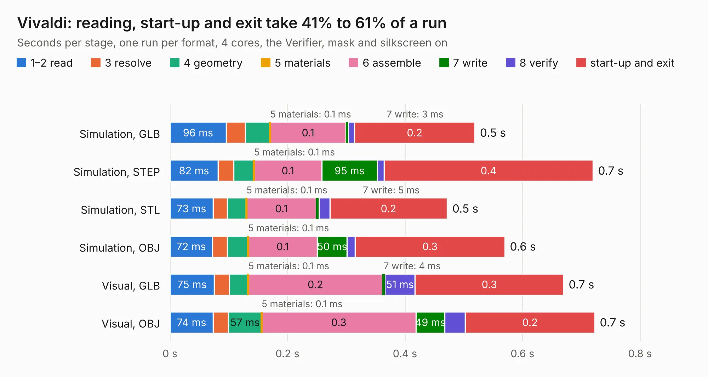

| Mode and format | 1–2 read | 3 resolve | 4 geometry | 5 materials | 6 assemble | 7 write | 8 verify | start-up and exit | Total |
|---|---:|---:|---:|---:|---:|---:|---:|---:|---:|
| Simulation, GLB | 96&nbsp;ms | 33&nbsp;ms | 42&nbsp;ms | 0.1&nbsp;ms | 0.1 | 3&nbsp;ms | 11&nbsp;ms | 0.2 | 0.5 |
| Simulation, STEP | 82&nbsp;ms | 27&nbsp;ms | 34&nbsp;ms | 0.1&nbsp;ms | 0.1 | 95&nbsp;ms | 11&nbsp;ms | 0.4 | 0.7 |
| Simulation, STL | 73&nbsp;ms | 24&nbsp;ms | 32&nbsp;ms | 0.1&nbsp;ms | 0.1 | 5&nbsp;ms | 18&nbsp;ms | 0.2 | 0.5 |
| Simulation, OBJ | 72&nbsp;ms | 25&nbsp;ms | 35&nbsp;ms | 0.1&nbsp;ms | 0.1 | 50&nbsp;ms | 14&nbsp;ms | 0.3 | 0.6 |
| Visual, GLB | 75&nbsp;ms | 26&nbsp;ms | 32&nbsp;ms | 0.1&nbsp;ms | 0.2 | 4&nbsp;ms | 51&nbsp;ms | 0.3 | 0.7 |
| Visual, OBJ | 74&nbsp;ms | 26&nbsp;ms | 57&nbsp;ms | 0.1&nbsp;ms | 0.3 | 49&nbsp;ms | 35&nbsp;ms | 0.2 | 0.7 |

<table align="center"><tr><td valign="top">

| Board | Repo: [myriadrf/vivaldi-antenna](https://github.com/myriadrf/vivaldi-antenna) Board: `Vivaldi.kicad_pcb` |
|---|---|
| Folder | hardware / KiCAD |
| Complexity | 98&nbsp;/&nbsp;1000 (size&nbsp;63, features&nbsp;35) |
| KESE&nbsp;features | through vias, filled zones |
| Tested | 9th November 2026 |
| Copper&nbsp;layers | 2 |
| File&nbsp;format | KiCad 3 (3) |
| Parts,&nbsp;tracks,&nbsp;vias | 1, 4, 2 |
| Triangles,&nbsp;simulation | 9,304 in 10 parts |
| Verifier | PASS in all six runs |

</td><td valign="top">

<table>
<tr><th>File type</th><th>File size</th><th>Peak memory used</th></tr>
<tr><th colspan="3" align="left">Simulation</th></tr>
<tr><td>GLB</td><td align="right">331&nbsp;kB</td><td align="right">62&nbsp;MB</td></tr>
<tr><td>STEP</td><td align="right">2.0&nbsp;MB</td><td align="right">62&nbsp;MB</td></tr>
<tr><td>STL</td><td align="right">466&nbsp;kB</td><td align="right">62&nbsp;MB</td></tr>
<tr><td>OBJ</td><td align="right">845&nbsp;kB</td><td align="right">62&nbsp;MB</td></tr>
<tr><th colspan="3" align="left">Visual</th></tr>
<tr><td>GLB</td><td align="right">302&nbsp;kB</td><td align="right">83&nbsp;MB</td></tr>
<tr><td>OBJ</td><td align="right">772&nbsp;kB</td><td align="right">84&nbsp;MB</td></tr>
</table>

</td></tr></table>

## 1730. Yellow

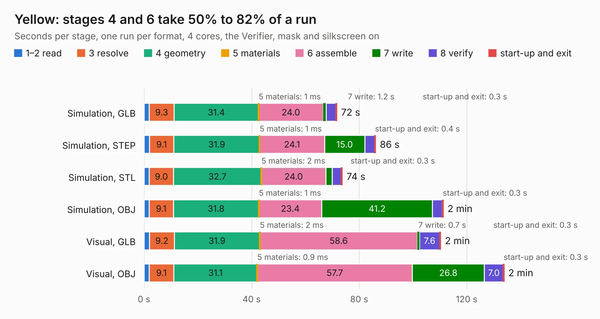

| Mode and format | 1–2 read | 3 resolve | 4 geometry | 5 materials | 6 assemble | 7 write | 8 verify | start-up and exit | Total |
|---|---:|---:|---:|---:|---:|---:|---:|---:|---:|
| Simulation, GLB | 1.9 | 9.3 | 31.4 | 1&nbsp;ms | 24.0 | 1.2 | 3.6 | 0.3 | 71.7 |
| Simulation, STEP | 2.0 | 9.1 | 31.9 | 1&nbsp;ms | 24.1 | 15.0 | 3.6 | 0.4 | 86.1 |
| Simulation, STL | 2.0 | 9.0 | 32.7 | 2&nbsp;ms | 24.0 | 2.3 | 3.4 | 0.3 | 73.7 |
| Simulation, OBJ | 1.9 | 9.1 | 31.8 | 1&nbsp;ms | 23.4 | 41.2 | 3.7 | 0.3 | 111.3 |
| Visual, GLB | 2.1 | 9.2 | 31.9 | 2&nbsp;ms | 58.6 | 0.7 | 7.6 | 0.3 | 110.3 |
| Visual, OBJ | 1.9 | 9.1 | 31.1 | 0.9&nbsp;ms | 57.7 | 26.8 | 7.0 | 0.3 | 133.9 |

<table align="center"><tr><td valign="top">

| Board | Repo: [NabuCasa/yellow](https://github.com/NabuCasa/yellow) Board: `Yellow.kicad_pcb` |
|---|---|
| Complexity | 441&nbsp;/&nbsp;1000 (size&nbsp;291, features&nbsp;150) |
| KESE&nbsp;features | through vias, slotted holes, custom pads, rounded, trapezoid or chamfered pads, arc tracks, filled zones, copper drawings, curved board outline, stack-up, dielectric εr and tanδ, copper finish |
| Tested | 9th November 2026 |
| Copper&nbsp;layers | 4 |
| File&nbsp;format | KiCad 7 (20221018) |
| Parts,&nbsp;tracks,&nbsp;vias | 280, 3,463, 1,961 |
| Triangles,&nbsp;simulation | 6,590,014 in 390 parts |
| Verifier | PASS in all six runs |

</td><td valign="top">

<table>
<tr><th>File type</th><th>File size</th><th>Peak memory used</th></tr>
<tr><th colspan="3" align="left">Simulation</th></tr>
<tr><td>GLB</td><td align="right">222&nbsp;MB</td><td align="right">2.2&nbsp;GB</td></tr>
<tr><td>STEP</td><td align="right">788&nbsp;MB</td><td align="right">2.6&nbsp;GB</td></tr>
<tr><td>STL</td><td align="right">330&nbsp;MB</td><td align="right">2.4&nbsp;GB</td></tr>
<tr><td>OBJ</td><td align="right">695&nbsp;MB</td><td align="right">4.2&nbsp;GB</td></tr>
<tr><th colspan="3" align="left">Visual</th></tr>
<tr><td>GLB</td><td align="right">159&nbsp;MB</td><td align="right">2.5&nbsp;GB</td></tr>
<tr><td>OBJ</td><td align="right">511&nbsp;MB</td><td align="right">3.4&nbsp;GB</td></tr>
</table>

</td></tr></table>

## 1731. keyboard_system

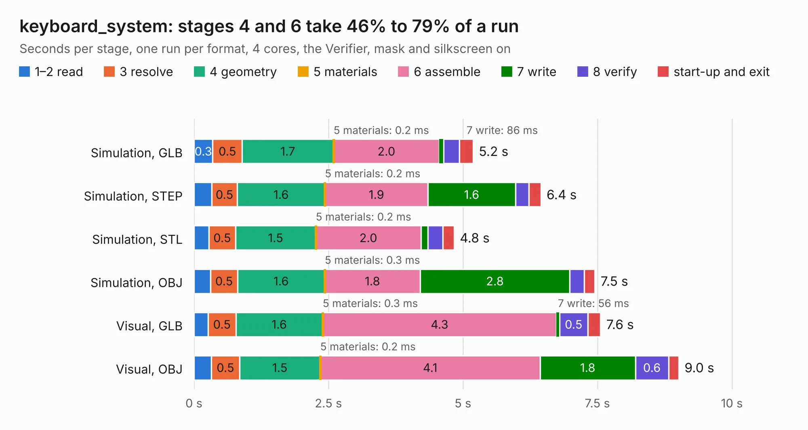

| Mode and format | 1–2 read | 3 resolve | 4 geometry | 5 materials | 6 assemble | 7 write | 8 verify | start-up and exit | Total |
|---|---:|---:|---:|---:|---:|---:|---:|---:|---:|
| Simulation, GLB | 0.3 | 0.5 | 1.7 | 0.2&nbsp;ms | 2.0 | 86&nbsp;ms | 0.3 | 0.3 | 5.2 |
| Simulation, STEP | 0.3 | 0.5 | 1.6 | 0.2&nbsp;ms | 1.9 | 1.6 | 0.3 | 0.2 | 6.4 |
| Simulation, STL | 0.3 | 0.5 | 1.5 | 0.2&nbsp;ms | 2.0 | 0.1 | 0.3 | 0.2 | 4.8 |
| Simulation, OBJ | 0.3 | 0.5 | 1.6 | 0.3&nbsp;ms | 1.8 | 2.8 | 0.3 | 0.2 | 7.5 |
| Visual, GLB | 0.3 | 0.5 | 1.6 | 0.3&nbsp;ms | 4.3 | 56&nbsp;ms | 0.5 | 0.2 | 7.6 |
| Visual, OBJ | 0.3 | 0.5 | 1.5 | 0.2&nbsp;ms | 4.1 | 1.8 | 0.6 | 0.2 | 9.0 |

<table align="center"><tr><td valign="top">

| Board | Repo: [nalgonda-tiger/vohm](https://github.com/nalgonda-tiger/vohm) Board: `keyboard_system.kicad_pcb` |
|---|---|
| Folder | keyboard_system |
| Complexity | 327&nbsp;/&nbsp;1000 (size&nbsp;217, features&nbsp;110) |
| KESE&nbsp;features | through vias, slotted holes, rounded, trapezoid or chamfered pads, arc tracks, filled zones, curved board outline, stack-up, dielectric εr and tanδ |
| Tested | 9th November 2026 |
| Copper&nbsp;layers | 4 |
| File&nbsp;format | KiCad 9 (20241229) |
| Parts,&nbsp;tracks,&nbsp;vias | 34, 433, 59 |
| Triangles,&nbsp;simulation | 574,658 in 55 parts |
| Verifier | PASS in all six runs |

</td><td valign="top">

<table>
<tr><th>File type</th><th>File size</th><th>Peak memory used</th></tr>
<tr><th colspan="3" align="left">Simulation</th></tr>
<tr><td>GLB</td><td align="right">20&nbsp;MB</td><td align="right">316&nbsp;MB</td></tr>
<tr><td>STEP</td><td align="right">84&nbsp;MB</td><td align="right">393&nbsp;MB</td></tr>
<tr><td>STL</td><td align="right">29&nbsp;MB</td><td align="right">316&nbsp;MB</td></tr>
<tr><td>OBJ</td><td align="right">59&nbsp;MB</td><td align="right">436&nbsp;MB</td></tr>
<tr><th colspan="3" align="left">Visual</th></tr>
<tr><td>GLB</td><td align="right">16&nbsp;MB</td><td align="right">409&nbsp;MB</td></tr>
<tr><td>OBJ</td><td align="right">47&nbsp;MB</td><td align="right">423&nbsp;MB</td></tr>
</table>

</td></tr></table>

## 1732. LattePandaMu_Motherboard

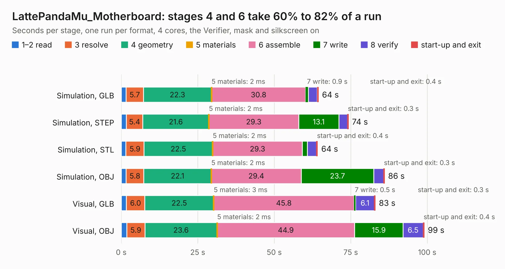

| Mode and format | 1–2 read | 3 resolve | 4 geometry | 5 materials | 6 assemble | 7 write | 8 verify | start-up and exit | Total |
|---|---:|---:|---:|---:|---:|---:|---:|---:|---:|
| Simulation, GLB | 1.6 | 5.7 | 22.3 | 2&nbsp;ms | 30.8 | 0.9 | 2.9 | 0.4 | 64.4 |
| Simulation, STEP | 1.7 | 5.4 | 21.6 | 2&nbsp;ms | 29.3 | 13.1 | 2.8 | 0.3 | 74.2 |
| Simulation, STL | 1.5 | 5.9 | 22.5 | 2&nbsp;ms | 29.3 | 1.7 | 2.9 | 0.4 | 64.2 |
| Simulation, OBJ | 1.6 | 5.8 | 22.1 | 2&nbsp;ms | 29.4 | 23.7 | 3.2 | 0.3 | 86.0 |
| Visual, GLB | 1.7 | 6.0 | 22.5 | 3&nbsp;ms | 45.8 | 0.5 | 6.1 | 0.3 | 83.0 |
| Visual, OBJ | 1.8 | 5.9 | 23.6 | 2&nbsp;ms | 44.9 | 15.9 | 6.5 | 0.4 | 99.0 |

<table align="center"><tr><td valign="top">

| Board | Repo: [nalgonda-tiger/vohm](https://github.com/nalgonda-tiger/vohm) Board: `LattePandaMu_Motherboard.kicad_pcb` |
|---|---|
| Folder | LattePandaMu_Motherboard-Main |
| Complexity | 413&nbsp;/&nbsp;1000 (size&nbsp;278, features&nbsp;135) |
| KESE&nbsp;features | through vias, slotted holes, custom pads, rounded, trapezoid or chamfered pads, arc tracks, filled zones, copper drawings, curved board outline, stack-up, dielectric εr and tanδ |
| Tested | 9th November 2026 |
| Copper&nbsp;layers | 4 |
| File&nbsp;format | KiCad 9 (20241229) |
| Parts,&nbsp;tracks,&nbsp;vias | 305, 4,033, 724 |
| Triangles,&nbsp;simulation | 4,431,648 in 487 parts |
| Verifier | PASS in all six runs |

</td><td valign="top">

<table>
<tr><th>File type</th><th>File size</th><th>Peak memory used</th></tr>
<tr><th colspan="3" align="left">Simulation</th></tr>
<tr><td>GLB</td><td align="right">153&nbsp;MB</td><td align="right">1.4&nbsp;GB</td></tr>
<tr><td>STEP</td><td align="right">679&nbsp;MB</td><td align="right">1.9&nbsp;GB</td></tr>
<tr><td>STL</td><td align="right">222&nbsp;MB</td><td align="right">1.5&nbsp;GB</td></tr>
<tr><td>OBJ</td><td align="right">478&nbsp;MB</td><td align="right">2.9&nbsp;GB</td></tr>
<tr><th colspan="3" align="left">Visual</th></tr>
<tr><td>GLB</td><td align="right">110&nbsp;MB</td><td align="right">1.8&nbsp;GB</td></tr>
<tr><td>OBJ</td><td align="right">350&nbsp;MB</td><td align="right">2.3&nbsp;GB</td></tr>
</table>

</td></tr></table>

## 1733. NewAudio_System

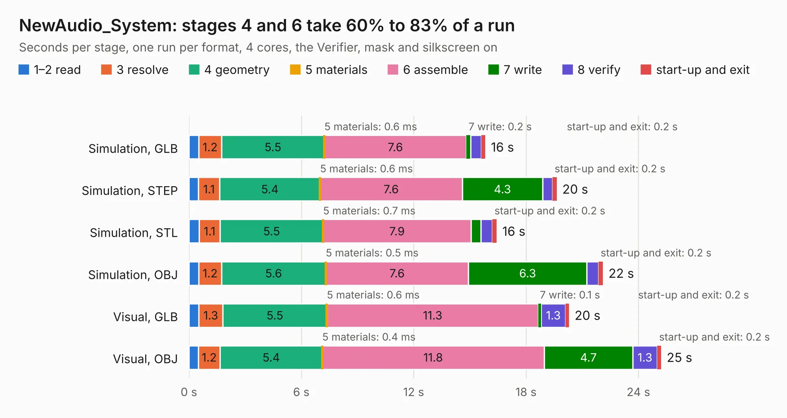

| Mode and format | 1–2 read | 3 resolve | 4 geometry | 5 materials | 6 assemble | 7 write | 8 verify | start-up and exit | Total |
|---|---:|---:|---:|---:|---:|---:|---:|---:|---:|
| Simulation, GLB | 0.5 | 1.2 | 5.5 | 0.6&nbsp;ms | 7.6 | 0.2 | 0.6 | 0.2 | 15.8 |
| Simulation, STEP | 0.5 | 1.1 | 5.4 | 0.6&nbsp;ms | 7.6 | 4.3 | 0.5 | 0.2 | 19.6 |
| Simulation, STL | 0.5 | 1.1 | 5.5 | 0.7&nbsp;ms | 7.9 | 0.5 | 0.6 | 0.2 | 16.4 |
| Simulation, OBJ | 0.5 | 1.2 | 5.6 | 0.5&nbsp;ms | 7.6 | 6.3 | 0.6 | 0.2 | 22.1 |
| Visual, GLB | 0.5 | 1.3 | 5.5 | 0.6&nbsp;ms | 11.3 | 0.1 | 1.3 | 0.2 | 20.3 |
| Visual, OBJ | 0.5 | 1.2 | 5.4 | 0.4&nbsp;ms | 11.8 | 4.7 | 1.3 | 0.2 | 25.2 |

<table align="center"><tr><td valign="top">

| Board | Repo: [nalgonda-tiger/vohm](https://github.com/nalgonda-tiger/vohm) Board: `NewAudio_System.kicad_pcb` |
|---|---|
| Folder | NewAudio_System |
| Complexity | 307&nbsp;/&nbsp;1000 (size&nbsp;212, features&nbsp;95) |
| KESE&nbsp;features | through vias, slotted holes, rounded, trapezoid or chamfered pads, filled zones, curved board outline, stack-up, dielectric εr and tanδ |
| Tested | 9th November 2026 |
| Copper&nbsp;layers | 4 |
| File&nbsp;format | KiCad 9 (20241229) |
| Parts,&nbsp;tracks,&nbsp;vias | 198, 1,101, 188 |
| Triangles,&nbsp;simulation | 1,635,412 in 155 parts |
| Verifier | PASS in all six runs |

</td><td valign="top">

<table>
<tr><th>File type</th><th>File size</th><th>Peak memory used</th></tr>
<tr><th colspan="3" align="left">Simulation</th></tr>
<tr><td>GLB</td><td align="right">56&nbsp;MB</td><td align="right">661&nbsp;MB</td></tr>
<tr><td>STEP</td><td align="right">276&nbsp;MB</td><td align="right">792&nbsp;MB</td></tr>
<tr><td>STL</td><td align="right">82&nbsp;MB</td><td align="right">642&nbsp;MB</td></tr>
<tr><td>OBJ</td><td align="right">171&nbsp;MB</td><td align="right">1.1&nbsp;GB</td></tr>
<tr><th colspan="3" align="left">Visual</th></tr>
<tr><td>GLB</td><td align="right">40&nbsp;MB</td><td align="right">734&nbsp;MB</td></tr>
<tr><td>OBJ</td><td align="right">123&nbsp;MB</td><td align="right">878&nbsp;MB</td></tr>
</table>

</td></tr></table>

## 1734. webcam_microphone_system

| Mode and format | 1–2 read | 3 resolve | 4 geometry | 5 materials | 6 assemble | 7 write | 8 verify | start-up and exit | Total |
|---|---:|---:|---:|---:|---:|---:|---:|---:|---:|
| Simulation, GLB | 0.4 | 0.7 | 2.1 | 0.3&nbsp;ms | 2.9 | 0.1 | 0.4 | 0.3 | 7.0 |
| Simulation, STEP | 0.4 | 0.7 | 2.2 | 0.3&nbsp;ms | 2.9 | 2.6 | 0.4 | 0.2 | 9.3 |
| Simulation, STL | 0.4 | 0.6 | 2.1 | 0.3&nbsp;ms | 2.9 | 0.2 | 0.4 | 0.2 | 6.9 |
| Simulation, OBJ | 0.4 | 0.6 | 2.3 | 0.3&nbsp;ms | 3.1 | 4.1 | 0.4 | 0.2 | 11.1 |
| Visual, GLB | 0.4 | 0.7 | 2.1 | 0.4&nbsp;ms | 5.8 | 86&nbsp;ms | 0.6 | 0.2 | 9.9 |
| Visual, OBJ | 0.4 | 0.6 | 2.1 | 0.4&nbsp;ms | 5.9 | 2.9 | 0.7 | 0.2 | 12.8 |

<table align="center"><tr><td valign="top">

| Board | Repo: [nalgonda-tiger/vohm](https://github.com/nalgonda-tiger/vohm) Board: `webcam_microphone_system.kicad_pcb` |
|---|---|
| Folder | webcam_microphone_system |
| Complexity | 353&nbsp;/&nbsp;1000 (size&nbsp;228, features&nbsp;125) |
| KESE&nbsp;features | through vias, slotted holes, rounded, trapezoid or chamfered pads, arc tracks, filled zones, curved board outline, TrueType text, stack-up, dielectric εr and tanδ |
| Tested | 9th November 2026 |
| Copper&nbsp;layers | 4 |
| File&nbsp;format | KiCad 9 (20241229) |
| Parts,&nbsp;tracks,&nbsp;vias | 61, 593, 73 |
| Triangles,&nbsp;simulation | 696,602 in 95 parts |
| Verifier | PASS in all six runs |

</td><td valign="top">

<table>
<tr><th>File type</th><th>File size</th><th>Peak memory used</th></tr>
<tr><th colspan="3" align="left">Simulation</th></tr>
<tr><td>GLB</td><td align="right">24&nbsp;MB</td><td align="right">365&nbsp;MB</td></tr>
<tr><td>STEP</td><td align="right">106&nbsp;MB</td><td align="right">430&nbsp;MB</td></tr>
<tr><td>STL</td><td align="right">35&nbsp;MB</td><td align="right">367&nbsp;MB</td></tr>
<tr><td>OBJ</td><td align="right">71&nbsp;MB</td><td align="right">509&nbsp;MB</td></tr>
<tr><th colspan="3" align="left">Visual</th></tr>
<tr><td>GLB</td><td align="right">17&nbsp;MB</td><td align="right">484&nbsp;MB</td></tr>
<tr><td>OBJ</td><td align="right">52&nbsp;MB</td><td align="right">475&nbsp;MB</td></tr>
</table>

</td></tr></table>

## 1735. PQ_ADCS

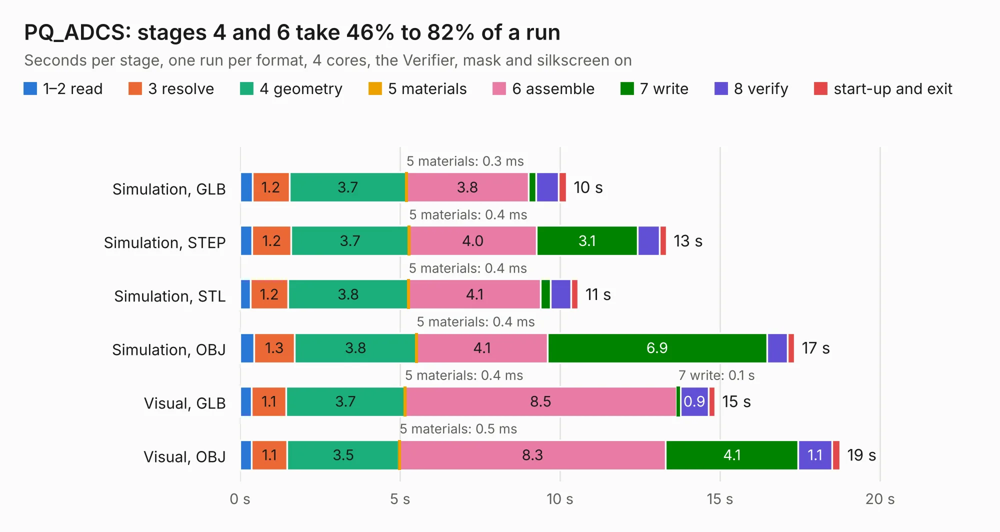

| Mode and format | 1–2 read | 3 resolve | 4 geometry | 5 materials | 6 assemble | 7 write | 8 verify | start-up and exit | Total |
|---|---:|---:|---:|---:|---:|---:|---:|---:|---:|
| Simulation, GLB | 0.4 | 1.2 | 3.7 | 0.3&nbsp;ms | 3.8 | 0.2 | 0.7 | 0.3 | 10.2 |
| Simulation, STEP | 0.4 | 1.2 | 3.7 | 0.4&nbsp;ms | 4.0 | 3.1 | 0.7 | 0.2 | 13.3 |
| Simulation, STL | 0.3 | 1.2 | 3.8 | 0.4&nbsp;ms | 4.1 | 0.3 | 0.6 | 0.2 | 10.6 |
| Simulation, OBJ | 0.4 | 1.3 | 3.8 | 0.4&nbsp;ms | 4.1 | 6.9 | 0.6 | 0.2 | 17.3 |
| Visual, GLB | 0.4 | 1.1 | 3.7 | 0.4&nbsp;ms | 8.5 | 0.1 | 0.9 | 0.2 | 14.8 |
| Visual, OBJ | 0.4 | 1.1 | 3.5 | 0.5&nbsp;ms | 8.3 | 4.1 | 1.1 | 0.3 | 18.7 |

<table align="center"><tr><td valign="top">

| Board | Repo: [nanosatlab/pocat-hw](https://github.com/nanosatlab/pocat-hw) Board: `PQ_ADCS.kicad_pcb` |
|---|---|
| Folder | pq_adcs / PQ_ADCS |
| Complexity | 296&nbsp;/&nbsp;1000 (size&nbsp;196, features&nbsp;100) |
| KESE&nbsp;features | through vias, slotted holes, rounded, trapezoid or chamfered pads, filled zones, curved board outline, stack-up, dielectric εr and tanδ, mask and silkscreen colours |
| Tested | 9th November 2026 |
| Copper&nbsp;layers | 6 |
| File&nbsp;format | KiCad 7 (20221018) |
| Parts,&nbsp;tracks,&nbsp;vias | 45, 603, 89 |
| Triangles,&nbsp;simulation | 1,290,194 in 93 parts |
| Verifier | PASS in all six runs |

</td><td valign="top">

<table>
<tr><th>File type</th><th>File size</th><th>Peak memory used</th></tr>
<tr><th colspan="3" align="left">Simulation</th></tr>
<tr><td>GLB</td><td align="right">43&nbsp;MB</td><td align="right">503&nbsp;MB</td></tr>
<tr><td>STEP</td><td align="right">171&nbsp;MB</td><td align="right">593&nbsp;MB</td></tr>
<tr><td>STL</td><td align="right">65&nbsp;MB</td><td align="right">496&nbsp;MB</td></tr>
<tr><td>OBJ</td><td align="right">132&nbsp;MB</td><td align="right">871&nbsp;MB</td></tr>
<tr><th colspan="3" align="left">Visual</th></tr>
<tr><td>GLB</td><td align="right">26&nbsp;MB</td><td align="right">638&nbsp;MB</td></tr>
<tr><td>OBJ</td><td align="right">79&nbsp;MB</td><td align="right">603&nbsp;MB</td></tr>
</table>

</td></tr></table>

## 1736. PQ_ADCS

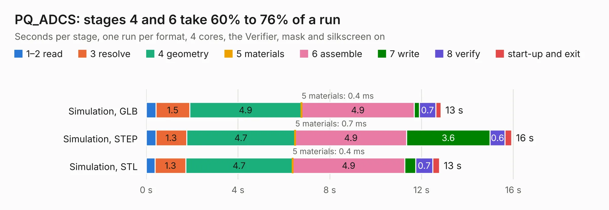

| Mode and format | 1–2 read | 3 resolve | 4 geometry | 5 materials | 6 assemble | 7 write | 8 verify | start-up and exit | Total |
|---|---:|---:|---:|---:|---:|---:|---:|---:|---:|
| Simulation, GLB | 0.4 | 1.5 | 4.9 | 0.4&nbsp;ms | 4.9 | 0.2 | 0.7 | 0.2 | 12.9 |
| Simulation, STEP | 0.4 | 1.3 | 4.7 | 0.7&nbsp;ms | 4.9 | 3.6 | 0.6 | 0.3 | 15.9 |
| Simulation, STL | 0.4 | 1.3 | 4.7 | 0.4&nbsp;ms | 4.9 | 0.5 | 0.7 | 0.3 | 12.8 |
| Simulation, OBJ | 0.4 | 1.4 | 4.7 | 0.4&nbsp;ms | 4.9 | 8.1 | 0.7 | 0.2 | 20.3 |
| Visual, GLB | 0.4 | 1.3 | 4.8 | 0.4&nbsp;ms | 10.2 | 0.2 | 1.0 | 0.3 | 18.2 |
| Visual, OBJ | 0.4 | 1.4 | 4.8 | 0.4&nbsp;ms | 9.7 | 4.7 | 1.2 | 0.2 | 22.5 |

<table align="center"><tr><td valign="top">

| Board | Repo: [nanosatlab/pocat-hw](https://github.com/nanosatlab/pocat-hw) Board: `PQ_ADCS.kicad_pcb` |
|---|---|
| Folder | pq_adcs / PQ_ADCS_HBridge |
| Complexity | 302&nbsp;/&nbsp;1000 (size&nbsp;202, features&nbsp;100) |
| KESE&nbsp;features | through vias, slotted holes, rounded, trapezoid or chamfered pads, filled zones, curved board outline, stack-up, dielectric εr and tanδ, mask and silkscreen colours |
| Tested | 9th November 2026 |
| Copper&nbsp;layers | 6 |
| File&nbsp;format | KiCad 10 (20260206) |
| Parts,&nbsp;tracks,&nbsp;vias | 56, 779, 123 |
| Triangles,&nbsp;simulation | 1,549,468 in 103 parts |
| Verifier | PASS in all six runs |

</td><td valign="top">

<table>
<tr><th>File type</th><th>File size</th><th>Peak memory used</th></tr>
<tr><th colspan="3" align="left">Simulation</th></tr>
<tr><td>GLB</td><td align="right">52&nbsp;MB</td><td align="right">532&nbsp;MB</td></tr>
<tr><td>STEP</td><td align="right">204&nbsp;MB</td><td align="right">653&nbsp;MB</td></tr>
<tr><td>STL</td><td align="right">77&nbsp;MB</td><td align="right">532&nbsp;MB</td></tr>
<tr><td>OBJ</td><td align="right">160&nbsp;MB</td><td align="right">1.1&nbsp;GB</td></tr>
<tr><th colspan="3" align="left">Visual</th></tr>
<tr><td>GLB</td><td align="right">31&nbsp;MB</td><td align="right">674&nbsp;MB</td></tr>
<tr><td>OBJ</td><td align="right">93&nbsp;MB</td><td align="right">724&nbsp;MB</td></tr>
</table>

</td></tr></table>

## 1737. PQ_BotBoard

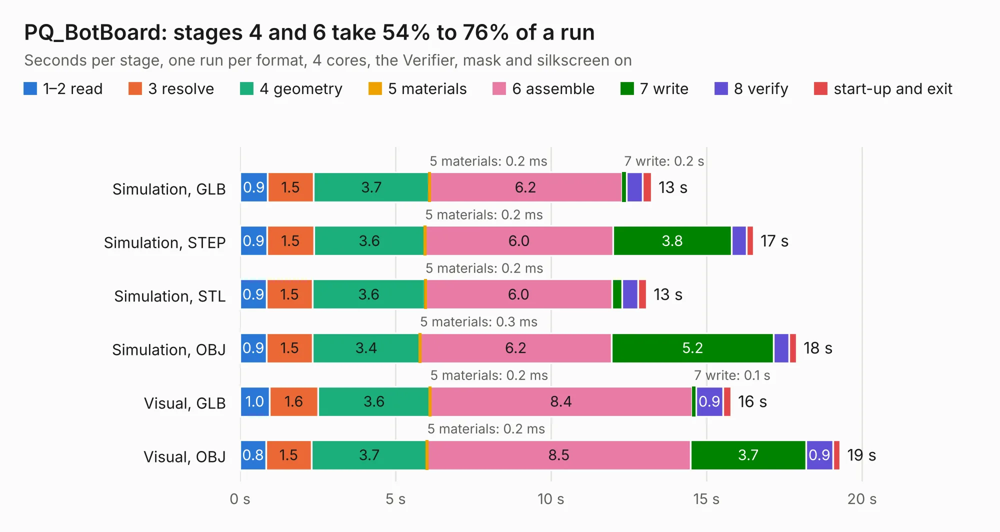

| Mode and format | 1–2 read | 3 resolve | 4 geometry | 5 materials | 6 assemble | 7 write | 8 verify | start-up and exit | Total |
|---|---:|---:|---:|---:|---:|---:|---:|---:|---:|
| Simulation, GLB | 0.9 | 1.5 | 3.7 | 0.2&nbsp;ms | 6.2 | 0.2 | 0.5 | 0.3 | 13.2 |
| Simulation, STEP | 0.9 | 1.5 | 3.6 | 0.2&nbsp;ms | 6.0 | 3.8 | 0.5 | 0.2 | 16.5 |
| Simulation, STL | 0.9 | 1.5 | 3.6 | 0.2&nbsp;ms | 6.0 | 0.3 | 0.5 | 0.3 | 13.1 |
| Simulation, OBJ | 0.9 | 1.5 | 3.4 | 0.3&nbsp;ms | 6.2 | 5.2 | 0.5 | 0.2 | 17.9 |
| Visual, GLB | 1.0 | 1.6 | 3.6 | 0.2&nbsp;ms | 8.4 | 0.1 | 0.9 | 0.3 | 15.8 |
| Visual, OBJ | 0.8 | 1.5 | 3.7 | 0.2&nbsp;ms | 8.5 | 3.7 | 0.9 | 0.2 | 19.3 |

<table align="center"><tr><td valign="top">

| Board | Repo: [nanosatlab/pocat-hw](https://github.com/nanosatlab/pocat-hw) Board: `PQ_BotBoard.kicad_pcb` |
|---|---|
| Folder | pq_botboard / PQ_BotBoard |
| Complexity | 279&nbsp;/&nbsp;1000 (size&nbsp;189, features&nbsp;90) |
| KESE&nbsp;features | through vias, rounded, trapezoid or chamfered pads, filled zones, curved board outline, stack-up, dielectric εr and tanδ, mask and silkscreen colours |
| Tested | 9th November 2026 |
| Copper&nbsp;layers | 6 |
| File&nbsp;format | KiCad 10 (20260206) |
| Parts,&nbsp;tracks,&nbsp;vias | 21, 808, 57 |
| Triangles,&nbsp;simulation | 861,722 in 44 parts |
| Verifier | PASS in all six runs |

</td><td valign="top">

<table>
<tr><th>File type</th><th>File size</th><th>Peak memory used</th></tr>
<tr><th colspan="3" align="left">Simulation</th></tr>
<tr><td>GLB</td><td align="right">31&nbsp;MB</td><td align="right">448&nbsp;MB</td></tr>
<tr><td>STEP</td><td align="right">120&nbsp;MB</td><td align="right">514&nbsp;MB</td></tr>
<tr><td>STL</td><td align="right">43&nbsp;MB</td><td align="right">459&nbsp;MB</td></tr>
<tr><td>OBJ</td><td align="right">90&nbsp;MB</td><td align="right">661&nbsp;MB</td></tr>
<tr><th colspan="3" align="left">Visual</th></tr>
<tr><td>GLB</td><td align="right">22&nbsp;MB</td><td align="right">564&nbsp;MB</td></tr>
<tr><td>OBJ</td><td align="right">66&nbsp;MB</td><td align="right">537&nbsp;MB</td></tr>
</table>

</td></tr></table>

## 1738. PQ_Botnotsobot

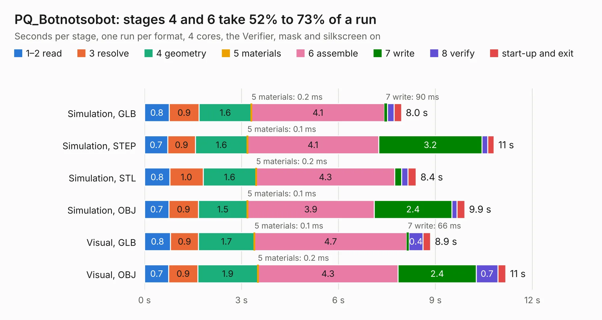

| Mode and format | 1–2 read | 3 resolve | 4 geometry | 5 materials | 6 assemble | 7 write | 8 verify | start-up and exit | Total |
|---|---:|---:|---:|---:|---:|---:|---:|---:|---:|
| Simulation, GLB | 0.8 | 0.9 | 1.6 | 0.2&nbsp;ms | 4.1 | 90&nbsp;ms | 0.2 | 0.2 | 8.0 |
| Simulation, STEP | 0.7 | 0.9 | 1.6 | 0.1&nbsp;ms | 4.1 | 3.2 | 0.2 | 0.2 | 10.8 |
| Simulation, STL | 0.8 | 1.0 | 1.6 | 0.2&nbsp;ms | 4.3 | 0.2 | 0.2 | 0.3 | 8.4 |
| Simulation, OBJ | 0.7 | 0.9 | 1.5 | 0.1&nbsp;ms | 3.9 | 2.4 | 0.2 | 0.2 | 9.9 |
| Visual, GLB | 0.8 | 0.9 | 1.7 | 0.1&nbsp;ms | 4.7 | 66&nbsp;ms | 0.4 | 0.2 | 8.9 |
| Visual, OBJ | 0.7 | 0.9 | 1.9 | 0.2&nbsp;ms | 4.3 | 2.4 | 0.7 | 0.2 | 11.2 |

<table align="center"><tr><td valign="top">

| Board | Repo: [nanosatlab/pocat-hw](https://github.com/nanosatlab/pocat-hw) Board: `PQ_Botnotsobot.kicad_pcb` |
|---|---|
| Folder | pq_botnotsobot / PQ_Botnotsobot |
| Complexity | 84&nbsp;/&nbsp;1000 (size&nbsp;29, features&nbsp;55) |
| KESE&nbsp;features | copper drawings, curved board outline, stack-up, dielectric εr and tanδ, mask and silkscreen colours |
| Tested | 9th November 2026 |
| Copper&nbsp;layers | 2 |
| File&nbsp;format | KiCad 10 (20260206) |
| Parts,&nbsp;tracks,&nbsp;vias | 2, 0, 0 |
| Triangles,&nbsp;simulation | 363,220 in 21 parts |
| Verifier | PASS in all six runs |

</td><td valign="top">

<table>
<tr><th>File type</th><th>File size</th><th>Peak memory used</th></tr>
<tr><th colspan="3" align="left">Simulation</th></tr>
<tr><td>GLB</td><td align="right">14&nbsp;MB</td><td align="right">366&nbsp;MB</td></tr>
<tr><td>STEP</td><td align="right">54&nbsp;MB</td><td align="right">368&nbsp;MB</td></tr>
<tr><td>STL</td><td align="right">18&nbsp;MB</td><td align="right">367&nbsp;MB</td></tr>
<tr><td>OBJ</td><td align="right">40&nbsp;MB</td><td align="right">367&nbsp;MB</td></tr>
<tr><th colspan="3" align="left">Visual</th></tr>
<tr><td>GLB</td><td align="right">13&nbsp;MB</td><td align="right">382&nbsp;MB</td></tr>
<tr><td>OBJ</td><td align="right">37&nbsp;MB</td><td align="right">338&nbsp;MB</td></tr>
</table>

</td></tr></table>

## 1739. EGSE

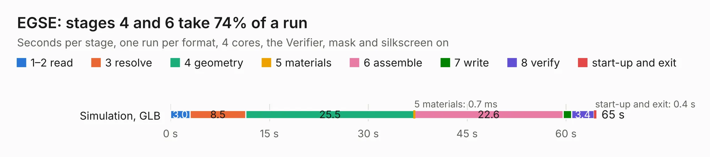

| Mode and format | 1–2 read | 3 resolve | 4 geometry | 5 materials | 6 assemble | 7 write | 8 verify | start-up and exit | Total |
|---|---:|---:|---:|---:|---:|---:|---:|---:|---:|
| Simulation, GLB | 3.0 | 8.5 | 25.5 | 0.7&nbsp;ms | 22.6 | 1.3 | 3.4 | 0.4 | 64.6 |
| Simulation, STEP | 2.9 | 8.9 | 26.0 | 0.8&nbsp;ms | 22.7 | 14.8 | 3.2 | 0.4 | 78.9 |
| Simulation, STL | 3.0 | 8.7 | 25.2 | 1&nbsp;ms | 21.7 | 2.1 | 2.9 | 0.4 | 64.1 |
| Simulation, OBJ | 2.8 | 8.4 | 24.7 | 1&nbsp;ms | 21.8 | 38.5 | 3.0 | 0.3 | 99.6 |
| Visual, GLB | 2.9 | 8.5 | 24.3 | 1&nbsp;ms | 43.4 | 0.6 | 4.5 | 0.3 | 84.6 |
| Visual, OBJ | 3.1 | 8.4 | 24.7 | 2&nbsp;ms | 45.0 | 19.6 | 5.0 | 0.3 | 106.1 |

<table align="center"><tr><td valign="top">

| Board | Repo: [nanosatlab/pocat-hw](https://github.com/nanosatlab/pocat-hw) Board: `EGSE.kicad_pcb` |
|---|---|
| Folder | pq_egse |
| Complexity | 323&nbsp;/&nbsp;1000 (size&nbsp;223, features&nbsp;100) |
| KESE&nbsp;features | through vias, rounded, trapezoid or chamfered pads, filled zones, curved board outline, TrueType text, stack-up, dielectric εr and tanδ |
| Tested | 9th November 2026 |
| Copper&nbsp;layers | 6 |
| File&nbsp;format | KiCad 7 (20221018) |
| Parts,&nbsp;tracks,&nbsp;vias | 104, 2,243, 172 |
| Triangles,&nbsp;simulation | 7,126,428 in 99 parts |
| Verifier | PASS in all six runs |

</td><td valign="top">

<table>
<tr><th>File type</th><th>File size</th><th>Peak memory used</th></tr>
<tr><th colspan="3" align="left">Simulation</th></tr>
<tr><td>GLB</td><td align="right">241&nbsp;MB</td><td align="right">1.9&nbsp;GB</td></tr>
<tr><td>STEP</td><td align="right">746&nbsp;MB</td><td align="right">2.4&nbsp;GB</td></tr>
<tr><td>STL</td><td align="right">356&nbsp;MB</td><td align="right">1.9&nbsp;GB</td></tr>
<tr><td>OBJ</td><td align="right">760&nbsp;MB</td><td align="right">4.6&nbsp;GB</td></tr>
<tr><th colspan="3" align="left">Visual</th></tr>
<tr><td>GLB</td><td align="right">123&nbsp;MB</td><td align="right">2.0&nbsp;GB</td></tr>
<tr><td>OBJ</td><td align="right">386&nbsp;MB</td><td align="right">2.5&nbsp;GB</td></tr>
</table>

</td></tr></table>

## 1740. PQ_EPS

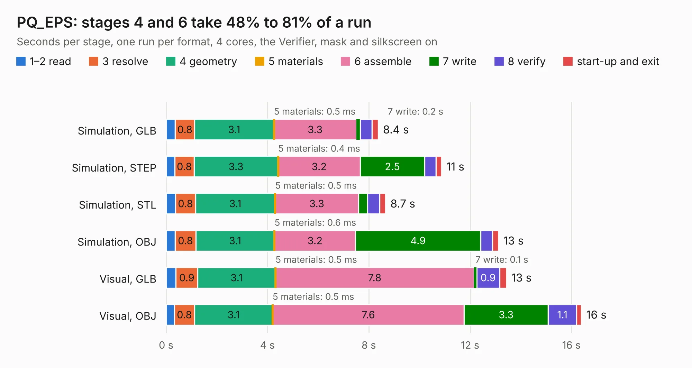

| Mode and format | 1–2 read | 3 resolve | 4 geometry | 5 materials | 6 assemble | 7 write | 8 verify | start-up and exit | Total |
|---|---:|---:|---:|---:|---:|---:|---:|---:|---:|
| Simulation, GLB | 0.4 | 0.8 | 3.1 | 0.5&nbsp;ms | 3.3 | 0.2 | 0.5 | 0.2 | 8.4 |
| Simulation, STEP | 0.3 | 0.8 | 3.3 | 0.4&nbsp;ms | 3.2 | 2.5 | 0.5 | 0.2 | 10.9 |
| Simulation, STL | 0.4 | 0.8 | 3.1 | 0.5&nbsp;ms | 3.3 | 0.4 | 0.5 | 0.2 | 8.7 |
| Simulation, OBJ | 0.4 | 0.8 | 3.1 | 0.6&nbsp;ms | 3.2 | 4.9 | 0.5 | 0.2 | 13.1 |
| Visual, GLB | 0.4 | 0.9 | 3.1 | 0.5&nbsp;ms | 7.8 | 0.1 | 0.9 | 0.3 | 13.4 |
| Visual, OBJ | 0.3 | 0.8 | 3.1 | 0.5&nbsp;ms | 7.6 | 3.3 | 1.1 | 0.2 | 16.4 |

<table align="center"><tr><td valign="top">

| Board | Repo: [nanosatlab/pocat-hw](https://github.com/nanosatlab/pocat-hw) Board: `PQ_EPS.kicad_pcb` |
|---|---|
| Folder | pq_eps / PQ_EPS |
| Complexity | 280&nbsp;/&nbsp;1000 (size&nbsp;190, features&nbsp;90) |
| KESE&nbsp;features | through vias, rounded, trapezoid or chamfered pads, filled zones, curved board outline, stack-up, dielectric εr and tanδ, mask and silkscreen colours |
| Tested | 9th November 2026 |
| Copper&nbsp;layers | 4 |
| File&nbsp;format | KiCad 10 (20260206) |
| Parts,&nbsp;tracks,&nbsp;vias | 82, 475, 96 |
| Triangles,&nbsp;simulation | 1,126,386 in 91 parts |
| Verifier | PASS in all six runs |

</td><td valign="top">

<table>
<tr><th>File type</th><th>File size</th><th>Peak memory used</th></tr>
<tr><th colspan="3" align="left">Simulation</th></tr>
<tr><td>GLB</td><td align="right">38&nbsp;MB</td><td align="right">538&nbsp;MB</td></tr>
<tr><td>STEP</td><td align="right">167&nbsp;MB</td><td align="right">584&nbsp;MB</td></tr>
<tr><td>STL</td><td align="right">56&nbsp;MB</td><td align="right">508&nbsp;MB</td></tr>
<tr><td>OBJ</td><td align="right">114&nbsp;MB</td><td align="right">807&nbsp;MB</td></tr>
<tr><th colspan="3" align="left">Visual</th></tr>
<tr><td>GLB</td><td align="right">26&nbsp;MB</td><td align="right">658&nbsp;MB</td></tr>
<tr><td>OBJ</td><td align="right">80&nbsp;MB</td><td align="right">661&nbsp;MB</td></tr>
</table>

</td></tr></table>

## 1741. PQ_Lat_Board

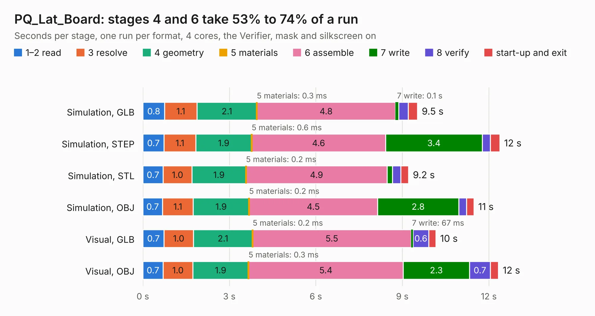

| Mode and format | 1–2 read | 3 resolve | 4 geometry | 5 materials | 6 assemble | 7 write | 8 verify | start-up and exit | Total |
|---|---:|---:|---:|---:|---:|---:|---:|---:|---:|
| Simulation, GLB | 0.8 | 1.1 | 2.1 | 0.3&nbsp;ms | 4.8 | 0.1 | 0.3 | 0.3 | 9.5 |
| Simulation, STEP | 0.7 | 1.1 | 1.9 | 0.6&nbsp;ms | 4.6 | 3.4 | 0.3 | 0.3 | 12.4 |
| Simulation, STL | 0.7 | 1.0 | 1.9 | 0.2&nbsp;ms | 4.9 | 0.2 | 0.3 | 0.3 | 9.2 |
| Simulation, OBJ | 0.7 | 1.1 | 1.9 | 0.2&nbsp;ms | 4.5 | 2.8 | 0.3 | 0.3 | 11.5 |
| Visual, GLB | 0.7 | 1.0 | 2.1 | 0.2&nbsp;ms | 5.5 | 67&nbsp;ms | 0.6 | 0.2 | 10.2 |
| Visual, OBJ | 0.7 | 1.0 | 1.9 | 0.3&nbsp;ms | 5.4 | 2.3 | 0.7 | 0.3 | 12.3 |

<table align="center"><tr><td valign="top">

| Board | Repo: [nanosatlab/pocat-hw](https://github.com/nanosatlab/pocat-hw) Board: `PQ_Lat_Board.kicad_pcb` |
|---|---|
| Folder | pq_latboard / PQ_Lat_Board |
| Complexity | 260&nbsp;/&nbsp;1000 (size&nbsp;180, features&nbsp;80) |
| KESE&nbsp;features | through vias, rounded, trapezoid or chamfered pads, filled zones, stack-up, dielectric εr and tanδ, mask and silkscreen colours |
| Tested | 9th November 2026 |
| Copper&nbsp;layers | 6 |
| File&nbsp;format | KiCad 10 (20260206) |
| Parts,&nbsp;tracks,&nbsp;vias | 14, 670, 19 |
| Triangles,&nbsp;simulation | 554,510 in 30 parts |
| Verifier | PASS in all six runs |

</td><td valign="top">

<table>
<tr><th>File type</th><th>File size</th><th>Peak memory used</th></tr>
<tr><th colspan="3" align="left">Simulation</th></tr>
<tr><td>GLB</td><td align="right">20&nbsp;MB</td><td align="right">417&nbsp;MB</td></tr>
<tr><td>STEP</td><td align="right">80&nbsp;MB</td><td align="right">413&nbsp;MB</td></tr>
<tr><td>STL</td><td align="right">28&nbsp;MB</td><td align="right">417&nbsp;MB</td></tr>
<tr><td>OBJ</td><td align="right">60&nbsp;MB</td><td align="right">466&nbsp;MB</td></tr>
<tr><th colspan="3" align="left">Visual</th></tr>
<tr><td>GLB</td><td align="right">16&nbsp;MB</td><td align="right">459&nbsp;MB</td></tr>
<tr><td>OBJ</td><td align="right">47&nbsp;MB</td><td align="right">419&nbsp;MB</td></tr>
</table>

</td></tr></table>

## 1742. PQ_Lat_Board_Deploy

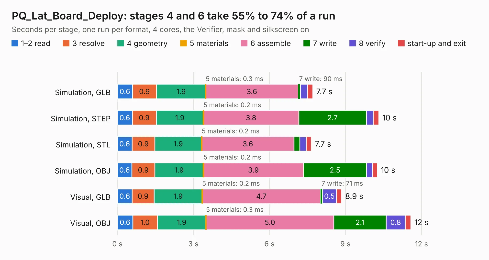

| Mode and format | 1–2 read | 3 resolve | 4 geometry | 5 materials | 6 assemble | 7 write | 8 verify | start-up and exit | Total |
|---|---:|---:|---:|---:|---:|---:|---:|---:|---:|
| Simulation, GLB | 0.6 | 0.9 | 1.9 | 0.3&nbsp;ms | 3.6 | 90&nbsp;ms | 0.3 | 0.2 | 7.7 |
| Simulation, STEP | 0.6 | 0.9 | 1.9 | 0.2&nbsp;ms | 3.8 | 2.7 | 0.3 | 0.2 | 10.3 |
| Simulation, STL | 0.6 | 0.9 | 1.9 | 0.2&nbsp;ms | 3.6 | 0.2 | 0.2 | 0.2 | 7.7 |
| Simulation, OBJ | 0.6 | 0.9 | 1.9 | 0.2&nbsp;ms | 3.9 | 2.5 | 0.2 | 0.2 | 10.3 |
| Visual, GLB | 0.6 | 0.9 | 1.9 | 0.2&nbsp;ms | 4.7 | 71&nbsp;ms | 0.5 | 0.2 | 8.9 |
| Visual, OBJ | 0.6 | 1.0 | 1.9 | 0.3&nbsp;ms | 5.0 | 2.1 | 0.8 | 0.2 | 11.6 |

<table align="center"><tr><td valign="top">

| Board | Repo: [nanosatlab/pocat-hw](https://github.com/nanosatlab/pocat-hw) Board: `PQ_Lat_Board_Deploy.kicad_pcb` |
|---|---|
| Folder | pq_latboard_deploy |
| Complexity | 271&nbsp;/&nbsp;1000 (size&nbsp;181, features&nbsp;90) |
| KESE&nbsp;features | through vias, rounded, trapezoid or chamfered pads, filled zones, curved board outline, stack-up, dielectric εr and tanδ, mask and silkscreen colours |
| Tested | 9th November 2026 |
| Copper&nbsp;layers | 6 |
| File&nbsp;format | KiCad 10 (20260206) |
| Parts,&nbsp;tracks,&nbsp;vias | 14, 675, 21 |
| Triangles,&nbsp;simulation | 593,064 in 29 parts |
| Verifier | PASS in all six runs |

</td><td valign="top">

<table>
<tr><th>File type</th><th>File size</th><th>Peak memory used</th></tr>
<tr><th colspan="3" align="left">Simulation</th></tr>
<tr><td>GLB</td><td align="right">22&nbsp;MB</td><td align="right">421&nbsp;MB</td></tr>
<tr><td>STEP</td><td align="right">84&nbsp;MB</td><td align="right">439&nbsp;MB</td></tr>
<tr><td>STL</td><td align="right">30&nbsp;MB</td><td align="right">418&nbsp;MB</td></tr>
<tr><td>OBJ</td><td align="right">64&nbsp;MB</td><td align="right">491&nbsp;MB</td></tr>
<tr><th colspan="3" align="left">Visual</th></tr>
<tr><td>GLB</td><td align="right">17&nbsp;MB</td><td align="right">418&nbsp;MB</td></tr>
<tr><td>OBJ</td><td align="right">49&nbsp;MB</td><td align="right">412&nbsp;MB</td></tr>
</table>

</td></tr></table>

## 1743. pq_obc_comms

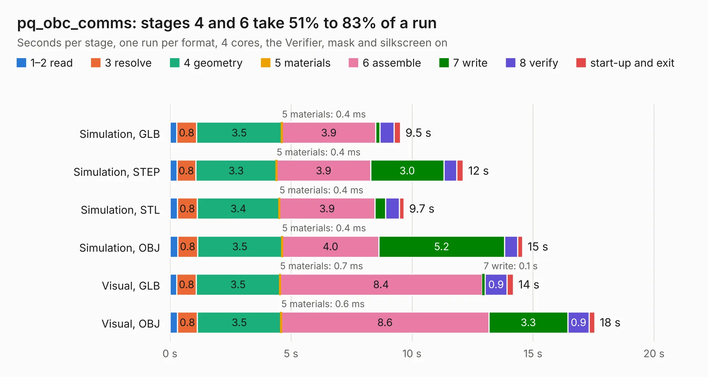

| Mode and format | 1–2 read | 3 resolve | 4 geometry | 5 materials | 6 assemble | 7 write | 8 verify | start-up and exit | Total |
|---|---:|---:|---:|---:|---:|---:|---:|---:|---:|
| Simulation, GLB | 0.3 | 0.8 | 3.5 | 0.4&nbsp;ms | 3.9 | 0.2 | 0.6 | 0.3 | 9.5 |
| Simulation, STEP | 0.3 | 0.8 | 3.3 | 0.4&nbsp;ms | 3.9 | 3.0 | 0.5 | 0.3 | 12.1 |
| Simulation, STL | 0.3 | 0.8 | 3.4 | 0.4&nbsp;ms | 3.9 | 0.4 | 0.6 | 0.2 | 9.7 |
| Simulation, OBJ | 0.3 | 0.8 | 3.5 | 0.4&nbsp;ms | 4.0 | 5.2 | 0.5 | 0.2 | 14.6 |
| Visual, GLB | 0.3 | 0.8 | 3.5 | 0.7&nbsp;ms | 8.4 | 0.1 | 0.9 | 0.3 | 14.2 |
| Visual, OBJ | 0.3 | 0.8 | 3.5 | 0.6&nbsp;ms | 8.6 | 3.3 | 0.9 | 0.2 | 17.6 |

<table align="center"><tr><td valign="top">

| Board | Repo: [nanosatlab/pocat-hw](https://github.com/nanosatlab/pocat-hw) Board: `pq_obc_comms.kicad_pcb` |
|---|---|
| Folder | pq_obc_comms / pq_obc_comms |
| Complexity | 346&nbsp;/&nbsp;1000 (size&nbsp;231, features&nbsp;115) |
| KESE&nbsp;features | through vias, custom pads, rounded, trapezoid or chamfered pads, filled zones, copper drawings, curved board outline, stack-up, dielectric εr and tanδ, mask and silkscreen colours |
| Tested | 9th November 2026 |
| Copper&nbsp;layers | 4 |
| File&nbsp;format | KiCad 10 (20260206) |
| Parts,&nbsp;tracks,&nbsp;vias | 68, 538, 131 |
| Triangles,&nbsp;simulation | 1,237,286 in 105 parts |
| Verifier | PASS in all six runs |

</td><td valign="top">

<table>
<tr><th>File type</th><th>File size</th><th>Peak memory used</th></tr>
<tr><th colspan="3" align="left">Simulation</th></tr>
<tr><td>GLB</td><td align="right">42&nbsp;MB</td><td align="right">526&nbsp;MB</td></tr>
<tr><td>STEP</td><td align="right">194&nbsp;MB</td><td align="right">606&nbsp;MB</td></tr>
<tr><td>STL</td><td align="right">62&nbsp;MB</td><td align="right">510&nbsp;MB</td></tr>
<tr><td>OBJ</td><td align="right">127&nbsp;MB</td><td align="right">855&nbsp;MB</td></tr>
<tr><th colspan="3" align="left">Visual</th></tr>
<tr><td>GLB</td><td align="right">28&nbsp;MB</td><td align="right">708&nbsp;MB</td></tr>
<tr><td>OBJ</td><td align="right">85&nbsp;MB</td><td align="right">738&nbsp;MB</td></tr>
</table>

</td></tr></table>

## 1744. PQ_PL1

| Mode and format | 1–2 read | 3 resolve | 4 geometry | 5 materials | 6 assemble | 7 write | 8 verify | start-up and exit | Total |
|---|---:|---:|---:|---:|---:|---:|---:|---:|---:|
| Simulation, GLB | 97&nbsp;ms | 0.2 | 1.0 | 0.2&nbsp;ms | 0.9 | 47&nbsp;ms | 0.2 | 0.2 | 2.6 |
| Simulation, STEP | 97&nbsp;ms | 0.2 | 1.0 | 0.2&nbsp;ms | 0.9 | 1.1 | 0.2 | 0.2 | 3.6 |
| Simulation, STL | 0.1 | 0.2 | 1.0 | 0.3&nbsp;ms | 0.9 | 70&nbsp;ms | 0.2 | 0.2 | 2.6 |
| Simulation, OBJ | 0.1 | 0.2 | 1.0 | 0.2&nbsp;ms | 0.9 | 1.3 | 0.2 | 0.2 | 3.8 |
| Visual, GLB | 97&nbsp;ms | 0.2 | 1.0 | 0.2&nbsp;ms | 2.4 | 33&nbsp;ms | 0.3 | 0.2 | 4.1 |
| Visual, OBJ | 92&nbsp;ms | 0.2 | 1.0 | 0.2&nbsp;ms | 2.4 | 1.0 | 0.3 | 0.2 | 5.1 |

<table align="center"><tr><td valign="top">

| Board | Repo: [nanosatlab/pocat-hw](https://github.com/nanosatlab/pocat-hw) Board: `PQ_PL1.kicad_pcb` |
|---|---|
| Folder | pq_pl1 / PQ_PL1 |
| Complexity | 139&nbsp;/&nbsp;1000 (size&nbsp;74, features&nbsp;65) |
| KESE&nbsp;features | filled zones, curved board outline, stack-up, dielectric εr and tanδ, mask and silkscreen colours |
| Tested | 9th November 2026 |
| Copper&nbsp;layers | 2 |
| File&nbsp;format | KiCad 7 (20221018) |
| Parts,&nbsp;tracks,&nbsp;vias | 5, 9, 0 |
| Triangles,&nbsp;simulation | 341,986 in 49 parts |
| Verifier | PASS in all six runs |

</td><td valign="top">

<table>
<tr><th>File type</th><th>File size</th><th>Peak memory used</th></tr>
<tr><th colspan="3" align="left">Simulation</th></tr>
<tr><td>GLB</td><td align="right">11&nbsp;MB</td><td align="right">255&nbsp;MB</td></tr>
<tr><td>STEP</td><td align="right">52&nbsp;MB</td><td align="right">272&nbsp;MB</td></tr>
<tr><td>STL</td><td align="right">17&nbsp;MB</td><td align="right">258&nbsp;MB</td></tr>
<tr><td>OBJ</td><td align="right">34&nbsp;MB</td><td align="right">260&nbsp;MB</td></tr>
<tr><th colspan="3" align="left">Visual</th></tr>
<tr><td>GLB</td><td align="right">8.0&nbsp;MB</td><td align="right">266&nbsp;MB</td></tr>
<tr><td>OBJ</td><td align="right">23&nbsp;MB</td><td align="right">265&nbsp;MB</td></tr>
</table>

</td></tr></table>

## 1745. PCB_P L2_PCB_2022-10-05

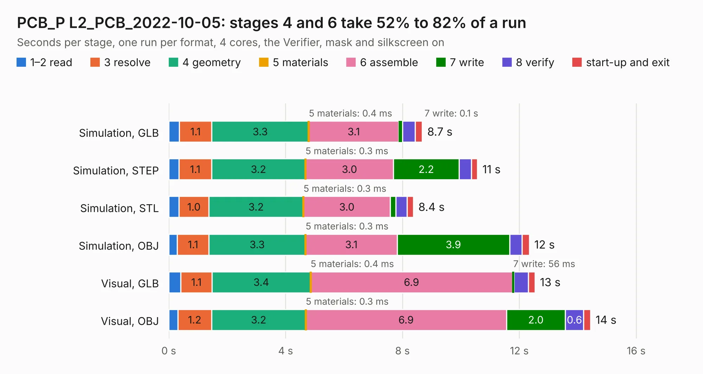

| Mode and format | 1–2 read | 3 resolve | 4 geometry | 5 materials | 6 assemble | 7 write | 8 verify | start-up and exit | Total |
|---|---:|---:|---:|---:|---:|---:|---:|---:|---:|
| Simulation, GLB | 0.4 | 1.1 | 3.3 | 0.4&nbsp;ms | 3.1 | 0.1 | 0.4 | 0.2 | 8.7 |
| Simulation, STEP | 0.3 | 1.1 | 3.2 | 0.3&nbsp;ms | 3.0 | 2.2 | 0.4 | 0.2 | 10.6 |
| Simulation, STL | 0.4 | 1.0 | 3.2 | 0.3&nbsp;ms | 3.0 | 0.2 | 0.4 | 0.2 | 8.4 |
| Simulation, OBJ | 0.3 | 1.1 | 3.3 | 0.3&nbsp;ms | 3.1 | 3.9 | 0.4 | 0.2 | 12.3 |
| Visual, GLB | 0.4 | 1.1 | 3.4 | 0.4&nbsp;ms | 6.9 | 56&nbsp;ms | 0.5 | 0.2 | 12.5 |
| Visual, OBJ | 0.3 | 1.2 | 3.2 | 0.3&nbsp;ms | 6.9 | 2.0 | 0.6 | 0.2 | 14.4 |

<table align="center"><tr><td valign="top">

| Board | Repo: [nanosatlab/pocat-hw](https://github.com/nanosatlab/pocat-hw) Board: `PCB_P L2_PCB_2022-10-05.kicad_pcb` |
|---|---|
| Folder | pq_pl2 / Imports |
| Complexity | 261&nbsp;/&nbsp;1000 (size&nbsp;181, features&nbsp;80) |
| KESE&nbsp;features | through vias, slotted holes, custom pads, filled zones, copper drawings, curved board outline |
| Tested | 9th November 2026 |
| Copper&nbsp;layers | 4 |
| File&nbsp;format | KiCad 6 (20211014) |
| Parts,&nbsp;tracks,&nbsp;vias | 66, 267, 78 |
| Triangles,&nbsp;simulation | 791,228 in 117 parts |
| Verifier | PASS in all six runs |

</td><td valign="top">

<table>
<tr><th>File type</th><th>File size</th><th>Peak memory used</th></tr>
<tr><th colspan="3" align="left">Simulation</th></tr>
<tr><td>GLB</td><td align="right">27&nbsp;MB</td><td align="right">400&nbsp;MB</td></tr>
<tr><td>STEP</td><td align="right">134&nbsp;MB</td><td align="right">458&nbsp;MB</td></tr>
<tr><td>STL</td><td align="right">40&nbsp;MB</td><td align="right">393&nbsp;MB</td></tr>
<tr><td>OBJ</td><td align="right">80&nbsp;MB</td><td align="right">571&nbsp;MB</td></tr>
<tr><th colspan="3" align="left">Visual</th></tr>
<tr><td>GLB</td><td align="right">14&nbsp;MB</td><td align="right">450&nbsp;MB</td></tr>
<tr><td>OBJ</td><td align="right">42&nbsp;MB</td><td align="right">407&nbsp;MB</td></tr>
</table>

</td></tr></table>

## 1746. PQ_PL2

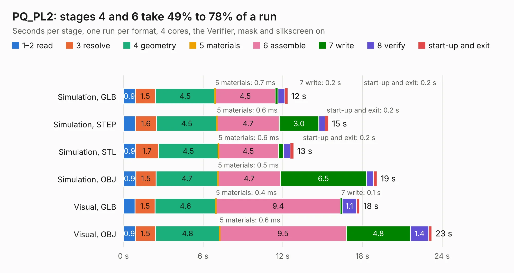

| Mode and format | 1–2 read | 3 resolve | 4 geometry | 5 materials | 6 assemble | 7 write | 8 verify | start-up and exit | Total |
|---|---:|---:|---:|---:|---:|---:|---:|---:|---:|
| Simulation, GLB | 0.9 | 1.5 | 4.5 | 0.7&nbsp;ms | 4.5 | 0.2 | 0.5 | 0.2 | 12.4 |
| Simulation, STEP | 0.9 | 1.6 | 4.5 | 0.6&nbsp;ms | 4.7 | 3.0 | 0.5 | 0.2 | 15.4 |
| Simulation, STL | 0.9 | 1.7 | 4.5 | 0.6&nbsp;ms | 4.5 | 0.4 | 0.5 | 0.2 | 12.8 |
| Simulation, OBJ | 0.9 | 1.5 | 4.7 | 0.5&nbsp;ms | 4.7 | 6.5 | 0.5 | 0.3 | 19.1 |
| Visual, GLB | 0.9 | 1.5 | 4.6 | 0.4&nbsp;ms | 9.4 | 0.1 | 1.1 | 0.2 | 17.8 |
| Visual, OBJ | 0.9 | 1.5 | 4.8 | 0.6&nbsp;ms | 9.5 | 4.8 | 1.4 | 0.2 | 23.2 |

<table align="center"><tr><td valign="top">

| Board | Repo: [nanosatlab/pocat-hw](https://github.com/nanosatlab/pocat-hw) Board: `PQ_PL2.kicad_pcb` |
|---|---|
| Folder | pq_pl2 / PQ_PL2 |
| Complexity | 319&nbsp;/&nbsp;1000 (size&nbsp;189, features&nbsp;130) |
| KESE&nbsp;features | through vias, custom pads, rounded, trapezoid or chamfered pads, arc tracks, filled zones, copper drawings, curved board outline, stack-up, dielectric εr and tanδ, mask and silkscreen colours |
| Tested | 9th November 2026 |
| Copper&nbsp;layers | 4 |
| File&nbsp;format | KiCad 8 (20240108) |
| Parts,&nbsp;tracks,&nbsp;vias | 72, 364, 136 |
| Triangles,&nbsp;simulation | 1,196,648 in 104 parts |
| Verifier | PASS in all six runs |

</td><td valign="top">

<table>
<tr><th>File type</th><th>File size</th><th>Peak memory used</th></tr>
<tr><th colspan="3" align="left">Simulation</th></tr>
<tr><td>GLB</td><td align="right">42&nbsp;MB</td><td align="right">510&nbsp;MB</td></tr>
<tr><td>STEP</td><td align="right">159&nbsp;MB</td><td align="right">662&nbsp;MB</td></tr>
<tr><td>STL</td><td align="right">60&nbsp;MB</td><td align="right">510&nbsp;MB</td></tr>
<tr><td>OBJ</td><td align="right">125&nbsp;MB</td><td align="right">856&nbsp;MB</td></tr>
<tr><th colspan="3" align="left">Visual</th></tr>
<tr><td>GLB</td><td align="right">30&nbsp;MB</td><td align="right">599&nbsp;MB</td></tr>
<tr><td>OBJ</td><td align="right">90&nbsp;MB</td><td align="right">728&nbsp;MB</td></tr>
</table>

</td></tr></table>

## 1747. PQ1_TopBoard

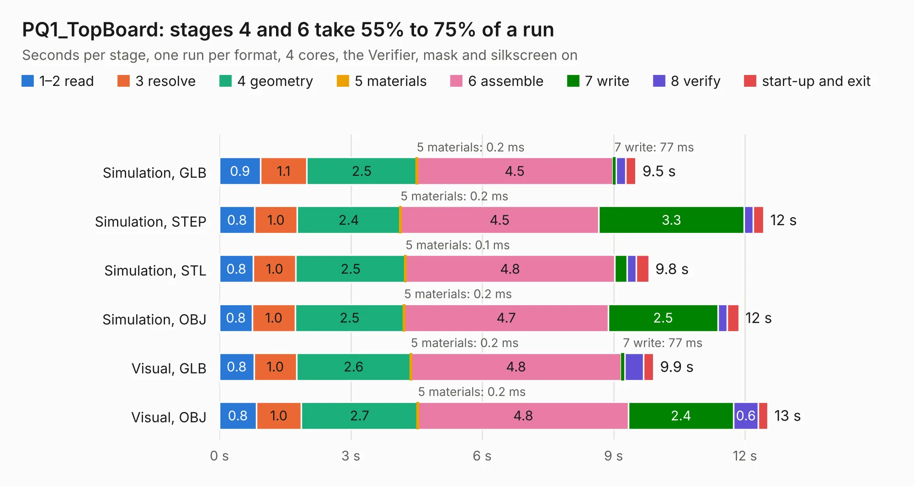

| Mode and format | 1–2 read | 3 resolve | 4 geometry | 5 materials | 6 assemble | 7 write | 8 verify | start-up and exit | Total |
|---|---:|---:|---:|---:|---:|---:|---:|---:|---:|
| Simulation, GLB | 0.9 | 1.1 | 2.5 | 0.2&nbsp;ms | 4.5 | 77&nbsp;ms | 0.2 | 0.2 | 9.5 |
| Simulation, STEP | 0.8 | 1.0 | 2.4 | 0.2&nbsp;ms | 4.5 | 3.3 | 0.2 | 0.2 | 12.4 |
| Simulation, STL | 0.8 | 1.0 | 2.5 | 0.1&nbsp;ms | 4.8 | 0.3 | 0.2 | 0.3 | 9.8 |
| Simulation, OBJ | 0.8 | 1.0 | 2.5 | 0.2&nbsp;ms | 4.7 | 2.5 | 0.2 | 0.3 | 11.9 |
| Visual, GLB | 0.8 | 1.0 | 2.6 | 0.2&nbsp;ms | 4.8 | 77&nbsp;ms | 0.4 | 0.2 | 9.9 |
| Visual, OBJ | 0.8 | 1.0 | 2.7 | 0.2&nbsp;ms | 4.8 | 2.4 | 0.6 | 0.2 | 12.5 |

<table align="center"><tr><td valign="top">

| Board | Repo: [nanosatlab/pocat-hw](https://github.com/nanosatlab/pocat-hw) Board: `PQ1_TopBoard.kicad_pcb` |
|---|---|
| Folder | pq_topboard / PQ1_TopBoard |
| Complexity | 211&nbsp;/&nbsp;1000 (size&nbsp;121, features&nbsp;90) |
| KESE&nbsp;features | through vias, rounded, trapezoid or chamfered pads, filled zones, curved board outline, stack-up, dielectric εr and tanδ, mask and silkscreen colours |
| Tested | 9th November 2026 |
| Copper&nbsp;layers | 2 |
| File&nbsp;format | KiCad 7 (20221018) |
| Parts,&nbsp;tracks,&nbsp;vias | 10, 64, 17 |
| Triangles,&nbsp;simulation | 405,998 in 22 parts |
| Verifier | PASS in all six runs |

</td><td valign="top">

<table>
<tr><th>File type</th><th>File size</th><th>Peak memory used</th></tr>
<tr><th colspan="3" align="left">Simulation</th></tr>
<tr><td>GLB</td><td align="right">15&nbsp;MB</td><td align="right">390&nbsp;MB</td></tr>
<tr><td>STEP</td><td align="right">66&nbsp;MB</td><td align="right">397&nbsp;MB</td></tr>
<tr><td>STL</td><td align="right">20&nbsp;MB</td><td align="right">387&nbsp;MB</td></tr>
<tr><td>OBJ</td><td align="right">44&nbsp;MB</td><td align="right">388&nbsp;MB</td></tr>
<tr><th colspan="3" align="left">Visual</th></tr>
<tr><td>GLB</td><td align="right">14&nbsp;MB</td><td align="right">382&nbsp;MB</td></tr>
<tr><td>OBJ</td><td align="right">41&nbsp;MB</td><td align="right">408&nbsp;MB</td></tr>
</table>

</td></tr></table>

## 1748. PQ1_TopBoardV9

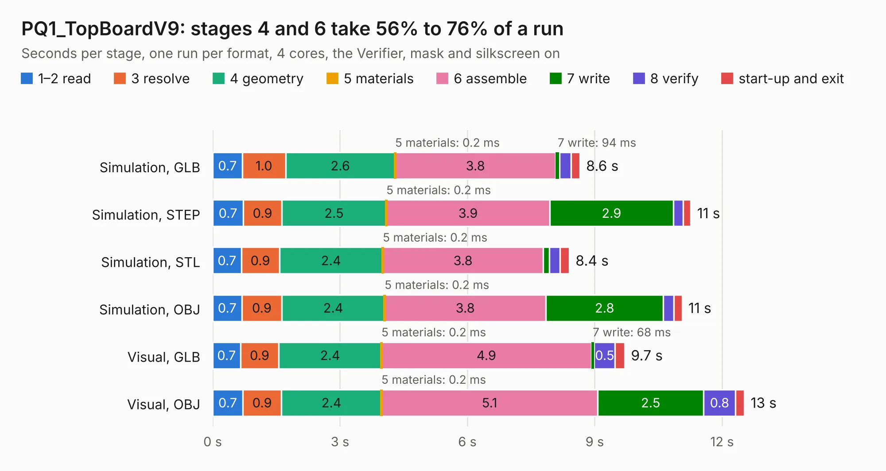

| Mode and format | 1–2 read | 3 resolve | 4 geometry | 5 materials | 6 assemble | 7 write | 8 verify | start-up and exit | Total |
|---|---:|---:|---:|---:|---:|---:|---:|---:|---:|
| Simulation, GLB | 0.7 | 1.0 | 2.6 | 0.2&nbsp;ms | 3.8 | 94&nbsp;ms | 0.3 | 0.2 | 8.6 |
| Simulation, STEP | 0.7 | 0.9 | 2.5 | 0.2&nbsp;ms | 3.9 | 2.9 | 0.2 | 0.2 | 11.3 |
| Simulation, STL | 0.7 | 0.9 | 2.4 | 0.2&nbsp;ms | 3.8 | 0.1 | 0.2 | 0.2 | 8.4 |
| Simulation, OBJ | 0.7 | 0.9 | 2.4 | 0.2&nbsp;ms | 3.8 | 2.8 | 0.2 | 0.2 | 11.1 |
| Visual, GLB | 0.7 | 0.9 | 2.4 | 0.2&nbsp;ms | 4.9 | 68&nbsp;ms | 0.5 | 0.2 | 9.7 |
| Visual, OBJ | 0.7 | 0.9 | 2.4 | 0.2&nbsp;ms | 5.1 | 2.5 | 0.8 | 0.2 | 12.5 |

<table align="center"><tr><td valign="top">

| Board | Repo: [nanosatlab/pocat-hw](https://github.com/nanosatlab/pocat-hw) Board: `PQ1_TopBoardV9.kicad_pcb` |
|---|---|
| Folder | pq_topboard_lband |
| Complexity | 251&nbsp;/&nbsp;1000 (size&nbsp;136, features&nbsp;115) |
| KESE&nbsp;features | through vias, rounded, trapezoid or chamfered pads, arc tracks, filled zones, copper text, curved board outline, stack-up, dielectric εr and tanδ, mask and silkscreen colours |
| Tested | 9th November 2026 |
| Copper&nbsp;layers | 2 |
| File&nbsp;format | KiCad 10 (20260206) |
| Parts,&nbsp;tracks,&nbsp;vias | 14, 89, 50 |
| Triangles,&nbsp;simulation | 494,486 in 21 parts |
| Verifier | PASS in all six runs |

</td><td valign="top">

<table>
<tr><th>File type</th><th>File size</th><th>Peak memory used</th></tr>
<tr><th colspan="3" align="left">Simulation</th></tr>
<tr><td>GLB</td><td align="right">18&nbsp;MB</td><td align="right">397&nbsp;MB</td></tr>
<tr><td>STEP</td><td align="right">78&nbsp;MB</td><td align="right">395&nbsp;MB</td></tr>
<tr><td>STL</td><td align="right">25&nbsp;MB</td><td align="right">394&nbsp;MB</td></tr>
<tr><td>OBJ</td><td align="right">53&nbsp;MB</td><td align="right">427&nbsp;MB</td></tr>
<tr><th colspan="3" align="left">Visual</th></tr>
<tr><td>GLB</td><td align="right">17&nbsp;MB</td><td align="right">440&nbsp;MB</td></tr>
<tr><td>OBJ</td><td align="right">48&nbsp;MB</td><td align="right">446&nbsp;MB</td></tr>
</table>

</td></tr></table>

## 1749. PQ_MagYBoard

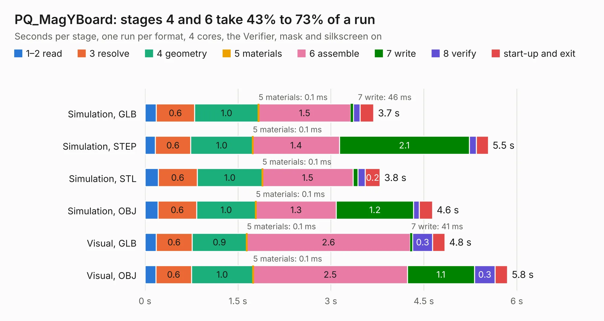

| Mode and format | 1–2 read | 3 resolve | 4 geometry | 5 materials | 6 assemble | 7 write | 8 verify | start-up and exit | Total |
|---|---:|---:|---:|---:|---:|---:|---:|---:|---:|
| Simulation, GLB | 0.2 | 0.6 | 1.0 | 0.1&nbsp;ms | 1.5 | 46&nbsp;ms | 0.1 | 0.2 | 3.7 |
| Simulation, STEP | 0.2 | 0.6 | 1.0 | 0.1&nbsp;ms | 1.4 | 2.1 | 0.1 | 0.2 | 5.5 |
| Simulation, STL | 0.2 | 0.6 | 1.0 | 0.1&nbsp;ms | 1.5 | 80&nbsp;ms | 0.1 | 0.2 | 3.8 |
| Simulation, OBJ | 0.2 | 0.6 | 1.0 | 0.1&nbsp;ms | 1.3 | 1.2 | 92&nbsp;ms | 0.2 | 4.6 |
| Visual, GLB | 0.2 | 0.6 | 0.9 | 0.1&nbsp;ms | 2.6 | 41&nbsp;ms | 0.3 | 0.2 | 4.8 |
| Visual, OBJ | 0.2 | 0.6 | 1.0 | 0.1&nbsp;ms | 2.5 | 1.1 | 0.3 | 0.2 | 5.8 |

<table align="center"><tr><td valign="top">

| Board | Repo: [nanosatlab/pocat-hw](https://github.com/nanosatlab/pocat-hw) Board: `PQ_MagYBoard.kicad_pcb` |
|---|---|
| Folder | pq_ymag_board / PQ_MAGY / PQ_MagYBoard |
| Complexity | 226&nbsp;/&nbsp;1000 (size&nbsp;156, features&nbsp;70) |
| KESE&nbsp;features | through vias, rounded, trapezoid or chamfered pads, curved board outline, stack-up, dielectric εr and tanδ, mask and silkscreen colours |
| Tested | 9th November 2026 |
| Copper&nbsp;layers | 6 |
| File&nbsp;format | KiCad 10 (20260206) |
| Parts,&nbsp;tracks,&nbsp;vias | 2, 468, 5 |
| Triangles,&nbsp;simulation | 248,848 in 13 parts |
| Verifier | PASS in all six runs |

</td><td valign="top">

<table>
<tr><th>File type</th><th>File size</th><th>Peak memory used</th></tr>
<tr><th colspan="3" align="left">Simulation</th></tr>
<tr><td>GLB</td><td align="right">9.1&nbsp;MB</td><td align="right">273&nbsp;MB</td></tr>
<tr><td>STEP</td><td align="right">39&nbsp;MB</td><td align="right">289&nbsp;MB</td></tr>
<tr><td>STL</td><td align="right">12&nbsp;MB</td><td align="right">279&nbsp;MB</td></tr>
<tr><td>OBJ</td><td align="right">27&nbsp;MB</td><td align="right">278&nbsp;MB</td></tr>
<tr><th colspan="3" align="left">Visual</th></tr>
<tr><td>GLB</td><td align="right">7.7&nbsp;MB</td><td align="right">265&nbsp;MB</td></tr>
<tr><td>OBJ</td><td align="right">22&nbsp;MB</td><td align="right">253&nbsp;MB</td></tr>
</table>

</td></tr></table>

## 1750. Control_Boards

| Mode and format | 1–2 read | 3 resolve | 4 geometry | 5 materials | 6 assemble | 7 write | 8 verify | start-up and exit | Total |
|---|---:|---:|---:|---:|---:|---:|---:|---:|---:|
| Simulation, GLB | 1.2 | 4.3 | 21.1 | 2&nbsp;ms | 16.9 | 0.9 | 2.4 | 0.3 | 47.1 |
| Simulation, STEP | 1.1 | 4.5 | 20.4 | 3&nbsp;ms | 16.3 | 12.6 | 2.6 | 0.4 | 57.9 |
| Simulation, STL | 1.1 | 4.3 | 20.4 | 2&nbsp;ms | 17.1 | 1.9 | 2.5 | 0.4 | 47.9 |
| Simulation, OBJ | 1.2 | 4.1 | 20.4 | 2&nbsp;ms | 16.2 | 25.9 | 2.5 | 0.3 | 70.6 |
| Visual, GLB | 1.0 | 4.3 | 20.9 | 1&nbsp;ms | 45.2 | 0.6 | 6.3 | 0.4 | 78.8 |
| Visual, OBJ | 1.1 | 4.6 | 21.3 | 2&nbsp;ms | 42.9 | 17.4 | 6.0 | 0.3 | 93.6 |

<table align="center"><tr><td valign="top">

| Board | Repo: [nasa-jpl/open-source-rover](https://github.com/nasa-jpl/open-source-rover) Board: `Control_Boards.kicad_pcb` |
|---|---|
| Folder | electrical / pcb / control_board |
| Complexity | 241&nbsp;/&nbsp;1000 (size&nbsp;206, features&nbsp;35) |
| KESE&nbsp;features | through vias, filled zones |
| Tested | 9th November 2026 |
| Copper&nbsp;layers | 2 |
| File&nbsp;format | KiCad 10 (20260206) |
| Parts,&nbsp;tracks,&nbsp;vias | 112, 3,720, 265 |
| Triangles,&nbsp;simulation | 5,125,220 in 242 parts |
| Verifier | PASS in all six runs |

</td><td valign="top">

<table>
<tr><th>File type</th><th>File size</th><th>Peak memory used</th></tr>
<tr><th colspan="3" align="left">Simulation</th></tr>
<tr><td>GLB</td><td align="right">173&nbsp;MB</td><td align="right">1.8&nbsp;GB</td></tr>
<tr><td>STEP</td><td align="right">782&nbsp;MB</td><td align="right">2.0&nbsp;GB</td></tr>
<tr><td>STL</td><td align="right">256&nbsp;MB</td><td align="right">1.8&nbsp;GB</td></tr>
<tr><td>OBJ</td><td align="right">545&nbsp;MB</td><td align="right">3.3&nbsp;GB</td></tr>
<tr><th colspan="3" align="left">Visual</th></tr>
<tr><td>GLB</td><td align="right">123&nbsp;MB</td><td align="right">2.2&nbsp;GB</td></tr>
<tr><td>OBJ</td><td align="right">392&nbsp;MB</td><td align="right">2.7&nbsp;GB</td></tr>
</table>

</td></tr></table>

## 1751. groundlark-field-head

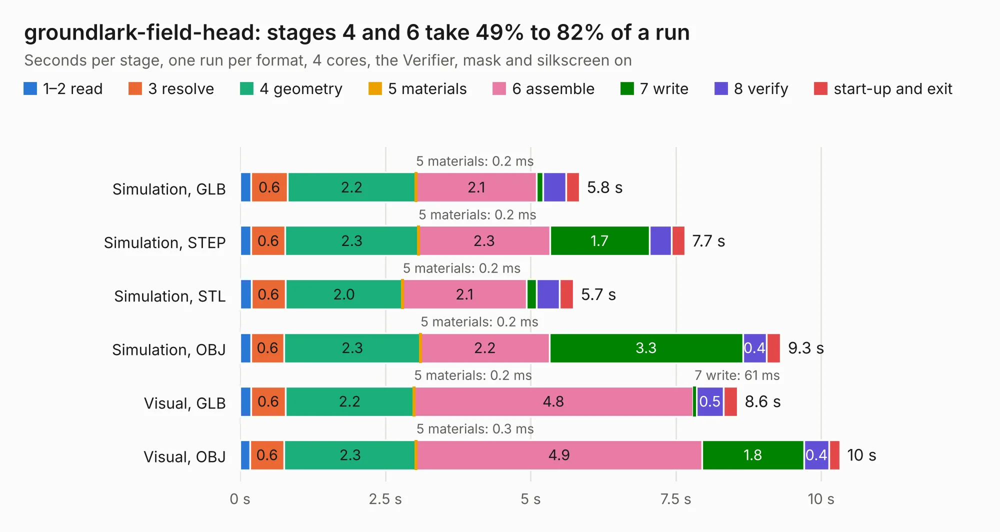

| Mode and format | 1–2 read | 3 resolve | 4 geometry | 5 materials | 6 assemble | 7 write | 8 verify | start-up and exit | Total |
|---|---:|---:|---:|---:|---:|---:|---:|---:|---:|
| Simulation, GLB | 0.2 | 0.6 | 2.2 | 0.2&nbsp;ms | 2.1 | 0.1 | 0.4 | 0.2 | 5.8 |
| Simulation, STEP | 0.2 | 0.6 | 2.3 | 0.2&nbsp;ms | 2.3 | 1.7 | 0.4 | 0.2 | 7.7 |
| Simulation, STL | 0.2 | 0.6 | 2.0 | 0.2&nbsp;ms | 2.1 | 0.2 | 0.4 | 0.2 | 5.7 |
| Simulation, OBJ | 0.2 | 0.6 | 2.3 | 0.2&nbsp;ms | 2.2 | 3.3 | 0.4 | 0.2 | 9.3 |
| Visual, GLB | 0.2 | 0.6 | 2.2 | 0.2&nbsp;ms | 4.8 | 61&nbsp;ms | 0.5 | 0.2 | 8.6 |
| Visual, OBJ | 0.2 | 0.6 | 2.3 | 0.3&nbsp;ms | 4.9 | 1.8 | 0.4 | 0.2 | 10.3 |

<table align="center"><tr><td valign="top">

| Board | Repo: [naturalhazardscience/groundlark](https://github.com/naturalhazardscience/groundlark) Board: `groundlark-field-head.kicad_pcb` |
|---|---|
| Folder | hw / burrowlark-usb / boards / groundlark-field-head |
| Complexity | 321&nbsp;/&nbsp;1000 (size&nbsp;216, features&nbsp;105) |
| KESE&nbsp;features | through vias, slotted holes, rounded, trapezoid or chamfered pads, filled zones, stack-up, dielectric εr and tanδ, copper finish, mask and silkscreen colours |
| Tested | 9th November 2026 |
| Copper&nbsp;layers | 4 |
| File&nbsp;format | KiCad 9 (20241229) |
| Parts,&nbsp;tracks,&nbsp;vias | 34, 455, 46 |
| Triangles,&nbsp;simulation | 742,580 in 66 parts |
| Verifier | PASS in all six runs |

</td><td valign="top">

<table>
<tr><th>File type</th><th>File size</th><th>Peak memory used</th></tr>
<tr><th colspan="3" align="left">Simulation</th></tr>
<tr><td>GLB</td><td align="right">24&nbsp;MB</td><td align="right">347&nbsp;MB</td></tr>
<tr><td>STEP</td><td align="right">86&nbsp;MB</td><td align="right">402&nbsp;MB</td></tr>
<tr><td>STL</td><td align="right">37&nbsp;MB</td><td align="right">359&nbsp;MB</td></tr>
<tr><td>OBJ</td><td align="right">74&nbsp;MB</td><td align="right">541&nbsp;MB</td></tr>
<tr><th colspan="3" align="left">Visual</th></tr>
<tr><td>GLB</td><td align="right">13&nbsp;MB</td><td align="right">355&nbsp;MB</td></tr>
<tr><td>OBJ</td><td align="right">39&nbsp;MB</td><td align="right">382&nbsp;MB</td></tr>
</table>

</td></tr></table>

## 1752. field_head

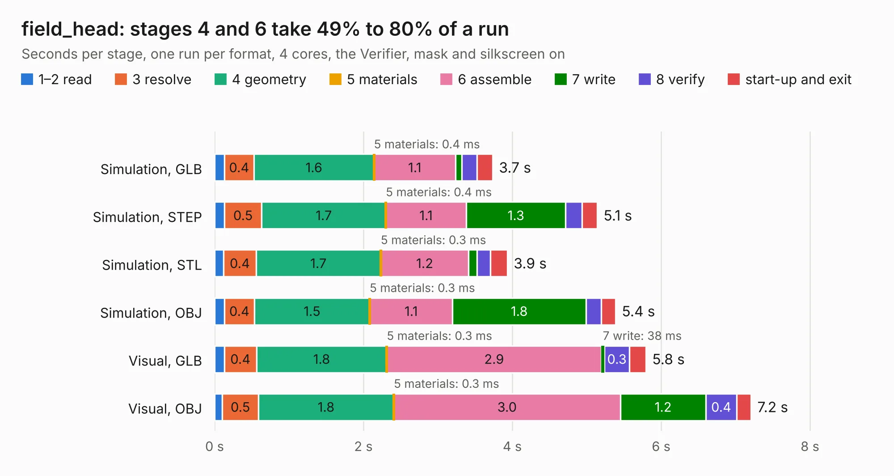

| Mode and format | 1–2 read | 3 resolve | 4 geometry | 5 materials | 6 assemble | 7 write | 8 verify | start-up and exit | Total |
|---|---:|---:|---:|---:|---:|---:|---:|---:|---:|
| Simulation, GLB | 0.1 | 0.4 | 1.6 | 0.4&nbsp;ms | 1.1 | 83&nbsp;ms | 0.2 | 0.2 | 3.7 |
| Simulation, STEP | 0.1 | 0.5 | 1.7 | 0.4&nbsp;ms | 1.1 | 1.3 | 0.2 | 0.2 | 5.1 |
| Simulation, STL | 0.1 | 0.4 | 1.7 | 0.3&nbsp;ms | 1.2 | 0.1 | 0.2 | 0.2 | 3.9 |
| Simulation, OBJ | 0.1 | 0.4 | 1.5 | 0.3&nbsp;ms | 1.1 | 1.8 | 0.2 | 0.2 | 5.4 |
| Visual, GLB | 0.1 | 0.4 | 1.8 | 0.3&nbsp;ms | 2.9 | 38&nbsp;ms | 0.3 | 0.2 | 5.8 |
| Visual, OBJ | 0.1 | 0.5 | 1.8 | 0.3&nbsp;ms | 3.0 | 1.2 | 0.4 | 0.2 | 7.2 |

<table align="center"><tr><td valign="top">

| Board | Repo: [naturalhazardscience/groundlark](https://github.com/naturalhazardscience/groundlark) Board: `field_head.kicad_pcb` |
|---|---|
| Folder | hw / burrowlark-usb / layout / field_head |
| Complexity | 165&nbsp;/&nbsp;1000 (size&nbsp;95, features&nbsp;70) |
| KESE&nbsp;features | slotted holes, rounded, trapezoid or chamfered pads, stack-up, dielectric εr and tanδ, copper finish, mask and silkscreen colours |
| Tested | 9th November 2026 |
| Copper&nbsp;layers | 2 |
| File&nbsp;format | KiCad 9 (20241229) |
| Parts,&nbsp;tracks,&nbsp;vias | 34, 0, 0 |
| Triangles,&nbsp;simulation | 398,116 in 64 parts |
| Verifier | PASS in all six runs |

</td><td valign="top">

<table>
<tr><th>File type</th><th>File size</th><th>Peak memory used</th></tr>
<tr><th colspan="3" align="left">Simulation</th></tr>
<tr><td>GLB</td><td align="right">14&nbsp;MB</td><td align="right">268&nbsp;MB</td></tr>
<tr><td>STEP</td><td align="right">56&nbsp;MB</td><td align="right">292&nbsp;MB</td></tr>
<tr><td>STL</td><td align="right">20&nbsp;MB</td><td align="right">291&nbsp;MB</td></tr>
<tr><td>OBJ</td><td align="right">41&nbsp;MB</td><td align="right">322&nbsp;MB</td></tr>
<tr><th colspan="3" align="left">Visual</th></tr>
<tr><td>GLB</td><td align="right">8.6&nbsp;MB</td><td align="right">301&nbsp;MB</td></tr>
<tr><td>OBJ</td><td align="right">25&nbsp;MB</td><td align="right">297&nbsp;MB</td></tr>
</table>

</td></tr></table>

## 1753. groundlark-daqhat-01

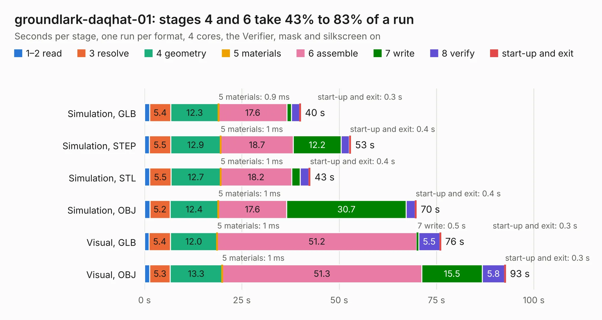

| Mode and format | 1–2 read | 3 resolve | 4 geometry | 5 materials | 6 assemble | 7 write | 8 verify | start-up and exit | Total |
|---|---:|---:|---:|---:|---:|---:|---:|---:|---:|
| Simulation, GLB | 1.3 | 5.4 | 12.3 | 0.9&nbsp;ms | 17.6 | 1.2 | 2.0 | 0.3 | 40.1 |
| Simulation, STEP | 1.2 | 5.5 | 12.9 | 1&nbsp;ms | 18.7 | 12.2 | 2.2 | 0.4 | 53.0 |
| Simulation, STL | 1.3 | 5.5 | 12.7 | 1&nbsp;ms | 18.2 | 2.2 | 2.2 | 0.4 | 42.6 |
| Simulation, OBJ | 1.4 | 5.2 | 12.4 | 1&nbsp;ms | 17.6 | 30.7 | 2.3 | 0.4 | 69.9 |
| Visual, GLB | 1.2 | 5.4 | 12.0 | 1&nbsp;ms | 51.2 | 0.5 | 5.5 | 0.3 | 76.2 |
| Visual, OBJ | 1.3 | 5.3 | 13.3 | 1&nbsp;ms | 51.3 | 15.5 | 5.8 | 0.3 | 92.8 |

<table align="center"><tr><td valign="top">

| Board | Repo: [naturalhazardscience/groundlark](https://github.com/naturalhazardscience/groundlark) Board: `groundlark-daqhat-01.kicad_pcb` |
|---|---|
| Folder | hw / groundlark-fpga-hat / boards / groundlark-daqhat-01 |
| Complexity | 417&nbsp;/&nbsp;1000 (size&nbsp;297, features&nbsp;120) |
| KESE&nbsp;features | through vias, custom pads, rounded, trapezoid or chamfered pads, filled zones, copper drawings, stack-up, dielectric εr and tanδ, copper finish, mask and silkscreen colours |
| Tested | 9th November 2026 |
| Copper&nbsp;layers | 6 |
| File&nbsp;format | KiCad 9 (20241229) |
| Parts,&nbsp;tracks,&nbsp;vias | 190, 12,366, 745 |
| Triangles,&nbsp;simulation | 5,819,912 in 381 parts |
| Verifier | PASS in all six runs |

</td><td valign="top">

<table>
<tr><th>File type</th><th>File size</th><th>Peak memory used</th></tr>
<tr><th colspan="3" align="left">Simulation</th></tr>
<tr><td>GLB</td><td align="right">195&nbsp;MB</td><td align="right">1.6&nbsp;GB</td></tr>
<tr><td>STEP</td><td align="right">676&nbsp;MB</td><td align="right">1.9&nbsp;GB</td></tr>
<tr><td>STL</td><td align="right">291&nbsp;MB</td><td align="right">1.7&nbsp;GB</td></tr>
<tr><td>OBJ</td><td align="right">625&nbsp;MB</td><td align="right">3.7&nbsp;GB</td></tr>
<tr><th colspan="3" align="left">Visual</th></tr>
<tr><td>GLB</td><td align="right">106&nbsp;MB</td><td align="right">1.9&nbsp;GB</td></tr>
<tr><td>OBJ</td><td align="right">343&nbsp;MB</td><td align="right">2.2&nbsp;GB</td></tr>
</table>

</td></tr></table>

## 1754. pi-trenz-stack-concept

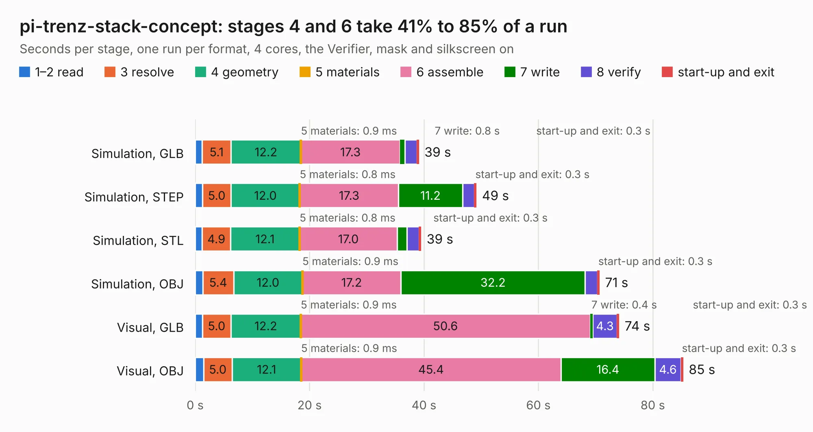

| Mode and format | 1–2 read | 3 resolve | 4 geometry | 5 materials | 6 assemble | 7 write | 8 verify | start-up and exit | Total |
|---|---:|---:|---:|---:|---:|---:|---:|---:|---:|
| Simulation, GLB | 1.2 | 5.1 | 12.2 | 0.9&nbsp;ms | 17.3 | 0.8 | 2.1 | 0.3 | 39.1 |
| Simulation, STEP | 1.3 | 5.0 | 12.0 | 0.8&nbsp;ms | 17.3 | 11.2 | 2.1 | 0.3 | 49.1 |
| Simulation, STL | 1.2 | 4.9 | 12.1 | 0.8&nbsp;ms | 17.0 | 1.7 | 2.1 | 0.3 | 39.5 |
| Simulation, OBJ | 1.3 | 5.4 | 12.0 | 0.9&nbsp;ms | 17.2 | 32.2 | 2.1 | 0.3 | 70.6 |
| Visual, GLB | 1.3 | 5.0 | 12.2 | 0.9&nbsp;ms | 50.6 | 0.4 | 4.3 | 0.3 | 74.1 |
| Visual, OBJ | 1.5 | 5.0 | 12.1 | 0.9&nbsp;ms | 45.4 | 16.4 | 4.6 | 0.3 | 85.3 |

<table align="center"><tr><td valign="top">

| Board | Repo: [naturalhazardscience/groundlark](https://github.com/naturalhazardscience/groundlark) Board: `pi-trenz-stack-concept.kicad_pcb` |
|---|---|
| Folder | hw / groundlark-fpga-hat / boards / groundlark-daqhat-01 |
| Complexity | 417&nbsp;/&nbsp;1000 (size&nbsp;297, features&nbsp;120) |
| KESE&nbsp;features | through vias, custom pads, rounded, trapezoid or chamfered pads, filled zones, copper drawings, stack-up, dielectric εr and tanδ, copper finish, mask and silkscreen colours |
| Tested | 9th November 2026 |
| Copper&nbsp;layers | 6 |
| File&nbsp;format | KiCad 9 (20241229) |
| Parts,&nbsp;tracks,&nbsp;vias | 190, 12,366, 745 |
| Triangles,&nbsp;simulation | 5,819,912 in 381 parts |
| Verifier | PASS in all six runs |

</td><td valign="top">

<table>
<tr><th>File type</th><th>File size</th><th>Peak memory used</th></tr>
<tr><th colspan="3" align="left">Simulation</th></tr>
<tr><td>GLB</td><td align="right">195&nbsp;MB</td><td align="right">1.6&nbsp;GB</td></tr>
<tr><td>STEP</td><td align="right">676&nbsp;MB</td><td align="right">1.9&nbsp;GB</td></tr>
<tr><td>STL</td><td align="right">291&nbsp;MB</td><td align="right">1.7&nbsp;GB</td></tr>
<tr><td>OBJ</td><td align="right">625&nbsp;MB</td><td align="right">3.7&nbsp;GB</td></tr>
<tr><th colspan="3" align="left">Visual</th></tr>
<tr><td>GLB</td><td align="right">106&nbsp;MB</td><td align="right">2.2&nbsp;GB</td></tr>
<tr><td>OBJ</td><td align="right">343&nbsp;MB</td><td align="right">2.3&nbsp;GB</td></tr>
</table>

</td></tr></table>

## 1755. stack-exploded

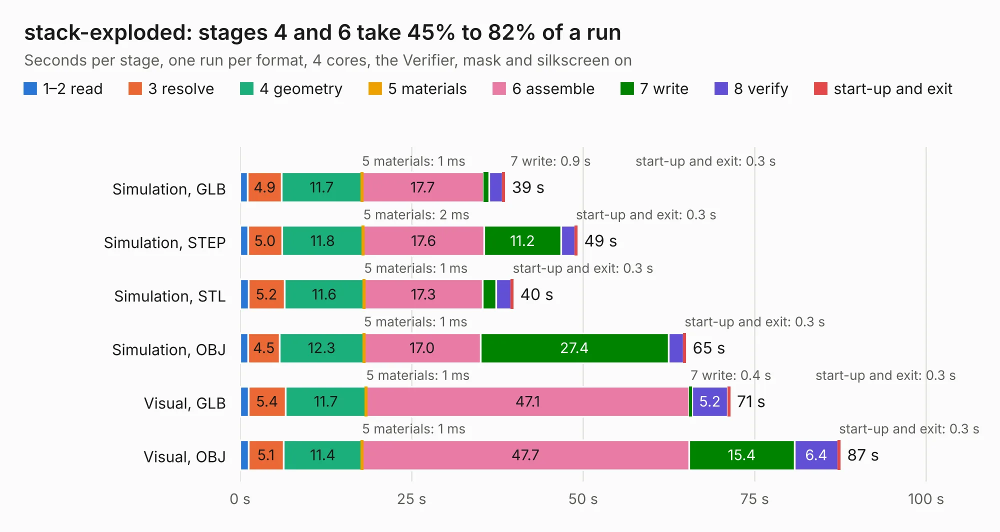

| Mode and format | 1–2 read | 3 resolve | 4 geometry | 5 materials | 6 assemble | 7 write | 8 verify | start-up and exit | Total |
|---|---:|---:|---:|---:|---:|---:|---:|---:|---:|
| Simulation, GLB | 1.1 | 4.9 | 11.7 | 1&nbsp;ms | 17.7 | 0.9 | 2.0 | 0.3 | 38.6 |
| Simulation, STEP | 1.1 | 5.0 | 11.8 | 2&nbsp;ms | 17.6 | 11.2 | 2.0 | 0.3 | 49.1 |
| Simulation, STL | 1.2 | 5.2 | 11.6 | 1&nbsp;ms | 17.3 | 2.0 | 2.1 | 0.3 | 39.8 |
| Simulation, OBJ | 1.2 | 4.5 | 12.3 | 1&nbsp;ms | 17.0 | 27.4 | 2.2 | 0.3 | 64.9 |
| Visual, GLB | 1.2 | 5.4 | 11.7 | 1&nbsp;ms | 47.1 | 0.4 | 5.2 | 0.3 | 71.4 |
| Visual, OBJ | 1.2 | 5.1 | 11.4 | 1&nbsp;ms | 47.7 | 15.4 | 6.4 | 0.3 | 87.4 |

<table align="center"><tr><td valign="top">

| Board | Repo: [naturalhazardscience/groundlark](https://github.com/naturalhazardscience/groundlark) Board: `stack-exploded.kicad_pcb` |
|---|---|
| Folder | hw / groundlark-fpga-hat / boards / groundlark-daqhat-01 |
| Complexity | 417&nbsp;/&nbsp;1000 (size&nbsp;297, features&nbsp;120) |
| KESE&nbsp;features | through vias, custom pads, rounded, trapezoid or chamfered pads, filled zones, copper drawings, stack-up, dielectric εr and tanδ, copper finish, mask and silkscreen colours |
| Tested | 9th November 2026 |
| Copper&nbsp;layers | 6 |
| File&nbsp;format | KiCad 9 (20241229) |
| Parts,&nbsp;tracks,&nbsp;vias | 190, 12,366, 745 |
| Triangles,&nbsp;simulation | 5,819,912 in 381 parts |
| Verifier | PASS in all six runs |

</td><td valign="top">

<table>
<tr><th>File type</th><th>File size</th><th>Peak memory used</th></tr>
<tr><th colspan="3" align="left">Simulation</th></tr>
<tr><td>GLB</td><td align="right">195&nbsp;MB</td><td align="right">1.6&nbsp;GB</td></tr>
<tr><td>STEP</td><td align="right">676&nbsp;MB</td><td align="right">2.0&nbsp;GB</td></tr>
<tr><td>STL</td><td align="right">291&nbsp;MB</td><td align="right">1.7&nbsp;GB</td></tr>
<tr><td>OBJ</td><td align="right">625&nbsp;MB</td><td align="right">3.6&nbsp;GB</td></tr>
<tr><th colspan="3" align="left">Visual</th></tr>
<tr><td>GLB</td><td align="right">106&nbsp;MB</td><td align="right">2.0&nbsp;GB</td></tr>
<tr><td>OBJ</td><td align="right">343&nbsp;MB</td><td align="right">2.2&nbsp;GB</td></tr>
</table>

</td></tr></table>

## 1756. stack-service-envelopes

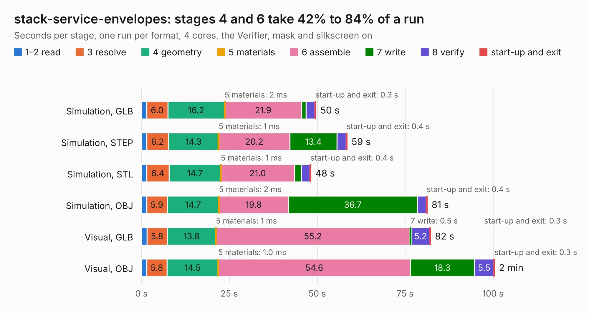

| Mode and format | 1–2 read | 3 resolve | 4 geometry | 5 materials | 6 assemble | 7 write | 8 verify | start-up and exit | Total |
|---|---:|---:|---:|---:|---:|---:|---:|---:|---:|
| Simulation, GLB | 1.5 | 6.0 | 16.2 | 2&nbsp;ms | 21.9 | 1.2 | 2.5 | 0.3 | 49.7 |
| Simulation, STEP | 1.5 | 6.2 | 14.3 | 1&nbsp;ms | 20.2 | 13.4 | 2.5 | 0.4 | 58.5 |
| Simulation, STL | 1.5 | 6.4 | 14.7 | 1&nbsp;ms | 21.0 | 1.9 | 2.4 | 0.4 | 48.3 |
| Simulation, OBJ | 1.5 | 5.9 | 14.7 | 2&nbsp;ms | 19.8 | 36.7 | 2.5 | 0.4 | 81.3 |
| Visual, GLB | 1.6 | 5.8 | 13.8 | 1&nbsp;ms | 55.2 | 0.5 | 5.2 | 0.3 | 82.3 |
| Visual, OBJ | 1.5 | 5.8 | 14.5 | 1.0&nbsp;ms | 54.6 | 18.3 | 5.5 | 0.3 | 100.5 |

<table align="center"><tr><td valign="top">

| Board | Repo: [naturalhazardscience/groundlark](https://github.com/naturalhazardscience/groundlark) Board: `stack-service-envelopes.kicad_pcb` |
|---|---|
| Folder | hw / groundlark-fpga-hat / boards / groundlark-daqhat-01 |
| Complexity | 417&nbsp;/&nbsp;1000 (size&nbsp;297, features&nbsp;120) |
| KESE&nbsp;features | through vias, custom pads, rounded, trapezoid or chamfered pads, filled zones, copper drawings, stack-up, dielectric εr and tanδ, copper finish, mask and silkscreen colours |
| Tested | 9th November 2026 |
| Copper&nbsp;layers | 6 |
| File&nbsp;format | KiCad 9 (20241229) |
| Parts,&nbsp;tracks,&nbsp;vias | 190, 12,366, 745 |
| Triangles,&nbsp;simulation | 5,819,912 in 381 parts |
| Verifier | PASS in all six runs |

</td><td valign="top">

<table>
<tr><th>File type</th><th>File size</th><th>Peak memory used</th></tr>
<tr><th colspan="3" align="left">Simulation</th></tr>
<tr><td>GLB</td><td align="right">195&nbsp;MB</td><td align="right">1.7&nbsp;GB</td></tr>
<tr><td>STEP</td><td align="right">676&nbsp;MB</td><td align="right">2.0&nbsp;GB</td></tr>
<tr><td>STL</td><td align="right">291&nbsp;MB</td><td align="right">1.6&nbsp;GB</td></tr>
<tr><td>OBJ</td><td align="right">625&nbsp;MB</td><td align="right">3.7&nbsp;GB</td></tr>
<tr><th colspan="3" align="left">Visual</th></tr>
<tr><td>GLB</td><td align="right">106&nbsp;MB</td><td align="right">2.0&nbsp;GB</td></tr>
<tr><td>OBJ</td><td align="right">343&nbsp;MB</td><td align="right">2.3&nbsp;GB</td></tr>
</table>

</td></tr></table>

## 1757. trenz-mounted

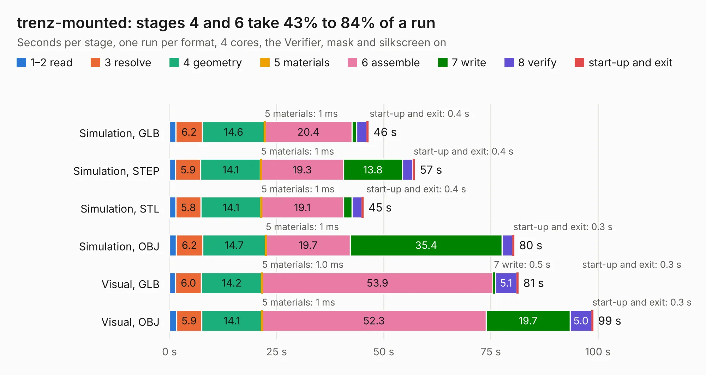

| Mode and format | 1–2 read | 3 resolve | 4 geometry | 5 materials | 6 assemble | 7 write | 8 verify | start-up and exit | Total |
|---|---:|---:|---:|---:|---:|---:|---:|---:|---:|
| Simulation, GLB | 1.5 | 6.2 | 14.6 | 1&nbsp;ms | 20.4 | 1.0 | 2.4 | 0.4 | 46.4 |
| Simulation, STEP | 1.4 | 5.9 | 14.1 | 1&nbsp;ms | 19.3 | 13.8 | 2.4 | 0.4 | 57.2 |
| Simulation, STL | 1.5 | 5.8 | 14.1 | 1&nbsp;ms | 19.1 | 2.0 | 2.3 | 0.4 | 45.3 |
| Simulation, OBJ | 1.6 | 6.2 | 14.7 | 1&nbsp;ms | 19.7 | 35.4 | 2.5 | 0.3 | 80.4 |
| Visual, GLB | 1.4 | 6.0 | 14.2 | 1.0&nbsp;ms | 53.9 | 0.5 | 5.1 | 0.3 | 81.4 |
| Visual, OBJ | 1.6 | 5.9 | 14.1 | 1&nbsp;ms | 52.3 | 19.7 | 5.0 | 0.3 | 98.9 |

<table align="center"><tr><td valign="top">

| Board | Repo: [naturalhazardscience/groundlark](https://github.com/naturalhazardscience/groundlark) Board: `trenz-mounted.kicad_pcb` |
|---|---|
| Folder | hw / groundlark-fpga-hat / boards / groundlark-daqhat-01 |
| Complexity | 417&nbsp;/&nbsp;1000 (size&nbsp;297, features&nbsp;120) |
| KESE&nbsp;features | through vias, custom pads, rounded, trapezoid or chamfered pads, filled zones, copper drawings, stack-up, dielectric εr and tanδ, copper finish, mask and silkscreen colours |
| Tested | 9th November 2026 |
| Copper&nbsp;layers | 6 |
| File&nbsp;format | KiCad 9 (20241229) |
| Parts,&nbsp;tracks,&nbsp;vias | 190, 12,366, 745 |
| Triangles,&nbsp;simulation | 5,819,912 in 381 parts |
| Verifier | PASS in all six runs |

</td><td valign="top">

<table>
<tr><th>File type</th><th>File size</th><th>Peak memory used</th></tr>
<tr><th colspan="3" align="left">Simulation</th></tr>
<tr><td>GLB</td><td align="right">195&nbsp;MB</td><td align="right">1.6&nbsp;GB</td></tr>
<tr><td>STEP</td><td align="right">676&nbsp;MB</td><td align="right">2.0&nbsp;GB</td></tr>
<tr><td>STL</td><td align="right">291&nbsp;MB</td><td align="right">1.6&nbsp;GB</td></tr>
<tr><td>OBJ</td><td align="right">625&nbsp;MB</td><td align="right">3.7&nbsp;GB</td></tr>
<tr><th colspan="3" align="left">Visual</th></tr>
<tr><td>GLB</td><td align="right">106&nbsp;MB</td><td align="right">1.8&nbsp;GB</td></tr>
<tr><td>OBJ</td><td align="right">343&nbsp;MB</td><td align="right">2.2&nbsp;GB</td></tr>
</table>

</td></tr></table>

## 1758. trenz_hat

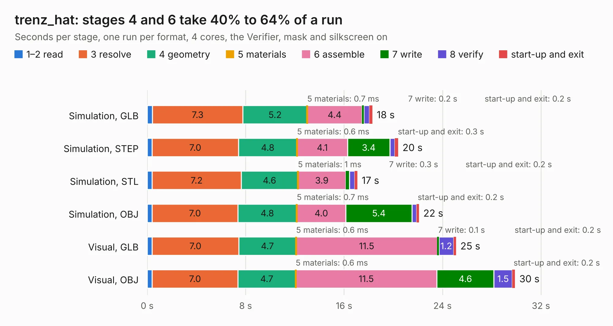

| Mode and format | 1–2 read | 3 resolve | 4 geometry | 5 materials | 6 assemble | 7 write | 8 verify | start-up and exit | Total |
|---|---:|---:|---:|---:|---:|---:|---:|---:|---:|
| Simulation, GLB | 0.4 | 7.3 | 5.2 | 0.7&nbsp;ms | 4.4 | 0.2 | 0.4 | 0.2 | 18.3 |
| Simulation, STEP | 0.4 | 7.0 | 4.8 | 0.6&nbsp;ms | 4.1 | 3.4 | 0.4 | 0.3 | 20.4 |
| Simulation, STL | 0.4 | 7.2 | 4.6 | 1&nbsp;ms | 3.9 | 0.3 | 0.4 | 0.2 | 17.1 |
| Simulation, OBJ | 0.4 | 7.0 | 4.8 | 0.7&nbsp;ms | 4.0 | 5.4 | 0.4 | 0.2 | 22.1 |
| Visual, GLB | 0.4 | 7.0 | 4.7 | 0.6&nbsp;ms | 11.5 | 0.1 | 1.2 | 0.2 | 25.1 |
| Visual, OBJ | 0.4 | 7.0 | 4.7 | 0.6&nbsp;ms | 11.5 | 4.6 | 1.5 | 0.2 | 29.9 |

<table align="center"><tr><td valign="top">

| Board | Repo: [naturalhazardscience/groundlark](https://github.com/naturalhazardscience/groundlark) Board: `trenz_hat.kicad_pcb` |
|---|---|
| Folder | hw / groundlark-fpga-hat / layout / trenz_hat |
| Complexity | 199&nbsp;/&nbsp;1000 (size&nbsp;114, features&nbsp;85) |
| KESE&nbsp;features | custom pads, rounded, trapezoid or chamfered pads, copper drawings, stack-up, dielectric εr and tanδ, copper finish, mask and silkscreen colours |
| Tested | 9th November 2026 |
| Copper&nbsp;layers | 2 |
| File&nbsp;format | KiCad 9 (20241229) |
| Parts,&nbsp;tracks,&nbsp;vias | 190, 0, 0 |
| Triangles,&nbsp;simulation | 1,028,724 in 290 parts |
| Note | mostly unrouted |
| Verifier | PASS in all six runs |

</td><td valign="top">

<table>
<tr><th>File type</th><th>File size</th><th>Peak memory used</th></tr>
<tr><th colspan="3" align="left">Simulation</th></tr>
<tr><td>GLB</td><td align="right">36&nbsp;MB</td><td align="right">496&nbsp;MB</td></tr>
<tr><td>STEP</td><td align="right">145&nbsp;MB</td><td align="right">605&nbsp;MB</td></tr>
<tr><td>STL</td><td align="right">51&nbsp;MB</td><td align="right">498&nbsp;MB</td></tr>
<tr><td>OBJ</td><td align="right">107&nbsp;MB</td><td align="right">719&nbsp;MB</td></tr>
<tr><th colspan="3" align="left">Visual</th></tr>
<tr><td>GLB</td><td align="right">30&nbsp;MB</td><td align="right">630&nbsp;MB</td></tr>
<tr><td>OBJ</td><td align="right">89&nbsp;MB</td><td align="right">781&nbsp;MB</td></tr>
</table>

</td></tr></table>

## 1759. raspberrypi_hat

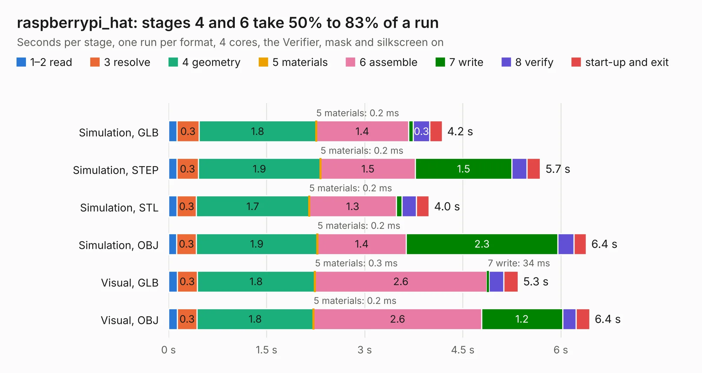

| Mode and format | 1–2 read | 3 resolve | 4 geometry | 5 materials | 6 assemble | 7 write | 8 verify | start-up and exit | Total |
|---|---:|---:|---:|---:|---:|---:|---:|---:|---:|
| Simulation, GLB | 0.1 | 0.3 | 1.8 | 0.2&nbsp;ms | 1.4 | 70&nbsp;ms | 0.3 | 0.2 | 4.2 |
| Simulation, STEP | 0.1 | 0.3 | 1.9 | 0.2&nbsp;ms | 1.5 | 1.5 | 0.2 | 0.2 | 5.7 |
| Simulation, STL | 0.1 | 0.3 | 1.7 | 0.2&nbsp;ms | 1.3 | 88&nbsp;ms | 0.2 | 0.2 | 4.0 |
| Simulation, OBJ | 0.1 | 0.3 | 1.9 | 0.2&nbsp;ms | 1.4 | 2.3 | 0.2 | 0.2 | 6.4 |
| Visual, GLB | 0.1 | 0.3 | 1.8 | 0.3&nbsp;ms | 2.6 | 34&nbsp;ms | 0.2 | 0.2 | 5.3 |
| Visual, OBJ | 0.1 | 0.3 | 1.8 | 0.2&nbsp;ms | 2.6 | 1.2 | 0.2 | 0.2 | 6.4 |

<table align="center"><tr><td valign="top">

| Board | Repo: [naturalhazardscience/groundlark](https://github.com/naturalhazardscience/groundlark) Board: `raspberrypi_hat.kicad_pcb` |
|---|---|
| Folder | hw / shared / reference |
| Complexity | 161&nbsp;/&nbsp;1000 (size&nbsp;131, features&nbsp;30) |
| KESE&nbsp;features | filled zones, curved board outline |
| Tested | 9th November 2026 |
| Copper&nbsp;layers | 4 |
| File&nbsp;format | KiCad 5 (20171130) |
| Parts,&nbsp;tracks,&nbsp;vias | 14, 63, 0 |
| Triangles,&nbsp;simulation | 438,762 in 24 parts |
| Verifier | PASS in all six runs |

</td><td valign="top">

<table>
<tr><th>File type</th><th>File size</th><th>Peak memory used</th></tr>
<tr><th colspan="3" align="left">Simulation</th></tr>
<tr><td>GLB</td><td align="right">15&nbsp;MB</td><td align="right">271&nbsp;MB</td></tr>
<tr><td>STEP</td><td align="right">62&nbsp;MB</td><td align="right">288&nbsp;MB</td></tr>
<tr><td>STL</td><td align="right">22&nbsp;MB</td><td align="right">266&nbsp;MB</td></tr>
<tr><td>OBJ</td><td align="right">44&nbsp;MB</td><td align="right">338&nbsp;MB</td></tr>
<tr><th colspan="3" align="left">Visual</th></tr>
<tr><td>GLB</td><td align="right">7.7&nbsp;MB</td><td align="right">258&nbsp;MB</td></tr>
<tr><td>OBJ</td><td align="right">22&nbsp;MB</td><td align="right">257&nbsp;MB</td></tr>
</table>

</td></tr></table>

## 1760. skylark-usb

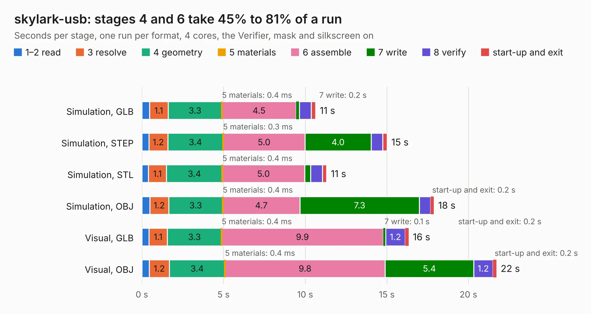

| Mode and format | 1–2 read | 3 resolve | 4 geometry | 5 materials | 6 assemble | 7 write | 8 verify | start-up and exit | Total |
|---|---:|---:|---:|---:|---:|---:|---:|---:|---:|
| Simulation, GLB | 0.5 | 1.1 | 3.3 | 0.4&nbsp;ms | 4.5 | 0.2 | 0.7 | 0.3 | 10.6 |
| Simulation, STEP | 0.4 | 1.2 | 3.4 | 0.3&nbsp;ms | 5.0 | 4.0 | 0.7 | 0.3 | 15.0 |
| Simulation, STL | 0.4 | 1.1 | 3.4 | 0.4&nbsp;ms | 5.0 | 0.4 | 0.7 | 0.3 | 11.3 |
| Simulation, OBJ | 0.5 | 1.2 | 3.3 | 0.4&nbsp;ms | 4.7 | 7.3 | 0.7 | 0.2 | 17.9 |
| Visual, GLB | 0.4 | 1.1 | 3.3 | 0.4&nbsp;ms | 9.9 | 0.1 | 1.2 | 0.2 | 16.3 |
| Visual, OBJ | 0.4 | 1.2 | 3.4 | 0.4&nbsp;ms | 9.8 | 5.4 | 1.2 | 0.2 | 21.7 |

<table align="center"><tr><td valign="top">

| Board | Repo: [naturalhazardscience/groundlark](https://github.com/naturalhazardscience/groundlark) Board: `skylark-usb.kicad_pcb` |
|---|---|
| Folder | hw / skylark-usb / boards / skylark-usb |
| Complexity | 350&nbsp;/&nbsp;1000 (size&nbsp;245, features&nbsp;105) |
| KESE&nbsp;features | through vias, slotted holes, rounded, trapezoid or chamfered pads, filled zones, stack-up, dielectric εr and tanδ, copper finish, mask and silkscreen colours |
| Tested | 9th November 2026 |
| Copper&nbsp;layers | 4 |
| File&nbsp;format | KiCad 9 (20241229) |
| Parts,&nbsp;tracks,&nbsp;vias | 121, 1,037, 159 |
| Triangles,&nbsp;simulation | 1,271,024 in 109 parts |
| Verifier | PASS in all six runs |

</td><td valign="top">

<table>
<tr><th>File type</th><th>File size</th><th>Peak memory used</th></tr>
<tr><th colspan="3" align="left">Simulation</th></tr>
<tr><td>GLB</td><td align="right">43&nbsp;MB</td><td align="right">524&nbsp;MB</td></tr>
<tr><td>STEP</td><td align="right">175&nbsp;MB</td><td align="right">671&nbsp;MB</td></tr>
<tr><td>STL</td><td align="right">64&nbsp;MB</td><td align="right">530&nbsp;MB</td></tr>
<tr><td>OBJ</td><td align="right">130&nbsp;MB</td><td align="right">861&nbsp;MB</td></tr>
<tr><th colspan="3" align="left">Visual</th></tr>
<tr><td>GLB</td><td align="right">30&nbsp;MB</td><td align="right">735&nbsp;MB</td></tr>
<tr><td>OBJ</td><td align="right">93&nbsp;MB</td><td align="right">725&nbsp;MB</td></tr>
</table>

</td></tr></table>

## 1761. skylark

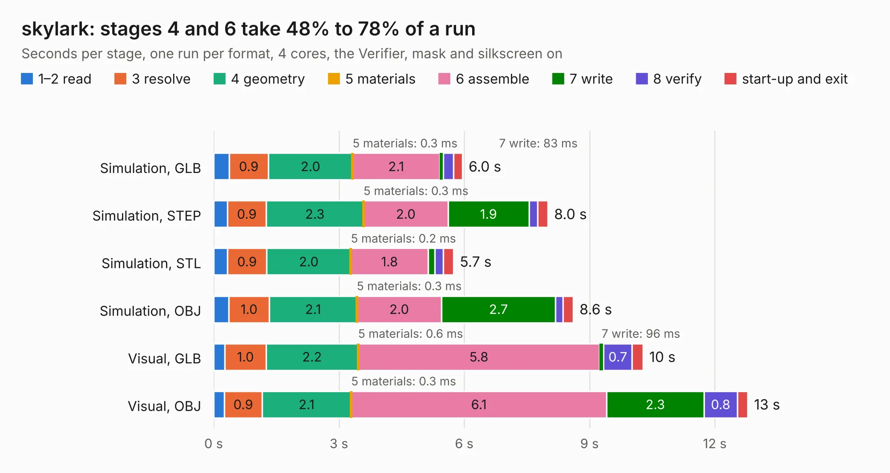

| Mode and format | 1–2 read | 3 resolve | 4 geometry | 5 materials | 6 assemble | 7 write | 8 verify | start-up and exit | Total |
|---|---:|---:|---:|---:|---:|---:|---:|---:|---:|
| Simulation, GLB | 0.4 | 0.9 | 2.0 | 0.3&nbsp;ms | 2.1 | 83&nbsp;ms | 0.2 | 0.2 | 6.0 |
| Simulation, STEP | 0.3 | 0.9 | 2.3 | 0.3&nbsp;ms | 2.0 | 1.9 | 0.2 | 0.2 | 8.0 |
| Simulation, STL | 0.3 | 0.9 | 2.0 | 0.2&nbsp;ms | 1.8 | 0.2 | 0.2 | 0.2 | 5.7 |
| Simulation, OBJ | 0.4 | 1.0 | 2.1 | 0.3&nbsp;ms | 2.0 | 2.7 | 0.2 | 0.2 | 8.6 |
| Visual, GLB | 0.3 | 1.0 | 2.2 | 0.6&nbsp;ms | 5.8 | 96&nbsp;ms | 0.7 | 0.3 | 10.3 |
| Visual, OBJ | 0.3 | 0.9 | 2.1 | 0.3&nbsp;ms | 6.1 | 2.3 | 0.8 | 0.2 | 12.8 |

<table align="center"><tr><td valign="top">

| Board | Repo: [naturalhazardscience/groundlark](https://github.com/naturalhazardscience/groundlark) Board: `skylark.kicad_pcb` |
|---|---|
| Folder | hw / skylark-usb / layout / skylark |
| Complexity | 179&nbsp;/&nbsp;1000 (size&nbsp;109, features&nbsp;70) |
| KESE&nbsp;features | slotted holes, rounded, trapezoid or chamfered pads, stack-up, dielectric εr and tanδ, copper finish, mask and silkscreen colours |
| Tested | 9th November 2026 |
| Copper&nbsp;layers | 2 |
| File&nbsp;format | KiCad 9 (20241229) |
| Parts,&nbsp;tracks,&nbsp;vias | 121, 0, 0 |
| Triangles,&nbsp;simulation | 507,884 in 104 parts |
| Note | mostly unrouted |
| Verifier | PASS in all six runs |

</td><td valign="top">

<table>
<tr><th>File type</th><th>File size</th><th>Peak memory used</th></tr>
<tr><th colspan="3" align="left">Simulation</th></tr>
<tr><td>GLB</td><td align="right">18&nbsp;MB</td><td align="right">344&nbsp;MB</td></tr>
<tr><td>STEP</td><td align="right">72&nbsp;MB</td><td align="right">413&nbsp;MB</td></tr>
<tr><td>STL</td><td align="right">25&nbsp;MB</td><td align="right">340&nbsp;MB</td></tr>
<tr><td>OBJ</td><td align="right">53&nbsp;MB</td><td align="right">410&nbsp;MB</td></tr>
<tr><th colspan="3" align="left">Visual</th></tr>
<tr><td>GLB</td><td align="right">16&nbsp;MB</td><td align="right">436&nbsp;MB</td></tr>
<tr><td>OBJ</td><td align="right">46&nbsp;MB</td><td align="right">469&nbsp;MB</td></tr>
</table>

</td></tr></table>

## 1762. C64C-250469-01-A

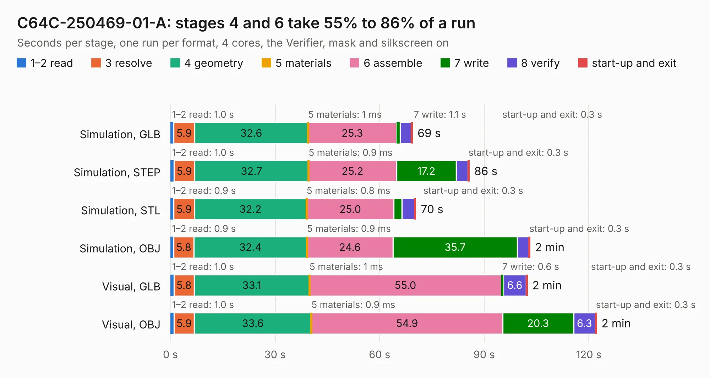

| Mode and format | 1–2 read | 3 resolve | 4 geometry | 5 materials | 6 assemble | 7 write | 8 verify | start-up and exit | Total |
|---|---:|---:|---:|---:|---:|---:|---:|---:|---:|
| Simulation, GLB | 1.0 | 5.9 | 32.6 | 1&nbsp;ms | 25.3 | 1.1 | 3.2 | 0.3 | 69.4 |
| Simulation, STEP | 1.0 | 5.9 | 32.7 | 0.9&nbsp;ms | 25.2 | 17.2 | 3.4 | 0.3 | 85.7 |
| Simulation, STL | 0.9 | 5.9 | 32.2 | 0.8&nbsp;ms | 25.0 | 2.3 | 3.6 | 0.3 | 70.4 |
| Simulation, OBJ | 0.9 | 5.8 | 32.4 | 0.9&nbsp;ms | 24.6 | 35.7 | 3.3 | 0.3 | 103.1 |
| Visual, GLB | 1.0 | 5.8 | 33.1 | 1&nbsp;ms | 55.0 | 0.6 | 6.6 | 0.3 | 102.4 |
| Visual, OBJ | 1.0 | 5.9 | 33.6 | 0.9&nbsp;ms | 54.9 | 20.3 | 6.3 | 0.3 | 122.2 |

<table align="center"><tr><td valign="top">

| Board | Repo: [NeedfulThings/Commodore64C](https://github.com/NeedfulThings/Commodore64C) Board: `C64C-250469-01-A.kicad_pcb` |
|---|---|
| Folder | 250469-RevA |
| Complexity | 257&nbsp;/&nbsp;1000 (size&nbsp;202, features&nbsp;55) |
| KESE&nbsp;features | through vias, slotted holes, rounded, trapezoid or chamfered pads, filled zones |
| Tested | 9th November 2026 |
| Copper&nbsp;layers | 2 |
| File&nbsp;format | KiCad 5 (20171130) |
| Parts,&nbsp;tracks,&nbsp;vias | 131, 2,533, 241 |
| Triangles,&nbsp;simulation | 6,379,874 in 215 parts |
| Verifier | PASS in all six runs |

</td><td valign="top">

<table>
<tr><th>File type</th><th>File size</th><th>Peak memory used</th></tr>
<tr><th colspan="3" align="left">Simulation</th></tr>
<tr><td>GLB</td><td align="right">218&nbsp;MB</td><td align="right">2.0&nbsp;GB</td></tr>
<tr><td>STEP</td><td align="right">1.1&nbsp;GB</td><td align="right">2.3&nbsp;GB</td></tr>
<tr><td>STL</td><td align="right">319&nbsp;MB</td><td align="right">2.0&nbsp;GB</td></tr>
<tr><td>OBJ</td><td align="right">683&nbsp;MB</td><td align="right">4.1&nbsp;GB</td></tr>
<tr><th colspan="3" align="left">Visual</th></tr>
<tr><td>GLB</td><td align="right">131&nbsp;MB</td><td align="right">2.3&nbsp;GB</td></tr>
<tr><td>OBJ</td><td align="right">415&nbsp;MB</td><td align="right">2.8&nbsp;GB</td></tr>
</table>

</td></tr></table>

## 1763. ethersweep

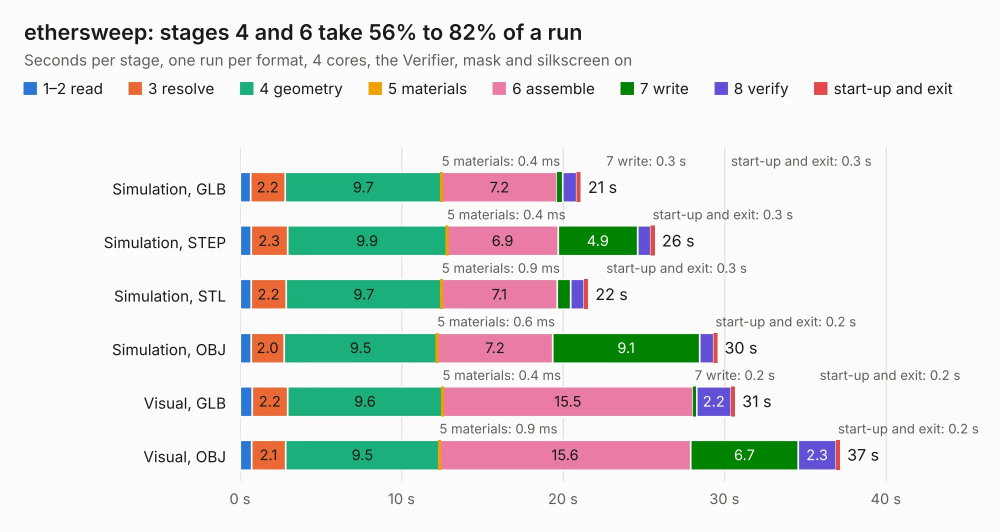

| Mode and format | 1–2 read | 3 resolve | 4 geometry | 5 materials | 6 assemble | 7 write | 8 verify | start-up and exit | Total |
|---|---:|---:|---:|---:|---:|---:|---:|---:|---:|
| Simulation, GLB | 0.6 | 2.2 | 9.7 | 0.4&nbsp;ms | 7.2 | 0.3 | 0.9 | 0.3 | 21.1 |
| Simulation, STEP | 0.7 | 2.3 | 9.9 | 0.4&nbsp;ms | 6.9 | 4.9 | 0.8 | 0.3 | 25.7 |
| Simulation, STL | 0.7 | 2.2 | 9.7 | 0.9&nbsp;ms | 7.1 | 0.8 | 0.8 | 0.3 | 21.6 |
| Simulation, OBJ | 0.7 | 2.0 | 9.5 | 0.6&nbsp;ms | 7.2 | 9.1 | 0.9 | 0.2 | 29.6 |
| Visual, GLB | 0.7 | 2.2 | 9.6 | 0.4&nbsp;ms | 15.5 | 0.2 | 2.2 | 0.2 | 30.7 |
| Visual, OBJ | 0.7 | 2.1 | 9.5 | 0.9&nbsp;ms | 15.6 | 6.7 | 2.3 | 0.2 | 37.2 |

<table align="center"><tr><td valign="top">

| Board | Repo: [Neumi/ethersweep](https://github.com/Neumi/ethersweep) Board: `ethersweep.kicad_pcb` |
|---|---|
| Folder | electronic_design / development / ethersweep402 |
| Complexity | 365&nbsp;/&nbsp;1000 (size&nbsp;240, features&nbsp;125) |
| KESE&nbsp;features | through vias, slotted holes, rounded, trapezoid or chamfered pads, filled zones, curved board outline, knockout text, TrueType text, stack-up, dielectric εr and tanδ |
| Tested | 9th November 2026 |
| Copper&nbsp;layers | 2 |
| File&nbsp;format | KiCad 7 (20221018) |
| Parts,&nbsp;tracks,&nbsp;vias | 105, 1,249, 325 |
| Triangles,&nbsp;simulation | 1,969,696 in 117 parts |
| Verifier | PASS in all six runs |

</td><td valign="top">

<table>
<tr><th>File type</th><th>File size</th><th>Peak memory used</th></tr>
<tr><th colspan="3" align="left">Simulation</th></tr>
<tr><td>GLB</td><td align="right">69&nbsp;MB</td><td align="right">769&nbsp;MB</td></tr>
<tr><td>STEP</td><td align="right">359&nbsp;MB</td><td align="right">856&nbsp;MB</td></tr>
<tr><td>STL</td><td align="right">98&nbsp;MB</td><td align="right">738&nbsp;MB</td></tr>
<tr><td>OBJ</td><td align="right">208&nbsp;MB</td><td align="right">1.3&nbsp;GB</td></tr>
<tr><th colspan="3" align="left">Visual</th></tr>
<tr><td>GLB</td><td align="right">49&nbsp;MB</td><td align="right">861&nbsp;MB</td></tr>
<tr><td>OBJ</td><td align="right">149&nbsp;MB</td><td align="right">1.1&nbsp;GB</td></tr>
</table>

</td></tr></table>

## 1764. ethersweep

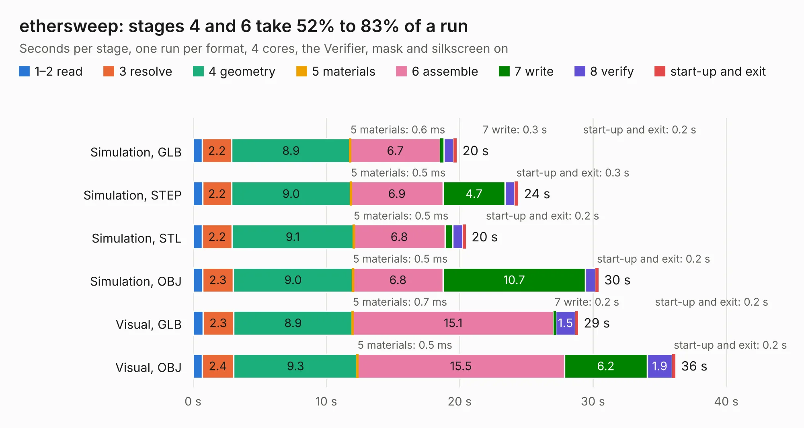

| Mode and format | 1–2 read | 3 resolve | 4 geometry | 5 materials | 6 assemble | 7 write | 8 verify | start-up and exit | Total |
|---|---:|---:|---:|---:|---:|---:|---:|---:|---:|
| Simulation, GLB | 0.7 | 2.2 | 8.9 | 0.6&nbsp;ms | 6.7 | 0.3 | 0.7 | 0.2 | 19.8 |
| Simulation, STEP | 0.7 | 2.2 | 9.0 | 0.5&nbsp;ms | 6.9 | 4.7 | 0.7 | 0.3 | 24.4 |
| Simulation, STL | 0.7 | 2.2 | 9.1 | 0.5&nbsp;ms | 6.8 | 0.6 | 0.8 | 0.2 | 20.5 |
| Simulation, OBJ | 0.7 | 2.3 | 9.0 | 0.5&nbsp;ms | 6.8 | 10.7 | 0.8 | 0.2 | 30.4 |
| Visual, GLB | 0.7 | 2.3 | 8.9 | 0.7&nbsp;ms | 15.1 | 0.2 | 1.5 | 0.2 | 28.9 |
| Visual, OBJ | 0.7 | 2.4 | 9.3 | 0.5&nbsp;ms | 15.5 | 6.2 | 1.9 | 0.2 | 36.2 |

<table align="center"><tr><td valign="top">

| Board | Repo: [Neumi/ethersweep](https://github.com/Neumi/ethersweep) Board: `ethersweep.kicad_pcb` |
|---|---|
| Folder | electronic_design / development / ethersweep406 |
| Complexity | 381&nbsp;/&nbsp;1000 (size&nbsp;256, features&nbsp;125) |
| KESE&nbsp;features | through vias, slotted holes, rounded, trapezoid or chamfered pads, filled zones, curved board outline, knockout text, TrueType text, stack-up, dielectric εr and tanδ |
| Tested | 9th November 2026 |
| Copper&nbsp;layers | 4 |
| File&nbsp;format | KiCad 7 (20221018) |
| Parts,&nbsp;tracks,&nbsp;vias | 105, 1,174, 149 |
| Triangles,&nbsp;simulation | 2,029,642 in 138 parts |
| Verifier | PASS in all six runs |

</td><td valign="top">

<table>
<tr><th>File type</th><th>File size</th><th>Peak memory used</th></tr>
<tr><th colspan="3" align="left">Simulation</th></tr>
<tr><td>GLB</td><td align="right">70&nbsp;MB</td><td align="right">655&nbsp;MB</td></tr>
<tr><td>STEP</td><td align="right">302&nbsp;MB</td><td align="right">787&nbsp;MB</td></tr>
<tr><td>STL</td><td align="right">101&nbsp;MB</td><td align="right">712&nbsp;MB</td></tr>
<tr><td>OBJ</td><td align="right">214&nbsp;MB</td><td align="right">1.4&nbsp;GB</td></tr>
<tr><th colspan="3" align="left">Visual</th></tr>
<tr><td>GLB</td><td align="right">40&nbsp;MB</td><td align="right">847&nbsp;MB</td></tr>
<tr><td>OBJ</td><td align="right">122&nbsp;MB</td><td align="right">940&nbsp;MB</td></tr>
</table>

</td></tr></table>

## 1765. ethersweep

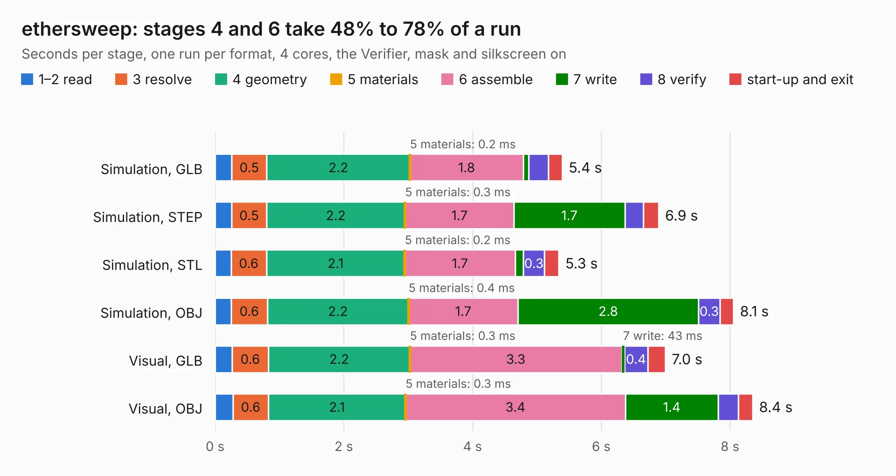

| Mode and format | 1–2 read | 3 resolve | 4 geometry | 5 materials | 6 assemble | 7 write | 8 verify | start-up and exit | Total |
|---|---:|---:|---:|---:|---:|---:|---:|---:|---:|
| Simulation, GLB | 0.3 | 0.5 | 2.2 | 0.2&nbsp;ms | 1.8 | 85&nbsp;ms | 0.3 | 0.2 | 5.4 |
| Simulation, STEP | 0.3 | 0.5 | 2.2 | 0.3&nbsp;ms | 1.7 | 1.7 | 0.3 | 0.2 | 6.9 |
| Simulation, STL | 0.2 | 0.6 | 2.1 | 0.2&nbsp;ms | 1.7 | 0.1 | 0.3 | 0.2 | 5.3 |
| Simulation, OBJ | 0.3 | 0.6 | 2.2 | 0.4&nbsp;ms | 1.7 | 2.8 | 0.3 | 0.2 | 8.1 |
| Visual, GLB | 0.3 | 0.6 | 2.2 | 0.3&nbsp;ms | 3.3 | 43&nbsp;ms | 0.4 | 0.3 | 7.0 |
| Visual, OBJ | 0.3 | 0.6 | 2.1 | 0.3&nbsp;ms | 3.4 | 1.4 | 0.3 | 0.2 | 8.4 |

<table align="center"><tr><td valign="top">

| Board | Repo: [Neumi/ethersweep](https://github.com/Neumi/ethersweep) Board: `ethersweep.kicad_pcb` |
|---|---|
| Folder | electronic_design / development / ethersweep407_CAN |
| Complexity | 295&nbsp;/&nbsp;1000 (size&nbsp;155, features&nbsp;140) |
| KESE&nbsp;features | through vias, custom pads, rounded, trapezoid or chamfered pads, filled zones, copper drawings, curved board outline, knockout text, TrueType text, stack-up, dielectric εr and tanδ |
| Tested | 9th November 2026 |
| Copper&nbsp;layers | 4 |
| File&nbsp;format | KiCad 7 (20221018) |
| Parts,&nbsp;tracks,&nbsp;vias | 24, 154, 13 |
| Triangles,&nbsp;simulation | 503,738 in 44 parts |
| Verifier | PASS in all six runs |

</td><td valign="top">

<table>
<tr><th>File type</th><th>File size</th><th>Peak memory used</th></tr>
<tr><th colspan="3" align="left">Simulation</th></tr>
<tr><td>GLB</td><td align="right">17&nbsp;MB</td><td align="right">274&nbsp;MB</td></tr>
<tr><td>STEP</td><td align="right">67&nbsp;MB</td><td align="right">308&nbsp;MB</td></tr>
<tr><td>STL</td><td align="right">25&nbsp;MB</td><td align="right">278&nbsp;MB</td></tr>
<tr><td>OBJ</td><td align="right">51&nbsp;MB</td><td align="right">383&nbsp;MB</td></tr>
<tr><th colspan="3" align="left">Visual</th></tr>
<tr><td>GLB</td><td align="right">8.8&nbsp;MB</td><td align="right">276&nbsp;MB</td></tr>
<tr><td>OBJ</td><td align="right">26&nbsp;MB</td><td align="right">275&nbsp;MB</td></tr>
</table>

</td></tr></table>

## 1766. ethersweep

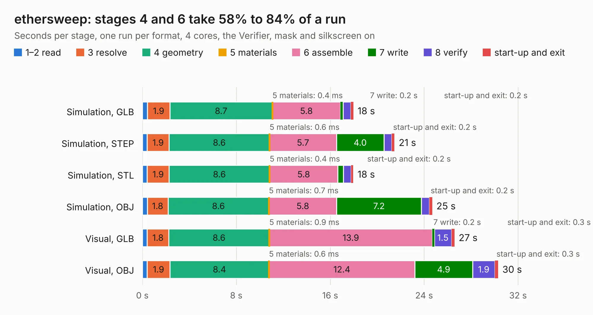

| Mode and format | 1–2 read | 3 resolve | 4 geometry | 5 materials | 6 assemble | 7 write | 8 verify | start-up and exit | Total |
|---|---:|---:|---:|---:|---:|---:|---:|---:|---:|
| Simulation, GLB | 0.4 | 1.9 | 8.7 | 0.4&nbsp;ms | 5.8 | 0.2 | 0.7 | 0.2 | 18.0 |
| Simulation, STEP | 0.4 | 1.9 | 8.6 | 0.6&nbsp;ms | 5.7 | 4.0 | 0.7 | 0.2 | 21.5 |
| Simulation, STL | 0.4 | 1.9 | 8.6 | 0.4&nbsp;ms | 5.8 | 0.5 | 0.6 | 0.2 | 18.0 |
| Simulation, OBJ | 0.4 | 1.8 | 8.6 | 0.7&nbsp;ms | 5.8 | 7.2 | 0.7 | 0.2 | 24.7 |
| Visual, GLB | 0.4 | 1.8 | 8.6 | 0.9&nbsp;ms | 13.9 | 0.2 | 1.5 | 0.3 | 26.6 |
| Visual, OBJ | 0.4 | 1.9 | 8.4 | 0.6&nbsp;ms | 12.4 | 4.9 | 1.9 | 0.3 | 30.3 |

<table align="center"><tr><td valign="top">

| Board | Repo: [Neumi/ethersweep](https://github.com/Neumi/ethersweep) Board: `ethersweep.kicad_pcb` |
|---|---|
| Folder | electronic_design / development / ethersweep_tmc2209 |
| Complexity | 334&nbsp;/&nbsp;1000 (size&nbsp;239, features&nbsp;95) |
| KESE&nbsp;features | through vias, slotted holes, rounded, trapezoid or chamfered pads, filled zones, curved board outline, stack-up, dielectric εr and tanδ |
| Tested | 9th November 2026 |
| Copper&nbsp;layers | 2 |
| File&nbsp;format | KiCad 6 (20211014) |
| Parts,&nbsp;tracks,&nbsp;vias | 105, 1,094, 319 |
| Triangles,&nbsp;simulation | 1,767,076 in 122 parts |
| Verifier | PASS in all six runs |

</td><td valign="top">

<table>
<tr><th>File type</th><th>File size</th><th>Peak memory used</th></tr>
<tr><th colspan="3" align="left">Simulation</th></tr>
<tr><td>GLB</td><td align="right">61&nbsp;MB</td><td align="right">705&nbsp;MB</td></tr>
<tr><td>STEP</td><td align="right">326&nbsp;MB</td><td align="right">809&nbsp;MB</td></tr>
<tr><td>STL</td><td align="right">88&nbsp;MB</td><td align="right">712&nbsp;MB</td></tr>
<tr><td>OBJ</td><td align="right">186&nbsp;MB</td><td align="right">1.2&nbsp;GB</td></tr>
<tr><th colspan="3" align="left">Visual</th></tr>
<tr><td>GLB</td><td align="right">42&nbsp;MB</td><td align="right">884&nbsp;MB</td></tr>
<tr><td>OBJ</td><td align="right">127&nbsp;MB</td><td align="right">947&nbsp;MB</td></tr>
</table>

</td></tr></table>

## 1767. ethersweep

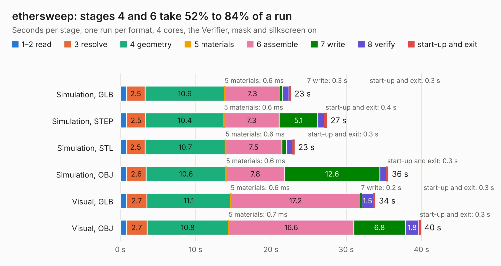

| Mode and format | 1–2 read | 3 resolve | 4 geometry | 5 materials | 6 assemble | 7 write | 8 verify | start-up and exit | Total |
|---|---:|---:|---:|---:|---:|---:|---:|---:|---:|
| Simulation, GLB | 0.8 | 2.5 | 10.6 | 0.6&nbsp;ms | 7.3 | 0.3 | 0.9 | 0.3 | 22.7 |
| Simulation, STEP | 0.8 | 2.5 | 10.4 | 0.6&nbsp;ms | 7.3 | 5.1 | 0.9 | 0.4 | 27.4 |
| Simulation, STL | 0.8 | 2.5 | 10.7 | 0.6&nbsp;ms | 7.5 | 0.6 | 0.8 | 0.3 | 23.2 |
| Simulation, OBJ | 0.8 | 2.6 | 10.6 | 0.6&nbsp;ms | 7.8 | 12.6 | 0.9 | 0.3 | 35.6 |
| Visual, GLB | 0.8 | 2.7 | 11.1 | 0.6&nbsp;ms | 17.2 | 0.2 | 1.5 | 0.3 | 33.9 |
| Visual, OBJ | 0.8 | 2.7 | 10.8 | 0.7&nbsp;ms | 16.6 | 6.8 | 1.8 | 0.3 | 39.9 |

<table align="center"><tr><td valign="top">

| Board | Repo: [Neumi/ethersweep](https://github.com/Neumi/ethersweep) Board: `ethersweep.kicad_pcb` |
|---|---|
| Folder | electronic_design / production / ethersweep405 |
| Complexity | 370&nbsp;/&nbsp;1000 (size&nbsp;255, features&nbsp;115) |
| KESE&nbsp;features | through vias, rounded, trapezoid or chamfered pads, filled zones, curved board outline, knockout text, TrueType text, stack-up, dielectric εr and tanδ |
| Tested | 9th November 2026 |
| Copper&nbsp;layers | 4 |
| File&nbsp;format | KiCad 7 (20221018) |
| Parts,&nbsp;tracks,&nbsp;vias | 104, 1,173, 151 |
| Triangles,&nbsp;simulation | 2,021,426 in 138 parts |
| Verifier | PASS in all six runs |

</td><td valign="top">

<table>
<tr><th>File type</th><th>File size</th><th>Peak memory used</th></tr>
<tr><th colspan="3" align="left">Simulation</th></tr>
<tr><td>GLB</td><td align="right">70&nbsp;MB</td><td align="right">681&nbsp;MB</td></tr>
<tr><td>STEP</td><td align="right">300&nbsp;MB</td><td align="right">775&nbsp;MB</td></tr>
<tr><td>STL</td><td align="right">101&nbsp;MB</td><td align="right">692&nbsp;MB</td></tr>
<tr><td>OBJ</td><td align="right">213&nbsp;MB</td><td align="right">1.4&nbsp;GB</td></tr>
<tr><th colspan="3" align="left">Visual</th></tr>
<tr><td>GLB</td><td align="right">40&nbsp;MB</td><td align="right">864&nbsp;MB</td></tr>
<tr><td>OBJ</td><td align="right">122&nbsp;MB</td><td align="right">946&nbsp;MB</td></tr>
</table>

</td></tr></table>

## 1768. FreeEEG32

| Mode and format | 1–2 read | 3 resolve | 4 geometry | 5 materials | 6 assemble | 7 write | 8 verify | start-up and exit | Total |
|---|---:|---:|---:|---:|---:|---:|---:|---:|---:|
| Simulation, GLB | 0.7 | 3.2 | 13.3 | 1&nbsp;ms | 12.3 | 0.5 | 1.6 | 0.3 | 31.9 |
| Simulation, STEP | 0.8 | 3.2 | 13.2 | 1&nbsp;ms | 12.5 | 6.8 | 1.6 | 0.3 | 38.4 |
| Simulation, STL | 0.8 | 3.1 | 13.0 | 1&nbsp;ms | 12.4 | 0.9 | 1.5 | 0.3 | 32.0 |
| Simulation, OBJ | 0.8 | 3.1 | 13.0 | 1&nbsp;ms | 12.9 | 17.3 | 1.6 | 0.3 | 49.0 |
| Visual, GLB | 0.8 | 3.2 | 13.4 | 1&nbsp;ms | 27.0 | 0.3 | 2.3 | 0.3 | 47.3 |
| Visual, OBJ | 0.7 | 3.3 | 13.1 | 1&nbsp;ms | 26.8 | 10.3 | 2.7 | 0.2 | 57.3 |

<table align="center"><tr><td valign="top">

| Board | Repo: [neuroidss/freeeeg32](https://github.com/neuroidss/freeeeg32) Board: `FreeEEG32.kicad_pcb` |
|---|---|
| Folder | KiCad |
| Complexity | 332&nbsp;/&nbsp;1000 (size&nbsp;287, features&nbsp;45) |
| KESE&nbsp;features | through vias, slotted holes, filled zones |
| Tested | 9th November 2026 |
| Copper&nbsp;layers | 4 |
| File&nbsp;format | KiCad 4 (4) |
| Parts,&nbsp;tracks,&nbsp;vias | 213, 4,412, 279 |
| Triangles,&nbsp;simulation | 2,598,444 in 378 parts |
| Verifier | PASS in all six runs |

</td><td valign="top">

<table>
<tr><th>File type</th><th>File size</th><th>Peak memory used</th></tr>
<tr><th colspan="3" align="left">Simulation</th></tr>
<tr><td>GLB</td><td align="right">93&nbsp;MB</td><td align="right">753&nbsp;MB</td></tr>
<tr><td>STEP</td><td align="right">404&nbsp;MB</td><td align="right">988&nbsp;MB</td></tr>
<tr><td>STL</td><td align="right">130&nbsp;MB</td><td align="right">768&nbsp;MB</td></tr>
<tr><td>OBJ</td><td align="right">284&nbsp;MB</td><td align="right">1.8&nbsp;GB</td></tr>
<tr><th colspan="3" align="left">Visual</th></tr>
<tr><td>GLB</td><td align="right">59&nbsp;MB</td><td align="right">1.1&nbsp;GB</td></tr>
<tr><td>OBJ</td><td align="right">183&nbsp;MB</td><td align="right">1.3&nbsp;GB</td></tr>
</table>

</td></tr></table>

## 1769. tmp

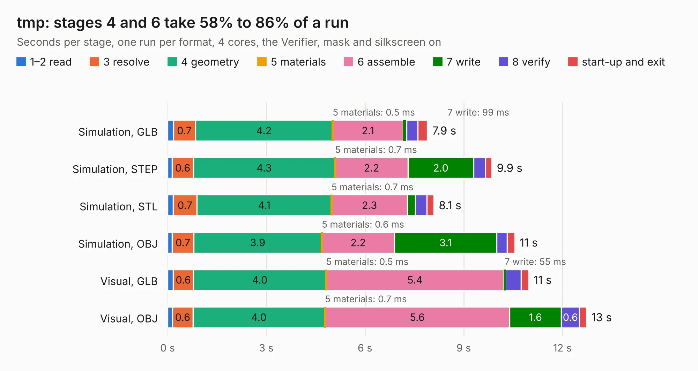

| Mode and format | 1–2 read | 3 resolve | 4 geometry | 5 materials | 6 assemble | 7 write | 8 verify | start-up and exit | Total |
|---|---:|---:|---:|---:|---:|---:|---:|---:|---:|
| Simulation, GLB | 0.2 | 0.7 | 4.2 | 0.5&nbsp;ms | 2.1 | 99&nbsp;ms | 0.3 | 0.3 | 7.9 |
| Simulation, STEP | 0.1 | 0.6 | 4.3 | 0.7&nbsp;ms | 2.2 | 2.0 | 0.4 | 0.2 | 9.9 |
| Simulation, STL | 0.2 | 0.7 | 4.1 | 0.7&nbsp;ms | 2.3 | 0.2 | 0.3 | 0.2 | 8.1 |
| Simulation, OBJ | 0.1 | 0.7 | 3.9 | 0.6&nbsp;ms | 2.2 | 3.1 | 0.3 | 0.2 | 10.5 |
| Visual, GLB | 0.2 | 0.6 | 4.0 | 0.5&nbsp;ms | 5.4 | 55&nbsp;ms | 0.5 | 0.2 | 11.0 |
| Visual, OBJ | 0.2 | 0.6 | 4.0 | 0.7&nbsp;ms | 5.6 | 1.6 | 0.6 | 0.2 | 12.7 |

<table align="center"><tr><td valign="top">

| Board | Repo: [neuroidss/freeeeg32](https://github.com/neuroidss/freeeeg32) Board: `tmp.kicad_pcb` |
|---|---|
| Folder | KiCad |
| Complexity | 209&nbsp;/&nbsp;1000 (size&nbsp;209, features&nbsp;0) |
| Tested | 9th November 2026 |
| Copper&nbsp;layers | 2 |
| File&nbsp;format | KiCad 4 (4) |
| Parts,&nbsp;tracks,&nbsp;vias | 57, 360, 0 |
| Triangles,&nbsp;simulation | 756,624 in 90 parts |
| Verifier | PASS in all six runs |

</td><td valign="top">

<table>
<tr><th>File type</th><th>File size</th><th>Peak memory used</th></tr>
<tr><th colspan="3" align="left">Simulation</th></tr>
<tr><td>GLB</td><td align="right">27&nbsp;MB</td><td align="right">376&nbsp;MB</td></tr>
<tr><td>STEP</td><td align="right">121&nbsp;MB</td><td align="right">442&nbsp;MB</td></tr>
<tr><td>STL</td><td align="right">38&nbsp;MB</td><td align="right">382&nbsp;MB</td></tr>
<tr><td>OBJ</td><td align="right">78&nbsp;MB</td><td align="right">551&nbsp;MB</td></tr>
<tr><th colspan="3" align="left">Visual</th></tr>
<tr><td>GLB</td><td align="right">14&nbsp;MB</td><td align="right">414&nbsp;MB</td></tr>
<tr><td>OBJ</td><td align="right">42&nbsp;MB</td><td align="right">418&nbsp;MB</td></tr>
</table>

</td></tr></table>

## 1770. nu8051-ufo-target-board

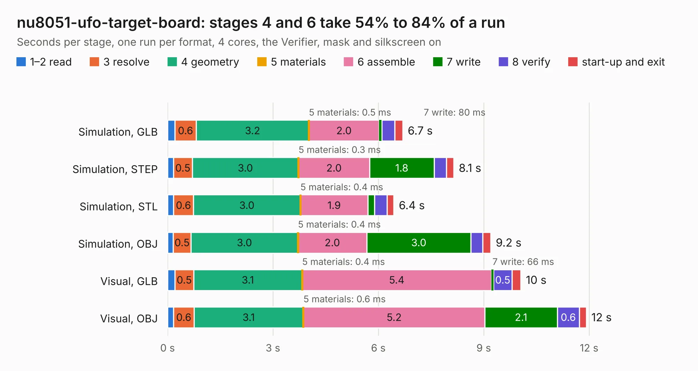

| Mode and format | 1–2 read | 3 resolve | 4 geometry | 5 materials | 6 assemble | 7 write | 8 verify | start-up and exit | Total |
|---|---:|---:|---:|---:|---:|---:|---:|---:|---:|
| Simulation, GLB | 0.2 | 0.6 | 3.2 | 0.5&nbsp;ms | 2.0 | 80&nbsp;ms | 0.4 | 0.2 | 6.7 |
| Simulation, STEP | 0.2 | 0.5 | 3.0 | 0.3&nbsp;ms | 2.0 | 1.8 | 0.4 | 0.2 | 8.1 |
| Simulation, STL | 0.2 | 0.6 | 3.0 | 0.4&nbsp;ms | 1.9 | 0.2 | 0.4 | 0.2 | 6.4 |
| Simulation, OBJ | 0.2 | 0.5 | 3.0 | 0.4&nbsp;ms | 2.0 | 3.0 | 0.3 | 0.2 | 9.2 |
| Visual, GLB | 0.2 | 0.5 | 3.1 | 0.4&nbsp;ms | 5.4 | 66&nbsp;ms | 0.5 | 0.3 | 10.1 |
| Visual, OBJ | 0.2 | 0.6 | 3.1 | 0.6&nbsp;ms | 5.2 | 2.1 | 0.6 | 0.2 | 11.9 |

<table align="center"><tr><td valign="top">

| Board | Repo: [newaetech/chipwhisperer-target-cw308t](https://github.com/newaetech/chipwhisperer-target-cw308t) Board: `nu8051-ufo-target-board.kicad_pcb` |
|---|---|
| Folder | CW308T_NU8051_AT20 / kicad_src |
| Complexity | 241&nbsp;/&nbsp;1000 (size&nbsp;141, features&nbsp;100) |
| KESE&nbsp;features | through vias, custom pads, rounded, trapezoid or chamfered pads, filled zones, copper drawings, stack-up, dielectric εr and tanδ |
| Tested | 9th November 2026 |
| Copper&nbsp;layers | 2 |
| File&nbsp;format | KiCad 7 (20221018) |
| Parts,&nbsp;tracks,&nbsp;vias | 9, 181, 86 |
| Triangles,&nbsp;simulation | 612,998 in 55 parts |
| Verifier | PASS in all six runs |

</td><td valign="top">

<table>
<tr><th>File type</th><th>File size</th><th>Peak memory used</th></tr>
<tr><th colspan="3" align="left">Simulation</th></tr>
<tr><td>GLB</td><td align="right">21&nbsp;MB</td><td align="right">340&nbsp;MB</td></tr>
<tr><td>STEP</td><td align="right">96&nbsp;MB</td><td align="right">391&nbsp;MB</td></tr>
<tr><td>STL</td><td align="right">31&nbsp;MB</td><td align="right">338&nbsp;MB</td></tr>
<tr><td>OBJ</td><td align="right">62&nbsp;MB</td><td align="right">444&nbsp;MB</td></tr>
<tr><th colspan="3" align="left">Visual</th></tr>
<tr><td>GLB</td><td align="right">15&nbsp;MB</td><td align="right">398&nbsp;MB</td></tr>
<tr><td>OBJ</td><td align="right">44&nbsp;MB</td><td align="right">392&nbsp;MB</td></tr>
</table>

</td></tr></table>

## 1771. SONATA-ONE

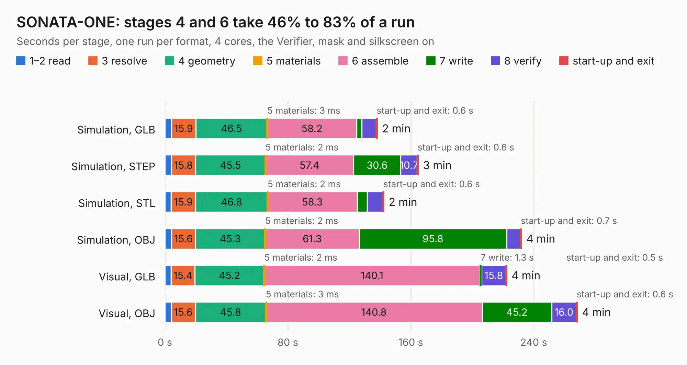

| Mode and format | 1–2 read | 3 resolve | 4 geometry | 5 materials | 6 assemble | 7 write | 8 verify | start-up and exit | Total |
|---|---:|---:|---:|---:|---:|---:|---:|---:|---:|
| Simulation, GLB | 4.2 | 15.9 | 46.5 | 3&nbsp;ms | 58.2 | 3.3 | 9.4 | 0.6 | 138.2 |
| Simulation, STEP | 4.2 | 15.8 | 45.5 | 2&nbsp;ms | 57.4 | 30.6 | 10.7 | 0.6 | 164.8 |
| Simulation, STL | 4.1 | 15.9 | 46.8 | 2&nbsp;ms | 58.3 | 6.6 | 10.2 | 0.6 | 142.4 |
| Simulation, OBJ | 4.3 | 15.6 | 45.3 | 2&nbsp;ms | 61.3 | 95.8 | 9.0 | 0.7 | 232.0 |
| Visual, GLB | 4.1 | 15.4 | 45.2 | 2&nbsp;ms | 140.1 | 1.3 | 15.8 | 0.5 | 222.4 |
| Visual, OBJ | 4.2 | 15.6 | 45.8 | 3&nbsp;ms | 140.8 | 45.2 | 16.0 | 0.6 | 268.2 |

<table align="center"><tr><td valign="top">

| Board | Repo: [newaetech/sonata-pcb](https://github.com/newaetech/sonata-pcb) Board: `SONATA-ONE.kicad_pcb` |
|---|---|
| Folder | sonata-one / sonata_kicad_project |
| Complexity | 487&nbsp;/&nbsp;1000 (size&nbsp;327, features&nbsp;160) |
| KESE&nbsp;features | through vias, slotted holes, rounded, trapezoid or chamfered pads, arc tracks, filled zones, copper drawings, copper text, curved board outline, knockout text, TrueType text, stack-up, dielectric εr and tanδ |
| Tested | 9th November 2026 |
| Copper&nbsp;layers | 8 |
| File&nbsp;format | KiCad 8 (20240108) |
| Parts,&nbsp;tracks,&nbsp;vias | 468, 12,952, 1,328 |
| Triangles,&nbsp;simulation | 14,886,156 in 664 parts |
| Verifier | PASS in all six runs |

</td><td valign="top">

<table>
<tr><th>File type</th><th>File size</th><th>Peak memory used</th></tr>
<tr><th colspan="3" align="left">Simulation</th></tr>
<tr><td>GLB</td><td align="right">495&nbsp;MB</td><td align="right">3.2&nbsp;GB</td></tr>
<tr><td>STEP</td><td align="right">1.8&nbsp;GB</td><td align="right">4.4&nbsp;GB</td></tr>
<tr><td>STL</td><td align="right">744&nbsp;MB</td><td align="right">3.3&nbsp;GB</td></tr>
<tr><td>OBJ</td><td align="right">1.7&nbsp;GB</td><td align="right">9.4&nbsp;GB</td></tr>
<tr><th colspan="3" align="left">Visual</th></tr>
<tr><td>GLB</td><td align="right">262&nbsp;MB</td><td align="right">4.2&nbsp;GB</td></tr>
<tr><td>OBJ</td><td align="right">881&nbsp;MB</td><td align="right">5.8&nbsp;GB</td></tr>
</table>

</td></tr></table>

## 1772. amulet_controller

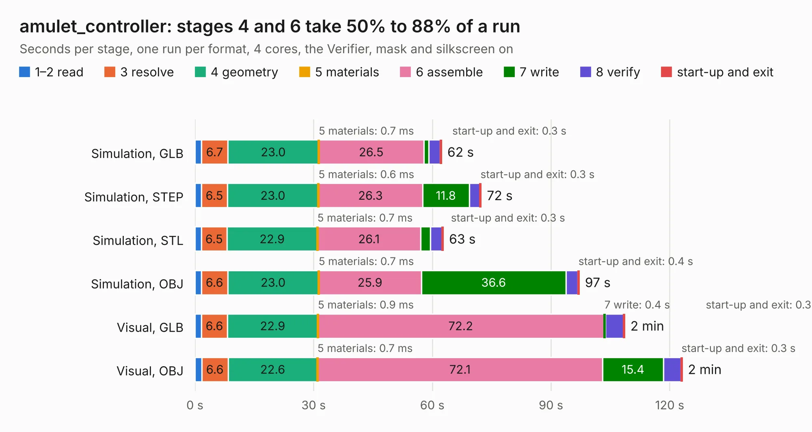

| Mode and format | 1–2 read | 3 resolve | 4 geometry | 5 materials | 6 assemble | 7 write | 8 verify | start-up and exit | Total |
|---|---:|---:|---:|---:|---:|---:|---:|---:|---:|
| Simulation, GLB | 1.6 | 6.7 | 23.0 | 0.7&nbsp;ms | 26.5 | 1.3 | 2.9 | 0.3 | 62.3 |
| Simulation, STEP | 1.7 | 6.5 | 23.0 | 0.6&nbsp;ms | 26.3 | 11.8 | 2.7 | 0.3 | 72.3 |
| Simulation, STL | 1.6 | 6.5 | 22.9 | 0.7&nbsp;ms | 26.1 | 2.5 | 3.0 | 0.3 | 62.8 |
| Simulation, OBJ | 1.6 | 6.6 | 23.0 | 0.7&nbsp;ms | 25.9 | 36.6 | 3.0 | 0.4 | 97.1 |
| Visual, GLB | 1.6 | 6.6 | 22.9 | 0.9&nbsp;ms | 72.2 | 0.4 | 4.6 | 0.3 | 108.6 |
| Visual, OBJ | 1.7 | 6.6 | 22.6 | 0.7&nbsp;ms | 72.1 | 15.4 | 4.4 | 0.3 | 123.1 |

<table align="center"><tr><td valign="top">

| Board | Repo: [nguyen-v/amulet_controller_kibot](https://github.com/nguyen-v/amulet_controller_kibot) Board: `amulet_controller.kicad_pcb` |
|---|---|
| Complexity | 457&nbsp;/&nbsp;1000 (size&nbsp;287, features&nbsp;170) |
| KESE&nbsp;features | through vias, slotted holes, custom pads, rounded, trapezoid or chamfered pads, arc tracks, filled zones, copper drawings, curved board outline, TrueType text, stack-up, dielectric εr and tanδ, copper finish, mask and silkscreen colours |
| Tested | 9th November 2026 |
| Copper&nbsp;layers | 6 |
| File&nbsp;format | KiCad 8 (20240108) |
| Parts,&nbsp;tracks,&nbsp;vias | 285, 1,583, 794 |
| Triangles,&nbsp;simulation | 6,621,630 in 197 parts |
| Verifier | PASS in all six runs |

</td><td valign="top">

<table>
<tr><th>File type</th><th>File size</th><th>Peak memory used</th></tr>
<tr><th colspan="3" align="left">Simulation</th></tr>
<tr><td>GLB</td><td align="right">219&nbsp;MB</td><td align="right">1.6&nbsp;GB</td></tr>
<tr><td>STEP</td><td align="right">735&nbsp;MB</td><td align="right">2.0&nbsp;GB</td></tr>
<tr><td>STL</td><td align="right">331&nbsp;MB</td><td align="right">1.5&nbsp;GB</td></tr>
<tr><td>OBJ</td><td align="right">697&nbsp;MB</td><td align="right">4.1&nbsp;GB</td></tr>
<tr><th colspan="3" align="left">Visual</th></tr>
<tr><td>GLB</td><td align="right">94&nbsp;MB</td><td align="right">1.9&nbsp;GB</td></tr>
<tr><td>OBJ</td><td align="right">299&nbsp;MB</td><td align="right">2.2&nbsp;GB</td></tr>
</table>

</td></tr></table>

## 1773. Asteroids_PCB

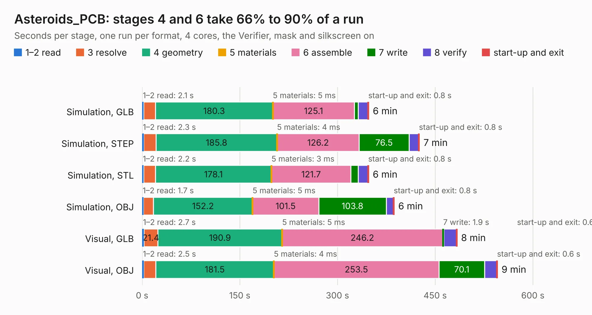

| Mode and format | 1–2 read | 3 resolve | 4 geometry | 5 materials | 6 assemble | 7 write | 8 verify | start-up and exit | Total |
|---|---:|---:|---:|---:|---:|---:|---:|---:|---:|
| Simulation, GLB | 2.1 | 18.3 | 180.3 | 5&nbsp;ms | 125.1 | 6.0 | 15.1 | 0.8 | 347.7 |
| Simulation, STEP | 2.3 | 19.1 | 185.8 | 4&nbsp;ms | 126.2 | 76.5 | 15.0 | 0.8 | 425.6 |
| Simulation, STL | 2.2 | 18.3 | 178.1 | 3&nbsp;ms | 121.7 | 11.6 | 14.9 | 0.8 | 347.7 |
| Simulation, OBJ | 1.7 | 15.7 | 152.2 | 5&nbsp;ms | 101.5 | 103.8 | 11.1 | 0.8 | 386.8 |
| Visual, GLB | 2.7 | 21.4 | 190.9 | 5&nbsp;ms | 246.2 | 1.9 | 19.5 | 0.6 | 483.3 |
| Visual, OBJ | 2.5 | 18.3 | 181.5 | 4&nbsp;ms | 253.5 | 70.1 | 18.9 | 0.6 | 545.4 |

<table align="center"><tr><td valign="top">

| Board | Repo: [nmikstas/asteroids-pcb](https://github.com/nmikstas/asteroids-pcb) Board: `Asteroids_PCB.kicad_pcb` |
|---|---|
| Folder | Asteroids_PCB |
| Complexity | 286&nbsp;/&nbsp;1000 (size&nbsp;236, features&nbsp;50) |
| KESE&nbsp;features | rounded, trapezoid or chamfered pads, filled zones, copper text, curved board outline |
| Tested | 9th November 2026 to 10th November 2026 |
| Copper&nbsp;layers | 2 |
| File&nbsp;format | KiCad 5 (20171130) |
| Parts,&nbsp;tracks,&nbsp;vias | 475, 10,686, 0 |
| Triangles,&nbsp;simulation | 21,815,320 in 718 parts |
| Verifier | PASS in all six runs |
| Run&nbsp;again | Simulation, OBJ: failed in the corpus run, run again with the memory cap raised from 11 GB to 14.5 GB, and passed |

</td><td valign="top">

<table>
<tr><th>File type</th><th>File size</th><th>Peak memory used</th></tr>
<tr><th colspan="3" align="left">Simulation</th></tr>
<tr><td>GLB</td><td align="right">750&nbsp;MB</td><td align="right">5.6&nbsp;GB</td></tr>
<tr><td>STEP</td><td align="right">3.9&nbsp;GB</td><td align="right">7.2&nbsp;GB</td></tr>
<tr><td>STL</td><td align="right">1.1&nbsp;GB</td><td align="right">5.3&nbsp;GB</td></tr>
<tr><td>OBJ</td><td align="right">2.4&nbsp;GB</td><td align="right">14&nbsp;GB</td></tr>
<tr><th colspan="3" align="left">Visual</th></tr>
<tr><td>GLB</td><td align="right">349&nbsp;MB</td><td align="right">5.8&nbsp;GB</td></tr>
<tr><td>OBJ</td><td align="right">1.1&nbsp;GB</td><td align="right">6.9&nbsp;GB</td></tr>
</table>

</td></tr></table>

## 1774. ROM_To_2716

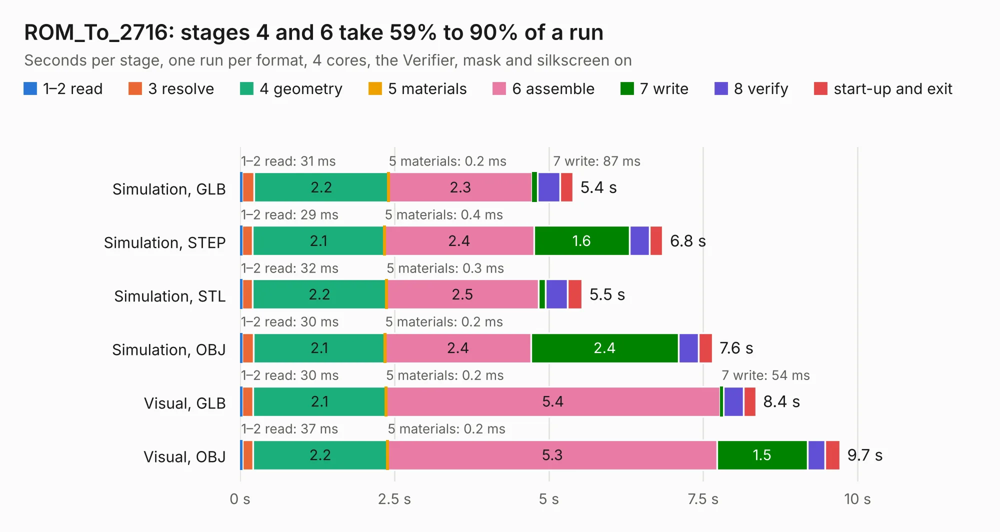

| Mode and format | 1–2 read | 3 resolve | 4 geometry | 5 materials | 6 assemble | 7 write | 8 verify | start-up and exit | Total |
|---|---:|---:|---:|---:|---:|---:|---:|---:|---:|
| Simulation, GLB | 31&nbsp;ms | 0.2 | 2.2 | 0.2&nbsp;ms | 2.3 | 87&nbsp;ms | 0.4 | 0.2 | 5.4 |
| Simulation, STEP | 29&nbsp;ms | 0.2 | 2.1 | 0.4&nbsp;ms | 2.4 | 1.6 | 0.3 | 0.2 | 6.8 |
| Simulation, STL | 32&nbsp;ms | 0.2 | 2.2 | 0.3&nbsp;ms | 2.5 | 0.1 | 0.4 | 0.2 | 5.5 |
| Simulation, OBJ | 30&nbsp;ms | 0.2 | 2.1 | 0.2&nbsp;ms | 2.4 | 2.4 | 0.3 | 0.2 | 7.6 |
| Visual, GLB | 30&nbsp;ms | 0.2 | 2.1 | 0.2&nbsp;ms | 5.4 | 54&nbsp;ms | 0.3 | 0.2 | 8.4 |
| Visual, OBJ | 37&nbsp;ms | 0.2 | 2.2 | 0.2&nbsp;ms | 5.3 | 1.5 | 0.3 | 0.2 | 9.7 |

<table align="center"><tr><td valign="top">

| Board | Repo: [nmikstas/asteroids-pcb](https://github.com/nmikstas/asteroids-pcb) Board: `ROM_To_2716.kicad_pcb` |
|---|---|
| Folder | ROM_to_2716 |
| Complexity | 106&nbsp;/&nbsp;1000 (size&nbsp;86, features&nbsp;20) |
| KESE&nbsp;features | filled zones |
| Tested | 9th November 2026 |
| Copper&nbsp;layers | 2 |
| File&nbsp;format | KiCad 5 (20171130) |
| Parts,&nbsp;tracks,&nbsp;vias | 2, 32, 0 |
| Triangles,&nbsp;simulation | 398,426 in 28 parts |
| Verifier | PASS in all six runs |

</td><td valign="top">

<table>
<tr><th>File type</th><th>File size</th><th>Peak memory used</th></tr>
<tr><th colspan="3" align="left">Simulation</th></tr>
<tr><td>GLB</td><td align="right">15&nbsp;MB</td><td align="right">260&nbsp;MB</td></tr>
<tr><td>STEP</td><td align="right">92&nbsp;MB</td><td align="right">288&nbsp;MB</td></tr>
<tr><td>STL</td><td align="right">20&nbsp;MB</td><td align="right">241&nbsp;MB</td></tr>
<tr><td>OBJ</td><td align="right">43&nbsp;MB</td><td align="right">322&nbsp;MB</td></tr>
<tr><th colspan="3" align="left">Visual</th></tr>
<tr><td>GLB</td><td align="right">8.9&nbsp;MB</td><td align="right">245&nbsp;MB</td></tr>
<tr><td>OBJ</td><td align="right">26&nbsp;MB</td><td align="right">247&nbsp;MB</td></tr>
</table>

</td></tr></table>

## 1775. quantum_arcade_pcb

| Mode and format | 1–2 read | 3 resolve | 4 geometry | 5 materials | 6 assemble | 7 write | 8 verify | start-up and exit | Total |
|---|---:|---:|---:|---:|---:|---:|---:|---:|---:|
| Simulation, GLB | 1.9 | 19.7 | 137.8 | 6&nbsp;ms | 83.9 | 5.0 | 13.1 | 0.8 | 262.2 |
| Simulation, STEP | 2.1 | 22.3 | 135.2 | 4&nbsp;ms | 82.6 | 63.7 | 13.4 | 0.8 | 320.0 |
| Simulation, STL | 1.9 | 20.5 | 135.2 | 4&nbsp;ms | 85.6 | 11.1 | 12.2 | 0.9 | 267.5 |
| Simulation, OBJ | 2.2 | 21.3 | 139.5 | 5&nbsp;ms | 78.9 | 129.4 | 13.5 | 1.0 | 385.7 |
| Visual, GLB | 2.2 | 21.3 | 135.7 | 4&nbsp;ms | 190.2 | 2.2 | 21.8 | 0.6 | 374.0 |
| Visual, OBJ | 2.0 | 20.0 | 131.5 | 4&nbsp;ms | 192.4 | 59.8 | 21.0 | 0.7 | 427.5 |

<table align="center"><tr><td valign="top">

| Board | Repo: [nmikstas/quantum_arcade_pcb](https://github.com/nmikstas/quantum_arcade_pcb) Board: `quantum_arcade_pcb.kicad_pcb` |
|---|---|
| Folder | quantum_arcade_pcb |
| Complexity | 297&nbsp;/&nbsp;1000 (size&nbsp;242, features&nbsp;55) |
| KESE&nbsp;features | through vias, filled zones, copper text, curved board outline |
| Tested | 9th November 2026 to 10th November 2026 |
| Copper&nbsp;layers | 2 |
| File&nbsp;format | KiCad 5 (20171130) |
| Parts,&nbsp;tracks,&nbsp;vias | 482, 13,501, 809 |
| Triangles,&nbsp;simulation | 18,765,660 in 702 parts |
| Verifier | PASS in all six runs |
| Run&nbsp;again | Simulation, OBJ: failed in the corpus run, run again with the memory cap raised from 11 GB to 14.5 GB, and passed |

</td><td valign="top">

<table>
<tr><th>File type</th><th>File size</th><th>Peak memory used</th></tr>
<tr><th colspan="3" align="left">Simulation</th></tr>
<tr><td>GLB</td><td align="right">643&nbsp;MB</td><td align="right">4.8&nbsp;GB</td></tr>
<tr><td>STEP</td><td align="right">3.3&nbsp;GB</td><td align="right">6.0&nbsp;GB</td></tr>
<tr><td>STL</td><td align="right">938&nbsp;MB</td><td align="right">5.0&nbsp;GB</td></tr>
<tr><td>OBJ</td><td align="right">2.1&nbsp;GB</td><td align="right">12&nbsp;GB</td></tr>
<tr><th colspan="3" align="left">Visual</th></tr>
<tr><td>GLB</td><td align="right">350&nbsp;MB</td><td align="right">5.6&nbsp;GB</td></tr>
<tr><td>OBJ</td><td align="right">1.1&nbsp;GB</td><td align="right">7.4&nbsp;GB</td></tr>
</table>

</td></tr></table>

## 1776. alu

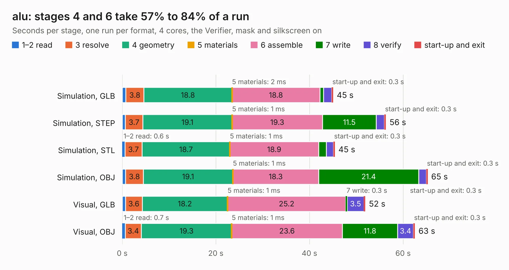

| Mode and format | 1–2 read | 3 resolve | 4 geometry | 5 materials | 6 assemble | 7 write | 8 verify | start-up and exit | Total |
|---|---:|---:|---:|---:|---:|---:|---:|---:|---:|
| Simulation, GLB | 0.8 | 3.8 | 18.8 | 2&nbsp;ms | 18.8 | 0.8 | 1.8 | 0.3 | 45.1 |
| Simulation, STEP | 0.7 | 3.7 | 19.1 | 1&nbsp;ms | 19.3 | 11.5 | 1.7 | 0.3 | 56.3 |
| Simulation, STL | 0.6 | 3.7 | 18.7 | 1&nbsp;ms | 18.9 | 1.7 | 1.5 | 0.3 | 45.4 |
| Simulation, OBJ | 0.7 | 3.8 | 19.1 | 1&nbsp;ms | 18.3 | 21.4 | 1.6 | 0.3 | 65.2 |
| Visual, GLB | 0.7 | 3.6 | 18.2 | 1&nbsp;ms | 25.2 | 0.3 | 3.5 | 0.3 | 51.9 |
| Visual, OBJ | 0.7 | 3.4 | 19.3 | 1&nbsp;ms | 23.6 | 11.8 | 3.4 | 0.3 | 62.5 |

<table align="center"><tr><td valign="top">

| Board | Repo: [Noah1989/74cpu](https://github.com/Noah1989/74cpu) Board: `alu.kicad_pcb` |
|---|---|
| Complexity | 205&nbsp;/&nbsp;1000 (size&nbsp;190, features&nbsp;15) |
| KESE&nbsp;features | through vias |
| Tested | 9th November 2026 |
| Copper&nbsp;layers | 2 |
| File&nbsp;format | KiCad 4 (4) |
| Parts,&nbsp;tracks,&nbsp;vias | 280, 688, 86 |
| Triangles,&nbsp;simulation | 4,036,698 in 159 parts |
| Verifier | PASS in all six runs |

</td><td valign="top">

<table>
<tr><th>File type</th><th>File size</th><th>Peak memory used</th></tr>
<tr><th colspan="3" align="left">Simulation</th></tr>
<tr><td>GLB</td><td align="right">135&nbsp;MB</td><td align="right">1.1&nbsp;GB</td></tr>
<tr><td>STEP</td><td align="right">547&nbsp;MB</td><td align="right">1.6&nbsp;GB</td></tr>
<tr><td>STL</td><td align="right">202&nbsp;MB</td><td align="right">1.1&nbsp;GB</td></tr>
<tr><td>OBJ</td><td align="right">424&nbsp;MB</td><td align="right">2.6&nbsp;GB</td></tr>
<tr><th colspan="3" align="left">Visual</th></tr>
<tr><td>GLB</td><td align="right">75&nbsp;MB</td><td align="right">1.3&nbsp;GB</td></tr>
<tr><td>OBJ</td><td align="right">234&nbsp;MB</td><td align="right">1.6&nbsp;GB</td></tr>
</table>

</td></tr></table>

## 1777. adcboard

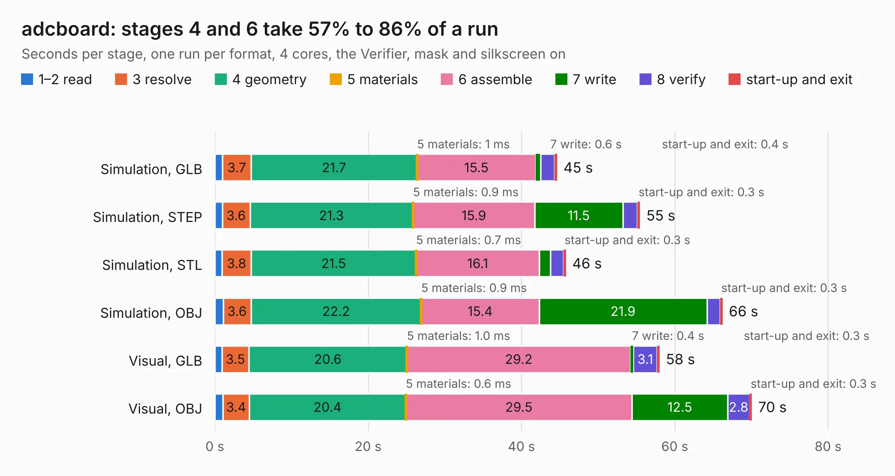

| Mode and format | 1–2 read | 3 resolve | 4 geometry | 5 materials | 6 assemble | 7 write | 8 verify | start-up and exit | Total |
|---|---:|---:|---:|---:|---:|---:|---:|---:|---:|
| Simulation, GLB | 1.0 | 3.7 | 21.7 | 1&nbsp;ms | 15.5 | 0.6 | 1.8 | 0.4 | 44.6 |
| Simulation, STEP | 1.0 | 3.6 | 21.3 | 0.9&nbsp;ms | 15.9 | 11.5 | 1.9 | 0.3 | 55.5 |
| Simulation, STL | 0.9 | 3.8 | 21.5 | 0.7&nbsp;ms | 16.1 | 1.4 | 1.7 | 0.3 | 45.8 |
| Simulation, OBJ | 1.1 | 3.6 | 22.2 | 0.9&nbsp;ms | 15.4 | 21.9 | 1.7 | 0.3 | 66.2 |
| Visual, GLB | 0.9 | 3.5 | 20.6 | 1.0&nbsp;ms | 29.2 | 0.4 | 3.1 | 0.3 | 58.0 |
| Visual, OBJ | 1.1 | 3.4 | 20.4 | 0.6&nbsp;ms | 29.5 | 12.5 | 2.8 | 0.3 | 70.1 |

<table align="center"><tr><td valign="top">

| Board | Repo: [nuclearfutureslab/ibxII-hardware](https://github.com/nuclearfutureslab/ibxII-hardware) Board: `adcboard.kicad_pcb` |
|---|---|
| Folder | adcboard |
| Complexity | 219&nbsp;/&nbsp;1000 (size&nbsp;184, features&nbsp;35) |
| KESE&nbsp;features | through vias, filled zones |
| Tested | 9th November 2026 |
| Copper&nbsp;layers | 2 |
| File&nbsp;format | KiCad 5 (20171130) |
| Parts,&nbsp;tracks,&nbsp;vias | 115, 920, 72 |
| Triangles,&nbsp;simulation | 3,351,378 in 110 parts |
| Verifier | PASS in all six runs |

</td><td valign="top">

<table>
<tr><th>File type</th><th>File size</th><th>Peak memory used</th></tr>
<tr><th colspan="3" align="left">Simulation</th></tr>
<tr><td>GLB</td><td align="right">116&nbsp;MB</td><td align="right">1.1&nbsp;GB</td></tr>
<tr><td>STEP</td><td align="right">590&nbsp;MB</td><td align="right">1.3&nbsp;GB</td></tr>
<tr><td>STL</td><td align="right">168&nbsp;MB</td><td align="right">1.2&nbsp;GB</td></tr>
<tr><td>OBJ</td><td align="right">358&nbsp;MB</td><td align="right">2.2&nbsp;GB</td></tr>
<tr><th colspan="3" align="left">Visual</th></tr>
<tr><td>GLB</td><td align="right">71&nbsp;MB</td><td align="right">1.2&nbsp;GB</td></tr>
<tr><td>OBJ</td><td align="right">220&nbsp;MB</td><td align="right">1.6&nbsp;GB</td></tr>
</table>

</td></tr></table>

## 1778. hvboard

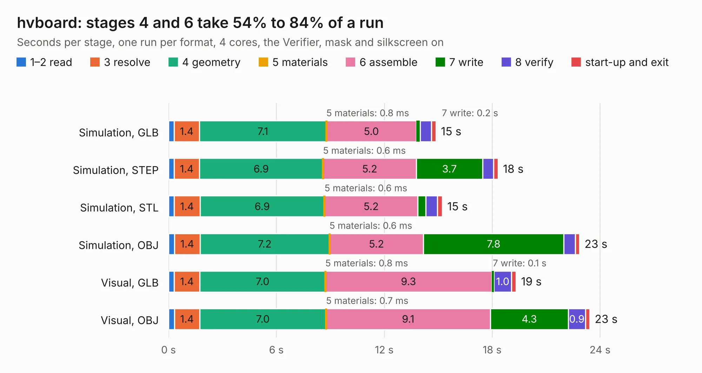

| Mode and format | 1–2 read | 3 resolve | 4 geometry | 5 materials | 6 assemble | 7 write | 8 verify | start-up and exit | Total |
|---|---:|---:|---:|---:|---:|---:|---:|---:|---:|
| Simulation, GLB | 0.3 | 1.4 | 7.1 | 0.8&nbsp;ms | 5.0 | 0.2 | 0.6 | 0.2 | 14.9 |
| Simulation, STEP | 0.3 | 1.4 | 6.9 | 0.6&nbsp;ms | 5.2 | 3.7 | 0.6 | 0.2 | 18.3 |
| Simulation, STL | 0.3 | 1.4 | 6.9 | 0.6&nbsp;ms | 5.2 | 0.4 | 0.6 | 0.3 | 15.2 |
| Simulation, OBJ | 0.3 | 1.4 | 7.2 | 0.6&nbsp;ms | 5.2 | 7.8 | 0.6 | 0.2 | 22.9 |
| Visual, GLB | 0.3 | 1.4 | 7.0 | 0.8&nbsp;ms | 9.3 | 0.1 | 1.0 | 0.2 | 19.3 |
| Visual, OBJ | 0.3 | 1.4 | 7.0 | 0.7&nbsp;ms | 9.1 | 4.3 | 0.9 | 0.2 | 23.4 |

<table align="center"><tr><td valign="top">

| Board | Repo: [nuclearfutureslab/ibxII-hardware](https://github.com/nuclearfutureslab/ibxII-hardware) Board: `hvboard.kicad_pcb` |
|---|---|
| Folder | hvboard |
| Complexity | 205&nbsp;/&nbsp;1000 (size&nbsp;160, features&nbsp;45) |
| KESE&nbsp;features | through vias, rounded, trapezoid or chamfered pads, filled zones |
| Tested | 9th November 2026 |
| Copper&nbsp;layers | 2 |
| File&nbsp;format | KiCad 5 (20171130) |
| Parts,&nbsp;tracks,&nbsp;vias | 50, 447, 5 |
| Triangles,&nbsp;simulation | 1,305,990 in 75 parts |
| Verifier | PASS in all six runs |

</td><td valign="top">

<table>
<tr><th>File type</th><th>File size</th><th>Peak memory used</th></tr>
<tr><th colspan="3" align="left">Simulation</th></tr>
<tr><td>GLB</td><td align="right">45&nbsp;MB</td><td align="right">532&nbsp;MB</td></tr>
<tr><td>STEP</td><td align="right">226&nbsp;MB</td><td align="right">593&nbsp;MB</td></tr>
<tr><td>STL</td><td align="right">65&nbsp;MB</td><td align="right">522&nbsp;MB</td></tr>
<tr><td>OBJ</td><td align="right">135&nbsp;MB</td><td align="right">901&nbsp;MB</td></tr>
<tr><th colspan="3" align="left">Visual</th></tr>
<tr><td>GLB</td><td align="right">26&nbsp;MB</td><td align="right">578&nbsp;MB</td></tr>
<tr><td>OBJ</td><td align="right">76&nbsp;MB</td><td align="right">578&nbsp;MB</td></tr>
</table>

</td></tr></table>

## 1779. greybadge_pcb

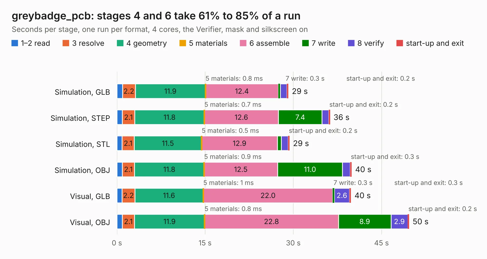

| Mode and format | 1–2 read | 3 resolve | 4 geometry | 5 materials | 6 assemble | 7 write | 8 verify | start-up and exit | Total |
|---|---:|---:|---:|---:|---:|---:|---:|---:|---:|
| Simulation, GLB | 0.9 | 2.2 | 11.9 | 0.8&nbsp;ms | 12.4 | 0.3 | 1.1 | 0.2 | 29.2 |
| Simulation, STEP | 0.9 | 2.1 | 11.8 | 0.7&nbsp;ms | 12.6 | 7.4 | 1.1 | 0.2 | 36.3 |
| Simulation, STL | 0.9 | 2.1 | 11.5 | 0.5&nbsp;ms | 12.9 | 0.6 | 1.2 | 0.2 | 29.4 |
| Simulation, OBJ | 0.9 | 2.1 | 11.8 | 0.9&nbsp;ms | 12.5 | 11.0 | 1.3 | 0.3 | 39.9 |
| Visual, GLB | 0.9 | 2.2 | 11.6 | 1&nbsp;ms | 22.0 | 0.3 | 2.6 | 0.3 | 39.8 |
| Visual, OBJ | 0.9 | 2.1 | 11.9 | 0.8&nbsp;ms | 22.8 | 8.9 | 2.9 | 0.2 | 49.7 |

<table align="center"><tr><td valign="top">

| Board | Repo: [NUSGreyhats/greybadge25](https://github.com/NUSGreyhats/greybadge25) Board: `greybadge_pcb.kicad_pcb` |
|---|---|
| Folder | hardware / greybadge_pcb |
| Complexity | 386&nbsp;/&nbsp;1000 (size&nbsp;251, features&nbsp;135) |
| KESE&nbsp;features | through vias, slotted holes, custom pads, rounded, trapezoid or chamfered pads, arc tracks, filled zones, copper drawings, curved board outline, knockout text, TrueType text |
| Tested | 9th November 2026 |
| Copper&nbsp;layers | 2 |
| File&nbsp;format | KiCad 9 (20241229) |
| Parts,&nbsp;tracks,&nbsp;vias | 135, 1,721, 176 |
| Triangles,&nbsp;simulation | 2,062,768 in 300 parts |
| Verifier | PASS in all six runs |

</td><td valign="top">

<table>
<tr><th>File type</th><th>File size</th><th>Peak memory used</th></tr>
<tr><th colspan="3" align="left">Simulation</th></tr>
<tr><td>GLB</td><td align="right">72&nbsp;MB</td><td align="right">814&nbsp;MB</td></tr>
<tr><td>STEP</td><td align="right">442&nbsp;MB</td><td align="right">1.0&nbsp;GB</td></tr>
<tr><td>STL</td><td align="right">103&nbsp;MB</td><td align="right">832&nbsp;MB</td></tr>
<tr><td>OBJ</td><td align="right">220&nbsp;MB</td><td align="right">1.4&nbsp;GB</td></tr>
<tr><th colspan="3" align="left">Visual</th></tr>
<tr><td>GLB</td><td align="right">60&nbsp;MB</td><td align="right">1.1&nbsp;GB</td></tr>
<tr><td>OBJ</td><td align="right">184&nbsp;MB</td><td align="right">1.2&nbsp;GB</td></tr>
</table>

</td></tr></table>

## 1780. battery

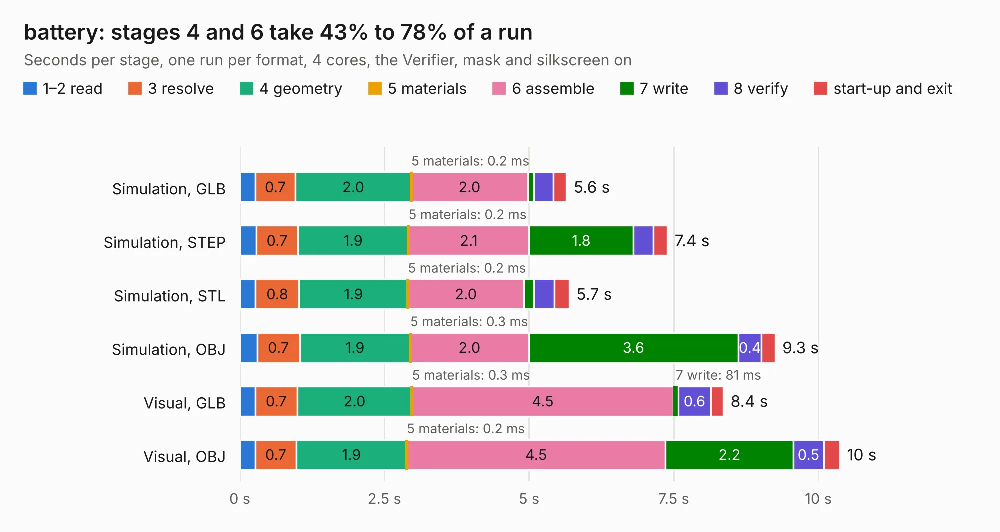

| Mode and format | 1–2 read | 3 resolve | 4 geometry | 5 materials | 6 assemble | 7 write | 8 verify | start-up and exit | Total |
|---|---:|---:|---:|---:|---:|---:|---:|---:|---:|
| Simulation, GLB | 0.3 | 0.7 | 2.0 | 0.2&nbsp;ms | 2.0 | 0.1 | 0.3 | 0.2 | 5.6 |
| Simulation, STEP | 0.3 | 0.7 | 1.9 | 0.2&nbsp;ms | 2.1 | 1.8 | 0.3 | 0.2 | 7.4 |
| Simulation, STL | 0.3 | 0.8 | 1.9 | 0.2&nbsp;ms | 2.0 | 0.2 | 0.3 | 0.3 | 5.7 |
| Simulation, OBJ | 0.3 | 0.7 | 1.9 | 0.3&nbsp;ms | 2.0 | 3.6 | 0.4 | 0.2 | 9.3 |
| Visual, GLB | 0.3 | 0.7 | 2.0 | 0.3&nbsp;ms | 4.5 | 81&nbsp;ms | 0.6 | 0.2 | 8.4 |
| Visual, OBJ | 0.3 | 0.7 | 1.9 | 0.2&nbsp;ms | 4.5 | 2.2 | 0.5 | 0.3 | 10.4 |

<table align="center"><tr><td valign="top">

| Board | Repo: [nzevh/barebones](https://github.com/nzevh/barebones) Board: `battery.kicad_pcb` |
|---|---|
| Folder | hardware / battery |
| Complexity | 326&nbsp;/&nbsp;1000 (size&nbsp;221, features&nbsp;105) |
| KESE&nbsp;features | through vias, rounded, trapezoid or chamfered pads, filled zones, knockout text, TrueType text, stack-up, dielectric εr and tanδ |
| Tested | 9th November 2026 |
| Copper&nbsp;layers | 4 |
| File&nbsp;format | KiCad 10 (20260206) |
| Parts,&nbsp;tracks,&nbsp;vias | 39, 348, 129 |
| Triangles,&nbsp;simulation | 658,698 in 60 parts |
| Verifier | PASS in all six runs |

</td><td valign="top">

<table>
<tr><th>File type</th><th>File size</th><th>Peak memory used</th></tr>
<tr><th colspan="3" align="left">Simulation</th></tr>
<tr><td>GLB</td><td align="right">23&nbsp;MB</td><td align="right">331&nbsp;MB</td></tr>
<tr><td>STEP</td><td align="right">80&nbsp;MB</td><td align="right">359&nbsp;MB</td></tr>
<tr><td>STL</td><td align="right">33&nbsp;MB</td><td align="right">342&nbsp;MB</td></tr>
<tr><td>OBJ</td><td align="right">66&nbsp;MB</td><td align="right">474&nbsp;MB</td></tr>
<tr><th colspan="3" align="left">Visual</th></tr>
<tr><td>GLB</td><td align="right">14&nbsp;MB</td><td align="right">377&nbsp;MB</td></tr>
<tr><td>OBJ</td><td align="right">42&nbsp;MB</td><td align="right">369&nbsp;MB</td></tr>
</table>

</td></tr></table>

## 1781. barebones

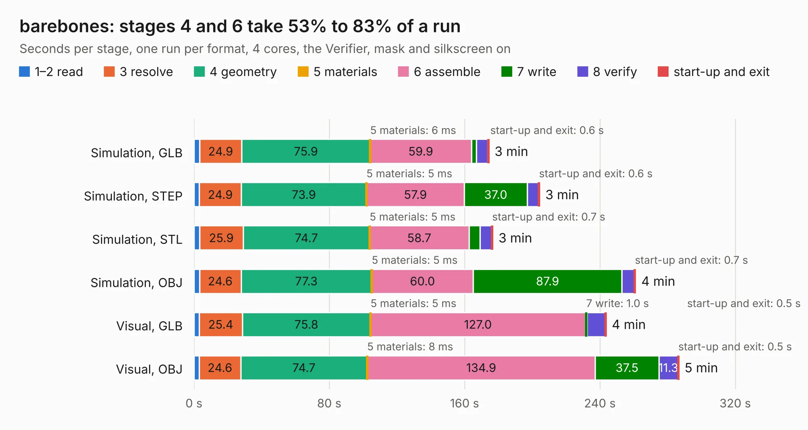

| Mode and format | 1–2 read | 3 resolve | 4 geometry | 5 materials | 6 assemble | 7 write | 8 verify | start-up and exit | Total |
|---|---:|---:|---:|---:|---:|---:|---:|---:|---:|
| Simulation, GLB | 3.3 | 24.9 | 75.9 | 6&nbsp;ms | 59.9 | 3.0 | 6.7 | 0.6 | 174.3 |
| Simulation, STEP | 3.2 | 24.9 | 73.9 | 5&nbsp;ms | 57.9 | 37.0 | 6.8 | 0.6 | 204.3 |
| Simulation, STL | 3.2 | 25.9 | 74.7 | 5&nbsp;ms | 58.7 | 6.5 | 6.9 | 0.7 | 176.6 |
| Simulation, OBJ | 3.3 | 24.6 | 77.3 | 5&nbsp;ms | 60.0 | 87.9 | 7.3 | 0.7 | 261.0 |
| Visual, GLB | 3.1 | 25.4 | 75.8 | 5&nbsp;ms | 127.0 | 1.0 | 10.7 | 0.5 | 243.6 |
| Visual, OBJ | 3.1 | 24.6 | 74.7 | 8&nbsp;ms | 134.9 | 37.5 | 11.3 | 0.5 | 286.6 |

<table align="center"><tr><td valign="top">

| Board | Repo: [nzevh/barebones](https://github.com/nzevh/barebones) Board: `barebones.kicad_pcb` |
|---|---|
| Folder | hardware / motherboard |
| Complexity | 651&nbsp;/&nbsp;1000 (size&nbsp;341, features&nbsp;310) |
| KESE&nbsp;features | through vias, blind and buried vias, microvias, covered, plugged, capped or filled vias, slotted holes, custom pads, rounded, trapezoid or chamfered pads, arc tracks, filled zones, copper drawings, knockout text, TrueType text, hatched fills, stack-up, dielectric εr and tanδ, copper finish, mask and silkscreen colours |
| Tested | 9th November 2026 |
| Copper&nbsp;layers | 8 |
| File&nbsp;format | KiCad 10 (20260206) |
| Parts,&nbsp;tracks,&nbsp;vias | 1,031, 2,098, 1,881 |
| Triangles,&nbsp;simulation | 12,973,364 in 1327 parts |
| Verifier | PASS in all six runs |

</td><td valign="top">

<table>
<tr><th>File type</th><th>File size</th><th>Peak memory used</th></tr>
<tr><th colspan="3" align="left">Simulation</th></tr>
<tr><td>GLB</td><td align="right">442&nbsp;MB</td><td align="right">3.0&nbsp;GB</td></tr>
<tr><td>STEP</td><td align="right">2.0&nbsp;GB</td><td align="right">4.2&nbsp;GB</td></tr>
<tr><td>STL</td><td align="right">649&nbsp;MB</td><td align="right">3.0&nbsp;GB</td></tr>
<tr><td>OBJ</td><td align="right">1.4&nbsp;GB</td><td align="right">8.3&nbsp;GB</td></tr>
<tr><th colspan="3" align="left">Visual</th></tr>
<tr><td>GLB</td><td align="right">196&nbsp;MB</td><td align="right">3.3&nbsp;GB</td></tr>
<tr><td>OBJ</td><td align="right">632&nbsp;MB</td><td align="right">4.2&nbsp;GB</td></tr>
</table>

</td></tr></table>

## 1782. m3

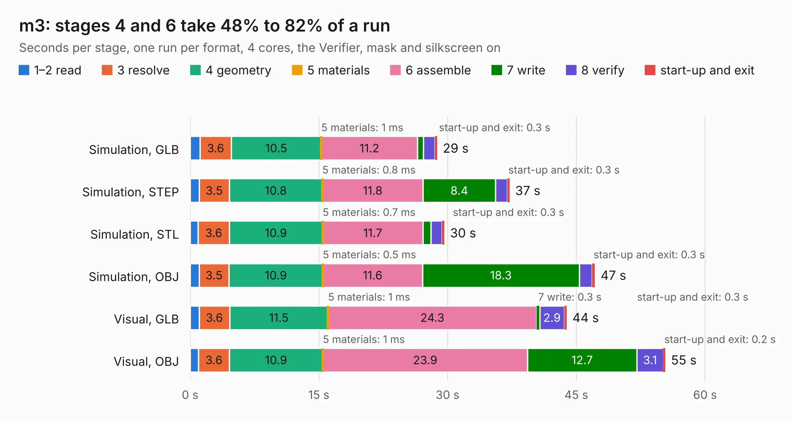

| Mode and format | 1–2 read | 3 resolve | 4 geometry | 5 materials | 6 assemble | 7 write | 8 verify | start-up and exit | Total |
|---|---:|---:|---:|---:|---:|---:|---:|---:|---:|
| Simulation, GLB | 1.2 | 3.6 | 10.5 | 1&nbsp;ms | 11.2 | 0.7 | 1.3 | 0.3 | 28.8 |
| Simulation, STEP | 1.0 | 3.5 | 10.8 | 0.8&nbsp;ms | 11.8 | 8.4 | 1.4 | 0.3 | 37.2 |
| Simulation, STL | 0.9 | 3.6 | 10.9 | 0.7&nbsp;ms | 11.7 | 0.9 | 1.3 | 0.3 | 29.6 |
| Simulation, OBJ | 1.0 | 3.5 | 10.9 | 0.5&nbsp;ms | 11.6 | 18.3 | 1.5 | 0.3 | 47.2 |
| Visual, GLB | 1.0 | 3.6 | 11.5 | 1&nbsp;ms | 24.3 | 0.3 | 2.9 | 0.3 | 43.9 |
| Visual, OBJ | 1.0 | 3.6 | 10.9 | 1&nbsp;ms | 23.9 | 12.7 | 3.1 | 0.2 | 55.4 |

<table align="center"><tr><td valign="top">

| Board | Repo: [oak-wjr/rocket-flight-computer](https://github.com/oak-wjr/rocket-flight-computer) Board: `m3.kicad_pcb` |
|---|---|
| Folder | m3_design / assembly_review |
| Complexity | 355&nbsp;/&nbsp;1000 (size&nbsp;265, features&nbsp;90) |
| KESE&nbsp;features | through vias, slotted holes, custom pads, rounded, trapezoid or chamfered pads, filled zones, copper drawings, curved board outline |
| Tested | 9th November 2026 |
| Copper&nbsp;layers | 4 |
| File&nbsp;format | KiCad 10 (20260206) |
| Parts,&nbsp;tracks,&nbsp;vias | 183, 2,037, 608 |
| Triangles,&nbsp;simulation | 2,975,214 in 175 parts |
| Verifier | PASS in all six runs |

</td><td valign="top">

<table>
<tr><th>File type</th><th>File size</th><th>Peak memory used</th></tr>
<tr><th colspan="3" align="left">Simulation</th></tr>
<tr><td>GLB</td><td align="right">102&nbsp;MB</td><td align="right">980&nbsp;MB</td></tr>
<tr><td>STEP</td><td align="right">404&nbsp;MB</td><td align="right">1.3&nbsp;GB</td></tr>
<tr><td>STL</td><td align="right">149&nbsp;MB</td><td align="right">1.0&nbsp;GB</td></tr>
<tr><td>OBJ</td><td align="right">313&nbsp;MB</td><td align="right">2.0&nbsp;GB</td></tr>
<tr><th colspan="3" align="left">Visual</th></tr>
<tr><td>GLB</td><td align="right">71&nbsp;MB</td><td align="right">1.2&nbsp;GB</td></tr>
<tr><td>OBJ</td><td align="right">220&nbsp;MB</td><td align="right">1.4&nbsp;GB</td></tr>
</table>

</td></tr></table>

## 1783. m1

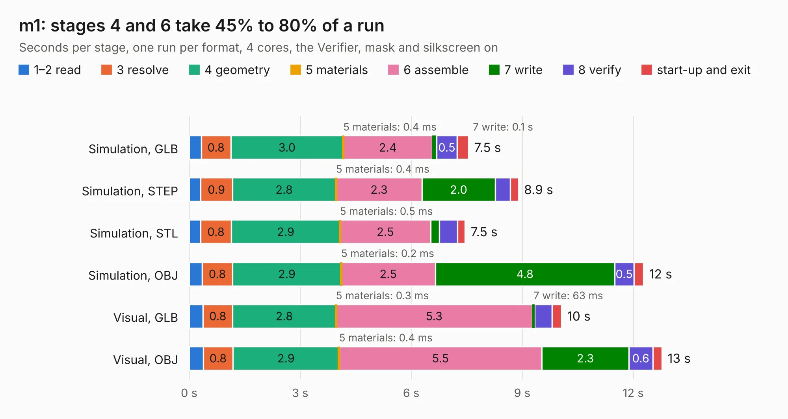

| Mode and format | 1–2 read | 3 resolve | 4 geometry | 5 materials | 6 assemble | 7 write | 8 verify | start-up and exit | Total |
|---|---:|---:|---:|---:|---:|---:|---:|---:|---:|
| Simulation, GLB | 0.3 | 0.8 | 3.0 | 0.4&nbsp;ms | 2.4 | 0.1 | 0.5 | 0.3 | 7.5 |
| Simulation, STEP | 0.3 | 0.9 | 2.8 | 0.4&nbsp;ms | 2.3 | 2.0 | 0.4 | 0.2 | 8.9 |
| Simulation, STL | 0.3 | 0.8 | 2.9 | 0.5&nbsp;ms | 2.5 | 0.2 | 0.5 | 0.2 | 7.5 |
| Simulation, OBJ | 0.4 | 0.8 | 2.9 | 0.2&nbsp;ms | 2.5 | 4.8 | 0.5 | 0.3 | 12.3 |
| Visual, GLB | 0.4 | 0.8 | 2.8 | 0.3&nbsp;ms | 5.3 | 63&nbsp;ms | 0.5 | 0.3 | 10.1 |
| Visual, OBJ | 0.4 | 0.8 | 2.9 | 0.4&nbsp;ms | 5.5 | 2.3 | 0.6 | 0.2 | 12.8 |

<table align="center"><tr><td valign="top">

| Board | Repo: [oak-wjr/rocket-flight-computer](https://github.com/oak-wjr/rocket-flight-computer) Board: `m1.kicad_pcb` |
|---|---|
| Folder | reference / m1_power_actuator |
| Complexity | 212&nbsp;/&nbsp;1000 (size&nbsp;167, features&nbsp;45) |
| KESE&nbsp;features | through vias, filled zones, curved board outline |
| Tested | 9th November 2026 |
| Copper&nbsp;layers | 4 |
| File&nbsp;format | KiCad 10 (20260206) |
| Parts,&nbsp;tracks,&nbsp;vias | 36, 84, 76 |
| Triangles,&nbsp;simulation | 778,592 in 40 parts |
| Verifier | PASS in all six runs |

</td><td valign="top">

<table>
<tr><th>File type</th><th>File size</th><th>Peak memory used</th></tr>
<tr><th colspan="3" align="left">Simulation</th></tr>
<tr><td>GLB</td><td align="right">27&nbsp;MB</td><td align="right">359&nbsp;MB</td></tr>
<tr><td>STEP</td><td align="right">82&nbsp;MB</td><td align="right">406&nbsp;MB</td></tr>
<tr><td>STL</td><td align="right">39&nbsp;MB</td><td align="right">352&nbsp;MB</td></tr>
<tr><td>OBJ</td><td align="right">78&nbsp;MB</td><td align="right">551&nbsp;MB</td></tr>
<tr><th colspan="3" align="left">Visual</th></tr>
<tr><td>GLB</td><td align="right">15&nbsp;MB</td><td align="right">410&nbsp;MB</td></tr>
<tr><td>OBJ</td><td align="right">45&nbsp;MB</td><td align="right">415&nbsp;MB</td></tr>
</table>

</td></tr></table>

## 1784. m3

| Mode and format | 1–2 read | 3 resolve | 4 geometry | 5 materials | 6 assemble | 7 write | 8 verify | start-up and exit | Total |
|---|---:|---:|---:|---:|---:|---:|---:|---:|---:|
| Simulation, GLB | 0.7 | 2.6 | 7.9 | 0.5&nbsp;ms | 7.8 | 0.3 | 1.1 | 0.2 | 20.7 |
| Simulation, STEP | 0.7 | 2.4 | 7.7 | 0.4&nbsp;ms | 7.9 | 5.9 | 1.0 | 0.3 | 25.9 |
| Simulation, STL | 0.8 | 2.6 | 7.7 | 0.4&nbsp;ms | 7.9 | 0.6 | 1.1 | 0.3 | 20.9 |
| Simulation, OBJ | 0.7 | 2.5 | 8.0 | 1&nbsp;ms | 7.9 | 12.3 | 1.1 | 0.2 | 32.7 |
| Visual, GLB | 0.7 | 2.7 | 8.0 | 0.4&nbsp;ms | 17.1 | 0.2 | 2.1 | 0.2 | 31.1 |
| Visual, OBJ | 0.8 | 2.5 | 7.8 | 0.4&nbsp;ms | 16.8 | 8.5 | 2.2 | 0.3 | 38.9 |

<table align="center"><tr><td valign="top">

| Board | Repo: [oak-wjr/rocket-flight-computer](https://github.com/oak-wjr/rocket-flight-computer) Board: `m3.kicad_pcb` |
|---|---|
| Folder | reference / m3_assy_r1 |
| Complexity | 322&nbsp;/&nbsp;1000 (size&nbsp;257, features&nbsp;65) |
| KESE&nbsp;features | through vias, slotted holes, rounded, trapezoid or chamfered pads, filled zones, curved board outline |
| Tested | 9th November 2026 |
| Copper&nbsp;layers | 4 |
| File&nbsp;format | KiCad 10 (20260206) |
| Parts,&nbsp;tracks,&nbsp;vias | 115, 1,707, 494 |
| Triangles,&nbsp;simulation | 2,125,432 in 151 parts |
| Verifier | PASS in all six runs |

</td><td valign="top">

<table>
<tr><th>File type</th><th>File size</th><th>Peak memory used</th></tr>
<tr><th colspan="3" align="left">Simulation</th></tr>
<tr><td>GLB</td><td align="right">72&nbsp;MB</td><td align="right">882&nbsp;MB</td></tr>
<tr><td>STEP</td><td align="right">277&nbsp;MB</td><td align="right">1.0&nbsp;GB</td></tr>
<tr><td>STL</td><td align="right">106&nbsp;MB</td><td align="right">810&nbsp;MB</td></tr>
<tr><td>OBJ</td><td align="right">220&nbsp;MB</td><td align="right">1.4&nbsp;GB</td></tr>
<tr><th colspan="3" align="left">Visual</th></tr>
<tr><td>GLB</td><td align="right">49&nbsp;MB</td><td align="right">944&nbsp;MB</td></tr>
<tr><td>OBJ</td><td align="right">151&nbsp;MB</td><td align="right">1.1&nbsp;GB</td></tr>
</table>

</td></tr></table>

## 1785. A20-CAN_Rev_A

| Mode and format | 1–2 read | 3 resolve | 4 geometry | 5 materials | 6 assemble | 7 write | 8 verify | start-up and exit | Total |
|---|---:|---:|---:|---:|---:|---:|---:|---:|---:|
| Simulation, GLB | 0.3 | 0.7 | 3.0 | 0.2&nbsp;ms | 2.0 | 75&nbsp;ms | 0.3 | 0.2 | 6.7 |
| Simulation, STEP | 0.3 | 0.7 | 2.9 | 0.2&nbsp;ms | 1.9 | 1.8 | 0.3 | 0.2 | 8.2 |
| Simulation, STL | 0.3 | 0.7 | 3.0 | 0.2&nbsp;ms | 2.0 | 0.2 | 0.3 | 0.2 | 6.7 |
| Simulation, OBJ | 0.3 | 0.7 | 3.0 | 0.2&nbsp;ms | 1.9 | 2.9 | 0.3 | 0.3 | 9.4 |
| Visual, GLB | 0.3 | 0.7 | 3.0 | 0.4&nbsp;ms | 4.4 | 74&nbsp;ms | 0.5 | 0.2 | 9.3 |
| Visual, OBJ | 0.3 | 0.7 | 2.9 | 0.2&nbsp;ms | 4.1 | 2.7 | 0.5 | 0.2 | 11.5 |

<table align="center"><tr><td valign="top">

| Board | Repo: [OLIMEX/A20-CAN](https://github.com/OLIMEX/A20-CAN) Board: `A20-CAN_Rev_A.kicad_pcb` |
|---|---|
| Complexity | 192&nbsp;/&nbsp;1000 (size&nbsp;157, features&nbsp;35) |
| KESE&nbsp;features | through vias, filled zones |
| Tested | 9th November 2026 |
| Copper&nbsp;layers | 2 |
| File&nbsp;format | KiCad 4 (4) |
| Parts,&nbsp;tracks,&nbsp;vias | 18, 411, 117 |
| Triangles,&nbsp;simulation | 492,504 in 27 parts |
| Verifier | PASS in all six runs |

</td><td valign="top">

<table>
<tr><th>File type</th><th>File size</th><th>Peak memory used</th></tr>
<tr><th colspan="3" align="left">Simulation</th></tr>
<tr><td>GLB</td><td align="right">17&nbsp;MB</td><td align="right">318&nbsp;MB</td></tr>
<tr><td>STEP</td><td align="right">87&nbsp;MB</td><td align="right">389&nbsp;MB</td></tr>
<tr><td>STL</td><td align="right">25&nbsp;MB</td><td align="right">337&nbsp;MB</td></tr>
<tr><td>OBJ</td><td align="right">51&nbsp;MB</td><td align="right">392&nbsp;MB</td></tr>
<tr><th colspan="3" align="left">Visual</th></tr>
<tr><td>GLB</td><td align="right">16&nbsp;MB</td><td align="right">407&nbsp;MB</td></tr>
<tr><td>OBJ</td><td align="right">46&nbsp;MB</td><td align="right">396&nbsp;MB</td></tr>
</table>

</td></tr></table>

## 1786. A20-CAN-ISO_Rev_B

| Mode and format | 1–2 read | 3 resolve | 4 geometry | 5 materials | 6 assemble | 7 write | 8 verify | start-up and exit | Total |
|---|---:|---:|---:|---:|---:|---:|---:|---:|---:|
| Simulation, GLB | 0.4 | 1.0 | 3.7 | 0.5&nbsp;ms | 2.6 | 0.1 | 0.5 | 0.3 | 8.5 |
| Simulation, STEP | 0.4 | 0.9 | 3.9 | 0.4&nbsp;ms | 2.6 | 2.3 | 0.4 | 0.2 | 10.7 |
| Simulation, STL | 0.3 | 0.9 | 3.6 | 0.4&nbsp;ms | 2.5 | 0.2 | 0.4 | 0.2 | 8.3 |
| Simulation, OBJ | 0.3 | 1.0 | 3.8 | 0.4&nbsp;ms | 2.7 | 3.6 | 0.4 | 0.2 | 12.1 |
| Visual, GLB | 0.3 | 0.9 | 3.7 | 0.5&nbsp;ms | 6.6 | 96&nbsp;ms | 0.6 | 0.2 | 12.6 |
| Visual, OBJ | 0.3 | 1.0 | 3.7 | 0.4&nbsp;ms | 6.6 | 3.2 | 0.7 | 0.3 | 15.7 |

<table align="center"><tr><td valign="top">

| Board | Repo: [OLIMEX/A20-CAN-ISO](https://github.com/OLIMEX/A20-CAN-ISO) Board: `A20-CAN-ISO_Rev_B.kicad_pcb` |
|---|---|
| Folder | HARDWARE / A20-CAN-ISO-Rev_B |
| Complexity | 206&nbsp;/&nbsp;1000 (size&nbsp;171, features&nbsp;35) |
| KESE&nbsp;features | through vias, filled zones |
| Tested | 9th November 2026 |
| Copper&nbsp;layers | 2 |
| File&nbsp;format | KiCad 5 (20171130) |
| Parts,&nbsp;tracks,&nbsp;vias | 28, 758, 184 |
| Triangles,&nbsp;simulation | 702,972 in 130 parts |
| Verifier | PASS in all six runs |

</td><td valign="top">

<table>
<tr><th>File type</th><th>File size</th><th>Peak memory used</th></tr>
<tr><th colspan="3" align="left">Simulation</th></tr>
<tr><td>GLB</td><td align="right">25&nbsp;MB</td><td align="right">417&nbsp;MB</td></tr>
<tr><td>STEP</td><td align="right">111&nbsp;MB</td><td align="right">477&nbsp;MB</td></tr>
<tr><td>STL</td><td align="right">35&nbsp;MB</td><td align="right">433&nbsp;MB</td></tr>
<tr><td>OBJ</td><td align="right">72&nbsp;MB</td><td align="right">530&nbsp;MB</td></tr>
<tr><th colspan="3" align="left">Visual</th></tr>
<tr><td>GLB</td><td align="right">22&nbsp;MB</td><td align="right">527&nbsp;MB</td></tr>
<tr><td>OBJ</td><td align="right">64&nbsp;MB</td><td align="right">539&nbsp;MB</td></tr>
</table>

</td></tr></table>

## 1787. AgonLight2_Rev_A

| Mode and format | 1–2 read | 3 resolve | 4 geometry | 5 materials | 6 assemble | 7 write | 8 verify | start-up and exit | Total |
|---|---:|---:|---:|---:|---:|---:|---:|---:|---:|
| Simulation, GLB | 1.1 | 4.2 | 20.8 | 0.7&nbsp;ms | 15.1 | 0.6 | 2.0 | 0.3 | 44.1 |
| Simulation, STEP | 1.2 | 4.2 | 21.2 | 0.7&nbsp;ms | 15.2 | 9.6 | 1.9 | 0.3 | 53.7 |
| Simulation, STL | 1.1 | 4.3 | 21.0 | 0.6&nbsp;ms | 15.3 | 1.4 | 2.1 | 0.3 | 45.4 |
| Simulation, OBJ | 1.1 | 4.3 | 21.1 | 0.6&nbsp;ms | 15.4 | 22.5 | 2.1 | 0.3 | 66.8 |
| Visual, GLB | 1.1 | 4.5 | 21.3 | 0.8&nbsp;ms | 36.0 | 0.4 | 4.4 | 0.3 | 68.0 |
| Visual, OBJ | 1.1 | 4.2 | 20.9 | 0.7&nbsp;ms | 36.2 | 15.1 | 4.9 | 0.3 | 82.8 |

<table align="center"><tr><td valign="top">

| Board | Repo: [OLIMEX/AgonLight2](https://github.com/OLIMEX/AgonLight2) Board: `AgonLight2_Rev_A.kicad_pcb` |
|---|---|
| Folder | HARDWARE / AgonLight2_Rev_A |
| Complexity | 313&nbsp;/&nbsp;1000 (size&nbsp;268, features&nbsp;45) |
| KESE&nbsp;features | through vias, slotted holes, filled zones |
| Tested | 9th November 2026 |
| Copper&nbsp;layers | 4 |
| File&nbsp;format | KiCad 5 (20171130) |
| Parts,&nbsp;tracks,&nbsp;vias | 229, 2,772, 400 |
| Triangles,&nbsp;simulation | 3,712,430 in 227 parts |
| Verifier | PASS in all six runs |

</td><td valign="top">

<table>
<tr><th>File type</th><th>File size</th><th>Peak memory used</th></tr>
<tr><th colspan="3" align="left">Simulation</th></tr>
<tr><td>GLB</td><td align="right">130&nbsp;MB</td><td align="right">1.3&nbsp;GB</td></tr>
<tr><td>STEP</td><td align="right">559&nbsp;MB</td><td align="right">1.5&nbsp;GB</td></tr>
<tr><td>STL</td><td align="right">186&nbsp;MB</td><td align="right">1.3&nbsp;GB</td></tr>
<tr><td>OBJ</td><td align="right">400&nbsp;MB</td><td align="right">2.5&nbsp;GB</td></tr>
<tr><th colspan="3" align="left">Visual</th></tr>
<tr><td>GLB</td><td align="right">88&nbsp;MB</td><td align="right">1.4&nbsp;GB</td></tr>
<tr><td>OBJ</td><td align="right">275&nbsp;MB</td><td align="right">1.8&nbsp;GB</td></tr>
</table>

</td></tr></table>

## 1788. AgonLight2_Rev_B

| Mode and format | 1–2 read | 3 resolve | 4 geometry | 5 materials | 6 assemble | 7 write | 8 verify | start-up and exit | Total |
|---|---:|---:|---:|---:|---:|---:|---:|---:|---:|
| Simulation, GLB | 1.2 | 4.6 | 20.9 | 1&nbsp;ms | 16.4 | 0.8 | 2.3 | 0.3 | 46.3 |
| Simulation, STEP | 1.2 | 4.6 | 21.7 | 0.6&nbsp;ms | 15.7 | 10.1 | 2.1 | 0.3 | 55.6 |
| Simulation, STL | 1.2 | 4.5 | 21.1 | 0.6&nbsp;ms | 15.4 | 1.5 | 2.3 | 0.3 | 46.3 |
| Simulation, OBJ | 1.1 | 4.8 | 21.5 | 0.6&nbsp;ms | 15.5 | 22.8 | 2.3 | 0.3 | 68.3 |
| Visual, GLB | 1.1 | 4.5 | 21.1 | 0.6&nbsp;ms | 37.5 | 0.5 | 4.6 | 0.3 | 69.6 |
| Visual, OBJ | 1.2 | 4.7 | 21.0 | 0.7&nbsp;ms | 36.4 | 16.1 | 4.5 | 0.3 | 84.3 |

<table align="center"><tr><td valign="top">

| Board | Repo: [OLIMEX/AgonLight2](https://github.com/OLIMEX/AgonLight2) Board: `AgonLight2_Rev_B.kicad_pcb` |
|---|---|
| Folder | HARDWARE / AgonLight2_Rev_B |
| Complexity | 313&nbsp;/&nbsp;1000 (size&nbsp;268, features&nbsp;45) |
| KESE&nbsp;features | through vias, slotted holes, filled zones |
| Tested | 9th November 2026 |
| Copper&nbsp;layers | 4 |
| File&nbsp;format | KiCad 5 (20171130) |
| Parts,&nbsp;tracks,&nbsp;vias | 229, 2,796, 400 |
| Triangles,&nbsp;simulation | 3,844,256 in 225 parts |
| Verifier | PASS in all six runs |

</td><td valign="top">

<table>
<tr><th>File type</th><th>File size</th><th>Peak memory used</th></tr>
<tr><th colspan="3" align="left">Simulation</th></tr>
<tr><td>GLB</td><td align="right">135&nbsp;MB</td><td align="right">1.4&nbsp;GB</td></tr>
<tr><td>STEP</td><td align="right">596&nbsp;MB</td><td align="right">1.6&nbsp;GB</td></tr>
<tr><td>STL</td><td align="right">192&nbsp;MB</td><td align="right">1.3&nbsp;GB</td></tr>
<tr><td>OBJ</td><td align="right">416&nbsp;MB</td><td align="right">2.6&nbsp;GB</td></tr>
<tr><th colspan="3" align="left">Visual</th></tr>
<tr><td>GLB</td><td align="right">94&nbsp;MB</td><td align="right">1.4&nbsp;GB</td></tr>
<tr><td>OBJ</td><td align="right">294&nbsp;MB</td><td align="right">2.0&nbsp;GB</td></tr>
</table>

</td></tr></table>

## 1789. AgonLight2-HvIO_Rev_A

| Mode and format | 1–2 read | 3 resolve | 4 geometry | 5 materials | 6 assemble | 7 write | 8 verify | start-up and exit | Total |
|---|---:|---:|---:|---:|---:|---:|---:|---:|---:|
| Simulation, GLB | 0.3 | 0.9 | 3.6 | 0.6&nbsp;ms | 2.3 | 0.1 | 0.3 | 0.3 | 7.8 |
| Simulation, STEP | 0.3 | 0.8 | 3.6 | 0.7&nbsp;ms | 2.6 | 2.2 | 0.3 | 0.2 | 10.1 |
| Simulation, STL | 0.3 | 0.9 | 3.4 | 0.5&nbsp;ms | 2.3 | 0.2 | 0.3 | 0.3 | 7.7 |
| Simulation, OBJ | 0.3 | 0.9 | 3.3 | 0.3&nbsp;ms | 2.3 | 3.5 | 0.3 | 0.2 | 10.8 |
| Visual, GLB | 0.3 | 0.9 | 3.2 | 0.3&nbsp;ms | 5.1 | 80&nbsp;ms | 0.6 | 0.2 | 10.5 |
| Visual, OBJ | 0.3 | 0.9 | 3.2 | 0.3&nbsp;ms | 5.2 | 2.5 | 0.9 | 0.2 | 13.1 |

<table align="center"><tr><td valign="top">

| Board | Repo: [OLIMEX/AgonLight2-HvIO](https://github.com/OLIMEX/AgonLight2-HvIO) Board: `AgonLight2-HvIO_Rev_A.kicad_pcb` |
|---|---|
| Folder | HARDWARE / AgonLight2-HvIO_Rev_A |
| Complexity | 267&nbsp;/&nbsp;1000 (size&nbsp;177, features&nbsp;90) |
| KESE&nbsp;features | through vias, filled zones, copper text, knockout text, stack-up, dielectric εr and tanδ |
| Tested | 9th November 2026 |
| Copper&nbsp;layers | 2 |
| File&nbsp;format | KiCad 7 (20221018) |
| Parts,&nbsp;tracks,&nbsp;vias | 62, 586, 180 |
| Triangles,&nbsp;simulation | 770,540 in 91 parts |
| Verifier | PASS in all six runs |

</td><td valign="top">

<table>
<tr><th>File type</th><th>File size</th><th>Peak memory used</th></tr>
<tr><th colspan="3" align="left">Simulation</th></tr>
<tr><td>GLB</td><td align="right">27&nbsp;MB</td><td align="right">423&nbsp;MB</td></tr>
<tr><td>STEP</td><td align="right">131&nbsp;MB</td><td align="right">482&nbsp;MB</td></tr>
<tr><td>STL</td><td align="right">39&nbsp;MB</td><td align="right">444&nbsp;MB</td></tr>
<tr><td>OBJ</td><td align="right">80&nbsp;MB</td><td align="right">584&nbsp;MB</td></tr>
<tr><th colspan="3" align="left">Visual</th></tr>
<tr><td>GLB</td><td align="right">21&nbsp;MB</td><td align="right">503&nbsp;MB</td></tr>
<tr><td>OBJ</td><td align="right">62&nbsp;MB</td><td align="right">537&nbsp;MB</td></tr>
</table>

</td></tr></table>

## 1790. AgonLight2-HvIO_Rev_A1

| Mode and format | 1–2 read | 3 resolve | 4 geometry | 5 materials | 6 assemble | 7 write | 8 verify | start-up and exit | Total |
|---|---:|---:|---:|---:|---:|---:|---:|---:|---:|
| Simulation, GLB | 0.4 | 1.0 | 3.8 | 0.3&nbsp;ms | 2.7 | 0.1 | 0.4 | 0.3 | 8.6 |
| Simulation, STEP | 0.3 | 1.0 | 3.9 | 1&nbsp;ms | 2.7 | 2.2 | 0.3 | 0.2 | 10.7 |
| Simulation, STL | 0.3 | 1.1 | 3.5 | 0.3&nbsp;ms | 2.8 | 0.2 | 0.4 | 0.2 | 8.6 |
| Simulation, OBJ | 0.3 | 1.0 | 4.0 | 0.4&nbsp;ms | 2.5 | 3.8 | 0.4 | 0.2 | 12.3 |
| Visual, GLB | 0.3 | 1.0 | 3.6 | 0.4&nbsp;ms | 6.4 | 0.1 | 0.8 | 0.2 | 12.5 |
| Visual, OBJ | 0.3 | 0.9 | 3.8 | 0.3&nbsp;ms | 6.5 | 2.9 | 0.9 | 0.2 | 15.6 |

<table align="center"><tr><td valign="top">

| Board | Repo: [OLIMEX/AgonLight2-HvIO](https://github.com/OLIMEX/AgonLight2-HvIO) Board: `AgonLight2-HvIO_Rev_A1.kicad_pcb` |
|---|---|
| Folder | HARDWARE / AgonLight2-HvIO_Rev_A1 |
| Complexity | 267&nbsp;/&nbsp;1000 (size&nbsp;177, features&nbsp;90) |
| KESE&nbsp;features | through vias, filled zones, copper text, knockout text, stack-up, dielectric εr and tanδ |
| Tested | 9th November 2026 |
| Copper&nbsp;layers | 2 |
| File&nbsp;format | KiCad 7 (20221018) |
| Parts,&nbsp;tracks,&nbsp;vias | 62, 586, 180 |
| Triangles,&nbsp;simulation | 770,556 in 91 parts |
| Verifier | PASS in all six runs |

</td><td valign="top">

<table>
<tr><th>File type</th><th>File size</th><th>Peak memory used</th></tr>
<tr><th colspan="3" align="left">Simulation</th></tr>
<tr><td>GLB</td><td align="right">27&nbsp;MB</td><td align="right">425&nbsp;MB</td></tr>
<tr><td>STEP</td><td align="right">131&nbsp;MB</td><td align="right">475&nbsp;MB</td></tr>
<tr><td>STL</td><td align="right">39&nbsp;MB</td><td align="right">419&nbsp;MB</td></tr>
<tr><td>OBJ</td><td align="right">80&nbsp;MB</td><td align="right">582&nbsp;MB</td></tr>
<tr><th colspan="3" align="left">Visual</th></tr>
<tr><td>GLB</td><td align="right">21&nbsp;MB</td><td align="right">542&nbsp;MB</td></tr>
<tr><td>OBJ</td><td align="right">62&nbsp;MB</td><td align="right">502&nbsp;MB</td></tr>
</table>

</td></tr></table>

## 1791. AgonLight2-PROTO_Rev_A

| Mode and format | 1–2 read | 3 resolve | 4 geometry | 5 materials | 6 assemble | 7 write | 8 verify | start-up and exit | Total |
|---|---:|---:|---:|---:|---:|---:|---:|---:|---:|
| Simulation, GLB | 0.5 | 2.8 | 16.2 | 0.7&nbsp;ms | 14.5 | 0.4 | 1.3 | 0.3 | 36.0 |
| Simulation, STEP | 0.5 | 2.8 | 16.5 | 0.7&nbsp;ms | 14.6 | 7.7 | 1.2 | 0.3 | 43.6 |
| Simulation, STL | 0.5 | 2.8 | 15.9 | 0.9&nbsp;ms | 14.6 | 0.8 | 1.2 | 0.3 | 36.1 |
| Simulation, OBJ | 0.5 | 2.7 | 15.8 | 0.8&nbsp;ms | 14.3 | 15.9 | 1.2 | 0.3 | 50.7 |
| Visual, GLB | 0.5 | 2.8 | 16.4 | 0.8&nbsp;ms | 16.5 | 0.2 | 1.5 | 0.3 | 38.2 |
| Visual, OBJ | 0.5 | 2.8 | 16.0 | 0.8&nbsp;ms | 16.2 | 7.2 | 1.9 | 0.3 | 44.9 |

<table align="center"><tr><td valign="top">

| Board | Repo: [OLIMEX/AgonLight2-Proto](https://github.com/OLIMEX/AgonLight2-Proto) Board: `AgonLight2-PROTO_Rev_A.kicad_pcb` |
|---|---|
| Folder | HARDWARE / AgonLight2-PROTO_Rev_A |
| Complexity | 224&nbsp;/&nbsp;1000 (size&nbsp;149, features&nbsp;75) |
| KESE&nbsp;features | through vias, filled zones, copper text, stack-up, dielectric εr and tanδ |
| Tested | 9th November 2026 |
| Copper&nbsp;layers | 2 |
| File&nbsp;format | KiCad 7 (20221018) |
| Parts,&nbsp;tracks,&nbsp;vias | 6, 649, 71 |
| Triangles,&nbsp;simulation | 2,595,312 in 45 parts |
| Verifier | PASS in all six runs |

</td><td valign="top">

<table>
<tr><th>File type</th><th>File size</th><th>Peak memory used</th></tr>
<tr><th colspan="3" align="left">Simulation</th></tr>
<tr><td>GLB</td><td align="right">89&nbsp;MB</td><td align="right">885&nbsp;MB</td></tr>
<tr><td>STEP</td><td align="right">320&nbsp;MB</td><td align="right">1.2&nbsp;GB</td></tr>
<tr><td>STL</td><td align="right">130&nbsp;MB</td><td align="right">891&nbsp;MB</td></tr>
<tr><td>OBJ</td><td align="right">275&nbsp;MB</td><td align="right">1.7&nbsp;GB</td></tr>
<tr><th colspan="3" align="left">Visual</th></tr>
<tr><td>GLB</td><td align="right">42&nbsp;MB</td><td align="right">1.1&nbsp;GB</td></tr>
<tr><td>OBJ</td><td align="right">129&nbsp;MB</td><td align="right">994&nbsp;MB</td></tr>
</table>

</td></tr></table>

## 1792. bb-ads1220

| Mode and format | 1–2 read | 3 resolve | 4 geometry | 5 materials | 6 assemble | 7 write | 8 verify | start-up and exit | Total |
|---|---:|---:|---:|---:|---:|---:|---:|---:|---:|
| Simulation, GLB | 88&nbsp;ms | 0.2 | 0.8 | 0.2&nbsp;ms | 0.7 | 27&nbsp;ms | 0.1 | 0.2 | 2.2 |
| Simulation, STEP | 0.1 | 0.2 | 0.8 | 0.2&nbsp;ms | 0.7 | 0.9 | 0.1 | 0.2 | 3.0 |
| Simulation, STL | 99&nbsp;ms | 0.2 | 0.8 | 0.2&nbsp;ms | 0.7 | 45&nbsp;ms | 0.1 | 0.2 | 2.3 |
| Simulation, OBJ | 88&nbsp;ms | 0.2 | 0.8 | 0.2&nbsp;ms | 0.7 | 0.8 | 0.1 | 0.2 | 2.9 |
| Visual, GLB | 98&nbsp;ms | 0.2 | 0.8 | 0.2&nbsp;ms | 1.9 | 26&nbsp;ms | 0.2 | 0.2 | 3.4 |
| Visual, OBJ | 86&nbsp;ms | 0.2 | 0.7 | 0.2&nbsp;ms | 1.9 | 0.7 | 0.1 | 0.2 | 4.0 |

<table align="center"><tr><td valign="top">

| Board | Repo: [OLIMEX/BB-ADS1220](https://github.com/OLIMEX/BB-ADS1220) Board: `bb-ads1220.kicad_pcb` |
|---|---|
| Folder | HARDWARE / BB-ADS1220_Rev.A |
| Complexity | 153&nbsp;/&nbsp;1000 (size&nbsp;118, features&nbsp;35) |
| KESE&nbsp;features | through vias, filled zones |
| Tested | 9th November 2026 |
| Copper&nbsp;layers | 2 |
| File&nbsp;format | KiCad 4 (4) |
| Parts,&nbsp;tracks,&nbsp;vias | 6, 101, 10 |
| Triangles,&nbsp;simulation | 190,968 in 27 parts |
| Verifier | PASS in all six runs |

</td><td valign="top">

<table>
<tr><th>File type</th><th>File size</th><th>Peak memory used</th></tr>
<tr><th colspan="3" align="left">Simulation</th></tr>
<tr><td>GLB</td><td align="right">6.8&nbsp;MB</td><td align="right">208&nbsp;MB</td></tr>
<tr><td>STEP</td><td align="right">35&nbsp;MB</td><td align="right">215&nbsp;MB</td></tr>
<tr><td>STL</td><td align="right">9.6&nbsp;MB</td><td align="right">203&nbsp;MB</td></tr>
<tr><td>OBJ</td><td align="right">19&nbsp;MB</td><td align="right">200&nbsp;MB</td></tr>
<tr><th colspan="3" align="left">Visual</th></tr>
<tr><td>GLB</td><td align="right">5.3&nbsp;MB</td><td align="right">188&nbsp;MB</td></tr>
<tr><td>OBJ</td><td align="right">15&nbsp;MB</td><td align="right">187&nbsp;MB</td></tr>
</table>

</td></tr></table>

## 1793. BB-ADS1262-Rev.A

| Mode and format | 1–2 read | 3 resolve | 4 geometry | 5 materials | 6 assemble | 7 write | 8 verify | start-up and exit | Total |
|---|---:|---:|---:|---:|---:|---:|---:|---:|---:|
| Simulation, GLB | 0.2 | 0.5 | 1.8 | 0.4&nbsp;ms | 1.4 | 70&nbsp;ms | 0.2 | 0.2 | 4.4 |
| Simulation, STEP | 0.2 | 0.4 | 1.9 | 0.3&nbsp;ms | 1.5 | 1.4 | 0.2 | 0.2 | 5.8 |
| Simulation, STL | 0.2 | 0.4 | 1.7 | 0.4&nbsp;ms | 1.5 | 0.1 | 0.2 | 0.2 | 4.2 |
| Simulation, OBJ | 0.2 | 0.4 | 1.9 | 0.3&nbsp;ms | 1.4 | 2.0 | 0.2 | 0.2 | 6.4 |
| Visual, GLB | 0.2 | 0.4 | 1.9 | 0.4&nbsp;ms | 3.6 | 55&nbsp;ms | 0.4 | 0.2 | 6.8 |
| Visual, OBJ | 0.2 | 0.4 | 1.8 | 0.3&nbsp;ms | 3.3 | 1.6 | 0.4 | 0.2 | 8.0 |

<table align="center"><tr><td valign="top">

| Board | Repo: [OLIMEX/BB-ADS1262](https://github.com/OLIMEX/BB-ADS1262) Board: `BB-ADS1262-Rev.A.kicad_pcb` |
|---|---|
| Folder | HARDWARE / BB-ADS1262_Rev.A1 |
| Complexity | 184&nbsp;/&nbsp;1000 (size&nbsp;149, features&nbsp;35) |
| KESE&nbsp;features | through vias, filled zones |
| Tested | 9th November 2026 |
| Copper&nbsp;layers | 2 |
| File&nbsp;format | KiCad 5 (20171114) |
| Parts,&nbsp;tracks,&nbsp;vias | 27, 326, 9 |
| Triangles,&nbsp;simulation | 402,106 in 51 parts |
| Verifier | PASS in all six runs |

</td><td valign="top">

<table>
<tr><th>File type</th><th>File size</th><th>Peak memory used</th></tr>
<tr><th colspan="3" align="left">Simulation</th></tr>
<tr><td>GLB</td><td align="right">14&nbsp;MB</td><td align="right">279&nbsp;MB</td></tr>
<tr><td>STEP</td><td align="right">75&nbsp;MB</td><td align="right">310&nbsp;MB</td></tr>
<tr><td>STL</td><td align="right">20&nbsp;MB</td><td align="right">275&nbsp;MB</td></tr>
<tr><td>OBJ</td><td align="right">42&nbsp;MB</td><td align="right">333&nbsp;MB</td></tr>
<tr><th colspan="3" align="left">Visual</th></tr>
<tr><td>GLB</td><td align="right">12&nbsp;MB</td><td align="right">310&nbsp;MB</td></tr>
<tr><td>OBJ</td><td align="right">34&nbsp;MB</td><td align="right">305&nbsp;MB</td></tr>
</table>

</td></tr></table>

## 1794. bb-ch340t

| Mode and format | 1–2 read | 3 resolve | 4 geometry | 5 materials | 6 assemble | 7 write | 8 verify | start-up and exit | Total |
|---|---:|---:|---:|---:|---:|---:|---:|---:|---:|
| Simulation, GLB | 0.1 | 0.3 | 0.9 | 0.1&nbsp;ms | 1.1 | 31&nbsp;ms | 0.1 | 0.2 | 2.7 |
| Simulation, STEP | 0.2 | 0.3 | 0.9 | 0.2&nbsp;ms | 1.0 | 1.0 | 97&nbsp;ms | 0.3 | 3.8 |
| Simulation, STL | 0.1 | 0.3 | 0.9 | 0.1&nbsp;ms | 1.0 | 45&nbsp;ms | 99&nbsp;ms | 0.3 | 2.7 |
| Simulation, OBJ | 0.2 | 0.3 | 0.9 | 0.2&nbsp;ms | 1.0 | 1.0 | 97&nbsp;ms | 0.2 | 3.6 |
| Visual, GLB | 0.1 | 0.3 | 0.9 | 0.2&nbsp;ms | 1.8 | 28&nbsp;ms | 0.2 | 0.2 | 3.6 |
| Visual, OBJ | 0.2 | 0.3 | 0.9 | 0.2&nbsp;ms | 1.8 | 0.9 | 0.2 | 0.2 | 4.4 |

<table align="center"><tr><td valign="top">

| Board | Repo: [OLIMEX/BB-CH340T](https://github.com/OLIMEX/BB-CH340T) Board: `bb-ch340t.kicad_pcb` |
|---|---|
| Folder | HARDWARE / BB-CH340T-Rev.A |
| Complexity | 179&nbsp;/&nbsp;1000 (size&nbsp;124, features&nbsp;55) |
| KESE&nbsp;features | through vias, filled zones, copper text, curved board outline |
| Tested | 9th November 2026 |
| Copper&nbsp;layers | 2 |
| File&nbsp;format | KiCad 4 (4) |
| Parts,&nbsp;tracks,&nbsp;vias | 10, 109, 12 |
| Triangles,&nbsp;simulation | 159,360 in 31 parts |
| Verifier | PASS in all six runs |

</td><td valign="top">

<table>
<tr><th>File type</th><th>File size</th><th>Peak memory used</th></tr>
<tr><th colspan="3" align="left">Simulation</th></tr>
<tr><td>GLB</td><td align="right">5.8&nbsp;MB</td><td align="right">202&nbsp;MB</td></tr>
<tr><td>STEP</td><td align="right">30&nbsp;MB</td><td align="right">219&nbsp;MB</td></tr>
<tr><td>STL</td><td align="right">8.0&nbsp;MB</td><td align="right">202&nbsp;MB</td></tr>
<tr><td>OBJ</td><td align="right">16&nbsp;MB</td><td align="right">202&nbsp;MB</td></tr>
<tr><th colspan="3" align="left">Visual</th></tr>
<tr><td>GLB</td><td align="right">5.0&nbsp;MB</td><td align="right">192&nbsp;MB</td></tr>
<tr><td>OBJ</td><td align="right">14&nbsp;MB</td><td align="right">191&nbsp;MB</td></tr>
</table>

</td></tr></table>

## 1795. bb-ch340t

| Mode and format | 1–2 read | 3 resolve | 4 geometry | 5 materials | 6 assemble | 7 write | 8 verify | start-up and exit | Total |
|---|---:|---:|---:|---:|---:|---:|---:|---:|---:|
| Simulation, GLB | 0.1 | 0.3 | 1.0 | 0.2&nbsp;ms | 1.0 | 39&nbsp;ms | 0.1 | 0.2 | 2.8 |
| Simulation, STEP | 0.1 | 0.3 | 1.0 | 0.2&nbsp;ms | 0.9 | 1.1 | 0.1 | 0.2 | 3.7 |
| Simulation, STL | 0.1 | 0.3 | 1.1 | 0.2&nbsp;ms | 1.0 | 55&nbsp;ms | 0.1 | 0.3 | 3.0 |
| Simulation, OBJ | 0.1 | 0.3 | 1.1 | 0.2&nbsp;ms | 1.1 | 1.2 | 0.1 | 0.2 | 4.0 |
| Visual, GLB | 0.1 | 0.3 | 1.0 | 0.2&nbsp;ms | 2.4 | 35&nbsp;ms | 0.2 | 0.2 | 4.3 |
| Visual, OBJ | 0.1 | 0.3 | 1.1 | 0.2&nbsp;ms | 2.3 | 1.2 | 0.2 | 0.2 | 5.4 |

<table align="center"><tr><td valign="top">

| Board | Repo: [OLIMEX/BB-CH340T](https://github.com/OLIMEX/BB-CH340T) Board: `bb-ch340t.kicad_pcb` |
|---|---|
| Folder | HARDWARE / BB-CH340T-Rev.B |
| Complexity | 190&nbsp;/&nbsp;1000 (size&nbsp;135, features&nbsp;55) |
| KESE&nbsp;features | through vias, slotted holes, filled zones, curved board outline |
| Tested | 9th November 2026 |
| Copper&nbsp;layers | 2 |
| File&nbsp;format | KiCad 5 (20171114) |
| Parts,&nbsp;tracks,&nbsp;vias | 15, 176, 12 |
| Triangles,&nbsp;simulation | 250,586 in 32 parts |
| Verifier | PASS in all six runs |

</td><td valign="top">

<table>
<tr><th>File type</th><th>File size</th><th>Peak memory used</th></tr>
<tr><th colspan="3" align="left">Simulation</th></tr>
<tr><td>GLB</td><td align="right">9.0&nbsp;MB</td><td align="right">222&nbsp;MB</td></tr>
<tr><td>STEP</td><td align="right">48&nbsp;MB</td><td align="right">262&nbsp;MB</td></tr>
<tr><td>STL</td><td align="right">13&nbsp;MB</td><td align="right">223&nbsp;MB</td></tr>
<tr><td>OBJ</td><td align="right">26&nbsp;MB</td><td align="right">229&nbsp;MB</td></tr>
<tr><th colspan="3" align="left">Visual</th></tr>
<tr><td>GLB</td><td align="right">7.3&nbsp;MB</td><td align="right">228&nbsp;MB</td></tr>
<tr><td>OBJ</td><td align="right">21&nbsp;MB</td><td align="right">218&nbsp;MB</td></tr>
</table>

</td></tr></table>

## 1796. BB-LVL-SHIFT_Rev_A

| Mode and format | 1–2 read | 3 resolve | 4 geometry | 5 materials | 6 assemble | 7 write | 8 verify | start-up and exit | Total |
|---|---:|---:|---:|---:|---:|---:|---:|---:|---:|
| Simulation, GLB | 0.1 | 0.1 | 0.5 | 0.2&nbsp;ms | 0.6 | 25&nbsp;ms | 66&nbsp;ms | 0.2 | 1.6 |
| Simulation, STEP | 0.1 | 0.1 | 0.5 | 0.1&nbsp;ms | 0.6 | 0.9 | 63&nbsp;ms | 0.2 | 2.5 |
| Simulation, STL | 0.1 | 0.1 | 0.5 | 0.1&nbsp;ms | 0.6 | 30&nbsp;ms | 76&nbsp;ms | 0.2 | 1.6 |
| Simulation, OBJ | 0.1 | 0.1 | 0.5 | 0.1&nbsp;ms | 0.6 | 0.6 | 79&nbsp;ms | 0.2 | 2.2 |
| Visual, GLB | 99&nbsp;ms | 0.1 | 0.5 | 0.1&nbsp;ms | 1.5 | 21&nbsp;ms | 0.1 | 0.2 | 2.6 |
| Visual, OBJ | 0.1 | 0.1 | 0.6 | 0.2&nbsp;ms | 1.5 | 0.4 | 0.1 | 0.2 | 3.0 |

<table align="center"><tr><td valign="top">

| Board | Repo: [OLIMEX/BB-LVL-SHIFT](https://github.com/OLIMEX/BB-LVL-SHIFT) Board: `BB-LVL-SHIFT_Rev_A.kicad_pcb` |
|---|---|
| Folder | HARDWARE / BB-LVL-SHIFT_Rev.A |
| Complexity | 202&nbsp;/&nbsp;1000 (size&nbsp;122, features&nbsp;80) |
| KESE&nbsp;features | through vias, filled zones, knockout text, stack-up, dielectric εr and tanδ |
| Tested | 9th November 2026 |
| Copper&nbsp;layers | 2 |
| File&nbsp;format | KiCad 10 (20260206) |
| Parts,&nbsp;tracks,&nbsp;vias | 13, 85, 8 |
| Triangles,&nbsp;simulation | 128,976 in 23 parts |
| Verifier | PASS in all six runs |

</td><td valign="top">

<table>
<tr><th>File type</th><th>File size</th><th>Peak memory used</th></tr>
<tr><th colspan="3" align="left">Simulation</th></tr>
<tr><td>GLB</td><td align="right">4.6&nbsp;MB</td><td align="right">201&nbsp;MB</td></tr>
<tr><td>STEP</td><td align="right">25&nbsp;MB</td><td align="right">205&nbsp;MB</td></tr>
<tr><td>STL</td><td align="right">6.5&nbsp;MB</td><td align="right">192&nbsp;MB</td></tr>
<tr><td>OBJ</td><td align="right">13&nbsp;MB</td><td align="right">190&nbsp;MB</td></tr>
<tr><th colspan="3" align="left">Visual</th></tr>
<tr><td>GLB</td><td align="right">3.6&nbsp;MB</td><td align="right">159&nbsp;MB</td></tr>
<tr><td>OBJ</td><td align="right">10&nbsp;MB</td><td align="right">160&nbsp;MB</td></tr>
</table>

</td></tr></table>

## 1797. BB-PWR-3608_revA

| Mode and format | 1–2 read | 3 resolve | 4 geometry | 5 materials | 6 assemble | 7 write | 8 verify | start-up and exit | Total |
|---|---:|---:|---:|---:|---:|---:|---:|---:|---:|
| Simulation, GLB | 0.1 | 0.1 | 0.4 | 0.1&nbsp;ms | 0.5 | 15&nbsp;ms | 49&nbsp;ms | 0.2 | 1.4 |
| Simulation, STEP | 0.1 | 0.1 | 0.4 | 0.1&nbsp;ms | 0.5 | 0.7 | 51&nbsp;ms | 0.2 | 2.1 |
| Simulation, STL | 0.1 | 0.1 | 0.4 | 0.1&nbsp;ms | 0.5 | 21&nbsp;ms | 49&nbsp;ms | 0.2 | 1.4 |
| Simulation, OBJ | 0.1 | 0.1 | 0.4 | 0.1&nbsp;ms | 0.5 | 0.4 | 56&nbsp;ms | 0.2 | 1.8 |
| Visual, GLB | 97&nbsp;ms | 0.1 | 0.4 | 0.1&nbsp;ms | 1.2 | 12&nbsp;ms | 70&nbsp;ms | 0.2 | 2.1 |
| Visual, OBJ | 0.1 | 0.2 | 0.4 | 0.2&nbsp;ms | 1.1 | 0.3 | 94&nbsp;ms | 0.2 | 2.4 |

<table align="center"><tr><td valign="top">

| Board | Repo: [OLIMEX/BB-PWR-3608](https://github.com/OLIMEX/BB-PWR-3608) Board: `BB-PWR-3608_revA.kicad_pcb` |
|---|---|
| Complexity | 163&nbsp;/&nbsp;1000 (size&nbsp;118, features&nbsp;45) |
| KESE&nbsp;features | through vias, rounded, trapezoid or chamfered pads, filled zones |
| Tested | 9th November 2026 |
| Copper&nbsp;layers | 2 |
| File&nbsp;format | KiCad 4 (4) |
| Parts,&nbsp;tracks,&nbsp;vias | 13, 73, 3 |
| Triangles,&nbsp;simulation | 76,018 in 19 parts |
| Verifier | PASS in all six runs |

</td><td valign="top">

<table>
<tr><th>File type</th><th>File size</th><th>Peak memory used</th></tr>
<tr><th colspan="3" align="left">Simulation</th></tr>
<tr><td>GLB</td><td align="right">2.8&nbsp;MB</td><td align="right">179&nbsp;MB</td></tr>
<tr><td>STEP</td><td align="right">13&nbsp;MB</td><td align="right">179&nbsp;MB</td></tr>
<tr><td>STL</td><td align="right">3.8&nbsp;MB</td><td align="right">175&nbsp;MB</td></tr>
<tr><td>OBJ</td><td align="right">7.7&nbsp;MB</td><td align="right">174&nbsp;MB</td></tr>
<tr><th colspan="3" align="left">Visual</th></tr>
<tr><td>GLB</td><td align="right">2.1&nbsp;MB</td><td align="right">156&nbsp;MB</td></tr>
<tr><td>OBJ</td><td align="right">5.8&nbsp;MB</td><td align="right">156&nbsp;MB</td></tr>
</table>

</td></tr></table>

## 1798. BB-PWR-8009_revA

| Mode and format | 1–2 read | 3 resolve | 4 geometry | 5 materials | 6 assemble | 7 write | 8 verify | start-up and exit | Total |
|---|---:|---:|---:|---:|---:|---:|---:|---:|---:|
| Simulation, GLB | 93&nbsp;ms | 0.1 | 0.3 | 0.1&nbsp;ms | 0.5 | 14&nbsp;ms | 39&nbsp;ms | 0.2 | 1.3 |
| Simulation, STEP | 96&nbsp;ms | 0.1 | 0.4 | 0.1&nbsp;ms | 0.5 | 0.7 | 43&nbsp;ms | 0.2 | 2.0 |
| Simulation, STL | 94&nbsp;ms | 0.1 | 0.4 | 0.1&nbsp;ms | 0.5 | 19&nbsp;ms | 40&nbsp;ms | 0.2 | 1.3 |
| Simulation, OBJ | 95&nbsp;ms | 0.1 | 0.4 | 0.1&nbsp;ms | 0.5 | 0.4 | 46&nbsp;ms | 0.2 | 1.7 |
| Visual, GLB | 96&nbsp;ms | 0.1 | 0.4 | 0.1&nbsp;ms | 1.0 | 13&nbsp;ms | 82&nbsp;ms | 0.2 | 1.9 |
| Visual, OBJ | 0.1 | 0.1 | 0.4 | 0.1&nbsp;ms | 1.0 | 0.4 | 77&nbsp;ms | 0.2 | 2.3 |

<table align="center"><tr><td valign="top">

| Board | Repo: [OLIMEX/BB-PWR-8009](https://github.com/OLIMEX/BB-PWR-8009) Board: `BB-PWR-8009_revA.kicad_pcb` |
|---|---|
| Complexity | 149&nbsp;/&nbsp;1000 (size&nbsp;114, features&nbsp;35) |
| KESE&nbsp;features | through vias, filled zones |
| Tested | 9th November 2026 |
| Copper&nbsp;layers | 2 |
| File&nbsp;format | KiCad 4 (4) |
| Parts,&nbsp;tracks,&nbsp;vias | 12, 63, 2 |
| Triangles,&nbsp;simulation | 80,210 in 17 parts |
| Verifier | PASS in all six runs |

</td><td valign="top">

<table>
<tr><th>File type</th><th>File size</th><th>Peak memory used</th></tr>
<tr><th colspan="3" align="left">Simulation</th></tr>
<tr><td>GLB</td><td align="right">3.0&nbsp;MB</td><td align="right">182&nbsp;MB</td></tr>
<tr><td>STEP</td><td align="right">15&nbsp;MB</td><td align="right">186&nbsp;MB</td></tr>
<tr><td>STL</td><td align="right">4.0&nbsp;MB</td><td align="right">176&nbsp;MB</td></tr>
<tr><td>OBJ</td><td align="right">8.1&nbsp;MB</td><td align="right">180&nbsp;MB</td></tr>
<tr><th colspan="3" align="left">Visual</th></tr>
<tr><td>GLB</td><td align="right">2.4&nbsp;MB</td><td align="right">158&nbsp;MB</td></tr>
<tr><td>OBJ</td><td align="right">6.6&nbsp;MB</td><td align="right">158&nbsp;MB</td></tr>
</table>

</td></tr></table>

## 1799. BB-PWR-8113_revA

| Mode and format | 1–2 read | 3 resolve | 4 geometry | 5 materials | 6 assemble | 7 write | 8 verify | start-up and exit | Total |
|---|---:|---:|---:|---:|---:|---:|---:|---:|---:|
| Simulation, GLB | 0.1 | 0.2 | 0.6 | 0.1&nbsp;ms | 0.7 | 22&nbsp;ms | 62&nbsp;ms | 0.3 | 2.0 |
| Simulation, STEP | 0.1 | 0.2 | 0.6 | 0.2&nbsp;ms | 0.6 | 0.8 | 56&nbsp;ms | 0.2 | 2.6 |
| Simulation, STL | 0.1 | 0.2 | 0.6 | 0.1&nbsp;ms | 0.6 | 28&nbsp;ms | 56&nbsp;ms | 0.3 | 1.9 |
| Simulation, OBJ | 0.1 | 0.2 | 0.6 | 0.2&nbsp;ms | 0.7 | 0.7 | 58&nbsp;ms | 0.2 | 2.6 |
| Visual, GLB | 0.1 | 0.2 | 0.6 | 0.1&nbsp;ms | 1.5 | 18&nbsp;ms | 0.1 | 0.2 | 2.9 |
| Visual, OBJ | 0.1 | 0.2 | 0.6 | 0.1&nbsp;ms | 1.5 | 0.5 | 0.1 | 0.2 | 3.3 |

<table align="center"><tr><td valign="top">

| Board | Repo: [OLIMEX/BB-PWR-8113](https://github.com/OLIMEX/BB-PWR-8113) Board: `BB-PWR-8113_revA.kicad_pcb` |
|---|---|
| Complexity | 139&nbsp;/&nbsp;1000 (size&nbsp;119, features&nbsp;20) |
| KESE&nbsp;features | filled zones |
| Tested | 9th November 2026 |
| Copper&nbsp;layers | 2 |
| File&nbsp;format | KiCad 4 (4) |
| Parts,&nbsp;tracks,&nbsp;vias | 15, 81, 0 |
| Triangles,&nbsp;simulation | 112,386 in 20 parts |
| Verifier | PASS in all six runs |

</td><td valign="top">

<table>
<tr><th>File type</th><th>File size</th><th>Peak memory used</th></tr>
<tr><th colspan="3" align="left">Simulation</th></tr>
<tr><td>GLB</td><td align="right">4.1&nbsp;MB</td><td align="right">191&nbsp;MB</td></tr>
<tr><td>STEP</td><td align="right">21&nbsp;MB</td><td align="right">198&nbsp;MB</td></tr>
<tr><td>STL</td><td align="right">5.6&nbsp;MB</td><td align="right">191&nbsp;MB</td></tr>
<tr><td>OBJ</td><td align="right">11&nbsp;MB</td><td align="right">182&nbsp;MB</td></tr>
<tr><th colspan="3" align="left">Visual</th></tr>
<tr><td>GLB</td><td align="right">3.4&nbsp;MB</td><td align="right">159&nbsp;MB</td></tr>
<tr><td>OBJ</td><td align="right">9.3&nbsp;MB</td><td align="right">159&nbsp;MB</td></tr>
</table>

</td></tr></table>

## 1800. BB-TB6612FNG-Rev_A

| Mode and format | 1–2 read | 3 resolve | 4 geometry | 5 materials | 6 assemble | 7 write | 8 verify | start-up and exit | Total |
|---|---:|---:|---:|---:|---:|---:|---:|---:|---:|
| Simulation, GLB | 0.2 | 0.4 | 1.4 | 0.3&nbsp;ms | 1.1 | 51&nbsp;ms | 0.2 | 0.3 | 3.6 |
| Simulation, STEP | 0.1 | 0.4 | 1.4 | 0.3&nbsp;ms | 1.0 | 1.3 | 0.2 | 0.2 | 4.7 |
| Simulation, STL | 0.1 | 0.4 | 1.3 | 0.2&nbsp;ms | 1.1 | 88&nbsp;ms | 0.2 | 0.2 | 3.4 |
| Simulation, OBJ | 0.2 | 0.4 | 1.3 | 0.2&nbsp;ms | 1.1 | 1.5 | 0.2 | 0.2 | 4.9 |
| Visual, GLB | 0.1 | 0.4 | 1.4 | 0.3&nbsp;ms | 2.5 | 33&nbsp;ms | 0.3 | 0.2 | 5.0 |
| Visual, OBJ | 0.2 | 0.3 | 1.6 | 0.2&nbsp;ms | 2.6 | 1.2 | 0.2 | 0.2 | 6.3 |

<table align="center"><tr><td valign="top">

| Board | Repo: [OLIMEX/BB-TB6612](https://github.com/OLIMEX/BB-TB6612) Board: `BB-TB6612FNG-Rev_A.kicad_pcb` |
|---|---|
| Folder | HARDWARE / BB-TB6612-Rev.A |
| Complexity | 167&nbsp;/&nbsp;1000 (size&nbsp;132, features&nbsp;35) |
| KESE&nbsp;features | through vias, filled zones |
| Tested | 9th November 2026 |
| Copper&nbsp;layers | 2 |
| File&nbsp;format | KiCad 5 (20171114) |
| Parts,&nbsp;tracks,&nbsp;vias | 15, 159, 7 |
| Triangles,&nbsp;simulation | 273,036 in 27 parts |
| Verifier | PASS in all six runs |

</td><td valign="top">

<table>
<tr><th>File type</th><th>File size</th><th>Peak memory used</th></tr>
<tr><th colspan="3" align="left">Simulation</th></tr>
<tr><td>GLB</td><td align="right">9.6&nbsp;MB</td><td align="right">232&nbsp;MB</td></tr>
<tr><td>STEP</td><td align="right">46&nbsp;MB</td><td align="right">248&nbsp;MB</td></tr>
<tr><td>STL</td><td align="right">14&nbsp;MB</td><td align="right">222&nbsp;MB</td></tr>
<tr><td>OBJ</td><td align="right">28&nbsp;MB</td><td align="right">231&nbsp;MB</td></tr>
<tr><th colspan="3" align="left">Visual</th></tr>
<tr><td>GLB</td><td align="right">7.1&nbsp;MB</td><td align="right">211&nbsp;MB</td></tr>
<tr><td>OBJ</td><td align="right">21&nbsp;MB</td><td align="right">221&nbsp;MB</td></tr>
</table>

</td></tr></table>

## 1801. Bike-TSL-Kit_RevA

| Mode and format | 1–2 read | 3 resolve | 4 geometry | 5 materials | 6 assemble | 7 write | 8 verify | start-up and exit | Total |
|---|---:|---:|---:|---:|---:|---:|---:|---:|---:|
| Simulation, GLB | 0.2 | 0.6 | 2.2 | 0.3&nbsp;ms | 1.5 | 83&nbsp;ms | 0.3 | 0.2 | 5.2 |
| Simulation, STEP | 0.2 | 0.6 | 2.2 | 0.5&nbsp;ms | 1.6 | 1.6 | 0.3 | 0.2 | 6.7 |
| Simulation, STL | 0.2 | 0.7 | 2.2 | 0.2&nbsp;ms | 1.5 | 0.1 | 0.3 | 0.2 | 5.2 |
| Simulation, OBJ | 0.2 | 0.7 | 2.2 | 0.2&nbsp;ms | 1.5 | 2.7 | 0.3 | 0.2 | 7.9 |
| Visual, GLB | 0.2 | 0.7 | 2.3 | 0.3&nbsp;ms | 4.1 | 65&nbsp;ms | 0.5 | 0.2 | 8.1 |
| Visual, OBJ | 0.2 | 0.6 | 2.2 | 0.3&nbsp;ms | 4.1 | 2.2 | 0.5 | 0.2 | 10.1 |

<table align="center"><tr><td valign="top">

| Board | Repo: [OLIMEX/Bike-TSL-Kit](https://github.com/OLIMEX/Bike-TSL-Kit) Board: `Bike-TSL-Kit_RevA.kicad_pcb` |
|---|---|
| Folder | HARDWARE / Bike-TSL-Kit.Rev-A |
| Complexity | 206&nbsp;/&nbsp;1000 (size&nbsp;161, features&nbsp;45) |
| KESE&nbsp;features | through vias, filled zones, curved board outline |
| Tested | 9th November 2026 |
| Copper&nbsp;layers | 2 |
| File&nbsp;format | KiCad 5 (20171130) |
| Parts,&nbsp;tracks,&nbsp;vias | 46, 390, 45 |
| Triangles,&nbsp;simulation | 445,982 in 50 parts |
| Verifier | PASS in all six runs |

</td><td valign="top">

<table>
<tr><th>File type</th><th>File size</th><th>Peak memory used</th></tr>
<tr><th colspan="3" align="left">Simulation</th></tr>
<tr><td>GLB</td><td align="right">16&nbsp;MB</td><td align="right">300&nbsp;MB</td></tr>
<tr><td>STEP</td><td align="right">82&nbsp;MB</td><td align="right">338&nbsp;MB</td></tr>
<tr><td>STL</td><td align="right">22&nbsp;MB</td><td align="right">299&nbsp;MB</td></tr>
<tr><td>OBJ</td><td align="right">47&nbsp;MB</td><td align="right">360&nbsp;MB</td></tr>
<tr><th colspan="3" align="left">Visual</th></tr>
<tr><td>GLB</td><td align="right">14&nbsp;MB</td><td align="right">351&nbsp;MB</td></tr>
<tr><td>OBJ</td><td align="right">40&nbsp;MB</td><td align="right">362&nbsp;MB</td></tr>
</table>

</td></tr></table>

## 1802. DCDC-50-5-12_Rev_A1

| Mode and format | 1–2 read | 3 resolve | 4 geometry | 5 materials | 6 assemble | 7 write | 8 verify | start-up and exit | Total |
|---|---:|---:|---:|---:|---:|---:|---:|---:|---:|
| Simulation, GLB | 0.3 | 0.8 | 2.2 | 0.2&nbsp;ms | 1.9 | 94&nbsp;ms | 0.3 | 0.3 | 5.8 |
| Simulation, STEP | 0.3 | 0.7 | 2.0 | 0.2&nbsp;ms | 2.0 | 1.5 | 0.3 | 0.3 | 7.0 |
| Simulation, STL | 0.2 | 0.7 | 2.1 | 0.3&nbsp;ms | 2.0 | 0.2 | 0.3 | 0.2 | 5.7 |
| Simulation, OBJ | 0.2 | 0.7 | 2.0 | 0.3&nbsp;ms | 2.2 | 2.9 | 0.3 | 0.3 | 8.7 |
| Visual, GLB | 0.2 | 0.7 | 2.0 | 0.2&nbsp;ms | 3.8 | 62&nbsp;ms | 0.6 | 0.3 | 7.7 |
| Visual, OBJ | 0.2 | 0.7 | 1.6 | 0.2&nbsp;ms | 3.8 | 2.0 | 0.6 | 0.2 | 9.3 |

<table align="center"><tr><td valign="top">

| Board | Repo: [OLIMEX/DCDC-50-5-12](https://github.com/OLIMEX/DCDC-50-5-12) Board: `DCDC-50-5-12_Rev_A1.kicad_pcb` |
|---|---|
| Folder | HARDWARE / DCDC50-5-12-Rev.A1 |
| Complexity | 233&nbsp;/&nbsp;1000 (size&nbsp;178, features&nbsp;55) |
| KESE&nbsp;features | through vias, slotted holes, filled zones, copper text |
| Tested | 9th November 2026 |
| Copper&nbsp;layers | 4 |
| File&nbsp;format | KiCad 5 (20171130) |
| Parts,&nbsp;tracks,&nbsp;vias | 28, 295, 142 |
| Triangles,&nbsp;simulation | 636,148 in 35 parts |
| Verifier | PASS in all six runs |

</td><td valign="top">

<table>
<tr><th>File type</th><th>File size</th><th>Peak memory used</th></tr>
<tr><th colspan="3" align="left">Simulation</th></tr>
<tr><td>GLB</td><td align="right">22&nbsp;MB</td><td align="right">337&nbsp;MB</td></tr>
<tr><td>STEP</td><td align="right">68&nbsp;MB</td><td align="right">410&nbsp;MB</td></tr>
<tr><td>STL</td><td align="right">32&nbsp;MB</td><td align="right">351&nbsp;MB</td></tr>
<tr><td>OBJ</td><td align="right">65&nbsp;MB</td><td align="right">467&nbsp;MB</td></tr>
<tr><th colspan="3" align="left">Visual</th></tr>
<tr><td>GLB</td><td align="right">13&nbsp;MB</td><td align="right">346&nbsp;MB</td></tr>
<tr><td>OBJ</td><td align="right">40&nbsp;MB</td><td align="right">359&nbsp;MB</td></tr>
</table>

</td></tr></table>

## 1803. TERES_PCB1-A64-MAIN_Rev.B

| Mode and format | 1–2 read | 3 resolve | 4 geometry | 5 materials | 6 assemble | 7 write | 8 verify | start-up and exit | Total |
|---|---:|---:|---:|---:|---:|---:|---:|---:|---:|
| Simulation, GLB | 1.7 | 10.0 | 37.6 | 2&nbsp;ms | 34.1 | 1.8 | 5.9 | 0.5 | 91.7 |
| Simulation, STEP | 1.7 | 10.1 | 39.1 | 1&nbsp;ms | 35.1 | 19.7 | 5.3 | 0.4 | 111.4 |
| Simulation, STL | 1.6 | 10.4 | 43.2 | 1&nbsp;ms | 34.3 | 4.2 | 5.7 | 0.5 | 99.9 |
| Simulation, OBJ | 1.6 | 9.8 | 41.2 | 1&nbsp;ms | 34.0 | 45.4 | 5.7 | 0.4 | 138.1 |
| Visual, GLB | 1.7 | 10.0 | 39.6 | 2&nbsp;ms | 78.1 | 0.7 | 7.7 | 0.4 | 138.2 |
| Visual, OBJ | 1.8 | 9.8 | 38.2 | 1&nbsp;ms | 79.5 | 24.5 | 9.5 | 0.4 | 163.7 |

<table align="center"><tr><td valign="top">

| Board | Repo: [OLIMEX/DIY-LAPTOP](https://github.com/OLIMEX/DIY-LAPTOP) Board: `TERES_PCB1-A64-MAIN_Rev.B.kicad_pcb` |
|---|---|
| Folder | HARDWARE / A64-TERES / TERES-PCB1-A64-MAIN / Rev.B |
| Complexity | 381&nbsp;/&nbsp;1000 (size&nbsp;336, features&nbsp;45) |
| KESE&nbsp;features | through vias, slotted holes, filled zones |
| Tested | 9th November 2026 |
| Copper&nbsp;layers | 6 |
| File&nbsp;format | KiCad 5 (20160815) |
| Parts,&nbsp;tracks,&nbsp;vias | 400, 13,060, 1,291 |
| Triangles,&nbsp;simulation | 9,712,620 in 480 parts |
| Verifier | PASS in all six runs |

</td><td valign="top">

<table>
<tr><th>File type</th><th>File size</th><th>Peak memory used</th></tr>
<tr><th colspan="3" align="left">Simulation</th></tr>
<tr><td>GLB</td><td align="right">337&nbsp;MB</td><td align="right">2.4&nbsp;GB</td></tr>
<tr><td>STEP</td><td align="right">1.3&nbsp;GB</td><td align="right">3.1&nbsp;GB</td></tr>
<tr><td>STL</td><td align="right">486&nbsp;MB</td><td align="right">2.4&nbsp;GB</td></tr>
<tr><td>OBJ</td><td align="right">1.1&nbsp;GB</td><td align="right">6.2&nbsp;GB</td></tr>
<tr><th colspan="3" align="left">Visual</th></tr>
<tr><td>GLB</td><td align="right">186&nbsp;MB</td><td align="right">2.9&nbsp;GB</td></tr>
<tr><td>OBJ</td><td align="right">607&nbsp;MB</td><td align="right">4.0&nbsp;GB</td></tr>
</table>

</td></tr></table>

## 1804. TERES_PCB1-A64-MAIN_Rev.C

| Mode and format | 1–2 read | 3 resolve | 4 geometry | 5 materials | 6 assemble | 7 write | 8 verify | start-up and exit | Total |
|---|---:|---:|---:|---:|---:|---:|---:|---:|---:|
| Simulation, GLB | 1.9 | 14.4 | 48.7 | 2&nbsp;ms | 45.1 | 2.3 | 6.9 | 0.5 | 119.8 |
| Simulation, STEP | 1.7 | 14.1 | 48.1 | 2&nbsp;ms | 44.1 | 21.2 | 6.4 | 0.5 | 136.2 |
| Simulation, STL | 1.8 | 14.1 | 47.5 | 1&nbsp;ms | 45.6 | 4.8 | 6.9 | 0.5 | 121.2 |
| Simulation, OBJ | 1.7 | 14.2 | 49.4 | 1&nbsp;ms | 45.5 | 69.0 | 6.6 | 0.5 | 186.9 |
| Visual, GLB | 1.7 | 14.2 | 48.4 | 2&nbsp;ms | 101.2 | 1.0 | 12.0 | 0.4 | 179.1 |
| Visual, OBJ | 1.8 | 13.5 | 47.6 | 1&nbsp;ms | 98.3 | 32.1 | 11.4 | 0.3 | 205.1 |

<table align="center"><tr><td valign="top">

| Board | Repo: [OLIMEX/DIY-LAPTOP](https://github.com/OLIMEX/DIY-LAPTOP) Board: `TERES_PCB1-A64-MAIN_Rev.C.kicad_pcb` |
|---|---|
| Folder | HARDWARE / A64-TERES / TERES-PCB1-A64-MAIN / Rev.C |
| Complexity | 364&nbsp;/&nbsp;1000 (size&nbsp;339, features&nbsp;25) |
| KESE&nbsp;features | through vias, slotted holes |
| Tested | 9th November 2026 |
| Copper&nbsp;layers | 6 |
| File&nbsp;format | KiCad 5 (20171114) |
| Parts,&nbsp;tracks,&nbsp;vias | 416, 15,612, 1,594 |
| Triangles,&nbsp;simulation | 10,472,450 in 492 parts |
| Verifier | PASS in all six runs |

</td><td valign="top">

<table>
<tr><th>File type</th><th>File size</th><th>Peak memory used</th></tr>
<tr><th colspan="3" align="left">Simulation</th></tr>
<tr><td>GLB</td><td align="right">362&nbsp;MB</td><td align="right">2.3&nbsp;GB</td></tr>
<tr><td>STEP</td><td align="right">1.3&nbsp;GB</td><td align="right">3.3&nbsp;GB</td></tr>
<tr><td>STL</td><td align="right">524&nbsp;MB</td><td align="right">2.4&nbsp;GB</td></tr>
<tr><td>OBJ</td><td align="right">1.1&nbsp;GB</td><td align="right">6.5&nbsp;GB</td></tr>
<tr><th colspan="3" align="left">Visual</th></tr>
<tr><td>GLB</td><td align="right">197&nbsp;MB</td><td align="right">3.2&nbsp;GB</td></tr>
<tr><td>OBJ</td><td align="right">648&nbsp;MB</td><td align="right">4.3&nbsp;GB</td></tr>
</table>

</td></tr></table>

## 1805. TERES-PCB2-IO_Rev.B

| Mode and format | 1–2 read | 3 resolve | 4 geometry | 5 materials | 6 assemble | 7 write | 8 verify | start-up and exit | Total |
|---|---:|---:|---:|---:|---:|---:|---:|---:|---:|
| Simulation, GLB | 0.1 | 0.2 | 1.0 | 0.2&nbsp;ms | 1.0 | 44&nbsp;ms | 0.1 | 0.2 | 2.7 |
| Simulation, STEP | 0.1 | 0.2 | 1.0 | 0.1&nbsp;ms | 1.0 | 1.0 | 0.1 | 0.2 | 3.6 |
| Simulation, STL | 0.1 | 0.2 | 1.0 | 0.3&nbsp;ms | 1.0 | 71&nbsp;ms | 0.2 | 0.2 | 2.8 |
| Simulation, OBJ | 0.1 | 0.2 | 1.0 | 0.2&nbsp;ms | 0.9 | 1.0 | 0.1 | 0.2 | 3.7 |
| Visual, GLB | 0.1 | 0.2 | 1.0 | 0.2&nbsp;ms | 2.1 | 31&nbsp;ms | 0.2 | 0.2 | 3.8 |
| Visual, OBJ | 0.1 | 0.2 | 1.0 | 0.2&nbsp;ms | 2.3 | 1.0 | 0.3 | 0.2 | 5.1 |

<table align="center"><tr><td valign="top">

| Board | Repo: [OLIMEX/DIY-LAPTOP](https://github.com/OLIMEX/DIY-LAPTOP) Board: `TERES-PCB2-IO_Rev.B.kicad_pcb` |
|---|---|
| Folder | HARDWARE / A64-TERES / TERES-PCB2-IO / Rev.B |
| Complexity | 194&nbsp;/&nbsp;1000 (size&nbsp;149, features&nbsp;45) |
| KESE&nbsp;features | through vias, slotted holes, filled zones |
| Tested | 9th November 2026 |
| Copper&nbsp;layers | 2 |
| File&nbsp;format | KiCad 5 (20160815) |
| Parts,&nbsp;tracks,&nbsp;vias | 18, 379, 24 |
| Triangles,&nbsp;simulation | 271,896 in 41 parts |
| Verifier | PASS in all six runs |

</td><td valign="top">

<table>
<tr><th>File type</th><th>File size</th><th>Peak memory used</th></tr>
<tr><th colspan="3" align="left">Simulation</th></tr>
<tr><td>GLB</td><td align="right">9.8&nbsp;MB</td><td align="right">236&nbsp;MB</td></tr>
<tr><td>STEP</td><td align="right">51&nbsp;MB</td><td align="right">264&nbsp;MB</td></tr>
<tr><td>STL</td><td align="right">14&nbsp;MB</td><td align="right">235&nbsp;MB</td></tr>
<tr><td>OBJ</td><td align="right">28&nbsp;MB</td><td align="right">236&nbsp;MB</td></tr>
<tr><th colspan="3" align="left">Visual</th></tr>
<tr><td>GLB</td><td align="right">7.9&nbsp;MB</td><td align="right">248&nbsp;MB</td></tr>
<tr><td>OBJ</td><td align="right">23&nbsp;MB</td><td align="right">244&nbsp;MB</td></tr>
</table>

</td></tr></table>

## 1806. TERES-PCB3-TOUCH-BTN_Rev.A

| Mode and format | 1–2 read | 3 resolve | 4 geometry | 5 materials | 6 assemble | 7 write | 8 verify | start-up and exit | Total |
|---|---:|---:|---:|---:|---:|---:|---:|---:|---:|
| Simulation, GLB | 0.1 | 0.2 | 0.5 | 0.1&nbsp;ms | 0.6 | 24&nbsp;ms | 80&nbsp;ms | 0.2 | 1.7 |
| Simulation, STEP | 0.1 | 0.2 | 0.5 | 0.1&nbsp;ms | 0.6 | 0.8 | 74&nbsp;ms | 0.2 | 2.5 |
| Simulation, STL | 0.1 | 0.2 | 0.6 | 0.1&nbsp;ms | 0.6 | 38&nbsp;ms | 78&nbsp;ms | 0.2 | 1.8 |
| Simulation, OBJ | 99&nbsp;ms | 0.2 | 0.5 | 0.1&nbsp;ms | 0.6 | 0.8 | 78&nbsp;ms | 0.2 | 2.5 |
| Visual, GLB | 98&nbsp;ms | 0.1 | 0.6 | 0.1&nbsp;ms | 1.5 | 20&nbsp;ms | 0.1 | 0.2 | 2.6 |
| Visual, OBJ | 0.1 | 0.2 | 0.5 | 0.1&nbsp;ms | 1.5 | 0.6 | 0.1 | 0.2 | 3.3 |

<table align="center"><tr><td valign="top">

| Board | Repo: [OLIMEX/DIY-LAPTOP](https://github.com/OLIMEX/DIY-LAPTOP) Board: `TERES-PCB3-TOUCH-BTN_Rev.A.kicad_pcb` |
|---|---|
| Folder | HARDWARE / A64-TERES / TERES-PCB3-TOUCH-BTN / Rev.A |
| Complexity | 153&nbsp;/&nbsp;1000 (size&nbsp;118, features&nbsp;35) |
| KESE&nbsp;features | through vias, filled zones |
| Tested | 9th November 2026 |
| Copper&nbsp;layers | 2 |
| File&nbsp;format | KiCad 5 (20160815) |
| Parts,&nbsp;tracks,&nbsp;vias | 6, 87, 14 |
| Triangles,&nbsp;simulation | 150,842 in 20 parts |
| Verifier | PASS in all six runs |

</td><td valign="top">

<table>
<tr><th>File type</th><th>File size</th><th>Peak memory used</th></tr>
<tr><th colspan="3" align="left">Simulation</th></tr>
<tr><td>GLB</td><td align="right">5.4&nbsp;MB</td><td align="right">207&nbsp;MB</td></tr>
<tr><td>STEP</td><td align="right">26&nbsp;MB</td><td align="right">214&nbsp;MB</td></tr>
<tr><td>STL</td><td align="right">7.5&nbsp;MB</td><td align="right">202&nbsp;MB</td></tr>
<tr><td>OBJ</td><td align="right">15&nbsp;MB</td><td align="right">209&nbsp;MB</td></tr>
<tr><th colspan="3" align="left">Visual</th></tr>
<tr><td>GLB</td><td align="right">4.6&nbsp;MB</td><td align="right">177&nbsp;MB</td></tr>
<tr><td>OBJ</td><td align="right">13&nbsp;MB</td><td align="right">181&nbsp;MB</td></tr>
</table>

</td></tr></table>

## 1807. PCB4-PWR-BTN_Rev.A

| Mode and format | 1–2 read | 3 resolve | 4 geometry | 5 materials | 6 assemble | 7 write | 8 verify | start-up and exit | Total |
|---|---:|---:|---:|---:|---:|---:|---:|---:|---:|
| Simulation, GLB | 79&nbsp;ms | 71&nbsp;ms | 0.3 | 0.1&nbsp;ms | 0.5 | 13&nbsp;ms | 35&nbsp;ms | 0.3 | 1.2 |
| Simulation, STEP | 82&nbsp;ms | 76&nbsp;ms | 0.2 | 0.1&nbsp;ms | 0.4 | 0.7 | 42&nbsp;ms | 0.2 | 1.7 |
| Simulation, STL | 77&nbsp;ms | 81&nbsp;ms | 0.3 | 0.1&nbsp;ms | 0.4 | 15&nbsp;ms | 39&nbsp;ms | 0.2 | 1.1 |
| Simulation, OBJ | 85&nbsp;ms | 80&nbsp;ms | 0.3 | 0.1&nbsp;ms | 0.5 | 0.3 | 38&nbsp;ms | 0.2 | 1.5 |
| Visual, GLB | 85&nbsp;ms | 88&nbsp;ms | 0.3 | 0.1&nbsp;ms | 1.0 | 8&nbsp;ms | 54&nbsp;ms | 0.2 | 1.7 |
| Visual, OBJ | 72&nbsp;ms | 72&nbsp;ms | 0.3 | 0.4&nbsp;ms | 0.9 | 0.2 | 60&nbsp;ms | 0.2 | 1.8 |

<table align="center"><tr><td valign="top">

| Board | Repo: [OLIMEX/DIY-LAPTOP](https://github.com/OLIMEX/DIY-LAPTOP) Board: `PCB4-PWR-BTN_Rev.A.kicad_pcb` |
|---|---|
| Folder | HARDWARE / A64-TERES / TERES-PCB4-PWR-BTN / Rev.A |
| Complexity | 137&nbsp;/&nbsp;1000 (size&nbsp;102, features&nbsp;35) |
| KESE&nbsp;features | through vias, filled zones |
| Tested | 9th November 2026 |
| Copper&nbsp;layers | 2 |
| File&nbsp;format | KiCad 5 (20160815) |
| Parts,&nbsp;tracks,&nbsp;vias | 2, 43, 14 |
| Triangles,&nbsp;simulation | 68,078 in 14 parts |
| Verifier | PASS in all six runs |

</td><td valign="top">

<table>
<tr><th>File type</th><th>File size</th><th>Peak memory used</th></tr>
<tr><th colspan="3" align="left">Simulation</th></tr>
<tr><td>GLB</td><td align="right">2.4&nbsp;MB</td><td align="right">171&nbsp;MB</td></tr>
<tr><td>STEP</td><td align="right">11&nbsp;MB</td><td align="right">176&nbsp;MB</td></tr>
<tr><td>STL</td><td align="right">3.4&nbsp;MB</td><td align="right">170&nbsp;MB</td></tr>
<tr><td>OBJ</td><td align="right">6.6&nbsp;MB</td><td align="right">170&nbsp;MB</td></tr>
<tr><th colspan="3" align="left">Visual</th></tr>
<tr><td>GLB</td><td align="right">2.0&nbsp;MB</td><td align="right">151&nbsp;MB</td></tr>
<tr><td>OBJ</td><td align="right">5.4&nbsp;MB</td><td align="right">152&nbsp;MB</td></tr>
</table>

</td></tr></table>

## 1808. TERES-PCB5-KEYBOARD_Rev.A

| Mode and format | 1–2 read | 3 resolve | 4 geometry | 5 materials | 6 assemble | 7 write | 8 verify | start-up and exit | Total |
|---|---:|---:|---:|---:|---:|---:|---:|---:|---:|
| Simulation, GLB | 0.3 | 0.7 | 3.0 | 0.5&nbsp;ms | 2.3 | 0.1 | 0.3 | 0.2 | 6.9 |
| Simulation, STEP | 0.3 | 0.8 | 3.0 | 0.4&nbsp;ms | 2.4 | 1.8 | 0.4 | 0.2 | 8.8 |
| Simulation, STL | 0.3 | 0.8 | 3.0 | 0.3&nbsp;ms | 2.3 | 0.1 | 0.3 | 0.2 | 7.1 |
| Simulation, OBJ | 0.3 | 0.8 | 3.0 | 0.3&nbsp;ms | 2.4 | 3.4 | 0.4 | 0.2 | 10.5 |
| Visual, GLB | 0.3 | 0.8 | 3.0 | 0.3&nbsp;ms | 5.6 | 0.1 | 0.6 | 0.2 | 10.6 |
| Visual, OBJ | 0.3 | 0.8 | 3.1 | 0.4&nbsp;ms | 5.8 | 3.2 | 0.6 | 0.2 | 14.0 |

<table align="center"><tr><td valign="top">

| Board | Repo: [OLIMEX/DIY-LAPTOP](https://github.com/OLIMEX/DIY-LAPTOP) Board: `TERES-PCB5-KEYBOARD_Rev.A.kicad_pcb` |
|---|---|
| Folder | HARDWARE / A64-TERES / TERES-PCB5-KEYBOARD / Rev.A |
| Complexity | 247&nbsp;/&nbsp;1000 (size&nbsp;212, features&nbsp;35) |
| KESE&nbsp;features | through vias, filled zones |
| Tested | 9th November 2026 |
| Copper&nbsp;layers | 2 |
| File&nbsp;format | KiCad 5 (20170123) |
| Parts,&nbsp;tracks,&nbsp;vias | 46, 778, 76 |
| Triangles,&nbsp;simulation | 600,674 in 55 parts |
| Verifier | PASS in all six runs |

</td><td valign="top">

<table>
<tr><th>File type</th><th>File size</th><th>Peak memory used</th></tr>
<tr><th colspan="3" align="left">Simulation</th></tr>
<tr><td>GLB</td><td align="right">22&nbsp;MB</td><td align="right">350&nbsp;MB</td></tr>
<tr><td>STEP</td><td align="right">117&nbsp;MB</td><td align="right">421&nbsp;MB</td></tr>
<tr><td>STL</td><td align="right">30&nbsp;MB</td><td align="right">365&nbsp;MB</td></tr>
<tr><td>OBJ</td><td align="right">64&nbsp;MB</td><td align="right">460&nbsp;MB</td></tr>
<tr><th colspan="3" align="left">Visual</th></tr>
<tr><td>GLB</td><td align="right">20&nbsp;MB</td><td align="right">482&nbsp;MB</td></tr>
<tr><td>OBJ</td><td align="right">59&nbsp;MB</td><td align="right">482&nbsp;MB</td></tr>
</table>

</td></tr></table>

## 1809. eduArdu_Rev_A

| Mode and format | 1–2 read | 3 resolve | 4 geometry | 5 materials | 6 assemble | 7 write | 8 verify | start-up and exit | Total |
|---|---:|---:|---:|---:|---:|---:|---:|---:|---:|
| Simulation, GLB | 0.4 | 2.0 | 7.3 | 1.0&nbsp;ms | 5.3 | 0.3 | 0.7 | 0.3 | 16.1 |
| Simulation, STEP | 0.4 | 2.0 | 7.4 | 0.7&nbsp;ms | 5.0 | 4.1 | 0.7 | 0.3 | 19.9 |
| Simulation, STL | 0.4 | 1.9 | 7.0 | 1&nbsp;ms | 5.2 | 0.6 | 0.7 | 0.3 | 16.2 |
| Simulation, OBJ | 0.4 | 2.0 | 7.2 | 1&nbsp;ms | 4.9 | 7.4 | 0.7 | 0.2 | 22.9 |
| Visual, GLB | 0.4 | 2.1 | 7.0 | 1&nbsp;ms | 12.5 | 0.2 | 1.6 | 0.2 | 24.0 |
| Visual, OBJ | 0.4 | 2.1 | 6.7 | 0.9&nbsp;ms | 12.6 | 5.6 | 1.5 | 0.2 | 29.1 |

<table align="center"><tr><td valign="top">

| Board | Repo: [OLIMEX/eduArdu](https://github.com/OLIMEX/eduArdu) Board: `eduArdu_Rev_A.kicad_pcb` |
|---|---|
| Folder | HARDWARE / eduArdu_Rev_A |
| Complexity | 285&nbsp;/&nbsp;1000 (size&nbsp;230, features&nbsp;55) |
| KESE&nbsp;features | through vias, slotted holes, filled zones, curved board outline |
| Tested | 9th November 2026 |
| Copper&nbsp;layers | 2 |
| File&nbsp;format | KiCad 5 (20171130) |
| Parts,&nbsp;tracks,&nbsp;vias | 101, 1,356, 158 |
| Triangles,&nbsp;simulation | 1,603,596 in 116 parts |
| Verifier | PASS in all six runs |

</td><td valign="top">

<table>
<tr><th>File type</th><th>File size</th><th>Peak memory used</th></tr>
<tr><th colspan="3" align="left">Simulation</th></tr>
<tr><td>GLB</td><td align="right">56&nbsp;MB</td><td align="right">624&nbsp;MB</td></tr>
<tr><td>STEP</td><td align="right">292&nbsp;MB</td><td align="right">728&nbsp;MB</td></tr>
<tr><td>STL</td><td align="right">80&nbsp;MB</td><td align="right">628&nbsp;MB</td></tr>
<tr><td>OBJ</td><td align="right">170&nbsp;MB</td><td align="right">1.1&nbsp;GB</td></tr>
<tr><th colspan="3" align="left">Visual</th></tr>
<tr><td>GLB</td><td align="right">42&nbsp;MB</td><td align="right">753&nbsp;MB</td></tr>
<tr><td>OBJ</td><td align="right">128&nbsp;MB</td><td align="right">950&nbsp;MB</td></tr>
</table>

</td></tr></table>

## 1810. eduArdu_Rev_B

| Mode and format | 1–2 read | 3 resolve | 4 geometry | 5 materials | 6 assemble | 7 write | 8 verify | start-up and exit | Total |
|---|---:|---:|---:|---:|---:|---:|---:|---:|---:|
| Simulation, GLB | 0.4 | 2.4 | 8.6 | 1&nbsp;ms | 5.9 | 0.3 | 0.8 | 0.3 | 18.8 |
| Simulation, STEP | 0.5 | 2.4 | 8.6 | 0.9&nbsp;ms | 6.0 | 4.8 | 0.8 | 0.2 | 23.4 |
| Simulation, STL | 0.4 | 2.4 | 8.5 | 0.8&nbsp;ms | 5.9 | 0.5 | 0.8 | 0.3 | 18.8 |
| Simulation, OBJ | 0.5 | 2.4 | 8.5 | 0.8&nbsp;ms | 6.0 | 10.1 | 0.9 | 0.3 | 28.7 |
| Visual, GLB | 0.5 | 2.4 | 8.6 | 1.0&nbsp;ms | 14.5 | 0.2 | 1.5 | 0.2 | 27.9 |
| Visual, OBJ | 0.5 | 2.4 | 8.5 | 1&nbsp;ms | 14.7 | 7.1 | 1.7 | 0.3 | 35.2 |

<table align="center"><tr><td valign="top">

| Board | Repo: [OLIMEX/eduArdu](https://github.com/OLIMEX/eduArdu) Board: `eduArdu_Rev_B.kicad_pcb` |
|---|---|
| Folder | HARDWARE / eduArdu_Rev_B |
| Complexity | 285&nbsp;/&nbsp;1000 (size&nbsp;230, features&nbsp;55) |
| KESE&nbsp;features | through vias, slotted holes, filled zones, curved board outline |
| Tested | 9th November 2026 |
| Copper&nbsp;layers | 2 |
| File&nbsp;format | KiCad 5 (20171130) |
| Parts,&nbsp;tracks,&nbsp;vias | 101, 1,377, 168 |
| Triangles,&nbsp;simulation | 1,628,488 in 116 parts |
| Verifier | PASS in all six runs |

</td><td valign="top">

<table>
<tr><th>File type</th><th>File size</th><th>Peak memory used</th></tr>
<tr><th colspan="3" align="left">Simulation</th></tr>
<tr><td>GLB</td><td align="right">57&nbsp;MB</td><td align="right">646&nbsp;MB</td></tr>
<tr><td>STEP</td><td align="right">296&nbsp;MB</td><td align="right">754&nbsp;MB</td></tr>
<tr><td>STL</td><td align="right">81&nbsp;MB</td><td align="right">673&nbsp;MB</td></tr>
<tr><td>OBJ</td><td align="right">172&nbsp;MB</td><td align="right">1.1&nbsp;GB</td></tr>
<tr><th colspan="3" align="left">Visual</th></tr>
<tr><td>GLB</td><td align="right">43&nbsp;MB</td><td align="right">814&nbsp;MB</td></tr>
<tr><td>OBJ</td><td align="right">131&nbsp;MB</td><td align="right">979&nbsp;MB</td></tr>
</table>

</td></tr></table>

## 1811. ESP-PROG_Rev.C

| Mode and format | 1–2 read | 3 resolve | 4 geometry | 5 materials | 6 assemble | 7 write | 8 verify | start-up and exit | Total |
|---|---:|---:|---:|---:|---:|---:|---:|---:|---:|
| Simulation, GLB | 0.1 | 0.3 | 1.1 | 0.2&nbsp;ms | 1.0 | 45&nbsp;ms | 0.2 | 0.2 | 3.0 |
| Simulation, STEP | 0.1 | 0.3 | 1.1 | 0.2&nbsp;ms | 1.0 | 1.2 | 0.2 | 0.2 | 4.2 |
| Simulation, STL | 0.1 | 0.3 | 1.1 | 0.3&nbsp;ms | 1.0 | 69&nbsp;ms | 0.2 | 0.2 | 3.0 |
| Simulation, OBJ | 0.1 | 0.3 | 1.2 | 0.2&nbsp;ms | 1.1 | 1.3 | 0.2 | 0.3 | 4.4 |
| Visual, GLB | 0.1 | 0.3 | 1.1 | 0.2&nbsp;ms | 2.5 | 38&nbsp;ms | 0.3 | 0.3 | 4.6 |
| Visual, OBJ | 0.1 | 0.3 | 1.1 | 0.2&nbsp;ms | 2.6 | 1.1 | 0.2 | 0.2 | 5.7 |

<table align="center"><tr><td valign="top">

| Board | Repo: [OLIMEX/ESP-PROG](https://github.com/OLIMEX/ESP-PROG) Board: `ESP-PROG_Rev.C.kicad_pcb` |
|---|---|
| Folder | HARDWARE / ESP-PROG-Rev.C |
| Complexity | 184&nbsp;/&nbsp;1000 (size&nbsp;139, features&nbsp;45) |
| KESE&nbsp;features | through vias, slotted holes, filled zones |
| Tested | 9th November 2026 |
| Copper&nbsp;layers | 2 |
| File&nbsp;format | KiCad 5 (20171130) |
| Parts,&nbsp;tracks,&nbsp;vias | 16, 204, 19 |
| Triangles,&nbsp;simulation | 277,428 in 36 parts |
| Verifier | PASS in all six runs |

</td><td valign="top">

<table>
<tr><th>File type</th><th>File size</th><th>Peak memory used</th></tr>
<tr><th colspan="3" align="left">Simulation</th></tr>
<tr><td>GLB</td><td align="right">9.9&nbsp;MB</td><td align="right">245&nbsp;MB</td></tr>
<tr><td>STEP</td><td align="right">53&nbsp;MB</td><td align="right">256&nbsp;MB</td></tr>
<tr><td>STL</td><td align="right">14&nbsp;MB</td><td align="right">237&nbsp;MB</td></tr>
<tr><td>OBJ</td><td align="right">28&nbsp;MB</td><td align="right">243&nbsp;MB</td></tr>
<tr><th colspan="3" align="left">Visual</th></tr>
<tr><td>GLB</td><td align="right">7.9&nbsp;MB</td><td align="right">235&nbsp;MB</td></tr>
<tr><td>OBJ</td><td align="right">23&nbsp;MB</td><td align="right">234&nbsp;MB</td></tr>
</table>

</td></tr></table>

## 1812. ESP32-C3-DevKit-Lipo_Rev_A

| Mode and format | 1–2 read | 3 resolve | 4 geometry | 5 materials | 6 assemble | 7 write | 8 verify | start-up and exit | Total |
|---|---:|---:|---:|---:|---:|---:|---:|---:|---:|
| Simulation, GLB | 0.2 | 0.6 | 2.9 | 0.3&nbsp;ms | 2.2 | 95&nbsp;ms | 0.3 | 0.2 | 6.5 |
| Simulation, STEP | 0.3 | 0.6 | 2.8 | 0.4&nbsp;ms | 2.2 | 1.7 | 0.3 | 0.2 | 8.0 |
| Simulation, STL | 0.3 | 0.6 | 2.9 | 0.5&nbsp;ms | 2.1 | 0.2 | 0.3 | 0.2 | 6.6 |
| Simulation, OBJ | 0.3 | 0.6 | 2.8 | 0.3&nbsp;ms | 2.1 | 3.0 | 0.3 | 0.2 | 9.2 |
| Visual, GLB | 0.3 | 0.6 | 2.8 | 0.3&nbsp;ms | 5.6 | 86&nbsp;ms | 0.9 | 0.2 | 10.5 |
| Visual, OBJ | 0.3 | 0.6 | 2.8 | 0.4&nbsp;ms | 5.3 | 2.5 | 0.9 | 0.2 | 12.6 |

<table align="center"><tr><td valign="top">

| Board | Repo: [OLIMEX/ESP32-C3-DevKit-Lipo](https://github.com/OLIMEX/ESP32-C3-DevKit-Lipo) Board: `ESP32-C3-DevKit-Lipo_Rev_A.kicad_pcb` |
|---|---|
| Folder | HARDWARE / ESP32-C3-DevKit-Lipo_Rev_A |
| Complexity | 224&nbsp;/&nbsp;1000 (size&nbsp;169, features&nbsp;55) |
| KESE&nbsp;features | through vias, slotted holes, filled zones, copper text |
| Tested | 9th November 2026 |
| Copper&nbsp;layers | 2 |
| File&nbsp;format | KiCad 5 (20171130) |
| Parts,&nbsp;tracks,&nbsp;vias | 41, 713, 63 |
| Triangles,&nbsp;simulation | 711,980 in 67 parts |
| Verifier | PASS in all six runs |

</td><td valign="top">

<table>
<tr><th>File type</th><th>File size</th><th>Peak memory used</th></tr>
<tr><th colspan="3" align="left">Simulation</th></tr>
<tr><td>GLB</td><td align="right">25&nbsp;MB</td><td align="right">372&nbsp;MB</td></tr>
<tr><td>STEP</td><td align="right">140&nbsp;MB</td><td align="right">455&nbsp;MB</td></tr>
<tr><td>STL</td><td align="right">36&nbsp;MB</td><td align="right">387&nbsp;MB</td></tr>
<tr><td>OBJ</td><td align="right">74&nbsp;MB</td><td align="right">537&nbsp;MB</td></tr>
<tr><th colspan="3" align="left">Visual</th></tr>
<tr><td>GLB</td><td align="right">21&nbsp;MB</td><td align="right">484&nbsp;MB</td></tr>
<tr><td>OBJ</td><td align="right">63&nbsp;MB</td><td align="right">475&nbsp;MB</td></tr>
</table>

</td></tr></table>

## 1813. ESP32-C3-DevKit-Lipo_Rev_B

| Mode and format | 1–2 read | 3 resolve | 4 geometry | 5 materials | 6 assemble | 7 write | 8 verify | start-up and exit | Total |
|---|---:|---:|---:|---:|---:|---:|---:|---:|---:|
| Simulation, GLB | 0.4 | 0.7 | 3.3 | 0.5&nbsp;ms | 2.5 | 0.1 | 0.3 | 0.3 | 7.6 |
| Simulation, STEP | 0.3 | 0.8 | 3.4 | 0.4&nbsp;ms | 2.5 | 2.1 | 0.3 | 0.2 | 9.7 |
| Simulation, STL | 0.4 | 0.8 | 3.3 | 0.4&nbsp;ms | 2.5 | 0.2 | 0.4 | 0.3 | 7.7 |
| Simulation, OBJ | 0.3 | 0.7 | 3.4 | 0.5&nbsp;ms | 2.6 | 3.4 | 0.3 | 0.2 | 10.9 |
| Visual, GLB | 0.3 | 0.8 | 3.4 | 0.4&nbsp;ms | 6.4 | 0.1 | 0.8 | 0.3 | 12.1 |
| Visual, OBJ | 0.3 | 0.8 | 3.4 | 0.4&nbsp;ms | 6.7 | 3.1 | 0.9 | 0.3 | 15.5 |

<table align="center"><tr><td valign="top">

| Board | Repo: [OLIMEX/ESP32-C3-DevKit-Lipo](https://github.com/OLIMEX/ESP32-C3-DevKit-Lipo) Board: `ESP32-C3-DevKit-Lipo_Rev_B.kicad_pcb` |
|---|---|
| Folder | HARDWARE / ESP32-C3-DevKit-Lipo_Rev_B |
| Complexity | 224&nbsp;/&nbsp;1000 (size&nbsp;169, features&nbsp;55) |
| KESE&nbsp;features | through vias, slotted holes, filled zones, copper text |
| Tested | 9th November 2026 |
| Copper&nbsp;layers | 2 |
| File&nbsp;format | KiCad 5 (20171130) |
| Parts,&nbsp;tracks,&nbsp;vias | 42, 740, 61 |
| Triangles,&nbsp;simulation | 712,360 in 68 parts |
| Verifier | PASS in all six runs |

</td><td valign="top">

<table>
<tr><th>File type</th><th>File size</th><th>Peak memory used</th></tr>
<tr><th colspan="3" align="left">Simulation</th></tr>
<tr><td>GLB</td><td align="right">25&nbsp;MB</td><td align="right">367&nbsp;MB</td></tr>
<tr><td>STEP</td><td align="right">141&nbsp;MB</td><td align="right">452&nbsp;MB</td></tr>
<tr><td>STL</td><td align="right">36&nbsp;MB</td><td align="right">388&nbsp;MB</td></tr>
<tr><td>OBJ</td><td align="right">74&nbsp;MB</td><td align="right">525&nbsp;MB</td></tr>
<tr><th colspan="3" align="left">Visual</th></tr>
<tr><td>GLB</td><td align="right">21&nbsp;MB</td><td align="right">502&nbsp;MB</td></tr>
<tr><td>OBJ</td><td align="right">63&nbsp;MB</td><td align="right">499&nbsp;MB</td></tr>
</table>

</td></tr></table>

## 1814. ESP32-C3-DevKit-Lipo_Rev_C

| Mode and format | 1–2 read | 3 resolve | 4 geometry | 5 materials | 6 assemble | 7 write | 8 verify | start-up and exit | Total |
|---|---:|---:|---:|---:|---:|---:|---:|---:|---:|
| Simulation, GLB | 0.3 | 0.7 | 2.6 | 0.4&nbsp;ms | 2.3 | 0.1 | 0.3 | 0.2 | 6.6 |
| Simulation, STEP | 0.3 | 0.7 | 2.7 | 0.4&nbsp;ms | 2.4 | 2.0 | 0.3 | 0.3 | 8.8 |
| Simulation, STL | 0.3 | 0.7 | 2.6 | 0.4&nbsp;ms | 2.2 | 0.2 | 0.3 | 0.2 | 6.5 |
| Simulation, OBJ | 0.3 | 0.7 | 2.4 | 0.4&nbsp;ms | 2.2 | 2.9 | 0.3 | 0.3 | 9.2 |
| Visual, GLB | 0.3 | 0.6 | 2.6 | 0.7&nbsp;ms | 6.0 | 91&nbsp;ms | 0.7 | 0.3 | 10.7 |
| Visual, OBJ | 0.3 | 0.7 | 2.6 | 0.5&nbsp;ms | 5.5 | 2.8 | 0.9 | 0.3 | 13.1 |

<table align="center"><tr><td valign="top">

| Board | Repo: [OLIMEX/ESP32-C3-DevKit-Lipo](https://github.com/OLIMEX/ESP32-C3-DevKit-Lipo) Board: `ESP32-C3-DevKit-Lipo_Rev_C.kicad_pcb` |
|---|---|
| Folder | HARDWARE / ESP32-C3-DevKit-Lipo_Rev_C |
| Complexity | 241&nbsp;/&nbsp;1000 (size&nbsp;171, features&nbsp;70) |
| KESE&nbsp;features | through vias, slotted holes, rounded, trapezoid or chamfered pads, filled zones, knockout text |
| Tested | 9th November 2026 |
| Copper&nbsp;layers | 2 |
| File&nbsp;format | KiCad 7 (20221018) |
| Parts,&nbsp;tracks,&nbsp;vias | 43, 768, 88 |
| Triangles,&nbsp;simulation | 667,752 in 67 parts |
| Verifier | PASS in all six runs |

</td><td valign="top">

<table>
<tr><th>File type</th><th>File size</th><th>Peak memory used</th></tr>
<tr><th colspan="3" align="left">Simulation</th></tr>
<tr><td>GLB</td><td align="right">24&nbsp;MB</td><td align="right">409&nbsp;MB</td></tr>
<tr><td>STEP</td><td align="right">135&nbsp;MB</td><td align="right">425&nbsp;MB</td></tr>
<tr><td>STL</td><td align="right">33&nbsp;MB</td><td align="right">410&nbsp;MB</td></tr>
<tr><td>OBJ</td><td align="right">70&nbsp;MB</td><td align="right">498&nbsp;MB</td></tr>
<tr><th colspan="3" align="left">Visual</th></tr>
<tr><td>GLB</td><td align="right">20&nbsp;MB</td><td align="right">479&nbsp;MB</td></tr>
<tr><td>OBJ</td><td align="right">60&nbsp;MB</td><td align="right">485&nbsp;MB</td></tr>
</table>

</td></tr></table>

## 1815. ESP32-C3-DevKit-Lipo_Rev_D

| Mode and format | 1–2 read | 3 resolve | 4 geometry | 5 materials | 6 assemble | 7 write | 8 verify | start-up and exit | Total |
|---|---:|---:|---:|---:|---:|---:|---:|---:|---:|
| Simulation, GLB | 0.3 | 0.6 | 2.9 | 0.6&nbsp;ms | 2.4 | 0.1 | 0.3 | 0.3 | 6.8 |
| Simulation, STEP | 0.3 | 0.8 | 2.9 | 0.5&nbsp;ms | 2.3 | 2.0 | 0.3 | 0.3 | 9.0 |
| Simulation, STL | 0.3 | 0.6 | 2.7 | 0.6&nbsp;ms | 2.2 | 0.2 | 0.3 | 0.2 | 6.5 |
| Simulation, OBJ | 0.3 | 0.8 | 2.6 | 0.4&nbsp;ms | 2.3 | 3.2 | 0.4 | 0.2 | 9.8 |
| Visual, GLB | 0.3 | 0.8 | 2.7 | 0.4&nbsp;ms | 6.1 | 95&nbsp;ms | 0.8 | 0.2 | 11.0 |
| Visual, OBJ | 0.3 | 0.7 | 3.0 | 0.6&nbsp;ms | 5.8 | 2.9 | 0.8 | 0.2 | 13.7 |

<table align="center"><tr><td valign="top">

| Board | Repo: [OLIMEX/ESP32-C3-DevKit-Lipo](https://github.com/OLIMEX/ESP32-C3-DevKit-Lipo) Board: `ESP32-C3-DevKit-Lipo_Rev_D.kicad_pcb` |
|---|---|
| Folder | HARDWARE / ESP32-C3-DevKit-Lipo_Rev_D |
| Complexity | 242&nbsp;/&nbsp;1000 (size&nbsp;172, features&nbsp;70) |
| KESE&nbsp;features | through vias, slotted holes, rounded, trapezoid or chamfered pads, filled zones, knockout text |
| Tested | 9th November 2026 |
| Copper&nbsp;layers | 2 |
| File&nbsp;format | KiCad 7 (20221018) |
| Parts,&nbsp;tracks,&nbsp;vias | 43, 799, 88 |
| Triangles,&nbsp;simulation | 676,008 in 67 parts |
| Verifier | PASS in all six runs |

</td><td valign="top">

<table>
<tr><th>File type</th><th>File size</th><th>Peak memory used</th></tr>
<tr><th colspan="3" align="left">Simulation</th></tr>
<tr><td>GLB</td><td align="right">24&nbsp;MB</td><td align="right">386&nbsp;MB</td></tr>
<tr><td>STEP</td><td align="right">138&nbsp;MB</td><td align="right">441&nbsp;MB</td></tr>
<tr><td>STL</td><td align="right">34&nbsp;MB</td><td align="right">421&nbsp;MB</td></tr>
<tr><td>OBJ</td><td align="right">71&nbsp;MB</td><td align="right">506&nbsp;MB</td></tr>
<tr><th colspan="3" align="left">Visual</th></tr>
<tr><td>GLB</td><td align="right">21&nbsp;MB</td><td align="right">508&nbsp;MB</td></tr>
<tr><td>OBJ</td><td align="right">61&nbsp;MB</td><td align="right">491&nbsp;MB</td></tr>
</table>

</td></tr></table>

## 1816. ESP32-C5-DevKit-Lipo_Rev_A

| Mode and format | 1–2 read | 3 resolve | 4 geometry | 5 materials | 6 assemble | 7 write | 8 verify | start-up and exit | Total |
|---|---:|---:|---:|---:|---:|---:|---:|---:|---:|
| Simulation, GLB | 0.6 | 1.0 | 4.1 | 0.8&nbsp;ms | 3.5 | 0.2 | 0.4 | 0.3 | 10.1 |
| Simulation, STEP | 0.6 | 1.1 | 4.2 | 0.4&nbsp;ms | 3.7 | 2.8 | 0.5 | 0.2 | 13.1 |
| Simulation, STL | 0.6 | 1.1 | 4.3 | 0.4&nbsp;ms | 3.7 | 0.3 | 0.6 | 0.3 | 10.8 |
| Simulation, OBJ | 0.6 | 1.1 | 4.3 | 0.5&nbsp;ms | 3.8 | 5.9 | 0.5 | 0.3 | 16.4 |
| Visual, GLB | 0.6 | 1.0 | 4.1 | 0.5&nbsp;ms | 9.3 | 0.1 | 1.1 | 0.3 | 16.6 |
| Visual, OBJ | 0.6 | 1.0 | 4.1 | 0.5&nbsp;ms | 9.0 | 4.5 | 1.3 | 0.2 | 20.6 |

<table align="center"><tr><td valign="top">

| Board | Repo: [OLIMEX/ESP32-C5-DevKit-Lipo](https://github.com/OLIMEX/ESP32-C5-DevKit-Lipo) Board: `ESP32-C5-DevKit-Lipo_Rev_A.kicad_pcb` |
|---|---|
| Folder | HARDWARE / ESP32-C5-DevKit-Lipo-Rev.A |
| Complexity | 296&nbsp;/&nbsp;1000 (size&nbsp;191, features&nbsp;105) |
| KESE&nbsp;features | through vias, slotted holes, rounded, trapezoid or chamfered pads, filled zones, knockout text, stack-up, dielectric εr and tanδ, mask and silkscreen colours |
| Tested | 9th November 2026 |
| Copper&nbsp;layers | 2 |
| File&nbsp;format | KiCad 7 (20221018) |
| Parts,&nbsp;tracks,&nbsp;vias | 72, 2,143, 108 |
| Triangles,&nbsp;simulation | 906,752 in 84 parts |
| Verifier | PASS in all six runs |

</td><td valign="top">

<table>
<tr><th>File type</th><th>File size</th><th>Peak memory used</th></tr>
<tr><th colspan="3" align="left">Simulation</th></tr>
<tr><td>GLB</td><td align="right">32&nbsp;MB</td><td align="right">457&nbsp;MB</td></tr>
<tr><td>STEP</td><td align="right">175&nbsp;MB</td><td align="right">509&nbsp;MB</td></tr>
<tr><td>STL</td><td align="right">45&nbsp;MB</td><td align="right">449&nbsp;MB</td></tr>
<tr><td>OBJ</td><td align="right">95&nbsp;MB</td><td align="right">670&nbsp;MB</td></tr>
<tr><th colspan="3" align="left">Visual</th></tr>
<tr><td>GLB</td><td align="right">26&nbsp;MB</td><td align="right">592&nbsp;MB</td></tr>
<tr><td>OBJ</td><td align="right">76&nbsp;MB</td><td align="right">598&nbsp;MB</td></tr>
</table>

</td></tr></table>

## 1817. ESP32-C5-EVB_Rev_A

| Mode and format | 1–2 read | 3 resolve | 4 geometry | 5 materials | 6 assemble | 7 write | 8 verify | start-up and exit | Total |
|---|---:|---:|---:|---:|---:|---:|---:|---:|---:|
| Simulation, GLB | 0.5 | 1.2 | 5.4 | 0.7&nbsp;ms | 3.9 | 0.2 | 0.5 | 0.2 | 11.9 |
| Simulation, STEP | 0.5 | 1.3 | 5.2 | 0.5&nbsp;ms | 3.9 | 3.0 | 0.5 | 0.2 | 14.6 |
| Simulation, STL | 0.5 | 1.4 | 5.5 | 0.5&nbsp;ms | 4.2 | 0.4 | 0.5 | 0.2 | 12.7 |
| Simulation, OBJ | 0.5 | 1.2 | 5.3 | 0.4&nbsp;ms | 3.9 | 5.7 | 0.5 | 0.2 | 17.4 |
| Visual, GLB | 0.5 | 1.2 | 5.5 | 0.5&nbsp;ms | 9.1 | 0.1 | 1.1 | 0.2 | 17.7 |
| Visual, OBJ | 0.5 | 1.3 | 5.3 | 0.5&nbsp;ms | 8.5 | 4.5 | 1.0 | 0.2 | 21.3 |

<table align="center"><tr><td valign="top">

| Board | Repo: [OLIMEX/ESP32-C5-EVB](https://github.com/OLIMEX/ESP32-C5-EVB) Board: `ESP32-C5-EVB_Rev_A.kicad_pcb` |
|---|---|
| Folder | HARDWARE / ESP32-C5-EVB-Rev.A |
| Complexity | 291&nbsp;/&nbsp;1000 (size&nbsp;191, features&nbsp;100) |
| KESE&nbsp;features | through vias, slotted holes, rounded, trapezoid or chamfered pads, filled zones, knockout text, stack-up, dielectric εr and tanδ |
| Tested | 9th November 2026 |
| Copper&nbsp;layers | 2 |
| File&nbsp;format | KiCad 7 (20221018) |
| Parts,&nbsp;tracks,&nbsp;vias | 113, 1,157, 208 |
| Triangles,&nbsp;simulation | 1,127,592 in 105 parts |
| Verifier | PASS in all six runs |

</td><td valign="top">

<table>
<tr><th>File type</th><th>File size</th><th>Peak memory used</th></tr>
<tr><th colspan="3" align="left">Simulation</th></tr>
<tr><td>GLB</td><td align="right">40&nbsp;MB</td><td align="right">502&nbsp;MB</td></tr>
<tr><td>STEP</td><td align="right">212&nbsp;MB</td><td align="right">602&nbsp;MB</td></tr>
<tr><td>STL</td><td align="right">56&nbsp;MB</td><td align="right">492&nbsp;MB</td></tr>
<tr><td>OBJ</td><td align="right">118&nbsp;MB</td><td align="right">798&nbsp;MB</td></tr>
<tr><th colspan="3" align="left">Visual</th></tr>
<tr><td>GLB</td><td align="right">32&nbsp;MB</td><td align="right">630&nbsp;MB</td></tr>
<tr><td>OBJ</td><td align="right">95&nbsp;MB</td><td align="right">687&nbsp;MB</td></tr>
</table>

</td></tr></table>

## 1818. ESP32-C6-DevKit-Lipo_Rev_A

| Mode and format | 1–2 read | 3 resolve | 4 geometry | 5 materials | 6 assemble | 7 write | 8 verify | start-up and exit | Total |
|---|---:|---:|---:|---:|---:|---:|---:|---:|---:|
| Simulation, GLB | 0.4 | 0.9 | 3.7 | 0.5&nbsp;ms | 3.5 | 0.2 | 0.5 | 0.3 | 9.4 |
| Simulation, STEP | 0.4 | 1.0 | 3.7 | 0.7&nbsp;ms | 3.4 | 2.5 | 0.5 | 0.2 | 11.7 |
| Simulation, STL | 0.4 | 0.8 | 3.5 | 0.3&nbsp;ms | 3.5 | 0.2 | 0.5 | 0.2 | 9.2 |
| Simulation, OBJ | 0.5 | 0.9 | 3.8 | 0.3&nbsp;ms | 3.4 | 4.8 | 0.5 | 0.2 | 14.2 |
| Visual, GLB | 0.4 | 0.9 | 3.7 | 0.3&nbsp;ms | 7.9 | 0.1 | 0.8 | 0.3 | 14.2 |
| Visual, OBJ | 0.4 | 0.9 | 3.5 | 0.3&nbsp;ms | 7.9 | 3.7 | 0.9 | 0.2 | 17.6 |

<table align="center"><tr><td valign="top">

| Board | Repo: [OLIMEX/ESP32-C6-DevKit-Lipo](https://github.com/OLIMEX/ESP32-C6-DevKit-Lipo) Board: `ESP32-C6-DevKit-Lipo_Rev_A.kicad_pcb` |
|---|---|
| Folder | HARDWARE / ESP32-C6-DevKit-Lipo.Rev.A |
| Complexity | 250&nbsp;/&nbsp;1000 (size&nbsp;180, features&nbsp;70) |
| KESE&nbsp;features | through vias, slotted holes, rounded, trapezoid or chamfered pads, filled zones, knockout text |
| Tested | 9th November 2026 |
| Copper&nbsp;layers | 2 |
| File&nbsp;format | KiCad 7 (20221018) |
| Parts,&nbsp;tracks,&nbsp;vias | 71, 924, 115 |
| Triangles,&nbsp;simulation | 791,576 in 88 parts |
| Verifier | PASS in all six runs |

</td><td valign="top">

<table>
<tr><th>File type</th><th>File size</th><th>Peak memory used</th></tr>
<tr><th colspan="3" align="left">Simulation</th></tr>
<tr><td>GLB</td><td align="right">28&nbsp;MB</td><td align="right">400&nbsp;MB</td></tr>
<tr><td>STEP</td><td align="right">156&nbsp;MB</td><td align="right">464&nbsp;MB</td></tr>
<tr><td>STL</td><td align="right">40&nbsp;MB</td><td align="right">433&nbsp;MB</td></tr>
<tr><td>OBJ</td><td align="right">83&nbsp;MB</td><td align="right">578&nbsp;MB</td></tr>
<tr><th colspan="3" align="left">Visual</th></tr>
<tr><td>GLB</td><td align="right">22&nbsp;MB</td><td align="right">517&nbsp;MB</td></tr>
<tr><td>OBJ</td><td align="right">67&nbsp;MB</td><td align="right">519&nbsp;MB</td></tr>
</table>

</td></tr></table>

## 1819. ESP32-C6-EVB_DIMM_Rev_A

| Mode and format | 1–2 read | 3 resolve | 4 geometry | 5 materials | 6 assemble | 7 write | 8 verify | start-up and exit | Total |
|---|---:|---:|---:|---:|---:|---:|---:|---:|---:|
| Simulation, GLB | 0.5 | 1.5 | 6.6 | 0.5&nbsp;ms | 4.3 | 0.2 | 0.6 | 0.3 | 14.1 |
| Simulation, STEP | 0.5 | 1.5 | 6.8 | 0.7&nbsp;ms | 4.5 | 3.7 | 0.6 | 0.2 | 17.8 |
| Simulation, STL | 0.5 | 1.5 | 6.8 | 0.5&nbsp;ms | 4.5 | 0.3 | 0.6 | 0.2 | 14.5 |
| Simulation, OBJ | 0.5 | 1.6 | 6.8 | 1&nbsp;ms | 4.3 | 7.5 | 0.6 | 0.2 | 21.5 |
| Visual, GLB | 0.6 | 1.6 | 6.8 | 0.7&nbsp;ms | 11.1 | 0.2 | 1.4 | 0.3 | 21.9 |
| Visual, OBJ | 0.6 | 1.6 | 6.7 | 1&nbsp;ms | 11.3 | 5.4 | 1.7 | 0.3 | 27.6 |

<table align="center"><tr><td valign="top">

| Board | Repo: [OLIMEX/ESP32-C6-EVB](https://github.com/OLIMEX/ESP32-C6-EVB) Board: `ESP32-C6-EVB_DIMM_Rev_A.kicad_pcb` |
|---|---|
| Folder | HARDWARE / Dimensions |
| Complexity | 252&nbsp;/&nbsp;1000 (size&nbsp;187, features&nbsp;65) |
| KESE&nbsp;features | through vias, slotted holes, rounded, trapezoid or chamfered pads, filled zones, curved board outline |
| Tested | 9th November 2026 |
| Copper&nbsp;layers | 2 |
| File&nbsp;format | KiCad 7 (20221018) |
| Parts,&nbsp;tracks,&nbsp;vias | 102, 1,162, 124 |
| Triangles,&nbsp;simulation | 1,212,336 in 99 parts |
| Verifier | PASS in all six runs |

</td><td valign="top">

<table>
<tr><th>File type</th><th>File size</th><th>Peak memory used</th></tr>
<tr><th colspan="3" align="left">Simulation</th></tr>
<tr><td>GLB</td><td align="right">43&nbsp;MB</td><td align="right">563&nbsp;MB</td></tr>
<tr><td>STEP</td><td align="right">226&nbsp;MB</td><td align="right">643&nbsp;MB</td></tr>
<tr><td>STL</td><td align="right">61&nbsp;MB</td><td align="right">512&nbsp;MB</td></tr>
<tr><td>OBJ</td><td align="right">128&nbsp;MB</td><td align="right">846&nbsp;MB</td></tr>
<tr><th colspan="3" align="left">Visual</th></tr>
<tr><td>GLB</td><td align="right">34&nbsp;MB</td><td align="right">644&nbsp;MB</td></tr>
<tr><td>OBJ</td><td align="right">102&nbsp;MB</td><td align="right">736&nbsp;MB</td></tr>
</table>

</td></tr></table>

## 1820. ESP32-C6-EVB_Rev_A

| Mode and format | 1–2 read | 3 resolve | 4 geometry | 5 materials | 6 assemble | 7 write | 8 verify | start-up and exit | Total |
|---|---:|---:|---:|---:|---:|---:|---:|---:|---:|
| Simulation, GLB | 0.5 | 1.6 | 6.4 | 0.5&nbsp;ms | 4.3 | 0.2 | 0.6 | 0.2 | 13.8 |
| Simulation, STEP | 0.4 | 1.4 | 6.5 | 0.7&nbsp;ms | 4.4 | 3.6 | 0.6 | 0.2 | 17.2 |
| Simulation, STL | 0.4 | 1.4 | 6.4 | 0.5&nbsp;ms | 4.5 | 0.4 | 0.6 | 0.2 | 14.0 |
| Simulation, OBJ | 0.5 | 1.4 | 6.4 | 0.5&nbsp;ms | 4.5 | 7.0 | 0.6 | 0.3 | 20.6 |
| Visual, GLB | 0.5 | 1.5 | 6.3 | 0.6&nbsp;ms | 10.7 | 0.2 | 1.1 | 0.2 | 20.6 |
| Visual, OBJ | 0.5 | 1.5 | 6.6 | 2&nbsp;ms | 10.8 | 5.7 | 1.1 | 0.3 | 26.4 |

<table align="center"><tr><td valign="top">

| Board | Repo: [OLIMEX/ESP32-C6-EVB](https://github.com/OLIMEX/ESP32-C6-EVB) Board: `ESP32-C6-EVB_Rev_A.kicad_pcb` |
|---|---|
| Folder | HARDWARE / Hardware-revision-A |
| Complexity | 252&nbsp;/&nbsp;1000 (size&nbsp;187, features&nbsp;65) |
| KESE&nbsp;features | through vias, slotted holes, rounded, trapezoid or chamfered pads, filled zones, curved board outline |
| Tested | 9th November 2026 |
| Copper&nbsp;layers | 2 |
| File&nbsp;format | KiCad 5 (20171130) |
| Parts,&nbsp;tracks,&nbsp;vias | 102, 1,162, 124 |
| Triangles,&nbsp;simulation | 1,271,824 in 99 parts |
| Verifier | PASS in all six runs |

</td><td valign="top">

<table>
<tr><th>File type</th><th>File size</th><th>Peak memory used</th></tr>
<tr><th colspan="3" align="left">Simulation</th></tr>
<tr><td>GLB</td><td align="right">45&nbsp;MB</td><td align="right">543&nbsp;MB</td></tr>
<tr><td>STEP</td><td align="right">237&nbsp;MB</td><td align="right">662&nbsp;MB</td></tr>
<tr><td>STL</td><td align="right">64&nbsp;MB</td><td align="right">551&nbsp;MB</td></tr>
<tr><td>OBJ</td><td align="right">134&nbsp;MB</td><td align="right">876&nbsp;MB</td></tr>
<tr><th colspan="3" align="left">Visual</th></tr>
<tr><td>GLB</td><td align="right">36&nbsp;MB</td><td align="right">767&nbsp;MB</td></tr>
<tr><td>OBJ</td><td align="right">108&nbsp;MB</td><td align="right">791&nbsp;MB</td></tr>
</table>

</td></tr></table>

## 1821. ESP32-DevKit-Lipo_Rev_A1

| Mode and format | 1–2 read | 3 resolve | 4 geometry | 5 materials | 6 assemble | 7 write | 8 verify | start-up and exit | Total |
|---|---:|---:|---:|---:|---:|---:|---:|---:|---:|
| Simulation, GLB | 0.4 | 1.4 | 5.1 | 0.7&nbsp;ms | 4.4 | 0.2 | 0.5 | 0.3 | 12.3 |
| Simulation, STEP | 0.4 | 1.4 | 5.3 | 0.4&nbsp;ms | 4.4 | 3.1 | 0.5 | 0.2 | 15.2 |
| Simulation, STL | 0.3 | 1.3 | 5.3 | 0.7&nbsp;ms | 4.2 | 0.4 | 0.5 | 0.2 | 12.3 |
| Simulation, OBJ | 0.3 | 1.3 | 5.0 | 0.4&nbsp;ms | 4.3 | 5.9 | 0.5 | 0.3 | 17.6 |
| Visual, GLB | 0.3 | 1.4 | 5.1 | 0.6&nbsp;ms | 10.1 | 0.2 | 1.1 | 0.2 | 18.4 |
| Visual, OBJ | 0.4 | 1.3 | 5.0 | 0.5&nbsp;ms | 9.8 | 4.6 | 1.1 | 0.3 | 22.4 |

<table align="center"><tr><td valign="top">

| Board | Repo: [OLIMEX/ESP32-DevKit-LiPo](https://github.com/OLIMEX/ESP32-DevKit-LiPo) Board: `ESP32-DevKit-Lipo_Rev_A1.kicad_pcb` |
|---|---|
| Folder | HARDWARE / ESP32-DevKit-LiPo-Rev.A1 |
| Complexity | 221&nbsp;/&nbsp;1000 (size&nbsp;176, features&nbsp;45) |
| KESE&nbsp;features | through vias, slotted holes, filled zones |
| Tested | 9th November 2026 |
| Copper&nbsp;layers | 2 |
| File&nbsp;format | KiCad 5 (20171130) |
| Parts,&nbsp;tracks,&nbsp;vias | 40, 1,154, 96 |
| Triangles,&nbsp;simulation | 957,920 in 79 parts |
| Verifier | PASS in all six runs |

</td><td valign="top">

<table>
<tr><th>File type</th><th>File size</th><th>Peak memory used</th></tr>
<tr><th colspan="3" align="left">Simulation</th></tr>
<tr><td>GLB</td><td align="right">34&nbsp;MB</td><td align="right">448&nbsp;MB</td></tr>
<tr><td>STEP</td><td align="right">194&nbsp;MB</td><td align="right">521&nbsp;MB</td></tr>
<tr><td>STL</td><td align="right">48&nbsp;MB</td><td align="right">433&nbsp;MB</td></tr>
<tr><td>OBJ</td><td align="right">100&nbsp;MB</td><td align="right">691&nbsp;MB</td></tr>
<tr><th colspan="3" align="left">Visual</th></tr>
<tr><td>GLB</td><td align="right">28&nbsp;MB</td><td align="right">619&nbsp;MB</td></tr>
<tr><td>OBJ</td><td align="right">82&nbsp;MB</td><td align="right">629&nbsp;MB</td></tr>
</table>

</td></tr></table>

## 1822. ESP32-DevKit-Lipo_Rev_B

| Mode and format | 1–2 read | 3 resolve | 4 geometry | 5 materials | 6 assemble | 7 write | 8 verify | start-up and exit | Total |
|---|---:|---:|---:|---:|---:|---:|---:|---:|---:|
| Simulation, GLB | 0.3 | 1.1 | 4.9 | 0.6&nbsp;ms | 3.8 | 0.1 | 0.5 | 0.3 | 11.1 |
| Simulation, STEP | 0.4 | 0.9 | 4.5 | 0.3&nbsp;ms | 3.7 | 2.7 | 0.5 | 0.3 | 12.9 |
| Simulation, STL | 0.3 | 1.1 | 4.6 | 0.3&nbsp;ms | 3.7 | 0.3 | 0.5 | 0.2 | 10.8 |
| Simulation, OBJ | 0.3 | 1.1 | 4.7 | 0.2&nbsp;ms | 3.8 | 4.7 | 0.5 | 0.2 | 15.3 |
| Visual, GLB | 0.4 | 1.2 | 4.8 | 0.3&nbsp;ms | 9.6 | 0.2 | 1.4 | 0.3 | 17.9 |
| Visual, OBJ | 0.4 | 1.1 | 4.7 | 0.4&nbsp;ms | 9.6 | 3.9 | 1.1 | 0.3 | 21.2 |

<table align="center"><tr><td valign="top">

| Board | Repo: [OLIMEX/ESP32-DevKit-LiPo](https://github.com/OLIMEX/ESP32-DevKit-LiPo) Board: `ESP32-DevKit-Lipo_Rev_B.kicad_pcb` |
|---|---|
| Folder | HARDWARE / ESP32-DevKit-LiPo-Rev.B |
| Complexity | 237&nbsp;/&nbsp;1000 (size&nbsp;182, features&nbsp;55) |
| KESE&nbsp;features | through vias, slotted holes, filled zones, copper text |
| Tested | 9th November 2026 |
| Copper&nbsp;layers | 2 |
| File&nbsp;format | KiCad 5 (20171130) |
| Parts,&nbsp;tracks,&nbsp;vias | 47, 1,463, 112 |
| Triangles,&nbsp;simulation | 1,008,518 in 84 parts |
| Verifier | PASS in all six runs |

</td><td valign="top">

<table>
<tr><th>File type</th><th>File size</th><th>Peak memory used</th></tr>
<tr><th colspan="3" align="left">Simulation</th></tr>
<tr><td>GLB</td><td align="right">36&nbsp;MB</td><td align="right">466&nbsp;MB</td></tr>
<tr><td>STEP</td><td align="right">197&nbsp;MB</td><td align="right">569&nbsp;MB</td></tr>
<tr><td>STL</td><td align="right">50&nbsp;MB</td><td align="right">466&nbsp;MB</td></tr>
<tr><td>OBJ</td><td align="right">105&nbsp;MB</td><td align="right">712&nbsp;MB</td></tr>
<tr><th colspan="3" align="left">Visual</th></tr>
<tr><td>GLB</td><td align="right">30&nbsp;MB</td><td align="right">624&nbsp;MB</td></tr>
<tr><td>OBJ</td><td align="right">90&nbsp;MB</td><td align="right">696&nbsp;MB</td></tr>
</table>

</td></tr></table>

## 1823. ESP32-DevKit-Lipo_Rev_C

| Mode and format | 1–2 read | 3 resolve | 4 geometry | 5 materials | 6 assemble | 7 write | 8 verify | start-up and exit | Total |
|---|---:|---:|---:|---:|---:|---:|---:|---:|---:|
| Simulation, GLB | 0.4 | 1.1 | 5.1 | 0.3&nbsp;ms | 3.7 | 0.2 | 0.4 | 0.2 | 11.1 |
| Simulation, STEP | 0.4 | 1.2 | 4.9 | 0.2&nbsp;ms | 3.9 | 3.0 | 0.5 | 0.2 | 14.0 |
| Simulation, STL | 0.4 | 1.2 | 5.1 | 0.4&nbsp;ms | 3.9 | 0.2 | 0.5 | 0.2 | 11.5 |
| Simulation, OBJ | 0.4 | 1.2 | 4.8 | 0.4&nbsp;ms | 3.9 | 5.8 | 0.5 | 0.3 | 16.8 |
| Visual, GLB | 0.4 | 1.3 | 5.0 | 0.4&nbsp;ms | 9.6 | 0.1 | 1.1 | 0.2 | 17.8 |
| Visual, OBJ | 0.4 | 1.2 | 4.8 | 0.3&nbsp;ms | 11.0 | 5.5 | 1.2 | 0.3 | 24.4 |

<table align="center"><tr><td valign="top">

| Board | Repo: [OLIMEX/ESP32-DevKit-LiPo](https://github.com/OLIMEX/ESP32-DevKit-LiPo) Board: `ESP32-DevKit-Lipo_Rev_C.kicad_pcb` |
|---|---|
| Folder | HARDWARE / ESP32-DevKit-LiPo-Rev.C |
| Complexity | 237&nbsp;/&nbsp;1000 (size&nbsp;182, features&nbsp;55) |
| KESE&nbsp;features | through vias, slotted holes, filled zones, copper text |
| Tested | 9th November 2026 |
| Copper&nbsp;layers | 2 |
| File&nbsp;format | KiCad 5 (20171130) |
| Parts,&nbsp;tracks,&nbsp;vias | 48, 1,469, 112 |
| Triangles,&nbsp;simulation | 991,152 in 84 parts |
| Verifier | PASS in all six runs |

</td><td valign="top">

<table>
<tr><th>File type</th><th>File size</th><th>Peak memory used</th></tr>
<tr><th colspan="3" align="left">Simulation</th></tr>
<tr><td>GLB</td><td align="right">35&nbsp;MB</td><td align="right">461&nbsp;MB</td></tr>
<tr><td>STEP</td><td align="right">192&nbsp;MB</td><td align="right">554&nbsp;MB</td></tr>
<tr><td>STL</td><td align="right">50&nbsp;MB</td><td align="right">453&nbsp;MB</td></tr>
<tr><td>OBJ</td><td align="right">104&nbsp;MB</td><td align="right">714&nbsp;MB</td></tr>
<tr><th colspan="3" align="left">Visual</th></tr>
<tr><td>GLB</td><td align="right">30&nbsp;MB</td><td align="right">624&nbsp;MB</td></tr>
<tr><td>OBJ</td><td align="right">88&nbsp;MB</td><td align="right">688&nbsp;MB</td></tr>
</table>

</td></tr></table>

## 1824. ESP32-DevKit-Lipo_Rev_D

| Mode and format | 1–2 read | 3 resolve | 4 geometry | 5 materials | 6 assemble | 7 write | 8 verify | start-up and exit | Total |
|---|---:|---:|---:|---:|---:|---:|---:|---:|---:|
| Simulation, GLB | 0.3 | 1.1 | 4.8 | 0.6&nbsp;ms | 3.7 | 0.2 | 0.5 | 0.2 | 10.9 |
| Simulation, STEP | 0.3 | 1.1 | 4.8 | 0.6&nbsp;ms | 3.8 | 3.0 | 0.4 | 0.3 | 13.8 |
| Simulation, STL | 0.4 | 1.1 | 4.8 | 0.6&nbsp;ms | 3.9 | 0.4 | 0.6 | 0.3 | 11.4 |
| Simulation, OBJ | 0.3 | 1.1 | 4.9 | 0.6&nbsp;ms | 3.7 | 5.0 | 0.5 | 0.2 | 15.8 |
| Visual, GLB | 0.3 | 1.1 | 4.8 | 0.4&nbsp;ms | 9.5 | 0.2 | 1.4 | 0.2 | 17.6 |
| Visual, OBJ | 0.3 | 1.1 | 4.8 | 0.5&nbsp;ms | 9.6 | 4.1 | 1.3 | 0.3 | 21.6 |

<table align="center"><tr><td valign="top">

| Board | Repo: [OLIMEX/ESP32-DevKit-LiPo](https://github.com/OLIMEX/ESP32-DevKit-LiPo) Board: `ESP32-DevKit-Lipo_Rev_D.kicad_pcb` |
|---|---|
| Folder | HARDWARE / ESP32-DevKit-LiPo-Rev.D |
| Complexity | 223&nbsp;/&nbsp;1000 (size&nbsp;178, features&nbsp;45) |
| KESE&nbsp;features | through vias, slotted holes, filled zones |
| Tested | 9th November 2026 |
| Copper&nbsp;layers | 2 |
| File&nbsp;format | KiCad 5 (20171130) |
| Parts,&nbsp;tracks,&nbsp;vias | 44, 1,221, 108 |
| Triangles,&nbsp;simulation | 989,400 in 76 parts |
| Verifier | PASS in all six runs |

</td><td valign="top">

<table>
<tr><th>File type</th><th>File size</th><th>Peak memory used</th></tr>
<tr><th colspan="3" align="left">Simulation</th></tr>
<tr><td>GLB</td><td align="right">35&nbsp;MB</td><td align="right">504&nbsp;MB</td></tr>
<tr><td>STEP</td><td align="right">195&nbsp;MB</td><td align="right">559&nbsp;MB</td></tr>
<tr><td>STL</td><td align="right">49&nbsp;MB</td><td align="right">474&nbsp;MB</td></tr>
<tr><td>OBJ</td><td align="right">103&nbsp;MB</td><td align="right">697&nbsp;MB</td></tr>
<tr><th colspan="3" align="left">Visual</th></tr>
<tr><td>GLB</td><td align="right">30&nbsp;MB</td><td align="right">653&nbsp;MB</td></tr>
<tr><td>OBJ</td><td align="right">89&nbsp;MB</td><td align="right">676&nbsp;MB</td></tr>
</table>

</td></tr></table>

## 1825. ESP32-EVB_Rev_A

| Mode and format | 1–2 read | 3 resolve | 4 geometry | 5 materials | 6 assemble | 7 write | 8 verify | start-up and exit | Total |
|---|---:|---:|---:|---:|---:|---:|---:|---:|---:|
| Simulation, GLB | 0.5 | 2.0 | 8.3 | 2&nbsp;ms | 6.3 | 0.3 | 1.0 | 0.2 | 18.6 |
| Simulation, STEP | 0.5 | 2.1 | 8.1 | 0.8&nbsp;ms | 6.7 | 4.5 | 1.0 | 0.2 | 23.1 |
| Simulation, STL | 0.6 | 2.1 | 8.6 | 0.6&nbsp;ms | 6.8 | 0.5 | 0.9 | 0.2 | 19.8 |
| Simulation, OBJ | 0.5 | 2.0 | 8.0 | 0.6&nbsp;ms | 6.5 | 10.6 | 1.1 | 0.2 | 28.9 |
| Visual, GLB | 0.5 | 2.3 | 8.3 | 0.7&nbsp;ms | 16.3 | 0.2 | 1.2 | 0.2 | 29.1 |
| Visual, OBJ | 0.6 | 2.1 | 8.1 | 0.6&nbsp;ms | 16.8 | 7.3 | 1.4 | 0.3 | 36.6 |

<table align="center"><tr><td valign="top">

| Board | Repo: [OLIMEX/ESP32-EVB](https://github.com/OLIMEX/ESP32-EVB) Board: `ESP32-EVB_Rev_A.kicad_pcb` |
|---|---|
| Folder | HARDWARE / REV-A |
| Complexity | 269&nbsp;/&nbsp;1000 (size&nbsp;234, features&nbsp;35) |
| KESE&nbsp;features | through vias, slotted holes, copper text |
| Tested | 9th November 2026 |
| Copper&nbsp;layers | 2 |
| File&nbsp;format | KiCad 5 (20160815) |
| Parts,&nbsp;tracks,&nbsp;vias | 106, 1,818, 162 |
| Triangles,&nbsp;simulation | 1,854,502 in 105 parts |
| Verifier | PASS in all six runs |

</td><td valign="top">

<table>
<tr><th>File type</th><th>File size</th><th>Peak memory used</th></tr>
<tr><th colspan="3" align="left">Simulation</th></tr>
<tr><td>GLB</td><td align="right">65&nbsp;MB</td><td align="right">617&nbsp;MB</td></tr>
<tr><td>STEP</td><td align="right">284&nbsp;MB</td><td align="right">725&nbsp;MB</td></tr>
<tr><td>STL</td><td align="right">93&nbsp;MB</td><td align="right">622&nbsp;MB</td></tr>
<tr><td>OBJ</td><td align="right">200&nbsp;MB</td><td align="right">1.3&nbsp;GB</td></tr>
<tr><th colspan="3" align="left">Visual</th></tr>
<tr><td>GLB</td><td align="right">42&nbsp;MB</td><td align="right">763&nbsp;MB</td></tr>
<tr><td>OBJ</td><td align="right">128&nbsp;MB</td><td align="right">938&nbsp;MB</td></tr>
</table>

</td></tr></table>

## 1826. ESP32-EVB_Rev_B

| Mode and format | 1–2 read | 3 resolve | 4 geometry | 5 materials | 6 assemble | 7 write | 8 verify | start-up and exit | Total |
|---|---:|---:|---:|---:|---:|---:|---:|---:|---:|
| Simulation, GLB | 0.5 | 2.2 | 10.9 | 0.8&nbsp;ms | 8.3 | 0.3 | 1.0 | 0.2 | 23.4 |
| Simulation, STEP | 0.6 | 2.3 | 10.8 | 1.0&nbsp;ms | 8.1 | 5.5 | 1.1 | 0.2 | 28.6 |
| Simulation, STL | 0.5 | 1.9 | 10.6 | 1&nbsp;ms | 8.8 | 0.7 | 1.1 | 0.2 | 23.8 |
| Simulation, OBJ | 0.6 | 2.3 | 11.1 | 0.7&nbsp;ms | 8.6 | 10.6 | 1.1 | 0.3 | 34.6 |
| Visual, GLB | 0.5 | 2.2 | 11.0 | 1&nbsp;ms | 20.3 | 0.3 | 2.6 | 0.2 | 37.2 |
| Visual, OBJ | 0.6 | 2.1 | 11.0 | 0.8&nbsp;ms | 21.0 | 8.6 | 2.7 | 0.3 | 46.2 |

<table align="center"><tr><td valign="top">

| Board | Repo: [OLIMEX/ESP32-EVB](https://github.com/OLIMEX/ESP32-EVB) Board: `ESP32-EVB_Rev_B.kicad_pcb` |
|---|---|
| Folder | HARDWARE / REV-B |
| Complexity | 300&nbsp;/&nbsp;1000 (size&nbsp;245, features&nbsp;55) |
| KESE&nbsp;features | through vias, slotted holes, filled zones, copper text |
| Tested | 9th November 2026 |
| Copper&nbsp;layers | 2 |
| File&nbsp;format | KiCad 5 (20170123) |
| Parts,&nbsp;tracks,&nbsp;vias | 144, 2,751, 310 |
| Triangles,&nbsp;simulation | 2,202,244 in 143 parts |
| Verifier | PASS in all six runs |

</td><td valign="top">

<table>
<tr><th>File type</th><th>File size</th><th>Peak memory used</th></tr>
<tr><th colspan="3" align="left">Simulation</th></tr>
<tr><td>GLB</td><td align="right">78&nbsp;MB</td><td align="right">918&nbsp;MB</td></tr>
<tr><td>STEP</td><td align="right">424&nbsp;MB</td><td align="right">965&nbsp;MB</td></tr>
<tr><td>STL</td><td align="right">110&nbsp;MB</td><td align="right">872&nbsp;MB</td></tr>
<tr><td>OBJ</td><td align="right">237&nbsp;MB</td><td align="right">1.5&nbsp;GB</td></tr>
<tr><th colspan="3" align="left">Visual</th></tr>
<tr><td>GLB</td><td align="right">61&nbsp;MB</td><td align="right">1.0&nbsp;GB</td></tr>
<tr><td>OBJ</td><td align="right">188&nbsp;MB</td><td align="right">1.3&nbsp;GB</td></tr>
</table>

</td></tr></table>

## 1827. ESP32-EVB_Rev_C

| Mode and format | 1–2 read | 3 resolve | 4 geometry | 5 materials | 6 assemble | 7 write | 8 verify | start-up and exit | Total |
|---|---:|---:|---:|---:|---:|---:|---:|---:|---:|
| Simulation, GLB | 0.5 | 2.2 | 10.8 | 0.9&nbsp;ms | 8.6 | 0.3 | 1.1 | 0.3 | 23.8 |
| Simulation, STEP | 0.5 | 2.2 | 11.2 | 0.9&nbsp;ms | 8.7 | 5.5 | 1.1 | 0.2 | 29.4 |
| Simulation, STL | 0.6 | 2.1 | 10.8 | 1.0&nbsp;ms | 8.6 | 0.6 | 1.2 | 0.3 | 24.1 |
| Simulation, OBJ | 0.6 | 2.2 | 10.7 | 1&nbsp;ms | 8.6 | 10.7 | 1.3 | 0.3 | 34.3 |
| Visual, GLB | 0.5 | 2.2 | 10.7 | 0.9&nbsp;ms | 20.5 | 0.3 | 2.5 | 0.3 | 36.9 |
| Visual, OBJ | 0.5 | 2.0 | 11.0 | 1&nbsp;ms | 20.9 | 8.1 | 3.0 | 0.2 | 45.8 |

<table align="center"><tr><td valign="top">

| Board | Repo: [OLIMEX/ESP32-EVB](https://github.com/OLIMEX/ESP32-EVB) Board: `ESP32-EVB_Rev_C.kicad_pcb` |
|---|---|
| Folder | HARDWARE / REV-C |
| Complexity | 300&nbsp;/&nbsp;1000 (size&nbsp;245, features&nbsp;55) |
| KESE&nbsp;features | through vias, slotted holes, filled zones, copper text |
| Tested | 9th November 2026 |
| Copper&nbsp;layers | 2 |
| File&nbsp;format | KiCad 5 (20170123) |
| Parts,&nbsp;tracks,&nbsp;vias | 144, 2,790, 317 |
| Triangles,&nbsp;simulation | 2,217,096 in 143 parts |
| Verifier | PASS in all six runs |

</td><td valign="top">

<table>
<tr><th>File type</th><th>File size</th><th>Peak memory used</th></tr>
<tr><th colspan="3" align="left">Simulation</th></tr>
<tr><td>GLB</td><td align="right">78&nbsp;MB</td><td align="right">774&nbsp;MB</td></tr>
<tr><td>STEP</td><td align="right">427&nbsp;MB</td><td align="right">995&nbsp;MB</td></tr>
<tr><td>STL</td><td align="right">111&nbsp;MB</td><td align="right">836&nbsp;MB</td></tr>
<tr><td>OBJ</td><td align="right">238&nbsp;MB</td><td align="right">1.5&nbsp;GB</td></tr>
<tr><th colspan="3" align="left">Visual</th></tr>
<tr><td>GLB</td><td align="right">62&nbsp;MB</td><td align="right">1.2&nbsp;GB</td></tr>
<tr><td>OBJ</td><td align="right">190&nbsp;MB</td><td align="right">1.3&nbsp;GB</td></tr>
</table>

</td></tr></table>

## 1828. ESP32-EVB_Rev_D

| Mode and format | 1–2 read | 3 resolve | 4 geometry | 5 materials | 6 assemble | 7 write | 8 verify | start-up and exit | Total |
|---|---:|---:|---:|---:|---:|---:|---:|---:|---:|
| Simulation, GLB | 0.6 | 2.4 | 12.4 | 1&nbsp;ms | 9.6 | 0.4 | 1.3 | 0.3 | 26.9 |
| Simulation, STEP | 0.5 | 2.2 | 12.1 | 1.0&nbsp;ms | 9.5 | 6.3 | 1.3 | 0.3 | 32.2 |
| Simulation, STL | 0.7 | 2.4 | 12.6 | 0.8&nbsp;ms | 10.0 | 0.9 | 1.4 | 0.3 | 28.1 |
| Simulation, OBJ | 0.6 | 2.4 | 12.3 | 1.0&nbsp;ms | 9.7 | 11.1 | 1.4 | 0.3 | 37.8 |
| Visual, GLB | 0.6 | 2.4 | 12.5 | 1&nbsp;ms | 23.9 | 0.3 | 3.6 | 0.3 | 43.5 |
| Visual, OBJ | 0.7 | 2.4 | 12.2 | 1&nbsp;ms | 23.7 | 9.4 | 3.6 | 0.3 | 52.3 |

<table align="center"><tr><td valign="top">

| Board | Repo: [OLIMEX/ESP32-EVB](https://github.com/OLIMEX/ESP32-EVB) Board: `ESP32-EVB_Rev_D.kicad_pcb` |
|---|---|
| Folder | HARDWARE / REV-D |
| Complexity | 301&nbsp;/&nbsp;1000 (size&nbsp;246, features&nbsp;55) |
| KESE&nbsp;features | through vias, slotted holes, filled zones, copper text |
| Tested | 9th November 2026 |
| Copper&nbsp;layers | 2 |
| File&nbsp;format | KiCad 5 (20170123) |
| Parts,&nbsp;tracks,&nbsp;vias | 146, 2,818, 315 |
| Triangles,&nbsp;simulation | 2,219,460 in 143 parts |
| Verifier | PASS in all six runs |

</td><td valign="top">

<table>
<tr><th>File type</th><th>File size</th><th>Peak memory used</th></tr>
<tr><th colspan="3" align="left">Simulation</th></tr>
<tr><td>GLB</td><td align="right">78&nbsp;MB</td><td align="right">775&nbsp;MB</td></tr>
<tr><td>STEP</td><td align="right">428&nbsp;MB</td><td align="right">1.0&nbsp;GB</td></tr>
<tr><td>STL</td><td align="right">111&nbsp;MB</td><td align="right">801&nbsp;MB</td></tr>
<tr><td>OBJ</td><td align="right">239&nbsp;MB</td><td align="right">1.5&nbsp;GB</td></tr>
<tr><th colspan="3" align="left">Visual</th></tr>
<tr><td>GLB</td><td align="right">62&nbsp;MB</td><td align="right">1.1&nbsp;GB</td></tr>
<tr><td>OBJ</td><td align="right">190&nbsp;MB</td><td align="right">1.3&nbsp;GB</td></tr>
</table>

</td></tr></table>

## 1829. ESP32-EVB_Rev_F

| Mode and format | 1–2 read | 3 resolve | 4 geometry | 5 materials | 6 assemble | 7 write | 8 verify | start-up and exit | Total |
|---|---:|---:|---:|---:|---:|---:|---:|---:|---:|
| Simulation, GLB | 0.8 | 2.8 | 12.9 | 1.0&nbsp;ms | 11.1 | 0.4 | 1.5 | 0.3 | 29.8 |
| Simulation, STEP | 0.8 | 2.8 | 13.3 | 1&nbsp;ms | 10.8 | 6.9 | 1.4 | 0.3 | 36.3 |
| Simulation, STL | 0.7 | 2.8 | 12.9 | 1&nbsp;ms | 10.3 | 0.7 | 1.4 | 0.3 | 29.1 |
| Simulation, OBJ | 0.8 | 2.6 | 13.1 | 0.7&nbsp;ms | 10.7 | 14.9 | 1.4 | 0.2 | 43.6 |
| Visual, GLB | 0.8 | 2.6 | 12.8 | 0.8&nbsp;ms | 24.0 | 0.4 | 2.5 | 0.3 | 43.3 |
| Visual, OBJ | 0.7 | 2.7 | 12.6 | 0.7&nbsp;ms | 24.8 | 10.9 | 2.5 | 0.3 | 54.6 |

<table align="center"><tr><td valign="top">

| Board | Repo: [OLIMEX/ESP32-EVB](https://github.com/OLIMEX/ESP32-EVB) Board: `ESP32-EVB_Rev_F.kicad_pcb` |
|---|---|
| Folder | HARDWARE / REV-F |
| Complexity | 301&nbsp;/&nbsp;1000 (size&nbsp;246, features&nbsp;55) |
| KESE&nbsp;features | through vias, slotted holes, filled zones, copper text |
| Tested | 9th November 2026 |
| Copper&nbsp;layers | 2 |
| File&nbsp;format | KiCad 5 (20171130) |
| Parts,&nbsp;tracks,&nbsp;vias | 148, 2,880, 303 |
| Triangles,&nbsp;simulation | 2,246,438 in 143 parts |
| Verifier | PASS in all six runs |

</td><td valign="top">

<table>
<tr><th>File type</th><th>File size</th><th>Peak memory used</th></tr>
<tr><th colspan="3" align="left">Simulation</th></tr>
<tr><td>GLB</td><td align="right">79&nbsp;MB</td><td align="right">931&nbsp;MB</td></tr>
<tr><td>STEP</td><td align="right">438&nbsp;MB</td><td align="right">1.0&nbsp;GB</td></tr>
<tr><td>STL</td><td align="right">112&nbsp;MB</td><td align="right">916&nbsp;MB</td></tr>
<tr><td>OBJ</td><td align="right">242&nbsp;MB</td><td align="right">1.5&nbsp;GB</td></tr>
<tr><th colspan="3" align="left">Visual</th></tr>
<tr><td>GLB</td><td align="right">63&nbsp;MB</td><td align="right">1.1&nbsp;GB</td></tr>
<tr><td>OBJ</td><td align="right">193&nbsp;MB</td><td align="right">1.4&nbsp;GB</td></tr>
</table>

</td></tr></table>

## 1830. ESP32-EVB_Rev_H

| Mode and format | 1–2 read | 3 resolve | 4 geometry | 5 materials | 6 assemble | 7 write | 8 verify | start-up and exit | Total |
|---|---:|---:|---:|---:|---:|---:|---:|---:|---:|
| Simulation, GLB | 0.6 | 2.3 | 11.1 | 0.7&nbsp;ms | 9.7 | 0.3 | 1.2 | 0.3 | 25.6 |
| Simulation, STEP | 0.6 | 2.3 | 11.1 | 0.7&nbsp;ms | 9.6 | 6.2 | 1.2 | 0.3 | 31.2 |
| Simulation, STL | 0.6 | 2.4 | 11.3 | 0.7&nbsp;ms | 9.7 | 0.6 | 1.1 | 0.3 | 26.0 |
| Simulation, OBJ | 0.7 | 2.4 | 11.5 | 1&nbsp;ms | 9.8 | 12.0 | 1.1 | 0.3 | 37.7 |
| Visual, GLB | 0.6 | 2.3 | 11.0 | 0.7&nbsp;ms | 21.0 | 0.3 | 2.0 | 0.2 | 37.5 |
| Visual, OBJ | 0.6 | 2.4 | 11.1 | 0.6&nbsp;ms | 20.9 | 9.5 | 2.2 | 0.2 | 46.9 |

<table align="center"><tr><td valign="top">

| Board | Repo: [OLIMEX/ESP32-EVB](https://github.com/OLIMEX/ESP32-EVB) Board: `ESP32-EVB_Rev_H.kicad_pcb` |
|---|---|
| Folder | HARDWARE / REV-H |
| Complexity | 291&nbsp;/&nbsp;1000 (size&nbsp;246, features&nbsp;45) |
| KESE&nbsp;features | through vias, slotted holes, filled zones |
| Tested | 9th November 2026 |
| Copper&nbsp;layers | 2 |
| File&nbsp;format | KiCad 5 (20171130) |
| Parts,&nbsp;tracks,&nbsp;vias | 146, 2,965, 310 |
| Triangles,&nbsp;simulation | 2,248,598 in 140 parts |
| Verifier | PASS in all six runs |

</td><td valign="top">

<table>
<tr><th>File type</th><th>File size</th><th>Peak memory used</th></tr>
<tr><th colspan="3" align="left">Simulation</th></tr>
<tr><td>GLB</td><td align="right">79&nbsp;MB</td><td align="right">846&nbsp;MB</td></tr>
<tr><td>STEP</td><td align="right">430&nbsp;MB</td><td align="right">1.0&nbsp;GB</td></tr>
<tr><td>STL</td><td align="right">112&nbsp;MB</td><td align="right">936&nbsp;MB</td></tr>
<tr><td>OBJ</td><td align="right">242&nbsp;MB</td><td align="right">1.5&nbsp;GB</td></tr>
<tr><th colspan="3" align="left">Visual</th></tr>
<tr><td>GLB</td><td align="right">64&nbsp;MB</td><td align="right">1.1&nbsp;GB</td></tr>
<tr><td>OBJ</td><td align="right">197&nbsp;MB</td><td align="right">1.3&nbsp;GB</td></tr>
</table>

</td></tr></table>

## 1831. ESP32-EVB_Rev_I

| Mode and format | 1–2 read | 3 resolve | 4 geometry | 5 materials | 6 assemble | 7 write | 8 verify | start-up and exit | Total |
|---|---:|---:|---:|---:|---:|---:|---:|---:|---:|
| Simulation, GLB | 0.5 | 2.1 | 9.9 | 0.8&nbsp;ms | 8.5 | 0.3 | 1.0 | 0.2 | 22.5 |
| Simulation, STEP | 0.5 | 1.9 | 9.5 | 0.8&nbsp;ms | 8.7 | 5.2 | 1.0 | 0.2 | 27.1 |
| Simulation, STL | 0.6 | 1.9 | 9.7 | 0.9&nbsp;ms | 8.3 | 0.6 | 1.0 | 0.2 | 22.3 |
| Simulation, OBJ | 0.5 | 1.9 | 9.4 | 1&nbsp;ms | 8.5 | 9.2 | 1.1 | 0.2 | 30.9 |
| Visual, GLB | 0.6 | 1.8 | 9.5 | 0.8&nbsp;ms | 19.3 | 0.2 | 2.8 | 0.3 | 34.5 |
| Visual, OBJ | 0.5 | 1.9 | 9.4 | 0.9&nbsp;ms | 19.5 | 7.8 | 3.1 | 0.2 | 42.4 |

<table align="center"><tr><td valign="top">

| Board | Repo: [OLIMEX/ESP32-EVB](https://github.com/OLIMEX/ESP32-EVB) Board: `ESP32-EVB_Rev_I.kicad_pcb` |
|---|---|
| Folder | HARDWARE / REV-I |
| Complexity | 301&nbsp;/&nbsp;1000 (size&nbsp;246, features&nbsp;55) |
| KESE&nbsp;features | through vias, slotted holes, filled zones, copper text |
| Tested | 9th November 2026 |
| Copper&nbsp;layers | 2 |
| File&nbsp;format | KiCad 5 (20171130) |
| Parts,&nbsp;tracks,&nbsp;vias | 147, 2,960, 310 |
| Triangles,&nbsp;simulation | 2,199,014 in 140 parts |
| Verifier | PASS in all six runs |

</td><td valign="top">

<table>
<tr><th>File type</th><th>File size</th><th>Peak memory used</th></tr>
<tr><th colspan="3" align="left">Simulation</th></tr>
<tr><td>GLB</td><td align="right">78&nbsp;MB</td><td align="right">858&nbsp;MB</td></tr>
<tr><td>STEP</td><td align="right">417&nbsp;MB</td><td align="right">1.0&nbsp;GB</td></tr>
<tr><td>STL</td><td align="right">110&nbsp;MB</td><td align="right">899&nbsp;MB</td></tr>
<tr><td>OBJ</td><td align="right">236&nbsp;MB</td><td align="right">1.5&nbsp;GB</td></tr>
<tr><th colspan="3" align="left">Visual</th></tr>
<tr><td>GLB</td><td align="right">63&nbsp;MB</td><td align="right">1.1&nbsp;GB</td></tr>
<tr><td>OBJ</td><td align="right">193&nbsp;MB</td><td align="right">1.4&nbsp;GB</td></tr>
</table>

</td></tr></table>

## 1832. ESP32-EVB_Rev_J

| Mode and format | 1–2 read | 3 resolve | 4 geometry | 5 materials | 6 assemble | 7 write | 8 verify | start-up and exit | Total |
|---|---:|---:|---:|---:|---:|---:|---:|---:|---:|
| Simulation, GLB | 0.7 | 2.6 | 11.0 | 0.8&nbsp;ms | 9.1 | 0.4 | 1.2 | 0.3 | 25.3 |
| Simulation, STEP | 0.8 | 2.3 | 11.6 | 1&nbsp;ms | 9.3 | 6.3 | 1.2 | 0.3 | 31.7 |
| Simulation, STL | 0.8 | 2.5 | 11.1 | 1&nbsp;ms | 9.1 | 0.6 | 1.3 | 0.3 | 25.7 |
| Simulation, OBJ | 0.7 | 2.7 | 11.3 | 1.0&nbsp;ms | 9.2 | 10.5 | 1.2 | 0.2 | 35.8 |
| Visual, GLB | 0.7 | 2.5 | 11.4 | 0.9&nbsp;ms | 22.5 | 0.3 | 2.6 | 0.3 | 40.3 |
| Visual, OBJ | 0.7 | 2.2 | 11.0 | 0.9&nbsp;ms | 23.5 | 8.8 | 2.7 | 0.3 | 49.2 |

<table align="center"><tr><td valign="top">

| Board | Repo: [OLIMEX/ESP32-EVB](https://github.com/OLIMEX/ESP32-EVB) Board: `ESP32-EVB_Rev_J.kicad_pcb` |
|---|---|
| Folder | HARDWARE / REV-J |
| Complexity | 303&nbsp;/&nbsp;1000 (size&nbsp;248, features&nbsp;55) |
| KESE&nbsp;features | through vias, slotted holes, filled zones, copper text |
| Tested | 9th November 2026 |
| Copper&nbsp;layers | 2 |
| File&nbsp;format | KiCad 5 (20171130) |
| Parts,&nbsp;tracks,&nbsp;vias | 157, 3,235, 315 |
| Triangles,&nbsp;simulation | 2,334,232 in 145 parts |
| Verifier | PASS in all six runs |

</td><td valign="top">

<table>
<tr><th>File type</th><th>File size</th><th>Peak memory used</th></tr>
<tr><th colspan="3" align="left">Simulation</th></tr>
<tr><td>GLB</td><td align="right">82&nbsp;MB</td><td align="right">886&nbsp;MB</td></tr>
<tr><td>STEP</td><td align="right">445&nbsp;MB</td><td align="right">1.1&nbsp;GB</td></tr>
<tr><td>STL</td><td align="right">117&nbsp;MB</td><td align="right">890&nbsp;MB</td></tr>
<tr><td>OBJ</td><td align="right">251&nbsp;MB</td><td align="right">1.6&nbsp;GB</td></tr>
<tr><th colspan="3" align="left">Visual</th></tr>
<tr><td>GLB</td><td align="right">66&nbsp;MB</td><td align="right">1.2&nbsp;GB</td></tr>
<tr><td>OBJ</td><td align="right">203&nbsp;MB</td><td align="right">1.4&nbsp;GB</td></tr>
</table>

</td></tr></table>

## 1833. ESP32-EVB_Rev_K

| Mode and format | 1–2 read | 3 resolve | 4 geometry | 5 materials | 6 assemble | 7 write | 8 verify | start-up and exit | Total |
|---|---:|---:|---:|---:|---:|---:|---:|---:|---:|
| Simulation, GLB | 0.8 | 2.6 | 11.4 | 0.8&nbsp;ms | 8.8 | 0.3 | 1.1 | 0.3 | 25.3 |
| Simulation, STEP | 0.7 | 2.4 | 11.1 | 0.6&nbsp;ms | 8.7 | 5.9 | 1.1 | 0.2 | 30.0 |
| Simulation, STL | 0.8 | 2.5 | 11.5 | 0.9&nbsp;ms | 8.9 | 0.5 | 1.2 | 0.2 | 25.6 |
| Simulation, OBJ | 0.8 | 2.4 | 11.3 | 0.7&nbsp;ms | 8.8 | 12.1 | 1.2 | 0.2 | 36.8 |
| Visual, GLB | 0.7 | 2.5 | 11.0 | 0.4&nbsp;ms | 20.7 | 0.3 | 2.5 | 0.2 | 38.0 |
| Visual, OBJ | 0.7 | 2.4 | 10.7 | 0.8&nbsp;ms | 20.6 | 9.7 | 2.6 | 0.2 | 47.0 |

<table align="center"><tr><td valign="top">

| Board | Repo: [OLIMEX/ESP32-EVB](https://github.com/OLIMEX/ESP32-EVB) Board: `ESP32-EVB_Rev_K.kicad_pcb` |
|---|---|
| Folder | HARDWARE / REV-K |
| Complexity | 303&nbsp;/&nbsp;1000 (size&nbsp;248, features&nbsp;55) |
| KESE&nbsp;features | through vias, slotted holes, filled zones, copper text |
| Tested | 9th November 2026 |
| Copper&nbsp;layers | 2 |
| File&nbsp;format | KiCad 5 (20171130) |
| Parts,&nbsp;tracks,&nbsp;vias | 157, 3,236, 315 |
| Triangles,&nbsp;simulation | 2,291,902 in 145 parts |
| Verifier | PASS in all six runs |

</td><td valign="top">

<table>
<tr><th>File type</th><th>File size</th><th>Peak memory used</th></tr>
<tr><th colspan="3" align="left">Simulation</th></tr>
<tr><td>GLB</td><td align="right">81&nbsp;MB</td><td align="right">890&nbsp;MB</td></tr>
<tr><td>STEP</td><td align="right">430&nbsp;MB</td><td align="right">1.1&nbsp;GB</td></tr>
<tr><td>STL</td><td align="right">115&nbsp;MB</td><td align="right">886&nbsp;MB</td></tr>
<tr><td>OBJ</td><td align="right">247&nbsp;MB</td><td align="right">1.6&nbsp;GB</td></tr>
<tr><th colspan="3" align="left">Visual</th></tr>
<tr><td>GLB</td><td align="right">66&nbsp;MB</td><td align="right">1.1&nbsp;GB</td></tr>
<tr><td>OBJ</td><td align="right">203&nbsp;MB</td><td align="right">1.4&nbsp;GB</td></tr>
</table>

</td></tr></table>

## 1834. ESP32-EVB_Rev_K1

| Mode and format | 1–2 read | 3 resolve | 4 geometry | 5 materials | 6 assemble | 7 write | 8 verify | start-up and exit | Total |
|---|---:|---:|---:|---:|---:|---:|---:|---:|---:|
| Simulation, GLB | 0.9 | 2.8 | 13.3 | 0.9&nbsp;ms | 10.3 | 0.4 | 1.3 | 0.3 | 29.4 |
| Simulation, STEP | 1.0 | 2.8 | 13.0 | 0.8&nbsp;ms | 10.0 | 6.7 | 1.3 | 0.3 | 35.0 |
| Simulation, STL | 0.9 | 2.9 | 13.2 | 0.8&nbsp;ms | 9.9 | 0.7 | 1.2 | 0.3 | 29.2 |
| Simulation, OBJ | 0.9 | 2.9 | 13.3 | 0.9&nbsp;ms | 10.2 | 13.7 | 1.3 | 0.3 | 42.6 |
| Visual, GLB | 0.9 | 2.9 | 13.2 | 1.0&nbsp;ms | 24.8 | 0.3 | 2.9 | 0.3 | 45.3 |
| Visual, OBJ | 0.9 | 2.9 | 12.9 | 0.8&nbsp;ms | 24.1 | 11.4 | 3.0 | 0.3 | 55.6 |

<table align="center"><tr><td valign="top">

| Board | Repo: [OLIMEX/ESP32-EVB](https://github.com/OLIMEX/ESP32-EVB) Board: `ESP32-EVB_Rev_K1.kicad_pcb` |
|---|---|
| Folder | HARDWARE / REV-K1 |
| Complexity | 303&nbsp;/&nbsp;1000 (size&nbsp;248, features&nbsp;55) |
| KESE&nbsp;features | through vias, slotted holes, filled zones, copper text |
| Tested | 9th November 2026 |
| Copper&nbsp;layers | 2 |
| File&nbsp;format | KiCad 5 (20171130) |
| Parts,&nbsp;tracks,&nbsp;vias | 157, 3,236, 315 |
| Triangles,&nbsp;simulation | 2,292,316 in 145 parts |
| Verifier | PASS in all six runs |

</td><td valign="top">

<table>
<tr><th>File type</th><th>File size</th><th>Peak memory used</th></tr>
<tr><th colspan="3" align="left">Simulation</th></tr>
<tr><td>GLB</td><td align="right">81&nbsp;MB</td><td align="right">865&nbsp;MB</td></tr>
<tr><td>STEP</td><td align="right">430&nbsp;MB</td><td align="right">1.0&nbsp;GB</td></tr>
<tr><td>STL</td><td align="right">115&nbsp;MB</td><td align="right">852&nbsp;MB</td></tr>
<tr><td>OBJ</td><td align="right">247&nbsp;MB</td><td align="right">1.6&nbsp;GB</td></tr>
<tr><th colspan="3" align="left">Visual</th></tr>
<tr><td>GLB</td><td align="right">66&nbsp;MB</td><td align="right">1.1&nbsp;GB</td></tr>
<tr><td>OBJ</td><td align="right">203&nbsp;MB</td><td align="right">1.4&nbsp;GB</td></tr>
</table>

</td></tr></table>

## 1835. ESP32-EVB_Rev_K2

| Mode and format | 1–2 read | 3 resolve | 4 geometry | 5 materials | 6 assemble | 7 write | 8 verify | start-up and exit | Total |
|---|---:|---:|---:|---:|---:|---:|---:|---:|---:|
| Simulation, GLB | 0.7 | 2.3 | 11.6 | 1.0&nbsp;ms | 8.9 | 0.3 | 1.1 | 0.3 | 25.4 |
| Simulation, STEP | 0.7 | 2.5 | 11.4 | 0.9&nbsp;ms | 8.7 | 6.0 | 1.1 | 0.3 | 30.7 |
| Simulation, STL | 0.7 | 2.5 | 11.7 | 1&nbsp;ms | 9.2 | 0.6 | 1.2 | 0.3 | 26.2 |
| Simulation, OBJ | 0.7 | 2.5 | 11.1 | 1.0&nbsp;ms | 9.0 | 11.1 | 1.3 | 0.2 | 36.0 |
| Visual, GLB | 0.8 | 2.4 | 11.1 | 1&nbsp;ms | 22.8 | 0.3 | 3.2 | 0.3 | 40.9 |
| Visual, OBJ | 0.8 | 2.4 | 11.7 | 0.9&nbsp;ms | 24.4 | 9.9 | 3.6 | 0.3 | 53.0 |

<table align="center"><tr><td valign="top">

| Board | Repo: [OLIMEX/ESP32-EVB](https://github.com/OLIMEX/ESP32-EVB) Board: `ESP32-EVB_Rev_K2.kicad_pcb` |
|---|---|
| Folder | HARDWARE / REV-K2 |
| Complexity | 293&nbsp;/&nbsp;1000 (size&nbsp;248, features&nbsp;45) |
| KESE&nbsp;features | through vias, slotted holes, filled zones |
| Tested | 9th November 2026 |
| Copper&nbsp;layers | 2 |
| File&nbsp;format | KiCad 5 (20171130) |
| Parts,&nbsp;tracks,&nbsp;vias | 157, 3,236, 315 |
| Triangles,&nbsp;simulation | 2,292,312 in 145 parts |
| Verifier | PASS in all six runs |

</td><td valign="top">

<table>
<tr><th>File type</th><th>File size</th><th>Peak memory used</th></tr>
<tr><th colspan="3" align="left">Simulation</th></tr>
<tr><td>GLB</td><td align="right">81&nbsp;MB</td><td align="right">972&nbsp;MB</td></tr>
<tr><td>STEP</td><td align="right">430&nbsp;MB</td><td align="right">1.1&nbsp;GB</td></tr>
<tr><td>STL</td><td align="right">115&nbsp;MB</td><td align="right">900&nbsp;MB</td></tr>
<tr><td>OBJ</td><td align="right">247&nbsp;MB</td><td align="right">1.6&nbsp;GB</td></tr>
<tr><th colspan="3" align="left">Visual</th></tr>
<tr><td>GLB</td><td align="right">66&nbsp;MB</td><td align="right">1.1&nbsp;GB</td></tr>
<tr><td>OBJ</td><td align="right">203&nbsp;MB</td><td align="right">1.3&nbsp;GB</td></tr>
</table>

</td></tr></table>

## 1836. ESP32-EVB_Rev_L

| Mode and format | 1–2 read | 3 resolve | 4 geometry | 5 materials | 6 assemble | 7 write | 8 verify | start-up and exit | Total |
|---|---:|---:|---:|---:|---:|---:|---:|---:|---:|
| Simulation, GLB | 0.8 | 2.5 | 10.8 | 0.7&nbsp;ms | 8.9 | 0.3 | 1.1 | 0.2 | 24.7 |
| Simulation, STEP | 0.8 | 2.4 | 10.9 | 0.7&nbsp;ms | 9.2 | 5.9 | 1.0 | 0.2 | 30.6 |
| Simulation, STL | 1.0 | 2.3 | 11.1 | 0.8&nbsp;ms | 9.0 | 0.5 | 1.0 | 0.2 | 25.1 |
| Simulation, OBJ | 0.9 | 2.3 | 10.7 | 0.6&nbsp;ms | 9.0 | 11.6 | 1.2 | 0.3 | 36.0 |
| Visual, GLB | 0.9 | 2.3 | 11.2 | 0.8&nbsp;ms | 21.8 | 0.3 | 2.4 | 0.2 | 39.2 |
| Visual, OBJ | 0.9 | 2.5 | 11.0 | 0.7&nbsp;ms | 21.9 | 9.9 | 3.0 | 0.3 | 49.4 |

<table align="center"><tr><td valign="top">

| Board | Repo: [OLIMEX/ESP32-EVB](https://github.com/OLIMEX/ESP32-EVB) Board: `ESP32-EVB_Rev_L.kicad_pcb` |
|---|---|
| Folder | HARDWARE / REV-L |
| Complexity | 307&nbsp;/&nbsp;1000 (size&nbsp;247, features&nbsp;60) |
| KESE&nbsp;features | through vias, slotted holes, filled zones, knockout text |
| Tested | 9th November 2026 |
| Copper&nbsp;layers | 2 |
| File&nbsp;format | KiCad 7 (20221018) |
| Parts,&nbsp;tracks,&nbsp;vias | 155, 3,066, 307 |
| Triangles,&nbsp;simulation | 2,193,876 in 144 parts |
| Verifier | PASS in all six runs |

</td><td valign="top">

<table>
<tr><th>File type</th><th>File size</th><th>Peak memory used</th></tr>
<tr><th colspan="3" align="left">Simulation</th></tr>
<tr><td>GLB</td><td align="right">78&nbsp;MB</td><td align="right">830&nbsp;MB</td></tr>
<tr><td>STEP</td><td align="right">424&nbsp;MB</td><td align="right">981&nbsp;MB</td></tr>
<tr><td>STL</td><td align="right">110&nbsp;MB</td><td align="right">807&nbsp;MB</td></tr>
<tr><td>OBJ</td><td align="right">237&nbsp;MB</td><td align="right">1.5&nbsp;GB</td></tr>
<tr><th colspan="3" align="left">Visual</th></tr>
<tr><td>GLB</td><td align="right">62&nbsp;MB</td><td align="right">1.1&nbsp;GB</td></tr>
<tr><td>OBJ</td><td align="right">191&nbsp;MB</td><td align="right">1.4&nbsp;GB</td></tr>
</table>

</td></tr></table>

| Previous | Next |
|:---|---:|
| [Corpus Page 16](Corpus-Testing-16.md) | [Corpus Page 18](Corpus-Testing-18.md) |
