# Corpus Page 18

Part 18 of 29 of [Corpus Testing](../Corpus-Testing.md): boards 1,837 to 1,944, six runs each, one file format a run, as [Corpus Testing](../Corpus-Testing.md) describes.

## 1837. ESP32-PoE_Rev_B1

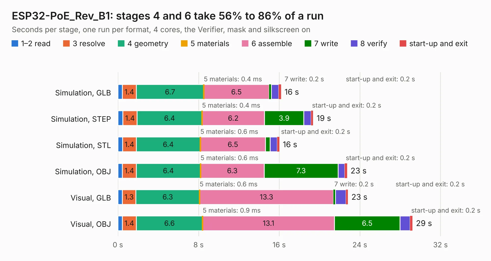

| Mode and format | 1–2 read | 3 resolve | 4 geometry | 5 materials | 6 assemble | 7 write | 8 verify | start-up and exit | Total |
|---|---:|---:|---:|---:|---:|---:|---:|---:|---:|
| Simulation, GLB | 0.4 | 1.4 | 6.7 | 0.4&nbsp;ms | 6.5 | 0.2 | 0.7 | 0.2 | 16.2 |
| Simulation, STEP | 0.5 | 1.4 | 6.4 | 0.4&nbsp;ms | 6.2 | 3.9 | 0.7 | 0.2 | 19.4 |
| Simulation, STL | 0.5 | 1.4 | 6.4 | 0.6&nbsp;ms | 6.5 | 0.4 | 0.7 | 0.2 | 16.0 |
| Simulation, OBJ | 0.4 | 1.4 | 6.4 | 0.6&nbsp;ms | 6.3 | 7.3 | 0.7 | 0.2 | 22.7 |
| Visual, GLB | 0.4 | 1.3 | 6.3 | 0.6&nbsp;ms | 13.3 | 0.2 | 1.0 | 0.2 | 22.8 |
| Visual, OBJ | 0.4 | 1.4 | 6.6 | 0.9&nbsp;ms | 13.1 | 6.5 | 1.0 | 0.2 | 29.2 |

<table align="center"><tr><td valign="top">

| Board | Repo: [OLIMEX/ESP32-POE](https://github.com/OLIMEX/ESP32-POE) Board: `ESP32-PoE_Rev_B1.kicad_pcb` |
|---|---|
| Folder | HARDWARE / ESP32-PoE-hardware-revision-B1 |
| Complexity | 294&nbsp;/&nbsp;1000 (size&nbsp;239, features&nbsp;55) |
| KESE&nbsp;features | through vias, slotted holes, filled zones, copper text |
| Tested | 9th November 2026 |
| Copper&nbsp;layers | 2 |
| File&nbsp;format | KiCad 5 (20171130) |
| Parts,&nbsp;tracks,&nbsp;vias | 111, 2,429, 176 |
| Triangles,&nbsp;simulation | 1,444,926 in 144 parts |
| Verifier | PASS in all six runs |

</td><td valign="top">

<table>
<tr><th>File type</th><th>File size</th><th>Peak memory used</th></tr>
<tr><th colspan="3" align="left">Simulation</th></tr>
<tr><td>GLB</td><td align="right">52&nbsp;MB</td><td align="right">554&nbsp;MB</td></tr>
<tr><td>STEP</td><td align="right">288&nbsp;MB</td><td align="right">719&nbsp;MB</td></tr>
<tr><td>STL</td><td align="right">72&nbsp;MB</td><td align="right">540&nbsp;MB</td></tr>
<tr><td>OBJ</td><td align="right">154&nbsp;MB</td><td align="right">1.0&nbsp;GB</td></tr>
<tr><th colspan="3" align="left">Visual</th></tr>
<tr><td>GLB</td><td align="right">43&nbsp;MB</td><td align="right">782&nbsp;MB</td></tr>
<tr><td>OBJ</td><td align="right">129&nbsp;MB</td><td align="right">893&nbsp;MB</td></tr>
</table>

</td></tr></table>

## 1838. ESP32-PoE_Rev_B2

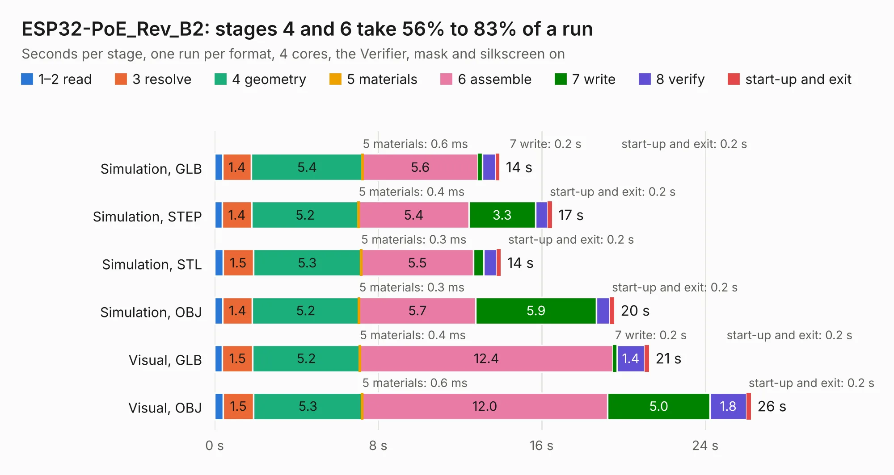

| Mode and format | 1–2 read | 3 resolve | 4 geometry | 5 materials | 6 assemble | 7 write | 8 verify | start-up and exit | Total |
|---|---:|---:|---:|---:|---:|---:|---:|---:|---:|
| Simulation, GLB | 0.4 | 1.4 | 5.4 | 0.6&nbsp;ms | 5.6 | 0.2 | 0.7 | 0.2 | 13.9 |
| Simulation, STEP | 0.4 | 1.4 | 5.2 | 0.4&nbsp;ms | 5.4 | 3.3 | 0.6 | 0.2 | 16.5 |
| Simulation, STL | 0.4 | 1.5 | 5.3 | 0.3&nbsp;ms | 5.5 | 0.5 | 0.6 | 0.2 | 14.0 |
| Simulation, OBJ | 0.4 | 1.4 | 5.2 | 0.3&nbsp;ms | 5.7 | 5.9 | 0.7 | 0.2 | 19.5 |
| Visual, GLB | 0.4 | 1.5 | 5.2 | 0.4&nbsp;ms | 12.4 | 0.2 | 1.4 | 0.2 | 21.3 |
| Visual, OBJ | 0.4 | 1.5 | 5.3 | 0.6&nbsp;ms | 12.0 | 5.0 | 1.8 | 0.2 | 26.2 |

<table align="center"><tr><td valign="top">

| Board | Repo: [OLIMEX/ESP32-POE](https://github.com/OLIMEX/ESP32-POE) Board: `ESP32-PoE_Rev_B2.kicad_pcb` |
|---|---|
| Folder | HARDWARE / ESP32-PoE-hardware-revision-B2 |
| Complexity | 294&nbsp;/&nbsp;1000 (size&nbsp;239, features&nbsp;55) |
| KESE&nbsp;features | through vias, slotted holes, filled zones, copper text |
| Tested | 9th November 2026 |
| Copper&nbsp;layers | 2 |
| File&nbsp;format | KiCad 5 (20171130) |
| Parts,&nbsp;tracks,&nbsp;vias | 112, 2,429, 176 |
| Triangles,&nbsp;simulation | 1,427,864 in 144 parts |
| Verifier | PASS in all six runs |

</td><td valign="top">

<table>
<tr><th>File type</th><th>File size</th><th>Peak memory used</th></tr>
<tr><th colspan="3" align="left">Simulation</th></tr>
<tr><td>GLB</td><td align="right">51&nbsp;MB</td><td align="right">545&nbsp;MB</td></tr>
<tr><td>STEP</td><td align="right">286&nbsp;MB</td><td align="right">746&nbsp;MB</td></tr>
<tr><td>STL</td><td align="right">71&nbsp;MB</td><td align="right">531&nbsp;MB</td></tr>
<tr><td>OBJ</td><td align="right">152&nbsp;MB</td><td align="right">996&nbsp;MB</td></tr>
<tr><th colspan="3" align="left">Visual</th></tr>
<tr><td>GLB</td><td align="right">42&nbsp;MB</td><td align="right">811&nbsp;MB</td></tr>
<tr><td>OBJ</td><td align="right">127&nbsp;MB</td><td align="right">902&nbsp;MB</td></tr>
</table>

</td></tr></table>

## 1839. ESP32-PoE_Rev_C

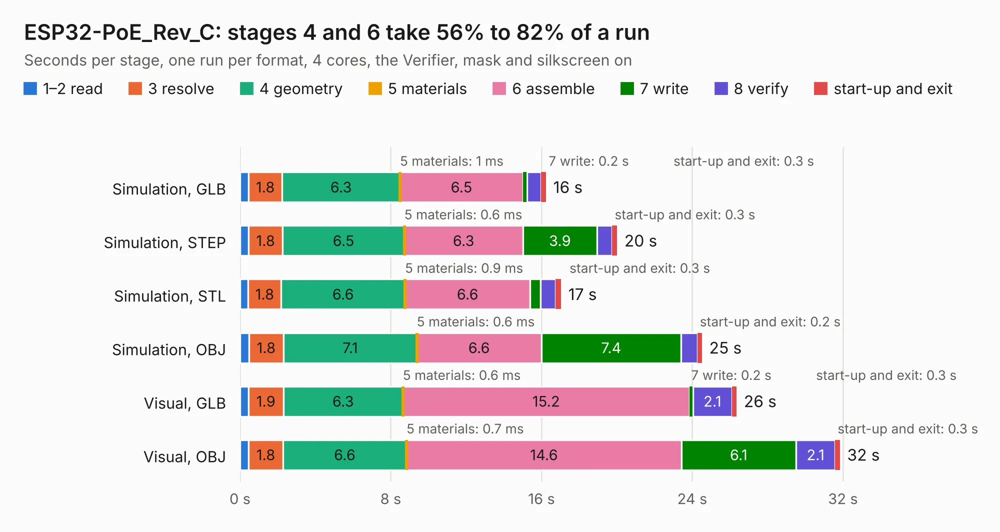

| Mode and format | 1–2 read | 3 resolve | 4 geometry | 5 materials | 6 assemble | 7 write | 8 verify | start-up and exit | Total |
|---|---:|---:|---:|---:|---:|---:|---:|---:|---:|
| Simulation, GLB | 0.4 | 1.8 | 6.3 | 1&nbsp;ms | 6.5 | 0.2 | 0.8 | 0.3 | 16.2 |
| Simulation, STEP | 0.4 | 1.8 | 6.5 | 0.6&nbsp;ms | 6.3 | 3.9 | 0.8 | 0.3 | 20.0 |
| Simulation, STL | 0.4 | 1.8 | 6.6 | 0.9&nbsp;ms | 6.6 | 0.5 | 0.8 | 0.3 | 17.0 |
| Simulation, OBJ | 0.5 | 1.8 | 7.1 | 0.6&nbsp;ms | 6.6 | 7.4 | 0.9 | 0.2 | 24.5 |
| Visual, GLB | 0.4 | 1.9 | 6.3 | 0.6&nbsp;ms | 15.2 | 0.2 | 2.1 | 0.3 | 26.4 |
| Visual, OBJ | 0.5 | 1.8 | 6.6 | 0.7&nbsp;ms | 14.6 | 6.1 | 2.1 | 0.3 | 31.8 |

<table align="center"><tr><td valign="top">

| Board | Repo: [OLIMEX/ESP32-POE](https://github.com/OLIMEX/ESP32-POE) Board: `ESP32-PoE_Rev_C.kicad_pcb` |
|---|---|
| Folder | HARDWARE / ESP32-PoE-hardware-revision-C |
| Complexity | 294&nbsp;/&nbsp;1000 (size&nbsp;239, features&nbsp;55) |
| KESE&nbsp;features | through vias, slotted holes, filled zones, copper text |
| Tested | 9th November 2026 |
| Copper&nbsp;layers | 2 |
| File&nbsp;format | KiCad 5 (20171130) |
| Parts,&nbsp;tracks,&nbsp;vias | 111, 2,500, 173 |
| Triangles,&nbsp;simulation | 1,413,496 in 139 parts |
| Verifier | PASS in all six runs |

</td><td valign="top">

<table>
<tr><th>File type</th><th>File size</th><th>Peak memory used</th></tr>
<tr><th colspan="3" align="left">Simulation</th></tr>
<tr><td>GLB</td><td align="right">50&nbsp;MB</td><td align="right">524&nbsp;MB</td></tr>
<tr><td>STEP</td><td align="right">284&nbsp;MB</td><td align="right">716&nbsp;MB</td></tr>
<tr><td>STL</td><td align="right">71&nbsp;MB</td><td align="right">563&nbsp;MB</td></tr>
<tr><td>OBJ</td><td align="right">151&nbsp;MB</td><td align="right">979&nbsp;MB</td></tr>
<tr><th colspan="3" align="left">Visual</th></tr>
<tr><td>GLB</td><td align="right">42&nbsp;MB</td><td align="right">787&nbsp;MB</td></tr>
<tr><td>OBJ</td><td align="right">126&nbsp;MB</td><td align="right">928&nbsp;MB</td></tr>
</table>

</td></tr></table>

## 1840. ESP32-PoE_Rev_C

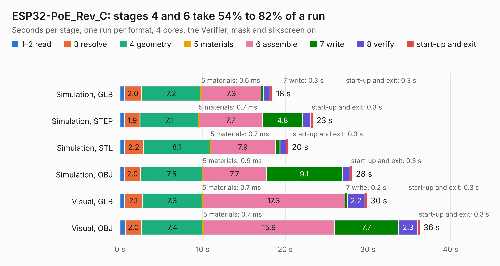

| Mode and format | 1–2 read | 3 resolve | 4 geometry | 5 materials | 6 assemble | 7 write | 8 verify | start-up and exit | Total |
|---|---:|---:|---:|---:|---:|---:|---:|---:|---:|
| Simulation, GLB | 0.6 | 2.0 | 7.2 | 0.6&nbsp;ms | 7.3 | 0.3 | 0.7 | 0.3 | 18.5 |
| Simulation, STEP | 0.6 | 1.9 | 7.1 | 0.7&nbsp;ms | 7.7 | 4.8 | 1.0 | 0.3 | 23.3 |
| Simulation, STL | 0.6 | 2.2 | 8.1 | 0.7&nbsp;ms | 7.9 | 0.5 | 0.8 | 0.3 | 20.4 |
| Simulation, OBJ | 0.5 | 2.0 | 7.5 | 0.9&nbsp;ms | 7.7 | 9.1 | 0.9 | 0.3 | 28.1 |
| Visual, GLB | 0.6 | 2.1 | 7.3 | 0.7&nbsp;ms | 17.3 | 0.2 | 2.2 | 0.3 | 29.9 |
| Visual, OBJ | 0.6 | 2.0 | 7.4 | 0.7&nbsp;ms | 15.9 | 7.7 | 2.3 | 0.3 | 36.3 |

<table align="center"><tr><td valign="top">

| Board | Repo: [OLIMEX/ESP32-POE](https://github.com/OLIMEX/ESP32-POE) Board: `ESP32-PoE_Rev_C.kicad_pcb` |
|---|---|
| Folder | HARDWARE / ESP32-PoE-hardware-revision-C1 |
| Complexity | 284&nbsp;/&nbsp;1000 (size&nbsp;239, features&nbsp;45) |
| KESE&nbsp;features | through vias, slotted holes, filled zones |
| Tested | 9th November 2026 |
| Copper&nbsp;layers | 2 |
| File&nbsp;format | KiCad 5 (20171130) |
| Parts,&nbsp;tracks,&nbsp;vias | 111, 2,500, 173 |
| Triangles,&nbsp;simulation | 1,379,052 in 139 parts |
| Verifier | PASS in all six runs |

</td><td valign="top">

<table>
<tr><th>File type</th><th>File size</th><th>Peak memory used</th></tr>
<tr><th colspan="3" align="left">Simulation</th></tr>
<tr><td>GLB</td><td align="right">49&nbsp;MB</td><td align="right">574&nbsp;MB</td></tr>
<tr><td>STEP</td><td align="right">274&nbsp;MB</td><td align="right">672&nbsp;MB</td></tr>
<tr><td>STL</td><td align="right">69&nbsp;MB</td><td align="right">578&nbsp;MB</td></tr>
<tr><td>OBJ</td><td align="right">147&nbsp;MB</td><td align="right">981&nbsp;MB</td></tr>
<tr><th colspan="3" align="left">Visual</th></tr>
<tr><td>GLB</td><td align="right">41&nbsp;MB</td><td align="right">783&nbsp;MB</td></tr>
<tr><td>OBJ</td><td align="right">125&nbsp;MB</td><td align="right">908&nbsp;MB</td></tr>
</table>

</td></tr></table>

## 1841. ESP32-PoE_Rev_D

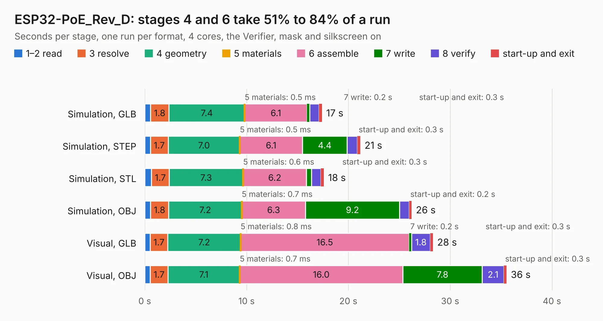

| Mode and format | 1–2 read | 3 resolve | 4 geometry | 5 materials | 6 assemble | 7 write | 8 verify | start-up and exit | Total |
|---|---:|---:|---:|---:|---:|---:|---:|---:|---:|
| Simulation, GLB | 0.6 | 1.8 | 7.4 | 0.5&nbsp;ms | 6.1 | 0.2 | 0.9 | 0.3 | 17.4 |
| Simulation, STEP | 0.6 | 1.7 | 7.0 | 0.5&nbsp;ms | 6.1 | 4.4 | 1.0 | 0.3 | 21.2 |
| Simulation, STL | 0.7 | 1.7 | 7.3 | 0.6&nbsp;ms | 6.2 | 0.5 | 0.9 | 0.3 | 17.6 |
| Simulation, OBJ | 0.6 | 1.8 | 7.2 | 0.7&nbsp;ms | 6.3 | 9.2 | 0.9 | 0.2 | 26.2 |
| Visual, GLB | 0.5 | 1.7 | 7.2 | 0.8&nbsp;ms | 16.5 | 0.2 | 1.8 | 0.3 | 28.3 |
| Visual, OBJ | 0.5 | 1.7 | 7.1 | 0.7&nbsp;ms | 16.0 | 7.8 | 2.1 | 0.3 | 35.5 |

<table align="center"><tr><td valign="top">

| Board | Repo: [OLIMEX/ESP32-POE](https://github.com/OLIMEX/ESP32-POE) Board: `ESP32-PoE_Rev_D.kicad_pcb` |
|---|---|
| Folder | HARDWARE / ESP32-PoE-hardware-revision-D |
| Complexity | 307&nbsp;/&nbsp;1000 (size&nbsp;242, features&nbsp;65) |
| KESE&nbsp;features | through vias, slotted holes, rounded, trapezoid or chamfered pads, filled zones, copper text |
| Tested | 9th November 2026 |
| Copper&nbsp;layers | 2 |
| File&nbsp;format | KiCad 5 (20171130) |
| Parts,&nbsp;tracks,&nbsp;vias | 117, 2,882, 234 |
| Triangles,&nbsp;simulation | 1,515,032 in 139 parts |
| Verifier | PASS in all six runs |

</td><td valign="top">

<table>
<tr><th>File type</th><th>File size</th><th>Peak memory used</th></tr>
<tr><th colspan="3" align="left">Simulation</th></tr>
<tr><td>GLB</td><td align="right">54&nbsp;MB</td><td align="right">653&nbsp;MB</td></tr>
<tr><td>STEP</td><td align="right">292&nbsp;MB</td><td align="right">748&nbsp;MB</td></tr>
<tr><td>STL</td><td align="right">76&nbsp;MB</td><td align="right">640&nbsp;MB</td></tr>
<tr><td>OBJ</td><td align="right">161&nbsp;MB</td><td align="right">1.1&nbsp;GB</td></tr>
<tr><th colspan="3" align="left">Visual</th></tr>
<tr><td>GLB</td><td align="right">45&nbsp;MB</td><td align="right">798&nbsp;MB</td></tr>
<tr><td>OBJ</td><td align="right">137&nbsp;MB</td><td align="right">1.0&nbsp;GB</td></tr>
</table>

</td></tr></table>

## 1842. ESP32-PoE_Rev_E

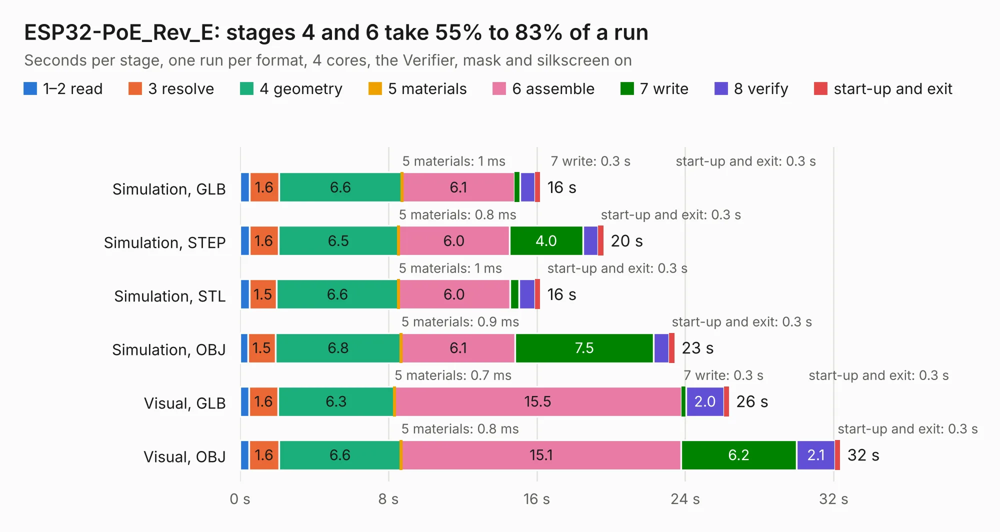

| Mode and format | 1–2 read | 3 resolve | 4 geometry | 5 materials | 6 assemble | 7 write | 8 verify | start-up and exit | Total |
|---|---:|---:|---:|---:|---:|---:|---:|---:|---:|
| Simulation, GLB | 0.5 | 1.6 | 6.6 | 1&nbsp;ms | 6.1 | 0.3 | 0.8 | 0.3 | 16.2 |
| Simulation, STEP | 0.5 | 1.6 | 6.5 | 0.8&nbsp;ms | 6.0 | 4.0 | 0.8 | 0.3 | 19.6 |
| Simulation, STL | 0.5 | 1.5 | 6.6 | 1&nbsp;ms | 6.0 | 0.5 | 0.9 | 0.3 | 16.2 |
| Simulation, OBJ | 0.4 | 1.5 | 6.8 | 0.9&nbsp;ms | 6.1 | 7.5 | 0.8 | 0.3 | 23.4 |
| Visual, GLB | 0.5 | 1.6 | 6.3 | 0.7&nbsp;ms | 15.5 | 0.3 | 2.0 | 0.3 | 26.3 |
| Visual, OBJ | 0.5 | 1.6 | 6.6 | 0.8&nbsp;ms | 15.1 | 6.2 | 2.1 | 0.3 | 32.3 |

<table align="center"><tr><td valign="top">

| Board | Repo: [OLIMEX/ESP32-POE](https://github.com/OLIMEX/ESP32-POE) Board: `ESP32-PoE_Rev_E.kicad_pcb` |
|---|---|
| Folder | HARDWARE / ESP32-PoE-hardware-revision-E |
| Complexity | 308&nbsp;/&nbsp;1000 (size&nbsp;243, features&nbsp;65) |
| KESE&nbsp;features | through vias, slotted holes, rounded, trapezoid or chamfered pads, filled zones, copper text |
| Tested | 9th November 2026 |
| Copper&nbsp;layers | 2 |
| File&nbsp;format | KiCad 5 (20171130) |
| Parts,&nbsp;tracks,&nbsp;vias | 118, 2,894, 234 |
| Triangles,&nbsp;simulation | 1,515,626 in 139 parts |
| Verifier | PASS in all six runs |

</td><td valign="top">

<table>
<tr><th>File type</th><th>File size</th><th>Peak memory used</th></tr>
<tr><th colspan="3" align="left">Simulation</th></tr>
<tr><td>GLB</td><td align="right">54&nbsp;MB</td><td align="right">670&nbsp;MB</td></tr>
<tr><td>STEP</td><td align="right">292&nbsp;MB</td><td align="right">760&nbsp;MB</td></tr>
<tr><td>STL</td><td align="right">76&nbsp;MB</td><td align="right">661&nbsp;MB</td></tr>
<tr><td>OBJ</td><td align="right">162&nbsp;MB</td><td align="right">1.1&nbsp;GB</td></tr>
<tr><th colspan="3" align="left">Visual</th></tr>
<tr><td>GLB</td><td align="right">45&nbsp;MB</td><td align="right">826&nbsp;MB</td></tr>
<tr><td>OBJ</td><td align="right">137&nbsp;MB</td><td align="right">949&nbsp;MB</td></tr>
</table>

</td></tr></table>

## 1843. ESP32-PoE_Rev_G1

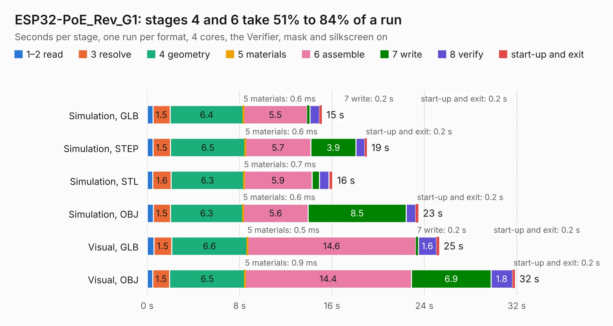

| Mode and format | 1–2 read | 3 resolve | 4 geometry | 5 materials | 6 assemble | 7 write | 8 verify | start-up and exit | Total |
|---|---:|---:|---:|---:|---:|---:|---:|---:|---:|
| Simulation, GLB | 0.5 | 1.5 | 6.4 | 0.6&nbsp;ms | 5.5 | 0.2 | 0.8 | 0.2 | 15.1 |
| Simulation, STEP | 0.5 | 1.5 | 6.5 | 0.6&nbsp;ms | 5.7 | 3.9 | 0.8 | 0.2 | 19.0 |
| Simulation, STL | 0.5 | 1.6 | 6.3 | 0.7&nbsp;ms | 5.9 | 0.6 | 0.8 | 0.3 | 16.1 |
| Simulation, OBJ | 0.5 | 1.5 | 6.3 | 0.6&nbsp;ms | 5.6 | 8.5 | 0.8 | 0.2 | 23.5 |
| Visual, GLB | 0.6 | 1.5 | 6.6 | 0.5&nbsp;ms | 14.6 | 0.2 | 1.6 | 0.2 | 25.3 |
| Visual, OBJ | 0.5 | 1.5 | 6.5 | 0.9&nbsp;ms | 14.4 | 6.9 | 1.8 | 0.2 | 31.8 |

<table align="center"><tr><td valign="top">

| Board | Repo: [OLIMEX/ESP32-POE](https://github.com/OLIMEX/ESP32-POE) Board: `ESP32-PoE_Rev_G1.kicad_pcb` |
|---|---|
| Folder | HARDWARE / ESP32-PoE-hardware-revision-G1 |
| Complexity | 297&nbsp;/&nbsp;1000 (size&nbsp;242, features&nbsp;55) |
| KESE&nbsp;features | through vias, slotted holes, rounded, trapezoid or chamfered pads, filled zones |
| Tested | 9th November 2026 |
| Copper&nbsp;layers | 2 |
| File&nbsp;format | KiCad 5 (20171130) |
| Parts,&nbsp;tracks,&nbsp;vias | 120, 2,717, 212 |
| Triangles,&nbsp;simulation | 1,477,504 in 135 parts |
| Verifier | PASS in all six runs |

</td><td valign="top">

<table>
<tr><th>File type</th><th>File size</th><th>Peak memory used</th></tr>
<tr><th colspan="3" align="left">Simulation</th></tr>
<tr><td>GLB</td><td align="right">53&nbsp;MB</td><td align="right">634&nbsp;MB</td></tr>
<tr><td>STEP</td><td align="right">287&nbsp;MB</td><td align="right">744&nbsp;MB</td></tr>
<tr><td>STL</td><td align="right">74&nbsp;MB</td><td align="right">642&nbsp;MB</td></tr>
<tr><td>OBJ</td><td align="right">158&nbsp;MB</td><td align="right">1.0&nbsp;GB</td></tr>
<tr><th colspan="3" align="left">Visual</th></tr>
<tr><td>GLB</td><td align="right">45&nbsp;MB</td><td align="right">783&nbsp;MB</td></tr>
<tr><td>OBJ</td><td align="right">137&nbsp;MB</td><td align="right">982&nbsp;MB</td></tr>
</table>

</td></tr></table>

## 1844. ESP32-PoE_Rev_I

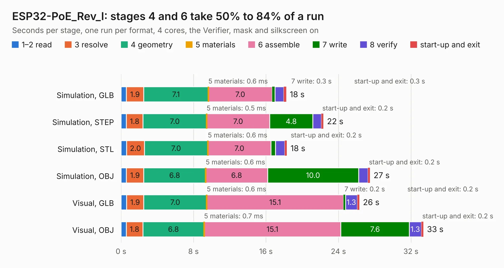

| Mode and format | 1–2 read | 3 resolve | 4 geometry | 5 materials | 6 assemble | 7 write | 8 verify | start-up and exit | Total |
|---|---:|---:|---:|---:|---:|---:|---:|---:|---:|
| Simulation, GLB | 0.6 | 1.9 | 7.1 | 0.6&nbsp;ms | 7.0 | 0.3 | 1.0 | 0.3 | 18.2 |
| Simulation, STEP | 0.6 | 1.8 | 7.0 | 0.5&nbsp;ms | 7.0 | 4.8 | 0.9 | 0.2 | 22.3 |
| Simulation, STL | 0.6 | 2.0 | 7.0 | 0.6&nbsp;ms | 7.0 | 0.5 | 1.0 | 0.2 | 18.3 |
| Simulation, OBJ | 0.6 | 1.9 | 6.8 | 0.6&nbsp;ms | 6.8 | 10.0 | 1.0 | 0.2 | 27.5 |
| Visual, GLB | 0.6 | 1.9 | 7.0 | 0.6&nbsp;ms | 15.1 | 0.2 | 1.3 | 0.2 | 26.3 |
| Visual, OBJ | 0.6 | 1.8 | 6.8 | 0.7&nbsp;ms | 15.1 | 7.6 | 1.3 | 0.2 | 33.4 |

<table align="center"><tr><td valign="top">

| Board | Repo: [OLIMEX/ESP32-POE](https://github.com/OLIMEX/ESP32-POE) Board: `ESP32-PoE_Rev_I.kicad_pcb` |
|---|---|
| Folder | HARDWARE / ESP32-PoE-hardware-revision-I |
| Complexity | 324&nbsp;/&nbsp;1000 (size&nbsp;259, features&nbsp;65) |
| KESE&nbsp;features | through vias, slotted holes, rounded, trapezoid or chamfered pads, filled zones, copper text |
| Tested | 9th November 2026 |
| Copper&nbsp;layers | 4 |
| File&nbsp;format | KiCad 5 (20171130) |
| Parts,&nbsp;tracks,&nbsp;vias | 123, 2,830, 219 |
| Triangles,&nbsp;simulation | 1,907,268 in 138 parts |
| Verifier | PASS in all six runs |

</td><td valign="top">

<table>
<tr><th>File type</th><th>File size</th><th>Peak memory used</th></tr>
<tr><th colspan="3" align="left">Simulation</th></tr>
<tr><td>GLB</td><td align="right">67&nbsp;MB</td><td align="right">694&nbsp;MB</td></tr>
<tr><td>STEP</td><td align="right">306&nbsp;MB</td><td align="right">846&nbsp;MB</td></tr>
<tr><td>STL</td><td align="right">95&nbsp;MB</td><td align="right">691&nbsp;MB</td></tr>
<tr><td>OBJ</td><td align="right">204&nbsp;MB</td><td align="right">1.3&nbsp;GB</td></tr>
<tr><th colspan="3" align="left">Visual</th></tr>
<tr><td>GLB</td><td align="right">48&nbsp;MB</td><td align="right">859&nbsp;MB</td></tr>
<tr><td>OBJ</td><td align="right">147&nbsp;MB</td><td align="right">1.1&nbsp;GB</td></tr>
</table>

</td></tr></table>

## 1845. ESP32-PoE_Rev_J

| Mode and format | 1–2 read | 3 resolve | 4 geometry | 5 materials | 6 assemble | 7 write | 8 verify | start-up and exit | Total |
|---|---:|---:|---:|---:|---:|---:|---:|---:|---:|
| Simulation, GLB | 0.6 | 2.0 | 6.4 | 0.6&nbsp;ms | 7.0 | 0.3 | 1.0 | 0.3 | 17.5 |
| Simulation, STEP | 0.5 | 2.1 | 6.6 | 0.7&nbsp;ms | 6.9 | 4.3 | 0.9 | 0.2 | 21.6 |
| Simulation, STL | 0.5 | 1.7 | 6.5 | 0.6&nbsp;ms | 6.9 | 0.6 | 0.9 | 0.3 | 17.5 |
| Simulation, OBJ | 0.6 | 2.1 | 6.7 | 0.9&nbsp;ms | 7.0 | 9.7 | 0.9 | 0.3 | 27.3 |
| Visual, GLB | 0.6 | 1.8 | 6.7 | 0.8&nbsp;ms | 17.0 | 0.2 | 2.1 | 0.3 | 28.7 |
| Visual, OBJ | 0.6 | 2.0 | 6.5 | 0.7&nbsp;ms | 17.5 | 7.1 | 2.4 | 0.3 | 36.4 |

<table align="center"><tr><td valign="top">

| Board | Repo: [OLIMEX/ESP32-POE](https://github.com/OLIMEX/ESP32-POE) Board: `ESP32-PoE_Rev_J.kicad_pcb` |
|---|---|
| Folder | HARDWARE / ESP32-PoE-hardware-revision-J |
| Complexity | 323&nbsp;/&nbsp;1000 (size&nbsp;258, features&nbsp;65) |
| KESE&nbsp;features | through vias, slotted holes, rounded, trapezoid or chamfered pads, filled zones, copper text |
| Tested | 9th November 2026 |
| Copper&nbsp;layers | 4 |
| File&nbsp;format | KiCad 5 (20171130) |
| Parts,&nbsp;tracks,&nbsp;vias | 126, 2,532, 219 |
| Triangles,&nbsp;simulation | 2,002,088 in 139 parts |
| Verifier | PASS in all six runs |

</td><td valign="top">

<table>
<tr><th>File type</th><th>File size</th><th>Peak memory used</th></tr>
<tr><th colspan="3" align="left">Simulation</th></tr>
<tr><td>GLB</td><td align="right">71&nbsp;MB</td><td align="right">687&nbsp;MB</td></tr>
<tr><td>STEP</td><td align="right">310&nbsp;MB</td><td align="right">840&nbsp;MB</td></tr>
<tr><td>STL</td><td align="right">100&nbsp;MB</td><td align="right">708&nbsp;MB</td></tr>
<tr><td>OBJ</td><td align="right">214&nbsp;MB</td><td align="right">1.4&nbsp;GB</td></tr>
<tr><th colspan="3" align="left">Visual</th></tr>
<tr><td>GLB</td><td align="right">48&nbsp;MB</td><td align="right">854&nbsp;MB</td></tr>
<tr><td>OBJ</td><td align="right">147&nbsp;MB</td><td align="right">1.1&nbsp;GB</td></tr>
</table>

</td></tr></table>

## 1846. ESP32-PoE_Rev_K

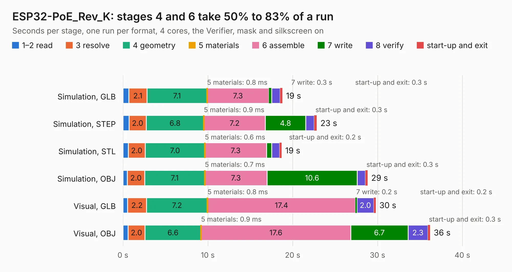

| Mode and format | 1–2 read | 3 resolve | 4 geometry | 5 materials | 6 assemble | 7 write | 8 verify | start-up and exit | Total |
|---|---:|---:|---:|---:|---:|---:|---:|---:|---:|
| Simulation, GLB | 0.7 | 2.1 | 7.1 | 0.8&nbsp;ms | 7.3 | 0.3 | 1.0 | 0.3 | 18.8 |
| Simulation, STEP | 0.7 | 2.0 | 6.8 | 0.9&nbsp;ms | 7.2 | 4.8 | 1.0 | 0.3 | 22.8 |
| Simulation, STL | 0.6 | 2.0 | 7.0 | 0.6&nbsp;ms | 7.3 | 0.6 | 0.9 | 0.2 | 18.7 |
| Simulation, OBJ | 0.5 | 2.0 | 7.1 | 0.7&nbsp;ms | 7.3 | 10.6 | 1.0 | 0.3 | 28.8 |
| Visual, GLB | 0.5 | 2.2 | 7.2 | 0.8&nbsp;ms | 17.4 | 0.2 | 2.0 | 0.2 | 29.8 |
| Visual, OBJ | 0.6 | 2.0 | 6.6 | 0.9&nbsp;ms | 17.6 | 6.7 | 2.3 | 0.3 | 36.2 |

<table align="center"><tr><td valign="top">

| Board | Repo: [OLIMEX/ESP32-POE](https://github.com/OLIMEX/ESP32-POE) Board: `ESP32-PoE_Rev_K.kicad_pcb` |
|---|---|
| Folder | HARDWARE / ESP32-PoE-hardware-revision-K |
| Complexity | 323&nbsp;/&nbsp;1000 (size&nbsp;258, features&nbsp;65) |
| KESE&nbsp;features | through vias, slotted holes, rounded, trapezoid or chamfered pads, filled zones, copper text |
| Tested | 9th November 2026 |
| Copper&nbsp;layers | 4 |
| File&nbsp;format | KiCad 5 (20171130) |
| Parts,&nbsp;tracks,&nbsp;vias | 128, 2,562, 219 |
| Triangles,&nbsp;simulation | 2,011,184 in 139 parts |
| Verifier | PASS in all six runs |

</td><td valign="top">

<table>
<tr><th>File type</th><th>File size</th><th>Peak memory used</th></tr>
<tr><th colspan="3" align="left">Simulation</th></tr>
<tr><td>GLB</td><td align="right">71&nbsp;MB</td><td align="right">782&nbsp;MB</td></tr>
<tr><td>STEP</td><td align="right">312&nbsp;MB</td><td align="right">870&nbsp;MB</td></tr>
<tr><td>STL</td><td align="right">101&nbsp;MB</td><td align="right">734&nbsp;MB</td></tr>
<tr><td>OBJ</td><td align="right">215&nbsp;MB</td><td align="right">1.4&nbsp;GB</td></tr>
<tr><th colspan="3" align="left">Visual</th></tr>
<tr><td>GLB</td><td align="right">49&nbsp;MB</td><td align="right">877&nbsp;MB</td></tr>
<tr><td>OBJ</td><td align="right">148&nbsp;MB</td><td align="right">1.1&nbsp;GB</td></tr>
</table>

</td></tr></table>

## 1847. ESP32-PoE_Rev_L

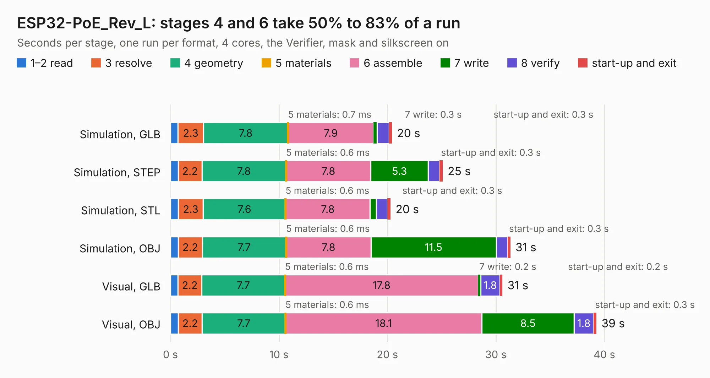

| Mode and format | 1–2 read | 3 resolve | 4 geometry | 5 materials | 6 assemble | 7 write | 8 verify | start-up and exit | Total |
|---|---:|---:|---:|---:|---:|---:|---:|---:|---:|
| Simulation, GLB | 0.7 | 2.3 | 7.8 | 0.7&nbsp;ms | 7.9 | 0.3 | 1.1 | 0.3 | 20.4 |
| Simulation, STEP | 0.7 | 2.2 | 7.8 | 0.6&nbsp;ms | 7.8 | 5.3 | 1.1 | 0.3 | 25.1 |
| Simulation, STL | 0.7 | 2.3 | 7.6 | 0.6&nbsp;ms | 7.8 | 0.6 | 1.0 | 0.3 | 20.3 |
| Simulation, OBJ | 0.7 | 2.2 | 7.7 | 0.6&nbsp;ms | 7.8 | 11.5 | 1.1 | 0.3 | 31.3 |
| Visual, GLB | 0.7 | 2.2 | 7.7 | 0.6&nbsp;ms | 17.8 | 0.2 | 1.8 | 0.2 | 30.6 |
| Visual, OBJ | 0.7 | 2.2 | 7.7 | 0.6&nbsp;ms | 18.1 | 8.5 | 1.8 | 0.3 | 39.3 |

<table align="center"><tr><td valign="top">

| Board | Repo: [OLIMEX/ESP32-POE](https://github.com/OLIMEX/ESP32-POE) Board: `ESP32-PoE_Rev_L.kicad_pcb` |
|---|---|
| Folder | HARDWARE / ESP32-PoE-hardware-revision-L |
| Complexity | 323&nbsp;/&nbsp;1000 (size&nbsp;258, features&nbsp;65) |
| KESE&nbsp;features | through vias, slotted holes, rounded, trapezoid or chamfered pads, filled zones, copper text |
| Tested | 9th November 2026 |
| Copper&nbsp;layers | 4 |
| File&nbsp;format | KiCad 5 (20171130) |
| Parts,&nbsp;tracks,&nbsp;vias | 128, 2,574, 221 |
| Triangles,&nbsp;simulation | 2,018,962 in 139 parts |
| Verifier | PASS in all six runs |

</td><td valign="top">

<table>
<tr><th>File type</th><th>File size</th><th>Peak memory used</th></tr>
<tr><th colspan="3" align="left">Simulation</th></tr>
<tr><td>GLB</td><td align="right">71&nbsp;MB</td><td align="right">669&nbsp;MB</td></tr>
<tr><td>STEP</td><td align="right">313&nbsp;MB</td><td align="right">857&nbsp;MB</td></tr>
<tr><td>STL</td><td align="right">101&nbsp;MB</td><td align="right">677&nbsp;MB</td></tr>
<tr><td>OBJ</td><td align="right">216&nbsp;MB</td><td align="right">1.4&nbsp;GB</td></tr>
<tr><th colspan="3" align="left">Visual</th></tr>
<tr><td>GLB</td><td align="right">49&nbsp;MB</td><td align="right">864&nbsp;MB</td></tr>
<tr><td>OBJ</td><td align="right">149&nbsp;MB</td><td align="right">1.1&nbsp;GB</td></tr>
</table>

</td></tr></table>

## 1848. ESP32-PoE_Rev_L1

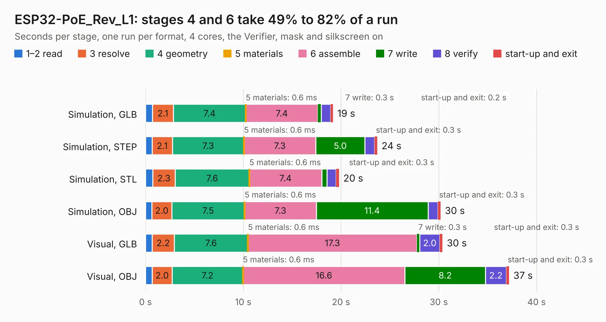

| Mode and format | 1–2 read | 3 resolve | 4 geometry | 5 materials | 6 assemble | 7 write | 8 verify | start-up and exit | Total |
|---|---:|---:|---:|---:|---:|---:|---:|---:|---:|
| Simulation, GLB | 0.7 | 2.1 | 7.4 | 0.6&nbsp;ms | 7.4 | 0.3 | 1.0 | 0.2 | 19.2 |
| Simulation, STEP | 0.7 | 2.1 | 7.3 | 0.6&nbsp;ms | 7.3 | 5.0 | 1.0 | 0.3 | 23.7 |
| Simulation, STL | 0.7 | 2.3 | 7.6 | 0.6&nbsp;ms | 7.4 | 0.6 | 0.9 | 0.3 | 19.8 |
| Simulation, OBJ | 0.7 | 2.0 | 7.5 | 0.6&nbsp;ms | 7.3 | 11.4 | 1.0 | 0.3 | 30.2 |
| Visual, GLB | 0.7 | 2.2 | 7.6 | 0.6&nbsp;ms | 17.3 | 0.3 | 2.0 | 0.3 | 30.4 |
| Visual, OBJ | 0.7 | 2.0 | 7.2 | 0.6&nbsp;ms | 16.6 | 8.2 | 2.2 | 0.3 | 37.2 |

<table align="center"><tr><td valign="top">

| Board | Repo: [OLIMEX/ESP32-POE](https://github.com/OLIMEX/ESP32-POE) Board: `ESP32-PoE_Rev_L1.kicad_pcb` |
|---|---|
| Folder | HARDWARE / ESP32-PoE-hardware-revision-L1 |
| Complexity | 323&nbsp;/&nbsp;1000 (size&nbsp;258, features&nbsp;65) |
| KESE&nbsp;features | through vias, slotted holes, rounded, trapezoid or chamfered pads, filled zones, copper text |
| Tested | 9th November 2026 |
| Copper&nbsp;layers | 4 |
| File&nbsp;format | KiCad 5 (20171130) |
| Parts,&nbsp;tracks,&nbsp;vias | 128, 2,574, 221 |
| Triangles,&nbsp;simulation | 2,024,004 in 139 parts |
| Verifier | PASS in all six runs |

</td><td valign="top">

<table>
<tr><th>File type</th><th>File size</th><th>Peak memory used</th></tr>
<tr><th colspan="3" align="left">Simulation</th></tr>
<tr><td>GLB</td><td align="right">71&nbsp;MB</td><td align="right">673&nbsp;MB</td></tr>
<tr><td>STEP</td><td align="right">314&nbsp;MB</td><td align="right">826&nbsp;MB</td></tr>
<tr><td>STL</td><td align="right">101&nbsp;MB</td><td align="right">703&nbsp;MB</td></tr>
<tr><td>OBJ</td><td align="right">216&nbsp;MB</td><td align="right">1.4&nbsp;GB</td></tr>
<tr><th colspan="3" align="left">Visual</th></tr>
<tr><td>GLB</td><td align="right">49&nbsp;MB</td><td align="right">860&nbsp;MB</td></tr>
<tr><td>OBJ</td><td align="right">149&nbsp;MB</td><td align="right">1.1&nbsp;GB</td></tr>
</table>

</td></tr></table>

## 1849. ESP32-PoE_Rev_M

| Mode and format | 1–2 read | 3 resolve | 4 geometry | 5 materials | 6 assemble | 7 write | 8 verify | start-up and exit | Total |
|---|---:|---:|---:|---:|---:|---:|---:|---:|---:|
| Simulation, GLB | 0.8 | 2.0 | 6.8 | 0.6&nbsp;ms | 6.9 | 0.3 | 1.0 | 0.3 | 18.0 |
| Simulation, STEP | 0.7 | 2.0 | 6.7 | 0.8&nbsp;ms | 6.7 | 4.6 | 1.0 | 0.3 | 22.1 |
| Simulation, STL | 0.7 | 2.1 | 6.9 | 0.5&nbsp;ms | 6.9 | 0.5 | 0.9 | 0.2 | 18.3 |
| Simulation, OBJ | 0.8 | 2.0 | 6.8 | 0.6&nbsp;ms | 6.7 | 10.4 | 1.0 | 0.3 | 28.0 |
| Visual, GLB | 0.8 | 2.1 | 6.8 | 0.6&nbsp;ms | 14.8 | 0.2 | 1.3 | 0.2 | 26.2 |
| Visual, OBJ | 0.7 | 2.0 | 6.9 | 0.7&nbsp;ms | 14.8 | 7.2 | 1.2 | 0.2 | 33.0 |

<table align="center"><tr><td valign="top">

| Board | Repo: [OLIMEX/ESP32-POE](https://github.com/OLIMEX/ESP32-POE) Board: `ESP32-PoE_Rev_M.kicad_pcb` |
|---|---|
| Folder | HARDWARE / ESP32-PoE-hardware-revision-M |
| Complexity | 368&nbsp;/&nbsp;1000 (size&nbsp;258, features&nbsp;110) |
| KESE&nbsp;features | through vias, slotted holes, rounded, trapezoid or chamfered pads, filled zones, copper text, knockout text, stack-up, dielectric εr and tanδ |
| Tested | 9th November 2026 |
| Copper&nbsp;layers | 4 |
| File&nbsp;format | KiCad 7 (20221018) |
| Parts,&nbsp;tracks,&nbsp;vias | 127, 2,528, 233 |
| Triangles,&nbsp;simulation | 1,971,162 in 133 parts |
| Verifier | PASS in all six runs |

</td><td valign="top">

<table>
<tr><th>File type</th><th>File size</th><th>Peak memory used</th></tr>
<tr><th colspan="3" align="left">Simulation</th></tr>
<tr><td>GLB</td><td align="right">69&nbsp;MB</td><td align="right">722&nbsp;MB</td></tr>
<tr><td>STEP</td><td align="right">335&nbsp;MB</td><td align="right">887&nbsp;MB</td></tr>
<tr><td>STL</td><td align="right">99&nbsp;MB</td><td align="right">694&nbsp;MB</td></tr>
<tr><td>OBJ</td><td align="right">211&nbsp;MB</td><td align="right">1.4&nbsp;GB</td></tr>
<tr><th colspan="3" align="left">Visual</th></tr>
<tr><td>GLB</td><td align="right">47&nbsp;MB</td><td align="right">874&nbsp;MB</td></tr>
<tr><td>OBJ</td><td align="right">144&nbsp;MB</td><td align="right">1.1&nbsp;GB</td></tr>
</table>

</td></tr></table>

## 1850. ESP32-PoE_Rev_M1

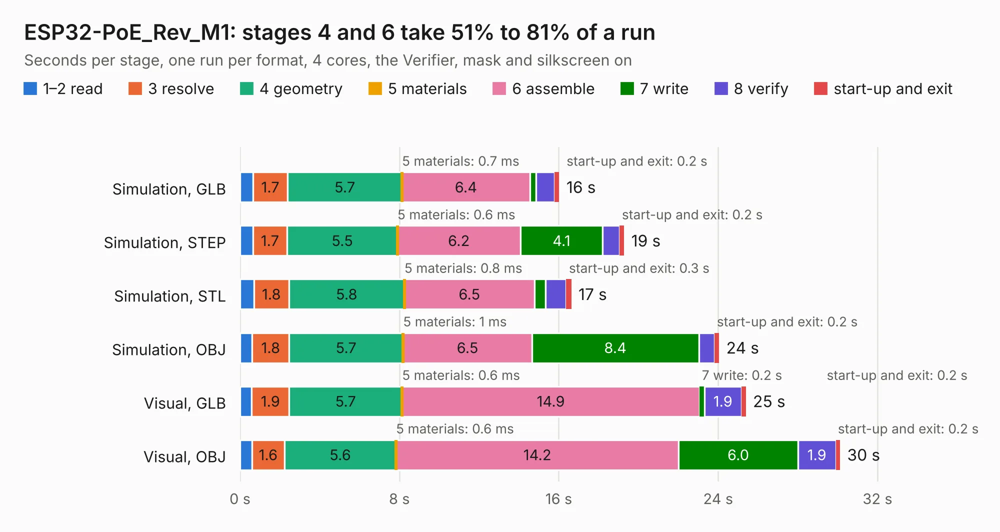

| Mode and format | 1–2 read | 3 resolve | 4 geometry | 5 materials | 6 assemble | 7 write | 8 verify | start-up and exit | Total |
|---|---:|---:|---:|---:|---:|---:|---:|---:|---:|
| Simulation, GLB | 0.7 | 1.7 | 5.7 | 0.7&nbsp;ms | 6.4 | 0.3 | 0.9 | 0.2 | 16.0 |
| Simulation, STEP | 0.6 | 1.7 | 5.5 | 0.6&nbsp;ms | 6.2 | 4.1 | 0.9 | 0.2 | 19.3 |
| Simulation, STL | 0.7 | 1.8 | 5.8 | 0.8&nbsp;ms | 6.5 | 0.6 | 1.0 | 0.3 | 16.6 |
| Simulation, OBJ | 0.6 | 1.8 | 5.7 | 1&nbsp;ms | 6.5 | 8.4 | 0.8 | 0.2 | 24.0 |
| Visual, GLB | 0.6 | 1.9 | 5.7 | 0.6&nbsp;ms | 14.9 | 0.2 | 1.9 | 0.2 | 25.4 |
| Visual, OBJ | 0.6 | 1.6 | 5.6 | 0.6&nbsp;ms | 14.2 | 6.0 | 1.9 | 0.2 | 30.1 |

<table align="center"><tr><td valign="top">

| Board | Repo: [OLIMEX/ESP32-POE](https://github.com/OLIMEX/ESP32-POE) Board: `ESP32-PoE_Rev_M1.kicad_pcb` |
|---|---|
| Folder | HARDWARE / ESP32-PoE-hardware-revision-M1 |
| Complexity | 368&nbsp;/&nbsp;1000 (size&nbsp;258, features&nbsp;110) |
| KESE&nbsp;features | through vias, slotted holes, rounded, trapezoid or chamfered pads, filled zones, copper text, knockout text, stack-up, dielectric εr and tanδ |
| Tested | 9th November 2026 |
| Copper&nbsp;layers | 4 |
| File&nbsp;format | KiCad 7 (20221018) |
| Parts,&nbsp;tracks,&nbsp;vias | 127, 2,528, 233 |
| Triangles,&nbsp;simulation | 1,971,162 in 133 parts |
| Verifier | PASS in all six runs |

</td><td valign="top">

<table>
<tr><th>File type</th><th>File size</th><th>Peak memory used</th></tr>
<tr><th colspan="3" align="left">Simulation</th></tr>
<tr><td>GLB</td><td align="right">69&nbsp;MB</td><td align="right">741&nbsp;MB</td></tr>
<tr><td>STEP</td><td align="right">335&nbsp;MB</td><td align="right">835&nbsp;MB</td></tr>
<tr><td>STL</td><td align="right">99&nbsp;MB</td><td align="right">745&nbsp;MB</td></tr>
<tr><td>OBJ</td><td align="right">211&nbsp;MB</td><td align="right">1.4&nbsp;GB</td></tr>
<tr><th colspan="3" align="left">Visual</th></tr>
<tr><td>GLB</td><td align="right">47&nbsp;MB</td><td align="right">848&nbsp;MB</td></tr>
<tr><td>OBJ</td><td align="right">144&nbsp;MB</td><td align="right">1.1&nbsp;GB</td></tr>
</table>

</td></tr></table>

## 1851. ESP32-PoE_Rev_M2

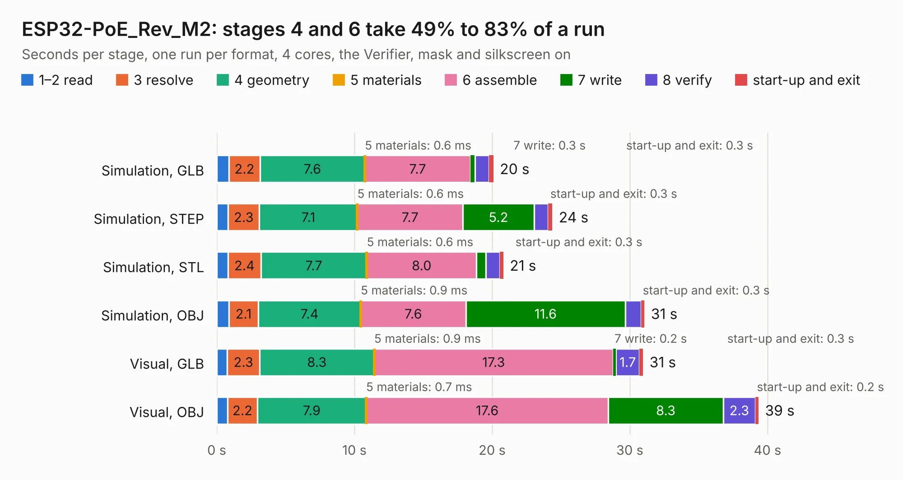

| Mode and format | 1–2 read | 3 resolve | 4 geometry | 5 materials | 6 assemble | 7 write | 8 verify | start-up and exit | Total |
|---|---:|---:|---:|---:|---:|---:|---:|---:|---:|
| Simulation, GLB | 0.9 | 2.2 | 7.6 | 0.6&nbsp;ms | 7.7 | 0.3 | 1.0 | 0.3 | 20.1 |
| Simulation, STEP | 0.8 | 2.3 | 7.1 | 0.6&nbsp;ms | 7.7 | 5.2 | 1.0 | 0.3 | 24.4 |
| Simulation, STL | 0.8 | 2.4 | 7.7 | 0.6&nbsp;ms | 8.0 | 0.7 | 1.0 | 0.3 | 20.8 |
| Simulation, OBJ | 0.9 | 2.1 | 7.4 | 0.9&nbsp;ms | 7.6 | 11.6 | 1.1 | 0.3 | 31.1 |
| Visual, GLB | 0.8 | 2.3 | 8.3 | 0.9&nbsp;ms | 17.3 | 0.2 | 1.7 | 0.3 | 31.0 |
| Visual, OBJ | 0.8 | 2.2 | 7.9 | 0.7&nbsp;ms | 17.6 | 8.3 | 2.3 | 0.2 | 39.3 |

<table align="center"><tr><td valign="top">

| Board | Repo: [OLIMEX/ESP32-POE](https://github.com/OLIMEX/ESP32-POE) Board: `ESP32-PoE_Rev_M2.kicad_pcb` |
|---|---|
| Folder | HARDWARE / ESP32-PoE-hardware-revision-M2 |
| Complexity | 368&nbsp;/&nbsp;1000 (size&nbsp;258, features&nbsp;110) |
| KESE&nbsp;features | through vias, slotted holes, rounded, trapezoid or chamfered pads, filled zones, copper text, knockout text, stack-up, dielectric εr and tanδ |
| Tested | 9th November 2026 |
| Copper&nbsp;layers | 4 |
| File&nbsp;format | KiCad 7 (20221018) |
| Parts,&nbsp;tracks,&nbsp;vias | 128, 2,528, 233 |
| Triangles,&nbsp;simulation | 1,972,166 in 133 parts |
| Verifier | PASS in all six runs |

</td><td valign="top">

<table>
<tr><th>File type</th><th>File size</th><th>Peak memory used</th></tr>
<tr><th colspan="3" align="left">Simulation</th></tr>
<tr><td>GLB</td><td align="right">69&nbsp;MB</td><td align="right">713&nbsp;MB</td></tr>
<tr><td>STEP</td><td align="right">335&nbsp;MB</td><td align="right">843&nbsp;MB</td></tr>
<tr><td>STL</td><td align="right">99&nbsp;MB</td><td align="right">761&nbsp;MB</td></tr>
<tr><td>OBJ</td><td align="right">211&nbsp;MB</td><td align="right">1.4&nbsp;GB</td></tr>
<tr><th colspan="3" align="left">Visual</th></tr>
<tr><td>GLB</td><td align="right">47&nbsp;MB</td><td align="right">835&nbsp;MB</td></tr>
<tr><td>OBJ</td><td align="right">145&nbsp;MB</td><td align="right">1.0&nbsp;GB</td></tr>
</table>

</td></tr></table>

## 1852. ESP32-PoE-ISO_Rev_B

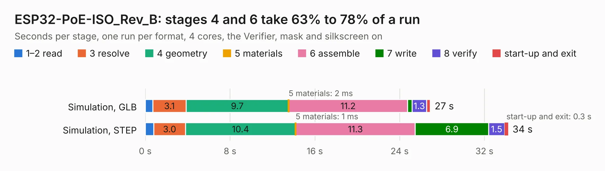

| Mode and format | 1–2 read | 3 resolve | 4 geometry | 5 materials | 6 assemble | 7 write | 8 verify | start-up and exit | Total |
|---|---:|---:|---:|---:|---:|---:|---:|---:|---:|
| Simulation, GLB | 0.7 | 3.1 | 9.7 | 2&nbsp;ms | 11.2 | 0.4 | 1.3 | 0.4 | 26.9 |
| Simulation, STEP | 0.8 | 3.0 | 10.4 | 1&nbsp;ms | 11.3 | 6.9 | 1.5 | 0.3 | 34.2 |
| Simulation, STL | 0.9 | 3.8 | 10.1 | 1&nbsp;ms | 10.4 | 1.0 | 1.5 | 0.4 | 28.2 |
| Simulation, OBJ | 0.8 | 3.2 | 9.1 | 1&nbsp;ms | 10.4 | 14.2 | 1.1 | 0.3 | 39.2 |
| Visual, GLB | 0.7 | 2.9 | 8.6 | 1&nbsp;ms | 22.2 | 0.3 | 2.9 | 0.2 | 37.7 |
| Visual, OBJ | 0.7 | 2.6 | 8.3 | 1&nbsp;ms | 21.5 | 9.5 | 3.0 | 0.3 | 46.0 |

<table align="center"><tr><td valign="top">

| Board | Repo: [OLIMEX/ESP32-POE-ISO](https://github.com/OLIMEX/ESP32-POE-ISO) Board: `ESP32-PoE-ISO_Rev_B.kicad_pcb` |
|---|---|
| Folder | HARDWARE / ESP32-PoE-ISO-Rev.B |
| Complexity | 325&nbsp;/&nbsp;1000 (size&nbsp;260, features&nbsp;65) |
| KESE&nbsp;features | through vias, slotted holes, rounded, trapezoid or chamfered pads, filled zones, curved board outline |
| Tested | 9th November 2026 |
| Copper&nbsp;layers | 4 |
| File&nbsp;format | KiCad 5 (20171130) |
| Parts,&nbsp;tracks,&nbsp;vias | 118, 2,830, 332 |
| Triangles,&nbsp;simulation | 2,271,626 in 142 parts |
| Verifier | PASS in all six runs |

</td><td valign="top">

<table>
<tr><th>File type</th><th>File size</th><th>Peak memory used</th></tr>
<tr><th colspan="3" align="left">Simulation</th></tr>
<tr><td>GLB</td><td align="right">79&nbsp;MB</td><td align="right">817&nbsp;MB</td></tr>
<tr><td>STEP</td><td align="right">312&nbsp;MB</td><td align="right">892&nbsp;MB</td></tr>
<tr><td>STL</td><td align="right">114&nbsp;MB</td><td align="right">805&nbsp;MB</td></tr>
<tr><td>OBJ</td><td align="right">242&nbsp;MB</td><td align="right">1.5&nbsp;GB</td></tr>
<tr><th colspan="3" align="left">Visual</th></tr>
<tr><td>GLB</td><td align="right">51&nbsp;MB</td><td align="right">892&nbsp;MB</td></tr>
<tr><td>OBJ</td><td align="right">157&nbsp;MB</td><td align="right">1.1&nbsp;GB</td></tr>
</table>

</td></tr></table>

## 1853. ESP32-PoE-ISO_Rev_C

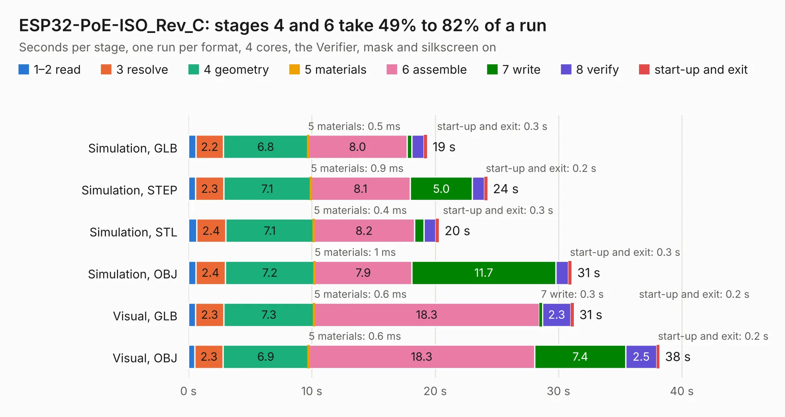

| Mode and format | 1–2 read | 3 resolve | 4 geometry | 5 materials | 6 assemble | 7 write | 8 verify | start-up and exit | Total |
|---|---:|---:|---:|---:|---:|---:|---:|---:|---:|
| Simulation, GLB | 0.6 | 2.2 | 6.8 | 0.5&nbsp;ms | 8.0 | 0.4 | 1.0 | 0.3 | 19.3 |
| Simulation, STEP | 0.6 | 2.3 | 7.1 | 0.9&nbsp;ms | 8.1 | 5.0 | 1.0 | 0.2 | 24.2 |
| Simulation, STL | 0.7 | 2.4 | 7.1 | 0.4&nbsp;ms | 8.2 | 0.8 | 1.0 | 0.3 | 20.3 |
| Simulation, OBJ | 0.6 | 2.4 | 7.2 | 1&nbsp;ms | 7.9 | 11.7 | 1.0 | 0.3 | 31.1 |
| Visual, GLB | 0.6 | 2.3 | 7.3 | 0.6&nbsp;ms | 18.3 | 0.3 | 2.3 | 0.2 | 31.2 |
| Visual, OBJ | 0.5 | 2.3 | 6.9 | 0.6&nbsp;ms | 18.3 | 7.4 | 2.5 | 0.2 | 38.2 |

<table align="center"><tr><td valign="top">

| Board | Repo: [OLIMEX/ESP32-POE-ISO](https://github.com/OLIMEX/ESP32-POE-ISO) Board: `ESP32-PoE-ISO_Rev_C.kicad_pcb` |
|---|---|
| Folder | HARDWARE / ESP32-PoE-ISO-Rev.C |
| Complexity | 336&nbsp;/&nbsp;1000 (size&nbsp;261, features&nbsp;75) |
| KESE&nbsp;features | through vias, slotted holes, rounded, trapezoid or chamfered pads, filled zones, copper text, curved board outline |
| Tested | 9th November 2026 |
| Copper&nbsp;layers | 4 |
| File&nbsp;format | KiCad 6 (20190516) |
| Parts,&nbsp;tracks,&nbsp;vias | 117, 2,943, 326 |
| Triangles,&nbsp;simulation | 2,260,980 in 142 parts |
| Verifier | PASS in all six runs |

</td><td valign="top">

<table>
<tr><th>File type</th><th>File size</th><th>Peak memory used</th></tr>
<tr><th colspan="3" align="left">Simulation</th></tr>
<tr><td>GLB</td><td align="right">79&nbsp;MB</td><td align="right">840&nbsp;MB</td></tr>
<tr><td>STEP</td><td align="right">321&nbsp;MB</td><td align="right">905&nbsp;MB</td></tr>
<tr><td>STL</td><td align="right">113&nbsp;MB</td><td align="right">788&nbsp;MB</td></tr>
<tr><td>OBJ</td><td align="right">240&nbsp;MB</td><td align="right">1.5&nbsp;GB</td></tr>
<tr><th colspan="3" align="left">Visual</th></tr>
<tr><td>GLB</td><td align="right">52&nbsp;MB</td><td align="right">920&nbsp;MB</td></tr>
<tr><td>OBJ</td><td align="right">159&nbsp;MB</td><td align="right">1.1&nbsp;GB</td></tr>
</table>

</td></tr></table>

## 1854. ESP32-PoE-ISO_Rev_D

| Mode and format | 1–2 read | 3 resolve | 4 geometry | 5 materials | 6 assemble | 7 write | 8 verify | start-up and exit | Total |
|---|---:|---:|---:|---:|---:|---:|---:|---:|---:|
| Simulation, GLB | 0.7 | 2.3 | 7.5 | 0.6&nbsp;ms | 7.6 | 0.4 | 0.9 | 0.3 | 19.9 |
| Simulation, STEP | 0.7 | 2.2 | 7.1 | 0.7&nbsp;ms | 7.8 | 5.0 | 1.0 | 0.3 | 24.0 |
| Simulation, STL | 0.6 | 2.2 | 7.5 | 0.5&nbsp;ms | 7.6 | 0.8 | 1.0 | 0.3 | 19.9 |
| Simulation, OBJ | 0.6 | 2.2 | 7.2 | 0.5&nbsp;ms | 7.9 | 11.7 | 0.9 | 0.2 | 30.8 |
| Visual, GLB | 0.6 | 2.4 | 7.2 | 0.5&nbsp;ms | 17.4 | 0.2 | 1.8 | 0.3 | 29.9 |
| Visual, OBJ | 0.6 | 2.2 | 7.5 | 0.5&nbsp;ms | 17.5 | 8.1 | 2.0 | 0.3 | 38.2 |

<table align="center"><tr><td valign="top">

| Board | Repo: [OLIMEX/ESP32-POE-ISO](https://github.com/OLIMEX/ESP32-POE-ISO) Board: `ESP32-PoE-ISO_Rev_D.kicad_pcb` |
|---|---|
| Folder | HARDWARE / ESP32-PoE-ISO-Rev.D |
| Complexity | 336&nbsp;/&nbsp;1000 (size&nbsp;261, features&nbsp;75) |
| KESE&nbsp;features | through vias, slotted holes, rounded, trapezoid or chamfered pads, filled zones, copper text, curved board outline |
| Tested | 9th November 2026 |
| Copper&nbsp;layers | 4 |
| File&nbsp;format | KiCad 6 (20191123) |
| Parts,&nbsp;tracks,&nbsp;vias | 118, 2,957, 326 |
| Triangles,&nbsp;simulation | 2,205,456 in 142 parts |
| Verifier | PASS in all six runs |

</td><td valign="top">

<table>
<tr><th>File type</th><th>File size</th><th>Peak memory used</th></tr>
<tr><th colspan="3" align="left">Simulation</th></tr>
<tr><td>GLB</td><td align="right">77&nbsp;MB</td><td align="right">799&nbsp;MB</td></tr>
<tr><td>STEP</td><td align="right">311&nbsp;MB</td><td align="right">874&nbsp;MB</td></tr>
<tr><td>STL</td><td align="right">110&nbsp;MB</td><td align="right">787&nbsp;MB</td></tr>
<tr><td>OBJ</td><td align="right">234&nbsp;MB</td><td align="right">1.5&nbsp;GB</td></tr>
<tr><th colspan="3" align="left">Visual</th></tr>
<tr><td>GLB</td><td align="right">51&nbsp;MB</td><td align="right">894&nbsp;MB</td></tr>
<tr><td>OBJ</td><td align="right">156&nbsp;MB</td><td align="right">1.1&nbsp;GB</td></tr>
</table>

</td></tr></table>

## 1855. ESP32-PoE-ISO_Rev_G1

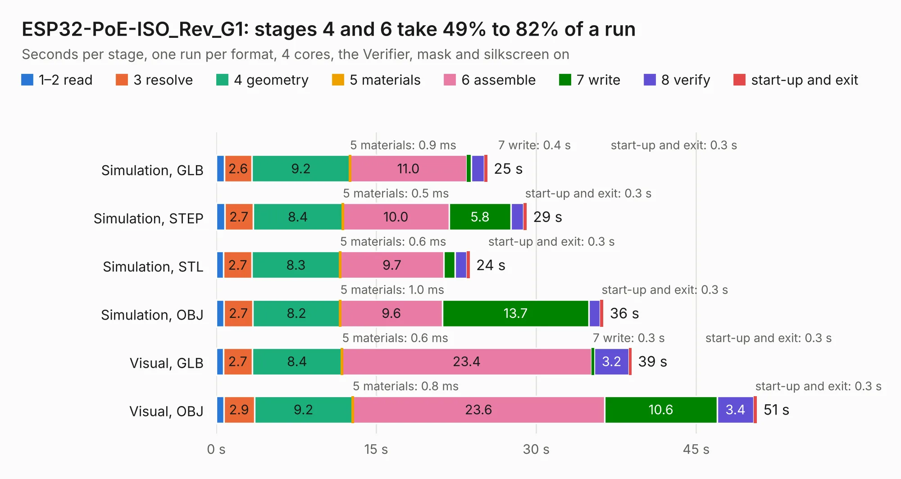

| Mode and format | 1–2 read | 3 resolve | 4 geometry | 5 materials | 6 assemble | 7 write | 8 verify | start-up and exit | Total |
|---|---:|---:|---:|---:|---:|---:|---:|---:|---:|
| Simulation, GLB | 0.7 | 2.6 | 9.2 | 0.9&nbsp;ms | 11.0 | 0.4 | 1.2 | 0.3 | 25.4 |
| Simulation, STEP | 0.8 | 2.7 | 8.4 | 0.5&nbsp;ms | 10.0 | 5.8 | 1.2 | 0.3 | 29.1 |
| Simulation, STL | 0.7 | 2.7 | 8.3 | 0.6&nbsp;ms | 9.7 | 1.0 | 1.1 | 0.3 | 23.8 |
| Simulation, OBJ | 0.7 | 2.7 | 8.2 | 1.0&nbsp;ms | 9.6 | 13.7 | 1.0 | 0.3 | 36.3 |
| Visual, GLB | 0.7 | 2.7 | 8.4 | 0.6&nbsp;ms | 23.4 | 0.3 | 3.2 | 0.3 | 38.9 |
| Visual, OBJ | 0.7 | 2.9 | 9.2 | 0.8&nbsp;ms | 23.6 | 10.6 | 3.4 | 0.3 | 50.7 |

<table align="center"><tr><td valign="top">

| Board | Repo: [OLIMEX/ESP32-POE-ISO](https://github.com/OLIMEX/ESP32-POE-ISO) Board: `ESP32-PoE-ISO_Rev_G1.kicad_pcb` |
|---|---|
| Folder | HARDWARE / ESP32-PoE-ISO-Rev.G1 |
| Complexity | 337&nbsp;/&nbsp;1000 (size&nbsp;262, features&nbsp;75) |
| KESE&nbsp;features | through vias, slotted holes, rounded, trapezoid or chamfered pads, filled zones, copper text, curved board outline |
| Tested | 9th November 2026 |
| Copper&nbsp;layers | 4 |
| File&nbsp;format | KiCad 5 (20171130) |
| Parts,&nbsp;tracks,&nbsp;vias | 122, 3,042, 331 |
| Triangles,&nbsp;simulation | 2,274,334 in 138 parts |
| Verifier | PASS in all six runs |

</td><td valign="top">

<table>
<tr><th>File type</th><th>File size</th><th>Peak memory used</th></tr>
<tr><th colspan="3" align="left">Simulation</th></tr>
<tr><td>GLB</td><td align="right">80&nbsp;MB</td><td align="right">818&nbsp;MB</td></tr>
<tr><td>STEP</td><td align="right">318&nbsp;MB</td><td align="right">887&nbsp;MB</td></tr>
<tr><td>STL</td><td align="right">114&nbsp;MB</td><td align="right">742&nbsp;MB</td></tr>
<tr><td>OBJ</td><td align="right">242&nbsp;MB</td><td align="right">1.6&nbsp;GB</td></tr>
<tr><th colspan="3" align="left">Visual</th></tr>
<tr><td>GLB</td><td align="right">52&nbsp;MB</td><td align="right">934&nbsp;MB</td></tr>
<tr><td>OBJ</td><td align="right">160&nbsp;MB</td><td align="right">1.1&nbsp;GB</td></tr>
</table>

</td></tr></table>

## 1856. ESP32-PoE-ISO_Rev_H

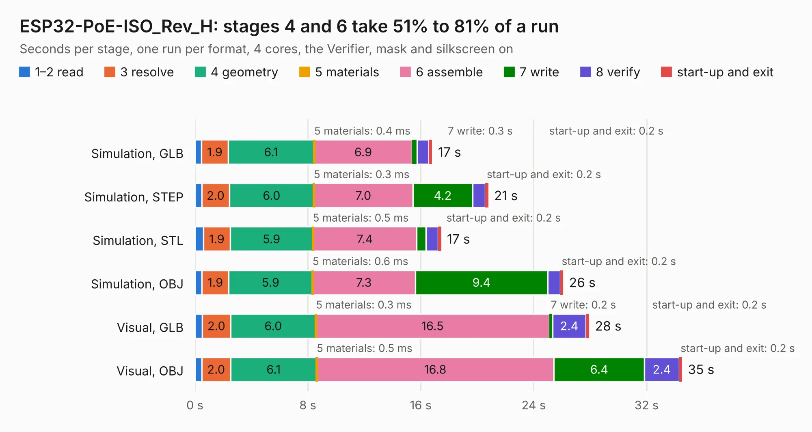

| Mode and format | 1–2 read | 3 resolve | 4 geometry | 5 materials | 6 assemble | 7 write | 8 verify | start-up and exit | Total |
|---|---:|---:|---:|---:|---:|---:|---:|---:|---:|
| Simulation, GLB | 0.5 | 1.9 | 6.1 | 0.4&nbsp;ms | 6.9 | 0.3 | 0.8 | 0.2 | 16.8 |
| Simulation, STEP | 0.5 | 2.0 | 6.0 | 0.3&nbsp;ms | 7.0 | 4.2 | 0.9 | 0.2 | 20.8 |
| Simulation, STL | 0.6 | 1.9 | 5.9 | 0.5&nbsp;ms | 7.4 | 0.6 | 0.9 | 0.2 | 17.4 |
| Simulation, OBJ | 0.5 | 1.9 | 5.9 | 0.6&nbsp;ms | 7.3 | 9.4 | 0.9 | 0.2 | 26.1 |
| Visual, GLB | 0.5 | 2.0 | 6.0 | 0.3&nbsp;ms | 16.5 | 0.2 | 2.4 | 0.2 | 27.9 |
| Visual, OBJ | 0.5 | 2.0 | 6.1 | 0.5&nbsp;ms | 16.8 | 6.4 | 2.4 | 0.2 | 34.5 |

<table align="center"><tr><td valign="top">

| Board | Repo: [OLIMEX/ESP32-POE-ISO](https://github.com/OLIMEX/ESP32-POE-ISO) Board: `ESP32-PoE-ISO_Rev_H.kicad_pcb` |
|---|---|
| Folder | HARDWARE / ESP32-PoE-ISO-Rev.H |
| Complexity | 337&nbsp;/&nbsp;1000 (size&nbsp;262, features&nbsp;75) |
| KESE&nbsp;features | through vias, slotted holes, rounded, trapezoid or chamfered pads, filled zones, copper text, curved board outline |
| Tested | 9th November 2026 |
| Copper&nbsp;layers | 4 |
| File&nbsp;format | KiCad 5 (20171130) |
| Parts,&nbsp;tracks,&nbsp;vias | 123, 3,089, 329 |
| Triangles,&nbsp;simulation | 2,272,098 in 138 parts |
| Verifier | PASS in all six runs |

</td><td valign="top">

<table>
<tr><th>File type</th><th>File size</th><th>Peak memory used</th></tr>
<tr><th colspan="3" align="left">Simulation</th></tr>
<tr><td>GLB</td><td align="right">80&nbsp;MB</td><td align="right">801&nbsp;MB</td></tr>
<tr><td>STEP</td><td align="right">318&nbsp;MB</td><td align="right">881&nbsp;MB</td></tr>
<tr><td>STL</td><td align="right">114&nbsp;MB</td><td align="right">787&nbsp;MB</td></tr>
<tr><td>OBJ</td><td align="right">242&nbsp;MB</td><td align="right">1.6&nbsp;GB</td></tr>
<tr><th colspan="3" align="left">Visual</th></tr>
<tr><td>GLB</td><td align="right">52&nbsp;MB</td><td align="right">945&nbsp;MB</td></tr>
<tr><td>OBJ</td><td align="right">160&nbsp;MB</td><td align="right">1.1&nbsp;GB</td></tr>
</table>

</td></tr></table>

## 1857. ESP32-PoE-ISO_Rev_I

| Mode and format | 1–2 read | 3 resolve | 4 geometry | 5 materials | 6 assemble | 7 write | 8 verify | start-up and exit | Total |
|---|---:|---:|---:|---:|---:|---:|---:|---:|---:|
| Simulation, GLB | 0.7 | 2.3 | 7.2 | 0.4&nbsp;ms | 7.9 | 0.4 | 1.0 | 0.3 | 19.6 |
| Simulation, STEP | 0.6 | 2.3 | 7.2 | 0.4&nbsp;ms | 8.0 | 5.0 | 1.0 | 0.2 | 24.4 |
| Simulation, STL | 0.6 | 2.2 | 7.3 | 0.4&nbsp;ms | 8.1 | 0.6 | 1.0 | 0.2 | 20.1 |
| Simulation, OBJ | 0.6 | 2.3 | 7.5 | 0.6&nbsp;ms | 8.0 | 12.0 | 1.0 | 0.3 | 31.7 |
| Visual, GLB | 0.6 | 2.3 | 7.2 | 0.6&nbsp;ms | 18.2 | 0.3 | 1.7 | 0.2 | 30.4 |
| Visual, OBJ | 0.7 | 2.4 | 7.4 | 0.5&nbsp;ms | 17.9 | 7.9 | 1.7 | 0.3 | 38.3 |

<table align="center"><tr><td valign="top">

| Board | Repo: [OLIMEX/ESP32-POE-ISO](https://github.com/OLIMEX/ESP32-POE-ISO) Board: `ESP32-PoE-ISO_Rev_I.kicad_pcb` |
|---|---|
| Folder | HARDWARE / ESP32-PoE-ISO-Rev.I |
| Complexity | 337&nbsp;/&nbsp;1000 (size&nbsp;262, features&nbsp;75) |
| KESE&nbsp;features | through vias, slotted holes, rounded, trapezoid or chamfered pads, filled zones, copper text, curved board outline |
| Tested | 9th November 2026 |
| Copper&nbsp;layers | 4 |
| File&nbsp;format | KiCad 5 (20171130) |
| Parts,&nbsp;tracks,&nbsp;vias | 123, 3,108, 329 |
| Triangles,&nbsp;simulation | 2,285,522 in 138 parts |
| Verifier | PASS in all six runs |

</td><td valign="top">

<table>
<tr><th>File type</th><th>File size</th><th>Peak memory used</th></tr>
<tr><th colspan="3" align="left">Simulation</th></tr>
<tr><td>GLB</td><td align="right">80&nbsp;MB</td><td align="right">800&nbsp;MB</td></tr>
<tr><td>STEP</td><td align="right">321&nbsp;MB</td><td align="right">908&nbsp;MB</td></tr>
<tr><td>STL</td><td align="right">114&nbsp;MB</td><td align="right">773&nbsp;MB</td></tr>
<tr><td>OBJ</td><td align="right">244&nbsp;MB</td><td align="right">1.5&nbsp;GB</td></tr>
<tr><th colspan="3" align="left">Visual</th></tr>
<tr><td>GLB</td><td align="right">53&nbsp;MB</td><td align="right">925&nbsp;MB</td></tr>
<tr><td>OBJ</td><td align="right">161&nbsp;MB</td><td align="right">1.1&nbsp;GB</td></tr>
</table>

</td></tr></table>

## 1858. ESP32-PoE-ISO_Rev_J

| Mode and format | 1–2 read | 3 resolve | 4 geometry | 5 materials | 6 assemble | 7 write | 8 verify | start-up and exit | Total |
|---|---:|---:|---:|---:|---:|---:|---:|---:|---:|
| Simulation, GLB | 0.6 | 2.5 | 7.7 | 0.4&nbsp;ms | 8.8 | 0.4 | 1.0 | 0.2 | 21.3 |
| Simulation, STEP | 0.7 | 2.3 | 7.8 | 0.6&nbsp;ms | 8.8 | 5.3 | 1.1 | 0.3 | 26.3 |
| Simulation, STL | 0.7 | 2.2 | 7.7 | 0.6&nbsp;ms | 8.7 | 0.6 | 1.0 | 0.3 | 21.3 |
| Simulation, OBJ | 0.6 | 2.0 | 7.6 | 0.6&nbsp;ms | 8.9 | 11.9 | 1.0 | 0.2 | 32.3 |
| Visual, GLB | 0.6 | 2.6 | 7.2 | 0.4&nbsp;ms | 19.3 | 0.2 | 2.1 | 0.3 | 32.2 |
| Visual, OBJ | 0.7 | 2.3 | 7.2 | 0.5&nbsp;ms | 18.5 | 7.4 | 2.3 | 0.3 | 38.7 |

<table align="center"><tr><td valign="top">

| Board | Repo: [OLIMEX/ESP32-POE-ISO](https://github.com/OLIMEX/ESP32-POE-ISO) Board: `ESP32-PoE-ISO_Rev_J.kicad_pcb` |
|---|---|
| Folder | HARDWARE / ESP32-PoE-ISO-Rev.J |
| Complexity | 337&nbsp;/&nbsp;1000 (size&nbsp;262, features&nbsp;75) |
| KESE&nbsp;features | through vias, slotted holes, rounded, trapezoid or chamfered pads, filled zones, copper text, curved board outline |
| Tested | 9th November 2026 |
| Copper&nbsp;layers | 4 |
| File&nbsp;format | KiCad 5 (20171130) |
| Parts,&nbsp;tracks,&nbsp;vias | 126, 3,029, 319 |
| Triangles,&nbsp;simulation | 2,413,834 in 139 parts |
| Verifier | PASS in all six runs |

</td><td valign="top">

<table>
<tr><th>File type</th><th>File size</th><th>Peak memory used</th></tr>
<tr><th colspan="3" align="left">Simulation</th></tr>
<tr><td>GLB</td><td align="right">84&nbsp;MB</td><td align="right">765&nbsp;MB</td></tr>
<tr><td>STEP</td><td align="right">345&nbsp;MB</td><td align="right">965&nbsp;MB</td></tr>
<tr><td>STL</td><td align="right">121&nbsp;MB</td><td align="right">762&nbsp;MB</td></tr>
<tr><td>OBJ</td><td align="right">257&nbsp;MB</td><td align="right">1.6&nbsp;GB</td></tr>
<tr><th colspan="3" align="left">Visual</th></tr>
<tr><td>GLB</td><td align="right">56&nbsp;MB</td><td align="right">1.0&nbsp;GB</td></tr>
<tr><td>OBJ</td><td align="right">171&nbsp;MB</td><td align="right">1.2&nbsp;GB</td></tr>
</table>

</td></tr></table>

## 1859. ESP32-PoE-ISO_Rev_K

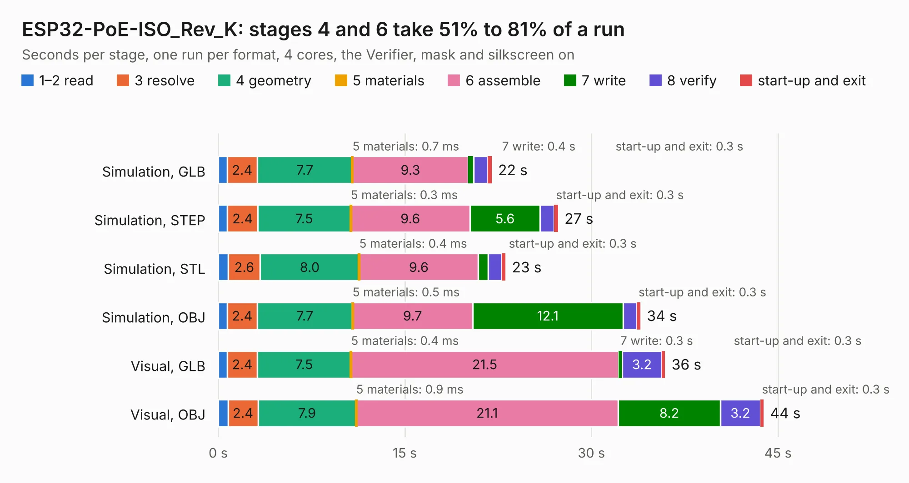

| Mode and format | 1–2 read | 3 resolve | 4 geometry | 5 materials | 6 assemble | 7 write | 8 verify | start-up and exit | Total |
|---|---:|---:|---:|---:|---:|---:|---:|---:|---:|
| Simulation, GLB | 0.7 | 2.4 | 7.7 | 0.7&nbsp;ms | 9.3 | 0.4 | 1.1 | 0.3 | 22.0 |
| Simulation, STEP | 0.7 | 2.4 | 7.5 | 0.3&nbsp;ms | 9.6 | 5.6 | 1.1 | 0.3 | 27.3 |
| Simulation, STL | 0.8 | 2.6 | 8.0 | 0.4&nbsp;ms | 9.6 | 0.8 | 1.1 | 0.3 | 23.1 |
| Simulation, OBJ | 0.7 | 2.4 | 7.7 | 0.5&nbsp;ms | 9.7 | 12.1 | 1.1 | 0.3 | 33.9 |
| Visual, GLB | 0.7 | 2.4 | 7.5 | 0.4&nbsp;ms | 21.5 | 0.3 | 3.2 | 0.3 | 35.9 |
| Visual, OBJ | 0.8 | 2.4 | 7.9 | 0.9&nbsp;ms | 21.1 | 8.2 | 3.2 | 0.3 | 43.8 |

<table align="center"><tr><td valign="top">

| Board | Repo: [OLIMEX/ESP32-POE-ISO](https://github.com/OLIMEX/ESP32-POE-ISO) Board: `ESP32-PoE-ISO_Rev_K.kicad_pcb` |
|---|---|
| Folder | HARDWARE / ESP32-PoE-ISO-Rev.K |
| Complexity | 337&nbsp;/&nbsp;1000 (size&nbsp;262, features&nbsp;75) |
| KESE&nbsp;features | through vias, slotted holes, rounded, trapezoid or chamfered pads, filled zones, copper text, curved board outline |
| Tested | 9th November 2026 |
| Copper&nbsp;layers | 4 |
| File&nbsp;format | KiCad 5 (20171130) |
| Parts,&nbsp;tracks,&nbsp;vias | 128, 3,057, 320 |
| Triangles,&nbsp;simulation | 2,423,136 in 139 parts |
| Verifier | PASS in all six runs |

</td><td valign="top">

<table>
<tr><th>File type</th><th>File size</th><th>Peak memory used</th></tr>
<tr><th colspan="3" align="left">Simulation</th></tr>
<tr><td>GLB</td><td align="right">85&nbsp;MB</td><td align="right">782&nbsp;MB</td></tr>
<tr><td>STEP</td><td align="right">346&nbsp;MB</td><td align="right">978&nbsp;MB</td></tr>
<tr><td>STL</td><td align="right">121&nbsp;MB</td><td align="right">780&nbsp;MB</td></tr>
<tr><td>OBJ</td><td align="right">258&nbsp;MB</td><td align="right">1.6&nbsp;GB</td></tr>
<tr><th colspan="3" align="left">Visual</th></tr>
<tr><td>GLB</td><td align="right">56&nbsp;MB</td><td align="right">982&nbsp;MB</td></tr>
<tr><td>OBJ</td><td align="right">172&nbsp;MB</td><td align="right">1.2&nbsp;GB</td></tr>
</table>

</td></tr></table>

## 1860. ESP32-PoE-ISO_Rev_L

| Mode and format | 1–2 read | 3 resolve | 4 geometry | 5 materials | 6 assemble | 7 write | 8 verify | start-up and exit | Total |
|---|---:|---:|---:|---:|---:|---:|---:|---:|---:|
| Simulation, GLB | 0.9 | 2.9 | 9.0 | 0.7&nbsp;ms | 10.7 | 0.4 | 1.3 | 0.3 | 25.3 |
| Simulation, STEP | 0.8 | 2.6 | 8.9 | 0.4&nbsp;ms | 10.9 | 6.6 | 1.1 | 0.3 | 31.3 |
| Simulation, STL | 0.8 | 2.7 | 8.8 | 0.7&nbsp;ms | 11.6 | 1.0 | 1.3 | 0.3 | 26.7 |
| Simulation, OBJ | 0.9 | 2.9 | 9.3 | 0.5&nbsp;ms | 11.4 | 15.8 | 1.4 | 0.3 | 42.0 |
| Visual, GLB | 0.9 | 2.9 | 8.6 | 0.5&nbsp;ms | 24.2 | 0.3 | 3.1 | 0.3 | 40.3 |
| Visual, OBJ | 0.9 | 2.8 | 8.5 | 0.4&nbsp;ms | 24.6 | 10.1 | 3.2 | 0.3 | 50.4 |

<table align="center"><tr><td valign="top">

| Board | Repo: [OLIMEX/ESP32-POE-ISO](https://github.com/OLIMEX/ESP32-POE-ISO) Board: `ESP32-PoE-ISO_Rev_L.kicad_pcb` |
|---|---|
| Folder | HARDWARE / ESP32-PoE-ISO-Rev.L |
| Complexity | 337&nbsp;/&nbsp;1000 (size&nbsp;262, features&nbsp;75) |
| KESE&nbsp;features | through vias, slotted holes, rounded, trapezoid or chamfered pads, filled zones, copper text, curved board outline |
| Tested | 9th November 2026 |
| Copper&nbsp;layers | 4 |
| File&nbsp;format | KiCad 5 (20171130) |
| Parts,&nbsp;tracks,&nbsp;vias | 128, 3,103, 321 |
| Triangles,&nbsp;simulation | 2,428,460 in 139 parts |
| Verifier | PASS in all six runs |

</td><td valign="top">

<table>
<tr><th>File type</th><th>File size</th><th>Peak memory used</th></tr>
<tr><th colspan="3" align="left">Simulation</th></tr>
<tr><td>GLB</td><td align="right">85&nbsp;MB</td><td align="right">755&nbsp;MB</td></tr>
<tr><td>STEP</td><td align="right">347&nbsp;MB</td><td align="right">987&nbsp;MB</td></tr>
<tr><td>STL</td><td align="right">121&nbsp;MB</td><td align="right">805&nbsp;MB</td></tr>
<tr><td>OBJ</td><td align="right">259&nbsp;MB</td><td align="right">1.7&nbsp;GB</td></tr>
<tr><th colspan="3" align="left">Visual</th></tr>
<tr><td>GLB</td><td align="right">56&nbsp;MB</td><td align="right">994&nbsp;MB</td></tr>
<tr><td>OBJ</td><td align="right">172&nbsp;MB</td><td align="right">1.2&nbsp;GB</td></tr>
</table>

</td></tr></table>

## 1861. ESP32-PoE-ISO_Rev_M

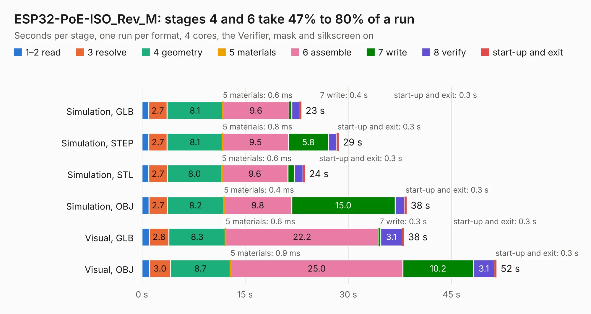

| Mode and format | 1–2 read | 3 resolve | 4 geometry | 5 materials | 6 assemble | 7 write | 8 verify | start-up and exit | Total |
|---|---:|---:|---:|---:|---:|---:|---:|---:|---:|
| Simulation, GLB | 1.0 | 2.7 | 8.1 | 0.6&nbsp;ms | 9.6 | 0.4 | 1.1 | 0.3 | 23.2 |
| Simulation, STEP | 1.0 | 2.7 | 8.1 | 0.8&nbsp;ms | 9.5 | 5.8 | 1.2 | 0.3 | 28.6 |
| Simulation, STL | 1.0 | 2.7 | 8.0 | 0.6&nbsp;ms | 9.6 | 0.9 | 1.2 | 0.3 | 23.7 |
| Simulation, OBJ | 1.0 | 2.7 | 8.2 | 0.4&nbsp;ms | 9.8 | 15.0 | 1.4 | 0.3 | 38.5 |
| Visual, GLB | 1.1 | 2.8 | 8.3 | 0.6&nbsp;ms | 22.2 | 0.3 | 3.1 | 0.3 | 38.1 |
| Visual, OBJ | 1.1 | 3.0 | 8.7 | 0.9&nbsp;ms | 25.0 | 10.2 | 3.1 | 0.3 | 51.5 |

<table align="center"><tr><td valign="top">

| Board | Repo: [OLIMEX/ESP32-POE-ISO](https://github.com/OLIMEX/ESP32-POE-ISO) Board: `ESP32-PoE-ISO_Rev_M.kicad_pcb` |
|---|---|
| Folder | HARDWARE / ESP32-PoE-ISO-Rev.M |
| Complexity | 389&nbsp;/&nbsp;1000 (size&nbsp;264, features&nbsp;125) |
| KESE&nbsp;features | through vias, slotted holes, rounded, trapezoid or chamfered pads, filled zones, copper text, curved board outline, knockout text, stack-up, dielectric εr and tanδ, mask and silkscreen colours |
| Tested | 9th November 2026 |
| Copper&nbsp;layers | 4 |
| File&nbsp;format | KiCad 7 (20221018) |
| Parts,&nbsp;tracks,&nbsp;vias | 125, 3,737, 325 |
| Triangles,&nbsp;simulation | 2,278,208 in 134 parts |
| Verifier | PASS in all six runs |

</td><td valign="top">

<table>
<tr><th>File type</th><th>File size</th><th>Peak memory used</th></tr>
<tr><th colspan="3" align="left">Simulation</th></tr>
<tr><td>GLB</td><td align="right">80&nbsp;MB</td><td align="right">861&nbsp;MB</td></tr>
<tr><td>STEP</td><td align="right">342&nbsp;MB</td><td align="right">907&nbsp;MB</td></tr>
<tr><td>STL</td><td align="right">114&nbsp;MB</td><td align="right">874&nbsp;MB</td></tr>
<tr><td>OBJ</td><td align="right">244&nbsp;MB</td><td align="right">1.5&nbsp;GB</td></tr>
<tr><th colspan="3" align="left">Visual</th></tr>
<tr><td>GLB</td><td align="right">53&nbsp;MB</td><td align="right">959&nbsp;MB</td></tr>
<tr><td>OBJ</td><td align="right">162&nbsp;MB</td><td align="right">1.1&nbsp;GB</td></tr>
</table>

</td></tr></table>

## 1862. ESP32-PoE-ISO_Rev_M1

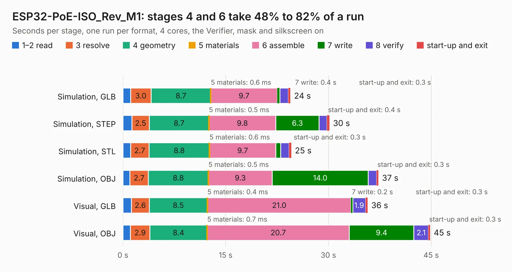

| Mode and format | 1–2 read | 3 resolve | 4 geometry | 5 materials | 6 assemble | 7 write | 8 verify | start-up and exit | Total |
|---|---:|---:|---:|---:|---:|---:|---:|---:|---:|
| Simulation, GLB | 1.1 | 3.0 | 8.7 | 0.6&nbsp;ms | 9.7 | 0.4 | 1.2 | 0.3 | 24.5 |
| Simulation, STEP | 1.3 | 2.5 | 8.7 | 0.5&nbsp;ms | 9.8 | 6.3 | 1.2 | 0.4 | 30.1 |
| Simulation, STL | 1.1 | 2.7 | 8.8 | 0.6&nbsp;ms | 9.7 | 0.7 | 1.2 | 0.3 | 24.6 |
| Simulation, OBJ | 1.0 | 2.7 | 8.8 | 0.5&nbsp;ms | 9.3 | 14.0 | 1.2 | 0.3 | 37.3 |
| Visual, GLB | 1.2 | 2.6 | 8.5 | 0.4&nbsp;ms | 21.0 | 0.2 | 1.9 | 0.3 | 35.7 |
| Visual, OBJ | 1.1 | 2.9 | 8.4 | 0.7&nbsp;ms | 20.7 | 9.4 | 2.1 | 0.3 | 44.9 |

<table align="center"><tr><td valign="top">

| Board | Repo: [OLIMEX/ESP32-POE-ISO](https://github.com/OLIMEX/ESP32-POE-ISO) Board: `ESP32-PoE-ISO_Rev_M1.kicad_pcb` |
|---|---|
| Folder | HARDWARE / ESP32-PoE-ISO-Rev.M1 |
| Complexity | 389&nbsp;/&nbsp;1000 (size&nbsp;264, features&nbsp;125) |
| KESE&nbsp;features | through vias, slotted holes, rounded, trapezoid or chamfered pads, filled zones, copper text, curved board outline, knockout text, stack-up, dielectric εr and tanδ, mask and silkscreen colours |
| Tested | 9th November 2026 |
| Copper&nbsp;layers | 4 |
| File&nbsp;format | KiCad 7 (20221018) |
| Parts,&nbsp;tracks,&nbsp;vias | 126, 3,737, 325 |
| Triangles,&nbsp;simulation | 2,279,540 in 134 parts |
| Verifier | PASS in all six runs |

</td><td valign="top">

<table>
<tr><th>File type</th><th>File size</th><th>Peak memory used</th></tr>
<tr><th colspan="3" align="left">Simulation</th></tr>
<tr><td>GLB</td><td align="right">80&nbsp;MB</td><td align="right">823&nbsp;MB</td></tr>
<tr><td>STEP</td><td align="right">343&nbsp;MB</td><td align="right">902&nbsp;MB</td></tr>
<tr><td>STL</td><td align="right">114&nbsp;MB</td><td align="right">854&nbsp;MB</td></tr>
<tr><td>OBJ</td><td align="right">244&nbsp;MB</td><td align="right">1.6&nbsp;GB</td></tr>
<tr><th colspan="3" align="left">Visual</th></tr>
<tr><td>GLB</td><td align="right">53&nbsp;MB</td><td align="right">953&nbsp;MB</td></tr>
<tr><td>OBJ</td><td align="right">163&nbsp;MB</td><td align="right">1.2&nbsp;GB</td></tr>
</table>

</td></tr></table>

## 1863. ESP32-PoE-ISO_Rev_N

| Mode and format | 1–2 read | 3 resolve | 4 geometry | 5 materials | 6 assemble | 7 write | 8 verify | start-up and exit | Total |
|---|---:|---:|---:|---:|---:|---:|---:|---:|---:|
| Simulation, GLB | 1.2 | 2.7 | 9.0 | 1&nbsp;ms | 9.8 | 0.4 | 1.2 | 0.3 | 24.5 |
| Simulation, STEP | 1.0 | 2.7 | 8.4 | 0.9&nbsp;ms | 9.5 | 6.0 | 1.3 | 0.3 | 29.0 |
| Simulation, STL | 1.0 | 2.8 | 8.7 | 1&nbsp;ms | 10.1 | 1.0 | 1.4 | 0.4 | 25.4 |
| Simulation, OBJ | 1.0 | 2.9 | 9.1 | 0.9&nbsp;ms | 9.7 | 14.4 | 1.2 | 0.3 | 38.7 |
| Visual, GLB | 1.1 | 2.7 | 8.4 | 0.9&nbsp;ms | 22.2 | 0.3 | 2.5 | 0.3 | 37.4 |
| Visual, OBJ | 1.0 | 2.6 | 8.3 | 0.9&nbsp;ms | 22.3 | 9.4 | 2.5 | 0.3 | 46.4 |

<table align="center"><tr><td valign="top">

| Board | Repo: [OLIMEX/ESP32-POE-ISO](https://github.com/OLIMEX/ESP32-POE-ISO) Board: `ESP32-PoE-ISO_Rev_N.kicad_pcb` |
|---|---|
| Folder | HARDWARE / ESP32-PoE-ISO-Rev.N |
| Complexity | 389&nbsp;/&nbsp;1000 (size&nbsp;264, features&nbsp;125) |
| KESE&nbsp;features | through vias, slotted holes, rounded, trapezoid or chamfered pads, filled zones, copper text, curved board outline, knockout text, stack-up, dielectric εr and tanδ, mask and silkscreen colours |
| Tested | 9th November 2026 |
| Copper&nbsp;layers | 4 |
| File&nbsp;format | KiCad 7 (20221018) |
| Parts,&nbsp;tracks,&nbsp;vias | 127, 3,683, 326 |
| Triangles,&nbsp;simulation | 2,294,172 in 134 parts |
| Verifier | PASS in all six runs |

</td><td valign="top">

<table>
<tr><th>File type</th><th>File size</th><th>Peak memory used</th></tr>
<tr><th colspan="3" align="left">Simulation</th></tr>
<tr><td>GLB</td><td align="right">80&nbsp;MB</td><td align="right">860&nbsp;MB</td></tr>
<tr><td>STEP</td><td align="right">347&nbsp;MB</td><td align="right">917&nbsp;MB</td></tr>
<tr><td>STL</td><td align="right">115&nbsp;MB</td><td align="right">844&nbsp;MB</td></tr>
<tr><td>OBJ</td><td align="right">246&nbsp;MB</td><td align="right">1.6&nbsp;GB</td></tr>
<tr><th colspan="3" align="left">Visual</th></tr>
<tr><td>GLB</td><td align="right">53&nbsp;MB</td><td align="right">955&nbsp;MB</td></tr>
<tr><td>OBJ</td><td align="right">164&nbsp;MB</td><td align="right">1.1&nbsp;GB</td></tr>
</table>

</td></tr></table>

## 1864. ESP32-PoE-ISO_Rev_N1

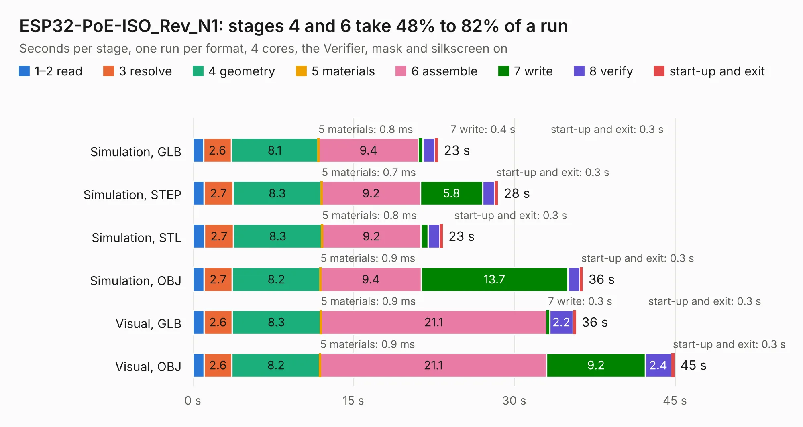

| Mode and format | 1–2 read | 3 resolve | 4 geometry | 5 materials | 6 assemble | 7 write | 8 verify | start-up and exit | Total |
|---|---:|---:|---:|---:|---:|---:|---:|---:|---:|
| Simulation, GLB | 1.0 | 2.6 | 8.1 | 0.8&nbsp;ms | 9.4 | 0.4 | 1.1 | 0.3 | 22.9 |
| Simulation, STEP | 1.0 | 2.7 | 8.3 | 0.7&nbsp;ms | 9.2 | 5.8 | 1.2 | 0.3 | 28.5 |
| Simulation, STL | 1.1 | 2.7 | 8.3 | 0.8&nbsp;ms | 9.2 | 0.7 | 1.1 | 0.3 | 23.3 |
| Simulation, OBJ | 1.0 | 2.7 | 8.2 | 0.9&nbsp;ms | 9.4 | 13.7 | 1.1 | 0.3 | 36.4 |
| Visual, GLB | 1.0 | 2.6 | 8.3 | 0.9&nbsp;ms | 21.1 | 0.3 | 2.2 | 0.3 | 35.8 |
| Visual, OBJ | 1.0 | 2.6 | 8.2 | 0.9&nbsp;ms | 21.1 | 9.2 | 2.4 | 0.3 | 45.0 |

<table align="center"><tr><td valign="top">

| Board | Repo: [OLIMEX/ESP32-POE-ISO](https://github.com/OLIMEX/ESP32-POE-ISO) Board: `ESP32-PoE-ISO_Rev_N1.kicad_pcb` |
|---|---|
| Folder | HARDWARE / ESP32-PoE-ISO-Rev.N1 |
| Complexity | 389&nbsp;/&nbsp;1000 (size&nbsp;264, features&nbsp;125) |
| KESE&nbsp;features | through vias, slotted holes, rounded, trapezoid or chamfered pads, filled zones, copper text, curved board outline, knockout text, stack-up, dielectric εr and tanδ, mask and silkscreen colours |
| Tested | 9th November 2026 |
| Copper&nbsp;layers | 4 |
| File&nbsp;format | KiCad 7 (20221018) |
| Parts,&nbsp;tracks,&nbsp;vias | 128, 3,683, 326 |
| Triangles,&nbsp;simulation | 2,295,698 in 134 parts |
| Verifier | PASS in all six runs |

</td><td valign="top">

<table>
<tr><th>File type</th><th>File size</th><th>Peak memory used</th></tr>
<tr><th colspan="3" align="left">Simulation</th></tr>
<tr><td>GLB</td><td align="right">81&nbsp;MB</td><td align="right">838&nbsp;MB</td></tr>
<tr><td>STEP</td><td align="right">348&nbsp;MB</td><td align="right">949&nbsp;MB</td></tr>
<tr><td>STL</td><td align="right">115&nbsp;MB</td><td align="right">791&nbsp;MB</td></tr>
<tr><td>OBJ</td><td align="right">246&nbsp;MB</td><td align="right">1.6&nbsp;GB</td></tr>
<tr><th colspan="3" align="left">Visual</th></tr>
<tr><td>GLB</td><td align="right">53&nbsp;MB</td><td align="right">959&nbsp;MB</td></tr>
<tr><td>OBJ</td><td align="right">164&nbsp;MB</td><td align="right">1.2&nbsp;GB</td></tr>
</table>

</td></tr></table>

## 1865. ESP32-PoE-ISO_Rev_O

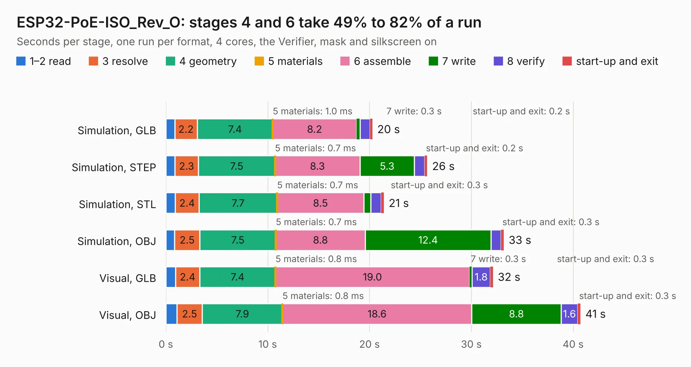

| Mode and format | 1–2 read | 3 resolve | 4 geometry | 5 materials | 6 assemble | 7 write | 8 verify | start-up and exit | Total |
|---|---:|---:|---:|---:|---:|---:|---:|---:|---:|
| Simulation, GLB | 0.9 | 2.2 | 7.4 | 1.0&nbsp;ms | 8.2 | 0.3 | 1.0 | 0.2 | 20.3 |
| Simulation, STEP | 0.9 | 2.3 | 7.5 | 0.7&nbsp;ms | 8.3 | 5.3 | 1.0 | 0.2 | 25.7 |
| Simulation, STL | 0.9 | 2.4 | 7.7 | 0.7&nbsp;ms | 8.5 | 0.7 | 1.0 | 0.3 | 21.4 |
| Simulation, OBJ | 0.8 | 2.5 | 7.5 | 0.7&nbsp;ms | 8.8 | 12.4 | 1.0 | 0.3 | 33.2 |
| Visual, GLB | 1.0 | 2.4 | 7.4 | 0.8&nbsp;ms | 19.0 | 0.3 | 1.8 | 0.3 | 32.1 |
| Visual, OBJ | 1.1 | 2.5 | 7.9 | 0.8&nbsp;ms | 18.6 | 8.8 | 1.6 | 0.3 | 40.7 |

<table align="center"><tr><td valign="top">

| Board | Repo: [OLIMEX/ESP32-POE-ISO](https://github.com/OLIMEX/ESP32-POE-ISO) Board: `ESP32-PoE-ISO_Rev_O.kicad_pcb` |
|---|---|
| Folder | HARDWARE / ESP32-PoE-ISO-Rev.O |
| Complexity | 379&nbsp;/&nbsp;1000 (size&nbsp;264, features&nbsp;115) |
| KESE&nbsp;features | through vias, slotted holes, filled zones, copper text, curved board outline, knockout text, stack-up, dielectric εr and tanδ, mask and silkscreen colours |
| Tested | 9th November 2026 |
| Copper&nbsp;layers | 4 |
| File&nbsp;format | KiCad 7 (20221018) |
| Parts,&nbsp;tracks,&nbsp;vias | 129, 3,704, 322 |
| Triangles,&nbsp;simulation | 2,304,726 in 134 parts |
| Verifier | PASS in all six runs |

</td><td valign="top">

<table>
<tr><th>File type</th><th>File size</th><th>Peak memory used</th></tr>
<tr><th colspan="3" align="left">Simulation</th></tr>
<tr><td>GLB</td><td align="right">81&nbsp;MB</td><td align="right">806&nbsp;MB</td></tr>
<tr><td>STEP</td><td align="right">353&nbsp;MB</td><td align="right">940&nbsp;MB</td></tr>
<tr><td>STL</td><td align="right">115&nbsp;MB</td><td align="right">789&nbsp;MB</td></tr>
<tr><td>OBJ</td><td align="right">247&nbsp;MB</td><td align="right">1.6&nbsp;GB</td></tr>
<tr><th colspan="3" align="left">Visual</th></tr>
<tr><td>GLB</td><td align="right">54&nbsp;MB</td><td align="right">990&nbsp;MB</td></tr>
<tr><td>OBJ</td><td align="right">167&nbsp;MB</td><td align="right">1.2&nbsp;GB</td></tr>
</table>

</td></tr></table>

## 1866. ESP32-PoE2_Rev_B

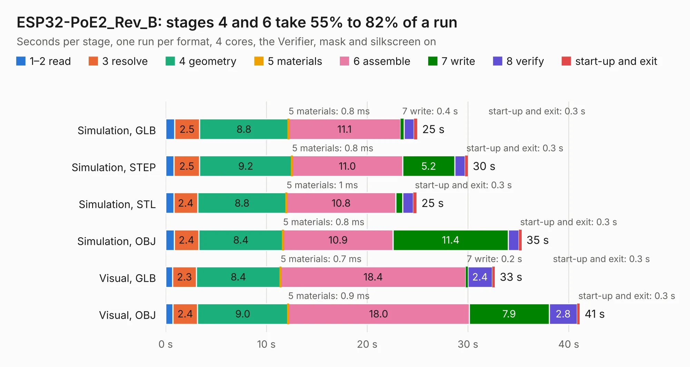

| Mode and format | 1–2 read | 3 resolve | 4 geometry | 5 materials | 6 assemble | 7 write | 8 verify | start-up and exit | Total |
|---|---:|---:|---:|---:|---:|---:|---:|---:|---:|
| Simulation, GLB | 0.9 | 2.5 | 8.8 | 0.8&nbsp;ms | 11.1 | 0.4 | 1.0 | 0.3 | 25.0 |
| Simulation, STEP | 0.8 | 2.5 | 9.2 | 0.8&nbsp;ms | 11.0 | 5.2 | 1.0 | 0.3 | 30.0 |
| Simulation, STL | 0.8 | 2.4 | 8.8 | 1&nbsp;ms | 10.8 | 0.7 | 1.1 | 0.3 | 24.9 |
| Simulation, OBJ | 0.8 | 2.4 | 8.4 | 0.8&nbsp;ms | 10.9 | 11.4 | 1.0 | 0.3 | 35.3 |
| Visual, GLB | 0.7 | 2.3 | 8.4 | 0.7&nbsp;ms | 18.4 | 0.2 | 2.4 | 0.3 | 32.7 |
| Visual, OBJ | 0.7 | 2.4 | 9.0 | 0.9&nbsp;ms | 18.0 | 7.9 | 2.8 | 0.3 | 41.1 |

<table align="center"><tr><td valign="top">

| Board | Repo: [OLIMEX/ESP32-POE2](https://github.com/OLIMEX/ESP32-POE2) Board: `ESP32-PoE2_Rev_B.kicad_pcb` |
|---|---|
| Folder | HARDWARE / ESP32-PoE2_Rev_B |
| Complexity | 380&nbsp;/&nbsp;1000 (size&nbsp;260, features&nbsp;120) |
| KESE&nbsp;features | through vias, slotted holes, rounded, trapezoid or chamfered pads, filled zones, copper text, curved board outline, knockout text, stack-up, dielectric εr and tanδ |
| Tested | 9th November 2026 |
| Copper&nbsp;layers | 4 |
| File&nbsp;format | KiCad 7 (20221018) |
| Parts,&nbsp;tracks,&nbsp;vias | 142, 2,198, 390 |
| Triangles,&nbsp;simulation | 2,336,490 in 142 parts |
| Verifier | PASS in all six runs |

</td><td valign="top">

<table>
<tr><th>File type</th><th>File size</th><th>Peak memory used</th></tr>
<tr><th colspan="3" align="left">Simulation</th></tr>
<tr><td>GLB</td><td align="right">81&nbsp;MB</td><td align="right">780&nbsp;MB</td></tr>
<tr><td>STEP</td><td align="right">346&nbsp;MB</td><td align="right">1.0&nbsp;GB</td></tr>
<tr><td>STL</td><td align="right">117&nbsp;MB</td><td align="right">823&nbsp;MB</td></tr>
<tr><td>OBJ</td><td align="right">250&nbsp;MB</td><td align="right">1.6&nbsp;GB</td></tr>
<tr><th colspan="3" align="left">Visual</th></tr>
<tr><td>GLB</td><td align="right">54&nbsp;MB</td><td align="right">974&nbsp;MB</td></tr>
<tr><td>OBJ</td><td align="right">167&nbsp;MB</td><td align="right">1.2&nbsp;GB</td></tr>
</table>

</td></tr></table>

## 1867. ESP32-PRO_Rev_B

| Mode and format | 1–2 read | 3 resolve | 4 geometry | 5 materials | 6 assemble | 7 write | 8 verify | start-up and exit | Total |
|---|---:|---:|---:|---:|---:|---:|---:|---:|---:|
| Simulation, GLB | 0.6 | 2.1 | 7.4 | 1.0&nbsp;ms | 7.1 | 0.3 | 0.8 | 0.3 | 18.6 |
| Simulation, STEP | 0.5 | 2.0 | 7.2 | 0.9&nbsp;ms | 6.8 | 4.2 | 0.8 | 0.3 | 21.8 |
| Simulation, STL | 0.5 | 1.7 | 7.1 | 0.6&nbsp;ms | 6.9 | 0.5 | 0.9 | 0.3 | 17.9 |
| Simulation, OBJ | 0.5 | 1.8 | 7.3 | 1&nbsp;ms | 6.9 | 8.4 | 0.8 | 0.2 | 26.0 |
| Visual, GLB | 0.5 | 1.9 | 7.3 | 0.7&nbsp;ms | 17.0 | 0.2 | 2.0 | 0.2 | 29.2 |
| Visual, OBJ | 0.5 | 1.9 | 7.4 | 0.9&nbsp;ms | 17.3 | 6.9 | 2.2 | 0.3 | 36.5 |

<table align="center"><tr><td valign="top">

| Board | Repo: [OLIMEX/ESP32-PRO](https://github.com/OLIMEX/ESP32-PRO) Board: `ESP32-PRO_Rev_B.kicad_pcb` |
|---|---|
| Folder | HARDWARE / REV-B |
| Complexity | 308&nbsp;/&nbsp;1000 (size&nbsp;253, features&nbsp;55) |
| KESE&nbsp;features | through vias, slotted holes, filled zones, copper text |
| Tested | 9th November 2026 |
| Copper&nbsp;layers | 2 |
| File&nbsp;format | KiCad 5 (20171130) |
| Parts,&nbsp;tracks,&nbsp;vias | 123, 3,549, 327 |
| Triangles,&nbsp;simulation | 1,642,858 in 123 parts |
| Verifier | PASS in all six runs |

</td><td valign="top">

<table>
<tr><th>File type</th><th>File size</th><th>Peak memory used</th></tr>
<tr><th colspan="3" align="left">Simulation</th></tr>
<tr><td>GLB</td><td align="right">59&nbsp;MB</td><td align="right">676&nbsp;MB</td></tr>
<tr><td>STEP</td><td align="right">310&nbsp;MB</td><td align="right">815&nbsp;MB</td></tr>
<tr><td>STL</td><td align="right">82&nbsp;MB</td><td align="right">676&nbsp;MB</td></tr>
<tr><td>OBJ</td><td align="right">176&nbsp;MB</td><td align="right">1.2&nbsp;GB</td></tr>
<tr><th colspan="3" align="left">Visual</th></tr>
<tr><td>GLB</td><td align="right">50&nbsp;MB</td><td align="right">865&nbsp;MB</td></tr>
<tr><td>OBJ</td><td align="right">151&nbsp;MB</td><td align="right">1.0&nbsp;GB</td></tr>
</table>

</td></tr></table>

## 1868. ESP32-PRO_Rev_B1

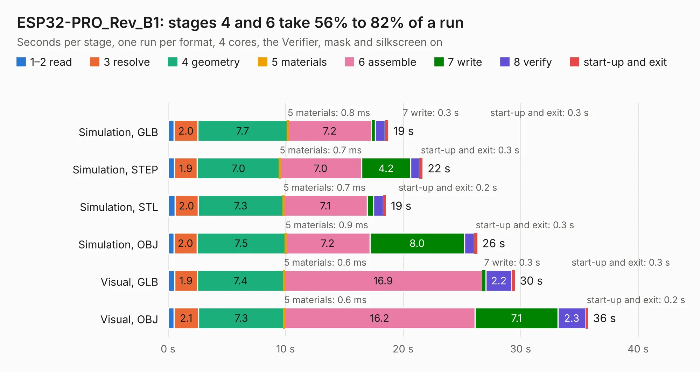

| Mode and format | 1–2 read | 3 resolve | 4 geometry | 5 materials | 6 assemble | 7 write | 8 verify | start-up and exit | Total |
|---|---:|---:|---:|---:|---:|---:|---:|---:|---:|
| Simulation, GLB | 0.5 | 2.0 | 7.7 | 0.8&nbsp;ms | 7.2 | 0.3 | 0.8 | 0.3 | 18.7 |
| Simulation, STEP | 0.5 | 1.9 | 7.0 | 0.7&nbsp;ms | 7.0 | 4.2 | 0.7 | 0.3 | 21.7 |
| Simulation, STL | 0.6 | 2.0 | 7.3 | 0.7&nbsp;ms | 7.1 | 0.5 | 0.8 | 0.2 | 18.5 |
| Simulation, OBJ | 0.5 | 2.0 | 7.5 | 0.9&nbsp;ms | 7.2 | 8.0 | 0.8 | 0.3 | 26.3 |
| Visual, GLB | 0.6 | 1.9 | 7.4 | 0.6&nbsp;ms | 16.9 | 0.3 | 2.2 | 0.3 | 29.5 |
| Visual, OBJ | 0.5 | 2.1 | 7.3 | 0.6&nbsp;ms | 16.2 | 7.1 | 2.3 | 0.2 | 35.7 |

<table align="center"><tr><td valign="top">

| Board | Repo: [OLIMEX/ESP32-PRO](https://github.com/OLIMEX/ESP32-PRO) Board: `ESP32-PRO_Rev_B1.kicad_pcb` |
|---|---|
| Folder | HARDWARE / REV-B1 |
| Complexity | 308&nbsp;/&nbsp;1000 (size&nbsp;253, features&nbsp;55) |
| KESE&nbsp;features | through vias, slotted holes, filled zones, copper text |
| Tested | 9th November 2026 |
| Copper&nbsp;layers | 2 |
| File&nbsp;format | KiCad 5 (20171130) |
| Parts,&nbsp;tracks,&nbsp;vias | 123, 3,548, 327 |
| Triangles,&nbsp;simulation | 1,641,446 in 123 parts |
| Verifier | PASS in all six runs |

</td><td valign="top">

<table>
<tr><th>File type</th><th>File size</th><th>Peak memory used</th></tr>
<tr><th colspan="3" align="left">Simulation</th></tr>
<tr><td>GLB</td><td align="right">58&nbsp;MB</td><td align="right">699&nbsp;MB</td></tr>
<tr><td>STEP</td><td align="right">307&nbsp;MB</td><td align="right">791&nbsp;MB</td></tr>
<tr><td>STL</td><td align="right">82&nbsp;MB</td><td align="right">701&nbsp;MB</td></tr>
<tr><td>OBJ</td><td align="right">176&nbsp;MB</td><td align="right">1.2&nbsp;GB</td></tr>
<tr><th colspan="3" align="left">Visual</th></tr>
<tr><td>GLB</td><td align="right">50&nbsp;MB</td><td align="right">849&nbsp;MB</td></tr>
<tr><td>OBJ</td><td align="right">151&nbsp;MB</td><td align="right">1.1&nbsp;GB</td></tr>
</table>

</td></tr></table>

## 1869. ESP32-S2-DevKit-Lipo_Rev_B1

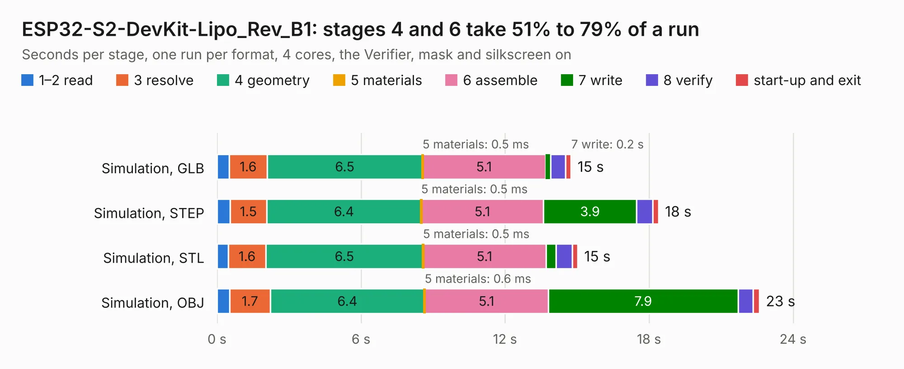

| Mode and format | 1–2 read | 3 resolve | 4 geometry | 5 materials | 6 assemble | 7 write | 8 verify | start-up and exit | Total |
|---|---:|---:|---:|---:|---:|---:|---:|---:|---:|
| Simulation, GLB | 0.5 | 1.6 | 6.5 | 0.5&nbsp;ms | 5.1 | 0.2 | 0.6 | 0.2 | 14.8 |
| Simulation, STEP | 0.5 | 1.5 | 6.4 | 0.5&nbsp;ms | 5.1 | 3.9 | 0.7 | 0.2 | 18.4 |
| Simulation, STL | 0.5 | 1.6 | 6.5 | 0.5&nbsp;ms | 5.1 | 0.4 | 0.7 | 0.2 | 15.0 |
| Simulation, OBJ | 0.5 | 1.7 | 6.4 | 0.6&nbsp;ms | 5.1 | 7.9 | 0.6 | 0.3 | 22.6 |
| Visual, GLB | 0.5 | 1.5 | 6.4 | 0.5&nbsp;ms | 12.7 | 0.2 | 1.3 | 0.2 | 22.8 |
| Visual, OBJ | 0.5 | 1.6 | 6.5 | 0.5&nbsp;ms | 13.0 | 6.5 | 1.6 | 0.2 | 29.8 |

<table align="center"><tr><td valign="top">

| Board | Repo: [OLIMEX/ESP32-S2-DevKit-LiPo](https://github.com/OLIMEX/ESP32-S2-DevKit-LiPo) Board: `ESP32-S2-DevKit-Lipo_Rev_B1.kicad_pcb` |
|---|---|
| Folder | HARDWARE / ESP32-S2-DevKit-Lipo-Rev.B1 |
| Complexity | 253&nbsp;/&nbsp;1000 (size&nbsp;188, features&nbsp;65) |
| KESE&nbsp;features | through vias, slotted holes, rounded, trapezoid or chamfered pads, filled zones, copper text |
| Tested | 9th November 2026 |
| Copper&nbsp;layers | 2 |
| File&nbsp;format | KiCad 5 (20171130) |
| Parts,&nbsp;tracks,&nbsp;vias | 76, 1,472, 164 |
| Triangles,&nbsp;simulation | 1,273,136 in 91 parts |
| Verifier | PASS in all six runs |

</td><td valign="top">

<table>
<tr><th>File type</th><th>File size</th><th>Peak memory used</th></tr>
<tr><th colspan="3" align="left">Simulation</th></tr>
<tr><td>GLB</td><td align="right">45&nbsp;MB</td><td align="right">575&nbsp;MB</td></tr>
<tr><td>STEP</td><td align="right">244&nbsp;MB</td><td align="right">643&nbsp;MB</td></tr>
<tr><td>STL</td><td align="right">64&nbsp;MB</td><td align="right">561&nbsp;MB</td></tr>
<tr><td>OBJ</td><td align="right">135&nbsp;MB</td><td align="right">905&nbsp;MB</td></tr>
<tr><th colspan="3" align="left">Visual</th></tr>
<tr><td>GLB</td><td align="right">39&nbsp;MB</td><td align="right">787&nbsp;MB</td></tr>
<tr><td>OBJ</td><td align="right">115&nbsp;MB</td><td align="right">847&nbsp;MB</td></tr>
</table>

</td></tr></table>

## 1870. ESP32-S2-DevKit-USB_Rev_B

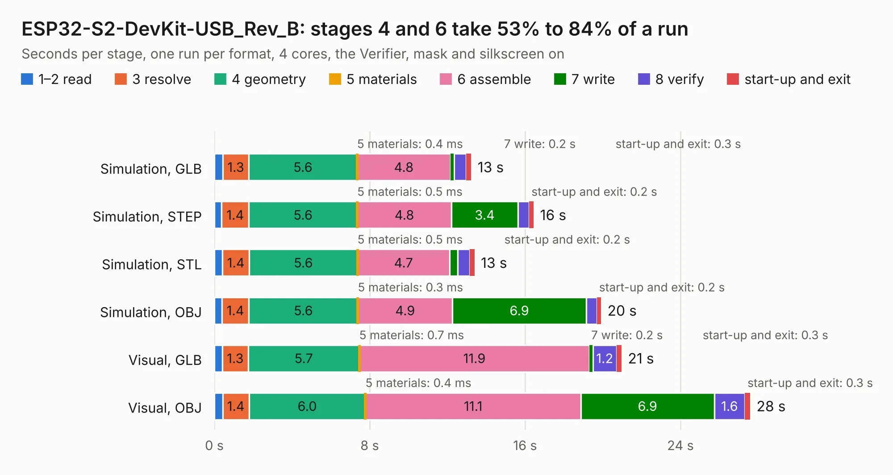

| Mode and format | 1–2 read | 3 resolve | 4 geometry | 5 materials | 6 assemble | 7 write | 8 verify | start-up and exit | Total |
|---|---:|---:|---:|---:|---:|---:|---:|---:|---:|
| Simulation, GLB | 0.4 | 1.3 | 5.6 | 0.4&nbsp;ms | 4.8 | 0.2 | 0.6 | 0.3 | 13.2 |
| Simulation, STEP | 0.4 | 1.4 | 5.6 | 0.5&nbsp;ms | 4.8 | 3.4 | 0.6 | 0.2 | 16.4 |
| Simulation, STL | 0.4 | 1.4 | 5.6 | 0.5&nbsp;ms | 4.7 | 0.4 | 0.6 | 0.2 | 13.4 |
| Simulation, OBJ | 0.4 | 1.4 | 5.6 | 0.3&nbsp;ms | 4.9 | 6.9 | 0.6 | 0.2 | 19.9 |
| Visual, GLB | 0.4 | 1.3 | 5.7 | 0.7&nbsp;ms | 11.9 | 0.2 | 1.2 | 0.3 | 21.0 |
| Visual, OBJ | 0.4 | 1.4 | 6.0 | 0.4&nbsp;ms | 11.1 | 6.9 | 1.6 | 0.3 | 27.6 |

<table align="center"><tr><td valign="top">

| Board | Repo: [OLIMEX/ESP32-S2-DevKit-LiPo-USB](https://github.com/OLIMEX/ESP32-S2-DevKit-LiPo-USB) Board: `ESP32-S2-DevKit-USB_Rev_B.kicad_pcb` |
|---|---|
| Folder | HARDWARE / ESP32-S2-DevKit-USB-Rev-B |
| Complexity | 250&nbsp;/&nbsp;1000 (size&nbsp;185, features&nbsp;65) |
| KESE&nbsp;features | through vias, slotted holes, rounded, trapezoid or chamfered pads, filled zones, copper text |
| Tested | 9th November 2026 |
| Copper&nbsp;layers | 2 |
| File&nbsp;format | KiCad 5 (20171130) |
| Parts,&nbsp;tracks,&nbsp;vias | 66, 1,299, 156 |
| Triangles,&nbsp;simulation | 1,257,842 in 78 parts |
| Verifier | PASS in all six runs |

</td><td valign="top">

<table>
<tr><th>File type</th><th>File size</th><th>Peak memory used</th></tr>
<tr><th colspan="3" align="left">Simulation</th></tr>
<tr><td>GLB</td><td align="right">45&nbsp;MB</td><td align="right">605&nbsp;MB</td></tr>
<tr><td>STEP</td><td align="right">241&nbsp;MB</td><td align="right">667&nbsp;MB</td></tr>
<tr><td>STL</td><td align="right">63&nbsp;MB</td><td align="right">589&nbsp;MB</td></tr>
<tr><td>OBJ</td><td align="right">133&nbsp;MB</td><td align="right">868&nbsp;MB</td></tr>
<tr><th colspan="3" align="left">Visual</th></tr>
<tr><td>GLB</td><td align="right">38&nbsp;MB</td><td align="right">772&nbsp;MB</td></tr>
<tr><td>OBJ</td><td align="right">113&nbsp;MB</td><td align="right">840&nbsp;MB</td></tr>
</table>

</td></tr></table>

## 1871. ESP32-S3-DevKit-LiPo_Rev_B_DIMM

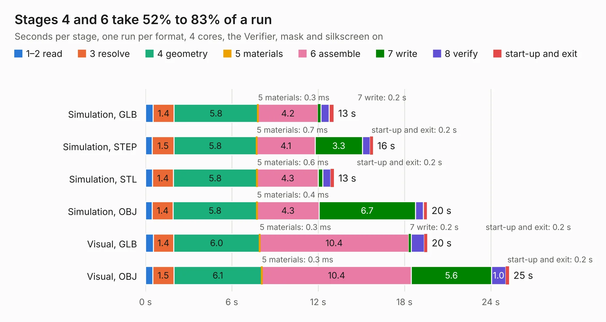

| Mode and format | 1–2 read | 3 resolve | 4 geometry | 5 materials | 6 assemble | 7 write | 8 verify | start-up and exit | Total |
|---|---:|---:|---:|---:|---:|---:|---:|---:|---:|
| Simulation, GLB | 0.5 | 1.4 | 5.8 | 0.3&nbsp;ms | 4.2 | 0.2 | 0.6 | 0.3 | 13.1 |
| Simulation, STEP | 0.5 | 1.5 | 5.8 | 0.7&nbsp;ms | 4.1 | 3.3 | 0.5 | 0.2 | 15.8 |
| Simulation, STL | 0.5 | 1.4 | 5.8 | 0.6&nbsp;ms | 4.3 | 0.3 | 0.5 | 0.2 | 13.1 |
| Simulation, OBJ | 0.5 | 1.4 | 5.8 | 0.4&nbsp;ms | 4.3 | 6.7 | 0.6 | 0.3 | 19.6 |
| Visual, GLB | 0.5 | 1.4 | 6.0 | 0.3&nbsp;ms | 10.4 | 0.2 | 0.9 | 0.2 | 19.6 |
| Visual, OBJ | 0.5 | 1.5 | 6.1 | 0.3&nbsp;ms | 10.4 | 5.6 | 1.0 | 0.2 | 25.3 |

<table align="center"><tr><td valign="top">

| Board | Repo: [OLIMEX/ESP32-S3-DevKit-LiPo](https://github.com/OLIMEX/ESP32-S3-DevKit-LiPo) Board: `ESP32-S3-DevKit-LiPo_Rev_B_DIMM.kicad_pcb` |
|---|---|
| Folder | HARDWARE / Dimensions |
| Complexity | 237&nbsp;/&nbsp;1000 (size&nbsp;182, features&nbsp;55) |
| KESE&nbsp;features | through vias, slotted holes, filled zones, copper text |
| Tested | 9th November 2026 |
| Copper&nbsp;layers | 2 |
| File&nbsp;format | KiCad 7 (20221018) |
| Parts,&nbsp;tracks,&nbsp;vias | 54, 1,324, 128 |
| Triangles,&nbsp;simulation | 1,184,962 in 82 parts |
| Verifier | PASS in all six runs |

</td><td valign="top">

<table>
<tr><th>File type</th><th>File size</th><th>Peak memory used</th></tr>
<tr><th colspan="3" align="left">Simulation</th></tr>
<tr><td>GLB</td><td align="right">42&nbsp;MB</td><td align="right">562&nbsp;MB</td></tr>
<tr><td>STEP</td><td align="right">233&nbsp;MB</td><td align="right">633&nbsp;MB</td></tr>
<tr><td>STL</td><td align="right">59&nbsp;MB</td><td align="right">542&nbsp;MB</td></tr>
<tr><td>OBJ</td><td align="right">125&nbsp;MB</td><td align="right">851&nbsp;MB</td></tr>
<tr><th colspan="3" align="left">Visual</th></tr>
<tr><td>GLB</td><td align="right">35&nbsp;MB</td><td align="right">769&nbsp;MB</td></tr>
<tr><td>OBJ</td><td align="right">106&nbsp;MB</td><td align="right">801&nbsp;MB</td></tr>
</table>

</td></tr></table>

## 1872. ESP32-S3-DevKit-LiPo_Rev_B

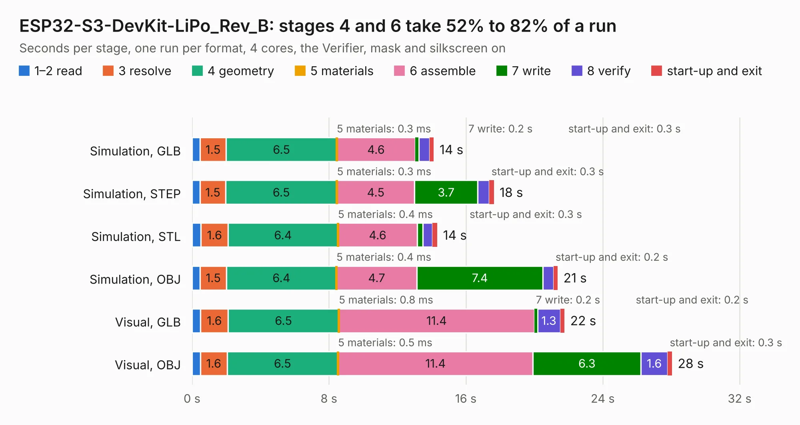

| Mode and format | 1–2 read | 3 resolve | 4 geometry | 5 materials | 6 assemble | 7 write | 8 verify | start-up and exit | Total |
|---|---:|---:|---:|---:|---:|---:|---:|---:|---:|
| Simulation, GLB | 0.5 | 1.5 | 6.5 | 0.3&nbsp;ms | 4.6 | 0.2 | 0.6 | 0.3 | 14.1 |
| Simulation, STEP | 0.5 | 1.5 | 6.5 | 0.3&nbsp;ms | 4.5 | 3.7 | 0.7 | 0.3 | 17.6 |
| Simulation, STL | 0.5 | 1.6 | 6.4 | 0.4&nbsp;ms | 4.6 | 0.3 | 0.6 | 0.3 | 14.3 |
| Simulation, OBJ | 0.5 | 1.5 | 6.4 | 0.4&nbsp;ms | 4.7 | 7.4 | 0.6 | 0.2 | 21.4 |
| Visual, GLB | 0.5 | 1.6 | 6.5 | 0.8&nbsp;ms | 11.4 | 0.2 | 1.3 | 0.2 | 21.8 |
| Visual, OBJ | 0.5 | 1.6 | 6.5 | 0.5&nbsp;ms | 11.4 | 6.3 | 1.6 | 0.3 | 28.0 |

<table align="center"><tr><td valign="top">

| Board | Repo: [OLIMEX/ESP32-S3-DevKit-LiPo](https://github.com/OLIMEX/ESP32-S3-DevKit-LiPo) Board: `ESP32-S3-DevKit-LiPo_Rev_B.kicad_pcb` |
|---|---|
| Folder | HARDWARE / ESP32-S3-DevKit-LiPo_Rev_B |
| Complexity | 227&nbsp;/&nbsp;1000 (size&nbsp;182, features&nbsp;45) |
| KESE&nbsp;features | through vias, slotted holes, filled zones |
| Tested | 9th November 2026 |
| Copper&nbsp;layers | 2 |
| File&nbsp;format | KiCad 5 (20171130) |
| Parts,&nbsp;tracks,&nbsp;vias | 54, 1,324, 128 |
| Triangles,&nbsp;simulation | 1,241,654 in 82 parts |
| Verifier | PASS in all six runs |

</td><td valign="top">

<table>
<tr><th>File type</th><th>File size</th><th>Peak memory used</th></tr>
<tr><th colspan="3" align="left">Simulation</th></tr>
<tr><td>GLB</td><td align="right">44&nbsp;MB</td><td align="right">551&nbsp;MB</td></tr>
<tr><td>STEP</td><td align="right">244&nbsp;MB</td><td align="right">654&nbsp;MB</td></tr>
<tr><td>STL</td><td align="right">62&nbsp;MB</td><td align="right">609&nbsp;MB</td></tr>
<tr><td>OBJ</td><td align="right">131&nbsp;MB</td><td align="right">859&nbsp;MB</td></tr>
<tr><th colspan="3" align="left">Visual</th></tr>
<tr><td>GLB</td><td align="right">37&nbsp;MB</td><td align="right">710&nbsp;MB</td></tr>
<tr><td>OBJ</td><td align="right">111&nbsp;MB</td><td align="right">852&nbsp;MB</td></tr>
</table>

</td></tr></table>

## 1873. ESP32-SBC-FabGL_Rev_A

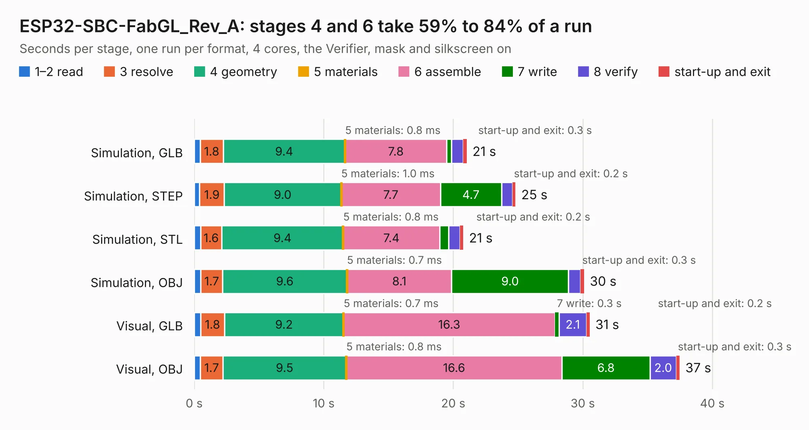

| Mode and format | 1–2 read | 3 resolve | 4 geometry | 5 materials | 6 assemble | 7 write | 8 verify | start-up and exit | Total |
|---|---:|---:|---:|---:|---:|---:|---:|---:|---:|
| Simulation, GLB | 0.5 | 1.8 | 9.4 | 0.8&nbsp;ms | 7.8 | 0.4 | 0.9 | 0.3 | 21.0 |
| Simulation, STEP | 0.4 | 1.9 | 9.0 | 1.0&nbsp;ms | 7.7 | 4.7 | 0.9 | 0.2 | 24.8 |
| Simulation, STL | 0.5 | 1.6 | 9.4 | 0.8&nbsp;ms | 7.4 | 0.7 | 0.9 | 0.2 | 20.8 |
| Simulation, OBJ | 0.5 | 1.7 | 9.6 | 0.7&nbsp;ms | 8.1 | 9.0 | 0.9 | 0.3 | 30.1 |
| Visual, GLB | 0.5 | 1.8 | 9.2 | 0.7&nbsp;ms | 16.3 | 0.3 | 2.1 | 0.2 | 30.5 |
| Visual, OBJ | 0.5 | 1.7 | 9.5 | 0.8&nbsp;ms | 16.6 | 6.8 | 2.0 | 0.3 | 37.5 |

<table align="center"><tr><td valign="top">

| Board | Repo: [OLIMEX/ESP32-SBC-FabGL](https://github.com/OLIMEX/ESP32-SBC-FabGL) Board: `ESP32-SBC-FabGL_Rev_A.kicad_pcb` |
|---|---|
| Folder | HARDWARE / Hardware-revision-A |
| Complexity | 249&nbsp;/&nbsp;1000 (size&nbsp;194, features&nbsp;55) |
| KESE&nbsp;features | through vias, slotted holes, filled zones, curved board outline |
| Tested | 9th November 2026 |
| Copper&nbsp;layers | 2 |
| File&nbsp;format | KiCad 5 (20171130) |
| Parts,&nbsp;tracks,&nbsp;vias | 107, 1,402, 264 |
| Triangles,&nbsp;simulation | 1,738,592 in 126 parts |
| Verifier | PASS in all six runs |

</td><td valign="top">

<table>
<tr><th>File type</th><th>File size</th><th>Peak memory used</th></tr>
<tr><th colspan="3" align="left">Simulation</th></tr>
<tr><td>GLB</td><td align="right">61&nbsp;MB</td><td align="right">642&nbsp;MB</td></tr>
<tr><td>STEP</td><td align="right">313&nbsp;MB</td><td align="right">847&nbsp;MB</td></tr>
<tr><td>STL</td><td align="right">87&nbsp;MB</td><td align="right">626&nbsp;MB</td></tr>
<tr><td>OBJ</td><td align="right">184&nbsp;MB</td><td align="right">1.2&nbsp;GB</td></tr>
<tr><th colspan="3" align="left">Visual</th></tr>
<tr><td>GLB</td><td align="right">49&nbsp;MB</td><td align="right">830&nbsp;MB</td></tr>
<tr><td>OBJ</td><td align="right">148&nbsp;MB</td><td align="right">1.0&nbsp;GB</td></tr>
</table>

</td></tr></table>

## 1874. ESP32-SBC-FabGL_Rev_B

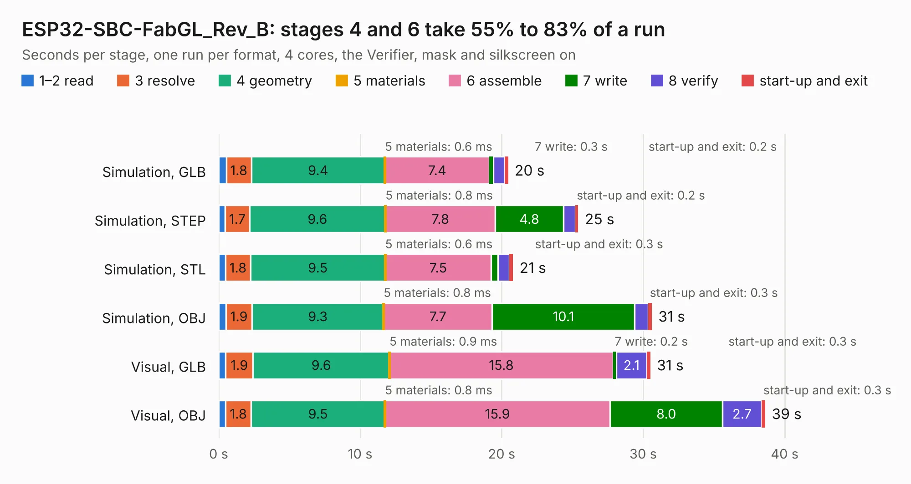

| Mode and format | 1–2 read | 3 resolve | 4 geometry | 5 materials | 6 assemble | 7 write | 8 verify | start-up and exit | Total |
|---|---:|---:|---:|---:|---:|---:|---:|---:|---:|
| Simulation, GLB | 0.5 | 1.8 | 9.4 | 0.6&nbsp;ms | 7.4 | 0.3 | 0.8 | 0.2 | 20.5 |
| Simulation, STEP | 0.5 | 1.7 | 9.6 | 0.8&nbsp;ms | 7.8 | 4.8 | 0.8 | 0.2 | 25.4 |
| Simulation, STL | 0.5 | 1.8 | 9.5 | 0.6&nbsp;ms | 7.5 | 0.5 | 0.8 | 0.3 | 20.8 |
| Simulation, OBJ | 0.5 | 1.9 | 9.3 | 0.8&nbsp;ms | 7.7 | 10.1 | 0.9 | 0.3 | 30.6 |
| Visual, GLB | 0.5 | 1.9 | 9.6 | 0.9&nbsp;ms | 15.8 | 0.2 | 2.1 | 0.3 | 30.5 |
| Visual, OBJ | 0.5 | 1.8 | 9.5 | 0.8&nbsp;ms | 15.9 | 8.0 | 2.7 | 0.3 | 38.6 |

<table align="center"><tr><td valign="top">

| Board | Repo: [OLIMEX/ESP32-SBC-FabGL](https://github.com/OLIMEX/ESP32-SBC-FabGL) Board: `ESP32-SBC-FabGL_Rev_B.kicad_pcb` |
|---|---|
| Folder | HARDWARE / Hardware-revision-B |
| Complexity | 249&nbsp;/&nbsp;1000 (size&nbsp;194, features&nbsp;55) |
| KESE&nbsp;features | through vias, slotted holes, filled zones, curved board outline |
| Tested | 9th November 2026 |
| Copper&nbsp;layers | 2 |
| File&nbsp;format | KiCad 5 (20171130) |
| Parts,&nbsp;tracks,&nbsp;vias | 107, 1,405, 266 |
| Triangles,&nbsp;simulation | 1,795,894 in 123 parts |
| Verifier | PASS in all six runs |

</td><td valign="top">

<table>
<tr><th>File type</th><th>File size</th><th>Peak memory used</th></tr>
<tr><th colspan="3" align="left">Simulation</th></tr>
<tr><td>GLB</td><td align="right">63&nbsp;MB</td><td align="right">659&nbsp;MB</td></tr>
<tr><td>STEP</td><td align="right">328&nbsp;MB</td><td align="right">860&nbsp;MB</td></tr>
<tr><td>STL</td><td align="right">90&nbsp;MB</td><td align="right">672&nbsp;MB</td></tr>
<tr><td>OBJ</td><td align="right">190&nbsp;MB</td><td align="right">1.2&nbsp;GB</td></tr>
<tr><th colspan="3" align="left">Visual</th></tr>
<tr><td>GLB</td><td align="right">51&nbsp;MB</td><td align="right">857&nbsp;MB</td></tr>
<tr><td>OBJ</td><td align="right">156&nbsp;MB</td><td align="right">1.1&nbsp;GB</td></tr>
</table>

</td></tr></table>

## 1875. Flash-e_Rev_C

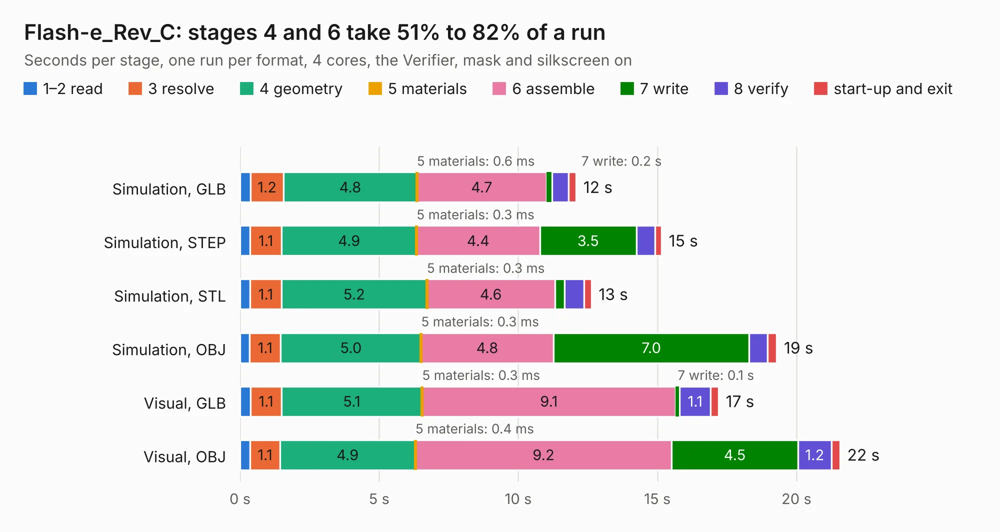

| Mode and format | 1–2 read | 3 resolve | 4 geometry | 5 materials | 6 assemble | 7 write | 8 verify | start-up and exit | Total |
|---|---:|---:|---:|---:|---:|---:|---:|---:|---:|
| Simulation, GLB | 0.4 | 1.2 | 4.8 | 0.6&nbsp;ms | 4.7 | 0.2 | 0.6 | 0.3 | 12.1 |
| Simulation, STEP | 0.4 | 1.1 | 4.9 | 0.3&nbsp;ms | 4.4 | 3.5 | 0.7 | 0.2 | 15.2 |
| Simulation, STL | 0.4 | 1.1 | 5.2 | 0.3&nbsp;ms | 4.6 | 0.3 | 0.7 | 0.3 | 12.6 |
| Simulation, OBJ | 0.3 | 1.1 | 5.0 | 0.3&nbsp;ms | 4.8 | 7.0 | 0.7 | 0.3 | 19.3 |
| Visual, GLB | 0.4 | 1.1 | 5.1 | 0.3&nbsp;ms | 9.1 | 0.1 | 1.1 | 0.3 | 17.2 |
| Visual, OBJ | 0.4 | 1.1 | 4.9 | 0.4&nbsp;ms | 9.2 | 4.5 | 1.2 | 0.3 | 21.6 |

<table align="center"><tr><td valign="top">

| Board | Repo: [OLIMEX/Flash-e](https://github.com/OLIMEX/Flash-e) Board: `Flash-e_Rev_C.kicad_pcb` |
|---|---|
| Folder | HARDWARE / Flash-e-Rev.C |
| Complexity | 288&nbsp;/&nbsp;1000 (size&nbsp;243, features&nbsp;45) |
| KESE&nbsp;features | through vias, filled zones, copper text |
| Tested | 9th November 2026 |
| Copper&nbsp;layers | 4 |
| File&nbsp;format | KiCad 5 (20171130) |
| Parts,&nbsp;tracks,&nbsp;vias | 35, 1,162, 85 |
| Triangles,&nbsp;simulation | 1,152,680 in 79 parts |
| Verifier | PASS in all six runs |

</td><td valign="top">

<table>
<tr><th>File type</th><th>File size</th><th>Peak memory used</th></tr>
<tr><th colspan="3" align="left">Simulation</th></tr>
<tr><td>GLB</td><td align="right">40&nbsp;MB</td><td align="right">496&nbsp;MB</td></tr>
<tr><td>STEP</td><td align="right">203&nbsp;MB</td><td align="right">571&nbsp;MB</td></tr>
<tr><td>STL</td><td align="right">58&nbsp;MB</td><td align="right">487&nbsp;MB</td></tr>
<tr><td>OBJ</td><td align="right">120&nbsp;MB</td><td align="right">823&nbsp;MB</td></tr>
<tr><th colspan="3" align="left">Visual</th></tr>
<tr><td>GLB</td><td align="right">27&nbsp;MB</td><td align="right">561&nbsp;MB</td></tr>
<tr><td>OBJ</td><td align="right">81&nbsp;MB</td><td align="right">631&nbsp;MB</td></tr>
</table>

</td></tr></table>

## 1876. FOSDEM-MUSIC-BOX_RevA

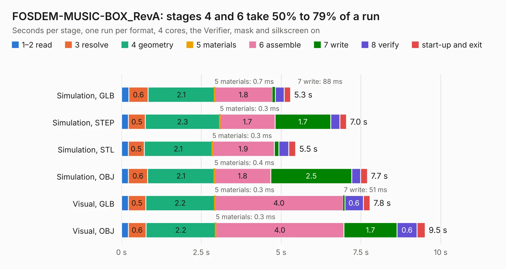

| Mode and format | 1–2 read | 3 resolve | 4 geometry | 5 materials | 6 assemble | 7 write | 8 verify | start-up and exit | Total |
|---|---:|---:|---:|---:|---:|---:|---:|---:|---:|
| Simulation, GLB | 0.2 | 0.6 | 2.1 | 0.7&nbsp;ms | 1.8 | 88&nbsp;ms | 0.3 | 0.2 | 5.3 |
| Simulation, STEP | 0.2 | 0.5 | 2.3 | 0.3&nbsp;ms | 1.7 | 1.7 | 0.3 | 0.2 | 7.0 |
| Simulation, STL | 0.2 | 0.5 | 2.1 | 0.3&nbsp;ms | 1.9 | 0.1 | 0.3 | 0.2 | 5.5 |
| Simulation, OBJ | 0.2 | 0.6 | 2.1 | 0.4&nbsp;ms | 1.8 | 2.5 | 0.3 | 0.2 | 7.7 |
| Visual, GLB | 0.2 | 0.5 | 2.2 | 0.3&nbsp;ms | 4.0 | 51&nbsp;ms | 0.6 | 0.2 | 7.8 |
| Visual, OBJ | 0.2 | 0.6 | 2.2 | 0.3&nbsp;ms | 4.0 | 1.7 | 0.6 | 0.3 | 9.5 |

<table align="center"><tr><td valign="top">

| Board | Repo: [OLIMEX/FOSDEM-MUSIC-BOX](https://github.com/OLIMEX/FOSDEM-MUSIC-BOX) Board: `FOSDEM-MUSIC-BOX_RevA.kicad_pcb` |
|---|---|
| Folder | HARDWARE / FOSDEM-MUSIC-BOX_RevA |
| Complexity | 195&nbsp;/&nbsp;1000 (size&nbsp;130, features&nbsp;65) |
| KESE&nbsp;features | filled zones, curved board outline, stack-up, dielectric εr and tanδ, mask and silkscreen colours |
| Tested | 9th November 2026 |
| Copper&nbsp;layers | 2 |
| File&nbsp;format | KiCad 6 (20191123) |
| Parts,&nbsp;tracks,&nbsp;vias | 23, 122, 0 |
| Triangles,&nbsp;simulation | 568,428 in 32 parts |
| Verifier | PASS in all six runs |

</td><td valign="top">

<table>
<tr><th>File type</th><th>File size</th><th>Peak memory used</th></tr>
<tr><th colspan="3" align="left">Simulation</th></tr>
<tr><td>GLB</td><td align="right">20&nbsp;MB</td><td align="right">302&nbsp;MB</td></tr>
<tr><td>STEP</td><td align="right">106&nbsp;MB</td><td align="right">347&nbsp;MB</td></tr>
<tr><td>STL</td><td align="right">28&nbsp;MB</td><td align="right">309&nbsp;MB</td></tr>
<tr><td>OBJ</td><td align="right">58&nbsp;MB</td><td align="right">427&nbsp;MB</td></tr>
<tr><th colspan="3" align="left">Visual</th></tr>
<tr><td>GLB</td><td align="right">14&nbsp;MB</td><td align="right">358&nbsp;MB</td></tr>
<tr><td>OBJ</td><td align="right">40&nbsp;MB</td><td align="right">370&nbsp;MB</td></tr>
</table>

</td></tr></table>

## 1877. GateMateA1-EVB_Rev_A

| Mode and format | 1–2 read | 3 resolve | 4 geometry | 5 materials | 6 assemble | 7 write | 8 verify | start-up and exit | Total |
|---|---:|---:|---:|---:|---:|---:|---:|---:|---:|
| Simulation, GLB | 2.5 | 9.1 | 38.8 | 2&nbsp;ms | 33.4 | 1.4 | 5.2 | 0.4 | 90.8 |
| Simulation, STEP | 2.6 | 9.3 | 40.4 | 1.0&nbsp;ms | 33.3 | 18.8 | 5.0 | 0.4 | 109.8 |
| Simulation, STL | 2.6 | 9.2 | 38.7 | 1.0&nbsp;ms | 33.0 | 3.0 | 5.5 | 0.4 | 92.3 |
| Simulation, OBJ | 2.5 | 9.1 | 38.8 | 0.9&nbsp;ms | 32.5 | 43.9 | 5.2 | 0.4 | 132.5 |
| Visual, GLB | 2.4 | 8.9 | 38.6 | 1&nbsp;ms | 79.8 | 0.8 | 9.6 | 0.3 | 140.5 |
| Visual, OBJ | 2.6 | 9.4 | 38.8 | 0.9&nbsp;ms | 76.6 | 29.4 | 8.7 | 0.4 | 165.8 |

<table align="center"><tr><td valign="top">

| Board | Repo: [OLIMEX/GateMateA1-EVB](https://github.com/OLIMEX/GateMateA1-EVB) Board: `GateMateA1-EVB_Rev_A.kicad_pcb` |
|---|---|
| Folder | HARDWARE / GateMateA1-EVB-Rev.A |
| Complexity | 427&nbsp;/&nbsp;1000 (size&nbsp;302, features&nbsp;125) |
| KESE&nbsp;features | through vias, slotted holes, rounded, trapezoid or chamfered pads, arc tracks, filled zones, copper text, knockout text, stack-up, dielectric εr and tanδ |
| Tested | 9th November 2026 |
| Copper&nbsp;layers | 4 |
| File&nbsp;format | KiCad 7 (20221018) |
| Parts,&nbsp;tracks,&nbsp;vias | 267, 8,244, 1,191 |
| Triangles,&nbsp;simulation | 7,054,476 in 301 parts |
| Verifier | PASS in all six runs |

</td><td valign="top">

<table>
<tr><th>File type</th><th>File size</th><th>Peak memory used</th></tr>
<tr><th colspan="3" align="left">Simulation</th></tr>
<tr><td>GLB</td><td align="right">246&nbsp;MB</td><td align="right">2.0&nbsp;GB</td></tr>
<tr><td>STEP</td><td align="right">1.1&nbsp;GB</td><td align="right">2.5&nbsp;GB</td></tr>
<tr><td>STL</td><td align="right">353&nbsp;MB</td><td align="right">2.0&nbsp;GB</td></tr>
<tr><td>OBJ</td><td align="right">767&nbsp;MB</td><td align="right">4.6&nbsp;GB</td></tr>
<tr><th colspan="3" align="left">Visual</th></tr>
<tr><td>GLB</td><td align="right">167&nbsp;MB</td><td align="right">2.6&nbsp;GB</td></tr>
<tr><td>OBJ</td><td align="right">537&nbsp;MB</td><td align="right">3.5&nbsp;GB</td></tr>
</table>

</td></tr></table>

## 1878. GateMateA1-EVB_Rev_B

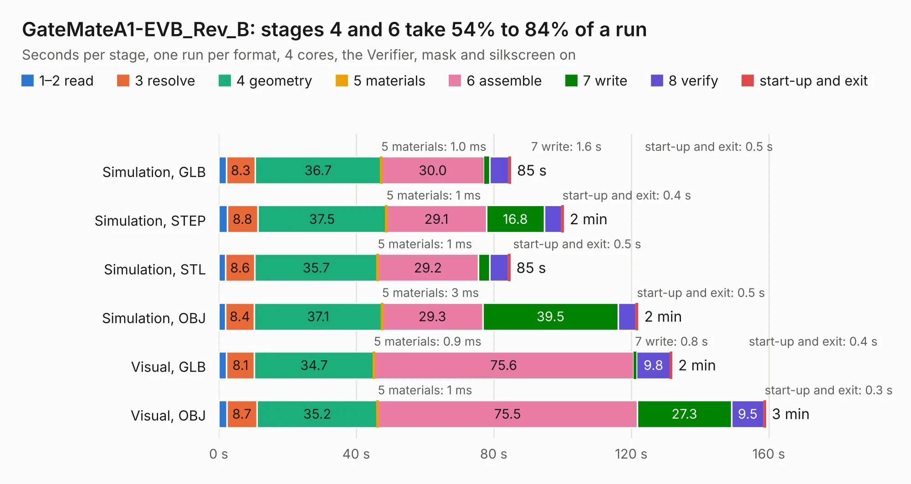

| Mode and format | 1–2 read | 3 resolve | 4 geometry | 5 materials | 6 assemble | 7 write | 8 verify | start-up and exit | Total |
|---|---:|---:|---:|---:|---:|---:|---:|---:|---:|
| Simulation, GLB | 2.2 | 8.3 | 36.7 | 1.0&nbsp;ms | 30.0 | 1.6 | 5.6 | 0.5 | 84.9 |
| Simulation, STEP | 2.5 | 8.8 | 37.5 | 1&nbsp;ms | 29.1 | 16.8 | 5.1 | 0.4 | 100.2 |
| Simulation, STL | 1.9 | 8.6 | 35.7 | 1&nbsp;ms | 29.2 | 3.4 | 5.4 | 0.5 | 84.7 |
| Simulation, OBJ | 1.9 | 8.4 | 37.1 | 3&nbsp;ms | 29.3 | 39.5 | 5.1 | 0.5 | 121.9 |
| Visual, GLB | 2.3 | 8.1 | 34.7 | 0.9&nbsp;ms | 75.6 | 0.8 | 9.8 | 0.4 | 131.8 |
| Visual, OBJ | 2.4 | 8.7 | 35.2 | 1&nbsp;ms | 75.5 | 27.3 | 9.5 | 0.3 | 159.0 |

<table align="center"><tr><td valign="top">

| Board | Repo: [OLIMEX/GateMateA1-EVB](https://github.com/OLIMEX/GateMateA1-EVB) Board: `GateMateA1-EVB_Rev_B.kicad_pcb` |
|---|---|
| Folder | HARDWARE / GateMateA1-EVB-Rev.B |
| Complexity | 428&nbsp;/&nbsp;1000 (size&nbsp;303, features&nbsp;125) |
| KESE&nbsp;features | through vias, slotted holes, rounded, trapezoid or chamfered pads, arc tracks, filled zones, copper text, knockout text, stack-up, dielectric εr and tanδ |
| Tested | 9th November 2026 |
| Copper&nbsp;layers | 4 |
| File&nbsp;format | KiCad 7 (20221018) |
| Parts,&nbsp;tracks,&nbsp;vias | 268, 9,050, 1,267 |
| Triangles,&nbsp;simulation | 7,178,598 in 302 parts |
| Verifier | PASS in all six runs |

</td><td valign="top">

<table>
<tr><th>File type</th><th>File size</th><th>Peak memory used</th></tr>
<tr><th colspan="3" align="left">Simulation</th></tr>
<tr><td>GLB</td><td align="right">250&nbsp;MB</td><td align="right">2.0&nbsp;GB</td></tr>
<tr><td>STEP</td><td align="right">1.2&nbsp;GB</td><td align="right">2.6&nbsp;GB</td></tr>
<tr><td>STL</td><td align="right">359&nbsp;MB</td><td align="right">2.1&nbsp;GB</td></tr>
<tr><td>OBJ</td><td align="right">780&nbsp;MB</td><td align="right">4.7&nbsp;GB</td></tr>
<tr><th colspan="3" align="left">Visual</th></tr>
<tr><td>GLB</td><td align="right">171&nbsp;MB</td><td align="right">2.6&nbsp;GB</td></tr>
<tr><td>OBJ</td><td align="right">549&nbsp;MB</td><td align="right">3.6&nbsp;GB</td></tr>
</table>

</td></tr></table>

## 1879. GateMateA1-EVB_Rev_C

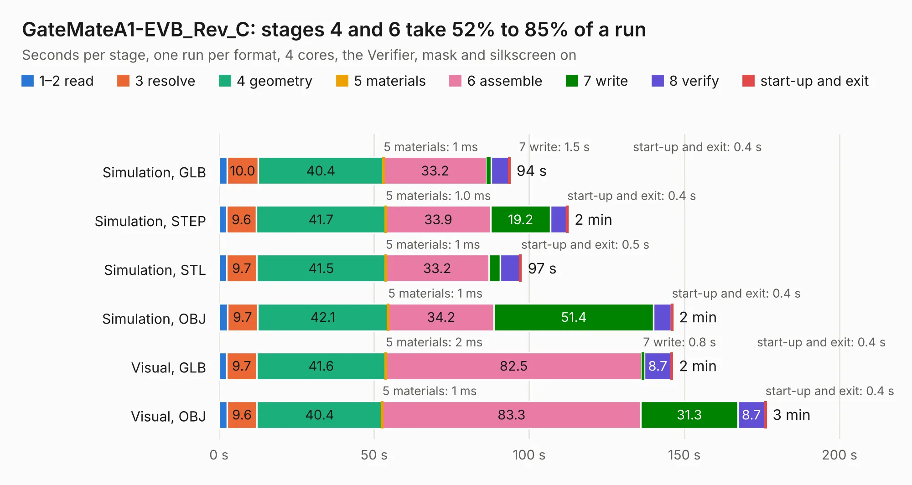

| Mode and format | 1–2 read | 3 resolve | 4 geometry | 5 materials | 6 assemble | 7 write | 8 verify | start-up and exit | Total |
|---|---:|---:|---:|---:|---:|---:|---:|---:|---:|
| Simulation, GLB | 2.6 | 10.0 | 40.4 | 1&nbsp;ms | 33.2 | 1.5 | 5.7 | 0.4 | 93.8 |
| Simulation, STEP | 2.5 | 9.6 | 41.7 | 1.0&nbsp;ms | 33.9 | 19.2 | 5.2 | 0.4 | 112.5 |
| Simulation, STL | 2.5 | 9.7 | 41.5 | 1&nbsp;ms | 33.2 | 3.6 | 6.4 | 0.5 | 97.4 |
| Simulation, OBJ | 2.8 | 9.7 | 42.1 | 1&nbsp;ms | 34.2 | 51.4 | 5.8 | 0.4 | 146.2 |
| Visual, GLB | 2.5 | 9.7 | 41.6 | 2&nbsp;ms | 82.5 | 0.8 | 8.7 | 0.4 | 146.2 |
| Visual, OBJ | 2.6 | 9.6 | 40.4 | 1&nbsp;ms | 83.3 | 31.3 | 8.7 | 0.4 | 176.3 |

<table align="center"><tr><td valign="top">

| Board | Repo: [OLIMEX/GateMateA1-EVB](https://github.com/OLIMEX/GateMateA1-EVB) Board: `GateMateA1-EVB_Rev_C.kicad_pcb` |
|---|---|
| Folder | HARDWARE / GateMateA1-EVB-Rev.C |
| Complexity | 429&nbsp;/&nbsp;1000 (size&nbsp;304, features&nbsp;125) |
| KESE&nbsp;features | through vias, slotted holes, rounded, trapezoid or chamfered pads, arc tracks, filled zones, copper text, knockout text, stack-up, dielectric εr and tanδ |
| Tested | 9th November 2026 |
| Copper&nbsp;layers | 4 |
| File&nbsp;format | KiCad 7 (20221018) |
| Parts,&nbsp;tracks,&nbsp;vias | 268, 9,108, 1,267 |
| Triangles,&nbsp;simulation | 7,169,180 in 302 parts |
| Verifier | PASS in all six runs |

</td><td valign="top">

<table>
<tr><th>File type</th><th>File size</th><th>Peak memory used</th></tr>
<tr><th colspan="3" align="left">Simulation</th></tr>
<tr><td>GLB</td><td align="right">250&nbsp;MB</td><td align="right">2.1&nbsp;GB</td></tr>
<tr><td>STEP</td><td align="right">1.1&nbsp;GB</td><td align="right">2.6&nbsp;GB</td></tr>
<tr><td>STL</td><td align="right">358&nbsp;MB</td><td align="right">2.0&nbsp;GB</td></tr>
<tr><td>OBJ</td><td align="right">779&nbsp;MB</td><td align="right">4.7&nbsp;GB</td></tr>
<tr><th colspan="3" align="left">Visual</th></tr>
<tr><td>GLB</td><td align="right">171&nbsp;MB</td><td align="right">2.6&nbsp;GB</td></tr>
<tr><td>OBJ</td><td align="right">548&nbsp;MB</td><td align="right">3.4&nbsp;GB</td></tr>
</table>

</td></tr></table>

## 1880. ICE40-ADC_Rev_A

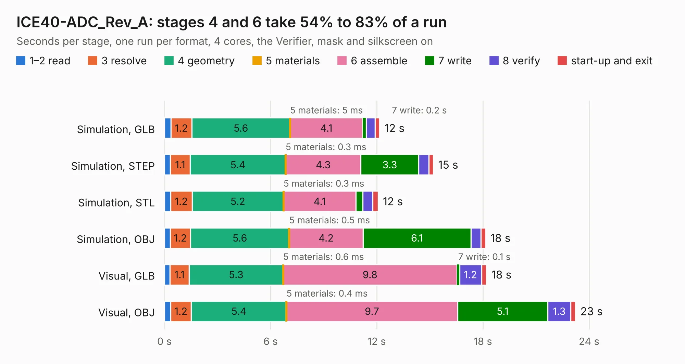

| Mode and format | 1–2 read | 3 resolve | 4 geometry | 5 materials | 6 assemble | 7 write | 8 verify | start-up and exit | Total |
|---|---:|---:|---:|---:|---:|---:|---:|---:|---:|
| Simulation, GLB | 0.4 | 1.2 | 5.6 | 5&nbsp;ms | 4.1 | 0.2 | 0.5 | 0.3 | 12.2 |
| Simulation, STEP | 0.3 | 1.1 | 5.4 | 0.3&nbsp;ms | 4.3 | 3.3 | 0.6 | 0.3 | 15.2 |
| Simulation, STL | 0.3 | 1.2 | 5.2 | 0.3&nbsp;ms | 4.1 | 0.4 | 0.6 | 0.3 | 12.1 |
| Simulation, OBJ | 0.3 | 1.2 | 5.6 | 0.5&nbsp;ms | 4.2 | 6.1 | 0.6 | 0.3 | 18.1 |
| Visual, GLB | 0.3 | 1.1 | 5.3 | 0.6&nbsp;ms | 9.8 | 0.1 | 1.2 | 0.3 | 18.2 |
| Visual, OBJ | 0.3 | 1.2 | 5.4 | 0.4&nbsp;ms | 9.7 | 5.1 | 1.3 | 0.3 | 23.2 |

<table align="center"><tr><td valign="top">

| Board | Repo: [OLIMEX/iCE40-ADC](https://github.com/OLIMEX/iCE40-ADC) Board: `ICE40-ADC_Rev_A.kicad_pcb` |
|---|---|
| Complexity | 216&nbsp;/&nbsp;1000 (size&nbsp;181, features&nbsp;35) |
| KESE&nbsp;features | through vias, filled zones |
| Tested | 9th November 2026 |
| Copper&nbsp;layers | 2 |
| File&nbsp;format | KiCad 5 (20170123) |
| Parts,&nbsp;tracks,&nbsp;vias | 43, 1,220, 192 |
| Triangles,&nbsp;simulation | 1,044,008 in 65 parts |
| Verifier | PASS in all six runs |

</td><td valign="top">

<table>
<tr><th>File type</th><th>File size</th><th>Peak memory used</th></tr>
<tr><th colspan="3" align="left">Simulation</th></tr>
<tr><td>GLB</td><td align="right">36&nbsp;MB</td><td align="right">433&nbsp;MB</td></tr>
<tr><td>STEP</td><td align="right">187&nbsp;MB</td><td align="right">507&nbsp;MB</td></tr>
<tr><td>STL</td><td align="right">52&nbsp;MB</td><td align="right">440&nbsp;MB</td></tr>
<tr><td>OBJ</td><td align="right">108&nbsp;MB</td><td align="right">743&nbsp;MB</td></tr>
<tr><th colspan="3" align="left">Visual</th></tr>
<tr><td>GLB</td><td align="right">28&nbsp;MB</td><td align="right">595&nbsp;MB</td></tr>
<tr><td>OBJ</td><td align="right">83&nbsp;MB</td><td align="right">640&nbsp;MB</td></tr>
</table>

</td></tr></table>

## 1881. ICE40-DAC_Rev_A1

| Mode and format | 1–2 read | 3 resolve | 4 geometry | 5 materials | 6 assemble | 7 write | 8 verify | start-up and exit | Total |
|---|---:|---:|---:|---:|---:|---:|---:|---:|---:|
| Simulation, GLB | 0.3 | 0.9 | 4.6 | 0.8&nbsp;ms | 3.5 | 0.2 | 0.5 | 0.3 | 10.3 |
| Simulation, STEP | 0.3 | 1.0 | 4.6 | 0.6&nbsp;ms | 3.4 | 2.8 | 0.5 | 0.3 | 12.9 |
| Simulation, STL | 0.3 | 0.9 | 4.5 | 0.5&nbsp;ms | 3.6 | 0.3 | 0.5 | 0.2 | 10.4 |
| Simulation, OBJ | 0.3 | 0.9 | 4.5 | 0.8&nbsp;ms | 3.5 | 5.1 | 0.6 | 0.2 | 15.0 |
| Visual, GLB | 0.3 | 0.9 | 4.4 | 0.7&nbsp;ms | 9.2 | 0.1 | 1.2 | 0.2 | 16.4 |
| Visual, OBJ | 0.3 | 0.9 | 4.4 | 0.7&nbsp;ms | 9.1 | 4.0 | 0.9 | 0.2 | 19.7 |

<table align="center"><tr><td valign="top">

| Board | Repo: [OLIMEX/iCE40-DAC](https://github.com/OLIMEX/iCE40-DAC) Board: `ICE40-DAC_Rev_A1.kicad_pcb` |
|---|---|
| Folder | Hardware revision A1 |
| Complexity | 212&nbsp;/&nbsp;1000 (size&nbsp;177, features&nbsp;35) |
| KESE&nbsp;features | through vias, filled zones |
| Tested | 9th November 2026 to 10th November 2026 |
| Copper&nbsp;layers | 2 |
| File&nbsp;format | KiCad 5 (20171130) |
| Parts,&nbsp;tracks,&nbsp;vias | 39, 1,005, 166 |
| Triangles,&nbsp;simulation | 1,063,228 in 72 parts |
| Verifier | PASS in all six runs |
| Run&nbsp;again | Visual, GLB; Visual, OBJ: failed in the corpus run, run again with fixes to KESE made after the corpus run, and passed |

</td><td valign="top">

<table>
<tr><th>File type</th><th>File size</th><th>Peak memory used</th></tr>
<tr><th colspan="3" align="left">Simulation</th></tr>
<tr><td>GLB</td><td align="right">37&nbsp;MB</td><td align="right">467&nbsp;MB</td></tr>
<tr><td>STEP</td><td align="right">195&nbsp;MB</td><td align="right">518&nbsp;MB</td></tr>
<tr><td>STL</td><td align="right">53&nbsp;MB</td><td align="right">470&nbsp;MB</td></tr>
<tr><td>OBJ</td><td align="right">109&nbsp;MB</td><td align="right">753&nbsp;MB</td></tr>
<tr><th colspan="3" align="left">Visual</th></tr>
<tr><td>GLB</td><td align="right">28&nbsp;MB</td><td align="right">608&nbsp;MB</td></tr>
<tr><td>OBJ</td><td align="right">82&nbsp;MB</td><td align="right">631&nbsp;MB</td></tr>
</table>

</td></tr></table>

## 1882. ICE40-DAC_Rev_A

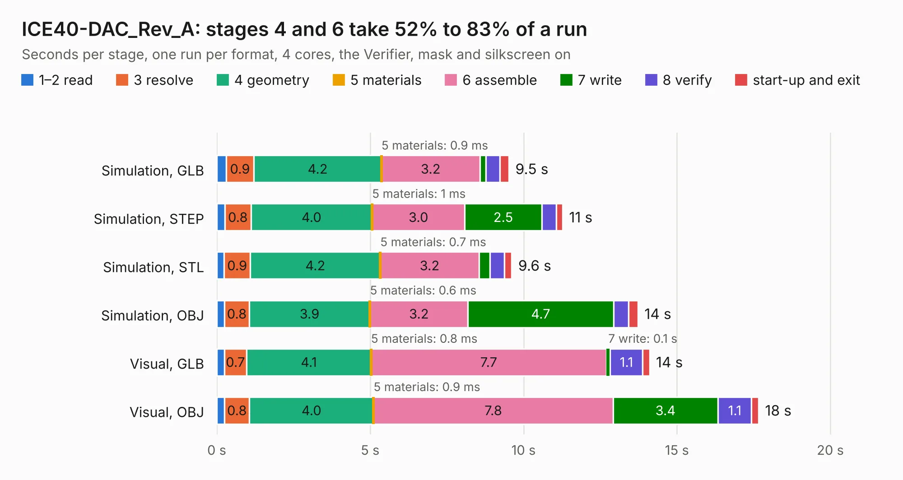

| Mode and format | 1–2 read | 3 resolve | 4 geometry | 5 materials | 6 assemble | 7 write | 8 verify | start-up and exit | Total |
|---|---:|---:|---:|---:|---:|---:|---:|---:|---:|
| Simulation, GLB | 0.3 | 0.9 | 4.2 | 0.9&nbsp;ms | 3.2 | 0.2 | 0.5 | 0.3 | 9.5 |
| Simulation, STEP | 0.3 | 0.8 | 4.0 | 1&nbsp;ms | 3.0 | 2.5 | 0.5 | 0.2 | 11.3 |
| Simulation, STL | 0.2 | 0.9 | 4.2 | 0.7&nbsp;ms | 3.2 | 0.4 | 0.5 | 0.2 | 9.6 |
| Simulation, OBJ | 0.3 | 0.8 | 3.9 | 0.6&nbsp;ms | 3.2 | 4.7 | 0.5 | 0.3 | 13.7 |
| Visual, GLB | 0.2 | 0.7 | 4.1 | 0.8&nbsp;ms | 7.7 | 0.1 | 1.1 | 0.2 | 14.1 |
| Visual, OBJ | 0.3 | 0.8 | 4.0 | 0.9&nbsp;ms | 7.8 | 3.4 | 1.1 | 0.2 | 17.7 |

<table align="center"><tr><td valign="top">

| Board | Repo: [OLIMEX/iCE40-DAC](https://github.com/OLIMEX/iCE40-DAC) Board: `ICE40-DAC_Rev_A.kicad_pcb` |
|---|---|
| Complexity | 212&nbsp;/&nbsp;1000 (size&nbsp;177, features&nbsp;35) |
| KESE&nbsp;features | through vias, filled zones |
| Tested | 9th November 2026 |
| Copper&nbsp;layers | 2 |
| File&nbsp;format | KiCad 5 (20170123) |
| Parts,&nbsp;tracks,&nbsp;vias | 39, 1,005, 166 |
| Triangles,&nbsp;simulation | 1,030,836 in 72 parts |
| Verifier | PASS in all six runs |

</td><td valign="top">

<table>
<tr><th>File type</th><th>File size</th><th>Peak memory used</th></tr>
<tr><th colspan="3" align="left">Simulation</th></tr>
<tr><td>GLB</td><td align="right">36&nbsp;MB</td><td align="right">467&nbsp;MB</td></tr>
<tr><td>STEP</td><td align="right">194&nbsp;MB</td><td align="right">529&nbsp;MB</td></tr>
<tr><td>STL</td><td align="right">52&nbsp;MB</td><td align="right">456&nbsp;MB</td></tr>
<tr><td>OBJ</td><td align="right">106&nbsp;MB</td><td align="right">710&nbsp;MB</td></tr>
<tr><th colspan="3" align="left">Visual</th></tr>
<tr><td>GLB</td><td align="right">27&nbsp;MB</td><td align="right">570&nbsp;MB</td></tr>
<tr><td>OBJ</td><td align="right">80&nbsp;MB</td><td align="right">565&nbsp;MB</td></tr>
</table>

</td></tr></table>

## 1883. ICE40-DIO_Rev_A

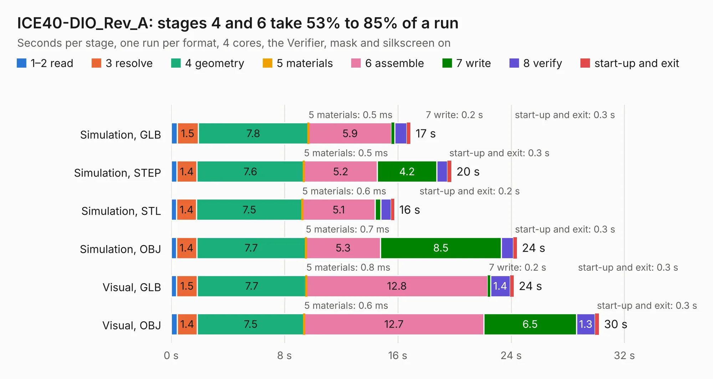

| Mode and format | 1–2 read | 3 resolve | 4 geometry | 5 materials | 6 assemble | 7 write | 8 verify | start-up and exit | Total |
|---|---:|---:|---:|---:|---:|---:|---:|---:|---:|
| Simulation, GLB | 0.4 | 1.5 | 7.8 | 0.5&nbsp;ms | 5.9 | 0.2 | 0.9 | 0.3 | 16.9 |
| Simulation, STEP | 0.4 | 1.4 | 7.6 | 0.5&nbsp;ms | 5.2 | 4.2 | 0.8 | 0.3 | 19.8 |
| Simulation, STL | 0.4 | 1.4 | 7.5 | 0.6&nbsp;ms | 5.1 | 0.4 | 0.7 | 0.2 | 15.7 |
| Simulation, OBJ | 0.4 | 1.4 | 7.7 | 0.7&nbsp;ms | 5.3 | 8.5 | 0.8 | 0.3 | 24.4 |
| Visual, GLB | 0.4 | 1.5 | 7.7 | 0.8&nbsp;ms | 12.8 | 0.2 | 1.4 | 0.3 | 24.2 |
| Visual, OBJ | 0.4 | 1.4 | 7.5 | 0.6&nbsp;ms | 12.7 | 6.5 | 1.3 | 0.3 | 30.2 |

<table align="center"><tr><td valign="top">

| Board | Repo: [OLIMEX/iCE40-DIO](https://github.com/OLIMEX/iCE40-DIO) Board: `ICE40-DIO_Rev_A.kicad_pcb` |
|---|---|
| Complexity | 266&nbsp;/&nbsp;1000 (size&nbsp;231, features&nbsp;35) |
| KESE&nbsp;features | through vias, filled zones |
| Tested | 9th November 2026 |
| Copper&nbsp;layers | 2 |
| File&nbsp;format | KiCad 5 (20170123) |
| Parts,&nbsp;tracks,&nbsp;vias | 41, 1,703, 205 |
| Triangles,&nbsp;simulation | 1,473,352 in 89 parts |
| Verifier | PASS in all six runs |

</td><td valign="top">

<table>
<tr><th>File type</th><th>File size</th><th>Peak memory used</th></tr>
<tr><th colspan="3" align="left">Simulation</th></tr>
<tr><td>GLB</td><td align="right">51&nbsp;MB</td><td align="right">580&nbsp;MB</td></tr>
<tr><td>STEP</td><td align="right">258&nbsp;MB</td><td align="right">686&nbsp;MB</td></tr>
<tr><td>STL</td><td align="right">74&nbsp;MB</td><td align="right">587&nbsp;MB</td></tr>
<tr><td>OBJ</td><td align="right">154&nbsp;MB</td><td align="right">984&nbsp;MB</td></tr>
<tr><th colspan="3" align="left">Visual</th></tr>
<tr><td>GLB</td><td align="right">39&nbsp;MB</td><td align="right">726&nbsp;MB</td></tr>
<tr><td>OBJ</td><td align="right">118&nbsp;MB</td><td align="right">880&nbsp;MB</td></tr>
</table>

</td></tr></table>

## 1884. ICE40-IO_Rev_A

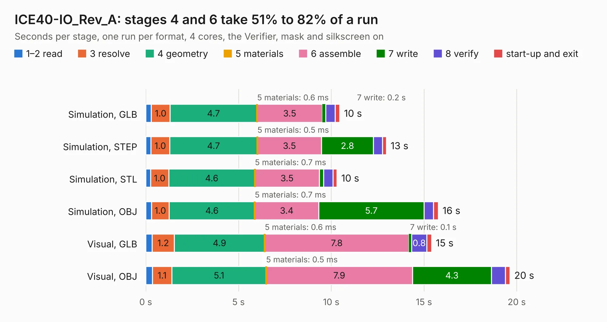

| Mode and format | 1–2 read | 3 resolve | 4 geometry | 5 materials | 6 assemble | 7 write | 8 verify | start-up and exit | Total |
|---|---:|---:|---:|---:|---:|---:|---:|---:|---:|
| Simulation, GLB | 0.3 | 1.0 | 4.7 | 0.6&nbsp;ms | 3.5 | 0.2 | 0.5 | 0.3 | 10.5 |
| Simulation, STEP | 0.3 | 1.0 | 4.7 | 0.5&nbsp;ms | 3.5 | 2.8 | 0.5 | 0.2 | 13.0 |
| Simulation, STL | 0.3 | 1.0 | 4.6 | 0.7&nbsp;ms | 3.5 | 0.2 | 0.5 | 0.2 | 10.3 |
| Simulation, OBJ | 0.3 | 1.0 | 4.6 | 0.7&nbsp;ms | 3.4 | 5.7 | 0.5 | 0.3 | 15.8 |
| Visual, GLB | 0.4 | 1.2 | 4.9 | 0.6&nbsp;ms | 7.8 | 0.1 | 0.8 | 0.2 | 15.4 |
| Visual, OBJ | 0.4 | 1.1 | 5.1 | 0.5&nbsp;ms | 7.9 | 4.3 | 0.7 | 0.2 | 19.6 |

<table align="center"><tr><td valign="top">

| Board | Repo: [OLIMEX/iCE40-IO](https://github.com/OLIMEX/iCE40-IO) Board: `ICE40-IO_Rev_A.kicad_pcb` |
|---|---|
| Complexity | 206&nbsp;/&nbsp;1000 (size&nbsp;171, features&nbsp;35) |
| KESE&nbsp;features | through vias, filled zones |
| Tested | 9th November 2026 |
| Copper&nbsp;layers | 2 |
| File&nbsp;format | KiCad 5 (20170123) |
| Parts,&nbsp;tracks,&nbsp;vias | 33, 751, 146 |
| Triangles,&nbsp;simulation | 1,043,876 in 64 parts |
| Verifier | PASS in all six runs |

</td><td valign="top">

<table>
<tr><th>File type</th><th>File size</th><th>Peak memory used</th></tr>
<tr><th colspan="3" align="left">Simulation</th></tr>
<tr><td>GLB</td><td align="right">36&nbsp;MB</td><td align="right">451&nbsp;MB</td></tr>
<tr><td>STEP</td><td align="right">185&nbsp;MB</td><td align="right">529&nbsp;MB</td></tr>
<tr><td>STL</td><td align="right">52&nbsp;MB</td><td align="right">450&nbsp;MB</td></tr>
<tr><td>OBJ</td><td align="right">107&nbsp;MB</td><td align="right">736&nbsp;MB</td></tr>
<tr><th colspan="3" align="left">Visual</th></tr>
<tr><td>GLB</td><td align="right">27&nbsp;MB</td><td align="right">583&nbsp;MB</td></tr>
<tr><td>OBJ</td><td align="right">80&nbsp;MB</td><td align="right">600&nbsp;MB</td></tr>
</table>

</td></tr></table>

## 1885. ICE40-1KEVB_Rev_A

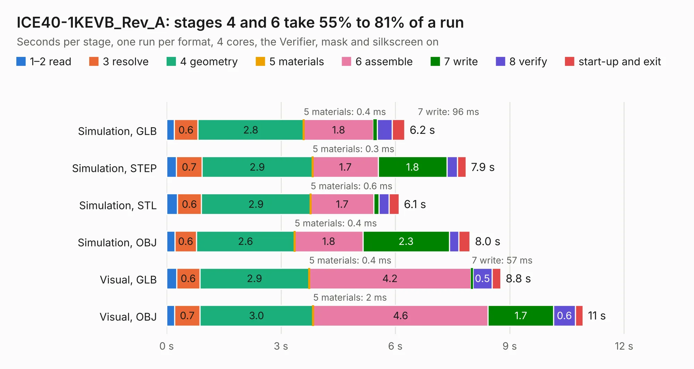

| Mode and format | 1–2 read | 3 resolve | 4 geometry | 5 materials | 6 assemble | 7 write | 8 verify | start-up and exit | Total |
|---|---:|---:|---:|---:|---:|---:|---:|---:|---:|
| Simulation, GLB | 0.2 | 0.6 | 2.8 | 0.4&nbsp;ms | 1.8 | 96&nbsp;ms | 0.4 | 0.3 | 6.2 |
| Simulation, STEP | 0.3 | 0.7 | 2.9 | 0.3&nbsp;ms | 1.7 | 1.8 | 0.3 | 0.2 | 7.9 |
| Simulation, STL | 0.3 | 0.6 | 2.9 | 0.6&nbsp;ms | 1.7 | 0.1 | 0.3 | 0.3 | 6.1 |
| Simulation, OBJ | 0.2 | 0.6 | 2.6 | 0.4&nbsp;ms | 1.8 | 2.3 | 0.2 | 0.3 | 8.0 |
| Visual, GLB | 0.3 | 0.6 | 2.9 | 0.4&nbsp;ms | 4.2 | 57&nbsp;ms | 0.5 | 0.2 | 8.8 |
| Visual, OBJ | 0.2 | 0.7 | 3.0 | 2&nbsp;ms | 4.6 | 1.7 | 0.6 | 0.2 | 10.9 |

<table align="center"><tr><td valign="top">

| Board | Repo: [OLIMEX/iCE40HX1K-EVB](https://github.com/OLIMEX/iCE40HX1K-EVB) Board: `ICE40-1KEVB_Rev_A.kicad_pcb` |
|---|---|
| Complexity | 102&nbsp;/&nbsp;1000 (size&nbsp;102, features&nbsp;0) |
| Tested | 9th November 2026 |
| Copper&nbsp;layers | 2 |
| File&nbsp;format | KiCad 4 (4) |
| Parts,&nbsp;tracks,&nbsp;vias | 67, 0, 0 |
| Triangles,&nbsp;simulation | 457,628 in 106 parts |
| Note | mostly unrouted |
| Verifier | PASS in all six runs |

</td><td valign="top">

<table>
<tr><th>File type</th><th>File size</th><th>Peak memory used</th></tr>
<tr><th colspan="3" align="left">Simulation</th></tr>
<tr><td>GLB</td><td align="right">16&nbsp;MB</td><td align="right">301&nbsp;MB</td></tr>
<tr><td>STEP</td><td align="right">69&nbsp;MB</td><td align="right">333&nbsp;MB</td></tr>
<tr><td>STL</td><td align="right">23&nbsp;MB</td><td align="right">295&nbsp;MB</td></tr>
<tr><td>OBJ</td><td align="right">48&nbsp;MB</td><td align="right">370&nbsp;MB</td></tr>
<tr><th colspan="3" align="left">Visual</th></tr>
<tr><td>GLB</td><td align="right">11&nbsp;MB</td><td align="right">320&nbsp;MB</td></tr>
<tr><td>OBJ</td><td align="right">31&nbsp;MB</td><td align="right">323&nbsp;MB</td></tr>
</table>

</td></tr></table>

## 1886. iCE40HX1K-EVB_Rev_B

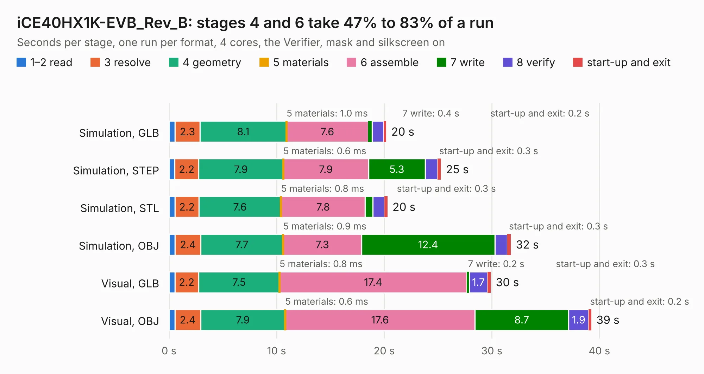

| Mode and format | 1–2 read | 3 resolve | 4 geometry | 5 materials | 6 assemble | 7 write | 8 verify | start-up and exit | Total |
|---|---:|---:|---:|---:|---:|---:|---:|---:|---:|
| Simulation, GLB | 0.6 | 2.3 | 8.1 | 1.0&nbsp;ms | 7.6 | 0.4 | 1.1 | 0.2 | 20.2 |
| Simulation, STEP | 0.5 | 2.2 | 7.9 | 0.6&nbsp;ms | 7.9 | 5.3 | 1.2 | 0.3 | 25.3 |
| Simulation, STL | 0.6 | 2.2 | 7.6 | 0.8&nbsp;ms | 7.8 | 0.7 | 1.1 | 0.3 | 20.3 |
| Simulation, OBJ | 0.6 | 2.4 | 7.7 | 0.9&nbsp;ms | 7.3 | 12.4 | 1.2 | 0.3 | 31.8 |
| Visual, GLB | 0.5 | 2.2 | 7.5 | 0.8&nbsp;ms | 17.4 | 0.2 | 1.7 | 0.3 | 29.9 |
| Visual, OBJ | 0.5 | 2.4 | 7.9 | 0.6&nbsp;ms | 17.6 | 8.7 | 1.9 | 0.2 | 39.3 |

<table align="center"><tr><td valign="top">

| Board | Repo: [OLIMEX/iCE40HX1K-EVB](https://github.com/OLIMEX/iCE40HX1K-EVB) Board: `iCE40HX1K-EVB_Rev_B.kicad_pcb` |
|---|---|
| Complexity | 281&nbsp;/&nbsp;1000 (size&nbsp;236, features&nbsp;45) |
| KESE&nbsp;features | through vias, slotted holes, filled zones |
| Tested | 9th November 2026 |
| Copper&nbsp;layers | 2 |
| File&nbsp;format | KiCad 4 (4) |
| Parts,&nbsp;tracks,&nbsp;vias | 71, 2,527, 279 |
| Triangles,&nbsp;simulation | 1,966,590 in 110 parts |
| Verifier | PASS in all six runs |

</td><td valign="top">

<table>
<tr><th>File type</th><th>File size</th><th>Peak memory used</th></tr>
<tr><th colspan="3" align="left">Simulation</th></tr>
<tr><td>GLB</td><td align="right">68&nbsp;MB</td><td align="right">678&nbsp;MB</td></tr>
<tr><td>STEP</td><td align="right">295&nbsp;MB</td><td align="right">808&nbsp;MB</td></tr>
<tr><td>STL</td><td align="right">98&nbsp;MB</td><td align="right">716&nbsp;MB</td></tr>
<tr><td>OBJ</td><td align="right">210&nbsp;MB</td><td align="right">1.3&nbsp;GB</td></tr>
<tr><th colspan="3" align="left">Visual</th></tr>
<tr><td>GLB</td><td align="right">46&nbsp;MB</td><td align="right">886&nbsp;MB</td></tr>
<tr><td>OBJ</td><td align="right">142&nbsp;MB</td><td align="right">1.0&nbsp;GB</td></tr>
</table>

</td></tr></table>

## 1887. iCE40HX8K-EVB_Rev_B

| Mode and format | 1–2 read | 3 resolve | 4 geometry | 5 materials | 6 assemble | 7 write | 8 verify | start-up and exit | Total |
|---|---:|---:|---:|---:|---:|---:|---:|---:|---:|
| Simulation, GLB | 1.0 | 6.7 | 20.4 | 1&nbsp;ms | 21.2 | 0.9 | 3.1 | 0.4 | 53.7 |
| Simulation, STEP | 1.1 | 6.4 | 20.6 | 0.8&nbsp;ms | 21.4 | 12.5 | 3.1 | 0.4 | 65.5 |
| Simulation, STL | 1.1 | 7.0 | 20.8 | 0.8&nbsp;ms | 21.3 | 1.8 | 3.2 | 0.4 | 55.5 |
| Simulation, OBJ | 1.2 | 6.4 | 20.4 | 2&nbsp;ms | 21.3 | 31.9 | 3.2 | 0.3 | 84.8 |
| Visual, GLB | 1.2 | 6.5 | 20.9 | 3&nbsp;ms | 54.2 | 0.6 | 6.1 | 0.3 | 89.8 |
| Visual, OBJ | 1.1 | 6.6 | 20.6 | 2&nbsp;ms | 53.9 | 22.1 | 6.1 | 0.4 | 110.8 |

<table align="center"><tr><td valign="top">

| Board | Repo: [OLIMEX/iCE40HX8K-EVB](https://github.com/OLIMEX/iCE40HX8K-EVB) Board: `iCE40HX8K-EVB_Rev_B.kicad_pcb` |
|---|---|
| Folder | HARDWARE / REV-B |
| Complexity | 314&nbsp;/&nbsp;1000 (size&nbsp;269, features&nbsp;45) |
| KESE&nbsp;features | through vias, slotted holes, filled zones |
| Tested | 9th November 2026 |
| Copper&nbsp;layers | 2 |
| File&nbsp;format | KiCad 5 (20160815) |
| Parts,&nbsp;tracks,&nbsp;vias | 96, 7,178, 863 |
| Triangles,&nbsp;simulation | 4,942,670 in 246 parts |
| Verifier | PASS in all six runs |

</td><td valign="top">

<table>
<tr><th>File type</th><th>File size</th><th>Peak memory used</th></tr>
<tr><th colspan="3" align="left">Simulation</th></tr>
<tr><td>GLB</td><td align="right">171&nbsp;MB</td><td align="right">1.5&nbsp;GB</td></tr>
<tr><td>STEP</td><td align="right">730&nbsp;MB</td><td align="right">1.7&nbsp;GB</td></tr>
<tr><td>STL</td><td align="right">247&nbsp;MB</td><td align="right">1.6&nbsp;GB</td></tr>
<tr><td>OBJ</td><td align="right">540&nbsp;MB</td><td align="right">3.2&nbsp;GB</td></tr>
<tr><th colspan="3" align="left">Visual</th></tr>
<tr><td>GLB</td><td align="right">115&nbsp;MB</td><td align="right">1.8&nbsp;GB</td></tr>
<tr><td>OBJ</td><td align="right">371&nbsp;MB</td><td align="right">2.5&nbsp;GB</td></tr>
</table>

</td></tr></table>

## 1888. iCE40HX8K-EVB_Rev_B1

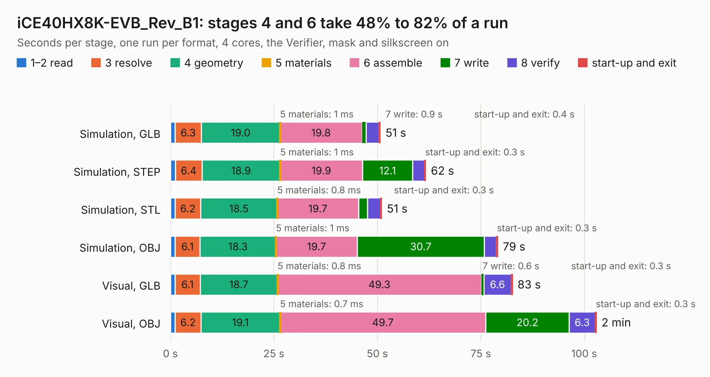

| Mode and format | 1–2 read | 3 resolve | 4 geometry | 5 materials | 6 assemble | 7 write | 8 verify | start-up and exit | Total |
|---|---:|---:|---:|---:|---:|---:|---:|---:|---:|
| Simulation, GLB | 1.1 | 6.3 | 19.0 | 1&nbsp;ms | 19.8 | 0.9 | 3.1 | 0.4 | 50.7 |
| Simulation, STEP | 1.2 | 6.4 | 18.9 | 1&nbsp;ms | 19.9 | 12.1 | 2.9 | 0.3 | 61.7 |
| Simulation, STL | 1.1 | 6.2 | 18.5 | 0.8&nbsp;ms | 19.7 | 2.1 | 3.2 | 0.3 | 51.1 |
| Simulation, OBJ | 1.1 | 6.1 | 18.3 | 1&nbsp;ms | 19.7 | 30.7 | 2.9 | 0.3 | 79.1 |
| Visual, GLB | 1.1 | 6.1 | 18.7 | 0.8&nbsp;ms | 49.3 | 0.6 | 6.6 | 0.3 | 82.7 |
| Visual, OBJ | 1.2 | 6.2 | 19.1 | 0.7&nbsp;ms | 49.7 | 20.2 | 6.3 | 0.3 | 103.0 |

<table align="center"><tr><td valign="top">

| Board | Repo: [OLIMEX/iCE40HX8K-EVB](https://github.com/OLIMEX/iCE40HX8K-EVB) Board: `iCE40HX8K-EVB_Rev_B1.kicad_pcb` |
|---|---|
| Folder | HARDWARE / REV-B1 |
| Complexity | 314&nbsp;/&nbsp;1000 (size&nbsp;269, features&nbsp;45) |
| KESE&nbsp;features | through vias, slotted holes, filled zones |
| Tested | 9th November 2026 |
| Copper&nbsp;layers | 2 |
| File&nbsp;format | KiCad 5 (20171130) |
| Parts,&nbsp;tracks,&nbsp;vias | 96, 7,178, 863 |
| Triangles,&nbsp;simulation | 5,101,374 in 247 parts |
| Verifier | PASS in all six runs |

</td><td valign="top">

<table>
<tr><th>File type</th><th>File size</th><th>Peak memory used</th></tr>
<tr><th colspan="3" align="left">Simulation</th></tr>
<tr><td>GLB</td><td align="right">177&nbsp;MB</td><td align="right">1.5&nbsp;GB</td></tr>
<tr><td>STEP</td><td align="right">734&nbsp;MB</td><td align="right">1.8&nbsp;GB</td></tr>
<tr><td>STL</td><td align="right">255&nbsp;MB</td><td align="right">1.5&nbsp;GB</td></tr>
<tr><td>OBJ</td><td align="right">558&nbsp;MB</td><td align="right">3.3&nbsp;GB</td></tr>
<tr><th colspan="3" align="left">Visual</th></tr>
<tr><td>GLB</td><td align="right">117&nbsp;MB</td><td align="right">2.0&nbsp;GB</td></tr>
<tr><td>OBJ</td><td align="right">377&nbsp;MB</td><td align="right">2.6&nbsp;GB</td></tr>
</table>

</td></tr></table>

## 1889. iMX8MPLUS-SOM_Rev_B

| Mode and format | 1–2 read | 3 resolve | 4 geometry | 5 materials | 6 assemble | 7 write | 8 verify | start-up and exit | Total |
|---|---:|---:|---:|---:|---:|---:|---:|---:|---:|
| Simulation, GLB | 2.1 | 8.8 | 31.9 | 1&nbsp;ms | 34.9 | 1.9 | 6.3 | 0.5 | 86.4 |
| Simulation, STEP | 1.9 | 8.8 | 32.3 | 1&nbsp;ms | 34.7 | 21.0 | 5.7 | 0.4 | 104.8 |
| Simulation, STL | 2.0 | 9.1 | 32.8 | 1&nbsp;ms | 37.6 | 3.8 | 6.2 | 0.4 | 91.9 |
| Simulation, OBJ | 2.1 | 9.0 | 32.4 | 1&nbsp;ms | 36.2 | 56.3 | 5.6 | 0.4 | 141.9 |
| Visual, GLB | 1.9 | 8.8 | 31.9 | 2&nbsp;ms | 80.4 | 0.9 | 8.1 | 0.3 | 132.4 |
| Visual, OBJ | 1.9 | 8.9 | 31.8 | 1&nbsp;ms | 76.6 | 31.8 | 8.1 | 0.4 | 159.5 |

<table align="center"><tr><td valign="top">

| Board | Repo: [OLIMEX/iMX8MP-SOM](https://github.com/OLIMEX/iMX8MP-SOM) Board: `iMX8MPLUS-SOM_Rev_B.kicad_pcb` |
|---|---|
| Folder | HARDWARE / iMX8MP-SOM-xGB-IND |
| Complexity | 363&nbsp;/&nbsp;1000 (size&nbsp;318, features&nbsp;45) |
| KESE&nbsp;features | through vias, filled zones, copper text |
| Tested | 9th November 2026 |
| Copper&nbsp;layers | 6 |
| File&nbsp;format | KiCad 5 (20171130) |
| Parts,&nbsp;tracks,&nbsp;vias | 203, 11,532, 988 |
| Triangles,&nbsp;simulation | 8,457,830 in 438 parts |
| Verifier | PASS in all six runs |

</td><td valign="top">

<table>
<tr><th>File type</th><th>File size</th><th>Peak memory used</th></tr>
<tr><th colspan="3" align="left">Simulation</th></tr>
<tr><td>GLB</td><td align="right">294&nbsp;MB</td><td align="right">2.2&nbsp;GB</td></tr>
<tr><td>STEP</td><td align="right">1.2&nbsp;GB</td><td align="right">2.8&nbsp;GB</td></tr>
<tr><td>STL</td><td align="right">423&nbsp;MB</td><td align="right">2.3&nbsp;GB</td></tr>
<tr><td>OBJ</td><td align="right">916&nbsp;MB</td><td align="right">5.4&nbsp;GB</td></tr>
<tr><th colspan="3" align="left">Visual</th></tr>
<tr><td>GLB</td><td align="right">163&nbsp;MB</td><td align="right">2.6&nbsp;GB</td></tr>
<tr><td>OBJ</td><td align="right">535&nbsp;MB</td><td align="right">3.4&nbsp;GB</td></tr>
</table>

</td></tr></table>

## 1890. iMX8MPLUS-SOM-EVB_Rev_B

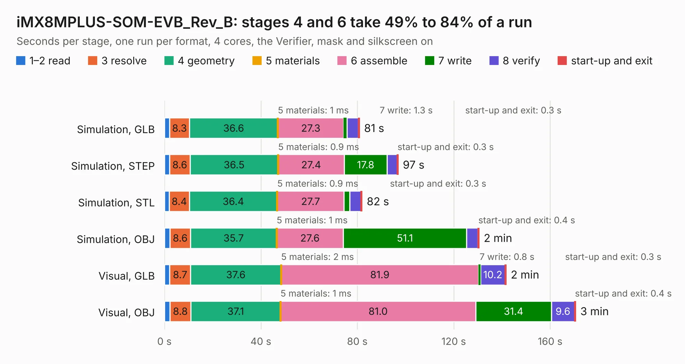

| Mode and format | 1–2 read | 3 resolve | 4 geometry | 5 materials | 6 assemble | 7 write | 8 verify | start-up and exit | Total |
|---|---:|---:|---:|---:|---:|---:|---:|---:|---:|
| Simulation, GLB | 2.1 | 8.3 | 36.6 | 1&nbsp;ms | 27.3 | 1.3 | 4.8 | 0.3 | 80.8 |
| Simulation, STEP | 2.1 | 8.6 | 36.5 | 0.9&nbsp;ms | 27.4 | 17.8 | 4.2 | 0.3 | 96.9 |
| Simulation, STL | 2.0 | 8.4 | 36.4 | 0.9&nbsp;ms | 27.7 | 2.4 | 4.7 | 0.3 | 81.9 |
| Simulation, OBJ | 2.2 | 8.6 | 35.7 | 1&nbsp;ms | 27.6 | 51.1 | 4.7 | 0.4 | 130.4 |
| Visual, GLB | 2.2 | 8.7 | 37.6 | 2&nbsp;ms | 81.9 | 0.8 | 10.2 | 0.3 | 141.6 |
| Visual, OBJ | 2.2 | 8.8 | 37.1 | 1&nbsp;ms | 81.0 | 31.4 | 9.6 | 0.4 | 170.5 |

<table align="center"><tr><td valign="top">

| Board | Repo: [OLIMEX/iMX8MP-SOM-EVB](https://github.com/OLIMEX/iMX8MP-SOM-EVB) Board: `iMX8MPLUS-SOM-EVB_Rev_B.kicad_pcb` |
|---|---|
| Folder | HARDWARE / iMX8MP-SOM-EVB-rev.b |
| Complexity | 364&nbsp;/&nbsp;1000 (size&nbsp;299, features&nbsp;65) |
| KESE&nbsp;features | through vias, slotted holes, rounded, trapezoid or chamfered pads, filled zones, copper text |
| Tested | 9th November 2026 |
| Copper&nbsp;layers | 4 |
| File&nbsp;format | KiCad 5 (20171130) |
| Parts,&nbsp;tracks,&nbsp;vias | 317, 7,518, 1,183 |
| Triangles,&nbsp;simulation | 7,608,794 in 443 parts |
| Verifier | PASS in all six runs |

</td><td valign="top">

<table>
<tr><th>File type</th><th>File size</th><th>Peak memory used</th></tr>
<tr><th colspan="3" align="left">Simulation</th></tr>
<tr><td>GLB</td><td align="right">265&nbsp;MB</td><td align="right">2.3&nbsp;GB</td></tr>
<tr><td>STEP</td><td align="right">1.1&nbsp;GB</td><td align="right">2.9&nbsp;GB</td></tr>
<tr><td>STL</td><td align="right">380&nbsp;MB</td><td align="right">2.2&nbsp;GB</td></tr>
<tr><td>OBJ</td><td align="right">824&nbsp;MB</td><td align="right">4.9&nbsp;GB</td></tr>
<tr><th colspan="3" align="left">Visual</th></tr>
<tr><td>GLB</td><td align="right">184&nbsp;MB</td><td align="right">2.8&nbsp;GB</td></tr>
<tr><td>OBJ</td><td align="right">592&nbsp;MB</td><td align="right">3.7&nbsp;GB</td></tr>
</table>

</td></tr></table>

## 1891. Lime2-SHIELD_RevC

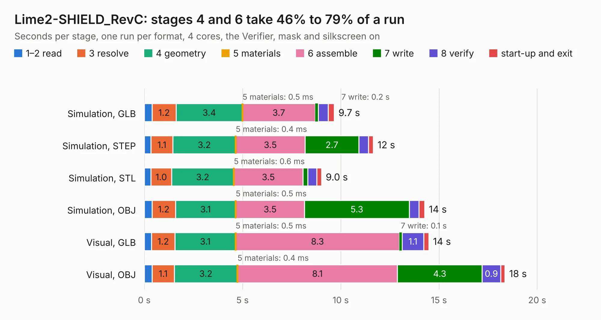

| Mode and format | 1–2 read | 3 resolve | 4 geometry | 5 materials | 6 assemble | 7 write | 8 verify | start-up and exit | Total |
|---|---:|---:|---:|---:|---:|---:|---:|---:|---:|
| Simulation, GLB | 0.4 | 1.2 | 3.4 | 0.5&nbsp;ms | 3.7 | 0.2 | 0.5 | 0.3 | 9.7 |
| Simulation, STEP | 0.3 | 1.1 | 3.2 | 0.4&nbsp;ms | 3.5 | 2.7 | 0.5 | 0.2 | 11.7 |
| Simulation, STL | 0.3 | 1.0 | 3.2 | 0.6&nbsp;ms | 3.5 | 0.3 | 0.5 | 0.2 | 9.0 |
| Simulation, OBJ | 0.4 | 1.2 | 3.1 | 0.5&nbsp;ms | 3.5 | 5.3 | 0.5 | 0.3 | 14.3 |
| Visual, GLB | 0.4 | 1.2 | 3.1 | 0.5&nbsp;ms | 8.3 | 0.1 | 1.1 | 0.3 | 14.5 |
| Visual, OBJ | 0.4 | 1.1 | 3.2 | 0.4&nbsp;ms | 8.1 | 4.3 | 0.9 | 0.2 | 18.4 |

<table align="center"><tr><td valign="top">

| Board | Repo: [OLIMEX/LIME2-SHIELD](https://github.com/OLIMEX/LIME2-SHIELD) Board: `Lime2-SHIELD_RevC.kicad_pcb` |
|---|---|
| Folder | HARDWARE / Lime2-SHIELD-Rev.C |
| Complexity | 232&nbsp;/&nbsp;1000 (size&nbsp;187, features&nbsp;45) |
| KESE&nbsp;features | through vias, rounded, trapezoid or chamfered pads, filled zones |
| Tested | 9th November 2026 |
| Copper&nbsp;layers | 4 |
| File&nbsp;format | KiCad 5 (20171130) |
| Parts,&nbsp;tracks,&nbsp;vias | 39, 689, 117 |
| Triangles,&nbsp;simulation | 1,041,168 in 165 parts |
| Verifier | PASS in all six runs |

</td><td valign="top">

<table>
<tr><th>File type</th><th>File size</th><th>Peak memory used</th></tr>
<tr><th colspan="3" align="left">Simulation</th></tr>
<tr><td>GLB</td><td align="right">37&nbsp;MB</td><td align="right">482&nbsp;MB</td></tr>
<tr><td>STEP</td><td align="right">165&nbsp;MB</td><td align="right">581&nbsp;MB</td></tr>
<tr><td>STL</td><td align="right">52&nbsp;MB</td><td align="right">474&nbsp;MB</td></tr>
<tr><td>OBJ</td><td align="right">109&nbsp;MB</td><td align="right">779&nbsp;MB</td></tr>
<tr><th colspan="3" align="left">Visual</th></tr>
<tr><td>GLB</td><td align="right">27&nbsp;MB</td><td align="right">639&nbsp;MB</td></tr>
<tr><td>OBJ</td><td align="right">83&nbsp;MB</td><td align="right">627&nbsp;MB</td></tr>
</table>

</td></tr></table>

## 1892. LoRa_RevA

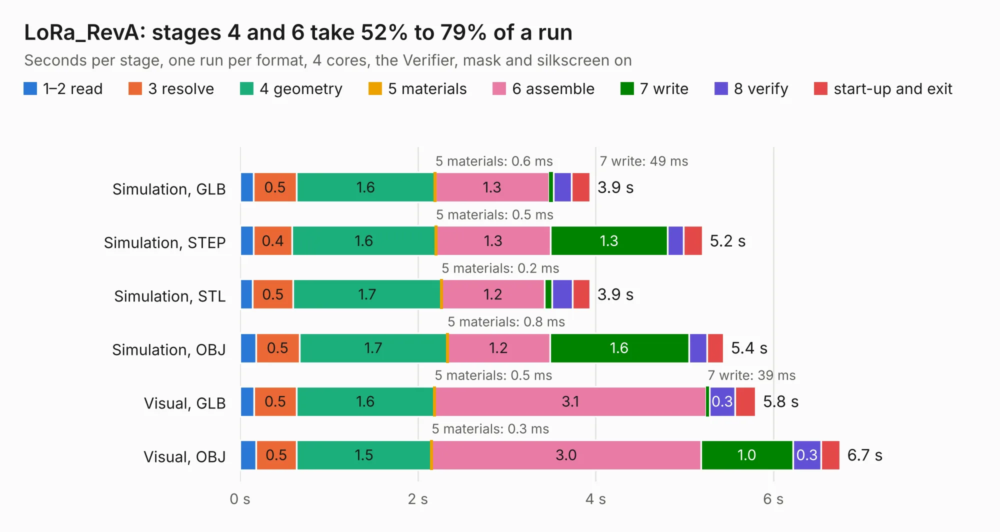

| Mode and format | 1–2 read | 3 resolve | 4 geometry | 5 materials | 6 assemble | 7 write | 8 verify | start-up and exit | Total |
|---|---:|---:|---:|---:|---:|---:|---:|---:|---:|
| Simulation, GLB | 0.2 | 0.5 | 1.6 | 0.6&nbsp;ms | 1.3 | 49&nbsp;ms | 0.2 | 0.2 | 3.9 |
| Simulation, STEP | 0.2 | 0.4 | 1.6 | 0.5&nbsp;ms | 1.3 | 1.3 | 0.2 | 0.2 | 5.2 |
| Simulation, STL | 0.1 | 0.5 | 1.7 | 0.2&nbsp;ms | 1.2 | 83&nbsp;ms | 0.2 | 0.2 | 3.9 |
| Simulation, OBJ | 0.2 | 0.5 | 1.7 | 0.8&nbsp;ms | 1.2 | 1.6 | 0.2 | 0.2 | 5.4 |
| Visual, GLB | 0.2 | 0.5 | 1.6 | 0.5&nbsp;ms | 3.1 | 39&nbsp;ms | 0.3 | 0.2 | 5.8 |
| Visual, OBJ | 0.2 | 0.5 | 1.5 | 0.3&nbsp;ms | 3.0 | 1.0 | 0.3 | 0.2 | 6.7 |

<table align="center"><tr><td valign="top">

| Board | Repo: [OLIMEX/LoRa-868-915](https://github.com/OLIMEX/LoRa-868-915) Board: `LoRa_RevA.kicad_pcb` |
|---|---|
| Folder | HARDWARE / LoRa-Rev-A |
| Complexity | 265&nbsp;/&nbsp;1000 (size&nbsp;195, features&nbsp;70) |
| KESE&nbsp;features | through vias, slotted holes, custom pads, filled zones, copper drawings |
| Tested | 9th November 2026 |
| Copper&nbsp;layers | 2 |
| File&nbsp;format | KiCad 5 (20171130) |
| Parts,&nbsp;tracks,&nbsp;vias | 31, 322, 45 |
| Triangles,&nbsp;simulation | 350,196 in 40 parts |
| Verifier | PASS in all six runs |

</td><td valign="top">

<table>
<tr><th>File type</th><th>File size</th><th>Peak memory used</th></tr>
<tr><th colspan="3" align="left">Simulation</th></tr>
<tr><td>GLB</td><td align="right">13&nbsp;MB</td><td align="right">260&nbsp;MB</td></tr>
<tr><td>STEP</td><td align="right">63&nbsp;MB</td><td align="right">265&nbsp;MB</td></tr>
<tr><td>STL</td><td align="right">18&nbsp;MB</td><td align="right">264&nbsp;MB</td></tr>
<tr><td>OBJ</td><td align="right">37&nbsp;MB</td><td align="right">283&nbsp;MB</td></tr>
<tr><th colspan="3" align="left">Visual</th></tr>
<tr><td>GLB</td><td align="right">8.5&nbsp;MB</td><td align="right">255&nbsp;MB</td></tr>
<tr><td>OBJ</td><td align="right">25&nbsp;MB</td><td align="right">242&nbsp;MB</td></tr>
</table>

</td></tr></table>

## 1893. LoRa_RevB

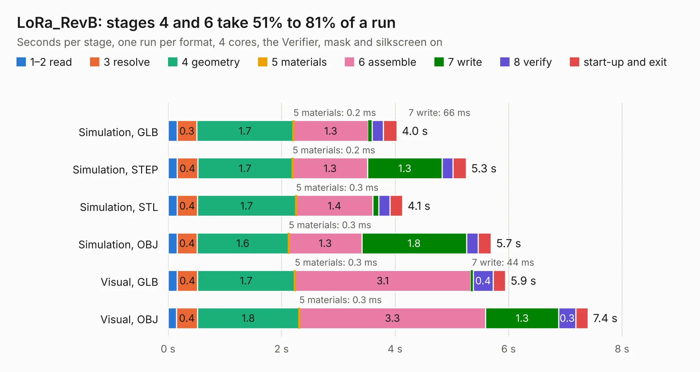

| Mode and format | 1–2 read | 3 resolve | 4 geometry | 5 materials | 6 assemble | 7 write | 8 verify | start-up and exit | Total |
|---|---:|---:|---:|---:|---:|---:|---:|---:|---:|
| Simulation, GLB | 0.2 | 0.3 | 1.7 | 0.2&nbsp;ms | 1.3 | 66&nbsp;ms | 0.2 | 0.2 | 4.0 |
| Simulation, STEP | 0.2 | 0.4 | 1.7 | 0.2&nbsp;ms | 1.3 | 1.3 | 0.2 | 0.2 | 5.3 |
| Simulation, STL | 0.2 | 0.4 | 1.7 | 0.3&nbsp;ms | 1.4 | 0.1 | 0.2 | 0.2 | 4.1 |
| Simulation, OBJ | 0.2 | 0.4 | 1.6 | 0.3&nbsp;ms | 1.3 | 1.8 | 0.2 | 0.2 | 5.7 |
| Visual, GLB | 0.2 | 0.4 | 1.7 | 0.3&nbsp;ms | 3.1 | 44&nbsp;ms | 0.4 | 0.2 | 5.9 |
| Visual, OBJ | 0.1 | 0.4 | 1.8 | 0.3&nbsp;ms | 3.3 | 1.3 | 0.3 | 0.2 | 7.4 |

<table align="center"><tr><td valign="top">

| Board | Repo: [OLIMEX/LoRa-868-915](https://github.com/OLIMEX/LoRa-868-915) Board: `LoRa_RevB.kicad_pcb` |
|---|---|
| Folder | HARDWARE / LoRa-Rev-B |
| Complexity | 261&nbsp;/&nbsp;1000 (size&nbsp;191, features&nbsp;70) |
| KESE&nbsp;features | through vias, slotted holes, custom pads, filled zones, copper drawings |
| Tested | 9th November 2026 |
| Copper&nbsp;layers | 2 |
| File&nbsp;format | KiCad 5 (20171130) |
| Parts,&nbsp;tracks,&nbsp;vias | 26, 270, 45 |
| Triangles,&nbsp;simulation | 371,904 in 41 parts |
| Verifier | PASS in all six runs |

</td><td valign="top">

<table>
<tr><th>File type</th><th>File size</th><th>Peak memory used</th></tr>
<tr><th colspan="3" align="left">Simulation</th></tr>
<tr><td>GLB</td><td align="right">13&nbsp;MB</td><td align="right">265&nbsp;MB</td></tr>
<tr><td>STEP</td><td align="right">67&nbsp;MB</td><td align="right">275&nbsp;MB</td></tr>
<tr><td>STL</td><td align="right">19&nbsp;MB</td><td align="right">261&nbsp;MB</td></tr>
<tr><td>OBJ</td><td align="right">39&nbsp;MB</td><td align="right">304&nbsp;MB</td></tr>
<tr><th colspan="3" align="left">Visual</th></tr>
<tr><td>GLB</td><td align="right">9.1&nbsp;MB</td><td align="right">249&nbsp;MB</td></tr>
<tr><td>OBJ</td><td align="right">27&nbsp;MB</td><td align="right">266&nbsp;MB</td></tr>
</table>

</td></tr></table>

## 1894. MOD-LoRa_RevB

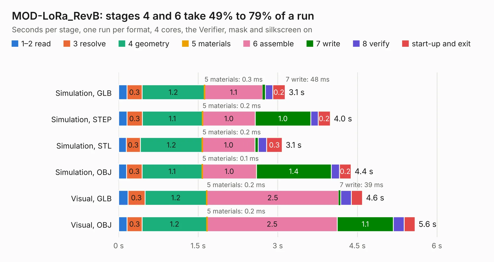

| Mode and format | 1–2 read | 3 resolve | 4 geometry | 5 materials | 6 assemble | 7 write | 8 verify | start-up and exit | Total |
|---|---:|---:|---:|---:|---:|---:|---:|---:|---:|
| Simulation, GLB | 0.2 | 0.3 | 1.2 | 0.3&nbsp;ms | 1.1 | 48&nbsp;ms | 0.1 | 0.2 | 3.1 |
| Simulation, STEP | 0.2 | 0.3 | 1.1 | 0.2&nbsp;ms | 1.0 | 1.0 | 0.1 | 0.2 | 4.0 |
| Simulation, STL | 0.1 | 0.3 | 1.2 | 0.2&nbsp;ms | 1.0 | 63&nbsp;ms | 0.2 | 0.3 | 3.1 |
| Simulation, OBJ | 0.1 | 0.3 | 1.1 | 0.1&nbsp;ms | 1.0 | 1.4 | 0.2 | 0.2 | 4.4 |
| Visual, GLB | 0.2 | 0.3 | 1.2 | 0.2&nbsp;ms | 2.5 | 39&nbsp;ms | 0.2 | 0.2 | 4.6 |
| Visual, OBJ | 0.2 | 0.3 | 1.2 | 0.2&nbsp;ms | 2.5 | 1.1 | 0.2 | 0.2 | 5.6 |

<table align="center"><tr><td valign="top">

| Board | Repo: [OLIMEX/LoRa-868-915](https://github.com/OLIMEX/LoRa-868-915) Board: `MOD-LoRa_RevB.kicad_pcb` |
|---|---|
| Folder | HARDWARE / MOD-LoRa-Rev-B |
| Complexity | 235&nbsp;/&nbsp;1000 (size&nbsp;190, features&nbsp;45) |
| KESE&nbsp;features | through vias, slotted holes, filled zones |
| Tested | 9th November 2026 |
| Copper&nbsp;layers | 2 |
| File&nbsp;format | KiCad 5 (20171130) |
| Parts,&nbsp;tracks,&nbsp;vias | 25, 237, 51 |
| Triangles,&nbsp;simulation | 251,278 in 39 parts |
| Verifier | PASS in all six runs |

</td><td valign="top">

<table>
<tr><th>File type</th><th>File size</th><th>Peak memory used</th></tr>
<tr><th colspan="3" align="left">Simulation</th></tr>
<tr><td>GLB</td><td align="right">9.3&nbsp;MB</td><td align="right">226&nbsp;MB</td></tr>
<tr><td>STEP</td><td align="right">44&nbsp;MB</td><td align="right">256&nbsp;MB</td></tr>
<tr><td>STL</td><td align="right">13&nbsp;MB</td><td align="right">232&nbsp;MB</td></tr>
<tr><td>OBJ</td><td align="right">26&nbsp;MB</td><td align="right">226&nbsp;MB</td></tr>
<tr><th colspan="3" align="left">Visual</th></tr>
<tr><td>GLB</td><td align="right">7.1&nbsp;MB</td><td align="right">215&nbsp;MB</td></tr>
<tr><td>OBJ</td><td align="right">20&nbsp;MB</td><td align="right">213&nbsp;MB</td></tr>
</table>

</td></tr></table>

## 1895. STM32WL-DevKit_RevB

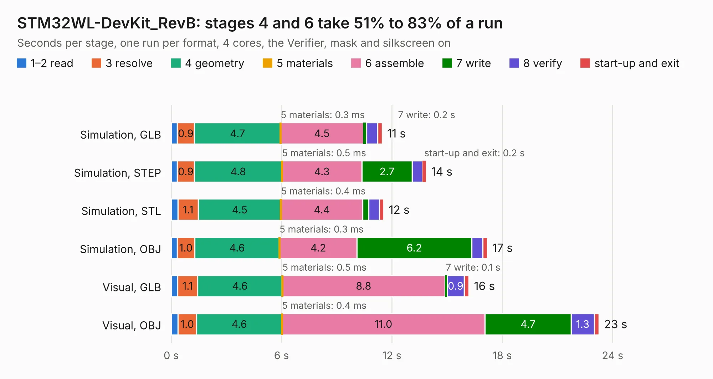

| Mode and format | 1–2 read | 3 resolve | 4 geometry | 5 materials | 6 assemble | 7 write | 8 verify | start-up and exit | Total |
|---|---:|---:|---:|---:|---:|---:|---:|---:|---:|
| Simulation, GLB | 0.3 | 0.9 | 4.7 | 0.3&nbsp;ms | 4.5 | 0.2 | 0.6 | 0.2 | 11.5 |
| Simulation, STEP | 0.3 | 0.9 | 4.8 | 0.5&nbsp;ms | 4.3 | 2.7 | 0.6 | 0.2 | 13.9 |
| Simulation, STL | 0.4 | 1.1 | 4.5 | 0.4&nbsp;ms | 4.4 | 0.3 | 0.6 | 0.2 | 11.6 |
| Simulation, OBJ | 0.3 | 1.0 | 4.6 | 0.3&nbsp;ms | 4.2 | 6.2 | 0.6 | 0.3 | 17.2 |
| Visual, GLB | 0.4 | 1.1 | 4.6 | 0.5&nbsp;ms | 8.8 | 0.1 | 0.9 | 0.2 | 16.2 |
| Visual, OBJ | 0.4 | 1.0 | 4.6 | 0.4&nbsp;ms | 11.0 | 4.7 | 1.3 | 0.3 | 23.3 |

<table align="center"><tr><td valign="top">

| Board | Repo: [OLIMEX/LoRa-STM32WL-DevKIT](https://github.com/OLIMEX/LoRa-STM32WL-DevKIT) Board: `STM32WL-DevKit_RevB.kicad_pcb` |
|---|---|
| Folder | HARDWARE / LoRa-STM32WL-DevKIT / LoRa-STM32WL-DevKit-RevB |
| Complexity | 308&nbsp;/&nbsp;1000 (size&nbsp;228, features&nbsp;80) |
| KESE&nbsp;features | through vias, slotted holes, custom pads, rounded, trapezoid or chamfered pads, filled zones, copper drawings |
| Tested | 9th November 2026 |
| Copper&nbsp;layers | 4 |
| File&nbsp;format | KiCad 5 (20171130) |
| Parts,&nbsp;tracks,&nbsp;vias | 49, 640, 110 |
| Triangles,&nbsp;simulation | 1,098,314 in 74 parts |
| Verifier | PASS in all six runs |

</td><td valign="top">

<table>
<tr><th>File type</th><th>File size</th><th>Peak memory used</th></tr>
<tr><th colspan="3" align="left">Simulation</th></tr>
<tr><td>GLB</td><td align="right">37&nbsp;MB</td><td align="right">449&nbsp;MB</td></tr>
<tr><td>STEP</td><td align="right">167&nbsp;MB</td><td align="right">573&nbsp;MB</td></tr>
<tr><td>STL</td><td align="right">55&nbsp;MB</td><td align="right">445&nbsp;MB</td></tr>
<tr><td>OBJ</td><td align="right">112&nbsp;MB</td><td align="right">801&nbsp;MB</td></tr>
<tr><th colspan="3" align="left">Visual</th></tr>
<tr><td>GLB</td><td align="right">26&nbsp;MB</td><td align="right">634&nbsp;MB</td></tr>
<tr><td>OBJ</td><td align="right">77&nbsp;MB</td><td align="right">629&nbsp;MB</td></tr>
</table>

</td></tr></table>

## 1896. LoRa-STM32WL-DevKit_RevD1

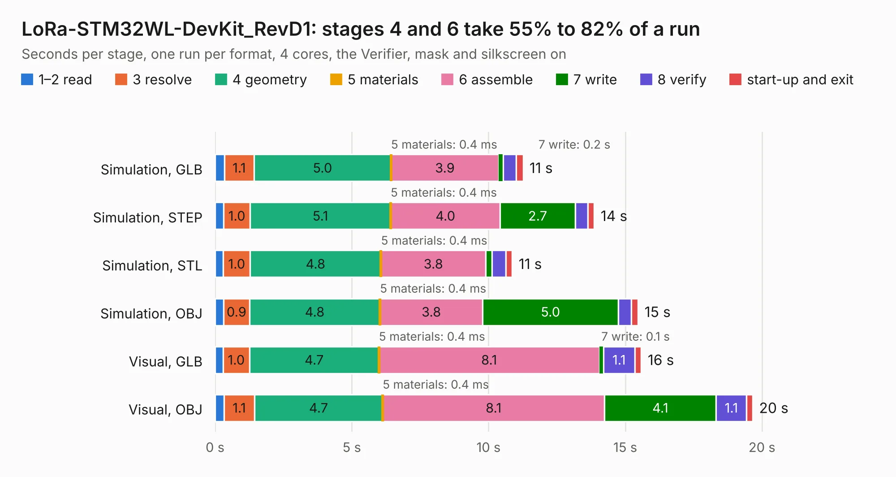

| Mode and format | 1–2 read | 3 resolve | 4 geometry | 5 materials | 6 assemble | 7 write | 8 verify | start-up and exit | Total |
|---|---:|---:|---:|---:|---:|---:|---:|---:|---:|
| Simulation, GLB | 0.3 | 1.1 | 5.0 | 0.4&nbsp;ms | 3.9 | 0.2 | 0.5 | 0.2 | 11.3 |
| Simulation, STEP | 0.3 | 1.0 | 5.1 | 0.4&nbsp;ms | 4.0 | 2.7 | 0.5 | 0.2 | 13.9 |
| Simulation, STL | 0.3 | 1.0 | 4.8 | 0.4&nbsp;ms | 3.8 | 0.2 | 0.5 | 0.2 | 10.9 |
| Simulation, OBJ | 0.3 | 0.9 | 4.8 | 0.4&nbsp;ms | 3.8 | 5.0 | 0.5 | 0.2 | 15.5 |
| Visual, GLB | 0.3 | 1.0 | 4.7 | 0.4&nbsp;ms | 8.1 | 0.1 | 1.1 | 0.2 | 15.6 |
| Visual, OBJ | 0.3 | 1.1 | 4.7 | 0.4&nbsp;ms | 8.1 | 4.1 | 1.1 | 0.2 | 19.7 |

<table align="center"><tr><td valign="top">

| Board | Repo: [OLIMEX/LoRa-STM32WL-DevKIT](https://github.com/OLIMEX/LoRa-STM32WL-DevKIT) Board: `LoRa-STM32WL-DevKit_RevD1.kicad_pcb` |
|---|---|
| Folder | HARDWARE / LoRa-STM32WL-DevKIT / LoRa-STM32WL-DevKit-RevD1 |
| Complexity | 271&nbsp;/&nbsp;1000 (size&nbsp;216, features&nbsp;55) |
| KESE&nbsp;features | through vias, slotted holes, rounded, trapezoid or chamfered pads, filled zones |
| Tested | 9th November 2026 |
| Copper&nbsp;layers | 2 |
| File&nbsp;format | KiCad 5 (20171130) |
| Parts,&nbsp;tracks,&nbsp;vias | 54, 739, 137 |
| Triangles,&nbsp;simulation | 943,760 in 78 parts |
| Verifier | PASS in all six runs |

</td><td valign="top">

<table>
<tr><th>File type</th><th>File size</th><th>Peak memory used</th></tr>
<tr><th colspan="3" align="left">Simulation</th></tr>
<tr><td>GLB</td><td align="right">33&nbsp;MB</td><td align="right">429&nbsp;MB</td></tr>
<tr><td>STEP</td><td align="right">164&nbsp;MB</td><td align="right">541&nbsp;MB</td></tr>
<tr><td>STL</td><td align="right">47&nbsp;MB</td><td align="right">451&nbsp;MB</td></tr>
<tr><td>OBJ</td><td align="right">97&nbsp;MB</td><td align="right">678&nbsp;MB</td></tr>
<tr><th colspan="3" align="left">Visual</th></tr>
<tr><td>GLB</td><td align="right">27&nbsp;MB</td><td align="right">571&nbsp;MB</td></tr>
<tr><td>OBJ</td><td align="right">80&nbsp;MB</td><td align="right">637&nbsp;MB</td></tr>
</table>

</td></tr></table>

## 1897. MiniBot_charger_RevA

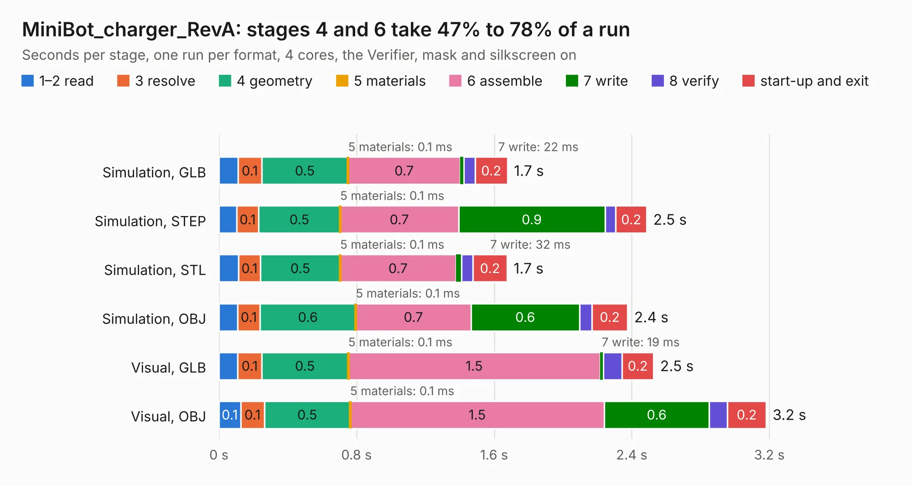

| Mode and format | 1–2 read | 3 resolve | 4 geometry | 5 materials | 6 assemble | 7 write | 8 verify | start-up and exit | Total |
|---|---:|---:|---:|---:|---:|---:|---:|---:|---:|
| Simulation, GLB | 0.1 | 0.1 | 0.5 | 0.1&nbsp;ms | 0.7 | 22&nbsp;ms | 65&nbsp;ms | 0.2 | 1.7 |
| Simulation, STEP | 0.1 | 0.1 | 0.5 | 0.1&nbsp;ms | 0.7 | 0.9 | 62&nbsp;ms | 0.2 | 2.5 |
| Simulation, STL | 0.1 | 0.1 | 0.5 | 0.1&nbsp;ms | 0.7 | 32&nbsp;ms | 67&nbsp;ms | 0.2 | 1.7 |
| Simulation, OBJ | 0.1 | 0.1 | 0.6 | 0.1&nbsp;ms | 0.7 | 0.6 | 73&nbsp;ms | 0.2 | 2.4 |
| Visual, GLB | 0.1 | 0.1 | 0.5 | 0.1&nbsp;ms | 1.5 | 19&nbsp;ms | 0.1 | 0.2 | 2.5 |
| Visual, OBJ | 0.1 | 0.1 | 0.5 | 0.1&nbsp;ms | 1.5 | 0.6 | 0.1 | 0.2 | 3.2 |

<table align="center"><tr><td valign="top">

| Board | Repo: [OLIMEX/Minibot](https://github.com/OLIMEX/Minibot) Board: `MiniBot_charger_RevA.kicad_pcb` |
|---|---|
| Folder | HARDWARE / charger |
| Complexity | 168&nbsp;/&nbsp;1000 (size&nbsp;123, features&nbsp;45) |
| KESE&nbsp;features | through vias, slotted holes, filled zones |
| Tested | 9th November 2026 |
| Copper&nbsp;layers | 2 |
| File&nbsp;format | KiCad 5 (20171130) |
| Parts,&nbsp;tracks,&nbsp;vias | 12, 107, 3 |
| Triangles,&nbsp;simulation | 117,320 in 27 parts |
| Verifier | PASS in all six runs |

</td><td valign="top">

<table>
<tr><th>File type</th><th>File size</th><th>Peak memory used</th></tr>
<tr><th colspan="3" align="left">Simulation</th></tr>
<tr><td>GLB</td><td align="right">4.3&nbsp;MB</td><td align="right">188&nbsp;MB</td></tr>
<tr><td>STEP</td><td align="right">23&nbsp;MB</td><td align="right">201&nbsp;MB</td></tr>
<tr><td>STL</td><td align="right">5.9&nbsp;MB</td><td align="right">189&nbsp;MB</td></tr>
<tr><td>OBJ</td><td align="right">12&nbsp;MB</td><td align="right">189&nbsp;MB</td></tr>
<tr><th colspan="3" align="left">Visual</th></tr>
<tr><td>GLB</td><td align="right">3.6&nbsp;MB</td><td align="right">158&nbsp;MB</td></tr>
<tr><td>OBJ</td><td align="right">10.0&nbsp;MB</td><td align="right">158&nbsp;MB</td></tr>
</table>

</td></tr></table>

## 1898. MiniBot_RevA

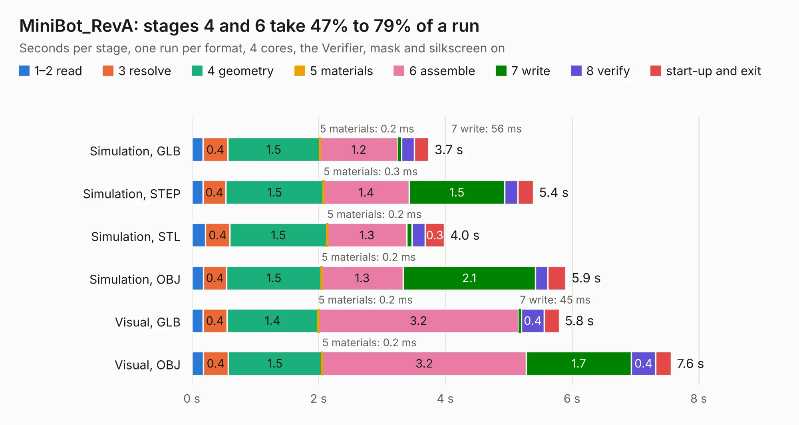

| Mode and format | 1–2 read | 3 resolve | 4 geometry | 5 materials | 6 assemble | 7 write | 8 verify | start-up and exit | Total |
|---|---:|---:|---:|---:|---:|---:|---:|---:|---:|
| Simulation, GLB | 0.2 | 0.4 | 1.5 | 0.2&nbsp;ms | 1.2 | 56&nbsp;ms | 0.2 | 0.2 | 3.7 |
| Simulation, STEP | 0.2 | 0.4 | 1.5 | 0.3&nbsp;ms | 1.4 | 1.5 | 0.2 | 0.2 | 5.4 |
| Simulation, STL | 0.2 | 0.4 | 1.5 | 0.2&nbsp;ms | 1.3 | 82&nbsp;ms | 0.2 | 0.3 | 4.0 |
| Simulation, OBJ | 0.2 | 0.4 | 1.5 | 0.2&nbsp;ms | 1.3 | 2.1 | 0.2 | 0.3 | 5.9 |
| Visual, GLB | 0.2 | 0.4 | 1.4 | 0.2&nbsp;ms | 3.2 | 45&nbsp;ms | 0.4 | 0.2 | 5.8 |
| Visual, OBJ | 0.2 | 0.4 | 1.5 | 0.2&nbsp;ms | 3.2 | 1.7 | 0.4 | 0.2 | 7.6 |

<table align="center"><tr><td valign="top">

| Board | Repo: [OLIMEX/Minibot](https://github.com/OLIMEX/Minibot) Board: `MiniBot_RevA.kicad_pcb` |
|---|---|
| Folder | HARDWARE |
| Complexity | 202&nbsp;/&nbsp;1000 (size&nbsp;147, features&nbsp;55) |
| KESE&nbsp;features | through vias, slotted holes, filled zones, curved board outline |
| Tested | 9th November 2026 |
| Copper&nbsp;layers | 2 |
| File&nbsp;format | KiCad 5 (20171130) |
| Parts,&nbsp;tracks,&nbsp;vias | 27, 251, 19 |
| Triangles,&nbsp;simulation | 312,404 in 29 parts |
| Verifier | PASS in all six runs |

</td><td valign="top">

<table>
<tr><th>File type</th><th>File size</th><th>Peak memory used</th></tr>
<tr><th colspan="3" align="left">Simulation</th></tr>
<tr><td>GLB</td><td align="right">11&nbsp;MB</td><td align="right">243&nbsp;MB</td></tr>
<tr><td>STEP</td><td align="right">60&nbsp;MB</td><td align="right">262&nbsp;MB</td></tr>
<tr><td>STL</td><td align="right">16&nbsp;MB</td><td align="right">244&nbsp;MB</td></tr>
<tr><td>OBJ</td><td align="right">32&nbsp;MB</td><td align="right">263&nbsp;MB</td></tr>
<tr><th colspan="3" align="left">Visual</th></tr>
<tr><td>GLB</td><td align="right">8.8&nbsp;MB</td><td align="right">244&nbsp;MB</td></tr>
<tr><td>OBJ</td><td align="right">26&nbsp;MB</td><td align="right">256&nbsp;MB</td></tr>
</table>

</td></tr></table>

## 1899. MIPI-HDMI_Rev_B

| Mode and format | 1–2 read | 3 resolve | 4 geometry | 5 materials | 6 assemble | 7 write | 8 verify | start-up and exit | Total |
|---|---:|---:|---:|---:|---:|---:|---:|---:|---:|
| Simulation, GLB | 0.3 | 0.8 | 2.9 | 0.3&nbsp;ms | 2.7 | 0.1 | 0.4 | 0.2 | 7.5 |
| Simulation, STEP | 0.3 | 0.8 | 2.9 | 0.2&nbsp;ms | 2.5 | 1.9 | 0.3 | 0.2 | 8.9 |
| Simulation, STL | 0.3 | 0.9 | 2.9 | 0.3&nbsp;ms | 2.6 | 0.3 | 0.4 | 0.2 | 7.5 |
| Simulation, OBJ | 0.3 | 0.8 | 3.2 | 0.3&nbsp;ms | 2.6 | 3.8 | 0.4 | 0.2 | 11.3 |
| Visual, GLB | 0.3 | 0.8 | 3.0 | 0.3&nbsp;ms | 6.5 | 0.1 | 0.8 | 0.2 | 11.8 |
| Visual, OBJ | 0.3 | 0.8 | 3.1 | 0.2&nbsp;ms | 6.2 | 2.7 | 0.6 | 0.2 | 14.0 |

<table align="center"><tr><td valign="top">

| Board | Repo: [OLIMEX/MIPI-HDMI](https://github.com/OLIMEX/MIPI-HDMI) Board: `MIPI-HDMI_Rev_B.kicad_pcb` |
|---|---|
| Folder | HARDWARE / MIPI-HDMI-Rev.B |
| Complexity | 342&nbsp;/&nbsp;1000 (size&nbsp;237, features&nbsp;105) |
| KESE&nbsp;features | through vias, slotted holes, filled zones, copper text, knockout text, stack-up, dielectric εr and tanδ, mask and silkscreen colours |
| Tested | 9th November 2026 |
| Copper&nbsp;layers | 4 |
| File&nbsp;format | KiCad 7 (20221018) |
| Parts,&nbsp;tracks,&nbsp;vias | 55, 1,070, 162 |
| Triangles,&nbsp;simulation | 962,002 in 86 parts |
| Verifier | PASS in all six runs |

</td><td valign="top">

<table>
<tr><th>File type</th><th>File size</th><th>Peak memory used</th></tr>
<tr><th colspan="3" align="left">Simulation</th></tr>
<tr><td>GLB</td><td align="right">34&nbsp;MB</td><td align="right">441&nbsp;MB</td></tr>
<tr><td>STEP</td><td align="right">146&nbsp;MB</td><td align="right">518&nbsp;MB</td></tr>
<tr><td>STL</td><td align="right">48&nbsp;MB</td><td align="right">460&nbsp;MB</td></tr>
<tr><td>OBJ</td><td align="right">100&nbsp;MB</td><td align="right">703&nbsp;MB</td></tr>
<tr><th colspan="3" align="left">Visual</th></tr>
<tr><td>GLB</td><td align="right">23&nbsp;MB</td><td align="right">539&nbsp;MB</td></tr>
<tr><td>OBJ</td><td align="right">71&nbsp;MB</td><td align="right">589&nbsp;MB</td></tr>
</table>

</td></tr></table>

## 1900. MOD-BME280_RevA

| Mode and format | 1–2 read | 3 resolve | 4 geometry | 5 materials | 6 assemble | 7 write | 8 verify | start-up and exit | Total |
|---|---:|---:|---:|---:|---:|---:|---:|---:|---:|
| Simulation, GLB | 0.1 | 0.1 | 0.4 | 0.1&nbsp;ms | 0.5 | 16&nbsp;ms | 44&nbsp;ms | 0.2 | 1.4 |
| Simulation, STEP | 0.1 | 0.1 | 0.4 | 0.1&nbsp;ms | 0.5 | 0.8 | 60&nbsp;ms | 0.2 | 2.2 |
| Simulation, STL | 0.1 | 0.1 | 0.4 | 0.1&nbsp;ms | 0.5 | 22&nbsp;ms | 47&nbsp;ms | 0.2 | 1.5 |
| Simulation, OBJ | 95&nbsp;ms | 0.1 | 0.5 | 0.1&nbsp;ms | 0.5 | 0.5 | 53&nbsp;ms | 0.2 | 2.0 |
| Visual, GLB | 98&nbsp;ms | 0.1 | 0.4 | 0.1&nbsp;ms | 1.1 | 14&nbsp;ms | 90&nbsp;ms | 0.2 | 2.1 |
| Visual, OBJ | 0.1 | 0.2 | 0.4 | 0.2&nbsp;ms | 1.0 | 0.4 | 82&nbsp;ms | 0.2 | 2.4 |

<table align="center"><tr><td valign="top">

| Board | Repo: [OLIMEX/MOD-BME280](https://github.com/OLIMEX/MOD-BME280) Board: `MOD-BME280_RevA.kicad_pcb` |
|---|---|
| Folder | HARDWARE / MOD-BME280-Rev.A1 |
| Complexity | 154&nbsp;/&nbsp;1000 (size&nbsp;119, features&nbsp;35) |
| KESE&nbsp;features | through vias, filled zones |
| Tested | 9th November 2026 |
| Copper&nbsp;layers | 2 |
| File&nbsp;format | KiCad 5 (20170123) |
| Parts,&nbsp;tracks,&nbsp;vias | 8, 95, 7 |
| Triangles,&nbsp;simulation | 76,542 in 21 parts |
| Verifier | PASS in all six runs |

</td><td valign="top">

<table>
<tr><th>File type</th><th>File size</th><th>Peak memory used</th></tr>
<tr><th colspan="3" align="left">Simulation</th></tr>
<tr><td>GLB</td><td align="right">2.9&nbsp;MB</td><td align="right">177&nbsp;MB</td></tr>
<tr><td>STEP</td><td align="right">14&nbsp;MB</td><td align="right">190&nbsp;MB</td></tr>
<tr><td>STL</td><td align="right">3.8&nbsp;MB</td><td align="right">180&nbsp;MB</td></tr>
<tr><td>OBJ</td><td align="right">7.8&nbsp;MB</td><td align="right">182&nbsp;MB</td></tr>
<tr><th colspan="3" align="left">Visual</th></tr>
<tr><td>GLB</td><td align="right">2.5&nbsp;MB</td><td align="right">155&nbsp;MB</td></tr>
<tr><td>OBJ</td><td align="right">6.9&nbsp;MB</td><td align="right">155&nbsp;MB</td></tr>
</table>

</td></tr></table>

## 1901. MOD-BME280_RevB

| Mode and format | 1–2 read | 3 resolve | 4 geometry | 5 materials | 6 assemble | 7 write | 8 verify | start-up and exit | Total |
|---|---:|---:|---:|---:|---:|---:|---:|---:|---:|
| Simulation, GLB | 0.1 | 0.1 | 0.4 | 0.1&nbsp;ms | 0.5 | 25&nbsp;ms | 65&nbsp;ms | 0.2 | 1.6 |
| Simulation, STEP | 0.1 | 0.1 | 0.5 | 0.1&nbsp;ms | 0.6 | 0.9 | 48&nbsp;ms | 0.2 | 2.5 |
| Simulation, STL | 0.1 | 0.1 | 0.4 | 0.1&nbsp;ms | 0.5 | 25&nbsp;ms | 49&nbsp;ms | 0.2 | 1.6 |
| Simulation, OBJ | 0.1 | 0.2 | 0.5 | 0.1&nbsp;ms | 0.6 | 0.5 | 55&nbsp;ms | 0.2 | 2.1 |
| Visual, GLB | 0.1 | 0.2 | 0.5 | 0.1&nbsp;ms | 1.3 | 16&nbsp;ms | 0.1 | 0.3 | 2.5 |
| Visual, OBJ | 0.1 | 0.2 | 0.5 | 0.1&nbsp;ms | 1.2 | 0.4 | 96&nbsp;ms | 0.3 | 2.8 |

<table align="center"><tr><td valign="top">

| Board | Repo: [OLIMEX/MOD-BME280](https://github.com/OLIMEX/MOD-BME280) Board: `MOD-BME280_RevB.kicad_pcb` |
|---|---|
| Folder | HARDWARE / MOD-BME280-Rev.B |
| Complexity | 163&nbsp;/&nbsp;1000 (size&nbsp;118, features&nbsp;45) |
| KESE&nbsp;features | through vias, rounded, trapezoid or chamfered pads, filled zones |
| Tested | 9th November 2026 |
| Copper&nbsp;layers | 2 |
| File&nbsp;format | KiCad 5 (20171130) |
| Parts,&nbsp;tracks,&nbsp;vias | 8, 93, 7 |
| Triangles,&nbsp;simulation | 80,616 in 19 parts |
| Verifier | PASS in all six runs |

</td><td valign="top">

<table>
<tr><th>File type</th><th>File size</th><th>Peak memory used</th></tr>
<tr><th colspan="3" align="left">Simulation</th></tr>
<tr><td>GLB</td><td align="right">3.0&nbsp;MB</td><td align="right">189&nbsp;MB</td></tr>
<tr><td>STEP</td><td align="right">15&nbsp;MB</td><td align="right">188&nbsp;MB</td></tr>
<tr><td>STL</td><td align="right">4.0&nbsp;MB</td><td align="right">189&nbsp;MB</td></tr>
<tr><td>OBJ</td><td align="right">8.2&nbsp;MB</td><td align="right">186&nbsp;MB</td></tr>
<tr><th colspan="3" align="left">Visual</th></tr>
<tr><td>GLB</td><td align="right">2.6&nbsp;MB</td><td align="right">154&nbsp;MB</td></tr>
<tr><td>OBJ</td><td align="right">7.3&nbsp;MB</td><td align="right">155&nbsp;MB</td></tr>
</table>

</td></tr></table>

## 1902. MOD-ENV_revB

| Mode and format | 1–2 read | 3 resolve | 4 geometry | 5 materials | 6 assemble | 7 write | 8 verify | start-up and exit | Total |
|---|---:|---:|---:|---:|---:|---:|---:|---:|---:|
| Simulation, GLB | 0.1 | 0.2 | 0.4 | 0.1&nbsp;ms | 0.6 | 21&nbsp;ms | 73&nbsp;ms | 0.2 | 1.6 |
| Simulation, STEP | 0.1 | 0.2 | 0.4 | 0.1&nbsp;ms | 0.7 | 0.8 | 61&nbsp;ms | 0.2 | 2.4 |
| Simulation, STL | 0.1 | 0.2 | 0.4 | 0.1&nbsp;ms | 0.6 | 53&nbsp;ms | 61&nbsp;ms | 0.2 | 1.6 |
| Simulation, OBJ | 0.1 | 0.2 | 0.4 | 0.1&nbsp;ms | 0.7 | 0.6 | 64&nbsp;ms | 0.2 | 2.2 |
| Visual, GLB | 0.1 | 0.2 | 0.4 | 0.1&nbsp;ms | 1.3 | 22&nbsp;ms | 0.2 | 0.2 | 2.4 |
| Visual, OBJ | 0.1 | 0.2 | 0.4 | 0.1&nbsp;ms | 1.2 | 0.5 | 0.1 | 0.2 | 2.8 |

<table align="center"><tr><td valign="top">

| Board | Repo: [OLIMEX/MOD-ENV](https://github.com/OLIMEX/MOD-ENV) Board: `MOD-ENV_revB.kicad_pcb` |
|---|---|
| Folder | HARDWARE / REV-B |
| Complexity | 188&nbsp;/&nbsp;1000 (size&nbsp;133, features&nbsp;55) |
| KESE&nbsp;features | through vias, slotted holes, rounded, trapezoid or chamfered pads, filled zones |
| Tested | 9th November 2026 |
| Copper&nbsp;layers | 2 |
| File&nbsp;format | KiCad 5 (20171130) |
| Parts,&nbsp;tracks,&nbsp;vias | 13, 167, 15 |
| Triangles,&nbsp;simulation | 140,154 in 23 parts |
| Verifier | PASS in all six runs |

</td><td valign="top">

<table>
<tr><th>File type</th><th>File size</th><th>Peak memory used</th></tr>
<tr><th colspan="3" align="left">Simulation</th></tr>
<tr><td>GLB</td><td align="right">5.1&nbsp;MB</td><td align="right">200&nbsp;MB</td></tr>
<tr><td>STEP</td><td align="right">26&nbsp;MB</td><td align="right">216&nbsp;MB</td></tr>
<tr><td>STL</td><td align="right">7.0&nbsp;MB</td><td align="right">201&nbsp;MB</td></tr>
<tr><td>OBJ</td><td align="right">14&nbsp;MB</td><td align="right">201&nbsp;MB</td></tr>
<tr><th colspan="3" align="left">Visual</th></tr>
<tr><td>GLB</td><td align="right">4.3&nbsp;MB</td><td align="right">178&nbsp;MB</td></tr>
<tr><td>OBJ</td><td align="right">12&nbsp;MB</td><td align="right">179&nbsp;MB</td></tr>
</table>

</td></tr></table>

## 1903. MOD-ESP32-C5_Rev_A

| Mode and format | 1–2 read | 3 resolve | 4 geometry | 5 materials | 6 assemble | 7 write | 8 verify | start-up and exit | Total |
|---|---:|---:|---:|---:|---:|---:|---:|---:|---:|
| Simulation, GLB | 0.3 | 0.6 | 1.9 | 0.3&nbsp;ms | 1.5 | 73&nbsp;ms | 0.2 | 0.2 | 4.8 |
| Simulation, STEP | 0.3 | 0.6 | 1.9 | 0.4&nbsp;ms | 1.5 | 1.5 | 0.3 | 0.2 | 6.3 |
| Simulation, STL | 0.3 | 0.6 | 2.0 | 0.3&nbsp;ms | 1.5 | 0.1 | 0.3 | 0.2 | 5.0 |
| Simulation, OBJ | 0.3 | 0.6 | 1.8 | 0.3&nbsp;ms | 1.5 | 2.5 | 0.3 | 0.2 | 7.1 |
| Visual, GLB | 0.3 | 0.6 | 2.0 | 0.7&nbsp;ms | 4.1 | 65&nbsp;ms | 0.5 | 0.2 | 7.8 |
| Visual, OBJ | 0.3 | 0.6 | 1.9 | 0.5&nbsp;ms | 4.0 | 2.1 | 0.5 | 0.2 | 9.6 |

<table align="center"><tr><td valign="top">

| Board | Repo: [OLIMEX/MOD-ESP32-C5](https://github.com/OLIMEX/MOD-ESP32-C5) Board: `MOD-ESP32-C5_Rev_A.kicad_pcb` |
|---|---|
| Folder | HARDWARE / MOD-ESP32-C5.Rev.A |
| Complexity | 274&nbsp;/&nbsp;1000 (size&nbsp;169, features&nbsp;105) |
| KESE&nbsp;features | through vias, slotted holes, rounded, trapezoid or chamfered pads, filled zones, knockout text, stack-up, dielectric εr and tanδ, mask and silkscreen colours |
| Tested | 9th November 2026 |
| Copper&nbsp;layers | 2 |
| File&nbsp;format | KiCad 7 (20221018) |
| Parts,&nbsp;tracks,&nbsp;vias | 26, 873, 107 |
| Triangles,&nbsp;simulation | 437,814 in 54 parts |
| Verifier | PASS in all six runs |

</td><td valign="top">

<table>
<tr><th>File type</th><th>File size</th><th>Peak memory used</th></tr>
<tr><th colspan="3" align="left">Simulation</th></tr>
<tr><td>GLB</td><td align="right">16&nbsp;MB</td><td align="right">298&nbsp;MB</td></tr>
<tr><td>STEP</td><td align="right">73&nbsp;MB</td><td align="right">323&nbsp;MB</td></tr>
<tr><td>STL</td><td align="right">22&nbsp;MB</td><td align="right">292&nbsp;MB</td></tr>
<tr><td>OBJ</td><td align="right">45&nbsp;MB</td><td align="right">351&nbsp;MB</td></tr>
<tr><th colspan="3" align="left">Visual</th></tr>
<tr><td>GLB</td><td align="right">13&nbsp;MB</td><td align="right">341&nbsp;MB</td></tr>
<tr><td>OBJ</td><td align="right">39&nbsp;MB</td><td align="right">337&nbsp;MB</td></tr>
</table>

</td></tr></table>

## 1904. MOD-IR-TEMP_RevA

| Mode and format | 1–2 read | 3 resolve | 4 geometry | 5 materials | 6 assemble | 7 write | 8 verify | start-up and exit | Total |
|---|---:|---:|---:|---:|---:|---:|---:|---:|---:|
| Simulation, GLB | 91&nbsp;ms | 89&nbsp;ms | 0.3 | 0.1&nbsp;ms | 0.5 | 16&nbsp;ms | 42&nbsp;ms | 0.2 | 1.2 |
| Simulation, STEP | 85&nbsp;ms | 0.1 | 0.4 | 0.1&nbsp;ms | 0.5 | 0.7 | 38&nbsp;ms | 0.2 | 2.0 |
| Simulation, STL | 85&nbsp;ms | 89&nbsp;ms | 0.4 | 0.2&nbsp;ms | 0.5 | 18&nbsp;ms | 37&nbsp;ms | 0.2 | 1.3 |
| Simulation, OBJ | 0.1 | 0.1 | 0.3 | 0.1&nbsp;ms | 0.4 | 0.4 | 41&nbsp;ms | 0.2 | 1.6 |
| Visual, GLB | 95&nbsp;ms | 99&nbsp;ms | 0.4 | 0.1&nbsp;ms | 1.1 | 11&nbsp;ms | 71&nbsp;ms | 0.2 | 2.0 |
| Visual, OBJ | 85&nbsp;ms | 95&nbsp;ms | 0.4 | 0.1&nbsp;ms | 1.1 | 0.3 | 73&nbsp;ms | 0.2 | 2.3 |

<table align="center"><tr><td valign="top">

| Board | Repo: [OLIMEX/MOD-IR-TEMP](https://github.com/OLIMEX/MOD-IR-TEMP) Board: `MOD-IR-TEMP_RevA.kicad_pcb` |
|---|---|
| Folder | HARDWARE / REV.A |
| Complexity | 138&nbsp;/&nbsp;1000 (size&nbsp;103, features&nbsp;35) |
| KESE&nbsp;features | through vias, filled zones |
| Tested | 9th November 2026 |
| Copper&nbsp;layers | 2 |
| File&nbsp;format | KiCad 5 (20160815) |
| Parts,&nbsp;tracks,&nbsp;vias | 6, 42, 4 |
| Triangles,&nbsp;simulation | 65,598 in 22 parts |
| Verifier | PASS in all six runs |

</td><td valign="top">

<table>
<tr><th>File type</th><th>File size</th><th>Peak memory used</th></tr>
<tr><th colspan="3" align="left">Simulation</th></tr>
<tr><td>GLB</td><td align="right">2.4&nbsp;MB</td><td align="right">172&nbsp;MB</td></tr>
<tr><td>STEP</td><td align="right">11&nbsp;MB</td><td align="right">176&nbsp;MB</td></tr>
<tr><td>STL</td><td align="right">3.3&nbsp;MB</td><td align="right">171&nbsp;MB</td></tr>
<tr><td>OBJ</td><td align="right">6.6&nbsp;MB</td><td align="right">172&nbsp;MB</td></tr>
<tr><th colspan="3" align="left">Visual</th></tr>
<tr><td>GLB</td><td align="right">1.8&nbsp;MB</td><td align="right">153&nbsp;MB</td></tr>
<tr><td>OBJ</td><td align="right">5.0&nbsp;MB</td><td align="right">151&nbsp;MB</td></tr>
</table>

</td></tr></table>

## 1905. MOD-LCD2.8RTP_RevB

| Mode and format | 1–2 read | 3 resolve | 4 geometry | 5 materials | 6 assemble | 7 write | 8 verify | start-up and exit | Total |
|---|---:|---:|---:|---:|---:|---:|---:|---:|---:|
| Simulation, GLB | 0.2 | 0.6 | 2.3 | 0.2&nbsp;ms | 1.9 | 75&nbsp;ms | 0.2 | 0.2 | 5.6 |
| Simulation, STEP | 0.2 | 0.6 | 2.4 | 0.2&nbsp;ms | 1.9 | 1.9 | 0.2 | 0.2 | 7.4 |
| Simulation, STL | 0.2 | 0.7 | 2.4 | 0.2&nbsp;ms | 2.1 | 0.1 | 0.2 | 0.2 | 6.0 |
| Simulation, OBJ | 0.2 | 0.7 | 2.3 | 0.2&nbsp;ms | 1.9 | 2.7 | 0.2 | 0.3 | 8.4 |
| Visual, GLB | 0.2 | 0.7 | 2.3 | 0.3&nbsp;ms | 4.0 | 64&nbsp;ms | 0.5 | 0.3 | 8.2 |
| Visual, OBJ | 0.2 | 0.7 | 2.5 | 0.2&nbsp;ms | 4.0 | 2.3 | 0.7 | 0.3 | 10.6 |

<table align="center"><tr><td valign="top">

| Board | Repo: [OLIMEX/MOD-LCD2.8RTP](https://github.com/OLIMEX/MOD-LCD2.8RTP) Board: `MOD-LCD2.8RTP_RevB.kicad_pcb` |
|---|---|
| Folder | HARDWARE / SCHEMATICS / Hardware-revision-B |
| Complexity | 193&nbsp;/&nbsp;1000 (size&nbsp;158, features&nbsp;35) |
| KESE&nbsp;features | through vias, filled zones |
| Tested | 9th November 2026 |
| Copper&nbsp;layers | 2 |
| File&nbsp;format | KiCad 5 (20171130) |
| Parts,&nbsp;tracks,&nbsp;vias | 24, 490, 60 |
| Triangles,&nbsp;simulation | 384,728 in 45 parts |
| Verifier | PASS in all six runs |

</td><td valign="top">

<table>
<tr><th>File type</th><th>File size</th><th>Peak memory used</th></tr>
<tr><th colspan="3" align="left">Simulation</th></tr>
<tr><td>GLB</td><td align="right">14&nbsp;MB</td><td align="right">300&nbsp;MB</td></tr>
<tr><td>STEP</td><td align="right">72&nbsp;MB</td><td align="right">336&nbsp;MB</td></tr>
<tr><td>STL</td><td align="right">19&nbsp;MB</td><td align="right">290&nbsp;MB</td></tr>
<tr><td>OBJ</td><td align="right">40&nbsp;MB</td><td align="right">327&nbsp;MB</td></tr>
<tr><th colspan="3" align="left">Visual</th></tr>
<tr><td>GLB</td><td align="right">12&nbsp;MB</td><td align="right">341&nbsp;MB</td></tr>
<tr><td>OBJ</td><td align="right">36&nbsp;MB</td><td align="right">337&nbsp;MB</td></tr>
</table>

</td></tr></table>

## 1906. MOD-LCD2.8RTP_Rev_C

| Mode and format | 1–2 read | 3 resolve | 4 geometry | 5 materials | 6 assemble | 7 write | 8 verify | start-up and exit | Total |
|---|---:|---:|---:|---:|---:|---:|---:|---:|---:|
| Simulation, GLB | 0.3 | 1.2 | 3.3 | 0.4&nbsp;ms | 2.4 | 0.1 | 0.4 | 0.2 | 8.0 |
| Simulation, STEP | 0.3 | 1.2 | 3.5 | 0.2&nbsp;ms | 2.4 | 2.0 | 0.3 | 0.2 | 10.0 |
| Simulation, STL | 0.3 | 1.3 | 3.3 | 0.2&nbsp;ms | 2.4 | 0.2 | 0.4 | 0.2 | 8.1 |
| Simulation, OBJ | 0.3 | 1.3 | 3.4 | 0.2&nbsp;ms | 2.4 | 3.6 | 0.3 | 0.2 | 11.5 |
| Visual, GLB | 0.3 | 1.2 | 3.5 | 0.4&nbsp;ms | 5.1 | 92&nbsp;ms | 0.5 | 0.2 | 11.0 |
| Visual, OBJ | 0.3 | 1.3 | 3.3 | 0.3&nbsp;ms | 5.1 | 2.9 | 0.5 | 0.2 | 13.6 |

<table align="center"><tr><td valign="top">

| Board | Repo: [OLIMEX/MOD-LCD2.8RTP](https://github.com/OLIMEX/MOD-LCD2.8RTP) Board: `MOD-LCD2.8RTP_Rev_C.kicad_pcb` |
|---|---|
| Folder | HARDWARE / SCHEMATICS / Hardware-revision-C |
| Complexity | 229&nbsp;/&nbsp;1000 (size&nbsp;174, features&nbsp;55) |
| KESE&nbsp;features | through vias, rounded, trapezoid or chamfered pads, filled zones, copper text |
| Tested | 9th November 2026 |
| Copper&nbsp;layers | 2 |
| File&nbsp;format | KiCad 5 (20171130) |
| Parts,&nbsp;tracks,&nbsp;vias | 27, 821, 284 |
| Triangles,&nbsp;simulation | 677,624 in 45 parts |
| Verifier | PASS in all six runs |

</td><td valign="top">

<table>
<tr><th>File type</th><th>File size</th><th>Peak memory used</th></tr>
<tr><th colspan="3" align="left">Simulation</th></tr>
<tr><td>GLB</td><td align="right">24&nbsp;MB</td><td align="right">401&nbsp;MB</td></tr>
<tr><td>STEP</td><td align="right">98&nbsp;MB</td><td align="right">496&nbsp;MB</td></tr>
<tr><td>STL</td><td align="right">34&nbsp;MB</td><td align="right">412&nbsp;MB</td></tr>
<tr><td>OBJ</td><td align="right">70&nbsp;MB</td><td align="right">485&nbsp;MB</td></tr>
<tr><th colspan="3" align="left">Visual</th></tr>
<tr><td>GLB</td><td align="right">20&nbsp;MB</td><td align="right">493&nbsp;MB</td></tr>
<tr><td>OBJ</td><td align="right">60&nbsp;MB</td><td align="right">540&nbsp;MB</td></tr>
</table>

</td></tr></table>

## 1907. MOD-LCD2.8RTP_Rev_D

| Mode and format | 1–2 read | 3 resolve | 4 geometry | 5 materials | 6 assemble | 7 write | 8 verify | start-up and exit | Total |
|---|---:|---:|---:|---:|---:|---:|---:|---:|---:|
| Simulation, GLB | 0.3 | 0.7 | 1.8 | 0.3&nbsp;ms | 1.6 | 56&nbsp;ms | 0.2 | 0.2 | 4.8 |
| Simulation, STEP | 0.4 | 0.7 | 1.9 | 0.4&nbsp;ms | 1.7 | 1.5 | 0.2 | 0.2 | 6.6 |
| Simulation, STL | 0.3 | 0.7 | 1.8 | 0.3&nbsp;ms | 1.7 | 0.1 | 0.2 | 0.2 | 4.9 |
| Simulation, OBJ | 0.4 | 0.7 | 1.9 | 0.3&nbsp;ms | 1.7 | 2.1 | 0.2 | 0.2 | 7.2 |
| Visual, GLB | 0.2 | 0.8 | 2.0 | 0.3&nbsp;ms | 3.7 | 52&nbsp;ms | 0.5 | 0.2 | 7.5 |
| Visual, OBJ | 0.3 | 0.8 | 1.6 | 0.3&nbsp;ms | 3.8 | 1.9 | 0.6 | 0.2 | 9.2 |

<table align="center"><tr><td valign="top">

| Board | Repo: [OLIMEX/MOD-LCD2.8RTP](https://github.com/OLIMEX/MOD-LCD2.8RTP) Board: `MOD-LCD2.8RTP_Rev_D.kicad_pcb` |
|---|---|
| Folder | HARDWARE / SCHEMATICS / Hardware-revision-D |
| Complexity | 262&nbsp;/&nbsp;1000 (size&nbsp;162, features&nbsp;100) |
| KESE&nbsp;features | through vias, slotted holes, rounded, trapezoid or chamfered pads, filled zones, knockout text, stack-up, dielectric εr and tanδ |
| Tested | 9th November 2026 |
| Copper&nbsp;layers | 2 |
| File&nbsp;format | KiCad 7 (20221018) |
| Parts,&nbsp;tracks,&nbsp;vias | 26, 413, 121 |
| Triangles,&nbsp;simulation | 409,860 in 42 parts |
| Verifier | PASS in all six runs |

</td><td valign="top">

<table>
<tr><th>File type</th><th>File size</th><th>Peak memory used</th></tr>
<tr><th colspan="3" align="left">Simulation</th></tr>
<tr><td>GLB</td><td align="right">15&nbsp;MB</td><td align="right">305&nbsp;MB</td></tr>
<tr><td>STEP</td><td align="right">72&nbsp;MB</td><td align="right">353&nbsp;MB</td></tr>
<tr><td>STL</td><td align="right">20&nbsp;MB</td><td align="right">297&nbsp;MB</td></tr>
<tr><td>OBJ</td><td align="right">42&nbsp;MB</td><td align="right">346&nbsp;MB</td></tr>
<tr><th colspan="3" align="left">Visual</th></tr>
<tr><td>GLB</td><td align="right">12&nbsp;MB</td><td align="right">346&nbsp;MB</td></tr>
<tr><td>OBJ</td><td align="right">36&nbsp;MB</td><td align="right">345&nbsp;MB</td></tr>
</table>

</td></tr></table>

## 1908. mod-mpu9150

| Mode and format | 1–2 read | 3 resolve | 4 geometry | 5 materials | 6 assemble | 7 write | 8 verify | start-up and exit | Total |
|---|---:|---:|---:|---:|---:|---:|---:|---:|---:|
| Simulation, GLB | 0.1 | 0.2 | 0.8 | 0.2&nbsp;ms | 0.8 | 32&nbsp;ms | 0.1 | 0.2 | 2.3 |
| Simulation, STEP | 0.1 | 0.2 | 0.8 | 0.2&nbsp;ms | 0.8 | 0.9 | 0.1 | 0.2 | 3.1 |
| Simulation, STL | 0.1 | 0.2 | 0.8 | 0.1&nbsp;ms | 0.8 | 44&nbsp;ms | 0.1 | 0.2 | 2.2 |
| Simulation, OBJ | 0.1 | 0.2 | 0.8 | 0.2&nbsp;ms | 0.7 | 1.0 | 0.1 | 0.2 | 3.2 |
| Visual, GLB | 0.1 | 0.2 | 0.8 | 0.2&nbsp;ms | 1.9 | 26&nbsp;ms | 0.2 | 0.2 | 3.5 |
| Visual, OBJ | 0.1 | 0.2 | 0.9 | 0.2&nbsp;ms | 2.0 | 0.8 | 0.2 | 0.2 | 4.3 |

<table align="center"><tr><td valign="top">

| Board | Repo: [OLIMEX/MOD-MPU9150](https://github.com/OLIMEX/MOD-MPU9150) Board: `mod-mpu9150.kicad_pcb` |
|---|---|
| Folder | HARDWARE / MOD-MPU9150-Rev.A |
| Complexity | 163&nbsp;/&nbsp;1000 (size&nbsp;128, features&nbsp;35) |
| KESE&nbsp;features | through vias, filled zones |
| Tested | 9th November 2026 |
| Copper&nbsp;layers | 2 |
| File&nbsp;format | KiCad 4 (4) |
| Parts,&nbsp;tracks,&nbsp;vias | 14, 125, 9 |
| Triangles,&nbsp;simulation | 199,710 in 38 parts |
| Verifier | PASS in all six runs |

</td><td valign="top">

<table>
<tr><th>File type</th><th>File size</th><th>Peak memory used</th></tr>
<tr><th colspan="3" align="left">Simulation</th></tr>
<tr><td>GLB</td><td align="right">7.2&nbsp;MB</td><td align="right">218&nbsp;MB</td></tr>
<tr><td>STEP</td><td align="right">39&nbsp;MB</td><td align="right">232&nbsp;MB</td></tr>
<tr><td>STL</td><td align="right">10.0&nbsp;MB</td><td align="right">220&nbsp;MB</td></tr>
<tr><td>OBJ</td><td align="right">20&nbsp;MB</td><td align="right">217&nbsp;MB</td></tr>
<tr><th colspan="3" align="left">Visual</th></tr>
<tr><td>GLB</td><td align="right">6.0&nbsp;MB</td><td align="right">214&nbsp;MB</td></tr>
<tr><td>OBJ</td><td align="right">17&nbsp;MB</td><td align="right">212&nbsp;MB</td></tr>
</table>

</td></tr></table>

## 1909. mod-oled-128x64

| Mode and format | 1–2 read | 3 resolve | 4 geometry | 5 materials | 6 assemble | 7 write | 8 verify | start-up and exit | Total |
|---|---:|---:|---:|---:|---:|---:|---:|---:|---:|
| Simulation, GLB | 0.1 | 0.1 | 0.6 | 0.1&nbsp;ms | 0.5 | 25&nbsp;ms | 61&nbsp;ms | 0.2 | 1.7 |
| Simulation, STEP | 0.1 | 0.2 | 0.5 | 0.1&nbsp;ms | 0.5 | 0.8 | 50&nbsp;ms | 0.2 | 2.3 |
| Simulation, STL | 0.1 | 0.1 | 0.5 | 0.1&nbsp;ms | 0.5 | 23&nbsp;ms | 49&nbsp;ms | 0.2 | 1.5 |
| Simulation, OBJ | 0.1 | 0.2 | 0.5 | 0.1&nbsp;ms | 0.5 | 0.5 | 51&nbsp;ms | 0.2 | 2.1 |
| Visual, GLB | 0.1 | 0.1 | 0.6 | 0.1&nbsp;ms | 1.1 | 15&nbsp;ms | 95&nbsp;ms | 0.2 | 2.3 |
| Visual, OBJ | 0.1 | 0.2 | 0.6 | 0.1&nbsp;ms | 1.2 | 0.4 | 81&nbsp;ms | 0.2 | 2.7 |

<table align="center"><tr><td valign="top">

| Board | Repo: [OLIMEX/MOD-OLED-128x64](https://github.com/OLIMEX/MOD-OLED-128x64) Board: `mod-oled-128x64.kicad_pcb` |
|---|---|
| Folder | HARDWARE / MOD-OLED-128x64_Rev.A |
| Complexity | 169&nbsp;/&nbsp;1000 (size&nbsp;134, features&nbsp;35) |
| KESE&nbsp;features | through vias, filled zones |
| Tested | 9th November 2026 |
| Copper&nbsp;layers | 2 |
| File&nbsp;format | KiCad 4 (4) |
| Parts,&nbsp;tracks,&nbsp;vias | 13, 191, 12 |
| Triangles,&nbsp;simulation | 97,926 in 30 parts |
| Verifier | PASS in all six runs |

</td><td valign="top">

<table>
<tr><th>File type</th><th>File size</th><th>Peak memory used</th></tr>
<tr><th colspan="3" align="left">Simulation</th></tr>
<tr><td>GLB</td><td align="right">3.6&nbsp;MB</td><td align="right">192&nbsp;MB</td></tr>
<tr><td>STEP</td><td align="right">18&nbsp;MB</td><td align="right">196&nbsp;MB</td></tr>
<tr><td>STL</td><td align="right">4.9&nbsp;MB</td><td align="right">190&nbsp;MB</td></tr>
<tr><td>OBJ</td><td align="right">10&nbsp;MB</td><td align="right">186&nbsp;MB</td></tr>
<tr><th colspan="3" align="left">Visual</th></tr>
<tr><td>GLB</td><td align="right">3.0&nbsp;MB</td><td align="right">161&nbsp;MB</td></tr>
<tr><td>OBJ</td><td align="right">8.2&nbsp;MB</td><td align="right">159&nbsp;MB</td></tr>
</table>

</td></tr></table>

## 1910. MOD-RTC2_Rev_A

| Mode and format | 1–2 read | 3 resolve | 4 geometry | 5 materials | 6 assemble | 7 write | 8 verify | start-up and exit | Total |
|---|---:|---:|---:|---:|---:|---:|---:|---:|---:|
| Simulation, GLB | 84&nbsp;ms | 0.1 | 0.7 | 0.2&nbsp;ms | 0.6 | 21&nbsp;ms | 67&nbsp;ms | 0.2 | 1.8 |
| Simulation, STEP | 96&nbsp;ms | 0.1 | 0.6 | 0.2&nbsp;ms | 0.7 | 0.8 | 82&nbsp;ms | 0.2 | 2.6 |
| Simulation, STL | 0.1 | 0.1 | 0.6 | 0.1&nbsp;ms | 0.6 | 38&nbsp;ms | 73&nbsp;ms | 0.3 | 1.9 |
| Simulation, OBJ | 0.1 | 0.1 | 0.6 | 0.1&nbsp;ms | 0.6 | 0.6 | 75&nbsp;ms | 0.2 | 2.4 |
| Visual, GLB | 98&nbsp;ms | 0.1 | 0.6 | 0.1&nbsp;ms | 1.4 | 19&nbsp;ms | 0.1 | 0.2 | 2.6 |
| Visual, OBJ | 88&nbsp;ms | 0.1 | 0.6 | 0.2&nbsp;ms | 1.5 | 0.4 | 0.1 | 0.2 | 3.1 |

<table align="center"><tr><td valign="top">

| Board | Repo: [OLIMEX/MOD-RTC2](https://github.com/OLIMEX/MOD-RTC2) Board: `MOD-RTC2_Rev_A.kicad_pcb` |
|---|---|
| Folder | Hardware / MOD-RTC2-A |
| Complexity | 170&nbsp;/&nbsp;1000 (size&nbsp;125, features&nbsp;45) |
| KESE&nbsp;features | through vias, slotted holes, filled zones |
| Tested | 9th November 2026 |
| Copper&nbsp;layers | 2 |
| File&nbsp;format | KiCad 5 (20171114) |
| Parts,&nbsp;tracks,&nbsp;vias | 9, 123, 14 |
| Triangles,&nbsp;simulation | 126,452 in 26 parts |
| Verifier | PASS in all six runs |

</td><td valign="top">

<table>
<tr><th>File type</th><th>File size</th><th>Peak memory used</th></tr>
<tr><th colspan="3" align="left">Simulation</th></tr>
<tr><td>GLB</td><td align="right">4.6&nbsp;MB</td><td align="right">194&nbsp;MB</td></tr>
<tr><td>STEP</td><td align="right">23&nbsp;MB</td><td align="right">198&nbsp;MB</td></tr>
<tr><td>STL</td><td align="right">6.3&nbsp;MB</td><td align="right">185&nbsp;MB</td></tr>
<tr><td>OBJ</td><td align="right">13&nbsp;MB</td><td align="right">186&nbsp;MB</td></tr>
<tr><th colspan="3" align="left">Visual</th></tr>
<tr><td>GLB</td><td align="right">3.5&nbsp;MB</td><td align="right">159&nbsp;MB</td></tr>
<tr><td>OBJ</td><td align="right">9.7&nbsp;MB</td><td align="right">159&nbsp;MB</td></tr>
</table>

</td></tr></table>

## 1911. NB-IoT-DevKit_Rev_B

| Mode and format | 1–2 read | 3 resolve | 4 geometry | 5 materials | 6 assemble | 7 write | 8 verify | start-up and exit | Total |
|---|---:|---:|---:|---:|---:|---:|---:|---:|---:|
| Simulation, GLB | 0.6 | 1.9 | 6.5 | 1&nbsp;ms | 5.8 | 0.3 | 0.8 | 0.2 | 16.1 |
| Simulation, STEP | 0.6 | 1.9 | 6.3 | 0.7&nbsp;ms | 5.8 | 4.2 | 0.8 | 0.3 | 19.9 |
| Simulation, STL | 0.5 | 1.9 | 6.4 | 0.6&nbsp;ms | 6.1 | 0.6 | 0.8 | 0.2 | 16.5 |
| Simulation, OBJ | 0.6 | 1.9 | 6.6 | 0.9&nbsp;ms | 5.8 | 9.8 | 0.8 | 0.3 | 25.8 |
| Visual, GLB | 0.6 | 1.9 | 6.4 | 0.7&nbsp;ms | 15.2 | 0.2 | 1.5 | 0.2 | 26.0 |
| Visual, OBJ | 0.6 | 1.9 | 6.6 | 1&nbsp;ms | 15.8 | 6.8 | 1.7 | 0.3 | 33.7 |

<table align="center"><tr><td valign="top">

| Board | Repo: [OLIMEX/NB-IoT](https://github.com/OLIMEX/NB-IoT) Board: `NB-IoT-DevKit_Rev_B.kicad_pcb` |
|---|---|
| Folder | HARDWARE / NB-IoT-DevKit_Rev_B |
| Complexity | 307&nbsp;/&nbsp;1000 (size&nbsp;217, features&nbsp;90) |
| KESE&nbsp;features | through vias, slotted holes, custom pads, rounded, trapezoid or chamfered pads, filled zones, copper drawings, copper text |
| Tested | 9th November 2026 |
| Copper&nbsp;layers | 4 |
| File&nbsp;format | KiCad 6 (20190905) |
| Parts,&nbsp;tracks,&nbsp;vias | 105, 2,707, 203 |
| Triangles,&nbsp;simulation | 1,641,942 in 137 parts |
| Verifier | PASS in all six runs |

</td><td valign="top">

<table>
<tr><th>File type</th><th>File size</th><th>Peak memory used</th></tr>
<tr><th colspan="3" align="left">Simulation</th></tr>
<tr><td>GLB</td><td align="right">58&nbsp;MB</td><td align="right">671&nbsp;MB</td></tr>
<tr><td>STEP</td><td align="right">263&nbsp;MB</td><td align="right">725&nbsp;MB</td></tr>
<tr><td>STL</td><td align="right">82&nbsp;MB</td><td align="right">640&nbsp;MB</td></tr>
<tr><td>OBJ</td><td align="right">174&nbsp;MB</td><td align="right">1.1&nbsp;GB</td></tr>
<tr><th colspan="3" align="left">Visual</th></tr>
<tr><td>GLB</td><td align="right">40&nbsp;MB</td><td align="right">780&nbsp;MB</td></tr>
<tr><td>OBJ</td><td align="right">120&nbsp;MB</td><td align="right">968&nbsp;MB</td></tr>
</table>

</td></tr></table>

## 1912. NB-IoT-DevKit_Rev_C

| Mode and format | 1–2 read | 3 resolve | 4 geometry | 5 materials | 6 assemble | 7 write | 8 verify | start-up and exit | Total |
|---|---:|---:|---:|---:|---:|---:|---:|---:|---:|
| Simulation, GLB | 0.5 | 1.7 | 5.6 | 0.6&nbsp;ms | 5.4 | 0.3 | 0.7 | 0.2 | 14.4 |
| Simulation, STEP | 0.5 | 1.8 | 5.6 | 0.7&nbsp;ms | 5.2 | 3.7 | 0.8 | 0.2 | 17.8 |
| Simulation, STL | 0.5 | 1.7 | 5.7 | 1&nbsp;ms | 5.3 | 0.4 | 0.8 | 0.2 | 14.5 |
| Simulation, OBJ | 0.5 | 1.7 | 5.5 | 0.5&nbsp;ms | 5.3 | 8.6 | 0.7 | 0.2 | 22.5 |
| Visual, GLB | 0.5 | 1.6 | 5.7 | 0.6&nbsp;ms | 13.7 | 0.2 | 1.2 | 0.2 | 23.2 |
| Visual, OBJ | 0.5 | 1.6 | 5.6 | 0.6&nbsp;ms | 13.7 | 5.9 | 1.4 | 0.2 | 29.0 |

<table align="center"><tr><td valign="top">

| Board | Repo: [OLIMEX/NB-IoT](https://github.com/OLIMEX/NB-IoT) Board: `NB-IoT-DevKit_Rev_C.kicad_pcb` |
|---|---|
| Folder | HARDWARE / NB-IoT-DevKit_Rev_C |
| Complexity | 307&nbsp;/&nbsp;1000 (size&nbsp;217, features&nbsp;90) |
| KESE&nbsp;features | through vias, slotted holes, custom pads, rounded, trapezoid or chamfered pads, filled zones, copper drawings, copper text |
| Tested | 9th November 2026 |
| Copper&nbsp;layers | 4 |
| File&nbsp;format | KiCad 5 (20171130) |
| Parts,&nbsp;tracks,&nbsp;vias | 105, 2,707, 203 |
| Triangles,&nbsp;simulation | 1,641,972 in 137 parts |
| Verifier | PASS in all six runs |

</td><td valign="top">

<table>
<tr><th>File type</th><th>File size</th><th>Peak memory used</th></tr>
<tr><th colspan="3" align="left">Simulation</th></tr>
<tr><td>GLB</td><td align="right">58&nbsp;MB</td><td align="right">652&nbsp;MB</td></tr>
<tr><td>STEP</td><td align="right">263&nbsp;MB</td><td align="right">725&nbsp;MB</td></tr>
<tr><td>STL</td><td align="right">82&nbsp;MB</td><td align="right">675&nbsp;MB</td></tr>
<tr><td>OBJ</td><td align="right">174&nbsp;MB</td><td align="right">1.1&nbsp;GB</td></tr>
<tr><th colspan="3" align="left">Visual</th></tr>
<tr><td>GLB</td><td align="right">40&nbsp;MB</td><td align="right">750&nbsp;MB</td></tr>
<tr><td>OBJ</td><td align="right">120&nbsp;MB</td><td align="right">907&nbsp;MB</td></tr>
</table>

</td></tr></table>

## 1913. NB-IoT-DevKit_Rev_D

| Mode and format | 1–2 read | 3 resolve | 4 geometry | 5 materials | 6 assemble | 7 write | 8 verify | start-up and exit | Total |
|---|---:|---:|---:|---:|---:|---:|---:|---:|---:|
| Simulation, GLB | 0.6 | 2.0 | 6.7 | 0.9&nbsp;ms | 7.0 | 0.3 | 0.9 | 0.3 | 17.9 |
| Simulation, STEP | 0.7 | 2.0 | 7.8 | 0.7&nbsp;ms | 7.4 | 5.1 | 1.0 | 0.4 | 24.4 |
| Simulation, STL | 0.7 | 2.2 | 7.2 | 0.8&nbsp;ms | 7.4 | 0.6 | 1.1 | 0.3 | 19.5 |
| Simulation, OBJ | 0.6 | 2.0 | 6.8 | 1&nbsp;ms | 6.9 | 10.7 | 1.1 | 0.3 | 28.3 |
| Visual, GLB | 0.7 | 2.1 | 6.8 | 0.6&nbsp;ms | 18.0 | 0.2 | 1.8 | 0.3 | 30.0 |
| Visual, OBJ | 0.6 | 2.3 | 7.0 | 0.9&nbsp;ms | 17.1 | 7.1 | 1.7 | 0.2 | 36.1 |

<table align="center"><tr><td valign="top">

| Board | Repo: [OLIMEX/NB-IoT](https://github.com/OLIMEX/NB-IoT) Board: `NB-IoT-DevKit_Rev_D.kicad_pcb` |
|---|---|
| Folder | HARDWARE / NB-IoT-DevKit_Rev_D |
| Complexity | 307&nbsp;/&nbsp;1000 (size&nbsp;217, features&nbsp;90) |
| KESE&nbsp;features | through vias, slotted holes, custom pads, rounded, trapezoid or chamfered pads, filled zones, copper drawings, copper text |
| Tested | 9th November 2026 |
| Copper&nbsp;layers | 4 |
| File&nbsp;format | KiCad 5 (20171130) |
| Parts,&nbsp;tracks,&nbsp;vias | 105, 2,813, 196 |
| Triangles,&nbsp;simulation | 1,716,800 in 137 parts |
| Verifier | PASS in all six runs |

</td><td valign="top">

<table>
<tr><th>File type</th><th>File size</th><th>Peak memory used</th></tr>
<tr><th colspan="3" align="left">Simulation</th></tr>
<tr><td>GLB</td><td align="right">60&nbsp;MB</td><td align="right">637&nbsp;MB</td></tr>
<tr><td>STEP</td><td align="right">275&nbsp;MB</td><td align="right">766&nbsp;MB</td></tr>
<tr><td>STL</td><td align="right">86&nbsp;MB</td><td align="right">673&nbsp;MB</td></tr>
<tr><td>OBJ</td><td align="right">182&nbsp;MB</td><td align="right">1.2&nbsp;GB</td></tr>
<tr><th colspan="3" align="left">Visual</th></tr>
<tr><td>GLB</td><td align="right">42&nbsp;MB</td><td align="right">820&nbsp;MB</td></tr>
<tr><td>OBJ</td><td align="right">126&nbsp;MB</td><td align="right">982&nbsp;MB</td></tr>
</table>

</td></tr></table>

## 1914. Neo6502_Rev_B

| Mode and format | 1–2 read | 3 resolve | 4 geometry | 5 materials | 6 assemble | 7 write | 8 verify | start-up and exit | Total |
|---|---:|---:|---:|---:|---:|---:|---:|---:|---:|
| Simulation, GLB | 0.8 | 2.9 | 9.8 | 0.8&nbsp;ms | 8.9 | 0.3 | 1.1 | 0.3 | 24.1 |
| Simulation, STEP | 0.6 | 2.6 | 9.6 | 0.8&nbsp;ms | 8.9 | 6.2 | 1.1 | 0.2 | 29.3 |
| Simulation, STL | 0.7 | 2.8 | 9.6 | 0.8&nbsp;ms | 8.9 | 0.8 | 1.1 | 0.2 | 24.2 |
| Simulation, OBJ | 0.7 | 2.8 | 9.3 | 1.0&nbsp;ms | 10.1 | 11.9 | 1.2 | 0.3 | 36.3 |
| Visual, GLB | 0.7 | 2.8 | 11.1 | 0.9&nbsp;ms | 26.4 | 0.3 | 3.0 | 0.2 | 44.5 |
| Visual, OBJ | 0.8 | 3.0 | 10.6 | 0.8&nbsp;ms | 21.6 | 10.8 | 3.1 | 0.2 | 50.2 |

<table align="center"><tr><td valign="top">

| Board | Repo: [OLIMEX/Neo6502](https://github.com/OLIMEX/Neo6502) Board: `Neo6502_Rev_B.kicad_pcb` |
|---|---|
| Folder | HARDWARE / Neo6502-rev-B |
| Complexity | 303&nbsp;/&nbsp;1000 (size&nbsp;248, features&nbsp;55) |
| KESE&nbsp;features | through vias, slotted holes, rounded, trapezoid or chamfered pads, filled zones |
| Tested | 9th November 2026 |
| Copper&nbsp;layers | 2 |
| File&nbsp;format | KiCad 5 (20171130) |
| Parts,&nbsp;tracks,&nbsp;vias | 89, 2,635, 438 |
| Triangles,&nbsp;simulation | 2,044,474 in 142 parts |
| Verifier | PASS in all six runs |

</td><td valign="top">

<table>
<tr><th>File type</th><th>File size</th><th>Peak memory used</th></tr>
<tr><th colspan="3" align="left">Simulation</th></tr>
<tr><td>GLB</td><td align="right">72&nbsp;MB</td><td align="right">902&nbsp;MB</td></tr>
<tr><td>STEP</td><td align="right">388&nbsp;MB</td><td align="right">1.1&nbsp;GB</td></tr>
<tr><td>STL</td><td align="right">102&nbsp;MB</td><td align="right">856&nbsp;MB</td></tr>
<tr><td>OBJ</td><td align="right">217&nbsp;MB</td><td align="right">1.4&nbsp;GB</td></tr>
<tr><th colspan="3" align="left">Visual</th></tr>
<tr><td>GLB</td><td align="right">64&nbsp;MB</td><td align="right">1.1&nbsp;GB</td></tr>
<tr><td>OBJ</td><td align="right">196&nbsp;MB</td><td align="right">1.3&nbsp;GB</td></tr>
</table>

</td></tr></table>

## 1915. Neo6502_Rev_B1

| Mode and format | 1–2 read | 3 resolve | 4 geometry | 5 materials | 6 assemble | 7 write | 8 verify | start-up and exit | Total |
|---|---:|---:|---:|---:|---:|---:|---:|---:|---:|
| Simulation, GLB | 0.6 | 2.3 | 8.0 | 0.7&nbsp;ms | 8.1 | 0.3 | 1.0 | 0.3 | 20.4 |
| Simulation, STEP | 0.6 | 2.2 | 8.0 | 0.9&nbsp;ms | 8.2 | 5.1 | 1.0 | 0.2 | 25.4 |
| Simulation, STL | 0.6 | 2.2 | 7.9 | 0.8&nbsp;ms | 7.8 | 0.5 | 0.9 | 0.2 | 20.0 |
| Simulation, OBJ | 0.6 | 2.2 | 7.9 | 0.8&nbsp;ms | 7.8 | 8.7 | 1.1 | 0.3 | 28.6 |
| Visual, GLB | 0.6 | 2.2 | 7.8 | 1.0&nbsp;ms | 18.4 | 0.3 | 3.2 | 0.3 | 32.8 |
| Visual, OBJ | 0.5 | 2.2 | 7.7 | 1&nbsp;ms | 19.1 | 7.9 | 3.0 | 0.3 | 40.7 |

<table align="center"><tr><td valign="top">

| Board | Repo: [OLIMEX/Neo6502](https://github.com/OLIMEX/Neo6502) Board: `Neo6502_Rev_B1.kicad_pcb` |
|---|---|
| Folder | HARDWARE / Neo6502-rev-B1 |
| Complexity | 303&nbsp;/&nbsp;1000 (size&nbsp;248, features&nbsp;55) |
| KESE&nbsp;features | through vias, slotted holes, rounded, trapezoid or chamfered pads, filled zones |
| Tested | 9th November 2026 |
| Copper&nbsp;layers | 2 |
| File&nbsp;format | KiCad 5 (20171130) |
| Parts,&nbsp;tracks,&nbsp;vias | 89, 2,635, 438 |
| Triangles,&nbsp;simulation | 2,044,474 in 142 parts |
| Verifier | PASS in all six runs |

</td><td valign="top">

<table>
<tr><th>File type</th><th>File size</th><th>Peak memory used</th></tr>
<tr><th colspan="3" align="left">Simulation</th></tr>
<tr><td>GLB</td><td align="right">72&nbsp;MB</td><td align="right">929&nbsp;MB</td></tr>
<tr><td>STEP</td><td align="right">388&nbsp;MB</td><td align="right">1.1&nbsp;GB</td></tr>
<tr><td>STL</td><td align="right">102&nbsp;MB</td><td align="right">896&nbsp;MB</td></tr>
<tr><td>OBJ</td><td align="right">217&nbsp;MB</td><td align="right">1.4&nbsp;GB</td></tr>
<tr><th colspan="3" align="left">Visual</th></tr>
<tr><td>GLB</td><td align="right">64&nbsp;MB</td><td align="right">1.1&nbsp;GB</td></tr>
<tr><td>OBJ</td><td align="right">196&nbsp;MB</td><td align="right">1.4&nbsp;GB</td></tr>
</table>

</td></tr></table>

## 1916. Neo6502_Rev_A

| Mode and format | 1–2 read | 3 resolve | 4 geometry | 5 materials | 6 assemble | 7 write | 8 verify | start-up and exit | Total |
|---|---:|---:|---:|---:|---:|---:|---:|---:|---:|
| Simulation, GLB | 0.4 | 1.1 | 4.4 | 0.4&nbsp;ms | 2.7 | 0.1 | 0.3 | 0.2 | 9.3 |
| Simulation, STEP | 0.4 | 1.1 | 4.6 | 0.4&nbsp;ms | 2.7 | 2.4 | 0.3 | 0.2 | 11.8 |
| Simulation, STL | 0.4 | 1.1 | 4.5 | 0.4&nbsp;ms | 2.8 | 0.2 | 0.3 | 0.2 | 9.5 |
| Simulation, OBJ | 0.4 | 1.1 | 4.4 | 0.4&nbsp;ms | 2.7 | 3.6 | 0.4 | 0.3 | 12.9 |
| Visual, GLB | 0.4 | 1.2 | 4.5 | 0.6&nbsp;ms | 7.0 | 0.1 | 0.9 | 0.3 | 14.5 |
| Visual, OBJ | 0.4 | 1.1 | 4.6 | 0.4&nbsp;ms | 7.1 | 3.5 | 0.9 | 0.2 | 17.8 |

<table align="center"><tr><td valign="top">

| Board | Repo: [OLIMEX/Neo6502](https://github.com/OLIMEX/Neo6502) Board: `Neo6502_Rev_A.kicad_pcb` |
|---|---|
| Folder | HARDWARE / New6502-Rev-A |
| Complexity | 266&nbsp;/&nbsp;1000 (size&nbsp;221, features&nbsp;45) |
| KESE&nbsp;features | through vias, slotted holes, rounded, trapezoid or chamfered pads, copper text |
| Tested | 9th November 2026 |
| Copper&nbsp;layers | 2 |
| File&nbsp;format | KiCad 5 (20171130) |
| Parts,&nbsp;tracks,&nbsp;vias | 89, 625, 45 |
| Triangles,&nbsp;simulation | 618,484 in 142 parts |
| Verifier | PASS in all six runs |

</td><td valign="top">

<table>
<tr><th>File type</th><th>File size</th><th>Peak memory used</th></tr>
<tr><th colspan="3" align="left">Simulation</th></tr>
<tr><td>GLB</td><td align="right">23&nbsp;MB</td><td align="right">380&nbsp;MB</td></tr>
<tr><td>STEP</td><td align="right">108&nbsp;MB</td><td align="right">452&nbsp;MB</td></tr>
<tr><td>STL</td><td align="right">31&nbsp;MB</td><td align="right">376&nbsp;MB</td></tr>
<tr><td>OBJ</td><td align="right">66&nbsp;MB</td><td align="right">489&nbsp;MB</td></tr>
<tr><th colspan="3" align="left">Visual</th></tr>
<tr><td>GLB</td><td align="right">19&nbsp;MB</td><td align="right">445&nbsp;MB</td></tr>
<tr><td>OBJ</td><td align="right">56&nbsp;MB</td><td align="right">492&nbsp;MB</td></tr>
</table>

</td></tr></table>

## 1917. Neo6502kbd_Rev_A

| Mode and format | 1–2 read | 3 resolve | 4 geometry | 5 materials | 6 assemble | 7 write | 8 verify | start-up and exit | Total |
|---|---:|---:|---:|---:|---:|---:|---:|---:|---:|
| Simulation, GLB | 0.9 | 3.1 | 10.7 | 0.9&nbsp;ms | 9.1 | 0.4 | 1.3 | 0.3 | 25.8 |
| Simulation, STEP | 0.9 | 3.0 | 11.2 | 0.5&nbsp;ms | 8.8 | 5.6 | 1.3 | 0.3 | 31.0 |
| Simulation, STL | 0.9 | 3.1 | 11.5 | 1&nbsp;ms | 9.1 | 0.8 | 1.4 | 0.3 | 27.1 |
| Simulation, OBJ | 0.9 | 3.1 | 10.8 | 0.9&nbsp;ms | 8.6 | 12.0 | 1.3 | 0.2 | 37.0 |
| Visual, GLB | 0.9 | 3.0 | 10.8 | 1&nbsp;ms | 20.8 | 0.2 | 2.7 | 0.2 | 38.7 |
| Visual, OBJ | 0.9 | 3.1 | 10.5 | 1&nbsp;ms | 20.2 | 8.6 | 2.9 | 0.2 | 46.3 |

<table align="center"><tr><td valign="top">

| Board | Repo: [OLIMEX/Neo6502kbd](https://github.com/OLIMEX/Neo6502kbd) Board: `Neo6502kbd_Rev_A.kicad_pcb` |
|---|---|
| Folder | HARDWARE / Neo6502kbd-Rev.A |
| Complexity | 377&nbsp;/&nbsp;1000 (size&nbsp;272, features&nbsp;105) |
| KESE&nbsp;features | through vias, slotted holes, filled zones, copper text, knockout text, stack-up, dielectric εr and tanδ, mask and silkscreen colours |
| Tested | 9th November 2026 |
| Copper&nbsp;layers | 4 |
| File&nbsp;format | KiCad 7 (20221018) |
| Parts,&nbsp;tracks,&nbsp;vias | 134, 3,008, 558 |
| Triangles,&nbsp;simulation | 2,878,202 in 179 parts |
| Verifier | PASS in all six runs |

</td><td valign="top">

<table>
<tr><th>File type</th><th>File size</th><th>Peak memory used</th></tr>
<tr><th colspan="3" align="left">Simulation</th></tr>
<tr><td>GLB</td><td align="right">101&nbsp;MB</td><td align="right">1.1&nbsp;GB</td></tr>
<tr><td>STEP</td><td align="right">404&nbsp;MB</td><td align="right">1.3&nbsp;GB</td></tr>
<tr><td>STL</td><td align="right">144&nbsp;MB</td><td align="right">1.1&nbsp;GB</td></tr>
<tr><td>OBJ</td><td align="right">310&nbsp;MB</td><td align="right">2.0&nbsp;GB</td></tr>
<tr><th colspan="3" align="left">Visual</th></tr>
<tr><td>GLB</td><td align="right">66&nbsp;MB</td><td align="right">1.2&nbsp;GB</td></tr>
<tr><td>OBJ</td><td align="right">207&nbsp;MB</td><td align="right">1.5&nbsp;GB</td></tr>
</table>

</td></tr></table>

## 1918. Neo6502PC-CPU_Rev_B

| Mode and format | 1–2 read | 3 resolve | 4 geometry | 5 materials | 6 assemble | 7 write | 8 verify | start-up and exit | Total |
|---|---:|---:|---:|---:|---:|---:|---:|---:|---:|
| Simulation, GLB | 1.1 | 4.7 | 13.3 | 1&nbsp;ms | 13.5 | 0.5 | 1.9 | 0.3 | 35.3 |
| Simulation, STEP | 1.0 | 4.7 | 13.5 | 2&nbsp;ms | 13.0 | 8.2 | 1.8 | 0.3 | 42.4 |
| Simulation, STL | 1.0 | 4.5 | 13.3 | 1&nbsp;ms | 13.5 | 1.2 | 2.0 | 0.3 | 36.0 |
| Simulation, OBJ | 1.3 | 4.6 | 13.6 | 1&nbsp;ms | 13.7 | 18.1 | 2.1 | 0.4 | 53.8 |
| Visual, GLB | 1.1 | 4.8 | 13.4 | 1&nbsp;ms | 31.7 | 0.4 | 4.2 | 0.3 | 55.9 |
| Visual, OBJ | 1.3 | 4.8 | 13.2 | 1&nbsp;ms | 31.5 | 11.9 | 4.1 | 0.3 | 67.1 |

<table align="center"><tr><td valign="top">

| Board | Repo: [OLIMEX/Neo6502pc](https://github.com/OLIMEX/Neo6502pc) Board: `Neo6502PC-CPU_Rev_B.kicad_pcb` |
|---|---|
| Folder | HARDWARE / Neo6502pc-CPU-rev.B |
| Complexity | 378&nbsp;/&nbsp;1000 (size&nbsp;273, features&nbsp;105) |
| KESE&nbsp;features | through vias, slotted holes, filled zones, copper text, knockout text, stack-up, dielectric εr and tanδ, mask and silkscreen colours |
| Tested | 9th November 2026 |
| Copper&nbsp;layers | 4 |
| File&nbsp;format | KiCad 7 (20221018) |
| Parts,&nbsp;tracks,&nbsp;vias | 100, 3,940, 752 |
| Triangles,&nbsp;simulation | 3,472,416 in 168 parts |
| Verifier | PASS in all six runs |

</td><td valign="top">

<table>
<tr><th>File type</th><th>File size</th><th>Peak memory used</th></tr>
<tr><th colspan="3" align="left">Simulation</th></tr>
<tr><td>GLB</td><td align="right">121&nbsp;MB</td><td align="right">1.3&nbsp;GB</td></tr>
<tr><td>STEP</td><td align="right">496&nbsp;MB</td><td align="right">1.5&nbsp;GB</td></tr>
<tr><td>STL</td><td align="right">174&nbsp;MB</td><td align="right">1.2&nbsp;GB</td></tr>
<tr><td>OBJ</td><td align="right">374&nbsp;MB</td><td align="right">2.3&nbsp;GB</td></tr>
<tr><th colspan="3" align="left">Visual</th></tr>
<tr><td>GLB</td><td align="right">81&nbsp;MB</td><td align="right">1.3&nbsp;GB</td></tr>
<tr><td>OBJ</td><td align="right">254&nbsp;MB</td><td align="right">1.8&nbsp;GB</td></tr>
</table>

</td></tr></table>

## 1919. Neo6502PC-PWR_Rev_B

| Mode and format | 1–2 read | 3 resolve | 4 geometry | 5 materials | 6 assemble | 7 write | 8 verify | start-up and exit | Total |
|---|---:|---:|---:|---:|---:|---:|---:|---:|---:|
| Simulation, GLB | 0.5 | 1.6 | 4.6 | 0.8&nbsp;ms | 3.7 | 0.2 | 0.5 | 0.3 | 11.3 |
| Simulation, STEP | 0.6 | 1.6 | 4.6 | 0.6&nbsp;ms | 3.8 | 2.4 | 0.5 | 0.2 | 13.8 |
| Simulation, STL | 0.5 | 1.6 | 4.4 | 0.5&nbsp;ms | 3.8 | 0.2 | 0.5 | 0.2 | 11.2 |
| Simulation, OBJ | 0.5 | 1.6 | 4.6 | 0.6&nbsp;ms | 3.7 | 5.6 | 0.5 | 0.2 | 16.7 |
| Visual, GLB | 0.5 | 1.6 | 4.6 | 0.7&nbsp;ms | 9.2 | 0.1 | 1.0 | 0.2 | 17.2 |
| Visual, OBJ | 0.5 | 1.6 | 4.6 | 0.5&nbsp;ms | 8.8 | 5.1 | 1.1 | 0.2 | 21.9 |

<table align="center"><tr><td valign="top">

| Board | Repo: [OLIMEX/Neo6502pc](https://github.com/OLIMEX/Neo6502pc) Board: `Neo6502PC-PWR_Rev_B.kicad_pcb` |
|---|---|
| Folder | HARDWARE / Neo6502pc-PWR-rev.B |
| Complexity | 299&nbsp;/&nbsp;1000 (size&nbsp;194, features&nbsp;105) |
| KESE&nbsp;features | through vias, slotted holes, rounded, trapezoid or chamfered pads, filled zones, knockout text, stack-up, dielectric εr and tanδ, mask and silkscreen colours |
| Tested | 9th November 2026 |
| Copper&nbsp;layers | 2 |
| File&nbsp;format | KiCad 7 (20221018) |
| Parts,&nbsp;tracks,&nbsp;vias | 53, 2,056, 491 |
| Triangles,&nbsp;simulation | 1,079,874 in 72 parts |
| Verifier | PASS in all six runs |

</td><td valign="top">

<table>
<tr><th>File type</th><th>File size</th><th>Peak memory used</th></tr>
<tr><th colspan="3" align="left">Simulation</th></tr>
<tr><td>GLB</td><td align="right">38&nbsp;MB</td><td align="right">501&nbsp;MB</td></tr>
<tr><td>STEP</td><td align="right">155&nbsp;MB</td><td align="right">621&nbsp;MB</td></tr>
<tr><td>STL</td><td align="right">54&nbsp;MB</td><td align="right">514&nbsp;MB</td></tr>
<tr><td>OBJ</td><td align="right">112&nbsp;MB</td><td align="right">770&nbsp;MB</td></tr>
<tr><th colspan="3" align="left">Visual</th></tr>
<tr><td>GLB</td><td align="right">33&nbsp;MB</td><td align="right">685&nbsp;MB</td></tr>
<tr><td>OBJ</td><td align="right">100&nbsp;MB</td><td align="right">790&nbsp;MB</td></tr>
</table>

</td></tr></table>

## 1920. OLIMEXINO-2560_Rev_B

| Mode and format | 1–2 read | 3 resolve | 4 geometry | 5 materials | 6 assemble | 7 write | 8 verify | start-up and exit | Total |
|---|---:|---:|---:|---:|---:|---:|---:|---:|---:|
| Simulation, GLB | 0.6 | 2.2 | 11.0 | 0.7&nbsp;ms | 8.2 | 0.4 | 1.4 | 0.3 | 24.0 |
| Simulation, STEP | 0.6 | 2.3 | 11.1 | 0.8&nbsp;ms | 8.0 | 6.3 | 1.4 | 0.3 | 30.1 |
| Simulation, STL | 0.6 | 2.3 | 11.4 | 0.7&nbsp;ms | 8.6 | 0.7 | 1.5 | 0.3 | 25.3 |
| Simulation, OBJ | 0.6 | 2.3 | 11.8 | 0.7&nbsp;ms | 8.2 | 12.1 | 1.4 | 0.3 | 36.7 |
| Visual, GLB | 0.6 | 2.2 | 11.5 | 1.0&nbsp;ms | 21.1 | 0.3 | 2.1 | 0.3 | 38.0 |
| Visual, OBJ | 0.5 | 2.2 | 10.7 | 1&nbsp;ms | 20.6 | 9.6 | 2.2 | 0.2 | 46.0 |

<table align="center"><tr><td valign="top">

| Board | Repo: [OLIMEX/OLIMEXINO-2560](https://github.com/OLIMEX/OLIMEXINO-2560) Board: `OLIMEXINO-2560_Rev_B.kicad_pcb` |
|---|---|
| Folder | HARDWARE |
| Complexity | 287&nbsp;/&nbsp;1000 (size&nbsp;232, features&nbsp;55) |
| KESE&nbsp;features | through vias, slotted holes, filled zones, curved board outline |
| Tested | 9th November 2026 |
| Copper&nbsp;layers | 2 |
| File&nbsp;format | KiCad 6 (20190516) |
| Parts,&nbsp;tracks,&nbsp;vias | 69, 2,307, 144 |
| Triangles,&nbsp;simulation | 2,075,872 in 146 parts |
| Verifier | PASS in all six runs |

</td><td valign="top">

<table>
<tr><th>File type</th><th>File size</th><th>Peak memory used</th></tr>
<tr><th colspan="3" align="left">Simulation</th></tr>
<tr><td>GLB</td><td align="right">73&nbsp;MB</td><td align="right">781&nbsp;MB</td></tr>
<tr><td>STEP</td><td align="right">410&nbsp;MB</td><td align="right">933&nbsp;MB</td></tr>
<tr><td>STL</td><td align="right">104&nbsp;MB</td><td align="right">765&nbsp;MB</td></tr>
<tr><td>OBJ</td><td align="right">222&nbsp;MB</td><td align="right">1.4&nbsp;GB</td></tr>
<tr><th colspan="3" align="left">Visual</th></tr>
<tr><td>GLB</td><td align="right">58&nbsp;MB</td><td align="right">1.0&nbsp;GB</td></tr>
<tr><td>OBJ</td><td align="right">178&nbsp;MB</td><td align="right">1.2&nbsp;GB</td></tr>
</table>

</td></tr></table>

## 1921. OLIMEXINO-STM32F3_RevB

| Mode and format | 1–2 read | 3 resolve | 4 geometry | 5 materials | 6 assemble | 7 write | 8 verify | start-up and exit | Total |
|---|---:|---:|---:|---:|---:|---:|---:|---:|---:|
| Simulation, GLB | 0.5 | 1.8 | 7.6 | 0.7&nbsp;ms | 6.3 | 0.3 | 0.7 | 0.3 | 17.5 |
| Simulation, STEP | 0.5 | 2.0 | 7.1 | 0.6&nbsp;ms | 6.1 | 4.3 | 0.8 | 0.2 | 21.1 |
| Simulation, STL | 0.5 | 2.0 | 7.3 | 0.6&nbsp;ms | 6.2 | 0.5 | 0.7 | 0.2 | 17.4 |
| Simulation, OBJ | 0.5 | 2.0 | 7.0 | 0.6&nbsp;ms | 5.9 | 8.3 | 0.7 | 0.2 | 24.8 |
| Visual, GLB | 0.5 | 1.8 | 7.1 | 0.7&nbsp;ms | 15.0 | 0.2 | 1.9 | 0.2 | 26.7 |
| Visual, OBJ | 0.6 | 1.8 | 7.3 | 0.8&nbsp;ms | 14.9 | 6.0 | 2.2 | 0.2 | 32.8 |

<table align="center"><tr><td valign="top">

| Board | Repo: [OLIMEX/OLIMEXINO-STM32F3](https://github.com/OLIMEX/OLIMEXINO-STM32F3) Board: `OLIMEXINO-STM32F3_RevB.kicad_pcb` |
|---|---|
| Folder | HARDWARE / OLIMEXINO-STM32F3-revision-B |
| Complexity | 288&nbsp;/&nbsp;1000 (size&nbsp;233, features&nbsp;55) |
| KESE&nbsp;features | through vias, slotted holes, filled zones, curved board outline |
| Tested | 9th November 2026 |
| Copper&nbsp;layers | 2 |
| File&nbsp;format | KiCad 5 (20171130) |
| Parts,&nbsp;tracks,&nbsp;vias | 101, 1,660, 169 |
| Triangles,&nbsp;simulation | 1,689,092 in 113 parts |
| Verifier | PASS in all six runs |

</td><td valign="top">

<table>
<tr><th>File type</th><th>File size</th><th>Peak memory used</th></tr>
<tr><th colspan="3" align="left">Simulation</th></tr>
<tr><td>GLB</td><td align="right">59&nbsp;MB</td><td align="right">749&nbsp;MB</td></tr>
<tr><td>STEP</td><td align="right">321&nbsp;MB</td><td align="right">793&nbsp;MB</td></tr>
<tr><td>STL</td><td align="right">84&nbsp;MB</td><td align="right">749&nbsp;MB</td></tr>
<tr><td>OBJ</td><td align="right">179&nbsp;MB</td><td align="right">1.1&nbsp;GB</td></tr>
<tr><th colspan="3" align="left">Visual</th></tr>
<tr><td>GLB</td><td align="right">46&nbsp;MB</td><td align="right">844&nbsp;MB</td></tr>
<tr><td>OBJ</td><td align="right">140&nbsp;MB</td><td align="right">1.1&nbsp;GB</td></tr>
</table>

</td></tr></table>

## 1922. OLIMEXINO-STM32F3_RevC

| Mode and format | 1–2 read | 3 resolve | 4 geometry | 5 materials | 6 assemble | 7 write | 8 verify | start-up and exit | Total |
|---|---:|---:|---:|---:|---:|---:|---:|---:|---:|
| Simulation, GLB | 0.6 | 1.7 | 7.0 | 0.6&nbsp;ms | 6.3 | 0.3 | 0.7 | 0.3 | 17.0 |
| Simulation, STEP | 0.6 | 1.6 | 6.5 | 0.5&nbsp;ms | 6.2 | 4.4 | 0.8 | 0.3 | 20.3 |
| Simulation, STL | 0.5 | 1.5 | 6.8 | 0.7&nbsp;ms | 6.2 | 0.5 | 0.7 | 0.3 | 16.4 |
| Simulation, OBJ | 0.6 | 1.6 | 6.7 | 0.8&nbsp;ms | 6.2 | 7.9 | 0.7 | 0.3 | 23.9 |
| Visual, GLB | 0.6 | 1.5 | 7.1 | 0.9&nbsp;ms | 15.9 | 0.3 | 1.8 | 0.3 | 27.4 |
| Visual, OBJ | 0.5 | 1.5 | 6.6 | 0.6&nbsp;ms | 16.0 | 6.7 | 2.0 | 0.3 | 33.7 |

<table align="center"><tr><td valign="top">

| Board | Repo: [OLIMEX/OLIMEXINO-STM32F3](https://github.com/OLIMEX/OLIMEXINO-STM32F3) Board: `OLIMEXINO-STM32F3_RevC.kicad_pcb` |
|---|---|
| Folder | HARDWARE / OLIMEXINO-STM32F3-revision-C |
| Complexity | 288&nbsp;/&nbsp;1000 (size&nbsp;233, features&nbsp;55) |
| KESE&nbsp;features | through vias, slotted holes, filled zones, curved board outline |
| Tested | 9th November 2026 |
| Copper&nbsp;layers | 2 |
| File&nbsp;format | KiCad 6 (20210126) |
| Parts,&nbsp;tracks,&nbsp;vias | 101, 1,674, 170 |
| Triangles,&nbsp;simulation | 1,626,624 in 114 parts |
| Verifier | PASS in all six runs |

</td><td valign="top">

<table>
<tr><th>File type</th><th>File size</th><th>Peak memory used</th></tr>
<tr><th colspan="3" align="left">Simulation</th></tr>
<tr><td>GLB</td><td align="right">57&nbsp;MB</td><td align="right">720&nbsp;MB</td></tr>
<tr><td>STEP</td><td align="right">291&nbsp;MB</td><td align="right">804&nbsp;MB</td></tr>
<tr><td>STL</td><td align="right">81&nbsp;MB</td><td align="right">757&nbsp;MB</td></tr>
<tr><td>OBJ</td><td align="right">171&nbsp;MB</td><td align="right">1.1&nbsp;GB</td></tr>
<tr><th colspan="3" align="left">Visual</th></tr>
<tr><td>GLB</td><td align="right">46&nbsp;MB</td><td align="right">829&nbsp;MB</td></tr>
<tr><td>OBJ</td><td align="right">140&nbsp;MB</td><td align="right">1000&nbsp;MB</td></tr>
</table>

</td></tr></table>

## 1923. OLIMEXINO-STM32F3_Rev_C1

| Mode and format | 1–2 read | 3 resolve | 4 geometry | 5 materials | 6 assemble | 7 write | 8 verify | start-up and exit | Total |
|---|---:|---:|---:|---:|---:|---:|---:|---:|---:|
| Simulation, GLB | 0.7 | 1.7 | 7.6 | 0.7&nbsp;ms | 6.2 | 0.3 | 0.8 | 0.3 | 17.5 |
| Simulation, STEP | 0.8 | 1.7 | 7.6 | 0.8&nbsp;ms | 6.2 | 4.7 | 0.8 | 0.2 | 22.0 |
| Simulation, STL | 0.7 | 1.8 | 7.5 | 0.5&nbsp;ms | 6.2 | 0.4 | 0.7 | 0.3 | 17.7 |
| Simulation, OBJ | 0.7 | 1.7 | 7.6 | 0.5&nbsp;ms | 6.3 | 9.5 | 0.8 | 0.2 | 26.9 |
| Visual, GLB | 0.7 | 1.7 | 7.4 | 0.5&nbsp;ms | 15.5 | 0.2 | 1.8 | 0.3 | 27.7 |
| Visual, OBJ | 0.7 | 1.8 | 7.6 | 0.7&nbsp;ms | 15.4 | 7.4 | 1.9 | 0.3 | 35.1 |

<table align="center"><tr><td valign="top">

| Board | Repo: [OLIMEX/OLIMEXINO-STM32F3](https://github.com/OLIMEX/OLIMEXINO-STM32F3) Board: `OLIMEXINO-STM32F3_Rev_C1.kicad_pcb` |
|---|---|
| Folder | HARDWARE / OLIMEXINO-STM32F3-revision-C1 |
| Complexity | 318&nbsp;/&nbsp;1000 (size&nbsp;233, features&nbsp;85) |
| KESE&nbsp;features | through vias, slotted holes, filled zones, curved board outline, stack-up, dielectric εr and tanδ |
| Tested | 9th November 2026 |
| Copper&nbsp;layers | 2 |
| File&nbsp;format | KiCad 6 (20211014) |
| Parts,&nbsp;tracks,&nbsp;vias | 102, 1,665, 170 |
| Triangles,&nbsp;simulation | 1,594,344 in 113 parts |
| Verifier | PASS in all six runs |

</td><td valign="top">

<table>
<tr><th>File type</th><th>File size</th><th>Peak memory used</th></tr>
<tr><th colspan="3" align="left">Simulation</th></tr>
<tr><td>GLB</td><td align="right">56&nbsp;MB</td><td align="right">754&nbsp;MB</td></tr>
<tr><td>STEP</td><td align="right">299&nbsp;MB</td><td align="right">780&nbsp;MB</td></tr>
<tr><td>STL</td><td align="right">80&nbsp;MB</td><td align="right">759&nbsp;MB</td></tr>
<tr><td>OBJ</td><td align="right">169&nbsp;MB</td><td align="right">1.1&nbsp;GB</td></tr>
<tr><th colspan="3" align="left">Visual</th></tr>
<tr><td>GLB</td><td align="right">45&nbsp;MB</td><td align="right">800&nbsp;MB</td></tr>
<tr><td>OBJ</td><td align="right">136&nbsp;MB</td><td align="right">975&nbsp;MB</td></tr>
</table>

</td></tr></table>

## 1924. OLIMEXINO-STM32F3_Rev_D

| Mode and format | 1–2 read | 3 resolve | 4 geometry | 5 materials | 6 assemble | 7 write | 8 verify | start-up and exit | Total |
|---|---:|---:|---:|---:|---:|---:|---:|---:|---:|
| Simulation, GLB | 0.7 | 1.8 | 7.7 | 0.6&nbsp;ms | 6.8 | 0.3 | 1.0 | 0.3 | 18.6 |
| Simulation, STEP | 0.7 | 1.8 | 7.8 | 0.7&nbsp;ms | 6.9 | 5.1 | 0.9 | 0.3 | 23.5 |
| Simulation, STL | 0.8 | 1.8 | 7.6 | 0.6&nbsp;ms | 6.7 | 0.5 | 0.9 | 0.3 | 18.5 |
| Simulation, OBJ | 0.9 | 1.9 | 7.9 | 0.7&nbsp;ms | 6.8 | 9.9 | 1.0 | 0.3 | 28.6 |
| Visual, GLB | 0.7 | 1.9 | 7.7 | 0.7&nbsp;ms | 16.8 | 0.2 | 2.1 | 0.3 | 29.7 |
| Visual, OBJ | 0.7 | 1.8 | 7.7 | 0.5&nbsp;ms | 16.2 | 7.8 | 2.1 | 0.2 | 36.6 |

<table align="center"><tr><td valign="top">

| Board | Repo: [OLIMEX/OLIMEXINO-STM32F3](https://github.com/OLIMEX/OLIMEXINO-STM32F3) Board: `OLIMEXINO-STM32F3_Rev_D.kicad_pcb` |
|---|---|
| Folder | HARDWARE / OLIMEXINO-STM32F3-revision-D |
| Complexity | 310&nbsp;/&nbsp;1000 (size&nbsp;235, features&nbsp;75) |
| KESE&nbsp;features | through vias, slotted holes, filled zones, stack-up, dielectric εr and tanδ |
| Tested | 9th November 2026 |
| Copper&nbsp;layers | 2 |
| File&nbsp;format | KiCad 7 (20221018) |
| Parts,&nbsp;tracks,&nbsp;vias | 104, 1,872, 174 |
| Triangles,&nbsp;simulation | 1,612,954 in 112 parts |
| Verifier | PASS in all six runs |

</td><td valign="top">

<table>
<tr><th>File type</th><th>File size</th><th>Peak memory used</th></tr>
<tr><th colspan="3" align="left">Simulation</th></tr>
<tr><td>GLB</td><td align="right">57&nbsp;MB</td><td align="right">774&nbsp;MB</td></tr>
<tr><td>STEP</td><td align="right">318&nbsp;MB</td><td align="right">780&nbsp;MB</td></tr>
<tr><td>STL</td><td align="right">81&nbsp;MB</td><td align="right">742&nbsp;MB</td></tr>
<tr><td>OBJ</td><td align="right">171&nbsp;MB</td><td align="right">1.1&nbsp;GB</td></tr>
<tr><th colspan="3" align="left">Visual</th></tr>
<tr><td>GLB</td><td align="right">46&nbsp;MB</td><td align="right">868&nbsp;MB</td></tr>
<tr><td>OBJ</td><td align="right">141&nbsp;MB</td><td align="right">1.0&nbsp;GB</td></tr>
</table>

</td></tr></table>

## 1925. A10_OLinuXino_Lime_Rev-B_SHIELD_TEMPLATE

| Mode and format | 1–2 read | 3 resolve | 4 geometry | 5 materials | 6 assemble | 7 write | 8 verify | start-up and exit | Total |
|---|---:|---:|---:|---:|---:|---:|---:|---:|---:|
| Simulation, GLB | 0.1 | 0.2 | 0.8 | 0.4&nbsp;ms | 0.6 | 34&nbsp;ms | 0.1 | 0.2 | 2.2 |
| Simulation, STEP | 0.1 | 0.3 | 0.8 | 0.3&nbsp;ms | 0.6 | 1.0 | 86&nbsp;ms | 0.2 | 3.1 |
| Simulation, STL | 0.1 | 0.3 | 0.8 | 0.4&nbsp;ms | 0.6 | 43&nbsp;ms | 78&nbsp;ms | 0.2 | 2.1 |
| Simulation, OBJ | 0.1 | 0.3 | 0.8 | 0.5&nbsp;ms | 0.6 | 0.6 | 0.1 | 0.2 | 2.7 |
| Visual, GLB | 0.2 | 0.3 | 0.8 | 0.7&nbsp;ms | 1.6 | 20&nbsp;ms | 0.1 | 0.2 | 3.3 |
| Visual, OBJ | 0.1 | 0.3 | 0.8 | 0.3&nbsp;ms | 1.6 | 0.5 | 0.1 | 0.2 | 3.7 |

<table align="center"><tr><td valign="top">

| Board | Repo: [OLIMEX/OLINUXINO](https://github.com/OLIMEX/OLINUXINO) Board: `A10_OLinuXino_Lime_Rev-B_SHIELD_TEMPLATE.kicad_pcb` |
|---|---|
| Folder | HARDWARE / A10-OLinuXino-LIME / 3. Templates and more / A10-OLinuXino-LIME revision B SHIELD TEMPLATE KiCAD |
| Complexity | 36&nbsp;/&nbsp;1000 (size&nbsp;36, features&nbsp;0) |
| Tested | 9th November 2026 |
| Copper&nbsp;layers | 2 |
| File&nbsp;format | KiCad 5 (20171130) |
| Parts,&nbsp;tracks,&nbsp;vias | 5, 0, 0 |
| Triangles,&nbsp;simulation | 111,772 in 174 parts |
| Verifier | PASS in all six runs |

</td><td valign="top">

<table>
<tr><th>File type</th><th>File size</th><th>Peak memory used</th></tr>
<tr><th colspan="3" align="left">Simulation</th></tr>
<tr><td>GLB</td><td align="right">4.4&nbsp;MB</td><td align="right">207&nbsp;MB</td></tr>
<tr><td>STEP</td><td align="right">15&nbsp;MB</td><td align="right">214&nbsp;MB</td></tr>
<tr><td>STL</td><td align="right">5.6&nbsp;MB</td><td align="right">214&nbsp;MB</td></tr>
<tr><td>OBJ</td><td align="right">12&nbsp;MB</td><td align="right">211&nbsp;MB</td></tr>
<tr><th colspan="3" align="left">Visual</th></tr>
<tr><td>GLB</td><td align="right">3.7&nbsp;MB</td><td align="right">194&nbsp;MB</td></tr>
<tr><td>OBJ</td><td align="right">10&nbsp;MB</td><td align="right">175&nbsp;MB</td></tr>
</table>

</td></tr></table>

## 1926. A20_OLinuXino_Lime2_SHIELD_TEMPLATE_Rev-AA

| Mode and format | 1–2 read | 3 resolve | 4 geometry | 5 materials | 6 assemble | 7 write | 8 verify | start-up and exit | Total |
|---|---:|---:|---:|---:|---:|---:|---:|---:|---:|
| Simulation, GLB | 0.2 | 0.3 | 0.8 | 0.2&nbsp;ms | 0.6 | 23&nbsp;ms | 64&nbsp;ms | 0.2 | 2.2 |
| Simulation, STEP | 0.2 | 0.3 | 0.8 | 0.1&nbsp;ms | 0.6 | 1.1 | 61&nbsp;ms | 0.3 | 3.3 |
| Simulation, STL | 0.2 | 0.3 | 0.8 | 0.3&nbsp;ms | 0.7 | 41&nbsp;ms | 70&nbsp;ms | 0.2 | 2.3 |
| Simulation, OBJ | 0.2 | 0.3 | 0.9 | 0.1&nbsp;ms | 0.7 | 0.8 | 68&nbsp;ms | 0.2 | 3.1 |
| Visual, GLB | 0.2 | 0.3 | 0.8 | 0.1&nbsp;ms | 1.4 | 21&nbsp;ms | 0.2 | 0.2 | 3.1 |
| Visual, OBJ | 0.2 | 0.3 | 0.9 | 0.1&nbsp;ms | 1.3 | 0.6 | 0.2 | 0.2 | 3.7 |

<table align="center"><tr><td valign="top">

| Board | Repo: [OLIMEX/OLINUXINO](https://github.com/OLIMEX/OLINUXINO) Board: `A20_OLinuXino_Lime2_SHIELD_TEMPLATE_Rev-AA.kicad_pcb` |
|---|---|
| Folder | HARDWARE / A20-OLinuXino-LIME2 / 3. Templates and more / A20-OLinuXino-LIME2-rev-A SHIELD TEMPLATE KiCAD |
| Complexity | 36&nbsp;/&nbsp;1000 (size&nbsp;36, features&nbsp;0) |
| Tested | 9th November 2026 |
| Copper&nbsp;layers | 2 |
| File&nbsp;format | KiCad 3 (3) |
| Parts,&nbsp;tracks,&nbsp;vias | 5, 0, 0 |
| Triangles,&nbsp;simulation | 110,156 in 11 parts |
| Verifier | PASS in all six runs |

</td><td valign="top">

<table>
<tr><th>File type</th><th>File size</th><th>Peak memory used</th></tr>
<tr><th colspan="3" align="left">Simulation</th></tr>
<tr><td>GLB</td><td align="right">4.3&nbsp;MB</td><td align="right">214&nbsp;MB</td></tr>
<tr><td>STEP</td><td align="right">14&nbsp;MB</td><td align="right">212&nbsp;MB</td></tr>
<tr><td>STL</td><td align="right">5.5&nbsp;MB</td><td align="right">203&nbsp;MB</td></tr>
<tr><td>OBJ</td><td align="right">12&nbsp;MB</td><td align="right">213&nbsp;MB</td></tr>
<tr><th colspan="3" align="left">Visual</th></tr>
<tr><td>GLB</td><td align="right">3.6&nbsp;MB</td><td align="right">183&nbsp;MB</td></tr>
<tr><td>OBJ</td><td align="right">10&nbsp;MB</td><td align="right">179&nbsp;MB</td></tr>
</table>

</td></tr></table>

## 1927. A64-OlinuXino_Rev_H

| Mode and format | 1–2 read | 3 resolve | 4 geometry | 5 materials | 6 assemble | 7 write | 8 verify | start-up and exit | Total |
|---|---:|---:|---:|---:|---:|---:|---:|---:|---:|
| Simulation, GLB | 2.0 | 10.8 | 39.5 | 2&nbsp;ms | 40.2 | 2.2 | 7.0 | 0.5 | 102.3 |
| Simulation, STEP | 2.2 | 10.3 | 39.4 | 2&nbsp;ms | 39.2 | 22.8 | 6.8 | 0.5 | 121.1 |
| Simulation, STL | 2.0 | 10.7 | 39.0 | 1&nbsp;ms | 39.0 | 4.0 | 6.6 | 0.5 | 101.9 |
| Simulation, OBJ | 2.2 | 10.7 | 39.7 | 2&nbsp;ms | 39.6 | 64.5 | 7.4 | 0.5 | 164.6 |
| Visual, GLB | 2.3 | 11.0 | 38.9 | 2&nbsp;ms | 94.3 | 1.2 | 12.1 | 0.4 | 160.2 |
| Visual, OBJ | 2.5 | 11.3 | 39.3 | 1&nbsp;ms | 92.8 | 30.0 | 10.5 | 0.4 | 186.7 |

<table align="center"><tr><td valign="top">

| Board | Repo: [OLIMEX/OLINUXINO](https://github.com/OLIMEX/OLINUXINO) Board: `A64-OlinuXino_Rev_H.kicad_pcb` |
|---|---|
| Folder | HARDWARE / A64-OLinuXino / 1. Latest hardware revision / A64-OLinuXino hardware revision H |
| Complexity | 383&nbsp;/&nbsp;1000 (size&nbsp;338, features&nbsp;45) |
| KESE&nbsp;features | through vias, slotted holes, filled zones |
| Tested | 9th November 2026 |
| Copper&nbsp;layers | 6 |
| File&nbsp;format | KiCad 5 (20171130) |
| Parts,&nbsp;tracks,&nbsp;vias | 424, 17,062, 1,130 |
| Triangles,&nbsp;simulation | 10,395,028 in 463 parts |
| Verifier | PASS in all six runs |

</td><td valign="top">

<table>
<tr><th>File type</th><th>File size</th><th>Peak memory used</th></tr>
<tr><th colspan="3" align="left">Simulation</th></tr>
<tr><td>GLB</td><td align="right">362&nbsp;MB</td><td align="right">2.4&nbsp;GB</td></tr>
<tr><td>STEP</td><td align="right">1.5&nbsp;GB</td><td align="right">3.2&nbsp;GB</td></tr>
<tr><td>STL</td><td align="right">520&nbsp;MB</td><td align="right">2.4&nbsp;GB</td></tr>
<tr><td>OBJ</td><td align="right">1.1&nbsp;GB</td><td align="right">6.6&nbsp;GB</td></tr>
<tr><th colspan="3" align="left">Visual</th></tr>
<tr><td>GLB</td><td align="right">200&nbsp;MB</td><td align="right">3.2&nbsp;GB</td></tr>
<tr><td>OBJ</td><td align="right">652&nbsp;MB</td><td align="right">4.2&nbsp;GB</td></tr>
</table>

</td></tr></table>

## 1928. A64-OlinuXino_Rev_A

| Mode and format | 1–2 read | 3 resolve | 4 geometry | 5 materials | 6 assemble | 7 write | 8 verify | start-up and exit | Total |
|---|---:|---:|---:|---:|---:|---:|---:|---:|---:|
| Simulation, GLB | 2.3 | 10.9 | 42.0 | 2&nbsp;ms | 39.3 | 2.0 | 6.4 | 0.5 | 103.3 |
| Simulation, STEP | 2.2 | 10.8 | 41.5 | 2&nbsp;ms | 38.5 | 23.3 | 5.7 | 0.5 | 122.5 |
| Simulation, STL | 2.1 | 10.8 | 42.1 | 2&nbsp;ms | 38.8 | 3.6 | 6.5 | 0.4 | 104.3 |
| Simulation, OBJ | 2.2 | 11.0 | 41.8 | 2&nbsp;ms | 39.8 | 68.2 | 6.2 | 0.4 | 169.6 |
| Visual, GLB | 2.1 | 10.9 | 42.9 | 2&nbsp;ms | 94.2 | 1.0 | 9.6 | 0.4 | 161.0 |
| Visual, OBJ | 2.2 | 11.3 | 42.3 | 2&nbsp;ms | 101.7 | 37.3 | 13.3 | 0.4 | 208.5 |

<table align="center"><tr><td valign="top">

| Board | Repo: [OLIMEX/OLINUXINO](https://github.com/OLIMEX/OLINUXINO) Board: `A64-OlinuXino_Rev_A.kicad_pcb` |
|---|---|
| Folder | HARDWARE / A64-OLinuXino / 2. Older hardware revisions / A64-OLinuXino hardware revision A |
| Complexity | 379&nbsp;/&nbsp;1000 (size&nbsp;334, features&nbsp;45) |
| KESE&nbsp;features | through vias, filled zones, copper text |
| Tested | 9th November 2026 |
| Copper&nbsp;layers | 6 |
| File&nbsp;format | KiCad 4 (4) |
| Parts,&nbsp;tracks,&nbsp;vias | 385, 13,950, 1,040 |
| Triangles,&nbsp;simulation | 9,633,876 in 462 parts |
| Verifier | PASS in all six runs |

</td><td valign="top">

<table>
<tr><th>File type</th><th>File size</th><th>Peak memory used</th></tr>
<tr><th colspan="3" align="left">Simulation</th></tr>
<tr><td>GLB</td><td align="right">335&nbsp;MB</td><td align="right">2.2&nbsp;GB</td></tr>
<tr><td>STEP</td><td align="right">1.4&nbsp;GB</td><td align="right">2.9&nbsp;GB</td></tr>
<tr><td>STL</td><td align="right">482&nbsp;MB</td><td align="right">2.1&nbsp;GB</td></tr>
<tr><td>OBJ</td><td align="right">1.0&nbsp;GB</td><td align="right">6.1&nbsp;GB</td></tr>
<tr><th colspan="3" align="left">Visual</th></tr>
<tr><td>GLB</td><td align="right">191&nbsp;MB</td><td align="right">3.0&nbsp;GB</td></tr>
<tr><td>OBJ</td><td align="right">621&nbsp;MB</td><td align="right">4.1&nbsp;GB</td></tr>
</table>

</td></tr></table>

## 1929. A64-OlinuXino_Rev_B

| Mode and format | 1–2 read | 3 resolve | 4 geometry | 5 materials | 6 assemble | 7 write | 8 verify | start-up and exit | Total |
|---|---:|---:|---:|---:|---:|---:|---:|---:|---:|
| Simulation, GLB | 1.3 | 8.0 | 32.6 | 1&nbsp;ms | 28.6 | 1.3 | 5.1 | 0.5 | 77.4 |
| Simulation, STEP | 1.3 | 8.6 | 34.2 | 1&nbsp;ms | 28.6 | 15.2 | 4.3 | 0.4 | 92.7 |
| Simulation, STL | 1.3 | 8.7 | 31.3 | 1&nbsp;ms | 28.8 | 2.5 | 4.6 | 0.4 | 77.6 |
| Simulation, OBJ | 1.4 | 8.2 | 30.6 | 2&nbsp;ms | 28.4 | 39.0 | 4.0 | 0.5 | 112.1 |
| Visual, GLB | 1.4 | 8.7 | 32.4 | 1&nbsp;ms | 65.0 | 0.7 | 6.9 | 0.3 | 115.5 |
| Visual, OBJ | 1.3 | 8.1 | 31.9 | 2&nbsp;ms | 65.4 | 22.3 | 8.2 | 0.3 | 137.6 |

<table align="center"><tr><td valign="top">

| Board | Repo: [OLIMEX/OLINUXINO](https://github.com/OLIMEX/OLINUXINO) Board: `A64-OlinuXino_Rev_B.kicad_pcb` |
|---|---|
| Folder | HARDWARE / A64-OLinuXino / 2. Older hardware revisions / A64-OLinuXino hardware revision B |
| Complexity | 348&nbsp;/&nbsp;1000 (size&nbsp;333, features&nbsp;15) |
| KESE&nbsp;features | through vias |
| Tested | 9th November 2026 |
| Copper&nbsp;layers | 6 |
| File&nbsp;format | KiCad 4 (4) |
| Parts,&nbsp;tracks,&nbsp;vias | 384, 13,451, 992 |
| Triangles,&nbsp;simulation | 8,558,286 in 462 parts |
| Verifier | PASS in all six runs |

</td><td valign="top">

<table>
<tr><th>File type</th><th>File size</th><th>Peak memory used</th></tr>
<tr><th colspan="3" align="left">Simulation</th></tr>
<tr><td>GLB</td><td align="right">297&nbsp;MB</td><td align="right">2.0&nbsp;GB</td></tr>
<tr><td>STEP</td><td align="right">1.2&nbsp;GB</td><td align="right">2.5&nbsp;GB</td></tr>
<tr><td>STL</td><td align="right">428&nbsp;MB</td><td align="right">1.9&nbsp;GB</td></tr>
<tr><td>OBJ</td><td align="right">930&nbsp;MB</td><td align="right">5.4&nbsp;GB</td></tr>
<tr><th colspan="3" align="left">Visual</th></tr>
<tr><td>GLB</td><td align="right">165&nbsp;MB</td><td align="right">2.7&nbsp;GB</td></tr>
<tr><td>OBJ</td><td align="right">537&nbsp;MB</td><td align="right">3.5&nbsp;GB</td></tr>
</table>

</td></tr></table>

## 1930. A64-OlinuXino_Rev_C

| Mode and format | 1–2 read | 3 resolve | 4 geometry | 5 materials | 6 assemble | 7 write | 8 verify | start-up and exit | Total |
|---|---:|---:|---:|---:|---:|---:|---:|---:|---:|
| Simulation, GLB | 2.3 | 11.6 | 42.1 | 1&nbsp;ms | 43.1 | 2.1 | 7.0 | 0.4 | 108.7 |
| Simulation, STEP | 2.3 | 11.6 | 39.8 | 1&nbsp;ms | 42.9 | 25.3 | 6.7 | 0.5 | 129.2 |
| Simulation, STL | 2.4 | 11.4 | 41.6 | 2&nbsp;ms | 43.0 | 4.1 | 7.1 | 0.4 | 110.0 |
| Simulation, OBJ | 2.3 | 11.5 | 41.2 | 1&nbsp;ms | 43.1 | 68.0 | 6.5 | 0.5 | 173.0 |
| Visual, GLB | 2.3 | 11.4 | 40.5 | 1&nbsp;ms | 90.9 | 0.9 | 10.8 | 0.4 | 157.2 |
| Visual, OBJ | 2.3 | 11.7 | 41.7 | 2&nbsp;ms | 91.4 | 35.4 | 9.3 | 0.4 | 192.1 |

<table align="center"><tr><td valign="top">

| Board | Repo: [OLIMEX/OLINUXINO](https://github.com/OLIMEX/OLINUXINO) Board: `A64-OlinuXino_Rev_C.kicad_pcb` |
|---|---|
| Folder | HARDWARE / A64-OLinuXino / 2. Older hardware revisions / A64-OLinuXino hardware revision C |
| Complexity | 393&nbsp;/&nbsp;1000 (size&nbsp;338, features&nbsp;55) |
| KESE&nbsp;features | through vias, slotted holes, filled zones, copper text |
| Tested | 9th November 2026 |
| Copper&nbsp;layers | 6 |
| File&nbsp;format | KiCad 5 (20170123) |
| Parts,&nbsp;tracks,&nbsp;vias | 406, 17,000, 1,160 |
| Triangles,&nbsp;simulation | 10,251,140 in 475 parts |
| Verifier | PASS in all six runs |

</td><td valign="top">

<table>
<tr><th>File type</th><th>File size</th><th>Peak memory used</th></tr>
<tr><th colspan="3" align="left">Simulation</th></tr>
<tr><td>GLB</td><td align="right">356&nbsp;MB</td><td align="right">2.1&nbsp;GB</td></tr>
<tr><td>STEP</td><td align="right">1.5&nbsp;GB</td><td align="right">3.1&nbsp;GB</td></tr>
<tr><td>STL</td><td align="right">513&nbsp;MB</td><td align="right">2.2&nbsp;GB</td></tr>
<tr><td>OBJ</td><td align="right">1.1&nbsp;GB</td><td align="right">6.5&nbsp;GB</td></tr>
<tr><th colspan="3" align="left">Visual</th></tr>
<tr><td>GLB</td><td align="right">198&nbsp;MB</td><td align="right">3.1&nbsp;GB</td></tr>
<tr><td>OBJ</td><td align="right">644&nbsp;MB</td><td align="right">4.2&nbsp;GB</td></tr>
</table>

</td></tr></table>

## 1931. A64-OlinuXino_Rev_D

| Mode and format | 1–2 read | 3 resolve | 4 geometry | 5 materials | 6 assemble | 7 write | 8 verify | start-up and exit | Total |
|---|---:|---:|---:|---:|---:|---:|---:|---:|---:|
| Simulation, GLB | 1.7 | 9.1 | 33.8 | 2&nbsp;ms | 34.3 | 1.6 | 5.6 | 0.4 | 86.5 |
| Simulation, STEP | 1.7 | 9.0 | 34.5 | 2&nbsp;ms | 35.9 | 20.4 | 6.6 | 0.4 | 108.5 |
| Simulation, STL | 1.8 | 10.2 | 36.2 | 2&nbsp;ms | 37.4 | 3.8 | 6.3 | 0.4 | 96.1 |
| Simulation, OBJ | 1.7 | 9.9 | 37.5 | 2&nbsp;ms | 36.9 | 48.3 | 5.6 | 0.5 | 140.5 |
| Visual, GLB | 1.7 | 9.7 | 36.1 | 2&nbsp;ms | 83.1 | 0.9 | 10.6 | 0.4 | 142.5 |
| Visual, OBJ | 1.7 | 9.4 | 35.8 | 1&nbsp;ms | 83.2 | 26.6 | 9.5 | 0.4 | 166.7 |

<table align="center"><tr><td valign="top">

| Board | Repo: [OLIMEX/OLINUXINO](https://github.com/OLIMEX/OLINUXINO) Board: `A64-OlinuXino_Rev_D.kicad_pcb` |
|---|---|
| Folder | HARDWARE / A64-OLinuXino / 2. Older hardware revisions / A64-OLinuXino hardware revision D |
| Complexity | 393&nbsp;/&nbsp;1000 (size&nbsp;338, features&nbsp;55) |
| KESE&nbsp;features | through vias, slotted holes, filled zones, copper text |
| Tested | 9th November 2026 |
| Copper&nbsp;layers | 6 |
| File&nbsp;format | KiCad 5 (20170123) |
| Parts,&nbsp;tracks,&nbsp;vias | 407, 16,995, 1,161 |
| Triangles,&nbsp;simulation | 10,183,292 in 474 parts |
| Verifier | PASS in all six runs |

</td><td valign="top">

<table>
<tr><th>File type</th><th>File size</th><th>Peak memory used</th></tr>
<tr><th colspan="3" align="left">Simulation</th></tr>
<tr><td>GLB</td><td align="right">354&nbsp;MB</td><td align="right">2.1&nbsp;GB</td></tr>
<tr><td>STEP</td><td align="right">1.5&nbsp;GB</td><td align="right">3.2&nbsp;GB</td></tr>
<tr><td>STL</td><td align="right">509&nbsp;MB</td><td align="right">2.2&nbsp;GB</td></tr>
<tr><td>OBJ</td><td align="right">1.1&nbsp;GB</td><td align="right">6.4&nbsp;GB</td></tr>
<tr><th colspan="3" align="left">Visual</th></tr>
<tr><td>GLB</td><td align="right">199&nbsp;MB</td><td align="right">3.1&nbsp;GB</td></tr>
<tr><td>OBJ</td><td align="right">647&nbsp;MB</td><td align="right">4.1&nbsp;GB</td></tr>
</table>

</td></tr></table>

## 1932. A64-OlinuXino_Rev_E

| Mode and format | 1–2 read | 3 resolve | 4 geometry | 5 materials | 6 assemble | 7 write | 8 verify | start-up and exit | Total |
|---|---:|---:|---:|---:|---:|---:|---:|---:|---:|
| Simulation, GLB | 2.0 | 10.3 | 38.2 | 2&nbsp;ms | 42.1 | 1.9 | 7.2 | 0.5 | 102.3 |
| Simulation, STEP | 1.9 | 10.9 | 39.7 | 2&nbsp;ms | 42.2 | 23.2 | 6.4 | 0.5 | 124.7 |
| Simulation, STL | 1.9 | 10.2 | 38.4 | 1&nbsp;ms | 41.4 | 4.1 | 6.8 | 0.5 | 103.3 |
| Simulation, OBJ | 1.8 | 10.6 | 36.7 | 3&nbsp;ms | 39.1 | 54.7 | 6.2 | 0.5 | 149.7 |
| Visual, GLB | 1.9 | 10.0 | 36.7 | 2&nbsp;ms | 89.2 | 0.9 | 10.6 | 0.3 | 149.6 |
| Visual, OBJ | 2.3 | 10.7 | 39.1 | 3&nbsp;ms | 92.1 | 32.1 | 9.4 | 0.4 | 186.1 |

<table align="center"><tr><td valign="top">

| Board | Repo: [OLIMEX/OLINUXINO](https://github.com/OLIMEX/OLINUXINO) Board: `A64-OlinuXino_Rev_E.kicad_pcb` |
|---|---|
| Folder | HARDWARE / A64-OLinuXino / 2. Older hardware revisions / A64-OLinuXino hardware revision E |
| Complexity | 393&nbsp;/&nbsp;1000 (size&nbsp;338, features&nbsp;55) |
| KESE&nbsp;features | through vias, slotted holes, filled zones, copper text |
| Tested | 9th November 2026 |
| Copper&nbsp;layers | 6 |
| File&nbsp;format | KiCad 5 (20171130) |
| Parts,&nbsp;tracks,&nbsp;vias | 412, 16,943, 1,171 |
| Triangles,&nbsp;simulation | 10,318,354 in 473 parts |
| Verifier | PASS in all six runs |

</td><td valign="top">

<table>
<tr><th>File type</th><th>File size</th><th>Peak memory used</th></tr>
<tr><th colspan="3" align="left">Simulation</th></tr>
<tr><td>GLB</td><td align="right">359&nbsp;MB</td><td align="right">2.2&nbsp;GB</td></tr>
<tr><td>STEP</td><td align="right">1.5&nbsp;GB</td><td align="right">3.2&nbsp;GB</td></tr>
<tr><td>STL</td><td align="right">516&nbsp;MB</td><td align="right">2.2&nbsp;GB</td></tr>
<tr><td>OBJ</td><td align="right">1.1&nbsp;GB</td><td align="right">6.5&nbsp;GB</td></tr>
<tr><th colspan="3" align="left">Visual</th></tr>
<tr><td>GLB</td><td align="right">201&nbsp;MB</td><td align="right">3.1&nbsp;GB</td></tr>
<tr><td>OBJ</td><td align="right">655&nbsp;MB</td><td align="right">4.1&nbsp;GB</td></tr>
</table>

</td></tr></table>

## 1933. A64-OlinuXino_Rev_G

| Mode and format | 1–2 read | 3 resolve | 4 geometry | 5 materials | 6 assemble | 7 write | 8 verify | start-up and exit | Total |
|---|---:|---:|---:|---:|---:|---:|---:|---:|---:|
| Simulation, GLB | 2.6 | 11.7 | 41.1 | 2&nbsp;ms | 38.8 | 1.9 | 6.5 | 0.5 | 103.2 |
| Simulation, STEP | 2.6 | 11.6 | 41.5 | 2&nbsp;ms | 40.2 | 24.5 | 6.6 | 0.5 | 127.4 |
| Simulation, STL | 2.6 | 11.7 | 42.3 | 1&nbsp;ms | 39.9 | 4.3 | 6.6 | 0.5 | 107.9 |
| Simulation, OBJ | 2.5 | 12.2 | 43.7 | 1&nbsp;ms | 40.2 | 71.0 | 6.7 | 0.4 | 176.6 |
| Visual, GLB | 2.6 | 11.2 | 41.6 | 2&nbsp;ms | 94.3 | 1.0 | 9.2 | 0.4 | 160.3 |
| Visual, OBJ | 2.4 | 11.6 | 43.8 | 1&nbsp;ms | 96.5 | 34.7 | 8.8 | 0.4 | 198.2 |

<table align="center"><tr><td valign="top">

| Board | Repo: [OLIMEX/OLINUXINO](https://github.com/OLIMEX/OLINUXINO) Board: `A64-OlinuXino_Rev_G.kicad_pcb` |
|---|---|
| Folder | HARDWARE / A64-OLinuXino / 2. Older hardware revisions / A64-OLinuXino hardware revision G |
| Complexity | 393&nbsp;/&nbsp;1000 (size&nbsp;338, features&nbsp;55) |
| KESE&nbsp;features | through vias, slotted holes, filled zones, copper text |
| Tested | 9th November 2026 |
| Copper&nbsp;layers | 6 |
| File&nbsp;format | KiCad 5 (20171130) |
| Parts,&nbsp;tracks,&nbsp;vias | 417, 16,778, 1,140 |
| Triangles,&nbsp;simulation | 10,371,886 in 461 parts |
| Verifier | PASS in all six runs |

</td><td valign="top">

<table>
<tr><th>File type</th><th>File size</th><th>Peak memory used</th></tr>
<tr><th colspan="3" align="left">Simulation</th></tr>
<tr><td>GLB</td><td align="right">361&nbsp;MB</td><td align="right">2.3&nbsp;GB</td></tr>
<tr><td>STEP</td><td align="right">1.5&nbsp;GB</td><td align="right">3.1&nbsp;GB</td></tr>
<tr><td>STL</td><td align="right">519&nbsp;MB</td><td align="right">2.2&nbsp;GB</td></tr>
<tr><td>OBJ</td><td align="right">1.1&nbsp;GB</td><td align="right">6.6&nbsp;GB</td></tr>
<tr><th colspan="3" align="left">Visual</th></tr>
<tr><td>GLB</td><td align="right">199&nbsp;MB</td><td align="right">3.1&nbsp;GB</td></tr>
<tr><td>OBJ</td><td align="right">649&nbsp;MB</td><td align="right">4.2&nbsp;GB</td></tr>
</table>

</td></tr></table>

## 1934. A64-OlinuXino_Rev_G1

| Mode and format | 1–2 read | 3 resolve | 4 geometry | 5 materials | 6 assemble | 7 write | 8 verify | start-up and exit | Total |
|---|---:|---:|---:|---:|---:|---:|---:|---:|---:|
| Simulation, GLB | 2.3 | 11.5 | 43.1 | 2&nbsp;ms | 40.4 | 2.3 | 7.4 | 0.5 | 107.5 |
| Simulation, STEP | 2.3 | 11.5 | 43.3 | 1&nbsp;ms | 40.0 | 23.3 | 7.1 | 0.5 | 128.1 |
| Simulation, STL | 2.5 | 11.6 | 44.1 | 1&nbsp;ms | 41.1 | 4.8 | 8.1 | 0.5 | 112.6 |
| Simulation, OBJ | 2.6 | 12.1 | 45.2 | 1&nbsp;ms | 40.3 | 65.7 | 7.7 | 0.5 | 174.0 |
| Visual, GLB | 2.5 | 11.7 | 43.9 | 1&nbsp;ms | 99.9 | 0.9 | 12.3 | 0.4 | 171.5 |
| Visual, OBJ | 2.6 | 11.6 | 43.6 | 1&nbsp;ms | 98.9 | 32.8 | 12.4 | 0.4 | 202.2 |

<table align="center"><tr><td valign="top">

| Board | Repo: [OLIMEX/OLINUXINO](https://github.com/OLIMEX/OLINUXINO) Board: `A64-OlinuXino_Rev_G1.kicad_pcb` |
|---|---|
| Folder | HARDWARE / A64-OLinuXino / 2. Older hardware revisions / A64-OLinuXino hardware revision G1 |
| Complexity | 393&nbsp;/&nbsp;1000 (size&nbsp;338, features&nbsp;55) |
| KESE&nbsp;features | through vias, slotted holes, filled zones, copper text |
| Tested | 9th November 2026 |
| Copper&nbsp;layers | 6 |
| File&nbsp;format | KiCad 5 (20171130) |
| Parts,&nbsp;tracks,&nbsp;vias | 417, 16,778, 1,140 |
| Triangles,&nbsp;simulation | 10,385,472 in 461 parts |
| Verifier | PASS in all six runs |

</td><td valign="top">

<table>
<tr><th>File type</th><th>File size</th><th>Peak memory used</th></tr>
<tr><th colspan="3" align="left">Simulation</th></tr>
<tr><td>GLB</td><td align="right">362&nbsp;MB</td><td align="right">2.3&nbsp;GB</td></tr>
<tr><td>STEP</td><td align="right">1.5&nbsp;GB</td><td align="right">3.2&nbsp;GB</td></tr>
<tr><td>STL</td><td align="right">519&nbsp;MB</td><td align="right">2.4&nbsp;GB</td></tr>
<tr><td>OBJ</td><td align="right">1.1&nbsp;GB</td><td align="right">6.6&nbsp;GB</td></tr>
<tr><th colspan="3" align="left">Visual</th></tr>
<tr><td>GLB</td><td align="right">199&nbsp;MB</td><td align="right">3.2&nbsp;GB</td></tr>
<tr><td>OBJ</td><td align="right">650&nbsp;MB</td><td align="right">4.2&nbsp;GB</td></tr>
</table>

</td></tr></table>

## 1935. LCD-DRIVER_Rev_B

| Mode and format | 1–2 read | 3 resolve | 4 geometry | 5 materials | 6 assemble | 7 write | 8 verify | start-up and exit | Total |
|---|---:|---:|---:|---:|---:|---:|---:|---:|---:|
| Simulation, GLB | 0.6 | 3.5 | 13.0 | 0.3&nbsp;ms | 13.3 | 0.5 | 1.3 | 0.2 | 32.4 |
| Simulation, STEP | 0.6 | 3.5 | 13.9 | 0.3&nbsp;ms | 11.8 | 7.1 | 1.2 | 0.3 | 38.3 |
| Simulation, STL | 0.6 | 3.6 | 13.0 | 0.9&nbsp;ms | 12.1 | 1.0 | 1.4 | 0.3 | 32.0 |
| Simulation, OBJ | 0.6 | 3.8 | 13.2 | 0.9&nbsp;ms | 12.6 | 11.4 | 1.2 | 0.2 | 43.1 |
| Visual, GLB | 0.6 | 3.5 | 13.4 | 0.5&nbsp;ms | 26.7 | 0.3 | 3.4 | 0.2 | 48.2 |
| Visual, OBJ | 0.7 | 3.7 | 13.6 | 0.3&nbsp;ms | 27.0 | 10.2 | 3.4 | 0.2 | 59.0 |

<table align="center"><tr><td valign="top">

| Board | Repo: [OLIMEX/OLINUXINO](https://github.com/OLIMEX/OLINUXINO) Board: `LCD-DRIVER_Rev_B.kicad_pcb` |
|---|---|
| Folder | HARDWARE / LCDs / LCD-DRIVER / Hardware revision B |
| Complexity | 261&nbsp;/&nbsp;1000 (size&nbsp;216, features&nbsp;45) |
| KESE&nbsp;features | through vias, rounded, trapezoid or chamfered pads, filled zones |
| Tested | 9th November 2026 |
| Copper&nbsp;layers | 2 |
| File&nbsp;format | KiCad 5 (20171130) |
| Parts,&nbsp;tracks,&nbsp;vias | 129, 5,589, 731 |
| Triangles,&nbsp;simulation | 2,732,634 in 106 parts |
| Verifier | PASS in all six runs |

</td><td valign="top">

<table>
<tr><th>File type</th><th>File size</th><th>Peak memory used</th></tr>
<tr><th colspan="3" align="left">Simulation</th></tr>
<tr><td>GLB</td><td align="right">96&nbsp;MB</td><td align="right">989&nbsp;MB</td></tr>
<tr><td>STEP</td><td align="right">521&nbsp;MB</td><td align="right">1.3&nbsp;GB</td></tr>
<tr><td>STL</td><td align="right">137&nbsp;MB</td><td align="right">1.1&nbsp;GB</td></tr>
<tr><td>OBJ</td><td align="right">293&nbsp;MB</td><td align="right">1.8&nbsp;GB</td></tr>
<tr><th colspan="3" align="left">Visual</th></tr>
<tr><td>GLB</td><td align="right">84&nbsp;MB</td><td align="right">1.4&nbsp;GB</td></tr>
<tr><td>OBJ</td><td align="right">262&nbsp;MB</td><td align="right">1.8&nbsp;GB</td></tr>
</table>

</td></tr></table>

## 1936. LCD-DRIVER_Rev_C

| Mode and format | 1–2 read | 3 resolve | 4 geometry | 5 materials | 6 assemble | 7 write | 8 verify | start-up and exit | Total |
|---|---:|---:|---:|---:|---:|---:|---:|---:|---:|
| Simulation, GLB | 0.7 | 4.1 | 16.2 | 1&nbsp;ms | 15.0 | 0.4 | 1.7 | 0.3 | 38.5 |
| Simulation, STEP | 0.7 | 4.1 | 16.3 | 1&nbsp;ms | 14.3 | 8.0 | 1.5 | 0.3 | 45.1 |
| Simulation, STL | 0.7 | 4.2 | 15.4 | 0.4&nbsp;ms | 15.1 | 1.5 | 1.5 | 0.3 | 38.6 |
| Simulation, OBJ | 0.8 | 4.1 | 15.1 | 2&nbsp;ms | 13.6 | 13.2 | 1.8 | 0.3 | 49.0 |
| Visual, GLB | 0.8 | 4.1 | 15.1 | 1&nbsp;ms | 33.1 | 0.4 | 4.3 | 0.3 | 58.1 |
| Visual, OBJ | 0.7 | 4.0 | 15.7 | 1.0&nbsp;ms | 32.1 | 12.2 | 4.5 | 0.3 | 69.5 |

<table align="center"><tr><td valign="top">

| Board | Repo: [OLIMEX/OLINUXINO](https://github.com/OLIMEX/OLINUXINO) Board: `LCD-DRIVER_Rev_C.kicad_pcb` |
|---|---|
| Folder | HARDWARE / LCDs / LCD-DRIVER / Hardware revision C |
| Complexity | 262&nbsp;/&nbsp;1000 (size&nbsp;217, features&nbsp;45) |
| KESE&nbsp;features | through vias, rounded, trapezoid or chamfered pads, filled zones |
| Tested | 9th November 2026 |
| Copper&nbsp;layers | 2 |
| File&nbsp;format | KiCad 5 (20171130) |
| Parts,&nbsp;tracks,&nbsp;vias | 131, 5,701, 732 |
| Triangles,&nbsp;simulation | 2,732,380 in 106 parts |
| Verifier | PASS in all six runs |

</td><td valign="top">

<table>
<tr><th>File type</th><th>File size</th><th>Peak memory used</th></tr>
<tr><th colspan="3" align="left">Simulation</th></tr>
<tr><td>GLB</td><td align="right">96&nbsp;MB</td><td align="right">967&nbsp;MB</td></tr>
<tr><td>STEP</td><td align="right">519&nbsp;MB</td><td align="right">1.3&nbsp;GB</td></tr>
<tr><td>STL</td><td align="right">137&nbsp;MB</td><td align="right">933&nbsp;MB</td></tr>
<tr><td>OBJ</td><td align="right">293&nbsp;MB</td><td align="right">1.8&nbsp;GB</td></tr>
<tr><th colspan="3" align="left">Visual</th></tr>
<tr><td>GLB</td><td align="right">84&nbsp;MB</td><td align="right">1.5&nbsp;GB</td></tr>
<tr><td>OBJ</td><td align="right">262&nbsp;MB</td><td align="right">1.8&nbsp;GB</td></tr>
</table>

</td></tr></table>

## 1937. LCD-DRIVER_Rev_D

| Mode and format | 1–2 read | 3 resolve | 4 geometry | 5 materials | 6 assemble | 7 write | 8 verify | start-up and exit | Total |
|---|---:|---:|---:|---:|---:|---:|---:|---:|---:|
| Simulation, GLB | 1.0 | 3.9 | 18.8 | 0.5&nbsp;ms | 15.3 | 0.7 | 1.8 | 0.3 | 41.7 |
| Simulation, STEP | 0.9 | 4.0 | 20.2 | 0.4&nbsp;ms | 16.1 | 8.8 | 1.7 | 0.3 | 52.0 |
| Simulation, STL | 0.9 | 4.0 | 18.7 | 0.3&nbsp;ms | 15.3 | 1.1 | 1.6 | 0.3 | 42.0 |
| Simulation, OBJ | 0.9 | 3.9 | 18.1 | 0.4&nbsp;ms | 15.5 | 17.4 | 1.8 | 0.3 | 57.9 |
| Visual, GLB | 1.0 | 3.9 | 19.0 | 0.4&nbsp;ms | 35.6 | 0.5 | 5.7 | 0.3 | 65.8 |
| Visual, OBJ | 1.1 | 4.2 | 20.3 | 0.4&nbsp;ms | 39.4 | 16.3 | 5.8 | 0.3 | 87.5 |

<table align="center"><tr><td valign="top">

| Board | Repo: [OLIMEX/OLINUXINO](https://github.com/OLIMEX/OLINUXINO) Board: `LCD-DRIVER_Rev_D.kicad_pcb` |
|---|---|
| Folder | HARDWARE / LCDs / LCD-DRIVER / Hardware revision D |
| Complexity | 263&nbsp;/&nbsp;1000 (size&nbsp;218, features&nbsp;45) |
| KESE&nbsp;features | through vias, filled zones, copper text |
| Tested | 9th November 2026 |
| Copper&nbsp;layers | 2 |
| File&nbsp;format | KiCad 5 (20171130) |
| Parts,&nbsp;tracks,&nbsp;vias | 134, 6,106, 746 |
| Triangles,&nbsp;simulation | 2,775,296 in 106 parts |
| Verifier | PASS in all six runs |

</td><td valign="top">

<table>
<tr><th>File type</th><th>File size</th><th>Peak memory used</th></tr>
<tr><th colspan="3" align="left">Simulation</th></tr>
<tr><td>GLB</td><td align="right">98&nbsp;MB</td><td align="right">1.0&nbsp;GB</td></tr>
<tr><td>STEP</td><td align="right">488&nbsp;MB</td><td align="right">1.4&nbsp;GB</td></tr>
<tr><td>STL</td><td align="right">139&nbsp;MB</td><td align="right">1.0&nbsp;GB</td></tr>
<tr><td>OBJ</td><td align="right">299&nbsp;MB</td><td align="right">1.9&nbsp;GB</td></tr>
<tr><th colspan="3" align="left">Visual</th></tr>
<tr><td>GLB</td><td align="right">87&nbsp;MB</td><td align="right">1.4&nbsp;GB</td></tr>
<tr><td>OBJ</td><td align="right">273&nbsp;MB</td><td align="right">1.9&nbsp;GB</td></tr>
</table>

</td></tr></table>

## 1938. LCD-OLinuXino-15.6FHD_Rev_H

| Mode and format | 1–2 read | 3 resolve | 4 geometry | 5 materials | 6 assemble | 7 write | 8 verify | start-up and exit | Total |
|---|---:|---:|---:|---:|---:|---:|---:|---:|---:|
| Simulation, GLB | 0.4 | 1.9 | 6.5 | 0.5&nbsp;ms | 6.3 | 0.2 | 0.7 | 0.3 | 16.4 |
| Simulation, STEP | 0.5 | 1.8 | 6.3 | 0.6&nbsp;ms | 6.4 | 4.5 | 0.9 | 0.3 | 20.7 |
| Simulation, STL | 0.5 | 1.8 | 6.5 | 0.6&nbsp;ms | 6.2 | 0.4 | 0.9 | 0.3 | 16.5 |
| Simulation, OBJ | 0.5 | 1.8 | 6.5 | 0.6&nbsp;ms | 6.4 | 9.0 | 0.8 | 0.3 | 25.2 |
| Visual, GLB | 0.5 | 1.9 | 6.5 | 0.9&nbsp;ms | 13.6 | 0.2 | 1.3 | 0.3 | 24.2 |
| Visual, OBJ | 0.5 | 2.0 | 6.4 | 0.6&nbsp;ms | 12.6 | 5.9 | 1.6 | 0.3 | 29.3 |

<table align="center"><tr><td valign="top">

| Board | Repo: [OLIMEX/OLINUXINO](https://github.com/OLIMEX/OLINUXINO) Board: `LCD-OLinuXino-15.6FHD_Rev_H.kicad_pcb` |
|---|---|
| Folder | HARDWARE / LCDs / LCD-OLinuXino-15.6FHD / Hardware revision H |
| Complexity | 294&nbsp;/&nbsp;1000 (size&nbsp;249, features&nbsp;45) |
| KESE&nbsp;features | through vias, rounded, trapezoid or chamfered pads, filled zones |
| Tested | 9th November 2026 |
| Copper&nbsp;layers | 4 |
| File&nbsp;format | KiCad 5 (20171130) |
| Parts,&nbsp;tracks,&nbsp;vias | 59, 2,339, 238 |
| Triangles,&nbsp;simulation | 1,452,132 in 113 parts |
| Verifier | PASS in all six runs |

</td><td valign="top">

<table>
<tr><th>File type</th><th>File size</th><th>Peak memory used</th></tr>
<tr><th colspan="3" align="left">Simulation</th></tr>
<tr><td>GLB</td><td align="right">51&nbsp;MB</td><td align="right">570&nbsp;MB</td></tr>
<tr><td>STEP</td><td align="right">219&nbsp;MB</td><td align="right">708&nbsp;MB</td></tr>
<tr><td>STL</td><td align="right">73&nbsp;MB</td><td align="right">563&nbsp;MB</td></tr>
<tr><td>OBJ</td><td align="right">153&nbsp;MB</td><td align="right">983&nbsp;MB</td></tr>
<tr><th colspan="3" align="left">Visual</th></tr>
<tr><td>GLB</td><td align="right">36&nbsp;MB</td><td align="right">793&nbsp;MB</td></tr>
<tr><td>OBJ</td><td align="right">110&nbsp;MB</td><td align="right">805&nbsp;MB</td></tr>
</table>

</td></tr></table>

## 1939. LCD-OLinuXino-5TS

| Mode and format | 1–2 read | 3 resolve | 4 geometry | 5 materials | 6 assemble | 7 write | 8 verify | start-up and exit | Total |
|---|---:|---:|---:|---:|---:|---:|---:|---:|---:|
| Simulation, GLB | 0.2 | 0.6 | 2.5 | 0.3&nbsp;ms | 2.3 | 0.1 | 0.3 | 0.2 | 6.3 |
| Simulation, STEP | 0.2 | 0.6 | 2.8 | 3&nbsp;ms | 2.4 | 1.8 | 0.3 | 0.2 | 8.4 |
| Simulation, STL | 0.2 | 0.6 | 2.8 | 0.4&nbsp;ms | 2.4 | 0.2 | 0.3 | 0.2 | 6.7 |
| Simulation, OBJ | 0.2 | 0.7 | 2.6 | 0.4&nbsp;ms | 2.4 | 2.6 | 0.3 | 0.2 | 9.0 |
| Visual, GLB | 0.2 | 0.6 | 2.7 | 0.5&nbsp;ms | 5.2 | 86&nbsp;ms | 0.8 | 0.2 | 9.9 |
| Visual, OBJ | 0.2 | 0.6 | 2.6 | 0.3&nbsp;ms | 5.1 | 2.2 | 0.8 | 0.2 | 11.9 |

<table align="center"><tr><td valign="top">

| Board | Repo: [OLIMEX/OLINUXINO](https://github.com/OLIMEX/OLINUXINO) Board: `LCD-OLinuXino-5TS.kicad_pcb` |
|---|---|
| Folder | HARDWARE / LCDs / LCD-OLinuXino-5CTS / Hardware revision A |
| Complexity | 209&nbsp;/&nbsp;1000 (size&nbsp;174, features&nbsp;35) |
| KESE&nbsp;features | through vias, filled zones |
| Tested | 9th November 2026 |
| Copper&nbsp;layers | 2 |
| File&nbsp;format | KiCad 4 (4) |
| Parts,&nbsp;tracks,&nbsp;vias | 33, 1,168, 96 |
| Triangles,&nbsp;simulation | 618,012 in 82 parts |
| Verifier | PASS in all six runs |

</td><td valign="top">

<table>
<tr><th>File type</th><th>File size</th><th>Peak memory used</th></tr>
<tr><th colspan="3" align="left">Simulation</th></tr>
<tr><td>GLB</td><td align="right">23&nbsp;MB</td><td align="right">380&nbsp;MB</td></tr>
<tr><td>STEP</td><td align="right">122&nbsp;MB</td><td align="right">441&nbsp;MB</td></tr>
<tr><td>STL</td><td align="right">31&nbsp;MB</td><td align="right">380&nbsp;MB</td></tr>
<tr><td>OBJ</td><td align="right">65&nbsp;MB</td><td align="right">474&nbsp;MB</td></tr>
<tr><th colspan="3" align="left">Visual</th></tr>
<tr><td>GLB</td><td align="right">19&nbsp;MB</td><td align="right">492&nbsp;MB</td></tr>
<tr><td>OBJ</td><td align="right">57&nbsp;MB</td><td align="right">517&nbsp;MB</td></tr>
</table>

</td></tr></table>

## 1940. LCD-OLinuXino-5TS_Rev.B

| Mode and format | 1–2 read | 3 resolve | 4 geometry | 5 materials | 6 assemble | 7 write | 8 verify | start-up and exit | Total |
|---|---:|---:|---:|---:|---:|---:|---:|---:|---:|
| Simulation, GLB | 0.3 | 0.8 | 3.1 | 0.5&nbsp;ms | 2.8 | 0.1 | 0.4 | 0.3 | 7.7 |
| Simulation, STEP | 0.3 | 0.7 | 3.1 | 0.4&nbsp;ms | 2.8 | 2.3 | 0.4 | 0.3 | 9.9 |
| Simulation, STL | 0.3 | 0.7 | 3.1 | 0.4&nbsp;ms | 2.7 | 0.2 | 0.4 | 0.3 | 7.7 |
| Simulation, OBJ | 0.3 | 0.7 | 3.1 | 0.4&nbsp;ms | 2.8 | 3.0 | 0.4 | 0.2 | 10.5 |
| Visual, GLB | 0.3 | 0.7 | 3.0 | 0.4&nbsp;ms | 7.1 | 94&nbsp;ms | 1.0 | 0.2 | 12.4 |
| Visual, OBJ | 0.4 | 0.8 | 3.1 | 0.4&nbsp;ms | 6.6 | 2.9 | 1.1 | 0.3 | 15.2 |

<table align="center"><tr><td valign="top">

| Board | Repo: [OLIMEX/OLINUXINO](https://github.com/OLIMEX/OLINUXINO) Board: `LCD-OLinuXino-5TS_Rev.B.kicad_pcb` |
|---|---|
| Folder | HARDWARE / LCDs / LCD-OLinuXino-5CTS / Hardware revision B |
| Complexity | 207&nbsp;/&nbsp;1000 (size&nbsp;172, features&nbsp;35) |
| KESE&nbsp;features | through vias, filled zones |
| Tested | 9th November 2026 |
| Copper&nbsp;layers | 2 |
| File&nbsp;format | KiCad 5 (20160815) |
| Parts,&nbsp;tracks,&nbsp;vias | 32, 1,037, 86 |
| Triangles,&nbsp;simulation | 575,658 in 73 parts |
| Verifier | PASS in all six runs |

</td><td valign="top">

<table>
<tr><th>File type</th><th>File size</th><th>Peak memory used</th></tr>
<tr><th colspan="3" align="left">Simulation</th></tr>
<tr><td>GLB</td><td align="right">21&nbsp;MB</td><td align="right">371&nbsp;MB</td></tr>
<tr><td>STEP</td><td align="right">112&nbsp;MB</td><td align="right">427&nbsp;MB</td></tr>
<tr><td>STL</td><td align="right">29&nbsp;MB</td><td align="right">377&nbsp;MB</td></tr>
<tr><td>OBJ</td><td align="right">60&nbsp;MB</td><td align="right">463&nbsp;MB</td></tr>
<tr><th colspan="3" align="left">Visual</th></tr>
<tr><td>GLB</td><td align="right">18&nbsp;MB</td><td align="right">480&nbsp;MB</td></tr>
<tr><td>OBJ</td><td align="right">53&nbsp;MB</td><td align="right">445&nbsp;MB</td></tr>
</table>

</td></tr></table>

## 1941. Lime2-SATA_RevA

| Mode and format | 1–2 read | 3 resolve | 4 geometry | 5 materials | 6 assemble | 7 write | 8 verify | start-up and exit | Total |
|---|---:|---:|---:|---:|---:|---:|---:|---:|---:|
| Simulation, GLB | 0.1 | 0.2 | 0.6 | 0.1&nbsp;ms | 0.6 | 29&nbsp;ms | 78&nbsp;ms | 0.3 | 1.9 |
| Simulation, STEP | 0.1 | 0.2 | 0.6 | 0.2&nbsp;ms | 0.7 | 0.9 | 76&nbsp;ms | 0.2 | 2.8 |
| Simulation, STL | 0.1 | 0.2 | 0.6 | 0.2&nbsp;ms | 0.7 | 33&nbsp;ms | 77&nbsp;ms | 0.2 | 1.9 |
| Simulation, OBJ | 0.1 | 0.2 | 0.6 | 0.2&nbsp;ms | 0.7 | 0.9 | 77&nbsp;ms | 0.2 | 2.8 |
| Visual, GLB | 0.1 | 0.2 | 0.6 | 0.2&nbsp;ms | 1.4 | 19&nbsp;ms | 0.1 | 0.3 | 2.6 |
| Visual, OBJ | 0.1 | 0.2 | 0.6 | 0.2&nbsp;ms | 1.4 | 0.5 | 0.1 | 0.2 | 3.2 |

<table align="center"><tr><td valign="top">

| Board | Repo: [OLIMEX/OLINUXINO](https://github.com/OLIMEX/OLINUXINO) Board: `Lime2-SATA_RevA.kicad_pcb` |
|---|---|
| Folder | HARDWARE / Lime2-SATA / Lime2-SATA_RevA |
| Complexity | 194&nbsp;/&nbsp;1000 (size&nbsp;109, features&nbsp;85) |
| KESE&nbsp;features | through vias, slotted holes, filled zones, curved board outline, stack-up, dielectric εr and tanδ |
| Tested | 9th November 2026 |
| Copper&nbsp;layers | 2 |
| File&nbsp;format | KiCad 6 (20190905) |
| Parts,&nbsp;tracks,&nbsp;vias | 3, 75, 12 |
| Triangles,&nbsp;simulation | 137,156 in 24 parts |
| Verifier | PASS in all six runs |

</td><td valign="top">

<table>
<tr><th>File type</th><th>File size</th><th>Peak memory used</th></tr>
<tr><th colspan="3" align="left">Simulation</th></tr>
<tr><td>GLB</td><td align="right">4.9&nbsp;MB</td><td align="right">197&nbsp;MB</td></tr>
<tr><td>STEP</td><td align="right">24&nbsp;MB</td><td align="right">201&nbsp;MB</td></tr>
<tr><td>STL</td><td align="right">6.9&nbsp;MB</td><td align="right">197&nbsp;MB</td></tr>
<tr><td>OBJ</td><td align="right">14&nbsp;MB</td><td align="right">192&nbsp;MB</td></tr>
<tr><th colspan="3" align="left">Visual</th></tr>
<tr><td>GLB</td><td align="right">3.6&nbsp;MB</td><td align="right">159&nbsp;MB</td></tr>
<tr><td>OBJ</td><td align="right">10&nbsp;MB</td><td align="right">161&nbsp;MB</td></tr>
</table>

</td></tr></table>

## 1942. STMP157-OLinuXino-LIME2_Rev_B1

| Mode and format | 1–2 read | 3 resolve | 4 geometry | 5 materials | 6 assemble | 7 write | 8 verify | start-up and exit | Total |
|---|---:|---:|---:|---:|---:|---:|---:|---:|---:|
| Simulation, GLB | 3.5 | 14.2 | 42.2 | 2&nbsp;ms | 52.2 | 2.5 | 7.7 | 0.6 | 122.9 |
| Simulation, STEP | 3.2 | 13.3 | 41.2 | 2&nbsp;ms | 53.4 | 28.2 | 7.5 | 0.6 | 147.5 |
| Simulation, STL | 3.4 | 14.3 | 42.6 | 3&nbsp;ms | 53.8 | 4.7 | 7.6 | 0.5 | 126.9 |
| Simulation, OBJ | 3.1 | 14.2 | 42.3 | 2&nbsp;ms | 53.8 | 83.5 | 8.3 | 0.5 | 205.6 |
| Visual, GLB | 3.3 | 13.7 | 41.8 | 2&nbsp;ms | 98.8 | 1.3 | 9.6 | 0.4 | 168.8 |
| Visual, OBJ | 3.2 | 13.3 | 41.2 | 3&nbsp;ms | 100.5 | 40.3 | 10.5 | 0.4 | 209.4 |

<table align="center"><tr><td valign="top">

| Board | Repo: [OLIMEX/OLINUXINO](https://github.com/OLIMEX/OLINUXINO) Board: `STMP157-OLinuXino-LIME2_Rev_B1.kicad_pcb` |
|---|---|
| Folder | HARDWARE / STMP157-OLinuXino-LIME2 / 1. Latest hardware revision / STMP157-OLinuXino-LIME2_Rev_B1 |
| Complexity | 394&nbsp;/&nbsp;1000 (size&nbsp;339, features&nbsp;55) |
| KESE&nbsp;features | through vias, slotted holes, filled zones, copper text |
| Tested | 9th November 2026 |
| Copper&nbsp;layers | 8 |
| File&nbsp;format | KiCad 5 (20171130) |
| Parts,&nbsp;tracks,&nbsp;vias | 397, 12,688, 1,172 |
| Triangles,&nbsp;simulation | 13,053,034 in 494 parts |
| Verifier | PASS in all six runs |

</td><td valign="top">

<table>
<tr><th>File type</th><th>File size</th><th>Peak memory used</th></tr>
<tr><th colspan="3" align="left">Simulation</th></tr>
<tr><td>GLB</td><td align="right">452&nbsp;MB</td><td align="right">2.5&nbsp;GB</td></tr>
<tr><td>STEP</td><td align="right">1.6&nbsp;GB</td><td align="right">3.9&nbsp;GB</td></tr>
<tr><td>STL</td><td align="right">653&nbsp;MB</td><td align="right">2.7&nbsp;GB</td></tr>
<tr><td>OBJ</td><td align="right">1.5&nbsp;GB</td><td align="right">8.3&nbsp;GB</td></tr>
<tr><th colspan="3" align="left">Visual</th></tr>
<tr><td>GLB</td><td align="right">223&nbsp;MB</td><td align="right">3.5&nbsp;GB</td></tr>
<tr><td>OBJ</td><td align="right">740&nbsp;MB</td><td align="right">4.7&nbsp;GB</td></tr>
</table>

</td></tr></table>

## 1943. OSHW-GHOST_Rev_A

| Mode and format | 1–2 read | 3 resolve | 4 geometry | 5 materials | 6 assemble | 7 write | 8 verify | start-up and exit | Total |
|---|---:|---:|---:|---:|---:|---:|---:|---:|---:|
| Simulation, GLB | 0.2 | 0.3 | 1.0 | 0.2&nbsp;ms | 0.8 | 39&nbsp;ms | 0.1 | 0.2 | 2.7 |
| Simulation, STEP | 0.2 | 0.4 | 1.0 | 0.2&nbsp;ms | 0.9 | 1.0 | 0.1 | 0.2 | 3.7 |
| Simulation, STL | 0.2 | 0.4 | 1.0 | 0.3&nbsp;ms | 0.9 | 65&nbsp;ms | 0.1 | 0.2 | 2.8 |
| Simulation, OBJ | 0.1 | 0.4 | 0.9 | 0.1&nbsp;ms | 0.9 | 1.2 | 0.2 | 0.2 | 3.8 |
| Visual, GLB | 0.1 | 0.3 | 0.9 | 0.2&nbsp;ms | 2.2 | 35&nbsp;ms | 0.3 | 0.2 | 4.1 |
| Visual, OBJ | 0.2 | 0.4 | 0.9 | 0.2&nbsp;ms | 2.2 | 0.8 | 0.2 | 0.2 | 4.8 |

<table align="center"><tr><td valign="top">

| Board | Repo: [OLIMEX/OSHW-GHOST](https://github.com/OLIMEX/OSHW-GHOST) Board: `OSHW-GHOST_Rev_A.kicad_pcb` |
|---|---|
| Folder | HARDWARE / OSHW-GHOST_Rev_A |
| Complexity | 207&nbsp;/&nbsp;1000 (size&nbsp;142, features&nbsp;65) |
| KESE&nbsp;features | through vias, slotted holes, filled zones, copper text, curved board outline |
| Tested | 9th November 2026 |
| Copper&nbsp;layers | 2 |
| File&nbsp;format | KiCad 5 (20160815) |
| Parts,&nbsp;tracks,&nbsp;vias | 11, 235, 58 |
| Triangles,&nbsp;simulation | 251,538 in 22 parts |
| Verifier | PASS in all six runs |

</td><td valign="top">

<table>
<tr><th>File type</th><th>File size</th><th>Peak memory used</th></tr>
<tr><th colspan="3" align="left">Simulation</th></tr>
<tr><td>GLB</td><td align="right">8.8&nbsp;MB</td><td align="right">240&nbsp;MB</td></tr>
<tr><td>STEP</td><td align="right">46&nbsp;MB</td><td align="right">247&nbsp;MB</td></tr>
<tr><td>STL</td><td align="right">13&nbsp;MB</td><td align="right">245&nbsp;MB</td></tr>
<tr><td>OBJ</td><td align="right">25&nbsp;MB</td><td align="right">245&nbsp;MB</td></tr>
<tr><th colspan="3" align="left">Visual</th></tr>
<tr><td>GLB</td><td align="right">7.2&nbsp;MB</td><td align="right">214&nbsp;MB</td></tr>
<tr><td>OBJ</td><td align="right">21&nbsp;MB</td><td align="right">219&nbsp;MB</td></tr>
</table>

</td></tr></table>

## 1944. PICO-EVB_Rev_A

| Mode and format | 1–2 read | 3 resolve | 4 geometry | 5 materials | 6 assemble | 7 write | 8 verify | start-up and exit | Total |
|---|---:|---:|---:|---:|---:|---:|---:|---:|---:|
| Simulation, GLB | 0.6 | 1.8 | 7.3 | 0.4&nbsp;ms | 5.5 | 0.2 | 0.7 | 0.3 | 16.5 |
| Simulation, STEP | 0.6 | 1.9 | 8.0 | 0.5&nbsp;ms | 5.6 | 3.8 | 0.7 | 0.3 | 20.8 |
| Simulation, STL | 0.6 | 1.8 | 7.7 | 0.7&nbsp;ms | 5.8 | 0.7 | 0.8 | 0.2 | 17.5 |
| Simulation, OBJ | 0.6 | 1.8 | 7.6 | 0.5&nbsp;ms | 5.5 | 7.5 | 0.7 | 0.3 | 23.9 |
| Visual, GLB | 0.4 | 1.7 | 7.7 | 0.4&nbsp;ms | 14.7 | 0.2 | 2.0 | 0.3 | 27.0 |
| Visual, OBJ | 0.6 | 1.8 | 8.2 | 0.6&nbsp;ms | 14.2 | 5.7 | 2.0 | 0.3 | 32.7 |

<table align="center"><tr><td valign="top">

| Board | Repo: [OLIMEX/PICO-EVB](https://github.com/OLIMEX/PICO-EVB) Board: `PICO-EVB_Rev_A.kicad_pcb` |
|---|---|
| Folder | HARDWARE / PICO-EVB_Rev_A |
| Complexity | 293&nbsp;/&nbsp;1000 (size&nbsp;188, features&nbsp;105) |
| KESE&nbsp;features | through vias, slotted holes, rounded, trapezoid or chamfered pads, filled zones, knockout text, stack-up, dielectric εr and tanδ, mask and silkscreen colours |
| Tested | 9th November 2026 |
| Copper&nbsp;layers | 2 |
| File&nbsp;format | KiCad 7 (20221018) |
| Parts,&nbsp;tracks,&nbsp;vias | 83, 1,237, 199 |
| Triangles,&nbsp;simulation | 1,497,342 in 110 parts |
| Verifier | PASS in all six runs |

</td><td valign="top">

<table>
<tr><th>File type</th><th>File size</th><th>Peak memory used</th></tr>
<tr><th colspan="3" align="left">Simulation</th></tr>
<tr><td>GLB</td><td align="right">53&nbsp;MB</td><td align="right">650&nbsp;MB</td></tr>
<tr><td>STEP</td><td align="right">277&nbsp;MB</td><td align="right">693&nbsp;MB</td></tr>
<tr><td>STL</td><td align="right">75&nbsp;MB</td><td align="right">657&nbsp;MB</td></tr>
<tr><td>OBJ</td><td align="right">159&nbsp;MB</td><td align="right">1.1&nbsp;GB</td></tr>
<tr><th colspan="3" align="left">Visual</th></tr>
<tr><td>GLB</td><td align="right">41&nbsp;MB</td><td align="right">783&nbsp;MB</td></tr>
<tr><td>OBJ</td><td align="right">124&nbsp;MB</td><td align="right">894&nbsp;MB</td></tr>
</table>

</td></tr></table>

| Previous | Next |
|:---|---:|
| [Corpus Page 17](Corpus-Testing-17.md) | [Corpus Page 19](Corpus-Testing-19.md) |
