# Corpus Page 19

Part 19 of 29 of [Corpus Testing](../Corpus-Testing.md): boards 1,945 to 2,052, six runs each, one file format a run, as [Corpus Testing](../Corpus-Testing.md) describes.

## 1945. A64-OlinuXino_Rev_H

| Mode and format | 1–2 read | 3 resolve | 4 geometry | 5 materials | 6 assemble | 7 write | 8 verify | start-up and exit | Total |
|---|---:|---:|---:|---:|---:|---:|---:|---:|---:|
| Simulation, GLB | 2.0 | 10.8 | 39.5 | 2&nbsp;ms | 40.2 | 2.2 | 7.0 | 0.5 | 102.3 |
| Simulation, STEP | 2.2 | 10.3 | 39.4 | 2&nbsp;ms | 39.2 | 22.8 | 6.8 | 0.5 | 121.1 |
| Simulation, STL | 2.0 | 10.7 | 39.0 | 1&nbsp;ms | 39.0 | 4.0 | 6.6 | 0.5 | 101.9 |
| Simulation, OBJ | 2.2 | 10.7 | 39.7 | 2&nbsp;ms | 39.6 | 64.5 | 7.4 | 0.5 | 164.6 |
| Visual, GLB | 2.3 | 11.0 | 38.9 | 2&nbsp;ms | 94.3 | 1.2 | 12.1 | 0.4 | 160.2 |
| Visual, OBJ | 2.5 | 11.3 | 39.3 | 1&nbsp;ms | 92.8 | 30.0 | 10.5 | 0.4 | 186.7 |

<table align="center"><tr><td valign="top">

| Board | Repo: [OLIMEX/OLINUXINO](https://github.com/OLIMEX/OLINUXINO) Board: `A64-OlinuXino_Rev_H.kicad_pcb` |
|---|---|
| Folder | HARDWARE / A64-OLinuXino / 1. Latest hardware revision / A64-OLinuXino hardware revision H |
| Complexity | 383&nbsp;/&nbsp;1000 (size&nbsp;338, features&nbsp;45) |
| KESE&nbsp;features | through vias, slotted holes, filled zones |
| Tested | 9th November 2026 |
| Copper&nbsp;layers | 6 |
| File&nbsp;format | KiCad 5 (20171130) |
| Parts,&nbsp;tracks,&nbsp;vias | 424, 17,062, 1,130 |
| Triangles,&nbsp;simulation | 10,395,028 in 463 parts |
| Verifier | PASS in all six runs |

</td><td valign="top">

<table>
<tr><th>File type</th><th>File size</th><th>Peak memory used</th></tr>
<tr><th colspan="3" align="left">Simulation</th></tr>
<tr><td>GLB</td><td align="right">362&nbsp;MB</td><td align="right">2.4&nbsp;GB</td></tr>
<tr><td>STEP</td><td align="right">1.5&nbsp;GB</td><td align="right">3.2&nbsp;GB</td></tr>
<tr><td>STL</td><td align="right">520&nbsp;MB</td><td align="right">2.4&nbsp;GB</td></tr>
<tr><td>OBJ</td><td align="right">1.1&nbsp;GB</td><td align="right">6.6&nbsp;GB</td></tr>
<tr><th colspan="3" align="left">Visual</th></tr>
<tr><td>GLB</td><td align="right">200&nbsp;MB</td><td align="right">3.2&nbsp;GB</td></tr>
<tr><td>OBJ</td><td align="right">652&nbsp;MB</td><td align="right">4.2&nbsp;GB</td></tr>
</table>

</td></tr></table>

## 1946. A64-OlinuXino_Rev_A

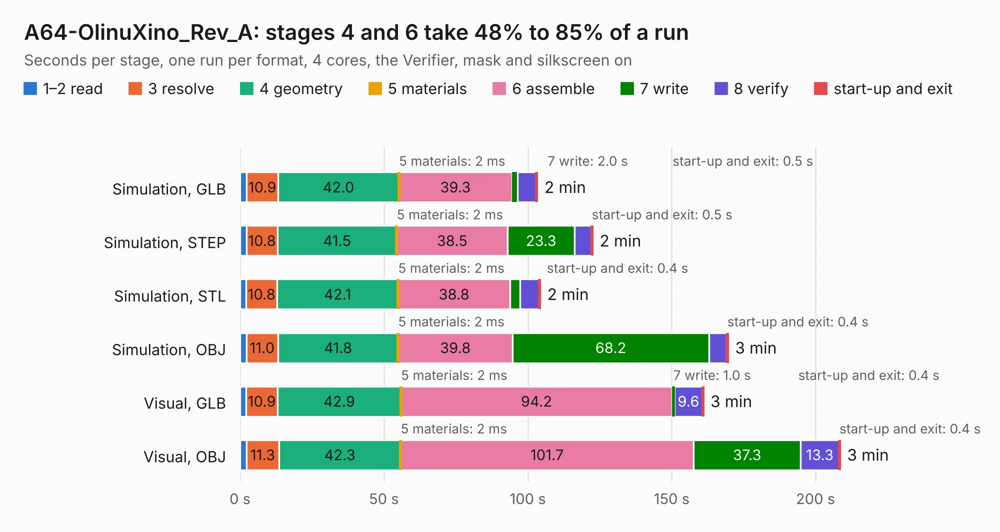

| Mode and format | 1–2 read | 3 resolve | 4 geometry | 5 materials | 6 assemble | 7 write | 8 verify | start-up and exit | Total |
|---|---:|---:|---:|---:|---:|---:|---:|---:|---:|
| Simulation, GLB | 2.3 | 10.9 | 42.0 | 2&nbsp;ms | 39.3 | 2.0 | 6.4 | 0.5 | 103.3 |
| Simulation, STEP | 2.2 | 10.8 | 41.5 | 2&nbsp;ms | 38.5 | 23.3 | 5.7 | 0.5 | 122.5 |
| Simulation, STL | 2.1 | 10.8 | 42.1 | 2&nbsp;ms | 38.8 | 3.6 | 6.5 | 0.4 | 104.3 |
| Simulation, OBJ | 2.2 | 11.0 | 41.8 | 2&nbsp;ms | 39.8 | 68.2 | 6.2 | 0.4 | 169.6 |
| Visual, GLB | 2.1 | 10.9 | 42.9 | 2&nbsp;ms | 94.2 | 1.0 | 9.6 | 0.4 | 161.0 |
| Visual, OBJ | 2.2 | 11.3 | 42.3 | 2&nbsp;ms | 101.7 | 37.3 | 13.3 | 0.4 | 208.5 |

<table align="center"><tr><td valign="top">

| Board | Repo: [OLIMEX/OLINUXINO](https://github.com/OLIMEX/OLINUXINO) Board: `A64-OlinuXino_Rev_A.kicad_pcb` |
|---|---|
| Folder | HARDWARE / A64-OLinuXino / 2. Older hardware revisions / A64-OLinuXino hardware revision A |
| Complexity | 379&nbsp;/&nbsp;1000 (size&nbsp;334, features&nbsp;45) |
| KESE&nbsp;features | through vias, filled zones, copper text |
| Tested | 9th November 2026 |
| Copper&nbsp;layers | 6 |
| File&nbsp;format | KiCad 4 (4) |
| Parts,&nbsp;tracks,&nbsp;vias | 385, 13,950, 1,040 |
| Triangles,&nbsp;simulation | 9,633,876 in 462 parts |
| Verifier | PASS in all six runs |

</td><td valign="top">

<table>
<tr><th>File type</th><th>File size</th><th>Peak memory used</th></tr>
<tr><th colspan="3" align="left">Simulation</th></tr>
<tr><td>GLB</td><td align="right">335&nbsp;MB</td><td align="right">2.2&nbsp;GB</td></tr>
<tr><td>STEP</td><td align="right">1.4&nbsp;GB</td><td align="right">2.9&nbsp;GB</td></tr>
<tr><td>STL</td><td align="right">482&nbsp;MB</td><td align="right">2.1&nbsp;GB</td></tr>
<tr><td>OBJ</td><td align="right">1.0&nbsp;GB</td><td align="right">6.1&nbsp;GB</td></tr>
<tr><th colspan="3" align="left">Visual</th></tr>
<tr><td>GLB</td><td align="right">191&nbsp;MB</td><td align="right">3.0&nbsp;GB</td></tr>
<tr><td>OBJ</td><td align="right">621&nbsp;MB</td><td align="right">4.1&nbsp;GB</td></tr>
</table>

</td></tr></table>

## 1947. A64-OlinuXino_Rev_B

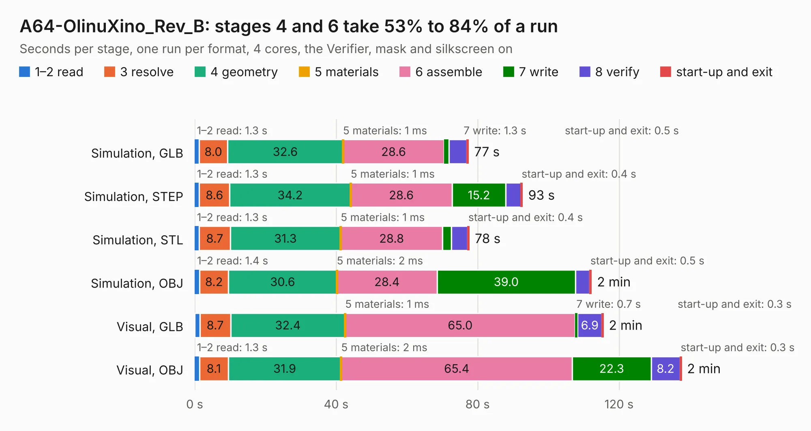

| Mode and format | 1–2 read | 3 resolve | 4 geometry | 5 materials | 6 assemble | 7 write | 8 verify | start-up and exit | Total |
|---|---:|---:|---:|---:|---:|---:|---:|---:|---:|
| Simulation, GLB | 1.3 | 8.0 | 32.6 | 1&nbsp;ms | 28.6 | 1.3 | 5.1 | 0.5 | 77.4 |
| Simulation, STEP | 1.3 | 8.6 | 34.2 | 1&nbsp;ms | 28.6 | 15.2 | 4.3 | 0.4 | 92.7 |
| Simulation, STL | 1.3 | 8.7 | 31.3 | 1&nbsp;ms | 28.8 | 2.5 | 4.6 | 0.4 | 77.6 |
| Simulation, OBJ | 1.4 | 8.2 | 30.6 | 2&nbsp;ms | 28.4 | 39.0 | 4.0 | 0.5 | 112.1 |
| Visual, GLB | 1.4 | 8.7 | 32.4 | 1&nbsp;ms | 65.0 | 0.7 | 6.9 | 0.3 | 115.5 |
| Visual, OBJ | 1.3 | 8.1 | 31.9 | 2&nbsp;ms | 65.4 | 22.3 | 8.2 | 0.3 | 137.6 |

<table align="center"><tr><td valign="top">

| Board | Repo: [OLIMEX/OLINUXINO](https://github.com/OLIMEX/OLINUXINO) Board: `A64-OlinuXino_Rev_B.kicad_pcb` |
|---|---|
| Folder | HARDWARE / A64-OLinuXino / 2. Older hardware revisions / A64-OLinuXino hardware revision B |
| Complexity | 348&nbsp;/&nbsp;1000 (size&nbsp;333, features&nbsp;15) |
| KESE&nbsp;features | through vias |
| Tested | 9th November 2026 |
| Copper&nbsp;layers | 6 |
| File&nbsp;format | KiCad 4 (4) |
| Parts,&nbsp;tracks,&nbsp;vias | 384, 13,451, 992 |
| Triangles,&nbsp;simulation | 8,558,286 in 462 parts |
| Verifier | PASS in all six runs |

</td><td valign="top">

<table>
<tr><th>File type</th><th>File size</th><th>Peak memory used</th></tr>
<tr><th colspan="3" align="left">Simulation</th></tr>
<tr><td>GLB</td><td align="right">297&nbsp;MB</td><td align="right">2.0&nbsp;GB</td></tr>
<tr><td>STEP</td><td align="right">1.2&nbsp;GB</td><td align="right">2.5&nbsp;GB</td></tr>
<tr><td>STL</td><td align="right">428&nbsp;MB</td><td align="right">1.9&nbsp;GB</td></tr>
<tr><td>OBJ</td><td align="right">930&nbsp;MB</td><td align="right">5.4&nbsp;GB</td></tr>
<tr><th colspan="3" align="left">Visual</th></tr>
<tr><td>GLB</td><td align="right">165&nbsp;MB</td><td align="right">2.7&nbsp;GB</td></tr>
<tr><td>OBJ</td><td align="right">537&nbsp;MB</td><td align="right">3.5&nbsp;GB</td></tr>
</table>

</td></tr></table>

## 1948. A64-OlinuXino_Rev_C

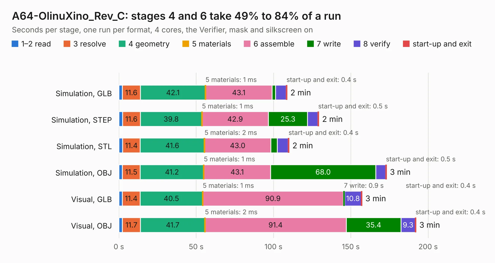

| Mode and format | 1–2 read | 3 resolve | 4 geometry | 5 materials | 6 assemble | 7 write | 8 verify | start-up and exit | Total |
|---|---:|---:|---:|---:|---:|---:|---:|---:|---:|
| Simulation, GLB | 2.3 | 11.6 | 42.1 | 1&nbsp;ms | 43.1 | 2.1 | 7.0 | 0.4 | 108.7 |
| Simulation, STEP | 2.3 | 11.6 | 39.8 | 1&nbsp;ms | 42.9 | 25.3 | 6.7 | 0.5 | 129.2 |
| Simulation, STL | 2.4 | 11.4 | 41.6 | 2&nbsp;ms | 43.0 | 4.1 | 7.1 | 0.4 | 110.0 |
| Simulation, OBJ | 2.3 | 11.5 | 41.2 | 1&nbsp;ms | 43.1 | 68.0 | 6.5 | 0.5 | 173.0 |
| Visual, GLB | 2.3 | 11.4 | 40.5 | 1&nbsp;ms | 90.9 | 0.9 | 10.8 | 0.4 | 157.2 |
| Visual, OBJ | 2.3 | 11.7 | 41.7 | 2&nbsp;ms | 91.4 | 35.4 | 9.3 | 0.4 | 192.1 |

<table align="center"><tr><td valign="top">

| Board | Repo: [OLIMEX/OLINUXINO](https://github.com/OLIMEX/OLINUXINO) Board: `A64-OlinuXino_Rev_C.kicad_pcb` |
|---|---|
| Folder | HARDWARE / A64-OLinuXino / 2. Older hardware revisions / A64-OLinuXino hardware revision C |
| Complexity | 393&nbsp;/&nbsp;1000 (size&nbsp;338, features&nbsp;55) |
| KESE&nbsp;features | through vias, slotted holes, filled zones, copper text |
| Tested | 9th November 2026 |
| Copper&nbsp;layers | 6 |
| File&nbsp;format | KiCad 5 (20170123) |
| Parts,&nbsp;tracks,&nbsp;vias | 406, 17,000, 1,160 |
| Triangles,&nbsp;simulation | 10,251,140 in 475 parts |
| Verifier | PASS in all six runs |

</td><td valign="top">

<table>
<tr><th>File type</th><th>File size</th><th>Peak memory used</th></tr>
<tr><th colspan="3" align="left">Simulation</th></tr>
<tr><td>GLB</td><td align="right">356&nbsp;MB</td><td align="right">2.1&nbsp;GB</td></tr>
<tr><td>STEP</td><td align="right">1.5&nbsp;GB</td><td align="right">3.1&nbsp;GB</td></tr>
<tr><td>STL</td><td align="right">513&nbsp;MB</td><td align="right">2.2&nbsp;GB</td></tr>
<tr><td>OBJ</td><td align="right">1.1&nbsp;GB</td><td align="right">6.5&nbsp;GB</td></tr>
<tr><th colspan="3" align="left">Visual</th></tr>
<tr><td>GLB</td><td align="right">198&nbsp;MB</td><td align="right">3.1&nbsp;GB</td></tr>
<tr><td>OBJ</td><td align="right">644&nbsp;MB</td><td align="right">4.2&nbsp;GB</td></tr>
</table>

</td></tr></table>

## 1949. A64-OlinuXino_Rev_D

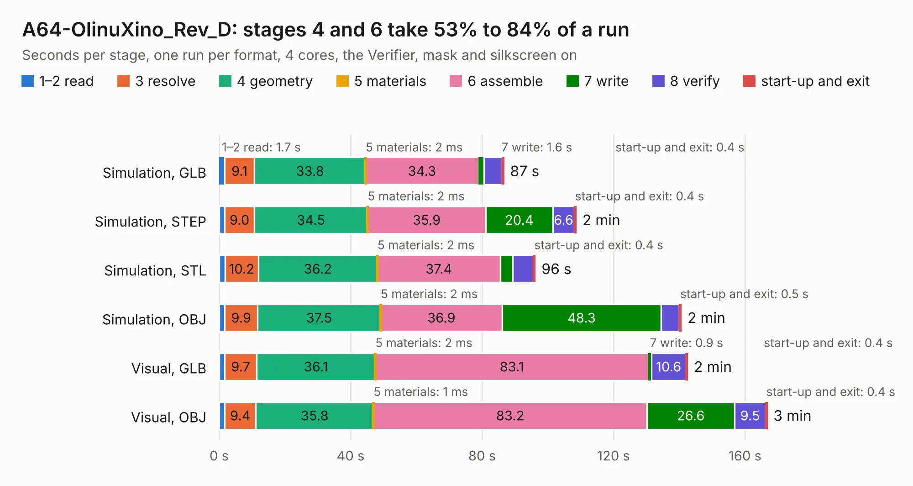

| Mode and format | 1–2 read | 3 resolve | 4 geometry | 5 materials | 6 assemble | 7 write | 8 verify | start-up and exit | Total |
|---|---:|---:|---:|---:|---:|---:|---:|---:|---:|
| Simulation, GLB | 1.7 | 9.1 | 33.8 | 2&nbsp;ms | 34.3 | 1.6 | 5.6 | 0.4 | 86.5 |
| Simulation, STEP | 1.7 | 9.0 | 34.5 | 2&nbsp;ms | 35.9 | 20.4 | 6.6 | 0.4 | 108.5 |
| Simulation, STL | 1.8 | 10.2 | 36.2 | 2&nbsp;ms | 37.4 | 3.8 | 6.3 | 0.4 | 96.1 |
| Simulation, OBJ | 1.7 | 9.9 | 37.5 | 2&nbsp;ms | 36.9 | 48.3 | 5.6 | 0.5 | 140.5 |
| Visual, GLB | 1.7 | 9.7 | 36.1 | 2&nbsp;ms | 83.1 | 0.9 | 10.6 | 0.4 | 142.5 |
| Visual, OBJ | 1.7 | 9.4 | 35.8 | 1&nbsp;ms | 83.2 | 26.6 | 9.5 | 0.4 | 166.7 |

<table align="center"><tr><td valign="top">

| Board | Repo: [OLIMEX/OLINUXINO](https://github.com/OLIMEX/OLINUXINO) Board: `A64-OlinuXino_Rev_D.kicad_pcb` |
|---|---|
| Folder | HARDWARE / A64-OLinuXino / 2. Older hardware revisions / A64-OLinuXino hardware revision D |
| Complexity | 393&nbsp;/&nbsp;1000 (size&nbsp;338, features&nbsp;55) |
| KESE&nbsp;features | through vias, slotted holes, filled zones, copper text |
| Tested | 9th November 2026 |
| Copper&nbsp;layers | 6 |
| File&nbsp;format | KiCad 5 (20170123) |
| Parts,&nbsp;tracks,&nbsp;vias | 407, 16,995, 1,161 |
| Triangles,&nbsp;simulation | 10,183,292 in 474 parts |
| Verifier | PASS in all six runs |

</td><td valign="top">

<table>
<tr><th>File type</th><th>File size</th><th>Peak memory used</th></tr>
<tr><th colspan="3" align="left">Simulation</th></tr>
<tr><td>GLB</td><td align="right">354&nbsp;MB</td><td align="right">2.1&nbsp;GB</td></tr>
<tr><td>STEP</td><td align="right">1.5&nbsp;GB</td><td align="right">3.2&nbsp;GB</td></tr>
<tr><td>STL</td><td align="right">509&nbsp;MB</td><td align="right">2.2&nbsp;GB</td></tr>
<tr><td>OBJ</td><td align="right">1.1&nbsp;GB</td><td align="right">6.4&nbsp;GB</td></tr>
<tr><th colspan="3" align="left">Visual</th></tr>
<tr><td>GLB</td><td align="right">199&nbsp;MB</td><td align="right">3.1&nbsp;GB</td></tr>
<tr><td>OBJ</td><td align="right">647&nbsp;MB</td><td align="right">4.1&nbsp;GB</td></tr>
</table>

</td></tr></table>

## 1950. A64-OlinuXino_Rev_E

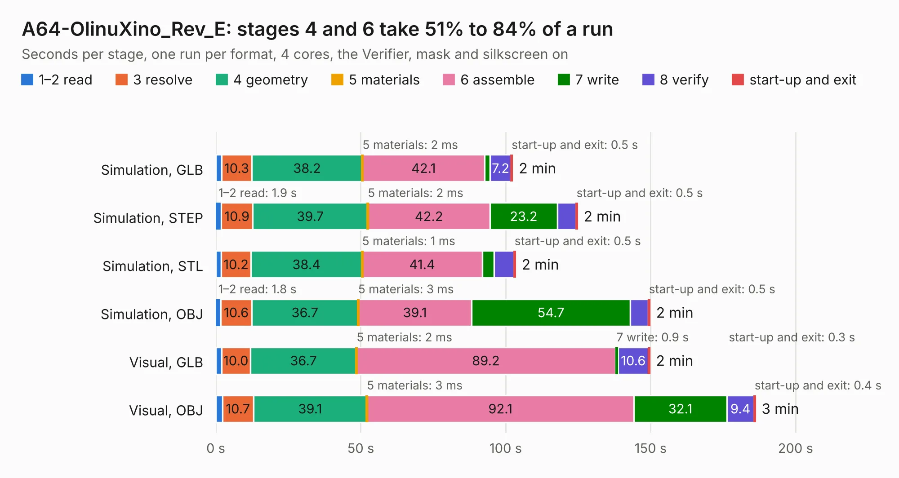

| Mode and format | 1–2 read | 3 resolve | 4 geometry | 5 materials | 6 assemble | 7 write | 8 verify | start-up and exit | Total |
|---|---:|---:|---:|---:|---:|---:|---:|---:|---:|
| Simulation, GLB | 2.0 | 10.3 | 38.2 | 2&nbsp;ms | 42.1 | 1.9 | 7.2 | 0.5 | 102.3 |
| Simulation, STEP | 1.9 | 10.9 | 39.7 | 2&nbsp;ms | 42.2 | 23.2 | 6.4 | 0.5 | 124.7 |
| Simulation, STL | 1.9 | 10.2 | 38.4 | 1&nbsp;ms | 41.4 | 4.1 | 6.8 | 0.5 | 103.3 |
| Simulation, OBJ | 1.8 | 10.6 | 36.7 | 3&nbsp;ms | 39.1 | 54.7 | 6.2 | 0.5 | 149.7 |
| Visual, GLB | 1.9 | 10.0 | 36.7 | 2&nbsp;ms | 89.2 | 0.9 | 10.6 | 0.3 | 149.6 |
| Visual, OBJ | 2.3 | 10.7 | 39.1 | 3&nbsp;ms | 92.1 | 32.1 | 9.4 | 0.4 | 186.1 |

<table align="center"><tr><td valign="top">

| Board | Repo: [OLIMEX/OLINUXINO](https://github.com/OLIMEX/OLINUXINO) Board: `A64-OlinuXino_Rev_E.kicad_pcb` |
|---|---|
| Folder | HARDWARE / A64-OLinuXino / 2. Older hardware revisions / A64-OLinuXino hardware revision E |
| Complexity | 393&nbsp;/&nbsp;1000 (size&nbsp;338, features&nbsp;55) |
| KESE&nbsp;features | through vias, slotted holes, filled zones, copper text |
| Tested | 9th November 2026 |
| Copper&nbsp;layers | 6 |
| File&nbsp;format | KiCad 5 (20171130) |
| Parts,&nbsp;tracks,&nbsp;vias | 412, 16,943, 1,171 |
| Triangles,&nbsp;simulation | 10,318,354 in 473 parts |
| Verifier | PASS in all six runs |

</td><td valign="top">

<table>
<tr><th>File type</th><th>File size</th><th>Peak memory used</th></tr>
<tr><th colspan="3" align="left">Simulation</th></tr>
<tr><td>GLB</td><td align="right">359&nbsp;MB</td><td align="right">2.2&nbsp;GB</td></tr>
<tr><td>STEP</td><td align="right">1.5&nbsp;GB</td><td align="right">3.2&nbsp;GB</td></tr>
<tr><td>STL</td><td align="right">516&nbsp;MB</td><td align="right">2.2&nbsp;GB</td></tr>
<tr><td>OBJ</td><td align="right">1.1&nbsp;GB</td><td align="right">6.5&nbsp;GB</td></tr>
<tr><th colspan="3" align="left">Visual</th></tr>
<tr><td>GLB</td><td align="right">201&nbsp;MB</td><td align="right">3.1&nbsp;GB</td></tr>
<tr><td>OBJ</td><td align="right">655&nbsp;MB</td><td align="right">4.1&nbsp;GB</td></tr>
</table>

</td></tr></table>

## 1951. A64-OlinuXino_Rev_G

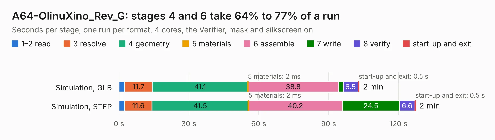

| Mode and format | 1–2 read | 3 resolve | 4 geometry | 5 materials | 6 assemble | 7 write | 8 verify | start-up and exit | Total |
|---|---:|---:|---:|---:|---:|---:|---:|---:|---:|
| Simulation, GLB | 2.6 | 11.7 | 41.1 | 2&nbsp;ms | 38.8 | 1.9 | 6.5 | 0.5 | 103.2 |
| Simulation, STEP | 2.6 | 11.6 | 41.5 | 2&nbsp;ms | 40.2 | 24.5 | 6.6 | 0.5 | 127.4 |
| Simulation, STL | 2.6 | 11.7 | 42.3 | 1&nbsp;ms | 39.9 | 4.3 | 6.6 | 0.5 | 107.9 |
| Simulation, OBJ | 2.5 | 12.2 | 43.7 | 1&nbsp;ms | 40.2 | 71.0 | 6.7 | 0.4 | 176.6 |
| Visual, GLB | 2.6 | 11.2 | 41.6 | 2&nbsp;ms | 94.3 | 1.0 | 9.2 | 0.4 | 160.3 |
| Visual, OBJ | 2.4 | 11.6 | 43.8 | 1&nbsp;ms | 96.5 | 34.7 | 8.8 | 0.4 | 198.2 |

<table align="center"><tr><td valign="top">

| Board | Repo: [OLIMEX/OLINUXINO](https://github.com/OLIMEX/OLINUXINO) Board: `A64-OlinuXino_Rev_G.kicad_pcb` |
|---|---|
| Folder | HARDWARE / A64-OLinuXino / 2. Older hardware revisions / A64-OLinuXino hardware revision G |
| Complexity | 393&nbsp;/&nbsp;1000 (size&nbsp;338, features&nbsp;55) |
| KESE&nbsp;features | through vias, slotted holes, filled zones, copper text |
| Tested | 9th November 2026 |
| Copper&nbsp;layers | 6 |
| File&nbsp;format | KiCad 5 (20171130) |
| Parts,&nbsp;tracks,&nbsp;vias | 417, 16,778, 1,140 |
| Triangles,&nbsp;simulation | 10,371,886 in 461 parts |
| Verifier | PASS in all six runs |

</td><td valign="top">

<table>
<tr><th>File type</th><th>File size</th><th>Peak memory used</th></tr>
<tr><th colspan="3" align="left">Simulation</th></tr>
<tr><td>GLB</td><td align="right">361&nbsp;MB</td><td align="right">2.3&nbsp;GB</td></tr>
<tr><td>STEP</td><td align="right">1.5&nbsp;GB</td><td align="right">3.1&nbsp;GB</td></tr>
<tr><td>STL</td><td align="right">519&nbsp;MB</td><td align="right">2.2&nbsp;GB</td></tr>
<tr><td>OBJ</td><td align="right">1.1&nbsp;GB</td><td align="right">6.6&nbsp;GB</td></tr>
<tr><th colspan="3" align="left">Visual</th></tr>
<tr><td>GLB</td><td align="right">199&nbsp;MB</td><td align="right">3.1&nbsp;GB</td></tr>
<tr><td>OBJ</td><td align="right">649&nbsp;MB</td><td align="right">4.2&nbsp;GB</td></tr>
</table>

</td></tr></table>

## 1952. A64-OlinuXino_Rev_G1

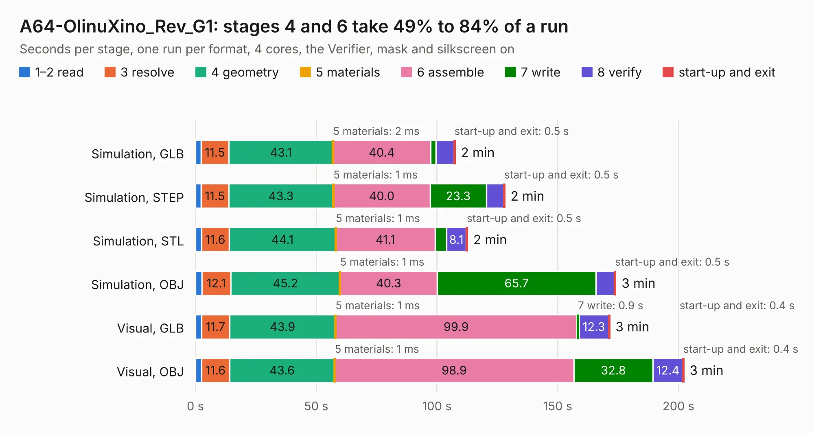

| Mode and format | 1–2 read | 3 resolve | 4 geometry | 5 materials | 6 assemble | 7 write | 8 verify | start-up and exit | Total |
|---|---:|---:|---:|---:|---:|---:|---:|---:|---:|
| Simulation, GLB | 2.3 | 11.5 | 43.1 | 2&nbsp;ms | 40.4 | 2.3 | 7.4 | 0.5 | 107.5 |
| Simulation, STEP | 2.3 | 11.5 | 43.3 | 1&nbsp;ms | 40.0 | 23.3 | 7.1 | 0.5 | 128.1 |
| Simulation, STL | 2.5 | 11.6 | 44.1 | 1&nbsp;ms | 41.1 | 4.8 | 8.1 | 0.5 | 112.6 |
| Simulation, OBJ | 2.6 | 12.1 | 45.2 | 1&nbsp;ms | 40.3 | 65.7 | 7.7 | 0.5 | 174.0 |
| Visual, GLB | 2.5 | 11.7 | 43.9 | 1&nbsp;ms | 99.9 | 0.9 | 12.3 | 0.4 | 171.5 |
| Visual, OBJ | 2.6 | 11.6 | 43.6 | 1&nbsp;ms | 98.9 | 32.8 | 12.4 | 0.4 | 202.2 |

<table align="center"><tr><td valign="top">

| Board | Repo: [OLIMEX/OLINUXINO](https://github.com/OLIMEX/OLINUXINO) Board: `A64-OlinuXino_Rev_G1.kicad_pcb` |
|---|---|
| Folder | HARDWARE / A64-OLinuXino / 2. Older hardware revisions / A64-OLinuXino hardware revision G1 |
| Complexity | 393&nbsp;/&nbsp;1000 (size&nbsp;338, features&nbsp;55) |
| KESE&nbsp;features | through vias, slotted holes, filled zones, copper text |
| Tested | 9th November 2026 |
| Copper&nbsp;layers | 6 |
| File&nbsp;format | KiCad 5 (20171130) |
| Parts,&nbsp;tracks,&nbsp;vias | 417, 16,778, 1,140 |
| Triangles,&nbsp;simulation | 10,385,472 in 461 parts |
| Verifier | PASS in all six runs |

</td><td valign="top">

<table>
<tr><th>File type</th><th>File size</th><th>Peak memory used</th></tr>
<tr><th colspan="3" align="left">Simulation</th></tr>
<tr><td>GLB</td><td align="right">362&nbsp;MB</td><td align="right">2.3&nbsp;GB</td></tr>
<tr><td>STEP</td><td align="right">1.5&nbsp;GB</td><td align="right">3.2&nbsp;GB</td></tr>
<tr><td>STL</td><td align="right">519&nbsp;MB</td><td align="right">2.4&nbsp;GB</td></tr>
<tr><td>OBJ</td><td align="right">1.1&nbsp;GB</td><td align="right">6.6&nbsp;GB</td></tr>
<tr><th colspan="3" align="left">Visual</th></tr>
<tr><td>GLB</td><td align="right">199&nbsp;MB</td><td align="right">3.2&nbsp;GB</td></tr>
<tr><td>OBJ</td><td align="right">650&nbsp;MB</td><td align="right">4.2&nbsp;GB</td></tr>
</table>

</td></tr></table>

## 1953. LCD-DRIVER_Rev_B

| Mode and format | 1–2 read | 3 resolve | 4 geometry | 5 materials | 6 assemble | 7 write | 8 verify | start-up and exit | Total |
|---|---:|---:|---:|---:|---:|---:|---:|---:|---:|
| Simulation, GLB | 0.6 | 3.5 | 13.0 | 0.3&nbsp;ms | 13.3 | 0.5 | 1.3 | 0.2 | 32.4 |
| Simulation, STEP | 0.6 | 3.5 | 13.9 | 0.3&nbsp;ms | 11.8 | 7.1 | 1.2 | 0.3 | 38.3 |
| Simulation, STL | 0.6 | 3.6 | 13.0 | 0.9&nbsp;ms | 12.1 | 1.0 | 1.4 | 0.3 | 32.0 |
| Simulation, OBJ | 0.6 | 3.8 | 13.2 | 0.9&nbsp;ms | 12.6 | 11.4 | 1.2 | 0.2 | 43.1 |
| Visual, GLB | 0.6 | 3.5 | 13.4 | 0.5&nbsp;ms | 26.7 | 0.3 | 3.4 | 0.2 | 48.2 |
| Visual, OBJ | 0.7 | 3.7 | 13.6 | 0.3&nbsp;ms | 27.0 | 10.2 | 3.4 | 0.2 | 59.0 |

<table align="center"><tr><td valign="top">

| Board | Repo: [OLIMEX/OLINUXINO](https://github.com/OLIMEX/OLINUXINO) Board: `LCD-DRIVER_Rev_B.kicad_pcb` |
|---|---|
| Folder | HARDWARE / LCDs / LCD-DRIVER / Hardware revision B |
| Complexity | 261&nbsp;/&nbsp;1000 (size&nbsp;216, features&nbsp;45) |
| KESE&nbsp;features | through vias, rounded, trapezoid or chamfered pads, filled zones |
| Tested | 9th November 2026 |
| Copper&nbsp;layers | 2 |
| File&nbsp;format | KiCad 5 (20171130) |
| Parts,&nbsp;tracks,&nbsp;vias | 129, 5,589, 731 |
| Triangles,&nbsp;simulation | 2,732,634 in 106 parts |
| Verifier | PASS in all six runs |

</td><td valign="top">

<table>
<tr><th>File type</th><th>File size</th><th>Peak memory used</th></tr>
<tr><th colspan="3" align="left">Simulation</th></tr>
<tr><td>GLB</td><td align="right">96&nbsp;MB</td><td align="right">989&nbsp;MB</td></tr>
<tr><td>STEP</td><td align="right">521&nbsp;MB</td><td align="right">1.3&nbsp;GB</td></tr>
<tr><td>STL</td><td align="right">137&nbsp;MB</td><td align="right">1.1&nbsp;GB</td></tr>
<tr><td>OBJ</td><td align="right">293&nbsp;MB</td><td align="right">1.8&nbsp;GB</td></tr>
<tr><th colspan="3" align="left">Visual</th></tr>
<tr><td>GLB</td><td align="right">84&nbsp;MB</td><td align="right">1.4&nbsp;GB</td></tr>
<tr><td>OBJ</td><td align="right">262&nbsp;MB</td><td align="right">1.8&nbsp;GB</td></tr>
</table>

</td></tr></table>

## 1954. LCD-DRIVER_Rev_C

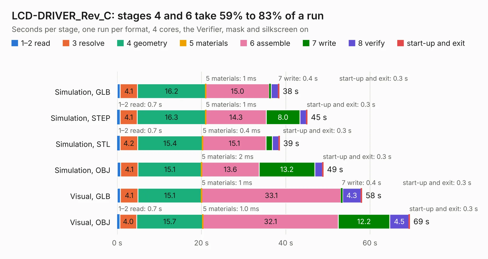

| Mode and format | 1–2 read | 3 resolve | 4 geometry | 5 materials | 6 assemble | 7 write | 8 verify | start-up and exit | Total |
|---|---:|---:|---:|---:|---:|---:|---:|---:|---:|
| Simulation, GLB | 0.7 | 4.1 | 16.2 | 1&nbsp;ms | 15.0 | 0.4 | 1.7 | 0.3 | 38.5 |
| Simulation, STEP | 0.7 | 4.1 | 16.3 | 1&nbsp;ms | 14.3 | 8.0 | 1.5 | 0.3 | 45.1 |
| Simulation, STL | 0.7 | 4.2 | 15.4 | 0.4&nbsp;ms | 15.1 | 1.5 | 1.5 | 0.3 | 38.6 |
| Simulation, OBJ | 0.8 | 4.1 | 15.1 | 2&nbsp;ms | 13.6 | 13.2 | 1.8 | 0.3 | 49.0 |
| Visual, GLB | 0.8 | 4.1 | 15.1 | 1&nbsp;ms | 33.1 | 0.4 | 4.3 | 0.3 | 58.1 |
| Visual, OBJ | 0.7 | 4.0 | 15.7 | 1.0&nbsp;ms | 32.1 | 12.2 | 4.5 | 0.3 | 69.5 |

<table align="center"><tr><td valign="top">

| Board | Repo: [OLIMEX/OLINUXINO](https://github.com/OLIMEX/OLINUXINO) Board: `LCD-DRIVER_Rev_C.kicad_pcb` |
|---|---|
| Folder | HARDWARE / LCDs / LCD-DRIVER / Hardware revision C |
| Complexity | 262&nbsp;/&nbsp;1000 (size&nbsp;217, features&nbsp;45) |
| KESE&nbsp;features | through vias, rounded, trapezoid or chamfered pads, filled zones |
| Tested | 9th November 2026 |
| Copper&nbsp;layers | 2 |
| File&nbsp;format | KiCad 5 (20171130) |
| Parts,&nbsp;tracks,&nbsp;vias | 131, 5,701, 732 |
| Triangles,&nbsp;simulation | 2,732,380 in 106 parts |
| Verifier | PASS in all six runs |

</td><td valign="top">

<table>
<tr><th>File type</th><th>File size</th><th>Peak memory used</th></tr>
<tr><th colspan="3" align="left">Simulation</th></tr>
<tr><td>GLB</td><td align="right">96&nbsp;MB</td><td align="right">967&nbsp;MB</td></tr>
<tr><td>STEP</td><td align="right">519&nbsp;MB</td><td align="right">1.3&nbsp;GB</td></tr>
<tr><td>STL</td><td align="right">137&nbsp;MB</td><td align="right">933&nbsp;MB</td></tr>
<tr><td>OBJ</td><td align="right">293&nbsp;MB</td><td align="right">1.8&nbsp;GB</td></tr>
<tr><th colspan="3" align="left">Visual</th></tr>
<tr><td>GLB</td><td align="right">84&nbsp;MB</td><td align="right">1.5&nbsp;GB</td></tr>
<tr><td>OBJ</td><td align="right">262&nbsp;MB</td><td align="right">1.8&nbsp;GB</td></tr>
</table>

</td></tr></table>

## 1955. LCD-DRIVER_Rev_D

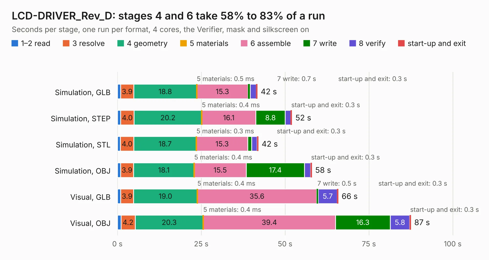

| Mode and format | 1–2 read | 3 resolve | 4 geometry | 5 materials | 6 assemble | 7 write | 8 verify | start-up and exit | Total |
|---|---:|---:|---:|---:|---:|---:|---:|---:|---:|
| Simulation, GLB | 1.0 | 3.9 | 18.8 | 0.5&nbsp;ms | 15.3 | 0.7 | 1.8 | 0.3 | 41.7 |
| Simulation, STEP | 0.9 | 4.0 | 20.2 | 0.4&nbsp;ms | 16.1 | 8.8 | 1.7 | 0.3 | 52.0 |
| Simulation, STL | 0.9 | 4.0 | 18.7 | 0.3&nbsp;ms | 15.3 | 1.1 | 1.6 | 0.3 | 42.0 |
| Simulation, OBJ | 0.9 | 3.9 | 18.1 | 0.4&nbsp;ms | 15.5 | 17.4 | 1.8 | 0.3 | 57.9 |
| Visual, GLB | 1.0 | 3.9 | 19.0 | 0.4&nbsp;ms | 35.6 | 0.5 | 5.7 | 0.3 | 65.8 |
| Visual, OBJ | 1.1 | 4.2 | 20.3 | 0.4&nbsp;ms | 39.4 | 16.3 | 5.8 | 0.3 | 87.5 |

<table align="center"><tr><td valign="top">

| Board | Repo: [OLIMEX/OLINUXINO](https://github.com/OLIMEX/OLINUXINO) Board: `LCD-DRIVER_Rev_D.kicad_pcb` |
|---|---|
| Folder | HARDWARE / LCDs / LCD-DRIVER / Hardware revision D |
| Complexity | 263&nbsp;/&nbsp;1000 (size&nbsp;218, features&nbsp;45) |
| KESE&nbsp;features | through vias, filled zones, copper text |
| Tested | 9th November 2026 |
| Copper&nbsp;layers | 2 |
| File&nbsp;format | KiCad 5 (20171130) |
| Parts,&nbsp;tracks,&nbsp;vias | 134, 6,106, 746 |
| Triangles,&nbsp;simulation | 2,775,296 in 106 parts |
| Verifier | PASS in all six runs |

</td><td valign="top">

<table>
<tr><th>File type</th><th>File size</th><th>Peak memory used</th></tr>
<tr><th colspan="3" align="left">Simulation</th></tr>
<tr><td>GLB</td><td align="right">98&nbsp;MB</td><td align="right">1.0&nbsp;GB</td></tr>
<tr><td>STEP</td><td align="right">488&nbsp;MB</td><td align="right">1.4&nbsp;GB</td></tr>
<tr><td>STL</td><td align="right">139&nbsp;MB</td><td align="right">1.0&nbsp;GB</td></tr>
<tr><td>OBJ</td><td align="right">299&nbsp;MB</td><td align="right">1.9&nbsp;GB</td></tr>
<tr><th colspan="3" align="left">Visual</th></tr>
<tr><td>GLB</td><td align="right">87&nbsp;MB</td><td align="right">1.4&nbsp;GB</td></tr>
<tr><td>OBJ</td><td align="right">273&nbsp;MB</td><td align="right">1.9&nbsp;GB</td></tr>
</table>

</td></tr></table>

## 1956. LCD-OLinuXino-15.6FHD_Rev_H

| Mode and format | 1–2 read | 3 resolve | 4 geometry | 5 materials | 6 assemble | 7 write | 8 verify | start-up and exit | Total |
|---|---:|---:|---:|---:|---:|---:|---:|---:|---:|
| Simulation, GLB | 0.4 | 1.9 | 6.5 | 0.5&nbsp;ms | 6.3 | 0.2 | 0.7 | 0.3 | 16.4 |
| Simulation, STEP | 0.5 | 1.8 | 6.3 | 0.6&nbsp;ms | 6.4 | 4.5 | 0.9 | 0.3 | 20.7 |
| Simulation, STL | 0.5 | 1.8 | 6.5 | 0.6&nbsp;ms | 6.2 | 0.4 | 0.9 | 0.3 | 16.5 |
| Simulation, OBJ | 0.5 | 1.8 | 6.5 | 0.6&nbsp;ms | 6.4 | 9.0 | 0.8 | 0.3 | 25.2 |
| Visual, GLB | 0.5 | 1.9 | 6.5 | 0.9&nbsp;ms | 13.6 | 0.2 | 1.3 | 0.3 | 24.2 |
| Visual, OBJ | 0.5 | 2.0 | 6.4 | 0.6&nbsp;ms | 12.6 | 5.9 | 1.6 | 0.3 | 29.3 |

<table align="center"><tr><td valign="top">

| Board | Repo: [OLIMEX/OLINUXINO](https://github.com/OLIMEX/OLINUXINO) Board: `LCD-OLinuXino-15.6FHD_Rev_H.kicad_pcb` |
|---|---|
| Folder | HARDWARE / LCDs / LCD-OLinuXino-15.6FHD / Hardware revision H |
| Complexity | 294&nbsp;/&nbsp;1000 (size&nbsp;249, features&nbsp;45) |
| KESE&nbsp;features | through vias, rounded, trapezoid or chamfered pads, filled zones |
| Tested | 9th November 2026 |
| Copper&nbsp;layers | 4 |
| File&nbsp;format | KiCad 5 (20171130) |
| Parts,&nbsp;tracks,&nbsp;vias | 59, 2,339, 238 |
| Triangles,&nbsp;simulation | 1,452,132 in 113 parts |
| Verifier | PASS in all six runs |

</td><td valign="top">

<table>
<tr><th>File type</th><th>File size</th><th>Peak memory used</th></tr>
<tr><th colspan="3" align="left">Simulation</th></tr>
<tr><td>GLB</td><td align="right">51&nbsp;MB</td><td align="right">570&nbsp;MB</td></tr>
<tr><td>STEP</td><td align="right">219&nbsp;MB</td><td align="right">708&nbsp;MB</td></tr>
<tr><td>STL</td><td align="right">73&nbsp;MB</td><td align="right">563&nbsp;MB</td></tr>
<tr><td>OBJ</td><td align="right">153&nbsp;MB</td><td align="right">983&nbsp;MB</td></tr>
<tr><th colspan="3" align="left">Visual</th></tr>
<tr><td>GLB</td><td align="right">36&nbsp;MB</td><td align="right">793&nbsp;MB</td></tr>
<tr><td>OBJ</td><td align="right">110&nbsp;MB</td><td align="right">805&nbsp;MB</td></tr>
</table>

</td></tr></table>

## 1957. LCD-OLinuXino-5TS

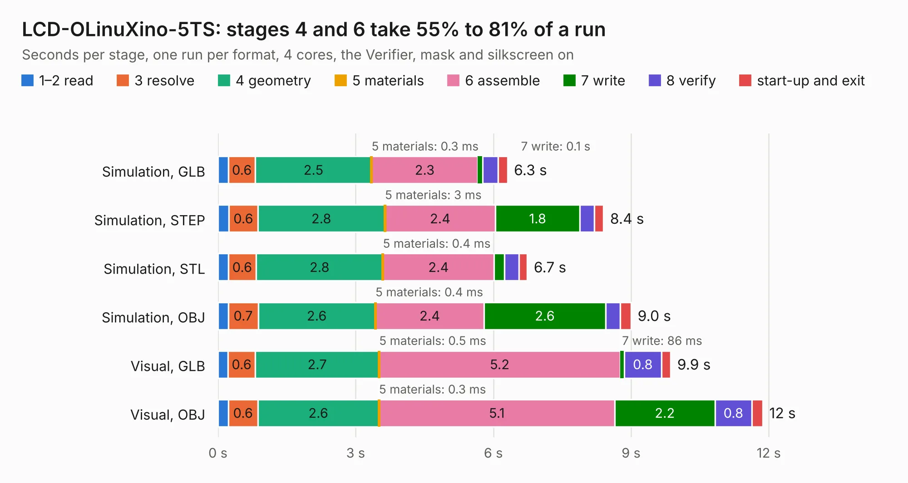

| Mode and format | 1–2 read | 3 resolve | 4 geometry | 5 materials | 6 assemble | 7 write | 8 verify | start-up and exit | Total |
|---|---:|---:|---:|---:|---:|---:|---:|---:|---:|
| Simulation, GLB | 0.2 | 0.6 | 2.5 | 0.3&nbsp;ms | 2.3 | 0.1 | 0.3 | 0.2 | 6.3 |
| Simulation, STEP | 0.2 | 0.6 | 2.8 | 3&nbsp;ms | 2.4 | 1.8 | 0.3 | 0.2 | 8.4 |
| Simulation, STL | 0.2 | 0.6 | 2.8 | 0.4&nbsp;ms | 2.4 | 0.2 | 0.3 | 0.2 | 6.7 |
| Simulation, OBJ | 0.2 | 0.7 | 2.6 | 0.4&nbsp;ms | 2.4 | 2.6 | 0.3 | 0.2 | 9.0 |
| Visual, GLB | 0.2 | 0.6 | 2.7 | 0.5&nbsp;ms | 5.2 | 86&nbsp;ms | 0.8 | 0.2 | 9.9 |
| Visual, OBJ | 0.2 | 0.6 | 2.6 | 0.3&nbsp;ms | 5.1 | 2.2 | 0.8 | 0.2 | 11.9 |

<table align="center"><tr><td valign="top">

| Board | Repo: [OLIMEX/OLINUXINO](https://github.com/OLIMEX/OLINUXINO) Board: `LCD-OLinuXino-5TS.kicad_pcb` |
|---|---|
| Folder | HARDWARE / LCDs / LCD-OLinuXino-5CTS / Hardware revision A |
| Complexity | 209&nbsp;/&nbsp;1000 (size&nbsp;174, features&nbsp;35) |
| KESE&nbsp;features | through vias, filled zones |
| Tested | 9th November 2026 |
| Copper&nbsp;layers | 2 |
| File&nbsp;format | KiCad 4 (4) |
| Parts,&nbsp;tracks,&nbsp;vias | 33, 1,168, 96 |
| Triangles,&nbsp;simulation | 618,012 in 82 parts |
| Verifier | PASS in all six runs |

</td><td valign="top">

<table>
<tr><th>File type</th><th>File size</th><th>Peak memory used</th></tr>
<tr><th colspan="3" align="left">Simulation</th></tr>
<tr><td>GLB</td><td align="right">23&nbsp;MB</td><td align="right">380&nbsp;MB</td></tr>
<tr><td>STEP</td><td align="right">122&nbsp;MB</td><td align="right">441&nbsp;MB</td></tr>
<tr><td>STL</td><td align="right">31&nbsp;MB</td><td align="right">380&nbsp;MB</td></tr>
<tr><td>OBJ</td><td align="right">65&nbsp;MB</td><td align="right">474&nbsp;MB</td></tr>
<tr><th colspan="3" align="left">Visual</th></tr>
<tr><td>GLB</td><td align="right">19&nbsp;MB</td><td align="right">492&nbsp;MB</td></tr>
<tr><td>OBJ</td><td align="right">57&nbsp;MB</td><td align="right">517&nbsp;MB</td></tr>
</table>

</td></tr></table>

## 1958. LCD-OLinuXino-5TS_Rev.B

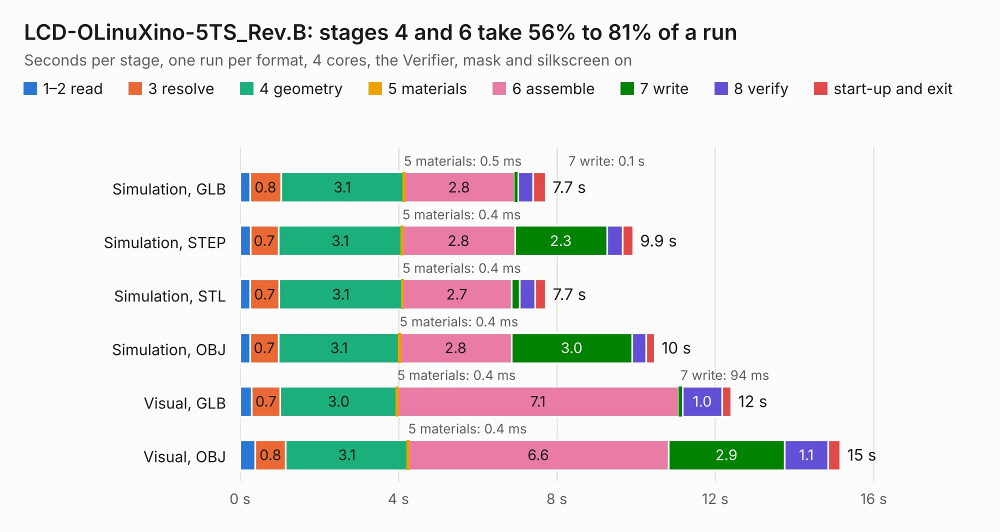

| Mode and format | 1–2 read | 3 resolve | 4 geometry | 5 materials | 6 assemble | 7 write | 8 verify | start-up and exit | Total |
|---|---:|---:|---:|---:|---:|---:|---:|---:|---:|
| Simulation, GLB | 0.3 | 0.8 | 3.1 | 0.5&nbsp;ms | 2.8 | 0.1 | 0.4 | 0.3 | 7.7 |
| Simulation, STEP | 0.3 | 0.7 | 3.1 | 0.4&nbsp;ms | 2.8 | 2.3 | 0.4 | 0.3 | 9.9 |
| Simulation, STL | 0.3 | 0.7 | 3.1 | 0.4&nbsp;ms | 2.7 | 0.2 | 0.4 | 0.3 | 7.7 |
| Simulation, OBJ | 0.3 | 0.7 | 3.1 | 0.4&nbsp;ms | 2.8 | 3.0 | 0.4 | 0.2 | 10.5 |
| Visual, GLB | 0.3 | 0.7 | 3.0 | 0.4&nbsp;ms | 7.1 | 94&nbsp;ms | 1.0 | 0.2 | 12.4 |
| Visual, OBJ | 0.4 | 0.8 | 3.1 | 0.4&nbsp;ms | 6.6 | 2.9 | 1.1 | 0.3 | 15.2 |

<table align="center"><tr><td valign="top">

| Board | Repo: [OLIMEX/OLINUXINO](https://github.com/OLIMEX/OLINUXINO) Board: `LCD-OLinuXino-5TS_Rev.B.kicad_pcb` |
|---|---|
| Folder | HARDWARE / LCDs / LCD-OLinuXino-5CTS / Hardware revision B |
| Complexity | 207&nbsp;/&nbsp;1000 (size&nbsp;172, features&nbsp;35) |
| KESE&nbsp;features | through vias, filled zones |
| Tested | 9th November 2026 |
| Copper&nbsp;layers | 2 |
| File&nbsp;format | KiCad 5 (20160815) |
| Parts,&nbsp;tracks,&nbsp;vias | 32, 1,037, 86 |
| Triangles,&nbsp;simulation | 575,658 in 73 parts |
| Verifier | PASS in all six runs |

</td><td valign="top">

<table>
<tr><th>File type</th><th>File size</th><th>Peak memory used</th></tr>
<tr><th colspan="3" align="left">Simulation</th></tr>
<tr><td>GLB</td><td align="right">21&nbsp;MB</td><td align="right">371&nbsp;MB</td></tr>
<tr><td>STEP</td><td align="right">112&nbsp;MB</td><td align="right">427&nbsp;MB</td></tr>
<tr><td>STL</td><td align="right">29&nbsp;MB</td><td align="right">377&nbsp;MB</td></tr>
<tr><td>OBJ</td><td align="right">60&nbsp;MB</td><td align="right">463&nbsp;MB</td></tr>
<tr><th colspan="3" align="left">Visual</th></tr>
<tr><td>GLB</td><td align="right">18&nbsp;MB</td><td align="right">480&nbsp;MB</td></tr>
<tr><td>OBJ</td><td align="right">53&nbsp;MB</td><td align="right">445&nbsp;MB</td></tr>
</table>

</td></tr></table>

## 1959. Lime2-SATA_RevA

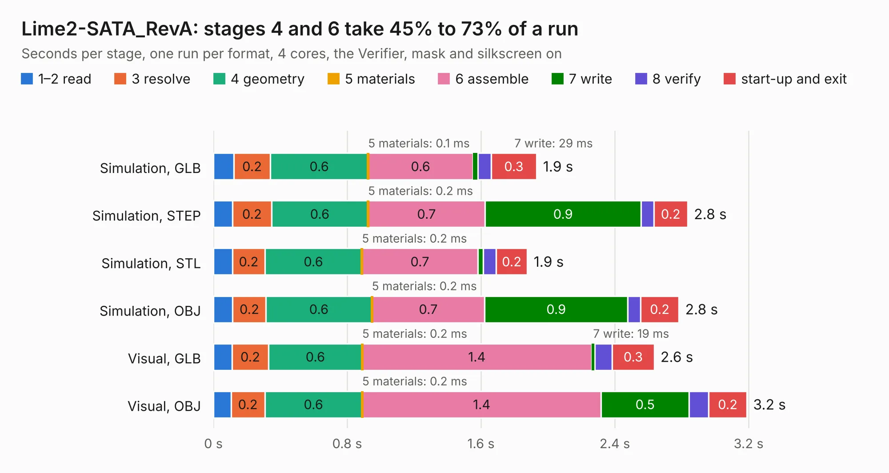

| Mode and format | 1–2 read | 3 resolve | 4 geometry | 5 materials | 6 assemble | 7 write | 8 verify | start-up and exit | Total |
|---|---:|---:|---:|---:|---:|---:|---:|---:|---:|
| Simulation, GLB | 0.1 | 0.2 | 0.6 | 0.1&nbsp;ms | 0.6 | 29&nbsp;ms | 78&nbsp;ms | 0.3 | 1.9 |
| Simulation, STEP | 0.1 | 0.2 | 0.6 | 0.2&nbsp;ms | 0.7 | 0.9 | 76&nbsp;ms | 0.2 | 2.8 |
| Simulation, STL | 0.1 | 0.2 | 0.6 | 0.2&nbsp;ms | 0.7 | 33&nbsp;ms | 77&nbsp;ms | 0.2 | 1.9 |
| Simulation, OBJ | 0.1 | 0.2 | 0.6 | 0.2&nbsp;ms | 0.7 | 0.9 | 77&nbsp;ms | 0.2 | 2.8 |
| Visual, GLB | 0.1 | 0.2 | 0.6 | 0.2&nbsp;ms | 1.4 | 19&nbsp;ms | 0.1 | 0.3 | 2.6 |
| Visual, OBJ | 0.1 | 0.2 | 0.6 | 0.2&nbsp;ms | 1.4 | 0.5 | 0.1 | 0.2 | 3.2 |

<table align="center"><tr><td valign="top">

| Board | Repo: [OLIMEX/OLINUXINO](https://github.com/OLIMEX/OLINUXINO) Board: `Lime2-SATA_RevA.kicad_pcb` |
|---|---|
| Folder | HARDWARE / Lime2-SATA / Lime2-SATA_RevA |
| Complexity | 194&nbsp;/&nbsp;1000 (size&nbsp;109, features&nbsp;85) |
| KESE&nbsp;features | through vias, slotted holes, filled zones, curved board outline, stack-up, dielectric εr and tanδ |
| Tested | 9th November 2026 |
| Copper&nbsp;layers | 2 |
| File&nbsp;format | KiCad 6 (20190905) |
| Parts,&nbsp;tracks,&nbsp;vias | 3, 75, 12 |
| Triangles,&nbsp;simulation | 137,156 in 24 parts |
| Verifier | PASS in all six runs |

</td><td valign="top">

<table>
<tr><th>File type</th><th>File size</th><th>Peak memory used</th></tr>
<tr><th colspan="3" align="left">Simulation</th></tr>
<tr><td>GLB</td><td align="right">4.9&nbsp;MB</td><td align="right">197&nbsp;MB</td></tr>
<tr><td>STEP</td><td align="right">24&nbsp;MB</td><td align="right">201&nbsp;MB</td></tr>
<tr><td>STL</td><td align="right">6.9&nbsp;MB</td><td align="right">197&nbsp;MB</td></tr>
<tr><td>OBJ</td><td align="right">14&nbsp;MB</td><td align="right">192&nbsp;MB</td></tr>
<tr><th colspan="3" align="left">Visual</th></tr>
<tr><td>GLB</td><td align="right">3.6&nbsp;MB</td><td align="right">159&nbsp;MB</td></tr>
<tr><td>OBJ</td><td align="right">10&nbsp;MB</td><td align="right">161&nbsp;MB</td></tr>
</table>

</td></tr></table>

## 1960. STMP157-OLinuXino-LIME2_Rev_B1

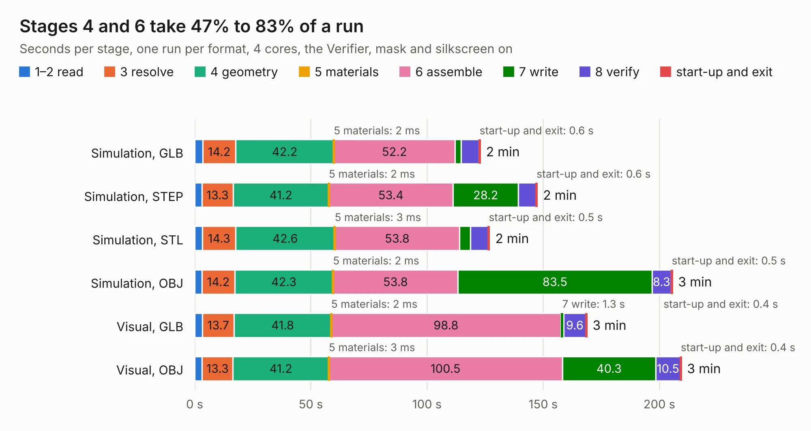

| Mode and format | 1–2 read | 3 resolve | 4 geometry | 5 materials | 6 assemble | 7 write | 8 verify | start-up and exit | Total |
|---|---:|---:|---:|---:|---:|---:|---:|---:|---:|
| Simulation, GLB | 3.5 | 14.2 | 42.2 | 2&nbsp;ms | 52.2 | 2.5 | 7.7 | 0.6 | 122.9 |
| Simulation, STEP | 3.2 | 13.3 | 41.2 | 2&nbsp;ms | 53.4 | 28.2 | 7.5 | 0.6 | 147.5 |
| Simulation, STL | 3.4 | 14.3 | 42.6 | 3&nbsp;ms | 53.8 | 4.7 | 7.6 | 0.5 | 126.9 |
| Simulation, OBJ | 3.1 | 14.2 | 42.3 | 2&nbsp;ms | 53.8 | 83.5 | 8.3 | 0.5 | 205.6 |
| Visual, GLB | 3.3 | 13.7 | 41.8 | 2&nbsp;ms | 98.8 | 1.3 | 9.6 | 0.4 | 168.8 |
| Visual, OBJ | 3.2 | 13.3 | 41.2 | 3&nbsp;ms | 100.5 | 40.3 | 10.5 | 0.4 | 209.4 |

<table align="center"><tr><td valign="top">

| Board | Repo: [OLIMEX/OLINUXINO](https://github.com/OLIMEX/OLINUXINO) Board: `STMP157-OLinuXino-LIME2_Rev_B1.kicad_pcb` |
|---|---|
| Folder | HARDWARE / STMP157-OLinuXino-LIME2 / 1. Latest hardware revision / STMP157-OLinuXino-LIME2_Rev_B1 |
| Complexity | 394&nbsp;/&nbsp;1000 (size&nbsp;339, features&nbsp;55) |
| KESE&nbsp;features | through vias, slotted holes, filled zones, copper text |
| Tested | 9th November 2026 |
| Copper&nbsp;layers | 8 |
| File&nbsp;format | KiCad 5 (20171130) |
| Parts,&nbsp;tracks,&nbsp;vias | 397, 12,688, 1,172 |
| Triangles,&nbsp;simulation | 13,053,034 in 494 parts |
| Verifier | PASS in all six runs |

</td><td valign="top">

<table>
<tr><th>File type</th><th>File size</th><th>Peak memory used</th></tr>
<tr><th colspan="3" align="left">Simulation</th></tr>
<tr><td>GLB</td><td align="right">452&nbsp;MB</td><td align="right">2.5&nbsp;GB</td></tr>
<tr><td>STEP</td><td align="right">1.6&nbsp;GB</td><td align="right">3.9&nbsp;GB</td></tr>
<tr><td>STL</td><td align="right">653&nbsp;MB</td><td align="right">2.7&nbsp;GB</td></tr>
<tr><td>OBJ</td><td align="right">1.5&nbsp;GB</td><td align="right">8.3&nbsp;GB</td></tr>
<tr><th colspan="3" align="left">Visual</th></tr>
<tr><td>GLB</td><td align="right">223&nbsp;MB</td><td align="right">3.5&nbsp;GB</td></tr>
<tr><td>OBJ</td><td align="right">740&nbsp;MB</td><td align="right">4.7&nbsp;GB</td></tr>
</table>

</td></tr></table>

## 1961. OSHW-GHOST_Rev_A

| Mode and format | 1–2 read | 3 resolve | 4 geometry | 5 materials | 6 assemble | 7 write | 8 verify | start-up and exit | Total |
|---|---:|---:|---:|---:|---:|---:|---:|---:|---:|
| Simulation, GLB | 0.2 | 0.3 | 1.0 | 0.2&nbsp;ms | 0.8 | 39&nbsp;ms | 0.1 | 0.2 | 2.7 |
| Simulation, STEP | 0.2 | 0.4 | 1.0 | 0.2&nbsp;ms | 0.9 | 1.0 | 0.1 | 0.2 | 3.7 |
| Simulation, STL | 0.2 | 0.4 | 1.0 | 0.3&nbsp;ms | 0.9 | 65&nbsp;ms | 0.1 | 0.2 | 2.8 |
| Simulation, OBJ | 0.1 | 0.4 | 0.9 | 0.1&nbsp;ms | 0.9 | 1.2 | 0.2 | 0.2 | 3.8 |
| Visual, GLB | 0.1 | 0.3 | 0.9 | 0.2&nbsp;ms | 2.2 | 35&nbsp;ms | 0.3 | 0.2 | 4.1 |
| Visual, OBJ | 0.2 | 0.4 | 0.9 | 0.2&nbsp;ms | 2.2 | 0.8 | 0.2 | 0.2 | 4.8 |

<table align="center"><tr><td valign="top">

| Board | Repo: [OLIMEX/OSHW-GHOST](https://github.com/OLIMEX/OSHW-GHOST) Board: `OSHW-GHOST_Rev_A.kicad_pcb` |
|---|---|
| Folder | HARDWARE / OSHW-GHOST_Rev_A |
| Complexity | 207&nbsp;/&nbsp;1000 (size&nbsp;142, features&nbsp;65) |
| KESE&nbsp;features | through vias, slotted holes, filled zones, copper text, curved board outline |
| Tested | 9th November 2026 |
| Copper&nbsp;layers | 2 |
| File&nbsp;format | KiCad 5 (20160815) |
| Parts,&nbsp;tracks,&nbsp;vias | 11, 235, 58 |
| Triangles,&nbsp;simulation | 251,538 in 22 parts |
| Verifier | PASS in all six runs |

</td><td valign="top">

<table>
<tr><th>File type</th><th>File size</th><th>Peak memory used</th></tr>
<tr><th colspan="3" align="left">Simulation</th></tr>
<tr><td>GLB</td><td align="right">8.8&nbsp;MB</td><td align="right">240&nbsp;MB</td></tr>
<tr><td>STEP</td><td align="right">46&nbsp;MB</td><td align="right">247&nbsp;MB</td></tr>
<tr><td>STL</td><td align="right">13&nbsp;MB</td><td align="right">245&nbsp;MB</td></tr>
<tr><td>OBJ</td><td align="right">25&nbsp;MB</td><td align="right">245&nbsp;MB</td></tr>
<tr><th colspan="3" align="left">Visual</th></tr>
<tr><td>GLB</td><td align="right">7.2&nbsp;MB</td><td align="right">214&nbsp;MB</td></tr>
<tr><td>OBJ</td><td align="right">21&nbsp;MB</td><td align="right">219&nbsp;MB</td></tr>
</table>

</td></tr></table>

## 1962. PICO-EVB_Rev_A

| Mode and format | 1–2 read | 3 resolve | 4 geometry | 5 materials | 6 assemble | 7 write | 8 verify | start-up and exit | Total |
|---|---:|---:|---:|---:|---:|---:|---:|---:|---:|
| Simulation, GLB | 0.6 | 1.8 | 7.3 | 0.4&nbsp;ms | 5.5 | 0.2 | 0.7 | 0.3 | 16.5 |
| Simulation, STEP | 0.6 | 1.9 | 8.0 | 0.5&nbsp;ms | 5.6 | 3.8 | 0.7 | 0.3 | 20.8 |
| Simulation, STL | 0.6 | 1.8 | 7.7 | 0.7&nbsp;ms | 5.8 | 0.7 | 0.8 | 0.2 | 17.5 |
| Simulation, OBJ | 0.6 | 1.8 | 7.6 | 0.5&nbsp;ms | 5.5 | 7.5 | 0.7 | 0.3 | 23.9 |
| Visual, GLB | 0.4 | 1.7 | 7.7 | 0.4&nbsp;ms | 14.7 | 0.2 | 2.0 | 0.3 | 27.0 |
| Visual, OBJ | 0.6 | 1.8 | 8.2 | 0.6&nbsp;ms | 14.2 | 5.7 | 2.0 | 0.3 | 32.7 |

<table align="center"><tr><td valign="top">

| Board | Repo: [OLIMEX/PICO-EVB](https://github.com/OLIMEX/PICO-EVB) Board: `PICO-EVB_Rev_A.kicad_pcb` |
|---|---|
| Folder | HARDWARE / PICO-EVB_Rev_A |
| Complexity | 293&nbsp;/&nbsp;1000 (size&nbsp;188, features&nbsp;105) |
| KESE&nbsp;features | through vias, slotted holes, rounded, trapezoid or chamfered pads, filled zones, knockout text, stack-up, dielectric εr and tanδ, mask and silkscreen colours |
| Tested | 9th November 2026 |
| Copper&nbsp;layers | 2 |
| File&nbsp;format | KiCad 7 (20221018) |
| Parts,&nbsp;tracks,&nbsp;vias | 83, 1,237, 199 |
| Triangles,&nbsp;simulation | 1,497,342 in 110 parts |
| Verifier | PASS in all six runs |

</td><td valign="top">

<table>
<tr><th>File type</th><th>File size</th><th>Peak memory used</th></tr>
<tr><th colspan="3" align="left">Simulation</th></tr>
<tr><td>GLB</td><td align="right">53&nbsp;MB</td><td align="right">650&nbsp;MB</td></tr>
<tr><td>STEP</td><td align="right">277&nbsp;MB</td><td align="right">693&nbsp;MB</td></tr>
<tr><td>STL</td><td align="right">75&nbsp;MB</td><td align="right">657&nbsp;MB</td></tr>
<tr><td>OBJ</td><td align="right">159&nbsp;MB</td><td align="right">1.1&nbsp;GB</td></tr>
<tr><th colspan="3" align="left">Visual</th></tr>
<tr><td>GLB</td><td align="right">41&nbsp;MB</td><td align="right">783&nbsp;MB</td></tr>
<tr><td>OBJ</td><td align="right">124&nbsp;MB</td><td align="right">894&nbsp;MB</td></tr>
</table>

</td></tr></table>

## 1963. POEv3_Rev_A

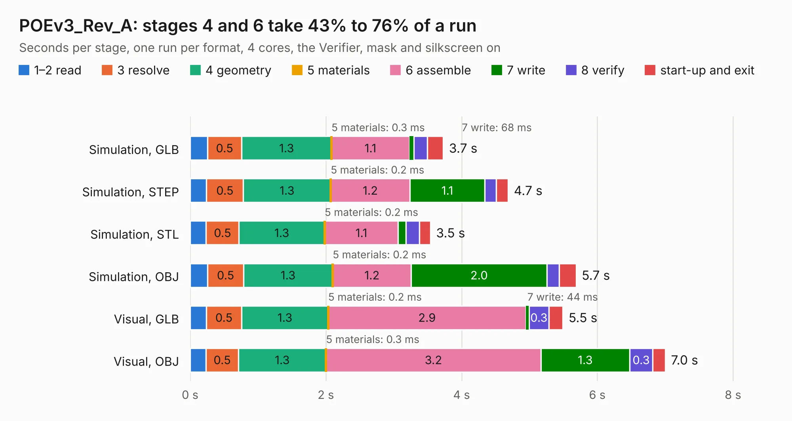

| Mode and format | 1–2 read | 3 resolve | 4 geometry | 5 materials | 6 assemble | 7 write | 8 verify | start-up and exit | Total |
|---|---:|---:|---:|---:|---:|---:|---:|---:|---:|
| Simulation, GLB | 0.3 | 0.5 | 1.3 | 0.3&nbsp;ms | 1.1 | 68&nbsp;ms | 0.2 | 0.2 | 3.7 |
| Simulation, STEP | 0.2 | 0.5 | 1.3 | 0.2&nbsp;ms | 1.2 | 1.1 | 0.2 | 0.2 | 4.7 |
| Simulation, STL | 0.2 | 0.5 | 1.3 | 0.2&nbsp;ms | 1.1 | 0.1 | 0.2 | 0.2 | 3.5 |
| Simulation, OBJ | 0.3 | 0.5 | 1.3 | 0.2&nbsp;ms | 1.2 | 2.0 | 0.2 | 0.3 | 5.7 |
| Visual, GLB | 0.2 | 0.5 | 1.3 | 0.2&nbsp;ms | 2.9 | 44&nbsp;ms | 0.3 | 0.2 | 5.5 |
| Visual, OBJ | 0.2 | 0.5 | 1.3 | 0.3&nbsp;ms | 3.2 | 1.3 | 0.3 | 0.2 | 7.0 |

<table align="center"><tr><td valign="top">

| Board | Repo: [OLIMEX/POEv3](https://github.com/OLIMEX/POEv3) Board: `POEv3_Rev_A.kicad_pcb` |
|---|---|
| Folder | Hardware / POEv3 hardware revision A |
| Complexity | 302&nbsp;/&nbsp;1000 (size&nbsp;192, features&nbsp;110) |
| KESE&nbsp;features | through vias, arc tracks, filled zones, copper text, knockout text, stack-up, dielectric εr and tanδ, mask and silkscreen colours |
| Tested | 9th November 2026 |
| Copper&nbsp;layers | 4 |
| File&nbsp;format | KiCad 7 (20221018) |
| Parts,&nbsp;tracks,&nbsp;vias | 24, 1,448, 145 |
| Triangles,&nbsp;simulation | 500,756 in 37 parts |
| Verifier | PASS in all six runs |

</td><td valign="top">

<table>
<tr><th>File type</th><th>File size</th><th>Peak memory used</th></tr>
<tr><th colspan="3" align="left">Simulation</th></tr>
<tr><td>GLB</td><td align="right">17&nbsp;MB</td><td align="right">297&nbsp;MB</td></tr>
<tr><td>STEP</td><td align="right">54&nbsp;MB</td><td align="right">306&nbsp;MB</td></tr>
<tr><td>STL</td><td align="right">25&nbsp;MB</td><td align="right">292&nbsp;MB</td></tr>
<tr><td>OBJ</td><td align="right">50&nbsp;MB</td><td align="right">380&nbsp;MB</td></tr>
<tr><th colspan="3" align="left">Visual</th></tr>
<tr><td>GLB</td><td align="right">11&nbsp;MB</td><td align="right">283&nbsp;MB</td></tr>
<tr><td>OBJ</td><td align="right">33&nbsp;MB</td><td align="right">302&nbsp;MB</td></tr>
</table>

</td></tr></table>

## 1964. RK3328-SOM-EVB_Rev_A

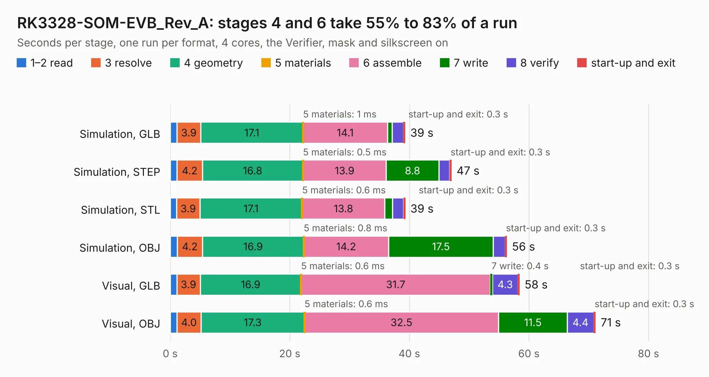

| Mode and format | 1–2 read | 3 resolve | 4 geometry | 5 materials | 6 assemble | 7 write | 8 verify | start-up and exit | Total |
|---|---:|---:|---:|---:|---:|---:|---:|---:|---:|
| Simulation, GLB | 1.2 | 3.9 | 17.1 | 1&nbsp;ms | 14.1 | 0.8 | 1.9 | 0.3 | 39.3 |
| Simulation, STEP | 1.2 | 4.2 | 16.8 | 0.5&nbsp;ms | 13.9 | 8.8 | 1.8 | 0.3 | 47.1 |
| Simulation, STL | 1.1 | 3.9 | 17.1 | 0.6&nbsp;ms | 13.8 | 1.3 | 1.9 | 0.3 | 39.3 |
| Simulation, OBJ | 1.2 | 4.2 | 16.9 | 0.8&nbsp;ms | 14.2 | 17.5 | 2.0 | 0.3 | 56.3 |
| Visual, GLB | 1.1 | 3.9 | 16.9 | 0.6&nbsp;ms | 31.7 | 0.4 | 4.3 | 0.3 | 58.4 |
| Visual, OBJ | 1.1 | 4.0 | 17.3 | 0.6&nbsp;ms | 32.5 | 11.5 | 4.4 | 0.3 | 71.2 |

<table align="center"><tr><td valign="top">

| Board | Repo: [OLIMEX/RK3328-SOM-EBV](https://github.com/OLIMEX/RK3328-SOM-EBV) Board: `RK3328-SOM-EVB_Rev_A.kicad_pcb` |
|---|---|
| Folder | HARDWARE / RK3328-SOM-EVB_Rev-A |
| Complexity | 319&nbsp;/&nbsp;1000 (size&nbsp;264, features&nbsp;55) |
| KESE&nbsp;features | through vias, slotted holes, filled zones, copper text |
| Tested | 9th November 2026 |
| Copper&nbsp;layers | 4 |
| File&nbsp;format | KiCad 5 (20171130) |
| Parts,&nbsp;tracks,&nbsp;vias | 129, 2,983, 520 |
| Triangles,&nbsp;simulation | 3,451,558 in 197 parts |
| Verifier | PASS in all six runs |

</td><td valign="top">

<table>
<tr><th>File type</th><th>File size</th><th>Peak memory used</th></tr>
<tr><th colspan="3" align="left">Simulation</th></tr>
<tr><td>GLB</td><td align="right">120&nbsp;MB</td><td align="right">1.1&nbsp;GB</td></tr>
<tr><td>STEP</td><td align="right">468&nbsp;MB</td><td align="right">1.4&nbsp;GB</td></tr>
<tr><td>STL</td><td align="right">173&nbsp;MB</td><td align="right">1.1&nbsp;GB</td></tr>
<tr><td>OBJ</td><td align="right">370&nbsp;MB</td><td align="right">2.3&nbsp;GB</td></tr>
<tr><th colspan="3" align="left">Visual</th></tr>
<tr><td>GLB</td><td align="right">75&nbsp;MB</td><td align="right">1.2&nbsp;GB</td></tr>
<tr><td>OBJ</td><td align="right">234&nbsp;MB</td><td align="right">1.6&nbsp;GB</td></tr>
</table>

</td></tr></table>

## 1965. RP2040-PICO-PC_rev_B

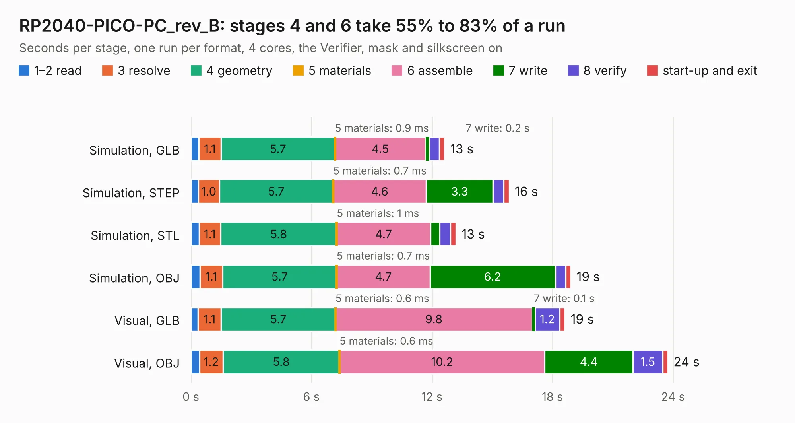

| Mode and format | 1–2 read | 3 resolve | 4 geometry | 5 materials | 6 assemble | 7 write | 8 verify | start-up and exit | Total |
|---|---:|---:|---:|---:|---:|---:|---:|---:|---:|
| Simulation, GLB | 0.4 | 1.1 | 5.7 | 0.9&nbsp;ms | 4.5 | 0.2 | 0.5 | 0.3 | 12.6 |
| Simulation, STEP | 0.4 | 1.0 | 5.7 | 0.7&nbsp;ms | 4.6 | 3.3 | 0.5 | 0.3 | 15.8 |
| Simulation, STL | 0.4 | 1.1 | 5.8 | 1&nbsp;ms | 4.7 | 0.5 | 0.5 | 0.3 | 13.2 |
| Simulation, OBJ | 0.5 | 1.1 | 5.7 | 0.7&nbsp;ms | 4.7 | 6.2 | 0.5 | 0.3 | 18.9 |
| Visual, GLB | 0.4 | 1.1 | 5.7 | 0.6&nbsp;ms | 9.8 | 0.1 | 1.2 | 0.3 | 18.6 |
| Visual, OBJ | 0.4 | 1.2 | 5.8 | 0.6&nbsp;ms | 10.2 | 4.4 | 1.5 | 0.3 | 23.7 |

<table align="center"><tr><td valign="top">

| Board | Repo: [OLIMEX/RP2040-PICO-PC](https://github.com/OLIMEX/RP2040-PICO-PC) Board: `RP2040-PICO-PC_rev_B.kicad_pcb` |
|---|---|
| Folder | HARDWARE / RP2040-PICO-PC hardware revision B |
| Complexity | 219&nbsp;/&nbsp;1000 (size&nbsp;174, features&nbsp;45) |
| KESE&nbsp;features | through vias, slotted holes, filled zones |
| Tested | 9th November 2026 |
| Copper&nbsp;layers | 2 |
| File&nbsp;format | KiCad 5 (20171130) |
| Parts,&nbsp;tracks,&nbsp;vias | 57, 750, 86 |
| Triangles,&nbsp;simulation | 1,166,386 in 83 parts |
| Verifier | PASS in all six runs |

</td><td valign="top">

<table>
<tr><th>File type</th><th>File size</th><th>Peak memory used</th></tr>
<tr><th colspan="3" align="left">Simulation</th></tr>
<tr><td>GLB</td><td align="right">41&nbsp;MB</td><td align="right">506&nbsp;MB</td></tr>
<tr><td>STEP</td><td align="right">211&nbsp;MB</td><td align="right">562&nbsp;MB</td></tr>
<tr><td>STL</td><td align="right">58&nbsp;MB</td><td align="right">487&nbsp;MB</td></tr>
<tr><td>OBJ</td><td align="right">121&nbsp;MB</td><td align="right">807&nbsp;MB</td></tr>
<tr><th colspan="3" align="left">Visual</th></tr>
<tr><td>GLB</td><td align="right">30&nbsp;MB</td><td align="right">612&nbsp;MB</td></tr>
<tr><td>OBJ</td><td align="right">90&nbsp;MB</td><td align="right">699&nbsp;MB</td></tr>
</table>

</td></tr></table>

## 1966. RP2040-PICO-PC_rev_C

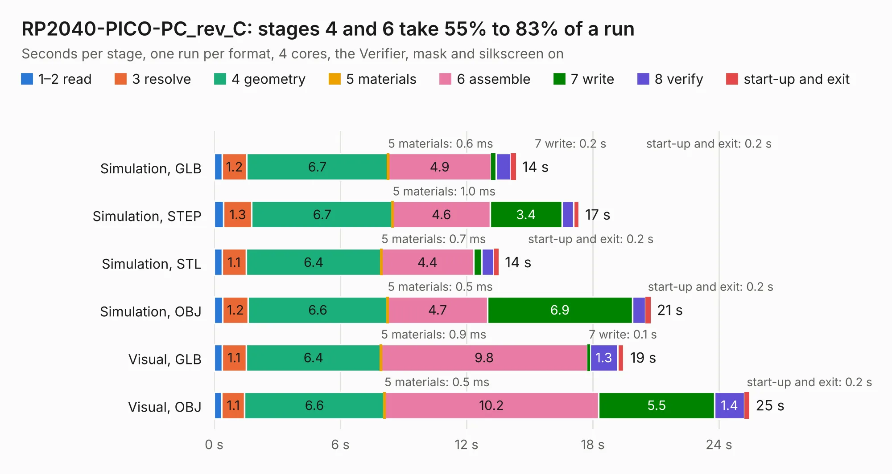

| Mode and format | 1–2 read | 3 resolve | 4 geometry | 5 materials | 6 assemble | 7 write | 8 verify | start-up and exit | Total |
|---|---:|---:|---:|---:|---:|---:|---:|---:|---:|
| Simulation, GLB | 0.4 | 1.2 | 6.7 | 0.6&nbsp;ms | 4.9 | 0.2 | 0.7 | 0.2 | 14.3 |
| Simulation, STEP | 0.5 | 1.3 | 6.7 | 1.0&nbsp;ms | 4.6 | 3.4 | 0.5 | 0.3 | 17.3 |
| Simulation, STL | 0.4 | 1.1 | 6.4 | 0.7&nbsp;ms | 4.4 | 0.4 | 0.6 | 0.2 | 13.5 |
| Simulation, OBJ | 0.4 | 1.2 | 6.6 | 0.5&nbsp;ms | 4.7 | 6.9 | 0.6 | 0.2 | 20.7 |
| Visual, GLB | 0.4 | 1.1 | 6.4 | 0.9&nbsp;ms | 9.8 | 0.1 | 1.3 | 0.3 | 19.5 |
| Visual, OBJ | 0.4 | 1.1 | 6.6 | 0.5&nbsp;ms | 10.2 | 5.5 | 1.4 | 0.2 | 25.4 |

<table align="center"><tr><td valign="top">

| Board | Repo: [OLIMEX/RP2040-PICO-PC](https://github.com/OLIMEX/RP2040-PICO-PC) Board: `RP2040-PICO-PC_rev_C.kicad_pcb` |
|---|---|
| Folder | HARDWARE / RP2040-PICO-PC hardware revision C |
| Complexity | 223&nbsp;/&nbsp;1000 (size&nbsp;178, features&nbsp;45) |
| KESE&nbsp;features | through vias, slotted holes, filled zones |
| Tested | 9th November 2026 |
| Copper&nbsp;layers | 2 |
| File&nbsp;format | KiCad 5 (20171130) |
| Parts,&nbsp;tracks,&nbsp;vias | 61, 893, 105 |
| Triangles,&nbsp;simulation | 1,135,846 in 85 parts |
| Verifier | PASS in all six runs |

</td><td valign="top">

<table>
<tr><th>File type</th><th>File size</th><th>Peak memory used</th></tr>
<tr><th colspan="3" align="left">Simulation</th></tr>
<tr><td>GLB</td><td align="right">40&nbsp;MB</td><td align="right">513&nbsp;MB</td></tr>
<tr><td>STEP</td><td align="right">201&nbsp;MB</td><td align="right">565&nbsp;MB</td></tr>
<tr><td>STL</td><td align="right">57&nbsp;MB</td><td align="right">511&nbsp;MB</td></tr>
<tr><td>OBJ</td><td align="right">118&nbsp;MB</td><td align="right">815&nbsp;MB</td></tr>
<tr><th colspan="3" align="left">Visual</th></tr>
<tr><td>GLB</td><td align="right">29&nbsp;MB</td><td align="right">635&nbsp;MB</td></tr>
<tr><td>OBJ</td><td align="right">87&nbsp;MB</td><td align="right">669&nbsp;MB</td></tr>
</table>

</td></tr></table>

## 1967. RP2040-PICO-PC_rev_D

| Mode and format | 1–2 read | 3 resolve | 4 geometry | 5 materials | 6 assemble | 7 write | 8 verify | start-up and exit | Total |
|---|---:|---:|---:|---:|---:|---:|---:|---:|---:|
| Simulation, GLB | 0.4 | 1.2 | 6.4 | 0.5&nbsp;ms | 4.4 | 0.2 | 0.5 | 0.3 | 13.3 |
| Simulation, STEP | 0.4 | 1.2 | 6.3 | 1.0&nbsp;ms | 4.3 | 3.3 | 0.6 | 0.2 | 16.4 |
| Simulation, STL | 0.3 | 1.2 | 6.3 | 0.8&nbsp;ms | 4.4 | 0.3 | 0.6 | 0.3 | 13.4 |
| Simulation, OBJ | 0.4 | 1.0 | 6.5 | 0.5&nbsp;ms | 4.5 | 6.5 | 0.6 | 0.3 | 19.7 |
| Visual, GLB | 0.4 | 1.1 | 6.2 | 0.6&nbsp;ms | 9.9 | 0.1 | 1.1 | 0.2 | 19.1 |
| Visual, OBJ | 0.4 | 1.1 | 6.3 | 0.8&nbsp;ms | 9.4 | 5.0 | 1.1 | 0.2 | 23.5 |

<table align="center"><tr><td valign="top">

| Board | Repo: [OLIMEX/RP2040-PICO-PC](https://github.com/OLIMEX/RP2040-PICO-PC) Board: `RP2040-PICO-PC_rev_D.kicad_pcb` |
|---|---|
| Folder | HARDWARE / RP2040-PICO-PC hardware revision D |
| Complexity | 224&nbsp;/&nbsp;1000 (size&nbsp;179, features&nbsp;45) |
| KESE&nbsp;features | through vias, slotted holes, filled zones |
| Tested | 9th November 2026 |
| Copper&nbsp;layers | 2 |
| File&nbsp;format | KiCad 5 (20171130) |
| Parts,&nbsp;tracks,&nbsp;vias | 61, 934, 110 |
| Triangles,&nbsp;simulation | 1,133,746 in 85 parts |
| Verifier | PASS in all six runs |

</td><td valign="top">

<table>
<tr><th>File type</th><th>File size</th><th>Peak memory used</th></tr>
<tr><th colspan="3" align="left">Simulation</th></tr>
<tr><td>GLB</td><td align="right">40&nbsp;MB</td><td align="right">499&nbsp;MB</td></tr>
<tr><td>STEP</td><td align="right">201&nbsp;MB</td><td align="right">598&nbsp;MB</td></tr>
<tr><td>STL</td><td align="right">57&nbsp;MB</td><td align="right">489&nbsp;MB</td></tr>
<tr><td>OBJ</td><td align="right">118&nbsp;MB</td><td align="right">811&nbsp;MB</td></tr>
<tr><th colspan="3" align="left">Visual</th></tr>
<tr><td>GLB</td><td align="right">29&nbsp;MB</td><td align="right">681&nbsp;MB</td></tr>
<tr><td>OBJ</td><td align="right">88&nbsp;MB</td><td align="right">694&nbsp;MB</td></tr>
</table>

</td></tr></table>

## 1968. RP2040-PICO30_Rev_A

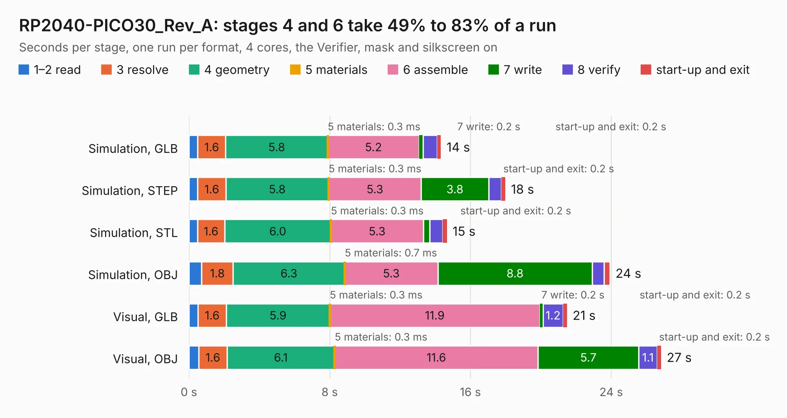

| Mode and format | 1–2 read | 3 resolve | 4 geometry | 5 materials | 6 assemble | 7 write | 8 verify | start-up and exit | Total |
|---|---:|---:|---:|---:|---:|---:|---:|---:|---:|
| Simulation, GLB | 0.5 | 1.6 | 5.8 | 0.3&nbsp;ms | 5.2 | 0.2 | 0.8 | 0.2 | 14.3 |
| Simulation, STEP | 0.5 | 1.6 | 5.8 | 0.3&nbsp;ms | 5.3 | 3.8 | 0.7 | 0.2 | 18.0 |
| Simulation, STL | 0.5 | 1.6 | 6.0 | 0.3&nbsp;ms | 5.3 | 0.4 | 0.7 | 0.2 | 14.7 |
| Simulation, OBJ | 0.7 | 1.8 | 6.3 | 0.7&nbsp;ms | 5.3 | 8.8 | 0.7 | 0.3 | 23.9 |
| Visual, GLB | 0.5 | 1.6 | 5.9 | 0.3&nbsp;ms | 11.9 | 0.2 | 1.2 | 0.2 | 21.5 |
| Visual, OBJ | 0.6 | 1.6 | 6.1 | 0.3&nbsp;ms | 11.6 | 5.7 | 1.1 | 0.2 | 26.8 |

<table align="center"><tr><td valign="top">

| Board | Repo: [OLIMEX/RP2040-PICO30](https://github.com/OLIMEX/RP2040-PICO30) Board: `RP2040-PICO30_Rev_A.kicad_pcb` |
|---|---|
| Folder | HARDWARE / RP2040-PICO30_Rev_A |
| Complexity | 296&nbsp;/&nbsp;1000 (size&nbsp;241, features&nbsp;55) |
| KESE&nbsp;features | through vias, slotted holes, filled zones, copper text |
| Tested | 9th November 2026 |
| Copper&nbsp;layers | 4 |
| File&nbsp;format | KiCad 5 (20171130) |
| Parts,&nbsp;tracks,&nbsp;vias | 53, 1,623, 105 |
| Triangles,&nbsp;simulation | 1,415,004 in 82 parts |
| Verifier | PASS in all six runs |

</td><td valign="top">

<table>
<tr><th>File type</th><th>File size</th><th>Peak memory used</th></tr>
<tr><th colspan="3" align="left">Simulation</th></tr>
<tr><td>GLB</td><td align="right">50&nbsp;MB</td><td align="right">492&nbsp;MB</td></tr>
<tr><td>STEP</td><td align="right">237&nbsp;MB</td><td align="right">626&nbsp;MB</td></tr>
<tr><td>STL</td><td align="right">71&nbsp;MB</td><td align="right">501&nbsp;MB</td></tr>
<tr><td>OBJ</td><td align="right">151&nbsp;MB</td><td align="right">981&nbsp;MB</td></tr>
<tr><th colspan="3" align="left">Visual</th></tr>
<tr><td>GLB</td><td align="right">32&nbsp;MB</td><td align="right">637&nbsp;MB</td></tr>
<tr><td>OBJ</td><td align="right">95&nbsp;MB</td><td align="right">766&nbsp;MB</td></tr>
</table>

</td></tr></table>

## 1969. RP2040pc_Rev_B

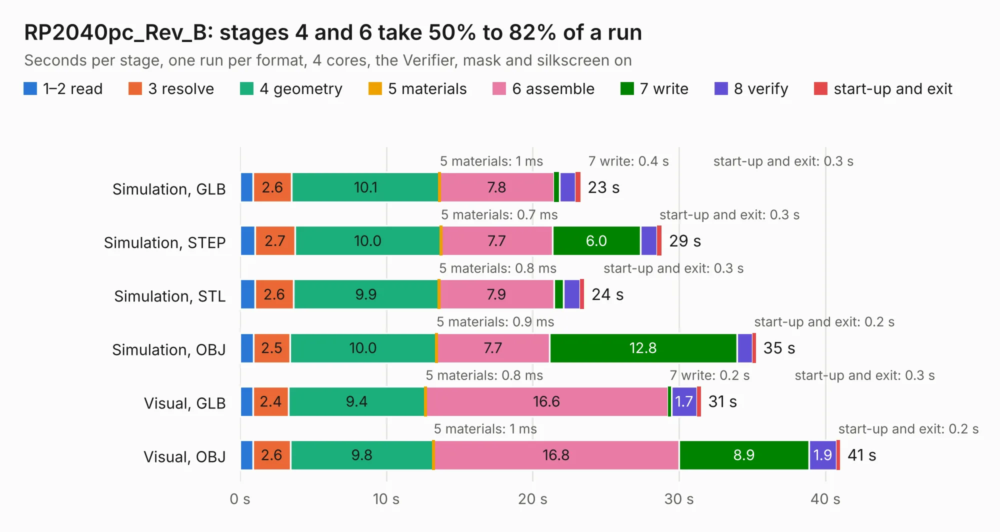

| Mode and format | 1–2 read | 3 resolve | 4 geometry | 5 materials | 6 assemble | 7 write | 8 verify | start-up and exit | Total |
|---|---:|---:|---:|---:|---:|---:|---:|---:|---:|
| Simulation, GLB | 0.9 | 2.6 | 10.1 | 1&nbsp;ms | 7.8 | 0.4 | 1.1 | 0.3 | 23.3 |
| Simulation, STEP | 1.0 | 2.7 | 10.0 | 0.7&nbsp;ms | 7.7 | 6.0 | 1.1 | 0.3 | 28.8 |
| Simulation, STL | 1.0 | 2.6 | 9.9 | 0.8&nbsp;ms | 7.9 | 0.7 | 1.1 | 0.3 | 23.5 |
| Simulation, OBJ | 0.9 | 2.5 | 10.0 | 0.9&nbsp;ms | 7.7 | 12.8 | 1.1 | 0.2 | 35.2 |
| Visual, GLB | 0.9 | 2.4 | 9.4 | 0.8&nbsp;ms | 16.6 | 0.2 | 1.7 | 0.3 | 31.5 |
| Visual, OBJ | 0.9 | 2.6 | 9.8 | 1&nbsp;ms | 16.8 | 8.9 | 1.9 | 0.2 | 41.0 |

<table align="center"><tr><td valign="top">

| Board | Repo: [OLIMEX/RP2040pc](https://github.com/OLIMEX/RP2040pc) Board: `RP2040pc_Rev_B.kicad_pcb` |
|---|---|
| Folder | HARDWARE / RP2040pc-REV.B |
| Complexity | 372&nbsp;/&nbsp;1000 (size&nbsp;257, features&nbsp;115) |
| KESE&nbsp;features | through vias, slotted holes, rounded, trapezoid or chamfered pads, filled zones, copper text, knockout text, stack-up, dielectric εr and tanδ, mask and silkscreen colours |
| Tested | 9th November 2026 |
| Copper&nbsp;layers | 4 |
| File&nbsp;format | KiCad 7 (20221018) |
| Parts,&nbsp;tracks,&nbsp;vias | 142, 2,121, 239 |
| Triangles,&nbsp;simulation | 2,204,422 in 150 parts |
| Verifier | PASS in all six runs |

</td><td valign="top">

<table>
<tr><th>File type</th><th>File size</th><th>Peak memory used</th></tr>
<tr><th colspan="3" align="left">Simulation</th></tr>
<tr><td>GLB</td><td align="right">78&nbsp;MB</td><td align="right">837&nbsp;MB</td></tr>
<tr><td>STEP</td><td align="right">379&nbsp;MB</td><td align="right">957&nbsp;MB</td></tr>
<tr><td>STL</td><td align="right">110&nbsp;MB</td><td align="right">820&nbsp;MB</td></tr>
<tr><td>OBJ</td><td align="right">238&nbsp;MB</td><td align="right">1.6&nbsp;GB</td></tr>
<tr><th colspan="3" align="left">Visual</th></tr>
<tr><td>GLB</td><td align="right">54&nbsp;MB</td><td align="right">958&nbsp;MB</td></tr>
<tr><td>OBJ</td><td align="right">165&nbsp;MB</td><td align="right">1.2&nbsp;GB</td></tr>
</table>

</td></tr></table>

## 1970. PICO2-BB48_Rev_A

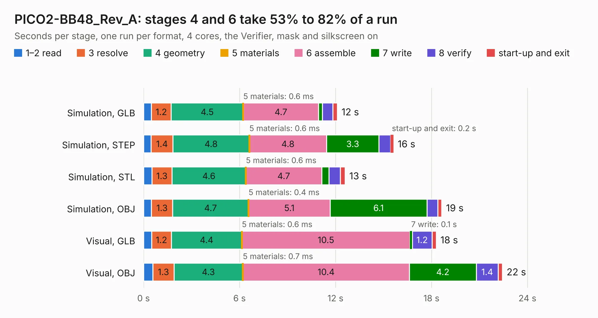

| Mode and format | 1–2 read | 3 resolve | 4 geometry | 5 materials | 6 assemble | 7 write | 8 verify | start-up and exit | Total |
|---|---:|---:|---:|---:|---:|---:|---:|---:|---:|
| Simulation, GLB | 0.5 | 1.2 | 4.5 | 0.6&nbsp;ms | 4.7 | 0.2 | 0.7 | 0.3 | 12.1 |
| Simulation, STEP | 0.5 | 1.4 | 4.8 | 0.6&nbsp;ms | 4.8 | 3.3 | 0.7 | 0.2 | 15.6 |
| Simulation, STL | 0.5 | 1.3 | 4.6 | 0.6&nbsp;ms | 4.7 | 0.5 | 0.7 | 0.3 | 12.6 |
| Simulation, OBJ | 0.5 | 1.3 | 4.7 | 0.4&nbsp;ms | 5.1 | 6.1 | 0.7 | 0.2 | 18.6 |
| Visual, GLB | 0.5 | 1.2 | 4.4 | 0.6&nbsp;ms | 10.5 | 0.1 | 1.2 | 0.3 | 18.3 |
| Visual, OBJ | 0.6 | 1.3 | 4.3 | 0.7&nbsp;ms | 10.4 | 4.2 | 1.4 | 0.3 | 22.4 |

<table align="center"><tr><td valign="top">

| Board | Repo: [OLIMEX/RP2350-PICO2-BB48](https://github.com/OLIMEX/RP2350-PICO2-BB48) Board: `PICO2-BB48_Rev_A.kicad_pcb` |
|---|---|
| Folder | HARDWARE / RP2350-PICO2-BB48.REV.A |
| Complexity | 348&nbsp;/&nbsp;1000 (size&nbsp;243, features&nbsp;105) |
| KESE&nbsp;features | through vias, slotted holes, filled zones, copper text, knockout text, stack-up, dielectric εr and tanδ, mask and silkscreen colours |
| Tested | 9th November 2026 |
| Copper&nbsp;layers | 4 |
| File&nbsp;format | KiCad 7 (20221018) |
| Parts,&nbsp;tracks,&nbsp;vias | 72, 1,486, 126 |
| Triangles,&nbsp;simulation | 1,477,790 in 109 parts |
| Verifier | PASS in all six runs |

</td><td valign="top">

<table>
<tr><th>File type</th><th>File size</th><th>Peak memory used</th></tr>
<tr><th colspan="3" align="left">Simulation</th></tr>
<tr><td>GLB</td><td align="right">52&nbsp;MB</td><td align="right">548&nbsp;MB</td></tr>
<tr><td>STEP</td><td align="right">255&nbsp;MB</td><td align="right">660&nbsp;MB</td></tr>
<tr><td>STL</td><td align="right">74&nbsp;MB</td><td align="right">517&nbsp;MB</td></tr>
<tr><td>OBJ</td><td align="right">157&nbsp;MB</td><td align="right">1.0&nbsp;GB</td></tr>
<tr><th colspan="3" align="left">Visual</th></tr>
<tr><td>GLB</td><td align="right">34&nbsp;MB</td><td align="right">742&nbsp;MB</td></tr>
<tr><td>OBJ</td><td align="right">104&nbsp;MB</td><td align="right">767&nbsp;MB</td></tr>
</table>

</td></tr></table>

## 1971. RP2350-PICO2-XXL_Rev_A

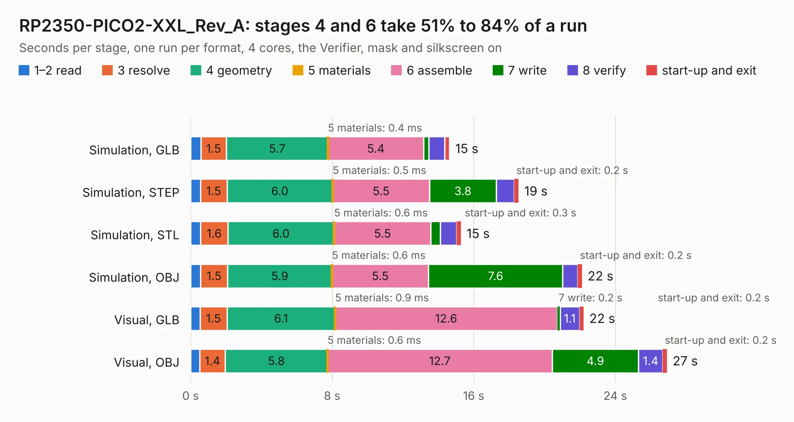

| Mode and format | 1–2 read | 3 resolve | 4 geometry | 5 materials | 6 assemble | 7 write | 8 verify | start-up and exit | Total |
|---|---:|---:|---:|---:|---:|---:|---:|---:|---:|
| Simulation, GLB | 0.6 | 1.5 | 5.7 | 0.4&nbsp;ms | 5.4 | 0.3 | 0.9 | 0.3 | 14.6 |
| Simulation, STEP | 0.6 | 1.5 | 6.0 | 0.5&nbsp;ms | 5.5 | 3.8 | 1.0 | 0.2 | 18.5 |
| Simulation, STL | 0.6 | 1.6 | 6.0 | 0.6&nbsp;ms | 5.5 | 0.5 | 0.9 | 0.3 | 15.3 |
| Simulation, OBJ | 0.6 | 1.5 | 5.9 | 0.6&nbsp;ms | 5.5 | 7.6 | 0.9 | 0.2 | 22.1 |
| Visual, GLB | 0.5 | 1.5 | 6.1 | 0.9&nbsp;ms | 12.6 | 0.2 | 1.1 | 0.2 | 22.2 |
| Visual, OBJ | 0.5 | 1.4 | 5.8 | 0.6&nbsp;ms | 12.7 | 4.9 | 1.4 | 0.2 | 26.9 |

<table align="center"><tr><td valign="top">

| Board | Repo: [OLIMEX/RP2350-PICO2-XXL](https://github.com/OLIMEX/RP2350-PICO2-XXL) Board: `RP2350-PICO2-XXL_Rev_A.kicad_pcb` |
|---|---|
| Folder | HARDWARE / RP2350-PICO2-XXL-Rev.A |
| Complexity | 372&nbsp;/&nbsp;1000 (size&nbsp;252, features&nbsp;120) |
| KESE&nbsp;features | through vias, slotted holes, arc tracks, filled zones, copper text, knockout text, stack-up, dielectric εr and tanδ, mask and silkscreen colours |
| Tested | 9th November 2026 |
| Copper&nbsp;layers | 4 |
| File&nbsp;format | KiCad 7 (20221018) |
| Parts,&nbsp;tracks,&nbsp;vias | 72, 2,698, 164 |
| Triangles,&nbsp;simulation | 1,808,992 in 110 parts |
| Verifier | PASS in all six runs |

</td><td valign="top">

<table>
<tr><th>File type</th><th>File size</th><th>Peak memory used</th></tr>
<tr><th colspan="3" align="left">Simulation</th></tr>
<tr><td>GLB</td><td align="right">63&nbsp;MB</td><td align="right">577&nbsp;MB</td></tr>
<tr><td>STEP</td><td align="right">296&nbsp;MB</td><td align="right">743&nbsp;MB</td></tr>
<tr><td>STL</td><td align="right">90&nbsp;MB</td><td align="right">615&nbsp;MB</td></tr>
<tr><td>OBJ</td><td align="right">192&nbsp;MB</td><td align="right">1.3&nbsp;GB</td></tr>
<tr><th colspan="3" align="left">Visual</th></tr>
<tr><td>GLB</td><td align="right">40&nbsp;MB</td><td align="right">791&nbsp;MB</td></tr>
<tr><td>OBJ</td><td align="right">121&nbsp;MB</td><td align="right">935&nbsp;MB</td></tr>
</table>

</td></tr></table>

## 1972. RP2350-PICO2-XXL_Rev_B

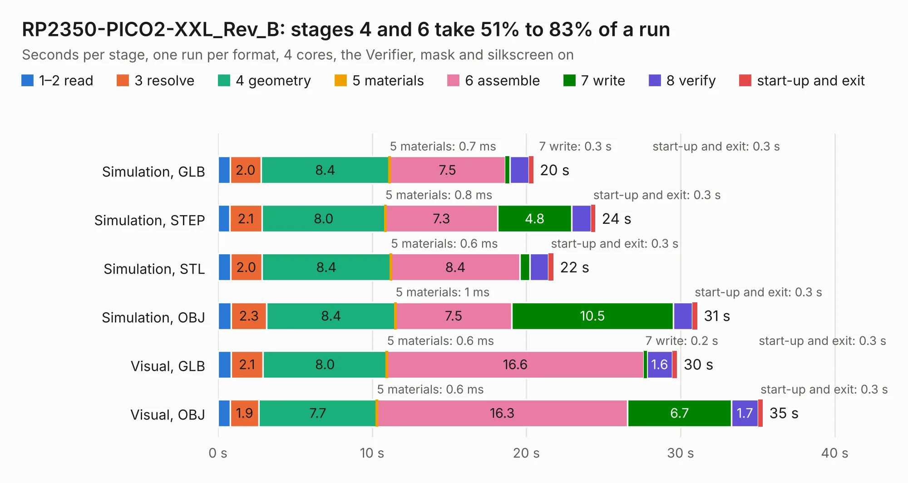

| Mode and format | 1–2 read | 3 resolve | 4 geometry | 5 materials | 6 assemble | 7 write | 8 verify | start-up and exit | Total |
|---|---:|---:|---:|---:|---:|---:|---:|---:|---:|
| Simulation, GLB | 0.8 | 2.0 | 8.4 | 0.7&nbsp;ms | 7.5 | 0.3 | 1.2 | 0.3 | 20.5 |
| Simulation, STEP | 0.8 | 2.1 | 8.0 | 0.8&nbsp;ms | 7.3 | 4.8 | 1.3 | 0.3 | 24.5 |
| Simulation, STL | 0.8 | 2.0 | 8.4 | 0.6&nbsp;ms | 8.4 | 0.6 | 1.2 | 0.3 | 21.8 |
| Simulation, OBJ | 0.9 | 2.3 | 8.4 | 1&nbsp;ms | 7.5 | 10.5 | 1.2 | 0.3 | 31.1 |
| Visual, GLB | 0.8 | 2.1 | 8.0 | 0.6&nbsp;ms | 16.6 | 0.2 | 1.6 | 0.3 | 29.8 |
| Visual, OBJ | 0.8 | 1.9 | 7.7 | 0.6&nbsp;ms | 16.3 | 6.7 | 1.7 | 0.3 | 35.3 |

<table align="center"><tr><td valign="top">

| Board | Repo: [OLIMEX/RP2350-PICO2-XXL](https://github.com/OLIMEX/RP2350-PICO2-XXL) Board: `RP2350-PICO2-XXL_Rev_B.kicad_pcb` |
|---|---|
| Folder | HARDWARE / RP2350-PICO2-XXL-Rev.B |
| Complexity | 372&nbsp;/&nbsp;1000 (size&nbsp;252, features&nbsp;120) |
| KESE&nbsp;features | through vias, slotted holes, arc tracks, filled zones, copper text, knockout text, stack-up, dielectric εr and tanδ, mask and silkscreen colours |
| Tested | 9th November 2026 |
| Copper&nbsp;layers | 4 |
| File&nbsp;format | KiCad 7 (20221018) |
| Parts,&nbsp;tracks,&nbsp;vias | 73, 2,738, 164 |
| Triangles,&nbsp;simulation | 1,815,236 in 110 parts |
| Verifier | PASS in all six runs |

</td><td valign="top">

<table>
<tr><th>File type</th><th>File size</th><th>Peak memory used</th></tr>
<tr><th colspan="3" align="left">Simulation</th></tr>
<tr><td>GLB</td><td align="right">64&nbsp;MB</td><td align="right">649&nbsp;MB</td></tr>
<tr><td>STEP</td><td align="right">299&nbsp;MB</td><td align="right">756&nbsp;MB</td></tr>
<tr><td>STL</td><td align="right">91&nbsp;MB</td><td align="right">594&nbsp;MB</td></tr>
<tr><td>OBJ</td><td align="right">193&nbsp;MB</td><td align="right">1.3&nbsp;GB</td></tr>
<tr><th colspan="3" align="left">Visual</th></tr>
<tr><td>GLB</td><td align="right">40&nbsp;MB</td><td align="right">758&nbsp;MB</td></tr>
<tr><td>OBJ</td><td align="right">122&nbsp;MB</td><td align="right">919&nbsp;MB</td></tr>
</table>

</td></tr></table>

## 1973. RP2350-PICO2-XXL_Rev_C

| Mode and format | 1–2 read | 3 resolve | 4 geometry | 5 materials | 6 assemble | 7 write | 8 verify | start-up and exit | Total |
|---|---:|---:|---:|---:|---:|---:|---:|---:|---:|
| Simulation, GLB | 0.7 | 1.6 | 5.9 | 0.9&nbsp;ms | 5.9 | 0.3 | 1.0 | 0.2 | 15.6 |
| Simulation, STEP | 0.6 | 1.5 | 5.9 | 0.6&nbsp;ms | 6.0 | 3.8 | 1.0 | 0.3 | 19.1 |
| Simulation, STL | 0.6 | 1.5 | 5.8 | 0.5&nbsp;ms | 6.2 | 0.6 | 1.0 | 0.2 | 15.9 |
| Simulation, OBJ | 0.5 | 1.5 | 6.1 | 0.8&nbsp;ms | 6.4 | 8.2 | 1.0 | 0.2 | 24.0 |
| Visual, GLB | 0.6 | 1.8 | 6.0 | 0.5&nbsp;ms | 13.9 | 0.2 | 1.6 | 0.3 | 24.3 |
| Visual, OBJ | 0.6 | 1.4 | 5.5 | 0.5&nbsp;ms | 14.2 | 4.9 | 1.9 | 0.2 | 28.7 |

<table align="center"><tr><td valign="top">

| Board | Repo: [OLIMEX/RP2350-PICO2-XXL](https://github.com/OLIMEX/RP2350-PICO2-XXL) Board: `RP2350-PICO2-XXL_Rev_C.kicad_pcb` |
|---|---|
| Folder | HARDWARE / RP2350-PICO2-XXL-Rev.C |
| Complexity | 358&nbsp;/&nbsp;1000 (size&nbsp;253, features&nbsp;105) |
| KESE&nbsp;features | through vias, slotted holes, filled zones, copper text, knockout text, stack-up, dielectric εr and tanδ, mask and silkscreen colours |
| Tested | 9th November 2026 |
| Copper&nbsp;layers | 4 |
| File&nbsp;format | KiCad 7 (20221018) |
| Parts,&nbsp;tracks,&nbsp;vias | 73, 2,912, 163 |
| Triangles,&nbsp;simulation | 1,868,782 in 110 parts |
| Verifier | PASS in all six runs |

</td><td valign="top">

<table>
<tr><th>File type</th><th>File size</th><th>Peak memory used</th></tr>
<tr><th colspan="3" align="left">Simulation</th></tr>
<tr><td>GLB</td><td align="right">65&nbsp;MB</td><td align="right">667&nbsp;MB</td></tr>
<tr><td>STEP</td><td align="right">313&nbsp;MB</td><td align="right">799&nbsp;MB</td></tr>
<tr><td>STL</td><td align="right">93&nbsp;MB</td><td align="right">638&nbsp;MB</td></tr>
<tr><td>OBJ</td><td align="right">199&nbsp;MB</td><td align="right">1.3&nbsp;GB</td></tr>
<tr><th colspan="3" align="left">Visual</th></tr>
<tr><td>GLB</td><td align="right">41&nbsp;MB</td><td align="right">773&nbsp;MB</td></tr>
<tr><td>OBJ</td><td align="right">125&nbsp;MB</td><td align="right">945&nbsp;MB</td></tr>
</table>

</td></tr></table>

## 1974. RP2350pc_Rev_A

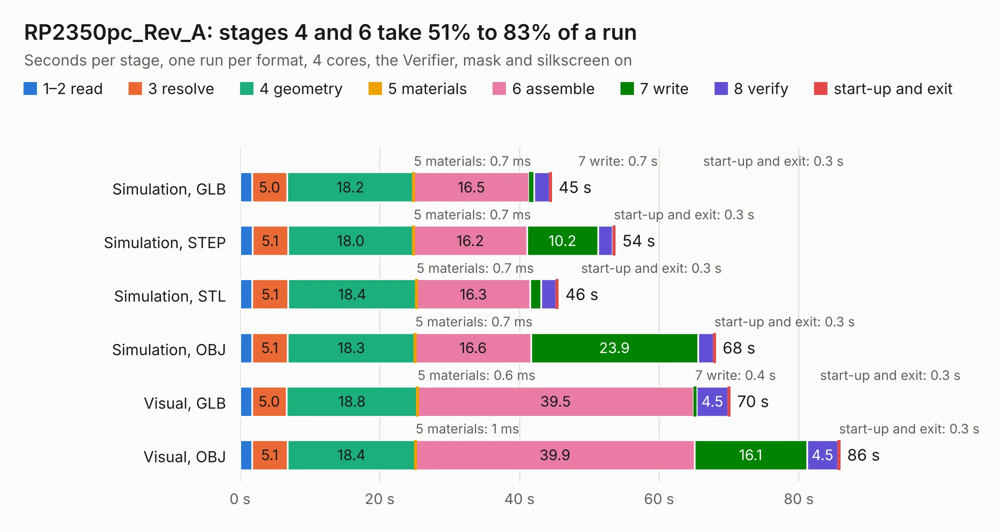

| Mode and format | 1–2 read | 3 resolve | 4 geometry | 5 materials | 6 assemble | 7 write | 8 verify | start-up and exit | Total |
|---|---:|---:|---:|---:|---:|---:|---:|---:|---:|
| Simulation, GLB | 1.7 | 5.0 | 18.2 | 0.7&nbsp;ms | 16.5 | 0.7 | 2.2 | 0.3 | 44.6 |
| Simulation, STEP | 1.8 | 5.1 | 18.0 | 0.7&nbsp;ms | 16.2 | 10.2 | 2.1 | 0.3 | 53.7 |
| Simulation, STL | 1.7 | 5.1 | 18.4 | 0.7&nbsp;ms | 16.3 | 1.5 | 2.2 | 0.3 | 45.5 |
| Simulation, OBJ | 1.7 | 5.1 | 18.3 | 0.7&nbsp;ms | 16.6 | 23.9 | 2.2 | 0.3 | 68.1 |
| Visual, GLB | 1.7 | 5.0 | 18.8 | 0.6&nbsp;ms | 39.5 | 0.4 | 4.5 | 0.3 | 70.2 |
| Visual, OBJ | 1.7 | 5.1 | 18.4 | 1&nbsp;ms | 39.9 | 16.1 | 4.5 | 0.3 | 85.9 |

<table align="center"><tr><td valign="top">

| Board | Repo: [OLIMEX/RP2350pc](https://github.com/OLIMEX/RP2350pc) Board: `RP2350pc_Rev_A.kicad_pcb` |
|---|---|
| Folder | HARDWARE / RP2350pc-Rev.A |
| Complexity | 401&nbsp;/&nbsp;1000 (size&nbsp;286, features&nbsp;115) |
| KESE&nbsp;features | through vias, slotted holes, rounded, trapezoid or chamfered pads, filled zones, copper text, knockout text, stack-up, dielectric εr and tanδ, mask and silkscreen colours |
| Tested | 9th November 2026 |
| Copper&nbsp;layers | 4 |
| File&nbsp;format | KiCad 7 (20221018) |
| Parts,&nbsp;tracks,&nbsp;vias | 270, 5,295, 601 |
| Triangles,&nbsp;simulation | 3,923,056 in 228 parts |
| Verifier | PASS in all six runs |

</td><td valign="top">

<table>
<tr><th>File type</th><th>File size</th><th>Peak memory used</th></tr>
<tr><th colspan="3" align="left">Simulation</th></tr>
<tr><td>GLB</td><td align="right">138&nbsp;MB</td><td align="right">1.2&nbsp;GB</td></tr>
<tr><td>STEP</td><td align="right">634&nbsp;MB</td><td align="right">1.6&nbsp;GB</td></tr>
<tr><td>STL</td><td align="right">196&nbsp;MB</td><td align="right">1.3&nbsp;GB</td></tr>
<tr><td>OBJ</td><td align="right">426&nbsp;MB</td><td align="right">2.7&nbsp;GB</td></tr>
<tr><th colspan="3" align="left">Visual</th></tr>
<tr><td>GLB</td><td align="right">92&nbsp;MB</td><td align="right">1.5&nbsp;GB</td></tr>
<tr><td>OBJ</td><td align="right">288&nbsp;MB</td><td align="right">2.0&nbsp;GB</td></tr>
</table>

</td></tr></table>

## 1975. RT1010Py_Rev.C

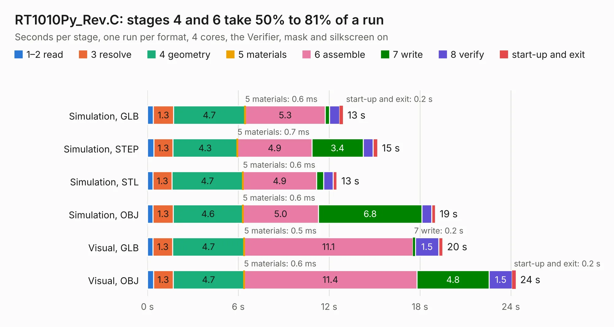

| Mode and format | 1–2 read | 3 resolve | 4 geometry | 5 materials | 6 assemble | 7 write | 8 verify | start-up and exit | Total |
|---|---:|---:|---:|---:|---:|---:|---:|---:|---:|
| Simulation, GLB | 0.4 | 1.3 | 4.7 | 0.6&nbsp;ms | 5.3 | 0.3 | 0.7 | 0.2 | 12.9 |
| Simulation, STEP | 0.4 | 1.3 | 4.3 | 0.7&nbsp;ms | 4.9 | 3.4 | 0.6 | 0.3 | 15.2 |
| Simulation, STL | 0.4 | 1.3 | 4.7 | 0.6&nbsp;ms | 4.9 | 0.5 | 0.6 | 0.3 | 12.5 |
| Simulation, OBJ | 0.4 | 1.3 | 4.6 | 0.6&nbsp;ms | 5.0 | 6.8 | 0.6 | 0.2 | 19.0 |
| Visual, GLB | 0.4 | 1.3 | 4.7 | 0.5&nbsp;ms | 11.1 | 0.2 | 1.5 | 0.3 | 19.5 |
| Visual, OBJ | 0.4 | 1.3 | 4.7 | 0.6&nbsp;ms | 11.4 | 4.8 | 1.5 | 0.2 | 24.3 |

<table align="center"><tr><td valign="top">

| Board | Repo: [OLIMEX/RT1010Py](https://github.com/OLIMEX/RT1010Py) Board: `RT1010Py_Rev.C.kicad_pcb` |
|---|---|
| Folder | HARDWARE / RT1010-Py-Rev-C |
| Complexity | 296&nbsp;/&nbsp;1000 (size&nbsp;241, features&nbsp;55) |
| KESE&nbsp;features | through vias, slotted holes, filled zones, copper text |
| Tested | 9th November 2026 |
| Copper&nbsp;layers | 4 |
| File&nbsp;format | KiCad 5 (20171130) |
| Parts,&nbsp;tracks,&nbsp;vias | 76, 1,222, 114 |
| Triangles,&nbsp;simulation | 1,389,960 in 101 parts |
| Verifier | PASS in all six runs |

</td><td valign="top">

<table>
<tr><th>File type</th><th>File size</th><th>Peak memory used</th></tr>
<tr><th colspan="3" align="left">Simulation</th></tr>
<tr><td>GLB</td><td align="right">49&nbsp;MB</td><td align="right">554&nbsp;MB</td></tr>
<tr><td>STEP</td><td align="right">232&nbsp;MB</td><td align="right">652&nbsp;MB</td></tr>
<tr><td>STL</td><td align="right">70&nbsp;MB</td><td align="right">518&nbsp;MB</td></tr>
<tr><td>OBJ</td><td align="right">146&nbsp;MB</td><td align="right">953&nbsp;MB</td></tr>
<tr><th colspan="3" align="left">Visual</th></tr>
<tr><td>GLB</td><td align="right">34&nbsp;MB</td><td align="right">709&nbsp;MB</td></tr>
<tr><td>OBJ</td><td align="right">103&nbsp;MB</td><td align="right">825&nbsp;MB</td></tr>
</table>

</td></tr></table>

## 1976. RT1010Py-DevKit_RevB

| Mode and format | 1–2 read | 3 resolve | 4 geometry | 5 materials | 6 assemble | 7 write | 8 verify | start-up and exit | Total |
|---|---:|---:|---:|---:|---:|---:|---:|---:|---:|
| Simulation, GLB | 0.3 | 1.3 | 5.7 | 0.8&nbsp;ms | 4.5 | 0.2 | 0.6 | 0.3 | 12.9 |
| Simulation, STEP | 0.4 | 1.3 | 5.5 | 1&nbsp;ms | 4.6 | 3.5 | 0.6 | 0.2 | 16.1 |
| Simulation, STL | 0.3 | 1.2 | 5.9 | 1&nbsp;ms | 4.8 | 0.4 | 0.6 | 0.3 | 13.5 |
| Simulation, OBJ | 0.3 | 1.2 | 5.9 | 0.7&nbsp;ms | 4.5 | 6.3 | 0.6 | 0.3 | 19.0 |
| Visual, GLB | 0.3 | 1.1 | 5.3 | 0.8&nbsp;ms | 10.9 | 0.2 | 1.3 | 0.3 | 19.4 |
| Visual, OBJ | 0.3 | 1.2 | 5.5 | 0.8&nbsp;ms | 11.6 | 4.7 | 1.6 | 0.3 | 25.2 |

<table align="center"><tr><td valign="top">

| Board | Repo: [OLIMEX/RT1010Py-DevKit](https://github.com/OLIMEX/RT1010Py-DevKit) Board: `RT1010Py-DevKit_RevB.kicad_pcb` |
|---|---|
| Folder | HARDWARE / RT1010Py-DevKit-B |
| Complexity | 231&nbsp;/&nbsp;1000 (size&nbsp;176, features&nbsp;55) |
| KESE&nbsp;features | through vias, slotted holes, rounded, trapezoid or chamfered pads, filled zones |
| Tested | 9th November 2026 |
| Copper&nbsp;layers | 2 |
| File&nbsp;format | KiCad 5 (20171130) |
| Parts,&nbsp;tracks,&nbsp;vias | 38, 1,028, 140 |
| Triangles,&nbsp;simulation | 1,252,158 in 74 parts |
| Verifier | PASS in all six runs |

</td><td valign="top">

<table>
<tr><th>File type</th><th>File size</th><th>Peak memory used</th></tr>
<tr><th colspan="3" align="left">Simulation</th></tr>
<tr><td>GLB</td><td align="right">44&nbsp;MB</td><td align="right">554&nbsp;MB</td></tr>
<tr><td>STEP</td><td align="right">231&nbsp;MB</td><td align="right">620&nbsp;MB</td></tr>
<tr><td>STL</td><td align="right">63&nbsp;MB</td><td align="right">533&nbsp;MB</td></tr>
<tr><td>OBJ</td><td align="right">130&nbsp;MB</td><td align="right">853&nbsp;MB</td></tr>
<tr><th colspan="3" align="left">Visual</th></tr>
<tr><td>GLB</td><td align="right">34&nbsp;MB</td><td align="right">673&nbsp;MB</td></tr>
<tr><td>OBJ</td><td align="right">101&nbsp;MB</td><td align="right">736&nbsp;MB</td></tr>
</table>

</td></tr></table>

## 1977. RVPC_Rev_A

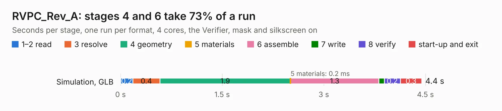

| Mode and format | 1–2 read | 3 resolve | 4 geometry | 5 materials | 6 assemble | 7 write | 8 verify | start-up and exit | Total |
|---|---:|---:|---:|---:|---:|---:|---:|---:|---:|
| Simulation, GLB | 0.2 | 0.4 | 1.9 | 0.2&nbsp;ms | 1.3 | 79&nbsp;ms | 0.2 | 0.3 | 4.4 |
| Simulation, STEP | 0.2 | 0.4 | 2.0 | 0.4&nbsp;ms | 1.4 | 1.5 | 0.2 | 0.3 | 6.0 |
| Simulation, STL | 0.2 | 0.4 | 2.1 | 0.3&nbsp;ms | 1.3 | 0.1 | 0.2 | 0.3 | 4.7 |
| Simulation, OBJ | 0.2 | 0.4 | 1.7 | 0.3&nbsp;ms | 1.4 | 2.0 | 0.2 | 0.2 | 6.2 |
| Visual, GLB | 0.2 | 0.4 | 1.8 | 0.3&nbsp;ms | 2.7 | 34&nbsp;ms | 0.3 | 0.2 | 5.8 |
| Visual, OBJ | 0.2 | 0.4 | 1.8 | 0.3&nbsp;ms | 2.7 | 1.0 | 0.3 | 0.2 | 6.6 |

<table align="center"><tr><td valign="top">

| Board | Repo: [OLIMEX/RVPC](https://github.com/OLIMEX/RVPC) Board: `RVPC_Rev_A.kicad_pcb` |
|---|---|
| Folder | HARDWARE / RVPC-Rev.A |
| Complexity | 119&nbsp;/&nbsp;1000 (size&nbsp;49, features&nbsp;70) |
| KESE&nbsp;features | slotted holes, rounded, trapezoid or chamfered pads, knockout text, stack-up, dielectric εr and tanδ, mask and silkscreen colours |
| Tested | 9th November 2026 |
| Copper&nbsp;layers | 2 |
| File&nbsp;format | KiCad 7 (20221018) |
| Parts,&nbsp;tracks,&nbsp;vias | 18, 0, 0 |
| Triangles,&nbsp;simulation | 382,840 in 41 parts |
| Verifier | PASS in all six runs |

</td><td valign="top">

<table>
<tr><th>File type</th><th>File size</th><th>Peak memory used</th></tr>
<tr><th colspan="3" align="left">Simulation</th></tr>
<tr><td>GLB</td><td align="right">13&nbsp;MB</td><td align="right">278&nbsp;MB</td></tr>
<tr><td>STEP</td><td align="right">60&nbsp;MB</td><td align="right">274&nbsp;MB</td></tr>
<tr><td>STL</td><td align="right">19&nbsp;MB</td><td align="right">276&nbsp;MB</td></tr>
<tr><td>OBJ</td><td align="right">39&nbsp;MB</td><td align="right">305&nbsp;MB</td></tr>
<tr><th colspan="3" align="left">Visual</th></tr>
<tr><td>GLB</td><td align="right">7.3&nbsp;MB</td><td align="right">246&nbsp;MB</td></tr>
<tr><td>OBJ</td><td align="right">22&nbsp;MB</td><td align="right">234&nbsp;MB</td></tr>
</table>

</td></tr></table>

## 1978. RVPC_Rev_B

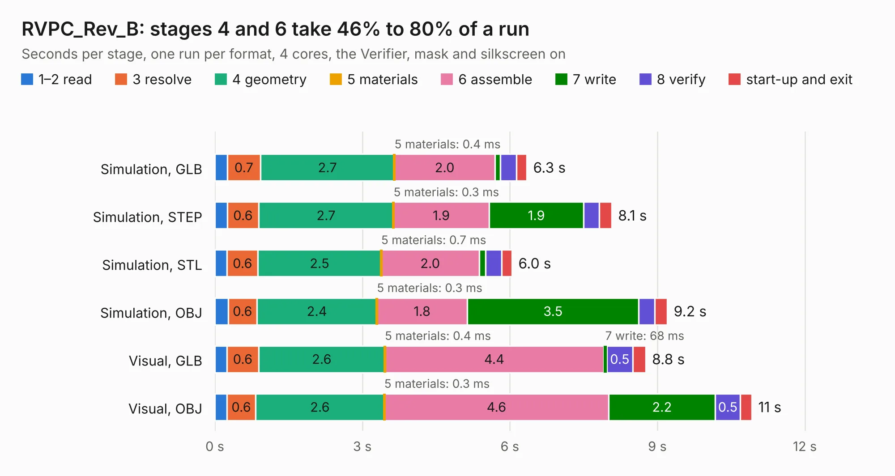

| Mode and format | 1–2 read | 3 resolve | 4 geometry | 5 materials | 6 assemble | 7 write | 8 verify | start-up and exit | Total |
|---|---:|---:|---:|---:|---:|---:|---:|---:|---:|
| Simulation, GLB | 0.3 | 0.7 | 2.7 | 0.4&nbsp;ms | 2.0 | 0.1 | 0.3 | 0.2 | 6.3 |
| Simulation, STEP | 0.3 | 0.6 | 2.7 | 0.3&nbsp;ms | 1.9 | 1.9 | 0.3 | 0.3 | 8.1 |
| Simulation, STL | 0.2 | 0.6 | 2.5 | 0.7&nbsp;ms | 2.0 | 0.1 | 0.3 | 0.2 | 6.0 |
| Simulation, OBJ | 0.3 | 0.6 | 2.4 | 0.3&nbsp;ms | 1.8 | 3.5 | 0.3 | 0.3 | 9.2 |
| Visual, GLB | 0.2 | 0.6 | 2.6 | 0.4&nbsp;ms | 4.4 | 68&nbsp;ms | 0.5 | 0.3 | 8.8 |
| Visual, OBJ | 0.2 | 0.6 | 2.6 | 0.3&nbsp;ms | 4.6 | 2.2 | 0.5 | 0.2 | 10.9 |

<table align="center"><tr><td valign="top">

| Board | Repo: [OLIMEX/RVPC](https://github.com/OLIMEX/RVPC) Board: `RVPC_Rev_B.kicad_pcb` |
|---|---|
| Folder | HARDWARE / RVPC_Rev.B |
| Complexity | 258&nbsp;/&nbsp;1000 (size&nbsp;153, features&nbsp;105) |
| KESE&nbsp;features | through vias, slotted holes, rounded, trapezoid or chamfered pads, filled zones, knockout text, stack-up, dielectric εr and tanδ, mask and silkscreen colours |
| Tested | 9th November 2026 |
| Copper&nbsp;layers | 2 |
| File&nbsp;format | KiCad 7 (20221018) |
| Parts,&nbsp;tracks,&nbsp;vias | 21, 407, 44 |
| Triangles,&nbsp;simulation | 562,602 in 44 parts |
| Verifier | PASS in all six runs |

</td><td valign="top">

<table>
<tr><th>File type</th><th>File size</th><th>Peak memory used</th></tr>
<tr><th colspan="3" align="left">Simulation</th></tr>
<tr><td>GLB</td><td align="right">20&nbsp;MB</td><td align="right">302&nbsp;MB</td></tr>
<tr><td>STEP</td><td align="right">101&nbsp;MB</td><td align="right">335&nbsp;MB</td></tr>
<tr><td>STL</td><td align="right">28&nbsp;MB</td><td align="right">303&nbsp;MB</td></tr>
<tr><td>OBJ</td><td align="right">58&nbsp;MB</td><td align="right">421&nbsp;MB</td></tr>
<tr><th colspan="3" align="left">Visual</th></tr>
<tr><td>GLB</td><td align="right">13&nbsp;MB</td><td align="right">327&nbsp;MB</td></tr>
<tr><td>OBJ</td><td align="right">38&nbsp;MB</td><td align="right">342&nbsp;MB</td></tr>
</table>

</td></tr></table>

## 1979. exposed_power_rails

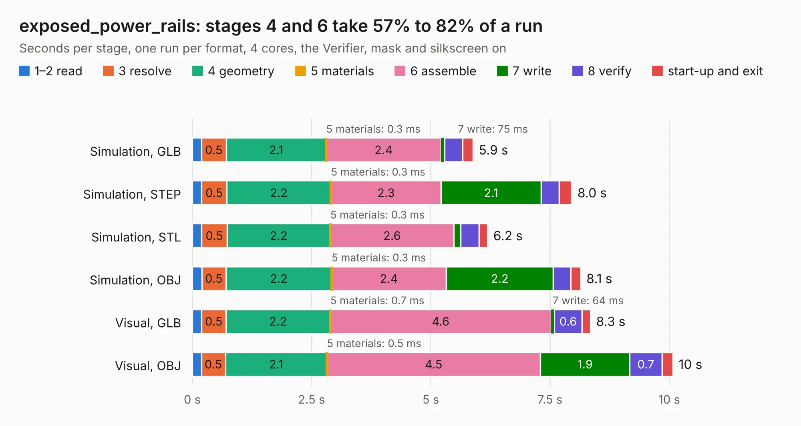

| Mode and format | 1–2 read | 3 resolve | 4 geometry | 5 materials | 6 assemble | 7 write | 8 verify | start-up and exit | Total |
|---|---:|---:|---:|---:|---:|---:|---:|---:|---:|
| Simulation, GLB | 0.2 | 0.5 | 2.1 | 0.3&nbsp;ms | 2.4 | 75&nbsp;ms | 0.4 | 0.2 | 5.9 |
| Simulation, STEP | 0.2 | 0.5 | 2.2 | 0.3&nbsp;ms | 2.3 | 2.1 | 0.4 | 0.3 | 8.0 |
| Simulation, STL | 0.2 | 0.5 | 2.2 | 0.3&nbsp;ms | 2.6 | 0.1 | 0.4 | 0.2 | 6.2 |
| Simulation, OBJ | 0.2 | 0.5 | 2.2 | 0.3&nbsp;ms | 2.4 | 2.2 | 0.4 | 0.2 | 8.1 |
| Visual, GLB | 0.2 | 0.5 | 2.2 | 0.7&nbsp;ms | 4.6 | 64&nbsp;ms | 0.6 | 0.2 | 8.3 |
| Visual, OBJ | 0.2 | 0.5 | 2.1 | 0.5&nbsp;ms | 4.5 | 1.9 | 0.7 | 0.2 | 10.1 |

<table align="center"><tr><td valign="top">

| Board | Repo: [OLIMEX/RVPC](https://github.com/OLIMEX/RVPC) Board: `exposed_power_rails.kicad_pcb` |
|---|---|
| Folder | SOFTWARE / rvpc / tools / esp32s2-cookbook / hardware / exposed_power_rails |
| Complexity | 272&nbsp;/&nbsp;1000 (size&nbsp;167, features&nbsp;105) |
| KESE&nbsp;features | through vias, slotted holes, rounded, trapezoid or chamfered pads, filled zones, copper drawings, curved board outline, stack-up, dielectric εr and tanδ |
| Tested | 9th November 2026 |
| Copper&nbsp;layers | 2 |
| File&nbsp;format | KiCad 6 (20211014) |
| Parts,&nbsp;tracks,&nbsp;vias | 37, 520, 124 |
| Triangles,&nbsp;simulation | 612,234 in 77 parts |
| Verifier | PASS in all six runs |

</td><td valign="top">

<table>
<tr><th>File type</th><th>File size</th><th>Peak memory used</th></tr>
<tr><th colspan="3" align="left">Simulation</th></tr>
<tr><td>GLB</td><td align="right">21&nbsp;MB</td><td align="right">362&nbsp;MB</td></tr>
<tr><td>STEP</td><td align="right">108&nbsp;MB</td><td align="right">428&nbsp;MB</td></tr>
<tr><td>STL</td><td align="right">31&nbsp;MB</td><td align="right">360&nbsp;MB</td></tr>
<tr><td>OBJ</td><td align="right">61&nbsp;MB</td><td align="right">437&nbsp;MB</td></tr>
<tr><th colspan="3" align="left">Visual</th></tr>
<tr><td>GLB</td><td align="right">17&nbsp;MB</td><td align="right">478&nbsp;MB</td></tr>
<tr><td>OBJ</td><td align="right">49&nbsp;MB</td><td align="right">473&nbsp;MB</td></tr>
</table>

</td></tr></table>

## 1980. S3-OLinuXino_Rev_A

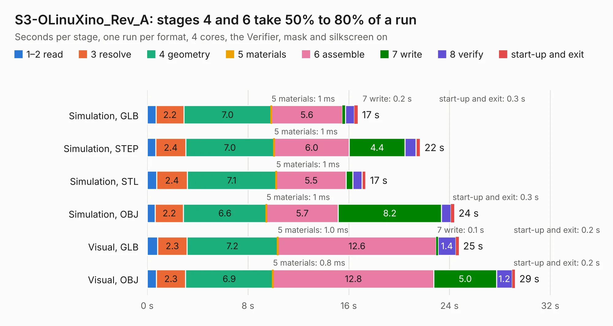

| Mode and format | 1–2 read | 3 resolve | 4 geometry | 5 materials | 6 assemble | 7 write | 8 verify | start-up and exit | Total |
|---|---:|---:|---:|---:|---:|---:|---:|---:|---:|
| Simulation, GLB | 0.7 | 2.2 | 7.0 | 1&nbsp;ms | 5.6 | 0.2 | 0.7 | 0.3 | 16.7 |
| Simulation, STEP | 0.7 | 2.4 | 7.0 | 1&nbsp;ms | 6.0 | 4.4 | 0.9 | 0.3 | 21.7 |
| Simulation, STL | 0.8 | 2.4 | 7.1 | 1&nbsp;ms | 5.5 | 0.5 | 0.7 | 0.3 | 17.3 |
| Simulation, OBJ | 0.6 | 2.2 | 6.6 | 1&nbsp;ms | 5.7 | 8.2 | 0.8 | 0.3 | 24.4 |
| Visual, GLB | 0.8 | 2.3 | 7.2 | 1.0&nbsp;ms | 12.6 | 0.1 | 1.4 | 0.2 | 24.7 |
| Visual, OBJ | 0.7 | 2.3 | 6.9 | 0.8&nbsp;ms | 12.8 | 5.0 | 1.2 | 0.2 | 29.2 |

<table align="center"><tr><td valign="top">

| Board | Repo: [OLIMEX/S3-OLinuXino](https://github.com/OLIMEX/S3-OLinuXino) Board: `S3-OLinuXino_Rev_A.kicad_pcb` |
|---|---|
| Folder | HARDWARE / S3-OLinuXino-Rev_A-preliminary |
| Complexity | 176&nbsp;/&nbsp;1000 (size&nbsp;156, features&nbsp;20) |
| KESE&nbsp;features | slotted holes, copper text |
| Tested | 9th November 2026 |
| Copper&nbsp;layers | 6 |
| File&nbsp;format | KiCad 6 (20190905) |
| Parts,&nbsp;tracks,&nbsp;vias | 222, 0, 0 |
| Triangles,&nbsp;simulation | 1,309,978 in 308 parts |
| Note | mostly unrouted |
| Verifier | PASS in all six runs |

</td><td valign="top">

<table>
<tr><th>File type</th><th>File size</th><th>Peak memory used</th></tr>
<tr><th colspan="3" align="left">Simulation</th></tr>
<tr><td>GLB</td><td align="right">45&nbsp;MB</td><td align="right">542&nbsp;MB</td></tr>
<tr><td>STEP</td><td align="right">188&nbsp;MB</td><td align="right">634&nbsp;MB</td></tr>
<tr><td>STL</td><td align="right">66&nbsp;MB</td><td align="right">513&nbsp;MB</td></tr>
<tr><td>OBJ</td><td align="right">140&nbsp;MB</td><td align="right">925&nbsp;MB</td></tr>
<tr><th colspan="3" align="left">Visual</th></tr>
<tr><td>GLB</td><td align="right">28&nbsp;MB</td><td align="right">630&nbsp;MB</td></tr>
<tr><td>OBJ</td><td align="right">84&nbsp;MB</td><td align="right">662&nbsp;MB</td></tr>
</table>

</td></tr></table>

## 1981. S3-OLinuXino_Rev_A

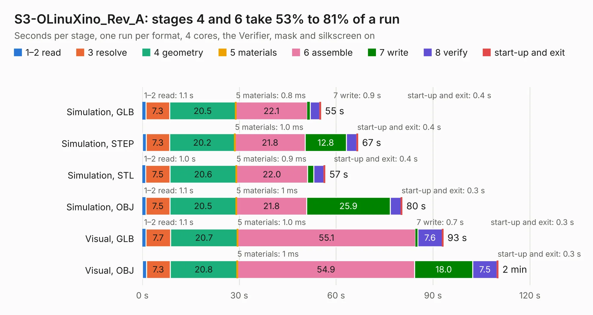

| Mode and format | 1–2 read | 3 resolve | 4 geometry | 5 materials | 6 assemble | 7 write | 8 verify | start-up and exit | Total |
|---|---:|---:|---:|---:|---:|---:|---:|---:|---:|
| Simulation, GLB | 1.1 | 7.3 | 20.5 | 0.8&nbsp;ms | 22.1 | 0.9 | 2.9 | 0.4 | 55.2 |
| Simulation, STEP | 1.2 | 7.3 | 20.2 | 1.0&nbsp;ms | 21.8 | 12.8 | 3.2 | 0.4 | 66.7 |
| Simulation, STL | 1.0 | 7.5 | 20.6 | 0.9&nbsp;ms | 22.0 | 2.0 | 3.1 | 0.4 | 56.6 |
| Simulation, OBJ | 1.1 | 7.5 | 20.5 | 1&nbsp;ms | 21.8 | 25.9 | 3.4 | 0.3 | 80.4 |
| Visual, GLB | 1.1 | 7.7 | 20.7 | 1.0&nbsp;ms | 55.1 | 0.7 | 7.6 | 0.3 | 93.2 |
| Visual, OBJ | 1.3 | 7.3 | 20.8 | 1&nbsp;ms | 54.9 | 18.0 | 7.5 | 0.3 | 110.2 |

<table align="center"><tr><td valign="top">

| Board | Repo: [OLIMEX/S3-OLinuXino](https://github.com/OLIMEX/S3-OLinuXino) Board: `S3-OLinuXino_Rev_A.kicad_pcb` |
|---|---|
| Folder | HARDWARE / S3-OLinuXino_Rev_A-release |
| Complexity | 347&nbsp;/&nbsp;1000 (size&nbsp;292, features&nbsp;55) |
| KESE&nbsp;features | through vias, slotted holes, filled zones, copper text |
| Tested | 9th November 2026 |
| Copper&nbsp;layers | 4 |
| File&nbsp;format | KiCad 5 (20171130) |
| Parts,&nbsp;tracks,&nbsp;vias | 217, 5,459, 627 |
| Triangles,&nbsp;simulation | 4,938,436 in 305 parts |
| Verifier | PASS in all six runs |

</td><td valign="top">

<table>
<tr><th>File type</th><th>File size</th><th>Peak memory used</th></tr>
<tr><th colspan="3" align="left">Simulation</th></tr>
<tr><td>GLB</td><td align="right">172&nbsp;MB</td><td align="right">1.4&nbsp;GB</td></tr>
<tr><td>STEP</td><td align="right">820&nbsp;MB</td><td align="right">1.7&nbsp;GB</td></tr>
<tr><td>STL</td><td align="right">247&nbsp;MB</td><td align="right">1.4&nbsp;GB</td></tr>
<tr><td>OBJ</td><td align="right">535&nbsp;MB</td><td align="right">3.2&nbsp;GB</td></tr>
<tr><th colspan="3" align="left">Visual</th></tr>
<tr><td>GLB</td><td align="right">116&nbsp;MB</td><td align="right">1.9&nbsp;GB</td></tr>
<tr><td>OBJ</td><td align="right">368&nbsp;MB</td><td align="right">2.4&nbsp;GB</td></tr>
</table>

</td></tr></table>

## 1982. smd-protoboard

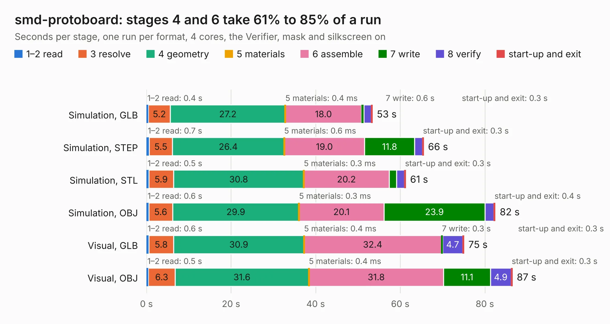

| Mode and format | 1–2 read | 3 resolve | 4 geometry | 5 materials | 6 assemble | 7 write | 8 verify | start-up and exit | Total |
|---|---:|---:|---:|---:|---:|---:|---:|---:|---:|
| Simulation, GLB | 0.4 | 5.2 | 27.2 | 0.4&nbsp;ms | 18.0 | 0.6 | 1.7 | 0.3 | 53.4 |
| Simulation, STEP | 0.7 | 5.5 | 26.4 | 0.6&nbsp;ms | 19.0 | 11.8 | 1.9 | 0.3 | 65.5 |
| Simulation, STL | 0.5 | 5.9 | 30.8 | 0.3&nbsp;ms | 20.2 | 1.8 | 1.8 | 0.3 | 61.3 |
| Simulation, OBJ | 0.6 | 5.6 | 29.9 | 0.3&nbsp;ms | 20.1 | 23.9 | 2.1 | 0.4 | 82.5 |
| Visual, GLB | 0.6 | 5.8 | 30.9 | 0.4&nbsp;ms | 32.4 | 0.3 | 4.7 | 0.3 | 75.1 |
| Visual, OBJ | 0.5 | 6.3 | 31.6 | 0.4&nbsp;ms | 31.8 | 11.1 | 4.9 | 0.3 | 86.5 |

<table align="center"><tr><td valign="top">

| Board | Repo: [OLIMEX/SMT-PROTOBOARD](https://github.com/OLIMEX/SMT-PROTOBOARD) Board: `smd-protoboard.kicad_pcb` |
|---|---|
| Complexity | 262&nbsp;/&nbsp;1000 (size&nbsp;237, features&nbsp;25) |
| KESE&nbsp;features | through vias, rounded, trapezoid or chamfered pads |
| Tested | 9th November 2026 |
| Copper&nbsp;layers | 2 |
| File&nbsp;format | KiCad 4 (4) |
| Parts,&nbsp;tracks,&nbsp;vias | 96, 1,869, 46 |
| Triangles,&nbsp;simulation | 4,300,772 in 12 parts |
| Verifier | PASS in all six runs |

</td><td valign="top">

<table>
<tr><th>File type</th><th>File size</th><th>Peak memory used</th></tr>
<tr><th colspan="3" align="left">Simulation</th></tr>
<tr><td>GLB</td><td align="right">149&nbsp;MB</td><td align="right">1.4&nbsp;GB</td></tr>
<tr><td>STEP</td><td align="right">610&nbsp;MB</td><td align="right">1.8&nbsp;GB</td></tr>
<tr><td>STL</td><td align="right">215&nbsp;MB</td><td align="right">1.4&nbsp;GB</td></tr>
<tr><td>OBJ</td><td align="right">463&nbsp;MB</td><td align="right">2.8&nbsp;GB</td></tr>
<tr><th colspan="3" align="left">Visual</th></tr>
<tr><td>GLB</td><td align="right">74&nbsp;MB</td><td align="right">1.5&nbsp;GB</td></tr>
<tr><td>OBJ</td><td align="right">230&nbsp;MB</td><td align="right">1.7&nbsp;GB</td></tr>
</table>

</td></tr></table>

## 1983. STMP1(A13)-SOM-EVB_Rev_B

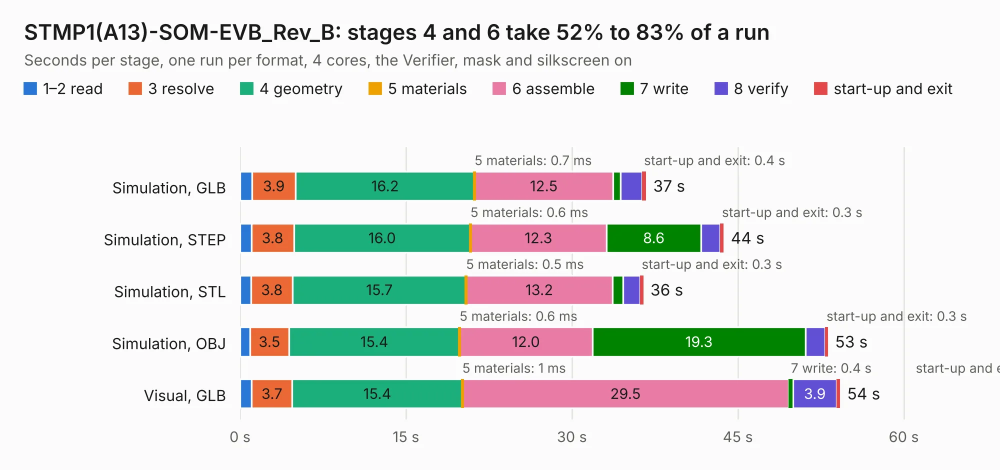

| Mode and format | 1–2 read | 3 resolve | 4 geometry | 5 materials | 6 assemble | 7 write | 8 verify | start-up and exit | Total |
|---|---:|---:|---:|---:|---:|---:|---:|---:|---:|
| Simulation, GLB | 1.1 | 3.9 | 16.2 | 0.7&nbsp;ms | 12.5 | 0.7 | 2.0 | 0.4 | 36.7 |
| Simulation, STEP | 1.0 | 3.8 | 16.0 | 0.6&nbsp;ms | 12.3 | 8.6 | 1.7 | 0.3 | 43.7 |
| Simulation, STL | 1.0 | 3.8 | 15.7 | 0.5&nbsp;ms | 13.2 | 1.0 | 1.6 | 0.3 | 36.5 |
| Simulation, OBJ | 0.9 | 3.5 | 15.4 | 0.6&nbsp;ms | 12.0 | 19.3 | 1.8 | 0.3 | 53.1 |
| Visual, GLB | 1.0 | 3.7 | 15.4 | 1&nbsp;ms | 29.5 | 0.4 | 3.9 | 0.3 | 54.2 |
| Visual, OBJ | 1.1 | 3.8 | 15.9 | 1&nbsp;ms | 30.6 | 13.3 | 3.6 | 0.3 | 68.7 |

<table align="center"><tr><td valign="top">

| Board | Repo: [OLIMEX/STMP1-A13-EVB](https://github.com/OLIMEX/STMP1-A13-EVB) Board: `STMP1(A13)-SOM-EVB_Rev_B.kicad_pcb` |
|---|---|
| Folder | HARDWARE / STMP1(A13)-SOM-EVB-Rev-B |
| Complexity | 342&nbsp;/&nbsp;1000 (size&nbsp;262, features&nbsp;80) |
| KESE&nbsp;features | through vias, slotted holes, custom pads, filled zones, copper drawings, copper text |
| Tested | 9th November 2026 |
| Copper&nbsp;layers | 4 |
| File&nbsp;format | KiCad 5 (20171130) |
| Parts,&nbsp;tracks,&nbsp;vias | 141, 2,429, 467 |
| Triangles,&nbsp;simulation | 3,366,994 in 208 parts |
| Verifier | PASS in all six runs |

</td><td valign="top">

<table>
<tr><th>File type</th><th>File size</th><th>Peak memory used</th></tr>
<tr><th colspan="3" align="left">Simulation</th></tr>
<tr><td>GLB</td><td align="right">117&nbsp;MB</td><td align="right">1.2&nbsp;GB</td></tr>
<tr><td>STEP</td><td align="right">476&nbsp;MB</td><td align="right">1.4&nbsp;GB</td></tr>
<tr><td>STL</td><td align="right">168&nbsp;MB</td><td align="right">1.1&nbsp;GB</td></tr>
<tr><td>OBJ</td><td align="right">361&nbsp;MB</td><td align="right">2.2&nbsp;GB</td></tr>
<tr><th colspan="3" align="left">Visual</th></tr>
<tr><td>GLB</td><td align="right">78&nbsp;MB</td><td align="right">1.6&nbsp;GB</td></tr>
<tr><td>OBJ</td><td align="right">244&nbsp;MB</td><td align="right">1.7&nbsp;GB</td></tr>
</table>

</td></tr></table>

## 1984. STMP1-OLinuXino_Rev_A

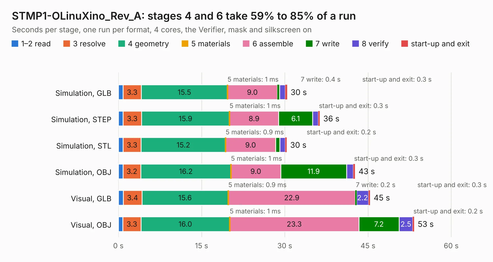

| Mode and format | 1–2 read | 3 resolve | 4 geometry | 5 materials | 6 assemble | 7 write | 8 verify | start-up and exit | Total |
|---|---:|---:|---:|---:|---:|---:|---:|---:|---:|
| Simulation, GLB | 0.8 | 3.3 | 15.5 | 1&nbsp;ms | 9.0 | 0.4 | 1.1 | 0.3 | 30.4 |
| Simulation, STEP | 0.8 | 3.3 | 15.9 | 1&nbsp;ms | 8.9 | 6.1 | 1.0 | 0.3 | 36.3 |
| Simulation, STL | 0.8 | 3.3 | 15.2 | 0.9&nbsp;ms | 9.0 | 0.8 | 1.0 | 0.2 | 30.3 |
| Simulation, OBJ | 0.8 | 3.2 | 16.2 | 1&nbsp;ms | 9.0 | 11.9 | 1.2 | 0.3 | 42.7 |
| Visual, GLB | 0.9 | 3.4 | 15.6 | 0.9&nbsp;ms | 22.9 | 0.2 | 2.2 | 0.3 | 45.4 |
| Visual, OBJ | 0.8 | 3.3 | 16.0 | 1&nbsp;ms | 23.3 | 7.2 | 2.5 | 0.2 | 53.3 |

<table align="center"><tr><td valign="top">

| Board | Repo: [OLIMEX/STMP1-OLinuXino](https://github.com/OLIMEX/STMP1-OLinuXino) Board: `STMP1-OLinuXino_Rev_A.kicad_pcb` |
|---|---|
| Folder | HARDWARE / STMP1-OLinuXino-REV.A |
| Complexity | 299&nbsp;/&nbsp;1000 (size&nbsp;274, features&nbsp;25) |
| KESE&nbsp;features | through vias, slotted holes |
| Tested | 9th November 2026 |
| Copper&nbsp;layers | 8 |
| File&nbsp;format | KiCad 5 (20171130) |
| Parts,&nbsp;tracks,&nbsp;vias | 388, 248, 25 |
| Triangles,&nbsp;simulation | 2,715,802 in 504 parts |
| Verifier | PASS in all six runs |

</td><td valign="top">

<table>
<tr><th>File type</th><th>File size</th><th>Peak memory used</th></tr>
<tr><th colspan="3" align="left">Simulation</th></tr>
<tr><td>GLB</td><td align="right">94&nbsp;MB</td><td align="right">895&nbsp;MB</td></tr>
<tr><td>STEP</td><td align="right">392&nbsp;MB</td><td align="right">1.1&nbsp;GB</td></tr>
<tr><td>STL</td><td align="right">136&nbsp;MB</td><td align="right">935&nbsp;MB</td></tr>
<tr><td>OBJ</td><td align="right">298&nbsp;MB</td><td align="right">1.9&nbsp;GB</td></tr>
<tr><th colspan="3" align="left">Visual</th></tr>
<tr><td>GLB</td><td align="right">57&nbsp;MB</td><td align="right">1.1&nbsp;GB</td></tr>
<tr><td>OBJ</td><td align="right">177&nbsp;MB</td><td align="right">1.3&nbsp;GB</td></tr>
</table>

</td></tr></table>

## 1985. STMP15x-BASE-SOM-EVB_Rev_B

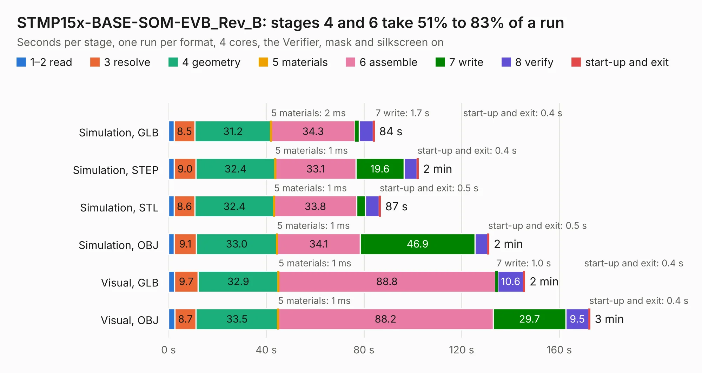

| Mode and format | 1–2 read | 3 resolve | 4 geometry | 5 materials | 6 assemble | 7 write | 8 verify | start-up and exit | Total |
|---|---:|---:|---:|---:|---:|---:|---:|---:|---:|
| Simulation, GLB | 2.3 | 8.5 | 31.2 | 2&nbsp;ms | 34.3 | 1.7 | 5.7 | 0.4 | 84.2 |
| Simulation, STEP | 2.3 | 9.0 | 32.4 | 1&nbsp;ms | 33.1 | 19.6 | 5.4 | 0.4 | 102.2 |
| Simulation, STL | 2.3 | 8.6 | 32.4 | 1&nbsp;ms | 33.8 | 3.5 | 5.7 | 0.5 | 86.7 |
| Simulation, OBJ | 2.3 | 9.1 | 33.0 | 1&nbsp;ms | 34.1 | 46.9 | 5.2 | 0.5 | 131.1 |
| Visual, GLB | 2.4 | 9.7 | 32.9 | 1&nbsp;ms | 88.8 | 1.0 | 10.6 | 0.4 | 145.8 |
| Visual, OBJ | 2.6 | 8.7 | 33.5 | 1&nbsp;ms | 88.2 | 29.7 | 9.5 | 0.4 | 172.5 |

<table align="center"><tr><td valign="top">

| Board | Repo: [OLIMEX/STMP157-BASE-SOM-EVB](https://github.com/OLIMEX/STMP157-BASE-SOM-EVB) Board: `STMP15x-BASE-SOM-EVB_Rev_B.kicad_pcb` |
|---|---|
| Folder | HARDWARE / STMP157-BASE-SOM-EVB-Rev.B |
| Complexity | 363&nbsp;/&nbsp;1000 (size&nbsp;298, features&nbsp;65) |
| KESE&nbsp;features | through vias, slotted holes, rounded, trapezoid or chamfered pads, filled zones, copper text |
| Tested | 9th November 2026 |
| Copper&nbsp;layers | 4 |
| File&nbsp;format | KiCad 5 (20171130) |
| Parts,&nbsp;tracks,&nbsp;vias | 263, 7,876, 1,294 |
| Triangles,&nbsp;simulation | 8,488,618 in 387 parts |
| Verifier | PASS in all six runs |

</td><td valign="top">

<table>
<tr><th>File type</th><th>File size</th><th>Peak memory used</th></tr>
<tr><th colspan="3" align="left">Simulation</th></tr>
<tr><td>GLB</td><td align="right">294&nbsp;MB</td><td align="right">2.4&nbsp;GB</td></tr>
<tr><td>STEP</td><td align="right">1.3&nbsp;GB</td><td align="right">3.1&nbsp;GB</td></tr>
<tr><td>STL</td><td align="right">424&nbsp;MB</td><td align="right">2.3&nbsp;GB</td></tr>
<tr><td>OBJ</td><td align="right">930&nbsp;MB</td><td align="right">5.4&nbsp;GB</td></tr>
<tr><th colspan="3" align="left">Visual</th></tr>
<tr><td>GLB</td><td align="right">203&nbsp;MB</td><td align="right">3.1&nbsp;GB</td></tr>
<tr><td>OBJ</td><td align="right">652&nbsp;MB</td><td align="right">4.2&nbsp;GB</td></tr>
</table>

</td></tr></table>

## 1986. STMP15x-SHIELD_Rev_A

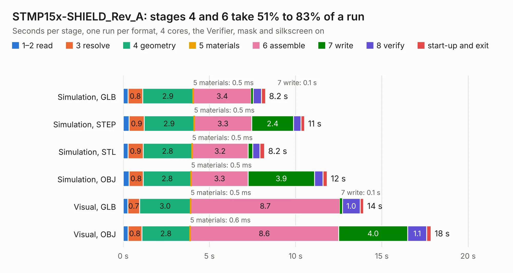

| Mode and format | 1–2 read | 3 resolve | 4 geometry | 5 materials | 6 assemble | 7 write | 8 verify | start-up and exit | Total |
|---|---:|---:|---:|---:|---:|---:|---:|---:|---:|
| Simulation, GLB | 0.3 | 0.8 | 2.9 | 0.5&nbsp;ms | 3.4 | 0.1 | 0.5 | 0.2 | 8.2 |
| Simulation, STEP | 0.3 | 0.9 | 2.9 | 0.5&nbsp;ms | 3.3 | 2.4 | 0.4 | 0.2 | 10.5 |
| Simulation, STL | 0.3 | 0.9 | 2.8 | 0.5&nbsp;ms | 3.2 | 0.3 | 0.4 | 0.3 | 8.2 |
| Simulation, OBJ | 0.3 | 0.8 | 2.8 | 0.5&nbsp;ms | 3.3 | 3.9 | 0.5 | 0.2 | 11.8 |
| Visual, GLB | 0.3 | 0.7 | 3.0 | 0.5&nbsp;ms | 8.7 | 0.1 | 1.0 | 0.2 | 13.9 |
| Visual, OBJ | 0.3 | 0.8 | 2.8 | 0.6&nbsp;ms | 8.6 | 4.0 | 1.1 | 0.2 | 17.8 |

<table align="center"><tr><td valign="top">

| Board | Repo: [OLIMEX/STMP15X-SHIELD](https://github.com/OLIMEX/STMP15X-SHIELD) Board: `STMP15x-SHIELD_Rev_A.kicad_pcb` |
|---|---|
| Folder | HARDWARE / STMP15x-SHIELD_Rev_A |
| Complexity | 226&nbsp;/&nbsp;1000 (size&nbsp;171, features&nbsp;55) |
| KESE&nbsp;features | through vias, rounded, trapezoid or chamfered pads, filled zones, copper text |
| Tested | 9th November 2026 |
| Copper&nbsp;layers | 2 |
| File&nbsp;format | KiCad 5 (20171130) |
| Parts,&nbsp;tracks,&nbsp;vias | 20, 1,155, 170 |
| Triangles,&nbsp;simulation | 883,270 in 132 parts |
| Verifier | PASS in all six runs |

</td><td valign="top">

<table>
<tr><th>File type</th><th>File size</th><th>Peak memory used</th></tr>
<tr><th colspan="3" align="left">Simulation</th></tr>
<tr><td>GLB</td><td align="right">31&nbsp;MB</td><td align="right">494&nbsp;MB</td></tr>
<tr><td>STEP</td><td align="right">162&nbsp;MB</td><td align="right">566&nbsp;MB</td></tr>
<tr><td>STL</td><td align="right">44&nbsp;MB</td><td align="right">494&nbsp;MB</td></tr>
<tr><td>OBJ</td><td align="right">91&nbsp;MB</td><td align="right">634&nbsp;MB</td></tr>
<tr><th colspan="3" align="left">Visual</th></tr>
<tr><td>GLB</td><td align="right">29&nbsp;MB</td><td align="right">638&nbsp;MB</td></tr>
<tr><td>OBJ</td><td align="right">89&nbsp;MB</td><td align="right">690&nbsp;MB</td></tr>
</table>

</td></tr></table>

## 1987. TuxCon_Kitty_Rev_A

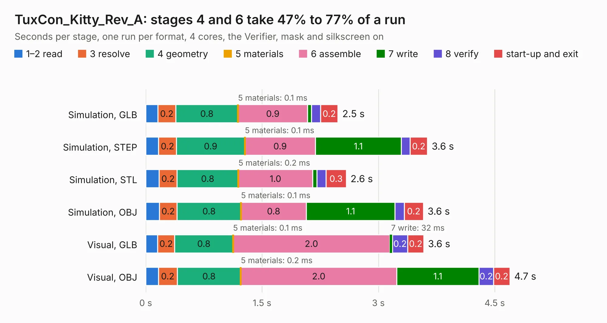

| Mode and format | 1–2 read | 3 resolve | 4 geometry | 5 materials | 6 assemble | 7 write | 8 verify | start-up and exit | Total |
|---|---:|---:|---:|---:|---:|---:|---:|---:|---:|
| Simulation, GLB | 0.2 | 0.2 | 0.8 | 0.1&nbsp;ms | 0.9 | 47&nbsp;ms | 0.1 | 0.2 | 2.5 |
| Simulation, STEP | 0.2 | 0.2 | 0.9 | 0.1&nbsp;ms | 0.9 | 1.1 | 0.1 | 0.2 | 3.6 |
| Simulation, STL | 0.2 | 0.2 | 0.8 | 0.2&nbsp;ms | 1.0 | 55&nbsp;ms | 0.1 | 0.3 | 2.6 |
| Simulation, OBJ | 0.2 | 0.2 | 0.8 | 0.1&nbsp;ms | 0.8 | 1.1 | 0.1 | 0.2 | 3.6 |
| Visual, GLB | 0.2 | 0.2 | 0.8 | 0.1&nbsp;ms | 2.0 | 32&nbsp;ms | 0.2 | 0.2 | 3.6 |
| Visual, OBJ | 0.2 | 0.2 | 0.8 | 0.2&nbsp;ms | 2.0 | 1.1 | 0.2 | 0.2 | 4.7 |

<table align="center"><tr><td valign="top">

| Board | Repo: [OLIMEX/TuxCon-Kitty](https://github.com/OLIMEX/TuxCon-Kitty) Board: `TuxCon_Kitty_Rev_A.kicad_pcb` |
|---|---|
| Folder | HARDWARE / REV-A |
| Complexity | 168&nbsp;/&nbsp;1000 (size&nbsp;123, features&nbsp;45) |
| KESE&nbsp;features | through vias, slotted holes, filled zones |
| Tested | 9th November 2026 |
| Copper&nbsp;layers | 2 |
| File&nbsp;format | KiCad 5 (20170922) |
| Parts,&nbsp;tracks,&nbsp;vias | 18, 74, 7 |
| Triangles,&nbsp;simulation | 205,834 in 28 parts |
| Verifier | PASS in all six runs |

</td><td valign="top">

<table>
<tr><th>File type</th><th>File size</th><th>Peak memory used</th></tr>
<tr><th colspan="3" align="left">Simulation</th></tr>
<tr><td>GLB</td><td align="right">7.3&nbsp;MB</td><td align="right">221&nbsp;MB</td></tr>
<tr><td>STEP</td><td align="right">45&nbsp;MB</td><td align="right">249&nbsp;MB</td></tr>
<tr><td>STL</td><td align="right">10&nbsp;MB</td><td align="right">211&nbsp;MB</td></tr>
<tr><td>OBJ</td><td align="right">21&nbsp;MB</td><td align="right">218&nbsp;MB</td></tr>
<tr><th colspan="3" align="left">Visual</th></tr>
<tr><td>GLB</td><td align="right">6.1&nbsp;MB</td><td align="right">217&nbsp;MB</td></tr>
<tr><td>OBJ</td><td align="right">18&nbsp;MB</td><td align="right">218&nbsp;MB</td></tr>
</table>

</td></tr></table>

## 1988. UEXT-3TO5V_Rev_A

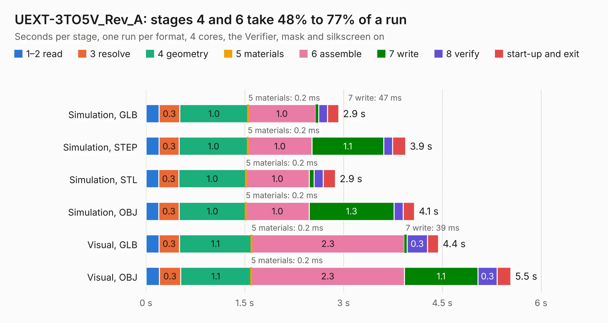

| Mode and format | 1–2 read | 3 resolve | 4 geometry | 5 materials | 6 assemble | 7 write | 8 verify | start-up and exit | Total |
|---|---:|---:|---:|---:|---:|---:|---:|---:|---:|
| Simulation, GLB | 0.2 | 0.3 | 1.0 | 0.2&nbsp;ms | 1.0 | 47&nbsp;ms | 0.1 | 0.2 | 2.9 |
| Simulation, STEP | 0.2 | 0.3 | 1.0 | 0.2&nbsp;ms | 1.0 | 1.1 | 0.1 | 0.2 | 3.9 |
| Simulation, STL | 0.2 | 0.3 | 1.0 | 0.2&nbsp;ms | 1.0 | 73&nbsp;ms | 0.1 | 0.2 | 2.9 |
| Simulation, OBJ | 0.2 | 0.3 | 1.0 | 0.2&nbsp;ms | 1.0 | 1.3 | 0.1 | 0.2 | 4.1 |
| Visual, GLB | 0.2 | 0.3 | 1.1 | 0.2&nbsp;ms | 2.3 | 39&nbsp;ms | 0.3 | 0.2 | 4.4 |
| Visual, OBJ | 0.2 | 0.3 | 1.1 | 0.2&nbsp;ms | 2.3 | 1.1 | 0.3 | 0.2 | 5.5 |

<table align="center"><tr><td valign="top">

| Board | Repo: [OLIMEX/UEXT-3TO5V](https://github.com/OLIMEX/UEXT-3TO5V) Board: `UEXT-3TO5V_Rev_A.kicad_pcb` |
|---|---|
| Folder | HARDWARE / UEXT-3TO5V-Rev.A |
| Complexity | 253&nbsp;/&nbsp;1000 (size&nbsp;158, features&nbsp;95) |
| KESE&nbsp;features | through vias, rounded, trapezoid or chamfered pads, filled zones, knockout text, stack-up, dielectric εr and tanδ, mask and silkscreen colours |
| Tested | 9th November 2026 |
| Copper&nbsp;layers | 2 |
| File&nbsp;format | KiCad 7 (20221018) |
| Parts,&nbsp;tracks,&nbsp;vias | 26, 419, 65 |
| Triangles,&nbsp;simulation | 331,836 in 33 parts |
| Verifier | PASS in all six runs |

</td><td valign="top">

<table>
<tr><th>File type</th><th>File size</th><th>Peak memory used</th></tr>
<tr><th colspan="3" align="left">Simulation</th></tr>
<tr><td>GLB</td><td align="right">12&nbsp;MB</td><td align="right">261&nbsp;MB</td></tr>
<tr><td>STEP</td><td align="right">66&nbsp;MB</td><td align="right">307&nbsp;MB</td></tr>
<tr><td>STL</td><td align="right">17&nbsp;MB</td><td align="right">274&nbsp;MB</td></tr>
<tr><td>OBJ</td><td align="right">35&nbsp;MB</td><td align="right">283&nbsp;MB</td></tr>
<tr><th colspan="3" align="left">Visual</th></tr>
<tr><td>GLB</td><td align="right">10.0&nbsp;MB</td><td align="right">277&nbsp;MB</td></tr>
<tr><td>OBJ</td><td align="right">29&nbsp;MB</td><td align="right">279&nbsp;MB</td></tr>
</table>

</td></tr></table>

## 1989. RPI-UEXT-MPQ_Rev_A

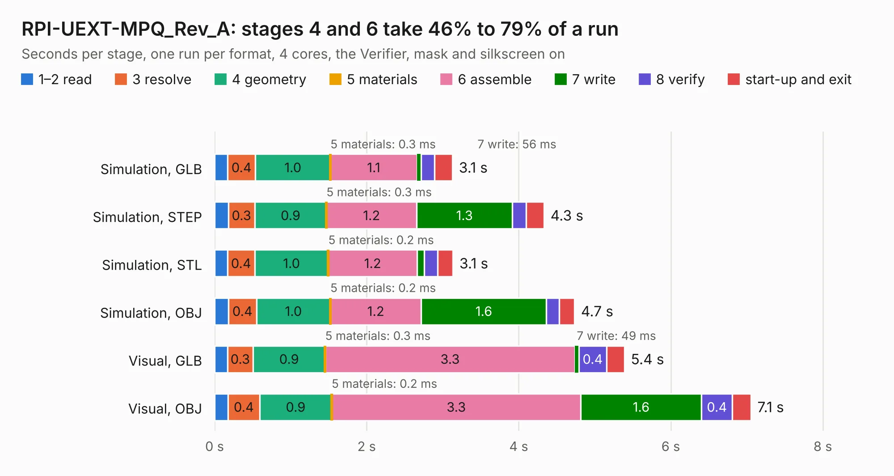

| Mode and format | 1–2 read | 3 resolve | 4 geometry | 5 materials | 6 assemble | 7 write | 8 verify | start-up and exit | Total |
|---|---:|---:|---:|---:|---:|---:|---:|---:|---:|
| Simulation, GLB | 0.2 | 0.4 | 1.0 | 0.3&nbsp;ms | 1.1 | 56&nbsp;ms | 0.2 | 0.2 | 3.1 |
| Simulation, STEP | 0.2 | 0.3 | 0.9 | 0.3&nbsp;ms | 1.2 | 1.3 | 0.2 | 0.2 | 4.3 |
| Simulation, STL | 0.2 | 0.4 | 1.0 | 0.2&nbsp;ms | 1.2 | 94&nbsp;ms | 0.2 | 0.2 | 3.1 |
| Simulation, OBJ | 0.2 | 0.4 | 1.0 | 0.2&nbsp;ms | 1.2 | 1.6 | 0.2 | 0.2 | 4.7 |
| Visual, GLB | 0.2 | 0.3 | 0.9 | 0.3&nbsp;ms | 3.3 | 49&nbsp;ms | 0.4 | 0.2 | 5.4 |
| Visual, OBJ | 0.2 | 0.4 | 0.9 | 0.2&nbsp;ms | 3.3 | 1.6 | 0.4 | 0.2 | 7.1 |

<table align="center"><tr><td valign="top">

| Board | Repo: [OLIMEX/UEXT-ADAPTERS](https://github.com/OLIMEX/UEXT-ADAPTERS) Board: `RPI-UEXT-MPQ_Rev_A.kicad_pcb` |
|---|---|
| Folder | RPI-UEXT-MPQ / Hardware |
| Complexity | 185&nbsp;/&nbsp;1000 (size&nbsp;140, features&nbsp;45) |
| KESE&nbsp;features | through vias, rounded, trapezoid or chamfered pads, filled zones |
| Tested | 9th November 2026 |
| Copper&nbsp;layers | 2 |
| File&nbsp;format | KiCad 5 (20171130) |
| Parts,&nbsp;tracks,&nbsp;vias | 5, 320, 77 |
| Triangles,&nbsp;simulation | 348,874 in 47 parts |
| Verifier | PASS in all six runs |

</td><td valign="top">

<table>
<tr><th>File type</th><th>File size</th><th>Peak memory used</th></tr>
<tr><th colspan="3" align="left">Simulation</th></tr>
<tr><td>GLB</td><td align="right">12&nbsp;MB</td><td align="right">302&nbsp;MB</td></tr>
<tr><td>STEP</td><td align="right">60&nbsp;MB</td><td align="right">309&nbsp;MB</td></tr>
<tr><td>STL</td><td align="right">17&nbsp;MB</td><td align="right">296&nbsp;MB</td></tr>
<tr><td>OBJ</td><td align="right">35&nbsp;MB</td><td align="right">294&nbsp;MB</td></tr>
<tr><th colspan="3" align="left">Visual</th></tr>
<tr><td>GLB</td><td align="right">11&nbsp;MB</td><td align="right">310&nbsp;MB</td></tr>
<tr><td>OBJ</td><td align="right">33&nbsp;MB</td><td align="right">309&nbsp;MB</td></tr>
</table>

</td></tr></table>

## 1990. UEXT-MPQ_Rev_A

| Mode and format | 1–2 read | 3 resolve | 4 geometry | 5 materials | 6 assemble | 7 write | 8 verify | start-up and exit | Total |
|---|---:|---:|---:|---:|---:|---:|---:|---:|---:|
| Simulation, GLB | 0.1 | 0.2 | 0.7 | 0.1&nbsp;ms | 0.8 | 41&nbsp;ms | 96&nbsp;ms | 0.2 | 2.2 |
| Simulation, STEP | 0.1 | 0.2 | 0.7 | 0.1&nbsp;ms | 0.8 | 1.1 | 0.1 | 0.2 | 3.2 |
| Simulation, STL | 0.2 | 0.3 | 0.7 | 0.2&nbsp;ms | 0.9 | 59&nbsp;ms | 0.1 | 0.2 | 2.4 |
| Simulation, OBJ | 0.1 | 0.2 | 0.7 | 0.2&nbsp;ms | 0.8 | 1.0 | 0.1 | 0.2 | 3.3 |
| Visual, GLB | 0.1 | 0.2 | 0.7 | 0.1&nbsp;ms | 1.8 | 27&nbsp;ms | 0.2 | 0.2 | 3.2 |
| Visual, OBJ | 0.1 | 0.2 | 0.7 | 0.2&nbsp;ms | 1.7 | 0.9 | 0.2 | 0.2 | 4.1 |

<table align="center"><tr><td valign="top">

| Board | Repo: [OLIMEX/UEXT-ADAPTERS](https://github.com/OLIMEX/UEXT-ADAPTERS) Board: `UEXT-MPQ_Rev_A.kicad_pcb` |
|---|---|
| Folder | UEXT-MPQ / Hardware |
| Complexity | 182&nbsp;/&nbsp;1000 (size&nbsp;127, features&nbsp;55) |
| KESE&nbsp;features | through vias, rounded, trapezoid or chamfered pads, filled zones, curved board outline |
| Tested | 9th November 2026 |
| Copper&nbsp;layers | 2 |
| File&nbsp;format | KiCad 5 (20171130) |
| Parts,&nbsp;tracks,&nbsp;vias | 4, 149, 45 |
| Triangles,&nbsp;simulation | 215,276 in 21 parts |
| Verifier | PASS in all six runs |

</td><td valign="top">

<table>
<tr><th>File type</th><th>File size</th><th>Peak memory used</th></tr>
<tr><th colspan="3" align="left">Simulation</th></tr>
<tr><td>GLB</td><td align="right">7.6&nbsp;MB</td><td align="right">221&nbsp;MB</td></tr>
<tr><td>STEP</td><td align="right">37&nbsp;MB</td><td align="right">248&nbsp;MB</td></tr>
<tr><td>STL</td><td align="right">11&nbsp;MB</td><td align="right">219&nbsp;MB</td></tr>
<tr><td>OBJ</td><td align="right">22&nbsp;MB</td><td align="right">220&nbsp;MB</td></tr>
<tr><th colspan="3" align="left">Visual</th></tr>
<tr><td>GLB</td><td align="right">6.2&nbsp;MB</td><td align="right">199&nbsp;MB</td></tr>
<tr><td>OBJ</td><td align="right">18&nbsp;MB</td><td align="right">201&nbsp;MB</td></tr>
</table>

</td></tr></table>

## 1991. UEXT-P4Q_Rev_A

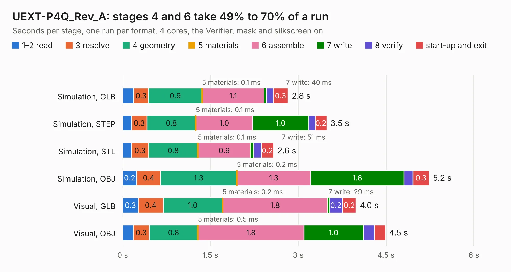

| Mode and format | 1–2 read | 3 resolve | 4 geometry | 5 materials | 6 assemble | 7 write | 8 verify | start-up and exit | Total |
|---|---:|---:|---:|---:|---:|---:|---:|---:|---:|
| Simulation, GLB | 0.2 | 0.3 | 0.9 | 0.1&nbsp;ms | 1.1 | 40&nbsp;ms | 0.1 | 0.3 | 2.8 |
| Simulation, STEP | 0.2 | 0.3 | 0.8 | 0.1&nbsp;ms | 1.0 | 1.0 | 0.1 | 0.2 | 3.5 |
| Simulation, STL | 0.1 | 0.3 | 0.8 | 0.1&nbsp;ms | 0.9 | 51&nbsp;ms | 0.1 | 0.2 | 2.6 |
| Simulation, OBJ | 0.2 | 0.4 | 1.3 | 0.2&nbsp;ms | 1.3 | 1.6 | 0.2 | 0.3 | 5.2 |
| Visual, GLB | 0.3 | 0.4 | 1.0 | 0.2&nbsp;ms | 1.8 | 29&nbsp;ms | 0.2 | 0.2 | 4.0 |
| Visual, OBJ | 0.2 | 0.3 | 0.8 | 0.5&nbsp;ms | 1.8 | 1.0 | 0.2 | 0.2 | 4.5 |

<table align="center"><tr><td valign="top">

| Board | Repo: [OLIMEX/UEXT-ADAPTERS](https://github.com/OLIMEX/UEXT-ADAPTERS) Board: `UEXT-P4Q_Rev_A.kicad_pcb` |
|---|---|
| Folder | UEXT-P4Q / Hardware |
| Complexity | 185&nbsp;/&nbsp;1000 (size&nbsp;130, features&nbsp;55) |
| KESE&nbsp;features | through vias, rounded, trapezoid or chamfered pads, filled zones, curved board outline |
| Tested | 9th November 2026 |
| Copper&nbsp;layers | 2 |
| File&nbsp;format | KiCad 5 (20171130) |
| Parts,&nbsp;tracks,&nbsp;vias | 6, 149, 44 |
| Triangles,&nbsp;simulation | 216,154 in 21 parts |
| Verifier | PASS in all six runs |

</td><td valign="top">

<table>
<tr><th>File type</th><th>File size</th><th>Peak memory used</th></tr>
<tr><th colspan="3" align="left">Simulation</th></tr>
<tr><td>GLB</td><td align="right">7.8&nbsp;MB</td><td align="right">222&nbsp;MB</td></tr>
<tr><td>STEP</td><td align="right">37&nbsp;MB</td><td align="right">250&nbsp;MB</td></tr>
<tr><td>STL</td><td align="right">11&nbsp;MB</td><td align="right">222&nbsp;MB</td></tr>
<tr><td>OBJ</td><td align="right">22&nbsp;MB</td><td align="right">222&nbsp;MB</td></tr>
<tr><th colspan="3" align="left">Visual</th></tr>
<tr><td>GLB</td><td align="right">6.5&nbsp;MB</td><td align="right">202&nbsp;MB</td></tr>
<tr><td>OBJ</td><td align="right">19&nbsp;MB</td><td align="right">200&nbsp;MB</td></tr>
</table>

</td></tr></table>

## 1992. UEXT-PQ_Rev_A

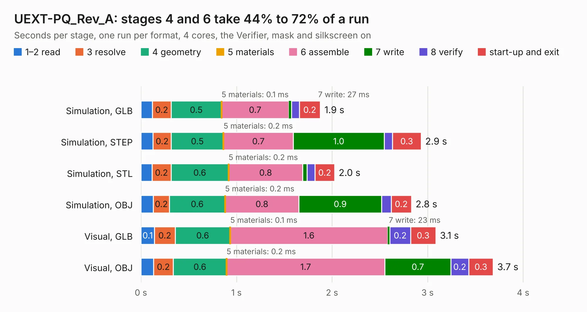

| Mode and format | 1–2 read | 3 resolve | 4 geometry | 5 materials | 6 assemble | 7 write | 8 verify | start-up and exit | Total |
|---|---:|---:|---:|---:|---:|---:|---:|---:|---:|
| Simulation, GLB | 0.1 | 0.2 | 0.5 | 0.1&nbsp;ms | 0.7 | 27&nbsp;ms | 83&nbsp;ms | 0.2 | 1.9 |
| Simulation, STEP | 0.1 | 0.2 | 0.5 | 0.2&nbsp;ms | 0.7 | 1.0 | 86&nbsp;ms | 0.3 | 2.9 |
| Simulation, STL | 0.1 | 0.2 | 0.6 | 0.2&nbsp;ms | 0.8 | 46&nbsp;ms | 82&nbsp;ms | 0.2 | 2.0 |
| Simulation, OBJ | 0.1 | 0.2 | 0.6 | 0.2&nbsp;ms | 0.8 | 0.9 | 0.1 | 0.2 | 2.8 |
| Visual, GLB | 0.1 | 0.2 | 0.6 | 0.1&nbsp;ms | 1.6 | 23&nbsp;ms | 0.2 | 0.3 | 3.1 |
| Visual, OBJ | 0.1 | 0.2 | 0.6 | 0.2&nbsp;ms | 1.7 | 0.7 | 0.2 | 0.3 | 3.7 |

<table align="center"><tr><td valign="top">

| Board | Repo: [OLIMEX/UEXT-ADAPTERS](https://github.com/OLIMEX/UEXT-ADAPTERS) Board: `UEXT-PQ_Rev_A.kicad_pcb` |
|---|---|
| Folder | UEXT-PQ / Hardware |
| Complexity | 171&nbsp;/&nbsp;1000 (size&nbsp;116, features&nbsp;55) |
| KESE&nbsp;features | through vias, rounded, trapezoid or chamfered pads, filled zones, curved board outline |
| Tested | 9th November 2026 |
| Copper&nbsp;layers | 2 |
| File&nbsp;format | KiCad 5 (20171130) |
| Parts,&nbsp;tracks,&nbsp;vias | 3, 82, 29 |
| Triangles,&nbsp;simulation | 160,958 in 21 parts |
| Verifier | PASS in all six runs |

</td><td valign="top">

<table>
<tr><th>File type</th><th>File size</th><th>Peak memory used</th></tr>
<tr><th colspan="3" align="left">Simulation</th></tr>
<tr><td>GLB</td><td align="right">5.7&nbsp;MB</td><td align="right">211&nbsp;MB</td></tr>
<tr><td>STEP</td><td align="right">28&nbsp;MB</td><td align="right">222&nbsp;MB</td></tr>
<tr><td>STL</td><td align="right">8.0&nbsp;MB</td><td align="right">204&nbsp;MB</td></tr>
<tr><td>OBJ</td><td align="right">16&nbsp;MB</td><td align="right">207&nbsp;MB</td></tr>
<tr><th colspan="3" align="left">Visual</th></tr>
<tr><td>GLB</td><td align="right">4.7&nbsp;MB</td><td align="right">173&nbsp;MB</td></tr>
<tr><td>OBJ</td><td align="right">13&nbsp;MB</td><td align="right">183&nbsp;MB</td></tr>
</table>

</td></tr></table>

## 1993. UEXT-LVL-SHIFT_Rev_A

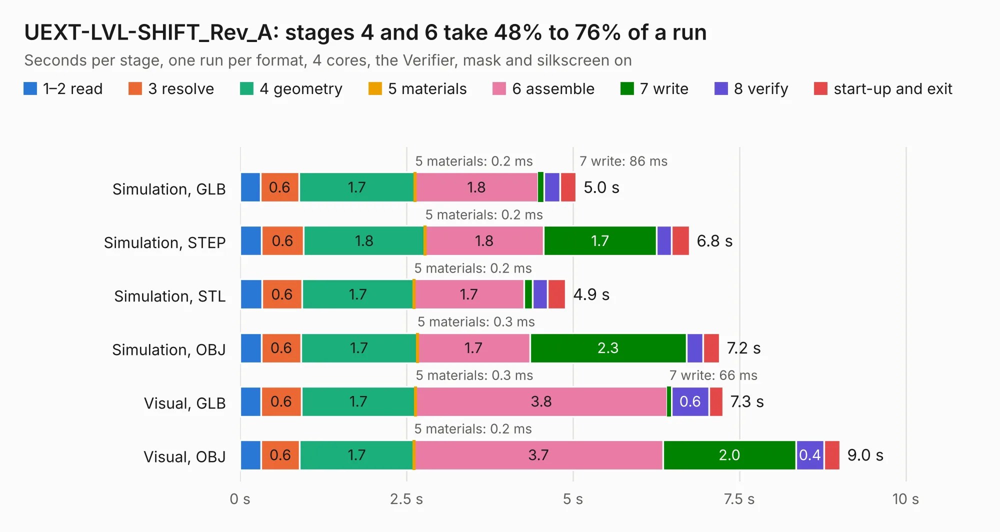

| Mode and format | 1–2 read | 3 resolve | 4 geometry | 5 materials | 6 assemble | 7 write | 8 verify | start-up and exit | Total |
|---|---:|---:|---:|---:|---:|---:|---:|---:|---:|
| Simulation, GLB | 0.3 | 0.6 | 1.7 | 0.2&nbsp;ms | 1.8 | 86&nbsp;ms | 0.2 | 0.2 | 5.0 |
| Simulation, STEP | 0.3 | 0.6 | 1.8 | 0.2&nbsp;ms | 1.8 | 1.7 | 0.2 | 0.3 | 6.8 |
| Simulation, STL | 0.3 | 0.6 | 1.7 | 0.2&nbsp;ms | 1.7 | 0.1 | 0.2 | 0.3 | 4.9 |
| Simulation, OBJ | 0.3 | 0.6 | 1.7 | 0.3&nbsp;ms | 1.7 | 2.3 | 0.3 | 0.2 | 7.2 |
| Visual, GLB | 0.3 | 0.6 | 1.7 | 0.3&nbsp;ms | 3.8 | 66&nbsp;ms | 0.6 | 0.2 | 7.3 |
| Visual, OBJ | 0.3 | 0.6 | 1.7 | 0.2&nbsp;ms | 3.7 | 2.0 | 0.4 | 0.2 | 9.0 |

<table align="center"><tr><td valign="top">

| Board | Repo: [OLIMEX/UEXT-LVL-SHIFT](https://github.com/OLIMEX/UEXT-LVL-SHIFT) Board: `UEXT-LVL-SHIFT_Rev_A.kicad_pcb` |
|---|---|
| Folder | HARDWARE / UEXT-LVL-SHIFT_Rev_A |
| Complexity | 264&nbsp;/&nbsp;1000 (size&nbsp;169, features&nbsp;95) |
| KESE&nbsp;features | through vias, rounded, trapezoid or chamfered pads, filled zones, knockout text, stack-up, dielectric εr and tanδ, mask and silkscreen colours |
| Tested | 9th November 2026 |
| Copper&nbsp;layers | 2 |
| File&nbsp;format | KiCad 10 (20260206) |
| Parts,&nbsp;tracks,&nbsp;vias | 28, 746, 130 |
| Triangles,&nbsp;simulation | 418,196 in 35 parts |
| Verifier | PASS in all six runs |

</td><td valign="top">

<table>
<tr><th>File type</th><th>File size</th><th>Peak memory used</th></tr>
<tr><th colspan="3" align="left">Simulation</th></tr>
<tr><td>GLB</td><td align="right">15&nbsp;MB</td><td align="right">295&nbsp;MB</td></tr>
<tr><td>STEP</td><td align="right">74&nbsp;MB</td><td align="right">336&nbsp;MB</td></tr>
<tr><td>STL</td><td align="right">21&nbsp;MB</td><td align="right">296&nbsp;MB</td></tr>
<tr><td>OBJ</td><td align="right">43&nbsp;MB</td><td align="right">342&nbsp;MB</td></tr>
<tr><th colspan="3" align="left">Visual</th></tr>
<tr><td>GLB</td><td align="right">12&nbsp;MB</td><td align="right">328&nbsp;MB</td></tr>
<tr><td>OBJ</td><td align="right">36&nbsp;MB</td><td align="right">327&nbsp;MB</td></tr>
</table>

</td></tr></table>

## 1994. mod-gyro

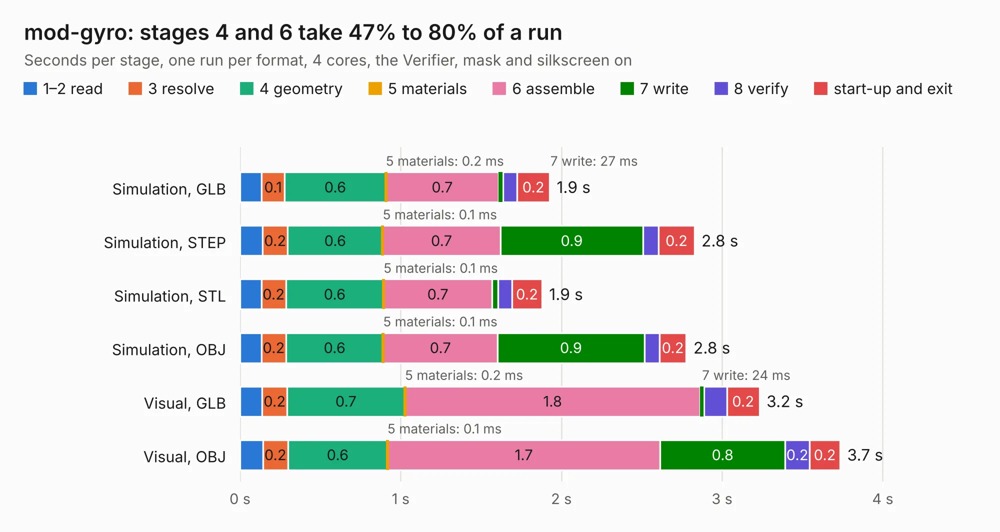

| Mode and format | 1–2 read | 3 resolve | 4 geometry | 5 materials | 6 assemble | 7 write | 8 verify | start-up and exit | Total |
|---|---:|---:|---:|---:|---:|---:|---:|---:|---:|
| Simulation, GLB | 0.1 | 0.1 | 0.6 | 0.2&nbsp;ms | 0.7 | 27&nbsp;ms | 88&nbsp;ms | 0.2 | 1.9 |
| Simulation, STEP | 0.1 | 0.2 | 0.6 | 0.1&nbsp;ms | 0.7 | 0.9 | 97&nbsp;ms | 0.2 | 2.8 |
| Simulation, STL | 0.1 | 0.2 | 0.6 | 0.1&nbsp;ms | 0.7 | 38&nbsp;ms | 87&nbsp;ms | 0.2 | 1.9 |
| Simulation, OBJ | 0.1 | 0.2 | 0.6 | 0.1&nbsp;ms | 0.7 | 0.9 | 94&nbsp;ms | 0.2 | 2.8 |
| Visual, GLB | 0.1 | 0.2 | 0.7 | 0.2&nbsp;ms | 1.8 | 24&nbsp;ms | 0.1 | 0.2 | 3.2 |
| Visual, OBJ | 0.1 | 0.2 | 0.6 | 0.1&nbsp;ms | 1.7 | 0.8 | 0.2 | 0.2 | 3.7 |

<table align="center"><tr><td valign="top">

| Board | Repo: [OLIMEX/UEXT-MODULES](https://github.com/OLIMEX/UEXT-MODULES) Board: `mod-gyro.kicad_pcb` |
|---|---|
| Folder | MOD-MPU9150 |
| Complexity | 164&nbsp;/&nbsp;1000 (size&nbsp;129, features&nbsp;35) |
| KESE&nbsp;features | through vias, filled zones |
| Tested | 9th November 2026 |
| Copper&nbsp;layers | 2 |
| File&nbsp;format | KiCad 4 (4) |
| Parts,&nbsp;tracks,&nbsp;vias | 14, 131, 9 |
| Triangles,&nbsp;simulation | 173,536 in 37 parts |
| Verifier | PASS in all six runs |

</td><td valign="top">

<table>
<tr><th>File type</th><th>File size</th><th>Peak memory used</th></tr>
<tr><th colspan="3" align="left">Simulation</th></tr>
<tr><td>GLB</td><td align="right">6.2&nbsp;MB</td><td align="right">209&nbsp;MB</td></tr>
<tr><td>STEP</td><td align="right">35&nbsp;MB</td><td align="right">234&nbsp;MB</td></tr>
<tr><td>STL</td><td align="right">8.7&nbsp;MB</td><td align="right">220&nbsp;MB</td></tr>
<tr><td>OBJ</td><td align="right">17&nbsp;MB</td><td align="right">212&nbsp;MB</td></tr>
<tr><th colspan="3" align="left">Visual</th></tr>
<tr><td>GLB</td><td align="right">5.6&nbsp;MB</td><td align="right">209&nbsp;MB</td></tr>
<tr><td>OBJ</td><td align="right">16&nbsp;MB</td><td align="right">208&nbsp;MB</td></tr>
</table>

</td></tr></table>

## 1995. mod-oled-128x64

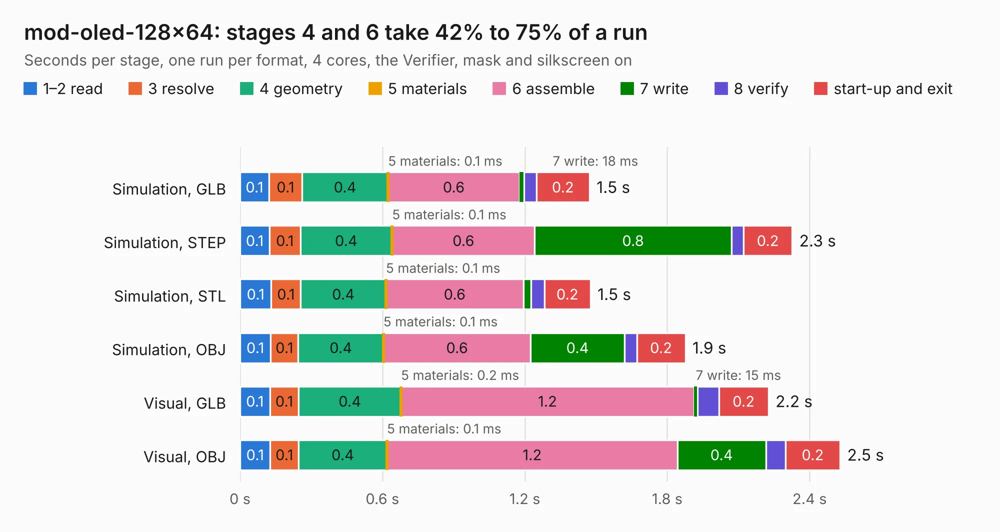

| Mode and format | 1–2 read | 3 resolve | 4 geometry | 5 materials | 6 assemble | 7 write | 8 verify | start-up and exit | Total |
|---|---:|---:|---:|---:|---:|---:|---:|---:|---:|
| Simulation, GLB | 0.1 | 0.1 | 0.4 | 0.1&nbsp;ms | 0.6 | 18&nbsp;ms | 53&nbsp;ms | 0.2 | 1.5 |
| Simulation, STEP | 0.1 | 0.1 | 0.4 | 0.1&nbsp;ms | 0.6 | 0.8 | 51&nbsp;ms | 0.2 | 2.3 |
| Simulation, STL | 0.1 | 0.1 | 0.4 | 0.1&nbsp;ms | 0.6 | 32&nbsp;ms | 56&nbsp;ms | 0.2 | 1.5 |
| Simulation, OBJ | 0.1 | 0.1 | 0.4 | 0.1&nbsp;ms | 0.6 | 0.4 | 53&nbsp;ms | 0.2 | 1.9 |
| Visual, GLB | 0.1 | 0.1 | 0.4 | 0.2&nbsp;ms | 1.2 | 15&nbsp;ms | 90&nbsp;ms | 0.2 | 2.2 |
| Visual, OBJ | 0.1 | 0.1 | 0.4 | 0.1&nbsp;ms | 1.2 | 0.4 | 82&nbsp;ms | 0.2 | 2.5 |

<table align="center"><tr><td valign="top">

| Board | Repo: [OLIMEX/UEXT-MODULES](https://github.com/OLIMEX/UEXT-MODULES) Board: `mod-oled-128x64.kicad_pcb` |
|---|---|
| Folder | MOD-OLED-128x64 |
| Complexity | 165&nbsp;/&nbsp;1000 (size&nbsp;130, features&nbsp;35) |
| KESE&nbsp;features | through vias, filled zones |
| Tested | 9th November 2026 |
| Copper&nbsp;layers | 2 |
| File&nbsp;format | KiCad 4 (4) |
| Parts,&nbsp;tracks,&nbsp;vias | 11, 174, 7 |
| Triangles,&nbsp;simulation | 69,228 in 29 parts |
| Verifier | PASS in all six runs |

</td><td valign="top">

<table>
<tr><th>File type</th><th>File size</th><th>Peak memory used</th></tr>
<tr><th colspan="3" align="left">Simulation</th></tr>
<tr><td>GLB</td><td align="right">2.6&nbsp;MB</td><td align="right">181&nbsp;MB</td></tr>
<tr><td>STEP</td><td align="right">15&nbsp;MB</td><td align="right">189&nbsp;MB</td></tr>
<tr><td>STL</td><td align="right">3.5&nbsp;MB</td><td align="right">179&nbsp;MB</td></tr>
<tr><td>OBJ</td><td align="right">7.0&nbsp;MB</td><td align="right">185&nbsp;MB</td></tr>
<tr><th colspan="3" align="left">Visual</th></tr>
<tr><td>GLB</td><td align="right">2.5&nbsp;MB</td><td align="right">153&nbsp;MB</td></tr>
<tr><td>OBJ</td><td align="right">6.8&nbsp;MB</td><td align="right">154&nbsp;MB</td></tr>
</table>

</td></tr></table>

## 1996. Ultra_Sound_Levitation_Rev_B

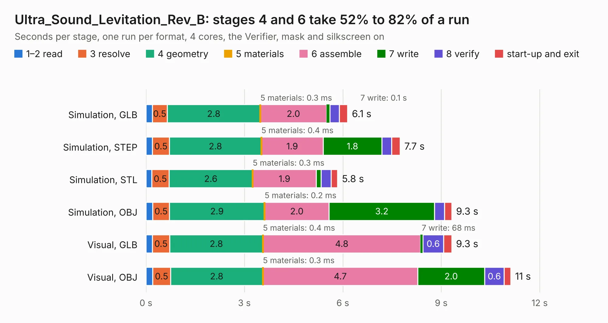

| Mode and format | 1–2 read | 3 resolve | 4 geometry | 5 materials | 6 assemble | 7 write | 8 verify | start-up and exit | Total |
|---|---:|---:|---:|---:|---:|---:|---:|---:|---:|
| Simulation, GLB | 0.2 | 0.5 | 2.8 | 0.3&nbsp;ms | 2.0 | 0.1 | 0.3 | 0.2 | 6.1 |
| Simulation, STEP | 0.2 | 0.5 | 2.8 | 0.4&nbsp;ms | 1.9 | 1.8 | 0.3 | 0.3 | 7.7 |
| Simulation, STL | 0.2 | 0.5 | 2.6 | 0.3&nbsp;ms | 1.9 | 0.1 | 0.3 | 0.2 | 5.8 |
| Simulation, OBJ | 0.2 | 0.5 | 2.9 | 0.2&nbsp;ms | 2.0 | 3.2 | 0.3 | 0.2 | 9.3 |
| Visual, GLB | 0.2 | 0.5 | 2.8 | 0.4&nbsp;ms | 4.8 | 68&nbsp;ms | 0.6 | 0.2 | 9.3 |
| Visual, OBJ | 0.2 | 0.5 | 2.8 | 0.3&nbsp;ms | 4.7 | 2.0 | 0.6 | 0.2 | 11.1 |

<table align="center"><tr><td valign="top">

| Board | Repo: [OLIMEX/Ultra-Sound-Levitation](https://github.com/OLIMEX/Ultra-Sound-Levitation) Board: `Ultra_Sound_Levitation_Rev_B.kicad_pcb` |
|---|---|
| Folder | HARDWARE / Ultra_Sound_Levitation_Rev_B |
| Complexity | 183&nbsp;/&nbsp;1000 (size&nbsp;148, features&nbsp;35) |
| KESE&nbsp;features | through vias, filled zones |
| Tested | 9th November 2026 |
| Copper&nbsp;layers | 2 |
| File&nbsp;format | KiCad 5 (20171130) |
| Parts,&nbsp;tracks,&nbsp;vias | 22, 220, 50 |
| Triangles,&nbsp;simulation | 641,300 in 37 parts |
| Verifier | PASS in all six runs |

</td><td valign="top">

<table>
<tr><th>File type</th><th>File size</th><th>Peak memory used</th></tr>
<tr><th colspan="3" align="left">Simulation</th></tr>
<tr><td>GLB</td><td align="right">22&nbsp;MB</td><td align="right">330&nbsp;MB</td></tr>
<tr><td>STEP</td><td align="right">106&nbsp;MB</td><td align="right">373&nbsp;MB</td></tr>
<tr><td>STL</td><td align="right">32&nbsp;MB</td><td align="right">322&nbsp;MB</td></tr>
<tr><td>OBJ</td><td align="right">66&nbsp;MB</td><td align="right">467&nbsp;MB</td></tr>
<tr><th colspan="3" align="left">Visual</th></tr>
<tr><td>GLB</td><td align="right">15&nbsp;MB</td><td align="right">391&nbsp;MB</td></tr>
<tr><td>OBJ</td><td align="right">45&nbsp;MB</td><td align="right">393&nbsp;MB</td></tr>
</table>

</td></tr></table>

## 1997. URC_revB

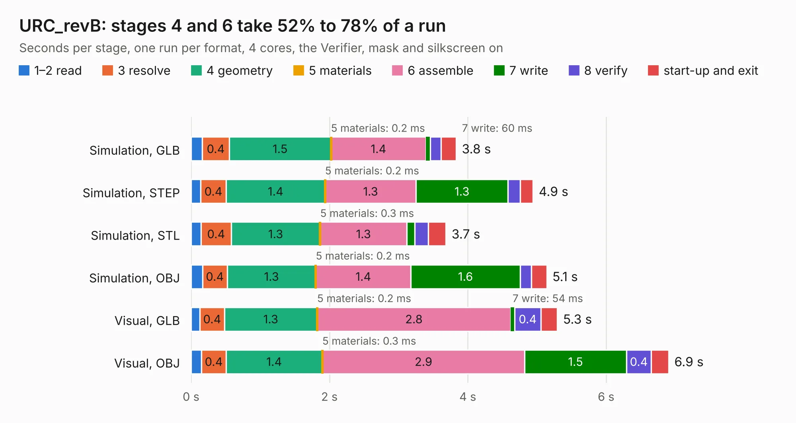

| Mode and format | 1–2 read | 3 resolve | 4 geometry | 5 materials | 6 assemble | 7 write | 8 verify | start-up and exit | Total |
|---|---:|---:|---:|---:|---:|---:|---:|---:|---:|
| Simulation, GLB | 0.2 | 0.4 | 1.5 | 0.2&nbsp;ms | 1.4 | 60&nbsp;ms | 0.2 | 0.2 | 3.8 |
| Simulation, STEP | 0.1 | 0.4 | 1.4 | 0.2&nbsp;ms | 1.3 | 1.3 | 0.2 | 0.2 | 4.9 |
| Simulation, STL | 0.1 | 0.4 | 1.3 | 0.3&nbsp;ms | 1.3 | 0.1 | 0.2 | 0.3 | 3.7 |
| Simulation, OBJ | 0.2 | 0.4 | 1.3 | 0.2&nbsp;ms | 1.4 | 1.6 | 0.2 | 0.2 | 5.1 |
| Visual, GLB | 0.1 | 0.4 | 1.3 | 0.2&nbsp;ms | 2.8 | 54&nbsp;ms | 0.4 | 0.2 | 5.3 |
| Visual, OBJ | 0.2 | 0.4 | 1.4 | 0.3&nbsp;ms | 2.9 | 1.5 | 0.4 | 0.3 | 6.9 |

<table align="center"><tr><td valign="top">

| Board | Repo: [OLIMEX/URC](https://github.com/OLIMEX/URC) Board: `URC_revB.kicad_pcb` |
|---|---|
| Folder | HARDWARE |
| Complexity | 204&nbsp;/&nbsp;1000 (size&nbsp;149, features&nbsp;55) |
| KESE&nbsp;features | through vias, rounded, trapezoid or chamfered pads, filled zones, curved board outline |
| Tested | 9th November 2026 |
| Copper&nbsp;layers | 2 |
| File&nbsp;format | KiCad 6 (20190421) |
| Parts,&nbsp;tracks,&nbsp;vias | 31, 215, 34 |
| Triangles,&nbsp;simulation | 328,142 in 31 parts |
| Verifier | PASS in all six runs |

</td><td valign="top">

<table>
<tr><th>File type</th><th>File size</th><th>Peak memory used</th></tr>
<tr><th colspan="3" align="left">Simulation</th></tr>
<tr><td>GLB</td><td align="right">12&nbsp;MB</td><td align="right">248&nbsp;MB</td></tr>
<tr><td>STEP</td><td align="right">60&nbsp;MB</td><td align="right">290&nbsp;MB</td></tr>
<tr><td>STL</td><td align="right">16&nbsp;MB</td><td align="right">255&nbsp;MB</td></tr>
<tr><td>OBJ</td><td align="right">34&nbsp;MB</td><td align="right">277&nbsp;MB</td></tr>
<tr><th colspan="3" align="left">Visual</th></tr>
<tr><td>GLB</td><td align="right">9.6&nbsp;MB</td><td align="right">276&nbsp;MB</td></tr>
<tr><td>OBJ</td><td align="right">28&nbsp;MB</td><td align="right">280&nbsp;MB</td></tr>
</table>

</td></tr></table>

## 1998. USB-4SERIAL_Rev_B

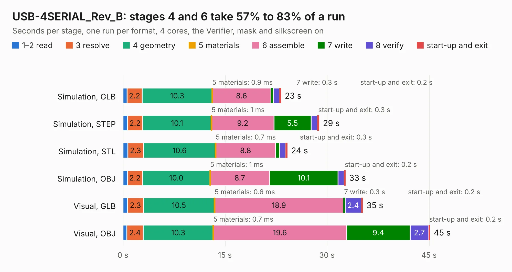

| Mode and format | 1–2 read | 3 resolve | 4 geometry | 5 materials | 6 assemble | 7 write | 8 verify | start-up and exit | Total |
|---|---:|---:|---:|---:|---:|---:|---:|---:|---:|
| Simulation, GLB | 0.6 | 2.2 | 10.3 | 0.9&nbsp;ms | 8.6 | 0.3 | 0.9 | 0.2 | 23.3 |
| Simulation, STEP | 0.7 | 2.2 | 10.1 | 1&nbsp;ms | 9.2 | 5.5 | 0.9 | 0.3 | 28.9 |
| Simulation, STL | 0.7 | 2.3 | 10.6 | 0.7&nbsp;ms | 8.8 | 0.6 | 0.9 | 0.3 | 24.2 |
| Simulation, OBJ | 0.7 | 2.2 | 10.0 | 1&nbsp;ms | 8.7 | 10.1 | 0.9 | 0.2 | 32.7 |
| Visual, GLB | 0.7 | 2.3 | 10.5 | 0.6&nbsp;ms | 18.9 | 0.3 | 2.4 | 0.2 | 35.3 |
| Visual, OBJ | 0.6 | 2.4 | 10.3 | 0.7&nbsp;ms | 19.6 | 9.4 | 2.7 | 0.2 | 45.2 |

<table align="center"><tr><td valign="top">

| Board | Repo: [OLIMEX/USB-4SERIAL](https://github.com/OLIMEX/USB-4SERIAL) Board: `USB-4SERIAL_Rev_B.kicad_pcb` |
|---|---|
| Folder | HARDWARE / USB-4SERIAL_Rev_B |
| Complexity | 288&nbsp;/&nbsp;1000 (size&nbsp;233, features&nbsp;55) |
| KESE&nbsp;features | through vias, slotted holes, filled zones, copper text |
| Tested | 9th November 2026 |
| Copper&nbsp;layers | 2 |
| File&nbsp;format | KiCad 5 (20171130) |
| Parts,&nbsp;tracks,&nbsp;vias | 88, 1,588, 271 |
| Triangles,&nbsp;simulation | 1,964,302 in 140 parts |
| Verifier | PASS in all six runs |

</td><td valign="top">

<table>
<tr><th>File type</th><th>File size</th><th>Peak memory used</th></tr>
<tr><th colspan="3" align="left">Simulation</th></tr>
<tr><td>GLB</td><td align="right">69&nbsp;MB</td><td align="right">689&nbsp;MB</td></tr>
<tr><td>STEP</td><td align="right">368&nbsp;MB</td><td align="right">930&nbsp;MB</td></tr>
<tr><td>STL</td><td align="right">98&nbsp;MB</td><td align="right">694&nbsp;MB</td></tr>
<tr><td>OBJ</td><td align="right">209&nbsp;MB</td><td align="right">1.3&nbsp;GB</td></tr>
<tr><th colspan="3" align="left">Visual</th></tr>
<tr><td>GLB</td><td align="right">58&nbsp;MB</td><td align="right">975&nbsp;MB</td></tr>
<tr><td>OBJ</td><td align="right">176&nbsp;MB</td><td align="right">1.3&nbsp;GB</td></tr>
</table>

</td></tr></table>

## 1999. USB-GIGABIT_Rev_C

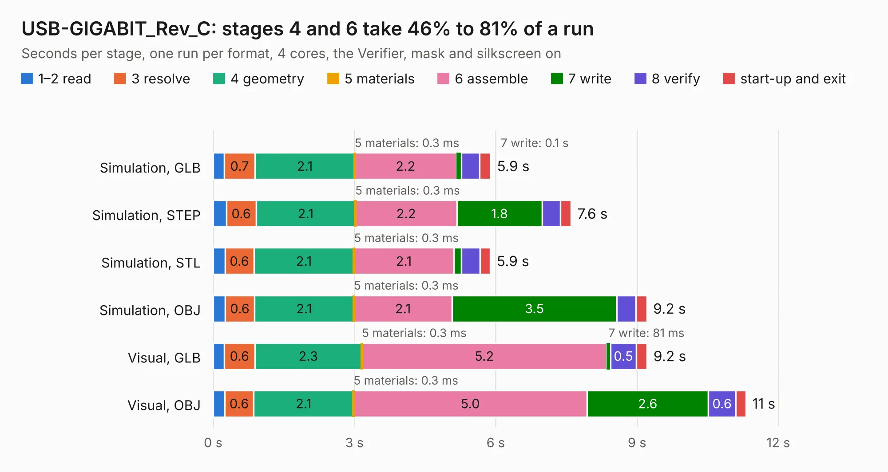

| Mode and format | 1–2 read | 3 resolve | 4 geometry | 5 materials | 6 assemble | 7 write | 8 verify | start-up and exit | Total |
|---|---:|---:|---:|---:|---:|---:|---:|---:|---:|
| Simulation, GLB | 0.2 | 0.7 | 2.1 | 0.3&nbsp;ms | 2.2 | 0.1 | 0.4 | 0.2 | 5.9 |
| Simulation, STEP | 0.3 | 0.6 | 2.1 | 0.3&nbsp;ms | 2.2 | 1.8 | 0.4 | 0.2 | 7.6 |
| Simulation, STL | 0.3 | 0.6 | 2.1 | 0.3&nbsp;ms | 2.1 | 0.2 | 0.4 | 0.2 | 5.9 |
| Simulation, OBJ | 0.3 | 0.6 | 2.1 | 0.3&nbsp;ms | 2.1 | 3.5 | 0.4 | 0.2 | 9.2 |
| Visual, GLB | 0.2 | 0.6 | 2.3 | 0.3&nbsp;ms | 5.2 | 81&nbsp;ms | 0.5 | 0.2 | 9.2 |
| Visual, OBJ | 0.2 | 0.6 | 2.1 | 0.3&nbsp;ms | 5.0 | 2.6 | 0.6 | 0.2 | 11.3 |

<table align="center"><tr><td valign="top">

| Board | Repo: [OLIMEX/USB-GIGABIT](https://github.com/OLIMEX/USB-GIGABIT) Board: `USB-GIGABIT_Rev_C.kicad_pcb` |
|---|---|
| Folder | HARDWARE / USB-GIGABIT-Rev.C |
| Complexity | 269&nbsp;/&nbsp;1000 (size&nbsp;224, features&nbsp;45) |
| KESE&nbsp;features | through vias, slotted holes, filled zones |
| Tested | 9th November 2026 |
| Copper&nbsp;layers | 4 |
| File&nbsp;format | KiCad 6 (20190905) |
| Parts,&nbsp;tracks,&nbsp;vias | 48, 582, 54 |
| Triangles,&nbsp;simulation | 637,954 in 61 parts |
| Verifier | PASS in all six runs |

</td><td valign="top">

<table>
<tr><th>File type</th><th>File size</th><th>Peak memory used</th></tr>
<tr><th colspan="3" align="left">Simulation</th></tr>
<tr><td>GLB</td><td align="right">22&nbsp;MB</td><td align="right">335&nbsp;MB</td></tr>
<tr><td>STEP</td><td align="right">98&nbsp;MB</td><td align="right">371&nbsp;MB</td></tr>
<tr><td>STL</td><td align="right">32&nbsp;MB</td><td align="right">343&nbsp;MB</td></tr>
<tr><td>OBJ</td><td align="right">66&nbsp;MB</td><td align="right">470&nbsp;MB</td></tr>
<tr><th colspan="3" align="left">Visual</th></tr>
<tr><td>GLB</td><td align="right">16&nbsp;MB</td><td align="right">394&nbsp;MB</td></tr>
<tr><td>OBJ</td><td align="right">47&nbsp;MB</td><td align="right">410&nbsp;MB</td></tr>
</table>

</td></tr></table>

## 2000. USB-GIGABIT_Rev_D

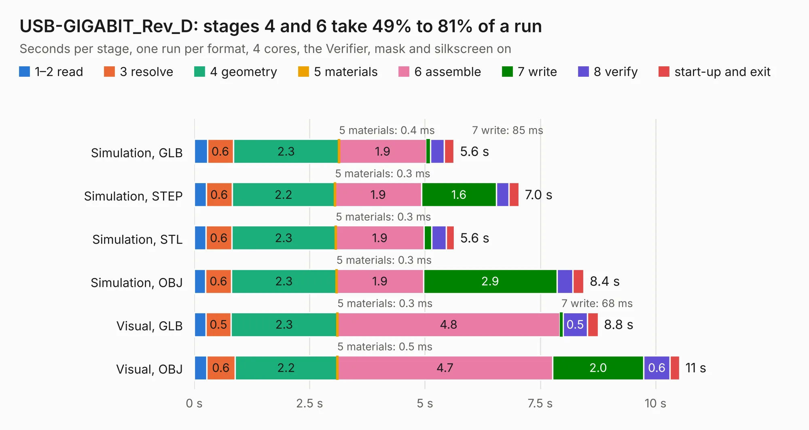

| Mode and format | 1–2 read | 3 resolve | 4 geometry | 5 materials | 6 assemble | 7 write | 8 verify | start-up and exit | Total |
|---|---:|---:|---:|---:|---:|---:|---:|---:|---:|
| Simulation, GLB | 0.3 | 0.6 | 2.3 | 0.4&nbsp;ms | 1.9 | 85&nbsp;ms | 0.3 | 0.2 | 5.6 |
| Simulation, STEP | 0.3 | 0.6 | 2.2 | 0.3&nbsp;ms | 1.9 | 1.6 | 0.3 | 0.2 | 7.0 |
| Simulation, STL | 0.3 | 0.6 | 2.3 | 0.3&nbsp;ms | 1.9 | 0.2 | 0.3 | 0.2 | 5.6 |
| Simulation, OBJ | 0.2 | 0.6 | 2.3 | 0.3&nbsp;ms | 1.9 | 2.9 | 0.3 | 0.2 | 8.4 |
| Visual, GLB | 0.3 | 0.5 | 2.3 | 0.3&nbsp;ms | 4.8 | 68&nbsp;ms | 0.5 | 0.2 | 8.8 |
| Visual, OBJ | 0.3 | 0.6 | 2.2 | 0.5&nbsp;ms | 4.7 | 2.0 | 0.6 | 0.2 | 10.5 |

<table align="center"><tr><td valign="top">

| Board | Repo: [OLIMEX/USB-GIGABIT](https://github.com/OLIMEX/USB-GIGABIT) Board: `USB-GIGABIT_Rev_D.kicad_pcb` |
|---|---|
| Folder | HARDWARE / USB-GIGABIT-Rev.D |
| Complexity | 300&nbsp;/&nbsp;1000 (size&nbsp;225, features&nbsp;75) |
| KESE&nbsp;features | through vias, slotted holes, filled zones, stack-up, dielectric εr and tanδ |
| Tested | 9th November 2026 |
| Copper&nbsp;layers | 4 |
| File&nbsp;format | KiCad 7 (20221018) |
| Parts,&nbsp;tracks,&nbsp;vias | 48, 612, 70 |
| Triangles,&nbsp;simulation | 686,004 in 64 parts |
| Verifier | PASS in all six runs |

</td><td valign="top">

<table>
<tr><th>File type</th><th>File size</th><th>Peak memory used</th></tr>
<tr><th colspan="3" align="left">Simulation</th></tr>
<tr><td>GLB</td><td align="right">24&nbsp;MB</td><td align="right">352&nbsp;MB</td></tr>
<tr><td>STEP</td><td align="right">114&nbsp;MB</td><td align="right">392&nbsp;MB</td></tr>
<tr><td>STL</td><td align="right">34&nbsp;MB</td><td align="right">358&nbsp;MB</td></tr>
<tr><td>OBJ</td><td align="right">71&nbsp;MB</td><td align="right">511&nbsp;MB</td></tr>
<tr><th colspan="3" align="left">Visual</th></tr>
<tr><td>GLB</td><td align="right">17&nbsp;MB</td><td align="right">408&nbsp;MB</td></tr>
<tr><td>OBJ</td><td align="right">49&nbsp;MB</td><td align="right">410&nbsp;MB</td></tr>
</table>

</td></tr></table>

## 2001. USB-GIGABIT_Rev_E

| Mode and format | 1–2 read | 3 resolve | 4 geometry | 5 materials | 6 assemble | 7 write | 8 verify | start-up and exit | Total |
|---|---:|---:|---:|---:|---:|---:|---:|---:|---:|
| Simulation, GLB | 0.4 | 0.8 | 3.3 | 0.4&nbsp;ms | 2.4 | 0.1 | 0.4 | 0.2 | 7.5 |
| Simulation, STEP | 0.3 | 0.8 | 3.2 | 0.4&nbsp;ms | 2.4 | 2.0 | 0.4 | 0.2 | 9.3 |
| Simulation, STL | 0.3 | 0.8 | 3.2 | 0.3&nbsp;ms | 2.4 | 0.2 | 0.4 | 0.3 | 7.5 |
| Simulation, OBJ | 0.3 | 0.7 | 3.2 | 0.3&nbsp;ms | 2.3 | 4.1 | 0.4 | 0.2 | 11.3 |
| Visual, GLB | 0.3 | 0.7 | 3.2 | 0.4&nbsp;ms | 6.0 | 92&nbsp;ms | 0.7 | 0.3 | 11.4 |
| Visual, OBJ | 0.3 | 0.8 | 3.3 | 0.4&nbsp;ms | 5.7 | 2.7 | 0.6 | 0.3 | 13.7 |

<table align="center"><tr><td valign="top">

| Board | Repo: [OLIMEX/USB-GIGABIT](https://github.com/OLIMEX/USB-GIGABIT) Board: `USB-GIGABIT_Rev_E.kicad_pcb` |
|---|---|
| Folder | HARDWARE / USB-GIGABIT-Rev.E |
| Complexity | 311&nbsp;/&nbsp;1000 (size&nbsp;226, features&nbsp;85) |
| KESE&nbsp;features | through vias, slotted holes, filled zones, copper text, stack-up, dielectric εr and tanδ |
| Tested | 9th November 2026 |
| Copper&nbsp;layers | 4 |
| File&nbsp;format | KiCad 7 (20221018) |
| Parts,&nbsp;tracks,&nbsp;vias | 48, 637, 69 |
| Triangles,&nbsp;simulation | 685,636 in 65 parts |
| Verifier | PASS in all six runs |

</td><td valign="top">

<table>
<tr><th>File type</th><th>File size</th><th>Peak memory used</th></tr>
<tr><th colspan="3" align="left">Simulation</th></tr>
<tr><td>GLB</td><td align="right">24&nbsp;MB</td><td align="right">354&nbsp;MB</td></tr>
<tr><td>STEP</td><td align="right">115&nbsp;MB</td><td align="right">401&nbsp;MB</td></tr>
<tr><td>STL</td><td align="right">34&nbsp;MB</td><td align="right">338&nbsp;MB</td></tr>
<tr><td>OBJ</td><td align="right">71&nbsp;MB</td><td align="right">513&nbsp;MB</td></tr>
<tr><th colspan="3" align="left">Visual</th></tr>
<tr><td>GLB</td><td align="right">17&nbsp;MB</td><td align="right">408&nbsp;MB</td></tr>
<tr><td>OBJ</td><td align="right">49&nbsp;MB</td><td align="right">427&nbsp;MB</td></tr>
</table>

</td></tr></table>

## 2002. USB-gLINK_Rev_C

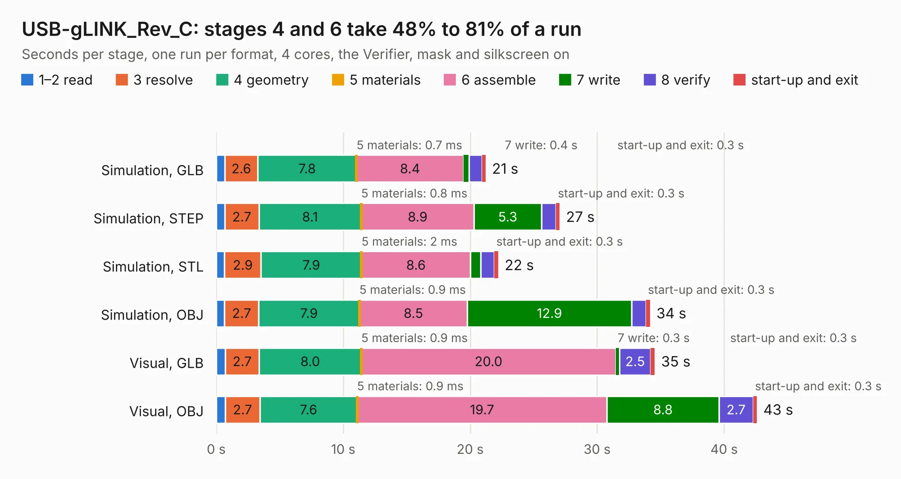

| Mode and format | 1–2 read | 3 resolve | 4 geometry | 5 materials | 6 assemble | 7 write | 8 verify | start-up and exit | Total |
|---|---:|---:|---:|---:|---:|---:|---:|---:|---:|
| Simulation, GLB | 0.7 | 2.6 | 7.8 | 0.7&nbsp;ms | 8.4 | 0.4 | 1.0 | 0.3 | 21.2 |
| Simulation, STEP | 0.7 | 2.7 | 8.1 | 0.8&nbsp;ms | 8.9 | 5.3 | 1.2 | 0.3 | 27.0 |
| Simulation, STL | 0.7 | 2.9 | 7.9 | 2&nbsp;ms | 8.6 | 0.8 | 1.1 | 0.3 | 22.2 |
| Simulation, OBJ | 0.7 | 2.7 | 7.9 | 0.9&nbsp;ms | 8.5 | 12.9 | 1.1 | 0.3 | 34.2 |
| Visual, GLB | 0.7 | 2.7 | 8.0 | 0.9&nbsp;ms | 20.0 | 0.3 | 2.5 | 0.3 | 34.5 |
| Visual, OBJ | 0.7 | 2.7 | 7.6 | 0.9&nbsp;ms | 19.7 | 8.8 | 2.7 | 0.3 | 42.6 |

<table align="center"><tr><td valign="top">

| Board | Repo: [OLIMEX/USB-gLINK](https://github.com/OLIMEX/USB-gLINK) Board: `USB-gLINK_Rev_C.kicad_pcb` |
|---|---|
| Folder | HARDWARE / USB-gLINK_Rev.C |
| Complexity | 338&nbsp;/&nbsp;1000 (size&nbsp;273, features&nbsp;65) |
| KESE&nbsp;features | through vias, slotted holes, rounded, trapezoid or chamfered pads, filled zones, copper text |
| Tested | 9th November 2026 |
| Copper&nbsp;layers | 4 |
| File&nbsp;format | KiCad 5 (20171130) |
| Parts,&nbsp;tracks,&nbsp;vias | 96, 3,212, 435 |
| Triangles,&nbsp;simulation | 2,140,928 in 143 parts |
| Verifier | PASS in all six runs |

</td><td valign="top">

<table>
<tr><th>File type</th><th>File size</th><th>Peak memory used</th></tr>
<tr><th colspan="3" align="left">Simulation</th></tr>
<tr><td>GLB</td><td align="right">75&nbsp;MB</td><td align="right">797&nbsp;MB</td></tr>
<tr><td>STEP</td><td align="right">272&nbsp;MB</td><td align="right">919&nbsp;MB</td></tr>
<tr><td>STL</td><td align="right">107&nbsp;MB</td><td align="right">818&nbsp;MB</td></tr>
<tr><td>OBJ</td><td align="right">228&nbsp;MB</td><td align="right">1.5&nbsp;GB</td></tr>
<tr><th colspan="3" align="left">Visual</th></tr>
<tr><td>GLB</td><td align="right">49&nbsp;MB</td><td align="right">883&nbsp;MB</td></tr>
<tr><td>OBJ</td><td align="right">151&nbsp;MB</td><td align="right">1.1&nbsp;GB</td></tr>
</table>

</td></tr></table>

## 2003. USB-gLINK_Rev_D

| Mode and format | 1–2 read | 3 resolve | 4 geometry | 5 materials | 6 assemble | 7 write | 8 verify | start-up and exit | Total |
|---|---:|---:|---:|---:|---:|---:|---:|---:|---:|
| Simulation, GLB | 0.6 | 2.3 | 7.1 | 0.8&nbsp;ms | 7.8 | 0.3 | 1.0 | 0.3 | 19.5 |
| Simulation, STEP | 0.6 | 2.3 | 7.2 | 0.9&nbsp;ms | 7.5 | 4.8 | 1.0 | 0.3 | 23.8 |
| Simulation, STL | 0.6 | 2.3 | 7.1 | 1&nbsp;ms | 7.5 | 0.9 | 1.1 | 0.3 | 19.7 |
| Simulation, OBJ | 0.7 | 2.3 | 7.1 | 0.9&nbsp;ms | 7.0 | 10.8 | 1.1 | 0.2 | 29.2 |
| Visual, GLB | 0.6 | 2.3 | 6.9 | 0.9&nbsp;ms | 18.3 | 0.2 | 2.5 | 0.2 | 31.0 |
| Visual, OBJ | 0.6 | 2.2 | 6.8 | 0.9&nbsp;ms | 17.8 | 7.2 | 2.8 | 0.3 | 37.8 |

<table align="center"><tr><td valign="top">

| Board | Repo: [OLIMEX/USB-gLINK](https://github.com/OLIMEX/USB-gLINK) Board: `USB-gLINK_Rev_D.kicad_pcb` |
|---|---|
| Folder | HARDWARE / USB-gLINK_Rev.D |
| Complexity | 337&nbsp;/&nbsp;1000 (size&nbsp;272, features&nbsp;65) |
| KESE&nbsp;features | through vias, slotted holes, rounded, trapezoid or chamfered pads, filled zones, copper text |
| Tested | 9th November 2026 |
| Copper&nbsp;layers | 4 |
| File&nbsp;format | KiCad 5 (20171130) |
| Parts,&nbsp;tracks,&nbsp;vias | 102, 3,024, 408 |
| Triangles,&nbsp;simulation | 2,188,064 in 143 parts |
| Verifier | PASS in all six runs |

</td><td valign="top">

<table>
<tr><th>File type</th><th>File size</th><th>Peak memory used</th></tr>
<tr><th colspan="3" align="left">Simulation</th></tr>
<tr><td>GLB</td><td align="right">77&nbsp;MB</td><td align="right">830&nbsp;MB</td></tr>
<tr><td>STEP</td><td align="right">295&nbsp;MB</td><td align="right">978&nbsp;MB</td></tr>
<tr><td>STL</td><td align="right">109&nbsp;MB</td><td align="right">909&nbsp;MB</td></tr>
<tr><td>OBJ</td><td align="right">233&nbsp;MB</td><td align="right">1.5&nbsp;GB</td></tr>
<tr><th colspan="3" align="left">Visual</th></tr>
<tr><td>GLB</td><td align="right">51&nbsp;MB</td><td align="right">941&nbsp;MB</td></tr>
<tr><td>OBJ</td><td align="right">159&nbsp;MB</td><td align="right">1.2&nbsp;GB</td></tr>
</table>

</td></tr></table>

## 2004. USB-NeoHUB_Rev_A

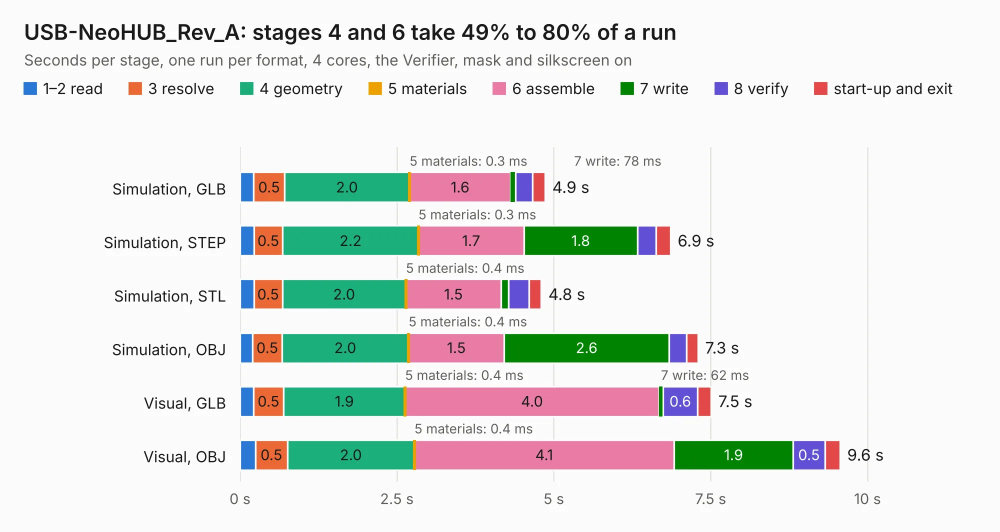

| Mode and format | 1–2 read | 3 resolve | 4 geometry | 5 materials | 6 assemble | 7 write | 8 verify | start-up and exit | Total |
|---|---:|---:|---:|---:|---:|---:|---:|---:|---:|
| Simulation, GLB | 0.2 | 0.5 | 2.0 | 0.3&nbsp;ms | 1.6 | 78&nbsp;ms | 0.3 | 0.2 | 4.9 |
| Simulation, STEP | 0.2 | 0.5 | 2.2 | 0.3&nbsp;ms | 1.7 | 1.8 | 0.3 | 0.2 | 6.9 |
| Simulation, STL | 0.2 | 0.5 | 2.0 | 0.4&nbsp;ms | 1.5 | 0.1 | 0.3 | 0.2 | 4.8 |
| Simulation, OBJ | 0.2 | 0.5 | 2.0 | 0.4&nbsp;ms | 1.5 | 2.6 | 0.3 | 0.2 | 7.3 |
| Visual, GLB | 0.2 | 0.5 | 1.9 | 0.4&nbsp;ms | 4.0 | 62&nbsp;ms | 0.6 | 0.2 | 7.5 |
| Visual, OBJ | 0.2 | 0.5 | 2.0 | 0.4&nbsp;ms | 4.1 | 1.9 | 0.5 | 0.2 | 9.6 |

<table align="center"><tr><td valign="top">

| Board | Repo: [OLIMEX/USB-NeoHub](https://github.com/OLIMEX/USB-NeoHub) Board: `USB-NeoHUB_Rev_A.kicad_pcb` |
|---|---|
| Folder | HARDWARE / USB-NeoHub-Rev.A |
| Complexity | 233&nbsp;/&nbsp;1000 (size&nbsp;158, features&nbsp;75) |
| KESE&nbsp;features | through vias, slotted holes, filled zones, stack-up, dielectric εr and tanδ |
| Tested | 9th November 2026 |
| Copper&nbsp;layers | 2 |
| File&nbsp;format | KiCad 7 (20221018) |
| Parts,&nbsp;tracks,&nbsp;vias | 23, 433, 75 |
| Triangles,&nbsp;simulation | 478,372 in 51 parts |
| Verifier | PASS in all six runs |

</td><td valign="top">

<table>
<tr><th>File type</th><th>File size</th><th>Peak memory used</th></tr>
<tr><th colspan="3" align="left">Simulation</th></tr>
<tr><td>GLB</td><td align="right">17&nbsp;MB</td><td align="right">300&nbsp;MB</td></tr>
<tr><td>STEP</td><td align="right">88&nbsp;MB</td><td align="right">324&nbsp;MB</td></tr>
<tr><td>STL</td><td align="right">24&nbsp;MB</td><td align="right">307&nbsp;MB</td></tr>
<tr><td>OBJ</td><td align="right">50&nbsp;MB</td><td align="right">376&nbsp;MB</td></tr>
<tr><th colspan="3" align="left">Visual</th></tr>
<tr><td>GLB</td><td align="right">13&nbsp;MB</td><td align="right">327&nbsp;MB</td></tr>
<tr><td>OBJ</td><td align="right">39&nbsp;MB</td><td align="right">342&nbsp;MB</td></tr>
</table>

</td></tr></table>

## 2005. usb-sata_Rev.A

| Mode and format | 1–2 read | 3 resolve | 4 geometry | 5 materials | 6 assemble | 7 write | 8 verify | start-up and exit | Total |
|---|---:|---:|---:|---:|---:|---:|---:|---:|---:|
| Simulation, GLB | 0.2 | 0.4 | 1.8 | 0.5&nbsp;ms | 1.4 | 70&nbsp;ms | 0.2 | 0.2 | 4.3 |
| Simulation, STEP | 0.2 | 0.4 | 1.7 | 0.2&nbsp;ms | 1.4 | 1.3 | 0.2 | 0.2 | 5.4 |
| Simulation, STL | 0.2 | 0.4 | 1.7 | 0.2&nbsp;ms | 1.4 | 0.1 | 0.2 | 0.2 | 4.1 |
| Simulation, OBJ | 0.2 | 0.4 | 1.6 | 0.2&nbsp;ms | 1.3 | 1.9 | 0.2 | 0.2 | 5.9 |
| Visual, GLB | 0.2 | 0.4 | 1.7 | 0.2&nbsp;ms | 3.4 | 51&nbsp;ms | 0.4 | 0.2 | 6.3 |
| Visual, OBJ | 0.2 | 0.4 | 1.6 | 0.2&nbsp;ms | 3.3 | 1.4 | 0.5 | 0.2 | 7.5 |

<table align="center"><tr><td valign="top">

| Board | Repo: [OLIMEX/USB-SATA](https://github.com/OLIMEX/USB-SATA) Board: `usb-sata_Rev.A.kicad_pcb` |
|---|---|
| Folder | HARDWARE / USB-SATA-REV.A |
| Complexity | 267&nbsp;/&nbsp;1000 (size&nbsp;222, features&nbsp;45) |
| KESE&nbsp;features | through vias, slotted holes, filled zones |
| Tested | 9th November 2026 |
| Copper&nbsp;layers | 4 |
| File&nbsp;format | KiCad 6 (20190516) |
| Parts,&nbsp;tracks,&nbsp;vias | 48, 506, 51 |
| Triangles,&nbsp;simulation | 453,362 in 55 parts |
| Verifier | PASS in all six runs |

</td><td valign="top">

<table>
<tr><th>File type</th><th>File size</th><th>Peak memory used</th></tr>
<tr><th colspan="3" align="left">Simulation</th></tr>
<tr><td>GLB</td><td align="right">16&nbsp;MB</td><td align="right">288&nbsp;MB</td></tr>
<tr><td>STEP</td><td align="right">73&nbsp;MB</td><td align="right">328&nbsp;MB</td></tr>
<tr><td>STL</td><td align="right">23&nbsp;MB</td><td align="right">275&nbsp;MB</td></tr>
<tr><td>OBJ</td><td align="right">47&nbsp;MB</td><td align="right">371&nbsp;MB</td></tr>
<tr><th colspan="3" align="left">Visual</th></tr>
<tr><td>GLB</td><td align="right">12&nbsp;MB</td><td align="right">319&nbsp;MB</td></tr>
<tr><td>OBJ</td><td align="right">35&nbsp;MB</td><td align="right">317&nbsp;MB</td></tr>
</table>

</td></tr></table>

## 2006. USB-SERIAL-L_Rev_B

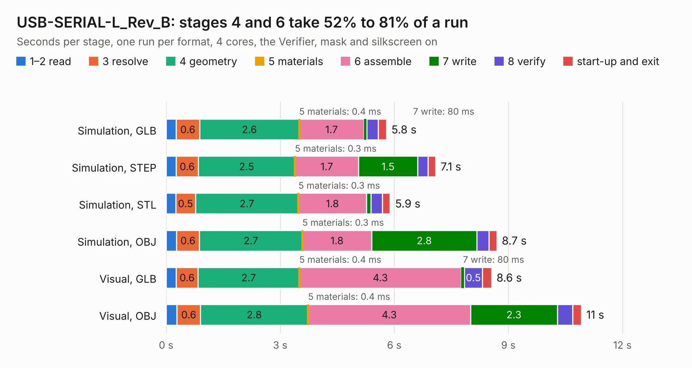

| Mode and format | 1–2 read | 3 resolve | 4 geometry | 5 materials | 6 assemble | 7 write | 8 verify | start-up and exit | Total |
|---|---:|---:|---:|---:|---:|---:|---:|---:|---:|
| Simulation, GLB | 0.3 | 0.6 | 2.6 | 0.4&nbsp;ms | 1.7 | 80&nbsp;ms | 0.3 | 0.2 | 5.8 |
| Simulation, STEP | 0.3 | 0.6 | 2.5 | 0.3&nbsp;ms | 1.7 | 1.5 | 0.3 | 0.2 | 7.1 |
| Simulation, STL | 0.3 | 0.5 | 2.7 | 0.3&nbsp;ms | 1.8 | 0.1 | 0.3 | 0.2 | 5.9 |
| Simulation, OBJ | 0.3 | 0.6 | 2.7 | 0.3&nbsp;ms | 1.8 | 2.8 | 0.3 | 0.2 | 8.7 |
| Visual, GLB | 0.3 | 0.6 | 2.7 | 0.4&nbsp;ms | 4.3 | 80&nbsp;ms | 0.5 | 0.2 | 8.6 |
| Visual, OBJ | 0.3 | 0.6 | 2.8 | 0.4&nbsp;ms | 4.3 | 2.3 | 0.4 | 0.2 | 10.9 |

<table align="center"><tr><td valign="top">

| Board | Repo: [OLIMEX/USB-SERIAL-L](https://github.com/OLIMEX/USB-SERIAL-L) Board: `USB-SERIAL-L_Rev_B.kicad_pcb` |
|---|---|
| Folder | HARDWARE / USB-SERIAL-L_Rev_B |
| Complexity | 280&nbsp;/&nbsp;1000 (size&nbsp;205, features&nbsp;75) |
| KESE&nbsp;features | through vias, slotted holes, filled zones, stack-up, dielectric εr and tanδ |
| Tested | 9th November 2026 |
| Copper&nbsp;layers | 2 |
| File&nbsp;format | KiCad 7 (20221018) |
| Parts,&nbsp;tracks,&nbsp;vias | 42, 517, 63 |
| Triangles,&nbsp;simulation | 509,116 in 52 parts |
| Verifier | PASS in all six runs |

</td><td valign="top">

<table>
<tr><th>File type</th><th>File size</th><th>Peak memory used</th></tr>
<tr><th colspan="3" align="left">Simulation</th></tr>
<tr><td>GLB</td><td align="right">18&nbsp;MB</td><td align="right">315&nbsp;MB</td></tr>
<tr><td>STEP</td><td align="right">95&nbsp;MB</td><td align="right">349&nbsp;MB</td></tr>
<tr><td>STL</td><td align="right">25&nbsp;MB</td><td align="right">314&nbsp;MB</td></tr>
<tr><td>OBJ</td><td align="right">53&nbsp;MB</td><td align="right">400&nbsp;MB</td></tr>
<tr><th colspan="3" align="left">Visual</th></tr>
<tr><td>GLB</td><td align="right">14&nbsp;MB</td><td align="right">359&nbsp;MB</td></tr>
<tr><td>OBJ</td><td align="right">41&nbsp;MB</td><td align="right">356&nbsp;MB</td></tr>
</table>

</td></tr></table>

## 2007. VGA2HDMI_Rev_C

| Mode and format | 1–2 read | 3 resolve | 4 geometry | 5 materials | 6 assemble | 7 write | 8 verify | start-up and exit | Total |
|---|---:|---:|---:|---:|---:|---:|---:|---:|---:|
| Simulation, GLB | 0.5 | 1.2 | 5.3 | 0.6&nbsp;ms | 4.0 | 0.2 | 0.5 | 0.3 | 11.9 |
| Simulation, STEP | 0.5 | 1.2 | 4.9 | 0.3&nbsp;ms | 3.8 | 2.8 | 0.5 | 0.3 | 13.9 |
| Simulation, STL | 0.5 | 1.2 | 5.2 | 0.3&nbsp;ms | 3.8 | 0.3 | 0.5 | 0.2 | 11.8 |
| Simulation, OBJ | 0.4 | 1.2 | 5.3 | 0.4&nbsp;ms | 4.0 | 6.0 | 0.5 | 0.3 | 17.8 |
| Visual, GLB | 0.4 | 1.2 | 4.8 | 0.3&nbsp;ms | 8.4 | 0.2 | 0.9 | 0.2 | 16.2 |
| Visual, OBJ | 0.5 | 1.2 | 5.2 | 0.3&nbsp;ms | 8.5 | 4.0 | 1.1 | 0.2 | 20.8 |

<table align="center"><tr><td valign="top">

| Board | Repo: [OLIMEX/VGA2HDMI](https://github.com/OLIMEX/VGA2HDMI) Board: `VGA2HDMI_Rev_C.kicad_pcb` |
|---|---|
| Folder | HARDWARE / VGA2HDMI-REV.C |
| Complexity | 312&nbsp;/&nbsp;1000 (size&nbsp;237, features&nbsp;75) |
| KESE&nbsp;features | through vias, slotted holes, filled zones, stack-up, dielectric εr and tanδ |
| Tested | 9th November 2026 |
| Copper&nbsp;layers | 4 |
| File&nbsp;format | KiCad 7 (20221018) |
| Parts,&nbsp;tracks,&nbsp;vias | 75, 881, 131 |
| Triangles,&nbsp;simulation | 1,066,580 in 85 parts |
| Verifier | PASS in all six runs |

</td><td valign="top">

<table>
<tr><th>File type</th><th>File size</th><th>Peak memory used</th></tr>
<tr><th colspan="3" align="left">Simulation</th></tr>
<tr><td>GLB</td><td align="right">38&nbsp;MB</td><td align="right">476&nbsp;MB</td></tr>
<tr><td>STEP</td><td align="right">168&nbsp;MB</td><td align="right">529&nbsp;MB</td></tr>
<tr><td>STL</td><td align="right">53&nbsp;MB</td><td align="right">481&nbsp;MB</td></tr>
<tr><td>OBJ</td><td align="right">111&nbsp;MB</td><td align="right">766&nbsp;MB</td></tr>
<tr><th colspan="3" align="left">Visual</th></tr>
<tr><td>GLB</td><td align="right">25&nbsp;MB</td><td align="right">570&nbsp;MB</td></tr>
<tr><td>OBJ</td><td align="right">74&nbsp;MB</td><td align="right">607&nbsp;MB</td></tr>
</table>

</td></tr></table>

## 2008. firmware_tester_board

| Mode and format | 1–2 read | 3 resolve | 4 geometry | 5 materials | 6 assemble | 7 write | 8 verify | start-up and exit | Total |
|---|---:|---:|---:|---:|---:|---:|---:|---:|---:|
| Simulation, GLB | 0.2 | 1.0 | 5.2 | 0.7&nbsp;ms | 3.6 | 0.2 | 0.5 | 0.2 | 10.9 |
| Simulation, STEP | 0.3 | 1.1 | 4.9 | 3&nbsp;ms | 3.6 | 2.5 | 0.5 | 0.3 | 13.2 |
| Simulation, STL | 0.2 | 1.1 | 4.8 | 0.9&nbsp;ms | 3.5 | 0.3 | 0.5 | 0.3 | 10.6 |
| Simulation, OBJ | 0.2 | 1.2 | 4.9 | 0.8&nbsp;ms | 3.5 | 4.9 | 0.5 | 0.2 | 15.5 |
| Visual, GLB | 0.2 | 1.1 | 4.9 | 0.6&nbsp;ms | 8.7 | 0.1 | 1.2 | 0.2 | 16.6 |
| Visual, OBJ | 0.2 | 1.2 | 5.2 | 0.6&nbsp;ms | 8.5 | 3.6 | 1.5 | 0.3 | 20.3 |

<table align="center"><tr><td valign="top">

| Board | Repo: [olin-electric-motorsports/olin-electric-motorsports](https://github.com/olin-electric-motorsports/olin-electric-motorsports) Board: `firmware_tester_board.kicad_pcb` |
|---|---|
| Folder | projects / hitl / firmware_tester_board |
| Complexity | 260&nbsp;/&nbsp;1000 (size&nbsp;215, features&nbsp;45) |
| KESE&nbsp;features | through vias, filled zones, curved board outline |
| Tested | 9th November 2026 |
| Copper&nbsp;layers | 2 |
| File&nbsp;format | KiCad 6 (20211014) |
| Parts,&nbsp;tracks,&nbsp;vias | 55, 813, 100 |
| Triangles,&nbsp;simulation | 996,486 in 97 parts |
| Verifier | PASS in all six runs |

</td><td valign="top">

<table>
<tr><th>File type</th><th>File size</th><th>Peak memory used</th></tr>
<tr><th colspan="3" align="left">Simulation</th></tr>
<tr><td>GLB</td><td align="right">35&nbsp;MB</td><td align="right">465&nbsp;MB</td></tr>
<tr><td>STEP</td><td align="right">168&nbsp;MB</td><td align="right">518&nbsp;MB</td></tr>
<tr><td>STL</td><td align="right">50&nbsp;MB</td><td align="right">468&nbsp;MB</td></tr>
<tr><td>OBJ</td><td align="right">103&nbsp;MB</td><td align="right">714&nbsp;MB</td></tr>
<tr><th colspan="3" align="left">Visual</th></tr>
<tr><td>GLB</td><td align="right">25&nbsp;MB</td><td align="right">531&nbsp;MB</td></tr>
<tr><td>OBJ</td><td align="right">77&nbsp;MB</td><td align="right">590&nbsp;MB</td></tr>
</table>

</td></tr></table>

## 2009. hitl-primary

| Mode and format | 1–2 read | 3 resolve | 4 geometry | 5 materials | 6 assemble | 7 write | 8 verify | start-up and exit | Total |
|---|---:|---:|---:|---:|---:|---:|---:|---:|---:|
| Simulation, GLB | 0.5 | 1.7 | 5.9 | 0.9&nbsp;ms | 6.1 | 0.3 | 0.7 | 0.2 | 15.5 |
| Simulation, STEP | 0.5 | 1.8 | 6.0 | 0.5&nbsp;ms | 6.1 | 4.5 | 0.7 | 0.2 | 19.8 |
| Simulation, STL | 0.5 | 1.7 | 5.8 | 0.5&nbsp;ms | 5.9 | 0.4 | 0.7 | 0.2 | 15.2 |
| Simulation, OBJ | 0.5 | 1.7 | 5.7 | 0.5&nbsp;ms | 5.9 | 9.0 | 0.7 | 0.2 | 23.8 |
| Visual, GLB | 0.5 | 1.7 | 5.9 | 0.7&nbsp;ms | 11.0 | 0.2 | 1.0 | 0.2 | 20.6 |
| Visual, OBJ | 0.6 | 1.7 | 5.9 | 0.5&nbsp;ms | 11.4 | 6.4 | 1.0 | 0.2 | 27.2 |

<table align="center"><tr><td valign="top">

| Board | Repo: [olin-electric-motorsports/olin-electric-motorsports](https://github.com/olin-electric-motorsports/olin-electric-motorsports) Board: `hitl-primary.kicad_pcb` |
|---|---|
| Folder | projects / hitl / hitl / hardware / primary_board |
| Complexity | 388&nbsp;/&nbsp;1000 (size&nbsp;248, features&nbsp;140) |
| KESE&nbsp;features | through vias, slotted holes, custom pads, rounded, trapezoid or chamfered pads, arc tracks, filled zones, copper drawings, curved board outline, stack-up, dielectric εr and tanδ, mask and silkscreen colours |
| Tested | 9th November 2026 |
| Copper&nbsp;layers | 4 |
| File&nbsp;format | KiCad 6 (20211014) |
| Parts,&nbsp;tracks,&nbsp;vias | 121, 1,290, 177 |
| Triangles,&nbsp;simulation | 1,750,536 in 141 parts |
| Verifier | PASS in all six runs |

</td><td valign="top">

<table>
<tr><th>File type</th><th>File size</th><th>Peak memory used</th></tr>
<tr><th colspan="3" align="left">Simulation</th></tr>
<tr><td>GLB</td><td align="right">58&nbsp;MB</td><td align="right">649&nbsp;MB</td></tr>
<tr><td>STEP</td><td align="right">231&nbsp;MB</td><td align="right">779&nbsp;MB</td></tr>
<tr><td>STL</td><td align="right">88&nbsp;MB</td><td align="right">657&nbsp;MB</td></tr>
<tr><td>OBJ</td><td align="right">181&nbsp;MB</td><td align="right">1.2&nbsp;GB</td></tr>
<tr><th colspan="3" align="left">Visual</th></tr>
<tr><td>GLB</td><td align="right">40&nbsp;MB</td><td align="right">812&nbsp;MB</td></tr>
<tr><td>OBJ</td><td align="right">122&nbsp;MB</td><td align="right">856&nbsp;MB</td></tr>
</table>

</td></tr></table>

## 2010. breakout_pcie

| Mode and format | 1–2 read | 3 resolve | 4 geometry | 5 materials | 6 assemble | 7 write | 8 verify | start-up and exit | Total |
|---|---:|---:|---:|---:|---:|---:|---:|---:|---:|
| Simulation, GLB | 0.8 | 1.9 | 8.7 | 0.8&nbsp;ms | 6.7 | 0.3 | 1.4 | 0.3 | 20.0 |
| Simulation, STEP | 0.7 | 2.0 | 9.3 | 0.8&nbsp;ms | 6.8 | 5.3 | 1.2 | 0.3 | 25.5 |
| Simulation, STL | 0.9 | 2.0 | 8.9 | 0.7&nbsp;ms | 6.6 | 0.6 | 1.4 | 0.3 | 20.7 |
| Simulation, OBJ | 1.0 | 1.8 | 8.9 | 0.8&nbsp;ms | 6.9 | 9.3 | 1.4 | 0.3 | 29.6 |
| Visual, GLB | 0.8 | 2.0 | 9.0 | 0.7&nbsp;ms | 19.4 | 0.2 | 2.6 | 0.2 | 34.4 |
| Visual, OBJ | 0.8 | 2.0 | 9.5 | 0.6&nbsp;ms | 19.4 | 7.9 | 2.6 | 0.3 | 42.6 |

<table align="center"><tr><td valign="top">

| Board | Repo: [olin-electric-motorsports/olin-electric-motorsports](https://github.com/olin-electric-motorsports/olin-electric-motorsports) Board: `breakout_pcie.kicad_pcb` |
|---|---|
| Folder | projects / PCIe Development / pcie_breakout |
| Complexity | 292&nbsp;/&nbsp;1000 (size&nbsp;172, features&nbsp;120) |
| KESE&nbsp;features | through vias, rounded, trapezoid or chamfered pads, filled zones, curved board outline, knockout text, TrueType text, stack-up, dielectric εr and tanδ, mask and silkscreen colours |
| Tested | 9th November 2026 |
| Copper&nbsp;layers | 2 |
| File&nbsp;format | KiCad 7 (20221018) |
| Parts,&nbsp;tracks,&nbsp;vias | 24, 1,292, 74 |
| Triangles,&nbsp;simulation | 2,137,812 in 95 parts |
| Verifier | PASS in all six runs |

</td><td valign="top">

<table>
<tr><th>File type</th><th>File size</th><th>Peak memory used</th></tr>
<tr><th colspan="3" align="left">Simulation</th></tr>
<tr><td>GLB</td><td align="right">74&nbsp;MB</td><td align="right">797&nbsp;MB</td></tr>
<tr><td>STEP</td><td align="right">354&nbsp;MB</td><td align="right">917&nbsp;MB</td></tr>
<tr><td>STL</td><td align="right">107&nbsp;MB</td><td align="right">794&nbsp;MB</td></tr>
<tr><td>OBJ</td><td align="right">226&nbsp;MB</td><td align="right">1.5&nbsp;GB</td></tr>
<tr><th colspan="3" align="left">Visual</th></tr>
<tr><td>GLB</td><td align="right">54&nbsp;MB</td><td align="right">1.0&nbsp;GB</td></tr>
<tr><td>OBJ</td><td align="right">165&nbsp;MB</td><td align="right">1.2&nbsp;GB</td></tr>
</table>

</td></tr></table>

## 2011. pcie_x1_passthrough

| Mode and format | 1–2 read | 3 resolve | 4 geometry | 5 materials | 6 assemble | 7 write | 8 verify | start-up and exit | Total |
|---|---:|---:|---:|---:|---:|---:|---:|---:|---:|
| Simulation, GLB | 0.2 | 0.3 | 1.8 | 0.3&nbsp;ms | 1.5 | 68&nbsp;ms | 0.3 | 0.2 | 4.3 |
| Simulation, STEP | 0.2 | 0.3 | 1.8 | 0.2&nbsp;ms | 1.5 | 1.4 | 0.3 | 0.2 | 5.8 |
| Simulation, STL | 0.2 | 0.4 | 1.8 | 0.5&nbsp;ms | 1.5 | 0.1 | 0.3 | 0.2 | 4.4 |
| Simulation, OBJ | 0.2 | 0.3 | 1.8 | 0.2&nbsp;ms | 1.5 | 2.0 | 0.3 | 0.2 | 6.2 |
| Visual, GLB | 0.2 | 0.4 | 1.8 | 0.3&nbsp;ms | 4.0 | 50&nbsp;ms | 0.5 | 0.2 | 7.1 |
| Visual, OBJ | 0.2 | 0.3 | 1.8 | 0.3&nbsp;ms | 3.7 | 1.4 | 0.5 | 0.2 | 8.1 |

<table align="center"><tr><td valign="top">

| Board | Repo: [olin-electric-motorsports/olin-electric-motorsports](https://github.com/olin-electric-motorsports/olin-electric-motorsports) Board: `pcie_x1_passthrough.kicad_pcb` |
|---|---|
| Folder | projects / PCIe Development / x1_passthrough |
| Complexity | 143&nbsp;/&nbsp;1000 (size&nbsp;133, features&nbsp;10) |
| KESE&nbsp;features | curved board outline |
| Tested | 9th November 2026 |
| Copper&nbsp;layers | 2 |
| File&nbsp;format | KiCad 7 (20221018) |
| Parts,&nbsp;tracks,&nbsp;vias | 3, 493, 0 |
| Triangles,&nbsp;simulation | 494,168 in 50 parts |
| Verifier | PASS in all six runs |

</td><td valign="top">

<table>
<tr><th>File type</th><th>File size</th><th>Peak memory used</th></tr>
<tr><th colspan="3" align="left">Simulation</th></tr>
<tr><td>GLB</td><td align="right">17&nbsp;MB</td><td align="right">311&nbsp;MB</td></tr>
<tr><td>STEP</td><td align="right">88&nbsp;MB</td><td align="right">340&nbsp;MB</td></tr>
<tr><td>STL</td><td align="right">25&nbsp;MB</td><td align="right">287&nbsp;MB</td></tr>
<tr><td>OBJ</td><td align="right">51&nbsp;MB</td><td align="right">374&nbsp;MB</td></tr>
<tr><th colspan="3" align="left">Visual</th></tr>
<tr><td>GLB</td><td align="right">13&nbsp;MB</td><td align="right">365&nbsp;MB</td></tr>
<tr><td>OBJ</td><td align="right">38&nbsp;MB</td><td align="right">370&nbsp;MB</td></tr>
</table>

</td></tr></table>

## 2012. imu

| Mode and format | 1–2 read | 3 resolve | 4 geometry | 5 materials | 6 assemble | 7 write | 8 verify | start-up and exit | Total |
|---|---:|---:|---:|---:|---:|---:|---:|---:|---:|
| Simulation, GLB | 0.2 | 0.6 | 2.1 | 0.6&nbsp;ms | 1.4 | 69&nbsp;ms | 0.2 | 0.2 | 4.7 |
| Simulation, STEP | 0.2 | 0.6 | 2.0 | 0.3&nbsp;ms | 1.4 | 1.4 | 0.2 | 0.2 | 6.0 |
| Simulation, STL | 0.2 | 0.6 | 2.0 | 0.4&nbsp;ms | 1.4 | 95&nbsp;ms | 0.2 | 0.2 | 4.8 |
| Simulation, OBJ | 0.2 | 0.6 | 2.1 | 0.3&nbsp;ms | 1.4 | 1.9 | 0.2 | 0.2 | 6.7 |
| Visual, GLB | 0.2 | 0.6 | 2.1 | 0.4&nbsp;ms | 3.3 | 47&nbsp;ms | 0.5 | 0.2 | 7.0 |
| Visual, OBJ | 0.1 | 0.6 | 2.1 | 0.3&nbsp;ms | 3.3 | 1.3 | 0.5 | 0.2 | 8.1 |

<table align="center"><tr><td valign="top">

| Board | Repo: [olin-electric-motorsports/olin-electric-motorsports](https://github.com/olin-electric-motorsports/olin-electric-motorsports) Board: `imu.kicad_pcb` |
|---|---|
| Folder | projects / telemetry / imu |
| Complexity | 282&nbsp;/&nbsp;1000 (size&nbsp;202, features&nbsp;80) |
| KESE&nbsp;features | through vias, custom pads, rounded, trapezoid or chamfered pads, filled zones, copper drawings, curved board outline |
| Tested | 9th November 2026 |
| Copper&nbsp;layers | 2 |
| File&nbsp;format | KiCad 6 (20211014) |
| Parts,&nbsp;tracks,&nbsp;vias | 46, 411, 45 |
| Triangles,&nbsp;simulation | 480,786 in 73 parts |
| Verifier | PASS in all six runs |

</td><td valign="top">

<table>
<tr><th>File type</th><th>File size</th><th>Peak memory used</th></tr>
<tr><th colspan="3" align="left">Simulation</th></tr>
<tr><td>GLB</td><td align="right">17&nbsp;MB</td><td align="right">302&nbsp;MB</td></tr>
<tr><td>STEP</td><td align="right">83&nbsp;MB</td><td align="right">326&nbsp;MB</td></tr>
<tr><td>STL</td><td align="right">24&nbsp;MB</td><td align="right">293&nbsp;MB</td></tr>
<tr><td>OBJ</td><td align="right">50&nbsp;MB</td><td align="right">378&nbsp;MB</td></tr>
<tr><th colspan="3" align="left">Visual</th></tr>
<tr><td>GLB</td><td align="right">12&nbsp;MB</td><td align="right">316&nbsp;MB</td></tr>
<tr><td>OBJ</td><td align="right">34&nbsp;MB</td><td align="right">312&nbsp;MB</td></tr>
</table>

</td></tr></table>

## 2013. telemetry_core

| Mode and format | 1–2 read | 3 resolve | 4 geometry | 5 materials | 6 assemble | 7 write | 8 verify | start-up and exit | Total |
|---|---:|---:|---:|---:|---:|---:|---:|---:|---:|
| Simulation, GLB | 0.3 | 0.8 | 2.9 | 0.6&nbsp;ms | 1.6 | 84&nbsp;ms | 0.3 | 0.2 | 6.1 |
| Simulation, STEP | 0.3 | 0.8 | 2.7 | 0.3&nbsp;ms | 1.6 | 1.7 | 0.2 | 0.2 | 7.5 |
| Simulation, STL | 0.3 | 0.8 | 2.5 | 0.3&nbsp;ms | 1.6 | 0.2 | 0.3 | 0.2 | 5.8 |
| Simulation, OBJ | 0.3 | 0.8 | 2.5 | 0.4&nbsp;ms | 1.7 | 3.0 | 0.3 | 0.3 | 8.9 |
| Visual, GLB | 0.3 | 0.7 | 2.7 | 0.3&nbsp;ms | 4.3 | 61&nbsp;ms | 0.6 | 0.2 | 8.8 |
| Visual, OBJ | 0.3 | 0.9 | 2.5 | 0.3&nbsp;ms | 3.8 | 2.0 | 0.6 | 0.2 | 10.4 |

<table align="center"><tr><td valign="top">

| Board | Repo: [olin-electric-motorsports/olin-electric-motorsports](https://github.com/olin-electric-motorsports/olin-electric-motorsports) Board: `telemetry_core.kicad_pcb` |
|---|---|
| Folder | projects / telemetry / telemetry_core |
| Complexity | 259&nbsp;/&nbsp;1000 (size&nbsp;204, features&nbsp;55) |
| KESE&nbsp;features | through vias, rounded, trapezoid or chamfered pads, filled zones, curved board outline |
| Tested | 9th November 2026 |
| Copper&nbsp;layers | 2 |
| File&nbsp;format | KiCad 6 (20211014) |
| Parts,&nbsp;tracks,&nbsp;vias | 51, 413, 54 |
| Triangles,&nbsp;simulation | 511,422 in 72 parts |
| Verifier | PASS in all six runs |

</td><td valign="top">

<table>
<tr><th>File type</th><th>File size</th><th>Peak memory used</th></tr>
<tr><th colspan="3" align="left">Simulation</th></tr>
<tr><td>GLB</td><td align="right">18&nbsp;MB</td><td align="right">329&nbsp;MB</td></tr>
<tr><td>STEP</td><td align="right">90&nbsp;MB</td><td align="right">335&nbsp;MB</td></tr>
<tr><td>STL</td><td align="right">26&nbsp;MB</td><td align="right">318&nbsp;MB</td></tr>
<tr><td>OBJ</td><td align="right">54&nbsp;MB</td><td align="right">399&nbsp;MB</td></tr>
<tr><th colspan="3" align="left">Visual</th></tr>
<tr><td>GLB</td><td align="right">13&nbsp;MB</td><td align="right">346&nbsp;MB</td></tr>
<tr><td>OBJ</td><td align="right">40&nbsp;MB</td><td align="right">356&nbsp;MB</td></tr>
</table>

</td></tr></table>

## 2014. bms_core

| Mode and format | 1–2 read | 3 resolve | 4 geometry | 5 materials | 6 assemble | 7 write | 8 verify | start-up and exit | Total |
|---|---:|---:|---:|---:|---:|---:|---:|---:|---:|
| Simulation, GLB | 0.2 | 0.6 | 2.2 | 0.3&nbsp;ms | 1.6 | 68&nbsp;ms | 0.2 | 0.2 | 5.2 |
| Simulation, STEP | 0.2 | 0.5 | 2.1 | 0.4&nbsp;ms | 1.6 | 1.4 | 0.2 | 0.2 | 6.3 |
| Simulation, STL | 0.2 | 0.6 | 2.1 | 0.3&nbsp;ms | 1.7 | 0.1 | 0.2 | 0.2 | 5.2 |
| Simulation, OBJ | 0.2 | 0.6 | 2.4 | 0.3&nbsp;ms | 1.6 | 2.1 | 0.2 | 0.2 | 7.2 |
| Visual, GLB | 0.2 | 0.6 | 2.2 | 0.3&nbsp;ms | 3.7 | 63&nbsp;ms | 0.6 | 0.2 | 7.5 |
| Visual, OBJ | 0.2 | 0.5 | 2.1 | 0.7&nbsp;ms | 3.8 | 1.6 | 0.6 | 0.2 | 8.9 |

<table align="center"><tr><td valign="top">

| Board | Repo: [olin-electric-motorsports/olin-electric-motorsports](https://github.com/olin-electric-motorsports/olin-electric-motorsports) Board: `bms_core.kicad_pcb` |
|---|---|
| Folder | vehicle / gokart / hardware / bms_core |
| Complexity | 258&nbsp;/&nbsp;1000 (size&nbsp;203, features&nbsp;55) |
| KESE&nbsp;features | through vias, rounded, trapezoid or chamfered pads, filled zones, curved board outline |
| Tested | 9th November 2026 |
| Copper&nbsp;layers | 2 |
| File&nbsp;format | KiCad 6 (20211014) |
| Parts,&nbsp;tracks,&nbsp;vias | 64, 375, 36 |
| Triangles,&nbsp;simulation | 483,212 in 77 parts |
| Verifier | PASS in all six runs |

</td><td valign="top">

<table>
<tr><th>File type</th><th>File size</th><th>Peak memory used</th></tr>
<tr><th colspan="3" align="left">Simulation</th></tr>
<tr><td>GLB</td><td align="right">18&nbsp;MB</td><td align="right">307&nbsp;MB</td></tr>
<tr><td>STEP</td><td align="right">83&nbsp;MB</td><td align="right">339&nbsp;MB</td></tr>
<tr><td>STL</td><td align="right">24&nbsp;MB</td><td align="right">301&nbsp;MB</td></tr>
<tr><td>OBJ</td><td align="right">51&nbsp;MB</td><td align="right">354&nbsp;MB</td></tr>
<tr><th colspan="3" align="left">Visual</th></tr>
<tr><td>GLB</td><td align="right">13&nbsp;MB</td><td align="right">332&nbsp;MB</td></tr>
<tr><td>OBJ</td><td align="right">37&nbsp;MB</td><td align="right">354&nbsp;MB</td></tr>
</table>

</td></tr></table>

## 2015. motor_ctrl_interface

| Mode and format | 1–2 read | 3 resolve | 4 geometry | 5 materials | 6 assemble | 7 write | 8 verify | start-up and exit | Total |
|---|---:|---:|---:|---:|---:|---:|---:|---:|---:|
| Simulation, GLB | 0.3 | 0.9 | 3.6 | 0.5&nbsp;ms | 3.8 | 0.1 | 0.4 | 0.3 | 9.4 |
| Simulation, STEP | 0.3 | 0.9 | 3.8 | 0.4&nbsp;ms | 3.9 | 2.7 | 0.4 | 0.2 | 12.1 |
| Simulation, STL | 0.3 | 0.9 | 3.6 | 0.4&nbsp;ms | 3.9 | 0.3 | 0.5 | 0.2 | 9.7 |
| Simulation, OBJ | 0.3 | 0.9 | 3.7 | 0.3&nbsp;ms | 3.7 | 4.0 | 0.4 | 0.3 | 13.1 |
| Visual, GLB | 0.2 | 0.8 | 4.0 | 0.6&nbsp;ms | 7.3 | 0.1 | 1.0 | 0.3 | 13.7 |
| Visual, OBJ | 0.3 | 0.9 | 3.8 | 0.4&nbsp;ms | 7.5 | 3.1 | 0.9 | 0.2 | 16.7 |

<table align="center"><tr><td valign="top">

| Board | Repo: [olin-electric-motorsports/olin-electric-motorsports](https://github.com/olin-electric-motorsports/olin-electric-motorsports) Board: `motor_ctrl_interface.kicad_pcb` |
|---|---|
| Folder | vehicle / gokart / hardware / motor_ctrl_interface |
| Complexity | 257&nbsp;/&nbsp;1000 (size&nbsp;202, features&nbsp;55) |
| KESE&nbsp;features | through vias, rounded, trapezoid or chamfered pads, filled zones, copper text |
| Tested | 9th November 2026 |
| Copper&nbsp;layers | 2 |
| File&nbsp;format | KiCad 6 (20211014) |
| Parts,&nbsp;tracks,&nbsp;vias | 49, 364, 53 |
| Triangles,&nbsp;simulation | 824,476 in 79 parts |
| Verifier | PASS in all six runs |

</td><td valign="top">

<table>
<tr><th>File type</th><th>File size</th><th>Peak memory used</th></tr>
<tr><th colspan="3" align="left">Simulation</th></tr>
<tr><td>GLB</td><td align="right">29&nbsp;MB</td><td align="right">409&nbsp;MB</td></tr>
<tr><td>STEP</td><td align="right">144&nbsp;MB</td><td align="right">520&nbsp;MB</td></tr>
<tr><td>STL</td><td align="right">41&nbsp;MB</td><td align="right">415&nbsp;MB</td></tr>
<tr><td>OBJ</td><td align="right">85&nbsp;MB</td><td align="right">607&nbsp;MB</td></tr>
<tr><th colspan="3" align="left">Visual</th></tr>
<tr><td>GLB</td><td align="right">23&nbsp;MB</td><td align="right">586&nbsp;MB</td></tr>
<tr><td>OBJ</td><td align="right">68&nbsp;MB</td><td align="right">572&nbsp;MB</td></tr>
</table>

</td></tr></table>

## 2016. throttle

| Mode and format | 1–2 read | 3 resolve | 4 geometry | 5 materials | 6 assemble | 7 write | 8 verify | start-up and exit | Total |
|---|---:|---:|---:|---:|---:|---:|---:|---:|---:|
| Simulation, GLB | 0.3 | 0.7 | 3.5 | 0.2&nbsp;ms | 3.5 | 0.1 | 0.4 | 0.2 | 8.7 |
| Simulation, STEP | 0.3 | 0.7 | 3.7 | 0.4&nbsp;ms | 3.7 | 2.9 | 0.4 | 0.2 | 11.9 |
| Simulation, STL | 0.3 | 0.7 | 3.4 | 0.5&nbsp;ms | 3.4 | 0.2 | 0.4 | 0.3 | 8.7 |
| Simulation, OBJ | 0.2 | 0.7 | 3.4 | 0.3&nbsp;ms | 3.2 | 3.4 | 0.4 | 0.2 | 11.5 |
| Visual, GLB | 0.3 | 0.7 | 3.4 | 0.4&nbsp;ms | 5.6 | 89&nbsp;ms | 0.6 | 0.3 | 10.9 |
| Visual, OBJ | 0.3 | 0.7 | 3.6 | 0.2&nbsp;ms | 5.4 | 2.8 | 0.7 | 0.2 | 13.7 |

<table align="center"><tr><td valign="top">

| Board | Repo: [olin-electric-motorsports/olin-electric-motorsports](https://github.com/olin-electric-motorsports/olin-electric-motorsports) Board: `throttle.kicad_pcb` |
|---|---|
| Folder | vehicle / gokart / hardware / throttle |
| Complexity | 251&nbsp;/&nbsp;1000 (size&nbsp;196, features&nbsp;55) |
| KESE&nbsp;features | through vias, rounded, trapezoid or chamfered pads, filled zones, curved board outline |
| Tested | 9th November 2026 |
| Copper&nbsp;layers | 2 |
| File&nbsp;format | KiCad 6 (20211014) |
| Parts,&nbsp;tracks,&nbsp;vias | 52, 263, 31 |
| Triangles,&nbsp;simulation | 606,876 in 62 parts |
| Verifier | PASS in all six runs |

</td><td valign="top">

<table>
<tr><th>File type</th><th>File size</th><th>Peak memory used</th></tr>
<tr><th colspan="3" align="left">Simulation</th></tr>
<tr><td>GLB</td><td align="right">21&nbsp;MB</td><td align="right">397&nbsp;MB</td></tr>
<tr><td>STEP</td><td align="right">102&nbsp;MB</td><td align="right">416&nbsp;MB</td></tr>
<tr><td>STL</td><td align="right">30&nbsp;MB</td><td align="right">363&nbsp;MB</td></tr>
<tr><td>OBJ</td><td align="right">63&nbsp;MB</td><td align="right">457&nbsp;MB</td></tr>
<tr><th colspan="3" align="left">Visual</th></tr>
<tr><td>GLB</td><td align="right">17&nbsp;MB</td><td align="right">481&nbsp;MB</td></tr>
<tr><td>OBJ</td><td align="right">50&nbsp;MB</td><td align="right">483&nbsp;MB</td></tr>
</table>

</td></tr></table>

## 2017. dashboard

| Mode and format | 1–2 read | 3 resolve | 4 geometry | 5 materials | 6 assemble | 7 write | 8 verify | start-up and exit | Total |
|---|---:|---:|---:|---:|---:|---:|---:|---:|---:|
| Simulation, GLB | 0.2 | 1.1 | 3.2 | 0.4&nbsp;ms | 2.4 | 0.1 | 0.4 | 0.2 | 7.8 |
| Simulation, STEP | 0.2 | 1.0 | 3.2 | 0.5&nbsp;ms | 2.3 | 2.1 | 0.5 | 0.2 | 9.4 |
| Simulation, STL | 0.3 | 1.0 | 3.3 | 0.5&nbsp;ms | 2.3 | 0.2 | 0.4 | 0.2 | 7.7 |
| Simulation, OBJ | 0.2 | 1.0 | 2.9 | 0.4&nbsp;ms | 2.5 | 4.1 | 0.4 | 0.3 | 11.4 |
| Visual, GLB | 0.3 | 1.0 | 3.1 | 0.5&nbsp;ms | 5.9 | 69&nbsp;ms | 0.6 | 0.2 | 11.2 |
| Visual, OBJ | 0.3 | 1.1 | 3.3 | 0.5&nbsp;ms | 6.0 | 2.4 | 0.8 | 0.2 | 13.9 |

<table align="center"><tr><td valign="top">

| Board | Repo: [olin-electric-motorsports/olin-electric-motorsports](https://github.com/olin-electric-motorsports/olin-electric-motorsports) Board: `dashboard.kicad_pcb` |
|---|---|
| Folder | vehicle / mkv / hardware / dashboard / dux |
| Complexity | 282&nbsp;/&nbsp;1000 (size&nbsp;237, features&nbsp;45) |
| KESE&nbsp;features | through vias, rounded, trapezoid or chamfered pads, filled zones |
| Tested | 9th November 2026 |
| Copper&nbsp;layers | 4 |
| File&nbsp;format | KiCad 6 (20211014) |
| Parts,&nbsp;tracks,&nbsp;vias | 65, 683, 69 |
| Triangles,&nbsp;simulation | 856,406 in 101 parts |
| Verifier | PASS in all six runs |

</td><td valign="top">

<table>
<tr><th>File type</th><th>File size</th><th>Peak memory used</th></tr>
<tr><th colspan="3" align="left">Simulation</th></tr>
<tr><td>GLB</td><td align="right">30&nbsp;MB</td><td align="right">366&nbsp;MB</td></tr>
<tr><td>STEP</td><td align="right">124&nbsp;MB</td><td align="right">413&nbsp;MB</td></tr>
<tr><td>STL</td><td align="right">43&nbsp;MB</td><td align="right">352&nbsp;MB</td></tr>
<tr><td>OBJ</td><td align="right">89&nbsp;MB</td><td align="right">611&nbsp;MB</td></tr>
<tr><th colspan="3" align="left">Visual</th></tr>
<tr><td>GLB</td><td align="right">18&nbsp;MB</td><td align="right">432&nbsp;MB</td></tr>
<tr><td>OBJ</td><td align="right">54&nbsp;MB</td><td align="right">463&nbsp;MB</td></tr>
</table>

</td></tr></table>

## 2018. interface

| Mode and format | 1–2 read | 3 resolve | 4 geometry | 5 materials | 6 assemble | 7 write | 8 verify | start-up and exit | Total |
|---|---:|---:|---:|---:|---:|---:|---:|---:|---:|
| Simulation, GLB | 0.2 | 1.5 | 5.6 | 0.3&nbsp;ms | 3.9 | 0.2 | 0.6 | 0.2 | 12.3 |
| Simulation, STEP | 0.3 | 1.4 | 5.4 | 0.3&nbsp;ms | 3.9 | 3.4 | 0.6 | 0.2 | 15.3 |
| Simulation, STL | 0.2 | 1.4 | 5.6 | 0.6&nbsp;ms | 4.0 | 0.4 | 0.7 | 0.2 | 12.5 |
| Simulation, OBJ | 0.2 | 1.4 | 5.6 | 0.4&nbsp;ms | 4.1 | 7.9 | 0.6 | 0.2 | 20.1 |
| Visual, GLB | 0.2 | 1.4 | 5.6 | 0.4&nbsp;ms | 7.3 | 93&nbsp;ms | 0.8 | 0.2 | 15.6 |
| Visual, OBJ | 0.3 | 1.4 | 5.7 | 0.4&nbsp;ms | 7.2 | 3.0 | 0.7 | 0.3 | 18.6 |

<table align="center"><tr><td valign="top">

| Board | Repo: [olin-electric-motorsports/olin-electric-motorsports](https://github.com/olin-electric-motorsports/olin-electric-motorsports) Board: `interface.kicad_pcb` |
|---|---|
| Folder | vehicle / mkv / hardware / dashboard / dux_interface |
| Complexity | 237&nbsp;/&nbsp;1000 (size&nbsp;167, features&nbsp;70) |
| KESE&nbsp;features | through vias, custom pads, rounded, trapezoid or chamfered pads, filled zones, copper drawings |
| Tested | 9th November 2026 |
| Copper&nbsp;layers | 4 |
| File&nbsp;format | KiCad 6 (20211014) |
| Parts,&nbsp;tracks,&nbsp;vias | 15, 515, 10 |
| Triangles,&nbsp;simulation | 1,329,794 in 61 parts |
| Verifier | PASS in all six runs |

</td><td valign="top">

<table>
<tr><th>File type</th><th>File size</th><th>Peak memory used</th></tr>
<tr><th colspan="3" align="left">Simulation</th></tr>
<tr><td>GLB</td><td align="right">46&nbsp;MB</td><td align="right">489&nbsp;MB</td></tr>
<tr><td>STEP</td><td align="right">181&nbsp;MB</td><td align="right">545&nbsp;MB</td></tr>
<tr><td>STL</td><td align="right">66&nbsp;MB</td><td align="right">486&nbsp;MB</td></tr>
<tr><td>OBJ</td><td align="right">138&nbsp;MB</td><td align="right">923&nbsp;MB</td></tr>
<tr><th colspan="3" align="left">Visual</th></tr>
<tr><td>GLB</td><td align="right">20&nbsp;MB</td><td align="right">531&nbsp;MB</td></tr>
<tr><td>OBJ</td><td align="right">59&nbsp;MB</td><td align="right">514&nbsp;MB</td></tr>
</table>

</td></tr></table>

## 2019. throttle

| Mode and format | 1–2 read | 3 resolve | 4 geometry | 5 materials | 6 assemble | 7 write | 8 verify | start-up and exit | Total |
|---|---:|---:|---:|---:|---:|---:|---:|---:|---:|
| Simulation, GLB | 0.2 | 0.9 | 3.1 | 0.5&nbsp;ms | 2.5 | 98&nbsp;ms | 0.3 | 0.2 | 7.3 |
| Simulation, STEP | 0.2 | 0.9 | 3.2 | 0.3&nbsp;ms | 2.6 | 1.8 | 0.4 | 0.2 | 9.3 |
| Simulation, STL | 0.2 | 0.9 | 3.1 | 0.2&nbsp;ms | 2.5 | 0.1 | 0.3 | 0.2 | 7.4 |
| Simulation, OBJ | 0.2 | 0.9 | 3.0 | 0.3&nbsp;ms | 2.6 | 3.6 | 0.3 | 0.2 | 10.9 |
| Visual, GLB | 0.2 | 0.8 | 3.1 | 0.3&nbsp;ms | 5.2 | 67&nbsp;ms | 0.4 | 0.2 | 10.0 |
| Visual, OBJ | 0.2 | 0.9 | 3.1 | 0.3&nbsp;ms | 5.0 | 2.3 | 0.4 | 0.2 | 12.2 |

<table align="center"><tr><td valign="top">

| Board | Repo: [olin-electric-motorsports/olin-electric-motorsports](https://github.com/olin-electric-motorsports/olin-electric-motorsports) Board: `throttle.kicad_pcb` |
|---|---|
| Folder | vehicle / mkv / hardware / dashboard / throttle |
| Complexity | 277&nbsp;/&nbsp;1000 (size&nbsp;232, features&nbsp;45) |
| KESE&nbsp;features | through vias, rounded, trapezoid or chamfered pads, filled zones |
| Tested | 9th November 2026 |
| Copper&nbsp;layers | 4 |
| File&nbsp;format | KiCad 6 (20211014) |
| Parts,&nbsp;tracks,&nbsp;vias | 68, 810, 47 |
| Triangles,&nbsp;simulation | 647,824 in 76 parts |
| Verifier | PASS in all six runs |

</td><td valign="top">

<table>
<tr><th>File type</th><th>File size</th><th>Peak memory used</th></tr>
<tr><th colspan="3" align="left">Simulation</th></tr>
<tr><td>GLB</td><td align="right">23&nbsp;MB</td><td align="right">329&nbsp;MB</td></tr>
<tr><td>STEP</td><td align="right">98&nbsp;MB</td><td align="right">390&nbsp;MB</td></tr>
<tr><td>STL</td><td align="right">32&nbsp;MB</td><td align="right">324&nbsp;MB</td></tr>
<tr><td>OBJ</td><td align="right">68&nbsp;MB</td><td align="right">449&nbsp;MB</td></tr>
<tr><th colspan="3" align="left">Visual</th></tr>
<tr><td>GLB</td><td align="right">15&nbsp;MB</td><td align="right">392&nbsp;MB</td></tr>
<tr><td>OBJ</td><td align="right">45&nbsp;MB</td><td align="right">395&nbsp;MB</td></tr>
</table>

</td></tr></table>

## 2020. bspd_brakelight

| Mode and format | 1–2 read | 3 resolve | 4 geometry | 5 materials | 6 assemble | 7 write | 8 verify | start-up and exit | Total |
|---|---:|---:|---:|---:|---:|---:|---:|---:|---:|
| Simulation, GLB | 0.3 | 1.1 | 4.6 | 0.4&nbsp;ms | 2.5 | 0.1 | 0.4 | 0.3 | 9.3 |
| Simulation, STEP | 0.3 | 1.2 | 4.6 | 0.4&nbsp;ms | 2.6 | 2.1 | 0.4 | 0.3 | 11.5 |
| Simulation, STL | 0.3 | 1.1 | 4.5 | 0.4&nbsp;ms | 2.6 | 0.3 | 0.4 | 0.3 | 9.5 |
| Simulation, OBJ | 0.3 | 1.2 | 4.8 | 0.5&nbsp;ms | 2.8 | 3.8 | 0.4 | 0.2 | 13.7 |
| Visual, GLB | 0.3 | 1.2 | 4.7 | 0.6&nbsp;ms | 7.1 | 93&nbsp;ms | 1.0 | 0.3 | 14.7 |
| Visual, OBJ | 0.4 | 1.1 | 4.7 | 0.4&nbsp;ms | 7.1 | 3.1 | 1.0 | 0.3 | 17.6 |

<table align="center"><tr><td valign="top">

| Board | Repo: [olin-electric-motorsports/olin-electric-motorsports](https://github.com/olin-electric-motorsports/olin-electric-motorsports) Board: `bspd_brakelight.kicad_pcb` |
|---|---|
| Folder | vehicle / mkv / hardware / lvbox / bspd |
| Complexity | 277&nbsp;/&nbsp;1000 (size&nbsp;222, features&nbsp;55) |
| KESE&nbsp;features | through vias, rounded, trapezoid or chamfered pads, filled zones, curved board outline |
| Tested | 9th November 2026 |
| Copper&nbsp;layers | 2 |
| File&nbsp;format | KiCad 6 (20211014) |
| Parts,&nbsp;tracks,&nbsp;vias | 86, 1,018, 71 |
| Triangles,&nbsp;simulation | 626,612 in 79 parts |
| Verifier | PASS in all six runs |

</td><td valign="top">

<table>
<tr><th>File type</th><th>File size</th><th>Peak memory used</th></tr>
<tr><th colspan="3" align="left">Simulation</th></tr>
<tr><td>GLB</td><td align="right">23&nbsp;MB</td><td align="right">379&nbsp;MB</td></tr>
<tr><td>STEP</td><td align="right">106&nbsp;MB</td><td align="right">437&nbsp;MB</td></tr>
<tr><td>STL</td><td align="right">31&nbsp;MB</td><td align="right">377&nbsp;MB</td></tr>
<tr><td>OBJ</td><td align="right">67&nbsp;MB</td><td align="right">495&nbsp;MB</td></tr>
<tr><th colspan="3" align="left">Visual</th></tr>
<tr><td>GLB</td><td align="right">19&nbsp;MB</td><td align="right">437&nbsp;MB</td></tr>
<tr><td>OBJ</td><td align="right">55&nbsp;MB</td><td align="right">473&nbsp;MB</td></tr>
</table>

</td></tr></table>

## 2021. cooling_sense

| Mode and format | 1–2 read | 3 resolve | 4 geometry | 5 materials | 6 assemble | 7 write | 8 verify | start-up and exit | Total |
|---|---:|---:|---:|---:|---:|---:|---:|---:|---:|
| Simulation, GLB | 0.3 | 0.8 | 2.5 | 0.3&nbsp;ms | 1.7 | 80&nbsp;ms | 0.3 | 0.2 | 5.8 |
| Simulation, STEP | 0.3 | 0.7 | 2.6 | 0.3&nbsp;ms | 1.8 | 1.6 | 0.3 | 0.2 | 7.5 |
| Simulation, STL | 0.3 | 0.7 | 2.5 | 0.3&nbsp;ms | 1.6 | 0.1 | 0.3 | 0.2 | 5.8 |
| Simulation, OBJ | 0.3 | 0.7 | 2.5 | 0.3&nbsp;ms | 1.6 | 2.7 | 0.3 | 0.2 | 8.2 |
| Visual, GLB | 0.2 | 0.7 | 2.5 | 0.3&nbsp;ms | 4.2 | 66&nbsp;ms | 0.5 | 0.3 | 8.4 |
| Visual, OBJ | 0.3 | 0.7 | 2.6 | 0.3&nbsp;ms | 4.3 | 2.2 | 0.5 | 0.2 | 10.8 |

<table align="center"><tr><td valign="top">

| Board | Repo: [olin-electric-motorsports/olin-electric-motorsports](https://github.com/olin-electric-motorsports/olin-electric-motorsports) Board: `cooling_sense.kicad_pcb` |
|---|---|
| Folder | vehicle / mkv / hardware / lvbox / cooling |
| Complexity | 242&nbsp;/&nbsp;1000 (size&nbsp;207, features&nbsp;35) |
| KESE&nbsp;features | through vias, rounded, trapezoid or chamfered pads, curved board outline |
| Tested | 9th November 2026 |
| Copper&nbsp;layers | 2 |
| File&nbsp;format | KiCad 6 (20211014) |
| Parts,&nbsp;tracks,&nbsp;vias | 51, 554, 55 |
| Triangles,&nbsp;simulation | 488,928 in 59 parts |
| Verifier | PASS in all six runs |

</td><td valign="top">

<table>
<tr><th>File type</th><th>File size</th><th>Peak memory used</th></tr>
<tr><th colspan="3" align="left">Simulation</th></tr>
<tr><td>GLB</td><td align="right">18&nbsp;MB</td><td align="right">311&nbsp;MB</td></tr>
<tr><td>STEP</td><td align="right">88&nbsp;MB</td><td align="right">338&nbsp;MB</td></tr>
<tr><td>STL</td><td align="right">24&nbsp;MB</td><td align="right">323&nbsp;MB</td></tr>
<tr><td>OBJ</td><td align="right">51&nbsp;MB</td><td align="right">384&nbsp;MB</td></tr>
<tr><th colspan="3" align="left">Visual</th></tr>
<tr><td>GLB</td><td align="right">14&nbsp;MB</td><td align="right">357&nbsp;MB</td></tr>
<tr><td>OBJ</td><td align="right">41&nbsp;MB</td><td align="right">363&nbsp;MB</td></tr>
</table>

</td></tr></table>

## 2022. lv_interface

| Mode and format | 1–2 read | 3 resolve | 4 geometry | 5 materials | 6 assemble | 7 write | 8 verify | start-up and exit | Total |
|---|---:|---:|---:|---:|---:|---:|---:|---:|---:|
| Simulation, GLB | 0.2 | 1.4 | 5.6 | 0.4&nbsp;ms | 5.0 | 0.3 | 0.6 | 0.2 | 13.4 |
| Simulation, STEP | 0.3 | 1.5 | 5.8 | 0.5&nbsp;ms | 5.1 | 3.4 | 0.6 | 0.3 | 17.0 |
| Simulation, STL | 0.2 | 1.4 | 5.5 | 0.3&nbsp;ms | 5.0 | 0.4 | 0.7 | 0.2 | 13.5 |
| Simulation, OBJ | 0.2 | 1.5 | 5.7 | 0.4&nbsp;ms | 5.3 | 7.4 | 0.7 | 0.2 | 21.0 |
| Visual, GLB | 0.2 | 1.4 | 5.6 | 0.3&nbsp;ms | 8.9 | 0.1 | 0.9 | 0.2 | 17.4 |
| Visual, OBJ | 0.2 | 1.6 | 5.8 | 0.4&nbsp;ms | 8.4 | 3.9 | 1.2 | 0.3 | 21.3 |

<table align="center"><tr><td valign="top">

| Board | Repo: [olin-electric-motorsports/olin-electric-motorsports](https://github.com/olin-electric-motorsports/olin-electric-motorsports) Board: `lv_interface.kicad_pcb` |
|---|---|
| Folder | vehicle / mkv / hardware / lvbox / interface |
| Complexity | 238&nbsp;/&nbsp;1000 (size&nbsp;183, features&nbsp;55) |
| KESE&nbsp;features | through vias, rounded, trapezoid or chamfered pads, filled zones, curved board outline |
| Tested | 9th November 2026 |
| Copper&nbsp;layers | 4 |
| File&nbsp;format | KiCad 6 (20211014) |
| Parts,&nbsp;tracks,&nbsp;vias | 22, 1,054, 31 |
| Triangles,&nbsp;simulation | 1,827,706 in 63 parts |
| Verifier | PASS in all six runs |

</td><td valign="top">

<table>
<tr><th>File type</th><th>File size</th><th>Peak memory used</th></tr>
<tr><th colspan="3" align="left">Simulation</th></tr>
<tr><td>GLB</td><td align="right">62&nbsp;MB</td><td align="right">594&nbsp;MB</td></tr>
<tr><td>STEP</td><td align="right">234&nbsp;MB</td><td align="right">739&nbsp;MB</td></tr>
<tr><td>STL</td><td align="right">91&nbsp;MB</td><td align="right">630&nbsp;MB</td></tr>
<tr><td>OBJ</td><td align="right">189&nbsp;MB</td><td align="right">1.2&nbsp;GB</td></tr>
<tr><th colspan="3" align="left">Visual</th></tr>
<tr><td>GLB</td><td align="right">29&nbsp;MB</td><td align="right">746&nbsp;MB</td></tr>
<tr><td>OBJ</td><td align="right">87&nbsp;MB</td><td align="right">689&nbsp;MB</td></tr>
</table>

</td></tr></table>

## 2023. lvbms

| Mode and format | 1–2 read | 3 resolve | 4 geometry | 5 materials | 6 assemble | 7 write | 8 verify | start-up and exit | Total |
|---|---:|---:|---:|---:|---:|---:|---:|---:|---:|
| Simulation, GLB | 0.6 | 2.3 | 7.5 | 0.7&nbsp;ms | 7.4 | 0.3 | 0.8 | 0.3 | 19.0 |
| Simulation, STEP | 0.6 | 2.2 | 7.4 | 0.5&nbsp;ms | 7.8 | 5.2 | 0.7 | 0.3 | 24.3 |
| Simulation, STL | 0.6 | 2.2 | 7.6 | 0.6&nbsp;ms | 7.2 | 0.6 | 0.8 | 0.3 | 19.3 |
| Simulation, OBJ | 0.6 | 2.2 | 7.7 | 0.7&nbsp;ms | 7.3 | 10.1 | 0.8 | 0.3 | 29.0 |
| Visual, GLB | 0.5 | 2.2 | 7.5 | 0.7&nbsp;ms | 14.8 | 0.2 | 2.0 | 0.2 | 27.5 |
| Visual, OBJ | 0.7 | 2.4 | 7.7 | 0.6&nbsp;ms | 14.6 | 7.9 | 2.2 | 0.3 | 35.7 |

<table align="center"><tr><td valign="top">

| Board | Repo: [olin-electric-motorsports/olin-electric-motorsports](https://github.com/olin-electric-motorsports/olin-electric-motorsports) Board: `lvbms.kicad_pcb` |
|---|---|
| Folder | vehicle / mkv / hardware / lvbox / lvbms |
| Complexity | 295&nbsp;/&nbsp;1000 (size&nbsp;240, features&nbsp;55) |
| KESE&nbsp;features | through vias, rounded, trapezoid or chamfered pads, filled zones, curved board outline |
| Tested | 9th November 2026 |
| Copper&nbsp;layers | 4 |
| File&nbsp;format | KiCad 6 (20211014) |
| Parts,&nbsp;tracks,&nbsp;vias | 107, 763, 148 |
| Triangles,&nbsp;simulation | 1,795,438 in 106 parts |
| Verifier | PASS in all six runs |

</td><td valign="top">

<table>
<tr><th>File type</th><th>File size</th><th>Peak memory used</th></tr>
<tr><th colspan="3" align="left">Simulation</th></tr>
<tr><td>GLB</td><td align="right">63&nbsp;MB</td><td align="right">664&nbsp;MB</td></tr>
<tr><td>STEP</td><td align="right">257&nbsp;MB</td><td align="right">850&nbsp;MB</td></tr>
<tr><td>STL</td><td align="right">90&nbsp;MB</td><td align="right">660&nbsp;MB</td></tr>
<tr><td>OBJ</td><td align="right">190&nbsp;MB</td><td align="right">1.2&nbsp;GB</td></tr>
<tr><th colspan="3" align="left">Visual</th></tr>
<tr><td>GLB</td><td align="right">45&nbsp;MB</td><td align="right">864&nbsp;MB</td></tr>
<tr><td>OBJ</td><td align="right">138&nbsp;MB</td><td align="right">980&nbsp;MB</td></tr>
</table>

</td></tr></table>

## 2024. lv_bms_tester_board

| Mode and format | 1–2 read | 3 resolve | 4 geometry | 5 materials | 6 assemble | 7 write | 8 verify | start-up and exit | Total |
|---|---:|---:|---:|---:|---:|---:|---:|---:|---:|
| Simulation, GLB | 0.1 | 0.3 | 0.9 | 0.2&nbsp;ms | 1.0 | 41&nbsp;ms | 0.1 | 0.2 | 2.7 |
| Simulation, STEP | 0.1 | 0.3 | 0.9 | 0.2&nbsp;ms | 0.9 | 1.0 | 0.1 | 0.2 | 3.6 |
| Simulation, STL | 0.1 | 0.3 | 1.0 | 0.2&nbsp;ms | 0.9 | 64&nbsp;ms | 0.1 | 0.2 | 2.6 |
| Simulation, OBJ | 0.1 | 0.3 | 0.9 | 0.1&nbsp;ms | 0.9 | 1.3 | 0.1 | 0.2 | 3.9 |
| Visual, GLB | 0.1 | 0.3 | 0.9 | 0.3&nbsp;ms | 1.8 | 29&nbsp;ms | 0.2 | 0.2 | 3.6 |
| Visual, OBJ | 0.1 | 0.3 | 1.0 | 0.2&nbsp;ms | 1.7 | 0.8 | 0.2 | 0.2 | 4.4 |

<table align="center"><tr><td valign="top">

| Board | Repo: [olin-electric-motorsports/olin-electric-motorsports](https://github.com/olin-electric-motorsports/olin-electric-motorsports) Board: `lv_bms_tester_board.kicad_pcb` |
|---|---|
| Folder | vehicle / mkv / hardware / lvbox / lvbms / tester_board |
| Complexity | 202&nbsp;/&nbsp;1000 (size&nbsp;147, features&nbsp;55) |
| KESE&nbsp;features | through vias, rounded, trapezoid or chamfered pads, filled zones, curved board outline |
| Tested | 9th November 2026 |
| Copper&nbsp;layers | 4 |
| File&nbsp;format | KiCad 6 (20211014) |
| Parts,&nbsp;tracks,&nbsp;vias | 8, 69, 58 |
| Triangles,&nbsp;simulation | 329,298 in 19 parts |
| Verifier | PASS in all six runs |

</td><td valign="top">

<table>
<tr><th>File type</th><th>File size</th><th>Peak memory used</th></tr>
<tr><th colspan="3" align="left">Simulation</th></tr>
<tr><td>GLB</td><td align="right">11&nbsp;MB</td><td align="right">235&nbsp;MB</td></tr>
<tr><td>STEP</td><td align="right">45&nbsp;MB</td><td align="right">260&nbsp;MB</td></tr>
<tr><td>STL</td><td align="right">16&nbsp;MB</td><td align="right">234&nbsp;MB</td></tr>
<tr><td>OBJ</td><td align="right">33&nbsp;MB</td><td align="right">268&nbsp;MB</td></tr>
<tr><th colspan="3" align="left">Visual</th></tr>
<tr><td>GLB</td><td align="right">7.2&nbsp;MB</td><td align="right">221&nbsp;MB</td></tr>
<tr><td>OBJ</td><td align="right">21&nbsp;MB</td><td align="right">224&nbsp;MB</td></tr>
</table>

</td></tr></table>

## 2025. accelerometer

| Mode and format | 1–2 read | 3 resolve | 4 geometry | 5 materials | 6 assemble | 7 write | 8 verify | start-up and exit | Total |
|---|---:|---:|---:|---:|---:|---:|---:|---:|---:|
| Simulation, GLB | 0.3 | 0.8 | 2.6 | 0.4&nbsp;ms | 2.2 | 89&nbsp;ms | 0.3 | 0.2 | 6.4 |
| Simulation, STEP | 0.3 | 0.8 | 2.5 | 0.3&nbsp;ms | 2.2 | 1.9 | 0.3 | 0.3 | 8.2 |
| Simulation, STL | 0.3 | 0.8 | 2.4 | 0.4&nbsp;ms | 2.1 | 0.1 | 0.3 | 0.3 | 6.2 |
| Simulation, OBJ | 0.3 | 0.9 | 2.4 | 0.4&nbsp;ms | 2.2 | 2.9 | 0.3 | 0.3 | 9.3 |
| Visual, GLB | 0.3 | 0.8 | 2.5 | 0.3&nbsp;ms | 5.2 | 76&nbsp;ms | 0.6 | 0.2 | 9.6 |
| Visual, OBJ | 0.3 | 0.8 | 2.5 | 0.6&nbsp;ms | 5.2 | 2.4 | 0.5 | 0.2 | 11.9 |

<table align="center"><tr><td valign="top">

| Board | Repo: [olin-electric-motorsports/olin-electric-motorsports](https://github.com/olin-electric-motorsports/olin-electric-motorsports) Board: `accelerometer.kicad_pcb` |
|---|---|
| Folder | vehicle / mkv / hardware / sensing / accelerometer |
| Complexity | 263&nbsp;/&nbsp;1000 (size&nbsp;208, features&nbsp;55) |
| KESE&nbsp;features | through vias, rounded, trapezoid or chamfered pads, filled zones, curved board outline |
| Tested | 9th November 2026 |
| Copper&nbsp;layers | 2 |
| File&nbsp;format | KiCad 6 (20211014) |
| Parts,&nbsp;tracks,&nbsp;vias | 54, 512, 73 |
| Triangles,&nbsp;simulation | 493,092 in 66 parts |
| Verifier | PASS in all six runs |

</td><td valign="top">

<table>
<tr><th>File type</th><th>File size</th><th>Peak memory used</th></tr>
<tr><th colspan="3" align="left">Simulation</th></tr>
<tr><td>GLB</td><td align="right">18&nbsp;MB</td><td align="right">314&nbsp;MB</td></tr>
<tr><td>STEP</td><td align="right">85&nbsp;MB</td><td align="right">358&nbsp;MB</td></tr>
<tr><td>STL</td><td align="right">25&nbsp;MB</td><td align="right">334&nbsp;MB</td></tr>
<tr><td>OBJ</td><td align="right">52&nbsp;MB</td><td align="right">395&nbsp;MB</td></tr>
<tr><th colspan="3" align="left">Visual</th></tr>
<tr><td>GLB</td><td align="right">15&nbsp;MB</td><td align="right">373&nbsp;MB</td></tr>
<tr><td>OBJ</td><td align="right">45&nbsp;MB</td><td align="right">397&nbsp;MB</td></tr>
</table>

</td></tr></table>

## 2026. sensing_module_interface

| Mode and format | 1–2 read | 3 resolve | 4 geometry | 5 materials | 6 assemble | 7 write | 8 verify | start-up and exit | Total |
|---|---:|---:|---:|---:|---:|---:|---:|---:|---:|
| Simulation, GLB | 0.2 | 0.7 | 2.7 | 0.3&nbsp;ms | 2.2 | 99&nbsp;ms | 0.3 | 0.2 | 6.3 |
| Simulation, STEP | 0.2 | 0.7 | 2.8 | 0.6&nbsp;ms | 2.2 | 1.9 | 0.3 | 0.2 | 8.3 |
| Simulation, STL | 0.2 | 0.7 | 2.9 | 0.5&nbsp;ms | 2.3 | 0.2 | 0.3 | 0.2 | 7.0 |
| Simulation, OBJ | 0.2 | 0.7 | 2.8 | 0.6&nbsp;ms | 2.3 | 3.3 | 0.3 | 0.2 | 9.9 |
| Visual, GLB | 0.2 | 0.7 | 2.8 | 0.5&nbsp;ms | 5.4 | 69&nbsp;ms | 0.5 | 0.2 | 9.8 |
| Visual, OBJ | 0.2 | 0.7 | 2.7 | 0.4&nbsp;ms | 5.0 | 2.4 | 0.7 | 0.2 | 12.0 |

<table align="center"><tr><td valign="top">

| Board | Repo: [olin-electric-motorsports/olin-electric-motorsports](https://github.com/olin-electric-motorsports/olin-electric-motorsports) Board: `sensing_module_interface.kicad_pcb` |
|---|---|
| Folder | vehicle / mkv / hardware / sensing / controller |
| Complexity | 200&nbsp;/&nbsp;1000 (size&nbsp;155, features&nbsp;45) |
| KESE&nbsp;features | through vias, filled zones, curved board outline |
| Tested | 9th November 2026 |
| Copper&nbsp;layers | 2 |
| File&nbsp;format | KiCad 6 (20211014) |
| Parts,&nbsp;tracks,&nbsp;vias | 17, 543, 42 |
| Triangles,&nbsp;simulation | 810,508 in 45 parts |
| Verifier | PASS in all six runs |

</td><td valign="top">

<table>
<tr><th>File type</th><th>File size</th><th>Peak memory used</th></tr>
<tr><th colspan="3" align="left">Simulation</th></tr>
<tr><td>GLB</td><td align="right">28&nbsp;MB</td><td align="right">397&nbsp;MB</td></tr>
<tr><td>STEP</td><td align="right">130&nbsp;MB</td><td align="right">437&nbsp;MB</td></tr>
<tr><td>STL</td><td align="right">41&nbsp;MB</td><td align="right">413&nbsp;MB</td></tr>
<tr><td>OBJ</td><td align="right">83&nbsp;MB</td><td align="right">579&nbsp;MB</td></tr>
<tr><th colspan="3" align="left">Visual</th></tr>
<tr><td>GLB</td><td align="right">18&nbsp;MB</td><td align="right">458&nbsp;MB</td></tr>
<tr><td>OBJ</td><td align="right">55&nbsp;MB</td><td align="right">460&nbsp;MB</td></tr>
</table>

</td></tr></table>

## 2027. sensing_controller1

| Mode and format | 1–2 read | 3 resolve | 4 geometry | 5 materials | 6 assemble | 7 write | 8 verify | start-up and exit | Total |
|---|---:|---:|---:|---:|---:|---:|---:|---:|---:|
| Simulation, GLB | 0.7 | 2.2 | 7.0 | 1&nbsp;ms | 6.8 | 0.3 | 1.2 | 0.3 | 18.5 |
| Simulation, STEP | 0.6 | 2.2 | 6.7 | 1&nbsp;ms | 6.7 | 5.0 | 1.0 | 0.3 | 22.4 |
| Simulation, STL | 0.6 | 2.3 | 6.7 | 1.0&nbsp;ms | 6.7 | 0.7 | 1.0 | 0.3 | 18.3 |
| Simulation, OBJ | 0.6 | 2.3 | 6.6 | 1&nbsp;ms | 6.4 | 9.8 | 1.0 | 0.3 | 27.1 |
| Visual, GLB | 0.7 | 2.2 | 6.7 | 0.9&nbsp;ms | 18.4 | 0.2 | 2.1 | 0.3 | 30.6 |
| Visual, OBJ | 0.6 | 2.4 | 6.4 | 0.9&nbsp;ms | 18.3 | 7.2 | 2.4 | 0.3 | 37.6 |

<table align="center"><tr><td valign="top">

| Board | Repo: [olin-electric-motorsports/olin-electric-motorsports](https://github.com/olin-electric-motorsports/olin-electric-motorsports) Board: `sensing_controller1.kicad_pcb` |
|---|---|
| Folder | vehicle / mkv / hardware / sensing_controller |
| Complexity | 348&nbsp;/&nbsp;1000 (size&nbsp;263, features&nbsp;85) |
| KESE&nbsp;features | through vias, rounded, trapezoid or chamfered pads, filled zones, curved board outline, stack-up, dielectric εr and tanδ |
| Tested | 9th November 2026 |
| Copper&nbsp;layers | 4 |
| File&nbsp;format | KiCad 6 (20211014) |
| Parts,&nbsp;tracks,&nbsp;vias | 183, 1,732, 190 |
| Triangles,&nbsp;simulation | 1,872,730 in 204 parts |
| Verifier | PASS in all six runs |

</td><td valign="top">

<table>
<tr><th>File type</th><th>File size</th><th>Peak memory used</th></tr>
<tr><th colspan="3" align="left">Simulation</th></tr>
<tr><td>GLB</td><td align="right">64&nbsp;MB</td><td align="right">672&nbsp;MB</td></tr>
<tr><td>STEP</td><td align="right">292&nbsp;MB</td><td align="right">840&nbsp;MB</td></tr>
<tr><td>STL</td><td align="right">94&nbsp;MB</td><td align="right">715&nbsp;MB</td></tr>
<tr><td>OBJ</td><td align="right">197&nbsp;MB</td><td align="right">1.3&nbsp;GB</td></tr>
<tr><th colspan="3" align="left">Visual</th></tr>
<tr><td>GLB</td><td align="right">44&nbsp;MB</td><td align="right">826&nbsp;MB</td></tr>
<tr><td>OBJ</td><td align="right">136&nbsp;MB</td><td align="right">988&nbsp;MB</td></tr>
</table>

</td></tr></table>

## 2028. discharge

| Mode and format | 1–2 read | 3 resolve | 4 geometry | 5 materials | 6 assemble | 7 write | 8 verify | start-up and exit | Total |
|---|---:|---:|---:|---:|---:|---:|---:|---:|---:|
| Simulation, GLB | 74&nbsp;ms | 53&nbsp;ms | 0.2 | 0.1&nbsp;ms | 0.3 | 7&nbsp;ms | 24&nbsp;ms | 0.2 | 0.8 |
| Simulation, STEP | 63&nbsp;ms | 53&nbsp;ms | 0.2 | 0.1&nbsp;ms | 0.3 | 0.3 | 24&nbsp;ms | 0.2 | 1.1 |
| Simulation, STL | 65&nbsp;ms | 54&nbsp;ms | 0.2 | 0.1&nbsp;ms | 0.3 | 10&nbsp;ms | 24&nbsp;ms | 0.2 | 0.8 |
| Simulation, OBJ | 71&nbsp;ms | 57&nbsp;ms | 0.2 | 0.1&nbsp;ms | 0.3 | 0.2 | 32&nbsp;ms | 0.2 | 1.0 |
| Visual, GLB | 68&nbsp;ms | 54&nbsp;ms | 0.2 | 0.1&nbsp;ms | 0.4 | 6&nbsp;ms | 59&nbsp;ms | 0.2 | 0.9 |
| Visual, OBJ | 65&nbsp;ms | 56&nbsp;ms | 0.2 | 0.2&nbsp;ms | 0.4 | 0.1 | 78&nbsp;ms | 0.2 | 1.0 |

<table align="center"><tr><td valign="top">

| Board | Repo: [olin-electric-motorsports/olin-electric-motorsports](https://github.com/olin-electric-motorsports/olin-electric-motorsports) Board: `discharge.kicad_pcb` |
|---|---|
| Folder | vehicle / mkv / hardware / service_section / airs / discharge |
| Complexity | 47&nbsp;/&nbsp;1000 (size&nbsp;47, features&nbsp;0) |
| Tested | 9th November 2026 |
| Copper&nbsp;layers | 2 |
| File&nbsp;format | KiCad 6 (20211014) |
| Parts,&nbsp;tracks,&nbsp;vias | 1, 3, 0 |
| Triangles,&nbsp;simulation | 41,376 in 13 parts |
| Verifier | PASS in all six runs |

</td><td valign="top">

<table>
<tr><th>File type</th><th>File size</th><th>Peak memory used</th></tr>
<tr><th colspan="3" align="left">Simulation</th></tr>
<tr><td>GLB</td><td align="right">1.4&nbsp;MB</td><td align="right">66&nbsp;MB</td></tr>
<tr><td>STEP</td><td align="right">6.2&nbsp;MB</td><td align="right">69&nbsp;MB</td></tr>
<tr><td>STL</td><td align="right">2.1&nbsp;MB</td><td align="right">68&nbsp;MB</td></tr>
<tr><td>OBJ</td><td align="right">3.9&nbsp;MB</td><td align="right">84&nbsp;MB</td></tr>
<tr><th colspan="3" align="left">Visual</th></tr>
<tr><td>GLB</td><td align="right">756&nbsp;kB</td><td align="right">115&nbsp;MB</td></tr>
<tr><td>OBJ</td><td align="right">2.0&nbsp;MB</td><td align="right">103&nbsp;MB</td></tr>
</table>

</td></tr></table>

## 2029. air_minus

| Mode and format | 1–2 read | 3 resolve | 4 geometry | 5 materials | 6 assemble | 7 write | 8 verify | start-up and exit | Total |
|---|---:|---:|---:|---:|---:|---:|---:|---:|---:|
| Simulation, GLB | 0.1 | 0.4 | 1.8 | 0.2&nbsp;ms | 1.2 | 49&nbsp;ms | 0.2 | 0.2 | 3.9 |
| Simulation, STEP | 0.1 | 0.3 | 1.7 | 0.2&nbsp;ms | 1.1 | 1.2 | 0.2 | 0.2 | 4.8 |
| Simulation, STL | 0.1 | 0.4 | 1.7 | 0.2&nbsp;ms | 1.1 | 71&nbsp;ms | 0.2 | 0.2 | 3.7 |
| Simulation, OBJ | 0.1 | 0.4 | 1.6 | 0.2&nbsp;ms | 1.1 | 1.6 | 0.2 | 0.2 | 5.1 |
| Visual, GLB | 0.1 | 0.4 | 1.7 | 0.2&nbsp;ms | 2.3 | 26&nbsp;ms | 0.2 | 0.2 | 4.9 |
| Visual, OBJ | 0.1 | 0.4 | 1.6 | 0.2&nbsp;ms | 2.2 | 0.9 | 0.2 | 0.2 | 5.6 |

<table align="center"><tr><td valign="top">

| Board | Repo: [olin-electric-motorsports/olin-electric-motorsports](https://github.com/olin-electric-motorsports/olin-electric-motorsports) Board: `air_minus.kicad_pcb` |
|---|---|
| Folder | vehicle / mkv / hardware / service_section / airs / minus |
| Complexity | 135&nbsp;/&nbsp;1000 (size&nbsp;115, features&nbsp;20) |
| KESE&nbsp;features | rounded, trapezoid or chamfered pads, curved board outline |
| Tested | 9th November 2026 |
| Copper&nbsp;layers | 2 |
| File&nbsp;format | KiCad 6 (20211014) |
| Parts,&nbsp;tracks,&nbsp;vias | 12, 75, 0 |
| Triangles,&nbsp;simulation | 319,448 in 35 parts |
| Verifier | PASS in all six runs |

</td><td valign="top">

<table>
<tr><th>File type</th><th>File size</th><th>Peak memory used</th></tr>
<tr><th colspan="3" align="left">Simulation</th></tr>
<tr><td>GLB</td><td align="right">11&nbsp;MB</td><td align="right">238&nbsp;MB</td></tr>
<tr><td>STEP</td><td align="right">48&nbsp;MB</td><td align="right">261&nbsp;MB</td></tr>
<tr><td>STL</td><td align="right">16&nbsp;MB</td><td align="right">252&nbsp;MB</td></tr>
<tr><td>OBJ</td><td align="right">32&nbsp;MB</td><td align="right">249&nbsp;MB</td></tr>
<tr><th colspan="3" align="left">Visual</th></tr>
<tr><td>GLB</td><td align="right">5.7&nbsp;MB</td><td align="right">228&nbsp;MB</td></tr>
<tr><td>OBJ</td><td align="right">16&nbsp;MB</td><td align="right">222&nbsp;MB</td></tr>
</table>

</td></tr></table>

## 2030. air_plus

| Mode and format | 1–2 read | 3 resolve | 4 geometry | 5 materials | 6 assemble | 7 write | 8 verify | start-up and exit | Total |
|---|---:|---:|---:|---:|---:|---:|---:|---:|---:|
| Simulation, GLB | 0.1 | 0.3 | 1.3 | 0.2&nbsp;ms | 0.9 | 42&nbsp;ms | 0.1 | 0.2 | 2.9 |
| Simulation, STEP | 0.2 | 0.3 | 1.4 | 0.2&nbsp;ms | 0.9 | 1.1 | 0.1 | 0.2 | 4.1 |
| Simulation, STL | 0.1 | 0.3 | 1.3 | 0.2&nbsp;ms | 1.0 | 56&nbsp;ms | 0.1 | 0.3 | 3.2 |
| Simulation, OBJ | 0.1 | 0.3 | 1.3 | 0.1&nbsp;ms | 0.9 | 1.2 | 0.1 | 0.2 | 4.2 |
| Visual, GLB | 0.1 | 0.3 | 1.4 | 0.2&nbsp;ms | 2.2 | 25&nbsp;ms | 0.2 | 0.2 | 4.4 |
| Visual, OBJ | 0.2 | 0.3 | 1.5 | 0.4&nbsp;ms | 2.1 | 0.7 | 0.1 | 0.3 | 5.2 |

<table align="center"><tr><td valign="top">

| Board | Repo: [olin-electric-motorsports/olin-electric-motorsports](https://github.com/olin-electric-motorsports/olin-electric-motorsports) Board: `air_plus.kicad_pcb` |
|---|---|
| Folder | vehicle / mkv / hardware / service_section / airs / plus |
| Complexity | 126&nbsp;/&nbsp;1000 (size&nbsp;106, features&nbsp;20) |
| KESE&nbsp;features | rounded, trapezoid or chamfered pads, curved board outline |
| Tested | 9th November 2026 |
| Copper&nbsp;layers | 2 |
| File&nbsp;format | KiCad 6 (20211014) |
| Parts,&nbsp;tracks,&nbsp;vias | 10, 48, 0 |
| Triangles,&nbsp;simulation | 225,108 in 23 parts |
| Verifier | PASS in all six runs |

</td><td valign="top">

<table>
<tr><th>File type</th><th>File size</th><th>Peak memory used</th></tr>
<tr><th colspan="3" align="left">Simulation</th></tr>
<tr><td>GLB</td><td align="right">7.8&nbsp;MB</td><td align="right">216&nbsp;MB</td></tr>
<tr><td>STEP</td><td align="right">34&nbsp;MB</td><td align="right">227&nbsp;MB</td></tr>
<tr><td>STL</td><td align="right">11&nbsp;MB</td><td align="right">217&nbsp;MB</td></tr>
<tr><td>OBJ</td><td align="right">23&nbsp;MB</td><td align="right">211&nbsp;MB</td></tr>
<tr><th colspan="3" align="left">Visual</th></tr>
<tr><td>GLB</td><td align="right">4.3&nbsp;MB</td><td align="right">184&nbsp;MB</td></tr>
<tr><td>OBJ</td><td align="right">12&nbsp;MB</td><td align="right">180&nbsp;MB</td></tr>
</table>

</td></tr></table>

## 2031. precharge

| Mode and format | 1–2 read | 3 resolve | 4 geometry | 5 materials | 6 assemble | 7 write | 8 verify | start-up and exit | Total |
|---|---:|---:|---:|---:|---:|---:|---:|---:|---:|
| Simulation, GLB | 78&nbsp;ms | 85&nbsp;ms | 0.3 | 0.1&nbsp;ms | 0.5 | 13&nbsp;ms | 47&nbsp;ms | 0.2 | 1.2 |
| Simulation, STEP | 82&nbsp;ms | 0.1 | 0.4 | 0.1&nbsp;ms | 0.5 | 0.8 | 44&nbsp;ms | 0.2 | 2.1 |
| Simulation, STL | 94&nbsp;ms | 98&nbsp;ms | 0.3 | 0.1&nbsp;ms | 0.5 | 25&nbsp;ms | 45&nbsp;ms | 0.2 | 1.3 |
| Simulation, OBJ | 85&nbsp;ms | 94&nbsp;ms | 0.3 | 0.1&nbsp;ms | 0.4 | 0.3 | 52&nbsp;ms | 0.3 | 1.6 |
| Visual, GLB | 76&nbsp;ms | 85&nbsp;ms | 0.3 | 0.1&nbsp;ms | 0.9 | 12&nbsp;ms | 92&nbsp;ms | 0.2 | 1.7 |
| Visual, OBJ | 77&nbsp;ms | 88&nbsp;ms | 0.3 | 0.1&nbsp;ms | 0.9 | 0.2 | 89&nbsp;ms | 0.3 | 1.9 |

<table align="center"><tr><td valign="top">

| Board | Repo: [olin-electric-motorsports/olin-electric-motorsports](https://github.com/olin-electric-motorsports/olin-electric-motorsports) Board: `precharge.kicad_pcb` |
|---|---|
| Folder | vehicle / mkv / hardware / service_section / airs / precharge |
| Complexity | 60&nbsp;/&nbsp;1000 (size&nbsp;60, features&nbsp;0) |
| Tested | 9th November 2026 |
| Copper&nbsp;layers | 2 |
| File&nbsp;format | KiCad 6 (20211014) |
| Parts,&nbsp;tracks,&nbsp;vias | 2, 6, 0 |
| Triangles,&nbsp;simulation | 65,448 in 14 parts |
| Verifier | PASS in all six runs |

</td><td valign="top">

<table>
<tr><th>File type</th><th>File size</th><th>Peak memory used</th></tr>
<tr><th colspan="3" align="left">Simulation</th></tr>
<tr><td>GLB</td><td align="right">2.2&nbsp;MB</td><td align="right">169&nbsp;MB</td></tr>
<tr><td>STEP</td><td align="right">9.9&nbsp;MB</td><td align="right">173&nbsp;MB</td></tr>
<tr><td>STL</td><td align="right">3.3&nbsp;MB</td><td align="right">167&nbsp;MB</td></tr>
<tr><td>OBJ</td><td align="right">6.2&nbsp;MB</td><td align="right">169&nbsp;MB</td></tr>
<tr><th colspan="3" align="left">Visual</th></tr>
<tr><td>GLB</td><td align="right">1.1&nbsp;MB</td><td align="right">152&nbsp;MB</td></tr>
<tr><td>OBJ</td><td align="right">3.2&nbsp;MB</td><td align="right">153&nbsp;MB</td></tr>
</table>

</td></tr></table>

## 2032. data_acquisition_1

| Mode and format | 1–2 read | 3 resolve | 4 geometry | 5 materials | 6 assemble | 7 write | 8 verify | start-up and exit | Total |
|---|---:|---:|---:|---:|---:|---:|---:|---:|---:|
| Simulation, GLB | 0.3 | 1.4 | 5.9 | 1.0&nbsp;ms | 4.6 | 0.2 | 0.7 | 0.2 | 13.2 |
| Simulation, STEP | 0.3 | 1.3 | 5.9 | 0.7&nbsp;ms | 4.4 | 3.1 | 0.7 | 0.2 | 15.8 |
| Simulation, STL | 0.2 | 1.4 | 5.9 | 0.5&nbsp;ms | 4.5 | 0.4 | 0.8 | 0.2 | 13.4 |
| Simulation, OBJ | 0.3 | 1.4 | 6.0 | 0.8&nbsp;ms | 4.5 | 5.4 | 0.7 | 0.2 | 18.6 |
| Visual, GLB | 0.2 | 1.5 | 5.9 | 0.9&nbsp;ms | 11.3 | 0.1 | 1.4 | 0.2 | 20.6 |
| Visual, OBJ | 0.3 | 1.4 | 5.9 | 0.7&nbsp;ms | 11.3 | 4.0 | 1.2 | 0.2 | 24.4 |

<table align="center"><tr><td valign="top">

| Board | Repo: [olin-electric-motorsports/olin-electric-motorsports](https://github.com/olin-electric-motorsports/olin-electric-motorsports) Board: `data_acquisition_1.kicad_pcb` |
|---|---|
| Folder | vehicle / mkv / hardware / service_section / bms / da1 |
| Complexity | 242&nbsp;/&nbsp;1000 (size&nbsp;187, features&nbsp;55) |
| KESE&nbsp;features | through vias, rounded, trapezoid or chamfered pads, filled zones, curved board outline |
| Tested | 9th November 2026 |
| Copper&nbsp;layers | 2 |
| File&nbsp;format | KiCad 6 (20211014) |
| Parts,&nbsp;tracks,&nbsp;vias | 76, 1,548, 110 |
| Triangles,&nbsp;simulation | 1,333,082 in 128 parts |
| Verifier | PASS in all six runs |

</td><td valign="top">

<table>
<tr><th>File type</th><th>File size</th><th>Peak memory used</th></tr>
<tr><th colspan="3" align="left">Simulation</th></tr>
<tr><td>GLB</td><td align="right">47&nbsp;MB</td><td align="right">541&nbsp;MB</td></tr>
<tr><td>STEP</td><td align="right">242&nbsp;MB</td><td align="right">619&nbsp;MB</td></tr>
<tr><td>STL</td><td align="right">67&nbsp;MB</td><td align="right">518&nbsp;MB</td></tr>
<tr><td>OBJ</td><td align="right">139&nbsp;MB</td><td align="right">935&nbsp;MB</td></tr>
<tr><th colspan="3" align="left">Visual</th></tr>
<tr><td>GLB</td><td align="right">33&nbsp;MB</td><td align="right">658&nbsp;MB</td></tr>
<tr><td>OBJ</td><td align="right">100&nbsp;MB</td><td align="right">725&nbsp;MB</td></tr>
</table>

</td></tr></table>

## 2033. data_acquisition_2

| Mode and format | 1–2 read | 3 resolve | 4 geometry | 5 materials | 6 assemble | 7 write | 8 verify | start-up and exit | Total |
|---|---:|---:|---:|---:|---:|---:|---:|---:|---:|
| Simulation, GLB | 0.2 | 0.8 | 2.3 | 0.5&nbsp;ms | 1.9 | 86&nbsp;ms | 0.4 | 0.3 | 6.0 |
| Simulation, STEP | 0.2 | 0.8 | 2.2 | 0.5&nbsp;ms | 1.9 | 2.0 | 0.4 | 0.3 | 7.8 |
| Simulation, STL | 0.2 | 0.8 | 2.3 | 0.6&nbsp;ms | 1.9 | 0.1 | 0.4 | 0.2 | 5.9 |
| Simulation, OBJ | 0.2 | 0.9 | 2.3 | 0.4&nbsp;ms | 1.9 | 2.9 | 0.3 | 0.2 | 8.7 |
| Visual, GLB | 0.2 | 0.8 | 2.2 | 0.8&nbsp;ms | 4.8 | 78&nbsp;ms | 0.6 | 0.3 | 9.1 |
| Visual, OBJ | 0.2 | 0.9 | 2.3 | 0.4&nbsp;ms | 4.8 | 2.3 | 0.6 | 0.3 | 11.4 |

<table align="center"><tr><td valign="top">

| Board | Repo: [olin-electric-motorsports/olin-electric-motorsports](https://github.com/olin-electric-motorsports/olin-electric-motorsports) Board: `data_acquisition_2.kicad_pcb` |
|---|---|
| Folder | vehicle / mkv / hardware / service_section / bms / da2 |
| Complexity | 226&nbsp;/&nbsp;1000 (size&nbsp;171, features&nbsp;55) |
| KESE&nbsp;features | through vias, rounded, trapezoid or chamfered pads, filled zones, curved board outline |
| Tested | 9th November 2026 |
| Copper&nbsp;layers | 2 |
| File&nbsp;format | KiCad 6 (20211014) |
| Parts,&nbsp;tracks,&nbsp;vias | 64, 645, 51 |
| Triangles,&nbsp;simulation | 511,290 in 89 parts |
| Verifier | PASS in all six runs |

</td><td valign="top">

<table>
<tr><th>File type</th><th>File size</th><th>Peak memory used</th></tr>
<tr><th colspan="3" align="left">Simulation</th></tr>
<tr><td>GLB</td><td align="right">18&nbsp;MB</td><td align="right">312&nbsp;MB</td></tr>
<tr><td>STEP</td><td align="right">76&nbsp;MB</td><td align="right">355&nbsp;MB</td></tr>
<tr><td>STL</td><td align="right">26&nbsp;MB</td><td align="right">323&nbsp;MB</td></tr>
<tr><td>OBJ</td><td align="right">52&nbsp;MB</td><td align="right">395&nbsp;MB</td></tr>
<tr><th colspan="3" align="left">Visual</th></tr>
<tr><td>GLB</td><td align="right">13&nbsp;MB</td><td align="right">369&nbsp;MB</td></tr>
<tr><td>OBJ</td><td align="right">40&nbsp;MB</td><td align="right">370&nbsp;MB</td></tr>
</table>

</td></tr></table>

## 2034. bms_core

| Mode and format | 1–2 read | 3 resolve | 4 geometry | 5 materials | 6 assemble | 7 write | 8 verify | start-up and exit | Total |
|---|---:|---:|---:|---:|---:|---:|---:|---:|---:|
| Simulation, GLB | 0.3 | 1.2 | 5.5 | 0.5&nbsp;ms | 3.6 | 0.1 | 0.5 | 0.2 | 11.4 |
| Simulation, STEP | 0.3 | 1.2 | 5.4 | 0.5&nbsp;ms | 3.7 | 2.6 | 0.5 | 0.2 | 14.0 |
| Simulation, STL | 0.3 | 1.1 | 5.4 | 0.5&nbsp;ms | 3.5 | 0.3 | 0.5 | 0.2 | 11.2 |
| Simulation, OBJ | 0.3 | 1.1 | 5.2 | 0.5&nbsp;ms | 3.6 | 5.0 | 0.5 | 0.3 | 15.9 |
| Visual, GLB | 0.3 | 1.1 | 5.4 | 0.5&nbsp;ms | 7.7 | 0.1 | 0.7 | 0.3 | 15.6 |
| Visual, OBJ | 0.3 | 1.2 | 5.4 | 0.5&nbsp;ms | 7.9 | 3.5 | 0.8 | 0.2 | 19.4 |

<table align="center"><tr><td valign="top">

| Board | Repo: [olin-electric-motorsports/olin-electric-motorsports](https://github.com/olin-electric-motorsports/olin-electric-motorsports) Board: `bms_core.kicad_pcb` |
|---|---|
| Folder | vehicle / mkv / hardware / service_section / controller |
| Complexity | 283&nbsp;/&nbsp;1000 (size&nbsp;218, features&nbsp;65) |
| KESE&nbsp;features | through vias, slotted holes, rounded, trapezoid or chamfered pads, filled zones, curved board outline |
| Tested | 9th November 2026 |
| Copper&nbsp;layers | 2 |
| File&nbsp;format | KiCad 6 (20211014) |
| Parts,&nbsp;tracks,&nbsp;vias | 74, 799, 89 |
| Triangles,&nbsp;simulation | 820,468 in 86 parts |
| Verifier | PASS in all six runs |

</td><td valign="top">

<table>
<tr><th>File type</th><th>File size</th><th>Peak memory used</th></tr>
<tr><th colspan="3" align="left">Simulation</th></tr>
<tr><td>GLB</td><td align="right">29&nbsp;MB</td><td align="right">400&nbsp;MB</td></tr>
<tr><td>STEP</td><td align="right">146&nbsp;MB</td><td align="right">457&nbsp;MB</td></tr>
<tr><td>STL</td><td align="right">41&nbsp;MB</td><td align="right">388&nbsp;MB</td></tr>
<tr><td>OBJ</td><td align="right">86&nbsp;MB</td><td align="right">594&nbsp;MB</td></tr>
<tr><th colspan="3" align="left">Visual</th></tr>
<tr><td>GLB</td><td align="right">21&nbsp;MB</td><td align="right">472&nbsp;MB</td></tr>
<tr><td>OBJ</td><td align="right">62&nbsp;MB</td><td align="right">518&nbsp;MB</td></tr>
</table>

</td></tr></table>

## 2035. external_interface

| Mode and format | 1–2 read | 3 resolve | 4 geometry | 5 materials | 6 assemble | 7 write | 8 verify | start-up and exit | Total |
|---|---:|---:|---:|---:|---:|---:|---:|---:|---:|
| Simulation, GLB | 0.2 | 0.7 | 4.4 | 0.3&nbsp;ms | 2.9 | 0.1 | 0.4 | 0.2 | 8.9 |
| Simulation, STEP | 0.2 | 0.7 | 4.4 | 0.5&nbsp;ms | 3.0 | 2.4 | 0.4 | 0.2 | 11.3 |
| Simulation, STL | 0.2 | 0.7 | 4.3 | 0.3&nbsp;ms | 2.9 | 0.2 | 0.4 | 0.2 | 9.0 |
| Simulation, OBJ | 0.2 | 0.7 | 4.0 | 0.3&nbsp;ms | 2.8 | 4.6 | 0.4 | 0.2 | 12.9 |
| Visual, GLB | 0.1 | 0.7 | 4.1 | 0.3&nbsp;ms | 5.7 | 87&nbsp;ms | 0.7 | 0.3 | 11.6 |
| Visual, OBJ | 0.2 | 0.7 | 4.2 | 0.4&nbsp;ms | 5.6 | 2.5 | 0.7 | 0.2 | 14.0 |

<table align="center"><tr><td valign="top">

| Board | Repo: [olin-electric-motorsports/olin-electric-motorsports](https://github.com/olin-electric-motorsports/olin-electric-motorsports) Board: `external_interface.kicad_pcb` |
|---|---|
| Folder | vehicle / mkv / hardware / service_section / interface / external |
| Complexity | 157&nbsp;/&nbsp;1000 (size&nbsp;127, features&nbsp;30) |
| KESE&nbsp;features | filled zones, curved board outline |
| Tested | 9th November 2026 |
| Copper&nbsp;layers | 2 |
| File&nbsp;format | KiCad 6 (20211014) |
| Parts,&nbsp;tracks,&nbsp;vias | 6, 227, 0 |
| Triangles,&nbsp;simulation | 797,256 in 52 parts |
| Verifier | PASS in all six runs |

</td><td valign="top">

<table>
<tr><th>File type</th><th>File size</th><th>Peak memory used</th></tr>
<tr><th colspan="3" align="left">Simulation</th></tr>
<tr><td>GLB</td><td align="right">27&nbsp;MB</td><td align="right">368&nbsp;MB</td></tr>
<tr><td>STEP</td><td align="right">134&nbsp;MB</td><td align="right">439&nbsp;MB</td></tr>
<tr><td>STL</td><td align="right">40&nbsp;MB</td><td align="right">376&nbsp;MB</td></tr>
<tr><td>OBJ</td><td align="right">82&nbsp;MB</td><td align="right">589&nbsp;MB</td></tr>
<tr><th colspan="3" align="left">Visual</th></tr>
<tr><td>GLB</td><td align="right">15&nbsp;MB</td><td align="right">417&nbsp;MB</td></tr>
<tr><td>OBJ</td><td align="right">44&nbsp;MB</td><td align="right">422&nbsp;MB</td></tr>
</table>

</td></tr></table>

## 2036. internal_interface

| Mode and format | 1–2 read | 3 resolve | 4 geometry | 5 materials | 6 assemble | 7 write | 8 verify | start-up and exit | Total |
|---|---:|---:|---:|---:|---:|---:|---:|---:|---:|
| Simulation, GLB | 0.2 | 0.9 | 3.9 | 0.5&nbsp;ms | 3.1 | 0.1 | 0.4 | 0.2 | 8.9 |
| Simulation, STEP | 0.2 | 0.9 | 3.9 | 0.4&nbsp;ms | 3.1 | 2.8 | 0.5 | 0.2 | 11.5 |
| Simulation, STL | 0.2 | 0.9 | 4.0 | 0.5&nbsp;ms | 3.1 | 0.2 | 0.4 | 0.2 | 9.0 |
| Simulation, OBJ | 0.2 | 0.9 | 4.0 | 0.5&nbsp;ms | 3.1 | 4.4 | 0.4 | 0.2 | 13.3 |
| Visual, GLB | 0.2 | 0.9 | 3.8 | 0.4&nbsp;ms | 7.0 | 0.1 | 1.0 | 0.2 | 13.4 |
| Visual, OBJ | 0.2 | 0.9 | 3.9 | 0.7&nbsp;ms | 7.2 | 2.9 | 1.2 | 0.2 | 16.6 |

<table align="center"><tr><td valign="top">

| Board | Repo: [olin-electric-motorsports/olin-electric-motorsports](https://github.com/olin-electric-motorsports/olin-electric-motorsports) Board: `internal_interface.kicad_pcb` |
|---|---|
| Folder | vehicle / mkv / hardware / service_section / interface / internal |
| Complexity | 227&nbsp;/&nbsp;1000 (size&nbsp;172, features&nbsp;55) |
| KESE&nbsp;features | through vias, rounded, trapezoid or chamfered pads, filled zones, curved board outline |
| Tested | 9th November 2026 |
| Copper&nbsp;layers | 2 |
| File&nbsp;format | KiCad 6 (20211014) |
| Parts,&nbsp;tracks,&nbsp;vias | 23, 1,610, 6 |
| Triangles,&nbsp;simulation | 1,076,704 in 74 parts |
| Verifier | PASS in all six runs |

</td><td valign="top">

<table>
<tr><th>File type</th><th>File size</th><th>Peak memory used</th></tr>
<tr><th colspan="3" align="left">Simulation</th></tr>
<tr><td>GLB</td><td align="right">37&nbsp;MB</td><td align="right">483&nbsp;MB</td></tr>
<tr><td>STEP</td><td align="right">200&nbsp;MB</td><td align="right">548&nbsp;MB</td></tr>
<tr><td>STL</td><td align="right">54&nbsp;MB</td><td align="right">495&nbsp;MB</td></tr>
<tr><td>OBJ</td><td align="right">110&nbsp;MB</td><td align="right">744&nbsp;MB</td></tr>
<tr><th colspan="3" align="left">Visual</th></tr>
<tr><td>GLB</td><td align="right">25&nbsp;MB</td><td align="right">563&nbsp;MB</td></tr>
<tr><td>OBJ</td><td align="right">75&nbsp;MB</td><td align="right">597&nbsp;MB</td></tr>
</table>

</td></tr></table>

## 2037. bms_peripheral

| Mode and format | 1–2 read | 3 resolve | 4 geometry | 5 materials | 6 assemble | 7 write | 8 verify | start-up and exit | Total |
|---|---:|---:|---:|---:|---:|---:|---:|---:|---:|
| Simulation, GLB | 0.4 | 1.8 | 5.4 | 0.6&nbsp;ms | 4.7 | 0.2 | 0.8 | 0.3 | 13.7 |
| Simulation, STEP | 0.5 | 2.0 | 5.3 | 0.8&nbsp;ms | 4.7 | 3.8 | 0.7 | 0.3 | 17.2 |
| Simulation, STL | 0.4 | 1.8 | 5.0 | 0.6&nbsp;ms | 4.7 | 0.4 | 0.7 | 0.3 | 13.4 |
| Simulation, OBJ | 0.4 | 1.8 | 5.3 | 0.9&nbsp;ms | 5.3 | 8.5 | 0.7 | 0.2 | 22.2 |
| Visual, GLB | 0.4 | 1.8 | 5.3 | 0.7&nbsp;ms | 11.5 | 0.2 | 1.3 | 0.3 | 20.7 |
| Visual, OBJ | 0.4 | 1.8 | 5.4 | 1&nbsp;ms | 11.6 | 5.4 | 1.5 | 0.2 | 26.3 |

<table align="center"><tr><td valign="top">

| Board | Repo: [olin-electric-motorsports/olin-electric-motorsports](https://github.com/olin-electric-motorsports/olin-electric-motorsports) Board: `bms_peripheral.kicad_pcb` |
|---|---|
| Folder | vehicle / mkv / hardware / service_section / peripheral |
| Complexity | 302&nbsp;/&nbsp;1000 (size&nbsp;257, features&nbsp;45) |
| KESE&nbsp;features | through vias, filled zones, curved board outline |
| Tested | 9th November 2026 |
| Copper&nbsp;layers | 4 |
| File&nbsp;format | KiCad 6 (20211014) |
| Parts,&nbsp;tracks,&nbsp;vias | 133, 1,467, 152 |
| Triangles,&nbsp;simulation | 1,351,570 in 178 parts |
| Verifier | PASS in all six runs |

</td><td valign="top">

<table>
<tr><th>File type</th><th>File size</th><th>Peak memory used</th></tr>
<tr><th colspan="3" align="left">Simulation</th></tr>
<tr><td>GLB</td><td align="right">47&nbsp;MB</td><td align="right">510&nbsp;MB</td></tr>
<tr><td>STEP</td><td align="right">175&nbsp;MB</td><td align="right">662&nbsp;MB</td></tr>
<tr><td>STL</td><td align="right">68&nbsp;MB</td><td align="right">534&nbsp;MB</td></tr>
<tr><td>OBJ</td><td align="right">140&nbsp;MB</td><td align="right">959&nbsp;MB</td></tr>
<tr><th colspan="3" align="left">Visual</th></tr>
<tr><td>GLB</td><td align="right">31&nbsp;MB</td><td align="right">662&nbsp;MB</td></tr>
<tr><td>OBJ</td><td align="right">97&nbsp;MB</td><td align="right">746&nbsp;MB</td></tr>
</table>

</td></tr></table>

## 2038. bms_peripheral_v2

| Mode and format | 1–2 read | 3 resolve | 4 geometry | 5 materials | 6 assemble | 7 write | 8 verify | start-up and exit | Total |
|---|---:|---:|---:|---:|---:|---:|---:|---:|---:|
| Simulation, GLB | 0.5 | 2.6 | 7.0 | 0.9&nbsp;ms | 5.8 | 0.3 | 0.9 | 0.2 | 17.2 |
| Simulation, STEP | 0.5 | 2.4 | 6.8 | 1&nbsp;ms | 5.9 | 4.4 | 0.8 | 0.3 | 21.1 |
| Simulation, STL | 0.5 | 2.4 | 6.8 | 0.9&nbsp;ms | 5.5 | 0.4 | 0.9 | 0.2 | 16.7 |
| Simulation, OBJ | 0.4 | 2.3 | 6.6 | 0.9&nbsp;ms | 5.6 | 7.6 | 0.8 | 0.2 | 23.5 |
| Visual, GLB | 0.4 | 2.3 | 7.2 | 0.6&nbsp;ms | 13.6 | 0.2 | 1.4 | 0.2 | 25.3 |
| Visual, OBJ | 0.4 | 2.6 | 7.4 | 1.0&nbsp;ms | 13.8 | 6.1 | 1.6 | 0.3 | 32.3 |

<table align="center"><tr><td valign="top">

| Board | Repo: [olin-electric-motorsports/olin-electric-motorsports](https://github.com/olin-electric-motorsports/olin-electric-motorsports) Board: `bms_peripheral_v2.kicad_pcb` |
|---|---|
| Folder | vehicle / mkv / hardware / service_section / peripheral |
| Complexity | 304&nbsp;/&nbsp;1000 (size&nbsp;259, features&nbsp;45) |
| KESE&nbsp;features | through vias, filled zones, curved board outline |
| Tested | 9th November 2026 |
| Copper&nbsp;layers | 4 |
| File&nbsp;format | KiCad 6 (20211014) |
| Parts,&nbsp;tracks,&nbsp;vias | 134, 1,595, 199 |
| Triangles,&nbsp;simulation | 1,760,720 in 182 parts |
| Verifier | PASS in all six runs |

</td><td valign="top">

<table>
<tr><th>File type</th><th>File size</th><th>Peak memory used</th></tr>
<tr><th colspan="3" align="left">Simulation</th></tr>
<tr><td>GLB</td><td align="right">61&nbsp;MB</td><td align="right">635&nbsp;MB</td></tr>
<tr><td>STEP</td><td align="right">230&nbsp;MB</td><td align="right">747&nbsp;MB</td></tr>
<tr><td>STL</td><td align="right">88&nbsp;MB</td><td align="right">631&nbsp;MB</td></tr>
<tr><td>OBJ</td><td align="right">186&nbsp;MB</td><td align="right">1.2&nbsp;GB</td></tr>
<tr><th colspan="3" align="left">Visual</th></tr>
<tr><td>GLB</td><td align="right">40&nbsp;MB</td><td align="right">731&nbsp;MB</td></tr>
<tr><td>OBJ</td><td align="right">123&nbsp;MB</td><td align="right">884&nbsp;MB</td></tr>
</table>

</td></tr></table>

## 2039. service_section_controller

| Mode and format | 1–2 read | 3 resolve | 4 geometry | 5 materials | 6 assemble | 7 write | 8 verify | start-up and exit | Total |
|---|---:|---:|---:|---:|---:|---:|---:|---:|---:|
| Simulation, GLB | 0.8 | 3.8 | 9.9 | 1.0&nbsp;ms | 9.6 | 0.4 | 1.2 | 0.2 | 26.0 |
| Simulation, STEP | 0.7 | 3.5 | 9.7 | 1&nbsp;ms | 9.8 | 7.2 | 1.4 | 0.2 | 32.5 |
| Simulation, STL | 0.8 | 3.5 | 10.3 | 1&nbsp;ms | 10.2 | 0.8 | 1.1 | 0.4 | 27.2 |
| Simulation, OBJ | 0.8 | 3.4 | 10.4 | 1&nbsp;ms | 10.5 | 12.7 | 1.3 | 0.3 | 39.4 |
| Visual, GLB | 0.9 | 3.8 | 10.8 | 1&nbsp;ms | 27.2 | 0.3 | 4.0 | 0.3 | 47.3 |
| Visual, OBJ | 0.9 | 3.7 | 10.8 | 2&nbsp;ms | 27.1 | 9.5 | 4.5 | 0.2 | 56.8 |

<table align="center"><tr><td valign="top">

| Board | Repo: [olin-electric-motorsports/olin-electric-motorsports](https://github.com/olin-electric-motorsports/olin-electric-motorsports) Board: `service_section_controller.kicad_pcb` |
|---|---|
| Folder | vehicle / mkv / hardware / service_section_controller |
| Complexity | 335&nbsp;/&nbsp;1000 (size&nbsp;270, features&nbsp;65) |
| KESE&nbsp;features | through vias, slotted holes, rounded, trapezoid or chamfered pads, filled zones, curved board outline |
| Tested | 9th November 2026 |
| Copper&nbsp;layers | 4 |
| File&nbsp;format | KiCad 6 (20211014) |
| Parts,&nbsp;tracks,&nbsp;vias | 223, 2,061, 312 |
| Triangles,&nbsp;simulation | 2,994,678 in 189 parts |
| Verifier | PASS in all six runs |

</td><td valign="top">

<table>
<tr><th>File type</th><th>File size</th><th>Peak memory used</th></tr>
<tr><th colspan="3" align="left">Simulation</th></tr>
<tr><td>GLB</td><td align="right">105&nbsp;MB</td><td align="right">1.0&nbsp;GB</td></tr>
<tr><td>STEP</td><td align="right">424&nbsp;MB</td><td align="right">1.3&nbsp;GB</td></tr>
<tr><td>STL</td><td align="right">150&nbsp;MB</td><td align="right">987&nbsp;MB</td></tr>
<tr><td>OBJ</td><td align="right">322&nbsp;MB</td><td align="right">2.0&nbsp;GB</td></tr>
<tr><th colspan="3" align="left">Visual</th></tr>
<tr><td>GLB</td><td align="right">78&nbsp;MB</td><td align="right">1.3&nbsp;GB</td></tr>
<tr><td>OBJ</td><td align="right">242&nbsp;MB</td><td align="right">1.5&nbsp;GB</td></tr>
</table>

</td></tr></table>

## 2040. bms_core

| Mode and format | 1–2 read | 3 resolve | 4 geometry | 5 materials | 6 assemble | 7 write | 8 verify | start-up and exit | Total |
|---|---:|---:|---:|---:|---:|---:|---:|---:|---:|
| Simulation, GLB | 0.4 | 0.8 | 2.7 | 0.5&nbsp;ms | 2.9 | 0.1 | 0.5 | 0.3 | 7.7 |
| Simulation, STEP | 0.4 | 0.9 | 2.4 | 0.8&nbsp;ms | 2.9 | 2.1 | 0.5 | 0.2 | 9.3 |
| Simulation, STL | 0.3 | 0.7 | 2.5 | 0.5&nbsp;ms | 2.9 | 0.2 | 0.4 | 0.3 | 7.4 |
| Simulation, OBJ | 0.5 | 0.9 | 2.4 | 0.5&nbsp;ms | 2.8 | 3.3 | 0.4 | 0.3 | 10.4 |
| Visual, GLB | 0.3 | 0.6 | 2.3 | 0.5&nbsp;ms | 6.6 | 71&nbsp;ms | 0.6 | 0.2 | 10.8 |
| Visual, OBJ | 0.3 | 0.6 | 2.3 | 0.4&nbsp;ms | 6.8 | 2.3 | 0.7 | 0.2 | 13.3 |

<table align="center"><tr><td valign="top">

| Board | Repo: [olin-electric-motorsports/olin-electric-motorsports](https://github.com/olin-electric-motorsports/olin-electric-motorsports) Board: `bms_core.kicad_pcb` |
|---|---|
| Folder | vehicle / mkvi / hardware / bms / bms_core |
| Complexity | 315&nbsp;/&nbsp;1000 (size&nbsp;225, features&nbsp;90) |
| KESE&nbsp;features | through vias, rounded, trapezoid or chamfered pads, filled zones, curved board outline, stack-up, dielectric εr and tanδ, mask and silkscreen colours |
| Tested | 9th November 2026 |
| Copper&nbsp;layers | 4 |
| File&nbsp;format | KiCad 7 (20221018) |
| Parts,&nbsp;tracks,&nbsp;vias | 50, 542, 75 |
| Triangles,&nbsp;simulation | 621,672 in 125 parts |
| Verifier | PASS in all six runs |

</td><td valign="top">

<table>
<tr><th>File type</th><th>File size</th><th>Peak memory used</th></tr>
<tr><th colspan="3" align="left">Simulation</th></tr>
<tr><td>GLB</td><td align="right">21&nbsp;MB</td><td align="right">326&nbsp;MB</td></tr>
<tr><td>STEP</td><td align="right">91&nbsp;MB</td><td align="right">397&nbsp;MB</td></tr>
<tr><td>STL</td><td align="right">31&nbsp;MB</td><td align="right">323&nbsp;MB</td></tr>
<tr><td>OBJ</td><td align="right">64&nbsp;MB</td><td align="right">467&nbsp;MB</td></tr>
<tr><th colspan="3" align="left">Visual</th></tr>
<tr><td>GLB</td><td align="right">15&nbsp;MB</td><td align="right">426&nbsp;MB</td></tr>
<tr><td>OBJ</td><td align="right">44&nbsp;MB</td><td align="right">427&nbsp;MB</td></tr>
</table>

</td></tr></table>

## 2041. bms_csc

| Mode and format | 1–2 read | 3 resolve | 4 geometry | 5 materials | 6 assemble | 7 write | 8 verify | start-up and exit | Total |
|---|---:|---:|---:|---:|---:|---:|---:|---:|---:|
| Simulation, GLB | 0.5 | 0.9 | 3.9 | 0.6&nbsp;ms | 4.5 | 0.1 | 0.5 | 0.2 | 10.8 |
| Simulation, STEP | 0.5 | 0.9 | 4.2 | 0.5&nbsp;ms | 4.8 | 3.2 | 0.5 | 0.3 | 14.4 |
| Simulation, STL | 0.5 | 0.9 | 4.3 | 1&nbsp;ms | 4.2 | 0.2 | 0.5 | 0.3 | 10.8 |
| Simulation, OBJ | 0.5 | 0.9 | 4.1 | 0.5&nbsp;ms | 4.6 | 4.1 | 0.5 | 0.3 | 14.9 |
| Visual, GLB | 0.4 | 0.8 | 4.1 | 0.6&nbsp;ms | 10.2 | 0.1 | 1.4 | 0.2 | 17.2 |
| Visual, OBJ | 0.5 | 0.8 | 3.9 | 0.6&nbsp;ms | 9.9 | 3.4 | 1.3 | 0.3 | 20.1 |

<table align="center"><tr><td valign="top">

| Board | Repo: [olin-electric-motorsports/olin-electric-motorsports](https://github.com/olin-electric-motorsports/olin-electric-motorsports) Board: `bms_csc.kicad_pcb` |
|---|---|
| Folder | vehicle / mkvi / hardware / bms / bms_csc |
| Complexity | 349&nbsp;/&nbsp;1000 (size&nbsp;234, features&nbsp;115) |
| KESE&nbsp;features | through vias, custom pads, rounded, trapezoid or chamfered pads, filled zones, copper drawings, curved board outline, stack-up, dielectric εr and tanδ, mask and silkscreen colours |
| Tested | 9th November 2026 |
| Copper&nbsp;layers | 2 |
| File&nbsp;format | KiCad 7 (20221018) |
| Parts,&nbsp;tracks,&nbsp;vias | 133, 1,535, 128 |
| Triangles,&nbsp;simulation | 863,206 in 168 parts |
| Verifier | PASS in all six runs |

</td><td valign="top">

<table>
<tr><th>File type</th><th>File size</th><th>Peak memory used</th></tr>
<tr><th colspan="3" align="left">Simulation</th></tr>
<tr><td>GLB</td><td align="right">31&nbsp;MB</td><td align="right">485&nbsp;MB</td></tr>
<tr><td>STEP</td><td align="right">172&nbsp;MB</td><td align="right">529&nbsp;MB</td></tr>
<tr><td>STL</td><td align="right">43&nbsp;MB</td><td align="right">475&nbsp;MB</td></tr>
<tr><td>OBJ</td><td align="right">90&nbsp;MB</td><td align="right">632&nbsp;MB</td></tr>
<tr><th colspan="3" align="left">Visual</th></tr>
<tr><td>GLB</td><td align="right">28&nbsp;MB</td><td align="right">566&nbsp;MB</td></tr>
<tr><td>OBJ</td><td align="right">84&nbsp;MB</td><td align="right">697&nbsp;MB</td></tr>
</table>

</td></tr></table>

## 2042. bms_csc

| Mode and format | 1–2 read | 3 resolve | 4 geometry | 5 materials | 6 assemble | 7 write | 8 verify | start-up and exit | Total |
|---|---:|---:|---:|---:|---:|---:|---:|---:|---:|
| Simulation, GLB | 0.5 | 1.1 | 4.5 | 0.4&nbsp;ms | 4.8 | 0.1 | 0.6 | 0.3 | 11.9 |
| Simulation, STEP | 0.5 | 1.1 | 4.3 | 0.6&nbsp;ms | 4.8 | 3.8 | 0.6 | 0.3 | 15.3 |
| Simulation, STL | 0.5 | 0.9 | 4.3 | 0.4&nbsp;ms | 4.3 | 0.2 | 0.7 | 0.4 | 11.3 |
| Simulation, OBJ | 0.5 | 1.0 | 4.3 | 0.5&nbsp;ms | 5.0 | 4.0 | 0.7 | 0.3 | 15.7 |
| Visual, GLB | 0.5 | 1.0 | 4.4 | 0.3&nbsp;ms | 11.8 | 0.1 | 1.0 | 0.3 | 19.1 |
| Visual, OBJ | 0.5 | 0.9 | 4.3 | 0.5&nbsp;ms | 11.1 | 4.0 | 1.2 | 0.3 | 22.2 |

<table align="center"><tr><td valign="top">

| Board | Repo: [olin-electric-motorsports/olin-electric-motorsports](https://github.com/olin-electric-motorsports/olin-electric-motorsports) Board: `bms_csc.kicad_pcb` |
|---|---|
| Folder | vehicle / mkvi / hardware / bms / bms_csc / rev_1 |
| Complexity | 349&nbsp;/&nbsp;1000 (size&nbsp;234, features&nbsp;115) |
| KESE&nbsp;features | through vias, custom pads, rounded, trapezoid or chamfered pads, filled zones, copper drawings, curved board outline, stack-up, dielectric εr and tanδ, mask and silkscreen colours |
| Tested | 9th November 2026 |
| Copper&nbsp;layers | 2 |
| File&nbsp;format | KiCad 7 (20221018) |
| Parts,&nbsp;tracks,&nbsp;vias | 133, 1,573, 120 |
| Triangles,&nbsp;simulation | 843,322 in 168 parts |
| Verifier | PASS in all six runs |

</td><td valign="top">

<table>
<tr><th>File type</th><th>File size</th><th>Peak memory used</th></tr>
<tr><th colspan="3" align="left">Simulation</th></tr>
<tr><td>GLB</td><td align="right">30&nbsp;MB</td><td align="right">479&nbsp;MB</td></tr>
<tr><td>STEP</td><td align="right">170&nbsp;MB</td><td align="right">535&nbsp;MB</td></tr>
<tr><td>STL</td><td align="right">42&nbsp;MB</td><td align="right">482&nbsp;MB</td></tr>
<tr><td>OBJ</td><td align="right">88&nbsp;MB</td><td align="right">621&nbsp;MB</td></tr>
<tr><th colspan="3" align="left">Visual</th></tr>
<tr><td>GLB</td><td align="right">27&nbsp;MB</td><td align="right">673&nbsp;MB</td></tr>
<tr><td>OBJ</td><td align="right">81&nbsp;MB</td><td align="right">662&nbsp;MB</td></tr>
</table>

</td></tr></table>

## 2043. data_acquisition_module

| Mode and format | 1–2 read | 3 resolve | 4 geometry | 5 materials | 6 assemble | 7 write | 8 verify | start-up and exit | Total |
|---|---:|---:|---:|---:|---:|---:|---:|---:|---:|
| Simulation, GLB | 0.2 | 0.4 | 1.3 | 0.3&nbsp;ms | 1.7 | 57&nbsp;ms | 0.2 | 0.3 | 4.2 |
| Simulation, STEP | 0.3 | 0.4 | 1.4 | 0.4&nbsp;ms | 1.6 | 1.5 | 0.2 | 0.2 | 5.5 |
| Simulation, STL | 0.2 | 0.4 | 1.4 | 0.2&nbsp;ms | 1.7 | 90&nbsp;ms | 0.2 | 0.2 | 4.2 |
| Simulation, OBJ | 0.3 | 0.4 | 1.3 | 0.4&nbsp;ms | 1.6 | 1.9 | 0.2 | 0.2 | 6.0 |
| Visual, GLB | 0.2 | 0.4 | 1.4 | 0.2&nbsp;ms | 3.5 | 51&nbsp;ms | 0.3 | 0.2 | 6.2 |
| Visual, OBJ | 0.2 | 0.4 | 1.5 | 0.2&nbsp;ms | 3.5 | 1.4 | 0.3 | 0.2 | 7.5 |

<table align="center"><tr><td valign="top">

| Board | Repo: [olin-electric-motorsports/olin-electric-motorsports](https://github.com/olin-electric-motorsports/olin-electric-motorsports) Board: `data_acquisition_module.kicad_pcb` |
|---|---|
| Folder | vehicle / mkvi / hardware / bms / data_acquisition_module |
| Complexity | 256&nbsp;/&nbsp;1000 (size&nbsp;166, features&nbsp;90) |
| KESE&nbsp;features | through vias, rounded, trapezoid or chamfered pads, filled zones, curved board outline, stack-up, dielectric εr and tanδ, mask and silkscreen colours |
| Tested | 9th November 2026 |
| Copper&nbsp;layers | 2 |
| File&nbsp;format | KiCad 7 (20221018) |
| Parts,&nbsp;tracks,&nbsp;vias | 38, 654, 47 |
| Triangles,&nbsp;simulation | 292,426 in 68 parts |
| Verifier | PASS in all six runs |

</td><td valign="top">

<table>
<tr><th>File type</th><th>File size</th><th>Peak memory used</th></tr>
<tr><th colspan="3" align="left">Simulation</th></tr>
<tr><td>GLB</td><td align="right">11&nbsp;MB</td><td align="right">257&nbsp;MB</td></tr>
<tr><td>STEP</td><td align="right">56&nbsp;MB</td><td align="right">285&nbsp;MB</td></tr>
<tr><td>STL</td><td align="right">15&nbsp;MB</td><td align="right">256&nbsp;MB</td></tr>
<tr><td>OBJ</td><td align="right">30&nbsp;MB</td><td align="right">258&nbsp;MB</td></tr>
<tr><th colspan="3" align="left">Visual</th></tr>
<tr><td>GLB</td><td align="right">9.4&nbsp;MB</td><td align="right">291&nbsp;MB</td></tr>
<tr><td>OBJ</td><td align="right">27&nbsp;MB</td><td align="right">292&nbsp;MB</td></tr>
</table>

</td></tr></table>

## 2044. J1772

| Mode and format | 1–2 read | 3 resolve | 4 geometry | 5 materials | 6 assemble | 7 write | 8 verify | start-up and exit | Total |
|---|---:|---:|---:|---:|---:|---:|---:|---:|---:|
| Simulation, GLB | 0.2 | 0.4 | 1.5 | 0.3&nbsp;ms | 1.9 | 95&nbsp;ms | 0.3 | 0.2 | 4.6 |
| Simulation, STEP | 0.2 | 0.4 | 1.3 | 0.3&nbsp;ms | 1.8 | 1.7 | 0.2 | 0.2 | 5.8 |
| Simulation, STL | 0.2 | 0.4 | 1.4 | 0.5&nbsp;ms | 1.9 | 0.2 | 0.2 | 0.2 | 4.5 |
| Simulation, OBJ | 0.2 | 0.4 | 1.4 | 0.5&nbsp;ms | 2.0 | 1.9 | 0.2 | 0.3 | 6.3 |
| Visual, GLB | 0.3 | 0.4 | 1.6 | 0.6&nbsp;ms | 4.1 | 62&nbsp;ms | 0.6 | 0.2 | 7.2 |
| Visual, OBJ | 0.2 | 0.4 | 1.3 | 0.5&nbsp;ms | 4.2 | 1.7 | 0.6 | 0.2 | 8.7 |

<table align="center"><tr><td valign="top">

| Board | Repo: [olin-electric-motorsports/olin-electric-motorsports](https://github.com/olin-electric-motorsports/olin-electric-motorsports) Board: `J1772.kicad_pcb` |
|---|---|
| Folder | vehicle / mkvi / hardware / charging-cart / J1772 |
| Complexity | 287&nbsp;/&nbsp;1000 (size&nbsp;207, features&nbsp;80) |
| KESE&nbsp;features | through vias, rounded, trapezoid or chamfered pads, filled zones, stack-up, dielectric εr and tanδ, mask and silkscreen colours |
| Tested | 9th November 2026 |
| Copper&nbsp;layers | 2 |
| File&nbsp;format | KiCad 6 (20211014) |
| Parts,&nbsp;tracks,&nbsp;vias | 55, 440, 72 |
| Triangles,&nbsp;simulation | 429,352 in 89 parts |
| Verifier | PASS in all six runs |

</td><td valign="top">

<table>
<tr><th>File type</th><th>File size</th><th>Peak memory used</th></tr>
<tr><th colspan="3" align="left">Simulation</th></tr>
<tr><td>GLB</td><td align="right">15&nbsp;MB</td><td align="right">293&nbsp;MB</td></tr>
<tr><td>STEP</td><td align="right">66&nbsp;MB</td><td align="right">339&nbsp;MB</td></tr>
<tr><td>STL</td><td align="right">21&nbsp;MB</td><td align="right">295&nbsp;MB</td></tr>
<tr><td>OBJ</td><td align="right">43&nbsp;MB</td><td align="right">346&nbsp;MB</td></tr>
<tr><th colspan="3" align="left">Visual</th></tr>
<tr><td>GLB</td><td align="right">12&nbsp;MB</td><td align="right">348&nbsp;MB</td></tr>
<tr><td>OBJ</td><td align="right">36&nbsp;MB</td><td align="right">355&nbsp;MB</td></tr>
</table>

</td></tr></table>

## 2045. J1772_V2

| Mode and format | 1–2 read | 3 resolve | 4 geometry | 5 materials | 6 assemble | 7 write | 8 verify | start-up and exit | Total |
|---|---:|---:|---:|---:|---:|---:|---:|---:|---:|
| Simulation, GLB | 0.2 | 0.4 | 1.7 | 0.3&nbsp;ms | 2.2 | 91&nbsp;ms | 0.3 | 0.3 | 5.2 |
| Simulation, STEP | 0.2 | 0.5 | 1.8 | 0.3&nbsp;ms | 2.1 | 1.7 | 0.2 | 0.2 | 6.8 |
| Simulation, STL | 0.2 | 0.4 | 1.6 | 0.3&nbsp;ms | 2.1 | 0.1 | 0.4 | 0.2 | 5.1 |
| Simulation, OBJ | 0.2 | 0.5 | 1.7 | 0.3&nbsp;ms | 2.0 | 2.4 | 0.2 | 0.2 | 7.3 |
| Visual, GLB | 0.2 | 0.4 | 1.6 | 0.3&nbsp;ms | 3.7 | 57&nbsp;ms | 0.4 | 0.2 | 6.6 |
| Visual, OBJ | 0.2 | 0.4 | 1.8 | 0.3&nbsp;ms | 3.9 | 1.9 | 0.5 | 0.3 | 9.0 |

<table align="center"><tr><td valign="top">

| Board | Repo: [olin-electric-motorsports/olin-electric-motorsports](https://github.com/olin-electric-motorsports/olin-electric-motorsports) Board: `J1772_V2.kicad_pcb` |
|---|---|
| Folder | vehicle / mkvi / hardware / charging-cart / J1772 |
| Complexity | 250&nbsp;/&nbsp;1000 (size&nbsp;205, features&nbsp;45) |
| KESE&nbsp;features | through vias, rounded, trapezoid or chamfered pads, filled zones |
| Tested | 9th November 2026 |
| Copper&nbsp;layers | 2 |
| File&nbsp;format | KiCad 7 (20221018) |
| Parts,&nbsp;tracks,&nbsp;vias | 53, 433, 54 |
| Triangles,&nbsp;simulation | 426,424 in 80 parts |
| Verifier | PASS in all six runs |

</td><td valign="top">

<table>
<tr><th>File type</th><th>File size</th><th>Peak memory used</th></tr>
<tr><th colspan="3" align="left">Simulation</th></tr>
<tr><td>GLB</td><td align="right">15&nbsp;MB</td><td align="right">289&nbsp;MB</td></tr>
<tr><td>STEP</td><td align="right">63&nbsp;MB</td><td align="right">328&nbsp;MB</td></tr>
<tr><td>STL</td><td align="right">21&nbsp;MB</td><td align="right">286&nbsp;MB</td></tr>
<tr><td>OBJ</td><td align="right">43&nbsp;MB</td><td align="right">349&nbsp;MB</td></tr>
<tr><th colspan="3" align="left">Visual</th></tr>
<tr><td>GLB</td><td align="right">12&nbsp;MB</td><td align="right">379&nbsp;MB</td></tr>
<tr><td>OBJ</td><td align="right">35&nbsp;MB</td><td align="right">337&nbsp;MB</td></tr>
</table>

</td></tr></table>

## 2046. cooling-board

| Mode and format | 1–2 read | 3 resolve | 4 geometry | 5 materials | 6 assemble | 7 write | 8 verify | start-up and exit | Total |
|---|---:|---:|---:|---:|---:|---:|---:|---:|---:|
| Simulation, GLB | 0.2 | 0.3 | 1.3 | 0.4&nbsp;ms | 1.3 | 59&nbsp;ms | 0.2 | 0.2 | 3.5 |
| Simulation, STEP | 0.1 | 0.3 | 1.4 | 0.5&nbsp;ms | 1.3 | 1.3 | 0.2 | 0.2 | 4.7 |
| Simulation, STL | 0.2 | 0.4 | 1.3 | 0.3&nbsp;ms | 1.4 | 0.1 | 0.2 | 0.2 | 3.7 |
| Simulation, OBJ | 0.2 | 0.3 | 1.3 | 0.3&nbsp;ms | 1.4 | 1.5 | 0.2 | 0.2 | 4.9 |
| Visual, GLB | 0.1 | 0.2 | 1.2 | 0.3&nbsp;ms | 3.3 | 38&nbsp;ms | 0.3 | 0.2 | 5.3 |
| Visual, OBJ | 0.2 | 0.3 | 1.0 | 0.3&nbsp;ms | 3.4 | 1.1 | 0.3 | 0.2 | 6.5 |

<table align="center"><tr><td valign="top">

| Board | Repo: [olin-electric-motorsports/olin-electric-motorsports](https://github.com/olin-electric-motorsports/olin-electric-motorsports) Board: `cooling-board.kicad_pcb` |
|---|---|
| Folder | vehicle / mkvi / hardware / cooling-board |
| Complexity | 284&nbsp;/&nbsp;1000 (size&nbsp;194, features&nbsp;90) |
| KESE&nbsp;features | through vias, rounded, trapezoid or chamfered pads, filled zones, curved board outline, stack-up, dielectric εr and tanδ, mask and silkscreen colours |
| Tested | 9th November 2026 |
| Copper&nbsp;layers | 2 |
| File&nbsp;format | KiCad 7 (20221018) |
| Parts,&nbsp;tracks,&nbsp;vias | 32, 307, 42 |
| Triangles,&nbsp;simulation | 308,960 in 109 parts |
| Verifier | PASS in all six runs |

</td><td valign="top">

<table>
<tr><th>File type</th><th>File size</th><th>Peak memory used</th></tr>
<tr><th colspan="3" align="left">Simulation</th></tr>
<tr><td>GLB</td><td align="right">11&nbsp;MB</td><td align="right">247&nbsp;MB</td></tr>
<tr><td>STEP</td><td align="right">54&nbsp;MB</td><td align="right">275&nbsp;MB</td></tr>
<tr><td>STL</td><td align="right">15&nbsp;MB</td><td align="right">245&nbsp;MB</td></tr>
<tr><td>OBJ</td><td align="right">32&nbsp;MB</td><td align="right">268&nbsp;MB</td></tr>
<tr><th colspan="3" align="left">Visual</th></tr>
<tr><td>GLB</td><td align="right">8.0&nbsp;MB</td><td align="right">272&nbsp;MB</td></tr>
<tr><td>OBJ</td><td align="right">23&nbsp;MB</td><td align="right">273&nbsp;MB</td></tr>
</table>

</td></tr></table>

## 2047. imu

| Mode and format | 1–2 read | 3 resolve | 4 geometry | 5 materials | 6 assemble | 7 write | 8 verify | start-up and exit | Total |
|---|---:|---:|---:|---:|---:|---:|---:|---:|---:|
| Simulation, GLB | 0.3 | 0.4 | 1.3 | 0.3&nbsp;ms | 1.7 | 84&nbsp;ms | 0.3 | 0.2 | 4.3 |
| Simulation, STEP | 0.3 | 0.4 | 1.3 | 0.5&nbsp;ms | 1.8 | 1.7 | 0.3 | 0.2 | 6.0 |
| Simulation, STL | 0.3 | 0.4 | 1.3 | 0.3&nbsp;ms | 1.7 | 0.1 | 0.3 | 0.3 | 4.4 |
| Simulation, OBJ | 0.3 | 0.4 | 1.3 | 0.3&nbsp;ms | 1.7 | 2.4 | 0.3 | 0.2 | 6.5 |
| Visual, GLB | 0.3 | 0.4 | 1.3 | 0.3&nbsp;ms | 4.0 | 52&nbsp;ms | 0.4 | 0.3 | 6.6 |
| Visual, OBJ | 0.3 | 0.5 | 1.3 | 0.3&nbsp;ms | 4.2 | 1.8 | 0.3 | 0.2 | 8.6 |

<table align="center"><tr><td valign="top">

| Board | Repo: [olin-electric-motorsports/olin-electric-motorsports](https://github.com/olin-electric-motorsports/olin-electric-motorsports) Board: `imu.kicad_pcb` |
|---|---|
| Folder | vehicle / mkvi / hardware / imu |
| Complexity | 345&nbsp;/&nbsp;1000 (size&nbsp;215, features&nbsp;130) |
| KESE&nbsp;features | through vias, custom pads, rounded, trapezoid or chamfered pads, arc tracks, filled zones, copper drawings, stack-up, dielectric εr and tanδ, copper finish |
| Tested | 9th November 2026 |
| Copper&nbsp;layers | 4 |
| File&nbsp;format | KiCad 7 (20221018) |
| Parts,&nbsp;tracks,&nbsp;vias | 34, 383, 51 |
| Triangles,&nbsp;simulation | 421,836 in 72 parts |
| Verifier | PASS in all six runs |

</td><td valign="top">

<table>
<tr><th>File type</th><th>File size</th><th>Peak memory used</th></tr>
<tr><th colspan="3" align="left">Simulation</th></tr>
<tr><td>GLB</td><td align="right">15&nbsp;MB</td><td align="right">302&nbsp;MB</td></tr>
<tr><td>STEP</td><td align="right">67&nbsp;MB</td><td align="right">312&nbsp;MB</td></tr>
<tr><td>STL</td><td align="right">21&nbsp;MB</td><td align="right">307&nbsp;MB</td></tr>
<tr><td>OBJ</td><td align="right">44&nbsp;MB</td><td align="right">342&nbsp;MB</td></tr>
<tr><th colspan="3" align="left">Visual</th></tr>
<tr><td>GLB</td><td align="right">9.8&nbsp;MB</td><td align="right">306&nbsp;MB</td></tr>
<tr><td>OBJ</td><td align="right">30&nbsp;MB</td><td align="right">314&nbsp;MB</td></tr>
</table>

</td></tr></table>

## 2048. imu_panelized

| Mode and format | 1–2 read | 3 resolve | 4 geometry | 5 materials | 6 assemble | 7 write | 8 verify | start-up and exit | Total |
|---|---:|---:|---:|---:|---:|---:|---:|---:|---:|
| Simulation, GLB | 3.3 | 7.7 | 23.6 | 2&nbsp;ms | 35.3 | 1.3 | 2.5 | 0.5 | 74.2 |
| Simulation, STEP | 2.8 | 7.4 | 23.1 | 2&nbsp;ms | 34.0 | 17.6 | 2.8 | 0.4 | 88.2 |
| Simulation, STL | 2.9 | 7.1 | 22.4 | 0.7&nbsp;ms | 32.4 | 2.9 | 2.8 | 0.5 | 71.1 |
| Simulation, OBJ | 3.1 | 6.9 | 23.3 | 1&nbsp;ms | 34.9 | 44.7 | 2.7 | 0.4 | 116.0 |
| Visual, GLB | 3.1 | 7.4 | 23.7 | 0.7&nbsp;ms | 67.3 | 0.8 | 9.9 | 0.3 | 112.4 |
| Visual, OBJ | 3.0 | 7.0 | 21.9 | 1&nbsp;ms | 65.9 | 26.3 | 9.9 | 0.3 | 134.5 |

<table align="center"><tr><td valign="top">

| Board | Repo: [olin-electric-motorsports/olin-electric-motorsports](https://github.com/olin-electric-motorsports/olin-electric-motorsports) Board: `imu_panelized.kicad_pcb` |
|---|---|
| Folder | vehicle / mkvi / hardware / imu |
| Complexity | 458&nbsp;/&nbsp;1000 (size&nbsp;318, features&nbsp;140) |
| KESE&nbsp;features | through vias, custom pads, rounded, trapezoid or chamfered pads, arc tracks, filled zones, copper drawings, curved board outline, stack-up, dielectric εr and tanδ, copper finish |
| Tested | 9th November 2026 |
| Copper&nbsp;layers | 4 |
| File&nbsp;format | KiCad 7 (20221018) |
| Parts,&nbsp;tracks,&nbsp;vias | 588, 6,144, 816 |
| Triangles,&nbsp;simulation | 7,414,440 in 72 parts |
| Note | panel |
| Verifier | PASS in all six runs |

</td><td valign="top">

<table>
<tr><th>File type</th><th>File size</th><th>Peak memory used</th></tr>
<tr><th colspan="3" align="left">Simulation</th></tr>
<tr><td>GLB</td><td align="right">255&nbsp;MB</td><td align="right">2.4&nbsp;GB</td></tr>
<tr><td>STEP</td><td align="right">1.2&nbsp;GB</td><td align="right">2.9&nbsp;GB</td></tr>
<tr><td>STL</td><td align="right">371&nbsp;MB</td><td align="right">2.4&nbsp;GB</td></tr>
<tr><td>OBJ</td><td align="right">819&nbsp;MB</td><td align="right">4.9&nbsp;GB</td></tr>
<tr><th colspan="3" align="left">Visual</th></tr>
<tr><td>GLB</td><td align="right">175&nbsp;MB</td><td align="right">2.8&nbsp;GB</td></tr>
<tr><td>OBJ</td><td align="right">566&nbsp;MB</td><td align="right">3.7&nbsp;GB</td></tr>
</table>

</td></tr></table>

## 2049. mock-inverter

| Mode and format | 1–2 read | 3 resolve | 4 geometry | 5 materials | 6 assemble | 7 write | 8 verify | start-up and exit | Total |
|---|---:|---:|---:|---:|---:|---:|---:|---:|---:|
| Simulation, GLB | 0.3 | 1.0 | 3.9 | 0.3&nbsp;ms | 2.5 | 0.1 | 0.3 | 0.2 | 8.3 |
| Simulation, STEP | 0.3 | 0.8 | 4.1 | 0.4&nbsp;ms | 2.4 | 2.0 | 0.3 | 0.3 | 10.2 |
| Simulation, STL | 0.3 | 0.8 | 3.7 | 0.4&nbsp;ms | 2.4 | 0.2 | 0.3 | 0.2 | 7.9 |
| Simulation, OBJ | 0.3 | 0.8 | 3.8 | 0.5&nbsp;ms | 2.4 | 3.6 | 0.4 | 0.2 | 11.4 |
| Visual, GLB | 0.3 | 0.8 | 3.9 | 0.5&nbsp;ms | 5.8 | 73&nbsp;ms | 0.7 | 0.2 | 11.9 |
| Visual, OBJ | 0.3 | 0.8 | 3.9 | 0.4&nbsp;ms | 5.4 | 2.1 | 0.7 | 0.2 | 13.4 |

<table align="center"><tr><td valign="top">

| Board | Repo: [olin-electric-motorsports/olin-electric-motorsports](https://github.com/olin-electric-motorsports/olin-electric-motorsports) Board: `mock-inverter.kicad_pcb` |
|---|---|
| Folder | vehicle / mkvi / hardware / mock-inverter |
| Complexity | 311&nbsp;/&nbsp;1000 (size&nbsp;211, features&nbsp;100) |
| KESE&nbsp;features | through vias, rounded, trapezoid or chamfered pads, filled zones, curved board outline, stack-up, dielectric εr and tanδ, copper finish |
| Tested | 9th November 2026 |
| Copper&nbsp;layers | 2 |
| File&nbsp;format | KiCad 7 (20221018) |
| Parts,&nbsp;tracks,&nbsp;vias | 63, 614, 52 |
| Triangles,&nbsp;simulation | 840,918 in 97 parts |
| Verifier | PASS in all six runs |

</td><td valign="top">

<table>
<tr><th>File type</th><th>File size</th><th>Peak memory used</th></tr>
<tr><th colspan="3" align="left">Simulation</th></tr>
<tr><td>GLB</td><td align="right">30&nbsp;MB</td><td align="right">403&nbsp;MB</td></tr>
<tr><td>STEP</td><td align="right">146&nbsp;MB</td><td align="right">466&nbsp;MB</td></tr>
<tr><td>STL</td><td align="right">42&nbsp;MB</td><td align="right">393&nbsp;MB</td></tr>
<tr><td>OBJ</td><td align="right">87&nbsp;MB</td><td align="right">611&nbsp;MB</td></tr>
<tr><th colspan="3" align="left">Visual</th></tr>
<tr><td>GLB</td><td align="right">18&nbsp;MB</td><td align="right">461&nbsp;MB</td></tr>
<tr><td>OBJ</td><td align="right">54&nbsp;MB</td><td align="right">462&nbsp;MB</td></tr>
</table>

</td></tr></table>

## 2050. brakes

| Mode and format | 1–2 read | 3 resolve | 4 geometry | 5 materials | 6 assemble | 7 write | 8 verify | start-up and exit | Total |
|---|---:|---:|---:|---:|---:|---:|---:|---:|---:|
| Simulation, GLB | 0.4 | 0.7 | 2.8 | 0.5&nbsp;ms | 3.1 | 0.1 | 0.4 | 0.3 | 7.7 |
| Simulation, STEP | 0.4 | 0.7 | 2.6 | 0.4&nbsp;ms | 3.1 | 2.4 | 0.4 | 0.3 | 9.8 |
| Simulation, STL | 0.4 | 0.7 | 2.7 | 0.5&nbsp;ms | 3.2 | 0.2 | 0.4 | 0.2 | 7.8 |
| Simulation, OBJ | 0.4 | 0.7 | 2.7 | 0.5&nbsp;ms | 3.2 | 3.2 | 0.5 | 0.2 | 10.9 |
| Visual, GLB | 0.4 | 0.7 | 2.8 | 0.5&nbsp;ms | 7.6 | 93&nbsp;ms | 0.9 | 0.3 | 12.8 |
| Visual, OBJ | 0.4 | 0.7 | 2.8 | 0.6&nbsp;ms | 7.1 | 3.0 | 1.0 | 0.2 | 15.0 |

<table align="center"><tr><td valign="top">

| Board | Repo: [olin-electric-motorsports/olin-electric-motorsports](https://github.com/olin-electric-motorsports/olin-electric-motorsports) Board: `brakes.kicad_pcb` |
|---|---|
| Folder | vehicle / mkvi / hardware / nostril / brakes |
| Complexity | 299&nbsp;/&nbsp;1000 (size&nbsp;219, features&nbsp;80) |
| KESE&nbsp;features | through vias, rounded, trapezoid or chamfered pads, filled zones, stack-up, dielectric εr and tanδ, mask and silkscreen colours |
| Tested | 9th November 2026 |
| Copper&nbsp;layers | 2 |
| File&nbsp;format | KiCad 7 (20221018) |
| Parts,&nbsp;tracks,&nbsp;vias | 78, 759, 120 |
| Triangles,&nbsp;simulation | 614,202 in 122 parts |
| Verifier | PASS in all six runs |

</td><td valign="top">

<table>
<tr><th>File type</th><th>File size</th><th>Peak memory used</th></tr>
<tr><th colspan="3" align="left">Simulation</th></tr>
<tr><td>GLB</td><td align="right">22&nbsp;MB</td><td align="right">355&nbsp;MB</td></tr>
<tr><td>STEP</td><td align="right">107&nbsp;MB</td><td align="right">436&nbsp;MB</td></tr>
<tr><td>STL</td><td align="right">31&nbsp;MB</td><td align="right">359&nbsp;MB</td></tr>
<tr><td>OBJ</td><td align="right">63&nbsp;MB</td><td align="right">465&nbsp;MB</td></tr>
<tr><th colspan="3" align="left">Visual</th></tr>
<tr><td>GLB</td><td align="right">18&nbsp;MB</td><td align="right">449&nbsp;MB</td></tr>
<tr><td>OBJ</td><td align="right">55&nbsp;MB</td><td align="right">517&nbsp;MB</td></tr>
</table>

</td></tr></table>

## 2051. dashboard

| Mode and format | 1–2 read | 3 resolve | 4 geometry | 5 materials | 6 assemble | 7 write | 8 verify | start-up and exit | Total |
|---|---:|---:|---:|---:|---:|---:|---:|---:|---:|
| Simulation, GLB | 0.3 | 0.9 | 3.8 | 2&nbsp;ms | 2.4 | 0.1 | 0.4 | 0.2 | 8.1 |
| Simulation, STEP | 0.3 | 0.8 | 3.7 | 0.4&nbsp;ms | 2.2 | 2.1 | 0.3 | 0.2 | 9.7 |
| Simulation, STL | 0.2 | 0.8 | 3.7 | 0.4&nbsp;ms | 2.3 | 0.2 | 0.4 | 0.2 | 7.9 |
| Simulation, OBJ | 0.3 | 0.8 | 3.8 | 0.5&nbsp;ms | 2.3 | 3.4 | 0.3 | 0.3 | 11.2 |
| Visual, GLB | 0.3 | 0.8 | 3.8 | 0.4&nbsp;ms | 5.8 | 70&nbsp;ms | 0.7 | 0.2 | 11.6 |
| Visual, OBJ | 0.3 | 0.8 | 3.9 | 0.4&nbsp;ms | 5.3 | 2.3 | 0.6 | 0.3 | 13.5 |

<table align="center"><tr><td valign="top">

| Board | Repo: [olin-electric-motorsports/olin-electric-motorsports](https://github.com/olin-electric-motorsports/olin-electric-motorsports) Board: `dashboard.kicad_pcb` |
|---|---|
| Folder | vehicle / mkvi / hardware / nostril / dashboard |
| Complexity | 298&nbsp;/&nbsp;1000 (size&nbsp;168, features&nbsp;130) |
| KESE&nbsp;features | through vias, rounded, trapezoid or chamfered pads, filled zones, curved board outline, stack-up, dielectric εr and tanδ, copper finish, mask and silkscreen colours, castellated pads |
| Tested | 9th November 2026 |
| Copper&nbsp;layers | 2 |
| File&nbsp;format | KiCad 7 (20221018) |
| Parts,&nbsp;tracks,&nbsp;vias | 45, 548, 90 |
| Triangles,&nbsp;simulation | 610,400 in 118 parts |
| Verifier | PASS in all six runs |

</td><td valign="top">

<table>
<tr><th>File type</th><th>File size</th><th>Peak memory used</th></tr>
<tr><th colspan="3" align="left">Simulation</th></tr>
<tr><td>GLB</td><td align="right">21&nbsp;MB</td><td align="right">347&nbsp;MB</td></tr>
<tr><td>STEP</td><td align="right">104&nbsp;MB</td><td align="right">387&nbsp;MB</td></tr>
<tr><td>STL</td><td align="right">31&nbsp;MB</td><td align="right">345&nbsp;MB</td></tr>
<tr><td>OBJ</td><td align="right">63&nbsp;MB</td><td align="right">458&nbsp;MB</td></tr>
<tr><th colspan="3" align="left">Visual</th></tr>
<tr><td>GLB</td><td align="right">14&nbsp;MB</td><td align="right">384&nbsp;MB</td></tr>
<tr><td>OBJ</td><td align="right">43&nbsp;MB</td><td align="right">406&nbsp;MB</td></tr>
</table>

</td></tr></table>

## 2052. nostril

| Mode and format | 1–2 read | 3 resolve | 4 geometry | 5 materials | 6 assemble | 7 write | 8 verify | start-up and exit | Total |
|---|---:|---:|---:|---:|---:|---:|---:|---:|---:|
| Simulation, GLB | 0.5 | 1.4 | 8.4 | 0.8&nbsp;ms | 6.2 | 0.2 | 1.1 | 0.3 | 18.1 |
| Simulation, STEP | 0.6 | 1.4 | 8.0 | 0.7&nbsp;ms | 6.3 | 4.6 | 1.0 | 0.3 | 22.2 |
| Simulation, STL | 0.5 | 1.4 | 8.2 | 0.8&nbsp;ms | 6.3 | 0.4 | 1.0 | 0.3 | 18.2 |
| Simulation, OBJ | 0.6 | 1.3 | 7.9 | 0.8&nbsp;ms | 6.4 | 7.9 | 1.0 | 0.3 | 25.3 |
| Visual, GLB | 0.6 | 1.3 | 7.9 | 1&nbsp;ms | 15.4 | 0.2 | 1.7 | 0.3 | 27.3 |
| Visual, OBJ | 0.5 | 1.4 | 7.8 | 0.7&nbsp;ms | 15.2 | 6.4 | 1.9 | 0.2 | 33.4 |

<table align="center"><tr><td valign="top">

| Board | Repo: [olin-electric-motorsports/olin-electric-motorsports](https://github.com/olin-electric-motorsports/olin-electric-motorsports) Board: `nostril.kicad_pcb` |
|---|---|
| Folder | vehicle / mkvi / hardware / nostril / motherboard |
| Complexity | 308&nbsp;/&nbsp;1000 (size&nbsp;168, features&nbsp;140) |
| KESE&nbsp;features | through vias, slotted holes, custom pads, rounded, trapezoid or chamfered pads, filled zones, copper drawings, curved board outline, stack-up, dielectric εr and tanδ, copper finish, mask and silkscreen colours |
| Tested | 9th November 2026 |
| Copper&nbsp;layers | 2 |
| File&nbsp;format | KiCad 7 (20221018) |
| Parts,&nbsp;tracks,&nbsp;vias | 30, 591, 164 |
| Triangles,&nbsp;simulation | 1,288,630 in 284 parts |
| Verifier | PASS in all six runs |

</td><td valign="top">

<table>
<tr><th>File type</th><th>File size</th><th>Peak memory used</th></tr>
<tr><th colspan="3" align="left">Simulation</th></tr>
<tr><td>GLB</td><td align="right">45&nbsp;MB</td><td align="right">553&nbsp;MB</td></tr>
<tr><td>STEP</td><td align="right">229&nbsp;MB</td><td align="right">679&nbsp;MB</td></tr>
<tr><td>STL</td><td align="right">64&nbsp;MB</td><td align="right">559&nbsp;MB</td></tr>
<tr><td>OBJ</td><td align="right">134&nbsp;MB</td><td align="right">888&nbsp;MB</td></tr>
<tr><th colspan="3" align="left">Visual</th></tr>
<tr><td>GLB</td><td align="right">36&nbsp;MB</td><td align="right">711&nbsp;MB</td></tr>
<tr><td>OBJ</td><td align="right">108&nbsp;MB</td><td align="right">790&nbsp;MB</td></tr>
</table>

</td></tr></table>

| Previous | Next |
|:---|---:|
| [Corpus Page 18](Corpus-Testing-18.md) | [Corpus Page 20](Corpus-Testing-20.md) |
