# Corpus Page 20

Part 20 of 29 of [Corpus Testing](../Corpus-Testing.md): boards 2,053 to 2,160, six runs each, one file format a run, as [Corpus Testing](../Corpus-Testing.md) describes.

## 2053. ecp5u85-bse-usb

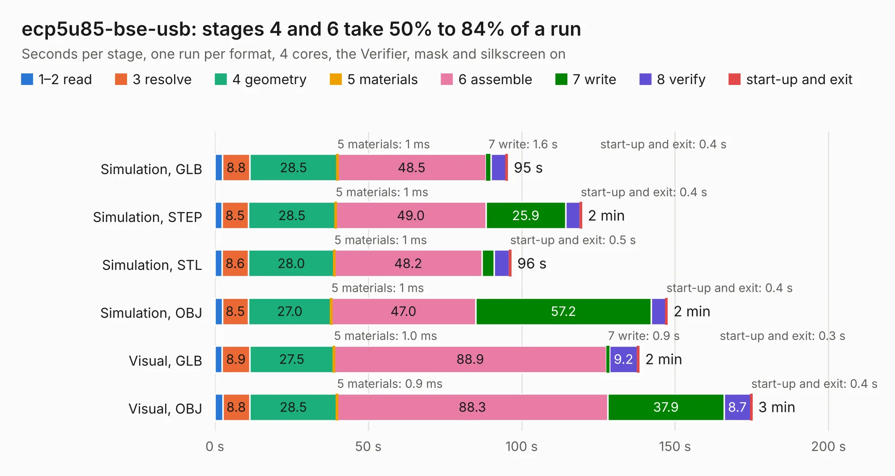

| Mode and format | 1–2 read | 3 resolve | 4 geometry | 5 materials | 6 assemble | 7 write | 8 verify | start-up and exit | Total |
|---|---:|---:|---:|---:|---:|---:|---:|---:|---:|
| Simulation, GLB | 2.5 | 8.8 | 28.5 | 1&nbsp;ms | 48.5 | 1.6 | 5.0 | 0.4 | 95.4 |
| Simulation, STEP | 2.3 | 8.5 | 28.5 | 1&nbsp;ms | 49.0 | 25.9 | 4.8 | 0.4 | 119.5 |
| Simulation, STL | 2.3 | 8.6 | 28.0 | 1&nbsp;ms | 48.2 | 3.9 | 5.0 | 0.5 | 96.5 |
| Simulation, OBJ | 2.4 | 8.5 | 27.0 | 1&nbsp;ms | 47.0 | 57.2 | 4.7 | 0.4 | 147.4 |
| Visual, GLB | 2.4 | 8.9 | 27.5 | 1.0&nbsp;ms | 88.9 | 0.9 | 9.2 | 0.3 | 138.2 |
| Visual, OBJ | 2.6 | 8.8 | 28.5 | 0.9&nbsp;ms | 88.3 | 37.9 | 8.7 | 0.4 | 175.0 |

<table align="center"><tr><td valign="top">

| Board | Repo: [open-ephys/ECP5U85-BSE-USB](https://github.com/open-ephys/ECP5U85-BSE-USB) Board: `ecp5u85-bse-usb.kicad_pcb` |
|---|---|
| Folder | pcb |
| Complexity | 482&nbsp;/&nbsp;1000 (size&nbsp;317, features&nbsp;165) |
| KESE&nbsp;features | through vias, slotted holes, custom pads, rounded, trapezoid or chamfered pads, drill offsets, arc tracks, filled zones, copper drawings, curved board outline, stack-up, dielectric εr and tanδ, copper finish, mask and silkscreen colours |
| Tested | 9th November 2026 |
| Copper&nbsp;layers | 6 |
| File&nbsp;format | KiCad 6 (20211014) |
| Parts,&nbsp;tracks,&nbsp;vias | 208, 10,088, 1,183 |
| Triangles,&nbsp;simulation | 9,132,082 in 347 parts |
| Verifier | PASS in all six runs |

</td><td valign="top">

<table>
<tr><th>File type</th><th>File size</th><th>Peak memory used</th></tr>
<tr><th colspan="3" align="left">Simulation</th></tr>
<tr><td>GLB</td><td align="right">307&nbsp;MB</td><td align="right">2.3&nbsp;GB</td></tr>
<tr><td>STEP</td><td align="right">1.4&nbsp;GB</td><td align="right">3.3&nbsp;GB</td></tr>
<tr><td>STL</td><td align="right">457&nbsp;MB</td><td align="right">2.3&nbsp;GB</td></tr>
<tr><td>OBJ</td><td align="right">982&nbsp;MB</td><td align="right">5.7&nbsp;GB</td></tr>
<tr><th colspan="3" align="left">Visual</th></tr>
<tr><td>GLB</td><td align="right">194&nbsp;MB</td><td align="right">3.0&nbsp;GB</td></tr>
<tr><td>OBJ</td><td align="right">637&nbsp;MB</td><td align="right">4.0&nbsp;GB</td></tr>
</table>

</td></tr></table>

## 2054. ecp5u85-bse-usb_io-tester

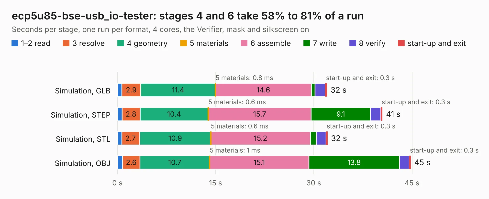

| Mode and format | 1–2 read | 3 resolve | 4 geometry | 5 materials | 6 assemble | 7 write | 8 verify | start-up and exit | Total |
|---|---:|---:|---:|---:|---:|---:|---:|---:|---:|
| Simulation, GLB | 0.7 | 2.9 | 11.4 | 0.8&nbsp;ms | 14.6 | 0.6 | 1.6 | 0.3 | 32.0 |
| Simulation, STEP | 0.7 | 2.8 | 10.4 | 0.6&nbsp;ms | 15.7 | 9.1 | 1.6 | 0.3 | 40.5 |
| Simulation, STL | 0.7 | 2.7 | 10.9 | 0.6&nbsp;ms | 15.2 | 0.9 | 1.5 | 0.3 | 32.1 |
| Simulation, OBJ | 0.8 | 2.6 | 10.7 | 1&nbsp;ms | 15.1 | 13.8 | 1.5 | 0.3 | 44.8 |
| Visual, GLB | 0.7 | 2.5 | 10.8 | 1.0&nbsp;ms | 26.9 | 0.3 | 3.7 | 0.3 | 45.2 |
| Visual, OBJ | 0.7 | 2.5 | 10.3 | 1&nbsp;ms | 25.0 | 9.8 | 3.7 | 0.2 | 52.1 |

<table align="center"><tr><td valign="top">

| Board | Repo: [open-ephys/ECP5U85-BSE-USB-IO-Tester](https://github.com/open-ephys/ECP5U85-BSE-USB-IO-Tester) Board: `ecp5u85-bse-usb_io-tester.kicad_pcb` |
|---|---|
| Folder | pcb |
| Complexity | 340&nbsp;/&nbsp;1000 (size&nbsp;255, features&nbsp;85) |
| KESE&nbsp;features | through vias, rounded, trapezoid or chamfered pads, filled zones, curved board outline, stack-up, dielectric εr and tanδ |
| Tested | 9th November 2026 |
| Copper&nbsp;layers | 4 |
| File&nbsp;format | KiCad 6 (20211014) |
| Parts,&nbsp;tracks,&nbsp;vias | 89, 2,051, 414 |
| Triangles,&nbsp;simulation | 3,290,346 in 243 parts |
| Verifier | PASS in all six runs |

</td><td valign="top">

<table>
<tr><th>File type</th><th>File size</th><th>Peak memory used</th></tr>
<tr><th colspan="3" align="left">Simulation</th></tr>
<tr><td>GLB</td><td align="right">111&nbsp;MB</td><td align="right">1.2&nbsp;GB</td></tr>
<tr><td>STEP</td><td align="right">530&nbsp;MB</td><td align="right">1.4&nbsp;GB</td></tr>
<tr><td>STL</td><td align="right">165&nbsp;MB</td><td align="right">1.2&nbsp;GB</td></tr>
<tr><td>OBJ</td><td align="right">346&nbsp;MB</td><td align="right">2.2&nbsp;GB</td></tr>
<tr><th colspan="3" align="left">Visual</th></tr>
<tr><td>GLB</td><td align="right">77&nbsp;MB</td><td align="right">1.3&nbsp;GB</td></tr>
<tr><td>OBJ</td><td align="right">243&nbsp;MB</td><td align="right">1.6&nbsp;GB</td></tr>
</table>

</td></tr></table>

## 2055. ephys-test-board

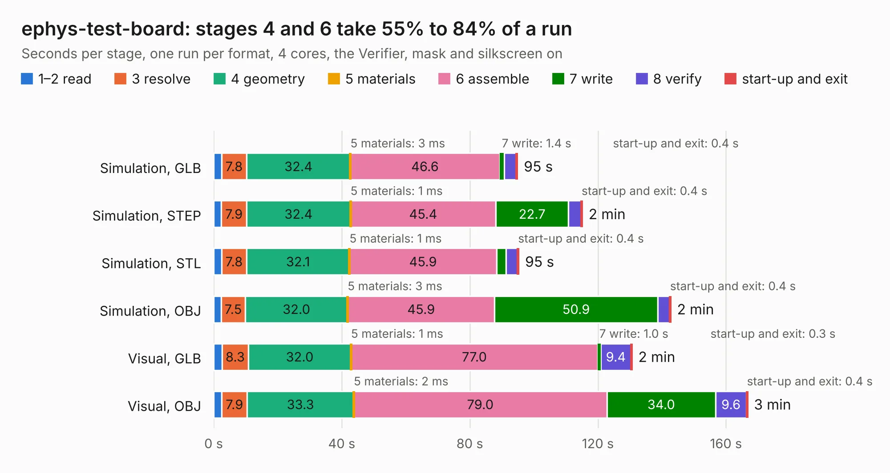

| Mode and format | 1–2 read | 3 resolve | 4 geometry | 5 materials | 6 assemble | 7 write | 8 verify | start-up and exit | Total |
|---|---:|---:|---:|---:|---:|---:|---:|---:|---:|
| Simulation, GLB | 2.5 | 7.8 | 32.4 | 3&nbsp;ms | 46.6 | 1.4 | 3.8 | 0.4 | 94.9 |
| Simulation, STEP | 2.4 | 7.9 | 32.4 | 1&nbsp;ms | 45.4 | 22.7 | 3.9 | 0.4 | 115.1 |
| Simulation, STL | 2.5 | 7.8 | 32.1 | 1&nbsp;ms | 45.9 | 2.9 | 3.6 | 0.4 | 95.3 |
| Simulation, OBJ | 2.4 | 7.5 | 32.0 | 3&nbsp;ms | 45.9 | 50.9 | 3.7 | 0.4 | 142.7 |
| Visual, GLB | 2.6 | 8.3 | 32.0 | 1&nbsp;ms | 77.0 | 1.0 | 9.4 | 0.3 | 130.6 |
| Visual, OBJ | 2.5 | 7.9 | 33.3 | 2&nbsp;ms | 79.0 | 34.0 | 9.6 | 0.4 | 166.8 |

<table align="center"><tr><td valign="top">

| Board | Repo: [open-ephys/ephys-test-board](https://github.com/open-ephys/ephys-test-board) Board: `ephys-test-board.kicad_pcb` |
|---|---|
| Folder | pcb |
| Complexity | 390&nbsp;/&nbsp;1000 (size&nbsp;290, features&nbsp;100) |
| KESE&nbsp;features | through vias, slotted holes, rounded, trapezoid or chamfered pads, filled zones, curved board outline, stack-up, dielectric εr and tanδ, mask and silkscreen colours |
| Tested | 9th November 2026 |
| Copper&nbsp;layers | 4 |
| File&nbsp;format | KiCad 10 (20260206) |
| Parts,&nbsp;tracks,&nbsp;vias | 542, 4,979, 1,145 |
| Triangles,&nbsp;simulation | 7,522,154 in 522 parts |
| Verifier | PASS in all six runs |

</td><td valign="top">

<table>
<tr><th>File type</th><th>File size</th><th>Peak memory used</th></tr>
<tr><th colspan="3" align="left">Simulation</th></tr>
<tr><td>GLB</td><td align="right">255&nbsp;MB</td><td align="right">2.1&nbsp;GB</td></tr>
<tr><td>STEP</td><td align="right">1.2&nbsp;GB</td><td align="right">3.0&nbsp;GB</td></tr>
<tr><td>STL</td><td align="right">376&nbsp;MB</td><td align="right">2.1&nbsp;GB</td></tr>
<tr><td>OBJ</td><td align="right">818&nbsp;MB</td><td align="right">4.9&nbsp;GB</td></tr>
<tr><th colspan="3" align="left">Visual</th></tr>
<tr><td>GLB</td><td align="right">180&nbsp;MB</td><td align="right">2.9&nbsp;GB</td></tr>
<tr><td>OBJ</td><td align="right">591&nbsp;MB</td><td align="right">3.8&nbsp;GB</td></tr>
</table>

</td></tr></table>

## 2056. low-profile-headstage-64ch-3d

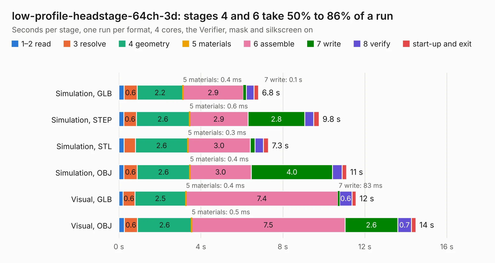

| Mode and format | 1–2 read | 3 resolve | 4 geometry | 5 materials | 6 assemble | 7 write | 8 verify | start-up and exit | Total |
|---|---:|---:|---:|---:|---:|---:|---:|---:|---:|
| Simulation, GLB | 0.3 | 0.6 | 2.2 | 0.4&nbsp;ms | 2.9 | 0.1 | 0.4 | 0.2 | 6.8 |
| Simulation, STEP | 0.2 | 0.6 | 2.6 | 0.6&nbsp;ms | 2.9 | 2.8 | 0.4 | 0.3 | 9.8 |
| Simulation, STL | 0.3 | 0.6 | 2.6 | 0.3&nbsp;ms | 3.0 | 0.2 | 0.4 | 0.2 | 7.3 |
| Simulation, OBJ | 0.2 | 0.6 | 2.6 | 0.4&nbsp;ms | 3.0 | 4.0 | 0.5 | 0.2 | 11.1 |
| Visual, GLB | 0.2 | 0.6 | 2.5 | 0.4&nbsp;ms | 7.4 | 83&nbsp;ms | 0.6 | 0.2 | 11.6 |
| Visual, OBJ | 0.3 | 0.6 | 2.6 | 0.5&nbsp;ms | 7.5 | 2.6 | 0.7 | 0.2 | 14.5 |

<table align="center"><tr><td valign="top">

| Board | Repo: [open-ephys/low-profile-headstage-64ch-3d](https://github.com/open-ephys/low-profile-headstage-64ch-3d) Board: `low-profile-headstage-64ch-3d.kicad_pcb` |
|---|---|
| Folder | pcb |
| Complexity | 333&nbsp;/&nbsp;1000 (size&nbsp;243, features&nbsp;90) |
| KESE&nbsp;features | through vias, rounded, trapezoid or chamfered pads, filled zones, curved board outline, stack-up, dielectric εr and tanδ, mask and silkscreen colours |
| Tested | 9th November 2026 |
| Copper&nbsp;layers | 4 |
| File&nbsp;format | KiCad 10 (20260206) |
| Parts,&nbsp;tracks,&nbsp;vias | 38, 671, 95 |
| Triangles,&nbsp;simulation | 802,046 in 124 parts |
| Verifier | PASS in all six runs |

</td><td valign="top">

<table>
<tr><th>File type</th><th>File size</th><th>Peak memory used</th></tr>
<tr><th colspan="3" align="left">Simulation</th></tr>
<tr><td>GLB</td><td align="right">28&nbsp;MB</td><td align="right">405&nbsp;MB</td></tr>
<tr><td>STEP</td><td align="right">155&nbsp;MB</td><td align="right">492&nbsp;MB</td></tr>
<tr><td>STL</td><td align="right">40&nbsp;MB</td><td align="right">401&nbsp;MB</td></tr>
<tr><td>OBJ</td><td align="right">85&nbsp;MB</td><td align="right">601&nbsp;MB</td></tr>
<tr><th colspan="3" align="left">Visual</th></tr>
<tr><td>GLB</td><td align="right">18&nbsp;MB</td><td align="right">524&nbsp;MB</td></tr>
<tr><td>OBJ</td><td align="right">54&nbsp;MB</td><td align="right">511&nbsp;MB</td></tr>
</table>

</td></tr></table>

## 2057. acquisition-board

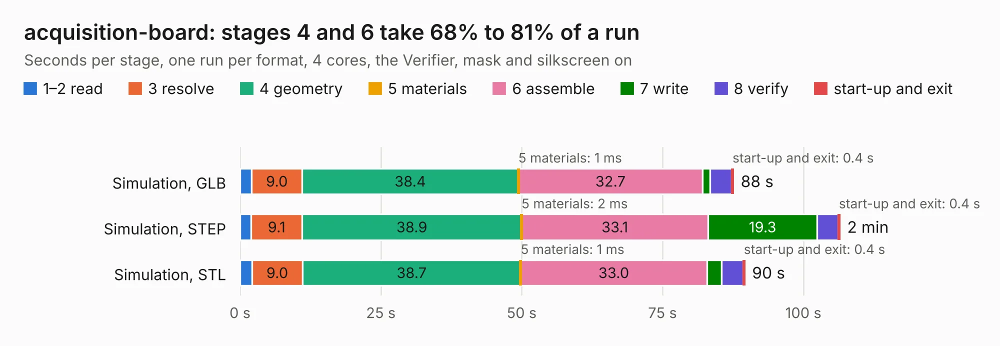

| Mode and format | 1–2 read | 3 resolve | 4 geometry | 5 materials | 6 assemble | 7 write | 8 verify | start-up and exit | Total |
|---|---:|---:|---:|---:|---:|---:|---:|---:|---:|
| Simulation, GLB | 2.0 | 9.0 | 38.4 | 1&nbsp;ms | 32.7 | 1.4 | 3.8 | 0.4 | 87.6 |
| Simulation, STEP | 2.0 | 9.1 | 38.9 | 2&nbsp;ms | 33.1 | 19.3 | 3.7 | 0.4 | 106.5 |
| Simulation, STL | 2.1 | 9.0 | 38.7 | 1&nbsp;ms | 33.0 | 2.6 | 3.8 | 0.4 | 89.6 |
| Simulation, OBJ | 2.1 | 9.1 | 37.7 | 1&nbsp;ms | 33.0 | 47.5 | 3.8 | 0.4 | 133.6 |
| Visual, GLB | 2.1 | 9.2 | 39.3 | 1&nbsp;ms | 71.4 | 0.7 | 6.4 | 0.3 | 129.4 |
| Visual, OBJ | 2.1 | 9.0 | 38.5 | 1&nbsp;ms | 71.8 | 26.4 | 6.0 | 0.3 | 154.1 |

<table align="center"><tr><td valign="top">

| Board | Repo: [open-ephys/oe-acquisition-board-gen3](https://github.com/open-ephys/oe-acquisition-board-gen3) Board: `acquisition-board.kicad_pcb` |
|---|---|
| Folder | Hardware / PCB |
| Complexity | 332&nbsp;/&nbsp;1000 (size&nbsp;242, features&nbsp;90) |
| KESE&nbsp;features | through vias, rounded, trapezoid or chamfered pads, filled zones, copper drawings, stack-up, dielectric εr and tanδ, mask and silkscreen colours |
| Tested | 9th November 2026 |
| Copper&nbsp;layers | 4 |
| File&nbsp;format | KiCad 8 (20240108) |
| Parts,&nbsp;tracks,&nbsp;vias | 309, 3,692, 1,292 |
| Triangles,&nbsp;simulation | 8,571,000 in 342 parts |
| Verifier | PASS in all six runs |

</td><td valign="top">

<table>
<tr><th>File type</th><th>File size</th><th>Peak memory used</th></tr>
<tr><th colspan="3" align="left">Simulation</th></tr>
<tr><td>GLB</td><td align="right">295&nbsp;MB</td><td align="right">2.1&nbsp;GB</td></tr>
<tr><td>STEP</td><td align="right">1.2&nbsp;GB</td><td align="right">2.7&nbsp;GB</td></tr>
<tr><td>STL</td><td align="right">429&nbsp;MB</td><td align="right">2.1&nbsp;GB</td></tr>
<tr><td>OBJ</td><td align="right">924&nbsp;MB</td><td align="right">5.5&nbsp;GB</td></tr>
<tr><th colspan="3" align="left">Visual</th></tr>
<tr><td>GLB</td><td align="right">164&nbsp;MB</td><td align="right">2.8&nbsp;GB</td></tr>
<tr><td>OBJ</td><td align="right">529&nbsp;MB</td><td align="right">3.5&nbsp;GB</td></tr>
</table>

</td></tr></table>

## 2058. bracket-led-panel-tight

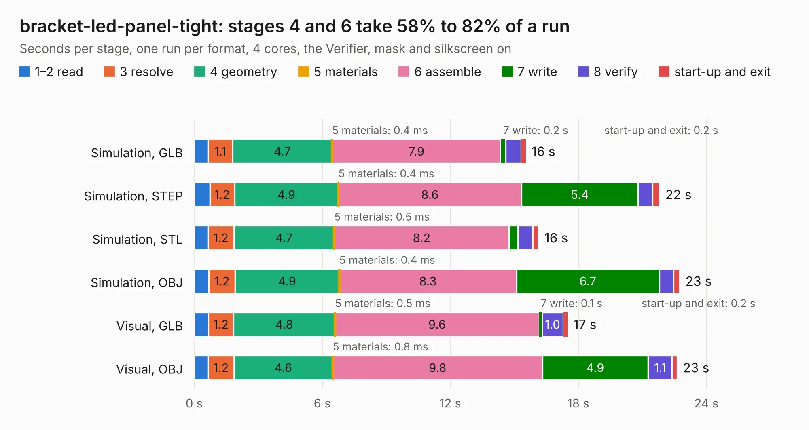

| Mode and format | 1–2 read | 3 resolve | 4 geometry | 5 materials | 6 assemble | 7 write | 8 verify | start-up and exit | Total |
|---|---:|---:|---:|---:|---:|---:|---:|---:|---:|
| Simulation, GLB | 0.7 | 1.1 | 4.7 | 0.4&nbsp;ms | 7.9 | 0.2 | 0.7 | 0.2 | 15.5 |
| Simulation, STEP | 0.7 | 1.2 | 4.9 | 0.4&nbsp;ms | 8.6 | 5.4 | 0.7 | 0.3 | 21.8 |
| Simulation, STL | 0.6 | 1.2 | 4.7 | 0.5&nbsp;ms | 8.2 | 0.4 | 0.7 | 0.3 | 16.1 |
| Simulation, OBJ | 0.7 | 1.2 | 4.9 | 0.4&nbsp;ms | 8.3 | 6.7 | 0.7 | 0.3 | 22.7 |
| Visual, GLB | 0.7 | 1.2 | 4.8 | 0.5&nbsp;ms | 9.6 | 0.1 | 1.0 | 0.2 | 17.5 |
| Visual, OBJ | 0.6 | 1.2 | 4.6 | 0.8&nbsp;ms | 9.8 | 4.9 | 1.1 | 0.2 | 22.6 |

<table align="center"><tr><td valign="top">

| Board | Repo: [open-ephys/onix-fmc-host](https://github.com/open-ephys/onix-fmc-host) Board: `bracket-led-panel-tight.kicad_pcb` |
|---|---|
| Folder | bracket-led / source |
| Complexity | 250&nbsp;/&nbsp;1000 (size&nbsp;175, features&nbsp;75) |
| KESE&nbsp;features | through vias, rounded, trapezoid or chamfered pads, filled zones, stack-up, dielectric εr and tanδ |
| Tested | 9th November 2026 |
| Copper&nbsp;layers | 2 |
| File&nbsp;format | KiCad 7 (20221018) |
| Parts,&nbsp;tracks,&nbsp;vias | 75, 630, 90 |
| Triangles,&nbsp;simulation | 1,090,228 in 114 parts |
| Note | panel |
| Verifier | PASS in all six runs |

</td><td valign="top">

<table>
<tr><th>File type</th><th>File size</th><th>Peak memory used</th></tr>
<tr><th colspan="3" align="left">Simulation</th></tr>
<tr><td>GLB</td><td align="right">40&nbsp;MB</td><td align="right">558&nbsp;MB</td></tr>
<tr><td>STEP</td><td align="right">253&nbsp;MB</td><td align="right">662&nbsp;MB</td></tr>
<tr><td>STL</td><td align="right">55&nbsp;MB</td><td align="right">551&nbsp;MB</td></tr>
<tr><td>OBJ</td><td align="right">119&nbsp;MB</td><td align="right">831&nbsp;MB</td></tr>
<tr><th colspan="3" align="left">Visual</th></tr>
<tr><td>GLB</td><td align="right">29&nbsp;MB</td><td align="right">662&nbsp;MB</td></tr>
<tr><td>OBJ</td><td align="right">87&nbsp;MB</td><td align="right">669&nbsp;MB</td></tr>
</table>

</td></tr></table>

## 2059. bracket-led-panel

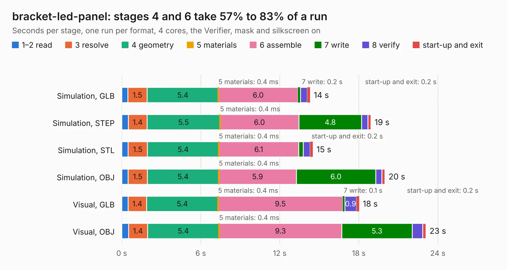

| Mode and format | 1–2 read | 3 resolve | 4 geometry | 5 materials | 6 assemble | 7 write | 8 verify | start-up and exit | Total |
|---|---:|---:|---:|---:|---:|---:|---:|---:|---:|
| Simulation, GLB | 0.5 | 1.5 | 5.4 | 0.4&nbsp;ms | 6.0 | 0.2 | 0.5 | 0.2 | 14.3 |
| Simulation, STEP | 0.5 | 1.4 | 5.5 | 0.4&nbsp;ms | 6.0 | 4.8 | 0.5 | 0.2 | 18.9 |
| Simulation, STL | 0.5 | 1.5 | 5.4 | 0.4&nbsp;ms | 6.1 | 0.3 | 0.5 | 0.2 | 14.5 |
| Simulation, OBJ | 0.5 | 1.5 | 5.4 | 0.4&nbsp;ms | 5.9 | 6.0 | 0.5 | 0.2 | 20.0 |
| Visual, GLB | 0.5 | 1.4 | 5.4 | 0.4&nbsp;ms | 9.5 | 0.1 | 0.9 | 0.2 | 18.0 |
| Visual, OBJ | 0.5 | 1.4 | 5.4 | 0.4&nbsp;ms | 9.3 | 5.3 | 0.8 | 0.3 | 23.1 |

<table align="center"><tr><td valign="top">

| Board | Repo: [open-ephys/onix-fmc-host](https://github.com/open-ephys/onix-fmc-host) Board: `bracket-led-panel.kicad_pcb` |
|---|---|
| Folder | bracket-led / source |
| Complexity | 265&nbsp;/&nbsp;1000 (size&nbsp;190, features&nbsp;75) |
| KESE&nbsp;features | through vias, rounded, trapezoid or chamfered pads, filled zones, stack-up, dielectric εr and tanδ |
| Tested | 9th November 2026 |
| Copper&nbsp;layers | 2 |
| File&nbsp;format | KiCad 7 (20221018) |
| Parts,&nbsp;tracks,&nbsp;vias | 120, 816, 288 |
| Triangles,&nbsp;simulation | 1,179,884 in 175 parts |
| Note | panel |
| Verifier | PASS in all six runs |

</td><td valign="top">

<table>
<tr><th>File type</th><th>File size</th><th>Peak memory used</th></tr>
<tr><th colspan="3" align="left">Simulation</th></tr>
<tr><td>GLB</td><td align="right">39&nbsp;MB</td><td align="right">568&nbsp;MB</td></tr>
<tr><td>STEP</td><td align="right">215&nbsp;MB</td><td align="right">658&nbsp;MB</td></tr>
<tr><td>STL</td><td align="right">59&nbsp;MB</td><td align="right">572&nbsp;MB</td></tr>
<tr><td>OBJ</td><td align="right">122&nbsp;MB</td><td align="right">848&nbsp;MB</td></tr>
<tr><th colspan="3" align="left">Visual</th></tr>
<tr><td>GLB</td><td align="right">33&nbsp;MB</td><td align="right">677&nbsp;MB</td></tr>
<tr><td>OBJ</td><td align="right">103&nbsp;MB</td><td align="right">813&nbsp;MB</td></tr>
</table>

</td></tr></table>

## 2060. bracket-led

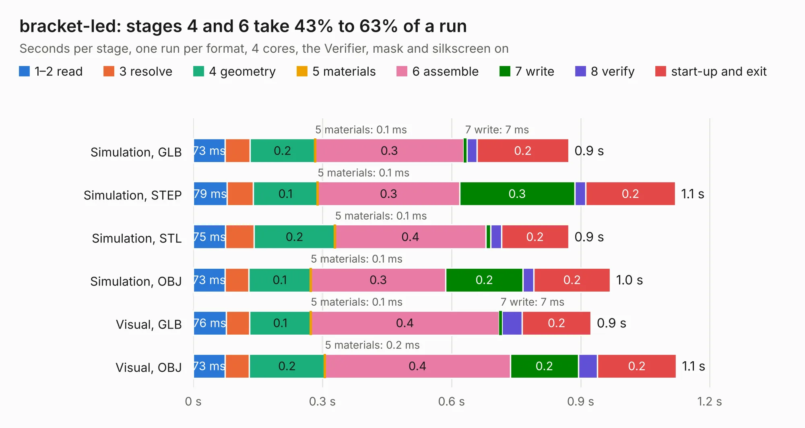

| Mode and format | 1–2 read | 3 resolve | 4 geometry | 5 materials | 6 assemble | 7 write | 8 verify | start-up and exit | Total |
|---|---:|---:|---:|---:|---:|---:|---:|---:|---:|
| Simulation, GLB | 73&nbsp;ms | 58&nbsp;ms | 0.2 | 0.1&nbsp;ms | 0.3 | 7&nbsp;ms | 24&nbsp;ms | 0.2 | 0.9 |
| Simulation, STEP | 79&nbsp;ms | 61&nbsp;ms | 0.1 | 0.1&nbsp;ms | 0.3 | 0.3 | 26&nbsp;ms | 0.2 | 1.1 |
| Simulation, STL | 75&nbsp;ms | 66&nbsp;ms | 0.2 | 0.1&nbsp;ms | 0.4 | 11&nbsp;ms | 25&nbsp;ms | 0.2 | 0.9 |
| Simulation, OBJ | 73&nbsp;ms | 56&nbsp;ms | 0.1 | 0.1&nbsp;ms | 0.3 | 0.2 | 26&nbsp;ms | 0.2 | 1.0 |
| Visual, GLB | 76&nbsp;ms | 55&nbsp;ms | 0.1 | 0.1&nbsp;ms | 0.4 | 7&nbsp;ms | 47&nbsp;ms | 0.2 | 0.9 |
| Visual, OBJ | 73&nbsp;ms | 57&nbsp;ms | 0.2 | 0.2&nbsp;ms | 0.4 | 0.2 | 44&nbsp;ms | 0.2 | 1.1 |

<table align="center"><tr><td valign="top">

| Board | Repo: [open-ephys/onix-fmc-host](https://github.com/open-ephys/onix-fmc-host) Board: `bracket-led.kicad_pcb` |
|---|---|
| Folder | bracket-led / source |
| Complexity | 181&nbsp;/&nbsp;1000 (size&nbsp;106, features&nbsp;75) |
| KESE&nbsp;features | through vias, rounded, trapezoid or chamfered pads, filled zones, stack-up, dielectric εr and tanδ |
| Tested | 9th November 2026 |
| Copper&nbsp;layers | 2 |
| File&nbsp;format | KiCad 7 (20221018) |
| Parts,&nbsp;tracks,&nbsp;vias | 5, 34, 12 |
| Triangles,&nbsp;simulation | 47,834 in 14 parts |
| Verifier | PASS in all six runs |

</td><td valign="top">

<table>
<tr><th>File type</th><th>File size</th><th>Peak memory used</th></tr>
<tr><th colspan="3" align="left">Simulation</th></tr>
<tr><td>GLB</td><td align="right">1.7&nbsp;MB</td><td align="right">73&nbsp;MB</td></tr>
<tr><td>STEP</td><td align="right">8.0&nbsp;MB</td><td align="right">80&nbsp;MB</td></tr>
<tr><td>STL</td><td align="right">2.4&nbsp;MB</td><td align="right">73&nbsp;MB</td></tr>
<tr><td>OBJ</td><td align="right">4.6&nbsp;MB</td><td align="right">82&nbsp;MB</td></tr>
<tr><th colspan="3" align="left">Visual</th></tr>
<tr><td>GLB</td><td align="right">1.4&nbsp;MB</td><td align="right">111&nbsp;MB</td></tr>
<tr><td>OBJ</td><td align="right">3.9&nbsp;MB</td><td align="right">103&nbsp;MB</td></tr>
</table>

</td></tr></table>

## 2061. bracket-led

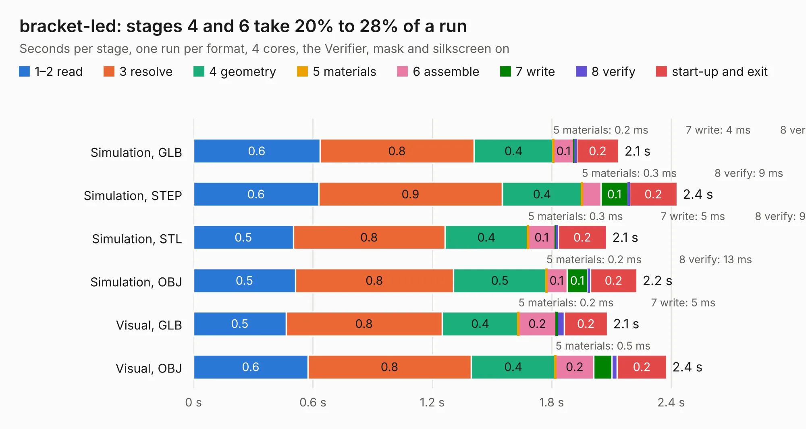

| Mode and format | 1–2 read | 3 resolve | 4 geometry | 5 materials | 6 assemble | 7 write | 8 verify | start-up and exit | Total |
|---|---:|---:|---:|---:|---:|---:|---:|---:|---:|
| Simulation, GLB | 0.6 | 0.8 | 0.4 | 0.2&nbsp;ms | 0.1 | 4&nbsp;ms | 10&nbsp;ms | 0.2 | 2.1 |
| Simulation, STEP | 0.6 | 0.9 | 0.4 | 0.3&nbsp;ms | 95&nbsp;ms | 0.1 | 9&nbsp;ms | 0.2 | 2.4 |
| Simulation, STL | 0.5 | 0.8 | 0.4 | 0.3&nbsp;ms | 0.1 | 5&nbsp;ms | 9&nbsp;ms | 0.2 | 2.1 |
| Simulation, OBJ | 0.5 | 0.8 | 0.5 | 0.2&nbsp;ms | 0.1 | 0.1 | 13&nbsp;ms | 0.2 | 2.2 |
| Visual, GLB | 0.5 | 0.8 | 0.4 | 0.2&nbsp;ms | 0.2 | 5&nbsp;ms | 37&nbsp;ms | 0.2 | 2.1 |
| Visual, OBJ | 0.6 | 0.8 | 0.4 | 0.5&nbsp;ms | 0.2 | 90&nbsp;ms | 27&nbsp;ms | 0.2 | 2.4 |

<table align="center"><tr><td valign="top">

| Board | Repo: [open-ephys/onix-fmc-host](https://github.com/open-ephys/onix-fmc-host) Board: `bracket-led.kicad_pcb` |
|---|---|
| Folder | mechanical / pcie-bracket-metal / bracket-led-pcb |
| Complexity | 268&nbsp;/&nbsp;1000 (size&nbsp;193, features&nbsp;75) |
| KESE&nbsp;features | through vias, rounded, trapezoid or chamfered pads, filled zones, stack-up, dielectric εr and tanδ |
| Tested | 9th November 2026 |
| Copper&nbsp;layers | 2 |
| File&nbsp;format | KiCad 7 (20221018) |
| Parts,&nbsp;tracks,&nbsp;vias | 120, 936, 336 |
| Triangles,&nbsp;simulation | 16,480 in 7 parts |
| Verifier | PASS in all six runs |

</td><td valign="top">

<table>
<tr><th>File type</th><th>File size</th><th>Peak memory used</th></tr>
<tr><th colspan="3" align="left">Simulation</th></tr>
<tr><td>GLB</td><td align="right">620&nbsp;kB</td><td align="right">108&nbsp;MB</td></tr>
<tr><td>STEP</td><td align="right">2.9&nbsp;MB</td><td align="right">108&nbsp;MB</td></tr>
<tr><td>STL</td><td align="right">825&nbsp;kB</td><td align="right">107&nbsp;MB</td></tr>
<tr><td>OBJ</td><td align="right">1.6&nbsp;MB</td><td align="right">108&nbsp;MB</td></tr>
<tr><th colspan="3" align="left">Visual</th></tr>
<tr><td>GLB</td><td align="right">561&nbsp;kB</td><td align="right">107&nbsp;MB</td></tr>
<tr><td>OBJ</td><td align="right">1.5&nbsp;MB</td><td align="right">107&nbsp;MB</td></tr>
</table>

</td></tr></table>

## 2062. fmc-host

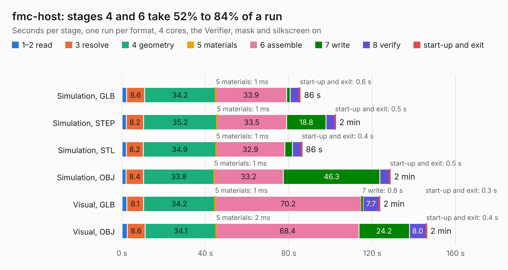

| Mode and format | 1–2 read | 3 resolve | 4 geometry | 5 materials | 6 assemble | 7 write | 8 verify | start-up and exit | Total |
|---|---:|---:|---:|---:|---:|---:|---:|---:|---:|
| Simulation, GLB | 2.2 | 8.6 | 34.2 | 1&nbsp;ms | 33.9 | 1.7 | 4.4 | 0.6 | 85.6 |
| Simulation, STEP | 2.1 | 8.2 | 35.2 | 1&nbsp;ms | 33.5 | 18.8 | 4.2 | 0.5 | 102.5 |
| Simulation, STL | 2.1 | 8.2 | 34.9 | 1&nbsp;ms | 32.9 | 3.6 | 4.4 | 0.4 | 86.5 |
| Simulation, OBJ | 2.0 | 8.4 | 33.8 | 1&nbsp;ms | 33.2 | 46.3 | 4.6 | 0.5 | 128.8 |
| Visual, GLB | 2.3 | 8.1 | 34.2 | 1&nbsp;ms | 70.2 | 0.8 | 7.7 | 0.3 | 123.7 |
| Visual, OBJ | 2.5 | 8.6 | 34.1 | 2&nbsp;ms | 68.4 | 24.2 | 8.0 | 0.4 | 146.2 |

<table align="center"><tr><td valign="top">

| Board | Repo: [open-ephys/onix-fmc-host](https://github.com/open-ephys/onix-fmc-host) Board: `fmc-host.kicad_pcb` |
|---|---|
| Folder | pcb |
| Complexity | 407&nbsp;/&nbsp;1000 (size&nbsp;307, features&nbsp;100) |
| KESE&nbsp;features | through vias, rounded, trapezoid or chamfered pads, arc tracks, filled zones, curved board outline, stack-up, dielectric εr and tanδ |
| Tested | 9th November 2026 |
| Copper&nbsp;layers | 6 |
| File&nbsp;format | KiCad 10 (20260206) |
| Parts,&nbsp;tracks,&nbsp;vias | 301, 3,369, 1,272 |
| Triangles,&nbsp;simulation | 8,782,710 in 473 parts |
| Verifier | PASS in all six runs |

</td><td valign="top">

<table>
<tr><th>File type</th><th>File size</th><th>Peak memory used</th></tr>
<tr><th colspan="3" align="left">Simulation</th></tr>
<tr><td>GLB</td><td align="right">295&nbsp;MB</td><td align="right">2.4&nbsp;GB</td></tr>
<tr><td>STEP</td><td align="right">1.2&nbsp;GB</td><td align="right">3.0&nbsp;GB</td></tr>
<tr><td>STL</td><td align="right">439&nbsp;MB</td><td align="right">2.5&nbsp;GB</td></tr>
<tr><td>OBJ</td><td align="right">953&nbsp;MB</td><td align="right">5.6&nbsp;GB</td></tr>
<tr><th colspan="3" align="left">Visual</th></tr>
<tr><td>GLB</td><td align="right">164&nbsp;MB</td><td align="right">2.6&nbsp;GB</td></tr>
<tr><td>OBJ</td><td align="right">535&nbsp;MB</td><td align="right">3.5&nbsp;GB</td></tr>
</table>

</td></tr></table>

## 2063. headstage-16stim

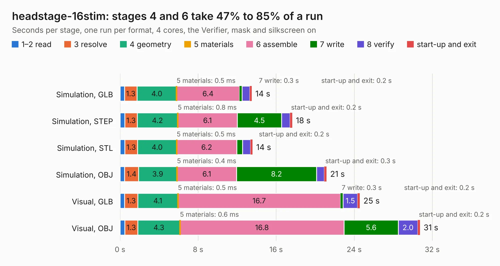

| Mode and format | 1–2 read | 3 resolve | 4 geometry | 5 materials | 6 assemble | 7 write | 8 verify | start-up and exit | Total |
|---|---:|---:|---:|---:|---:|---:|---:|---:|---:|
| Simulation, GLB | 0.5 | 1.3 | 4.0 | 0.5&nbsp;ms | 6.4 | 0.3 | 0.8 | 0.2 | 13.5 |
| Simulation, STEP | 0.5 | 1.3 | 4.2 | 0.8&nbsp;ms | 6.1 | 4.5 | 0.9 | 0.2 | 17.7 |
| Simulation, STL | 0.5 | 1.3 | 4.0 | 0.5&nbsp;ms | 6.2 | 0.6 | 0.8 | 0.2 | 13.6 |
| Simulation, OBJ | 0.5 | 1.4 | 3.9 | 0.4&nbsp;ms | 6.1 | 8.2 | 0.8 | 0.3 | 21.2 |
| Visual, GLB | 0.5 | 1.3 | 4.1 | 0.5&nbsp;ms | 16.7 | 0.3 | 1.5 | 0.2 | 24.6 |
| Visual, OBJ | 0.5 | 1.3 | 4.3 | 0.6&nbsp;ms | 16.8 | 5.6 | 2.0 | 0.2 | 30.8 |

<table align="center"><tr><td valign="top">

| Board | Repo: [open-ephys/onix-headstage-16stim](https://github.com/open-ephys/onix-headstage-16stim) Board: `headstage-16stim.kicad_pcb` |
|---|---|
| Folder | pcb |
| Complexity | 427&nbsp;/&nbsp;1000 (size&nbsp;282, features&nbsp;145) |
| KESE&nbsp;features | through vias, custom pads, rounded, trapezoid or chamfered pads, arc tracks, filled zones, copper drawings, curved board outline, stack-up, dielectric εr and tanδ, copper finish, mask and silkscreen colours |
| Tested | 9th November 2026 |
| Copper&nbsp;layers | 6 |
| File&nbsp;format | KiCad 8 (20240108) |
| Parts,&nbsp;tracks,&nbsp;vias | 125, 1,686, 247 |
| Triangles,&nbsp;simulation | 1,993,214 in 224 parts |
| Verifier | PASS in all six runs |

</td><td valign="top">

<table>
<tr><th>File type</th><th>File size</th><th>Peak memory used</th></tr>
<tr><th colspan="3" align="left">Simulation</th></tr>
<tr><td>GLB</td><td align="right">68&nbsp;MB</td><td align="right">676&nbsp;MB</td></tr>
<tr><td>STEP</td><td align="right">329&nbsp;MB</td><td align="right">864&nbsp;MB</td></tr>
<tr><td>STL</td><td align="right">100&nbsp;MB</td><td align="right">756&nbsp;MB</td></tr>
<tr><td>OBJ</td><td align="right">212&nbsp;MB</td><td align="right">1.3&nbsp;GB</td></tr>
<tr><th colspan="3" align="left">Visual</th></tr>
<tr><td>GLB</td><td align="right">46&nbsp;MB</td><td align="right">870&nbsp;MB</td></tr>
<tr><td>OBJ</td><td align="right">144&nbsp;MB</td><td align="right">1.1&nbsp;GB</td></tr>
</table>

</td></tr></table>

## 2064. headstage-64s

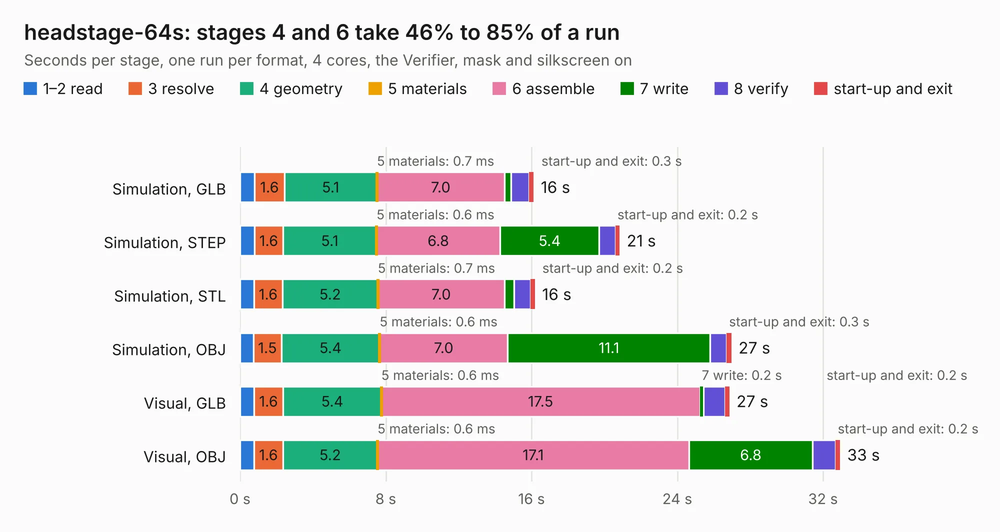

| Mode and format | 1–2 read | 3 resolve | 4 geometry | 5 materials | 6 assemble | 7 write | 8 verify | start-up and exit | Total |
|---|---:|---:|---:|---:|---:|---:|---:|---:|---:|
| Simulation, GLB | 0.8 | 1.6 | 5.1 | 0.7&nbsp;ms | 7.0 | 0.3 | 1.0 | 0.3 | 16.1 |
| Simulation, STEP | 0.8 | 1.6 | 5.1 | 0.6&nbsp;ms | 6.8 | 5.4 | 0.9 | 0.2 | 20.8 |
| Simulation, STL | 0.8 | 1.6 | 5.2 | 0.7&nbsp;ms | 7.0 | 0.5 | 0.9 | 0.2 | 16.2 |
| Simulation, OBJ | 0.7 | 1.5 | 5.4 | 0.6&nbsp;ms | 7.0 | 11.1 | 0.9 | 0.3 | 27.0 |
| Visual, GLB | 0.8 | 1.6 | 5.4 | 0.6&nbsp;ms | 17.5 | 0.2 | 1.2 | 0.2 | 26.9 |
| Visual, OBJ | 0.8 | 1.6 | 5.2 | 0.6&nbsp;ms | 17.1 | 6.8 | 1.3 | 0.2 | 32.9 |

<table align="center"><tr><td valign="top">

| Board | Repo: [open-ephys/onix-headstage-64s](https://github.com/open-ephys/onix-headstage-64s) Board: `headstage-64s.kicad_pcb` |
|---|---|
| Folder | pcb |
| Complexity | 429&nbsp;/&nbsp;1000 (size&nbsp;284, features&nbsp;145) |
| KESE&nbsp;features | through vias, custom pads, rounded, trapezoid or chamfered pads, arc tracks, filled zones, copper drawings, curved board outline, stack-up, dielectric εr and tanδ, copper finish, mask and silkscreen colours |
| Tested | 9th November 2026 |
| Copper&nbsp;layers | 6 |
| File&nbsp;format | KiCad 6 (20211014) |
| Parts,&nbsp;tracks,&nbsp;vias | 112, 1,718, 241 |
| Triangles,&nbsp;simulation | 2,043,882 in 217 parts |
| Verifier | PASS in all six runs |

</td><td valign="top">

<table>
<tr><th>File type</th><th>File size</th><th>Peak memory used</th></tr>
<tr><th colspan="3" align="left">Simulation</th></tr>
<tr><td>GLB</td><td align="right">71&nbsp;MB</td><td align="right">834&nbsp;MB</td></tr>
<tr><td>STEP</td><td align="right">359&nbsp;MB</td><td align="right">930&nbsp;MB</td></tr>
<tr><td>STL</td><td align="right">102&nbsp;MB</td><td align="right">874&nbsp;MB</td></tr>
<tr><td>OBJ</td><td align="right">220&nbsp;MB</td><td align="right">1.4&nbsp;GB</td></tr>
<tr><th colspan="3" align="left">Visual</th></tr>
<tr><td>GLB</td><td align="right">45&nbsp;MB</td><td align="right">967&nbsp;MB</td></tr>
<tr><td>OBJ</td><td align="right">142&nbsp;MB</td><td align="right">990&nbsp;MB</td></tr>
</table>

</td></tr></table>

## 2065. headstage-neuropix1e

| Mode and format | 1–2 read | 3 resolve | 4 geometry | 5 materials | 6 assemble | 7 write | 8 verify | start-up and exit | Total |
|---|---:|---:|---:|---:|---:|---:|---:|---:|---:|
| Simulation, GLB | 0.6 | 1.2 | 3.8 | 0.7&nbsp;ms | 4.5 | 0.2 | 0.7 | 0.3 | 11.3 |
| Simulation, STEP | 0.4 | 1.1 | 3.4 | 0.5&nbsp;ms | 4.6 | 3.2 | 0.7 | 0.2 | 13.7 |
| Simulation, STL | 0.4 | 1.1 | 3.4 | 0.6&nbsp;ms | 4.6 | 0.3 | 0.7 | 0.3 | 10.8 |
| Simulation, OBJ | 0.5 | 1.0 | 3.5 | 0.5&nbsp;ms | 4.5 | 6.5 | 0.7 | 0.3 | 17.1 |
| Visual, GLB | 0.4 | 1.1 | 3.5 | 0.5&nbsp;ms | 10.8 | 0.1 | 0.9 | 0.3 | 17.2 |
| Visual, OBJ | 0.4 | 1.1 | 3.6 | 0.5&nbsp;ms | 11.0 | 4.4 | 1.2 | 0.3 | 22.0 |

<table align="center"><tr><td valign="top">

| Board | Repo: [open-ephys/onix-headstage-neuropix1e](https://github.com/open-ephys/onix-headstage-neuropix1e) Board: `headstage-neuropix1e.kicad_pcb` |
|---|---|
| Folder | pcb-hirose |
| Complexity | 360&nbsp;/&nbsp;1000 (size&nbsp;245, features&nbsp;115) |
| KESE&nbsp;features | through vias, custom pads, rounded, trapezoid or chamfered pads, filled zones, copper drawings, curved board outline, stack-up, dielectric εr and tanδ, mask and silkscreen colours |
| Tested | 9th November 2026 |
| Copper&nbsp;layers | 4 |
| File&nbsp;format | KiCad 7 (20221018) |
| Parts,&nbsp;tracks,&nbsp;vias | 72, 672, 177 |
| Triangles,&nbsp;simulation | 1,134,360 in 78 parts |
| Verifier | PASS in all six runs |

</td><td valign="top">

<table>
<tr><th>File type</th><th>File size</th><th>Peak memory used</th></tr>
<tr><th colspan="3" align="left">Simulation</th></tr>
<tr><td>GLB</td><td align="right">39&nbsp;MB</td><td align="right">519&nbsp;MB</td></tr>
<tr><td>STEP</td><td align="right">168&nbsp;MB</td><td align="right">616&nbsp;MB</td></tr>
<tr><td>STL</td><td align="right">57&nbsp;MB</td><td align="right">524&nbsp;MB</td></tr>
<tr><td>OBJ</td><td align="right">117&nbsp;MB</td><td align="right">802&nbsp;MB</td></tr>
<tr><th colspan="3" align="left">Visual</th></tr>
<tr><td>GLB</td><td align="right">25&nbsp;MB</td><td align="right">618&nbsp;MB</td></tr>
<tr><td>OBJ</td><td align="right">77&nbsp;MB</td><td align="right">654&nbsp;MB</td></tr>
</table>

</td></tr></table>

## 2066. headstage-neuropix1e

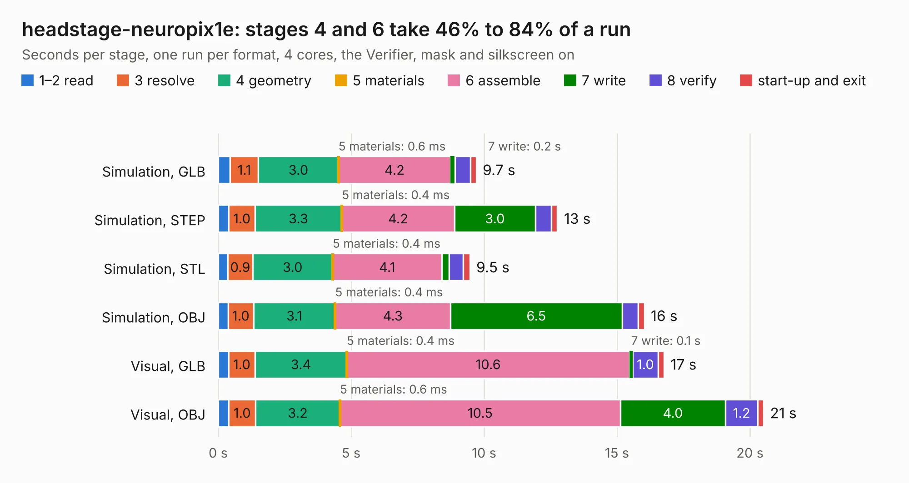

| Mode and format | 1–2 read | 3 resolve | 4 geometry | 5 materials | 6 assemble | 7 write | 8 verify | start-up and exit | Total |
|---|---:|---:|---:|---:|---:|---:|---:|---:|---:|
| Simulation, GLB | 0.4 | 1.1 | 3.0 | 0.6&nbsp;ms | 4.2 | 0.2 | 0.6 | 0.2 | 9.7 |
| Simulation, STEP | 0.4 | 1.0 | 3.3 | 0.4&nbsp;ms | 4.2 | 3.0 | 0.6 | 0.2 | 12.8 |
| Simulation, STL | 0.4 | 0.9 | 3.0 | 0.4&nbsp;ms | 4.1 | 0.3 | 0.5 | 0.2 | 9.5 |
| Simulation, OBJ | 0.4 | 1.0 | 3.1 | 0.4&nbsp;ms | 4.3 | 6.5 | 0.6 | 0.2 | 16.0 |
| Visual, GLB | 0.4 | 1.0 | 3.4 | 0.4&nbsp;ms | 10.6 | 0.1 | 1.0 | 0.2 | 16.8 |
| Visual, OBJ | 0.4 | 1.0 | 3.2 | 0.6&nbsp;ms | 10.5 | 4.0 | 1.2 | 0.2 | 20.5 |

<table align="center"><tr><td valign="top">

| Board | Repo: [open-ephys/onix-headstage-neuropix1e](https://github.com/open-ephys/onix-headstage-neuropix1e) Board: `headstage-neuropix1e.kicad_pcb` |
|---|---|
| Folder | pcb-te |
| Complexity | 377&nbsp;/&nbsp;1000 (size&nbsp;247, features&nbsp;130) |
| KESE&nbsp;features | through vias, custom pads, rounded, trapezoid or chamfered pads, arc tracks, filled zones, copper drawings, curved board outline, stack-up, dielectric εr and tanδ, mask and silkscreen colours |
| Tested | 9th November 2026 |
| Copper&nbsp;layers | 4 |
| File&nbsp;format | KiCad 7 (20221018) |
| Parts,&nbsp;tracks,&nbsp;vias | 72, 816, 191 |
| Triangles,&nbsp;simulation | 1,175,284 in 78 parts |
| Verifier | PASS in all six runs |

</td><td valign="top">

<table>
<tr><th>File type</th><th>File size</th><th>Peak memory used</th></tr>
<tr><th colspan="3" align="left">Simulation</th></tr>
<tr><td>GLB</td><td align="right">40&nbsp;MB</td><td align="right">546&nbsp;MB</td></tr>
<tr><td>STEP</td><td align="right">174&nbsp;MB</td><td align="right">607&nbsp;MB</td></tr>
<tr><td>STL</td><td align="right">59&nbsp;MB</td><td align="right">552&nbsp;MB</td></tr>
<tr><td>OBJ</td><td align="right">121&nbsp;MB</td><td align="right">832&nbsp;MB</td></tr>
<tr><th colspan="3" align="left">Visual</th></tr>
<tr><td>GLB</td><td align="right">26&nbsp;MB</td><td align="right">672&nbsp;MB</td></tr>
<tr><td>OBJ</td><td align="right">79&nbsp;MB</td><td align="right">666&nbsp;MB</td></tr>
</table>

</td></tr></table>

## 2067. headstage-neuropix2e

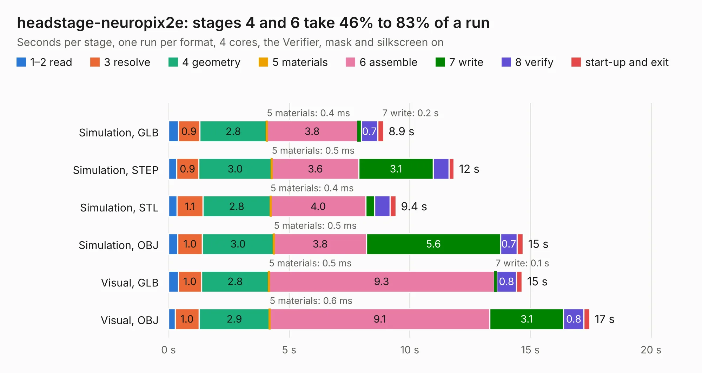

| Mode and format | 1–2 read | 3 resolve | 4 geometry | 5 materials | 6 assemble | 7 write | 8 verify | start-up and exit | Total |
|---|---:|---:|---:|---:|---:|---:|---:|---:|---:|
| Simulation, GLB | 0.4 | 0.9 | 2.8 | 0.4&nbsp;ms | 3.8 | 0.2 | 0.7 | 0.2 | 8.9 |
| Simulation, STEP | 0.3 | 0.9 | 3.0 | 0.5&nbsp;ms | 3.6 | 3.1 | 0.7 | 0.2 | 11.8 |
| Simulation, STL | 0.3 | 1.1 | 2.8 | 0.4&nbsp;ms | 4.0 | 0.4 | 0.6 | 0.2 | 9.4 |
| Simulation, OBJ | 0.4 | 1.0 | 3.0 | 0.5&nbsp;ms | 3.8 | 5.6 | 0.7 | 0.2 | 14.7 |
| Visual, GLB | 0.4 | 1.0 | 2.8 | 0.5&nbsp;ms | 9.3 | 0.1 | 0.8 | 0.2 | 14.7 |
| Visual, OBJ | 0.3 | 1.0 | 2.9 | 0.6&nbsp;ms | 9.1 | 3.1 | 0.8 | 0.2 | 17.5 |

<table align="center"><tr><td valign="top">

| Board | Repo: [open-ephys/onix-headstage-neuropix2e](https://github.com/open-ephys/onix-headstage-neuropix2e) Board: `headstage-neuropix2e.kicad_pcb` |
|---|---|
| Folder | pcb |
| Complexity | 381&nbsp;/&nbsp;1000 (size&nbsp;241, features&nbsp;140) |
| KESE&nbsp;features | through vias, slotted holes, custom pads, rounded, trapezoid or chamfered pads, arc tracks, filled zones, copper drawings, curved board outline, stack-up, dielectric εr and tanδ, mask and silkscreen colours |
| Tested | 9th November 2026 |
| Copper&nbsp;layers | 4 |
| File&nbsp;format | KiCad 7 (20221018) |
| Parts,&nbsp;tracks,&nbsp;vias | 58, 661, 155 |
| Triangles,&nbsp;simulation | 1,030,874 in 73 parts |
| Verifier | PASS in all six runs |

</td><td valign="top">

<table>
<tr><th>File type</th><th>File size</th><th>Peak memory used</th></tr>
<tr><th colspan="3" align="left">Simulation</th></tr>
<tr><td>GLB</td><td align="right">35&nbsp;MB</td><td align="right">502&nbsp;MB</td></tr>
<tr><td>STEP</td><td align="right">148&nbsp;MB</td><td align="right">516&nbsp;MB</td></tr>
<tr><td>STL</td><td align="right">52&nbsp;MB</td><td align="right">499&nbsp;MB</td></tr>
<tr><td>OBJ</td><td align="right">105&nbsp;MB</td><td align="right">730&nbsp;MB</td></tr>
<tr><th colspan="3" align="left">Visual</th></tr>
<tr><td>GLB</td><td align="right">22&nbsp;MB</td><td align="right">555&nbsp;MB</td></tr>
<tr><td>OBJ</td><td align="right">67&nbsp;MB</td><td align="right">555&nbsp;MB</td></tr>
</table>

</td></tr></table>

## 2068. headstage-neuropix2e

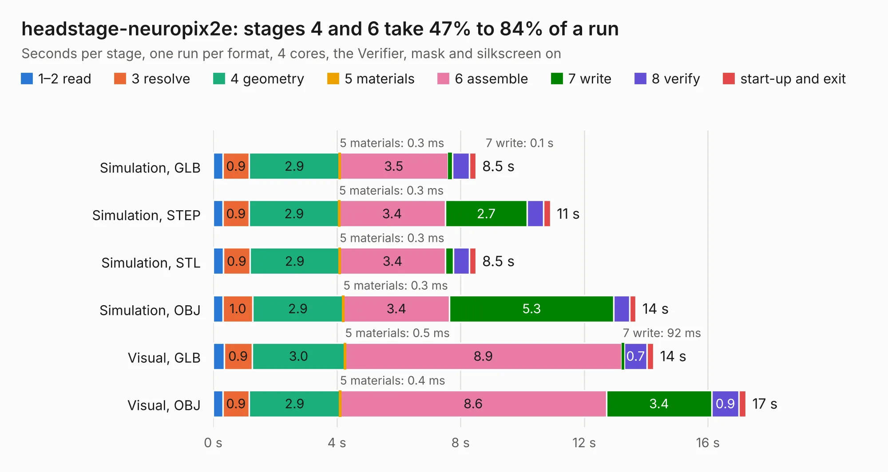

| Mode and format | 1–2 read | 3 resolve | 4 geometry | 5 materials | 6 assemble | 7 write | 8 verify | start-up and exit | Total |
|---|---:|---:|---:|---:|---:|---:|---:|---:|---:|
| Simulation, GLB | 0.3 | 0.9 | 2.9 | 0.3&nbsp;ms | 3.5 | 0.1 | 0.6 | 0.2 | 8.5 |
| Simulation, STEP | 0.3 | 0.9 | 2.9 | 0.3&nbsp;ms | 3.4 | 2.7 | 0.5 | 0.2 | 10.9 |
| Simulation, STL | 0.3 | 0.9 | 2.9 | 0.3&nbsp;ms | 3.4 | 0.3 | 0.5 | 0.2 | 8.5 |
| Simulation, OBJ | 0.3 | 1.0 | 2.9 | 0.3&nbsp;ms | 3.4 | 5.3 | 0.5 | 0.2 | 13.7 |
| Visual, GLB | 0.4 | 0.9 | 3.0 | 0.5&nbsp;ms | 8.9 | 92&nbsp;ms | 0.7 | 0.2 | 14.2 |
| Visual, OBJ | 0.3 | 0.9 | 2.9 | 0.4&nbsp;ms | 8.6 | 3.4 | 0.9 | 0.2 | 17.2 |

<table align="center"><tr><td valign="top">

| Board | Repo: [open-ephys/onix-headstage-neuropix2e-beta](https://github.com/open-ephys/onix-headstage-neuropix2e-beta) Board: `headstage-neuropix2e.kicad_pcb` |
|---|---|
| Folder | pcb |
| Complexity | 366&nbsp;/&nbsp;1000 (size&nbsp;241, features&nbsp;125) |
| KESE&nbsp;features | through vias, slotted holes, custom pads, rounded, trapezoid or chamfered pads, filled zones, copper drawings, curved board outline, stack-up, dielectric εr and tanδ, mask and silkscreen colours |
| Tested | 9th November 2026 |
| Copper&nbsp;layers | 4 |
| File&nbsp;format | KiCad 7 (20221018) |
| Parts,&nbsp;tracks,&nbsp;vias | 57, 582, 167 |
| Triangles,&nbsp;simulation | 1,091,444 in 70 parts |
| Verifier | PASS in all six runs |

</td><td valign="top">

<table>
<tr><th>File type</th><th>File size</th><th>Peak memory used</th></tr>
<tr><th colspan="3" align="left">Simulation</th></tr>
<tr><td>GLB</td><td align="right">37&nbsp;MB</td><td align="right">520&nbsp;MB</td></tr>
<tr><td>STEP</td><td align="right">159&nbsp;MB</td><td align="right">555&nbsp;MB</td></tr>
<tr><td>STL</td><td align="right">55&nbsp;MB</td><td align="right">519&nbsp;MB</td></tr>
<tr><td>OBJ</td><td align="right">111&nbsp;MB</td><td align="right">748&nbsp;MB</td></tr>
<tr><th colspan="3" align="left">Visual</th></tr>
<tr><td>GLB</td><td align="right">22&nbsp;MB</td><td align="right">619&nbsp;MB</td></tr>
<tr><td>OBJ</td><td align="right">69&nbsp;MB</td><td align="right">573&nbsp;MB</td></tr>
</table>

</td></tr></table>

## 2069. headstage-rhs2116

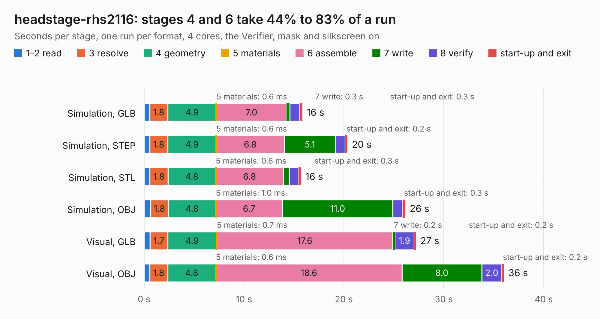

| Mode and format | 1–2 read | 3 resolve | 4 geometry | 5 materials | 6 assemble | 7 write | 8 verify | start-up and exit | Total |
|---|---:|---:|---:|---:|---:|---:|---:|---:|---:|
| Simulation, GLB | 0.6 | 1.8 | 4.9 | 0.6&nbsp;ms | 7.0 | 0.3 | 1.0 | 0.3 | 15.8 |
| Simulation, STEP | 0.6 | 1.8 | 4.9 | 0.6&nbsp;ms | 6.8 | 5.1 | 1.0 | 0.2 | 20.4 |
| Simulation, STL | 0.6 | 1.8 | 4.8 | 0.6&nbsp;ms | 6.8 | 0.6 | 1.0 | 0.3 | 15.7 |
| Simulation, OBJ | 0.7 | 1.8 | 4.8 | 1.0&nbsp;ms | 6.7 | 11.0 | 1.0 | 0.3 | 26.2 |
| Visual, GLB | 0.6 | 1.7 | 4.9 | 0.7&nbsp;ms | 17.6 | 0.2 | 1.9 | 0.2 | 27.2 |
| Visual, OBJ | 0.6 | 1.8 | 4.8 | 0.6&nbsp;ms | 18.6 | 8.0 | 2.0 | 0.2 | 36.0 |

<table align="center"><tr><td valign="top">

| Board | Repo: [open-ephys/onix-headstage-rhs2116](https://github.com/open-ephys/onix-headstage-rhs2116) Board: `headstage-rhs2116.kicad_pcb` |
|---|---|
| Folder | pcb |
| Complexity | 425&nbsp;/&nbsp;1000 (size&nbsp;280, features&nbsp;145) |
| KESE&nbsp;features | through vias, custom pads, rounded, trapezoid or chamfered pads, arc tracks, filled zones, copper drawings, curved board outline, stack-up, dielectric εr and tanδ, copper finish, mask and silkscreen colours |
| Tested | 9th November 2026 |
| Copper&nbsp;layers | 6 |
| File&nbsp;format | KiCad 8 (20240108) |
| Parts,&nbsp;tracks,&nbsp;vias | 131, 1,462, 313 |
| Triangles,&nbsp;simulation | 2,183,078 in 178 parts |
| Verifier | PASS in all six runs |

</td><td valign="top">

<table>
<tr><th>File type</th><th>File size</th><th>Peak memory used</th></tr>
<tr><th colspan="3" align="left">Simulation</th></tr>
<tr><td>GLB</td><td align="right">74&nbsp;MB</td><td align="right">841&nbsp;MB</td></tr>
<tr><td>STEP</td><td align="right">318&nbsp;MB</td><td align="right">952&nbsp;MB</td></tr>
<tr><td>STL</td><td align="right">109&nbsp;MB</td><td align="right">824&nbsp;MB</td></tr>
<tr><td>OBJ</td><td align="right">231&nbsp;MB</td><td align="right">1.5&nbsp;GB</td></tr>
<tr><th colspan="3" align="left">Visual</th></tr>
<tr><td>GLB</td><td align="right">49&nbsp;MB</td><td align="right">919&nbsp;MB</td></tr>
<tr><td>OBJ</td><td align="right">154&nbsp;MB</td><td align="right">1.1&nbsp;GB</td></tr>
</table>

</td></tr></table>

## 2070. test-board

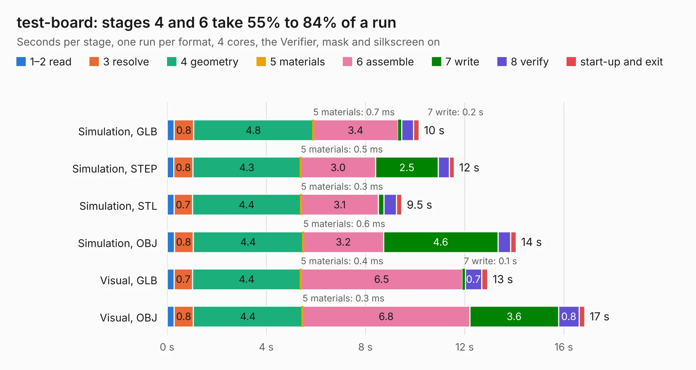

| Mode and format | 1–2 read | 3 resolve | 4 geometry | 5 materials | 6 assemble | 7 write | 8 verify | start-up and exit | Total |
|---|---:|---:|---:|---:|---:|---:|---:|---:|---:|
| Simulation, GLB | 0.3 | 0.8 | 4.8 | 0.7&nbsp;ms | 3.4 | 0.2 | 0.5 | 0.2 | 10.2 |
| Simulation, STEP | 0.3 | 0.8 | 4.3 | 0.5&nbsp;ms | 3.0 | 2.5 | 0.4 | 0.2 | 11.6 |
| Simulation, STL | 0.3 | 0.7 | 4.4 | 0.3&nbsp;ms | 3.1 | 0.2 | 0.5 | 0.2 | 9.5 |
| Simulation, OBJ | 0.3 | 0.8 | 4.4 | 0.6&nbsp;ms | 3.2 | 4.6 | 0.5 | 0.2 | 14.1 |
| Visual, GLB | 0.3 | 0.7 | 4.4 | 0.4&nbsp;ms | 6.5 | 0.1 | 0.7 | 0.2 | 12.9 |
| Visual, OBJ | 0.3 | 0.8 | 4.4 | 0.3&nbsp;ms | 6.8 | 3.6 | 0.8 | 0.2 | 16.8 |

<table align="center"><tr><td valign="top">

| Board | Repo: [open-ephys/onix-headstage-rhs2116](https://github.com/open-ephys/onix-headstage-rhs2116) Board: `test-board.kicad_pcb` |
|---|---|
| Folder | test-board |
| Complexity | 229&nbsp;/&nbsp;1000 (size&nbsp;144, features&nbsp;85) |
| KESE&nbsp;features | through vias, rounded, trapezoid or chamfered pads, filled zones, curved board outline, stack-up, dielectric εr and tanδ |
| Tested | 9th November 2026 |
| Copper&nbsp;layers | 2 |
| File&nbsp;format | KiCad 7 (20221018) |
| Parts,&nbsp;tracks,&nbsp;vias | 26, 219, 13 |
| Triangles,&nbsp;simulation | 820,550 in 57 parts |
| Verifier | PASS in all six runs |

</td><td valign="top">

<table>
<tr><th>File type</th><th>File size</th><th>Peak memory used</th></tr>
<tr><th colspan="3" align="left">Simulation</th></tr>
<tr><td>GLB</td><td align="right">28&nbsp;MB</td><td align="right">402&nbsp;MB</td></tr>
<tr><td>STEP</td><td align="right">144&nbsp;MB</td><td align="right">492&nbsp;MB</td></tr>
<tr><td>STL</td><td align="right">41&nbsp;MB</td><td align="right">393&nbsp;MB</td></tr>
<tr><td>OBJ</td><td align="right">83&nbsp;MB</td><td align="right">590&nbsp;MB</td></tr>
<tr><th colspan="3" align="left">Visual</th></tr>
<tr><td>GLB</td><td align="right">21&nbsp;MB</td><td align="right">558&nbsp;MB</td></tr>
<tr><td>OBJ</td><td align="right">61&nbsp;MB</td><td align="right">540&nbsp;MB</td></tr>
</table>

</td></tr></table>

## 2071. PCIexpress_x16_full

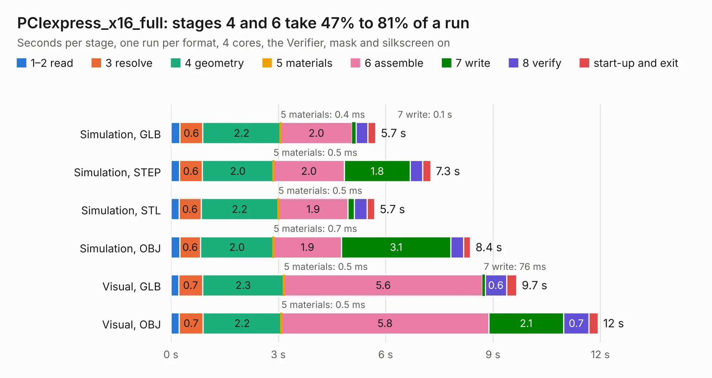

| Mode and format | 1–2 read | 3 resolve | 4 geometry | 5 materials | 6 assemble | 7 write | 8 verify | start-up and exit | Total |
|---|---:|---:|---:|---:|---:|---:|---:|---:|---:|
| Simulation, GLB | 0.3 | 0.6 | 2.2 | 0.4&nbsp;ms | 2.0 | 0.1 | 0.3 | 0.2 | 5.7 |
| Simulation, STEP | 0.2 | 0.6 | 2.0 | 0.5&nbsp;ms | 2.0 | 1.8 | 0.3 | 0.2 | 7.3 |
| Simulation, STL | 0.2 | 0.6 | 2.2 | 0.5&nbsp;ms | 1.9 | 0.2 | 0.4 | 0.2 | 5.7 |
| Simulation, OBJ | 0.2 | 0.6 | 2.0 | 0.7&nbsp;ms | 1.9 | 3.1 | 0.4 | 0.2 | 8.4 |
| Visual, GLB | 0.2 | 0.7 | 2.3 | 0.5&nbsp;ms | 5.6 | 76&nbsp;ms | 0.6 | 0.3 | 9.7 |
| Visual, OBJ | 0.2 | 0.7 | 2.2 | 0.5&nbsp;ms | 5.8 | 2.1 | 0.7 | 0.3 | 11.9 |

<table align="center"><tr><td valign="top">

| Board | Repo: [open-ephys/PCIexpress-KiCad](https://github.com/open-ephys/PCIexpress-KiCad) Board: `PCIexpress_x16_full.kicad_pcb` |
|---|---|
| Folder | PCIexpress_x16_full |
| Complexity | 239&nbsp;/&nbsp;1000 (size&nbsp;184, features&nbsp;55) |
| KESE&nbsp;features | through vias, rounded, trapezoid or chamfered pads, filled zones, curved board outline |
| Tested | 9th November 2026 |
| Copper&nbsp;layers | 4 |
| File&nbsp;format | KiCad 6 (20211014) |
| Parts,&nbsp;tracks,&nbsp;vias | 65, 323, 102 |
| Triangles,&nbsp;simulation | 613,568 in 134 parts |
| Verifier | PASS in all six runs |

</td><td valign="top">

<table>
<tr><th>File type</th><th>File size</th><th>Peak memory used</th></tr>
<tr><th colspan="3" align="left">Simulation</th></tr>
<tr><td>GLB</td><td align="right">21&nbsp;MB</td><td align="right">375&nbsp;MB</td></tr>
<tr><td>STEP</td><td align="right">102&nbsp;MB</td><td align="right">394&nbsp;MB</td></tr>
<tr><td>STL</td><td align="right">31&nbsp;MB</td><td align="right">373&nbsp;MB</td></tr>
<tr><td>OBJ</td><td align="right">64&nbsp;MB</td><td align="right">452&nbsp;MB</td></tr>
<tr><th colspan="3" align="left">Visual</th></tr>
<tr><td>GLB</td><td align="right">15&nbsp;MB</td><td align="right">388&nbsp;MB</td></tr>
<tr><td>OBJ</td><td align="right">45&nbsp;MB</td><td align="right">389&nbsp;MB</td></tr>
</table>

</td></tr></table>

## 2072. PCIexpress_x16_half

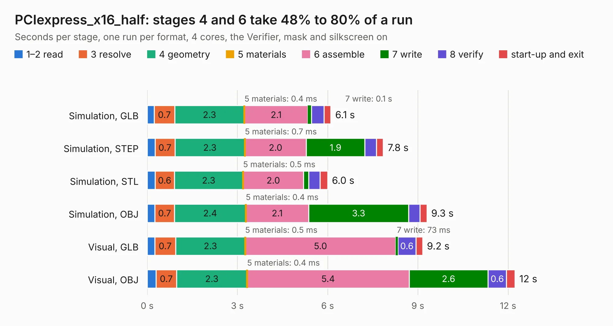

| Mode and format | 1–2 read | 3 resolve | 4 geometry | 5 materials | 6 assemble | 7 write | 8 verify | start-up and exit | Total |
|---|---:|---:|---:|---:|---:|---:|---:|---:|---:|
| Simulation, GLB | 0.2 | 0.7 | 2.3 | 0.4&nbsp;ms | 2.1 | 0.1 | 0.4 | 0.2 | 6.1 |
| Simulation, STEP | 0.3 | 0.7 | 2.3 | 0.7&nbsp;ms | 2.0 | 1.9 | 0.4 | 0.2 | 7.8 |
| Simulation, STL | 0.3 | 0.6 | 2.3 | 0.5&nbsp;ms | 2.0 | 0.2 | 0.4 | 0.3 | 6.0 |
| Simulation, OBJ | 0.3 | 0.7 | 2.4 | 0.4&nbsp;ms | 2.1 | 3.3 | 0.4 | 0.2 | 9.3 |
| Visual, GLB | 0.2 | 0.7 | 2.3 | 0.5&nbsp;ms | 5.0 | 73&nbsp;ms | 0.6 | 0.2 | 9.2 |
| Visual, OBJ | 0.3 | 0.7 | 2.3 | 0.4&nbsp;ms | 5.4 | 2.6 | 0.6 | 0.3 | 12.2 |

<table align="center"><tr><td valign="top">

| Board | Repo: [open-ephys/PCIexpress-KiCad](https://github.com/open-ephys/PCIexpress-KiCad) Board: `PCIexpress_x16_half.kicad_pcb` |
|---|---|
| Folder | PCIexpress_x16_half |
| Complexity | 239&nbsp;/&nbsp;1000 (size&nbsp;184, features&nbsp;55) |
| KESE&nbsp;features | through vias, rounded, trapezoid or chamfered pads, filled zones, curved board outline |
| Tested | 9th November 2026 |
| Copper&nbsp;layers | 4 |
| File&nbsp;format | KiCad 6 (20211014) |
| Parts,&nbsp;tracks,&nbsp;vias | 65, 323, 102 |
| Triangles,&nbsp;simulation | 607,864 in 134 parts |
| Verifier | PASS in all six runs |

</td><td valign="top">

<table>
<tr><th>File type</th><th>File size</th><th>Peak memory used</th></tr>
<tr><th colspan="3" align="left">Simulation</th></tr>
<tr><td>GLB</td><td align="right">20&nbsp;MB</td><td align="right">364&nbsp;MB</td></tr>
<tr><td>STEP</td><td align="right">102&nbsp;MB</td><td align="right">386&nbsp;MB</td></tr>
<tr><td>STL</td><td align="right">30&nbsp;MB</td><td align="right">360&nbsp;MB</td></tr>
<tr><td>OBJ</td><td align="right">63&nbsp;MB</td><td align="right">448&nbsp;MB</td></tr>
<tr><th colspan="3" align="left">Visual</th></tr>
<tr><td>GLB</td><td align="right">15&nbsp;MB</td><td align="right">380&nbsp;MB</td></tr>
<tr><td>OBJ</td><td align="right">45&nbsp;MB</td><td align="right">398&nbsp;MB</td></tr>
</table>

</td></tr></table>

## 2073. PCIexpress_x16_low

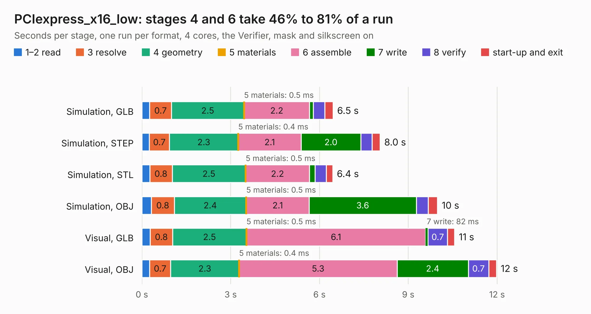

| Mode and format | 1–2 read | 3 resolve | 4 geometry | 5 materials | 6 assemble | 7 write | 8 verify | start-up and exit | Total |
|---|---:|---:|---:|---:|---:|---:|---:|---:|---:|
| Simulation, GLB | 0.3 | 0.7 | 2.5 | 0.5&nbsp;ms | 2.2 | 0.1 | 0.4 | 0.3 | 6.5 |
| Simulation, STEP | 0.3 | 0.7 | 2.3 | 0.4&nbsp;ms | 2.1 | 2.0 | 0.4 | 0.3 | 8.0 |
| Simulation, STL | 0.3 | 0.8 | 2.5 | 0.5&nbsp;ms | 2.2 | 0.2 | 0.4 | 0.2 | 6.4 |
| Simulation, OBJ | 0.3 | 0.8 | 2.4 | 0.5&nbsp;ms | 2.1 | 3.6 | 0.4 | 0.3 | 10.0 |
| Visual, GLB | 0.3 | 0.8 | 2.5 | 0.5&nbsp;ms | 6.1 | 82&nbsp;ms | 0.7 | 0.2 | 10.6 |
| Visual, OBJ | 0.3 | 0.7 | 2.3 | 0.4&nbsp;ms | 5.3 | 2.4 | 0.7 | 0.3 | 12.0 |

<table align="center"><tr><td valign="top">

| Board | Repo: [open-ephys/PCIexpress-KiCad](https://github.com/open-ephys/PCIexpress-KiCad) Board: `PCIexpress_x16_low.kicad_pcb` |
|---|---|
| Folder | PCIexpress_x16_low |
| Complexity | 239&nbsp;/&nbsp;1000 (size&nbsp;184, features&nbsp;55) |
| KESE&nbsp;features | through vias, rounded, trapezoid or chamfered pads, filled zones, curved board outline |
| Tested | 9th November 2026 |
| Copper&nbsp;layers | 4 |
| File&nbsp;format | KiCad 6 (20211014) |
| Parts,&nbsp;tracks,&nbsp;vias | 65, 323, 102 |
| Triangles,&nbsp;simulation | 608,008 in 134 parts |
| Verifier | PASS in all six runs |

</td><td valign="top">

<table>
<tr><th>File type</th><th>File size</th><th>Peak memory used</th></tr>
<tr><th colspan="3" align="left">Simulation</th></tr>
<tr><td>GLB</td><td align="right">20&nbsp;MB</td><td align="right">379&nbsp;MB</td></tr>
<tr><td>STEP</td><td align="right">101&nbsp;MB</td><td align="right">386&nbsp;MB</td></tr>
<tr><td>STL</td><td align="right">30&nbsp;MB</td><td align="right">376&nbsp;MB</td></tr>
<tr><td>OBJ</td><td align="right">63&nbsp;MB</td><td align="right">447&nbsp;MB</td></tr>
<tr><th colspan="3" align="left">Visual</th></tr>
<tr><td>GLB</td><td align="right">15&nbsp;MB</td><td align="right">379&nbsp;MB</td></tr>
<tr><td>OBJ</td><td align="right">45&nbsp;MB</td><td align="right">400&nbsp;MB</td></tr>
</table>

</td></tr></table>

## 2074. PCIexpress_x1_full

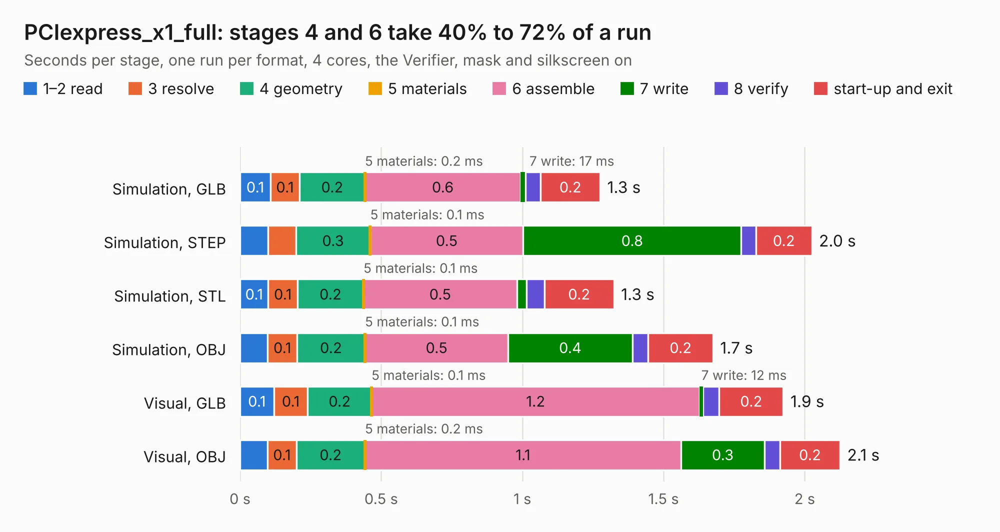

| Mode and format | 1–2 read | 3 resolve | 4 geometry | 5 materials | 6 assemble | 7 write | 8 verify | start-up and exit | Total |
|---|---:|---:|---:|---:|---:|---:|---:|---:|---:|
| Simulation, GLB | 0.1 | 0.1 | 0.2 | 0.2&nbsp;ms | 0.6 | 17&nbsp;ms | 54&nbsp;ms | 0.2 | 1.3 |
| Simulation, STEP | 99&nbsp;ms | 98&nbsp;ms | 0.3 | 0.1&nbsp;ms | 0.5 | 0.8 | 53&nbsp;ms | 0.2 | 2.0 |
| Simulation, STL | 0.1 | 0.1 | 0.2 | 0.1&nbsp;ms | 0.5 | 35&nbsp;ms | 63&nbsp;ms | 0.2 | 1.3 |
| Simulation, OBJ | 98&nbsp;ms | 0.1 | 0.2 | 0.1&nbsp;ms | 0.5 | 0.4 | 56&nbsp;ms | 0.2 | 1.7 |
| Visual, GLB | 0.1 | 0.1 | 0.2 | 0.1&nbsp;ms | 1.2 | 12&nbsp;ms | 57&nbsp;ms | 0.2 | 1.9 |
| Visual, OBJ | 98&nbsp;ms | 0.1 | 0.2 | 0.2&nbsp;ms | 1.1 | 0.3 | 55&nbsp;ms | 0.2 | 2.1 |

<table align="center"><tr><td valign="top">

| Board | Repo: [open-ephys/PCIexpress-KiCad](https://github.com/open-ephys/PCIexpress-KiCad) Board: `PCIexpress_x1_full.kicad_pcb` |
|---|---|
| Folder | PCIexpress_x1_full |
| Complexity | 175&nbsp;/&nbsp;1000 (size&nbsp;120, features&nbsp;55) |
| KESE&nbsp;features | through vias, rounded, trapezoid or chamfered pads, filled zones, curved board outline |
| Tested | 9th November 2026 |
| Copper&nbsp;layers | 4 |
| File&nbsp;format | KiCad 6 (20211014) |
| Parts,&nbsp;tracks,&nbsp;vias | 5, 23, 12 |
| Triangles,&nbsp;simulation | 83,072 in 35 parts |
| Verifier | PASS in all six runs |

</td><td valign="top">

<table>
<tr><th>File type</th><th>File size</th><th>Peak memory used</th></tr>
<tr><th colspan="3" align="left">Simulation</th></tr>
<tr><td>GLB</td><td align="right">2.8&nbsp;MB</td><td align="right">182&nbsp;MB</td></tr>
<tr><td>STEP</td><td align="right">12&nbsp;MB</td><td align="right">181&nbsp;MB</td></tr>
<tr><td>STL</td><td align="right">4.2&nbsp;MB</td><td align="right">179&nbsp;MB</td></tr>
<tr><td>OBJ</td><td align="right">8.1&nbsp;MB</td><td align="right">180&nbsp;MB</td></tr>
<tr><th colspan="3" align="left">Visual</th></tr>
<tr><td>GLB</td><td align="right">1.9&nbsp;MB</td><td align="right">154&nbsp;MB</td></tr>
<tr><td>OBJ</td><td align="right">5.4&nbsp;MB</td><td align="right">154&nbsp;MB</td></tr>
</table>

</td></tr></table>

## 2075. PCIexpress_x1_half

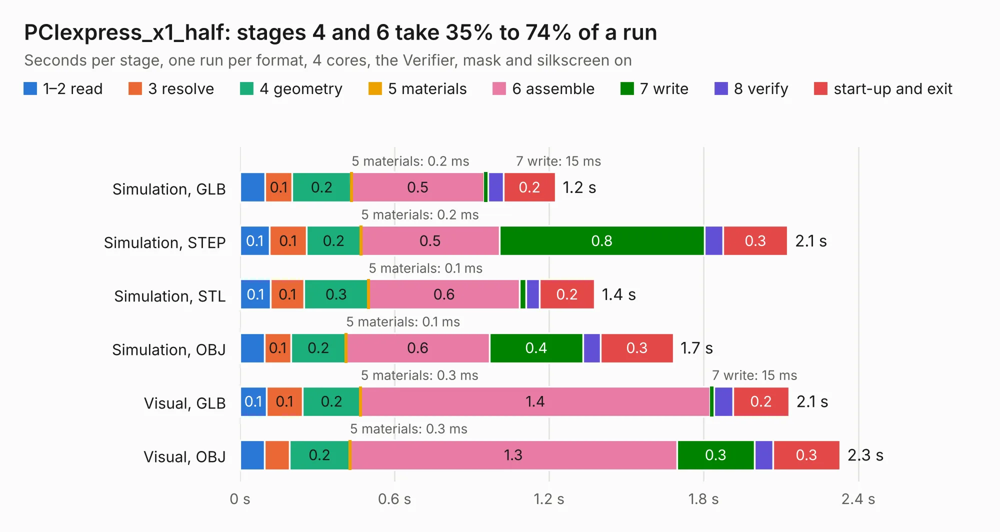

| Mode and format | 1–2 read | 3 resolve | 4 geometry | 5 materials | 6 assemble | 7 write | 8 verify | start-up and exit | Total |
|---|---:|---:|---:|---:|---:|---:|---:|---:|---:|
| Simulation, GLB | 97&nbsp;ms | 0.1 | 0.2 | 0.2&nbsp;ms | 0.5 | 15&nbsp;ms | 60&nbsp;ms | 0.2 | 1.2 |
| Simulation, STEP | 0.1 | 0.1 | 0.2 | 0.2&nbsp;ms | 0.5 | 0.8 | 73&nbsp;ms | 0.3 | 2.1 |
| Simulation, STL | 0.1 | 0.1 | 0.3 | 0.1&nbsp;ms | 0.6 | 23&nbsp;ms | 53&nbsp;ms | 0.2 | 1.4 |
| Simulation, OBJ | 94&nbsp;ms | 0.1 | 0.2 | 0.1&nbsp;ms | 0.6 | 0.4 | 69&nbsp;ms | 0.3 | 1.7 |
| Visual, GLB | 0.1 | 0.1 | 0.2 | 0.3&nbsp;ms | 1.4 | 15&nbsp;ms | 74&nbsp;ms | 0.2 | 2.1 |
| Visual, OBJ | 95&nbsp;ms | 96&nbsp;ms | 0.2 | 0.3&nbsp;ms | 1.3 | 0.3 | 72&nbsp;ms | 0.3 | 2.3 |

<table align="center"><tr><td valign="top">

| Board | Repo: [open-ephys/PCIexpress-KiCad](https://github.com/open-ephys/PCIexpress-KiCad) Board: `PCIexpress_x1_half.kicad_pcb` |
|---|---|
| Folder | PCIexpress_x1_half |
| Complexity | 175&nbsp;/&nbsp;1000 (size&nbsp;120, features&nbsp;55) |
| KESE&nbsp;features | through vias, rounded, trapezoid or chamfered pads, filled zones, curved board outline |
| Tested | 9th November 2026 |
| Copper&nbsp;layers | 4 |
| File&nbsp;format | KiCad 6 (20211014) |
| Parts,&nbsp;tracks,&nbsp;vias | 5, 23, 12 |
| Triangles,&nbsp;simulation | 79,200 in 35 parts |
| Verifier | PASS in all six runs |

</td><td valign="top">

<table>
<tr><th>File type</th><th>File size</th><th>Peak memory used</th></tr>
<tr><th colspan="3" align="left">Simulation</th></tr>
<tr><td>GLB</td><td align="right">2.7&nbsp;MB</td><td align="right">175&nbsp;MB</td></tr>
<tr><td>STEP</td><td align="right">12&nbsp;MB</td><td align="right">176&nbsp;MB</td></tr>
<tr><td>STL</td><td align="right">4.0&nbsp;MB</td><td align="right">176&nbsp;MB</td></tr>
<tr><td>OBJ</td><td align="right">7.8&nbsp;MB</td><td align="right">177&nbsp;MB</td></tr>
<tr><th colspan="3" align="left">Visual</th></tr>
<tr><td>GLB</td><td align="right">1.8&nbsp;MB</td><td align="right">154&nbsp;MB</td></tr>
<tr><td>OBJ</td><td align="right">5.1&nbsp;MB</td><td align="right">153&nbsp;MB</td></tr>
</table>

</td></tr></table>

## 2076. PCIexpress_x1_low

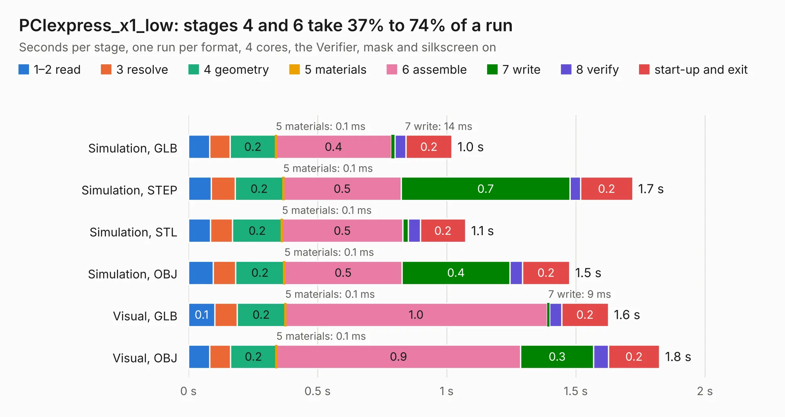

| Mode and format | 1–2 read | 3 resolve | 4 geometry | 5 materials | 6 assemble | 7 write | 8 verify | start-up and exit | Total |
|---|---:|---:|---:|---:|---:|---:|---:|---:|---:|
| Simulation, GLB | 82&nbsp;ms | 78&nbsp;ms | 0.2 | 0.1&nbsp;ms | 0.4 | 14&nbsp;ms | 43&nbsp;ms | 0.2 | 1.0 |
| Simulation, STEP | 88&nbsp;ms | 92&nbsp;ms | 0.2 | 0.1&nbsp;ms | 0.5 | 0.7 | 41&nbsp;ms | 0.2 | 1.7 |
| Simulation, STL | 86&nbsp;ms | 85&nbsp;ms | 0.2 | 0.1&nbsp;ms | 0.5 | 23&nbsp;ms | 47&nbsp;ms | 0.2 | 1.1 |
| Simulation, OBJ | 95&nbsp;ms | 87&nbsp;ms | 0.2 | 0.1&nbsp;ms | 0.5 | 0.4 | 48&nbsp;ms | 0.2 | 1.5 |
| Visual, GLB | 0.1 | 87&nbsp;ms | 0.2 | 0.1&nbsp;ms | 1.0 | 9&nbsp;ms | 47&nbsp;ms | 0.2 | 1.6 |
| Visual, OBJ | 82&nbsp;ms | 81&nbsp;ms | 0.2 | 0.1&nbsp;ms | 0.9 | 0.3 | 58&nbsp;ms | 0.2 | 1.8 |

<table align="center"><tr><td valign="top">

| Board | Repo: [open-ephys/PCIexpress-KiCad](https://github.com/open-ephys/PCIexpress-KiCad) Board: `PCIexpress_x1_low.kicad_pcb` |
|---|---|
| Folder | PCIexpress_x1_low |
| Complexity | 175&nbsp;/&nbsp;1000 (size&nbsp;120, features&nbsp;55) |
| KESE&nbsp;features | through vias, rounded, trapezoid or chamfered pads, filled zones, curved board outline |
| Tested | 9th November 2026 |
| Copper&nbsp;layers | 4 |
| File&nbsp;format | KiCad 6 (20211014) |
| Parts,&nbsp;tracks,&nbsp;vias | 5, 23, 12 |
| Triangles,&nbsp;simulation | 79,200 in 35 parts |
| Verifier | PASS in all six runs |

</td><td valign="top">

<table>
<tr><th>File type</th><th>File size</th><th>Peak memory used</th></tr>
<tr><th colspan="3" align="left">Simulation</th></tr>
<tr><td>GLB</td><td align="right">2.7&nbsp;MB</td><td align="right">182&nbsp;MB</td></tr>
<tr><td>STEP</td><td align="right">12&nbsp;MB</td><td align="right">179&nbsp;MB</td></tr>
<tr><td>STL</td><td align="right">4.0&nbsp;MB</td><td align="right">174&nbsp;MB</td></tr>
<tr><td>OBJ</td><td align="right">7.7&nbsp;MB</td><td align="right">182&nbsp;MB</td></tr>
<tr><th colspan="3" align="left">Visual</th></tr>
<tr><td>GLB</td><td align="right">1.8&nbsp;MB</td><td align="right">154&nbsp;MB</td></tr>
<tr><td>OBJ</td><td align="right">5.1&nbsp;MB</td><td align="right">154&nbsp;MB</td></tr>
</table>

</td></tr></table>

## 2077. PCIexpress_x4_full

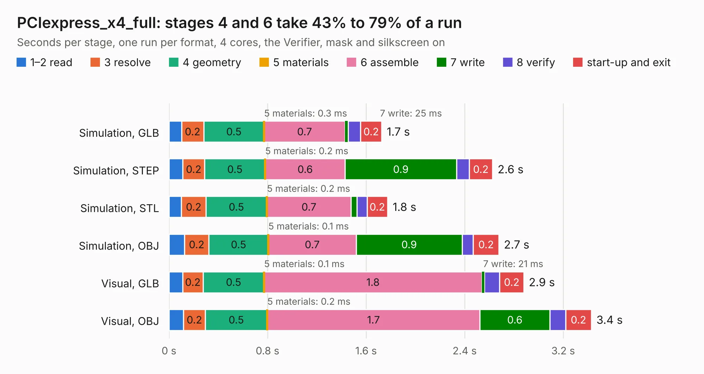

| Mode and format | 1–2 read | 3 resolve | 4 geometry | 5 materials | 6 assemble | 7 write | 8 verify | start-up and exit | Total |
|---|---:|---:|---:|---:|---:|---:|---:|---:|---:|
| Simulation, GLB | 0.1 | 0.2 | 0.5 | 0.3&nbsp;ms | 0.7 | 25&nbsp;ms | 0.1 | 0.2 | 1.7 |
| Simulation, STEP | 0.1 | 0.2 | 0.5 | 0.2&nbsp;ms | 0.6 | 0.9 | 0.1 | 0.2 | 2.6 |
| Simulation, STL | 0.1 | 0.2 | 0.5 | 0.2&nbsp;ms | 0.7 | 49&nbsp;ms | 81&nbsp;ms | 0.2 | 1.8 |
| Simulation, OBJ | 0.1 | 0.2 | 0.5 | 0.1&nbsp;ms | 0.7 | 0.9 | 90&nbsp;ms | 0.2 | 2.7 |
| Visual, GLB | 0.1 | 0.2 | 0.5 | 0.1&nbsp;ms | 1.8 | 21&nbsp;ms | 0.1 | 0.2 | 2.9 |
| Visual, OBJ | 0.1 | 0.2 | 0.5 | 0.2&nbsp;ms | 1.7 | 0.6 | 0.1 | 0.2 | 3.4 |

<table align="center"><tr><td valign="top">

| Board | Repo: [open-ephys/PCIexpress-KiCad](https://github.com/open-ephys/PCIexpress-KiCad) Board: `PCIexpress_x4_full.kicad_pcb` |
|---|---|
| Folder | PCIexpress_x4_full |
| Complexity | 204&nbsp;/&nbsp;1000 (size&nbsp;149, features&nbsp;55) |
| KESE&nbsp;features | through vias, rounded, trapezoid or chamfered pads, filled zones, curved board outline |
| Tested | 9th November 2026 |
| Copper&nbsp;layers | 4 |
| File&nbsp;format | KiCad 6 (20211014) |
| Parts,&nbsp;tracks,&nbsp;vias | 17, 83, 30 |
| Triangles,&nbsp;simulation | 187,908 in 57 parts |
| Verifier | PASS in all six runs |

</td><td valign="top">

<table>
<tr><th>File type</th><th>File size</th><th>Peak memory used</th></tr>
<tr><th colspan="3" align="left">Simulation</th></tr>
<tr><td>GLB</td><td align="right">6.3&nbsp;MB</td><td align="right">218&nbsp;MB</td></tr>
<tr><td>STEP</td><td align="right">29&nbsp;MB</td><td align="right">220&nbsp;MB</td></tr>
<tr><td>STL</td><td align="right">9.4&nbsp;MB</td><td align="right">218&nbsp;MB</td></tr>
<tr><td>OBJ</td><td align="right">19&nbsp;MB</td><td align="right">215&nbsp;MB</td></tr>
<tr><th colspan="3" align="left">Visual</th></tr>
<tr><td>GLB</td><td align="right">4.5&nbsp;MB</td><td align="right">183&nbsp;MB</td></tr>
<tr><td>OBJ</td><td align="right">13&nbsp;MB</td><td align="right">182&nbsp;MB</td></tr>
</table>

</td></tr></table>

## 2078. PCIexpress_x4_half

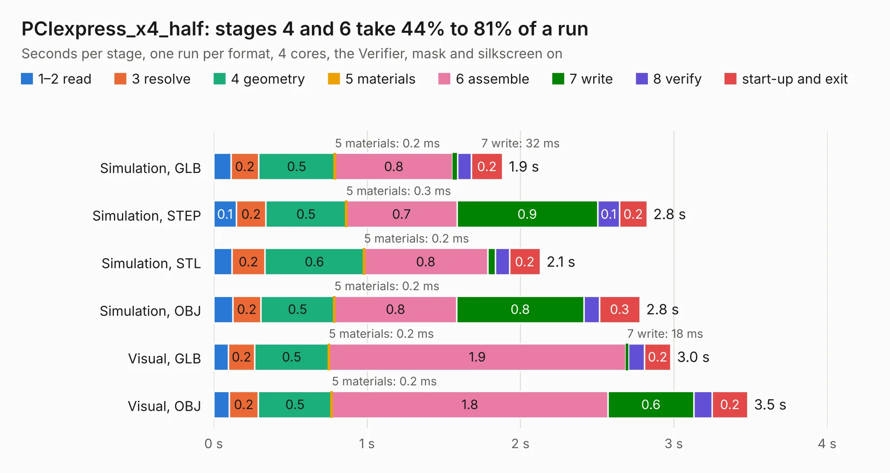

| Mode and format | 1–2 read | 3 resolve | 4 geometry | 5 materials | 6 assemble | 7 write | 8 verify | start-up and exit | Total |
|---|---:|---:|---:|---:|---:|---:|---:|---:|---:|
| Simulation, GLB | 0.1 | 0.2 | 0.5 | 0.2&nbsp;ms | 0.8 | 32&nbsp;ms | 89&nbsp;ms | 0.2 | 1.9 |
| Simulation, STEP | 0.1 | 0.2 | 0.5 | 0.3&nbsp;ms | 0.7 | 0.9 | 0.1 | 0.2 | 2.8 |
| Simulation, STL | 0.1 | 0.2 | 0.6 | 0.2&nbsp;ms | 0.8 | 49&nbsp;ms | 93&nbsp;ms | 0.2 | 2.1 |
| Simulation, OBJ | 0.1 | 0.2 | 0.5 | 0.2&nbsp;ms | 0.8 | 0.8 | 0.1 | 0.3 | 2.8 |
| Visual, GLB | 97&nbsp;ms | 0.2 | 0.5 | 0.2&nbsp;ms | 1.9 | 18&nbsp;ms | 0.1 | 0.2 | 3.0 |
| Visual, OBJ | 0.1 | 0.2 | 0.5 | 0.2&nbsp;ms | 1.8 | 0.6 | 0.1 | 0.2 | 3.5 |

<table align="center"><tr><td valign="top">

| Board | Repo: [open-ephys/PCIexpress-KiCad](https://github.com/open-ephys/PCIexpress-KiCad) Board: `PCIexpress_x4_half.kicad_pcb` |
|---|---|
| Folder | PCIexpress_x4_half |
| Complexity | 204&nbsp;/&nbsp;1000 (size&nbsp;149, features&nbsp;55) |
| KESE&nbsp;features | through vias, rounded, trapezoid or chamfered pads, filled zones, curved board outline |
| Tested | 9th November 2026 |
| Copper&nbsp;layers | 4 |
| File&nbsp;format | KiCad 6 (20211014) |
| Parts,&nbsp;tracks,&nbsp;vias | 17, 83, 30 |
| Triangles,&nbsp;simulation | 182,182 in 57 parts |
| Verifier | PASS in all six runs |

</td><td valign="top">

<table>
<tr><th>File type</th><th>File size</th><th>Peak memory used</th></tr>
<tr><th colspan="3" align="left">Simulation</th></tr>
<tr><td>GLB</td><td align="right">6.1&nbsp;MB</td><td align="right">215&nbsp;MB</td></tr>
<tr><td>STEP</td><td align="right">29&nbsp;MB</td><td align="right">220&nbsp;MB</td></tr>
<tr><td>STL</td><td align="right">9.1&nbsp;MB</td><td align="right">211&nbsp;MB</td></tr>
<tr><td>OBJ</td><td align="right">18&nbsp;MB</td><td align="right">215&nbsp;MB</td></tr>
<tr><th colspan="3" align="left">Visual</th></tr>
<tr><td>GLB</td><td align="right">4.4&nbsp;MB</td><td align="right">171&nbsp;MB</td></tr>
<tr><td>OBJ</td><td align="right">13&nbsp;MB</td><td align="right">178&nbsp;MB</td></tr>
</table>

</td></tr></table>

## 2079. PCIexpress_x4_low

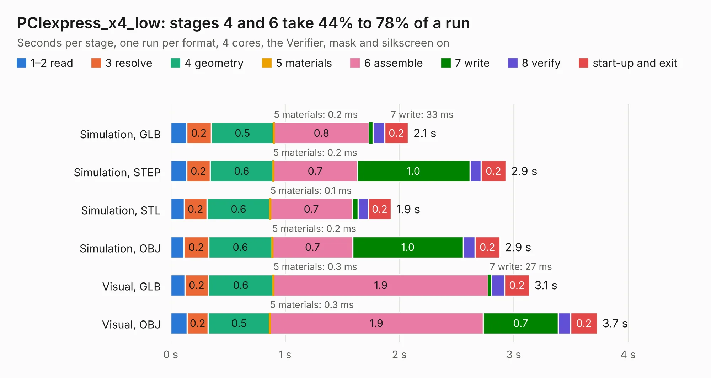

| Mode and format | 1–2 read | 3 resolve | 4 geometry | 5 materials | 6 assemble | 7 write | 8 verify | start-up and exit | Total |
|---|---:|---:|---:|---:|---:|---:|---:|---:|---:|
| Simulation, GLB | 0.1 | 0.2 | 0.5 | 0.2&nbsp;ms | 0.8 | 33&nbsp;ms | 0.1 | 0.2 | 2.1 |
| Simulation, STEP | 0.1 | 0.2 | 0.6 | 0.2&nbsp;ms | 0.7 | 1.0 | 97&nbsp;ms | 0.2 | 2.9 |
| Simulation, STL | 0.1 | 0.2 | 0.6 | 0.1&nbsp;ms | 0.7 | 49&nbsp;ms | 91&nbsp;ms | 0.2 | 1.9 |
| Simulation, OBJ | 0.1 | 0.2 | 0.6 | 0.2&nbsp;ms | 0.7 | 1.0 | 0.1 | 0.2 | 2.9 |
| Visual, GLB | 0.1 | 0.2 | 0.6 | 0.3&nbsp;ms | 1.9 | 27&nbsp;ms | 0.1 | 0.2 | 3.1 |
| Visual, OBJ | 0.1 | 0.2 | 0.5 | 0.3&nbsp;ms | 1.9 | 0.7 | 0.1 | 0.2 | 3.7 |

<table align="center"><tr><td valign="top">

| Board | Repo: [open-ephys/PCIexpress-KiCad](https://github.com/open-ephys/PCIexpress-KiCad) Board: `PCIexpress_x4_low.kicad_pcb` |
|---|---|
| Folder | PCIexpress_x4_low |
| Complexity | 204&nbsp;/&nbsp;1000 (size&nbsp;149, features&nbsp;55) |
| KESE&nbsp;features | through vias, rounded, trapezoid or chamfered pads, filled zones, curved board outline |
| Tested | 9th November 2026 |
| Copper&nbsp;layers | 4 |
| File&nbsp;format | KiCad 6 (20211014) |
| Parts,&nbsp;tracks,&nbsp;vias | 17, 83, 30 |
| Triangles,&nbsp;simulation | 182,178 in 57 parts |
| Verifier | PASS in all six runs |

</td><td valign="top">

<table>
<tr><th>File type</th><th>File size</th><th>Peak memory used</th></tr>
<tr><th colspan="3" align="left">Simulation</th></tr>
<tr><td>GLB</td><td align="right">6.1&nbsp;MB</td><td align="right">206&nbsp;MB</td></tr>
<tr><td>STEP</td><td align="right">29&nbsp;MB</td><td align="right">217&nbsp;MB</td></tr>
<tr><td>STL</td><td align="right">9.1&nbsp;MB</td><td align="right">214&nbsp;MB</td></tr>
<tr><td>OBJ</td><td align="right">18&nbsp;MB</td><td align="right">213&nbsp;MB</td></tr>
<tr><th colspan="3" align="left">Visual</th></tr>
<tr><td>GLB</td><td align="right">4.4&nbsp;MB</td><td align="right">175&nbsp;MB</td></tr>
<tr><td>OBJ</td><td align="right">13&nbsp;MB</td><td align="right">179&nbsp;MB</td></tr>
</table>

</td></tr></table>

## 2080. PCIexpress_x8_full

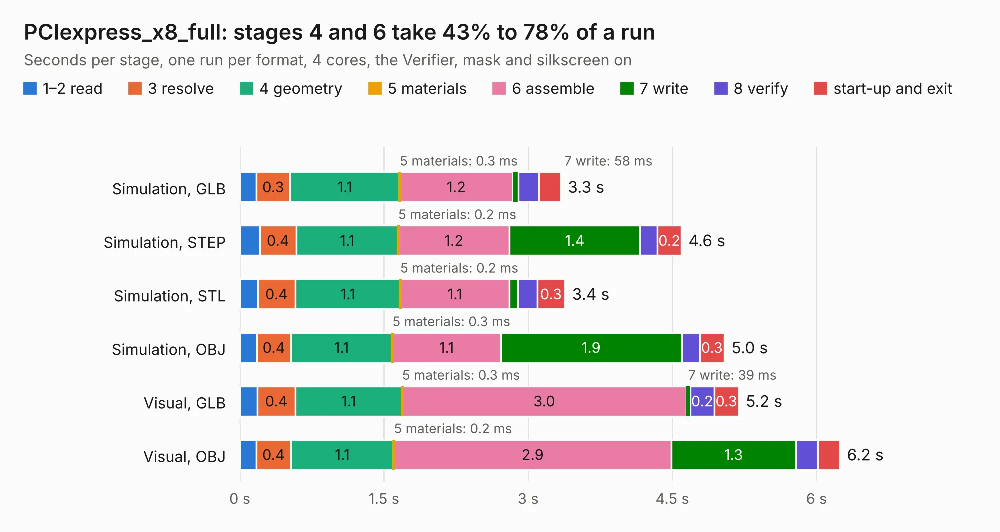

| Mode and format | 1–2 read | 3 resolve | 4 geometry | 5 materials | 6 assemble | 7 write | 8 verify | start-up and exit | Total |
|---|---:|---:|---:|---:|---:|---:|---:|---:|---:|
| Simulation, GLB | 0.2 | 0.3 | 1.1 | 0.3&nbsp;ms | 1.2 | 58&nbsp;ms | 0.2 | 0.2 | 3.3 |
| Simulation, STEP | 0.2 | 0.4 | 1.1 | 0.2&nbsp;ms | 1.2 | 1.4 | 0.2 | 0.2 | 4.6 |
| Simulation, STL | 0.2 | 0.4 | 1.1 | 0.2&nbsp;ms | 1.1 | 88&nbsp;ms | 0.2 | 0.3 | 3.4 |
| Simulation, OBJ | 0.2 | 0.4 | 1.1 | 0.3&nbsp;ms | 1.1 | 1.9 | 0.2 | 0.3 | 5.0 |
| Visual, GLB | 0.2 | 0.4 | 1.1 | 0.3&nbsp;ms | 3.0 | 39&nbsp;ms | 0.2 | 0.3 | 5.2 |
| Visual, OBJ | 0.2 | 0.4 | 1.1 | 0.2&nbsp;ms | 2.9 | 1.3 | 0.2 | 0.2 | 6.2 |

<table align="center"><tr><td valign="top">

| Board | Repo: [open-ephys/PCIexpress-KiCad](https://github.com/open-ephys/PCIexpress-KiCad) Board: `PCIexpress_x8_full.kicad_pcb` |
|---|---|
| Folder | PCIexpress_x8_full |
| Complexity | 221&nbsp;/&nbsp;1000 (size&nbsp;166, features&nbsp;55) |
| KESE&nbsp;features | through vias, rounded, trapezoid or chamfered pads, filled zones, curved board outline |
| Tested | 9th November 2026 |
| Copper&nbsp;layers | 4 |
| File&nbsp;format | KiCad 6 (20211014) |
| Parts,&nbsp;tracks,&nbsp;vias | 33, 163, 54 |
| Triangles,&nbsp;simulation | 326,948 in 83 parts |
| Verifier | PASS in all six runs |

</td><td valign="top">

<table>
<tr><th>File type</th><th>File size</th><th>Peak memory used</th></tr>
<tr><th colspan="3" align="left">Simulation</th></tr>
<tr><td>GLB</td><td align="right">11&nbsp;MB</td><td align="right">275&nbsp;MB</td></tr>
<tr><td>STEP</td><td align="right">52&nbsp;MB</td><td align="right">282&nbsp;MB</td></tr>
<tr><td>STL</td><td align="right">16&nbsp;MB</td><td align="right">278&nbsp;MB</td></tr>
<tr><td>OBJ</td><td align="right">34&nbsp;MB</td><td align="right">281&nbsp;MB</td></tr>
<tr><th colspan="3" align="left">Visual</th></tr>
<tr><td>GLB</td><td align="right">8.0&nbsp;MB</td><td align="right">239&nbsp;MB</td></tr>
<tr><td>OBJ</td><td align="right">24&nbsp;MB</td><td align="right">245&nbsp;MB</td></tr>
</table>

</td></tr></table>

## 2081. PCIexpress_x8_half

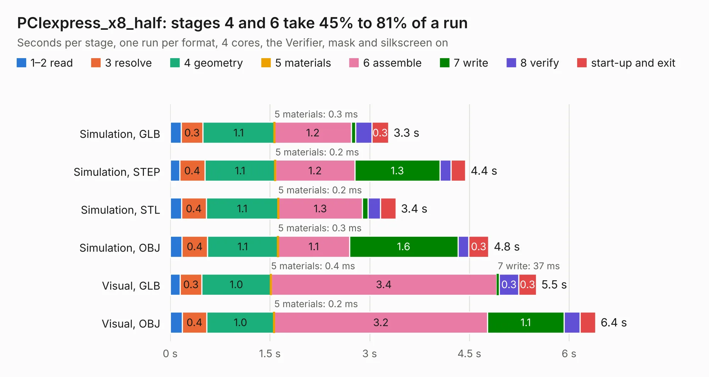

| Mode and format | 1–2 read | 3 resolve | 4 geometry | 5 materials | 6 assemble | 7 write | 8 verify | start-up and exit | Total |
|---|---:|---:|---:|---:|---:|---:|---:|---:|---:|
| Simulation, GLB | 0.2 | 0.3 | 1.1 | 0.3&nbsp;ms | 1.2 | 64&nbsp;ms | 0.2 | 0.3 | 3.3 |
| Simulation, STEP | 0.1 | 0.4 | 1.1 | 0.2&nbsp;ms | 1.2 | 1.3 | 0.2 | 0.2 | 4.4 |
| Simulation, STL | 0.2 | 0.4 | 1.1 | 0.2&nbsp;ms | 1.3 | 86&nbsp;ms | 0.2 | 0.2 | 3.4 |
| Simulation, OBJ | 0.2 | 0.4 | 1.1 | 0.3&nbsp;ms | 1.1 | 1.6 | 0.2 | 0.3 | 4.8 |
| Visual, GLB | 0.1 | 0.3 | 1.0 | 0.4&nbsp;ms | 3.4 | 37&nbsp;ms | 0.3 | 0.3 | 5.5 |
| Visual, OBJ | 0.2 | 0.4 | 1.0 | 0.2&nbsp;ms | 3.2 | 1.1 | 0.2 | 0.2 | 6.4 |

<table align="center"><tr><td valign="top">

| Board | Repo: [open-ephys/PCIexpress-KiCad](https://github.com/open-ephys/PCIexpress-KiCad) Board: `PCIexpress_x8_half.kicad_pcb` |
|---|---|
| Folder | PCIexpress_x8_half |
| Complexity | 221&nbsp;/&nbsp;1000 (size&nbsp;166, features&nbsp;55) |
| KESE&nbsp;features | through vias, rounded, trapezoid or chamfered pads, filled zones, curved board outline |
| Tested | 9th November 2026 |
| Copper&nbsp;layers | 4 |
| File&nbsp;format | KiCad 6 (20211014) |
| Parts,&nbsp;tracks,&nbsp;vias | 33, 163, 54 |
| Triangles,&nbsp;simulation | 323,256 in 83 parts |
| Verifier | PASS in all six runs |

</td><td valign="top">

<table>
<tr><th>File type</th><th>File size</th><th>Peak memory used</th></tr>
<tr><th colspan="3" align="left">Simulation</th></tr>
<tr><td>GLB</td><td align="right">11&nbsp;MB</td><td align="right">264&nbsp;MB</td></tr>
<tr><td>STEP</td><td align="right">52&nbsp;MB</td><td align="right">273&nbsp;MB</td></tr>
<tr><td>STL</td><td align="right">16&nbsp;MB</td><td align="right">279&nbsp;MB</td></tr>
<tr><td>OBJ</td><td align="right">33&nbsp;MB</td><td align="right">265&nbsp;MB</td></tr>
<tr><th colspan="3" align="left">Visual</th></tr>
<tr><td>GLB</td><td align="right">8.1&nbsp;MB</td><td align="right">242&nbsp;MB</td></tr>
<tr><td>OBJ</td><td align="right">24&nbsp;MB</td><td align="right">242&nbsp;MB</td></tr>
</table>

</td></tr></table>

## 2082. PCIexpress_x8_low

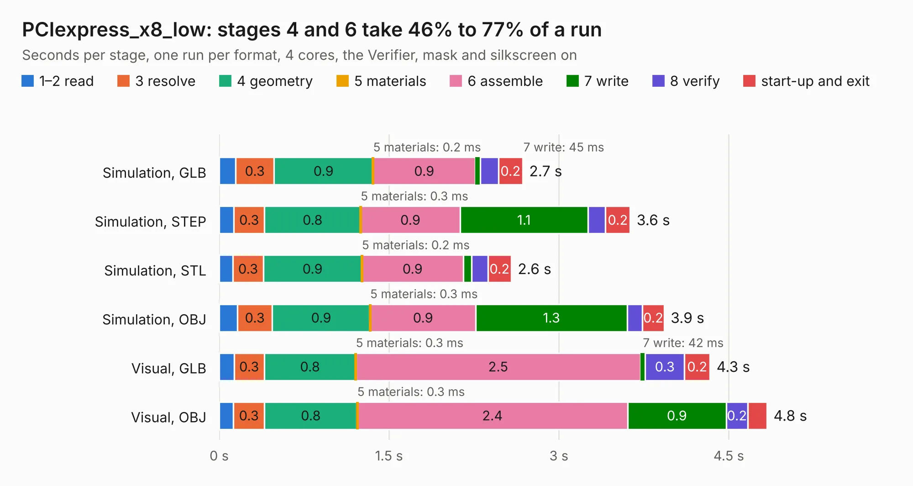

| Mode and format | 1–2 read | 3 resolve | 4 geometry | 5 materials | 6 assemble | 7 write | 8 verify | start-up and exit | Total |
|---|---:|---:|---:|---:|---:|---:|---:|---:|---:|
| Simulation, GLB | 0.1 | 0.3 | 0.9 | 0.2&nbsp;ms | 0.9 | 45&nbsp;ms | 0.2 | 0.2 | 2.7 |
| Simulation, STEP | 0.1 | 0.3 | 0.8 | 0.3&nbsp;ms | 0.9 | 1.1 | 0.2 | 0.2 | 3.6 |
| Simulation, STL | 0.1 | 0.3 | 0.9 | 0.2&nbsp;ms | 0.9 | 75&nbsp;ms | 0.1 | 0.2 | 2.6 |
| Simulation, OBJ | 0.2 | 0.3 | 0.9 | 0.3&nbsp;ms | 0.9 | 1.3 | 0.1 | 0.2 | 3.9 |
| Visual, GLB | 0.1 | 0.3 | 0.8 | 0.3&nbsp;ms | 2.5 | 42&nbsp;ms | 0.3 | 0.2 | 4.3 |
| Visual, OBJ | 0.1 | 0.3 | 0.8 | 0.3&nbsp;ms | 2.4 | 0.9 | 0.2 | 0.2 | 4.8 |

<table align="center"><tr><td valign="top">

| Board | Repo: [open-ephys/PCIexpress-KiCad](https://github.com/open-ephys/PCIexpress-KiCad) Board: `PCIexpress_x8_low.kicad_pcb` |
|---|---|
| Folder | PCIexpress_x8_low |
| Complexity | 221&nbsp;/&nbsp;1000 (size&nbsp;166, features&nbsp;55) |
| KESE&nbsp;features | through vias, rounded, trapezoid or chamfered pads, filled zones, curved board outline |
| Tested | 9th November 2026 |
| Copper&nbsp;layers | 4 |
| File&nbsp;format | KiCad 6 (20211014) |
| Parts,&nbsp;tracks,&nbsp;vias | 33, 163, 54 |
| Triangles,&nbsp;simulation | 321,284 in 83 parts |
| Verifier | PASS in all six runs |

</td><td valign="top">

<table>
<tr><th>File type</th><th>File size</th><th>Peak memory used</th></tr>
<tr><th colspan="3" align="left">Simulation</th></tr>
<tr><td>GLB</td><td align="right">11&nbsp;MB</td><td align="right">262&nbsp;MB</td></tr>
<tr><td>STEP</td><td align="right">51&nbsp;MB</td><td align="right">275&nbsp;MB</td></tr>
<tr><td>STL</td><td align="right">16&nbsp;MB</td><td align="right">273&nbsp;MB</td></tr>
<tr><td>OBJ</td><td align="right">33&nbsp;MB</td><td align="right">275&nbsp;MB</td></tr>
<tr><th colspan="3" align="left">Visual</th></tr>
<tr><td>GLB</td><td align="right">7.9&nbsp;MB</td><td align="right">236&nbsp;MB</td></tr>
<tr><td>OBJ</td><td align="right">23&nbsp;MB</td><td align="right">239&nbsp;MB</td></tr>
</table>

</td></tr></table>

## 2083. panel-back

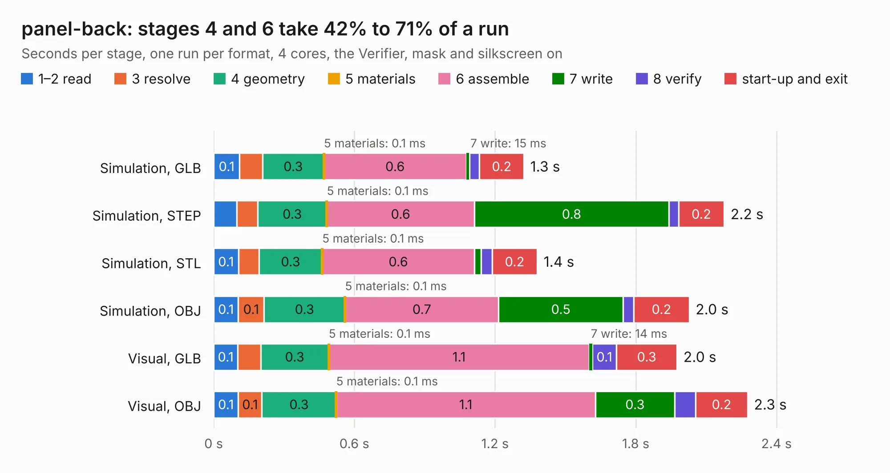

| Mode and format | 1–2 read | 3 resolve | 4 geometry | 5 materials | 6 assemble | 7 write | 8 verify | start-up and exit | Total |
|---|---:|---:|---:|---:|---:|---:|---:|---:|---:|
| Simulation, GLB | 0.1 | 97&nbsp;ms | 0.3 | 0.1&nbsp;ms | 0.6 | 15&nbsp;ms | 42&nbsp;ms | 0.2 | 1.3 |
| Simulation, STEP | 98&nbsp;ms | 89&nbsp;ms | 0.3 | 0.1&nbsp;ms | 0.6 | 0.8 | 41&nbsp;ms | 0.2 | 2.2 |
| Simulation, STL | 0.1 | 88&nbsp;ms | 0.3 | 0.1&nbsp;ms | 0.6 | 29&nbsp;ms | 46&nbsp;ms | 0.2 | 1.4 |
| Simulation, OBJ | 0.1 | 0.1 | 0.3 | 0.1&nbsp;ms | 0.7 | 0.5 | 46&nbsp;ms | 0.2 | 2.0 |
| Visual, GLB | 0.1 | 97&nbsp;ms | 0.3 | 0.1&nbsp;ms | 1.1 | 14&nbsp;ms | 0.1 | 0.3 | 2.0 |
| Visual, OBJ | 0.1 | 0.1 | 0.3 | 0.1&nbsp;ms | 1.1 | 0.3 | 89&nbsp;ms | 0.2 | 2.3 |

<table align="center"><tr><td valign="top">

| Board | Repo: [open-ephys/stimjim](https://github.com/open-ephys/stimjim) Board: `panel-back.kicad_pcb` |
|---|---|
| Folder | PCB / panels |
| Complexity | 101&nbsp;/&nbsp;1000 (size&nbsp;36, features&nbsp;65) |
| KESE&nbsp;features | filled zones, curved board outline, stack-up, dielectric εr and tanδ, mask and silkscreen colours |
| Tested | 9th November 2026 |
| Copper&nbsp;layers | 2 |
| File&nbsp;format | KiCad 10 (20260206) |
| Parts,&nbsp;tracks,&nbsp;vias | 5, 0, 0 |
| Triangles,&nbsp;simulation | 118,094 in 12 parts |
| Note | panel |
| Verifier | PASS in all six runs |

</td><td valign="top">

<table>
<tr><th>File type</th><th>File size</th><th>Peak memory used</th></tr>
<tr><th colspan="3" align="left">Simulation</th></tr>
<tr><td>GLB</td><td align="right">4.2&nbsp;MB</td><td align="right">190&nbsp;MB</td></tr>
<tr><td>STEP</td><td align="right">23&nbsp;MB</td><td align="right">204&nbsp;MB</td></tr>
<tr><td>STL</td><td align="right">5.9&nbsp;MB</td><td align="right">190&nbsp;MB</td></tr>
<tr><td>OBJ</td><td align="right">12&nbsp;MB</td><td align="right">188&nbsp;MB</td></tr>
<tr><th colspan="3" align="left">Visual</th></tr>
<tr><td>GLB</td><td align="right">2.7&nbsp;MB</td><td align="right">155&nbsp;MB</td></tr>
<tr><td>OBJ</td><td align="right">7.5&nbsp;MB</td><td align="right">156&nbsp;MB</td></tr>
</table>

</td></tr></table>

## 2084. panel-front

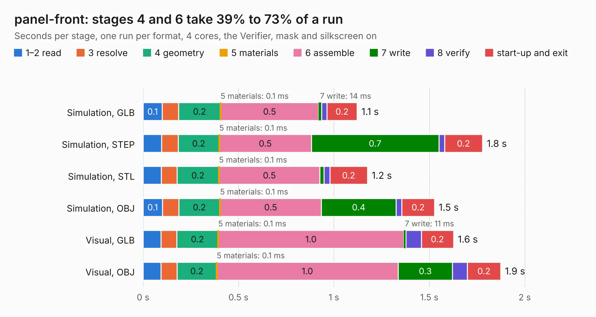

| Mode and format | 1–2 read | 3 resolve | 4 geometry | 5 materials | 6 assemble | 7 write | 8 verify | start-up and exit | Total |
|---|---:|---:|---:|---:|---:|---:|---:|---:|---:|
| Simulation, GLB | 0.1 | 86&nbsp;ms | 0.2 | 0.1&nbsp;ms | 0.5 | 14&nbsp;ms | 29&nbsp;ms | 0.2 | 1.1 |
| Simulation, STEP | 96&nbsp;ms | 87&nbsp;ms | 0.2 | 0.1&nbsp;ms | 0.5 | 0.7 | 29&nbsp;ms | 0.2 | 1.8 |
| Simulation, STL | 95&nbsp;ms | 83&nbsp;ms | 0.2 | 0.1&nbsp;ms | 0.5 | 22&nbsp;ms | 30&nbsp;ms | 0.2 | 1.2 |
| Simulation, OBJ | 0.1 | 86&nbsp;ms | 0.2 | 0.1&nbsp;ms | 0.5 | 0.4 | 30&nbsp;ms | 0.2 | 1.5 |
| Visual, GLB | 93&nbsp;ms | 84&nbsp;ms | 0.2 | 0.1&nbsp;ms | 1.0 | 11&nbsp;ms | 81&nbsp;ms | 0.2 | 1.6 |
| Visual, OBJ | 94&nbsp;ms | 84&nbsp;ms | 0.2 | 0.1&nbsp;ms | 1.0 | 0.3 | 77&nbsp;ms | 0.2 | 1.9 |

<table align="center"><tr><td valign="top">

| Board | Repo: [open-ephys/stimjim](https://github.com/open-ephys/stimjim) Board: `panel-front.kicad_pcb` |
|---|---|
| Folder | PCB / panels |
| Complexity | 129&nbsp;/&nbsp;1000 (size&nbsp;34, features&nbsp;95) |
| KESE&nbsp;features | arc tracks, filled zones, curved board outline, TrueType text, stack-up, dielectric εr and tanδ, mask and silkscreen colours |
| Tested | 9th November 2026 |
| Copper&nbsp;layers | 2 |
| File&nbsp;format | KiCad 10 (20260206) |
| Parts,&nbsp;tracks,&nbsp;vias | 4, 0, 0 |
| Triangles,&nbsp;simulation | 98,478 in 12 parts |
| Note | panel |
| Verifier | PASS in all six runs |

</td><td valign="top">

<table>
<tr><th>File type</th><th>File size</th><th>Peak memory used</th></tr>
<tr><th colspan="3" align="left">Simulation</th></tr>
<tr><td>GLB</td><td align="right">3.4&nbsp;MB</td><td align="right">185&nbsp;MB</td></tr>
<tr><td>STEP</td><td align="right">18&nbsp;MB</td><td align="right">194&nbsp;MB</td></tr>
<tr><td>STL</td><td align="right">4.9&nbsp;MB</td><td align="right">181&nbsp;MB</td></tr>
<tr><td>OBJ</td><td align="right">9.6&nbsp;MB</td><td align="right">185&nbsp;MB</td></tr>
<tr><th colspan="3" align="left">Visual</th></tr>
<tr><td>GLB</td><td align="right">2.7&nbsp;MB</td><td align="right">153&nbsp;MB</td></tr>
<tr><td>OBJ</td><td align="right">7.4&nbsp;MB</td><td align="right">151&nbsp;MB</td></tr>
</table>

</td></tr></table>

## 2085. stimjim

| Mode and format | 1–2 read | 3 resolve | 4 geometry | 5 materials | 6 assemble | 7 write | 8 verify | start-up and exit | Total |
|---|---:|---:|---:|---:|---:|---:|---:|---:|---:|
| Simulation, GLB | 1.1 | 2.9 | 12.8 | 0.6&nbsp;ms | 15.0 | 0.5 | 1.6 | 0.3 | 34.2 |
| Simulation, STEP | 1.1 | 2.9 | 11.9 | 0.5&nbsp;ms | 14.6 | 9.3 | 1.6 | 0.3 | 41.7 |
| Simulation, STL | 1.0 | 2.9 | 12.2 | 0.6&nbsp;ms | 14.2 | 1.1 | 1.5 | 0.3 | 33.3 |
| Simulation, OBJ | 1.1 | 3.2 | 12.7 | 0.5&nbsp;ms | 14.7 | 17.6 | 1.7 | 0.3 | 51.3 |
| Visual, GLB | 1.1 | 3.0 | 12.7 | 0.5&nbsp;ms | 27.6 | 0.4 | 3.2 | 0.3 | 48.3 |
| Visual, OBJ | 1.0 | 3.1 | 12.5 | 0.5&nbsp;ms | 28.0 | 11.9 | 3.7 | 0.2 | 60.4 |

<table align="center"><tr><td valign="top">

| Board | Repo: [open-ephys/stimjim](https://github.com/open-ephys/stimjim) Board: `stimjim.kicad_pcb` |
|---|---|
| Folder | PCB |
| Complexity | 359&nbsp;/&nbsp;1000 (size&nbsp;259, features&nbsp;100) |
| KESE&nbsp;features | through vias, slotted holes, rounded, trapezoid or chamfered pads, arc tracks, filled zones, stack-up, dielectric εr and tanδ |
| Tested | 9th November 2026 |
| Copper&nbsp;layers | 4 |
| File&nbsp;format | KiCad 10 (20260206) |
| Parts,&nbsp;tracks,&nbsp;vias | 193, 1,526, 371 |
| Triangles,&nbsp;simulation | 3,557,586 in 188 parts |
| Verifier | PASS in all six runs |

</td><td valign="top">

<table>
<tr><th>File type</th><th>File size</th><th>Peak memory used</th></tr>
<tr><th colspan="3" align="left">Simulation</th></tr>
<tr><td>GLB</td><td align="right">121&nbsp;MB</td><td align="right">1.1&nbsp;GB</td></tr>
<tr><td>STEP</td><td align="right">564&nbsp;MB</td><td align="right">1.5&nbsp;GB</td></tr>
<tr><td>STL</td><td align="right">178&nbsp;MB</td><td align="right">1.2&nbsp;GB</td></tr>
<tr><td>OBJ</td><td align="right">381&nbsp;MB</td><td align="right">2.4&nbsp;GB</td></tr>
<tr><th colspan="3" align="left">Visual</th></tr>
<tr><td>GLB</td><td align="right">83&nbsp;MB</td><td align="right">1.7&nbsp;GB</td></tr>
<tr><td>OBJ</td><td align="right">265&nbsp;MB</td><td align="right">1.7&nbsp;GB</td></tr>
</table>

</td></tr></table>

## 2086. osw

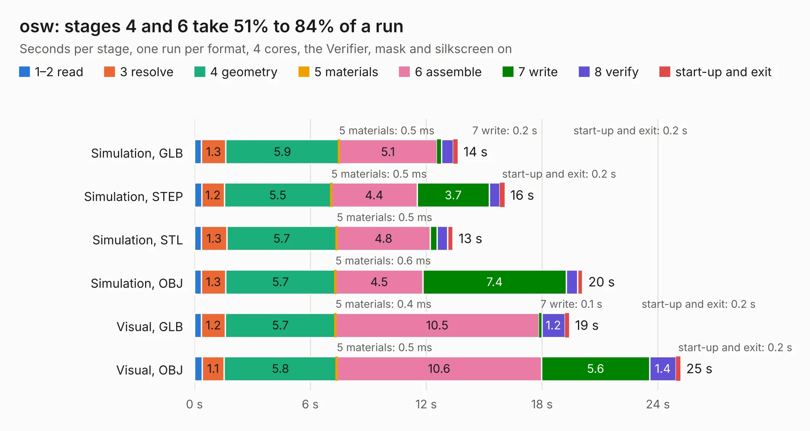

| Mode and format | 1–2 read | 3 resolve | 4 geometry | 5 materials | 6 assemble | 7 write | 8 verify | start-up and exit | Total |
|---|---:|---:|---:|---:|---:|---:|---:|---:|---:|
| Simulation, GLB | 0.4 | 1.3 | 5.9 | 0.5&nbsp;ms | 5.1 | 0.2 | 0.6 | 0.2 | 13.6 |
| Simulation, STEP | 0.4 | 1.2 | 5.5 | 0.5&nbsp;ms | 4.4 | 3.7 | 0.5 | 0.2 | 16.1 |
| Simulation, STL | 0.4 | 1.3 | 5.7 | 0.5&nbsp;ms | 4.8 | 0.3 | 0.5 | 0.3 | 13.4 |
| Simulation, OBJ | 0.3 | 1.3 | 5.7 | 0.6&nbsp;ms | 4.5 | 7.4 | 0.6 | 0.3 | 20.1 |
| Visual, GLB | 0.4 | 1.2 | 5.7 | 0.4&nbsp;ms | 10.5 | 0.1 | 1.2 | 0.2 | 19.4 |
| Visual, OBJ | 0.4 | 1.1 | 5.8 | 0.5&nbsp;ms | 10.6 | 5.6 | 1.4 | 0.2 | 25.2 |

<table align="center"><tr><td valign="top">

| Board | Repo: [Open-Smartwatch/kicad-project](https://github.com/Open-Smartwatch/kicad-project) Board: `osw.kicad_pcb` |
|---|---|
| Complexity | 261&nbsp;/&nbsp;1000 (size&nbsp;196, features&nbsp;65) |
| KESE&nbsp;features | through vias, slotted holes, rounded, trapezoid or chamfered pads, filled zones, curved board outline |
| Tested | 9th November 2026 |
| Copper&nbsp;layers | 4 |
| File&nbsp;format | KiCad 5 (20171130) |
| Parts,&nbsp;tracks,&nbsp;vias | 67, 707, 193 |
| Triangles,&nbsp;simulation | 1,331,232 in 92 parts |
| Verifier | PASS in all six runs |

</td><td valign="top">

<table>
<tr><th>File type</th><th>File size</th><th>Peak memory used</th></tr>
<tr><th colspan="3" align="left">Simulation</th></tr>
<tr><td>GLB</td><td align="right">46&nbsp;MB</td><td align="right">525&nbsp;MB</td></tr>
<tr><td>STEP</td><td align="right">193&nbsp;MB</td><td align="right">670&nbsp;MB</td></tr>
<tr><td>STL</td><td align="right">67&nbsp;MB</td><td align="right">528&nbsp;MB</td></tr>
<tr><td>OBJ</td><td align="right">138&nbsp;MB</td><td align="right">910&nbsp;MB</td></tr>
<tr><th colspan="3" align="left">Visual</th></tr>
<tr><td>GLB</td><td align="right">32&nbsp;MB</td><td align="right">668&nbsp;MB</td></tr>
<tr><td>OBJ</td><td align="right">96&nbsp;MB</td><td align="right">764&nbsp;MB</td></tr>
</table>

</td></tr></table>

## 2087. osw-light

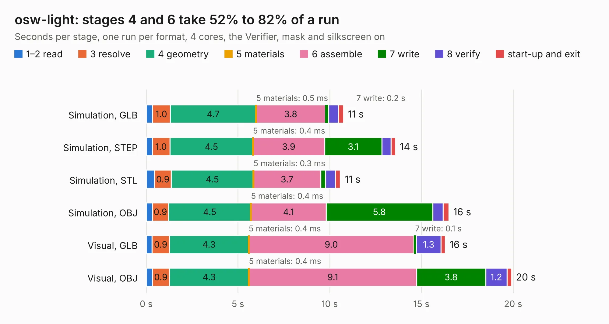

| Mode and format | 1–2 read | 3 resolve | 4 geometry | 5 materials | 6 assemble | 7 write | 8 verify | start-up and exit | Total |
|---|---:|---:|---:|---:|---:|---:|---:|---:|---:|
| Simulation, GLB | 0.3 | 1.0 | 4.7 | 0.5&nbsp;ms | 3.8 | 0.2 | 0.5 | 0.3 | 10.8 |
| Simulation, STEP | 0.3 | 1.0 | 4.5 | 0.4&nbsp;ms | 3.9 | 3.1 | 0.5 | 0.2 | 13.6 |
| Simulation, STL | 0.5 | 0.9 | 4.5 | 0.3&nbsp;ms | 3.7 | 0.3 | 0.5 | 0.3 | 10.6 |
| Simulation, OBJ | 0.3 | 0.9 | 4.5 | 0.4&nbsp;ms | 4.1 | 5.8 | 0.6 | 0.3 | 16.5 |
| Visual, GLB | 0.3 | 0.9 | 4.3 | 0.4&nbsp;ms | 9.0 | 0.1 | 1.3 | 0.2 | 16.3 |
| Visual, OBJ | 0.3 | 0.9 | 4.3 | 0.4&nbsp;ms | 9.1 | 3.8 | 1.2 | 0.2 | 19.9 |

<table align="center"><tr><td valign="top">

| Board | Repo: [Open-Smartwatch/open-smartwatch-light](https://github.com/Open-Smartwatch/open-smartwatch-light) Board: `osw-light.kicad_pcb` |
|---|---|
| Complexity | 253&nbsp;/&nbsp;1000 (size&nbsp;188, features&nbsp;65) |
| KESE&nbsp;features | through vias, slotted holes, rounded, trapezoid or chamfered pads, filled zones, curved board outline |
| Tested | 9th November 2026 |
| Copper&nbsp;layers | 4 |
| File&nbsp;format | KiCad 5 (20171130) |
| Parts,&nbsp;tracks,&nbsp;vias | 51, 524, 126 |
| Triangles,&nbsp;simulation | 972,290 in 74 parts |
| Verifier | PASS in all six runs |

</td><td valign="top">

<table>
<tr><th>File type</th><th>File size</th><th>Peak memory used</th></tr>
<tr><th colspan="3" align="left">Simulation</th></tr>
<tr><td>GLB</td><td align="right">34&nbsp;MB</td><td align="right">436&nbsp;MB</td></tr>
<tr><td>STEP</td><td align="right">149&nbsp;MB</td><td align="right">516&nbsp;MB</td></tr>
<tr><td>STL</td><td align="right">49&nbsp;MB</td><td align="right">458&nbsp;MB</td></tr>
<tr><td>OBJ</td><td align="right">99&nbsp;MB</td><td align="right">684&nbsp;MB</td></tr>
<tr><th colspan="3" align="left">Visual</th></tr>
<tr><td>GLB</td><td align="right">24&nbsp;MB</td><td align="right">517&nbsp;MB</td></tr>
<tr><td>OBJ</td><td align="right">71&nbsp;MB</td><td align="right">572&nbsp;MB</td></tr>
</table>

</td></tr></table>

## 2088. 6ct-expander

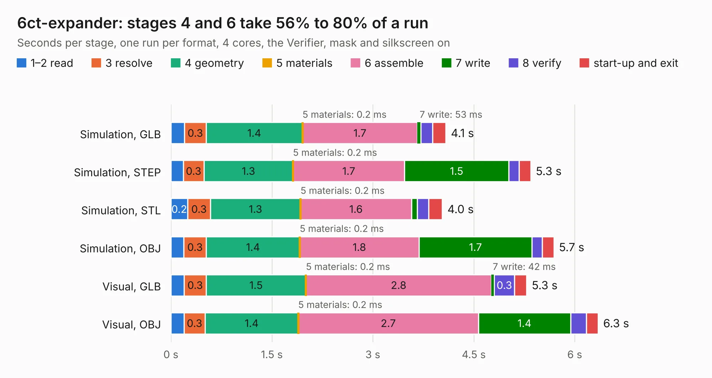

| Mode and format | 1–2 read | 3 resolve | 4 geometry | 5 materials | 6 assemble | 7 write | 8 verify | start-up and exit | Total |
|---|---:|---:|---:|---:|---:|---:|---:|---:|---:|
| Simulation, GLB | 0.2 | 0.3 | 1.4 | 0.2&nbsp;ms | 1.7 | 53&nbsp;ms | 0.2 | 0.2 | 4.1 |
| Simulation, STEP | 0.2 | 0.3 | 1.3 | 0.2&nbsp;ms | 1.7 | 1.5 | 0.2 | 0.2 | 5.3 |
| Simulation, STL | 0.2 | 0.3 | 1.3 | 0.2&nbsp;ms | 1.6 | 89&nbsp;ms | 0.2 | 0.2 | 4.0 |
| Simulation, OBJ | 0.2 | 0.3 | 1.4 | 0.2&nbsp;ms | 1.8 | 1.7 | 0.2 | 0.2 | 5.7 |
| Visual, GLB | 0.2 | 0.3 | 1.5 | 0.2&nbsp;ms | 2.8 | 42&nbsp;ms | 0.3 | 0.2 | 5.3 |
| Visual, OBJ | 0.2 | 0.3 | 1.4 | 0.2&nbsp;ms | 2.7 | 1.4 | 0.2 | 0.2 | 6.3 |

<table align="center"><tr><td valign="top">

| Board | Repo: [openenergymonitor/emon32](https://github.com/openenergymonitor/emon32) Board: `6ct-expander.kicad_pcb` |
|---|---|
| Folder | pcb / 6ct-expander |
| Complexity | 223&nbsp;/&nbsp;1000 (size&nbsp;153, features&nbsp;70) |
| KESE&nbsp;features | through vias, custom pads, rounded, trapezoid or chamfered pads, filled zones, copper drawings |
| Tested | 9th November 2026 |
| Copper&nbsp;layers | 2 |
| File&nbsp;format | KiCad 9 (20241229) |
| Parts,&nbsp;tracks,&nbsp;vias | 56, 141, 45 |
| Triangles,&nbsp;simulation | 358,758 in 45 parts |
| Verifier | PASS in all six runs |

</td><td valign="top">

<table>
<tr><th>File type</th><th>File size</th><th>Peak memory used</th></tr>
<tr><th colspan="3" align="left">Simulation</th></tr>
<tr><td>GLB</td><td align="right">12&nbsp;MB</td><td align="right">280&nbsp;MB</td></tr>
<tr><td>STEP</td><td align="right">59&nbsp;MB</td><td align="right">321&nbsp;MB</td></tr>
<tr><td>STL</td><td align="right">18&nbsp;MB</td><td align="right">277&nbsp;MB</td></tr>
<tr><td>OBJ</td><td align="right">36&nbsp;MB</td><td align="right">308&nbsp;MB</td></tr>
<tr><th colspan="3" align="left">Visual</th></tr>
<tr><td>GLB</td><td align="right">10&nbsp;MB</td><td align="right">313&nbsp;MB</td></tr>
<tr><td>OBJ</td><td align="right">29&nbsp;MB</td><td align="right">317&nbsp;MB</td></tr>
</table>

</td></tr></table>

## 2089. emonPi3

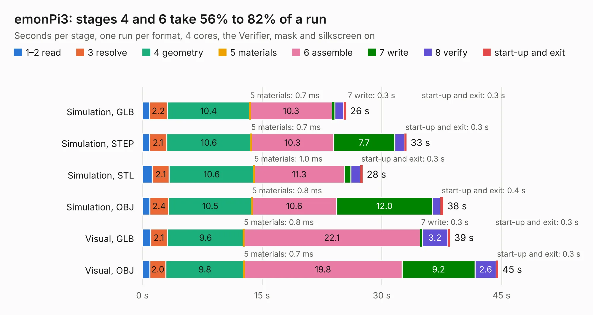

| Mode and format | 1–2 read | 3 resolve | 4 geometry | 5 materials | 6 assemble | 7 write | 8 verify | start-up and exit | Total |
|---|---:|---:|---:|---:|---:|---:|---:|---:|---:|
| Simulation, GLB | 0.9 | 2.2 | 10.4 | 0.7&nbsp;ms | 10.3 | 0.3 | 1.1 | 0.3 | 25.5 |
| Simulation, STEP | 0.9 | 2.1 | 10.6 | 0.7&nbsp;ms | 10.3 | 7.7 | 1.2 | 0.3 | 33.1 |
| Simulation, STL | 1.2 | 2.1 | 10.6 | 1.0&nbsp;ms | 11.3 | 0.8 | 1.2 | 0.3 | 27.6 |
| Simulation, OBJ | 0.9 | 2.4 | 10.5 | 0.8&nbsp;ms | 10.6 | 12.0 | 1.0 | 0.4 | 37.7 |
| Visual, GLB | 1.0 | 2.1 | 9.6 | 0.8&nbsp;ms | 22.1 | 0.3 | 3.2 | 0.3 | 38.6 |
| Visual, OBJ | 0.9 | 2.0 | 9.8 | 0.7&nbsp;ms | 19.8 | 9.2 | 2.6 | 0.3 | 44.6 |

<table align="center"><tr><td valign="top">

| Board | Repo: [openenergymonitor/emon32](https://github.com/openenergymonitor/emon32) Board: `emonPi3.kicad_pcb` |
|---|---|
| Folder | pcb / emonpi3 |
| Complexity | 405&nbsp;/&nbsp;1000 (size&nbsp;250, features&nbsp;155) |
| KESE&nbsp;features | through vias, slotted holes, custom pads, rounded, trapezoid or chamfered pads, filled zones, copper drawings, knockout text, TrueType text, stack-up, dielectric εr and tanδ, copper finish |
| Tested | 9th November 2026 |
| Copper&nbsp;layers | 4 |
| File&nbsp;format | KiCad 7 (20221018) |
| Parts,&nbsp;tracks,&nbsp;vias | 151, 933, 260 |
| Triangles,&nbsp;simulation | 2,361,186 in 148 parts |
| Verifier | PASS in all six runs |

</td><td valign="top">

<table>
<tr><th>File type</th><th>File size</th><th>Peak memory used</th></tr>
<tr><th colspan="3" align="left">Simulation</th></tr>
<tr><td>GLB</td><td align="right">80&nbsp;MB</td><td align="right">897&nbsp;MB</td></tr>
<tr><td>STEP</td><td align="right">407&nbsp;MB</td><td align="right">1.2&nbsp;GB</td></tr>
<tr><td>STL</td><td align="right">118&nbsp;MB</td><td align="right">934&nbsp;MB</td></tr>
<tr><td>OBJ</td><td align="right">246&nbsp;MB</td><td align="right">1.6&nbsp;GB</td></tr>
<tr><th colspan="3" align="left">Visual</th></tr>
<tr><td>GLB</td><td align="right">59&nbsp;MB</td><td align="right">1.2&nbsp;GB</td></tr>
<tr><td>OBJ</td><td align="right">181&nbsp;MB</td><td align="right">1.3&nbsp;GB</td></tr>
</table>

</td></tr></table>

## 2090. OpenHW DevKit

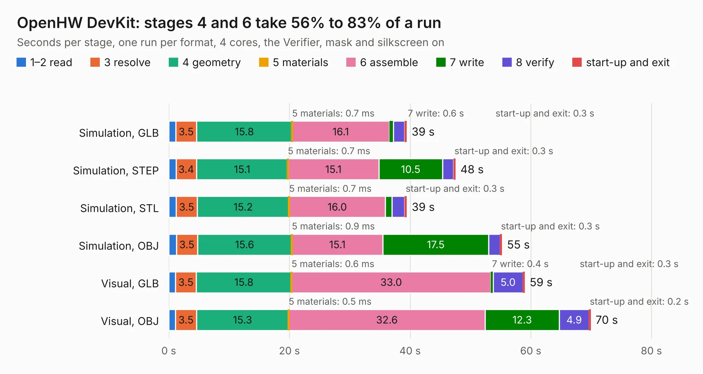

| Mode and format | 1–2 read | 3 resolve | 4 geometry | 5 materials | 6 assemble | 7 write | 8 verify | start-up and exit | Total |
|---|---:|---:|---:|---:|---:|---:|---:|---:|---:|
| Simulation, GLB | 1.1 | 3.5 | 15.8 | 0.7&nbsp;ms | 16.1 | 0.6 | 1.9 | 0.3 | 39.4 |
| Simulation, STEP | 1.2 | 3.4 | 15.1 | 0.7&nbsp;ms | 15.1 | 10.5 | 1.8 | 0.3 | 47.5 |
| Simulation, STL | 1.2 | 3.5 | 15.2 | 0.7&nbsp;ms | 16.0 | 1.1 | 2.1 | 0.3 | 39.4 |
| Simulation, OBJ | 1.3 | 3.5 | 15.6 | 0.9&nbsp;ms | 15.1 | 17.5 | 1.9 | 0.3 | 55.2 |
| Visual, GLB | 1.1 | 3.5 | 15.8 | 0.6&nbsp;ms | 33.0 | 0.4 | 5.0 | 0.3 | 59.0 |
| Visual, OBJ | 1.1 | 3.5 | 15.3 | 0.5&nbsp;ms | 32.6 | 12.3 | 4.9 | 0.2 | 69.9 |

<table align="center"><tr><td valign="top">

| Board | Repo: [openhwgroup/core-v-mcu-devkit](https://github.com/openhwgroup/core-v-mcu-devkit) Board: `OpenHW DevKit.kicad_pcb` |
|---|---|
| Folder | kicad |
| Complexity | 411&nbsp;/&nbsp;1000 (size&nbsp;271, features&nbsp;140) |
| KESE&nbsp;features | through vias, slotted holes, custom pads, rounded, trapezoid or chamfered pads, filled zones, copper drawings, curved board outline, stack-up, dielectric εr and tanδ, copper finish, mask and silkscreen colours |
| Tested | 9th November 2026 |
| Copper&nbsp;layers | 4 |
| File&nbsp;format | KiCad 7 (20221018) |
| Parts,&nbsp;tracks,&nbsp;vias | 158, 1,714, 286 |
| Triangles,&nbsp;simulation | 3,646,834 in 231 parts |
| Verifier | PASS in all six runs |

</td><td valign="top">

<table>
<tr><th>File type</th><th>File size</th><th>Peak memory used</th></tr>
<tr><th colspan="3" align="left">Simulation</th></tr>
<tr><td>GLB</td><td align="right">126&nbsp;MB</td><td align="right">1.2&nbsp;GB</td></tr>
<tr><td>STEP</td><td align="right">648&nbsp;MB</td><td align="right">1.5&nbsp;GB</td></tr>
<tr><td>STL</td><td align="right">182&nbsp;MB</td><td align="right">1.2&nbsp;GB</td></tr>
<tr><td>OBJ</td><td align="right">392&nbsp;MB</td><td align="right">2.4&nbsp;GB</td></tr>
<tr><th colspan="3" align="left">Visual</th></tr>
<tr><td>GLB</td><td align="right">88&nbsp;MB</td><td align="right">1.5&nbsp;GB</td></tr>
<tr><td>OBJ</td><td align="right">278&nbsp;MB</td><td align="right">1.9&nbsp;GB</td></tr>
</table>

</td></tr></table>

## 2091. MacArthur-HAT

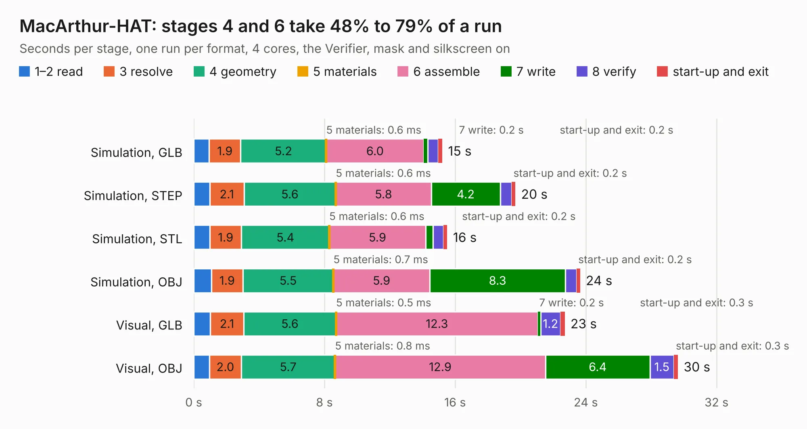

| Mode and format | 1–2 read | 3 resolve | 4 geometry | 5 materials | 6 assemble | 7 write | 8 verify | start-up and exit | Total |
|---|---:|---:|---:|---:|---:|---:|---:|---:|---:|
| Simulation, GLB | 0.9 | 1.9 | 5.2 | 0.6&nbsp;ms | 6.0 | 0.2 | 0.6 | 0.2 | 15.2 |
| Simulation, STEP | 1.0 | 2.1 | 5.6 | 0.6&nbsp;ms | 5.8 | 4.2 | 0.7 | 0.2 | 19.7 |
| Simulation, STL | 1.0 | 1.9 | 5.4 | 0.6&nbsp;ms | 5.9 | 0.5 | 0.6 | 0.2 | 15.5 |
| Simulation, OBJ | 1.1 | 1.9 | 5.5 | 0.7&nbsp;ms | 5.9 | 8.3 | 0.7 | 0.2 | 23.6 |
| Visual, GLB | 1.0 | 2.1 | 5.6 | 0.5&nbsp;ms | 12.3 | 0.2 | 1.2 | 0.3 | 22.7 |
| Visual, OBJ | 1.0 | 2.0 | 5.7 | 0.8&nbsp;ms | 12.9 | 6.4 | 1.5 | 0.3 | 29.6 |

<table align="center"><tr><td valign="top">

| Board | Repo: [OpenMarine/MacArthur-HAT](https://github.com/OpenMarine/MacArthur-HAT) Board: `MacArthur-HAT.kicad_pcb` |
|---|---|
| Folder | KiCad |
| Complexity | 312&nbsp;/&nbsp;1000 (size&nbsp;207, features&nbsp;105) |
| KESE&nbsp;features | through vias, rounded, trapezoid or chamfered pads, filled zones, curved board outline, stack-up, dielectric εr and tanδ, copper finish, mask and silkscreen colours |
| Tested | 9th November 2026 |
| Copper&nbsp;layers | 4 |
| File&nbsp;format | KiCad 8 (20240108) |
| Parts,&nbsp;tracks,&nbsp;vias | 102, 1,085, 240 |
| Triangles,&nbsp;simulation | 1,613,902 in 109 parts |
| Verifier | PASS in all six runs |

</td><td valign="top">

<table>
<tr><th>File type</th><th>File size</th><th>Peak memory used</th></tr>
<tr><th colspan="3" align="left">Simulation</th></tr>
<tr><td>GLB</td><td align="right">54&nbsp;MB</td><td align="right">598&nbsp;MB</td></tr>
<tr><td>STEP</td><td align="right">226&nbsp;MB</td><td align="right">782&nbsp;MB</td></tr>
<tr><td>STL</td><td align="right">81&nbsp;MB</td><td align="right">629&nbsp;MB</td></tr>
<tr><td>OBJ</td><td align="right">167&nbsp;MB</td><td align="right">1.1&nbsp;GB</td></tr>
<tr><th colspan="3" align="left">Visual</th></tr>
<tr><td>GLB</td><td align="right">40&nbsp;MB</td><td align="right">803&nbsp;MB</td></tr>
<tr><td>OBJ</td><td align="right">120&nbsp;MB</td><td align="right">881&nbsp;MB</td></tr>
</table>

</td></tr></table>

## 2092. blade12

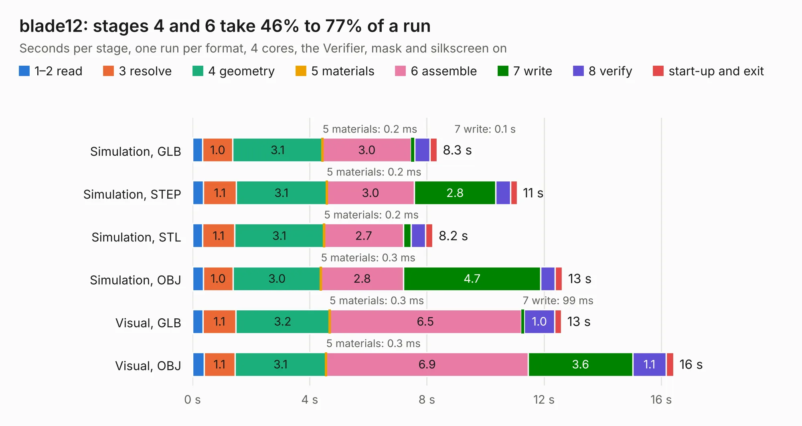

| Mode and format | 1–2 read | 3 resolve | 4 geometry | 5 materials | 6 assemble | 7 write | 8 verify | start-up and exit | Total |
|---|---:|---:|---:|---:|---:|---:|---:|---:|---:|
| Simulation, GLB | 0.3 | 1.0 | 3.1 | 0.2&nbsp;ms | 3.0 | 0.1 | 0.5 | 0.2 | 8.3 |
| Simulation, STEP | 0.4 | 1.1 | 3.1 | 0.2&nbsp;ms | 3.0 | 2.8 | 0.5 | 0.2 | 11.1 |
| Simulation, STL | 0.3 | 1.1 | 3.1 | 0.2&nbsp;ms | 2.7 | 0.3 | 0.5 | 0.3 | 8.2 |
| Simulation, OBJ | 0.4 | 1.0 | 3.0 | 0.3&nbsp;ms | 2.8 | 4.7 | 0.5 | 0.3 | 12.6 |
| Visual, GLB | 0.4 | 1.1 | 3.2 | 0.3&nbsp;ms | 6.5 | 99&nbsp;ms | 1.0 | 0.2 | 12.6 |
| Visual, OBJ | 0.4 | 1.1 | 3.1 | 0.3&nbsp;ms | 6.9 | 3.6 | 1.1 | 0.3 | 16.4 |

<table align="center"><tr><td valign="top">

| Board | Repo: [opulo-inc/lumenpnp](https://github.com/opulo-inc/lumenpnp) Board: `blade12.kicad_pcb` |
|---|---|
| Folder | src / PCB / blade12 |
| Complexity | 285&nbsp;/&nbsp;1000 (size&nbsp;170, features&nbsp;115) |
| KESE&nbsp;features | through vias, custom pads, rounded, trapezoid or chamfered pads, filled zones, copper drawings, TrueType text, stack-up, dielectric εr and tanδ |
| Tested | 9th November 2026 |
| Copper&nbsp;layers | 2 |
| File&nbsp;format | KiCad 8 (20240108) |
| Parts,&nbsp;tracks,&nbsp;vias | 38, 391, 206 |
| Triangles,&nbsp;simulation | 724,098 in 26 parts |
| Verifier | PASS in all six runs |

</td><td valign="top">

<table>
<tr><th>File type</th><th>File size</th><th>Peak memory used</th></tr>
<tr><th colspan="3" align="left">Simulation</th></tr>
<tr><td>GLB</td><td align="right">25&nbsp;MB</td><td align="right">421&nbsp;MB</td></tr>
<tr><td>STEP</td><td align="right">129&nbsp;MB</td><td align="right">473&nbsp;MB</td></tr>
<tr><td>STL</td><td align="right">36&nbsp;MB</td><td align="right">403&nbsp;MB</td></tr>
<tr><td>OBJ</td><td align="right">74&nbsp;MB</td><td align="right">562&nbsp;MB</td></tr>
<tr><th colspan="3" align="left">Visual</th></tr>
<tr><td>GLB</td><td align="right">20&nbsp;MB</td><td align="right">503&nbsp;MB</td></tr>
<tr><td>OBJ</td><td align="right">61&nbsp;MB</td><td align="right">503&nbsp;MB</td></tr>
</table>

</td></tr></table>

## 2093. blade13

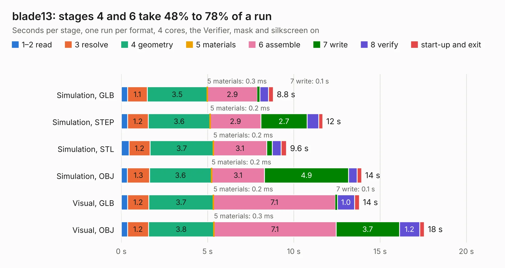

| Mode and format | 1–2 read | 3 resolve | 4 geometry | 5 materials | 6 assemble | 7 write | 8 verify | start-up and exit | Total |
|---|---:|---:|---:|---:|---:|---:|---:|---:|---:|
| Simulation, GLB | 0.4 | 1.1 | 3.5 | 0.3&nbsp;ms | 2.9 | 0.1 | 0.5 | 0.3 | 8.8 |
| Simulation, STEP | 0.4 | 1.2 | 3.6 | 0.2&nbsp;ms | 2.9 | 2.7 | 0.7 | 0.2 | 11.7 |
| Simulation, STL | 0.4 | 1.2 | 3.7 | 0.2&nbsp;ms | 3.1 | 0.3 | 0.5 | 0.3 | 9.6 |
| Simulation, OBJ | 0.4 | 1.3 | 3.6 | 0.2&nbsp;ms | 3.1 | 4.9 | 0.5 | 0.3 | 13.9 |
| Visual, GLB | 0.4 | 1.2 | 3.7 | 0.2&nbsp;ms | 7.1 | 0.1 | 1.0 | 0.3 | 13.8 |
| Visual, OBJ | 0.4 | 1.2 | 3.8 | 0.3&nbsp;ms | 7.1 | 3.7 | 1.2 | 0.3 | 17.6 |

<table align="center"><tr><td valign="top">

| Board | Repo: [opulo-inc/lumenpnp](https://github.com/opulo-inc/lumenpnp) Board: `blade13.kicad_pcb` |
|---|---|
| Folder | src / PCB / blade13 |
| Complexity | 287&nbsp;/&nbsp;1000 (size&nbsp;172, features&nbsp;115) |
| KESE&nbsp;features | through vias, custom pads, rounded, trapezoid or chamfered pads, filled zones, copper drawings, TrueType text, stack-up, dielectric εr and tanδ |
| Tested | 9th November 2026 |
| Copper&nbsp;layers | 2 |
| File&nbsp;format | KiCad 8 (20240108) |
| Parts,&nbsp;tracks,&nbsp;vias | 42, 373, 237 |
| Triangles,&nbsp;simulation | 789,616 in 27 parts |
| Verifier | PASS in all six runs |

</td><td valign="top">

<table>
<tr><th>File type</th><th>File size</th><th>Peak memory used</th></tr>
<tr><th colspan="3" align="left">Simulation</th></tr>
<tr><td>GLB</td><td align="right">27&nbsp;MB</td><td align="right">431&nbsp;MB</td></tr>
<tr><td>STEP</td><td align="right">140&nbsp;MB</td><td align="right">503&nbsp;MB</td></tr>
<tr><td>STL</td><td align="right">39&nbsp;MB</td><td align="right">408&nbsp;MB</td></tr>
<tr><td>OBJ</td><td align="right">81&nbsp;MB</td><td align="right">571&nbsp;MB</td></tr>
<tr><th colspan="3" align="left">Visual</th></tr>
<tr><td>GLB</td><td align="right">22&nbsp;MB</td><td align="right">495&nbsp;MB</td></tr>
<tr><td>OBJ</td><td align="right">66&nbsp;MB</td><td align="right">549&nbsp;MB</td></tr>
</table>

</td></tr></table>

## 2094. cal-fid

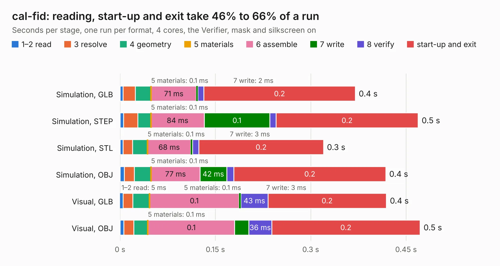

| Mode and format | 1–2 read | 3 resolve | 4 geometry | 5 materials | 6 assemble | 7 write | 8 verify | start-up and exit | Total |
|---|---:|---:|---:|---:|---:|---:|---:|---:|---:|
| Simulation, GLB | 5&nbsp;ms | 19&nbsp;ms | 25&nbsp;ms | 0.1&nbsp;ms | 71&nbsp;ms | 2&nbsp;ms | 10&nbsp;ms | 0.2 | 0.4 |
| Simulation, STEP | 6&nbsp;ms | 22&nbsp;ms | 21&nbsp;ms | 0.1&nbsp;ms | 84&nbsp;ms | 0.1 | 10&nbsp;ms | 0.2 | 0.5 |
| Simulation, STL | 5&nbsp;ms | 15&nbsp;ms | 24&nbsp;ms | 0.1&nbsp;ms | 68&nbsp;ms | 3&nbsp;ms | 10&nbsp;ms | 0.2 | 0.3 |
| Simulation, OBJ | 7&nbsp;ms | 15&nbsp;ms | 27&nbsp;ms | 0.1&nbsp;ms | 77&nbsp;ms | 42&nbsp;ms | 11&nbsp;ms | 0.2 | 0.4 |
| Visual, GLB | 5&nbsp;ms | 16&nbsp;ms | 26&nbsp;ms | 0.1&nbsp;ms | 0.1 | 3&nbsp;ms | 43&nbsp;ms | 0.2 | 0.4 |
| Visual, OBJ | 6&nbsp;ms | 16&nbsp;ms | 22&nbsp;ms | 0.1&nbsp;ms | 0.1 | 22&nbsp;ms | 36&nbsp;ms | 0.2 | 0.5 |

<table align="center"><tr><td valign="top">

| Board | Repo: [opulo-inc/lumenpnp](https://github.com/opulo-inc/lumenpnp) Board: `cal-fid.kicad_pcb` |
|---|---|
| Folder | src / PCB / cal-fid |
| Complexity | 52&nbsp;/&nbsp;1000 (size&nbsp;17, features&nbsp;35) |
| KESE&nbsp;features | filled zones, TrueType text |
| Tested | 9th November 2026 |
| Copper&nbsp;layers | 2 |
| File&nbsp;format | KiCad 10 (20260206) |
| Parts,&nbsp;tracks,&nbsp;vias | 0, 0, 0 |
| Triangles,&nbsp;simulation | 5,528 in 8 parts |
| Note | no components |
| Verifier | PASS in all six runs |

</td><td valign="top">

<table>
<tr><th>File type</th><th>File size</th><th>Peak memory used</th></tr>
<tr><th colspan="3" align="left">Simulation</th></tr>
<tr><td>GLB</td><td align="right">199&nbsp;kB</td><td align="right">39&nbsp;MB</td></tr>
<tr><td>STEP</td><td align="right">1.1&nbsp;MB</td><td align="right">40&nbsp;MB</td></tr>
<tr><td>STL</td><td align="right">277&nbsp;kB</td><td align="right">39&nbsp;MB</td></tr>
<tr><td>OBJ</td><td align="right">517&nbsp;kB</td><td align="right">41&nbsp;MB</td></tr>
<tr><th colspan="3" align="left">Visual</th></tr>
<tr><td>GLB</td><td align="right">103&nbsp;kB</td><td align="right">54&nbsp;MB</td></tr>
<tr><td>OBJ</td><td align="right">247&nbsp;kB</td><td align="right">54&nbsp;MB</td></tr>
</table>

</td></tr></table>

## 2095. datum

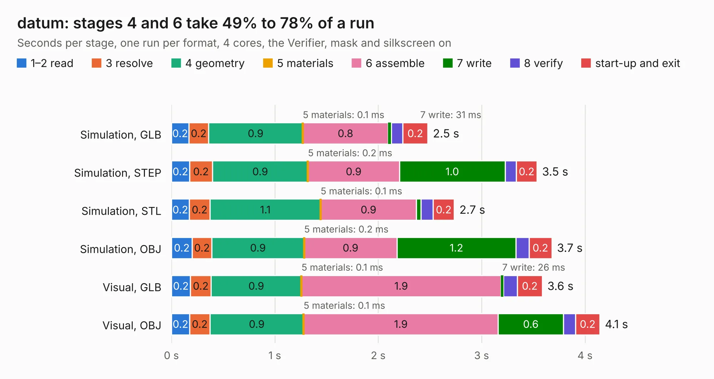

| Mode and format | 1–2 read | 3 resolve | 4 geometry | 5 materials | 6 assemble | 7 write | 8 verify | start-up and exit | Total |
|---|---:|---:|---:|---:|---:|---:|---:|---:|---:|
| Simulation, GLB | 0.2 | 0.2 | 0.9 | 0.1&nbsp;ms | 0.8 | 31&nbsp;ms | 0.1 | 0.2 | 2.5 |
| Simulation, STEP | 0.2 | 0.2 | 0.9 | 0.2&nbsp;ms | 0.9 | 1.0 | 0.1 | 0.2 | 3.5 |
| Simulation, STL | 0.2 | 0.2 | 1.1 | 0.1&nbsp;ms | 0.9 | 46&nbsp;ms | 0.1 | 0.2 | 2.7 |
| Simulation, OBJ | 0.2 | 0.2 | 0.9 | 0.2&nbsp;ms | 0.9 | 1.2 | 0.1 | 0.2 | 3.7 |
| Visual, GLB | 0.2 | 0.2 | 0.9 | 0.1&nbsp;ms | 1.9 | 26&nbsp;ms | 0.1 | 0.2 | 3.6 |
| Visual, OBJ | 0.2 | 0.2 | 0.9 | 0.1&nbsp;ms | 1.9 | 0.6 | 0.1 | 0.2 | 4.1 |

<table align="center"><tr><td valign="top">

| Board | Repo: [opulo-inc/lumenpnp](https://github.com/opulo-inc/lumenpnp) Board: `datum.kicad_pcb` |
|---|---|
| Folder | src / PCB / datum |
| Complexity | 83&nbsp;/&nbsp;1000 (size&nbsp;63, features&nbsp;20) |
| KESE&nbsp;features | filled zones |
| Tested | 9th November 2026 |
| Copper&nbsp;layers | 2 |
| File&nbsp;format | KiCad 8 (20240108) |
| Parts,&nbsp;tracks,&nbsp;vias | 4, 5, 0 |
| Triangles,&nbsp;simulation | 196,880 in 13 parts |
| Verifier | PASS in all six runs |

</td><td valign="top">

<table>
<tr><th>File type</th><th>File size</th><th>Peak memory used</th></tr>
<tr><th colspan="3" align="left">Simulation</th></tr>
<tr><td>GLB</td><td align="right">6.9&nbsp;MB</td><td align="right">212&nbsp;MB</td></tr>
<tr><td>STEP</td><td align="right">32&nbsp;MB</td><td align="right">229&nbsp;MB</td></tr>
<tr><td>STL</td><td align="right">9.8&nbsp;MB</td><td align="right">210&nbsp;MB</td></tr>
<tr><td>OBJ</td><td align="right">20&nbsp;MB</td><td align="right">215&nbsp;MB</td></tr>
<tr><th colspan="3" align="left">Visual</th></tr>
<tr><td>GLB</td><td align="right">4.1&nbsp;MB</td><td align="right">188&nbsp;MB</td></tr>
<tr><td>OBJ</td><td align="right">12&nbsp;MB</td><td align="right">184&nbsp;MB</td></tr>
</table>

</td></tr></table>

## 2096. ftp

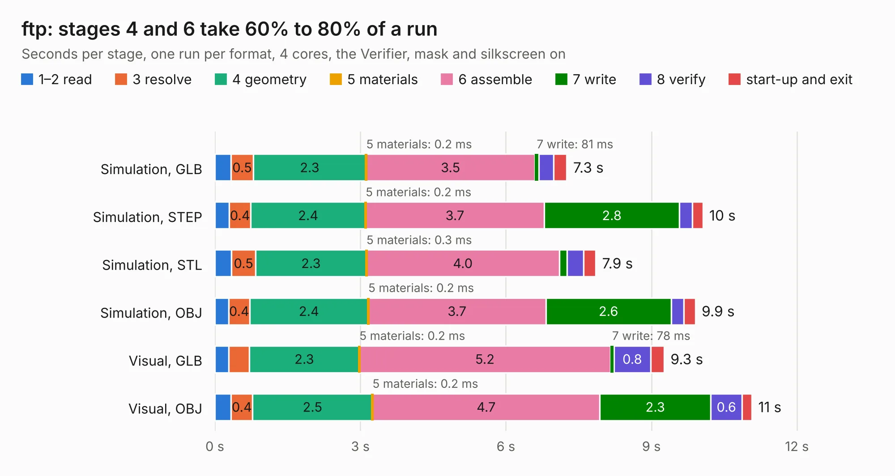

| Mode and format | 1–2 read | 3 resolve | 4 geometry | 5 materials | 6 assemble | 7 write | 8 verify | start-up and exit | Total |
|---|---:|---:|---:|---:|---:|---:|---:|---:|---:|
| Simulation, GLB | 0.3 | 0.5 | 2.3 | 0.2&nbsp;ms | 3.5 | 81&nbsp;ms | 0.3 | 0.3 | 7.3 |
| Simulation, STEP | 0.3 | 0.4 | 2.4 | 0.2&nbsp;ms | 3.7 | 2.8 | 0.3 | 0.2 | 10.1 |
| Simulation, STL | 0.3 | 0.5 | 2.3 | 0.3&nbsp;ms | 4.0 | 0.2 | 0.3 | 0.3 | 7.9 |
| Simulation, OBJ | 0.3 | 0.4 | 2.4 | 0.2&nbsp;ms | 3.7 | 2.6 | 0.3 | 0.2 | 9.9 |
| Visual, GLB | 0.3 | 0.4 | 2.3 | 0.2&nbsp;ms | 5.2 | 78&nbsp;ms | 0.8 | 0.3 | 9.3 |
| Visual, OBJ | 0.3 | 0.4 | 2.5 | 0.2&nbsp;ms | 4.7 | 2.3 | 0.6 | 0.2 | 11.1 |

<table align="center"><tr><td valign="top">

| Board | Repo: [opulo-inc/lumenpnp](https://github.com/opulo-inc/lumenpnp) Board: `ftp.kicad_pcb` |
|---|---|
| Folder | src / PCB / ftp |
| Complexity | 202&nbsp;/&nbsp;1000 (size&nbsp;142, features&nbsp;60) |
| KESE&nbsp;features | rounded, trapezoid or chamfered pads, filled zones, stack-up, dielectric εr and tanδ |
| Tested | 9th November 2026 |
| Copper&nbsp;layers | 2 |
| File&nbsp;format | KiCad 8 (20240108) |
| Parts,&nbsp;tracks,&nbsp;vias | 81, 115, 0 |
| Triangles,&nbsp;simulation | 499,656 in 53 parts |
| Verifier | PASS in all six runs |

</td><td valign="top">

<table>
<tr><th>File type</th><th>File size</th><th>Peak memory used</th></tr>
<tr><th colspan="3" align="left">Simulation</th></tr>
<tr><td>GLB</td><td align="right">17&nbsp;MB</td><td align="right">378&nbsp;MB</td></tr>
<tr><td>STEP</td><td align="right">109&nbsp;MB</td><td align="right">409&nbsp;MB</td></tr>
<tr><td>STL</td><td align="right">25&nbsp;MB</td><td align="right">384&nbsp;MB</td></tr>
<tr><td>OBJ</td><td align="right">51&nbsp;MB</td><td align="right">400&nbsp;MB</td></tr>
<tr><th colspan="3" align="left">Visual</th></tr>
<tr><td>GLB</td><td align="right">15&nbsp;MB</td><td align="right">461&nbsp;MB</td></tr>
<tr><td>OBJ</td><td align="right">44&nbsp;MB</td><td align="right">459&nbsp;MB</td></tr>
</table>

</td></tr></table>

## 2097. ftp0402

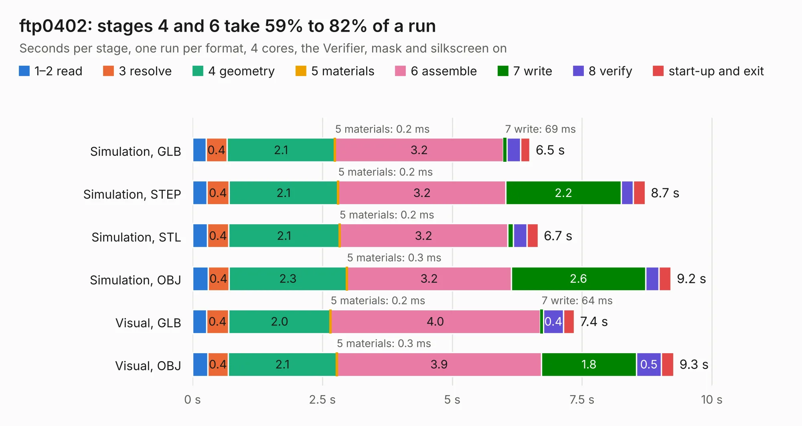

| Mode and format | 1–2 read | 3 resolve | 4 geometry | 5 materials | 6 assemble | 7 write | 8 verify | start-up and exit | Total |
|---|---:|---:|---:|---:|---:|---:|---:|---:|---:|
| Simulation, GLB | 0.3 | 0.4 | 2.1 | 0.2&nbsp;ms | 3.2 | 69&nbsp;ms | 0.3 | 0.2 | 6.5 |
| Simulation, STEP | 0.3 | 0.4 | 2.1 | 0.2&nbsp;ms | 3.2 | 2.2 | 0.2 | 0.2 | 8.7 |
| Simulation, STL | 0.3 | 0.4 | 2.1 | 0.2&nbsp;ms | 3.2 | 0.1 | 0.3 | 0.2 | 6.7 |
| Simulation, OBJ | 0.3 | 0.4 | 2.3 | 0.3&nbsp;ms | 3.2 | 2.6 | 0.3 | 0.2 | 9.2 |
| Visual, GLB | 0.3 | 0.4 | 2.0 | 0.2&nbsp;ms | 4.0 | 64&nbsp;ms | 0.4 | 0.2 | 7.4 |
| Visual, OBJ | 0.3 | 0.4 | 2.1 | 0.3&nbsp;ms | 3.9 | 1.8 | 0.5 | 0.2 | 9.3 |

<table align="center"><tr><td valign="top">

| Board | Repo: [opulo-inc/lumenpnp](https://github.com/opulo-inc/lumenpnp) Board: `ftp0402.kicad_pcb` |
|---|---|
| Folder | src / PCB / ftp / ftp0402 |
| Complexity | 199&nbsp;/&nbsp;1000 (size&nbsp;139, features&nbsp;60) |
| KESE&nbsp;features | rounded, trapezoid or chamfered pads, filled zones, stack-up, dielectric εr and tanδ |
| Tested | 9th November 2026 |
| Copper&nbsp;layers | 2 |
| File&nbsp;format | KiCad 9 (20241229) |
| Parts,&nbsp;tracks,&nbsp;vias | 81, 91, 0 |
| Triangles,&nbsp;simulation | 441,218 in 53 parts |
| Verifier | PASS in all six runs |

</td><td valign="top">

<table>
<tr><th>File type</th><th>File size</th><th>Peak memory used</th></tr>
<tr><th colspan="3" align="left">Simulation</th></tr>
<tr><td>GLB</td><td align="right">15&nbsp;MB</td><td align="right">339&nbsp;MB</td></tr>
<tr><td>STEP</td><td align="right">89&nbsp;MB</td><td align="right">387&nbsp;MB</td></tr>
<tr><td>STL</td><td align="right">22&nbsp;MB</td><td align="right">335&nbsp;MB</td></tr>
<tr><td>OBJ</td><td align="right">45&nbsp;MB</td><td align="right">362&nbsp;MB</td></tr>
<tr><th colspan="3" align="left">Visual</th></tr>
<tr><td>GLB</td><td align="right">13&nbsp;MB</td><td align="right">417&nbsp;MB</td></tr>
<tr><td>OBJ</td><td align="right">37&nbsp;MB</td><td align="right">335&nbsp;MB</td></tr>
</table>

</td></tr></table>

## 2098. mobo

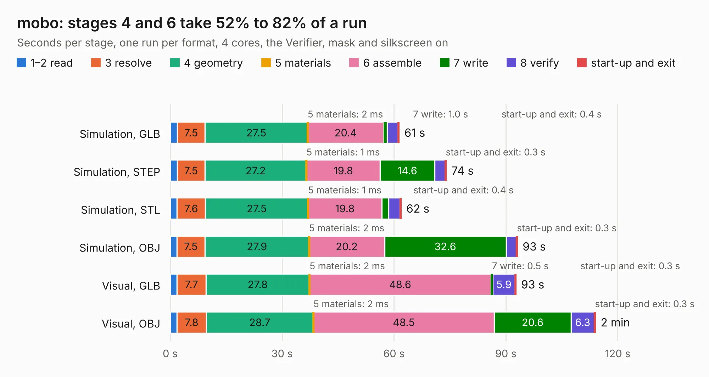

| Mode and format | 1–2 read | 3 resolve | 4 geometry | 5 materials | 6 assemble | 7 write | 8 verify | start-up and exit | Total |
|---|---:|---:|---:|---:|---:|---:|---:|---:|---:|
| Simulation, GLB | 1.9 | 7.5 | 27.5 | 2&nbsp;ms | 20.4 | 1.0 | 2.9 | 0.4 | 61.4 |
| Simulation, STEP | 1.9 | 7.5 | 27.2 | 1&nbsp;ms | 19.8 | 14.6 | 2.9 | 0.3 | 74.1 |
| Simulation, STL | 1.8 | 7.6 | 27.5 | 1&nbsp;ms | 19.8 | 1.8 | 3.0 | 0.4 | 62.0 |
| Simulation, OBJ | 1.8 | 7.5 | 27.9 | 2&nbsp;ms | 20.2 | 32.6 | 2.8 | 0.3 | 93.1 |
| Visual, GLB | 1.9 | 7.7 | 27.8 | 2&nbsp;ms | 48.6 | 0.5 | 5.9 | 0.3 | 92.7 |
| Visual, OBJ | 1.8 | 7.8 | 28.7 | 2&nbsp;ms | 48.5 | 20.6 | 6.3 | 0.3 | 114.1 |

<table align="center"><tr><td valign="top">

| Board | Repo: [opulo-inc/lumenpnp](https://github.com/opulo-inc/lumenpnp) Board: `mobo.kicad_pcb` |
|---|---|
| Folder | src / PCB / mobo |
| Complexity | 454&nbsp;/&nbsp;1000 (size&nbsp;294, features&nbsp;160) |
| KESE&nbsp;features | through vias, slotted holes, custom pads, rounded, trapezoid or chamfered pads, arc tracks, filled zones, copper drawings, copper text, curved board outline, TrueType text, stack-up, dielectric εr and tanδ |
| Tested | 9th November 2026 |
| Copper&nbsp;layers | 4 |
| File&nbsp;format | KiCad 9 (20241229) |
| Parts,&nbsp;tracks,&nbsp;vias | 296, 2,176, 1,010 |
| Triangles,&nbsp;simulation | 5,290,772 in 276 parts |
| Verifier | PASS in all six runs |

</td><td valign="top">

<table>
<tr><th>File type</th><th>File size</th><th>Peak memory used</th></tr>
<tr><th colspan="3" align="left">Simulation</th></tr>
<tr><td>GLB</td><td align="right">177&nbsp;MB</td><td align="right">1.8&nbsp;GB</td></tr>
<tr><td>STEP</td><td align="right">676&nbsp;MB</td><td align="right">2.2&nbsp;GB</td></tr>
<tr><td>STL</td><td align="right">265&nbsp;MB</td><td align="right">1.7&nbsp;GB</td></tr>
<tr><td>OBJ</td><td align="right">563&nbsp;MB</td><td align="right">3.4&nbsp;GB</td></tr>
<tr><th colspan="3" align="left">Visual</th></tr>
<tr><td>GLB</td><td align="right">114&nbsp;MB</td><td align="right">1.8&nbsp;GB</td></tr>
<tr><td>OBJ</td><td align="right">363&nbsp;MB</td><td align="right">2.4&nbsp;GB</td></tr>
</table>

</td></tr></table>

## 2099. pi-interface

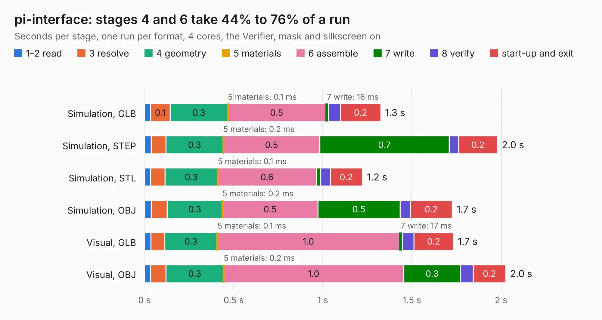

| Mode and format | 1–2 read | 3 resolve | 4 geometry | 5 materials | 6 assemble | 7 write | 8 verify | start-up and exit | Total |
|---|---:|---:|---:|---:|---:|---:|---:|---:|---:|
| Simulation, GLB | 34&nbsp;ms | 0.1 | 0.3 | 0.1&nbsp;ms | 0.5 | 16&nbsp;ms | 68&nbsp;ms | 0.2 | 1.3 |
| Simulation, STEP | 37&nbsp;ms | 83&nbsp;ms | 0.3 | 0.2&nbsp;ms | 0.5 | 0.7 | 52&nbsp;ms | 0.2 | 2.0 |
| Simulation, STL | 33&nbsp;ms | 81&nbsp;ms | 0.3 | 0.1&nbsp;ms | 0.6 | 25&nbsp;ms | 53&nbsp;ms | 0.2 | 1.2 |
| Simulation, OBJ | 37&nbsp;ms | 90&nbsp;ms | 0.3 | 0.2&nbsp;ms | 0.5 | 0.5 | 57&nbsp;ms | 0.2 | 1.7 |
| Visual, GLB | 35&nbsp;ms | 78&nbsp;ms | 0.3 | 0.1&nbsp;ms | 1.0 | 17&nbsp;ms | 66&nbsp;ms | 0.2 | 1.7 |
| Visual, OBJ | 34&nbsp;ms | 85&nbsp;ms | 0.3 | 0.2&nbsp;ms | 1.0 | 0.3 | 71&nbsp;ms | 0.2 | 2.0 |

<table align="center"><tr><td valign="top">

| Board | Repo: [opulo-inc/lumenpnp](https://github.com/opulo-inc/lumenpnp) Board: `pi-interface.kicad_pcb` |
|---|---|
| Folder | src / PCB / pi-interface |
| Complexity | 157&nbsp;/&nbsp;1000 (size&nbsp;102, features&nbsp;55) |
| KESE&nbsp;features | through vias, rounded, trapezoid or chamfered pads, filled zones, curved board outline |
| Tested | 9th November 2026 |
| Copper&nbsp;layers | 2 |
| File&nbsp;format | KiCad 10 (20260206) |
| Parts,&nbsp;tracks,&nbsp;vias | 3, 49, 7 |
| Triangles,&nbsp;simulation | 85,092 in 19 parts |
| Verifier | PASS in all six runs |

</td><td valign="top">

<table>
<tr><th>File type</th><th>File size</th><th>Peak memory used</th></tr>
<tr><th colspan="3" align="left">Simulation</th></tr>
<tr><td>GLB</td><td align="right">2.9&nbsp;MB</td><td align="right">156&nbsp;MB</td></tr>
<tr><td>STEP</td><td align="right">12&nbsp;MB</td><td align="right">157&nbsp;MB</td></tr>
<tr><td>STL</td><td align="right">4.3&nbsp;MB</td><td align="right">158&nbsp;MB</td></tr>
<tr><td>OBJ</td><td align="right">8.0&nbsp;MB</td><td align="right">159&nbsp;MB</td></tr>
<tr><th colspan="3" align="left">Visual</th></tr>
<tr><td>GLB</td><td align="right">2.0&nbsp;MB</td><td align="right">130&nbsp;MB</td></tr>
<tr><td>OBJ</td><td align="right">5.6&nbsp;MB</td><td align="right">128&nbsp;MB</td></tr>
</table>

</td></tr></table>

## 2100. ringLight

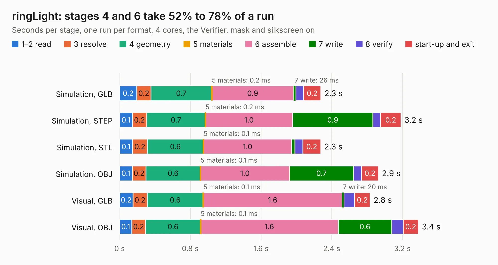

| Mode and format | 1–2 read | 3 resolve | 4 geometry | 5 materials | 6 assemble | 7 write | 8 verify | start-up and exit | Total |
|---|---:|---:|---:|---:|---:|---:|---:|---:|---:|
| Simulation, GLB | 0.2 | 0.2 | 0.7 | 0.2&nbsp;ms | 0.9 | 26&nbsp;ms | 88&nbsp;ms | 0.2 | 2.3 |
| Simulation, STEP | 0.1 | 0.2 | 0.7 | 0.2&nbsp;ms | 1.0 | 0.9 | 88&nbsp;ms | 0.2 | 3.2 |
| Simulation, STL | 0.1 | 0.2 | 0.6 | 0.1&nbsp;ms | 1.0 | 36&nbsp;ms | 91&nbsp;ms | 0.2 | 2.3 |
| Simulation, OBJ | 0.1 | 0.2 | 0.6 | 0.1&nbsp;ms | 1.0 | 0.7 | 90&nbsp;ms | 0.2 | 2.9 |
| Visual, GLB | 0.2 | 0.2 | 0.6 | 0.1&nbsp;ms | 1.6 | 20&nbsp;ms | 0.1 | 0.2 | 2.8 |
| Visual, OBJ | 0.1 | 0.2 | 0.6 | 0.1&nbsp;ms | 1.6 | 0.6 | 0.1 | 0.2 | 3.4 |

<table align="center"><tr><td valign="top">

| Board | Repo: [opulo-inc/lumenpnp](https://github.com/opulo-inc/lumenpnp) Board: `ringLight.kicad_pcb` |
|---|---|
| Folder | src / PCB / ringLight |
| Complexity | 222&nbsp;/&nbsp;1000 (size&nbsp;137, features&nbsp;85) |
| KESE&nbsp;features | through vias, rounded, trapezoid or chamfered pads, filled zones, curved board outline, stack-up, dielectric εr and tanδ |
| Tested | 9th November 2026 |
| Copper&nbsp;layers | 2 |
| File&nbsp;format | KiCad 6 (20211014) |
| Parts,&nbsp;tracks,&nbsp;vias | 21, 142, 17 |
| Triangles,&nbsp;simulation | 179,692 in 25 parts |
| Verifier | PASS in all six runs |

</td><td valign="top">

<table>
<tr><th>File type</th><th>File size</th><th>Peak memory used</th></tr>
<tr><th colspan="3" align="left">Simulation</th></tr>
<tr><td>GLB</td><td align="right">6.4&nbsp;MB</td><td align="right">219&nbsp;MB</td></tr>
<tr><td>STEP</td><td align="right">36&nbsp;MB</td><td align="right">237&nbsp;MB</td></tr>
<tr><td>STL</td><td align="right">9.0&nbsp;MB</td><td align="right">219&nbsp;MB</td></tr>
<tr><td>OBJ</td><td align="right">18&nbsp;MB</td><td align="right">219&nbsp;MB</td></tr>
<tr><th colspan="3" align="left">Visual</th></tr>
<tr><td>GLB</td><td align="right">5.4&nbsp;MB</td><td align="right">218&nbsp;MB</td></tr>
<tr><td>OBJ</td><td align="right">15&nbsp;MB</td><td align="right">215&nbsp;MB</td></tr>
</table>

</td></tr></table>

## 2101. x-cable-chain-support

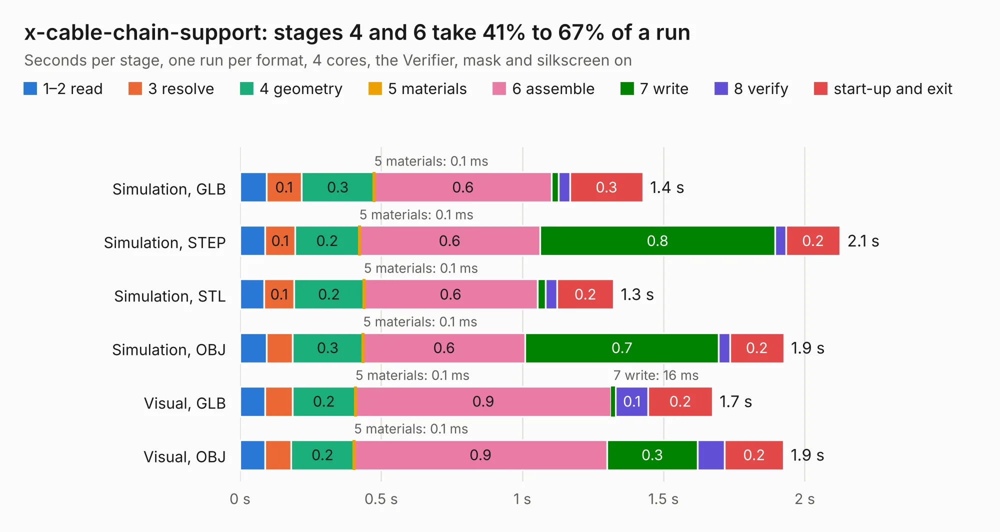

| Mode and format | 1–2 read | 3 resolve | 4 geometry | 5 materials | 6 assemble | 7 write | 8 verify | start-up and exit | Total |
|---|---:|---:|---:|---:|---:|---:|---:|---:|---:|
| Simulation, GLB | 95&nbsp;ms | 0.1 | 0.3 | 0.1&nbsp;ms | 0.6 | 25&nbsp;ms | 40&nbsp;ms | 0.3 | 1.4 |
| Simulation, STEP | 89&nbsp;ms | 0.1 | 0.2 | 0.1&nbsp;ms | 0.6 | 0.8 | 39&nbsp;ms | 0.2 | 2.1 |
| Simulation, STL | 86&nbsp;ms | 0.1 | 0.2 | 0.1&nbsp;ms | 0.6 | 29&nbsp;ms | 41&nbsp;ms | 0.2 | 1.3 |
| Simulation, OBJ | 95&nbsp;ms | 91&nbsp;ms | 0.3 | 0.1&nbsp;ms | 0.6 | 0.7 | 40&nbsp;ms | 0.2 | 1.9 |
| Visual, GLB | 88&nbsp;ms | 98&nbsp;ms | 0.2 | 0.1&nbsp;ms | 0.9 | 16&nbsp;ms | 0.1 | 0.2 | 1.7 |
| Visual, OBJ | 88&nbsp;ms | 93&nbsp;ms | 0.2 | 0.1&nbsp;ms | 0.9 | 0.3 | 96&nbsp;ms | 0.2 | 1.9 |

<table align="center"><tr><td valign="top">

| Board | Repo: [opulo-inc/lumenpnp](https://github.com/opulo-inc/lumenpnp) Board: `x-cable-chain-support.kicad_pcb` |
|---|---|
| Folder | src / PCB / x-cable-chain-support |
| Complexity | 92&nbsp;/&nbsp;1000 (size&nbsp;17, features&nbsp;75) |
| KESE&nbsp;features | filled zones, curved board outline, TrueType text, stack-up, dielectric εr and tanδ |
| Tested | 9th November 2026 |
| Copper&nbsp;layers | 2 |
| File&nbsp;format | KiCad 8 (20240108) |
| Parts,&nbsp;tracks,&nbsp;vias | 0, 0, 0 |
| Triangles,&nbsp;simulation | 110,860 in 9 parts |
| Note | no components |
| Verifier | PASS in all six runs |

</td><td valign="top">

<table>
<tr><th>File type</th><th>File size</th><th>Peak memory used</th></tr>
<tr><th colspan="3" align="left">Simulation</th></tr>
<tr><td>GLB</td><td align="right">4.3&nbsp;MB</td><td align="right">179&nbsp;MB</td></tr>
<tr><td>STEP</td><td align="right">25&nbsp;MB</td><td align="right">195&nbsp;MB</td></tr>
<tr><td>STL</td><td align="right">5.5&nbsp;MB</td><td align="right">179&nbsp;MB</td></tr>
<tr><td>OBJ</td><td align="right">12&nbsp;MB</td><td align="right">169&nbsp;MB</td></tr>
<tr><th colspan="3" align="left">Visual</th></tr>
<tr><td>GLB</td><td align="right">2.3&nbsp;MB</td><td align="right">134&nbsp;MB</td></tr>
<tr><td>OBJ</td><td align="right">6.2&nbsp;MB</td><td align="right">135&nbsp;MB</td></tr>
</table>

</td></tr></table>

## 2102. xy-limit

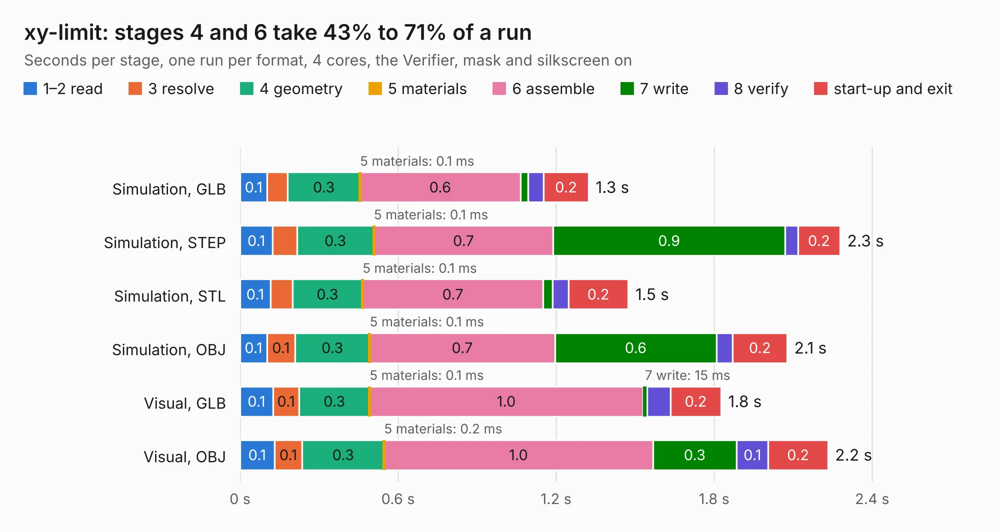

| Mode and format | 1–2 read | 3 resolve | 4 geometry | 5 materials | 6 assemble | 7 write | 8 verify | start-up and exit | Total |
|---|---:|---:|---:|---:|---:|---:|---:|---:|---:|
| Simulation, GLB | 0.1 | 78&nbsp;ms | 0.3 | 0.1&nbsp;ms | 0.6 | 28&nbsp;ms | 60&nbsp;ms | 0.2 | 1.3 |
| Simulation, STEP | 0.1 | 92&nbsp;ms | 0.3 | 0.1&nbsp;ms | 0.7 | 0.9 | 49&nbsp;ms | 0.2 | 2.3 |
| Simulation, STL | 0.1 | 83&nbsp;ms | 0.3 | 0.1&nbsp;ms | 0.7 | 35&nbsp;ms | 61&nbsp;ms | 0.2 | 1.5 |
| Simulation, OBJ | 0.1 | 0.1 | 0.3 | 0.1&nbsp;ms | 0.7 | 0.6 | 61&nbsp;ms | 0.2 | 2.1 |
| Visual, GLB | 0.1 | 0.1 | 0.3 | 0.1&nbsp;ms | 1.0 | 15&nbsp;ms | 90&nbsp;ms | 0.2 | 1.8 |
| Visual, OBJ | 0.1 | 0.1 | 0.3 | 0.2&nbsp;ms | 1.0 | 0.3 | 0.1 | 0.2 | 2.2 |

<table align="center"><tr><td valign="top">

| Board | Repo: [opulo-inc/lumenpnp](https://github.com/opulo-inc/lumenpnp) Board: `xy-limit.kicad_pcb` |
|---|---|
| Folder | src / PCB / xy-limit |
| Complexity | 173&nbsp;/&nbsp;1000 (size&nbsp;103, features&nbsp;70) |
| KESE&nbsp;features | through vias, rounded, trapezoid or chamfered pads, filled zones, curved board outline, TrueType text |
| Tested | 9th November 2026 |
| Copper&nbsp;layers | 2 |
| File&nbsp;format | KiCad 8 (20240108) |
| Parts,&nbsp;tracks,&nbsp;vias | 3, 42, 11 |
| Triangles,&nbsp;simulation | 129,766 in 15 parts |
| Verifier | PASS in all six runs |

</td><td valign="top">

<table>
<tr><th>File type</th><th>File size</th><th>Peak memory used</th></tr>
<tr><th colspan="3" align="left">Simulation</th></tr>
<tr><td>GLB</td><td align="right">4.8&nbsp;MB</td><td align="right">194&nbsp;MB</td></tr>
<tr><td>STEP</td><td align="right">25&nbsp;MB</td><td align="right">212&nbsp;MB</td></tr>
<tr><td>STL</td><td align="right">6.5&nbsp;MB</td><td align="right">192&nbsp;MB</td></tr>
<tr><td>OBJ</td><td align="right">14&nbsp;MB</td><td align="right">192&nbsp;MB</td></tr>
<tr><th colspan="3" align="left">Visual</th></tr>
<tr><td>GLB</td><td align="right">2.5&nbsp;MB</td><td align="right">154&nbsp;MB</td></tr>
<tr><td>OBJ</td><td align="right">6.8&nbsp;MB</td><td align="right">155&nbsp;MB</td></tr>
</table>

</td></tr></table>

## 2103. z-limit

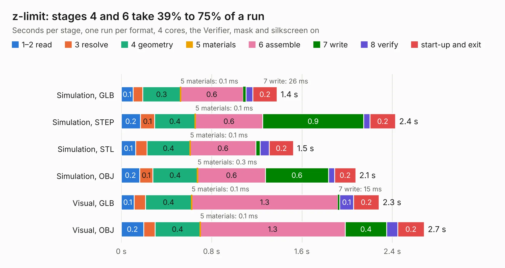

| Mode and format | 1–2 read | 3 resolve | 4 geometry | 5 materials | 6 assemble | 7 write | 8 verify | start-up and exit | Total |
|---|---:|---:|---:|---:|---:|---:|---:|---:|---:|
| Simulation, GLB | 0.1 | 84&nbsp;ms | 0.3 | 0.1&nbsp;ms | 0.6 | 26&nbsp;ms | 60&nbsp;ms | 0.2 | 1.4 |
| Simulation, STEP | 0.2 | 0.1 | 0.4 | 0.1&nbsp;ms | 0.6 | 0.9 | 56&nbsp;ms | 0.2 | 2.4 |
| Simulation, STL | 0.1 | 0.1 | 0.4 | 0.1&nbsp;ms | 0.6 | 37&nbsp;ms | 81&nbsp;ms | 0.2 | 1.5 |
| Simulation, OBJ | 0.2 | 0.1 | 0.4 | 0.3&nbsp;ms | 0.6 | 0.6 | 54&nbsp;ms | 0.2 | 2.1 |
| Visual, GLB | 0.1 | 0.1 | 0.4 | 0.1&nbsp;ms | 1.3 | 15&nbsp;ms | 0.1 | 0.2 | 2.3 |
| Visual, OBJ | 0.2 | 0.1 | 0.4 | 0.1&nbsp;ms | 1.3 | 0.4 | 97&nbsp;ms | 0.2 | 2.7 |

<table align="center"><tr><td valign="top">

| Board | Repo: [opulo-inc/lumenpnp](https://github.com/opulo-inc/lumenpnp) Board: `z-limit.kicad_pcb` |
|---|---|
| Folder | src / PCB / z-limit |
| Complexity | 171&nbsp;/&nbsp;1000 (size&nbsp;101, features&nbsp;70) |
| KESE&nbsp;features | through vias, rounded, trapezoid or chamfered pads, filled zones, curved board outline, TrueType text |
| Tested | 9th November 2026 |
| Copper&nbsp;layers | 2 |
| File&nbsp;format | KiCad 8 (20240108) |
| Parts,&nbsp;tracks,&nbsp;vias | 3, 30, 13 |
| Triangles,&nbsp;simulation | 107,692 in 17 parts |
| Verifier | PASS in all six runs |

</td><td valign="top">

<table>
<tr><th>File type</th><th>File size</th><th>Peak memory used</th></tr>
<tr><th colspan="3" align="left">Simulation</th></tr>
<tr><td>GLB</td><td align="right">3.8&nbsp;MB</td><td align="right">190&nbsp;MB</td></tr>
<tr><td>STEP</td><td align="right">18&nbsp;MB</td><td align="right">196&nbsp;MB</td></tr>
<tr><td>STL</td><td align="right">5.4&nbsp;MB</td><td align="right">185&nbsp;MB</td></tr>
<tr><td>OBJ</td><td align="right">11&nbsp;MB</td><td align="right">189&nbsp;MB</td></tr>
<tr><th colspan="3" align="left">Visual</th></tr>
<tr><td>GLB</td><td align="right">3.0&nbsp;MB</td><td align="right">156&nbsp;MB</td></tr>
<tr><td>OBJ</td><td align="right">8.3&nbsp;MB</td><td align="right">158&nbsp;MB</td></tr>
</table>

</td></tr></table>

## 2104. OrangeCrab

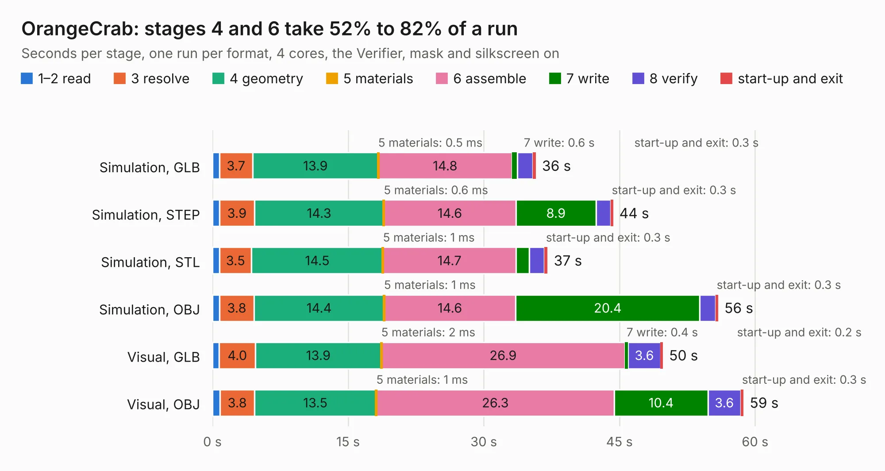

| Mode and format | 1–2 read | 3 resolve | 4 geometry | 5 materials | 6 assemble | 7 write | 8 verify | start-up and exit | Total |
|---|---:|---:|---:|---:|---:|---:|---:|---:|---:|
| Simulation, GLB | 0.8 | 3.7 | 13.9 | 0.5&nbsp;ms | 14.8 | 0.6 | 1.7 | 0.3 | 35.7 |
| Simulation, STEP | 0.8 | 3.9 | 14.3 | 0.6&nbsp;ms | 14.6 | 8.9 | 1.6 | 0.3 | 44.3 |
| Simulation, STL | 0.8 | 3.5 | 14.5 | 1&nbsp;ms | 14.7 | 1.5 | 1.7 | 0.3 | 37.0 |
| Simulation, OBJ | 0.8 | 3.8 | 14.4 | 1&nbsp;ms | 14.6 | 20.4 | 1.7 | 0.3 | 55.9 |
| Visual, GLB | 0.8 | 4.0 | 13.9 | 2&nbsp;ms | 26.9 | 0.4 | 3.6 | 0.2 | 49.8 |
| Visual, OBJ | 0.9 | 3.8 | 13.5 | 1&nbsp;ms | 26.3 | 10.4 | 3.6 | 0.3 | 58.7 |

<table align="center"><tr><td valign="top">

| Board | Repo: [orangecrab-fpga/orangecrab-hardware](https://github.com/orangecrab-fpga/orangecrab-hardware) Board: `OrangeCrab.kicad_pcb` |
|---|---|
| Folder | hardware / orangecrab_r0.1 |
| Complexity | 403&nbsp;/&nbsp;1000 (size&nbsp;303, features&nbsp;100) |
| KESE&nbsp;features | through vias, slotted holes, custom pads, rounded, trapezoid or chamfered pads, filled zones, copper drawings, copper text, curved board outline |
| Tested | 9th November 2026 |
| Copper&nbsp;layers | 6 |
| File&nbsp;format | KiCad 5 (20171130) |
| Parts,&nbsp;tracks,&nbsp;vias | 141, 6,919, 449 |
| Triangles,&nbsp;simulation | 4,238,478 in 192 parts |
| Verifier | PASS in all six runs |

</td><td valign="top">

<table>
<tr><th>File type</th><th>File size</th><th>Peak memory used</th></tr>
<tr><th colspan="3" align="left">Simulation</th></tr>
<tr><td>GLB</td><td align="right">146&nbsp;MB</td><td align="right">1.2&nbsp;GB</td></tr>
<tr><td>STEP</td><td align="right">609&nbsp;MB</td><td align="right">1.5&nbsp;GB</td></tr>
<tr><td>STL</td><td align="right">212&nbsp;MB</td><td align="right">1.3&nbsp;GB</td></tr>
<tr><td>OBJ</td><td align="right">453&nbsp;MB</td><td align="right">2.7&nbsp;GB</td></tr>
<tr><th colspan="3" align="left">Visual</th></tr>
<tr><td>GLB</td><td align="right">73&nbsp;MB</td><td align="right">1.3&nbsp;GB</td></tr>
<tr><td>OBJ</td><td align="right">233&nbsp;MB</td><td align="right">1.6&nbsp;GB</td></tr>
</table>

</td></tr></table>

## 2105. OrangeCrab

| Mode and format | 1–2 read | 3 resolve | 4 geometry | 5 materials | 6 assemble | 7 write | 8 verify | start-up and exit | Total |
|---|---:|---:|---:|---:|---:|---:|---:|---:|---:|
| Simulation, GLB | 0.9 | 3.8 | 15.4 | 0.6&nbsp;ms | 17.5 | 0.7 | 1.8 | 0.3 | 40.3 |
| Simulation, STEP | 0.9 | 3.7 | 15.5 | 0.9&nbsp;ms | 18.4 | 9.9 | 2.0 | 0.3 | 50.8 |
| Simulation, STL | 1.0 | 3.7 | 15.8 | 0.9&nbsp;ms | 18.3 | 1.7 | 2.0 | 0.3 | 42.9 |
| Simulation, OBJ | 0.9 | 3.8 | 15.9 | 0.6&nbsp;ms | 18.5 | 25.5 | 2.2 | 0.3 | 67.1 |
| Visual, GLB | 1.0 | 4.0 | 14.9 | 0.6&nbsp;ms | 30.6 | 0.4 | 3.8 | 0.3 | 55.0 |
| Visual, OBJ | 1.0 | 3.8 | 15.3 | 0.7&nbsp;ms | 30.6 | 12.8 | 3.9 | 0.2 | 67.7 |

<table align="center"><tr><td valign="top">

| Board | Repo: [orangecrab-fpga/orangecrab-hardware](https://github.com/orangecrab-fpga/orangecrab-hardware) Board: `OrangeCrab.kicad_pcb` |
|---|---|
| Folder | hardware / orangecrab_r0.2.1 |
| Complexity | 404&nbsp;/&nbsp;1000 (size&nbsp;304, features&nbsp;100) |
| KESE&nbsp;features | through vias, slotted holes, custom pads, rounded, trapezoid or chamfered pads, filled zones, copper drawings, copper text, curved board outline |
| Tested | 9th November 2026 |
| Copper&nbsp;layers | 6 |
| File&nbsp;format | KiCad 5 (20171130) |
| Parts,&nbsp;tracks,&nbsp;vias | 142, 7,280, 441 |
| Triangles,&nbsp;simulation | 4,397,740 in 188 parts |
| Verifier | PASS in all six runs |

</td><td valign="top">

<table>
<tr><th>File type</th><th>File size</th><th>Peak memory used</th></tr>
<tr><th colspan="3" align="left">Simulation</th></tr>
<tr><td>GLB</td><td align="right">151&nbsp;MB</td><td align="right">1.1&nbsp;GB</td></tr>
<tr><td>STEP</td><td align="right">636&nbsp;MB</td><td align="right">1.5&nbsp;GB</td></tr>
<tr><td>STL</td><td align="right">220&nbsp;MB</td><td align="right">1.2&nbsp;GB</td></tr>
<tr><td>OBJ</td><td align="right">470&nbsp;MB</td><td align="right">2.8&nbsp;GB</td></tr>
<tr><th colspan="3" align="left">Visual</th></tr>
<tr><td>GLB</td><td align="right">77&nbsp;MB</td><td align="right">1.5&nbsp;GB</td></tr>
<tr><td>OBJ</td><td align="right">245&nbsp;MB</td><td align="right">1.7&nbsp;GB</td></tr>
</table>

</td></tr></table>

## 2106. OrangeCrab

| Mode and format | 1–2 read | 3 resolve | 4 geometry | 5 materials | 6 assemble | 7 write | 8 verify | start-up and exit | Total |
|---|---:|---:|---:|---:|---:|---:|---:|---:|---:|
| Simulation, GLB | 1.1 | 4.1 | 15.5 | 1.0&nbsp;ms | 16.7 | 0.9 | 1.9 | 0.3 | 40.5 |
| Simulation, STEP | 1.1 | 4.2 | 16.0 | 1&nbsp;ms | 17.0 | 10.4 | 2.0 | 0.3 | 51.1 |
| Simulation, STL | 1.1 | 4.3 | 16.0 | 0.7&nbsp;ms | 16.7 | 1.8 | 2.0 | 0.3 | 42.4 |
| Simulation, OBJ | 1.1 | 4.4 | 16.0 | 0.6&nbsp;ms | 17.1 | 28.1 | 2.2 | 0.3 | 69.1 |
| Visual, GLB | 1.1 | 4.4 | 16.4 | 1&nbsp;ms | 32.9 | 0.4 | 4.4 | 0.3 | 59.9 |
| Visual, OBJ | 1.1 | 4.4 | 16.3 | 0.6&nbsp;ms | 33.4 | 14.1 | 4.5 | 0.3 | 74.1 |

<table align="center"><tr><td valign="top">

| Board | Repo: [orangecrab-fpga/orangecrab-hardware](https://github.com/orangecrab-fpga/orangecrab-hardware) Board: `OrangeCrab.kicad_pcb` |
|---|---|
| Folder | hardware / orangecrab_r0.2 |
| Complexity | 405&nbsp;/&nbsp;1000 (size&nbsp;305, features&nbsp;100) |
| KESE&nbsp;features | through vias, slotted holes, custom pads, rounded, trapezoid or chamfered pads, filled zones, copper drawings, copper text, curved board outline |
| Tested | 9th November 2026 |
| Copper&nbsp;layers | 6 |
| File&nbsp;format | KiCad 5 (20171130) |
| Parts,&nbsp;tracks,&nbsp;vias | 144, 7,537, 459 |
| Triangles,&nbsp;simulation | 4,445,274 in 185 parts |
| Verifier | PASS in all six runs |

</td><td valign="top">

<table>
<tr><th>File type</th><th>File size</th><th>Peak memory used</th></tr>
<tr><th colspan="3" align="left">Simulation</th></tr>
<tr><td>GLB</td><td align="right">153&nbsp;MB</td><td align="right">1.3&nbsp;GB</td></tr>
<tr><td>STEP</td><td align="right">651&nbsp;MB</td><td align="right">1.6&nbsp;GB</td></tr>
<tr><td>STL</td><td align="right">222&nbsp;MB</td><td align="right">1.4&nbsp;GB</td></tr>
<tr><td>OBJ</td><td align="right">475&nbsp;MB</td><td align="right">2.9&nbsp;GB</td></tr>
<tr><th colspan="3" align="left">Visual</th></tr>
<tr><td>GLB</td><td align="right">79&nbsp;MB</td><td align="right">1.5&nbsp;GB</td></tr>
<tr><td>OBJ</td><td align="right">252&nbsp;MB</td><td align="right">1.6&nbsp;GB</td></tr>
</table>

</td></tr></table>

## 2107. mezzanine-breakout-board

| Mode and format | 1–2 read | 3 resolve | 4 geometry | 5 materials | 6 assemble | 7 write | 8 verify | start-up and exit | Total |
|---|---:|---:|---:|---:|---:|---:|---:|---:|---:|
| Simulation, GLB | 80&nbsp;ms | 0.1 | 0.3 | 0.2&nbsp;ms | 0.5 | 14&nbsp;ms | 44&nbsp;ms | 0.2 | 1.3 |
| Simulation, STEP | 77&nbsp;ms | 0.1 | 0.3 | 0.1&nbsp;ms | 0.5 | 0.7 | 46&nbsp;ms | 0.2 | 2.0 |
| Simulation, STL | 77&nbsp;ms | 0.1 | 0.3 | 0.1&nbsp;ms | 0.5 | 21&nbsp;ms | 47&nbsp;ms | 0.2 | 1.3 |
| Simulation, OBJ | 85&nbsp;ms | 0.1 | 0.3 | 0.1&nbsp;ms | 0.5 | 0.4 | 51&nbsp;ms | 0.2 | 1.7 |
| Visual, GLB | 76&nbsp;ms | 99&nbsp;ms | 0.3 | 0.1&nbsp;ms | 1.0 | 11&nbsp;ms | 70&nbsp;ms | 0.2 | 1.7 |
| Visual, OBJ | 79&nbsp;ms | 0.1 | 0.3 | 0.1&nbsp;ms | 0.9 | 0.4 | 58&nbsp;ms | 0.2 | 2.0 |

<table align="center"><tr><td valign="top">

| Board | Repo: [oresat/oresat-adcs-hardware](https://github.com/oresat/oresat-adcs-hardware) Board: `mezzanine-breakout-board.kicad_pcb` |
|---|---|
| Folder | mezzanine-breakout-board |
| Complexity | 197&nbsp;/&nbsp;1000 (size&nbsp;92, features&nbsp;105) |
| KESE&nbsp;features | through vias, rounded, trapezoid or chamfered pads, filled zones, curved board outline, stack-up, dielectric εr and tanδ, copper finish, mask and silkscreen colours |
| Tested | 9th November 2026 |
| Copper&nbsp;layers | 2 |
| File&nbsp;format | KiCad 8 (20240108) |
| Parts,&nbsp;tracks,&nbsp;vias | 2, 31, 5 |
| Triangles,&nbsp;simulation | 88,076 in 19 parts |
| Verifier | PASS in all six runs |

</td><td valign="top">

<table>
<tr><th>File type</th><th>File size</th><th>Peak memory used</th></tr>
<tr><th colspan="3" align="left">Simulation</th></tr>
<tr><td>GLB</td><td align="right">3.0&nbsp;MB</td><td align="right">178&nbsp;MB</td></tr>
<tr><td>STEP</td><td align="right">12&nbsp;MB</td><td align="right">186&nbsp;MB</td></tr>
<tr><td>STL</td><td align="right">4.4&nbsp;MB</td><td align="right">176&nbsp;MB</td></tr>
<tr><td>OBJ</td><td align="right">8.5&nbsp;MB</td><td align="right">178&nbsp;MB</td></tr>
<tr><th colspan="3" align="left">Visual</th></tr>
<tr><td>GLB</td><td align="right">2.1&nbsp;MB</td><td align="right">152&nbsp;MB</td></tr>
<tr><td>OBJ</td><td align="right">5.8&nbsp;MB</td><td align="right">152&nbsp;MB</td></tr>
</table>

</td></tr></table>

## 2108. mezzanine-flex-board

| Mode and format | 1–2 read | 3 resolve | 4 geometry | 5 materials | 6 assemble | 7 write | 8 verify | start-up and exit | Total |
|---|---:|---:|---:|---:|---:|---:|---:|---:|---:|
| Simulation, GLB | 79&nbsp;ms | 0.2 | 0.3 | 0.1&nbsp;ms | 0.5 | 21&nbsp;ms | 42&nbsp;ms | 0.2 | 1.3 |
| Simulation, STEP | 78&nbsp;ms | 0.2 | 0.3 | 0.1&nbsp;ms | 0.4 | 0.7 | 47&nbsp;ms | 0.2 | 2.0 |
| Simulation, STL | 80&nbsp;ms | 0.2 | 0.3 | 0.1&nbsp;ms | 0.5 | 45&nbsp;ms | 48&nbsp;ms | 0.2 | 1.3 |
| Simulation, OBJ | 74&nbsp;ms | 0.2 | 0.3 | 0.1&nbsp;ms | 0.4 | 0.5 | 52&nbsp;ms | 0.2 | 1.7 |
| Visual, GLB | 78&nbsp;ms | 0.2 | 0.3 | 0.2&nbsp;ms | 0.9 | 12&nbsp;ms | 86&nbsp;ms | 0.2 | 1.8 |
| Visual, OBJ | 79&nbsp;ms | 0.2 | 0.4 | 0.2&nbsp;ms | 0.9 | 0.3 | 89&nbsp;ms | 0.2 | 2.1 |

<table align="center"><tr><td valign="top">

| Board | Repo: [oresat/oresat-adcs-hardware](https://github.com/oresat/oresat-adcs-hardware) Board: `mezzanine-flex-board.kicad_pcb` |
|---|---|
| Folder | mezzanine-flex-board |
| Complexity | 204&nbsp;/&nbsp;1000 (size&nbsp;109, features&nbsp;95) |
| KESE&nbsp;features | through vias, rounded, trapezoid or chamfered pads, filled zones, stack-up, dielectric εr and tanδ, copper finish, mask and silkscreen colours |
| Tested | 9th November 2026 |
| Copper&nbsp;layers | 2 |
| File&nbsp;format | KiCad 10 (20260206) |
| Parts,&nbsp;tracks,&nbsp;vias | 2, 16, 40 |
| Triangles,&nbsp;simulation | 118,972 in 22 parts |
| Verifier | PASS in all six runs |

</td><td valign="top">

<table>
<tr><th>File type</th><th>File size</th><th>Peak memory used</th></tr>
<tr><th colspan="3" align="left">Simulation</th></tr>
<tr><td>GLB</td><td align="right">4.2&nbsp;MB</td><td align="right">199&nbsp;MB</td></tr>
<tr><td>STEP</td><td align="right">22&nbsp;MB</td><td align="right">208&nbsp;MB</td></tr>
<tr><td>STL</td><td align="right">6.0&nbsp;MB</td><td align="right">195&nbsp;MB</td></tr>
<tr><td>OBJ</td><td align="right">12&nbsp;MB</td><td align="right">199&nbsp;MB</td></tr>
<tr><th colspan="3" align="left">Visual</th></tr>
<tr><td>GLB</td><td align="right">2.6&nbsp;MB</td><td align="right">162&nbsp;MB</td></tr>
<tr><td>OBJ</td><td align="right">7.4&nbsp;MB</td><td align="right">164&nbsp;MB</td></tr>
</table>

</td></tr></table>

## 2109. oresat-adcs-card

| Mode and format | 1–2 read | 3 resolve | 4 geometry | 5 materials | 6 assemble | 7 write | 8 verify | start-up and exit | Total |
|---|---:|---:|---:|---:|---:|---:|---:|---:|---:|
| Simulation, GLB | 2.5 | 9.8 | 49.2 | 2&nbsp;ms | 37.1 | 1.8 | 4.9 | 0.4 | 105.8 |
| Simulation, STEP | 2.8 | 10.7 | 49.9 | 1&nbsp;ms | 34.3 | 20.7 | 4.5 | 0.4 | 123.3 |
| Simulation, STL | 2.4 | 9.6 | 51.3 | 1&nbsp;ms | 34.8 | 3.8 | 5.3 | 0.4 | 107.6 |
| Simulation, OBJ | 2.5 | 10.2 | 49.3 | 2&nbsp;ms | 35.2 | 52.7 | 5.2 | 0.5 | 155.7 |
| Visual, GLB | 2.6 | 10.2 | 52.0 | 2&nbsp;ms | 87.3 | 0.8 | 8.6 | 0.4 | 162.0 |
| Visual, OBJ | 2.6 | 10.1 | 50.0 | 1&nbsp;ms | 85.7 | 30.5 | 8.5 | 0.4 | 187.9 |

<table align="center"><tr><td valign="top">

| Board | Repo: [oresat/oresat-adcs-hardware](https://github.com/oresat/oresat-adcs-hardware) Board: `oresat-adcs-card.kicad_pcb` |
|---|---|
| Folder | oresat-adcs-card |
| Complexity | 334&nbsp;/&nbsp;1000 (size&nbsp;244, features&nbsp;90) |
| KESE&nbsp;features | through vias, rounded, trapezoid or chamfered pads, drill offsets, filled zones, stack-up, dielectric εr and tanδ, mask and silkscreen colours |
| Tested | 9th November 2026 |
| Copper&nbsp;layers | 4 |
| File&nbsp;format | KiCad 8 (20240108) |
| Parts,&nbsp;tracks,&nbsp;vias | 456, 3,064, 1,130 |
| Triangles,&nbsp;simulation | 7,666,848 in 369 parts |
| Verifier | PASS in all six runs |

</td><td valign="top">

<table>
<tr><th>File type</th><th>File size</th><th>Peak memory used</th></tr>
<tr><th colspan="3" align="left">Simulation</th></tr>
<tr><td>GLB</td><td align="right">261&nbsp;MB</td><td align="right">2.0&nbsp;GB</td></tr>
<tr><td>STEP</td><td align="right">1.2&nbsp;GB</td><td align="right">2.8&nbsp;GB</td></tr>
<tr><td>STL</td><td align="right">383&nbsp;MB</td><td align="right">2.1&nbsp;GB</td></tr>
<tr><td>OBJ</td><td align="right">829&nbsp;MB</td><td align="right">5.0&nbsp;GB</td></tr>
<tr><th colspan="3" align="left">Visual</th></tr>
<tr><td>GLB</td><td align="right">166&nbsp;MB</td><td align="right">2.7&nbsp;GB</td></tr>
<tr><td>OBJ</td><td align="right">532&nbsp;MB</td><td align="right">3.4&nbsp;GB</td></tr>
</table>

</td></tr></table>

## 2110. oresat-mag-card

| Mode and format | 1–2 read | 3 resolve | 4 geometry | 5 materials | 6 assemble | 7 write | 8 verify | start-up and exit | Total |
|---|---:|---:|---:|---:|---:|---:|---:|---:|---:|
| Simulation, GLB | 0.9 | 3.3 | 11.6 | 0.6&nbsp;ms | 13.8 | 0.6 | 1.4 | 0.3 | 32.0 |
| Simulation, STEP | 0.9 | 3.2 | 11.6 | 0.6&nbsp;ms | 12.7 | 7.7 | 1.5 | 0.3 | 37.7 |
| Simulation, STL | 1.0 | 3.2 | 11.3 | 0.6&nbsp;ms | 12.5 | 1.3 | 1.2 | 0.3 | 30.7 |
| Simulation, OBJ | 0.9 | 3.2 | 11.5 | 0.6&nbsp;ms | 11.9 | 15.2 | 1.3 | 0.2 | 44.3 |
| Visual, GLB | 0.9 | 3.1 | 11.8 | 0.5&nbsp;ms | 23.4 | 0.3 | 3.8 | 0.3 | 43.6 |
| Visual, OBJ | 1.0 | 3.6 | 11.9 | 0.5&nbsp;ms | 24.5 | 9.1 | 3.5 | 0.3 | 53.9 |

<table align="center"><tr><td valign="top">

| Board | Repo: [oresat/oresat-adcs-hardware](https://github.com/oresat/oresat-adcs-hardware) Board: `oresat-mag-card.kicad_pcb` |
|---|---|
| Folder | oresat-mag-card |
| Complexity | 376&nbsp;/&nbsp;1000 (size&nbsp;261, features&nbsp;115) |
| KESE&nbsp;features | through vias, rounded, trapezoid or chamfered pads, drill offsets, filled zones, curved board outline, tracks bare of mask, stack-up, dielectric εr and tanδ, mask and silkscreen colours |
| Tested | 9th November 2026 |
| Copper&nbsp;layers | 4 |
| File&nbsp;format | KiCad 10 (20260206) |
| Parts,&nbsp;tracks,&nbsp;vias | 175, 1,177, 651 |
| Triangles,&nbsp;simulation | 3,666,392 in 197 parts |
| Verifier | PASS in all six runs |

</td><td valign="top">

<table>
<tr><th>File type</th><th>File size</th><th>Peak memory used</th></tr>
<tr><th colspan="3" align="left">Simulation</th></tr>
<tr><td>GLB</td><td align="right">122&nbsp;MB</td><td align="right">1.1&nbsp;GB</td></tr>
<tr><td>STEP</td><td align="right">484&nbsp;MB</td><td align="right">1.5&nbsp;GB</td></tr>
<tr><td>STL</td><td align="right">183&nbsp;MB</td><td align="right">1.1&nbsp;GB</td></tr>
<tr><td>OBJ</td><td align="right">384&nbsp;MB</td><td align="right">2.4&nbsp;GB</td></tr>
<tr><th colspan="3" align="left">Visual</th></tr>
<tr><td>GLB</td><td align="right">74&nbsp;MB</td><td align="right">1.3&nbsp;GB</td></tr>
<tr><td>OBJ</td><td align="right">233&nbsp;MB</td><td align="right">1.6&nbsp;GB</td></tr>
</table>

</td></tr></table>

## 2111. control-stage

| Mode and format | 1–2 read | 3 resolve | 4 geometry | 5 materials | 6 assemble | 7 write | 8 verify | start-up and exit | Total |
|---|---:|---:|---:|---:|---:|---:|---:|---:|---:|
| Simulation, GLB | 0.4 | 2.3 | 4.6 | 0.9&nbsp;ms | 6.3 | 0.3 | 0.9 | 0.2 | 15.0 |
| Simulation, STEP | 0.5 | 2.6 | 5.0 | 0.9&nbsp;ms | 6.3 | 3.6 | 0.9 | 0.3 | 19.1 |
| Simulation, STL | 0.4 | 2.5 | 4.6 | 1&nbsp;ms | 6.3 | 0.7 | 1.0 | 0.2 | 15.7 |
| Simulation, OBJ | 0.5 | 2.6 | 4.9 | 0.7&nbsp;ms | 5.9 | 9.7 | 0.8 | 0.2 | 24.6 |
| Visual, GLB | 0.4 | 2.6 | 4.6 | 0.7&nbsp;ms | 10.9 | 0.2 | 1.0 | 0.2 | 19.9 |
| Visual, OBJ | 0.4 | 2.3 | 4.6 | 0.9&nbsp;ms | 11.0 | 4.9 | 1.5 | 0.2 | 25.0 |

<table align="center"><tr><td valign="top">

| Board | Repo: [oresat/oresat-adcs-hardware](https://github.com/oresat/oresat-adcs-hardware) Board: `control-stage.kicad_pcb` |
|---|---|
| Folder | oresat-rw-board-rev1-MCXN / control-stage |
| Complexity | 349&nbsp;/&nbsp;1000 (size&nbsp;259, features&nbsp;90) |
| KESE&nbsp;features | through vias, slotted holes, rounded, trapezoid or chamfered pads, filled zones, stack-up, dielectric εr and tanδ, mask and silkscreen colours |
| Tested | 9th November 2026 |
| Copper&nbsp;layers | 6 |
| File&nbsp;format | KiCad 9 (20241229) |
| Parts,&nbsp;tracks,&nbsp;vias | 93, 830, 485 |
| Triangles,&nbsp;simulation | 2,345,640 in 131 parts |
| Verifier | PASS in all six runs |

</td><td valign="top">

<table>
<tr><th>File type</th><th>File size</th><th>Peak memory used</th></tr>
<tr><th colspan="3" align="left">Simulation</th></tr>
<tr><td>GLB</td><td align="right">79&nbsp;MB</td><td align="right">829&nbsp;MB</td></tr>
<tr><td>STEP</td><td align="right">210&nbsp;MB</td><td align="right">948&nbsp;MB</td></tr>
<tr><td>STL</td><td align="right">117&nbsp;MB</td><td align="right">806&nbsp;MB</td></tr>
<tr><td>OBJ</td><td align="right">249&nbsp;MB</td><td align="right">1.5&nbsp;GB</td></tr>
<tr><th colspan="3" align="left">Visual</th></tr>
<tr><td>GLB</td><td align="right">38&nbsp;MB</td><td align="right">789&nbsp;MB</td></tr>
<tr><td>OBJ</td><td align="right">122&nbsp;MB</td><td align="right">929&nbsp;MB</td></tr>
</table>

</td></tr></table>

## 2112. power-stage-rev8

| Mode and format | 1–2 read | 3 resolve | 4 geometry | 5 materials | 6 assemble | 7 write | 8 verify | start-up and exit | Total |
|---|---:|---:|---:|---:|---:|---:|---:|---:|---:|
| Simulation, GLB | 1.2 | 4.2 | 14.3 | 1&nbsp;ms | 16.3 | 0.8 | 2.0 | 0.3 | 39.1 |
| Simulation, STEP | 1.2 | 4.3 | 14.3 | 0.8&nbsp;ms | 16.6 | 8.6 | 2.0 | 0.3 | 47.3 |
| Simulation, STL | 1.2 | 4.3 | 14.3 | 1&nbsp;ms | 16.5 | 1.6 | 2.1 | 0.3 | 40.3 |
| Simulation, OBJ | 1.2 | 4.3 | 14.1 | 1&nbsp;ms | 16.7 | 25.0 | 2.0 | 0.3 | 63.6 |
| Visual, GLB | 1.1 | 4.3 | 14.2 | 1&nbsp;ms | 50.1 | 0.3 | 3.1 | 0.3 | 73.6 |
| Visual, OBJ | 1.1 | 4.3 | 14.6 | 1&nbsp;ms | 49.9 | 11.4 | 3.2 | 0.3 | 84.9 |

<table align="center"><tr><td valign="top">

| Board | Repo: [oresat/oresat-adcs-hardware](https://github.com/oresat/oresat-adcs-hardware) Board: `power-stage-rev8.kicad_pcb` |
|---|---|
| Folder | oresat-rw-board-rev2-MCXN / power-stage-rev8 |
| Complexity | 435&nbsp;/&nbsp;1000 (size&nbsp;285, features&nbsp;150) |
| KESE&nbsp;features | through vias, padstacks, rounded, trapezoid or chamfered pads, arc tracks, filled zones, TrueType text, stack-up, dielectric εr and tanδ, copper finish |
| Tested | 9th November 2026 |
| Copper&nbsp;layers | 6 |
| File&nbsp;format | KiCad 10 (20260206) |
| Parts,&nbsp;tracks,&nbsp;vias | 213, 1,035, 686 |
| Triangles,&nbsp;simulation | 4,212,664 in 271 parts |
| Verifier | PASS in all six runs |

</td><td valign="top">

<table>
<tr><th>File type</th><th>File size</th><th>Peak memory used</th></tr>
<tr><th colspan="3" align="left">Simulation</th></tr>
<tr><td>GLB</td><td align="right">140&nbsp;MB</td><td align="right">1.1&nbsp;GB</td></tr>
<tr><td>STEP</td><td align="right">463&nbsp;MB</td><td align="right">1.4&nbsp;GB</td></tr>
<tr><td>STL</td><td align="right">211&nbsp;MB</td><td align="right">1.1&nbsp;GB</td></tr>
<tr><td>OBJ</td><td align="right">442&nbsp;MB</td><td align="right">2.7&nbsp;GB</td></tr>
<tr><th colspan="3" align="left">Visual</th></tr>
<tr><td>GLB</td><td align="right">66&nbsp;MB</td><td align="right">1.4&nbsp;GB</td></tr>
<tr><td>OBJ</td><td align="right">206&nbsp;MB</td><td align="right">1.6&nbsp;GB</td></tr>
</table>

</td></tr></table>

## 2113. controller_rev5.0_flat

| Mode and format | 1–2 read | 3 resolve | 4 geometry | 5 materials | 6 assemble | 7 write | 8 verify | start-up and exit | Total |
|---|---:|---:|---:|---:|---:|---:|---:|---:|---:|
| Simulation, GLB | 1.0 | 7.4 | 22.2 | 0.7&nbsp;ms | 16.9 | 0.8 | 2.1 | 0.3 | 50.7 |
| Simulation, STEP | 1.1 | 7.7 | 22.0 | 0.7&nbsp;ms | 17.6 | 9.6 | 2.3 | 0.3 | 60.5 |
| Simulation, STL | 1.1 | 7.5 | 22.3 | 0.7&nbsp;ms | 18.1 | 1.6 | 2.1 | 0.3 | 52.9 |
| Simulation, OBJ | 1.1 | 7.7 | 22.5 | 0.7&nbsp;ms | 18.1 | 26.4 | 2.2 | 0.3 | 78.3 |
| Visual, GLB | 1.1 | 7.6 | 21.9 | 0.7&nbsp;ms | 33.3 | 0.4 | 4.7 | 0.3 | 69.2 |
| Visual, OBJ | 1.2 | 7.4 | 21.5 | 0.7&nbsp;ms | 31.6 | 16.1 | 4.9 | 0.3 | 83.0 |

<table align="center"><tr><td valign="top">

| Board | Repo: [oresat/oresat-adcs-hardware](https://github.com/oresat/oresat-adcs-hardware) Board: `controller_rev5.0_flat.kicad_pcb` |
|---|---|
| Folder | oresat-rw-board-rev5-flat |
| Complexity | 362&nbsp;/&nbsp;1000 (size&nbsp;272, features&nbsp;90) |
| KESE&nbsp;features | through vias, rounded, trapezoid or chamfered pads, drill offsets, filled zones, stack-up, dielectric εr and tanδ, mask and silkscreen colours |
| Tested | 9th November 2026 |
| Copper&nbsp;layers | 4 |
| File&nbsp;format | KiCad 7 (20211228) |
| Parts,&nbsp;tracks,&nbsp;vias | 149, 2,162, 1,552 |
| Triangles,&nbsp;simulation | 4,833,650 in 201 parts |
| Verifier | PASS in all six runs |

</td><td valign="top">

<table>
<tr><th>File type</th><th>File size</th><th>Peak memory used</th></tr>
<tr><th colspan="3" align="left">Simulation</th></tr>
<tr><td>GLB</td><td align="right">157&nbsp;MB</td><td align="right">1.7&nbsp;GB</td></tr>
<tr><td>STEP</td><td align="right">482&nbsp;MB</td><td align="right">2.0&nbsp;GB</td></tr>
<tr><td>STL</td><td align="right">242&nbsp;MB</td><td align="right">1.8&nbsp;GB</td></tr>
<tr><td>OBJ</td><td align="right">507&nbsp;MB</td><td align="right">3.0&nbsp;GB</td></tr>
<tr><th colspan="3" align="left">Visual</th></tr>
<tr><td>GLB</td><td align="right">99&nbsp;MB</td><td align="right">1.7&nbsp;GB</td></tr>
<tr><td>OBJ</td><td align="right">315&nbsp;MB</td><td align="right">2.1&nbsp;GB</td></tr>
</table>

</td></tr></table>

## 2114. rev6.0_flat_controlstage

| Mode and format | 1–2 read | 3 resolve | 4 geometry | 5 materials | 6 assemble | 7 write | 8 verify | start-up and exit | Total |
|---|---:|---:|---:|---:|---:|---:|---:|---:|---:|
| Simulation, GLB | 0.7 | 6.7 | 14.2 | 1&nbsp;ms | 17.9 | 0.7 | 1.6 | 0.3 | 42.1 |
| Simulation, STEP | 0.7 | 6.7 | 14.1 | 1&nbsp;ms | 18.2 | 6.9 | 1.6 | 0.3 | 48.5 |
| Simulation, STL | 0.7 | 6.8 | 15.0 | 1&nbsp;ms | 18.6 | 1.5 | 1.7 | 0.3 | 44.6 |
| Simulation, OBJ | 0.8 | 7.0 | 14.7 | 1&nbsp;ms | 18.3 | 23.9 | 1.6 | 0.3 | 66.7 |
| Visual, GLB | 0.8 | 7.4 | 15.8 | 1&nbsp;ms | 33.1 | 0.4 | 3.1 | 0.3 | 61.0 |
| Visual, OBJ | 0.7 | 7.0 | 15.2 | 1&nbsp;ms | 32.9 | 13.9 | 2.9 | 0.3 | 73.0 |

<table align="center"><tr><td valign="top">

| Board | Repo: [oresat/oresat-adcs-hardware](https://github.com/oresat/oresat-adcs-hardware) Board: `rev6.0_flat_controlstage.kicad_pcb` |
|---|---|
| Folder | oresat-rw-board-rev6 / rev6.0_flat_controlstage |
| Complexity | 342&nbsp;/&nbsp;1000 (size&nbsp;267, features&nbsp;75) |
| KESE&nbsp;features | through vias, rounded, trapezoid or chamfered pads, filled zones, stack-up, dielectric εr and tanδ |
| Tested | 9th November 2026 |
| Copper&nbsp;layers | 4 |
| File&nbsp;format | KiCad 6 (20211014) |
| Parts,&nbsp;tracks,&nbsp;vias | 104, 948, 1,776 |
| Triangles,&nbsp;simulation | 4,214,950 in 107 parts |
| Verifier | PASS in all six runs |

</td><td valign="top">

<table>
<tr><th>File type</th><th>File size</th><th>Peak memory used</th></tr>
<tr><th colspan="3" align="left">Simulation</th></tr>
<tr><td>GLB</td><td align="right">134&nbsp;MB</td><td align="right">1.4&nbsp;GB</td></tr>
<tr><td>STEP</td><td align="right">292&nbsp;MB</td><td align="right">1.9&nbsp;GB</td></tr>
<tr><td>STL</td><td align="right">211&nbsp;MB</td><td align="right">1.4&nbsp;GB</td></tr>
<tr><td>OBJ</td><td align="right">438&nbsp;MB</td><td align="right">2.7&nbsp;GB</td></tr>
<tr><th colspan="3" align="left">Visual</th></tr>
<tr><td>GLB</td><td align="right">86&nbsp;MB</td><td align="right">1.5&nbsp;GB</td></tr>
<tr><td>OBJ</td><td align="right">274&nbsp;MB</td><td align="right">1.8&nbsp;GB</td></tr>
</table>

</td></tr></table>

## 2115. rev6.0_flat_powerstage

| Mode and format | 1–2 read | 3 resolve | 4 geometry | 5 materials | 6 assemble | 7 write | 8 verify | start-up and exit | Total |
|---|---:|---:|---:|---:|---:|---:|---:|---:|---:|
| Simulation, GLB | 1.4 | 18.4 | 39.6 | 3&nbsp;ms | 33.2 | 1.7 | 3.5 | 0.4 | 98.3 |
| Simulation, STEP | 1.5 | 18.6 | 38.4 | 3&nbsp;ms | 33.2 | 13.8 | 3.4 | 0.4 | 109.4 |
| Simulation, STL | 1.5 | 18.9 | 40.9 | 4&nbsp;ms | 34.2 | 4.5 | 3.5 | 0.4 | 103.8 |
| Simulation, OBJ | 1.4 | 18.7 | 39.4 | 1&nbsp;ms | 33.1 | 54.2 | 3.5 | 0.4 | 150.6 |
| Visual, GLB | 1.5 | 18.5 | 40.4 | 4&nbsp;ms | 83.0 | 1.1 | 10.6 | 0.4 | 155.4 |
| Visual, OBJ | 1.5 | 18.6 | 39.6 | 4&nbsp;ms | 81.3 | 30.7 | 10.8 | 0.4 | 182.9 |

<table align="center"><tr><td valign="top">

| Board | Repo: [oresat/oresat-adcs-hardware](https://github.com/oresat/oresat-adcs-hardware) Board: `rev6.0_flat_powerstage.kicad_pcb` |
|---|---|
| Folder | oresat-rw-board-rev6 / rev6.0_flat_powerstage |
| Complexity | 324&nbsp;/&nbsp;1000 (size&nbsp;249, features&nbsp;75) |
| KESE&nbsp;features | through vias, rounded, trapezoid or chamfered pads, filled zones, stack-up, dielectric εr and tanδ |
| Tested | 9th November 2026 |
| Copper&nbsp;layers | 4 |
| File&nbsp;format | KiCad 6 (20211014) |
| Parts,&nbsp;tracks,&nbsp;vias | 201, 931, 4,881 |
| Triangles,&nbsp;simulation | 9,968,238 in 126 parts |
| Verifier | PASS in all six runs |

</td><td valign="top">

<table>
<tr><th>File type</th><th>File size</th><th>Peak memory used</th></tr>
<tr><th colspan="3" align="left">Simulation</th></tr>
<tr><td>GLB</td><td align="right">314&nbsp;MB</td><td align="right">2.8&nbsp;GB</td></tr>
<tr><td>STEP</td><td align="right">588&nbsp;MB</td><td align="right">3.5&nbsp;GB</td></tr>
<tr><td>STL</td><td align="right">498&nbsp;MB</td><td align="right">2.8&nbsp;GB</td></tr>
<tr><td>OBJ</td><td align="right">1.0&nbsp;GB</td><td align="right">6.0&nbsp;GB</td></tr>
<tr><th colspan="3" align="left">Visual</th></tr>
<tr><td>GLB</td><td align="right">202&nbsp;MB</td><td align="right">3.3&nbsp;GB</td></tr>
<tr><td>OBJ</td><td align="right">658&nbsp;MB</td><td align="right">4.2&nbsp;GB</td></tr>
</table>

</td></tr></table>

## 2116. as5047p_breakout

| Mode and format | 1–2 read | 3 resolve | 4 geometry | 5 materials | 6 assemble | 7 write | 8 verify | start-up and exit | Total |
|---|---:|---:|---:|---:|---:|---:|---:|---:|---:|
| Simulation, GLB | 98&nbsp;ms | 0.2 | 0.9 | 0.2&nbsp;ms | 0.8 | 42&nbsp;ms | 0.2 | 0.2 | 2.5 |
| Simulation, STEP | 95&nbsp;ms | 0.2 | 0.9 | 0.2&nbsp;ms | 0.8 | 0.9 | 0.1 | 0.2 | 3.3 |
| Simulation, STL | 0.1 | 0.2 | 1.0 | 0.2&nbsp;ms | 0.8 | 63&nbsp;ms | 0.1 | 0.2 | 2.5 |
| Simulation, OBJ | 0.1 | 0.2 | 0.9 | 0.3&nbsp;ms | 0.8 | 1.1 | 0.1 | 0.3 | 3.5 |
| Visual, GLB | 0.1 | 0.2 | 0.9 | 0.2&nbsp;ms | 2.0 | 32&nbsp;ms | 0.2 | 0.2 | 3.6 |
| Visual, OBJ | 0.1 | 0.2 | 0.9 | 0.2&nbsp;ms | 1.9 | 0.8 | 0.2 | 0.2 | 4.3 |

<table align="center"><tr><td valign="top">

| Board | Repo: [oresat/oresat-adcs-hardware](https://github.com/oresat/oresat-adcs-hardware) Board: `as5047p_breakout.kicad_pcb` |
|---|---|
| Folder | oresat-rw-board-rev7 / as5047p_breakout |
| Complexity | 172&nbsp;/&nbsp;1000 (size&nbsp;127, features&nbsp;45) |
| KESE&nbsp;features | through vias, rounded, trapezoid or chamfered pads, filled zones |
| Tested | 9th November 2026 |
| Copper&nbsp;layers | 2 |
| File&nbsp;format | KiCad 7 (20221018) |
| Parts,&nbsp;tracks,&nbsp;vias | 6, 51, 60 |
| Triangles,&nbsp;simulation | 273,762 in 24 parts |
| Verifier | PASS in all six runs |

</td><td valign="top">

<table>
<tr><th>File type</th><th>File size</th><th>Peak memory used</th></tr>
<tr><th colspan="3" align="left">Simulation</th></tr>
<tr><td>GLB</td><td align="right">9.3&nbsp;MB</td><td align="right">232&nbsp;MB</td></tr>
<tr><td>STEP</td><td align="right">34&nbsp;MB</td><td align="right">238&nbsp;MB</td></tr>
<tr><td>STL</td><td align="right">14&nbsp;MB</td><td align="right">221&nbsp;MB</td></tr>
<tr><td>OBJ</td><td align="right">27&nbsp;MB</td><td align="right">234&nbsp;MB</td></tr>
<tr><th colspan="3" align="left">Visual</th></tr>
<tr><td>GLB</td><td align="right">5.9&nbsp;MB</td><td align="right">219&nbsp;MB</td></tr>
<tr><td>OBJ</td><td align="right">17&nbsp;MB</td><td align="right">226&nbsp;MB</td></tr>
</table>

</td></tr></table>

## 2117. as5047p_breakout_rev2

| Mode and format | 1–2 read | 3 resolve | 4 geometry | 5 materials | 6 assemble | 7 write | 8 verify | start-up and exit | Total |
|---|---:|---:|---:|---:|---:|---:|---:|---:|---:|
| Simulation, GLB | 0.1 | 0.1 | 0.8 | 0.3&nbsp;ms | 0.8 | 36&nbsp;ms | 0.1 | 0.2 | 2.3 |
| Simulation, STEP | 0.1 | 0.1 | 0.8 | 0.2&nbsp;ms | 0.8 | 1.0 | 0.1 | 0.2 | 3.2 |
| Simulation, STL | 0.1 | 0.1 | 0.8 | 0.3&nbsp;ms | 0.9 | 58&nbsp;ms | 0.1 | 0.2 | 2.3 |
| Simulation, OBJ | 0.1 | 0.1 | 0.8 | 0.2&nbsp;ms | 0.9 | 1.1 | 0.1 | 0.2 | 3.4 |
| Visual, GLB | 0.1 | 0.1 | 0.8 | 0.2&nbsp;ms | 2.1 | 19&nbsp;ms | 0.1 | 0.2 | 3.6 |
| Visual, OBJ | 96&nbsp;ms | 0.1 | 0.8 | 0.2&nbsp;ms | 2.0 | 0.6 | 0.1 | 0.2 | 3.9 |

<table align="center"><tr><td valign="top">

| Board | Repo: [oresat/oresat-adcs-hardware](https://github.com/oresat/oresat-adcs-hardware) Board: `as5047p_breakout_rev2.kicad_pcb` |
|---|---|
| Folder | oresat-rw-board-rev7 / as5047p_breakout_rev2 |
| Complexity | 144&nbsp;/&nbsp;1000 (size&nbsp;114, features&nbsp;30) |
| KESE&nbsp;features | rounded, trapezoid or chamfered pads, filled zones |
| Tested | 9th November 2026 |
| Copper&nbsp;layers | 2 |
| File&nbsp;format | KiCad 7 (20221018) |
| Parts,&nbsp;tracks,&nbsp;vias | 8, 88, 0 |
| Triangles,&nbsp;simulation | 224,936 in 32 parts |
| Verifier | PASS in all six runs |

</td><td valign="top">

<table>
<tr><th>File type</th><th>File size</th><th>Peak memory used</th></tr>
<tr><th colspan="3" align="left">Simulation</th></tr>
<tr><td>GLB</td><td align="right">7.6&nbsp;MB</td><td align="right">213&nbsp;MB</td></tr>
<tr><td>STEP</td><td align="right">33&nbsp;MB</td><td align="right">233&nbsp;MB</td></tr>
<tr><td>STL</td><td align="right">11&nbsp;MB</td><td align="right">205&nbsp;MB</td></tr>
<tr><td>OBJ</td><td align="right">22&nbsp;MB</td><td align="right">205&nbsp;MB</td></tr>
<tr><th colspan="3" align="left">Visual</th></tr>
<tr><td>GLB</td><td align="right">4.2&nbsp;MB</td><td align="right">196&nbsp;MB</td></tr>
<tr><td>OBJ</td><td align="right">12&nbsp;MB</td><td align="right">198&nbsp;MB</td></tr>
</table>

</td></tr></table>

## 2118. control-stage

| Mode and format | 1–2 read | 3 resolve | 4 geometry | 5 materials | 6 assemble | 7 write | 8 verify | start-up and exit | Total |
|---|---:|---:|---:|---:|---:|---:|---:|---:|---:|
| Simulation, GLB | 0.8 | 2.9 | 6.7 | 0.3&nbsp;ms | 8.0 | 0.4 | 1.0 | 0.3 | 20.0 |
| Simulation, STEP | 0.8 | 2.8 | 6.8 | 0.3&nbsp;ms | 8.0 | 4.3 | 1.0 | 0.3 | 24.0 |
| Simulation, STL | 0.8 | 2.8 | 6.7 | 0.3&nbsp;ms | 8.0 | 0.9 | 1.1 | 0.3 | 20.6 |
| Simulation, OBJ | 0.8 | 3.0 | 6.7 | 0.3&nbsp;ms | 8.2 | 14.6 | 1.2 | 0.2 | 34.7 |
| Visual, GLB | 0.9 | 3.6 | 7.0 | 0.3&nbsp;ms | 18.9 | 0.2 | 2.2 | 0.2 | 33.2 |
| Visual, OBJ | 0.8 | 3.0 | 7.2 | 0.4&nbsp;ms | 18.9 | 10.1 | 2.3 | 0.3 | 42.7 |

<table align="center"><tr><td valign="top">

| Board | Repo: [oresat/oresat-adcs-hardware](https://github.com/oresat/oresat-adcs-hardware) Board: `control-stage.kicad_pcb` |
|---|---|
| Folder | oresat-rw-board-rev7 / control-stage |
| Complexity | 353&nbsp;/&nbsp;1000 (size&nbsp;258, features&nbsp;95) |
| KESE&nbsp;features | through vias, rounded, trapezoid or chamfered pads, filled zones, TrueType text, stack-up, dielectric εr and tanδ, mask and silkscreen colours |
| Tested | 9th November 2026 |
| Copper&nbsp;layers | 6 |
| File&nbsp;format | KiCad 7 (20221018) |
| Parts,&nbsp;tracks,&nbsp;vias | 74, 917, 524 |
| Triangles,&nbsp;simulation | 2,647,594 in 93 parts |
| Verifier | PASS in all six runs |

</td><td valign="top">

<table>
<tr><th>File type</th><th>File size</th><th>Peak memory used</th></tr>
<tr><th colspan="3" align="left">Simulation</th></tr>
<tr><td>GLB</td><td align="right">89&nbsp;MB</td><td align="right">862&nbsp;MB</td></tr>
<tr><td>STEP</td><td align="right">217&nbsp;MB</td><td align="right">964&nbsp;MB</td></tr>
<tr><td>STL</td><td align="right">132&nbsp;MB</td><td align="right">880&nbsp;MB</td></tr>
<tr><td>OBJ</td><td align="right">281&nbsp;MB</td><td align="right">1.7&nbsp;GB</td></tr>
<tr><th colspan="3" align="left">Visual</th></tr>
<tr><td>GLB</td><td align="right">48&nbsp;MB</td><td align="right">890&nbsp;MB</td></tr>
<tr><td>OBJ</td><td align="right">152&nbsp;MB</td><td align="right">1.1&nbsp;GB</td></tr>
</table>

</td></tr></table>

## 2119. power-stage

| Mode and format | 1–2 read | 3 resolve | 4 geometry | 5 materials | 6 assemble | 7 write | 8 verify | start-up and exit | Total |
|---|---:|---:|---:|---:|---:|---:|---:|---:|---:|
| Simulation, GLB | 1.1 | 4.6 | 14.0 | 0.8&nbsp;ms | 14.6 | 0.7 | 1.6 | 0.3 | 36.9 |
| Simulation, STEP | 1.0 | 4.3 | 13.7 | 1.0&nbsp;ms | 14.9 | 7.1 | 1.6 | 0.3 | 42.9 |
| Simulation, STL | 1.1 | 4.4 | 13.7 | 0.7&nbsp;ms | 15.6 | 1.9 | 1.7 | 0.4 | 38.7 |
| Simulation, OBJ | 1.0 | 4.6 | 14.2 | 1&nbsp;ms | 16.4 | 24.9 | 1.8 | 0.3 | 63.3 |
| Visual, GLB | 1.0 | 4.7 | 14.5 | 0.9&nbsp;ms | 46.2 | 0.3 | 3.7 | 0.3 | 70.8 |
| Visual, OBJ | 1.3 | 4.9 | 14.2 | 1.0&nbsp;ms | 47.9 | 12.1 | 4.0 | 0.3 | 84.6 |

<table align="center"><tr><td valign="top">

| Board | Repo: [oresat/oresat-adcs-hardware](https://github.com/oresat/oresat-adcs-hardware) Board: `power-stage.kicad_pcb` |
|---|---|
| Folder | oresat-rw-board-rev7 / power-stage |
| Complexity | 326&nbsp;/&nbsp;1000 (size&nbsp;231, features&nbsp;95) |
| KESE&nbsp;features | through vias, rounded, trapezoid or chamfered pads, filled zones, TrueType text, stack-up, dielectric εr and tanδ, mask and silkscreen colours |
| Tested | 9th November 2026 |
| Copper&nbsp;layers | 6 |
| File&nbsp;format | KiCad 7 (20221018) |
| Parts,&nbsp;tracks,&nbsp;vias | 137, 1,171, 840 |
| Triangles,&nbsp;simulation | 3,991,868 in 89 parts |
| Verifier | PASS in all six runs |

</td><td valign="top">

<table>
<tr><th>File type</th><th>File size</th><th>Peak memory used</th></tr>
<tr><th colspan="3" align="left">Simulation</th></tr>
<tr><td>GLB</td><td align="right">130&nbsp;MB</td><td align="right">1.1&nbsp;GB</td></tr>
<tr><td>STEP</td><td align="right">352&nbsp;MB</td><td align="right">1.3&nbsp;GB</td></tr>
<tr><td>STL</td><td align="right">200&nbsp;MB</td><td align="right">1.2&nbsp;GB</td></tr>
<tr><td>OBJ</td><td align="right">432&nbsp;MB</td><td align="right">2.6&nbsp;GB</td></tr>
<tr><th colspan="3" align="left">Visual</th></tr>
<tr><td>GLB</td><td align="right">64&nbsp;MB</td><td align="right">1.3&nbsp;GB</td></tr>
<tr><td>OBJ</td><td align="right">207&nbsp;MB</td><td align="right">1.4&nbsp;GB</td></tr>
</table>

</td></tr></table>

## 2120. oresat-rw-card

| Mode and format | 1–2 read | 3 resolve | 4 geometry | 5 materials | 6 assemble | 7 write | 8 verify | start-up and exit | Total |
|---|---:|---:|---:|---:|---:|---:|---:|---:|---:|
| Simulation, GLB | 2.1 | 4.2 | 16.8 | 2&nbsp;ms | 21.1 | 0.7 | 1.8 | 0.3 | 47.0 |
| Simulation, STEP | 2.1 | 4.3 | 16.2 | 2&nbsp;ms | 21.6 | 10.5 | 1.8 | 0.3 | 56.7 |
| Simulation, STL | 2.1 | 4.3 | 16.2 | 2&nbsp;ms | 21.6 | 1.7 | 1.9 | 0.3 | 48.1 |
| Simulation, OBJ | 2.2 | 4.5 | 16.2 | 2&nbsp;ms | 20.9 | 20.8 | 1.8 | 0.3 | 66.8 |
| Visual, GLB | 2.0 | 4.3 | 16.0 | 2&nbsp;ms | 33.6 | 0.4 | 4.9 | 0.3 | 61.5 |
| Visual, OBJ | 2.1 | 4.0 | 15.6 | 2&nbsp;ms | 33.4 | 13.9 | 4.9 | 0.3 | 74.2 |

<table align="center"><tr><td valign="top">

| Board | Repo: [oresat/oresat-adcs-hardware](https://github.com/oresat/oresat-adcs-hardware) Board: `oresat-rw-card.kicad_pcb` |
|---|---|
| Folder | oresat-rw-card |
| Complexity | 342&nbsp;/&nbsp;1000 (size&nbsp;227, features&nbsp;115) |
| KESE&nbsp;features | through vias, rounded, trapezoid or chamfered pads, drill offsets, filled zones, curved board outline, stack-up, dielectric εr and tanδ, copper finish, mask and silkscreen colours |
| Tested | 9th November 2026 |
| Copper&nbsp;layers | 4 |
| File&nbsp;format | KiCad 10 (20260206) |
| Parts,&nbsp;tracks,&nbsp;vias | 267, 1,651, 575 |
| Triangles,&nbsp;simulation | 4,214,454 in 244 parts |
| Verifier | PASS in all six runs |

</td><td valign="top">

<table>
<tr><th>File type</th><th>File size</th><th>Peak memory used</th></tr>
<tr><th colspan="3" align="left">Simulation</th></tr>
<tr><td>GLB</td><td align="right">146&nbsp;MB</td><td align="right">1.4&nbsp;GB</td></tr>
<tr><td>STEP</td><td align="right">627&nbsp;MB</td><td align="right">1.6&nbsp;GB</td></tr>
<tr><td>STL</td><td align="right">211&nbsp;MB</td><td align="right">1.3&nbsp;GB</td></tr>
<tr><td>OBJ</td><td align="right">457&nbsp;MB</td><td align="right">2.8&nbsp;GB</td></tr>
<tr><th colspan="3" align="left">Visual</th></tr>
<tr><td>GLB</td><td align="right">99&nbsp;MB</td><td align="right">1.6&nbsp;GB</td></tr>
<tr><td>OBJ</td><td align="right">314&nbsp;MB</td><td align="right">2.1&nbsp;GB</td></tr>
</table>

</td></tr></table>

## 2121. oresat-backplane-1u

| Mode and format | 1–2 read | 3 resolve | 4 geometry | 5 materials | 6 assemble | 7 write | 8 verify | start-up and exit | Total |
|---|---:|---:|---:|---:|---:|---:|---:|---:|---:|
| Simulation, GLB | 0.8 | 3.5 | 14.0 | 0.4&nbsp;ms | 13.1 | 0.7 | 1.8 | 0.3 | 34.1 |
| Simulation, STEP | 0.8 | 3.5 | 14.0 | 0.5&nbsp;ms | 13.3 | 8.4 | 1.7 | 0.3 | 41.9 |
| Simulation, STL | 0.7 | 3.4 | 13.9 | 0.6&nbsp;ms | 13.4 | 1.4 | 1.7 | 0.3 | 34.7 |
| Simulation, OBJ | 0.8 | 3.5 | 14.7 | 0.5&nbsp;ms | 13.7 | 19.1 | 1.9 | 0.3 | 54.0 |
| Visual, GLB | 0.8 | 3.5 | 15.1 | 0.2&nbsp;ms | 28.1 | 0.3 | 2.9 | 0.3 | 50.9 |
| Visual, OBJ | 0.7 | 3.6 | 15.0 | 0.3&nbsp;ms | 27.9 | 8.2 | 3.3 | 0.3 | 59.0 |

<table align="center"><tr><td valign="top">

| Board | Repo: [oresat/oresat-backplane](https://github.com/oresat/oresat-backplane) Board: `oresat-backplane-1u.kicad_pcb` |
|---|---|
| Folder | 1U / KiCad / oresat-backplane-1u |
| Complexity | 292&nbsp;/&nbsp;1000 (size&nbsp;197, features&nbsp;95) |
| KESE&nbsp;features | through vias, rounded, trapezoid or chamfered pads, drill offsets, filled zones, curved board outline, stack-up, dielectric εr and tanδ |
| Tested | 9th November 2026 |
| Copper&nbsp;layers | 4 |
| File&nbsp;format | KiCad 6 (20211014) |
| Parts,&nbsp;tracks,&nbsp;vias | 45, 1,025, 224 |
| Triangles,&nbsp;simulation | 4,370,926 in 62 parts |
| Verifier | PASS in all six runs |

</td><td valign="top">

<table>
<tr><th>File type</th><th>File size</th><th>Peak memory used</th></tr>
<tr><th colspan="3" align="left">Simulation</th></tr>
<tr><td>GLB</td><td align="right">148&nbsp;MB</td><td align="right">1.2&nbsp;GB</td></tr>
<tr><td>STEP</td><td align="right">648&nbsp;MB</td><td align="right">1.5&nbsp;GB</td></tr>
<tr><td>STL</td><td align="right">219&nbsp;MB</td><td align="right">1.2&nbsp;GB</td></tr>
<tr><td>OBJ</td><td align="right">467&nbsp;MB</td><td align="right">2.8&nbsp;GB</td></tr>
<tr><th colspan="3" align="left">Visual</th></tr>
<tr><td>GLB</td><td align="right">69&nbsp;MB</td><td align="right">1.3&nbsp;GB</td></tr>
<tr><td>OBJ</td><td align="right">216&nbsp;MB</td><td align="right">1.6&nbsp;GB</td></tr>
</table>

</td></tr></table>

## 2122. oresat0-1u-backplane

| Mode and format | 1–2 read | 3 resolve | 4 geometry | 5 materials | 6 assemble | 7 write | 8 verify | start-up and exit | Total |
|---|---:|---:|---:|---:|---:|---:|---:|---:|---:|
| Simulation, GLB | 1.2 | 2.8 | 12.6 | 0.3&nbsp;ms | 11.0 | 0.5 | 1.3 | 0.3 | 29.6 |
| Simulation, STEP | 1.1 | 2.9 | 12.5 | 0.3&nbsp;ms | 11.0 | 8.2 | 1.3 | 0.3 | 37.4 |
| Simulation, STL | 1.2 | 3.0 | 12.7 | 0.3&nbsp;ms | 10.8 | 1.1 | 1.5 | 0.3 | 30.5 |
| Simulation, OBJ | 1.2 | 2.8 | 12.5 | 0.3&nbsp;ms | 10.6 | 17.9 | 1.5 | 0.3 | 46.9 |
| Visual, GLB | 1.2 | 2.8 | 12.2 | 0.4&nbsp;ms | 21.2 | 0.2 | 1.8 | 0.3 | 39.8 |
| Visual, OBJ | 1.1 | 2.9 | 12.9 | 0.3&nbsp;ms | 21.6 | 8.6 | 2.2 | 0.3 | 49.5 |

<table align="center"><tr><td valign="top">

| Board | Repo: [oresat/oresat-backplane](https://github.com/oresat/oresat-backplane) Board: `oresat0-1u-backplane.kicad_pcb` |
|---|---|
| Folder | 1U / KiCad / oresat0-1u-backplane |
| Complexity | 313&nbsp;/&nbsp;1000 (size&nbsp;193, features&nbsp;120) |
| KESE&nbsp;features | through vias, custom pads, rounded, trapezoid or chamfered pads, drill offsets, filled zones, copper drawings, curved board outline, stack-up, dielectric εr and tanδ |
| Tested | 9th November 2026 |
| Copper&nbsp;layers | 4 |
| File&nbsp;format | KiCad 6 (20211014) |
| Parts,&nbsp;tracks,&nbsp;vias | 38, 808, 245 |
| Triangles,&nbsp;simulation | 3,116,812 in 59 parts |
| Verifier | PASS in all six runs |

</td><td valign="top">

<table>
<tr><th>File type</th><th>File size</th><th>Peak memory used</th></tr>
<tr><th colspan="3" align="left">Simulation</th></tr>
<tr><td>GLB</td><td align="right">105&nbsp;MB</td><td align="right">974&nbsp;MB</td></tr>
<tr><td>STEP</td><td align="right">441&nbsp;MB</td><td align="right">1.1&nbsp;GB</td></tr>
<tr><td>STL</td><td align="right">156&nbsp;MB</td><td align="right">934&nbsp;MB</td></tr>
<tr><td>OBJ</td><td align="right">330&nbsp;MB</td><td align="right">2.1&nbsp;GB</td></tr>
<tr><th colspan="3" align="left">Visual</th></tr>
<tr><td>GLB</td><td align="right">51&nbsp;MB</td><td align="right">1.1&nbsp;GB</td></tr>
<tr><td>OBJ</td><td align="right">157&nbsp;MB</td><td align="right">1.2&nbsp;GB</td></tr>
</table>

</td></tr></table>

## 2123. oresat-backplane-2u

| Mode and format | 1–2 read | 3 resolve | 4 geometry | 5 materials | 6 assemble | 7 write | 8 verify | start-up and exit | Total |
|---|---:|---:|---:|---:|---:|---:|---:|---:|---:|
| Simulation, GLB | 2.0 | 8.6 | 38.0 | 0.8&nbsp;ms | 32.8 | 1.7 | 4.4 | 0.4 | 88.0 |
| Simulation, STEP | 2.0 | 9.2 | 38.7 | 0.5&nbsp;ms | 32.1 | 19.7 | 4.0 | 0.5 | 106.2 |
| Simulation, STL | 1.9 | 8.8 | 39.1 | 0.4&nbsp;ms | 33.3 | 4.4 | 4.4 | 0.4 | 92.3 |
| Simulation, OBJ | 1.9 | 9.5 | 38.7 | 0.6&nbsp;ms | 32.6 | 54.2 | 4.1 | 0.4 | 141.4 |
| Visual, GLB | 2.0 | 9.3 | 39.6 | 0.6&nbsp;ms | 63.1 | 0.5 | 8.1 | 0.3 | 122.9 |
| Visual, OBJ | 1.9 | 9.1 | 40.0 | 0.4&nbsp;ms | 63.8 | 20.4 | 9.6 | 0.4 | 145.1 |

<table align="center"><tr><td valign="top">

| Board | Repo: [oresat/oresat-backplane](https://github.com/oresat/oresat-backplane) Board: `oresat-backplane-2u.kicad_pcb` |
|---|---|
| Folder | 2U / generic-2u |
| Complexity | 343&nbsp;/&nbsp;1000 (size&nbsp;213, features&nbsp;130) |
| KESE&nbsp;features | through vias, custom pads, rounded, trapezoid or chamfered pads, drill offsets, filled zones, copper drawings, copper text, curved board outline, stack-up, dielectric εr and tanδ |
| Tested | 9th November 2026 |
| Copper&nbsp;layers | 4 |
| File&nbsp;format | KiCad 6 (20211014) |
| Parts,&nbsp;tracks,&nbsp;vias | 52, 923, 1,103 |
| Triangles,&nbsp;simulation | 9,769,928 in 46 parts |
| Verifier | PASS in all six runs |

</td><td valign="top">

<table>
<tr><th>File type</th><th>File size</th><th>Peak memory used</th></tr>
<tr><th colspan="3" align="left">Simulation</th></tr>
<tr><td>GLB</td><td align="right">324&nbsp;MB</td><td align="right">2.8&nbsp;GB</td></tr>
<tr><td>STEP</td><td align="right">1.3&nbsp;GB</td><td align="right">3.3&nbsp;GB</td></tr>
<tr><td>STL</td><td align="right">489&nbsp;MB</td><td align="right">2.7&nbsp;GB</td></tr>
<tr><td>OBJ</td><td align="right">1.0&nbsp;GB</td><td align="right">6.2&nbsp;GB</td></tr>
<tr><th colspan="3" align="left">Visual</th></tr>
<tr><td>GLB</td><td align="right">145&nbsp;MB</td><td align="right">2.6&nbsp;GB</td></tr>
<tr><td>OBJ</td><td align="right">464&nbsp;MB</td><td align="right">3.0&nbsp;GB</td></tr>
</table>

</td></tr></table>

## 2124. oresat-backplane-2u

| Mode and format | 1–2 read | 3 resolve | 4 geometry | 5 materials | 6 assemble | 7 write | 8 verify | start-up and exit | Total |
|---|---:|---:|---:|---:|---:|---:|---:|---:|---:|
| Simulation, GLB | 1.9 | 9.0 | 39.3 | 1.0&nbsp;ms | 34.4 | 1.6 | 4.3 | 0.4 | 90.9 |
| Simulation, STEP | 1.8 | 8.9 | 40.7 | 0.5&nbsp;ms | 34.8 | 19.2 | 4.1 | 0.4 | 110.0 |
| Simulation, STL | 1.8 | 9.1 | 40.0 | 2&nbsp;ms | 35.0 | 3.6 | 4.3 | 0.4 | 94.2 |
| Simulation, OBJ | 1.8 | 9.2 | 40.4 | 0.3&nbsp;ms | 34.3 | 52.3 | 4.1 | 0.4 | 142.5 |
| Visual, GLB | 1.9 | 8.8 | 38.8 | 0.6&nbsp;ms | 60.7 | 0.6 | 6.8 | 0.4 | 117.9 |
| Visual, OBJ | 2.0 | 8.8 | 39.0 | 0.6&nbsp;ms | 61.4 | 22.6 | 6.8 | 0.4 | 141.0 |

<table align="center"><tr><td valign="top">

| Board | Repo: [oresat/oresat-backplane](https://github.com/oresat/oresat-backplane) Board: `oresat-backplane-2u.kicad_pcb` |
|---|---|
| Folder | 2U / oresat0.5 |
| Complexity | 349&nbsp;/&nbsp;1000 (size&nbsp;214, features&nbsp;135) |
| KESE&nbsp;features | through vias, custom pads, rounded, trapezoid or chamfered pads, drill offsets, arc tracks, filled zones, copper drawings, curved board outline, stack-up, dielectric εr and tanδ |
| Tested | 9th November 2026 |
| Copper&nbsp;layers | 4 |
| File&nbsp;format | KiCad 9 (20241229) |
| Parts,&nbsp;tracks,&nbsp;vias | 59, 731, 1,153 |
| Triangles,&nbsp;simulation | 7,981,954 in 48 parts |
| Verifier | PASS in all six runs |

</td><td valign="top">

<table>
<tr><th>File type</th><th>File size</th><th>Peak memory used</th></tr>
<tr><th colspan="3" align="left">Simulation</th></tr>
<tr><td>GLB</td><td align="right">265&nbsp;MB</td><td align="right">2.3&nbsp;GB</td></tr>
<tr><td>STEP</td><td align="right">976&nbsp;MB</td><td align="right">2.8&nbsp;GB</td></tr>
<tr><td>STL</td><td align="right">399&nbsp;MB</td><td align="right">2.3&nbsp;GB</td></tr>
<tr><td>OBJ</td><td align="right">853&nbsp;MB</td><td align="right">5.1&nbsp;GB</td></tr>
<tr><th colspan="3" align="left">Visual</th></tr>
<tr><td>GLB</td><td align="right">128&nbsp;MB</td><td align="right">2.3&nbsp;GB</td></tr>
<tr><td>OBJ</td><td align="right">410&nbsp;MB</td><td align="right">2.7&nbsp;GB</td></tr>
</table>

</td></tr></table>

## 2125. oresat-backplane-2u

| Mode and format | 1–2 read | 3 resolve | 4 geometry | 5 materials | 6 assemble | 7 write | 8 verify | start-up and exit | Total |
|---|---:|---:|---:|---:|---:|---:|---:|---:|---:|
| Simulation, GLB | 1.6 | 6.9 | 29.0 | 0.9&nbsp;ms | 26.2 | 1.1 | 3.1 | 0.4 | 68.3 |
| Simulation, STEP | 1.5 | 6.9 | 29.8 | 0.7&nbsp;ms | 25.7 | 13.1 | 3.3 | 0.3 | 80.5 |
| Simulation, STL | 1.6 | 7.1 | 30.1 | 1&nbsp;ms | 27.6 | 2.1 | 3.4 | 0.4 | 72.1 |
| Simulation, OBJ | 1.7 | 7.2 | 29.8 | 0.8&nbsp;ms | 24.9 | 41.1 | 3.2 | 0.3 | 108.2 |
| Visual, GLB | 1.7 | 7.2 | 33.6 | 2&nbsp;ms | 58.6 | 0.6 | 6.6 | 0.4 | 108.5 |
| Visual, OBJ | 1.9 | 8.2 | 33.9 | 2&nbsp;ms | 52.5 | 18.3 | 4.8 | 0.3 | 119.9 |

<table align="center"><tr><td valign="top">

| Board | Repo: [oresat/oresat-backplane](https://github.com/oresat/oresat-backplane) Board: `oresat-backplane-2u.kicad_pcb` |
|---|---|
| Folder | 2U / oresat1 |
| Complexity | 370&nbsp;/&nbsp;1000 (size&nbsp;215, features&nbsp;155) |
| KESE&nbsp;features | through vias, custom pads, rounded, trapezoid or chamfered pads, drill offsets, arc tracks, filled zones, copper drawings, curved board outline, stack-up, dielectric εr and tanδ, copper finish, mask and silkscreen colours |
| Tested | 9th November 2026 |
| Copper&nbsp;layers | 4 |
| File&nbsp;format | KiCad 10 (20260206) |
| Parts,&nbsp;tracks,&nbsp;vias | 53, 1,119, 1,172 |
| Triangles,&nbsp;simulation | 6,573,172 in 56 parts |
| Verifier | PASS in all six runs |

</td><td valign="top">

<table>
<tr><th>File type</th><th>File size</th><th>Peak memory used</th></tr>
<tr><th colspan="3" align="left">Simulation</th></tr>
<tr><td>GLB</td><td align="right">223&nbsp;MB</td><td align="right">2.0&nbsp;GB</td></tr>
<tr><td>STEP</td><td align="right">768&nbsp;MB</td><td align="right">2.4&nbsp;GB</td></tr>
<tr><td>STL</td><td align="right">329&nbsp;MB</td><td align="right">2.0&nbsp;GB</td></tr>
<tr><td>OBJ</td><td align="right">708&nbsp;MB</td><td align="right">4.3&nbsp;GB</td></tr>
<tr><th colspan="3" align="left">Visual</th></tr>
<tr><td>GLB</td><td align="right">107&nbsp;MB</td><td align="right">1.9&nbsp;GB</td></tr>
<tr><td>OBJ</td><td align="right">346&nbsp;MB</td><td align="right">2.2&nbsp;GB</td></tr>
</table>

</td></tr></table>

## 2126. esi-backplane-3u

| Mode and format | 1–2 read | 3 resolve | 4 geometry | 5 materials | 6 assemble | 7 write | 8 verify | start-up and exit | Total |
|---|---:|---:|---:|---:|---:|---:|---:|---:|---:|
| Simulation, GLB | 1.6 | 10.3 | 57.0 | 1&nbsp;ms | 39.2 | 1.9 | 6.5 | 0.4 | 116.9 |
| Simulation, STEP | 1.6 | 10.4 | 55.4 | 0.4&nbsp;ms | 39.7 | 21.6 | 6.0 | 0.4 | 135.1 |
| Simulation, STL | 1.6 | 9.7 | 57.8 | 1&nbsp;ms | 41.0 | 4.5 | 7.1 | 0.5 | 122.0 |
| Simulation, OBJ | 1.7 | 10.7 | 57.3 | 0.5&nbsp;ms | 40.0 | 59.6 | 6.7 | 0.4 | 176.3 |
| Visual, GLB | 1.6 | 9.8 | 57.5 | 0.4&nbsp;ms | 75.3 | 0.8 | 8.1 | 0.4 | 153.5 |
| Visual, OBJ | 1.6 | 10.6 | 58.5 | 0.4&nbsp;ms | 77.2 | 24.2 | 8.1 | 0.4 | 180.6 |

<table align="center"><tr><td valign="top">

| Board | Repo: [oresat/oresat-backplane](https://github.com/oresat/oresat-backplane) Board: `esi-backplane-3u.kicad_pcb` |
|---|---|
| Folder | 3U / esi-backplane-3u |
| Complexity | 392&nbsp;/&nbsp;1000 (size&nbsp;222, features&nbsp;170) |
| KESE&nbsp;features | through vias, custom pads, rounded, trapezoid or chamfered pads, drill offsets, arc tracks, filled zones, copper drawings, curved board outline, tracks bare of mask, stack-up, dielectric εr and tanδ, copper finish, mask and silkscreen colours |
| Tested | 9th November 2026 |
| Copper&nbsp;layers | 4 |
| File&nbsp;format | KiCad 9 (20241229) |
| Parts,&nbsp;tracks,&nbsp;vias | 81, 2,165, 1,088 |
| Triangles,&nbsp;simulation | 10,799,048 in 46 parts |
| Verifier | PASS in all six runs |

</td><td valign="top">

<table>
<tr><th>File type</th><th>File size</th><th>Peak memory used</th></tr>
<tr><th colspan="3" align="left">Simulation</th></tr>
<tr><td>GLB</td><td align="right">369&nbsp;MB</td><td align="right">2.3&nbsp;GB</td></tr>
<tr><td>STEP</td><td align="right">1.4&nbsp;GB</td><td align="right">3.5&nbsp;GB</td></tr>
<tr><td>STL</td><td align="right">540&nbsp;MB</td><td align="right">2.4&nbsp;GB</td></tr>
<tr><td>OBJ</td><td align="right">1.2&nbsp;GB</td><td align="right">6.8&nbsp;GB</td></tr>
<tr><th colspan="3" align="left">Visual</th></tr>
<tr><td>GLB</td><td align="right">169&nbsp;MB</td><td align="right">2.9&nbsp;GB</td></tr>
<tr><td>OBJ</td><td align="right">548&nbsp;MB</td><td align="right">3.5&nbsp;GB</td></tr>
</table>

</td></tr></table>

## 2127. oresat-backplane-3u

| Mode and format | 1–2 read | 3 resolve | 4 geometry | 5 materials | 6 assemble | 7 write | 8 verify | start-up and exit | Total |
|---|---:|---:|---:|---:|---:|---:|---:|---:|---:|
| Simulation, GLB | 3.6 | 15.5 | 106.8 | 3&nbsp;ms | 70.8 | 3.0 | 10.7 | 0.8 | 211.3 |
| Simulation, STEP | 3.8 | 14.9 | 107.1 | 3&nbsp;ms | 71.3 | 46.9 | 11.5 | 0.7 | 256.3 |
| Simulation, STL | 4.0 | 15.5 | 102.9 | 3&nbsp;ms | 69.9 | 6.5 | 11.3 | 0.6 | 210.8 |
| Simulation, OBJ | 3.7 | 14.5 | 98.8 | 4&nbsp;ms | 65.5 | 99.3 | 9.9 | 0.5 | 292.1 |
| Visual, GLB | 3.0 | 14.1 | 95.7 | 3&nbsp;ms | 136.5 | 1.3 | 10.0 | 0.5 | 261.2 |
| Visual, OBJ | 3.2 | 14.1 | 96.4 | 3&nbsp;ms | 137.2 | 41.7 | 10.5 | 0.5 | 303.6 |

<table align="center"><tr><td valign="top">

| Board | Repo: [oresat/oresat-backplane](https://github.com/oresat/oresat-backplane) Board: `oresat-backplane-3u.kicad_pcb` |
|---|---|
| Folder | 3U / oresat-backplane-3u |
| Complexity | 358&nbsp;/&nbsp;1000 (size&nbsp;218, features&nbsp;140) |
| KESE&nbsp;features | through vias, custom pads, rounded, trapezoid or chamfered pads, drill offsets, filled zones, copper drawings, curved board outline, stack-up, dielectric εr and tanδ, copper finish, mask and silkscreen colours |
| Tested | 9th November 2026 |
| Copper&nbsp;layers | 4 |
| File&nbsp;format | KiCad 9 (20241229) |
| Parts,&nbsp;tracks,&nbsp;vias | 189, 2,348, 25 |
| Triangles,&nbsp;simulation | 14,995,974 in 526 parts |
| Verifier | PASS in all six runs |

</td><td valign="top">

<table>
<tr><th>File type</th><th>File size</th><th>Peak memory used</th></tr>
<tr><th colspan="3" align="left">Simulation</th></tr>
<tr><td>GLB</td><td align="right">510&nbsp;MB</td><td align="right">3.8&nbsp;GB</td></tr>
<tr><td>STEP</td><td align="right">2.3&nbsp;GB</td><td align="right">4.6&nbsp;GB</td></tr>
<tr><td>STL</td><td align="right">750&nbsp;MB</td><td align="right">3.5&nbsp;GB</td></tr>
<tr><td>OBJ</td><td align="right">1.7&nbsp;GB</td><td align="right">9.6&nbsp;GB</td></tr>
<tr><th colspan="3" align="left">Visual</th></tr>
<tr><td>GLB</td><td align="right">222&nbsp;MB</td><td align="right">3.8&nbsp;GB</td></tr>
<tr><td>OBJ</td><td align="right">721&nbsp;MB</td><td align="right">4.6&nbsp;GB</td></tr>
</table>

</td></tr></table>

## 2128. oresat-batteries

| Mode and format | 1–2 read | 3 resolve | 4 geometry | 5 materials | 6 assemble | 7 write | 8 verify | start-up and exit | Total |
|---|---:|---:|---:|---:|---:|---:|---:|---:|---:|
| Simulation, GLB | 1.2 | 4.2 | 17.5 | 2&nbsp;ms | 23.2 | 0.9 | 2.1 | 0.3 | 49.5 |
| Simulation, STEP | 1.5 | 4.4 | 17.8 | 2&nbsp;ms | 23.6 | 11.2 | 2.0 | 0.3 | 60.8 |
| Simulation, STL | 1.4 | 4.6 | 18.0 | 2&nbsp;ms | 23.7 | 1.4 | 2.1 | 0.3 | 51.5 |
| Simulation, OBJ | 1.3 | 4.5 | 17.6 | 2&nbsp;ms | 23.3 | 21.1 | 2.1 | 0.3 | 70.1 |
| Visual, GLB | 1.5 | 4.3 | 17.1 | 2&nbsp;ms | 39.9 | 0.4 | 5.5 | 0.3 | 69.0 |
| Visual, OBJ | 1.3 | 4.2 | 17.9 | 2&nbsp;ms | 39.5 | 15.0 | 5.2 | 0.3 | 83.3 |

<table align="center"><tr><td valign="top">

| Board | Repo: [oresat/oresat-batteries](https://github.com/oresat/oresat-batteries) Board: `oresat-batteries.kicad_pcb` |
|---|---|
| Folder | oresat-battery-card |
| Complexity | 410&nbsp;/&nbsp;1000 (size&nbsp;270, features&nbsp;140) |
| KESE&nbsp;features | through vias, slotted holes, custom pads, rounded, trapezoid or chamfered pads, drill offsets, filled zones, copper drawings, stack-up, dielectric εr and tanδ, copper finish, mask and silkscreen colours |
| Tested | 9th November 2026 |
| Copper&nbsp;layers | 4 |
| File&nbsp;format | KiCad 10 (20260206) |
| Parts,&nbsp;tracks,&nbsp;vias | 277, 2,229, 566 |
| Triangles,&nbsp;simulation | 4,578,120 in 287 parts |
| Verifier | PASS in all six runs |

</td><td valign="top">

<table>
<tr><th>File type</th><th>File size</th><th>Peak memory used</th></tr>
<tr><th colspan="3" align="left">Simulation</th></tr>
<tr><td>GLB</td><td align="right">157&nbsp;MB</td><td align="right">1.4&nbsp;GB</td></tr>
<tr><td>STEP</td><td align="right">697&nbsp;MB</td><td align="right">1.8&nbsp;GB</td></tr>
<tr><td>STL</td><td align="right">229&nbsp;MB</td><td align="right">1.4&nbsp;GB</td></tr>
<tr><td>OBJ</td><td align="right">494&nbsp;MB</td><td align="right">3.0&nbsp;GB</td></tr>
<tr><th colspan="3" align="left">Visual</th></tr>
<tr><td>GLB</td><td align="right">104&nbsp;MB</td><td align="right">1.7&nbsp;GB</td></tr>
<tr><td>OBJ</td><td align="right">334&nbsp;MB</td><td align="right">2.2&nbsp;GB</td></tr>
</table>

</td></tr></table>

## 2129. oresat-c3

| Mode and format | 1–2 read | 3 resolve | 4 geometry | 5 materials | 6 assemble | 7 write | 8 verify | start-up and exit | Total |
|---|---:|---:|---:|---:|---:|---:|---:|---:|---:|
| Simulation, GLB | 2.4 | 9.7 | 38.6 | 2&nbsp;ms | 39.7 | 1.3 | 4.1 | 0.4 | 96.2 |
| Simulation, STEP | 2.4 | 10.2 | 38.8 | 1&nbsp;ms | 39.4 | 19.0 | 3.7 | 0.4 | 113.8 |
| Simulation, STL | 2.5 | 9.7 | 37.8 | 2&nbsp;ms | 37.8 | 2.6 | 3.9 | 0.4 | 94.7 |
| Simulation, OBJ | 2.5 | 9.7 | 37.9 | 1&nbsp;ms | 36.4 | 44.2 | 3.7 | 0.4 | 134.8 |
| Visual, GLB | 2.5 | 9.5 | 36.9 | 2&nbsp;ms | 66.6 | 0.7 | 8.0 | 0.3 | 124.6 |
| Visual, OBJ | 2.5 | 9.6 | 38.4 | 1&nbsp;ms | 64.8 | 26.5 | 8.0 | 0.3 | 150.2 |

<table align="center"><tr><td valign="top">

| Board | Repo: [oresat/oresat-c3-hardware](https://github.com/oresat/oresat-c3-hardware) Board: `oresat-c3.kicad_pcb` |
|---|---|
| Folder | oresat-c3-card |
| Complexity | 449&nbsp;/&nbsp;1000 (size&nbsp;304, features&nbsp;145) |
| KESE&nbsp;features | through vias, custom pads, rounded, trapezoid or chamfered pads, drill offsets, arc tracks, filled zones, copper drawings, tracks bare of mask, stack-up, dielectric εr and tanδ, mask and silkscreen colours |
| Tested | 9th November 2026 |
| Copper&nbsp;layers | 4 |
| File&nbsp;format | KiCad 10 (20260206) |
| Parts,&nbsp;tracks,&nbsp;vias | 347, 2,992, 1,380 |
| Triangles,&nbsp;simulation | 7,494,014 in 560 parts |
| Verifier | PASS in all six runs |

</td><td valign="top">

<table>
<tr><th>File type</th><th>File size</th><th>Peak memory used</th></tr>
<tr><th colspan="3" align="left">Simulation</th></tr>
<tr><td>GLB</td><td align="right">255&nbsp;MB</td><td align="right">2.1&nbsp;GB</td></tr>
<tr><td>STEP</td><td align="right">1.0&nbsp;GB</td><td align="right">2.9&nbsp;GB</td></tr>
<tr><td>STL</td><td align="right">375&nbsp;MB</td><td align="right">2.1&nbsp;GB</td></tr>
<tr><td>OBJ</td><td align="right">809&nbsp;MB</td><td align="right">4.8&nbsp;GB</td></tr>
<tr><th colspan="3" align="left">Visual</th></tr>
<tr><td>GLB</td><td align="right">164&nbsp;MB</td><td align="right">2.6&nbsp;GB</td></tr>
<tr><td>OBJ</td><td align="right">532&nbsp;MB</td><td align="right">3.4&nbsp;GB</td></tr>
</table>

</td></tr></table>

## 2130. amp-PA-GRF5504-with-detect

| Mode and format | 1–2 read | 3 resolve | 4 geometry | 5 materials | 6 assemble | 7 write | 8 verify | start-up and exit | Total |
|---|---:|---:|---:|---:|---:|---:|---:|---:|---:|
| Simulation, GLB | 0.4 | 1.0 | 3.4 | 0.2&nbsp;ms | 2.9 | 0.1 | 0.3 | 0.3 | 8.4 |
| Simulation, STEP | 0.4 | 1.0 | 3.6 | 0.4&nbsp;ms | 3.3 | 2.1 | 0.4 | 0.3 | 10.9 |
| Simulation, STL | 0.3 | 1.0 | 3.2 | 0.4&nbsp;ms | 2.9 | 0.3 | 0.4 | 0.3 | 8.4 |
| Simulation, OBJ | 0.3 | 1.1 | 3.3 | 0.3&nbsp;ms | 2.8 | 3.8 | 0.3 | 0.3 | 12.0 |
| Visual, GLB | 0.3 | 0.9 | 3.2 | 0.6&nbsp;ms | 5.9 | 67&nbsp;ms | 0.7 | 0.3 | 11.3 |
| Visual, OBJ | 0.3 | 1.0 | 3.5 | 0.3&nbsp;ms | 5.4 | 2.0 | 0.5 | 0.2 | 13.0 |

<table align="center"><tr><td valign="top">

| Board | Repo: [oresat/oresat-c3-rf](https://github.com/oresat/oresat-c3-rf) Board: `amp-PA-GRF5504-with-detect.kicad_pcb` |
|---|---|
| Folder | KiCad |
| Complexity | 308&nbsp;/&nbsp;1000 (size&nbsp;188, features&nbsp;120) |
| KESE&nbsp;features | through vias, rounded, trapezoid or chamfered pads, arc tracks, filled zones, curved board outline, stack-up, dielectric εr and tanδ, copper finish, mask and silkscreen colours |
| Tested | 9th November 2026 |
| Copper&nbsp;layers | 4 |
| File&nbsp;format | KiCad 10 (20260206) |
| Parts,&nbsp;tracks,&nbsp;vias | 51, 247, 220 |
| Triangles,&nbsp;simulation | 840,424 in 46 parts |
| Verifier | PASS in all six runs |

</td><td valign="top">

<table>
<tr><th>File type</th><th>File size</th><th>Peak memory used</th></tr>
<tr><th colspan="3" align="left">Simulation</th></tr>
<tr><td>GLB</td><td align="right">29&nbsp;MB</td><td align="right">418&nbsp;MB</td></tr>
<tr><td>STEP</td><td align="right">96&nbsp;MB</td><td align="right">486&nbsp;MB</td></tr>
<tr><td>STL</td><td align="right">42&nbsp;MB</td><td align="right">410&nbsp;MB</td></tr>
<tr><td>OBJ</td><td align="right">86&nbsp;MB</td><td align="right">626&nbsp;MB</td></tr>
<tr><th colspan="3" align="left">Visual</th></tr>
<tr><td>GLB</td><td align="right">16&nbsp;MB</td><td align="right">418&nbsp;MB</td></tr>
<tr><td>OBJ</td><td align="right">48&nbsp;MB</td><td align="right">420&nbsp;MB</td></tr>
</table>

</td></tr></table>

## 2131. cfc_emulator

| Mode and format | 1–2 read | 3 resolve | 4 geometry | 5 materials | 6 assemble | 7 write | 8 verify | start-up and exit | Total |
|---|---:|---:|---:|---:|---:|---:|---:|---:|---:|
| Simulation, GLB | 0.2 | 0.5 | 2.4 | 0.4&nbsp;ms | 1.9 | 0.1 | 0.3 | 0.2 | 5.6 |
| Simulation, STEP | 0.2 | 0.4 | 2.4 | 0.3&nbsp;ms | 2.1 | 1.9 | 0.3 | 0.2 | 7.6 |
| Simulation, STL | 0.2 | 0.4 | 2.5 | 0.3&nbsp;ms | 1.9 | 0.1 | 0.3 | 0.2 | 5.7 |
| Simulation, OBJ | 0.2 | 0.4 | 2.4 | 0.3&nbsp;ms | 2.0 | 2.9 | 0.3 | 0.2 | 8.5 |
| Visual, GLB | 0.3 | 0.4 | 2.5 | 0.3&nbsp;ms | 3.9 | 52&nbsp;ms | 0.4 | 0.3 | 7.8 |
| Visual, OBJ | 0.3 | 0.4 | 2.3 | 0.5&nbsp;ms | 3.9 | 1.8 | 0.5 | 0.2 | 9.4 |

<table align="center"><tr><td valign="top">

| Board | Repo: [oresat/oresat-cfc-hardware](https://github.com/oresat/oresat-cfc-hardware) Board: `cfc_emulator.kicad_pcb` |
|---|---|
| Folder | cfc-emulator |
| Complexity | 222&nbsp;/&nbsp;1000 (size&nbsp;142, features&nbsp;80) |
| KESE&nbsp;features | through vias, rounded, trapezoid or chamfered pads, filled zones, stack-up, dielectric εr and tanδ, mask and silkscreen colours |
| Tested | 9th November 2026 |
| Copper&nbsp;layers | 2 |
| File&nbsp;format | KiCad 6 (20210424) |
| Parts,&nbsp;tracks,&nbsp;vias | 23, 202, 18 |
| Triangles,&nbsp;simulation | 540,340 in 74 parts |
| Verifier | PASS in all six runs |

</td><td valign="top">

<table>
<tr><th>File type</th><th>File size</th><th>Peak memory used</th></tr>
<tr><th colspan="3" align="left">Simulation</th></tr>
<tr><td>GLB</td><td align="right">18&nbsp;MB</td><td align="right">305&nbsp;MB</td></tr>
<tr><td>STEP</td><td align="right">84&nbsp;MB</td><td align="right">368&nbsp;MB</td></tr>
<tr><td>STL</td><td align="right">27&nbsp;MB</td><td align="right">303&nbsp;MB</td></tr>
<tr><td>OBJ</td><td align="right">54&nbsp;MB</td><td align="right">411&nbsp;MB</td></tr>
<tr><th colspan="3" align="left">Visual</th></tr>
<tr><td>GLB</td><td align="right">12&nbsp;MB</td><td align="right">344&nbsp;MB</td></tr>
<tr><td>OBJ</td><td align="right">34&nbsp;MB</td><td align="right">345&nbsp;MB</td></tr>
</table>

</td></tr></table>

## 2132. cfc-minibackplane

| Mode and format | 1–2 read | 3 resolve | 4 geometry | 5 materials | 6 assemble | 7 write | 8 verify | start-up and exit | Total |
|---|---:|---:|---:|---:|---:|---:|---:|---:|---:|
| Simulation, GLB | 0.2 | 0.9 | 6.0 | 0.4&nbsp;ms | 4.5 | 0.2 | 0.6 | 0.2 | 12.7 |
| Simulation, STEP | 0.3 | 0.9 | 6.2 | 0.4&nbsp;ms | 4.3 | 3.2 | 0.6 | 0.3 | 15.8 |
| Simulation, STL | 0.3 | 0.8 | 6.2 | 0.3&nbsp;ms | 4.2 | 0.4 | 0.6 | 0.3 | 12.8 |
| Simulation, OBJ | 0.3 | 0.9 | 6.2 | 0.4&nbsp;ms | 4.1 | 6.4 | 0.5 | 0.2 | 18.6 |
| Visual, GLB | 0.3 | 0.9 | 6.0 | 0.6&nbsp;ms | 9.1 | 0.1 | 1.1 | 0.2 | 17.7 |
| Visual, OBJ | 0.3 | 0.9 | 6.3 | 0.5&nbsp;ms | 9.1 | 3.7 | 1.1 | 0.3 | 21.7 |

<table align="center"><tr><td valign="top">

| Board | Repo: [oresat/oresat-cfc-hardware](https://github.com/oresat/oresat-cfc-hardware) Board: `cfc-minibackplane.kicad_pcb` |
|---|---|
| Folder | cfc-minibackplane |
| Complexity | 232&nbsp;/&nbsp;1000 (size&nbsp;147, features&nbsp;85) |
| KESE&nbsp;features | through vias, rounded, trapezoid or chamfered pads, drill offsets, filled zones, stack-up, dielectric εr and tanδ |
| Tested | 9th November 2026 |
| Copper&nbsp;layers | 2 |
| File&nbsp;format | KiCad 7 (20221018) |
| Parts,&nbsp;tracks,&nbsp;vias | 33, 219, 19 |
| Triangles,&nbsp;simulation | 1,343,314 in 65 parts |
| Verifier | PASS in all six runs |

</td><td valign="top">

<table>
<tr><th>File type</th><th>File size</th><th>Peak memory used</th></tr>
<tr><th colspan="3" align="left">Simulation</th></tr>
<tr><td>GLB</td><td align="right">46&nbsp;MB</td><td align="right">501&nbsp;MB</td></tr>
<tr><td>STEP</td><td align="right">230&nbsp;MB</td><td align="right">619&nbsp;MB</td></tr>
<tr><td>STL</td><td align="right">67&nbsp;MB</td><td align="right">523&nbsp;MB</td></tr>
<tr><td>OBJ</td><td align="right">140&nbsp;MB</td><td align="right">925&nbsp;MB</td></tr>
<tr><th colspan="3" align="left">Visual</th></tr>
<tr><td>GLB</td><td align="right">27&nbsp;MB</td><td align="right">663&nbsp;MB</td></tr>
<tr><td>OBJ</td><td align="right">80&nbsp;MB</td><td align="right">688&nbsp;MB</td></tr>
</table>

</td></tr></table>

## 2133. cfc-processor

| Mode and format | 1–2 read | 3 resolve | 4 geometry | 5 materials | 6 assemble | 7 write | 8 verify | start-up and exit | Total |
|---|---:|---:|---:|---:|---:|---:|---:|---:|---:|
| Simulation, GLB | 1.3 | 4.5 | 18.5 | 1&nbsp;ms | 18.3 | 0.7 | 1.8 | 0.3 | 45.5 |
| Simulation, STEP | 1.3 | 4.5 | 18.0 | 2&nbsp;ms | 17.9 | 11.6 | 1.9 | 0.3 | 55.5 |
| Simulation, STL | 1.2 | 4.7 | 19.0 | 2&nbsp;ms | 17.1 | 1.3 | 1.8 | 0.3 | 45.4 |
| Simulation, OBJ | 1.3 | 4.8 | 19.3 | 1&nbsp;ms | 17.3 | 22.1 | 1.9 | 0.3 | 66.9 |
| Visual, GLB | 1.3 | 4.7 | 18.2 | 1&nbsp;ms | 33.3 | 0.4 | 3.8 | 0.3 | 62.1 |
| Visual, OBJ | 1.2 | 4.8 | 18.7 | 2&nbsp;ms | 37.3 | 14.3 | 4.2 | 0.3 | 80.8 |

<table align="center"><tr><td valign="top">

| Board | Repo: [oresat/oresat-cfc-hardware](https://github.com/oresat/oresat-cfc-hardware) Board: `cfc-processor.kicad_pcb` |
|---|---|
| Folder | cfc-processor-card-v2 |
| Complexity | 403&nbsp;/&nbsp;1000 (size&nbsp;283, features&nbsp;120) |
| KESE&nbsp;features | through vias, rounded, trapezoid or chamfered pads, drill offsets, arc tracks, filled zones, stack-up, dielectric εr and tanδ, copper finish, mask and silkscreen colours |
| Tested | 9th November 2026 |
| Copper&nbsp;layers | 4 |
| File&nbsp;format | KiCad 10 (20260206) |
| Parts,&nbsp;tracks,&nbsp;vias | 163, 2,385, 501 |
| Triangles,&nbsp;simulation | 3,912,120 in 430 parts |
| Verifier | PASS in all six runs |

</td><td valign="top">

<table>
<tr><th>File type</th><th>File size</th><th>Peak memory used</th></tr>
<tr><th colspan="3" align="left">Simulation</th></tr>
<tr><td>GLB</td><td align="right">133&nbsp;MB</td><td align="right">1.3&nbsp;GB</td></tr>
<tr><td>STEP</td><td align="right">567&nbsp;MB</td><td align="right">1.6&nbsp;GB</td></tr>
<tr><td>STL</td><td align="right">196&nbsp;MB</td><td align="right">1.3&nbsp;GB</td></tr>
<tr><td>OBJ</td><td align="right">419&nbsp;MB</td><td align="right">2.6&nbsp;GB</td></tr>
<tr><th colspan="3" align="left">Visual</th></tr>
<tr><td>GLB</td><td align="right">84&nbsp;MB</td><td align="right">1.4&nbsp;GB</td></tr>
<tr><td>OBJ</td><td align="right">270&nbsp;MB</td><td align="right">1.8&nbsp;GB</td></tr>
</table>

</td></tr></table>

## 2134. cfc-sensor-card

| Mode and format | 1–2 read | 3 resolve | 4 geometry | 5 materials | 6 assemble | 7 write | 8 verify | start-up and exit | Total |
|---|---:|---:|---:|---:|---:|---:|---:|---:|---:|
| Simulation, GLB | 0.9 | 2.7 | 9.5 | 1.0&nbsp;ms | 9.4 | 0.4 | 1.1 | 0.2 | 24.2 |
| Simulation, STEP | 0.8 | 2.5 | 9.7 | 0.8&nbsp;ms | 9.4 | 6.9 | 1.2 | 0.3 | 30.7 |
| Simulation, STL | 0.9 | 2.5 | 9.7 | 1.0&nbsp;ms | 9.8 | 0.9 | 1.2 | 0.3 | 25.2 |
| Simulation, OBJ | 0.9 | 2.7 | 9.5 | 1&nbsp;ms | 9.6 | 13.2 | 1.1 | 0.3 | 37.2 |
| Visual, GLB | 0.8 | 2.6 | 9.5 | 0.8&nbsp;ms | 19.7 | 0.3 | 2.8 | 0.2 | 35.9 |
| Visual, OBJ | 0.9 | 2.5 | 9.3 | 1&nbsp;ms | 20.3 | 8.5 | 3.0 | 0.3 | 44.6 |

<table align="center"><tr><td valign="top">

| Board | Repo: [oresat/oresat-cfc-hardware](https://github.com/oresat/oresat-cfc-hardware) Board: `cfc-sensor-card.kicad_pcb` |
|---|---|
| Folder | cfc-sensor-card-v2 |
| Complexity | 330&nbsp;/&nbsp;1000 (size&nbsp;215, features&nbsp;115) |
| KESE&nbsp;features | through vias, rounded, trapezoid or chamfered pads, drill offsets, arc tracks, filled zones, stack-up, dielectric εr and tanδ, copper finish |
| Tested | 9th November 2026 |
| Copper&nbsp;layers | 4 |
| File&nbsp;format | KiCad 10 (20260206) |
| Parts,&nbsp;tracks,&nbsp;vias | 149, 1,151, 404 |
| Triangles,&nbsp;simulation | 3,117,614 in 170 parts |
| Verifier | PASS in all six runs |

</td><td valign="top">

<table>
<tr><th>File type</th><th>File size</th><th>Peak memory used</th></tr>
<tr><th colspan="3" align="left">Simulation</th></tr>
<tr><td>GLB</td><td align="right">105&nbsp;MB</td><td align="right">984&nbsp;MB</td></tr>
<tr><td>STEP</td><td align="right">434&nbsp;MB</td><td align="right">1.3&nbsp;GB</td></tr>
<tr><td>STL</td><td align="right">156&nbsp;MB</td><td align="right">1.0&nbsp;GB</td></tr>
<tr><td>OBJ</td><td align="right">331&nbsp;MB</td><td align="right">2.1&nbsp;GB</td></tr>
<tr><th colspan="3" align="left">Visual</th></tr>
<tr><td>GLB</td><td align="right">65&nbsp;MB</td><td align="right">1.3&nbsp;GB</td></tr>
<tr><td>OBJ</td><td align="right">206&nbsp;MB</td><td align="right">1.5&nbsp;GB</td></tr>
</table>

</td></tr></table>

## 2135. oresat-diode-test-card

| Mode and format | 1–2 read | 3 resolve | 4 geometry | 5 materials | 6 assemble | 7 write | 8 verify | start-up and exit | Total |
|---|---:|---:|---:|---:|---:|---:|---:|---:|---:|
| Simulation, GLB | 0.8 | 2.6 | 12.1 | 0.7&nbsp;ms | 10.3 | 0.5 | 1.2 | 0.3 | 27.7 |
| Simulation, STEP | 0.7 | 2.8 | 12.6 | 0.5&nbsp;ms | 10.0 | 5.9 | 1.3 | 0.3 | 33.5 |
| Simulation, STL | 0.7 | 2.8 | 12.3 | 0.4&nbsp;ms | 9.9 | 0.9 | 1.2 | 0.3 | 28.0 |
| Simulation, OBJ | 0.7 | 2.6 | 12.4 | 0.5&nbsp;ms | 10.2 | 13.5 | 1.3 | 0.3 | 40.8 |
| Visual, GLB | 0.7 | 2.6 | 12.6 | 0.6&nbsp;ms | 20.0 | 0.2 | 2.4 | 0.2 | 38.8 |
| Visual, OBJ | 0.6 | 2.5 | 12.6 | 0.6&nbsp;ms | 19.7 | 7.8 | 2.6 | 0.3 | 46.2 |

<table align="center"><tr><td valign="top">

| Board | Repo: [oresat/oresat-diode-test-card](https://github.com/oresat/oresat-diode-test-card) Board: `oresat-diode-test-card.kicad_pcb` |
|---|---|
| Folder | oresat-diode-test-card |
| Complexity | 301&nbsp;/&nbsp;1000 (size&nbsp;211, features&nbsp;90) |
| KESE&nbsp;features | through vias, rounded, trapezoid or chamfered pads, drill offsets, filled zones, stack-up, dielectric εr and tanδ, mask and silkscreen colours |
| Tested | 9th November 2026 |
| Copper&nbsp;layers | 4 |
| File&nbsp;format | KiCad 8 (20240108) |
| Parts,&nbsp;tracks,&nbsp;vias | 116, 1,047, 362 |
| Triangles,&nbsp;simulation | 2,723,040 in 151 parts |
| Verifier | PASS in all six runs |

</td><td valign="top">

<table>
<tr><th>File type</th><th>File size</th><th>Peak memory used</th></tr>
<tr><th colspan="3" align="left">Simulation</th></tr>
<tr><td>GLB</td><td align="right">94&nbsp;MB</td><td align="right">872&nbsp;MB</td></tr>
<tr><td>STEP</td><td align="right">377&nbsp;MB</td><td align="right">1.1&nbsp;GB</td></tr>
<tr><td>STL</td><td align="right">136&nbsp;MB</td><td align="right">878&nbsp;MB</td></tr>
<tr><td>OBJ</td><td align="right">291&nbsp;MB</td><td align="right">1.8&nbsp;GB</td></tr>
<tr><th colspan="3" align="left">Visual</th></tr>
<tr><td>GLB</td><td align="right">55&nbsp;MB</td><td align="right">1.1&nbsp;GB</td></tr>
<tr><td>OBJ</td><td align="right">173&nbsp;MB</td><td align="right">1.3&nbsp;GB</td></tr>
</table>

</td></tr></table>

## 2136. AR9271_eval

| Mode and format | 1–2 read | 3 resolve | 4 geometry | 5 materials | 6 assemble | 7 write | 8 verify | start-up and exit | Total |
|---|---:|---:|---:|---:|---:|---:|---:|---:|---:|
| Simulation, GLB | 0.6 | 1.9 | 8.9 | 1&nbsp;ms | 7.3 | 0.3 | 0.8 | 0.3 | 20.1 |
| Simulation, STEP | 0.6 | 2.0 | 8.7 | 0.8&nbsp;ms | 7.4 | 3.9 | 0.8 | 0.3 | 23.7 |
| Simulation, STL | 0.6 | 2.0 | 8.7 | 0.9&nbsp;ms | 7.4 | 0.6 | 0.7 | 0.3 | 20.3 |
| Simulation, OBJ | 0.5 | 2.0 | 8.6 | 1&nbsp;ms | 7.2 | 8.9 | 0.9 | 0.4 | 28.4 |
| Visual, GLB | 0.6 | 1.9 | 8.6 | 0.9&nbsp;ms | 12.5 | 0.2 | 1.4 | 0.3 | 25.5 |
| Visual, OBJ | 0.5 | 2.0 | 8.7 | 0.8&nbsp;ms | 12.4 | 5.4 | 1.6 | 0.2 | 30.9 |

<table align="center"><tr><td valign="top">

| Board | Repo: [oresat/oresat-dxwifi-hardware](https://github.com/oresat/oresat-dxwifi-hardware) Board: `AR9271_eval.kicad_pcb` |
|---|---|
| Folder | AR9271_eval / AR9271_eval / AR9271_eval |
| Complexity | 293&nbsp;/&nbsp;1000 (size&nbsp;248, features&nbsp;45) |
| KESE&nbsp;features | through vias, rounded, trapezoid or chamfered pads, filled zones |
| Tested | 9th November 2026 |
| Copper&nbsp;layers | 4 |
| File&nbsp;format | KiCad 9 (20241229) |
| Parts,&nbsp;tracks,&nbsp;vias | 125, 745, 346 |
| Triangles,&nbsp;simulation | 1,765,668 in 93 parts |
| Verifier | PASS in all six runs |

</td><td valign="top">

<table>
<tr><th>File type</th><th>File size</th><th>Peak memory used</th></tr>
<tr><th colspan="3" align="left">Simulation</th></tr>
<tr><td>GLB</td><td align="right">62&nbsp;MB</td><td align="right">669&nbsp;MB</td></tr>
<tr><td>STEP</td><td align="right">243&nbsp;MB</td><td align="right">841&nbsp;MB</td></tr>
<tr><td>STL</td><td align="right">88&nbsp;MB</td><td align="right">657&nbsp;MB</td></tr>
<tr><td>OBJ</td><td align="right">186&nbsp;MB</td><td align="right">1.2&nbsp;GB</td></tr>
<tr><th colspan="3" align="left">Visual</th></tr>
<tr><td>GLB</td><td align="right">38&nbsp;MB</td><td align="right">797&nbsp;MB</td></tr>
<tr><td>OBJ</td><td align="right">114&nbsp;MB</td><td align="right">910&nbsp;MB</td></tr>
</table>

</td></tr></table>

## 2137. Bidirectional_Amp

| Mode and format | 1–2 read | 3 resolve | 4 geometry | 5 materials | 6 assemble | 7 write | 8 verify | start-up and exit | Total |
|---|---:|---:|---:|---:|---:|---:|---:|---:|---:|
| Simulation, GLB | 0.5 | 1.8 | 6.5 | 0.5&nbsp;ms | 5.6 | 0.3 | 0.6 | 0.3 | 15.5 |
| Simulation, STEP | 0.6 | 1.8 | 6.7 | 0.6&nbsp;ms | 5.8 | 3.3 | 0.6 | 0.2 | 19.2 |
| Simulation, STL | 0.5 | 1.9 | 6.8 | 0.5&nbsp;ms | 5.9 | 0.4 | 0.6 | 0.3 | 16.4 |
| Simulation, OBJ | 0.6 | 1.8 | 6.5 | 0.4&nbsp;ms | 6.3 | 8.7 | 0.6 | 0.2 | 24.8 |
| Visual, GLB | 0.6 | 1.9 | 6.7 | 0.5&nbsp;ms | 9.5 | 0.2 | 1.1 | 0.2 | 20.2 |
| Visual, OBJ | 0.6 | 1.9 | 6.7 | 0.5&nbsp;ms | 9.8 | 5.2 | 1.2 | 0.2 | 25.6 |

<table align="center"><tr><td valign="top">

| Board | Repo: [oresat/oresat-dxwifi-hardware](https://github.com/oresat/oresat-dxwifi-hardware) Board: `Bidirectional_Amp.kicad_pcb` |
|---|---|
| Folder | bi-directional-amp-board_V2 / KiCad |
| Complexity | 275&nbsp;/&nbsp;1000 (size&nbsp;205, features&nbsp;70) |
| KESE&nbsp;features | through vias, rounded, trapezoid or chamfered pads, arc tracks, filled zones, curved board outline |
| Tested | 9th November 2026 |
| Copper&nbsp;layers | 4 |
| File&nbsp;format | KiCad 8 (20240108) |
| Parts,&nbsp;tracks,&nbsp;vias | 101, 356, 445 |
| Triangles,&nbsp;simulation | 1,663,490 in 66 parts |
| Verifier | PASS in all six runs |

</td><td valign="top">

<table>
<tr><th>File type</th><th>File size</th><th>Peak memory used</th></tr>
<tr><th colspan="3" align="left">Simulation</th></tr>
<tr><td>GLB</td><td align="right">58&nbsp;MB</td><td align="right">756&nbsp;MB</td></tr>
<tr><td>STEP</td><td align="right">178&nbsp;MB</td><td align="right">809&nbsp;MB</td></tr>
<tr><td>STL</td><td align="right">83&nbsp;MB</td><td align="right">722&nbsp;MB</td></tr>
<tr><td>OBJ</td><td align="right">174&nbsp;MB</td><td align="right">1.1&nbsp;GB</td></tr>
<tr><th colspan="3" align="left">Visual</th></tr>
<tr><td>GLB</td><td align="right">32&nbsp;MB</td><td align="right">706&nbsp;MB</td></tr>
<tr><td>OBJ</td><td align="right">98&nbsp;MB</td><td align="right">762&nbsp;MB</td></tr>
</table>

</td></tr></table>

## 2138. oresat-live-card

| Mode and format | 1–2 read | 3 resolve | 4 geometry | 5 materials | 6 assemble | 7 write | 8 verify | start-up and exit | Total |
|---|---:|---:|---:|---:|---:|---:|---:|---:|---:|
| Simulation, GLB | 1.9 | 8.2 | 30.9 | 1&nbsp;ms | 23.3 | 1.0 | 2.9 | 0.4 | 68.8 |
| Simulation, STEP | 2.0 | 8.2 | 32.1 | 2&nbsp;ms | 24.2 | 15.2 | 2.9 | 0.3 | 85.0 |
| Simulation, STL | 1.9 | 8.9 | 30.9 | 1&nbsp;ms | 23.1 | 2.3 | 2.6 | 0.3 | 70.0 |
| Simulation, OBJ | 1.9 | 8.5 | 31.3 | 1&nbsp;ms | 24.3 | 33.5 | 2.8 | 0.3 | 102.7 |
| Visual, GLB | 2.0 | 8.5 | 31.7 | 1&nbsp;ms | 61.0 | 0.7 | 7.2 | 0.3 | 111.4 |
| Visual, OBJ | 2.1 | 8.8 | 31.0 | 1&nbsp;ms | 57.8 | 20.8 | 6.4 | 0.3 | 127.2 |

<table align="center"><tr><td valign="top">

| Board | Repo: [oresat/oresat-dxwifi-hardware](https://github.com/oresat/oresat-dxwifi-hardware) Board: `oresat-live-card.kicad_pcb` |
|---|---|
| Folder | oresat-live-card |
| Complexity | 472&nbsp;/&nbsp;1000 (size&nbsp;302, features&nbsp;170) |
| KESE&nbsp;features | through vias, custom pads, rounded, trapezoid or chamfered pads, drill offsets, arc tracks, filled zones, copper drawings, curved board outline, tracks bare of mask, stack-up, dielectric εr and tanδ, copper finish, mask and silkscreen colours |
| Tested | 9th November 2026 |
| Copper&nbsp;layers | 4 |
| File&nbsp;format | KiCad 10 (20260206) |
| Parts,&nbsp;tracks,&nbsp;vias | 313, 3,611, 1,249 |
| Triangles,&nbsp;simulation | 6,616,224 in 533 parts |
| Verifier | PASS in all six runs |

</td><td valign="top">

<table>
<tr><th>File type</th><th>File size</th><th>Peak memory used</th></tr>
<tr><th colspan="3" align="left">Simulation</th></tr>
<tr><td>GLB</td><td align="right">225&nbsp;MB</td><td align="right">1.8&nbsp;GB</td></tr>
<tr><td>STEP</td><td align="right">911&nbsp;MB</td><td align="right">2.5&nbsp;GB</td></tr>
<tr><td>STL</td><td align="right">331&nbsp;MB</td><td align="right">2.0&nbsp;GB</td></tr>
<tr><td>OBJ</td><td align="right">713&nbsp;MB</td><td align="right">4.2&nbsp;GB</td></tr>
<tr><th colspan="3" align="left">Visual</th></tr>
<tr><td>GLB</td><td align="right">144&nbsp;MB</td><td align="right">2.3&nbsp;GB</td></tr>
<tr><td>OBJ</td><td align="right">470&nbsp;MB</td><td align="right">3.1&nbsp;GB</td></tr>
</table>

</td></tr></table>

## 2139. receive_Path

| Mode and format | 1–2 read | 3 resolve | 4 geometry | 5 materials | 6 assemble | 7 write | 8 verify | start-up and exit | Total |
|---|---:|---:|---:|---:|---:|---:|---:|---:|---:|
| Simulation, GLB | 0.2 | 0.9 | 2.3 | 0.3&nbsp;ms | 2.8 | 0.1 | 0.3 | 0.2 | 6.8 |
| Simulation, STEP | 0.2 | 0.9 | 2.2 | 0.4&nbsp;ms | 2.6 | 1.4 | 0.3 | 0.2 | 7.8 |
| Simulation, STL | 0.2 | 0.8 | 2.3 | 0.3&nbsp;ms | 2.7 | 0.2 | 0.3 | 0.2 | 6.7 |
| Simulation, OBJ | 0.2 | 0.8 | 2.4 | 0.3&nbsp;ms | 3.0 | 3.4 | 0.3 | 0.2 | 10.3 |
| Visual, GLB | 0.2 | 0.8 | 2.3 | 0.3&nbsp;ms | 4.1 | 57&nbsp;ms | 0.4 | 0.2 | 8.0 |
| Visual, OBJ | 0.2 | 0.9 | 2.2 | 0.3&nbsp;ms | 4.1 | 1.9 | 0.5 | 0.2 | 10.0 |

<table align="center"><tr><td valign="top">

| Board | Repo: [oresat/oresat-dxwifi-hardware](https://github.com/oresat/oresat-dxwifi-hardware) Board: `receive_Path.kicad_pcb` |
|---|---|
| Folder | rf-receive-test |
| Complexity | 291&nbsp;/&nbsp;1000 (size&nbsp;186, features&nbsp;105) |
| KESE&nbsp;features | through vias, rounded, trapezoid or chamfered pads, filled zones, curved board outline, stack-up, dielectric εr and tanδ, copper finish, mask and silkscreen colours |
| Tested | 9th November 2026 |
| Copper&nbsp;layers | 4 |
| File&nbsp;format | KiCad 8 (20240108) |
| Parts,&nbsp;tracks,&nbsp;vias | 34, 120, 317 |
| Triangles,&nbsp;simulation | 849,594 in 45 parts |
| Verifier | PASS in all six runs |

</td><td valign="top">

<table>
<tr><th>File type</th><th>File size</th><th>Peak memory used</th></tr>
<tr><th colspan="3" align="left">Simulation</th></tr>
<tr><td>GLB</td><td align="right">29&nbsp;MB</td><td align="right">448&nbsp;MB</td></tr>
<tr><td>STEP</td><td align="right">64&nbsp;MB</td><td align="right">523&nbsp;MB</td></tr>
<tr><td>STL</td><td align="right">42&nbsp;MB</td><td align="right">436&nbsp;MB</td></tr>
<tr><td>OBJ</td><td align="right">86&nbsp;MB</td><td align="right">625&nbsp;MB</td></tr>
<tr><th colspan="3" align="left">Visual</th></tr>
<tr><td>GLB</td><td align="right">15&nbsp;MB</td><td align="right">451&nbsp;MB</td></tr>
<tr><td>OBJ</td><td align="right">47&nbsp;MB</td><td align="right">422&nbsp;MB</td></tr>
</table>

</td></tr></table>

## 2140. balun-eval-board

| Mode and format | 1–2 read | 3 resolve | 4 geometry | 5 materials | 6 assemble | 7 write | 8 verify | start-up and exit | Total |
|---|---:|---:|---:|---:|---:|---:|---:|---:|---:|
| Simulation, GLB | 0.1 | 0.6 | 1.3 | 0.2&nbsp;ms | 2.0 | 67&nbsp;ms | 0.2 | 0.2 | 4.5 |
| Simulation, STEP | 0.1 | 0.7 | 1.4 | 0.2&nbsp;ms | 1.9 | 1.0 | 0.2 | 0.2 | 5.4 |
| Simulation, STL | 0.1 | 0.6 | 1.3 | 0.2&nbsp;ms | 2.1 | 0.1 | 0.2 | 0.2 | 4.6 |
| Simulation, OBJ | 0.2 | 0.8 | 2.0 | 0.2&nbsp;ms | 2.5 | 2.9 | 0.3 | 0.3 | 8.9 |
| Visual, GLB | 0.2 | 0.9 | 1.9 | 0.3&nbsp;ms | 3.3 | 46&nbsp;ms | 0.3 | 0.4 | 7.1 |
| Visual, OBJ | 0.2 | 0.9 | 1.9 | 0.3&nbsp;ms | 3.0 | 1.5 | 0.3 | 0.3 | 8.0 |

<table align="center"><tr><td valign="top">

| Board | Repo: [oresat/oresat-end-cards](https://github.com/oresat/oresat-end-cards) Board: `balun-eval-board.kicad_pcb` |
|---|---|
| Folder | dev-boards / BalUn-eval-board |
| Complexity | 266&nbsp;/&nbsp;1000 (size&nbsp;161, features&nbsp;105) |
| KESE&nbsp;features | through vias, rounded, trapezoid or chamfered pads, filled zones, copper drawings, stack-up, dielectric εr and tanδ, copper finish, mask and silkscreen colours |
| Tested | 9th November 2026 |
| Copper&nbsp;layers | 4 |
| File&nbsp;format | KiCad 10 (20260206) |
| Parts,&nbsp;tracks,&nbsp;vias | 5, 14, 239 |
| Triangles,&nbsp;simulation | 450,516 in 18 parts |
| Verifier | PASS in all six runs |

</td><td valign="top">

<table>
<tr><th>File type</th><th>File size</th><th>Peak memory used</th></tr>
<tr><th colspan="3" align="left">Simulation</th></tr>
<tr><td>GLB</td><td align="right">15&nbsp;MB</td><td align="right">319&nbsp;MB</td></tr>
<tr><td>STEP</td><td align="right">19&nbsp;MB</td><td align="right">355&nbsp;MB</td></tr>
<tr><td>STL</td><td align="right">23&nbsp;MB</td><td align="right">327&nbsp;MB</td></tr>
<tr><td>OBJ</td><td align="right">45&nbsp;MB</td><td align="right">342&nbsp;MB</td></tr>
<tr><th colspan="3" align="left">Visual</th></tr>
<tr><td>GLB</td><td align="right">8.2&nbsp;MB</td><td align="right">285&nbsp;MB</td></tr>
<tr><td>OBJ</td><td align="right">25&nbsp;MB</td><td align="right">291&nbsp;MB</td></tr>
</table>

</td></tr></table>

## 2141. esi-minusz-end-card

| Mode and format | 1–2 read | 3 resolve | 4 geometry | 5 materials | 6 assemble | 7 write | 8 verify | start-up and exit | Total |
|---|---:|---:|---:|---:|---:|---:|---:|---:|---:|
| Simulation, GLB | 0.6 | 2.4 | 8.2 | 0.6&nbsp;ms | 7.9 | 0.4 | 1.1 | 0.3 | 20.8 |
| Simulation, STEP | 0.6 | 2.4 | 8.3 | 0.8&nbsp;ms | 7.9 | 5.4 | 1.0 | 0.3 | 25.9 |
| Simulation, STL | 0.6 | 2.4 | 8.2 | 0.6&nbsp;ms | 7.7 | 0.7 | 1.0 | 0.3 | 20.9 |
| Simulation, OBJ | 0.7 | 2.5 | 8.5 | 1&nbsp;ms | 8.1 | 13.2 | 1.1 | 0.2 | 34.3 |
| Visual, GLB | 0.7 | 2.5 | 8.4 | 1.0&nbsp;ms | 16.6 | 0.2 | 2.2 | 0.3 | 31.0 |
| Visual, OBJ | 0.6 | 2.6 | 8.4 | 0.6&nbsp;ms | 16.9 | 7.8 | 2.2 | 0.3 | 38.8 |

<table align="center"><tr><td valign="top">

| Board | Repo: [oresat/oresat-end-cards](https://github.com/oresat/oresat-end-cards) Board: `esi-minusz-end-card.kicad_pcb` |
|---|---|
| Folder | esi-minusz-end-card |
| Complexity | 385&nbsp;/&nbsp;1000 (size&nbsp;205, features&nbsp;180) |
| KESE&nbsp;features | through vias, slotted holes, custom pads, rounded, trapezoid or chamfered pads, drill offsets, arc tracks, filled zones, copper drawings, curved board outline, tracks bare of mask, stack-up, dielectric εr and tanδ, copper finish, mask and silkscreen colours |
| Tested | 9th November 2026 |
| Copper&nbsp;layers | 4 |
| File&nbsp;format | KiCad 10 (20260206) |
| Parts,&nbsp;tracks,&nbsp;vias | 67, 674, 490 |
| Triangles,&nbsp;simulation | 2,180,030 in 89 parts |
| Verifier | PASS in all six runs |

</td><td valign="top">

<table>
<tr><th>File type</th><th>File size</th><th>Peak memory used</th></tr>
<tr><th colspan="3" align="left">Simulation</th></tr>
<tr><td>GLB</td><td align="right">74&nbsp;MB</td><td align="right">907&nbsp;MB</td></tr>
<tr><td>STEP</td><td align="right">258&nbsp;MB</td><td align="right">954&nbsp;MB</td></tr>
<tr><td>STL</td><td align="right">109&nbsp;MB</td><td align="right">882&nbsp;MB</td></tr>
<tr><td>OBJ</td><td align="right">229&nbsp;MB</td><td align="right">1.5&nbsp;GB</td></tr>
<tr><th colspan="3" align="left">Visual</th></tr>
<tr><td>GLB</td><td align="right">44&nbsp;MB</td><td align="right">859&nbsp;MB</td></tr>
<tr><td>OBJ</td><td align="right">137&nbsp;MB</td><td align="right">982&nbsp;MB</td></tr>
</table>

</td></tr></table>

## 2142. esi-plusz-end-card

| Mode and format | 1–2 read | 3 resolve | 4 geometry | 5 materials | 6 assemble | 7 write | 8 verify | start-up and exit | Total |
|---|---:|---:|---:|---:|---:|---:|---:|---:|---:|
| Simulation, GLB | 0.7 | 1.7 | 5.7 | 0.5&nbsp;ms | 5.7 | 0.2 | 0.8 | 0.3 | 15.1 |
| Simulation, STEP | 0.8 | 1.6 | 5.7 | 0.5&nbsp;ms | 5.4 | 3.9 | 0.8 | 0.3 | 18.5 |
| Simulation, STL | 0.7 | 1.6 | 5.6 | 0.5&nbsp;ms | 5.4 | 0.5 | 0.7 | 0.3 | 14.8 |
| Simulation, OBJ | 0.7 | 1.6 | 5.5 | 0.5&nbsp;ms | 5.5 | 9.0 | 0.7 | 0.2 | 23.3 |
| Visual, GLB | 0.7 | 1.7 | 5.7 | 0.5&nbsp;ms | 11.1 | 0.1 | 1.2 | 0.3 | 20.7 |
| Visual, OBJ | 0.7 | 1.6 | 5.6 | 0.5&nbsp;ms | 11.2 | 5.5 | 1.3 | 0.2 | 26.2 |

<table align="center"><tr><td valign="top">

| Board | Repo: [oresat/oresat-end-cards](https://github.com/oresat/oresat-end-cards) Board: `esi-plusz-end-card.kicad_pcb` |
|---|---|
| Folder | esi-plusz-end-card |
| Complexity | 321&nbsp;/&nbsp;1000 (size&nbsp;196, features&nbsp;125) |
| KESE&nbsp;features | through vias, custom pads, rounded, trapezoid or chamfered pads, drill offsets, filled zones, copper drawings, curved board outline, stack-up, dielectric εr and tanδ, mask and silkscreen colours |
| Tested | 9th November 2026 |
| Copper&nbsp;layers | 4 |
| File&nbsp;format | KiCad 10 (20260206) |
| Parts,&nbsp;tracks,&nbsp;vias | 50, 692, 275 |
| Triangles,&nbsp;simulation | 1,500,644 in 78 parts |
| Verifier | PASS in all six runs |

</td><td valign="top">

<table>
<tr><th>File type</th><th>File size</th><th>Peak memory used</th></tr>
<tr><th colspan="3" align="left">Simulation</th></tr>
<tr><td>GLB</td><td align="right">50&nbsp;MB</td><td align="right">571&nbsp;MB</td></tr>
<tr><td>STEP</td><td align="right">192&nbsp;MB</td><td align="right">710&nbsp;MB</td></tr>
<tr><td>STL</td><td align="right">75&nbsp;MB</td><td align="right">595&nbsp;MB</td></tr>
<tr><td>OBJ</td><td align="right">155&nbsp;MB</td><td align="right">1.0&nbsp;GB</td></tr>
<tr><th colspan="3" align="left">Visual</th></tr>
<tr><td>GLB</td><td align="right">32&nbsp;MB</td><td align="right">740&nbsp;MB</td></tr>
<tr><td>OBJ</td><td align="right">96&nbsp;MB</td><td align="right">716&nbsp;MB</td></tr>
</table>

</td></tr></table>

## 2143. plusz-end-card-with-turnstile

| Mode and format | 1–2 read | 3 resolve | 4 geometry | 5 materials | 6 assemble | 7 write | 8 verify | start-up and exit | Total |
|---|---:|---:|---:|---:|---:|---:|---:|---:|---:|
| Simulation, GLB | 0.3 | 1.8 | 5.7 | 0.8&nbsp;ms | 6.1 | 0.2 | 0.6 | 0.2 | 15.0 |
| Simulation, STEP | 0.3 | 1.7 | 5.7 | 0.7&nbsp;ms | 6.1 | 2.8 | 0.6 | 0.2 | 17.4 |
| Simulation, STL | 0.3 | 1.7 | 5.7 | 0.7&nbsp;ms | 6.2 | 0.5 | 0.7 | 0.2 | 15.3 |
| Simulation, OBJ | 0.3 | 1.7 | 5.7 | 1.0&nbsp;ms | 6.2 | 7.2 | 0.6 | 0.2 | 22.1 |
| Visual, GLB | 0.3 | 1.8 | 5.5 | 0.6&nbsp;ms | 11.2 | 0.1 | 1.1 | 0.2 | 20.2 |
| Visual, OBJ | 0.3 | 1.6 | 5.9 | 0.7&nbsp;ms | 11.3 | 4.3 | 1.2 | 0.2 | 24.8 |

<table align="center"><tr><td valign="top">

| Board | Repo: [oresat/oresat-end-cards](https://github.com/oresat/oresat-end-cards) Board: `plusz-end-card-with-turnstile.kicad_pcb` |
|---|---|
| Folder | oresat0-plusz-end-card / card |
| Complexity | 313&nbsp;/&nbsp;1000 (size&nbsp;193, features&nbsp;120) |
| KESE&nbsp;features | through vias, rounded, trapezoid or chamfered pads, drill offsets, arc tracks, filled zones, stack-up, dielectric εr and tanδ, copper finish, mask and silkscreen colours |
| Tested | 9th November 2026 |
| Copper&nbsp;layers | 4 |
| File&nbsp;format | KiCad 10 (20260206) |
| Parts,&nbsp;tracks,&nbsp;vias | 27, 280, 513 |
| Triangles,&nbsp;simulation | 1,879,500 in 75 parts |
| Verifier | PASS in all six runs |

</td><td valign="top">

<table>
<tr><th>File type</th><th>File size</th><th>Peak memory used</th></tr>
<tr><th colspan="3" align="left">Simulation</th></tr>
<tr><td>GLB</td><td align="right">64&nbsp;MB</td><td align="right">721&nbsp;MB</td></tr>
<tr><td>STEP</td><td align="right">197&nbsp;MB</td><td align="right">838&nbsp;MB</td></tr>
<tr><td>STL</td><td align="right">94&nbsp;MB</td><td align="right">717&nbsp;MB</td></tr>
<tr><td>OBJ</td><td align="right">197&nbsp;MB</td><td align="right">1.3&nbsp;GB</td></tr>
<tr><th colspan="3" align="left">Visual</th></tr>
<tr><td>GLB</td><td align="right">35&nbsp;MB</td><td align="right">786&nbsp;MB</td></tr>
<tr><td>OBJ</td><td align="right">108&nbsp;MB</td><td align="right">814&nbsp;MB</td></tr>
</table>

</td></tr></table>

## 2144. plusz-end-card-with-turnstile-mezzanine

| Mode and format | 1–2 read | 3 resolve | 4 geometry | 5 materials | 6 assemble | 7 write | 8 verify | start-up and exit | Total |
|---|---:|---:|---:|---:|---:|---:|---:|---:|---:|
| Simulation, GLB | 0.2 | 1.7 | 5.0 | 0.5&nbsp;ms | 5.8 | 0.2 | 0.4 | 0.3 | 13.7 |
| Simulation, STEP | 0.3 | 1.7 | 4.9 | 0.4&nbsp;ms | 6.1 | 2.1 | 0.4 | 0.3 | 15.7 |
| Simulation, STL | 0.2 | 1.7 | 4.9 | 0.4&nbsp;ms | 5.9 | 0.3 | 0.4 | 0.2 | 13.6 |
| Simulation, OBJ | 0.2 | 1.7 | 4.8 | 0.4&nbsp;ms | 5.9 | 6.6 | 0.4 | 0.3 | 19.9 |
| Visual, GLB | 0.2 | 1.7 | 5.0 | 0.4&nbsp;ms | 7.3 | 0.1 | 0.8 | 0.2 | 15.5 |
| Visual, OBJ | 0.2 | 1.7 | 4.9 | 0.5&nbsp;ms | 7.4 | 4.1 | 0.9 | 0.2 | 19.5 |

<table align="center"><tr><td valign="top">

| Board | Repo: [oresat/oresat-end-cards](https://github.com/oresat/oresat-end-cards) Board: `plusz-end-card-with-turnstile-mezzanine.kicad_pcb` |
|---|---|
| Folder | oresat0-plusz-end-card / mezzanine |
| Complexity | 260&nbsp;/&nbsp;1000 (size&nbsp;190, features&nbsp;70) |
| KESE&nbsp;features | through vias, rounded, trapezoid or chamfered pads, arc tracks, filled zones, curved board outline |
| Tested | 9th November 2026 |
| Copper&nbsp;layers | 4 |
| File&nbsp;format | KiCad 10 (20260206) |
| Parts,&nbsp;tracks,&nbsp;vias | 22, 143, 536 |
| Triangles,&nbsp;simulation | 1,165,586 in 37 parts |
| Verifier | PASS in all six runs |

</td><td valign="top">

<table>
<tr><th>File type</th><th>File size</th><th>Peak memory used</th></tr>
<tr><th colspan="3" align="left">Simulation</th></tr>
<tr><td>GLB</td><td align="right">37&nbsp;MB</td><td align="right">542&nbsp;MB</td></tr>
<tr><td>STEP</td><td align="right">75&nbsp;MB</td><td align="right">629&nbsp;MB</td></tr>
<tr><td>STL</td><td align="right">58&nbsp;MB</td><td align="right">580&nbsp;MB</td></tr>
<tr><td>OBJ</td><td align="right">116&nbsp;MB</td><td align="right">784&nbsp;MB</td></tr>
<tr><th colspan="3" align="left">Visual</th></tr>
<tr><td>GLB</td><td align="right">23&nbsp;MB</td><td align="right">659&nbsp;MB</td></tr>
<tr><td>OBJ</td><td align="right">71&nbsp;MB</td><td align="right">605&nbsp;MB</td></tr>
</table>

</td></tr></table>

## 2145. oresat0.5-minusz-end-card

| Mode and format | 1–2 read | 3 resolve | 4 geometry | 5 materials | 6 assemble | 7 write | 8 verify | start-up and exit | Total |
|---|---:|---:|---:|---:|---:|---:|---:|---:|---:|
| Simulation, GLB | 0.5 | 1.5 | 4.4 | 0.2&nbsp;ms | 4.3 | 0.2 | 0.5 | 0.3 | 11.7 |
| Simulation, STEP | 0.5 | 1.3 | 4.5 | 0.2&nbsp;ms | 4.3 | 2.4 | 0.5 | 0.2 | 13.8 |
| Simulation, STL | 0.6 | 1.4 | 4.8 | 0.2&nbsp;ms | 4.2 | 0.4 | 0.5 | 0.3 | 12.1 |
| Simulation, OBJ | 0.5 | 1.4 | 4.6 | 0.2&nbsp;ms | 4.4 | 7.3 | 0.5 | 0.2 | 18.9 |
| Visual, GLB | 0.6 | 1.4 | 4.8 | 0.4&nbsp;ms | 9.2 | 0.1 | 0.7 | 0.2 | 17.1 |
| Visual, OBJ | 0.6 | 1.4 | 4.5 | 0.3&nbsp;ms | 9.5 | 4.2 | 0.6 | 0.2 | 21.1 |

<table align="center"><tr><td valign="top">

| Board | Repo: [oresat/oresat-end-cards](https://github.com/oresat/oresat-end-cards) Board: `oresat0.5-minusz-end-card.kicad_pcb` |
|---|---|
| Folder | oresat0.5-minusz-end-card |
| Complexity | 335&nbsp;/&nbsp;1000 (size&nbsp;175, features&nbsp;160) |
| KESE&nbsp;features | through vias, slotted holes, custom pads, rounded, trapezoid or chamfered pads, drill offsets, arc tracks, filled zones, copper drawings, curved board outline, stack-up, dielectric εr and tanδ, copper finish |
| Tested | 9th November 2026 |
| Copper&nbsp;layers | 4 |
| File&nbsp;format | KiCad 8 (20240108) |
| Parts,&nbsp;tracks,&nbsp;vias | 10, 137, 350 |
| Triangles,&nbsp;simulation | 1,327,426 in 52 parts |
| Verifier | PASS in all six runs |

</td><td valign="top">

<table>
<tr><th>File type</th><th>File size</th><th>Peak memory used</th></tr>
<tr><th colspan="3" align="left">Simulation</th></tr>
<tr><td>GLB</td><td align="right">43&nbsp;MB</td><td align="right">577&nbsp;MB</td></tr>
<tr><td>STEP</td><td align="right">125&nbsp;MB</td><td align="right">638&nbsp;MB</td></tr>
<tr><td>STL</td><td align="right">66&nbsp;MB</td><td align="right">561&nbsp;MB</td></tr>
<tr><td>OBJ</td><td align="right">134&nbsp;MB</td><td align="right">925&nbsp;MB</td></tr>
<tr><th colspan="3" align="left">Visual</th></tr>
<tr><td>GLB</td><td align="right">24&nbsp;MB</td><td align="right">604&nbsp;MB</td></tr>
<tr><td>OBJ</td><td align="right">73&nbsp;MB</td><td align="right">604&nbsp;MB</td></tr>
</table>

</td></tr></table>

## 2146. oresat0.5-pluz-end-card

| Mode and format | 1–2 read | 3 resolve | 4 geometry | 5 materials | 6 assemble | 7 write | 8 verify | start-up and exit | Total |
|---|---:|---:|---:|---:|---:|---:|---:|---:|---:|
| Simulation, GLB | 0.7 | 1.3 | 4.8 | 0.2&nbsp;ms | 4.3 | 0.2 | 0.5 | 0.2 | 12.2 |
| Simulation, STEP | 0.7 | 1.3 | 5.1 | 0.4&nbsp;ms | 4.5 | 2.6 | 0.6 | 0.2 | 15.0 |
| Simulation, STL | 0.7 | 1.2 | 4.6 | 0.4&nbsp;ms | 4.4 | 0.3 | 0.5 | 0.2 | 12.0 |
| Simulation, OBJ | 0.6 | 1.3 | 4.7 | 0.2&nbsp;ms | 4.4 | 7.7 | 0.6 | 0.2 | 19.6 |
| Visual, GLB | 0.6 | 1.2 | 4.8 | 0.2&nbsp;ms | 9.3 | 0.1 | 1.0 | 0.3 | 17.2 |
| Visual, OBJ | 0.7 | 1.4 | 4.8 | 0.5&nbsp;ms | 9.1 | 3.8 | 1.0 | 0.2 | 20.9 |

<table align="center"><tr><td valign="top">

| Board | Repo: [oresat/oresat-end-cards](https://github.com/oresat/oresat-end-cards) Board: `oresat0.5-pluz-end-card.kicad_pcb` |
|---|---|
| Folder | oresat0.5-plusz-end-card |
| Complexity | 319&nbsp;/&nbsp;1000 (size&nbsp;179, features&nbsp;140) |
| KESE&nbsp;features | through vias, custom pads, rounded, trapezoid or chamfered pads, drill offsets, arc tracks, filled zones, copper drawings, curved board outline, stack-up, dielectric εr and tanδ, mask and silkscreen colours |
| Tested | 9th November 2026 |
| Copper&nbsp;layers | 4 |
| File&nbsp;format | KiCad 8 (20240108) |
| Parts,&nbsp;tracks,&nbsp;vias | 14, 190, 328 |
| Triangles,&nbsp;simulation | 1,392,812 in 52 parts |
| Verifier | PASS in all six runs |

</td><td valign="top">

<table>
<tr><th>File type</th><th>File size</th><th>Peak memory used</th></tr>
<tr><th colspan="3" align="left">Simulation</th></tr>
<tr><td>GLB</td><td align="right">46&nbsp;MB</td><td align="right">595&nbsp;MB</td></tr>
<tr><td>STEP</td><td align="right">150&nbsp;MB</td><td align="right">626&nbsp;MB</td></tr>
<tr><td>STL</td><td align="right">70&nbsp;MB</td><td align="right">615&nbsp;MB</td></tr>
<tr><td>OBJ</td><td align="right">142&nbsp;MB</td><td align="right">942&nbsp;MB</td></tr>
<tr><th colspan="3" align="left">Visual</th></tr>
<tr><td>GLB</td><td align="right">26&nbsp;MB</td><td align="right">621&nbsp;MB</td></tr>
<tr><td>OBJ</td><td align="right">78&nbsp;MB</td><td align="right">606&nbsp;MB</td></tr>
</table>

</td></tr></table>

## 2147. oresat1-minusz-end-card

| Mode and format | 1–2 read | 3 resolve | 4 geometry | 5 materials | 6 assemble | 7 write | 8 verify | start-up and exit | Total |
|---|---:|---:|---:|---:|---:|---:|---:|---:|---:|
| Simulation, GLB | 0.6 | 2.4 | 8.1 | 0.3&nbsp;ms | 7.5 | 0.3 | 1.0 | 0.3 | 20.2 |
| Simulation, STEP | 0.7 | 2.4 | 7.9 | 0.6&nbsp;ms | 7.6 | 4.8 | 1.0 | 0.3 | 24.7 |
| Simulation, STL | 0.7 | 2.4 | 7.9 | 0.3&nbsp;ms | 7.5 | 0.9 | 1.1 | 0.3 | 20.7 |
| Simulation, OBJ | 0.7 | 2.4 | 8.1 | 0.3&nbsp;ms | 7.4 | 12.2 | 1.0 | 0.3 | 32.1 |
| Visual, GLB | 0.7 | 2.5 | 8.2 | 0.5&nbsp;ms | 15.8 | 0.2 | 1.7 | 0.3 | 29.3 |
| Visual, OBJ | 0.7 | 2.4 | 8.0 | 0.4&nbsp;ms | 15.2 | 7.1 | 1.8 | 0.3 | 35.4 |

<table align="center"><tr><td valign="top">

| Board | Repo: [oresat/oresat-end-cards](https://github.com/oresat/oresat-end-cards) Board: `oresat1-minusz-end-card.kicad_pcb` |
|---|---|
| Folder | oresat1-minusz-end-card |
| Complexity | 394&nbsp;/&nbsp;1000 (size&nbsp;204, features&nbsp;190) |
| KESE&nbsp;features | through vias, slotted holes, custom pads, rounded, trapezoid or chamfered pads, drill offsets, arc tracks, filled zones, copper drawings, copper text, curved board outline, tracks bare of mask, stack-up, dielectric εr and tanδ, copper finish, mask and silkscreen colours |
| Tested | 9th November 2026 |
| Copper&nbsp;layers | 4 |
| File&nbsp;format | KiCad 10 (20260206) |
| Parts,&nbsp;tracks,&nbsp;vias | 65, 682, 477 |
| Triangles,&nbsp;simulation | 2,062,236 in 87 parts |
| Verifier | PASS in all six runs |

</td><td valign="top">

<table>
<tr><th>File type</th><th>File size</th><th>Peak memory used</th></tr>
<tr><th colspan="3" align="left">Simulation</th></tr>
<tr><td>GLB</td><td align="right">70&nbsp;MB</td><td align="right">785&nbsp;MB</td></tr>
<tr><td>STEP</td><td align="right">235&nbsp;MB</td><td align="right">933&nbsp;MB</td></tr>
<tr><td>STL</td><td align="right">103&nbsp;MB</td><td align="right">746&nbsp;MB</td></tr>
<tr><td>OBJ</td><td align="right">216&nbsp;MB</td><td align="right">1.4&nbsp;GB</td></tr>
<tr><th colspan="3" align="left">Visual</th></tr>
<tr><td>GLB</td><td align="right">42&nbsp;MB</td><td align="right">843&nbsp;MB</td></tr>
<tr><td>OBJ</td><td align="right">130&nbsp;MB</td><td align="right">973&nbsp;MB</td></tr>
</table>

</td></tr></table>

## 2148. oresat1-plusz-end-card

| Mode and format | 1–2 read | 3 resolve | 4 geometry | 5 materials | 6 assemble | 7 write | 8 verify | start-up and exit | Total |
|---|---:|---:|---:|---:|---:|---:|---:|---:|---:|
| Simulation, GLB | 1.2 | 2.4 | 9.6 | 0.3&nbsp;ms | 7.7 | 0.3 | 0.9 | 0.3 | 22.4 |
| Simulation, STEP | 1.1 | 2.5 | 9.7 | 0.3&nbsp;ms | 7.8 | 5.5 | 0.9 | 0.2 | 27.8 |
| Simulation, STL | 1.1 | 2.6 | 9.6 | 0.5&nbsp;ms | 7.7 | 0.8 | 1.0 | 0.3 | 23.1 |
| Simulation, OBJ | 1.2 | 2.6 | 9.9 | 0.3&nbsp;ms | 8.1 | 13.4 | 1.0 | 0.3 | 36.3 |
| Visual, GLB | 1.2 | 2.4 | 9.6 | 0.4&nbsp;ms | 15.9 | 0.2 | 1.9 | 0.3 | 31.5 |
| Visual, OBJ | 1.1 | 2.5 | 10.0 | 0.6&nbsp;ms | 16.1 | 8.0 | 2.1 | 0.3 | 40.2 |

<table align="center"><tr><td valign="top">

| Board | Repo: [oresat/oresat-end-cards](https://github.com/oresat/oresat-end-cards) Board: `oresat1-plusz-end-card.kicad_pcb` |
|---|---|
| Folder | oresat1-plusz-end-card |
| Complexity | 375&nbsp;/&nbsp;1000 (size&nbsp;205, features&nbsp;170) |
| KESE&nbsp;features | through vias, custom pads, rounded, trapezoid or chamfered pads, drill offsets, arc tracks, filled zones, copper drawings, curved board outline, tracks bare of mask, stack-up, dielectric εr and tanδ, copper finish, mask and silkscreen colours |
| Tested | 9th November 2026 |
| Copper&nbsp;layers | 4 |
| File&nbsp;format | KiCad 10 (20260206) |
| Parts,&nbsp;tracks,&nbsp;vias | 74, 731, 445 |
| Triangles,&nbsp;simulation | 2,233,472 in 89 parts |
| Verifier | PASS in all six runs |

</td><td valign="top">

<table>
<tr><th>File type</th><th>File size</th><th>Peak memory used</th></tr>
<tr><th colspan="3" align="left">Simulation</th></tr>
<tr><td>GLB</td><td align="right">76&nbsp;MB</td><td align="right">866&nbsp;MB</td></tr>
<tr><td>STEP</td><td align="right">280&nbsp;MB</td><td align="right">959&nbsp;MB</td></tr>
<tr><td>STL</td><td align="right">112&nbsp;MB</td><td align="right">849&nbsp;MB</td></tr>
<tr><td>OBJ</td><td align="right">236&nbsp;MB</td><td align="right">1.5&nbsp;GB</td></tr>
<tr><th colspan="3" align="left">Visual</th></tr>
<tr><td>GLB</td><td align="right">45&nbsp;MB</td><td align="right">892&nbsp;MB</td></tr>
<tr><td>OBJ</td><td align="right">141&nbsp;MB</td><td align="right">1.1&nbsp;GB</td></tr>
</table>

</td></tr></table>

## 2149. esi-minusZ-end-cap

| Mode and format | 1–2 read | 3 resolve | 4 geometry | 5 materials | 6 assemble | 7 write | 8 verify | start-up and exit | Total |
|---|---:|---:|---:|---:|---:|---:|---:|---:|---:|
| Simulation, GLB | 0.3 | 0.8 | 3.2 | 0.3&nbsp;ms | 2.9 | 0.1 | 0.4 | 0.2 | 8.0 |
| Simulation, STEP | 0.3 | 0.8 | 3.0 | 0.3&nbsp;ms | 2.9 | 2.3 | 0.4 | 0.2 | 9.9 |
| Simulation, STL | 0.3 | 0.9 | 3.0 | 0.3&nbsp;ms | 3.0 | 0.3 | 0.4 | 0.2 | 8.2 |
| Simulation, OBJ | 0.3 | 0.8 | 3.0 | 0.3&nbsp;ms | 2.9 | 4.9 | 0.4 | 0.2 | 12.7 |
| Visual, GLB | 0.3 | 0.9 | 2.9 | 0.3&nbsp;ms | 5.8 | 76&nbsp;ms | 0.5 | 0.2 | 10.7 |
| Visual, OBJ | 0.3 | 0.8 | 3.1 | 0.2&nbsp;ms | 6.1 | 2.7 | 0.5 | 0.2 | 13.7 |

<table align="center"><tr><td valign="top">

| Board | Repo: [oresat/oresat-endcaps](https://github.com/oresat/oresat-endcaps) Board: `esi-minusZ-end-cap.kicad_pcb` |
|---|---|
| Folder | esi-minusz-end-cap |
| Complexity | 289&nbsp;/&nbsp;1000 (size&nbsp;184, features&nbsp;105) |
| KESE&nbsp;features | through vias, rounded, trapezoid or chamfered pads, filled zones, curved board outline, stack-up, dielectric εr and tanδ, copper finish, mask and silkscreen colours |
| Tested | 9th November 2026 |
| Copper&nbsp;layers | 4 |
| File&nbsp;format | KiCad 10 (20260206) |
| Parts,&nbsp;tracks,&nbsp;vias | 33, 287, 220 |
| Triangles,&nbsp;simulation | 906,706 in 55 parts |
| Verifier | PASS in all six runs |

</td><td valign="top">

<table>
<tr><th>File type</th><th>File size</th><th>Peak memory used</th></tr>
<tr><th colspan="3" align="left">Simulation</th></tr>
<tr><td>GLB</td><td align="right">31&nbsp;MB</td><td align="right">498&nbsp;MB</td></tr>
<tr><td>STEP</td><td align="right">103&nbsp;MB</td><td align="right">509&nbsp;MB</td></tr>
<tr><td>STL</td><td align="right">45&nbsp;MB</td><td align="right">450&nbsp;MB</td></tr>
<tr><td>OBJ</td><td align="right">93&nbsp;MB</td><td align="right">657&nbsp;MB</td></tr>
<tr><th colspan="3" align="left">Visual</th></tr>
<tr><td>GLB</td><td align="right">17&nbsp;MB</td><td align="right">468&nbsp;MB</td></tr>
<tr><td>OBJ</td><td align="right">52&nbsp;MB</td><td align="right">446&nbsp;MB</td></tr>
</table>

</td></tr></table>

## 2150. esi-plusz-end-cap

| Mode and format | 1–2 read | 3 resolve | 4 geometry | 5 materials | 6 assemble | 7 write | 8 verify | start-up and exit | Total |
|---|---:|---:|---:|---:|---:|---:|---:|---:|---:|
| Simulation, GLB | 0.5 | 0.7 | 2.7 | 0.2&nbsp;ms | 2.6 | 0.1 | 0.4 | 0.2 | 7.3 |
| Simulation, STEP | 0.5 | 0.8 | 2.5 | 0.3&nbsp;ms | 2.8 | 2.3 | 0.4 | 0.3 | 9.4 |
| Simulation, STL | 0.4 | 0.8 | 2.7 | 0.3&nbsp;ms | 2.7 | 0.2 | 0.4 | 0.3 | 7.5 |
| Simulation, OBJ | 0.5 | 0.7 | 2.7 | 0.2&nbsp;ms | 2.8 | 4.3 | 0.4 | 0.3 | 11.6 |
| Visual, GLB | 0.5 | 0.8 | 2.8 | 0.4&nbsp;ms | 6.1 | 79&nbsp;ms | 0.8 | 0.3 | 11.3 |
| Visual, OBJ | 0.5 | 0.8 | 2.9 | 0.3&nbsp;ms | 6.1 | 2.6 | 0.9 | 0.3 | 14.2 |

<table align="center"><tr><td valign="top">

| Board | Repo: [oresat/oresat-endcaps](https://github.com/oresat/oresat-endcaps) Board: `esi-plusz-end-cap.kicad_pcb` |
|---|---|
| Folder | esi-plusz-end-cap |
| Complexity | 285&nbsp;/&nbsp;1000 (size&nbsp;180, features&nbsp;105) |
| KESE&nbsp;features | through vias, rounded, trapezoid or chamfered pads, filled zones, curved board outline, stack-up, dielectric εr and tanδ, copper finish, mask and silkscreen colours |
| Tested | 9th November 2026 |
| Copper&nbsp;layers | 4 |
| File&nbsp;format | KiCad 10 (20260206) |
| Parts,&nbsp;tracks,&nbsp;vias | 34, 273, 146 |
| Triangles,&nbsp;simulation | 829,900 in 56 parts |
| Verifier | PASS in all six runs |

</td><td valign="top">

<table>
<tr><th>File type</th><th>File size</th><th>Peak memory used</th></tr>
<tr><th colspan="3" align="left">Simulation</th></tr>
<tr><td>GLB</td><td align="right">28&nbsp;MB</td><td align="right">439&nbsp;MB</td></tr>
<tr><td>STEP</td><td align="right">105&nbsp;MB</td><td align="right">450&nbsp;MB</td></tr>
<tr><td>STL</td><td align="right">41&nbsp;MB</td><td align="right">443&nbsp;MB</td></tr>
<tr><td>OBJ</td><td align="right">85&nbsp;MB</td><td align="right">611&nbsp;MB</td></tr>
<tr><th colspan="3" align="left">Visual</th></tr>
<tr><td>GLB</td><td align="right">17&nbsp;MB</td><td align="right">480&nbsp;MB</td></tr>
<tr><td>OBJ</td><td align="right">53&nbsp;MB</td><td align="right">447&nbsp;MB</td></tr>
</table>

</td></tr></table>

## 2151. oresat0-plusz-end-cap

| Mode and format | 1–2 read | 3 resolve | 4 geometry | 5 materials | 6 assemble | 7 write | 8 verify | start-up and exit | Total |
|---|---:|---:|---:|---:|---:|---:|---:|---:|---:|
| Simulation, GLB | 0.3 | 0.7 | 2.9 | 0.2&nbsp;ms | 1.9 | 89&nbsp;ms | 0.3 | 0.2 | 6.4 |
| Simulation, STEP | 0.3 | 0.8 | 2.8 | 0.2&nbsp;ms | 2.0 | 1.6 | 0.3 | 0.3 | 8.1 |
| Simulation, STL | 0.3 | 0.7 | 2.8 | 0.1&nbsp;ms | 1.9 | 0.1 | 0.3 | 0.2 | 6.5 |
| Simulation, OBJ | 0.3 | 0.7 | 2.9 | 0.2&nbsp;ms | 1.9 | 3.0 | 0.3 | 0.2 | 9.3 |
| Visual, GLB | 0.3 | 0.7 | 2.9 | 0.2&nbsp;ms | 4.5 | 60&nbsp;ms | 0.4 | 0.2 | 9.1 |
| Visual, OBJ | 0.3 | 0.7 | 2.8 | 0.2&nbsp;ms | 4.4 | 2.1 | 0.5 | 0.2 | 11.1 |

<table align="center"><tr><td valign="top">

| Board | Repo: [oresat/oresat-endcaps](https://github.com/oresat/oresat-endcaps) Board: `oresat0-plusz-end-cap.kicad_pcb` |
|---|---|
| Folder | oresat0-plusz-end-cap / kicad |
| Complexity | 268&nbsp;/&nbsp;1000 (size&nbsp;163, features&nbsp;105) |
| KESE&nbsp;features | through vias, rounded, trapezoid or chamfered pads, filled zones, curved board outline, stack-up, dielectric εr and tanδ, copper finish, mask and silkscreen colours |
| Tested | 9th November 2026 |
| Copper&nbsp;layers | 2 |
| File&nbsp;format | KiCad 8 (20240108) |
| Parts,&nbsp;tracks,&nbsp;vias | 25, 242, 209 |
| Triangles,&nbsp;simulation | 598,388 in 30 parts |
| Verifier | PASS in all six runs |

</td><td valign="top">

<table>
<tr><th>File type</th><th>File size</th><th>Peak memory used</th></tr>
<tr><th colspan="3" align="left">Simulation</th></tr>
<tr><td>GLB</td><td align="right">21&nbsp;MB</td><td align="right">339&nbsp;MB</td></tr>
<tr><td>STEP</td><td align="right">87&nbsp;MB</td><td align="right">390&nbsp;MB</td></tr>
<tr><td>STL</td><td align="right">30&nbsp;MB</td><td align="right">359&nbsp;MB</td></tr>
<tr><td>OBJ</td><td align="right">62&nbsp;MB</td><td align="right">462&nbsp;MB</td></tr>
<tr><th colspan="3" align="left">Visual</th></tr>
<tr><td>GLB</td><td align="right">15&nbsp;MB</td><td align="right">385&nbsp;MB</td></tr>
<tr><td>OBJ</td><td align="right">45&nbsp;MB</td><td align="right">388&nbsp;MB</td></tr>
</table>

</td></tr></table>

## 2152. oresat0.5-minusz-end-cap

| Mode and format | 1–2 read | 3 resolve | 4 geometry | 5 materials | 6 assemble | 7 write | 8 verify | start-up and exit | Total |
|---|---:|---:|---:|---:|---:|---:|---:|---:|---:|
| Simulation, GLB | 0.2 | 0.7 | 3.4 | 0.3&nbsp;ms | 2.1 | 97&nbsp;ms | 0.3 | 0.3 | 7.1 |
| Simulation, STEP | 0.2 | 0.7 | 3.0 | 0.4&nbsp;ms | 2.1 | 1.8 | 0.3 | 0.2 | 8.5 |
| Simulation, STL | 0.2 | 0.8 | 3.2 | 0.3&nbsp;ms | 2.1 | 0.2 | 0.3 | 0.3 | 7.1 |
| Simulation, OBJ | 0.2 | 0.7 | 3.3 | 0.6&nbsp;ms | 2.1 | 2.7 | 0.3 | 0.2 | 9.5 |
| Visual, GLB | 0.2 | 0.7 | 3.3 | 0.4&nbsp;ms | 4.8 | 66&nbsp;ms | 0.5 | 0.2 | 9.9 |
| Visual, OBJ | 0.2 | 0.8 | 3.1 | 0.4&nbsp;ms | 4.8 | 2.3 | 0.7 | 0.2 | 12.2 |

<table align="center"><tr><td valign="top">

| Board | Repo: [oresat/oresat-endcaps](https://github.com/oresat/oresat-endcaps) Board: `oresat0.5-minusz-end-cap.kicad_pcb` |
|---|---|
| Folder | oresat0.5-minusz-end-cap |
| Complexity | 271&nbsp;/&nbsp;1000 (size&nbsp;166, features&nbsp;105) |
| KESE&nbsp;features | through vias, rounded, trapezoid or chamfered pads, filled zones, curved board outline, stack-up, dielectric εr and tanδ, copper finish, mask and silkscreen colours |
| Tested | 9th November 2026 |
| Copper&nbsp;layers | 2 |
| File&nbsp;format | KiCad 8 (20240108) |
| Parts,&nbsp;tracks,&nbsp;vias | 26, 249, 267 |
| Triangles,&nbsp;simulation | 651,044 in 51 parts |
| Verifier | PASS in all six runs |

</td><td valign="top">

<table>
<tr><th>File type</th><th>File size</th><th>Peak memory used</th></tr>
<tr><th colspan="3" align="left">Simulation</th></tr>
<tr><td>GLB</td><td align="right">23&nbsp;MB</td><td align="right">383&nbsp;MB</td></tr>
<tr><td>STEP</td><td align="right">86&nbsp;MB</td><td align="right">414&nbsp;MB</td></tr>
<tr><td>STL</td><td align="right">33&nbsp;MB</td><td align="right">398&nbsp;MB</td></tr>
<tr><td>OBJ</td><td align="right">66&nbsp;MB</td><td align="right">478&nbsp;MB</td></tr>
<tr><th colspan="3" align="left">Visual</th></tr>
<tr><td>GLB</td><td align="right">17&nbsp;MB</td><td align="right">414&nbsp;MB</td></tr>
<tr><td>OBJ</td><td align="right">51&nbsp;MB</td><td align="right">427&nbsp;MB</td></tr>
</table>

</td></tr></table>

## 2153. oresat0.5-plusz-end-cap

| Mode and format | 1–2 read | 3 resolve | 4 geometry | 5 materials | 6 assemble | 7 write | 8 verify | start-up and exit | Total |
|---|---:|---:|---:|---:|---:|---:|---:|---:|---:|
| Simulation, GLB | 0.3 | 0.7 | 3.4 | 0.4&nbsp;ms | 2.1 | 90&nbsp;ms | 0.3 | 0.2 | 7.1 |
| Simulation, STEP | 0.2 | 0.6 | 3.3 | 0.2&nbsp;ms | 2.1 | 1.7 | 0.4 | 0.2 | 8.6 |
| Simulation, STL | 0.2 | 0.7 | 3.4 | 0.3&nbsp;ms | 2.2 | 0.2 | 0.4 | 0.2 | 7.2 |
| Simulation, OBJ | 0.2 | 0.7 | 3.5 | 0.6&nbsp;ms | 2.1 | 3.0 | 0.4 | 0.3 | 10.2 |
| Visual, GLB | 0.2 | 0.7 | 3.4 | 0.4&nbsp;ms | 5.4 | 68&nbsp;ms | 0.7 | 0.2 | 10.7 |
| Visual, OBJ | 0.2 | 0.6 | 3.4 | 0.4&nbsp;ms | 5.3 | 2.2 | 0.6 | 0.3 | 12.6 |

<table align="center"><tr><td valign="top">

| Board | Repo: [oresat/oresat-endcaps](https://github.com/oresat/oresat-endcaps) Board: `oresat0.5-plusz-end-cap.kicad_pcb` |
|---|---|
| Folder | oresat0.5-plusz-end-cap |
| Complexity | 269&nbsp;/&nbsp;1000 (size&nbsp;164, features&nbsp;105) |
| KESE&nbsp;features | through vias, rounded, trapezoid or chamfered pads, filled zones, curved board outline, stack-up, dielectric εr and tanδ, copper finish, mask and silkscreen colours |
| Tested | 9th November 2026 |
| Copper&nbsp;layers | 2 |
| File&nbsp;format | KiCad 9 (20241229) |
| Parts,&nbsp;tracks,&nbsp;vias | 27, 254, 215 |
| Triangles,&nbsp;simulation | 616,052 in 48 parts |
| Verifier | PASS in all six runs |

</td><td valign="top">

<table>
<tr><th>File type</th><th>File size</th><th>Peak memory used</th></tr>
<tr><th colspan="3" align="left">Simulation</th></tr>
<tr><td>GLB</td><td align="right">22&nbsp;MB</td><td align="right">352&nbsp;MB</td></tr>
<tr><td>STEP</td><td align="right">90&nbsp;MB</td><td align="right">388&nbsp;MB</td></tr>
<tr><td>STL</td><td align="right">31&nbsp;MB</td><td align="right">378&nbsp;MB</td></tr>
<tr><td>OBJ</td><td align="right">63&nbsp;MB</td><td align="right">463&nbsp;MB</td></tr>
<tr><th colspan="3" align="left">Visual</th></tr>
<tr><td>GLB</td><td align="right">16&nbsp;MB</td><td align="right">395&nbsp;MB</td></tr>
<tr><td>OBJ</td><td align="right">49&nbsp;MB</td><td align="right">406&nbsp;MB</td></tr>
</table>

</td></tr></table>

## 2154. oresat1-minusZ-end-cap

| Mode and format | 1–2 read | 3 resolve | 4 geometry | 5 materials | 6 assemble | 7 write | 8 verify | start-up and exit | Total |
|---|---:|---:|---:|---:|---:|---:|---:|---:|---:|
| Simulation, GLB | 0.3 | 0.9 | 3.1 | 0.4&nbsp;ms | 3.0 | 0.1 | 0.5 | 0.2 | 8.3 |
| Simulation, STEP | 0.3 | 1.1 | 2.9 | 0.3&nbsp;ms | 3.0 | 2.3 | 0.5 | 0.3 | 10.5 |
| Simulation, STL | 0.3 | 0.9 | 3.1 | 0.2&nbsp;ms | 3.2 | 0.3 | 0.5 | 0.3 | 8.5 |
| Simulation, OBJ | 0.3 | 0.8 | 3.0 | 0.3&nbsp;ms | 3.3 | 4.6 | 0.5 | 0.2 | 12.7 |
| Visual, GLB | 0.4 | 1.0 | 3.4 | 0.3&nbsp;ms | 6.5 | 92&nbsp;ms | 0.8 | 0.2 | 12.4 |
| Visual, OBJ | 0.4 | 0.9 | 3.3 | 0.3&nbsp;ms | 6.4 | 3.1 | 0.8 | 0.3 | 15.1 |

<table align="center"><tr><td valign="top">

| Board | Repo: [oresat/oresat-endcaps](https://github.com/oresat/oresat-endcaps) Board: `oresat1-minusZ-end-cap.kicad_pcb` |
|---|---|
| Folder | oresat1-minusz-end-cap |
| Complexity | 291&nbsp;/&nbsp;1000 (size&nbsp;186, features&nbsp;105) |
| KESE&nbsp;features | through vias, rounded, trapezoid or chamfered pads, filled zones, curved board outline, stack-up, dielectric εr and tanδ, copper finish, mask and silkscreen colours |
| Tested | 9th November 2026 |
| Copper&nbsp;layers | 4 |
| File&nbsp;format | KiCad 10 (20260206) |
| Parts,&nbsp;tracks,&nbsp;vias | 41, 260, 228 |
| Triangles,&nbsp;simulation | 984,700 in 60 parts |
| Verifier | PASS in all six runs |

</td><td valign="top">

<table>
<tr><th>File type</th><th>File size</th><th>Peak memory used</th></tr>
<tr><th colspan="3" align="left">Simulation</th></tr>
<tr><td>GLB</td><td align="right">33&nbsp;MB</td><td align="right">500&nbsp;MB</td></tr>
<tr><td>STEP</td><td align="right">113&nbsp;MB</td><td align="right">545&nbsp;MB</td></tr>
<tr><td>STL</td><td align="right">49&nbsp;MB</td><td align="right">494&nbsp;MB</td></tr>
<tr><td>OBJ</td><td align="right">100&nbsp;MB</td><td align="right">681&nbsp;MB</td></tr>
<tr><th colspan="3" align="left">Visual</th></tr>
<tr><td>GLB</td><td align="right">21&nbsp;MB</td><td align="right">524&nbsp;MB</td></tr>
<tr><td>OBJ</td><td align="right">63&nbsp;MB</td><td align="right">543&nbsp;MB</td></tr>
</table>

</td></tr></table>

## 2155. oresat1-plusz-end-cap

| Mode and format | 1–2 read | 3 resolve | 4 geometry | 5 materials | 6 assemble | 7 write | 8 verify | start-up and exit | Total |
|---|---:|---:|---:|---:|---:|---:|---:|---:|---:|
| Simulation, GLB | 0.5 | 1.1 | 3.9 | 0.4&nbsp;ms | 3.5 | 0.2 | 0.6 | 0.3 | 10.1 |
| Simulation, STEP | 0.5 | 1.0 | 3.5 | 0.3&nbsp;ms | 3.4 | 2.4 | 0.6 | 0.2 | 11.7 |
| Simulation, STL | 0.5 | 1.0 | 3.7 | 0.4&nbsp;ms | 3.4 | 0.3 | 0.6 | 0.3 | 9.7 |
| Simulation, OBJ | 0.6 | 1.0 | 3.7 | 0.4&nbsp;ms | 3.5 | 5.7 | 0.6 | 0.2 | 15.2 |
| Visual, GLB | 0.5 | 1.0 | 3.5 | 0.4&nbsp;ms | 7.4 | 0.1 | 0.7 | 0.3 | 13.5 |
| Visual, OBJ | 0.5 | 1.0 | 3.7 | 0.5&nbsp;ms | 7.4 | 3.6 | 0.8 | 0.2 | 17.2 |

<table align="center"><tr><td valign="top">

| Board | Repo: [oresat/oresat-endcaps](https://github.com/oresat/oresat-endcaps) Board: `oresat1-plusz-end-cap.kicad_pcb` |
|---|---|
| Folder | oresat1-plusz-end-cap |
| Complexity | 293&nbsp;/&nbsp;1000 (size&nbsp;188, features&nbsp;105) |
| KESE&nbsp;features | through vias, rounded, trapezoid or chamfered pads, filled zones, curved board outline, stack-up, dielectric εr and tanδ, copper finish, mask and silkscreen colours |
| Tested | 9th November 2026 |
| Copper&nbsp;layers | 4 |
| File&nbsp;format | KiCad 10 (20260206) |
| Parts,&nbsp;tracks,&nbsp;vias | 42, 302, 240 |
| Triangles,&nbsp;simulation | 1,070,180 in 60 parts |
| Verifier | PASS in all six runs |

</td><td valign="top">

<table>
<tr><th>File type</th><th>File size</th><th>Peak memory used</th></tr>
<tr><th colspan="3" align="left">Simulation</th></tr>
<tr><td>GLB</td><td align="right">36&nbsp;MB</td><td align="right">520&nbsp;MB</td></tr>
<tr><td>STEP</td><td align="right">124&nbsp;MB</td><td align="right">538&nbsp;MB</td></tr>
<tr><td>STL</td><td align="right">54&nbsp;MB</td><td align="right">518&nbsp;MB</td></tr>
<tr><td>OBJ</td><td align="right">109&nbsp;MB</td><td align="right">735&nbsp;MB</td></tr>
<tr><th colspan="3" align="left">Visual</th></tr>
<tr><td>GLB</td><td align="right">22&nbsp;MB</td><td align="right">549&nbsp;MB</td></tr>
<tr><td>OBJ</td><td align="right">69&nbsp;MB</td><td align="right">542&nbsp;MB</td></tr>
</table>

</td></tr></table>

## 2156. backplane-debug

| Mode and format | 1–2 read | 3 resolve | 4 geometry | 5 materials | 6 assemble | 7 write | 8 verify | start-up and exit | Total |
|---|---:|---:|---:|---:|---:|---:|---:|---:|---:|
| Simulation, GLB | 0.1 | 0.2 | 0.8 | 0.1&nbsp;ms | 0.9 | 35&nbsp;ms | 0.1 | 0.2 | 2.3 |
| Simulation, STEP | 0.1 | 0.2 | 0.8 | 0.2&nbsp;ms | 0.8 | 1.0 | 0.1 | 0.2 | 3.2 |
| Simulation, STL | 0.1 | 0.2 | 0.8 | 0.1&nbsp;ms | 0.7 | 39&nbsp;ms | 98&nbsp;ms | 0.2 | 2.2 |
| Simulation, OBJ | 0.1 | 0.2 | 0.8 | 0.2&nbsp;ms | 0.8 | 1.0 | 0.1 | 0.2 | 3.2 |
| Visual, GLB | 0.1 | 0.2 | 0.8 | 0.2&nbsp;ms | 2.0 | 26&nbsp;ms | 0.2 | 0.2 | 3.5 |
| Visual, OBJ | 98&nbsp;ms | 0.2 | 0.8 | 0.2&nbsp;ms | 1.9 | 0.8 | 0.1 | 0.2 | 4.0 |

<table align="center"><tr><td valign="top">

| Board | Repo: [oresat/oresat-flatsat](https://github.com/oresat/oresat-flatsat) Board: `backplane-debug.kicad_pcb` |
|---|---|
| Folder | backplane-debug-board |
| Complexity | 206&nbsp;/&nbsp;1000 (size&nbsp;111, features&nbsp;95) |
| KESE&nbsp;features | through vias, rounded, trapezoid or chamfered pads, arc tracks, filled zones, stack-up, dielectric εr and tanδ, mask and silkscreen colours |
| Tested | 9th November 2026 |
| Copper&nbsp;layers | 2 |
| File&nbsp;format | KiCad 6 (20211014) |
| Parts,&nbsp;tracks,&nbsp;vias | 3, 76, 16 |
| Triangles,&nbsp;simulation | 213,296 in 24 parts |
| Verifier | PASS in all six runs |

</td><td valign="top">

<table>
<tr><th>File type</th><th>File size</th><th>Peak memory used</th></tr>
<tr><th colspan="3" align="left">Simulation</th></tr>
<tr><td>GLB</td><td align="right">7.5&nbsp;MB</td><td align="right">212&nbsp;MB</td></tr>
<tr><td>STEP</td><td align="right">41&nbsp;MB</td><td align="right">240&nbsp;MB</td></tr>
<tr><td>STL</td><td align="right">11&nbsp;MB</td><td align="right">228&nbsp;MB</td></tr>
<tr><td>OBJ</td><td align="right">21&nbsp;MB</td><td align="right">232&nbsp;MB</td></tr>
<tr><th colspan="3" align="left">Visual</th></tr>
<tr><td>GLB</td><td align="right">5.6&nbsp;MB</td><td align="right">210&nbsp;MB</td></tr>
<tr><td>OBJ</td><td align="right">16&nbsp;MB</td><td align="right">211&nbsp;MB</td></tr>
</table>

</td></tr></table>

## 2157. backplane-debug-breakout

| Mode and format | 1–2 read | 3 resolve | 4 geometry | 5 materials | 6 assemble | 7 write | 8 verify | start-up and exit | Total |
|---|---:|---:|---:|---:|---:|---:|---:|---:|---:|
| Simulation, GLB | 0.4 | 0.6 | 2.4 | 0.5&nbsp;ms | 2.2 | 75&nbsp;ms | 0.4 | 0.3 | 6.3 |
| Simulation, STEP | 0.4 | 0.5 | 2.2 | 0.4&nbsp;ms | 1.6 | 1.5 | 0.2 | 0.3 | 6.8 |
| Simulation, STL | 0.3 | 0.5 | 1.8 | 0.2&nbsp;ms | 1.7 | 0.1 | 0.3 | 0.2 | 5.0 |
| Simulation, OBJ | 0.3 | 0.4 | 1.9 | 0.4&nbsp;ms | 1.7 | 2.3 | 0.3 | 0.2 | 7.1 |
| Visual, GLB | 0.3 | 0.4 | 1.7 | 0.3&nbsp;ms | 3.3 | 50&nbsp;ms | 0.3 | 0.2 | 6.4 |
| Visual, OBJ | 0.3 | 0.4 | 1.8 | 0.3&nbsp;ms | 3.3 | 2.0 | 0.5 | 0.2 | 8.5 |

<table align="center"><tr><td valign="top">

| Board | Repo: [oresat/oresat-flatsat](https://github.com/oresat/oresat-flatsat) Board: `backplane-debug-breakout.kicad_pcb` |
|---|---|
| Folder | backplane-debug-breakout |
| Complexity | 240&nbsp;/&nbsp;1000 (size&nbsp;135, features&nbsp;105) |
| KESE&nbsp;features | through vias, rounded, trapezoid or chamfered pads, filled zones, curved board outline, stack-up, dielectric εr and tanδ, copper finish, mask and silkscreen colours |
| Tested | 9th November 2026 |
| Copper&nbsp;layers | 2 |
| File&nbsp;format | KiCad 8 (20240108) |
| Parts,&nbsp;tracks,&nbsp;vias | 15, 97, 39 |
| Triangles,&nbsp;simulation | 433,812 in 41 parts |
| Verifier | PASS in all six runs |

</td><td valign="top">

<table>
<tr><th>File type</th><th>File size</th><th>Peak memory used</th></tr>
<tr><th colspan="3" align="left">Simulation</th></tr>
<tr><td>GLB</td><td align="right">15&nbsp;MB</td><td align="right">279&nbsp;MB</td></tr>
<tr><td>STEP</td><td align="right">71&nbsp;MB</td><td align="right">332&nbsp;MB</td></tr>
<tr><td>STL</td><td align="right">22&nbsp;MB</td><td align="right">291&nbsp;MB</td></tr>
<tr><td>OBJ</td><td align="right">44&nbsp;MB</td><td align="right">358&nbsp;MB</td></tr>
<tr><th colspan="3" align="left">Visual</th></tr>
<tr><td>GLB</td><td align="right">11&nbsp;MB</td><td align="right">326&nbsp;MB</td></tr>
<tr><td>OBJ</td><td align="right">32&nbsp;MB</td><td align="right">323&nbsp;MB</td></tr>
</table>

</td></tr></table>

## 2158. c3-proxy

| Mode and format | 1–2 read | 3 resolve | 4 geometry | 5 materials | 6 assemble | 7 write | 8 verify | start-up and exit | Total |
|---|---:|---:|---:|---:|---:|---:|---:|---:|---:|
| Simulation, GLB | 0.5 | 1.5 | 5.2 | 0.9&nbsp;ms | 5.6 | 0.3 | 0.7 | 0.3 | 14.1 |
| Simulation, STEP | 0.6 | 1.6 | 5.3 | 0.6&nbsp;ms | 5.9 | 3.9 | 0.7 | 0.3 | 18.2 |
| Simulation, STL | 0.5 | 1.7 | 5.1 | 0.7&nbsp;ms | 5.7 | 0.5 | 0.8 | 0.2 | 14.6 |
| Simulation, OBJ | 0.6 | 1.6 | 5.5 | 0.7&nbsp;ms | 5.7 | 8.3 | 0.8 | 0.2 | 22.6 |
| Visual, GLB | 0.5 | 1.7 | 5.5 | 0.8&nbsp;ms | 12.1 | 0.2 | 1.3 | 0.2 | 21.4 |
| Visual, OBJ | 0.6 | 1.6 | 5.2 | 0.5&nbsp;ms | 11.9 | 5.2 | 1.6 | 0.2 | 26.3 |

<table align="center"><tr><td valign="top">

| Board | Repo: [oresat/oresat-flatsat](https://github.com/oresat/oresat-flatsat) Board: `c3-proxy.kicad_pcb` |
|---|---|
| Folder | c3-proxy |
| Complexity | 329&nbsp;/&nbsp;1000 (size&nbsp;199, features&nbsp;130) |
| KESE&nbsp;features | through vias, slotted holes, rounded, trapezoid or chamfered pads, drill offsets, filled zones, TrueType text, stack-up, dielectric εr and tanδ, copper finish, mask and silkscreen colours |
| Tested | 9th November 2026 |
| Copper&nbsp;layers | 4 |
| File&nbsp;format | KiCad 10 (20260206) |
| Parts,&nbsp;tracks,&nbsp;vias | 64, 706, 265 |
| Triangles,&nbsp;simulation | 1,736,256 in 93 parts |
| Verifier | PASS in all six runs |

</td><td valign="top">

<table>
<tr><th>File type</th><th>File size</th><th>Peak memory used</th></tr>
<tr><th colspan="3" align="left">Simulation</th></tr>
<tr><td>GLB</td><td align="right">59&nbsp;MB</td><td align="right">665&nbsp;MB</td></tr>
<tr><td>STEP</td><td align="right">243&nbsp;MB</td><td align="right">805&nbsp;MB</td></tr>
<tr><td>STL</td><td align="right">87&nbsp;MB</td><td align="right">672&nbsp;MB</td></tr>
<tr><td>OBJ</td><td align="right">182&nbsp;MB</td><td align="right">1.2&nbsp;GB</td></tr>
<tr><th colspan="3" align="left">Visual</th></tr>
<tr><td>GLB</td><td align="right">38&nbsp;MB</td><td align="right">912&nbsp;MB</td></tr>
<tr><td>OBJ</td><td align="right">115&nbsp;MB</td><td align="right">881&nbsp;MB</td></tr>
</table>

</td></tr></table>

## 2159. oresat-c3-surrogate

| Mode and format | 1–2 read | 3 resolve | 4 geometry | 5 materials | 6 assemble | 7 write | 8 verify | start-up and exit | Total |
|---|---:|---:|---:|---:|---:|---:|---:|---:|---:|
| Simulation, GLB | 0.3 | 1.4 | 5.5 | 0.7&nbsp;ms | 4.0 | 0.2 | 0.6 | 0.3 | 12.3 |
| Simulation, STEP | 0.3 | 1.3 | 5.6 | 0.7&nbsp;ms | 4.2 | 3.0 | 0.6 | 0.3 | 15.2 |
| Simulation, STL | 0.3 | 1.3 | 5.5 | 0.6&nbsp;ms | 3.8 | 0.4 | 0.6 | 0.3 | 12.4 |
| Simulation, OBJ | 0.3 | 1.3 | 5.6 | 0.7&nbsp;ms | 3.9 | 5.2 | 0.5 | 0.2 | 17.1 |
| Visual, GLB | 0.3 | 1.3 | 5.4 | 0.8&nbsp;ms | 9.0 | 0.1 | 1.4 | 0.3 | 17.8 |
| Visual, OBJ | 0.3 | 1.3 | 5.4 | 0.8&nbsp;ms | 8.8 | 3.8 | 1.4 | 0.3 | 21.3 |

<table align="center"><tr><td valign="top">

| Board | Repo: [oresat/oresat-flatsat](https://github.com/oresat/oresat-flatsat) Board: `oresat-c3-surrogate.kicad_pcb` |
|---|---|
| Folder | c3-surrogate-card |
| Complexity | 272&nbsp;/&nbsp;1000 (size&nbsp;167, features&nbsp;105) |
| KESE&nbsp;features | through vias, rounded, trapezoid or chamfered pads, drill offsets, filled zones, stack-up, dielectric εr and tanδ, copper finish, mask and silkscreen colours |
| Tested | 9th November 2026 |
| Copper&nbsp;layers | 2 |
| File&nbsp;format | KiCad 9 (20241229) |
| Parts,&nbsp;tracks,&nbsp;vias | 37, 318, 185 |
| Triangles,&nbsp;simulation | 1,085,502 in 79 parts |
| Verifier | PASS in all six runs |

</td><td valign="top">

<table>
<tr><th>File type</th><th>File size</th><th>Peak memory used</th></tr>
<tr><th colspan="3" align="left">Simulation</th></tr>
<tr><td>GLB</td><td align="right">37&nbsp;MB</td><td align="right">462&nbsp;MB</td></tr>
<tr><td>STEP</td><td align="right">152&nbsp;MB</td><td align="right">572&nbsp;MB</td></tr>
<tr><td>STL</td><td align="right">54&nbsp;MB</td><td align="right">492&nbsp;MB</td></tr>
<tr><td>OBJ</td><td align="right">110&nbsp;MB</td><td align="right">742&nbsp;MB</td></tr>
<tr><th colspan="3" align="left">Visual</th></tr>
<tr><td>GLB</td><td align="right">26&nbsp;MB</td><td align="right">628&nbsp;MB</td></tr>
<tr><td>OBJ</td><td align="right">80&nbsp;MB</td><td align="right">636&nbsp;MB</td></tr>
</table>

</td></tr></table>

## 2160. c3s-card-adapter

| Mode and format | 1–2 read | 3 resolve | 4 geometry | 5 materials | 6 assemble | 7 write | 8 verify | start-up and exit | Total |
|---|---:|---:|---:|---:|---:|---:|---:|---:|---:|
| Simulation, GLB | 0.1 | 0.4 | 1.4 | 0.2&nbsp;ms | 1.6 | 65&nbsp;ms | 0.3 | 0.2 | 4.1 |
| Simulation, STEP | 0.1 | 0.4 | 1.5 | 0.3&nbsp;ms | 1.6 | 1.4 | 0.3 | 0.2 | 5.4 |
| Simulation, STL | 0.1 | 0.4 | 1.4 | 0.3&nbsp;ms | 1.6 | 69&nbsp;ms | 0.3 | 0.3 | 4.1 |
| Simulation, OBJ | 0.1 | 0.4 | 1.4 | 0.3&nbsp;ms | 1.6 | 1.5 | 0.3 | 0.2 | 5.5 |
| Visual, GLB | 0.2 | 0.4 | 1.5 | 0.3&nbsp;ms | 3.0 | 55&nbsp;ms | 0.4 | 0.2 | 5.7 |
| Visual, OBJ | 0.1 | 0.4 | 1.5 | 0.2&nbsp;ms | 3.0 | 1.3 | 0.4 | 0.2 | 6.8 |

<table align="center"><tr><td valign="top">

| Board | Repo: [oresat/oresat-flatsat](https://github.com/oresat/oresat-flatsat) Board: `c3s-card-adapter.kicad_pcb` |
|---|---|
| Folder | c3s-card-adapter |
| Complexity | 225&nbsp;/&nbsp;1000 (size&nbsp;130, features&nbsp;95) |
| KESE&nbsp;features | through vias, filled zones, curved board outline, stack-up, dielectric εr and tanδ, copper finish, mask and silkscreen colours |
| Tested | 9th November 2026 |
| Copper&nbsp;layers | 2 |
| File&nbsp;format | KiCad 9 (20241229) |
| Parts,&nbsp;tracks,&nbsp;vias | 2, 213, 88 |
| Triangles,&nbsp;simulation | 289,626 in 53 parts |
| Verifier | PASS in all six runs |

</td><td valign="top">

<table>
<tr><th>File type</th><th>File size</th><th>Peak memory used</th></tr>
<tr><th colspan="3" align="left">Simulation</th></tr>
<tr><td>GLB</td><td align="right">9.6&nbsp;MB</td><td align="right">251&nbsp;MB</td></tr>
<tr><td>STEP</td><td align="right">46&nbsp;MB</td><td align="right">278&nbsp;MB</td></tr>
<tr><td>STL</td><td align="right">14&nbsp;MB</td><td align="right">247&nbsp;MB</td></tr>
<tr><td>OBJ</td><td align="right">29&nbsp;MB</td><td align="right">246&nbsp;MB</td></tr>
<tr><th colspan="3" align="left">Visual</th></tr>
<tr><td>GLB</td><td align="right">8.4&nbsp;MB</td><td align="right">406&nbsp;MB</td></tr>
<tr><td>OBJ</td><td align="right">26&nbsp;MB</td><td align="right">406&nbsp;MB</td></tr>
</table>

</td></tr></table>

| Previous | Next |
|:---|---:|
| [Corpus Page 19](Corpus-Testing-19.md) | [Corpus Page 21](Corpus-Testing-21.md) |
