# Corpus Page 21

Part 21 of 29 of [Corpus Testing](../Corpus-Testing.md): boards 2,161 to 2,268, six runs each, one file format a run, as [Corpus Testing](../Corpus-Testing.md) describes.

## 2161. oresat-flatsat-interface

| Mode and format | 1–2 read | 3 resolve | 4 geometry | 5 materials | 6 assemble | 7 write | 8 verify | start-up and exit | Total |
|---|---:|---:|---:|---:|---:|---:|---:|---:|---:|
| Simulation, GLB | 0.2 | 1.0 | 5.2 | 0.3&nbsp;ms | 3.4 | 0.1 | 0.5 | 0.2 | 10.7 |
| Simulation, STEP | 0.2 | 1.0 | 5.3 | 0.4&nbsp;ms | 3.6 | 2.4 | 0.4 | 0.2 | 13.1 |
| Simulation, STL | 0.2 | 1.0 | 5.1 | 0.4&nbsp;ms | 3.6 | 0.3 | 0.5 | 0.2 | 11.0 |
| Simulation, OBJ | 0.2 | 1.0 | 5.1 | 0.5&nbsp;ms | 3.5 | 5.4 | 0.5 | 0.2 | 15.8 |
| Visual, GLB | 0.2 | 1.0 | 5.0 | 0.7&nbsp;ms | 6.9 | 91&nbsp;ms | 0.7 | 0.2 | 14.0 |
| Visual, OBJ | 0.2 | 1.0 | 4.9 | 0.3&nbsp;ms | 6.8 | 3.2 | 0.7 | 0.2 | 17.1 |

<table align="center"><tr><td valign="top">

| Board | Repo: [oresat/oresat-flatsat](https://github.com/oresat/oresat-flatsat) Board: `oresat-flatsat-interface.kicad_pcb` |
|---|---|
| Folder | flatsat-to-oresat-jumper-card |
| Complexity | 289&nbsp;/&nbsp;1000 (size&nbsp;159, features&nbsp;130) |
| KESE&nbsp;features | through vias, custom pads, rounded, trapezoid or chamfered pads, drill offsets, arc tracks, filled zones, copper drawings, stack-up, dielectric εr and tanδ, mask and silkscreen colours |
| Tested | 9th November 2026 |
| Copper&nbsp;layers | 2 |
| File&nbsp;format | KiCad 7 (20221018) |
| Parts,&nbsp;tracks,&nbsp;vias | 11, 267, 291 |
| Triangles,&nbsp;simulation | 1,034,332 in 60 parts |
| Verifier | PASS in all six runs |

</td><td valign="top">

<table>
<tr><th>File type</th><th>File size</th><th>Peak memory used</th></tr>
<tr><th colspan="3" align="left">Simulation</th></tr>
<tr><td>GLB</td><td align="right">35&nbsp;MB</td><td align="right">491&nbsp;MB</td></tr>
<tr><td>STEP</td><td align="right">126&nbsp;MB</td><td align="right">534&nbsp;MB</td></tr>
<tr><td>STL</td><td align="right">52&nbsp;MB</td><td align="right">476&nbsp;MB</td></tr>
<tr><td>OBJ</td><td align="right">105&nbsp;MB</td><td align="right">736&nbsp;MB</td></tr>
<tr><th colspan="3" align="left">Visual</th></tr>
<tr><td>GLB</td><td align="right">21&nbsp;MB</td><td align="right">561&nbsp;MB</td></tr>
<tr><td>OBJ</td><td align="right">64&nbsp;MB</td><td align="right">556&nbsp;MB</td></tr>
</table>

</td></tr></table>

## 2162. swd-to-card-debug-3

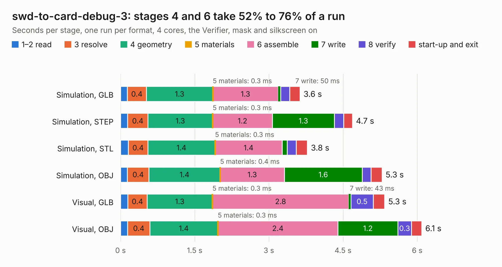

| Mode and format | 1–2 read | 3 resolve | 4 geometry | 5 materials | 6 assemble | 7 write | 8 verify | start-up and exit | Total |
|---|---:|---:|---:|---:|---:|---:|---:|---:|---:|
| Simulation, GLB | 0.1 | 0.4 | 1.3 | 0.3&nbsp;ms | 1.3 | 50&nbsp;ms | 0.2 | 0.2 | 3.6 |
| Simulation, STEP | 0.1 | 0.4 | 1.3 | 0.3&nbsp;ms | 1.2 | 1.3 | 0.2 | 0.2 | 4.7 |
| Simulation, STL | 0.2 | 0.4 | 1.4 | 0.3&nbsp;ms | 1.4 | 0.1 | 0.2 | 0.2 | 3.8 |
| Simulation, OBJ | 0.1 | 0.4 | 1.4 | 0.4&nbsp;ms | 1.3 | 1.6 | 0.2 | 0.2 | 5.3 |
| Visual, GLB | 0.1 | 0.4 | 1.3 | 0.3&nbsp;ms | 2.8 | 43&nbsp;ms | 0.5 | 0.2 | 5.3 |
| Visual, OBJ | 0.1 | 0.4 | 1.4 | 0.3&nbsp;ms | 2.4 | 1.2 | 0.3 | 0.2 | 6.1 |

<table align="center"><tr><td valign="top">

| Board | Repo: [oresat/oresat-flatsat](https://github.com/oresat/oresat-flatsat) Board: `swd-to-card-debug-3.kicad_pcb` |
|---|---|
| Folder | swd-to-card-debug-3 |
| Complexity | 263&nbsp;/&nbsp;1000 (size&nbsp;148, features&nbsp;115) |
| KESE&nbsp;features | through vias, slotted holes, rounded, trapezoid or chamfered pads, filled zones, curved board outline, stack-up, dielectric εr and tanδ, copper finish, mask and silkscreen colours |
| Tested | 9th November 2026 |
| Copper&nbsp;layers | 2 |
| File&nbsp;format | KiCad 9 (20241229) |
| Parts,&nbsp;tracks,&nbsp;vias | 14, 184, 103 |
| Triangles,&nbsp;simulation | 405,560 in 39 parts |
| Verifier | PASS in all six runs |

</td><td valign="top">

<table>
<tr><th>File type</th><th>File size</th><th>Peak memory used</th></tr>
<tr><th colspan="3" align="left">Simulation</th></tr>
<tr><td>GLB</td><td align="right">14&nbsp;MB</td><td align="right">272&nbsp;MB</td></tr>
<tr><td>STEP</td><td align="right">57&nbsp;MB</td><td align="right">321&nbsp;MB</td></tr>
<tr><td>STL</td><td align="right">20&nbsp;MB</td><td align="right">272&nbsp;MB</td></tr>
<tr><td>OBJ</td><td align="right">41&nbsp;MB</td><td align="right">331&nbsp;MB</td></tr>
<tr><th colspan="3" align="left">Visual</th></tr>
<tr><td>GLB</td><td align="right">11&nbsp;MB</td><td align="right">314&nbsp;MB</td></tr>
<tr><td>OBJ</td><td align="right">32&nbsp;MB</td><td align="right">314&nbsp;MB</td></tr>
</table>

</td></tr></table>

## 2163. usb_gps

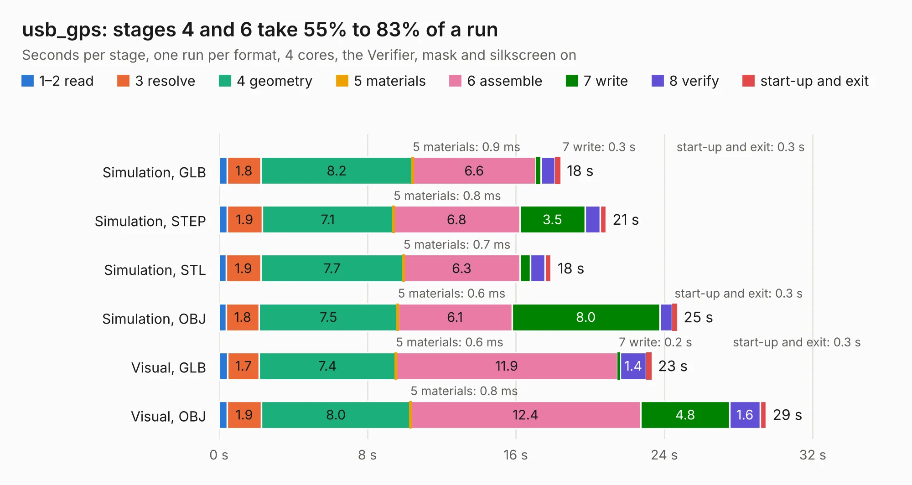

| Mode and format | 1–2 read | 3 resolve | 4 geometry | 5 materials | 6 assemble | 7 write | 8 verify | start-up and exit | Total |
|---|---:|---:|---:|---:|---:|---:|---:|---:|---:|
| Simulation, GLB | 0.4 | 1.8 | 8.2 | 0.9&nbsp;ms | 6.6 | 0.3 | 0.8 | 0.3 | 18.4 |
| Simulation, STEP | 0.4 | 1.9 | 7.1 | 0.8&nbsp;ms | 6.8 | 3.5 | 0.8 | 0.3 | 20.9 |
| Simulation, STL | 0.4 | 1.9 | 7.7 | 0.7&nbsp;ms | 6.3 | 0.6 | 0.8 | 0.3 | 17.9 |
| Simulation, OBJ | 0.4 | 1.8 | 7.5 | 0.6&nbsp;ms | 6.1 | 8.0 | 0.7 | 0.3 | 24.7 |
| Visual, GLB | 0.5 | 1.7 | 7.4 | 0.6&nbsp;ms | 11.9 | 0.2 | 1.4 | 0.3 | 23.3 |
| Visual, OBJ | 0.4 | 1.9 | 8.0 | 0.8&nbsp;ms | 12.4 | 4.8 | 1.6 | 0.3 | 29.5 |

<table align="center"><tr><td valign="top">

| Board | Repo: [oresat/oresat-gps-hardware](https://github.com/oresat/oresat-gps-hardware) Board: `usb_gps.kicad_pcb` |
|---|---|
| Folder | GPS-USB_Front_End_Board / kicad_board_design |
| Complexity | 284&nbsp;/&nbsp;1000 (size&nbsp;239, features&nbsp;45) |
| KESE&nbsp;features | through vias, slotted holes, filled zones |
| Tested | 9th November 2026 |
| Copper&nbsp;layers | 4 |
| File&nbsp;format | KiCad 4 (4) |
| Parts,&nbsp;tracks,&nbsp;vias | 91, 888, 119 |
| Triangles,&nbsp;simulation | 1,683,098 in 118 parts |
| Verifier | PASS in all six runs |

</td><td valign="top">

<table>
<tr><th>File type</th><th>File size</th><th>Peak memory used</th></tr>
<tr><th colspan="3" align="left">Simulation</th></tr>
<tr><td>GLB</td><td align="right">58&nbsp;MB</td><td align="right">742&nbsp;MB</td></tr>
<tr><td>STEP</td><td align="right">200&nbsp;MB</td><td align="right">777&nbsp;MB</td></tr>
<tr><td>STL</td><td align="right">84&nbsp;MB</td><td align="right">714&nbsp;MB</td></tr>
<tr><td>OBJ</td><td align="right">176&nbsp;MB</td><td align="right">1.1&nbsp;GB</td></tr>
<tr><th colspan="3" align="left">Visual</th></tr>
<tr><td>GLB</td><td align="right">34&nbsp;MB</td><td align="right">721&nbsp;MB</td></tr>
<tr><td>OBJ</td><td align="right">101&nbsp;MB</td><td align="right">788&nbsp;MB</td></tr>
</table>

</td></tr></table>

## 2164. BaseBoard

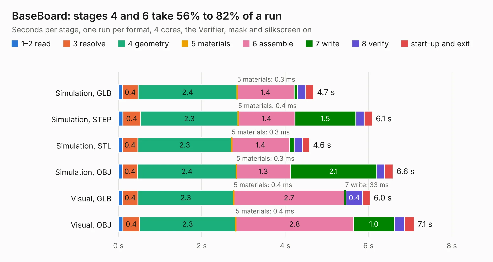

| Mode and format | 1–2 read | 3 resolve | 4 geometry | 5 materials | 6 assemble | 7 write | 8 verify | start-up and exit | Total |
|---|---:|---:|---:|---:|---:|---:|---:|---:|---:|
| Simulation, GLB | 95&nbsp;ms | 0.4 | 2.4 | 0.3&nbsp;ms | 1.4 | 81&nbsp;ms | 0.2 | 0.2 | 4.7 |
| Simulation, STEP | 0.1 | 0.4 | 2.3 | 0.4&nbsp;ms | 1.4 | 1.5 | 0.2 | 0.2 | 6.1 |
| Simulation, STL | 94&nbsp;ms | 0.4 | 2.3 | 0.3&nbsp;ms | 1.4 | 0.1 | 0.2 | 0.2 | 4.6 |
| Simulation, OBJ | 94&nbsp;ms | 0.4 | 2.4 | 0.3&nbsp;ms | 1.3 | 2.1 | 0.2 | 0.2 | 6.6 |
| Visual, GLB | 99&nbsp;ms | 0.4 | 2.3 | 0.4&nbsp;ms | 2.7 | 33&nbsp;ms | 0.4 | 0.2 | 6.0 |
| Visual, OBJ | 0.1 | 0.4 | 2.3 | 0.4&nbsp;ms | 2.8 | 1.0 | 0.2 | 0.2 | 7.1 |

<table align="center"><tr><td valign="top">

| Board | Repo: [oresat/oresat-gps-hardware](https://github.com/oresat/oresat-gps-hardware) Board: `BaseBoard.kicad_pcb` |
|---|---|
| Folder | MicroSemi_FPGA_Dev_Board / kicad_base_board_design / BaseBoard |
| Complexity | 136&nbsp;/&nbsp;1000 (size&nbsp;126, features&nbsp;10) |
| KESE&nbsp;features | rounded, trapezoid or chamfered pads |
| Tested | 9th November 2026 |
| Copper&nbsp;layers | 2 |
| File&nbsp;format | KiCad 5 (20171130) |
| Parts,&nbsp;tracks,&nbsp;vias | 8, 189, 0 |
| Triangles,&nbsp;simulation | 486,040 in 102 parts |
| Verifier | PASS in all six runs |

</td><td valign="top">

<table>
<tr><th>File type</th><th>File size</th><th>Peak memory used</th></tr>
<tr><th colspan="3" align="left">Simulation</th></tr>
<tr><td>GLB</td><td align="right">17&nbsp;MB</td><td align="right">314&nbsp;MB</td></tr>
<tr><td>STEP</td><td align="right">85&nbsp;MB</td><td align="right">337&nbsp;MB</td></tr>
<tr><td>STL</td><td align="right">24&nbsp;MB</td><td align="right">304&nbsp;MB</td></tr>
<tr><td>OBJ</td><td align="right">49&nbsp;MB</td><td align="right">376&nbsp;MB</td></tr>
<tr><th colspan="3" align="left">Visual</th></tr>
<tr><td>GLB</td><td align="right">8.1&nbsp;MB</td><td align="right">316&nbsp;MB</td></tr>
<tr><td>OBJ</td><td align="right">24&nbsp;MB</td><td align="right">312&nbsp;MB</td></tr>
</table>

</td></tr></table>

## 2165. 1.5V_switcher_test

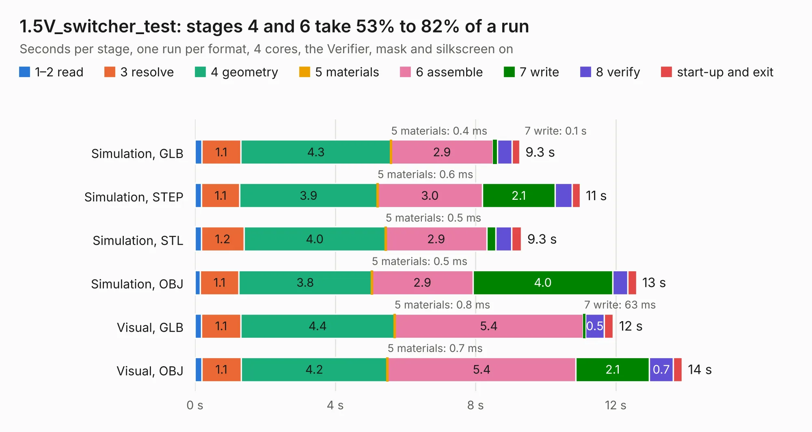

| Mode and format | 1–2 read | 3 resolve | 4 geometry | 5 materials | 6 assemble | 7 write | 8 verify | start-up and exit | Total |
|---|---:|---:|---:|---:|---:|---:|---:|---:|---:|
| Simulation, GLB | 0.2 | 1.1 | 4.3 | 0.4&nbsp;ms | 2.9 | 0.1 | 0.4 | 0.2 | 9.3 |
| Simulation, STEP | 0.2 | 1.1 | 3.9 | 0.6&nbsp;ms | 3.0 | 2.1 | 0.5 | 0.2 | 11.0 |
| Simulation, STL | 0.2 | 1.2 | 4.0 | 0.5&nbsp;ms | 2.9 | 0.3 | 0.5 | 0.3 | 9.3 |
| Simulation, OBJ | 0.2 | 1.1 | 3.8 | 0.5&nbsp;ms | 2.9 | 4.0 | 0.4 | 0.2 | 12.6 |
| Visual, GLB | 0.2 | 1.1 | 4.4 | 0.8&nbsp;ms | 5.4 | 63&nbsp;ms | 0.5 | 0.3 | 11.9 |
| Visual, OBJ | 0.2 | 1.1 | 4.2 | 0.7&nbsp;ms | 5.4 | 2.1 | 0.7 | 0.3 | 13.9 |

<table align="center"><tr><td valign="top">

| Board | Repo: [oresat/oresat-gps-hardware](https://github.com/oresat/oresat-gps-hardware) Board: `1.5V_switcher_test.kicad_pcb` |
|---|---|
| Folder | MicroSemi_FPGA_Dev_Board / kicad_board_design / A3P250_Dev_Board |
| Complexity | 257&nbsp;/&nbsp;1000 (size&nbsp;212, features&nbsp;45) |
| KESE&nbsp;features | through vias, rounded, trapezoid or chamfered pads, filled zones |
| Tested | 9th November 2026 |
| Copper&nbsp;layers | 4 |
| File&nbsp;format | KiCad 5 (20171130) |
| Parts,&nbsp;tracks,&nbsp;vias | 39, 266, 50 |
| Triangles,&nbsp;simulation | 851,012 in 105 parts |
| Verifier | PASS in all six runs |

</td><td valign="top">

<table>
<tr><th>File type</th><th>File size</th><th>Peak memory used</th></tr>
<tr><th colspan="3" align="left">Simulation</th></tr>
<tr><td>GLB</td><td align="right">28&nbsp;MB</td><td align="right">366&nbsp;MB</td></tr>
<tr><td>STEP</td><td align="right">115&nbsp;MB</td><td align="right">435&nbsp;MB</td></tr>
<tr><td>STL</td><td align="right">43&nbsp;MB</td><td align="right">345&nbsp;MB</td></tr>
<tr><td>OBJ</td><td align="right">87&nbsp;MB</td><td align="right">594&nbsp;MB</td></tr>
<tr><th colspan="3" align="left">Visual</th></tr>
<tr><td>GLB</td><td align="right">14&nbsp;MB</td><td align="right">403&nbsp;MB</td></tr>
<tr><td>OBJ</td><td align="right">42&nbsp;MB</td><td align="right">396&nbsp;MB</td></tr>
</table>

</td></tr></table>

## 2166. A3P250_Dev_Board

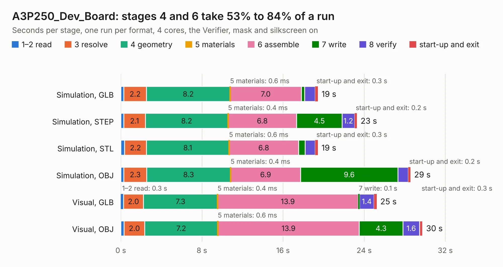

| Mode and format | 1–2 read | 3 resolve | 4 geometry | 5 materials | 6 assemble | 7 write | 8 verify | start-up and exit | Total |
|---|---:|---:|---:|---:|---:|---:|---:|---:|---:|
| Simulation, GLB | 0.3 | 2.2 | 8.2 | 0.6&nbsp;ms | 7.0 | 0.3 | 1.0 | 0.3 | 19.4 |
| Simulation, STEP | 0.3 | 2.1 | 8.2 | 0.4&nbsp;ms | 6.8 | 4.5 | 1.2 | 0.2 | 23.3 |
| Simulation, STL | 0.4 | 2.2 | 8.1 | 0.6&nbsp;ms | 6.8 | 0.7 | 1.0 | 0.3 | 19.4 |
| Simulation, OBJ | 0.3 | 2.3 | 8.3 | 0.4&nbsp;ms | 6.9 | 9.6 | 1.0 | 0.2 | 28.6 |
| Visual, GLB | 0.3 | 2.0 | 7.3 | 0.4&nbsp;ms | 13.9 | 0.1 | 1.4 | 0.3 | 25.2 |
| Visual, OBJ | 0.3 | 2.0 | 7.2 | 0.6&nbsp;ms | 13.9 | 4.3 | 1.6 | 0.3 | 29.8 |

<table align="center"><tr><td valign="top">

| Board | Repo: [oresat/oresat-gps-hardware](https://github.com/oresat/oresat-gps-hardware) Board: `A3P250_Dev_Board.kicad_pcb` |
|---|---|
| Folder | MicroSemi_FPGA_Dev_Board / kicad_board_design / A3P250_Dev_Board |
| Complexity | 282&nbsp;/&nbsp;1000 (size&nbsp;237, features&nbsp;45) |
| KESE&nbsp;features | through vias, rounded, trapezoid or chamfered pads, filled zones |
| Tested | 9th November 2026 to 10th November 2026 |
| Copper&nbsp;layers | 4 |
| File&nbsp;format | KiCad 5 (20171130) |
| Parts,&nbsp;tracks,&nbsp;vias | 53, 1,191, 123 |
| Triangles,&nbsp;simulation | 1,856,362 in 107 parts |
| Verifier | PASS in all six runs |
| Run&nbsp;again | Simulation, GLB; Simulation, STEP; Simulation, STL; Simulation, OBJ: failed in the corpus run, run again with fixes to KESE made after the corpus run, and passed |

</td><td valign="top">

<table>
<tr><th>File type</th><th>File size</th><th>Peak memory used</th></tr>
<tr><th colspan="3" align="left">Simulation</th></tr>
<tr><td>GLB</td><td align="right">65&nbsp;MB</td><td align="right">577&nbsp;MB</td></tr>
<tr><td>STEP</td><td align="right">301&nbsp;MB</td><td align="right">698&nbsp;MB</td></tr>
<tr><td>STL</td><td align="right">93&nbsp;MB</td><td align="right">602&nbsp;MB</td></tr>
<tr><td>OBJ</td><td align="right">197&nbsp;MB</td><td align="right">1.3&nbsp;GB</td></tr>
<tr><th colspan="3" align="left">Visual</th></tr>
<tr><td>GLB</td><td align="right">34&nbsp;MB</td><td align="right">685&nbsp;MB</td></tr>
<tr><td>OBJ</td><td align="right">103&nbsp;MB</td><td align="right">758&nbsp;MB</td></tr>
</table>

</td></tr></table>

## 2167. switcher

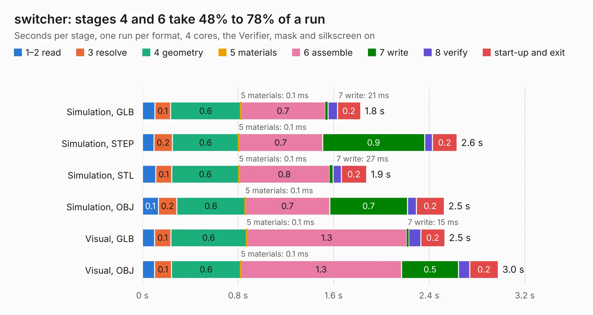

| Mode and format | 1–2 read | 3 resolve | 4 geometry | 5 materials | 6 assemble | 7 write | 8 verify | start-up and exit | Total |
|---|---:|---:|---:|---:|---:|---:|---:|---:|---:|
| Simulation, GLB | 0.1 | 0.1 | 0.6 | 0.1&nbsp;ms | 0.7 | 21&nbsp;ms | 79&nbsp;ms | 0.2 | 1.8 |
| Simulation, STEP | 97&nbsp;ms | 0.2 | 0.6 | 0.1&nbsp;ms | 0.7 | 0.9 | 66&nbsp;ms | 0.2 | 2.6 |
| Simulation, STL | 0.1 | 0.1 | 0.6 | 0.1&nbsp;ms | 0.8 | 27&nbsp;ms | 69&nbsp;ms | 0.2 | 1.9 |
| Simulation, OBJ | 0.1 | 0.2 | 0.6 | 0.1&nbsp;ms | 0.7 | 0.7 | 72&nbsp;ms | 0.2 | 2.5 |
| Visual, GLB | 0.1 | 0.1 | 0.6 | 0.1&nbsp;ms | 1.3 | 15&nbsp;ms | 0.1 | 0.2 | 2.5 |
| Visual, OBJ | 0.1 | 0.1 | 0.6 | 0.1&nbsp;ms | 1.3 | 0.5 | 95&nbsp;ms | 0.2 | 3.0 |

<table align="center"><tr><td valign="top">

| Board | Repo: [oresat/oresat-gps-hardware](https://github.com/oresat/oresat-gps-hardware) Board: `switcher.kicad_pcb` |
|---|---|
| Folder | MicroSemi_FPGA_Dev_Board / kicad_switcher_board / switcher |
| Complexity | 187&nbsp;/&nbsp;1000 (size&nbsp;142, features&nbsp;45) |
| KESE&nbsp;features | through vias, rounded, trapezoid or chamfered pads, filled zones |
| Tested | 9th November 2026 |
| Copper&nbsp;layers | 4 |
| File&nbsp;format | KiCad 5 (20171130) |
| Parts,&nbsp;tracks,&nbsp;vias | 12, 133, 2 |
| Triangles,&nbsp;simulation | 112,630 in 21 parts |
| Verifier | PASS in all six runs |

</td><td valign="top">

<table>
<tr><th>File type</th><th>File size</th><th>Peak memory used</th></tr>
<tr><th colspan="3" align="left">Simulation</th></tr>
<tr><td>GLB</td><td align="right">4.0&nbsp;MB</td><td align="right">182&nbsp;MB</td></tr>
<tr><td>STEP</td><td align="right">22&nbsp;MB</td><td align="right">197&nbsp;MB</td></tr>
<tr><td>STL</td><td align="right">5.6&nbsp;MB</td><td align="right">186&nbsp;MB</td></tr>
<tr><td>OBJ</td><td align="right">11&nbsp;MB</td><td align="right">185&nbsp;MB</td></tr>
<tr><th colspan="3" align="left">Visual</th></tr>
<tr><td>GLB</td><td align="right">2.6&nbsp;MB</td><td align="right">156&nbsp;MB</td></tr>
<tr><td>OBJ</td><td align="right">7.2&nbsp;MB</td><td align="right">157&nbsp;MB</td></tr>
</table>

</td></tr></table>

## 2168. switcher_close

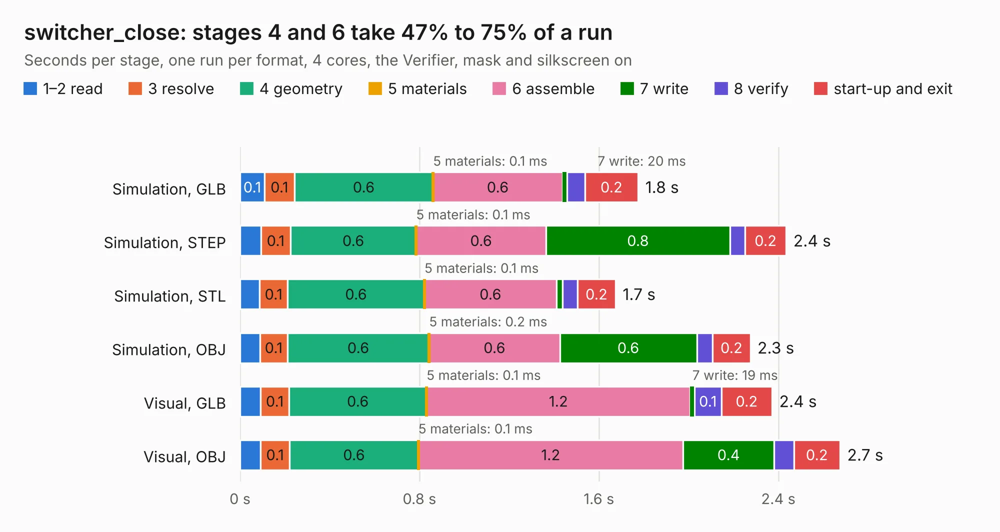

| Mode and format | 1–2 read | 3 resolve | 4 geometry | 5 materials | 6 assemble | 7 write | 8 verify | start-up and exit | Total |
|---|---:|---:|---:|---:|---:|---:|---:|---:|---:|
| Simulation, GLB | 0.1 | 0.1 | 0.6 | 0.1&nbsp;ms | 0.6 | 20&nbsp;ms | 80&nbsp;ms | 0.2 | 1.8 |
| Simulation, STEP | 93&nbsp;ms | 0.1 | 0.6 | 0.1&nbsp;ms | 0.6 | 0.8 | 67&nbsp;ms | 0.2 | 2.4 |
| Simulation, STL | 87&nbsp;ms | 0.1 | 0.6 | 0.1&nbsp;ms | 0.6 | 28&nbsp;ms | 66&nbsp;ms | 0.2 | 1.7 |
| Simulation, OBJ | 89&nbsp;ms | 0.1 | 0.6 | 0.2&nbsp;ms | 0.6 | 0.6 | 71&nbsp;ms | 0.2 | 2.3 |
| Visual, GLB | 91&nbsp;ms | 0.1 | 0.6 | 0.1&nbsp;ms | 1.2 | 19&nbsp;ms | 0.1 | 0.2 | 2.4 |
| Visual, OBJ | 91&nbsp;ms | 0.1 | 0.6 | 0.1&nbsp;ms | 1.2 | 0.4 | 87&nbsp;ms | 0.2 | 2.7 |

<table align="center"><tr><td valign="top">

| Board | Repo: [oresat/oresat-gps-hardware](https://github.com/oresat/oresat-gps-hardware) Board: `switcher_close.kicad_pcb` |
|---|---|
| Folder | MicroSemi_FPGA_Dev_Board / kicad_switcher_board / switcher |
| Complexity | 185&nbsp;/&nbsp;1000 (size&nbsp;140, features&nbsp;45) |
| KESE&nbsp;features | through vias, rounded, trapezoid or chamfered pads, filled zones |
| Tested | 9th November 2026 |
| Copper&nbsp;layers | 4 |
| File&nbsp;format | KiCad 5 (20171130) |
| Parts,&nbsp;tracks,&nbsp;vias | 12, 114, 2 |
| Triangles,&nbsp;simulation | 116,008 in 21 parts |
| Verifier | PASS in all six runs |

</td><td valign="top">

<table>
<tr><th>File type</th><th>File size</th><th>Peak memory used</th></tr>
<tr><th colspan="3" align="left">Simulation</th></tr>
<tr><td>GLB</td><td align="right">4.1&nbsp;MB</td><td align="right">190&nbsp;MB</td></tr>
<tr><td>STEP</td><td align="right">22&nbsp;MB</td><td align="right">202&nbsp;MB</td></tr>
<tr><td>STL</td><td align="right">5.8&nbsp;MB</td><td align="right">186&nbsp;MB</td></tr>
<tr><td>OBJ</td><td align="right">11&nbsp;MB</td><td align="right">186&nbsp;MB</td></tr>
<tr><th colspan="3" align="left">Visual</th></tr>
<tr><td>GLB</td><td align="right">2.7&nbsp;MB</td><td align="right">157&nbsp;MB</td></tr>
<tr><td>OBJ</td><td align="right">7.4&nbsp;MB</td><td align="right">158&nbsp;MB</td></tr>
</table>

</td></tr></table>

## 2169. oresat-gps-card

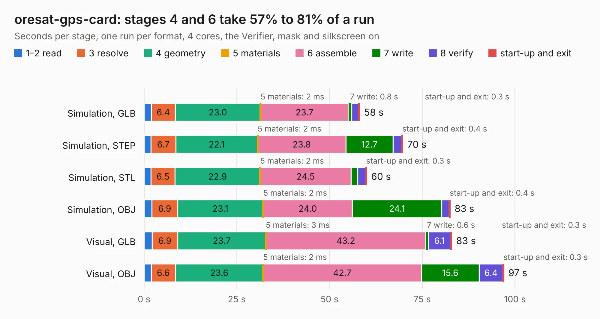

| Mode and format | 1–2 read | 3 resolve | 4 geometry | 5 materials | 6 assemble | 7 write | 8 verify | start-up and exit | Total |
|---|---:|---:|---:|---:|---:|---:|---:|---:|---:|
| Simulation, GLB | 2.0 | 6.4 | 23.0 | 2&nbsp;ms | 23.7 | 0.8 | 1.9 | 0.3 | 58.2 |
| Simulation, STEP | 1.9 | 6.7 | 22.1 | 2&nbsp;ms | 23.8 | 12.7 | 2.3 | 0.4 | 69.8 |
| Simulation, STL | 1.9 | 6.5 | 22.9 | 2&nbsp;ms | 24.5 | 1.8 | 2.1 | 0.3 | 60.1 |
| Simulation, OBJ | 2.1 | 6.9 | 23.1 | 2&nbsp;ms | 24.0 | 24.1 | 2.0 | 0.4 | 82.6 |
| Visual, GLB | 2.2 | 6.9 | 23.7 | 3&nbsp;ms | 43.2 | 0.6 | 6.1 | 0.3 | 83.0 |
| Visual, OBJ | 1.9 | 6.6 | 23.6 | 2&nbsp;ms | 42.7 | 15.6 | 6.4 | 0.3 | 97.1 |

<table align="center"><tr><td valign="top">

| Board | Repo: [oresat/oresat-gps-hardware](https://github.com/oresat/oresat-gps-hardware) Board: `oresat-gps-card.kicad_pcb` |
|---|---|
| Folder | oresat-gps-card |
| Complexity | 438&nbsp;/&nbsp;1000 (size&nbsp;293, features&nbsp;145) |
| KESE&nbsp;features | through vias, custom pads, rounded, trapezoid or chamfered pads, drill offsets, arc tracks, filled zones, copper drawings, tracks bare of mask, stack-up, dielectric εr and tanδ, mask and silkscreen colours |
| Tested | 9th November 2026 |
| Copper&nbsp;layers | 4 |
| File&nbsp;format | KiCad 10 (20260206) |
| Parts,&nbsp;tracks,&nbsp;vias | 215, 3,296, 767 |
| Triangles,&nbsp;simulation | 4,929,222 in 472 parts |
| Verifier | PASS in all six runs |

</td><td valign="top">

<table>
<tr><th>File type</th><th>File size</th><th>Peak memory used</th></tr>
<tr><th colspan="3" align="left">Simulation</th></tr>
<tr><td>GLB</td><td align="right">170&nbsp;MB</td><td align="right">1.5&nbsp;GB</td></tr>
<tr><td>STEP</td><td align="right">723&nbsp;MB</td><td align="right">2.0&nbsp;GB</td></tr>
<tr><td>STL</td><td align="right">247&nbsp;MB</td><td align="right">1.5&nbsp;GB</td></tr>
<tr><td>OBJ</td><td align="right">535&nbsp;MB</td><td align="right">3.2&nbsp;GB</td></tr>
<tr><th colspan="3" align="left">Visual</th></tr>
<tr><td>GLB</td><td align="right">112&nbsp;MB</td><td align="right">1.8&nbsp;GB</td></tr>
<tr><td>OBJ</td><td align="right">357&nbsp;MB</td><td align="right">2.3&nbsp;GB</td></tr>
</table>

</td></tr></table>

## 2170. helmholtz-controller-v2

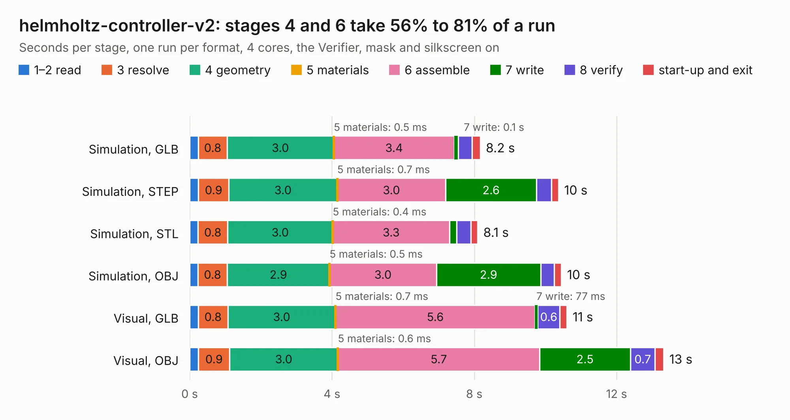

| Mode and format | 1–2 read | 3 resolve | 4 geometry | 5 materials | 6 assemble | 7 write | 8 verify | start-up and exit | Total |
|---|---:|---:|---:|---:|---:|---:|---:|---:|---:|
| Simulation, GLB | 0.2 | 0.8 | 3.0 | 0.5&nbsp;ms | 3.4 | 0.1 | 0.4 | 0.2 | 8.2 |
| Simulation, STEP | 0.2 | 0.9 | 3.0 | 0.7&nbsp;ms | 3.0 | 2.6 | 0.4 | 0.2 | 10.4 |
| Simulation, STL | 0.2 | 0.8 | 3.0 | 0.4&nbsp;ms | 3.3 | 0.2 | 0.4 | 0.2 | 8.1 |
| Simulation, OBJ | 0.2 | 0.8 | 2.9 | 0.5&nbsp;ms | 3.0 | 2.9 | 0.4 | 0.2 | 10.4 |
| Visual, GLB | 0.2 | 0.8 | 3.0 | 0.7&nbsp;ms | 5.6 | 77&nbsp;ms | 0.6 | 0.2 | 10.6 |
| Visual, OBJ | 0.2 | 0.9 | 3.0 | 0.6&nbsp;ms | 5.7 | 2.5 | 0.7 | 0.2 | 13.3 |

<table align="center"><tr><td valign="top">

| Board | Repo: [oresat/oresat-helmholtz](https://github.com/oresat/oresat-helmholtz) Board: `helmholtz-controller-v2.kicad_pcb` |
|---|---|
| Folder | controller-v2 |
| Complexity | 277&nbsp;/&nbsp;1000 (size&nbsp;172, features&nbsp;105) |
| KESE&nbsp;features | through vias, rounded, trapezoid or chamfered pads, filled zones, curved board outline, stack-up, dielectric εr and tanδ, copper finish, mask and silkscreen colours |
| Tested | 9th November 2026 |
| Copper&nbsp;layers | 2 |
| File&nbsp;format | KiCad 9 (20241229) |
| Parts,&nbsp;tracks,&nbsp;vias | 46, 416, 200 |
| Triangles,&nbsp;simulation | 776,982 in 109 parts |
| Verifier | PASS in all six runs |

</td><td valign="top">

<table>
<tr><th>File type</th><th>File size</th><th>Peak memory used</th></tr>
<tr><th colspan="3" align="left">Simulation</th></tr>
<tr><td>GLB</td><td align="right">26&nbsp;MB</td><td align="right">433&nbsp;MB</td></tr>
<tr><td>STEP</td><td align="right">123&nbsp;MB</td><td align="right">514&nbsp;MB</td></tr>
<tr><td>STL</td><td align="right">39&nbsp;MB</td><td align="right">445&nbsp;MB</td></tr>
<tr><td>OBJ</td><td align="right">79&nbsp;MB</td><td align="right">565&nbsp;MB</td></tr>
<tr><th colspan="3" align="left">Visual</th></tr>
<tr><td>GLB</td><td align="right">21&nbsp;MB</td><td align="right">594&nbsp;MB</td></tr>
<tr><td>OBJ</td><td align="right">64&nbsp;MB</td><td align="right">569&nbsp;MB</td></tr>
</table>

</td></tr></table>

## 2171. helmholtz-controller

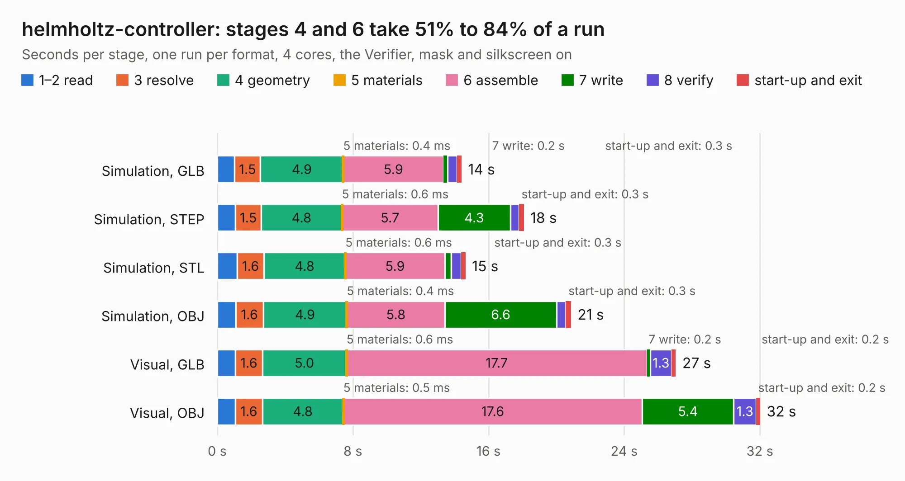

| Mode and format | 1–2 read | 3 resolve | 4 geometry | 5 materials | 6 assemble | 7 write | 8 verify | start-up and exit | Total |
|---|---:|---:|---:|---:|---:|---:|---:|---:|---:|
| Simulation, GLB | 1.0 | 1.5 | 4.9 | 0.4&nbsp;ms | 5.9 | 0.2 | 0.6 | 0.3 | 14.4 |
| Simulation, STEP | 1.1 | 1.5 | 4.8 | 0.6&nbsp;ms | 5.7 | 4.3 | 0.5 | 0.3 | 18.1 |
| Simulation, STL | 1.2 | 1.6 | 4.8 | 0.6&nbsp;ms | 5.9 | 0.4 | 0.6 | 0.3 | 14.6 |
| Simulation, OBJ | 1.1 | 1.6 | 4.9 | 0.4&nbsp;ms | 5.8 | 6.6 | 0.6 | 0.3 | 20.9 |
| Visual, GLB | 1.1 | 1.6 | 5.0 | 0.6&nbsp;ms | 17.7 | 0.2 | 1.3 | 0.2 | 27.0 |
| Visual, OBJ | 1.1 | 1.6 | 4.8 | 0.5&nbsp;ms | 17.6 | 5.4 | 1.3 | 0.2 | 32.0 |

<table align="center"><tr><td valign="top">

| Board | Repo: [oresat/oresat-helmholtz](https://github.com/oresat/oresat-helmholtz) Board: `helmholtz-controller.kicad_pcb` |
|---|---|
| Folder | controller-v3 |
| Complexity | 273&nbsp;/&nbsp;1000 (size&nbsp;168, features&nbsp;105) |
| KESE&nbsp;features | through vias, rounded, trapezoid or chamfered pads, filled zones, curved board outline, stack-up, dielectric εr and tanδ, copper finish, mask and silkscreen colours |
| Tested | 9th November 2026 |
| Copper&nbsp;layers | 2 |
| File&nbsp;format | KiCad 10 (20260206) |
| Parts,&nbsp;tracks,&nbsp;vias | 43, 272, 186 |
| Triangles,&nbsp;simulation | 1,060,614 in 66 parts |
| Verifier | PASS in all six runs |

</td><td valign="top">

<table>
<tr><th>File type</th><th>File size</th><th>Peak memory used</th></tr>
<tr><th colspan="3" align="left">Simulation</th></tr>
<tr><td>GLB</td><td align="right">39&nbsp;MB</td><td align="right">569&nbsp;MB</td></tr>
<tr><td>STEP</td><td align="right">176&nbsp;MB</td><td align="right">658&nbsp;MB</td></tr>
<tr><td>STL</td><td align="right">53&nbsp;MB</td><td align="right">560&nbsp;MB</td></tr>
<tr><td>OBJ</td><td align="right">114&nbsp;MB</td><td align="right">807&nbsp;MB</td></tr>
<tr><th colspan="3" align="left">Visual</th></tr>
<tr><td>GLB</td><td align="right">32&nbsp;MB</td><td align="right">689&nbsp;MB</td></tr>
<tr><td>OBJ</td><td align="right">95&nbsp;MB</td><td align="right">762&nbsp;MB</td></tr>
</table>

</td></tr></table>

## 2172. at86rf215-design-block

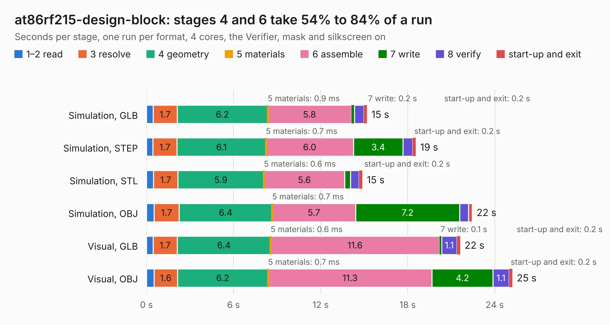

| Mode and format | 1–2 read | 3 resolve | 4 geometry | 5 materials | 6 assemble | 7 write | 8 verify | start-up and exit | Total |
|---|---:|---:|---:|---:|---:|---:|---:|---:|---:|
| Simulation, GLB | 0.5 | 1.7 | 6.2 | 0.9&nbsp;ms | 5.8 | 0.2 | 0.6 | 0.2 | 15.2 |
| Simulation, STEP | 0.4 | 1.7 | 6.1 | 0.7&nbsp;ms | 6.0 | 3.4 | 0.7 | 0.2 | 18.6 |
| Simulation, STL | 0.5 | 1.7 | 5.9 | 0.6&nbsp;ms | 5.6 | 0.4 | 0.6 | 0.2 | 14.9 |
| Simulation, OBJ | 0.5 | 1.7 | 6.4 | 0.7&nbsp;ms | 5.7 | 7.2 | 0.6 | 0.3 | 22.4 |
| Visual, GLB | 0.5 | 1.7 | 6.4 | 0.6&nbsp;ms | 11.6 | 0.1 | 1.1 | 0.2 | 21.6 |
| Visual, OBJ | 0.5 | 1.6 | 6.2 | 0.7&nbsp;ms | 11.3 | 4.2 | 1.1 | 0.2 | 25.2 |

<table align="center"><tr><td valign="top">

| Board | Repo: [oresat/oresat-kicad](https://github.com/oresat/oresat-kicad) Board: `at86rf215-design-block.kicad_pcb` |
|---|---|
| Folder | oresat-design-blocks / at86rf215-design-block |
| Complexity | 368&nbsp;/&nbsp;1000 (size&nbsp;238, features&nbsp;130) |
| KESE&nbsp;features | through vias, slotted holes, rounded, trapezoid or chamfered pads, arc tracks, filled zones, curved board outline, stack-up, dielectric εr and tanδ, copper finish, mask and silkscreen colours |
| Tested | 9th November 2026 |
| Copper&nbsp;layers | 4 |
| File&nbsp;format | KiCad 10 (20260206) |
| Parts,&nbsp;tracks,&nbsp;vias | 65, 419, 345 |
| Triangles,&nbsp;simulation | 1,570,480 in 76 parts |
| Verifier | PASS in all six runs |

</td><td valign="top">

<table>
<tr><th>File type</th><th>File size</th><th>Peak memory used</th></tr>
<tr><th colspan="3" align="left">Simulation</th></tr>
<tr><td>GLB</td><td align="right">54&nbsp;MB</td><td align="right">692&nbsp;MB</td></tr>
<tr><td>STEP</td><td align="right">195&nbsp;MB</td><td align="right">756&nbsp;MB</td></tr>
<tr><td>STL</td><td align="right">79&nbsp;MB</td><td align="right">694&nbsp;MB</td></tr>
<tr><td>OBJ</td><td align="right">165&nbsp;MB</td><td align="right">1.1&nbsp;GB</td></tr>
<tr><th colspan="3" align="left">Visual</th></tr>
<tr><td>GLB</td><td align="right">32&nbsp;MB</td><td align="right">687&nbsp;MB</td></tr>
<tr><td>OBJ</td><td align="right">97&nbsp;MB</td><td align="right">759&nbsp;MB</td></tr>
</table>

</td></tr></table>

## 2173. transceiver-AX5043

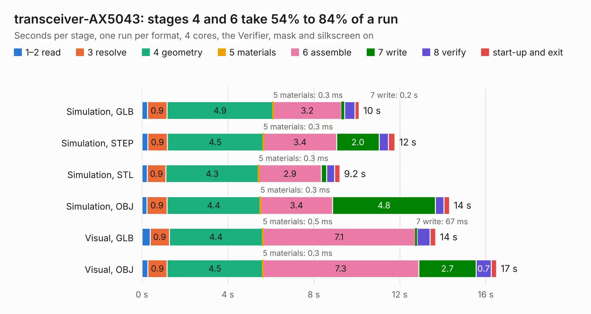

| Mode and format | 1–2 read | 3 resolve | 4 geometry | 5 materials | 6 assemble | 7 write | 8 verify | start-up and exit | Total |
|---|---:|---:|---:|---:|---:|---:|---:|---:|---:|
| Simulation, GLB | 0.3 | 0.9 | 4.9 | 0.3&nbsp;ms | 3.2 | 0.2 | 0.5 | 0.2 | 10.1 |
| Simulation, STEP | 0.3 | 0.9 | 4.5 | 0.3&nbsp;ms | 3.4 | 2.0 | 0.4 | 0.3 | 11.8 |
| Simulation, STL | 0.2 | 0.9 | 4.3 | 0.3&nbsp;ms | 2.9 | 0.3 | 0.4 | 0.2 | 9.2 |
| Simulation, OBJ | 0.2 | 0.9 | 4.4 | 0.3&nbsp;ms | 3.4 | 4.8 | 0.4 | 0.3 | 14.3 |
| Visual, GLB | 0.4 | 0.9 | 4.4 | 0.5&nbsp;ms | 7.1 | 67&nbsp;ms | 0.6 | 0.3 | 13.7 |
| Visual, OBJ | 0.3 | 0.9 | 4.5 | 0.3&nbsp;ms | 7.3 | 2.7 | 0.7 | 0.2 | 16.5 |

<table align="center"><tr><td valign="top">

| Board | Repo: [oresat/oresat-kicad](https://github.com/oresat/oresat-kicad) Board: `transceiver-AX5043.kicad_pcb` |
|---|---|
| Folder | oresat-design-blocks / ax5043-design-block |
| Complexity | 255&nbsp;/&nbsp;1000 (size&nbsp;185, features&nbsp;70) |
| KESE&nbsp;features | through vias, rounded, trapezoid or chamfered pads, arc tracks, filled zones, curved board outline |
| Tested | 9th November 2026 |
| Copper&nbsp;layers | 4 |
| File&nbsp;format | KiCad 9 (20241229) |
| Parts,&nbsp;tracks,&nbsp;vias | 43, 158, 234 |
| Triangles,&nbsp;simulation | 901,424 in 46 parts |
| Verifier | PASS in all six runs |

</td><td valign="top">

<table>
<tr><th>File type</th><th>File size</th><th>Peak memory used</th></tr>
<tr><th colspan="3" align="left">Simulation</th></tr>
<tr><td>GLB</td><td align="right">31&nbsp;MB</td><td align="right">446&nbsp;MB</td></tr>
<tr><td>STEP</td><td align="right">95&nbsp;MB</td><td align="right">483&nbsp;MB</td></tr>
<tr><td>STL</td><td align="right">45&nbsp;MB</td><td align="right">436&nbsp;MB</td></tr>
<tr><td>OBJ</td><td align="right">91&nbsp;MB</td><td align="right">646&nbsp;MB</td></tr>
<tr><th colspan="3" align="left">Visual</th></tr>
<tr><td>GLB</td><td align="right">16&nbsp;MB</td><td align="right">426&nbsp;MB</td></tr>
<tr><td>OBJ</td><td align="right">49&nbsp;MB</td><td align="right">439&nbsp;MB</td></tr>
</table>

</td></tr></table>

## 2174. oresat-5V2A-regulator

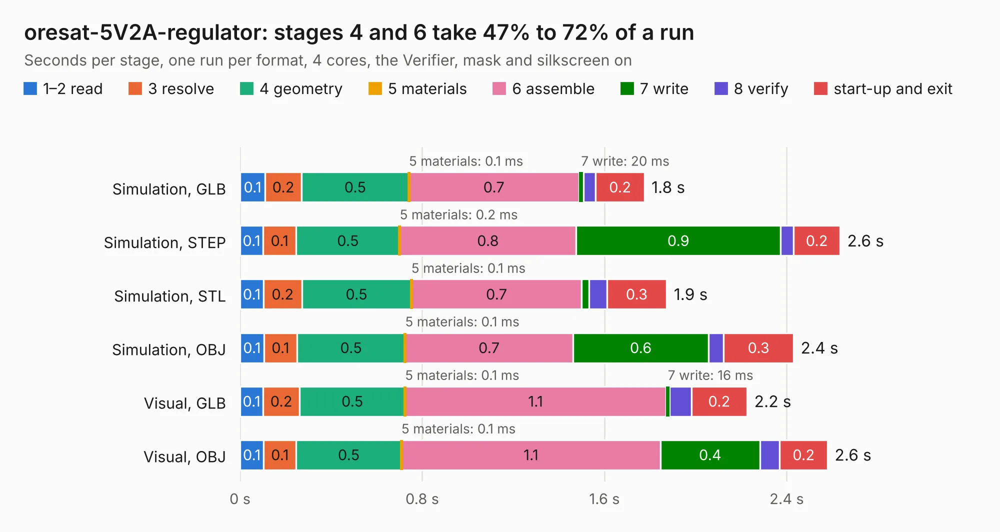

| Mode and format | 1–2 read | 3 resolve | 4 geometry | 5 materials | 6 assemble | 7 write | 8 verify | start-up and exit | Total |
|---|---:|---:|---:|---:|---:|---:|---:|---:|---:|
| Simulation, GLB | 0.1 | 0.2 | 0.5 | 0.1&nbsp;ms | 0.7 | 20&nbsp;ms | 54&nbsp;ms | 0.2 | 1.8 |
| Simulation, STEP | 0.1 | 0.1 | 0.5 | 0.2&nbsp;ms | 0.8 | 0.9 | 57&nbsp;ms | 0.2 | 2.6 |
| Simulation, STL | 0.1 | 0.2 | 0.5 | 0.1&nbsp;ms | 0.7 | 32&nbsp;ms | 78&nbsp;ms | 0.3 | 1.9 |
| Simulation, OBJ | 0.1 | 0.1 | 0.5 | 0.1&nbsp;ms | 0.7 | 0.6 | 66&nbsp;ms | 0.3 | 2.4 |
| Visual, GLB | 0.1 | 0.2 | 0.5 | 0.1&nbsp;ms | 1.1 | 16&nbsp;ms | 95&nbsp;ms | 0.2 | 2.2 |
| Visual, OBJ | 0.1 | 0.1 | 0.5 | 0.1&nbsp;ms | 1.1 | 0.4 | 87&nbsp;ms | 0.2 | 2.6 |

<table align="center"><tr><td valign="top">

| Board | Repo: [oresat/oresat-kicad](https://github.com/oresat/oresat-kicad) Board: `oresat-5V2A-regulator.kicad_pcb` |
|---|---|
| Folder | oresat-design-blocks / oresat-5V2A-regulator |
| Complexity | 198&nbsp;/&nbsp;1000 (size&nbsp;123, features&nbsp;75) |
| KESE&nbsp;features | through vias, rounded, trapezoid or chamfered pads, filled zones, stack-up, dielectric εr and tanδ |
| Tested | 9th November 2026 |
| Copper&nbsp;layers | 2 |
| File&nbsp;format | KiCad 6 (20211014) |
| Parts,&nbsp;tracks,&nbsp;vias | 10, 15, 39 |
| Triangles,&nbsp;simulation | 109,708 in 15 parts |
| Verifier | PASS in all six runs |

</td><td valign="top">

<table>
<tr><th>File type</th><th>File size</th><th>Peak memory used</th></tr>
<tr><th colspan="3" align="left">Simulation</th></tr>
<tr><td>GLB</td><td align="right">3.8&nbsp;MB</td><td align="right">199&nbsp;MB</td></tr>
<tr><td>STEP</td><td align="right">16&nbsp;MB</td><td align="right">201&nbsp;MB</td></tr>
<tr><td>STL</td><td align="right">5.5&nbsp;MB</td><td align="right">189&nbsp;MB</td></tr>
<tr><td>OBJ</td><td align="right">11&nbsp;MB</td><td align="right">194&nbsp;MB</td></tr>
<tr><th colspan="3" align="left">Visual</th></tr>
<tr><td>GLB</td><td align="right">2.9&nbsp;MB</td><td align="right">159&nbsp;MB</td></tr>
<tr><td>OBJ</td><td align="right">8.0&nbsp;MB</td><td align="right">155&nbsp;MB</td></tr>
</table>

</td></tr></table>

## 2175. synthesizer-IF-Si4112

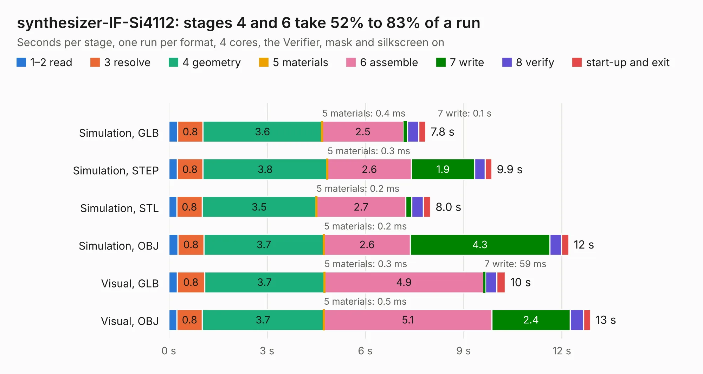

| Mode and format | 1–2 read | 3 resolve | 4 geometry | 5 materials | 6 assemble | 7 write | 8 verify | start-up and exit | Total |
|---|---:|---:|---:|---:|---:|---:|---:|---:|---:|
| Simulation, GLB | 0.3 | 0.8 | 3.6 | 0.4&nbsp;ms | 2.5 | 0.1 | 0.3 | 0.2 | 7.8 |
| Simulation, STEP | 0.3 | 0.8 | 3.8 | 0.3&nbsp;ms | 2.6 | 1.9 | 0.3 | 0.2 | 9.9 |
| Simulation, STL | 0.2 | 0.8 | 3.5 | 0.2&nbsp;ms | 2.7 | 0.2 | 0.4 | 0.2 | 8.0 |
| Simulation, OBJ | 0.3 | 0.8 | 3.7 | 0.2&nbsp;ms | 2.6 | 4.3 | 0.4 | 0.2 | 12.2 |
| Visual, GLB | 0.3 | 0.8 | 3.7 | 0.3&nbsp;ms | 4.9 | 59&nbsp;ms | 0.3 | 0.3 | 10.3 |
| Visual, OBJ | 0.3 | 0.8 | 3.7 | 0.5&nbsp;ms | 5.1 | 2.4 | 0.4 | 0.2 | 12.9 |

<table align="center"><tr><td valign="top">

| Board | Repo: [oresat/oresat-kicad](https://github.com/oresat/oresat-kicad) Board: `synthesizer-IF-Si4112.kicad_pcb` |
|---|---|
| Folder | oresat-design-blocks / si4112-design-block |
| Complexity | 237&nbsp;/&nbsp;1000 (size&nbsp;182, features&nbsp;55) |
| KESE&nbsp;features | through vias, rounded, trapezoid or chamfered pads, filled zones, curved board outline |
| Tested | 9th November 2026 |
| Copper&nbsp;layers | 4 |
| File&nbsp;format | KiCad 9 (20241229) |
| Parts,&nbsp;tracks,&nbsp;vias | 40, 202, 178 |
| Triangles,&nbsp;simulation | 778,938 in 35 parts |
| Verifier | PASS in all six runs |

</td><td valign="top">

<table>
<tr><th>File type</th><th>File size</th><th>Peak memory used</th></tr>
<tr><th colspan="3" align="left">Simulation</th></tr>
<tr><td>GLB</td><td align="right">27&nbsp;MB</td><td align="right">402&nbsp;MB</td></tr>
<tr><td>STEP</td><td align="right">88&nbsp;MB</td><td align="right">454&nbsp;MB</td></tr>
<tr><td>STL</td><td align="right">39&nbsp;MB</td><td align="right">403&nbsp;MB</td></tr>
<tr><td>OBJ</td><td align="right">80&nbsp;MB</td><td align="right">574&nbsp;MB</td></tr>
<tr><th colspan="3" align="left">Visual</th></tr>
<tr><td>GLB</td><td align="right">14&nbsp;MB</td><td align="right">377&nbsp;MB</td></tr>
<tr><td>OBJ</td><td align="right">42&nbsp;MB</td><td align="right">377&nbsp;MB</td></tr>
</table>

</td></tr></table>

## 2176. stm32u595-breakout

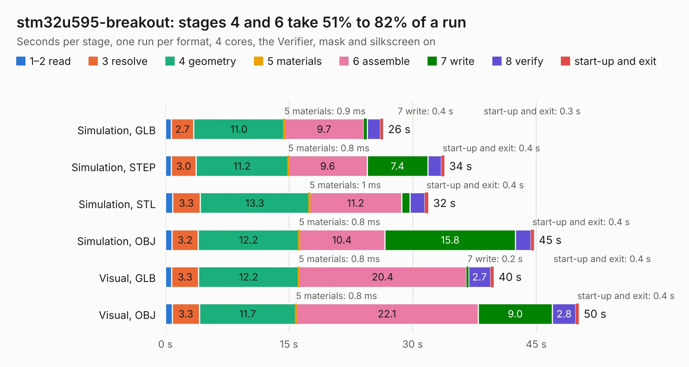

| Mode and format | 1–2 read | 3 resolve | 4 geometry | 5 materials | 6 assemble | 7 write | 8 verify | start-up and exit | Total |
|---|---:|---:|---:|---:|---:|---:|---:|---:|---:|
| Simulation, GLB | 0.7 | 2.7 | 11.0 | 0.9&nbsp;ms | 9.7 | 0.4 | 1.6 | 0.3 | 26.4 |
| Simulation, STEP | 0.7 | 3.0 | 11.2 | 0.8&nbsp;ms | 9.6 | 7.4 | 1.6 | 0.4 | 33.8 |
| Simulation, STL | 0.9 | 3.3 | 13.3 | 1&nbsp;ms | 11.2 | 1.0 | 1.8 | 0.4 | 31.9 |
| Simulation, OBJ | 0.8 | 3.2 | 12.2 | 0.8&nbsp;ms | 10.4 | 15.8 | 1.9 | 0.4 | 44.7 |
| Visual, GLB | 0.8 | 3.3 | 12.2 | 0.8&nbsp;ms | 20.4 | 0.2 | 2.7 | 0.4 | 39.8 |
| Visual, OBJ | 0.8 | 3.3 | 11.7 | 0.8&nbsp;ms | 22.1 | 9.0 | 2.8 | 0.4 | 50.2 |

<table align="center"><tr><td valign="top">

| Board | Repo: [oresat/oresat-kicad](https://github.com/oresat/oresat-kicad) Board: `stm32u595-breakout.kicad_pcb` |
|---|---|
| Folder | oresat-design-blocks / stm32u595-design-block |
| Complexity | 356&nbsp;/&nbsp;1000 (size&nbsp;241, features&nbsp;115) |
| KESE&nbsp;features | through vias, slotted holes, rounded, trapezoid or chamfered pads, filled zones, curved board outline, stack-up, dielectric εr and tanδ, copper finish, mask and silkscreen colours |
| Tested | 9th November 2026 |
| Copper&nbsp;layers | 4 |
| File&nbsp;format | KiCad 9 (20241229) |
| Parts,&nbsp;tracks,&nbsp;vias | 61, 1,060, 268 |
| Triangles,&nbsp;simulation | 2,289,584 in 129 parts |
| Verifier | PASS in all six runs |

</td><td valign="top">

<table>
<tr><th>File type</th><th>File size</th><th>Peak memory used</th></tr>
<tr><th colspan="3" align="left">Simulation</th></tr>
<tr><td>GLB</td><td align="right">79&nbsp;MB</td><td align="right">796&nbsp;MB</td></tr>
<tr><td>STEP</td><td align="right">299&nbsp;MB</td><td align="right">942&nbsp;MB</td></tr>
<tr><td>STL</td><td align="right">114&nbsp;MB</td><td align="right">793&nbsp;MB</td></tr>
<tr><td>OBJ</td><td align="right">244&nbsp;MB</td><td align="right">1.5&nbsp;GB</td></tr>
<tr><th colspan="3" align="left">Visual</th></tr>
<tr><td>GLB</td><td align="right">44&nbsp;MB</td><td align="right">845&nbsp;MB</td></tr>
<tr><td>OBJ</td><td align="right">136&nbsp;MB</td><td align="right">978&nbsp;MB</td></tr>
</table>

</td></tr></table>

## 2177. amp-PA-TQP7M9105-with-detect

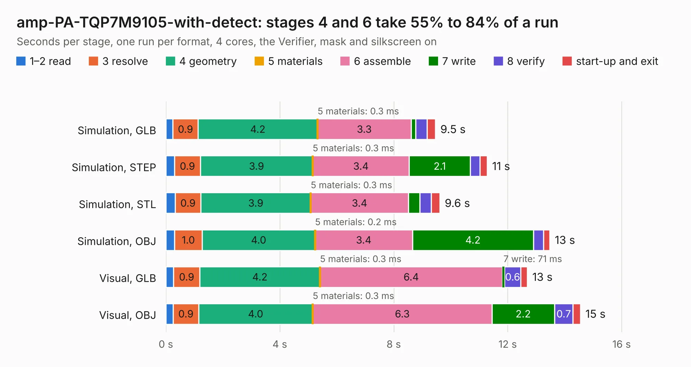

| Mode and format | 1–2 read | 3 resolve | 4 geometry | 5 materials | 6 assemble | 7 write | 8 verify | start-up and exit | Total |
|---|---:|---:|---:|---:|---:|---:|---:|---:|---:|
| Simulation, GLB | 0.2 | 0.9 | 4.2 | 0.3&nbsp;ms | 3.3 | 0.2 | 0.4 | 0.3 | 9.5 |
| Simulation, STEP | 0.3 | 0.9 | 3.9 | 0.3&nbsp;ms | 3.4 | 2.1 | 0.3 | 0.3 | 11.3 |
| Simulation, STL | 0.3 | 0.9 | 3.9 | 0.3&nbsp;ms | 3.4 | 0.4 | 0.4 | 0.3 | 9.6 |
| Simulation, OBJ | 0.3 | 1.0 | 4.0 | 0.2&nbsp;ms | 3.4 | 4.2 | 0.4 | 0.2 | 13.5 |
| Visual, GLB | 0.3 | 0.9 | 4.2 | 0.3&nbsp;ms | 6.4 | 71&nbsp;ms | 0.6 | 0.2 | 12.7 |
| Visual, OBJ | 0.3 | 0.9 | 4.0 | 0.3&nbsp;ms | 6.3 | 2.2 | 0.7 | 0.3 | 14.6 |

<table align="center"><tr><td valign="top">

| Board | Repo: [oresat/oresat-kicad](https://github.com/oresat/oresat-kicad) Board: `amp-PA-TQP7M9105-with-detect.kicad_pcb` |
|---|---|
| Folder | oresat-design-blocks / tqp7m9105-design-block |
| Complexity | 256&nbsp;/&nbsp;1000 (size&nbsp;186, features&nbsp;70) |
| KESE&nbsp;features | through vias, rounded, trapezoid or chamfered pads, arc tracks, filled zones, curved board outline |
| Tested | 9th November 2026 |
| Copper&nbsp;layers | 4 |
| File&nbsp;format | KiCad 9 (20241229) |
| Parts,&nbsp;tracks,&nbsp;vias | 46, 178, 230 |
| Triangles,&nbsp;simulation | 869,786 in 41 parts |
| Verifier | PASS in all six runs |

</td><td valign="top">

<table>
<tr><th>File type</th><th>File size</th><th>Peak memory used</th></tr>
<tr><th colspan="3" align="left">Simulation</th></tr>
<tr><td>GLB</td><td align="right">30&nbsp;MB</td><td align="right">430&nbsp;MB</td></tr>
<tr><td>STEP</td><td align="right">85&nbsp;MB</td><td align="right">514&nbsp;MB</td></tr>
<tr><td>STL</td><td align="right">43&nbsp;MB</td><td align="right">416&nbsp;MB</td></tr>
<tr><td>OBJ</td><td align="right">88&nbsp;MB</td><td align="right">624&nbsp;MB</td></tr>
<tr><th colspan="3" align="left">Visual</th></tr>
<tr><td>GLB</td><td align="right">15&nbsp;MB</td><td align="right">399&nbsp;MB</td></tr>
<tr><td>OBJ</td><td align="right">44&nbsp;MB</td><td align="right">405&nbsp;MB</td></tr>
</table>

</td></tr></table>

## 2178. 50_ohm_microstrip_experiment

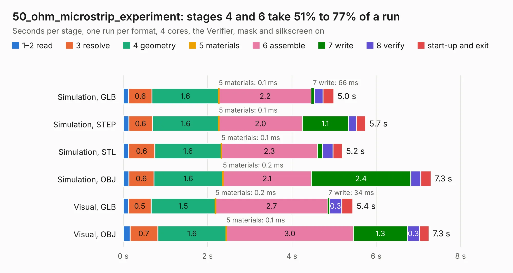

| Mode and format | 1–2 read | 3 resolve | 4 geometry | 5 materials | 6 assemble | 7 write | 8 verify | start-up and exit | Total |
|---|---:|---:|---:|---:|---:|---:|---:|---:|---:|
| Simulation, GLB | 0.1 | 0.6 | 1.6 | 0.1&nbsp;ms | 2.2 | 66&nbsp;ms | 0.2 | 0.3 | 5.0 |
| Simulation, STEP | 0.1 | 0.6 | 1.6 | 0.1&nbsp;ms | 2.0 | 1.1 | 0.2 | 0.2 | 5.7 |
| Simulation, STL | 0.1 | 0.6 | 1.6 | 0.1&nbsp;ms | 2.3 | 0.1 | 0.3 | 0.2 | 5.2 |
| Simulation, OBJ | 0.1 | 0.6 | 1.6 | 0.2&nbsp;ms | 2.1 | 2.4 | 0.2 | 0.2 | 7.3 |
| Visual, GLB | 0.1 | 0.5 | 1.5 | 0.2&nbsp;ms | 2.7 | 34&nbsp;ms | 0.3 | 0.3 | 5.4 |
| Visual, OBJ | 0.2 | 0.7 | 1.6 | 0.1&nbsp;ms | 3.0 | 1.3 | 0.3 | 0.2 | 7.3 |

<table align="center"><tr><td valign="top">

| Board | Repo: [oresat/oresat-live-handheld-ground-station](https://github.com/oresat/oresat-live-handheld-ground-station) Board: `50_ohm_microstrip_experiment.kicad_pcb` |
|---|---|
| Folder | PCB-Legos / Antenna tester / 50_ohm_microstrip_experiment |
| Complexity | 240&nbsp;/&nbsp;1000 (size&nbsp;165, features&nbsp;75) |
| KESE&nbsp;features | through vias, rounded, trapezoid or chamfered pads, filled zones, stack-up, dielectric εr and tanδ |
| Tested | 9th November 2026 |
| Copper&nbsp;layers | 4 |
| File&nbsp;format | KiCad 6 (20211014) |
| Parts,&nbsp;tracks,&nbsp;vias | 10, 21, 202 |
| Triangles,&nbsp;simulation | 417,758 in 20 parts |
| Verifier | PASS in all six runs |

</td><td valign="top">

<table>
<tr><th>File type</th><th>File size</th><th>Peak memory used</th></tr>
<tr><th colspan="3" align="left">Simulation</th></tr>
<tr><td>GLB</td><td align="right">14&nbsp;MB</td><td align="right">307&nbsp;MB</td></tr>
<tr><td>STEP</td><td align="right">23&nbsp;MB</td><td align="right">331&nbsp;MB</td></tr>
<tr><td>STL</td><td align="right">21&nbsp;MB</td><td align="right">307&nbsp;MB</td></tr>
<tr><td>OBJ</td><td align="right">42&nbsp;MB</td><td align="right">340&nbsp;MB</td></tr>
<tr><th colspan="3" align="left">Visual</th></tr>
<tr><td>GLB</td><td align="right">7.4&nbsp;MB</td><td align="right">268&nbsp;MB</td></tr>
<tr><td>OBJ</td><td align="right">22&nbsp;MB</td><td align="right">271&nbsp;MB</td></tr>
</table>

</td></tr></table>

## 2179. HGS_antenna_tester

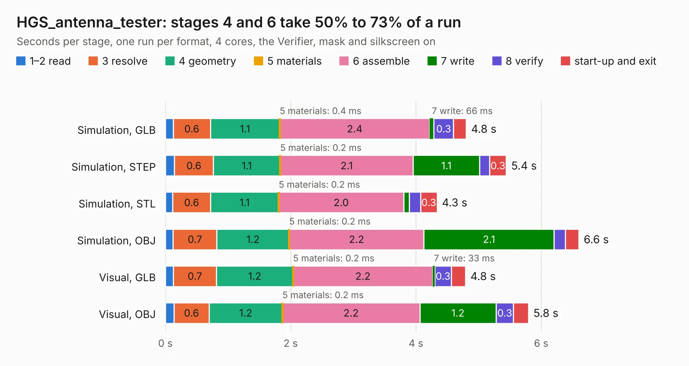

| Mode and format | 1–2 read | 3 resolve | 4 geometry | 5 materials | 6 assemble | 7 write | 8 verify | start-up and exit | Total |
|---|---:|---:|---:|---:|---:|---:|---:|---:|---:|
| Simulation, GLB | 0.1 | 0.6 | 1.1 | 0.4&nbsp;ms | 2.4 | 66&nbsp;ms | 0.3 | 0.2 | 4.8 |
| Simulation, STEP | 0.1 | 0.6 | 1.1 | 0.2&nbsp;ms | 2.1 | 1.1 | 0.2 | 0.3 | 5.4 |
| Simulation, STL | 0.1 | 0.6 | 1.1 | 0.2&nbsp;ms | 2.0 | 91&nbsp;ms | 0.2 | 0.3 | 4.3 |
| Simulation, OBJ | 0.1 | 0.7 | 1.2 | 0.2&nbsp;ms | 2.2 | 2.1 | 0.2 | 0.2 | 6.6 |
| Visual, GLB | 0.1 | 0.7 | 1.2 | 0.2&nbsp;ms | 2.2 | 33&nbsp;ms | 0.3 | 0.2 | 4.8 |
| Visual, OBJ | 0.1 | 0.6 | 1.2 | 0.2&nbsp;ms | 2.2 | 1.2 | 0.3 | 0.2 | 5.8 |

<table align="center"><tr><td valign="top">

| Board | Repo: [oresat/oresat-live-handheld-ground-station](https://github.com/oresat/oresat-live-handheld-ground-station) Board: `HGS_antenna_tester.kicad_pcb` |
|---|---|
| Folder | PCB-Legos / Antenna tester |
| Complexity | 267&nbsp;/&nbsp;1000 (size&nbsp;157, features&nbsp;110) |
| KESE&nbsp;features | through vias, custom pads, rounded, trapezoid or chamfered pads, filled zones, copper drawings, curved board outline, stack-up, dielectric εr and tanδ |
| Tested | 9th November 2026 |
| Copper&nbsp;layers | 4 |
| File&nbsp;format | KiCad 6 (20211014) |
| Parts,&nbsp;tracks,&nbsp;vias | 4, 9, 209 |
| Triangles,&nbsp;simulation | 392,316 in 15 parts |
| Verifier | PASS in all six runs |

</td><td valign="top">

<table>
<tr><th>File type</th><th>File size</th><th>Peak memory used</th></tr>
<tr><th colspan="3" align="left">Simulation</th></tr>
<tr><td>GLB</td><td align="right">12&nbsp;MB</td><td align="right">313&nbsp;MB</td></tr>
<tr><td>STEP</td><td align="right">15&nbsp;MB</td><td align="right">340&nbsp;MB</td></tr>
<tr><td>STL</td><td align="right">20&nbsp;MB</td><td align="right">316&nbsp;MB</td></tr>
<tr><td>OBJ</td><td align="right">38&nbsp;MB</td><td align="right">329&nbsp;MB</td></tr>
<tr><th colspan="3" align="left">Visual</th></tr>
<tr><td>GLB</td><td align="right">7.6&nbsp;MB</td><td align="right">299&nbsp;MB</td></tr>
<tr><td>OBJ</td><td align="right">22&nbsp;MB</td><td align="right">298&nbsp;MB</td></tr>
</table>

</td></tr></table>

## 2180. open_stub_experiment

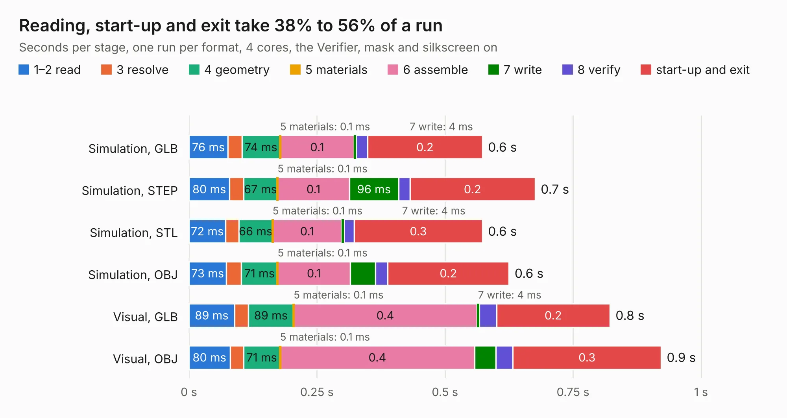

| Mode and format | 1–2 read | 3 resolve | 4 geometry | 5 materials | 6 assemble | 7 write | 8 verify | start-up and exit | Total |
|---|---:|---:|---:|---:|---:|---:|---:|---:|---:|
| Simulation, GLB | 76&nbsp;ms | 27&nbsp;ms | 74&nbsp;ms | 0.1&nbsp;ms | 0.1 | 4&nbsp;ms | 22&nbsp;ms | 0.2 | 0.6 |
| Simulation, STEP | 80&nbsp;ms | 27&nbsp;ms | 67&nbsp;ms | 0.1&nbsp;ms | 0.1 | 96&nbsp;ms | 22&nbsp;ms | 0.2 | 0.7 |
| Simulation, STL | 72&nbsp;ms | 26&nbsp;ms | 66&nbsp;ms | 0.1&nbsp;ms | 0.1 | 4&nbsp;ms | 20&nbsp;ms | 0.3 | 0.6 |
| Simulation, OBJ | 73&nbsp;ms | 29&nbsp;ms | 71&nbsp;ms | 0.1&nbsp;ms | 0.1 | 50&nbsp;ms | 24&nbsp;ms | 0.2 | 0.6 |
| Visual, GLB | 89&nbsp;ms | 27&nbsp;ms | 89&nbsp;ms | 0.1&nbsp;ms | 0.4 | 4&nbsp;ms | 34&nbsp;ms | 0.2 | 0.8 |
| Visual, OBJ | 80&nbsp;ms | 26&nbsp;ms | 71&nbsp;ms | 0.1&nbsp;ms | 0.4 | 41&nbsp;ms | 34&nbsp;ms | 0.3 | 0.9 |

<table align="center"><tr><td valign="top">

| Board | Repo: [oresat/oresat-live-handheld-ground-station](https://github.com/oresat/oresat-live-handheld-ground-station) Board: `open_stub_experiment.kicad_pcb` |
|---|---|
| Folder | PCB-Legos / Antenna tester / open_stub_experiment |
| Complexity | 67&nbsp;/&nbsp;1000 (size&nbsp;47, features&nbsp;20) |
| KESE&nbsp;features | filled zones |
| Tested | 9th November 2026 |
| Copper&nbsp;layers | 2 |
| File&nbsp;format | KiCad 6 (20211014) |
| Parts,&nbsp;tracks,&nbsp;vias | 1, 3, 0 |
| Triangles,&nbsp;simulation | 10,008 in 12 parts |
| Verifier | PASS in all six runs |

</td><td valign="top">

<table>
<tr><th>File type</th><th>File size</th><th>Peak memory used</th></tr>
<tr><th colspan="3" align="left">Simulation</th></tr>
<tr><td>GLB</td><td align="right">375&nbsp;kB</td><td align="right">60&nbsp;MB</td></tr>
<tr><td>STEP</td><td align="right">2.1&nbsp;MB</td><td align="right">63&nbsp;MB</td></tr>
<tr><td>STL</td><td align="right">501&nbsp;kB</td><td align="right">60&nbsp;MB</td></tr>
<tr><td>OBJ</td><td align="right">950&nbsp;kB</td><td align="right">64&nbsp;MB</td></tr>
<tr><th colspan="3" align="left">Visual</th></tr>
<tr><td>GLB</td><td align="right">295&nbsp;kB</td><td align="right">79&nbsp;MB</td></tr>
<tr><td>OBJ</td><td align="right">740&nbsp;kB</td><td align="right">80&nbsp;MB</td></tr>
</table>

</td></tr></table>

## 2181. LNA

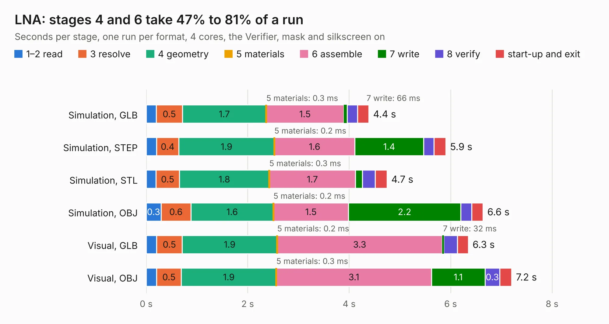

| Mode and format | 1–2 read | 3 resolve | 4 geometry | 5 materials | 6 assemble | 7 write | 8 verify | start-up and exit | Total |
|---|---:|---:|---:|---:|---:|---:|---:|---:|---:|
| Simulation, GLB | 0.2 | 0.5 | 1.7 | 0.3&nbsp;ms | 1.5 | 66&nbsp;ms | 0.2 | 0.2 | 4.4 |
| Simulation, STEP | 0.2 | 0.4 | 1.9 | 0.2&nbsp;ms | 1.6 | 1.4 | 0.2 | 0.2 | 5.9 |
| Simulation, STL | 0.2 | 0.5 | 1.8 | 0.3&nbsp;ms | 1.7 | 0.1 | 0.3 | 0.2 | 4.7 |
| Simulation, OBJ | 0.3 | 0.6 | 1.6 | 0.2&nbsp;ms | 1.5 | 2.2 | 0.2 | 0.2 | 6.6 |
| Visual, GLB | 0.2 | 0.5 | 1.9 | 0.2&nbsp;ms | 3.3 | 32&nbsp;ms | 0.3 | 0.2 | 6.3 |
| Visual, OBJ | 0.2 | 0.5 | 1.9 | 0.3&nbsp;ms | 3.1 | 1.1 | 0.3 | 0.2 | 7.2 |

<table align="center"><tr><td valign="top">

| Board | Repo: [oresat/oresat-live-handheld-ground-station](https://github.com/oresat/oresat-live-handheld-ground-station) Board: `LNA.kicad_pcb` |
|---|---|
| Folder | PCB-Legos / LNA |
| Complexity | 249&nbsp;/&nbsp;1000 (size&nbsp;174, features&nbsp;75) |
| KESE&nbsp;features | through vias, rounded, trapezoid or chamfered pads, filled zones, stack-up, dielectric εr and tanδ |
| Tested | 9th November 2026 |
| Copper&nbsp;layers | 4 |
| File&nbsp;format | KiCad 6 (20211014) |
| Parts,&nbsp;tracks,&nbsp;vias | 42, 110, 107 |
| Triangles,&nbsp;simulation | 454,982 in 44 parts |
| Verifier | PASS in all six runs |

</td><td valign="top">

<table>
<tr><th>File type</th><th>File size</th><th>Peak memory used</th></tr>
<tr><th colspan="3" align="left">Simulation</th></tr>
<tr><td>GLB</td><td align="right">16&nbsp;MB</td><td align="right">344&nbsp;MB</td></tr>
<tr><td>STEP</td><td align="right">61&nbsp;MB</td><td align="right">352&nbsp;MB</td></tr>
<tr><td>STL</td><td align="right">23&nbsp;MB</td><td align="right">321&nbsp;MB</td></tr>
<tr><td>OBJ</td><td align="right">48&nbsp;MB</td><td align="right">377&nbsp;MB</td></tr>
<tr><th colspan="3" align="left">Visual</th></tr>
<tr><td>GLB</td><td align="right">9.1&nbsp;MB</td><td align="right">296&nbsp;MB</td></tr>
<tr><td>OBJ</td><td align="right">27&nbsp;MB</td><td align="right">297&nbsp;MB</td></tr>
</table>

</td></tr></table>

## 2182. transformer

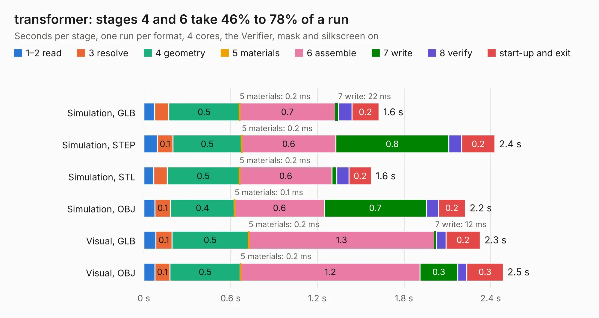

| Mode and format | 1–2 read | 3 resolve | 4 geometry | 5 materials | 6 assemble | 7 write | 8 verify | start-up and exit | Total |
|---|---:|---:|---:|---:|---:|---:|---:|---:|---:|
| Simulation, GLB | 75&nbsp;ms | 97&nbsp;ms | 0.5 | 0.2&nbsp;ms | 0.7 | 22&nbsp;ms | 94&nbsp;ms | 0.2 | 1.6 |
| Simulation, STEP | 93&nbsp;ms | 0.1 | 0.5 | 0.2&nbsp;ms | 0.6 | 0.8 | 89&nbsp;ms | 0.2 | 2.4 |
| Simulation, STL | 68&nbsp;ms | 93&nbsp;ms | 0.5 | 0.2&nbsp;ms | 0.6 | 32&nbsp;ms | 86&nbsp;ms | 0.2 | 1.6 |
| Simulation, OBJ | 78&nbsp;ms | 0.1 | 0.4 | 0.1&nbsp;ms | 0.6 | 0.7 | 82&nbsp;ms | 0.2 | 2.2 |
| Visual, GLB | 84&nbsp;ms | 0.1 | 0.5 | 0.2&nbsp;ms | 1.3 | 12&nbsp;ms | 68&nbsp;ms | 0.2 | 2.3 |
| Visual, OBJ | 76&nbsp;ms | 0.1 | 0.5 | 0.2&nbsp;ms | 1.2 | 0.3 | 64&nbsp;ms | 0.3 | 2.5 |

<table align="center"><tr><td valign="top">

| Board | Repo: [oresat/oresat-live-handheld-ground-station](https://github.com/oresat/oresat-live-handheld-ground-station) Board: `transformer.kicad_pcb` |
|---|---|
| Folder | PCB-Legos / transformer |
| Complexity | 244&nbsp;/&nbsp;1000 (size&nbsp;124, features&nbsp;120) |
| KESE&nbsp;features | through vias, custom pads, rounded, trapezoid or chamfered pads, filled zones, stack-up, dielectric εr and tanδ, mask and silkscreen colours, castellated pads |
| Tested | 9th November 2026 |
| Copper&nbsp;layers | 4 |
| File&nbsp;format | KiCad 6 (20211014) |
| Parts,&nbsp;tracks,&nbsp;vias | 2, 21, 33 |
| Triangles,&nbsp;simulation | 149,868 in 18 parts |
| Verifier | PASS in all six runs |

</td><td valign="top">

<table>
<tr><th>File type</th><th>File size</th><th>Peak memory used</th></tr>
<tr><th colspan="3" align="left">Simulation</th></tr>
<tr><td>GLB</td><td align="right">5.2&nbsp;MB</td><td align="right">190&nbsp;MB</td></tr>
<tr><td>STEP</td><td align="right">21&nbsp;MB</td><td align="right">195&nbsp;MB</td></tr>
<tr><td>STL</td><td align="right">7.5&nbsp;MB</td><td align="right">186&nbsp;MB</td></tr>
<tr><td>OBJ</td><td align="right">15&nbsp;MB</td><td align="right">191&nbsp;MB</td></tr>
<tr><th colspan="3" align="left">Visual</th></tr>
<tr><td>GLB</td><td align="right">2.0&nbsp;MB</td><td align="right">162&nbsp;MB</td></tr>
<tr><td>OBJ</td><td align="right">5.5&nbsp;MB</td><td align="right">161&nbsp;MB</td></tr>
</table>

</td></tr></table>

## 2183. HGS_Reflector

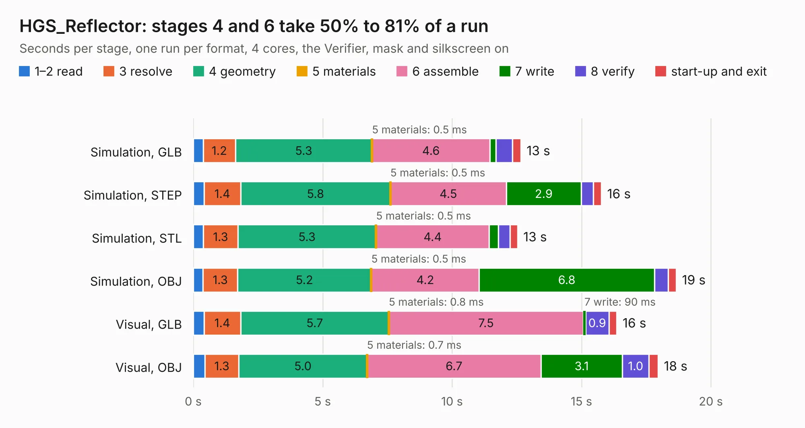

| Mode and format | 1–2 read | 3 resolve | 4 geometry | 5 materials | 6 assemble | 7 write | 8 verify | start-up and exit | Total |
|---|---:|---:|---:|---:|---:|---:|---:|---:|---:|
| Simulation, GLB | 0.4 | 1.2 | 5.3 | 0.5&nbsp;ms | 4.6 | 0.2 | 0.6 | 0.3 | 12.7 |
| Simulation, STEP | 0.4 | 1.4 | 5.8 | 0.5&nbsp;ms | 4.5 | 2.9 | 0.5 | 0.3 | 15.8 |
| Simulation, STL | 0.4 | 1.3 | 5.3 | 0.5&nbsp;ms | 4.4 | 0.4 | 0.5 | 0.3 | 12.5 |
| Simulation, OBJ | 0.4 | 1.3 | 5.2 | 0.5&nbsp;ms | 4.2 | 6.8 | 0.5 | 0.3 | 18.7 |
| Visual, GLB | 0.4 | 1.4 | 5.7 | 0.8&nbsp;ms | 7.5 | 90&nbsp;ms | 0.9 | 0.3 | 16.4 |
| Visual, OBJ | 0.5 | 1.3 | 5.0 | 0.7&nbsp;ms | 6.7 | 3.1 | 1.0 | 0.3 | 18.0 |

<table align="center"><tr><td valign="top">

| Board | Repo: [oresat/oresat-live-handheld-ground-station](https://github.com/oresat/oresat-live-handheld-ground-station) Board: `HGS_Reflector.kicad_pcb` |
|---|---|
| Folder | pcba / KiCad |
| Complexity | 270&nbsp;/&nbsp;1000 (size&nbsp;180, features&nbsp;90) |
| KESE&nbsp;features | through vias, rounded, trapezoid or chamfered pads, filled zones, curved board outline, stack-up, dielectric εr and tanδ, mask and silkscreen colours |
| Tested | 9th November 2026 |
| Copper&nbsp;layers | 4 |
| File&nbsp;format | KiCad 8 (20240108) |
| Parts,&nbsp;tracks,&nbsp;vias | 55, 145, 134 |
| Triangles,&nbsp;simulation | 1,008,332 in 63 parts |
| Verifier | PASS in all six runs |

</td><td valign="top">

<table>
<tr><th>File type</th><th>File size</th><th>Peak memory used</th></tr>
<tr><th colspan="3" align="left">Simulation</th></tr>
<tr><td>GLB</td><td align="right">34&nbsp;MB</td><td align="right">452&nbsp;MB</td></tr>
<tr><td>STEP</td><td align="right">119&nbsp;MB</td><td align="right">481&nbsp;MB</td></tr>
<tr><td>STL</td><td align="right">50&nbsp;MB</td><td align="right">463&nbsp;MB</td></tr>
<tr><td>OBJ</td><td align="right">103&nbsp;MB</td><td align="right">721&nbsp;MB</td></tr>
<tr><th colspan="3" align="left">Visual</th></tr>
<tr><td>GLB</td><td align="right">18&nbsp;MB</td><td align="right">442&nbsp;MB</td></tr>
<tr><td>OBJ</td><td align="right">55&nbsp;MB</td><td align="right">467&nbsp;MB</td></tr>
</table>

</td></tr></table>

## 2184. oresat-live-card

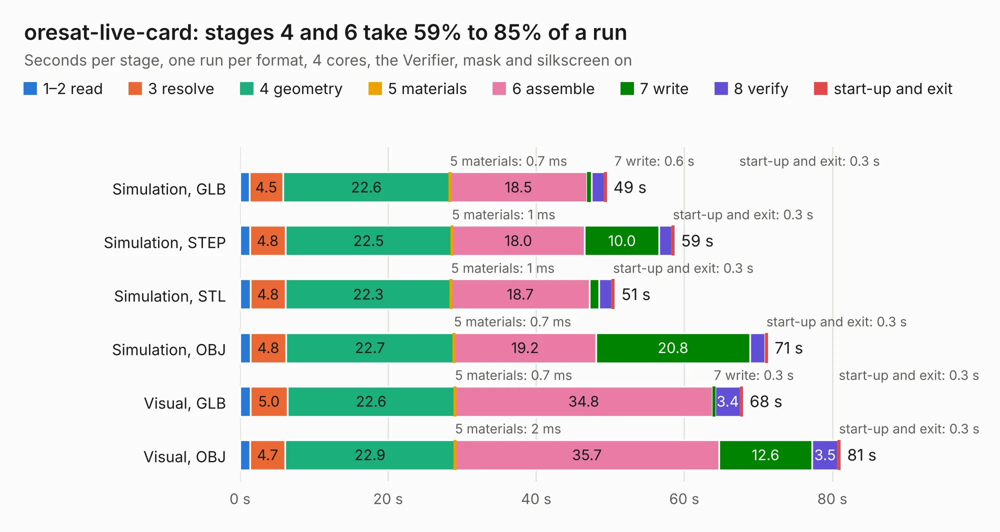

| Mode and format | 1–2 read | 3 resolve | 4 geometry | 5 materials | 6 assemble | 7 write | 8 verify | start-up and exit | Total |
|---|---:|---:|---:|---:|---:|---:|---:|---:|---:|
| Simulation, GLB | 1.3 | 4.5 | 22.6 | 0.7&nbsp;ms | 18.5 | 0.6 | 1.7 | 0.3 | 49.5 |
| Simulation, STEP | 1.3 | 4.8 | 22.5 | 1&nbsp;ms | 18.0 | 10.0 | 1.7 | 0.3 | 58.6 |
| Simulation, STL | 1.4 | 4.8 | 22.3 | 1&nbsp;ms | 18.7 | 1.3 | 1.7 | 0.3 | 50.5 |
| Simulation, OBJ | 1.4 | 4.8 | 22.7 | 0.7&nbsp;ms | 19.2 | 20.8 | 2.1 | 0.3 | 71.2 |
| Visual, GLB | 1.4 | 5.0 | 22.6 | 0.7&nbsp;ms | 34.8 | 0.3 | 3.4 | 0.3 | 67.9 |
| Visual, OBJ | 1.4 | 4.7 | 22.9 | 2&nbsp;ms | 35.7 | 12.6 | 3.5 | 0.3 | 81.0 |

<table align="center"><tr><td valign="top">

| Board | Repo: [oresat/oresat-proto-card](https://github.com/oresat/oresat-proto-card) Board: `oresat-live-card.kicad_pcb` |
|---|---|
| Folder | a8-proto-card / cad-files |
| Complexity | 352&nbsp;/&nbsp;1000 (size&nbsp;287, features&nbsp;65) |
| KESE&nbsp;features | through vias, rounded, trapezoid or chamfered pads, drill offsets, filled zones, curved board outline |
| Tested | 9th November 2026 |
| Copper&nbsp;layers | 4 |
| File&nbsp;format | KiCad 6 (20211014) |
| Parts,&nbsp;tracks,&nbsp;vias | 239, 1,681, 632 |
| Triangles,&nbsp;simulation | 3,866,432 in 258 parts |
| Verifier | PASS in all six runs |

</td><td valign="top">

<table>
<tr><th>File type</th><th>File size</th><th>Peak memory used</th></tr>
<tr><th colspan="3" align="left">Simulation</th></tr>
<tr><td>GLB</td><td align="right">137&nbsp;MB</td><td align="right">1.3&nbsp;GB</td></tr>
<tr><td>STEP</td><td align="right">670&nbsp;MB</td><td align="right">1.7&nbsp;GB</td></tr>
<tr><td>STL</td><td align="right">193&nbsp;MB</td><td align="right">1.3&nbsp;GB</td></tr>
<tr><td>OBJ</td><td align="right">420&nbsp;MB</td><td align="right">2.6&nbsp;GB</td></tr>
<tr><th colspan="3" align="left">Visual</th></tr>
<tr><td>GLB</td><td align="right">83&nbsp;MB</td><td align="right">1.5&nbsp;GB</td></tr>
<tr><td>OBJ</td><td align="right">260&nbsp;MB</td><td align="right">1.8&nbsp;GB</td></tr>
</table>

</td></tr></table>

## 2185. oresat-proto-card

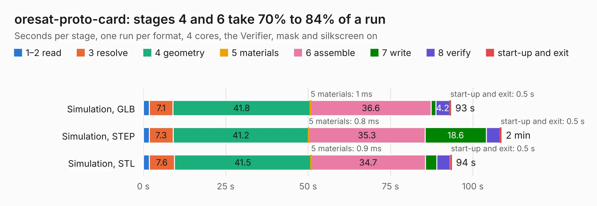

| Mode and format | 1–2 read | 3 resolve | 4 geometry | 5 materials | 6 assemble | 7 write | 8 verify | start-up and exit | Total |
|---|---:|---:|---:|---:|---:|---:|---:|---:|---:|
| Simulation, GLB | 1.9 | 7.1 | 41.8 | 1&nbsp;ms | 36.6 | 1.4 | 4.2 | 0.5 | 93.4 |
| Simulation, STEP | 1.8 | 7.3 | 41.2 | 0.8&nbsp;ms | 35.3 | 18.6 | 4.1 | 0.5 | 108.7 |
| Simulation, STL | 1.8 | 7.6 | 41.5 | 0.9&nbsp;ms | 34.7 | 3.4 | 4.1 | 0.5 | 93.6 |
| Simulation, OBJ | 1.8 | 7.1 | 41.1 | 2&nbsp;ms | 34.7 | 49.5 | 3.6 | 0.4 | 138.3 |
| Visual, GLB | 1.7 | 7.0 | 41.9 | 1&nbsp;ms | 64.0 | 0.6 | 6.4 | 0.4 | 122.0 |
| Visual, OBJ | 1.8 | 7.2 | 42.2 | 0.9&nbsp;ms | 65.9 | 22.0 | 7.0 | 0.3 | 146.5 |

<table align="center"><tr><td valign="top">

| Board | Repo: [oresat/oresat-proto-card](https://github.com/oresat/oresat-proto-card) Board: `oresat-proto-card.kicad_pcb` |
|---|---|
| Folder | m0-proto-card |
| Complexity | 335&nbsp;/&nbsp;1000 (size&nbsp;220, features&nbsp;115) |
| KESE&nbsp;features | through vias, custom pads, rounded, trapezoid or chamfered pads, drill offsets, filled zones, copper drawings, stack-up, dielectric εr and tanδ, mask and silkscreen colours |
| Tested | 9th November 2026 |
| Copper&nbsp;layers | 4 |
| File&nbsp;format | KiCad 7 (20221018) |
| Parts,&nbsp;tracks,&nbsp;vias | 102, 1,230, 987 |
| Triangles,&nbsp;simulation | 7,532,398 in 150 parts |
| Verifier | PASS in all six runs |

</td><td valign="top">

<table>
<tr><th>File type</th><th>File size</th><th>Peak memory used</th></tr>
<tr><th colspan="3" align="left">Simulation</th></tr>
<tr><td>GLB</td><td align="right">256&nbsp;MB</td><td align="right">1.9&nbsp;GB</td></tr>
<tr><td>STEP</td><td align="right">927&nbsp;MB</td><td align="right">2.4&nbsp;GB</td></tr>
<tr><td>STL</td><td align="right">377&nbsp;MB</td><td align="right">1.8&nbsp;GB</td></tr>
<tr><td>OBJ</td><td align="right">812&nbsp;MB</td><td align="right">4.8&nbsp;GB</td></tr>
<tr><th colspan="3" align="left">Visual</th></tr>
<tr><td>GLB</td><td align="right">116&nbsp;MB</td><td align="right">2.2&nbsp;GB</td></tr>
<tr><td>OBJ</td><td align="right">377&nbsp;MB</td><td align="right">2.5&nbsp;GB</td></tr>
</table>

</td></tr></table>

## 2186. oresat-proto-card

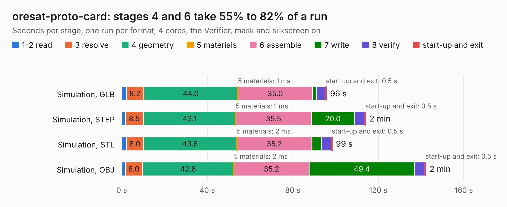

| Mode and format | 1–2 read | 3 resolve | 4 geometry | 5 materials | 6 assemble | 7 write | 8 verify | start-up and exit | Total |
|---|---:|---:|---:|---:|---:|---:|---:|---:|---:|
| Simulation, GLB | 2.1 | 8.2 | 44.0 | 1&nbsp;ms | 35.0 | 1.9 | 4.1 | 0.5 | 95.8 |
| Simulation, STEP | 1.6 | 8.5 | 43.1 | 1&nbsp;ms | 35.5 | 20.0 | 4.9 | 0.5 | 114.2 |
| Simulation, STL | 2.1 | 8.0 | 43.6 | 2&nbsp;ms | 35.2 | 4.4 | 4.6 | 0.5 | 98.5 |
| Simulation, OBJ | 1.7 | 8.0 | 42.8 | 2&nbsp;ms | 35.2 | 49.4 | 4.8 | 0.5 | 142.3 |
| Visual, GLB | 2.0 | 7.8 | 42.1 | 1&nbsp;ms | 63.9 | 0.6 | 7.9 | 0.4 | 124.6 |
| Visual, OBJ | 1.8 | 7.7 | 42.6 | 2&nbsp;ms | 63.5 | 19.5 | 7.7 | 0.4 | 143.2 |

<table align="center"><tr><td valign="top">

| Board | Repo: [oresat/oresat-proto-card](https://github.com/oresat/oresat-proto-card) Board: `oresat-proto-card.kicad_pcb` |
|---|---|
| Folder | mcxn-proto-card |
| Complexity | 379&nbsp;/&nbsp;1000 (size&nbsp;264, features&nbsp;115) |
| KESE&nbsp;features | through vias, custom pads, rounded, trapezoid or chamfered pads, drill offsets, filled zones, copper drawings, stack-up, dielectric εr and tanδ, mask and silkscreen colours |
| Tested | 9th November 2026 |
| Copper&nbsp;layers | 4 |
| File&nbsp;format | KiCad 10 (20260206) |
| Parts,&nbsp;tracks,&nbsp;vias | 117, 1,348, 1,117 |
| Triangles,&nbsp;simulation | 8,534,848 in 188 parts |
| Verifier | PASS in all six runs |

</td><td valign="top">

<table>
<tr><th>File type</th><th>File size</th><th>Peak memory used</th></tr>
<tr><th colspan="3" align="left">Simulation</th></tr>
<tr><td>GLB</td><td align="right">288&nbsp;MB</td><td align="right">2.0&nbsp;GB</td></tr>
<tr><td>STEP</td><td align="right">1.1&nbsp;GB</td><td align="right">2.7&nbsp;GB</td></tr>
<tr><td>STL</td><td align="right">427&nbsp;MB</td><td align="right">2.0&nbsp;GB</td></tr>
<tr><td>OBJ</td><td align="right">916&nbsp;MB</td><td align="right">5.4&nbsp;GB</td></tr>
<tr><th colspan="3" align="left">Visual</th></tr>
<tr><td>GLB</td><td align="right">125&nbsp;MB</td><td align="right">2.3&nbsp;GB</td></tr>
<tr><td>OBJ</td><td align="right">406&nbsp;MB</td><td align="right">2.8&nbsp;GB</td></tr>
</table>

</td></tr></table>

## 2187. 1u_panel

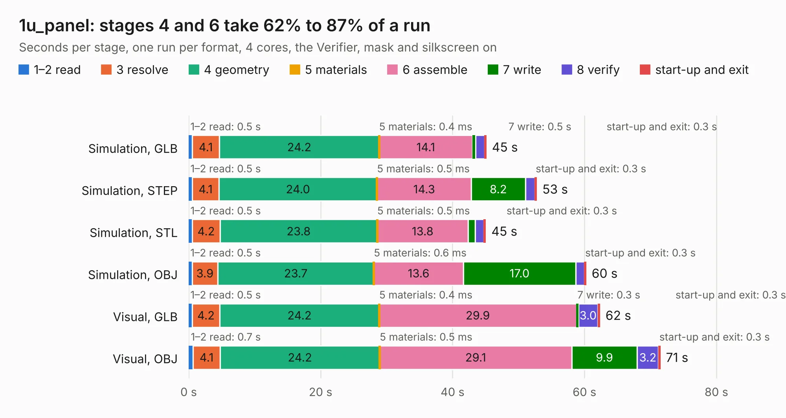

| Mode and format | 1–2 read | 3 resolve | 4 geometry | 5 materials | 6 assemble | 7 write | 8 verify | start-up and exit | Total |
|---|---:|---:|---:|---:|---:|---:|---:|---:|---:|
| Simulation, GLB | 0.5 | 4.1 | 24.2 | 0.4&nbsp;ms | 14.1 | 0.5 | 1.3 | 0.3 | 45.1 |
| Simulation, STEP | 0.5 | 4.1 | 24.0 | 0.5&nbsp;ms | 14.3 | 8.2 | 1.4 | 0.3 | 52.8 |
| Simulation, STL | 0.5 | 4.2 | 23.8 | 0.5&nbsp;ms | 13.8 | 1.1 | 1.3 | 0.3 | 45.0 |
| Simulation, OBJ | 0.5 | 3.9 | 23.7 | 0.6&nbsp;ms | 13.6 | 17.0 | 1.3 | 0.3 | 60.2 |
| Visual, GLB | 0.5 | 4.2 | 24.2 | 0.4&nbsp;ms | 29.9 | 0.3 | 3.0 | 0.3 | 62.3 |
| Visual, OBJ | 0.7 | 4.1 | 24.2 | 0.5&nbsp;ms | 29.1 | 9.9 | 3.2 | 0.3 | 71.5 |

<table align="center"><tr><td valign="top">

| Board | Repo: [oresat/oresat-solar-hardware](https://github.com/oresat/oresat-solar-hardware) Board: `1u_panel.kicad_pcb` |
|---|---|
| Folder | 1u_panel / kicad |
| Complexity | 262&nbsp;/&nbsp;1000 (size&nbsp;202, features&nbsp;60) |
| KESE&nbsp;features | through vias, rounded, trapezoid or chamfered pads, arc tracks, filled zones |
| Tested | 9th November 2026 |
| Copper&nbsp;layers | 2 |
| File&nbsp;format | KiCad 7 (20221018) |
| Parts,&nbsp;tracks,&nbsp;vias | 77, 707, 1,280 |
| Triangles,&nbsp;simulation | 3,191,626 in 95 parts |
| Note | panel |
| Verifier | PASS in all six runs |

</td><td valign="top">

<table>
<tr><th>File type</th><th>File size</th><th>Peak memory used</th></tr>
<tr><th colspan="3" align="left">Simulation</th></tr>
<tr><td>GLB</td><td align="right">110&nbsp;MB</td><td align="right">1.0&nbsp;GB</td></tr>
<tr><td>STEP</td><td align="right">406&nbsp;MB</td><td align="right">1.4&nbsp;GB</td></tr>
<tr><td>STL</td><td align="right">160&nbsp;MB</td><td align="right">1.1&nbsp;GB</td></tr>
<tr><td>OBJ</td><td align="right">338&nbsp;MB</td><td align="right">2.1&nbsp;GB</td></tr>
<tr><th colspan="3" align="left">Visual</th></tr>
<tr><td>GLB</td><td align="right">65&nbsp;MB</td><td align="right">1.2&nbsp;GB</td></tr>
<tr><td>OBJ</td><td align="right">201&nbsp;MB</td><td align="right">1.4&nbsp;GB</td></tr>
</table>

</td></tr></table>

## 2188. solar-extension

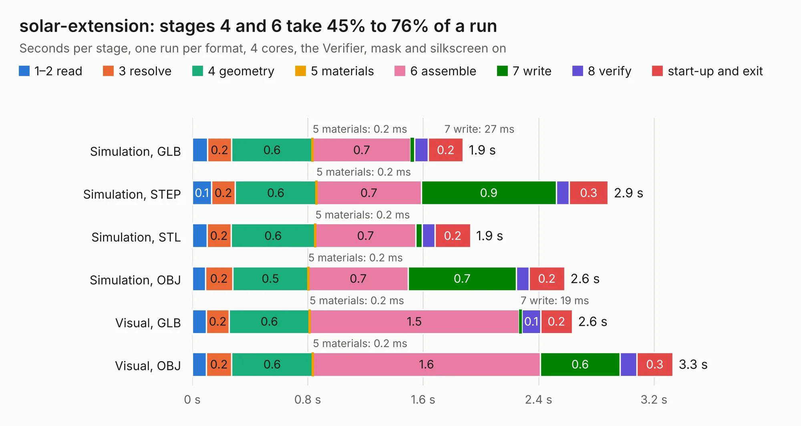

| Mode and format | 1–2 read | 3 resolve | 4 geometry | 5 materials | 6 assemble | 7 write | 8 verify | start-up and exit | Total |
|---|---:|---:|---:|---:|---:|---:|---:|---:|---:|
| Simulation, GLB | 0.1 | 0.2 | 0.6 | 0.2&nbsp;ms | 0.7 | 27&nbsp;ms | 95&nbsp;ms | 0.2 | 1.9 |
| Simulation, STEP | 0.1 | 0.2 | 0.6 | 0.2&nbsp;ms | 0.7 | 0.9 | 91&nbsp;ms | 0.3 | 2.9 |
| Simulation, STL | 0.1 | 0.2 | 0.6 | 0.2&nbsp;ms | 0.7 | 44&nbsp;ms | 89&nbsp;ms | 0.2 | 1.9 |
| Simulation, OBJ | 90&nbsp;ms | 0.2 | 0.5 | 0.2&nbsp;ms | 0.7 | 0.7 | 89&nbsp;ms | 0.2 | 2.6 |
| Visual, GLB | 98&nbsp;ms | 0.2 | 0.6 | 0.2&nbsp;ms | 1.5 | 19&nbsp;ms | 0.1 | 0.2 | 2.6 |
| Visual, OBJ | 98&nbsp;ms | 0.2 | 0.6 | 0.2&nbsp;ms | 1.6 | 0.6 | 0.1 | 0.3 | 3.3 |

<table align="center"><tr><td valign="top">

| Board | Repo: [oresat/oresat-solar-hardware](https://github.com/oresat/oresat-solar-hardware) Board: `solar-extension.kicad_pcb` |
|---|---|
| Folder | solar-extension |
| Complexity | 193&nbsp;/&nbsp;1000 (size&nbsp;98, features&nbsp;95) |
| KESE&nbsp;features | through vias, rounded, trapezoid or chamfered pads, filled zones, stack-up, dielectric εr and tanδ, copper finish, mask and silkscreen colours |
| Tested | 9th November 2026 |
| Copper&nbsp;layers | 2 |
| File&nbsp;format | KiCad 10 (20260206) |
| Parts,&nbsp;tracks,&nbsp;vias | 2, 34, 12 |
| Triangles,&nbsp;simulation | 163,872 in 18 parts |
| Verifier | PASS in all six runs |

</td><td valign="top">

<table>
<tr><th>File type</th><th>File size</th><th>Peak memory used</th></tr>
<tr><th colspan="3" align="left">Simulation</th></tr>
<tr><td>GLB</td><td align="right">5.7&nbsp;MB</td><td align="right">204&nbsp;MB</td></tr>
<tr><td>STEP</td><td align="right">23&nbsp;MB</td><td align="right">212&nbsp;MB</td></tr>
<tr><td>STL</td><td align="right">8.2&nbsp;MB</td><td align="right">203&nbsp;MB</td></tr>
<tr><td>OBJ</td><td align="right">16&nbsp;MB</td><td align="right">204&nbsp;MB</td></tr>
<tr><th colspan="3" align="left">Visual</th></tr>
<tr><td>GLB</td><td align="right">3.8&nbsp;MB</td><td align="right">176&nbsp;MB</td></tr>
<tr><td>OBJ</td><td align="right">11&nbsp;MB</td><td align="right">176&nbsp;MB</td></tr>
</table>

</td></tr></table>

## 2189. solar-module-1u-gaas

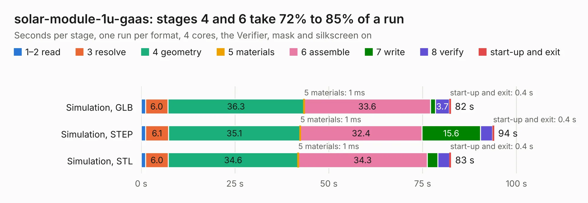

| Mode and format | 1–2 read | 3 resolve | 4 geometry | 5 materials | 6 assemble | 7 write | 8 verify | start-up and exit | Total |
|---|---:|---:|---:|---:|---:|---:|---:|---:|---:|
| Simulation, GLB | 1.2 | 6.0 | 36.3 | 1&nbsp;ms | 33.6 | 1.3 | 3.7 | 0.4 | 82.5 |
| Simulation, STEP | 1.2 | 6.1 | 35.1 | 1&nbsp;ms | 32.4 | 15.6 | 3.2 | 0.4 | 94.0 |
| Simulation, STL | 1.2 | 6.0 | 34.6 | 1&nbsp;ms | 34.3 | 2.8 | 3.2 | 0.4 | 82.6 |
| Simulation, OBJ | 1.1 | 5.9 | 33.0 | 1&nbsp;ms | 33.2 | 41.0 | 3.1 | 0.4 | 117.8 |
| Visual, GLB | 1.2 | 5.7 | 34.2 | 1&nbsp;ms | 45.4 | 0.4 | 4.1 | 0.3 | 91.3 |
| Visual, OBJ | 1.1 | 5.8 | 34.9 | 1&nbsp;ms | 44.2 | 13.1 | 4.4 | 0.3 | 103.8 |

<table align="center"><tr><td valign="top">

| Board | Repo: [oresat/oresat-solar-hardware](https://github.com/oresat/oresat-solar-hardware) Board: `solar-module-1u-gaas.kicad_pcb` |
|---|---|
| Folder | solar-module-1u-gaas-MCXN |
| Complexity | 397&nbsp;/&nbsp;1000 (size&nbsp;262, features&nbsp;135) |
| KESE&nbsp;features | through vias, custom pads, rounded, trapezoid or chamfered pads, arc tracks, filled zones, copper drawings, stack-up, dielectric εr and tanδ, copper finish, mask and silkscreen colours |
| Tested | 9th November 2026 |
| Copper&nbsp;layers | 4 |
| File&nbsp;format | KiCad 10 (20260206) |
| Parts,&nbsp;tracks,&nbsp;vias | 85, 660, 1,503 |
| Triangles,&nbsp;simulation | 7,159,088 in 134 parts |
| Verifier | PASS in all six runs |

</td><td valign="top">

<table>
<tr><th>File type</th><th>File size</th><th>Peak memory used</th></tr>
<tr><th colspan="3" align="left">Simulation</th></tr>
<tr><td>GLB</td><td align="right">240&nbsp;MB</td><td align="right">1.9&nbsp;GB</td></tr>
<tr><td>STEP</td><td align="right">699&nbsp;MB</td><td align="right">2.7&nbsp;GB</td></tr>
<tr><td>STL</td><td align="right">358&nbsp;MB</td><td align="right">1.9&nbsp;GB</td></tr>
<tr><td>OBJ</td><td align="right">763&nbsp;MB</td><td align="right">4.5&nbsp;GB</td></tr>
<tr><th colspan="3" align="left">Visual</th></tr>
<tr><td>GLB</td><td align="right">84&nbsp;MB</td><td align="right">1.8&nbsp;GB</td></tr>
<tr><td>OBJ</td><td align="right">272&nbsp;MB</td><td align="right">1.8&nbsp;GB</td></tr>
</table>

</td></tr></table>

## 2190. solar-module-1u-gaas

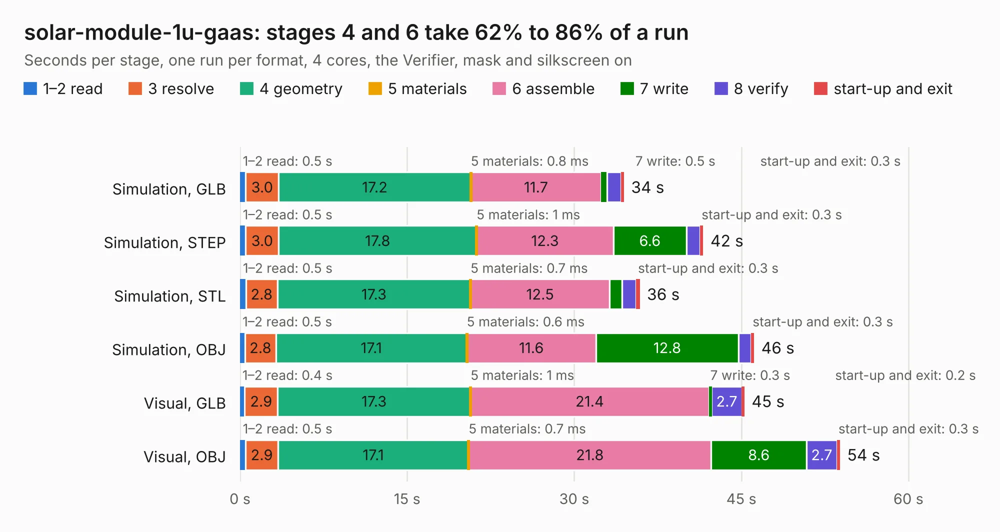

| Mode and format | 1–2 read | 3 resolve | 4 geometry | 5 materials | 6 assemble | 7 write | 8 verify | start-up and exit | Total |
|---|---:|---:|---:|---:|---:|---:|---:|---:|---:|
| Simulation, GLB | 0.5 | 3.0 | 17.2 | 0.8&nbsp;ms | 11.7 | 0.5 | 1.2 | 0.3 | 34.5 |
| Simulation, STEP | 0.5 | 3.0 | 17.8 | 1&nbsp;ms | 12.3 | 6.6 | 1.2 | 0.3 | 41.6 |
| Simulation, STL | 0.5 | 2.8 | 17.3 | 0.7&nbsp;ms | 12.5 | 1.1 | 1.3 | 0.3 | 35.9 |
| Simulation, OBJ | 0.5 | 2.8 | 17.1 | 0.6&nbsp;ms | 11.6 | 12.8 | 1.1 | 0.3 | 46.1 |
| Visual, GLB | 0.4 | 2.9 | 17.3 | 1&nbsp;ms | 21.4 | 0.3 | 2.7 | 0.2 | 45.3 |
| Visual, OBJ | 0.5 | 2.9 | 17.1 | 0.7&nbsp;ms | 21.8 | 8.6 | 2.7 | 0.3 | 53.9 |

<table align="center"><tr><td valign="top">

| Board | Repo: [oresat/oresat-solar-hardware](https://github.com/oresat/oresat-solar-hardware) Board: `solar-module-1u-gaas.kicad_pcb` |
|---|---|
| Folder | solar-module-1u-gaas |
| Complexity | 376&nbsp;/&nbsp;1000 (size&nbsp;241, features&nbsp;135) |
| KESE&nbsp;features | through vias, custom pads, rounded, trapezoid or chamfered pads, arc tracks, filled zones, copper drawings, stack-up, dielectric εr and tanδ, copper finish, mask and silkscreen colours |
| Tested | 9th November 2026 |
| Copper&nbsp;layers | 2 |
| File&nbsp;format | KiCad 9 (20241229) |
| Parts,&nbsp;tracks,&nbsp;vias | 77, 689, 1,169 |
| Triangles,&nbsp;simulation | 2,823,184 in 97 parts |
| Verifier | PASS in all six runs |

</td><td valign="top">

<table>
<tr><th>File type</th><th>File size</th><th>Peak memory used</th></tr>
<tr><th colspan="3" align="left">Simulation</th></tr>
<tr><td>GLB</td><td align="right">97&nbsp;MB</td><td align="right">937&nbsp;MB</td></tr>
<tr><td>STEP</td><td align="right">350&nbsp;MB</td><td align="right">1.3&nbsp;GB</td></tr>
<tr><td>STL</td><td align="right">141&nbsp;MB</td><td align="right">925&nbsp;MB</td></tr>
<tr><td>OBJ</td><td align="right">300&nbsp;MB</td><td align="right">1.9&nbsp;GB</td></tr>
<tr><th colspan="3" align="left">Visual</th></tr>
<tr><td>GLB</td><td align="right">57&nbsp;MB</td><td align="right">1.1&nbsp;GB</td></tr>
<tr><td>OBJ</td><td align="right">178&nbsp;MB</td><td align="right">1.3&nbsp;GB</td></tr>
</table>

</td></tr></table>

## 2191. solar-module-1u-si

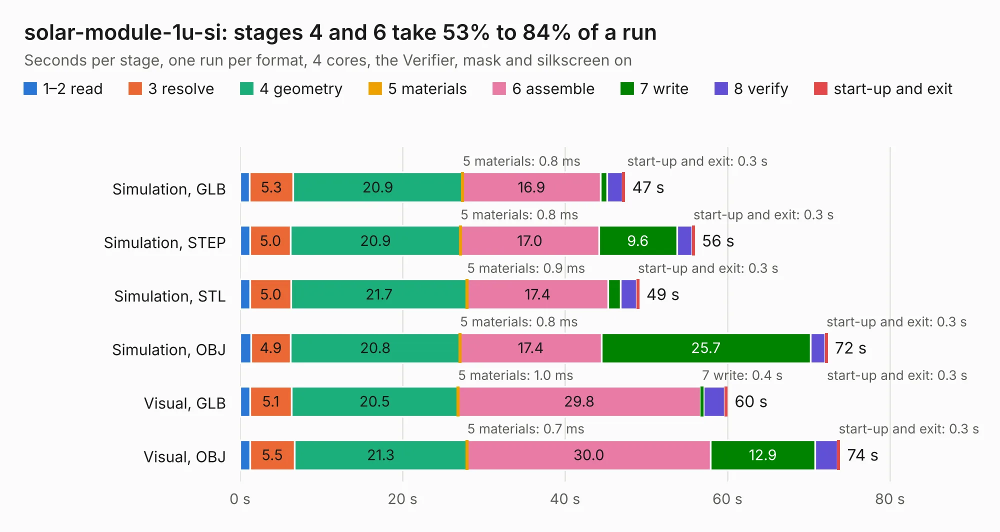

| Mode and format | 1–2 read | 3 resolve | 4 geometry | 5 materials | 6 assemble | 7 write | 8 verify | start-up and exit | Total |
|---|---:|---:|---:|---:|---:|---:|---:|---:|---:|
| Simulation, GLB | 1.2 | 5.3 | 20.9 | 0.8&nbsp;ms | 16.9 | 0.8 | 1.9 | 0.3 | 47.4 |
| Simulation, STEP | 1.3 | 5.0 | 20.9 | 0.8&nbsp;ms | 17.0 | 9.6 | 1.9 | 0.3 | 56.0 |
| Simulation, STL | 1.3 | 5.0 | 21.7 | 0.9&nbsp;ms | 17.4 | 1.5 | 2.0 | 0.3 | 49.1 |
| Simulation, OBJ | 1.3 | 4.9 | 20.8 | 0.8&nbsp;ms | 17.4 | 25.7 | 1.8 | 0.3 | 72.3 |
| Visual, GLB | 1.2 | 5.1 | 20.5 | 1.0&nbsp;ms | 29.8 | 0.4 | 2.6 | 0.3 | 60.0 |
| Visual, OBJ | 1.2 | 5.5 | 21.3 | 0.7&nbsp;ms | 30.0 | 12.9 | 2.8 | 0.3 | 73.9 |

<table align="center"><tr><td valign="top">

| Board | Repo: [oresat/oresat-solar-hardware](https://github.com/oresat/oresat-solar-hardware) Board: `solar-module-1u-si.kicad_pcb` |
|---|---|
| Folder | solar-module-1u-si-MCXN |
| Complexity | 399&nbsp;/&nbsp;1000 (size&nbsp;264, features&nbsp;135) |
| KESE&nbsp;features | through vias, custom pads, rounded, trapezoid or chamfered pads, arc tracks, filled zones, copper drawings, stack-up, dielectric εr and tanδ, copper finish, mask and silkscreen colours |
| Tested | 9th November 2026 |
| Copper&nbsp;layers | 4 |
| File&nbsp;format | KiCad 9 (20241229) |
| Parts,&nbsp;tracks,&nbsp;vias | 123, 597, 1,365 |
| Triangles,&nbsp;simulation | 4,929,576 in 160 parts |
| Verifier | PASS in all six runs |

</td><td valign="top">

<table>
<tr><th>File type</th><th>File size</th><th>Peak memory used</th></tr>
<tr><th colspan="3" align="left">Simulation</th></tr>
<tr><td>GLB</td><td align="right">168&nbsp;MB</td><td align="right">1.8&nbsp;GB</td></tr>
<tr><td>STEP</td><td align="right">495&nbsp;MB</td><td align="right">2.0&nbsp;GB</td></tr>
<tr><td>STL</td><td align="right">246&nbsp;MB</td><td align="right">1.7&nbsp;GB</td></tr>
<tr><td>OBJ</td><td align="right">529&nbsp;MB</td><td align="right">3.2&nbsp;GB</td></tr>
<tr><th colspan="3" align="left">Visual</th></tr>
<tr><td>GLB</td><td align="right">79&nbsp;MB</td><td align="right">1.5&nbsp;GB</td></tr>
<tr><td>OBJ</td><td align="right">252&nbsp;MB</td><td align="right">1.8&nbsp;GB</td></tr>
</table>

</td></tr></table>

## 2192. solar-module-1u-si

| Mode and format | 1–2 read | 3 resolve | 4 geometry | 5 materials | 6 assemble | 7 write | 8 verify | start-up and exit | Total |
|---|---:|---:|---:|---:|---:|---:|---:|---:|---:|
| Simulation, GLB | 0.6 | 3.3 | 19.6 | 1&nbsp;ms | 11.9 | 0.6 | 1.3 | 0.3 | 37.5 |
| Simulation, STEP | 0.6 | 3.2 | 19.4 | 0.6&nbsp;ms | 12.0 | 7.3 | 1.2 | 0.3 | 44.1 |
| Simulation, STL | 0.7 | 3.2 | 19.4 | 1&nbsp;ms | 12.0 | 1.0 | 1.3 | 0.3 | 37.8 |
| Simulation, OBJ | 0.6 | 3.2 | 19.4 | 0.6&nbsp;ms | 12.0 | 16.3 | 1.3 | 0.3 | 53.1 |
| Visual, GLB | 0.6 | 3.2 | 19.9 | 0.6&nbsp;ms | 24.7 | 0.3 | 3.0 | 0.3 | 51.9 |
| Visual, OBJ | 0.6 | 3.3 | 19.5 | 0.6&nbsp;ms | 24.1 | 10.6 | 3.3 | 0.3 | 61.8 |

<table align="center"><tr><td valign="top">

| Board | Repo: [oresat/oresat-solar-hardware](https://github.com/oresat/oresat-solar-hardware) Board: `solar-module-1u-si.kicad_pcb` |
|---|---|
| Folder | solar-module-1u-si |
| Complexity | 381&nbsp;/&nbsp;1000 (size&nbsp;246, features&nbsp;135) |
| KESE&nbsp;features | through vias, custom pads, rounded, trapezoid or chamfered pads, arc tracks, filled zones, copper drawings, stack-up, dielectric εr and tanδ, copper finish, mask and silkscreen colours |
| Tested | 9th November 2026 |
| Copper&nbsp;layers | 2 |
| File&nbsp;format | KiCad 9 (20241229) |
| Parts,&nbsp;tracks,&nbsp;vias | 115, 807, 1,271 |
| Triangles,&nbsp;simulation | 3,165,724 in 112 parts |
| Verifier | PASS in all six runs |

</td><td valign="top">

<table>
<tr><th>File type</th><th>File size</th><th>Peak memory used</th></tr>
<tr><th colspan="3" align="left">Simulation</th></tr>
<tr><td>GLB</td><td align="right">109&nbsp;MB</td><td align="right">1.1&nbsp;GB</td></tr>
<tr><td>STEP</td><td align="right">409&nbsp;MB</td><td align="right">1.4&nbsp;GB</td></tr>
<tr><td>STL</td><td align="right">158&nbsp;MB</td><td align="right">1.1&nbsp;GB</td></tr>
<tr><td>OBJ</td><td align="right">337&nbsp;MB</td><td align="right">2.1&nbsp;GB</td></tr>
<tr><th colspan="3" align="left">Visual</th></tr>
<tr><td>GLB</td><td align="right">66&nbsp;MB</td><td align="right">1.3&nbsp;GB</td></tr>
<tr><td>OBJ</td><td align="right">209&nbsp;MB</td><td align="right">1.4&nbsp;GB</td></tr>
</table>

</td></tr></table>

## 2193. 1u_panel_breakout

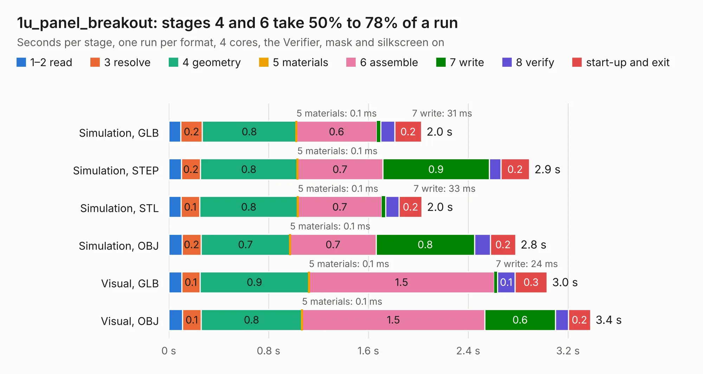

| Mode and format | 1–2 read | 3 resolve | 4 geometry | 5 materials | 6 assemble | 7 write | 8 verify | start-up and exit | Total |
|---|---:|---:|---:|---:|---:|---:|---:|---:|---:|
| Simulation, GLB | 96&nbsp;ms | 0.2 | 0.8 | 0.1&nbsp;ms | 0.6 | 31&nbsp;ms | 0.1 | 0.2 | 2.0 |
| Simulation, STEP | 0.1 | 0.2 | 0.8 | 0.1&nbsp;ms | 0.7 | 0.9 | 93&nbsp;ms | 0.2 | 2.9 |
| Simulation, STL | 98&nbsp;ms | 0.1 | 0.8 | 0.1&nbsp;ms | 0.7 | 33&nbsp;ms | 0.1 | 0.2 | 2.0 |
| Simulation, OBJ | 0.1 | 0.2 | 0.7 | 0.1&nbsp;ms | 0.7 | 0.8 | 0.1 | 0.2 | 2.8 |
| Visual, GLB | 0.1 | 0.1 | 0.9 | 0.1&nbsp;ms | 1.5 | 24&nbsp;ms | 0.1 | 0.3 | 3.0 |
| Visual, OBJ | 0.1 | 0.1 | 0.8 | 0.1&nbsp;ms | 1.5 | 0.6 | 0.1 | 0.2 | 3.4 |

<table align="center"><tr><td valign="top">

| Board | Repo: [oresat/oresat-solar-hardware](https://github.com/oresat/oresat-solar-hardware) Board: `1u_panel_breakout.kicad_pcb` |
|---|---|
| Folder | solar-module-breakout |
| Complexity | 164&nbsp;/&nbsp;1000 (size&nbsp;104, features&nbsp;60) |
| KESE&nbsp;features | through vias, arc tracks, filled zones, curved board outline |
| Tested | 9th November 2026 |
| Copper&nbsp;layers | 2 |
| File&nbsp;format | KiCad 9 (20241229) |
| Parts,&nbsp;tracks,&nbsp;vias | 3, 44, 13 |
| Triangles,&nbsp;simulation | 158,634 in 17 parts |
| Note | panel |
| Verifier | PASS in all six runs |

</td><td valign="top">

<table>
<tr><th>File type</th><th>File size</th><th>Peak memory used</th></tr>
<tr><th colspan="3" align="left">Simulation</th></tr>
<tr><td>GLB</td><td align="right">5.6&nbsp;MB</td><td align="right">193&nbsp;MB</td></tr>
<tr><td>STEP</td><td align="right">25&nbsp;MB</td><td align="right">206&nbsp;MB</td></tr>
<tr><td>STL</td><td align="right">7.9&nbsp;MB</td><td align="right">207&nbsp;MB</td></tr>
<tr><td>OBJ</td><td align="right">16&nbsp;MB</td><td align="right">199&nbsp;MB</td></tr>
<tr><th colspan="3" align="left">Visual</th></tr>
<tr><td>GLB</td><td align="right">3.8&nbsp;MB</td><td align="right">167&nbsp;MB</td></tr>
<tr><td>OBJ</td><td align="right">11&nbsp;MB</td><td align="right">166&nbsp;MB</td></tr>
</table>

</td></tr></table>

## 2194. connector-breakout

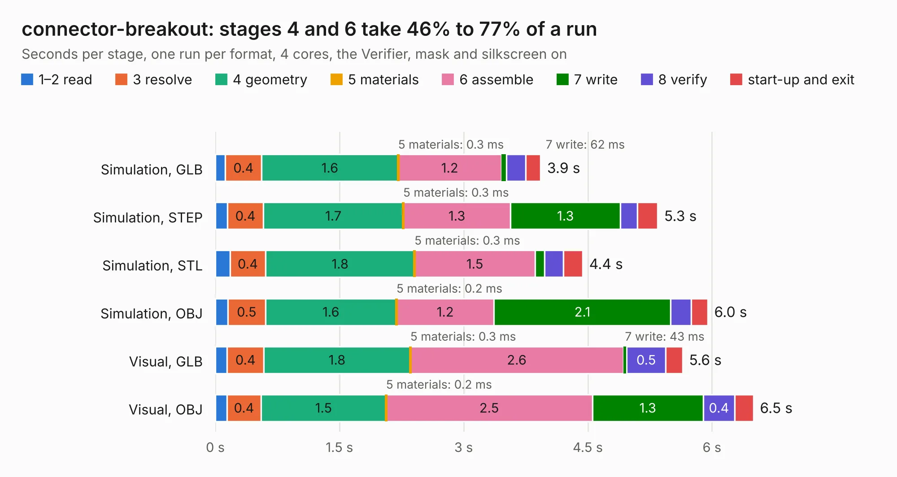

| Mode and format | 1–2 read | 3 resolve | 4 geometry | 5 materials | 6 assemble | 7 write | 8 verify | start-up and exit | Total |
|---|---:|---:|---:|---:|---:|---:|---:|---:|---:|
| Simulation, GLB | 0.1 | 0.4 | 1.6 | 0.3&nbsp;ms | 1.2 | 62&nbsp;ms | 0.2 | 0.2 | 3.9 |
| Simulation, STEP | 0.1 | 0.4 | 1.7 | 0.3&nbsp;ms | 1.3 | 1.3 | 0.2 | 0.2 | 5.3 |
| Simulation, STL | 0.2 | 0.4 | 1.8 | 0.3&nbsp;ms | 1.5 | 0.1 | 0.2 | 0.2 | 4.4 |
| Simulation, OBJ | 0.2 | 0.5 | 1.6 | 0.2&nbsp;ms | 1.2 | 2.1 | 0.2 | 0.2 | 6.0 |
| Visual, GLB | 0.1 | 0.4 | 1.8 | 0.3&nbsp;ms | 2.6 | 43&nbsp;ms | 0.5 | 0.2 | 5.6 |
| Visual, OBJ | 0.1 | 0.4 | 1.5 | 0.2&nbsp;ms | 2.5 | 1.3 | 0.4 | 0.2 | 6.5 |

<table align="center"><tr><td valign="top">

| Board | Repo: [oresat/oresat-solar-simulator-hardware](https://github.com/oresat/oresat-solar-simulator-hardware) Board: `connector-breakout.kicad_pcb` |
|---|---|
| Folder | boards / connector-breakout |
| Complexity | 226&nbsp;/&nbsp;1000 (size&nbsp;131, features&nbsp;95) |
| KESE&nbsp;features | through vias, rounded, trapezoid or chamfered pads, filled zones, stack-up, dielectric εr and tanδ, copper finish, mask and silkscreen colours |
| Tested | 9th November 2026 |
| Copper&nbsp;layers | 2 |
| File&nbsp;format | KiCad 10 (20260206) |
| Parts,&nbsp;tracks,&nbsp;vias | 5, 115, 69 |
| Triangles,&nbsp;simulation | 430,384 in 18 parts |
| Verifier | PASS in all six runs |

</td><td valign="top">

<table>
<tr><th>File type</th><th>File size</th><th>Peak memory used</th></tr>
<tr><th colspan="3" align="left">Simulation</th></tr>
<tr><td>GLB</td><td align="right">15&nbsp;MB</td><td align="right">303&nbsp;MB</td></tr>
<tr><td>STEP</td><td align="right">56&nbsp;MB</td><td align="right">321&nbsp;MB</td></tr>
<tr><td>STL</td><td align="right">22&nbsp;MB</td><td align="right">274&nbsp;MB</td></tr>
<tr><td>OBJ</td><td align="right">43&nbsp;MB</td><td align="right">342&nbsp;MB</td></tr>
<tr><th colspan="3" align="left">Visual</th></tr>
<tr><td>GLB</td><td align="right">9.6&nbsp;MB</td><td align="right">292&nbsp;MB</td></tr>
<tr><td>OBJ</td><td align="right">28&nbsp;MB</td><td align="right">295&nbsp;MB</td></tr>
</table>

</td></tr></table>

## 2195. controller-board

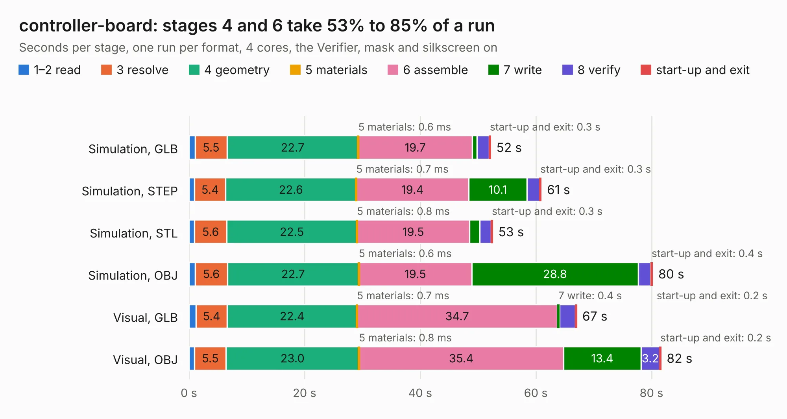

| Mode and format | 1–2 read | 3 resolve | 4 geometry | 5 materials | 6 assemble | 7 write | 8 verify | start-up and exit | Total |
|---|---:|---:|---:|---:|---:|---:|---:|---:|---:|
| Simulation, GLB | 1.1 | 5.5 | 22.7 | 0.6&nbsp;ms | 19.7 | 0.9 | 2.1 | 0.3 | 52.2 |
| Simulation, STEP | 1.0 | 5.4 | 22.6 | 0.7&nbsp;ms | 19.4 | 10.1 | 2.2 | 0.3 | 61.0 |
| Simulation, STL | 0.9 | 5.6 | 22.5 | 0.8&nbsp;ms | 19.5 | 1.7 | 2.0 | 0.3 | 52.5 |
| Simulation, OBJ | 1.1 | 5.6 | 22.7 | 0.6&nbsp;ms | 19.5 | 28.8 | 2.1 | 0.4 | 80.2 |
| Visual, GLB | 1.2 | 5.4 | 22.4 | 0.7&nbsp;ms | 34.7 | 0.4 | 2.8 | 0.2 | 67.1 |
| Visual, OBJ | 1.0 | 5.5 | 23.0 | 0.8&nbsp;ms | 35.4 | 13.4 | 3.2 | 0.2 | 81.7 |

<table align="center"><tr><td valign="top">

| Board | Repo: [oresat/oresat-solar-simulator-hardware](https://github.com/oresat/oresat-solar-simulator-hardware) Board: `controller-board.kicad_pcb` |
|---|---|
| Folder | boards / controller-board |
| Complexity | 329&nbsp;/&nbsp;1000 (size&nbsp;224, features&nbsp;105) |
| KESE&nbsp;features | through vias, rounded, trapezoid or chamfered pads, filled zones, curved board outline, stack-up, dielectric εr and tanδ, copper finish, mask and silkscreen colours |
| Tested | 9th November 2026 |
| Copper&nbsp;layers | 4 |
| File&nbsp;format | KiCad 10 (20260206) |
| Parts,&nbsp;tracks,&nbsp;vias | 96, 456, 1,687 |
| Triangles,&nbsp;simulation | 5,365,408 in 90 parts |
| Verifier | PASS in all six runs |

</td><td valign="top">

<table>
<tr><th>File type</th><th>File size</th><th>Peak memory used</th></tr>
<tr><th colspan="3" align="left">Simulation</th></tr>
<tr><td>GLB</td><td align="right">179&nbsp;MB</td><td align="right">1.8&nbsp;GB</td></tr>
<tr><td>STEP</td><td align="right">489&nbsp;MB</td><td align="right">2.1&nbsp;GB</td></tr>
<tr><td>STL</td><td align="right">268&nbsp;MB</td><td align="right">1.8&nbsp;GB</td></tr>
<tr><td>OBJ</td><td align="right">569&nbsp;MB</td><td align="right">3.4&nbsp;GB</td></tr>
<tr><th colspan="3" align="left">Visual</th></tr>
<tr><td>GLB</td><td align="right">84&nbsp;MB</td><td align="right">1.7&nbsp;GB</td></tr>
<tr><td>OBJ</td><td align="right">272&nbsp;MB</td><td align="right">1.9&nbsp;GB</td></tr>
</table>

</td></tr></table>

## 2196. cree-xega-led-breakout

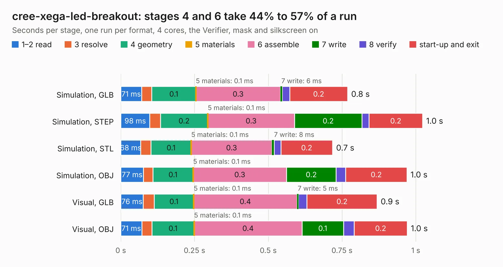

| Mode and format | 1–2 read | 3 resolve | 4 geometry | 5 materials | 6 assemble | 7 write | 8 verify | start-up and exit | Total |
|---|---:|---:|---:|---:|---:|---:|---:|---:|---:|
| Simulation, GLB | 71&nbsp;ms | 35&nbsp;ms | 0.1 | 0.1&nbsp;ms | 0.3 | 6&nbsp;ms | 25&nbsp;ms | 0.2 | 0.8 |
| Simulation, STEP | 98&nbsp;ms | 36&nbsp;ms | 0.2 | 0.1&nbsp;ms | 0.3 | 0.2 | 24&nbsp;ms | 0.2 | 1.0 |
| Simulation, STL | 68&nbsp;ms | 35&nbsp;ms | 0.1 | 0.1&nbsp;ms | 0.3 | 8&nbsp;ms | 22&nbsp;ms | 0.2 | 0.7 |
| Simulation, OBJ | 77&nbsp;ms | 32&nbsp;ms | 0.1 | 0.1&nbsp;ms | 0.3 | 0.2 | 32&nbsp;ms | 0.2 | 1.0 |
| Visual, GLB | 76&nbsp;ms | 37&nbsp;ms | 0.1 | 0.1&nbsp;ms | 0.4 | 5&nbsp;ms | 29&nbsp;ms | 0.2 | 0.9 |
| Visual, OBJ | 71&nbsp;ms | 35&nbsp;ms | 0.1 | 0.1&nbsp;ms | 0.4 | 0.1 | 36&nbsp;ms | 0.2 | 1.0 |

<table align="center"><tr><td valign="top">

| Board | Repo: [oresat/oresat-solar-simulator-hardware](https://github.com/oresat/oresat-solar-simulator-hardware) Board: `cree-xega-led-breakout.kicad_pcb` |
|---|---|
| Folder | boards / cree-xega-led-breakout |
| Complexity | 100&nbsp;/&nbsp;1000 (size&nbsp;70, features&nbsp;30) |
| KESE&nbsp;features | filled zones, curved board outline |
| Tested | 9th November 2026 |
| Copper&nbsp;layers | 2 |
| File&nbsp;format | KiCad 8 (20240108) |
| Parts,&nbsp;tracks,&nbsp;vias | 5, 7, 0 |
| Triangles,&nbsp;simulation | 31,162 in 15 parts |
| Verifier | PASS in all six runs |

</td><td valign="top">

<table>
<tr><th>File type</th><th>File size</th><th>Peak memory used</th></tr>
<tr><th colspan="3" align="left">Simulation</th></tr>
<tr><td>GLB</td><td align="right">1.1&nbsp;MB</td><td align="right">64&nbsp;MB</td></tr>
<tr><td>STEP</td><td align="right">5.5&nbsp;MB</td><td align="right">68&nbsp;MB</td></tr>
<tr><td>STL</td><td align="right">1.6&nbsp;MB</td><td align="right">65&nbsp;MB</td></tr>
<tr><td>OBJ</td><td align="right">3.0&nbsp;MB</td><td align="right">70&nbsp;MB</td></tr>
<tr><th colspan="3" align="left">Visual</th></tr>
<tr><td>GLB</td><td align="right">788&nbsp;kB</td><td align="right">78&nbsp;MB</td></tr>
<tr><td>OBJ</td><td align="right">2.1&nbsp;MB</td><td align="right">88&nbsp;MB</td></tr>
</table>

</td></tr></table>

## 2197. sensor-board

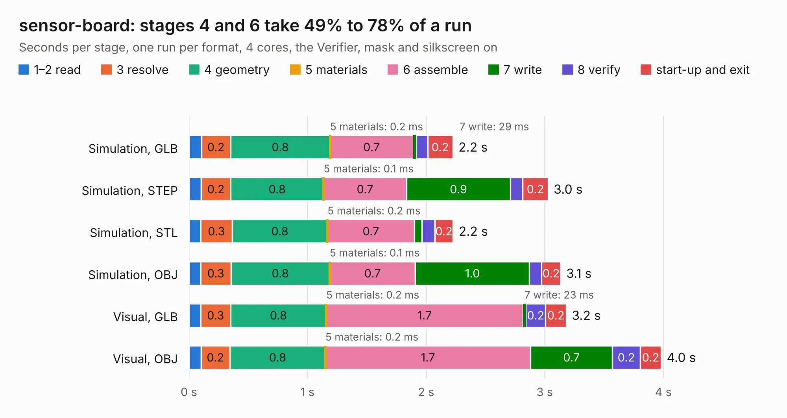

| Mode and format | 1–2 read | 3 resolve | 4 geometry | 5 materials | 6 assemble | 7 write | 8 verify | start-up and exit | Total |
|---|---:|---:|---:|---:|---:|---:|---:|---:|---:|
| Simulation, GLB | 0.1 | 0.2 | 0.8 | 0.2&nbsp;ms | 0.7 | 29&nbsp;ms | 93&nbsp;ms | 0.2 | 2.2 |
| Simulation, STEP | 0.1 | 0.2 | 0.8 | 0.1&nbsp;ms | 0.7 | 0.9 | 0.1 | 0.2 | 3.0 |
| Simulation, STL | 99&nbsp;ms | 0.3 | 0.8 | 0.2&nbsp;ms | 0.7 | 64&nbsp;ms | 0.1 | 0.2 | 2.2 |
| Simulation, OBJ | 0.1 | 0.3 | 0.8 | 0.1&nbsp;ms | 0.7 | 1.0 | 0.1 | 0.2 | 3.1 |
| Visual, GLB | 98&nbsp;ms | 0.3 | 0.8 | 0.2&nbsp;ms | 1.7 | 23&nbsp;ms | 0.2 | 0.2 | 3.2 |
| Visual, OBJ | 0.1 | 0.2 | 0.8 | 0.2&nbsp;ms | 1.7 | 0.7 | 0.2 | 0.2 | 4.0 |

<table align="center"><tr><td valign="top">

| Board | Repo: [oresat/oresat-solar-simulator-hardware](https://github.com/oresat/oresat-solar-simulator-hardware) Board: `sensor-board.kicad_pcb` |
|---|---|
| Folder | boards / sensor-board |
| Complexity | 229&nbsp;/&nbsp;1000 (size&nbsp;139, features&nbsp;90) |
| KESE&nbsp;features | through vias, rounded, trapezoid or chamfered pads, filled zones, curved board outline, stack-up, dielectric εr and tanδ, mask and silkscreen colours |
| Tested | 9th November 2026 |
| Copper&nbsp;layers | 2 |
| File&nbsp;format | KiCad 8 (20240108) |
| Parts,&nbsp;tracks,&nbsp;vias | 12, 59, 86 |
| Triangles,&nbsp;simulation | 236,226 in 20 parts |
| Verifier | PASS in all six runs |

</td><td valign="top">

<table>
<tr><th>File type</th><th>File size</th><th>Peak memory used</th></tr>
<tr><th colspan="3" align="left">Simulation</th></tr>
<tr><td>GLB</td><td align="right">8.2&nbsp;MB</td><td align="right">240&nbsp;MB</td></tr>
<tr><td>STEP</td><td align="right">32&nbsp;MB</td><td align="right">240&nbsp;MB</td></tr>
<tr><td>STL</td><td align="right">12&nbsp;MB</td><td align="right">236&nbsp;MB</td></tr>
<tr><td>OBJ</td><td align="right">24&nbsp;MB</td><td align="right">238&nbsp;MB</td></tr>
<tr><th colspan="3" align="left">Visual</th></tr>
<tr><td>GLB</td><td align="right">6.0&nbsp;MB</td><td align="right">199&nbsp;MB</td></tr>
<tr><td>OBJ</td><td align="right">17&nbsp;MB</td><td align="right">198&nbsp;MB</td></tr>
</table>

</td></tr></table>

## 2198. star-tracker-card

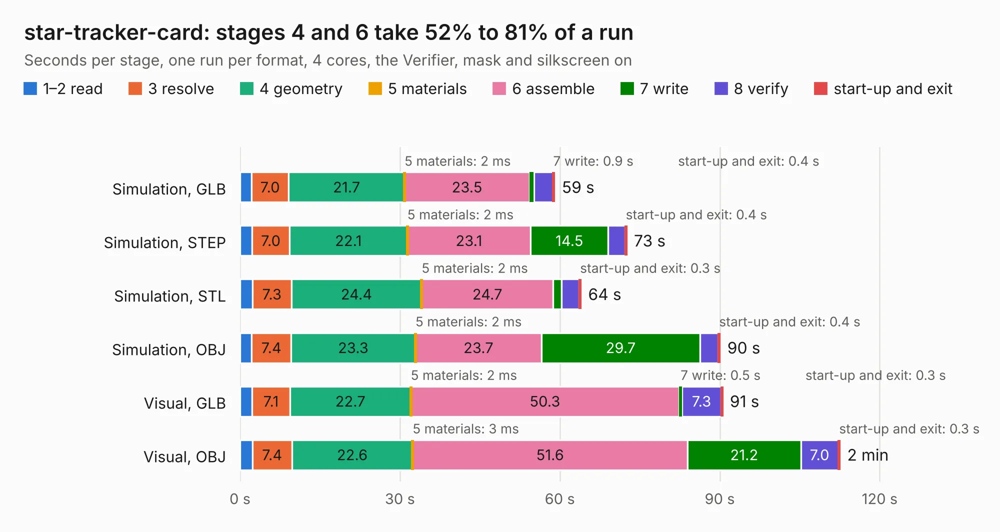

| Mode and format | 1–2 read | 3 resolve | 4 geometry | 5 materials | 6 assemble | 7 write | 8 verify | start-up and exit | Total |
|---|---:|---:|---:|---:|---:|---:|---:|---:|---:|
| Simulation, GLB | 2.1 | 7.0 | 21.7 | 2&nbsp;ms | 23.5 | 0.9 | 3.5 | 0.4 | 59.0 |
| Simulation, STEP | 2.3 | 7.0 | 22.1 | 2&nbsp;ms | 23.1 | 14.5 | 3.1 | 0.4 | 72.6 |
| Simulation, STL | 2.3 | 7.3 | 24.4 | 2&nbsp;ms | 24.7 | 1.6 | 3.3 | 0.3 | 64.0 |
| Simulation, OBJ | 2.2 | 7.4 | 23.3 | 2&nbsp;ms | 23.7 | 29.7 | 3.4 | 0.4 | 90.1 |
| Visual, GLB | 2.2 | 7.1 | 22.7 | 2&nbsp;ms | 50.3 | 0.5 | 7.3 | 0.3 | 90.6 |
| Visual, OBJ | 2.3 | 7.4 | 22.6 | 3&nbsp;ms | 51.6 | 21.2 | 7.0 | 0.3 | 112.6 |

<table align="center"><tr><td valign="top">

| Board | Repo: [oresat/oresat-star-tracker-hardware](https://github.com/oresat/oresat-star-tracker-hardware) Board: `star-tracker-card.kicad_pcb` |
|---|---|
| Folder | hardware / star-tracker-2.0 / star-tracker-2.0-card |
| Complexity | 406&nbsp;/&nbsp;1000 (size&nbsp;286, features&nbsp;120) |
| KESE&nbsp;features | through vias, rounded, trapezoid or chamfered pads, drill offsets, arc tracks, filled zones, stack-up, dielectric εr and tanδ, copper finish, mask and silkscreen colours |
| Tested | 9th November 2026 |
| Copper&nbsp;layers | 4 |
| File&nbsp;format | KiCad 10 (20260206) |
| Parts,&nbsp;tracks,&nbsp;vias | 172, 2,760, 568 |
| Triangles,&nbsp;simulation | 4,613,754 in 441 parts |
| Verifier | PASS in all six runs |

</td><td valign="top">

<table>
<tr><th>File type</th><th>File size</th><th>Peak memory used</th></tr>
<tr><th colspan="3" align="left">Simulation</th></tr>
<tr><td>GLB</td><td align="right">160&nbsp;MB</td><td align="right">1.4&nbsp;GB</td></tr>
<tr><td>STEP</td><td align="right">697&nbsp;MB</td><td align="right">1.9&nbsp;GB</td></tr>
<tr><td>STL</td><td align="right">231&nbsp;MB</td><td align="right">1.4&nbsp;GB</td></tr>
<tr><td>OBJ</td><td align="right">502&nbsp;MB</td><td align="right">3.1&nbsp;GB</td></tr>
<tr><th colspan="3" align="left">Visual</th></tr>
<tr><td>GLB</td><td align="right">110&nbsp;MB</td><td align="right">2.0&nbsp;GB</td></tr>
<tr><td>OBJ</td><td align="right">353&nbsp;MB</td><td align="right">2.6&nbsp;GB</td></tr>
</table>

</td></tr></table>

## 2199. star-tracker-camera-board

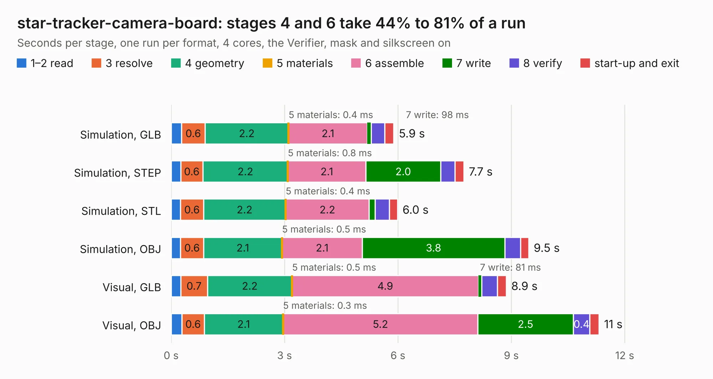

| Mode and format | 1–2 read | 3 resolve | 4 geometry | 5 materials | 6 assemble | 7 write | 8 verify | start-up and exit | Total |
|---|---:|---:|---:|---:|---:|---:|---:|---:|---:|
| Simulation, GLB | 0.3 | 0.6 | 2.2 | 0.4&nbsp;ms | 2.1 | 98&nbsp;ms | 0.4 | 0.2 | 5.9 |
| Simulation, STEP | 0.3 | 0.6 | 2.2 | 0.8&nbsp;ms | 2.1 | 2.0 | 0.4 | 0.2 | 7.7 |
| Simulation, STL | 0.2 | 0.6 | 2.2 | 0.4&nbsp;ms | 2.2 | 0.2 | 0.4 | 0.2 | 6.0 |
| Simulation, OBJ | 0.2 | 0.6 | 2.1 | 0.5&nbsp;ms | 2.1 | 3.8 | 0.4 | 0.2 | 9.5 |
| Visual, GLB | 0.3 | 0.7 | 2.2 | 0.5&nbsp;ms | 4.9 | 81&nbsp;ms | 0.4 | 0.2 | 8.9 |
| Visual, OBJ | 0.3 | 0.6 | 2.1 | 0.3&nbsp;ms | 5.2 | 2.5 | 0.4 | 0.2 | 11.3 |

<table align="center"><tr><td valign="top">

| Board | Repo: [oresat/oresat-star-tracker-hardware](https://github.com/oresat/oresat-star-tracker-hardware) Board: `star-tracker-camera-board.kicad_pcb` |
|---|---|
| Folder | hardware / star-tracker-2.0 / star-tracker-camera-board-2.0 |
| Complexity | 310&nbsp;/&nbsp;1000 (size&nbsp;180, features&nbsp;130) |
| KESE&nbsp;features | through vias, custom pads, rounded, trapezoid or chamfered pads, filled zones, copper drawings, curved board outline, stack-up, dielectric εr and tanδ, copper finish, mask and silkscreen colours |
| Tested | 9th November 2026 |
| Copper&nbsp;layers | 4 |
| File&nbsp;format | KiCad 10 (20260206) |
| Parts,&nbsp;tracks,&nbsp;vias | 36, 402, 108 |
| Triangles,&nbsp;simulation | 670,218 in 55 parts |
| Verifier | PASS in all six runs |

</td><td valign="top">

<table>
<tr><th>File type</th><th>File size</th><th>Peak memory used</th></tr>
<tr><th colspan="3" align="left">Simulation</th></tr>
<tr><td>GLB</td><td align="right">23&nbsp;MB</td><td align="right">346&nbsp;MB</td></tr>
<tr><td>STEP</td><td align="right">106&nbsp;MB</td><td align="right">407&nbsp;MB</td></tr>
<tr><td>STL</td><td align="right">34&nbsp;MB</td><td align="right">349&nbsp;MB</td></tr>
<tr><td>OBJ</td><td align="right">69&nbsp;MB</td><td align="right">491&nbsp;MB</td></tr>
<tr><th colspan="3" align="left">Visual</th></tr>
<tr><td>GLB</td><td align="right">16&nbsp;MB</td><td align="right">415&nbsp;MB</td></tr>
<tr><td>OBJ</td><td align="right">49&nbsp;MB</td><td align="right">414&nbsp;MB</td></tr>
</table>

</td></tr></table>

## 2200. star-tracker-camera-board

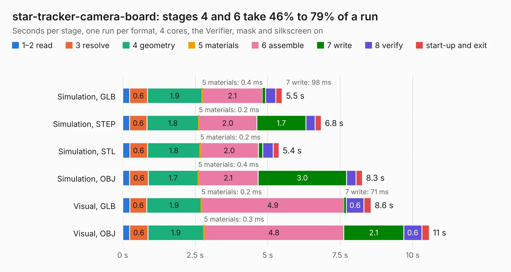

| Mode and format | 1–2 read | 3 resolve | 4 geometry | 5 materials | 6 assemble | 7 write | 8 verify | start-up and exit | Total |
|---|---:|---:|---:|---:|---:|---:|---:|---:|---:|
| Simulation, GLB | 0.2 | 0.6 | 1.9 | 0.4&nbsp;ms | 2.1 | 98&nbsp;ms | 0.4 | 0.2 | 5.5 |
| Simulation, STEP | 0.2 | 0.6 | 1.8 | 0.2&nbsp;ms | 2.0 | 1.7 | 0.3 | 0.2 | 6.8 |
| Simulation, STL | 0.2 | 0.6 | 1.8 | 0.2&nbsp;ms | 2.0 | 0.1 | 0.4 | 0.2 | 5.4 |
| Simulation, OBJ | 0.2 | 0.6 | 1.7 | 0.4&nbsp;ms | 2.1 | 3.0 | 0.3 | 0.2 | 8.3 |
| Visual, GLB | 0.2 | 0.6 | 1.9 | 0.2&nbsp;ms | 4.9 | 71&nbsp;ms | 0.6 | 0.2 | 8.6 |
| Visual, OBJ | 0.2 | 0.6 | 1.9 | 0.3&nbsp;ms | 4.8 | 2.1 | 0.6 | 0.3 | 10.6 |

<table align="center"><tr><td valign="top">

| Board | Repo: [oresat/oresat-star-tracker-hardware](https://github.com/oresat/oresat-star-tracker-hardware) Board: `star-tracker-camera-board.kicad_pcb` |
|---|---|
| Folder | hardware / star-tracker-camera-board |
| Complexity | 310&nbsp;/&nbsp;1000 (size&nbsp;180, features&nbsp;130) |
| KESE&nbsp;features | through vias, custom pads, rounded, trapezoid or chamfered pads, filled zones, copper drawings, curved board outline, stack-up, dielectric εr and tanδ, copper finish, mask and silkscreen colours |
| Tested | 9th November 2026 |
| Copper&nbsp;layers | 4 |
| File&nbsp;format | KiCad 10 (20260206) |
| Parts,&nbsp;tracks,&nbsp;vias | 36, 393, 99 |
| Triangles,&nbsp;simulation | 610,342 in 55 parts |
| Verifier | PASS in all six runs |

</td><td valign="top">

<table>
<tr><th>File type</th><th>File size</th><th>Peak memory used</th></tr>
<tr><th colspan="3" align="left">Simulation</th></tr>
<tr><td>GLB</td><td align="right">21&nbsp;MB</td><td align="right">343&nbsp;MB</td></tr>
<tr><td>STEP</td><td align="right">95&nbsp;MB</td><td align="right">390&nbsp;MB</td></tr>
<tr><td>STL</td><td align="right">31&nbsp;MB</td><td align="right">336&nbsp;MB</td></tr>
<tr><td>OBJ</td><td align="right">63&nbsp;MB</td><td align="right">459&nbsp;MB</td></tr>
<tr><th colspan="3" align="left">Visual</th></tr>
<tr><td>GLB</td><td align="right">15&nbsp;MB</td><td align="right">392&nbsp;MB</td></tr>
<tr><td>OBJ</td><td align="right">45&nbsp;MB</td><td align="right">383&nbsp;MB</td></tr>
</table>

</td></tr></table>

## 2201. star-tracker-card

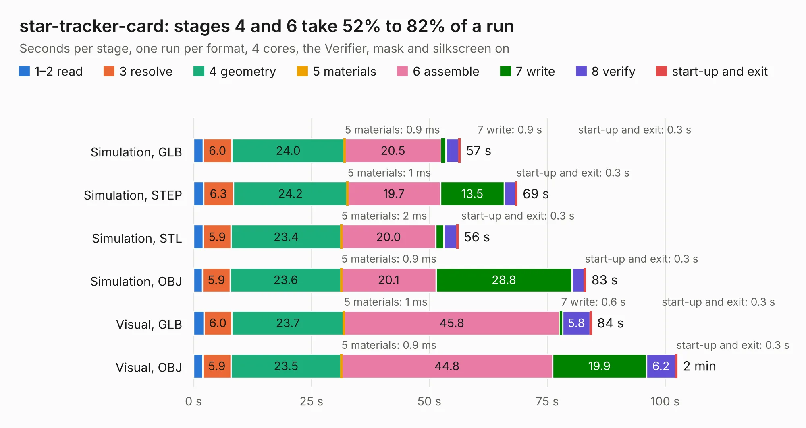

| Mode and format | 1–2 read | 3 resolve | 4 geometry | 5 materials | 6 assemble | 7 write | 8 verify | start-up and exit | Total |
|---|---:|---:|---:|---:|---:|---:|---:|---:|---:|
| Simulation, GLB | 2.1 | 6.0 | 24.0 | 0.9&nbsp;ms | 20.5 | 0.9 | 2.7 | 0.3 | 56.5 |
| Simulation, STEP | 2.1 | 6.3 | 24.2 | 1&nbsp;ms | 19.7 | 13.5 | 2.4 | 0.3 | 68.6 |
| Simulation, STL | 2.1 | 5.9 | 23.4 | 2&nbsp;ms | 20.0 | 1.7 | 2.8 | 0.3 | 56.1 |
| Simulation, OBJ | 1.9 | 5.9 | 23.6 | 0.9&nbsp;ms | 20.1 | 28.8 | 2.6 | 0.3 | 83.2 |
| Visual, GLB | 2.2 | 6.0 | 23.7 | 1&nbsp;ms | 45.8 | 0.6 | 5.8 | 0.3 | 84.4 |
| Visual, OBJ | 2.0 | 5.9 | 23.5 | 0.9&nbsp;ms | 44.8 | 19.9 | 6.2 | 0.3 | 102.5 |

<table align="center"><tr><td valign="top">

| Board | Repo: [oresat/oresat-star-tracker-hardware](https://github.com/oresat/oresat-star-tracker-hardware) Board: `star-tracker-card.kicad_pcb` |
|---|---|
| Folder | hardware / star-tracker-card |
| Complexity | 408&nbsp;/&nbsp;1000 (size&nbsp;288, features&nbsp;120) |
| KESE&nbsp;features | through vias, rounded, trapezoid or chamfered pads, drill offsets, arc tracks, filled zones, stack-up, dielectric εr and tanδ, copper finish, mask and silkscreen colours |
| Tested | 9th November 2026 |
| Copper&nbsp;layers | 4 |
| File&nbsp;format | KiCad 10 (20260206) |
| Parts,&nbsp;tracks,&nbsp;vias | 164, 3,450, 657 |
| Triangles,&nbsp;simulation | 5,239,886 in 447 parts |
| Verifier | PASS in all six runs |

</td><td valign="top">

<table>
<tr><th>File type</th><th>File size</th><th>Peak memory used</th></tr>
<tr><th colspan="3" align="left">Simulation</th></tr>
<tr><td>GLB</td><td align="right">182&nbsp;MB</td><td align="right">1.6&nbsp;GB</td></tr>
<tr><td>STEP</td><td align="right">850&nbsp;MB</td><td align="right">2.1&nbsp;GB</td></tr>
<tr><td>STL</td><td align="right">262&nbsp;MB</td><td align="right">1.6&nbsp;GB</td></tr>
<tr><td>OBJ</td><td align="right">572&nbsp;MB</td><td align="right">3.5&nbsp;GB</td></tr>
<tr><th colspan="3" align="left">Visual</th></tr>
<tr><td>GLB</td><td align="right">126&nbsp;MB</td><td align="right">2.1&nbsp;GB</td></tr>
<tr><td>OBJ</td><td align="right">408&nbsp;MB</td><td align="right">2.7&nbsp;GB</td></tr>
</table>

</td></tr></table>

## 2202. GPIO to motor

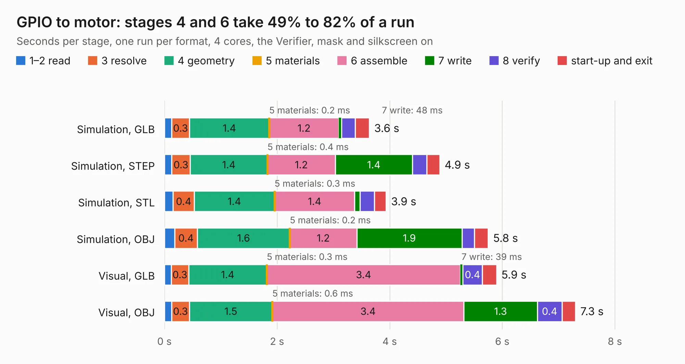

| Mode and format | 1–2 read | 3 resolve | 4 geometry | 5 materials | 6 assemble | 7 write | 8 verify | start-up and exit | Total |
|---|---:|---:|---:|---:|---:|---:|---:|---:|---:|
| Simulation, GLB | 0.1 | 0.3 | 1.4 | 0.2&nbsp;ms | 1.2 | 48&nbsp;ms | 0.2 | 0.2 | 3.6 |
| Simulation, STEP | 0.1 | 0.3 | 1.4 | 0.4&nbsp;ms | 1.2 | 1.4 | 0.3 | 0.2 | 4.9 |
| Simulation, STL | 0.2 | 0.4 | 1.4 | 0.3&nbsp;ms | 1.4 | 96&nbsp;ms | 0.3 | 0.2 | 3.9 |
| Simulation, OBJ | 0.2 | 0.4 | 1.6 | 0.2&nbsp;ms | 1.2 | 1.9 | 0.2 | 0.2 | 5.8 |
| Visual, GLB | 0.1 | 0.3 | 1.4 | 0.3&nbsp;ms | 3.4 | 39&nbsp;ms | 0.4 | 0.2 | 5.9 |
| Visual, OBJ | 0.1 | 0.3 | 1.5 | 0.6&nbsp;ms | 3.4 | 1.3 | 0.4 | 0.2 | 7.3 |

<table align="center"><tr><td valign="top">

| Board | Repo: [oresat/reaction-wheels](https://github.com/oresat/reaction-wheels) Board: `GPIO to motor.kicad_pcb` |
|---|---|
| Folder | Edison_GPIO_Motor_Board |
| Complexity | 193&nbsp;/&nbsp;1000 (size&nbsp;148, features&nbsp;45) |
| KESE&nbsp;features | through vias, filled zones, curved board outline |
| Tested | 9th November 2026 |
| Copper&nbsp;layers | 2 |
| File&nbsp;format | KiCad 4 (4) |
| Parts,&nbsp;tracks,&nbsp;vias | 11, 326, 85 |
| Triangles,&nbsp;simulation | 399,388 in 41 parts |
| Verifier | PASS in all six runs |

</td><td valign="top">

<table>
<tr><th>File type</th><th>File size</th><th>Peak memory used</th></tr>
<tr><th colspan="3" align="left">Simulation</th></tr>
<tr><td>GLB</td><td align="right">13&nbsp;MB</td><td align="right">267&nbsp;MB</td></tr>
<tr><td>STEP</td><td align="right">54&nbsp;MB</td><td align="right">301&nbsp;MB</td></tr>
<tr><td>STL</td><td align="right">20&nbsp;MB</td><td align="right">287&nbsp;MB</td></tr>
<tr><td>OBJ</td><td align="right">39&nbsp;MB</td><td align="right">311&nbsp;MB</td></tr>
<tr><th colspan="3" align="left">Visual</th></tr>
<tr><td>GLB</td><td align="right">9.0&nbsp;MB</td><td align="right">274&nbsp;MB</td></tr>
<tr><td>OBJ</td><td align="right">26&nbsp;MB</td><td align="right">274&nbsp;MB</td></tr>
</table>

</td></tr></table>

## 2203. Edison_Motor_Servo

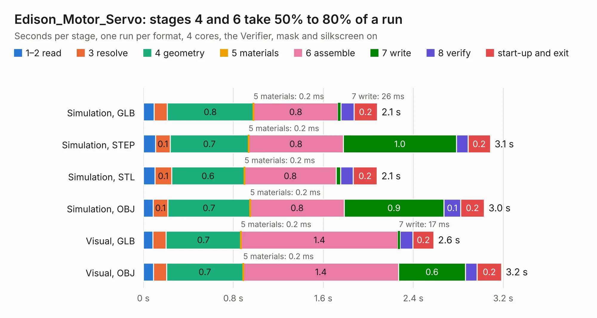

| Mode and format | 1–2 read | 3 resolve | 4 geometry | 5 materials | 6 assemble | 7 write | 8 verify | start-up and exit | Total |
|---|---:|---:|---:|---:|---:|---:|---:|---:|---:|
| Simulation, GLB | 96&nbsp;ms | 0.1 | 0.8 | 0.2&nbsp;ms | 0.8 | 26&nbsp;ms | 0.1 | 0.2 | 2.1 |
| Simulation, STEP | 0.1 | 0.1 | 0.7 | 0.2&nbsp;ms | 0.8 | 1.0 | 0.1 | 0.2 | 3.1 |
| Simulation, STL | 0.1 | 0.1 | 0.6 | 0.2&nbsp;ms | 0.8 | 39&nbsp;ms | 0.1 | 0.2 | 2.1 |
| Simulation, OBJ | 87&nbsp;ms | 0.1 | 0.7 | 0.2&nbsp;ms | 0.8 | 0.9 | 0.1 | 0.2 | 3.0 |
| Visual, GLB | 85&nbsp;ms | 0.1 | 0.7 | 0.2&nbsp;ms | 1.4 | 17&nbsp;ms | 0.1 | 0.2 | 2.6 |
| Visual, OBJ | 91&nbsp;ms | 0.1 | 0.7 | 0.2&nbsp;ms | 1.4 | 0.6 | 0.1 | 0.2 | 3.2 |

<table align="center"><tr><td valign="top">

| Board | Repo: [oresat/reaction-wheels](https://github.com/oresat/reaction-wheels) Board: `Edison_Motor_Servo.kicad_pcb` |
|---|---|
| Folder | Edison_GPIO_Motor_via_servo |
| Complexity | 130&nbsp;/&nbsp;1000 (size&nbsp;90, features&nbsp;40) |
| KESE&nbsp;features | filled zones, copper text, curved board outline |
| Tested | 9th November 2026 |
| Copper&nbsp;layers | 2 |
| File&nbsp;format | KiCad 4 (4) |
| Parts,&nbsp;tracks,&nbsp;vias | 6, 23, 0 |
| Triangles,&nbsp;simulation | 156,220 in 35 parts |
| Verifier | PASS in all six runs |

</td><td valign="top">

<table>
<tr><th>File type</th><th>File size</th><th>Peak memory used</th></tr>
<tr><th colspan="3" align="left">Simulation</th></tr>
<tr><td>GLB</td><td align="right">4.8&nbsp;MB</td><td align="right">193&nbsp;MB</td></tr>
<tr><td>STEP</td><td align="right">25&nbsp;MB</td><td align="right">217&nbsp;MB</td></tr>
<tr><td>STL</td><td align="right">7.8&nbsp;MB</td><td align="right">193&nbsp;MB</td></tr>
<tr><td>OBJ</td><td align="right">15&nbsp;MB</td><td align="right">189&nbsp;MB</td></tr>
<tr><th colspan="3" align="left">Visual</th></tr>
<tr><td>GLB</td><td align="right">3.3&nbsp;MB</td><td align="right">166&nbsp;MB</td></tr>
<tr><td>OBJ</td><td align="right">9.2&nbsp;MB</td><td align="right">165&nbsp;MB</td></tr>
</table>

</td></tr></table>

## 2204. MotCtrl

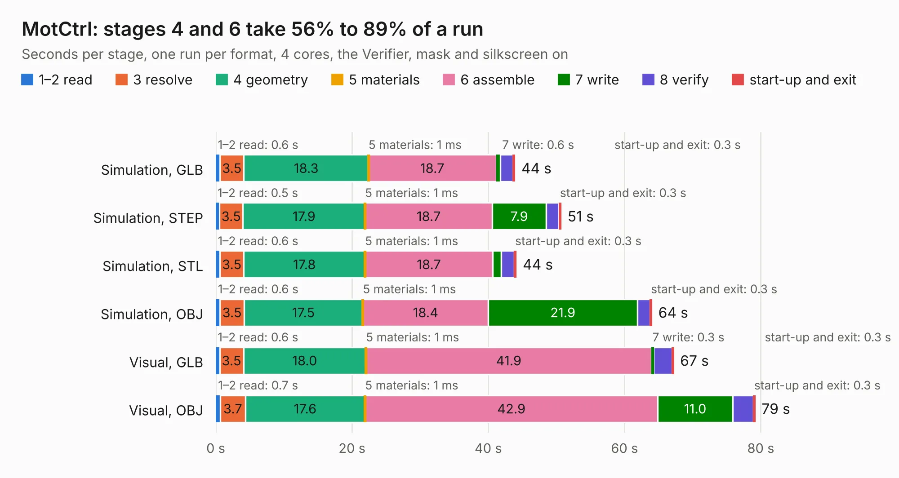

| Mode and format | 1–2 read | 3 resolve | 4 geometry | 5 materials | 6 assemble | 7 write | 8 verify | start-up and exit | Total |
|---|---:|---:|---:|---:|---:|---:|---:|---:|---:|
| Simulation, GLB | 0.6 | 3.5 | 18.3 | 1&nbsp;ms | 18.7 | 0.6 | 1.8 | 0.3 | 43.9 |
| Simulation, STEP | 0.5 | 3.5 | 17.9 | 1&nbsp;ms | 18.7 | 7.9 | 1.9 | 0.3 | 50.7 |
| Simulation, STL | 0.6 | 3.5 | 17.8 | 1&nbsp;ms | 18.7 | 1.3 | 1.9 | 0.3 | 44.1 |
| Simulation, OBJ | 0.6 | 3.5 | 17.5 | 1&nbsp;ms | 18.4 | 21.9 | 1.9 | 0.3 | 64.0 |
| Visual, GLB | 0.6 | 3.5 | 18.0 | 1&nbsp;ms | 41.9 | 0.3 | 2.7 | 0.3 | 67.2 |
| Visual, OBJ | 0.7 | 3.7 | 17.6 | 1&nbsp;ms | 42.9 | 11.0 | 3.0 | 0.3 | 79.2 |

<table align="center"><tr><td valign="top">

| Board | Repo: [osannolik/motctrl](https://github.com/osannolik/motctrl) Board: `MotCtrl.kicad_pcb` |
|---|---|
| Folder | hw / kicad |
| Complexity | 319&nbsp;/&nbsp;1000 (size&nbsp;264, features&nbsp;55) |
| KESE&nbsp;features | through vias, rounded, trapezoid or chamfered pads, filled zones, curved board outline |
| Tested | 9th November 2026 |
| Copper&nbsp;layers | 4 |
| File&nbsp;format | KiCad 4 (4) |
| Parts,&nbsp;tracks,&nbsp;vias | 132, 2,127, 758 |
| Triangles,&nbsp;simulation | 3,514,890 in 119 parts |
| Verifier | PASS in all six runs |

</td><td valign="top">

<table>
<tr><th>File type</th><th>File size</th><th>Peak memory used</th></tr>
<tr><th colspan="3" align="left">Simulation</th></tr>
<tr><td>GLB</td><td align="right">122&nbsp;MB</td><td align="right">926&nbsp;MB</td></tr>
<tr><td>STEP</td><td align="right">429&nbsp;MB</td><td align="right">1.2&nbsp;GB</td></tr>
<tr><td>STL</td><td align="right">176&nbsp;MB</td><td align="right">908&nbsp;MB</td></tr>
<tr><td>OBJ</td><td align="right">377&nbsp;MB</td><td align="right">2.3&nbsp;GB</td></tr>
<tr><th colspan="3" align="left">Visual</th></tr>
<tr><td>GLB</td><td align="right">61&nbsp;MB</td><td align="right">1.2&nbsp;GB</td></tr>
<tr><td>OBJ</td><td align="right">191&nbsp;MB</td><td align="right">1.4&nbsp;GB</td></tr>
</table>

</td></tr></table>

## 2205. logicbone

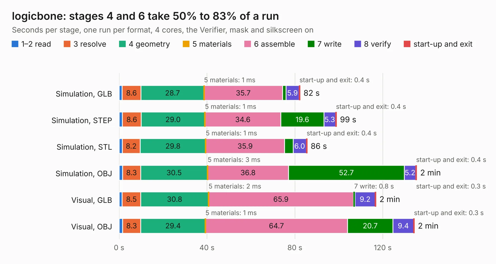

| Mode and format | 1–2 read | 3 resolve | 4 geometry | 5 materials | 6 assemble | 7 write | 8 verify | start-up and exit | Total |
|---|---:|---:|---:|---:|---:|---:|---:|---:|---:|
| Simulation, GLB | 1.4 | 8.6 | 28.7 | 1&nbsp;ms | 35.7 | 1.6 | 5.9 | 0.4 | 82.3 |
| Simulation, STEP | 1.5 | 8.6 | 29.0 | 1&nbsp;ms | 34.6 | 19.6 | 5.3 | 0.4 | 98.9 |
| Simulation, STL | 1.4 | 8.2 | 29.8 | 1&nbsp;ms | 35.9 | 3.9 | 6.0 | 0.4 | 85.6 |
| Simulation, OBJ | 1.5 | 8.3 | 30.5 | 3&nbsp;ms | 36.8 | 52.7 | 5.2 | 0.4 | 135.4 |
| Visual, GLB | 1.4 | 8.5 | 30.8 | 2&nbsp;ms | 65.9 | 0.8 | 9.2 | 0.3 | 116.9 |
| Visual, OBJ | 1.5 | 8.3 | 29.4 | 1&nbsp;ms | 64.7 | 20.7 | 9.4 | 0.3 | 134.4 |

<table align="center"><tr><td valign="top">

| Board | Repo: [oskirby/logicbone](https://github.com/oskirby/logicbone) Board: `logicbone.kicad_pcb` |
|---|---|
| Complexity | 419&nbsp;/&nbsp;1000 (size&nbsp;329, features&nbsp;90) |
| KESE&nbsp;features | through vias, slotted holes, custom pads, rounded, trapezoid or chamfered pads, filled zones, copper drawings, curved board outline |
| Tested | 9th November 2026 |
| Copper&nbsp;layers | 8 |
| File&nbsp;format | KiCad 5 (20171130) |
| Parts,&nbsp;tracks,&nbsp;vias | 258, 9,859, 658 |
| Triangles,&nbsp;simulation | 9,046,192 in 404 parts |
| Verifier | PASS in all six runs |

</td><td valign="top">

<table>
<tr><th>File type</th><th>File size</th><th>Peak memory used</th></tr>
<tr><th colspan="3" align="left">Simulation</th></tr>
<tr><td>GLB</td><td align="right">311&nbsp;MB</td><td align="right">2.1&nbsp;GB</td></tr>
<tr><td>STEP</td><td align="right">1.2&nbsp;GB</td><td align="right">2.9&nbsp;GB</td></tr>
<tr><td>STL</td><td align="right">452&nbsp;MB</td><td align="right">2.2&nbsp;GB</td></tr>
<tr><td>OBJ</td><td align="right">997&nbsp;MB</td><td align="right">5.7&nbsp;GB</td></tr>
<tr><th colspan="3" align="left">Visual</th></tr>
<tr><td>GLB</td><td align="right">145&nbsp;MB</td><td align="right">2.5&nbsp;GB</td></tr>
<tr><td>OBJ</td><td align="right">480&nbsp;MB</td><td align="right">3.1&nbsp;GB</td></tr>
</table>

</td></tr></table>

## 2206. icE1usb-rs422

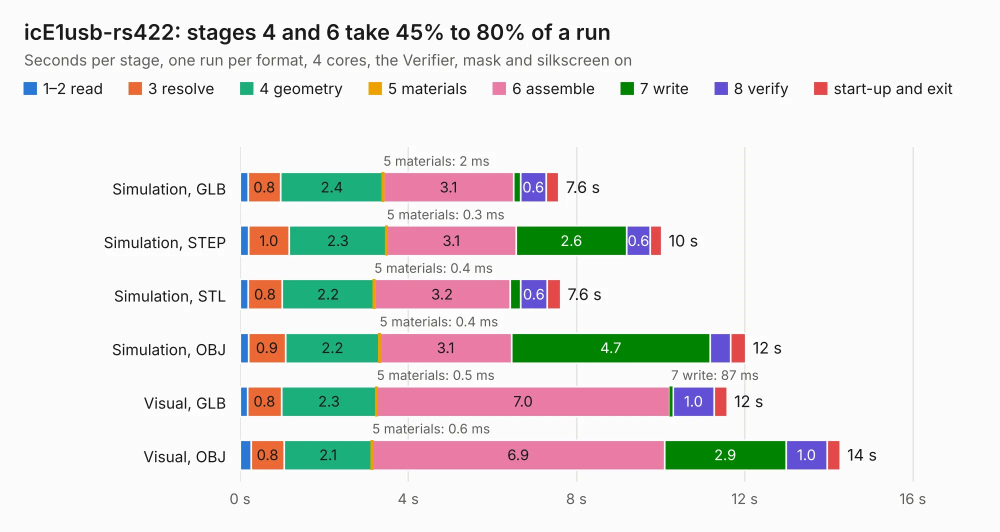

| Mode and format | 1–2 read | 3 resolve | 4 geometry | 5 materials | 6 assemble | 7 write | 8 verify | start-up and exit | Total |
|---|---:|---:|---:|---:|---:|---:|---:|---:|---:|
| Simulation, GLB | 0.2 | 0.8 | 2.4 | 2&nbsp;ms | 3.1 | 0.2 | 0.6 | 0.3 | 7.6 |
| Simulation, STEP | 0.2 | 1.0 | 2.3 | 0.3&nbsp;ms | 3.1 | 2.6 | 0.6 | 0.3 | 10.0 |
| Simulation, STL | 0.2 | 0.8 | 2.2 | 0.4&nbsp;ms | 3.2 | 0.3 | 0.6 | 0.3 | 7.6 |
| Simulation, OBJ | 0.2 | 0.9 | 2.2 | 0.4&nbsp;ms | 3.1 | 4.7 | 0.5 | 0.4 | 12.0 |
| Visual, GLB | 0.2 | 0.8 | 2.3 | 0.5&nbsp;ms | 7.0 | 87&nbsp;ms | 1.0 | 0.3 | 11.6 |
| Visual, OBJ | 0.3 | 0.8 | 2.1 | 0.6&nbsp;ms | 6.9 | 2.9 | 1.0 | 0.3 | 14.3 |

<table align="center"><tr><td valign="top">

| Board | Repo: [osmocom/osmo-e1-hardware](https://github.com/osmocom/osmo-e1-hardware) Board: `icE1usb-rs422.kicad_pcb` |
|---|---|
| Folder | hardware / icE1usb-rs422 |
| Complexity | 272&nbsp;/&nbsp;1000 (size&nbsp;187, features&nbsp;85) |
| KESE&nbsp;features | through vias, rounded, trapezoid or chamfered pads, filled zones, curved board outline, stack-up, dielectric εr and tanδ |
| Tested | 9th November 2026 |
| Copper&nbsp;layers | 4 |
| File&nbsp;format | KiCad 6 (20211014) |
| Parts,&nbsp;tracks,&nbsp;vias | 52, 501, 110 |
| Triangles,&nbsp;simulation | 713,298 in 68 parts |
| Verifier | PASS in all six runs |

</td><td valign="top">

<table>
<tr><th>File type</th><th>File size</th><th>Peak memory used</th></tr>
<tr><th colspan="3" align="left">Simulation</th></tr>
<tr><td>GLB</td><td align="right">24&nbsp;MB</td><td align="right">318&nbsp;MB</td></tr>
<tr><td>STEP</td><td align="right">89&nbsp;MB</td><td align="right">377&nbsp;MB</td></tr>
<tr><td>STL</td><td align="right">36&nbsp;MB</td><td align="right">353&nbsp;MB</td></tr>
<tr><td>OBJ</td><td align="right">71&nbsp;MB</td><td align="right">472&nbsp;MB</td></tr>
<tr><th colspan="3" align="left">Visual</th></tr>
<tr><td>GLB</td><td align="right">15&nbsp;MB</td><td align="right">399&nbsp;MB</td></tr>
<tr><td>OBJ</td><td align="right">47&nbsp;MB</td><td align="right">390&nbsp;MB</td></tr>
</table>

</td></tr></table>

## 2207. icE1usb

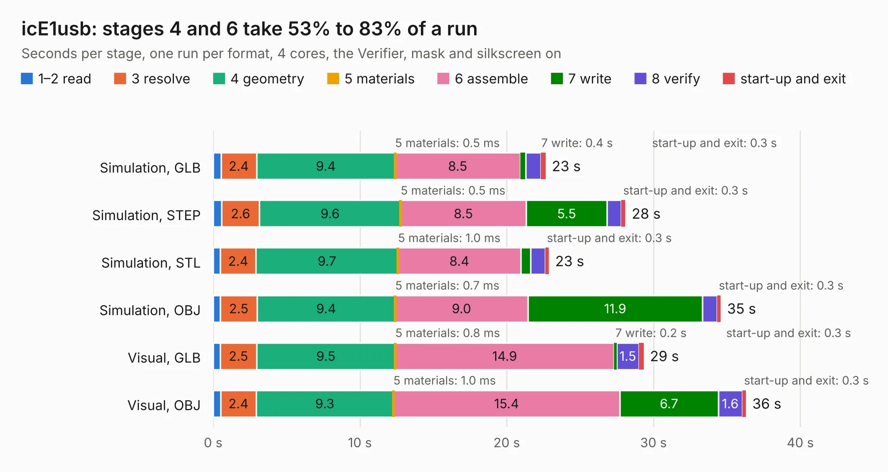

| Mode and format | 1–2 read | 3 resolve | 4 geometry | 5 materials | 6 assemble | 7 write | 8 verify | start-up and exit | Total |
|---|---:|---:|---:|---:|---:|---:|---:|---:|---:|
| Simulation, GLB | 0.5 | 2.4 | 9.4 | 0.5&nbsp;ms | 8.5 | 0.4 | 1.0 | 0.3 | 22.6 |
| Simulation, STEP | 0.6 | 2.6 | 9.6 | 0.5&nbsp;ms | 8.5 | 5.5 | 0.9 | 0.3 | 28.1 |
| Simulation, STL | 0.5 | 2.4 | 9.7 | 1.0&nbsp;ms | 8.4 | 0.7 | 1.0 | 0.3 | 22.9 |
| Simulation, OBJ | 0.5 | 2.5 | 9.4 | 0.7&nbsp;ms | 9.0 | 11.9 | 1.0 | 0.3 | 34.6 |
| Visual, GLB | 0.5 | 2.5 | 9.5 | 0.8&nbsp;ms | 14.9 | 0.2 | 1.5 | 0.3 | 29.3 |
| Visual, OBJ | 0.5 | 2.4 | 9.3 | 1.0&nbsp;ms | 15.4 | 6.7 | 1.6 | 0.3 | 36.3 |

<table align="center"><tr><td valign="top">

| Board | Repo: [osmocom/osmo-e1-hardware](https://github.com/osmocom/osmo-e1-hardware) Board: `icE1usb.kicad_pcb` |
|---|---|
| Folder | hardware / icE1usb |
| Complexity | 315&nbsp;/&nbsp;1000 (size&nbsp;250, features&nbsp;65) |
| KESE&nbsp;features | through vias, slotted holes, rounded, trapezoid or chamfered pads, filled zones, curved board outline |
| Tested | 9th November 2026 |
| Copper&nbsp;layers | 4 |
| File&nbsp;format | KiCad 6 (20211014) |
| Parts,&nbsp;tracks,&nbsp;vias | 118, 1,527, 169 |
| Triangles,&nbsp;simulation | 1,851,700 in 171 parts |
| Verifier | PASS in all six runs |

</td><td valign="top">

<table>
<tr><th>File type</th><th>File size</th><th>Peak memory used</th></tr>
<tr><th colspan="3" align="left">Simulation</th></tr>
<tr><td>GLB</td><td align="right">64&nbsp;MB</td><td align="right">660&nbsp;MB</td></tr>
<tr><td>STEP</td><td align="right">281&nbsp;MB</td><td align="right">823&nbsp;MB</td></tr>
<tr><td>STL</td><td align="right">93&nbsp;MB</td><td align="right">635&nbsp;MB</td></tr>
<tr><td>OBJ</td><td align="right">195&nbsp;MB</td><td align="right">1.3&nbsp;GB</td></tr>
<tr><th colspan="3" align="left">Visual</th></tr>
<tr><td>GLB</td><td align="right">35&nbsp;MB</td><td align="right">756&nbsp;MB</td></tr>
<tr><td>OBJ</td><td align="right">108&nbsp;MB</td><td align="right">852&nbsp;MB</td></tr>
</table>

</td></tr></table>

## 2208. icE1usb

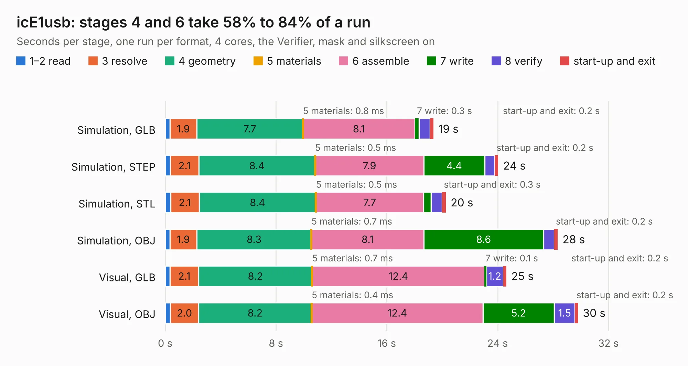

| Mode and format | 1–2 read | 3 resolve | 4 geometry | 5 materials | 6 assemble | 7 write | 8 verify | start-up and exit | Total |
|---|---:|---:|---:|---:|---:|---:|---:|---:|---:|
| Simulation, GLB | 0.3 | 1.9 | 7.7 | 0.8&nbsp;ms | 8.1 | 0.3 | 0.8 | 0.2 | 19.4 |
| Simulation, STEP | 0.4 | 2.1 | 8.4 | 0.5&nbsp;ms | 7.9 | 4.4 | 0.7 | 0.2 | 24.0 |
| Simulation, STL | 0.4 | 2.1 | 8.4 | 0.5&nbsp;ms | 7.7 | 0.6 | 0.8 | 0.3 | 20.3 |
| Simulation, OBJ | 0.3 | 1.9 | 8.3 | 0.7&nbsp;ms | 8.1 | 8.6 | 0.8 | 0.2 | 28.3 |
| Visual, GLB | 0.4 | 2.1 | 8.2 | 0.7&nbsp;ms | 12.4 | 0.1 | 1.2 | 0.2 | 24.6 |
| Visual, OBJ | 0.4 | 2.0 | 8.2 | 0.4&nbsp;ms | 12.4 | 5.2 | 1.5 | 0.2 | 29.8 |

<table align="center"><tr><td valign="top">

| Board | Repo: [osmocom/osmo-e1-hardware](https://github.com/osmocom/osmo-e1-hardware) Board: `icE1usb.kicad_pcb` |
|---|---|
| Folder | hardware / icE1usb / r0.1 |
| Complexity | 316&nbsp;/&nbsp;1000 (size&nbsp;251, features&nbsp;65) |
| KESE&nbsp;features | through vias, slotted holes, rounded, trapezoid or chamfered pads, filled zones, curved board outline |
| Tested | 9th November 2026 |
| Copper&nbsp;layers | 4 |
| File&nbsp;format | KiCad 5 (20171130) |
| Parts,&nbsp;tracks,&nbsp;vias | 116, 1,597, 187 |
| Triangles,&nbsp;simulation | 1,861,880 in 169 parts |
| Verifier | PASS in all six runs |

</td><td valign="top">

<table>
<tr><th>File type</th><th>File size</th><th>Peak memory used</th></tr>
<tr><th colspan="3" align="left">Simulation</th></tr>
<tr><td>GLB</td><td align="right">64&nbsp;MB</td><td align="right">656&nbsp;MB</td></tr>
<tr><td>STEP</td><td align="right">276&nbsp;MB</td><td align="right">833&nbsp;MB</td></tr>
<tr><td>STL</td><td align="right">93&nbsp;MB</td><td align="right">651&nbsp;MB</td></tr>
<tr><td>OBJ</td><td align="right">196&nbsp;MB</td><td align="right">1.3&nbsp;GB</td></tr>
<tr><th colspan="3" align="left">Visual</th></tr>
<tr><td>GLB</td><td align="right">35&nbsp;MB</td><td align="right">811&nbsp;MB</td></tr>
<tr><td>OBJ</td><td align="right">108&nbsp;MB</td><td align="right">806&nbsp;MB</td></tr>
</table>

</td></tr></table>

## 2209. icE1usb-panel

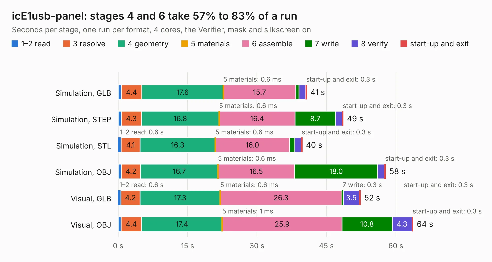

| Mode and format | 1–2 read | 3 resolve | 4 geometry | 5 materials | 6 assemble | 7 write | 8 verify | start-up and exit | Total |
|---|---:|---:|---:|---:|---:|---:|---:|---:|---:|
| Simulation, GLB | 0.7 | 4.4 | 17.6 | 0.6&nbsp;ms | 15.7 | 0.7 | 1.4 | 0.3 | 40.8 |
| Simulation, STEP | 0.7 | 4.3 | 16.8 | 0.6&nbsp;ms | 16.4 | 8.7 | 1.4 | 0.3 | 48.7 |
| Simulation, STL | 0.6 | 4.1 | 16.3 | 0.6&nbsp;ms | 16.0 | 1.2 | 1.4 | 0.3 | 39.8 |
| Simulation, OBJ | 0.7 | 4.2 | 16.7 | 0.6&nbsp;ms | 16.5 | 18.0 | 1.5 | 0.3 | 57.8 |
| Visual, GLB | 0.6 | 4.2 | 17.3 | 0.6&nbsp;ms | 26.3 | 0.3 | 3.5 | 0.3 | 52.4 |
| Visual, OBJ | 0.6 | 4.4 | 17.4 | 1&nbsp;ms | 25.9 | 10.8 | 4.3 | 0.3 | 63.8 |

<table align="center"><tr><td valign="top">

| Board | Repo: [osmocom/osmo-e1-hardware](https://github.com/osmocom/osmo-e1-hardware) Board: `icE1usb-panel.kicad_pcb` |
|---|---|
| Folder | hardware / icE1usb / r1.0 |
| Complexity | 341&nbsp;/&nbsp;1000 (size&nbsp;276, features&nbsp;65) |
| KESE&nbsp;features | through vias, slotted holes, rounded, trapezoid or chamfered pads, filled zones, curved board outline |
| Tested | 9th November 2026 |
| Copper&nbsp;layers | 4 |
| File&nbsp;format | KiCad 5 (20171130) |
| Parts,&nbsp;tracks,&nbsp;vias | 240, 3,164, 370 |
| Triangles,&nbsp;simulation | 3,815,094 in 169 parts |
| Note | panel |
| Verifier | PASS in all six runs |

</td><td valign="top">

<table>
<tr><th>File type</th><th>File size</th><th>Peak memory used</th></tr>
<tr><th colspan="3" align="left">Simulation</th></tr>
<tr><td>GLB</td><td align="right">132&nbsp;MB</td><td align="right">1.1&nbsp;GB</td></tr>
<tr><td>STEP</td><td align="right">572&nbsp;MB</td><td align="right">1.5&nbsp;GB</td></tr>
<tr><td>STL</td><td align="right">191&nbsp;MB</td><td align="right">1.2&nbsp;GB</td></tr>
<tr><td>OBJ</td><td align="right">408&nbsp;MB</td><td align="right">2.5&nbsp;GB</td></tr>
<tr><th colspan="3" align="left">Visual</th></tr>
<tr><td>GLB</td><td align="right">74&nbsp;MB</td><td align="right">1.3&nbsp;GB</td></tr>
<tr><td>OBJ</td><td align="right">232&nbsp;MB</td><td align="right">1.6&nbsp;GB</td></tr>
</table>

</td></tr></table>

## 2210. icE1usb

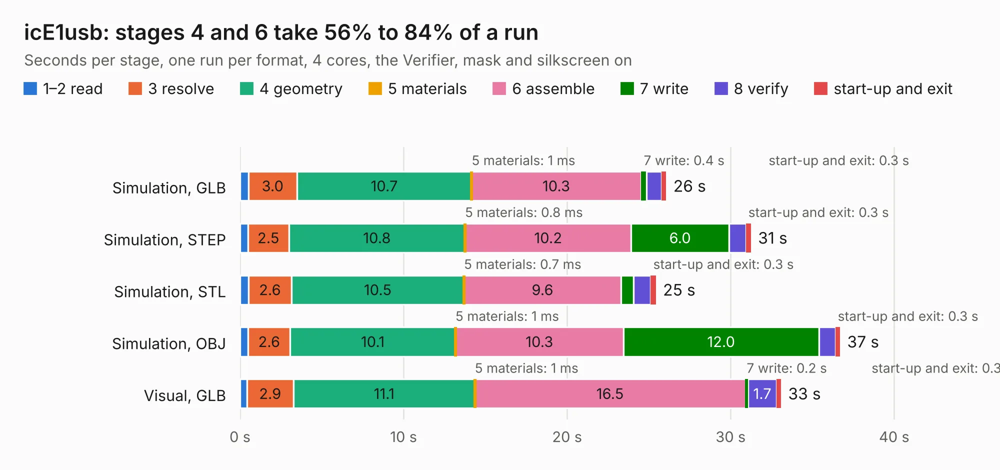

| Mode and format | 1–2 read | 3 resolve | 4 geometry | 5 materials | 6 assemble | 7 write | 8 verify | start-up and exit | Total |
|---|---:|---:|---:|---:|---:|---:|---:|---:|---:|
| Simulation, GLB | 0.5 | 3.0 | 10.7 | 1&nbsp;ms | 10.3 | 0.4 | 0.9 | 0.3 | 26.1 |
| Simulation, STEP | 0.5 | 2.5 | 10.8 | 0.8&nbsp;ms | 10.2 | 6.0 | 1.0 | 0.3 | 31.2 |
| Simulation, STL | 0.5 | 2.6 | 10.5 | 0.7&nbsp;ms | 9.6 | 0.8 | 1.0 | 0.3 | 25.4 |
| Simulation, OBJ | 0.5 | 2.6 | 10.1 | 1&nbsp;ms | 10.3 | 12.0 | 1.0 | 0.3 | 36.7 |
| Visual, GLB | 0.4 | 2.9 | 11.1 | 1&nbsp;ms | 16.5 | 0.2 | 1.7 | 0.3 | 33.1 |
| Visual, OBJ | 0.5 | 2.4 | 10.3 | 0.8&nbsp;ms | 15.6 | 6.3 | 2.2 | 0.3 | 37.6 |

<table align="center"><tr><td valign="top">

| Board | Repo: [osmocom/osmo-e1-hardware](https://github.com/osmocom/osmo-e1-hardware) Board: `icE1usb.kicad_pcb` |
|---|---|
| Folder | hardware / icE1usb / r1.0 |
| Complexity | 316&nbsp;/&nbsp;1000 (size&nbsp;251, features&nbsp;65) |
| KESE&nbsp;features | through vias, slotted holes, rounded, trapezoid or chamfered pads, filled zones, curved board outline |
| Tested | 9th November 2026 |
| Copper&nbsp;layers | 4 |
| File&nbsp;format | KiCad 5 (20171130) |
| Parts,&nbsp;tracks,&nbsp;vias | 116, 1,582, 185 |
| Triangles,&nbsp;simulation | 1,857,088 in 169 parts |
| Verifier | PASS in all six runs |

</td><td valign="top">

<table>
<tr><th>File type</th><th>File size</th><th>Peak memory used</th></tr>
<tr><th colspan="3" align="left">Simulation</th></tr>
<tr><td>GLB</td><td align="right">64&nbsp;MB</td><td align="right">669&nbsp;MB</td></tr>
<tr><td>STEP</td><td align="right">275&nbsp;MB</td><td align="right">834&nbsp;MB</td></tr>
<tr><td>STL</td><td align="right">93&nbsp;MB</td><td align="right">640&nbsp;MB</td></tr>
<tr><td>OBJ</td><td align="right">195&nbsp;MB</td><td align="right">1.3&nbsp;GB</td></tr>
<tr><th colspan="3" align="left">Visual</th></tr>
<tr><td>GLB</td><td align="right">35&nbsp;MB</td><td align="right">815&nbsp;MB</td></tr>
<tr><td>OBJ</td><td align="right">107&nbsp;MB</td><td align="right">870&nbsp;MB</td></tr>
</table>

</td></tr></table>

## 2211. clk-input-fmc

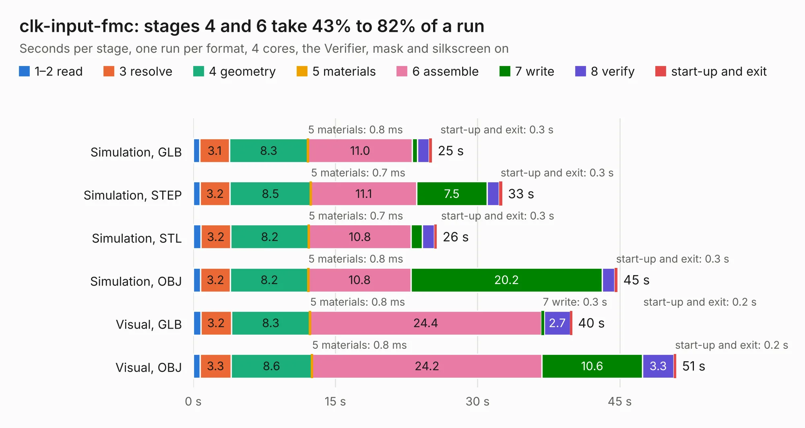

| Mode and format | 1–2 read | 3 resolve | 4 geometry | 5 materials | 6 assemble | 7 write | 8 verify | start-up and exit | Total |
|---|---:|---:|---:|---:|---:|---:|---:|---:|---:|
| Simulation, GLB | 0.7 | 3.1 | 8.3 | 0.8&nbsp;ms | 11.0 | 0.5 | 1.3 | 0.3 | 25.2 |
| Simulation, STEP | 0.7 | 3.2 | 8.5 | 0.7&nbsp;ms | 11.1 | 7.5 | 1.3 | 0.3 | 32.6 |
| Simulation, STL | 0.8 | 3.2 | 8.2 | 0.7&nbsp;ms | 10.8 | 1.2 | 1.3 | 0.3 | 25.7 |
| Simulation, OBJ | 0.8 | 3.2 | 8.2 | 0.8&nbsp;ms | 10.8 | 20.2 | 1.3 | 0.3 | 44.8 |
| Visual, GLB | 0.8 | 3.2 | 8.3 | 0.8&nbsp;ms | 24.4 | 0.3 | 2.7 | 0.2 | 40.0 |
| Visual, OBJ | 0.7 | 3.3 | 8.6 | 0.8&nbsp;ms | 24.2 | 10.6 | 3.3 | 0.2 | 51.0 |

<table align="center"><tr><td valign="top">

| Board | Repo: [osprey-dcs/clk-input-fmc](https://github.com/osprey-dcs/clk-input-fmc) Board: `clk-input-fmc.kicad_pcb` |
|---|---|
| Complexity | 417&nbsp;/&nbsp;1000 (size&nbsp;272, features&nbsp;145) |
| KESE&nbsp;features | through vias, slotted holes, rounded, trapezoid or chamfered pads, arc tracks, filled zones, curved board outline, knockout text, stack-up, dielectric εr and tanδ, copper finish, mask and silkscreen colours |
| Tested | 9th November 2026 |
| Copper&nbsp;layers | 6 |
| File&nbsp;format | KiCad 9 (20241229) |
| Parts,&nbsp;tracks,&nbsp;vias | 139, 1,528, 348 |
| Triangles,&nbsp;simulation | 3,732,828 in 355 parts |
| Verifier | PASS in all six runs |

</td><td valign="top">

<table>
<tr><th>File type</th><th>File size</th><th>Peak memory used</th></tr>
<tr><th colspan="3" align="left">Simulation</th></tr>
<tr><td>GLB</td><td align="right">124&nbsp;MB</td><td align="right">1.3&nbsp;GB</td></tr>
<tr><td>STEP</td><td align="right">414&nbsp;MB</td><td align="right">1.5&nbsp;GB</td></tr>
<tr><td>STL</td><td align="right">187&nbsp;MB</td><td align="right">1.4&nbsp;GB</td></tr>
<tr><td>OBJ</td><td align="right">390&nbsp;MB</td><td align="right">2.4&nbsp;GB</td></tr>
<tr><th colspan="3" align="left">Visual</th></tr>
<tr><td>GLB</td><td align="right">71&nbsp;MB</td><td align="right">1.6&nbsp;GB</td></tr>
<tr><td>OBJ</td><td align="right">225&nbsp;MB</td><td align="right">1.6&nbsp;GB</td></tr>
</table>

</td></tr></table>

## 2212. trigger-output-fmc

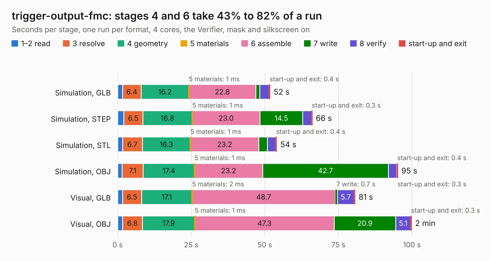

| Mode and format | 1–2 read | 3 resolve | 4 geometry | 5 materials | 6 assemble | 7 write | 8 verify | start-up and exit | Total |
|---|---:|---:|---:|---:|---:|---:|---:|---:|---:|
| Simulation, GLB | 1.6 | 6.4 | 16.2 | 1&nbsp;ms | 22.8 | 1.3 | 3.2 | 0.4 | 51.8 |
| Simulation, STEP | 2.1 | 6.5 | 16.8 | 1&nbsp;ms | 23.0 | 14.5 | 2.9 | 0.3 | 66.1 |
| Simulation, STL | 1.7 | 6.7 | 16.3 | 1&nbsp;ms | 23.2 | 2.9 | 2.8 | 0.4 | 54.1 |
| Simulation, OBJ | 1.5 | 7.1 | 17.4 | 1&nbsp;ms | 23.2 | 42.7 | 2.9 | 0.4 | 95.2 |
| Visual, GLB | 1.6 | 6.5 | 17.1 | 2&nbsp;ms | 48.7 | 0.7 | 5.7 | 0.3 | 80.7 |
| Visual, OBJ | 1.6 | 6.8 | 17.9 | 1&nbsp;ms | 47.3 | 20.9 | 5.1 | 0.3 | 99.9 |

<table align="center"><tr><td valign="top">

| Board | Repo: [osprey-dcs/trigger-output-fmc](https://github.com/osprey-dcs/trigger-output-fmc) Board: `trigger-output-fmc.kicad_pcb` |
|---|---|
| Complexity | 428&nbsp;/&nbsp;1000 (size&nbsp;298, features&nbsp;130) |
| KESE&nbsp;features | through vias, slotted holes, rounded, trapezoid or chamfered pads, filled zones, curved board outline, knockout text, stack-up, dielectric εr and tanδ, copper finish, mask and silkscreen colours |
| Tested | 9th November 2026 |
| Copper&nbsp;layers | 8 |
| File&nbsp;format | KiCad 9 (20241229) |
| Parts,&nbsp;tracks,&nbsp;vias | 323, 3,090, 543 |
| Triangles,&nbsp;simulation | 6,780,940 in 429 parts |
| Verifier | PASS in all six runs |

</td><td valign="top">

<table>
<tr><th>File type</th><th>File size</th><th>Peak memory used</th></tr>
<tr><th colspan="3" align="left">Simulation</th></tr>
<tr><td>GLB</td><td align="right">225&nbsp;MB</td><td align="right">2.1&nbsp;GB</td></tr>
<tr><td>STEP</td><td align="right">730&nbsp;MB</td><td align="right">2.3&nbsp;GB</td></tr>
<tr><td>STL</td><td align="right">339&nbsp;MB</td><td align="right">2.0&nbsp;GB</td></tr>
<tr><td>OBJ</td><td align="right">722&nbsp;MB</td><td align="right">4.2&nbsp;GB</td></tr>
<tr><th colspan="3" align="left">Visual</th></tr>
<tr><td>GLB</td><td align="right">115&nbsp;MB</td><td align="right">2.0&nbsp;GB</td></tr>
<tr><td>OBJ</td><td align="right">373&nbsp;MB</td><td align="right">2.5&nbsp;GB</td></tr>
</table>

</td></tr></table>

## 2213. HarleyGhostRider

| Mode and format | 1–2 read | 3 resolve | 4 geometry | 5 materials | 6 assemble | 7 write | 8 verify | start-up and exit | Total |
|---|---:|---:|---:|---:|---:|---:|---:|---:|---:|
| Simulation, GLB | 0.6 | 4.3 | 12.2 | 0.9&nbsp;ms | 14.6 | 0.7 | 2.4 | 0.3 | 35.0 |
| Simulation, STEP | 0.6 | 4.2 | 11.8 | 1&nbsp;ms | 14.2 | 8.0 | 2.3 | 0.3 | 41.4 |
| Simulation, STL | 0.6 | 4.4 | 11.6 | 1&nbsp;ms | 14.7 | 1.4 | 2.3 | 0.3 | 35.3 |
| Simulation, OBJ | 0.6 | 4.2 | 11.9 | 1&nbsp;ms | 14.9 | 23.7 | 2.4 | 0.3 | 57.9 |
| Visual, GLB | 0.6 | 4.4 | 12.8 | 1&nbsp;ms | 29.9 | 0.3 | 3.1 | 0.3 | 51.4 |
| Visual, OBJ | 0.6 | 4.5 | 12.4 | 0.9&nbsp;ms | 28.1 | 10.1 | 3.7 | 0.3 | 59.8 |

<table align="center"><tr><td valign="top">

| Board | Repo: [osrf/ovc](https://github.com/osrf/ovc) Board: `HarleyGhostRider.kicad_pcb` |
|---|---|
| Folder | ovc0 / hardware / HarleyGhostRider |
| Complexity | 393&nbsp;/&nbsp;1000 (size&nbsp;318, features&nbsp;75) |
| KESE&nbsp;features | through vias, microvias, filled zones |
| Tested | 9th November 2026 |
| Copper&nbsp;layers | 10 |
| File&nbsp;format | KiCad 4 (4) |
| Parts,&nbsp;tracks,&nbsp;vias | 172, 3,596, 586 |
| Triangles,&nbsp;simulation | 5,222,722 in 323 parts |
| Verifier | PASS in all six runs |

</td><td valign="top">

<table>
<tr><th>File type</th><th>File size</th><th>Peak memory used</th></tr>
<tr><th colspan="3" align="left">Simulation</th></tr>
<tr><td>GLB</td><td align="right">180&nbsp;MB</td><td align="right">1.1&nbsp;GB</td></tr>
<tr><td>STEP</td><td align="right">541&nbsp;MB</td><td align="right">1.5&nbsp;GB</td></tr>
<tr><td>STL</td><td align="right">261&nbsp;MB</td><td align="right">1.1&nbsp;GB</td></tr>
<tr><td>OBJ</td><td align="right">572&nbsp;MB</td><td align="right">3.3&nbsp;GB</td></tr>
<tr><th colspan="3" align="left">Visual</th></tr>
<tr><td>GLB</td><td align="right">77&nbsp;MB</td><td align="right">1.4&nbsp;GB</td></tr>
<tr><td>OBJ</td><td align="right">259&nbsp;MB</td><td align="right">1.8&nbsp;GB</td></tr>
</table>

</td></tr></table>

## 2214. HarleyTandem

| Mode and format | 1–2 read | 3 resolve | 4 geometry | 5 materials | 6 assemble | 7 write | 8 verify | start-up and exit | Total |
|---|---:|---:|---:|---:|---:|---:|---:|---:|---:|
| Simulation, GLB | 0.7 | 2.5 | 9.1 | 0.7&nbsp;ms | 8.4 | 0.5 | 1.2 | 0.3 | 22.8 |
| Simulation, STEP | 0.7 | 2.5 | 9.3 | 1&nbsp;ms | 8.2 | 5.9 | 1.2 | 0.3 | 28.1 |
| Simulation, STL | 0.7 | 2.6 | 9.3 | 0.9&nbsp;ms | 8.6 | 0.9 | 1.2 | 0.3 | 23.6 |
| Simulation, OBJ | 0.7 | 2.9 | 9.3 | 0.8&nbsp;ms | 8.4 | 13.3 | 1.2 | 0.3 | 36.0 |
| Visual, GLB | 0.7 | 2.7 | 9.7 | 1.0&nbsp;ms | 19.7 | 0.3 | 2.8 | 0.3 | 36.2 |
| Visual, OBJ | 0.7 | 2.7 | 9.1 | 0.7&nbsp;ms | 19.2 | 8.1 | 2.9 | 0.3 | 43.0 |

<table align="center"><tr><td valign="top">

| Board | Repo: [osrf/ovc](https://github.com/osrf/ovc) Board: `HarleyTandem.kicad_pcb` |
|---|---|
| Folder | ovc0 / hardware / HarleyTandem |
| Complexity | 334&nbsp;/&nbsp;1000 (size&nbsp;289, features&nbsp;45) |
| KESE&nbsp;features | through vias, filled zones, curved board outline |
| Tested | 9th November 2026 |
| Copper&nbsp;layers | 6 |
| File&nbsp;format | KiCad 4 (4) |
| Parts,&nbsp;tracks,&nbsp;vias | 118, 6,483, 276 |
| Triangles,&nbsp;simulation | 2,715,904 in 132 parts |
| Verifier | PASS in all six runs |

</td><td valign="top">

<table>
<tr><th>File type</th><th>File size</th><th>Peak memory used</th></tr>
<tr><th colspan="3" align="left">Simulation</th></tr>
<tr><td>GLB</td><td align="right">94&nbsp;MB</td><td align="right">935&nbsp;MB</td></tr>
<tr><td>STEP</td><td align="right">358&nbsp;MB</td><td align="right">995&nbsp;MB</td></tr>
<tr><td>STL</td><td align="right">136&nbsp;MB</td><td align="right">913&nbsp;MB</td></tr>
<tr><td>OBJ</td><td align="right">290&nbsp;MB</td><td align="right">1.8&nbsp;GB</td></tr>
<tr><th colspan="3" align="left">Visual</th></tr>
<tr><td>GLB</td><td align="right">57&nbsp;MB</td><td align="right">1.2&nbsp;GB</td></tr>
<tr><td>OBJ</td><td align="right">178&nbsp;MB</td><td align="right">1.3&nbsp;GB</td></tr>
</table>

</td></tr></table>

## 2215. HarleyTandemRevB

| Mode and format | 1–2 read | 3 resolve | 4 geometry | 5 materials | 6 assemble | 7 write | 8 verify | start-up and exit | Total |
|---|---:|---:|---:|---:|---:|---:|---:|---:|---:|
| Simulation, GLB | 0.5 | 2.7 | 9.9 | 0.7&nbsp;ms | 7.4 | 0.4 | 1.2 | 0.3 | 22.4 |
| Simulation, STEP | 0.5 | 2.7 | 10.0 | 0.7&nbsp;ms | 7.5 | 5.3 | 1.3 | 0.3 | 27.6 |
| Simulation, STL | 0.6 | 2.8 | 10.1 | 0.7&nbsp;ms | 8.0 | 0.8 | 1.2 | 0.3 | 23.9 |
| Simulation, OBJ | 0.6 | 2.6 | 10.2 | 0.7&nbsp;ms | 7.8 | 13.8 | 1.3 | 0.3 | 36.5 |
| Visual, GLB | 0.5 | 2.7 | 10.2 | 0.6&nbsp;ms | 16.2 | 0.2 | 2.0 | 0.3 | 32.1 |
| Visual, OBJ | 0.5 | 2.6 | 9.9 | 1&nbsp;ms | 16.3 | 8.2 | 2.2 | 0.3 | 40.0 |

<table align="center"><tr><td valign="top">

| Board | Repo: [osrf/ovc](https://github.com/osrf/ovc) Board: `HarleyTandemRevB.kicad_pcb` |
|---|---|
| Folder | ovc0 / hardware / HarleyTandem |
| Complexity | 321&nbsp;/&nbsp;1000 (size&nbsp;276, features&nbsp;45) |
| KESE&nbsp;features | through vias, filled zones, curved board outline |
| Tested | 9th November 2026 |
| Copper&nbsp;layers | 6 |
| File&nbsp;format | KiCad 5 (20160815) |
| Parts,&nbsp;tracks,&nbsp;vias | 149, 2,035, 258 |
| Triangles,&nbsp;simulation | 2,500,382 in 162 parts |
| Verifier | PASS in all six runs |

</td><td valign="top">

<table>
<tr><th>File type</th><th>File size</th><th>Peak memory used</th></tr>
<tr><th colspan="3" align="left">Simulation</th></tr>
<tr><td>GLB</td><td align="right">88&nbsp;MB</td><td align="right">773&nbsp;MB</td></tr>
<tr><td>STEP</td><td align="right">298&nbsp;MB</td><td align="right">886&nbsp;MB</td></tr>
<tr><td>STL</td><td align="right">125&nbsp;MB</td><td align="right">805&nbsp;MB</td></tr>
<tr><td>OBJ</td><td align="right">268&nbsp;MB</td><td align="right">1.7&nbsp;GB</td></tr>
<tr><th colspan="3" align="left">Visual</th></tr>
<tr><td>GLB</td><td align="right">49&nbsp;MB</td><td align="right">887&nbsp;MB</td></tr>
<tr><td>OBJ</td><td align="right">151&nbsp;MB</td><td align="right">1.1&nbsp;GB</td></tr>
</table>

</td></tr></table>

## 2216. ovc

| Mode and format | 1–2 read | 3 resolve | 4 geometry | 5 materials | 6 assemble | 7 write | 8 verify | start-up and exit | Total |
|---|---:|---:|---:|---:|---:|---:|---:|---:|---:|
| Simulation, GLB | 1.5 | 7.7 | 29.2 | 2&nbsp;ms | 27.9 | 1.5 | 3.6 | 0.5 | 71.9 |
| Simulation, STEP | 1.5 | 7.6 | 28.8 | 2&nbsp;ms | 28.5 | 17.4 | 3.5 | 0.5 | 87.8 |
| Simulation, STL | 1.3 | 7.5 | 28.9 | 2&nbsp;ms | 28.3 | 3.2 | 3.6 | 0.4 | 73.1 |
| Simulation, OBJ | 1.4 | 7.4 | 28.1 | 2&nbsp;ms | 27.6 | 45.0 | 3.4 | 0.4 | 113.2 |
| Visual, GLB | 1.4 | 7.3 | 28.9 | 2&nbsp;ms | 59.8 | 0.8 | 7.9 | 0.3 | 106.3 |
| Visual, OBJ | 1.7 | 7.4 | 27.8 | 2&nbsp;ms | 62.3 | 21.1 | 8.1 | 0.4 | 128.7 |

<table align="center"><tr><td valign="top">

| Board | Repo: [osrf/ovc](https://github.com/osrf/ovc) Board: `ovc.kicad_pcb` |
|---|---|
| Folder | ovc1 / hardware |
| Complexity | 358&nbsp;/&nbsp;1000 (size&nbsp;313, features&nbsp;45) |
| KESE&nbsp;features | through vias, slotted holes, filled zones |
| Tested | 9th November 2026 |
| Copper&nbsp;layers | 6 |
| File&nbsp;format | KiCad 5 (20171130) |
| Parts,&nbsp;tracks,&nbsp;vias | 379, 6,661, 835 |
| Triangles,&nbsp;simulation | 8,267,486 in 701 parts |
| Verifier | PASS in all six runs |

</td><td valign="top">

<table>
<tr><th>File type</th><th>File size</th><th>Peak memory used</th></tr>
<tr><th colspan="3" align="left">Simulation</th></tr>
<tr><td>GLB</td><td align="right">287&nbsp;MB</td><td align="right">1.9&nbsp;GB</td></tr>
<tr><td>STEP</td><td align="right">1.1&nbsp;GB</td><td align="right">2.6&nbsp;GB</td></tr>
<tr><td>STL</td><td align="right">413&nbsp;MB</td><td align="right">2.1&nbsp;GB</td></tr>
<tr><td>OBJ</td><td align="right">896&nbsp;MB</td><td align="right">5.3&nbsp;GB</td></tr>
<tr><th colspan="3" align="left">Visual</th></tr>
<tr><td>GLB</td><td align="right">151&nbsp;MB</td><td align="right">2.5&nbsp;GB</td></tr>
<tr><td>OBJ</td><td align="right">485&nbsp;MB</td><td align="right">3.0&nbsp;GB</td></tr>
</table>

</td></tr></table>

## 2217. mobof

| Mode and format | 1–2 read | 3 resolve | 4 geometry | 5 materials | 6 assemble | 7 write | 8 verify | start-up and exit | Total |
|---|---:|---:|---:|---:|---:|---:|---:|---:|---:|
| Simulation, GLB | 0.6 | 2.5 | 13.2 | 2&nbsp;ms | 9.3 | 0.4 | 0.9 | 0.3 | 27.2 |
| Simulation, STEP | 0.5 | 2.6 | 13.5 | 1&nbsp;ms | 9.3 | 6.3 | 1.0 | 0.3 | 33.5 |
| Simulation, STL | 0.6 | 2.6 | 13.6 | 1&nbsp;ms | 9.4 | 0.9 | 1.0 | 0.3 | 28.4 |
| Simulation, OBJ | 0.6 | 2.5 | 13.1 | 1&nbsp;ms | 9.1 | 11.1 | 1.0 | 0.3 | 37.7 |
| Visual, GLB | 0.6 | 2.6 | 13.1 | 1&nbsp;ms | 19.5 | 0.2 | 1.9 | 0.2 | 38.1 |
| Visual, OBJ | 0.6 | 2.7 | 13.1 | 2&nbsp;ms | 20.0 | 6.0 | 2.3 | 0.3 | 45.0 |

<table align="center"><tr><td valign="top">

| Board | Repo: [osrf/ovc](https://github.com/osrf/ovc) Board: `mobof.kicad_pcb` |
|---|---|
| Folder | ovc2 / hardware / ovc2a / graveyard / mobof |
| Complexity | 314&nbsp;/&nbsp;1000 (size&nbsp;259, features&nbsp;55) |
| KESE&nbsp;features | through vias, slotted holes, rounded, trapezoid or chamfered pads, filled zones |
| Tested | 9th November 2026 |
| Copper&nbsp;layers | 6 |
| File&nbsp;format | KiCad 5 (20171130) |
| Parts,&nbsp;tracks,&nbsp;vias | 225, 323, 93 |
| Triangles,&nbsp;simulation | 2,331,998 in 555 parts |
| Verifier | PASS in all six runs |

</td><td valign="top">

<table>
<tr><th>File type</th><th>File size</th><th>Peak memory used</th></tr>
<tr><th colspan="3" align="left">Simulation</th></tr>
<tr><td>GLB</td><td align="right">78&nbsp;MB</td><td align="right">763&nbsp;MB</td></tr>
<tr><td>STEP</td><td align="right">364&nbsp;MB</td><td align="right">1.0&nbsp;GB</td></tr>
<tr><td>STL</td><td align="right">117&nbsp;MB</td><td align="right">741&nbsp;MB</td></tr>
<tr><td>OBJ</td><td align="right">248&nbsp;MB</td><td align="right">1.6&nbsp;GB</td></tr>
<tr><th colspan="3" align="left">Visual</th></tr>
<tr><td>GLB</td><td align="right">42&nbsp;MB</td><td align="right">942&nbsp;MB</td></tr>
<tr><td>OBJ</td><td align="right">128&nbsp;MB</td><td align="right">942&nbsp;MB</td></tr>
</table>

</td></tr></table>

## 2218. ovc2_mono

| Mode and format | 1–2 read | 3 resolve | 4 geometry | 5 materials | 6 assemble | 7 write | 8 verify | start-up and exit | Total |
|---|---:|---:|---:|---:|---:|---:|---:|---:|---:|
| Simulation, GLB | 0.4 | 1.6 | 8.1 | 0.9&nbsp;ms | 6.0 | 0.3 | 0.6 | 0.2 | 17.1 |
| Simulation, STEP | 0.4 | 1.7 | 7.8 | 0.6&nbsp;ms | 5.8 | 4.7 | 0.6 | 0.2 | 21.2 |
| Simulation, STL | 0.4 | 1.6 | 7.9 | 1&nbsp;ms | 5.9 | 0.5 | 0.6 | 0.2 | 17.2 |
| Simulation, OBJ | 0.4 | 1.6 | 7.9 | 0.8&nbsp;ms | 5.9 | 8.9 | 0.6 | 0.2 | 25.6 |
| Visual, GLB | 0.4 | 1.5 | 7.8 | 0.8&nbsp;ms | 13.1 | 0.1 | 1.1 | 0.3 | 24.4 |
| Visual, OBJ | 0.5 | 1.6 | 8.6 | 1&nbsp;ms | 13.9 | 5.4 | 1.3 | 0.2 | 31.6 |

<table align="center"><tr><td valign="top">

| Board | Repo: [osrf/ovc](https://github.com/osrf/ovc) Board: `ovc2_mono.kicad_pcb` |
|---|---|
| Folder | ovc2 / hardware / ovc2a / graveyard / mono |
| Complexity | 290&nbsp;/&nbsp;1000 (size&nbsp;255, features&nbsp;35) |
| KESE&nbsp;features | through vias, filled zones |
| Tested | 9th November 2026 |
| Copper&nbsp;layers | 6 |
| File&nbsp;format | KiCad 5 (20171130) |
| Parts,&nbsp;tracks,&nbsp;vias | 134, 386, 90 |
| Triangles,&nbsp;simulation | 1,501,204 in 379 parts |
| Verifier | PASS in all six runs |

</td><td valign="top">

<table>
<tr><th>File type</th><th>File size</th><th>Peak memory used</th></tr>
<tr><th colspan="3" align="left">Simulation</th></tr>
<tr><td>GLB</td><td align="right">51&nbsp;MB</td><td align="right">559&nbsp;MB</td></tr>
<tr><td>STEP</td><td align="right">229&nbsp;MB</td><td align="right">763&nbsp;MB</td></tr>
<tr><td>STL</td><td align="right">75&nbsp;MB</td><td align="right">564&nbsp;MB</td></tr>
<tr><td>OBJ</td><td align="right">158&nbsp;MB</td><td align="right">1.1&nbsp;GB</td></tr>
<tr><th colspan="3" align="left">Visual</th></tr>
<tr><td>GLB</td><td align="right">31&nbsp;MB</td><td align="right">679&nbsp;MB</td></tr>
<tr><td>OBJ</td><td align="right">94&nbsp;MB</td><td align="right">716&nbsp;MB</td></tr>
</table>

</td></tr></table>

## 2219. mono_imu

| Mode and format | 1–2 read | 3 resolve | 4 geometry | 5 materials | 6 assemble | 7 write | 8 verify | start-up and exit | Total |
|---|---:|---:|---:|---:|---:|---:|---:|---:|---:|
| Simulation, GLB | 88&nbsp;ms | 0.1 | 0.4 | 0.2&nbsp;ms | 0.5 | 16&nbsp;ms | 54&nbsp;ms | 0.2 | 1.3 |
| Simulation, STEP | 79&nbsp;ms | 92&nbsp;ms | 0.3 | 0.1&nbsp;ms | 0.5 | 0.7 | 54&nbsp;ms | 0.2 | 1.9 |
| Simulation, STL | 86&nbsp;ms | 98&nbsp;ms | 0.3 | 0.2&nbsp;ms | 0.5 | 23&nbsp;ms | 71&nbsp;ms | 0.3 | 1.3 |
| Simulation, OBJ | 83&nbsp;ms | 0.1 | 0.3 | 0.3&nbsp;ms | 0.5 | 0.4 | 75&nbsp;ms | 0.2 | 1.6 |
| Visual, GLB | 93&nbsp;ms | 96&nbsp;ms | 0.3 | 0.2&nbsp;ms | 0.9 | 8&nbsp;ms | 62&nbsp;ms | 0.2 | 1.7 |
| Visual, OBJ | 85&nbsp;ms | 98&nbsp;ms | 0.3 | 0.2&nbsp;ms | 1.0 | 0.2 | 68&nbsp;ms | 0.2 | 2.0 |

<table align="center"><tr><td valign="top">

| Board | Repo: [osrf/ovc](https://github.com/osrf/ovc) Board: `mono_imu.kicad_pcb` |
|---|---|
| Folder | ovc2 / hardware / ovc2a / graveyard / mono_imu |
| Complexity | 134&nbsp;/&nbsp;1000 (size&nbsp;114, features&nbsp;20) |
| KESE&nbsp;features | filled zones |
| Tested | 9th November 2026 |
| Copper&nbsp;layers | 6 |
| File&nbsp;format | KiCad 5 (20171130) |
| Parts,&nbsp;tracks,&nbsp;vias | 6, 20, 0 |
| Triangles,&nbsp;simulation | 77,536 in 43 parts |
| Verifier | PASS in all six runs |

</td><td valign="top">

<table>
<tr><th>File type</th><th>File size</th><th>Peak memory used</th></tr>
<tr><th colspan="3" align="left">Simulation</th></tr>
<tr><td>GLB</td><td align="right">2.6&nbsp;MB</td><td align="right">169&nbsp;MB</td></tr>
<tr><td>STEP</td><td align="right">8.0&nbsp;MB</td><td align="right">173&nbsp;MB</td></tr>
<tr><td>STL</td><td align="right">3.9&nbsp;MB</td><td align="right">168&nbsp;MB</td></tr>
<tr><td>OBJ</td><td align="right">7.5&nbsp;MB</td><td align="right">167&nbsp;MB</td></tr>
<tr><th colspan="3" align="left">Visual</th></tr>
<tr><td>GLB</td><td align="right">1.2&nbsp;MB</td><td align="right">151&nbsp;MB</td></tr>
<tr><td>OBJ</td><td align="right">3.3&nbsp;MB</td><td align="right">151&nbsp;MB</td></tr>
</table>

</td></tr></table>

## 2220. ovc2_mobo

| Mode and format | 1–2 read | 3 resolve | 4 geometry | 5 materials | 6 assemble | 7 write | 8 verify | start-up and exit | Total |
|---|---:|---:|---:|---:|---:|---:|---:|---:|---:|
| Simulation, GLB | 0.9 | 4.9 | 20.6 | 1&nbsp;ms | 17.2 | 0.8 | 2.4 | 0.4 | 47.1 |
| Simulation, STEP | 0.8 | 4.9 | 20.4 | 2&nbsp;ms | 16.7 | 10.3 | 2.0 | 0.3 | 55.5 |
| Simulation, STL | 0.9 | 4.8 | 20.7 | 1&nbsp;ms | 16.7 | 1.5 | 2.4 | 0.3 | 47.3 |
| Simulation, OBJ | 0.8 | 4.8 | 20.2 | 1&nbsp;ms | 16.6 | 27.4 | 2.2 | 0.3 | 72.4 |
| Visual, GLB | 0.8 | 4.7 | 20.2 | 2&nbsp;ms | 33.0 | 0.4 | 4.3 | 0.3 | 63.7 |
| Visual, OBJ | 0.8 | 4.7 | 20.4 | 1&nbsp;ms | 33.5 | 14.0 | 4.3 | 0.3 | 77.9 |

<table align="center"><tr><td valign="top">

| Board | Repo: [osrf/ovc](https://github.com/osrf/ovc) Board: `ovc2_mobo.kicad_pcb` |
|---|---|
| Folder | ovc2 / hardware / ovc2a / mobo |
| Complexity | 330&nbsp;/&nbsp;1000 (size&nbsp;275, features&nbsp;55) |
| KESE&nbsp;features | through vias, slotted holes, rounded, trapezoid or chamfered pads, filled zones |
| Tested | 9th November 2026 |
| Copper&nbsp;layers | 6 |
| File&nbsp;format | KiCad 5 (20171130) |
| Parts,&nbsp;tracks,&nbsp;vias | 181, 2,473, 450 |
| Triangles,&nbsp;simulation | 4,341,994 in 430 parts |
| Verifier | PASS in all six runs |

</td><td valign="top">

<table>
<tr><th>File type</th><th>File size</th><th>Peak memory used</th></tr>
<tr><th colspan="3" align="left">Simulation</th></tr>
<tr><td>GLB</td><td align="right">150&nbsp;MB</td><td align="right">1.3&nbsp;GB</td></tr>
<tr><td>STEP</td><td align="right">529&nbsp;MB</td><td align="right">1.5&nbsp;GB</td></tr>
<tr><td>STL</td><td align="right">217&nbsp;MB</td><td align="right">1.2&nbsp;GB</td></tr>
<tr><td>OBJ</td><td align="right">468&nbsp;MB</td><td align="right">2.9&nbsp;GB</td></tr>
<tr><th colspan="3" align="left">Visual</th></tr>
<tr><td>GLB</td><td align="right">76&nbsp;MB</td><td align="right">1.4&nbsp;GB</td></tr>
<tr><td>OBJ</td><td align="right">246&nbsp;MB</td><td align="right">1.7&nbsp;GB</td></tr>
</table>

</td></tr></table>

## 2221. ovc2_stereo

| Mode and format | 1–2 read | 3 resolve | 4 geometry | 5 materials | 6 assemble | 7 write | 8 verify | start-up and exit | Total |
|---|---:|---:|---:|---:|---:|---:|---:|---:|---:|
| Simulation, GLB | 1.1 | 6.2 | 22.6 | 1&nbsp;ms | 22.0 | 1.1 | 2.7 | 0.4 | 56.2 |
| Simulation, STEP | 1.2 | 6.3 | 23.0 | 3&nbsp;ms | 22.4 | 13.8 | 2.7 | 0.3 | 69.7 |
| Simulation, STL | 1.1 | 6.2 | 22.9 | 1&nbsp;ms | 22.0 | 2.2 | 2.8 | 0.4 | 57.4 |
| Simulation, OBJ | 1.1 | 6.2 | 22.4 | 2&nbsp;ms | 21.9 | 37.8 | 2.7 | 0.4 | 92.6 |
| Visual, GLB | 1.2 | 6.3 | 22.9 | 3&nbsp;ms | 46.1 | 0.6 | 5.7 | 0.4 | 83.1 |
| Visual, OBJ | 1.2 | 6.3 | 23.6 | 1&nbsp;ms | 49.9 | 20.3 | 6.3 | 0.3 | 108.0 |

<table align="center"><tr><td valign="top">

| Board | Repo: [osrf/ovc](https://github.com/osrf/ovc) Board: `ovc2_stereo.kicad_pcb` |
|---|---|
| Folder | ovc2 / hardware / ovc2a / stereo |
| Complexity | 345&nbsp;/&nbsp;1000 (size&nbsp;300, features&nbsp;45) |
| KESE&nbsp;features | through vias, filled zones, curved board outline |
| Tested | 9th November 2026 |
| Copper&nbsp;layers | 6 |
| File&nbsp;format | KiCad 5 (20171130) |
| Parts,&nbsp;tracks,&nbsp;vias | 215, 4,411, 693 |
| Triangles,&nbsp;simulation | 5,974,648 in 519 parts |
| Verifier | PASS in all six runs |

</td><td valign="top">

<table>
<tr><th>File type</th><th>File size</th><th>Peak memory used</th></tr>
<tr><th colspan="3" align="left">Simulation</th></tr>
<tr><td>GLB</td><td align="right">207&nbsp;MB</td><td align="right">1.5&nbsp;GB</td></tr>
<tr><td>STEP</td><td align="right">751&nbsp;MB</td><td align="right">2.0&nbsp;GB</td></tr>
<tr><td>STL</td><td align="right">299&nbsp;MB</td><td align="right">1.5&nbsp;GB</td></tr>
<tr><td>OBJ</td><td align="right">648&nbsp;MB</td><td align="right">3.8&nbsp;GB</td></tr>
<tr><th colspan="3" align="left">Visual</th></tr>
<tr><td>GLB</td><td align="right">111&nbsp;MB</td><td align="right">1.9&nbsp;GB</td></tr>
<tr><td>OBJ</td><td align="right">356&nbsp;MB</td><td align="right">2.4&nbsp;GB</td></tr>
</table>

</td></tr></table>

## 2222. ovc2_mobo

| Mode and format | 1–2 read | 3 resolve | 4 geometry | 5 materials | 6 assemble | 7 write | 8 verify | start-up and exit | Total |
|---|---:|---:|---:|---:|---:|---:|---:|---:|---:|
| Simulation, GLB | 0.8 | 5.4 | 23.7 | 2&nbsp;ms | 16.9 | 0.7 | 2.1 | 0.3 | 50.0 |
| Simulation, STEP | 0.8 | 5.2 | 22.3 | 2&nbsp;ms | 16.5 | 9.6 | 2.0 | 0.3 | 56.6 |
| Simulation, STL | 0.6 | 5.3 | 23.3 | 1&nbsp;ms | 16.8 | 1.7 | 2.1 | 0.3 | 50.0 |
| Simulation, OBJ | 0.7 | 5.3 | 23.3 | 1&nbsp;ms | 17.1 | 22.1 | 2.1 | 0.3 | 70.9 |
| Visual, GLB | 0.7 | 5.3 | 23.9 | 2&nbsp;ms | 35.0 | 0.4 | 4.3 | 0.3 | 69.9 |
| Visual, OBJ | 0.8 | 5.4 | 24.0 | 2&nbsp;ms | 32.5 | 11.6 | 4.5 | 0.3 | 79.1 |

<table align="center"><tr><td valign="top">

| Board | Repo: [osrf/ovc](https://github.com/osrf/ovc) Board: `ovc2_mobo.kicad_pcb` |
|---|---|
| Folder | ovc2 / hardware / ovc2b / mobo |
| Complexity | 341&nbsp;/&nbsp;1000 (size&nbsp;286, features&nbsp;55) |
| KESE&nbsp;features | through vias, slotted holes, rounded, trapezoid or chamfered pads, filled zones |
| Tested | 9th November 2026 |
| Copper&nbsp;layers | 6 |
| File&nbsp;format | KiCad 5 (20171130) |
| Parts,&nbsp;tracks,&nbsp;vias | 189, 3,726, 442 |
| Triangles,&nbsp;simulation | 4,626,256 in 447 parts |
| Verifier | PASS in all six runs |

</td><td valign="top">

<table>
<tr><th>File type</th><th>File size</th><th>Peak memory used</th></tr>
<tr><th colspan="3" align="left">Simulation</th></tr>
<tr><td>GLB</td><td align="right">160&nbsp;MB</td><td align="right">1.2&nbsp;GB</td></tr>
<tr><td>STEP</td><td align="right">623&nbsp;MB</td><td align="right">1.6&nbsp;GB</td></tr>
<tr><td>STL</td><td align="right">231&nbsp;MB</td><td align="right">1.2&nbsp;GB</td></tr>
<tr><td>OBJ</td><td align="right">499&nbsp;MB</td><td align="right">3.0&nbsp;GB</td></tr>
<tr><th colspan="3" align="left">Visual</th></tr>
<tr><td>GLB</td><td align="right">81&nbsp;MB</td><td align="right">1.5&nbsp;GB</td></tr>
<tr><td>OBJ</td><td align="right">262&nbsp;MB</td><td align="right">1.9&nbsp;GB</td></tr>
</table>

</td></tr></table>

## 2223. ovc2_stereo

| Mode and format | 1–2 read | 3 resolve | 4 geometry | 5 materials | 6 assemble | 7 write | 8 verify | start-up and exit | Total |
|---|---:|---:|---:|---:|---:|---:|---:|---:|---:|
| Simulation, GLB | 1.1 | 8.0 | 25.2 | 1&nbsp;ms | 22.5 | 1.3 | 3.0 | 0.4 | 61.5 |
| Simulation, STEP | 1.3 | 8.1 | 24.9 | 1&nbsp;ms | 23.2 | 15.1 | 3.9 | 0.4 | 77.0 |
| Simulation, STL | 1.6 | 8.3 | 23.9 | 1&nbsp;ms | 22.1 | 2.2 | 2.7 | 0.4 | 61.2 |
| Simulation, OBJ | 1.3 | 8.1 | 24.3 | 2&nbsp;ms | 22.8 | 40.1 | 3.3 | 0.4 | 100.2 |
| Visual, GLB | 1.2 | 8.1 | 24.5 | 2&nbsp;ms | 46.5 | 0.6 | 4.7 | 0.3 | 86.0 |
| Visual, OBJ | 1.2 | 8.0 | 24.8 | 1&nbsp;ms | 47.3 | 19.7 | 4.7 | 0.3 | 106.1 |

<table align="center"><tr><td valign="top">

| Board | Repo: [osrf/ovc](https://github.com/osrf/ovc) Board: `ovc2_stereo.kicad_pcb` |
|---|---|
| Folder | ovc2 / hardware / ovc2b / stereo |
| Complexity | 355&nbsp;/&nbsp;1000 (size&nbsp;300, features&nbsp;55) |
| KESE&nbsp;features | through vias, rounded, trapezoid or chamfered pads, filled zones, curved board outline |
| Tested | 9th November 2026 |
| Copper&nbsp;layers | 6 |
| File&nbsp;format | KiCad 5 (20171130) |
| Parts,&nbsp;tracks,&nbsp;vias | 244, 5,057, 740 |
| Triangles,&nbsp;simulation | 6,710,900 in 522 parts |
| Verifier | PASS in all six runs |

</td><td valign="top">

<table>
<tr><th>File type</th><th>File size</th><th>Peak memory used</th></tr>
<tr><th colspan="3" align="left">Simulation</th></tr>
<tr><td>GLB</td><td align="right">232&nbsp;MB</td><td align="right">1.6&nbsp;GB</td></tr>
<tr><td>STEP</td><td align="right">900&nbsp;MB</td><td align="right">2.2&nbsp;GB</td></tr>
<tr><td>STL</td><td align="right">336&nbsp;MB</td><td align="right">1.6&nbsp;GB</td></tr>
<tr><td>OBJ</td><td align="right">727&nbsp;MB</td><td align="right">4.3&nbsp;GB</td></tr>
<tr><th colspan="3" align="left">Visual</th></tr>
<tr><td>GLB</td><td align="right">122&nbsp;MB</td><td align="right">2.1&nbsp;GB</td></tr>
<tr><td>OBJ</td><td align="right">394&nbsp;MB</td><td align="right">2.7&nbsp;GB</td></tr>
</table>

</td></tr></table>

## 2224. backpack

| Mode and format | 1–2 read | 3 resolve | 4 geometry | 5 materials | 6 assemble | 7 write | 8 verify | start-up and exit | Total |
|---|---:|---:|---:|---:|---:|---:|---:|---:|---:|
| Simulation, GLB | 0.3 | 1.6 | 5.7 | 0.8&nbsp;ms | 3.8 | 0.2 | 0.5 | 0.2 | 12.3 |
| Simulation, STEP | 0.3 | 1.6 | 5.8 | 0.4&nbsp;ms | 3.8 | 2.9 | 0.6 | 0.2 | 15.2 |
| Simulation, STL | 0.3 | 1.7 | 5.7 | 0.6&nbsp;ms | 3.9 | 0.3 | 0.5 | 0.2 | 12.7 |
| Simulation, OBJ | 0.3 | 1.7 | 5.8 | 0.5&nbsp;ms | 3.8 | 6.2 | 0.5 | 0.2 | 18.4 |
| Visual, GLB | 0.3 | 1.5 | 5.5 | 0.5&nbsp;ms | 8.3 | 0.1 | 1.0 | 0.2 | 17.0 |
| Visual, OBJ | 0.3 | 1.6 | 5.3 | 0.6&nbsp;ms | 8.6 | 3.3 | 1.0 | 0.2 | 20.3 |

<table align="center"><tr><td valign="top">

| Board | Repo: [osrf/ovc](https://github.com/osrf/ovc) Board: `backpack.kicad_pcb` |
|---|---|
| Folder | ovc3 / hardware / ovc3a / ovc3a / backpack |
| Complexity | 235&nbsp;/&nbsp;1000 (size&nbsp;190, features&nbsp;45) |
| KESE&nbsp;features | through vias, rounded, trapezoid or chamfered pads, filled zones |
| Tested | 9th November 2026 |
| Copper&nbsp;layers | 4 |
| File&nbsp;format | KiCad 6 (20190605) |
| Parts,&nbsp;tracks,&nbsp;vias | 54, 692, 106 |
| Triangles,&nbsp;simulation | 1,324,744 in 127 parts |
| Verifier | PASS in all six runs |

</td><td valign="top">

<table>
<tr><th>File type</th><th>File size</th><th>Peak memory used</th></tr>
<tr><th colspan="3" align="left">Simulation</th></tr>
<tr><td>GLB</td><td align="right">46&nbsp;MB</td><td align="right">509&nbsp;MB</td></tr>
<tr><td>STEP</td><td align="right">205&nbsp;MB</td><td align="right">551&nbsp;MB</td></tr>
<tr><td>STL</td><td align="right">66&nbsp;MB</td><td align="right">494&nbsp;MB</td></tr>
<tr><td>OBJ</td><td align="right">138&nbsp;MB</td><td align="right">925&nbsp;MB</td></tr>
<tr><th colspan="3" align="left">Visual</th></tr>
<tr><td>GLB</td><td align="right">25&nbsp;MB</td><td align="right">556&nbsp;MB</td></tr>
<tr><td>OBJ</td><td align="right">75&nbsp;MB</td><td align="right">621&nbsp;MB</td></tr>
</table>

</td></tr></table>

## 2225. ovc3

| Mode and format | 1–2 read | 3 resolve | 4 geometry | 5 materials | 6 assemble | 7 write | 8 verify | start-up and exit | Total |
|---|---:|---:|---:|---:|---:|---:|---:|---:|---:|
| Simulation, GLB | 1.1 | 7.1 | 18.6 | 1&nbsp;ms | 18.8 | 1.1 | 2.6 | 0.3 | 49.5 |
| Simulation, STEP | 1.1 | 6.6 | 18.2 | 2&nbsp;ms | 18.5 | 11.5 | 2.8 | 0.4 | 59.0 |
| Simulation, STL | 1.1 | 6.8 | 18.5 | 1&nbsp;ms | 18.6 | 1.6 | 2.6 | 0.3 | 49.4 |
| Simulation, OBJ | 1.0 | 6.9 | 17.6 | 2&nbsp;ms | 18.7 | 30.6 | 2.5 | 0.3 | 77.6 |
| Visual, GLB | 1.1 | 6.7 | 18.2 | 1&nbsp;ms | 35.1 | 0.5 | 3.6 | 0.3 | 65.4 |
| Visual, OBJ | 1.0 | 6.8 | 19.1 | 1&nbsp;ms | 35.1 | 15.1 | 3.2 | 0.3 | 80.5 |

<table align="center"><tr><td valign="top">

| Board | Repo: [osrf/ovc](https://github.com/osrf/ovc) Board: `ovc3.kicad_pcb` |
|---|---|
| Folder | ovc3 / hardware / ovc3a / ovc3a / camera |
| Complexity | 373&nbsp;/&nbsp;1000 (size&nbsp;303, features&nbsp;70) |
| KESE&nbsp;features | through vias, custom pads, rounded, trapezoid or chamfered pads, filled zones, copper drawings |
| Tested | 9th November 2026 |
| Copper&nbsp;layers | 6 |
| File&nbsp;format | KiCad 6 (20190331) |
| Parts,&nbsp;tracks,&nbsp;vias | 148, 4,165, 531 |
| Triangles,&nbsp;simulation | 5,090,930 in 380 parts |
| Verifier | PASS in all six runs |

</td><td valign="top">

<table>
<tr><th>File type</th><th>File size</th><th>Peak memory used</th></tr>
<tr><th colspan="3" align="left">Simulation</th></tr>
<tr><td>GLB</td><td align="right">176&nbsp;MB</td><td align="right">1.2&nbsp;GB</td></tr>
<tr><td>STEP</td><td align="right">618&nbsp;MB</td><td align="right">1.6&nbsp;GB</td></tr>
<tr><td>STL</td><td align="right">255&nbsp;MB</td><td align="right">1.2&nbsp;GB</td></tr>
<tr><td>OBJ</td><td align="right">548&nbsp;MB</td><td align="right">3.3&nbsp;GB</td></tr>
<tr><th colspan="3" align="left">Visual</th></tr>
<tr><td>GLB</td><td align="right">84&nbsp;MB</td><td align="right">1.5&nbsp;GB</td></tr>
<tr><td>OBJ</td><td align="right">271&nbsp;MB</td><td align="right">1.8&nbsp;GB</td></tr>
</table>

</td></tr></table>

## 2226. external_camera

| Mode and format | 1–2 read | 3 resolve | 4 geometry | 5 materials | 6 assemble | 7 write | 8 verify | start-up and exit | Total |
|---|---:|---:|---:|---:|---:|---:|---:|---:|---:|
| Simulation, GLB | 0.3 | 1.6 | 4.3 | 0.5&nbsp;ms | 4.4 | 0.2 | 0.6 | 0.3 | 11.7 |
| Simulation, STEP | 0.3 | 1.6 | 4.3 | 0.5&nbsp;ms | 4.2 | 3.2 | 0.5 | 0.2 | 14.3 |
| Simulation, STL | 0.3 | 1.7 | 4.3 | 0.7&nbsp;ms | 4.2 | 0.4 | 0.6 | 0.3 | 11.7 |
| Simulation, OBJ | 0.3 | 1.6 | 4.3 | 0.5&nbsp;ms | 4.3 | 8.0 | 0.6 | 0.3 | 19.3 |
| Visual, GLB | 0.3 | 1.6 | 4.4 | 0.7&nbsp;ms | 8.6 | 0.1 | 1.1 | 0.2 | 16.4 |
| Visual, OBJ | 0.3 | 1.6 | 4.4 | 0.6&nbsp;ms | 8.7 | 4.6 | 1.1 | 0.2 | 20.9 |

<table align="center"><tr><td valign="top">

| Board | Repo: [osrf/ovc](https://github.com/osrf/ovc) Board: `external_camera.kicad_pcb` |
|---|---|
| Folder | ovc3 / hardware / ovc3a / ovc3a / external_camera |
| Complexity | 339&nbsp;/&nbsp;1000 (size&nbsp;264, features&nbsp;75) |
| KESE&nbsp;features | through vias, rounded, trapezoid or chamfered pads, filled zones, stack-up, dielectric εr and tanδ |
| Tested | 9th November 2026 |
| Copper&nbsp;layers | 6 |
| File&nbsp;format | KiCad 6 (20190905) |
| Parts,&nbsp;tracks,&nbsp;vias | 62, 818, 144 |
| Triangles,&nbsp;simulation | 1,370,156 in 90 parts |
| Verifier | PASS in all six runs |

</td><td valign="top">

<table>
<tr><th>File type</th><th>File size</th><th>Peak memory used</th></tr>
<tr><th colspan="3" align="left">Simulation</th></tr>
<tr><td>GLB</td><td align="right">46&nbsp;MB</td><td align="right">514&nbsp;MB</td></tr>
<tr><td>STEP</td><td align="right">180&nbsp;MB</td><td align="right">569&nbsp;MB</td></tr>
<tr><td>STL</td><td align="right">69&nbsp;MB</td><td align="right">511&nbsp;MB</td></tr>
<tr><td>OBJ</td><td align="right">142&nbsp;MB</td><td align="right">936&nbsp;MB</td></tr>
<tr><th colspan="3" align="left">Visual</th></tr>
<tr><td>GLB</td><td align="right">25&nbsp;MB</td><td align="right">580&nbsp;MB</td></tr>
<tr><td>OBJ</td><td align="right">77&nbsp;MB</td><td align="right">607&nbsp;MB</td></tr>
</table>

</td></tr></table>

## 2227. ovc3

| Mode and format | 1–2 read | 3 resolve | 4 geometry | 5 materials | 6 assemble | 7 write | 8 verify | start-up and exit | Total |
|---|---:|---:|---:|---:|---:|---:|---:|---:|---:|
| Simulation, GLB | 1.3 | 6.4 | 17.7 | 1&nbsp;ms | 17.9 | 0.9 | 2.4 | 0.3 | 46.9 |
| Simulation, STEP | 1.3 | 6.4 | 17.5 | 1&nbsp;ms | 17.6 | 10.5 | 2.4 | 0.4 | 56.0 |
| Simulation, STL | 1.2 | 6.2 | 18.1 | 1&nbsp;ms | 17.4 | 1.9 | 2.3 | 0.3 | 47.4 |
| Simulation, OBJ | 1.1 | 6.0 | 17.5 | 1&nbsp;ms | 17.9 | 26.3 | 2.7 | 0.4 | 71.9 |
| Visual, GLB | 1.2 | 6.5 | 17.6 | 1&nbsp;ms | 35.1 | 0.4 | 4.4 | 0.3 | 65.4 |
| Visual, OBJ | 1.3 | 6.8 | 17.5 | 1&nbsp;ms | 35.9 | 13.1 | 4.9 | 0.3 | 79.8 |

<table align="center"><tr><td valign="top">

| Board | Repo: [osrf/ovc](https://github.com/osrf/ovc) Board: `ovc3.kicad_pcb` |
|---|---|
| Folder | ovc3 / hardware / ovc3b / ovc3b / camera |
| Complexity | 411&nbsp;/&nbsp;1000 (size&nbsp;306, features&nbsp;105) |
| KESE&nbsp;features | through vias, custom pads, rounded, trapezoid or chamfered pads, filled zones, copper drawings, stack-up, dielectric εr and tanδ, mask and silkscreen colours |
| Tested | 9th November 2026 |
| Copper&nbsp;layers | 6 |
| File&nbsp;format | KiCad 6 (20200119) |
| Parts,&nbsp;tracks,&nbsp;vias | 166, 4,554, 549 |
| Triangles,&nbsp;simulation | 5,252,182 in 401 parts |
| Verifier | PASS in all six runs |

</td><td valign="top">

<table>
<tr><th>File type</th><th>File size</th><th>Peak memory used</th></tr>
<tr><th colspan="3" align="left">Simulation</th></tr>
<tr><td>GLB</td><td align="right">178&nbsp;MB</td><td align="right">1.4&nbsp;GB</td></tr>
<tr><td>STEP</td><td align="right">668&nbsp;MB</td><td align="right">1.7&nbsp;GB</td></tr>
<tr><td>STL</td><td align="right">263&nbsp;MB</td><td align="right">1.4&nbsp;GB</td></tr>
<tr><td>OBJ</td><td align="right">564&nbsp;MB</td><td align="right">3.4&nbsp;GB</td></tr>
<tr><th colspan="3" align="left">Visual</th></tr>
<tr><td>GLB</td><td align="right">90&nbsp;MB</td><td align="right">1.7&nbsp;GB</td></tr>
<tr><td>OBJ</td><td align="right">290&nbsp;MB</td><td align="right">2.0&nbsp;GB</td></tr>
</table>

</td></tr></table>

## 2228. vectornav_carrier

| Mode and format | 1–2 read | 3 resolve | 4 geometry | 5 materials | 6 assemble | 7 write | 8 verify | start-up and exit | Total |
|---|---:|---:|---:|---:|---:|---:|---:|---:|---:|
| Simulation, GLB | 0.2 | 0.6 | 1.8 | 0.3&nbsp;ms | 1.6 | 87&nbsp;ms | 0.3 | 0.3 | 4.9 |
| Simulation, STEP | 0.2 | 0.7 | 1.9 | 0.3&nbsp;ms | 1.5 | 1.5 | 0.3 | 0.2 | 6.3 |
| Simulation, STL | 0.2 | 0.6 | 1.9 | 0.2&nbsp;ms | 1.5 | 0.1 | 0.3 | 0.2 | 4.9 |
| Simulation, OBJ | 0.2 | 0.7 | 1.9 | 0.2&nbsp;ms | 1.6 | 2.4 | 0.3 | 0.2 | 7.2 |
| Visual, GLB | 0.2 | 0.6 | 1.6 | 0.4&nbsp;ms | 3.5 | 49&nbsp;ms | 0.3 | 0.3 | 6.5 |
| Visual, OBJ | 0.2 | 0.7 | 2.0 | 0.3&nbsp;ms | 3.3 | 1.4 | 0.3 | 0.2 | 8.1 |

<table align="center"><tr><td valign="top">

| Board | Repo: [osrf/ovc](https://github.com/osrf/ovc) Board: `vectornav_carrier.kicad_pcb` |
|---|---|
| Folder | ovc3 / hardware / ovc3b / ovc3b / vectornav_carrier |
| Complexity | 225&nbsp;/&nbsp;1000 (size&nbsp;170, features&nbsp;55) |
| KESE&nbsp;features | through vias, rounded, trapezoid or chamfered pads, filled zones, curved board outline |
| Tested | 9th November 2026 |
| Copper&nbsp;layers | 4 |
| File&nbsp;format | KiCad 6 (20200104) |
| Parts,&nbsp;tracks,&nbsp;vias | 23, 374, 44 |
| Triangles,&nbsp;simulation | 529,270 in 74 parts |
| Verifier | PASS in all six runs |

</td><td valign="top">

<table>
<tr><th>File type</th><th>File size</th><th>Peak memory used</th></tr>
<tr><th colspan="3" align="left">Simulation</th></tr>
<tr><td>GLB</td><td align="right">18&nbsp;MB</td><td align="right">310&nbsp;MB</td></tr>
<tr><td>STEP</td><td align="right">72&nbsp;MB</td><td align="right">317&nbsp;MB</td></tr>
<tr><td>STL</td><td align="right">26&nbsp;MB</td><td align="right">276&nbsp;MB</td></tr>
<tr><td>OBJ</td><td align="right">54&nbsp;MB</td><td align="right">406&nbsp;MB</td></tr>
<tr><th colspan="3" align="left">Visual</th></tr>
<tr><td>GLB</td><td align="right">10&nbsp;MB</td><td align="right">297&nbsp;MB</td></tr>
<tr><td>OBJ</td><td align="right">30&nbsp;MB</td><td align="right">301&nbsp;MB</td></tr>
</table>

</td></tr></table>

## 2229. ovc4

| Mode and format | 1–2 read | 3 resolve | 4 geometry | 5 materials | 6 assemble | 7 write | 8 verify | start-up and exit | Total |
|---|---:|---:|---:|---:|---:|---:|---:|---:|---:|
| Simulation, GLB | 1.1 | 4.4 | 19.4 | 2&nbsp;ms | 17.8 | 1.0 | 2.1 | 0.4 | 46.2 |
| Simulation, STEP | 1.1 | 4.1 | 18.4 | 2&nbsp;ms | 16.7 | 9.8 | 2.0 | 0.3 | 52.3 |
| Simulation, STL | 1.0 | 4.2 | 18.5 | 1&nbsp;ms | 17.1 | 2.1 | 2.1 | 0.3 | 45.4 |
| Simulation, OBJ | 1.2 | 3.9 | 18.9 | 1&nbsp;ms | 17.4 | 25.1 | 2.0 | 0.3 | 68.7 |
| Visual, GLB | 1.3 | 4.2 | 19.2 | 1&nbsp;ms | 35.6 | 0.5 | 4.6 | 0.3 | 65.7 |
| Visual, OBJ | 1.2 | 4.8 | 20.0 | 2&nbsp;ms | 36.4 | 13.8 | 5.2 | 0.3 | 81.6 |

<table align="center"><tr><td valign="top">

| Board | Repo: [osrf/ovc](https://github.com/osrf/ovc) Board: `ovc4.kicad_pcb` |
|---|---|
| Folder | ovc4 / hardware / carrier |
| Complexity | 400&nbsp;/&nbsp;1000 (size&nbsp;295, features&nbsp;105) |
| KESE&nbsp;features | through vias, custom pads, rounded, trapezoid or chamfered pads, filled zones, copper drawings, stack-up, dielectric εr and tanδ, mask and silkscreen colours |
| Tested | 9th November 2026 |
| Copper&nbsp;layers | 6 |
| File&nbsp;format | KiCad 6 (20200614) |
| Parts,&nbsp;tracks,&nbsp;vias | 180, 4,476, 494 |
| Triangles,&nbsp;simulation | 4,999,158 in 351 parts |
| Verifier | PASS in all six runs |

</td><td valign="top">

<table>
<tr><th>File type</th><th>File size</th><th>Peak memory used</th></tr>
<tr><th colspan="3" align="left">Simulation</th></tr>
<tr><td>GLB</td><td align="right">168&nbsp;MB</td><td align="right">1.5&nbsp;GB</td></tr>
<tr><td>STEP</td><td align="right">636&nbsp;MB</td><td align="right">1.7&nbsp;GB</td></tr>
<tr><td>STL</td><td align="right">250&nbsp;MB</td><td align="right">1.4&nbsp;GB</td></tr>
<tr><td>OBJ</td><td align="right">536&nbsp;MB</td><td align="right">3.2&nbsp;GB</td></tr>
<tr><th colspan="3" align="left">Visual</th></tr>
<tr><td>GLB</td><td align="right">87&nbsp;MB</td><td align="right">1.5&nbsp;GB</td></tr>
<tr><td>OBJ</td><td align="right">280&nbsp;MB</td><td align="right">2.0&nbsp;GB</td></tr>
</table>

</td></tr></table>

## 2230. ovc5

| Mode and format | 1–2 read | 3 resolve | 4 geometry | 5 materials | 6 assemble | 7 write | 8 verify | start-up and exit | Total |
|---|---:|---:|---:|---:|---:|---:|---:|---:|---:|
| Simulation, GLB | 1.5 | 6.0 | 16.0 | 1.0&nbsp;ms | 23.9 | 1.0 | 2.7 | 0.3 | 51.5 |
| Simulation, STEP | 1.6 | 6.3 | 16.8 | 2&nbsp;ms | 24.5 | 14.5 | 2.9 | 0.3 | 66.8 |
| Simulation, STL | 1.6 | 6.0 | 16.8 | 2&nbsp;ms | 24.6 | 2.8 | 2.7 | 0.3 | 54.8 |
| Simulation, OBJ | 1.5 | 6.1 | 16.4 | 1.0&nbsp;ms | 24.2 | 37.3 | 2.8 | 0.3 | 88.6 |
| Visual, GLB | 1.6 | 6.1 | 16.8 | 1&nbsp;ms | 48.3 | 0.5 | 6.2 | 0.3 | 80.0 |
| Visual, OBJ | 1.6 | 6.2 | 15.7 | 1&nbsp;ms | 46.8 | 19.6 | 6.4 | 0.3 | 96.7 |

<table align="center"><tr><td valign="top">

| Board | Repo: [osrf/ovc](https://github.com/osrf/ovc) Board: `ovc5.kicad_pcb` |
|---|---|
| Folder | ovc5 / hardware / carrier |
| Complexity | 425&nbsp;/&nbsp;1000 (size&nbsp;295, features&nbsp;130) |
| KESE&nbsp;features | through vias, slotted holes, custom pads, rounded, trapezoid or chamfered pads, arc tracks, filled zones, copper drawings, stack-up, dielectric εr and tanδ, mask and silkscreen colours |
| Tested | 9th November 2026 |
| Copper&nbsp;layers | 6 |
| File&nbsp;format | KiCad 6 (20210722) |
| Parts,&nbsp;tracks,&nbsp;vias | 197, 4,301, 769 |
| Triangles,&nbsp;simulation | 6,161,454 in 408 parts |
| Verifier | PASS in all six runs |

</td><td valign="top">

<table>
<tr><th>File type</th><th>File size</th><th>Peak memory used</th></tr>
<tr><th colspan="3" align="left">Simulation</th></tr>
<tr><td>GLB</td><td align="right">203&nbsp;MB</td><td align="right">1.7&nbsp;GB</td></tr>
<tr><td>STEP</td><td align="right">687&nbsp;MB</td><td align="right">2.2&nbsp;GB</td></tr>
<tr><td>STL</td><td align="right">308&nbsp;MB</td><td align="right">1.7&nbsp;GB</td></tr>
<tr><td>OBJ</td><td align="right">654&nbsp;MB</td><td align="right">3.8&nbsp;GB</td></tr>
<tr><th colspan="3" align="left">Visual</th></tr>
<tr><td>GLB</td><td align="right">116&nbsp;MB</td><td align="right">2.0&nbsp;GB</td></tr>
<tr><td>OBJ</td><td align="right">378&nbsp;MB</td><td align="right">2.5&nbsp;GB</td></tr>
</table>

</td></tr></table>

## 2231. battery_contact

| Mode and format | 1–2 read | 3 resolve | 4 geometry | 5 materials | 6 assemble | 7 write | 8 verify | start-up and exit | Total |
|---|---:|---:|---:|---:|---:|---:|---:|---:|---:|
| Simulation, GLB | 82&nbsp;ms | 68&nbsp;ms | 0.1 | 0.1&nbsp;ms | 0.3 | 11&nbsp;ms | 20&nbsp;ms | 0.2 | 0.8 |
| Simulation, STEP | 88&nbsp;ms | 66&nbsp;ms | 0.1 | 0.1&nbsp;ms | 0.3 | 0.6 | 19&nbsp;ms | 0.2 | 1.3 |
| Simulation, STL | 87&nbsp;ms | 66&nbsp;ms | 0.1 | 1.0&nbsp;ms | 0.3 | 18&nbsp;ms | 29&nbsp;ms | 0.2 | 0.9 |
| Simulation, OBJ | 0.1 | 93&nbsp;ms | 0.1 | 0.1&nbsp;ms | 0.3 | 0.2 | 23&nbsp;ms | 0.3 | 1.1 |
| Visual, GLB | 85&nbsp;ms | 70&nbsp;ms | 0.1 | 0.1&nbsp;ms | 0.4 | 8&nbsp;ms | 59&nbsp;ms | 0.2 | 1.0 |
| Visual, OBJ | 95&nbsp;ms | 74&nbsp;ms | 0.1 | 0.1&nbsp;ms | 0.4 | 0.2 | 55&nbsp;ms | 0.2 | 1.2 |

<table align="center"><tr><td valign="top">

| Board | Repo: [osusat/cubesat](https://github.com/osusat/cubesat) Board: `battery_contact.kicad_pcb` |
|---|---|
| Folder | eps / v1 / battery_contact_l |
| Complexity | 161&nbsp;/&nbsp;1000 (size&nbsp;101, features&nbsp;60) |
| KESE&nbsp;features | through vias, custom pads, rounded, trapezoid or chamfered pads, filled zones |
| Tested | 9th November 2026 |
| Copper&nbsp;layers | 2 |
| File&nbsp;format | KiCad 10 (20260206) |
| Parts,&nbsp;tracks,&nbsp;vias | 2, 9, 25 |
| Triangles,&nbsp;simulation | 52,764 in 14 parts |
| Verifier | PASS in all six runs |

</td><td valign="top">

<table>
<tr><th>File type</th><th>File size</th><th>Peak memory used</th></tr>
<tr><th colspan="3" align="left">Simulation</th></tr>
<tr><td>GLB</td><td align="right">1.8&nbsp;MB</td><td align="right">70&nbsp;MB</td></tr>
<tr><td>STEP</td><td align="right">3.8&nbsp;MB</td><td align="right">172&nbsp;MB</td></tr>
<tr><td>STL</td><td align="right">2.6&nbsp;MB</td><td align="right">71&nbsp;MB</td></tr>
<tr><td>OBJ</td><td align="right">5.1&nbsp;MB</td><td align="right">93&nbsp;MB</td></tr>
<tr><th colspan="3" align="left">Visual</th></tr>
<tr><td>GLB</td><td align="right">1.4&nbsp;MB</td><td align="right">110&nbsp;MB</td></tr>
<tr><td>OBJ</td><td align="right">3.9&nbsp;MB</td><td align="right">112&nbsp;MB</td></tr>
</table>

</td></tr></table>

## 2232. battery_contact_panel

| Mode and format | 1–2 read | 3 resolve | 4 geometry | 5 materials | 6 assemble | 7 write | 8 verify | start-up and exit | Total |
|---|---:|---:|---:|---:|---:|---:|---:|---:|---:|
| Simulation, GLB | 0.2 | 0.2 | 0.3 | 0.1&nbsp;ms | 0.6 | 38&nbsp;ms | 57&nbsp;ms | 0.2 | 1.6 |
| Simulation, STEP | 0.1 | 0.2 | 0.3 | 0.1&nbsp;ms | 0.6 | 0.8 | 51&nbsp;ms | 0.2 | 2.3 |
| Simulation, STL | 0.1 | 0.2 | 0.3 | 0.1&nbsp;ms | 0.6 | 32&nbsp;ms | 58&nbsp;ms | 0.3 | 1.6 |
| Simulation, OBJ | 0.1 | 0.2 | 0.3 | 0.1&nbsp;ms | 0.6 | 0.6 | 70&nbsp;ms | 0.2 | 2.2 |
| Visual, GLB | 0.1 | 0.2 | 0.3 | 0.1&nbsp;ms | 1.2 | 20&nbsp;ms | 0.1 | 0.2 | 2.2 |
| Visual, OBJ | 0.2 | 0.2 | 0.3 | 0.1&nbsp;ms | 1.3 | 0.5 | 0.1 | 0.3 | 2.9 |

<table align="center"><tr><td valign="top">

| Board | Repo: [osusat/cubesat](https://github.com/osusat/cubesat) Board: `battery_contact_panel.kicad_pcb` |
|---|---|
| Folder | eps / v1 / battery_contact_panel |
| Complexity | 178&nbsp;/&nbsp;1000 (size&nbsp;118, features&nbsp;60) |
| KESE&nbsp;features | through vias, custom pads, rounded, trapezoid or chamfered pads, filled zones |
| Tested | 9th November 2026 |
| Copper&nbsp;layers | 2 |
| File&nbsp;format | KiCad 10 (20260206) |
| Parts,&nbsp;tracks,&nbsp;vias | 4, 18, 50 |
| Triangles,&nbsp;simulation | 118,252 in 18 parts |
| Note | panel |
| Verifier | PASS in all six runs |

</td><td valign="top">

<table>
<tr><th>File type</th><th>File size</th><th>Peak memory used</th></tr>
<tr><th colspan="3" align="left">Simulation</th></tr>
<tr><td>GLB</td><td align="right">4.1&nbsp;MB</td><td align="right">194&nbsp;MB</td></tr>
<tr><td>STEP</td><td align="right">8.1&nbsp;MB</td><td align="right">196&nbsp;MB</td></tr>
<tr><td>STL</td><td align="right">5.9&nbsp;MB</td><td align="right">199&nbsp;MB</td></tr>
<tr><td>OBJ</td><td align="right">12&nbsp;MB</td><td align="right">196&nbsp;MB</td></tr>
<tr><th colspan="3" align="left">Visual</th></tr>
<tr><td>GLB</td><td align="right">2.9&nbsp;MB</td><td align="right">154&nbsp;MB</td></tr>
<tr><td>OBJ</td><td align="right">8.5&nbsp;MB</td><td align="right">154&nbsp;MB</td></tr>
</table>

</td></tr></table>

## 2233. battery_contact

| Mode and format | 1–2 read | 3 resolve | 4 geometry | 5 materials | 6 assemble | 7 write | 8 verify | start-up and exit | Total |
|---|---:|---:|---:|---:|---:|---:|---:|---:|---:|
| Simulation, GLB | 0.1 | 92&nbsp;ms | 0.1 | 0.1&nbsp;ms | 0.3 | 10&nbsp;ms | 24&nbsp;ms | 0.2 | 0.9 |
| Simulation, STEP | 0.1 | 95&nbsp;ms | 0.2 | 0.1&nbsp;ms | 0.3 | 0.7 | 22&nbsp;ms | 0.2 | 1.6 |
| Simulation, STL | 0.1 | 87&nbsp;ms | 0.2 | 0.1&nbsp;ms | 0.4 | 19&nbsp;ms | 23&nbsp;ms | 0.3 | 1.0 |
| Simulation, OBJ | 0.1 | 90&nbsp;ms | 0.2 | 0.1&nbsp;ms | 0.4 | 0.3 | 34&nbsp;ms | 0.2 | 1.3 |
| Visual, GLB | 0.1 | 80&nbsp;ms | 0.2 | 0.1&nbsp;ms | 0.5 | 10&nbsp;ms | 73&nbsp;ms | 0.2 | 1.2 |
| Visual, OBJ | 99&nbsp;ms | 91&nbsp;ms | 0.2 | 0.1&nbsp;ms | 0.5 | 0.2 | 58&nbsp;ms | 0.2 | 1.4 |

<table align="center"><tr><td valign="top">

| Board | Repo: [osusat/cubesat](https://github.com/osusat/cubesat) Board: `battery_contact.kicad_pcb` |
|---|---|
| Folder | eps / v1 / battery_contact_r |
| Complexity | 161&nbsp;/&nbsp;1000 (size&nbsp;101, features&nbsp;60) |
| KESE&nbsp;features | through vias, custom pads, rounded, trapezoid or chamfered pads, filled zones |
| Tested | 9th November 2026 |
| Copper&nbsp;layers | 2 |
| File&nbsp;format | KiCad 10 (20260206) |
| Parts,&nbsp;tracks,&nbsp;vias | 2, 9, 25 |
| Triangles,&nbsp;simulation | 53,024 in 14 parts |
| Verifier | PASS in all six runs |

</td><td valign="top">

<table>
<tr><th>File type</th><th>File size</th><th>Peak memory used</th></tr>
<tr><th colspan="3" align="left">Simulation</th></tr>
<tr><td>GLB</td><td align="right">1.8&nbsp;MB</td><td align="right">70&nbsp;MB</td></tr>
<tr><td>STEP</td><td align="right">3.9&nbsp;MB</td><td align="right">169&nbsp;MB</td></tr>
<tr><td>STL</td><td align="right">2.7&nbsp;MB</td><td align="right">72&nbsp;MB</td></tr>
<tr><td>OBJ</td><td align="right">5.1&nbsp;MB</td><td align="right">92&nbsp;MB</td></tr>
<tr><th colspan="3" align="left">Visual</th></tr>
<tr><td>GLB</td><td align="right">1.4&nbsp;MB</td><td align="right">111&nbsp;MB</td></tr>
<tr><td>OBJ</td><td align="right">3.9&nbsp;MB</td><td align="right">110&nbsp;MB</td></tr>
</table>

</td></tr></table>

## 2234. eps

| Mode and format | 1–2 read | 3 resolve | 4 geometry | 5 materials | 6 assemble | 7 write | 8 verify | start-up and exit | Total |
|---|---:|---:|---:|---:|---:|---:|---:|---:|---:|
| Simulation, GLB | 2.0 | 6.3 | 17.9 | 1&nbsp;ms | 20.5 | 0.9 | 2.9 | 0.3 | 50.7 |
| Simulation, STEP | 1.9 | 6.3 | 17.7 | 1&nbsp;ms | 20.6 | 16.3 | 3.0 | 0.3 | 66.1 |
| Simulation, STL | 2.0 | 6.3 | 17.7 | 0.8&nbsp;ms | 20.8 | 1.9 | 3.0 | 0.4 | 52.1 |
| Simulation, OBJ | 1.9 | 6.5 | 17.6 | 0.7&nbsp;ms | 20.9 | 35.8 | 2.9 | 0.3 | 86.0 |
| Visual, GLB | 1.9 | 6.4 | 17.7 | 0.8&nbsp;ms | 49.4 | 0.6 | 5.1 | 0.3 | 81.5 |
| Visual, OBJ | 1.9 | 6.3 | 17.7 | 0.8&nbsp;ms | 50.2 | 21.8 | 4.9 | 0.3 | 103.1 |

<table align="center"><tr><td valign="top">

| Board | Repo: [osusat/cubesat](https://github.com/osusat/cubesat) Board: `eps.kicad_pcb` |
|---|---|
| Folder | eps / v1 / hardware |
| Complexity | 426&nbsp;/&nbsp;1000 (size&nbsp;301, features&nbsp;125) |
| KESE&nbsp;features | through vias, slotted holes, custom pads, rounded, trapezoid or chamfered pads, filled zones, copper drawings, TrueType text, stack-up, dielectric εr and tanδ |
| Tested | 9th November 2026 |
| Copper&nbsp;layers | 6 |
| File&nbsp;format | KiCad 10 (20260206) |
| Parts,&nbsp;tracks,&nbsp;vias | 365, 4,165, 712 |
| Triangles,&nbsp;simulation | 6,530,910 in 332 parts |
| Verifier | PASS in all six runs |

</td><td valign="top">

<table>
<tr><th>File type</th><th>File size</th><th>Peak memory used</th></tr>
<tr><th colspan="3" align="left">Simulation</th></tr>
<tr><td>GLB</td><td align="right">221&nbsp;MB</td><td align="right">1.8&nbsp;GB</td></tr>
<tr><td>STEP</td><td align="right">981&nbsp;MB</td><td align="right">2.3&nbsp;GB</td></tr>
<tr><td>STL</td><td align="right">327&nbsp;MB</td><td align="right">1.8&nbsp;GB</td></tr>
<tr><td>OBJ</td><td align="right">694&nbsp;MB</td><td align="right">4.2&nbsp;GB</td></tr>
<tr><th colspan="3" align="left">Visual</th></tr>
<tr><td>GLB</td><td align="right">139&nbsp;MB</td><td align="right">2.3&nbsp;GB</td></tr>
<tr><td>OBJ</td><td align="right">442&nbsp;MB</td><td align="right">2.8&nbsp;GB</td></tr>
</table>

</td></tr></table>

## 2235. obc

| Mode and format | 1–2 read | 3 resolve | 4 geometry | 5 materials | 6 assemble | 7 write | 8 verify | start-up and exit | Total |
|---|---:|---:|---:|---:|---:|---:|---:|---:|---:|
| Simulation, GLB | 1.0 | 4.7 | 12.5 | 1&nbsp;ms | 13.2 | 0.6 | 1.6 | 0.3 | 33.8 |
| Simulation, STEP | 1.1 | 4.6 | 12.4 | 1&nbsp;ms | 13.2 | 8.4 | 1.4 | 0.3 | 41.3 |
| Simulation, STL | 1.0 | 4.8 | 12.6 | 2&nbsp;ms | 13.3 | 1.1 | 1.6 | 0.4 | 34.7 |
| Simulation, OBJ | 1.0 | 4.7 | 12.9 | 0.7&nbsp;ms | 14.0 | 21.0 | 1.6 | 0.3 | 55.6 |
| Visual, GLB | 1.0 | 5.8 | 13.6 | 2&nbsp;ms | 31.1 | 0.4 | 4.5 | 0.3 | 56.8 |
| Visual, OBJ | 1.1 | 5.7 | 13.8 | 1&nbsp;ms | 28.6 | 12.9 | 4.7 | 0.3 | 67.2 |

<table align="center"><tr><td valign="top">

| Board | Repo: [osusat/cubesat](https://github.com/osusat/cubesat) Board: `obc.kicad_pcb` |
|---|---|
| Folder | obc / v1 / hardware |
| Complexity | 397&nbsp;/&nbsp;1000 (size&nbsp;262, features&nbsp;135) |
| KESE&nbsp;features | through vias, slotted holes, custom pads, rounded, trapezoid or chamfered pads, filled zones, copper drawings, copper text, knockout text, stack-up, dielectric εr and tanδ |
| Tested | 9th November 2026 |
| Copper&nbsp;layers | 4 |
| File&nbsp;format | KiCad 10 (20260206) |
| Parts,&nbsp;tracks,&nbsp;vias | 144, 1,011, 940 |
| Triangles,&nbsp;simulation | 3,414,442 in 208 parts |
| Verifier | PASS in all six runs |

</td><td valign="top">

<table>
<tr><th>File type</th><th>File size</th><th>Peak memory used</th></tr>
<tr><th colspan="3" align="left">Simulation</th></tr>
<tr><td>GLB</td><td align="right">116&nbsp;MB</td><td align="right">1.4&nbsp;GB</td></tr>
<tr><td>STEP</td><td align="right">338&nbsp;MB</td><td align="right">1.6&nbsp;GB</td></tr>
<tr><td>STL</td><td align="right">171&nbsp;MB</td><td align="right">1.4&nbsp;GB</td></tr>
<tr><td>OBJ</td><td align="right">358&nbsp;MB</td><td align="right">2.2&nbsp;GB</td></tr>
<tr><th colspan="3" align="left">Visual</th></tr>
<tr><td>GLB</td><td align="right">70&nbsp;MB</td><td align="right">1.2&nbsp;GB</td></tr>
<tr><td>OBJ</td><td align="right">220&nbsp;MB</td><td align="right">1.5&nbsp;GB</td></tr>
</table>

</td></tr></table>

## 2236. payload

| Mode and format | 1–2 read | 3 resolve | 4 geometry | 5 materials | 6 assemble | 7 write | 8 verify | start-up and exit | Total |
|---|---:|---:|---:|---:|---:|---:|---:|---:|---:|
| Simulation, GLB | 0.6 | 3.1 | 7.4 | 0.4&nbsp;ms | 7.4 | 0.4 | 0.8 | 0.2 | 20.0 |
| Simulation, STEP | 0.6 | 2.9 | 7.3 | 0.4&nbsp;ms | 8.3 | 5.5 | 0.9 | 0.3 | 25.8 |
| Simulation, STL | 0.5 | 3.2 | 8.0 | 0.5&nbsp;ms | 7.9 | 0.8 | 0.8 | 0.2 | 21.6 |
| Simulation, OBJ | 0.6 | 3.0 | 7.3 | 0.8&nbsp;ms | 7.8 | 11.8 | 0.9 | 0.2 | 31.6 |
| Visual, GLB | 0.6 | 3.0 | 7.3 | 0.5&nbsp;ms | 14.9 | 0.2 | 1.7 | 0.3 | 28.0 |
| Visual, OBJ | 0.5 | 3.0 | 7.2 | 0.5&nbsp;ms | 14.8 | 6.6 | 2.0 | 0.2 | 34.4 |

<table align="center"><tr><td valign="top">

| Board | Repo: [osusat/cubesat](https://github.com/osusat/cubesat) Board: `payload.kicad_pcb` |
|---|---|
| Folder | payload / v1 / hardware |
| Complexity | 387&nbsp;/&nbsp;1000 (size&nbsp;247, features&nbsp;140) |
| KESE&nbsp;features | through vias, custom pads, rounded, trapezoid or chamfered pads, arc tracks, filled zones, copper drawings, copper text, knockout text, stack-up, dielectric εr and tanδ |
| Tested | 9th November 2026 |
| Copper&nbsp;layers | 4 |
| File&nbsp;format | KiCad 10 (20260206) |
| Parts,&nbsp;tracks,&nbsp;vias | 55, 844, 641 |
| Triangles,&nbsp;simulation | 2,501,626 in 225 parts |
| Verifier | PASS in all six runs |

</td><td valign="top">

<table>
<tr><th>File type</th><th>File size</th><th>Peak memory used</th></tr>
<tr><th colspan="3" align="left">Simulation</th></tr>
<tr><td>GLB</td><td align="right">84&nbsp;MB</td><td align="right">1.0&nbsp;GB</td></tr>
<tr><td>STEP</td><td align="right">236&nbsp;MB</td><td align="right">1.2&nbsp;GB</td></tr>
<tr><td>STL</td><td align="right">125&nbsp;MB</td><td align="right">1.0&nbsp;GB</td></tr>
<tr><td>OBJ</td><td align="right">259&nbsp;MB</td><td align="right">1.7&nbsp;GB</td></tr>
<tr><th colspan="3" align="left">Visual</th></tr>
<tr><td>GLB</td><td align="right">49&nbsp;MB</td><td align="right">968&nbsp;MB</td></tr>
<tr><td>OBJ</td><td align="right">153&nbsp;MB</td><td align="right">1.1&nbsp;GB</td></tr>
</table>

</td></tr></table>

## 2237. usb_c

| Mode and format | 1–2 read | 3 resolve | 4 geometry | 5 materials | 6 assemble | 7 write | 8 verify | start-up and exit | Total |
|---|---:|---:|---:|---:|---:|---:|---:|---:|---:|
| Simulation, GLB | 90&nbsp;ms | 0.1 | 0.3 | 0.2&nbsp;ms | 0.6 | 15&nbsp;ms | 47&nbsp;ms | 0.2 | 1.3 |
| Simulation, STEP | 80&nbsp;ms | 79&nbsp;ms | 0.3 | 0.1&nbsp;ms | 0.5 | 0.7 | 44&nbsp;ms | 0.2 | 1.9 |
| Simulation, STL | 93&nbsp;ms | 78&nbsp;ms | 0.3 | 0.1&nbsp;ms | 0.5 | 22&nbsp;ms | 46&nbsp;ms | 0.2 | 1.2 |
| Simulation, OBJ | 0.1 | 80&nbsp;ms | 0.3 | 0.2&nbsp;ms | 0.6 | 0.4 | 56&nbsp;ms | 0.2 | 1.7 |
| Visual, GLB | 0.1 | 84&nbsp;ms | 0.2 | 0.1&nbsp;ms | 1.1 | 11&nbsp;ms | 63&nbsp;ms | 0.2 | 1.8 |
| Visual, OBJ | 84&nbsp;ms | 88&nbsp;ms | 0.3 | 0.2&nbsp;ms | 0.9 | 0.3 | 59&nbsp;ms | 0.2 | 1.9 |

<table align="center"><tr><td valign="top">

| Board | Repo: [osusat/cubesat](https://github.com/osusat/cubesat) Board: `usb_c.kicad_pcb` |
|---|---|
| Folder | shared / kicad / subsheets / usb_c |
| Complexity | 228&nbsp;/&nbsp;1000 (size&nbsp;133, features&nbsp;95) |
| KESE&nbsp;features | through vias, slotted holes, rounded, trapezoid or chamfered pads, filled zones, curved board outline, stack-up, dielectric εr and tanδ |
| Tested | 9th November 2026 |
| Copper&nbsp;layers | 4 |
| File&nbsp;format | KiCad 10 (20260206) |
| Parts,&nbsp;tracks,&nbsp;vias | 9, 73, 8 |
| Triangles,&nbsp;simulation | 94,590 in 24 parts |
| Verifier | PASS in all six runs |

</td><td valign="top">

<table>
<tr><th>File type</th><th>File size</th><th>Peak memory used</th></tr>
<tr><th colspan="3" align="left">Simulation</th></tr>
<tr><td>GLB</td><td align="right">3.2&nbsp;MB</td><td align="right">183&nbsp;MB</td></tr>
<tr><td>STEP</td><td align="right">15&nbsp;MB</td><td align="right">187&nbsp;MB</td></tr>
<tr><td>STL</td><td align="right">4.7&nbsp;MB</td><td align="right">174&nbsp;MB</td></tr>
<tr><td>OBJ</td><td align="right">9.0&nbsp;MB</td><td align="right">182&nbsp;MB</td></tr>
<tr><th colspan="3" align="left">Visual</th></tr>
<tr><td>GLB</td><td align="right">2.2&nbsp;MB</td><td align="right">150&nbsp;MB</td></tr>
<tr><td>OBJ</td><td align="right">6.2&nbsp;MB</td><td align="right">153&nbsp;MB</td></tr>
</table>

</td></tr></table>

## 2238. daughterboard

| Mode and format | 1–2 read | 3 resolve | 4 geometry | 5 materials | 6 assemble | 7 write | 8 verify | start-up and exit | Total |
|---|---:|---:|---:|---:|---:|---:|---:|---:|---:|
| Simulation, GLB | 77&nbsp;ms | 0.2 | 0.8 | 0.2&nbsp;ms | 0.8 | 25&nbsp;ms | 97&nbsp;ms | 0.2 | 2.2 |
| Simulation, STEP | 75&nbsp;ms | 0.1 | 0.8 | 0.2&nbsp;ms | 0.9 | 1.1 | 96&nbsp;ms | 0.2 | 3.3 |
| Simulation, STL | 81&nbsp;ms | 0.2 | 0.8 | 0.3&nbsp;ms | 0.8 | 50&nbsp;ms | 96&nbsp;ms | 0.2 | 2.2 |
| Simulation, OBJ | 75&nbsp;ms | 0.1 | 0.9 | 0.2&nbsp;ms | 0.8 | 0.8 | 0.1 | 0.2 | 3.1 |
| Visual, GLB | 77&nbsp;ms | 0.2 | 0.8 | 0.2&nbsp;ms | 1.0 | 12&nbsp;ms | 0.1 | 0.2 | 2.4 |
| Visual, OBJ | 77&nbsp;ms | 0.1 | 0.8 | 0.2&nbsp;ms | 1.1 | 0.4 | 0.1 | 0.2 | 2.8 |

<table align="center"><tr><td valign="top">

| Board | Repo: [osusat/cubesat](https://github.com/osusat/cubesat) Board: `daughterboard.kicad_pcb` |
|---|---|
| Folder | shared / kicad / templates / daughterboard |
| Complexity | 44&nbsp;/&nbsp;1000 (size&nbsp;24, features&nbsp;20) |
| KESE&nbsp;features | drill offsets, curved board outline |
| Tested | 9th November 2026 |
| Copper&nbsp;layers | 2 |
| File&nbsp;format | KiCad 10 (20260206) |
| Parts,&nbsp;tracks,&nbsp;vias | 1, 0, 0 |
| Triangles,&nbsp;simulation | 168,952 in 34 parts |
| Verifier | PASS in all six runs |

</td><td valign="top">

<table>
<tr><th>File type</th><th>File size</th><th>Peak memory used</th></tr>
<tr><th colspan="3" align="left">Simulation</th></tr>
<tr><td>GLB</td><td align="right">5.2&nbsp;MB</td><td align="right">187&nbsp;MB</td></tr>
<tr><td>STEP</td><td align="right">22&nbsp;MB</td><td align="right">207&nbsp;MB</td></tr>
<tr><td>STL</td><td align="right">8.5&nbsp;MB</td><td align="right">191&nbsp;MB</td></tr>
<tr><td>OBJ</td><td align="right">16&nbsp;MB</td><td align="right">195&nbsp;MB</td></tr>
<tr><th colspan="3" align="left">Visual</th></tr>
<tr><td>GLB</td><td align="right">2.4&nbsp;MB</td><td align="right">195&nbsp;MB</td></tr>
<tr><td>OBJ</td><td align="right">6.9&nbsp;MB</td><td align="right">190&nbsp;MB</td></tr>
</table>

</td></tr></table>

## 2239. film_capacitors

| Mode and format | 1–2 read | 3 resolve | 4 geometry | 5 materials | 6 assemble | 7 write | 8 verify | start-up and exit | Total |
|---|---:|---:|---:|---:|---:|---:|---:|---:|---:|
| Simulation, GLB | 78&nbsp;ms | 0.2 | 0.8 | 0.2&nbsp;ms | 1.0 | 41&nbsp;ms | 0.1 | 0.2 | 2.4 |
| Simulation, STEP | 91&nbsp;ms | 0.2 | 0.9 | 0.2&nbsp;ms | 0.9 | 1.1 | 0.1 | 0.2 | 3.5 |
| Simulation, STL | 71&nbsp;ms | 0.2 | 0.8 | 0.2&nbsp;ms | 0.9 | 83&nbsp;ms | 0.1 | 0.2 | 2.4 |
| Simulation, OBJ | 80&nbsp;ms | 0.2 | 0.9 | 0.2&nbsp;ms | 0.8 | 1.3 | 0.1 | 0.2 | 3.6 |
| Visual, GLB | 98&nbsp;ms | 0.2 | 0.9 | 0.2&nbsp;ms | 1.8 | 26&nbsp;ms | 0.2 | 0.2 | 3.4 |
| Visual, OBJ | 75&nbsp;ms | 0.2 | 0.9 | 0.2&nbsp;ms | 1.8 | 0.7 | 0.2 | 0.2 | 4.0 |

<table align="center"><tr><td valign="top">

| Board | Repo: [owntech-foundation/micro-inverter](https://github.com/owntech-foundation/micro-inverter) Board: `film_capacitors.kicad_pcb` |
|---|---|
| Folder | KiCAD_Files |
| Complexity | 89&nbsp;/&nbsp;1000 (size&nbsp;39, features&nbsp;50) |
| KESE&nbsp;features | filled zones, stack-up, dielectric εr and tanδ |
| Tested | 9th November 2026 |
| Copper&nbsp;layers | 2 |
| File&nbsp;format | KiCad 9 (20241229) |
| Parts,&nbsp;tracks,&nbsp;vias | 7, 0, 0 |
| Triangles,&nbsp;simulation | 260,380 in 13 parts |
| Verifier | PASS in all six runs |

</td><td valign="top">

<table>
<tr><th>File type</th><th>File size</th><th>Peak memory used</th></tr>
<tr><th colspan="3" align="left">Simulation</th></tr>
<tr><td>GLB</td><td align="right">8.6&nbsp;MB</td><td align="right">217&nbsp;MB</td></tr>
<tr><td>STEP</td><td align="right">35&nbsp;MB</td><td align="right">228&nbsp;MB</td></tr>
<tr><td>STL</td><td align="right">13&nbsp;MB</td><td align="right">216&nbsp;MB</td></tr>
<tr><td>OBJ</td><td align="right">26&nbsp;MB</td><td align="right">216&nbsp;MB</td></tr>
<tr><th colspan="3" align="left">Visual</th></tr>
<tr><td>GLB</td><td align="right">5.3&nbsp;MB</td><td align="right">186&nbsp;MB</td></tr>
<tr><td>OBJ</td><td align="right">15&nbsp;MB</td><td align="right">187&nbsp;MB</td></tr>
</table>

</td></tr></table>

## 2240. uVerter

| Mode and format | 1–2 read | 3 resolve | 4 geometry | 5 materials | 6 assemble | 7 write | 8 verify | start-up and exit | Total |
|---|---:|---:|---:|---:|---:|---:|---:|---:|---:|
| Simulation, GLB | 1.0 | 2.9 | 13.8 | 0.7&nbsp;ms | 15.4 | 0.7 | 1.7 | 0.3 | 35.9 |
| Simulation, STEP | 1.0 | 3.0 | 13.8 | 0.8&nbsp;ms | 15.6 | 9.2 | 1.9 | 0.3 | 44.9 |
| Simulation, STL | 1.0 | 2.9 | 14.5 | 0.8&nbsp;ms | 15.6 | 1.6 | 1.8 | 0.3 | 37.8 |
| Simulation, OBJ | 1.0 | 3.3 | 14.5 | 0.9&nbsp;ms | 15.6 | 19.4 | 1.8 | 0.3 | 55.9 |
| Visual, GLB | 1.0 | 3.1 | 14.3 | 1.0&nbsp;ms | 45.0 | 0.4 | 3.7 | 0.3 | 67.7 |
| Visual, OBJ | 1.0 | 3.1 | 13.5 | 0.7&nbsp;ms | 46.2 | 10.1 | 2.8 | 0.3 | 77.0 |

<table align="center"><tr><td valign="top">

| Board | Repo: [owntech-foundation/micro-inverter](https://github.com/owntech-foundation/micro-inverter) Board: `uVerter.kicad_pcb` |
|---|---|
| Folder | KiCAD_Files |
| Complexity | 453&nbsp;/&nbsp;1000 (size&nbsp;228, features&nbsp;225) |
| KESE&nbsp;features | through vias, microvias, slotted holes, custom pads, rounded, trapezoid or chamfered pads, drill offsets, arc tracks, filled zones, copper drawings, curved board outline, TrueType text, stack-up, dielectric εr and tanδ, castellated pads |
| Tested | 9th November 2026 |
| Copper&nbsp;layers | 4 |
| File&nbsp;format | KiCad 9 (20241229) |
| Parts,&nbsp;tracks,&nbsp;vias | 322, 1,492, 529 |
| Triangles,&nbsp;simulation | 4,476,104 in 240 parts |
| Verifier | PASS in all six runs |

</td><td valign="top">

<table>
<tr><th>File type</th><th>File size</th><th>Peak memory used</th></tr>
<tr><th colspan="3" align="left">Simulation</th></tr>
<tr><td>GLB</td><td align="right">153&nbsp;MB</td><td align="right">1.5&nbsp;GB</td></tr>
<tr><td>STEP</td><td align="right">651&nbsp;MB</td><td align="right">1.5&nbsp;GB</td></tr>
<tr><td>STL</td><td align="right">224&nbsp;MB</td><td align="right">1.4&nbsp;GB</td></tr>
<tr><td>OBJ</td><td align="right">478&nbsp;MB</td><td align="right">2.8&nbsp;GB</td></tr>
<tr><th colspan="3" align="left">Visual</th></tr>
<tr><td>GLB</td><td align="right">84&nbsp;MB</td><td align="right">1.5&nbsp;GB</td></tr>
<tr><td>OBJ</td><td align="right">266&nbsp;MB</td><td align="right">1.8&nbsp;GB</td></tr>
</table>

</td></tr></table>

## 2241. ownverter

| Mode and format | 1–2 read | 3 resolve | 4 geometry | 5 materials | 6 assemble | 7 write | 8 verify | start-up and exit | Total |
|---|---:|---:|---:|---:|---:|---:|---:|---:|---:|
| Simulation, GLB | 1.5 | 5.2 | 24.8 | 0.7&nbsp;ms | 24.6 | 1.1 | 2.7 | 0.3 | 60.0 |
| Simulation, STEP | 1.5 | 5.4 | 25.5 | 1&nbsp;ms | 24.9 | 14.0 | 2.7 | 0.3 | 74.4 |
| Simulation, STL | 1.7 | 6.3 | 25.8 | 0.8&nbsp;ms | 24.5 | 2.8 | 3.0 | 0.4 | 64.5 |
| Simulation, OBJ | 1.6 | 5.6 | 26.9 | 0.7&nbsp;ms | 25.2 | 37.4 | 2.8 | 0.3 | 99.8 |
| Visual, GLB | 1.6 | 5.5 | 24.7 | 1&nbsp;ms | 47.0 | 0.4 | 4.8 | 0.3 | 84.4 |
| Visual, OBJ | 1.6 | 5.3 | 25.4 | 2&nbsp;ms | 47.2 | 17.0 | 5.1 | 0.3 | 101.9 |

<table align="center"><tr><td valign="top">

| Board | Repo: [owntech-foundation/ownverter](https://github.com/owntech-foundation/ownverter) Board: `ownverter.kicad_pcb` |
|---|---|
| Folder | KiCAD_files |
| Complexity | 384&nbsp;/&nbsp;1000 (size&nbsp;244, features&nbsp;140) |
| KESE&nbsp;features | through vias, slotted holes, rounded, trapezoid or chamfered pads, drill offsets, filled zones, stack-up, dielectric εr and tanδ, copper finish, mask and silkscreen colours, castellated pads |
| Tested | 9th November 2026 |
| Copper&nbsp;layers | 6 |
| File&nbsp;format | KiCad 9 (20241229) |
| Parts,&nbsp;tracks,&nbsp;vias | 377, 2,173, 658 |
| Triangles,&nbsp;simulation | 6,467,298 in 253 parts |
| Verifier | PASS in all six runs |

</td><td valign="top">

<table>
<tr><th>File type</th><th>File size</th><th>Peak memory used</th></tr>
<tr><th colspan="3" align="left">Simulation</th></tr>
<tr><td>GLB</td><td align="right">219&nbsp;MB</td><td align="right">1.4&nbsp;GB</td></tr>
<tr><td>STEP</td><td align="right">880&nbsp;MB</td><td align="right">2.0&nbsp;GB</td></tr>
<tr><td>STL</td><td align="right">323&nbsp;MB</td><td align="right">1.4&nbsp;GB</td></tr>
<tr><td>OBJ</td><td align="right">701&nbsp;MB</td><td align="right">4.2&nbsp;GB</td></tr>
<tr><th colspan="3" align="left">Visual</th></tr>
<tr><td>GLB</td><td align="right">106&nbsp;MB</td><td align="right">1.9&nbsp;GB</td></tr>
<tr><td>OBJ</td><td align="right">340&nbsp;MB</td><td align="right">2.4&nbsp;GB</td></tr>
</table>

</td></tr></table>

## 2242. heatsink_drawing

| Mode and format | 1–2 read | 3 resolve | 4 geometry | 5 materials | 6 assemble | 7 write | 8 verify | start-up and exit | Total |
|---|---:|---:|---:|---:|---:|---:|---:|---:|---:|
| Simulation, GLB | 94&nbsp;ms | 0.2 | 1.0 | 0.2&nbsp;ms | 1.0 | 41&nbsp;ms | 0.2 | 0.3 | 2.7 |
| Simulation, STEP | 91&nbsp;ms | 0.2 | 1.1 | 0.2&nbsp;ms | 0.9 | 1.2 | 0.2 | 0.2 | 3.9 |
| Simulation, STL | 0.1 | 0.2 | 1.0 | 0.2&nbsp;ms | 1.0 | 60&nbsp;ms | 0.2 | 0.3 | 2.9 |
| Simulation, OBJ | 82&nbsp;ms | 0.2 | 1.0 | 0.2&nbsp;ms | 1.1 | 1.7 | 0.2 | 0.2 | 4.6 |
| Visual, GLB | 0.1 | 0.3 | 1.1 | 0.2&nbsp;ms | 1.8 | 20&nbsp;ms | 0.4 | 0.3 | 3.9 |
| Visual, OBJ | 89&nbsp;ms | 0.3 | 1.0 | 0.4&nbsp;ms | 1.8 | 0.5 | 0.3 | 0.2 | 4.2 |

<table align="center"><tr><td valign="top">

| Board | Repo: [owntech-foundation/twist](https://github.com/owntech-foundation/twist) Board: `heatsink_drawing.kicad_pcb` |
|---|---|
| Folder | KiCAD_files |
| Complexity | 148&nbsp;/&nbsp;1000 (size&nbsp;58, features&nbsp;90) |
| KESE&nbsp;features | slotted holes, rounded, trapezoid or chamfered pads, filled zones, TrueType text, stack-up, dielectric εr and tanδ, mask and silkscreen colours |
| Tested | 9th November 2026 |
| Copper&nbsp;layers | 6 |
| File&nbsp;format | KiCad 8 (20240108) |
| Parts,&nbsp;tracks,&nbsp;vias | 3, 0, 0 |
| Triangles,&nbsp;simulation | 232,880 in 16 parts |
| Verifier | PASS in all six runs |

</td><td valign="top">

<table>
<tr><th>File type</th><th>File size</th><th>Peak memory used</th></tr>
<tr><th colspan="3" align="left">Simulation</th></tr>
<tr><td>GLB</td><td align="right">7.5&nbsp;MB</td><td align="right">202&nbsp;MB</td></tr>
<tr><td>STEP</td><td align="right">27&nbsp;MB</td><td align="right">213&nbsp;MB</td></tr>
<tr><td>STL</td><td align="right">12&nbsp;MB</td><td align="right">199&nbsp;MB</td></tr>
<tr><td>OBJ</td><td align="right">23&nbsp;MB</td><td align="right">206&nbsp;MB</td></tr>
<tr><th colspan="3" align="left">Visual</th></tr>
<tr><td>GLB</td><td align="right">3.0&nbsp;MB</td><td align="right">203&nbsp;MB</td></tr>
<tr><td>OBJ</td><td align="right">8.5&nbsp;MB</td><td align="right">215&nbsp;MB</td></tr>
</table>

</td></tr></table>

## 2243. Power

| Mode and format | 1–2 read | 3 resolve | 4 geometry | 5 materials | 6 assemble | 7 write | 8 verify | start-up and exit | Total |
|---|---:|---:|---:|---:|---:|---:|---:|---:|---:|
| Simulation, GLB | 1.6 | 5.6 | 26.3 | 1&nbsp;ms | 21.8 | 1.1 | 2.9 | 0.3 | 59.7 |
| Simulation, STEP | 1.8 | 5.8 | 27.8 | 0.8&nbsp;ms | 22.3 | 13.9 | 3.1 | 0.4 | 75.0 |
| Simulation, STL | 1.7 | 6.0 | 26.6 | 3&nbsp;ms | 20.5 | 2.1 | 2.9 | 0.4 | 60.2 |
| Simulation, OBJ | 1.8 | 5.8 | 25.7 | 0.8&nbsp;ms | 20.8 | 37.9 | 2.7 | 0.4 | 95.2 |
| Visual, GLB | 1.7 | 5.5 | 25.4 | 1&nbsp;ms | 43.1 | 0.4 | 4.6 | 0.3 | 81.2 |
| Visual, OBJ | 1.7 | 5.8 | 25.4 | 0.8&nbsp;ms | 42.7 | 16.2 | 4.5 | 0.3 | 96.6 |

<table align="center"><tr><td valign="top">

| Board | Repo: [owntech-foundation/twist](https://github.com/owntech-foundation/twist) Board: `Power.kicad_pcb` |
|---|---|
| Folder | KiCAD_files |
| Complexity | 405&nbsp;/&nbsp;1000 (size&nbsp;240, features&nbsp;165) |
| KESE&nbsp;features | through vias, slotted holes, custom pads, rounded, trapezoid or chamfered pads, drill offsets, filled zones, copper drawings, TrueType text, stack-up, dielectric εr and tanδ, mask and silkscreen colours, castellated pads |
| Tested | 9th November 2026 |
| Copper&nbsp;layers | 6 |
| File&nbsp;format | KiCad 8 (20240108) |
| Parts,&nbsp;tracks,&nbsp;vias | 312, 1,740, 643 |
| Triangles,&nbsp;simulation | 6,140,102 in 230 parts |
| Verifier | PASS in all six runs |

</td><td valign="top">

<table>
<tr><th>File type</th><th>File size</th><th>Peak memory used</th></tr>
<tr><th colspan="3" align="left">Simulation</th></tr>
<tr><td>GLB</td><td align="right">208&nbsp;MB</td><td align="right">1.4&nbsp;GB</td></tr>
<tr><td>STEP</td><td align="right">808&nbsp;MB</td><td align="right">1.8&nbsp;GB</td></tr>
<tr><td>STL</td><td align="right">307&nbsp;MB</td><td align="right">1.4&nbsp;GB</td></tr>
<tr><td>OBJ</td><td align="right">661&nbsp;MB</td><td align="right">3.9&nbsp;GB</td></tr>
<tr><th colspan="3" align="left">Visual</th></tr>
<tr><td>GLB</td><td align="right">98&nbsp;MB</td><td align="right">1.8&nbsp;GB</td></tr>
<tr><td>OBJ</td><td align="right">312&nbsp;MB</td><td align="right">2.2&nbsp;GB</td></tr>
</table>

</td></tr></table>

## 2244. fpx

| Mode and format | 1–2 read | 3 resolve | 4 geometry | 5 materials | 6 assemble | 7 write | 8 verify | start-up and exit | Total |
|---|---:|---:|---:|---:|---:|---:|---:|---:|---:|
| Simulation, GLB | 0.1 | 0.3 | 1.0 | 0.2&nbsp;ms | 1.1 | 44&nbsp;ms | 0.2 | 0.2 | 2.9 |
| Simulation, STEP | 0.1 | 0.3 | 1.1 | 0.2&nbsp;ms | 1.2 | 1.2 | 0.1 | 0.2 | 4.2 |
| Simulation, STL | 0.1 | 0.3 | 1.0 | 0.1&nbsp;ms | 1.1 | 85&nbsp;ms | 0.2 | 0.2 | 2.9 |
| Simulation, OBJ | 0.1 | 0.3 | 1.0 | 0.2&nbsp;ms | 1.1 | 1.3 | 0.2 | 0.2 | 4.1 |
| Visual, GLB | 0.1 | 0.3 | 1.0 | 0.3&nbsp;ms | 3.0 | 34&nbsp;ms | 0.3 | 0.2 | 4.9 |
| Visual, OBJ | 0.1 | 0.3 | 1.0 | 0.2&nbsp;ms | 2.9 | 1.0 | 0.3 | 0.2 | 5.8 |

<table align="center"><tr><td valign="top">

| Board | Repo: [oxplot/fpx](https://github.com/oxplot/fpx) Board: `fpx.kicad_pcb` |
|---|---|
| Folder | board |
| Complexity | 276&nbsp;/&nbsp;1000 (size&nbsp;146, features&nbsp;130) |
| KESE&nbsp;features | through vias, blind and buried vias, slotted holes, custom pads, rounded, trapezoid or chamfered pads, filled zones, copper drawings, curved board outline |
| Tested | 9th November 2026 |
| Copper&nbsp;layers | 2 |
| File&nbsp;format | KiCad 5 (20171130) |
| Parts,&nbsp;tracks,&nbsp;vias | 30, 237, 14 |
| Triangles,&nbsp;simulation | 341,668 in 66 parts |
| Verifier | PASS in all six runs |

</td><td valign="top">

<table>
<tr><th>File type</th><th>File size</th><th>Peak memory used</th></tr>
<tr><th colspan="3" align="left">Simulation</th></tr>
<tr><td>GLB</td><td align="right">12&nbsp;MB</td><td align="right">249&nbsp;MB</td></tr>
<tr><td>STEP</td><td align="right">63&nbsp;MB</td><td align="right">291&nbsp;MB</td></tr>
<tr><td>STL</td><td align="right">17&nbsp;MB</td><td align="right">251&nbsp;MB</td></tr>
<tr><td>OBJ</td><td align="right">35&nbsp;MB</td><td align="right">289&nbsp;MB</td></tr>
<tr><th colspan="3" align="left">Visual</th></tr>
<tr><td>GLB</td><td align="right">9.0&nbsp;MB</td><td align="right">294&nbsp;MB</td></tr>
<tr><td>OBJ</td><td align="right">26&nbsp;MB</td><td align="right">288&nbsp;MB</td></tr>
</table>

</td></tr></table>

## 2245. Bad Thing of the Edge Keyboard

| Mode and format | 1–2 read | 3 resolve | 4 geometry | 5 materials | 6 assemble | 7 write | 8 verify | start-up and exit | Total |
|---|---:|---:|---:|---:|---:|---:|---:|---:|---:|
| Simulation, GLB | 0.4 | 0.9 | 3.9 | 0.5&nbsp;ms | 3.2 | 0.2 | 0.5 | 0.3 | 9.4 |
| Simulation, STEP | 0.4 | 0.9 | 3.8 | 0.3&nbsp;ms | 3.2 | 2.5 | 0.4 | 0.3 | 11.5 |
| Simulation, STL | 0.3 | 0.8 | 3.8 | 0.5&nbsp;ms | 3.3 | 0.3 | 0.5 | 0.2 | 9.3 |
| Simulation, OBJ | 0.4 | 0.9 | 3.8 | 0.4&nbsp;ms | 3.2 | 4.5 | 0.5 | 0.3 | 13.5 |
| Visual, GLB | 0.4 | 1.0 | 3.9 | 0.3&nbsp;ms | 7.4 | 0.1 | 1.2 | 0.2 | 14.1 |
| Visual, OBJ | 0.3 | 0.9 | 3.8 | 0.3&nbsp;ms | 7.7 | 3.4 | 1.3 | 0.2 | 17.6 |

<table align="center"><tr><td valign="top">

| Board | Repo: [Pakequis/Bad-Thing-of-the-Edge-keyboard](https://github.com/Pakequis/Bad-Thing-of-the-Edge-keyboard) Board: `Bad Thing of the Edge Keyboard.kicad_pcb` |
|---|---|
| Folder | Hardware / Main-board |
| Complexity | 267&nbsp;/&nbsp;1000 (size&nbsp;167, features&nbsp;100) |
| KESE&nbsp;features | through vias, rounded, trapezoid or chamfered pads, drill offsets, filled zones, TrueType text, stack-up, dielectric εr and tanδ |
| Tested | 9th November 2026 |
| Copper&nbsp;layers | 2 |
| File&nbsp;format | KiCad 7 (20221018) |
| Parts,&nbsp;tracks,&nbsp;vias | 53, 397, 99 |
| Triangles,&nbsp;simulation | 1,024,866 in 65 parts |
| Verifier | PASS in all six runs |

</td><td valign="top">

<table>
<tr><th>File type</th><th>File size</th><th>Peak memory used</th></tr>
<tr><th colspan="3" align="left">Simulation</th></tr>
<tr><td>GLB</td><td align="right">35&nbsp;MB</td><td align="right">510&nbsp;MB</td></tr>
<tr><td>STEP</td><td align="right">165&nbsp;MB</td><td align="right">573&nbsp;MB</td></tr>
<tr><td>STL</td><td align="right">51&nbsp;MB</td><td align="right">466&nbsp;MB</td></tr>
<tr><td>OBJ</td><td align="right">104&nbsp;MB</td><td align="right">756&nbsp;MB</td></tr>
<tr><th colspan="3" align="left">Visual</th></tr>
<tr><td>GLB</td><td align="right">26&nbsp;MB</td><td align="right">647&nbsp;MB</td></tr>
<tr><td>OBJ</td><td align="right">77&nbsp;MB</td><td align="right">631&nbsp;MB</td></tr>
</table>

</td></tr></table>

## 2246. panel

| Mode and format | 1–2 read | 3 resolve | 4 geometry | 5 materials | 6 assemble | 7 write | 8 verify | start-up and exit | Total |
|---|---:|---:|---:|---:|---:|---:|---:|---:|---:|
| Simulation, GLB | 61&nbsp;ms | 95&nbsp;ms | 0.4 | 0.1&nbsp;ms | 0.5 | 16&nbsp;ms | 52&nbsp;ms | 0.2 | 1.4 |
| Simulation, STEP | 73&nbsp;ms | 87&nbsp;ms | 0.4 | 0.1&nbsp;ms | 0.5 | 0.8 | 51&nbsp;ms | 0.2 | 2.1 |
| Simulation, STL | 45&nbsp;ms | 86&nbsp;ms | 0.4 | 0.1&nbsp;ms | 0.5 | 23&nbsp;ms | 58&nbsp;ms | 0.2 | 1.3 |
| Simulation, OBJ | 54&nbsp;ms | 0.1 | 0.4 | 0.1&nbsp;ms | 0.5 | 0.4 | 55&nbsp;ms | 0.2 | 1.7 |
| Visual, GLB | 71&nbsp;ms | 88&nbsp;ms | 0.4 | 0.1&nbsp;ms | 1.1 | 14&nbsp;ms | 75&nbsp;ms | 0.2 | 2.0 |
| Visual, OBJ | 47&nbsp;ms | 77&nbsp;ms | 0.4 | 0.1&nbsp;ms | 1.2 | 0.3 | 75&nbsp;ms | 0.2 | 2.3 |

<table align="center"><tr><td valign="top">

| Board | Repo: [Pakequis/Bad-Thing-of-the-Edge-keyboard](https://github.com/Pakequis/Bad-Thing-of-the-Edge-keyboard) Board: `panel.kicad_pcb` |
|---|---|
| Folder | Hardware / Panel-board |
| Complexity | 113&nbsp;/&nbsp;1000 (size&nbsp;63, features&nbsp;50) |
| KESE&nbsp;features | filled zones, TrueType text, tracks bare of mask |
| Tested | 9th November 2026 |
| Copper&nbsp;layers | 2 |
| File&nbsp;format | KiCad 9 (20241229) |
| Parts,&nbsp;tracks,&nbsp;vias | 0, 16, 0 |
| Triangles,&nbsp;simulation | 87,788 in 11 parts |
| Note | panel, no components |
| Verifier | PASS in all six runs |

</td><td valign="top">

<table>
<tr><th>File type</th><th>File size</th><th>Peak memory used</th></tr>
<tr><th colspan="3" align="left">Simulation</th></tr>
<tr><td>GLB</td><td align="right">3.2&nbsp;MB</td><td align="right">164&nbsp;MB</td></tr>
<tr><td>STEP</td><td align="right">16&nbsp;MB</td><td align="right">166&nbsp;MB</td></tr>
<tr><td>STL</td><td align="right">4.4&nbsp;MB</td><td align="right">162&nbsp;MB</td></tr>
<tr><td>OBJ</td><td align="right">8.7&nbsp;MB</td><td align="right">162&nbsp;MB</td></tr>
<tr><th colspan="3" align="left">Visual</th></tr>
<tr><td>GLB</td><td align="right">2.6&nbsp;MB</td><td align="right">135&nbsp;MB</td></tr>
<tr><td>OBJ</td><td align="right">7.1&nbsp;MB</td><td align="right">135&nbsp;MB</td></tr>
</table>

</td></tr></table>

## 2247. Power_Integrations_interface

| Mode and format | 1–2 read | 3 resolve | 4 geometry | 5 materials | 6 assemble | 7 write | 8 verify | start-up and exit | Total |
|---|---:|---:|---:|---:|---:|---:|---:|---:|---:|
| Simulation, GLB | 0.5 | 2.6 | 10.0 | 1&nbsp;ms | 6.4 | 0.3 | 0.7 | 0.2 | 20.8 |
| Simulation, STEP | 0.5 | 2.7 | 10.0 | 1&nbsp;ms | 6.2 | 3.5 | 0.7 | 0.2 | 23.8 |
| Simulation, STL | 0.5 | 2.6 | 10.6 | 0.8&nbsp;ms | 6.3 | 0.6 | 0.7 | 0.2 | 21.5 |
| Simulation, OBJ | 0.5 | 2.6 | 10.0 | 1&nbsp;ms | 6.1 | 8.7 | 0.8 | 0.2 | 28.9 |
| Visual, GLB | 0.5 | 2.7 | 10.4 | 0.9&nbsp;ms | 17.0 | 0.2 | 2.3 | 0.2 | 33.3 |
| Visual, OBJ | 0.5 | 2.7 | 9.9 | 1&nbsp;ms | 16.3 | 6.6 | 1.8 | 0.2 | 38.1 |

<table align="center"><tr><td valign="top">

| Board | Repo: [paltatech/vesc-controller](https://github.com/paltatech/vesc-controller) Board: `Power_Integrations_interface.kicad_pcb` |
|---|---|
| Folder | adaptor boards / power_integrations_2SP0115T2A / pcb_design |
| Complexity | 230&nbsp;/&nbsp;1000 (size&nbsp;175, features&nbsp;55) |
| KESE&nbsp;features | through vias, drill offsets, filled zones, curved board outline |
| Tested | 9th November 2026 |
| Copper&nbsp;layers | 2 |
| File&nbsp;format | KiCad 5 (20170922) |
| Parts,&nbsp;tracks,&nbsp;vias | 80, 669, 66 |
| Triangles,&nbsp;simulation | 2,044,258 in 100 parts |
| Verifier | PASS in all six runs |

</td><td valign="top">

<table>
<tr><th>File type</th><th>File size</th><th>Peak memory used</th></tr>
<tr><th colspan="3" align="left">Simulation</th></tr>
<tr><td>GLB</td><td align="right">70&nbsp;MB</td><td align="right">949&nbsp;MB</td></tr>
<tr><td>STEP</td><td align="right">230&nbsp;MB</td><td align="right">996&nbsp;MB</td></tr>
<tr><td>STL</td><td align="right">102&nbsp;MB</td><td align="right">917&nbsp;MB</td></tr>
<tr><td>OBJ</td><td align="right">215&nbsp;MB</td><td align="right">1.4&nbsp;GB</td></tr>
<tr><th colspan="3" align="left">Visual</th></tr>
<tr><td>GLB</td><td align="right">54&nbsp;MB</td><td align="right">1.1&nbsp;GB</td></tr>
<tr><td>OBJ</td><td align="right">168&nbsp;MB</td><td align="right">1.3&nbsp;GB</td></tr>
</table>

</td></tr></table>

## 2248. VESC-controller

| Mode and format | 1–2 read | 3 resolve | 4 geometry | 5 materials | 6 assemble | 7 write | 8 verify | start-up and exit | Total |
|---|---:|---:|---:|---:|---:|---:|---:|---:|---:|
| Simulation, GLB | 1.0 | 4.8 | 16.8 | 0.6&nbsp;ms | 13.3 | 0.6 | 1.7 | 0.3 | 38.4 |
| Simulation, STEP | 0.9 | 4.8 | 17.1 | 0.7&nbsp;ms | 13.4 | 8.7 | 1.7 | 0.3 | 46.8 |
| Simulation, STL | 1.1 | 4.9 | 17.3 | 1&nbsp;ms | 13.6 | 1.3 | 1.8 | 0.3 | 40.3 |
| Simulation, OBJ | 1.1 | 5.1 | 17.3 | 0.7&nbsp;ms | 13.3 | 21.7 | 1.7 | 0.3 | 60.4 |
| Visual, GLB | 1.1 | 4.7 | 17.1 | 0.8&nbsp;ms | 33.6 | 0.4 | 3.9 | 0.2 | 61.1 |
| Visual, OBJ | 1.0 | 4.9 | 17.3 | 0.7&nbsp;ms | 33.7 | 13.9 | 4.5 | 0.3 | 75.6 |

<table align="center"><tr><td valign="top">

| Board | Repo: [paltatech/vesc-controller](https://github.com/paltatech/vesc-controller) Board: `VESC-controller.kicad_pcb` |
|---|---|
| Folder | pcb_design |
| Complexity | 362&nbsp;/&nbsp;1000 (size&nbsp;287, features&nbsp;75) |
| KESE&nbsp;features | through vias, slotted holes, rounded, trapezoid or chamfered pads, drill offsets, filled zones, curved board outline |
| Tested | 9th November 2026 |
| Copper&nbsp;layers | 4 |
| File&nbsp;format | KiCad 5 (20170922) |
| Parts,&nbsp;tracks,&nbsp;vias | 337, 4,385, 698 |
| Triangles,&nbsp;simulation | 4,130,828 in 252 parts |
| Verifier | PASS in all six runs |

</td><td valign="top">

<table>
<tr><th>File type</th><th>File size</th><th>Peak memory used</th></tr>
<tr><th colspan="3" align="left">Simulation</th></tr>
<tr><td>GLB</td><td align="right">144&nbsp;MB</td><td align="right">1.3&nbsp;GB</td></tr>
<tr><td>STEP</td><td align="right">526&nbsp;MB</td><td align="right">1.5&nbsp;GB</td></tr>
<tr><td>STL</td><td align="right">207&nbsp;MB</td><td align="right">1.2&nbsp;GB</td></tr>
<tr><td>OBJ</td><td align="right">445&nbsp;MB</td><td align="right">2.7&nbsp;GB</td></tr>
<tr><th colspan="3" align="left">Visual</th></tr>
<tr><td>GLB</td><td align="right">91&nbsp;MB</td><td align="right">1.5&nbsp;GB</td></tr>
<tr><td>OBJ</td><td align="right">286&nbsp;MB</td><td align="right">1.9&nbsp;GB</td></tr>
</table>

</td></tr></table>

## 2249. meta_breakout

| Mode and format | 1–2 read | 3 resolve | 4 geometry | 5 materials | 6 assemble | 7 write | 8 verify | start-up and exit | Total |
|---|---:|---:|---:|---:|---:|---:|---:|---:|---:|
| Simulation, GLB | 0.6 | 3.2 | 14.6 | 1&nbsp;ms | 11.5 | 0.5 | 2.3 | 0.3 | 33.2 |
| Simulation, STEP | 0.6 | 3.5 | 14.2 | 0.9&nbsp;ms | 11.1 | 7.2 | 2.0 | 0.3 | 38.9 |
| Simulation, STL | 0.6 | 3.1 | 13.9 | 1&nbsp;ms | 11.4 | 0.7 | 2.1 | 0.3 | 32.1 |
| Simulation, OBJ | 0.6 | 3.0 | 13.1 | 0.8&nbsp;ms | 10.9 | 15.6 | 2.0 | 0.3 | 45.4 |
| Visual, GLB | 0.6 | 3.0 | 13.3 | 1&nbsp;ms | 19.5 | 0.2 | 1.7 | 0.3 | 38.7 |
| Visual, OBJ | 0.6 | 2.9 | 13.8 | 1&nbsp;ms | 19.9 | 8.1 | 1.9 | 0.2 | 47.3 |

<table align="center"><tr><td valign="top">

| Board | Repo: [parallella/parallella-hw](https://github.com/parallella/parallella-hw) Board: `meta_breakout.kicad_pcb` |
|---|---|
| Folder | meta_breakout / src |
| Complexity | 214&nbsp;/&nbsp;1000 (size&nbsp;179, features&nbsp;35) |
| KESE&nbsp;features | through vias, filled zones |
| Tested | 9th November 2026 |
| Copper&nbsp;layers | 4 |
| File&nbsp;format | KiCad 5 (20171130) |
| Parts,&nbsp;tracks,&nbsp;vias | 5, 1,860, 120 |
| Triangles,&nbsp;simulation | 2,578,018 in 222 parts |
| Verifier | PASS in all six runs |

</td><td valign="top">

<table>
<tr><th>File type</th><th>File size</th><th>Peak memory used</th></tr>
<tr><th colspan="3" align="left">Simulation</th></tr>
<tr><td>GLB</td><td align="right">89&nbsp;MB</td><td align="right">737&nbsp;MB</td></tr>
<tr><td>STEP</td><td align="right">387&nbsp;MB</td><td align="right">934&nbsp;MB</td></tr>
<tr><td>STL</td><td align="right">129&nbsp;MB</td><td align="right">747&nbsp;MB</td></tr>
<tr><td>OBJ</td><td align="right">275&nbsp;MB</td><td align="right">1.7&nbsp;GB</td></tr>
<tr><th colspan="3" align="left">Visual</th></tr>
<tr><td>GLB</td><td align="right">45&nbsp;MB</td><td align="right">841&nbsp;MB</td></tr>
<tr><td>OBJ</td><td align="right">139&nbsp;MB</td><td align="right">986&nbsp;MB</td></tr>
</table>

</td></tr></table>

## 2250. paracard-template

| Mode and format | 1–2 read | 3 resolve | 4 geometry | 5 materials | 6 assemble | 7 write | 8 verify | start-up and exit | Total |
|---|---:|---:|---:|---:|---:|---:|---:|---:|---:|
| Simulation, GLB | 89&nbsp;ms | 0.1 | 0.5 | 0.4&nbsp;ms | 0.7 | 29&nbsp;ms | 99&nbsp;ms | 0.2 | 1.7 |
| Simulation, STEP | 81&nbsp;ms | 0.1 | 0.6 | 0.3&nbsp;ms | 0.6 | 0.9 | 0.1 | 0.2 | 2.7 |
| Simulation, STL | 0.1 | 0.2 | 0.6 | 0.3&nbsp;ms | 0.7 | 35&nbsp;ms | 92&nbsp;ms | 0.2 | 1.9 |
| Simulation, OBJ | 91&nbsp;ms | 0.1 | 0.5 | 0.3&nbsp;ms | 0.6 | 0.3 | 71&nbsp;ms | 0.1 | 1.9 |
| Visual, GLB | 83&nbsp;ms | 0.2 | 0.5 | 0.3&nbsp;ms | 2.3 | 16&nbsp;ms | 99&nbsp;ms | 0.2 | 3.4 |
| Visual, OBJ | 93&nbsp;ms | 0.2 | 0.6 | 0.6&nbsp;ms | 2.3 | 0.4 | 91&nbsp;ms | 0.2 | 3.9 |

<table align="center"><tr><td valign="top">

| Board | Repo: [parallella/parallella-hw](https://github.com/parallella/parallella-hw) Board: `paracard-template.kicad_pcb` |
|---|---|
| Folder | paratemplate |
| Complexity | 34&nbsp;/&nbsp;1000 (size&nbsp;34, features&nbsp;0) |
| Tested | 9th November 2026 |
| Copper&nbsp;layers | 2 |
| File&nbsp;format | KiCad 3 (3) |
| Parts,&nbsp;tracks,&nbsp;vias | 4, 0, 0 |
| Triangles,&nbsp;simulation | 72,068 in 202 parts |
| Verifier | PASS in all six runs |

</td><td valign="top">

<table>
<tr><th>File type</th><th>File size</th><th>Peak memory used</th></tr>
<tr><th colspan="3" align="left">Simulation</th></tr>
<tr><td>GLB</td><td align="right">2.9&nbsp;MB</td><td align="right">181&nbsp;MB</td></tr>
<tr><td>STEP</td><td align="right">14&nbsp;MB</td><td align="right">186&nbsp;MB</td></tr>
<tr><td>STL</td><td align="right">3.6&nbsp;MB</td><td align="right">181&nbsp;MB</td></tr>
<tr><td>OBJ</td><td align="right">8.0&nbsp;MB</td><td align="right">180&nbsp;MB</td></tr>
<tr><th colspan="3" align="left">Visual</th></tr>
<tr><td>GLB</td><td align="right">3.0&nbsp;MB</td><td align="right">156&nbsp;MB</td></tr>
<tr><td>OBJ</td><td align="right">8.5&nbsp;MB</td><td align="right">156&nbsp;MB</td></tr>
</table>

</td></tr></table>

## 2251. porcupine

| Mode and format | 1–2 read | 3 resolve | 4 geometry | 5 materials | 6 assemble | 7 write | 8 verify | start-up and exit | Total |
|---|---:|---:|---:|---:|---:|---:|---:|---:|---:|
| Simulation, GLB | 0.4 | 4.0 | 13.5 | 1&nbsp;ms | 11.3 | 0.6 | 1.8 | 0.3 | 31.9 |
| Simulation, STEP | 0.4 | 4.0 | 13.3 | 1.0&nbsp;ms | 11.1 | 6.7 | 1.8 | 0.3 | 37.5 |
| Simulation, STL | 0.4 | 4.0 | 12.9 | 0.9&nbsp;ms | 10.8 | 0.9 | 1.9 | 0.3 | 31.2 |
| Simulation, OBJ | 0.4 | 3.7 | 13.2 | 1.0&nbsp;ms | 10.9 | 18.0 | 2.1 | 0.3 | 48.6 |
| Visual, GLB | 0.4 | 4.1 | 13.1 | 0.9&nbsp;ms | 21.4 | 0.3 | 1.9 | 0.3 | 41.5 |
| Visual, OBJ | 0.4 | 3.8 | 12.9 | 1.0&nbsp;ms | 21.6 | 9.0 | 2.1 | 0.3 | 50.1 |

<table align="center"><tr><td valign="top">

| Board | Repo: [parallella/parallella-hw](https://github.com/parallella/parallella-hw) Board: `porcupine.kicad_pcb` |
|---|---|
| Folder | porcupine |
| Complexity | 264&nbsp;/&nbsp;1000 (size&nbsp;209, features&nbsp;55) |
| KESE&nbsp;features | through vias, drill offsets, filled zones, copper text |
| Tested | 9th November 2026 |
| Copper&nbsp;layers | 6 |
| File&nbsp;format | KiCad 4 (4) |
| Parts,&nbsp;tracks,&nbsp;vias | 28, 2,063, 215 |
| Triangles,&nbsp;simulation | 3,372,204 in 214 parts |
| Verifier | PASS in all six runs |

</td><td valign="top">

<table>
<tr><th>File type</th><th>File size</th><th>Peak memory used</th></tr>
<tr><th colspan="3" align="left">Simulation</th></tr>
<tr><td>GLB</td><td align="right">115&nbsp;MB</td><td align="right">770&nbsp;MB</td></tr>
<tr><td>STEP</td><td align="right">387&nbsp;MB</td><td align="right">1.0&nbsp;GB</td></tr>
<tr><td>STL</td><td align="right">169&nbsp;MB</td><td align="right">814&nbsp;MB</td></tr>
<tr><td>OBJ</td><td align="right">357&nbsp;MB</td><td align="right">2.2&nbsp;GB</td></tr>
<tr><th colspan="3" align="left">Visual</th></tr>
<tr><td>GLB</td><td align="right">51&nbsp;MB</td><td align="right">1.1&nbsp;GB</td></tr>
<tr><td>OBJ</td><td align="right">165&nbsp;MB</td><td align="right">1.2&nbsp;GB</td></tr>
</table>

</td></tr></table>

## 2252. chocofi-topplate

| Mode and format | 1–2 read | 3 resolve | 4 geometry | 5 materials | 6 assemble | 7 write | 8 verify | start-up and exit | Total |
|---|---:|---:|---:|---:|---:|---:|---:|---:|---:|
| Simulation, GLB | 0.1 | 0.1 | 0.3 | 0.1&nbsp;ms | 0.6 | 22&nbsp;ms | 59&nbsp;ms | 0.2 | 1.5 |
| Simulation, STEP | 0.1 | 98&nbsp;ms | 0.3 | 0.1&nbsp;ms | 0.6 | 1.0 | 57&nbsp;ms | 0.2 | 2.4 |
| Simulation, STL | 0.1 | 0.1 | 0.4 | 0.2&nbsp;ms | 0.6 | 33&nbsp;ms | 58&nbsp;ms | 0.2 | 1.5 |
| Simulation, OBJ | 0.1 | 99&nbsp;ms | 0.3 | 0.1&nbsp;ms | 0.6 | 0.7 | 77&nbsp;ms | 0.2 | 2.1 |
| Visual, GLB | 0.1 | 0.1 | 0.3 | 0.1&nbsp;ms | 1.4 | 25&nbsp;ms | 0.1 | 0.2 | 2.3 |
| Visual, OBJ | 0.1 | 0.1 | 0.4 | 0.1&nbsp;ms | 1.4 | 0.6 | 0.1 | 0.2 | 2.9 |

<table align="center"><tr><td valign="top">

| Board | Repo: [pashutk/chocofi](https://github.com/pashutk/chocofi) Board: `chocofi-topplate.kicad_pcb` |
|---|---|
| Folder | pcb |
| Complexity | 82&nbsp;/&nbsp;1000 (size&nbsp;17, features&nbsp;65) |
| KESE&nbsp;features | filled zones, curved board outline, stack-up, dielectric εr and tanδ, mask and silkscreen colours |
| Tested | 9th November 2026 |
| Copper&nbsp;layers | 2 |
| File&nbsp;format | KiCad 6 (20210606) |
| Parts,&nbsp;tracks,&nbsp;vias | 0, 0, 0 |
| Triangles,&nbsp;simulation | 140,648 in 12 parts |
| Note | no components |
| Verifier | PASS in all six runs |

</td><td valign="top">

<table>
<tr><th>File type</th><th>File size</th><th>Peak memory used</th></tr>
<tr><th colspan="3" align="left">Simulation</th></tr>
<tr><td>GLB</td><td align="right">4.8&nbsp;MB</td><td align="right">209&nbsp;MB</td></tr>
<tr><td>STEP</td><td align="right">33&nbsp;MB</td><td align="right">224&nbsp;MB</td></tr>
<tr><td>STL</td><td align="right">7.0&nbsp;MB</td><td align="right">204&nbsp;MB</td></tr>
<tr><td>OBJ</td><td align="right">14&nbsp;MB</td><td align="right">204&nbsp;MB</td></tr>
<tr><th colspan="3" align="left">Visual</th></tr>
<tr><td>GLB</td><td align="right">4.2&nbsp;MB</td><td align="right">182&nbsp;MB</td></tr>
<tr><td>OBJ</td><td align="right">12&nbsp;MB</td><td align="right">184&nbsp;MB</td></tr>
</table>

</td></tr></table>

## 2253. chocofi

| Mode and format | 1–2 read | 3 resolve | 4 geometry | 5 materials | 6 assemble | 7 write | 8 verify | start-up and exit | Total |
|---|---:|---:|---:|---:|---:|---:|---:|---:|---:|
| Simulation, GLB | 0.7 | 2.4 | 8.7 | 0.3&nbsp;ms | 6.8 | 0.3 | 0.9 | 0.3 | 20.2 |
| Simulation, STEP | 0.7 | 2.3 | 8.6 | 0.4&nbsp;ms | 6.7 | 6.2 | 1.0 | 0.3 | 25.8 |
| Simulation, STL | 0.9 | 2.4 | 8.6 | 0.3&nbsp;ms | 6.8 | 0.6 | 0.9 | 0.3 | 20.4 |
| Simulation, OBJ | 0.7 | 2.4 | 8.5 | 0.6&nbsp;ms | 7.0 | 11.1 | 0.8 | 0.3 | 30.8 |
| Visual, GLB | 0.7 | 2.3 | 8.7 | 0.5&nbsp;ms | 18.1 | 0.2 | 2.2 | 0.3 | 32.5 |
| Visual, OBJ | 0.7 | 2.4 | 8.7 | 0.4&nbsp;ms | 17.6 | 8.8 | 2.3 | 0.3 | 40.6 |

<table align="center"><tr><td valign="top">

| Board | Repo: [pashutk/chocofi](https://github.com/pashutk/chocofi) Board: `chocofi.kicad_pcb` |
|---|---|
| Folder | pcb |
| Complexity | 285&nbsp;/&nbsp;1000 (size&nbsp;175, features&nbsp;110) |
| KESE&nbsp;features | through vias, slotted holes, rounded, trapezoid or chamfered pads, filled zones, copper text, curved board outline, stack-up, dielectric εr and tanδ, mask and silkscreen colours |
| Tested | 9th November 2026 |
| Copper&nbsp;layers | 2 |
| File&nbsp;format | KiCad 6 (20211014) |
| Parts,&nbsp;tracks,&nbsp;vias | 53, 797, 97 |
| Triangles,&nbsp;simulation | 1,835,776 in 56 parts |
| Verifier | PASS in all six runs |

</td><td valign="top">

<table>
<tr><th>File type</th><th>File size</th><th>Peak memory used</th></tr>
<tr><th colspan="3" align="left">Simulation</th></tr>
<tr><td>GLB</td><td align="right">64&nbsp;MB</td><td align="right">856&nbsp;MB</td></tr>
<tr><td>STEP</td><td align="right">370&nbsp;MB</td><td align="right">862&nbsp;MB</td></tr>
<tr><td>STL</td><td align="right">92&nbsp;MB</td><td align="right">855&nbsp;MB</td></tr>
<tr><td>OBJ</td><td align="right">194&nbsp;MB</td><td align="right">1.3&nbsp;GB</td></tr>
<tr><th colspan="3" align="left">Visual</th></tr>
<tr><td>GLB</td><td align="right">50&nbsp;MB</td><td align="right">985&nbsp;MB</td></tr>
<tr><td>OBJ</td><td align="right">153&nbsp;MB</td><td align="right">1.1&nbsp;GB</td></tr>
</table>

</td></tr></table>

## 2254. pda6502v2

| Mode and format | 1–2 read | 3 resolve | 4 geometry | 5 materials | 6 assemble | 7 write | 8 verify | start-up and exit | Total |
|---|---:|---:|---:|---:|---:|---:|---:|---:|---:|
| Simulation, GLB | 0.9 | 4.1 | 13.1 | 1&nbsp;ms | 13.9 | 0.8 | 2.2 | 0.3 | 35.3 |
| Simulation, STEP | 0.8 | 4.3 | 13.0 | 1&nbsp;ms | 14.2 | 10.3 | 2.2 | 0.4 | 45.1 |
| Simulation, STL | 0.8 | 4.0 | 13.2 | 2&nbsp;ms | 14.1 | 1.5 | 2.2 | 0.3 | 36.1 |
| Simulation, OBJ | 0.9 | 4.2 | 13.2 | 0.7&nbsp;ms | 13.5 | 24.1 | 2.1 | 0.3 | 58.3 |
| Visual, GLB | 0.9 | 3.9 | 11.8 | 1&nbsp;ms | 30.6 | 0.4 | 4.0 | 0.3 | 51.9 |
| Visual, OBJ | 0.9 | 3.9 | 12.5 | 1&nbsp;ms | 31.5 | 14.2 | 4.1 | 0.3 | 67.4 |

<table align="center"><tr><td valign="top">

| Board | Repo: [pda/pda6502v2](https://github.com/pda/pda6502v2) Board: `pda6502v2.kicad_pcb` |
|---|---|
| Folder | kicad |
| Complexity | 316&nbsp;/&nbsp;1000 (size&nbsp;261, features&nbsp;55) |
| KESE&nbsp;features | through vias, rounded, trapezoid or chamfered pads, filled zones, curved board outline |
| Tested | 9th November 2026 |
| Copper&nbsp;layers | 4 |
| File&nbsp;format | KiCad 7 (20221018) |
| Parts,&nbsp;tracks,&nbsp;vias | 87, 2,260, 321 |
| Triangles,&nbsp;simulation | 4,130,958 in 223 parts |
| Verifier | PASS in all six runs |

</td><td valign="top">

<table>
<tr><th>File type</th><th>File size</th><th>Peak memory used</th></tr>
<tr><th colspan="3" align="left">Simulation</th></tr>
<tr><td>GLB</td><td align="right">140&nbsp;MB</td><td align="right">1.2&nbsp;GB</td></tr>
<tr><td>STEP</td><td align="right">515&nbsp;MB</td><td align="right">1.5&nbsp;GB</td></tr>
<tr><td>STL</td><td align="right">207&nbsp;MB</td><td align="right">1.4&nbsp;GB</td></tr>
<tr><td>OBJ</td><td align="right">436&nbsp;MB</td><td align="right">2.6&nbsp;GB</td></tr>
<tr><th colspan="3" align="left">Visual</th></tr>
<tr><td>GLB</td><td align="right">79&nbsp;MB</td><td align="right">1.4&nbsp;GB</td></tr>
<tr><td>OBJ</td><td align="right">254&nbsp;MB</td><td align="right">1.7&nbsp;GB</td></tr>
</table>

</td></tr></table>

## 2255. obc-adcs-board

| Mode and format | 1–2 read | 3 resolve | 4 geometry | 5 materials | 6 assemble | 7 write | 8 verify | start-up and exit | Total |
|---|---:|---:|---:|---:|---:|---:|---:|---:|---:|
| Simulation, GLB | 1.3 | 4.9 | 12.0 | 2&nbsp;ms | 17.4 | 1.0 | 2.6 | 0.3 | 39.6 |
| Simulation, STEP | 1.3 | 5.0 | 11.9 | 2&nbsp;ms | 17.5 | 10.9 | 2.4 | 0.4 | 49.4 |
| Simulation, STL | 1.5 | 5.1 | 11.8 | 3&nbsp;ms | 17.9 | 1.9 | 2.6 | 0.3 | 41.1 |
| Simulation, OBJ | 1.4 | 5.0 | 11.6 | 1&nbsp;ms | 17.6 | 32.0 | 2.8 | 0.4 | 70.8 |
| Visual, GLB | 1.5 | 5.0 | 12.3 | 2&nbsp;ms | 38.6 | 0.4 | 4.9 | 0.4 | 63.2 |
| Visual, OBJ | 1.3 | 5.1 | 12.1 | 1&nbsp;ms | 36.8 | 16.4 | 4.9 | 0.3 | 76.8 |

<table align="center"><tr><td valign="top">

| Board | Repo: [peaksat/obcboard_pcb](https://github.com/peaksat/obcboard_pcb) Board: `obc-adcs-board.kicad_pcb` |
|---|---|
| Complexity | 356&nbsp;/&nbsp;1000 (size&nbsp;251, features&nbsp;105) |
| KESE&nbsp;features | through vias, rounded, trapezoid or chamfered pads, arc tracks, filled zones, curved board outline, stack-up, dielectric εr and tanδ, mask and silkscreen colours |
| Tested | 9th November 2026 |
| Copper&nbsp;layers | 8 |
| File&nbsp;format | KiCad 8 (20240108) |
| Parts,&nbsp;tracks,&nbsp;vias | 257, 3,863, 515 |
| Triangles,&nbsp;simulation | 5,758,330 in 492 parts |
| Verifier | PASS in all six runs |

</td><td valign="top">

<table>
<tr><th>File type</th><th>File size</th><th>Peak memory used</th></tr>
<tr><th colspan="3" align="left">Simulation</th></tr>
<tr><td>GLB</td><td align="right">191&nbsp;MB</td><td align="right">1.4&nbsp;GB</td></tr>
<tr><td>STEP</td><td align="right">583&nbsp;MB</td><td align="right">1.8&nbsp;GB</td></tr>
<tr><td>STL</td><td align="right">288&nbsp;MB</td><td align="right">1.4&nbsp;GB</td></tr>
<tr><td>OBJ</td><td align="right">613&nbsp;MB</td><td align="right">3.6&nbsp;GB</td></tr>
<tr><th colspan="3" align="left">Visual</th></tr>
<tr><td>GLB</td><td align="right">101&nbsp;MB</td><td align="right">1.9&nbsp;GB</td></tr>
<tr><td>OBJ</td><td align="right">326&nbsp;MB</td><td align="right">2.2&nbsp;GB</td></tr>
</table>

</td></tr></table>

## 2256. mc0020x

| Mode and format | 1–2 read | 3 resolve | 4 geometry | 5 materials | 6 assemble | 7 write | 8 verify | start-up and exit | Total |
|---|---:|---:|---:|---:|---:|---:|---:|---:|---:|
| Simulation, GLB | 1.6 | 6.9 | 39.0 | 2&nbsp;ms | 30.8 | 1.6 | 4.7 | 0.4 | 85.1 |
| Simulation, STEP | 1.4 | 7.2 | 39.5 | 2&nbsp;ms | 28.1 | 19.7 | 4.1 | 0.4 | 100.3 |
| Simulation, STL | 1.4 | 6.1 | 36.1 | 2&nbsp;ms | 30.1 | 3.0 | 4.3 | 0.5 | 81.5 |
| Simulation, OBJ | 1.6 | 7.3 | 39.6 | 3&nbsp;ms | 28.8 | 41.7 | 4.1 | 0.4 | 123.4 |
| Visual, GLB | 1.5 | 6.9 | 37.8 | 3&nbsp;ms | 73.0 | 0.9 | 9.1 | 0.3 | 129.7 |
| Visual, OBJ | 1.5 | 6.6 | 40.3 | 3&nbsp;ms | 75.4 | 23.7 | 9.4 | 0.4 | 157.2 |

<table align="center"><tr><td valign="top">

| Board | Repo: [pelrun/cpc-schematics](https://github.com/pelrun/cpc-schematics) Board: `mc0020x.kicad_pcb` |
|---|---|
| Folder | cpc6128 |
| Complexity | 313&nbsp;/&nbsp;1000 (size&nbsp;228, features&nbsp;85) |
| KESE&nbsp;features | through vias, slotted holes, rounded, trapezoid or chamfered pads, filled zones, stack-up, dielectric εr and tanδ |
| Tested | 9th November 2026 |
| Copper&nbsp;layers | 2 |
| File&nbsp;format | KiCad 9 (20241229) |
| Parts,&nbsp;tracks,&nbsp;vias | 249, 8,293, 589 |
| Triangles,&nbsp;simulation | 9,130,404 in 369 parts |
| Verifier | PASS in all six runs |

</td><td valign="top">

<table>
<tr><th>File type</th><th>File size</th><th>Peak memory used</th></tr>
<tr><th colspan="3" align="left">Simulation</th></tr>
<tr><td>GLB</td><td align="right">307&nbsp;MB</td><td align="right">2.5&nbsp;GB</td></tr>
<tr><td>STEP</td><td align="right">1.3&nbsp;GB</td><td align="right">3.3&nbsp;GB</td></tr>
<tr><td>STL</td><td align="right">457&nbsp;MB</td><td align="right">2.5&nbsp;GB</td></tr>
<tr><td>OBJ</td><td align="right">966&nbsp;MB</td><td align="right">5.7&nbsp;GB</td></tr>
<tr><th colspan="3" align="left">Visual</th></tr>
<tr><td>GLB</td><td align="right">187&nbsp;MB</td><td align="right">3.0&nbsp;GB</td></tr>
<tr><td>OBJ</td><td align="right">601&nbsp;MB</td><td align="right">3.8&nbsp;GB</td></tr>
</table>

</td></tr></table>

## 2257. RevA

| Mode and format | 1–2 read | 3 resolve | 4 geometry | 5 materials | 6 assemble | 7 write | 8 verify | start-up and exit | Total |
|---|---:|---:|---:|---:|---:|---:|---:|---:|---:|
| Simulation, GLB | 0.6 | 3.5 | 14.0 | 0.5&nbsp;ms | 9.7 | 0.4 | 1.1 | 0.3 | 29.6 |
| Simulation, STEP | 0.5 | 3.4 | 14.5 | 0.5&nbsp;ms | 9.4 | 7.1 | 1.1 | 0.3 | 36.3 |
| Simulation, STL | 0.6 | 3.3 | 13.4 | 0.5&nbsp;ms | 9.5 | 0.9 | 1.2 | 0.2 | 29.0 |
| Simulation, OBJ | 0.5 | 3.5 | 14.0 | 1&nbsp;ms | 9.4 | 14.4 | 1.1 | 0.3 | 43.2 |
| Visual, GLB | 0.5 | 3.4 | 14.0 | 0.8&nbsp;ms | 19.7 | 0.2 | 2.0 | 0.2 | 40.2 |
| Visual, OBJ | 0.5 | 3.3 | 14.1 | 0.8&nbsp;ms | 19.4 | 8.9 | 1.8 | 0.2 | 48.3 |

<table align="center"><tr><td valign="top">

| Board | Repo: [pergola-fpga/pergola](https://github.com/pergola-fpga/pergola) Board: `RevA.kicad_pcb` |
|---|---|
| Folder | hardware / RevA |
| Complexity | 334&nbsp;/&nbsp;1000 (size&nbsp;269, features&nbsp;65) |
| KESE&nbsp;features | through vias, slotted holes, rounded, trapezoid or chamfered pads, filled zones, curved board outline |
| Tested | 9th November 2026 |
| Copper&nbsp;layers | 4 |
| File&nbsp;format | KiCad 5 (20171130) |
| Parts,&nbsp;tracks,&nbsp;vias | 136, 1,513, 318 |
| Triangles,&nbsp;simulation | 2,761,988 in 189 parts |
| Verifier | PASS in all six runs |

</td><td valign="top">

<table>
<tr><th>File type</th><th>File size</th><th>Peak memory used</th></tr>
<tr><th colspan="3" align="left">Simulation</th></tr>
<tr><td>GLB</td><td align="right">96&nbsp;MB</td><td align="right">857&nbsp;MB</td></tr>
<tr><td>STEP</td><td align="right">435&nbsp;MB</td><td align="right">1.1&nbsp;GB</td></tr>
<tr><td>STL</td><td align="right">138&nbsp;MB</td><td align="right">858&nbsp;MB</td></tr>
<tr><td>OBJ</td><td align="right">298&nbsp;MB</td><td align="right">1.9&nbsp;GB</td></tr>
<tr><th colspan="3" align="left">Visual</th></tr>
<tr><td>GLB</td><td align="right">57&nbsp;MB</td><td align="right">1.1&nbsp;GB</td></tr>
<tr><td>OBJ</td><td align="right">179&nbsp;MB</td><td align="right">1.3&nbsp;GB</td></tr>
</table>

</td></tr></table>

## 2258. CM5_MINIMA

| Mode and format | 1–2 read | 3 resolve | 4 geometry | 5 materials | 6 assemble | 7 write | 8 verify | start-up and exit | Total |
|---|---:|---:|---:|---:|---:|---:|---:|---:|---:|
| Simulation, GLB | 0.6 | 1.4 | 5.2 | 0.9&nbsp;ms | 6.2 | 0.2 | 0.7 | 0.2 | 14.4 |
| Simulation, STEP | 0.6 | 1.4 | 4.9 | 0.7&nbsp;ms | 6.0 | 4.4 | 0.7 | 0.2 | 18.3 |
| Simulation, STL | 0.6 | 1.4 | 5.1 | 0.6&nbsp;ms | 6.1 | 0.5 | 0.8 | 0.2 | 14.6 |
| Simulation, OBJ | 0.6 | 1.4 | 4.9 | 0.6&nbsp;ms | 6.1 | 7.9 | 0.7 | 0.3 | 22.1 |
| Visual, GLB | 0.6 | 1.4 | 4.9 | 0.7&nbsp;ms | 13.1 | 0.2 | 1.4 | 0.3 | 21.8 |
| Visual, OBJ | 0.7 | 1.5 | 4.9 | 0.7&nbsp;ms | 13.1 | 5.9 | 1.5 | 0.2 | 27.9 |

<table align="center"><tr><td valign="top">

| Board | Repo: [piecol/CM5_MINIMA_REV1](https://github.com/piecol/CM5_MINIMA_REV1) Board: `CM5_MINIMA.kicad_pcb` |
|---|---|
| Complexity | 351&nbsp;/&nbsp;1000 (size&nbsp;201, features&nbsp;150) |
| KESE&nbsp;features | through vias, slotted holes, custom pads, rounded, trapezoid or chamfered pads, arc tracks, filled zones, copper drawings, curved board outline, stack-up, dielectric εr and tanδ, copper finish |
| Tested | 9th November 2026 |
| Copper&nbsp;layers | 4 |
| File&nbsp;format | KiCad 8 (20240108) |
| Parts,&nbsp;tracks,&nbsp;vias | 68, 969, 234 |
| Triangles,&nbsp;simulation | 1,470,828 in 210 parts |
| Verifier | PASS in all six runs |

</td><td valign="top">

<table>
<tr><th>File type</th><th>File size</th><th>Peak memory used</th></tr>
<tr><th colspan="3" align="left">Simulation</th></tr>
<tr><td>GLB</td><td align="right">51&nbsp;MB</td><td align="right">597&nbsp;MB</td></tr>
<tr><td>STEP</td><td align="right">242&nbsp;MB</td><td align="right">769&nbsp;MB</td></tr>
<tr><td>STL</td><td align="right">74&nbsp;MB</td><td align="right">604&nbsp;MB</td></tr>
<tr><td>OBJ</td><td align="right">154&nbsp;MB</td><td align="right">1.0&nbsp;GB</td></tr>
<tr><th colspan="3" align="left">Visual</th></tr>
<tr><td>GLB</td><td align="right">37&nbsp;MB</td><td align="right">713&nbsp;MB</td></tr>
<tr><td>OBJ</td><td align="right">113&nbsp;MB</td><td align="right">817&nbsp;MB</td></tr>
</table>

</td></tr></table>

## 2259. CM5_MINIMA_2

| Mode and format | 1–2 read | 3 resolve | 4 geometry | 5 materials | 6 assemble | 7 write | 8 verify | start-up and exit | Total |
|---|---:|---:|---:|---:|---:|---:|---:|---:|---:|
| Simulation, GLB | 0.7 | 2.7 | 7.1 | 1&nbsp;ms | 10.0 | 0.6 | 1.4 | 0.3 | 22.8 |
| Simulation, STEP | 0.6 | 2.3 | 7.3 | 0.8&nbsp;ms | 9.4 | 6.1 | 1.2 | 0.2 | 27.2 |
| Simulation, STL | 0.6 | 2.6 | 6.7 | 1&nbsp;ms | 9.0 | 0.8 | 1.3 | 0.3 | 21.4 |
| Simulation, OBJ | 0.5 | 2.6 | 6.6 | 0.8&nbsp;ms | 9.6 | 12.4 | 1.4 | 0.2 | 33.4 |
| Visual, GLB | 0.5 | 2.5 | 6.8 | 0.5&nbsp;ms | 21.0 | 0.2 | 2.1 | 0.2 | 33.5 |
| Visual, OBJ | 0.7 | 2.8 | 6.9 | 0.7&nbsp;ms | 20.7 | 8.1 | 2.6 | 0.3 | 42.0 |

<table align="center"><tr><td valign="top">

| Board | Repo: [piecol/CM5_MINIMA_REV2](https://github.com/piecol/CM5_MINIMA_REV2) Board: `CM5_MINIMA_2.kicad_pcb` |
|---|---|
| Complexity | 346&nbsp;/&nbsp;1000 (size&nbsp;221, features&nbsp;125) |
| KESE&nbsp;features | through vias, slotted holes, rounded, trapezoid or chamfered pads, arc tracks, filled zones, curved board outline, stack-up, dielectric εr and tanδ, copper finish |
| Tested | 9th November 2026 |
| Copper&nbsp;layers | 6 |
| File&nbsp;format | KiCad 9 (20241229) |
| Parts,&nbsp;tracks,&nbsp;vias | 72, 1,848, 365 |
| Triangles,&nbsp;simulation | 2,701,666 in 226 parts |
| Verifier | PASS in all six runs |

</td><td valign="top">

<table>
<tr><th>File type</th><th>File size</th><th>Peak memory used</th></tr>
<tr><th colspan="3" align="left">Simulation</th></tr>
<tr><td>GLB</td><td align="right">92&nbsp;MB</td><td align="right">1.0&nbsp;GB</td></tr>
<tr><td>STEP</td><td align="right">367&nbsp;MB</td><td align="right">1.1&nbsp;GB</td></tr>
<tr><td>STL</td><td align="right">135&nbsp;MB</td><td align="right">1.0&nbsp;GB</td></tr>
<tr><td>OBJ</td><td align="right">287&nbsp;MB</td><td align="right">1.8&nbsp;GB</td></tr>
<tr><th colspan="3" align="left">Visual</th></tr>
<tr><td>GLB</td><td align="right">56&nbsp;MB</td><td align="right">1.1&nbsp;GB</td></tr>
<tr><td>OBJ</td><td align="right">177&nbsp;MB</td><td align="right">1.3&nbsp;GB</td></tr>
</table>

</td></tr></table>

## 2260. carrier_template

| Mode and format | 1–2 read | 3 resolve | 4 geometry | 5 materials | 6 assemble | 7 write | 8 verify | start-up and exit | Total |
|---|---:|---:|---:|---:|---:|---:|---:|---:|---:|
| Simulation, GLB | 0.1 | 0.2 | 0.6 | 0.1&nbsp;ms | 0.9 | 21&nbsp;ms | 62&nbsp;ms | 0.2 | 2.2 |
| Simulation, STEP | 0.1 | 0.2 | 0.7 | 0.2&nbsp;ms | 0.9 | 1.1 | 64&nbsp;ms | 0.2 | 3.2 |
| Simulation, STL | 0.1 | 0.2 | 0.7 | 0.1&nbsp;ms | 0.8 | 27&nbsp;ms | 63&nbsp;ms | 0.2 | 2.1 |
| Simulation, OBJ | 0.1 | 0.2 | 0.7 | 0.1&nbsp;ms | 0.9 | 0.6 | 60&nbsp;ms | 0.2 | 2.7 |
| Visual, GLB | 0.1 | 0.2 | 0.6 | 0.1&nbsp;ms | 1.8 | 22&nbsp;ms | 0.1 | 0.2 | 3.1 |
| Visual, OBJ | 0.1 | 0.2 | 0.6 | 0.1&nbsp;ms | 1.8 | 0.7 | 0.1 | 0.2 | 3.9 |

<table align="center"><tr><td valign="top">

| Board | Repo: [pinguz97/zynq-som](https://github.com/pinguz97/zynq-som) Board: `carrier_template.kicad_pcb` |
|---|---|
| Folder | scripts / carrier_template |
| Complexity | 67&nbsp;/&nbsp;1000 (size&nbsp;32, features&nbsp;35) |
| KESE&nbsp;features | rounded, trapezoid or chamfered pads, arc tracks, curved board outline |
| Tested | 9th November 2026 |
| Copper&nbsp;layers | 2 |
| File&nbsp;format | KiCad 8 (20240108) |
| Parts,&nbsp;tracks,&nbsp;vias | 3, 0, 0 |
| Triangles,&nbsp;simulation | 101,568 in 9 parts |
| Verifier | PASS in all six runs |

</td><td valign="top">

<table>
<tr><th>File type</th><th>File size</th><th>Peak memory used</th></tr>
<tr><th colspan="3" align="left">Simulation</th></tr>
<tr><td>GLB</td><td align="right">4.0&nbsp;MB</td><td align="right">199&nbsp;MB</td></tr>
<tr><td>STEP</td><td align="right">19&nbsp;MB</td><td align="right">205&nbsp;MB</td></tr>
<tr><td>STL</td><td align="right">5.1&nbsp;MB</td><td align="right">198&nbsp;MB</td></tr>
<tr><td>OBJ</td><td align="right">11&nbsp;MB</td><td align="right">199&nbsp;MB</td></tr>
<tr><th colspan="3" align="left">Visual</th></tr>
<tr><td>GLB</td><td align="right">4.2&nbsp;MB</td><td align="right">196&nbsp;MB</td></tr>
<tr><td>OBJ</td><td align="right">12&nbsp;MB</td><td align="right">194&nbsp;MB</td></tr>
</table>

</td></tr></table>

## 2261. Zynq_SoM

| Mode and format | 1–2 read | 3 resolve | 4 geometry | 5 materials | 6 assemble | 7 write | 8 verify | start-up and exit | Total |
|---|---:|---:|---:|---:|---:|---:|---:|---:|---:|
| Simulation, GLB | 2.2 | 7.6 | 19.9 | 3&nbsp;ms | 30.7 | 1.7 | 4.4 | 0.4 | 66.9 |
| Simulation, STEP | 2.3 | 7.3 | 20.1 | 2&nbsp;ms | 30.6 | 17.5 | 4.4 | 0.4 | 82.7 |
| Simulation, STL | 2.3 | 7.5 | 19.8 | 2&nbsp;ms | 30.3 | 3.2 | 4.6 | 0.4 | 68.0 |
| Simulation, OBJ | 2.2 | 7.4 | 20.1 | 2&nbsp;ms | 30.1 | 53.4 | 4.4 | 0.4 | 118.0 |
| Visual, GLB | 2.4 | 7.5 | 20.3 | 2&nbsp;ms | 87.3 | 0.7 | 7.3 | 0.4 | 125.9 |
| Visual, OBJ | 2.3 | 7.6 | 20.6 | 3&nbsp;ms | 88.8 | 25.6 | 7.4 | 0.4 | 152.6 |

<table align="center"><tr><td valign="top">

| Board | Repo: [pinguz97/zynq-som](https://github.com/pinguz97/zynq-som) Board: `Zynq_SoM.kicad_pcb` |
|---|---|
| Complexity | 476&nbsp;/&nbsp;1000 (size&nbsp;321, features&nbsp;155) |
| KESE&nbsp;features | through vias, custom pads, rounded, trapezoid or chamfered pads, arc tracks, filled zones, copper drawings, curved board outline, TrueType text, stack-up, dielectric εr and tanδ, copper finish |
| Tested | 9th November 2026 |
| Copper&nbsp;layers | 8 |
| File&nbsp;format | KiCad 9 (20241229) |
| Parts,&nbsp;tracks,&nbsp;vias | 267, 7,394, 941 |
| Triangles,&nbsp;simulation | 8,423,948 in 612 parts |
| Verifier | PASS in all six runs |

</td><td valign="top">

<table>
<tr><th>File type</th><th>File size</th><th>Peak memory used</th></tr>
<tr><th colspan="3" align="left">Simulation</th></tr>
<tr><td>GLB</td><td align="right">280&nbsp;MB</td><td align="right">2.1&nbsp;GB</td></tr>
<tr><td>STEP</td><td align="right">866&nbsp;MB</td><td align="right">2.6&nbsp;GB</td></tr>
<tr><td>STL</td><td align="right">421&nbsp;MB</td><td align="right">2.0&nbsp;GB</td></tr>
<tr><td>OBJ</td><td align="right">900&nbsp;MB</td><td align="right">5.2&nbsp;GB</td></tr>
<tr><th colspan="3" align="left">Visual</th></tr>
<tr><td>GLB</td><td align="right">133&nbsp;MB</td><td align="right">2.4&nbsp;GB</td></tr>
<tr><td>OBJ</td><td align="right">447&nbsp;MB</td><td align="right">3.2&nbsp;GB</td></tr>
</table>

</td></tr></table>

## 2262. everestCM4

| Mode and format | 1–2 read | 3 resolve | 4 geometry | 5 materials | 6 assemble | 7 write | 8 verify | start-up and exit | Total |
|---|---:|---:|---:|---:|---:|---:|---:|---:|---:|
| Simulation, GLB | 1.5 | 5.0 | 20.5 | 1&nbsp;ms | 21.7 | 0.8 | 2.7 | 0.3 | 52.5 |
| Simulation, STEP | 1.4 | 5.3 | 21.0 | 2&nbsp;ms | 21.8 | 13.7 | 2.6 | 0.4 | 66.2 |
| Simulation, STL | 1.4 | 5.4 | 21.0 | 2&nbsp;ms | 22.2 | 1.9 | 2.8 | 0.4 | 55.0 |
| Simulation, OBJ | 1.4 | 5.2 | 20.4 | 1&nbsp;ms | 21.6 | 29.9 | 3.1 | 0.4 | 81.9 |
| Visual, GLB | 1.4 | 5.3 | 21.1 | 1&nbsp;ms | 50.9 | 0.5 | 6.6 | 0.3 | 86.1 |
| Visual, OBJ | 1.4 | 5.8 | 22.2 | 2&nbsp;ms | 48.9 | 18.6 | 6.1 | 0.3 | 103.4 |

<table align="center"><tr><td valign="top">

| Board | Repo: [pionixpublic/reference-hardware](https://github.com/pionixpublic/reference-hardware) Board: `everestCM4.kicad_pcb` |
|---|---|
| Folder | Yak |
| Complexity | 376&nbsp;/&nbsp;1000 (size&nbsp;276, features&nbsp;100) |
| KESE&nbsp;features | through vias, slotted holes, rounded, trapezoid or chamfered pads, arc tracks, filled zones, stack-up, dielectric εr and tanδ |
| Tested | 9th November 2026 |
| Copper&nbsp;layers | 4 |
| File&nbsp;format | KiCad 6 (20211014) |
| Parts,&nbsp;tracks,&nbsp;vias | 181, 3,488, 540 |
| Triangles,&nbsp;simulation | 5,046,938 in 316 parts |
| Verifier | PASS in all six runs |

</td><td valign="top">

<table>
<tr><th>File type</th><th>File size</th><th>Peak memory used</th></tr>
<tr><th colspan="3" align="left">Simulation</th></tr>
<tr><td>GLB</td><td align="right">172&nbsp;MB</td><td align="right">1.7&nbsp;GB</td></tr>
<tr><td>STEP</td><td align="right">929&nbsp;MB</td><td align="right">2.0&nbsp;GB</td></tr>
<tr><td>STL</td><td align="right">252&nbsp;MB</td><td align="right">1.6&nbsp;GB</td></tr>
<tr><td>OBJ</td><td align="right">542&nbsp;MB</td><td align="right">3.3&nbsp;GB</td></tr>
<tr><th colspan="3" align="left">Visual</th></tr>
<tr><td>GLB</td><td align="right">107&nbsp;MB</td><td align="right">1.8&nbsp;GB</td></tr>
<tr><td>OBJ</td><td align="right">340&nbsp;MB</td><td align="right">2.2&nbsp;GB</td></tr>
</table>

</td></tr></table>

## 2263. yeti

| Mode and format | 1–2 read | 3 resolve | 4 geometry | 5 materials | 6 assemble | 7 write | 8 verify | start-up and exit | Total |
|---|---:|---:|---:|---:|---:|---:|---:|---:|---:|
| Simulation, GLB | 1.5 | 7.3 | 20.9 | 0.9&nbsp;ms | 20.0 | 1.1 | 2.8 | 0.3 | 54.0 |
| Simulation, STEP | 1.6 | 7.2 | 22.1 | 0.6&nbsp;ms | 20.7 | 12.1 | 2.7 | 0.3 | 66.6 |
| Simulation, STL | 1.5 | 7.2 | 21.9 | 0.6&nbsp;ms | 20.8 | 2.2 | 3.0 | 0.4 | 57.1 |
| Simulation, OBJ | 1.5 | 7.3 | 22.1 | 1&nbsp;ms | 20.8 | 37.3 | 2.9 | 0.3 | 92.2 |
| Visual, GLB | 1.7 | 8.0 | 22.8 | 0.7&nbsp;ms | 39.5 | 0.4 | 4.6 | 0.3 | 77.3 |
| Visual, OBJ | 1.6 | 7.4 | 21.7 | 0.9&nbsp;ms | 36.7 | 15.3 | 4.5 | 0.3 | 87.5 |

<table align="center"><tr><td valign="top">

| Board | Repo: [pionixpublic/reference-hardware](https://github.com/pionixpublic/reference-hardware) Board: `yeti.kicad_pcb` |
|---|---|
| Folder | Yeti |
| Complexity | 370&nbsp;/&nbsp;1000 (size&nbsp;250, features&nbsp;120) |
| KESE&nbsp;features | through vias, slotted holes, custom pads, rounded, trapezoid or chamfered pads, filled zones, copper drawings, curved board outline, stack-up, dielectric εr and tanδ |
| Tested | 9th November 2026 |
| Copper&nbsp;layers | 8 |
| File&nbsp;format | KiCad 6 (20211014) |
| Parts,&nbsp;tracks,&nbsp;vias | 262, 2,762, 718 |
| Triangles,&nbsp;simulation | 6,306,866 in 228 parts |
| Verifier | PASS in all six runs |

</td><td valign="top">

<table>
<tr><th>File type</th><th>File size</th><th>Peak memory used</th></tr>
<tr><th colspan="3" align="left">Simulation</th></tr>
<tr><td>GLB</td><td align="right">209&nbsp;MB</td><td align="right">1.7&nbsp;GB</td></tr>
<tr><td>STEP</td><td align="right">746&nbsp;MB</td><td align="right">2.0&nbsp;GB</td></tr>
<tr><td>STL</td><td align="right">315&nbsp;MB</td><td align="right">1.6&nbsp;GB</td></tr>
<tr><td>OBJ</td><td align="right">693&nbsp;MB</td><td align="right">4.1&nbsp;GB</td></tr>
<tr><th colspan="3" align="left">Visual</th></tr>
<tr><td>GLB</td><td align="right">98&nbsp;MB</td><td align="right">1.8&nbsp;GB</td></tr>
<tr><td>OBJ</td><td align="right">324&nbsp;MB</td><td align="right">2.2&nbsp;GB</td></tr>
</table>

</td></tr></table>

## 2264. R1000AX

| Mode and format | 1–2 read | 3 resolve | 4 geometry | 5 materials | 6 assemble | 7 write | 8 verify | start-up and exit | Total |
|---|---:|---:|---:|---:|---:|---:|---:|---:|---:|
| Simulation, GLB | 1.6 | 6.8 | 29.7 | 1&nbsp;ms | 27.6 | 1.2 | 3.7 | 0.4 | 71.0 |
| Simulation, STEP | 1.6 | 6.9 | 30.2 | 2&nbsp;ms | 28.1 | 15.4 | 3.9 | 0.4 | 86.4 |
| Simulation, STL | 1.7 | 7.0 | 29.1 | 1&nbsp;ms | 27.8 | 2.5 | 4.3 | 0.4 | 72.7 |
| Simulation, OBJ | 1.6 | 6.9 | 29.5 | 2&nbsp;ms | 27.8 | 41.7 | 3.9 | 0.4 | 111.8 |
| Visual, GLB | 1.7 | 7.0 | 29.3 | 2&nbsp;ms | 49.9 | 0.6 | 5.9 | 0.3 | 94.7 |
| Visual, OBJ | 1.8 | 6.8 | 29.5 | 2&nbsp;ms | 48.5 | 19.9 | 6.0 | 0.3 | 112.9 |

<table align="center"><tr><td valign="top">

| Board | Repo: [pluggee/R1000AX](https://github.com/pluggee/R1000AX) Board: `R1000AX.kicad_pcb` |
|---|---|
| Folder | pcb |
| Complexity | 308&nbsp;/&nbsp;1000 (size&nbsp;263, features&nbsp;45) |
| KESE&nbsp;features | through vias, filled zones, curved board outline |
| Tested | 9th November 2026 |
| Copper&nbsp;layers | 4 |
| File&nbsp;format | KiCad 4 (4) |
| Parts,&nbsp;tracks,&nbsp;vias | 127, 3,163, 399 |
| Triangles,&nbsp;simulation | 6,324,084 in 148 parts |
| Verifier | PASS in all six runs |

</td><td valign="top">

<table>
<tr><th>File type</th><th>File size</th><th>Peak memory used</th></tr>
<tr><th colspan="3" align="left">Simulation</th></tr>
<tr><td>GLB</td><td align="right">218&nbsp;MB</td><td align="right">1.6&nbsp;GB</td></tr>
<tr><td>STEP</td><td align="right">817&nbsp;MB</td><td align="right">2.1&nbsp;GB</td></tr>
<tr><td>STL</td><td align="right">316&nbsp;MB</td><td align="right">1.6&nbsp;GB</td></tr>
<tr><td>OBJ</td><td align="right">682&nbsp;MB</td><td align="right">4.1&nbsp;GB</td></tr>
<tr><th colspan="3" align="left">Visual</th></tr>
<tr><td>GLB</td><td align="right">108&nbsp;MB</td><td align="right">1.9&nbsp;GB</td></tr>
<tr><td>OBJ</td><td align="right">345&nbsp;MB</td><td align="right">2.3&nbsp;GB</td></tr>
</table>

</td></tr></table>

## 2265. Hades

| Mode and format | 1–2 read | 3 resolve | 4 geometry | 5 materials | 6 assemble | 7 write | 8 verify | start-up and exit | Total |
|---|---:|---:|---:|---:|---:|---:|---:|---:|---:|
| Simulation, GLB | 0.8 | 3.1 | 11.0 | 1.0&nbsp;ms | 14.4 | 0.6 | 1.6 | 0.3 | 31.7 |
| Simulation, STEP | 0.8 | 3.2 | 11.1 | 2&nbsp;ms | 14.8 | 9.3 | 1.7 | 0.3 | 41.1 |
| Simulation, STL | 0.6 | 3.0 | 11.1 | 1&nbsp;ms | 14.1 | 1.0 | 1.5 | 0.3 | 31.6 |
| Simulation, OBJ | 0.7 | 3.2 | 10.9 | 2&nbsp;ms | 14.4 | 17.0 | 1.9 | 0.3 | 48.4 |
| Visual, GLB | 0.7 | 3.2 | 11.4 | 0.8&nbsp;ms | 27.5 | 0.3 | 3.6 | 0.4 | 47.1 |
| Visual, OBJ | 0.7 | 3.2 | 11.3 | 0.9&nbsp;ms | 27.9 | 10.8 | 3.9 | 0.3 | 58.1 |

<table align="center"><tr><td valign="top">

| Board | Repo: [pms67/HadesFCS](https://github.com/pms67/HadesFCS) Board: `Hades.kicad_pcb` |
|---|---|
| Folder | Hardware / Hades |
| Complexity | 350&nbsp;/&nbsp;1000 (size&nbsp;270, features&nbsp;80) |
| KESE&nbsp;features | through vias, custom pads, rounded, trapezoid or chamfered pads, filled zones, copper drawings, curved board outline |
| Tested | 9th November 2026 |
| Copper&nbsp;layers | 4 |
| File&nbsp;format | KiCad 5 (20171130) |
| Parts,&nbsp;tracks,&nbsp;vias | 208, 1,978, 382 |
| Triangles,&nbsp;simulation | 3,210,182 in 265 parts |
| Verifier | PASS in all six runs |

</td><td valign="top">

<table>
<tr><th>File type</th><th>File size</th><th>Peak memory used</th></tr>
<tr><th colspan="3" align="left">Simulation</th></tr>
<tr><td>GLB</td><td align="right">110&nbsp;MB</td><td align="right">1.0&nbsp;GB</td></tr>
<tr><td>STEP</td><td align="right">449&nbsp;MB</td><td align="right">1.4&nbsp;GB</td></tr>
<tr><td>STL</td><td align="right">161&nbsp;MB</td><td align="right">1.0&nbsp;GB</td></tr>
<tr><td>OBJ</td><td align="right">340&nbsp;MB</td><td align="right">2.1&nbsp;GB</td></tr>
<tr><th colspan="3" align="left">Visual</th></tr>
<tr><td>GLB</td><td align="right">69&nbsp;MB</td><td align="right">1.3&nbsp;GB</td></tr>
<tr><td>OBJ</td><td align="right">218&nbsp;MB</td><td align="right">1.5&nbsp;GB</td></tr>
</table>

</td></tr></table>

## 2266. HadesGPSDongle

| Mode and format | 1–2 read | 3 resolve | 4 geometry | 5 materials | 6 assemble | 7 write | 8 verify | start-up and exit | Total |
|---|---:|---:|---:|---:|---:|---:|---:|---:|---:|
| Simulation, GLB | 0.1 | 0.3 | 0.9 | 0.2&nbsp;ms | 1.0 | 47&nbsp;ms | 0.1 | 0.2 | 2.8 |
| Simulation, STEP | 0.1 | 0.3 | 1.0 | 0.2&nbsp;ms | 0.9 | 1.2 | 0.1 | 0.2 | 4.0 |
| Simulation, STL | 0.1 | 0.4 | 1.0 | 0.2&nbsp;ms | 0.9 | 67&nbsp;ms | 0.1 | 0.2 | 2.8 |
| Simulation, OBJ | 0.1 | 0.3 | 0.9 | 0.2&nbsp;ms | 1.0 | 1.6 | 0.1 | 0.2 | 4.3 |
| Visual, GLB | 0.1 | 0.3 | 0.9 | 0.2&nbsp;ms | 2.0 | 27&nbsp;ms | 0.2 | 0.2 | 3.8 |
| Visual, OBJ | 0.2 | 0.4 | 0.9 | 0.2&nbsp;ms | 1.9 | 0.9 | 0.2 | 0.3 | 4.7 |

<table align="center"><tr><td valign="top">

| Board | Repo: [pms67/HadesFCS](https://github.com/pms67/HadesFCS) Board: `HadesGPSDongle.kicad_pcb` |
|---|---|
| Folder | Hardware / HadesGPSDongle |
| Complexity | 214&nbsp;/&nbsp;1000 (size&nbsp;159, features&nbsp;55) |
| KESE&nbsp;features | through vias, rounded, trapezoid or chamfered pads, filled zones, curved board outline |
| Tested | 9th November 2026 |
| Copper&nbsp;layers | 4 |
| File&nbsp;format | KiCad 5 (20171130) |
| Parts,&nbsp;tracks,&nbsp;vias | 27, 124, 39 |
| Triangles,&nbsp;simulation | 268,474 in 40 parts |
| Verifier | PASS in all six runs |

</td><td valign="top">

<table>
<tr><th>File type</th><th>File size</th><th>Peak memory used</th></tr>
<tr><th colspan="3" align="left">Simulation</th></tr>
<tr><td>GLB</td><td align="right">9.0&nbsp;MB</td><td align="right">248&nbsp;MB</td></tr>
<tr><td>STEP</td><td align="right">37&nbsp;MB</td><td align="right">256&nbsp;MB</td></tr>
<tr><td>STL</td><td align="right">13&nbsp;MB</td><td align="right">244&nbsp;MB</td></tr>
<tr><td>OBJ</td><td align="right">27&nbsp;MB</td><td align="right">235&nbsp;MB</td></tr>
<tr><th colspan="3" align="left">Visual</th></tr>
<tr><td>GLB</td><td align="right">5.4&nbsp;MB</td><td align="right">213&nbsp;MB</td></tr>
<tr><td>OBJ</td><td align="right">15&nbsp;MB</td><td align="right">210&nbsp;MB</td></tr>
</table>

</td></tr></table>

## 2267. HadesMicro

| Mode and format | 1–2 read | 3 resolve | 4 geometry | 5 materials | 6 assemble | 7 write | 8 verify | start-up and exit | Total |
|---|---:|---:|---:|---:|---:|---:|---:|---:|---:|
| Simulation, GLB | 0.4 | 1.4 | 4.5 | 0.8&nbsp;ms | 5.4 | 0.2 | 0.8 | 0.3 | 13.0 |
| Simulation, STEP | 0.4 | 1.5 | 4.6 | 0.9&nbsp;ms | 5.4 | 4.0 | 0.8 | 0.3 | 16.9 |
| Simulation, STL | 0.4 | 1.5 | 4.5 | 0.6&nbsp;ms | 5.4 | 0.5 | 0.7 | 0.3 | 13.2 |
| Simulation, OBJ | 0.4 | 1.5 | 4.5 | 0.6&nbsp;ms | 5.6 | 8.0 | 0.8 | 0.3 | 21.1 |
| Visual, GLB | 0.4 | 1.6 | 4.8 | 0.7&nbsp;ms | 11.0 | 0.1 | 1.3 | 0.2 | 19.5 |
| Visual, OBJ | 0.4 | 1.5 | 4.7 | 0.7&nbsp;ms | 10.6 | 5.1 | 1.3 | 0.3 | 23.9 |

<table align="center"><tr><td valign="top">

| Board | Repo: [pms67/HadesFCS](https://github.com/pms67/HadesFCS) Board: `HadesMicro.kicad_pcb` |
|---|---|
| Folder | Hardware / HadesMicro |
| Complexity | 303&nbsp;/&nbsp;1000 (size&nbsp;248, features&nbsp;55) |
| KESE&nbsp;features | through vias, rounded, trapezoid or chamfered pads, filled zones, curved board outline |
| Tested | 9th November 2026 |
| Copper&nbsp;layers | 4 |
| File&nbsp;format | KiCad 5 (20171130) |
| Parts,&nbsp;tracks,&nbsp;vias | 91, 893, 172 |
| Triangles,&nbsp;simulation | 1,393,582 in 125 parts |
| Verifier | PASS in all six runs |

</td><td valign="top">

<table>
<tr><th>File type</th><th>File size</th><th>Peak memory used</th></tr>
<tr><th colspan="3" align="left">Simulation</th></tr>
<tr><td>GLB</td><td align="right">48&nbsp;MB</td><td align="right">537&nbsp;MB</td></tr>
<tr><td>STEP</td><td align="right">174&nbsp;MB</td><td align="right">674&nbsp;MB</td></tr>
<tr><td>STL</td><td align="right">70&nbsp;MB</td><td align="right">527&nbsp;MB</td></tr>
<tr><td>OBJ</td><td align="right">143&nbsp;MB</td><td align="right">926&nbsp;MB</td></tr>
<tr><th colspan="3" align="left">Visual</th></tr>
<tr><td>GLB</td><td align="right">29&nbsp;MB</td><td align="right">760&nbsp;MB</td></tr>
<tr><td>OBJ</td><td align="right">88&nbsp;MB</td><td align="right">682&nbsp;MB</td></tr>
</table>

</td></tr></table>

## 2268. HadesMicroJLCPCB

| Mode and format | 1–2 read | 3 resolve | 4 geometry | 5 materials | 6 assemble | 7 write | 8 verify | start-up and exit | Total |
|---|---:|---:|---:|---:|---:|---:|---:|---:|---:|
| Simulation, GLB | 0.4 | 1.4 | 4.5 | 0.4&nbsp;ms | 5.0 | 0.2 | 0.7 | 0.3 | 12.5 |
| Simulation, STEP | 0.3 | 1.3 | 4.5 | 0.7&nbsp;ms | 5.2 | 3.9 | 0.7 | 0.2 | 16.2 |
| Simulation, STL | 0.4 | 1.3 | 4.6 | 0.4&nbsp;ms | 5.2 | 0.4 | 0.7 | 0.2 | 12.8 |
| Simulation, OBJ | 0.4 | 1.3 | 4.5 | 0.5&nbsp;ms | 5.1 | 7.8 | 0.7 | 0.2 | 19.9 |
| Visual, GLB | 0.5 | 1.3 | 4.4 | 0.4&nbsp;ms | 9.1 | 0.1 | 0.9 | 0.3 | 16.6 |
| Visual, OBJ | 0.4 | 1.4 | 4.7 | 0.4&nbsp;ms | 9.9 | 5.0 | 1.2 | 0.2 | 22.7 |

<table align="center"><tr><td valign="top">

| Board | Repo: [pms67/HadesFCS](https://github.com/pms67/HadesFCS) Board: `HadesMicroJLCPCB.kicad_pcb` |
|---|---|
| Folder | Hardware / HadesMicroJLCPCB |
| Complexity | 296&nbsp;/&nbsp;1000 (size&nbsp;241, features&nbsp;55) |
| KESE&nbsp;features | through vias, rounded, trapezoid or chamfered pads, filled zones, curved board outline |
| Tested | 9th November 2026 |
| Copper&nbsp;layers | 4 |
| File&nbsp;format | KiCad 5 (20171130) |
| Parts,&nbsp;tracks,&nbsp;vias | 88, 912, 165 |
| Triangles,&nbsp;simulation | 1,440,242 in 130 parts |
| Verifier | PASS in all six runs |

</td><td valign="top">

<table>
<tr><th>File type</th><th>File size</th><th>Peak memory used</th></tr>
<tr><th colspan="3" align="left">Simulation</th></tr>
<tr><td>GLB</td><td align="right">49&nbsp;MB</td><td align="right">529&nbsp;MB</td></tr>
<tr><td>STEP</td><td align="right">181&nbsp;MB</td><td align="right">670&nbsp;MB</td></tr>
<tr><td>STL</td><td align="right">72&nbsp;MB</td><td align="right">522&nbsp;MB</td></tr>
<tr><td>OBJ</td><td align="right">147&nbsp;MB</td><td align="right">956&nbsp;MB</td></tr>
<tr><th colspan="3" align="left">Visual</th></tr>
<tr><td>GLB</td><td align="right">30&nbsp;MB</td><td align="right">663&nbsp;MB</td></tr>
<tr><td>OBJ</td><td align="right">91&nbsp;MB</td><td align="right">701&nbsp;MB</td></tr>
</table>

</td></tr></table>

| Previous | Next |
|:---|---:|
| [Corpus Page 20](Corpus-Testing-20.md) | [Corpus Page 22](Corpus-Testing-22.md) |
