# Corpus Page 22

Part 22 of 29 of [Corpus Testing](../Corpus-Testing.md): boards 2,269 to 2,376, six runs each, one file format a run, as [Corpus Testing](../Corpus-Testing.md) describes.

## 2269. chocofi

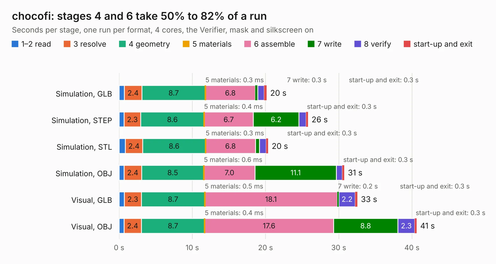

| Mode and format | 1–2 read | 3 resolve | 4 geometry | 5 materials | 6 assemble | 7 write | 8 verify | start-up and exit | Total |
|---|---:|---:|---:|---:|---:|---:|---:|---:|---:|
| Simulation, GLB | 0.7 | 2.4 | 8.7 | 0.3&nbsp;ms | 6.8 | 0.3 | 0.9 | 0.3 | 20.2 |
| Simulation, STEP | 0.7 | 2.3 | 8.6 | 0.4&nbsp;ms | 6.7 | 6.2 | 1.0 | 0.3 | 25.8 |
| Simulation, STL | 0.9 | 2.4 | 8.6 | 0.3&nbsp;ms | 6.8 | 0.6 | 0.9 | 0.3 | 20.4 |
| Simulation, OBJ | 0.7 | 2.4 | 8.5 | 0.6&nbsp;ms | 7.0 | 11.1 | 0.8 | 0.3 | 30.8 |
| Visual, GLB | 0.7 | 2.3 | 8.7 | 0.5&nbsp;ms | 18.1 | 0.2 | 2.2 | 0.3 | 32.5 |
| Visual, OBJ | 0.7 | 2.4 | 8.7 | 0.4&nbsp;ms | 17.6 | 8.8 | 2.3 | 0.3 | 40.6 |

<table align="center"><tr><td valign="top">

| Board | Repo: [pashutk/chocofi](https://github.com/pashutk/chocofi) Board: `chocofi.kicad_pcb` |
|---|---|
| Folder | pcb |
| Complexity | 285&nbsp;/&nbsp;1000 (size&nbsp;175, features&nbsp;110) |
| KESE&nbsp;features | through vias, slotted holes, rounded, trapezoid or chamfered pads, filled zones, copper text, curved board outline, stack-up, dielectric εr and tanδ, mask and silkscreen colours |
| Tested | 9th November 2026 |
| Copper&nbsp;layers | 2 |
| File&nbsp;format | KiCad 6 (20211014) |
| Parts,&nbsp;tracks,&nbsp;vias | 53, 797, 97 |
| Triangles,&nbsp;simulation | 1,835,776 in 56 parts |
| Verifier | PASS in all six runs |

</td><td valign="top">

<table>
<tr><th>File type</th><th>File size</th><th>Peak memory used</th></tr>
<tr><th colspan="3" align="left">Simulation</th></tr>
<tr><td>GLB</td><td align="right">64&nbsp;MB</td><td align="right">856&nbsp;MB</td></tr>
<tr><td>STEP</td><td align="right">370&nbsp;MB</td><td align="right">862&nbsp;MB</td></tr>
<tr><td>STL</td><td align="right">92&nbsp;MB</td><td align="right">855&nbsp;MB</td></tr>
<tr><td>OBJ</td><td align="right">194&nbsp;MB</td><td align="right">1.3&nbsp;GB</td></tr>
<tr><th colspan="3" align="left">Visual</th></tr>
<tr><td>GLB</td><td align="right">50&nbsp;MB</td><td align="right">985&nbsp;MB</td></tr>
<tr><td>OBJ</td><td align="right">153&nbsp;MB</td><td align="right">1.1&nbsp;GB</td></tr>
</table>

</td></tr></table>

## 2270. pda6502v2

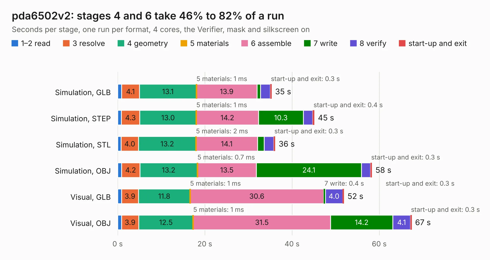

| Mode and format | 1–2 read | 3 resolve | 4 geometry | 5 materials | 6 assemble | 7 write | 8 verify | start-up and exit | Total |
|---|---:|---:|---:|---:|---:|---:|---:|---:|---:|
| Simulation, GLB | 0.9 | 4.1 | 13.1 | 1&nbsp;ms | 13.9 | 0.8 | 2.2 | 0.3 | 35.3 |
| Simulation, STEP | 0.8 | 4.3 | 13.0 | 1&nbsp;ms | 14.2 | 10.3 | 2.2 | 0.4 | 45.1 |
| Simulation, STL | 0.8 | 4.0 | 13.2 | 2&nbsp;ms | 14.1 | 1.5 | 2.2 | 0.3 | 36.1 |
| Simulation, OBJ | 0.9 | 4.2 | 13.2 | 0.7&nbsp;ms | 13.5 | 24.1 | 2.1 | 0.3 | 58.3 |
| Visual, GLB | 0.9 | 3.9 | 11.8 | 1&nbsp;ms | 30.6 | 0.4 | 4.0 | 0.3 | 51.9 |
| Visual, OBJ | 0.9 | 3.9 | 12.5 | 1&nbsp;ms | 31.5 | 14.2 | 4.1 | 0.3 | 67.4 |

<table align="center"><tr><td valign="top">

| Board | Repo: [pda/pda6502v2](https://github.com/pda/pda6502v2) Board: `pda6502v2.kicad_pcb` |
|---|---|
| Folder | kicad |
| Complexity | 316&nbsp;/&nbsp;1000 (size&nbsp;261, features&nbsp;55) |
| KESE&nbsp;features | through vias, rounded, trapezoid or chamfered pads, filled zones, curved board outline |
| Tested | 9th November 2026 |
| Copper&nbsp;layers | 4 |
| File&nbsp;format | KiCad 7 (20221018) |
| Parts,&nbsp;tracks,&nbsp;vias | 87, 2,260, 321 |
| Triangles,&nbsp;simulation | 4,130,958 in 223 parts |
| Verifier | PASS in all six runs |

</td><td valign="top">

<table>
<tr><th>File type</th><th>File size</th><th>Peak memory used</th></tr>
<tr><th colspan="3" align="left">Simulation</th></tr>
<tr><td>GLB</td><td align="right">140&nbsp;MB</td><td align="right">1.2&nbsp;GB</td></tr>
<tr><td>STEP</td><td align="right">515&nbsp;MB</td><td align="right">1.5&nbsp;GB</td></tr>
<tr><td>STL</td><td align="right">207&nbsp;MB</td><td align="right">1.4&nbsp;GB</td></tr>
<tr><td>OBJ</td><td align="right">436&nbsp;MB</td><td align="right">2.6&nbsp;GB</td></tr>
<tr><th colspan="3" align="left">Visual</th></tr>
<tr><td>GLB</td><td align="right">79&nbsp;MB</td><td align="right">1.4&nbsp;GB</td></tr>
<tr><td>OBJ</td><td align="right">254&nbsp;MB</td><td align="right">1.7&nbsp;GB</td></tr>
</table>

</td></tr></table>

## 2271. obc-adcs-board

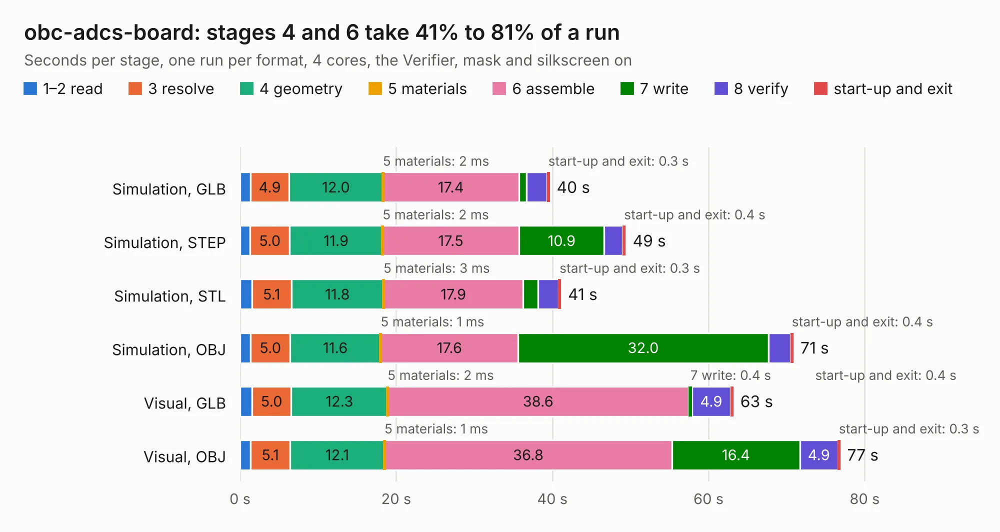

| Mode and format | 1–2 read | 3 resolve | 4 geometry | 5 materials | 6 assemble | 7 write | 8 verify | start-up and exit | Total |
|---|---:|---:|---:|---:|---:|---:|---:|---:|---:|
| Simulation, GLB | 1.3 | 4.9 | 12.0 | 2&nbsp;ms | 17.4 | 1.0 | 2.6 | 0.3 | 39.6 |
| Simulation, STEP | 1.3 | 5.0 | 11.9 | 2&nbsp;ms | 17.5 | 10.9 | 2.4 | 0.4 | 49.4 |
| Simulation, STL | 1.5 | 5.1 | 11.8 | 3&nbsp;ms | 17.9 | 1.9 | 2.6 | 0.3 | 41.1 |
| Simulation, OBJ | 1.4 | 5.0 | 11.6 | 1&nbsp;ms | 17.6 | 32.0 | 2.8 | 0.4 | 70.8 |
| Visual, GLB | 1.5 | 5.0 | 12.3 | 2&nbsp;ms | 38.6 | 0.4 | 4.9 | 0.4 | 63.2 |
| Visual, OBJ | 1.3 | 5.1 | 12.1 | 1&nbsp;ms | 36.8 | 16.4 | 4.9 | 0.3 | 76.8 |

<table align="center"><tr><td valign="top">

| Board | Repo: [peaksat/obcboard_pcb](https://github.com/peaksat/obcboard_pcb) Board: `obc-adcs-board.kicad_pcb` |
|---|---|
| Complexity | 356&nbsp;/&nbsp;1000 (size&nbsp;251, features&nbsp;105) |
| KESE&nbsp;features | through vias, rounded, trapezoid or chamfered pads, arc tracks, filled zones, curved board outline, stack-up, dielectric εr and tanδ, mask and silkscreen colours |
| Tested | 9th November 2026 |
| Copper&nbsp;layers | 8 |
| File&nbsp;format | KiCad 8 (20240108) |
| Parts,&nbsp;tracks,&nbsp;vias | 257, 3,863, 515 |
| Triangles,&nbsp;simulation | 5,758,330 in 492 parts |
| Verifier | PASS in all six runs |

</td><td valign="top">

<table>
<tr><th>File type</th><th>File size</th><th>Peak memory used</th></tr>
<tr><th colspan="3" align="left">Simulation</th></tr>
<tr><td>GLB</td><td align="right">191&nbsp;MB</td><td align="right">1.4&nbsp;GB</td></tr>
<tr><td>STEP</td><td align="right">583&nbsp;MB</td><td align="right">1.8&nbsp;GB</td></tr>
<tr><td>STL</td><td align="right">288&nbsp;MB</td><td align="right">1.4&nbsp;GB</td></tr>
<tr><td>OBJ</td><td align="right">613&nbsp;MB</td><td align="right">3.6&nbsp;GB</td></tr>
<tr><th colspan="3" align="left">Visual</th></tr>
<tr><td>GLB</td><td align="right">101&nbsp;MB</td><td align="right">1.9&nbsp;GB</td></tr>
<tr><td>OBJ</td><td align="right">326&nbsp;MB</td><td align="right">2.2&nbsp;GB</td></tr>
</table>

</td></tr></table>

## 2272. mc0020x

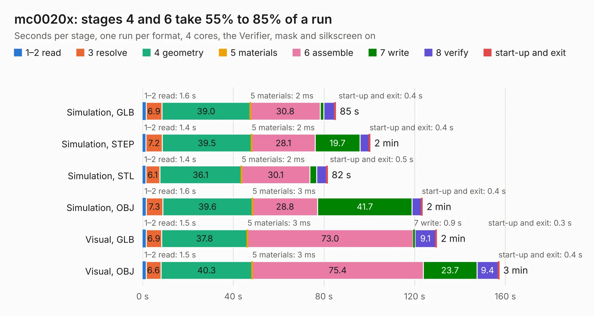

| Mode and format | 1–2 read | 3 resolve | 4 geometry | 5 materials | 6 assemble | 7 write | 8 verify | start-up and exit | Total |
|---|---:|---:|---:|---:|---:|---:|---:|---:|---:|
| Simulation, GLB | 1.6 | 6.9 | 39.0 | 2&nbsp;ms | 30.8 | 1.6 | 4.7 | 0.4 | 85.1 |
| Simulation, STEP | 1.4 | 7.2 | 39.5 | 2&nbsp;ms | 28.1 | 19.7 | 4.1 | 0.4 | 100.3 |
| Simulation, STL | 1.4 | 6.1 | 36.1 | 2&nbsp;ms | 30.1 | 3.0 | 4.3 | 0.5 | 81.5 |
| Simulation, OBJ | 1.6 | 7.3 | 39.6 | 3&nbsp;ms | 28.8 | 41.7 | 4.1 | 0.4 | 123.4 |
| Visual, GLB | 1.5 | 6.9 | 37.8 | 3&nbsp;ms | 73.0 | 0.9 | 9.1 | 0.3 | 129.7 |
| Visual, OBJ | 1.5 | 6.6 | 40.3 | 3&nbsp;ms | 75.4 | 23.7 | 9.4 | 0.4 | 157.2 |

<table align="center"><tr><td valign="top">

| Board | Repo: [pelrun/cpc-schematics](https://github.com/pelrun/cpc-schematics) Board: `mc0020x.kicad_pcb` |
|---|---|
| Folder | cpc6128 |
| Complexity | 313&nbsp;/&nbsp;1000 (size&nbsp;228, features&nbsp;85) |
| KESE&nbsp;features | through vias, slotted holes, rounded, trapezoid or chamfered pads, filled zones, stack-up, dielectric εr and tanδ |
| Tested | 9th November 2026 |
| Copper&nbsp;layers | 2 |
| File&nbsp;format | KiCad 9 (20241229) |
| Parts,&nbsp;tracks,&nbsp;vias | 249, 8,293, 589 |
| Triangles,&nbsp;simulation | 9,130,404 in 369 parts |
| Verifier | PASS in all six runs |

</td><td valign="top">

<table>
<tr><th>File type</th><th>File size</th><th>Peak memory used</th></tr>
<tr><th colspan="3" align="left">Simulation</th></tr>
<tr><td>GLB</td><td align="right">307&nbsp;MB</td><td align="right">2.5&nbsp;GB</td></tr>
<tr><td>STEP</td><td align="right">1.3&nbsp;GB</td><td align="right">3.3&nbsp;GB</td></tr>
<tr><td>STL</td><td align="right">457&nbsp;MB</td><td align="right">2.5&nbsp;GB</td></tr>
<tr><td>OBJ</td><td align="right">966&nbsp;MB</td><td align="right">5.7&nbsp;GB</td></tr>
<tr><th colspan="3" align="left">Visual</th></tr>
<tr><td>GLB</td><td align="right">187&nbsp;MB</td><td align="right">3.0&nbsp;GB</td></tr>
<tr><td>OBJ</td><td align="right">601&nbsp;MB</td><td align="right">3.8&nbsp;GB</td></tr>
</table>

</td></tr></table>

## 2273. RevA

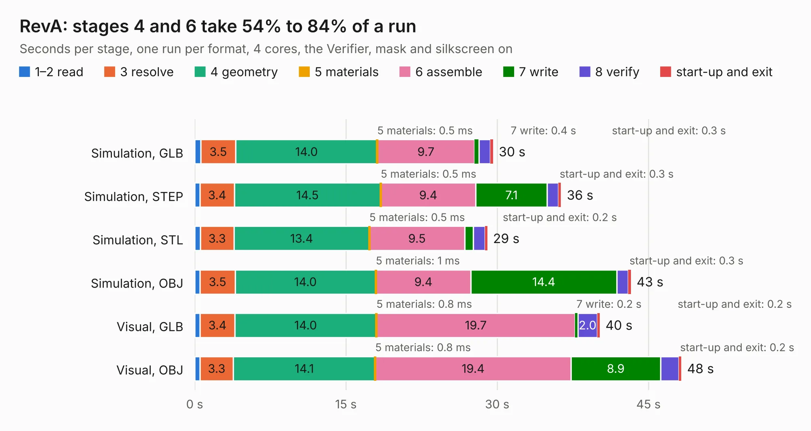

| Mode and format | 1–2 read | 3 resolve | 4 geometry | 5 materials | 6 assemble | 7 write | 8 verify | start-up and exit | Total |
|---|---:|---:|---:|---:|---:|---:|---:|---:|---:|
| Simulation, GLB | 0.6 | 3.5 | 14.0 | 0.5&nbsp;ms | 9.7 | 0.4 | 1.1 | 0.3 | 29.6 |
| Simulation, STEP | 0.5 | 3.4 | 14.5 | 0.5&nbsp;ms | 9.4 | 7.1 | 1.1 | 0.3 | 36.3 |
| Simulation, STL | 0.6 | 3.3 | 13.4 | 0.5&nbsp;ms | 9.5 | 0.9 | 1.2 | 0.2 | 29.0 |
| Simulation, OBJ | 0.5 | 3.5 | 14.0 | 1&nbsp;ms | 9.4 | 14.4 | 1.1 | 0.3 | 43.2 |
| Visual, GLB | 0.5 | 3.4 | 14.0 | 0.8&nbsp;ms | 19.7 | 0.2 | 2.0 | 0.2 | 40.2 |
| Visual, OBJ | 0.5 | 3.3 | 14.1 | 0.8&nbsp;ms | 19.4 | 8.9 | 1.8 | 0.2 | 48.3 |

<table align="center"><tr><td valign="top">

| Board | Repo: [pergola-fpga/pergola](https://github.com/pergola-fpga/pergola) Board: `RevA.kicad_pcb` |
|---|---|
| Folder | hardware / RevA |
| Complexity | 334&nbsp;/&nbsp;1000 (size&nbsp;269, features&nbsp;65) |
| KESE&nbsp;features | through vias, slotted holes, rounded, trapezoid or chamfered pads, filled zones, curved board outline |
| Tested | 9th November 2026 |
| Copper&nbsp;layers | 4 |
| File&nbsp;format | KiCad 5 (20171130) |
| Parts,&nbsp;tracks,&nbsp;vias | 136, 1,513, 318 |
| Triangles,&nbsp;simulation | 2,761,988 in 189 parts |
| Verifier | PASS in all six runs |

</td><td valign="top">

<table>
<tr><th>File type</th><th>File size</th><th>Peak memory used</th></tr>
<tr><th colspan="3" align="left">Simulation</th></tr>
<tr><td>GLB</td><td align="right">96&nbsp;MB</td><td align="right">857&nbsp;MB</td></tr>
<tr><td>STEP</td><td align="right">435&nbsp;MB</td><td align="right">1.1&nbsp;GB</td></tr>
<tr><td>STL</td><td align="right">138&nbsp;MB</td><td align="right">858&nbsp;MB</td></tr>
<tr><td>OBJ</td><td align="right">298&nbsp;MB</td><td align="right">1.9&nbsp;GB</td></tr>
<tr><th colspan="3" align="left">Visual</th></tr>
<tr><td>GLB</td><td align="right">57&nbsp;MB</td><td align="right">1.1&nbsp;GB</td></tr>
<tr><td>OBJ</td><td align="right">179&nbsp;MB</td><td align="right">1.3&nbsp;GB</td></tr>
</table>

</td></tr></table>

## 2274. CM5_MINIMA

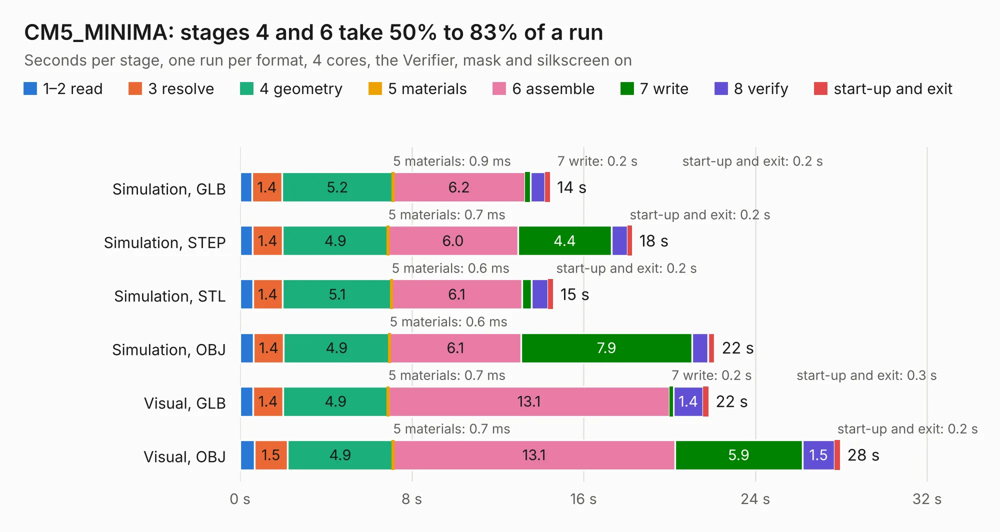

| Mode and format | 1–2 read | 3 resolve | 4 geometry | 5 materials | 6 assemble | 7 write | 8 verify | start-up and exit | Total |
|---|---:|---:|---:|---:|---:|---:|---:|---:|---:|
| Simulation, GLB | 0.6 | 1.4 | 5.2 | 0.9&nbsp;ms | 6.2 | 0.2 | 0.7 | 0.2 | 14.4 |
| Simulation, STEP | 0.6 | 1.4 | 4.9 | 0.7&nbsp;ms | 6.0 | 4.4 | 0.7 | 0.2 | 18.3 |
| Simulation, STL | 0.6 | 1.4 | 5.1 | 0.6&nbsp;ms | 6.1 | 0.5 | 0.8 | 0.2 | 14.6 |
| Simulation, OBJ | 0.6 | 1.4 | 4.9 | 0.6&nbsp;ms | 6.1 | 7.9 | 0.7 | 0.3 | 22.1 |
| Visual, GLB | 0.6 | 1.4 | 4.9 | 0.7&nbsp;ms | 13.1 | 0.2 | 1.4 | 0.3 | 21.8 |
| Visual, OBJ | 0.7 | 1.5 | 4.9 | 0.7&nbsp;ms | 13.1 | 5.9 | 1.5 | 0.2 | 27.9 |

<table align="center"><tr><td valign="top">

| Board | Repo: [piecol/CM5_MINIMA_REV1](https://github.com/piecol/CM5_MINIMA_REV1) Board: `CM5_MINIMA.kicad_pcb` |
|---|---|
| Complexity | 351&nbsp;/&nbsp;1000 (size&nbsp;201, features&nbsp;150) |
| KESE&nbsp;features | through vias, slotted holes, custom pads, rounded, trapezoid or chamfered pads, arc tracks, filled zones, copper drawings, curved board outline, stack-up, dielectric εr and tanδ, copper finish |
| Tested | 9th November 2026 |
| Copper&nbsp;layers | 4 |
| File&nbsp;format | KiCad 8 (20240108) |
| Parts,&nbsp;tracks,&nbsp;vias | 68, 969, 234 |
| Triangles,&nbsp;simulation | 1,470,828 in 210 parts |
| Verifier | PASS in all six runs |

</td><td valign="top">

<table>
<tr><th>File type</th><th>File size</th><th>Peak memory used</th></tr>
<tr><th colspan="3" align="left">Simulation</th></tr>
<tr><td>GLB</td><td align="right">51&nbsp;MB</td><td align="right">597&nbsp;MB</td></tr>
<tr><td>STEP</td><td align="right">242&nbsp;MB</td><td align="right">769&nbsp;MB</td></tr>
<tr><td>STL</td><td align="right">74&nbsp;MB</td><td align="right">604&nbsp;MB</td></tr>
<tr><td>OBJ</td><td align="right">154&nbsp;MB</td><td align="right">1.0&nbsp;GB</td></tr>
<tr><th colspan="3" align="left">Visual</th></tr>
<tr><td>GLB</td><td align="right">37&nbsp;MB</td><td align="right">713&nbsp;MB</td></tr>
<tr><td>OBJ</td><td align="right">113&nbsp;MB</td><td align="right">817&nbsp;MB</td></tr>
</table>

</td></tr></table>

## 2275. CM5_MINIMA_2

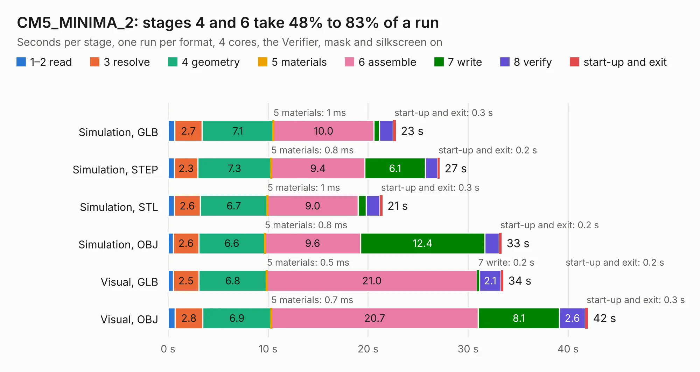

| Mode and format | 1–2 read | 3 resolve | 4 geometry | 5 materials | 6 assemble | 7 write | 8 verify | start-up and exit | Total |
|---|---:|---:|---:|---:|---:|---:|---:|---:|---:|
| Simulation, GLB | 0.7 | 2.7 | 7.1 | 1&nbsp;ms | 10.0 | 0.6 | 1.4 | 0.3 | 22.8 |
| Simulation, STEP | 0.6 | 2.3 | 7.3 | 0.8&nbsp;ms | 9.4 | 6.1 | 1.2 | 0.2 | 27.2 |
| Simulation, STL | 0.6 | 2.6 | 6.7 | 1&nbsp;ms | 9.0 | 0.8 | 1.3 | 0.3 | 21.4 |
| Simulation, OBJ | 0.5 | 2.6 | 6.6 | 0.8&nbsp;ms | 9.6 | 12.4 | 1.4 | 0.2 | 33.4 |
| Visual, GLB | 0.5 | 2.5 | 6.8 | 0.5&nbsp;ms | 21.0 | 0.2 | 2.1 | 0.2 | 33.5 |
| Visual, OBJ | 0.7 | 2.8 | 6.9 | 0.7&nbsp;ms | 20.7 | 8.1 | 2.6 | 0.3 | 42.0 |

<table align="center"><tr><td valign="top">

| Board | Repo: [piecol/CM5_MINIMA_REV2](https://github.com/piecol/CM5_MINIMA_REV2) Board: `CM5_MINIMA_2.kicad_pcb` |
|---|---|
| Complexity | 346&nbsp;/&nbsp;1000 (size&nbsp;221, features&nbsp;125) |
| KESE&nbsp;features | through vias, slotted holes, rounded, trapezoid or chamfered pads, arc tracks, filled zones, curved board outline, stack-up, dielectric εr and tanδ, copper finish |
| Tested | 9th November 2026 |
| Copper&nbsp;layers | 6 |
| File&nbsp;format | KiCad 9 (20241229) |
| Parts,&nbsp;tracks,&nbsp;vias | 72, 1,848, 365 |
| Triangles,&nbsp;simulation | 2,701,666 in 226 parts |
| Verifier | PASS in all six runs |

</td><td valign="top">

<table>
<tr><th>File type</th><th>File size</th><th>Peak memory used</th></tr>
<tr><th colspan="3" align="left">Simulation</th></tr>
<tr><td>GLB</td><td align="right">92&nbsp;MB</td><td align="right">1.0&nbsp;GB</td></tr>
<tr><td>STEP</td><td align="right">367&nbsp;MB</td><td align="right">1.1&nbsp;GB</td></tr>
<tr><td>STL</td><td align="right">135&nbsp;MB</td><td align="right">1.0&nbsp;GB</td></tr>
<tr><td>OBJ</td><td align="right">287&nbsp;MB</td><td align="right">1.8&nbsp;GB</td></tr>
<tr><th colspan="3" align="left">Visual</th></tr>
<tr><td>GLB</td><td align="right">56&nbsp;MB</td><td align="right">1.1&nbsp;GB</td></tr>
<tr><td>OBJ</td><td align="right">177&nbsp;MB</td><td align="right">1.3&nbsp;GB</td></tr>
</table>

</td></tr></table>

## 2276. carrier_template

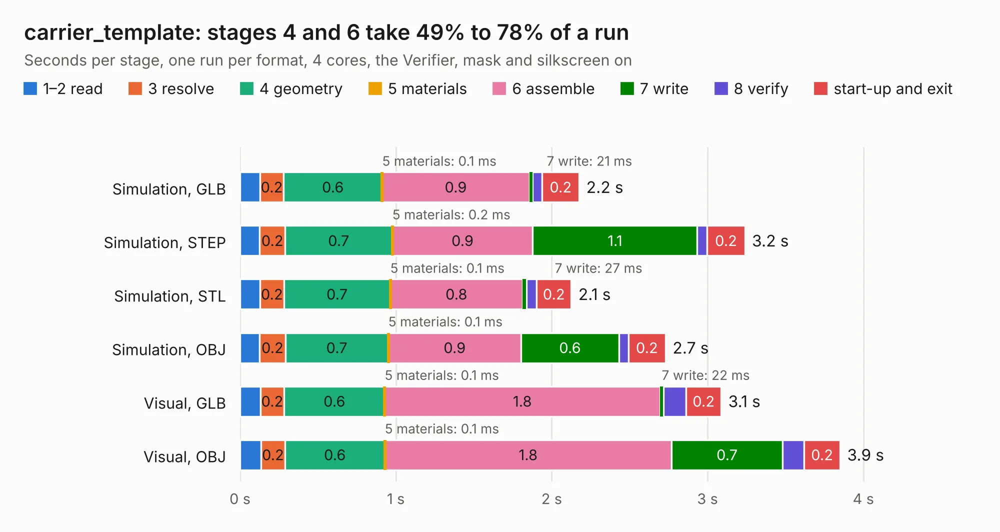

| Mode and format | 1–2 read | 3 resolve | 4 geometry | 5 materials | 6 assemble | 7 write | 8 verify | start-up and exit | Total |
|---|---:|---:|---:|---:|---:|---:|---:|---:|---:|
| Simulation, GLB | 0.1 | 0.2 | 0.6 | 0.1&nbsp;ms | 0.9 | 21&nbsp;ms | 62&nbsp;ms | 0.2 | 2.2 |
| Simulation, STEP | 0.1 | 0.2 | 0.7 | 0.2&nbsp;ms | 0.9 | 1.1 | 64&nbsp;ms | 0.2 | 3.2 |
| Simulation, STL | 0.1 | 0.2 | 0.7 | 0.1&nbsp;ms | 0.8 | 27&nbsp;ms | 63&nbsp;ms | 0.2 | 2.1 |
| Simulation, OBJ | 0.1 | 0.2 | 0.7 | 0.1&nbsp;ms | 0.9 | 0.6 | 60&nbsp;ms | 0.2 | 2.7 |
| Visual, GLB | 0.1 | 0.2 | 0.6 | 0.1&nbsp;ms | 1.8 | 22&nbsp;ms | 0.1 | 0.2 | 3.1 |
| Visual, OBJ | 0.1 | 0.2 | 0.6 | 0.1&nbsp;ms | 1.8 | 0.7 | 0.1 | 0.2 | 3.9 |

<table align="center"><tr><td valign="top">

| Board | Repo: [pinguz97/zynq-som](https://github.com/pinguz97/zynq-som) Board: `carrier_template.kicad_pcb` |
|---|---|
| Folder | scripts / carrier_template |
| Complexity | 67&nbsp;/&nbsp;1000 (size&nbsp;32, features&nbsp;35) |
| KESE&nbsp;features | rounded, trapezoid or chamfered pads, arc tracks, curved board outline |
| Tested | 9th November 2026 |
| Copper&nbsp;layers | 2 |
| File&nbsp;format | KiCad 8 (20240108) |
| Parts,&nbsp;tracks,&nbsp;vias | 3, 0, 0 |
| Triangles,&nbsp;simulation | 101,568 in 9 parts |
| Verifier | PASS in all six runs |

</td><td valign="top">

<table>
<tr><th>File type</th><th>File size</th><th>Peak memory used</th></tr>
<tr><th colspan="3" align="left">Simulation</th></tr>
<tr><td>GLB</td><td align="right">4.0&nbsp;MB</td><td align="right">199&nbsp;MB</td></tr>
<tr><td>STEP</td><td align="right">19&nbsp;MB</td><td align="right">205&nbsp;MB</td></tr>
<tr><td>STL</td><td align="right">5.1&nbsp;MB</td><td align="right">198&nbsp;MB</td></tr>
<tr><td>OBJ</td><td align="right">11&nbsp;MB</td><td align="right">199&nbsp;MB</td></tr>
<tr><th colspan="3" align="left">Visual</th></tr>
<tr><td>GLB</td><td align="right">4.2&nbsp;MB</td><td align="right">196&nbsp;MB</td></tr>
<tr><td>OBJ</td><td align="right">12&nbsp;MB</td><td align="right">194&nbsp;MB</td></tr>
</table>

</td></tr></table>

## 2277. Zynq_SoM

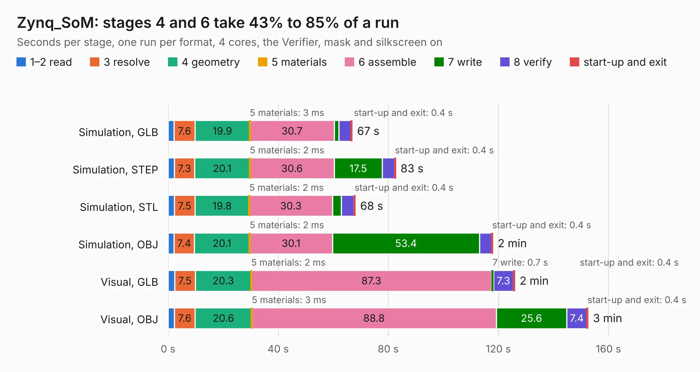

| Mode and format | 1–2 read | 3 resolve | 4 geometry | 5 materials | 6 assemble | 7 write | 8 verify | start-up and exit | Total |
|---|---:|---:|---:|---:|---:|---:|---:|---:|---:|
| Simulation, GLB | 2.2 | 7.6 | 19.9 | 3&nbsp;ms | 30.7 | 1.7 | 4.4 | 0.4 | 66.9 |
| Simulation, STEP | 2.3 | 7.3 | 20.1 | 2&nbsp;ms | 30.6 | 17.5 | 4.4 | 0.4 | 82.7 |
| Simulation, STL | 2.3 | 7.5 | 19.8 | 2&nbsp;ms | 30.3 | 3.2 | 4.6 | 0.4 | 68.0 |
| Simulation, OBJ | 2.2 | 7.4 | 20.1 | 2&nbsp;ms | 30.1 | 53.4 | 4.4 | 0.4 | 118.0 |
| Visual, GLB | 2.4 | 7.5 | 20.3 | 2&nbsp;ms | 87.3 | 0.7 | 7.3 | 0.4 | 125.9 |
| Visual, OBJ | 2.3 | 7.6 | 20.6 | 3&nbsp;ms | 88.8 | 25.6 | 7.4 | 0.4 | 152.6 |

<table align="center"><tr><td valign="top">

| Board | Repo: [pinguz97/zynq-som](https://github.com/pinguz97/zynq-som) Board: `Zynq_SoM.kicad_pcb` |
|---|---|
| Complexity | 476&nbsp;/&nbsp;1000 (size&nbsp;321, features&nbsp;155) |
| KESE&nbsp;features | through vias, custom pads, rounded, trapezoid or chamfered pads, arc tracks, filled zones, copper drawings, curved board outline, TrueType text, stack-up, dielectric εr and tanδ, copper finish |
| Tested | 9th November 2026 |
| Copper&nbsp;layers | 8 |
| File&nbsp;format | KiCad 9 (20241229) |
| Parts,&nbsp;tracks,&nbsp;vias | 267, 7,394, 941 |
| Triangles,&nbsp;simulation | 8,423,948 in 612 parts |
| Verifier | PASS in all six runs |

</td><td valign="top">

<table>
<tr><th>File type</th><th>File size</th><th>Peak memory used</th></tr>
<tr><th colspan="3" align="left">Simulation</th></tr>
<tr><td>GLB</td><td align="right">280&nbsp;MB</td><td align="right">2.1&nbsp;GB</td></tr>
<tr><td>STEP</td><td align="right">866&nbsp;MB</td><td align="right">2.6&nbsp;GB</td></tr>
<tr><td>STL</td><td align="right">421&nbsp;MB</td><td align="right">2.0&nbsp;GB</td></tr>
<tr><td>OBJ</td><td align="right">900&nbsp;MB</td><td align="right">5.2&nbsp;GB</td></tr>
<tr><th colspan="3" align="left">Visual</th></tr>
<tr><td>GLB</td><td align="right">133&nbsp;MB</td><td align="right">2.4&nbsp;GB</td></tr>
<tr><td>OBJ</td><td align="right">447&nbsp;MB</td><td align="right">3.2&nbsp;GB</td></tr>
</table>

</td></tr></table>

## 2278. everestCM4

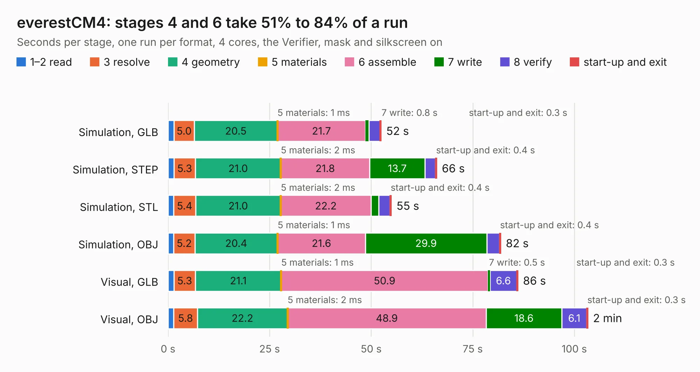

| Mode and format | 1–2 read | 3 resolve | 4 geometry | 5 materials | 6 assemble | 7 write | 8 verify | start-up and exit | Total |
|---|---:|---:|---:|---:|---:|---:|---:|---:|---:|
| Simulation, GLB | 1.5 | 5.0 | 20.5 | 1&nbsp;ms | 21.7 | 0.8 | 2.7 | 0.3 | 52.5 |
| Simulation, STEP | 1.4 | 5.3 | 21.0 | 2&nbsp;ms | 21.8 | 13.7 | 2.6 | 0.4 | 66.2 |
| Simulation, STL | 1.4 | 5.4 | 21.0 | 2&nbsp;ms | 22.2 | 1.9 | 2.8 | 0.4 | 55.0 |
| Simulation, OBJ | 1.4 | 5.2 | 20.4 | 1&nbsp;ms | 21.6 | 29.9 | 3.1 | 0.4 | 81.9 |
| Visual, GLB | 1.4 | 5.3 | 21.1 | 1&nbsp;ms | 50.9 | 0.5 | 6.6 | 0.3 | 86.1 |
| Visual, OBJ | 1.4 | 5.8 | 22.2 | 2&nbsp;ms | 48.9 | 18.6 | 6.1 | 0.3 | 103.4 |

<table align="center"><tr><td valign="top">

| Board | Repo: [pionixpublic/reference-hardware](https://github.com/pionixpublic/reference-hardware) Board: `everestCM4.kicad_pcb` |
|---|---|
| Folder | Yak |
| Complexity | 376&nbsp;/&nbsp;1000 (size&nbsp;276, features&nbsp;100) |
| KESE&nbsp;features | through vias, slotted holes, rounded, trapezoid or chamfered pads, arc tracks, filled zones, stack-up, dielectric εr and tanδ |
| Tested | 9th November 2026 |
| Copper&nbsp;layers | 4 |
| File&nbsp;format | KiCad 6 (20211014) |
| Parts,&nbsp;tracks,&nbsp;vias | 181, 3,488, 540 |
| Triangles,&nbsp;simulation | 5,046,938 in 316 parts |
| Verifier | PASS in all six runs |

</td><td valign="top">

<table>
<tr><th>File type</th><th>File size</th><th>Peak memory used</th></tr>
<tr><th colspan="3" align="left">Simulation</th></tr>
<tr><td>GLB</td><td align="right">172&nbsp;MB</td><td align="right">1.7&nbsp;GB</td></tr>
<tr><td>STEP</td><td align="right">929&nbsp;MB</td><td align="right">2.0&nbsp;GB</td></tr>
<tr><td>STL</td><td align="right">252&nbsp;MB</td><td align="right">1.6&nbsp;GB</td></tr>
<tr><td>OBJ</td><td align="right">542&nbsp;MB</td><td align="right">3.3&nbsp;GB</td></tr>
<tr><th colspan="3" align="left">Visual</th></tr>
<tr><td>GLB</td><td align="right">107&nbsp;MB</td><td align="right">1.8&nbsp;GB</td></tr>
<tr><td>OBJ</td><td align="right">340&nbsp;MB</td><td align="right">2.2&nbsp;GB</td></tr>
</table>

</td></tr></table>

## 2279. yeti

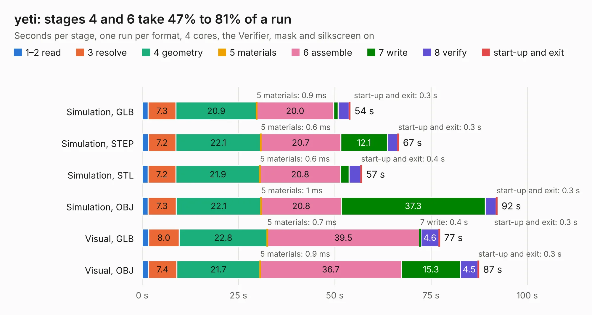

| Mode and format | 1–2 read | 3 resolve | 4 geometry | 5 materials | 6 assemble | 7 write | 8 verify | start-up and exit | Total |
|---|---:|---:|---:|---:|---:|---:|---:|---:|---:|
| Simulation, GLB | 1.5 | 7.3 | 20.9 | 0.9&nbsp;ms | 20.0 | 1.1 | 2.8 | 0.3 | 54.0 |
| Simulation, STEP | 1.6 | 7.2 | 22.1 | 0.6&nbsp;ms | 20.7 | 12.1 | 2.7 | 0.3 | 66.6 |
| Simulation, STL | 1.5 | 7.2 | 21.9 | 0.6&nbsp;ms | 20.8 | 2.2 | 3.0 | 0.4 | 57.1 |
| Simulation, OBJ | 1.5 | 7.3 | 22.1 | 1&nbsp;ms | 20.8 | 37.3 | 2.9 | 0.3 | 92.2 |
| Visual, GLB | 1.7 | 8.0 | 22.8 | 0.7&nbsp;ms | 39.5 | 0.4 | 4.6 | 0.3 | 77.3 |
| Visual, OBJ | 1.6 | 7.4 | 21.7 | 0.9&nbsp;ms | 36.7 | 15.3 | 4.5 | 0.3 | 87.5 |

<table align="center"><tr><td valign="top">

| Board | Repo: [pionixpublic/reference-hardware](https://github.com/pionixpublic/reference-hardware) Board: `yeti.kicad_pcb` |
|---|---|
| Folder | Yeti |
| Complexity | 370&nbsp;/&nbsp;1000 (size&nbsp;250, features&nbsp;120) |
| KESE&nbsp;features | through vias, slotted holes, custom pads, rounded, trapezoid or chamfered pads, filled zones, copper drawings, curved board outline, stack-up, dielectric εr and tanδ |
| Tested | 9th November 2026 |
| Copper&nbsp;layers | 8 |
| File&nbsp;format | KiCad 6 (20211014) |
| Parts,&nbsp;tracks,&nbsp;vias | 262, 2,762, 718 |
| Triangles,&nbsp;simulation | 6,306,866 in 228 parts |
| Verifier | PASS in all six runs |

</td><td valign="top">

<table>
<tr><th>File type</th><th>File size</th><th>Peak memory used</th></tr>
<tr><th colspan="3" align="left">Simulation</th></tr>
<tr><td>GLB</td><td align="right">209&nbsp;MB</td><td align="right">1.7&nbsp;GB</td></tr>
<tr><td>STEP</td><td align="right">746&nbsp;MB</td><td align="right">2.0&nbsp;GB</td></tr>
<tr><td>STL</td><td align="right">315&nbsp;MB</td><td align="right">1.6&nbsp;GB</td></tr>
<tr><td>OBJ</td><td align="right">693&nbsp;MB</td><td align="right">4.1&nbsp;GB</td></tr>
<tr><th colspan="3" align="left">Visual</th></tr>
<tr><td>GLB</td><td align="right">98&nbsp;MB</td><td align="right">1.8&nbsp;GB</td></tr>
<tr><td>OBJ</td><td align="right">324&nbsp;MB</td><td align="right">2.2&nbsp;GB</td></tr>
</table>

</td></tr></table>

## 2280. R1000AX

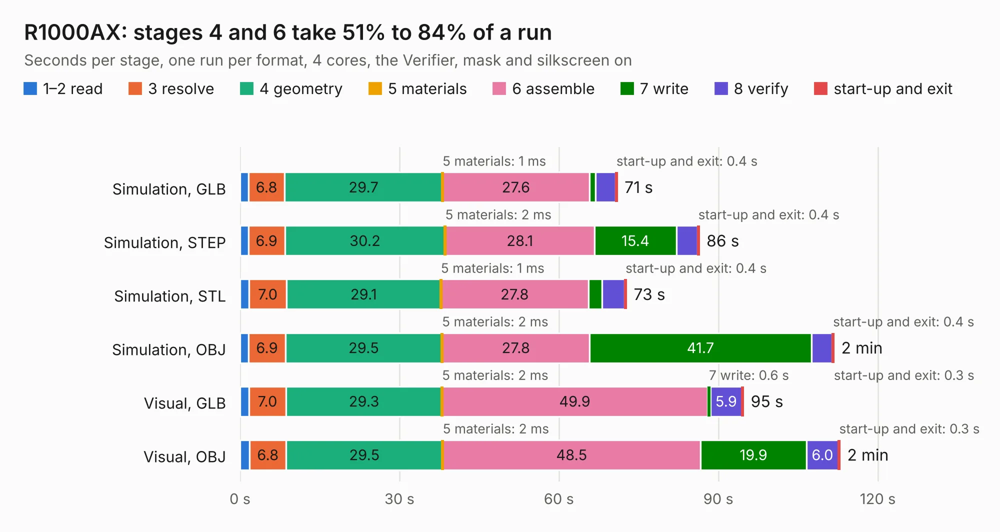

| Mode and format | 1–2 read | 3 resolve | 4 geometry | 5 materials | 6 assemble | 7 write | 8 verify | start-up and exit | Total |
|---|---:|---:|---:|---:|---:|---:|---:|---:|---:|
| Simulation, GLB | 1.6 | 6.8 | 29.7 | 1&nbsp;ms | 27.6 | 1.2 | 3.7 | 0.4 | 71.0 |
| Simulation, STEP | 1.6 | 6.9 | 30.2 | 2&nbsp;ms | 28.1 | 15.4 | 3.9 | 0.4 | 86.4 |
| Simulation, STL | 1.7 | 7.0 | 29.1 | 1&nbsp;ms | 27.8 | 2.5 | 4.3 | 0.4 | 72.7 |
| Simulation, OBJ | 1.6 | 6.9 | 29.5 | 2&nbsp;ms | 27.8 | 41.7 | 3.9 | 0.4 | 111.8 |
| Visual, GLB | 1.7 | 7.0 | 29.3 | 2&nbsp;ms | 49.9 | 0.6 | 5.9 | 0.3 | 94.7 |
| Visual, OBJ | 1.8 | 6.8 | 29.5 | 2&nbsp;ms | 48.5 | 19.9 | 6.0 | 0.3 | 112.9 |

<table align="center"><tr><td valign="top">

| Board | Repo: [pluggee/R1000AX](https://github.com/pluggee/R1000AX) Board: `R1000AX.kicad_pcb` |
|---|---|
| Folder | pcb |
| Complexity | 308&nbsp;/&nbsp;1000 (size&nbsp;263, features&nbsp;45) |
| KESE&nbsp;features | through vias, filled zones, curved board outline |
| Tested | 9th November 2026 |
| Copper&nbsp;layers | 4 |
| File&nbsp;format | KiCad 4 (4) |
| Parts,&nbsp;tracks,&nbsp;vias | 127, 3,163, 399 |
| Triangles,&nbsp;simulation | 6,324,084 in 148 parts |
| Verifier | PASS in all six runs |

</td><td valign="top">

<table>
<tr><th>File type</th><th>File size</th><th>Peak memory used</th></tr>
<tr><th colspan="3" align="left">Simulation</th></tr>
<tr><td>GLB</td><td align="right">218&nbsp;MB</td><td align="right">1.6&nbsp;GB</td></tr>
<tr><td>STEP</td><td align="right">817&nbsp;MB</td><td align="right">2.1&nbsp;GB</td></tr>
<tr><td>STL</td><td align="right">316&nbsp;MB</td><td align="right">1.6&nbsp;GB</td></tr>
<tr><td>OBJ</td><td align="right">682&nbsp;MB</td><td align="right">4.1&nbsp;GB</td></tr>
<tr><th colspan="3" align="left">Visual</th></tr>
<tr><td>GLB</td><td align="right">108&nbsp;MB</td><td align="right">1.9&nbsp;GB</td></tr>
<tr><td>OBJ</td><td align="right">345&nbsp;MB</td><td align="right">2.3&nbsp;GB</td></tr>
</table>

</td></tr></table>

## 2281. Hades

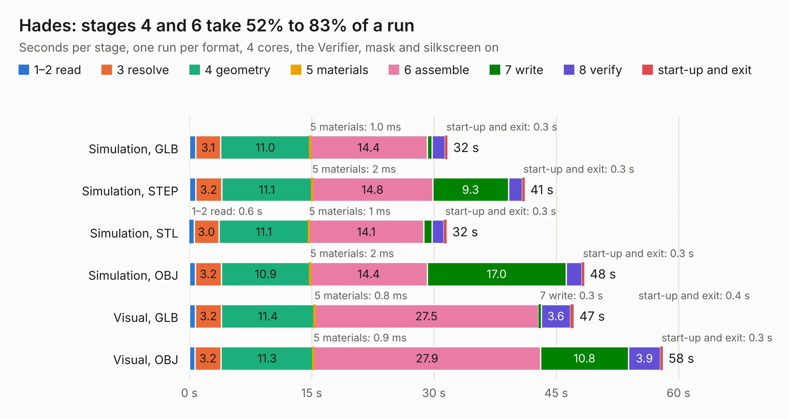

| Mode and format | 1–2 read | 3 resolve | 4 geometry | 5 materials | 6 assemble | 7 write | 8 verify | start-up and exit | Total |
|---|---:|---:|---:|---:|---:|---:|---:|---:|---:|
| Simulation, GLB | 0.8 | 3.1 | 11.0 | 1.0&nbsp;ms | 14.4 | 0.6 | 1.6 | 0.3 | 31.7 |
| Simulation, STEP | 0.8 | 3.2 | 11.1 | 2&nbsp;ms | 14.8 | 9.3 | 1.7 | 0.3 | 41.1 |
| Simulation, STL | 0.6 | 3.0 | 11.1 | 1&nbsp;ms | 14.1 | 1.0 | 1.5 | 0.3 | 31.6 |
| Simulation, OBJ | 0.7 | 3.2 | 10.9 | 2&nbsp;ms | 14.4 | 17.0 | 1.9 | 0.3 | 48.4 |
| Visual, GLB | 0.7 | 3.2 | 11.4 | 0.8&nbsp;ms | 27.5 | 0.3 | 3.6 | 0.4 | 47.1 |
| Visual, OBJ | 0.7 | 3.2 | 11.3 | 0.9&nbsp;ms | 27.9 | 10.8 | 3.9 | 0.3 | 58.1 |

<table align="center"><tr><td valign="top">

| Board | Repo: [pms67/HadesFCS](https://github.com/pms67/HadesFCS) Board: `Hades.kicad_pcb` |
|---|---|
| Folder | Hardware / Hades |
| Complexity | 350&nbsp;/&nbsp;1000 (size&nbsp;270, features&nbsp;80) |
| KESE&nbsp;features | through vias, custom pads, rounded, trapezoid or chamfered pads, filled zones, copper drawings, curved board outline |
| Tested | 9th November 2026 |
| Copper&nbsp;layers | 4 |
| File&nbsp;format | KiCad 5 (20171130) |
| Parts,&nbsp;tracks,&nbsp;vias | 208, 1,978, 382 |
| Triangles,&nbsp;simulation | 3,210,182 in 265 parts |
| Verifier | PASS in all six runs |

</td><td valign="top">

<table>
<tr><th>File type</th><th>File size</th><th>Peak memory used</th></tr>
<tr><th colspan="3" align="left">Simulation</th></tr>
<tr><td>GLB</td><td align="right">110&nbsp;MB</td><td align="right">1.0&nbsp;GB</td></tr>
<tr><td>STEP</td><td align="right">449&nbsp;MB</td><td align="right">1.4&nbsp;GB</td></tr>
<tr><td>STL</td><td align="right">161&nbsp;MB</td><td align="right">1.0&nbsp;GB</td></tr>
<tr><td>OBJ</td><td align="right">340&nbsp;MB</td><td align="right">2.1&nbsp;GB</td></tr>
<tr><th colspan="3" align="left">Visual</th></tr>
<tr><td>GLB</td><td align="right">69&nbsp;MB</td><td align="right">1.3&nbsp;GB</td></tr>
<tr><td>OBJ</td><td align="right">218&nbsp;MB</td><td align="right">1.5&nbsp;GB</td></tr>
</table>

</td></tr></table>

## 2282. HadesGPSDongle

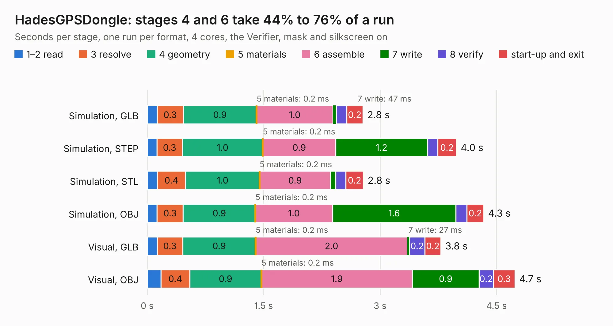

| Mode and format | 1–2 read | 3 resolve | 4 geometry | 5 materials | 6 assemble | 7 write | 8 verify | start-up and exit | Total |
|---|---:|---:|---:|---:|---:|---:|---:|---:|---:|
| Simulation, GLB | 0.1 | 0.3 | 0.9 | 0.2&nbsp;ms | 1.0 | 47&nbsp;ms | 0.1 | 0.2 | 2.8 |
| Simulation, STEP | 0.1 | 0.3 | 1.0 | 0.2&nbsp;ms | 0.9 | 1.2 | 0.1 | 0.2 | 4.0 |
| Simulation, STL | 0.1 | 0.4 | 1.0 | 0.2&nbsp;ms | 0.9 | 67&nbsp;ms | 0.1 | 0.2 | 2.8 |
| Simulation, OBJ | 0.1 | 0.3 | 0.9 | 0.2&nbsp;ms | 1.0 | 1.6 | 0.1 | 0.2 | 4.3 |
| Visual, GLB | 0.1 | 0.3 | 0.9 | 0.2&nbsp;ms | 2.0 | 27&nbsp;ms | 0.2 | 0.2 | 3.8 |
| Visual, OBJ | 0.2 | 0.4 | 0.9 | 0.2&nbsp;ms | 1.9 | 0.9 | 0.2 | 0.3 | 4.7 |

<table align="center"><tr><td valign="top">

| Board | Repo: [pms67/HadesFCS](https://github.com/pms67/HadesFCS) Board: `HadesGPSDongle.kicad_pcb` |
|---|---|
| Folder | Hardware / HadesGPSDongle |
| Complexity | 214&nbsp;/&nbsp;1000 (size&nbsp;159, features&nbsp;55) |
| KESE&nbsp;features | through vias, rounded, trapezoid or chamfered pads, filled zones, curved board outline |
| Tested | 9th November 2026 |
| Copper&nbsp;layers | 4 |
| File&nbsp;format | KiCad 5 (20171130) |
| Parts,&nbsp;tracks,&nbsp;vias | 27, 124, 39 |
| Triangles,&nbsp;simulation | 268,474 in 40 parts |
| Verifier | PASS in all six runs |

</td><td valign="top">

<table>
<tr><th>File type</th><th>File size</th><th>Peak memory used</th></tr>
<tr><th colspan="3" align="left">Simulation</th></tr>
<tr><td>GLB</td><td align="right">9.0&nbsp;MB</td><td align="right">248&nbsp;MB</td></tr>
<tr><td>STEP</td><td align="right">37&nbsp;MB</td><td align="right">256&nbsp;MB</td></tr>
<tr><td>STL</td><td align="right">13&nbsp;MB</td><td align="right">244&nbsp;MB</td></tr>
<tr><td>OBJ</td><td align="right">27&nbsp;MB</td><td align="right">235&nbsp;MB</td></tr>
<tr><th colspan="3" align="left">Visual</th></tr>
<tr><td>GLB</td><td align="right">5.4&nbsp;MB</td><td align="right">213&nbsp;MB</td></tr>
<tr><td>OBJ</td><td align="right">15&nbsp;MB</td><td align="right">210&nbsp;MB</td></tr>
</table>

</td></tr></table>

## 2283. HadesMicro

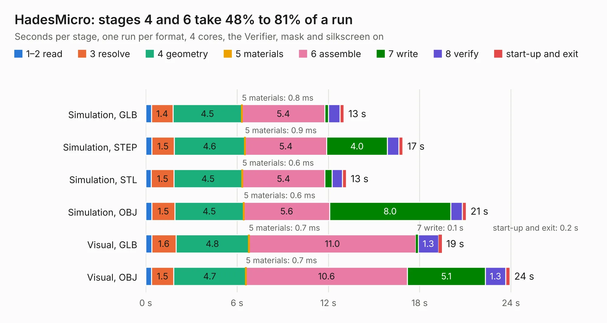

| Mode and format | 1–2 read | 3 resolve | 4 geometry | 5 materials | 6 assemble | 7 write | 8 verify | start-up and exit | Total |
|---|---:|---:|---:|---:|---:|---:|---:|---:|---:|
| Simulation, GLB | 0.4 | 1.4 | 4.5 | 0.8&nbsp;ms | 5.4 | 0.2 | 0.8 | 0.3 | 13.0 |
| Simulation, STEP | 0.4 | 1.5 | 4.6 | 0.9&nbsp;ms | 5.4 | 4.0 | 0.8 | 0.3 | 16.9 |
| Simulation, STL | 0.4 | 1.5 | 4.5 | 0.6&nbsp;ms | 5.4 | 0.5 | 0.7 | 0.3 | 13.2 |
| Simulation, OBJ | 0.4 | 1.5 | 4.5 | 0.6&nbsp;ms | 5.6 | 8.0 | 0.8 | 0.3 | 21.1 |
| Visual, GLB | 0.4 | 1.6 | 4.8 | 0.7&nbsp;ms | 11.0 | 0.1 | 1.3 | 0.2 | 19.5 |
| Visual, OBJ | 0.4 | 1.5 | 4.7 | 0.7&nbsp;ms | 10.6 | 5.1 | 1.3 | 0.3 | 23.9 |

<table align="center"><tr><td valign="top">

| Board | Repo: [pms67/HadesFCS](https://github.com/pms67/HadesFCS) Board: `HadesMicro.kicad_pcb` |
|---|---|
| Folder | Hardware / HadesMicro |
| Complexity | 303&nbsp;/&nbsp;1000 (size&nbsp;248, features&nbsp;55) |
| KESE&nbsp;features | through vias, rounded, trapezoid or chamfered pads, filled zones, curved board outline |
| Tested | 9th November 2026 |
| Copper&nbsp;layers | 4 |
| File&nbsp;format | KiCad 5 (20171130) |
| Parts,&nbsp;tracks,&nbsp;vias | 91, 893, 172 |
| Triangles,&nbsp;simulation | 1,393,582 in 125 parts |
| Verifier | PASS in all six runs |

</td><td valign="top">

<table>
<tr><th>File type</th><th>File size</th><th>Peak memory used</th></tr>
<tr><th colspan="3" align="left">Simulation</th></tr>
<tr><td>GLB</td><td align="right">48&nbsp;MB</td><td align="right">537&nbsp;MB</td></tr>
<tr><td>STEP</td><td align="right">174&nbsp;MB</td><td align="right">674&nbsp;MB</td></tr>
<tr><td>STL</td><td align="right">70&nbsp;MB</td><td align="right">527&nbsp;MB</td></tr>
<tr><td>OBJ</td><td align="right">143&nbsp;MB</td><td align="right">926&nbsp;MB</td></tr>
<tr><th colspan="3" align="left">Visual</th></tr>
<tr><td>GLB</td><td align="right">29&nbsp;MB</td><td align="right">760&nbsp;MB</td></tr>
<tr><td>OBJ</td><td align="right">88&nbsp;MB</td><td align="right">682&nbsp;MB</td></tr>
</table>

</td></tr></table>

## 2284. HadesMicroJLCPCB

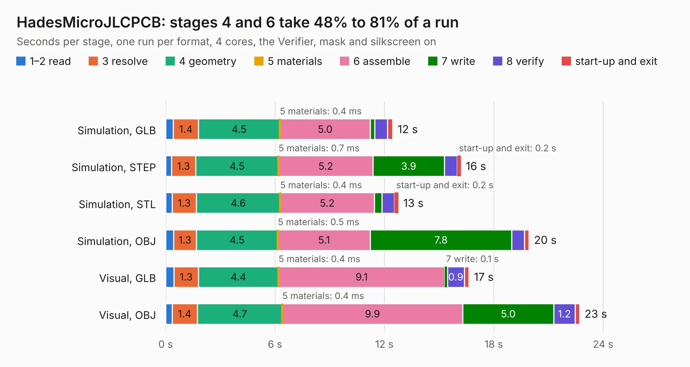

| Mode and format | 1–2 read | 3 resolve | 4 geometry | 5 materials | 6 assemble | 7 write | 8 verify | start-up and exit | Total |
|---|---:|---:|---:|---:|---:|---:|---:|---:|---:|
| Simulation, GLB | 0.4 | 1.4 | 4.5 | 0.4&nbsp;ms | 5.0 | 0.2 | 0.7 | 0.3 | 12.5 |
| Simulation, STEP | 0.3 | 1.3 | 4.5 | 0.7&nbsp;ms | 5.2 | 3.9 | 0.7 | 0.2 | 16.2 |
| Simulation, STL | 0.4 | 1.3 | 4.6 | 0.4&nbsp;ms | 5.2 | 0.4 | 0.7 | 0.2 | 12.8 |
| Simulation, OBJ | 0.4 | 1.3 | 4.5 | 0.5&nbsp;ms | 5.1 | 7.8 | 0.7 | 0.2 | 19.9 |
| Visual, GLB | 0.5 | 1.3 | 4.4 | 0.4&nbsp;ms | 9.1 | 0.1 | 0.9 | 0.3 | 16.6 |
| Visual, OBJ | 0.4 | 1.4 | 4.7 | 0.4&nbsp;ms | 9.9 | 5.0 | 1.2 | 0.2 | 22.7 |

<table align="center"><tr><td valign="top">

| Board | Repo: [pms67/HadesFCS](https://github.com/pms67/HadesFCS) Board: `HadesMicroJLCPCB.kicad_pcb` |
|---|---|
| Folder | Hardware / HadesMicroJLCPCB |
| Complexity | 296&nbsp;/&nbsp;1000 (size&nbsp;241, features&nbsp;55) |
| KESE&nbsp;features | through vias, rounded, trapezoid or chamfered pads, filled zones, curved board outline |
| Tested | 9th November 2026 |
| Copper&nbsp;layers | 4 |
| File&nbsp;format | KiCad 5 (20171130) |
| Parts,&nbsp;tracks,&nbsp;vias | 88, 912, 165 |
| Triangles,&nbsp;simulation | 1,440,242 in 130 parts |
| Verifier | PASS in all six runs |

</td><td valign="top">

<table>
<tr><th>File type</th><th>File size</th><th>Peak memory used</th></tr>
<tr><th colspan="3" align="left">Simulation</th></tr>
<tr><td>GLB</td><td align="right">49&nbsp;MB</td><td align="right">529&nbsp;MB</td></tr>
<tr><td>STEP</td><td align="right">181&nbsp;MB</td><td align="right">670&nbsp;MB</td></tr>
<tr><td>STL</td><td align="right">72&nbsp;MB</td><td align="right">522&nbsp;MB</td></tr>
<tr><td>OBJ</td><td align="right">147&nbsp;MB</td><td align="right">956&nbsp;MB</td></tr>
<tr><th colspan="3" align="left">Visual</th></tr>
<tr><td>GLB</td><td align="right">30&nbsp;MB</td><td align="right">663&nbsp;MB</td></tr>
<tr><td>OBJ</td><td align="right">91&nbsp;MB</td><td align="right">701&nbsp;MB</td></tr>
</table>

</td></tr></table>

## 2285. HadesNT

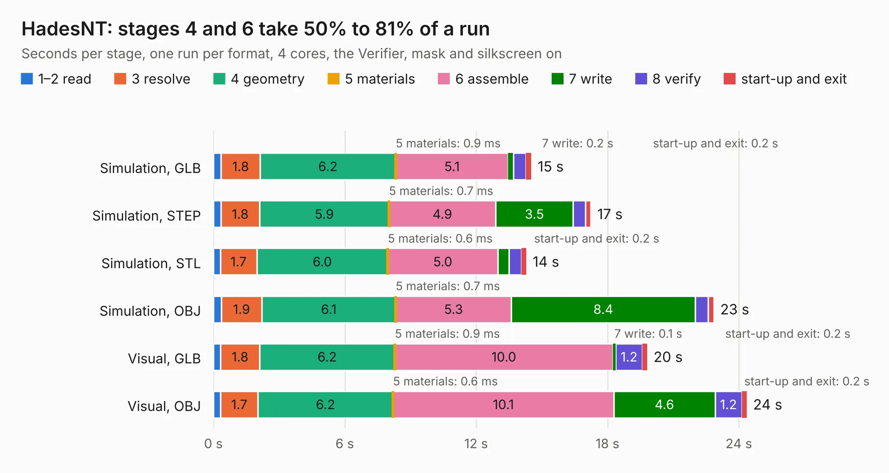

| Mode and format | 1–2 read | 3 resolve | 4 geometry | 5 materials | 6 assemble | 7 write | 8 verify | start-up and exit | Total |
|---|---:|---:|---:|---:|---:|---:|---:|---:|---:|
| Simulation, GLB | 0.4 | 1.8 | 6.2 | 0.9&nbsp;ms | 5.1 | 0.2 | 0.6 | 0.2 | 14.5 |
| Simulation, STEP | 0.3 | 1.8 | 5.9 | 0.7&nbsp;ms | 4.9 | 3.5 | 0.6 | 0.3 | 17.2 |
| Simulation, STL | 0.3 | 1.7 | 6.0 | 0.6&nbsp;ms | 5.0 | 0.5 | 0.6 | 0.2 | 14.3 |
| Simulation, OBJ | 0.4 | 1.9 | 6.1 | 0.7&nbsp;ms | 5.3 | 8.4 | 0.6 | 0.3 | 22.9 |
| Visual, GLB | 0.3 | 1.8 | 6.2 | 0.9&nbsp;ms | 10.0 | 0.1 | 1.2 | 0.2 | 19.8 |
| Visual, OBJ | 0.3 | 1.7 | 6.2 | 0.6&nbsp;ms | 10.1 | 4.6 | 1.2 | 0.2 | 24.4 |

<table align="center"><tr><td valign="top">

| Board | Repo: [pms67/HadesFCS](https://github.com/pms67/HadesFCS) Board: `HadesNT.kicad_pcb` |
|---|---|
| Folder | Hardware / HadesNT |
| Complexity | 311&nbsp;/&nbsp;1000 (size&nbsp;246, features&nbsp;65) |
| KESE&nbsp;features | through vias, slotted holes, rounded, trapezoid or chamfered pads, filled zones, curved board outline |
| Tested | 9th November 2026 |
| Copper&nbsp;layers | 4 |
| File&nbsp;format | KiCad 5 (20171130) |
| Parts,&nbsp;tracks,&nbsp;vias | 100, 1,175, 201 |
| Triangles,&nbsp;simulation | 1,543,476 in 149 parts |
| Verifier | PASS in all six runs |

</td><td valign="top">

<table>
<tr><th>File type</th><th>File size</th><th>Peak memory used</th></tr>
<tr><th colspan="3" align="left">Simulation</th></tr>
<tr><td>GLB</td><td align="right">53&nbsp;MB</td><td align="right">555&nbsp;MB</td></tr>
<tr><td>STEP</td><td align="right">210&nbsp;MB</td><td align="right">687&nbsp;MB</td></tr>
<tr><td>STL</td><td align="right">77&nbsp;MB</td><td align="right">561&nbsp;MB</td></tr>
<tr><td>OBJ</td><td align="right">161&nbsp;MB</td><td align="right">1.1&nbsp;GB</td></tr>
<tr><th colspan="3" align="left">Visual</th></tr>
<tr><td>GLB</td><td align="right">30&nbsp;MB</td><td align="right">645&nbsp;MB</td></tr>
<tr><td>OBJ</td><td align="right">91&nbsp;MB</td><td align="right">714&nbsp;MB</td></tr>
</table>

</td></tr></table>

## 2286. PicoGUS chipdown with edge rails

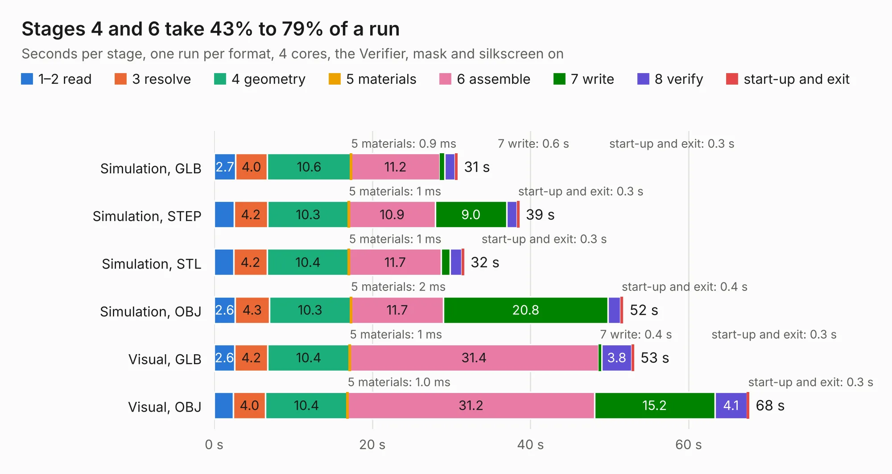

| Mode and format | 1–2 read | 3 resolve | 4 geometry | 5 materials | 6 assemble | 7 write | 8 verify | start-up and exit | Total |
|---|---:|---:|---:|---:|---:|---:|---:|---:|---:|
| Simulation, GLB | 2.7 | 4.0 | 10.6 | 0.9&nbsp;ms | 11.2 | 0.6 | 1.3 | 0.3 | 30.8 |
| Simulation, STEP | 2.5 | 4.2 | 10.3 | 1&nbsp;ms | 10.9 | 9.0 | 1.3 | 0.3 | 38.6 |
| Simulation, STL | 2.5 | 4.2 | 10.4 | 1&nbsp;ms | 11.7 | 1.1 | 1.5 | 0.3 | 31.6 |
| Simulation, OBJ | 2.6 | 4.3 | 10.3 | 2&nbsp;ms | 11.7 | 20.8 | 1.5 | 0.4 | 51.7 |
| Visual, GLB | 2.6 | 4.2 | 10.4 | 1&nbsp;ms | 31.4 | 0.4 | 3.8 | 0.3 | 53.1 |
| Visual, OBJ | 2.5 | 4.0 | 10.4 | 1.0&nbsp;ms | 31.2 | 15.2 | 4.1 | 0.3 | 67.7 |

<table align="center"><tr><td valign="top">

| Board | Repo: [polpo/picogus](https://github.com/polpo/picogus) Board: `PicoGUS chipdown with edge rails.kicad_pcb` |
|---|---|
| Folder | hw-chipdown |
| Complexity | 396&nbsp;/&nbsp;1000 (size&nbsp;251, features&nbsp;145) |
| KESE&nbsp;features | through vias, slotted holes, custom pads, rounded, trapezoid or chamfered pads, filled zones, copper drawings, TrueType text, stack-up, dielectric εr and tanδ, copper finish, mask and silkscreen colours |
| Tested | 9th November 2026 |
| Copper&nbsp;layers | 4 |
| File&nbsp;format | KiCad 7 (20221018) |
| Parts,&nbsp;tracks,&nbsp;vias | 96, 1,334, 374 |
| Triangles,&nbsp;simulation | 3,297,988 in 176 parts |
| Verifier | PASS in all six runs |

</td><td valign="top">

<table>
<tr><th>File type</th><th>File size</th><th>Peak memory used</th></tr>
<tr><th colspan="3" align="left">Simulation</th></tr>
<tr><td>GLB</td><td align="right">115&nbsp;MB</td><td align="right">1.3&nbsp;GB</td></tr>
<tr><td>STEP</td><td align="right">371&nbsp;MB</td><td align="right">1.5&nbsp;GB</td></tr>
<tr><td>STL</td><td align="right">165&nbsp;MB</td><td align="right">1.3&nbsp;GB</td></tr>
<tr><td>OBJ</td><td align="right">359&nbsp;MB</td><td align="right">2.3&nbsp;GB</td></tr>
<tr><th colspan="3" align="left">Visual</th></tr>
<tr><td>GLB</td><td align="right">87&nbsp;MB</td><td align="right">1.5&nbsp;GB</td></tr>
<tr><td>OBJ</td><td align="right">274&nbsp;MB</td><td align="right">1.9&nbsp;GB</td></tr>
</table>

</td></tr></table>

## 2287. PicoGUS chipdown

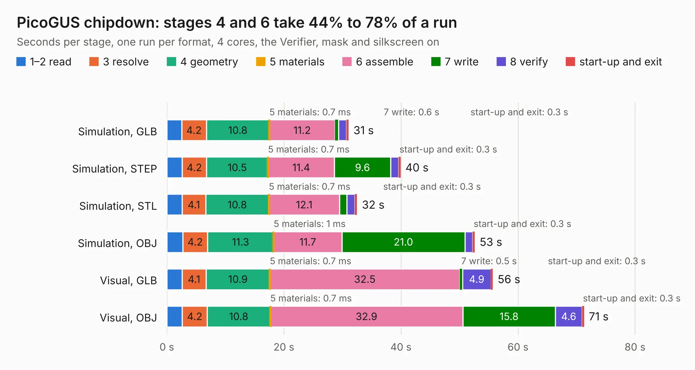

| Mode and format | 1–2 read | 3 resolve | 4 geometry | 5 materials | 6 assemble | 7 write | 8 verify | start-up and exit | Total |
|---|---:|---:|---:|---:|---:|---:|---:|---:|---:|
| Simulation, GLB | 2.5 | 4.2 | 10.8 | 0.7&nbsp;ms | 11.2 | 0.6 | 1.4 | 0.3 | 31.0 |
| Simulation, STEP | 2.6 | 4.2 | 10.5 | 0.7&nbsp;ms | 11.4 | 9.6 | 1.4 | 0.3 | 39.9 |
| Simulation, STL | 2.6 | 4.1 | 10.8 | 0.7&nbsp;ms | 12.1 | 1.2 | 1.4 | 0.3 | 32.5 |
| Simulation, OBJ | 2.7 | 4.2 | 11.3 | 1&nbsp;ms | 11.7 | 21.0 | 1.4 | 0.3 | 52.6 |
| Visual, GLB | 2.6 | 4.1 | 10.9 | 0.7&nbsp;ms | 32.5 | 0.5 | 4.9 | 0.3 | 55.7 |
| Visual, OBJ | 2.6 | 4.2 | 10.8 | 0.7&nbsp;ms | 32.9 | 15.8 | 4.6 | 0.3 | 71.2 |

<table align="center"><tr><td valign="top">

| Board | Repo: [polpo/picogus](https://github.com/polpo/picogus) Board: `PicoGUS chipdown.kicad_pcb` |
|---|---|
| Folder | hw-chipdown |
| Complexity | 396&nbsp;/&nbsp;1000 (size&nbsp;251, features&nbsp;145) |
| KESE&nbsp;features | through vias, slotted holes, custom pads, rounded, trapezoid or chamfered pads, filled zones, copper drawings, TrueType text, stack-up, dielectric εr and tanδ, copper finish, mask and silkscreen colours |
| Tested | 9th November 2026 |
| Copper&nbsp;layers | 4 |
| File&nbsp;format | KiCad 7 (20221018) |
| Parts,&nbsp;tracks,&nbsp;vias | 96, 1,334, 374 |
| Triangles,&nbsp;simulation | 3,281,176 in 178 parts |
| Verifier | PASS in all six runs |

</td><td valign="top">

<table>
<tr><th>File type</th><th>File size</th><th>Peak memory used</th></tr>
<tr><th colspan="3" align="left">Simulation</th></tr>
<tr><td>GLB</td><td align="right">114&nbsp;MB</td><td align="right">1.2&nbsp;GB</td></tr>
<tr><td>STEP</td><td align="right">367&nbsp;MB</td><td align="right">1.5&nbsp;GB</td></tr>
<tr><td>STL</td><td align="right">164&nbsp;MB</td><td align="right">1.3&nbsp;GB</td></tr>
<tr><td>OBJ</td><td align="right">357&nbsp;MB</td><td align="right">2.3&nbsp;GB</td></tr>
<tr><th colspan="3" align="left">Visual</th></tr>
<tr><td>GLB</td><td align="right">86&nbsp;MB</td><td align="right">1.4&nbsp;GB</td></tr>
<tr><td>OBJ</td><td align="right">272&nbsp;MB</td><td align="right">1.8&nbsp;GB</td></tr>
</table>

</td></tr></table>

## 2288. PicoGUS Hand386

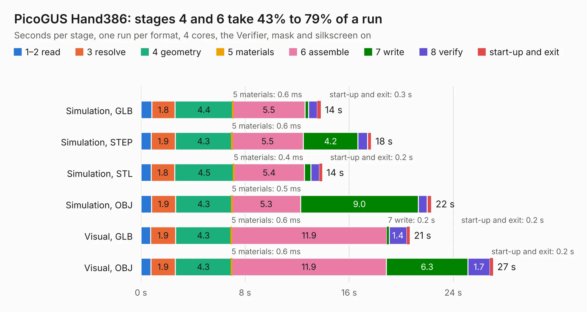

| Mode and format | 1–2 read | 3 resolve | 4 geometry | 5 materials | 6 assemble | 7 write | 8 verify | start-up and exit | Total |
|---|---:|---:|---:|---:|---:|---:|---:|---:|---:|
| Simulation, GLB | 0.8 | 1.8 | 4.4 | 0.6&nbsp;ms | 5.5 | 0.3 | 0.7 | 0.3 | 13.8 |
| Simulation, STEP | 0.8 | 1.9 | 4.3 | 0.6&nbsp;ms | 5.5 | 4.2 | 0.7 | 0.3 | 17.7 |
| Simulation, STL | 0.8 | 1.8 | 4.5 | 0.4&nbsp;ms | 5.4 | 0.5 | 0.6 | 0.2 | 13.9 |
| Simulation, OBJ | 0.8 | 1.9 | 4.3 | 0.5&nbsp;ms | 5.3 | 9.0 | 0.7 | 0.3 | 22.3 |
| Visual, GLB | 0.7 | 1.9 | 4.3 | 0.6&nbsp;ms | 11.9 | 0.2 | 1.4 | 0.2 | 20.7 |
| Visual, OBJ | 0.8 | 1.9 | 4.3 | 0.6&nbsp;ms | 11.9 | 6.3 | 1.7 | 0.2 | 27.1 |

<table align="center"><tr><td valign="top">

| Board | Repo: [polpo/picogus](https://github.com/polpo/picogus) Board: `PicoGUS Hand386.kicad_pcb` |
|---|---|
| Folder | hw-hand386 |
| Complexity | 333&nbsp;/&nbsp;1000 (size&nbsp;198, features&nbsp;135) |
| KESE&nbsp;features | through vias, custom pads, rounded, trapezoid or chamfered pads, arc tracks, filled zones, copper drawings, TrueType text, stack-up, dielectric εr and tanδ, mask and silkscreen colours |
| Tested | 9th November 2026 |
| Copper&nbsp;layers | 4 |
| File&nbsp;format | KiCad 8 (20240108) |
| Parts,&nbsp;tracks,&nbsp;vias | 50, 903, 278 |
| Triangles,&nbsp;simulation | 1,662,280 in 127 parts |
| Verifier | PASS in all six runs |

</td><td valign="top">

<table>
<tr><th>File type</th><th>File size</th><th>Peak memory used</th></tr>
<tr><th colspan="3" align="left">Simulation</th></tr>
<tr><td>GLB</td><td align="right">57&nbsp;MB</td><td align="right">651&nbsp;MB</td></tr>
<tr><td>STEP</td><td align="right">217&nbsp;MB</td><td align="right">755&nbsp;MB</td></tr>
<tr><td>STL</td><td align="right">83&nbsp;MB</td><td align="right">631&nbsp;MB</td></tr>
<tr><td>OBJ</td><td align="right">174&nbsp;MB</td><td align="right">1.2&nbsp;GB</td></tr>
<tr><th colspan="3" align="left">Visual</th></tr>
<tr><td>GLB</td><td align="right">39&nbsp;MB</td><td align="right">737&nbsp;MB</td></tr>
<tr><td>OBJ</td><td align="right">119&nbsp;MB</td><td align="right">901&nbsp;MB</td></tr>
</table>

</td></tr></table>

## 2289. PicoGUS

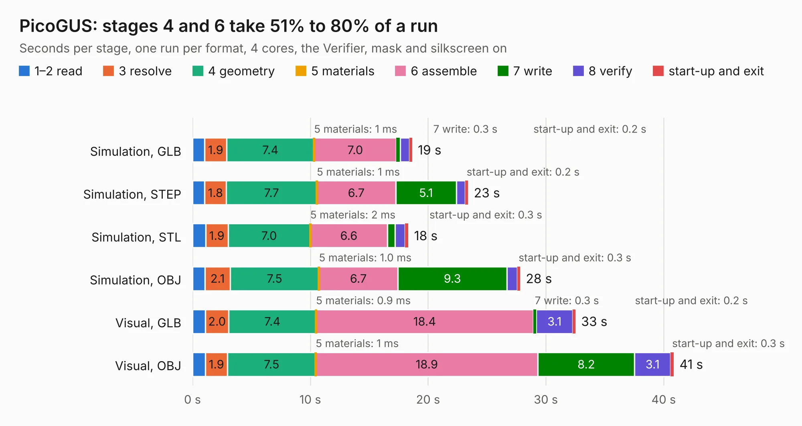

| Mode and format | 1–2 read | 3 resolve | 4 geometry | 5 materials | 6 assemble | 7 write | 8 verify | start-up and exit | Total |
|---|---:|---:|---:|---:|---:|---:|---:|---:|---:|
| Simulation, GLB | 1.0 | 1.9 | 7.4 | 1&nbsp;ms | 7.0 | 0.3 | 0.8 | 0.2 | 18.6 |
| Simulation, STEP | 1.0 | 1.8 | 7.7 | 1&nbsp;ms | 6.7 | 5.1 | 0.8 | 0.2 | 23.4 |
| Simulation, STL | 1.1 | 1.9 | 7.0 | 2&nbsp;ms | 6.6 | 0.6 | 0.8 | 0.3 | 18.3 |
| Simulation, OBJ | 1.1 | 2.1 | 7.5 | 1.0&nbsp;ms | 6.7 | 9.3 | 0.9 | 0.3 | 27.8 |
| Visual, GLB | 1.1 | 2.0 | 7.4 | 0.9&nbsp;ms | 18.4 | 0.3 | 3.1 | 0.2 | 32.5 |
| Visual, OBJ | 1.1 | 1.9 | 7.5 | 1&nbsp;ms | 18.9 | 8.2 | 3.1 | 0.3 | 40.9 |

<table align="center"><tr><td valign="top">

| Board | Repo: [polpo/picogus](https://github.com/polpo/picogus) Board: `PicoGUS.kicad_pcb` |
|---|---|
| Folder | hw |
| Complexity | 313&nbsp;/&nbsp;1000 (size&nbsp;183, features&nbsp;130) |
| KESE&nbsp;features | through vias, slotted holes, rounded, trapezoid or chamfered pads, drill offsets, arc tracks, filled zones, TrueType text, stack-up, dielectric εr and tanδ, mask and silkscreen colours |
| Tested | 9th November 2026 |
| Copper&nbsp;layers | 2 |
| File&nbsp;format | KiCad 7 (20221018) |
| Parts,&nbsp;tracks,&nbsp;vias | 51, 999, 296 |
| Triangles,&nbsp;simulation | 2,194,242 in 135 parts |
| Verifier | PASS in all six runs |

</td><td valign="top">

<table>
<tr><th>File type</th><th>File size</th><th>Peak memory used</th></tr>
<tr><th colspan="3" align="left">Simulation</th></tr>
<tr><td>GLB</td><td align="right">76&nbsp;MB</td><td align="right">847&nbsp;MB</td></tr>
<tr><td>STEP</td><td align="right">325&nbsp;MB</td><td align="right">1.1&nbsp;GB</td></tr>
<tr><td>STL</td><td align="right">110&nbsp;MB</td><td align="right">838&nbsp;MB</td></tr>
<tr><td>OBJ</td><td align="right">234&nbsp;MB</td><td align="right">1.5&nbsp;GB</td></tr>
<tr><th colspan="3" align="left">Visual</th></tr>
<tr><td>GLB</td><td align="right">63&nbsp;MB</td><td align="right">1.1&nbsp;GB</td></tr>
<tr><td>OBJ</td><td align="right">194&nbsp;MB</td><td align="right">1.3&nbsp;GB</td></tr>
</table>

</td></tr></table>

## 2290. ISA adapter

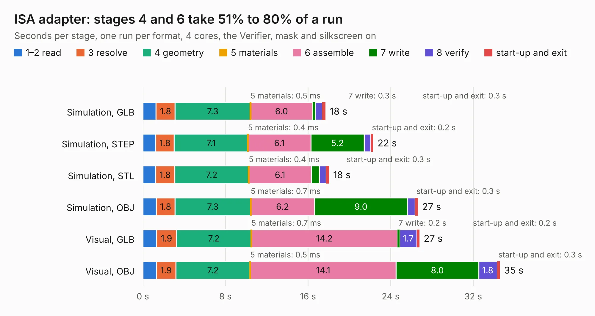

| Mode and format | 1–2 read | 3 resolve | 4 geometry | 5 materials | 6 assemble | 7 write | 8 verify | start-up and exit | Total |
|---|---:|---:|---:|---:|---:|---:|---:|---:|---:|
| Simulation, GLB | 1.3 | 1.8 | 7.3 | 0.5&nbsp;ms | 6.0 | 0.3 | 0.7 | 0.3 | 17.7 |
| Simulation, STEP | 1.3 | 1.8 | 7.1 | 0.4&nbsp;ms | 6.1 | 5.2 | 0.7 | 0.2 | 22.3 |
| Simulation, STL | 1.2 | 1.8 | 7.2 | 0.4&nbsp;ms | 6.1 | 0.8 | 0.7 | 0.3 | 18.0 |
| Simulation, OBJ | 1.3 | 1.8 | 7.3 | 0.7&nbsp;ms | 6.2 | 9.0 | 0.7 | 0.3 | 26.6 |
| Visual, GLB | 1.3 | 1.9 | 7.2 | 0.7&nbsp;ms | 14.2 | 0.2 | 1.7 | 0.2 | 26.8 |
| Visual, OBJ | 1.3 | 1.9 | 7.2 | 0.5&nbsp;ms | 14.1 | 8.0 | 1.8 | 0.3 | 34.6 |

<table align="center"><tr><td valign="top">

| Board | Repo: [polpo/picogus](https://github.com/polpo/picogus) Board: `ISA adapter.kicad_pcb` |
|---|---|
| Folder | isa-hand386 adapter |
| Complexity | 257&nbsp;/&nbsp;1000 (size&nbsp;152, features&nbsp;105) |
| KESE&nbsp;features | through vias, slotted holes, rounded, trapezoid or chamfered pads, filled zones, TrueType text, stack-up, dielectric εr and tanδ, mask and silkscreen colours |
| Tested | 9th November 2026 |
| Copper&nbsp;layers | 2 |
| File&nbsp;format | KiCad 8 (20240108) |
| Parts,&nbsp;tracks,&nbsp;vias | 14, 279, 124 |
| Triangles,&nbsp;simulation | 1,493,942 in 122 parts |
| Verifier | PASS in all six runs |

</td><td valign="top">

<table>
<tr><th>File type</th><th>File size</th><th>Peak memory used</th></tr>
<tr><th colspan="3" align="left">Simulation</th></tr>
<tr><td>GLB</td><td align="right">52&nbsp;MB</td><td align="right">696&nbsp;MB</td></tr>
<tr><td>STEP</td><td align="right">211&nbsp;MB</td><td align="right">767&nbsp;MB</td></tr>
<tr><td>STL</td><td align="right">75&nbsp;MB</td><td align="right">730&nbsp;MB</td></tr>
<tr><td>OBJ</td><td align="right">157&nbsp;MB</td><td align="right">1.1&nbsp;GB</td></tr>
<tr><th colspan="3" align="left">Visual</th></tr>
<tr><td>GLB</td><td align="right">42&nbsp;MB</td><td align="right">894&nbsp;MB</td></tr>
<tr><td>OBJ</td><td align="right">127&nbsp;MB</td><td align="right">945&nbsp;MB</td></tr>
</table>

</td></tr></table>

## 2291. pc_healthypi_move_program_adapter_v7

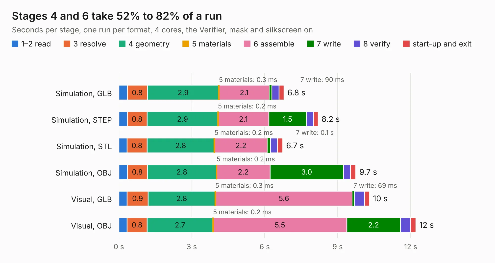

| Mode and format | 1–2 read | 3 resolve | 4 geometry | 5 materials | 6 assemble | 7 write | 8 verify | start-up and exit | Total |
|---|---:|---:|---:|---:|---:|---:|---:|---:|---:|
| Simulation, GLB | 0.3 | 0.8 | 2.9 | 0.3&nbsp;ms | 2.1 | 90&nbsp;ms | 0.3 | 0.2 | 6.8 |
| Simulation, STEP | 0.3 | 0.8 | 2.9 | 0.2&nbsp;ms | 2.1 | 1.5 | 0.3 | 0.2 | 8.2 |
| Simulation, STL | 0.3 | 0.8 | 2.8 | 0.2&nbsp;ms | 2.2 | 0.1 | 0.3 | 0.2 | 6.7 |
| Simulation, OBJ | 0.4 | 0.8 | 2.8 | 0.2&nbsp;ms | 2.2 | 3.0 | 0.3 | 0.2 | 9.7 |
| Visual, GLB | 0.3 | 0.9 | 2.8 | 0.3&nbsp;ms | 5.6 | 69&nbsp;ms | 0.4 | 0.2 | 10.3 |
| Visual, OBJ | 0.3 | 0.8 | 2.7 | 0.2&nbsp;ms | 5.5 | 2.2 | 0.4 | 0.2 | 12.2 |

<table align="center"><tr><td valign="top">

| Board | Repo: [Protocentral/healthypi-move-hw](https://github.com/Protocentral/healthypi-move-hw) Board: `pc_healthypi_move_program_adapter_v7.kicad_pcb` |
|---|---|
| Folder | pcbs / kicad_healthypi_move_program_adapter |
| Complexity | 239&nbsp;/&nbsp;1000 (size&nbsp;154, features&nbsp;85) |
| KESE&nbsp;features | through vias, rounded, trapezoid or chamfered pads, filled zones, curved board outline, stack-up, dielectric εr and tanδ |
| Tested | 9th November 2026 |
| Copper&nbsp;layers | 4 |
| File&nbsp;format | KiCad 8 (20240108) |
| Parts,&nbsp;tracks,&nbsp;vias | 9, 276, 25 |
| Triangles,&nbsp;simulation | 564,298 in 53 parts |
| Verifier | PASS in all six runs |

</td><td valign="top">

<table>
<tr><th>File type</th><th>File size</th><th>Peak memory used</th></tr>
<tr><th colspan="3" align="left">Simulation</th></tr>
<tr><td>GLB</td><td align="right">20&nbsp;MB</td><td align="right">295&nbsp;MB</td></tr>
<tr><td>STEP</td><td align="right">101&nbsp;MB</td><td align="right">356&nbsp;MB</td></tr>
<tr><td>STL</td><td align="right">28&nbsp;MB</td><td align="right">296&nbsp;MB</td></tr>
<tr><td>OBJ</td><td align="right">60&nbsp;MB</td><td align="right">451&nbsp;MB</td></tr>
<tr><th colspan="3" align="left">Visual</th></tr>
<tr><td>GLB</td><td align="right">15&nbsp;MB</td><td align="right">375&nbsp;MB</td></tr>
<tr><td>OBJ</td><td align="right">45&nbsp;MB</td><td align="right">377&nbsp;MB</td></tr>
</table>

</td></tr></table>

## 2292. pc_healthypi_move_nRF5340_v12

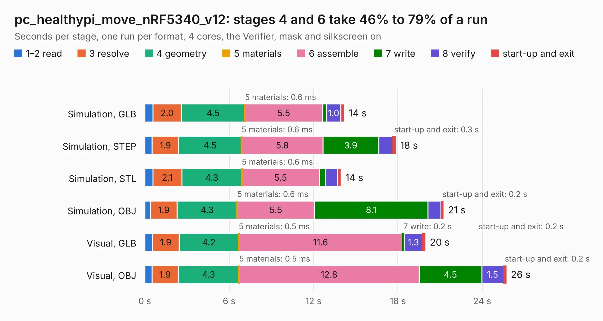

| Mode and format | 1–2 read | 3 resolve | 4 geometry | 5 materials | 6 assemble | 7 write | 8 verify | start-up and exit | Total |
|---|---:|---:|---:|---:|---:|---:|---:|---:|---:|
| Simulation, GLB | 0.6 | 2.0 | 4.5 | 0.6&nbsp;ms | 5.5 | 0.3 | 1.0 | 0.3 | 14.2 |
| Simulation, STEP | 0.5 | 1.9 | 4.5 | 0.6&nbsp;ms | 5.8 | 3.9 | 1.0 | 0.3 | 17.9 |
| Simulation, STL | 0.6 | 2.1 | 4.3 | 0.6&nbsp;ms | 5.5 | 0.4 | 0.8 | 0.3 | 14.0 |
| Simulation, OBJ | 0.4 | 1.9 | 4.3 | 0.6&nbsp;ms | 5.5 | 8.1 | 0.9 | 0.2 | 21.3 |
| Visual, GLB | 0.5 | 1.9 | 4.2 | 0.5&nbsp;ms | 11.6 | 0.2 | 1.3 | 0.2 | 20.0 |
| Visual, OBJ | 0.5 | 1.9 | 4.3 | 0.5&nbsp;ms | 12.8 | 4.5 | 1.5 | 0.2 | 25.7 |

<table align="center"><tr><td valign="top">

| Board | Repo: [Protocentral/healthypi-move-hw](https://github.com/Protocentral/healthypi-move-hw) Board: `pc_healthypi_move_nRF5340_v12.kicad_pcb` |
|---|---|
| Folder | pcbs / main board / kicad_pc_healthypi_move_nRF5340_v12 |
| Complexity | 407&nbsp;/&nbsp;1000 (size&nbsp;257, features&nbsp;150) |
| KESE&nbsp;features | through vias, microvias, slotted holes, rounded, trapezoid or chamfered pads, filled zones, curved board outline, TrueType text, stack-up, dielectric εr and tanδ |
| Tested | 9th November 2026 |
| Copper&nbsp;layers | 6 |
| File&nbsp;format | KiCad 9 (20241229) |
| Parts,&nbsp;tracks,&nbsp;vias | 78, 1,711, 186 |
| Triangles,&nbsp;simulation | 1,636,860 in 129 parts |
| Verifier | PASS in all six runs |

</td><td valign="top">

<table>
<tr><th>File type</th><th>File size</th><th>Peak memory used</th></tr>
<tr><th colspan="3" align="left">Simulation</th></tr>
<tr><td>GLB</td><td align="right">56&nbsp;MB</td><td align="right">572&nbsp;MB</td></tr>
<tr><td>STEP</td><td align="right">230&nbsp;MB</td><td align="right">733&nbsp;MB</td></tr>
<tr><td>STL</td><td align="right">82&nbsp;MB</td><td align="right">568&nbsp;MB</td></tr>
<tr><td>OBJ</td><td align="right">176&nbsp;MB</td><td align="right">1.1&nbsp;GB</td></tr>
<tr><th colspan="3" align="left">Visual</th></tr>
<tr><td>GLB</td><td align="right">33&nbsp;MB</td><td align="right">793&nbsp;MB</td></tr>
<tr><td>OBJ</td><td align="right">105&nbsp;MB</td><td align="right">801&nbsp;MB</td></tr>
</table>

</td></tr></table>

## 2293. pc_healthypi_move_sensor_v9

| Mode and format | 1–2 read | 3 resolve | 4 geometry | 5 materials | 6 assemble | 7 write | 8 verify | start-up and exit | Total |
|---|---:|---:|---:|---:|---:|---:|---:|---:|---:|
| Simulation, GLB | 0.9 | 1.8 | 5.1 | 0.4&nbsp;ms | 5.9 | 0.3 | 0.9 | 0.2 | 15.2 |
| Simulation, STEP | 0.9 | 2.0 | 5.1 | 2&nbsp;ms | 5.7 | 3.6 | 0.9 | 0.3 | 18.5 |
| Simulation, STL | 1.0 | 2.1 | 5.0 | 0.4&nbsp;ms | 5.8 | 0.4 | 0.9 | 0.2 | 15.4 |
| Simulation, OBJ | 0.8 | 2.0 | 5.0 | 0.5&nbsp;ms | 5.9 | 8.1 | 1.0 | 0.2 | 23.0 |
| Visual, GLB | 0.9 | 2.0 | 5.8 | 0.5&nbsp;ms | 12.8 | 0.1 | 1.1 | 0.3 | 23.0 |
| Visual, OBJ | 0.9 | 2.1 | 5.2 | 0.5&nbsp;ms | 13.0 | 4.8 | 1.4 | 0.3 | 27.7 |

<table align="center"><tr><td valign="top">

| Board | Repo: [Protocentral/healthypi-move-hw](https://github.com/Protocentral/healthypi-move-hw) Board: `pc_healthypi_move_sensor_v9.kicad_pcb` |
|---|---|
| Folder | pcbs / sensor board / kicad_pc_healthypi_move_sensor_v9 |
| Complexity | 371&nbsp;/&nbsp;1000 (size&nbsp;261, features&nbsp;110) |
| KESE&nbsp;features | through vias, custom pads, rounded, trapezoid or chamfered pads, filled zones, copper drawings, curved board outline, stack-up, dielectric εr and tanδ |
| Tested | 9th November 2026 |
| Copper&nbsp;layers | 6 |
| File&nbsp;format | KiCad 9 (20241229) |
| Parts,&nbsp;tracks,&nbsp;vias | 80, 1,142, 158 |
| Triangles,&nbsp;simulation | 1,702,322 in 119 parts |
| Verifier | PASS in all six runs |

</td><td valign="top">

<table>
<tr><th>File type</th><th>File size</th><th>Peak memory used</th></tr>
<tr><th colspan="3" align="left">Simulation</th></tr>
<tr><td>GLB</td><td align="right">59&nbsp;MB</td><td align="right">598&nbsp;MB</td></tr>
<tr><td>STEP</td><td align="right">241&nbsp;MB</td><td align="right">710&nbsp;MB</td></tr>
<tr><td>STL</td><td align="right">85&nbsp;MB</td><td align="right">592&nbsp;MB</td></tr>
<tr><td>OBJ</td><td align="right">183&nbsp;MB</td><td align="right">1.2&nbsp;GB</td></tr>
<tr><th colspan="3" align="left">Visual</th></tr>
<tr><td>GLB</td><td align="right">33&nbsp;MB</td><td align="right">738&nbsp;MB</td></tr>
<tr><td>OBJ</td><td align="right">105&nbsp;MB</td><td align="right">840&nbsp;MB</td></tr>
</table>

</td></tr></table>

## 2294. healthylink_compute_v5

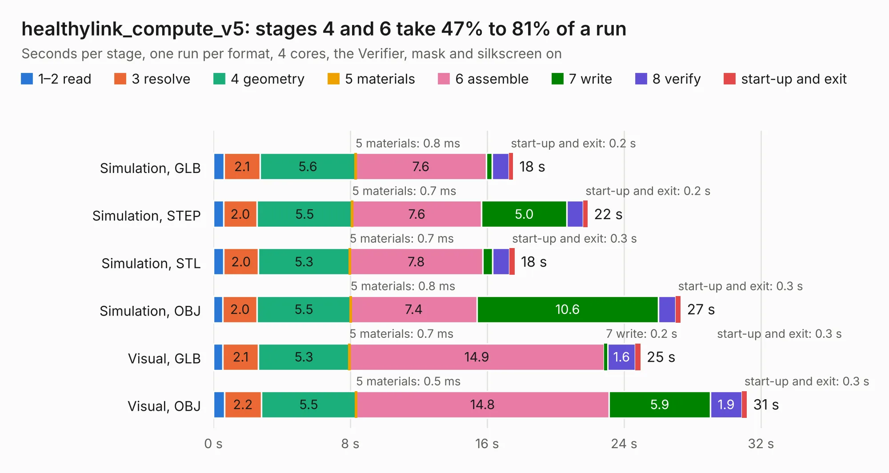

| Mode and format | 1–2 read | 3 resolve | 4 geometry | 5 materials | 6 assemble | 7 write | 8 verify | start-up and exit | Total |
|---|---:|---:|---:|---:|---:|---:|---:|---:|---:|
| Simulation, GLB | 0.6 | 2.1 | 5.6 | 0.8&nbsp;ms | 7.6 | 0.3 | 1.0 | 0.2 | 17.5 |
| Simulation, STEP | 0.6 | 2.0 | 5.5 | 0.7&nbsp;ms | 7.6 | 5.0 | 1.0 | 0.2 | 21.9 |
| Simulation, STL | 0.6 | 2.0 | 5.3 | 0.7&nbsp;ms | 7.8 | 0.6 | 1.0 | 0.3 | 17.6 |
| Simulation, OBJ | 0.5 | 2.0 | 5.5 | 0.8&nbsp;ms | 7.4 | 10.6 | 1.0 | 0.3 | 27.3 |
| Visual, GLB | 0.6 | 2.1 | 5.3 | 0.7&nbsp;ms | 14.9 | 0.2 | 1.6 | 0.3 | 24.9 |
| Visual, OBJ | 0.6 | 2.2 | 5.5 | 0.5&nbsp;ms | 14.8 | 5.9 | 1.9 | 0.3 | 31.2 |

<table align="center"><tr><td valign="top">

| Board | Repo: [protocentral/protocentral_healthypi6_hardware](https://github.com/protocentral/protocentral_healthypi6_hardware) Board: `healthylink_compute_v5.kicad_pcb` |
|---|---|
| Folder | hardware / healthylink_compute_v5 |
| Complexity | 418&nbsp;/&nbsp;1000 (size&nbsp;268, features&nbsp;150) |
| KESE&nbsp;features | through vias, slotted holes, custom pads, rounded, trapezoid or chamfered pads, filled zones, copper drawings, curved board outline, knockout text, TrueType text, stack-up, dielectric εr and tanδ |
| Tested | 9th November 2026 |
| Copper&nbsp;layers | 6 |
| File&nbsp;format | KiCad 10 (20260206) |
| Parts,&nbsp;tracks,&nbsp;vias | 114, 930, 237 |
| Triangles,&nbsp;simulation | 2,134,666 in 222 parts |
| Verifier | PASS in all six runs |

</td><td valign="top">

<table>
<tr><th>File type</th><th>File size</th><th>Peak memory used</th></tr>
<tr><th colspan="3" align="left">Simulation</th></tr>
<tr><td>GLB</td><td align="right">72&nbsp;MB</td><td align="right">720&nbsp;MB</td></tr>
<tr><td>STEP</td><td align="right">259&nbsp;MB</td><td align="right">845&nbsp;MB</td></tr>
<tr><td>STL</td><td align="right">107&nbsp;MB</td><td align="right">695&nbsp;MB</td></tr>
<tr><td>OBJ</td><td align="right">222&nbsp;MB</td><td align="right">1.4&nbsp;GB</td></tr>
<tr><th colspan="3" align="left">Visual</th></tr>
<tr><td>GLB</td><td align="right">40&nbsp;MB</td><td align="right">850&nbsp;MB</td></tr>
<tr><td>OBJ</td><td align="right">122&nbsp;MB</td><td align="right">939&nbsp;MB</td></tr>
</table>

</td></tr></table>

## 2295. healthylink_gpio_v2

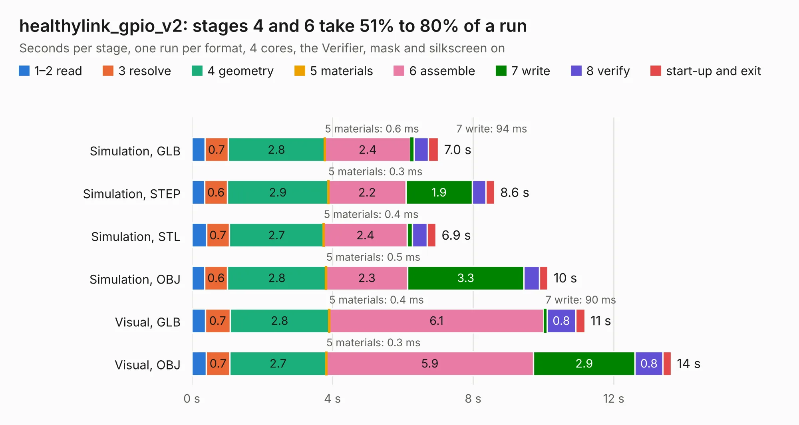

| Mode and format | 1–2 read | 3 resolve | 4 geometry | 5 materials | 6 assemble | 7 write | 8 verify | start-up and exit | Total |
|---|---:|---:|---:|---:|---:|---:|---:|---:|---:|
| Simulation, GLB | 0.4 | 0.7 | 2.8 | 0.6&nbsp;ms | 2.4 | 94&nbsp;ms | 0.4 | 0.3 | 7.0 |
| Simulation, STEP | 0.4 | 0.6 | 2.9 | 0.3&nbsp;ms | 2.2 | 1.9 | 0.4 | 0.2 | 8.6 |
| Simulation, STL | 0.4 | 0.7 | 2.7 | 0.4&nbsp;ms | 2.4 | 0.2 | 0.4 | 0.3 | 6.9 |
| Simulation, OBJ | 0.4 | 0.6 | 2.8 | 0.5&nbsp;ms | 2.3 | 3.3 | 0.4 | 0.2 | 10.1 |
| Visual, GLB | 0.4 | 0.7 | 2.8 | 0.4&nbsp;ms | 6.1 | 90&nbsp;ms | 0.8 | 0.3 | 11.2 |
| Visual, OBJ | 0.4 | 0.7 | 2.7 | 0.3&nbsp;ms | 5.9 | 2.9 | 0.8 | 0.2 | 13.6 |

<table align="center"><tr><td valign="top">

| Board | Repo: [protocentral/protocentral_healthypi6_hardware](https://github.com/protocentral/protocentral_healthypi6_hardware) Board: `healthylink_gpio_v2.kicad_pcb` |
|---|---|
| Folder | hardware / healthylink_gpio_v2 |
| Complexity | 287&nbsp;/&nbsp;1000 (size&nbsp;147, features&nbsp;140) |
| KESE&nbsp;features | through vias, custom pads, rounded, trapezoid or chamfered pads, filled zones, copper drawings, curved board outline, knockout text, TrueType text, stack-up, dielectric εr and tanδ |
| Tested | 9th November 2026 |
| Copper&nbsp;layers | 2 |
| File&nbsp;format | KiCad 10 (20260206) |
| Parts,&nbsp;tracks,&nbsp;vias | 16, 288, 47 |
| Triangles,&nbsp;simulation | 591,150 in 65 parts |
| Verifier | PASS in all six runs |

</td><td valign="top">

<table>
<tr><th>File type</th><th>File size</th><th>Peak memory used</th></tr>
<tr><th colspan="3" align="left">Simulation</th></tr>
<tr><td>GLB</td><td align="right">21&nbsp;MB</td><td align="right">328&nbsp;MB</td></tr>
<tr><td>STEP</td><td align="right">102&nbsp;MB</td><td align="right">399&nbsp;MB</td></tr>
<tr><td>STL</td><td align="right">30&nbsp;MB</td><td align="right">341&nbsp;MB</td></tr>
<tr><td>OBJ</td><td align="right">60&nbsp;MB</td><td align="right">427&nbsp;MB</td></tr>
<tr><th colspan="3" align="left">Visual</th></tr>
<tr><td>GLB</td><td align="right">17&nbsp;MB</td><td align="right">449&nbsp;MB</td></tr>
<tr><td>OBJ</td><td align="right">52&nbsp;MB</td><td align="right">469&nbsp;MB</td></tr>
</table>

</td></tr></table>

## 2296. healthypi_6_display_v7

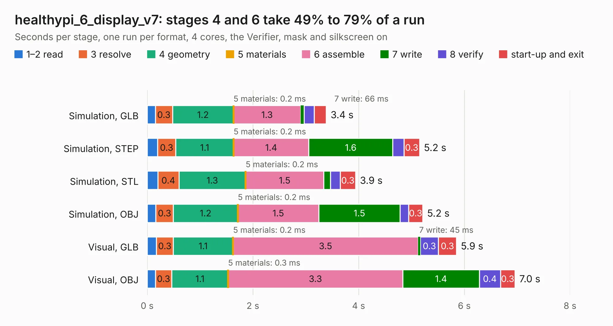

| Mode and format | 1–2 read | 3 resolve | 4 geometry | 5 materials | 6 assemble | 7 write | 8 verify | start-up and exit | Total |
|---|---:|---:|---:|---:|---:|---:|---:|---:|---:|
| Simulation, GLB | 0.2 | 0.3 | 1.2 | 0.2&nbsp;ms | 1.3 | 66&nbsp;ms | 0.2 | 0.2 | 3.4 |
| Simulation, STEP | 0.2 | 0.3 | 1.1 | 0.2&nbsp;ms | 1.4 | 1.6 | 0.2 | 0.3 | 5.2 |
| Simulation, STL | 0.2 | 0.4 | 1.3 | 0.2&nbsp;ms | 1.5 | 0.1 | 0.2 | 0.3 | 3.9 |
| Simulation, OBJ | 0.2 | 0.3 | 1.2 | 0.2&nbsp;ms | 1.5 | 1.5 | 0.2 | 0.3 | 5.2 |
| Visual, GLB | 0.2 | 0.3 | 1.1 | 0.2&nbsp;ms | 3.5 | 45&nbsp;ms | 0.3 | 0.3 | 5.9 |
| Visual, OBJ | 0.2 | 0.3 | 1.1 | 0.3&nbsp;ms | 3.3 | 1.4 | 0.4 | 0.3 | 7.0 |

<table align="center"><tr><td valign="top">

| Board | Repo: [protocentral/protocentral_healthypi6_hardware](https://github.com/protocentral/protocentral_healthypi6_hardware) Board: `healthypi_6_display_v7.kicad_pcb` |
|---|---|
| Folder | hardware / healthypi_6_display_v7 |
| Complexity | 232&nbsp;/&nbsp;1000 (size&nbsp;142, features&nbsp;90) |
| KESE&nbsp;features | through vias, rounded, trapezoid or chamfered pads, filled zones, TrueType text, stack-up, dielectric εr and tanδ |
| Tested | 9th November 2026 |
| Copper&nbsp;layers | 2 |
| File&nbsp;format | KiCad 10 (20260206) |
| Parts,&nbsp;tracks,&nbsp;vias | 14, 189, 50 |
| Triangles,&nbsp;simulation | 240,022 in 41 parts |
| Verifier | PASS in all six runs |

</td><td valign="top">

<table>
<tr><th>File type</th><th>File size</th><th>Peak memory used</th></tr>
<tr><th colspan="3" align="left">Simulation</th></tr>
<tr><td>GLB</td><td align="right">8.5&nbsp;MB</td><td align="right">212&nbsp;MB</td></tr>
<tr><td>STEP</td><td align="right">42&nbsp;MB</td><td align="right">227&nbsp;MB</td></tr>
<tr><td>STL</td><td align="right">12&nbsp;MB</td><td align="right">212&nbsp;MB</td></tr>
<tr><td>OBJ</td><td align="right">24&nbsp;MB</td><td align="right">212&nbsp;MB</td></tr>
<tr><th colspan="3" align="left">Visual</th></tr>
<tr><td>GLB</td><td align="right">7.4&nbsp;MB</td><td align="right">210&nbsp;MB</td></tr>
<tr><td>OBJ</td><td align="right">22&nbsp;MB</td><td align="right">215&nbsp;MB</td></tr>
</table>

</td></tr></table>

## 2297. healthypi_6_v5

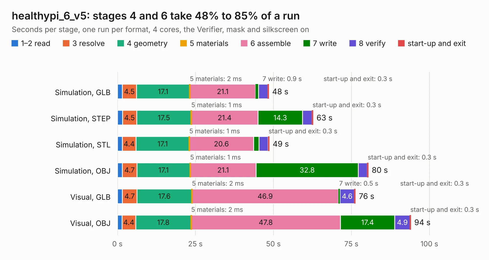

| Mode and format | 1–2 read | 3 resolve | 4 geometry | 5 materials | 6 assemble | 7 write | 8 verify | start-up and exit | Total |
|---|---:|---:|---:|---:|---:|---:|---:|---:|---:|
| Simulation, GLB | 1.6 | 4.5 | 17.1 | 2&nbsp;ms | 21.1 | 0.9 | 3.0 | 0.3 | 48.5 |
| Simulation, STEP | 1.6 | 4.5 | 17.5 | 1&nbsp;ms | 21.4 | 14.3 | 3.1 | 0.3 | 62.7 |
| Simulation, STL | 1.6 | 4.4 | 17.1 | 1&nbsp;ms | 20.6 | 1.7 | 3.0 | 0.3 | 48.6 |
| Simulation, OBJ | 1.6 | 4.7 | 17.1 | 1&nbsp;ms | 21.1 | 32.8 | 2.9 | 0.3 | 80.4 |
| Visual, GLB | 1.6 | 4.7 | 17.6 | 2&nbsp;ms | 46.9 | 0.5 | 4.6 | 0.3 | 76.3 |
| Visual, OBJ | 1.5 | 4.4 | 17.8 | 2&nbsp;ms | 47.8 | 17.4 | 4.9 | 0.3 | 94.0 |

<table align="center"><tr><td valign="top">

| Board | Repo: [protocentral/protocentral_healthypi6_hardware](https://github.com/protocentral/protocentral_healthypi6_hardware) Board: `healthypi_6_v5.kicad_pcb` |
|---|---|
| Folder | hardware / healthypi_6_main_v5 |
| Complexity | 433&nbsp;/&nbsp;1000 (size&nbsp;298, features&nbsp;135) |
| KESE&nbsp;features | through vias, slotted holes, custom pads, rounded, trapezoid or chamfered pads, filled zones, copper drawings, curved board outline, TrueType text, stack-up, dielectric εr and tanδ |
| Tested | 9th November 2026 |
| Copper&nbsp;layers | 6 |
| File&nbsp;format | KiCad 10 (20260206) |
| Parts,&nbsp;tracks,&nbsp;vias | 229, 3,001, 665 |
| Triangles,&nbsp;simulation | 6,044,362 in 327 parts |
| Verifier | PASS in all six runs |

</td><td valign="top">

<table>
<tr><th>File type</th><th>File size</th><th>Peak memory used</th></tr>
<tr><th colspan="3" align="left">Simulation</th></tr>
<tr><td>GLB</td><td align="right">205&nbsp;MB</td><td align="right">1.6&nbsp;GB</td></tr>
<tr><td>STEP</td><td align="right">889&nbsp;MB</td><td align="right">2.2&nbsp;GB</td></tr>
<tr><td>STL</td><td align="right">302&nbsp;MB</td><td align="right">1.7&nbsp;GB</td></tr>
<tr><td>OBJ</td><td align="right">645&nbsp;MB</td><td align="right">3.9&nbsp;GB</td></tr>
<tr><th colspan="3" align="left">Visual</th></tr>
<tr><td>GLB</td><td align="right">115&nbsp;MB</td><td align="right">2.1&nbsp;GB</td></tr>
<tr><td>OBJ</td><td align="right">373&nbsp;MB</td><td align="right">2.5&nbsp;GB</td></tr>
</table>

</td></tr></table>

## 2298. battery_board_v1

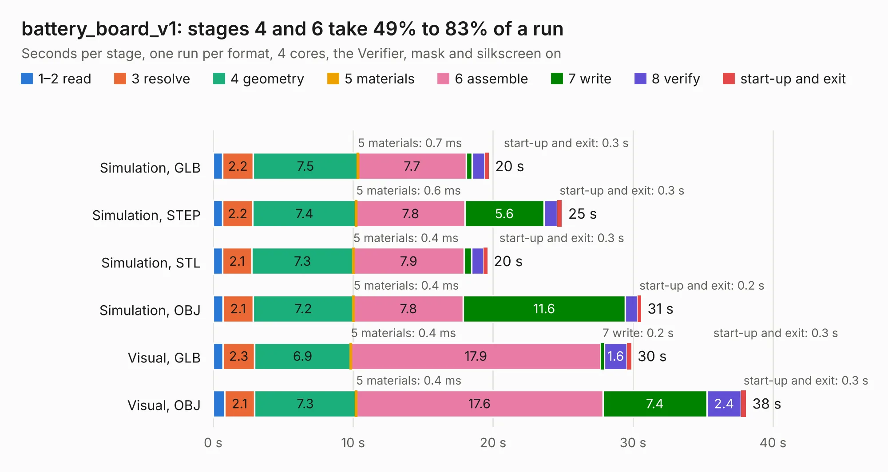

| Mode and format | 1–2 read | 3 resolve | 4 geometry | 5 materials | 6 assemble | 7 write | 8 verify | start-up and exit | Total |
|---|---:|---:|---:|---:|---:|---:|---:|---:|---:|
| Simulation, GLB | 0.7 | 2.2 | 7.5 | 0.7&nbsp;ms | 7.7 | 0.4 | 0.9 | 0.3 | 19.7 |
| Simulation, STEP | 0.7 | 2.2 | 7.4 | 0.6&nbsp;ms | 7.8 | 5.6 | 1.0 | 0.3 | 24.9 |
| Simulation, STL | 0.7 | 2.1 | 7.3 | 0.4&nbsp;ms | 7.9 | 0.5 | 0.8 | 0.3 | 19.6 |
| Simulation, OBJ | 0.7 | 2.1 | 7.2 | 0.4&nbsp;ms | 7.8 | 11.6 | 0.9 | 0.2 | 30.6 |
| Visual, GLB | 0.7 | 2.3 | 6.9 | 0.4&nbsp;ms | 17.9 | 0.2 | 1.6 | 0.3 | 29.9 |
| Visual, OBJ | 0.8 | 2.1 | 7.3 | 0.4&nbsp;ms | 17.6 | 7.4 | 2.4 | 0.3 | 38.1 |

<table align="center"><tr><td valign="top">

| Board | Repo: [proveskit/battery_board](https://github.com/proveskit/battery_board) Board: `battery_board_v1.kicad_pcb` |
|---|---|
| Folder | battery_board_v2 |
| Complexity | 318&nbsp;/&nbsp;1000 (size&nbsp;208, features&nbsp;110) |
| KESE&nbsp;features | through vias, custom pads, rounded, trapezoid or chamfered pads, filled zones, copper drawings, curved board outline, stack-up, dielectric εr and tanδ |
| Tested | 9th November 2026 |
| Copper&nbsp;layers | 4 |
| File&nbsp;format | KiCad 6 (20211014) |
| Parts,&nbsp;tracks,&nbsp;vias | 109, 1,234, 215 |
| Triangles,&nbsp;simulation | 1,805,022 in 117 parts |
| Verifier | PASS in all six runs |

</td><td valign="top">

<table>
<tr><th>File type</th><th>File size</th><th>Peak memory used</th></tr>
<tr><th colspan="3" align="left">Simulation</th></tr>
<tr><td>GLB</td><td align="right">62&nbsp;MB</td><td align="right">666&nbsp;MB</td></tr>
<tr><td>STEP</td><td align="right">281&nbsp;MB</td><td align="right">850&nbsp;MB</td></tr>
<tr><td>STL</td><td align="right">90&nbsp;MB</td><td align="right">651&nbsp;MB</td></tr>
<tr><td>OBJ</td><td align="right">191&nbsp;MB</td><td align="right">1.2&nbsp;GB</td></tr>
<tr><th colspan="3" align="left">Visual</th></tr>
<tr><td>GLB</td><td align="right">43&nbsp;MB</td><td align="right">1.0&nbsp;GB</td></tr>
<tr><td>OBJ</td><td align="right">132&nbsp;MB</td><td align="right">986&nbsp;MB</td></tr>
</table>

</td></tr></table>

## 2299. Battery_Board_V3

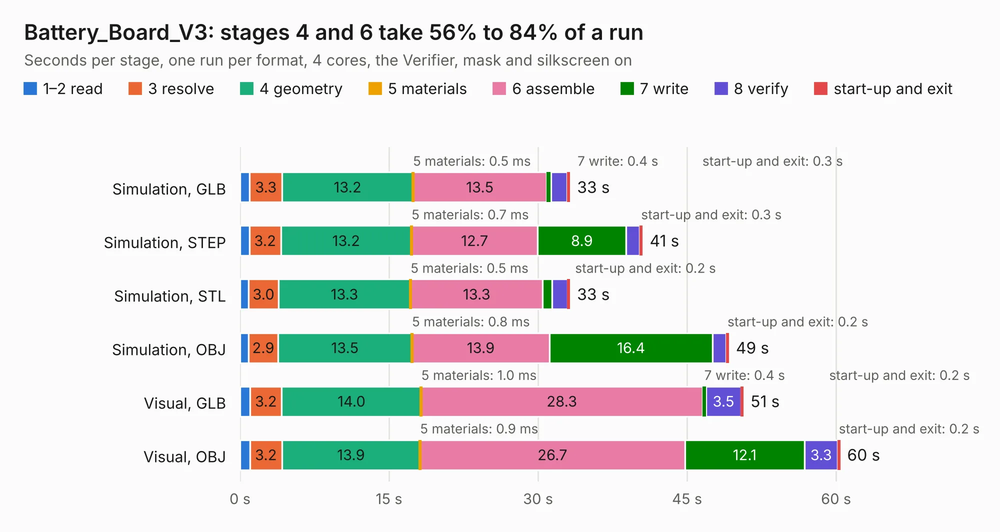

| Mode and format | 1–2 read | 3 resolve | 4 geometry | 5 materials | 6 assemble | 7 write | 8 verify | start-up and exit | Total |
|---|---:|---:|---:|---:|---:|---:|---:|---:|---:|
| Simulation, GLB | 1.0 | 3.3 | 13.2 | 0.5&nbsp;ms | 13.5 | 0.4 | 1.6 | 0.3 | 33.2 |
| Simulation, STEP | 0.9 | 3.2 | 13.2 | 0.7&nbsp;ms | 12.7 | 8.9 | 1.4 | 0.3 | 40.5 |
| Simulation, STL | 0.9 | 3.0 | 13.3 | 0.5&nbsp;ms | 13.3 | 0.9 | 1.6 | 0.2 | 33.2 |
| Simulation, OBJ | 0.9 | 2.9 | 13.5 | 0.8&nbsp;ms | 13.9 | 16.4 | 1.4 | 0.2 | 49.2 |
| Visual, GLB | 1.0 | 3.2 | 14.0 | 1.0&nbsp;ms | 28.3 | 0.4 | 3.5 | 0.2 | 50.7 |
| Visual, OBJ | 1.0 | 3.2 | 13.9 | 0.9&nbsp;ms | 26.7 | 12.1 | 3.3 | 0.2 | 60.4 |

<table align="center"><tr><td valign="top">

| Board | Repo: [proveskit/battery_board](https://github.com/proveskit/battery_board) Board: `Battery_Board_V3.kicad_pcb` |
|---|---|
| Folder | battery_board_v3 |
| Complexity | 387&nbsp;/&nbsp;1000 (size&nbsp;267, features&nbsp;120) |
| KESE&nbsp;features | through vias, slotted holes, custom pads, rounded, trapezoid or chamfered pads, filled zones, copper drawings, curved board outline, stack-up, dielectric εr and tanδ |
| Tested | 9th November 2026 |
| Copper&nbsp;layers | 4 |
| File&nbsp;format | KiCad 7 (20221018) |
| Parts,&nbsp;tracks,&nbsp;vias | 177, 1,595, 240 |
| Triangles,&nbsp;simulation | 2,908,442 in 199 parts |
| Verifier | PASS in all six runs |

</td><td valign="top">

<table>
<tr><th>File type</th><th>File size</th><th>Peak memory used</th></tr>
<tr><th colspan="3" align="left">Simulation</th></tr>
<tr><td>GLB</td><td align="right">101&nbsp;MB</td><td align="right">997&nbsp;MB</td></tr>
<tr><td>STEP</td><td align="right">506&nbsp;MB</td><td align="right">1.3&nbsp;GB</td></tr>
<tr><td>STL</td><td align="right">145&nbsp;MB</td><td align="right">998&nbsp;MB</td></tr>
<tr><td>OBJ</td><td align="right">314&nbsp;MB</td><td align="right">1.9&nbsp;GB</td></tr>
<tr><th colspan="3" align="left">Visual</th></tr>
<tr><td>GLB</td><td align="right">75&nbsp;MB</td><td align="right">1.3&nbsp;GB</td></tr>
<tr><td>OBJ</td><td align="right">233&nbsp;MB</td><td align="right">1.5&nbsp;GB</td></tr>
</table>

</td></tr></table>

## 2300. Battery_Board_V3a

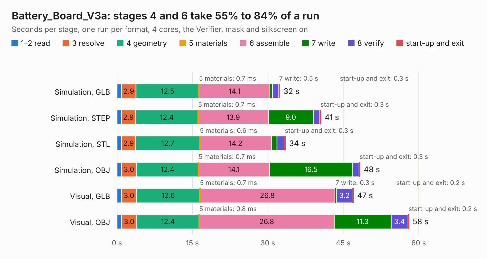

| Mode and format | 1–2 read | 3 resolve | 4 geometry | 5 materials | 6 assemble | 7 write | 8 verify | start-up and exit | Total |
|---|---:|---:|---:|---:|---:|---:|---:|---:|---:|
| Simulation, GLB | 0.9 | 2.9 | 12.5 | 0.7&nbsp;ms | 14.1 | 0.5 | 1.3 | 0.3 | 32.4 |
| Simulation, STEP | 0.9 | 2.9 | 12.4 | 0.7&nbsp;ms | 13.9 | 9.0 | 1.3 | 0.3 | 40.6 |
| Simulation, STL | 0.9 | 2.9 | 12.7 | 0.6&nbsp;ms | 14.2 | 1.1 | 1.5 | 0.3 | 33.6 |
| Simulation, OBJ | 0.9 | 3.0 | 12.4 | 0.7&nbsp;ms | 14.1 | 16.5 | 1.3 | 0.3 | 48.4 |
| Visual, GLB | 0.9 | 3.0 | 12.6 | 0.7&nbsp;ms | 26.8 | 0.3 | 3.2 | 0.2 | 47.1 |
| Visual, OBJ | 0.9 | 3.0 | 12.4 | 0.8&nbsp;ms | 26.8 | 11.3 | 3.4 | 0.2 | 58.1 |

<table align="center"><tr><td valign="top">

| Board | Repo: [proveskit/battery_board](https://github.com/proveskit/battery_board) Board: `Battery_Board_V3a.kicad_pcb` |
|---|---|
| Folder | Battery_Board_V3a |
| Complexity | 405&nbsp;/&nbsp;1000 (size&nbsp;270, features&nbsp;135) |
| KESE&nbsp;features | through vias, slotted holes, custom pads, rounded, trapezoid or chamfered pads, arc tracks, filled zones, copper drawings, curved board outline, stack-up, dielectric εr and tanδ |
| Tested | 9th November 2026 |
| Copper&nbsp;layers | 4 |
| File&nbsp;format | KiCad 8 (20240108) |
| Parts,&nbsp;tracks,&nbsp;vias | 192, 1,568, 235 |
| Triangles,&nbsp;simulation | 2,965,452 in 178 parts |
| Verifier | PASS in all six runs |

</td><td valign="top">

<table>
<tr><th>File type</th><th>File size</th><th>Peak memory used</th></tr>
<tr><th colspan="3" align="left">Simulation</th></tr>
<tr><td>GLB</td><td align="right">102&nbsp;MB</td><td align="right">1.0&nbsp;GB</td></tr>
<tr><td>STEP</td><td align="right">513&nbsp;MB</td><td align="right">1.3&nbsp;GB</td></tr>
<tr><td>STL</td><td align="right">148&nbsp;MB</td><td align="right">1.0&nbsp;GB</td></tr>
<tr><td>OBJ</td><td align="right">320&nbsp;MB</td><td align="right">2.0&nbsp;GB</td></tr>
<tr><th colspan="3" align="left">Visual</th></tr>
<tr><td>GLB</td><td align="right">74&nbsp;MB</td><td align="right">1.5&nbsp;GB</td></tr>
<tr><td>OBJ</td><td align="right">232&nbsp;MB</td><td align="right">1.6&nbsp;GB</td></tr>
</table>

</td></tr></table>

## 2301. battery_board_v3b

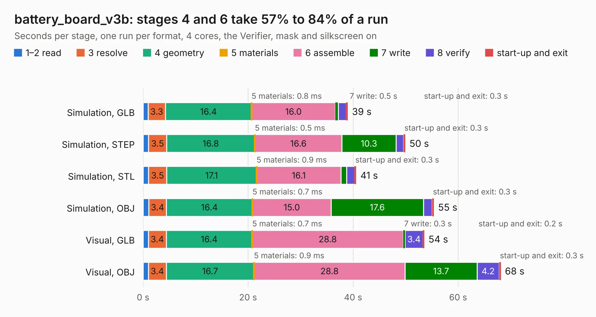

| Mode and format | 1–2 read | 3 resolve | 4 geometry | 5 materials | 6 assemble | 7 write | 8 verify | start-up and exit | Total |
|---|---:|---:|---:|---:|---:|---:|---:|---:|---:|
| Simulation, GLB | 0.9 | 3.3 | 16.4 | 0.8&nbsp;ms | 16.0 | 0.5 | 1.5 | 0.3 | 39.0 |
| Simulation, STEP | 1.0 | 3.5 | 16.8 | 0.5&nbsp;ms | 16.6 | 10.3 | 1.5 | 0.3 | 49.9 |
| Simulation, STL | 1.0 | 3.5 | 17.1 | 0.9&nbsp;ms | 16.1 | 1.0 | 1.6 | 0.3 | 40.6 |
| Simulation, OBJ | 1.1 | 3.4 | 16.4 | 0.7&nbsp;ms | 15.0 | 17.6 | 1.6 | 0.3 | 55.4 |
| Visual, GLB | 1.0 | 3.4 | 16.4 | 0.7&nbsp;ms | 28.8 | 0.3 | 3.4 | 0.2 | 53.5 |
| Visual, OBJ | 1.0 | 3.4 | 16.7 | 0.9&nbsp;ms | 28.8 | 13.7 | 4.2 | 0.3 | 68.1 |

<table align="center"><tr><td valign="top">

| Board | Repo: [proveskit/battery_board](https://github.com/proveskit/battery_board) Board: `battery_board_v3b.kicad_pcb` |
|---|---|
| Folder | battery_board_v3b |
| Complexity | 407&nbsp;/&nbsp;1000 (size&nbsp;272, features&nbsp;135) |
| KESE&nbsp;features | through vias, slotted holes, custom pads, rounded, trapezoid or chamfered pads, arc tracks, filled zones, copper drawings, curved board outline, stack-up, dielectric εr and tanδ |
| Tested | 9th November 2026 |
| Copper&nbsp;layers | 4 |
| File&nbsp;format | KiCad 8 (20240108) |
| Parts,&nbsp;tracks,&nbsp;vias | 194, 1,762, 256 |
| Triangles,&nbsp;simulation | 3,067,082 in 180 parts |
| Verifier | PASS in all six runs |

</td><td valign="top">

<table>
<tr><th>File type</th><th>File size</th><th>Peak memory used</th></tr>
<tr><th colspan="3" align="left">Simulation</th></tr>
<tr><td>GLB</td><td align="right">106&nbsp;MB</td><td align="right">1.1&nbsp;GB</td></tr>
<tr><td>STEP</td><td align="right">523&nbsp;MB</td><td align="right">1.4&nbsp;GB</td></tr>
<tr><td>STL</td><td align="right">153&nbsp;MB</td><td align="right">1.1&nbsp;GB</td></tr>
<tr><td>OBJ</td><td align="right">331&nbsp;MB</td><td align="right">2.1&nbsp;GB</td></tr>
<tr><th colspan="3" align="left">Visual</th></tr>
<tr><td>GLB</td><td align="right">78&nbsp;MB</td><td align="right">1.3&nbsp;GB</td></tr>
<tr><td>OBJ</td><td align="right">244&nbsp;MB</td><td align="right">1.7&nbsp;GB</td></tr>
</table>

</td></tr></table>

## 2302. battery_board_v3c

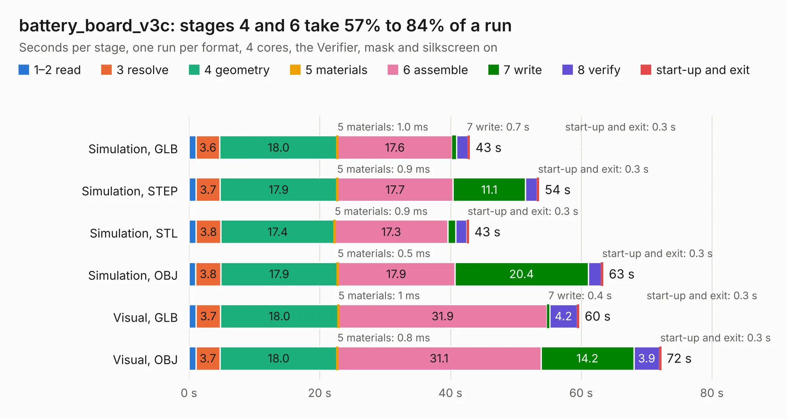

| Mode and format | 1–2 read | 3 resolve | 4 geometry | 5 materials | 6 assemble | 7 write | 8 verify | start-up and exit | Total |
|---|---:|---:|---:|---:|---:|---:|---:|---:|---:|
| Simulation, GLB | 1.1 | 3.6 | 18.0 | 1.0&nbsp;ms | 17.6 | 0.7 | 1.7 | 0.3 | 43.0 |
| Simulation, STEP | 1.1 | 3.7 | 17.9 | 0.9&nbsp;ms | 17.7 | 11.1 | 1.8 | 0.3 | 53.6 |
| Simulation, STL | 1.1 | 3.8 | 17.4 | 0.9&nbsp;ms | 17.3 | 1.2 | 1.7 | 0.3 | 42.8 |
| Simulation, OBJ | 1.0 | 3.8 | 17.9 | 0.5&nbsp;ms | 17.9 | 20.4 | 2.0 | 0.3 | 63.4 |
| Visual, GLB | 1.1 | 3.7 | 18.0 | 1&nbsp;ms | 31.9 | 0.4 | 4.2 | 0.3 | 59.7 |
| Visual, OBJ | 1.1 | 3.7 | 18.0 | 0.8&nbsp;ms | 31.1 | 14.2 | 3.9 | 0.3 | 72.2 |

<table align="center"><tr><td valign="top">

| Board | Repo: [proveskit/battery_board](https://github.com/proveskit/battery_board) Board: `battery_board_v3c.kicad_pcb` |
|---|---|
| Folder | battery_board_v3c |
| Complexity | 409&nbsp;/&nbsp;1000 (size&nbsp;274, features&nbsp;135) |
| KESE&nbsp;features | through vias, slotted holes, custom pads, rounded, trapezoid or chamfered pads, arc tracks, filled zones, copper drawings, curved board outline, stack-up, dielectric εr and tanδ |
| Tested | 9th November 2026 |
| Copper&nbsp;layers | 4 |
| File&nbsp;format | KiCad 8 (20240108) |
| Parts,&nbsp;tracks,&nbsp;vias | 196, 1,953, 284 |
| Triangles,&nbsp;simulation | 3,202,732 in 180 parts |
| Verifier | PASS in all six runs |

</td><td valign="top">

<table>
<tr><th>File type</th><th>File size</th><th>Peak memory used</th></tr>
<tr><th colspan="3" align="left">Simulation</th></tr>
<tr><td>GLB</td><td align="right">111&nbsp;MB</td><td align="right">1.2&nbsp;GB</td></tr>
<tr><td>STEP</td><td align="right">546&nbsp;MB</td><td align="right">1.4&nbsp;GB</td></tr>
<tr><td>STL</td><td align="right">160&nbsp;MB</td><td align="right">1.1&nbsp;GB</td></tr>
<tr><td>OBJ</td><td align="right">346&nbsp;MB</td><td align="right">2.1&nbsp;GB</td></tr>
<tr><th colspan="3" align="left">Visual</th></tr>
<tr><td>GLB</td><td align="right">81&nbsp;MB</td><td align="right">1.4&nbsp;GB</td></tr>
<tr><td>OBJ</td><td align="right">255&nbsp;MB</td><td align="right">1.7&nbsp;GB</td></tr>
</table>

</td></tr></table>

## 2303. battery_pack_v1

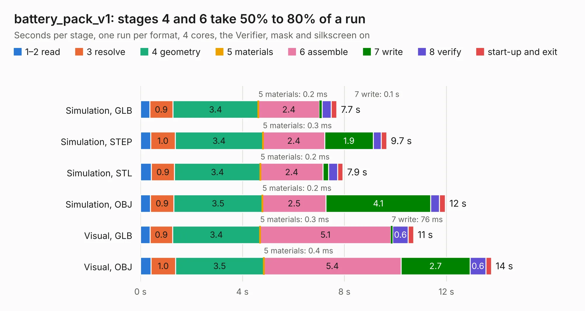

| Mode and format | 1–2 read | 3 resolve | 4 geometry | 5 materials | 6 assemble | 7 write | 8 verify | start-up and exit | Total |
|---|---:|---:|---:|---:|---:|---:|---:|---:|---:|
| Simulation, GLB | 0.4 | 0.9 | 3.4 | 0.2&nbsp;ms | 2.4 | 0.1 | 0.4 | 0.2 | 7.7 |
| Simulation, STEP | 0.4 | 1.0 | 3.4 | 0.3&nbsp;ms | 2.4 | 1.9 | 0.3 | 0.2 | 9.7 |
| Simulation, STL | 0.4 | 0.9 | 3.4 | 0.2&nbsp;ms | 2.4 | 0.2 | 0.4 | 0.2 | 7.9 |
| Simulation, OBJ | 0.4 | 0.9 | 3.5 | 0.2&nbsp;ms | 2.5 | 4.1 | 0.3 | 0.2 | 12.0 |
| Visual, GLB | 0.4 | 0.9 | 3.4 | 0.3&nbsp;ms | 5.1 | 76&nbsp;ms | 0.6 | 0.2 | 10.7 |
| Visual, OBJ | 0.4 | 1.0 | 3.5 | 0.4&nbsp;ms | 5.4 | 2.7 | 0.6 | 0.2 | 13.8 |

<table align="center"><tr><td valign="top">

| Board | Repo: [proveskit/battery_board](https://github.com/proveskit/battery_board) Board: `battery_pack_v1.kicad_pcb` |
|---|---|
| Folder | battery_pack_v1 |
| Complexity | 256&nbsp;/&nbsp;1000 (size&nbsp;161, features&nbsp;95) |
| KESE&nbsp;features | through vias, slotted holes, rounded, trapezoid or chamfered pads, filled zones, curved board outline, stack-up, dielectric εr and tanδ |
| Tested | 9th November 2026 |
| Copper&nbsp;layers | 4 |
| File&nbsp;format | KiCad 9 (20241229) |
| Parts,&nbsp;tracks,&nbsp;vias | 16, 135, 78 |
| Triangles,&nbsp;simulation | 785,718 in 28 parts |
| Verifier | PASS in all six runs |

</td><td valign="top">

<table>
<tr><th>File type</th><th>File size</th><th>Peak memory used</th></tr>
<tr><th colspan="3" align="left">Simulation</th></tr>
<tr><td>GLB</td><td align="right">27&nbsp;MB</td><td align="right">400&nbsp;MB</td></tr>
<tr><td>STEP</td><td align="right">125&nbsp;MB</td><td align="right">461&nbsp;MB</td></tr>
<tr><td>STL</td><td align="right">39&nbsp;MB</td><td align="right">386&nbsp;MB</td></tr>
<tr><td>OBJ</td><td align="right">81&nbsp;MB</td><td align="right">579&nbsp;MB</td></tr>
<tr><th colspan="3" align="left">Visual</th></tr>
<tr><td>GLB</td><td align="right">19&nbsp;MB</td><td align="right">451&nbsp;MB</td></tr>
<tr><td>OBJ</td><td align="right">56&nbsp;MB</td><td align="right">492&nbsp;MB</td></tr>
</table>

</td></tr></table>

## 2304. battery_pack_v1a

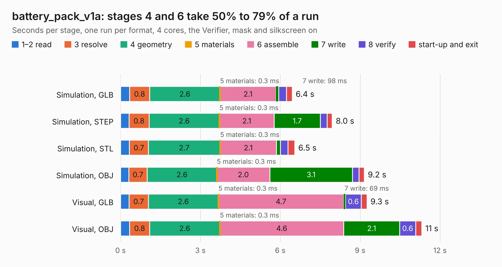

| Mode and format | 1–2 read | 3 resolve | 4 geometry | 5 materials | 6 assemble | 7 write | 8 verify | start-up and exit | Total |
|---|---:|---:|---:|---:|---:|---:|---:|---:|---:|
| Simulation, GLB | 0.3 | 0.8 | 2.6 | 0.3&nbsp;ms | 2.1 | 98&nbsp;ms | 0.3 | 0.2 | 6.4 |
| Simulation, STEP | 0.3 | 0.8 | 2.6 | 0.3&nbsp;ms | 2.1 | 1.7 | 0.2 | 0.2 | 8.0 |
| Simulation, STL | 0.3 | 0.7 | 2.7 | 0.3&nbsp;ms | 2.1 | 0.2 | 0.3 | 0.3 | 6.5 |
| Simulation, OBJ | 0.3 | 0.7 | 2.6 | 0.3&nbsp;ms | 2.0 | 3.1 | 0.3 | 0.2 | 9.2 |
| Visual, GLB | 0.3 | 0.7 | 2.6 | 0.3&nbsp;ms | 4.7 | 69&nbsp;ms | 0.6 | 0.2 | 9.3 |
| Visual, OBJ | 0.3 | 0.8 | 2.6 | 0.3&nbsp;ms | 4.6 | 2.1 | 0.6 | 0.2 | 11.3 |

<table align="center"><tr><td valign="top">

| Board | Repo: [proveskit/battery_board](https://github.com/proveskit/battery_board) Board: `battery_pack_v1a.kicad_pcb` |
|---|---|
| Folder | battery_pack_v1a |
| Complexity | 256&nbsp;/&nbsp;1000 (size&nbsp;161, features&nbsp;95) |
| KESE&nbsp;features | through vias, slotted holes, rounded, trapezoid or chamfered pads, filled zones, curved board outline, stack-up, dielectric εr and tanδ |
| Tested | 9th November 2026 |
| Copper&nbsp;layers | 4 |
| File&nbsp;format | KiCad 9 (20241229) |
| Parts,&nbsp;tracks,&nbsp;vias | 16, 135, 76 |
| Triangles,&nbsp;simulation | 723,936 in 30 parts |
| Verifier | PASS in all six runs |

</td><td valign="top">

<table>
<tr><th>File type</th><th>File size</th><th>Peak memory used</th></tr>
<tr><th colspan="3" align="left">Simulation</th></tr>
<tr><td>GLB</td><td align="right">25&nbsp;MB</td><td align="right">364&nbsp;MB</td></tr>
<tr><td>STEP</td><td align="right">118&nbsp;MB</td><td align="right">451&nbsp;MB</td></tr>
<tr><td>STL</td><td align="right">36&nbsp;MB</td><td align="right">378&nbsp;MB</td></tr>
<tr><td>OBJ</td><td align="right">75&nbsp;MB</td><td align="right">547&nbsp;MB</td></tr>
<tr><th colspan="3" align="left">Visual</th></tr>
<tr><td>GLB</td><td align="right">18&nbsp;MB</td><td align="right">467&nbsp;MB</td></tr>
<tr><td>OBJ</td><td align="right">54&nbsp;MB</td><td align="right">452&nbsp;MB</td></tr>
</table>

</td></tr></table>

## 2305. battery_pack_v2

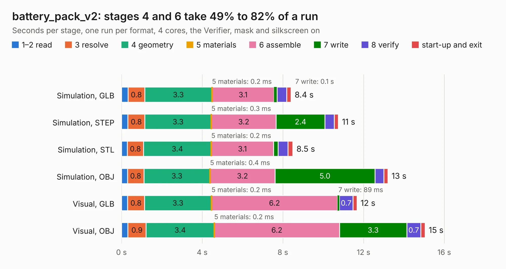

| Mode and format | 1–2 read | 3 resolve | 4 geometry | 5 materials | 6 assemble | 7 write | 8 verify | start-up and exit | Total |
|---|---:|---:|---:|---:|---:|---:|---:|---:|---:|
| Simulation, GLB | 0.3 | 0.8 | 3.3 | 0.2&nbsp;ms | 3.1 | 0.1 | 0.5 | 0.2 | 8.4 |
| Simulation, STEP | 0.3 | 0.8 | 3.3 | 0.3&nbsp;ms | 3.2 | 2.4 | 0.5 | 0.2 | 10.8 |
| Simulation, STL | 0.3 | 0.8 | 3.4 | 0.2&nbsp;ms | 3.1 | 0.2 | 0.5 | 0.2 | 8.5 |
| Simulation, OBJ | 0.3 | 0.8 | 3.3 | 0.4&nbsp;ms | 3.2 | 5.0 | 0.4 | 0.2 | 13.2 |
| Visual, GLB | 0.3 | 0.8 | 3.3 | 0.2&nbsp;ms | 6.2 | 89&nbsp;ms | 0.7 | 0.2 | 11.7 |
| Visual, OBJ | 0.3 | 0.9 | 3.4 | 0.2&nbsp;ms | 6.2 | 3.3 | 0.7 | 0.2 | 15.0 |

<table align="center"><tr><td valign="top">

| Board | Repo: [proveskit/battery_board](https://github.com/proveskit/battery_board) Board: `battery_pack_v2.kicad_pcb` |
|---|---|
| Folder | battery_pack_v2 |
| Complexity | 287&nbsp;/&nbsp;1000 (size&nbsp;177, features&nbsp;110) |
| KESE&nbsp;features | through vias, slotted holes, rounded, trapezoid or chamfered pads, filled zones, curved board outline, knockout text, stack-up, dielectric εr and tanδ |
| Tested | 9th November 2026 |
| Copper&nbsp;layers | 4 |
| File&nbsp;format | KiCad 9 (20241229) |
| Parts,&nbsp;tracks,&nbsp;vias | 29, 327, 114 |
| Triangles,&nbsp;simulation | 932,774 in 34 parts |
| Verifier | PASS in all six runs |

</td><td valign="top">

<table>
<tr><th>File type</th><th>File size</th><th>Peak memory used</th></tr>
<tr><th colspan="3" align="left">Simulation</th></tr>
<tr><td>GLB</td><td align="right">32&nbsp;MB</td><td align="right">413&nbsp;MB</td></tr>
<tr><td>STEP</td><td align="right">141&nbsp;MB</td><td align="right">523&nbsp;MB</td></tr>
<tr><td>STL</td><td align="right">47&nbsp;MB</td><td align="right">417&nbsp;MB</td></tr>
<tr><td>OBJ</td><td align="right">95&nbsp;MB</td><td align="right">668&nbsp;MB</td></tr>
<tr><th colspan="3" align="left">Visual</th></tr>
<tr><td>GLB</td><td align="right">22&nbsp;MB</td><td align="right">530&nbsp;MB</td></tr>
<tr><td>OBJ</td><td align="right">66&nbsp;MB</td><td align="right">535&nbsp;MB</td></tr>
</table>

</td></tr></table>

## 2306. inhibit_diagram

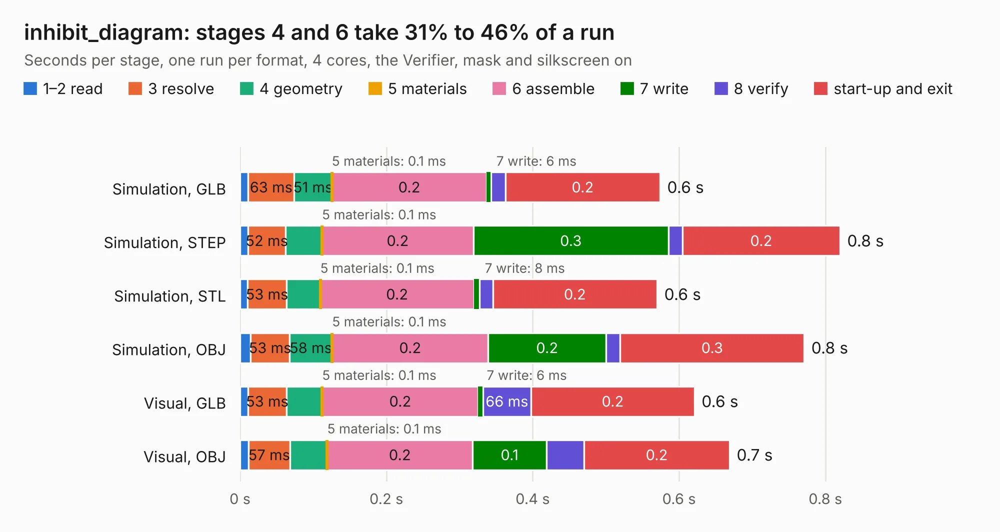

| Mode and format | 1–2 read | 3 resolve | 4 geometry | 5 materials | 6 assemble | 7 write | 8 verify | start-up and exit | Total |
|---|---:|---:|---:|---:|---:|---:|---:|---:|---:|
| Simulation, GLB | 11&nbsp;ms | 63&nbsp;ms | 51&nbsp;ms | 0.1&nbsp;ms | 0.2 | 6&nbsp;ms | 20&nbsp;ms | 0.2 | 0.6 |
| Simulation, STEP | 11&nbsp;ms | 52&nbsp;ms | 50&nbsp;ms | 0.1&nbsp;ms | 0.2 | 0.3 | 19&nbsp;ms | 0.2 | 0.8 |
| Simulation, STL | 11&nbsp;ms | 53&nbsp;ms | 46&nbsp;ms | 0.1&nbsp;ms | 0.2 | 8&nbsp;ms | 18&nbsp;ms | 0.2 | 0.6 |
| Simulation, OBJ | 15&nbsp;ms | 53&nbsp;ms | 58&nbsp;ms | 0.1&nbsp;ms | 0.2 | 0.2 | 19&nbsp;ms | 0.3 | 0.8 |
| Visual, GLB | 11&nbsp;ms | 53&nbsp;ms | 49&nbsp;ms | 0.1&nbsp;ms | 0.2 | 6&nbsp;ms | 66&nbsp;ms | 0.2 | 0.6 |
| Visual, OBJ | 11&nbsp;ms | 57&nbsp;ms | 51&nbsp;ms | 0.1&nbsp;ms | 0.2 | 0.1 | 51&nbsp;ms | 0.2 | 0.7 |

<table align="center"><tr><td valign="top">

| Board | Repo: [proveskit/battery_board](https://github.com/proveskit/battery_board) Board: `inhibit_diagram.kicad_pcb` |
|---|---|
| Folder | inhibit_diagram |
| Complexity | 106&nbsp;/&nbsp;1000 (size&nbsp;106, features&nbsp;0) |
| Tested | 9th November 2026 |
| Copper&nbsp;layers | 2 |
| File&nbsp;format | KiCad 8 (20240108) |
| Parts,&nbsp;tracks,&nbsp;vias | 0, 231, 0 |
| Triangles,&nbsp;simulation | 29,954 in 4 parts |
| Note | no components |
| Verifier | PASS in all six runs |

</td><td valign="top">

<table>
<tr><th>File type</th><th>File size</th><th>Peak memory used</th></tr>
<tr><th colspan="3" align="left">Simulation</th></tr>
<tr><td>GLB</td><td align="right">1.0&nbsp;MB</td><td align="right">52&nbsp;MB</td></tr>
<tr><td>STEP</td><td align="right">6.8&nbsp;MB</td><td align="right">57&nbsp;MB</td></tr>
<tr><td>STL</td><td align="right">1.5&nbsp;MB</td><td align="right">52&nbsp;MB</td></tr>
<tr><td>OBJ</td><td align="right">2.8&nbsp;MB</td><td align="right">57&nbsp;MB</td></tr>
<tr><th colspan="3" align="left">Visual</th></tr>
<tr><td>GLB</td><td align="right">646&nbsp;kB</td><td align="right">69&nbsp;MB</td></tr>
<tr><td>OBJ</td><td align="right">1.7&nbsp;MB</td><td align="right">55&nbsp;MB</td></tr>
</table>

</td></tr></table>

## 2307. FC_Board_v3

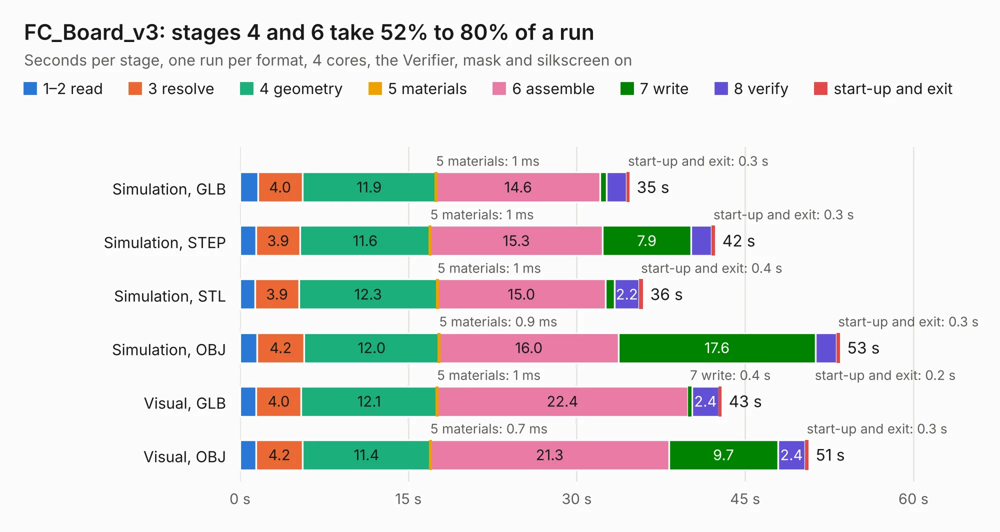

| Mode and format | 1–2 read | 3 resolve | 4 geometry | 5 materials | 6 assemble | 7 write | 8 verify | start-up and exit | Total |
|---|---:|---:|---:|---:|---:|---:|---:|---:|---:|
| Simulation, GLB | 1.6 | 4.0 | 11.9 | 1&nbsp;ms | 14.6 | 0.5 | 1.8 | 0.3 | 34.7 |
| Simulation, STEP | 1.4 | 3.9 | 11.6 | 1&nbsp;ms | 15.3 | 7.9 | 1.8 | 0.3 | 42.3 |
| Simulation, STL | 1.4 | 3.9 | 12.3 | 1&nbsp;ms | 15.0 | 0.8 | 2.2 | 0.4 | 35.9 |
| Simulation, OBJ | 1.5 | 4.2 | 12.0 | 0.9&nbsp;ms | 16.0 | 17.6 | 1.8 | 0.3 | 53.5 |
| Visual, GLB | 1.4 | 4.0 | 12.1 | 1&nbsp;ms | 22.4 | 0.4 | 2.4 | 0.2 | 42.9 |
| Visual, OBJ | 1.4 | 4.2 | 11.4 | 0.7&nbsp;ms | 21.3 | 9.7 | 2.4 | 0.3 | 50.6 |

<table align="center"><tr><td valign="top">

| Board | Repo: [proveskit/flight_controller_board](https://github.com/proveskit/flight_controller_board) Board: `FC_Board_v3.kicad_pcb` |
|---|---|
| Folder | Deprecated Versions / FC_External_v3 |
| Complexity | 348&nbsp;/&nbsp;1000 (size&nbsp;243, features&nbsp;105) |
| KESE&nbsp;features | through vias, slotted holes, rounded, trapezoid or chamfered pads, filled zones, copper text, curved board outline, stack-up, dielectric εr and tanδ |
| Tested | 9th November 2026 |
| Copper&nbsp;layers | 4 |
| File&nbsp;format | KiCad 6 (20211014) |
| Parts,&nbsp;tracks,&nbsp;vias | 75, 1,107, 233 |
| Triangles,&nbsp;simulation | 2,602,548 in 123 parts |
| Verifier | PASS in all six runs |

</td><td valign="top">

<table>
<tr><th>File type</th><th>File size</th><th>Peak memory used</th></tr>
<tr><th colspan="3" align="left">Simulation</th></tr>
<tr><td>GLB</td><td align="right">95&nbsp;MB</td><td align="right">834&nbsp;MB</td></tr>
<tr><td>STEP</td><td align="right">492&nbsp;MB</td><td align="right">1.1&nbsp;GB</td></tr>
<tr><td>STL</td><td align="right">130&nbsp;MB</td><td align="right">827&nbsp;MB</td></tr>
<tr><td>OBJ</td><td align="right">294&nbsp;MB</td><td align="right">1.8&nbsp;GB</td></tr>
<tr><th colspan="3" align="left">Visual</th></tr>
<tr><td>GLB</td><td align="right">56&nbsp;MB</td><td align="right">1.0&nbsp;GB</td></tr>
<tr><td>OBJ</td><td align="right">173&nbsp;MB</td><td align="right">1.2&nbsp;GB</td></tr>
</table>

</td></tr></table>

## 2308. FC_V4a

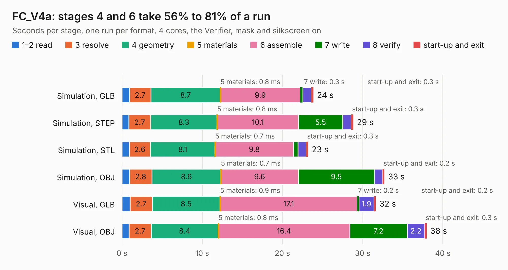

| Mode and format | 1–2 read | 3 resolve | 4 geometry | 5 materials | 6 assemble | 7 write | 8 verify | start-up and exit | Total |
|---|---:|---:|---:|---:|---:|---:|---:|---:|---:|
| Simulation, GLB | 0.9 | 2.7 | 8.7 | 0.8&nbsp;ms | 9.9 | 0.3 | 1.0 | 0.3 | 23.9 |
| Simulation, STEP | 0.9 | 2.7 | 8.3 | 0.8&nbsp;ms | 10.1 | 5.5 | 1.0 | 0.3 | 28.8 |
| Simulation, STL | 0.9 | 2.6 | 8.1 | 0.7&nbsp;ms | 9.8 | 0.6 | 1.0 | 0.3 | 23.2 |
| Simulation, OBJ | 0.9 | 2.8 | 8.6 | 0.7&nbsp;ms | 9.6 | 9.5 | 1.0 | 0.2 | 32.7 |
| Visual, GLB | 1.0 | 2.7 | 8.5 | 0.9&nbsp;ms | 17.1 | 0.2 | 1.9 | 0.2 | 31.6 |
| Visual, OBJ | 0.9 | 2.7 | 8.4 | 0.8&nbsp;ms | 16.4 | 7.2 | 2.2 | 0.3 | 38.0 |

<table align="center"><tr><td valign="top">

| Board | Repo: [proveskit/flight_controller_board](https://github.com/proveskit/flight_controller_board) Board: `FC_V4a.kicad_pcb` |
|---|---|
| Folder | Deprecated Versions / FC_V4a |
| Complexity | 397&nbsp;/&nbsp;1000 (size&nbsp;252, features&nbsp;145) |
| KESE&nbsp;features | through vias, slotted holes, custom pads, rounded, trapezoid or chamfered pads, arc tracks, filled zones, copper drawings, copper text, curved board outline, stack-up, dielectric εr and tanδ |
| Tested | 9th November 2026 |
| Copper&nbsp;layers | 4 |
| File&nbsp;format | KiCad 8 (20240108) |
| Parts,&nbsp;tracks,&nbsp;vias | 91, 1,205, 211 |
| Triangles,&nbsp;simulation | 1,962,322 in 130 parts |
| Verifier | PASS in all six runs |

</td><td valign="top">

<table>
<tr><th>File type</th><th>File size</th><th>Peak memory used</th></tr>
<tr><th colspan="3" align="left">Simulation</th></tr>
<tr><td>GLB</td><td align="right">69&nbsp;MB</td><td align="right">734&nbsp;MB</td></tr>
<tr><td>STEP</td><td align="right">335&nbsp;MB</td><td align="right">891&nbsp;MB</td></tr>
<tr><td>STL</td><td align="right">98&nbsp;MB</td><td align="right">752&nbsp;MB</td></tr>
<tr><td>OBJ</td><td align="right">211&nbsp;MB</td><td align="right">1.4&nbsp;GB</td></tr>
<tr><th colspan="3" align="left">Visual</th></tr>
<tr><td>GLB</td><td align="right">50&nbsp;MB</td><td align="right">986&nbsp;MB</td></tr>
<tr><td>OBJ</td><td align="right">153&nbsp;MB</td><td align="right">1.1&nbsp;GB</td></tr>
</table>

</td></tr></table>

## 2309. FC_V4b

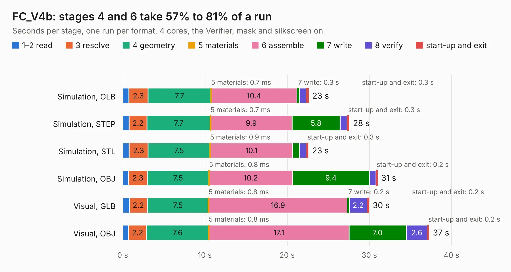

| Mode and format | 1–2 read | 3 resolve | 4 geometry | 5 materials | 6 assemble | 7 write | 8 verify | start-up and exit | Total |
|---|---:|---:|---:|---:|---:|---:|---:|---:|---:|
| Simulation, GLB | 0.7 | 2.3 | 7.7 | 0.7&nbsp;ms | 10.4 | 0.3 | 0.9 | 0.3 | 22.6 |
| Simulation, STEP | 0.8 | 2.2 | 7.7 | 0.7&nbsp;ms | 9.9 | 5.8 | 0.9 | 0.3 | 27.6 |
| Simulation, STL | 0.8 | 2.3 | 7.5 | 0.9&nbsp;ms | 10.1 | 0.8 | 0.8 | 0.3 | 22.6 |
| Simulation, OBJ | 0.7 | 2.3 | 7.5 | 0.8&nbsp;ms | 10.2 | 9.4 | 0.8 | 0.2 | 31.0 |
| Visual, GLB | 0.8 | 2.2 | 7.5 | 0.8&nbsp;ms | 16.9 | 0.2 | 2.2 | 0.2 | 30.0 |
| Visual, OBJ | 0.7 | 2.2 | 7.6 | 0.8&nbsp;ms | 17.1 | 7.0 | 2.6 | 0.2 | 37.3 |

<table align="center"><tr><td valign="top">

| Board | Repo: [proveskit/flight_controller_board](https://github.com/proveskit/flight_controller_board) Board: `FC_V4b.kicad_pcb` |
|---|---|
| Folder | Deprecated Versions / FC_V4b |
| Complexity | 402&nbsp;/&nbsp;1000 (size&nbsp;257, features&nbsp;145) |
| KESE&nbsp;features | through vias, slotted holes, custom pads, rounded, trapezoid or chamfered pads, arc tracks, filled zones, copper drawings, copper text, curved board outline, stack-up, dielectric εr and tanδ |
| Tested | 9th November 2026 |
| Copper&nbsp;layers | 4 |
| File&nbsp;format | KiCad 8 (20240108) |
| Parts,&nbsp;tracks,&nbsp;vias | 108, 1,453, 257 |
| Triangles,&nbsp;simulation | 2,254,680 in 135 parts |
| Verifier | PASS in all six runs |

</td><td valign="top">

<table>
<tr><th>File type</th><th>File size</th><th>Peak memory used</th></tr>
<tr><th colspan="3" align="left">Simulation</th></tr>
<tr><td>GLB</td><td align="right">79&nbsp;MB</td><td align="right">836&nbsp;MB</td></tr>
<tr><td>STEP</td><td align="right">385&nbsp;MB</td><td align="right">992&nbsp;MB</td></tr>
<tr><td>STL</td><td align="right">113&nbsp;MB</td><td align="right">826&nbsp;MB</td></tr>
<tr><td>OBJ</td><td align="right">244&nbsp;MB</td><td align="right">1.5&nbsp;GB</td></tr>
<tr><th colspan="3" align="left">Visual</th></tr>
<tr><td>GLB</td><td align="right">57&nbsp;MB</td><td align="right">1.1&nbsp;GB</td></tr>
<tr><td>OBJ</td><td align="right">175&nbsp;MB</td><td align="right">1.3&nbsp;GB</td></tr>
</table>

</td></tr></table>

## 2310. FC_V4c_Express

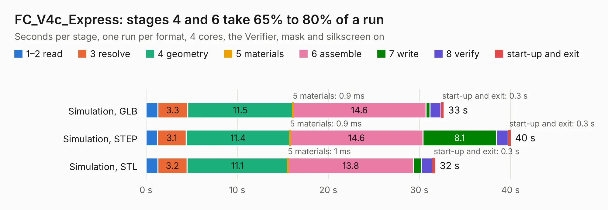

| Mode and format | 1–2 read | 3 resolve | 4 geometry | 5 materials | 6 assemble | 7 write | 8 verify | start-up and exit | Total |
|---|---:|---:|---:|---:|---:|---:|---:|---:|---:|
| Simulation, GLB | 1.3 | 3.3 | 11.5 | 0.9&nbsp;ms | 14.6 | 0.4 | 1.2 | 0.3 | 32.7 |
| Simulation, STEP | 1.3 | 3.1 | 11.4 | 0.9&nbsp;ms | 14.6 | 8.1 | 1.3 | 0.3 | 40.0 |
| Simulation, STL | 1.3 | 3.2 | 11.1 | 1&nbsp;ms | 13.8 | 0.9 | 1.2 | 0.3 | 31.8 |
| Simulation, OBJ | 1.2 | 3.2 | 11.0 | 0.9&nbsp;ms | 13.9 | 14.3 | 1.2 | 0.3 | 45.2 |
| Visual, GLB | 1.3 | 3.2 | 11.1 | 0.8&nbsp;ms | 22.8 | 0.3 | 2.9 | 0.3 | 41.9 |
| Visual, OBJ | 1.2 | 3.1 | 11.1 | 0.8&nbsp;ms | 22.9 | 10.7 | 3.0 | 0.3 | 52.3 |

<table align="center"><tr><td valign="top">

| Board | Repo: [proveskit/flight_controller_board](https://github.com/proveskit/flight_controller_board) Board: `FC_V4c_Express.kicad_pcb` |
|---|---|
| Folder | Deprecated Versions / FC_V4c_Express |
| Complexity | 406&nbsp;/&nbsp;1000 (size&nbsp;261, features&nbsp;145) |
| KESE&nbsp;features | through vias, slotted holes, custom pads, rounded, trapezoid or chamfered pads, arc tracks, filled zones, copper drawings, copper text, curved board outline, stack-up, dielectric εr and tanδ |
| Tested | 9th November 2026 |
| Copper&nbsp;layers | 4 |
| File&nbsp;format | KiCad 8 (20240108) |
| Parts,&nbsp;tracks,&nbsp;vias | 139, 1,608, 276 |
| Triangles,&nbsp;simulation | 2,462,246 in 150 parts |
| Verifier | PASS in all six runs |

</td><td valign="top">

<table>
<tr><th>File type</th><th>File size</th><th>Peak memory used</th></tr>
<tr><th colspan="3" align="left">Simulation</th></tr>
<tr><td>GLB</td><td align="right">86&nbsp;MB</td><td align="right">850&nbsp;MB</td></tr>
<tr><td>STEP</td><td align="right">423&nbsp;MB</td><td align="right">1.1&nbsp;GB</td></tr>
<tr><td>STL</td><td align="right">123&nbsp;MB</td><td align="right">869&nbsp;MB</td></tr>
<tr><td>OBJ</td><td align="right">266&nbsp;MB</td><td align="right">1.8&nbsp;GB</td></tr>
<tr><th colspan="3" align="left">Visual</th></tr>
<tr><td>GLB</td><td align="right">62&nbsp;MB</td><td align="right">1.2&nbsp;GB</td></tr>
<tr><td>OBJ</td><td align="right">192&nbsp;MB</td><td align="right">1.4&nbsp;GB</td></tr>
</table>

</td></tr></table>

## 2311. FC_V5

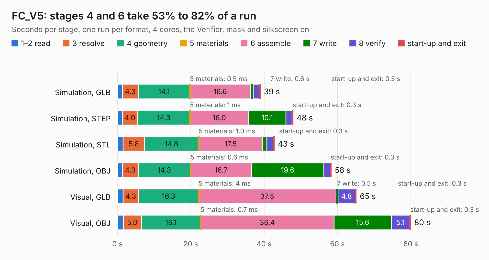

| Mode and format | 1–2 read | 3 resolve | 4 geometry | 5 materials | 6 assemble | 7 write | 8 verify | start-up and exit | Total |
|---|---:|---:|---:|---:|---:|---:|---:|---:|---:|
| Simulation, GLB | 1.4 | 4.3 | 14.1 | 0.5&nbsp;ms | 16.6 | 0.6 | 1.7 | 0.3 | 39.0 |
| Simulation, STEP | 1.4 | 4.0 | 14.3 | 1&nbsp;ms | 16.0 | 10.1 | 1.7 | 0.3 | 47.9 |
| Simulation, STL | 1.6 | 5.8 | 14.8 | 1.0&nbsp;ms | 17.5 | 1.1 | 1.8 | 0.3 | 42.8 |
| Simulation, OBJ | 1.4 | 4.3 | 14.3 | 0.6&nbsp;ms | 16.7 | 19.6 | 1.8 | 0.3 | 58.3 |
| Visual, GLB | 1.5 | 4.3 | 16.3 | 4&nbsp;ms | 37.5 | 0.5 | 4.8 | 0.3 | 65.2 |
| Visual, OBJ | 1.6 | 5.0 | 16.1 | 0.7&nbsp;ms | 36.4 | 15.6 | 5.1 | 0.3 | 80.0 |

<table align="center"><tr><td valign="top">

| Board | Repo: [proveskit/flight_controller_board](https://github.com/proveskit/flight_controller_board) Board: `FC_V5.kicad_pcb` |
|---|---|
| Folder | Deprecated Versions / FC_V5 |
| Complexity | 400&nbsp;/&nbsp;1000 (size&nbsp;270, features&nbsp;130) |
| KESE&nbsp;features | through vias, slotted holes, custom pads, rounded, trapezoid or chamfered pads, filled zones, copper drawings, copper text, curved board outline, stack-up, dielectric εr and tanδ |
| Tested | 9th November 2026 |
| Copper&nbsp;layers | 4 |
| File&nbsp;format | KiCad 8 (20240108) |
| Parts,&nbsp;tracks,&nbsp;vias | 207, 2,147, 323 |
| Triangles,&nbsp;simulation | 3,476,500 in 221 parts |
| Verifier | PASS in all six runs |

</td><td valign="top">

<table>
<tr><th>File type</th><th>File size</th><th>Peak memory used</th></tr>
<tr><th colspan="3" align="left">Simulation</th></tr>
<tr><td>GLB</td><td align="right">121&nbsp;MB</td><td align="right">1.1&nbsp;GB</td></tr>
<tr><td>STEP</td><td align="right">620&nbsp;MB</td><td align="right">1.4&nbsp;GB</td></tr>
<tr><td>STL</td><td align="right">174&nbsp;MB</td><td align="right">1.1&nbsp;GB</td></tr>
<tr><td>OBJ</td><td align="right">379&nbsp;MB</td><td align="right">2.4&nbsp;GB</td></tr>
<tr><th colspan="3" align="left">Visual</th></tr>
<tr><td>GLB</td><td align="right">83&nbsp;MB</td><td align="right">1.4&nbsp;GB</td></tr>
<tr><td>OBJ</td><td align="right">261&nbsp;MB</td><td align="right">1.8&nbsp;GB</td></tr>
</table>

</td></tr></table>

## 2312. FC_V5a

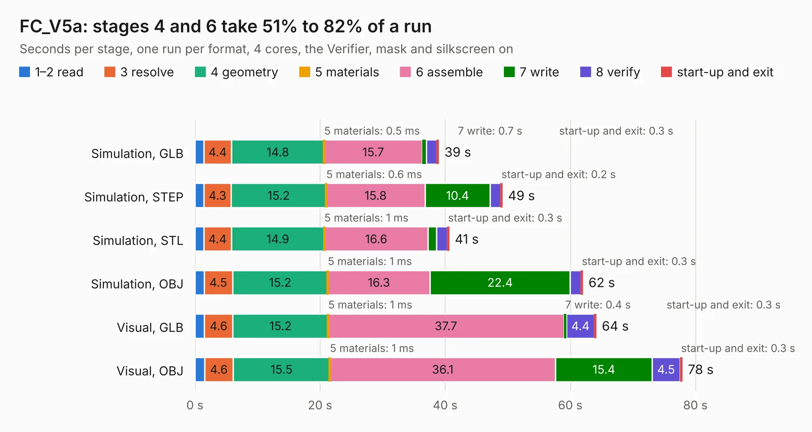

| Mode and format | 1–2 read | 3 resolve | 4 geometry | 5 materials | 6 assemble | 7 write | 8 verify | start-up and exit | Total |
|---|---:|---:|---:|---:|---:|---:|---:|---:|---:|
| Simulation, GLB | 1.4 | 4.4 | 14.8 | 0.5&nbsp;ms | 15.7 | 0.7 | 1.7 | 0.3 | 39.0 |
| Simulation, STEP | 1.5 | 4.3 | 15.2 | 0.6&nbsp;ms | 15.8 | 10.4 | 1.7 | 0.2 | 49.1 |
| Simulation, STL | 1.4 | 4.4 | 14.9 | 1&nbsp;ms | 16.6 | 1.3 | 1.7 | 0.3 | 40.6 |
| Simulation, OBJ | 1.5 | 4.5 | 15.2 | 1&nbsp;ms | 16.3 | 22.4 | 1.7 | 0.3 | 62.0 |
| Visual, GLB | 1.5 | 4.6 | 15.2 | 1&nbsp;ms | 37.7 | 0.4 | 4.4 | 0.3 | 64.1 |
| Visual, OBJ | 1.5 | 4.6 | 15.5 | 1&nbsp;ms | 36.1 | 15.4 | 4.5 | 0.3 | 77.9 |

<table align="center"><tr><td valign="top">

| Board | Repo: [proveskit/flight_controller_board](https://github.com/proveskit/flight_controller_board) Board: `FC_V5a.kicad_pcb` |
|---|---|
| Folder | Deprecated Versions / FC_V5a |
| Complexity | 406&nbsp;/&nbsp;1000 (size&nbsp;276, features&nbsp;130) |
| KESE&nbsp;features | through vias, slotted holes, custom pads, rounded, trapezoid or chamfered pads, filled zones, copper drawings, copper text, curved board outline, stack-up, dielectric εr and tanδ |
| Tested | 9th November 2026 |
| Copper&nbsp;layers | 4 |
| File&nbsp;format | KiCad 9 (20241229) |
| Parts,&nbsp;tracks,&nbsp;vias | 254, 2,647, 442 |
| Triangles,&nbsp;simulation | 4,208,656 in 231 parts |
| Verifier | PASS in all six runs |

</td><td valign="top">

<table>
<tr><th>File type</th><th>File size</th><th>Peak memory used</th></tr>
<tr><th colspan="3" align="left">Simulation</th></tr>
<tr><td>GLB</td><td align="right">146&nbsp;MB</td><td align="right">1.3&nbsp;GB</td></tr>
<tr><td>STEP</td><td align="right">744&nbsp;MB</td><td align="right">1.6&nbsp;GB</td></tr>
<tr><td>STL</td><td align="right">210&nbsp;MB</td><td align="right">1.3&nbsp;GB</td></tr>
<tr><td>OBJ</td><td align="right">458&nbsp;MB</td><td align="right">2.8&nbsp;GB</td></tr>
<tr><th colspan="3" align="left">Visual</th></tr>
<tr><td>GLB</td><td align="right">100&nbsp;MB</td><td align="right">1.6&nbsp;GB</td></tr>
<tr><td>OBJ</td><td align="right">315&nbsp;MB</td><td align="right">2.1&nbsp;GB</td></tr>
</table>

</td></tr></table>

## 2313. FC_v5d

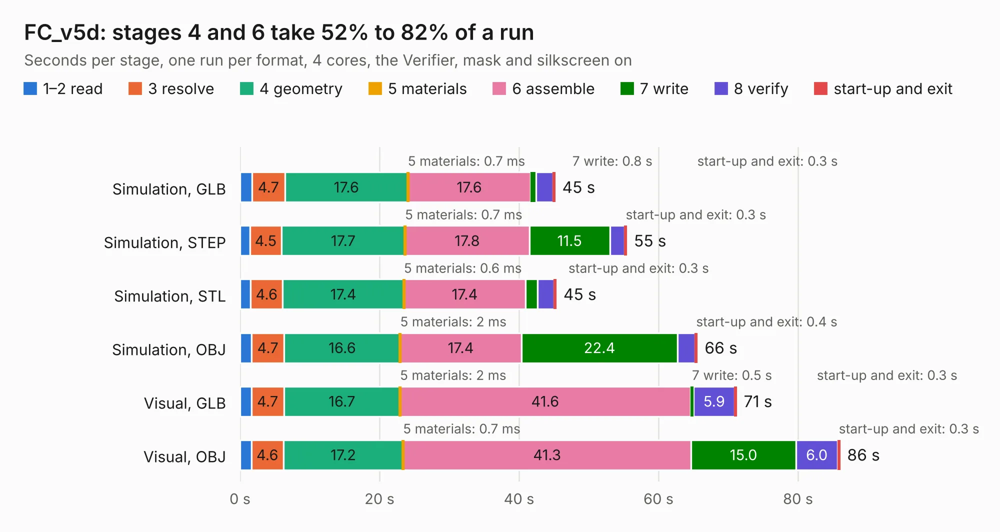

| Mode and format | 1–2 read | 3 resolve | 4 geometry | 5 materials | 6 assemble | 7 write | 8 verify | start-up and exit | Total |
|---|---:|---:|---:|---:|---:|---:|---:|---:|---:|
| Simulation, GLB | 1.7 | 4.7 | 17.6 | 0.7&nbsp;ms | 17.6 | 0.8 | 2.4 | 0.3 | 45.2 |
| Simulation, STEP | 1.4 | 4.5 | 17.7 | 0.7&nbsp;ms | 17.8 | 11.5 | 2.1 | 0.3 | 55.4 |
| Simulation, STL | 1.5 | 4.6 | 17.4 | 0.6&nbsp;ms | 17.4 | 1.7 | 2.4 | 0.3 | 45.3 |
| Simulation, OBJ | 1.6 | 4.7 | 16.6 | 2&nbsp;ms | 17.4 | 22.4 | 2.5 | 0.4 | 65.6 |
| Visual, GLB | 1.6 | 4.7 | 16.7 | 2&nbsp;ms | 41.6 | 0.5 | 5.9 | 0.3 | 71.2 |
| Visual, OBJ | 1.6 | 4.6 | 17.2 | 0.7&nbsp;ms | 41.3 | 15.0 | 6.0 | 0.3 | 86.0 |

<table align="center"><tr><td valign="top">

| Board | Repo: [proveskit/flight_controller_board](https://github.com/proveskit/flight_controller_board) Board: `FC_v5d.kicad_pcb` |
|---|---|
| Folder | Deprecated Versions / FC_V5d_Express |
| Complexity | 414&nbsp;/&nbsp;1000 (size&nbsp;284, features&nbsp;130) |
| KESE&nbsp;features | through vias, slotted holes, custom pads, rounded, trapezoid or chamfered pads, filled zones, copper drawings, copper text, curved board outline, stack-up, dielectric εr and tanδ |
| Tested | 9th November 2026 |
| Copper&nbsp;layers | 4 |
| File&nbsp;format | KiCad 9 (20241229) |
| Parts,&nbsp;tracks,&nbsp;vias | 252, 2,764, 512 |
| Triangles,&nbsp;simulation | 4,655,724 in 240 parts |
| Verifier | PASS in all six runs |

</td><td valign="top">

<table>
<tr><th>File type</th><th>File size</th><th>Peak memory used</th></tr>
<tr><th colspan="3" align="left">Simulation</th></tr>
<tr><td>GLB</td><td align="right">160&nbsp;MB</td><td align="right">1.5&nbsp;GB</td></tr>
<tr><td>STEP</td><td align="right">800&nbsp;MB</td><td align="right">1.8&nbsp;GB</td></tr>
<tr><td>STL</td><td align="right">233&nbsp;MB</td><td align="right">1.4&nbsp;GB</td></tr>
<tr><td>OBJ</td><td align="right">507&nbsp;MB</td><td align="right">3.1&nbsp;GB</td></tr>
<tr><th colspan="3" align="left">Visual</th></tr>
<tr><td>GLB</td><td align="right">106&nbsp;MB</td><td align="right">2.0&nbsp;GB</td></tr>
<tr><td>OBJ</td><td align="right">337&nbsp;MB</td><td align="right">2.2&nbsp;GB</td></tr>
</table>

</td></tr></table>

## 2314. FC_V5d_Pro_Rev1

| Mode and format | 1–2 read | 3 resolve | 4 geometry | 5 materials | 6 assemble | 7 write | 8 verify | start-up and exit | Total |
|---|---:|---:|---:|---:|---:|---:|---:|---:|---:|
| Simulation, GLB | 3.9 | 10.3 | 28.5 | 0.8&nbsp;ms | 21.9 | 1.2 | 4.4 | 0.3 | 70.4 |
| Simulation, STEP | 3.8 | 10.3 | 29.4 | 0.9&nbsp;ms | 21.9 | 14.3 | 4.5 | 0.4 | 84.6 |
| Simulation, STL | 3.8 | 10.4 | 28.8 | 1&nbsp;ms | 22.2 | 2.4 | 4.5 | 0.4 | 72.6 |
| Simulation, OBJ | 4.0 | 10.4 | 28.9 | 0.8&nbsp;ms | 22.2 | 34.5 | 4.2 | 0.5 | 104.7 |
| Visual, GLB | 3.9 | 10.5 | 27.9 | 2&nbsp;ms | 52.2 | 0.6 | 7.2 | 0.3 | 102.6 |
| Visual, OBJ | 3.8 | 10.3 | 28.7 | 0.8&nbsp;ms | 53.5 | 23.2 | 7.7 | 0.3 | 127.5 |

<table align="center"><tr><td valign="top">

| Board | Repo: [proveskit/flight_controller_board](https://github.com/proveskit/flight_controller_board) Board: `FC_V5d_Pro_Rev1.kicad_pcb` |
|---|---|
| Folder | Deprecated Versions / FC_V5d_Pro_Rev1 |
| Complexity | 428&nbsp;/&nbsp;1000 (size&nbsp;283, features&nbsp;145) |
| KESE&nbsp;features | through vias, slotted holes, custom pads, rounded, trapezoid or chamfered pads, filled zones, copper drawings, copper text, curved board outline, knockout text, stack-up, dielectric εr and tanδ |
| Tested | 9th November 2026 |
| Copper&nbsp;layers | 4 |
| File&nbsp;format | KiCad 9 (20241229) |
| Parts,&nbsp;tracks,&nbsp;vias | 248, 2,703, 496 |
| Triangles,&nbsp;simulation | 5,218,602 in 233 parts |
| Verifier | PASS in all six runs |

</td><td valign="top">

<table>
<tr><th>File type</th><th>File size</th><th>Peak memory used</th></tr>
<tr><th colspan="3" align="left">Simulation</th></tr>
<tr><td>GLB</td><td align="right">185&nbsp;MB</td><td align="right">1.7&nbsp;GB</td></tr>
<tr><td>STEP</td><td align="right">955&nbsp;MB</td><td align="right">2.1&nbsp;GB</td></tr>
<tr><td>STL</td><td align="right">261&nbsp;MB</td><td align="right">1.7&nbsp;GB</td></tr>
<tr><td>OBJ</td><td align="right">583&nbsp;MB</td><td align="right">3.6&nbsp;GB</td></tr>
<tr><th colspan="3" align="left">Visual</th></tr>
<tr><td>GLB</td><td align="right">130&nbsp;MB</td><td align="right">2.1&nbsp;GB</td></tr>
<tr><td>OBJ</td><td align="right">411&nbsp;MB</td><td align="right">2.7&nbsp;GB</td></tr>
</table>

</td></tr></table>

## 2315. FC_V4c_InspireFly_Special

| Mode and format | 1–2 read | 3 resolve | 4 geometry | 5 materials | 6 assemble | 7 write | 8 verify | start-up and exit | Total |
|---|---:|---:|---:|---:|---:|---:|---:|---:|---:|
| Simulation, GLB | 1.2 | 2.8 | 10.0 | 0.8&nbsp;ms | 13.2 | 0.4 | 1.1 | 0.3 | 29.0 |
| Simulation, STEP | 1.0 | 3.0 | 10.7 | 1&nbsp;ms | 13.3 | 7.5 | 0.9 | 0.3 | 36.8 |
| Simulation, STL | 1.2 | 3.1 | 10.0 | 1.0&nbsp;ms | 13.0 | 0.8 | 1.1 | 0.3 | 29.5 |
| Simulation, OBJ | 1.0 | 3.1 | 10.2 | 0.9&nbsp;ms | 13.2 | 12.9 | 1.1 | 0.3 | 41.9 |
| Visual, GLB | 1.1 | 2.9 | 10.6 | 0.9&nbsp;ms | 22.6 | 0.3 | 2.8 | 0.3 | 40.6 |
| Visual, OBJ | 1.0 | 2.8 | 10.2 | 1&nbsp;ms | 21.8 | 10.0 | 3.2 | 0.3 | 49.2 |

<table align="center"><tr><td valign="top">

| Board | Repo: [proveskit/flight_controller_board](https://github.com/proveskit/flight_controller_board) Board: `FC_V4c_InspireFly_Special.kicad_pcb` |
|---|---|
| Folder | FC_V4c_InspireFly_Special |
| Complexity | 406&nbsp;/&nbsp;1000 (size&nbsp;261, features&nbsp;145) |
| KESE&nbsp;features | through vias, slotted holes, custom pads, rounded, trapezoid or chamfered pads, arc tracks, filled zones, copper drawings, copper text, curved board outline, stack-up, dielectric εr and tanδ |
| Tested | 9th November 2026 |
| Copper&nbsp;layers | 4 |
| File&nbsp;format | KiCad 8 (20240108) |
| Parts,&nbsp;tracks,&nbsp;vias | 136, 1,569, 284 |
| Triangles,&nbsp;simulation | 2,557,134 in 149 parts |
| Verifier | PASS in all six runs |

</td><td valign="top">

<table>
<tr><th>File type</th><th>File size</th><th>Peak memory used</th></tr>
<tr><th colspan="3" align="left">Simulation</th></tr>
<tr><td>GLB</td><td align="right">89&nbsp;MB</td><td align="right">924&nbsp;MB</td></tr>
<tr><td>STEP</td><td align="right">447&nbsp;MB</td><td align="right">1.1&nbsp;GB</td></tr>
<tr><td>STL</td><td align="right">128&nbsp;MB</td><td align="right">866&nbsp;MB</td></tr>
<tr><td>OBJ</td><td align="right">277&nbsp;MB</td><td align="right">1.8&nbsp;GB</td></tr>
<tr><th colspan="3" align="left">Visual</th></tr>
<tr><td>GLB</td><td align="right">65&nbsp;MB</td><td align="right">1.3&nbsp;GB</td></tr>
<tr><td>OBJ</td><td align="right">202&nbsp;MB</td><td align="right">1.4&nbsp;GB</td></tr>
</table>

</td></tr></table>

## 2316. FC_V5b

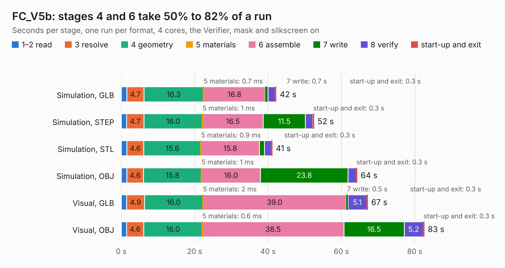

| Mode and format | 1–2 read | 3 resolve | 4 geometry | 5 materials | 6 assemble | 7 write | 8 verify | start-up and exit | Total |
|---|---:|---:|---:|---:|---:|---:|---:|---:|---:|
| Simulation, GLB | 1.5 | 4.7 | 16.3 | 0.7&nbsp;ms | 16.8 | 0.7 | 2.0 | 0.3 | 42.2 |
| Simulation, STEP | 1.5 | 4.7 | 16.0 | 1&nbsp;ms | 16.5 | 11.5 | 2.0 | 0.3 | 52.5 |
| Simulation, STL | 1.5 | 4.6 | 15.6 | 0.9&nbsp;ms | 15.8 | 1.4 | 1.8 | 0.3 | 41.2 |
| Simulation, OBJ | 1.5 | 4.6 | 15.8 | 1&nbsp;ms | 16.0 | 23.8 | 2.2 | 0.3 | 64.3 |
| Visual, GLB | 1.5 | 4.9 | 16.0 | 2&nbsp;ms | 39.0 | 0.5 | 5.1 | 0.3 | 67.1 |
| Visual, OBJ | 1.5 | 4.6 | 16.0 | 0.6&nbsp;ms | 38.5 | 16.5 | 5.2 | 0.3 | 82.6 |

<table align="center"><tr><td valign="top">

| Board | Repo: [proveskit/flight_controller_board](https://github.com/proveskit/flight_controller_board) Board: `FC_V5b.kicad_pcb` |
|---|---|
| Folder | FC_V5b |
| Complexity | 410&nbsp;/&nbsp;1000 (size&nbsp;280, features&nbsp;130) |
| KESE&nbsp;features | through vias, slotted holes, custom pads, rounded, trapezoid or chamfered pads, filled zones, copper drawings, copper text, curved board outline, stack-up, dielectric εr and tanδ |
| Tested | 9th November 2026 |
| Copper&nbsp;layers | 4 |
| File&nbsp;format | KiCad 9 (20241229) |
| Parts,&nbsp;tracks,&nbsp;vias | 253, 2,712, 433 |
| Triangles,&nbsp;simulation | 4,374,488 in 245 parts |
| Verifier | PASS in all six runs |

</td><td valign="top">

<table>
<tr><th>File type</th><th>File size</th><th>Peak memory used</th></tr>
<tr><th colspan="3" align="left">Simulation</th></tr>
<tr><td>GLB</td><td align="right">151&nbsp;MB</td><td align="right">1.3&nbsp;GB</td></tr>
<tr><td>STEP</td><td align="right">771&nbsp;MB</td><td align="right">1.7&nbsp;GB</td></tr>
<tr><td>STL</td><td align="right">219&nbsp;MB</td><td align="right">1.3&nbsp;GB</td></tr>
<tr><td>OBJ</td><td align="right">477&nbsp;MB</td><td align="right">2.9&nbsp;GB</td></tr>
<tr><th colspan="3" align="left">Visual</th></tr>
<tr><td>GLB</td><td align="right">103&nbsp;MB</td><td align="right">1.7&nbsp;GB</td></tr>
<tr><td>OBJ</td><td align="right">325&nbsp;MB</td><td align="right">2.2&nbsp;GB</td></tr>
</table>

</td></tr></table>

## 2317. FC_V5c

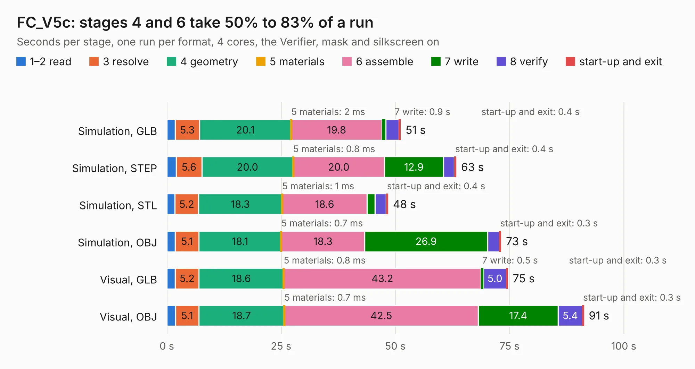

| Mode and format | 1–2 read | 3 resolve | 4 geometry | 5 materials | 6 assemble | 7 write | 8 verify | start-up and exit | Total |
|---|---:|---:|---:|---:|---:|---:|---:|---:|---:|
| Simulation, GLB | 1.8 | 5.3 | 20.1 | 2&nbsp;ms | 19.8 | 0.9 | 2.8 | 0.4 | 51.2 |
| Simulation, STEP | 2.0 | 5.6 | 20.0 | 0.8&nbsp;ms | 20.0 | 12.9 | 2.4 | 0.4 | 63.3 |
| Simulation, STL | 1.8 | 5.2 | 18.3 | 1&nbsp;ms | 18.6 | 1.8 | 2.4 | 0.4 | 48.4 |
| Simulation, OBJ | 1.8 | 5.1 | 18.1 | 0.7&nbsp;ms | 18.3 | 26.9 | 2.6 | 0.3 | 73.1 |
| Visual, GLB | 1.9 | 5.2 | 18.6 | 0.8&nbsp;ms | 43.2 | 0.5 | 5.0 | 0.3 | 74.6 |
| Visual, OBJ | 1.9 | 5.1 | 18.7 | 0.7&nbsp;ms | 42.5 | 17.4 | 5.4 | 0.3 | 91.3 |

<table align="center"><tr><td valign="top">

| Board | Repo: [proveskit/flight_controller_board](https://github.com/proveskit/flight_controller_board) Board: `FC_V5c.kicad_pcb` |
|---|---|
| Folder | FC_V5c |
| Complexity | 412&nbsp;/&nbsp;1000 (size&nbsp;282, features&nbsp;130) |
| KESE&nbsp;features | through vias, slotted holes, custom pads, rounded, trapezoid or chamfered pads, filled zones, copper drawings, copper text, curved board outline, stack-up, dielectric εr and tanδ |
| Tested | 9th November 2026 |
| Copper&nbsp;layers | 4 |
| File&nbsp;format | KiCad 9 (20241229) |
| Parts,&nbsp;tracks,&nbsp;vias | 242, 2,594, 489 |
| Triangles,&nbsp;simulation | 4,501,378 in 242 parts |
| Verifier | PASS in all six runs |

</td><td valign="top">

<table>
<tr><th>File type</th><th>File size</th><th>Peak memory used</th></tr>
<tr><th colspan="3" align="left">Simulation</th></tr>
<tr><td>GLB</td><td align="right">155&nbsp;MB</td><td align="right">1.4&nbsp;GB</td></tr>
<tr><td>STEP</td><td align="right">772&nbsp;MB</td><td align="right">1.7&nbsp;GB</td></tr>
<tr><td>STL</td><td align="right">225&nbsp;MB</td><td align="right">1.4&nbsp;GB</td></tr>
<tr><td>OBJ</td><td align="right">490&nbsp;MB</td><td align="right">3.0&nbsp;GB</td></tr>
<tr><th colspan="3" align="left">Visual</th></tr>
<tr><td>GLB</td><td align="right">102&nbsp;MB</td><td align="right">1.8&nbsp;GB</td></tr>
<tr><td>OBJ</td><td align="right">324&nbsp;MB</td><td align="right">2.0&nbsp;GB</td></tr>
</table>

</td></tr></table>

## 2318. FC_V5d_Production

| Mode and format | 1–2 read | 3 resolve | 4 geometry | 5 materials | 6 assemble | 7 write | 8 verify | start-up and exit | Total |
|---|---:|---:|---:|---:|---:|---:|---:|---:|---:|
| Simulation, GLB | 3.7 | 10.1 | 28.9 | 0.8&nbsp;ms | 22.4 | 1.0 | 4.5 | 0.4 | 71.0 |
| Simulation, STEP | 3.8 | 10.3 | 29.5 | 0.8&nbsp;ms | 22.8 | 14.6 | 4.6 | 0.3 | 86.0 |
| Simulation, STL | 3.9 | 10.4 | 30.1 | 0.8&nbsp;ms | 23.3 | 2.2 | 4.6 | 0.4 | 74.9 |
| Simulation, OBJ | 3.8 | 10.5 | 30.7 | 1&nbsp;ms | 24.2 | 37.6 | 5.2 | 0.3 | 112.4 |
| Visual, GLB | 4.2 | 11.0 | 31.1 | 1&nbsp;ms | 59.5 | 0.7 | 6.7 | 0.4 | 113.7 |
| Visual, OBJ | 3.8 | 10.6 | 30.4 | 0.9&nbsp;ms | 56.9 | 23.3 | 7.3 | 0.4 | 132.6 |

<table align="center"><tr><td valign="top">

| Board | Repo: [proveskit/flight_controller_board](https://github.com/proveskit/flight_controller_board) Board: `FC_V5d_Production.kicad_pcb` |
|---|---|
| Folder | FC_V5d_Production |
| Complexity | 428&nbsp;/&nbsp;1000 (size&nbsp;283, features&nbsp;145) |
| KESE&nbsp;features | through vias, slotted holes, custom pads, rounded, trapezoid or chamfered pads, filled zones, copper drawings, copper text, curved board outline, knockout text, stack-up, dielectric εr and tanδ |
| Tested | 9th November 2026 |
| Copper&nbsp;layers | 4 |
| File&nbsp;format | KiCad 9 (20241229) |
| Parts,&nbsp;tracks,&nbsp;vias | 252, 2,703, 497 |
| Triangles,&nbsp;simulation | 5,242,696 in 236 parts |
| Verifier | PASS in all six runs |

</td><td valign="top">

<table>
<tr><th>File type</th><th>File size</th><th>Peak memory used</th></tr>
<tr><th colspan="3" align="left">Simulation</th></tr>
<tr><td>GLB</td><td align="right">186&nbsp;MB</td><td align="right">1.9&nbsp;GB</td></tr>
<tr><td>STEP</td><td align="right">958&nbsp;MB</td><td align="right">2.1&nbsp;GB</td></tr>
<tr><td>STL</td><td align="right">262&nbsp;MB</td><td align="right">1.8&nbsp;GB</td></tr>
<tr><td>OBJ</td><td align="right">585&nbsp;MB</td><td align="right">3.5&nbsp;GB</td></tr>
<tr><th colspan="3" align="left">Visual</th></tr>
<tr><td>GLB</td><td align="right">131&nbsp;MB</td><td align="right">2.2&nbsp;GB</td></tr>
<tr><td>OBJ</td><td align="right">412&nbsp;MB</td><td align="right">2.6&nbsp;GB</td></tr>
</table>

</td></tr></table>

## 2319. FC_V5d_Production_Rev2

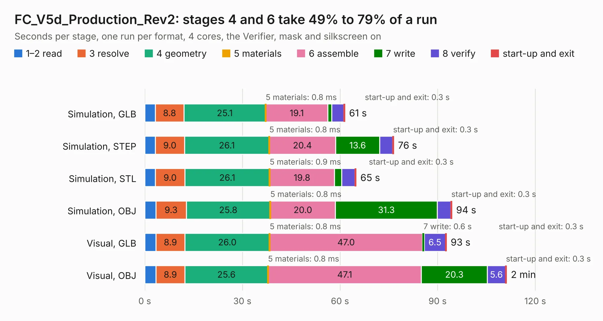

| Mode and format | 1–2 read | 3 resolve | 4 geometry | 5 materials | 6 assemble | 7 write | 8 verify | start-up and exit | Total |
|---|---:|---:|---:|---:|---:|---:|---:|---:|---:|
| Simulation, GLB | 3.2 | 8.8 | 25.1 | 0.8&nbsp;ms | 19.1 | 1.1 | 3.8 | 0.3 | 61.5 |
| Simulation, STEP | 3.2 | 9.0 | 26.1 | 0.8&nbsp;ms | 20.4 | 13.6 | 4.0 | 0.3 | 76.5 |
| Simulation, STL | 3.3 | 9.0 | 26.1 | 0.9&nbsp;ms | 19.8 | 2.2 | 4.1 | 0.3 | 64.9 |
| Simulation, OBJ | 3.4 | 9.3 | 25.8 | 0.8&nbsp;ms | 20.0 | 31.3 | 4.1 | 0.3 | 94.4 |
| Visual, GLB | 3.4 | 8.9 | 26.0 | 0.8&nbsp;ms | 47.0 | 0.6 | 6.5 | 0.3 | 92.7 |
| Visual, OBJ | 3.4 | 8.9 | 25.6 | 0.8&nbsp;ms | 47.1 | 20.3 | 5.6 | 0.3 | 111.2 |

<table align="center"><tr><td valign="top">

| Board | Repo: [proveskit/flight_controller_board](https://github.com/proveskit/flight_controller_board) Board: `FC_V5d_Production_Rev2.kicad_pcb` |
|---|---|
| Folder | FC_V5d_Production_Rev2 |
| Complexity | 428&nbsp;/&nbsp;1000 (size&nbsp;283, features&nbsp;145) |
| KESE&nbsp;features | through vias, slotted holes, custom pads, rounded, trapezoid or chamfered pads, filled zones, copper drawings, copper text, curved board outline, knockout text, stack-up, dielectric εr and tanδ |
| Tested | 9th November 2026 |
| Copper&nbsp;layers | 4 |
| File&nbsp;format | KiCad 9 (20241229) |
| Parts,&nbsp;tracks,&nbsp;vias | 248, 2,691, 494 |
| Triangles,&nbsp;simulation | 5,214,656 in 233 parts |
| Verifier | PASS in all six runs |

</td><td valign="top">

<table>
<tr><th>File type</th><th>File size</th><th>Peak memory used</th></tr>
<tr><th colspan="3" align="left">Simulation</th></tr>
<tr><td>GLB</td><td align="right">185&nbsp;MB</td><td align="right">1.7&nbsp;GB</td></tr>
<tr><td>STEP</td><td align="right">956&nbsp;MB</td><td align="right">2.1&nbsp;GB</td></tr>
<tr><td>STL</td><td align="right">261&nbsp;MB</td><td align="right">1.7&nbsp;GB</td></tr>
<tr><td>OBJ</td><td align="right">582&nbsp;MB</td><td align="right">3.5&nbsp;GB</td></tr>
<tr><th colspan="3" align="left">Visual</th></tr>
<tr><td>GLB</td><td align="right">130&nbsp;MB</td><td align="right">2.1&nbsp;GB</td></tr>
<tr><td>OBJ</td><td align="right">411&nbsp;MB</td><td align="right">2.7&nbsp;GB</td></tr>
</table>

</td></tr></table>

## 2320. FC_V5e

| Mode and format | 1–2 read | 3 resolve | 4 geometry | 5 materials | 6 assemble | 7 write | 8 verify | start-up and exit | Total |
|---|---:|---:|---:|---:|---:|---:|---:|---:|---:|
| Simulation, GLB | 4.2 | 12.7 | 29.7 | 0.8&nbsp;ms | 23.2 | 1.1 | 4.5 | 0.5 | 75.8 |
| Simulation, STEP | 4.0 | 12.6 | 30.2 | 0.8&nbsp;ms | 22.6 | 15.7 | 4.8 | 0.4 | 90.3 |
| Simulation, STL | 4.2 | 13.0 | 30.2 | 0.9&nbsp;ms | 22.3 | 2.6 | 4.8 | 0.4 | 77.4 |
| Simulation, OBJ | 4.2 | 12.8 | 29.7 | 0.7&nbsp;ms | 23.2 | 34.3 | 4.6 | 0.4 | 109.2 |
| Visual, GLB | 4.0 | 12.7 | 30.1 | 0.7&nbsp;ms | 55.2 | 0.7 | 7.2 | 0.3 | 110.3 |
| Visual, OBJ | 4.2 | 12.7 | 30.1 | 0.9&nbsp;ms | 54.5 | 23.6 | 7.7 | 0.4 | 133.2 |

<table align="center"><tr><td valign="top">

| Board | Repo: [proveskit/flight_controller_board](https://github.com/proveskit/flight_controller_board) Board: `FC_V5e.kicad_pcb` |
|---|---|
| Folder | FC_V5e |
| Complexity | 425&nbsp;/&nbsp;1000 (size&nbsp;280, features&nbsp;145) |
| KESE&nbsp;features | through vias, slotted holes, custom pads, rounded, trapezoid or chamfered pads, filled zones, copper drawings, copper text, curved board outline, knockout text, stack-up, dielectric εr and tanδ |
| Tested | 9th November 2026 |
| Copper&nbsp;layers | 4 |
| File&nbsp;format | KiCad 10 (20260206) |
| Parts,&nbsp;tracks,&nbsp;vias | 246, 2,780, 477 |
| Triangles,&nbsp;simulation | 5,281,252 in 234 parts |
| Verifier | PASS in all six runs |

</td><td valign="top">

<table>
<tr><th>File type</th><th>File size</th><th>Peak memory used</th></tr>
<tr><th colspan="3" align="left">Simulation</th></tr>
<tr><td>GLB</td><td align="right">187&nbsp;MB</td><td align="right">1.9&nbsp;GB</td></tr>
<tr><td>STEP</td><td align="right">1.0&nbsp;GB</td><td align="right">2.1&nbsp;GB</td></tr>
<tr><td>STL</td><td align="right">264&nbsp;MB</td><td align="right">2.0&nbsp;GB</td></tr>
<tr><td>OBJ</td><td align="right">587&nbsp;MB</td><td align="right">3.6&nbsp;GB</td></tr>
<tr><th colspan="3" align="left">Visual</th></tr>
<tr><td>GLB</td><td align="right">133&nbsp;MB</td><td align="right">2.2&nbsp;GB</td></tr>
<tr><td>OBJ</td><td align="right">420&nbsp;MB</td><td align="right">2.8&nbsp;GB</td></tr>
</table>

</td></tr></table>

## 2321. FC_V5e_Production_Rev1

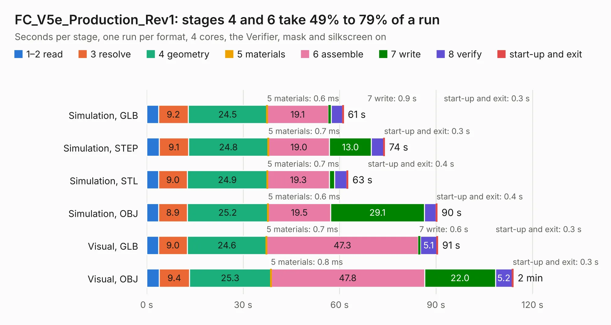

| Mode and format | 1–2 read | 3 resolve | 4 geometry | 5 materials | 6 assemble | 7 write | 8 verify | start-up and exit | Total |
|---|---:|---:|---:|---:|---:|---:|---:|---:|---:|
| Simulation, GLB | 3.7 | 9.2 | 24.5 | 0.6&nbsp;ms | 19.1 | 0.9 | 3.5 | 0.3 | 61.2 |
| Simulation, STEP | 3.9 | 9.1 | 24.8 | 0.7&nbsp;ms | 19.0 | 13.0 | 3.8 | 0.3 | 74.0 |
| Simulation, STL | 3.7 | 9.0 | 24.9 | 0.7&nbsp;ms | 19.3 | 1.6 | 3.8 | 0.4 | 62.6 |
| Simulation, OBJ | 3.7 | 8.9 | 25.2 | 0.6&nbsp;ms | 19.5 | 29.1 | 3.6 | 0.4 | 90.4 |
| Visual, GLB | 3.7 | 9.0 | 24.6 | 0.7&nbsp;ms | 47.3 | 0.6 | 5.1 | 0.3 | 90.6 |
| Visual, OBJ | 3.9 | 9.4 | 25.3 | 0.8&nbsp;ms | 47.8 | 22.0 | 5.2 | 0.3 | 114.0 |

<table align="center"><tr><td valign="top">

| Board | Repo: [proveskit/flight_controller_board](https://github.com/proveskit/flight_controller_board) Board: `FC_V5e_Production_Rev1.kicad_pcb` |
|---|---|
| Folder | FC_V5e_Production_Rev1 |
| Complexity | 425&nbsp;/&nbsp;1000 (size&nbsp;280, features&nbsp;145) |
| KESE&nbsp;features | through vias, slotted holes, custom pads, rounded, trapezoid or chamfered pads, filled zones, copper drawings, copper text, curved board outline, knockout text, stack-up, dielectric εr and tanδ |
| Tested | 9th November 2026 |
| Copper&nbsp;layers | 4 |
| File&nbsp;format | KiCad 10 (20260206) |
| Parts,&nbsp;tracks,&nbsp;vias | 247, 2,735, 477 |
| Triangles,&nbsp;simulation | 5,097,294 in 231 parts |
| Verifier | PASS in all six runs |

</td><td valign="top">

<table>
<tr><th>File type</th><th>File size</th><th>Peak memory used</th></tr>
<tr><th colspan="3" align="left">Simulation</th></tr>
<tr><td>GLB</td><td align="right">182&nbsp;MB</td><td align="right">1.8&nbsp;GB</td></tr>
<tr><td>STEP</td><td align="right">1000&nbsp;MB</td><td align="right">2.1&nbsp;GB</td></tr>
<tr><td>STL</td><td align="right">255&nbsp;MB</td><td align="right">1.8&nbsp;GB</td></tr>
<tr><td>OBJ</td><td align="right">569&nbsp;MB</td><td align="right">3.5&nbsp;GB</td></tr>
<tr><th colspan="3" align="left">Visual</th></tr>
<tr><td>GLB</td><td align="right">131&nbsp;MB</td><td align="right">2.0&nbsp;GB</td></tr>
<tr><td>OBJ</td><td align="right">414&nbsp;MB</td><td align="right">2.7&nbsp;GB</td></tr>
</table>

</td></tr></table>

## 2322. cm5MiniITX

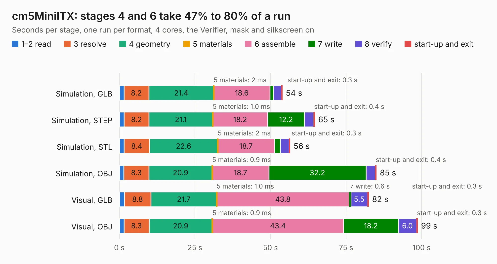

| Mode and format | 1–2 read | 3 resolve | 4 geometry | 5 materials | 6 assemble | 7 write | 8 verify | start-up and exit | Total |
|---|---:|---:|---:|---:|---:|---:|---:|---:|---:|
| Simulation, GLB | 1.5 | 8.2 | 21.4 | 2&nbsp;ms | 18.6 | 1.1 | 2.6 | 0.3 | 53.9 |
| Simulation, STEP | 1.6 | 8.2 | 21.1 | 1.0&nbsp;ms | 18.2 | 12.2 | 3.0 | 0.4 | 64.6 |
| Simulation, STL | 1.6 | 8.4 | 22.6 | 2&nbsp;ms | 18.7 | 2.0 | 2.9 | 0.3 | 56.5 |
| Simulation, OBJ | 1.5 | 8.3 | 20.9 | 0.9&nbsp;ms | 18.7 | 32.2 | 3.1 | 0.4 | 85.0 |
| Visual, GLB | 1.6 | 8.8 | 21.7 | 1.0&nbsp;ms | 43.8 | 0.6 | 5.5 | 0.3 | 82.5 |
| Visual, OBJ | 1.5 | 8.3 | 20.9 | 0.9&nbsp;ms | 43.4 | 18.2 | 6.0 | 0.3 | 98.6 |

<table align="center"><tr><td valign="top">

| Board | Repo: [pullobi/cm5MiniITX](https://github.com/pullobi/cm5MiniITX) Board: `cm5MiniITX.kicad_pcb` |
|---|---|
| Complexity | 346&nbsp;/&nbsp;1000 (size&nbsp;216, features&nbsp;130) |
| KESE&nbsp;features | through vias, slotted holes, rounded, trapezoid or chamfered pads, arc tracks, filled zones, curved board outline, TrueType text, stack-up, dielectric εr and tanδ, mask and silkscreen colours |
| Tested | 9th November 2026 |
| Copper&nbsp;layers | 4 |
| File&nbsp;format | KiCad 9 (20241229) |
| Parts,&nbsp;tracks,&nbsp;vias | 51, 3,024, 728 |
| Triangles,&nbsp;simulation | 5,274,120 in 270 parts |
| Verifier | PASS in all six runs |

</td><td valign="top">

<table>
<tr><th>File type</th><th>File size</th><th>Peak memory used</th></tr>
<tr><th colspan="3" align="left">Simulation</th></tr>
<tr><td>GLB</td><td align="right">177&nbsp;MB</td><td align="right">1.5&nbsp;GB</td></tr>
<tr><td>STEP</td><td align="right">613&nbsp;MB</td><td align="right">2.0&nbsp;GB</td></tr>
<tr><td>STL</td><td align="right">264&nbsp;MB</td><td align="right">1.5&nbsp;GB</td></tr>
<tr><td>OBJ</td><td align="right">558&nbsp;MB</td><td align="right">3.4&nbsp;GB</td></tr>
<tr><th colspan="3" align="left">Visual</th></tr>
<tr><td>GLB</td><td align="right">107&nbsp;MB</td><td align="right">1.8&nbsp;GB</td></tr>
<tr><td>OBJ</td><td align="right">342&nbsp;MB</td><td align="right">2.3&nbsp;GB</td></tr>
</table>

</td></tr></table>

## 2323. SwitchBlox

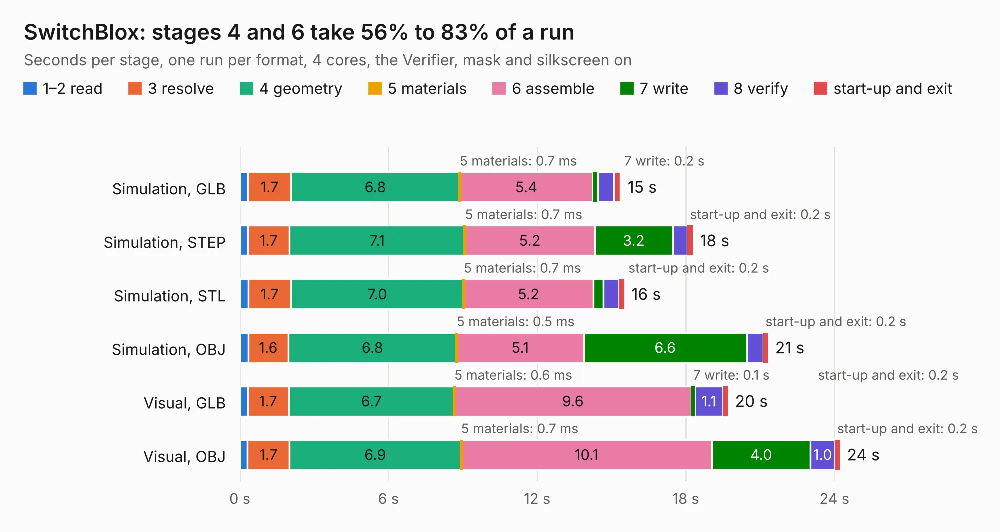

| Mode and format | 1–2 read | 3 resolve | 4 geometry | 5 materials | 6 assemble | 7 write | 8 verify | start-up and exit | Total |
|---|---:|---:|---:|---:|---:|---:|---:|---:|---:|
| Simulation, GLB | 0.3 | 1.7 | 6.8 | 0.7&nbsp;ms | 5.4 | 0.2 | 0.7 | 0.3 | 15.4 |
| Simulation, STEP | 0.3 | 1.7 | 7.1 | 0.7&nbsp;ms | 5.2 | 3.2 | 0.6 | 0.2 | 18.3 |
| Simulation, STL | 0.3 | 1.7 | 7.0 | 0.7&nbsp;ms | 5.2 | 0.4 | 0.6 | 0.2 | 15.5 |
| Simulation, OBJ | 0.3 | 1.6 | 6.8 | 0.5&nbsp;ms | 5.1 | 6.6 | 0.7 | 0.2 | 21.3 |
| Visual, GLB | 0.3 | 1.7 | 6.7 | 0.6&nbsp;ms | 9.6 | 0.1 | 1.1 | 0.2 | 19.7 |
| Visual, OBJ | 0.3 | 1.7 | 6.9 | 0.7&nbsp;ms | 10.1 | 4.0 | 1.0 | 0.2 | 24.2 |

<table align="center"><tr><td valign="top">

| Board | Repo: [puyams/SwitchBlox](https://github.com/puyams/SwitchBlox) Board: `SwitchBlox.kicad_pcb` |
|---|---|
| Folder | Hardware / Release Design Files / Source Kicad Files |
| Complexity | 273&nbsp;/&nbsp;1000 (size&nbsp;228, features&nbsp;45) |
| KESE&nbsp;features | through vias, filled zones, curved board outline |
| Tested | 9th November 2026 |
| Copper&nbsp;layers | 2 |
| File&nbsp;format | KiCad 5 (20171130) |
| Parts,&nbsp;tracks,&nbsp;vias | 84, 1,564, 105 |
| Triangles,&nbsp;simulation | 1,226,446 in 156 parts |
| Verifier | PASS in all six runs |

</td><td valign="top">

<table>
<tr><th>File type</th><th>File size</th><th>Peak memory used</th></tr>
<tr><th colspan="3" align="left">Simulation</th></tr>
<tr><td>GLB</td><td align="right">44&nbsp;MB</td><td align="right">464&nbsp;MB</td></tr>
<tr><td>STEP</td><td align="right">237&nbsp;MB</td><td align="right">562&nbsp;MB</td></tr>
<tr><td>STL</td><td align="right">61&nbsp;MB</td><td align="right">454&nbsp;MB</td></tr>
<tr><td>OBJ</td><td align="right">130&nbsp;MB</td><td align="right">890&nbsp;MB</td></tr>
<tr><th colspan="3" align="left">Visual</th></tr>
<tr><td>GLB</td><td align="right">28&nbsp;MB</td><td align="right">592&nbsp;MB</td></tr>
<tr><td>OBJ</td><td align="right">83&nbsp;MB</td><td align="right">617&nbsp;MB</td></tr>
</table>

</td></tr></table>

## 2324. batteryboard

| Mode and format | 1–2 read | 3 resolve | 4 geometry | 5 materials | 6 assemble | 7 write | 8 verify | start-up and exit | Total |
|---|---:|---:|---:|---:|---:|---:|---:|---:|---:|
| Simulation, GLB | 0.2 | 0.5 | 2.5 | 0.3&nbsp;ms | 1.9 | 77&nbsp;ms | 0.3 | 0.2 | 5.7 |
| Simulation, STEP | 0.3 | 0.5 | 2.3 | 0.1&nbsp;ms | 1.8 | 1.6 | 0.3 | 0.2 | 6.9 |
| Simulation, STL | 0.2 | 0.5 | 2.4 | 0.1&nbsp;ms | 1.7 | 0.1 | 0.3 | 0.2 | 5.5 |
| Simulation, OBJ | 0.2 | 0.5 | 2.3 | 0.2&nbsp;ms | 1.8 | 2.8 | 0.2 | 0.2 | 8.1 |
| Visual, GLB | 0.2 | 0.5 | 2.4 | 0.3&nbsp;ms | 3.6 | 54&nbsp;ms | 0.4 | 0.2 | 7.4 |
| Visual, OBJ | 0.2 | 0.5 | 2.3 | 0.2&nbsp;ms | 3.5 | 2.1 | 0.5 | 0.3 | 9.4 |

<table align="center"><tr><td valign="top">

| Board | Repo: [pycubed/hardware](https://github.com/pycubed/hardware) Board: `batteryboard.kicad_pcb` |
|---|---|
| Folder | batteryboard-v01 |
| Complexity | 193&nbsp;/&nbsp;1000 (size&nbsp;138, features&nbsp;55) |
| KESE&nbsp;features | through vias, rounded, trapezoid or chamfered pads, filled zones, curved board outline |
| Tested | 9th November 2026 |
| Copper&nbsp;layers | 2 |
| File&nbsp;format | KiCad 5 (20171130) |
| Parts,&nbsp;tracks,&nbsp;vias | 24, 50, 48 |
| Triangles,&nbsp;simulation | 444,146 in 24 parts |
| Verifier | PASS in all six runs |

</td><td valign="top">

<table>
<tr><th>File type</th><th>File size</th><th>Peak memory used</th></tr>
<tr><th colspan="3" align="left">Simulation</th></tr>
<tr><td>GLB</td><td align="right">16&nbsp;MB</td><td align="right">277&nbsp;MB</td></tr>
<tr><td>STEP</td><td align="right">78&nbsp;MB</td><td align="right">320&nbsp;MB</td></tr>
<tr><td>STL</td><td align="right">22&nbsp;MB</td><td align="right">276&nbsp;MB</td></tr>
<tr><td>OBJ</td><td align="right">47&nbsp;MB</td><td align="right">332&nbsp;MB</td></tr>
<tr><th colspan="3" align="left">Visual</th></tr>
<tr><td>GLB</td><td align="right">11&nbsp;MB</td><td align="right">311&nbsp;MB</td></tr>
<tr><td>OBJ</td><td align="right">33&nbsp;MB</td><td align="right">322&nbsp;MB</td></tr>
</table>

</td></tr></table>

## 2325. batteryboard

| Mode and format | 1–2 read | 3 resolve | 4 geometry | 5 materials | 6 assemble | 7 write | 8 verify | start-up and exit | Total |
|---|---:|---:|---:|---:|---:|---:|---:|---:|---:|
| Simulation, GLB | 0.2 | 0.4 | 2.1 | 0.2&nbsp;ms | 1.3 | 70&nbsp;ms | 0.2 | 0.3 | 4.5 |
| Simulation, STEP | 0.2 | 0.4 | 2.0 | 0.3&nbsp;ms | 1.4 | 1.5 | 0.2 | 0.2 | 5.9 |
| Simulation, STL | 0.2 | 0.4 | 2.0 | 0.2&nbsp;ms | 1.4 | 0.1 | 0.2 | 0.2 | 4.5 |
| Simulation, OBJ | 0.2 | 0.4 | 2.0 | 0.2&nbsp;ms | 1.4 | 2.3 | 0.2 | 0.2 | 6.8 |
| Visual, GLB | 0.2 | 0.4 | 2.0 | 0.2&nbsp;ms | 3.2 | 52&nbsp;ms | 0.4 | 0.2 | 6.5 |
| Visual, OBJ | 0.2 | 0.4 | 2.0 | 0.2&nbsp;ms | 3.4 | 1.5 | 0.5 | 0.2 | 8.3 |

<table align="center"><tr><td valign="top">

| Board | Repo: [pycubed/hardware](https://github.com/pycubed/hardware) Board: `batteryboard.kicad_pcb` |
|---|---|
| Folder | batteryboard-v01b |
| Complexity | 193&nbsp;/&nbsp;1000 (size&nbsp;138, features&nbsp;55) |
| KESE&nbsp;features | through vias, rounded, trapezoid or chamfered pads, filled zones, curved board outline |
| Tested | 9th November 2026 |
| Copper&nbsp;layers | 2 |
| File&nbsp;format | KiCad 5 (20171130) |
| Parts,&nbsp;tracks,&nbsp;vias | 24, 50, 48 |
| Triangles,&nbsp;simulation | 444,304 in 28 parts |
| Verifier | PASS in all six runs |

</td><td valign="top">

<table>
<tr><th>File type</th><th>File size</th><th>Peak memory used</th></tr>
<tr><th colspan="3" align="left">Simulation</th></tr>
<tr><td>GLB</td><td align="right">16&nbsp;MB</td><td align="right">291&nbsp;MB</td></tr>
<tr><td>STEP</td><td align="right">77&nbsp;MB</td><td align="right">315&nbsp;MB</td></tr>
<tr><td>STL</td><td align="right">22&nbsp;MB</td><td align="right">288&nbsp;MB</td></tr>
<tr><td>OBJ</td><td align="right">46&nbsp;MB</td><td align="right">354&nbsp;MB</td></tr>
<tr><th colspan="3" align="left">Visual</th></tr>
<tr><td>GLB</td><td align="right">11&nbsp;MB</td><td align="right">299&nbsp;MB</td></tr>
<tr><td>OBJ</td><td align="right">33&nbsp;MB</td><td align="right">309&nbsp;MB</td></tr>
</table>

</td></tr></table>

## 2326. mainboard

| Mode and format | 1–2 read | 3 resolve | 4 geometry | 5 materials | 6 assemble | 7 write | 8 verify | start-up and exit | Total |
|---|---:|---:|---:|---:|---:|---:|---:|---:|---:|
| Simulation, GLB | 0.7 | 2.9 | 9.9 | 0.9&nbsp;ms | 11.9 | 0.4 | 1.0 | 0.3 | 27.2 |
| Simulation, STEP | 0.7 | 3.0 | 9.7 | 1&nbsp;ms | 11.7 | 6.5 | 1.1 | 0.3 | 33.1 |
| Simulation, STL | 0.7 | 3.0 | 9.9 | 0.9&nbsp;ms | 11.3 | 0.8 | 1.0 | 0.3 | 27.1 |
| Simulation, OBJ | 0.6 | 3.0 | 9.9 | 1&nbsp;ms | 11.3 | 12.2 | 1.1 | 0.3 | 38.5 |
| Visual, GLB | 0.6 | 3.0 | 9.9 | 0.8&nbsp;ms | 20.0 | 0.2 | 2.6 | 0.3 | 36.7 |
| Visual, OBJ | 0.6 | 2.9 | 10.0 | 0.9&nbsp;ms | 20.2 | 8.7 | 3.1 | 0.2 | 45.9 |

<table align="center"><tr><td valign="top">

| Board | Repo: [pycubed/hardware](https://github.com/pycubed/hardware) Board: `mainboard.kicad_pcb` |
|---|---|
| Folder | mainboard-v01 |
| Complexity | 314&nbsp;/&nbsp;1000 (size&nbsp;259, features&nbsp;55) |
| KESE&nbsp;features | through vias, rounded, trapezoid or chamfered pads, filled zones, curved board outline |
| Tested | 9th November 2026 |
| Copper&nbsp;layers | 4 |
| File&nbsp;format | KiCad 5 (20171130) |
| Parts,&nbsp;tracks,&nbsp;vias | 135, 1,293, 276 |
| Triangles,&nbsp;simulation | 2,746,652 in 195 parts |
| Verifier | PASS in all six runs |

</td><td valign="top">

<table>
<tr><th>File type</th><th>File size</th><th>Peak memory used</th></tr>
<tr><th colspan="3" align="left">Simulation</th></tr>
<tr><td>GLB</td><td align="right">96&nbsp;MB</td><td align="right">894&nbsp;MB</td></tr>
<tr><td>STEP</td><td align="right">413&nbsp;MB</td><td align="right">1.2&nbsp;GB</td></tr>
<tr><td>STL</td><td align="right">137&nbsp;MB</td><td align="right">890&nbsp;MB</td></tr>
<tr><td>OBJ</td><td align="right">293&nbsp;MB</td><td align="right">1.9&nbsp;GB</td></tr>
<tr><th colspan="3" align="left">Visual</th></tr>
<tr><td>GLB</td><td align="right">66&nbsp;MB</td><td align="right">1.2&nbsp;GB</td></tr>
<tr><td>OBJ</td><td align="right">205&nbsp;MB</td><td align="right">1.4&nbsp;GB</td></tr>
</table>

</td></tr></table>

## 2327. mainboard

| Mode and format | 1–2 read | 3 resolve | 4 geometry | 5 materials | 6 assemble | 7 write | 8 verify | start-up and exit | Total |
|---|---:|---:|---:|---:|---:|---:|---:|---:|---:|
| Simulation, GLB | 0.8 | 2.7 | 12.8 | 0.9&nbsp;ms | 11.0 | 0.5 | 1.2 | 0.3 | 29.3 |
| Simulation, STEP | 0.7 | 2.5 | 12.7 | 0.7&nbsp;ms | 10.8 | 7.6 | 1.2 | 0.3 | 35.7 |
| Simulation, STL | 0.8 | 2.6 | 12.5 | 2&nbsp;ms | 10.7 | 0.8 | 1.1 | 0.3 | 28.8 |
| Simulation, OBJ | 0.7 | 2.5 | 12.5 | 0.8&nbsp;ms | 10.4 | 16.3 | 1.2 | 0.3 | 43.9 |
| Visual, GLB | 0.7 | 2.6 | 12.8 | 0.8&nbsp;ms | 24.5 | 0.3 | 3.2 | 0.2 | 44.4 |
| Visual, OBJ | 0.7 | 2.7 | 12.6 | 0.9&nbsp;ms | 23.4 | 11.1 | 3.1 | 0.3 | 53.9 |

<table align="center"><tr><td valign="top">

| Board | Repo: [pycubed/hardware](https://github.com/pycubed/hardware) Board: `mainboard.kicad_pcb` |
|---|---|
| Folder | mainboard-v02 |
| Complexity | 313&nbsp;/&nbsp;1000 (size&nbsp;258, features&nbsp;55) |
| KESE&nbsp;features | through vias, rounded, trapezoid or chamfered pads, filled zones, curved board outline |
| Tested | 9th November 2026 |
| Copper&nbsp;layers | 4 |
| File&nbsp;format | KiCad 5 (20171130) |
| Parts,&nbsp;tracks,&nbsp;vias | 142, 1,190, 252 |
| Triangles,&nbsp;simulation | 3,087,922 in 192 parts |
| Verifier | PASS in all six runs |

</td><td valign="top">

<table>
<tr><th>File type</th><th>File size</th><th>Peak memory used</th></tr>
<tr><th colspan="3" align="left">Simulation</th></tr>
<tr><td>GLB</td><td align="right">108&nbsp;MB</td><td align="right">1.1&nbsp;GB</td></tr>
<tr><td>STEP</td><td align="right">454&nbsp;MB</td><td align="right">1.2&nbsp;GB</td></tr>
<tr><td>STL</td><td align="right">154&nbsp;MB</td><td align="right">1.1&nbsp;GB</td></tr>
<tr><td>OBJ</td><td align="right">332&nbsp;MB</td><td align="right">2.0&nbsp;GB</td></tr>
<tr><th colspan="3" align="left">Visual</th></tr>
<tr><td>GLB</td><td align="right">71&nbsp;MB</td><td align="right">1.3&nbsp;GB</td></tr>
<tr><td>OBJ</td><td align="right">222&nbsp;MB</td><td align="right">1.5&nbsp;GB</td></tr>
</table>

</td></tr></table>

## 2328. mainboard

| Mode and format | 1–2 read | 3 resolve | 4 geometry | 5 materials | 6 assemble | 7 write | 8 verify | start-up and exit | Total |
|---|---:|---:|---:|---:|---:|---:|---:|---:|---:|
| Simulation, GLB | 1.1 | 3.5 | 15.4 | 0.6&nbsp;ms | 17.6 | 0.6 | 1.7 | 0.4 | 40.2 |
| Simulation, STEP | 1.3 | 3.3 | 15.5 | 0.9&nbsp;ms | 17.7 | 9.3 | 1.6 | 0.3 | 48.9 |
| Simulation, STL | 1.1 | 3.4 | 15.3 | 0.6&nbsp;ms | 17.9 | 1.1 | 1.6 | 0.3 | 40.7 |
| Simulation, OBJ | 1.2 | 3.4 | 16.0 | 1&nbsp;ms | 17.5 | 20.3 | 1.5 | 0.3 | 60.3 |
| Visual, GLB | 1.0 | 3.4 | 15.7 | 0.7&nbsp;ms | 31.5 | 0.4 | 4.4 | 0.3 | 56.7 |
| Visual, OBJ | 1.0 | 3.4 | 15.8 | 1.0&nbsp;ms | 31.8 | 14.2 | 5.0 | 0.3 | 71.6 |

<table align="center"><tr><td valign="top">

| Board | Repo: [pycubed/hardware](https://github.com/pycubed/hardware) Board: `mainboard.kicad_pcb` |
|---|---|
| Folder | mainboard-v04 |
| Complexity | 326&nbsp;/&nbsp;1000 (size&nbsp;261, features&nbsp;65) |
| KESE&nbsp;features | through vias, slotted holes, rounded, trapezoid or chamfered pads, filled zones, curved board outline |
| Tested | 9th November 2026 |
| Copper&nbsp;layers | 4 |
| File&nbsp;format | KiCad 5 (20171130) |
| Parts,&nbsp;tracks,&nbsp;vias | 150, 1,339, 325 |
| Triangles,&nbsp;simulation | 3,637,308 in 213 parts |
| Verifier | PASS in all six runs |

</td><td valign="top">

<table>
<tr><th>File type</th><th>File size</th><th>Peak memory used</th></tr>
<tr><th colspan="3" align="left">Simulation</th></tr>
<tr><td>GLB</td><td align="right">127&nbsp;MB</td><td align="right">1.1&nbsp;GB</td></tr>
<tr><td>STEP</td><td align="right">535&nbsp;MB</td><td align="right">1.4&nbsp;GB</td></tr>
<tr><td>STL</td><td align="right">182&nbsp;MB</td><td align="right">1.1&nbsp;GB</td></tr>
<tr><td>OBJ</td><td align="right">397&nbsp;MB</td><td align="right">2.4&nbsp;GB</td></tr>
<tr><th colspan="3" align="left">Visual</th></tr>
<tr><td>GLB</td><td align="right">85&nbsp;MB</td><td align="right">1.4&nbsp;GB</td></tr>
<tr><td>OBJ</td><td align="right">271&nbsp;MB</td><td align="right">1.8&nbsp;GB</td></tr>
</table>

</td></tr></table>

## 2329. mainboard

| Mode and format | 1–2 read | 3 resolve | 4 geometry | 5 materials | 6 assemble | 7 write | 8 verify | start-up and exit | Total |
|---|---:|---:|---:|---:|---:|---:|---:|---:|---:|
| Simulation, GLB | 1.1 | 3.6 | 16.5 | 0.8&nbsp;ms | 15.7 | 0.7 | 1.7 | 0.3 | 39.6 |
| Simulation, STEP | 1.1 | 3.7 | 16.5 | 0.8&nbsp;ms | 15.6 | 9.7 | 1.7 | 0.3 | 48.6 |
| Simulation, STL | 1.2 | 3.7 | 16.1 | 0.8&nbsp;ms | 16.0 | 1.3 | 1.7 | 0.3 | 40.3 |
| Simulation, OBJ | 1.1 | 3.8 | 16.7 | 0.8&nbsp;ms | 16.0 | 19.7 | 1.9 | 0.3 | 59.5 |
| Visual, GLB | 1.1 | 3.8 | 17.2 | 0.7&nbsp;ms | 37.2 | 0.5 | 6.0 | 0.3 | 66.1 |
| Visual, OBJ | 1.2 | 3.9 | 16.8 | 0.9&nbsp;ms | 36.8 | 13.4 | 6.3 | 0.3 | 78.7 |

<table align="center"><tr><td valign="top">

| Board | Repo: [pycubed/hardware](https://github.com/pycubed/hardware) Board: `mainboard.kicad_pcb` |
|---|---|
| Folder | mainboard-v05 |
| Complexity | 361&nbsp;/&nbsp;1000 (size&nbsp;271, features&nbsp;90) |
| KESE&nbsp;features | through vias, slotted holes, custom pads, rounded, trapezoid or chamfered pads, filled zones, copper drawings, curved board outline |
| Tested | 9th November 2026 |
| Copper&nbsp;layers | 4 |
| File&nbsp;format | KiCad 5 (20171130) |
| Parts,&nbsp;tracks,&nbsp;vias | 220, 1,958, 409 |
| Triangles,&nbsp;simulation | 4,482,088 in 257 parts |
| Verifier | PASS in all six runs |

</td><td valign="top">

<table>
<tr><th>File type</th><th>File size</th><th>Peak memory used</th></tr>
<tr><th colspan="3" align="left">Simulation</th></tr>
<tr><td>GLB</td><td align="right">157&nbsp;MB</td><td align="right">1.7&nbsp;GB</td></tr>
<tr><td>STEP</td><td align="right">695&nbsp;MB</td><td align="right">1.7&nbsp;GB</td></tr>
<tr><td>STL</td><td align="right">224&nbsp;MB</td><td align="right">1.6&nbsp;GB</td></tr>
<tr><td>OBJ</td><td align="right">492&nbsp;MB</td><td align="right">3.0&nbsp;GB</td></tr>
<tr><th colspan="3" align="left">Visual</th></tr>
<tr><td>GLB</td><td align="right">108&nbsp;MB</td><td align="right">1.7&nbsp;GB</td></tr>
<tr><td>OBJ</td><td align="right">344&nbsp;MB</td><td align="right">2.2&nbsp;GB</td></tr>
</table>

</td></tr></table>

## 2330. coco3

| Mode and format | 1–2 read | 3 resolve | 4 geometry | 5 materials | 6 assemble | 7 write | 8 verify | start-up and exit | Total |
|---|---:|---:|---:|---:|---:|---:|---:|---:|---:|
| Simulation, GLB | 2.6 | 6.7 | 37.6 | 2&nbsp;ms | 33.0 | 1.3 | 4.4 | 0.4 | 86.0 |
| Simulation, STEP | 2.8 | 6.9 | 37.3 | 1&nbsp;ms | 32.3 | 19.7 | 4.4 | 0.4 | 103.8 |
| Simulation, STL | 2.8 | 6.7 | 37.9 | 1&nbsp;ms | 33.0 | 3.0 | 4.3 | 0.4 | 88.0 |
| Simulation, OBJ | 2.5 | 7.0 | 37.6 | 2&nbsp;ms | 32.5 | 46.7 | 4.4 | 0.4 | 131.1 |
| Visual, GLB | 2.7 | 7.0 | 38.6 | 1&nbsp;ms | 87.9 | 0.9 | 8.8 | 0.4 | 146.2 |
| Visual, OBJ | 2.9 | 7.0 | 38.8 | 1&nbsp;ms | 84.4 | 28.0 | 9.3 | 0.3 | 170.7 |

<table align="center"><tr><td valign="top">

| Board | Repo: [qbancoffee/coco_motherboards](https://github.com/qbancoffee/coco_motherboards) Board: `coco3.kicad_pcb` |
|---|---|
| Folder | 26-3334 / coco3 |
| Complexity | 323&nbsp;/&nbsp;1000 (size&nbsp;258, features&nbsp;65) |
| KESE&nbsp;features | through vias, slotted holes, rounded, trapezoid or chamfered pads, filled zones, curved board outline |
| Tested | 9th November 2026 |
| Copper&nbsp;layers | 2 |
| File&nbsp;format | KiCad 7 (20221018) |
| Parts,&nbsp;tracks,&nbsp;vias | 205, 5,365, 359 |
| Triangles,&nbsp;simulation | 7,284,548 in 248 parts |
| Verifier | PASS in all six runs |

</td><td valign="top">

<table>
<tr><th>File type</th><th>File size</th><th>Peak memory used</th></tr>
<tr><th colspan="3" align="left">Simulation</th></tr>
<tr><td>GLB</td><td align="right">247&nbsp;MB</td><td align="right">2.4&nbsp;GB</td></tr>
<tr><td>STEP</td><td align="right">1.2&nbsp;GB</td><td align="right">2.9&nbsp;GB</td></tr>
<tr><td>STL</td><td align="right">364&nbsp;MB</td><td align="right">2.4&nbsp;GB</td></tr>
<tr><td>OBJ</td><td align="right">773&nbsp;MB</td><td align="right">4.6&nbsp;GB</td></tr>
<tr><th colspan="3" align="left">Visual</th></tr>
<tr><td>GLB</td><td align="right">172&nbsp;MB</td><td align="right">2.7&nbsp;GB</td></tr>
<tr><td>OBJ</td><td align="right">549&nbsp;MB</td><td align="right">3.6&nbsp;GB</td></tr>
</table>

</td></tr></table>

## 2331. qomu-board

| Mode and format | 1–2 read | 3 resolve | 4 geometry | 5 materials | 6 assemble | 7 write | 8 verify | start-up and exit | Total |
|---|---:|---:|---:|---:|---:|---:|---:|---:|---:|
| Simulation, GLB | 0.3 | 0.6 | 2.0 | 0.2&nbsp;ms | 2.3 | 77&nbsp;ms | 0.3 | 0.3 | 5.7 |
| Simulation, STEP | 0.3 | 0.6 | 2.0 | 0.4&nbsp;ms | 2.2 | 1.8 | 0.3 | 0.2 | 7.4 |
| Simulation, STL | 0.3 | 0.6 | 1.9 | 0.2&nbsp;ms | 2.4 | 0.1 | 0.2 | 0.2 | 5.8 |
| Simulation, OBJ | 0.3 | 0.6 | 2.1 | 0.2&nbsp;ms | 2.2 | 2.4 | 0.2 | 0.2 | 8.2 |
| Visual, GLB | 0.3 | 0.6 | 2.0 | 0.3&nbsp;ms | 3.6 | 50&nbsp;ms | 0.3 | 0.2 | 6.9 |
| Visual, OBJ | 0.3 | 0.6 | 2.0 | 0.3&nbsp;ms | 3.7 | 1.5 | 0.2 | 0.3 | 8.5 |

<table align="center"><tr><td valign="top">

| Board | Repo: [QuickLogic-Corp/qomu-dev-board](https://github.com/QuickLogic-Corp/qomu-dev-board) Board: `qomu-board.kicad_pcb` |
|---|---|
| Complexity | 340&nbsp;/&nbsp;1000 (size&nbsp;245, features&nbsp;95) |
| KESE&nbsp;features | blind and buried vias, custom pads, rounded, trapezoid or chamfered pads, filled zones, curved board outline |
| Tested | 9th November 2026 |
| Copper&nbsp;layers | 4 |
| File&nbsp;format | KiCad 5 (20171130) |
| Parts,&nbsp;tracks,&nbsp;vias | 42, 821, 190 |
| Triangles,&nbsp;simulation | 426,198 in 51 parts |
| Verifier | PASS in all six runs |

</td><td valign="top">

<table>
<tr><th>File type</th><th>File size</th><th>Peak memory used</th></tr>
<tr><th colspan="3" align="left">Simulation</th></tr>
<tr><td>GLB</td><td align="right">15&nbsp;MB</td><td align="right">288&nbsp;MB</td></tr>
<tr><td>STEP</td><td align="right">53&nbsp;MB</td><td align="right">321&nbsp;MB</td></tr>
<tr><td>STL</td><td align="right">21&nbsp;MB</td><td align="right">289&nbsp;MB</td></tr>
<tr><td>OBJ</td><td align="right">44&nbsp;MB</td><td align="right">352&nbsp;MB</td></tr>
<tr><th colspan="3" align="left">Visual</th></tr>
<tr><td>GLB</td><td align="right">8.8&nbsp;MB</td><td align="right">303&nbsp;MB</td></tr>
<tr><td>OBJ</td><td align="right">26&nbsp;MB</td><td align="right">308&nbsp;MB</td></tr>
</table>

</td></tr></table>

## 2332. unibone.routed

| Mode and format | 1–2 read | 3 resolve | 4 geometry | 5 materials | 6 assemble | 7 write | 8 verify | start-up and exit | Total |
|---|---:|---:|---:|---:|---:|---:|---:|---:|---:|
| Simulation, GLB | 2.8 | 20.4 | 116.2 | 2&nbsp;ms | 92.5 | 3.7 | 9.0 | 0.6 | 245.2 |
| Simulation, STEP | 2.7 | 26.3 | 110.2 | 3&nbsp;ms | 64.4 | 37.6 | 8.7 | 0.6 | 250.5 |
| Simulation, STL | 2.5 | 20.6 | 97.5 | 3&nbsp;ms | 61.5 | 6.2 | 8.4 | 0.6 | 197.2 |
| Simulation, OBJ | 2.4 | 20.2 | 94.5 | 2&nbsp;ms | 61.2 | 99.1 | 8.9 | 0.5 | 286.8 |
| Visual, GLB | 2.5 | 20.2 | 95.1 | 3&nbsp;ms | 114.8 | 1.0 | 9.9 | 0.5 | 243.9 |
| Visual, OBJ | 2.4 | 19.4 | 94.7 | 2&nbsp;ms | 116.1 | 36.5 | 10.0 | 0.4 | 279.5 |

<table align="center"><tr><td valign="top">

| Board | Repo: [QUniBone/QUniBoneClassic](https://github.com/QUniBone/QUniBoneClassic) Board: `unibone.routed.kicad_pcb` |
|---|---|
| Folder | 01.01_pcb / unibone |
| Complexity | 358&nbsp;/&nbsp;1000 (size&nbsp;278, features&nbsp;80) |
| KESE&nbsp;features | through vias, custom pads, rounded, trapezoid or chamfered pads, drill offsets, filled zones, copper drawings |
| Tested | 9th November 2026 |
| Copper&nbsp;layers | 4 |
| File&nbsp;format | KiCad 8 (20240108) |
| Parts,&nbsp;tracks,&nbsp;vias | 224, 6,542, 358 |
| Triangles,&nbsp;simulation | 13,611,408 in 449 parts |
| Verifier | PASS in all six runs |

</td><td valign="top">

<table>
<tr><th>File type</th><th>File size</th><th>Peak memory used</th></tr>
<tr><th colspan="3" align="left">Simulation</th></tr>
<tr><td>GLB</td><td align="right">467&nbsp;MB</td><td align="right">3.3&nbsp;GB</td></tr>
<tr><td>STEP</td><td align="right">1.9&nbsp;GB</td><td align="right">4.0&nbsp;GB</td></tr>
<tr><td>STL</td><td align="right">681&nbsp;MB</td><td align="right">3.2&nbsp;GB</td></tr>
<tr><td>OBJ</td><td align="right">1.5&nbsp;GB</td><td align="right">8.7&nbsp;GB</td></tr>
<tr><th colspan="3" align="left">Visual</th></tr>
<tr><td>GLB</td><td align="right">201&nbsp;MB</td><td align="right">3.6&nbsp;GB</td></tr>
<tr><td>OBJ</td><td align="right">652&nbsp;MB</td><td align="right">4.2&nbsp;GB</td></tr>
</table>

</td></tr></table>

## 2333. unibone.unrouted

| Mode and format | 1–2 read | 3 resolve | 4 geometry | 5 materials | 6 assemble | 7 write | 8 verify | start-up and exit | Total |
|---|---:|---:|---:|---:|---:|---:|---:|---:|---:|
| Simulation, GLB | 1.4 | 17.4 | 57.2 | 3&nbsp;ms | 43.3 | 1.9 | 4.8 | 0.5 | 126.5 |
| Simulation, STEP | 1.4 | 16.1 | 54.8 | 2&nbsp;ms | 43.0 | 27.9 | 5.4 | 0.5 | 149.2 |
| Simulation, STL | 1.4 | 17.0 | 57.2 | 4&nbsp;ms | 43.2 | 4.4 | 4.9 | 0.5 | 128.7 |
| Simulation, OBJ | 1.5 | 16.7 | 55.1 | 2&nbsp;ms | 44.2 | 72.6 | 5.2 | 0.5 | 195.7 |
| Visual, GLB | 1.4 | 16.9 | 57.0 | 3&nbsp;ms | 76.9 | 0.6 | 7.1 | 0.4 | 160.3 |
| Visual, OBJ | 1.5 | 16.7 | 54.8 | 3&nbsp;ms | 71.1 | 25.1 | 7.5 | 0.4 | 177.0 |

<table align="center"><tr><td valign="top">

| Board | Repo: [QUniBone/QUniBoneClassic](https://github.com/QUniBone/QUniBoneClassic) Board: `unibone.unrouted.kicad_pcb` |
|---|---|
| Folder | 01.01_pcb / unibone |
| Complexity | 308&nbsp;/&nbsp;1000 (size&nbsp;248, features&nbsp;60) |
| KESE&nbsp;features | through vias, custom pads, rounded, trapezoid or chamfered pads, drill offsets, copper drawings |
| Tested | 9th November 2026 |
| Copper&nbsp;layers | 4 |
| File&nbsp;format | KiCad 8 (20240108) |
| Parts,&nbsp;tracks,&nbsp;vias | 224, 800, 120 |
| Triangles,&nbsp;simulation | 11,501,714 in 449 parts |
| Verifier | PASS in all six runs |

</td><td valign="top">

<table>
<tr><th>File type</th><th>File size</th><th>Peak memory used</th></tr>
<tr><th colspan="3" align="left">Simulation</th></tr>
<tr><td>GLB</td><td align="right">381&nbsp;MB</td><td align="right">2.7&nbsp;GB</td></tr>
<tr><td>STEP</td><td align="right">1.5&nbsp;GB</td><td align="right">3.7&nbsp;GB</td></tr>
<tr><td>STL</td><td align="right">575&nbsp;MB</td><td align="right">2.6&nbsp;GB</td></tr>
<tr><td>OBJ</td><td align="right">1.2&nbsp;GB</td><td align="right">7.3&nbsp;GB</td></tr>
<tr><th colspan="3" align="left">Visual</th></tr>
<tr><td>GLB</td><td align="right">157&nbsp;MB</td><td align="right">2.9&nbsp;GB</td></tr>
<tr><td>OBJ</td><td align="right">506&nbsp;MB</td><td align="right">3.4&nbsp;GB</td></tr>
</table>

</td></tr></table>

## 2334. qmtech-minimig

| Mode and format | 1–2 read | 3 resolve | 4 geometry | 5 materials | 6 assemble | 7 write | 8 verify | start-up and exit | Total |
|---|---:|---:|---:|---:|---:|---:|---:|---:|---:|
| Simulation, GLB | 1.6 | 7.1 | 30.4 | 1&nbsp;ms | 24.8 | 1.0 | 2.5 | 0.3 | 67.7 |
| Simulation, STEP | 1.5 | 7.1 | 30.9 | 2&nbsp;ms | 25.8 | 17.1 | 2.9 | 0.4 | 85.7 |
| Simulation, STL | 1.7 | 7.7 | 31.4 | 2&nbsp;ms | 25.9 | 1.9 | 2.6 | 0.4 | 71.7 |
| Simulation, OBJ | 1.7 | 6.7 | 31.8 | 1&nbsp;ms | 24.7 | 31.1 | 2.8 | 0.4 | 99.2 |
| Visual, GLB | 1.5 | 6.6 | 31.6 | 2&nbsp;ms | 51.9 | 0.6 | 5.1 | 0.4 | 97.8 |
| Visual, OBJ | 1.6 | 6.9 | 31.9 | 1.0&nbsp;ms | 49.8 | 18.1 | 4.9 | 0.3 | 113.6 |

<table align="center"><tr><td valign="top">

| Board | Repo: [ranzbak/qmtech_minimig](https://github.com/ranzbak/qmtech_minimig) Board: `qmtech-minimig.kicad_pcb` |
|---|---|
| Complexity | 377&nbsp;/&nbsp;1000 (size&nbsp;302, features&nbsp;75) |
| KESE&nbsp;features | through vias, slotted holes, rounded, trapezoid or chamfered pads, filled zones, copper text, curved board outline |
| Tested | 9th November 2026 |
| Copper&nbsp;layers | 4 |
| File&nbsp;format | KiCad 5 (20171130) |
| Parts,&nbsp;tracks,&nbsp;vias | 207, 14,165, 316 |
| Triangles,&nbsp;simulation | 5,567,022 in 308 parts |
| Verifier | PASS in all six runs |

</td><td valign="top">

<table>
<tr><th>File type</th><th>File size</th><th>Peak memory used</th></tr>
<tr><th colspan="3" align="left">Simulation</th></tr>
<tr><td>GLB</td><td align="right">192&nbsp;MB</td><td align="right">1.8&nbsp;GB</td></tr>
<tr><td>STEP</td><td align="right">954&nbsp;MB</td><td align="right">2.0&nbsp;GB</td></tr>
<tr><td>STL</td><td align="right">278&nbsp;MB</td><td align="right">1.8&nbsp;GB</td></tr>
<tr><td>OBJ</td><td align="right">598&nbsp;MB</td><td align="right">3.6&nbsp;GB</td></tr>
<tr><th colspan="3" align="left">Visual</th></tr>
<tr><td>GLB</td><td align="right">113&nbsp;MB</td><td align="right">1.8&nbsp;GB</td></tr>
<tr><td>OBJ</td><td align="right">358&nbsp;MB</td><td align="right">2.4&nbsp;GB</td></tr>
</table>

</td></tr></table>

## 2335. ACU5EV_Carrier_Base

| Mode and format | 1–2 read | 3 resolve | 4 geometry | 5 materials | 6 assemble | 7 write | 8 verify | start-up and exit | Total |
|---|---:|---:|---:|---:|---:|---:|---:|---:|---:|
| Simulation, GLB | 85&nbsp;ms | 50&nbsp;ms | 52&nbsp;ms | 0.1&nbsp;ms | 74&nbsp;ms | 5&nbsp;ms | 6&nbsp;ms | 0.3 | 0.6 |
| Simulation, STEP | 0.1 | 78&nbsp;ms | 44&nbsp;ms | 0.1&nbsp;ms | 79&nbsp;ms | 0.1 | 6&nbsp;ms | 0.3 | 0.7 |
| Simulation, STL | 90&nbsp;ms | 39&nbsp;ms | 42&nbsp;ms | 0.1&nbsp;ms | 55&nbsp;ms | 3&nbsp;ms | 7&nbsp;ms | 0.3 | 0.5 |
| Simulation, OBJ | 93&nbsp;ms | 46&nbsp;ms | 46&nbsp;ms | 0.1&nbsp;ms | 67&nbsp;ms | 73&nbsp;ms | 8&nbsp;ms | 0.3 | 0.6 |
| Visual, GLB | 86&nbsp;ms | 40&nbsp;ms | 49&nbsp;ms | 0.1&nbsp;ms | 0.1 | 4&nbsp;ms | 39&nbsp;ms | 0.3 | 0.6 |
| Visual, OBJ | 95&nbsp;ms | 46&nbsp;ms | 47&nbsp;ms | 0.1&nbsp;ms | 0.1 | 51&nbsp;ms | 39&nbsp;ms | 0.3 | 0.7 |

<table align="center"><tr><td valign="top">

| Board | Repo: [raonslab2/fcboardkicad](https://github.com/raonslab2/fcboardkicad) Board: `ACU5EV_Carrier_Base.kicad_pcb` |
|---|---|
| Folder | out / carrier_acu5ev |
| Complexity | 17&nbsp;/&nbsp;1000 (size&nbsp;17, features&nbsp;0) |
| Tested | 9th November 2026 |
| Copper&nbsp;layers | 2 |
| File&nbsp;format | KiCad 9 (20241229) |
| Parts,&nbsp;tracks,&nbsp;vias | 0, 0, 0 |
| Triangles,&nbsp;simulation | 8,288 in 4 parts |
| Note | no components |
| Verifier | PASS in all six runs |

</td><td valign="top">

<table>
<tr><th>File type</th><th>File size</th><th>Peak memory used</th></tr>
<tr><th colspan="3" align="left">Simulation</th></tr>
<tr><td>GLB</td><td align="right">293&nbsp;kB</td><td align="right">61&nbsp;MB</td></tr>
<tr><td>STEP</td><td align="right">1.0&nbsp;MB</td><td align="right">61&nbsp;MB</td></tr>
<tr><td>STL</td><td align="right">415&nbsp;kB</td><td align="right">60&nbsp;MB</td></tr>
<tr><td>OBJ</td><td align="right">794&nbsp;kB</td><td align="right">62&nbsp;MB</td></tr>
<tr><th colspan="3" align="left">Visual</th></tr>
<tr><td>GLB</td><td align="right">289&nbsp;kB</td><td align="right">84&nbsp;MB</td></tr>
<tr><td>OBJ</td><td align="right">737&nbsp;kB</td><td align="right">86&nbsp;MB</td></tr>
</table>

</td></tr></table>

## 2336. AmplifierHat

| Mode and format | 1–2 read | 3 resolve | 4 geometry | 5 materials | 6 assemble | 7 write | 8 verify | start-up and exit | Total |
|---|---:|---:|---:|---:|---:|---:|---:|---:|---:|
| Simulation, GLB | 0.8 | 2.2 | 6.5 | 0.4&nbsp;ms | 6.7 | 0.3 | 0.9 | 0.3 | 17.5 |
| Simulation, STEP | 0.7 | 2.1 | 6.2 | 0.4&nbsp;ms | 6.2 | 4.4 | 0.8 | 0.2 | 20.7 |
| Simulation, STL | 0.7 | 2.0 | 6.1 | 0.4&nbsp;ms | 6.4 | 0.6 | 0.9 | 0.3 | 17.1 |
| Simulation, OBJ | 0.7 | 2.2 | 6.2 | 0.4&nbsp;ms | 6.5 | 10.6 | 0.8 | 0.3 | 27.2 |
| Visual, GLB | 0.7 | 2.1 | 6.3 | 0.6&nbsp;ms | 14.0 | 0.2 | 1.5 | 0.2 | 25.1 |
| Visual, OBJ | 0.7 | 2.0 | 6.2 | 0.5&nbsp;ms | 14.3 | 6.7 | 1.6 | 0.3 | 31.8 |

<table align="center"><tr><td valign="top">

| Board | Repo: [rasmusstagsted/artixdevboard](https://github.com/rasmusstagsted/artixdevboard) Board: `AmplifierHat.kicad_pcb` |
|---|---|
| Folder | AmplifierHat |
| Complexity | 307&nbsp;/&nbsp;1000 (size&nbsp;212, features&nbsp;95) |
| KESE&nbsp;features | through vias, slotted holes, rounded, trapezoid or chamfered pads, filled zones, copper drawings, stack-up, dielectric εr and tanδ |
| Tested | 9th November 2026 |
| Copper&nbsp;layers | 4 |
| File&nbsp;format | KiCad 8 (20240108) |
| Parts,&nbsp;tracks,&nbsp;vias | 163, 706, 387 |
| Triangles,&nbsp;simulation | 1,971,778 in 122 parts |
| Verifier | PASS in all six runs |

</td><td valign="top">

<table>
<tr><th>File type</th><th>File size</th><th>Peak memory used</th></tr>
<tr><th colspan="3" align="left">Simulation</th></tr>
<tr><td>GLB</td><td align="right">67&nbsp;MB</td><td align="right">799&nbsp;MB</td></tr>
<tr><td>STEP</td><td align="right">218&nbsp;MB</td><td align="right">855&nbsp;MB</td></tr>
<tr><td>STL</td><td align="right">99&nbsp;MB</td><td align="right">788&nbsp;MB</td></tr>
<tr><td>OBJ</td><td align="right">203&nbsp;MB</td><td align="right">1.3&nbsp;GB</td></tr>
<tr><th colspan="3" align="left">Visual</th></tr>
<tr><td>GLB</td><td align="right">41&nbsp;MB</td><td align="right">897&nbsp;MB</td></tr>
<tr><td>OBJ</td><td align="right">124&nbsp;MB</td><td align="right">952&nbsp;MB</td></tr>
</table>

</td></tr></table>

## 2337. ArtixDevBoard

| Mode and format | 1–2 read | 3 resolve | 4 geometry | 5 materials | 6 assemble | 7 write | 8 verify | start-up and exit | Total |
|---|---:|---:|---:|---:|---:|---:|---:|---:|---:|
| Simulation, GLB | 1.5 | 5.4 | 23.2 | 3&nbsp;ms | 32.2 | 1.0 | 2.6 | 0.4 | 66.2 |
| Simulation, STEP | 1.3 | 5.6 | 22.3 | 1&nbsp;ms | 32.0 | 15.4 | 2.4 | 0.4 | 79.4 |
| Simulation, STL | 1.3 | 5.7 | 22.1 | 3&nbsp;ms | 31.8 | 2.2 | 2.5 | 0.4 | 65.9 |
| Simulation, OBJ | 1.2 | 5.0 | 21.2 | 2&nbsp;ms | 31.7 | 27.4 | 2.3 | 0.4 | 89.2 |
| Visual, GLB | 1.3 | 5.2 | 21.4 | 2&nbsp;ms | 55.3 | 0.6 | 7.4 | 0.3 | 91.5 |
| Visual, OBJ | 1.5 | 5.3 | 21.9 | 1&nbsp;ms | 56.9 | 20.2 | 8.0 | 0.3 | 114.0 |

<table align="center"><tr><td valign="top">

| Board | Repo: [rasmusstagsted/artixdevboard](https://github.com/rasmusstagsted/artixdevboard) Board: `ArtixDevBoard.kicad_pcb` |
|---|---|
| Complexity | 423&nbsp;/&nbsp;1000 (size&nbsp;303, features&nbsp;120) |
| KESE&nbsp;features | through vias, slotted holes, rounded, trapezoid or chamfered pads, arc tracks, filled zones, copper drawings, curved board outline, stack-up, dielectric εr and tanδ |
| Tested | 9th November 2026 |
| Copper&nbsp;layers | 4 |
| File&nbsp;format | KiCad 8 (20240108) |
| Parts,&nbsp;tracks,&nbsp;vias | 301, 5,140, 707 |
| Triangles,&nbsp;simulation | 5,070,308 in 523 parts |
| Verifier | PASS in all six runs |

</td><td valign="top">

<table>
<tr><th>File type</th><th>File size</th><th>Peak memory used</th></tr>
<tr><th colspan="3" align="left">Simulation</th></tr>
<tr><td>GLB</td><td align="right">174&nbsp;MB</td><td align="right">1.5&nbsp;GB</td></tr>
<tr><td>STEP</td><td align="right">802&nbsp;MB</td><td align="right">2.1&nbsp;GB</td></tr>
<tr><td>STL</td><td align="right">254&nbsp;MB</td><td align="right">1.6&nbsp;GB</td></tr>
<tr><td>OBJ</td><td align="right">540&nbsp;MB</td><td align="right">3.3&nbsp;GB</td></tr>
<tr><th colspan="3" align="left">Visual</th></tr>
<tr><td>GLB</td><td align="right">122&nbsp;MB</td><td align="right">2.0&nbsp;GB</td></tr>
<tr><td>OBJ</td><td align="right">387&nbsp;MB</td><td align="right">2.6&nbsp;GB</td></tr>
</table>

</td></tr></table>

## 2338. scarlet-8088

| Mode and format | 1–2 read | 3 resolve | 4 geometry | 5 materials | 6 assemble | 7 write | 8 verify | start-up and exit | Total |
|---|---:|---:|---:|---:|---:|---:|---:|---:|---:|
| Simulation, GLB | 4.4 | 16.6 | 58.6 | 2&nbsp;ms | 72.7 | 3.3 | 10.5 | 0.6 | 166.7 |
| Simulation, STEP | 4.1 | 16.6 | 59.5 | 15&nbsp;ms | 70.4 | 41.7 | 10.4 | 0.6 | 203.3 |
| Simulation, STL | 4.5 | 17.3 | 60.0 | 2&nbsp;ms | 68.3 | 7.0 | 9.7 | 0.6 | 167.4 |
| Simulation, OBJ | 4.8 | 20.0 | 69.2 | 2&nbsp;ms | 75.8 | 138.2 | 12.0 | 0.7 | 320.8 |
| Visual, GLB | 4.5 | 17.6 | 59.9 | 2&nbsp;ms | 152.5 | 1.4 | 14.9 | 0.5 | 251.3 |
| Visual, OBJ | 4.2 | 18.0 | 60.2 | 2&nbsp;ms | 146.4 | 54.9 | 14.2 | 0.5 | 298.4 |

<table align="center"><tr><td valign="top">

| Board | Repo: [Red-Lucy-Engineering/scarlet-8088](https://github.com/Red-Lucy-Engineering/scarlet-8088) Board: `scarlet-8088.kicad_pcb` |
|---|---|
| Complexity | 388&nbsp;/&nbsp;1000 (size&nbsp;283, features&nbsp;105) |
| KESE&nbsp;features | through vias, rounded, trapezoid or chamfered pads, filled zones, knockout text, TrueType text, stack-up, dielectric εr and tanδ |
| Tested | 9th November 2026 to 10th November 2026 |
| Copper&nbsp;layers | 4 |
| File&nbsp;format | KiCad 10 (20260206) |
| Parts,&nbsp;tracks,&nbsp;vias | 140, 6,778, 2,351 |
| Triangles,&nbsp;simulation | 18,399,402 in 411 parts |
| Verifier | PASS in all six runs |
| Run&nbsp;again | Simulation, OBJ: failed in the corpus run, run again with the memory cap raised from 11 GB to 14.5 GB, and passed |

</td><td valign="top">

<table>
<tr><th>File type</th><th>File size</th><th>Peak memory used</th></tr>
<tr><th colspan="3" align="left">Simulation</th></tr>
<tr><td>GLB</td><td align="right">605&nbsp;MB</td><td align="right">3.9&nbsp;GB</td></tr>
<tr><td>STEP</td><td align="right">2.1&nbsp;GB</td><td align="right">6.1&nbsp;GB</td></tr>
<tr><td>STL</td><td align="right">920&nbsp;MB</td><td align="right">4.1&nbsp;GB</td></tr>
<tr><td>OBJ</td><td align="right">2.1&nbsp;GB</td><td align="right">12&nbsp;GB</td></tr>
<tr><th colspan="3" align="left">Visual</th></tr>
<tr><td>GLB</td><td align="right">324&nbsp;MB</td><td align="right">5.3&nbsp;GB</td></tr>
<tr><td>OBJ</td><td align="right">1.1&nbsp;GB</td><td align="right">6.7&nbsp;GB</td></tr>
</table>

</td></tr></table>

## 2339. Motherboard

| Mode and format | 1–2 read | 3 resolve | 4 geometry | 5 materials | 6 assemble | 7 write | 8 verify | start-up and exit | Total |
|---|---:|---:|---:|---:|---:|---:|---:|---:|---:|
| Simulation, GLB | 1.3 | 4.2 | 17.0 | 0.6&nbsp;ms | 15.7 | 0.6 | 1.9 | 0.2 | 40.9 |
| Simulation, STEP | 1.2 | 4.2 | 16.5 | 0.6&nbsp;ms | 15.0 | 8.6 | 1.8 | 0.3 | 47.5 |
| Simulation, STL | 1.3 | 4.1 | 16.8 | 0.9&nbsp;ms | 15.3 | 1.3 | 1.9 | 0.3 | 41.0 |
| Simulation, OBJ | 1.3 | 4.2 | 16.5 | 0.9&nbsp;ms | 16.0 | 19.7 | 1.7 | 0.3 | 59.7 |
| Visual, GLB | 1.3 | 4.3 | 17.2 | 0.6&nbsp;ms | 33.9 | 0.4 | 3.4 | 0.2 | 60.7 |
| Visual, OBJ | 1.3 | 4.1 | 16.8 | 0.8&nbsp;ms | 34.0 | 12.9 | 3.6 | 0.2 | 72.9 |

<table align="center"><tr><td valign="top">

| Board | Repo: [Redherring32/OpenTendo](https://github.com/Redherring32/OpenTendo) Board: `Motherboard.kicad_pcb` |
|---|---|
| Folder | Board Files |
| Complexity | 297&nbsp;/&nbsp;1000 (size&nbsp;202, features&nbsp;95) |
| KESE&nbsp;features | through vias, slotted holes, rounded, trapezoid or chamfered pads, filled zones, curved board outline, stack-up, dielectric εr and tanδ |
| Tested | 9th November 2026 |
| Copper&nbsp;layers | 2 |
| File&nbsp;format | KiCad 8 (20240108) |
| Parts,&nbsp;tracks,&nbsp;vias | 99, 2,644, 387 |
| Triangles,&nbsp;simulation | 3,801,422 in 142 parts |
| Verifier | PASS in all six runs |

</td><td valign="top">

<table>
<tr><th>File type</th><th>File size</th><th>Peak memory used</th></tr>
<tr><th colspan="3" align="left">Simulation</th></tr>
<tr><td>GLB</td><td align="right">129&nbsp;MB</td><td align="right">1.2&nbsp;GB</td></tr>
<tr><td>STEP</td><td align="right">573&nbsp;MB</td><td align="right">1.5&nbsp;GB</td></tr>
<tr><td>STL</td><td align="right">190&nbsp;MB</td><td align="right">1.1&nbsp;GB</td></tr>
<tr><td>OBJ</td><td align="right">401&nbsp;MB</td><td align="right">2.5&nbsp;GB</td></tr>
<tr><th colspan="3" align="left">Visual</th></tr>
<tr><td>GLB</td><td align="right">86&nbsp;MB</td><td align="right">1.6&nbsp;GB</td></tr>
<tr><td>OBJ</td><td align="right">271&nbsp;MB</td><td align="right">1.8&nbsp;GB</td></tr>
</table>

</td></tr></table>

## 2340. Arduino_Altair_8800

| Mode and format | 1–2 read | 3 resolve | 4 geometry | 5 materials | 6 assemble | 7 write | 8 verify | start-up and exit | Total |
|---|---:|---:|---:|---:|---:|---:|---:|---:|---:|
| Simulation, GLB | 0.6 | 3.9 | 17.9 | 2&nbsp;ms | 14.9 | 0.7 | 2.1 | 0.3 | 40.4 |
| Simulation, STEP | 0.7 | 4.3 | 18.8 | 1&nbsp;ms | 13.9 | 9.2 | 2.2 | 0.4 | 49.5 |
| Simulation, STL | 0.7 | 4.1 | 20.0 | 1&nbsp;ms | 14.0 | 1.0 | 1.9 | 0.3 | 42.1 |
| Simulation, OBJ | 0.6 | 3.9 | 19.5 | 1&nbsp;ms | 14.3 | 18.4 | 2.2 | 0.3 | 59.1 |
| Visual, GLB | 0.6 | 3.9 | 18.5 | 2&nbsp;ms | 24.9 | 0.3 | 2.1 | 0.3 | 50.4 |
| Visual, OBJ | 0.6 | 4.0 | 18.4 | 1&nbsp;ms | 24.6 | 8.8 | 2.6 | 0.3 | 59.2 |

<table align="center"><tr><td valign="top">

| Board | Repo: [Redlolz/Altair8800-Simulator-PCB](https://github.com/Redlolz/Altair8800-Simulator-PCB) Board: `Arduino_Altair_8800.kicad_pcb` |
|---|---|
| Complexity | 225&nbsp;/&nbsp;1000 (size&nbsp;190, features&nbsp;35) |
| KESE&nbsp;features | through vias, slotted holes, rounded, trapezoid or chamfered pads |
| Tested | 9th November 2026 |
| Copper&nbsp;layers | 2 |
| File&nbsp;format | KiCad 5 (20171130) |
| Parts,&nbsp;tracks,&nbsp;vias | 178, 1,081, 50 |
| Triangles,&nbsp;simulation | 2,890,994 in 235 parts |
| Verifier | PASS in all six runs |

</td><td valign="top">

<table>
<tr><th>File type</th><th>File size</th><th>Peak memory used</th></tr>
<tr><th colspan="3" align="left">Simulation</th></tr>
<tr><td>GLB</td><td align="right">98&nbsp;MB</td><td align="right">1.0&nbsp;GB</td></tr>
<tr><td>STEP</td><td align="right">492&nbsp;MB</td><td align="right">1.1&nbsp;GB</td></tr>
<tr><td>STL</td><td align="right">145&nbsp;MB</td><td align="right">934&nbsp;MB</td></tr>
<tr><td>OBJ</td><td align="right">307&nbsp;MB</td><td align="right">1.9&nbsp;GB</td></tr>
<tr><th colspan="3" align="left">Visual</th></tr>
<tr><td>GLB</td><td align="right">53&nbsp;MB</td><td align="right">1.2&nbsp;GB</td></tr>
<tr><td>OBJ</td><td align="right">163&nbsp;MB</td><td align="right">1.1&nbsp;GB</td></tr>
</table>

</td></tr></table>

## 2341. Wii PCB

| Mode and format | 1–2 read | 3 resolve | 4 geometry | 5 materials | 6 assemble | 7 write | 8 verify | start-up and exit | Total |
|---|---:|---:|---:|---:|---:|---:|---:|---:|---:|
| Simulation, GLB | 1.1 | 4.9 | 23.3 | 2&nbsp;ms | 21.8 | 0.9 | 2.6 | 0.3 | 55.0 |
| Simulation, STEP | 1.2 | 4.9 | 22.9 | 2&nbsp;ms | 21.8 | 14.6 | 2.6 | 0.3 | 68.3 |
| Simulation, STL | 1.3 | 4.6 | 23.8 | 2&nbsp;ms | 21.2 | 1.9 | 2.7 | 0.3 | 55.8 |
| Simulation, OBJ | 1.4 | 5.0 | 23.6 | 2&nbsp;ms | 21.8 | 29.7 | 2.7 | 0.4 | 84.5 |
| Visual, GLB | 1.3 | 4.9 | 23.1 | 2&nbsp;ms | 53.8 | 0.6 | 8.6 | 0.4 | 92.7 |
| Visual, OBJ | 1.3 | 4.8 | 23.8 | 2&nbsp;ms | 56.4 | 21.2 | 8.7 | 0.3 | 116.5 |

<table align="center"><tr><td valign="top">

| Board | Repo: [ReflowOven/Wee_Wii](https://github.com/ReflowOven/Wee_Wii) Board: `Wii PCB.kicad_pcb` |
|---|---|
| Folder | KiCad_Files / Wii_PCB |
| Complexity | 384&nbsp;/&nbsp;1000 (size&nbsp;279, features&nbsp;105) |
| KESE&nbsp;features | through vias, rounded, trapezoid or chamfered pads, arc tracks, filled zones, copper drawings, stack-up, dielectric εr and tanδ, mask and silkscreen colours |
| Tested | 9th November 2026 |
| Copper&nbsp;layers | 4 |
| File&nbsp;format | KiCad 9 (20241229) |
| Parts,&nbsp;tracks,&nbsp;vias | 181, 6,430, 830 |
| Triangles,&nbsp;simulation | 6,132,510 in 459 parts |
| Verifier | PASS in all six runs |

</td><td valign="top">

<table>
<tr><th>File type</th><th>File size</th><th>Peak memory used</th></tr>
<tr><th colspan="3" align="left">Simulation</th></tr>
<tr><td>GLB</td><td align="right">211&nbsp;MB</td><td align="right">2.0&nbsp;GB</td></tr>
<tr><td>STEP</td><td align="right">968&nbsp;MB</td><td align="right">2.4&nbsp;GB</td></tr>
<tr><td>STL</td><td align="right">307&nbsp;MB</td><td align="right">2.0&nbsp;GB</td></tr>
<tr><td>OBJ</td><td align="right">658&nbsp;MB</td><td align="right">4.0&nbsp;GB</td></tr>
<tr><th colspan="3" align="left">Visual</th></tr>
<tr><td>GLB</td><td align="right">142&nbsp;MB</td><td align="right">2.2&nbsp;GB</td></tr>
<tr><td>OBJ</td><td align="right">459&nbsp;MB</td><td align="right">3.1&nbsp;GB</td></tr>
</table>

</td></tr></table>

## 2342. AppleII

| Mode and format | 1–2 read | 3 resolve | 4 geometry | 5 materials | 6 assemble | 7 write | 8 verify | start-up and exit | Total |
|---|---:|---:|---:|---:|---:|---:|---:|---:|---:|
| Simulation, GLB | 1.4 | 8.5 | 58.9 | 3&nbsp;ms | 45.2 | 1.8 | 6.3 | 0.4 | 122.5 |
| Simulation, STEP | 1.3 | 8.4 | 59.9 | 3&nbsp;ms | 48.4 | 29.4 | 6.1 | 0.4 | 153.9 |
| Simulation, STL | 1.4 | 8.8 | 59.3 | 3&nbsp;ms | 45.5 | 4.9 | 6.3 | 0.4 | 126.7 |
| Simulation, OBJ | 1.3 | 8.6 | 61.1 | 2&nbsp;ms | 46.5 | 65.8 | 5.8 | 0.4 | 189.6 |
| Visual, GLB | 1.4 | 8.4 | 58.6 | 2&nbsp;ms | 87.3 | 1.0 | 10.6 | 0.3 | 167.7 |
| Visual, OBJ | 1.3 | 8.0 | 58.5 | 3&nbsp;ms | 87.0 | 35.3 | 9.4 | 0.3 | 199.9 |

<table align="center"><tr><td valign="top">

| Board | Repo: [reifsnyderb/Apple-II-R0](https://github.com/reifsnyderb/Apple-II-R0) Board: `AppleII.kicad_pcb` |
|---|---|
| Complexity | 318&nbsp;/&nbsp;1000 (size&nbsp;228, features&nbsp;90) |
| KESE&nbsp;features | through vias, slotted holes, filled zones, TrueType text, stack-up, dielectric εr and tanδ |
| Tested | 9th November 2026 |
| Copper&nbsp;layers | 2 |
| File&nbsp;format | KiCad 8 (20240108) |
| Parts,&nbsp;tracks,&nbsp;vias | 194, 10,767, 374 |
| Triangles,&nbsp;simulation | 11,575,970 in 495 parts |
| Verifier | PASS in all six runs |

</td><td valign="top">

<table>
<tr><th>File type</th><th>File size</th><th>Peak memory used</th></tr>
<tr><th colspan="3" align="left">Simulation</th></tr>
<tr><td>GLB</td><td align="right">387&nbsp;MB</td><td align="right">2.7&nbsp;GB</td></tr>
<tr><td>STEP</td><td align="right">1.7&nbsp;GB</td><td align="right">4.2&nbsp;GB</td></tr>
<tr><td>STL</td><td align="right">579&nbsp;MB</td><td align="right">2.6&nbsp;GB</td></tr>
<tr><td>OBJ</td><td align="right">1.2&nbsp;GB</td><td align="right">7.1&nbsp;GB</td></tr>
<tr><th colspan="3" align="left">Visual</th></tr>
<tr><td>GLB</td><td align="right">220&nbsp;MB</td><td align="right">3.4&nbsp;GB</td></tr>
<tr><td>OBJ</td><td align="right">709&nbsp;MB</td><td align="right">4.5&nbsp;GB</td></tr>
</table>

</td></tr></table>

## 2343. 11ua

| Mode and format | 1–2 read | 3 resolve | 4 geometry | 5 materials | 6 assemble | 7 write | 8 verify | start-up and exit | Total |
|---|---:|---:|---:|---:|---:|---:|---:|---:|---:|
| Simulation, GLB | 0.1 | 0.3 | 2.9 | 0.2&nbsp;ms | 2.7 | 0.1 | 0.3 | 0.2 | 6.6 |
| Simulation, STEP | 0.1 | 0.3 | 2.7 | 0.2&nbsp;ms | 2.9 | 1.7 | 0.3 | 0.2 | 8.3 |
| Simulation, STL | 0.1 | 0.3 | 2.9 | 0.4&nbsp;ms | 3.1 | 0.1 | 0.3 | 0.2 | 7.0 |
| Simulation, OBJ | 0.1 | 0.3 | 2.9 | 0.3&nbsp;ms | 3.0 | 2.5 | 0.3 | 0.2 | 9.4 |
| Visual, GLB | 0.1 | 0.3 | 3.0 | 0.3&nbsp;ms | 5.7 | 52&nbsp;ms | 0.4 | 0.2 | 9.9 |
| Visual, OBJ | 0.1 | 0.3 | 2.9 | 0.4&nbsp;ms | 5.2 | 1.6 | 0.4 | 0.2 | 10.7 |

<table align="center"><tr><td valign="top">

| Board | Repo: [rene-dev/stmbl](https://github.com/rene-dev/stmbl) Board: `11ua.kicad_pcb` |
|---|---|
| Folder | hw / kicad / 11ua |
| Complexity | 193&nbsp;/&nbsp;1000 (size&nbsp;148, features&nbsp;45) |
| KESE&nbsp;features | through vias, rounded, trapezoid or chamfered pads, filled zones |
| Tested | 9th November 2026 |
| Copper&nbsp;layers | 2 |
| File&nbsp;format | KiCad 6 (20190605) |
| Parts,&nbsp;tracks,&nbsp;vias | 26, 184, 49 |
| Triangles,&nbsp;simulation | 555,700 in 32 parts |
| Verifier | PASS in all six runs |

</td><td valign="top">

<table>
<tr><th>File type</th><th>File size</th><th>Peak memory used</th></tr>
<tr><th colspan="3" align="left">Simulation</th></tr>
<tr><td>GLB</td><td align="right">20&nbsp;MB</td><td align="right">330&nbsp;MB</td></tr>
<tr><td>STEP</td><td align="right">114&nbsp;MB</td><td align="right">386&nbsp;MB</td></tr>
<tr><td>STL</td><td align="right">28&nbsp;MB</td><td align="right">307&nbsp;MB</td></tr>
<tr><td>OBJ</td><td align="right">58&nbsp;MB</td><td align="right">424&nbsp;MB</td></tr>
<tr><th colspan="3" align="left">Visual</th></tr>
<tr><td>GLB</td><td align="right">13&nbsp;MB</td><td align="right">374&nbsp;MB</td></tr>
<tr><td>OBJ</td><td align="right">39&nbsp;MB</td><td align="right">359&nbsp;MB</td></tr>
</table>

</td></tr></table>

## 2344. triple_adapter

| Mode and format | 1–2 read | 3 resolve | 4 geometry | 5 materials | 6 assemble | 7 write | 8 verify | start-up and exit | Total |
|---|---:|---:|---:|---:|---:|---:|---:|---:|---:|
| Simulation, GLB | 0.3 | 1.1 | 7.2 | 0.6&nbsp;ms | 6.0 | 0.2 | 0.6 | 0.3 | 15.5 |
| Simulation, STEP | 0.3 | 1.1 | 7.0 | 0.4&nbsp;ms | 5.9 | 3.9 | 0.6 | 0.2 | 19.1 |
| Simulation, STL | 0.3 | 1.0 | 6.9 | 0.5&nbsp;ms | 6.2 | 0.6 | 0.6 | 0.3 | 15.8 |
| Simulation, OBJ | 0.3 | 1.1 | 7.3 | 0.5&nbsp;ms | 6.5 | 7.6 | 0.5 | 0.3 | 23.7 |
| Visual, GLB | 0.3 | 1.1 | 6.7 | 0.4&nbsp;ms | 12.4 | 0.2 | 1.3 | 0.2 | 22.2 |
| Visual, OBJ | 0.3 | 1.1 | 7.2 | 0.5&nbsp;ms | 12.6 | 5.2 | 1.7 | 0.3 | 28.4 |

<table align="center"><tr><td valign="top">

| Board | Repo: [rene-dev/stmbl](https://github.com/rene-dev/stmbl) Board: `triple_adapter.kicad_pcb` |
|---|---|
| Folder | hw / kicad / 11ua |
| Complexity | 236&nbsp;/&nbsp;1000 (size&nbsp;181, features&nbsp;55) |
| KESE&nbsp;features | through vias, rounded, trapezoid or chamfered pads, filled zones, curved board outline |
| Tested | 9th November 2026 |
| Copper&nbsp;layers | 2 |
| File&nbsp;format | KiCad 5 (20171130) |
| Parts,&nbsp;tracks,&nbsp;vias | 78, 831, 138 |
| Triangles,&nbsp;simulation | 1,473,076 in 33 parts |
| Verifier | PASS in all six runs |

</td><td valign="top">

<table>
<tr><th>File type</th><th>File size</th><th>Peak memory used</th></tr>
<tr><th colspan="3" align="left">Simulation</th></tr>
<tr><td>GLB</td><td align="right">51&nbsp;MB</td><td align="right">582&nbsp;MB</td></tr>
<tr><td>STEP</td><td align="right">261&nbsp;MB</td><td align="right">727&nbsp;MB</td></tr>
<tr><td>STL</td><td align="right">74&nbsp;MB</td><td align="right">605&nbsp;MB</td></tr>
<tr><td>OBJ</td><td align="right">154&nbsp;MB</td><td align="right">1.0&nbsp;GB</td></tr>
<tr><th colspan="3" align="left">Visual</th></tr>
<tr><td>GLB</td><td align="right">37&nbsp;MB</td><td align="right">880&nbsp;MB</td></tr>
<tr><td>OBJ</td><td align="right">110&nbsp;MB</td><td align="right">832&nbsp;MB</td></tr>
</table>

</td></tr></table>

## 2345. db25_bob

| Mode and format | 1–2 read | 3 resolve | 4 geometry | 5 materials | 6 assemble | 7 write | 8 verify | start-up and exit | Total |
|---|---:|---:|---:|---:|---:|---:|---:|---:|---:|
| Simulation, GLB | 0.3 | 1.2 | 9.8 | 0.8&nbsp;ms | 7.2 | 0.3 | 0.9 | 0.2 | 19.9 |
| Simulation, STEP | 0.3 | 1.2 | 9.7 | 0.4&nbsp;ms | 7.1 | 4.4 | 0.8 | 0.2 | 23.7 |
| Simulation, STL | 0.3 | 1.2 | 9.7 | 0.7&nbsp;ms | 7.5 | 0.4 | 0.9 | 0.2 | 20.1 |
| Simulation, OBJ | 0.3 | 1.2 | 9.6 | 0.4&nbsp;ms | 7.1 | 9.0 | 0.9 | 0.2 | 28.3 |
| Visual, GLB | 0.3 | 1.3 | 9.8 | 0.5&nbsp;ms | 12.6 | 0.2 | 1.4 | 0.2 | 25.7 |
| Visual, OBJ | 0.3 | 1.2 | 10.1 | 0.5&nbsp;ms | 13.7 | 5.9 | 1.6 | 0.2 | 33.0 |

<table align="center"><tr><td valign="top">

| Board | Repo: [rene-dev/stmbl](https://github.com/rene-dev/stmbl) Board: `db25_bob.kicad_pcb` |
|---|---|
| Folder | hw / kicad / bob / db25_bob |
| Complexity | 221&nbsp;/&nbsp;1000 (size&nbsp;186, features&nbsp;35) |
| KESE&nbsp;features | through vias, filled zones |
| Tested | 9th November 2026 |
| Copper&nbsp;layers | 2 |
| File&nbsp;format | KiCad 4 (4) |
| Parts,&nbsp;tracks,&nbsp;vias | 94, 1,289, 65 |
| Triangles,&nbsp;simulation | 1,631,048 in 156 parts |
| Verifier | PASS in all six runs |

</td><td valign="top">

<table>
<tr><th>File type</th><th>File size</th><th>Peak memory used</th></tr>
<tr><th colspan="3" align="left">Simulation</th></tr>
<tr><td>GLB</td><td align="right">58&nbsp;MB</td><td align="right">615&nbsp;MB</td></tr>
<tr><td>STEP</td><td align="right">303&nbsp;MB</td><td align="right">751&nbsp;MB</td></tr>
<tr><td>STL</td><td align="right">82&nbsp;MB</td><td align="right">619&nbsp;MB</td></tr>
<tr><td>OBJ</td><td align="right">174&nbsp;MB</td><td align="right">1.1&nbsp;GB</td></tr>
<tr><th colspan="3" align="left">Visual</th></tr>
<tr><td>GLB</td><td align="right">38&nbsp;MB</td><td align="right">767&nbsp;MB</td></tr>
<tr><td>OBJ</td><td align="right">114&nbsp;MB</td><td align="right">859&nbsp;MB</td></tr>
</table>

</td></tr></table>

## 2346. db25_bob_v2

| Mode and format | 1–2 read | 3 resolve | 4 geometry | 5 materials | 6 assemble | 7 write | 8 verify | start-up and exit | Total |
|---|---:|---:|---:|---:|---:|---:|---:|---:|---:|
| Simulation, GLB | 0.4 | 1.4 | 10.3 | 1&nbsp;ms | 6.7 | 0.2 | 0.8 | 0.3 | 20.1 |
| Simulation, STEP | 0.4 | 1.4 | 9.9 | 1&nbsp;ms | 6.7 | 4.6 | 0.8 | 0.3 | 24.1 |
| Simulation, STL | 0.4 | 1.4 | 9.5 | 1&nbsp;ms | 6.1 | 0.4 | 0.6 | 0.3 | 18.8 |
| Simulation, OBJ | 0.4 | 1.3 | 9.6 | 1&nbsp;ms | 6.8 | 8.6 | 0.8 | 0.3 | 27.7 |
| Visual, GLB | 0.4 | 1.4 | 9.9 | 2&nbsp;ms | 12.9 | 0.1 | 1.1 | 0.3 | 26.0 |
| Visual, OBJ | 0.4 | 1.3 | 9.8 | 1&nbsp;ms | 11.7 | 4.1 | 1.1 | 0.2 | 28.8 |

<table align="center"><tr><td valign="top">

| Board | Repo: [rene-dev/stmbl](https://github.com/rene-dev/stmbl) Board: `db25_bob_v2.kicad_pcb` |
|---|---|
| Folder | hw / kicad / bob / db25_bob_v2 |
| Complexity | 266&nbsp;/&nbsp;1000 (size&nbsp;231, features&nbsp;35) |
| KESE&nbsp;features | through vias, filled zones |
| Tested | 9th November 2026 |
| Copper&nbsp;layers | 2 |
| File&nbsp;format | KiCad 4 (4) |
| Parts,&nbsp;tracks,&nbsp;vias | 129, 941, 56 |
| Triangles,&nbsp;simulation | 1,359,766 in 314 parts |
| Verifier | PASS in all six runs |

</td><td valign="top">

<table>
<tr><th>File type</th><th>File size</th><th>Peak memory used</th></tr>
<tr><th colspan="3" align="left">Simulation</th></tr>
<tr><td>GLB</td><td align="right">47&nbsp;MB</td><td align="right">615&nbsp;MB</td></tr>
<tr><td>STEP</td><td align="right">232&nbsp;MB</td><td align="right">645&nbsp;MB</td></tr>
<tr><td>STL</td><td align="right">68&nbsp;MB</td><td align="right">619&nbsp;MB</td></tr>
<tr><td>OBJ</td><td align="right">143&nbsp;MB</td><td align="right">957&nbsp;MB</td></tr>
<tr><th colspan="3" align="left">Visual</th></tr>
<tr><td>GLB</td><td align="right">26&nbsp;MB</td><td align="right">615&nbsp;MB</td></tr>
<tr><td>OBJ</td><td align="right">79&nbsp;MB</td><td align="right">630&nbsp;MB</td></tr>
</table>

</td></tr></table>

## 2347. ethernet_bob

| Mode and format | 1–2 read | 3 resolve | 4 geometry | 5 materials | 6 assemble | 7 write | 8 verify | start-up and exit | Total |
|---|---:|---:|---:|---:|---:|---:|---:|---:|---:|
| Simulation, GLB | 0.6 | 2.9 | 11.7 | 0.5&nbsp;ms | 10.7 | 0.5 | 1.4 | 0.3 | 28.1 |
| Simulation, STEP | 0.6 | 2.9 | 11.7 | 0.4&nbsp;ms | 10.7 | 6.1 | 1.5 | 0.3 | 33.7 |
| Simulation, STL | 0.6 | 3.0 | 11.9 | 0.6&nbsp;ms | 11.0 | 1.1 | 1.3 | 0.3 | 29.1 |
| Simulation, OBJ | 0.6 | 2.9 | 11.8 | 1&nbsp;ms | 11.0 | 14.2 | 1.4 | 0.3 | 42.2 |
| Visual, GLB | 0.6 | 2.9 | 11.5 | 0.9&nbsp;ms | 22.8 | 0.3 | 2.8 | 0.3 | 41.1 |
| Visual, OBJ | 0.6 | 3.0 | 12.0 | 0.6&nbsp;ms | 22.2 | 8.5 | 3.4 | 0.2 | 49.9 |

<table align="center"><tr><td valign="top">

| Board | Repo: [rene-dev/stmbl](https://github.com/rene-dev/stmbl) Board: `ethernet_bob.kicad_pcb` |
|---|---|
| Folder | hw / kicad / bob / ethernet_bob |
| Complexity | 289&nbsp;/&nbsp;1000 (size&nbsp;244, features&nbsp;45) |
| KESE&nbsp;features | through vias, rounded, trapezoid or chamfered pads, filled zones |
| Tested | 9th November 2026 |
| Copper&nbsp;layers | 4 |
| File&nbsp;format | KiCad 5 (20171130) |
| Parts,&nbsp;tracks,&nbsp;vias | 68, 1,672, 112 |
| Triangles,&nbsp;simulation | 3,430,750 in 160 parts |
| Verifier | PASS in all six runs |

</td><td valign="top">

<table>
<tr><th>File type</th><th>File size</th><th>Peak memory used</th></tr>
<tr><th colspan="3" align="left">Simulation</th></tr>
<tr><td>GLB</td><td align="right">117&nbsp;MB</td><td align="right">1.1&nbsp;GB</td></tr>
<tr><td>STEP</td><td align="right">396&nbsp;MB</td><td align="right">1.4&nbsp;GB</td></tr>
<tr><td>STL</td><td align="right">172&nbsp;MB</td><td align="right">1.1&nbsp;GB</td></tr>
<tr><td>OBJ</td><td align="right">363&nbsp;MB</td><td align="right">2.2&nbsp;GB</td></tr>
<tr><th colspan="3" align="left">Visual</th></tr>
<tr><td>GLB</td><td align="right">66&nbsp;MB</td><td align="right">1.2&nbsp;GB</td></tr>
<tr><td>OBJ</td><td align="right">207&nbsp;MB</td><td align="right">1.5&nbsp;GB</td></tr>
</table>

</td></tr></table>

## 2348. io_base

| Mode and format | 1–2 read | 3 resolve | 4 geometry | 5 materials | 6 assemble | 7 write | 8 verify | start-up and exit | Total |
|---|---:|---:|---:|---:|---:|---:|---:|---:|---:|
| Simulation, GLB | 0.4 | 1.4 | 9.5 | 0.7&nbsp;ms | 5.9 | 0.2 | 0.6 | 0.3 | 18.3 |
| Simulation, STEP | 0.3 | 1.4 | 9.8 | 0.7&nbsp;ms | 6.1 | 3.9 | 0.7 | 0.3 | 22.5 |
| Simulation, STL | 0.3 | 1.4 | 9.4 | 0.7&nbsp;ms | 5.7 | 0.5 | 0.7 | 0.3 | 18.2 |
| Simulation, OBJ | 0.3 | 1.5 | 9.6 | 0.7&nbsp;ms | 5.7 | 7.8 | 0.6 | 0.3 | 25.9 |
| Visual, GLB | 0.3 | 1.3 | 9.4 | 0.6&nbsp;ms | 12.6 | 0.1 | 1.3 | 0.3 | 25.3 |
| Visual, OBJ | 0.3 | 1.3 | 9.7 | 0.7&nbsp;ms | 12.1 | 4.1 | 1.4 | 0.2 | 29.1 |

<table align="center"><tr><td valign="top">

| Board | Repo: [rene-dev/stmbl](https://github.com/rene-dev/stmbl) Board: `io_base.kicad_pcb` |
|---|---|
| Folder | hw / kicad / bob / ethernet_bob / io_base |
| Complexity | 197&nbsp;/&nbsp;1000 (size&nbsp;172, features&nbsp;25) |
| KESE&nbsp;features | through vias, drill offsets |
| Tested | 9th November 2026 |
| Copper&nbsp;layers | 2 |
| File&nbsp;format | KiCad 5 (20160815) |
| Parts,&nbsp;tracks,&nbsp;vias | 98, 531, 36 |
| Triangles,&nbsp;simulation | 1,345,646 in 181 parts |
| Verifier | PASS in all six runs |

</td><td valign="top">

<table>
<tr><th>File type</th><th>File size</th><th>Peak memory used</th></tr>
<tr><th colspan="3" align="left">Simulation</th></tr>
<tr><td>GLB</td><td align="right">46&nbsp;MB</td><td align="right">555&nbsp;MB</td></tr>
<tr><td>STEP</td><td align="right">217&nbsp;MB</td><td align="right">623&nbsp;MB</td></tr>
<tr><td>STL</td><td align="right">67&nbsp;MB</td><td align="right">559&nbsp;MB</td></tr>
<tr><td>OBJ</td><td align="right">140&nbsp;MB</td><td align="right">903&nbsp;MB</td></tr>
<tr><th colspan="3" align="left">Visual</th></tr>
<tr><td>GLB</td><td align="right">25&nbsp;MB</td><td align="right">611&nbsp;MB</td></tr>
<tr><td>OBJ</td><td align="right">76&nbsp;MB</td><td align="right">593&nbsp;MB</td></tr>
</table>

</td></tr></table>

## 2349. ethernet_bob_base

| Mode and format | 1–2 read | 3 resolve | 4 geometry | 5 materials | 6 assemble | 7 write | 8 verify | start-up and exit | Total |
|---|---:|---:|---:|---:|---:|---:|---:|---:|---:|
| Simulation, GLB | 0.5 | 2.2 | 12.2 | 0.6&nbsp;ms | 8.0 | 0.3 | 0.9 | 0.3 | 24.4 |
| Simulation, STEP | 0.4 | 2.3 | 12.6 | 0.6&nbsp;ms | 8.2 | 6.1 | 1.1 | 0.3 | 30.8 |
| Simulation, STL | 0.7 | 2.5 | 12.5 | 0.7&nbsp;ms | 8.4 | 0.5 | 0.9 | 0.3 | 25.8 |
| Simulation, OBJ | 0.4 | 2.1 | 12.3 | 0.8&nbsp;ms | 8.1 | 11.0 | 0.9 | 0.3 | 35.1 |
| Visual, GLB | 0.4 | 2.3 | 12.1 | 0.7&nbsp;ms | 14.7 | 0.2 | 1.5 | 0.2 | 31.3 |
| Visual, OBJ | 0.5 | 2.1 | 12.0 | 0.5&nbsp;ms | 14.9 | 6.7 | 1.8 | 0.2 | 38.2 |

<table align="center"><tr><td valign="top">

| Board | Repo: [rene-dev/stmbl](https://github.com/rene-dev/stmbl) Board: `ethernet_bob_base.kicad_pcb` |
|---|---|
| Folder | hw / kicad / bob / ethernet_bob_base |
| Complexity | 279&nbsp;/&nbsp;1000 (size&nbsp;224, features&nbsp;55) |
| KESE&nbsp;features | through vias, rounded, trapezoid or chamfered pads, filled zones, curved board outline |
| Tested | 9th November 2026 |
| Copper&nbsp;layers | 2 |
| File&nbsp;format | KiCad 5 (20171130) |
| Parts,&nbsp;tracks,&nbsp;vias | 111, 544, 92 |
| Triangles,&nbsp;simulation | 2,128,744 in 169 parts |
| Verifier | PASS in all six runs |

</td><td valign="top">

<table>
<tr><th>File type</th><th>File size</th><th>Peak memory used</th></tr>
<tr><th colspan="3" align="left">Simulation</th></tr>
<tr><td>GLB</td><td align="right">73&nbsp;MB</td><td align="right">835&nbsp;MB</td></tr>
<tr><td>STEP</td><td align="right">381&nbsp;MB</td><td align="right">937&nbsp;MB</td></tr>
<tr><td>STL</td><td align="right">106&nbsp;MB</td><td align="right">914&nbsp;MB</td></tr>
<tr><td>OBJ</td><td align="right">224&nbsp;MB</td><td align="right">1.4&nbsp;GB</td></tr>
<tr><th colspan="3" align="left">Visual</th></tr>
<tr><td>GLB</td><td align="right">44&nbsp;MB</td><td align="right">853&nbsp;MB</td></tr>
<tr><td>OBJ</td><td align="right">134&nbsp;MB</td><td align="right">1.0&nbsp;GB</td></tr>
</table>

</td></tr></table>

## 2350. Bob

| Mode and format | 1–2 read | 3 resolve | 4 geometry | 5 materials | 6 assemble | 7 write | 8 verify | start-up and exit | Total |
|---|---:|---:|---:|---:|---:|---:|---:|---:|---:|
| Simulation, GLB | 0.5 | 2.1 | 14.4 | 0.7&nbsp;ms | 10.9 | 0.4 | 1.5 | 0.3 | 30.1 |
| Simulation, STEP | 0.4 | 2.0 | 14.4 | 0.9&nbsp;ms | 10.6 | 6.3 | 1.5 | 0.3 | 35.5 |
| Simulation, STL | 0.5 | 2.2 | 14.2 | 0.9&nbsp;ms | 10.7 | 0.9 | 1.4 | 0.3 | 30.2 |
| Simulation, OBJ | 0.5 | 2.0 | 13.9 | 0.6&nbsp;ms | 10.5 | 11.9 | 1.5 | 0.3 | 40.5 |
| Visual, GLB | 0.5 | 2.1 | 14.1 | 0.8&nbsp;ms | 23.7 | 0.3 | 3.0 | 0.3 | 44.1 |
| Visual, OBJ | 0.5 | 2.2 | 14.2 | 0.6&nbsp;ms | 24.7 | 8.7 | 3.3 | 0.3 | 53.8 |

<table align="center"><tr><td valign="top">

| Board | Repo: [rene-dev/stmbl](https://github.com/rene-dev/stmbl) Board: `Bob.kicad_pcb` |
|---|---|
| Folder | hw / kicad / de0bob |
| Complexity | 238&nbsp;/&nbsp;1000 (size&nbsp;203, features&nbsp;35) |
| KESE&nbsp;features | through vias, filled zones |
| Tested | 9th November 2026 |
| Copper&nbsp;layers | 2 |
| File&nbsp;format | KiCad 5 (20170123) |
| Parts,&nbsp;tracks,&nbsp;vias | 140, 2,759, 170 |
| Triangles,&nbsp;simulation | 2,427,452 in 212 parts |
| Verifier | PASS in all six runs |

</td><td valign="top">

<table>
<tr><th>File type</th><th>File size</th><th>Peak memory used</th></tr>
<tr><th colspan="3" align="left">Simulation</th></tr>
<tr><td>GLB</td><td align="right">85&nbsp;MB</td><td align="right">907&nbsp;MB</td></tr>
<tr><td>STEP</td><td align="right">447&nbsp;MB</td><td align="right">1.0&nbsp;GB</td></tr>
<tr><td>STL</td><td align="right">121&nbsp;MB</td><td align="right">841&nbsp;MB</td></tr>
<tr><td>OBJ</td><td align="right">260&nbsp;MB</td><td align="right">1.6&nbsp;GB</td></tr>
<tr><th colspan="3" align="left">Visual</th></tr>
<tr><td>GLB</td><td align="right">61&nbsp;MB</td><td align="right">1.1&nbsp;GB</td></tr>
<tr><td>OBJ</td><td align="right">188&nbsp;MB</td><td align="right">1.4&nbsp;GB</td></tr>
</table>

</td></tr></table>

## 2351. diff_driver

| Mode and format | 1–2 read | 3 resolve | 4 geometry | 5 materials | 6 assemble | 7 write | 8 verify | start-up and exit | Total |
|---|---:|---:|---:|---:|---:|---:|---:|---:|---:|
| Simulation, GLB | 0.1 | 0.2 | 1.2 | 0.2&nbsp;ms | 1.0 | 44&nbsp;ms | 0.2 | 0.2 | 3.0 |
| Simulation, STEP | 0.1 | 0.3 | 1.3 | 0.2&nbsp;ms | 1.1 | 1.2 | 0.2 | 0.2 | 4.5 |
| Simulation, STL | 0.1 | 0.3 | 1.3 | 0.2&nbsp;ms | 1.0 | 91&nbsp;ms | 0.2 | 0.2 | 3.1 |
| Simulation, OBJ | 0.1 | 0.3 | 1.3 | 0.2&nbsp;ms | 1.0 | 1.3 | 0.2 | 0.2 | 4.4 |
| Visual, GLB | 0.1 | 0.3 | 1.1 | 0.3&nbsp;ms | 2.5 | 35&nbsp;ms | 0.2 | 0.2 | 4.5 |
| Visual, OBJ | 0.1 | 0.3 | 1.3 | 0.2&nbsp;ms | 2.7 | 1.0 | 0.3 | 0.2 | 5.8 |

<table align="center"><tr><td valign="top">

| Board | Repo: [rene-dev/stmbl](https://github.com/rene-dev/stmbl) Board: `diff_driver.kicad_pcb` |
|---|---|
| Folder | hw / kicad / diff_driver |
| Complexity | 180&nbsp;/&nbsp;1000 (size&nbsp;125, features&nbsp;55) |
| KESE&nbsp;features | through vias, rounded, trapezoid or chamfered pads, filled zones, curved board outline |
| Tested | 9th November 2026 |
| Copper&nbsp;layers | 2 |
| File&nbsp;format | KiCad 5 (20171130) |
| Parts,&nbsp;tracks,&nbsp;vias | 14, 90, 10 |
| Triangles,&nbsp;simulation | 300,518 in 27 parts |
| Verifier | PASS in all six runs |

</td><td valign="top">

<table>
<tr><th>File type</th><th>File size</th><th>Peak memory used</th></tr>
<tr><th colspan="3" align="left">Simulation</th></tr>
<tr><td>GLB</td><td align="right">11&nbsp;MB</td><td align="right">252&nbsp;MB</td></tr>
<tr><td>STEP</td><td align="right">54&nbsp;MB</td><td align="right">261&nbsp;MB</td></tr>
<tr><td>STL</td><td align="right">15&nbsp;MB</td><td align="right">248&nbsp;MB</td></tr>
<tr><td>OBJ</td><td align="right">30&nbsp;MB</td><td align="right">260&nbsp;MB</td></tr>
<tr><th colspan="3" align="left">Visual</th></tr>
<tr><td>GLB</td><td align="right">7.3&nbsp;MB</td><td align="right">230&nbsp;MB</td></tr>
<tr><td>OBJ</td><td align="right">21&nbsp;MB</td><td align="right">231&nbsp;MB</td></tr>
</table>

</td></tr></table>

## 2352. mesabob

| Mode and format | 1–2 read | 3 resolve | 4 geometry | 5 materials | 6 assemble | 7 write | 8 verify | start-up and exit | Total |
|---|---:|---:|---:|---:|---:|---:|---:|---:|---:|
| Simulation, GLB | 0.2 | 0.3 | 53&nbsp;ms | 0.1&nbsp;ms | 22&nbsp;ms | 2&nbsp;ms | 2&nbsp;ms | 0.2 | 0.8 |
| Simulation, STEP | 0.2 | 0.3 | 50&nbsp;ms | 0.1&nbsp;ms | 15&nbsp;ms | 19&nbsp;ms | 2&nbsp;ms | 0.2 | 0.8 |
| Simulation, STL | 0.3 | 0.3 | 46&nbsp;ms | 0.1&nbsp;ms | 14&nbsp;ms | 1&nbsp;ms | 2&nbsp;ms | 0.2 | 0.8 |
| Simulation, OBJ | 0.2 | 0.3 | 47&nbsp;ms | 0.1&nbsp;ms | 15&nbsp;ms | 11&nbsp;ms | 2&nbsp;ms | 0.2 | 0.8 |
| Visual, GLB | 0.2 | 0.3 | 51&nbsp;ms | 0.1&nbsp;ms | 29&nbsp;ms | 1&nbsp;ms | 9&nbsp;ms | 0.2 | 0.8 |
| Visual, OBJ | 0.2 | 0.3 | 54&nbsp;ms | 0.1&nbsp;ms | 41&nbsp;ms | 11&nbsp;ms | 9&nbsp;ms | 0.2 | 0.8 |

<table align="center"><tr><td valign="top">

| Board | Repo: [rene-dev/stmbl](https://github.com/rene-dev/stmbl) Board: `mesabob.kicad_pcb` |
|---|---|
| Folder | hw / kicad / mesabob |
| Complexity | 216&nbsp;/&nbsp;1000 (size&nbsp;161, features&nbsp;55) |
| KESE&nbsp;features | through vias, rounded, trapezoid or chamfered pads, filled zones, curved board outline |
| Tested | 9th November 2026 |
| Copper&nbsp;layers | 2 |
| File&nbsp;format | KiCad 5 (20171130) |
| Parts,&nbsp;tracks,&nbsp;vias | 44, 446, 25 |
| Triangles,&nbsp;simulation | 1,872 in 3 parts |
| Verifier | PASS in all six runs |

</td><td valign="top">

<table>
<tr><th>File type</th><th>File size</th><th>Peak memory used</th></tr>
<tr><th colspan="3" align="left">Simulation</th></tr>
<tr><td>GLB</td><td align="right">56&nbsp;kB</td><td align="right">77&nbsp;MB</td></tr>
<tr><td>STEP</td><td align="right">33&nbsp;kB</td><td align="right">76&nbsp;MB</td></tr>
<tr><td>STL</td><td align="right">94&nbsp;kB</td><td align="right">77&nbsp;MB</td></tr>
<tr><td>OBJ</td><td align="right">174&nbsp;kB</td><td align="right">79&nbsp;MB</td></tr>
<tr><th colspan="3" align="left">Visual</th></tr>
<tr><td>GLB</td><td align="right">72&nbsp;kB</td><td align="right">77&nbsp;MB</td></tr>
<tr><td>OBJ</td><td align="right">175&nbsp;kB</td><td align="right">77&nbsp;MB</td></tr>
</table>

</td></tr></table>

## 2353. powerstep

| Mode and format | 1–2 read | 3 resolve | 4 geometry | 5 materials | 6 assemble | 7 write | 8 verify | start-up and exit | Total |
|---|---:|---:|---:|---:|---:|---:|---:|---:|---:|
| Simulation, GLB | 0.1 | 0.3 | 1.3 | 0.2&nbsp;ms | 0.9 | 40&nbsp;ms | 0.1 | 0.2 | 3.1 |
| Simulation, STEP | 0.1 | 0.3 | 1.3 | 0.2&nbsp;ms | 0.9 | 1.1 | 0.1 | 0.2 | 4.1 |
| Simulation, STL | 0.1 | 0.3 | 1.3 | 0.2&nbsp;ms | 0.9 | 62&nbsp;ms | 0.1 | 0.2 | 3.0 |
| Simulation, OBJ | 0.1 | 0.3 | 1.3 | 0.3&nbsp;ms | 0.9 | 1.3 | 0.2 | 0.2 | 4.3 |
| Visual, GLB | 0.1 | 0.3 | 1.3 | 0.2&nbsp;ms | 2.2 | 26&nbsp;ms | 0.2 | 0.3 | 4.4 |
| Visual, OBJ | 0.1 | 0.3 | 1.3 | 0.3&nbsp;ms | 2.2 | 0.7 | 0.2 | 0.2 | 5.0 |

<table align="center"><tr><td valign="top">

| Board | Repo: [rene-dev/stmbl](https://github.com/rene-dev/stmbl) Board: `powerstep.kicad_pcb` |
|---|---|
| Folder | hw / kicad / powerstep |
| Complexity | 232&nbsp;/&nbsp;1000 (size&nbsp;187, features&nbsp;45) |
| KESE&nbsp;features | through vias, rounded, trapezoid or chamfered pads, filled zones |
| Tested | 9th November 2026 |
| Copper&nbsp;layers | 4 |
| File&nbsp;format | KiCad 5 (20170123) |
| Parts,&nbsp;tracks,&nbsp;vias | 28, 48, 8 |
| Triangles,&nbsp;simulation | 217,938 in 58 parts |
| Verifier | PASS in all six runs |

</td><td valign="top">

<table>
<tr><th>File type</th><th>File size</th><th>Peak memory used</th></tr>
<tr><th colspan="3" align="left">Simulation</th></tr>
<tr><td>GLB</td><td align="right">7.6&nbsp;MB</td><td align="right">221&nbsp;MB</td></tr>
<tr><td>STEP</td><td align="right">36&nbsp;MB</td><td align="right">238&nbsp;MB</td></tr>
<tr><td>STL</td><td align="right">11&nbsp;MB</td><td align="right">220&nbsp;MB</td></tr>
<tr><td>OBJ</td><td align="right">22&nbsp;MB</td><td align="right">227&nbsp;MB</td></tr>
<tr><th colspan="3" align="left">Visual</th></tr>
<tr><td>GLB</td><td align="right">4.7&nbsp;MB</td><td align="right">207&nbsp;MB</td></tr>
<tr><td>OBJ</td><td align="right">13&nbsp;MB</td><td align="right">210&nbsp;MB</td></tr>
</table>

</td></tr></table>

## 2354. rectifier

| Mode and format | 1–2 read | 3 resolve | 4 geometry | 5 materials | 6 assemble | 7 write | 8 verify | start-up and exit | Total |
|---|---:|---:|---:|---:|---:|---:|---:|---:|---:|
| Simulation, GLB | 0.1 | 0.3 | 1.6 | 0.2&nbsp;ms | 1.2 | 59&nbsp;ms | 0.2 | 0.2 | 3.7 |
| Simulation, STEP | 0.1 | 0.4 | 1.7 | 0.2&nbsp;ms | 1.2 | 1.3 | 0.2 | 0.2 | 5.0 |
| Simulation, STL | 0.1 | 0.3 | 1.7 | 0.2&nbsp;ms | 1.2 | 89&nbsp;ms | 0.2 | 0.2 | 3.9 |
| Simulation, OBJ | 0.1 | 0.3 | 1.6 | 0.2&nbsp;ms | 1.2 | 1.8 | 0.2 | 0.2 | 5.4 |
| Visual, GLB | 0.1 | 0.3 | 1.6 | 0.2&nbsp;ms | 2.4 | 32&nbsp;ms | 0.2 | 0.3 | 5.0 |
| Visual, OBJ | 0.1 | 0.3 | 1.6 | 0.3&nbsp;ms | 2.4 | 1.0 | 0.2 | 0.2 | 5.8 |

<table align="center"><tr><td valign="top">

| Board | Repo: [rene-dev/stmbl](https://github.com/rene-dev/stmbl) Board: `rectifier.kicad_pcb` |
|---|---|
| Folder | hw / kicad / rectifier |
| Complexity | 154&nbsp;/&nbsp;1000 (size&nbsp;124, features&nbsp;30) |
| KESE&nbsp;features | filled zones, curved board outline |
| Tested | 9th November 2026 |
| Copper&nbsp;layers | 2 |
| File&nbsp;format | KiCad 4 (4) |
| Parts,&nbsp;tracks,&nbsp;vias | 15, 113, 0 |
| Triangles,&nbsp;simulation | 307,610 in 29 parts |
| Verifier | PASS in all six runs |

</td><td valign="top">

<table>
<tr><th>File type</th><th>File size</th><th>Peak memory used</th></tr>
<tr><th colspan="3" align="left">Simulation</th></tr>
<tr><td>GLB</td><td align="right">11&nbsp;MB</td><td align="right">243&nbsp;MB</td></tr>
<tr><td>STEP</td><td align="right">54&nbsp;MB</td><td align="right">252&nbsp;MB</td></tr>
<tr><td>STL</td><td align="right">15&nbsp;MB</td><td align="right">234&nbsp;MB</td></tr>
<tr><td>OBJ</td><td align="right">31&nbsp;MB</td><td align="right">258&nbsp;MB</td></tr>
<tr><th colspan="3" align="left">Visual</th></tr>
<tr><td>GLB</td><td align="right">6.1&nbsp;MB</td><td align="right">216&nbsp;MB</td></tr>
<tr><td>OBJ</td><td align="right">18&nbsp;MB</td><td align="right">215&nbsp;MB</td></tr>
</table>

</td></tr></table>

## 2355. rectifier

| Mode and format | 1–2 read | 3 resolve | 4 geometry | 5 materials | 6 assemble | 7 write | 8 verify | start-up and exit | Total |
|---|---:|---:|---:|---:|---:|---:|---:|---:|---:|
| Simulation, GLB | 0.2 | 0.6 | 4.0 | 0.6&nbsp;ms | 2.3 | 0.1 | 0.3 | 0.3 | 7.8 |
| Simulation, STEP | 0.2 | 0.6 | 3.8 | 0.3&nbsp;ms | 2.3 | 1.9 | 0.3 | 0.2 | 9.5 |
| Simulation, STL | 0.2 | 0.6 | 3.9 | 0.3&nbsp;ms | 2.1 | 0.1 | 0.3 | 0.2 | 7.6 |
| Simulation, OBJ | 0.2 | 0.7 | 3.9 | 0.4&nbsp;ms | 2.0 | 3.1 | 0.3 | 0.2 | 10.5 |
| Visual, GLB | 0.3 | 0.6 | 3.4 | 0.4&nbsp;ms | 4.2 | 54&nbsp;ms | 0.5 | 0.2 | 9.2 |
| Visual, OBJ | 0.2 | 0.6 | 3.4 | 0.4&nbsp;ms | 4.0 | 1.8 | 0.6 | 0.2 | 10.9 |

<table align="center"><tr><td valign="top">

| Board | Repo: [rene-dev/stmbl](https://github.com/rene-dev/stmbl) Board: `rectifier.kicad_pcb` |
|---|---|
| Folder | hw / kicad / rectifier2 |
| Complexity | 224&nbsp;/&nbsp;1000 (size&nbsp;159, features&nbsp;65) |
| KESE&nbsp;features | through vias, rounded, trapezoid or chamfered pads, drill offsets, filled zones, curved board outline |
| Tested | 9th November 2026 |
| Copper&nbsp;layers | 2 |
| File&nbsp;format | KiCad 5 (20170922) |
| Parts,&nbsp;tracks,&nbsp;vias | 80, 231, 27 |
| Triangles,&nbsp;simulation | 606,992 in 68 parts |
| Verifier | PASS in all six runs |

</td><td valign="top">

<table>
<tr><th>File type</th><th>File size</th><th>Peak memory used</th></tr>
<tr><th colspan="3" align="left">Simulation</th></tr>
<tr><td>GLB</td><td align="right">22&nbsp;MB</td><td align="right">340&nbsp;MB</td></tr>
<tr><td>STEP</td><td align="right">110&nbsp;MB</td><td align="right">367&nbsp;MB</td></tr>
<tr><td>STL</td><td align="right">30&nbsp;MB</td><td align="right">317&nbsp;MB</td></tr>
<tr><td>OBJ</td><td align="right">63&nbsp;MB</td><td align="right">462&nbsp;MB</td></tr>
<tr><th colspan="3" align="left">Visual</th></tr>
<tr><td>GLB</td><td align="right">13&nbsp;MB</td><td align="right">356&nbsp;MB</td></tr>
<tr><td>OBJ</td><td align="right">38&nbsp;MB</td><td align="right">350&nbsp;MB</td></tr>
</table>

</td></tr></table>

## 2356. rj45_breakout

| Mode and format | 1–2 read | 3 resolve | 4 geometry | 5 materials | 6 assemble | 7 write | 8 verify | start-up and exit | Total |
|---|---:|---:|---:|---:|---:|---:|---:|---:|---:|
| Simulation, GLB | 73&nbsp;ms | 0.1 | 0.5 | 0.1&nbsp;ms | 0.6 | 21&nbsp;ms | 67&nbsp;ms | 0.2 | 1.6 |
| Simulation, STEP | 77&nbsp;ms | 97&nbsp;ms | 0.5 | 0.2&nbsp;ms | 0.6 | 0.8 | 80&nbsp;ms | 0.2 | 2.3 |
| Simulation, STL | 72&nbsp;ms | 0.1 | 0.6 | 0.1&nbsp;ms | 0.6 | 32&nbsp;ms | 76&nbsp;ms | 0.2 | 1.6 |
| Simulation, OBJ | 71&nbsp;ms | 0.1 | 0.5 | 0.1&nbsp;ms | 0.6 | 0.6 | 76&nbsp;ms | 0.2 | 2.1 |
| Visual, GLB | 71&nbsp;ms | 0.1 | 0.5 | 0.1&nbsp;ms | 1.3 | 14&nbsp;ms | 79&nbsp;ms | 0.2 | 2.2 |
| Visual, OBJ | 98&nbsp;ms | 0.1 | 0.6 | 0.1&nbsp;ms | 1.1 | 0.3 | 81&nbsp;ms | 0.2 | 2.6 |

<table align="center"><tr><td valign="top">

| Board | Repo: [rene-dev/stmbl](https://github.com/rene-dev/stmbl) Board: `rj45_breakout.kicad_pcb` |
|---|---|
| Folder | hw / kicad / rj45_breakout |
| Complexity | 114&nbsp;/&nbsp;1000 (size&nbsp;94, features&nbsp;20) |
| KESE&nbsp;features | filled zones |
| Tested | 9th November 2026 |
| Copper&nbsp;layers | 2 |
| File&nbsp;format | KiCad 4 (4) |
| Parts,&nbsp;tracks,&nbsp;vias | 3, 43, 0 |
| Triangles,&nbsp;simulation | 150,252 in 20 parts |
| Verifier | PASS in all six runs |

</td><td valign="top">

<table>
<tr><th>File type</th><th>File size</th><th>Peak memory used</th></tr>
<tr><th colspan="3" align="left">Simulation</th></tr>
<tr><td>GLB</td><td align="right">5.2&nbsp;MB</td><td align="right">187&nbsp;MB</td></tr>
<tr><td>STEP</td><td align="right">27&nbsp;MB</td><td align="right">201&nbsp;MB</td></tr>
<tr><td>STL</td><td align="right">7.5&nbsp;MB</td><td align="right">188&nbsp;MB</td></tr>
<tr><td>OBJ</td><td align="right">15&nbsp;MB</td><td align="right">188&nbsp;MB</td></tr>
<tr><th colspan="3" align="left">Visual</th></tr>
<tr><td>GLB</td><td align="right">3.0&nbsp;MB</td><td align="right">157&nbsp;MB</td></tr>
<tr><td>OBJ</td><td align="right">8.4&nbsp;MB</td><td align="right">160&nbsp;MB</td></tr>
</table>

</td></tr></table>

## 2357. stmsp

| Mode and format | 1–2 read | 3 resolve | 4 geometry | 5 materials | 6 assemble | 7 write | 8 verify | start-up and exit | Total |
|---|---:|---:|---:|---:|---:|---:|---:|---:|---:|
| Simulation, GLB | 0.5 | 2.2 | 12.2 | 0.6&nbsp;ms | 11.0 | 0.4 | 1.1 | 0.4 | 27.7 |
| Simulation, STEP | 0.5 | 2.1 | 12.1 | 0.4&nbsp;ms | 10.6 | 6.2 | 1.0 | 0.2 | 32.7 |
| Simulation, STL | 0.5 | 2.1 | 12.0 | 0.4&nbsp;ms | 10.6 | 0.7 | 1.0 | 0.3 | 27.1 |
| Simulation, OBJ | 0.5 | 2.1 | 11.8 | 0.4&nbsp;ms | 10.9 | 13.3 | 1.1 | 0.2 | 39.8 |
| Visual, GLB | 0.5 | 2.1 | 11.9 | 0.4&nbsp;ms | 18.7 | 0.2 | 1.8 | 0.3 | 35.6 |
| Visual, OBJ | 0.5 | 2.1 | 12.4 | 0.6&nbsp;ms | 18.9 | 8.2 | 1.9 | 0.3 | 44.4 |

<table align="center"><tr><td valign="top">

| Board | Repo: [rene-dev/stmbl](https://github.com/rene-dev/stmbl) Board: `stmsp.kicad_pcb` |
|---|---|
| Folder | hw / kicad / stmsp |
| Complexity | 310&nbsp;/&nbsp;1000 (size&nbsp;255, features&nbsp;55) |
| KESE&nbsp;features | through vias, rounded, trapezoid or chamfered pads, filled zones, curved board outline |
| Tested | 9th November 2026 |
| Copper&nbsp;layers | 4 |
| File&nbsp;format | KiCad 5 (20170123) |
| Parts,&nbsp;tracks,&nbsp;vias | 128, 975, 276 |
| Triangles,&nbsp;simulation | 2,220,152 in 102 parts |
| Verifier | PASS in all six runs |

</td><td valign="top">

<table>
<tr><th>File type</th><th>File size</th><th>Peak memory used</th></tr>
<tr><th colspan="3" align="left">Simulation</th></tr>
<tr><td>GLB</td><td align="right">77&nbsp;MB</td><td align="right">735&nbsp;MB</td></tr>
<tr><td>STEP</td><td align="right">365&nbsp;MB</td><td align="right">947&nbsp;MB</td></tr>
<tr><td>STL</td><td align="right">111&nbsp;MB</td><td align="right">719&nbsp;MB</td></tr>
<tr><td>OBJ</td><td align="right">234&nbsp;MB</td><td align="right">1.5&nbsp;GB</td></tr>
<tr><th colspan="3" align="left">Visual</th></tr>
<tr><td>GLB</td><td align="right">47&nbsp;MB</td><td align="right">931&nbsp;MB</td></tr>
<tr><td>OBJ</td><td align="right">144&nbsp;MB</td><td align="right">1.1&nbsp;GB</td></tr>
</table>

</td></tr></table>

## 2358. to220_powerstage

| Mode and format | 1–2 read | 3 resolve | 4 geometry | 5 materials | 6 assemble | 7 write | 8 verify | start-up and exit | Total |
|---|---:|---:|---:|---:|---:|---:|---:|---:|---:|
| Simulation, GLB | 0.4 | 2.0 | 8.9 | 0.6&nbsp;ms | 8.4 | 0.4 | 1.1 | 0.3 | 21.6 |
| Simulation, STEP | 0.5 | 2.0 | 9.2 | 0.6&nbsp;ms | 8.3 | 6.3 | 1.2 | 0.3 | 27.7 |
| Simulation, STL | 0.5 | 2.1 | 9.0 | 1&nbsp;ms | 8.5 | 0.8 | 1.2 | 0.3 | 22.4 |
| Simulation, OBJ | 0.5 | 2.0 | 9.2 | 0.8&nbsp;ms | 8.4 | 14.3 | 1.3 | 0.3 | 35.9 |
| Visual, GLB | 0.5 | 2.2 | 9.7 | 0.8&nbsp;ms | 18.7 | 0.2 | 1.8 | 0.2 | 33.2 |
| Visual, OBJ | 0.4 | 2.0 | 9.5 | 0.7&nbsp;ms | 16.7 | 6.9 | 2.1 | 0.3 | 37.9 |

<table align="center"><tr><td valign="top">

| Board | Repo: [rene-dev/stmbl](https://github.com/rene-dev/stmbl) Board: `to220_powerstage.kicad_pcb` |
|---|---|
| Folder | hw / kicad / troller |
| Complexity | 297&nbsp;/&nbsp;1000 (size&nbsp;252, features&nbsp;45) |
| KESE&nbsp;features | through vias, filled zones, curved board outline |
| Tested | 9th November 2026 |
| Copper&nbsp;layers | 4 |
| File&nbsp;format | KiCad 4 (4) |
| Parts,&nbsp;tracks,&nbsp;vias | 119, 1,563, 231 |
| Triangles,&nbsp;simulation | 2,273,470 in 111 parts |
| Verifier | PASS in all six runs |

</td><td valign="top">

<table>
<tr><th>File type</th><th>File size</th><th>Peak memory used</th></tr>
<tr><th colspan="3" align="left">Simulation</th></tr>
<tr><td>GLB</td><td align="right">77&nbsp;MB</td><td align="right">802&nbsp;MB</td></tr>
<tr><td>STEP</td><td align="right">313&nbsp;MB</td><td align="right">883&nbsp;MB</td></tr>
<tr><td>STL</td><td align="right">114&nbsp;MB</td><td align="right">786&nbsp;MB</td></tr>
<tr><td>OBJ</td><td align="right">235&nbsp;MB</td><td align="right">1.5&nbsp;GB</td></tr>
<tr><th colspan="3" align="left">Visual</th></tr>
<tr><td>GLB</td><td align="right">40&nbsp;MB</td><td align="right">964&nbsp;MB</td></tr>
<tr><td>OBJ</td><td align="right">122&nbsp;MB</td><td align="right">881&nbsp;MB</td></tr>
</table>

</td></tr></table>

## 2359. trollerv2

| Mode and format | 1–2 read | 3 resolve | 4 geometry | 5 materials | 6 assemble | 7 write | 8 verify | start-up and exit | Total |
|---|---:|---:|---:|---:|---:|---:|---:|---:|---:|
| Simulation, GLB | 0.2 | 1.3 | 5.5 | 0.3&nbsp;ms | 4.6 | 0.2 | 0.5 | 0.3 | 12.5 |
| Simulation, STEP | 0.2 | 1.2 | 5.5 | 0.3&nbsp;ms | 4.7 | 3.2 | 0.5 | 0.3 | 15.7 |
| Simulation, STL | 0.2 | 1.2 | 5.5 | 0.2&nbsp;ms | 4.8 | 0.6 | 0.5 | 0.3 | 13.0 |
| Simulation, OBJ | 0.2 | 1.3 | 5.6 | 0.4&nbsp;ms | 4.8 | 7.6 | 0.6 | 0.3 | 20.3 |
| Visual, GLB | 0.2 | 1.2 | 5.4 | 0.3&nbsp;ms | 10.6 | 97&nbsp;ms | 1.0 | 0.2 | 18.8 |
| Visual, OBJ | 0.2 | 1.3 | 5.6 | 0.4&nbsp;ms | 10.9 | 3.4 | 1.1 | 0.2 | 22.6 |

<table align="center"><tr><td valign="top">

| Board | Repo: [rene-dev/stmbl](https://github.com/rene-dev/stmbl) Board: `trollerv2.kicad_pcb` |
|---|---|
| Folder | hw / kicad / trollerV2 |
| Complexity | 233&nbsp;/&nbsp;1000 (size&nbsp;188, features&nbsp;45) |
| KESE&nbsp;features | through vias, rounded, trapezoid or chamfered pads, filled zones |
| Tested | 9th November 2026 |
| Copper&nbsp;layers | 4 |
| File&nbsp;format | KiCad 5 (20170922) |
| Parts,&nbsp;tracks,&nbsp;vias | 33, 162, 342 |
| Triangles,&nbsp;simulation | 1,338,818 in 47 parts |
| Verifier | PASS in all six runs |

</td><td valign="top">

<table>
<tr><th>File type</th><th>File size</th><th>Peak memory used</th></tr>
<tr><th colspan="3" align="left">Simulation</th></tr>
<tr><td>GLB</td><td align="right">45&nbsp;MB</td><td align="right">524&nbsp;MB</td></tr>
<tr><td>STEP</td><td align="right">120&nbsp;MB</td><td align="right">606&nbsp;MB</td></tr>
<tr><td>STL</td><td align="right">67&nbsp;MB</td><td align="right">510&nbsp;MB</td></tr>
<tr><td>OBJ</td><td align="right">135&nbsp;MB</td><td align="right">907&nbsp;MB</td></tr>
<tr><th colspan="3" align="left">Visual</th></tr>
<tr><td>GLB</td><td align="right">20&nbsp;MB</td><td align="right">626&nbsp;MB</td></tr>
<tr><td>OBJ</td><td align="right">61&nbsp;MB</td><td align="right">641&nbsp;MB</td></tr>
</table>

</td></tr></table>

## 2360. stmbl_4.0

| Mode and format | 1–2 read | 3 resolve | 4 geometry | 5 materials | 6 assemble | 7 write | 8 verify | start-up and exit | Total |
|---|---:|---:|---:|---:|---:|---:|---:|---:|---:|
| Simulation, GLB | 1.3 | 8.2 | 43.1 | 1&nbsp;ms | 24.5 | 1.1 | 3.1 | 0.3 | 81.6 |
| Simulation, STEP | 1.2 | 7.2 | 41.4 | 2&nbsp;ms | 24.0 | 17.0 | 3.0 | 0.3 | 94.0 |
| Simulation, STL | 1.1 | 7.2 | 42.9 | 1&nbsp;ms | 24.8 | 2.0 | 3.3 | 0.3 | 81.6 |
| Simulation, OBJ | 1.2 | 7.5 | 43.0 | 1&nbsp;ms | 23.9 | 30.6 | 3.4 | 0.3 | 109.9 |
| Visual, GLB | 1.4 | 7.7 | 42.0 | 1&nbsp;ms | 65.5 | 0.7 | 8.3 | 0.3 | 126.0 |
| Visual, OBJ | 1.5 | 7.3 | 42.8 | 1&nbsp;ms | 67.2 | 23.9 | 9.7 | 0.2 | 152.6 |

<table align="center"><tr><td valign="top">

| Board | Repo: [rene-dev/stmbl](https://github.com/rene-dev/stmbl) Board: `stmbl_4.0.kicad_pcb` |
|---|---|
| Folder | hw / kicad / v4.0 |
| Complexity | 326&nbsp;/&nbsp;1000 (size&nbsp;271, features&nbsp;55) |
| KESE&nbsp;features | through vias, rounded, trapezoid or chamfered pads, filled zones, curved board outline |
| Tested | 9th November 2026 |
| Copper&nbsp;layers | 2 |
| File&nbsp;format | KiCad 5 (20171130) |
| Parts,&nbsp;tracks,&nbsp;vias | 407, 2,788, 1,076 |
| Triangles,&nbsp;simulation | 5,892,236 in 242 parts |
| Verifier | PASS in all six runs |

</td><td valign="top">

<table>
<tr><th>File type</th><th>File size</th><th>Peak memory used</th></tr>
<tr><th colspan="3" align="left">Simulation</th></tr>
<tr><td>GLB</td><td align="right">205&nbsp;MB</td><td align="right">2.0&nbsp;GB</td></tr>
<tr><td>STEP</td><td align="right">1.2&nbsp;GB</td><td align="right">2.4&nbsp;GB</td></tr>
<tr><td>STL</td><td align="right">295&nbsp;MB</td><td align="right">1.9&nbsp;GB</td></tr>
<tr><td>OBJ</td><td align="right">634&nbsp;MB</td><td align="right">3.9&nbsp;GB</td></tr>
<tr><th colspan="3" align="left">Visual</th></tr>
<tr><td>GLB</td><td align="right">159&nbsp;MB</td><td align="right">2.4&nbsp;GB</td></tr>
<tr><td>OBJ</td><td align="right">499&nbsp;MB</td><td align="right">3.2&nbsp;GB</td></tr>
</table>

</td></tr></table>

## 2361. indicator-board

| Mode and format | 1–2 read | 3 resolve | 4 geometry | 5 materials | 6 assemble | 7 write | 8 verify | start-up and exit | Total |
|---|---:|---:|---:|---:|---:|---:|---:|---:|---:|
| Simulation, GLB | 0.1 | 0.1 | 0.5 | 0.1&nbsp;ms | 0.6 | 22&nbsp;ms | 71&nbsp;ms | 0.2 | 1.6 |
| Simulation, STEP | 0.1 | 0.1 | 0.4 | 0.1&nbsp;ms | 0.6 | 0.8 | 66&nbsp;ms | 0.2 | 2.4 |
| Simulation, STL | 0.1 | 0.1 | 0.4 | 0.2&nbsp;ms | 0.6 | 34&nbsp;ms | 78&nbsp;ms | 0.2 | 1.6 |
| Simulation, OBJ | 0.1 | 0.1 | 0.4 | 0.2&nbsp;ms | 0.6 | 0.7 | 90&nbsp;ms | 0.2 | 2.3 |
| Visual, GLB | 0.1 | 0.1 | 0.4 | 0.2&nbsp;ms | 1.3 | 15&nbsp;ms | 95&nbsp;ms | 0.2 | 2.3 |
| Visual, OBJ | 0.1 | 0.1 | 0.4 | 0.2&nbsp;ms | 1.3 | 0.5 | 95&nbsp;ms | 0.2 | 2.8 |

<table align="center"><tr><td valign="top">

| Board | Repo: [respiraworks/ventilator](https://github.com/respiraworks/ventilator) Board: `indicator-board.kicad_pcb` |
|---|---|
| Folder | pcb / indicator-board |
| Complexity | 182&nbsp;/&nbsp;1000 (size&nbsp;137, features&nbsp;45) |
| KESE&nbsp;features | through vias, rounded, trapezoid or chamfered pads, filled zones |
| Tested | 9th November 2026 |
| Copper&nbsp;layers | 4 |
| File&nbsp;format | KiCad 5 (20171130) |
| Parts,&nbsp;tracks,&nbsp;vias | 15, 67, 7 |
| Triangles,&nbsp;simulation | 135,180 in 28 parts |
| Verifier | PASS in all six runs |

</td><td valign="top">

<table>
<tr><th>File type</th><th>File size</th><th>Peak memory used</th></tr>
<tr><th colspan="3" align="left">Simulation</th></tr>
<tr><td>GLB</td><td align="right">4.5&nbsp;MB</td><td align="right">193&nbsp;MB</td></tr>
<tr><td>STEP</td><td align="right">20&nbsp;MB</td><td align="right">202&nbsp;MB</td></tr>
<tr><td>STL</td><td align="right">6.8&nbsp;MB</td><td align="right">189&nbsp;MB</td></tr>
<tr><td>OBJ</td><td align="right">13&nbsp;MB</td><td align="right">191&nbsp;MB</td></tr>
<tr><th colspan="3" align="left">Visual</th></tr>
<tr><td>GLB</td><td align="right">3.2&nbsp;MB</td><td align="right">156&nbsp;MB</td></tr>
<tr><td>OBJ</td><td align="right">9.0&nbsp;MB</td><td align="right">156&nbsp;MB</td></tr>
</table>

</td></tr></table>

## 2362. pressure_mpx5700ap,gp

| Mode and format | 1–2 read | 3 resolve | 4 geometry | 5 materials | 6 assemble | 7 write | 8 verify | start-up and exit | Total |
|---|---:|---:|---:|---:|---:|---:|---:|---:|---:|
| Simulation, GLB | 0.1 | 0.1 | 0.7 | 0.2&nbsp;ms | 0.8 | 27&nbsp;ms | 75&nbsp;ms | 0.3 | 2.1 |
| Simulation, STEP | 0.1 | 0.2 | 0.7 | 0.2&nbsp;ms | 0.7 | 0.8 | 82&nbsp;ms | 0.2 | 2.7 |
| Simulation, STL | 0.1 | 0.1 | 0.6 | 0.1&nbsp;ms | 0.7 | 55&nbsp;ms | 81&nbsp;ms | 0.2 | 2.0 |
| Simulation, OBJ | 99&nbsp;ms | 0.1 | 0.7 | 0.1&nbsp;ms | 0.8 | 0.8 | 80&nbsp;ms | 0.2 | 2.8 |
| Visual, GLB | 99&nbsp;ms | 0.1 | 0.7 | 0.2&nbsp;ms | 1.3 | 21&nbsp;ms | 0.1 | 0.2 | 2.6 |
| Visual, OBJ | 0.1 | 0.2 | 0.7 | 0.2&nbsp;ms | 1.2 | 0.4 | 0.1 | 0.2 | 2.9 |

<table align="center"><tr><td valign="top">

| Board | Repo: [respiraworks/ventilator](https://github.com/respiraworks/ventilator) Board: `pressure_mpx5700ap,gp.kicad_pcb` |
|---|---|
| Folder | pcb / sensor-daughterboards / pressure_mpx5700ap,gp |
| Complexity | 153&nbsp;/&nbsp;1000 (size&nbsp;108, features&nbsp;45) |
| KESE&nbsp;features | through vias, rounded, trapezoid or chamfered pads, filled zones |
| Tested | 9th November 2026 |
| Copper&nbsp;layers | 2 |
| File&nbsp;format | KiCad 5 (20171130) |
| Parts,&nbsp;tracks,&nbsp;vias | 12, 29, 6 |
| Triangles,&nbsp;simulation | 193,508 in 23 parts |
| Verifier | PASS in all six runs |

</td><td valign="top">

<table>
<tr><th>File type</th><th>File size</th><th>Peak memory used</th></tr>
<tr><th colspan="3" align="left">Simulation</th></tr>
<tr><td>GLB</td><td align="right">6.3&nbsp;MB</td><td align="right">199&nbsp;MB</td></tr>
<tr><td>STEP</td><td align="right">23&nbsp;MB</td><td align="right">218&nbsp;MB</td></tr>
<tr><td>STL</td><td align="right">9.7&nbsp;MB</td><td align="right">194&nbsp;MB</td></tr>
<tr><td>OBJ</td><td align="right">19&nbsp;MB</td><td align="right">199&nbsp;MB</td></tr>
<tr><th colspan="3" align="left">Visual</th></tr>
<tr><td>GLB</td><td align="right">3.7&nbsp;MB</td><td align="right">171&nbsp;MB</td></tr>
<tr><td>OBJ</td><td align="right">11&nbsp;MB</td><td align="right">168&nbsp;MB</td></tr>
</table>

</td></tr></table>

## 2363. pressure_mpxv5004,10dp

| Mode and format | 1–2 read | 3 resolve | 4 geometry | 5 materials | 6 assemble | 7 write | 8 verify | start-up and exit | Total |
|---|---:|---:|---:|---:|---:|---:|---:|---:|---:|
| Simulation, GLB | 0.1 | 0.1 | 0.7 | 0.1&nbsp;ms | 0.8 | 26&nbsp;ms | 81&nbsp;ms | 0.2 | 2.0 |
| Simulation, STEP | 0.1 | 0.2 | 0.7 | 0.2&nbsp;ms | 0.8 | 0.9 | 97&nbsp;ms | 0.2 | 3.0 |
| Simulation, STL | 0.1 | 0.2 | 0.8 | 0.1&nbsp;ms | 0.8 | 40&nbsp;ms | 87&nbsp;ms | 0.3 | 2.2 |
| Simulation, OBJ | 0.1 | 0.2 | 0.7 | 0.1&nbsp;ms | 0.8 | 0.9 | 85&nbsp;ms | 0.2 | 3.0 |
| Visual, GLB | 0.1 | 0.2 | 0.7 | 0.3&nbsp;ms | 1.5 | 16&nbsp;ms | 0.1 | 0.2 | 2.8 |
| Visual, OBJ | 0.1 | 0.1 | 0.7 | 0.2&nbsp;ms | 1.3 | 0.5 | 0.1 | 0.2 | 3.1 |

<table align="center"><tr><td valign="top">

| Board | Repo: [respiraworks/ventilator](https://github.com/respiraworks/ventilator) Board: `pressure_mpxv5004,10dp.kicad_pcb` |
|---|---|
| Folder | pcb / sensor-daughterboards / pressure_mpxv5004,10dp_common |
| Complexity | 154&nbsp;/&nbsp;1000 (size&nbsp;109, features&nbsp;45) |
| KESE&nbsp;features | through vias, rounded, trapezoid or chamfered pads, filled zones |
| Tested | 9th November 2026 |
| Copper&nbsp;layers | 2 |
| File&nbsp;format | KiCad 5 (20171130) |
| Parts,&nbsp;tracks,&nbsp;vias | 12, 30, 7 |
| Triangles,&nbsp;simulation | 174,100 in 23 parts |
| Verifier | PASS in all six runs |

</td><td valign="top">

<table>
<tr><th>File type</th><th>File size</th><th>Peak memory used</th></tr>
<tr><th colspan="3" align="left">Simulation</th></tr>
<tr><td>GLB</td><td align="right">5.7&nbsp;MB</td><td align="right">195&nbsp;MB</td></tr>
<tr><td>STEP</td><td align="right">22&nbsp;MB</td><td align="right">208&nbsp;MB</td></tr>
<tr><td>STL</td><td align="right">8.7&nbsp;MB</td><td align="right">195&nbsp;MB</td></tr>
<tr><td>OBJ</td><td align="right">17&nbsp;MB</td><td align="right">195&nbsp;MB</td></tr>
<tr><th colspan="3" align="left">Visual</th></tr>
<tr><td>GLB</td><td align="right">3.6&nbsp;MB</td><td align="right">167&nbsp;MB</td></tr>
<tr><td>OBJ</td><td align="right">10&nbsp;MB</td><td align="right">163&nbsp;MB</td></tr>
</table>

</td></tr></table>

## 2364. pressure_mpxv5004dp

| Mode and format | 1–2 read | 3 resolve | 4 geometry | 5 materials | 6 assemble | 7 write | 8 verify | start-up and exit | Total |
|---|---:|---:|---:|---:|---:|---:|---:|---:|---:|
| Simulation, GLB | 0.1 | 0.2 | 0.8 | 0.2&nbsp;ms | 0.8 | 26&nbsp;ms | 88&nbsp;ms | 0.2 | 2.3 |
| Simulation, STEP | 0.1 | 0.2 | 0.8 | 0.1&nbsp;ms | 0.9 | 1.1 | 0.1 | 0.2 | 3.3 |
| Simulation, STL | 0.1 | 0.2 | 0.8 | 0.2&nbsp;ms | 0.8 | 41&nbsp;ms | 0.1 | 0.2 | 2.3 |
| Simulation, OBJ | 0.1 | 0.2 | 0.8 | 0.1&nbsp;ms | 0.9 | 0.9 | 91&nbsp;ms | 0.2 | 3.1 |
| Visual, GLB | 0.1 | 0.2 | 0.8 | 0.2&nbsp;ms | 1.3 | 21&nbsp;ms | 0.1 | 0.2 | 2.7 |
| Visual, OBJ | 0.1 | 0.2 | 0.7 | 0.2&nbsp;ms | 1.3 | 0.5 | 95&nbsp;ms | 0.2 | 3.0 |

<table align="center"><tr><td valign="top">

| Board | Repo: [respiraworks/ventilator](https://github.com/respiraworks/ventilator) Board: `pressure_mpxv5004dp.kicad_pcb` |
|---|---|
| Folder | pcb / sensor-daughterboards / pressure_mpxv5004dp |
| Complexity | 154&nbsp;/&nbsp;1000 (size&nbsp;109, features&nbsp;45) |
| KESE&nbsp;features | through vias, rounded, trapezoid or chamfered pads, filled zones |
| Tested | 9th November 2026 |
| Copper&nbsp;layers | 2 |
| File&nbsp;format | KiCad 5 (20171130) |
| Parts,&nbsp;tracks,&nbsp;vias | 12, 30, 7 |
| Triangles,&nbsp;simulation | 158,660 in 22 parts |
| Verifier | PASS in all six runs |

</td><td valign="top">

<table>
<tr><th>File type</th><th>File size</th><th>Peak memory used</th></tr>
<tr><th colspan="3" align="left">Simulation</th></tr>
<tr><td>GLB</td><td align="right">5.2&nbsp;MB</td><td align="right">193&nbsp;MB</td></tr>
<tr><td>STEP</td><td align="right">18&nbsp;MB</td><td align="right">200&nbsp;MB</td></tr>
<tr><td>STL</td><td align="right">7.9&nbsp;MB</td><td align="right">192&nbsp;MB</td></tr>
<tr><td>OBJ</td><td align="right">15&nbsp;MB</td><td align="right">193&nbsp;MB</td></tr>
<tr><th colspan="3" align="left">Visual</th></tr>
<tr><td>GLB</td><td align="right">2.9&nbsp;MB</td><td align="right">159&nbsp;MB</td></tr>
<tr><td>OBJ</td><td align="right">8.2&nbsp;MB</td><td align="right">159&nbsp;MB</td></tr>
</table>

</td></tr></table>

## 2365. pressure_mpxv5010dp

| Mode and format | 1–2 read | 3 resolve | 4 geometry | 5 materials | 6 assemble | 7 write | 8 verify | start-up and exit | Total |
|---|---:|---:|---:|---:|---:|---:|---:|---:|---:|
| Simulation, GLB | 93&nbsp;ms | 0.1 | 0.7 | 0.2&nbsp;ms | 0.8 | 25&nbsp;ms | 78&nbsp;ms | 0.2 | 2.1 |
| Simulation, STEP | 99&nbsp;ms | 0.2 | 0.8 | 0.2&nbsp;ms | 0.7 | 0.8 | 86&nbsp;ms | 0.2 | 2.9 |
| Simulation, STL | 0.1 | 0.1 | 0.7 | 0.2&nbsp;ms | 0.9 | 42&nbsp;ms | 92&nbsp;ms | 0.2 | 2.2 |
| Simulation, OBJ | 0.1 | 0.1 | 0.7 | 0.2&nbsp;ms | 0.8 | 0.8 | 84&nbsp;ms | 0.2 | 2.9 |
| Visual, GLB | 93&nbsp;ms | 0.2 | 0.7 | 0.2&nbsp;ms | 1.2 | 19&nbsp;ms | 0.1 | 0.2 | 2.5 |
| Visual, OBJ | 0.1 | 0.1 | 0.7 | 0.1&nbsp;ms | 1.1 | 0.4 | 86&nbsp;ms | 0.3 | 2.9 |

<table align="center"><tr><td valign="top">

| Board | Repo: [respiraworks/ventilator](https://github.com/respiraworks/ventilator) Board: `pressure_mpxv5010dp.kicad_pcb` |
|---|---|
| Folder | pcb / sensor-daughterboards / pressure_mpxv5010dp |
| Complexity | 154&nbsp;/&nbsp;1000 (size&nbsp;109, features&nbsp;45) |
| KESE&nbsp;features | through vias, rounded, trapezoid or chamfered pads, filled zones |
| Tested | 9th November 2026 |
| Copper&nbsp;layers | 2 |
| File&nbsp;format | KiCad 5 (20171130) |
| Parts,&nbsp;tracks,&nbsp;vias | 12, 30, 7 |
| Triangles,&nbsp;simulation | 158,644 in 22 parts |
| Verifier | PASS in all six runs |

</td><td valign="top">

<table>
<tr><th>File type</th><th>File size</th><th>Peak memory used</th></tr>
<tr><th colspan="3" align="left">Simulation</th></tr>
<tr><td>GLB</td><td align="right">5.2&nbsp;MB</td><td align="right">189&nbsp;MB</td></tr>
<tr><td>STEP</td><td align="right">18&nbsp;MB</td><td align="right">206&nbsp;MB</td></tr>
<tr><td>STL</td><td align="right">7.9&nbsp;MB</td><td align="right">193&nbsp;MB</td></tr>
<tr><td>OBJ</td><td align="right">15&nbsp;MB</td><td align="right">193&nbsp;MB</td></tr>
<tr><th colspan="3" align="left">Visual</th></tr>
<tr><td>GLB</td><td align="right">2.9&nbsp;MB</td><td align="right">160&nbsp;MB</td></tr>
<tr><td>OBJ</td><td align="right">8.2&nbsp;MB</td><td align="right">159&nbsp;MB</td></tr>
</table>

</td></tr></table>

## 2366. pressure_ms4525do

| Mode and format | 1–2 read | 3 resolve | 4 geometry | 5 materials | 6 assemble | 7 write | 8 verify | start-up and exit | Total |
|---|---:|---:|---:|---:|---:|---:|---:|---:|---:|
| Simulation, GLB | 0.1 | 0.1 | 0.6 | 0.1&nbsp;ms | 0.7 | 24&nbsp;ms | 74&nbsp;ms | 0.2 | 1.9 |
| Simulation, STEP | 86&nbsp;ms | 0.1 | 0.7 | 0.2&nbsp;ms | 0.7 | 0.8 | 74&nbsp;ms | 0.2 | 2.7 |
| Simulation, STL | 94&nbsp;ms | 0.1 | 0.7 | 0.1&nbsp;ms | 0.8 | 41&nbsp;ms | 76&nbsp;ms | 0.2 | 2.0 |
| Simulation, OBJ | 88&nbsp;ms | 0.1 | 0.7 | 0.1&nbsp;ms | 0.8 | 0.8 | 75&nbsp;ms | 0.2 | 2.7 |
| Visual, GLB | 85&nbsp;ms | 0.1 | 0.7 | 0.1&nbsp;ms | 1.2 | 17&nbsp;ms | 0.1 | 0.2 | 2.4 |
| Visual, OBJ | 0.1 | 0.1 | 0.7 | 0.1&nbsp;ms | 1.3 | 0.4 | 0.1 | 0.2 | 2.9 |

<table align="center"><tr><td valign="top">

| Board | Repo: [respiraworks/ventilator](https://github.com/respiraworks/ventilator) Board: `pressure_ms4525do.kicad_pcb` |
|---|---|
| Folder | pcb / sensor-daughterboards / pressure_ms4525do |
| Complexity | 138&nbsp;/&nbsp;1000 (size&nbsp;93, features&nbsp;45) |
| KESE&nbsp;features | through vias, rounded, trapezoid or chamfered pads, filled zones |
| Tested | 9th November 2026 |
| Copper&nbsp;layers | 2 |
| File&nbsp;format | KiCad 5 (20171130) |
| Parts,&nbsp;tracks,&nbsp;vias | 8, 15, 3 |
| Triangles,&nbsp;simulation | 193,984 in 23 parts |
| Verifier | PASS in all six runs |

</td><td valign="top">

<table>
<tr><th>File type</th><th>File size</th><th>Peak memory used</th></tr>
<tr><th colspan="3" align="left">Simulation</th></tr>
<tr><td>GLB</td><td align="right">6.3&nbsp;MB</td><td align="right">200&nbsp;MB</td></tr>
<tr><td>STEP</td><td align="right">23&nbsp;MB</td><td align="right">218&nbsp;MB</td></tr>
<tr><td>STL</td><td align="right">9.7&nbsp;MB</td><td align="right">202&nbsp;MB</td></tr>
<tr><td>OBJ</td><td align="right">19&nbsp;MB</td><td align="right">200&nbsp;MB</td></tr>
<tr><th colspan="3" align="left">Visual</th></tr>
<tr><td>GLB</td><td align="right">3.7&nbsp;MB</td><td align="right">176&nbsp;MB</td></tr>
<tr><td>OBJ</td><td align="right">11&nbsp;MB</td><td align="right">168&nbsp;MB</td></tr>
</table>

</td></tr></table>

## 2367. pressure_XGZP6897A

| Mode and format | 1–2 read | 3 resolve | 4 geometry | 5 materials | 6 assemble | 7 write | 8 verify | start-up and exit | Total |
|---|---:|---:|---:|---:|---:|---:|---:|---:|---:|
| Simulation, GLB | 0.1 | 0.1 | 0.7 | 0.2&nbsp;ms | 0.7 | 25&nbsp;ms | 77&nbsp;ms | 0.2 | 2.0 |
| Simulation, STEP | 0.1 | 0.2 | 0.7 | 0.1&nbsp;ms | 0.7 | 0.9 | 79&nbsp;ms | 0.2 | 2.8 |
| Simulation, STL | 0.1 | 0.1 | 0.7 | 0.2&nbsp;ms | 0.8 | 35&nbsp;ms | 76&nbsp;ms | 0.2 | 2.0 |
| Simulation, OBJ | 95&nbsp;ms | 0.1 | 0.7 | 0.2&nbsp;ms | 0.7 | 0.8 | 82&nbsp;ms | 0.2 | 2.8 |
| Visual, GLB | 0.1 | 0.1 | 0.6 | 0.2&nbsp;ms | 1.2 | 15&nbsp;ms | 0.1 | 0.2 | 2.4 |
| Visual, OBJ | 91&nbsp;ms | 0.1 | 0.7 | 0.1&nbsp;ms | 1.2 | 0.4 | 87&nbsp;ms | 0.2 | 2.8 |

<table align="center"><tr><td valign="top">

| Board | Repo: [respiraworks/ventilator](https://github.com/respiraworks/ventilator) Board: `pressure_XGZP6897A.kicad_pcb` |
|---|---|
| Folder | pcb / sensor-daughterboards / pressure_XGZP6897A |
| Complexity | 157&nbsp;/&nbsp;1000 (size&nbsp;112, features&nbsp;45) |
| KESE&nbsp;features | through vias, rounded, trapezoid or chamfered pads, filled zones |
| Tested | 9th November 2026 |
| Copper&nbsp;layers | 2 |
| File&nbsp;format | KiCad 5 (20171130) |
| Parts,&nbsp;tracks,&nbsp;vias | 12, 38, 7 |
| Triangles,&nbsp;simulation | 160,728 in 22 parts |
| Verifier | PASS in all six runs |

</td><td valign="top">

<table>
<tr><th>File type</th><th>File size</th><th>Peak memory used</th></tr>
<tr><th colspan="3" align="left">Simulation</th></tr>
<tr><td>GLB</td><td align="right">5.2&nbsp;MB</td><td align="right">192&nbsp;MB</td></tr>
<tr><td>STEP</td><td align="right">19&nbsp;MB</td><td align="right">208&nbsp;MB</td></tr>
<tr><td>STL</td><td align="right">8.0&nbsp;MB</td><td align="right">193&nbsp;MB</td></tr>
<tr><td>OBJ</td><td align="right">16&nbsp;MB</td><td align="right">193&nbsp;MB</td></tr>
<tr><th colspan="3" align="left">Visual</th></tr>
<tr><td>GLB</td><td align="right">3.0&nbsp;MB</td><td align="right">159&nbsp;MB</td></tr>
<tr><td>OBJ</td><td align="right">8.4&nbsp;MB</td><td align="right">159&nbsp;MB</td></tr>
</table>

</td></tr></table>

## 2368. Ventilator

| Mode and format | 1–2 read | 3 resolve | 4 geometry | 5 materials | 6 assemble | 7 write | 8 verify | start-up and exit | Total |
|---|---:|---:|---:|---:|---:|---:|---:|---:|---:|
| Simulation, GLB | 5.0 | 22.0 | 99.2 | 3&nbsp;ms | 65.9 | 2.6 | 12.9 | 0.5 | 208.2 |
| Simulation, STEP | 4.7 | 21.8 | 97.9 | 2&nbsp;ms | 64.7 | 40.2 | 12.4 | 0.5 | 242.3 |
| Simulation, STL | 4.8 | 22.1 | 99.2 | 4&nbsp;ms | 65.1 | 5.5 | 12.7 | 0.5 | 209.8 |
| Simulation, OBJ | 4.8 | 22.2 | 97.4 | 2&nbsp;ms | 62.9 | 84.7 | 12.7 | 0.5 | 285.2 |
| Visual, GLB | 4.8 | 21.5 | 97.6 | 3&nbsp;ms | 142.0 | 1.7 | 13.4 | 0.4 | 281.4 |
| Visual, OBJ | 4.8 | 21.7 | 99.1 | 3&nbsp;ms | 144.5 | 54.0 | 13.7 | 0.4 | 338.3 |

<table align="center"><tr><td valign="top">

| Board | Repo: [respiraworks/ventilator](https://github.com/respiraworks/ventilator) Board: `Ventilator.kicad_pcb` |
|---|---|
| Folder | pcb |
| Complexity | 386&nbsp;/&nbsp;1000 (size&nbsp;306, features&nbsp;80) |
| KESE&nbsp;features | through vias, slotted holes, custom pads, rounded, trapezoid or chamfered pads, filled zones, copper drawings |
| Tested | 9th November 2026 |
| Copper&nbsp;layers | 4 |
| File&nbsp;format | KiCad 5 (20171130) |
| Parts,&nbsp;tracks,&nbsp;vias | 651, 5,225, 1,196 |
| Triangles,&nbsp;simulation | 12,721,758 in 554 parts |
| Verifier | PASS in all six runs |

</td><td valign="top">

<table>
<tr><th>File type</th><th>File size</th><th>Peak memory used</th></tr>
<tr><th colspan="3" align="left">Simulation</th></tr>
<tr><td>GLB</td><td align="right">433&nbsp;MB</td><td align="right">3.3&nbsp;GB</td></tr>
<tr><td>STEP</td><td align="right">1.7&nbsp;GB</td><td align="right">4.8&nbsp;GB</td></tr>
<tr><td>STL</td><td align="right">636&nbsp;MB</td><td align="right">3.3&nbsp;GB</td></tr>
<tr><td>OBJ</td><td align="right">1.4&nbsp;GB</td><td align="right">8.0&nbsp;GB</td></tr>
<tr><th colspan="3" align="left">Visual</th></tr>
<tr><td>GLB</td><td align="right">291&nbsp;MB</td><td align="right">4.4&nbsp;GB</td></tr>
<tr><td>OBJ</td><td align="right">932&nbsp;MB</td><td align="right">5.7&nbsp;GB</td></tr>
</table>

</td></tr></table>

## 2369. DigiTrainer

| Mode and format | 1–2 read | 3 resolve | 4 geometry | 5 materials | 6 assemble | 7 write | 8 verify | start-up and exit | Total |
|---|---:|---:|---:|---:|---:|---:|---:|---:|---:|
| Simulation, GLB | 1.2 | 5.7 | 25.4 | 3&nbsp;ms | 19.0 | 1.0 | 3.1 | 0.4 | 55.7 |
| Simulation, STEP | 1.3 | 5.9 | 25.5 | 2&nbsp;ms | 19.0 | 14.3 | 2.8 | 0.3 | 69.1 |
| Simulation, STL | 1.2 | 5.5 | 24.9 | 2&nbsp;ms | 17.9 | 2.1 | 2.9 | 0.3 | 54.9 |
| Simulation, OBJ | 1.2 | 5.7 | 24.5 | 2&nbsp;ms | 18.2 | 29.0 | 2.9 | 0.3 | 81.7 |
| Visual, GLB | 1.1 | 5.4 | 24.0 | 2&nbsp;ms | 44.5 | 0.5 | 6.3 | 0.3 | 82.1 |
| Visual, OBJ | 1.3 | 5.8 | 24.6 | 2&nbsp;ms | 47.3 | 19.8 | 6.4 | 0.3 | 105.5 |

<table align="center"><tr><td valign="top">

| Board | Repo: [RetroStack/BitStack-DigiTrainer](https://github.com/RetroStack/BitStack-DigiTrainer) Board: `DigiTrainer.kicad_pcb` |
|---|---|
| Folder | KiCAD |
| Complexity | 290&nbsp;/&nbsp;1000 (size&nbsp;215, features&nbsp;75) |
| KESE&nbsp;features | through vias, slotted holes, rounded, trapezoid or chamfered pads, curved board outline, knockout text, TrueType text |
| Tested | 9th November 2026 |
| Copper&nbsp;layers | 2 |
| File&nbsp;format | KiCad 8 (20240108) |
| Parts,&nbsp;tracks,&nbsp;vias | 262, 4,169, 145 |
| Triangles,&nbsp;simulation | 5,400,662 in 485 parts |
| Verifier | PASS in all six runs |

</td><td valign="top">

<table>
<tr><th>File type</th><th>File size</th><th>Peak memory used</th></tr>
<tr><th colspan="3" align="left">Simulation</th></tr>
<tr><td>GLB</td><td align="right">182&nbsp;MB</td><td align="right">1.6&nbsp;GB</td></tr>
<tr><td>STEP</td><td align="right">795&nbsp;MB</td><td align="right">2.1&nbsp;GB</td></tr>
<tr><td>STL</td><td align="right">270&nbsp;MB</td><td align="right">1.6&nbsp;GB</td></tr>
<tr><td>OBJ</td><td align="right">572&nbsp;MB</td><td align="right">3.4&nbsp;GB</td></tr>
<tr><th colspan="3" align="left">Visual</th></tr>
<tr><td>GLB</td><td align="right">120&nbsp;MB</td><td align="right">1.9&nbsp;GB</td></tr>
<tr><td>OBJ</td><td align="right">381&nbsp;MB</td><td align="right">2.4&nbsp;GB</td></tr>
</table>

</td></tr></table>

## 2370. TRS80_Model_I_A_E1

| Mode and format | 1–2 read | 3 resolve | 4 geometry | 5 materials | 6 assemble | 7 write | 8 verify | start-up and exit | Total |
|---|---:|---:|---:|---:|---:|---:|---:|---:|---:|
| Simulation, GLB | 1.4 | 5.8 | 41.5 | 3&nbsp;ms | 32.3 | 1.4 | 4.8 | 0.3 | 87.6 |
| Simulation, STEP | 1.4 | 5.8 | 42.2 | 2&nbsp;ms | 33.2 | 21.7 | 5.3 | 0.4 | 110.0 |
| Simulation, STL | 1.4 | 6.2 | 42.2 | 2&nbsp;ms | 32.0 | 3.8 | 5.4 | 0.5 | 91.4 |
| Simulation, OBJ | 1.3 | 6.5 | 42.6 | 2&nbsp;ms | 33.0 | 44.0 | 5.3 | 0.4 | 133.1 |
| Visual, GLB | 1.4 | 5.9 | 42.3 | 2&nbsp;ms | 79.2 | 0.8 | 8.6 | 0.4 | 138.5 |
| Visual, OBJ | 1.4 | 6.7 | 43.0 | 2&nbsp;ms | 83.1 | 23.1 | 7.9 | 0.3 | 165.6 |

<table align="center"><tr><td valign="top">

| Board | Repo: [RetroStack/TRS-80-Model-I-A-E1](https://github.com/RetroStack/TRS-80-Model-I-A-E1) Board: `TRS80_Model_I_A_E1.kicad_pcb` |
|---|---|
| Folder | KiCAD |
| Complexity | 355&nbsp;/&nbsp;1000 (size&nbsp;225, features&nbsp;130) |
| KESE&nbsp;features | through vias, rounded, trapezoid or chamfered pads, drill offsets, filled zones, copper drawings, copper text, curved board outline, stack-up, dielectric εr and tanδ, copper finish |
| Tested | 9th November 2026 |
| Copper&nbsp;layers | 2 |
| File&nbsp;format | KiCad 9 (20241229) |
| Parts,&nbsp;tracks,&nbsp;vias | 221, 8,286, 335 |
| Triangles,&nbsp;simulation | 9,233,510 in 387 parts |
| Verifier | PASS in all six runs |

</td><td valign="top">

<table>
<tr><th>File type</th><th>File size</th><th>Peak memory used</th></tr>
<tr><th colspan="3" align="left">Simulation</th></tr>
<tr><td>GLB</td><td align="right">314&nbsp;MB</td><td align="right">2.8&nbsp;GB</td></tr>
<tr><td>STEP</td><td align="right">1.6&nbsp;GB</td><td align="right">3.3&nbsp;GB</td></tr>
<tr><td>STL</td><td align="right">462&nbsp;MB</td><td align="right">2.4&nbsp;GB</td></tr>
<tr><td>OBJ</td><td align="right">988&nbsp;MB</td><td align="right">5.7&nbsp;GB</td></tr>
<tr><th colspan="3" align="left">Visual</th></tr>
<tr><td>GLB</td><td align="right">176&nbsp;MB</td><td align="right">2.7&nbsp;GB</td></tr>
<tr><td>OBJ</td><td align="right">562&nbsp;MB</td><td align="right">3.5&nbsp;GB</td></tr>
</table>

</td></tr></table>

## 2371. TRS80_Model_I_D_E1

| Mode and format | 1–2 read | 3 resolve | 4 geometry | 5 materials | 6 assemble | 7 write | 8 verify | start-up and exit | Total |
|---|---:|---:|---:|---:|---:|---:|---:|---:|---:|
| Simulation, GLB | 1.9 | 8.0 | 60.2 | 2&nbsp;ms | 47.8 | 1.9 | 7.0 | 0.5 | 127.3 |
| Simulation, STEP | 2.0 | 8.1 | 60.7 | 2&nbsp;ms | 49.7 | 30.2 | 7.3 | 0.5 | 158.5 |
| Simulation, STL | 2.0 | 8.5 | 61.1 | 3&nbsp;ms | 48.3 | 4.3 | 6.5 | 0.5 | 131.1 |
| Simulation, OBJ | 2.0 | 8.5 | 62.2 | 2&nbsp;ms | 48.0 | 62.5 | 6.9 | 0.5 | 190.6 |
| Visual, GLB | 2.1 | 8.1 | 61.7 | 2&nbsp;ms | 108.8 | 0.9 | 9.4 | 0.4 | 191.4 |
| Visual, OBJ | 1.9 | 8.0 | 58.8 | 3&nbsp;ms | 107.2 | 34.1 | 9.0 | 0.5 | 219.5 |

<table align="center"><tr><td valign="top">

| Board | Repo: [RetroStack/TRS-80-Model-I-D-E1](https://github.com/RetroStack/TRS-80-Model-I-D-E1) Board: `TRS80_Model_I_D_E1.kicad_pcb` |
|---|---|
| Folder | KiCAD |
| Complexity | 356&nbsp;/&nbsp;1000 (size&nbsp;226, features&nbsp;130) |
| KESE&nbsp;features | through vias, rounded, trapezoid or chamfered pads, drill offsets, filled zones, copper drawings, copper text, curved board outline, stack-up, dielectric εr and tanδ, copper finish |
| Tested | 9th November 2026 |
| Copper&nbsp;layers | 2 |
| File&nbsp;format | KiCad 9 (20241229) |
| Parts,&nbsp;tracks,&nbsp;vias | 225, 8,917, 349 |
| Triangles,&nbsp;simulation | 9,640,646 in 388 parts |
| Verifier | PASS in all six runs |

</td><td valign="top">

<table>
<tr><th>File type</th><th>File size</th><th>Peak memory used</th></tr>
<tr><th colspan="3" align="left">Simulation</th></tr>
<tr><td>GLB</td><td align="right">329&nbsp;MB</td><td align="right">2.4&nbsp;GB</td></tr>
<tr><td>STEP</td><td align="right">1.7&nbsp;GB</td><td align="right">3.4&nbsp;GB</td></tr>
<tr><td>STL</td><td align="right">482&nbsp;MB</td><td align="right">2.5&nbsp;GB</td></tr>
<tr><td>OBJ</td><td align="right">1.0&nbsp;GB</td><td align="right">6.0&nbsp;GB</td></tr>
<tr><th colspan="3" align="left">Visual</th></tr>
<tr><td>GLB</td><td align="right">181&nbsp;MB</td><td align="right">2.9&nbsp;GB</td></tr>
<tr><td>OBJ</td><td align="right">578&nbsp;MB</td><td align="right">3.6&nbsp;GB</td></tr>
</table>

</td></tr></table>

## 2372. TRS80_Model_I_E_E1

| Mode and format | 1–2 read | 3 resolve | 4 geometry | 5 materials | 6 assemble | 7 write | 8 verify | start-up and exit | Total |
|---|---:|---:|---:|---:|---:|---:|---:|---:|---:|
| Simulation, GLB | 1.6 | 7.0 | 45.6 | 3&nbsp;ms | 37.0 | 1.4 | 5.1 | 0.4 | 98.2 |
| Simulation, STEP | 1.7 | 6.7 | 45.9 | 1&nbsp;ms | 38.9 | 25.3 | 5.4 | 0.4 | 124.3 |
| Simulation, STL | 1.8 | 7.1 | 47.0 | 5&nbsp;ms | 37.6 | 3.7 | 6.0 | 0.5 | 103.5 |
| Simulation, OBJ | 1.6 | 7.1 | 45.2 | 1&nbsp;ms | 35.3 | 53.4 | 5.3 | 0.4 | 148.1 |
| Visual, GLB | 1.6 | 6.8 | 44.2 | 2&nbsp;ms | 78.0 | 0.8 | 8.6 | 0.3 | 140.4 |
| Visual, OBJ | 1.7 | 6.8 | 44.3 | 2&nbsp;ms | 82.1 | 28.9 | 8.9 | 0.3 | 173.0 |

<table align="center"><tr><td valign="top">

| Board | Repo: [RetroStack/TRS-80-Model-I-E-E1](https://github.com/RetroStack/TRS-80-Model-I-E-E1) Board: `TRS80_Model_I_E_E1.kicad_pcb` |
|---|---|
| Folder | KiCAD |
| Complexity | 356&nbsp;/&nbsp;1000 (size&nbsp;226, features&nbsp;130) |
| KESE&nbsp;features | through vias, rounded, trapezoid or chamfered pads, drill offsets, filled zones, copper drawings, copper text, curved board outline, stack-up, dielectric εr and tanδ, copper finish |
| Tested | 9th November 2026 |
| Copper&nbsp;layers | 2 |
| File&nbsp;format | KiCad 9 (20241229) |
| Parts,&nbsp;tracks,&nbsp;vias | 225, 8,532, 349 |
| Triangles,&nbsp;simulation | 9,125,234 in 388 parts |
| Verifier | PASS in all six runs |

</td><td valign="top">

<table>
<tr><th>File type</th><th>File size</th><th>Peak memory used</th></tr>
<tr><th colspan="3" align="left">Simulation</th></tr>
<tr><td>GLB</td><td align="right">306&nbsp;MB</td><td align="right">2.4&nbsp;GB</td></tr>
<tr><td>STEP</td><td align="right">1.4&nbsp;GB</td><td align="right">3.3&nbsp;GB</td></tr>
<tr><td>STL</td><td align="right">456&nbsp;MB</td><td align="right">2.3&nbsp;GB</td></tr>
<tr><td>OBJ</td><td align="right">964&nbsp;MB</td><td align="right">5.6&nbsp;GB</td></tr>
<tr><th colspan="3" align="left">Visual</th></tr>
<tr><td>GLB</td><td align="right">176&nbsp;MB</td><td align="right">2.7&nbsp;GB</td></tr>
<tr><td>OBJ</td><td align="right">561&nbsp;MB</td><td align="right">3.6&nbsp;GB</td></tr>
</table>

</td></tr></table>

## 2373. TRS80_Model_I_EI_RevD

| Mode and format | 1–2 read | 3 resolve | 4 geometry | 5 materials | 6 assemble | 7 write | 8 verify | start-up and exit | Total |
|---|---:|---:|---:|---:|---:|---:|---:|---:|---:|
| Simulation, GLB | 1.4 | 6.5 | 44.2 | 2&nbsp;ms | 39.0 | 1.7 | 5.6 | 0.4 | 98.8 |
| Simulation, STEP | 1.5 | 6.8 | 44.8 | 2&nbsp;ms | 37.3 | 24.0 | 4.9 | 0.4 | 119.6 |
| Simulation, STL | 1.4 | 6.7 | 45.0 | 3&nbsp;ms | 37.3 | 4.0 | 5.5 | 0.5 | 100.4 |
| Simulation, OBJ | 1.3 | 7.1 | 44.2 | 3&nbsp;ms | 37.4 | 55.2 | 5.0 | 0.4 | 150.6 |
| Visual, GLB | 1.4 | 6.8 | 44.3 | 2&nbsp;ms | 79.1 | 0.7 | 9.2 | 0.4 | 141.9 |
| Visual, OBJ | 1.4 | 7.1 | 44.7 | 2&nbsp;ms | 79.7 | 26.7 | 9.3 | 0.4 | 169.3 |

<table align="center"><tr><td valign="top">

| Board | Repo: [RetroStack/TRS-80-Model-I-Expansion-Interface-Rev-D](https://github.com/RetroStack/TRS-80-Model-I-Expansion-Interface-Rev-D) Board: `TRS80_Model_I_EI_RevD.kicad_pcb` |
|---|---|
| Folder | KiCAD |
| Complexity | 388&nbsp;/&nbsp;1000 (size&nbsp;223, features&nbsp;165) |
| KESE&nbsp;features | through vias, padstacks, rounded, trapezoid or chamfered pads, filled zones, copper drawings, copper text, curved board outline, TrueType text, stack-up, dielectric εr and tanδ, copper finish |
| Tested | 9th November 2026 |
| Copper&nbsp;layers | 2 |
| File&nbsp;format | KiCad 9 (20241229) |
| Parts,&nbsp;tracks,&nbsp;vias | 185, 7,843, 464 |
| Triangles,&nbsp;simulation | 8,487,818 in 348 parts |
| Verifier | PASS in all six runs |

</td><td valign="top">

<table>
<tr><th>File type</th><th>File size</th><th>Peak memory used</th></tr>
<tr><th colspan="3" align="left">Simulation</th></tr>
<tr><td>GLB</td><td align="right">284&nbsp;MB</td><td align="right">2.3&nbsp;GB</td></tr>
<tr><td>STEP</td><td align="right">1.3&nbsp;GB</td><td align="right">3.1&nbsp;GB</td></tr>
<tr><td>STL</td><td align="right">424&nbsp;MB</td><td align="right">2.4&nbsp;GB</td></tr>
<tr><td>OBJ</td><td align="right">895&nbsp;MB</td><td align="right">5.2&nbsp;GB</td></tr>
<tr><th colspan="3" align="left">Visual</th></tr>
<tr><td>GLB</td><td align="right">154&nbsp;MB</td><td align="right">2.5&nbsp;GB</td></tr>
<tr><td>OBJ</td><td align="right">490&nbsp;MB</td><td align="right">3.1&nbsp;GB</td></tr>
</table>

</td></tr></table>

## 2374. TRS80_Model_I_G_E1

| Mode and format | 1–2 read | 3 resolve | 4 geometry | 5 materials | 6 assemble | 7 write | 8 verify | start-up and exit | Total |
|---|---:|---:|---:|---:|---:|---:|---:|---:|---:|
| Simulation, GLB | 2.0 | 8.2 | 52.9 | 2&nbsp;ms | 46.2 | 2.3 | 6.4 | 0.5 | 118.6 |
| Simulation, STEP | 2.2 | 8.4 | 52.9 | 4&nbsp;ms | 46.7 | 28.1 | 6.5 | 0.4 | 145.3 |
| Simulation, STL | 2.1 | 8.4 | 55.2 | 3&nbsp;ms | 47.9 | 5.1 | 6.9 | 0.5 | 126.1 |
| Simulation, OBJ | 2.3 | 8.5 | 55.0 | 2&nbsp;ms | 47.6 | 65.1 | 6.7 | 0.4 | 185.5 |
| Visual, GLB | 2.2 | 8.8 | 56.4 | 3&nbsp;ms | 103.0 | 1.0 | 10.8 | 0.4 | 182.6 |
| Visual, OBJ | 2.0 | 8.1 | 54.7 | 2&nbsp;ms | 99.2 | 33.1 | 8.8 | 0.4 | 206.4 |

<table align="center"><tr><td valign="top">

| Board | Repo: [RetroStack/TRS-80-Model-I-G-E1](https://github.com/RetroStack/TRS-80-Model-I-G-E1) Board: `TRS80_Model_I_G_E1.kicad_pcb` |
|---|---|
| Folder | KiCAD |
| Complexity | 358&nbsp;/&nbsp;1000 (size&nbsp;228, features&nbsp;130) |
| KESE&nbsp;features | through vias, rounded, trapezoid or chamfered pads, drill offsets, filled zones, copper drawings, copper text, curved board outline, stack-up, dielectric εr and tanδ, copper finish |
| Tested | 9th November 2026 |
| Copper&nbsp;layers | 2 |
| File&nbsp;format | KiCad 9 (20241229) |
| Parts,&nbsp;tracks,&nbsp;vias | 230, 9,405, 383 |
| Triangles,&nbsp;simulation | 9,412,534 in 386 parts |
| Verifier | PASS in all six runs |

</td><td valign="top">

<table>
<tr><th>File type</th><th>File size</th><th>Peak memory used</th></tr>
<tr><th colspan="3" align="left">Simulation</th></tr>
<tr><td>GLB</td><td align="right">316&nbsp;MB</td><td align="right">2.7&nbsp;GB</td></tr>
<tr><td>STEP</td><td align="right">1.5&nbsp;GB</td><td align="right">3.4&nbsp;GB</td></tr>
<tr><td>STL</td><td align="right">471&nbsp;MB</td><td align="right">2.8&nbsp;GB</td></tr>
<tr><td>OBJ</td><td align="right">996&nbsp;MB</td><td align="right">5.8&nbsp;GB</td></tr>
<tr><th colspan="3" align="left">Visual</th></tr>
<tr><td>GLB</td><td align="right">182&nbsp;MB</td><td align="right">2.9&nbsp;GB</td></tr>
<tr><td>OBJ</td><td align="right">580&nbsp;MB</td><td align="right">3.6&nbsp;GB</td></tr>
</table>

</td></tr></table>

## 2375. TRS80_Model_I_Jap20_E1

| Mode and format | 1–2 read | 3 resolve | 4 geometry | 5 materials | 6 assemble | 7 write | 8 verify | start-up and exit | Total |
|---|---:|---:|---:|---:|---:|---:|---:|---:|---:|
| Simulation, GLB | 3.0 | 10.0 | 67.3 | 2&nbsp;ms | 65.1 | 2.7 | 7.4 | 0.5 | 155.9 |
| Simulation, STEP | 3.1 | 9.7 | 65.9 | 2&nbsp;ms | 63.6 | 37.3 | 7.7 | 0.5 | 187.9 |
| Simulation, STL | 3.1 | 10.0 | 66.2 | 3&nbsp;ms | 65.8 | 7.3 | 8.1 | 0.6 | 161.1 |
| Simulation, OBJ | 2.9 | 9.4 | 67.0 | 2&nbsp;ms | 65.0 | 80.0 | 8.0 | 0.5 | 232.7 |
| Visual, GLB | 3.0 | 9.8 | 67.8 | 2&nbsp;ms | 167.2 | 1.7 | 16.7 | 0.4 | 266.5 |
| Visual, OBJ | 3.1 | 10.0 | 68.3 | 4&nbsp;ms | 156.7 | 45.2 | 18.0 | 0.3 | 301.7 |

<table align="center"><tr><td valign="top">

| Board | Repo: [RetroStack/TRS-80-Model-I-Jap20-E1](https://github.com/RetroStack/TRS-80-Model-I-Jap20-E1) Board: `TRS80_Model_I_Jap20_E1.kicad_pcb` |
|---|---|
| Folder | KiCAD |
| Complexity | 388&nbsp;/&nbsp;1000 (size&nbsp;238, features&nbsp;150) |
| KESE&nbsp;features | through vias, rounded, trapezoid or chamfered pads, drill offsets, arc tracks, filled zones, copper text, curved board outline, TrueType text, stack-up, dielectric εr and tanδ, copper finish |
| Tested | 9th November 2026 |
| Copper&nbsp;layers | 2 |
| File&nbsp;format | KiCad 9 (20241229) |
| Parts,&nbsp;tracks,&nbsp;vias | 253, 16,967, 737 |
| Triangles,&nbsp;simulation | 14,074,810 in 421 parts |
| Verifier | PASS in all six runs |

</td><td valign="top">

<table>
<tr><th>File type</th><th>File size</th><th>Peak memory used</th></tr>
<tr><th colspan="3" align="left">Simulation</th></tr>
<tr><td>GLB</td><td align="right">469&nbsp;MB</td><td align="right">4.5&nbsp;GB</td></tr>
<tr><td>STEP</td><td align="right">2.0&nbsp;GB</td><td align="right">5.2&nbsp;GB</td></tr>
<tr><td>STL</td><td align="right">704&nbsp;MB</td><td align="right">4.6&nbsp;GB</td></tr>
<tr><td>OBJ</td><td align="right">1.5&nbsp;GB</td><td align="right">8.6&nbsp;GB</td></tr>
<tr><th colspan="3" align="left">Visual</th></tr>
<tr><td>GLB</td><td align="right">297&nbsp;MB</td><td align="right">4.2&nbsp;GB</td></tr>
<tr><td>OBJ</td><td align="right">952&nbsp;MB</td><td align="right">5.8&nbsp;GB</td></tr>
</table>

</td></tr></table>

## 2376. TRS80_Model_I_Jap50_E1

| Mode and format | 1–2 read | 3 resolve | 4 geometry | 5 materials | 6 assemble | 7 write | 8 verify | start-up and exit | Total |
|---|---:|---:|---:|---:|---:|---:|---:|---:|---:|
| Simulation, GLB | 2.5 | 8.1 | 55.4 | 3&nbsp;ms | 56.6 | 2.2 | 6.7 | 0.4 | 131.8 |
| Simulation, STEP | 2.5 | 8.5 | 56.7 | 3&nbsp;ms | 57.5 | 33.1 | 6.6 | 0.4 | 165.3 |
| Simulation, STL | 2.4 | 8.5 | 58.0 | 2&nbsp;ms | 58.0 | 6.3 | 6.7 | 0.5 | 140.4 |
| Simulation, OBJ | 2.4 | 8.5 | 59.0 | 2&nbsp;ms | 58.0 | 77.6 | 7.0 | 0.5 | 213.1 |
| Visual, GLB | 2.4 | 8.7 | 58.1 | 2&nbsp;ms | 139.8 | 1.3 | 16.5 | 0.3 | 227.2 |
| Visual, OBJ | 2.5 | 8.3 | 55.6 | 2&nbsp;ms | 140.3 | 41.4 | 14.9 | 0.3 | 263.3 |

<table align="center"><tr><td valign="top">

| Board | Repo: [RetroStack/TRS-80-Model-I-Jap50-E1](https://github.com/RetroStack/TRS-80-Model-I-Jap50-E1) Board: `TRS80_Model_I_Jap50_E1.kicad_pcb` |
|---|---|
| Folder | KiCAD |
| Complexity | 389&nbsp;/&nbsp;1000 (size&nbsp;239, features&nbsp;150) |
| KESE&nbsp;features | through vias, rounded, trapezoid or chamfered pads, drill offsets, arc tracks, filled zones, copper text, curved board outline, TrueType text, stack-up, dielectric εr and tanδ, copper finish |
| Tested | 9th November 2026 |
| Copper&nbsp;layers | 2 |
| File&nbsp;format | KiCad 9 (20241229) |
| Parts,&nbsp;tracks,&nbsp;vias | 253, 17,144, 739 |
| Triangles,&nbsp;simulation | 14,147,000 in 421 parts |
| Verifier | PASS in all six runs |

</td><td valign="top">

<table>
<tr><th>File type</th><th>File size</th><th>Peak memory used</th></tr>
<tr><th colspan="3" align="left">Simulation</th></tr>
<tr><td>GLB</td><td align="right">471&nbsp;MB</td><td align="right">4.4&nbsp;GB</td></tr>
<tr><td>STEP</td><td align="right">2.0&nbsp;GB</td><td align="right">5.1&nbsp;GB</td></tr>
<tr><td>STL</td><td align="right">707&nbsp;MB</td><td align="right">4.4&nbsp;GB</td></tr>
<tr><td>OBJ</td><td align="right">1.5&nbsp;GB</td><td align="right">8.7&nbsp;GB</td></tr>
<tr><th colspan="3" align="left">Visual</th></tr>
<tr><td>GLB</td><td align="right">299&nbsp;MB</td><td align="right">4.3&nbsp;GB</td></tr>
<tr><td>OBJ</td><td align="right">958&nbsp;MB</td><td align="right">6.0&nbsp;GB</td></tr>
</table>

</td></tr></table>

| Previous | Next |
|:---|---:|
| [Corpus Page 21](Corpus-Testing-21.md) | [Corpus Page 23](Corpus-Testing-23.md) |
