# Corpus Page 23

Part 23 of 29 of [Corpus Testing](../Corpus-Testing.md): boards 2,377 to 2,484, six runs each, one file format a run, as [Corpus Testing](../Corpus-Testing.md) describes.

## 2377. oldskool

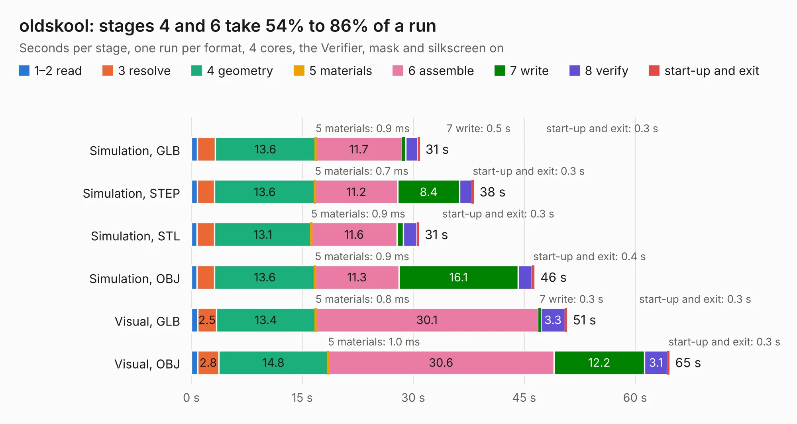

| Mode and format | 1–2 read | 3 resolve | 4 geometry | 5 materials | 6 assemble | 7 write | 8 verify | start-up and exit | Total |
|---|---:|---:|---:|---:|---:|---:|---:|---:|---:|
| Simulation, GLB | 0.8 | 2.4 | 13.6 | 0.9&nbsp;ms | 11.7 | 0.5 | 1.6 | 0.3 | 30.9 |
| Simulation, STEP | 0.8 | 2.3 | 13.6 | 0.7&nbsp;ms | 11.2 | 8.4 | 1.6 | 0.3 | 38.2 |
| Simulation, STL | 0.7 | 2.4 | 13.1 | 0.9&nbsp;ms | 11.6 | 0.9 | 1.8 | 0.3 | 30.8 |
| Simulation, OBJ | 0.7 | 2.4 | 13.6 | 0.9&nbsp;ms | 11.3 | 16.1 | 1.9 | 0.4 | 46.4 |
| Visual, GLB | 0.9 | 2.5 | 13.4 | 0.8&nbsp;ms | 30.1 | 0.3 | 3.3 | 0.3 | 50.8 |
| Visual, OBJ | 0.9 | 2.8 | 14.8 | 1.0&nbsp;ms | 30.6 | 12.2 | 3.1 | 0.3 | 64.7 |

<table align="center"><tr><td valign="top">

| Board | Repo: [rh1tech/frank](https://github.com/rh1tech/frank) Board: `oldskool.kicad_pcb` |
|---|---|
| Folder | hardware / oldskool |
| Complexity | 320&nbsp;/&nbsp;1000 (size&nbsp;185, features&nbsp;135) |
| KESE&nbsp;features | through vias, slotted holes, custom pads, rounded, trapezoid or chamfered pads, filled zones, copper drawings, curved board outline, TrueType text, stack-up, dielectric εr and tanδ |
| Tested | 9th November 2026 |
| Copper&nbsp;layers | 2 |
| File&nbsp;format | KiCad 10 (20260206) |
| Parts,&nbsp;tracks,&nbsp;vias | 100, 1,131, 76 |
| Triangles,&nbsp;simulation | 2,736,136 in 156 parts |
| Verifier | PASS in all six runs |

</td><td valign="top">

<table>
<tr><th>File type</th><th>File size</th><th>Peak memory used</th></tr>
<tr><th colspan="3" align="left">Simulation</th></tr>
<tr><td>GLB</td><td align="right">92&nbsp;MB</td><td align="right">1.1&nbsp;GB</td></tr>
<tr><td>STEP</td><td align="right">417&nbsp;MB</td><td align="right">1.2&nbsp;GB</td></tr>
<tr><td>STL</td><td align="right">137&nbsp;MB</td><td align="right">1.1&nbsp;GB</td></tr>
<tr><td>OBJ</td><td align="right">285&nbsp;MB</td><td align="right">1.8&nbsp;GB</td></tr>
<tr><th colspan="3" align="left">Visual</th></tr>
<tr><td>GLB</td><td align="right">63&nbsp;MB</td><td align="right">1.1&nbsp;GB</td></tr>
<tr><td>OBJ</td><td align="right">196&nbsp;MB</td><td align="right">1.3&nbsp;GB</td></tr>
</table>

</td></tr></table>

## 2378. turbosound

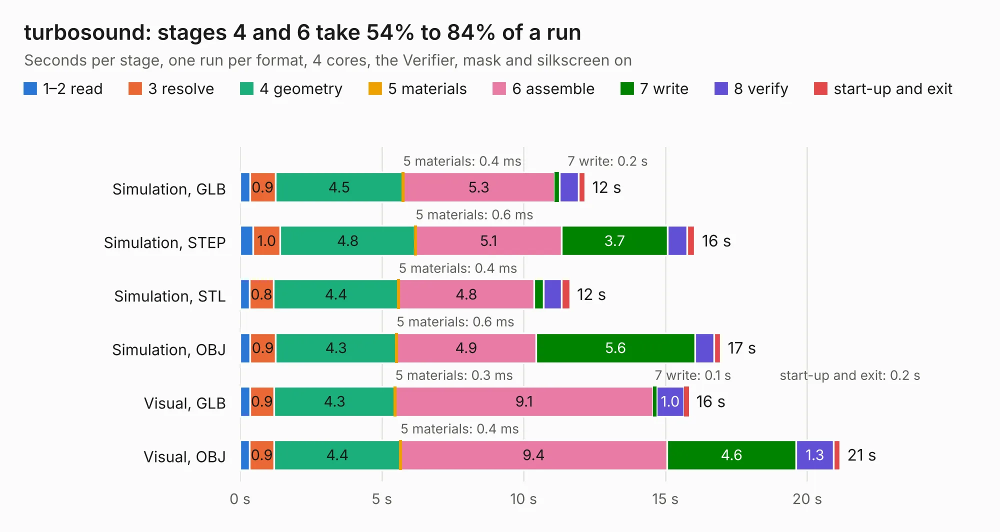

| Mode and format | 1–2 read | 3 resolve | 4 geometry | 5 materials | 6 assemble | 7 write | 8 verify | start-up and exit | Total |
|---|---:|---:|---:|---:|---:|---:|---:|---:|---:|
| Simulation, GLB | 0.3 | 0.9 | 4.5 | 0.4&nbsp;ms | 5.3 | 0.2 | 0.7 | 0.2 | 12.2 |
| Simulation, STEP | 0.5 | 1.0 | 4.8 | 0.6&nbsp;ms | 5.1 | 3.7 | 0.7 | 0.3 | 16.0 |
| Simulation, STL | 0.3 | 0.8 | 4.4 | 0.4&nbsp;ms | 4.8 | 0.3 | 0.6 | 0.3 | 11.6 |
| Simulation, OBJ | 0.3 | 0.9 | 4.3 | 0.6&nbsp;ms | 4.9 | 5.6 | 0.7 | 0.2 | 16.9 |
| Visual, GLB | 0.3 | 0.9 | 4.3 | 0.3&nbsp;ms | 9.1 | 0.1 | 1.0 | 0.2 | 15.8 |
| Visual, OBJ | 0.3 | 0.9 | 4.4 | 0.4&nbsp;ms | 9.4 | 4.6 | 1.3 | 0.2 | 21.2 |

<table align="center"><tr><td valign="top">

| Board | Repo: [rh1tech/frank](https://github.com/rh1tech/frank) Board: `turbosound.kicad_pcb` |
|---|---|
| Folder | hardware / turbosound |
| Complexity | 272&nbsp;/&nbsp;1000 (size&nbsp;172, features&nbsp;100) |
| KESE&nbsp;features | through vias, rounded, trapezoid or chamfered pads, filled zones, curved board outline, TrueType text, stack-up, dielectric εr and tanδ |
| Tested | 9th November 2026 |
| Copper&nbsp;layers | 2 |
| File&nbsp;format | KiCad 10 (20260206) |
| Parts,&nbsp;tracks,&nbsp;vias | 60, 597, 81 |
| Triangles,&nbsp;simulation | 1,111,518 in 105 parts |
| Verifier | PASS in all six runs |

</td><td valign="top">

<table>
<tr><th>File type</th><th>File size</th><th>Peak memory used</th></tr>
<tr><th colspan="3" align="left">Simulation</th></tr>
<tr><td>GLB</td><td align="right">37&nbsp;MB</td><td align="right">476&nbsp;MB</td></tr>
<tr><td>STEP</td><td align="right">183&nbsp;MB</td><td align="right">621&nbsp;MB</td></tr>
<tr><td>STL</td><td align="right">56&nbsp;MB</td><td align="right">493&nbsp;MB</td></tr>
<tr><td>OBJ</td><td align="right">112&nbsp;MB</td><td align="right">809&nbsp;MB</td></tr>
<tr><th colspan="3" align="left">Visual</th></tr>
<tr><td>GLB</td><td align="right">29&nbsp;MB</td><td align="right">670&nbsp;MB</td></tr>
<tr><td>OBJ</td><td align="right">88&nbsp;MB</td><td align="right">670&nbsp;MB</td></tr>
</table>

</td></tr></table>

## 2379. xt8086_alpha

| Mode and format | 1–2 read | 3 resolve | 4 geometry | 5 materials | 6 assemble | 7 write | 8 verify | start-up and exit | Total |
|---|---:|---:|---:|---:|---:|---:|---:|---:|---:|
| Simulation, GLB | 0.7 | 1.6 | 8.8 | 0.8&nbsp;ms | 7.9 | 0.3 | 1.0 | 0.2 | 20.6 |
| Simulation, STEP | 0.6 | 1.8 | 8.9 | 0.7&nbsp;ms | 8.2 | 6.0 | 1.0 | 0.3 | 26.8 |
| Simulation, STL | 0.7 | 1.8 | 8.9 | 0.7&nbsp;ms | 8.2 | 0.7 | 1.0 | 0.2 | 21.6 |
| Simulation, OBJ | 0.6 | 1.7 | 8.8 | 0.9&nbsp;ms | 7.6 | 10.5 | 1.1 | 0.3 | 30.6 |
| Visual, GLB | 0.6 | 1.8 | 8.5 | 0.8&nbsp;ms | 19.9 | 0.2 | 2.7 | 0.3 | 34.0 |
| Visual, OBJ | 0.6 | 1.7 | 8.7 | 0.8&nbsp;ms | 20.7 | 7.7 | 2.9 | 0.2 | 42.5 |

<table align="center"><tr><td valign="top">

| Board | Repo: [rh1tech/frank](https://github.com/rh1tech/frank) Board: `xt8086_alpha.kicad_pcb` |
|---|---|
| Folder | hardware / xt8086_alpha |
| Complexity | 309&nbsp;/&nbsp;1000 (size&nbsp;184, features&nbsp;125) |
| KESE&nbsp;features | through vias, slotted holes, rounded, trapezoid or chamfered pads, filled zones, curved board outline, knockout text, TrueType text, stack-up, dielectric εr and tanδ |
| Tested | 9th November 2026 |
| Copper&nbsp;layers | 2 |
| File&nbsp;format | KiCad 10 (20260206) |
| Parts,&nbsp;tracks,&nbsp;vias | 80, 1,055, 142 |
| Triangles,&nbsp;simulation | 2,338,914 in 151 parts |
| Verifier | PASS in all six runs |

</td><td valign="top">

<table>
<tr><th>File type</th><th>File size</th><th>Peak memory used</th></tr>
<tr><th colspan="3" align="left">Simulation</th></tr>
<tr><td>GLB</td><td align="right">79&nbsp;MB</td><td align="right">953&nbsp;MB</td></tr>
<tr><td>STEP</td><td align="right">375&nbsp;MB</td><td align="right">1.0&nbsp;GB</td></tr>
<tr><td>STL</td><td align="right">117&nbsp;MB</td><td align="right">964&nbsp;MB</td></tr>
<tr><td>OBJ</td><td align="right">243&nbsp;MB</td><td align="right">1.5&nbsp;GB</td></tr>
<tr><th colspan="3" align="left">Visual</th></tr>
<tr><td>GLB</td><td align="right">58&nbsp;MB</td><td align="right">1.0&nbsp;GB</td></tr>
<tr><td>OBJ</td><td align="right">178&nbsp;MB</td><td align="right">1.2&nbsp;GB</td></tr>
</table>

</td></tr></table>

## 2380. zerofrank

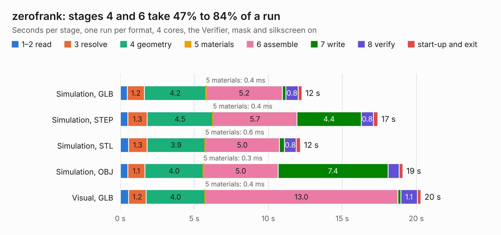

| Mode and format | 1–2 read | 3 resolve | 4 geometry | 5 materials | 6 assemble | 7 write | 8 verify | start-up and exit | Total |
|---|---:|---:|---:|---:|---:|---:|---:|---:|---:|
| Simulation, GLB | 0.5 | 1.2 | 4.2 | 0.4&nbsp;ms | 5.2 | 0.2 | 0.8 | 0.3 | 12.3 |
| Simulation, STEP | 0.5 | 1.3 | 4.5 | 0.4&nbsp;ms | 5.7 | 4.4 | 0.8 | 0.3 | 17.4 |
| Simulation, STL | 0.6 | 1.3 | 3.9 | 0.6&nbsp;ms | 5.0 | 0.3 | 0.8 | 0.3 | 12.2 |
| Simulation, OBJ | 0.5 | 1.1 | 4.0 | 0.3&nbsp;ms | 5.0 | 7.4 | 0.8 | 0.3 | 19.1 |
| Visual, GLB | 0.6 | 1.2 | 4.0 | 0.4&nbsp;ms | 13.0 | 0.2 | 1.1 | 0.2 | 20.3 |
| Visual, OBJ | 0.5 | 1.1 | 3.8 | 0.3&nbsp;ms | 12.6 | 5.2 | 1.6 | 0.2 | 25.0 |

<table align="center"><tr><td valign="top">

| Board | Repo: [rh1tech/frank](https://github.com/rh1tech/frank) Board: `zerofrank.kicad_pcb` |
|---|---|
| Folder | hardware / zerofrank |
| Complexity | 371&nbsp;/&nbsp;1000 (size&nbsp;236, features&nbsp;135) |
| KESE&nbsp;features | through vias, slotted holes, custom pads, rounded, trapezoid or chamfered pads, filled zones, copper drawings, curved board outline, TrueType text, stack-up, dielectric εr and tanδ |
| Tested | 9th November 2026 |
| Copper&nbsp;layers | 4 |
| File&nbsp;format | KiCad 10 (20260206) |
| Parts,&nbsp;tracks,&nbsp;vias | 89, 656, 125 |
| Triangles,&nbsp;simulation | 1,245,682 in 116 parts |
| Verifier | PASS in all six runs |

</td><td valign="top">

<table>
<tr><th>File type</th><th>File size</th><th>Peak memory used</th></tr>
<tr><th colspan="3" align="left">Simulation</th></tr>
<tr><td>GLB</td><td align="right">43&nbsp;MB</td><td align="right">576&nbsp;MB</td></tr>
<tr><td>STEP</td><td align="right">203&nbsp;MB</td><td align="right">632&nbsp;MB</td></tr>
<tr><td>STL</td><td align="right">62&nbsp;MB</td><td align="right">567&nbsp;MB</td></tr>
<tr><td>OBJ</td><td align="right">128&nbsp;MB</td><td align="right">875&nbsp;MB</td></tr>
<tr><th colspan="3" align="left">Visual</th></tr>
<tr><td>GLB</td><td align="right">31&nbsp;MB</td><td align="right">853&nbsp;MB</td></tr>
<tr><td>OBJ</td><td align="right">95&nbsp;MB</td><td align="right">784&nbsp;MB</td></tr>
</table>

</td></tr></table>

## 2381. PicoEVB

| Mode and format | 1–2 read | 3 resolve | 4 geometry | 5 materials | 6 assemble | 7 write | 8 verify | start-up and exit | Total |
|---|---:|---:|---:|---:|---:|---:|---:|---:|---:|
| Simulation, GLB | 0.4 | 1.7 | 9.1 | 0.8&nbsp;ms | 7.7 | 0.3 | 1.0 | 0.3 | 20.4 |
| Simulation, STEP | 0.4 | 1.8 | 9.4 | 0.6&nbsp;ms | 7.7 | 4.4 | 1.0 | 0.3 | 25.0 |
| Simulation, STL | 0.4 | 1.7 | 9.2 | 0.5&nbsp;ms | 7.8 | 0.7 | 1.0 | 0.3 | 21.1 |
| Simulation, OBJ | 0.4 | 1.6 | 9.0 | 0.6&nbsp;ms | 7.6 | 9.9 | 1.0 | 0.3 | 29.7 |
| Visual, GLB | 0.5 | 1.8 | 9.5 | 0.5&nbsp;ms | 20.8 | 0.2 | 1.7 | 0.4 | 34.9 |
| Visual, OBJ | 0.4 | 1.7 | 9.4 | 0.6&nbsp;ms | 21.8 | 6.1 | 2.4 | 0.3 | 42.1 |

<table align="center"><tr><td valign="top">

| Board | Repo: [RHSResearchLLC/PicoEVB](https://github.com/RHSResearchLLC/PicoEVB) Board: `PicoEVB.kicad_pcb` |
|---|---|
| Folder | Hardware / board_design |
| Complexity | 251&nbsp;/&nbsp;1000 (size&nbsp;206, features&nbsp;45) |
| KESE&nbsp;features | through vias, filled zones, curved board outline |
| Tested | 9th November 2026 |
| Copper&nbsp;layers | 4 |
| File&nbsp;format | KiCad 4 (4) |
| Parts,&nbsp;tracks,&nbsp;vias | 101, 843, 304 |
| Triangles,&nbsp;simulation | 1,913,616 in 76 parts |
| Verifier | PASS in all six runs |

</td><td valign="top">

<table>
<tr><th>File type</th><th>File size</th><th>Peak memory used</th></tr>
<tr><th colspan="3" align="left">Simulation</th></tr>
<tr><td>GLB</td><td align="right">66&nbsp;MB</td><td align="right">639&nbsp;MB</td></tr>
<tr><td>STEP</td><td align="right">267&nbsp;MB</td><td align="right">758&nbsp;MB</td></tr>
<tr><td>STL</td><td align="right">96&nbsp;MB</td><td align="right">617&nbsp;MB</td></tr>
<tr><td>OBJ</td><td align="right">202&nbsp;MB</td><td align="right">1.3&nbsp;GB</td></tr>
<tr><th colspan="3" align="left">Visual</th></tr>
<tr><td>GLB</td><td align="right">38&nbsp;MB</td><td align="right">875&nbsp;MB</td></tr>
<tr><td>OBJ</td><td align="right">113&nbsp;MB</td><td align="right">845&nbsp;MB</td></tr>
</table>

</td></tr></table>

## 2382. flyback-breakout-v1.0

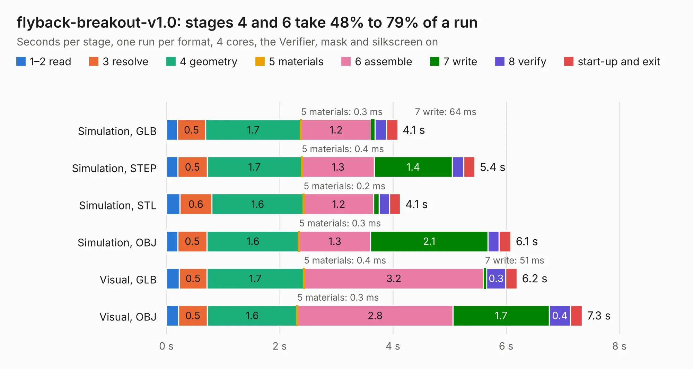

| Mode and format | 1–2 read | 3 resolve | 4 geometry | 5 materials | 6 assemble | 7 write | 8 verify | start-up and exit | Total |
|---|---:|---:|---:|---:|---:|---:|---:|---:|---:|
| Simulation, GLB | 0.2 | 0.5 | 1.7 | 0.3&nbsp;ms | 1.2 | 64&nbsp;ms | 0.2 | 0.2 | 4.1 |
| Simulation, STEP | 0.2 | 0.5 | 1.7 | 0.4&nbsp;ms | 1.3 | 1.4 | 0.2 | 0.2 | 5.4 |
| Simulation, STL | 0.2 | 0.6 | 1.6 | 0.2&nbsp;ms | 1.2 | 95&nbsp;ms | 0.2 | 0.2 | 4.1 |
| Simulation, OBJ | 0.2 | 0.5 | 1.6 | 0.3&nbsp;ms | 1.3 | 2.1 | 0.2 | 0.2 | 6.1 |
| Visual, GLB | 0.2 | 0.5 | 1.7 | 0.4&nbsp;ms | 3.2 | 51&nbsp;ms | 0.3 | 0.2 | 6.2 |
| Visual, OBJ | 0.2 | 0.5 | 1.6 | 0.3&nbsp;ms | 2.8 | 1.7 | 0.4 | 0.2 | 7.3 |

<table align="center"><tr><td valign="top">

| Board | Repo: [robojackets/robocup-pcb](https://github.com/robojackets/robocup-pcb) Board: `flyback-breakout-v1.0.kicad_pcb` |
|---|---|
| Folder | boards-archive / pre-2026 / off-robot / flyback-breakout-v1.0 |
| Complexity | 266&nbsp;/&nbsp;1000 (size&nbsp;166, features&nbsp;100) |
| KESE&nbsp;features | through vias, custom pads, rounded, trapezoid or chamfered pads, filled zones, copper drawings, stack-up, dielectric εr and tanδ |
| Tested | 9th November 2026 |
| Copper&nbsp;layers | 2 |
| File&nbsp;format | KiCad 9 (20241229) |
| Parts,&nbsp;tracks,&nbsp;vias | 51, 152, 165 |
| Triangles,&nbsp;simulation | 431,466 in 50 parts |
| Verifier | PASS in all six runs |

</td><td valign="top">

<table>
<tr><th>File type</th><th>File size</th><th>Peak memory used</th></tr>
<tr><th colspan="3" align="left">Simulation</th></tr>
<tr><td>GLB</td><td align="right">15&nbsp;MB</td><td align="right">267&nbsp;MB</td></tr>
<tr><td>STEP</td><td align="right">54&nbsp;MB</td><td align="right">316&nbsp;MB</td></tr>
<tr><td>STL</td><td align="right">22&nbsp;MB</td><td align="right">280&nbsp;MB</td></tr>
<tr><td>OBJ</td><td align="right">43&nbsp;MB</td><td align="right">330&nbsp;MB</td></tr>
<tr><th colspan="3" align="left">Visual</th></tr>
<tr><td>GLB</td><td align="right">12&nbsp;MB</td><td align="right">306&nbsp;MB</td></tr>
<tr><td>OBJ</td><td align="right">35&nbsp;MB</td><td align="right">307&nbsp;MB</td></tr>
</table>

</td></tr></table>

## 2383. teensy-adapter-v3.0

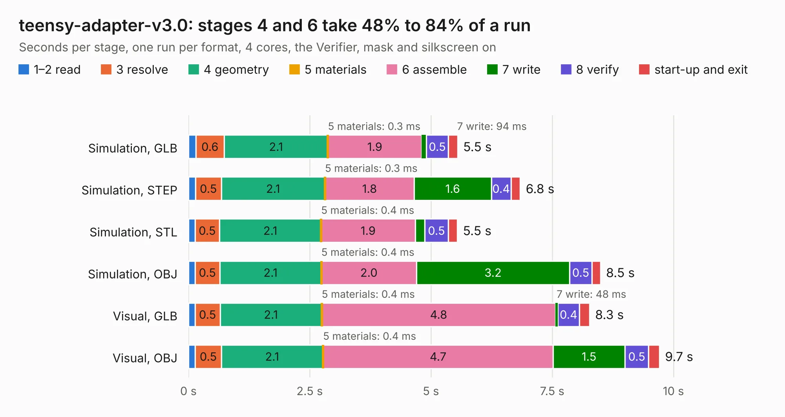

| Mode and format | 1–2 read | 3 resolve | 4 geometry | 5 materials | 6 assemble | 7 write | 8 verify | start-up and exit | Total |
|---|---:|---:|---:|---:|---:|---:|---:|---:|---:|
| Simulation, GLB | 0.2 | 0.6 | 2.1 | 0.3&nbsp;ms | 1.9 | 94&nbsp;ms | 0.5 | 0.2 | 5.5 |
| Simulation, STEP | 0.1 | 0.5 | 2.1 | 0.3&nbsp;ms | 1.8 | 1.6 | 0.4 | 0.2 | 6.8 |
| Simulation, STL | 0.1 | 0.5 | 2.1 | 0.4&nbsp;ms | 1.9 | 0.2 | 0.5 | 0.2 | 5.5 |
| Simulation, OBJ | 0.1 | 0.5 | 2.1 | 0.4&nbsp;ms | 2.0 | 3.2 | 0.5 | 0.2 | 8.5 |
| Visual, GLB | 0.1 | 0.5 | 2.1 | 0.4&nbsp;ms | 4.8 | 48&nbsp;ms | 0.4 | 0.2 | 8.3 |
| Visual, OBJ | 0.1 | 0.5 | 2.1 | 0.4&nbsp;ms | 4.7 | 1.5 | 0.5 | 0.2 | 9.7 |

<table align="center"><tr><td valign="top">

| Board | Repo: [robojackets/robocup-pcb](https://github.com/robojackets/robocup-pcb) Board: `teensy-adapter-v3.0.kicad_pcb` |
|---|---|
| Folder | boards-archive / pre-2026 / off-robot / kicad / teensy-adapter-v3.0 |
| Complexity | 215&nbsp;/&nbsp;1000 (size&nbsp;140, features&nbsp;75) |
| KESE&nbsp;features | through vias, rounded, trapezoid or chamfered pads, filled zones, stack-up, dielectric εr and tanδ |
| Tested | 9th November 2026 |
| Copper&nbsp;layers | 4 |
| File&nbsp;format | KiCad 8 (20240108) |
| Parts,&nbsp;tracks,&nbsp;vias | 8, 114, 14 |
| Triangles,&nbsp;simulation | 781,546 in 76 parts |
| Verifier | PASS in all six runs |

</td><td valign="top">

<table>
<tr><th>File type</th><th>File size</th><th>Peak memory used</th></tr>
<tr><th colspan="3" align="left">Simulation</th></tr>
<tr><td>GLB</td><td align="right">26&nbsp;MB</td><td align="right">350&nbsp;MB</td></tr>
<tr><td>STEP</td><td align="right">86&nbsp;MB</td><td align="right">393&nbsp;MB</td></tr>
<tr><td>STL</td><td align="right">39&nbsp;MB</td><td align="right">343&nbsp;MB</td></tr>
<tr><td>OBJ</td><td align="right">78&nbsp;MB</td><td align="right">542&nbsp;MB</td></tr>
<tr><th colspan="3" align="left">Visual</th></tr>
<tr><td>GLB</td><td align="right">12&nbsp;MB</td><td align="right">395&nbsp;MB</td></tr>
<tr><td>OBJ</td><td align="right">36&nbsp;MB</td><td align="right">397&nbsp;MB</td></tr>
</table>

</td></tr></table>

## 2384. motortester-v2.0

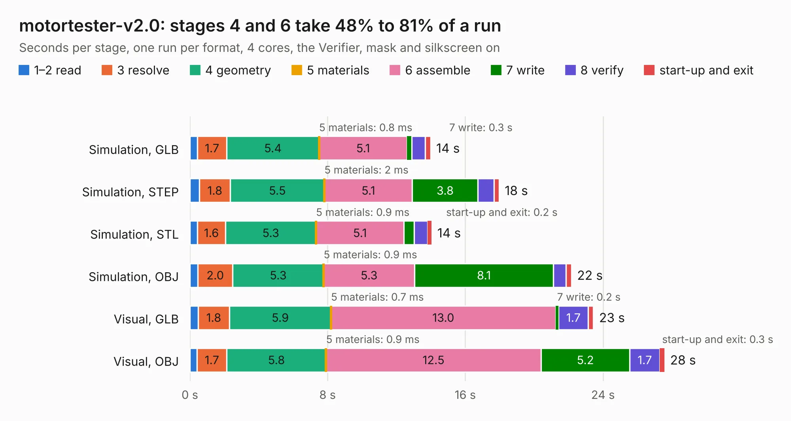

| Mode and format | 1–2 read | 3 resolve | 4 geometry | 5 materials | 6 assemble | 7 write | 8 verify | start-up and exit | Total |
|---|---:|---:|---:|---:|---:|---:|---:|---:|---:|
| Simulation, GLB | 0.4 | 1.7 | 5.4 | 0.8&nbsp;ms | 5.1 | 0.3 | 0.8 | 0.3 | 14.0 |
| Simulation, STEP | 0.6 | 1.8 | 5.5 | 2&nbsp;ms | 5.1 | 3.8 | 0.9 | 0.3 | 18.0 |
| Simulation, STL | 0.4 | 1.6 | 5.3 | 0.9&nbsp;ms | 5.1 | 0.6 | 0.8 | 0.2 | 14.0 |
| Simulation, OBJ | 0.5 | 2.0 | 5.3 | 0.9&nbsp;ms | 5.3 | 8.1 | 0.7 | 0.3 | 22.2 |
| Visual, GLB | 0.5 | 1.8 | 5.9 | 0.7&nbsp;ms | 13.0 | 0.2 | 1.7 | 0.3 | 23.4 |
| Visual, OBJ | 0.4 | 1.7 | 5.8 | 0.9&nbsp;ms | 12.5 | 5.2 | 1.7 | 0.3 | 27.6 |

<table align="center"><tr><td valign="top">

| Board | Repo: [robojackets/robocup-pcb](https://github.com/robojackets/robocup-pcb) Board: `motortester-v2.0.kicad_pcb` |
|---|---|
| Folder | boards-archive / pre-2026 / off-robot / motortester-v2.0 |
| Complexity | 288&nbsp;/&nbsp;1000 (size&nbsp;193, features&nbsp;95) |
| KESE&nbsp;features | through vias, slotted holes, rounded, trapezoid or chamfered pads, filled zones, curved board outline, stack-up, dielectric εr and tanδ |
| Tested | 9th November 2026 |
| Copper&nbsp;layers | 4 |
| File&nbsp;format | KiCad 8 (20240108) |
| Parts,&nbsp;tracks,&nbsp;vias | 76, 386, 195 |
| Triangles,&nbsp;simulation | 1,539,214 in 147 parts |
| Verifier | PASS in all six runs |

</td><td valign="top">

<table>
<tr><th>File type</th><th>File size</th><th>Peak memory used</th></tr>
<tr><th colspan="3" align="left">Simulation</th></tr>
<tr><td>GLB</td><td align="right">52&nbsp;MB</td><td align="right">622&nbsp;MB</td></tr>
<tr><td>STEP</td><td align="right">178&nbsp;MB</td><td align="right">677&nbsp;MB</td></tr>
<tr><td>STL</td><td align="right">77&nbsp;MB</td><td align="right">654&nbsp;MB</td></tr>
<tr><td>OBJ</td><td align="right">159&nbsp;MB</td><td align="right">1.1&nbsp;GB</td></tr>
<tr><th colspan="3" align="left">Visual</th></tr>
<tr><td>GLB</td><td align="right">31&nbsp;MB</td><td align="right">755&nbsp;MB</td></tr>
<tr><td>OBJ</td><td align="right">95&nbsp;MB</td><td align="right">717&nbsp;MB</td></tr>
</table>

</td></tr></table>

## 2385. motor-module

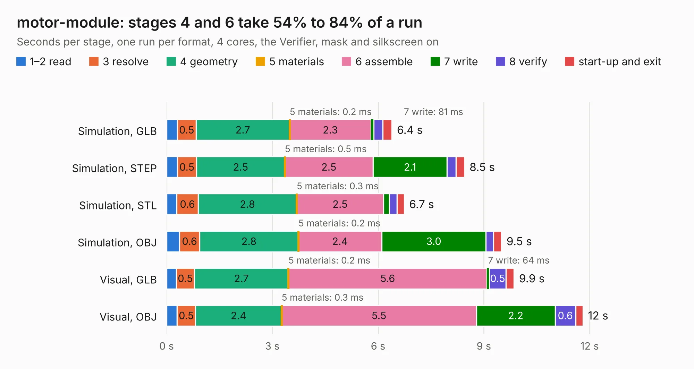

| Mode and format | 1–2 read | 3 resolve | 4 geometry | 5 materials | 6 assemble | 7 write | 8 verify | start-up and exit | Total |
|---|---:|---:|---:|---:|---:|---:|---:|---:|---:|
| Simulation, GLB | 0.3 | 0.5 | 2.7 | 0.2&nbsp;ms | 2.3 | 81&nbsp;ms | 0.3 | 0.3 | 6.4 |
| Simulation, STEP | 0.3 | 0.5 | 2.5 | 0.5&nbsp;ms | 2.5 | 2.1 | 0.3 | 0.2 | 8.5 |
| Simulation, STL | 0.3 | 0.6 | 2.8 | 0.3&nbsp;ms | 2.5 | 0.2 | 0.2 | 0.2 | 6.7 |
| Simulation, OBJ | 0.4 | 0.6 | 2.8 | 0.2&nbsp;ms | 2.4 | 3.0 | 0.2 | 0.2 | 9.5 |
| Visual, GLB | 0.3 | 0.5 | 2.7 | 0.2&nbsp;ms | 5.6 | 64&nbsp;ms | 0.5 | 0.2 | 9.9 |
| Visual, OBJ | 0.3 | 0.5 | 2.4 | 0.3&nbsp;ms | 5.5 | 2.2 | 0.6 | 0.2 | 11.8 |

<table align="center"><tr><td valign="top">

| Board | Repo: [robojackets/robocup-pcb](https://github.com/robojackets/robocup-pcb) Board: `motor-module.kicad_pcb` |
|---|---|
| Folder | boards / develop-2027 / drive-motorboard / motor-module |
| Complexity | 119&nbsp;/&nbsp;1000 (size&nbsp;109, features&nbsp;10) |
| KESE&nbsp;features | rounded, trapezoid or chamfered pads |
| Tested | 9th November 2026 |
| Copper&nbsp;layers | 2 |
| File&nbsp;format | KiCad 9 (20241229) |
| Parts,&nbsp;tracks,&nbsp;vias | 122, 0, 0 |
| Triangles,&nbsp;simulation | 492,312 in 94 parts |
| Note | mostly unrouted |
| Verifier | PASS in all six runs |

</td><td valign="top">

<table>
<tr><th>File type</th><th>File size</th><th>Peak memory used</th></tr>
<tr><th colspan="3" align="left">Simulation</th></tr>
<tr><td>GLB</td><td align="right">18&nbsp;MB</td><td align="right">332&nbsp;MB</td></tr>
<tr><td>STEP</td><td align="right">94&nbsp;MB</td><td align="right">407&nbsp;MB</td></tr>
<tr><td>STL</td><td align="right">25&nbsp;MB</td><td align="right">340&nbsp;MB</td></tr>
<tr><td>OBJ</td><td align="right">53&nbsp;MB</td><td align="right">396&nbsp;MB</td></tr>
<tr><th colspan="3" align="left">Visual</th></tr>
<tr><td>GLB</td><td align="right">15&nbsp;MB</td><td align="right">455&nbsp;MB</td></tr>
<tr><td>OBJ</td><td align="right">43&nbsp;MB</td><td align="right">453&nbsp;MB</td></tr>
</table>

</td></tr></table>

## 2386. robocup-controller-pcb

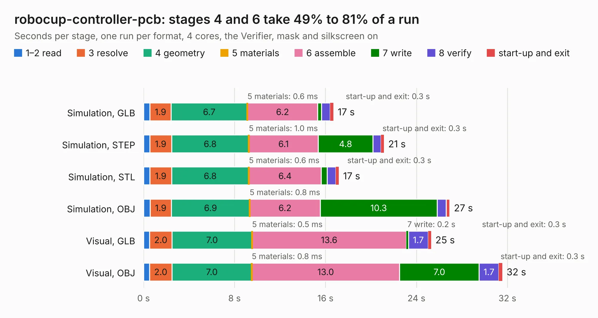

| Mode and format | 1–2 read | 3 resolve | 4 geometry | 5 materials | 6 assemble | 7 write | 8 verify | start-up and exit | Total |
|---|---:|---:|---:|---:|---:|---:|---:|---:|---:|
| Simulation, GLB | 0.6 | 1.9 | 6.7 | 0.6&nbsp;ms | 6.2 | 0.3 | 0.8 | 0.3 | 16.7 |
| Simulation, STEP | 0.5 | 1.9 | 6.8 | 1.0&nbsp;ms | 6.1 | 4.8 | 0.7 | 0.3 | 21.1 |
| Simulation, STL | 0.6 | 1.9 | 6.8 | 0.6&nbsp;ms | 6.4 | 0.5 | 0.8 | 0.3 | 17.2 |
| Simulation, OBJ | 0.6 | 1.9 | 6.9 | 0.8&nbsp;ms | 6.2 | 10.3 | 0.8 | 0.3 | 26.9 |
| Visual, GLB | 0.5 | 2.0 | 7.0 | 0.5&nbsp;ms | 13.6 | 0.2 | 1.7 | 0.3 | 25.3 |
| Visual, OBJ | 0.5 | 2.0 | 7.0 | 0.8&nbsp;ms | 13.0 | 7.0 | 1.7 | 0.3 | 31.6 |

<table align="center"><tr><td valign="top">

| Board | Repo: [robojackets/robocup-pcb](https://github.com/robojackets/robocup-pcb) Board: `robocup-controller-pcb.kicad_pcb` |
|---|---|
| Folder | boards / development / controller |
| Complexity | 342&nbsp;/&nbsp;1000 (size&nbsp;247, features&nbsp;95) |
| KESE&nbsp;features | through vias, slotted holes, rounded, trapezoid or chamfered pads, knockout text, TrueType text, stack-up, dielectric εr and tanδ |
| Tested | 9th November 2026 |
| Copper&nbsp;layers | 4 |
| File&nbsp;format | KiCad 10 (20260206) |
| Parts,&nbsp;tracks,&nbsp;vias | 135, 982, 178 |
| Triangles,&nbsp;simulation | 1,720,566 in 135 parts |
| Verifier | PASS in all six runs |

</td><td valign="top">

<table>
<tr><th>File type</th><th>File size</th><th>Peak memory used</th></tr>
<tr><th colspan="3" align="left">Simulation</th></tr>
<tr><td>GLB</td><td align="right">59&nbsp;MB</td><td align="right">643&nbsp;MB</td></tr>
<tr><td>STEP</td><td align="right">227&nbsp;MB</td><td align="right">759&nbsp;MB</td></tr>
<tr><td>STL</td><td align="right">86&nbsp;MB</td><td align="right">614&nbsp;MB</td></tr>
<tr><td>OBJ</td><td align="right">177&nbsp;MB</td><td align="right">1.1&nbsp;GB</td></tr>
<tr><th colspan="3" align="left">Visual</th></tr>
<tr><td>GLB</td><td align="right">40&nbsp;MB</td><td align="right">878&nbsp;MB</td></tr>
<tr><td>OBJ</td><td align="right">120&nbsp;MB</td><td align="right">877&nbsp;MB</td></tr>
</table>

</td></tr></table>

## 2387. control-v4.0

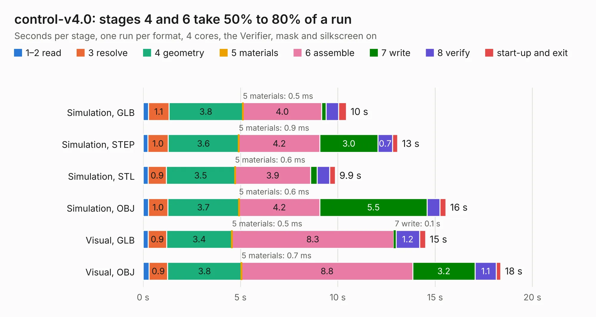

| Mode and format | 1–2 read | 3 resolve | 4 geometry | 5 materials | 6 assemble | 7 write | 8 verify | start-up and exit | Total |
|---|---:|---:|---:|---:|---:|---:|---:|---:|---:|
| Simulation, GLB | 0.3 | 1.1 | 3.8 | 0.5&nbsp;ms | 4.0 | 0.2 | 0.7 | 0.4 | 10.4 |
| Simulation, STEP | 0.2 | 1.0 | 3.6 | 0.9&nbsp;ms | 4.2 | 3.0 | 0.7 | 0.3 | 13.1 |
| Simulation, STL | 0.3 | 0.9 | 3.5 | 0.6&nbsp;ms | 3.9 | 0.3 | 0.6 | 0.3 | 9.9 |
| Simulation, OBJ | 0.3 | 1.0 | 3.7 | 0.6&nbsp;ms | 4.2 | 5.5 | 0.7 | 0.3 | 15.6 |
| Visual, GLB | 0.3 | 0.9 | 3.4 | 0.5&nbsp;ms | 8.3 | 0.1 | 1.2 | 0.3 | 14.5 |
| Visual, OBJ | 0.3 | 0.9 | 3.8 | 0.7&nbsp;ms | 8.8 | 3.2 | 1.1 | 0.2 | 18.4 |

<table align="center"><tr><td valign="top">

| Board | Repo: [robojackets/robocup-pcb](https://github.com/robojackets/robocup-pcb) Board: `control-v4.0.kicad_pcb` |
|---|---|
| Folder | boards / rev-2026 / control-v4.0 |
| Complexity | 269&nbsp;/&nbsp;1000 (size&nbsp;169, features&nbsp;100) |
| KESE&nbsp;features | through vias, rounded, trapezoid or chamfered pads, filled zones, curved board outline, knockout text, stack-up, dielectric εr and tanδ |
| Tested | 9th November 2026 |
| Copper&nbsp;layers | 4 |
| File&nbsp;format | KiCad 9 (20241229) |
| Parts,&nbsp;tracks,&nbsp;vias | 17, 455, 45 |
| Triangles,&nbsp;simulation | 908,638 in 73 parts |
| Verifier | PASS in all six runs |

</td><td valign="top">

<table>
<tr><th>File type</th><th>File size</th><th>Peak memory used</th></tr>
<tr><th colspan="3" align="left">Simulation</th></tr>
<tr><td>GLB</td><td align="right">31&nbsp;MB</td><td align="right">380&nbsp;MB</td></tr>
<tr><td>STEP</td><td align="right">129&nbsp;MB</td><td align="right">470&nbsp;MB</td></tr>
<tr><td>STL</td><td align="right">45&nbsp;MB</td><td align="right">381&nbsp;MB</td></tr>
<tr><td>OBJ</td><td align="right">92&nbsp;MB</td><td align="right">669&nbsp;MB</td></tr>
<tr><th colspan="3" align="left">Visual</th></tr>
<tr><td>GLB</td><td align="right">18&nbsp;MB</td><td align="right">457&nbsp;MB</td></tr>
<tr><td>OBJ</td><td align="right">55&nbsp;MB</td><td align="right">524&nbsp;MB</td></tr>
</table>

</td></tr></table>

## 2388. control-v4.1-stm32

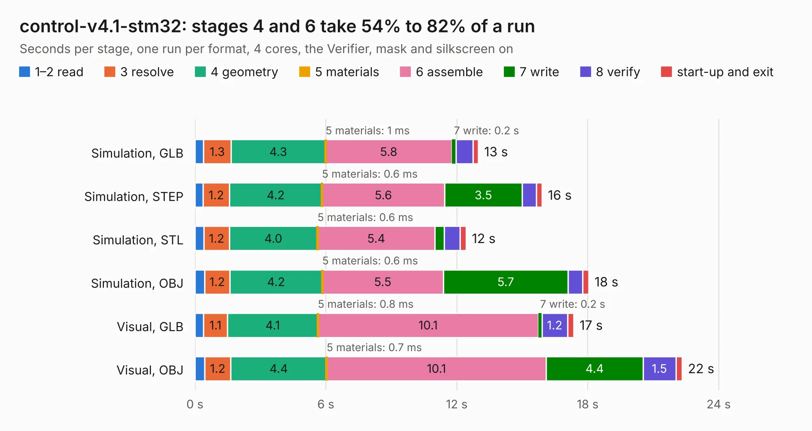

| Mode and format | 1–2 read | 3 resolve | 4 geometry | 5 materials | 6 assemble | 7 write | 8 verify | start-up and exit | Total |
|---|---:|---:|---:|---:|---:|---:|---:|---:|---:|
| Simulation, GLB | 0.4 | 1.3 | 4.3 | 1&nbsp;ms | 5.8 | 0.2 | 0.8 | 0.2 | 13.0 |
| Simulation, STEP | 0.4 | 1.2 | 4.2 | 0.6&nbsp;ms | 5.6 | 3.5 | 0.7 | 0.3 | 15.9 |
| Simulation, STL | 0.4 | 1.2 | 4.0 | 0.6&nbsp;ms | 5.4 | 0.4 | 0.7 | 0.3 | 12.4 |
| Simulation, OBJ | 0.4 | 1.2 | 4.2 | 0.6&nbsp;ms | 5.5 | 5.7 | 0.7 | 0.3 | 18.0 |
| Visual, GLB | 0.4 | 1.1 | 4.1 | 0.8&nbsp;ms | 10.1 | 0.2 | 1.2 | 0.3 | 17.4 |
| Visual, OBJ | 0.4 | 1.2 | 4.4 | 0.7&nbsp;ms | 10.1 | 4.4 | 1.5 | 0.3 | 22.3 |

<table align="center"><tr><td valign="top">

| Board | Repo: [robojackets/robocup-pcb](https://github.com/robojackets/robocup-pcb) Board: `control-v4.1-stm32.kicad_pcb` |
|---|---|
| Folder | boards / rev-2026 / control-v4.1-stm32 |
| Complexity | 336&nbsp;/&nbsp;1000 (size&nbsp;236, features&nbsp;100) |
| KESE&nbsp;features | through vias, rounded, trapezoid or chamfered pads, filled zones, curved board outline, knockout text, stack-up, dielectric εr and tanδ |
| Tested | 9th November 2026 |
| Copper&nbsp;layers | 4 |
| File&nbsp;format | KiCad 9 (20241229) |
| Parts,&nbsp;tracks,&nbsp;vias | 83, 795, 103 |
| Triangles,&nbsp;simulation | 1,237,914 in 141 parts |
| Verifier | PASS in all six runs |

</td><td valign="top">

<table>
<tr><th>File type</th><th>File size</th><th>Peak memory used</th></tr>
<tr><th colspan="3" align="left">Simulation</th></tr>
<tr><td>GLB</td><td align="right">43&nbsp;MB</td><td align="right">503&nbsp;MB</td></tr>
<tr><td>STEP</td><td align="right">185&nbsp;MB</td><td align="right">599&nbsp;MB</td></tr>
<tr><td>STL</td><td align="right">62&nbsp;MB</td><td align="right">495&nbsp;MB</td></tr>
<tr><td>OBJ</td><td align="right">128&nbsp;MB</td><td align="right">839&nbsp;MB</td></tr>
<tr><th colspan="3" align="left">Visual</th></tr>
<tr><td>GLB</td><td align="right">29&nbsp;MB</td><td align="right">709&nbsp;MB</td></tr>
<tr><td>OBJ</td><td align="right">89&nbsp;MB</td><td align="right">719&nbsp;MB</td></tr>
</table>

</td></tr></table>

## 2389. kicker-v3.4

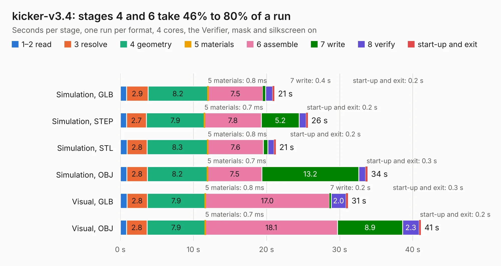

| Mode and format | 1–2 read | 3 resolve | 4 geometry | 5 materials | 6 assemble | 7 write | 8 verify | start-up and exit | Total |
|---|---:|---:|---:|---:|---:|---:|---:|---:|---:|
| Simulation, GLB | 0.9 | 2.9 | 8.2 | 0.8&nbsp;ms | 7.5 | 0.4 | 1.0 | 0.2 | 21.1 |
| Simulation, STEP | 0.9 | 2.7 | 7.9 | 0.7&nbsp;ms | 7.8 | 5.2 | 0.9 | 0.2 | 25.6 |
| Simulation, STL | 0.9 | 2.8 | 8.3 | 0.8&nbsp;ms | 7.6 | 0.6 | 0.9 | 0.2 | 21.3 |
| Simulation, OBJ | 0.9 | 2.8 | 8.2 | 0.7&nbsp;ms | 7.5 | 13.2 | 0.9 | 0.3 | 33.8 |
| Visual, GLB | 0.9 | 2.8 | 7.9 | 0.8&nbsp;ms | 17.0 | 0.2 | 2.0 | 0.3 | 31.1 |
| Visual, OBJ | 0.9 | 2.8 | 7.9 | 0.7&nbsp;ms | 18.1 | 8.9 | 2.3 | 0.2 | 41.1 |

<table align="center"><tr><td valign="top">

| Board | Repo: [robojackets/robocup-pcb](https://github.com/robojackets/robocup-pcb) Board: `kicker-v3.4.kicad_pcb` |
|---|---|
| Folder | boards / rev-2026 / kicker-v3.4 |
| Complexity | 394&nbsp;/&nbsp;1000 (size&nbsp;254, features&nbsp;140) |
| KESE&nbsp;features | through vias, slotted holes, custom pads, rounded, trapezoid or chamfered pads, filled zones, copper drawings, curved board outline, stack-up, dielectric εr and tanδ, copper finish, mask and silkscreen colours |
| Tested | 9th November 2026 |
| Copper&nbsp;layers | 4 |
| File&nbsp;format | KiCad 9 (20241229) |
| Parts,&nbsp;tracks,&nbsp;vias | 146, 624, 532 |
| Triangles,&nbsp;simulation | 2,585,468 in 126 parts |
| Verifier | PASS in all six runs |

</td><td valign="top">

<table>
<tr><th>File type</th><th>File size</th><th>Peak memory used</th></tr>
<tr><th colspan="3" align="left">Simulation</th></tr>
<tr><td>GLB</td><td align="right">89&nbsp;MB</td><td align="right">937&nbsp;MB</td></tr>
<tr><td>STEP</td><td align="right">302&nbsp;MB</td><td align="right">1.1&nbsp;GB</td></tr>
<tr><td>STL</td><td align="right">129&nbsp;MB</td><td align="right">970&nbsp;MB</td></tr>
<tr><td>OBJ</td><td align="right">275&nbsp;MB</td><td align="right">1.7&nbsp;GB</td></tr>
<tr><th colspan="3" align="left">Visual</th></tr>
<tr><td>GLB</td><td align="right">59&nbsp;MB</td><td align="right">1.1&nbsp;GB</td></tr>
<tr><td>OBJ</td><td align="right">184&nbsp;MB</td><td align="right">1.3&nbsp;GB</td></tr>
</table>

</td></tr></table>

## 2390. motorboard-v1.0

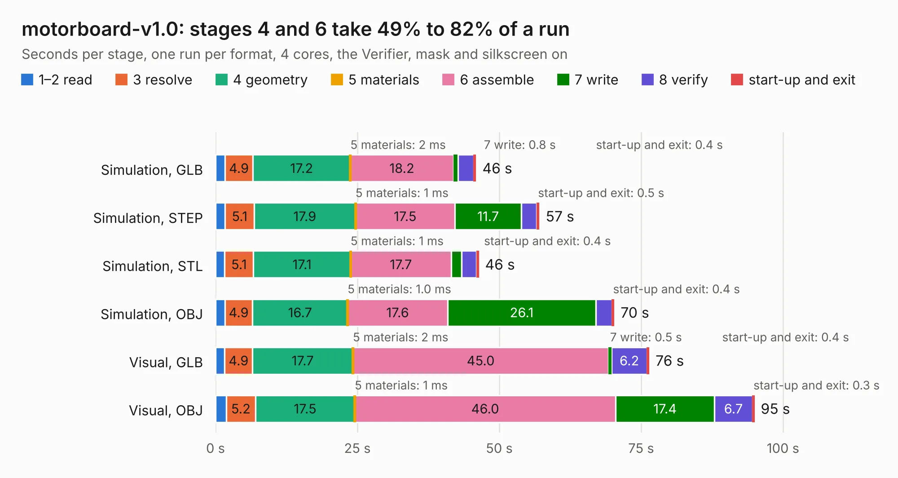

| Mode and format | 1–2 read | 3 resolve | 4 geometry | 5 materials | 6 assemble | 7 write | 8 verify | start-up and exit | Total |
|---|---:|---:|---:|---:|---:|---:|---:|---:|---:|
| Simulation, GLB | 1.7 | 4.9 | 17.2 | 2&nbsp;ms | 18.2 | 0.8 | 2.7 | 0.4 | 45.9 |
| Simulation, STEP | 1.7 | 5.1 | 17.9 | 1&nbsp;ms | 17.5 | 11.7 | 2.7 | 0.5 | 57.1 |
| Simulation, STL | 1.6 | 5.1 | 17.1 | 1&nbsp;ms | 17.7 | 1.9 | 2.6 | 0.4 | 46.4 |
| Simulation, OBJ | 1.6 | 4.9 | 16.7 | 1.0&nbsp;ms | 17.6 | 26.1 | 2.9 | 0.4 | 70.2 |
| Visual, GLB | 1.6 | 4.9 | 17.7 | 2&nbsp;ms | 45.0 | 0.5 | 6.2 | 0.4 | 76.4 |
| Visual, OBJ | 1.9 | 5.2 | 17.5 | 1&nbsp;ms | 46.0 | 17.4 | 6.7 | 0.3 | 94.9 |

<table align="center"><tr><td valign="top">

| Board | Repo: [robojackets/robocup-pcb](https://github.com/robojackets/robocup-pcb) Board: `motorboard-v1.0.kicad_pcb` |
|---|---|
| Folder | boards / rev-2026 / motorboard-v1.0 |
| Complexity | 332&nbsp;/&nbsp;1000 (size&nbsp;232, features&nbsp;100) |
| KESE&nbsp;features | through vias, rounded, trapezoid or chamfered pads, filled zones, curved board outline, knockout text, stack-up, dielectric εr and tanδ |
| Tested | 9th November 2026 |
| Copper&nbsp;layers | 4 |
| File&nbsp;format | KiCad 10 (20260206) |
| Parts,&nbsp;tracks,&nbsp;vias | 297, 2,038, 757 |
| Triangles,&nbsp;simulation | 4,902,124 in 375 parts |
| Verifier | PASS in all six runs |

</td><td valign="top">

<table>
<tr><th>File type</th><th>File size</th><th>Peak memory used</th></tr>
<tr><th colspan="3" align="left">Simulation</th></tr>
<tr><td>GLB</td><td align="right">168&nbsp;MB</td><td align="right">1.5&nbsp;GB</td></tr>
<tr><td>STEP</td><td align="right">656&nbsp;MB</td><td align="right">1.7&nbsp;GB</td></tr>
<tr><td>STL</td><td align="right">245&nbsp;MB</td><td align="right">1.6&nbsp;GB</td></tr>
<tr><td>OBJ</td><td align="right">523&nbsp;MB</td><td align="right">3.2&nbsp;GB</td></tr>
<tr><th colspan="3" align="left">Visual</th></tr>
<tr><td>GLB</td><td align="right">105&nbsp;MB</td><td align="right">1.7&nbsp;GB</td></tr>
<tr><td>OBJ</td><td align="right">336&nbsp;MB</td><td align="right">2.3&nbsp;GB</td></tr>
</table>

</td></tr></table>

## 2391. Alius_6502

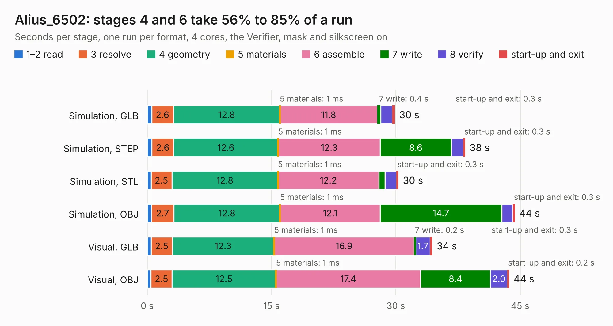

| Mode and format | 1–2 read | 3 resolve | 4 geometry | 5 materials | 6 assemble | 7 write | 8 verify | start-up and exit | Total |
|---|---:|---:|---:|---:|---:|---:|---:|---:|---:|
| Simulation, GLB | 0.5 | 2.6 | 12.8 | 1&nbsp;ms | 11.8 | 0.4 | 1.4 | 0.3 | 29.9 |
| Simulation, STEP | 0.6 | 2.6 | 12.6 | 1&nbsp;ms | 12.3 | 8.6 | 1.4 | 0.3 | 38.4 |
| Simulation, STL | 0.5 | 2.5 | 12.8 | 1&nbsp;ms | 12.2 | 0.8 | 1.3 | 0.3 | 30.3 |
| Simulation, OBJ | 0.5 | 2.7 | 12.8 | 1&nbsp;ms | 12.1 | 14.7 | 1.3 | 0.3 | 44.4 |
| Visual, GLB | 0.5 | 2.5 | 12.3 | 1&nbsp;ms | 16.9 | 0.2 | 1.7 | 0.3 | 34.4 |
| Visual, OBJ | 0.5 | 2.5 | 12.5 | 1&nbsp;ms | 17.4 | 8.4 | 2.0 | 0.2 | 43.7 |

<table align="center"><tr><td valign="top">

| Board | Repo: [robsonde/Alius6502_PCB](https://github.com/robsonde/Alius6502_PCB) Board: `Alius_6502.kicad_pcb` |
|---|---|
| Complexity | 248&nbsp;/&nbsp;1000 (size&nbsp;193, features&nbsp;55) |
| KESE&nbsp;features | through vias, curved board outline, stack-up, dielectric εr and tanδ |
| Tested | 9th November 2026 |
| Copper&nbsp;layers | 2 |
| File&nbsp;format | KiCad 7 (20221018) |
| Parts,&nbsp;tracks,&nbsp;vias | 120, 1,879, 16 |
| Triangles,&nbsp;simulation | 2,658,232 in 209 parts |
| Verifier | PASS in all six runs |

</td><td valign="top">

<table>
<tr><th>File type</th><th>File size</th><th>Peak memory used</th></tr>
<tr><th colspan="3" align="left">Simulation</th></tr>
<tr><td>GLB</td><td align="right">85&nbsp;MB</td><td align="right">835&nbsp;MB</td></tr>
<tr><td>STEP</td><td align="right">419&nbsp;MB</td><td align="right">1.1&nbsp;GB</td></tr>
<tr><td>STL</td><td align="right">133&nbsp;MB</td><td align="right">825&nbsp;MB</td></tr>
<tr><td>OBJ</td><td align="right">275&nbsp;MB</td><td align="right">1.7&nbsp;GB</td></tr>
<tr><th colspan="3" align="left">Visual</th></tr>
<tr><td>GLB</td><td align="right">50&nbsp;MB</td><td align="right">1.2&nbsp;GB</td></tr>
<tr><td>OBJ</td><td align="right">154&nbsp;MB</td><td align="right">1.2&nbsp;GB</td></tr>
</table>

</td></tr></table>

## 2392. TINY-REFLOW-CONTROLLER

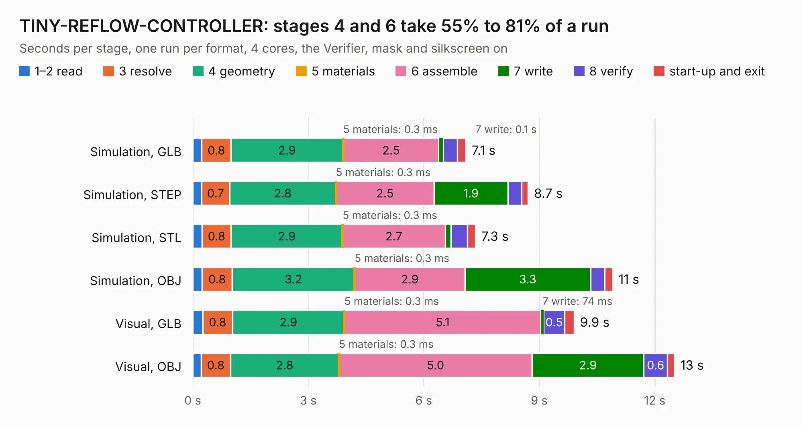

| Mode and format | 1–2 read | 3 resolve | 4 geometry | 5 materials | 6 assemble | 7 write | 8 verify | start-up and exit | Total |
|---|---:|---:|---:|---:|---:|---:|---:|---:|---:|
| Simulation, GLB | 0.2 | 0.8 | 2.9 | 0.3&nbsp;ms | 2.5 | 0.1 | 0.4 | 0.2 | 7.1 |
| Simulation, STEP | 0.2 | 0.7 | 2.8 | 0.3&nbsp;ms | 2.5 | 1.9 | 0.4 | 0.2 | 8.7 |
| Simulation, STL | 0.2 | 0.8 | 2.9 | 0.3&nbsp;ms | 2.7 | 0.2 | 0.4 | 0.2 | 7.3 |
| Simulation, OBJ | 0.2 | 0.8 | 3.2 | 0.3&nbsp;ms | 2.9 | 3.3 | 0.4 | 0.2 | 10.9 |
| Visual, GLB | 0.3 | 0.8 | 2.9 | 0.3&nbsp;ms | 5.1 | 74&nbsp;ms | 0.5 | 0.3 | 9.9 |
| Visual, OBJ | 0.2 | 0.8 | 2.8 | 0.3&nbsp;ms | 5.0 | 2.9 | 0.6 | 0.2 | 12.5 |

<table align="center"><tr><td valign="top">

| Board | Repo: [rocketscream/TinyReflowController](https://github.com/rocketscream/TinyReflowController) Board: `TINY-REFLOW-CONTROLLER.kicad_pcb` |
|---|---|
| Complexity | 278&nbsp;/&nbsp;1000 (size&nbsp;213, features&nbsp;65) |
| KESE&nbsp;features | through vias, slotted holes, rounded, trapezoid or chamfered pads, filled zones, curved board outline |
| Tested | 9th November 2026 |
| Copper&nbsp;layers | 2 |
| File&nbsp;format | KiCad 5 (20171130) |
| Parts,&nbsp;tracks,&nbsp;vias | 54, 539, 147 |
| Triangles,&nbsp;simulation | 645,002 in 68 parts |
| Verifier | PASS in all six runs |

</td><td valign="top">

<table>
<tr><th>File type</th><th>File size</th><th>Peak memory used</th></tr>
<tr><th colspan="3" align="left">Simulation</th></tr>
<tr><td>GLB</td><td align="right">23&nbsp;MB</td><td align="right">346&nbsp;MB</td></tr>
<tr><td>STEP</td><td align="right">110&nbsp;MB</td><td align="right">424&nbsp;MB</td></tr>
<tr><td>STL</td><td align="right">32&nbsp;MB</td><td align="right">349&nbsp;MB</td></tr>
<tr><td>OBJ</td><td align="right">66&nbsp;MB</td><td align="right">478&nbsp;MB</td></tr>
<tr><th colspan="3" align="left">Visual</th></tr>
<tr><td>GLB</td><td align="right">18&nbsp;MB</td><td align="right">463&nbsp;MB</td></tr>
<tr><td>OBJ</td><td align="right">55&nbsp;MB</td><td align="right">466&nbsp;MB</td></tr>
</table>

</td></tr></table>

## 2393. TheMainBoard

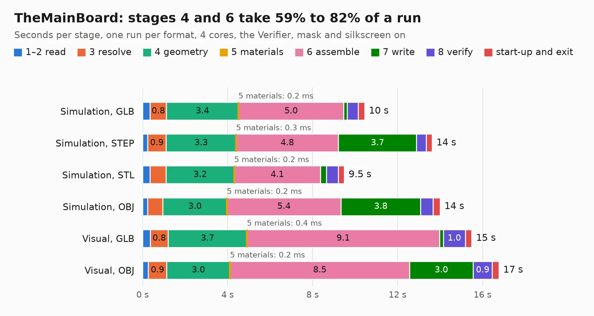

| Mode and format | 1–2 read | 3 resolve | 4 geometry | 5 materials | 6 assemble | 7 write | 8 verify | start-up and exit | Total |
|---|---:|---:|---:|---:|---:|---:|---:|---:|---:|
| Simulation, GLB | 0.4 | 0.8 | 3.4 | 0.2&nbsp;ms | 5.0 | 0.2 | 0.5 | 0.3 | 10.4 |
| Simulation, STEP | 0.2 | 0.9 | 3.3 | 0.3&nbsp;ms | 4.8 | 3.7 | 0.5 | 0.3 | 13.6 |
| Simulation, STL | 0.3 | 0.8 | 3.2 | 0.2&nbsp;ms | 4.1 | 0.3 | 0.6 | 0.3 | 9.5 |
| Simulation, OBJ | 0.2 | 0.7 | 3.0 | 0.2&nbsp;ms | 5.4 | 3.8 | 0.6 | 0.3 | 14.0 |
| Visual, GLB | 0.4 | 0.8 | 3.7 | 0.4&nbsp;ms | 9.1 | 0.2 | 1.0 | 0.3 | 15.5 |
| Visual, OBJ | 0.3 | 0.9 | 3.0 | 0.2&nbsp;ms | 8.5 | 3.0 | 0.9 | 0.3 | 16.8 |

<table align="center"><tr><td valign="top">

| Board | Repo: [RolandThsive/Thermometer](https://github.com/RolandThsive/Thermometer) Board: `TheMainBoard.kicad_pcb` |
|---|---|
| Folder | Electronics / The Main Board / TheMainBoard |
| Complexity | 276&nbsp;/&nbsp;1000 (size&nbsp;166, features&nbsp;110) |
| KESE&nbsp;features | through vias, rounded, trapezoid or chamfered pads, drill offsets, filled zones, curved board outline, TrueType text, stack-up, dielectric εr and tanδ |
| Tested | 11th November 2026 |
| Copper&nbsp;layers | 2 |
| File&nbsp;format | KiCad 10 (20260206) |
| Parts,&nbsp;tracks,&nbsp;vias | 31, 390, 176 |
| Triangles,&nbsp;simulation | 624,140 in 50 parts |
| Verifier | PASS in all six runs |

</td><td valign="top">

<table>
<tr><th>File type</th><th>File size</th><th>Peak memory used</th></tr>
<tr><th colspan="3" align="left">Simulation</th></tr>
<tr><td>GLB</td><td align="right">22&nbsp;MB</td><td align="right">334&nbsp;MB</td></tr>
<tr><td>STEP</td><td align="right">100&nbsp;MB</td><td align="right">394&nbsp;MB</td></tr>
<tr><td>STL</td><td align="right">31&nbsp;MB</td><td align="right">336&nbsp;MB</td></tr>
<tr><td>OBJ</td><td align="right">63&nbsp;MB</td><td align="right">449&nbsp;MB</td></tr>
<tr><th colspan="3" align="left">Visual</th></tr>
<tr><td>GLB</td><td align="right">17&nbsp;MB</td><td align="right">402&nbsp;MB</td></tr>
<tr><td>OBJ</td><td align="right">51&nbsp;MB</td><td align="right">439&nbsp;MB</td></tr>
</table>

</td></tr></table>

## 2394. GaNdapter-dual

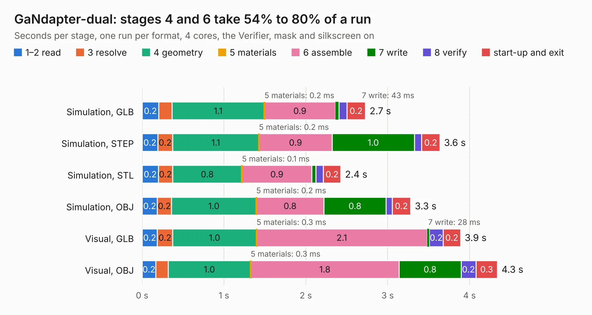

| Mode and format | 1–2 read | 3 resolve | 4 geometry | 5 materials | 6 assemble | 7 write | 8 verify | start-up and exit | Total |
|---|---:|---:|---:|---:|---:|---:|---:|---:|---:|
| Simulation, GLB | 0.2 | 0.2 | 1.1 | 0.2&nbsp;ms | 0.9 | 43&nbsp;ms | 97&nbsp;ms | 0.2 | 2.7 |
| Simulation, STEP | 0.2 | 0.2 | 1.1 | 0.2&nbsp;ms | 0.9 | 1.0 | 87&nbsp;ms | 0.2 | 3.6 |
| Simulation, STL | 0.2 | 0.2 | 0.8 | 0.1&nbsp;ms | 0.9 | 48&nbsp;ms | 93&nbsp;ms | 0.2 | 2.4 |
| Simulation, OBJ | 0.2 | 0.2 | 1.0 | 0.2&nbsp;ms | 0.8 | 0.8 | 75&nbsp;ms | 0.2 | 3.3 |
| Visual, GLB | 0.2 | 0.2 | 1.0 | 0.3&nbsp;ms | 2.1 | 28&nbsp;ms | 0.2 | 0.2 | 3.9 |
| Visual, OBJ | 0.2 | 0.2 | 1.0 | 0.3&nbsp;ms | 1.8 | 0.8 | 0.2 | 0.3 | 4.3 |

<table align="center"><tr><td valign="top">

| Board | Repo: [rootthecause/dcdc](https://github.com/rootthecause/dcdc) Board: `GaNdapter-dual.kicad_pcb` |
|---|---|
| Folder | extra / external-boards / GaNdapter-dual |
| Complexity | 241&nbsp;/&nbsp;1000 (size&nbsp;126, features&nbsp;115) |
| KESE&nbsp;features | through vias, slotted holes, rounded, trapezoid or chamfered pads, filled zones, curved board outline, stack-up, dielectric εr and tanδ, copper finish, mask and silkscreen colours |
| Tested | 9th November 2026 |
| Copper&nbsp;layers | 2 |
| File&nbsp;format | KiCad 8 (20240108) |
| Parts,&nbsp;tracks,&nbsp;vias | 4, 4, 88 |
| Triangles,&nbsp;simulation | 199,122 in 17 parts |
| Verifier | PASS in all six runs |

</td><td valign="top">

<table>
<tr><th>File type</th><th>File size</th><th>Peak memory used</th></tr>
<tr><th colspan="3" align="left">Simulation</th></tr>
<tr><td>GLB</td><td align="right">7.2&nbsp;MB</td><td align="right">202&nbsp;MB</td></tr>
<tr><td>STEP</td><td align="right">31&nbsp;MB</td><td align="right">221&nbsp;MB</td></tr>
<tr><td>STL</td><td align="right">10.0&nbsp;MB</td><td align="right">201&nbsp;MB</td></tr>
<tr><td>OBJ</td><td align="right">22&nbsp;MB</td><td align="right">196&nbsp;MB</td></tr>
<tr><th colspan="3" align="left">Visual</th></tr>
<tr><td>GLB</td><td align="right">5.6&nbsp;MB</td><td align="right">196&nbsp;MB</td></tr>
<tr><td>OBJ</td><td align="right">17&nbsp;MB</td><td align="right">200&nbsp;MB</td></tr>
</table>

</td></tr></table>

## 2395. GaNdapter

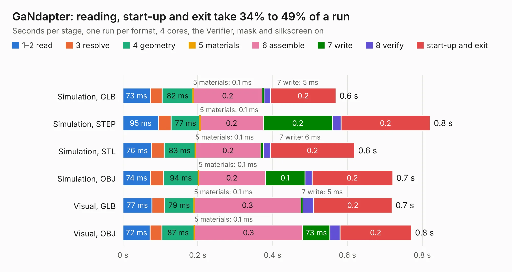

| Mode and format | 1–2 read | 3 resolve | 4 geometry | 5 materials | 6 assemble | 7 write | 8 verify | start-up and exit | Total |
|---|---:|---:|---:|---:|---:|---:|---:|---:|---:|
| Simulation, GLB | 73&nbsp;ms | 32&nbsp;ms | 82&nbsp;ms | 0.1&nbsp;ms | 0.2 | 5&nbsp;ms | 17&nbsp;ms | 0.2 | 0.6 |
| Simulation, STEP | 95&nbsp;ms | 34&nbsp;ms | 77&nbsp;ms | 0.1&nbsp;ms | 0.2 | 0.2 | 23&nbsp;ms | 0.2 | 0.8 |
| Simulation, STL | 76&nbsp;ms | 34&nbsp;ms | 83&nbsp;ms | 0.1&nbsp;ms | 0.2 | 6&nbsp;ms | 19&nbsp;ms | 0.2 | 0.6 |
| Simulation, OBJ | 74&nbsp;ms | 34&nbsp;ms | 94&nbsp;ms | 0.1&nbsp;ms | 0.2 | 0.1 | 19&nbsp;ms | 0.2 | 0.7 |
| Visual, GLB | 77&nbsp;ms | 34&nbsp;ms | 79&nbsp;ms | 0.1&nbsp;ms | 0.3 | 5&nbsp;ms | 30&nbsp;ms | 0.2 | 0.7 |
| Visual, OBJ | 72&nbsp;ms | 32&nbsp;ms | 87&nbsp;ms | 0.1&nbsp;ms | 0.3 | 73&nbsp;ms | 27&nbsp;ms | 0.2 | 0.8 |

<table align="center"><tr><td valign="top">

| Board | Repo: [rootthecause/dcdc](https://github.com/rootthecause/dcdc) Board: `GaNdapter.kicad_pcb` |
|---|---|
| Folder | extra / external-boards / GaNdapter |
| Complexity | 129&nbsp;/&nbsp;1000 (size&nbsp;29, features&nbsp;100) |
| KESE&nbsp;features | slotted holes, rounded, trapezoid or chamfered pads, filled zones, curved board outline, stack-up, dielectric εr and tanδ, copper finish, mask and silkscreen colours |
| Tested | 9th November 2026 |
| Copper&nbsp;layers | 2 |
| File&nbsp;format | KiCad 8 (20240108) |
| Parts,&nbsp;tracks,&nbsp;vias | 2, 0, 0 |
| Triangles,&nbsp;simulation | 18,750 in 14 parts |
| Verifier | PASS in all six runs |

</td><td valign="top">

<table>
<tr><th>File type</th><th>File size</th><th>Peak memory used</th></tr>
<tr><th colspan="3" align="left">Simulation</th></tr>
<tr><td>GLB</td><td align="right">663&nbsp;kB</td><td align="right">61&nbsp;MB</td></tr>
<tr><td>STEP</td><td align="right">3.3&nbsp;MB</td><td align="right">64&nbsp;MB</td></tr>
<tr><td>STL</td><td align="right">939&nbsp;kB</td><td align="right">62&nbsp;MB</td></tr>
<tr><td>OBJ</td><td align="right">1.9&nbsp;MB</td><td align="right">64&nbsp;MB</td></tr>
<tr><th colspan="3" align="left">Visual</th></tr>
<tr><td>GLB</td><td align="right">495&nbsp;kB</td><td align="right">82&nbsp;MB</td></tr>
<tr><td>OBJ</td><td align="right">1.4&nbsp;MB</td><td align="right">83&nbsp;MB</td></tr>
</table>

</td></tr></table>

## 2396. DCDCv9-3

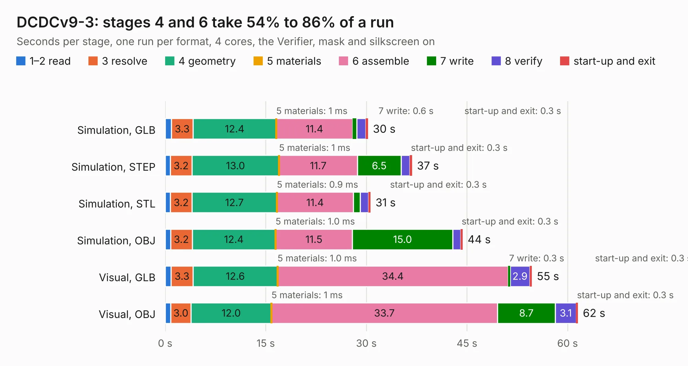

| Mode and format | 1–2 read | 3 resolve | 4 geometry | 5 materials | 6 assemble | 7 write | 8 verify | start-up and exit | Total |
|---|---:|---:|---:|---:|---:|---:|---:|---:|---:|
| Simulation, GLB | 0.9 | 3.3 | 12.4 | 1&nbsp;ms | 11.4 | 0.6 | 1.4 | 0.3 | 30.2 |
| Simulation, STEP | 0.8 | 3.2 | 13.0 | 1&nbsp;ms | 11.7 | 6.5 | 1.3 | 0.3 | 36.8 |
| Simulation, STL | 0.8 | 3.2 | 12.7 | 0.9&nbsp;ms | 11.4 | 1.0 | 1.3 | 0.3 | 30.6 |
| Simulation, OBJ | 0.8 | 3.2 | 12.4 | 1.0&nbsp;ms | 11.5 | 15.0 | 1.2 | 0.3 | 44.4 |
| Visual, GLB | 0.9 | 3.3 | 12.6 | 1.0&nbsp;ms | 34.4 | 0.3 | 2.9 | 0.3 | 54.7 |
| Visual, OBJ | 0.8 | 3.0 | 12.0 | 1&nbsp;ms | 33.7 | 8.7 | 3.1 | 0.3 | 61.5 |

<table align="center"><tr><td valign="top">

| Board | Repo: [rootthecause/dcdc](https://github.com/rootthecause/dcdc) Board: `DCDCv9-3.kicad_pcb` |
|---|---|
| Folder | kicad |
| Complexity | 361&nbsp;/&nbsp;1000 (size&nbsp;221, features&nbsp;140) |
| KESE&nbsp;features | through vias, slotted holes, custom pads, rounded, trapezoid or chamfered pads, filled zones, copper drawings, curved board outline, stack-up, dielectric εr and tanδ, copper finish, mask and silkscreen colours |
| Tested | 9th November 2026 |
| Copper&nbsp;layers | 4 |
| File&nbsp;format | KiCad 9 (20241229) |
| Parts,&nbsp;tracks,&nbsp;vias | 197, 682, 744 |
| Triangles,&nbsp;simulation | 3,136,706 in 124 parts |
| Verifier | PASS in all six runs |

</td><td valign="top">

<table>
<tr><th>File type</th><th>File size</th><th>Peak memory used</th></tr>
<tr><th colspan="3" align="left">Simulation</th></tr>
<tr><td>GLB</td><td align="right">103&nbsp;MB</td><td align="right">928&nbsp;MB</td></tr>
<tr><td>STEP</td><td align="right">369&nbsp;MB</td><td align="right">1.1&nbsp;GB</td></tr>
<tr><td>STL</td><td align="right">157&nbsp;MB</td><td align="right">913&nbsp;MB</td></tr>
<tr><td>OBJ</td><td align="right">340&nbsp;MB</td><td align="right">2.1&nbsp;GB</td></tr>
<tr><th colspan="3" align="left">Visual</th></tr>
<tr><td>GLB</td><td align="right">59&nbsp;MB</td><td align="right">1.3&nbsp;GB</td></tr>
<tr><td>OBJ</td><td align="right">189&nbsp;MB</td><td align="right">1.2&nbsp;GB</td></tr>
</table>

</td></tr></table>

## 2397. rosco_m68k

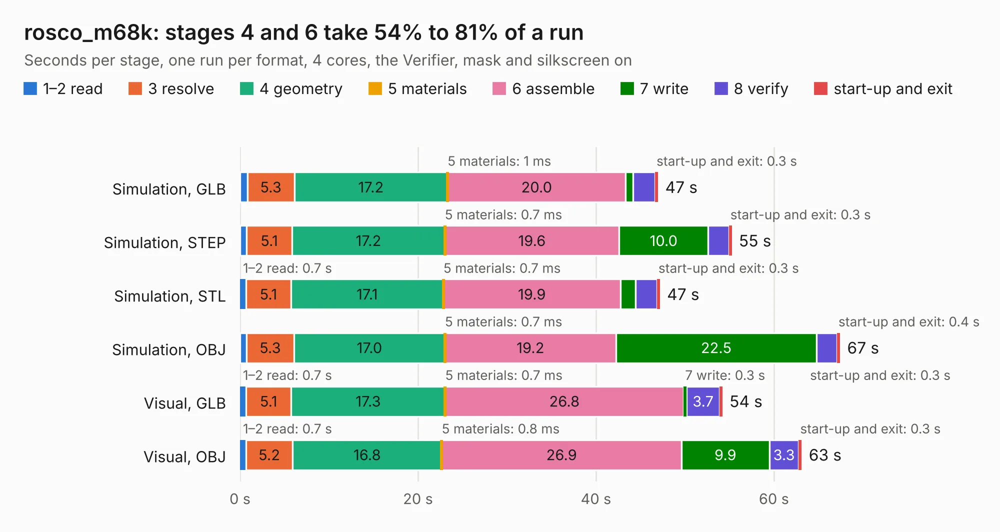

| Mode and format | 1–2 read | 3 resolve | 4 geometry | 5 materials | 6 assemble | 7 write | 8 verify | start-up and exit | Total |
|---|---:|---:|---:|---:|---:|---:|---:|---:|---:|
| Simulation, GLB | 0.8 | 5.3 | 17.2 | 1&nbsp;ms | 20.0 | 0.8 | 2.5 | 0.3 | 47.0 |
| Simulation, STEP | 0.7 | 5.1 | 17.2 | 0.7&nbsp;ms | 19.6 | 10.0 | 2.3 | 0.3 | 55.3 |
| Simulation, STL | 0.7 | 5.1 | 17.1 | 0.7&nbsp;ms | 19.9 | 1.7 | 2.4 | 0.3 | 47.2 |
| Simulation, OBJ | 0.7 | 5.3 | 17.0 | 0.7&nbsp;ms | 19.2 | 22.5 | 2.3 | 0.4 | 67.4 |
| Visual, GLB | 0.7 | 5.1 | 17.3 | 0.7&nbsp;ms | 26.8 | 0.3 | 3.7 | 0.3 | 54.2 |
| Visual, OBJ | 0.7 | 5.2 | 16.8 | 0.8&nbsp;ms | 26.9 | 9.9 | 3.3 | 0.3 | 63.1 |

<table align="center"><tr><td valign="top">

| Board | Repo: [rosco-m68k/rosco_m68k](https://github.com/rosco-m68k/rosco_m68k) Board: `rosco_m68k.kicad_pcb` |
|---|---|
| Folder | design / r0 / r0-kicad-import |
| Complexity | 240&nbsp;/&nbsp;1000 (size&nbsp;205, features&nbsp;35) |
| KESE&nbsp;features | through vias, filled zones |
| Tested | 9th November 2026 |
| Copper&nbsp;layers | 4 |
| File&nbsp;format | KiCad 5 (20171130) |
| Parts,&nbsp;tracks,&nbsp;vias | 69, 1,706, 160 |
| Triangles,&nbsp;simulation | 4,334,206 in 142 parts |
| Verifier | PASS in all six runs |

</td><td valign="top">

<table>
<tr><th>File type</th><th>File size</th><th>Peak memory used</th></tr>
<tr><th colspan="3" align="left">Simulation</th></tr>
<tr><td>GLB</td><td align="right">148&nbsp;MB</td><td align="right">1.0&nbsp;GB</td></tr>
<tr><td>STEP</td><td align="right">561&nbsp;MB</td><td align="right">1.4&nbsp;GB</td></tr>
<tr><td>STL</td><td align="right">217&nbsp;MB</td><td align="right">1.0&nbsp;GB</td></tr>
<tr><td>OBJ</td><td align="right">462&nbsp;MB</td><td align="right">2.8&nbsp;GB</td></tr>
<tr><th colspan="3" align="left">Visual</th></tr>
<tr><td>GLB</td><td align="right">65&nbsp;MB</td><td align="right">1.2&nbsp;GB</td></tr>
<tr><td>OBJ</td><td align="right">206&nbsp;MB</td><td align="right">1.5&nbsp;GB</td></tr>
</table>

</td></tr></table>

## 2398. rosco_m68k

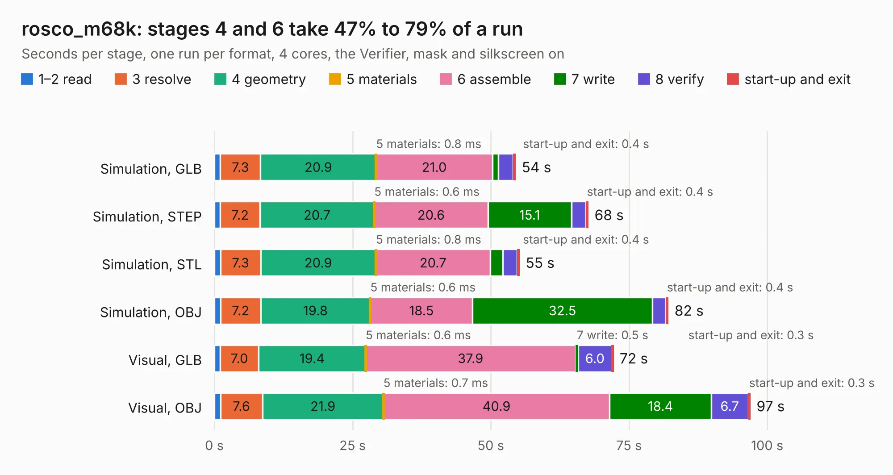

| Mode and format | 1–2 read | 3 resolve | 4 geometry | 5 materials | 6 assemble | 7 write | 8 verify | start-up and exit | Total |
|---|---:|---:|---:|---:|---:|---:|---:|---:|---:|
| Simulation, GLB | 1.1 | 7.3 | 20.9 | 0.8&nbsp;ms | 21.0 | 1.1 | 2.7 | 0.4 | 54.4 |
| Simulation, STEP | 1.1 | 7.2 | 20.7 | 0.6&nbsp;ms | 20.6 | 15.1 | 2.6 | 0.4 | 67.6 |
| Simulation, STL | 1.1 | 7.3 | 20.9 | 0.8&nbsp;ms | 20.7 | 2.3 | 2.6 | 0.4 | 55.1 |
| Simulation, OBJ | 1.1 | 7.2 | 19.8 | 0.6&nbsp;ms | 18.5 | 32.5 | 2.5 | 0.4 | 82.1 |
| Visual, GLB | 1.0 | 7.0 | 19.4 | 0.6&nbsp;ms | 37.9 | 0.5 | 6.0 | 0.3 | 72.1 |
| Visual, OBJ | 1.1 | 7.6 | 21.9 | 0.7&nbsp;ms | 40.9 | 18.4 | 6.7 | 0.3 | 96.9 |

<table align="center"><tr><td valign="top">

| Board | Repo: [rosco-m68k/rosco_m68k](https://github.com/rosco-m68k/rosco_m68k) Board: `rosco_m68k.kicad_pcb` |
|---|---|
| Folder | design / r1.2 / kicad |
| Complexity | 259&nbsp;/&nbsp;1000 (size&nbsp;214, features&nbsp;45) |
| KESE&nbsp;features | through vias, filled zones, curved board outline |
| Tested | 9th November 2026 |
| Copper&nbsp;layers | 4 |
| File&nbsp;format | KiCad 5 (20171130) |
| Parts,&nbsp;tracks,&nbsp;vias | 74, 2,802, 259 |
| Triangles,&nbsp;simulation | 5,423,534 in 139 parts |
| Verifier | PASS in all six runs |

</td><td valign="top">

<table>
<tr><th>File type</th><th>File size</th><th>Peak memory used</th></tr>
<tr><th colspan="3" align="left">Simulation</th></tr>
<tr><td>GLB</td><td align="right">186&nbsp;MB</td><td align="right">1.3&nbsp;GB</td></tr>
<tr><td>STEP</td><td align="right">771&nbsp;MB</td><td align="right">1.6&nbsp;GB</td></tr>
<tr><td>STL</td><td align="right">271&nbsp;MB</td><td align="right">1.3&nbsp;GB</td></tr>
<tr><td>OBJ</td><td align="right">582&nbsp;MB</td><td align="right">3.5&nbsp;GB</td></tr>
<tr><th colspan="3" align="left">Visual</th></tr>
<tr><td>GLB</td><td align="right">95&nbsp;MB</td><td align="right">1.6&nbsp;GB</td></tr>
<tr><td>OBJ</td><td align="right">302&nbsp;MB</td><td align="right">2.0&nbsp;GB</td></tr>
</table>

</td></tr></table>

## 2399. rosco_m68k

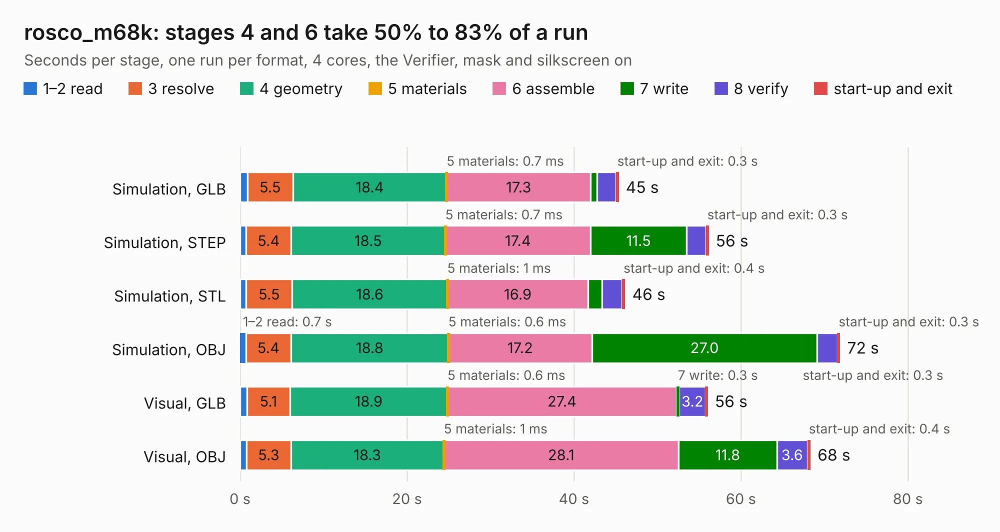

| Mode and format | 1–2 read | 3 resolve | 4 geometry | 5 materials | 6 assemble | 7 write | 8 verify | start-up and exit | Total |
|---|---:|---:|---:|---:|---:|---:|---:|---:|---:|
| Simulation, GLB | 0.9 | 5.5 | 18.4 | 0.7&nbsp;ms | 17.3 | 0.8 | 2.3 | 0.3 | 45.4 |
| Simulation, STEP | 0.7 | 5.4 | 18.5 | 0.7&nbsp;ms | 17.4 | 11.5 | 2.3 | 0.3 | 56.1 |
| Simulation, STL | 0.7 | 5.5 | 18.6 | 1&nbsp;ms | 16.9 | 1.6 | 2.4 | 0.4 | 46.1 |
| Simulation, OBJ | 0.7 | 5.4 | 18.8 | 0.6&nbsp;ms | 17.2 | 27.0 | 2.4 | 0.3 | 71.9 |
| Visual, GLB | 0.8 | 5.1 | 18.9 | 0.6&nbsp;ms | 27.4 | 0.3 | 3.2 | 0.3 | 56.0 |
| Visual, OBJ | 0.8 | 5.3 | 18.3 | 1&nbsp;ms | 28.1 | 11.8 | 3.6 | 0.4 | 68.3 |

<table align="center"><tr><td valign="top">

| Board | Repo: [rosco-m68k/rosco_m68k](https://github.com/rosco-m68k/rosco_m68k) Board: `rosco_m68k.kicad_pcb` |
|---|---|
| Folder | design / r1 / kicad |
| Complexity | 253&nbsp;/&nbsp;1000 (size&nbsp;208, features&nbsp;45) |
| KESE&nbsp;features | through vias, filled zones, curved board outline |
| Tested | 9th November 2026 |
| Copper&nbsp;layers | 4 |
| File&nbsp;format | KiCad 5 (20171130) |
| Parts,&nbsp;tracks,&nbsp;vias | 72, 1,942, 188 |
| Triangles,&nbsp;simulation | 4,707,790 in 144 parts |
| Verifier | PASS in all six runs |

</td><td valign="top">

<table>
<tr><th>File type</th><th>File size</th><th>Peak memory used</th></tr>
<tr><th colspan="3" align="left">Simulation</th></tr>
<tr><td>GLB</td><td align="right">161&nbsp;MB</td><td align="right">1.2&nbsp;GB</td></tr>
<tr><td>STEP</td><td align="right">612&nbsp;MB</td><td align="right">1.4&nbsp;GB</td></tr>
<tr><td>STL</td><td align="right">235&nbsp;MB</td><td align="right">1.3&nbsp;GB</td></tr>
<tr><td>OBJ</td><td align="right">504&nbsp;MB</td><td align="right">3.1&nbsp;GB</td></tr>
<tr><th colspan="3" align="left">Visual</th></tr>
<tr><td>GLB</td><td align="right">71&nbsp;MB</td><td align="right">1.3&nbsp;GB</td></tr>
<tr><td>OBJ</td><td align="right">226&nbsp;MB</td><td align="right">1.5&nbsp;GB</td></tr>
</table>

</td></tr></table>

## 2400. rosco_m68k

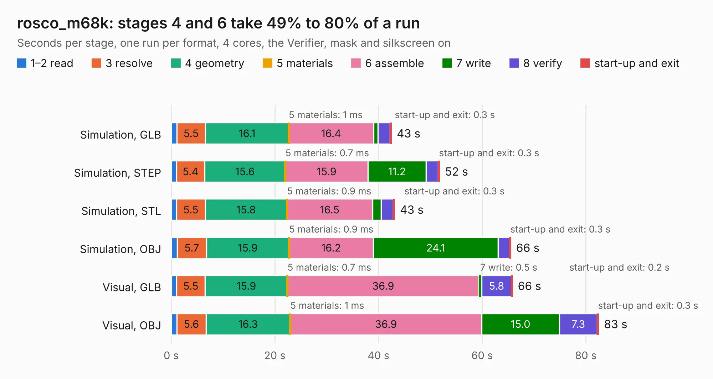

| Mode and format | 1–2 read | 3 resolve | 4 geometry | 5 materials | 6 assemble | 7 write | 8 verify | start-up and exit | Total |
|---|---:|---:|---:|---:|---:|---:|---:|---:|---:|
| Simulation, GLB | 1.1 | 5.5 | 16.1 | 1&nbsp;ms | 16.4 | 0.9 | 2.3 | 0.3 | 42.5 |
| Simulation, STEP | 1.0 | 5.4 | 15.6 | 0.7&nbsp;ms | 15.9 | 11.2 | 2.3 | 0.3 | 51.8 |
| Simulation, STL | 1.0 | 5.5 | 15.8 | 0.9&nbsp;ms | 16.5 | 1.7 | 2.3 | 0.3 | 43.2 |
| Simulation, OBJ | 1.1 | 5.7 | 15.9 | 0.9&nbsp;ms | 16.2 | 24.1 | 2.2 | 0.3 | 65.6 |
| Visual, GLB | 1.0 | 5.5 | 15.9 | 0.7&nbsp;ms | 36.9 | 0.5 | 5.8 | 0.2 | 65.9 |
| Visual, OBJ | 1.1 | 5.6 | 16.3 | 1&nbsp;ms | 36.9 | 15.0 | 7.3 | 0.3 | 82.5 |

<table align="center"><tr><td valign="top">

| Board | Repo: [rosco-m68k/rosco_m68k](https://github.com/rosco-m68k/rosco_m68k) Board: `rosco_m68k.kicad_pcb` |
|---|---|
| Folder | design / r2 / kicad |
| Complexity | 422&nbsp;/&nbsp;1000 (size&nbsp;272, features&nbsp;150) |
| KESE&nbsp;features | through vias, slotted holes, custom pads, rounded, trapezoid or chamfered pads, filled zones, copper drawings, curved board outline, knockout text, TrueType text, stack-up, dielectric εr and tanδ |
| Tested | 9th November 2026 |
| Copper&nbsp;layers | 4 |
| File&nbsp;format | KiCad 8 (20240108) |
| Parts,&nbsp;tracks,&nbsp;vias | 128, 3,716, 402 |
| Triangles,&nbsp;simulation | 5,616,966 in 210 parts |
| Verifier | PASS in all six runs |

</td><td valign="top">

<table>
<tr><th>File type</th><th>File size</th><th>Peak memory used</th></tr>
<tr><th colspan="3" align="left">Simulation</th></tr>
<tr><td>GLB</td><td align="right">189&nbsp;MB</td><td align="right">1.4&nbsp;GB</td></tr>
<tr><td>STEP</td><td align="right">803&nbsp;MB</td><td align="right">1.8&nbsp;GB</td></tr>
<tr><td>STL</td><td align="right">281&nbsp;MB</td><td align="right">1.4&nbsp;GB</td></tr>
<tr><td>OBJ</td><td align="right">601&nbsp;MB</td><td align="right">3.6&nbsp;GB</td></tr>
<tr><th colspan="3" align="left">Visual</th></tr>
<tr><td>GLB</td><td align="right">111&nbsp;MB</td><td align="right">1.8&nbsp;GB</td></tr>
<tr><td>OBJ</td><td align="right">352&nbsp;MB</td><td align="right">2.4&nbsp;GB</td></tr>
</table>

</td></tr></table>

## 2401. rosco_m68k

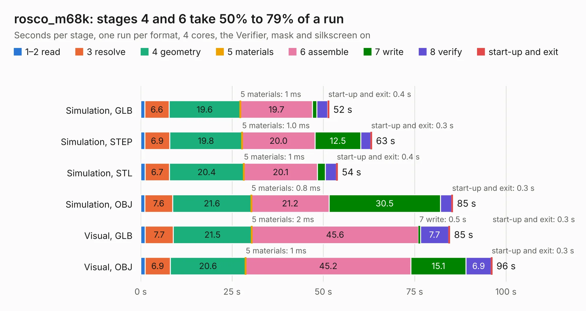

| Mode and format | 1–2 read | 3 resolve | 4 geometry | 5 materials | 6 assemble | 7 write | 8 verify | start-up and exit | Total |
|---|---:|---:|---:|---:|---:|---:|---:|---:|---:|
| Simulation, GLB | 1.1 | 6.6 | 19.6 | 1&nbsp;ms | 19.7 | 1.1 | 3.0 | 0.4 | 51.6 |
| Simulation, STEP | 1.1 | 6.9 | 19.8 | 1.0&nbsp;ms | 20.0 | 12.5 | 2.7 | 0.3 | 63.3 |
| Simulation, STL | 1.2 | 6.7 | 20.4 | 1&nbsp;ms | 20.1 | 2.2 | 3.0 | 0.4 | 53.9 |
| Simulation, OBJ | 1.2 | 7.6 | 21.6 | 0.8&nbsp;ms | 21.2 | 30.5 | 3.1 | 0.3 | 85.4 |
| Visual, GLB | 1.2 | 7.7 | 21.5 | 2&nbsp;ms | 45.6 | 0.5 | 7.7 | 0.3 | 84.6 |
| Visual, OBJ | 1.2 | 6.9 | 20.6 | 1&nbsp;ms | 45.2 | 15.1 | 6.9 | 0.3 | 96.3 |

<table align="center"><tr><td valign="top">

| Board | Repo: [rosco-m68k/rosco_m68k](https://github.com/rosco-m68k/rosco_m68k) Board: `rosco_m68k.kicad_pcb` |
|---|---|
| Folder | design / r2020 / kicad |
| Complexity | 386&nbsp;/&nbsp;1000 (size&nbsp;261, features&nbsp;125) |
| KESE&nbsp;features | through vias, slotted holes, rounded, trapezoid or chamfered pads, filled zones, curved board outline, knockout text, TrueType text, stack-up, dielectric εr and tanδ |
| Tested | 9th November 2026 |
| Copper&nbsp;layers | 4 |
| File&nbsp;format | KiCad 7 (20221018) |
| Parts,&nbsp;tracks,&nbsp;vias | 87, 3,771, 341 |
| Triangles,&nbsp;simulation | 6,485,168 in 204 parts |
| Verifier | PASS in all six runs |

</td><td valign="top">

<table>
<tr><th>File type</th><th>File size</th><th>Peak memory used</th></tr>
<tr><th colspan="3" align="left">Simulation</th></tr>
<tr><td>GLB</td><td align="right">218&nbsp;MB</td><td align="right">1.6&nbsp;GB</td></tr>
<tr><td>STEP</td><td align="right">889&nbsp;MB</td><td align="right">2.0&nbsp;GB</td></tr>
<tr><td>STL</td><td align="right">324&nbsp;MB</td><td align="right">1.5&nbsp;GB</td></tr>
<tr><td>OBJ</td><td align="right">694&nbsp;MB</td><td align="right">4.1&nbsp;GB</td></tr>
<tr><th colspan="3" align="left">Visual</th></tr>
<tr><td>GLB</td><td align="right">122&nbsp;MB</td><td align="right">2.2&nbsp;GB</td></tr>
<tr><td>OBJ</td><td align="right">386&nbsp;MB</td><td align="right">2.6&nbsp;GB</td></tr>
</table>

</td></tr></table>

## 2402. rosco_m68k

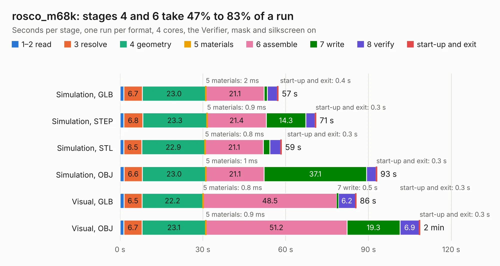

| Mode and format | 1–2 read | 3 resolve | 4 geometry | 5 materials | 6 assemble | 7 write | 8 verify | start-up and exit | Total |
|---|---:|---:|---:|---:|---:|---:|---:|---:|---:|
| Simulation, GLB | 1.4 | 6.7 | 23.0 | 2&nbsp;ms | 21.1 | 1.2 | 3.6 | 0.4 | 57.3 |
| Simulation, STEP | 1.4 | 6.8 | 23.3 | 0.9&nbsp;ms | 21.4 | 14.3 | 3.4 | 0.3 | 71.0 |
| Simulation, STL | 1.4 | 6.5 | 22.9 | 0.8&nbsp;ms | 21.1 | 2.4 | 3.9 | 0.3 | 58.5 |
| Simulation, OBJ | 1.5 | 6.6 | 23.0 | 1&nbsp;ms | 21.1 | 37.1 | 3.4 | 0.3 | 93.1 |
| Visual, GLB | 1.5 | 6.5 | 22.2 | 0.8&nbsp;ms | 48.5 | 0.5 | 6.2 | 0.3 | 85.6 |
| Visual, OBJ | 1.3 | 6.7 | 23.1 | 0.9&nbsp;ms | 51.2 | 19.3 | 6.9 | 0.3 | 108.7 |

<table align="center"><tr><td valign="top">

| Board | Repo: [rosco-m68k/rosco_m68k](https://github.com/rosco-m68k/rosco_m68k) Board: `rosco_m68k.kicad_pcb` |
|---|---|
| Folder | design / r2030 / kicad |
| Complexity | 380&nbsp;/&nbsp;1000 (size&nbsp;255, features&nbsp;125) |
| KESE&nbsp;features | through vias, slotted holes, rounded, trapezoid or chamfered pads, filled zones, curved board outline, knockout text, TrueType text, stack-up, dielectric εr and tanδ |
| Tested | 9th November 2026 |
| Copper&nbsp;layers | 4 |
| File&nbsp;format | KiCad 7 (20221018) |
| Parts,&nbsp;tracks,&nbsp;vias | 88, 3,017, 109 |
| Triangles,&nbsp;simulation | 6,108,744 in 219 parts |
| Verifier | PASS in all six runs |

</td><td valign="top">

<table>
<tr><th>File type</th><th>File size</th><th>Peak memory used</th></tr>
<tr><th colspan="3" align="left">Simulation</th></tr>
<tr><td>GLB</td><td align="right">207&nbsp;MB</td><td align="right">1.5&nbsp;GB</td></tr>
<tr><td>STEP</td><td align="right">914&nbsp;MB</td><td align="right">2.0&nbsp;GB</td></tr>
<tr><td>STL</td><td align="right">305&nbsp;MB</td><td align="right">1.6&nbsp;GB</td></tr>
<tr><td>OBJ</td><td align="right">655&nbsp;MB</td><td align="right">3.9&nbsp;GB</td></tr>
<tr><th colspan="3" align="left">Visual</th></tr>
<tr><td>GLB</td><td align="right">118&nbsp;MB</td><td align="right">1.9&nbsp;GB</td></tr>
<tr><td>OBJ</td><td align="right">371&nbsp;MB</td><td align="right">2.4&nbsp;GB</td></tr>
</table>

</td></tr></table>

## 2403. rosco_pro_030_proto

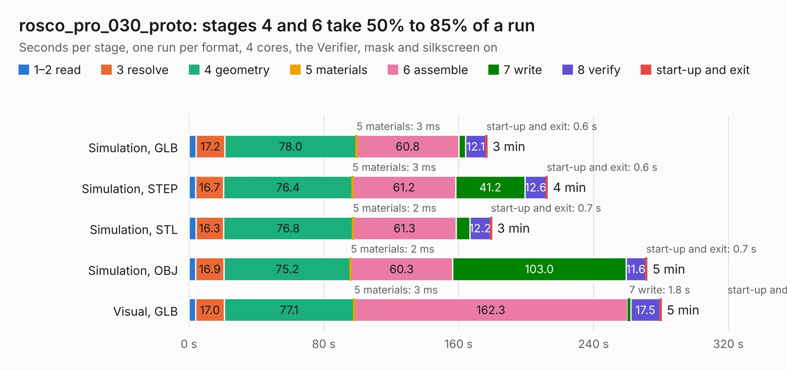

| Mode and format | 1–2 read | 3 resolve | 4 geometry | 5 materials | 6 assemble | 7 write | 8 verify | start-up and exit | Total |
|---|---:|---:|---:|---:|---:|---:|---:|---:|---:|
| Simulation, GLB | 4.2 | 17.2 | 78.0 | 3&nbsp;ms | 60.8 | 3.8 | 12.1 | 0.6 | 176.8 |
| Simulation, STEP | 3.9 | 16.7 | 76.4 | 3&nbsp;ms | 61.2 | 41.2 | 12.6 | 0.6 | 212.6 |
| Simulation, STL | 4.2 | 16.3 | 76.8 | 2&nbsp;ms | 61.3 | 8.1 | 12.2 | 0.7 | 179.5 |
| Simulation, OBJ | 4.0 | 16.9 | 75.2 | 2&nbsp;ms | 60.3 | 103.0 | 11.6 | 0.7 | 271.7 |
| Visual, GLB | 3.9 | 17.0 | 77.1 | 3&nbsp;ms | 162.3 | 1.8 | 17.5 | 0.6 | 280.1 |
| Visual, OBJ | 4.0 | 17.1 | 75.0 | 3&nbsp;ms | 157.7 | 45.8 | 16.1 | 0.4 | 316.0 |

<table align="center"><tr><td valign="top">

| Board | Repo: [rosco-m68k/rosco_m68k_pro](https://github.com/rosco-m68k/rosco_m68k_pro) Board: `rosco_pro_030_proto.kicad_pcb` |
|---|---|
| Folder | design / pro_030_proto / kicad |
| Complexity | 415&nbsp;/&nbsp;1000 (size&nbsp;285, features&nbsp;130) |
| KESE&nbsp;features | through vias, slotted holes, custom pads, rounded, trapezoid or chamfered pads, drill offsets, filled zones, copper drawings, curved board outline, stack-up, dielectric εr and tanδ |
| Tested | 9th November 2026 |
| Copper&nbsp;layers | 4 |
| File&nbsp;format | KiCad 6 (20211014) |
| Parts,&nbsp;tracks,&nbsp;vias | 241, 9,324, 390 |
| Triangles,&nbsp;simulation | 15,595,656 in 416 parts |
| Verifier | PASS in all six runs |

</td><td valign="top">

<table>
<tr><th>File type</th><th>File size</th><th>Peak memory used</th></tr>
<tr><th colspan="3" align="left">Simulation</th></tr>
<tr><td>GLB</td><td align="right">523&nbsp;MB</td><td align="right">3.5&nbsp;GB</td></tr>
<tr><td>STEP</td><td align="right">2.3&nbsp;GB</td><td align="right">4.6&nbsp;GB</td></tr>
<tr><td>STL</td><td align="right">780&nbsp;MB</td><td align="right">3.3&nbsp;GB</td></tr>
<tr><td>OBJ</td><td align="right">1.7&nbsp;GB</td><td align="right">9.8&nbsp;GB</td></tr>
<tr><th colspan="3" align="left">Visual</th></tr>
<tr><td>GLB</td><td align="right">265&nbsp;MB</td><td align="right">4.2&nbsp;GB</td></tr>
<tr><td>OBJ</td><td align="right">851&nbsp;MB</td><td align="right">5.4&nbsp;GB</td></tr>
</table>

</td></tr></table>

## 2404. xoseram

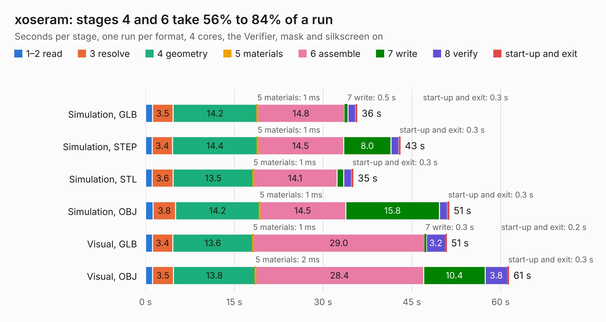

| Mode and format | 1–2 read | 3 resolve | 4 geometry | 5 materials | 6 assemble | 7 write | 8 verify | start-up and exit | Total |
|---|---:|---:|---:|---:|---:|---:|---:|---:|---:|
| Simulation, GLB | 1.2 | 3.5 | 14.2 | 1&nbsp;ms | 14.8 | 0.5 | 1.3 | 0.3 | 35.8 |
| Simulation, STEP | 1.1 | 3.4 | 14.4 | 1&nbsp;ms | 14.5 | 8.0 | 1.3 | 0.3 | 43.1 |
| Simulation, STL | 1.1 | 3.6 | 13.5 | 1&nbsp;ms | 14.1 | 1.2 | 1.3 | 0.3 | 35.1 |
| Simulation, OBJ | 1.3 | 3.8 | 14.2 | 1&nbsp;ms | 14.5 | 15.8 | 1.3 | 0.3 | 51.3 |
| Visual, GLB | 1.2 | 3.4 | 13.6 | 1&nbsp;ms | 29.0 | 0.3 | 3.2 | 0.2 | 50.9 |
| Visual, OBJ | 1.2 | 3.5 | 13.8 | 2&nbsp;ms | 28.4 | 10.4 | 3.8 | 0.3 | 61.4 |

<table align="center"><tr><td valign="top">

| Board | Repo: [rosco-m68k/XoseraBoard](https://github.com/rosco-m68k/XoseraBoard) Board: `xoseram.kicad_pcb` |
|---|---|
| Folder | kicad / xoseram |
| Complexity | 409&nbsp;/&nbsp;1000 (size&nbsp;274, features&nbsp;135) |
| KESE&nbsp;features | through vias, slotted holes, custom pads, rounded, trapezoid or chamfered pads, filled zones, copper drawings, curved board outline, TrueType text, stack-up, dielectric εr and tanδ |
| Tested | 9th November 2026 |
| Copper&nbsp;layers | 4 |
| File&nbsp;format | KiCad 8 (20240108) |
| Parts,&nbsp;tracks,&nbsp;vias | 183, 2,256, 379 |
| Triangles,&nbsp;simulation | 3,356,522 in 288 parts |
| Verifier | PASS in all six runs |

</td><td valign="top">

<table>
<tr><th>File type</th><th>File size</th><th>Peak memory used</th></tr>
<tr><th colspan="3" align="left">Simulation</th></tr>
<tr><td>GLB</td><td align="right">115&nbsp;MB</td><td align="right">1.1&nbsp;GB</td></tr>
<tr><td>STEP</td><td align="right">457&nbsp;MB</td><td align="right">1.4&nbsp;GB</td></tr>
<tr><td>STL</td><td align="right">168&nbsp;MB</td><td align="right">1.1&nbsp;GB</td></tr>
<tr><td>OBJ</td><td align="right">362&nbsp;MB</td><td align="right">2.2&nbsp;GB</td></tr>
<tr><th colspan="3" align="left">Visual</th></tr>
<tr><td>GLB</td><td align="right">73&nbsp;MB</td><td align="right">1.4&nbsp;GB</td></tr>
<tr><td>OBJ</td><td align="right">231&nbsp;MB</td><td align="right">1.6&nbsp;GB</td></tr>
</table>

</td></tr></table>

## 2405. hellen1-mcz33810

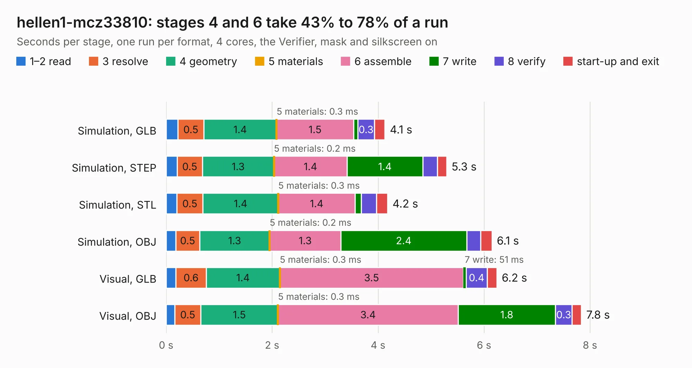

| Mode and format | 1–2 read | 3 resolve | 4 geometry | 5 materials | 6 assemble | 7 write | 8 verify | start-up and exit | Total |
|---|---:|---:|---:|---:|---:|---:|---:|---:|---:|
| Simulation, GLB | 0.2 | 0.5 | 1.4 | 0.3&nbsp;ms | 1.5 | 81&nbsp;ms | 0.3 | 0.2 | 4.1 |
| Simulation, STEP | 0.2 | 0.5 | 1.3 | 0.2&nbsp;ms | 1.4 | 1.4 | 0.3 | 0.2 | 5.3 |
| Simulation, STL | 0.2 | 0.5 | 1.4 | 0.3&nbsp;ms | 1.4 | 0.1 | 0.3 | 0.2 | 4.2 |
| Simulation, OBJ | 0.2 | 0.5 | 1.3 | 0.2&nbsp;ms | 1.3 | 2.4 | 0.3 | 0.2 | 6.1 |
| Visual, GLB | 0.2 | 0.6 | 1.4 | 0.3&nbsp;ms | 3.5 | 51&nbsp;ms | 0.4 | 0.2 | 6.2 |
| Visual, OBJ | 0.2 | 0.5 | 1.5 | 0.3&nbsp;ms | 3.4 | 1.8 | 0.3 | 0.2 | 7.8 |

<table align="center"><tr><td valign="top">

| Board | Repo: [rusefi/hellen-one](https://github.com/rusefi/hellen-one) Board: `hellen1-mcz33810.kicad_pcb` |
|---|---|
| Folder | kicad / modules / hellen1-mcz33810 |
| Complexity | 255&nbsp;/&nbsp;1000 (size&nbsp;175, features&nbsp;80) |
| KESE&nbsp;features | through vias, rounded, trapezoid or chamfered pads, filled zones, stack-up, dielectric εr and tanδ, mask and silkscreen colours |
| Tested | 9th November 2026 |
| Copper&nbsp;layers | 4 |
| File&nbsp;format | KiCad 7 (20221018) |
| Parts,&nbsp;tracks,&nbsp;vias | 32, 342, 72 |
| Triangles,&nbsp;simulation | 491,272 in 54 parts |
| Verifier | PASS in all six runs |

</td><td valign="top">

<table>
<tr><th>File type</th><th>File size</th><th>Peak memory used</th></tr>
<tr><th colspan="3" align="left">Simulation</th></tr>
<tr><td>GLB</td><td align="right">17&nbsp;MB</td><td align="right">312&nbsp;MB</td></tr>
<tr><td>STEP</td><td align="right">69&nbsp;MB</td><td align="right">334&nbsp;MB</td></tr>
<tr><td>STL</td><td align="right">25&nbsp;MB</td><td align="right">312&nbsp;MB</td></tr>
<tr><td>OBJ</td><td align="right">49&nbsp;MB</td><td align="right">378&nbsp;MB</td></tr>
<tr><th colspan="3" align="left">Visual</th></tr>
<tr><td>GLB</td><td align="right">12&nbsp;MB</td><td align="right">337&nbsp;MB</td></tr>
<tr><td>OBJ</td><td align="right">37&nbsp;MB</td><td align="right">337&nbsp;MB</td></tr>
</table>

</td></tr></table>

## 2406. hellen1-motor-driver

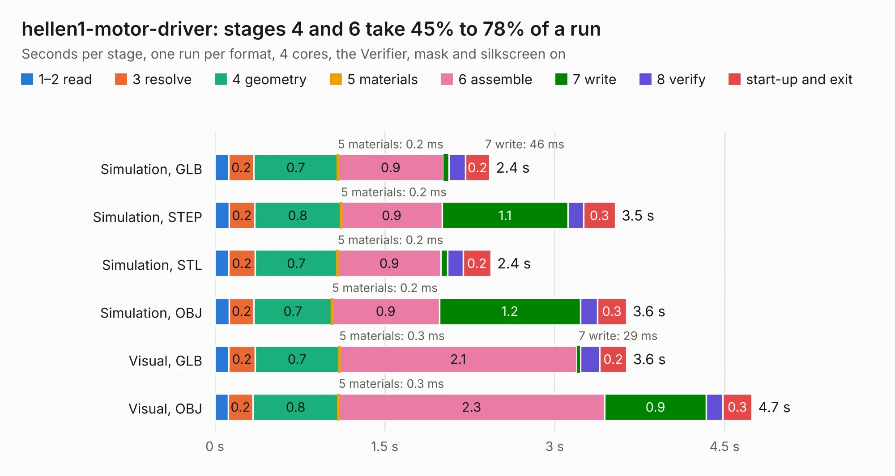

| Mode and format | 1–2 read | 3 resolve | 4 geometry | 5 materials | 6 assemble | 7 write | 8 verify | start-up and exit | Total |
|---|---:|---:|---:|---:|---:|---:|---:|---:|---:|
| Simulation, GLB | 0.1 | 0.2 | 0.7 | 0.2&nbsp;ms | 0.9 | 46&nbsp;ms | 0.1 | 0.2 | 2.4 |
| Simulation, STEP | 0.1 | 0.2 | 0.8 | 0.2&nbsp;ms | 0.9 | 1.1 | 0.1 | 0.3 | 3.5 |
| Simulation, STL | 0.1 | 0.2 | 0.7 | 0.2&nbsp;ms | 0.9 | 57&nbsp;ms | 0.1 | 0.2 | 2.4 |
| Simulation, OBJ | 0.1 | 0.2 | 0.7 | 0.2&nbsp;ms | 0.9 | 1.2 | 0.1 | 0.3 | 3.6 |
| Visual, GLB | 0.1 | 0.2 | 0.7 | 0.3&nbsp;ms | 2.1 | 29&nbsp;ms | 0.2 | 0.2 | 3.6 |
| Visual, OBJ | 0.1 | 0.2 | 0.8 | 0.3&nbsp;ms | 2.3 | 0.9 | 0.1 | 0.3 | 4.7 |

<table align="center"><tr><td valign="top">

| Board | Repo: [rusefi/hellen-one](https://github.com/rusefi/hellen-one) Board: `hellen1-motor-driver.kicad_pcb` |
|---|---|
| Folder | kicad / modules / hellen1-motor-driver |
| Complexity | 229&nbsp;/&nbsp;1000 (size&nbsp;149, features&nbsp;80) |
| KESE&nbsp;features | through vias, rounded, trapezoid or chamfered pads, filled zones, stack-up, dielectric εr and tanδ, mask and silkscreen colours |
| Tested | 9th November 2026 |
| Copper&nbsp;layers | 4 |
| File&nbsp;format | KiCad 7 (20221018) |
| Parts,&nbsp;tracks,&nbsp;vias | 17, 93, 27 |
| Triangles,&nbsp;simulation | 199,800 in 25 parts |
| Verifier | PASS in all six runs |

</td><td valign="top">

<table>
<tr><th>File type</th><th>File size</th><th>Peak memory used</th></tr>
<tr><th colspan="3" align="left">Simulation</th></tr>
<tr><td>GLB</td><td align="right">6.8&nbsp;MB</td><td align="right">220&nbsp;MB</td></tr>
<tr><td>STEP</td><td align="right">28&nbsp;MB</td><td align="right">221&nbsp;MB</td></tr>
<tr><td>STL</td><td align="right">10.0&nbsp;MB</td><td align="right">209&nbsp;MB</td></tr>
<tr><td>OBJ</td><td align="right">19&nbsp;MB</td><td align="right">209&nbsp;MB</td></tr>
<tr><th colspan="3" align="left">Visual</th></tr>
<tr><td>GLB</td><td align="right">4.8&nbsp;MB</td><td align="right">197&nbsp;MB</td></tr>
<tr><td>OBJ</td><td align="right">14&nbsp;MB</td><td align="right">198&nbsp;MB</td></tr>
</table>

</td></tr></table>

## 2407. hellen1-uaefi

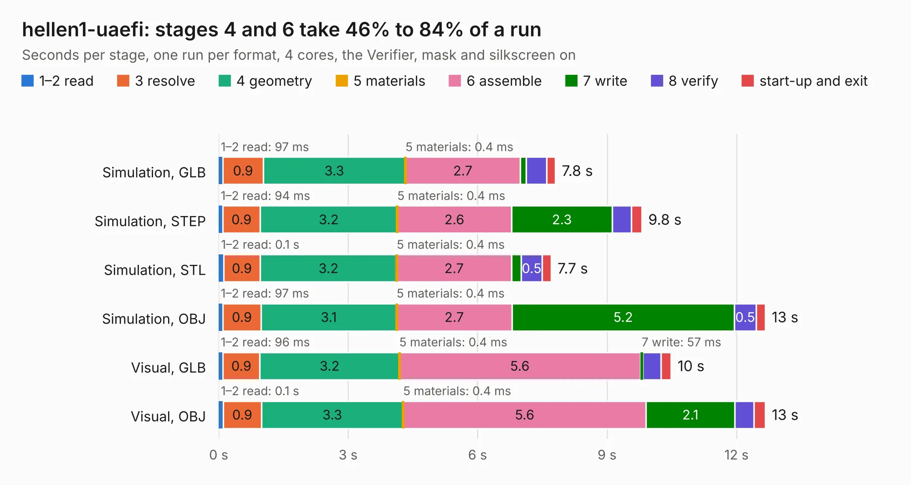

| Mode and format | 1–2 read | 3 resolve | 4 geometry | 5 materials | 6 assemble | 7 write | 8 verify | start-up and exit | Total |
|---|---:|---:|---:|---:|---:|---:|---:|---:|---:|
| Simulation, GLB | 97&nbsp;ms | 0.9 | 3.3 | 0.4&nbsp;ms | 2.7 | 0.1 | 0.5 | 0.2 | 7.8 |
| Simulation, STEP | 94&nbsp;ms | 0.9 | 3.2 | 0.4&nbsp;ms | 2.6 | 2.3 | 0.4 | 0.2 | 9.8 |
| Simulation, STL | 0.1 | 0.9 | 3.2 | 0.4&nbsp;ms | 2.7 | 0.2 | 0.5 | 0.2 | 7.7 |
| Simulation, OBJ | 97&nbsp;ms | 0.9 | 3.1 | 0.4&nbsp;ms | 2.7 | 5.2 | 0.5 | 0.2 | 12.7 |
| Visual, GLB | 96&nbsp;ms | 0.9 | 3.2 | 0.4&nbsp;ms | 5.6 | 57&nbsp;ms | 0.4 | 0.2 | 10.5 |
| Visual, OBJ | 0.1 | 0.9 | 3.3 | 0.4&nbsp;ms | 5.6 | 2.1 | 0.4 | 0.3 | 12.7 |

<table align="center"><tr><td valign="top">

| Board | Repo: [rusefi/hellen-one](https://github.com/rusefi/hellen-one) Board: `hellen1-uaefi.kicad_pcb` |
|---|---|
| Folder | kicad / modules / hellen1-uaefi |
| Complexity | 185&nbsp;/&nbsp;1000 (size&nbsp;115, features&nbsp;70) |
| KESE&nbsp;features | rounded, trapezoid or chamfered pads, arc tracks, curved board outline, stack-up, dielectric εr and tanδ, mask and silkscreen colours |
| Tested | 9th November 2026 |
| Copper&nbsp;layers | 4 |
| File&nbsp;format | KiCad 7 (20221018) |
| Parts,&nbsp;tracks,&nbsp;vias | 17, 20, 0 |
| Triangles,&nbsp;simulation | 789,278 in 94 parts |
| Verifier | PASS in all six runs |

</td><td valign="top">

<table>
<tr><th>File type</th><th>File size</th><th>Peak memory used</th></tr>
<tr><th colspan="3" align="left">Simulation</th></tr>
<tr><td>GLB</td><td align="right">25&nbsp;MB</td><td align="right">311&nbsp;MB</td></tr>
<tr><td>STEP</td><td align="right">85&nbsp;MB</td><td align="right">367&nbsp;MB</td></tr>
<tr><td>STL</td><td align="right">39&nbsp;MB</td><td align="right">303&nbsp;MB</td></tr>
<tr><td>OBJ</td><td align="right">80&nbsp;MB</td><td align="right">531&nbsp;MB</td></tr>
<tr><th colspan="3" align="left">Visual</th></tr>
<tr><td>GLB</td><td align="right">12&nbsp;MB</td><td align="right">373&nbsp;MB</td></tr>
<tr><td>OBJ</td><td align="right">35&nbsp;MB</td><td align="right">374&nbsp;MB</td></tr>
</table>

</td></tr></table>

## 2408. hellen1-vr-discrete

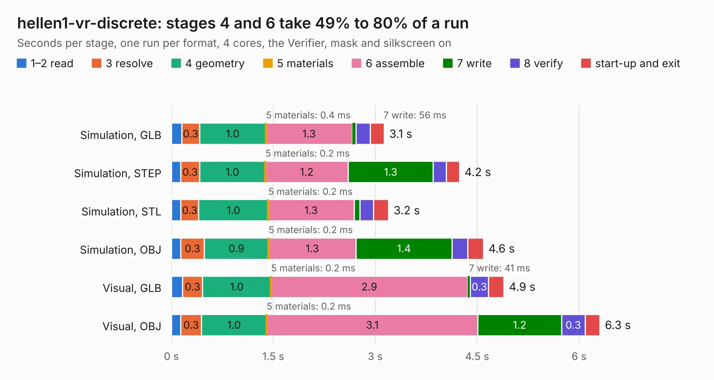

| Mode and format | 1–2 read | 3 resolve | 4 geometry | 5 materials | 6 assemble | 7 write | 8 verify | start-up and exit | Total |
|---|---:|---:|---:|---:|---:|---:|---:|---:|---:|
| Simulation, GLB | 0.2 | 0.3 | 1.0 | 0.4&nbsp;ms | 1.3 | 56&nbsp;ms | 0.2 | 0.2 | 3.1 |
| Simulation, STEP | 0.1 | 0.3 | 1.0 | 0.2&nbsp;ms | 1.2 | 1.3 | 0.2 | 0.2 | 4.2 |
| Simulation, STL | 0.1 | 0.3 | 1.0 | 0.2&nbsp;ms | 1.3 | 87&nbsp;ms | 0.2 | 0.2 | 3.2 |
| Simulation, OBJ | 0.1 | 0.3 | 0.9 | 0.2&nbsp;ms | 1.3 | 1.4 | 0.2 | 0.2 | 4.6 |
| Visual, GLB | 0.2 | 0.3 | 1.0 | 0.2&nbsp;ms | 2.9 | 41&nbsp;ms | 0.3 | 0.2 | 4.9 |
| Visual, OBJ | 0.1 | 0.3 | 1.0 | 0.2&nbsp;ms | 3.1 | 1.2 | 0.3 | 0.2 | 6.3 |

<table align="center"><tr><td valign="top">

| Board | Repo: [rusefi/hellen-one](https://github.com/rusefi/hellen-one) Board: `hellen1-vr-discrete.kicad_pcb` |
|---|---|
| Folder | kicad / modules / hellen1-vr-discrete |
| Complexity | 254&nbsp;/&nbsp;1000 (size&nbsp;174, features&nbsp;80) |
| KESE&nbsp;features | through vias, rounded, trapezoid or chamfered pads, filled zones, stack-up, dielectric εr and tanδ, mask and silkscreen colours |
| Tested | 9th November 2026 |
| Copper&nbsp;layers | 4 |
| File&nbsp;format | KiCad 7 (20221018) |
| Parts,&nbsp;tracks,&nbsp;vias | 48, 270, 44 |
| Triangles,&nbsp;simulation | 358,994 in 42 parts |
| Verifier | PASS in all six runs |

</td><td valign="top">

<table>
<tr><th>File type</th><th>File size</th><th>Peak memory used</th></tr>
<tr><th colspan="3" align="left">Simulation</th></tr>
<tr><td>GLB</td><td align="right">12&nbsp;MB</td><td align="right">272&nbsp;MB</td></tr>
<tr><td>STEP</td><td align="right">52&nbsp;MB</td><td align="right">284&nbsp;MB</td></tr>
<tr><td>STL</td><td align="right">18&nbsp;MB</td><td align="right">273&nbsp;MB</td></tr>
<tr><td>OBJ</td><td align="right">36&nbsp;MB</td><td align="right">277&nbsp;MB</td></tr>
<tr><th colspan="3" align="left">Visual</th></tr>
<tr><td>GLB</td><td align="right">8.4&nbsp;MB</td><td align="right">280&nbsp;MB</td></tr>
<tr><td>OBJ</td><td align="right">25&nbsp;MB</td><td align="right">277&nbsp;MB</td></tr>
</table>

</td></tr></table>

## 2409. hellen1-vr-max9924

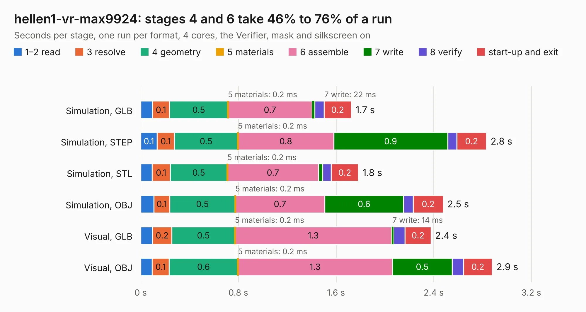

| Mode and format | 1–2 read | 3 resolve | 4 geometry | 5 materials | 6 assemble | 7 write | 8 verify | start-up and exit | Total |
|---|---:|---:|---:|---:|---:|---:|---:|---:|---:|
| Simulation, GLB | 96&nbsp;ms | 0.1 | 0.5 | 0.2&nbsp;ms | 0.7 | 22&nbsp;ms | 75&nbsp;ms | 0.2 | 1.7 |
| Simulation, STEP | 0.1 | 0.1 | 0.5 | 0.2&nbsp;ms | 0.8 | 0.9 | 75&nbsp;ms | 0.2 | 2.8 |
| Simulation, STL | 93&nbsp;ms | 0.1 | 0.5 | 0.2&nbsp;ms | 0.7 | 33&nbsp;ms | 71&nbsp;ms | 0.2 | 1.8 |
| Simulation, OBJ | 0.1 | 0.1 | 0.5 | 0.2&nbsp;ms | 0.7 | 0.6 | 80&nbsp;ms | 0.2 | 2.5 |
| Visual, GLB | 97&nbsp;ms | 0.2 | 0.5 | 0.2&nbsp;ms | 1.3 | 14&nbsp;ms | 96&nbsp;ms | 0.2 | 2.4 |
| Visual, OBJ | 94&nbsp;ms | 0.1 | 0.6 | 0.2&nbsp;ms | 1.3 | 0.5 | 92&nbsp;ms | 0.2 | 2.9 |

<table align="center"><tr><td valign="top">

| Board | Repo: [rusefi/hellen-one](https://github.com/rusefi/hellen-one) Board: `hellen1-vr-max9924.kicad_pcb` |
|---|---|
| Folder | kicad / modules / hellen1-vr-max9924 |
| Complexity | 221&nbsp;/&nbsp;1000 (size&nbsp;141, features&nbsp;80) |
| KESE&nbsp;features | through vias, rounded, trapezoid or chamfered pads, filled zones, stack-up, dielectric εr and tanδ, mask and silkscreen colours |
| Tested | 9th November 2026 |
| Copper&nbsp;layers | 4 |
| File&nbsp;format | KiCad 7 (20221018) |
| Parts,&nbsp;tracks,&nbsp;vias | 13, 57, 23 |
| Triangles,&nbsp;simulation | 119,346 in 27 parts |
| Verifier | PASS in all six runs |

</td><td valign="top">

<table>
<tr><th>File type</th><th>File size</th><th>Peak memory used</th></tr>
<tr><th colspan="3" align="left">Simulation</th></tr>
<tr><td>GLB</td><td align="right">4.0&nbsp;MB</td><td align="right">185&nbsp;MB</td></tr>
<tr><td>STEP</td><td align="right">14&nbsp;MB</td><td align="right">196&nbsp;MB</td></tr>
<tr><td>STL</td><td align="right">6.0&nbsp;MB</td><td align="right">185&nbsp;MB</td></tr>
<tr><td>OBJ</td><td align="right">11&nbsp;MB</td><td align="right">188&nbsp;MB</td></tr>
<tr><th colspan="3" align="left">Visual</th></tr>
<tr><td>GLB</td><td align="right">2.6&nbsp;MB</td><td align="right">154&nbsp;MB</td></tr>
<tr><td>OBJ</td><td align="right">7.4&nbsp;MB</td><td align="right">154&nbsp;MB</td></tr>
</table>

</td></tr></table>

## 2410. hellen1-wbo

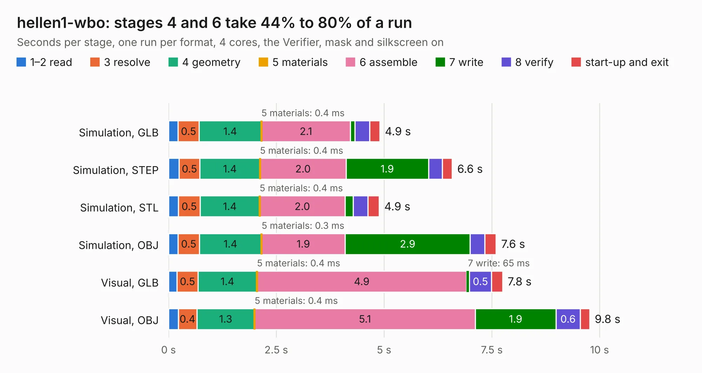

| Mode and format | 1–2 read | 3 resolve | 4 geometry | 5 materials | 6 assemble | 7 write | 8 verify | start-up and exit | Total |
|---|---:|---:|---:|---:|---:|---:|---:|---:|---:|
| Simulation, GLB | 0.2 | 0.5 | 1.4 | 0.4&nbsp;ms | 2.1 | 0.1 | 0.3 | 0.2 | 4.9 |
| Simulation, STEP | 0.2 | 0.5 | 1.4 | 0.4&nbsp;ms | 2.0 | 1.9 | 0.3 | 0.2 | 6.6 |
| Simulation, STL | 0.2 | 0.5 | 1.4 | 0.4&nbsp;ms | 2.0 | 0.2 | 0.3 | 0.3 | 4.9 |
| Simulation, OBJ | 0.2 | 0.5 | 1.4 | 0.3&nbsp;ms | 1.9 | 2.9 | 0.3 | 0.3 | 7.6 |
| Visual, GLB | 0.2 | 0.5 | 1.4 | 0.4&nbsp;ms | 4.9 | 65&nbsp;ms | 0.5 | 0.3 | 7.8 |
| Visual, OBJ | 0.2 | 0.4 | 1.3 | 0.4&nbsp;ms | 5.1 | 1.9 | 0.6 | 0.2 | 9.8 |

<table align="center"><tr><td valign="top">

| Board | Repo: [rusefi/hellen-one](https://github.com/rusefi/hellen-one) Board: `hellen1-wbo.kicad_pcb` |
|---|---|
| Folder | kicad / modules / hellen1-wbo |
| Complexity | 306&nbsp;/&nbsp;1000 (size&nbsp;226, features&nbsp;80) |
| KESE&nbsp;features | through vias, rounded, trapezoid or chamfered pads, filled zones, stack-up, dielectric εr and tanδ, mask and silkscreen colours |
| Tested | 9th November 2026 |
| Copper&nbsp;layers | 4 |
| File&nbsp;format | KiCad 8 (20240108) |
| Parts,&nbsp;tracks,&nbsp;vias | 64, 448, 80 |
| Triangles,&nbsp;simulation | 560,150 in 68 parts |
| Verifier | PASS in all six runs |

</td><td valign="top">

<table>
<tr><th>File type</th><th>File size</th><th>Peak memory used</th></tr>
<tr><th colspan="3" align="left">Simulation</th></tr>
<tr><td>GLB</td><td align="right">19&nbsp;MB</td><td align="right">334&nbsp;MB</td></tr>
<tr><td>STEP</td><td align="right">86&nbsp;MB</td><td align="right">362&nbsp;MB</td></tr>
<tr><td>STL</td><td align="right">28&nbsp;MB</td><td align="right">356&nbsp;MB</td></tr>
<tr><td>OBJ</td><td align="right">56&nbsp;MB</td><td align="right">417&nbsp;MB</td></tr>
<tr><th colspan="3" align="left">Visual</th></tr>
<tr><td>GLB</td><td align="right">14&nbsp;MB</td><td align="right">384&nbsp;MB</td></tr>
<tr><td>OBJ</td><td align="right">41&nbsp;MB</td><td align="right">387&nbsp;MB</td></tr>
</table>

</td></tr></table>

## 2411. output.Panel_R0.5.1_300x300_2layer_step1_Modified_1and5_only

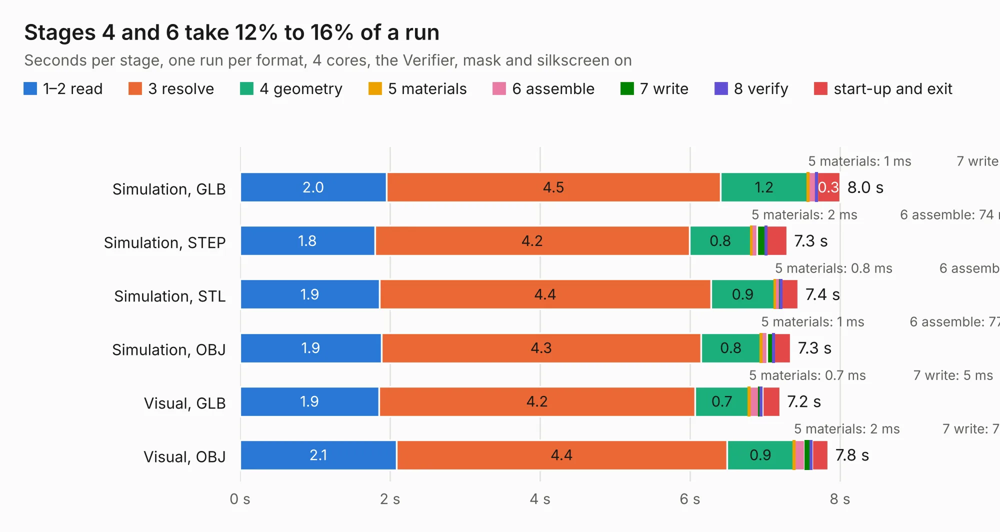

| Mode and format | 1–2 read | 3 resolve | 4 geometry | 5 materials | 6 assemble | 7 write | 8 verify | start-up and exit | Total |
|---|---:|---:|---:|---:|---:|---:|---:|---:|---:|
| Simulation, GLB | 2.0 | 4.5 | 1.2 | 1&nbsp;ms | 0.1 | 4&nbsp;ms | 8&nbsp;ms | 0.3 | 8.0 |
| Simulation, STEP | 1.8 | 4.2 | 0.8 | 2&nbsp;ms | 74&nbsp;ms | 0.1 | 5&nbsp;ms | 0.3 | 7.3 |
| Simulation, STL | 1.9 | 4.4 | 0.9 | 0.8&nbsp;ms | 74&nbsp;ms | 4&nbsp;ms | 6&nbsp;ms | 0.2 | 7.4 |
| Simulation, OBJ | 1.9 | 4.3 | 0.8 | 1&nbsp;ms | 77&nbsp;ms | 85&nbsp;ms | 6&nbsp;ms | 0.2 | 7.3 |
| Visual, GLB | 1.9 | 4.2 | 0.7 | 0.7&nbsp;ms | 0.1 | 5&nbsp;ms | 36&nbsp;ms | 0.2 | 7.2 |
| Visual, OBJ | 2.1 | 4.4 | 0.9 | 2&nbsp;ms | 0.1 | 78&nbsp;ms | 24&nbsp;ms | 0.2 | 7.8 |

<table align="center"><tr><td valign="top">

| Board | Repo: [rusefi/hw_microrusefi](https://github.com/rusefi/hw_microrusefi) Board: `output.Panel_R0.5.1_300x300_2layer_step1_Modified_1and5_only.kicad_pcb` |
|---|---|
| Folder | gerbers / R0.5.1 / Panel_source_files |
| Complexity | 368&nbsp;/&nbsp;1000 (size&nbsp;293, features&nbsp;75) |
| KESE&nbsp;features | through vias, slotted holes, rounded, trapezoid or chamfered pads, filled zones, copper text, curved board outline |
| Tested | 9th November 2026 |
| Copper&nbsp;layers | 2 |
| File&nbsp;format | KiCad 5 (20171130) |
| Parts,&nbsp;tracks,&nbsp;vias | 487, 8,095, 1,691 |
| Triangles,&nbsp;simulation | 19,142 in 5 parts |
| Note | panel |
| Verifier | PASS in all six runs |

</td><td valign="top">

<table>
<tr><th>File type</th><th>File size</th><th>Peak memory used</th></tr>
<tr><th colspan="3" align="left">Simulation</th></tr>
<tr><td>GLB</td><td align="right">640&nbsp;kB</td><td align="right">248&nbsp;MB</td></tr>
<tr><td>STEP</td><td align="right">1.1&nbsp;MB</td><td align="right">265&nbsp;MB</td></tr>
<tr><td>STL</td><td align="right">958&nbsp;kB</td><td align="right">260&nbsp;MB</td></tr>
<tr><td>OBJ</td><td align="right">1.9&nbsp;MB</td><td align="right">261&nbsp;MB</td></tr>
<tr><th colspan="3" align="left">Visual</th></tr>
<tr><td>GLB</td><td align="right">723&nbsp;kB</td><td align="right">261&nbsp;MB</td></tr>
<tr><td>OBJ</td><td align="right">1.9&nbsp;MB</td><td align="right">249&nbsp;MB</td></tr>
</table>

</td></tr></table>

## 2412. zMRETestFixture

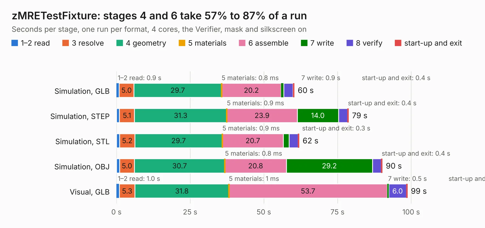

| Mode and format | 1–2 read | 3 resolve | 4 geometry | 5 materials | 6 assemble | 7 write | 8 verify | start-up and exit | Total |
|---|---:|---:|---:|---:|---:|---:|---:|---:|---:|
| Simulation, GLB | 0.9 | 5.0 | 29.7 | 0.8&nbsp;ms | 20.2 | 0.9 | 3.1 | 0.4 | 60.3 |
| Simulation, STEP | 1.0 | 5.1 | 31.3 | 0.9&nbsp;ms | 23.9 | 14.0 | 3.0 | 0.4 | 78.8 |
| Simulation, STL | 1.1 | 5.2 | 29.7 | 0.9&nbsp;ms | 20.7 | 1.9 | 3.1 | 0.3 | 62.0 |
| Simulation, OBJ | 1.1 | 5.0 | 30.7 | 0.8&nbsp;ms | 20.8 | 29.2 | 2.9 | 0.4 | 90.2 |
| Visual, GLB | 1.0 | 5.3 | 31.8 | 1&nbsp;ms | 53.7 | 0.5 | 6.0 | 0.3 | 98.7 |
| Visual, OBJ | 1.0 | 4.9 | 30.8 | 0.8&nbsp;ms | 56.6 | 21.6 | 6.8 | 0.4 | 122.2 |

<table align="center"><tr><td valign="top">

| Board | Repo: [rusefi/hw_microrusefi](https://github.com/rusefi/hw_microrusefi) Board: `zMRETestFixture.kicad_pcb` |
|---|---|
| Complexity | 249&nbsp;/&nbsp;1000 (size&nbsp;204, features&nbsp;45) |
| KESE&nbsp;features | through vias, filled zones, curved board outline |
| Tested | 9th November 2026 to 10th November 2026 |
| Copper&nbsp;layers | 2 |
| File&nbsp;format | KiCad 5 (20171130) |
| Parts,&nbsp;tracks,&nbsp;vias | 190, 1,607, 431 |
| Triangles,&nbsp;simulation | 4,664,266 in 178 parts |
| Verifier | PASS in all six runs |

</td><td valign="top">

<table>
<tr><th>File type</th><th>File size</th><th>Peak memory used</th></tr>
<tr><th colspan="3" align="left">Simulation</th></tr>
<tr><td>GLB</td><td align="right">161&nbsp;MB</td><td align="right">1.5&nbsp;GB</td></tr>
<tr><td>STEP</td><td align="right">799&nbsp;MB</td><td align="right">1.9&nbsp;GB</td></tr>
<tr><td>STL</td><td align="right">233&nbsp;MB</td><td align="right">1.6&nbsp;GB</td></tr>
<tr><td>OBJ</td><td align="right">505&nbsp;MB</td><td align="right">3.1&nbsp;GB</td></tr>
<tr><th colspan="3" align="left">Visual</th></tr>
<tr><td>GLB</td><td align="right">114&nbsp;MB</td><td align="right">1.9&nbsp;GB</td></tr>
<tr><td>OBJ</td><td align="right">359&nbsp;MB</td><td align="right">2.3&nbsp;GB</td></tr>
</table>

</td></tr></table>

## 2413. Motor_driver_A4988

| Mode and format | 1–2 read | 3 resolve | 4 geometry | 5 materials | 6 assemble | 7 write | 8 verify | start-up and exit | Total |
|---|---:|---:|---:|---:|---:|---:|---:|---:|---:|
| Simulation, GLB | 0.1 | 0.2 | 0.7 | 0.1&nbsp;ms | 0.9 | 32&nbsp;ms | 0.1 | 0.2 | 2.2 |
| Simulation, STEP | 0.2 | 0.2 | 0.7 | 0.2&nbsp;ms | 0.8 | 1.0 | 0.1 | 0.2 | 3.1 |
| Simulation, STL | 0.1 | 0.2 | 0.7 | 0.2&nbsp;ms | 0.9 | 47&nbsp;ms | 0.1 | 0.2 | 2.2 |
| Simulation, OBJ | 0.1 | 0.2 | 0.7 | 0.2&nbsp;ms | 0.9 | 1.1 | 0.1 | 0.2 | 3.3 |
| Visual, GLB | 0.1 | 0.2 | 0.7 | 0.2&nbsp;ms | 1.8 | 26&nbsp;ms | 0.2 | 0.2 | 3.2 |
| Visual, OBJ | 0.1 | 0.2 | 0.7 | 0.2&nbsp;ms | 1.9 | 0.8 | 0.1 | 0.2 | 4.1 |

<table align="center"><tr><td valign="top">

| Board | Repo: [rusefi/rusefi-hardware](https://github.com/rusefi/rusefi-hardware) Board: `Motor_driver_A4988.kicad_pcb` |
|---|---|
| Folder | A4988_stepper_motor_driver |
| Complexity | 255&nbsp;/&nbsp;1000 (size&nbsp;180, features&nbsp;75) |
| KESE&nbsp;features | through vias, rounded, trapezoid or chamfered pads, filled zones, stack-up, dielectric εr and tanδ |
| Tested | 9th November 2026 |
| Copper&nbsp;layers | 2 |
| File&nbsp;format | KiCad 7 (20221018) |
| Parts,&nbsp;tracks,&nbsp;vias | 19, 197, 21 |
| Triangles,&nbsp;simulation | 217,518 in 37 parts |
| Verifier | PASS in all six runs |

</td><td valign="top">

<table>
<tr><th>File type</th><th>File size</th><th>Peak memory used</th></tr>
<tr><th colspan="3" align="left">Simulation</th></tr>
<tr><td>GLB</td><td align="right">7.5&nbsp;MB</td><td align="right">213&nbsp;MB</td></tr>
<tr><td>STEP</td><td align="right">36&nbsp;MB</td><td align="right">240&nbsp;MB</td></tr>
<tr><td>STL</td><td align="right">11&nbsp;MB</td><td align="right">213&nbsp;MB</td></tr>
<tr><td>OBJ</td><td align="right">21&nbsp;MB</td><td align="right">213&nbsp;MB</td></tr>
<tr><th colspan="3" align="left">Visual</th></tr>
<tr><td>GLB</td><td align="right">5.6&nbsp;MB</td><td align="right">220&nbsp;MB</td></tr>
<tr><td>OBJ</td><td align="right">16&nbsp;MB</td><td align="right">221&nbsp;MB</td></tr>
</table>

</td></tr></table>

## 2414. Breakout-24pin-superseal

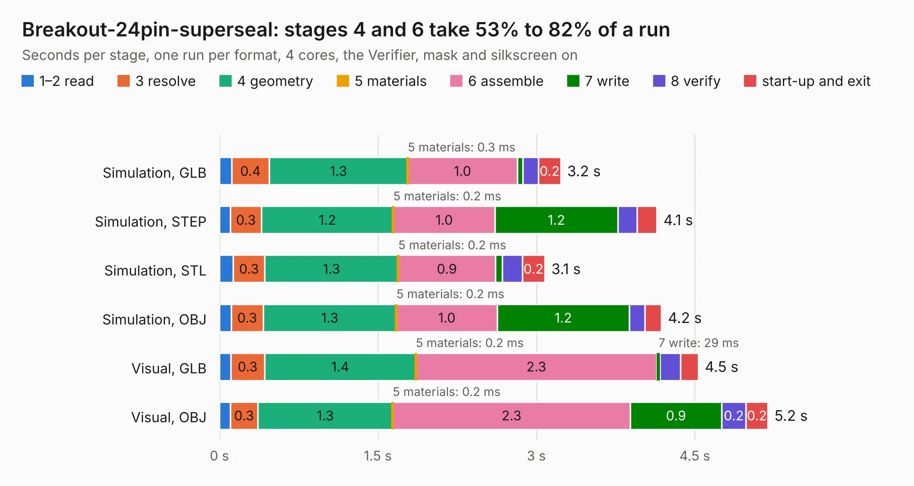

| Mode and format | 1–2 read | 3 resolve | 4 geometry | 5 materials | 6 assemble | 7 write | 8 verify | start-up and exit | Total |
|---|---:|---:|---:|---:|---:|---:|---:|---:|---:|
| Simulation, GLB | 0.1 | 0.4 | 1.3 | 0.3&nbsp;ms | 1.0 | 52&nbsp;ms | 0.1 | 0.2 | 3.2 |
| Simulation, STEP | 0.1 | 0.3 | 1.2 | 0.2&nbsp;ms | 1.0 | 1.2 | 0.2 | 0.2 | 4.1 |
| Simulation, STL | 0.1 | 0.3 | 1.3 | 0.2&nbsp;ms | 0.9 | 65&nbsp;ms | 0.2 | 0.2 | 3.1 |
| Simulation, OBJ | 0.1 | 0.3 | 1.3 | 0.2&nbsp;ms | 1.0 | 1.2 | 0.1 | 0.2 | 4.2 |
| Visual, GLB | 0.1 | 0.3 | 1.4 | 0.2&nbsp;ms | 2.3 | 29&nbsp;ms | 0.2 | 0.2 | 4.5 |
| Visual, OBJ | 0.1 | 0.3 | 1.3 | 0.2&nbsp;ms | 2.3 | 0.9 | 0.2 | 0.2 | 5.2 |

<table align="center"><tr><td valign="top">

| Board | Repo: [rusefi/rusefi-hardware](https://github.com/rusefi/rusefi-hardware) Board: `Breakout-24pin-superseal.kicad_pcb` |
|---|---|
| Folder | breakout-boards / Breakout-24pin-superseal |
| Complexity | 149&nbsp;/&nbsp;1000 (size&nbsp;109, features&nbsp;40) |
| KESE&nbsp;features | slotted holes, stack-up, dielectric εr and tanδ |
| Tested | 9th November 2026 |
| Copper&nbsp;layers | 2 |
| File&nbsp;format | KiCad 8 (20240108) |
| Parts,&nbsp;tracks,&nbsp;vias | 2, 134, 0 |
| Triangles,&nbsp;simulation | 336,614 in 38 parts |
| Verifier | PASS in all six runs |

</td><td valign="top">

<table>
<tr><th>File type</th><th>File size</th><th>Peak memory used</th></tr>
<tr><th colspan="3" align="left">Simulation</th></tr>
<tr><td>GLB</td><td align="right">12&nbsp;MB</td><td align="right">239&nbsp;MB</td></tr>
<tr><td>STEP</td><td align="right">51&nbsp;MB</td><td align="right">262&nbsp;MB</td></tr>
<tr><td>STL</td><td align="right">17&nbsp;MB</td><td align="right">239&nbsp;MB</td></tr>
<tr><td>OBJ</td><td align="right">34&nbsp;MB</td><td align="right">278&nbsp;MB</td></tr>
<tr><th colspan="3" align="left">Visual</th></tr>
<tr><td>GLB</td><td align="right">7.5&nbsp;MB</td><td align="right">240&nbsp;MB</td></tr>
<tr><td>OBJ</td><td align="right">22&nbsp;MB</td><td align="right">228&nbsp;MB</td></tr>
</table>

</td></tr></table>

## 2415. 24pins_In_3conn

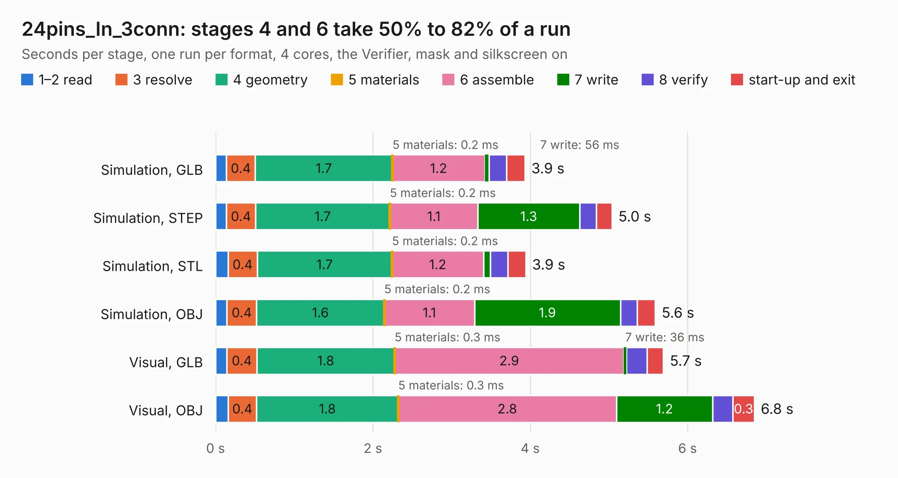

| Mode and format | 1–2 read | 3 resolve | 4 geometry | 5 materials | 6 assemble | 7 write | 8 verify | start-up and exit | Total |
|---|---:|---:|---:|---:|---:|---:|---:|---:|---:|
| Simulation, GLB | 0.1 | 0.4 | 1.7 | 0.2&nbsp;ms | 1.2 | 56&nbsp;ms | 0.2 | 0.2 | 3.9 |
| Simulation, STEP | 0.1 | 0.4 | 1.7 | 0.2&nbsp;ms | 1.1 | 1.3 | 0.2 | 0.2 | 5.0 |
| Simulation, STL | 0.2 | 0.4 | 1.7 | 0.2&nbsp;ms | 1.2 | 89&nbsp;ms | 0.2 | 0.2 | 3.9 |
| Simulation, OBJ | 0.1 | 0.4 | 1.6 | 0.2&nbsp;ms | 1.1 | 1.9 | 0.2 | 0.2 | 5.6 |
| Visual, GLB | 0.1 | 0.4 | 1.8 | 0.3&nbsp;ms | 2.9 | 36&nbsp;ms | 0.3 | 0.2 | 5.7 |
| Visual, OBJ | 0.2 | 0.4 | 1.8 | 0.3&nbsp;ms | 2.8 | 1.2 | 0.3 | 0.3 | 6.8 |

<table align="center"><tr><td valign="top">

| Board | Repo: [rusefi/rusefi-hardware](https://github.com/rusefi/rusefi-hardware) Board: `24pins_In_3conn.kicad_pcb` |
|---|---|
| Folder | breakout-boards / Breakout-24pin |
| Complexity | 157&nbsp;/&nbsp;1000 (size&nbsp;117, features&nbsp;40) |
| KESE&nbsp;features | slotted holes, stack-up, dielectric εr and tanδ |
| Tested | 9th November 2026 |
| Copper&nbsp;layers | 2 |
| File&nbsp;format | KiCad 7 (20221018) |
| Parts,&nbsp;tracks,&nbsp;vias | 4, 156, 0 |
| Triangles,&nbsp;simulation | 318,636 in 36 parts |
| Verifier | PASS in all six runs |

</td><td valign="top">

<table>
<tr><th>File type</th><th>File size</th><th>Peak memory used</th></tr>
<tr><th colspan="3" align="left">Simulation</th></tr>
<tr><td>GLB</td><td align="right">11&nbsp;MB</td><td align="right">227&nbsp;MB</td></tr>
<tr><td>STEP</td><td align="right">49&nbsp;MB</td><td align="right">254&nbsp;MB</td></tr>
<tr><td>STL</td><td align="right">16&nbsp;MB</td><td align="right">235&nbsp;MB</td></tr>
<tr><td>OBJ</td><td align="right">32&nbsp;MB</td><td align="right">264&nbsp;MB</td></tr>
<tr><th colspan="3" align="left">Visual</th></tr>
<tr><td>GLB</td><td align="right">7.2&nbsp;MB</td><td align="right">228&nbsp;MB</td></tr>
<tr><td>OBJ</td><td align="right">21&nbsp;MB</td><td align="right">230&nbsp;MB</td></tr>
</table>

</td></tr></table>

## 2416. 284617-1

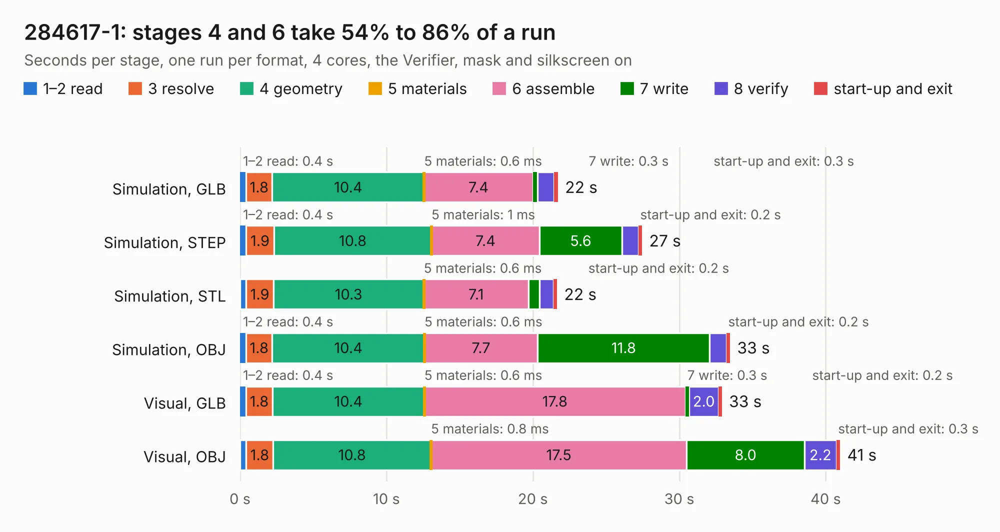

| Mode and format | 1–2 read | 3 resolve | 4 geometry | 5 materials | 6 assemble | 7 write | 8 verify | start-up and exit | Total |
|---|---:|---:|---:|---:|---:|---:|---:|---:|---:|
| Simulation, GLB | 0.4 | 1.8 | 10.4 | 0.6&nbsp;ms | 7.4 | 0.3 | 1.1 | 0.3 | 21.7 |
| Simulation, STEP | 0.4 | 1.9 | 10.8 | 1&nbsp;ms | 7.4 | 5.6 | 1.1 | 0.2 | 27.5 |
| Simulation, STL | 0.4 | 1.9 | 10.3 | 0.6&nbsp;ms | 7.1 | 0.7 | 1.0 | 0.2 | 21.6 |
| Simulation, OBJ | 0.4 | 1.8 | 10.4 | 0.6&nbsp;ms | 7.7 | 11.8 | 1.1 | 0.2 | 33.5 |
| Visual, GLB | 0.4 | 1.8 | 10.4 | 0.6&nbsp;ms | 17.8 | 0.3 | 2.0 | 0.2 | 32.9 |
| Visual, OBJ | 0.4 | 1.8 | 10.8 | 0.8&nbsp;ms | 17.5 | 8.0 | 2.2 | 0.3 | 41.0 |

<table align="center"><tr><td valign="top">

| Board | Repo: [rusefi/rusefi-hardware](https://github.com/rusefi/rusefi-hardware) Board: `284617-1.kicad_pcb` |
|---|---|
| Folder | breakout-boards / Breakout_154pin_284617-1-Connector |
| Complexity | 185&nbsp;/&nbsp;1000 (size&nbsp;155, features&nbsp;30) |
| KESE&nbsp;features | filled zones, curved board outline |
| Tested | 9th November 2026 |
| Copper&nbsp;layers | 2 |
| File&nbsp;format | KiCad 7 (20221018) |
| Parts,&nbsp;tracks,&nbsp;vias | 13, 823, 0 |
| Triangles,&nbsp;simulation | 2,138,614 in 167 parts |
| Verifier | PASS in all six runs |

</td><td valign="top">

<table>
<tr><th>File type</th><th>File size</th><th>Peak memory used</th></tr>
<tr><th colspan="3" align="left">Simulation</th></tr>
<tr><td>GLB</td><td align="right">72&nbsp;MB</td><td align="right">809&nbsp;MB</td></tr>
<tr><td>STEP</td><td align="right">314&nbsp;MB</td><td align="right">916&nbsp;MB</td></tr>
<tr><td>STL</td><td align="right">107&nbsp;MB</td><td align="right">788&nbsp;MB</td></tr>
<tr><td>OBJ</td><td align="right">222&nbsp;MB</td><td align="right">1.4&nbsp;GB</td></tr>
<tr><th colspan="3" align="left">Visual</th></tr>
<tr><td>GLB</td><td align="right">50&nbsp;MB</td><td align="right">1.1&nbsp;GB</td></tr>
<tr><td>OBJ</td><td align="right">154&nbsp;MB</td><td align="right">1.1&nbsp;GB</td></tr>
</table>

</td></tr></table>

## 2417. CDI-test

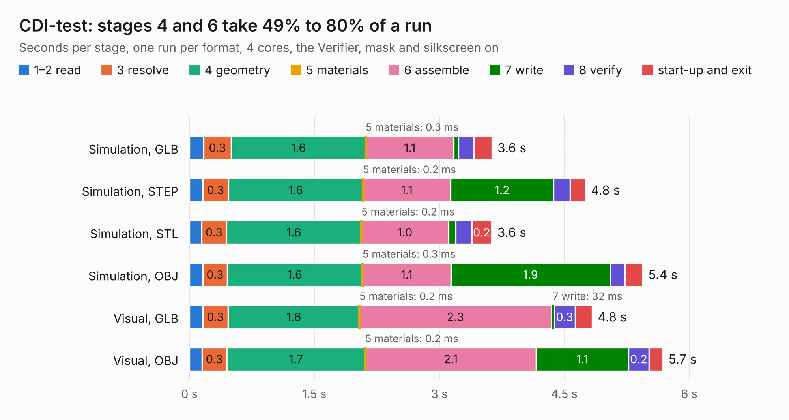

| Mode and format | 1–2 read | 3 resolve | 4 geometry | 5 materials | 6 assemble | 7 write | 8 verify | start-up and exit | Total |
|---|---:|---:|---:|---:|---:|---:|---:|---:|---:|
| Simulation, GLB | 0.2 | 0.3 | 1.6 | 0.3&nbsp;ms | 1.1 | 57&nbsp;ms | 0.2 | 0.2 | 3.6 |
| Simulation, STEP | 0.2 | 0.3 | 1.6 | 0.2&nbsp;ms | 1.1 | 1.2 | 0.2 | 0.2 | 4.8 |
| Simulation, STL | 0.1 | 0.3 | 1.6 | 0.2&nbsp;ms | 1.0 | 85&nbsp;ms | 0.2 | 0.2 | 3.6 |
| Simulation, OBJ | 0.2 | 0.3 | 1.6 | 0.3&nbsp;ms | 1.1 | 1.9 | 0.2 | 0.2 | 5.4 |
| Visual, GLB | 0.2 | 0.3 | 1.6 | 0.2&nbsp;ms | 2.3 | 32&nbsp;ms | 0.3 | 0.2 | 4.8 |
| Visual, OBJ | 0.2 | 0.3 | 1.7 | 0.2&nbsp;ms | 2.1 | 1.1 | 0.2 | 0.2 | 5.7 |

<table align="center"><tr><td valign="top">

| Board | Repo: [rusefi/rusefi-hardware](https://github.com/rusefi/rusefi-hardware) Board: `CDI-test.kicad_pcb` |
|---|---|
| Folder | CDI-test |
| Complexity | 186&nbsp;/&nbsp;1000 (size&nbsp;131, features&nbsp;55) |
| KESE&nbsp;features | through vias, rounded, trapezoid or chamfered pads, filled zones, curved board outline |
| Tested | 9th November 2026 |
| Copper&nbsp;layers | 2 |
| File&nbsp;format | KiCad 8 (20240108) |
| Parts,&nbsp;tracks,&nbsp;vias | 17, 37, 40 |
| Triangles,&nbsp;simulation | 381,408 in 22 parts |
| Verifier | PASS in all six runs |

</td><td valign="top">

<table>
<tr><th>File type</th><th>File size</th><th>Peak memory used</th></tr>
<tr><th colspan="3" align="left">Simulation</th></tr>
<tr><td>GLB</td><td align="right">12&nbsp;MB</td><td align="right">274&nbsp;MB</td></tr>
<tr><td>STEP</td><td align="right">47&nbsp;MB</td><td align="right">288&nbsp;MB</td></tr>
<tr><td>STL</td><td align="right">19&nbsp;MB</td><td align="right">275&nbsp;MB</td></tr>
<tr><td>OBJ</td><td align="right">38&nbsp;MB</td><td align="right">293&nbsp;MB</td></tr>
<tr><th colspan="3" align="left">Visual</th></tr>
<tr><td>GLB</td><td align="right">8.0&nbsp;MB</td><td align="right">267&nbsp;MB</td></tr>
<tr><td>OBJ</td><td align="right">23&nbsp;MB</td><td align="right">267&nbsp;MB</td></tr>
</table>

</td></tr></table>

## 2418. inj_12ch

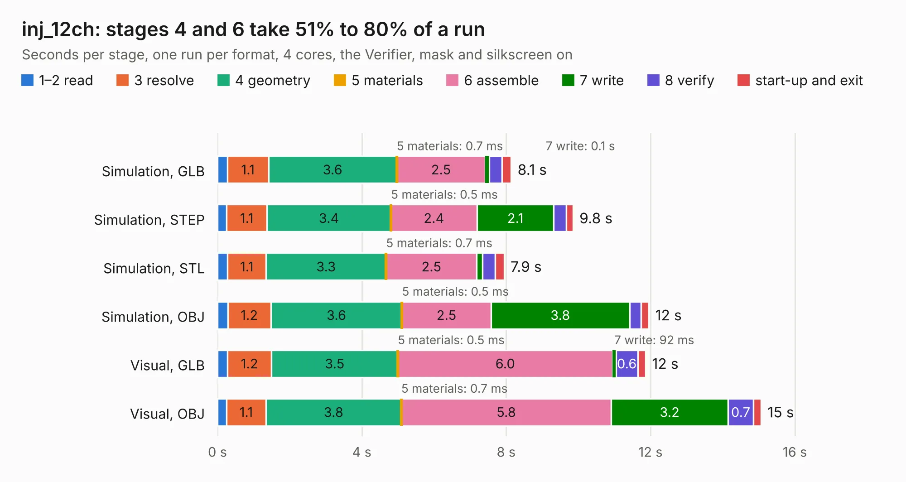

| Mode and format | 1–2 read | 3 resolve | 4 geometry | 5 materials | 6 assemble | 7 write | 8 verify | start-up and exit | Total |
|---|---:|---:|---:|---:|---:|---:|---:|---:|---:|
| Simulation, GLB | 0.3 | 1.1 | 3.6 | 0.7&nbsp;ms | 2.5 | 0.1 | 0.4 | 0.2 | 8.1 |
| Simulation, STEP | 0.3 | 1.1 | 3.4 | 0.5&nbsp;ms | 2.4 | 2.1 | 0.3 | 0.2 | 9.8 |
| Simulation, STL | 0.3 | 1.1 | 3.3 | 0.7&nbsp;ms | 2.5 | 0.2 | 0.4 | 0.2 | 7.9 |
| Simulation, OBJ | 0.3 | 1.2 | 3.6 | 0.5&nbsp;ms | 2.5 | 3.8 | 0.3 | 0.2 | 12.0 |
| Visual, GLB | 0.3 | 1.2 | 3.5 | 0.5&nbsp;ms | 6.0 | 92&nbsp;ms | 0.6 | 0.2 | 11.9 |
| Visual, OBJ | 0.2 | 1.1 | 3.8 | 0.7&nbsp;ms | 5.8 | 3.2 | 0.7 | 0.2 | 15.1 |

<table align="center"><tr><td valign="top">

| Board | Repo: [rusefi/rusefi-hardware](https://github.com/rusefi/rusefi-hardware) Board: `inj_12ch.kicad_pcb` |
|---|---|
| Folder | classic-designs / 1A_injector_12-channels |
| Complexity | 214&nbsp;/&nbsp;1000 (size&nbsp;179, features&nbsp;35) |
| KESE&nbsp;features | through vias, filled zones |
| Tested | 9th November 2026 |
| Copper&nbsp;layers | 2 |
| File&nbsp;format | KiCad 3 (3) |
| Parts,&nbsp;tracks,&nbsp;vias | 56, 791, 196 |
| Triangles,&nbsp;simulation | 793,042 in 56 parts |
| Verifier | PASS in all six runs |

</td><td valign="top">

<table>
<tr><th>File type</th><th>File size</th><th>Peak memory used</th></tr>
<tr><th colspan="3" align="left">Simulation</th></tr>
<tr><td>GLB</td><td align="right">27&nbsp;MB</td><td align="right">455&nbsp;MB</td></tr>
<tr><td>STEP</td><td align="right">116&nbsp;MB</td><td align="right">474&nbsp;MB</td></tr>
<tr><td>STL</td><td align="right">40&nbsp;MB</td><td align="right">403&nbsp;MB</td></tr>
<tr><td>OBJ</td><td align="right">81&nbsp;MB</td><td align="right">571&nbsp;MB</td></tr>
<tr><th colspan="3" align="left">Visual</th></tr>
<tr><td>GLB</td><td align="right">23&nbsp;MB</td><td align="right">538&nbsp;MB</td></tr>
<tr><td>OBJ</td><td align="right">68&nbsp;MB</td><td align="right">532&nbsp;MB</td></tr>
</table>

</td></tr></table>

## 2419. inj_6ch

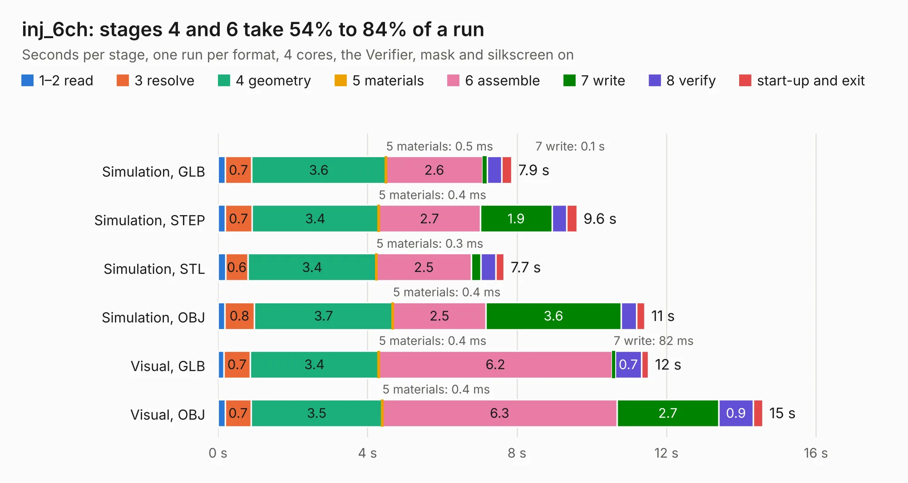

| Mode and format | 1–2 read | 3 resolve | 4 geometry | 5 materials | 6 assemble | 7 write | 8 verify | start-up and exit | Total |
|---|---:|---:|---:|---:|---:|---:|---:|---:|---:|
| Simulation, GLB | 0.2 | 0.7 | 3.6 | 0.5&nbsp;ms | 2.6 | 0.1 | 0.4 | 0.3 | 7.9 |
| Simulation, STEP | 0.2 | 0.7 | 3.4 | 0.4&nbsp;ms | 2.7 | 1.9 | 0.4 | 0.3 | 9.6 |
| Simulation, STL | 0.2 | 0.6 | 3.4 | 0.3&nbsp;ms | 2.5 | 0.3 | 0.4 | 0.2 | 7.7 |
| Simulation, OBJ | 0.2 | 0.8 | 3.7 | 0.4&nbsp;ms | 2.5 | 3.6 | 0.4 | 0.2 | 11.4 |
| Visual, GLB | 0.2 | 0.7 | 3.4 | 0.4&nbsp;ms | 6.2 | 82&nbsp;ms | 0.7 | 0.2 | 11.5 |
| Visual, OBJ | 0.2 | 0.7 | 3.5 | 0.4&nbsp;ms | 6.3 | 2.7 | 0.9 | 0.3 | 14.6 |

<table align="center"><tr><td valign="top">

| Board | Repo: [rusefi/rusefi-hardware](https://github.com/rusefi/rusefi-hardware) Board: `inj_6ch.kicad_pcb` |
|---|---|
| Folder | classic-designs / 1A_injector_6-channels |
| Complexity | 210&nbsp;/&nbsp;1000 (size&nbsp;165, features&nbsp;45) |
| KESE&nbsp;features | through vias, filled zones, curved board outline |
| Tested | 9th November 2026 |
| Copper&nbsp;layers | 2 |
| File&nbsp;format | KiCad 3 (3) |
| Parts,&nbsp;tracks,&nbsp;vias | 35, 472, 114 |
| Triangles,&nbsp;simulation | 757,786 in 44 parts |
| Verifier | PASS in all six runs |

</td><td valign="top">

<table>
<tr><th>File type</th><th>File size</th><th>Peak memory used</th></tr>
<tr><th colspan="3" align="left">Simulation</th></tr>
<tr><td>GLB</td><td align="right">27&nbsp;MB</td><td align="right">351&nbsp;MB</td></tr>
<tr><td>STEP</td><td align="right">134&nbsp;MB</td><td align="right">415&nbsp;MB</td></tr>
<tr><td>STL</td><td align="right">38&nbsp;MB</td><td align="right">391&nbsp;MB</td></tr>
<tr><td>OBJ</td><td align="right">80&nbsp;MB</td><td align="right">564&nbsp;MB</td></tr>
<tr><th colspan="3" align="left">Visual</th></tr>
<tr><td>GLB</td><td align="right">19&nbsp;MB</td><td align="right">441&nbsp;MB</td></tr>
<tr><td>OBJ</td><td align="right">58&nbsp;MB</td><td align="right">476&nbsp;MB</td></tr>
</table>

</td></tr></table>

## 2420. PWR_5V_linear

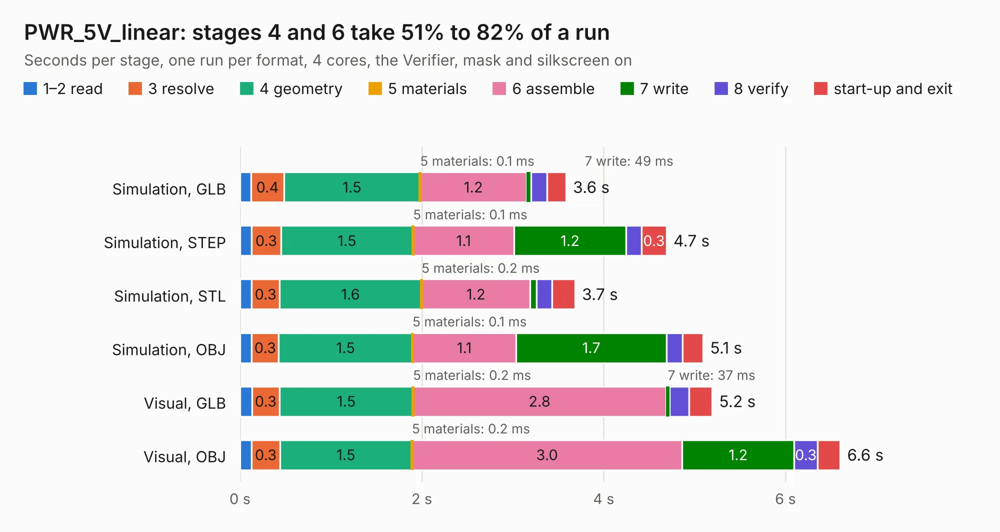

| Mode and format | 1–2 read | 3 resolve | 4 geometry | 5 materials | 6 assemble | 7 write | 8 verify | start-up and exit | Total |
|---|---:|---:|---:|---:|---:|---:|---:|---:|---:|
| Simulation, GLB | 0.1 | 0.4 | 1.5 | 0.1&nbsp;ms | 1.2 | 49&nbsp;ms | 0.2 | 0.2 | 3.6 |
| Simulation, STEP | 0.1 | 0.3 | 1.5 | 0.1&nbsp;ms | 1.1 | 1.2 | 0.2 | 0.3 | 4.7 |
| Simulation, STL | 0.1 | 0.3 | 1.6 | 0.2&nbsp;ms | 1.2 | 68&nbsp;ms | 0.2 | 0.3 | 3.7 |
| Simulation, OBJ | 0.1 | 0.3 | 1.5 | 0.1&nbsp;ms | 1.1 | 1.7 | 0.2 | 0.2 | 5.1 |
| Visual, GLB | 0.1 | 0.3 | 1.5 | 0.2&nbsp;ms | 2.8 | 37&nbsp;ms | 0.2 | 0.3 | 5.2 |
| Visual, OBJ | 0.1 | 0.3 | 1.5 | 0.2&nbsp;ms | 3.0 | 1.2 | 0.3 | 0.2 | 6.6 |

<table align="center"><tr><td valign="top">

| Board | Repo: [rusefi/rusefi-hardware](https://github.com/rusefi/rusefi-hardware) Board: `PWR_5V_linear.kicad_pcb` |
|---|---|
| Folder | classic-designs / 5V-regulator |
| Complexity | 170&nbsp;/&nbsp;1000 (size&nbsp;135, features&nbsp;35) |
| KESE&nbsp;features | through vias, filled zones |
| Tested | 9th November 2026 |
| Copper&nbsp;layers | 2 |
| File&nbsp;format | KiCad 4 (4) |
| Parts,&nbsp;tracks,&nbsp;vias | 16, 97, 38 |
| Triangles,&nbsp;simulation | 289,116 in 21 parts |
| Verifier | PASS in all six runs |

</td><td valign="top">

<table>
<tr><th>File type</th><th>File size</th><th>Peak memory used</th></tr>
<tr><th colspan="3" align="left">Simulation</th></tr>
<tr><td>GLB</td><td align="right">10&nbsp;MB</td><td align="right">231&nbsp;MB</td></tr>
<tr><td>STEP</td><td align="right">47&nbsp;MB</td><td align="right">247&nbsp;MB</td></tr>
<tr><td>STL</td><td align="right">14&nbsp;MB</td><td align="right">242&nbsp;MB</td></tr>
<tr><td>OBJ</td><td align="right">29&nbsp;MB</td><td align="right">232&nbsp;MB</td></tr>
<tr><th colspan="3" align="left">Visual</th></tr>
<tr><td>GLB</td><td align="right">7.2&nbsp;MB</td><td align="right">230&nbsp;MB</td></tr>
<tr><td>OBJ</td><td align="right">21&nbsp;MB</td><td align="right">251&nbsp;MB</td></tr>
</table>

</td></tr></table>

## 2421. stepper_motor_driver

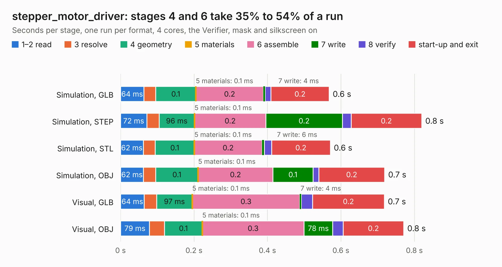

| Mode and format | 1–2 read | 3 resolve | 4 geometry | 5 materials | 6 assemble | 7 write | 8 verify | start-up and exit | Total |
|---|---:|---:|---:|---:|---:|---:|---:|---:|---:|
| Simulation, GLB | 64&nbsp;ms | 32&nbsp;ms | 0.1 | 0.1&nbsp;ms | 0.2 | 4&nbsp;ms | 16&nbsp;ms | 0.2 | 0.6 |
| Simulation, STEP | 72&nbsp;ms | 33&nbsp;ms | 96&nbsp;ms | 0.1&nbsp;ms | 0.2 | 0.2 | 24&nbsp;ms | 0.2 | 0.8 |
| Simulation, STL | 62&nbsp;ms | 33&nbsp;ms | 0.1 | 0.1&nbsp;ms | 0.2 | 6&nbsp;ms | 20&nbsp;ms | 0.2 | 0.6 |
| Simulation, OBJ | 62&nbsp;ms | 33&nbsp;ms | 0.1 | 0.1&nbsp;ms | 0.2 | 0.1 | 16&nbsp;ms | 0.2 | 0.7 |
| Visual, GLB | 64&nbsp;ms | 34&nbsp;ms | 97&nbsp;ms | 0.1&nbsp;ms | 0.3 | 4&nbsp;ms | 31&nbsp;ms | 0.2 | 0.7 |
| Visual, OBJ | 79&nbsp;ms | 41&nbsp;ms | 0.1 | 0.1&nbsp;ms | 0.3 | 78&nbsp;ms | 29&nbsp;ms | 0.2 | 0.8 |

<table align="center"><tr><td valign="top">

| Board | Repo: [rusefi/rusefi-hardware](https://github.com/rusefi/rusefi-hardware) Board: `stepper_motor_driver.kicad_pcb` |
|---|---|
| Folder | classic-designs / A4988_stepper_motor_driver |
| Complexity | 64&nbsp;/&nbsp;1000 (size&nbsp;64, features&nbsp;0) |
| Tested | 9th November 2026 |
| Copper&nbsp;layers | 2 |
| File&nbsp;format | KiCad 3 (3) |
| Parts,&nbsp;tracks,&nbsp;vias | 1, 0, 0 |
| Triangles,&nbsp;simulation | 27,684 in 9 parts |
| Verifier | PASS in all six runs |

</td><td valign="top">

<table>
<tr><th>File type</th><th>File size</th><th>Peak memory used</th></tr>
<tr><th colspan="3" align="left">Simulation</th></tr>
<tr><td>GLB</td><td align="right">986&nbsp;kB</td><td align="right">64&nbsp;MB</td></tr>
<tr><td>STEP</td><td align="right">4.1&nbsp;MB</td><td align="right">66&nbsp;MB</td></tr>
<tr><td>STL</td><td align="right">1.4&nbsp;MB</td><td align="right">65&nbsp;MB</td></tr>
<tr><td>OBJ</td><td align="right">2.7&nbsp;MB</td><td align="right">75&nbsp;MB</td></tr>
<tr><th colspan="3" align="left">Visual</th></tr>
<tr><td>GLB</td><td align="right">696&nbsp;kB</td><td align="right">81&nbsp;MB</td></tr>
<tr><td>OBJ</td><td align="right">1.9&nbsp;MB</td><td align="right">94&nbsp;MB</td></tr>
</table>

</td></tr></table>

## 2422. adc_amp_divider_vert

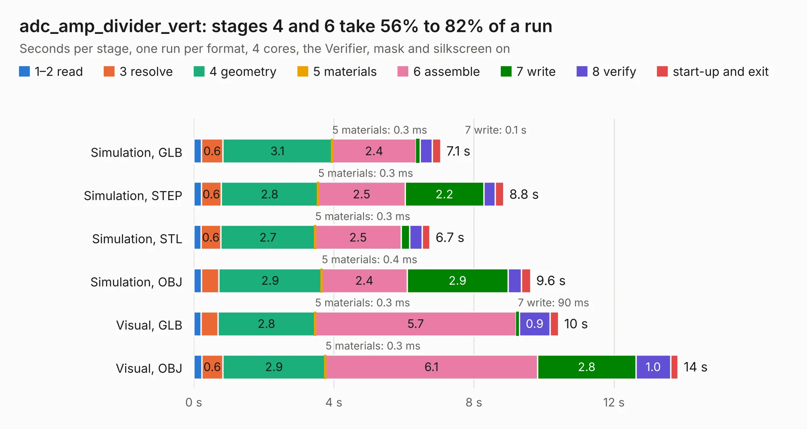

| Mode and format | 1–2 read | 3 resolve | 4 geometry | 5 materials | 6 assemble | 7 write | 8 verify | start-up and exit | Total |
|---|---:|---:|---:|---:|---:|---:|---:|---:|---:|
| Simulation, GLB | 0.2 | 0.6 | 3.1 | 0.3&nbsp;ms | 2.4 | 0.1 | 0.3 | 0.2 | 7.1 |
| Simulation, STEP | 0.2 | 0.6 | 2.8 | 0.3&nbsp;ms | 2.5 | 2.2 | 0.3 | 0.2 | 8.8 |
| Simulation, STL | 0.2 | 0.6 | 2.7 | 0.3&nbsp;ms | 2.5 | 0.2 | 0.3 | 0.2 | 6.7 |
| Simulation, OBJ | 0.2 | 0.5 | 2.9 | 0.4&nbsp;ms | 2.4 | 2.9 | 0.4 | 0.3 | 9.6 |
| Visual, GLB | 0.2 | 0.5 | 2.8 | 0.3&nbsp;ms | 5.7 | 90&nbsp;ms | 0.9 | 0.2 | 10.4 |
| Visual, OBJ | 0.2 | 0.6 | 2.9 | 0.3&nbsp;ms | 6.1 | 2.8 | 1.0 | 0.2 | 13.8 |

<table align="center"><tr><td valign="top">

| Board | Repo: [rusefi/rusefi-hardware](https://github.com/rusefi/rusefi-hardware) Board: `adc_amp_divider_vert.kicad_pcb` |
|---|---|
| Folder | classic-designs / adc_amp_divider.vertical |
| Complexity | 206&nbsp;/&nbsp;1000 (size&nbsp;171, features&nbsp;35) |
| KESE&nbsp;features | through vias, filled zones |
| Tested | 9th November 2026 |
| Copper&nbsp;layers | 2 |
| File&nbsp;format | KiCad 3 (3) |
| Parts,&nbsp;tracks,&nbsp;vias | 75, 554, 42 |
| Triangles,&nbsp;simulation | 626,696 in 58 parts |
| Verifier | PASS in all six runs |

</td><td valign="top">

<table>
<tr><th>File type</th><th>File size</th><th>Peak memory used</th></tr>
<tr><th colspan="3" align="left">Simulation</th></tr>
<tr><td>GLB</td><td align="right">22&nbsp;MB</td><td align="right">385&nbsp;MB</td></tr>
<tr><td>STEP</td><td align="right">124&nbsp;MB</td><td align="right">438&nbsp;MB</td></tr>
<tr><td>STL</td><td align="right">31&nbsp;MB</td><td align="right">401&nbsp;MB</td></tr>
<tr><td>OBJ</td><td align="right">64&nbsp;MB</td><td align="right">464&nbsp;MB</td></tr>
<tr><th colspan="3" align="left">Visual</th></tr>
<tr><td>GLB</td><td align="right">20&nbsp;MB</td><td align="right">543&nbsp;MB</td></tr>
<tr><td>OBJ</td><td align="right">58&nbsp;MB</td><td align="right">534&nbsp;MB</td></tr>
</table>

</td></tr></table>

## 2423. adc_amp_divider

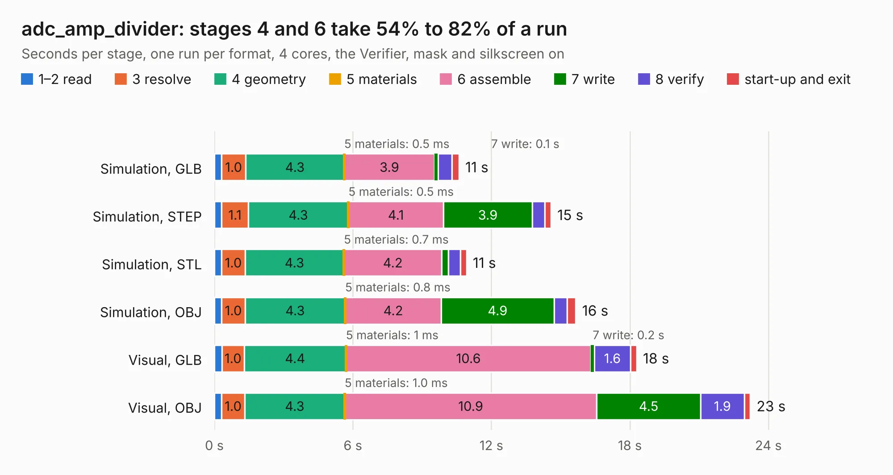

| Mode and format | 1–2 read | 3 resolve | 4 geometry | 5 materials | 6 assemble | 7 write | 8 verify | start-up and exit | Total |
|---|---:|---:|---:|---:|---:|---:|---:|---:|---:|
| Simulation, GLB | 0.3 | 1.0 | 4.3 | 0.5&nbsp;ms | 3.9 | 0.1 | 0.6 | 0.3 | 10.6 |
| Simulation, STEP | 0.3 | 1.1 | 4.3 | 0.5&nbsp;ms | 4.1 | 3.9 | 0.5 | 0.3 | 14.6 |
| Simulation, STL | 0.3 | 1.0 | 4.3 | 0.7&nbsp;ms | 4.2 | 0.3 | 0.5 | 0.3 | 10.9 |
| Simulation, OBJ | 0.3 | 1.0 | 4.3 | 0.8&nbsp;ms | 4.2 | 4.9 | 0.6 | 0.4 | 15.7 |
| Visual, GLB | 0.3 | 1.0 | 4.4 | 1&nbsp;ms | 10.6 | 0.2 | 1.6 | 0.3 | 18.3 |
| Visual, OBJ | 0.3 | 1.0 | 4.3 | 1.0&nbsp;ms | 10.9 | 4.5 | 1.9 | 0.3 | 23.2 |

<table align="center"><tr><td valign="top">

| Board | Repo: [rusefi/rusefi-hardware](https://github.com/rusefi/rusefi-hardware) Board: `adc_amp_divider.kicad_pcb` |
|---|---|
| Folder | classic-designs / adc_amp_divider.vertical12 |
| Complexity | 209&nbsp;/&nbsp;1000 (size&nbsp;174, features&nbsp;35) |
| KESE&nbsp;features | through vias, filled zones |
| Tested | 9th November 2026 |
| Copper&nbsp;layers | 2 |
| File&nbsp;format | KiCad 3 (3) |
| Parts,&nbsp;tracks,&nbsp;vias | 111, 567, 33 |
| Triangles,&nbsp;simulation | 889,936 in 79 parts |
| Verifier | PASS in all six runs |

</td><td valign="top">

<table>
<tr><th>File type</th><th>File size</th><th>Peak memory used</th></tr>
<tr><th colspan="3" align="left">Simulation</th></tr>
<tr><td>GLB</td><td align="right">31&nbsp;MB</td><td align="right">525&nbsp;MB</td></tr>
<tr><td>STEP</td><td align="right">178&nbsp;MB</td><td align="right">589&nbsp;MB</td></tr>
<tr><td>STL</td><td align="right">45&nbsp;MB</td><td align="right">544&nbsp;MB</td></tr>
<tr><td>OBJ</td><td align="right">92&nbsp;MB</td><td align="right">642&nbsp;MB</td></tr>
<tr><th colspan="3" align="left">Visual</th></tr>
<tr><td>GLB</td><td align="right">30&nbsp;MB</td><td align="right">658&nbsp;MB</td></tr>
<tr><td>OBJ</td><td align="right">88&nbsp;MB</td><td align="right">664&nbsp;MB</td></tr>
</table>

</td></tr></table>

## 2424. adc_amp_divider

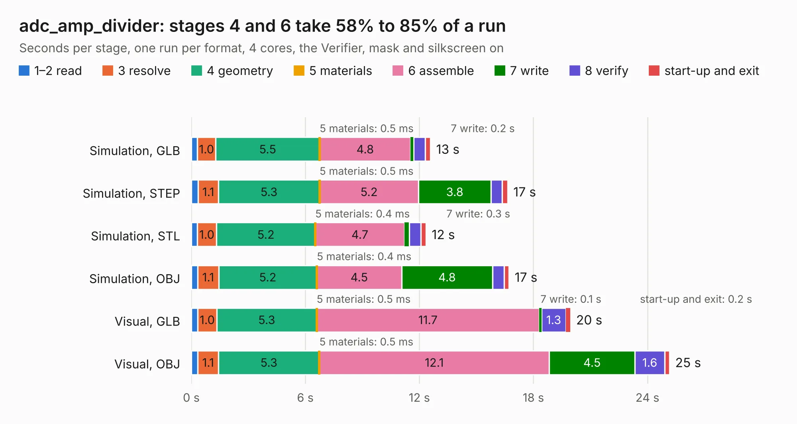

| Mode and format | 1–2 read | 3 resolve | 4 geometry | 5 materials | 6 assemble | 7 write | 8 verify | start-up and exit | Total |
|---|---:|---:|---:|---:|---:|---:|---:|---:|---:|
| Simulation, GLB | 0.3 | 1.0 | 5.5 | 0.5&nbsp;ms | 4.8 | 0.2 | 0.6 | 0.3 | 12.6 |
| Simulation, STEP | 0.4 | 1.1 | 5.3 | 0.5&nbsp;ms | 5.2 | 3.8 | 0.6 | 0.3 | 16.6 |
| Simulation, STL | 0.3 | 1.0 | 5.2 | 0.4&nbsp;ms | 4.7 | 0.3 | 0.6 | 0.3 | 12.3 |
| Simulation, OBJ | 0.3 | 1.1 | 5.2 | 0.4&nbsp;ms | 4.5 | 4.8 | 0.6 | 0.3 | 16.7 |
| Visual, GLB | 0.3 | 1.0 | 5.3 | 0.5&nbsp;ms | 11.7 | 0.1 | 1.3 | 0.2 | 19.9 |
| Visual, OBJ | 0.3 | 1.1 | 5.3 | 0.5&nbsp;ms | 12.1 | 4.5 | 1.6 | 0.3 | 25.2 |

<table align="center"><tr><td valign="top">

| Board | Repo: [rusefi/rusefi-hardware](https://github.com/rusefi/rusefi-hardware) Board: `adc_amp_divider.kicad_pcb` |
|---|---|
| Folder | classic-designs / adc_amp_divider |
| Complexity | 215&nbsp;/&nbsp;1000 (size&nbsp;180, features&nbsp;35) |
| KESE&nbsp;features | through vias, filled zones |
| Tested | 9th November 2026 |
| Copper&nbsp;layers | 2 |
| File&nbsp;format | KiCad 3 (3) |
| Parts,&nbsp;tracks,&nbsp;vias | 113, 743, 66 |
| Triangles,&nbsp;simulation | 883,980 in 79 parts |
| Verifier | PASS in all six runs |

</td><td valign="top">

<table>
<tr><th>File type</th><th>File size</th><th>Peak memory used</th></tr>
<tr><th colspan="3" align="left">Simulation</th></tr>
<tr><td>GLB</td><td align="right">31&nbsp;MB</td><td align="right">526&nbsp;MB</td></tr>
<tr><td>STEP</td><td align="right">172&nbsp;MB</td><td align="right">554&nbsp;MB</td></tr>
<tr><td>STL</td><td align="right">44&nbsp;MB</td><td align="right">513&nbsp;MB</td></tr>
<tr><td>OBJ</td><td align="right">91&nbsp;MB</td><td align="right">635&nbsp;MB</td></tr>
<tr><th colspan="3" align="left">Visual</th></tr>
<tr><td>GLB</td><td align="right">29&nbsp;MB</td><td align="right">753&nbsp;MB</td></tr>
<tr><td>OBJ</td><td align="right">85&nbsp;MB</td><td align="right">746&nbsp;MB</td></tr>
</table>

</td></tr></table>

## 2425. adc_amp_dividor

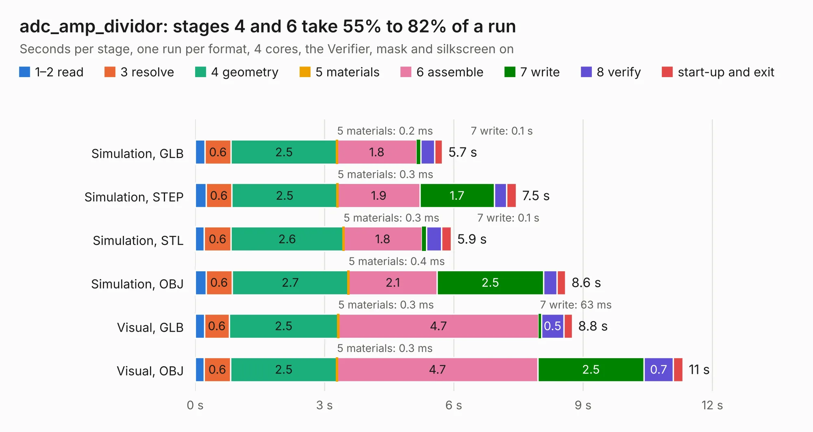

| Mode and format | 1–2 read | 3 resolve | 4 geometry | 5 materials | 6 assemble | 7 write | 8 verify | start-up and exit | Total |
|---|---:|---:|---:|---:|---:|---:|---:|---:|---:|
| Simulation, GLB | 0.2 | 0.6 | 2.5 | 0.2&nbsp;ms | 1.8 | 0.1 | 0.3 | 0.2 | 5.7 |
| Simulation, STEP | 0.3 | 0.6 | 2.5 | 0.3&nbsp;ms | 1.9 | 1.7 | 0.3 | 0.2 | 7.5 |
| Simulation, STL | 0.2 | 0.6 | 2.6 | 0.3&nbsp;ms | 1.8 | 0.1 | 0.4 | 0.2 | 5.9 |
| Simulation, OBJ | 0.3 | 0.6 | 2.7 | 0.4&nbsp;ms | 2.1 | 2.5 | 0.3 | 0.2 | 8.6 |
| Visual, GLB | 0.2 | 0.6 | 2.5 | 0.3&nbsp;ms | 4.7 | 63&nbsp;ms | 0.5 | 0.2 | 8.8 |
| Visual, OBJ | 0.2 | 0.6 | 2.5 | 0.3&nbsp;ms | 4.7 | 2.5 | 0.7 | 0.2 | 11.3 |

<table align="center"><tr><td valign="top">

| Board | Repo: [rusefi/rusefi-hardware](https://github.com/rusefi/rusefi-hardware) Board: `adc_amp_dividor.kicad_pcb` |
|---|---|
| Folder | classic-designs / adc_amp_divider / history / rev00.10 |
| Complexity | 210&nbsp;/&nbsp;1000 (size&nbsp;175, features&nbsp;35) |
| KESE&nbsp;features | through vias, filled zones |
| Tested | 9th November 2026 |
| Copper&nbsp;layers | 2 |
| File&nbsp;format | KiCad 3 (3) |
| Parts,&nbsp;tracks,&nbsp;vias | 84, 684, 55 |
| Triangles,&nbsp;simulation | 489,820 in 56 parts |
| Verifier | PASS in all six runs |

</td><td valign="top">

<table>
<tr><th>File type</th><th>File size</th><th>Peak memory used</th></tr>
<tr><th colspan="3" align="left">Simulation</th></tr>
<tr><td>GLB</td><td align="right">17&nbsp;MB</td><td align="right">311&nbsp;MB</td></tr>
<tr><td>STEP</td><td align="right">85&nbsp;MB</td><td align="right">376&nbsp;MB</td></tr>
<tr><td>STL</td><td align="right">24&nbsp;MB</td><td align="right">317&nbsp;MB</td></tr>
<tr><td>OBJ</td><td align="right">51&nbsp;MB</td><td align="right">395&nbsp;MB</td></tr>
<tr><th colspan="3" align="left">Visual</th></tr>
<tr><td>GLB</td><td align="right">15&nbsp;MB</td><td align="right">443&nbsp;MB</td></tr>
<tr><td>OBJ</td><td align="right">45&nbsp;MB</td><td align="right">445&nbsp;MB</td></tr>
</table>

</td></tr></table>

## 2426. adc_amp_divider

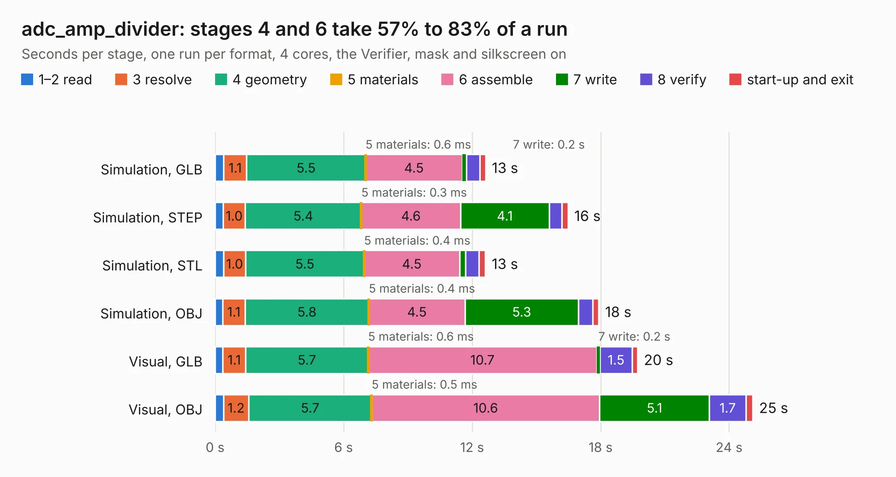

| Mode and format | 1–2 read | 3 resolve | 4 geometry | 5 materials | 6 assemble | 7 write | 8 verify | start-up and exit | Total |
|---|---:|---:|---:|---:|---:|---:|---:|---:|---:|
| Simulation, GLB | 0.4 | 1.1 | 5.5 | 0.6&nbsp;ms | 4.5 | 0.2 | 0.6 | 0.3 | 12.6 |
| Simulation, STEP | 0.4 | 1.0 | 5.4 | 0.3&nbsp;ms | 4.6 | 4.1 | 0.6 | 0.3 | 16.5 |
| Simulation, STL | 0.4 | 1.0 | 5.5 | 0.4&nbsp;ms | 4.5 | 0.3 | 0.6 | 0.3 | 12.6 |
| Simulation, OBJ | 0.4 | 1.1 | 5.8 | 0.4&nbsp;ms | 4.5 | 5.3 | 0.7 | 0.3 | 17.9 |
| Visual, GLB | 0.4 | 1.1 | 5.7 | 0.6&nbsp;ms | 10.7 | 0.2 | 1.5 | 0.3 | 19.7 |
| Visual, OBJ | 0.4 | 1.2 | 5.7 | 0.5&nbsp;ms | 10.6 | 5.1 | 1.7 | 0.3 | 25.1 |

<table align="center"><tr><td valign="top">

| Board | Repo: [rusefi/rusefi-hardware](https://github.com/rusefi/rusefi-hardware) Board: `adc_amp_divider.kicad_pcb` |
|---|---|
| Folder | classic-designs / adc_amp_divider / history / rev00.20 |
| Complexity | 215&nbsp;/&nbsp;1000 (size&nbsp;180, features&nbsp;35) |
| KESE&nbsp;features | through vias, filled zones |
| Tested | 9th November 2026 |
| Copper&nbsp;layers | 2 |
| File&nbsp;format | KiCad 3 (3) |
| Parts,&nbsp;tracks,&nbsp;vias | 113, 738, 64 |
| Triangles,&nbsp;simulation | 869,902 in 79 parts |
| Verifier | PASS in all six runs |

</td><td valign="top">

<table>
<tr><th>File type</th><th>File size</th><th>Peak memory used</th></tr>
<tr><th colspan="3" align="left">Simulation</th></tr>
<tr><td>GLB</td><td align="right">30&nbsp;MB</td><td align="right">461&nbsp;MB</td></tr>
<tr><td>STEP</td><td align="right">169&nbsp;MB</td><td align="right">583&nbsp;MB</td></tr>
<tr><td>STL</td><td align="right">44&nbsp;MB</td><td align="right">470&nbsp;MB</td></tr>
<tr><td>OBJ</td><td align="right">90&nbsp;MB</td><td align="right">619&nbsp;MB</td></tr>
<tr><th colspan="3" align="left">Visual</th></tr>
<tr><td>GLB</td><td align="right">28&nbsp;MB</td><td align="right">742&nbsp;MB</td></tr>
<tr><td>OBJ</td><td align="right">83&nbsp;MB</td><td align="right">639&nbsp;MB</td></tr>
</table>

</td></tr></table>

## 2427. frankenso-PWR-Supply

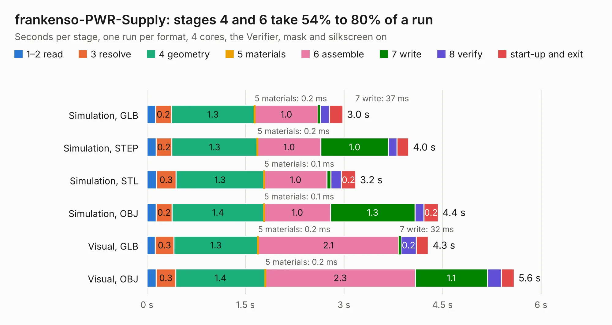

| Mode and format | 1–2 read | 3 resolve | 4 geometry | 5 materials | 6 assemble | 7 write | 8 verify | start-up and exit | Total |
|---|---:|---:|---:|---:|---:|---:|---:|---:|---:|
| Simulation, GLB | 0.1 | 0.2 | 1.3 | 0.2&nbsp;ms | 1.0 | 37&nbsp;ms | 0.1 | 0.2 | 3.0 |
| Simulation, STEP | 0.1 | 0.2 | 1.3 | 0.2&nbsp;ms | 1.0 | 1.0 | 0.1 | 0.2 | 4.0 |
| Simulation, STL | 0.1 | 0.3 | 1.3 | 0.1&nbsp;ms | 1.0 | 61&nbsp;ms | 0.2 | 0.2 | 3.2 |
| Simulation, OBJ | 0.1 | 0.2 | 1.4 | 0.1&nbsp;ms | 1.0 | 1.3 | 0.1 | 0.2 | 4.4 |
| Visual, GLB | 0.1 | 0.3 | 1.3 | 0.2&nbsp;ms | 2.1 | 32&nbsp;ms | 0.2 | 0.2 | 4.3 |
| Visual, OBJ | 0.1 | 0.3 | 1.4 | 0.2&nbsp;ms | 2.3 | 1.1 | 0.2 | 0.2 | 5.6 |

<table align="center"><tr><td valign="top">

| Board | Repo: [rusefi/rusefi-hardware](https://github.com/rusefi/rusefi-hardware) Board: `frankenso-PWR-Supply.kicad_pcb` |
|---|---|
| Folder | classic-designs / frankenso-PWR-Supply |
| Complexity | 190&nbsp;/&nbsp;1000 (size&nbsp;135, features&nbsp;55) |
| KESE&nbsp;features | through vias, slotted holes, filled zones, copper text |
| Tested | 9th November 2026 |
| Copper&nbsp;layers | 2 |
| File&nbsp;format | KiCad 4 (4) |
| Parts,&nbsp;tracks,&nbsp;vias | 21, 106, 25 |
| Triangles,&nbsp;simulation | 262,346 in 24 parts |
| Verifier | PASS in all six runs |

</td><td valign="top">

<table>
<tr><th>File type</th><th>File size</th><th>Peak memory used</th></tr>
<tr><th colspan="3" align="left">Simulation</th></tr>
<tr><td>GLB</td><td align="right">9.4&nbsp;MB</td><td align="right">247&nbsp;MB</td></tr>
<tr><td>STEP</td><td align="right">47&nbsp;MB</td><td align="right">257&nbsp;MB</td></tr>
<tr><td>STL</td><td align="right">13&nbsp;MB</td><td align="right">246&nbsp;MB</td></tr>
<tr><td>OBJ</td><td align="right">27&nbsp;MB</td><td align="right">237&nbsp;MB</td></tr>
<tr><th colspan="3" align="left">Visual</th></tr>
<tr><td>GLB</td><td align="right">6.9&nbsp;MB</td><td align="right">222&nbsp;MB</td></tr>
<tr><td>OBJ</td><td align="right">20&nbsp;MB</td><td align="right">216&nbsp;MB</td></tr>
</table>

</td></tr></table>

## 2428. frankenso

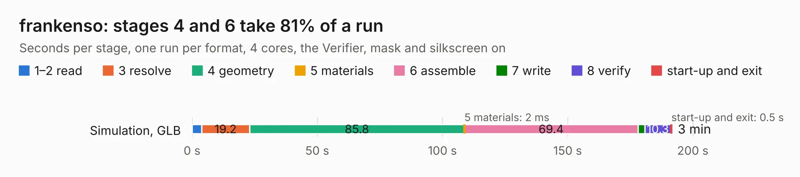

| Mode and format | 1–2 read | 3 resolve | 4 geometry | 5 materials | 6 assemble | 7 write | 8 verify | start-up and exit | Total |
|---|---:|---:|---:|---:|---:|---:|---:|---:|---:|
| Simulation, GLB | 3.8 | 19.2 | 85.8 | 2&nbsp;ms | 69.4 | 2.8 | 10.3 | 0.5 | 191.7 |
| Simulation, STEP | 3.7 | 19.0 | 85.4 | 2&nbsp;ms | 68.2 | 36.9 | 9.8 | 0.5 | 223.6 |
| Simulation, STL | 3.7 | 19.1 | 83.0 | 3&nbsp;ms | 70.8 | 6.1 | 10.5 | 0.6 | 193.9 |
| Simulation, OBJ | 4.0 | 19.8 | 89.0 | 2&nbsp;ms | 69.0 | 88.2 | 10.7 | 0.5 | 281.2 |
| Visual, GLB | 3.8 | 19.7 | 87.9 | 2&nbsp;ms | 176.9 | 1.6 | 12.8 | 0.5 | 303.1 |
| Visual, OBJ | 3.9 | 19.3 | 89.3 | 2&nbsp;ms | 173.6 | 48.7 | 12.3 | 0.4 | 347.5 |

<table align="center"><tr><td valign="top">

| Board | Repo: [rusefi/rusefi-hardware](https://github.com/rusefi/rusefi-hardware) Board: `frankenso.kicad_pcb` |
|---|---|
| Folder | classic-designs / frankenso |
| Complexity | 356&nbsp;/&nbsp;1000 (size&nbsp;291, features&nbsp;65) |
| KESE&nbsp;features | through vias, slotted holes, filled zones, copper text, curved board outline |
| Tested | 9th November 2026 |
| Copper&nbsp;layers | 4 |
| File&nbsp;format | KiCad 5 (20171130) |
| Parts,&nbsp;tracks,&nbsp;vias | 551, 5,736, 1,102 |
| Triangles,&nbsp;simulation | 14,232,850 in 426 parts |
| Verifier | PASS in all six runs |

</td><td valign="top">

<table>
<tr><th>File type</th><th>File size</th><th>Peak memory used</th></tr>
<tr><th colspan="3" align="left">Simulation</th></tr>
<tr><td>GLB</td><td align="right">493&nbsp;MB</td><td align="right">3.1&nbsp;GB</td></tr>
<tr><td>STEP</td><td align="right">2.2&nbsp;GB</td><td align="right">4.2&nbsp;GB</td></tr>
<tr><td>STL</td><td align="right">712&nbsp;MB</td><td align="right">3.0&nbsp;GB</td></tr>
<tr><td>OBJ</td><td align="right">1.6&nbsp;GB</td><td align="right">9.1&nbsp;GB</td></tr>
<tr><th colspan="3" align="left">Visual</th></tr>
<tr><td>GLB</td><td align="right">296&nbsp;MB</td><td align="right">4.5&nbsp;GB</td></tr>
<tr><td>OBJ</td><td align="right">942&nbsp;MB</td><td align="right">5.8&nbsp;GB</td></tr>
</table>

</td></tr></table>

## 2429. frankenstein

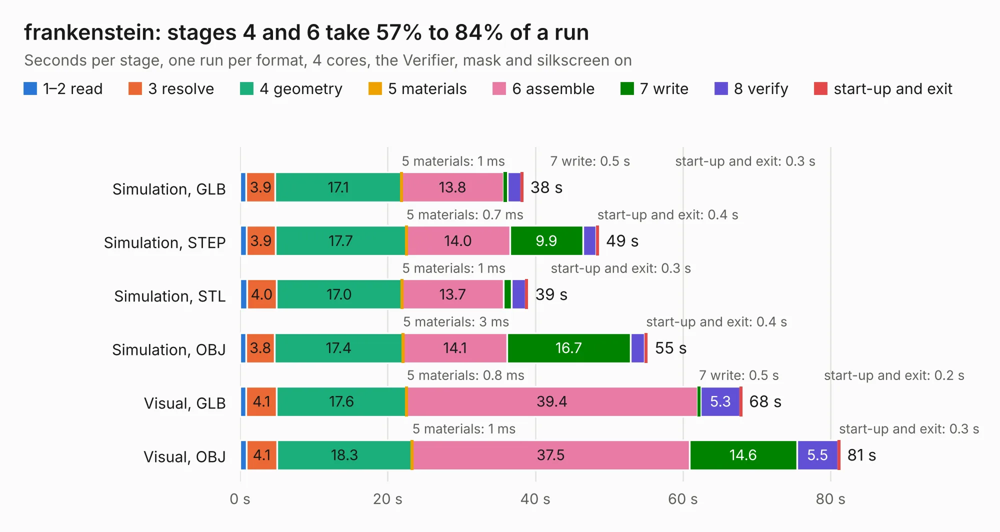

| Mode and format | 1–2 read | 3 resolve | 4 geometry | 5 materials | 6 assemble | 7 write | 8 verify | start-up and exit | Total |
|---|---:|---:|---:|---:|---:|---:|---:|---:|---:|
| Simulation, GLB | 0.8 | 3.9 | 17.1 | 1&nbsp;ms | 13.8 | 0.5 | 1.8 | 0.3 | 38.3 |
| Simulation, STEP | 0.9 | 3.9 | 17.7 | 0.7&nbsp;ms | 14.0 | 9.9 | 1.7 | 0.4 | 48.6 |
| Simulation, STL | 0.9 | 4.0 | 17.0 | 1&nbsp;ms | 13.7 | 1.1 | 1.9 | 0.3 | 39.0 |
| Simulation, OBJ | 0.8 | 3.8 | 17.4 | 3&nbsp;ms | 14.1 | 16.7 | 1.9 | 0.4 | 55.2 |
| Visual, GLB | 0.8 | 4.1 | 17.6 | 0.8&nbsp;ms | 39.4 | 0.5 | 5.3 | 0.2 | 68.0 |
| Visual, OBJ | 0.9 | 4.1 | 18.3 | 1&nbsp;ms | 37.5 | 14.6 | 5.5 | 0.3 | 81.3 |

<table align="center"><tr><td valign="top">

| Board | Repo: [rusefi/rusefi-hardware](https://github.com/rusefi/rusefi-hardware) Board: `frankenstein.kicad_pcb` |
|---|---|
| Folder | classic-designs / frankenstein |
| Complexity | 246&nbsp;/&nbsp;1000 (size&nbsp;211, features&nbsp;35) |
| KESE&nbsp;features | through vias, filled zones |
| Tested | 9th November 2026 |
| Copper&nbsp;layers | 2 |
| File&nbsp;format | KiCad 4 (4) |
| Parts,&nbsp;tracks,&nbsp;vias | 242, 2,835, 326 |
| Triangles,&nbsp;simulation | 3,108,884 in 196 parts |
| Verifier | PASS in all six runs |

</td><td valign="top">

<table>
<tr><th>File type</th><th>File size</th><th>Peak memory used</th></tr>
<tr><th colspan="3" align="left">Simulation</th></tr>
<tr><td>GLB</td><td align="right">108&nbsp;MB</td><td align="right">1.3&nbsp;GB</td></tr>
<tr><td>STEP</td><td align="right">564&nbsp;MB</td><td align="right">1.4&nbsp;GB</td></tr>
<tr><td>STL</td><td align="right">155&nbsp;MB</td><td align="right">1.2&nbsp;GB</td></tr>
<tr><td>OBJ</td><td align="right">331&nbsp;MB</td><td align="right">2.0&nbsp;GB</td></tr>
<tr><th colspan="3" align="left">Visual</th></tr>
<tr><td>GLB</td><td align="right">91&nbsp;MB</td><td align="right">1.7&nbsp;GB</td></tr>
<tr><td>OBJ</td><td align="right">280&nbsp;MB</td><td align="right">2.0&nbsp;GB</td></tr>
</table>

</td></tr></table>

## 2430. hi-lo

| Mode and format | 1–2 read | 3 resolve | 4 geometry | 5 materials | 6 assemble | 7 write | 8 verify | start-up and exit | Total |
|---|---:|---:|---:|---:|---:|---:|---:|---:|---:|
| Simulation, GLB | 0.1 | 0.3 | 1.1 | 0.2&nbsp;ms | 0.9 | 41&nbsp;ms | 0.2 | 0.2 | 2.9 |
| Simulation, STEP | 0.2 | 0.3 | 1.2 | 0.2&nbsp;ms | 0.9 | 1.1 | 0.1 | 0.2 | 4.0 |
| Simulation, STL | 0.2 | 0.4 | 1.2 | 0.1&nbsp;ms | 0.9 | 60&nbsp;ms | 0.2 | 0.2 | 3.0 |
| Simulation, OBJ | 0.1 | 0.3 | 1.1 | 0.2&nbsp;ms | 0.9 | 1.4 | 0.1 | 0.2 | 4.2 |
| Visual, GLB | 0.2 | 0.3 | 1.3 | 0.2&nbsp;ms | 2.3 | 47&nbsp;ms | 0.2 | 0.2 | 4.5 |
| Visual, OBJ | 0.1 | 0.3 | 1.2 | 0.1&nbsp;ms | 2.3 | 1.3 | 0.2 | 0.2 | 5.7 |

<table align="center"><tr><td valign="top">

| Board | Repo: [rusefi/rusefi-hardware](https://github.com/rusefi/rusefi-hardware) Board: `hi-lo.kicad_pcb` |
|---|---|
| Folder | classic-designs / hi-lo_driver |
| Complexity | 183&nbsp;/&nbsp;1000 (size&nbsp;148, features&nbsp;35) |
| KESE&nbsp;features | through vias, filled zones |
| Tested | 9th November 2026 |
| Copper&nbsp;layers | 2 |
| File&nbsp;format | KiCad 3 (3) |
| Parts,&nbsp;tracks,&nbsp;vias | 28, 208, 41 |
| Triangles,&nbsp;simulation | 286,036 in 38 parts |
| Verifier | PASS in all six runs |

</td><td valign="top">

<table>
<tr><th>File type</th><th>File size</th><th>Peak memory used</th></tr>
<tr><th colspan="3" align="left">Simulation</th></tr>
<tr><td>GLB</td><td align="right">10.0&nbsp;MB</td><td align="right">256&nbsp;MB</td></tr>
<tr><td>STEP</td><td align="right">46&nbsp;MB</td><td align="right">259&nbsp;MB</td></tr>
<tr><td>STL</td><td align="right">14&nbsp;MB</td><td align="right">248&nbsp;MB</td></tr>
<tr><td>OBJ</td><td align="right">29&nbsp;MB</td><td align="right">251&nbsp;MB</td></tr>
<tr><th colspan="3" align="left">Visual</th></tr>
<tr><td>GLB</td><td align="right">8.5&nbsp;MB</td><td align="right">262&nbsp;MB</td></tr>
<tr><td>OBJ</td><td align="right">25&nbsp;MB</td><td align="right">259&nbsp;MB</td></tr>
</table>

</td></tr></table>

## 2431. VN750PS_E

| Mode and format | 1–2 read | 3 resolve | 4 geometry | 5 materials | 6 assemble | 7 write | 8 verify | start-up and exit | Total |
|---|---:|---:|---:|---:|---:|---:|---:|---:|---:|
| Simulation, GLB | 89&nbsp;ms | 0.2 | 0.6 | 0.1&nbsp;ms | 0.8 | 29&nbsp;ms | 0.1 | 0.2 | 2.0 |
| Simulation, STEP | 95&nbsp;ms | 0.3 | 0.6 | 0.1&nbsp;ms | 0.8 | 0.9 | 0.1 | 0.2 | 2.9 |
| Simulation, STL | 0.1 | 0.2 | 0.6 | 0.1&nbsp;ms | 0.8 | 45&nbsp;ms | 0.1 | 0.2 | 2.2 |
| Simulation, OBJ | 95&nbsp;ms | 0.3 | 0.6 | 0.1&nbsp;ms | 0.8 | 1.1 | 0.2 | 0.2 | 3.3 |
| Visual, GLB | 95&nbsp;ms | 0.2 | 0.5 | 0.1&nbsp;ms | 1.6 | 22&nbsp;ms | 0.1 | 0.2 | 2.8 |
| Visual, OBJ | 95&nbsp;ms | 0.2 | 0.6 | 0.1&nbsp;ms | 1.5 | 0.6 | 0.1 | 0.2 | 3.4 |

<table align="center"><tr><td valign="top">

| Board | Repo: [rusefi/rusefi-hardware](https://github.com/rusefi/rusefi-hardware) Board: `VN750PS_E.kicad_pcb` |
|---|---|
| Folder | classic-designs / HighSideSwitch |
| Complexity | 187&nbsp;/&nbsp;1000 (size&nbsp;152, features&nbsp;35) |
| KESE&nbsp;features | through vias, filled zones |
| Tested | 9th November 2026 |
| Copper&nbsp;layers | 4 |
| File&nbsp;format | KiCad 3 (3) |
| Parts,&nbsp;tracks,&nbsp;vias | 8, 143, 58 |
| Triangles,&nbsp;simulation | 218,614 in 23 parts |
| Verifier | PASS in all six runs |

</td><td valign="top">

<table>
<tr><th>File type</th><th>File size</th><th>Peak memory used</th></tr>
<tr><th colspan="3" align="left">Simulation</th></tr>
<tr><td>GLB</td><td align="right">7.0&nbsp;MB</td><td align="right">222&nbsp;MB</td></tr>
<tr><td>STEP</td><td align="right">19&nbsp;MB</td><td align="right">223&nbsp;MB</td></tr>
<tr><td>STL</td><td align="right">11&nbsp;MB</td><td align="right">216&nbsp;MB</td></tr>
<tr><td>OBJ</td><td align="right">21&nbsp;MB</td><td align="right">215&nbsp;MB</td></tr>
<tr><th colspan="3" align="left">Visual</th></tr>
<tr><td>GLB</td><td align="right">4.2&nbsp;MB</td><td align="right">174&nbsp;MB</td></tr>
<tr><td>OBJ</td><td align="right">12&nbsp;MB</td><td align="right">177&nbsp;MB</td></tr>
</table>

</td></tr></table>

## 2432. cps_vrs_io_1

| Mode and format | 1–2 read | 3 resolve | 4 geometry | 5 materials | 6 assemble | 7 write | 8 verify | start-up and exit | Total |
|---|---:|---:|---:|---:|---:|---:|---:|---:|---:|
| Simulation, GLB | 0.2 | 0.3 | 1.5 | 0.3&nbsp;ms | 1.1 | 61&nbsp;ms | 0.2 | 0.3 | 3.5 |
| Simulation, STEP | 0.2 | 0.3 | 1.5 | 0.2&nbsp;ms | 1.0 | 1.2 | 0.2 | 0.3 | 4.7 |
| Simulation, STL | 0.2 | 0.3 | 1.4 | 0.3&nbsp;ms | 1.1 | 66&nbsp;ms | 0.2 | 0.2 | 3.4 |
| Simulation, OBJ | 0.2 | 0.3 | 1.4 | 0.3&nbsp;ms | 1.1 | 1.5 | 0.2 | 0.2 | 4.8 |
| Visual, GLB | 0.2 | 0.4 | 1.5 | 0.2&nbsp;ms | 2.5 | 35&nbsp;ms | 0.2 | 0.2 | 4.9 |
| Visual, OBJ | 0.2 | 0.3 | 1.4 | 0.2&nbsp;ms | 2.5 | 1.1 | 0.2 | 0.2 | 5.9 |

<table align="center"><tr><td valign="top">

| Board | Repo: [rusefi/rusefi-hardware](https://github.com/rusefi/rusefi-hardware) Board: `cps_vrs_io_1.kicad_pcb` |
|---|---|
| Folder | classic-designs / knock_VR_Art_ELectro |
| Complexity | 187&nbsp;/&nbsp;1000 (size&nbsp;142, features&nbsp;45) |
| KESE&nbsp;features | through vias, filled zones, curved board outline |
| Tested | 9th November 2026 |
| Copper&nbsp;layers | 2 |
| File&nbsp;format | KiCad 3 (3) |
| Parts,&nbsp;tracks,&nbsp;vias | 33, 173, 9 |
| Triangles,&nbsp;simulation | 244,486 in 41 parts |
| Verifier | PASS in all six runs |

</td><td valign="top">

<table>
<tr><th>File type</th><th>File size</th><th>Peak memory used</th></tr>
<tr><th colspan="3" align="left">Simulation</th></tr>
<tr><td>GLB</td><td align="right">8.9&nbsp;MB</td><td align="right">228&nbsp;MB</td></tr>
<tr><td>STEP</td><td align="right">46&nbsp;MB</td><td align="right">252&nbsp;MB</td></tr>
<tr><td>STL</td><td align="right">12&nbsp;MB</td><td align="right">241&nbsp;MB</td></tr>
<tr><td>OBJ</td><td align="right">25&nbsp;MB</td><td align="right">236&nbsp;MB</td></tr>
<tr><th colspan="3" align="left">Visual</th></tr>
<tr><td>GLB</td><td align="right">6.6&nbsp;MB</td><td align="right">229&nbsp;MB</td></tr>
<tr><td>OBJ</td><td align="right">19&nbsp;MB</td><td align="right">221&nbsp;MB</td></tr>
</table>

</td></tr></table>

## 2433. PWR_buck_12V_switcher

| Mode and format | 1–2 read | 3 resolve | 4 geometry | 5 materials | 6 assemble | 7 write | 8 verify | start-up and exit | Total |
|---|---:|---:|---:|---:|---:|---:|---:|---:|---:|
| Simulation, GLB | 0.2 | 0.4 | 1.3 | 0.3&nbsp;ms | 1.1 | 62&nbsp;ms | 0.2 | 0.2 | 3.3 |
| Simulation, STEP | 0.2 | 0.3 | 1.2 | 0.4&nbsp;ms | 1.1 | 1.1 | 0.1 | 0.2 | 4.2 |
| Simulation, STL | 0.1 | 0.3 | 1.3 | 0.2&nbsp;ms | 1.0 | 56&nbsp;ms | 0.1 | 0.2 | 3.1 |
| Simulation, OBJ | 0.1 | 0.3 | 1.3 | 0.2&nbsp;ms | 1.0 | 1.4 | 0.1 | 0.2 | 4.5 |
| Visual, GLB | 0.1 | 0.3 | 1.2 | 0.2&nbsp;ms | 2.2 | 42&nbsp;ms | 0.2 | 0.2 | 4.4 |
| Visual, OBJ | 0.1 | 0.3 | 1.3 | 0.2&nbsp;ms | 2.5 | 1.1 | 0.2 | 0.2 | 5.7 |

<table align="center"><tr><td valign="top">

| Board | Repo: [rusefi/rusefi-hardware](https://github.com/rusefi/rusefi-hardware) Board: `PWR_buck_12V_switcher.kicad_pcb` |
|---|---|
| Folder | classic-designs / power_supply_kb1gtt |
| Complexity | 169&nbsp;/&nbsp;1000 (size&nbsp;134, features&nbsp;35) |
| KESE&nbsp;features | through vias, filled zones |
| Tested | 9th November 2026 |
| Copper&nbsp;layers | 2 |
| File&nbsp;format | KiCad 4 (4) |
| Parts,&nbsp;tracks,&nbsp;vias | 21, 104, 22 |
| Triangles,&nbsp;simulation | 255,264 in 23 parts |
| Verifier | PASS in all six runs |

</td><td valign="top">

<table>
<tr><th>File type</th><th>File size</th><th>Peak memory used</th></tr>
<tr><th colspan="3" align="left">Simulation</th></tr>
<tr><td>GLB</td><td align="right">9.2&nbsp;MB</td><td align="right">232&nbsp;MB</td></tr>
<tr><td>STEP</td><td align="right">46&nbsp;MB</td><td align="right">246&nbsp;MB</td></tr>
<tr><td>STL</td><td align="right">13&nbsp;MB</td><td align="right">224&nbsp;MB</td></tr>
<tr><td>OBJ</td><td align="right">27&nbsp;MB</td><td align="right">231&nbsp;MB</td></tr>
<tr><th colspan="3" align="left">Visual</th></tr>
<tr><td>GLB</td><td align="right">7.0&nbsp;MB</td><td align="right">210&nbsp;MB</td></tr>
<tr><td>OBJ</td><td align="right">20&nbsp;MB</td><td align="right">210&nbsp;MB</td></tr>
</table>

</td></tr></table>

## 2434. inj_6ch

| Mode and format | 1–2 read | 3 resolve | 4 geometry | 5 materials | 6 assemble | 7 write | 8 verify | start-up and exit | Total |
|---|---:|---:|---:|---:|---:|---:|---:|---:|---:|
| Simulation, GLB | 0.2 | 0.8 | 3.8 | 0.4&nbsp;ms | 2.8 | 0.1 | 0.4 | 0.2 | 8.4 |
| Simulation, STEP | 0.2 | 0.8 | 3.7 | 0.4&nbsp;ms | 2.8 | 2.1 | 0.4 | 0.2 | 10.3 |
| Simulation, STL | 0.2 | 0.8 | 3.8 | 0.3&nbsp;ms | 2.8 | 0.2 | 0.4 | 0.2 | 8.3 |
| Simulation, OBJ | 0.2 | 0.8 | 3.6 | 0.3&nbsp;ms | 2.7 | 3.9 | 0.4 | 0.2 | 11.8 |
| Visual, GLB | 0.2 | 0.7 | 3.8 | 0.4&nbsp;ms | 6.4 | 80&nbsp;ms | 0.5 | 0.2 | 11.8 |
| Visual, OBJ | 0.2 | 0.8 | 3.7 | 0.3&nbsp;ms | 6.3 | 3.0 | 0.5 | 0.2 | 14.6 |

<table align="center"><tr><td valign="top">

| Board | Repo: [rusefi/rusefi-hardware](https://github.com/rusefi/rusefi-hardware) Board: `inj_6ch.kicad_pcb` |
|---|---|
| Folder | classic-designs / rusefi_hardware_history / 1A_injector_6-channels_rev00.20 |
| Complexity | 210&nbsp;/&nbsp;1000 (size&nbsp;165, features&nbsp;45) |
| KESE&nbsp;features | through vias, filled zones, curved board outline |
| Tested | 9th November 2026 |
| Copper&nbsp;layers | 2 |
| File&nbsp;format | KiCad 3 (3) |
| Parts,&nbsp;tracks,&nbsp;vias | 35, 472, 114 |
| Triangles,&nbsp;simulation | 741,604 in 44 parts |
| Verifier | PASS in all six runs |

</td><td valign="top">

<table>
<tr><th>File type</th><th>File size</th><th>Peak memory used</th></tr>
<tr><th colspan="3" align="left">Simulation</th></tr>
<tr><td>GLB</td><td align="right">26&nbsp;MB</td><td align="right">362&nbsp;MB</td></tr>
<tr><td>STEP</td><td align="right">130&nbsp;MB</td><td align="right">403&nbsp;MB</td></tr>
<tr><td>STL</td><td align="right">37&nbsp;MB</td><td align="right">341&nbsp;MB</td></tr>
<tr><td>OBJ</td><td align="right">78&nbsp;MB</td><td align="right">556&nbsp;MB</td></tr>
<tr><th colspan="3" align="left">Visual</th></tr>
<tr><td>GLB</td><td align="right">19&nbsp;MB</td><td align="right">443&nbsp;MB</td></tr>
<tr><td>OBJ</td><td align="right">56&nbsp;MB</td><td align="right">439&nbsp;MB</td></tr>
</table>

</td></tr></table>

## 2435. stm32f407_board

| Mode and format | 1–2 read | 3 resolve | 4 geometry | 5 materials | 6 assemble | 7 write | 8 verify | start-up and exit | Total |
|---|---:|---:|---:|---:|---:|---:|---:|---:|---:|
| Simulation, GLB | 0.4 | 1.6 | 7.2 | 0.5&nbsp;ms | 5.8 | 0.2 | 0.9 | 0.3 | 16.4 |
| Simulation, STEP | 0.4 | 1.6 | 7.2 | 0.6&nbsp;ms | 5.6 | 4.3 | 0.8 | 0.3 | 20.1 |
| Simulation, STL | 0.4 | 1.6 | 7.0 | 0.5&nbsp;ms | 5.4 | 0.3 | 0.8 | 0.2 | 15.7 |
| Simulation, OBJ | 0.4 | 1.5 | 6.7 | 0.5&nbsp;ms | 5.6 | 7.8 | 0.9 | 0.2 | 23.1 |
| Visual, GLB | 0.4 | 1.5 | 6.8 | 0.6&nbsp;ms | 12.3 | 0.2 | 1.4 | 0.2 | 22.8 |
| Visual, OBJ | 0.4 | 1.5 | 6.7 | 0.4&nbsp;ms | 12.6 | 6.3 | 1.3 | 0.3 | 29.1 |

<table align="center"><tr><td valign="top">

| Board | Repo: [rusefi/rusefi-hardware](https://github.com/rusefi/rusefi-hardware) Board: `stm32f407_board.kicad_pcb` |
|---|---|
| Folder | classic-designs / rusefi_hardware_history / brain_board_rev00.10 |
| Complexity | 255&nbsp;/&nbsp;1000 (size&nbsp;220, features&nbsp;35) |
| KESE&nbsp;features | through vias, filled zones |
| Tested | 9th November 2026 |
| Copper&nbsp;layers | 2 |
| File&nbsp;format | KiCad 3 (3) |
| Parts,&nbsp;tracks,&nbsp;vias | 66, 1,158, 61 |
| Triangles,&nbsp;simulation | 1,389,348 in 131 parts |
| Verifier | PASS in all six runs |

</td><td valign="top">

<table>
<tr><th>File type</th><th>File size</th><th>Peak memory used</th></tr>
<tr><th colspan="3" align="left">Simulation</th></tr>
<tr><td>GLB</td><td align="right">48&nbsp;MB</td><td align="right">525&nbsp;MB</td></tr>
<tr><td>STEP</td><td align="right">249&nbsp;MB</td><td align="right">724&nbsp;MB</td></tr>
<tr><td>STL</td><td align="right">69&nbsp;MB</td><td align="right">517&nbsp;MB</td></tr>
<tr><td>OBJ</td><td align="right">144&nbsp;MB</td><td align="right">934&nbsp;MB</td></tr>
<tr><th colspan="3" align="left">Visual</th></tr>
<tr><td>GLB</td><td align="right">41&nbsp;MB</td><td align="right">733&nbsp;MB</td></tr>
<tr><td>OBJ</td><td align="right">122&nbsp;MB</td><td align="right">929&nbsp;MB</td></tr>
</table>

</td></tr></table>

## 2436. brain_board_STM32F407

| Mode and format | 1–2 read | 3 resolve | 4 geometry | 5 materials | 6 assemble | 7 write | 8 verify | start-up and exit | Total |
|---|---:|---:|---:|---:|---:|---:|---:|---:|---:|
| Simulation, GLB | 0.4 | 1.6 | 10.2 | 0.8&nbsp;ms | 6.2 | 0.3 | 1.0 | 0.3 | 20.0 |
| Simulation, STEP | 0.4 | 1.7 | 10.2 | 0.7&nbsp;ms | 6.0 | 4.5 | 0.9 | 0.2 | 23.9 |
| Simulation, STL | 0.4 | 1.7 | 10.3 | 0.6&nbsp;ms | 6.1 | 0.6 | 1.0 | 0.2 | 20.4 |
| Simulation, OBJ | 0.4 | 1.7 | 9.9 | 0.6&nbsp;ms | 6.1 | 9.2 | 0.9 | 0.2 | 28.4 |
| Visual, GLB | 0.4 | 1.7 | 9.8 | 0.8&nbsp;ms | 15.0 | 0.2 | 1.6 | 0.3 | 29.0 |
| Visual, OBJ | 0.4 | 1.6 | 10.0 | 1&nbsp;ms | 14.5 | 6.7 | 1.8 | 0.2 | 35.4 |

<table align="center"><tr><td valign="top">

| Board | Repo: [rusefi/rusefi-hardware](https://github.com/rusefi/rusefi-hardware) Board: `brain_board_STM32F407.kicad_pcb` |
|---|---|
| Folder | classic-designs / rusefi_hardware_history / brain_board_rev00.20 |
| Complexity | 268&nbsp;/&nbsp;1000 (size&nbsp;223, features&nbsp;45) |
| KESE&nbsp;features | through vias, slotted holes, filled zones |
| Tested | 9th November 2026 |
| Copper&nbsp;layers | 2 |
| File&nbsp;format | KiCad 4 (4) |
| Parts,&nbsp;tracks,&nbsp;vias | 69, 1,301, 83 |
| Triangles,&nbsp;simulation | 1,706,544 in 123 parts |
| Verifier | PASS in all six runs |

</td><td valign="top">

<table>
<tr><th>File type</th><th>File size</th><th>Peak memory used</th></tr>
<tr><th colspan="3" align="left">Simulation</th></tr>
<tr><td>GLB</td><td align="right">60&nbsp;MB</td><td align="right">690&nbsp;MB</td></tr>
<tr><td>STEP</td><td align="right">325&nbsp;MB</td><td align="right">773&nbsp;MB</td></tr>
<tr><td>STL</td><td align="right">85&nbsp;MB</td><td align="right">659&nbsp;MB</td></tr>
<tr><td>OBJ</td><td align="right">182&nbsp;MB</td><td align="right">1.2&nbsp;GB</td></tr>
<tr><th colspan="3" align="left">Visual</th></tr>
<tr><td>GLB</td><td align="right">46&nbsp;MB</td><td align="right">984&nbsp;MB</td></tr>
<tr><td>OBJ</td><td align="right">139&nbsp;MB</td><td align="right">971&nbsp;MB</td></tr>
</table>

</td></tr></table>

## 2437. brain_board_STM32F407

| Mode and format | 1–2 read | 3 resolve | 4 geometry | 5 materials | 6 assemble | 7 write | 8 verify | start-up and exit | Total |
|---|---:|---:|---:|---:|---:|---:|---:|---:|---:|
| Simulation, GLB | 0.4 | 1.7 | 10.2 | 2&nbsp;ms | 7.7 | 0.3 | 1.0 | 0.3 | 21.4 |
| Simulation, STEP | 0.4 | 1.8 | 10.1 | 1.0&nbsp;ms | 6.9 | 4.7 | 1.0 | 0.3 | 25.3 |
| Simulation, STL | 0.5 | 1.7 | 9.8 | 1&nbsp;ms | 7.3 | 0.5 | 1.1 | 0.3 | 21.1 |
| Simulation, OBJ | 0.4 | 1.8 | 10.0 | 1&nbsp;ms | 7.3 | 9.0 | 1.3 | 0.3 | 29.9 |
| Visual, GLB | 0.6 | 1.8 | 10.3 | 2&nbsp;ms | 16.5 | 0.2 | 1.9 | 0.3 | 31.6 |
| Visual, OBJ | 0.4 | 1.7 | 9.5 | 1&nbsp;ms | 15.5 | 6.3 | 2.1 | 0.2 | 35.7 |

<table align="center"><tr><td valign="top">

| Board | Repo: [rusefi/rusefi-hardware](https://github.com/rusefi/rusefi-hardware) Board: `brain_board_STM32F407.kicad_pcb` |
|---|---|
| Folder | classic-designs / rusefi_hardware_history / brain_board_rev00.30 / brain_board |
| Complexity | 271&nbsp;/&nbsp;1000 (size&nbsp;226, features&nbsp;45) |
| KESE&nbsp;features | through vias, slotted holes, filled zones |
| Tested | 9th November 2026 |
| Copper&nbsp;layers | 2 |
| File&nbsp;format | KiCad 4 (4) |
| Parts,&nbsp;tracks,&nbsp;vias | 69, 1,561, 92 |
| Triangles,&nbsp;simulation | 1,683,722 in 123 parts |
| Verifier | PASS in all six runs |

</td><td valign="top">

<table>
<tr><th>File type</th><th>File size</th><th>Peak memory used</th></tr>
<tr><th colspan="3" align="left">Simulation</th></tr>
<tr><td>GLB</td><td align="right">59&nbsp;MB</td><td align="right">697&nbsp;MB</td></tr>
<tr><td>STEP</td><td align="right">321&nbsp;MB</td><td align="right">744&nbsp;MB</td></tr>
<tr><td>STL</td><td align="right">84&nbsp;MB</td><td align="right">634&nbsp;MB</td></tr>
<tr><td>OBJ</td><td align="right">179&nbsp;MB</td><td align="right">1.2&nbsp;GB</td></tr>
<tr><th colspan="3" align="left">Visual</th></tr>
<tr><td>GLB</td><td align="right">45&nbsp;MB</td><td align="right">936&nbsp;MB</td></tr>
<tr><td>OBJ</td><td align="right">134&nbsp;MB</td><td align="right">925&nbsp;MB</td></tr>
</table>

</td></tr></table>

## 2438. brain_board_SD_Card_1

| Mode and format | 1–2 read | 3 resolve | 4 geometry | 5 materials | 6 assemble | 7 write | 8 verify | start-up and exit | Total |
|---|---:|---:|---:|---:|---:|---:|---:|---:|---:|
| Simulation, GLB | 94&nbsp;ms | 0.1 | 0.4 | 0.1&nbsp;ms | 0.6 | 18&nbsp;ms | 66&nbsp;ms | 0.2 | 1.5 |
| Simulation, STEP | 98&nbsp;ms | 0.1 | 0.5 | 0.1&nbsp;ms | 0.7 | 0.8 | 68&nbsp;ms | 0.2 | 2.5 |
| Simulation, STL | 94&nbsp;ms | 0.1 | 0.5 | 0.1&nbsp;ms | 0.6 | 32&nbsp;ms | 73&nbsp;ms | 0.2 | 1.7 |
| Simulation, OBJ | 0.1 | 0.1 | 0.5 | 0.1&nbsp;ms | 0.6 | 0.5 | 74&nbsp;ms | 0.2 | 2.1 |
| Visual, GLB | 90&nbsp;ms | 0.1 | 0.5 | 0.2&nbsp;ms | 1.3 | 14&nbsp;ms | 92&nbsp;ms | 0.2 | 2.3 |
| Visual, OBJ | 0.1 | 0.1 | 0.5 | 0.1&nbsp;ms | 1.4 | 0.4 | 85&nbsp;ms | 0.2 | 2.8 |

<table align="center"><tr><td valign="top">

| Board | Repo: [rusefi/rusefi-hardware](https://github.com/rusefi/rusefi-hardware) Board: `brain_board_SD_Card_1.kicad_pcb` |
|---|---|
| Folder | classic-designs / rusefi_hardware_history / brain_board_SD_Card_1_rev00.10 |
| Complexity | 140&nbsp;/&nbsp;1000 (size&nbsp;105, features&nbsp;35) |
| KESE&nbsp;features | through vias, filled zones |
| Tested | 9th November 2026 |
| Copper&nbsp;layers | 2 |
| File&nbsp;format | KiCad 4 (4) |
| Parts,&nbsp;tracks,&nbsp;vias | 5, 40, 8 |
| Triangles,&nbsp;simulation | 104,462 in 18 parts |
| Verifier | PASS in all six runs |

</td><td valign="top">

<table>
<tr><th>File type</th><th>File size</th><th>Peak memory used</th></tr>
<tr><th colspan="3" align="left">Simulation</th></tr>
<tr><td>GLB</td><td align="right">3.7&nbsp;MB</td><td align="right">179&nbsp;MB</td></tr>
<tr><td>STEP</td><td align="right">19&nbsp;MB</td><td align="right">187&nbsp;MB</td></tr>
<tr><td>STL</td><td align="right">5.2&nbsp;MB</td><td align="right">176&nbsp;MB</td></tr>
<tr><td>OBJ</td><td align="right">10&nbsp;MB</td><td align="right">183&nbsp;MB</td></tr>
<tr><th colspan="3" align="left">Visual</th></tr>
<tr><td>GLB</td><td align="right">3.0&nbsp;MB</td><td align="right">157&nbsp;MB</td></tr>
<tr><td>OBJ</td><td align="right">8.2&nbsp;MB</td><td align="right">159&nbsp;MB</td></tr>
</table>

</td></tr></table>

## 2439. pin_board_1

| Mode and format | 1–2 read | 3 resolve | 4 geometry | 5 materials | 6 assemble | 7 write | 8 verify | start-up and exit | Total |
|---|---:|---:|---:|---:|---:|---:|---:|---:|---:|
| Simulation, GLB | 0.2 | 0.7 | 3.8 | 0.7&nbsp;ms | 3.3 | 0.1 | 0.4 | 0.2 | 8.7 |
| Simulation, STEP | 0.2 | 0.7 | 3.8 | 0.6&nbsp;ms | 3.4 | 2.4 | 0.4 | 0.3 | 11.1 |
| Simulation, STL | 0.2 | 0.7 | 3.8 | 0.3&nbsp;ms | 3.3 | 0.2 | 0.4 | 0.2 | 8.8 |
| Simulation, OBJ | 0.2 | 0.7 | 3.9 | 0.3&nbsp;ms | 3.4 | 4.0 | 0.4 | 0.3 | 12.9 |
| Visual, GLB | 0.2 | 0.7 | 3.8 | 0.4&nbsp;ms | 7.2 | 78&nbsp;ms | 0.6 | 0.2 | 12.8 |
| Visual, OBJ | 0.2 | 0.7 | 3.8 | 0.6&nbsp;ms | 7.1 | 2.5 | 0.6 | 0.3 | 15.2 |

<table align="center"><tr><td valign="top">

| Board | Repo: [rusefi/rusefi-hardware](https://github.com/rusefi/rusefi-hardware) Board: `pin_board_1.kicad_pcb` |
|---|---|
| Folder | classic-designs / rusefi_hardware_history / breakout_board_rev00.10 |
| Complexity | 181&nbsp;/&nbsp;1000 (size&nbsp;136, features&nbsp;45) |
| KESE&nbsp;features | through vias, filled zones, curved board outline |
| Tested | 9th November 2026 |
| Copper&nbsp;layers | 2 |
| File&nbsp;format | KiCad 3 (3) |
| Parts,&nbsp;tracks,&nbsp;vias | 50, 77, 9 |
| Triangles,&nbsp;simulation | 680,032 in 42 parts |
| Verifier | PASS in all six runs |

</td><td valign="top">

<table>
<tr><th>File type</th><th>File size</th><th>Peak memory used</th></tr>
<tr><th colspan="3" align="left">Simulation</th></tr>
<tr><td>GLB</td><td align="right">22&nbsp;MB</td><td align="right">343&nbsp;MB</td></tr>
<tr><td>STEP</td><td align="right">104&nbsp;MB</td><td align="right">424&nbsp;MB</td></tr>
<tr><td>STL</td><td align="right">34&nbsp;MB</td><td align="right">335&nbsp;MB</td></tr>
<tr><td>OBJ</td><td align="right">68&nbsp;MB</td><td align="right">498&nbsp;MB</td></tr>
<tr><th colspan="3" align="left">Visual</th></tr>
<tr><td>GLB</td><td align="right">15&nbsp;MB</td><td align="right">441&nbsp;MB</td></tr>
<tr><td>OBJ</td><td align="right">45&nbsp;MB</td><td align="right">439&nbsp;MB</td></tr>
</table>

</td></tr></table>

## 2440. pin_board_1_x2

| Mode and format | 1–2 read | 3 resolve | 4 geometry | 5 materials | 6 assemble | 7 write | 8 verify | start-up and exit | Total |
|---|---:|---:|---:|---:|---:|---:|---:|---:|---:|
| Simulation, GLB | 0.3 | 1.3 | 7.1 | 0.5&nbsp;ms | 5.8 | 0.2 | 0.6 | 0.3 | 15.6 |
| Simulation, STEP | 0.3 | 1.4 | 7.4 | 0.3&nbsp;ms | 5.9 | 3.8 | 0.6 | 0.2 | 19.6 |
| Simulation, STL | 0.3 | 1.4 | 7.4 | 0.3&nbsp;ms | 6.3 | 0.3 | 0.6 | 0.3 | 16.7 |
| Simulation, OBJ | 0.3 | 1.4 | 7.3 | 0.5&nbsp;ms | 5.9 | 7.2 | 0.6 | 0.2 | 22.9 |
| Visual, GLB | 0.3 | 1.4 | 7.2 | 0.4&nbsp;ms | 12.0 | 0.1 | 0.9 | 0.2 | 22.2 |
| Visual, OBJ | 0.3 | 1.4 | 7.1 | 0.4&nbsp;ms | 12.4 | 4.3 | 1.2 | 0.2 | 26.9 |

<table align="center"><tr><td valign="top">

| Board | Repo: [rusefi/rusefi-hardware](https://github.com/rusefi/rusefi-hardware) Board: `pin_board_1_x2.kicad_pcb` |
|---|---|
| Folder | classic-designs / rusefi_hardware_history / breakout_board_rev00.10 |
| Complexity | 199&nbsp;/&nbsp;1000 (size&nbsp;154, features&nbsp;45) |
| KESE&nbsp;features | through vias, filled zones, curved board outline |
| Tested | 9th November 2026 |
| Copper&nbsp;layers | 2 |
| File&nbsp;format | KiCad 3 (3) |
| Parts,&nbsp;tracks,&nbsp;vias | 100, 154, 18 |
| Triangles,&nbsp;simulation | 1,290,772 in 72 parts |
| Verifier | PASS in all six runs |

</td><td valign="top">

<table>
<tr><th>File type</th><th>File size</th><th>Peak memory used</th></tr>
<tr><th colspan="3" align="left">Simulation</th></tr>
<tr><td>GLB</td><td align="right">44&nbsp;MB</td><td align="right">476&nbsp;MB</td></tr>
<tr><td>STEP</td><td align="right">199&nbsp;MB</td><td align="right">626&nbsp;MB</td></tr>
<tr><td>STL</td><td align="right">65&nbsp;MB</td><td align="right">539&nbsp;MB</td></tr>
<tr><td>OBJ</td><td align="right">133&nbsp;MB</td><td align="right">851&nbsp;MB</td></tr>
<tr><th colspan="3" align="left">Visual</th></tr>
<tr><td>GLB</td><td align="right">27&nbsp;MB</td><td align="right">623&nbsp;MB</td></tr>
<tr><td>OBJ</td><td align="right">82&nbsp;MB</td><td align="right">711&nbsp;MB</td></tr>
</table>

</td></tr></table>

## 2441. Breakout_TLE6244

| Mode and format | 1–2 read | 3 resolve | 4 geometry | 5 materials | 6 assemble | 7 write | 8 verify | start-up and exit | Total |
|---|---:|---:|---:|---:|---:|---:|---:|---:|---:|
| Simulation, GLB | 0.2 | 1.2 | 4.7 | 0.4&nbsp;ms | 3.3 | 0.2 | 0.5 | 0.2 | 10.3 |
| Simulation, STEP | 0.3 | 1.1 | 5.1 | 0.6&nbsp;ms | 3.3 | 2.3 | 0.5 | 0.3 | 12.8 |
| Simulation, STL | 0.3 | 1.1 | 4.7 | 0.6&nbsp;ms | 3.1 | 0.2 | 0.5 | 0.2 | 10.1 |
| Simulation, OBJ | 0.3 | 1.1 | 5.0 | 0.4&nbsp;ms | 3.2 | 4.6 | 0.5 | 0.2 | 14.9 |
| Visual, GLB | 0.3 | 1.1 | 4.8 | 0.3&nbsp;ms | 8.6 | 0.1 | 0.7 | 0.2 | 15.8 |
| Visual, OBJ | 0.3 | 1.1 | 4.8 | 0.4&nbsp;ms | 8.7 | 2.9 | 0.9 | 0.2 | 18.9 |

<table align="center"><tr><td valign="top">

| Board | Repo: [rusefi/rusefi-hardware](https://github.com/rusefi/rusefi-hardware) Board: `Breakout_TLE6244.kicad_pcb` |
|---|---|
| Folder | classic-designs / rusefi_hardware_history / Breakout_TLE6244_rev00.10 / Breakout_TLE6244 |
| Complexity | 275&nbsp;/&nbsp;1000 (size&nbsp;230, features&nbsp;45) |
| KESE&nbsp;features | through vias, filled zones, curved board outline |
| Tested | 9th November 2026 |
| Copper&nbsp;layers | 4 |
| File&nbsp;format | KiCad 3 (3) |
| Parts,&nbsp;tracks,&nbsp;vias | 73, 517, 100 |
| Triangles,&nbsp;simulation | 977,132 in 94 parts |
| Verifier | PASS in all six runs |

</td><td valign="top">

<table>
<tr><th>File type</th><th>File size</th><th>Peak memory used</th></tr>
<tr><th colspan="3" align="left">Simulation</th></tr>
<tr><td>GLB</td><td align="right">34&nbsp;MB</td><td align="right">395&nbsp;MB</td></tr>
<tr><td>STEP</td><td align="right">147&nbsp;MB</td><td align="right">474&nbsp;MB</td></tr>
<tr><td>STL</td><td align="right">49&nbsp;MB</td><td align="right">420&nbsp;MB</td></tr>
<tr><td>OBJ</td><td align="right">101&nbsp;MB</td><td align="right">706&nbsp;MB</td></tr>
<tr><th colspan="3" align="left">Visual</th></tr>
<tr><td>GLB</td><td align="right">22&nbsp;MB</td><td align="right">504&nbsp;MB</td></tr>
<tr><td>OBJ</td><td align="right">66&nbsp;MB</td><td align="right">546&nbsp;MB</td></tr>
</table>

</td></tr></table>

## 2442. denso079721_outline-append

| Mode and format | 1–2 read | 3 resolve | 4 geometry | 5 materials | 6 assemble | 7 write | 8 verify | start-up and exit | Total |
|---|---:|---:|---:|---:|---:|---:|---:|---:|---:|
| Simulation, GLB | 1.1 | 5.9 | 22.2 | 0.6&nbsp;ms | 14.3 | 0.5 | 1.8 | 0.3 | 46.0 |
| Simulation, STEP | 1.2 | 5.9 | 22.0 | 0.7&nbsp;ms | 14.4 | 8.8 | 1.6 | 0.3 | 54.1 |
| Simulation, STL | 1.2 | 5.9 | 22.3 | 1&nbsp;ms | 14.3 | 0.9 | 1.7 | 0.3 | 46.5 |
| Simulation, OBJ | 1.2 | 5.8 | 21.7 | 0.6&nbsp;ms | 14.5 | 17.5 | 1.6 | 0.3 | 62.5 |
| Visual, GLB | 1.1 | 5.8 | 22.0 | 1&nbsp;ms | 31.2 | 0.3 | 3.2 | 0.3 | 64.0 |
| Visual, OBJ | 1.1 | 6.0 | 22.4 | 1.0&nbsp;ms | 31.4 | 12.6 | 3.3 | 0.3 | 77.0 |

<table align="center"><tr><td valign="top">

| Board | Repo: [rusefi/rusefi-hardware](https://github.com/rusefi/rusefi-hardware) Board: `denso079721_outline-append.kicad_pcb` |
|---|---|
| Folder | classic-designs / rusefi_hardware_history / Breakout_TLE6244_rev00.10 / rusefi_lib / outlines |
| Complexity | 302&nbsp;/&nbsp;1000 (size&nbsp;257, features&nbsp;45) |
| KESE&nbsp;features | through vias, filled zones, curved board outline |
| Tested | 9th November 2026 |
| Copper&nbsp;layers | 2 |
| File&nbsp;format | KiCad 3 (3) |
| Parts,&nbsp;tracks,&nbsp;vias | 341, 3,172, 406 |
| Triangles,&nbsp;simulation | 3,221,878 in 198 parts |
| Verifier | Simulation, GLB: Verifier FAIL Simulation, STEP: Verifier FAIL Simulation, STL: Verifier FAIL Simulation, OBJ: Verifier FAIL |
| Bad&nbsp;design | Bad design according to KESE: copper of two nets on top of each other in the file, a short KiCad's DRC reports; a plated hole with no net overlaps a GND plated hole at (214.30, 108.84) mm. KESE models what the file says, so the Verifier rightly finds the two nets' solids overlapping |

</td><td valign="top">

<table>
<tr><th>File type</th><th>File size</th><th>Peak memory used</th></tr>
<tr><th colspan="3" align="left">Simulation</th></tr>
<tr><td>GLB</td><td align="right">114&nbsp;MB</td><td align="right">1.1&nbsp;GB</td></tr>
<tr><td>STEP</td><td align="right">606&nbsp;MB</td><td align="right">1.3&nbsp;GB</td></tr>
<tr><td>STL</td><td align="right">161&nbsp;MB</td><td align="right">1.1&nbsp;GB</td></tr>
<tr><td>OBJ</td><td align="right">350&nbsp;MB</td><td align="right">2.2&nbsp;GB</td></tr>
<tr><th colspan="3" align="left">Visual</th></tr>
<tr><td>GLB</td><td align="right">83&nbsp;MB</td><td align="right">1.5&nbsp;GB</td></tr>
<tr><td>OBJ</td><td align="right">259&nbsp;MB</td><td align="right">1.7&nbsp;GB</td></tr>
</table>

</td></tr></table>

## 2443. can_brd_1

| Mode and format | 1–2 read | 3 resolve | 4 geometry | 5 materials | 6 assemble | 7 write | 8 verify | start-up and exit | Total |
|---|---:|---:|---:|---:|---:|---:|---:|---:|---:|
| Simulation, GLB | 0.1 | 61&nbsp;ms | 9&nbsp;ms | 0.0&nbsp;ms | 12&nbsp;ms | 1&nbsp;ms | 3&nbsp;ms | 0.2 | 0.4 |
| Simulation, STEP | 91&nbsp;ms | 58&nbsp;ms | 9&nbsp;ms | 0.0&nbsp;ms | 12&nbsp;ms | 14&nbsp;ms | 2&nbsp;ms | 0.2 | 0.4 |
| Simulation, STL | 96&nbsp;ms | 64&nbsp;ms | 11&nbsp;ms | 0.1&nbsp;ms | 13&nbsp;ms | 0.9&nbsp;ms | 2&nbsp;ms | 0.2 | 0.4 |
| Simulation, OBJ | 91&nbsp;ms | 60&nbsp;ms | 10&nbsp;ms | 0.0&nbsp;ms | 11&nbsp;ms | 5&nbsp;ms | 2&nbsp;ms | 0.2 | 0.4 |
| Visual, GLB | 91&nbsp;ms | 53&nbsp;ms | 9&nbsp;ms | 0.1&nbsp;ms | 22&nbsp;ms | 1&nbsp;ms | 9&nbsp;ms | 0.2 | 0.4 |
| Visual, OBJ | 97&nbsp;ms | 53&nbsp;ms | 8&nbsp;ms | 0.0&nbsp;ms | 25&nbsp;ms | 5&nbsp;ms | 8&nbsp;ms | 0.2 | 0.4 |

<table align="center"><tr><td valign="top">

| Board | Repo: [rusefi/rusefi-hardware](https://github.com/rusefi/rusefi-hardware) Board: `can_brd_1.kicad_pcb` |
|---|---|
| Folder | classic-designs / rusefi_hardware_history / can_board_rev00.10 |
| Complexity | 164&nbsp;/&nbsp;1000 (size&nbsp;119, features&nbsp;45) |
| KESE&nbsp;features | through vias, filled zones, curved board outline |
| Tested | 9th November 2026 |
| Copper&nbsp;layers | 2 |
| File&nbsp;format | KiCad 3 (3) |
| Parts,&nbsp;tracks,&nbsp;vias | 10, 87, 6 |
| Triangles,&nbsp;simulation | 840 in 3 parts |
| Verifier | PASS in all six runs |

</td><td valign="top">

<table>
<tr><th>File type</th><th>File size</th><th>Peak memory used</th></tr>
<tr><th colspan="3" align="left">Simulation</th></tr>
<tr><td>GLB</td><td align="right">27&nbsp;kB</td><td align="right">58&nbsp;MB</td></tr>
<tr><td>STEP</td><td align="right">20&nbsp;kB</td><td align="right">60&nbsp;MB</td></tr>
<tr><td>STL</td><td align="right">42&nbsp;kB</td><td align="right">60&nbsp;MB</td></tr>
<tr><td>OBJ</td><td align="right">76&nbsp;kB</td><td align="right">60&nbsp;MB</td></tr>
<tr><th colspan="3" align="left">Visual</th></tr>
<tr><td>GLB</td><td align="right">34&nbsp;kB</td><td align="right">64&nbsp;MB</td></tr>
<tr><td>OBJ</td><td align="right">76&nbsp;kB</td><td align="right">65&nbsp;MB</td></tr>
</table>

</td></tr></table>

## 2444. can_brd_1

| Mode and format | 1–2 read | 3 resolve | 4 geometry | 5 materials | 6 assemble | 7 write | 8 verify | start-up and exit | Total |
|---|---:|---:|---:|---:|---:|---:|---:|---:|---:|
| Simulation, GLB | 96&nbsp;ms | 0.1 | 0.5 | 0.1&nbsp;ms | 0.6 | 27&nbsp;ms | 83&nbsp;ms | 0.2 | 1.7 |
| Simulation, STEP | 0.1 | 0.1 | 0.5 | 0.1&nbsp;ms | 0.6 | 0.8 | 74&nbsp;ms | 0.2 | 2.5 |
| Simulation, STL | 0.1 | 0.1 | 0.5 | 0.1&nbsp;ms | 0.6 | 31&nbsp;ms | 77&nbsp;ms | 0.2 | 1.6 |
| Simulation, OBJ | 0.1 | 0.1 | 0.5 | 0.1&nbsp;ms | 0.6 | 0.7 | 73&nbsp;ms | 0.2 | 2.4 |
| Visual, GLB | 95&nbsp;ms | 0.2 | 0.5 | 0.1&nbsp;ms | 1.3 | 17&nbsp;ms | 0.1 | 0.2 | 2.4 |
| Visual, OBJ | 98&nbsp;ms | 0.1 | 0.6 | 0.1&nbsp;ms | 1.4 | 0.6 | 87&nbsp;ms | 0.2 | 3.0 |

<table align="center"><tr><td valign="top">

| Board | Repo: [rusefi/rusefi-hardware](https://github.com/rusefi/rusefi-hardware) Board: `can_brd_1.kicad_pcb` |
|---|---|
| Folder | classic-designs / rusefi_hardware_history / can_board_rev00.20 / can_board |
| Complexity | 151&nbsp;/&nbsp;1000 (size&nbsp;116, features&nbsp;35) |
| KESE&nbsp;features | through vias, filled zones |
| Tested | 9th November 2026 |
| Copper&nbsp;layers | 2 |
| File&nbsp;format | KiCad 3 (3) |
| Parts,&nbsp;tracks,&nbsp;vias | 11, 71, 3 |
| Triangles,&nbsp;simulation | 131,798 in 22 parts |
| Verifier | PASS in all six runs |

</td><td valign="top">

<table>
<tr><th>File type</th><th>File size</th><th>Peak memory used</th></tr>
<tr><th colspan="3" align="left">Simulation</th></tr>
<tr><td>GLB</td><td align="right">4.6&nbsp;MB</td><td align="right">202&nbsp;MB</td></tr>
<tr><td>STEP</td><td align="right">25&nbsp;MB</td><td align="right">210&nbsp;MB</td></tr>
<tr><td>STL</td><td align="right">6.6&nbsp;MB</td><td align="right">200&nbsp;MB</td></tr>
<tr><td>OBJ</td><td align="right">13&nbsp;MB</td><td align="right">190&nbsp;MB</td></tr>
<tr><th colspan="3" align="left">Visual</th></tr>
<tr><td>GLB</td><td align="right">3.7&nbsp;MB</td><td align="right">166&nbsp;MB</td></tr>
<tr><td>OBJ</td><td align="right">10&nbsp;MB</td><td align="right">168&nbsp;MB</td></tr>
</table>

</td></tr></table>

## 2445. O2_input_CJ125

| Mode and format | 1–2 read | 3 resolve | 4 geometry | 5 materials | 6 assemble | 7 write | 8 verify | start-up and exit | Total |
|---|---:|---:|---:|---:|---:|---:|---:|---:|---:|
| Simulation, GLB | 0.2 | 0.5 | 1.7 | 0.3&nbsp;ms | 1.6 | 77&nbsp;ms | 0.3 | 0.2 | 4.4 |
| Simulation, STEP | 0.2 | 0.6 | 1.6 | 0.3&nbsp;ms | 1.6 | 1.5 | 0.3 | 0.2 | 6.0 |
| Simulation, STL | 0.2 | 0.5 | 1.6 | 0.2&nbsp;ms | 1.6 | 0.1 | 0.3 | 0.2 | 4.4 |
| Simulation, OBJ | 0.2 | 0.5 | 1.6 | 0.3&nbsp;ms | 1.6 | 2.4 | 0.3 | 0.2 | 6.8 |
| Visual, GLB | 0.2 | 0.5 | 1.7 | 0.4&nbsp;ms | 4.2 | 50&nbsp;ms | 0.5 | 0.2 | 7.4 |
| Visual, OBJ | 0.2 | 0.5 | 1.7 | 0.3&nbsp;ms | 4.3 | 1.5 | 0.4 | 0.3 | 8.8 |

<table align="center"><tr><td valign="top">

| Board | Repo: [rusefi/rusefi-hardware](https://github.com/rusefi/rusefi-hardware) Board: `O2_input_CJ125.kicad_pcb` |
|---|---|
| Folder | classic-designs / rusefi_hardware_history / CJ125_board_rev00.20 |
| Complexity | 214&nbsp;/&nbsp;1000 (size&nbsp;169, features&nbsp;45) |
| KESE&nbsp;features | through vias, filled zones, copper text |
| Tested | 9th November 2026 |
| Copper&nbsp;layers | 4 |
| File&nbsp;format | KiCad 4 (4) |
| Parts,&nbsp;tracks,&nbsp;vias | 31, 244, 48 |
| Triangles,&nbsp;simulation | 453,734 in 45 parts |
| Verifier | PASS in all six runs |

</td><td valign="top">

<table>
<tr><th>File type</th><th>File size</th><th>Peak memory used</th></tr>
<tr><th colspan="3" align="left">Simulation</th></tr>
<tr><td>GLB</td><td align="right">16&nbsp;MB</td><td align="right">274&nbsp;MB</td></tr>
<tr><td>STEP</td><td align="right">67&nbsp;MB</td><td align="right">298&nbsp;MB</td></tr>
<tr><td>STL</td><td align="right">23&nbsp;MB</td><td align="right">282&nbsp;MB</td></tr>
<tr><td>OBJ</td><td align="right">47&nbsp;MB</td><td align="right">349&nbsp;MB</td></tr>
<tr><th colspan="3" align="left">Visual</th></tr>
<tr><td>GLB</td><td align="right">10&nbsp;MB</td><td align="right">287&nbsp;MB</td></tr>
<tr><td>OBJ</td><td align="right">31&nbsp;MB</td><td align="right">299&nbsp;MB</td></tr>
</table>

</td></tr></table>

## 2446. DDPAK_breakout

| Mode and format | 1–2 read | 3 resolve | 4 geometry | 5 materials | 6 assemble | 7 write | 8 verify | start-up and exit | Total |
|---|---:|---:|---:|---:|---:|---:|---:|---:|---:|
| Simulation, GLB | 96&nbsp;ms | 0.2 | 1.0 | 0.1&nbsp;ms | 0.8 | 29&nbsp;ms | 89&nbsp;ms | 0.2 | 2.3 |
| Simulation, STEP | 0.1 | 0.2 | 0.8 | 0.1&nbsp;ms | 0.7 | 0.9 | 89&nbsp;ms | 0.2 | 3.1 |
| Simulation, STL | 86&nbsp;ms | 0.2 | 0.8 | 0.1&nbsp;ms | 0.8 | 47&nbsp;ms | 90&nbsp;ms | 0.2 | 2.2 |
| Simulation, OBJ | 89&nbsp;ms | 0.2 | 0.9 | 0.1&nbsp;ms | 0.8 | 0.9 | 99&nbsp;ms | 0.2 | 3.2 |
| Visual, GLB | 0.1 | 0.2 | 0.8 | 0.1&nbsp;ms | 1.9 | 24&nbsp;ms | 0.2 | 0.2 | 3.5 |
| Visual, OBJ | 95&nbsp;ms | 0.2 | 0.9 | 0.1&nbsp;ms | 1.9 | 0.7 | 0.1 | 0.2 | 4.2 |

<table align="center"><tr><td valign="top">

| Board | Repo: [rusefi/rusefi-hardware](https://github.com/rusefi/rusefi-hardware) Board: `DDPAK_breakout.kicad_pcb` |
|---|---|
| Folder | classic-designs / rusefi_hardware_history / DDPAK_breakout_rev00.10 / DDPAK_breakout |
| Complexity | 165&nbsp;/&nbsp;1000 (size&nbsp;130, features&nbsp;35) |
| KESE&nbsp;features | through vias, filled zones |
| Tested | 9th November 2026 |
| Copper&nbsp;layers | 2 |
| File&nbsp;format | KiCad 3 (3) |
| Parts,&nbsp;tracks,&nbsp;vias | 4, 112, 76 |
| Triangles,&nbsp;simulation | 180,580 in 15 parts |
| Verifier | PASS in all six runs |

</td><td valign="top">

<table>
<tr><th>File type</th><th>File size</th><th>Peak memory used</th></tr>
<tr><th colspan="3" align="left">Simulation</th></tr>
<tr><td>GLB</td><td align="right">6.2&nbsp;MB</td><td align="right">200&nbsp;MB</td></tr>
<tr><td>STEP</td><td align="right">24&nbsp;MB</td><td align="right">215&nbsp;MB</td></tr>
<tr><td>STL</td><td align="right">9.0&nbsp;MB</td><td align="right">200&nbsp;MB</td></tr>
<tr><td>OBJ</td><td align="right">18&nbsp;MB</td><td align="right">201&nbsp;MB</td></tr>
<tr><th colspan="3" align="left">Visual</th></tr>
<tr><td>GLB</td><td align="right">4.7&nbsp;MB</td><td align="right">190&nbsp;MB</td></tr>
<tr><td>OBJ</td><td align="right">13&nbsp;MB</td><td align="right">190&nbsp;MB</td></tr>
</table>

</td></tr></table>

## 2447. frankenso-PWR-Supply

| Mode and format | 1–2 read | 3 resolve | 4 geometry | 5 materials | 6 assemble | 7 write | 8 verify | start-up and exit | Total |
|---|---:|---:|---:|---:|---:|---:|---:|---:|---:|
| Simulation, GLB | 0.2 | 0.3 | 1.4 | 0.2&nbsp;ms | 1.0 | 40&nbsp;ms | 0.1 | 0.2 | 3.2 |
| Simulation, STEP | 0.1 | 0.3 | 1.4 | 0.2&nbsp;ms | 1.0 | 1.2 | 0.2 | 0.2 | 4.4 |
| Simulation, STL | 0.1 | 0.3 | 1.5 | 0.2&nbsp;ms | 1.0 | 58&nbsp;ms | 0.1 | 0.2 | 3.3 |
| Simulation, OBJ | 0.1 | 0.3 | 1.3 | 0.1&nbsp;ms | 1.0 | 1.4 | 0.2 | 0.2 | 4.4 |
| Visual, GLB | 0.1 | 0.3 | 1.4 | 0.2&nbsp;ms | 2.3 | 41&nbsp;ms | 0.2 | 0.2 | 4.7 |
| Visual, OBJ | 0.2 | 0.3 | 1.4 | 0.1&nbsp;ms | 2.3 | 1.1 | 0.2 | 0.2 | 5.7 |

<table align="center"><tr><td valign="top">

| Board | Repo: [rusefi/rusefi-hardware](https://github.com/rusefi/rusefi-hardware) Board: `frankenso-PWR-Supply.kicad_pcb` |
|---|---|
| Folder | classic-designs / rusefi_hardware_history / frankenso_power_supply_rev00.10 / frankenso-PWR-Supply |
| Complexity | 191&nbsp;/&nbsp;1000 (size&nbsp;136, features&nbsp;55) |
| KESE&nbsp;features | through vias, slotted holes, filled zones, copper text |
| Tested | 9th November 2026 |
| Copper&nbsp;layers | 2 |
| File&nbsp;format | KiCad 4 (4) |
| Parts,&nbsp;tracks,&nbsp;vias | 21, 107, 25 |
| Triangles,&nbsp;simulation | 264,622 in 24 parts |
| Verifier | PASS in all six runs |

</td><td valign="top">

<table>
<tr><th>File type</th><th>File size</th><th>Peak memory used</th></tr>
<tr><th colspan="3" align="left">Simulation</th></tr>
<tr><td>GLB</td><td align="right">9.5&nbsp;MB</td><td align="right">239&nbsp;MB</td></tr>
<tr><td>STEP</td><td align="right">47&nbsp;MB</td><td align="right">255&nbsp;MB</td></tr>
<tr><td>STL</td><td align="right">13&nbsp;MB</td><td align="right">237&nbsp;MB</td></tr>
<tr><td>OBJ</td><td align="right">27&nbsp;MB</td><td align="right">242&nbsp;MB</td></tr>
<tr><th colspan="3" align="left">Visual</th></tr>
<tr><td>GLB</td><td align="right">7.0&nbsp;MB</td><td align="right">224&nbsp;MB</td></tr>
<tr><td>OBJ</td><td align="right">20&nbsp;MB</td><td align="right">231&nbsp;MB</td></tr>
</table>

</td></tr></table>

## 2448. frankenso

| Mode and format | 1–2 read | 3 resolve | 4 geometry | 5 materials | 6 assemble | 7 write | 8 verify | start-up and exit | Total |
|---|---:|---:|---:|---:|---:|---:|---:|---:|---:|
| Simulation, GLB | 2.4 | 12.3 | 51.5 | 4&nbsp;ms | 45.9 | 2.1 | 6.6 | 0.5 | 121.4 |
| Simulation, STEP | 2.4 | 12.2 | 51.4 | 3&nbsp;ms | 46.9 | 25.2 | 6.9 | 0.5 | 145.5 |
| Simulation, STL | 2.4 | 12.2 | 51.1 | 3&nbsp;ms | 45.0 | 4.3 | 6.8 | 0.4 | 122.3 |
| Simulation, OBJ | 2.3 | 12.4 | 51.8 | 2&nbsp;ms | 46.7 | 55.0 | 6.6 | 0.5 | 175.3 |
| Visual, GLB | 2.5 | 12.7 | 52.5 | 2&nbsp;ms | 111.0 | 1.1 | 10.6 | 0.4 | 190.8 |
| Visual, OBJ | 2.5 | 12.5 | 51.8 | 3&nbsp;ms | 111.0 | 32.3 | 11.6 | 0.5 | 222.2 |

<table align="center"><tr><td valign="top">

| Board | Repo: [rusefi/rusefi-hardware](https://github.com/rusefi/rusefi-hardware) Board: `frankenso.kicad_pcb` |
|---|---|
| Folder | classic-designs / rusefi_hardware_history / frankenso_rev00.20 / frankenso |
| Complexity | 339&nbsp;/&nbsp;1000 (size&nbsp;284, features&nbsp;55) |
| KESE&nbsp;features | through vias, slotted holes, filled zones, curved board outline |
| Tested | 9th November 2026 |
| Copper&nbsp;layers | 4 |
| File&nbsp;format | KiCad 3 (3) |
| Parts,&nbsp;tracks,&nbsp;vias | 483, 4,621, 660 |
| Triangles,&nbsp;simulation | 9,519,422 in 372 parts |
| Verifier | PASS in all six runs |

</td><td valign="top">

<table>
<tr><th>File type</th><th>File size</th><th>Peak memory used</th></tr>
<tr><th colspan="3" align="left">Simulation</th></tr>
<tr><td>GLB</td><td align="right">332&nbsp;MB</td><td align="right">2.1&nbsp;GB</td></tr>
<tr><td>STEP</td><td align="right">1.6&nbsp;GB</td><td align="right">3.0&nbsp;GB</td></tr>
<tr><td>STL</td><td align="right">476&nbsp;MB</td><td align="right">2.1&nbsp;GB</td></tr>
<tr><td>OBJ</td><td align="right">1.0&nbsp;GB</td><td align="right">6.1&nbsp;GB</td></tr>
<tr><th colspan="3" align="left">Visual</th></tr>
<tr><td>GLB</td><td align="right">207&nbsp;MB</td><td align="right">3.1&nbsp;GB</td></tr>
<tr><td>OBJ</td><td align="right">656&nbsp;MB</td><td align="right">4.1&nbsp;GB</td></tr>
</table>

</td></tr></table>

## 2449. frankenso

| Mode and format | 1–2 read | 3 resolve | 4 geometry | 5 materials | 6 assemble | 7 write | 8 verify | start-up and exit | Total |
|---|---:|---:|---:|---:|---:|---:|---:|---:|---:|
| Simulation, GLB | 3.3 | 16.5 | 79.7 | 2&nbsp;ms | 66.3 | 2.7 | 9.6 | 0.6 | 178.7 |
| Simulation, STEP | 3.2 | 16.8 | 79.0 | 4&nbsp;ms | 65.9 | 34.3 | 9.6 | 0.6 | 209.3 |
| Simulation, STL | 3.4 | 16.6 | 79.7 | 2&nbsp;ms | 65.5 | 5.7 | 9.1 | 0.5 | 180.6 |
| Simulation, OBJ | 3.3 | 15.8 | 79.0 | 4&nbsp;ms | 65.4 | 76.7 | 9.4 | 0.6 | 250.2 |
| Visual, GLB | 3.3 | 16.9 | 81.8 | 4&nbsp;ms | 165.4 | 1.4 | 14.4 | 0.6 | 283.6 |
| Visual, OBJ | 3.5 | 16.9 | 81.1 | 2&nbsp;ms | 165.3 | 42.6 | 14.7 | 0.6 | 324.7 |

<table align="center"><tr><td valign="top">

| Board | Repo: [rusefi/rusefi-hardware](https://github.com/rusefi/rusefi-hardware) Board: `frankenso.kicad_pcb` |
|---|---|
| Folder | classic-designs / rusefi_hardware_history / frankenso_rev00.40 / frankenso |
| Complexity | 354&nbsp;/&nbsp;1000 (size&nbsp;289, features&nbsp;65) |
| KESE&nbsp;features | through vias, slotted holes, filled zones, copper text, curved board outline |
| Tested | 9th November 2026 |
| Copper&nbsp;layers | 4 |
| File&nbsp;format | KiCad 4 (4) |
| Parts,&nbsp;tracks,&nbsp;vias | 528, 5,233, 1,013 |
| Triangles,&nbsp;simulation | 13,229,682 in 384 parts |
| Verifier | PASS in all six runs |

</td><td valign="top">

<table>
<tr><th>File type</th><th>File size</th><th>Peak memory used</th></tr>
<tr><th colspan="3" align="left">Simulation</th></tr>
<tr><td>GLB</td><td align="right">458&nbsp;MB</td><td align="right">3.0&nbsp;GB</td></tr>
<tr><td>STEP</td><td align="right">2.0&nbsp;GB</td><td align="right">3.9&nbsp;GB</td></tr>
<tr><td>STL</td><td align="right">662&nbsp;MB</td><td align="right">3.0&nbsp;GB</td></tr>
<tr><td>OBJ</td><td align="right">1.5&nbsp;GB</td><td align="right">8.4&nbsp;GB</td></tr>
<tr><th colspan="3" align="left">Visual</th></tr>
<tr><td>GLB</td><td align="right">265&nbsp;MB</td><td align="right">4.1&nbsp;GB</td></tr>
<tr><td>OBJ</td><td align="right">844&nbsp;MB</td><td align="right">5.4&nbsp;GB</td></tr>
</table>

</td></tr></table>

## 2450. frankenso

| Mode and format | 1–2 read | 3 resolve | 4 geometry | 5 materials | 6 assemble | 7 write | 8 verify | start-up and exit | Total |
|---|---:|---:|---:|---:|---:|---:|---:|---:|---:|
| Simulation, GLB | 3.8 | 18.8 | 89.4 | 2&nbsp;ms | 69.9 | 3.7 | 10.8 | 0.6 | 196.9 |
| Simulation, STEP | 3.9 | 18.4 | 90.2 | 3&nbsp;ms | 70.7 | 38.2 | 10.1 | 0.6 | 232.1 |
| Simulation, STL | 3.6 | 18.2 | 88.2 | 2&nbsp;ms | 65.8 | 6.8 | 10.2 | 0.5 | 193.3 |
| Simulation, OBJ | 3.5 | 17.7 | 85.5 | 3&nbsp;ms | 66.3 | 89.5 | 10.1 | 0.5 | 273.0 |
| Visual, GLB | 4.0 | 17.7 | 85.4 | 3&nbsp;ms | 180.6 | 1.6 | 15.1 | 0.5 | 304.9 |
| Visual, OBJ | 4.2 | 19.9 | 94.2 | 2&nbsp;ms | 230.2 | 64.0 | 16.3 | 0.6 | 429.3 |

<table align="center"><tr><td valign="top">

| Board | Repo: [rusefi/rusefi-hardware](https://github.com/rusefi/rusefi-hardware) Board: `frankenso.kicad_pcb` |
|---|---|
| Folder | classic-designs / rusefi_hardware_history / frankenso_rev00.50 / frankenso |
| Complexity | 355&nbsp;/&nbsp;1000 (size&nbsp;290, features&nbsp;65) |
| KESE&nbsp;features | through vias, slotted holes, filled zones, copper text, curved board outline |
| Tested | 9th November 2026 |
| Copper&nbsp;layers | 4 |
| File&nbsp;format | KiCad 4 (4) |
| Parts,&nbsp;tracks,&nbsp;vias | 552, 5,576, 1,031 |
| Triangles,&nbsp;simulation | 14,019,168 in 435 parts |
| Verifier | PASS in all six runs |

</td><td valign="top">

<table>
<tr><th>File type</th><th>File size</th><th>Peak memory used</th></tr>
<tr><th colspan="3" align="left">Simulation</th></tr>
<tr><td>GLB</td><td align="right">486&nbsp;MB</td><td align="right">3.0&nbsp;GB</td></tr>
<tr><td>STEP</td><td align="right">2.2&nbsp;GB</td><td align="right">4.2&nbsp;GB</td></tr>
<tr><td>STL</td><td align="right">701&nbsp;MB</td><td align="right">2.9&nbsp;GB</td></tr>
<tr><td>OBJ</td><td align="right">1.5&nbsp;GB</td><td align="right">9.0&nbsp;GB</td></tr>
<tr><th colspan="3" align="left">Visual</th></tr>
<tr><td>GLB</td><td align="right">289&nbsp;MB</td><td align="right">4.3&nbsp;GB</td></tr>
<tr><td>OBJ</td><td align="right">919&nbsp;MB</td><td align="right">5.8&nbsp;GB</td></tr>
</table>

</td></tr></table>

## 2451. discovery

| Mode and format | 1–2 read | 3 resolve | 4 geometry | 5 materials | 6 assemble | 7 write | 8 verify | start-up and exit | Total |
|---|---:|---:|---:|---:|---:|---:|---:|---:|---:|
| Simulation, GLB | 1.7 | 7.1 | 18.4 | 0.2&nbsp;ms | 21.6 | 0.5 | 2.1 | 0.3 | 51.6 |
| Simulation, STEP | 1.6 | 7.3 | 18.4 | 0.2&nbsp;ms | 21.5 | 9.9 | 2.1 | 0.2 | 61.1 |
| Simulation, STL | 1.8 | 7.2 | 18.7 | 0.1&nbsp;ms | 22.0 | 1.1 | 2.3 | 0.3 | 53.4 |
| Simulation, OBJ | 1.9 | 7.5 | 19.5 | 0.2&nbsp;ms | 22.6 | 18.1 | 2.2 | 0.3 | 72.1 |
| Visual, GLB | 2.1 | 7.5 | 18.2 | 0.1&nbsp;ms | 44.3 | 0.4 | 4.0 | 0.3 | 77.0 |
| Visual, OBJ | 1.8 | 7.5 | 19.8 | 0.3&nbsp;ms | 45.1 | 13.8 | 4.0 | 0.3 | 92.4 |

<table align="center"><tr><td valign="top">

| Board | Repo: [rusefi/rusefi-hardware](https://github.com/rusefi/rusefi-hardware) Board: `discovery.kicad_pcb` |
|---|---|
| Folder | classic-designs / rusefi_hardware_history / frankenso_rev00.50 / rusefi_lib / outlines / stm-discovery-F4 |
| Complexity | 198&nbsp;/&nbsp;1000 (size&nbsp;183, features&nbsp;15) |
| KESE&nbsp;features | through vias |
| Tested | 9th November 2026 |
| Copper&nbsp;layers | 2 |
| File&nbsp;format | KiCad 3 (3) |
| Parts,&nbsp;tracks,&nbsp;vias | 0, 22,985, 884 |
| Triangles,&nbsp;simulation | 3,312,690 in 12 parts |
| Note | no components |
| Verifier | PASS in all six runs |

</td><td valign="top">

<table>
<tr><th>File type</th><th>File size</th><th>Peak memory used</th></tr>
<tr><th colspan="3" align="left">Simulation</th></tr>
<tr><td>GLB</td><td align="right">114&nbsp;MB</td><td align="right">1.3&nbsp;GB</td></tr>
<tr><td>STEP</td><td align="right">703&nbsp;MB</td><td align="right">1.6&nbsp;GB</td></tr>
<tr><td>STL</td><td align="right">166&nbsp;MB</td><td align="right">1.3&nbsp;GB</td></tr>
<tr><td>OBJ</td><td align="right">353&nbsp;MB</td><td align="right">2.2&nbsp;GB</td></tr>
<tr><th colspan="3" align="left">Visual</th></tr>
<tr><td>GLB</td><td align="right">88&nbsp;MB</td><td align="right">1.5&nbsp;GB</td></tr>
<tr><td>OBJ</td><td align="right">277&nbsp;MB</td><td align="right">1.8&nbsp;GB</td></tr>
</table>

</td></tr></table>

## 2452. frankenstein

| Mode and format | 1–2 read | 3 resolve | 4 geometry | 5 materials | 6 assemble | 7 write | 8 verify | start-up and exit | Total |
|---|---:|---:|---:|---:|---:|---:|---:|---:|---:|
| Simulation, GLB | 0.7 | 3.6 | 15.1 | 0.7&nbsp;ms | 13.2 | 0.5 | 1.7 | 0.3 | 35.1 |
| Simulation, STEP | 0.8 | 3.6 | 15.2 | 0.8&nbsp;ms | 12.6 | 8.9 | 1.5 | 0.3 | 43.0 |
| Simulation, STL | 0.8 | 3.7 | 15.2 | 0.7&nbsp;ms | 13.2 | 1.0 | 1.5 | 0.3 | 35.8 |
| Simulation, OBJ | 0.9 | 3.4 | 14.8 | 0.8&nbsp;ms | 13.4 | 15.1 | 1.6 | 0.3 | 49.5 |
| Visual, GLB | 0.7 | 3.5 | 15.4 | 0.8&nbsp;ms | 32.9 | 0.4 | 4.5 | 0.3 | 57.7 |
| Visual, OBJ | 0.7 | 3.6 | 15.5 | 1.0&nbsp;ms | 33.8 | 12.6 | 4.7 | 0.3 | 71.3 |

<table align="center"><tr><td valign="top">

| Board | Repo: [rusefi/rusefi-hardware](https://github.com/rusefi/rusefi-hardware) Board: `frankenstein.kicad_pcb` |
|---|---|
| Folder | classic-designs / rusefi_hardware_history / frankenstein_rev00.10 |
| Complexity | 246&nbsp;/&nbsp;1000 (size&nbsp;211, features&nbsp;35) |
| KESE&nbsp;features | through vias, filled zones |
| Tested | 9th November 2026 |
| Copper&nbsp;layers | 2 |
| File&nbsp;format | KiCad 3 (3) |
| Parts,&nbsp;tracks,&nbsp;vias | 240, 2,820, 299 |
| Triangles,&nbsp;simulation | 3,088,840 in 196 parts |
| Verifier | PASS in all six runs |

</td><td valign="top">

<table>
<tr><th>File type</th><th>File size</th><th>Peak memory used</th></tr>
<tr><th colspan="3" align="left">Simulation</th></tr>
<tr><td>GLB</td><td align="right">108&nbsp;MB</td><td align="right">1.2&nbsp;GB</td></tr>
<tr><td>STEP</td><td align="right">570&nbsp;MB</td><td align="right">1.4&nbsp;GB</td></tr>
<tr><td>STL</td><td align="right">154&nbsp;MB</td><td align="right">1.2&nbsp;GB</td></tr>
<tr><td>OBJ</td><td align="right">330&nbsp;MB</td><td align="right">2.0&nbsp;GB</td></tr>
<tr><th colspan="3" align="left">Visual</th></tr>
<tr><td>GLB</td><td align="right">91&nbsp;MB</td><td align="right">1.4&nbsp;GB</td></tr>
<tr><td>OBJ</td><td align="right">281&nbsp;MB</td><td align="right">1.8&nbsp;GB</td></tr>
</table>

</td></tr></table>

## 2453. frankenstein

| Mode and format | 1–2 read | 3 resolve | 4 geometry | 5 materials | 6 assemble | 7 write | 8 verify | start-up and exit | Total |
|---|---:|---:|---:|---:|---:|---:|---:|---:|---:|
| Simulation, GLB | 0.9 | 4.1 | 17.2 | 1&nbsp;ms | 14.0 | 0.5 | 1.8 | 0.4 | 39.0 |
| Simulation, STEP | 1.0 | 4.2 | 18.2 | 0.7&nbsp;ms | 14.8 | 10.4 | 1.8 | 0.3 | 50.7 |
| Simulation, STL | 0.9 | 4.2 | 17.3 | 1&nbsp;ms | 14.7 | 1.1 | 1.9 | 0.3 | 40.4 |
| Simulation, OBJ | 1.0 | 4.2 | 17.6 | 0.9&nbsp;ms | 14.5 | 17.7 | 1.9 | 0.3 | 57.2 |
| Visual, GLB | 0.9 | 4.2 | 17.8 | 0.9&nbsp;ms | 36.8 | 0.4 | 4.7 | 0.3 | 65.1 |
| Visual, OBJ | 0.9 | 4.2 | 17.8 | 1&nbsp;ms | 35.4 | 14.7 | 4.9 | 0.2 | 78.2 |

<table align="center"><tr><td valign="top">

| Board | Repo: [rusefi/rusefi-hardware](https://github.com/rusefi/rusefi-hardware) Board: `frankenstein.kicad_pcb` |
|---|---|
| Folder | classic-designs / rusefi_hardware_history / frankenstein_rev00.11 |
| Complexity | 246&nbsp;/&nbsp;1000 (size&nbsp;211, features&nbsp;35) |
| KESE&nbsp;features | through vias, filled zones |
| Tested | 9th November 2026 |
| Copper&nbsp;layers | 2 |
| File&nbsp;format | KiCad 3 (3) |
| Parts,&nbsp;tracks,&nbsp;vias | 242, 2,835, 326 |
| Triangles,&nbsp;simulation | 3,189,268 in 196 parts |
| Verifier | PASS in all six runs |

</td><td valign="top">

<table>
<tr><th>File type</th><th>File size</th><th>Peak memory used</th></tr>
<tr><th colspan="3" align="left">Simulation</th></tr>
<tr><td>GLB</td><td align="right">111&nbsp;MB</td><td align="right">1.2&nbsp;GB</td></tr>
<tr><td>STEP</td><td align="right">586&nbsp;MB</td><td align="right">1.4&nbsp;GB</td></tr>
<tr><td>STL</td><td align="right">159&nbsp;MB</td><td align="right">1.1&nbsp;GB</td></tr>
<tr><td>OBJ</td><td align="right">341&nbsp;MB</td><td align="right">2.1&nbsp;GB</td></tr>
<tr><th colspan="3" align="left">Visual</th></tr>
<tr><td>GLB</td><td align="right">94&nbsp;MB</td><td align="right">1.4&nbsp;GB</td></tr>
<tr><td>OBJ</td><td align="right">290&nbsp;MB</td><td align="right">1.9&nbsp;GB</td></tr>
</table>

</td></tr></table>

## 2454. hi-lo

| Mode and format | 1–2 read | 3 resolve | 4 geometry | 5 materials | 6 assemble | 7 write | 8 verify | start-up and exit | Total |
|---|---:|---:|---:|---:|---:|---:|---:|---:|---:|
| Simulation, GLB | 0.1 | 0.2 | 0.8 | 0.2&nbsp;ms | 0.8 | 40&nbsp;ms | 0.1 | 0.2 | 2.3 |
| Simulation, STEP | 0.1 | 0.2 | 0.9 | 0.2&nbsp;ms | 0.8 | 1.0 | 0.1 | 0.2 | 3.4 |
| Simulation, STL | 0.1 | 0.2 | 0.9 | 0.2&nbsp;ms | 0.8 | 56&nbsp;ms | 0.1 | 0.2 | 2.5 |
| Simulation, OBJ | 0.1 | 0.2 | 0.9 | 0.2&nbsp;ms | 0.8 | 0.9 | 0.1 | 0.2 | 3.2 |
| Visual, GLB | 0.1 | 0.2 | 0.8 | 0.2&nbsp;ms | 2.0 | 43&nbsp;ms | 0.3 | 0.2 | 3.7 |
| Visual, OBJ | 0.2 | 0.2 | 0.8 | 0.2&nbsp;ms | 1.9 | 0.8 | 0.3 | 0.3 | 4.5 |

<table align="center"><tr><td valign="top">

| Board | Repo: [rusefi/rusefi-hardware](https://github.com/rusefi/rusefi-hardware) Board: `hi-lo.kicad_pcb` |
|---|---|
| Folder | classic-designs / rusefi_hardware_history / hi-lo_driver_rev00.10 |
| Complexity | 175&nbsp;/&nbsp;1000 (size&nbsp;140, features&nbsp;35) |
| KESE&nbsp;features | through vias, filled zones |
| Tested | 9th November 2026 |
| Copper&nbsp;layers | 2 |
| File&nbsp;format | KiCad 3 (3) |
| Parts,&nbsp;tracks,&nbsp;vias | 27, 159, 14 |
| Triangles,&nbsp;simulation | 217,088 in 38 parts |
| Verifier | PASS in all six runs |

</td><td valign="top">

<table>
<tr><th>File type</th><th>File size</th><th>Peak memory used</th></tr>
<tr><th colspan="3" align="left">Simulation</th></tr>
<tr><td>GLB</td><td align="right">7.6&nbsp;MB</td><td align="right">232&nbsp;MB</td></tr>
<tr><td>STEP</td><td align="right">39&nbsp;MB</td><td align="right">246&nbsp;MB</td></tr>
<tr><td>STL</td><td align="right">11&nbsp;MB</td><td align="right">234&nbsp;MB</td></tr>
<tr><td>OBJ</td><td align="right">22&nbsp;MB</td><td align="right">226&nbsp;MB</td></tr>
<tr><th colspan="3" align="left">Visual</th></tr>
<tr><td>GLB</td><td align="right">7.0&nbsp;MB</td><td align="right">229&nbsp;MB</td></tr>
<tr><td>OBJ</td><td align="right">20&nbsp;MB</td><td align="right">226&nbsp;MB</td></tr>
</table>

</td></tr></table>

## 2455. DD HIP9011

| Mode and format | 1–2 read | 3 resolve | 4 geometry | 5 materials | 6 assemble | 7 write | 8 verify | start-up and exit | Total |
|---|---:|---:|---:|---:|---:|---:|---:|---:|---:|
| Simulation, GLB | 0.2 | 0.3 | 1.9 | 0.2&nbsp;ms | 1.3 | 57&nbsp;ms | 0.2 | 0.3 | 4.2 |
| Simulation, STEP | 0.2 | 0.3 | 1.8 | 0.3&nbsp;ms | 1.3 | 1.3 | 0.2 | 0.2 | 5.3 |
| Simulation, STL | 0.2 | 0.3 | 1.8 | 0.3&nbsp;ms | 1.3 | 94&nbsp;ms | 0.2 | 0.2 | 4.2 |
| Simulation, OBJ | 0.2 | 0.3 | 1.8 | 0.3&nbsp;ms | 1.3 | 1.9 | 0.2 | 0.2 | 6.0 |
| Visual, GLB | 0.2 | 0.3 | 1.8 | 0.2&nbsp;ms | 2.9 | 45&nbsp;ms | 0.3 | 0.3 | 5.8 |
| Visual, OBJ | 0.2 | 0.3 | 1.8 | 0.2&nbsp;ms | 2.8 | 1.5 | 0.3 | 0.2 | 7.2 |

<table align="center"><tr><td valign="top">

| Board | Repo: [rusefi/rusefi-hardware](https://github.com/rusefi/rusefi-hardware) Board: `DD HIP9011.kicad_pcb` |
|---|---|
| Folder | classic-designs / rusefi_hardware_history / hip9011_rev00.10 |
| Complexity | 180&nbsp;/&nbsp;1000 (size&nbsp;145, features&nbsp;35) |
| KESE&nbsp;features | through vias, filled zones |
| Tested | 9th November 2026 |
| Copper&nbsp;layers | 2 |
| File&nbsp;format | KiCad 3 (3) |
| Parts,&nbsp;tracks,&nbsp;vias | 34, 201, 10 |
| Triangles,&nbsp;simulation | 319,850 in 36 parts |
| Verifier | PASS in all six runs |

</td><td valign="top">

<table>
<tr><th>File type</th><th>File size</th><th>Peak memory used</th></tr>
<tr><th colspan="3" align="left">Simulation</th></tr>
<tr><td>GLB</td><td align="right">11&nbsp;MB</td><td align="right">247&nbsp;MB</td></tr>
<tr><td>STEP</td><td align="right">60&nbsp;MB</td><td align="right">285&nbsp;MB</td></tr>
<tr><td>STL</td><td align="right">16&nbsp;MB</td><td align="right">246&nbsp;MB</td></tr>
<tr><td>OBJ</td><td align="right">33&nbsp;MB</td><td align="right">251&nbsp;MB</td></tr>
<tr><th colspan="3" align="left">Visual</th></tr>
<tr><td>GLB</td><td align="right">8.9&nbsp;MB</td><td align="right">272&nbsp;MB</td></tr>
<tr><td>OBJ</td><td align="right">26&nbsp;MB</td><td align="right">270&nbsp;MB</td></tr>
</table>

</td></tr></table>

## 2456. cps_vrs_io_1

| Mode and format | 1–2 read | 3 resolve | 4 geometry | 5 materials | 6 assemble | 7 write | 8 verify | start-up and exit | Total |
|---|---:|---:|---:|---:|---:|---:|---:|---:|---:|
| Simulation, GLB | 0.2 | 0.3 | 1.3 | 0.2&nbsp;ms | 1.0 | 44&nbsp;ms | 0.2 | 0.3 | 3.2 |
| Simulation, STEP | 0.2 | 0.3 | 1.3 | 0.2&nbsp;ms | 1.0 | 1.3 | 0.1 | 0.2 | 4.4 |
| Simulation, STL | 0.1 | 0.3 | 1.3 | 0.4&nbsp;ms | 1.1 | 81&nbsp;ms | 0.2 | 0.2 | 3.2 |
| Simulation, OBJ | 0.1 | 0.3 | 1.4 | 0.2&nbsp;ms | 1.1 | 1.2 | 0.2 | 0.2 | 4.6 |
| Visual, GLB | 0.1 | 0.2 | 1.4 | 0.2&nbsp;ms | 2.6 | 41&nbsp;ms | 0.2 | 0.2 | 4.9 |
| Visual, OBJ | 0.1 | 0.2 | 1.4 | 0.3&nbsp;ms | 2.7 | 1.0 | 0.3 | 0.2 | 6.1 |

<table align="center"><tr><td valign="top">

| Board | Repo: [rusefi/rusefi-hardware](https://github.com/rusefi/rusefi-hardware) Board: `cps_vrs_io_1.kicad_pcb` |
|---|---|
| Folder | classic-designs / rusefi_hardware_history / knock_VR_Art_ELectro_rev00.10 |
| Complexity | 187&nbsp;/&nbsp;1000 (size&nbsp;142, features&nbsp;45) |
| KESE&nbsp;features | through vias, filled zones, curved board outline |
| Tested | 9th November 2026 |
| Copper&nbsp;layers | 2 |
| File&nbsp;format | KiCad 3 (3) |
| Parts,&nbsp;tracks,&nbsp;vias | 32, 182, 8 |
| Triangles,&nbsp;simulation | 236,430 in 42 parts |
| Verifier | PASS in all six runs |

</td><td valign="top">

<table>
<tr><th>File type</th><th>File size</th><th>Peak memory used</th></tr>
<tr><th colspan="3" align="left">Simulation</th></tr>
<tr><td>GLB</td><td align="right">8.6&nbsp;MB</td><td align="right">222&nbsp;MB</td></tr>
<tr><td>STEP</td><td align="right">44&nbsp;MB</td><td align="right">248&nbsp;MB</td></tr>
<tr><td>STL</td><td align="right">12&nbsp;MB</td><td align="right">222&nbsp;MB</td></tr>
<tr><td>OBJ</td><td align="right">24&nbsp;MB</td><td align="right">227&nbsp;MB</td></tr>
<tr><th colspan="3" align="left">Visual</th></tr>
<tr><td>GLB</td><td align="right">6.4&nbsp;MB</td><td align="right">216&nbsp;MB</td></tr>
<tr><td>OBJ</td><td align="right">18&nbsp;MB</td><td align="right">218&nbsp;MB</td></tr>
</table>

</td></tr></table>

## 2457. tle6240_driver

| Mode and format | 1–2 read | 3 resolve | 4 geometry | 5 materials | 6 assemble | 7 write | 8 verify | start-up and exit | Total |
|---|---:|---:|---:|---:|---:|---:|---:|---:|---:|
| Simulation, GLB | 0.1 | 0.5 | 2.0 | 0.3&nbsp;ms | 2.1 | 92&nbsp;ms | 0.3 | 0.3 | 5.4 |
| Simulation, STEP | 0.2 | 0.5 | 2.1 | 0.3&nbsp;ms | 2.1 | 1.7 | 0.3 | 0.2 | 7.0 |
| Simulation, STL | 0.1 | 0.6 | 2.0 | 0.3&nbsp;ms | 2.0 | 0.1 | 0.3 | 0.2 | 5.3 |
| Simulation, OBJ | 0.2 | 0.5 | 2.2 | 0.3&nbsp;ms | 2.2 | 2.8 | 0.3 | 0.2 | 8.3 |
| Visual, GLB | 0.1 | 0.6 | 2.1 | 0.3&nbsp;ms | 4.1 | 54&nbsp;ms | 0.4 | 0.2 | 7.6 |
| Visual, OBJ | 0.1 | 0.5 | 2.1 | 0.5&nbsp;ms | 4.0 | 1.8 | 0.3 | 0.2 | 9.1 |

<table align="center"><tr><td valign="top">

| Board | Repo: [rusefi/rusefi-hardware](https://github.com/rusefi/rusefi-hardware) Board: `tle6240_driver.kicad_pcb` |
|---|---|
| Folder | classic-designs / rusefi_hardware_history / low_side_tle6240_rev00.10 |
| Complexity | 181&nbsp;/&nbsp;1000 (size&nbsp;146, features&nbsp;35) |
| KESE&nbsp;features | through vias, filled zones |
| Tested | 9th November 2026 |
| Copper&nbsp;layers | 2 |
| File&nbsp;format | KiCad 3 (3) |
| Parts,&nbsp;tracks,&nbsp;vias | 12, 363, 40 |
| Triangles,&nbsp;simulation | 462,804 in 48 parts |
| Verifier | PASS in all six runs |

</td><td valign="top">

<table>
<tr><th>File type</th><th>File size</th><th>Peak memory used</th></tr>
<tr><th colspan="3" align="left">Simulation</th></tr>
<tr><td>GLB</td><td align="right">16&nbsp;MB</td><td align="right">288&nbsp;MB</td></tr>
<tr><td>STEP</td><td align="right">80&nbsp;MB</td><td align="right">331&nbsp;MB</td></tr>
<tr><td>STL</td><td align="right">23&nbsp;MB</td><td align="right">295&nbsp;MB</td></tr>
<tr><td>OBJ</td><td align="right">48&nbsp;MB</td><td align="right">331&nbsp;MB</td></tr>
<tr><th colspan="3" align="left">Visual</th></tr>
<tr><td>GLB</td><td align="right">11&nbsp;MB</td><td align="right">333&nbsp;MB</td></tr>
<tr><td>OBJ</td><td align="right">32&nbsp;MB</td><td align="right">335&nbsp;MB</td></tr>
</table>

</td></tr></table>

## 2458. tle6240_driver

| Mode and format | 1–2 read | 3 resolve | 4 geometry | 5 materials | 6 assemble | 7 write | 8 verify | start-up and exit | Total |
|---|---:|---:|---:|---:|---:|---:|---:|---:|---:|
| Simulation, GLB | 0.2 | 0.4 | 1.8 | 0.3&nbsp;ms | 4.1 | 72&nbsp;ms | 0.3 | 0.2 | 7.1 |
| Simulation, STEP | 0.1 | 0.4 | 1.9 | 0.3&nbsp;ms | 4.2 | 1.5 | 0.3 | 0.2 | 8.7 |
| Simulation, STL | 0.1 | 0.3 | 1.9 | 0.3&nbsp;ms | 4.4 | 0.1 | 0.3 | 0.2 | 7.4 |
| Simulation, OBJ | 0.1 | 0.4 | 1.9 | 0.3&nbsp;ms | 4.2 | 2.2 | 0.3 | 0.2 | 9.4 |
| Visual, GLB | 0.1 | 0.4 | 1.9 | 0.3&nbsp;ms | 4.5 | 53&nbsp;ms | 0.4 | 0.3 | 7.7 |
| Visual, OBJ | 0.1 | 0.4 | 1.9 | 0.4&nbsp;ms | 4.3 | 1.5 | 0.4 | 0.3 | 8.9 |

<table align="center"><tr><td valign="top">

| Board | Repo: [rusefi/rusefi-hardware](https://github.com/rusefi/rusefi-hardware) Board: `tle6240_driver.kicad_pcb` |
|---|---|
| Folder | classic-designs / rusefi_hardware_history / low_side_tle6240_rev00.11 |
| Complexity | 181&nbsp;/&nbsp;1000 (size&nbsp;146, features&nbsp;35) |
| KESE&nbsp;features | through vias, filled zones |
| Tested | 9th November 2026 to 10th November 2026 |
| Copper&nbsp;layers | 2 |
| File&nbsp;format | KiCad 3 (3) |
| Parts,&nbsp;tracks,&nbsp;vias | 12, 363, 40 |
| Triangles,&nbsp;simulation | 449,184 in 48 parts |
| Verifier | PASS in all six runs |
| Run&nbsp;again | Simulation, GLB; Simulation, STEP; Simulation, STL; Simulation, OBJ: failed in the corpus run, run again with fixes to KESE made after the corpus run, and passed |

</td><td valign="top">

<table>
<tr><th>File type</th><th>File size</th><th>Peak memory used</th></tr>
<tr><th colspan="3" align="left">Simulation</th></tr>
<tr><td>GLB</td><td align="right">15&nbsp;MB</td><td align="right">283&nbsp;MB</td></tr>
<tr><td>STEP</td><td align="right">72&nbsp;MB</td><td align="right">333&nbsp;MB</td></tr>
<tr><td>STL</td><td align="right">22&nbsp;MB</td><td align="right">286&nbsp;MB</td></tr>
<tr><td>OBJ</td><td align="right">45&nbsp;MB</td><td align="right">359&nbsp;MB</td></tr>
<tr><th colspan="3" align="left">Visual</th></tr>
<tr><td>GLB</td><td align="right">11&nbsp;MB</td><td align="right">344&nbsp;MB</td></tr>
<tr><td>OBJ</td><td align="right">33&nbsp;MB</td><td align="right">340&nbsp;MB</td></tr>
</table>

</td></tr></table>

## 2459. Map_MPX

| Mode and format | 1–2 read | 3 resolve | 4 geometry | 5 materials | 6 assemble | 7 write | 8 verify | start-up and exit | Total |
|---|---:|---:|---:|---:|---:|---:|---:|---:|---:|
| Simulation, GLB | 92&nbsp;ms | 72&nbsp;ms | 0.2 | 0.1&nbsp;ms | 0.5 | 11&nbsp;ms | 38&nbsp;ms | 0.2 | 1.2 |
| Simulation, STEP | 95&nbsp;ms | 69&nbsp;ms | 0.2 | 0.1&nbsp;ms | 0.6 | 0.7 | 37&nbsp;ms | 0.2 | 1.9 |
| Simulation, STL | 86&nbsp;ms | 68&nbsp;ms | 0.2 | 0.1&nbsp;ms | 0.5 | 19&nbsp;ms | 39&nbsp;ms | 0.2 | 1.2 |
| Simulation, OBJ | 83&nbsp;ms | 88&nbsp;ms | 0.2 | 0.1&nbsp;ms | 0.5 | 0.3 | 40&nbsp;ms | 0.2 | 1.4 |
| Visual, GLB | 86&nbsp;ms | 72&nbsp;ms | 0.2 | 0.2&nbsp;ms | 0.7 | 11&nbsp;ms | 71&nbsp;ms | 0.2 | 1.4 |
| Visual, OBJ | 85&nbsp;ms | 67&nbsp;ms | 0.2 | 0.1&nbsp;ms | 0.7 | 0.3 | 63&nbsp;ms | 0.2 | 1.6 |

<table align="center"><tr><td valign="top">

| Board | Repo: [rusefi/rusefi-hardware](https://github.com/rusefi/rusefi-hardware) Board: `Map_MPX.kicad_pcb` |
|---|---|
| Folder | classic-designs / rusefi_hardware_history / Map_MPX_rev00.20 / Map_MPX |
| Complexity | 127&nbsp;/&nbsp;1000 (size&nbsp;92, features&nbsp;35) |
| KESE&nbsp;features | through vias, filled zones |
| Tested | 9th November 2026 |
| Copper&nbsp;layers | 2 |
| File&nbsp;format | KiCad 3 (3) |
| Parts,&nbsp;tracks,&nbsp;vias | 6, 21, 2 |
| Triangles,&nbsp;simulation | 61,680 in 15 parts |
| Verifier | PASS in all six runs |

</td><td valign="top">

<table>
<tr><th>File type</th><th>File size</th><th>Peak memory used</th></tr>
<tr><th colspan="3" align="left">Simulation</th></tr>
<tr><td>GLB</td><td align="right">2.2&nbsp;MB</td><td align="right">71&nbsp;MB</td></tr>
<tr><td>STEP</td><td align="right">12&nbsp;MB</td><td align="right">182&nbsp;MB</td></tr>
<tr><td>STL</td><td align="right">3.1&nbsp;MB</td><td align="right">73&nbsp;MB</td></tr>
<tr><td>OBJ</td><td align="right">6.0&nbsp;MB</td><td align="right">84&nbsp;MB</td></tr>
<tr><th colspan="3" align="left">Visual</th></tr>
<tr><td>GLB</td><td align="right">2.0&nbsp;MB</td><td align="right">113&nbsp;MB</td></tr>
<tr><td>OBJ</td><td align="right">5.6&nbsp;MB</td><td align="right">114&nbsp;MB</td></tr>
</table>

</td></tr></table>

## 2460. mini48-stm32

| Mode and format | 1–2 read | 3 resolve | 4 geometry | 5 materials | 6 assemble | 7 write | 8 verify | start-up and exit | Total |
|---|---:|---:|---:|---:|---:|---:|---:|---:|---:|
| Simulation, GLB | 0.2 | 0.6 | 2.3 | 0.3&nbsp;ms | 2.3 | 0.1 | 0.3 | 0.2 | 6.0 |
| Simulation, STEP | 0.2 | 0.6 | 2.1 | 0.2&nbsp;ms | 2.2 | 1.9 | 0.3 | 0.2 | 7.6 |
| Simulation, STL | 0.2 | 0.6 | 2.3 | 0.3&nbsp;ms | 2.2 | 0.1 | 0.3 | 0.2 | 6.0 |
| Simulation, OBJ | 0.2 | 0.5 | 2.2 | 1&nbsp;ms | 2.3 | 2.5 | 0.3 | 0.2 | 8.2 |
| Visual, GLB | 0.2 | 0.5 | 2.4 | 0.3&nbsp;ms | 5.6 | 67&nbsp;ms | 0.7 | 0.2 | 9.7 |
| Visual, OBJ | 0.2 | 0.5 | 2.5 | 0.3&nbsp;ms | 5.8 | 2.4 | 0.7 | 0.3 | 12.3 |

<table align="center"><tr><td valign="top">

| Board | Repo: [rusefi/rusefi-hardware](https://github.com/rusefi/rusefi-hardware) Board: `mini48-stm32.kicad_pcb` |
|---|---|
| Folder | classic-designs / rusefi_hardware_history / mini48-stm32_rev00.20 / mini48-stm32 |
| Complexity | 246&nbsp;/&nbsp;1000 (size&nbsp;201, features&nbsp;45) |
| KESE&nbsp;features | through vias, filled zones, curved board outline |
| Tested | 9th November 2026 |
| Copper&nbsp;layers | 2 |
| File&nbsp;format | KiCad 3 (3) |
| Parts,&nbsp;tracks,&nbsp;vias | 36, 496, 45 |
| Triangles,&nbsp;simulation | 603,828 in 66 parts |
| Verifier | PASS in all six runs |

</td><td valign="top">

<table>
<tr><th>File type</th><th>File size</th><th>Peak memory used</th></tr>
<tr><th colspan="3" align="left">Simulation</th></tr>
<tr><td>GLB</td><td align="right">21&nbsp;MB</td><td align="right">337&nbsp;MB</td></tr>
<tr><td>STEP</td><td align="right">107&nbsp;MB</td><td align="right">396&nbsp;MB</td></tr>
<tr><td>STL</td><td align="right">30&nbsp;MB</td><td align="right">357&nbsp;MB</td></tr>
<tr><td>OBJ</td><td align="right">61&nbsp;MB</td><td align="right">449&nbsp;MB</td></tr>
<tr><th colspan="3" align="left">Visual</th></tr>
<tr><td>GLB</td><td align="right">17&nbsp;MB</td><td align="right">443&nbsp;MB</td></tr>
<tr><td>OBJ</td><td align="right">52&nbsp;MB</td><td align="right">464&nbsp;MB</td></tr>
</table>

</td></tr></table>

## 2461. NGC_38_connector

| Mode and format | 1–2 read | 3 resolve | 4 geometry | 5 materials | 6 assemble | 7 write | 8 verify | start-up and exit | Total |
|---|---:|---:|---:|---:|---:|---:|---:|---:|---:|
| Simulation, GLB | 0.1 | 0.3 | 2.1 | 0.3&nbsp;ms | 1.8 | 78&nbsp;ms | 0.3 | 0.3 | 5.0 |
| Simulation, STEP | 0.1 | 0.3 | 2.2 | 0.3&nbsp;ms | 2.0 | 1.6 | 0.3 | 0.2 | 6.7 |
| Simulation, STL | 0.1 | 0.3 | 2.1 | 0.4&nbsp;ms | 1.8 | 0.1 | 0.3 | 0.2 | 4.9 |
| Simulation, OBJ | 0.1 | 0.3 | 2.1 | 0.4&nbsp;ms | 1.9 | 2.7 | 0.3 | 0.2 | 7.6 |
| Visual, GLB | 0.1 | 0.3 | 2.1 | 0.3&nbsp;ms | 3.0 | 47&nbsp;ms | 0.3 | 0.2 | 5.9 |
| Visual, OBJ | 0.1 | 0.3 | 2.1 | 0.3&nbsp;ms | 2.9 | 1.3 | 0.3 | 0.2 | 7.2 |

<table align="center"><tr><td valign="top">

| Board | Repo: [rusefi/rusefi-hardware](https://github.com/rusefi/rusefi-hardware) Board: `NGC_38_connector.kicad_pcb` |
|---|---|
| Folder | classic-designs / rusefi_hardware_history / NGC_38_connector_rev00.10 / NGC_38_connector |
| Complexity | 134&nbsp;/&nbsp;1000 (size&nbsp;134, features&nbsp;0) |
| Tested | 9th November 2026 |
| Copper&nbsp;layers | 2 |
| File&nbsp;format | KiCad 3 (3) |
| Parts,&nbsp;tracks,&nbsp;vias | 9, 276, 0 |
| Triangles,&nbsp;simulation | 500,704 in 49 parts |
| Verifier | PASS in all six runs |

</td><td valign="top">

<table>
<tr><th>File type</th><th>File size</th><th>Peak memory used</th></tr>
<tr><th colspan="3" align="left">Simulation</th></tr>
<tr><td>GLB</td><td align="right">17&nbsp;MB</td><td align="right">273&nbsp;MB</td></tr>
<tr><td>STEP</td><td align="right">70&nbsp;MB</td><td align="right">340&nbsp;MB</td></tr>
<tr><td>STL</td><td align="right">25&nbsp;MB</td><td align="right">273&nbsp;MB</td></tr>
<tr><td>OBJ</td><td align="right">50&nbsp;MB</td><td align="right">378&nbsp;MB</td></tr>
<tr><th colspan="3" align="left">Visual</th></tr>
<tr><td>GLB</td><td align="right">9.0&nbsp;MB</td><td align="right">318&nbsp;MB</td></tr>
<tr><td>OBJ</td><td align="right">27&nbsp;MB</td><td align="right">315&nbsp;MB</td></tr>
</table>

</td></tr></table>

## 2462. NGC_38_connector

| Mode and format | 1–2 read | 3 resolve | 4 geometry | 5 materials | 6 assemble | 7 write | 8 verify | start-up and exit | Total |
|---|---:|---:|---:|---:|---:|---:|---:|---:|---:|
| Simulation, GLB | 0.1 | 0.3 | 2.2 | 0.4&nbsp;ms | 1.9 | 81&nbsp;ms | 0.3 | 0.2 | 5.1 |
| Simulation, STEP | 0.1 | 0.3 | 2.0 | 0.3&nbsp;ms | 1.7 | 1.7 | 0.3 | 0.2 | 6.4 |
| Simulation, STL | 84&nbsp;ms | 0.3 | 2.2 | 0.3&nbsp;ms | 2.1 | 0.1 | 0.3 | 0.2 | 5.3 |
| Simulation, OBJ | 0.1 | 0.3 | 2.2 | 0.4&nbsp;ms | 1.8 | 2.6 | 0.3 | 0.3 | 7.6 |
| Visual, GLB | 0.1 | 0.3 | 2.1 | 0.4&nbsp;ms | 3.1 | 41&nbsp;ms | 0.4 | 0.3 | 6.3 |
| Visual, OBJ | 0.1 | 0.3 | 2.1 | 0.9&nbsp;ms | 3.1 | 1.3 | 0.4 | 0.2 | 7.5 |

<table align="center"><tr><td valign="top">

| Board | Repo: [rusefi/rusefi-hardware](https://github.com/rusefi/rusefi-hardware) Board: `NGC_38_connector.kicad_pcb` |
|---|---|
| Folder | classic-designs / rusefi_hardware_history / NGC_38_connector_rev00.11 / NGC_38_connector |
| Complexity | 134&nbsp;/&nbsp;1000 (size&nbsp;134, features&nbsp;0) |
| Tested | 9th November 2026 |
| Copper&nbsp;layers | 2 |
| File&nbsp;format | KiCad 3 (3) |
| Parts,&nbsp;tracks,&nbsp;vias | 9, 276, 0 |
| Triangles,&nbsp;simulation | 501,166 in 49 parts |
| Verifier | PASS in all six runs |

</td><td valign="top">

<table>
<tr><th>File type</th><th>File size</th><th>Peak memory used</th></tr>
<tr><th colspan="3" align="left">Simulation</th></tr>
<tr><td>GLB</td><td align="right">16&nbsp;MB</td><td align="right">271&nbsp;MB</td></tr>
<tr><td>STEP</td><td align="right">70&nbsp;MB</td><td align="right">339&nbsp;MB</td></tr>
<tr><td>STL</td><td align="right">25&nbsp;MB</td><td align="right">271&nbsp;MB</td></tr>
<tr><td>OBJ</td><td align="right">50&nbsp;MB</td><td align="right">377&nbsp;MB</td></tr>
<tr><th colspan="3" align="left">Visual</th></tr>
<tr><td>GLB</td><td align="right">9.1&nbsp;MB</td><td align="right">321&nbsp;MB</td></tr>
<tr><td>OBJ</td><td align="right">27&nbsp;MB</td><td align="right">311&nbsp;MB</td></tr>
</table>

</td></tr></table>

## 2463. NGC_38_connector

| Mode and format | 1–2 read | 3 resolve | 4 geometry | 5 materials | 6 assemble | 7 write | 8 verify | start-up and exit | Total |
|---|---:|---:|---:|---:|---:|---:|---:|---:|---:|
| Simulation, GLB | 69&nbsp;ms | 0.2 | 1.3 | 0.3&nbsp;ms | 2.1 | 42&nbsp;ms | 0.2 | 0.2 | 4.0 |
| Simulation, STEP | 70&nbsp;ms | 0.2 | 1.2 | 0.2&nbsp;ms | 2.1 | 1.1 | 0.1 | 0.2 | 5.0 |
| Simulation, STL | 71&nbsp;ms | 0.2 | 1.2 | 0.2&nbsp;ms | 2.2 | 70&nbsp;ms | 0.2 | 0.2 | 4.1 |
| Simulation, OBJ | 82&nbsp;ms | 0.2 | 1.3 | 0.5&nbsp;ms | 2.2 | 1.2 | 0.2 | 0.2 | 5.2 |
| Visual, GLB | 85&nbsp;ms | 0.2 | 1.3 | 0.2&nbsp;ms | 2.7 | 22&nbsp;ms | 0.2 | 0.2 | 4.6 |
| Visual, OBJ | 90&nbsp;ms | 0.2 | 1.4 | 0.2&nbsp;ms | 2.5 | 0.6 | 0.2 | 0.3 | 5.2 |

<table align="center"><tr><td valign="top">

| Board | Repo: [rusefi/rusefi-hardware](https://github.com/rusefi/rusefi-hardware) Board: `NGC_38_connector.kicad_pcb` |
|---|---|
| Folder | classic-designs / rusefi_hardware_history / NGC_38_connector_rev00.20 / NGC_38_connector |
| Complexity | 111&nbsp;/&nbsp;1000 (size&nbsp;111, features&nbsp;0) |
| Tested | 9th November 2026 |
| Copper&nbsp;layers | 2 |
| File&nbsp;format | KiCad 3 (3) |
| Parts,&nbsp;tracks,&nbsp;vias | 5, 96, 0 |
| Triangles,&nbsp;simulation | 271,710 in 49 parts |
| Verifier | PASS in all six runs |

</td><td valign="top">

<table>
<tr><th>File type</th><th>File size</th><th>Peak memory used</th></tr>
<tr><th colspan="3" align="left">Simulation</th></tr>
<tr><td>GLB</td><td align="right">9.2&nbsp;MB</td><td align="right">227&nbsp;MB</td></tr>
<tr><td>STEP</td><td align="right">41&nbsp;MB</td><td align="right">255&nbsp;MB</td></tr>
<tr><td>STL</td><td align="right">14&nbsp;MB</td><td align="right">228&nbsp;MB</td></tr>
<tr><td>OBJ</td><td align="right">27&nbsp;MB</td><td align="right">228&nbsp;MB</td></tr>
<tr><th colspan="3" align="left">Visual</th></tr>
<tr><td>GLB</td><td align="right">4.9&nbsp;MB</td><td align="right">216&nbsp;MB</td></tr>
<tr><td>OBJ</td><td align="right">14&nbsp;MB</td><td align="right">216&nbsp;MB</td></tr>
</table>

</td></tr></table>

## 2464. NGC_38_connector

| Mode and format | 1–2 read | 3 resolve | 4 geometry | 5 materials | 6 assemble | 7 write | 8 verify | start-up and exit | Total |
|---|---:|---:|---:|---:|---:|---:|---:|---:|---:|
| Simulation, GLB | 0.1 | 0.2 | 1.1 | 0.4&nbsp;ms | 1.4 | 40&nbsp;ms | 0.2 | 0.3 | 3.3 |
| Simulation, STEP | 84&nbsp;ms | 0.3 | 1.2 | 0.2&nbsp;ms | 1.3 | 1.2 | 0.2 | 0.2 | 4.5 |
| Simulation, STL | 90&nbsp;ms | 0.2 | 1.1 | 0.3&nbsp;ms | 1.3 | 0.1 | 0.2 | 0.2 | 3.2 |
| Simulation, OBJ | 91&nbsp;ms | 0.2 | 1.1 | 0.3&nbsp;ms | 1.4 | 1.2 | 0.2 | 0.2 | 4.3 |
| Visual, GLB | 93&nbsp;ms | 0.2 | 1.0 | 0.3&nbsp;ms | 1.8 | 19&nbsp;ms | 0.1 | 0.2 | 3.4 |
| Visual, OBJ | 99&nbsp;ms | 0.2 | 1.1 | 0.3&nbsp;ms | 1.8 | 0.6 | 0.1 | 0.2 | 4.1 |

<table align="center"><tr><td valign="top">

| Board | Repo: [rusefi/rusefi-hardware](https://github.com/rusefi/rusefi-hardware) Board: `NGC_38_connector.kicad_pcb` |
|---|---|
| Folder | classic-designs / rusefi_hardware_history / NGC_38_connector_rev00.30 / NGC_38_connector |
| Complexity | 117&nbsp;/&nbsp;1000 (size&nbsp;117, features&nbsp;0) |
| Tested | 9th November 2026 |
| Copper&nbsp;layers | 2 |
| File&nbsp;format | KiCad 3 (3) |
| Parts,&nbsp;tracks,&nbsp;vias | 5, 136, 0 |
| Triangles,&nbsp;simulation | 268,182 in 49 parts |
| Verifier | PASS in all six runs |

</td><td valign="top">

<table>
<tr><th>File type</th><th>File size</th><th>Peak memory used</th></tr>
<tr><th colspan="3" align="left">Simulation</th></tr>
<tr><td>GLB</td><td align="right">8.9&nbsp;MB</td><td align="right">224&nbsp;MB</td></tr>
<tr><td>STEP</td><td align="right">37&nbsp;MB</td><td align="right">246&nbsp;MB</td></tr>
<tr><td>STL</td><td align="right">13&nbsp;MB</td><td align="right">224&nbsp;MB</td></tr>
<tr><td>OBJ</td><td align="right">26&nbsp;MB</td><td align="right">234&nbsp;MB</td></tr>
<tr><th colspan="3" align="left">Visual</th></tr>
<tr><td>GLB</td><td align="right">4.3&nbsp;MB</td><td align="right">204&nbsp;MB</td></tr>
<tr><td>OBJ</td><td align="right">12&nbsp;MB</td><td align="right">205&nbsp;MB</td></tr>
</table>

</td></tr></table>

## 2465. PWR_buck_12V_switcher

| Mode and format | 1–2 read | 3 resolve | 4 geometry | 5 materials | 6 assemble | 7 write | 8 verify | start-up and exit | Total |
|---|---:|---:|---:|---:|---:|---:|---:|---:|---:|
| Simulation, GLB | 0.1 | 0.2 | 1.0 | 0.2&nbsp;ms | 0.8 | 36&nbsp;ms | 0.1 | 0.2 | 2.5 |
| Simulation, STEP | 0.1 | 0.2 | 0.9 | 0.1&nbsp;ms | 0.8 | 0.9 | 0.1 | 0.2 | 3.3 |
| Simulation, STL | 0.1 | 0.2 | 1.0 | 0.2&nbsp;ms | 0.9 | 41&nbsp;ms | 0.1 | 0.2 | 2.6 |
| Simulation, OBJ | 0.1 | 0.3 | 1.0 | 0.1&nbsp;ms | 0.8 | 0.9 | 0.1 | 0.2 | 3.4 |
| Visual, GLB | 0.1 | 0.2 | 1.0 | 0.2&nbsp;ms | 2.2 | 36&nbsp;ms | 0.3 | 0.2 | 4.0 |
| Visual, OBJ | 0.1 | 0.2 | 1.0 | 0.2&nbsp;ms | 1.9 | 0.7 | 0.2 | 0.2 | 4.4 |

<table align="center"><tr><td valign="top">

| Board | Repo: [rusefi/rusefi-hardware](https://github.com/rusefi/rusefi-hardware) Board: `PWR_buck_12V_switcher.kicad_pcb` |
|---|---|
| Folder | classic-designs / rusefi_hardware_history / power_supply_kb1gtt_rev00.10 |
| Complexity | 166&nbsp;/&nbsp;1000 (size&nbsp;131, features&nbsp;35) |
| KESE&nbsp;features | through vias, filled zones |
| Tested | 9th November 2026 |
| Copper&nbsp;layers | 2 |
| File&nbsp;format | KiCad 3 (3) |
| Parts,&nbsp;tracks,&nbsp;vias | 18, 86, 22 |
| Triangles,&nbsp;simulation | 225,100 in 20 parts |
| Verifier | PASS in all six runs |

</td><td valign="top">

<table>
<tr><th>File type</th><th>File size</th><th>Peak memory used</th></tr>
<tr><th colspan="3" align="left">Simulation</th></tr>
<tr><td>GLB</td><td align="right">8.1&nbsp;MB</td><td align="right">220&nbsp;MB</td></tr>
<tr><td>STEP</td><td align="right">40&nbsp;MB</td><td align="right">236&nbsp;MB</td></tr>
<tr><td>STL</td><td align="right">11&nbsp;MB</td><td align="right">212&nbsp;MB</td></tr>
<tr><td>OBJ</td><td align="right">24&nbsp;MB</td><td align="right">214&nbsp;MB</td></tr>
<tr><th colspan="3" align="left">Visual</th></tr>
<tr><td>GLB</td><td align="right">6.3&nbsp;MB</td><td align="right">201&nbsp;MB</td></tr>
<tr><td>OBJ</td><td align="right">18&nbsp;MB</td><td align="right">202&nbsp;MB</td></tr>
</table>

</td></tr></table>

## 2466. PowerSSO-24_breakout

| Mode and format | 1–2 read | 3 resolve | 4 geometry | 5 materials | 6 assemble | 7 write | 8 verify | start-up and exit | Total |
|---|---:|---:|---:|---:|---:|---:|---:|---:|---:|
| Simulation, GLB | 95&nbsp;ms | 0.2 | 1.4 | 0.1&nbsp;ms | 0.9 | 45&nbsp;ms | 0.1 | 0.2 | 3.0 |
| Simulation, STEP | 91&nbsp;ms | 0.3 | 1.3 | 0.2&nbsp;ms | 1.0 | 1.0 | 0.1 | 0.2 | 3.9 |
| Simulation, STL | 83&nbsp;ms | 0.2 | 1.3 | 0.1&nbsp;ms | 1.0 | 83&nbsp;ms | 0.1 | 0.2 | 3.0 |
| Simulation, OBJ | 0.1 | 0.2 | 1.3 | 0.2&nbsp;ms | 1.0 | 1.3 | 0.1 | 0.2 | 4.3 |
| Visual, GLB | 90&nbsp;ms | 0.2 | 1.3 | 0.3&nbsp;ms | 2.5 | 33&nbsp;ms | 0.3 | 0.2 | 4.6 |
| Visual, OBJ | 0.1 | 0.2 | 1.3 | 0.2&nbsp;ms | 2.6 | 1.0 | 0.3 | 0.2 | 5.8 |

<table align="center"><tr><td valign="top">

| Board | Repo: [rusefi/rusefi-hardware](https://github.com/rusefi/rusefi-hardware) Board: `PowerSSO-24_breakout.kicad_pcb` |
|---|---|
| Folder | classic-designs / rusefi_hardware_history / PowerSSO-24_breakout_rev00.10 / PowerSSO-24_breakout |
| Complexity | 178&nbsp;/&nbsp;1000 (size&nbsp;143, features&nbsp;35) |
| KESE&nbsp;features | through vias, filled zones |
| Tested | 9th November 2026 |
| Copper&nbsp;layers | 2 |
| File&nbsp;format | KiCad 3 (3) |
| Parts,&nbsp;tracks,&nbsp;vias | 14, 125, 85 |
| Triangles,&nbsp;simulation | 331,308 in 24 parts |
| Verifier | PASS in all six runs |

</td><td valign="top">

<table>
<tr><th>File type</th><th>File size</th><th>Peak memory used</th></tr>
<tr><th colspan="3" align="left">Simulation</th></tr>
<tr><td>GLB</td><td align="right">11&nbsp;MB</td><td align="right">255&nbsp;MB</td></tr>
<tr><td>STEP</td><td align="right">48&nbsp;MB</td><td align="right">273&nbsp;MB</td></tr>
<tr><td>STL</td><td align="right">17&nbsp;MB</td><td align="right">251&nbsp;MB</td></tr>
<tr><td>OBJ</td><td align="right">33&nbsp;MB</td><td align="right">250&nbsp;MB</td></tr>
<tr><th colspan="3" align="left">Visual</th></tr>
<tr><td>GLB</td><td align="right">8.9&nbsp;MB</td><td align="right">275&nbsp;MB</td></tr>
<tr><td>OBJ</td><td align="right">26&nbsp;MB</td><td align="right">279&nbsp;MB</td></tr>
</table>

</td></tr></table>

## 2467. Stimulator

| Mode and format | 1–2 read | 3 resolve | 4 geometry | 5 materials | 6 assemble | 7 write | 8 verify | start-up and exit | Total |
|---|---:|---:|---:|---:|---:|---:|---:|---:|---:|
| Simulation, GLB | 0.2 | 0.7 | 3.2 | 0.4&nbsp;ms | 2.6 | 0.1 | 0.4 | 0.2 | 7.4 |
| Simulation, STEP | 0.2 | 0.6 | 3.0 | 0.5&nbsp;ms | 2.6 | 2.2 | 0.3 | 0.2 | 9.2 |
| Simulation, STL | 0.2 | 0.6 | 3.0 | 0.5&nbsp;ms | 2.6 | 0.2 | 0.4 | 0.2 | 7.1 |
| Simulation, OBJ | 0.2 | 0.6 | 3.0 | 0.8&nbsp;ms | 2.6 | 3.5 | 0.4 | 0.2 | 10.5 |
| Visual, GLB | 0.2 | 0.6 | 3.1 | 0.4&nbsp;ms | 6.7 | 94&nbsp;ms | 0.9 | 0.2 | 11.9 |
| Visual, OBJ | 0.2 | 0.6 | 3.1 | 0.5&nbsp;ms | 6.2 | 2.9 | 1.1 | 0.2 | 14.3 |

<table align="center"><tr><td valign="top">

| Board | Repo: [rusefi/rusefi-hardware](https://github.com/rusefi/rusefi-hardware) Board: `Stimulator.kicad_pcb` |
|---|---|
| Folder | classic-designs / rusefi_hardware_history / Stimulator_rev00.10 |
| Complexity | 201&nbsp;/&nbsp;1000 (size&nbsp;166, features&nbsp;35) |
| KESE&nbsp;features | through vias, filled zones |
| Tested | 9th November 2026 |
| Copper&nbsp;layers | 2 |
| File&nbsp;format | KiCad 3 (3) |
| Parts,&nbsp;tracks,&nbsp;vias | 46, 614, 25 |
| Triangles,&nbsp;simulation | 883,034 in 98 parts |
| Verifier | PASS in all six runs |

</td><td valign="top">

<table>
<tr><th>File type</th><th>File size</th><th>Peak memory used</th></tr>
<tr><th colspan="3" align="left">Simulation</th></tr>
<tr><td>GLB</td><td align="right">30&nbsp;MB</td><td align="right">416&nbsp;MB</td></tr>
<tr><td>STEP</td><td align="right">148&nbsp;MB</td><td align="right">498&nbsp;MB</td></tr>
<tr><td>STL</td><td align="right">44&nbsp;MB</td><td align="right">415&nbsp;MB</td></tr>
<tr><td>OBJ</td><td align="right">89&nbsp;MB</td><td align="right">640&nbsp;MB</td></tr>
<tr><th colspan="3" align="left">Visual</th></tr>
<tr><td>GLB</td><td align="right">24&nbsp;MB</td><td align="right">581&nbsp;MB</td></tr>
<tr><td>OBJ</td><td align="right">71&nbsp;MB</td><td align="right">550&nbsp;MB</td></tr>
</table>

</td></tr></table>

## 2468. Stimulator

| Mode and format | 1–2 read | 3 resolve | 4 geometry | 5 materials | 6 assemble | 7 write | 8 verify | start-up and exit | Total |
|---|---:|---:|---:|---:|---:|---:|---:|---:|---:|
| Simulation, GLB | 0.4 | 1.4 | 6.4 | 1&nbsp;ms | 5.2 | 0.2 | 0.6 | 0.3 | 14.5 |
| Simulation, STEP | 0.3 | 1.3 | 6.3 | 1.0&nbsp;ms | 5.2 | 4.1 | 0.6 | 0.2 | 18.1 |
| Simulation, STL | 0.3 | 1.3 | 6.3 | 1&nbsp;ms | 5.2 | 0.6 | 0.6 | 0.3 | 14.6 |
| Simulation, OBJ | 0.4 | 1.4 | 6.2 | 0.9&nbsp;ms | 5.5 | 7.5 | 0.6 | 0.2 | 21.8 |
| Visual, GLB | 0.4 | 1.3 | 6.0 | 1&nbsp;ms | 12.9 | 0.2 | 1.5 | 0.2 | 22.6 |
| Visual, OBJ | 0.4 | 1.3 | 6.2 | 1&nbsp;ms | 12.7 | 5.5 | 1.5 | 0.2 | 27.7 |

<table align="center"><tr><td valign="top">

| Board | Repo: [rusefi/rusefi-hardware](https://github.com/rusefi/rusefi-hardware) Board: `Stimulator.kicad_pcb` |
|---|---|
| Folder | classic-designs / rusefi_hardware_history / Stimulator_rev00.20 |
| Complexity | 211&nbsp;/&nbsp;1000 (size&nbsp;176, features&nbsp;35) |
| KESE&nbsp;features | through vias, filled zones |
| Tested | 9th November 2026 |
| Copper&nbsp;layers | 2 |
| File&nbsp;format | KiCad 3 (3) |
| Parts,&nbsp;tracks,&nbsp;vias | 83, 768, 31 |
| Triangles,&nbsp;simulation | 1,529,424 in 133 parts |
| Verifier | PASS in all six runs |

</td><td valign="top">

<table>
<tr><th>File type</th><th>File size</th><th>Peak memory used</th></tr>
<tr><th colspan="3" align="left">Simulation</th></tr>
<tr><td>GLB</td><td align="right">52&nbsp;MB</td><td align="right">638&nbsp;MB</td></tr>
<tr><td>STEP</td><td align="right">272&nbsp;MB</td><td align="right">713&nbsp;MB</td></tr>
<tr><td>STL</td><td align="right">76&nbsp;MB</td><td align="right">674&nbsp;MB</td></tr>
<tr><td>OBJ</td><td align="right">159&nbsp;MB</td><td align="right">1.0&nbsp;GB</td></tr>
<tr><th colspan="3" align="left">Visual</th></tr>
<tr><td>GLB</td><td align="right">41&nbsp;MB</td><td align="right">801&nbsp;MB</td></tr>
<tr><td>OBJ</td><td align="right">125&nbsp;MB</td><td align="right">896&nbsp;MB</td></tr>
</table>

</td></tr></table>

## 2469. thermocouple_module

| Mode and format | 1–2 read | 3 resolve | 4 geometry | 5 materials | 6 assemble | 7 write | 8 verify | start-up and exit | Total |
|---|---:|---:|---:|---:|---:|---:|---:|---:|---:|
| Simulation, GLB | 98&nbsp;ms | 0.1 | 0.6 | 0.1&nbsp;ms | 0.6 | 23&nbsp;ms | 80&nbsp;ms | 0.2 | 1.7 |
| Simulation, STEP | 96&nbsp;ms | 0.1 | 0.6 | 0.1&nbsp;ms | 0.6 | 0.9 | 69&nbsp;ms | 0.2 | 2.5 |
| Simulation, STL | 94&nbsp;ms | 0.1 | 0.7 | 0.1&nbsp;ms | 0.6 | 32&nbsp;ms | 70&nbsp;ms | 0.2 | 1.8 |
| Simulation, OBJ | 80&nbsp;ms | 0.1 | 0.6 | 0.1&nbsp;ms | 0.5 | 0.6 | 73&nbsp;ms | 0.2 | 2.2 |
| Visual, GLB | 97&nbsp;ms | 0.1 | 0.6 | 0.1&nbsp;ms | 1.4 | 19&nbsp;ms | 0.1 | 0.2 | 2.5 |
| Visual, OBJ | 81&nbsp;ms | 0.1 | 0.7 | 0.2&nbsp;ms | 1.4 | 0.4 | 98&nbsp;ms | 0.2 | 2.9 |

<table align="center"><tr><td valign="top">

| Board | Repo: [rusefi/rusefi-hardware](https://github.com/rusefi/rusefi-hardware) Board: `thermocouple_module.kicad_pcb` |
|---|---|
| Folder | classic-designs / rusefi_hardware_history / thermocouiple_module_rev00.10 / thermocouiple_module |
| Complexity | 137&nbsp;/&nbsp;1000 (size&nbsp;102, features&nbsp;35) |
| KESE&nbsp;features | through vias, filled zones |
| Tested | 9th November 2026 |
| Copper&nbsp;layers | 2 |
| File&nbsp;format | KiCad 3 (3) |
| Parts,&nbsp;tracks,&nbsp;vias | 6, 41, 3 |
| Triangles,&nbsp;simulation | 136,198 in 19 parts |
| Verifier | PASS in all six runs |

</td><td valign="top">

<table>
<tr><th>File type</th><th>File size</th><th>Peak memory used</th></tr>
<tr><th colspan="3" align="left">Simulation</th></tr>
<tr><td>GLB</td><td align="right">4.8&nbsp;MB</td><td align="right">188&nbsp;MB</td></tr>
<tr><td>STEP</td><td align="right">24&nbsp;MB</td><td align="right">198&nbsp;MB</td></tr>
<tr><td>STL</td><td align="right">6.8&nbsp;MB</td><td align="right">192&nbsp;MB</td></tr>
<tr><td>OBJ</td><td align="right">14&nbsp;MB</td><td align="right">186&nbsp;MB</td></tr>
<tr><th colspan="3" align="left">Visual</th></tr>
<tr><td>GLB</td><td align="right">3.3&nbsp;MB</td><td align="right">158&nbsp;MB</td></tr>
<tr><td>OBJ</td><td align="right">9.4&nbsp;MB</td><td align="right">159&nbsp;MB</td></tr>
</table>

</td></tr></table>

## 2470. mmc_usb_1

| Mode and format | 1–2 read | 3 resolve | 4 geometry | 5 materials | 6 assemble | 7 write | 8 verify | start-up and exit | Total |
|---|---:|---:|---:|---:|---:|---:|---:|---:|---:|
| Simulation, GLB | 0.2 | 0.5 | 2.6 | 0.2&nbsp;ms | 2.0 | 98&nbsp;ms | 0.3 | 0.2 | 5.8 |
| Simulation, STEP | 0.2 | 0.6 | 2.6 | 0.2&nbsp;ms | 2.2 | 2.2 | 0.4 | 0.3 | 8.4 |
| Simulation, STL | 0.2 | 0.5 | 2.4 | 0.1&nbsp;ms | 1.9 | 0.1 | 0.3 | 0.2 | 5.9 |
| Simulation, OBJ | 0.2 | 0.5 | 2.5 | 0.2&nbsp;ms | 2.0 | 3.3 | 0.3 | 0.3 | 9.1 |
| Visual, GLB | 0.2 | 0.6 | 2.5 | 0.2&nbsp;ms | 5.5 | 82&nbsp;ms | 0.5 | 0.2 | 9.6 |
| Visual, OBJ | 0.2 | 0.6 | 2.5 | 0.2&nbsp;ms | 5.6 | 2.7 | 0.5 | 0.2 | 12.2 |

<table align="center"><tr><td valign="top">

| Board | Repo: [rusefi/rusefi-hardware](https://github.com/rusefi/rusefi-hardware) Board: `mmc_usb_1.kicad_pcb` |
|---|---|
| Folder | classic-designs / rusefi_hardware_history / usb_mmc_spi_rev00.10 |
| Complexity | 201&nbsp;/&nbsp;1000 (size&nbsp;156, features&nbsp;45) |
| KESE&nbsp;features | through vias, filled zones, curved board outline |
| Tested | 9th November 2026 |
| Copper&nbsp;layers | 2 |
| File&nbsp;format | KiCad 3 (3) |
| Parts,&nbsp;tracks,&nbsp;vias | 22, 488, 48 |
| Triangles,&nbsp;simulation | 605,962 in 35 parts |
| Verifier | PASS in all six runs |

</td><td valign="top">

<table>
<tr><th>File type</th><th>File size</th><th>Peak memory used</th></tr>
<tr><th colspan="3" align="left">Simulation</th></tr>
<tr><td>GLB</td><td align="right">21&nbsp;MB</td><td align="right">335&nbsp;MB</td></tr>
<tr><td>STEP</td><td align="right">101&nbsp;MB</td><td align="right">390&nbsp;MB</td></tr>
<tr><td>STL</td><td align="right">30&nbsp;MB</td><td align="right">333&nbsp;MB</td></tr>
<tr><td>OBJ</td><td align="right">61&nbsp;MB</td><td align="right">431&nbsp;MB</td></tr>
<tr><th colspan="3" align="left">Visual</th></tr>
<tr><td>GLB</td><td align="right">17&nbsp;MB</td><td align="right">435&nbsp;MB</td></tr>
<tr><td>OBJ</td><td align="right">51&nbsp;MB</td><td align="right">468&nbsp;MB</td></tr>
</table>

</td></tr></table>

## 2471. mmc_usb_1

| Mode and format | 1–2 read | 3 resolve | 4 geometry | 5 materials | 6 assemble | 7 write | 8 verify | start-up and exit | Total |
|---|---:|---:|---:|---:|---:|---:|---:|---:|---:|
| Simulation, GLB | 0.2 | 0.6 | 2.6 | 0.5&nbsp;ms | 2.0 | 92&nbsp;ms | 0.4 | 0.2 | 6.0 |
| Simulation, STEP | 0.2 | 0.6 | 2.6 | 0.2&nbsp;ms | 2.0 | 1.9 | 0.4 | 0.2 | 7.8 |
| Simulation, STL | 0.2 | 0.6 | 2.7 | 0.2&nbsp;ms | 2.1 | 0.2 | 0.4 | 0.2 | 6.4 |
| Simulation, OBJ | 0.2 | 0.6 | 2.6 | 0.2&nbsp;ms | 2.0 | 3.2 | 0.4 | 0.2 | 9.1 |
| Visual, GLB | 0.2 | 0.5 | 2.6 | 0.3&nbsp;ms | 5.9 | 84&nbsp;ms | 0.5 | 0.2 | 10.0 |
| Visual, OBJ | 0.2 | 0.6 | 2.6 | 0.3&nbsp;ms | 6.0 | 2.6 | 0.5 | 0.2 | 12.8 |

<table align="center"><tr><td valign="top">

| Board | Repo: [rusefi/rusefi-hardware](https://github.com/rusefi/rusefi-hardware) Board: `mmc_usb_1.kicad_pcb` |
|---|---|
| Folder | classic-designs / rusefi_hardware_history / usb_mmc_spi_rev00.20 |
| Complexity | 201&nbsp;/&nbsp;1000 (size&nbsp;156, features&nbsp;45) |
| KESE&nbsp;features | through vias, filled zones, curved board outline |
| Tested | 9th November 2026 |
| Copper&nbsp;layers | 2 |
| File&nbsp;format | KiCad 3 (3) |
| Parts,&nbsp;tracks,&nbsp;vias | 22, 488, 48 |
| Triangles,&nbsp;simulation | 639,772 in 69 parts |
| Verifier | PASS in all six runs |

</td><td valign="top">

<table>
<tr><th>File type</th><th>File size</th><th>Peak memory used</th></tr>
<tr><th colspan="3" align="left">Simulation</th></tr>
<tr><td>GLB</td><td align="right">22&nbsp;MB</td><td align="right">357&nbsp;MB</td></tr>
<tr><td>STEP</td><td align="right">107&nbsp;MB</td><td align="right">400&nbsp;MB</td></tr>
<tr><td>STL</td><td align="right">32&nbsp;MB</td><td align="right">328&nbsp;MB</td></tr>
<tr><td>OBJ</td><td align="right">65&nbsp;MB</td><td align="right">457&nbsp;MB</td></tr>
<tr><th colspan="3" align="left">Visual</th></tr>
<tr><td>GLB</td><td align="right">18&nbsp;MB</td><td align="right">478&nbsp;MB</td></tr>
<tr><td>OBJ</td><td align="right">54&nbsp;MB</td><td align="right">446&nbsp;MB</td></tr>
</table>

</td></tr></table>

## 2472. mmc_usb_1

| Mode and format | 1–2 read | 3 resolve | 4 geometry | 5 materials | 6 assemble | 7 write | 8 verify | start-up and exit | Total |
|---|---:|---:|---:|---:|---:|---:|---:|---:|---:|
| Simulation, GLB | 0.2 | 0.6 | 3.0 | 0.3&nbsp;ms | 2.2 | 89&nbsp;ms | 0.4 | 0.2 | 6.6 |
| Simulation, STEP | 0.2 | 0.6 | 2.7 | 0.3&nbsp;ms | 2.3 | 2.0 | 0.4 | 0.2 | 8.3 |
| Simulation, STL | 0.2 | 0.6 | 2.7 | 0.3&nbsp;ms | 2.3 | 0.2 | 0.3 | 0.2 | 6.5 |
| Simulation, OBJ | 0.2 | 0.6 | 2.7 | 0.2&nbsp;ms | 2.3 | 3.6 | 0.4 | 0.2 | 10.0 |
| Visual, GLB | 0.2 | 0.6 | 2.8 | 0.4&nbsp;ms | 6.3 | 83&nbsp;ms | 0.6 | 0.3 | 10.9 |
| Visual, OBJ | 0.2 | 0.6 | 2.8 | 0.3&nbsp;ms | 6.0 | 3.1 | 0.8 | 0.2 | 13.7 |

<table align="center"><tr><td valign="top">

| Board | Repo: [rusefi/rusefi-hardware](https://github.com/rusefi/rusefi-hardware) Board: `mmc_usb_1.kicad_pcb` |
|---|---|
| Folder | classic-designs / rusefi_hardware_history / usb_mmc_spi_rev00.30 / usb_mmc_spi |
| Complexity | 190&nbsp;/&nbsp;1000 (size&nbsp;155, features&nbsp;35) |
| KESE&nbsp;features | through vias, filled zones |
| Tested | 9th November 2026 |
| Copper&nbsp;layers | 2 |
| File&nbsp;format | KiCad 3 (3) |
| Parts,&nbsp;tracks,&nbsp;vias | 22, 450, 47 |
| Triangles,&nbsp;simulation | 653,104 in 71 parts |
| Verifier | PASS in all six runs |

</td><td valign="top">

<table>
<tr><th>File type</th><th>File size</th><th>Peak memory used</th></tr>
<tr><th colspan="3" align="left">Simulation</th></tr>
<tr><td>GLB</td><td align="right">22&nbsp;MB</td><td align="right">345&nbsp;MB</td></tr>
<tr><td>STEP</td><td align="right">110&nbsp;MB</td><td align="right">401&nbsp;MB</td></tr>
<tr><td>STL</td><td align="right">33&nbsp;MB</td><td align="right">363&nbsp;MB</td></tr>
<tr><td>OBJ</td><td align="right">66&nbsp;MB</td><td align="right">466&nbsp;MB</td></tr>
<tr><th colspan="3" align="left">Visual</th></tr>
<tr><td>GLB</td><td align="right">18&nbsp;MB</td><td align="right">447&nbsp;MB</td></tr>
<tr><td>OBJ</td><td align="right">55&nbsp;MB</td><td align="right">471&nbsp;MB</td></tr>
</table>

</td></tr></table>

## 2473. frequency-divider

| Mode and format | 1–2 read | 3 resolve | 4 geometry | 5 materials | 6 assemble | 7 write | 8 verify | start-up and exit | Total |
|---|---:|---:|---:|---:|---:|---:|---:|---:|---:|
| Simulation, GLB | 0.1 | 0.2 | 1.0 | 0.2&nbsp;ms | 0.9 | 45&nbsp;ms | 0.1 | 0.2 | 2.6 |
| Simulation, STEP | 0.1 | 0.2 | 1.3 | 0.2&nbsp;ms | 0.9 | 1.1 | 0.1 | 0.3 | 4.0 |
| Simulation, STL | 0.1 | 0.2 | 1.3 | 0.2&nbsp;ms | 1.0 | 62&nbsp;ms | 0.1 | 0.2 | 3.0 |
| Simulation, OBJ | 0.1 | 0.3 | 1.1 | 0.2&nbsp;ms | 0.9 | 1.2 | 0.1 | 0.2 | 4.0 |
| Visual, GLB | 0.1 | 0.2 | 1.2 | 0.2&nbsp;ms | 1.7 | 24&nbsp;ms | 0.2 | 0.2 | 3.6 |
| Visual, OBJ | 0.1 | 0.2 | 1.1 | 0.2&nbsp;ms | 1.8 | 0.7 | 0.2 | 0.2 | 4.4 |

<table align="center"><tr><td valign="top">

| Board | Repo: [rusefi/rusefi-hardware](https://github.com/rusefi/rusefi-hardware) Board: `frequency-divider.kicad_pcb` |
|---|---|
| Folder | frequency-divider |
| Complexity | 219&nbsp;/&nbsp;1000 (size&nbsp;129, features&nbsp;90) |
| KESE&nbsp;features | through vias, rounded, trapezoid or chamfered pads, filled zones, curved board outline, stack-up, dielectric εr and tanδ, mask and silkscreen colours |
| Tested | 9th November 2026 |
| Copper&nbsp;layers | 2 |
| File&nbsp;format | KiCad 6 (20210824) |
| Parts,&nbsp;tracks,&nbsp;vias | 15, 41, 37 |
| Triangles,&nbsp;simulation | 269,140 in 21 parts |
| Verifier | PASS in all six runs |

</td><td valign="top">

<table>
<tr><th>File type</th><th>File size</th><th>Peak memory used</th></tr>
<tr><th colspan="3" align="left">Simulation</th></tr>
<tr><td>GLB</td><td align="right">9.1&nbsp;MB</td><td align="right">252&nbsp;MB</td></tr>
<tr><td>STEP</td><td align="right">36&nbsp;MB</td><td align="right">254&nbsp;MB</td></tr>
<tr><td>STL</td><td align="right">13&nbsp;MB</td><td align="right">234&nbsp;MB</td></tr>
<tr><td>OBJ</td><td align="right">26&nbsp;MB</td><td align="right">250&nbsp;MB</td></tr>
<tr><th colspan="3" align="left">Visual</th></tr>
<tr><td>GLB</td><td align="right">5.9&nbsp;MB</td><td align="right">211&nbsp;MB</td></tr>
<tr><td>OBJ</td><td align="right">17&nbsp;MB</td><td align="right">213&nbsp;MB</td></tr>
</table>

</td></tr></table>

## 2474. GDI-4ch

| Mode and format | 1–2 read | 3 resolve | 4 geometry | 5 materials | 6 assemble | 7 write | 8 verify | start-up and exit | Total |
|---|---:|---:|---:|---:|---:|---:|---:|---:|---:|
| Simulation, GLB | 1.5 | 7.4 | 25.8 | 3&nbsp;ms | 22.3 | 1.0 | 3.8 | 0.3 | 62.2 |
| Simulation, STEP | 1.5 | 7.8 | 26.1 | 2&nbsp;ms | 22.1 | 15.3 | 3.5 | 0.3 | 76.5 |
| Simulation, STL | 1.4 | 7.6 | 25.3 | 2&nbsp;ms | 22.2 | 1.9 | 3.6 | 0.3 | 62.2 |
| Simulation, OBJ | 1.4 | 7.4 | 25.5 | 2&nbsp;ms | 22.3 | 34.6 | 3.6 | 0.4 | 95.2 |
| Visual, GLB | 1.5 | 7.6 | 25.3 | 2&nbsp;ms | 50.3 | 0.6 | 6.7 | 0.3 | 92.2 |
| Visual, OBJ | 1.4 | 7.6 | 25.4 | 2&nbsp;ms | 50.7 | 23.1 | 7.2 | 0.3 | 115.8 |

<table align="center"><tr><td valign="top">

| Board | Repo: [rusefi/rusefi-hardware](https://github.com/rusefi/rusefi-hardware) Board: `GDI-4ch.kicad_pcb` |
|---|---|
| Folder | GDI-4ch |
| Complexity | 390&nbsp;/&nbsp;1000 (size&nbsp;280, features&nbsp;110) |
| KESE&nbsp;features | through vias, custom pads, rounded, trapezoid or chamfered pads, filled zones, copper drawings, curved board outline, stack-up, dielectric εr and tanδ |
| Tested | 9th November 2026 |
| Copper&nbsp;layers | 4 |
| File&nbsp;format | KiCad 7 (20221018) |
| Parts,&nbsp;tracks,&nbsp;vias | 296, 2,669, 664 |
| Triangles,&nbsp;simulation | 5,698,984 in 302 parts |
| Verifier | PASS in all six runs |

</td><td valign="top">

<table>
<tr><th>File type</th><th>File size</th><th>Peak memory used</th></tr>
<tr><th colspan="3" align="left">Simulation</th></tr>
<tr><td>GLB</td><td align="right">189&nbsp;MB</td><td align="right">1.6&nbsp;GB</td></tr>
<tr><td>STEP</td><td align="right">798&nbsp;MB</td><td align="right">2.2&nbsp;GB</td></tr>
<tr><td>STL</td><td align="right">285&nbsp;MB</td><td align="right">1.6&nbsp;GB</td></tr>
<tr><td>OBJ</td><td align="right">605&nbsp;MB</td><td align="right">3.6&nbsp;GB</td></tr>
<tr><th colspan="3" align="left">Visual</th></tr>
<tr><td>GLB</td><td align="right">131&nbsp;MB</td><td align="right">2.1&nbsp;GB</td></tr>
<tr><td>OBJ</td><td align="right">416&nbsp;MB</td><td align="right">2.5&nbsp;GB</td></tr>
</table>

</td></tr></table>

## 2475. GDI-6ch

| Mode and format | 1–2 read | 3 resolve | 4 geometry | 5 materials | 6 assemble | 7 write | 8 verify | start-up and exit | Total |
|---|---:|---:|---:|---:|---:|---:|---:|---:|---:|
| Simulation, GLB | 1.2 | 5.5 | 16.9 | 1&nbsp;ms | 15.3 | 0.7 | 2.1 | 0.3 | 42.0 |
| Simulation, STEP | 1.2 | 5.7 | 17.0 | 1.0&nbsp;ms | 16.3 | 11.1 | 2.1 | 0.3 | 53.7 |
| Simulation, STL | 1.1 | 5.8 | 16.1 | 1&nbsp;ms | 16.6 | 1.6 | 2.2 | 0.4 | 43.8 |
| Simulation, OBJ | 1.1 | 5.2 | 17.0 | 2&nbsp;ms | 16.0 | 25.4 | 2.3 | 0.3 | 67.3 |
| Visual, GLB | 1.3 | 5.7 | 17.4 | 1&nbsp;ms | 39.5 | 0.5 | 6.2 | 0.3 | 70.8 |
| Visual, OBJ | 1.2 | 5.6 | 17.4 | 1&nbsp;ms | 38.1 | 15.6 | 5.7 | 0.4 | 84.0 |

<table align="center"><tr><td valign="top">

| Board | Repo: [rusefi/rusefi-hardware](https://github.com/rusefi/rusefi-hardware) Board: `GDI-6ch.kicad_pcb` |
|---|---|
| Folder | GDI-6ch |
| Complexity | 386&nbsp;/&nbsp;1000 (size&nbsp;276, features&nbsp;110) |
| KESE&nbsp;features | through vias, custom pads, rounded, trapezoid or chamfered pads, filled zones, copper drawings, curved board outline, stack-up, dielectric εr and tanδ |
| Tested | 9th November 2026 |
| Copper&nbsp;layers | 4 |
| File&nbsp;format | KiCad 8 (20240108) |
| Parts,&nbsp;tracks,&nbsp;vias | 245, 2,076, 647 |
| Triangles,&nbsp;simulation | 4,888,790 in 278 parts |
| Verifier | PASS in all six runs |

</td><td valign="top">

<table>
<tr><th>File type</th><th>File size</th><th>Peak memory used</th></tr>
<tr><th colspan="3" align="left">Simulation</th></tr>
<tr><td>GLB</td><td align="right">162&nbsp;MB</td><td align="right">1.3&nbsp;GB</td></tr>
<tr><td>STEP</td><td align="right">627&nbsp;MB</td><td align="right">1.9&nbsp;GB</td></tr>
<tr><td>STL</td><td align="right">244&nbsp;MB</td><td align="right">1.3&nbsp;GB</td></tr>
<tr><td>OBJ</td><td align="right">517&nbsp;MB</td><td align="right">3.1&nbsp;GB</td></tr>
<tr><th colspan="3" align="left">Visual</th></tr>
<tr><td>GLB</td><td align="right">106&nbsp;MB</td><td align="right">1.8&nbsp;GB</td></tr>
<tr><td>OBJ</td><td align="right">339&nbsp;MB</td><td align="right">2.2&nbsp;GB</td></tr>
</table>

</td></tr></table>

## 2476. GDI-STM

| Mode and format | 1–2 read | 3 resolve | 4 geometry | 5 materials | 6 assemble | 7 write | 8 verify | start-up and exit | Total |
|---|---:|---:|---:|---:|---:|---:|---:|---:|---:|
| Simulation, GLB | 1.4 | 5.9 | 20.4 | 2&nbsp;ms | 19.9 | 0.8 | 2.9 | 0.4 | 51.7 |
| Simulation, STEP | 1.6 | 5.7 | 20.7 | 2&nbsp;ms | 20.0 | 13.1 | 2.9 | 0.4 | 64.4 |
| Simulation, STL | 1.5 | 5.6 | 20.3 | 1&nbsp;ms | 19.7 | 1.8 | 2.8 | 0.3 | 52.1 |
| Simulation, OBJ | 1.4 | 5.5 | 20.2 | 2&nbsp;ms | 19.3 | 25.3 | 3.0 | 0.4 | 75.1 |
| Visual, GLB | 1.5 | 5.9 | 20.9 | 2&nbsp;ms | 44.1 | 0.6 | 8.0 | 0.3 | 81.3 |
| Visual, OBJ | 1.4 | 6.3 | 20.8 | 2&nbsp;ms | 42.1 | 16.8 | 7.2 | 0.3 | 95.0 |

<table align="center"><tr><td valign="top">

| Board | Repo: [rusefi/rusefi-hardware](https://github.com/rusefi/rusefi-hardware) Board: `GDI-STM.kicad_pcb` |
|---|---|
| Folder | GDI-STM |
| Complexity | 357&nbsp;/&nbsp;1000 (size&nbsp;272, features&nbsp;85) |
| KESE&nbsp;features | through vias, rounded, trapezoid or chamfered pads, filled zones, curved board outline, stack-up, dielectric εr and tanδ |
| Tested | 9th November 2026 |
| Copper&nbsp;layers | 4 |
| File&nbsp;format | KiCad 9 (20241229) |
| Parts,&nbsp;tracks,&nbsp;vias | 306, 2,211, 687 |
| Triangles,&nbsp;simulation | 4,938,506 in 310 parts |
| Verifier | PASS in all six runs |

</td><td valign="top">

<table>
<tr><th>File type</th><th>File size</th><th>Peak memory used</th></tr>
<tr><th colspan="3" align="left">Simulation</th></tr>
<tr><td>GLB</td><td align="right">163&nbsp;MB</td><td align="right">1.4&nbsp;GB</td></tr>
<tr><td>STEP</td><td align="right">655&nbsp;MB</td><td align="right">2.0&nbsp;GB</td></tr>
<tr><td>STL</td><td align="right">247&nbsp;MB</td><td align="right">1.5&nbsp;GB</td></tr>
<tr><td>OBJ</td><td align="right">521&nbsp;MB</td><td align="right">3.1&nbsp;GB</td></tr>
<tr><th colspan="3" align="left">Visual</th></tr>
<tr><td>GLB</td><td align="right">111&nbsp;MB</td><td align="right">1.8&nbsp;GB</td></tr>
<tr><td>OBJ</td><td align="right">354&nbsp;MB</td><td align="right">2.4&nbsp;GB</td></tr>
</table>

</td></tr></table>

## 2477. IR2302-testboard

| Mode and format | 1–2 read | 3 resolve | 4 geometry | 5 materials | 6 assemble | 7 write | 8 verify | start-up and exit | Total |
|---|---:|---:|---:|---:|---:|---:|---:|---:|---:|
| Simulation, GLB | 0.2 | 0.8 | 4.3 | 0.4&nbsp;ms | 2.5 | 0.1 | 0.4 | 0.2 | 8.6 |
| Simulation, STEP | 0.2 | 0.8 | 4.4 | 0.2&nbsp;ms | 2.5 | 2.4 | 0.4 | 0.3 | 10.9 |
| Simulation, STL | 0.3 | 0.9 | 4.4 | 0.2&nbsp;ms | 2.5 | 0.2 | 0.4 | 0.2 | 8.9 |
| Simulation, OBJ | 0.2 | 0.8 | 4.3 | 0.2&nbsp;ms | 2.5 | 4.1 | 0.4 | 0.2 | 12.6 |
| Visual, GLB | 0.2 | 0.8 | 4.3 | 0.2&nbsp;ms | 5.1 | 79&nbsp;ms | 0.7 | 0.2 | 11.5 |
| Visual, OBJ | 0.3 | 0.8 | 4.4 | 0.2&nbsp;ms | 5.1 | 2.9 | 0.7 | 0.2 | 14.4 |

<table align="center"><tr><td valign="top">

| Board | Repo: [rusefi/rusefi-hardware](https://github.com/rusefi/rusefi-hardware) Board: `IR2302-testboard.kicad_pcb` |
|---|---|
| Folder | IR2302-testboard |
| Complexity | 251&nbsp;/&nbsp;1000 (size&nbsp;166, features&nbsp;85) |
| KESE&nbsp;features | through vias, rounded, trapezoid or chamfered pads, filled zones, curved board outline, stack-up, dielectric εr and tanδ |
| Tested | 9th November 2026 |
| Copper&nbsp;layers | 2 |
| File&nbsp;format | KiCad 7 (20221018) |
| Parts,&nbsp;tracks,&nbsp;vias | 49, 153, 169 |
| Triangles,&nbsp;simulation | 709,584 in 38 parts |
| Verifier | PASS in all six runs |

</td><td valign="top">

<table>
<tr><th>File type</th><th>File size</th><th>Peak memory used</th></tr>
<tr><th colspan="3" align="left">Simulation</th></tr>
<tr><td>GLB</td><td align="right">25&nbsp;MB</td><td align="right">386&nbsp;MB</td></tr>
<tr><td>STEP</td><td align="right">117&nbsp;MB</td><td align="right">436&nbsp;MB</td></tr>
<tr><td>STL</td><td align="right">35&nbsp;MB</td><td align="right">390&nbsp;MB</td></tr>
<tr><td>OBJ</td><td align="right">72&nbsp;MB</td><td align="right">539&nbsp;MB</td></tr>
<tr><th colspan="3" align="left">Visual</th></tr>
<tr><td>GLB</td><td align="right">17&nbsp;MB</td><td align="right">416&nbsp;MB</td></tr>
<tr><td>OBJ</td><td align="right">50&nbsp;MB</td><td align="right">417&nbsp;MB</td></tr>
</table>

</td></tr></table>

## 2478. micro_rusEFI

| Mode and format | 1–2 read | 3 resolve | 4 geometry | 5 materials | 6 assemble | 7 write | 8 verify | start-up and exit | Total |
|---|---:|---:|---:|---:|---:|---:|---:|---:|---:|
| Simulation, GLB | 2.1 | 8.2 | 35.9 | 0.8&nbsp;ms | 37.0 | 0.9 | 3.8 | 0.5 | 88.3 |
| Simulation, STEP | 1.4 | 7.6 | 35.8 | 1.0&nbsp;ms | 35.9 | 17.3 | 3.1 | 0.4 | 101.5 |
| Simulation, STL | 1.3 | 6.8 | 33.0 | 1&nbsp;ms | 35.8 | 1.9 | 3.2 | 0.4 | 82.4 |
| Simulation, OBJ | 1.5 | 7.0 | 32.9 | 0.8&nbsp;ms | 36.8 | 30.3 | 3.2 | 0.4 | 112.2 |
| Visual, GLB | 1.3 | 6.8 | 32.7 | 0.8&nbsp;ms | 64.2 | 0.7 | 6.7 | 0.4 | 112.7 |
| Visual, OBJ | 1.4 | 6.9 | 33.5 | 1&nbsp;ms | 64.8 | 22.7 | 7.0 | 0.3 | 136.6 |

<table align="center"><tr><td valign="top">

| Board | Repo: [rusefi/rusefi-hardware](https://github.com/rusefi/rusefi-hardware) Board: `micro_rusEFI.kicad_pcb` |
|---|---|
| Folder | L9779WD-breakout |
| Complexity | 342&nbsp;/&nbsp;1000 (size&nbsp;267, features&nbsp;75) |
| KESE&nbsp;features | through vias, slotted holes, rounded, trapezoid or chamfered pads, filled zones, copper text, curved board outline |
| Tested | 9th November 2026 |
| Copper&nbsp;layers | 2 |
| File&nbsp;format | KiCad 5 (20171130) |
| Parts,&nbsp;tracks,&nbsp;vias | 233, 4,021, 857 |
| Triangles,&nbsp;simulation | 4,757,940 in 237 parts |
| Verifier | PASS in all six runs |

</td><td valign="top">

<table>
<tr><th>File type</th><th>File size</th><th>Peak memory used</th></tr>
<tr><th colspan="3" align="left">Simulation</th></tr>
<tr><td>GLB</td><td align="right">166&nbsp;MB</td><td align="right">1.5&nbsp;GB</td></tr>
<tr><td>STEP</td><td align="right">872&nbsp;MB</td><td align="right">2.0&nbsp;GB</td></tr>
<tr><td>STL</td><td align="right">238&nbsp;MB</td><td align="right">1.5&nbsp;GB</td></tr>
<tr><td>OBJ</td><td align="right">513&nbsp;MB</td><td align="right">3.1&nbsp;GB</td></tr>
<tr><th colspan="3" align="left">Visual</th></tr>
<tr><td>GLB</td><td align="right">135&nbsp;MB</td><td align="right">2.1&nbsp;GB</td></tr>
<tr><td>OBJ</td><td align="right">427&nbsp;MB</td><td align="right">2.7&nbsp;GB</td></tr>
</table>

</td></tr></table>

## 2479. lambda-x2

| Mode and format | 1–2 read | 3 resolve | 4 geometry | 5 materials | 6 assemble | 7 write | 8 verify | start-up and exit | Total |
|---|---:|---:|---:|---:|---:|---:|---:|---:|---:|
| Simulation, GLB | 1.1 | 5.2 | 23.8 | 1&nbsp;ms | 16.2 | 0.6 | 1.8 | 0.3 | 49.1 |
| Simulation, STEP | 1.1 | 5.3 | 22.6 | 1&nbsp;ms | 16.0 | 10.4 | 1.8 | 0.3 | 57.5 |
| Simulation, STL | 1.0 | 5.3 | 23.7 | 0.5&nbsp;ms | 16.6 | 1.6 | 2.0 | 0.3 | 50.5 |
| Simulation, OBJ | 1.2 | 5.4 | 23.2 | 0.5&nbsp;ms | 16.1 | 23.4 | 1.9 | 0.3 | 71.4 |
| Visual, GLB | 1.1 | 5.3 | 23.5 | 2&nbsp;ms | 36.3 | 0.4 | 4.0 | 0.3 | 70.9 |
| Visual, OBJ | 1.1 | 5.5 | 24.8 | 0.7&nbsp;ms | 37.5 | 13.7 | 3.9 | 0.3 | 86.7 |

<table align="center"><tr><td valign="top">

| Board | Repo: [rusefi/rusefi-hardware](https://github.com/rusefi/rusefi-hardware) Board: `lambda-x2.kicad_pcb` |
|---|---|
| Folder | lambda-x2 |
| Complexity | 371&nbsp;/&nbsp;1000 (size&nbsp;271, features&nbsp;100) |
| KESE&nbsp;features | through vias, slotted holes, custom pads, rounded, trapezoid or chamfered pads, filled zones, copper drawings, copper text, curved board outline |
| Tested | 9th November 2026 to 10th November 2026 |
| Copper&nbsp;layers | 4 |
| File&nbsp;format | KiCad 6 (20211014) |
| Parts,&nbsp;tracks,&nbsp;vias | 266, 2,183, 706 |
| Triangles,&nbsp;simulation | 4,213,238 in 179 parts |
| Verifier | PASS in all six runs |
| Run&nbsp;again | Visual, GLB; Visual, OBJ: failed in the corpus run, run again with fixes to KESE made after the corpus run, and passed |

</td><td valign="top">

<table>
<tr><th>File type</th><th>File size</th><th>Peak memory used</th></tr>
<tr><th colspan="3" align="left">Simulation</th></tr>
<tr><td>GLB</td><td align="right">147&nbsp;MB</td><td align="right">1.3&nbsp;GB</td></tr>
<tr><td>STEP</td><td align="right">653&nbsp;MB</td><td align="right">1.7&nbsp;GB</td></tr>
<tr><td>STL</td><td align="right">211&nbsp;MB</td><td align="right">1.3&nbsp;GB</td></tr>
<tr><td>OBJ</td><td align="right">455&nbsp;MB</td><td align="right">2.8&nbsp;GB</td></tr>
<tr><th colspan="3" align="left">Visual</th></tr>
<tr><td>GLB</td><td align="right">92&nbsp;MB</td><td align="right">1.5&nbsp;GB</td></tr>
<tr><td>OBJ</td><td align="right">288&nbsp;MB</td><td align="right">2.0&nbsp;GB</td></tr>
</table>

</td></tr></table>

## 2480. LM1949_Driver

| Mode and format | 1–2 read | 3 resolve | 4 geometry | 5 materials | 6 assemble | 7 write | 8 verify | start-up and exit | Total |
|---|---:|---:|---:|---:|---:|---:|---:|---:|---:|
| Simulation, GLB | 0.1 | 0.3 | 1.8 | 0.1&nbsp;ms | 1.5 | 73&nbsp;ms | 0.2 | 0.2 | 4.3 |
| Simulation, STEP | 0.2 | 0.4 | 1.9 | 0.1&nbsp;ms | 1.5 | 1.3 | 0.2 | 0.2 | 5.6 |
| Simulation, STL | 0.1 | 0.3 | 1.9 | 0.1&nbsp;ms | 1.4 | 88&nbsp;ms | 0.2 | 0.2 | 4.2 |
| Simulation, OBJ | 0.1 | 0.4 | 1.9 | 0.1&nbsp;ms | 1.4 | 2.0 | 0.2 | 0.2 | 6.2 |
| Visual, GLB | 0.1 | 0.3 | 1.9 | 0.1&nbsp;ms | 2.4 | 38&nbsp;ms | 0.2 | 0.2 | 5.3 |
| Visual, OBJ | 0.1 | 0.4 | 1.8 | 0.2&nbsp;ms | 2.3 | 1.2 | 0.2 | 0.2 | 6.2 |

<table align="center"><tr><td valign="top">

| Board | Repo: [rusefi/rusefi-hardware](https://github.com/rusefi/rusefi-hardware) Board: `LM1949_Driver.kicad_pcb` |
|---|---|
| Folder | Low-Z_LM1949 |
| Complexity | 223&nbsp;/&nbsp;1000 (size&nbsp;148, features&nbsp;75) |
| KESE&nbsp;features | through vias, rounded, trapezoid or chamfered pads, filled zones, stack-up, dielectric εr and tanδ |
| Tested | 9th November 2026 |
| Copper&nbsp;layers | 2 |
| File&nbsp;format | KiCad 6 (20211014) |
| Parts,&nbsp;tracks,&nbsp;vias | 17, 60, 129 |
| Triangles,&nbsp;simulation | 384,828 in 21 parts |
| Verifier | PASS in all six runs |

</td><td valign="top">

<table>
<tr><th>File type</th><th>File size</th><th>Peak memory used</th></tr>
<tr><th colspan="3" align="left">Simulation</th></tr>
<tr><td>GLB</td><td align="right">13&nbsp;MB</td><td align="right">255&nbsp;MB</td></tr>
<tr><td>STEP</td><td align="right">51&nbsp;MB</td><td align="right">299&nbsp;MB</td></tr>
<tr><td>STL</td><td align="right">19&nbsp;MB</td><td align="right">264&nbsp;MB</td></tr>
<tr><td>OBJ</td><td align="right">38&nbsp;MB</td><td align="right">286&nbsp;MB</td></tr>
<tr><th colspan="3" align="left">Visual</th></tr>
<tr><td>GLB</td><td align="right">7.9&nbsp;MB</td><td align="right">279&nbsp;MB</td></tr>
<tr><td>OBJ</td><td align="right">23&nbsp;MB</td><td align="right">281&nbsp;MB</td></tr>
</table>

</td></tr></table>

## 2481. MC33810-breakout

| Mode and format | 1–2 read | 3 resolve | 4 geometry | 5 materials | 6 assemble | 7 write | 8 verify | start-up and exit | Total |
|---|---:|---:|---:|---:|---:|---:|---:|---:|---:|
| Simulation, GLB | 0.2 | 0.7 | 2.3 | 0.3&nbsp;ms | 2.2 | 0.1 | 0.4 | 0.2 | 6.2 |
| Simulation, STEP | 0.2 | 0.7 | 2.4 | 0.4&nbsp;ms | 2.2 | 2.1 | 0.4 | 0.2 | 8.2 |
| Simulation, STL | 0.2 | 0.6 | 2.2 | 0.5&nbsp;ms | 2.2 | 0.2 | 0.4 | 0.2 | 6.0 |
| Simulation, OBJ | 0.2 | 0.6 | 2.2 | 0.3&nbsp;ms | 2.2 | 2.8 | 0.4 | 0.2 | 8.7 |
| Visual, GLB | 0.2 | 0.7 | 2.4 | 0.3&nbsp;ms | 5.2 | 65&nbsp;ms | 0.7 | 0.2 | 9.4 |
| Visual, OBJ | 0.2 | 0.6 | 2.3 | 0.2&nbsp;ms | 4.9 | 2.4 | 0.9 | 0.2 | 11.5 |

<table align="center"><tr><td valign="top">

| Board | Repo: [rusefi/rusefi-hardware](https://github.com/rusefi/rusefi-hardware) Board: `MC33810-breakout.kicad_pcb` |
|---|---|
| Folder | MC33810-breakout |
| Complexity | 252&nbsp;/&nbsp;1000 (size&nbsp;167, features&nbsp;85) |
| KESE&nbsp;features | through vias, rounded, trapezoid or chamfered pads, filled zones, curved board outline, stack-up, dielectric εr and tanδ |
| Tested | 9th November 2026 |
| Copper&nbsp;layers | 2 |
| File&nbsp;format | KiCad 7 (20221018) |
| Parts,&nbsp;tracks,&nbsp;vias | 31, 491, 153 |
| Triangles,&nbsp;simulation | 631,044 in 52 parts |
| Verifier | PASS in all six runs |

</td><td valign="top">

<table>
<tr><th>File type</th><th>File size</th><th>Peak memory used</th></tr>
<tr><th colspan="3" align="left">Simulation</th></tr>
<tr><td>GLB</td><td align="right">22&nbsp;MB</td><td align="right">342&nbsp;MB</td></tr>
<tr><td>STEP</td><td align="right">97&nbsp;MB</td><td align="right">420&nbsp;MB</td></tr>
<tr><td>STL</td><td align="right">32&nbsp;MB</td><td align="right">334&nbsp;MB</td></tr>
<tr><td>OBJ</td><td align="right">63&nbsp;MB</td><td align="right">457&nbsp;MB</td></tr>
<tr><th colspan="3" align="left">Visual</th></tr>
<tr><td>GLB</td><td align="right">18&nbsp;MB</td><td align="right">478&nbsp;MB</td></tr>
<tr><td>OBJ</td><td align="right">54&nbsp;MB</td><td align="right">475&nbsp;MB</td></tr>
</table>

</td></tr></table>

## 2482. mini48-stm32

| Mode and format | 1–2 read | 3 resolve | 4 geometry | 5 materials | 6 assemble | 7 write | 8 verify | start-up and exit | Total |
|---|---:|---:|---:|---:|---:|---:|---:|---:|---:|
| Simulation, GLB | 0.2 | 0.5 | 2.2 | 0.4&nbsp;ms | 3.0 | 93&nbsp;ms | 0.4 | 0.2 | 6.6 |
| Simulation, STEP | 0.2 | 0.5 | 2.2 | 0.9&nbsp;ms | 2.9 | 2.4 | 0.3 | 0.2 | 8.7 |
| Simulation, STL | 0.2 | 0.5 | 2.1 | 0.3&nbsp;ms | 2.9 | 0.2 | 0.3 | 0.2 | 6.4 |
| Simulation, OBJ | 0.2 | 0.5 | 2.2 | 0.5&nbsp;ms | 3.3 | 3.0 | 0.3 | 0.2 | 9.7 |
| Visual, GLB | 0.2 | 0.5 | 2.1 | 0.3&nbsp;ms | 5.4 | 78&nbsp;ms | 0.5 | 0.2 | 9.0 |
| Visual, OBJ | 0.2 | 0.5 | 2.2 | 0.3&nbsp;ms | 5.6 | 2.4 | 0.8 | 0.3 | 12.0 |

<table align="center"><tr><td valign="top">

| Board | Repo: [rusefi/rusefi-hardware](https://github.com/rusefi/rusefi-hardware) Board: `mini48-stm32.kicad_pcb` |
|---|---|
| Folder | mini48-stm32 |
| Complexity | 259&nbsp;/&nbsp;1000 (size&nbsp;204, features&nbsp;55) |
| KESE&nbsp;features | through vias, rounded, trapezoid or chamfered pads, filled zones, curved board outline |
| Tested | 9th November 2026 |
| Copper&nbsp;layers | 2 |
| File&nbsp;format | KiCad 5 (20171130) |
| Parts,&nbsp;tracks,&nbsp;vias | 37, 523, 69 |
| Triangles,&nbsp;simulation | 738,906 in 66 parts |
| Verifier | PASS in all six runs |

</td><td valign="top">

<table>
<tr><th>File type</th><th>File size</th><th>Peak memory used</th></tr>
<tr><th colspan="3" align="left">Simulation</th></tr>
<tr><td>GLB</td><td align="right">25&nbsp;MB</td><td align="right">371&nbsp;MB</td></tr>
<tr><td>STEP</td><td align="right">118&nbsp;MB</td><td align="right">430&nbsp;MB</td></tr>
<tr><td>STL</td><td align="right">37&nbsp;MB</td><td align="right">378&nbsp;MB</td></tr>
<tr><td>OBJ</td><td align="right">74&nbsp;MB</td><td align="right">519&nbsp;MB</td></tr>
<tr><th colspan="3" align="left">Visual</th></tr>
<tr><td>GLB</td><td align="right">20&nbsp;MB</td><td align="right">535&nbsp;MB</td></tr>
<tr><td>OBJ</td><td align="right">61&nbsp;MB</td><td align="right">499&nbsp;MB</td></tr>
</table>

</td></tr></table>

## 2483. ncv1124-micro

| Mode and format | 1–2 read | 3 resolve | 4 geometry | 5 materials | 6 assemble | 7 write | 8 verify | start-up and exit | Total |
|---|---:|---:|---:|---:|---:|---:|---:|---:|---:|
| Simulation, GLB | 0.1 | 0.2 | 1.1 | 0.3&nbsp;ms | 1.3 | 38&nbsp;ms | 0.1 | 0.2 | 3.1 |
| Simulation, STEP | 0.1 | 0.3 | 1.0 | 0.2&nbsp;ms | 1.1 | 1.2 | 0.1 | 0.2 | 4.0 |
| Simulation, STL | 0.1 | 0.2 | 1.0 | 0.2&nbsp;ms | 1.2 | 66&nbsp;ms | 0.1 | 0.2 | 3.0 |
| Simulation, OBJ | 0.1 | 0.3 | 1.1 | 0.2&nbsp;ms | 1.2 | 1.2 | 0.1 | 0.2 | 4.2 |
| Visual, GLB | 0.1 | 0.3 | 1.0 | 0.3&nbsp;ms | 2.1 | 30&nbsp;ms | 0.2 | 0.2 | 3.9 |
| Visual, OBJ | 0.1 | 0.3 | 1.0 | 0.2&nbsp;ms | 2.0 | 1.1 | 0.3 | 0.2 | 4.9 |

<table align="center"><tr><td valign="top">

| Board | Repo: [rusefi/rusefi-hardware](https://github.com/rusefi/rusefi-hardware) Board: `ncv1124-micro.kicad_pcb` |
|---|---|
| Folder | ncv1124-micro |
| Complexity | 242&nbsp;/&nbsp;1000 (size&nbsp;142, features&nbsp;100) |
| KESE&nbsp;features | through vias, rounded, trapezoid or chamfered pads, filled zones, curved board outline, knockout text, stack-up, dielectric εr and tanδ |
| Tested | 9th November 2026 |
| Copper&nbsp;layers | 2 |
| File&nbsp;format | KiCad 10 (20260206) |
| Parts,&nbsp;tracks,&nbsp;vias | 26, 99, 45 |
| Triangles,&nbsp;simulation | 235,422 in 31 parts |
| Verifier | PASS in all six runs |

</td><td valign="top">

<table>
<tr><th>File type</th><th>File size</th><th>Peak memory used</th></tr>
<tr><th colspan="3" align="left">Simulation</th></tr>
<tr><td>GLB</td><td align="right">8.1&nbsp;MB</td><td align="right">228&nbsp;MB</td></tr>
<tr><td>STEP</td><td align="right">40&nbsp;MB</td><td align="right">253&nbsp;MB</td></tr>
<tr><td>STL</td><td align="right">12&nbsp;MB</td><td align="right">228&nbsp;MB</td></tr>
<tr><td>OBJ</td><td align="right">23&nbsp;MB</td><td align="right">228&nbsp;MB</td></tr>
<tr><th colspan="3" align="left">Visual</th></tr>
<tr><td>GLB</td><td align="right">6.8&nbsp;MB</td><td align="right">237&nbsp;MB</td></tr>
<tr><td>OBJ</td><td align="right">20&nbsp;MB</td><td align="right">238&nbsp;MB</td></tr>
</table>

</td></tr></table>

## 2484. quad-igbt

| Mode and format | 1–2 read | 3 resolve | 4 geometry | 5 materials | 6 assemble | 7 write | 8 verify | start-up and exit | Total |
|---|---:|---:|---:|---:|---:|---:|---:|---:|---:|
| Simulation, GLB | 0.2 | 0.4 | 2.0 | 0.2&nbsp;ms | 1.2 | 59&nbsp;ms | 0.2 | 0.2 | 4.2 |
| Simulation, STEP | 0.1 | 0.4 | 1.9 | 0.2&nbsp;ms | 1.1 | 1.2 | 0.2 | 0.2 | 5.1 |
| Simulation, STL | 0.1 | 0.4 | 1.9 | 0.5&nbsp;ms | 1.2 | 92&nbsp;ms | 0.2 | 0.3 | 4.2 |
| Simulation, OBJ | 0.2 | 0.4 | 1.8 | 0.2&nbsp;ms | 1.2 | 1.8 | 0.2 | 0.2 | 5.8 |
| Visual, GLB | 0.1 | 0.4 | 1.9 | 0.4&nbsp;ms | 2.9 | 37&nbsp;ms | 0.4 | 0.2 | 6.1 |
| Visual, OBJ | 0.1 | 0.4 | 1.9 | 0.2&nbsp;ms | 2.9 | 1.2 | 0.3 | 0.2 | 7.1 |

<table align="center"><tr><td valign="top">

| Board | Repo: [rusefi/rusefi-hardware](https://github.com/rusefi/rusefi-hardware) Board: `quad-igbt.kicad_pcb` |
|---|---|
| Folder | quad-igbt |
| Complexity | 233&nbsp;/&nbsp;1000 (size&nbsp;148, features&nbsp;85) |
| KESE&nbsp;features | through vias, rounded, trapezoid or chamfered pads, filled zones, curved board outline, stack-up, dielectric εr and tanδ |
| Tested | 9th November 2026 |
| Copper&nbsp;layers | 2 |
| File&nbsp;format | KiCad 6 (20211014) |
| Parts,&nbsp;tracks,&nbsp;vias | 12, 17, 174 |
| Triangles,&nbsp;simulation | 369,518 in 24 parts |
| Verifier | PASS in all six runs |

</td><td valign="top">

<table>
<tr><th>File type</th><th>File size</th><th>Peak memory used</th></tr>
<tr><th colspan="3" align="left">Simulation</th></tr>
<tr><td>GLB</td><td align="right">13&nbsp;MB</td><td align="right">241&nbsp;MB</td></tr>
<tr><td>STEP</td><td align="right">40&nbsp;MB</td><td align="right">278&nbsp;MB</td></tr>
<tr><td>STL</td><td align="right">18&nbsp;MB</td><td align="right">243&nbsp;MB</td></tr>
<tr><td>OBJ</td><td align="right">37&nbsp;MB</td><td align="right">292&nbsp;MB</td></tr>
<tr><th colspan="3" align="left">Visual</th></tr>
<tr><td>GLB</td><td align="right">8.4&nbsp;MB</td><td align="right">265&nbsp;MB</td></tr>
<tr><td>OBJ</td><td align="right">25&nbsp;MB</td><td align="right">266&nbsp;MB</td></tr>
</table>

</td></tr></table>

| Previous | Next |
|:---|---:|
| [Corpus Page 22](Corpus-Testing-22.md) | [Corpus Page 24](Corpus-Testing-24.md) |
