# Corpus Page 24

Part 24 of 29 of [Corpus Testing](../Corpus-Testing.md): boards 2,485 to 2,592, six runs each, one file format a run, as [Corpus Testing](../Corpus-Testing.md) describes.

## 2485. mmc_usb_1

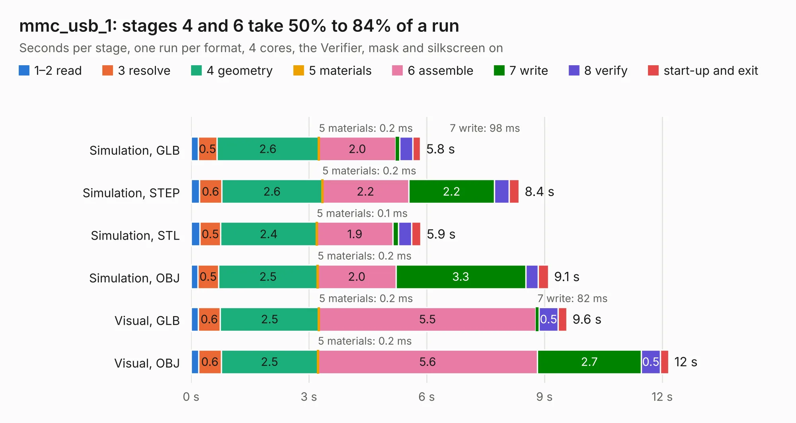

| Mode and format | 1–2 read | 3 resolve | 4 geometry | 5 materials | 6 assemble | 7 write | 8 verify | start-up and exit | Total |
|---|---:|---:|---:|---:|---:|---:|---:|---:|---:|
| Simulation, GLB | 0.2 | 0.5 | 2.6 | 0.2&nbsp;ms | 2.0 | 98&nbsp;ms | 0.3 | 0.2 | 5.8 |
| Simulation, STEP | 0.2 | 0.6 | 2.6 | 0.2&nbsp;ms | 2.2 | 2.2 | 0.4 | 0.3 | 8.4 |
| Simulation, STL | 0.2 | 0.5 | 2.4 | 0.1&nbsp;ms | 1.9 | 0.1 | 0.3 | 0.2 | 5.9 |
| Simulation, OBJ | 0.2 | 0.5 | 2.5 | 0.2&nbsp;ms | 2.0 | 3.3 | 0.3 | 0.3 | 9.1 |
| Visual, GLB | 0.2 | 0.6 | 2.5 | 0.2&nbsp;ms | 5.5 | 82&nbsp;ms | 0.5 | 0.2 | 9.6 |
| Visual, OBJ | 0.2 | 0.6 | 2.5 | 0.2&nbsp;ms | 5.6 | 2.7 | 0.5 | 0.2 | 12.2 |

<table align="center"><tr><td valign="top">

| Board | Repo: [rusefi/rusefi-hardware](https://github.com/rusefi/rusefi-hardware) Board: `mmc_usb_1.kicad_pcb` |
|---|---|
| Folder | classic-designs / rusefi_hardware_history / usb_mmc_spi_rev00.10 |
| Complexity | 201&nbsp;/&nbsp;1000 (size&nbsp;156, features&nbsp;45) |
| KESE&nbsp;features | through vias, filled zones, curved board outline |
| Tested | 9th November 2026 |
| Copper&nbsp;layers | 2 |
| File&nbsp;format | KiCad 3 (3) |
| Parts,&nbsp;tracks,&nbsp;vias | 22, 488, 48 |
| Triangles,&nbsp;simulation | 605,962 in 35 parts |
| Verifier | PASS in all six runs |

</td><td valign="top">

<table>
<tr><th>File type</th><th>File size</th><th>Peak memory used</th></tr>
<tr><th colspan="3" align="left">Simulation</th></tr>
<tr><td>GLB</td><td align="right">21&nbsp;MB</td><td align="right">335&nbsp;MB</td></tr>
<tr><td>STEP</td><td align="right">101&nbsp;MB</td><td align="right">390&nbsp;MB</td></tr>
<tr><td>STL</td><td align="right">30&nbsp;MB</td><td align="right">333&nbsp;MB</td></tr>
<tr><td>OBJ</td><td align="right">61&nbsp;MB</td><td align="right">431&nbsp;MB</td></tr>
<tr><th colspan="3" align="left">Visual</th></tr>
<tr><td>GLB</td><td align="right">17&nbsp;MB</td><td align="right">435&nbsp;MB</td></tr>
<tr><td>OBJ</td><td align="right">51&nbsp;MB</td><td align="right">468&nbsp;MB</td></tr>
</table>

</td></tr></table>

## 2486. mmc_usb_1

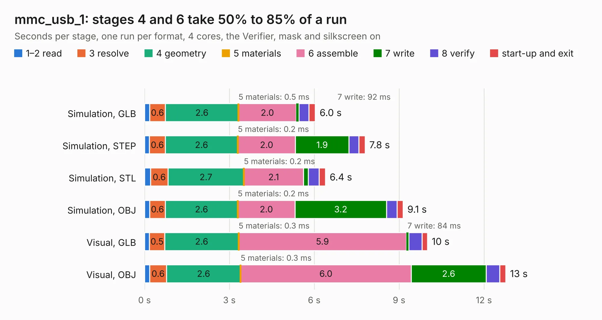

| Mode and format | 1–2 read | 3 resolve | 4 geometry | 5 materials | 6 assemble | 7 write | 8 verify | start-up and exit | Total |
|---|---:|---:|---:|---:|---:|---:|---:|---:|---:|
| Simulation, GLB | 0.2 | 0.6 | 2.6 | 0.5&nbsp;ms | 2.0 | 92&nbsp;ms | 0.4 | 0.2 | 6.0 |
| Simulation, STEP | 0.2 | 0.6 | 2.6 | 0.2&nbsp;ms | 2.0 | 1.9 | 0.4 | 0.2 | 7.8 |
| Simulation, STL | 0.2 | 0.6 | 2.7 | 0.2&nbsp;ms | 2.1 | 0.2 | 0.4 | 0.2 | 6.4 |
| Simulation, OBJ | 0.2 | 0.6 | 2.6 | 0.2&nbsp;ms | 2.0 | 3.2 | 0.4 | 0.2 | 9.1 |
| Visual, GLB | 0.2 | 0.5 | 2.6 | 0.3&nbsp;ms | 5.9 | 84&nbsp;ms | 0.5 | 0.2 | 10.0 |
| Visual, OBJ | 0.2 | 0.6 | 2.6 | 0.3&nbsp;ms | 6.0 | 2.6 | 0.5 | 0.2 | 12.8 |

<table align="center"><tr><td valign="top">

| Board | Repo: [rusefi/rusefi-hardware](https://github.com/rusefi/rusefi-hardware) Board: `mmc_usb_1.kicad_pcb` |
|---|---|
| Folder | classic-designs / rusefi_hardware_history / usb_mmc_spi_rev00.20 |
| Complexity | 201&nbsp;/&nbsp;1000 (size&nbsp;156, features&nbsp;45) |
| KESE&nbsp;features | through vias, filled zones, curved board outline |
| Tested | 9th November 2026 |
| Copper&nbsp;layers | 2 |
| File&nbsp;format | KiCad 3 (3) |
| Parts,&nbsp;tracks,&nbsp;vias | 22, 488, 48 |
| Triangles,&nbsp;simulation | 639,772 in 69 parts |
| Verifier | PASS in all six runs |

</td><td valign="top">

<table>
<tr><th>File type</th><th>File size</th><th>Peak memory used</th></tr>
<tr><th colspan="3" align="left">Simulation</th></tr>
<tr><td>GLB</td><td align="right">22&nbsp;MB</td><td align="right">357&nbsp;MB</td></tr>
<tr><td>STEP</td><td align="right">107&nbsp;MB</td><td align="right">400&nbsp;MB</td></tr>
<tr><td>STL</td><td align="right">32&nbsp;MB</td><td align="right">328&nbsp;MB</td></tr>
<tr><td>OBJ</td><td align="right">65&nbsp;MB</td><td align="right">457&nbsp;MB</td></tr>
<tr><th colspan="3" align="left">Visual</th></tr>
<tr><td>GLB</td><td align="right">18&nbsp;MB</td><td align="right">478&nbsp;MB</td></tr>
<tr><td>OBJ</td><td align="right">54&nbsp;MB</td><td align="right">446&nbsp;MB</td></tr>
</table>

</td></tr></table>

## 2487. mmc_usb_1

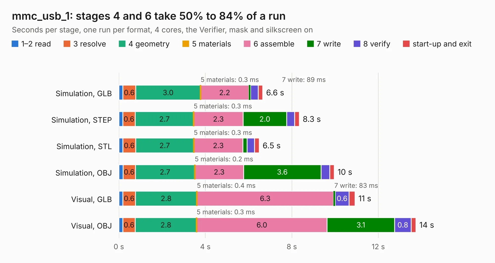

| Mode and format | 1–2 read | 3 resolve | 4 geometry | 5 materials | 6 assemble | 7 write | 8 verify | start-up and exit | Total |
|---|---:|---:|---:|---:|---:|---:|---:|---:|---:|
| Simulation, GLB | 0.2 | 0.6 | 3.0 | 0.3&nbsp;ms | 2.2 | 89&nbsp;ms | 0.4 | 0.2 | 6.6 |
| Simulation, STEP | 0.2 | 0.6 | 2.7 | 0.3&nbsp;ms | 2.3 | 2.0 | 0.4 | 0.2 | 8.3 |
| Simulation, STL | 0.2 | 0.6 | 2.7 | 0.3&nbsp;ms | 2.3 | 0.2 | 0.3 | 0.2 | 6.5 |
| Simulation, OBJ | 0.2 | 0.6 | 2.7 | 0.2&nbsp;ms | 2.3 | 3.6 | 0.4 | 0.2 | 10.0 |
| Visual, GLB | 0.2 | 0.6 | 2.8 | 0.4&nbsp;ms | 6.3 | 83&nbsp;ms | 0.6 | 0.3 | 10.9 |
| Visual, OBJ | 0.2 | 0.6 | 2.8 | 0.3&nbsp;ms | 6.0 | 3.1 | 0.8 | 0.2 | 13.7 |

<table align="center"><tr><td valign="top">

| Board | Repo: [rusefi/rusefi-hardware](https://github.com/rusefi/rusefi-hardware) Board: `mmc_usb_1.kicad_pcb` |
|---|---|
| Folder | classic-designs / rusefi_hardware_history / usb_mmc_spi_rev00.30 / usb_mmc_spi |
| Complexity | 190&nbsp;/&nbsp;1000 (size&nbsp;155, features&nbsp;35) |
| KESE&nbsp;features | through vias, filled zones |
| Tested | 9th November 2026 |
| Copper&nbsp;layers | 2 |
| File&nbsp;format | KiCad 3 (3) |
| Parts,&nbsp;tracks,&nbsp;vias | 22, 450, 47 |
| Triangles,&nbsp;simulation | 653,104 in 71 parts |
| Verifier | PASS in all six runs |

</td><td valign="top">

<table>
<tr><th>File type</th><th>File size</th><th>Peak memory used</th></tr>
<tr><th colspan="3" align="left">Simulation</th></tr>
<tr><td>GLB</td><td align="right">22&nbsp;MB</td><td align="right">345&nbsp;MB</td></tr>
<tr><td>STEP</td><td align="right">110&nbsp;MB</td><td align="right">401&nbsp;MB</td></tr>
<tr><td>STL</td><td align="right">33&nbsp;MB</td><td align="right">363&nbsp;MB</td></tr>
<tr><td>OBJ</td><td align="right">66&nbsp;MB</td><td align="right">466&nbsp;MB</td></tr>
<tr><th colspan="3" align="left">Visual</th></tr>
<tr><td>GLB</td><td align="right">18&nbsp;MB</td><td align="right">447&nbsp;MB</td></tr>
<tr><td>OBJ</td><td align="right">55&nbsp;MB</td><td align="right">471&nbsp;MB</td></tr>
</table>

</td></tr></table>

## 2488. frequency-divider

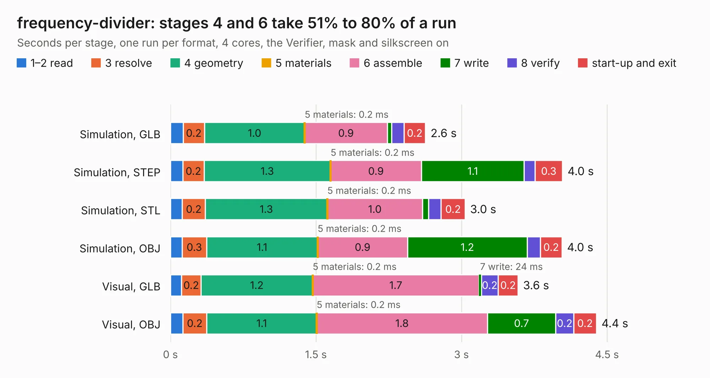

| Mode and format | 1–2 read | 3 resolve | 4 geometry | 5 materials | 6 assemble | 7 write | 8 verify | start-up and exit | Total |
|---|---:|---:|---:|---:|---:|---:|---:|---:|---:|
| Simulation, GLB | 0.1 | 0.2 | 1.0 | 0.2&nbsp;ms | 0.9 | 45&nbsp;ms | 0.1 | 0.2 | 2.6 |
| Simulation, STEP | 0.1 | 0.2 | 1.3 | 0.2&nbsp;ms | 0.9 | 1.1 | 0.1 | 0.3 | 4.0 |
| Simulation, STL | 0.1 | 0.2 | 1.3 | 0.2&nbsp;ms | 1.0 | 62&nbsp;ms | 0.1 | 0.2 | 3.0 |
| Simulation, OBJ | 0.1 | 0.3 | 1.1 | 0.2&nbsp;ms | 0.9 | 1.2 | 0.1 | 0.2 | 4.0 |
| Visual, GLB | 0.1 | 0.2 | 1.2 | 0.2&nbsp;ms | 1.7 | 24&nbsp;ms | 0.2 | 0.2 | 3.6 |
| Visual, OBJ | 0.1 | 0.2 | 1.1 | 0.2&nbsp;ms | 1.8 | 0.7 | 0.2 | 0.2 | 4.4 |

<table align="center"><tr><td valign="top">

| Board | Repo: [rusefi/rusefi-hardware](https://github.com/rusefi/rusefi-hardware) Board: `frequency-divider.kicad_pcb` |
|---|---|
| Folder | frequency-divider |
| Complexity | 219&nbsp;/&nbsp;1000 (size&nbsp;129, features&nbsp;90) |
| KESE&nbsp;features | through vias, rounded, trapezoid or chamfered pads, filled zones, curved board outline, stack-up, dielectric εr and tanδ, mask and silkscreen colours |
| Tested | 9th November 2026 |
| Copper&nbsp;layers | 2 |
| File&nbsp;format | KiCad 6 (20210824) |
| Parts,&nbsp;tracks,&nbsp;vias | 15, 41, 37 |
| Triangles,&nbsp;simulation | 269,140 in 21 parts |
| Verifier | PASS in all six runs |

</td><td valign="top">

<table>
<tr><th>File type</th><th>File size</th><th>Peak memory used</th></tr>
<tr><th colspan="3" align="left">Simulation</th></tr>
<tr><td>GLB</td><td align="right">9.1&nbsp;MB</td><td align="right">252&nbsp;MB</td></tr>
<tr><td>STEP</td><td align="right">36&nbsp;MB</td><td align="right">254&nbsp;MB</td></tr>
<tr><td>STL</td><td align="right">13&nbsp;MB</td><td align="right">234&nbsp;MB</td></tr>
<tr><td>OBJ</td><td align="right">26&nbsp;MB</td><td align="right">250&nbsp;MB</td></tr>
<tr><th colspan="3" align="left">Visual</th></tr>
<tr><td>GLB</td><td align="right">5.9&nbsp;MB</td><td align="right">211&nbsp;MB</td></tr>
<tr><td>OBJ</td><td align="right">17&nbsp;MB</td><td align="right">213&nbsp;MB</td></tr>
</table>

</td></tr></table>

## 2489. GDI-4ch

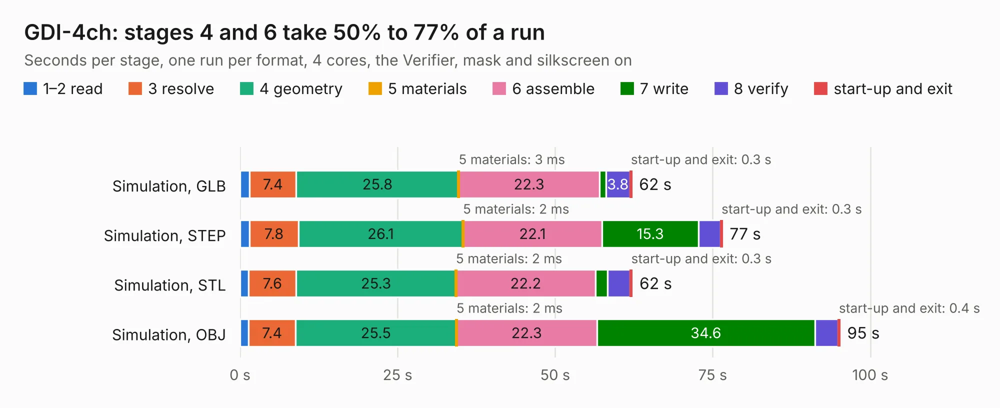

| Mode and format | 1–2 read | 3 resolve | 4 geometry | 5 materials | 6 assemble | 7 write | 8 verify | start-up and exit | Total |
|---|---:|---:|---:|---:|---:|---:|---:|---:|---:|
| Simulation, GLB | 1.5 | 7.4 | 25.8 | 3&nbsp;ms | 22.3 | 1.0 | 3.8 | 0.3 | 62.2 |
| Simulation, STEP | 1.5 | 7.8 | 26.1 | 2&nbsp;ms | 22.1 | 15.3 | 3.5 | 0.3 | 76.5 |
| Simulation, STL | 1.4 | 7.6 | 25.3 | 2&nbsp;ms | 22.2 | 1.9 | 3.6 | 0.3 | 62.2 |
| Simulation, OBJ | 1.4 | 7.4 | 25.5 | 2&nbsp;ms | 22.3 | 34.6 | 3.6 | 0.4 | 95.2 |
| Visual, GLB | 1.5 | 7.6 | 25.3 | 2&nbsp;ms | 50.3 | 0.6 | 6.7 | 0.3 | 92.2 |
| Visual, OBJ | 1.4 | 7.6 | 25.4 | 2&nbsp;ms | 50.7 | 23.1 | 7.2 | 0.3 | 115.8 |

<table align="center"><tr><td valign="top">

| Board | Repo: [rusefi/rusefi-hardware](https://github.com/rusefi/rusefi-hardware) Board: `GDI-4ch.kicad_pcb` |
|---|---|
| Folder | GDI-4ch |
| Complexity | 390&nbsp;/&nbsp;1000 (size&nbsp;280, features&nbsp;110) |
| KESE&nbsp;features | through vias, custom pads, rounded, trapezoid or chamfered pads, filled zones, copper drawings, curved board outline, stack-up, dielectric εr and tanδ |
| Tested | 9th November 2026 |
| Copper&nbsp;layers | 4 |
| File&nbsp;format | KiCad 7 (20221018) |
| Parts,&nbsp;tracks,&nbsp;vias | 296, 2,669, 664 |
| Triangles,&nbsp;simulation | 5,698,984 in 302 parts |
| Verifier | PASS in all six runs |

</td><td valign="top">

<table>
<tr><th>File type</th><th>File size</th><th>Peak memory used</th></tr>
<tr><th colspan="3" align="left">Simulation</th></tr>
<tr><td>GLB</td><td align="right">189&nbsp;MB</td><td align="right">1.6&nbsp;GB</td></tr>
<tr><td>STEP</td><td align="right">798&nbsp;MB</td><td align="right">2.2&nbsp;GB</td></tr>
<tr><td>STL</td><td align="right">285&nbsp;MB</td><td align="right">1.6&nbsp;GB</td></tr>
<tr><td>OBJ</td><td align="right">605&nbsp;MB</td><td align="right">3.6&nbsp;GB</td></tr>
<tr><th colspan="3" align="left">Visual</th></tr>
<tr><td>GLB</td><td align="right">131&nbsp;MB</td><td align="right">2.1&nbsp;GB</td></tr>
<tr><td>OBJ</td><td align="right">416&nbsp;MB</td><td align="right">2.5&nbsp;GB</td></tr>
</table>

</td></tr></table>

## 2490. GDI-6ch

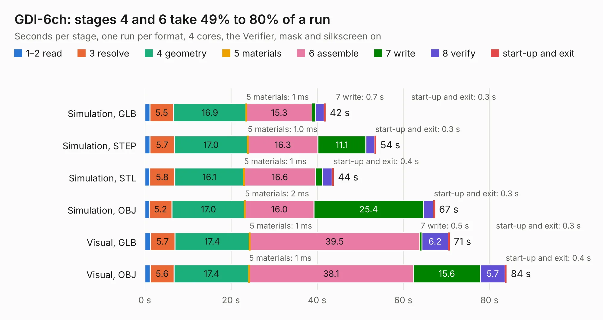

| Mode and format | 1–2 read | 3 resolve | 4 geometry | 5 materials | 6 assemble | 7 write | 8 verify | start-up and exit | Total |
|---|---:|---:|---:|---:|---:|---:|---:|---:|---:|
| Simulation, GLB | 1.2 | 5.5 | 16.9 | 1&nbsp;ms | 15.3 | 0.7 | 2.1 | 0.3 | 42.0 |
| Simulation, STEP | 1.2 | 5.7 | 17.0 | 1.0&nbsp;ms | 16.3 | 11.1 | 2.1 | 0.3 | 53.7 |
| Simulation, STL | 1.1 | 5.8 | 16.1 | 1&nbsp;ms | 16.6 | 1.6 | 2.2 | 0.4 | 43.8 |
| Simulation, OBJ | 1.1 | 5.2 | 17.0 | 2&nbsp;ms | 16.0 | 25.4 | 2.3 | 0.3 | 67.3 |
| Visual, GLB | 1.3 | 5.7 | 17.4 | 1&nbsp;ms | 39.5 | 0.5 | 6.2 | 0.3 | 70.8 |
| Visual, OBJ | 1.2 | 5.6 | 17.4 | 1&nbsp;ms | 38.1 | 15.6 | 5.7 | 0.4 | 84.0 |

<table align="center"><tr><td valign="top">

| Board | Repo: [rusefi/rusefi-hardware](https://github.com/rusefi/rusefi-hardware) Board: `GDI-6ch.kicad_pcb` |
|---|---|
| Folder | GDI-6ch |
| Complexity | 386&nbsp;/&nbsp;1000 (size&nbsp;276, features&nbsp;110) |
| KESE&nbsp;features | through vias, custom pads, rounded, trapezoid or chamfered pads, filled zones, copper drawings, curved board outline, stack-up, dielectric εr and tanδ |
| Tested | 9th November 2026 |
| Copper&nbsp;layers | 4 |
| File&nbsp;format | KiCad 8 (20240108) |
| Parts,&nbsp;tracks,&nbsp;vias | 245, 2,076, 647 |
| Triangles,&nbsp;simulation | 4,888,790 in 278 parts |
| Verifier | PASS in all six runs |

</td><td valign="top">

<table>
<tr><th>File type</th><th>File size</th><th>Peak memory used</th></tr>
<tr><th colspan="3" align="left">Simulation</th></tr>
<tr><td>GLB</td><td align="right">162&nbsp;MB</td><td align="right">1.3&nbsp;GB</td></tr>
<tr><td>STEP</td><td align="right">627&nbsp;MB</td><td align="right">1.9&nbsp;GB</td></tr>
<tr><td>STL</td><td align="right">244&nbsp;MB</td><td align="right">1.3&nbsp;GB</td></tr>
<tr><td>OBJ</td><td align="right">517&nbsp;MB</td><td align="right">3.1&nbsp;GB</td></tr>
<tr><th colspan="3" align="left">Visual</th></tr>
<tr><td>GLB</td><td align="right">106&nbsp;MB</td><td align="right">1.8&nbsp;GB</td></tr>
<tr><td>OBJ</td><td align="right">339&nbsp;MB</td><td align="right">2.2&nbsp;GB</td></tr>
</table>

</td></tr></table>

## 2491. GDI-STM

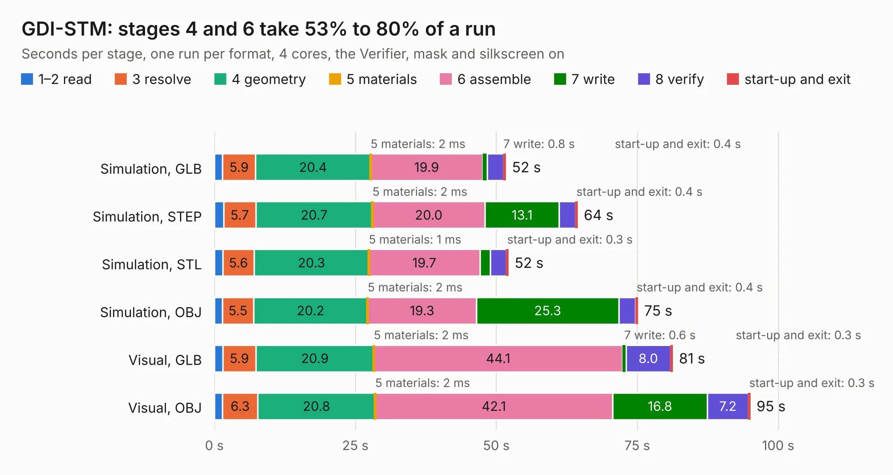

| Mode and format | 1–2 read | 3 resolve | 4 geometry | 5 materials | 6 assemble | 7 write | 8 verify | start-up and exit | Total |
|---|---:|---:|---:|---:|---:|---:|---:|---:|---:|
| Simulation, GLB | 1.4 | 5.9 | 20.4 | 2&nbsp;ms | 19.9 | 0.8 | 2.9 | 0.4 | 51.7 |
| Simulation, STEP | 1.6 | 5.7 | 20.7 | 2&nbsp;ms | 20.0 | 13.1 | 2.9 | 0.4 | 64.4 |
| Simulation, STL | 1.5 | 5.6 | 20.3 | 1&nbsp;ms | 19.7 | 1.8 | 2.8 | 0.3 | 52.1 |
| Simulation, OBJ | 1.4 | 5.5 | 20.2 | 2&nbsp;ms | 19.3 | 25.3 | 3.0 | 0.4 | 75.1 |
| Visual, GLB | 1.5 | 5.9 | 20.9 | 2&nbsp;ms | 44.1 | 0.6 | 8.0 | 0.3 | 81.3 |
| Visual, OBJ | 1.4 | 6.3 | 20.8 | 2&nbsp;ms | 42.1 | 16.8 | 7.2 | 0.3 | 95.0 |

<table align="center"><tr><td valign="top">

| Board | Repo: [rusefi/rusefi-hardware](https://github.com/rusefi/rusefi-hardware) Board: `GDI-STM.kicad_pcb` |
|---|---|
| Folder | GDI-STM |
| Complexity | 357&nbsp;/&nbsp;1000 (size&nbsp;272, features&nbsp;85) |
| KESE&nbsp;features | through vias, rounded, trapezoid or chamfered pads, filled zones, curved board outline, stack-up, dielectric εr and tanδ |
| Tested | 9th November 2026 |
| Copper&nbsp;layers | 4 |
| File&nbsp;format | KiCad 9 (20241229) |
| Parts,&nbsp;tracks,&nbsp;vias | 306, 2,211, 687 |
| Triangles,&nbsp;simulation | 4,938,506 in 310 parts |
| Verifier | PASS in all six runs |

</td><td valign="top">

<table>
<tr><th>File type</th><th>File size</th><th>Peak memory used</th></tr>
<tr><th colspan="3" align="left">Simulation</th></tr>
<tr><td>GLB</td><td align="right">163&nbsp;MB</td><td align="right">1.4&nbsp;GB</td></tr>
<tr><td>STEP</td><td align="right">655&nbsp;MB</td><td align="right">2.0&nbsp;GB</td></tr>
<tr><td>STL</td><td align="right">247&nbsp;MB</td><td align="right">1.5&nbsp;GB</td></tr>
<tr><td>OBJ</td><td align="right">521&nbsp;MB</td><td align="right">3.1&nbsp;GB</td></tr>
<tr><th colspan="3" align="left">Visual</th></tr>
<tr><td>GLB</td><td align="right">111&nbsp;MB</td><td align="right">1.8&nbsp;GB</td></tr>
<tr><td>OBJ</td><td align="right">354&nbsp;MB</td><td align="right">2.4&nbsp;GB</td></tr>
</table>

</td></tr></table>

## 2492. IR2302-testboard

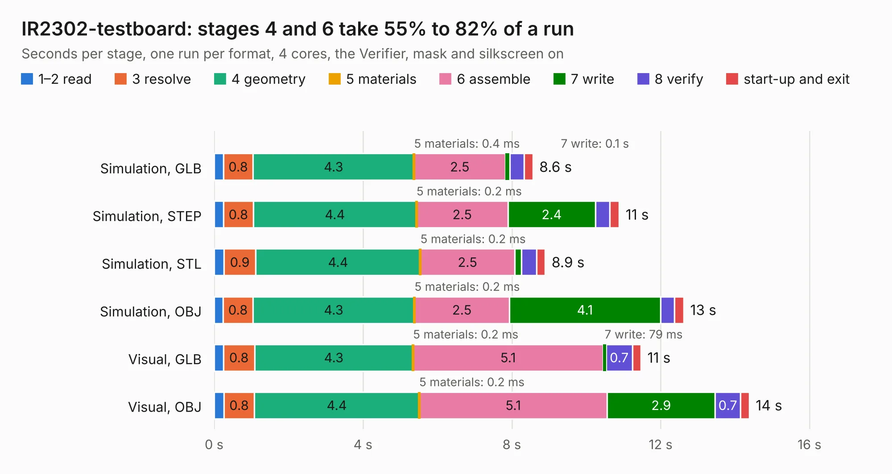

| Mode and format | 1–2 read | 3 resolve | 4 geometry | 5 materials | 6 assemble | 7 write | 8 verify | start-up and exit | Total |
|---|---:|---:|---:|---:|---:|---:|---:|---:|---:|
| Simulation, GLB | 0.2 | 0.8 | 4.3 | 0.4&nbsp;ms | 2.5 | 0.1 | 0.4 | 0.2 | 8.6 |
| Simulation, STEP | 0.2 | 0.8 | 4.4 | 0.2&nbsp;ms | 2.5 | 2.4 | 0.4 | 0.3 | 10.9 |
| Simulation, STL | 0.3 | 0.9 | 4.4 | 0.2&nbsp;ms | 2.5 | 0.2 | 0.4 | 0.2 | 8.9 |
| Simulation, OBJ | 0.2 | 0.8 | 4.3 | 0.2&nbsp;ms | 2.5 | 4.1 | 0.4 | 0.2 | 12.6 |
| Visual, GLB | 0.2 | 0.8 | 4.3 | 0.2&nbsp;ms | 5.1 | 79&nbsp;ms | 0.7 | 0.2 | 11.5 |
| Visual, OBJ | 0.3 | 0.8 | 4.4 | 0.2&nbsp;ms | 5.1 | 2.9 | 0.7 | 0.2 | 14.4 |

<table align="center"><tr><td valign="top">

| Board | Repo: [rusefi/rusefi-hardware](https://github.com/rusefi/rusefi-hardware) Board: `IR2302-testboard.kicad_pcb` |
|---|---|
| Folder | IR2302-testboard |
| Complexity | 251&nbsp;/&nbsp;1000 (size&nbsp;166, features&nbsp;85) |
| KESE&nbsp;features | through vias, rounded, trapezoid or chamfered pads, filled zones, curved board outline, stack-up, dielectric εr and tanδ |
| Tested | 9th November 2026 |
| Copper&nbsp;layers | 2 |
| File&nbsp;format | KiCad 7 (20221018) |
| Parts,&nbsp;tracks,&nbsp;vias | 49, 153, 169 |
| Triangles,&nbsp;simulation | 709,584 in 38 parts |
| Verifier | PASS in all six runs |

</td><td valign="top">

<table>
<tr><th>File type</th><th>File size</th><th>Peak memory used</th></tr>
<tr><th colspan="3" align="left">Simulation</th></tr>
<tr><td>GLB</td><td align="right">25&nbsp;MB</td><td align="right">386&nbsp;MB</td></tr>
<tr><td>STEP</td><td align="right">117&nbsp;MB</td><td align="right">436&nbsp;MB</td></tr>
<tr><td>STL</td><td align="right">35&nbsp;MB</td><td align="right">390&nbsp;MB</td></tr>
<tr><td>OBJ</td><td align="right">72&nbsp;MB</td><td align="right">539&nbsp;MB</td></tr>
<tr><th colspan="3" align="left">Visual</th></tr>
<tr><td>GLB</td><td align="right">17&nbsp;MB</td><td align="right">416&nbsp;MB</td></tr>
<tr><td>OBJ</td><td align="right">50&nbsp;MB</td><td align="right">417&nbsp;MB</td></tr>
</table>

</td></tr></table>

## 2493. micro_rusEFI

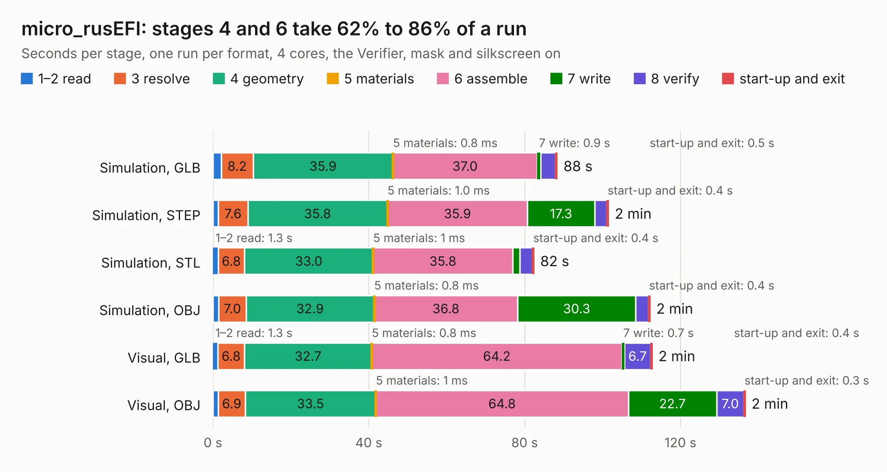

| Mode and format | 1–2 read | 3 resolve | 4 geometry | 5 materials | 6 assemble | 7 write | 8 verify | start-up and exit | Total |
|---|---:|---:|---:|---:|---:|---:|---:|---:|---:|
| Simulation, GLB | 2.1 | 8.2 | 35.9 | 0.8&nbsp;ms | 37.0 | 0.9 | 3.8 | 0.5 | 88.3 |
| Simulation, STEP | 1.4 | 7.6 | 35.8 | 1.0&nbsp;ms | 35.9 | 17.3 | 3.1 | 0.4 | 101.5 |
| Simulation, STL | 1.3 | 6.8 | 33.0 | 1&nbsp;ms | 35.8 | 1.9 | 3.2 | 0.4 | 82.4 |
| Simulation, OBJ | 1.5 | 7.0 | 32.9 | 0.8&nbsp;ms | 36.8 | 30.3 | 3.2 | 0.4 | 112.2 |
| Visual, GLB | 1.3 | 6.8 | 32.7 | 0.8&nbsp;ms | 64.2 | 0.7 | 6.7 | 0.4 | 112.7 |
| Visual, OBJ | 1.4 | 6.9 | 33.5 | 1&nbsp;ms | 64.8 | 22.7 | 7.0 | 0.3 | 136.6 |

<table align="center"><tr><td valign="top">

| Board | Repo: [rusefi/rusefi-hardware](https://github.com/rusefi/rusefi-hardware) Board: `micro_rusEFI.kicad_pcb` |
|---|---|
| Folder | L9779WD-breakout |
| Complexity | 342&nbsp;/&nbsp;1000 (size&nbsp;267, features&nbsp;75) |
| KESE&nbsp;features | through vias, slotted holes, rounded, trapezoid or chamfered pads, filled zones, copper text, curved board outline |
| Tested | 9th November 2026 |
| Copper&nbsp;layers | 2 |
| File&nbsp;format | KiCad 5 (20171130) |
| Parts,&nbsp;tracks,&nbsp;vias | 233, 4,021, 857 |
| Triangles,&nbsp;simulation | 4,757,940 in 237 parts |
| Verifier | PASS in all six runs |

</td><td valign="top">

<table>
<tr><th>File type</th><th>File size</th><th>Peak memory used</th></tr>
<tr><th colspan="3" align="left">Simulation</th></tr>
<tr><td>GLB</td><td align="right">166&nbsp;MB</td><td align="right">1.5&nbsp;GB</td></tr>
<tr><td>STEP</td><td align="right">872&nbsp;MB</td><td align="right">2.0&nbsp;GB</td></tr>
<tr><td>STL</td><td align="right">238&nbsp;MB</td><td align="right">1.5&nbsp;GB</td></tr>
<tr><td>OBJ</td><td align="right">513&nbsp;MB</td><td align="right">3.1&nbsp;GB</td></tr>
<tr><th colspan="3" align="left">Visual</th></tr>
<tr><td>GLB</td><td align="right">135&nbsp;MB</td><td align="right">2.1&nbsp;GB</td></tr>
<tr><td>OBJ</td><td align="right">427&nbsp;MB</td><td align="right">2.7&nbsp;GB</td></tr>
</table>

</td></tr></table>

## 2494. lambda-x2

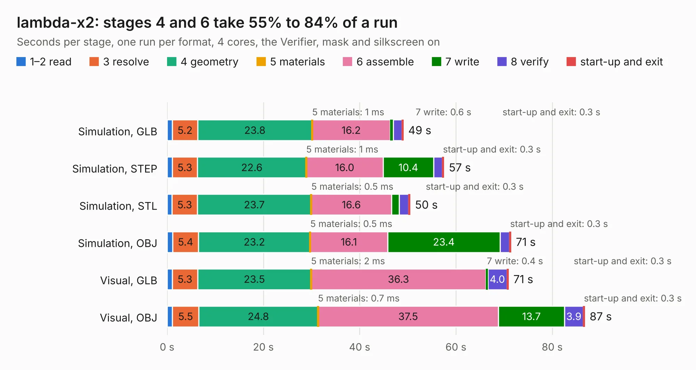

| Mode and format | 1–2 read | 3 resolve | 4 geometry | 5 materials | 6 assemble | 7 write | 8 verify | start-up and exit | Total |
|---|---:|---:|---:|---:|---:|---:|---:|---:|---:|
| Simulation, GLB | 1.1 | 5.2 | 23.8 | 1&nbsp;ms | 16.2 | 0.6 | 1.8 | 0.3 | 49.1 |
| Simulation, STEP | 1.1 | 5.3 | 22.6 | 1&nbsp;ms | 16.0 | 10.4 | 1.8 | 0.3 | 57.5 |
| Simulation, STL | 1.0 | 5.3 | 23.7 | 0.5&nbsp;ms | 16.6 | 1.6 | 2.0 | 0.3 | 50.5 |
| Simulation, OBJ | 1.2 | 5.4 | 23.2 | 0.5&nbsp;ms | 16.1 | 23.4 | 1.9 | 0.3 | 71.4 |
| Visual, GLB | 1.1 | 5.3 | 23.5 | 2&nbsp;ms | 36.3 | 0.4 | 4.0 | 0.3 | 70.9 |
| Visual, OBJ | 1.1 | 5.5 | 24.8 | 0.7&nbsp;ms | 37.5 | 13.7 | 3.9 | 0.3 | 86.7 |

<table align="center"><tr><td valign="top">

| Board | Repo: [rusefi/rusefi-hardware](https://github.com/rusefi/rusefi-hardware) Board: `lambda-x2.kicad_pcb` |
|---|---|
| Folder | lambda-x2 |
| Complexity | 371&nbsp;/&nbsp;1000 (size&nbsp;271, features&nbsp;100) |
| KESE&nbsp;features | through vias, slotted holes, custom pads, rounded, trapezoid or chamfered pads, filled zones, copper drawings, copper text, curved board outline |
| Tested | 9th November 2026 to 10th November 2026 |
| Copper&nbsp;layers | 4 |
| File&nbsp;format | KiCad 6 (20211014) |
| Parts,&nbsp;tracks,&nbsp;vias | 266, 2,183, 706 |
| Triangles,&nbsp;simulation | 4,213,238 in 179 parts |
| Verifier | PASS in all six runs |
| Run&nbsp;again | Visual, GLB; Visual, OBJ: failed in the corpus run, run again with fixes to KESE made after the corpus run, and passed |

</td><td valign="top">

<table>
<tr><th>File type</th><th>File size</th><th>Peak memory used</th></tr>
<tr><th colspan="3" align="left">Simulation</th></tr>
<tr><td>GLB</td><td align="right">147&nbsp;MB</td><td align="right">1.3&nbsp;GB</td></tr>
<tr><td>STEP</td><td align="right">653&nbsp;MB</td><td align="right">1.7&nbsp;GB</td></tr>
<tr><td>STL</td><td align="right">211&nbsp;MB</td><td align="right">1.3&nbsp;GB</td></tr>
<tr><td>OBJ</td><td align="right">455&nbsp;MB</td><td align="right">2.8&nbsp;GB</td></tr>
<tr><th colspan="3" align="left">Visual</th></tr>
<tr><td>GLB</td><td align="right">92&nbsp;MB</td><td align="right">1.5&nbsp;GB</td></tr>
<tr><td>OBJ</td><td align="right">288&nbsp;MB</td><td align="right">2.0&nbsp;GB</td></tr>
</table>

</td></tr></table>

## 2495. LM1949_Driver

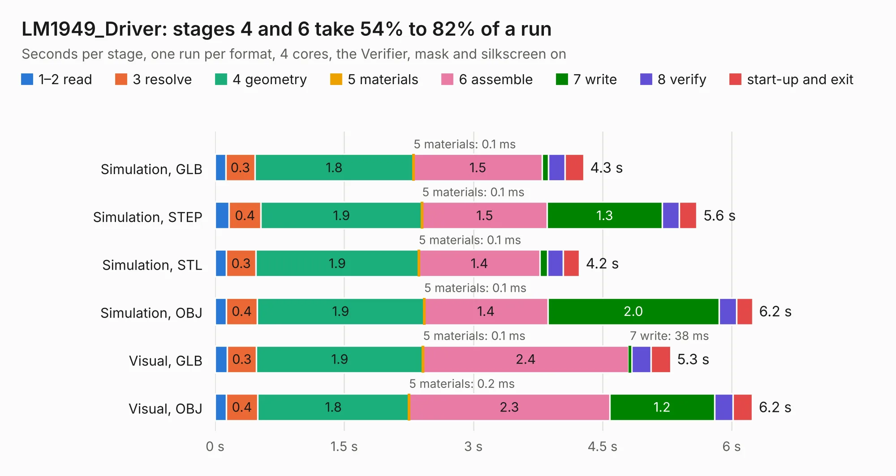

| Mode and format | 1–2 read | 3 resolve | 4 geometry | 5 materials | 6 assemble | 7 write | 8 verify | start-up and exit | Total |
|---|---:|---:|---:|---:|---:|---:|---:|---:|---:|
| Simulation, GLB | 0.1 | 0.3 | 1.8 | 0.1&nbsp;ms | 1.5 | 73&nbsp;ms | 0.2 | 0.2 | 4.3 |
| Simulation, STEP | 0.2 | 0.4 | 1.9 | 0.1&nbsp;ms | 1.5 | 1.3 | 0.2 | 0.2 | 5.6 |
| Simulation, STL | 0.1 | 0.3 | 1.9 | 0.1&nbsp;ms | 1.4 | 88&nbsp;ms | 0.2 | 0.2 | 4.2 |
| Simulation, OBJ | 0.1 | 0.4 | 1.9 | 0.1&nbsp;ms | 1.4 | 2.0 | 0.2 | 0.2 | 6.2 |
| Visual, GLB | 0.1 | 0.3 | 1.9 | 0.1&nbsp;ms | 2.4 | 38&nbsp;ms | 0.2 | 0.2 | 5.3 |
| Visual, OBJ | 0.1 | 0.4 | 1.8 | 0.2&nbsp;ms | 2.3 | 1.2 | 0.2 | 0.2 | 6.2 |

<table align="center"><tr><td valign="top">

| Board | Repo: [rusefi/rusefi-hardware](https://github.com/rusefi/rusefi-hardware) Board: `LM1949_Driver.kicad_pcb` |
|---|---|
| Folder | Low-Z_LM1949 |
| Complexity | 223&nbsp;/&nbsp;1000 (size&nbsp;148, features&nbsp;75) |
| KESE&nbsp;features | through vias, rounded, trapezoid or chamfered pads, filled zones, stack-up, dielectric εr and tanδ |
| Tested | 9th November 2026 |
| Copper&nbsp;layers | 2 |
| File&nbsp;format | KiCad 6 (20211014) |
| Parts,&nbsp;tracks,&nbsp;vias | 17, 60, 129 |
| Triangles,&nbsp;simulation | 384,828 in 21 parts |
| Verifier | PASS in all six runs |

</td><td valign="top">

<table>
<tr><th>File type</th><th>File size</th><th>Peak memory used</th></tr>
<tr><th colspan="3" align="left">Simulation</th></tr>
<tr><td>GLB</td><td align="right">13&nbsp;MB</td><td align="right">255&nbsp;MB</td></tr>
<tr><td>STEP</td><td align="right">51&nbsp;MB</td><td align="right">299&nbsp;MB</td></tr>
<tr><td>STL</td><td align="right">19&nbsp;MB</td><td align="right">264&nbsp;MB</td></tr>
<tr><td>OBJ</td><td align="right">38&nbsp;MB</td><td align="right">286&nbsp;MB</td></tr>
<tr><th colspan="3" align="left">Visual</th></tr>
<tr><td>GLB</td><td align="right">7.9&nbsp;MB</td><td align="right">279&nbsp;MB</td></tr>
<tr><td>OBJ</td><td align="right">23&nbsp;MB</td><td align="right">281&nbsp;MB</td></tr>
</table>

</td></tr></table>

## 2496. MC33810-breakout

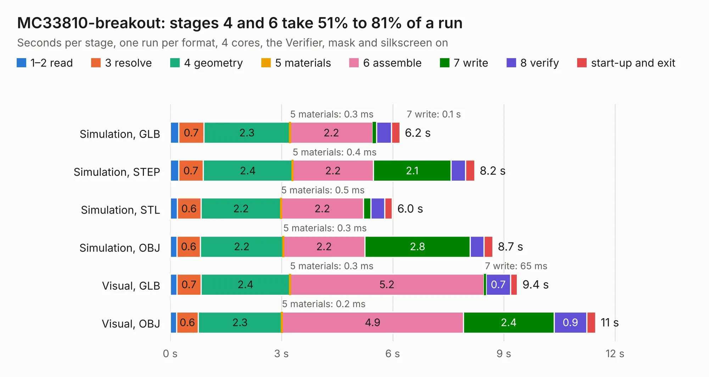

| Mode and format | 1–2 read | 3 resolve | 4 geometry | 5 materials | 6 assemble | 7 write | 8 verify | start-up and exit | Total |
|---|---:|---:|---:|---:|---:|---:|---:|---:|---:|
| Simulation, GLB | 0.2 | 0.7 | 2.3 | 0.3&nbsp;ms | 2.2 | 0.1 | 0.4 | 0.2 | 6.2 |
| Simulation, STEP | 0.2 | 0.7 | 2.4 | 0.4&nbsp;ms | 2.2 | 2.1 | 0.4 | 0.2 | 8.2 |
| Simulation, STL | 0.2 | 0.6 | 2.2 | 0.5&nbsp;ms | 2.2 | 0.2 | 0.4 | 0.2 | 6.0 |
| Simulation, OBJ | 0.2 | 0.6 | 2.2 | 0.3&nbsp;ms | 2.2 | 2.8 | 0.4 | 0.2 | 8.7 |
| Visual, GLB | 0.2 | 0.7 | 2.4 | 0.3&nbsp;ms | 5.2 | 65&nbsp;ms | 0.7 | 0.2 | 9.4 |
| Visual, OBJ | 0.2 | 0.6 | 2.3 | 0.2&nbsp;ms | 4.9 | 2.4 | 0.9 | 0.2 | 11.5 |

<table align="center"><tr><td valign="top">

| Board | Repo: [rusefi/rusefi-hardware](https://github.com/rusefi/rusefi-hardware) Board: `MC33810-breakout.kicad_pcb` |
|---|---|
| Folder | MC33810-breakout |
| Complexity | 252&nbsp;/&nbsp;1000 (size&nbsp;167, features&nbsp;85) |
| KESE&nbsp;features | through vias, rounded, trapezoid or chamfered pads, filled zones, curved board outline, stack-up, dielectric εr and tanδ |
| Tested | 9th November 2026 |
| Copper&nbsp;layers | 2 |
| File&nbsp;format | KiCad 7 (20221018) |
| Parts,&nbsp;tracks,&nbsp;vias | 31, 491, 153 |
| Triangles,&nbsp;simulation | 631,044 in 52 parts |
| Verifier | PASS in all six runs |

</td><td valign="top">

<table>
<tr><th>File type</th><th>File size</th><th>Peak memory used</th></tr>
<tr><th colspan="3" align="left">Simulation</th></tr>
<tr><td>GLB</td><td align="right">22&nbsp;MB</td><td align="right">342&nbsp;MB</td></tr>
<tr><td>STEP</td><td align="right">97&nbsp;MB</td><td align="right">420&nbsp;MB</td></tr>
<tr><td>STL</td><td align="right">32&nbsp;MB</td><td align="right">334&nbsp;MB</td></tr>
<tr><td>OBJ</td><td align="right">63&nbsp;MB</td><td align="right">457&nbsp;MB</td></tr>
<tr><th colspan="3" align="left">Visual</th></tr>
<tr><td>GLB</td><td align="right">18&nbsp;MB</td><td align="right">478&nbsp;MB</td></tr>
<tr><td>OBJ</td><td align="right">54&nbsp;MB</td><td align="right">475&nbsp;MB</td></tr>
</table>

</td></tr></table>

## 2497. mini48-stm32

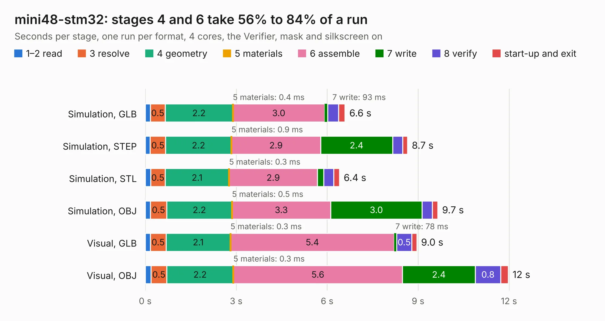

| Mode and format | 1–2 read | 3 resolve | 4 geometry | 5 materials | 6 assemble | 7 write | 8 verify | start-up and exit | Total |
|---|---:|---:|---:|---:|---:|---:|---:|---:|---:|
| Simulation, GLB | 0.2 | 0.5 | 2.2 | 0.4&nbsp;ms | 3.0 | 93&nbsp;ms | 0.4 | 0.2 | 6.6 |
| Simulation, STEP | 0.2 | 0.5 | 2.2 | 0.9&nbsp;ms | 2.9 | 2.4 | 0.3 | 0.2 | 8.7 |
| Simulation, STL | 0.2 | 0.5 | 2.1 | 0.3&nbsp;ms | 2.9 | 0.2 | 0.3 | 0.2 | 6.4 |
| Simulation, OBJ | 0.2 | 0.5 | 2.2 | 0.5&nbsp;ms | 3.3 | 3.0 | 0.3 | 0.2 | 9.7 |
| Visual, GLB | 0.2 | 0.5 | 2.1 | 0.3&nbsp;ms | 5.4 | 78&nbsp;ms | 0.5 | 0.2 | 9.0 |
| Visual, OBJ | 0.2 | 0.5 | 2.2 | 0.3&nbsp;ms | 5.6 | 2.4 | 0.8 | 0.3 | 12.0 |

<table align="center"><tr><td valign="top">

| Board | Repo: [rusefi/rusefi-hardware](https://github.com/rusefi/rusefi-hardware) Board: `mini48-stm32.kicad_pcb` |
|---|---|
| Folder | mini48-stm32 |
| Complexity | 259&nbsp;/&nbsp;1000 (size&nbsp;204, features&nbsp;55) |
| KESE&nbsp;features | through vias, rounded, trapezoid or chamfered pads, filled zones, curved board outline |
| Tested | 9th November 2026 |
| Copper&nbsp;layers | 2 |
| File&nbsp;format | KiCad 5 (20171130) |
| Parts,&nbsp;tracks,&nbsp;vias | 37, 523, 69 |
| Triangles,&nbsp;simulation | 738,906 in 66 parts |
| Verifier | PASS in all six runs |

</td><td valign="top">

<table>
<tr><th>File type</th><th>File size</th><th>Peak memory used</th></tr>
<tr><th colspan="3" align="left">Simulation</th></tr>
<tr><td>GLB</td><td align="right">25&nbsp;MB</td><td align="right">371&nbsp;MB</td></tr>
<tr><td>STEP</td><td align="right">118&nbsp;MB</td><td align="right">430&nbsp;MB</td></tr>
<tr><td>STL</td><td align="right">37&nbsp;MB</td><td align="right">378&nbsp;MB</td></tr>
<tr><td>OBJ</td><td align="right">74&nbsp;MB</td><td align="right">519&nbsp;MB</td></tr>
<tr><th colspan="3" align="left">Visual</th></tr>
<tr><td>GLB</td><td align="right">20&nbsp;MB</td><td align="right">535&nbsp;MB</td></tr>
<tr><td>OBJ</td><td align="right">61&nbsp;MB</td><td align="right">499&nbsp;MB</td></tr>
</table>

</td></tr></table>

## 2498. ncv1124-micro

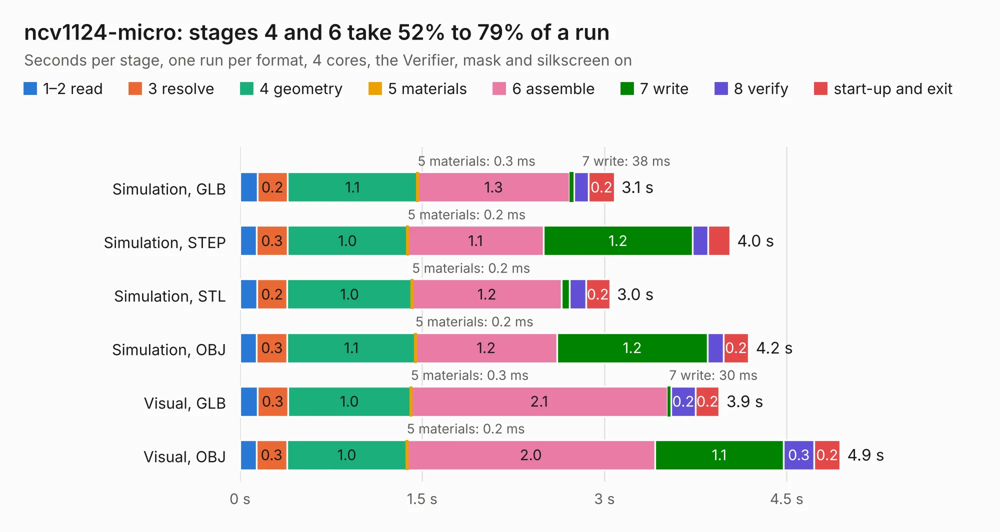

| Mode and format | 1–2 read | 3 resolve | 4 geometry | 5 materials | 6 assemble | 7 write | 8 verify | start-up and exit | Total |
|---|---:|---:|---:|---:|---:|---:|---:|---:|---:|
| Simulation, GLB | 0.1 | 0.2 | 1.1 | 0.3&nbsp;ms | 1.3 | 38&nbsp;ms | 0.1 | 0.2 | 3.1 |
| Simulation, STEP | 0.1 | 0.3 | 1.0 | 0.2&nbsp;ms | 1.1 | 1.2 | 0.1 | 0.2 | 4.0 |
| Simulation, STL | 0.1 | 0.2 | 1.0 | 0.2&nbsp;ms | 1.2 | 66&nbsp;ms | 0.1 | 0.2 | 3.0 |
| Simulation, OBJ | 0.1 | 0.3 | 1.1 | 0.2&nbsp;ms | 1.2 | 1.2 | 0.1 | 0.2 | 4.2 |
| Visual, GLB | 0.1 | 0.3 | 1.0 | 0.3&nbsp;ms | 2.1 | 30&nbsp;ms | 0.2 | 0.2 | 3.9 |
| Visual, OBJ | 0.1 | 0.3 | 1.0 | 0.2&nbsp;ms | 2.0 | 1.1 | 0.3 | 0.2 | 4.9 |

<table align="center"><tr><td valign="top">

| Board | Repo: [rusefi/rusefi-hardware](https://github.com/rusefi/rusefi-hardware) Board: `ncv1124-micro.kicad_pcb` |
|---|---|
| Folder | ncv1124-micro |
| Complexity | 242&nbsp;/&nbsp;1000 (size&nbsp;142, features&nbsp;100) |
| KESE&nbsp;features | through vias, rounded, trapezoid or chamfered pads, filled zones, curved board outline, knockout text, stack-up, dielectric εr and tanδ |
| Tested | 9th November 2026 |
| Copper&nbsp;layers | 2 |
| File&nbsp;format | KiCad 10 (20260206) |
| Parts,&nbsp;tracks,&nbsp;vias | 26, 99, 45 |
| Triangles,&nbsp;simulation | 235,422 in 31 parts |
| Verifier | PASS in all six runs |

</td><td valign="top">

<table>
<tr><th>File type</th><th>File size</th><th>Peak memory used</th></tr>
<tr><th colspan="3" align="left">Simulation</th></tr>
<tr><td>GLB</td><td align="right">8.1&nbsp;MB</td><td align="right">228&nbsp;MB</td></tr>
<tr><td>STEP</td><td align="right">40&nbsp;MB</td><td align="right">253&nbsp;MB</td></tr>
<tr><td>STL</td><td align="right">12&nbsp;MB</td><td align="right">228&nbsp;MB</td></tr>
<tr><td>OBJ</td><td align="right">23&nbsp;MB</td><td align="right">228&nbsp;MB</td></tr>
<tr><th colspan="3" align="left">Visual</th></tr>
<tr><td>GLB</td><td align="right">6.8&nbsp;MB</td><td align="right">237&nbsp;MB</td></tr>
<tr><td>OBJ</td><td align="right">20&nbsp;MB</td><td align="right">238&nbsp;MB</td></tr>
</table>

</td></tr></table>

## 2499. quad-igbt

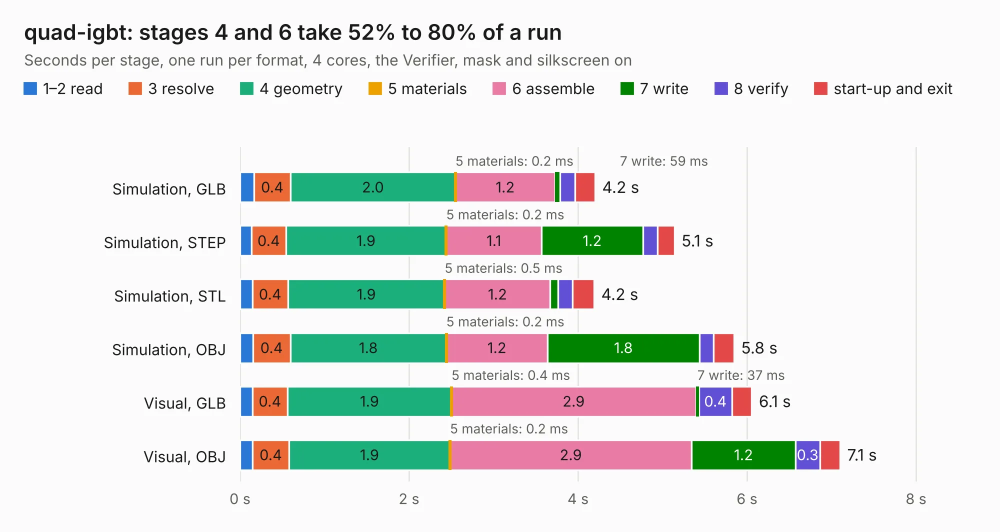

| Mode and format | 1–2 read | 3 resolve | 4 geometry | 5 materials | 6 assemble | 7 write | 8 verify | start-up and exit | Total |
|---|---:|---:|---:|---:|---:|---:|---:|---:|---:|
| Simulation, GLB | 0.2 | 0.4 | 2.0 | 0.2&nbsp;ms | 1.2 | 59&nbsp;ms | 0.2 | 0.2 | 4.2 |
| Simulation, STEP | 0.1 | 0.4 | 1.9 | 0.2&nbsp;ms | 1.1 | 1.2 | 0.2 | 0.2 | 5.1 |
| Simulation, STL | 0.1 | 0.4 | 1.9 | 0.5&nbsp;ms | 1.2 | 92&nbsp;ms | 0.2 | 0.3 | 4.2 |
| Simulation, OBJ | 0.2 | 0.4 | 1.8 | 0.2&nbsp;ms | 1.2 | 1.8 | 0.2 | 0.2 | 5.8 |
| Visual, GLB | 0.1 | 0.4 | 1.9 | 0.4&nbsp;ms | 2.9 | 37&nbsp;ms | 0.4 | 0.2 | 6.1 |
| Visual, OBJ | 0.1 | 0.4 | 1.9 | 0.2&nbsp;ms | 2.9 | 1.2 | 0.3 | 0.2 | 7.1 |

<table align="center"><tr><td valign="top">

| Board | Repo: [rusefi/rusefi-hardware](https://github.com/rusefi/rusefi-hardware) Board: `quad-igbt.kicad_pcb` |
|---|---|
| Folder | quad-igbt |
| Complexity | 233&nbsp;/&nbsp;1000 (size&nbsp;148, features&nbsp;85) |
| KESE&nbsp;features | through vias, rounded, trapezoid or chamfered pads, filled zones, curved board outline, stack-up, dielectric εr and tanδ |
| Tested | 9th November 2026 |
| Copper&nbsp;layers | 2 |
| File&nbsp;format | KiCad 6 (20211014) |
| Parts,&nbsp;tracks,&nbsp;vias | 12, 17, 174 |
| Triangles,&nbsp;simulation | 369,518 in 24 parts |
| Verifier | PASS in all six runs |

</td><td valign="top">

<table>
<tr><th>File type</th><th>File size</th><th>Peak memory used</th></tr>
<tr><th colspan="3" align="left">Simulation</th></tr>
<tr><td>GLB</td><td align="right">13&nbsp;MB</td><td align="right">241&nbsp;MB</td></tr>
<tr><td>STEP</td><td align="right">40&nbsp;MB</td><td align="right">278&nbsp;MB</td></tr>
<tr><td>STL</td><td align="right">18&nbsp;MB</td><td align="right">243&nbsp;MB</td></tr>
<tr><td>OBJ</td><td align="right">37&nbsp;MB</td><td align="right">292&nbsp;MB</td></tr>
<tr><th colspan="3" align="left">Visual</th></tr>
<tr><td>GLB</td><td align="right">8.4&nbsp;MB</td><td align="right">265&nbsp;MB</td></tr>
<tr><td>OBJ</td><td align="right">25&nbsp;MB</td><td align="right">266&nbsp;MB</td></tr>
</table>

</td></tr></table>

## 2500. superseal-igbt

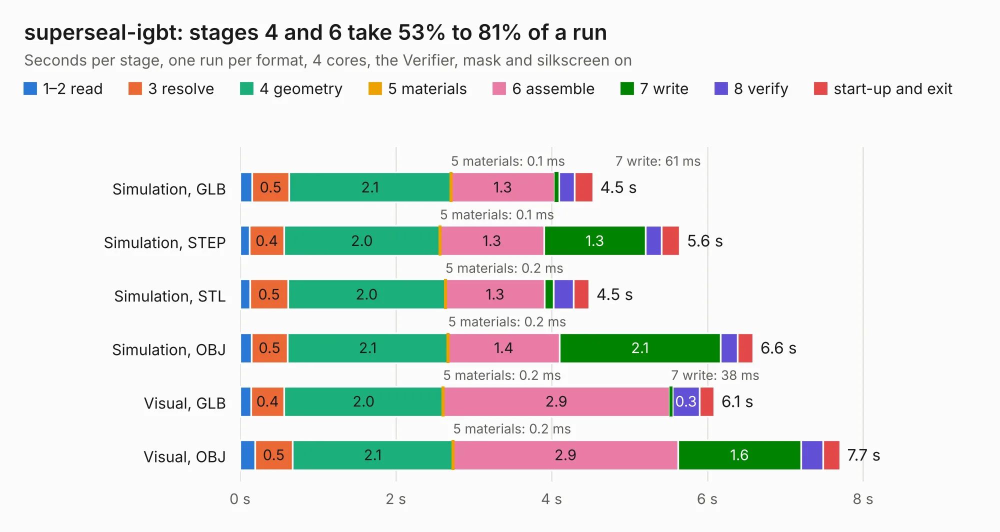

| Mode and format | 1–2 read | 3 resolve | 4 geometry | 5 materials | 6 assemble | 7 write | 8 verify | start-up and exit | Total |
|---|---:|---:|---:|---:|---:|---:|---:|---:|---:|
| Simulation, GLB | 0.2 | 0.5 | 2.1 | 0.1&nbsp;ms | 1.3 | 61&nbsp;ms | 0.2 | 0.2 | 4.5 |
| Simulation, STEP | 0.1 | 0.4 | 2.0 | 0.1&nbsp;ms | 1.3 | 1.3 | 0.2 | 0.2 | 5.6 |
| Simulation, STL | 0.1 | 0.5 | 2.0 | 0.2&nbsp;ms | 1.3 | 0.1 | 0.3 | 0.2 | 4.5 |
| Simulation, OBJ | 0.2 | 0.5 | 2.1 | 0.2&nbsp;ms | 1.4 | 2.1 | 0.2 | 0.2 | 6.6 |
| Visual, GLB | 0.1 | 0.4 | 2.0 | 0.2&nbsp;ms | 2.9 | 38&nbsp;ms | 0.3 | 0.2 | 6.1 |
| Visual, OBJ | 0.2 | 0.5 | 2.1 | 0.2&nbsp;ms | 2.9 | 1.6 | 0.3 | 0.2 | 7.7 |

<table align="center"><tr><td valign="top">

| Board | Repo: [rusefi/rusefi-hardware](https://github.com/rusefi/rusefi-hardware) Board: `superseal-igbt.kicad_pcb` |
|---|---|
| Folder | superseal-igbt |
| Complexity | 234&nbsp;/&nbsp;1000 (size&nbsp;149, features&nbsp;85) |
| KESE&nbsp;features | through vias, rounded, trapezoid or chamfered pads, filled zones, curved board outline, stack-up, dielectric εr and tanδ |
| Tested | 9th November 2026 |
| Copper&nbsp;layers | 2 |
| File&nbsp;format | KiCad 8 (20240108) |
| Parts,&nbsp;tracks,&nbsp;vias | 13, 71, 166 |
| Triangles,&nbsp;simulation | 437,540 in 37 parts |
| Verifier | PASS in all six runs |

</td><td valign="top">

<table>
<tr><th>File type</th><th>File size</th><th>Peak memory used</th></tr>
<tr><th colspan="3" align="left">Simulation</th></tr>
<tr><td>GLB</td><td align="right">15&nbsp;MB</td><td align="right">255&nbsp;MB</td></tr>
<tr><td>STEP</td><td align="right">48&nbsp;MB</td><td align="right">301&nbsp;MB</td></tr>
<tr><td>STL</td><td align="right">22&nbsp;MB</td><td align="right">256&nbsp;MB</td></tr>
<tr><td>OBJ</td><td align="right">44&nbsp;MB</td><td align="right">340&nbsp;MB</td></tr>
<tr><th colspan="3" align="left">Visual</th></tr>
<tr><td>GLB</td><td align="right">9.6&nbsp;MB</td><td align="right">299&nbsp;MB</td></tr>
<tr><td>OBJ</td><td align="right">29&nbsp;MB</td><td align="right">295&nbsp;MB</td></tr>
</table>

</td></tr></table>

## 2501. tle9104-breakout

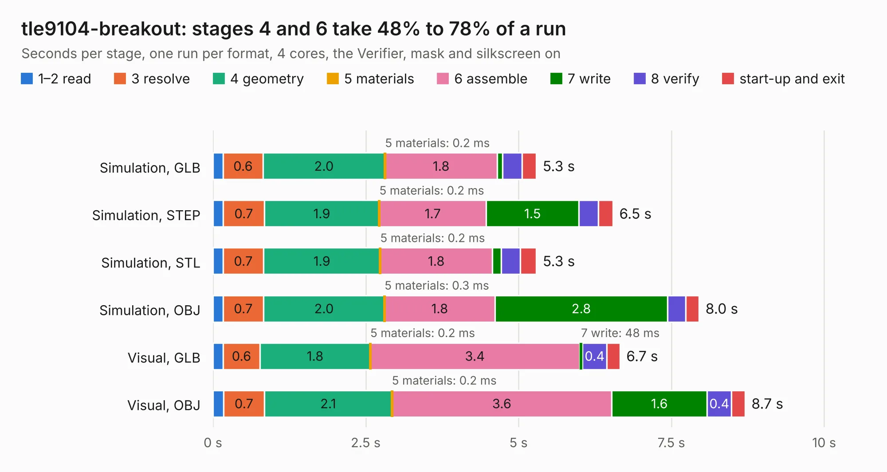

| Mode and format | 1–2 read | 3 resolve | 4 geometry | 5 materials | 6 assemble | 7 write | 8 verify | start-up and exit | Total |
|---|---:|---:|---:|---:|---:|---:|---:|---:|---:|
| Simulation, GLB | 0.2 | 0.6 | 2.0 | 0.2&nbsp;ms | 1.8 | 90&nbsp;ms | 0.3 | 0.2 | 5.3 |
| Simulation, STEP | 0.2 | 0.7 | 1.9 | 0.2&nbsp;ms | 1.7 | 1.5 | 0.3 | 0.2 | 6.5 |
| Simulation, STL | 0.2 | 0.7 | 1.9 | 0.2&nbsp;ms | 1.8 | 0.1 | 0.3 | 0.3 | 5.3 |
| Simulation, OBJ | 0.2 | 0.7 | 2.0 | 0.3&nbsp;ms | 1.8 | 2.8 | 0.3 | 0.2 | 8.0 |
| Visual, GLB | 0.2 | 0.6 | 1.8 | 0.2&nbsp;ms | 3.4 | 48&nbsp;ms | 0.4 | 0.2 | 6.7 |
| Visual, OBJ | 0.2 | 0.7 | 2.1 | 0.2&nbsp;ms | 3.6 | 1.6 | 0.4 | 0.2 | 8.7 |

<table align="center"><tr><td valign="top">

| Board | Repo: [rusefi/rusefi-hardware](https://github.com/rusefi/rusefi-hardware) Board: `tle9104-breakout.kicad_pcb` |
|---|---|
| Folder | tle9104-breakout |
| Complexity | 207&nbsp;/&nbsp;1000 (size&nbsp;162, features&nbsp;45) |
| KESE&nbsp;features | through vias, rounded, trapezoid or chamfered pads, filled zones |
| Tested | 9th November 2026 |
| Copper&nbsp;layers | 4 |
| File&nbsp;format | KiCad 7 (20221018) |
| Parts,&nbsp;tracks,&nbsp;vias | 15, 152, 86 |
| Triangles,&nbsp;simulation | 581,310 in 32 parts |
| Verifier | PASS in all six runs |

</td><td valign="top">

<table>
<tr><th>File type</th><th>File size</th><th>Peak memory used</th></tr>
<tr><th colspan="3" align="left">Simulation</th></tr>
<tr><td>GLB</td><td align="right">20&nbsp;MB</td><td align="right">323&nbsp;MB</td></tr>
<tr><td>STEP</td><td align="right">72&nbsp;MB</td><td align="right">342&nbsp;MB</td></tr>
<tr><td>STL</td><td align="right">29&nbsp;MB</td><td align="right">319&nbsp;MB</td></tr>
<tr><td>OBJ</td><td align="right">59&nbsp;MB</td><td align="right">429&nbsp;MB</td></tr>
<tr><th colspan="3" align="left">Visual</th></tr>
<tr><td>GLB</td><td align="right">11&nbsp;MB</td><td align="right">303&nbsp;MB</td></tr>
<tr><td>OBJ</td><td align="right">32&nbsp;MB</td><td align="right">309&nbsp;MB</td></tr>
</table>

</td></tr></table>

## 2502. uaBrain-gm-e38

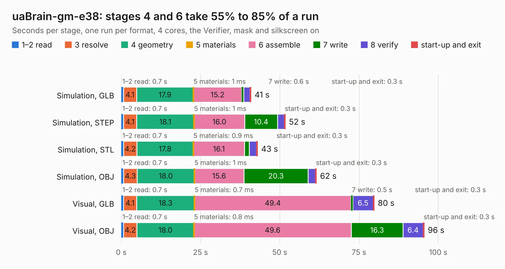

| Mode and format | 1–2 read | 3 resolve | 4 geometry | 5 materials | 6 assemble | 7 write | 8 verify | start-up and exit | Total |
|---|---:|---:|---:|---:|---:|---:|---:|---:|---:|
| Simulation, GLB | 0.7 | 4.1 | 17.9 | 1&nbsp;ms | 15.2 | 0.6 | 2.0 | 0.3 | 40.9 |
| Simulation, STEP | 0.7 | 4.1 | 18.1 | 1&nbsp;ms | 16.0 | 10.4 | 2.1 | 0.3 | 51.7 |
| Simulation, STL | 0.7 | 4.2 | 17.8 | 0.9&nbsp;ms | 16.1 | 1.5 | 2.3 | 0.3 | 43.0 |
| Simulation, OBJ | 0.7 | 4.3 | 18.0 | 1&nbsp;ms | 15.6 | 20.3 | 2.3 | 0.3 | 61.6 |
| Visual, GLB | 0.7 | 4.1 | 18.3 | 0.7&nbsp;ms | 49.4 | 0.5 | 6.5 | 0.3 | 79.8 |
| Visual, OBJ | 0.7 | 4.2 | 18.0 | 0.8&nbsp;ms | 49.6 | 16.3 | 6.4 | 0.3 | 95.6 |

<table align="center"><tr><td valign="top">

| Board | Repo: [rusefi/rusefi-hardware](https://github.com/rusefi/rusefi-hardware) Board: `uaBrain-gm-e38.kicad_pcb` |
|---|---|
| Folder | uaBrain-gm-e38 |
| Complexity | 314&nbsp;/&nbsp;1000 (size&nbsp;209, features&nbsp;105) |
| KESE&nbsp;features | through vias, rounded, trapezoid or chamfered pads, filled zones, curved board outline, knockout text, stack-up, dielectric εr and tanδ, mask and silkscreen colours |
| Tested | 9th November 2026 |
| Copper&nbsp;layers | 2 |
| File&nbsp;format | KiCad 10 (20260206) |
| Parts,&nbsp;tracks,&nbsp;vias | 120, 2,865, 804 |
| Triangles,&nbsp;simulation | 4,579,816 in 229 parts |
| Verifier | PASS in all six runs |

</td><td valign="top">

<table>
<tr><th>File type</th><th>File size</th><th>Peak memory used</th></tr>
<tr><th colspan="3" align="left">Simulation</th></tr>
<tr><td>GLB</td><td align="right">157&nbsp;MB</td><td align="right">1.6&nbsp;GB</td></tr>
<tr><td>STEP</td><td align="right">745&nbsp;MB</td><td align="right">1.8&nbsp;GB</td></tr>
<tr><td>STL</td><td align="right">229&nbsp;MB</td><td align="right">1.5&nbsp;GB</td></tr>
<tr><td>OBJ</td><td align="right">488&nbsp;MB</td><td align="right">2.9&nbsp;GB</td></tr>
<tr><th colspan="3" align="left">Visual</th></tr>
<tr><td>GLB</td><td align="right">132&nbsp;MB</td><td align="right">2.1&nbsp;GB</td></tr>
<tr><td>OBJ</td><td align="right">416&nbsp;MB</td><td align="right">2.6&nbsp;GB</td></tr>
</table>

</td></tr></table>

## 2503. VR-Hall

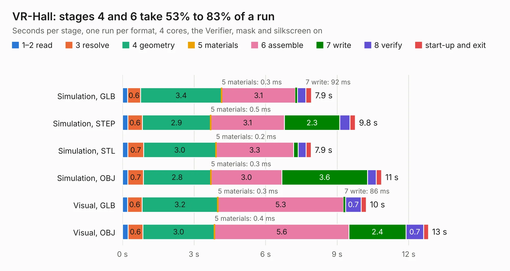

| Mode and format | 1–2 read | 3 resolve | 4 geometry | 5 materials | 6 assemble | 7 write | 8 verify | start-up and exit | Total |
|---|---:|---:|---:|---:|---:|---:|---:|---:|---:|
| Simulation, GLB | 0.2 | 0.6 | 3.4 | 0.3&nbsp;ms | 3.1 | 92&nbsp;ms | 0.3 | 0.2 | 7.9 |
| Simulation, STEP | 0.2 | 0.6 | 2.9 | 0.5&nbsp;ms | 3.1 | 2.3 | 0.4 | 0.2 | 9.8 |
| Simulation, STL | 0.2 | 0.7 | 3.0 | 0.2&nbsp;ms | 3.3 | 0.2 | 0.3 | 0.2 | 7.9 |
| Simulation, OBJ | 0.2 | 0.7 | 2.8 | 0.3&nbsp;ms | 3.0 | 3.6 | 0.4 | 0.2 | 10.9 |
| Visual, GLB | 0.2 | 0.6 | 3.2 | 0.3&nbsp;ms | 5.3 | 86&nbsp;ms | 0.7 | 0.2 | 10.2 |
| Visual, OBJ | 0.2 | 0.6 | 3.0 | 0.4&nbsp;ms | 5.6 | 2.4 | 0.7 | 0.2 | 12.8 |

<table align="center"><tr><td valign="top">

| Board | Repo: [rusefi/rusefi-hardware](https://github.com/rusefi/rusefi-hardware) Board: `VR-Hall.kicad_pcb` |
|---|---|
| Folder | VR-Hall |
| Complexity | 257&nbsp;/&nbsp;1000 (size&nbsp;162, features&nbsp;95) |
| KESE&nbsp;features | through vias, slotted holes, rounded, trapezoid or chamfered pads, filled zones, curved board outline, stack-up, dielectric εr and tanδ |
| Tested | 9th November 2026 |
| Copper&nbsp;layers | 2 |
| File&nbsp;format | KiCad 7 (20221018) |
| Parts,&nbsp;tracks,&nbsp;vias | 56, 210, 94 |
| Triangles,&nbsp;simulation | 723,276 in 56 parts |
| Verifier | PASS in all six runs |

</td><td valign="top">

<table>
<tr><th>File type</th><th>File size</th><th>Peak memory used</th></tr>
<tr><th colspan="3" align="left">Simulation</th></tr>
<tr><td>GLB</td><td align="right">25&nbsp;MB</td><td align="right">366&nbsp;MB</td></tr>
<tr><td>STEP</td><td align="right">121&nbsp;MB</td><td align="right">451&nbsp;MB</td></tr>
<tr><td>STL</td><td align="right">36&nbsp;MB</td><td align="right">367&nbsp;MB</td></tr>
<tr><td>OBJ</td><td align="right">73&nbsp;MB</td><td align="right">523&nbsp;MB</td></tr>
<tr><th colspan="3" align="left">Visual</th></tr>
<tr><td>GLB</td><td align="right">19&nbsp;MB</td><td align="right">432&nbsp;MB</td></tr>
<tr><td>OBJ</td><td align="right">57&nbsp;MB</td><td align="right">499&nbsp;MB</td></tr>
</table>

</td></tr></table>

## 2504. ncv1124

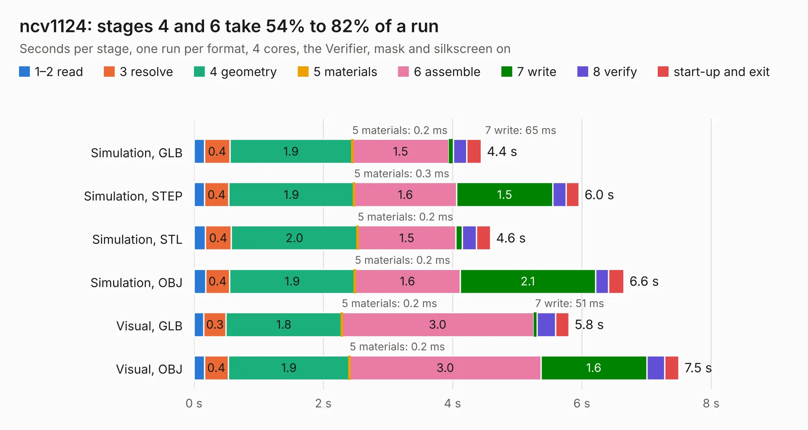

| Mode and format | 1–2 read | 3 resolve | 4 geometry | 5 materials | 6 assemble | 7 write | 8 verify | start-up and exit | Total |
|---|---:|---:|---:|---:|---:|---:|---:|---:|---:|
| Simulation, GLB | 0.2 | 0.4 | 1.9 | 0.2&nbsp;ms | 1.5 | 65&nbsp;ms | 0.2 | 0.2 | 4.4 |
| Simulation, STEP | 0.2 | 0.4 | 1.9 | 0.3&nbsp;ms | 1.6 | 1.5 | 0.2 | 0.2 | 6.0 |
| Simulation, STL | 0.2 | 0.4 | 2.0 | 0.2&nbsp;ms | 1.5 | 98&nbsp;ms | 0.2 | 0.2 | 4.6 |
| Simulation, OBJ | 0.2 | 0.4 | 1.9 | 0.2&nbsp;ms | 1.6 | 2.1 | 0.2 | 0.2 | 6.6 |
| Visual, GLB | 0.2 | 0.3 | 1.8 | 0.2&nbsp;ms | 3.0 | 51&nbsp;ms | 0.3 | 0.2 | 5.8 |
| Visual, OBJ | 0.2 | 0.4 | 1.9 | 0.2&nbsp;ms | 3.0 | 1.6 | 0.3 | 0.2 | 7.5 |

<table align="center"><tr><td valign="top">

| Board | Repo: [rusefi/rusefi-hardware](https://github.com/rusefi/rusefi-hardware) Board: `ncv1124.kicad_pcb` |
|---|---|
| Folder | VR_ncv1124_test_module |
| Complexity | 201&nbsp;/&nbsp;1000 (size&nbsp;146, features&nbsp;55) |
| KESE&nbsp;features | through vias, rounded, trapezoid or chamfered pads, filled zones, curved board outline |
| Tested | 9th November 2026 |
| Copper&nbsp;layers | 2 |
| File&nbsp;format | KiCad 5 (20171130) |
| Parts,&nbsp;tracks,&nbsp;vias | 34, 80, 60 |
| Triangles,&nbsp;simulation | 397,716 in 30 parts |
| Verifier | PASS in all six runs |

</td><td valign="top">

<table>
<tr><th>File type</th><th>File size</th><th>Peak memory used</th></tr>
<tr><th colspan="3" align="left">Simulation</th></tr>
<tr><td>GLB</td><td align="right">14&nbsp;MB</td><td align="right">272&nbsp;MB</td></tr>
<tr><td>STEP</td><td align="right">62&nbsp;MB</td><td align="right">328&nbsp;MB</td></tr>
<tr><td>STL</td><td align="right">20&nbsp;MB</td><td align="right">271&nbsp;MB</td></tr>
<tr><td>OBJ</td><td align="right">40&nbsp;MB</td><td align="right">322&nbsp;MB</td></tr>
<tr><th colspan="3" align="left">Visual</th></tr>
<tr><td>GLB</td><td align="right">11&nbsp;MB</td><td align="right">316&nbsp;MB</td></tr>
<tr><td>OBJ</td><td align="right">31&nbsp;MB</td><td align="right">317&nbsp;MB</td></tr>
</table>

</td></tr></table>

## 2505. wideband_controller

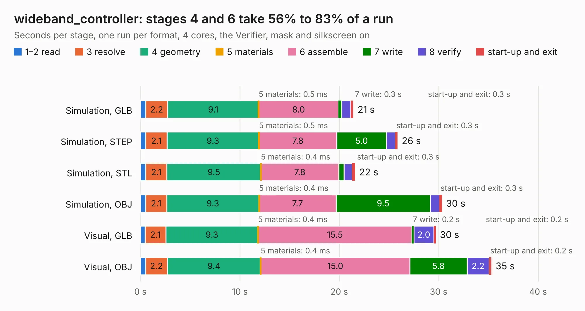

| Mode and format | 1–2 read | 3 resolve | 4 geometry | 5 materials | 6 assemble | 7 write | 8 verify | start-up and exit | Total |
|---|---:|---:|---:|---:|---:|---:|---:|---:|---:|
| Simulation, GLB | 0.5 | 2.2 | 9.1 | 0.5&nbsp;ms | 8.0 | 0.3 | 0.9 | 0.3 | 21.4 |
| Simulation, STEP | 0.5 | 2.1 | 9.3 | 0.5&nbsp;ms | 7.8 | 5.0 | 0.9 | 0.3 | 25.9 |
| Simulation, STL | 0.5 | 2.1 | 9.5 | 0.4&nbsp;ms | 7.8 | 0.5 | 0.9 | 0.3 | 21.6 |
| Simulation, OBJ | 0.5 | 2.1 | 9.3 | 0.4&nbsp;ms | 7.7 | 9.5 | 0.9 | 0.3 | 30.3 |
| Visual, GLB | 0.5 | 2.1 | 9.3 | 0.4&nbsp;ms | 15.5 | 0.2 | 2.0 | 0.2 | 29.7 |
| Visual, OBJ | 0.5 | 2.2 | 9.4 | 0.4&nbsp;ms | 15.0 | 5.8 | 2.2 | 0.2 | 35.3 |

<table align="center"><tr><td valign="top">

| Board | Repo: [rusefi/rusefi-hardware](https://github.com/rusefi/rusefi-hardware) Board: `wideband_controller.kicad_pcb` |
|---|---|
| Folder | wideband-F103 |
| Complexity | 304&nbsp;/&nbsp;1000 (size&nbsp;249, features&nbsp;55) |
| KESE&nbsp;features | through vias, rounded, trapezoid or chamfered pads, filled zones, curved board outline |
| Tested | 9th November 2026 |
| Copper&nbsp;layers | 4 |
| File&nbsp;format | KiCad 6 (20211014) |
| Parts,&nbsp;tracks,&nbsp;vias | 136, 1,183, 191 |
| Triangles,&nbsp;simulation | 1,985,478 in 132 parts |
| Verifier | PASS in all six runs |

</td><td valign="top">

<table>
<tr><th>File type</th><th>File size</th><th>Peak memory used</th></tr>
<tr><th colspan="3" align="left">Simulation</th></tr>
<tr><td>GLB</td><td align="right">70&nbsp;MB</td><td align="right">697&nbsp;MB</td></tr>
<tr><td>STEP</td><td align="right">351&nbsp;MB</td><td align="right">901&nbsp;MB</td></tr>
<tr><td>STL</td><td align="right">99&nbsp;MB</td><td align="right">802&nbsp;MB</td></tr>
<tr><td>OBJ</td><td align="right">211&nbsp;MB</td><td align="right">1.4&nbsp;GB</td></tr>
<tr><th colspan="3" align="left">Visual</th></tr>
<tr><td>GLB</td><td align="right">44&nbsp;MB</td><td align="right">792&nbsp;MB</td></tr>
<tr><td>OBJ</td><td align="right">134&nbsp;MB</td><td align="right">926&nbsp;MB</td></tr>
</table>

</td></tr></table>

## 2506. 8HPTCUAdapter

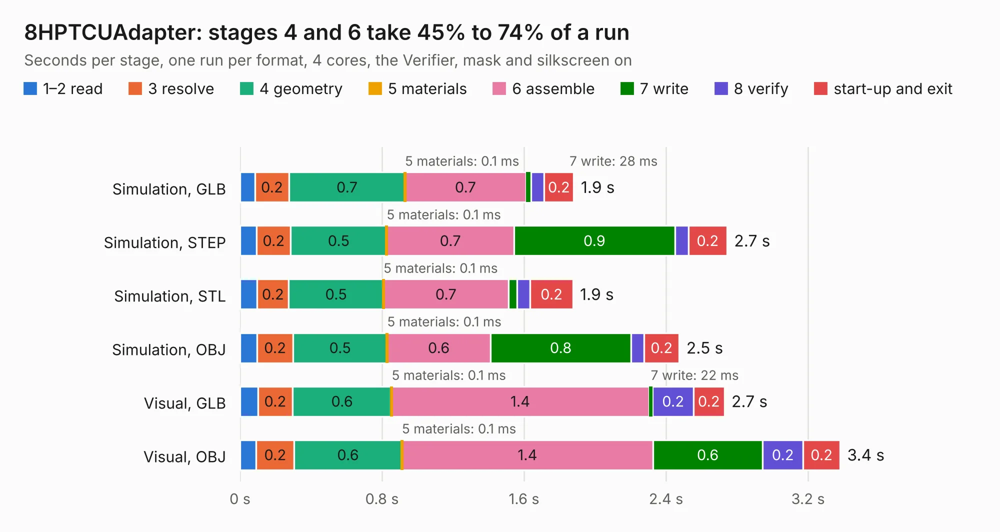

| Mode and format | 1–2 read | 3 resolve | 4 geometry | 5 materials | 6 assemble | 7 write | 8 verify | start-up and exit | Total |
|---|---:|---:|---:|---:|---:|---:|---:|---:|---:|
| Simulation, GLB | 83&nbsp;ms | 0.2 | 0.7 | 0.1&nbsp;ms | 0.7 | 28&nbsp;ms | 74&nbsp;ms | 0.2 | 1.9 |
| Simulation, STEP | 93&nbsp;ms | 0.2 | 0.5 | 0.1&nbsp;ms | 0.7 | 0.9 | 76&nbsp;ms | 0.2 | 2.7 |
| Simulation, STL | 97&nbsp;ms | 0.2 | 0.5 | 0.1&nbsp;ms | 0.7 | 50&nbsp;ms | 73&nbsp;ms | 0.2 | 1.9 |
| Simulation, OBJ | 96&nbsp;ms | 0.2 | 0.5 | 0.1&nbsp;ms | 0.6 | 0.8 | 72&nbsp;ms | 0.2 | 2.5 |
| Visual, GLB | 0.1 | 0.2 | 0.6 | 0.1&nbsp;ms | 1.4 | 22&nbsp;ms | 0.2 | 0.2 | 2.7 |
| Visual, OBJ | 91&nbsp;ms | 0.2 | 0.6 | 0.1&nbsp;ms | 1.4 | 0.6 | 0.2 | 0.2 | 3.4 |

<table align="center"><tr><td valign="top">

| Board | Repo: [rusefi/rusefi-hardware](https://github.com/rusefi/rusefi-hardware) Board: `8HPTCUAdapter.kicad_pcb` |
|---|---|
| Folder | ZF8HP Transmission |
| Complexity | 219&nbsp;/&nbsp;1000 (size&nbsp;104, features&nbsp;115) |
| KESE&nbsp;features | blind and buried vias, custom pads, filled zones, curved board outline, stack-up, dielectric εr and tanδ |
| Tested | 9th November 2026 |
| Copper&nbsp;layers | 2 |
| File&nbsp;format | KiCad 9 (20241229) |
| Parts,&nbsp;tracks,&nbsp;vias | 1, 98, 10 |
| Triangles,&nbsp;simulation | 184,320 in 23 parts |
| Verifier | PASS in all six runs |

</td><td valign="top">

<table>
<tr><th>File type</th><th>File size</th><th>Peak memory used</th></tr>
<tr><th colspan="3" align="left">Simulation</th></tr>
<tr><td>GLB</td><td align="right">6.6&nbsp;MB</td><td align="right">217&nbsp;MB</td></tr>
<tr><td>STEP</td><td align="right">34&nbsp;MB</td><td align="right">234&nbsp;MB</td></tr>
<tr><td>STL</td><td align="right">9.2&nbsp;MB</td><td align="right">208&nbsp;MB</td></tr>
<tr><td>OBJ</td><td align="right">19&nbsp;MB</td><td align="right">207&nbsp;MB</td></tr>
<tr><th colspan="3" align="left">Visual</th></tr>
<tr><td>GLB</td><td align="right">5.3&nbsp;MB</td><td align="right">194&nbsp;MB</td></tr>
<tr><td>OBJ</td><td align="right">15&nbsp;MB</td><td align="right">194&nbsp;MB</td></tr>
</table>

</td></tr></table>

## 2507. uaefi

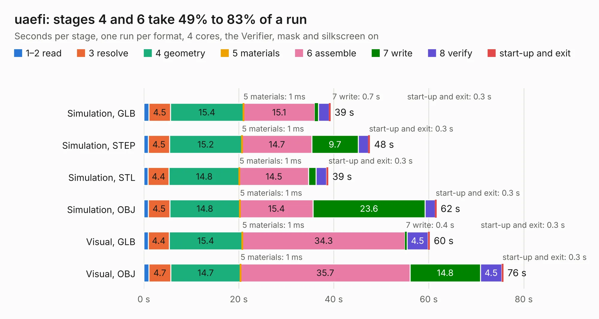

| Mode and format | 1–2 read | 3 resolve | 4 geometry | 5 materials | 6 assemble | 7 write | 8 verify | start-up and exit | Total |
|---|---:|---:|---:|---:|---:|---:|---:|---:|---:|
| Simulation, GLB | 1.1 | 4.5 | 15.4 | 1&nbsp;ms | 15.1 | 0.7 | 2.2 | 0.3 | 39.3 |
| Simulation, STEP | 0.9 | 4.5 | 15.2 | 1&nbsp;ms | 14.7 | 9.7 | 2.2 | 0.3 | 47.6 |
| Simulation, STL | 0.9 | 4.4 | 14.8 | 1&nbsp;ms | 14.5 | 1.6 | 2.2 | 0.3 | 38.8 |
| Simulation, OBJ | 1.0 | 4.5 | 14.8 | 1&nbsp;ms | 15.4 | 23.6 | 2.1 | 0.3 | 61.6 |
| Visual, GLB | 0.9 | 4.4 | 15.4 | 1&nbsp;ms | 34.3 | 0.4 | 4.5 | 0.3 | 60.2 |
| Visual, OBJ | 1.0 | 4.7 | 14.7 | 1&nbsp;ms | 35.7 | 14.8 | 4.5 | 0.3 | 75.7 |

<table align="center"><tr><td valign="top">

| Board | Repo: [rusefi/uaefi](https://github.com/rusefi/uaefi) Board: `uaefi.kicad_pcb` |
|---|---|
| Complexity | 314&nbsp;/&nbsp;1000 (size&nbsp;219, features&nbsp;95) |
| KESE&nbsp;features | through vias, slotted holes, rounded, trapezoid or chamfered pads, filled zones, curved board outline, stack-up, dielectric εr and tanδ |
| Tested | 9th November 2026 |
| Copper&nbsp;layers | 4 |
| File&nbsp;format | KiCad 8 (20240108) |
| Parts,&nbsp;tracks,&nbsp;vias | 156, 1,765, 376 |
| Triangles,&nbsp;simulation | 4,219,476 in 254 parts |
| Verifier | PASS in all six runs |

</td><td valign="top">

<table>
<tr><th>File type</th><th>File size</th><th>Peak memory used</th></tr>
<tr><th colspan="3" align="left">Simulation</th></tr>
<tr><td>GLB</td><td align="right">143&nbsp;MB</td><td align="right">1.3&nbsp;GB</td></tr>
<tr><td>STEP</td><td align="right">595&nbsp;MB</td><td align="right">1.6&nbsp;GB</td></tr>
<tr><td>STL</td><td align="right">211&nbsp;MB</td><td align="right">1.3&nbsp;GB</td></tr>
<tr><td>OBJ</td><td align="right">447&nbsp;MB</td><td align="right">2.7&nbsp;GB</td></tr>
<tr><th colspan="3" align="left">Visual</th></tr>
<tr><td>GLB</td><td align="right">93&nbsp;MB</td><td align="right">1.5&nbsp;GB</td></tr>
<tr><td>OBJ</td><td align="right">292&nbsp;MB</td><td align="right">2.0&nbsp;GB</td></tr>
</table>

</td></tr></table>

## 2508. sd2snes_ecp5

| Mode and format | 1–2 read | 3 resolve | 4 geometry | 5 materials | 6 assemble | 7 write | 8 verify | start-up and exit | Total |
|---|---:|---:|---:|---:|---:|---:|---:|---:|---:|
| Simulation, GLB | 1.0 | 7.3 | 24.4 | 1.0&nbsp;ms | 20.9 | 1.0 | 2.7 | 0.4 | 57.7 |
| Simulation, STEP | 1.1 | 7.0 | 23.7 | 1&nbsp;ms | 20.6 | 13.5 | 2.7 | 0.4 | 69.0 |
| Simulation, STL | 1.0 | 6.9 | 23.9 | 0.9&nbsp;ms | 21.5 | 2.3 | 2.9 | 0.3 | 58.9 |
| Simulation, OBJ | 0.9 | 7.0 | 24.6 | 0.9&nbsp;ms | 21.1 | 34.0 | 2.7 | 0.3 | 90.7 |
| Visual, GLB | 1.0 | 7.2 | 24.2 | 1&nbsp;ms | 50.2 | 0.5 | 6.7 | 0.3 | 90.2 |
| Visual, OBJ | 1.0 | 7.3 | 24.4 | 0.9&nbsp;ms | 48.4 | 20.0 | 6.7 | 0.3 | 108.1 |

<table align="center"><tr><td valign="top">

| Board | Repo: [samlittlewood/sd2snes_ecp5](https://github.com/samlittlewood/sd2snes_ecp5) Board: `sd2snes_ecp5.kicad_pcb` |
|---|---|
| Complexity | 390&nbsp;/&nbsp;1000 (size&nbsp;300, features&nbsp;90) |
| KESE&nbsp;features | through vias, slotted holes, custom pads, rounded, trapezoid or chamfered pads, filled zones, copper drawings, curved board outline |
| Tested | 9th November 2026 |
| Copper&nbsp;layers | 4 |
| File&nbsp;format | KiCad 5 (20171130) |
| Parts,&nbsp;tracks,&nbsp;vias | 174, 3,190, 1,021 |
| Triangles,&nbsp;simulation | 5,798,382 in 429 parts |
| Verifier | PASS in all six runs |

</td><td valign="top">

<table>
<tr><th>File type</th><th>File size</th><th>Peak memory used</th></tr>
<tr><th colspan="3" align="left">Simulation</th></tr>
<tr><td>GLB</td><td align="right">199&nbsp;MB</td><td align="right">1.7&nbsp;GB</td></tr>
<tr><td>STEP</td><td align="right">824&nbsp;MB</td><td align="right">2.2&nbsp;GB</td></tr>
<tr><td>STL</td><td align="right">290&nbsp;MB</td><td align="right">1.7&nbsp;GB</td></tr>
<tr><td>OBJ</td><td align="right">633&nbsp;MB</td><td align="right">3.8&nbsp;GB</td></tr>
<tr><th colspan="3" align="left">Visual</th></tr>
<tr><td>GLB</td><td align="right">122&nbsp;MB</td><td align="right">2.0&nbsp;GB</td></tr>
<tr><td>OBJ</td><td align="right">396&nbsp;MB</td><td align="right">2.6&nbsp;GB</td></tr>
</table>

</td></tr></table>

## 2509. tv070hat

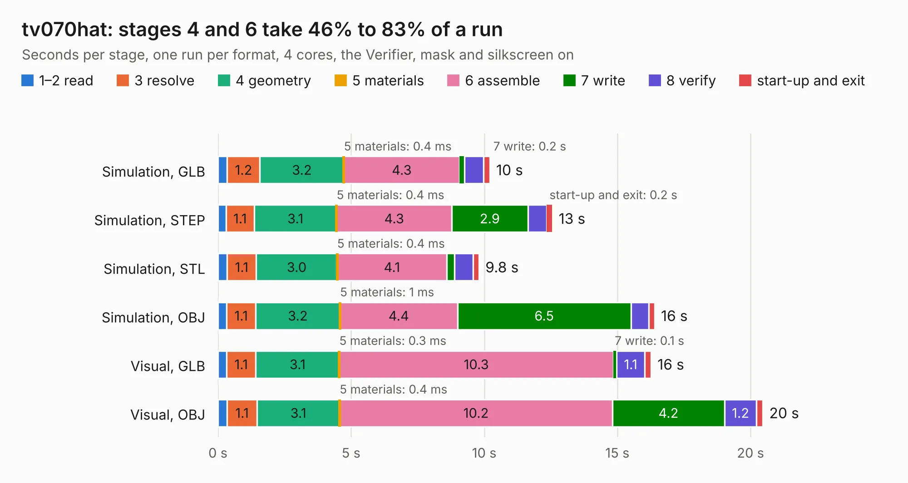

| Mode and format | 1–2 read | 3 resolve | 4 geometry | 5 materials | 6 assemble | 7 write | 8 verify | start-up and exit | Total |
|---|---:|---:|---:|---:|---:|---:|---:|---:|---:|
| Simulation, GLB | 0.3 | 1.2 | 3.2 | 0.4&nbsp;ms | 4.3 | 0.2 | 0.7 | 0.2 | 10.2 |
| Simulation, STEP | 0.3 | 1.1 | 3.1 | 0.4&nbsp;ms | 4.3 | 2.9 | 0.7 | 0.2 | 12.6 |
| Simulation, STL | 0.3 | 1.1 | 3.0 | 0.4&nbsp;ms | 4.1 | 0.3 | 0.7 | 0.2 | 9.8 |
| Simulation, OBJ | 0.3 | 1.1 | 3.2 | 1&nbsp;ms | 4.4 | 6.5 | 0.7 | 0.2 | 16.4 |
| Visual, GLB | 0.3 | 1.1 | 3.1 | 0.3&nbsp;ms | 10.3 | 0.1 | 1.1 | 0.2 | 16.3 |
| Visual, OBJ | 0.3 | 1.1 | 3.1 | 0.4&nbsp;ms | 10.2 | 4.2 | 1.2 | 0.2 | 20.5 |

<table align="center"><tr><td valign="top">

| Board | Repo: [ScandentLLC/tv070wxm-hat](https://github.com/ScandentLLC/tv070wxm-hat) Board: `tv070hat.kicad_pcb` |
|---|---|
| Complexity | 286&nbsp;/&nbsp;1000 (size&nbsp;196, features&nbsp;90) |
| KESE&nbsp;features | through vias, rounded, trapezoid or chamfered pads, arc tracks, filled zones, stack-up, dielectric εr and tanδ |
| Tested | 9th November 2026 |
| Copper&nbsp;layers | 4 |
| File&nbsp;format | KiCad 9 (20241229) |
| Parts,&nbsp;tracks,&nbsp;vias | 45, 1,061, 182 |
| Triangles,&nbsp;simulation | 1,240,344 in 99 parts |
| Verifier | PASS in all six runs |

</td><td valign="top">

<table>
<tr><th>File type</th><th>File size</th><th>Peak memory used</th></tr>
<tr><th colspan="3" align="left">Simulation</th></tr>
<tr><td>GLB</td><td align="right">42&nbsp;MB</td><td align="right">496&nbsp;MB</td></tr>
<tr><td>STEP</td><td align="right">157&nbsp;MB</td><td align="right">624&nbsp;MB</td></tr>
<tr><td>STL</td><td align="right">62&nbsp;MB</td><td align="right">515&nbsp;MB</td></tr>
<tr><td>OBJ</td><td align="right">127&nbsp;MB</td><td align="right">835&nbsp;MB</td></tr>
<tr><th colspan="3" align="left">Visual</th></tr>
<tr><td>GLB</td><td align="right">28&nbsp;MB</td><td align="right">684&nbsp;MB</td></tr>
<tr><td>OBJ</td><td align="right">87&nbsp;MB</td><td align="right">682&nbsp;MB</td></tr>
</table>

</td></tr></table>

## 2510. CM5RevEng

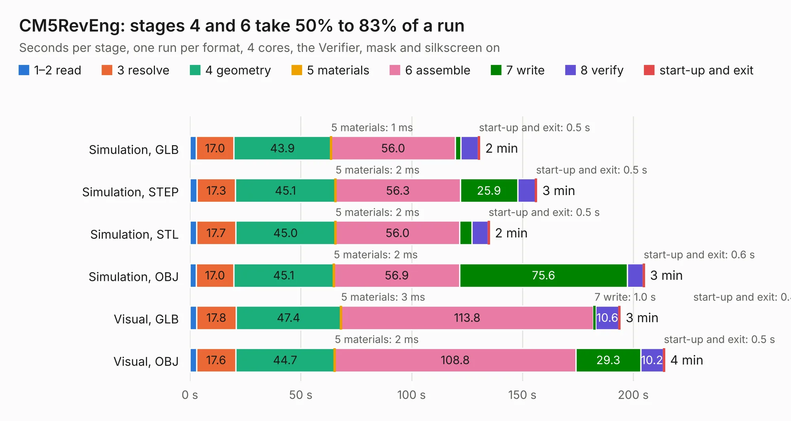

| Mode and format | 1–2 read | 3 resolve | 4 geometry | 5 materials | 6 assemble | 7 write | 8 verify | start-up and exit | Total |
|---|---:|---:|---:|---:|---:|---:|---:|---:|---:|
| Simulation, GLB | 2.9 | 17.0 | 43.9 | 1&nbsp;ms | 56.0 | 2.6 | 7.9 | 0.5 | 130.7 |
| Simulation, STEP | 3.3 | 17.3 | 45.1 | 2&nbsp;ms | 56.3 | 25.9 | 8.0 | 0.5 | 156.4 |
| Simulation, STL | 3.0 | 17.7 | 45.0 | 2&nbsp;ms | 56.0 | 5.6 | 7.3 | 0.5 | 135.1 |
| Simulation, OBJ | 2.9 | 17.0 | 45.1 | 2&nbsp;ms | 56.9 | 75.6 | 7.1 | 0.6 | 205.0 |
| Visual, GLB | 3.1 | 17.8 | 47.4 | 3&nbsp;ms | 113.8 | 1.0 | 10.6 | 0.4 | 194.0 |
| Visual, OBJ | 3.0 | 17.6 | 44.7 | 2&nbsp;ms | 108.8 | 29.3 | 10.2 | 0.5 | 214.1 |

<table align="center"><tr><td valign="top">

| Board | Repo: [schlae/cm5-reveng](https://github.com/schlae/cm5-reveng) Board: `CM5RevEng.kicad_pcb` |
|---|---|
| Complexity | 537&nbsp;/&nbsp;1000 (size&nbsp;347, features&nbsp;190) |
| KESE&nbsp;features | through vias, blind and buried vias, microvias, custom pads, rounded, trapezoid or chamfered pads, filled zones, copper drawings, curved board outline, stack-up, dielectric εr and tanδ |
| Tested | 9th November 2026 |
| Copper&nbsp;layers | 10 |
| File&nbsp;format | KiCad 9 (20241229) |
| Parts,&nbsp;tracks,&nbsp;vias | 417, 8,115, 2,902 |
| Triangles,&nbsp;simulation | 13,000,160 in 456 parts |
| Verifier | Simulation, GLB: Verifier FAIL Simulation, STEP: Verifier FAIL Simulation, STL: Verifier FAIL Simulation, OBJ: Verifier FAIL |
| Bad&nbsp;design | Bad design according to KESE: copper of two nets on top of each other in the file, a short KiCad's DRC reports; a GND via and a `CM5_1V8` via 0.056 mm apart at (128.38, 64.01) mm. KESE models what the file says, so the Verifier rightly finds the two nets' solids overlapping |

</td><td valign="top">

<table>
<tr><th>File type</th><th>File size</th><th>Peak memory used</th></tr>
<tr><th colspan="3" align="left">Simulation</th></tr>
<tr><td>GLB</td><td align="right">444&nbsp;MB</td><td align="right">2.9&nbsp;GB</td></tr>
<tr><td>STEP</td><td align="right">1.6&nbsp;GB</td><td align="right">4.0&nbsp;GB</td></tr>
<tr><td>STL</td><td align="right">650&nbsp;MB</td><td align="right">2.8&nbsp;GB</td></tr>
<tr><td>OBJ</td><td align="right">1.4&nbsp;GB</td><td align="right">8.2&nbsp;GB</td></tr>
<tr><th colspan="3" align="left">Visual</th></tr>
<tr><td>GLB</td><td align="right">198&nbsp;MB</td><td align="right">3.5&nbsp;GB</td></tr>
<tr><td>OBJ</td><td align="right">655&nbsp;MB</td><td align="right">4.3&nbsp;GB</td></tr>
</table>

</td></tr></table>

## 2511. rpi-rm0

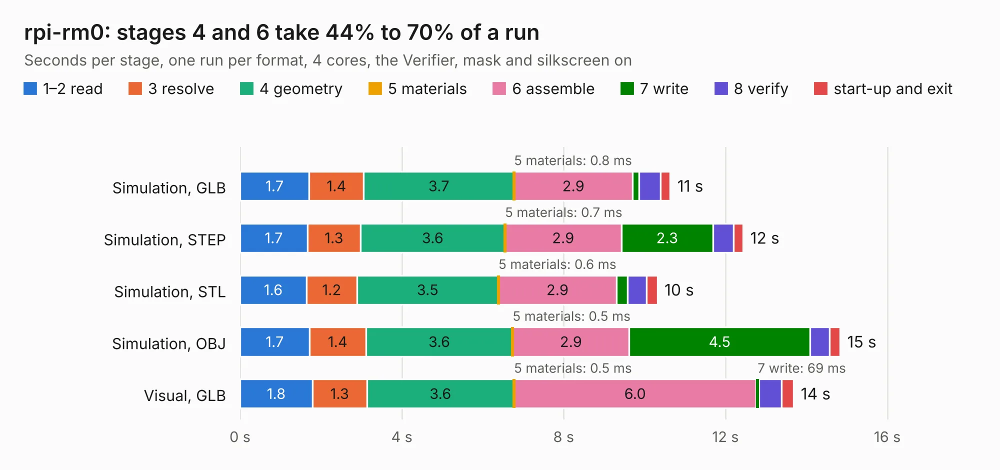

| Mode and format | 1–2 read | 3 resolve | 4 geometry | 5 materials | 6 assemble | 7 write | 8 verify | start-up and exit | Total |
|---|---:|---:|---:|---:|---:|---:|---:|---:|---:|
| Simulation, GLB | 1.7 | 1.4 | 3.7 | 0.8&nbsp;ms | 2.9 | 0.2 | 0.5 | 0.2 | 10.6 |
| Simulation, STEP | 1.7 | 1.3 | 3.6 | 0.7&nbsp;ms | 2.9 | 2.3 | 0.5 | 0.2 | 12.4 |
| Simulation, STL | 1.6 | 1.2 | 3.5 | 0.6&nbsp;ms | 2.9 | 0.3 | 0.5 | 0.3 | 10.3 |
| Simulation, OBJ | 1.7 | 1.4 | 3.6 | 0.5&nbsp;ms | 2.9 | 4.5 | 0.5 | 0.3 | 14.8 |
| Visual, GLB | 1.8 | 1.3 | 3.6 | 0.5&nbsp;ms | 6.0 | 69&nbsp;ms | 0.6 | 0.3 | 13.7 |
| Visual, OBJ | 1.7 | 1.3 | 3.6 | 0.8&nbsp;ms | 6.0 | 2.2 | 0.6 | 0.2 | 15.5 |

<table align="center"><tr><td valign="top">

| Board | Repo: [schlae/cm5-reveng](https://github.com/schlae/cm5-reveng) Board: `rpi-rm0.kicad_pcb` |
|---|---|
| Folder | rpi-rm0 |
| Complexity | 413&nbsp;/&nbsp;1000 (size&nbsp;258, features&nbsp;155) |
| KESE&nbsp;features | through vias, blind and buried vias, microvias, rounded, trapezoid or chamfered pads, filled zones, stack-up, dielectric εr and tanδ |
| Tested | 9th November 2026 |
| Copper&nbsp;layers | 6 |
| File&nbsp;format | KiCad 9 (20241229) |
| Parts,&nbsp;tracks,&nbsp;vias | 40, 465, 451 |
| Triangles,&nbsp;simulation | 897,508 in 114 parts |
| Verifier | PASS in all six runs |

</td><td valign="top">

<table>
<tr><th>File type</th><th>File size</th><th>Peak memory used</th></tr>
<tr><th colspan="3" align="left">Simulation</th></tr>
<tr><td>GLB</td><td align="right">30&nbsp;MB</td><td align="right">476&nbsp;MB</td></tr>
<tr><td>STEP</td><td align="right">93&nbsp;MB</td><td align="right">538&nbsp;MB</td></tr>
<tr><td>STL</td><td align="right">45&nbsp;MB</td><td align="right">488&nbsp;MB</td></tr>
<tr><td>OBJ</td><td align="right">90&nbsp;MB</td><td align="right">680&nbsp;MB</td></tr>
<tr><th colspan="3" align="left">Visual</th></tr>
<tr><td>GLB</td><td align="right">16&nbsp;MB</td><td align="right">458&nbsp;MB</td></tr>
<tr><td>OBJ</td><td align="right">48&nbsp;MB</td><td align="right">493&nbsp;MB</td></tr>
</table>

</td></tr></table>

## 2512. GreengateDS3

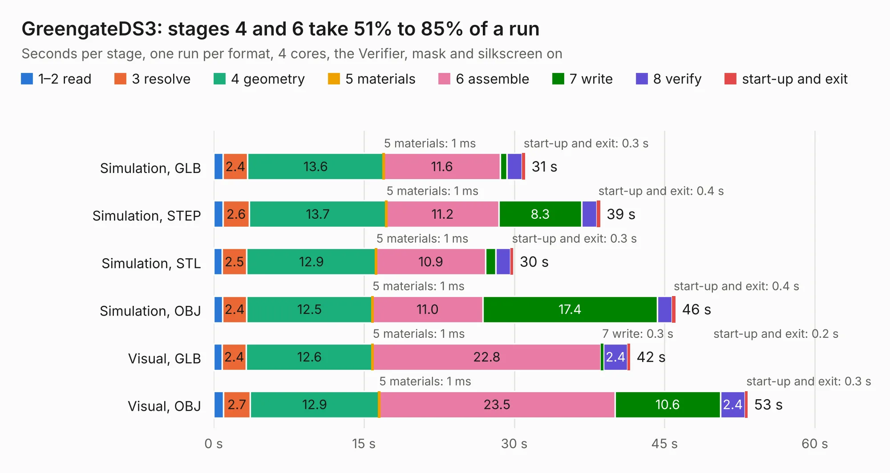

| Mode and format | 1–2 read | 3 resolve | 4 geometry | 5 materials | 6 assemble | 7 write | 8 verify | start-up and exit | Total |
|---|---:|---:|---:|---:|---:|---:|---:|---:|---:|
| Simulation, GLB | 0.9 | 2.4 | 13.6 | 1&nbsp;ms | 11.6 | 0.6 | 1.5 | 0.3 | 31.1 |
| Simulation, STEP | 0.9 | 2.6 | 13.7 | 1&nbsp;ms | 11.2 | 8.3 | 1.5 | 0.4 | 38.6 |
| Simulation, STL | 0.8 | 2.5 | 12.9 | 1&nbsp;ms | 10.9 | 1.0 | 1.5 | 0.3 | 29.9 |
| Simulation, OBJ | 0.9 | 2.4 | 12.5 | 1&nbsp;ms | 11.0 | 17.4 | 1.5 | 0.4 | 46.1 |
| Visual, GLB | 0.8 | 2.4 | 12.6 | 1&nbsp;ms | 22.8 | 0.3 | 2.4 | 0.2 | 41.6 |
| Visual, OBJ | 1.0 | 2.7 | 12.9 | 1&nbsp;ms | 23.5 | 10.6 | 2.4 | 0.3 | 53.3 |

<table align="center"><tr><td valign="top">

| Board | Repo: [schlae/goodgreat-ds3](https://github.com/schlae/goodgreat-ds3) Board: `GreengateDS3.kicad_pcb` |
|---|---|
| Complexity | 305&nbsp;/&nbsp;1000 (size&nbsp;195, features&nbsp;110) |
| KESE&nbsp;features | through vias, custom pads, rounded, trapezoid or chamfered pads, filled zones, copper drawings, copper text, stack-up, dielectric εr and tanδ |
| Tested | 9th November 2026 |
| Copper&nbsp;layers | 2 |
| File&nbsp;format | KiCad 7 (20221018) |
| Parts,&nbsp;tracks,&nbsp;vias | 70, 2,657, 168 |
| Triangles,&nbsp;simulation | 2,921,532 in 175 parts |
| Verifier | PASS in all six runs |

</td><td valign="top">

<table>
<tr><th>File type</th><th>File size</th><th>Peak memory used</th></tr>
<tr><th colspan="3" align="left">Simulation</th></tr>
<tr><td>GLB</td><td align="right">98&nbsp;MB</td><td align="right">1.0&nbsp;GB</td></tr>
<tr><td>STEP</td><td align="right">405&nbsp;MB</td><td align="right">1.2&nbsp;GB</td></tr>
<tr><td>STL</td><td align="right">146&nbsp;MB</td><td align="right">1.1&nbsp;GB</td></tr>
<tr><td>OBJ</td><td align="right">304&nbsp;MB</td><td align="right">1.9&nbsp;GB</td></tr>
<tr><th colspan="3" align="left">Visual</th></tr>
<tr><td>GLB</td><td align="right">62&nbsp;MB</td><td align="right">1.3&nbsp;GB</td></tr>
<tr><td>OBJ</td><td align="right">193&nbsp;MB</td><td align="right">1.4&nbsp;GB</td></tr>
</table>

</td></tr></table>

## 2513. isavideo

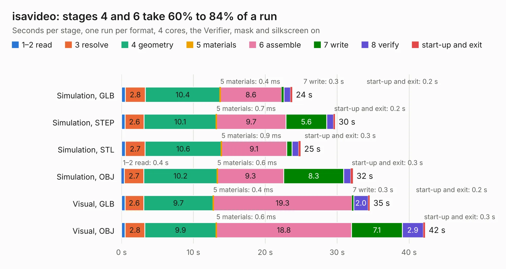

| Mode and format | 1–2 read | 3 resolve | 4 geometry | 5 materials | 6 assemble | 7 write | 8 verify | start-up and exit | Total |
|---|---:|---:|---:|---:|---:|---:|---:|---:|---:|
| Simulation, GLB | 0.5 | 2.8 | 10.4 | 0.4&nbsp;ms | 8.6 | 0.3 | 0.9 | 0.2 | 23.8 |
| Simulation, STEP | 0.5 | 2.6 | 10.1 | 0.7&nbsp;ms | 9.7 | 5.6 | 0.9 | 0.2 | 29.7 |
| Simulation, STL | 0.5 | 2.7 | 10.6 | 0.9&nbsp;ms | 9.1 | 0.8 | 0.9 | 0.3 | 24.9 |
| Simulation, OBJ | 0.4 | 2.7 | 10.2 | 0.6&nbsp;ms | 9.3 | 8.3 | 1.0 | 0.3 | 32.2 |
| Visual, GLB | 0.5 | 2.6 | 9.7 | 0.4&nbsp;ms | 19.3 | 0.3 | 2.0 | 0.2 | 34.5 |
| Visual, OBJ | 0.5 | 2.8 | 9.9 | 0.6&nbsp;ms | 18.8 | 7.1 | 2.9 | 0.3 | 42.2 |

<table align="center"><tr><td valign="top">

| Board | Repo: [schlae/graphics-gremlin](https://github.com/schlae/graphics-gremlin) Board: `isavideo.kicad_pcb` |
|---|---|
| Complexity | 329&nbsp;/&nbsp;1000 (size&nbsp;249, features&nbsp;80) |
| KESE&nbsp;features | through vias, slotted holes, custom pads, filled zones, copper drawings, curved board outline |
| Tested | 9th November 2026 |
| Copper&nbsp;layers | 2 |
| File&nbsp;format | KiCad 5 (20171130) |
| Parts,&nbsp;tracks,&nbsp;vias | 93, 2,062, 258 |
| Triangles,&nbsp;simulation | 1,773,268 in 218 parts |
| Verifier | PASS in all six runs |

</td><td valign="top">

<table>
<tr><th>File type</th><th>File size</th><th>Peak memory used</th></tr>
<tr><th colspan="3" align="left">Simulation</th></tr>
<tr><td>GLB</td><td align="right">63&nbsp;MB</td><td align="right">756&nbsp;MB</td></tr>
<tr><td>STEP</td><td align="right">331&nbsp;MB</td><td align="right">909&nbsp;MB</td></tr>
<tr><td>STL</td><td align="right">89&nbsp;MB</td><td align="right">778&nbsp;MB</td></tr>
<tr><td>OBJ</td><td align="right">191&nbsp;MB</td><td align="right">1.3&nbsp;GB</td></tr>
<tr><th colspan="3" align="left">Visual</th></tr>
<tr><td>GLB</td><td align="right">54&nbsp;MB</td><td align="right">1.2&nbsp;GB</td></tr>
<tr><td>OBJ</td><td align="right">164&nbsp;MB</td><td align="right">1.2&nbsp;GB</td></tr>
</table>

</td></tr></table>

## 2514. SnarkBarker

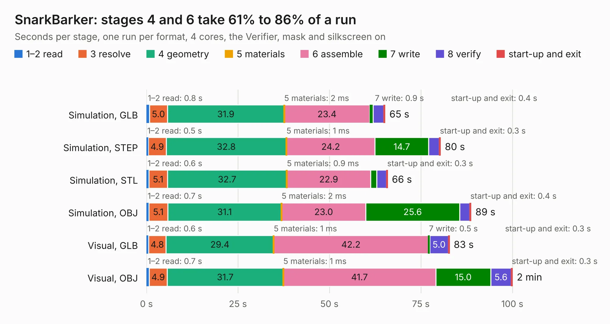

| Mode and format | 1–2 read | 3 resolve | 4 geometry | 5 materials | 6 assemble | 7 write | 8 verify | start-up and exit | Total |
|---|---:|---:|---:|---:|---:|---:|---:|---:|---:|
| Simulation, GLB | 0.8 | 5.0 | 31.9 | 2&nbsp;ms | 23.4 | 0.9 | 2.9 | 0.4 | 65.2 |
| Simulation, STEP | 0.5 | 4.9 | 32.8 | 1&nbsp;ms | 24.2 | 14.7 | 3.0 | 0.3 | 80.4 |
| Simulation, STL | 0.6 | 5.1 | 32.7 | 0.9&nbsp;ms | 22.9 | 1.7 | 2.6 | 0.3 | 65.9 |
| Simulation, OBJ | 0.7 | 5.1 | 31.1 | 2&nbsp;ms | 23.0 | 25.6 | 2.8 | 0.4 | 88.7 |
| Visual, GLB | 0.6 | 4.8 | 29.4 | 1&nbsp;ms | 42.2 | 0.5 | 5.0 | 0.3 | 82.8 |
| Visual, OBJ | 0.7 | 4.9 | 31.7 | 1&nbsp;ms | 41.7 | 15.0 | 5.6 | 0.3 | 100.0 |

<table align="center"><tr><td valign="top">

| Board | Repo: [schlae/snark-barker](https://github.com/schlae/snark-barker) Board: `SnarkBarker.kicad_pcb` |
|---|---|
| Complexity | 244&nbsp;/&nbsp;1000 (size&nbsp;209, features&nbsp;35) |
| KESE&nbsp;features | through vias, filled zones |
| Tested | 9th November 2026 |
| Copper&nbsp;layers | 2 |
| File&nbsp;format | KiCad 4 (4) |
| Parts,&nbsp;tracks,&nbsp;vias | 192, 3,341, 189 |
| Triangles,&nbsp;simulation | 5,547,974 in 227 parts |
| Verifier | PASS in all six runs |

</td><td valign="top">

<table>
<tr><th>File type</th><th>File size</th><th>Peak memory used</th></tr>
<tr><th colspan="3" align="left">Simulation</th></tr>
<tr><td>GLB</td><td align="right">191&nbsp;MB</td><td align="right">1.7&nbsp;GB</td></tr>
<tr><td>STEP</td><td align="right">992&nbsp;MB</td><td align="right">2.0&nbsp;GB</td></tr>
<tr><td>STL</td><td align="right">277&nbsp;MB</td><td align="right">1.7&nbsp;GB</td></tr>
<tr><td>OBJ</td><td align="right">596&nbsp;MB</td><td align="right">3.6&nbsp;GB</td></tr>
<tr><th colspan="3" align="left">Visual</th></tr>
<tr><td>GLB</td><td align="right">106&nbsp;MB</td><td align="right">1.7&nbsp;GB</td></tr>
<tr><td>OBJ</td><td align="right">334&nbsp;MB</td><td align="right">2.2&nbsp;GB</td></tr>
</table>

</td></tr></table>

## 2515. BM28B0.6-24DSBreakout

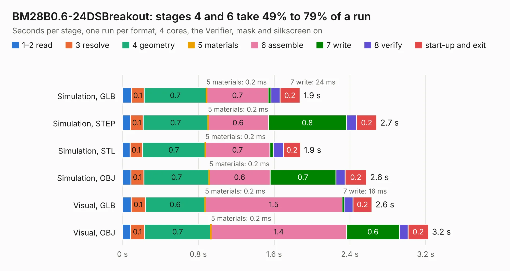

| Mode and format | 1–2 read | 3 resolve | 4 geometry | 5 materials | 6 assemble | 7 write | 8 verify | start-up and exit | Total |
|---|---:|---:|---:|---:|---:|---:|---:|---:|---:|
| Simulation, GLB | 95&nbsp;ms | 0.1 | 0.7 | 0.2&nbsp;ms | 0.7 | 24&nbsp;ms | 97&nbsp;ms | 0.2 | 1.9 |
| Simulation, STEP | 83&nbsp;ms | 0.1 | 0.7 | 0.2&nbsp;ms | 0.6 | 0.8 | 0.1 | 0.2 | 2.7 |
| Simulation, STL | 80&nbsp;ms | 0.1 | 0.7 | 0.2&nbsp;ms | 0.7 | 37&nbsp;ms | 0.1 | 0.2 | 1.9 |
| Simulation, OBJ | 90&nbsp;ms | 0.1 | 0.7 | 0.2&nbsp;ms | 0.6 | 0.7 | 96&nbsp;ms | 0.2 | 2.6 |
| Visual, GLB | 91&nbsp;ms | 0.1 | 0.6 | 0.2&nbsp;ms | 1.5 | 16&nbsp;ms | 95&nbsp;ms | 0.2 | 2.6 |
| Visual, OBJ | 87&nbsp;ms | 0.1 | 0.7 | 0.2&nbsp;ms | 1.4 | 0.6 | 90&nbsp;ms | 0.2 | 3.2 |

<table align="center"><tr><td valign="top">

| Board | Repo: [scottbez1/smartknob](https://github.com/scottbez1/smartknob) Board: `BM28B0.6-24DSBreakout.kicad_pcb` |
|---|---|
| Folder | electronics / BM28B0.6-24DSBreakout |
| Complexity | 105&nbsp;/&nbsp;1000 (size&nbsp;105, features&nbsp;0) |
| Tested | 9th November 2026 |
| Copper&nbsp;layers | 2 |
| File&nbsp;format | KiCad 5 (20171130) |
| Parts,&nbsp;tracks,&nbsp;vias | 3, 84, 0 |
| Triangles,&nbsp;simulation | 143,778 in 39 parts |
| Verifier | PASS in all six runs |

</td><td valign="top">

<table>
<tr><th>File type</th><th>File size</th><th>Peak memory used</th></tr>
<tr><th colspan="3" align="left">Simulation</th></tr>
<tr><td>GLB</td><td align="right">4.8&nbsp;MB</td><td align="right">184&nbsp;MB</td></tr>
<tr><td>STEP</td><td align="right">19&nbsp;MB</td><td align="right">199&nbsp;MB</td></tr>
<tr><td>STL</td><td align="right">7.2&nbsp;MB</td><td align="right">191&nbsp;MB</td></tr>
<tr><td>OBJ</td><td align="right">14&nbsp;MB</td><td align="right">198&nbsp;MB</td></tr>
<tr><th colspan="3" align="left">Visual</th></tr>
<tr><td>GLB</td><td align="right">3.2&nbsp;MB</td><td align="right">165&nbsp;MB</td></tr>
<tr><td>OBJ</td><td align="right">8.9&nbsp;MB</td><td align="right">163&nbsp;MB</td></tr>
</table>

</td></tr></table>

## 2516. LevelShifterBreakout

| Mode and format | 1–2 read | 3 resolve | 4 geometry | 5 materials | 6 assemble | 7 write | 8 verify | start-up and exit | Total |
|---|---:|---:|---:|---:|---:|---:|---:|---:|---:|
| Simulation, GLB | 76&nbsp;ms | 0.1 | 0.4 | 0.1&nbsp;ms | 0.5 | 20&nbsp;ms | 65&nbsp;ms | 0.2 | 1.4 |
| Simulation, STEP | 75&nbsp;ms | 0.1 | 0.4 | 0.1&nbsp;ms | 0.5 | 0.7 | 61&nbsp;ms | 0.2 | 2.0 |
| Simulation, STL | 69&nbsp;ms | 0.1 | 0.4 | 0.2&nbsp;ms | 0.5 | 26&nbsp;ms | 61&nbsp;ms | 0.2 | 1.4 |
| Simulation, OBJ | 66&nbsp;ms | 0.1 | 0.4 | 0.2&nbsp;ms | 0.5 | 0.5 | 73&nbsp;ms | 0.2 | 1.9 |
| Visual, GLB | 78&nbsp;ms | 98&nbsp;ms | 0.4 | 0.2&nbsp;ms | 1.2 | 15&nbsp;ms | 0.1 | 0.2 | 2.1 |
| Visual, OBJ | 79&nbsp;ms | 0.1 | 0.4 | 0.1&nbsp;ms | 1.2 | 0.4 | 0.1 | 0.2 | 2.5 |

<table align="center"><tr><td valign="top">

| Board | Repo: [scottbez1/smartknob](https://github.com/scottbez1/smartknob) Board: `LevelShifterBreakout.kicad_pcb` |
|---|---|
| Folder | electronics / LevelShifterBreakout |
| Complexity | 156&nbsp;/&nbsp;1000 (size&nbsp;111, features&nbsp;45) |
| KESE&nbsp;features | through vias, rounded, trapezoid or chamfered pads, filled zones |
| Tested | 9th November 2026 |
| Copper&nbsp;layers | 2 |
| File&nbsp;format | KiCad 5 (20171130) |
| Parts,&nbsp;tracks,&nbsp;vias | 5, 63, 11 |
| Triangles,&nbsp;simulation | 137,936 in 27 parts |
| Verifier | PASS in all six runs |

</td><td valign="top">

<table>
<tr><th>File type</th><th>File size</th><th>Peak memory used</th></tr>
<tr><th colspan="3" align="left">Simulation</th></tr>
<tr><td>GLB</td><td align="right">4.7&nbsp;MB</td><td align="right">194&nbsp;MB</td></tr>
<tr><td>STEP</td><td align="right">18&nbsp;MB</td><td align="right">199&nbsp;MB</td></tr>
<tr><td>STL</td><td align="right">6.9&nbsp;MB</td><td align="right">192&nbsp;MB</td></tr>
<tr><td>OBJ</td><td align="right">13&nbsp;MB</td><td align="right">195&nbsp;MB</td></tr>
<tr><th colspan="3" align="left">Visual</th></tr>
<tr><td>GLB</td><td align="right">3.5&nbsp;MB</td><td align="right">160&nbsp;MB</td></tr>
<tr><td>OBJ</td><td align="right">10&nbsp;MB</td><td align="right">167&nbsp;MB</td></tr>
</table>

</td></tr></table>

## 2517. view_base

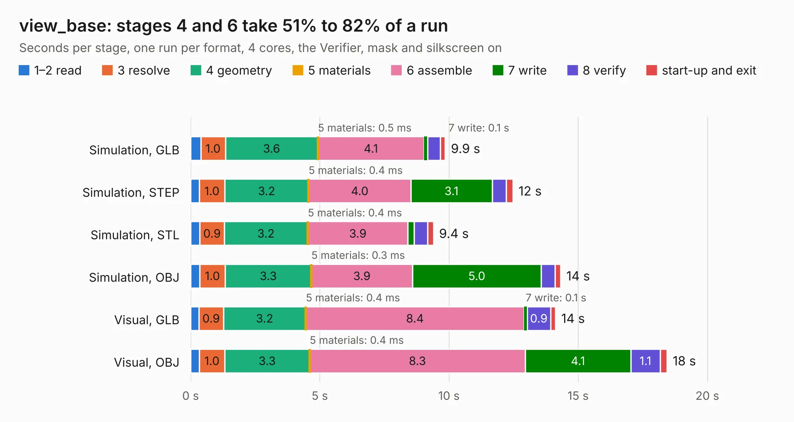

| Mode and format | 1–2 read | 3 resolve | 4 geometry | 5 materials | 6 assemble | 7 write | 8 verify | start-up and exit | Total |
|---|---:|---:|---:|---:|---:|---:|---:|---:|---:|
| Simulation, GLB | 0.4 | 1.0 | 3.6 | 0.5&nbsp;ms | 4.1 | 0.1 | 0.5 | 0.2 | 9.9 |
| Simulation, STEP | 0.3 | 1.0 | 3.2 | 0.4&nbsp;ms | 4.0 | 3.1 | 0.5 | 0.3 | 12.5 |
| Simulation, STL | 0.4 | 0.9 | 3.2 | 0.4&nbsp;ms | 3.9 | 0.2 | 0.5 | 0.2 | 9.4 |
| Simulation, OBJ | 0.3 | 1.0 | 3.3 | 0.3&nbsp;ms | 3.9 | 5.0 | 0.5 | 0.2 | 14.3 |
| Visual, GLB | 0.3 | 0.9 | 3.2 | 0.4&nbsp;ms | 8.4 | 0.1 | 0.9 | 0.2 | 14.1 |
| Visual, OBJ | 0.3 | 1.0 | 3.3 | 0.4&nbsp;ms | 8.3 | 4.1 | 1.1 | 0.3 | 18.4 |

<table align="center"><tr><td valign="top">

| Board | Repo: [scottbez1/smartknob](https://github.com/scottbez1/smartknob) Board: `view_base.kicad_pcb` |
|---|---|
| Folder | electronics / view_base |
| Complexity | 317&nbsp;/&nbsp;1000 (size&nbsp;182, features&nbsp;135) |
| KESE&nbsp;features | through vias, slotted holes, custom pads, rounded, trapezoid or chamfered pads, drill offsets, filled zones, copper drawings, curved board outline, stack-up, dielectric εr and tanδ, mask and silkscreen colours |
| Tested | 9th November 2026 |
| Copper&nbsp;layers | 2 |
| File&nbsp;format | KiCad 6 (20211014) |
| Parts,&nbsp;tracks,&nbsp;vias | 76, 834, 174 |
| Triangles,&nbsp;simulation | 919,322 in 102 parts |
| Verifier | PASS in all six runs |

</td><td valign="top">

<table>
<tr><th>File type</th><th>File size</th><th>Peak memory used</th></tr>
<tr><th colspan="3" align="left">Simulation</th></tr>
<tr><td>GLB</td><td align="right">32&nbsp;MB</td><td align="right">471&nbsp;MB</td></tr>
<tr><td>STEP</td><td align="right">159&nbsp;MB</td><td align="right">526&nbsp;MB</td></tr>
<tr><td>STL</td><td align="right">46&nbsp;MB</td><td align="right">461&nbsp;MB</td></tr>
<tr><td>OBJ</td><td align="right">93&nbsp;MB</td><td align="right">644&nbsp;MB</td></tr>
<tr><th colspan="3" align="left">Visual</th></tr>
<tr><td>GLB</td><td align="right">28&nbsp;MB</td><td align="right">584&nbsp;MB</td></tr>
<tr><td>OBJ</td><td align="right">84&nbsp;MB</td><td align="right">633&nbsp;MB</td></tr>
</table>

</td></tr></table>

## 2518. view_screen

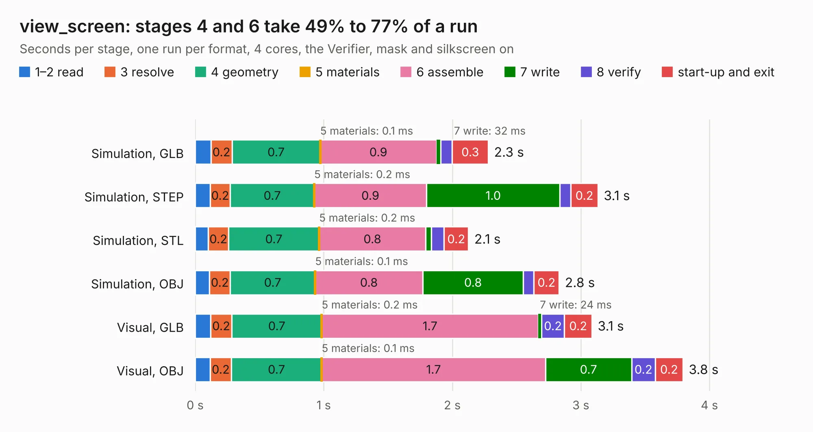

| Mode and format | 1–2 read | 3 resolve | 4 geometry | 5 materials | 6 assemble | 7 write | 8 verify | start-up and exit | Total |
|---|---:|---:|---:|---:|---:|---:|---:|---:|---:|
| Simulation, GLB | 0.1 | 0.2 | 0.7 | 0.1&nbsp;ms | 0.9 | 32&nbsp;ms | 91&nbsp;ms | 0.3 | 2.3 |
| Simulation, STEP | 0.1 | 0.2 | 0.7 | 0.2&nbsp;ms | 0.9 | 1.0 | 85&nbsp;ms | 0.2 | 3.1 |
| Simulation, STL | 0.1 | 0.2 | 0.7 | 0.2&nbsp;ms | 0.8 | 46&nbsp;ms | 98&nbsp;ms | 0.2 | 2.1 |
| Simulation, OBJ | 0.1 | 0.2 | 0.7 | 0.1&nbsp;ms | 0.8 | 0.8 | 81&nbsp;ms | 0.2 | 2.8 |
| Visual, GLB | 0.1 | 0.2 | 0.7 | 0.2&nbsp;ms | 1.7 | 24&nbsp;ms | 0.2 | 0.2 | 3.1 |
| Visual, OBJ | 0.1 | 0.2 | 0.7 | 0.1&nbsp;ms | 1.7 | 0.7 | 0.2 | 0.2 | 3.8 |

<table align="center"><tr><td valign="top">

| Board | Repo: [scottbez1/smartknob](https://github.com/scottbez1/smartknob) Board: `view_screen.kicad_pcb` |
|---|---|
| Folder | electronics / view_screen |
| Complexity | 212&nbsp;/&nbsp;1000 (size&nbsp;122, features&nbsp;90) |
| KESE&nbsp;features | through vias, rounded, trapezoid or chamfered pads, filled zones, curved board outline, stack-up, dielectric εr and tanδ, mask and silkscreen colours |
| Tested | 9th November 2026 |
| Copper&nbsp;layers | 2 |
| File&nbsp;format | KiCad 6 (20211014) |
| Parts,&nbsp;tracks,&nbsp;vias | 11, 58, 20 |
| Triangles,&nbsp;simulation | 161,874 in 23 parts |
| Verifier | PASS in all six runs |

</td><td valign="top">

<table>
<tr><th>File type</th><th>File size</th><th>Peak memory used</th></tr>
<tr><th colspan="3" align="left">Simulation</th></tr>
<tr><td>GLB</td><td align="right">5.7&nbsp;MB</td><td align="right">203&nbsp;MB</td></tr>
<tr><td>STEP</td><td align="right">31&nbsp;MB</td><td align="right">221&nbsp;MB</td></tr>
<tr><td>STL</td><td align="right">8.1&nbsp;MB</td><td align="right">204&nbsp;MB</td></tr>
<tr><td>OBJ</td><td align="right">16&nbsp;MB</td><td align="right">204&nbsp;MB</td></tr>
<tr><th colspan="3" align="left">Visual</th></tr>
<tr><td>GLB</td><td align="right">5.0&nbsp;MB</td><td align="right">200&nbsp;MB</td></tr>
<tr><td>OBJ</td><td align="right">14&nbsp;MB</td><td align="right">200&nbsp;MB</td></tr>
</table>

</td></tr></table>

## 2519. chainlinkBase

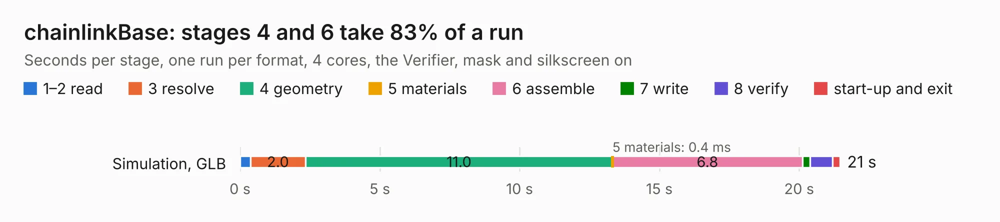

| Mode and format | 1–2 read | 3 resolve | 4 geometry | 5 materials | 6 assemble | 7 write | 8 verify | start-up and exit | Total |
|---|---:|---:|---:|---:|---:|---:|---:|---:|---:|
| Simulation, GLB | 0.4 | 2.0 | 11.0 | 0.4&nbsp;ms | 6.8 | 0.3 | 0.8 | 0.3 | 21.5 |
| Simulation, STEP | 0.3 | 2.1 | 10.6 | 0.5&nbsp;ms | 6.7 | 4.7 | 0.7 | 0.2 | 25.5 |
| Simulation, STL | 0.4 | 2.2 | 11.1 | 0.4&nbsp;ms | 6.8 | 0.6 | 0.8 | 0.3 | 22.3 |
| Simulation, OBJ | 0.4 | 2.1 | 11.1 | 0.4&nbsp;ms | 6.7 | 9.1 | 0.8 | 0.2 | 30.4 |
| Visual, GLB | 0.3 | 2.1 | 11.0 | 0.4&nbsp;ms | 15.7 | 0.2 | 1.7 | 0.2 | 31.2 |
| Visual, OBJ | 0.3 | 2.2 | 10.8 | 0.4&nbsp;ms | 16.1 | 6.4 | 1.8 | 0.3 | 38.0 |

<table align="center"><tr><td valign="top">

| Board | Repo: [scottbez1/splitflap](https://github.com/scottbez1/splitflap) Board: `chainlinkBase.kicad_pcb` |
|---|---|
| Folder | electronics / chainlinkBase |
| Complexity | 236&nbsp;/&nbsp;1000 (size&nbsp;191, features&nbsp;45) |
| KESE&nbsp;features | through vias, rounded, trapezoid or chamfered pads, filled zones |
| Tested | 9th November 2026 |
| Copper&nbsp;layers | 2 |
| File&nbsp;format | KiCad 5 (20171130) |
| Parts,&nbsp;tracks,&nbsp;vias | 119, 932, 259 |
| Triangles,&nbsp;simulation | 1,978,438 in 112 parts |
| Verifier | PASS in all six runs |

</td><td valign="top">

<table>
<tr><th>File type</th><th>File size</th><th>Peak memory used</th></tr>
<tr><th colspan="3" align="left">Simulation</th></tr>
<tr><td>GLB</td><td align="right">68&nbsp;MB</td><td align="right">699&nbsp;MB</td></tr>
<tr><td>STEP</td><td align="right">332&nbsp;MB</td><td align="right">849&nbsp;MB</td></tr>
<tr><td>STL</td><td align="right">99&nbsp;MB</td><td align="right">791&nbsp;MB</td></tr>
<tr><td>OBJ</td><td align="right">211&nbsp;MB</td><td align="right">1.3&nbsp;GB</td></tr>
<tr><th colspan="3" align="left">Visual</th></tr>
<tr><td>GLB</td><td align="right">46&nbsp;MB</td><td align="right">855&nbsp;MB</td></tr>
<tr><td>OBJ</td><td align="right">138&nbsp;MB</td><td align="right">1.0&nbsp;GB</td></tr>
</table>

</td></tr></table>

## 2520. chainlinkBuddyBreadboard

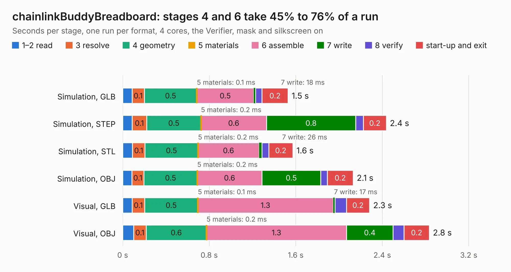

| Mode and format | 1–2 read | 3 resolve | 4 geometry | 5 materials | 6 assemble | 7 write | 8 verify | start-up and exit | Total |
|---|---:|---:|---:|---:|---:|---:|---:|---:|---:|
| Simulation, GLB | 87&nbsp;ms | 0.1 | 0.5 | 0.1&nbsp;ms | 0.5 | 18&nbsp;ms | 59&nbsp;ms | 0.2 | 1.5 |
| Simulation, STEP | 87&nbsp;ms | 0.1 | 0.5 | 0.2&nbsp;ms | 0.6 | 0.8 | 72&nbsp;ms | 0.2 | 2.4 |
| Simulation, STL | 91&nbsp;ms | 0.1 | 0.5 | 0.2&nbsp;ms | 0.6 | 26&nbsp;ms | 64&nbsp;ms | 0.2 | 1.6 |
| Simulation, OBJ | 84&nbsp;ms | 0.1 | 0.5 | 0.2&nbsp;ms | 0.6 | 0.5 | 62&nbsp;ms | 0.2 | 2.1 |
| Visual, GLB | 87&nbsp;ms | 0.1 | 0.5 | 0.1&nbsp;ms | 1.3 | 17&nbsp;ms | 0.1 | 0.2 | 2.3 |
| Visual, OBJ | 0.1 | 0.1 | 0.6 | 0.2&nbsp;ms | 1.3 | 0.4 | 0.1 | 0.2 | 2.8 |

<table align="center"><tr><td valign="top">

| Board | Repo: [scottbez1/splitflap](https://github.com/scottbez1/splitflap) Board: `chainlinkBuddyBreadboard.kicad_pcb` |
|---|---|
| Folder | electronics / chainlinkBuddyBreadboard |
| Complexity | 129&nbsp;/&nbsp;1000 (size&nbsp;84, features&nbsp;45) |
| KESE&nbsp;features | through vias, rounded, trapezoid or chamfered pads, filled zones |
| Tested | 9th November 2026 |
| Copper&nbsp;layers | 2 |
| File&nbsp;format | KiCad 5 (20171130) |
| Parts,&nbsp;tracks,&nbsp;vias | 2, 13, 5 |
| Triangles,&nbsp;simulation | 109,334 in 16 parts |
| Verifier | PASS in all six runs |

</td><td valign="top">

<table>
<tr><th>File type</th><th>File size</th><th>Peak memory used</th></tr>
<tr><th colspan="3" align="left">Simulation</th></tr>
<tr><td>GLB</td><td align="right">3.8&nbsp;MB</td><td align="right">187&nbsp;MB</td></tr>
<tr><td>STEP</td><td align="right">17&nbsp;MB</td><td align="right">187&nbsp;MB</td></tr>
<tr><td>STL</td><td align="right">5.5&nbsp;MB</td><td align="right">187&nbsp;MB</td></tr>
<tr><td>OBJ</td><td align="right">11&nbsp;MB</td><td align="right">180&nbsp;MB</td></tr>
<tr><th colspan="3" align="left">Visual</th></tr>
<tr><td>GLB</td><td align="right">3.0&nbsp;MB</td><td align="right">152&nbsp;MB</td></tr>
<tr><td>OBJ</td><td align="right">8.4&nbsp;MB</td><td align="right">152&nbsp;MB</td></tr>
</table>

</td></tr></table>

## 2521. chainlinkBuddyTDisplay

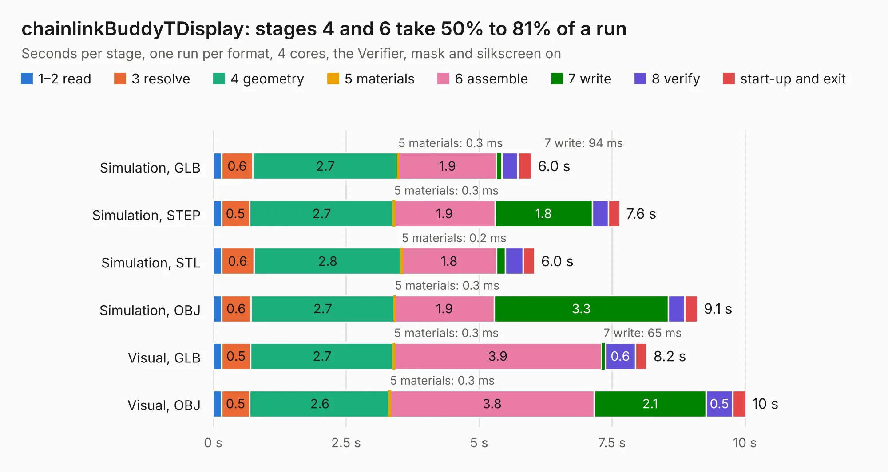

| Mode and format | 1–2 read | 3 resolve | 4 geometry | 5 materials | 6 assemble | 7 write | 8 verify | start-up and exit | Total |
|---|---:|---:|---:|---:|---:|---:|---:|---:|---:|
| Simulation, GLB | 0.2 | 0.6 | 2.7 | 0.3&nbsp;ms | 1.9 | 94&nbsp;ms | 0.3 | 0.3 | 6.0 |
| Simulation, STEP | 0.2 | 0.5 | 2.7 | 0.3&nbsp;ms | 1.9 | 1.8 | 0.3 | 0.2 | 7.6 |
| Simulation, STL | 0.2 | 0.6 | 2.8 | 0.2&nbsp;ms | 1.8 | 0.2 | 0.3 | 0.2 | 6.0 |
| Simulation, OBJ | 0.2 | 0.6 | 2.7 | 0.3&nbsp;ms | 1.9 | 3.3 | 0.3 | 0.2 | 9.1 |
| Visual, GLB | 0.2 | 0.5 | 2.7 | 0.3&nbsp;ms | 3.9 | 65&nbsp;ms | 0.6 | 0.2 | 8.2 |
| Visual, OBJ | 0.2 | 0.5 | 2.6 | 0.3&nbsp;ms | 3.8 | 2.1 | 0.5 | 0.2 | 10.0 |

<table align="center"><tr><td valign="top">

| Board | Repo: [scottbez1/splitflap](https://github.com/scottbez1/splitflap) Board: `chainlinkBuddyTDisplay.kicad_pcb` |
|---|---|
| Folder | electronics / chainlinkBuddyTDisplay |
| Complexity | 159&nbsp;/&nbsp;1000 (size&nbsp;109, features&nbsp;50) |
| KESE&nbsp;features | slotted holes, rounded, trapezoid or chamfered pads, filled zones, curved board outline |
| Tested | 9th November 2026 |
| Copper&nbsp;layers | 2 |
| File&nbsp;format | KiCad 5 (20171130) |
| Parts,&nbsp;tracks,&nbsp;vias | 8, 64, 0 |
| Triangles,&nbsp;simulation | 587,596 in 33 parts |
| Verifier | PASS in all six runs |

</td><td valign="top">

<table>
<tr><th>File type</th><th>File size</th><th>Peak memory used</th></tr>
<tr><th colspan="3" align="left">Simulation</th></tr>
<tr><td>GLB</td><td align="right">19&nbsp;MB</td><td align="right">301&nbsp;MB</td></tr>
<tr><td>STEP</td><td align="right">83&nbsp;MB</td><td align="right">358&nbsp;MB</td></tr>
<tr><td>STL</td><td align="right">29&nbsp;MB</td><td align="right">290&nbsp;MB</td></tr>
<tr><td>OBJ</td><td align="right">59&nbsp;MB</td><td align="right">432&nbsp;MB</td></tr>
<tr><th colspan="3" align="left">Visual</th></tr>
<tr><td>GLB</td><td align="right">13&nbsp;MB</td><td align="right">368&nbsp;MB</td></tr>
<tr><td>OBJ</td><td align="right">39&nbsp;MB</td><td align="right">382&nbsp;MB</td></tr>
</table>

</td></tr></table>

## 2522. chainlinkDriver

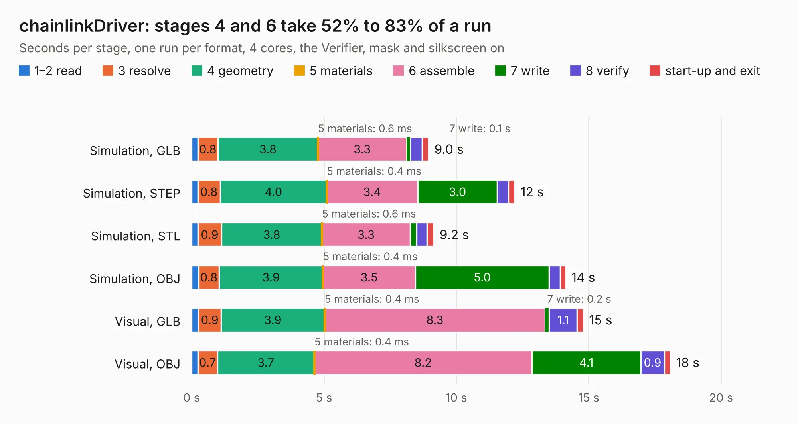

| Mode and format | 1–2 read | 3 resolve | 4 geometry | 5 materials | 6 assemble | 7 write | 8 verify | start-up and exit | Total |
|---|---:|---:|---:|---:|---:|---:|---:|---:|---:|
| Simulation, GLB | 0.2 | 0.8 | 3.8 | 0.6&nbsp;ms | 3.3 | 0.1 | 0.5 | 0.2 | 9.0 |
| Simulation, STEP | 0.2 | 0.8 | 4.0 | 0.4&nbsp;ms | 3.4 | 3.0 | 0.4 | 0.2 | 12.2 |
| Simulation, STL | 0.2 | 0.9 | 3.8 | 0.6&nbsp;ms | 3.3 | 0.2 | 0.4 | 0.3 | 9.2 |
| Simulation, OBJ | 0.3 | 0.8 | 3.9 | 0.4&nbsp;ms | 3.5 | 5.0 | 0.4 | 0.2 | 14.1 |
| Visual, GLB | 0.3 | 0.9 | 3.9 | 0.4&nbsp;ms | 8.3 | 0.2 | 1.1 | 0.2 | 14.8 |
| Visual, OBJ | 0.2 | 0.7 | 3.7 | 0.4&nbsp;ms | 8.2 | 4.1 | 0.9 | 0.2 | 18.1 |

<table align="center"><tr><td valign="top">

| Board | Repo: [scottbez1/splitflap](https://github.com/scottbez1/splitflap) Board: `chainlinkDriver.kicad_pcb` |
|---|---|
| Folder | electronics / chainlinkDriver |
| Complexity | 219&nbsp;/&nbsp;1000 (size&nbsp;174, features&nbsp;45) |
| KESE&nbsp;features | through vias, rounded, trapezoid or chamfered pads, filled zones |
| Tested | 9th November 2026 |
| Copper&nbsp;layers | 2 |
| File&nbsp;format | KiCad 5 (20171130) |
| Parts,&nbsp;tracks,&nbsp;vias | 58, 687, 111 |
| Triangles,&nbsp;simulation | 979,006 in 95 parts |
| Verifier | PASS in all six runs |

</td><td valign="top">

<table>
<tr><th>File type</th><th>File size</th><th>Peak memory used</th></tr>
<tr><th colspan="3" align="left">Simulation</th></tr>
<tr><td>GLB</td><td align="right">33&nbsp;MB</td><td align="right">423&nbsp;MB</td></tr>
<tr><td>STEP</td><td align="right">154&nbsp;MB</td><td align="right">512&nbsp;MB</td></tr>
<tr><td>STL</td><td align="right">49&nbsp;MB</td><td align="right">428&nbsp;MB</td></tr>
<tr><td>OBJ</td><td align="right">98&nbsp;MB</td><td align="right">663&nbsp;MB</td></tr>
<tr><th colspan="3" align="left">Visual</th></tr>
<tr><td>GLB</td><td align="right">26&nbsp;MB</td><td align="right">633&nbsp;MB</td></tr>
<tr><td>OBJ</td><td align="right">79&nbsp;MB</td><td align="right">633&nbsp;MB</td></tr>
</table>

</td></tr></table>

## 2523. chainlinkDriverTester

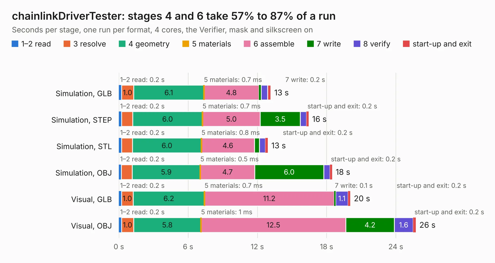

| Mode and format | 1–2 read | 3 resolve | 4 geometry | 5 materials | 6 assemble | 7 write | 8 verify | start-up and exit | Total |
|---|---:|---:|---:|---:|---:|---:|---:|---:|---:|
| Simulation, GLB | 0.2 | 1.0 | 6.1 | 0.7&nbsp;ms | 4.8 | 0.2 | 0.6 | 0.3 | 13.2 |
| Simulation, STEP | 0.2 | 1.0 | 6.0 | 0.7&nbsp;ms | 5.0 | 3.5 | 0.5 | 0.2 | 16.4 |
| Simulation, STL | 0.2 | 0.9 | 6.0 | 0.8&nbsp;ms | 4.6 | 0.4 | 0.5 | 0.2 | 12.9 |
| Simulation, OBJ | 0.2 | 0.9 | 5.9 | 0.5&nbsp;ms | 4.7 | 6.0 | 0.5 | 0.2 | 18.5 |
| Visual, GLB | 0.2 | 1.0 | 6.2 | 0.7&nbsp;ms | 11.2 | 0.1 | 1.1 | 0.2 | 20.1 |
| Visual, OBJ | 0.2 | 1.0 | 5.8 | 1&nbsp;ms | 12.5 | 4.2 | 1.6 | 0.2 | 25.7 |

<table align="center"><tr><td valign="top">

| Board | Repo: [scottbez1/splitflap](https://github.com/scottbez1/splitflap) Board: `chainlinkDriverTester.kicad_pcb` |
|---|---|
| Folder | electronics / chainlinkDriverTester |
| Complexity | 236&nbsp;/&nbsp;1000 (size&nbsp;171, features&nbsp;65) |
| KESE&nbsp;features | through vias, slotted holes, rounded, trapezoid or chamfered pads, filled zones, curved board outline |
| Tested | 9th November 2026 |
| Copper&nbsp;layers | 2 |
| File&nbsp;format | KiCad 5 (20171130) |
| Parts,&nbsp;tracks,&nbsp;vias | 59, 536, 97 |
| Triangles,&nbsp;simulation | 1,553,564 in 107 parts |
| Verifier | PASS in all six runs |

</td><td valign="top">

<table>
<tr><th>File type</th><th>File size</th><th>Peak memory used</th></tr>
<tr><th colspan="3" align="left">Simulation</th></tr>
<tr><td>GLB</td><td align="right">52&nbsp;MB</td><td align="right">651&nbsp;MB</td></tr>
<tr><td>STEP</td><td align="right">214&nbsp;MB</td><td align="right">719&nbsp;MB</td></tr>
<tr><td>STL</td><td align="right">78&nbsp;MB</td><td align="right">604&nbsp;MB</td></tr>
<tr><td>OBJ</td><td align="right">158&nbsp;MB</td><td align="right">1.0&nbsp;GB</td></tr>
<tr><th colspan="3" align="left">Visual</th></tr>
<tr><td>GLB</td><td align="right">33&nbsp;MB</td><td align="right">697&nbsp;MB</td></tr>
<tr><td>OBJ</td><td align="right">101&nbsp;MB</td><td align="right">790&nbsp;MB</td></tr>
</table>

</td></tr></table>

## 2524. sensor

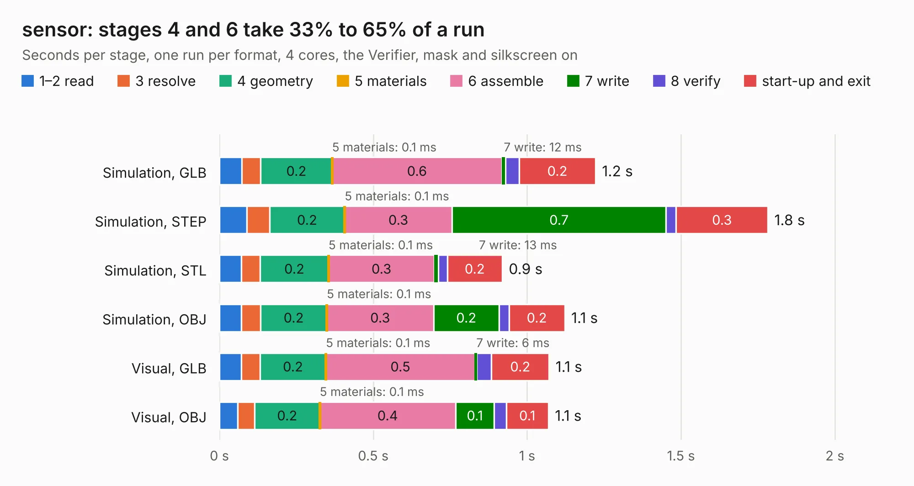

| Mode and format | 1–2 read | 3 resolve | 4 geometry | 5 materials | 6 assemble | 7 write | 8 verify | start-up and exit | Total |
|---|---:|---:|---:|---:|---:|---:|---:|---:|---:|
| Simulation, GLB | 73&nbsp;ms | 61&nbsp;ms | 0.2 | 0.1&nbsp;ms | 0.6 | 12&nbsp;ms | 44&nbsp;ms | 0.2 | 1.2 |
| Simulation, STEP | 89&nbsp;ms | 74&nbsp;ms | 0.2 | 0.1&nbsp;ms | 0.3 | 0.7 | 33&nbsp;ms | 0.3 | 1.8 |
| Simulation, STL | 71&nbsp;ms | 61&nbsp;ms | 0.2 | 0.1&nbsp;ms | 0.3 | 13&nbsp;ms | 29&nbsp;ms | 0.2 | 0.9 |
| Simulation, OBJ | 71&nbsp;ms | 63&nbsp;ms | 0.2 | 0.1&nbsp;ms | 0.3 | 0.2 | 32&nbsp;ms | 0.2 | 1.1 |
| Visual, GLB | 71&nbsp;ms | 61&nbsp;ms | 0.2 | 0.1&nbsp;ms | 0.5 | 6&nbsp;ms | 48&nbsp;ms | 0.2 | 1.1 |
| Visual, OBJ | 59&nbsp;ms | 55&nbsp;ms | 0.2 | 0.1&nbsp;ms | 0.4 | 0.1 | 39&nbsp;ms | 0.1 | 1.1 |

<table align="center"><tr><td valign="top">

| Board | Repo: [scottbez1/splitflap](https://github.com/scottbez1/splitflap) Board: `sensor.kicad_pcb` |
|---|---|
| Folder | electronics / sensor |
| Complexity | 60&nbsp;/&nbsp;1000 (size&nbsp;60, features&nbsp;0) |
| Tested | 9th November 2026 |
| Copper&nbsp;layers | 2 |
| File&nbsp;format | KiCad 5 (20171130) |
| Parts,&nbsp;tracks,&nbsp;vias | 2, 6, 0 |
| Triangles,&nbsp;simulation | 51,798 in 15 parts |
| Verifier | PASS in all six runs |

</td><td valign="top">

<table>
<tr><th>File type</th><th>File size</th><th>Peak memory used</th></tr>
<tr><th colspan="3" align="left">Simulation</th></tr>
<tr><td>GLB</td><td align="right">1.8&nbsp;MB</td><td align="right">69&nbsp;MB</td></tr>
<tr><td>STEP</td><td align="right">8.2&nbsp;MB</td><td align="right">170&nbsp;MB</td></tr>
<tr><td>STL</td><td align="right">2.6&nbsp;MB</td><td align="right">69&nbsp;MB</td></tr>
<tr><td>OBJ</td><td align="right">5.0&nbsp;MB</td><td align="right">80&nbsp;MB</td></tr>
<tr><th colspan="3" align="left">Visual</th></tr>
<tr><td>GLB</td><td align="right">1.2&nbsp;MB</td><td align="right">92&nbsp;MB</td></tr>
<tr><td>OBJ</td><td align="right">3.2&nbsp;MB</td><td align="right">105&nbsp;MB</td></tr>
</table>

</td></tr></table>

## 2525. sensor_smd

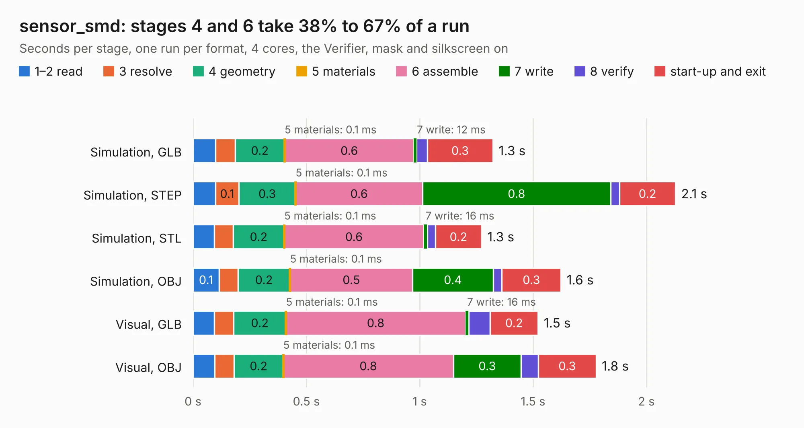

| Mode and format | 1–2 read | 3 resolve | 4 geometry | 5 materials | 6 assemble | 7 write | 8 verify | start-up and exit | Total |
|---|---:|---:|---:|---:|---:|---:|---:|---:|---:|
| Simulation, GLB | 99&nbsp;ms | 87&nbsp;ms | 0.2 | 0.1&nbsp;ms | 0.6 | 12&nbsp;ms | 47&nbsp;ms | 0.3 | 1.3 |
| Simulation, STEP | 99&nbsp;ms | 0.1 | 0.3 | 0.1&nbsp;ms | 0.6 | 0.8 | 40&nbsp;ms | 0.2 | 2.1 |
| Simulation, STL | 94&nbsp;ms | 83&nbsp;ms | 0.2 | 0.1&nbsp;ms | 0.6 | 16&nbsp;ms | 35&nbsp;ms | 0.2 | 1.3 |
| Simulation, OBJ | 0.1 | 83&nbsp;ms | 0.2 | 0.1&nbsp;ms | 0.5 | 0.4 | 39&nbsp;ms | 0.3 | 1.6 |
| Visual, GLB | 95&nbsp;ms | 85&nbsp;ms | 0.2 | 0.1&nbsp;ms | 0.8 | 16&nbsp;ms | 93&nbsp;ms | 0.2 | 1.5 |
| Visual, OBJ | 96&nbsp;ms | 85&nbsp;ms | 0.2 | 0.1&nbsp;ms | 0.8 | 0.3 | 76&nbsp;ms | 0.3 | 1.8 |

<table align="center"><tr><td valign="top">

| Board | Repo: [scottbez1/splitflap](https://github.com/scottbez1/splitflap) Board: `sensor_smd.kicad_pcb` |
|---|---|
| Folder | electronics / sensor_smd |
| Complexity | 177&nbsp;/&nbsp;1000 (size&nbsp;92, features&nbsp;85) |
| KESE&nbsp;features | through vias, rounded, trapezoid or chamfered pads, filled zones, curved board outline, stack-up, dielectric εr and tanδ |
| Tested | 10th November 2026 |
| Copper&nbsp;layers | 2 |
| File&nbsp;format | KiCad 6 (20211014) |
| Parts,&nbsp;tracks,&nbsp;vias | 5, 24, 2 |
| Triangles,&nbsp;simulation | 60,768 in 17 parts |
| Verifier | PASS in all six runs |

</td><td valign="top">

<table>
<tr><th>File type</th><th>File size</th><th>Peak memory used</th></tr>
<tr><th colspan="3" align="left">Simulation</th></tr>
<tr><td>GLB</td><td align="right">2.1&nbsp;MB</td><td align="right">73&nbsp;MB</td></tr>
<tr><td>STEP</td><td align="right">11&nbsp;MB</td><td align="right">186&nbsp;MB</td></tr>
<tr><td>STL</td><td align="right">3.0&nbsp;MB</td><td align="right">73&nbsp;MB</td></tr>
<tr><td>OBJ</td><td align="right">5.8&nbsp;MB</td><td align="right">87&nbsp;MB</td></tr>
<tr><th colspan="3" align="left">Visual</th></tr>
<tr><td>GLB</td><td align="right">1.8&nbsp;MB</td><td align="right">108&nbsp;MB</td></tr>
<tr><td>OBJ</td><td align="right">5.0&nbsp;MB</td><td align="right">107&nbsp;MB</td></tr>
</table>

</td></tr></table>

## 2526. mppt

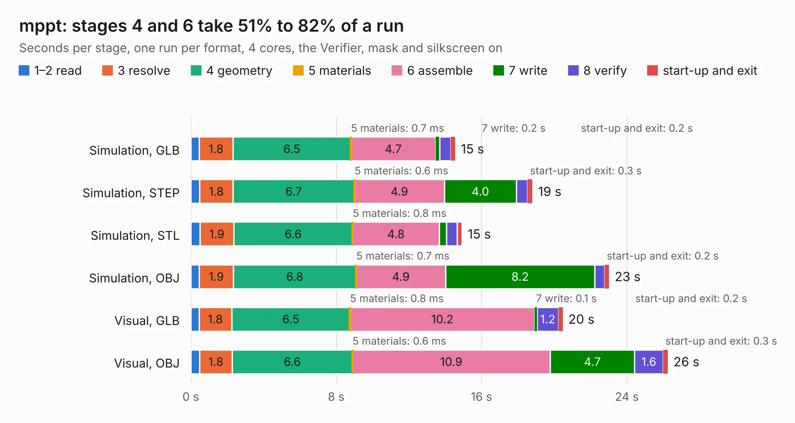

| Mode and format | 1–2 read | 3 resolve | 4 geometry | 5 materials | 6 assemble | 7 write | 8 verify | start-up and exit | Total |
|---|---:|---:|---:|---:|---:|---:|---:|---:|---:|
| Simulation, GLB | 0.5 | 1.8 | 6.5 | 0.7&nbsp;ms | 4.7 | 0.2 | 0.6 | 0.2 | 14.6 |
| Simulation, STEP | 0.5 | 1.8 | 6.7 | 0.6&nbsp;ms | 4.9 | 4.0 | 0.6 | 0.3 | 18.8 |
| Simulation, STL | 0.5 | 1.9 | 6.6 | 0.8&nbsp;ms | 4.8 | 0.4 | 0.6 | 0.3 | 14.9 |
| Simulation, OBJ | 0.5 | 1.9 | 6.8 | 0.7&nbsp;ms | 4.9 | 8.2 | 0.5 | 0.2 | 23.0 |
| Visual, GLB | 0.5 | 1.8 | 6.5 | 0.8&nbsp;ms | 10.2 | 0.1 | 1.2 | 0.2 | 20.5 |
| Visual, OBJ | 0.5 | 1.8 | 6.6 | 0.6&nbsp;ms | 10.9 | 4.7 | 1.6 | 0.3 | 26.3 |

<table align="center"><tr><td valign="top">

| Board | Repo: [seandepagnier/mppt](https://github.com/seandepagnier/mppt) Board: `mppt.kicad_pcb` |
|---|---|
| Folder | schematics |
| Complexity | 275&nbsp;/&nbsp;1000 (size&nbsp;205, features&nbsp;70) |
| KESE&nbsp;features | through vias, custom pads, rounded, trapezoid or chamfered pads, filled zones, copper drawings |
| Tested | 9th November 2026 |
| Copper&nbsp;layers | 4 |
| File&nbsp;format | KiCad 5 (20171130) |
| Parts,&nbsp;tracks,&nbsp;vias | 152, 949, 117 |
| Triangles,&nbsp;simulation | 1,286,936 in 115 parts |
| Verifier | PASS in all six runs |

</td><td valign="top">

<table>
<tr><th>File type</th><th>File size</th><th>Peak memory used</th></tr>
<tr><th colspan="3" align="left">Simulation</th></tr>
<tr><td>GLB</td><td align="right">46&nbsp;MB</td><td align="right">580&nbsp;MB</td></tr>
<tr><td>STEP</td><td align="right">208&nbsp;MB</td><td align="right">641&nbsp;MB</td></tr>
<tr><td>STL</td><td align="right">64&nbsp;MB</td><td align="right">565&nbsp;MB</td></tr>
<tr><td>OBJ</td><td align="right">135&nbsp;MB</td><td align="right">891&nbsp;MB</td></tr>
<tr><th colspan="3" align="left">Visual</th></tr>
<tr><td>GLB</td><td align="right">27&nbsp;MB</td><td align="right">656&nbsp;MB</td></tr>
<tr><td>OBJ</td><td align="right">82&nbsp;MB</td><td align="right">675&nbsp;MB</td></tr>
</table>

</td></tr></table>

## 2527. reCamera B101 v1.0

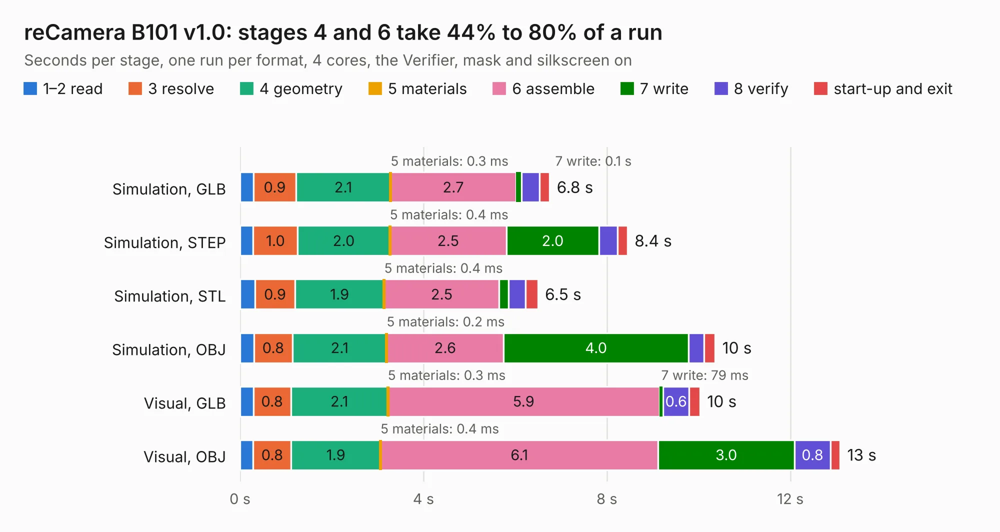

| Mode and format | 1–2 read | 3 resolve | 4 geometry | 5 materials | 6 assemble | 7 write | 8 verify | start-up and exit | Total |
|---|---:|---:|---:|---:|---:|---:|---:|---:|---:|
| Simulation, GLB | 0.3 | 0.9 | 2.1 | 0.3&nbsp;ms | 2.7 | 0.1 | 0.4 | 0.2 | 6.8 |
| Simulation, STEP | 0.3 | 1.0 | 2.0 | 0.4&nbsp;ms | 2.5 | 2.0 | 0.4 | 0.2 | 8.4 |
| Simulation, STL | 0.3 | 0.9 | 1.9 | 0.4&nbsp;ms | 2.5 | 0.2 | 0.4 | 0.3 | 6.5 |
| Simulation, OBJ | 0.3 | 0.8 | 2.1 | 0.2&nbsp;ms | 2.6 | 4.0 | 0.3 | 0.2 | 10.4 |
| Visual, GLB | 0.3 | 0.8 | 2.1 | 0.3&nbsp;ms | 5.9 | 79&nbsp;ms | 0.6 | 0.2 | 10.0 |
| Visual, OBJ | 0.3 | 0.8 | 1.9 | 0.4&nbsp;ms | 6.1 | 3.0 | 0.8 | 0.2 | 13.1 |

<table align="center"><tr><td valign="top">

| Board | Repo: [Seeed-Studio/OSHW-reCamera-Series](https://github.com/Seeed-Studio/OSHW-reCamera-Series) Board: `reCamera B101 v1.0.kicad_pcb` |
|---|---|
| Folder | hardware / recamera-2002 / base / b101-default / PCB / V1.0 |
| Complexity | 295&nbsp;/&nbsp;1000 (size&nbsp;185, features&nbsp;110) |
| KESE&nbsp;features | through vias, slotted holes, rounded, trapezoid or chamfered pads, filled zones, curved board outline, stack-up, dielectric εr and tanδ, copper finish |
| Tested | 9th November 2026 |
| Copper&nbsp;layers | 4 |
| File&nbsp;format | KiCad 8 (20240108) |
| Parts,&nbsp;tracks,&nbsp;vias | 46, 408, 133 |
| Triangles,&nbsp;simulation | 794,838 in 86 parts |
| Verifier | PASS in all six runs |

</td><td valign="top">

<table>
<tr><th>File type</th><th>File size</th><th>Peak memory used</th></tr>
<tr><th colspan="3" align="left">Simulation</th></tr>
<tr><td>GLB</td><td align="right">27&nbsp;MB</td><td align="right">393&nbsp;MB</td></tr>
<tr><td>STEP</td><td align="right">123&nbsp;MB</td><td align="right">455&nbsp;MB</td></tr>
<tr><td>STL</td><td align="right">40&nbsp;MB</td><td align="right">418&nbsp;MB</td></tr>
<tr><td>OBJ</td><td align="right">80&nbsp;MB</td><td align="right">550&nbsp;MB</td></tr>
<tr><th colspan="3" align="left">Visual</th></tr>
<tr><td>GLB</td><td align="right">19&nbsp;MB</td><td align="right">461&nbsp;MB</td></tr>
<tr><td>OBJ</td><td align="right">57&nbsp;MB</td><td align="right">454&nbsp;MB</td></tr>
</table>

</td></tr></table>

## 2528. reCamera B101 v1.1

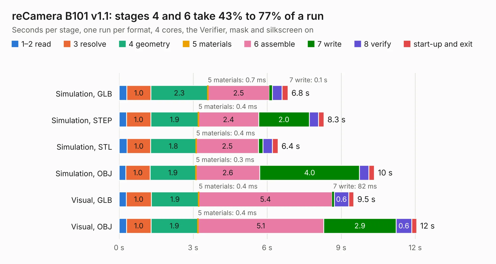

| Mode and format | 1–2 read | 3 resolve | 4 geometry | 5 materials | 6 assemble | 7 write | 8 verify | start-up and exit | Total |
|---|---:|---:|---:|---:|---:|---:|---:|---:|---:|
| Simulation, GLB | 0.3 | 1.0 | 2.3 | 0.7&nbsp;ms | 2.5 | 0.1 | 0.4 | 0.2 | 6.8 |
| Simulation, STEP | 0.3 | 1.0 | 1.9 | 0.4&nbsp;ms | 2.4 | 2.0 | 0.4 | 0.2 | 8.3 |
| Simulation, STL | 0.3 | 1.0 | 1.8 | 0.4&nbsp;ms | 2.5 | 0.2 | 0.4 | 0.2 | 6.4 |
| Simulation, OBJ | 0.3 | 1.0 | 1.9 | 0.3&nbsp;ms | 2.6 | 4.0 | 0.4 | 0.2 | 10.3 |
| Visual, GLB | 0.3 | 1.0 | 1.9 | 0.4&nbsp;ms | 5.4 | 82&nbsp;ms | 0.6 | 0.2 | 9.5 |
| Visual, OBJ | 0.3 | 1.0 | 1.9 | 0.4&nbsp;ms | 5.1 | 2.9 | 0.6 | 0.2 | 12.1 |

<table align="center"><tr><td valign="top">

| Board | Repo: [Seeed-Studio/OSHW-reCamera-Series](https://github.com/Seeed-Studio/OSHW-reCamera-Series) Board: `reCamera B101 v1.1.kicad_pcb` |
|---|---|
| Folder | hardware / recamera-2002 / base / b101-default / PCB / V1.1 |
| Complexity | 304&nbsp;/&nbsp;1000 (size&nbsp;189, features&nbsp;115) |
| KESE&nbsp;features | through vias, rounded, trapezoid or chamfered pads, arc tracks, filled zones, curved board outline, stack-up, dielectric εr and tanδ, copper finish |
| Tested | 9th November 2026 |
| Copper&nbsp;layers | 4 |
| File&nbsp;format | KiCad 8 (20240108) |
| Parts,&nbsp;tracks,&nbsp;vias | 45, 566, 157 |
| Triangles,&nbsp;simulation | 778,752 in 84 parts |
| Verifier | PASS in all six runs |

</td><td valign="top">

<table>
<tr><th>File type</th><th>File size</th><th>Peak memory used</th></tr>
<tr><th colspan="3" align="left">Simulation</th></tr>
<tr><td>GLB</td><td align="right">26&nbsp;MB</td><td align="right">366&nbsp;MB</td></tr>
<tr><td>STEP</td><td align="right">112&nbsp;MB</td><td align="right">456&nbsp;MB</td></tr>
<tr><td>STL</td><td align="right">39&nbsp;MB</td><td align="right">376&nbsp;MB</td></tr>
<tr><td>OBJ</td><td align="right">78&nbsp;MB</td><td align="right">588&nbsp;MB</td></tr>
<tr><th colspan="3" align="left">Visual</th></tr>
<tr><td>GLB</td><td align="right">19&nbsp;MB</td><td align="right">483&nbsp;MB</td></tr>
<tr><td>OBJ</td><td align="right">57&nbsp;MB</td><td align="right">492&nbsp;MB</td></tr>
</table>

</td></tr></table>

## 2529. reCamera B101 v1.2

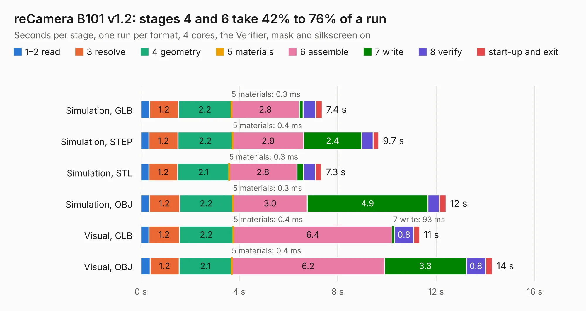

| Mode and format | 1–2 read | 3 resolve | 4 geometry | 5 materials | 6 assemble | 7 write | 8 verify | start-up and exit | Total |
|---|---:|---:|---:|---:|---:|---:|---:|---:|---:|
| Simulation, GLB | 0.4 | 1.2 | 2.2 | 0.3&nbsp;ms | 2.8 | 0.2 | 0.5 | 0.3 | 7.4 |
| Simulation, STEP | 0.3 | 1.2 | 2.2 | 0.4&nbsp;ms | 2.9 | 2.4 | 0.5 | 0.2 | 9.7 |
| Simulation, STL | 0.3 | 1.2 | 2.1 | 0.3&nbsp;ms | 2.8 | 0.3 | 0.5 | 0.3 | 7.3 |
| Simulation, OBJ | 0.3 | 1.2 | 2.2 | 0.3&nbsp;ms | 3.0 | 4.9 | 0.5 | 0.3 | 12.4 |
| Visual, GLB | 0.3 | 1.2 | 2.2 | 0.4&nbsp;ms | 6.4 | 93&nbsp;ms | 0.8 | 0.2 | 11.3 |
| Visual, OBJ | 0.4 | 1.2 | 2.1 | 0.4&nbsp;ms | 6.2 | 3.3 | 0.8 | 0.3 | 14.3 |

<table align="center"><tr><td valign="top">

| Board | Repo: [Seeed-Studio/OSHW-reCamera-Series](https://github.com/Seeed-Studio/OSHW-reCamera-Series) Board: `reCamera B101 v1.2.kicad_pcb` |
|---|---|
| Folder | hardware / recamera-2002 / base / b101-default / PCB / V1.2 |
| Complexity | 305&nbsp;/&nbsp;1000 (size&nbsp;190, features&nbsp;115) |
| KESE&nbsp;features | through vias, rounded, trapezoid or chamfered pads, arc tracks, filled zones, curved board outline, stack-up, dielectric εr and tanδ, copper finish |
| Tested | 9th November 2026 |
| Copper&nbsp;layers | 4 |
| File&nbsp;format | KiCad 8 (20240108) |
| Parts,&nbsp;tracks,&nbsp;vias | 48, 581, 162 |
| Triangles,&nbsp;simulation | 798,866 in 84 parts |
| Verifier | PASS in all six runs |

</td><td valign="top">

<table>
<tr><th>File type</th><th>File size</th><th>Peak memory used</th></tr>
<tr><th colspan="3" align="left">Simulation</th></tr>
<tr><td>GLB</td><td align="right">27&nbsp;MB</td><td align="right">382&nbsp;MB</td></tr>
<tr><td>STEP</td><td align="right">114&nbsp;MB</td><td align="right">463&nbsp;MB</td></tr>
<tr><td>STL</td><td align="right">40&nbsp;MB</td><td align="right">396&nbsp;MB</td></tr>
<tr><td>OBJ</td><td align="right">80&nbsp;MB</td><td align="right">574&nbsp;MB</td></tr>
<tr><th colspan="3" align="left">Visual</th></tr>
<tr><td>GLB</td><td align="right">19&nbsp;MB</td><td align="right">455&nbsp;MB</td></tr>
<tr><td>OBJ</td><td align="right">58&nbsp;MB</td><td align="right">506&nbsp;MB</td></tr>
</table>

</td></tr></table>

## 2530. reCamera B101_B2_v0.1

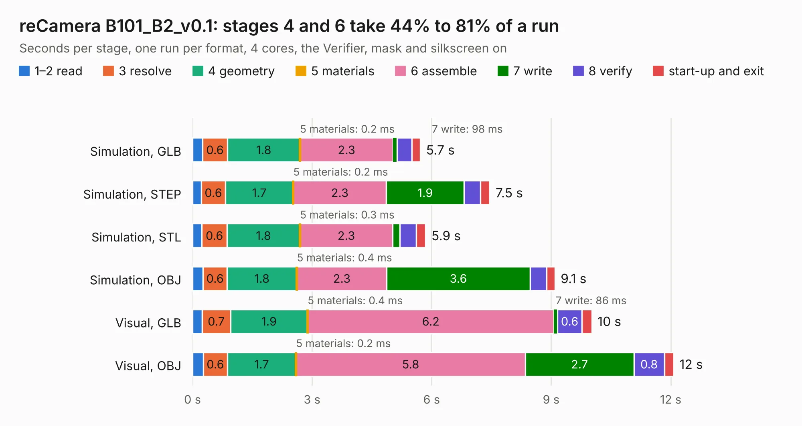

| Mode and format | 1–2 read | 3 resolve | 4 geometry | 5 materials | 6 assemble | 7 write | 8 verify | start-up and exit | Total |
|---|---:|---:|---:|---:|---:|---:|---:|---:|---:|
| Simulation, GLB | 0.2 | 0.6 | 1.8 | 0.2&nbsp;ms | 2.3 | 98&nbsp;ms | 0.4 | 0.2 | 5.7 |
| Simulation, STEP | 0.2 | 0.6 | 1.7 | 0.2&nbsp;ms | 2.3 | 1.9 | 0.4 | 0.2 | 7.5 |
| Simulation, STL | 0.2 | 0.6 | 1.8 | 0.3&nbsp;ms | 2.3 | 0.2 | 0.4 | 0.2 | 5.9 |
| Simulation, OBJ | 0.3 | 0.6 | 1.8 | 0.4&nbsp;ms | 2.3 | 3.6 | 0.4 | 0.2 | 9.1 |
| Visual, GLB | 0.2 | 0.7 | 1.9 | 0.4&nbsp;ms | 6.2 | 86&nbsp;ms | 0.6 | 0.2 | 10.0 |
| Visual, OBJ | 0.3 | 0.6 | 1.7 | 0.2&nbsp;ms | 5.8 | 2.7 | 0.8 | 0.2 | 12.1 |

<table align="center"><tr><td valign="top">

| Board | Repo: [Seeed-Studio/OSHW-reCamera-Series](https://github.com/Seeed-Studio/OSHW-reCamera-Series) Board: `reCamera B101_B2_v0.1.kicad_pcb` |
|---|---|
| Folder | hardware / recamera-2002 / base / b201-vertical-usb-c / PCB |
| Complexity | 296&nbsp;/&nbsp;1000 (size&nbsp;186, features&nbsp;110) |
| KESE&nbsp;features | through vias, slotted holes, rounded, trapezoid or chamfered pads, filled zones, curved board outline, stack-up, dielectric εr and tanδ, copper finish |
| Tested | 9th November 2026 |
| Copper&nbsp;layers | 4 |
| File&nbsp;format | KiCad 8 (20240108) |
| Parts,&nbsp;tracks,&nbsp;vias | 45, 511, 114 |
| Triangles,&nbsp;simulation | 706,564 in 86 parts |
| Verifier | PASS in all six runs |

</td><td valign="top">

<table>
<tr><th>File type</th><th>File size</th><th>Peak memory used</th></tr>
<tr><th colspan="3" align="left">Simulation</th></tr>
<tr><td>GLB</td><td align="right">24&nbsp;MB</td><td align="right">394&nbsp;MB</td></tr>
<tr><td>STEP</td><td align="right">105&nbsp;MB</td><td align="right">428&nbsp;MB</td></tr>
<tr><td>STL</td><td align="right">35&nbsp;MB</td><td align="right">381&nbsp;MB</td></tr>
<tr><td>OBJ</td><td align="right">71&nbsp;MB</td><td align="right">512&nbsp;MB</td></tr>
<tr><th colspan="3" align="left">Visual</th></tr>
<tr><td>GLB</td><td align="right">18&nbsp;MB</td><td align="right">456&nbsp;MB</td></tr>
<tr><td>OBJ</td><td align="right">53&nbsp;MB</td><td align="right">452&nbsp;MB</td></tr>
</table>

</td></tr></table>

## 2531. reCamera 2002 POE Board

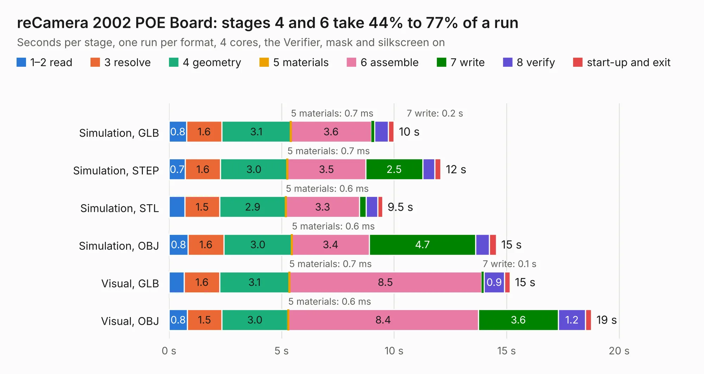

| Mode and format | 1–2 read | 3 resolve | 4 geometry | 5 materials | 6 assemble | 7 write | 8 verify | start-up and exit | Total |
|---|---:|---:|---:|---:|---:|---:|---:|---:|---:|
| Simulation, GLB | 0.8 | 1.6 | 3.1 | 0.7&nbsp;ms | 3.6 | 0.2 | 0.6 | 0.2 | 10.0 |
| Simulation, STEP | 0.7 | 1.6 | 3.0 | 0.7&nbsp;ms | 3.5 | 2.5 | 0.5 | 0.3 | 12.1 |
| Simulation, STL | 0.7 | 1.5 | 2.9 | 0.6&nbsp;ms | 3.3 | 0.3 | 0.5 | 0.2 | 9.5 |
| Simulation, OBJ | 0.8 | 1.6 | 3.0 | 0.6&nbsp;ms | 3.4 | 4.7 | 0.6 | 0.3 | 14.5 |
| Visual, GLB | 0.7 | 1.6 | 3.1 | 0.7&nbsp;ms | 8.5 | 0.1 | 0.9 | 0.2 | 15.1 |
| Visual, OBJ | 0.8 | 1.5 | 3.0 | 0.6&nbsp;ms | 8.4 | 3.6 | 1.2 | 0.3 | 18.8 |

<table align="center"><tr><td valign="top">

| Board | Repo: [Seeed-Studio/OSHW-reCamera-Series](https://github.com/Seeed-Studio/OSHW-reCamera-Series) Board: `reCamera 2002 POE Board.kicad_pcb` |
|---|---|
| Folder | hardware / recamera-2002 / base / b301-poe / PCB |
| Complexity | 311&nbsp;/&nbsp;1000 (size&nbsp;196, features&nbsp;115) |
| KESE&nbsp;features | through vias, rounded, trapezoid or chamfered pads, arc tracks, filled zones, curved board outline, stack-up, dielectric εr and tanδ, copper finish |
| Tested | 9th November 2026 |
| Copper&nbsp;layers | 4 |
| File&nbsp;format | KiCad 9 (20241229) |
| Parts,&nbsp;tracks,&nbsp;vias | 63, 555, 260 |
| Triangles,&nbsp;simulation | 1,005,002 in 99 parts |
| Verifier | PASS in all six runs |

</td><td valign="top">

<table>
<tr><th>File type</th><th>File size</th><th>Peak memory used</th></tr>
<tr><th colspan="3" align="left">Simulation</th></tr>
<tr><td>GLB</td><td align="right">34&nbsp;MB</td><td align="right">518&nbsp;MB</td></tr>
<tr><td>STEP</td><td align="right">128&nbsp;MB</td><td align="right">559&nbsp;MB</td></tr>
<tr><td>STL</td><td align="right">50&nbsp;MB</td><td align="right">528&nbsp;MB</td></tr>
<tr><td>OBJ</td><td align="right">101&nbsp;MB</td><td align="right">742&nbsp;MB</td></tr>
<tr><th colspan="3" align="left">Visual</th></tr>
<tr><td>GLB</td><td align="right">23&nbsp;MB</td><td align="right">537&nbsp;MB</td></tr>
<tr><td>OBJ</td><td align="right">71&nbsp;MB</td><td align="right">562&nbsp;MB</td></tr>
</table>

</td></tr></table>

## 2532. reCamera B101_B4_Gyro v0.1

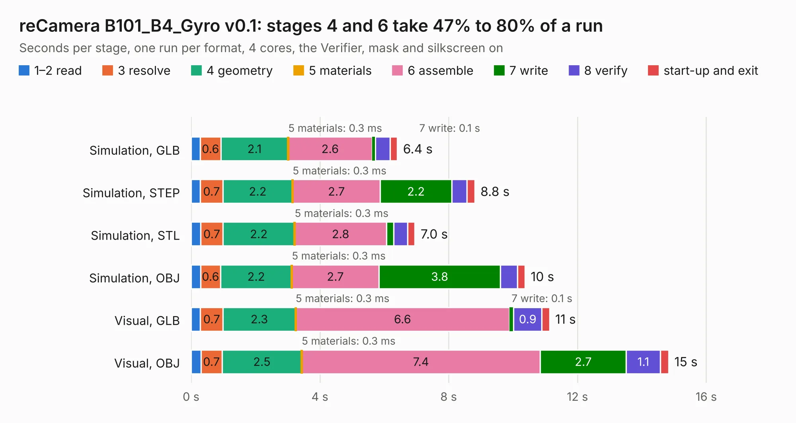

| Mode and format | 1–2 read | 3 resolve | 4 geometry | 5 materials | 6 assemble | 7 write | 8 verify | start-up and exit | Total |
|---|---:|---:|---:|---:|---:|---:|---:|---:|---:|
| Simulation, GLB | 0.3 | 0.6 | 2.1 | 0.3&nbsp;ms | 2.6 | 0.1 | 0.5 | 0.2 | 6.4 |
| Simulation, STEP | 0.3 | 0.7 | 2.2 | 0.3&nbsp;ms | 2.7 | 2.2 | 0.5 | 0.2 | 8.8 |
| Simulation, STL | 0.3 | 0.7 | 2.2 | 0.3&nbsp;ms | 2.8 | 0.2 | 0.4 | 0.2 | 7.0 |
| Simulation, OBJ | 0.3 | 0.6 | 2.2 | 0.3&nbsp;ms | 2.7 | 3.8 | 0.5 | 0.2 | 10.4 |
| Visual, GLB | 0.3 | 0.7 | 2.3 | 0.3&nbsp;ms | 6.6 | 0.1 | 0.9 | 0.2 | 11.1 |
| Visual, OBJ | 0.3 | 0.7 | 2.5 | 0.3&nbsp;ms | 7.4 | 2.7 | 1.1 | 0.3 | 14.8 |

<table align="center"><tr><td valign="top">

| Board | Repo: [Seeed-Studio/OSHW-reCamera-Series](https://github.com/Seeed-Studio/OSHW-reCamera-Series) Board: `reCamera B101_B4_Gyro v0.1.kicad_pcb` |
|---|---|
| Folder | hardware / recamera-2002 / base / b401-can / PCB / B4_v0.1 |
| Complexity | 296&nbsp;/&nbsp;1000 (size&nbsp;186, features&nbsp;110) |
| KESE&nbsp;features | through vias, slotted holes, rounded, trapezoid or chamfered pads, filled zones, curved board outline, stack-up, dielectric εr and tanδ, copper finish |
| Tested | 9th November 2026 |
| Copper&nbsp;layers | 4 |
| File&nbsp;format | KiCad 8 (20240108) |
| Parts,&nbsp;tracks,&nbsp;vias | 51, 520, 95 |
| Triangles,&nbsp;simulation | 714,652 in 87 parts |
| Verifier | PASS in all six runs |

</td><td valign="top">

<table>
<tr><th>File type</th><th>File size</th><th>Peak memory used</th></tr>
<tr><th colspan="3" align="left">Simulation</th></tr>
<tr><td>GLB</td><td align="right">25&nbsp;MB</td><td align="right">355&nbsp;MB</td></tr>
<tr><td>STEP</td><td align="right">119&nbsp;MB</td><td align="right">440&nbsp;MB</td></tr>
<tr><td>STL</td><td align="right">36&nbsp;MB</td><td align="right">351&nbsp;MB</td></tr>
<tr><td>OBJ</td><td align="right">72&nbsp;MB</td><td align="right">538&nbsp;MB</td></tr>
<tr><th colspan="3" align="left">Visual</th></tr>
<tr><td>GLB</td><td align="right">18&nbsp;MB</td><td align="right">440&nbsp;MB</td></tr>
<tr><td>OBJ</td><td align="right">53&nbsp;MB</td><td align="right">480&nbsp;MB</td></tr>
</table>

</td></tr></table>

## 2533. reCamera Gimbal

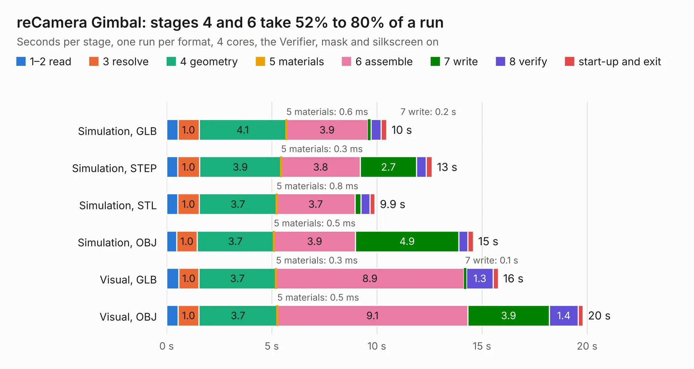

| Mode and format | 1–2 read | 3 resolve | 4 geometry | 5 materials | 6 assemble | 7 write | 8 verify | start-up and exit | Total |
|---|---:|---:|---:|---:|---:|---:|---:|---:|---:|
| Simulation, GLB | 0.5 | 1.0 | 4.1 | 0.6&nbsp;ms | 3.9 | 0.2 | 0.5 | 0.3 | 10.5 |
| Simulation, STEP | 0.5 | 1.0 | 3.9 | 0.3&nbsp;ms | 3.8 | 2.7 | 0.5 | 0.3 | 12.6 |
| Simulation, STL | 0.5 | 1.0 | 3.7 | 0.8&nbsp;ms | 3.7 | 0.3 | 0.4 | 0.2 | 9.9 |
| Simulation, OBJ | 0.5 | 1.0 | 3.7 | 0.5&nbsp;ms | 3.9 | 4.9 | 0.4 | 0.3 | 14.6 |
| Visual, GLB | 0.6 | 1.0 | 3.7 | 0.3&nbsp;ms | 8.9 | 0.1 | 1.3 | 0.2 | 15.8 |
| Visual, OBJ | 0.5 | 1.0 | 3.7 | 0.5&nbsp;ms | 9.1 | 3.9 | 1.4 | 0.2 | 19.8 |

<table align="center"><tr><td valign="top">

| Board | Repo: [Seeed-Studio/OSHW-reCamera-Series](https://github.com/Seeed-Studio/OSHW-reCamera-Series) Board: `reCamera Gimbal.kicad_pcb` |
|---|---|
| Folder | hardware / recamera-2002 / base / b401-can / PCB / B4_v0.2 |
| Complexity | 289&nbsp;/&nbsp;1000 (size&nbsp;184, features&nbsp;105) |
| KESE&nbsp;features | through vias, slotted holes, custom pads, rounded, trapezoid or chamfered pads, arc tracks, filled zones, copper drawings, curved board outline |
| Tested | 9th November 2026 |
| Copper&nbsp;layers | 2 |
| File&nbsp;format | KiCad 8 (20240108) |
| Parts,&nbsp;tracks,&nbsp;vias | 108, 515, 237 |
| Triangles,&nbsp;simulation | 970,442 in 115 parts |
| Verifier | PASS in all six runs |

</td><td valign="top">

<table>
<tr><th>File type</th><th>File size</th><th>Peak memory used</th></tr>
<tr><th colspan="3" align="left">Simulation</th></tr>
<tr><td>GLB</td><td align="right">34&nbsp;MB</td><td align="right">506&nbsp;MB</td></tr>
<tr><td>STEP</td><td align="right">176&nbsp;MB</td><td align="right">539&nbsp;MB</td></tr>
<tr><td>STL</td><td align="right">49&nbsp;MB</td><td align="right">502&nbsp;MB</td></tr>
<tr><td>OBJ</td><td align="right">100&nbsp;MB</td><td align="right">686&nbsp;MB</td></tr>
<tr><th colspan="3" align="left">Visual</th></tr>
<tr><td>GLB</td><td align="right">26&nbsp;MB</td><td align="right">606&nbsp;MB</td></tr>
<tr><td>OBJ</td><td align="right">79&nbsp;MB</td><td align="right">642&nbsp;MB</td></tr>
</table>

</td></tr></table>

## 2534. reCamera Basically Board

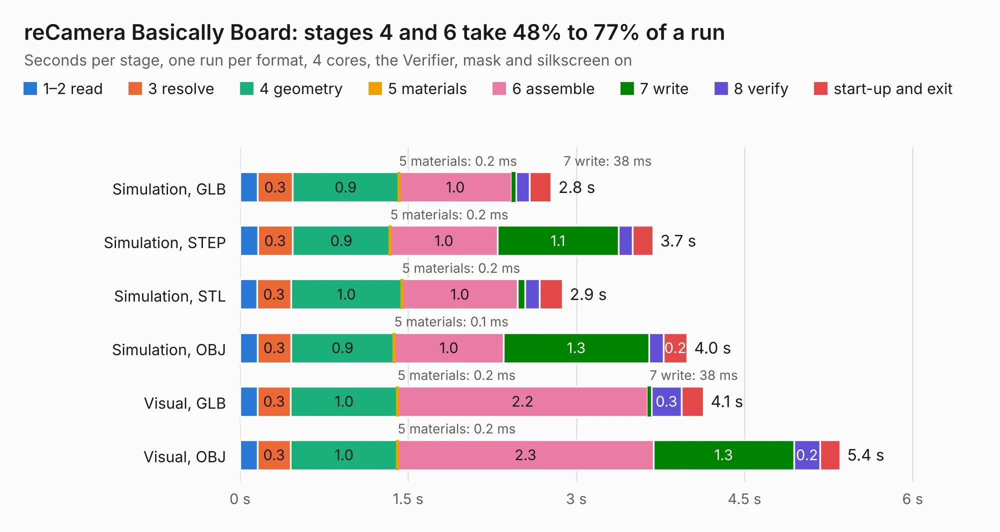

| Mode and format | 1–2 read | 3 resolve | 4 geometry | 5 materials | 6 assemble | 7 write | 8 verify | start-up and exit | Total |
|---|---:|---:|---:|---:|---:|---:|---:|---:|---:|
| Simulation, GLB | 0.2 | 0.3 | 0.9 | 0.2&nbsp;ms | 1.0 | 38&nbsp;ms | 0.1 | 0.2 | 2.8 |
| Simulation, STEP | 0.2 | 0.3 | 0.9 | 0.2&nbsp;ms | 1.0 | 1.1 | 0.1 | 0.2 | 3.7 |
| Simulation, STL | 0.2 | 0.3 | 1.0 | 0.2&nbsp;ms | 1.0 | 65&nbsp;ms | 0.1 | 0.2 | 2.9 |
| Simulation, OBJ | 0.2 | 0.3 | 0.9 | 0.1&nbsp;ms | 1.0 | 1.3 | 0.1 | 0.2 | 4.0 |
| Visual, GLB | 0.2 | 0.3 | 1.0 | 0.2&nbsp;ms | 2.2 | 38&nbsp;ms | 0.3 | 0.2 | 4.1 |
| Visual, OBJ | 0.2 | 0.3 | 1.0 | 0.2&nbsp;ms | 2.3 | 1.3 | 0.2 | 0.2 | 5.4 |

<table align="center"><tr><td valign="top">

| Board | Repo: [Seeed-Studio/OSHW-reCamera-Series](https://github.com/Seeed-Studio/OSHW-reCamera-Series) Board: `reCamera Basically Board.kicad_pcb` |
|---|---|
| Folder | hardware / recamera-2002 / products / gimbal / power-board / PCB / reCamera_Gimbal_Power_Supply_v1.0_SCH&PCB_250109 |
| Complexity | 207&nbsp;/&nbsp;1000 (size&nbsp;152, features&nbsp;55) |
| KESE&nbsp;features | through vias, rounded, trapezoid or chamfered pads, filled zones, curved board outline |
| Tested | 9th November 2026 |
| Copper&nbsp;layers | 2 |
| File&nbsp;format | KiCad 8 (20240108) |
| Parts,&nbsp;tracks,&nbsp;vias | 30, 148, 85 |
| Triangles,&nbsp;simulation | 260,730 in 28 parts |
| Verifier | PASS in all six runs |

</td><td valign="top">

<table>
<tr><th>File type</th><th>File size</th><th>Peak memory used</th></tr>
<tr><th colspan="3" align="left">Simulation</th></tr>
<tr><td>GLB</td><td align="right">9.1&nbsp;MB</td><td align="right">232&nbsp;MB</td></tr>
<tr><td>STEP</td><td align="right">38&nbsp;MB</td><td align="right">259&nbsp;MB</td></tr>
<tr><td>STL</td><td align="right">13&nbsp;MB</td><td align="right">225&nbsp;MB</td></tr>
<tr><td>OBJ</td><td align="right">26&nbsp;MB</td><td align="right">224&nbsp;MB</td></tr>
<tr><th colspan="3" align="left">Visual</th></tr>
<tr><td>GLB</td><td align="right">8.1&nbsp;MB</td><td align="right">237&nbsp;MB</td></tr>
<tr><td>OBJ</td><td align="right">23&nbsp;MB</td><td align="right">242&nbsp;MB</td></tr>
</table>

</td></tr></table>

## 2535. reCamera S101 v1.0

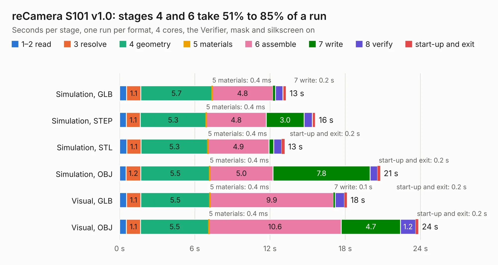

| Mode and format | 1–2 read | 3 resolve | 4 geometry | 5 materials | 6 assemble | 7 write | 8 verify | start-up and exit | Total |
|---|---:|---:|---:|---:|---:|---:|---:|---:|---:|
| Simulation, GLB | 0.6 | 1.1 | 5.7 | 0.4&nbsp;ms | 4.8 | 0.2 | 0.6 | 0.2 | 13.3 |
| Simulation, STEP | 0.5 | 1.1 | 5.3 | 0.4&nbsp;ms | 4.8 | 3.0 | 0.7 | 0.2 | 15.6 |
| Simulation, STL | 0.6 | 1.1 | 5.3 | 0.4&nbsp;ms | 4.9 | 0.4 | 0.6 | 0.2 | 13.2 |
| Simulation, OBJ | 0.5 | 1.2 | 5.5 | 0.4&nbsp;ms | 5.0 | 7.8 | 0.6 | 0.2 | 20.8 |
| Visual, GLB | 0.6 | 1.1 | 5.5 | 0.4&nbsp;ms | 9.9 | 0.1 | 0.8 | 0.2 | 18.1 |
| Visual, OBJ | 0.5 | 1.1 | 5.5 | 0.4&nbsp;ms | 10.6 | 4.7 | 1.2 | 0.2 | 23.8 |

<table align="center"><tr><td valign="top">

| Board | Repo: [Seeed-Studio/OSHW-reCamera-Series](https://github.com/Seeed-Studio/OSHW-reCamera-Series) Board: `reCamera S101 v1.0.kicad_pcb` |
|---|---|
| Folder | hardware / recamera-2002 / sensors / s101-ov5647 / PCB / V1.0 |
| Complexity | 325&nbsp;/&nbsp;1000 (size&nbsp;200, features&nbsp;125) |
| KESE&nbsp;features | through vias, custom pads, rounded, trapezoid or chamfered pads, filled zones, copper drawings, curved board outline, stack-up, dielectric εr and tanδ, copper finish |
| Tested | 9th November 2026 |
| Copper&nbsp;layers | 4 |
| File&nbsp;format | KiCad 8 (20240108) |
| Parts,&nbsp;tracks,&nbsp;vias | 82, 532, 301 |
| Triangles,&nbsp;simulation | 1,511,908 in 97 parts |
| Verifier | PASS in all six runs |

</td><td valign="top">

<table>
<tr><th>File type</th><th>File size</th><th>Peak memory used</th></tr>
<tr><th colspan="3" align="left">Simulation</th></tr>
<tr><td>GLB</td><td align="right">51&nbsp;MB</td><td align="right">636&nbsp;MB</td></tr>
<tr><td>STEP</td><td align="right">202&nbsp;MB</td><td align="right">696&nbsp;MB</td></tr>
<tr><td>STL</td><td align="right">76&nbsp;MB</td><td align="right">580&nbsp;MB</td></tr>
<tr><td>OBJ</td><td align="right">154&nbsp;MB</td><td align="right">994&nbsp;MB</td></tr>
<tr><th colspan="3" align="left">Visual</th></tr>
<tr><td>GLB</td><td align="right">30&nbsp;MB</td><td align="right">746&nbsp;MB</td></tr>
<tr><td>OBJ</td><td align="right">92&nbsp;MB</td><td align="right">715&nbsp;MB</td></tr>
</table>

</td></tr></table>

## 2536. reCamera S101 v1.1

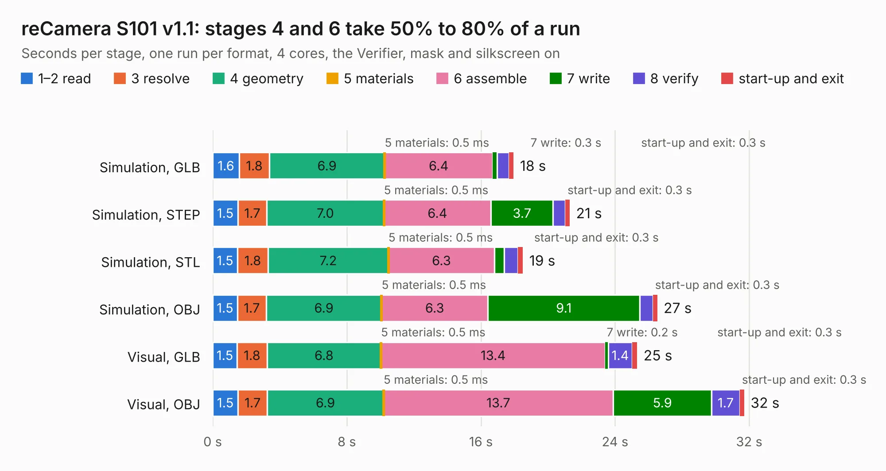

| Mode and format | 1–2 read | 3 resolve | 4 geometry | 5 materials | 6 assemble | 7 write | 8 verify | start-up and exit | Total |
|---|---:|---:|---:|---:|---:|---:|---:|---:|---:|
| Simulation, GLB | 1.6 | 1.8 | 6.9 | 0.5&nbsp;ms | 6.4 | 0.3 | 0.7 | 0.3 | 18.0 |
| Simulation, STEP | 1.5 | 1.7 | 7.0 | 0.5&nbsp;ms | 6.4 | 3.7 | 0.7 | 0.3 | 21.3 |
| Simulation, STL | 1.5 | 1.8 | 7.2 | 0.5&nbsp;ms | 6.3 | 0.6 | 0.8 | 0.3 | 18.5 |
| Simulation, OBJ | 1.5 | 1.7 | 6.9 | 0.5&nbsp;ms | 6.3 | 9.1 | 0.8 | 0.3 | 26.5 |
| Visual, GLB | 1.5 | 1.8 | 6.8 | 0.5&nbsp;ms | 13.4 | 0.2 | 1.4 | 0.3 | 25.3 |
| Visual, OBJ | 1.5 | 1.7 | 6.9 | 0.5&nbsp;ms | 13.7 | 5.9 | 1.7 | 0.3 | 31.7 |

<table align="center"><tr><td valign="top">

| Board | Repo: [Seeed-Studio/OSHW-reCamera-Series](https://github.com/Seeed-Studio/OSHW-reCamera-Series) Board: `reCamera S101 v1.1.kicad_pcb` |
|---|---|
| Folder | hardware / recamera-2002 / sensors / s101-ov5647 / PCB / V1.1 |
| Complexity | 343&nbsp;/&nbsp;1000 (size&nbsp;203, features&nbsp;140) |
| KESE&nbsp;features | through vias, custom pads, rounded, trapezoid or chamfered pads, arc tracks, filled zones, copper drawings, curved board outline, stack-up, dielectric εr and tanδ, copper finish |
| Tested | 9th November 2026 |
| Copper&nbsp;layers | 4 |
| File&nbsp;format | KiCad 8 (20240108) |
| Parts,&nbsp;tracks,&nbsp;vias | 82, 711, 334 |
| Triangles,&nbsp;simulation | 1,668,166 in 102 parts |
| Verifier | PASS in all six runs |

</td><td valign="top">

<table>
<tr><th>File type</th><th>File size</th><th>Peak memory used</th></tr>
<tr><th colspan="3" align="left">Simulation</th></tr>
<tr><td>GLB</td><td align="right">56&nbsp;MB</td><td align="right">624&nbsp;MB</td></tr>
<tr><td>STEP</td><td align="right">231&nbsp;MB</td><td align="right">748&nbsp;MB</td></tr>
<tr><td>STL</td><td align="right">83&nbsp;MB</td><td align="right">658&nbsp;MB</td></tr>
<tr><td>OBJ</td><td align="right">170&nbsp;MB</td><td align="right">1.1&nbsp;GB</td></tr>
<tr><th colspan="3" align="left">Visual</th></tr>
<tr><td>GLB</td><td align="right">34&nbsp;MB</td><td align="right">738&nbsp;MB</td></tr>
<tr><td>OBJ</td><td align="right">101&nbsp;MB</td><td align="right">812&nbsp;MB</td></tr>
</table>

</td></tr></table>

## 2537. reCamera 2002 S4 GC2053 Sensor Board_V1.0_SCH&PCB_250905

| Mode and format | 1–2 read | 3 resolve | 4 geometry | 5 materials | 6 assemble | 7 write | 8 verify | start-up and exit | Total |
|---|---:|---:|---:|---:|---:|---:|---:|---:|---:|
| Simulation, GLB | 0.4 | 1.2 | 5.3 | 0.4&nbsp;ms | 4.7 | 0.2 | 0.5 | 0.3 | 12.7 |
| Simulation, STEP | 0.3 | 1.2 | 5.0 | 0.4&nbsp;ms | 4.7 | 2.7 | 0.5 | 0.2 | 14.7 |
| Simulation, STL | 0.3 | 1.2 | 4.9 | 0.4&nbsp;ms | 4.8 | 0.4 | 0.6 | 0.3 | 12.5 |
| Simulation, OBJ | 0.3 | 1.1 | 5.2 | 0.4&nbsp;ms | 4.7 | 6.1 | 0.5 | 0.2 | 18.3 |
| Visual, GLB | 0.4 | 1.1 | 5.2 | 0.6&nbsp;ms | 11.3 | 0.1 | 0.9 | 0.2 | 19.2 |
| Visual, OBJ | 0.3 | 1.2 | 5.2 | 0.5&nbsp;ms | 12.1 | 3.9 | 1.1 | 0.2 | 24.0 |

<table align="center"><tr><td valign="top">

| Board | Repo: [Seeed-Studio/OSHW-reCamera-Series](https://github.com/Seeed-Studio/OSHW-reCamera-Series) Board: `reCamera 2002 S4 GC2053 Sensor Board_V1.0_SCH&PCB_250905.kicad_pcb` |
|---|---|
| Folder | hardware / recamera-2002 / sensors / s401-gc2053 / PCB |
| Complexity | 340&nbsp;/&nbsp;1000 (size&nbsp;200, features&nbsp;140) |
| KESE&nbsp;features | through vias, custom pads, rounded, trapezoid or chamfered pads, arc tracks, filled zones, copper drawings, curved board outline, stack-up, dielectric εr and tanδ, copper finish |
| Tested | 9th November 2026 |
| Copper&nbsp;layers | 4 |
| File&nbsp;format | KiCad 9 (20241229) |
| Parts,&nbsp;tracks,&nbsp;vias | 71, 615, 307 |
| Triangles,&nbsp;simulation | 1,419,266 in 89 parts |
| Verifier | PASS in all six runs |

</td><td valign="top">

<table>
<tr><th>File type</th><th>File size</th><th>Peak memory used</th></tr>
<tr><th colspan="3" align="left">Simulation</th></tr>
<tr><td>GLB</td><td align="right">48&nbsp;MB</td><td align="right">605&nbsp;MB</td></tr>
<tr><td>STEP</td><td align="right">199&nbsp;MB</td><td align="right">625&nbsp;MB</td></tr>
<tr><td>STL</td><td align="right">71&nbsp;MB</td><td align="right">563&nbsp;MB</td></tr>
<tr><td>OBJ</td><td align="right">144&nbsp;MB</td><td align="right">944&nbsp;MB</td></tr>
<tr><th colspan="3" align="left">Visual</th></tr>
<tr><td>GLB</td><td align="right">27&nbsp;MB</td><td align="right">600&nbsp;MB</td></tr>
<tr><td>OBJ</td><td align="right">82&nbsp;MB</td><td align="right">629&nbsp;MB</td></tr>
</table>

</td></tr></table>

## 2538. SFUSat-Radio

| Mode and format | 1–2 read | 3 resolve | 4 geometry | 5 materials | 6 assemble | 7 write | 8 verify | start-up and exit | Total |
|---|---:|---:|---:|---:|---:|---:|---:|---:|---:|
| Simulation, GLB | 1.3 | 4.8 | 21.7 | 1&nbsp;ms | 18.3 | 0.9 | 2.4 | 0.4 | 49.7 |
| Simulation, STEP | 1.2 | 4.5 | 22.1 | 0.7&nbsp;ms | 18.6 | 9.4 | 2.5 | 0.4 | 58.7 |
| Simulation, STL | 1.2 | 4.5 | 21.6 | 1&nbsp;ms | 17.9 | 1.2 | 2.3 | 0.3 | 49.1 |
| Simulation, OBJ | 1.3 | 4.6 | 21.3 | 1&nbsp;ms | 17.7 | 21.7 | 2.5 | 0.3 | 69.4 |
| Visual, GLB | 1.2 | 4.5 | 20.8 | 0.7&nbsp;ms | 33.2 | 0.3 | 4.4 | 0.3 | 64.8 |
| Visual, OBJ | 1.1 | 4.4 | 21.0 | 2&nbsp;ms | 33.9 | 13.9 | 4.7 | 0.3 | 79.4 |

<table align="center"><tr><td valign="top">

| Board | Repo: [sfusatclub/cubesat-radio](https://github.com/sfusatclub/cubesat-radio) Board: `SFUSat-Radio.kicad_pcb` |
|---|---|
| Complexity | 264&nbsp;/&nbsp;1000 (size&nbsp;229, features&nbsp;35) |
| KESE&nbsp;features | through vias, filled zones |
| Tested | 9th November 2026 |
| Copper&nbsp;layers | 4 |
| File&nbsp;format | KiCad 4 (4) |
| Parts,&nbsp;tracks,&nbsp;vias | 251, 1,996, 649 |
| Triangles,&nbsp;simulation | 3,534,654 in 217 parts |
| Verifier | PASS in all six runs |

</td><td valign="top">

<table>
<tr><th>File type</th><th>File size</th><th>Peak memory used</th></tr>
<tr><th colspan="3" align="left">Simulation</th></tr>
<tr><td>GLB</td><td align="right">120&nbsp;MB</td><td align="right">1.1&nbsp;GB</td></tr>
<tr><td>STEP</td><td align="right">431&nbsp;MB</td><td align="right">1.5&nbsp;GB</td></tr>
<tr><td>STL</td><td align="right">177&nbsp;MB</td><td align="right">1.0&nbsp;GB</td></tr>
<tr><td>OBJ</td><td align="right">373&nbsp;MB</td><td align="right">2.3&nbsp;GB</td></tr>
<tr><th colspan="3" align="left">Visual</th></tr>
<tr><td>GLB</td><td align="right">74&nbsp;MB</td><td align="right">1.3&nbsp;GB</td></tr>
<tr><td>OBJ</td><td align="right">231&nbsp;MB</td><td align="right">1.5&nbsp;GB</td></tr>
</table>

</td></tr></table>

## 2539. Cheap FOCer 2 60mm

| Mode and format | 1–2 read | 3 resolve | 4 geometry | 5 materials | 6 assemble | 7 write | 8 verify | start-up and exit | Total |
|---|---:|---:|---:|---:|---:|---:|---:|---:|---:|
| Simulation, GLB | 0.7 | 3.4 | 12.6 | 0.9&nbsp;ms | 14.6 | 0.5 | 1.2 | 0.3 | 33.2 |
| Simulation, STEP | 0.7 | 3.2 | 12.6 | 1&nbsp;ms | 15.1 | 7.0 | 1.2 | 0.2 | 40.0 |
| Simulation, STL | 0.6 | 3.2 | 12.1 | 0.4&nbsp;ms | 14.1 | 0.8 | 1.1 | 0.3 | 32.2 |
| Simulation, OBJ | 0.7 | 3.1 | 12.2 | 0.8&nbsp;ms | 14.0 | 13.9 | 1.2 | 0.2 | 45.4 |
| Visual, GLB | 0.7 | 3.3 | 12.2 | 1&nbsp;ms | 25.3 | 0.3 | 3.2 | 0.3 | 45.3 |
| Visual, OBJ | 0.7 | 3.3 | 12.4 | 1&nbsp;ms | 24.1 | 12.0 | 3.5 | 0.3 | 56.3 |

<table align="center"><tr><td valign="top">

| Board | Repo: [shamansystems/cheap-focer-2](https://github.com/shamansystems/cheap-focer-2) Board: `Cheap FOCer 2 60mm.kicad_pcb` |
|---|---|
| Folder | source |
| Complexity | 312&nbsp;/&nbsp;1000 (size&nbsp;257, features&nbsp;55) |
| KESE&nbsp;features | through vias, slotted holes, rounded, trapezoid or chamfered pads, filled zones |
| Tested | 9th November 2026 |
| Copper&nbsp;layers | 2 |
| File&nbsp;format | KiCad 5 (20171130) |
| Parts,&nbsp;tracks,&nbsp;vias | 175, 2,158, 727 |
| Triangles,&nbsp;simulation | 2,647,782 in 143 parts |
| Verifier | PASS in all six runs |

</td><td valign="top">

<table>
<tr><th>File type</th><th>File size</th><th>Peak memory used</th></tr>
<tr><th colspan="3" align="left">Simulation</th></tr>
<tr><td>GLB</td><td align="right">90&nbsp;MB</td><td align="right">899&nbsp;MB</td></tr>
<tr><td>STEP</td><td align="right">414&nbsp;MB</td><td align="right">1.1&nbsp;GB</td></tr>
<tr><td>STL</td><td align="right">132&nbsp;MB</td><td align="right">856&nbsp;MB</td></tr>
<tr><td>OBJ</td><td align="right">277&nbsp;MB</td><td align="right">1.7&nbsp;GB</td></tr>
<tr><th colspan="3" align="left">Visual</th></tr>
<tr><td>GLB</td><td align="right">70&nbsp;MB</td><td align="right">1.2&nbsp;GB</td></tr>
<tr><td>OBJ</td><td align="right">219&nbsp;MB</td><td align="right">1.5&nbsp;GB</td></tr>
</table>

</td></tr></table>

## 2540. portapack_h1

| Mode and format | 1–2 read | 3 resolve | 4 geometry | 5 materials | 6 assemble | 7 write | 8 verify | start-up and exit | Total |
|---|---:|---:|---:|---:|---:|---:|---:|---:|---:|
| Simulation, GLB | 0.4 | 2.3 | 6.0 | 0.9&nbsp;ms | 9.2 | 0.3 | 0.8 | 0.2 | 19.3 |
| Simulation, STEP | 0.4 | 2.5 | 6.2 | 0.9&nbsp;ms | 8.8 | 4.6 | 0.8 | 0.3 | 23.5 |
| Simulation, STL | 0.3 | 2.4 | 6.1 | 0.4&nbsp;ms | 9.3 | 0.8 | 0.8 | 0.3 | 20.0 |
| Simulation, OBJ | 0.3 | 2.4 | 6.0 | 2&nbsp;ms | 9.3 | 11.2 | 0.9 | 0.2 | 30.4 |
| Visual, GLB | 0.4 | 2.8 | 6.3 | 1&nbsp;ms | 17.1 | 0.2 | 2.3 | 0.3 | 29.4 |
| Visual, OBJ | 0.3 | 2.5 | 6.2 | 0.8&nbsp;ms | 16.3 | 7.7 | 2.6 | 0.2 | 35.8 |

<table align="center"><tr><td valign="top">

| Board | Repo: [sharebrained/portapack-hackrf](https://github.com/sharebrained/portapack-hackrf) Board: `portapack_h1.kicad_pcb` |
|---|---|
| Folder | hardware / portapack_h1 |
| Complexity | 286&nbsp;/&nbsp;1000 (size&nbsp;261, features&nbsp;25) |
| KESE&nbsp;features | through vias, curved board outline |
| Tested | 9th November 2026 |
| Copper&nbsp;layers | 4 |
| File&nbsp;format | KiCad 5 (20171130) |
| Parts,&nbsp;tracks,&nbsp;vias | 98, 1,508, 475 |
| Triangles,&nbsp;simulation | 2,142,988 in 153 parts |
| Verifier | PASS in all six runs |

</td><td valign="top">

<table>
<tr><th>File type</th><th>File size</th><th>Peak memory used</th></tr>
<tr><th colspan="3" align="left">Simulation</th></tr>
<tr><td>GLB</td><td align="right">73&nbsp;MB</td><td align="right">833&nbsp;MB</td></tr>
<tr><td>STEP</td><td align="right">225&nbsp;MB</td><td align="right">1.0&nbsp;GB</td></tr>
<tr><td>STL</td><td align="right">107&nbsp;MB</td><td align="right">848&nbsp;MB</td></tr>
<tr><td>OBJ</td><td align="right">222&nbsp;MB</td><td align="right">1.4&nbsp;GB</td></tr>
<tr><th colspan="3" align="left">Visual</th></tr>
<tr><td>GLB</td><td align="right">49&nbsp;MB</td><td align="right">1.1&nbsp;GB</td></tr>
<tr><td>OBJ</td><td align="right">152&nbsp;MB</td><td align="right">1.1&nbsp;GB</td></tr>
</table>

</td></tr></table>

## 2541. rpi-cm4-carrier-template

| Mode and format | 1–2 read | 3 resolve | 4 geometry | 5 materials | 6 assemble | 7 write | 8 verify | start-up and exit | Total |
|---|---:|---:|---:|---:|---:|---:|---:|---:|---:|
| Simulation, GLB | 0.1 | 0.1 | 0.4 | 0.4&nbsp;ms | 0.9 | 24&nbsp;ms | 85&nbsp;ms | 0.2 | 1.8 |
| Simulation, STEP | 0.1 | 0.1 | 0.4 | 0.7&nbsp;ms | 1.0 | 1.1 | 85&nbsp;ms | 0.2 | 3.0 |
| Simulation, STL | 0.1 | 0.1 | 0.4 | 0.5&nbsp;ms | 1.0 | 41&nbsp;ms | 89&nbsp;ms | 0.3 | 2.0 |
| Simulation, OBJ | 0.1 | 0.1 | 0.5 | 0.5&nbsp;ms | 1.1 | 0.3 | 84&nbsp;ms | 0.3 | 2.4 |
| Visual, GLB | 0.1 | 0.1 | 0.4 | 0.9&nbsp;ms | 2.2 | 20&nbsp;ms | 0.2 | 0.3 | 3.3 |
| Visual, OBJ | 0.1 | 0.1 | 0.4 | 0.7&nbsp;ms | 2.3 | 0.4 | 0.1 | 0.3 | 3.8 |

<table align="center"><tr><td valign="top">

| Board | Repo: [ShawnHymel/rpi-cm4-carrier-template](https://github.com/ShawnHymel/rpi-cm4-carrier-template) Board: `rpi-cm4-carrier-template.kicad_pcb` |
|---|---|
| Folder | hardware / rpi-cm4-carrier-template |
| Complexity | 69&nbsp;/&nbsp;1000 (size&nbsp;24, features&nbsp;45) |
| KESE&nbsp;features | curved board outline, stack-up, dielectric εr and tanδ, mask and silkscreen colours |
| Tested | 9th November 2026 |
| Copper&nbsp;layers | 2 |
| File&nbsp;format | KiCad 6 (20201002) |
| Parts,&nbsp;tracks,&nbsp;vias | 1, 0, 0 |
| Triangles,&nbsp;simulation | 40,544 in 207 parts |
| Verifier | PASS in all six runs |

</td><td valign="top">

<table>
<tr><th>File type</th><th>File size</th><th>Peak memory used</th></tr>
<tr><th colspan="3" align="left">Simulation</th></tr>
<tr><td>GLB</td><td align="right">1.6&nbsp;MB</td><td align="right">75&nbsp;MB</td></tr>
<tr><td>STEP</td><td align="right">8.1&nbsp;MB</td><td align="right">180&nbsp;MB</td></tr>
<tr><td>STL</td><td align="right">2.0&nbsp;MB</td><td align="right">75&nbsp;MB</td></tr>
<tr><td>OBJ</td><td align="right">4.5&nbsp;MB</td><td align="right">93&nbsp;MB</td></tr>
<tr><th colspan="3" align="left">Visual</th></tr>
<tr><td>GLB</td><td align="right">2.0&nbsp;MB</td><td align="right">138&nbsp;MB</td></tr>
<tr><td>OBJ</td><td align="right">5.6&nbsp;MB</td><td align="right">143&nbsp;MB</td></tr>
</table>

</td></tr></table>

## 2542. tulipcc

| Mode and format | 1–2 read | 3 resolve | 4 geometry | 5 materials | 6 assemble | 7 write | 8 verify | start-up and exit | Total |
|---|---:|---:|---:|---:|---:|---:|---:|---:|---:|
| Simulation, GLB | 0.6 | 2.2 | 8.5 | 0.8&nbsp;ms | 9.9 | 0.3 | 1.0 | 0.3 | 22.7 |
| Simulation, STEP | 0.7 | 2.2 | 8.5 | 1&nbsp;ms | 10.2 | 6.5 | 1.1 | 0.3 | 29.3 |
| Simulation, STL | 0.6 | 2.0 | 8.4 | 0.7&nbsp;ms | 10.2 | 0.6 | 1.0 | 0.3 | 23.2 |
| Simulation, OBJ | 0.7 | 2.1 | 8.6 | 0.9&nbsp;ms | 10.6 | 8.6 | 1.1 | 0.3 | 31.8 |
| Visual, GLB | 0.5 | 2.2 | 8.5 | 1.0&nbsp;ms | 15.7 | 0.2 | 2.0 | 0.3 | 29.4 |
| Visual, OBJ | 0.6 | 2.1 | 8.6 | 0.7&nbsp;ms | 15.5 | 7.7 | 1.9 | 0.2 | 36.6 |

<table align="center"><tr><td valign="top">

| Board | Repo: [shorepine/tulipcc](https://github.com/shorepine/tulipcc) Board: `tulipcc.kicad_pcb` |
|---|---|
| Folder | docs / pcbs / tulip4_board_v4r9 |
| Complexity | 303&nbsp;/&nbsp;1000 (size&nbsp;193, features&nbsp;110) |
| KESE&nbsp;features | through vias, slotted holes, rounded, trapezoid or chamfered pads, arc tracks, filled zones, curved board outline, stack-up, dielectric εr and tanδ |
| Tested | 10th November 2026 |
| Copper&nbsp;layers | 2 |
| File&nbsp;format | KiCad 7 (20221018) |
| Parts,&nbsp;tracks,&nbsp;vias | 96, 919, 474 |
| Triangles,&nbsp;simulation | 1,494,292 in 127 parts |
| Verifier | PASS in all six runs |

</td><td valign="top">

<table>
<tr><th>File type</th><th>File size</th><th>Peak memory used</th></tr>
<tr><th colspan="3" align="left">Simulation</th></tr>
<tr><td>GLB</td><td align="right">51&nbsp;MB</td><td align="right">688&nbsp;MB</td></tr>
<tr><td>STEP</td><td align="right">248&nbsp;MB</td><td align="right">825&nbsp;MB</td></tr>
<tr><td>STL</td><td align="right">75&nbsp;MB</td><td align="right">707&nbsp;MB</td></tr>
<tr><td>OBJ</td><td align="right">153&nbsp;MB</td><td align="right">1.0&nbsp;GB</td></tr>
<tr><th colspan="3" align="left">Visual</th></tr>
<tr><td>GLB</td><td align="right">45&nbsp;MB</td><td align="right">801&nbsp;MB</td></tr>
<tr><td>OBJ</td><td align="right">137&nbsp;MB</td><td align="right">976&nbsp;MB</td></tr>
</table>

</td></tr></table>

## 2543. FlightPCB

| Mode and format | 1–2 read | 3 resolve | 4 geometry | 5 materials | 6 assemble | 7 write | 8 verify | start-up and exit | Total |
|---|---:|---:|---:|---:|---:|---:|---:|---:|---:|
| Simulation, GLB | 0.9 | 5.3 | 16.9 | 2&nbsp;ms | 17.4 | 0.8 | 2.1 | 0.4 | 43.8 |
| Simulation, STEP | 0.9 | 5.3 | 15.8 | 1&nbsp;ms | 18.6 | 9.6 | 2.0 | 0.4 | 52.5 |
| Simulation, STL | 0.9 | 4.9 | 16.4 | 1&nbsp;ms | 16.5 | 1.8 | 1.9 | 0.4 | 42.8 |
| Simulation, OBJ | 1.0 | 5.1 | 15.8 | 1&nbsp;ms | 16.2 | 19.6 | 1.9 | 0.3 | 59.9 |
| Visual, GLB | 0.9 | 4.9 | 15.3 | 1&nbsp;ms | 28.9 | 0.3 | 3.7 | 0.3 | 54.3 |
| Visual, OBJ | 0.8 | 4.8 | 15.8 | 1&nbsp;ms | 28.8 | 10.1 | 4.1 | 0.4 | 64.8 |

<table align="center"><tr><td valign="top">

| Board | Repo: [shubhamai/tsar](https://github.com/shubhamai/tsar) Board: `FlightPCB.kicad_pcb` |
|---|---|
| Folder | v1 |
| Complexity | 398&nbsp;/&nbsp;1000 (size&nbsp;283, features&nbsp;115) |
| KESE&nbsp;features | through vias, slotted holes, rounded, trapezoid or chamfered pads, arc tracks, filled zones, TrueType text, stack-up, dielectric εr and tanδ |
| Tested | 9th November 2026 |
| Copper&nbsp;layers | 4 |
| File&nbsp;format | KiCad 8 (20240108) |
| Parts,&nbsp;tracks,&nbsp;vias | 188, 3,309, 418 |
| Triangles,&nbsp;simulation | 3,693,058 in 258 parts |
| Verifier | PASS in all six runs |

</td><td valign="top">

<table>
<tr><th>File type</th><th>File size</th><th>Peak memory used</th></tr>
<tr><th colspan="3" align="left">Simulation</th></tr>
<tr><td>GLB</td><td align="right">128&nbsp;MB</td><td align="right">1.1&nbsp;GB</td></tr>
<tr><td>STEP</td><td align="right">566&nbsp;MB</td><td align="right">1.3&nbsp;GB</td></tr>
<tr><td>STL</td><td align="right">185&nbsp;MB</td><td align="right">1.0&nbsp;GB</td></tr>
<tr><td>OBJ</td><td align="right">397&nbsp;MB</td><td align="right">2.5&nbsp;GB</td></tr>
<tr><th colspan="3" align="left">Visual</th></tr>
<tr><td>GLB</td><td align="right">70&nbsp;MB</td><td align="right">1.2&nbsp;GB</td></tr>
<tr><td>OBJ</td><td align="right">223&nbsp;MB</td><td align="right">1.6&nbsp;GB</td></tr>
</table>

</td></tr></table>

## 2544. FlightPCB

| Mode and format | 1–2 read | 3 resolve | 4 geometry | 5 materials | 6 assemble | 7 write | 8 verify | start-up and exit | Total |
|---|---:|---:|---:|---:|---:|---:|---:|---:|---:|
| Simulation, GLB | 0.6 | 2.6 | 9.1 | 0.8&nbsp;ms | 7.9 | 0.3 | 1.0 | 0.2 | 21.7 |
| Simulation, STEP | 0.5 | 2.9 | 9.1 | 0.9&nbsp;ms | 8.2 | 5.1 | 1.0 | 0.2 | 27.0 |
| Simulation, STL | 0.6 | 2.7 | 9.1 | 0.9&nbsp;ms | 8.1 | 0.6 | 0.9 | 0.3 | 22.4 |
| Simulation, OBJ | 0.6 | 2.7 | 9.5 | 0.9&nbsp;ms | 8.1 | 11.5 | 1.2 | 0.3 | 33.8 |
| Visual, GLB | 0.5 | 2.7 | 9.3 | 0.9&nbsp;ms | 16.2 | 0.2 | 1.6 | 0.2 | 30.8 |
| Visual, OBJ | 0.6 | 2.6 | 9.1 | 0.9&nbsp;ms | 16.6 | 6.3 | 1.9 | 0.3 | 37.4 |

<table align="center"><tr><td valign="top">

| Board | Repo: [shubhamai/tsar](https://github.com/shubhamai/tsar) Board: `FlightPCB.kicad_pcb` |
|---|---|
| Folder | v2 |
| Complexity | 368&nbsp;/&nbsp;1000 (size&nbsp;253, features&nbsp;115) |
| KESE&nbsp;features | through vias, slotted holes, rounded, trapezoid or chamfered pads, arc tracks, filled zones, TrueType text, stack-up, dielectric εr and tanδ |
| Tested | 9th November 2026 |
| Copper&nbsp;layers | 4 |
| File&nbsp;format | KiCad 8 (20240108) |
| Parts,&nbsp;tracks,&nbsp;vias | 132, 1,661, 205 |
| Triangles,&nbsp;simulation | 2,181,068 in 169 parts |
| Verifier | PASS in all six runs |

</td><td valign="top">

<table>
<tr><th>File type</th><th>File size</th><th>Peak memory used</th></tr>
<tr><th colspan="3" align="left">Simulation</th></tr>
<tr><td>GLB</td><td align="right">76&nbsp;MB</td><td align="right">732&nbsp;MB</td></tr>
<tr><td>STEP</td><td align="right">333&nbsp;MB</td><td align="right">889&nbsp;MB</td></tr>
<tr><td>STL</td><td align="right">109&nbsp;MB</td><td align="right">737&nbsp;MB</td></tr>
<tr><td>OBJ</td><td align="right">232&nbsp;MB</td><td align="right">1.5&nbsp;GB</td></tr>
<tr><th colspan="3" align="left">Visual</th></tr>
<tr><td>GLB</td><td align="right">40&nbsp;MB</td><td align="right">872&nbsp;MB</td></tr>
<tr><td>OBJ</td><td align="right">123&nbsp;MB</td><td align="right">908&nbsp;MB</td></tr>
</table>

</td></tr></table>

## 2545. FlightPCB

| Mode and format | 1–2 read | 3 resolve | 4 geometry | 5 materials | 6 assemble | 7 write | 8 verify | start-up and exit | Total |
|---|---:|---:|---:|---:|---:|---:|---:|---:|---:|
| Simulation, GLB | 0.4 | 2.9 | 7.1 | 1&nbsp;ms | 6.7 | 0.3 | 0.9 | 0.2 | 18.5 |
| Simulation, STEP | 0.4 | 2.9 | 7.3 | 0.9&nbsp;ms | 6.9 | 3.8 | 0.7 | 0.2 | 22.3 |
| Simulation, STL | 0.4 | 2.8 | 6.7 | 0.8&nbsp;ms | 6.8 | 0.5 | 0.8 | 0.2 | 18.2 |
| Simulation, OBJ | 0.4 | 2.9 | 6.8 | 0.7&nbsp;ms | 6.6 | 8.5 | 0.8 | 0.2 | 26.3 |
| Visual, GLB | 0.4 | 3.2 | 6.7 | 0.7&nbsp;ms | 12.1 | 0.1 | 1.1 | 0.2 | 23.9 |
| Visual, OBJ | 0.4 | 2.8 | 6.7 | 0.5&nbsp;ms | 12.5 | 4.5 | 1.5 | 0.2 | 28.8 |

<table align="center"><tr><td valign="top">

| Board | Repo: [shubhamai/tsar](https://github.com/shubhamai/tsar) Board: `FlightPCB.kicad_pcb` |
|---|---|
| Folder | v3 |
| Complexity | 371&nbsp;/&nbsp;1000 (size&nbsp;246, features&nbsp;125) |
| KESE&nbsp;features | through vias, slotted holes, custom pads, rounded, trapezoid or chamfered pads, filled zones, copper drawings, TrueType text, stack-up, dielectric εr and tanδ |
| Tested | 9th November 2026 |
| Copper&nbsp;layers | 4 |
| File&nbsp;format | KiCad 8 (20240108) |
| Parts,&nbsp;tracks,&nbsp;vias | 93, 1,322, 184 |
| Triangles,&nbsp;simulation | 1,958,972 in 157 parts |
| Verifier | PASS in all six runs |

</td><td valign="top">

<table>
<tr><th>File type</th><th>File size</th><th>Peak memory used</th></tr>
<tr><th colspan="3" align="left">Simulation</th></tr>
<tr><td>GLB</td><td align="right">68&nbsp;MB</td><td align="right">690&nbsp;MB</td></tr>
<tr><td>STEP</td><td align="right">287&nbsp;MB</td><td align="right">780&nbsp;MB</td></tr>
<tr><td>STL</td><td align="right">98&nbsp;MB</td><td align="right">667&nbsp;MB</td></tr>
<tr><td>OBJ</td><td align="right">206&nbsp;MB</td><td align="right">1.4&nbsp;GB</td></tr>
<tr><th colspan="3" align="left">Visual</th></tr>
<tr><td>GLB</td><td align="right">36&nbsp;MB</td><td align="right">739&nbsp;MB</td></tr>
<tr><td>OBJ</td><td align="right">109&nbsp;MB</td><td align="right">831&nbsp;MB</td></tr>
</table>

</td></tr></table>

## 2546. rp-micro

| Mode and format | 1–2 read | 3 resolve | 4 geometry | 5 materials | 6 assemble | 7 write | 8 verify | start-up and exit | Total |
|---|---:|---:|---:|---:|---:|---:|---:|---:|---:|
| Simulation, GLB | 0.2 | 0.4 | 1.7 | 0.2&nbsp;ms | 2.2 | 74&nbsp;ms | 0.3 | 0.2 | 5.1 |
| Simulation, STEP | 0.2 | 0.4 | 1.8 | 0.2&nbsp;ms | 2.1 | 1.9 | 0.3 | 0.2 | 6.9 |
| Simulation, STL | 0.2 | 0.4 | 1.8 | 0.3&nbsp;ms | 2.2 | 0.1 | 0.3 | 0.2 | 5.1 |
| Simulation, OBJ | 0.2 | 0.4 | 1.7 | 0.2&nbsp;ms | 2.1 | 2.7 | 0.3 | 0.2 | 7.7 |
| Visual, GLB | 0.2 | 0.4 | 1.7 | 0.2&nbsp;ms | 4.2 | 80&nbsp;ms | 0.4 | 0.2 | 7.1 |
| Visual, OBJ | 0.3 | 0.4 | 1.7 | 0.2&nbsp;ms | 4.2 | 2.1 | 0.4 | 0.2 | 9.3 |

<table align="center"><tr><td valign="top">

| Board | Repo: [siderakb/rp-micro](https://github.com/siderakb/rp-micro) Board: `rp-micro.kicad_pcb` |
|---|---|
| Folder | hardware |
| Complexity | 307&nbsp;/&nbsp;1000 (size&nbsp;202, features&nbsp;105) |
| KESE&nbsp;features | through vias, slotted holes, rounded, trapezoid or chamfered pads, drill offsets, filled zones, curved board outline, stack-up, dielectric εr and tanδ |
| Tested | 9th November 2026 |
| Copper&nbsp;layers | 2 |
| File&nbsp;format | KiCad 6 (20211014) |
| Parts,&nbsp;tracks,&nbsp;vias | 40, 437, 64 |
| Triangles,&nbsp;simulation | 530,056 in 74 parts |
| Verifier | PASS in all six runs |

</td><td valign="top">

<table>
<tr><th>File type</th><th>File size</th><th>Peak memory used</th></tr>
<tr><th colspan="3" align="left">Simulation</th></tr>
<tr><td>GLB</td><td align="right">18&nbsp;MB</td><td align="right">317&nbsp;MB</td></tr>
<tr><td>STEP</td><td align="right">89&nbsp;MB</td><td align="right">373&nbsp;MB</td></tr>
<tr><td>STL</td><td align="right">27&nbsp;MB</td><td align="right">307&nbsp;MB</td></tr>
<tr><td>OBJ</td><td align="right">53&nbsp;MB</td><td align="right">398&nbsp;MB</td></tr>
<tr><th colspan="3" align="left">Visual</th></tr>
<tr><td>GLB</td><td align="right">14&nbsp;MB</td><td align="right">412&nbsp;MB</td></tr>
<tr><td>OBJ</td><td align="right">42&nbsp;MB</td><td align="right">379&nbsp;MB</td></tr>
</table>

</td></tr></table>

## 2547. mainboard

| Mode and format | 1–2 read | 3 resolve | 4 geometry | 5 materials | 6 assemble | 7 write | 8 verify | start-up and exit | Total |
|---|---:|---:|---:|---:|---:|---:|---:|---:|---:|
| Simulation, GLB | 2.0 | 7.8 | 28.2 | 2&nbsp;ms | 27.8 | 1.3 | 3.5 | 0.4 | 71.0 |
| Simulation, STEP | 1.9 | 7.7 | 27.8 | 2&nbsp;ms | 28.2 | 18.9 | 4.0 | 0.4 | 89.0 |
| Simulation, STL | 2.1 | 8.1 | 28.7 | 3&nbsp;ms | 29.9 | 2.9 | 3.5 | 0.4 | 75.7 |
| Simulation, OBJ | 1.9 | 7.9 | 28.3 | 2&nbsp;ms | 29.2 | 51.4 | 4.0 | 0.4 | 123.2 |
| Visual, GLB | 2.0 | 8.7 | 30.3 | 2&nbsp;ms | 63.1 | 0.7 | 7.3 | 0.4 | 112.5 |
| Visual, OBJ | 2.1 | 8.0 | 28.4 | 2&nbsp;ms | 63.2 | 27.0 | 7.7 | 0.4 | 136.8 |

<table align="center"><tr><td valign="top">

| Board | Repo: [sierra-lobo/mainboard-hardware](https://github.com/sierra-lobo/mainboard-hardware) Board: `mainboard.kicad_pcb` |
|---|---|
| Folder | revA-proto |
| Complexity | 373&nbsp;/&nbsp;1000 (size&nbsp;293, features&nbsp;80) |
| KESE&nbsp;features | through vias, custom pads, rounded, trapezoid or chamfered pads, filled zones, copper drawings, curved board outline |
| Tested | 9th November 2026 to 10th November 2026 |
| Copper&nbsp;layers | 6 |
| File&nbsp;format | KiCad 5 (20171130) |
| Parts,&nbsp;tracks,&nbsp;vias | 310, 3,216, 717 |
| Triangles,&nbsp;simulation | 7,297,760 in 361 parts |
| Verifier | PASS in all six runs |

</td><td valign="top">

<table>
<tr><th>File type</th><th>File size</th><th>Peak memory used</th></tr>
<tr><th colspan="3" align="left">Simulation</th></tr>
<tr><td>GLB</td><td align="right">253&nbsp;MB</td><td align="right">1.9&nbsp;GB</td></tr>
<tr><td>STEP</td><td align="right">977&nbsp;MB</td><td align="right">2.5&nbsp;GB</td></tr>
<tr><td>STL</td><td align="right">365&nbsp;MB</td><td align="right">1.9&nbsp;GB</td></tr>
<tr><td>OBJ</td><td align="right">802&nbsp;MB</td><td align="right">4.7&nbsp;GB</td></tr>
<tr><th colspan="3" align="left">Visual</th></tr>
<tr><td>GLB</td><td align="right">142&nbsp;MB</td><td align="right">2.3&nbsp;GB</td></tr>
<tr><td>OBJ</td><td align="right">462&nbsp;MB</td><td align="right">3.0&nbsp;GB</td></tr>
</table>

</td></tr></table>

## 2548. mainboard

| Mode and format | 1–2 read | 3 resolve | 4 geometry | 5 materials | 6 assemble | 7 write | 8 verify | start-up and exit | Total |
|---|---:|---:|---:|---:|---:|---:|---:|---:|---:|
| Simulation, GLB | 1.8 | 5.5 | 20.9 | 3&nbsp;ms | 22.5 | 1.3 | 3.2 | 0.4 | 55.6 |
| Simulation, STEP | 1.6 | 5.6 | 20.9 | 2&nbsp;ms | 21.2 | 13.4 | 2.7 | 0.4 | 65.7 |
| Simulation, STL | 1.6 | 5.2 | 19.7 | 1&nbsp;ms | 21.0 | 1.7 | 2.5 | 0.3 | 52.1 |
| Simulation, OBJ | 1.5 | 5.3 | 19.5 | 2&nbsp;ms | 21.4 | 30.1 | 2.5 | 0.3 | 80.6 |
| Visual, GLB | 1.7 | 5.5 | 20.4 | 2&nbsp;ms | 44.0 | 0.5 | 4.6 | 0.2 | 76.8 |
| Visual, OBJ | 1.5 | 5.2 | 20.0 | 3&nbsp;ms | 44.9 | 16.7 | 5.8 | 0.3 | 94.4 |

<table align="center"><tr><td valign="top">

| Board | Repo: [sierra-lobo/mainboard-hardware](https://github.com/sierra-lobo/mainboard-hardware) Board: `mainboard.kicad_pcb` |
|---|---|
| Folder | revB-em |
| Complexity | 419&nbsp;/&nbsp;1000 (size&nbsp;289, features&nbsp;130) |
| KESE&nbsp;features | through vias, custom pads, rounded, trapezoid or chamfered pads, filled zones, copper drawings, curved board outline, stack-up, dielectric εr and tanδ, copper finish, mask and silkscreen colours |
| Tested | 9th November 2026 |
| Copper&nbsp;layers | 6 |
| File&nbsp;format | KiCad 7 (20221018) |
| Parts,&nbsp;tracks,&nbsp;vias | 380, 3,520, 732 |
| Triangles,&nbsp;simulation | 6,716,384 in 422 parts |
| Verifier | PASS in all six runs |

</td><td valign="top">

<table>
<tr><th>File type</th><th>File size</th><th>Peak memory used</th></tr>
<tr><th colspan="3" align="left">Simulation</th></tr>
<tr><td>GLB</td><td align="right">231&nbsp;MB</td><td align="right">1.7&nbsp;GB</td></tr>
<tr><td>STEP</td><td align="right">1.0&nbsp;GB</td><td align="right">2.2&nbsp;GB</td></tr>
<tr><td>STL</td><td align="right">336&nbsp;MB</td><td align="right">1.8&nbsp;GB</td></tr>
<tr><td>OBJ</td><td align="right">728&nbsp;MB</td><td align="right">4.4&nbsp;GB</td></tr>
<tr><th colspan="3" align="left">Visual</th></tr>
<tr><td>GLB</td><td align="right">127&nbsp;MB</td><td align="right">2.2&nbsp;GB</td></tr>
<tr><td>OBJ</td><td align="right">414&nbsp;MB</td><td align="right">2.8&nbsp;GB</td></tr>
</table>

</td></tr></table>

## 2549. mainboard_before_drastic

| Mode and format | 1–2 read | 3 resolve | 4 geometry | 5 materials | 6 assemble | 7 write | 8 verify | start-up and exit | Total |
|---|---:|---:|---:|---:|---:|---:|---:|---:|---:|
| Simulation, GLB | 2.2 | 11.8 | 23.5 | 2&nbsp;ms | 24.6 | 1.2 | 3.2 | 0.3 | 66.7 |
| Simulation, STEP | 2.3 | 12.2 | 23.4 | 1&nbsp;ms | 24.5 | 16.5 | 3.0 | 0.3 | 82.2 |
| Simulation, STL | 2.3 | 12.6 | 24.4 | 2&nbsp;ms | 24.7 | 2.4 | 3.3 | 0.5 | 70.2 |
| Simulation, OBJ | 2.5 | 12.5 | 23.9 | 1&nbsp;ms | 24.4 | 39.3 | 3.2 | 0.5 | 106.3 |
| Visual, GLB | 2.2 | 12.2 | 22.5 | 2&nbsp;ms | 48.7 | 0.7 | 5.2 | 0.3 | 91.8 |
| Visual, OBJ | 2.3 | 12.4 | 23.9 | 1.0&nbsp;ms | 49.6 | 21.5 | 5.0 | 0.3 | 115.0 |

<table align="center"><tr><td valign="top">

| Board | Repo: [sierra-lobo/mainboard-hardware](https://github.com/sierra-lobo/mainboard-hardware) Board: `mainboard_before_drastic.kicad_pcb` |
|---|---|
| Folder | revB-em |
| Complexity | 373&nbsp;/&nbsp;1000 (size&nbsp;293, features&nbsp;80) |
| KESE&nbsp;features | through vias, custom pads, rounded, trapezoid or chamfered pads, filled zones, copper drawings, curved board outline |
| Tested | 9th November 2026 |
| Copper&nbsp;layers | 6 |
| File&nbsp;format | KiCad 6 (20211014) |
| Parts,&nbsp;tracks,&nbsp;vias | 350, 3,043, 664 |
| Triangles,&nbsp;simulation | 6,173,362 in 345 parts |
| Verifier | PASS in all six runs |

</td><td valign="top">

<table>
<tr><th>File type</th><th>File size</th><th>Peak memory used</th></tr>
<tr><th colspan="3" align="left">Simulation</th></tr>
<tr><td>GLB</td><td align="right">215&nbsp;MB</td><td align="right">1.6&nbsp;GB</td></tr>
<tr><td>STEP</td><td align="right">962&nbsp;MB</td><td align="right">2.1&nbsp;GB</td></tr>
<tr><td>STL</td><td align="right">309&nbsp;MB</td><td align="right">1.6&nbsp;GB</td></tr>
<tr><td>OBJ</td><td align="right">681&nbsp;MB</td><td align="right">4.1&nbsp;GB</td></tr>
<tr><th colspan="3" align="left">Visual</th></tr>
<tr><td>GLB</td><td align="right">118&nbsp;MB</td><td align="right">2.0&nbsp;GB</td></tr>
<tr><td>OBJ</td><td align="right">381&nbsp;MB</td><td align="right">2.5&nbsp;GB</td></tr>
</table>

</td></tr></table>

## 2550. mainboard

| Mode and format | 1–2 read | 3 resolve | 4 geometry | 5 materials | 6 assemble | 7 write | 8 verify | start-up and exit | Total |
|---|---:|---:|---:|---:|---:|---:|---:|---:|---:|
| Simulation, GLB | 2.9 | 10.6 | 32.1 | 2&nbsp;ms | 37.8 | 2.2 | 5.6 | 0.4 | 91.6 |
| Simulation, STEP | 2.7 | 10.3 | 31.8 | 2&nbsp;ms | 37.3 | 22.2 | 5.0 | 0.4 | 109.7 |
| Simulation, STL | 2.8 | 9.8 | 31.8 | 1&nbsp;ms | 36.7 | 4.8 | 5.7 | 0.4 | 92.1 |
| Simulation, OBJ | 2.7 | 9.9 | 31.3 | 2&nbsp;ms | 36.7 | 72.7 | 6.2 | 0.5 | 159.9 |
| Visual, GLB | 2.9 | 11.1 | 31.7 | 1&nbsp;ms | 80.8 | 1.0 | 9.2 | 0.3 | 137.0 |
| Visual, OBJ | 2.8 | 10.4 | 31.3 | 2&nbsp;ms | 80.3 | 35.3 | 9.5 | 0.4 | 169.9 |

<table align="center"><tr><td valign="top">

| Board | Repo: [sierra-lobo/mainboard-hardware](https://github.com/sierra-lobo/mainboard-hardware) Board: `mainboard.kicad_pcb` |
|---|---|
| Folder | revC-fm |
| Complexity | 447&nbsp;/&nbsp;1000 (size&nbsp;307, features&nbsp;140) |
| KESE&nbsp;features | through vias, custom pads, rounded, trapezoid or chamfered pads, drill offsets, filled zones, copper drawings, curved board outline, TrueType text, stack-up, dielectric εr and tanδ, mask and silkscreen colours |
| Tested | 9th November 2026 |
| Copper&nbsp;layers | 8 |
| File&nbsp;format | KiCad 7 (20221018) |
| Parts,&nbsp;tracks,&nbsp;vias | 639, 4,774, 1,106 |
| Triangles,&nbsp;simulation | 10,865,118 in 616 parts |
| Verifier | PASS in all six runs |

</td><td valign="top">

<table>
<tr><th>File type</th><th>File size</th><th>Peak memory used</th></tr>
<tr><th colspan="3" align="left">Simulation</th></tr>
<tr><td>GLB</td><td align="right">366&nbsp;MB</td><td align="right">2.5&nbsp;GB</td></tr>
<tr><td>STEP</td><td align="right">1.4&nbsp;GB</td><td align="right">3.5&nbsp;GB</td></tr>
<tr><td>STL</td><td align="right">543&nbsp;MB</td><td align="right">2.4&nbsp;GB</td></tr>
<tr><td>OBJ</td><td align="right">1.2&nbsp;GB</td><td align="right">6.9&nbsp;GB</td></tr>
<tr><th colspan="3" align="left">Visual</th></tr>
<tr><td>GLB</td><td align="right">201&nbsp;MB</td><td align="right">3.2&nbsp;GB</td></tr>
<tr><td>OBJ</td><td align="right">675&nbsp;MB</td><td align="right">4.1&nbsp;GB</td></tr>
</table>

</td></tr></table>

## 2551. Frontend_test

| Mode and format | 1–2 read | 3 resolve | 4 geometry | 5 materials | 6 assemble | 7 write | 8 verify | start-up and exit | Total |
|---|---:|---:|---:|---:|---:|---:|---:|---:|---:|
| Simulation, GLB | 0.2 | 0.7 | 3.4 | 0.3&nbsp;ms | 2.4 | 92&nbsp;ms | 0.4 | 0.2 | 7.4 |
| Simulation, STEP | 0.2 | 0.7 | 3.3 | 0.2&nbsp;ms | 2.6 | 1.9 | 0.3 | 0.2 | 9.3 |
| Simulation, STL | 0.2 | 0.7 | 3.1 | 0.3&nbsp;ms | 2.7 | 0.3 | 0.4 | 0.2 | 7.7 |
| Simulation, OBJ | 0.2 | 0.6 | 3.3 | 0.3&nbsp;ms | 2.7 | 3.1 | 0.4 | 0.2 | 10.6 |
| Visual, GLB | 0.2 | 0.7 | 3.4 | 0.2&nbsp;ms | 4.9 | 86&nbsp;ms | 0.6 | 0.2 | 10.2 |
| Visual, OBJ | 0.2 | 0.7 | 3.4 | 0.3&nbsp;ms | 5.1 | 2.1 | 0.7 | 0.2 | 12.4 |

<table align="center"><tr><td valign="top">

| Board | Repo: [SingularitySurfer/SingularitySurfer-FPGA-Lock-In-Amplifier](https://github.com/SingularitySurfer/SingularitySurfer-FPGA-Lock-In-Amplifier) Board: `Frontend_test.kicad_pcb` |
|---|---|
| Folder | BOARD / Frontend_test |
| Complexity | 213&nbsp;/&nbsp;1000 (size&nbsp;158, features&nbsp;55) |
| KESE&nbsp;features | through vias, rounded, trapezoid or chamfered pads, filled zones, curved board outline |
| Tested | 9th November 2026 |
| Copper&nbsp;layers | 2 |
| File&nbsp;format | KiCad 5 (20171130) |
| Parts,&nbsp;tracks,&nbsp;vias | 46, 247, 65 |
| Triangles,&nbsp;simulation | 645,840 in 59 parts |
| Verifier | PASS in all six runs |

</td><td valign="top">

<table>
<tr><th>File type</th><th>File size</th><th>Peak memory used</th></tr>
<tr><th colspan="3" align="left">Simulation</th></tr>
<tr><td>GLB</td><td align="right">23&nbsp;MB</td><td align="right">350&nbsp;MB</td></tr>
<tr><td>STEP</td><td align="right">112&nbsp;MB</td><td align="right">429&nbsp;MB</td></tr>
<tr><td>STL</td><td align="right">32&nbsp;MB</td><td align="right">355&nbsp;MB</td></tr>
<tr><td>OBJ</td><td align="right">66&nbsp;MB</td><td align="right">482&nbsp;MB</td></tr>
<tr><th colspan="3" align="left">Visual</th></tr>
<tr><td>GLB</td><td align="right">16&nbsp;MB</td><td align="right">407&nbsp;MB</td></tr>
<tr><td>OBJ</td><td align="right">48&nbsp;MB</td><td align="right">467&nbsp;MB</td></tr>
</table>

</td></tr></table>

## 2552. SingularitySurfer_V1

| Mode and format | 1–2 read | 3 resolve | 4 geometry | 5 materials | 6 assemble | 7 write | 8 verify | start-up and exit | Total |
|---|---:|---:|---:|---:|---:|---:|---:|---:|---:|
| Simulation, GLB | 0.9 | 3.5 | 20.8 | 1&nbsp;ms | 13.6 | 0.5 | 1.5 | 0.3 | 41.1 |
| Simulation, STEP | 0.9 | 3.5 | 20.5 | 0.7&nbsp;ms | 12.3 | 9.1 | 1.5 | 0.3 | 48.0 |
| Simulation, STL | 0.8 | 3.5 | 20.1 | 0.6&nbsp;ms | 12.0 | 0.9 | 1.5 | 0.3 | 39.1 |
| Simulation, OBJ | 0.9 | 3.5 | 20.2 | 0.7&nbsp;ms | 12.3 | 17.4 | 1.5 | 0.2 | 56.0 |
| Visual, GLB | 0.9 | 3.5 | 20.2 | 0.7&nbsp;ms | 25.8 | 0.3 | 3.8 | 0.3 | 54.9 |
| Visual, OBJ | 0.8 | 3.4 | 20.4 | 0.5&nbsp;ms | 25.5 | 13.4 | 4.6 | 0.3 | 68.3 |

<table align="center"><tr><td valign="top">

| Board | Repo: [SingularitySurfer/SingularitySurfer-FPGA-Lock-In-Amplifier](https://github.com/SingularitySurfer/SingularitySurfer-FPGA-Lock-In-Amplifier) Board: `SingularitySurfer_V1.kicad_pcb` |
|---|---|
| Folder | BOARD / SingularitySurfer_V1 |
| Complexity | 305&nbsp;/&nbsp;1000 (size&nbsp;240, features&nbsp;65) |
| KESE&nbsp;features | through vias, slotted holes, rounded, trapezoid or chamfered pads, filled zones, curved board outline |
| Tested | 9th November 2026 |
| Copper&nbsp;layers | 2 |
| File&nbsp;format | KiCad 5 (20171130) |
| Parts,&nbsp;tracks,&nbsp;vias | 158, 1,227, 415 |
| Triangles,&nbsp;simulation | 2,823,450 in 130 parts |
| Verifier | PASS in all six runs |

</td><td valign="top">

<table>
<tr><th>File type</th><th>File size</th><th>Peak memory used</th></tr>
<tr><th colspan="3" align="left">Simulation</th></tr>
<tr><td>GLB</td><td align="right">99&nbsp;MB</td><td align="right">1.1&nbsp;GB</td></tr>
<tr><td>STEP</td><td align="right">503&nbsp;MB</td><td align="right">1.3&nbsp;GB</td></tr>
<tr><td>STL</td><td align="right">141&nbsp;MB</td><td align="right">1.1&nbsp;GB</td></tr>
<tr><td>OBJ</td><td align="right">302&nbsp;MB</td><td align="right">1.9&nbsp;GB</td></tr>
<tr><th colspan="3" align="left">Visual</th></tr>
<tr><td>GLB</td><td align="right">74&nbsp;MB</td><td align="right">1.3&nbsp;GB</td></tr>
<tr><td>OBJ</td><td align="right">229&nbsp;MB</td><td align="right">1.6&nbsp;GB</td></tr>
</table>

</td></tr></table>

## 2553. AT386SX

| Mode and format | 1–2 read | 3 resolve | 4 geometry | 5 materials | 6 assemble | 7 write | 8 verify | start-up and exit | Total |
|---|---:|---:|---:|---:|---:|---:|---:|---:|---:|
| Simulation, GLB | 1.8 | 9.9 | 49.4 | 2&nbsp;ms | 34.2 | 2.1 | 6.2 | 0.4 | 104.0 |
| Simulation, STEP | 1.5 | 10.2 | 49.5 | 2&nbsp;ms | 34.6 | 24.6 | 5.9 | 0.4 | 126.7 |
| Simulation, STL | 1.8 | 10.7 | 49.0 | 2&nbsp;ms | 34.1 | 4.3 | 6.2 | 0.4 | 106.6 |
| Simulation, OBJ | 1.5 | 9.8 | 48.0 | 2&nbsp;ms | 34.7 | 57.9 | 6.1 | 0.5 | 158.4 |
| Visual, GLB | 1.7 | 10.1 | 49.0 | 2&nbsp;ms | 98.7 | 1.1 | 13.2 | 0.4 | 174.2 |
| Visual, OBJ | 1.9 | 10.2 | 49.1 | 2&nbsp;ms | 101.0 | 35.0 | 14.0 | 0.3 | 211.5 |

<table align="center"><tr><td valign="top">

| Board | Repo: [skiselev/mb386sx-rc2016](https://github.com/skiselev/mb386sx-rc2016) Board: `AT386SX.kicad_pcb` |
|---|---|
| Folder | KiCad |
| Complexity | 359&nbsp;/&nbsp;1000 (size&nbsp;274, features&nbsp;85) |
| KESE&nbsp;features | through vias, rounded, trapezoid or chamfered pads, filled zones, curved board outline, stack-up, dielectric εr and tanδ |
| Tested | 9th November 2026 |
| Copper&nbsp;layers | 2 |
| File&nbsp;format | KiCad 6 (20211014) |
| Parts,&nbsp;tracks,&nbsp;vias | 148, 8,868, 700 |
| Triangles,&nbsp;simulation | 9,788,128 in 320 parts |
| Verifier | PASS in all six runs |

</td><td valign="top">

<table>
<tr><th>File type</th><th>File size</th><th>Peak memory used</th></tr>
<tr><th colspan="3" align="left">Simulation</th></tr>
<tr><td>GLB</td><td align="right">333&nbsp;MB</td><td align="right">2.7&nbsp;GB</td></tr>
<tr><td>STEP</td><td align="right">1.6&nbsp;GB</td><td align="right">3.5&nbsp;GB</td></tr>
<tr><td>STL</td><td align="right">489&nbsp;MB</td><td align="right">2.7&nbsp;GB</td></tr>
<tr><td>OBJ</td><td align="right">1.0&nbsp;GB</td><td align="right">6.1&nbsp;GB</td></tr>
<tr><th colspan="3" align="left">Visual</th></tr>
<tr><td>GLB</td><td align="right">231&nbsp;MB</td><td align="right">3.5&nbsp;GB</td></tr>
<tr><td>OBJ</td><td align="right">739&nbsp;MB</td><td align="right">4.6&nbsp;GB</td></tr>
</table>

</td></tr></table>

## 2554. Omega-Keyboard

| Mode and format | 1–2 read | 3 resolve | 4 geometry | 5 materials | 6 assemble | 7 write | 8 verify | start-up and exit | Total |
|---|---:|---:|---:|---:|---:|---:|---:|---:|---:|
| Simulation, GLB | 0.6 | 2.1 | 12.3 | 0.3&nbsp;ms | 8.9 | 0.4 | 1.3 | 0.3 | 25.7 |
| Simulation, STEP | 0.6 | 2.1 | 12.0 | 0.3&nbsp;ms | 8.8 | 6.4 | 1.3 | 0.3 | 31.5 |
| Simulation, STL | 0.7 | 2.1 | 12.3 | 0.6&nbsp;ms | 9.1 | 0.9 | 1.2 | 0.3 | 26.7 |
| Simulation, OBJ | 0.6 | 2.0 | 12.2 | 0.3&nbsp;ms | 8.9 | 11.5 | 1.2 | 0.3 | 36.7 |
| Visual, GLB | 0.6 | 2.0 | 12.2 | 0.6&nbsp;ms | 20.0 | 0.3 | 2.8 | 0.3 | 38.2 |
| Visual, OBJ | 0.6 | 2.2 | 12.3 | 0.7&nbsp;ms | 19.9 | 8.0 | 3.3 | 0.3 | 46.5 |

<table align="center"><tr><td valign="top">

| Board | Repo: [skiselev/omega](https://github.com/skiselev/omega) Board: `Omega-Keyboard.kicad_pcb` |
|---|---|
| Folder | Keyboard / KiCad |
| Complexity | 225&nbsp;/&nbsp;1000 (size&nbsp;180, features&nbsp;45) |
| KESE&nbsp;features | through vias, filled zones, curved board outline |
| Tested | 9th November 2026 |
| Copper&nbsp;layers | 2 |
| File&nbsp;format | KiCad 5 (20171130) |
| Parts,&nbsp;tracks,&nbsp;vias | 89, 978, 38 |
| Triangles,&nbsp;simulation | 2,305,514 in 49 parts |
| Verifier | PASS in all six runs |

</td><td valign="top">

<table>
<tr><th>File type</th><th>File size</th><th>Peak memory used</th></tr>
<tr><th colspan="3" align="left">Simulation</th></tr>
<tr><td>GLB</td><td align="right">79&nbsp;MB</td><td align="right">838&nbsp;MB</td></tr>
<tr><td>STEP</td><td align="right">370&nbsp;MB</td><td align="right">1.0&nbsp;GB</td></tr>
<tr><td>STL</td><td align="right">115&nbsp;MB</td><td align="right">819&nbsp;MB</td></tr>
<tr><td>OBJ</td><td align="right">243&nbsp;MB</td><td align="right">1.6&nbsp;GB</td></tr>
<tr><th colspan="3" align="left">Visual</th></tr>
<tr><td>GLB</td><td align="right">52&nbsp;MB</td><td align="right">932&nbsp;MB</td></tr>
<tr><td>OBJ</td><td align="right">159&nbsp;MB</td><td align="right">1.1&nbsp;GB</td></tr>
</table>

</td></tr></table>

## 2555. Omega-Mainboard

| Mode and format | 1–2 read | 3 resolve | 4 geometry | 5 materials | 6 assemble | 7 write | 8 verify | start-up and exit | Total |
|---|---:|---:|---:|---:|---:|---:|---:|---:|---:|
| Simulation, GLB | 1.6 | 9.8 | 60.3 | 2&nbsp;ms | 43.6 | 2.2 | 9.1 | 0.4 | 127.1 |
| Simulation, STEP | 1.7 | 10.0 | 59.5 | 2&nbsp;ms | 44.3 | 31.2 | 8.3 | 0.4 | 155.3 |
| Simulation, STL | 1.6 | 10.1 | 60.4 | 2&nbsp;ms | 46.4 | 5.5 | 9.3 | 0.4 | 133.7 |
| Simulation, OBJ | 1.8 | 10.8 | 61.4 | 2&nbsp;ms | 46.2 | 79.1 | 8.8 | 0.5 | 208.4 |
| Visual, GLB | 1.7 | 10.1 | 60.0 | 2&nbsp;ms | 141.6 | 1.4 | 12.9 | 0.3 | 228.0 |
| Visual, OBJ | 1.7 | 10.5 | 61.3 | 2&nbsp;ms | 146.0 | 48.1 | 15.8 | 0.4 | 283.7 |

<table align="center"><tr><td valign="top">

| Board | Repo: [skiselev/omega](https://github.com/skiselev/omega) Board: `Omega-Mainboard.kicad_pcb` |
|---|---|
| Folder | Mainboard / KiCad |
| Complexity | 266&nbsp;/&nbsp;1000 (size&nbsp;221, features&nbsp;45) |
| KESE&nbsp;features | through vias, filled zones, curved board outline |
| Tested | 9th November 2026 |
| Copper&nbsp;layers | 2 |
| File&nbsp;format | KiCad 5 (20171130) |
| Parts,&nbsp;tracks,&nbsp;vias | 237, 6,484, 208 |
| Triangles,&nbsp;simulation | 11,299,908 in 419 parts |
| Verifier | PASS in all six runs |

</td><td valign="top">

<table>
<tr><th>File type</th><th>File size</th><th>Peak memory used</th></tr>
<tr><th colspan="3" align="left">Simulation</th></tr>
<tr><td>GLB</td><td align="right">381&nbsp;MB</td><td align="right">4.0&nbsp;GB</td></tr>
<tr><td>STEP</td><td align="right">1.8&nbsp;GB</td><td align="right">4.2&nbsp;GB</td></tr>
<tr><td>STL</td><td align="right">565&nbsp;MB</td><td align="right">3.6&nbsp;GB</td></tr>
<tr><td>OBJ</td><td align="right">1.2&nbsp;GB</td><td align="right">6.9&nbsp;GB</td></tr>
<tr><th colspan="3" align="left">Visual</th></tr>
<tr><td>GLB</td><td align="right">256&nbsp;MB</td><td align="right">4.3&nbsp;GB</td></tr>
<tr><td>OBJ</td><td align="right">822&nbsp;MB</td><td align="right">4.8&nbsp;GB</td></tr>
</table>

</td></tr></table>

## 2556. Tiny_Z80

| Mode and format | 1–2 read | 3 resolve | 4 geometry | 5 materials | 6 assemble | 7 write | 8 verify | start-up and exit | Total |
|---|---:|---:|---:|---:|---:|---:|---:|---:|---:|
| Simulation, GLB | 0.5 | 2.5 | 10.1 | 0.6&nbsp;ms | 8.1 | 0.3 | 1.1 | 0.3 | 23.0 |
| Simulation, STEP | 0.5 | 2.6 | 10.8 | 0.5&nbsp;ms | 8.0 | 5.3 | 1.0 | 0.3 | 28.6 |
| Simulation, STL | 0.4 | 2.3 | 9.9 | 0.8&nbsp;ms | 7.5 | 0.9 | 1.2 | 0.2 | 22.4 |
| Simulation, OBJ | 0.5 | 2.7 | 10.7 | 0.5&nbsp;ms | 7.6 | 10.9 | 1.1 | 0.3 | 33.7 |
| Visual, GLB | 0.7 | 2.7 | 10.8 | 0.5&nbsp;ms | 22.7 | 0.3 | 3.3 | 0.3 | 40.7 |
| Visual, OBJ | 0.5 | 2.4 | 10.1 | 0.5&nbsp;ms | 19.5 | 7.5 | 2.7 | 0.3 | 43.0 |

<table align="center"><tr><td valign="top">

| Board | Repo: [skiselev/tiny_z80](https://github.com/skiselev/tiny_z80) Board: `Tiny_Z80.kicad_pcb` |
|---|---|
| Folder | KiCad |
| Complexity | 326&nbsp;/&nbsp;1000 (size&nbsp;246, features&nbsp;80) |
| KESE&nbsp;features | through vias, custom pads, rounded, trapezoid or chamfered pads, filled zones, copper drawings, curved board outline |
| Tested | 9th November 2026 |
| Copper&nbsp;layers | 2 |
| File&nbsp;format | KiCad 5 (20171130) |
| Parts,&nbsp;tracks,&nbsp;vias | 77, 1,976, 213 |
| Triangles,&nbsp;simulation | 1,992,830 in 158 parts |
| Verifier | PASS in all six runs |

</td><td valign="top">

<table>
<tr><th>File type</th><th>File size</th><th>Peak memory used</th></tr>
<tr><th colspan="3" align="left">Simulation</th></tr>
<tr><td>GLB</td><td align="right">70&nbsp;MB</td><td align="right">795&nbsp;MB</td></tr>
<tr><td>STEP</td><td align="right">382&nbsp;MB</td><td align="right">861&nbsp;MB</td></tr>
<tr><td>STL</td><td align="right">100&nbsp;MB</td><td align="right">860&nbsp;MB</td></tr>
<tr><td>OBJ</td><td align="right">213&nbsp;MB</td><td align="right">1.4&nbsp;GB</td></tr>
<tr><th colspan="3" align="left">Visual</th></tr>
<tr><td>GLB</td><td align="right">54&nbsp;MB</td><td align="right">890&nbsp;MB</td></tr>
<tr><td>OBJ</td><td align="right">166&nbsp;MB</td><td align="right">1.2&nbsp;GB</td></tr>
</table>

</td></tr></table>

## 2557. Z80-SBC

| Mode and format | 1–2 read | 3 resolve | 4 geometry | 5 materials | 6 assemble | 7 write | 8 verify | start-up and exit | Total |
|---|---:|---:|---:|---:|---:|---:|---:|---:|---:|
| Simulation, GLB | 0.9 | 4.5 | 32.6 | 1&nbsp;ms | 29.1 | 0.9 | 3.5 | 0.3 | 71.8 |
| Simulation, STEP | 0.8 | 4.4 | 32.1 | 0.6&nbsp;ms | 29.2 | 15.8 | 3.5 | 0.4 | 86.3 |
| Simulation, STL | 0.8 | 4.4 | 31.8 | 0.9&nbsp;ms | 27.7 | 2.3 | 3.3 | 0.4 | 70.7 |
| Simulation, OBJ | 0.8 | 4.4 | 30.2 | 0.7&nbsp;ms | 26.5 | 30.2 | 3.3 | 0.3 | 95.8 |
| Visual, GLB | 0.8 | 4.2 | 30.6 | 0.7&nbsp;ms | 47.3 | 0.5 | 6.5 | 0.3 | 90.1 |
| Visual, OBJ | 0.9 | 4.3 | 30.6 | 0.7&nbsp;ms | 48.2 | 17.0 | 6.4 | 0.3 | 107.7 |

<table align="center"><tr><td valign="top">

| Board | Repo: [skiselev/zeta_sbc](https://github.com/skiselev/zeta_sbc) Board: `Z80-SBC.kicad_pcb` |
|---|---|
| Folder | KiCad |
| Complexity | 252&nbsp;/&nbsp;1000 (size&nbsp;197, features&nbsp;55) |
| KESE&nbsp;features | through vias, slotted holes, filled zones, curved board outline |
| Tested | 9th November 2026 |
| Copper&nbsp;layers | 2 |
| File&nbsp;format | KiCad 3 (3) |
| Parts,&nbsp;tracks,&nbsp;vias | 70, 2,861, 205 |
| Triangles,&nbsp;simulation | 4,972,440 in 155 parts |
| Verifier | PASS in all six runs |

</td><td valign="top">

<table>
<tr><th>File type</th><th>File size</th><th>Peak memory used</th></tr>
<tr><th colspan="3" align="left">Simulation</th></tr>
<tr><td>GLB</td><td align="right">171&nbsp;MB</td><td align="right">1.3&nbsp;GB</td></tr>
<tr><td>STEP</td><td align="right">865&nbsp;MB</td><td align="right">1.8&nbsp;GB</td></tr>
<tr><td>STL</td><td align="right">249&nbsp;MB</td><td align="right">1.3&nbsp;GB</td></tr>
<tr><td>OBJ</td><td align="right">539&nbsp;MB</td><td align="right">3.2&nbsp;GB</td></tr>
<tr><th colspan="3" align="left">Visual</th></tr>
<tr><td>GLB</td><td align="right">100&nbsp;MB</td><td align="right">1.7&nbsp;GB</td></tr>
<tr><td>OBJ</td><td align="right">318&nbsp;MB</td><td align="right">2.0&nbsp;GB</td></tr>
</table>

</td></tr></table>

## 2558. bitaxeUltra

| Mode and format | 1–2 read | 3 resolve | 4 geometry | 5 materials | 6 assemble | 7 write | 8 verify | start-up and exit | Total |
|---|---:|---:|---:|---:|---:|---:|---:|---:|---:|
| Simulation, GLB | 0.4 | 1.4 | 4.3 | 0.3&nbsp;ms | 4.2 | 0.2 | 0.6 | 0.2 | 11.3 |
| Simulation, STEP | 0.4 | 1.3 | 4.4 | 0.3&nbsp;ms | 4.3 | 3.1 | 0.5 | 0.2 | 14.3 |
| Simulation, STL | 0.4 | 1.3 | 4.3 | 0.3&nbsp;ms | 4.3 | 0.4 | 0.5 | 0.2 | 11.4 |
| Simulation, OBJ | 0.4 | 1.4 | 4.4 | 0.3&nbsp;ms | 4.5 | 7.5 | 0.5 | 0.2 | 18.9 |
| Visual, GLB | 0.4 | 1.4 | 4.5 | 0.4&nbsp;ms | 8.9 | 0.1 | 0.9 | 0.2 | 16.4 |
| Visual, OBJ | 0.4 | 1.5 | 4.6 | 0.4&nbsp;ms | 8.5 | 4.4 | 1.0 | 0.2 | 20.5 |

<table align="center"><tr><td valign="top">

| Board | Repo: [skot/bitaxe](https://github.com/skot/bitaxe) Board: `bitaxeUltra.kicad_pcb` |
|---|---|
| Complexity | 333&nbsp;/&nbsp;1000 (size&nbsp;203, features&nbsp;130) |
| KESE&nbsp;features | through vias, slotted holes, custom pads, rounded, trapezoid or chamfered pads, filled zones, copper drawings, copper text, curved board outline, stack-up, dielectric εr and tanδ |
| Tested | 9th November 2026 |
| Copper&nbsp;layers | 4 |
| File&nbsp;format | KiCad 7 (20221018) |
| Parts,&nbsp;tracks,&nbsp;vias | 94, 933, 201 |
| Triangles,&nbsp;simulation | 1,436,406 in 109 parts |
| Verifier | PASS in all six runs |

</td><td valign="top">

<table>
<tr><th>File type</th><th>File size</th><th>Peak memory used</th></tr>
<tr><th colspan="3" align="left">Simulation</th></tr>
<tr><td>GLB</td><td align="right">48&nbsp;MB</td><td align="right">532&nbsp;MB</td></tr>
<tr><td>STEP</td><td align="right">183&nbsp;MB</td><td align="right">655&nbsp;MB</td></tr>
<tr><td>STL</td><td align="right">72&nbsp;MB</td><td align="right">553&nbsp;MB</td></tr>
<tr><td>OBJ</td><td align="right">147&nbsp;MB</td><td align="right">984&nbsp;MB</td></tr>
<tr><th colspan="3" align="left">Visual</th></tr>
<tr><td>GLB</td><td align="right">28&nbsp;MB</td><td align="right">624&nbsp;MB</td></tr>
<tr><td>OBJ</td><td align="right">85&nbsp;MB</td><td align="right">680&nbsp;MB</td></tr>
</table>

</td></tr></table>

## 2559. a13board

| Mode and format | 1–2 read | 3 resolve | 4 geometry | 5 materials | 6 assemble | 7 write | 8 verify | start-up and exit | Total |
|---|---:|---:|---:|---:|---:|---:|---:|---:|---:|
| Simulation, GLB | 0.7 | 4.8 | 17.7 | 0.9&nbsp;ms | 20.0 | 0.6 | 2.0 | 0.3 | 46.2 |
| Simulation, STEP | 0.8 | 4.7 | 18.3 | 0.9&nbsp;ms | 20.4 | 8.5 | 2.1 | 0.3 | 55.1 |
| Simulation, STL | 0.7 | 4.7 | 18.0 | 1.0&nbsp;ms | 21.0 | 1.0 | 2.1 | 0.4 | 48.0 |
| Simulation, OBJ | 0.8 | 4.7 | 18.0 | 0.8&nbsp;ms | 20.5 | 15.7 | 2.2 | 0.3 | 62.2 |
| Visual, GLB | 0.8 | 4.6 | 17.2 | 2&nbsp;ms | 35.3 | 0.3 | 4.1 | 0.3 | 62.7 |
| Visual, OBJ | 0.7 | 4.5 | 18.0 | 1&nbsp;ms | 34.9 | 11.0 | 3.8 | 0.4 | 73.4 |

<table align="center"><tr><td valign="top">

| Board | Repo: [slapin/a13board](https://github.com/slapin/a13board) Board: `a13board.kicad_pcb` |
|---|---|
| Complexity | 329&nbsp;/&nbsp;1000 (size&nbsp;294, features&nbsp;35) |
| KESE&nbsp;features | through vias, filled zones |
| Tested | 9th November 2026 |
| Copper&nbsp;layers | 4 |
| File&nbsp;format | KiCad 3 (3) |
| Parts,&nbsp;tracks,&nbsp;vias | 152, 5,791, 357 |
| Triangles,&nbsp;simulation | 3,205,058 in 287 parts |
| Verifier | PASS in all six runs |

</td><td valign="top">

<table>
<tr><th>File type</th><th>File size</th><th>Peak memory used</th></tr>
<tr><th colspan="3" align="left">Simulation</th></tr>
<tr><td>GLB</td><td align="right">113&nbsp;MB</td><td align="right">1.1&nbsp;GB</td></tr>
<tr><td>STEP</td><td align="right">518&nbsp;MB</td><td align="right">1.3&nbsp;GB</td></tr>
<tr><td>STL</td><td align="right">160&nbsp;MB</td><td align="right">1.1&nbsp;GB</td></tr>
<tr><td>OBJ</td><td align="right">346&nbsp;MB</td><td align="right">2.2&nbsp;GB</td></tr>
<tr><th colspan="3" align="left">Visual</th></tr>
<tr><td>GLB</td><td align="right">77&nbsp;MB</td><td align="right">1.3&nbsp;GB</td></tr>
<tr><td>OBJ</td><td align="right">242&nbsp;MB</td><td align="right">1.7&nbsp;GB</td></tr>
</table>

</td></tr></table>

## 2560. StepperMotorBreakout

| Mode and format | 1–2 read | 3 resolve | 4 geometry | 5 materials | 6 assemble | 7 write | 8 verify | start-up and exit | Total |
|---|---:|---:|---:|---:|---:|---:|---:|---:|---:|
| Simulation, GLB | 0.2 | 1.0 | 3.9 | 0.3&nbsp;ms | 3.0 | 0.2 | 0.4 | 0.2 | 8.9 |
| Simulation, STEP | 0.2 | 1.0 | 3.8 | 0.4&nbsp;ms | 3.0 | 2.4 | 0.4 | 0.3 | 11.1 |
| Simulation, STL | 0.2 | 1.1 | 3.9 | 0.3&nbsp;ms | 2.9 | 0.3 | 0.4 | 0.2 | 9.1 |
| Simulation, OBJ | 0.2 | 1.0 | 3.9 | 0.6&nbsp;ms | 2.8 | 5.4 | 0.4 | 0.2 | 14.0 |
| Visual, GLB | 0.2 | 1.1 | 3.6 | 0.4&nbsp;ms | 7.1 | 95&nbsp;ms | 0.6 | 0.2 | 13.0 |
| Visual, OBJ | 0.2 | 1.0 | 3.9 | 0.4&nbsp;ms | 7.2 | 3.3 | 0.7 | 0.2 | 16.6 |

<table align="center"><tr><td valign="top">

| Board | Repo: [smoothieware/smoothieboard2](https://github.com/smoothieware/smoothieboard2) Board: `StepperMotorBreakout.kicad_pcb` |
|---|---|
| Folder | extension-boards / a5984-stepper-driver |
| Complexity | 224&nbsp;/&nbsp;1000 (size&nbsp;189, features&nbsp;35) |
| KESE&nbsp;features | through vias, filled zones |
| Tested | 9th November 2026 |
| Copper&nbsp;layers | 4 |
| File&nbsp;format | KiCad 4 (4) |
| Parts,&nbsp;tracks,&nbsp;vias | 48, 553, 146 |
| Triangles,&nbsp;simulation | 1,027,218 in 74 parts |
| Verifier | PASS in all six runs |

</td><td valign="top">

<table>
<tr><th>File type</th><th>File size</th><th>Peak memory used</th></tr>
<tr><th colspan="3" align="left">Simulation</th></tr>
<tr><td>GLB</td><td align="right">36&nbsp;MB</td><td align="right">409&nbsp;MB</td></tr>
<tr><td>STEP</td><td align="right">137&nbsp;MB</td><td align="right">487&nbsp;MB</td></tr>
<tr><td>STL</td><td align="right">51&nbsp;MB</td><td align="right">415&nbsp;MB</td></tr>
<tr><td>OBJ</td><td align="right">106&nbsp;MB</td><td align="right">736&nbsp;MB</td></tr>
<tr><th colspan="3" align="left">Visual</th></tr>
<tr><td>GLB</td><td align="right">22&nbsp;MB</td><td align="right">542&nbsp;MB</td></tr>
<tr><td>OBJ</td><td align="right">67&nbsp;MB</td><td align="right">518&nbsp;MB</td></tr>
</table>

</td></tr></table>

## 2561. C.H.I.P-DIP

| Mode and format | 1–2 read | 3 resolve | 4 geometry | 5 materials | 6 assemble | 7 write | 8 verify | start-up and exit | Total |
|---|---:|---:|---:|---:|---:|---:|---:|---:|---:|
| Simulation, GLB | 0.2 | 0.5 | 3.1 | 0.3&nbsp;ms | 2.4 | 0.1 | 0.3 | 0.2 | 6.9 |
| Simulation, STEP | 0.2 | 0.5 | 3.2 | 0.4&nbsp;ms | 2.4 | 2.1 | 0.3 | 0.3 | 9.0 |
| Simulation, STL | 0.1 | 0.5 | 3.1 | 0.4&nbsp;ms | 2.4 | 0.2 | 0.3 | 0.2 | 6.9 |
| Simulation, OBJ | 0.2 | 0.5 | 3.0 | 0.5&nbsp;ms | 2.3 | 3.5 | 0.3 | 0.2 | 10.1 |
| Visual, GLB | 0.1 | 0.4 | 3.1 | 0.3&nbsp;ms | 4.5 | 58&nbsp;ms | 0.5 | 0.2 | 9.1 |
| Visual, OBJ | 0.2 | 0.5 | 3.1 | 0.3&nbsp;ms | 4.4 | 2.0 | 0.5 | 0.2 | 10.8 |

<table align="center"><tr><td valign="top">

| Board | Repo: [smoothieware/smoothieboard2](https://github.com/smoothieware/smoothieboard2) Board: `C.H.I.P-DIP.kicad_pcb` |
|---|---|
| Folder | extension-boards / chip-dip-computer-carrier |
| Complexity | 170&nbsp;/&nbsp;1000 (size&nbsp;135, features&nbsp;35) |
| KESE&nbsp;features | through vias, filled zones |
| Tested | 9th November 2026 |
| Copper&nbsp;layers | 2 |
| File&nbsp;format | KiCad 4 (4) |
| Parts,&nbsp;tracks,&nbsp;vias | 19, 160, 9 |
| Triangles,&nbsp;simulation | 633,472 in 96 parts |
| Verifier | PASS in all six runs |

</td><td valign="top">

<table>
<tr><th>File type</th><th>File size</th><th>Peak memory used</th></tr>
<tr><th colspan="3" align="left">Simulation</th></tr>
<tr><td>GLB</td><td align="right">21&nbsp;MB</td><td align="right">341&nbsp;MB</td></tr>
<tr><td>STEP</td><td align="right">108&nbsp;MB</td><td align="right">374&nbsp;MB</td></tr>
<tr><td>STL</td><td align="right">32&nbsp;MB</td><td align="right">322&nbsp;MB</td></tr>
<tr><td>OBJ</td><td align="right">64&nbsp;MB</td><td align="right">460&nbsp;MB</td></tr>
<tr><th colspan="3" align="left">Visual</th></tr>
<tr><td>GLB</td><td align="right">12&nbsp;MB</td><td align="right">358&nbsp;MB</td></tr>
<tr><td>OBJ</td><td align="right">36&nbsp;MB</td><td align="right">350&nbsp;MB</td></tr>
</table>

</td></tr></table>

## 2562. Large MOSFET

| Mode and format | 1–2 read | 3 resolve | 4 geometry | 5 materials | 6 assemble | 7 write | 8 verify | start-up and exit | Total |
|---|---:|---:|---:|---:|---:|---:|---:|---:|---:|
| Simulation, GLB | 0.1 | 0.1 | 0.5 | 0.2&nbsp;ms | 0.6 | 21&nbsp;ms | 58&nbsp;ms | 0.2 | 1.7 |
| Simulation, STEP | 0.1 | 0.1 | 0.5 | 0.1&nbsp;ms | 0.5 | 0.8 | 61&nbsp;ms | 0.3 | 2.4 |
| Simulation, STL | 90&nbsp;ms | 0.2 | 0.5 | 0.1&nbsp;ms | 0.5 | 29&nbsp;ms | 58&nbsp;ms | 0.2 | 1.6 |
| Simulation, OBJ | 96&nbsp;ms | 0.1 | 0.6 | 0.1&nbsp;ms | 0.5 | 0.6 | 60&nbsp;ms | 0.2 | 2.2 |
| Visual, GLB | 96&nbsp;ms | 0.1 | 0.5 | 0.1&nbsp;ms | 1.1 | 16&nbsp;ms | 95&nbsp;ms | 0.2 | 2.2 |
| Visual, OBJ | 0.1 | 0.1 | 0.6 | 0.1&nbsp;ms | 1.1 | 0.5 | 0.1 | 0.3 | 2.8 |

<table align="center"><tr><td valign="top">

| Board | Repo: [smoothieware/smoothieboard2](https://github.com/smoothieware/smoothieboard2) Board: `Large MOSFET.kicad_pcb` |
|---|---|
| Folder | extension-boards / large-mosfet-kicad |
| Complexity | 120&nbsp;/&nbsp;1000 (size&nbsp;100, features&nbsp;20) |
| KESE&nbsp;features | filled zones |
| Tested | 9th November 2026 |
| Copper&nbsp;layers | 2 |
| File&nbsp;format | KiCad 4 (4) |
| Parts,&nbsp;tracks,&nbsp;vias | 9, 35, 0 |
| Triangles,&nbsp;simulation | 132,178 in 18 parts |
| Verifier | PASS in all six runs |

</td><td valign="top">

<table>
<tr><th>File type</th><th>File size</th><th>Peak memory used</th></tr>
<tr><th colspan="3" align="left">Simulation</th></tr>
<tr><td>GLB</td><td align="right">4.6&nbsp;MB</td><td align="right">193&nbsp;MB</td></tr>
<tr><td>STEP</td><td align="right">19&nbsp;MB</td><td align="right">194&nbsp;MB</td></tr>
<tr><td>STL</td><td align="right">6.6&nbsp;MB</td><td align="right">191&nbsp;MB</td></tr>
<tr><td>OBJ</td><td align="right">13&nbsp;MB</td><td align="right">188&nbsp;MB</td></tr>
<tr><th colspan="3" align="left">Visual</th></tr>
<tr><td>GLB</td><td align="right">3.3&nbsp;MB</td><td align="right">159&nbsp;MB</td></tr>
<tr><td>OBJ</td><td align="right">9.1&nbsp;MB</td><td align="right">158&nbsp;MB</td></tr>
</table>

</td></tr></table>

## 2563. level-shifter

| Mode and format | 1–2 read | 3 resolve | 4 geometry | 5 materials | 6 assemble | 7 write | 8 verify | start-up and exit | Total |
|---|---:|---:|---:|---:|---:|---:|---:|---:|---:|
| Simulation, GLB | 0.2 | 0.6 | 2.4 | 0.3&nbsp;ms | 1.9 | 98&nbsp;ms | 0.4 | 0.3 | 5.8 |
| Simulation, STEP | 0.2 | 0.6 | 2.2 | 0.4&nbsp;ms | 1.9 | 1.8 | 0.3 | 0.2 | 7.3 |
| Simulation, STL | 0.2 | 0.5 | 2.3 | 0.3&nbsp;ms | 2.0 | 0.1 | 0.3 | 0.3 | 5.8 |
| Simulation, OBJ | 0.2 | 0.6 | 2.3 | 0.2&nbsp;ms | 1.9 | 2.8 | 0.3 | 0.2 | 8.5 |
| Visual, GLB | 0.2 | 0.6 | 2.2 | 0.2&nbsp;ms | 4.9 | 73&nbsp;ms | 0.6 | 0.3 | 8.9 |
| Visual, OBJ | 0.2 | 0.6 | 2.2 | 0.3&nbsp;ms | 5.2 | 2.5 | 0.6 | 0.3 | 11.5 |

<table align="center"><tr><td valign="top">

| Board | Repo: [smoothieware/smoothieboard2](https://github.com/smoothieware/smoothieboard2) Board: `level-shifter.kicad_pcb` |
|---|---|
| Folder | extension-boards / legacy-level-shifter-high-current |
| Complexity | 204&nbsp;/&nbsp;1000 (size&nbsp;169, features&nbsp;35) |
| KESE&nbsp;features | through vias, filled zones |
| Tested | 10th November 2026 |
| Copper&nbsp;layers | 2 |
| File&nbsp;format | KiCad 4 (4) |
| Parts,&nbsp;tracks,&nbsp;vias | 60, 520, 70 |
| Triangles,&nbsp;simulation | 499,498 in 45 parts |
| Verifier | PASS in all six runs |

</td><td valign="top">

<table>
<tr><th>File type</th><th>File size</th><th>Peak memory used</th></tr>
<tr><th colspan="3" align="left">Simulation</th></tr>
<tr><td>GLB</td><td align="right">17&nbsp;MB</td><td align="right">315&nbsp;MB</td></tr>
<tr><td>STEP</td><td align="right">91&nbsp;MB</td><td align="right">341&nbsp;MB</td></tr>
<tr><td>STL</td><td align="right">25&nbsp;MB</td><td align="right">304&nbsp;MB</td></tr>
<tr><td>OBJ</td><td align="right">51&nbsp;MB</td><td align="right">385&nbsp;MB</td></tr>
<tr><th colspan="3" align="left">Visual</th></tr>
<tr><td>GLB</td><td align="right">15&nbsp;MB</td><td align="right">381&nbsp;MB</td></tr>
<tr><td>OBJ</td><td align="right">44&nbsp;MB</td><td align="right">380&nbsp;MB</td></tr>
</table>

</td></tr></table>

## 2564. MechEndstop

| Mode and format | 1–2 read | 3 resolve | 4 geometry | 5 materials | 6 assemble | 7 write | 8 verify | start-up and exit | Total |
|---|---:|---:|---:|---:|---:|---:|---:|---:|---:|
| Simulation, GLB | 0.1 | 0.1 | 0.4 | 0.2&nbsp;ms | 0.6 | 17&nbsp;ms | 48&nbsp;ms | 0.3 | 1.5 |
| Simulation, STEP | 0.1 | 98&nbsp;ms | 0.4 | 0.1&nbsp;ms | 0.6 | 0.8 | 47&nbsp;ms | 0.2 | 2.3 |
| Simulation, STL | 0.1 | 0.1 | 0.3 | 0.1&nbsp;ms | 0.5 | 19&nbsp;ms | 53&nbsp;ms | 0.3 | 1.4 |
| Simulation, OBJ | 97&nbsp;ms | 92&nbsp;ms | 0.3 | 0.1&nbsp;ms | 0.5 | 0.4 | 48&nbsp;ms | 0.2 | 1.7 |
| Visual, GLB | 93&nbsp;ms | 90&nbsp;ms | 0.3 | 0.1&nbsp;ms | 1.1 | 13&nbsp;ms | 91&nbsp;ms | 0.2 | 1.9 |
| Visual, OBJ | 99&nbsp;ms | 88&nbsp;ms | 0.3 | 0.1&nbsp;ms | 1.1 | 0.3 | 70&nbsp;ms | 0.2 | 2.2 |

<table align="center"><tr><td valign="top">

| Board | Repo: [smoothieware/smoothieboard2](https://github.com/smoothieware/smoothieboard2) Board: `MechEndstop.kicad_pcb` |
|---|---|
| Folder | extension-boards / mechanical-endstop |
| Complexity | 115&nbsp;/&nbsp;1000 (size&nbsp;95, features&nbsp;20) |
| KESE&nbsp;features | filled zones |
| Tested | 9th November 2026 |
| Copper&nbsp;layers | 2 |
| File&nbsp;format | KiCad 4 (4) |
| Parts,&nbsp;tracks,&nbsp;vias | 6, 32, 0 |
| Triangles,&nbsp;simulation | 73,228 in 16 parts |
| Verifier | PASS in all six runs |

</td><td valign="top">

<table>
<tr><th>File type</th><th>File size</th><th>Peak memory used</th></tr>
<tr><th colspan="3" align="left">Simulation</th></tr>
<tr><td>GLB</td><td align="right">2.6&nbsp;MB</td><td align="right">171&nbsp;MB</td></tr>
<tr><td>STEP</td><td align="right">13&nbsp;MB</td><td align="right">180&nbsp;MB</td></tr>
<tr><td>STL</td><td align="right">3.7&nbsp;MB</td><td align="right">169&nbsp;MB</td></tr>
<tr><td>OBJ</td><td align="right">7.2&nbsp;MB</td><td align="right">167&nbsp;MB</td></tr>
<tr><th colspan="3" align="left">Visual</th></tr>
<tr><td>GLB</td><td align="right">1.7&nbsp;MB</td><td align="right">153&nbsp;MB</td></tr>
<tr><td>OBJ</td><td align="right">4.6&nbsp;MB</td><td align="right">153&nbsp;MB</td></tr>
</table>

</td></tr></table>

## 2565. RPi zero with ethernet

| Mode and format | 1–2 read | 3 resolve | 4 geometry | 5 materials | 6 assemble | 7 write | 8 verify | start-up and exit | Total |
|---|---:|---:|---:|---:|---:|---:|---:|---:|---:|
| Simulation, GLB | 0.2 | 0.6 | 4.4 | 0.4&nbsp;ms | 2.8 | 0.1 | 0.4 | 0.2 | 8.7 |
| Simulation, STEP | 0.2 | 0.8 | 4.4 | 0.5&nbsp;ms | 2.7 | 2.4 | 0.4 | 0.2 | 11.0 |
| Simulation, STL | 0.2 | 0.6 | 4.2 | 0.5&nbsp;ms | 2.6 | 0.2 | 0.4 | 0.2 | 8.5 |
| Simulation, OBJ | 0.2 | 0.7 | 4.1 | 0.5&nbsp;ms | 2.8 | 4.2 | 0.3 | 0.2 | 12.6 |
| Visual, GLB | 0.2 | 0.7 | 4.2 | 0.5&nbsp;ms | 6.5 | 72&nbsp;ms | 0.6 | 0.2 | 12.5 |
| Visual, OBJ | 0.2 | 0.7 | 3.7 | 0.6&nbsp;ms | 6.1 | 2.8 | 0.8 | 0.3 | 14.6 |

<table align="center"><tr><td valign="top">

| Board | Repo: [smoothieware/smoothieboard2](https://github.com/smoothieware/smoothieboard2) Board: `RPi zero with ethernet.kicad_pcb` |
|---|---|
| Folder | extension-boards / raspberry-pi-zero-ethernet |
| Complexity | 251&nbsp;/&nbsp;1000 (size&nbsp;206, features&nbsp;45) |
| KESE&nbsp;features | through vias, filled zones, curved board outline |
| Tested | 9th November 2026 |
| Copper&nbsp;layers | 2 |
| File&nbsp;format | KiCad 4 (4) |
| Parts,&nbsp;tracks,&nbsp;vias | 38, 687, 35 |
| Triangles,&nbsp;simulation | 859,646 in 74 parts |
| Verifier | PASS in all six runs |

</td><td valign="top">

<table>
<tr><th>File type</th><th>File size</th><th>Peak memory used</th></tr>
<tr><th colspan="3" align="left">Simulation</th></tr>
<tr><td>GLB</td><td align="right">30&nbsp;MB</td><td align="right">375&nbsp;MB</td></tr>
<tr><td>STEP</td><td align="right">156&nbsp;MB</td><td align="right">448&nbsp;MB</td></tr>
<tr><td>STL</td><td align="right">43&nbsp;MB</td><td align="right">371&nbsp;MB</td></tr>
<tr><td>OBJ</td><td align="right">89&nbsp;MB</td><td align="right">611&nbsp;MB</td></tr>
<tr><th colspan="3" align="left">Visual</th></tr>
<tr><td>GLB</td><td align="right">19&nbsp;MB</td><td align="right">491&nbsp;MB</td></tr>
<tr><td>OBJ</td><td align="right">58&nbsp;MB</td><td align="right">473&nbsp;MB</td></tr>
</table>

</td></tr></table>

## 2566. Rpi-zero

| Mode and format | 1–2 read | 3 resolve | 4 geometry | 5 materials | 6 assemble | 7 write | 8 verify | start-up and exit | Total |
|---|---:|---:|---:|---:|---:|---:|---:|---:|---:|
| Simulation, GLB | 0.1 | 0.4 | 3.2 | 0.3&nbsp;ms | 1.9 | 84&nbsp;ms | 0.3 | 0.2 | 6.2 |
| Simulation, STEP | 0.1 | 0.4 | 3.2 | 0.3&nbsp;ms | 1.8 | 1.7 | 0.3 | 0.2 | 7.7 |
| Simulation, STL | 0.1 | 0.4 | 3.1 | 0.3&nbsp;ms | 1.8 | 0.2 | 0.3 | 0.2 | 6.1 |
| Simulation, OBJ | 0.1 | 0.4 | 3.2 | 0.2&nbsp;ms | 1.9 | 2.8 | 0.3 | 0.2 | 8.8 |
| Visual, GLB | 0.1 | 0.4 | 3.1 | 0.4&nbsp;ms | 3.8 | 41&nbsp;ms | 0.5 | 0.2 | 8.2 |
| Visual, OBJ | 0.1 | 0.4 | 3.2 | 0.3&nbsp;ms | 3.6 | 1.4 | 0.4 | 0.2 | 9.2 |

<table align="center"><tr><td valign="top">

| Board | Repo: [smoothieware/smoothieboard2](https://github.com/smoothieware/smoothieboard2) Board: `Rpi-zero.kicad_pcb` |
|---|---|
| Folder | extension-boards / raspberry-pi-zero-interface |
| Complexity | 167&nbsp;/&nbsp;1000 (size&nbsp;142, features&nbsp;25) |
| KESE&nbsp;features | through vias, curved board outline |
| Tested | 9th November 2026 |
| Copper&nbsp;layers | 2 |
| File&nbsp;format | KiCad 4 (4) |
| Parts,&nbsp;tracks,&nbsp;vias | 17, 289, 6 |
| Triangles,&nbsp;simulation | 512,212 in 55 parts |
| Verifier | PASS in all six runs |

</td><td valign="top">

<table>
<tr><th>File type</th><th>File size</th><th>Peak memory used</th></tr>
<tr><th colspan="3" align="left">Simulation</th></tr>
<tr><td>GLB</td><td align="right">17&nbsp;MB</td><td align="right">299&nbsp;MB</td></tr>
<tr><td>STEP</td><td align="right">84&nbsp;MB</td><td align="right">330&nbsp;MB</td></tr>
<tr><td>STL</td><td align="right">26&nbsp;MB</td><td align="right">307&nbsp;MB</td></tr>
<tr><td>OBJ</td><td align="right">52&nbsp;MB</td><td align="right">390&nbsp;MB</td></tr>
<tr><th colspan="3" align="left">Visual</th></tr>
<tr><td>GLB</td><td align="right">8.8&nbsp;MB</td><td align="right">295&nbsp;MB</td></tr>
<tr><td>OBJ</td><td align="right">26&nbsp;MB</td><td align="right">281&nbsp;MB</td></tr>
</table>

</td></tr></table>

## 2567. Small Mosfet

| Mode and format | 1–2 read | 3 resolve | 4 geometry | 5 materials | 6 assemble | 7 write | 8 verify | start-up and exit | Total |
|---|---:|---:|---:|---:|---:|---:|---:|---:|---:|
| Simulation, GLB | 97&nbsp;ms | 0.1 | 0.5 | 0.1&nbsp;ms | 0.6 | 20&nbsp;ms | 61&nbsp;ms | 0.2 | 1.6 |
| Simulation, STEP | 95&nbsp;ms | 0.1 | 0.5 | 0.2&nbsp;ms | 0.6 | 0.8 | 60&nbsp;ms | 0.2 | 2.4 |
| Simulation, STL | 93&nbsp;ms | 0.1 | 0.5 | 0.1&nbsp;ms | 0.6 | 29&nbsp;ms | 59&nbsp;ms | 0.2 | 1.6 |
| Simulation, OBJ | 0.1 | 0.1 | 0.5 | 0.1&nbsp;ms | 0.6 | 0.6 | 65&nbsp;ms | 0.2 | 2.2 |
| Visual, GLB | 0.1 | 0.1 | 0.5 | 0.1&nbsp;ms | 1.2 | 14&nbsp;ms | 94&nbsp;ms | 0.2 | 2.3 |
| Visual, OBJ | 98&nbsp;ms | 0.1 | 0.5 | 0.1&nbsp;ms | 1.3 | 0.4 | 92&nbsp;ms | 0.2 | 2.8 |

<table align="center"><tr><td valign="top">

| Board | Repo: [smoothieware/smoothieboard2](https://github.com/smoothieware/smoothieboard2) Board: `Small Mosfet.kicad_pcb` |
|---|---|
| Folder | extension-boards / small-mosfet-kicad |
| Complexity | 122&nbsp;/&nbsp;1000 (size&nbsp;102, features&nbsp;20) |
| KESE&nbsp;features | filled zones |
| Tested | 9th November 2026 |
| Copper&nbsp;layers | 2 |
| File&nbsp;format | KiCad 4 (4) |
| Parts,&nbsp;tracks,&nbsp;vias | 9, 39, 0 |
| Triangles,&nbsp;simulation | 117,682 in 18 parts |
| Verifier | PASS in all six runs |

</td><td valign="top">

<table>
<tr><th>File type</th><th>File size</th><th>Peak memory used</th></tr>
<tr><th colspan="3" align="left">Simulation</th></tr>
<tr><td>GLB</td><td align="right">4.1&nbsp;MB</td><td align="right">183&nbsp;MB</td></tr>
<tr><td>STEP</td><td align="right">19&nbsp;MB</td><td align="right">195&nbsp;MB</td></tr>
<tr><td>STL</td><td align="right">5.9&nbsp;MB</td><td align="right">184&nbsp;MB</td></tr>
<tr><td>OBJ</td><td align="right">12&nbsp;MB</td><td align="right">181&nbsp;MB</td></tr>
<tr><th colspan="3" align="left">Visual</th></tr>
<tr><td>GLB</td><td align="right">2.9&nbsp;MB</td><td align="right">157&nbsp;MB</td></tr>
<tr><td>OBJ</td><td align="right">8.0&nbsp;MB</td><td align="right">156&nbsp;MB</td></tr>
</table>

</td></tr></table>

## 2568. SPI Hub

| Mode and format | 1–2 read | 3 resolve | 4 geometry | 5 materials | 6 assemble | 7 write | 8 verify | start-up and exit | Total |
|---|---:|---:|---:|---:|---:|---:|---:|---:|---:|
| Simulation, GLB | 99&nbsp;ms | 0.2 | 0.5 | 0.1&nbsp;ms | 0.7 | 23&nbsp;ms | 67&nbsp;ms | 0.2 | 1.7 |
| Simulation, STEP | 0.1 | 0.2 | 0.6 | 0.1&nbsp;ms | 0.7 | 0.8 | 67&nbsp;ms | 0.2 | 2.7 |
| Simulation, STL | 91&nbsp;ms | 0.2 | 0.5 | 0.2&nbsp;ms | 0.8 | 56&nbsp;ms | 75&nbsp;ms | 0.2 | 1.9 |
| Simulation, OBJ | 0.1 | 0.2 | 0.5 | 0.1&nbsp;ms | 0.8 | 0.7 | 73&nbsp;ms | 0.2 | 2.6 |
| Visual, GLB | 93&nbsp;ms | 0.2 | 0.5 | 0.1&nbsp;ms | 1.4 | 27&nbsp;ms | 0.2 | 0.2 | 2.5 |
| Visual, OBJ | 92&nbsp;ms | 0.2 | 0.5 | 0.1&nbsp;ms | 1.3 | 0.6 | 0.1 | 0.2 | 3.1 |

<table align="center"><tr><td valign="top">

| Board | Repo: [smoothieware/smoothieboard2](https://github.com/smoothieware/smoothieboard2) Board: `SPI Hub.kicad_pcb` |
|---|---|
| Folder | extension-boards / spi-hub |
| Complexity | 155&nbsp;/&nbsp;1000 (size&nbsp;140, features&nbsp;15) |
| KESE&nbsp;features | through vias |
| Tested | 9th November 2026 |
| Copper&nbsp;layers | 2 |
| File&nbsp;format | KiCad 4 (4) |
| Parts,&nbsp;tracks,&nbsp;vias | 13, 209, 41 |
| Triangles,&nbsp;simulation | 143,264 in 32 parts |
| Verifier | PASS in all six runs |

</td><td valign="top">

<table>
<tr><th>File type</th><th>File size</th><th>Peak memory used</th></tr>
<tr><th colspan="3" align="left">Simulation</th></tr>
<tr><td>GLB</td><td align="right">5.1&nbsp;MB</td><td align="right">201&nbsp;MB</td></tr>
<tr><td>STEP</td><td align="right">22&nbsp;MB</td><td align="right">216&nbsp;MB</td></tr>
<tr><td>STL</td><td align="right">7.2&nbsp;MB</td><td align="right">201&nbsp;MB</td></tr>
<tr><td>OBJ</td><td align="right">14&nbsp;MB</td><td align="right">200&nbsp;MB</td></tr>
<tr><th colspan="3" align="left">Visual</th></tr>
<tr><td>GLB</td><td align="right">4.1&nbsp;MB</td><td align="right">184&nbsp;MB</td></tr>
<tr><td>OBJ</td><td align="right">12&nbsp;MB</td><td align="right">187&nbsp;MB</td></tr>
</table>

</td></tr></table>

## 2569. SPIOpto

| Mode and format | 1–2 read | 3 resolve | 4 geometry | 5 materials | 6 assemble | 7 write | 8 verify | start-up and exit | Total |
|---|---:|---:|---:|---:|---:|---:|---:|---:|---:|
| Simulation, GLB | 0.1 | 0.4 | 1.5 | 0.3&nbsp;ms | 1.0 | 47&nbsp;ms | 0.1 | 0.2 | 3.4 |
| Simulation, STEP | 0.1 | 0.3 | 1.5 | 0.3&nbsp;ms | 1.0 | 1.1 | 0.2 | 0.2 | 4.4 |
| Simulation, STL | 0.1 | 0.3 | 1.5 | 0.3&nbsp;ms | 1.1 | 87&nbsp;ms | 0.2 | 0.2 | 3.5 |
| Simulation, OBJ | 0.1 | 0.3 | 1.6 | 0.2&nbsp;ms | 1.1 | 1.4 | 0.2 | 0.2 | 5.0 |
| Visual, GLB | 0.1 | 0.4 | 1.5 | 0.4&nbsp;ms | 2.5 | 37&nbsp;ms | 0.2 | 0.2 | 4.9 |
| Visual, OBJ | 0.1 | 0.3 | 1.5 | 0.3&nbsp;ms | 2.5 | 1.1 | 0.2 | 0.2 | 6.0 |

<table align="center"><tr><td valign="top">

| Board | Repo: [smoothieware/smoothieboard2](https://github.com/smoothieware/smoothieboard2) Board: `SPIOpto.kicad_pcb` |
|---|---|
| Folder | extension-boards / spi-opto-isolator |
| Complexity | 186&nbsp;/&nbsp;1000 (size&nbsp;151, features&nbsp;35) |
| KESE&nbsp;features | through vias, filled zones |
| Tested | 9th November 2026 |
| Copper&nbsp;layers | 2 |
| File&nbsp;format | KiCad 4 (4) |
| Parts,&nbsp;tracks,&nbsp;vias | 32, 248, 33 |
| Triangles,&nbsp;simulation | 359,254 in 53 parts |
| Verifier | PASS in all six runs |

</td><td valign="top">

<table>
<tr><th>File type</th><th>File size</th><th>Peak memory used</th></tr>
<tr><th colspan="3" align="left">Simulation</th></tr>
<tr><td>GLB</td><td align="right">13&nbsp;MB</td><td align="right">263&nbsp;MB</td></tr>
<tr><td>STEP</td><td align="right">59&nbsp;MB</td><td align="right">281&nbsp;MB</td></tr>
<tr><td>STL</td><td align="right">18&nbsp;MB</td><td align="right">253&nbsp;MB</td></tr>
<tr><td>OBJ</td><td align="right">37&nbsp;MB</td><td align="right">265&nbsp;MB</td></tr>
<tr><th colspan="3" align="left">Visual</th></tr>
<tr><td>GLB</td><td align="right">9.5&nbsp;MB</td><td align="right">263&nbsp;MB</td></tr>
<tr><td>OBJ</td><td align="right">27&nbsp;MB</td><td align="right">280&nbsp;MB</td></tr>
</table>

</td></tr></table>

## 2570. SPI PT100

| Mode and format | 1–2 read | 3 resolve | 4 geometry | 5 materials | 6 assemble | 7 write | 8 verify | start-up and exit | Total |
|---|---:|---:|---:|---:|---:|---:|---:|---:|---:|
| Simulation, GLB | 88&nbsp;ms | 0.2 | 0.5 | 0.1&nbsp;ms | 0.7 | 30&nbsp;ms | 91&nbsp;ms | 0.2 | 1.8 |
| Simulation, STEP | 89&nbsp;ms | 0.1 | 0.5 | 0.2&nbsp;ms | 0.7 | 0.9 | 87&nbsp;ms | 0.2 | 2.5 |
| Simulation, STL | 94&nbsp;ms | 0.1 | 0.6 | 0.1&nbsp;ms | 0.7 | 54&nbsp;ms | 94&nbsp;ms | 0.2 | 1.8 |
| Simulation, OBJ | 89&nbsp;ms | 0.1 | 0.5 | 0.1&nbsp;ms | 0.7 | 0.6 | 93&nbsp;ms | 0.2 | 2.4 |
| Visual, GLB | 89&nbsp;ms | 0.2 | 0.5 | 0.2&nbsp;ms | 1.4 | 21&nbsp;ms | 0.1 | 0.2 | 2.4 |
| Visual, OBJ | 91&nbsp;ms | 0.1 | 0.5 | 0.1&nbsp;ms | 1.4 | 0.6 | 0.2 | 0.2 | 3.0 |

<table align="center"><tr><td valign="top">

| Board | Repo: [smoothieware/smoothieboard2](https://github.com/smoothieware/smoothieboard2) Board: `SPI PT100.kicad_pcb` |
|---|---|
| Folder | extension-boards / spi-pt100 |
| Complexity | 174&nbsp;/&nbsp;1000 (size&nbsp;139, features&nbsp;35) |
| KESE&nbsp;features | through vias, filled zones |
| Tested | 9th November 2026 |
| Copper&nbsp;layers | 2 |
| File&nbsp;format | KiCad 5 (20170123) |
| Parts,&nbsp;tracks,&nbsp;vias | 13, 221, 27 |
| Triangles,&nbsp;simulation | 161,198 in 30 parts |
| Verifier | PASS in all six runs |

</td><td valign="top">

<table>
<tr><th>File type</th><th>File size</th><th>Peak memory used</th></tr>
<tr><th colspan="3" align="left">Simulation</th></tr>
<tr><td>GLB</td><td align="right">5.5&nbsp;MB</td><td align="right">202&nbsp;MB</td></tr>
<tr><td>STEP</td><td align="right">28&nbsp;MB</td><td align="right">220&nbsp;MB</td></tr>
<tr><td>STL</td><td align="right">8.1&nbsp;MB</td><td align="right">203&nbsp;MB</td></tr>
<tr><td>OBJ</td><td align="right">16&nbsp;MB</td><td align="right">207&nbsp;MB</td></tr>
<tr><th colspan="3" align="left">Visual</th></tr>
<tr><td>GLB</td><td align="right">4.8&nbsp;MB</td><td align="right">198&nbsp;MB</td></tr>
<tr><td>OBJ</td><td align="right">14&nbsp;MB</td><td align="right">200&nbsp;MB</td></tr>
</table>

</td></tr></table>

## 2571. Thermocouple

| Mode and format | 1–2 read | 3 resolve | 4 geometry | 5 materials | 6 assemble | 7 write | 8 verify | start-up and exit | Total |
|---|---:|---:|---:|---:|---:|---:|---:|---:|---:|
| Simulation, GLB | 93&nbsp;ms | 0.1 | 0.5 | 0.1&nbsp;ms | 0.7 | 29&nbsp;ms | 89&nbsp;ms | 0.2 | 1.7 |
| Simulation, STEP | 94&nbsp;ms | 0.1 | 0.5 | 0.1&nbsp;ms | 0.7 | 0.9 | 68&nbsp;ms | 0.3 | 2.6 |
| Simulation, STL | 93&nbsp;ms | 0.1 | 0.5 | 0.3&nbsp;ms | 0.7 | 31&nbsp;ms | 62&nbsp;ms | 0.3 | 1.7 |
| Simulation, OBJ | 97&nbsp;ms | 0.1 | 0.5 | 0.1&nbsp;ms | 0.7 | 0.6 | 75&nbsp;ms | 0.2 | 2.3 |
| Visual, GLB | 97&nbsp;ms | 0.1 | 0.5 | 0.1&nbsp;ms | 1.4 | 21&nbsp;ms | 0.1 | 0.2 | 2.5 |
| Visual, OBJ | 98&nbsp;ms | 0.1 | 0.5 | 0.1&nbsp;ms | 1.3 | 0.5 | 0.1 | 0.2 | 2.9 |

<table align="center"><tr><td valign="top">

| Board | Repo: [smoothieware/smoothieboard2](https://github.com/smoothieware/smoothieboard2) Board: `Thermocouple.kicad_pcb` |
|---|---|
| Folder | extension-boards / thermocouple-interface |
| Complexity | 156&nbsp;/&nbsp;1000 (size&nbsp;111, features&nbsp;45) |
| KESE&nbsp;features | through vias, filled zones, curved board outline |
| Tested | 9th November 2026 |
| Copper&nbsp;layers | 2 |
| File&nbsp;format | KiCad 4 (4) |
| Parts,&nbsp;tracks,&nbsp;vias | 9, 54, 5 |
| Triangles,&nbsp;simulation | 116,554 in 20 parts |
| Verifier | PASS in all six runs |

</td><td valign="top">

<table>
<tr><th>File type</th><th>File size</th><th>Peak memory used</th></tr>
<tr><th colspan="3" align="left">Simulation</th></tr>
<tr><td>GLB</td><td align="right">4.2&nbsp;MB</td><td align="right">194&nbsp;MB</td></tr>
<tr><td>STEP</td><td align="right">22&nbsp;MB</td><td align="right">206&nbsp;MB</td></tr>
<tr><td>STL</td><td align="right">5.8&nbsp;MB</td><td align="right">186&nbsp;MB</td></tr>
<tr><td>OBJ</td><td align="right">12&nbsp;MB</td><td align="right">196&nbsp;MB</td></tr>
<tr><th colspan="3" align="left">Visual</th></tr>
<tr><td>GLB</td><td align="right">3.1&nbsp;MB</td><td align="right">158&nbsp;MB</td></tr>
<tr><td>OBJ</td><td align="right">8.5&nbsp;MB</td><td align="right">157&nbsp;MB</td></tr>
</table>

</td></tr></table>

## 2572. smoothiev2-prime-2660

| Mode and format | 1–2 read | 3 resolve | 4 geometry | 5 materials | 6 assemble | 7 write | 8 verify | start-up and exit | Total |
|---|---:|---:|---:|---:|---:|---:|---:|---:|---:|
| Simulation, GLB | 2.5 | 11.9 | 46.7 | 1&nbsp;ms | 60.0 | 1.8 | 6.4 | 0.5 | 129.7 |
| Simulation, STEP | 2.4 | 11.6 | 46.4 | 1&nbsp;ms | 62.6 | 29.9 | 6.9 | 0.5 | 160.4 |
| Simulation, STL | 2.7 | 12.1 | 46.9 | 1&nbsp;ms | 60.1 | 4.6 | 6.9 | 0.5 | 133.8 |
| Simulation, OBJ | 2.3 | 12.0 | 46.1 | 2&nbsp;ms | 58.0 | 61.0 | 7.0 | 0.5 | 186.8 |
| Visual, GLB | 2.5 | 12.0 | 46.3 | 1&nbsp;ms | 113.8 | 1.1 | 15.0 | 0.4 | 191.1 |
| Visual, OBJ | 2.4 | 12.1 | 45.4 | 1&nbsp;ms | 116.7 | 39.1 | 14.2 | 0.4 | 230.3 |

<table align="center"><tr><td valign="top">

| Board | Repo: [smoothieware/smoothieboard2](https://github.com/smoothieware/smoothieboard2) Board: `smoothiev2-prime-2660.kicad_pcb` |
|---|---|
| Folder | smoothiev2-prime-Proto9and10_Kicad5 |
| Complexity | 412&nbsp;/&nbsp;1000 (size&nbsp;312, features&nbsp;100) |
| KESE&nbsp;features | through vias, custom pads, rounded, trapezoid or chamfered pads, drill offsets, filled zones, copper drawings, copper text, curved board outline |
| Tested | 9th November 2026 |
| Copper&nbsp;layers | 4 |
| File&nbsp;format | KiCad 5 (20171130) |
| Parts,&nbsp;tracks,&nbsp;vias | 411, 8,248, 1,353 |
| Triangles,&nbsp;simulation | 9,777,692 in 411 parts |
| Verifier | PASS in all six runs |

</td><td valign="top">

<table>
<tr><th>File type</th><th>File size</th><th>Peak memory used</th></tr>
<tr><th colspan="3" align="left">Simulation</th></tr>
<tr><td>GLB</td><td align="right">332&nbsp;MB</td><td align="right">2.6&nbsp;GB</td></tr>
<tr><td>STEP</td><td align="right">1.4&nbsp;GB</td><td align="right">3.7&nbsp;GB</td></tr>
<tr><td>STL</td><td align="right">489&nbsp;MB</td><td align="right">2.5&nbsp;GB</td></tr>
<tr><td>OBJ</td><td align="right">1.0&nbsp;GB</td><td align="right">6.0&nbsp;GB</td></tr>
<tr><th colspan="3" align="left">Visual</th></tr>
<tr><td>GLB</td><td align="right">224&nbsp;MB</td><td align="right">3.4&nbsp;GB</td></tr>
<tr><td>OBJ</td><td align="right">723&nbsp;MB</td><td align="right">4.7&nbsp;GB</td></tr>
</table>

</td></tr></table>

## 2573. V2 Core

| Mode and format | 1–2 read | 3 resolve | 4 geometry | 5 materials | 6 assemble | 7 write | 8 verify | start-up and exit | Total |
|---|---:|---:|---:|---:|---:|---:|---:|---:|---:|
| Simulation, GLB | 2.0 | 7.6 | 30.5 | 1&nbsp;ms | 37.2 | 1.1 | 4.0 | 0.4 | 82.8 |
| Simulation, STEP | 2.0 | 7.9 | 30.2 | 1&nbsp;ms | 37.0 | 19.9 | 4.0 | 0.4 | 101.4 |
| Simulation, STL | 2.0 | 7.5 | 29.6 | 1&nbsp;ms | 36.8 | 2.4 | 4.5 | 0.4 | 83.1 |
| Simulation, OBJ | 2.0 | 7.5 | 31.8 | 1&nbsp;ms | 36.0 | 39.9 | 4.4 | 0.4 | 121.9 |
| Visual, GLB | 2.2 | 7.6 | 29.7 | 1&nbsp;ms | 68.5 | 0.8 | 7.8 | 0.4 | 117.2 |
| Visual, OBJ | 2.1 | 7.7 | 29.9 | 1&nbsp;ms | 68.2 | 28.2 | 7.5 | 0.4 | 143.8 |

<table align="center"><tr><td valign="top">

| Board | Repo: [smoothieware/smoothieboard2](https://github.com/smoothieware/smoothieboard2) Board: `V2 Core.kicad_pcb` |
|---|---|
| Folder | V2_Core_P1 |
| Complexity | 402&nbsp;/&nbsp;1000 (size&nbsp;297, features&nbsp;105) |
| KESE&nbsp;features | through vias, custom pads, rounded, trapezoid or chamfered pads, filled zones, copper drawings, copper text, curved board outline, TrueType text |
| Tested | 9th November 2026 |
| Copper&nbsp;layers | 4 |
| File&nbsp;format | KiCad 8 (20240108) |
| Parts,&nbsp;tracks,&nbsp;vias | 325, 6,452, 788 |
| Triangles,&nbsp;simulation | 6,264,664 in 357 parts |
| Verifier | PASS in all six runs |

</td><td valign="top">

<table>
<tr><th>File type</th><th>File size</th><th>Peak memory used</th></tr>
<tr><th colspan="3" align="left">Simulation</th></tr>
<tr><td>GLB</td><td align="right">216&nbsp;MB</td><td align="right">1.7&nbsp;GB</td></tr>
<tr><td>STEP</td><td align="right">979&nbsp;MB</td><td align="right">2.4&nbsp;GB</td></tr>
<tr><td>STL</td><td align="right">313&nbsp;MB</td><td align="right">1.7&nbsp;GB</td></tr>
<tr><td>OBJ</td><td align="right">670&nbsp;MB</td><td align="right">4.0&nbsp;GB</td></tr>
<tr><th colspan="3" align="left">Visual</th></tr>
<tr><td>GLB</td><td align="right">150&nbsp;MB</td><td align="right">2.4&nbsp;GB</td></tr>
<tr><td>OBJ</td><td align="right">482&nbsp;MB</td><td align="right">3.1&nbsp;GB</td></tr>
</table>

</td></tr></table>

## 2574. motordriver

| Mode and format | 1–2 read | 3 resolve | 4 geometry | 5 materials | 6 assemble | 7 write | 8 verify | start-up and exit | Total |
|---|---:|---:|---:|---:|---:|---:|---:|---:|---:|
| Simulation, GLB | 0.9 | 5.9 | 17.1 | 0.5&nbsp;ms | 15.6 | 0.7 | 2.2 | 0.4 | 42.7 |
| Simulation, STEP | 0.8 | 5.8 | 16.9 | 0.5&nbsp;ms | 16.1 | 11.7 | 2.2 | 0.3 | 53.8 |
| Simulation, STL | 0.9 | 5.7 | 17.0 | 2&nbsp;ms | 16.2 | 1.7 | 2.1 | 0.3 | 43.8 |
| Simulation, OBJ | 0.9 | 6.2 | 17.1 | 1&nbsp;ms | 15.6 | 27.8 | 2.2 | 0.3 | 70.1 |
| Visual, GLB | 0.8 | 5.6 | 17.4 | 2&nbsp;ms | 55.5 | 1.0 | 8.9 | 0.4 | 89.7 |
| Visual, OBJ | 1.5 | 8.3 | 23.5 | 0.5&nbsp;ms | 57.0 | 22.2 | 6.4 | 0.4 | 119.3 |

<table align="center"><tr><td valign="top">

| Board | Repo: [smoothieware/smoothieboard2](https://github.com/smoothieware/smoothieboard2) Board: `motordriver.kicad_pcb` |
|---|---|
| Folder | V2_P11_Prime2660 / motordriver |
| Complexity | 300&nbsp;/&nbsp;1000 (size&nbsp;225, features&nbsp;75) |
| KESE&nbsp;features | through vias, rounded, trapezoid or chamfered pads, drill offsets, filled zones, copper text, curved board outline |
| Tested | 9th November 2026 |
| Copper&nbsp;layers | 4 |
| File&nbsp;format | KiCad 5 (20171130) |
| Parts,&nbsp;tracks,&nbsp;vias | 101, 2,575, 958 |
| Triangles,&nbsp;simulation | 4,673,744 in 127 parts |
| Verifier | PASS in all six runs |

</td><td valign="top">

<table>
<tr><th>File type</th><th>File size</th><th>Peak memory used</th></tr>
<tr><th colspan="3" align="left">Simulation</th></tr>
<tr><td>GLB</td><td align="right">156&nbsp;MB</td><td align="right">1.4&nbsp;GB</td></tr>
<tr><td>STEP</td><td align="right">523&nbsp;MB</td><td align="right">1.7&nbsp;GB</td></tr>
<tr><td>STL</td><td align="right">234&nbsp;MB</td><td align="right">1.4&nbsp;GB</td></tr>
<tr><td>OBJ</td><td align="right">490&nbsp;MB</td><td align="right">2.9&nbsp;GB</td></tr>
<tr><th colspan="3" align="left">Visual</th></tr>
<tr><td>GLB</td><td align="right">101&nbsp;MB</td><td align="right">1.6&nbsp;GB</td></tr>
<tr><td>OBJ</td><td align="right">326&nbsp;MB</td><td align="right">2.1&nbsp;GB</td></tr>
</table>

</td></tr></table>

## 2575. smoothiev2-prime-2660

| Mode and format | 1–2 read | 3 resolve | 4 geometry | 5 materials | 6 assemble | 7 write | 8 verify | start-up and exit | Total |
|---|---:|---:|---:|---:|---:|---:|---:|---:|---:|
| Simulation, GLB | 2.3 | 11.6 | 37.6 | 2&nbsp;ms | 41.6 | 1.3 | 5.1 | 0.4 | 99.9 |
| Simulation, STEP | 2.3 | 11.4 | 38.6 | 2&nbsp;ms | 39.1 | 22.6 | 4.9 | 0.4 | 119.3 |
| Simulation, STL | 2.4 | 11.0 | 36.8 | 1&nbsp;ms | 40.3 | 3.2 | 5.0 | 0.4 | 99.1 |
| Simulation, OBJ | 2.5 | 11.6 | 37.6 | 2&nbsp;ms | 38.3 | 53.2 | 5.0 | 0.4 | 148.7 |
| Visual, GLB | 2.2 | 11.3 | 38.3 | 2&nbsp;ms | 85.1 | 1.0 | 9.9 | 0.4 | 148.2 |
| Visual, OBJ | 2.4 | 10.8 | 36.6 | 1&nbsp;ms | 81.5 | 33.1 | 10.4 | 0.4 | 175.1 |

<table align="center"><tr><td valign="top">

| Board | Repo: [smoothieware/smoothieboard2](https://github.com/smoothieware/smoothieboard2) Board: `smoothiev2-prime-2660.kicad_pcb` |
|---|---|
| Folder | V2_P11_Prime2660 |
| Complexity | 462&nbsp;/&nbsp;1000 (size&nbsp;312, features&nbsp;150) |
| KESE&nbsp;features | through vias, custom pads, rounded, trapezoid or chamfered pads, drill offsets, filled zones, copper drawings, copper text, curved board outline, TrueType text, stack-up, dielectric εr and tanδ, mask and silkscreen colours |
| Tested | 9th November 2026 |
| Copper&nbsp;layers | 4 |
| File&nbsp;format | KiCad 8 (20240108) |
| Parts,&nbsp;tracks,&nbsp;vias | 411, 8,241, 1,351 |
| Triangles,&nbsp;simulation | 8,598,648 in 411 parts |
| Verifier | PASS in all six runs |

</td><td valign="top">

<table>
<tr><th>File type</th><th>File size</th><th>Peak memory used</th></tr>
<tr><th colspan="3" align="left">Simulation</th></tr>
<tr><td>GLB</td><td align="right">289&nbsp;MB</td><td align="right">2.2&nbsp;GB</td></tr>
<tr><td>STEP</td><td align="right">1.3&nbsp;GB</td><td align="right">3.1&nbsp;GB</td></tr>
<tr><td>STL</td><td align="right">430&nbsp;MB</td><td align="right">2.2&nbsp;GB</td></tr>
<tr><td>OBJ</td><td align="right">919&nbsp;MB</td><td align="right">5.4&nbsp;GB</td></tr>
<tr><th colspan="3" align="left">Visual</th></tr>
<tr><td>GLB</td><td align="right">198&nbsp;MB</td><td align="right">3.2&nbsp;GB</td></tr>
<tr><td>OBJ</td><td align="right">641&nbsp;MB</td><td align="right">4.1&nbsp;GB</td></tr>
</table>

</td></tr></table>

## 2576. smoothiev2-prime

| Mode and format | 1–2 read | 3 resolve | 4 geometry | 5 materials | 6 assemble | 7 write | 8 verify | start-up and exit | Total |
|---|---:|---:|---:|---:|---:|---:|---:|---:|---:|
| Simulation, GLB | 2.9 | 12.0 | 46.6 | 2&nbsp;ms | 53.3 | 1.8 | 7.0 | 0.4 | 124.0 |
| Simulation, STEP | 2.8 | 12.0 | 47.2 | 1&nbsp;ms | 53.5 | 28.9 | 6.8 | 0.4 | 151.5 |
| Simulation, STL | 2.9 | 11.7 | 46.2 | 1&nbsp;ms | 51.3 | 3.6 | 7.3 | 0.4 | 123.3 |
| Simulation, OBJ | 2.9 | 12.3 | 48.2 | 1&nbsp;ms | 52.9 | 59.1 | 7.4 | 0.4 | 183.3 |
| Visual, GLB | 2.8 | 11.8 | 49.1 | 1&nbsp;ms | 99.5 | 1.3 | 10.0 | 0.4 | 174.8 |
| Visual, OBJ | 3.1 | 12.1 | 49.1 | 1&nbsp;ms | 99.2 | 40.4 | 10.2 | 0.3 | 214.4 |

<table align="center"><tr><td valign="top">

| Board | Repo: [smoothieware/smoothieboard2](https://github.com/smoothieware/smoothieboard2) Board: `smoothiev2-prime.kicad_pcb` |
|---|---|
| Folder | V2_P11_Prime2660 |
| Complexity | 408&nbsp;/&nbsp;1000 (size&nbsp;308, features&nbsp;100) |
| KESE&nbsp;features | through vias, custom pads, rounded, trapezoid or chamfered pads, drill offsets, filled zones, copper drawings, copper text, curved board outline |
| Tested | 9th November 2026 |
| Copper&nbsp;layers | 4 |
| File&nbsp;format | KiCad 5 (20171130) |
| Parts,&nbsp;tracks,&nbsp;vias | 437, 9,634, 1,439 |
| Triangles,&nbsp;simulation | 10,502,460 in 444 parts |
| Verifier | PASS in all six runs |

</td><td valign="top">

<table>
<tr><th>File type</th><th>File size</th><th>Peak memory used</th></tr>
<tr><th colspan="3" align="left">Simulation</th></tr>
<tr><td>GLB</td><td align="right">356&nbsp;MB</td><td align="right">2.7&nbsp;GB</td></tr>
<tr><td>STEP</td><td align="right">1.5&nbsp;GB</td><td align="right">3.8&nbsp;GB</td></tr>
<tr><td>STL</td><td align="right">525&nbsp;MB</td><td align="right">2.7&nbsp;GB</td></tr>
<tr><td>OBJ</td><td align="right">1.1&nbsp;GB</td><td align="right">6.6&nbsp;GB</td></tr>
<tr><th colspan="3" align="left">Visual</th></tr>
<tr><td>GLB</td><td align="right">244&nbsp;MB</td><td align="right">3.7&nbsp;GB</td></tr>
<tr><td>OBJ</td><td align="right">790&nbsp;MB</td><td align="right">4.9&nbsp;GB</td></tr>
</table>

</td></tr></table>

## 2577. smoothiev2-prime

| Mode and format | 1–2 read | 3 resolve | 4 geometry | 5 materials | 6 assemble | 7 write | 8 verify | start-up and exit | Total |
|---|---:|---:|---:|---:|---:|---:|---:|---:|---:|
| Simulation, GLB | 2.9 | 13.6 | 47.5 | 3&nbsp;ms | 50.3 | 1.8 | 7.5 | 0.5 | 124.2 |
| Simulation, STEP | 3.0 | 14.5 | 46.5 | 2&nbsp;ms | 51.9 | 27.8 | 6.5 | 0.5 | 150.7 |
| Simulation, STL | 2.9 | 13.3 | 48.5 | 3&nbsp;ms | 49.7 | 4.1 | 6.8 | 0.5 | 125.8 |
| Simulation, OBJ | 3.2 | 13.5 | 47.5 | 3&nbsp;ms | 51.3 | 72.3 | 7.3 | 0.5 | 195.7 |
| Visual, GLB | 2.9 | 13.5 | 49.5 | 3&nbsp;ms | 111.5 | 1.2 | 15.1 | 0.4 | 194.1 |
| Visual, OBJ | 3.0 | 14.1 | 47.6 | 3&nbsp;ms | 108.4 | 42.1 | 13.9 | 0.4 | 229.4 |

<table align="center"><tr><td valign="top">

| Board | Repo: [smoothieware/smoothieboard2](https://github.com/smoothieware/smoothieboard2) Board: `smoothiev2-prime.kicad_pcb` |
|---|---|
| Folder | V2_P12_Prime2590 |
| Complexity | 458&nbsp;/&nbsp;1000 (size&nbsp;308, features&nbsp;150) |
| KESE&nbsp;features | through vias, custom pads, rounded, trapezoid or chamfered pads, drill offsets, filled zones, copper drawings, copper text, curved board outline, TrueType text, stack-up, dielectric εr and tanδ, mask and silkscreen colours |
| Tested | 9th November 2026 |
| Copper&nbsp;layers | 4 |
| File&nbsp;format | KiCad 8 (20240108) |
| Parts,&nbsp;tracks,&nbsp;vias | 437, 9,602, 1,439 |
| Triangles,&nbsp;simulation | 9,364,018 in 444 parts |
| Verifier | PASS in all six runs |

</td><td valign="top">

<table>
<tr><th>File type</th><th>File size</th><th>Peak memory used</th></tr>
<tr><th colspan="3" align="left">Simulation</th></tr>
<tr><td>GLB</td><td align="right">314&nbsp;MB</td><td align="right">2.4&nbsp;GB</td></tr>
<tr><td>STEP</td><td align="right">1.4&nbsp;GB</td><td align="right">3.4&nbsp;GB</td></tr>
<tr><td>STL</td><td align="right">468&nbsp;MB</td><td align="right">2.4&nbsp;GB</td></tr>
<tr><td>OBJ</td><td align="right">1.0&nbsp;GB</td><td align="right">5.9&nbsp;GB</td></tr>
<tr><th colspan="3" align="left">Visual</th></tr>
<tr><td>GLB</td><td align="right">216&nbsp;MB</td><td align="right">3.4&nbsp;GB</td></tr>
<tr><td>OBJ</td><td align="right">701&nbsp;MB</td><td align="right">4.3&nbsp;GB</td></tr>
</table>

</td></tr></table>

## 2578. main

| Mode and format | 1–2 read | 3 resolve | 4 geometry | 5 materials | 6 assemble | 7 write | 8 verify | start-up and exit | Total |
|---|---:|---:|---:|---:|---:|---:|---:|---:|---:|
| Simulation, GLB | 0.4 | 2.2 | 14.3 | 0.7&nbsp;ms | 13.2 | 0.6 | 1.6 | 0.3 | 32.7 |
| Simulation, STEP | 0.4 | 2.1 | 14.4 | 0.9&nbsp;ms | 13.0 | 8.4 | 1.7 | 0.3 | 40.4 |
| Simulation, STL | 0.4 | 2.2 | 14.5 | 0.6&nbsp;ms | 13.1 | 1.7 | 1.6 | 0.3 | 33.7 |
| Simulation, OBJ | 0.4 | 2.3 | 14.8 | 0.9&nbsp;ms | 13.0 | 16.7 | 1.8 | 0.3 | 49.3 |
| Visual, GLB | 0.4 | 2.2 | 14.0 | 1.0&nbsp;ms | 30.4 | 0.3 | 3.8 | 0.3 | 51.3 |
| Visual, OBJ | 0.4 | 2.3 | 14.1 | 0.9&nbsp;ms | 29.2 | 10.4 | 3.6 | 0.3 | 60.3 |

<table align="center"><tr><td valign="top">

| Board | Repo: [snippyrow/-816-board](https://github.com/snippyrow/-816-board) Board: `main.kicad_pcb` |
|---|---|
| Folder | EXP / GPU_SCH |
| Complexity | 231&nbsp;/&nbsp;1000 (size&nbsp;196, features&nbsp;35) |
| KESE&nbsp;features | through vias, rounded, trapezoid or chamfered pads, curved board outline |
| Tested | 9th November 2026 |
| Copper&nbsp;layers | 2 |
| File&nbsp;format | KiCad 9 (20241229) |
| Parts,&nbsp;tracks,&nbsp;vias | 66, 2,767, 253 |
| Triangles,&nbsp;simulation | 3,510,342 in 160 parts |
| Verifier | PASS in all six runs |

</td><td valign="top">

<table>
<tr><th>File type</th><th>File size</th><th>Peak memory used</th></tr>
<tr><th colspan="3" align="left">Simulation</th></tr>
<tr><td>GLB</td><td align="right">121&nbsp;MB</td><td align="right">1.2&nbsp;GB</td></tr>
<tr><td>STEP</td><td align="right">600&nbsp;MB</td><td align="right">1.4&nbsp;GB</td></tr>
<tr><td>STL</td><td align="right">176&nbsp;MB</td><td align="right">1.3&nbsp;GB</td></tr>
<tr><td>OBJ</td><td align="right">374&nbsp;MB</td><td align="right">2.2&nbsp;GB</td></tr>
<tr><th colspan="3" align="left">Visual</th></tr>
<tr><td>GLB</td><td align="right">76&nbsp;MB</td><td align="right">1.4&nbsp;GB</td></tr>
<tr><td>OBJ</td><td align="right">240&nbsp;MB</td><td align="right">1.6&nbsp;GB</td></tr>
</table>

</td></tr></table>

## 2579. main

| Mode and format | 1–2 read | 3 resolve | 4 geometry | 5 materials | 6 assemble | 7 write | 8 verify | start-up and exit | Total |
|---|---:|---:|---:|---:|---:|---:|---:|---:|---:|
| Simulation, GLB | 0.2 | 0.6 | 4.0 | 0.3&nbsp;ms | 3.3 | 0.1 | 0.4 | 0.2 | 8.9 |
| Simulation, STEP | 0.2 | 0.6 | 3.9 | 0.8&nbsp;ms | 3.6 | 2.6 | 0.5 | 0.2 | 11.6 |
| Simulation, STL | 0.2 | 0.6 | 4.1 | 0.6&nbsp;ms | 3.5 | 0.3 | 0.5 | 0.2 | 9.4 |
| Simulation, OBJ | 0.2 | 0.7 | 4.0 | 0.4&nbsp;ms | 3.6 | 4.9 | 0.5 | 0.2 | 14.1 |
| Visual, GLB | 0.2 | 0.7 | 3.7 | 0.4&nbsp;ms | 7.6 | 0.1 | 0.9 | 0.2 | 13.3 |
| Visual, OBJ | 0.2 | 0.7 | 3.8 | 0.5&nbsp;ms | 7.3 | 3.0 | 1.1 | 0.2 | 16.2 |

<table align="center"><tr><td valign="top">

| Board | Repo: [snippyrow/-816-board](https://github.com/snippyrow/-816-board) Board: `main.kicad_pcb` |
|---|---|
| Folder | EXP / RAM_SCH |
| Complexity | 217&nbsp;/&nbsp;1000 (size&nbsp;162, features&nbsp;55) |
| KESE&nbsp;features | through vias, rounded, trapezoid or chamfered pads, filled zones, curved board outline |
| Tested | 9th November 2026 |
| Copper&nbsp;layers | 2 |
| File&nbsp;format | KiCad 9 (20241229) |
| Parts,&nbsp;tracks,&nbsp;vias | 17, 890, 43 |
| Triangles,&nbsp;simulation | 1,093,718 in 61 parts |
| Verifier | PASS in all six runs |

</td><td valign="top">

<table>
<tr><th>File type</th><th>File size</th><th>Peak memory used</th></tr>
<tr><th colspan="3" align="left">Simulation</th></tr>
<tr><td>GLB</td><td align="right">37&nbsp;MB</td><td align="right">455&nbsp;MB</td></tr>
<tr><td>STEP</td><td align="right">152&nbsp;MB</td><td align="right">573&nbsp;MB</td></tr>
<tr><td>STL</td><td align="right">55&nbsp;MB</td><td align="right">541&nbsp;MB</td></tr>
<tr><td>OBJ</td><td align="right">109&nbsp;MB</td><td align="right">763&nbsp;MB</td></tr>
<tr><th colspan="3" align="left">Visual</th></tr>
<tr><td>GLB</td><td align="right">23&nbsp;MB</td><td align="right">606&nbsp;MB</td></tr>
<tr><td>OBJ</td><td align="right">70&nbsp;MB</td><td align="right">666&nbsp;MB</td></tr>
</table>

</td></tr></table>

## 2580. main

| Mode and format | 1–2 read | 3 resolve | 4 geometry | 5 materials | 6 assemble | 7 write | 8 verify | start-up and exit | Total |
|---|---:|---:|---:|---:|---:|---:|---:|---:|---:|
| Simulation, GLB | 0.8 | 5.6 | 33.1 | 1&nbsp;ms | 24.1 | 1.1 | 3.4 | 0.4 | 68.6 |
| Simulation, STEP | 0.8 | 5.6 | 32.6 | 1&nbsp;ms | 25.3 | 17.8 | 3.7 | 0.4 | 86.2 |
| Simulation, STL | 1.1 | 6.4 | 36.4 | 1&nbsp;ms | 26.1 | 2.7 | 4.4 | 0.5 | 77.6 |
| Simulation, OBJ | 0.9 | 6.0 | 35.6 | 2&nbsp;ms | 25.7 | 39.8 | 3.9 | 0.4 | 112.3 |
| Visual, GLB | 1.0 | 5.6 | 36.3 | 2&nbsp;ms | 80.8 | 0.9 | 11.0 | 0.4 | 136.0 |
| Visual, OBJ | 1.1 | 6.0 | 38.0 | 2&nbsp;ms | 77.9 | 26.0 | 10.2 | 0.4 | 159.6 |

<table align="center"><tr><td valign="top">

| Board | Repo: [snippyrow/-816-board](https://github.com/snippyrow/-816-board) Board: `main.kicad_pcb` |
|---|---|
| Complexity | 321&nbsp;/&nbsp;1000 (size&nbsp;221, features&nbsp;100) |
| KESE&nbsp;features | through vias, slotted holes, custom pads, rounded, trapezoid or chamfered pads, copper drawings, curved board outline, stack-up, dielectric εr and tanδ |
| Tested | 9th November 2026 |
| Copper&nbsp;layers | 2 |
| File&nbsp;format | KiCad 9 (20241229) |
| Parts,&nbsp;tracks,&nbsp;vias | 137, 7,943, 670 |
| Triangles,&nbsp;simulation | 7,106,946 in 256 parts |
| Verifier | PASS in all six runs |

</td><td valign="top">

<table>
<tr><th>File type</th><th>File size</th><th>Peak memory used</th></tr>
<tr><th colspan="3" align="left">Simulation</th></tr>
<tr><td>GLB</td><td align="right">239&nbsp;MB</td><td align="right">2.5&nbsp;GB</td></tr>
<tr><td>STEP</td><td align="right">1.1&nbsp;GB</td><td align="right">2.7&nbsp;GB</td></tr>
<tr><td>STL</td><td align="right">355&nbsp;MB</td><td align="right">2.6&nbsp;GB</td></tr>
<tr><td>OBJ</td><td align="right">749&nbsp;MB</td><td align="right">4.5&nbsp;GB</td></tr>
<tr><th colspan="3" align="left">Visual</th></tr>
<tr><td>GLB</td><td align="right">165&nbsp;MB</td><td align="right">2.6&nbsp;GB</td></tr>
<tr><td>OBJ</td><td align="right">530&nbsp;MB</td><td align="right">3.3&nbsp;GB</td></tr>
</table>

</td></tr></table>

## 2581. db9

| Mode and format | 1–2 read | 3 resolve | 4 geometry | 5 materials | 6 assemble | 7 write | 8 verify | start-up and exit | Total |
|---|---:|---:|---:|---:|---:|---:|---:|---:|---:|
| Simulation, GLB | 87&nbsp;ms | 85&nbsp;ms | 0.1 | 0.1&nbsp;ms | 0.3 | 9&nbsp;ms | 29&nbsp;ms | 0.2 | 0.9 |
| Simulation, STEP | 86&nbsp;ms | 81&nbsp;ms | 0.1 | 0.1&nbsp;ms | 0.3 | 0.3 | 31&nbsp;ms | 0.2 | 1.2 |
| Simulation, STL | 96&nbsp;ms | 88&nbsp;ms | 0.1 | 0.1&nbsp;ms | 0.4 | 10&nbsp;ms | 29&nbsp;ms | 0.2 | 0.9 |
| Simulation, OBJ | 87&nbsp;ms | 81&nbsp;ms | 0.1 | 0.1&nbsp;ms | 0.4 | 0.2 | 33&nbsp;ms | 0.3 | 1.2 |
| Visual, GLB | 87&nbsp;ms | 84&nbsp;ms | 0.1 | 0.1&nbsp;ms | 0.5 | 8&nbsp;ms | 47&nbsp;ms | 0.2 | 1.1 |
| Visual, OBJ | 0.1 | 98&nbsp;ms | 0.1 | 0.1&nbsp;ms | 0.5 | 0.2 | 46&nbsp;ms | 0.2 | 1.3 |

<table align="center"><tr><td valign="top">

| Board | Repo: [softerhardware/Hermes-Lite2](https://github.com/softerhardware/Hermes-Lite2) Board: `db9.kicad_pcb` |
|---|---|
| Folder | hardware / companions / db9 |
| Complexity | 138&nbsp;/&nbsp;1000 (size&nbsp;123, features&nbsp;15) |
| KESE&nbsp;features | through vias |
| Tested | 9th November 2026 |
| Copper&nbsp;layers | 2 |
| File&nbsp;format | KiCad 5 (20171130) |
| Parts,&nbsp;tracks,&nbsp;vias | 9, 131, 3 |
| Triangles,&nbsp;simulation | 33,536 in 20 parts |
| Verifier | PASS in all six runs |

</td><td valign="top">

<table>
<tr><th>File type</th><th>File size</th><th>Peak memory used</th></tr>
<tr><th colspan="3" align="left">Simulation</th></tr>
<tr><td>GLB</td><td align="right">1.3&nbsp;MB</td><td align="right">66&nbsp;MB</td></tr>
<tr><td>STEP</td><td align="right">6.8&nbsp;MB</td><td align="right">70&nbsp;MB</td></tr>
<tr><td>STL</td><td align="right">1.7&nbsp;MB</td><td align="right">67&nbsp;MB</td></tr>
<tr><td>OBJ</td><td align="right">3.4&nbsp;MB</td><td align="right">76&nbsp;MB</td></tr>
<tr><th colspan="3" align="left">Visual</th></tr>
<tr><td>GLB</td><td align="right">1.1&nbsp;MB</td><td align="right">95&nbsp;MB</td></tr>
<tr><td>OBJ</td><td align="right">3.1&nbsp;MB</td><td align="right">96&nbsp;MB</td></tr>
</table>

</td></tr></table>

## 2582. io_jumper

| Mode and format | 1–2 read | 3 resolve | 4 geometry | 5 materials | 6 assemble | 7 write | 8 verify | start-up and exit | Total |
|---|---:|---:|---:|---:|---:|---:|---:|---:|---:|
| Simulation, GLB | 0.1 | 0.3 | 1.4 | 0.3&nbsp;ms | 1.2 | 49&nbsp;ms | 0.2 | 0.3 | 3.5 |
| Simulation, STEP | 0.2 | 0.3 | 1.3 | 0.3&nbsp;ms | 1.1 | 1.3 | 0.2 | 0.2 | 4.6 |
| Simulation, STL | 0.1 | 0.3 | 1.4 | 0.2&nbsp;ms | 1.2 | 77&nbsp;ms | 0.2 | 0.3 | 3.5 |
| Simulation, OBJ | 0.2 | 0.3 | 1.3 | 0.3&nbsp;ms | 1.1 | 1.6 | 0.2 | 0.2 | 4.9 |
| Visual, GLB | 0.1 | 0.3 | 1.3 | 0.3&nbsp;ms | 2.3 | 33&nbsp;ms | 0.2 | 0.3 | 4.5 |
| Visual, OBJ | 0.1 | 0.3 | 1.2 | 0.3&nbsp;ms | 2.4 | 1.1 | 0.2 | 0.2 | 5.6 |

<table align="center"><tr><td valign="top">

| Board | Repo: [softerhardware/Hermes-Lite2](https://github.com/softerhardware/Hermes-Lite2) Board: `io_jumper.kicad_pcb` |
|---|---|
| Folder | hardware / companions / io_jumper |
| Complexity | 165&nbsp;/&nbsp;1000 (size&nbsp;130, features&nbsp;35) |
| KESE&nbsp;features | through vias, filled zones |
| Tested | 9th November 2026 |
| Copper&nbsp;layers | 2 |
| File&nbsp;format | KiCad 5 (20171130) |
| Parts,&nbsp;tracks,&nbsp;vias | 12, 162, 9 |
| Triangles,&nbsp;simulation | 273,400 in 39 parts |
| Verifier | PASS in all six runs |

</td><td valign="top">

<table>
<tr><th>File type</th><th>File size</th><th>Peak memory used</th></tr>
<tr><th colspan="3" align="left">Simulation</th></tr>
<tr><td>GLB</td><td align="right">9.4&nbsp;MB</td><td align="right">238&nbsp;MB</td></tr>
<tr><td>STEP</td><td align="right">40&nbsp;MB</td><td align="right">244&nbsp;MB</td></tr>
<tr><td>STL</td><td align="right">14&nbsp;MB</td><td align="right">225&nbsp;MB</td></tr>
<tr><td>OBJ</td><td align="right">27&nbsp;MB</td><td align="right">234&nbsp;MB</td></tr>
<tr><th colspan="3" align="left">Visual</th></tr>
<tr><td>GLB</td><td align="right">6.0&nbsp;MB</td><td align="right">237&nbsp;MB</td></tr>
<tr><td>OBJ</td><td align="right">17&nbsp;MB</td><td align="right">239&nbsp;MB</td></tr>
</table>

</td></tr></table>

## 2583. n2adr

| Mode and format | 1–2 read | 3 resolve | 4 geometry | 5 materials | 6 assemble | 7 write | 8 verify | start-up and exit | Total |
|---|---:|---:|---:|---:|---:|---:|---:|---:|---:|
| Simulation, GLB | 0.3 | 1.5 | 6.9 | 0.6&nbsp;ms | 6.1 | 0.3 | 0.7 | 0.2 | 15.9 |
| Simulation, STEP | 0.3 | 1.5 | 7.0 | 0.6&nbsp;ms | 6.0 | 3.8 | 0.7 | 0.2 | 19.6 |
| Simulation, STL | 0.3 | 1.5 | 6.8 | 0.6&nbsp;ms | 6.0 | 0.4 | 0.7 | 0.2 | 16.0 |
| Simulation, OBJ | 0.4 | 1.5 | 6.9 | 0.5&nbsp;ms | 6.0 | 8.7 | 0.8 | 0.2 | 24.4 |
| Visual, GLB | 0.3 | 1.5 | 7.2 | 1&nbsp;ms | 11.5 | 0.1 | 0.8 | 0.2 | 21.7 |
| Visual, OBJ | 0.3 | 1.5 | 6.9 | 0.6&nbsp;ms | 11.5 | 5.1 | 0.9 | 0.3 | 26.5 |

<table align="center"><tr><td valign="top">

| Board | Repo: [softerhardware/Hermes-Lite2](https://github.com/softerhardware/Hermes-Lite2) Board: `n2adr.kicad_pcb` |
|---|---|
| Folder | hardware / companions / n2adr |
| Complexity | 236&nbsp;/&nbsp;1000 (size&nbsp;191, features&nbsp;45) |
| KESE&nbsp;features | through vias, drill offsets, filled zones |
| Tested | 9th November 2026 |
| Copper&nbsp;layers | 4 |
| File&nbsp;format | KiCad 5 (20171130) |
| Parts,&nbsp;tracks,&nbsp;vias | 99, 620, 25 |
| Triangles,&nbsp;simulation | 1,611,570 in 98 parts |
| Verifier | PASS in all six runs |

</td><td valign="top">

<table>
<tr><th>File type</th><th>File size</th><th>Peak memory used</th></tr>
<tr><th colspan="3" align="left">Simulation</th></tr>
<tr><td>GLB</td><td align="right">56&nbsp;MB</td><td align="right">539&nbsp;MB</td></tr>
<tr><td>STEP</td><td align="right">276&nbsp;MB</td><td align="right">679&nbsp;MB</td></tr>
<tr><td>STL</td><td align="right">81&nbsp;MB</td><td align="right">523&nbsp;MB</td></tr>
<tr><td>OBJ</td><td align="right">169&nbsp;MB</td><td align="right">1.1&nbsp;GB</td></tr>
<tr><th colspan="3" align="left">Visual</th></tr>
<tr><td>GLB</td><td align="right">34&nbsp;MB</td><td align="right">679&nbsp;MB</td></tr>
<tr><td>OBJ</td><td align="right">101&nbsp;MB</td><td align="right">749&nbsp;MB</td></tr>
</table>

</td></tr></table>

## 2584. Header2x20

| Mode and format | 1–2 read | 3 resolve | 4 geometry | 5 materials | 6 assemble | 7 write | 8 verify | start-up and exit | Total |
|---|---:|---:|---:|---:|---:|---:|---:|---:|---:|
| Simulation, GLB | 14&nbsp;ms | 0.1 | 0.8 | 0.2&nbsp;ms | 0.9 | 34&nbsp;ms | 97&nbsp;ms | 0.2 | 2.1 |
| Simulation, STEP | 13&nbsp;ms | 0.1 | 0.8 | 0.2&nbsp;ms | 0.8 | 0.9 | 0.1 | 0.2 | 3.0 |
| Simulation, STL | 13&nbsp;ms | 0.1 | 0.8 | 0.2&nbsp;ms | 0.8 | 47&nbsp;ms | 0.1 | 0.2 | 2.1 |
| Simulation, OBJ | 14&nbsp;ms | 0.1 | 0.8 | 0.2&nbsp;ms | 0.8 | 1.0 | 99&nbsp;ms | 0.2 | 3.0 |
| Visual, GLB | 14&nbsp;ms | 0.1 | 0.8 | 0.2&nbsp;ms | 1.3 | 13&nbsp;ms | 0.1 | 0.2 | 2.6 |
| Visual, OBJ | 15&nbsp;ms | 0.1 | 0.8 | 0.1&nbsp;ms | 1.3 | 0.4 | 0.1 | 0.2 | 3.0 |

<table align="center"><tr><td valign="top">

| Board | Repo: [softerhardware/Hermes-Lite2](https://github.com/softerhardware/Hermes-Lite2) Board: `Header2x20.kicad_pcb` |
|---|---|
| Folder | hardware / companions / n2adr_jumper |
| Complexity | 85&nbsp;/&nbsp;1000 (size&nbsp;85, features&nbsp;0) |
| Tested | 9th November 2026 |
| Copper&nbsp;layers | 2 |
| File&nbsp;format | KiCad 4 (4) |
| Parts,&nbsp;tracks,&nbsp;vias | 1, 40, 0 |
| Triangles,&nbsp;simulation | 205,332 in 30 parts |
| Verifier | PASS in all six runs |

</td><td valign="top">

<table>
<tr><th>File type</th><th>File size</th><th>Peak memory used</th></tr>
<tr><th colspan="3" align="left">Simulation</th></tr>
<tr><td>GLB</td><td align="right">6.9&nbsp;MB</td><td align="right">181&nbsp;MB</td></tr>
<tr><td>STEP</td><td align="right">34&nbsp;MB</td><td align="right">202&nbsp;MB</td></tr>
<tr><td>STL</td><td align="right">10&nbsp;MB</td><td align="right">181&nbsp;MB</td></tr>
<tr><td>OBJ</td><td align="right">20&nbsp;MB</td><td align="right">186&nbsp;MB</td></tr>
<tr><th colspan="3" align="left">Visual</th></tr>
<tr><td>GLB</td><td align="right">2.8&nbsp;MB</td><td align="right">145&nbsp;MB</td></tr>
<tr><td>OBJ</td><td align="right">8.0&nbsp;MB</td><td align="right">147&nbsp;MB</td></tr>
</table>

</td></tr></table>

## 2585. psfeedback

| Mode and format | 1–2 read | 3 resolve | 4 geometry | 5 materials | 6 assemble | 7 write | 8 verify | start-up and exit | Total |
|---|---:|---:|---:|---:|---:|---:|---:|---:|---:|
| Simulation, GLB | 93&nbsp;ms | 0.1 | 0.4 | 0.2&nbsp;ms | 0.6 | 18&nbsp;ms | 54&nbsp;ms | 0.3 | 1.5 |
| Simulation, STEP | 98&nbsp;ms | 0.1 | 0.4 | 0.2&nbsp;ms | 0.6 | 0.8 | 58&nbsp;ms | 0.2 | 2.3 |
| Simulation, STL | 97&nbsp;ms | 0.1 | 0.4 | 0.1&nbsp;ms | 0.6 | 28&nbsp;ms | 50&nbsp;ms | 0.2 | 1.5 |
| Simulation, OBJ | 84&nbsp;ms | 0.1 | 0.4 | 0.2&nbsp;ms | 0.6 | 0.4 | 60&nbsp;ms | 0.2 | 1.9 |
| Visual, GLB | 89&nbsp;ms | 0.1 | 0.5 | 0.1&nbsp;ms | 1.0 | 10&nbsp;ms | 63&nbsp;ms | 0.2 | 1.9 |
| Visual, OBJ | 96&nbsp;ms | 0.1 | 0.4 | 0.1&nbsp;ms | 1.1 | 0.3 | 54&nbsp;ms | 0.2 | 2.3 |

<table align="center"><tr><td valign="top">

| Board | Repo: [softerhardware/Hermes-Lite2](https://github.com/softerhardware/Hermes-Lite2) Board: `psfeedback.kicad_pcb` |
|---|---|
| Folder | hardware / companions / psfeedback |
| Complexity | 143&nbsp;/&nbsp;1000 (size&nbsp;98, features&nbsp;45) |
| KESE&nbsp;features | through vias, filled zones, curved board outline |
| Tested | 9th November 2026 |
| Copper&nbsp;layers | 2 |
| File&nbsp;format | KiCad 5 (20171130) |
| Parts,&nbsp;tracks,&nbsp;vias | 6, 27, 4 |
| Triangles,&nbsp;simulation | 72,872 in 14 parts |
| Verifier | PASS in all six runs |

</td><td valign="top">

<table>
<tr><th>File type</th><th>File size</th><th>Peak memory used</th></tr>
<tr><th colspan="3" align="left">Simulation</th></tr>
<tr><td>GLB</td><td align="right">2.6&nbsp;MB</td><td align="right">171&nbsp;MB</td></tr>
<tr><td>STEP</td><td align="right">11&nbsp;MB</td><td align="right">175&nbsp;MB</td></tr>
<tr><td>STL</td><td align="right">3.6&nbsp;MB</td><td align="right">169&nbsp;MB</td></tr>
<tr><td>OBJ</td><td align="right">7.0&nbsp;MB</td><td align="right">168&nbsp;MB</td></tr>
<tr><th colspan="3" align="left">Visual</th></tr>
<tr><td>GLB</td><td align="right">1.7&nbsp;MB</td><td align="right">151&nbsp;MB</td></tr>
<tr><td>OBJ</td><td align="right">4.5&nbsp;MB</td><td align="right">153&nbsp;MB</td></tr>
</table>

</td></tr></table>

## 2586. smallio

| Mode and format | 1–2 read | 3 resolve | 4 geometry | 5 materials | 6 assemble | 7 write | 8 verify | start-up and exit | Total |
|---|---:|---:|---:|---:|---:|---:|---:|---:|---:|
| Simulation, GLB | 85&nbsp;ms | 81&nbsp;ms | 0.2 | 0.1&nbsp;ms | 0.5 | 19&nbsp;ms | 59&nbsp;ms | 0.2 | 1.2 |
| Simulation, STEP | 82&nbsp;ms | 85&nbsp;ms | 0.3 | 0.2&nbsp;ms | 0.5 | 0.7 | 72&nbsp;ms | 0.2 | 2.0 |
| Simulation, STL | 81&nbsp;ms | 87&nbsp;ms | 0.2 | 0.1&nbsp;ms | 0.5 | 21&nbsp;ms | 53&nbsp;ms | 0.2 | 1.2 |
| Simulation, OBJ | 81&nbsp;ms | 96&nbsp;ms | 0.3 | 0.1&nbsp;ms | 0.5 | 0.3 | 53&nbsp;ms | 0.2 | 1.5 |
| Visual, GLB | 81&nbsp;ms | 89&nbsp;ms | 0.2 | 0.1&nbsp;ms | 1.2 | 13&nbsp;ms | 72&nbsp;ms | 0.2 | 1.9 |
| Visual, OBJ | 83&nbsp;ms | 96&nbsp;ms | 0.3 | 0.2&nbsp;ms | 1.2 | 0.3 | 66&nbsp;ms | 0.2 | 2.2 |

<table align="center"><tr><td valign="top">

| Board | Repo: [softerhardware/Hermes-Lite2](https://github.com/softerhardware/Hermes-Lite2) Board: `smallio.kicad_pcb` |
|---|---|
| Folder | hardware / companions / smallio |
| Complexity | 150&nbsp;/&nbsp;1000 (size&nbsp;115, features&nbsp;35) |
| KESE&nbsp;features | through vias, filled zones |
| Tested | 9th November 2026 |
| Copper&nbsp;layers | 2 |
| File&nbsp;format | KiCad 5 (20171130) |
| Parts,&nbsp;tracks,&nbsp;vias | 6, 83, 9 |
| Triangles,&nbsp;simulation | 70,712 in 28 parts |
| Verifier | PASS in all six runs |

</td><td valign="top">

<table>
<tr><th>File type</th><th>File size</th><th>Peak memory used</th></tr>
<tr><th colspan="3" align="left">Simulation</th></tr>
<tr><td>GLB</td><td align="right">2.5&nbsp;MB</td><td align="right">173&nbsp;MB</td></tr>
<tr><td>STEP</td><td align="right">13&nbsp;MB</td><td align="right">180&nbsp;MB</td></tr>
<tr><td>STL</td><td align="right">3.5&nbsp;MB</td><td align="right">173&nbsp;MB</td></tr>
<tr><td>OBJ</td><td align="right">6.9&nbsp;MB</td><td align="right">177&nbsp;MB</td></tr>
<tr><th colspan="3" align="left">Visual</th></tr>
<tr><td>GLB</td><td align="right">2.2&nbsp;MB</td><td align="right">152&nbsp;MB</td></tr>
<tr><td>OBJ</td><td align="right">6.1&nbsp;MB</td><td align="right">152&nbsp;MB</td></tr>
</table>

</td></tr></table>

## 2587. hl2-back-horiz

| Mode and format | 1–2 read | 3 resolve | 4 geometry | 5 materials | 6 assemble | 7 write | 8 verify | start-up and exit | Total |
|---|---:|---:|---:|---:|---:|---:|---:|---:|---:|
| Simulation, GLB | 0.1 | 0.1 | 0.4 | 0.1&nbsp;ms | 0.4 | 12&nbsp;ms | 37&nbsp;ms | 0.2 | 1.4 |
| Simulation, STEP | 0.1 | 0.1 | 0.4 | 0.1&nbsp;ms | 0.4 | 0.8 | 38&nbsp;ms | 0.2 | 2.1 |
| Simulation, STL | 0.1 | 0.1 | 0.5 | 0.1&nbsp;ms | 0.4 | 17&nbsp;ms | 40&nbsp;ms | 0.2 | 1.4 |
| Simulation, OBJ | 0.1 | 0.1 | 0.5 | 0.1&nbsp;ms | 0.4 | 0.4 | 36&nbsp;ms | 0.2 | 1.7 |
| Visual, GLB | 0.1 | 0.1 | 0.4 | 0.1&nbsp;ms | 0.9 | 11&nbsp;ms | 71&nbsp;ms | 0.2 | 1.8 |
| Visual, OBJ | 0.1 | 0.1 | 0.4 | 0.1&nbsp;ms | 0.9 | 0.3 | 65&nbsp;ms | 0.2 | 2.1 |

<table align="center"><tr><td valign="top">

| Board | Repo: [softerhardware/Hermes-Lite2](https://github.com/softerhardware/Hermes-Lite2) Board: `hl2-back-horiz.kicad_pcb` |
|---|---|
| Folder | hardware / enclosure / endcaps / ad5dz / hl2-back-horiz |
| Complexity | 47&nbsp;/&nbsp;1000 (size&nbsp;17, features&nbsp;30) |
| KESE&nbsp;features | slotted holes, filled zones |
| Tested | 9th November 2026 |
| Copper&nbsp;layers | 2 |
| File&nbsp;format | KiCad 5 (20171130) |
| Parts,&nbsp;tracks,&nbsp;vias | 0, 0, 0 |
| Triangles,&nbsp;simulation | 67,236 in 12 parts |
| Note | no components |
| Verifier | PASS in all six runs |

</td><td valign="top">

<table>
<tr><th>File type</th><th>File size</th><th>Peak memory used</th></tr>
<tr><th colspan="3" align="left">Simulation</th></tr>
<tr><td>GLB</td><td align="right">2.5&nbsp;MB</td><td align="right">176&nbsp;MB</td></tr>
<tr><td>STEP</td><td align="right">14&nbsp;MB</td><td align="right">180&nbsp;MB</td></tr>
<tr><td>STL</td><td align="right">3.4&nbsp;MB</td><td align="right">177&nbsp;MB</td></tr>
<tr><td>OBJ</td><td align="right">6.9&nbsp;MB</td><td align="right">175&nbsp;MB</td></tr>
<tr><th colspan="3" align="left">Visual</th></tr>
<tr><td>GLB</td><td align="right">2.0&nbsp;MB</td><td align="right">154&nbsp;MB</td></tr>
<tr><td>OBJ</td><td align="right">5.6&nbsp;MB</td><td align="right">155&nbsp;MB</td></tr>
</table>

</td></tr></table>

## 2588. hl2-back-vert

| Mode and format | 1–2 read | 3 resolve | 4 geometry | 5 materials | 6 assemble | 7 write | 8 verify | start-up and exit | Total |
|---|---:|---:|---:|---:|---:|---:|---:|---:|---:|
| Simulation, GLB | 0.1 | 0.1 | 0.5 | 0.1&nbsp;ms | 0.4 | 14&nbsp;ms | 45&nbsp;ms | 0.2 | 1.4 |
| Simulation, STEP | 0.1 | 0.1 | 0.5 | 0.1&nbsp;ms | 0.4 | 0.8 | 44&nbsp;ms | 0.2 | 2.3 |
| Simulation, STL | 0.1 | 0.1 | 0.5 | 0.1&nbsp;ms | 0.4 | 19&nbsp;ms | 41&nbsp;ms | 0.2 | 1.4 |
| Simulation, OBJ | 0.1 | 0.1 | 0.5 | 0.1&nbsp;ms | 0.4 | 0.4 | 41&nbsp;ms | 0.2 | 1.8 |
| Visual, GLB | 0.1 | 0.1 | 0.5 | 0.1&nbsp;ms | 0.9 | 12&nbsp;ms | 78&nbsp;ms | 0.2 | 2.0 |
| Visual, OBJ | 0.1 | 0.1 | 0.5 | 0.1&nbsp;ms | 1.0 | 0.3 | 86&nbsp;ms | 0.2 | 2.3 |

<table align="center"><tr><td valign="top">

| Board | Repo: [softerhardware/Hermes-Lite2](https://github.com/softerhardware/Hermes-Lite2) Board: `hl2-back-vert.kicad_pcb` |
|---|---|
| Folder | hardware / enclosure / endcaps / ad5dz / hl2-back-vert |
| Complexity | 47&nbsp;/&nbsp;1000 (size&nbsp;17, features&nbsp;30) |
| KESE&nbsp;features | slotted holes, filled zones |
| Tested | 9th November 2026 |
| Copper&nbsp;layers | 2 |
| File&nbsp;format | KiCad 5 (20171130) |
| Parts,&nbsp;tracks,&nbsp;vias | 0, 0, 0 |
| Triangles,&nbsp;simulation | 67,224 in 12 parts |
| Note | no components |
| Verifier | PASS in all six runs |

</td><td valign="top">

<table>
<tr><th>File type</th><th>File size</th><th>Peak memory used</th></tr>
<tr><th colspan="3" align="left">Simulation</th></tr>
<tr><td>GLB</td><td align="right">2.5&nbsp;MB</td><td align="right">179&nbsp;MB</td></tr>
<tr><td>STEP</td><td align="right">14&nbsp;MB</td><td align="right">184&nbsp;MB</td></tr>
<tr><td>STL</td><td align="right">3.4&nbsp;MB</td><td align="right">180&nbsp;MB</td></tr>
<tr><td>OBJ</td><td align="right">6.9&nbsp;MB</td><td align="right">180&nbsp;MB</td></tr>
<tr><th colspan="3" align="left">Visual</th></tr>
<tr><td>GLB</td><td align="right">2.0&nbsp;MB</td><td align="right">156&nbsp;MB</td></tr>
<tr><td>OBJ</td><td align="right">5.6&nbsp;MB</td><td align="right">154&nbsp;MB</td></tr>
</table>

</td></tr></table>

## 2589. hl2-back

| Mode and format | 1–2 read | 3 resolve | 4 geometry | 5 materials | 6 assemble | 7 write | 8 verify | start-up and exit | Total |
|---|---:|---:|---:|---:|---:|---:|---:|---:|---:|
| Simulation, GLB | 0.1 | 0.1 | 0.5 | 0.1&nbsp;ms | 0.5 | 16&nbsp;ms | 49&nbsp;ms | 0.3 | 1.6 |
| Simulation, STEP | 0.1 | 0.1 | 0.5 | 0.2&nbsp;ms | 0.5 | 0.9 | 50&nbsp;ms | 0.2 | 2.4 |
| Simulation, STL | 0.1 | 0.1 | 0.5 | 0.2&nbsp;ms | 0.5 | 23&nbsp;ms | 58&nbsp;ms | 0.2 | 1.6 |
| Simulation, OBJ | 0.1 | 0.1 | 0.4 | 0.2&nbsp;ms | 0.5 | 0.3 | 41&nbsp;ms | 0.2 | 1.7 |
| Visual, GLB | 0.1 | 0.1 | 0.4 | 0.1&nbsp;ms | 1.0 | 15&nbsp;ms | 87&nbsp;ms | 0.2 | 2.0 |
| Visual, OBJ | 0.1 | 0.1 | 0.5 | 0.1&nbsp;ms | 0.9 | 0.3 | 76&nbsp;ms | 0.2 | 2.2 |

<table align="center"><tr><td valign="top">

| Board | Repo: [softerhardware/Hermes-Lite2](https://github.com/softerhardware/Hermes-Lite2) Board: `hl2-back.kicad_pcb` |
|---|---|
| Folder | hardware / enclosure / endcaps / ad5dz / hl2-back |
| Complexity | 47&nbsp;/&nbsp;1000 (size&nbsp;17, features&nbsp;30) |
| KESE&nbsp;features | slotted holes, filled zones |
| Tested | 9th November 2026 |
| Copper&nbsp;layers | 2 |
| File&nbsp;format | KiCad 5 (20171130) |
| Parts,&nbsp;tracks,&nbsp;vias | 0, 0, 0 |
| Triangles,&nbsp;simulation | 66,376 in 12 parts |
| Note | no components |
| Verifier | PASS in all six runs |

</td><td valign="top">

<table>
<tr><th>File type</th><th>File size</th><th>Peak memory used</th></tr>
<tr><th colspan="3" align="left">Simulation</th></tr>
<tr><td>GLB</td><td align="right">2.5&nbsp;MB</td><td align="right">180&nbsp;MB</td></tr>
<tr><td>STEP</td><td align="right">13&nbsp;MB</td><td align="right">183&nbsp;MB</td></tr>
<tr><td>STL</td><td align="right">3.3&nbsp;MB</td><td align="right">179&nbsp;MB</td></tr>
<tr><td>OBJ</td><td align="right">6.8&nbsp;MB</td><td align="right">179&nbsp;MB</td></tr>
<tr><th colspan="3" align="left">Visual</th></tr>
<tr><td>GLB</td><td align="right">2.0&nbsp;MB</td><td align="right">156&nbsp;MB</td></tr>
<tr><td>OBJ</td><td align="right">5.5&nbsp;MB</td><td align="right">155&nbsp;MB</td></tr>
</table>

</td></tr></table>

## 2590. hl2-front-horiz

| Mode and format | 1–2 read | 3 resolve | 4 geometry | 5 materials | 6 assemble | 7 write | 8 verify | start-up and exit | Total |
|---|---:|---:|---:|---:|---:|---:|---:|---:|---:|
| Simulation, GLB | 93&nbsp;ms | 0.2 | 0.5 | 0.1&nbsp;ms | 0.4 | 14&nbsp;ms | 54&nbsp;ms | 0.2 | 1.4 |
| Simulation, STEP | 0.1 | 0.1 | 0.5 | 0.1&nbsp;ms | 0.4 | 0.7 | 50&nbsp;ms | 0.2 | 2.2 |
| Simulation, STL | 94&nbsp;ms | 0.1 | 0.4 | 0.1&nbsp;ms | 0.4 | 20&nbsp;ms | 44&nbsp;ms | 0.2 | 1.3 |
| Simulation, OBJ | 76&nbsp;ms | 0.1 | 0.5 | 0.1&nbsp;ms | 0.5 | 0.4 | 50&nbsp;ms | 0.2 | 1.7 |
| Visual, GLB | 91&nbsp;ms | 0.2 | 0.5 | 0.1&nbsp;ms | 1.1 | 11&nbsp;ms | 82&nbsp;ms | 0.2 | 2.2 |
| Visual, OBJ | 93&nbsp;ms | 0.1 | 0.4 | 0.1&nbsp;ms | 1.0 | 0.3 | 64&nbsp;ms | 0.2 | 2.3 |

<table align="center"><tr><td valign="top">

| Board | Repo: [softerhardware/Hermes-Lite2](https://github.com/softerhardware/Hermes-Lite2) Board: `hl2-front-horiz.kicad_pcb` |
|---|---|
| Folder | hardware / enclosure / endcaps / ad5dz / hl2-front-horiz |
| Complexity | 47&nbsp;/&nbsp;1000 (size&nbsp;17, features&nbsp;30) |
| KESE&nbsp;features | slotted holes, filled zones |
| Tested | 9th November 2026 |
| Copper&nbsp;layers | 2 |
| File&nbsp;format | KiCad 5 (20171130) |
| Parts,&nbsp;tracks,&nbsp;vias | 0, 0, 0 |
| Triangles,&nbsp;simulation | 73,984 in 12 parts |
| Note | no components |
| Verifier | PASS in all six runs |

</td><td valign="top">

<table>
<tr><th>File type</th><th>File size</th><th>Peak memory used</th></tr>
<tr><th colspan="3" align="left">Simulation</th></tr>
<tr><td>GLB</td><td align="right">2.7&nbsp;MB</td><td align="right">181&nbsp;MB</td></tr>
<tr><td>STEP</td><td align="right">15&nbsp;MB</td><td align="right">185&nbsp;MB</td></tr>
<tr><td>STL</td><td align="right">3.7&nbsp;MB</td><td align="right">177&nbsp;MB</td></tr>
<tr><td>OBJ</td><td align="right">7.5&nbsp;MB</td><td align="right">180&nbsp;MB</td></tr>
<tr><th colspan="3" align="left">Visual</th></tr>
<tr><td>GLB</td><td align="right">2.2&nbsp;MB</td><td align="right">155&nbsp;MB</td></tr>
<tr><td>OBJ</td><td align="right">6.2&nbsp;MB</td><td align="right">154&nbsp;MB</td></tr>
</table>

</td></tr></table>

## 2591. hl2-front-vert

| Mode and format | 1–2 read | 3 resolve | 4 geometry | 5 materials | 6 assemble | 7 write | 8 verify | start-up and exit | Total |
|---|---:|---:|---:|---:|---:|---:|---:|---:|---:|
| Simulation, GLB | 0.1 | 0.2 | 0.6 | 0.1&nbsp;ms | 0.5 | 15&nbsp;ms | 46&nbsp;ms | 0.2 | 1.6 |
| Simulation, STEP | 0.1 | 0.2 | 0.5 | 0.1&nbsp;ms | 0.5 | 0.9 | 58&nbsp;ms | 0.2 | 2.5 |
| Simulation, STL | 98&nbsp;ms | 0.2 | 0.6 | 0.2&nbsp;ms | 0.5 | 22&nbsp;ms | 46&nbsp;ms | 0.2 | 1.6 |
| Simulation, OBJ | 0.1 | 0.2 | 0.5 | 0.1&nbsp;ms | 0.5 | 0.4 | 46&nbsp;ms | 0.3 | 2.0 |
| Visual, GLB | 0.1 | 0.2 | 0.6 | 0.1&nbsp;ms | 1.0 | 17&nbsp;ms | 99&nbsp;ms | 0.2 | 2.2 |
| Visual, OBJ | 0.1 | 0.2 | 0.5 | 0.1&nbsp;ms | 1.0 | 0.4 | 82&nbsp;ms | 0.3 | 2.5 |

<table align="center"><tr><td valign="top">

| Board | Repo: [softerhardware/Hermes-Lite2](https://github.com/softerhardware/Hermes-Lite2) Board: `hl2-front-vert.kicad_pcb` |
|---|---|
| Folder | hardware / enclosure / endcaps / ad5dz / hl2-front-vert |
| Complexity | 47&nbsp;/&nbsp;1000 (size&nbsp;17, features&nbsp;30) |
| KESE&nbsp;features | slotted holes, filled zones |
| Tested | 9th November 2026 |
| Copper&nbsp;layers | 2 |
| File&nbsp;format | KiCad 5 (20171130) |
| Parts,&nbsp;tracks,&nbsp;vias | 0, 0, 0 |
| Triangles,&nbsp;simulation | 73,972 in 12 parts |
| Note | no components |
| Verifier | PASS in all six runs |

</td><td valign="top">

<table>
<tr><th>File type</th><th>File size</th><th>Peak memory used</th></tr>
<tr><th colspan="3" align="left">Simulation</th></tr>
<tr><td>GLB</td><td align="right">2.7&nbsp;MB</td><td align="right">181&nbsp;MB</td></tr>
<tr><td>STEP</td><td align="right">15&nbsp;MB</td><td align="right">182&nbsp;MB</td></tr>
<tr><td>STL</td><td align="right">3.7&nbsp;MB</td><td align="right">183&nbsp;MB</td></tr>
<tr><td>OBJ</td><td align="right">7.5&nbsp;MB</td><td align="right">180&nbsp;MB</td></tr>
<tr><th colspan="3" align="left">Visual</th></tr>
<tr><td>GLB</td><td align="right">2.2&nbsp;MB</td><td align="right">154&nbsp;MB</td></tr>
<tr><td>OBJ</td><td align="right">6.2&nbsp;MB</td><td align="right">155&nbsp;MB</td></tr>
</table>

</td></tr></table>

## 2592. hl2-front

| Mode and format | 1–2 read | 3 resolve | 4 geometry | 5 materials | 6 assemble | 7 write | 8 verify | start-up and exit | Total |
|---|---:|---:|---:|---:|---:|---:|---:|---:|---:|
| Simulation, GLB | 0.1 | 0.2 | 0.5 | 0.1&nbsp;ms | 0.5 | 14&nbsp;ms | 47&nbsp;ms | 0.2 | 1.4 |
| Simulation, STEP | 0.1 | 0.1 | 0.5 | 0.1&nbsp;ms | 0.4 | 0.8 | 45&nbsp;ms | 0.2 | 2.1 |
| Simulation, STL | 0.1 | 0.2 | 0.5 | 0.2&nbsp;ms | 0.5 | 18&nbsp;ms | 47&nbsp;ms | 0.2 | 1.5 |
| Simulation, OBJ | 0.1 | 0.2 | 0.5 | 0.1&nbsp;ms | 0.4 | 0.5 | 47&nbsp;ms | 0.2 | 1.9 |
| Visual, GLB | 0.1 | 0.2 | 0.5 | 0.1&nbsp;ms | 1.0 | 11&nbsp;ms | 98&nbsp;ms | 0.2 | 2.1 |
| Visual, OBJ | 0.1 | 0.2 | 0.5 | 0.1&nbsp;ms | 0.9 | 0.4 | 81&nbsp;ms | 0.2 | 2.4 |

<table align="center"><tr><td valign="top">

| Board | Repo: [softerhardware/Hermes-Lite2](https://github.com/softerhardware/Hermes-Lite2) Board: `hl2-front.kicad_pcb` |
|---|---|
| Folder | hardware / enclosure / endcaps / ad5dz / hl2-front |
| Complexity | 47&nbsp;/&nbsp;1000 (size&nbsp;17, features&nbsp;30) |
| KESE&nbsp;features | slotted holes, filled zones |
| Tested | 9th November 2026 |
| Copper&nbsp;layers | 2 |
| File&nbsp;format | KiCad 5 (20171130) |
| Parts,&nbsp;tracks,&nbsp;vias | 0, 0, 0 |
| Triangles,&nbsp;simulation | 75,024 in 12 parts |
| Note | no components |
| Verifier | PASS in all six runs |

</td><td valign="top">

<table>
<tr><th>File type</th><th>File size</th><th>Peak memory used</th></tr>
<tr><th colspan="3" align="left">Simulation</th></tr>
<tr><td>GLB</td><td align="right">2.8&nbsp;MB</td><td align="right">182&nbsp;MB</td></tr>
<tr><td>STEP</td><td align="right">15&nbsp;MB</td><td align="right">186&nbsp;MB</td></tr>
<tr><td>STL</td><td align="right">3.8&nbsp;MB</td><td align="right">176&nbsp;MB</td></tr>
<tr><td>OBJ</td><td align="right">7.6&nbsp;MB</td><td align="right">180&nbsp;MB</td></tr>
<tr><th colspan="3" align="left">Visual</th></tr>
<tr><td>GLB</td><td align="right">2.3&nbsp;MB</td><td align="right">156&nbsp;MB</td></tr>
<tr><td>OBJ</td><td align="right">6.3&nbsp;MB</td><td align="right">154&nbsp;MB</td></tr>
</table>

</td></tr></table>

| Previous | Next |
|:---|---:|
| [Corpus Page 23](Corpus-Testing-23.md) | [Corpus Page 25](Corpus-Testing-25.md) |
