# Corpus Page 25

Part 25 of 29 of [Corpus Testing](../Corpus-Testing.md): boards 2,593 to 2,700, six runs each, one file format a run, as [Corpus Testing](../Corpus-Testing.md) describes.

## 2593. SparkFun_GNSS_Flex_Module_LG290P

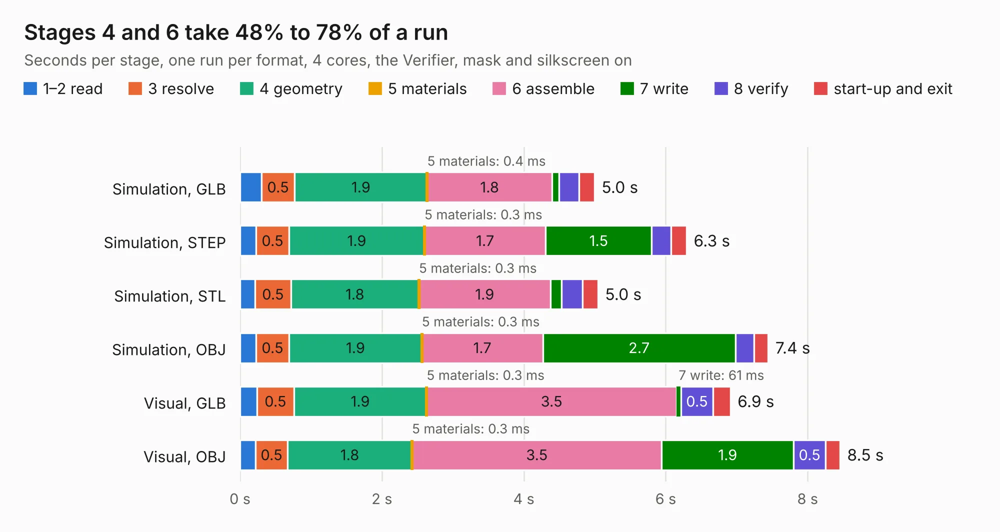

| Mode and format | 1–2 read | 3 resolve | 4 geometry | 5 materials | 6 assemble | 7 write | 8 verify | start-up and exit | Total |
|---|---:|---:|---:|---:|---:|---:|---:|---:|---:|
| Simulation, GLB | 0.3 | 0.5 | 1.9 | 0.4&nbsp;ms | 1.8 | 0.1 | 0.3 | 0.2 | 5.0 |
| Simulation, STEP | 0.2 | 0.5 | 1.9 | 0.3&nbsp;ms | 1.7 | 1.5 | 0.3 | 0.2 | 6.3 |
| Simulation, STL | 0.2 | 0.5 | 1.8 | 0.3&nbsp;ms | 1.9 | 0.2 | 0.3 | 0.2 | 5.0 |
| Simulation, OBJ | 0.2 | 0.5 | 1.9 | 0.3&nbsp;ms | 1.7 | 2.7 | 0.3 | 0.2 | 7.4 |
| Visual, GLB | 0.2 | 0.5 | 1.9 | 0.3&nbsp;ms | 3.5 | 61&nbsp;ms | 0.5 | 0.2 | 6.9 |
| Visual, OBJ | 0.2 | 0.5 | 1.8 | 0.3&nbsp;ms | 3.5 | 1.9 | 0.5 | 0.2 | 8.5 |

<table align="center"><tr><td valign="top">

| Board | Repo: [sparkfun/sparkfun_gnss_flex_system](https://github.com/sparkfun/sparkfun_gnss_flex_system) Board: `SparkFun_GNSS_Flex_Module_LG290P.kicad_pcb` |
|---|---|
| Folder | flex_boards / SparkPNT_GNSS_Flex_Module_LG290P / hardware |
| Complexity | 285&nbsp;/&nbsp;1000 (size&nbsp;165, features&nbsp;120) |
| KESE&nbsp;features | through vias, rounded, trapezoid or chamfered pads, arc tracks, filled zones, copper text, knockout text, stack-up, dielectric εr and tanδ, mask and silkscreen colours |
| Tested | 9th November 2026 |
| Copper&nbsp;layers | 4 |
| File&nbsp;format | KiCad 9 (20241229) |
| Parts,&nbsp;tracks,&nbsp;vias | 15, 203, 100 |
| Triangles,&nbsp;simulation | 548,654 in 54 parts |
| Verifier | PASS in all six runs |

</td><td valign="top">

<table>
<tr><th>File type</th><th>File size</th><th>Peak memory used</th></tr>
<tr><th colspan="3" align="left">Simulation</th></tr>
<tr><td>GLB</td><td align="right">20&nbsp;MB</td><td align="right">367&nbsp;MB</td></tr>
<tr><td>STEP</td><td align="right">78&nbsp;MB</td><td align="right">375&nbsp;MB</td></tr>
<tr><td>STL</td><td align="right">27&nbsp;MB</td><td align="right">345&nbsp;MB</td></tr>
<tr><td>OBJ</td><td align="right">57&nbsp;MB</td><td align="right">430&nbsp;MB</td></tr>
<tr><th colspan="3" align="left">Visual</th></tr>
<tr><td>GLB</td><td align="right">13&nbsp;MB</td><td align="right">359&nbsp;MB</td></tr>
<tr><td>OBJ</td><td align="right">39&nbsp;MB</td><td align="right">353&nbsp;MB</td></tr>
</table>

</td></tr></table>

## 2594. SparkFun_GNSS_Flex_Module_LG580P_panelized

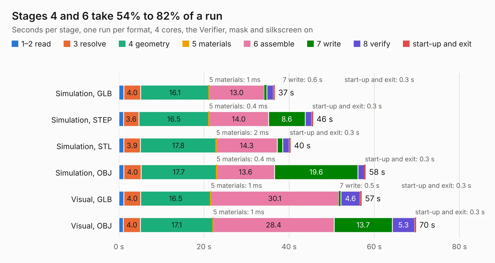

| Mode and format | 1–2 read | 3 resolve | 4 geometry | 5 materials | 6 assemble | 7 write | 8 verify | start-up and exit | Total |
|---|---:|---:|---:|---:|---:|---:|---:|---:|---:|
| Simulation, GLB | 1.2 | 4.0 | 16.1 | 1&nbsp;ms | 13.0 | 0.6 | 1.5 | 0.3 | 36.6 |
| Simulation, STEP | 1.1 | 3.6 | 16.5 | 0.4&nbsp;ms | 14.0 | 8.6 | 1.5 | 0.3 | 45.6 |
| Simulation, STL | 1.2 | 3.9 | 17.8 | 2&nbsp;ms | 14.3 | 1.3 | 1.5 | 0.3 | 40.3 |
| Simulation, OBJ | 1.2 | 4.0 | 17.7 | 0.4&nbsp;ms | 13.6 | 19.6 | 1.5 | 0.3 | 57.9 |
| Visual, GLB | 1.2 | 4.0 | 16.5 | 1&nbsp;ms | 30.1 | 0.5 | 4.6 | 0.3 | 57.0 |
| Visual, OBJ | 1.1 | 4.0 | 17.1 | 1&nbsp;ms | 28.4 | 13.7 | 5.3 | 0.3 | 69.8 |

<table align="center"><tr><td valign="top">

| Board | Repo: [sparkfun/sparkfun_gnss_flex_system](https://github.com/sparkfun/sparkfun_gnss_flex_system) Board: `SparkFun_GNSS_Flex_Module_LG580P_panelized.kicad_pcb` |
|---|---|
| Folder | flex_boards / SparkPNT_GNSS_Flex_Module_LG580P / hardware / production |
| Complexity | 339&nbsp;/&nbsp;1000 (size&nbsp;219, features&nbsp;120) |
| KESE&nbsp;features | through vias, rounded, trapezoid or chamfered pads, arc tracks, filled zones, copper text, knockout text, stack-up, dielectric εr and tanδ, mask and silkscreen colours |
| Tested | 9th November 2026 |
| Copper&nbsp;layers | 4 |
| File&nbsp;format | KiCad 9 (20241229) |
| Parts,&nbsp;tracks,&nbsp;vias | 132, 894, 786 |
| Triangles,&nbsp;simulation | 3,878,978 in 73 parts |
| Note | panel |
| Verifier | PASS in all six runs |

</td><td valign="top">

<table>
<tr><th>File type</th><th>File size</th><th>Peak memory used</th></tr>
<tr><th colspan="3" align="left">Simulation</th></tr>
<tr><td>GLB</td><td align="right">137&nbsp;MB</td><td align="right">1.5&nbsp;GB</td></tr>
<tr><td>STEP</td><td align="right">532&nbsp;MB</td><td align="right">1.7&nbsp;GB</td></tr>
<tr><td>STL</td><td align="right">194&nbsp;MB</td><td align="right">1.6&nbsp;GB</td></tr>
<tr><td>OBJ</td><td align="right">421&nbsp;MB</td><td align="right">2.6&nbsp;GB</td></tr>
<tr><th colspan="3" align="left">Visual</th></tr>
<tr><td>GLB</td><td align="right">89&nbsp;MB</td><td align="right">1.5&nbsp;GB</td></tr>
<tr><td>OBJ</td><td align="right">279&nbsp;MB</td><td align="right">1.8&nbsp;GB</td></tr>
</table>

</td></tr></table>

## 2595. SparkFun_GNSS_Flex_Module_LG580P

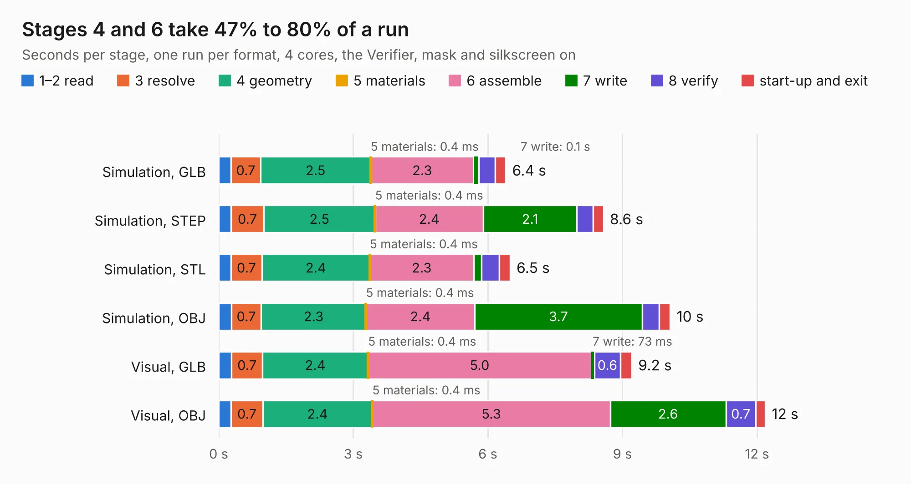

| Mode and format | 1–2 read | 3 resolve | 4 geometry | 5 materials | 6 assemble | 7 write | 8 verify | start-up and exit | Total |
|---|---:|---:|---:|---:|---:|---:|---:|---:|---:|
| Simulation, GLB | 0.3 | 0.7 | 2.5 | 0.4&nbsp;ms | 2.3 | 0.1 | 0.4 | 0.2 | 6.4 |
| Simulation, STEP | 0.3 | 0.7 | 2.5 | 0.4&nbsp;ms | 2.4 | 2.1 | 0.4 | 0.2 | 8.6 |
| Simulation, STL | 0.3 | 0.7 | 2.4 | 0.4&nbsp;ms | 2.3 | 0.2 | 0.4 | 0.2 | 6.5 |
| Simulation, OBJ | 0.3 | 0.7 | 2.3 | 0.4&nbsp;ms | 2.4 | 3.7 | 0.4 | 0.2 | 10.1 |
| Visual, GLB | 0.3 | 0.7 | 2.4 | 0.4&nbsp;ms | 5.0 | 73&nbsp;ms | 0.6 | 0.3 | 9.2 |
| Visual, OBJ | 0.3 | 0.7 | 2.4 | 0.4&nbsp;ms | 5.3 | 2.6 | 0.7 | 0.2 | 12.2 |

<table align="center"><tr><td valign="top">

| Board | Repo: [sparkfun/sparkfun_gnss_flex_system](https://github.com/sparkfun/sparkfun_gnss_flex_system) Board: `SparkFun_GNSS_Flex_Module_LG580P.kicad_pcb` |
|---|---|
| Folder | flex_boards / SparkPNT_GNSS_Flex_Module_LG580P / hardware |
| Complexity | 291&nbsp;/&nbsp;1000 (size&nbsp;171, features&nbsp;120) |
| KESE&nbsp;features | through vias, rounded, trapezoid or chamfered pads, arc tracks, filled zones, copper text, knockout text, stack-up, dielectric εr and tanδ, mask and silkscreen colours |
| Tested | 10th November 2026 |
| Copper&nbsp;layers | 4 |
| File&nbsp;format | KiCad 9 (20241229) |
| Parts,&nbsp;tracks,&nbsp;vias | 22, 149, 131 |
| Triangles,&nbsp;simulation | 643,882 in 73 parts |
| Verifier | PASS in all six runs |

</td><td valign="top">

<table>
<tr><th>File type</th><th>File size</th><th>Peak memory used</th></tr>
<tr><th colspan="3" align="left">Simulation</th></tr>
<tr><td>GLB</td><td align="right">23&nbsp;MB</td><td align="right">412&nbsp;MB</td></tr>
<tr><td>STEP</td><td align="right">86&nbsp;MB</td><td align="right">429&nbsp;MB</td></tr>
<tr><td>STL</td><td align="right">32&nbsp;MB</td><td align="right">409&nbsp;MB</td></tr>
<tr><td>OBJ</td><td align="right">66&nbsp;MB</td><td align="right">496&nbsp;MB</td></tr>
<tr><th colspan="3" align="left">Visual</th></tr>
<tr><td>GLB</td><td align="right">15&nbsp;MB</td><td align="right">402&nbsp;MB</td></tr>
<tr><td>OBJ</td><td align="right">44&nbsp;MB</td><td align="right">396&nbsp;MB</td></tr>
</table>

</td></tr></table>

## 2596. SparkFun_GNSS_Flex_Module_mosaic-G5_P3_Tilt_panelized

| Mode and format | 1–2 read | 3 resolve | 4 geometry | 5 materials | 6 assemble | 7 write | 8 verify | start-up and exit | Total |
|---|---:|---:|---:|---:|---:|---:|---:|---:|---:|
| Simulation, GLB | 3.9 | 15.8 | 56.8 | 1&nbsp;ms | 43.7 | 2.4 | 5.2 | 0.5 | 128.2 |
| Simulation, STEP | 3.8 | 15.6 | 57.4 | 0.9&nbsp;ms | 43.4 | 32.1 | 5.4 | 0.5 | 158.3 |
| Simulation, STL | 3.9 | 15.7 | 57.9 | 1&nbsp;ms | 43.8 | 4.8 | 5.4 | 0.5 | 132.1 |
| Simulation, OBJ | 4.2 | 16.0 | 58.5 | 1.0&nbsp;ms | 44.7 | 82.4 | 5.4 | 0.6 | 211.9 |
| Visual, GLB | 4.2 | 15.6 | 58.5 | 1&nbsp;ms | 103.7 | 1.4 | 11.9 | 0.4 | 195.6 |
| Visual, OBJ | 3.8 | 15.5 | 58.6 | 0.9&nbsp;ms | 103.2 | 50.2 | 12.2 | 0.4 | 244.0 |

<table align="center"><tr><td valign="top">

| Board | Repo: [sparkfun/sparkfun_gnss_flex_system](https://github.com/sparkfun/sparkfun_gnss_flex_system) Board: `SparkFun_GNSS_Flex_Module_mosaic-G5_P3_Tilt_panelized.kicad_pcb` |
|---|---|
| Folder | flex_boards / SparkPNT_GNSS_Flex_Module_mosaic-G5_P3-Tilt / hardware / production |
| Complexity | 448&nbsp;/&nbsp;1000 (size&nbsp;328, features&nbsp;120) |
| KESE&nbsp;features | through vias, rounded, trapezoid or chamfered pads, arc tracks, filled zones, copper text, knockout text, stack-up, dielectric εr and tanδ, mask and silkscreen colours |
| Tested | 9th November 2026 |
| Copper&nbsp;layers | 4 |
| File&nbsp;format | KiCad 9 (20241229) |
| Parts,&nbsp;tracks,&nbsp;vias | 300, 4,920, 2,475 |
| Triangles,&nbsp;simulation | 13,247,162 in 79 parts |
| Note | panel |
| Verifier | PASS in all six runs |

</td><td valign="top">

<table>
<tr><th>File type</th><th>File size</th><th>Peak memory used</th></tr>
<tr><th colspan="3" align="left">Simulation</th></tr>
<tr><td>GLB</td><td align="right">463&nbsp;MB</td><td align="right">4.4&nbsp;GB</td></tr>
<tr><td>STEP</td><td align="right">2.1&nbsp;GB</td><td align="right">5.1&nbsp;GB</td></tr>
<tr><td>STL</td><td align="right">662&nbsp;MB</td><td align="right">4.1&nbsp;GB</td></tr>
<tr><td>OBJ</td><td align="right">1.5&nbsp;GB</td><td align="right">8.7&nbsp;GB</td></tr>
<tr><th colspan="3" align="left">Visual</th></tr>
<tr><td>GLB</td><td align="right">306&nbsp;MB</td><td align="right">4.7&nbsp;GB</td></tr>
<tr><td>OBJ</td><td align="right">982&nbsp;MB</td><td align="right">6.2&nbsp;GB</td></tr>
</table>

</td></tr></table>

## 2597. SparkFun_GNSS_Flex_Module_mosaic-G5_P3_Tilt

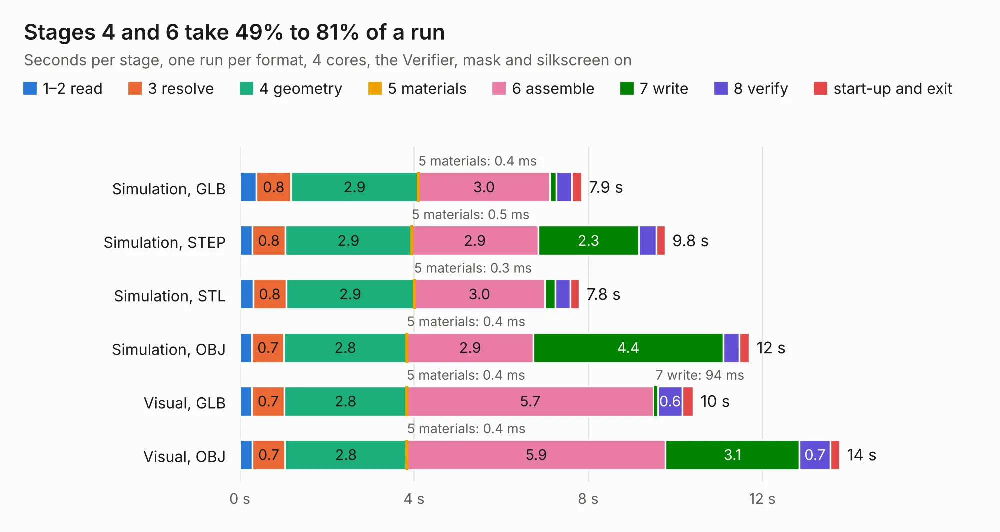

| Mode and format | 1–2 read | 3 resolve | 4 geometry | 5 materials | 6 assemble | 7 write | 8 verify | start-up and exit | Total |
|---|---:|---:|---:|---:|---:|---:|---:|---:|---:|
| Simulation, GLB | 0.4 | 0.8 | 2.9 | 0.4&nbsp;ms | 3.0 | 0.1 | 0.4 | 0.2 | 7.9 |
| Simulation, STEP | 0.3 | 0.8 | 2.9 | 0.5&nbsp;ms | 2.9 | 2.3 | 0.4 | 0.2 | 9.8 |
| Simulation, STL | 0.3 | 0.8 | 2.9 | 0.3&nbsp;ms | 3.0 | 0.2 | 0.3 | 0.2 | 7.8 |
| Simulation, OBJ | 0.3 | 0.7 | 2.8 | 0.4&nbsp;ms | 2.9 | 4.4 | 0.4 | 0.2 | 11.7 |
| Visual, GLB | 0.3 | 0.7 | 2.8 | 0.4&nbsp;ms | 5.7 | 94&nbsp;ms | 0.6 | 0.3 | 10.4 |
| Visual, OBJ | 0.3 | 0.7 | 2.8 | 0.4&nbsp;ms | 5.9 | 3.1 | 0.7 | 0.2 | 13.8 |

<table align="center"><tr><td valign="top">

| Board | Repo: [sparkfun/sparkfun_gnss_flex_system](https://github.com/sparkfun/sparkfun_gnss_flex_system) Board: `SparkFun_GNSS_Flex_Module_mosaic-G5_P3_Tilt.kicad_pcb` |
|---|---|
| Folder | flex_boards / SparkPNT_GNSS_Flex_Module_mosaic-G5_P3-Tilt / hardware |
| Complexity | 348&nbsp;/&nbsp;1000 (size&nbsp;228, features&nbsp;120) |
| KESE&nbsp;features | through vias, rounded, trapezoid or chamfered pads, arc tracks, filled zones, copper text, knockout text, stack-up, dielectric εr and tanδ, mask and silkscreen colours |
| Tested | 9th November 2026 |
| Copper&nbsp;layers | 4 |
| File&nbsp;format | KiCad 9 (20241229) |
| Parts,&nbsp;tracks,&nbsp;vias | 20, 328, 165 |
| Triangles,&nbsp;simulation | 882,344 in 79 parts |
| Verifier | PASS in all six runs |

</td><td valign="top">

<table>
<tr><th>File type</th><th>File size</th><th>Peak memory used</th></tr>
<tr><th colspan="3" align="left">Simulation</th></tr>
<tr><td>GLB</td><td align="right">31&nbsp;MB</td><td align="right">496&nbsp;MB</td></tr>
<tr><td>STEP</td><td align="right">132&nbsp;MB</td><td align="right">515&nbsp;MB</td></tr>
<tr><td>STL</td><td align="right">44&nbsp;MB</td><td align="right">489&nbsp;MB</td></tr>
<tr><td>OBJ</td><td align="right">91&nbsp;MB</td><td align="right">636&nbsp;MB</td></tr>
<tr><th colspan="3" align="left">Visual</th></tr>
<tr><td>GLB</td><td align="right">20&nbsp;MB</td><td align="right">488&nbsp;MB</td></tr>
<tr><td>OBJ</td><td align="right">61&nbsp;MB</td><td align="right">521&nbsp;MB</td></tr>
</table>

</td></tr></table>

## 2598. SparkFun_GNSS_Flex_Module_mosaic-X5_IM19_panelized

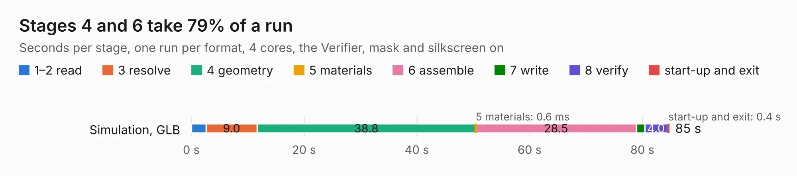

| Mode and format | 1–2 read | 3 resolve | 4 geometry | 5 materials | 6 assemble | 7 write | 8 verify | start-up and exit | Total |
|---|---:|---:|---:|---:|---:|---:|---:|---:|---:|
| Simulation, GLB | 2.6 | 9.0 | 38.8 | 0.6&nbsp;ms | 28.5 | 1.5 | 4.0 | 0.4 | 84.8 |
| Simulation, STEP | 2.6 | 9.2 | 39.9 | 0.7&nbsp;ms | 28.8 | 19.7 | 3.9 | 0.4 | 104.6 |
| Simulation, STL | 2.6 | 9.1 | 38.6 | 0.8&nbsp;ms | 28.7 | 2.9 | 3.7 | 0.4 | 86.0 |
| Simulation, OBJ | 2.7 | 8.9 | 38.2 | 1&nbsp;ms | 28.4 | 47.4 | 4.0 | 0.4 | 130.1 |
| Visual, GLB | 2.9 | 9.4 | 38.3 | 0.6&nbsp;ms | 65.9 | 1.0 | 7.0 | 0.4 | 124.8 |
| Visual, OBJ | 2.7 | 8.8 | 38.5 | 0.6&nbsp;ms | 65.2 | 30.0 | 6.6 | 0.4 | 152.1 |

<table align="center"><tr><td valign="top">

| Board | Repo: [sparkfun/sparkfun_gnss_flex_system](https://github.com/sparkfun/sparkfun_gnss_flex_system) Board: `SparkFun_GNSS_Flex_Module_mosaic-X5_IM19_panelized.kicad_pcb` |
|---|---|
| Folder | flex_boards / SparkPNT_GNSS_Flex_Module_mosaic-X5-Tilt / hardware / production |
| Complexity | 426&nbsp;/&nbsp;1000 (size&nbsp;306, features&nbsp;120) |
| KESE&nbsp;features | through vias, rounded, trapezoid or chamfered pads, arc tracks, filled zones, copper text, knockout text, stack-up, dielectric εr and tanδ, mask and silkscreen colours |
| Tested | 9th November 2026 |
| Copper&nbsp;layers | 4 |
| File&nbsp;format | KiCad 9 (20241229) |
| Parts,&nbsp;tracks,&nbsp;vias | 210, 3,174, 1,254 |
| Triangles,&nbsp;simulation | 7,998,602 in 95 parts |
| Note | panel |
| Verifier | PASS in all six runs |

</td><td valign="top">

<table>
<tr><th>File type</th><th>File size</th><th>Peak memory used</th></tr>
<tr><th colspan="3" align="left">Simulation</th></tr>
<tr><td>GLB</td><td align="right">282&nbsp;MB</td><td align="right">2.9&nbsp;GB</td></tr>
<tr><td>STEP</td><td align="right">1.3&nbsp;GB</td><td align="right">3.3&nbsp;GB</td></tr>
<tr><td>STL</td><td align="right">400&nbsp;MB</td><td align="right">2.7&nbsp;GB</td></tr>
<tr><td>OBJ</td><td align="right">877&nbsp;MB</td><td align="right">5.3&nbsp;GB</td></tr>
<tr><th colspan="3" align="left">Visual</th></tr>
<tr><td>GLB</td><td align="right">179&nbsp;MB</td><td align="right">3.0&nbsp;GB</td></tr>
<tr><td>OBJ</td><td align="right">575&nbsp;MB</td><td align="right">3.8&nbsp;GB</td></tr>
</table>

</td></tr></table>

## 2599. SparkFun_GNSS_Flex_Module_mosaic-X5_IM19

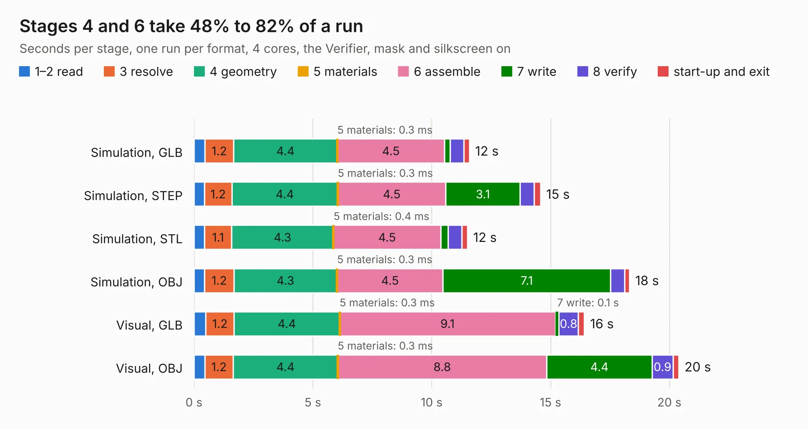

| Mode and format | 1–2 read | 3 resolve | 4 geometry | 5 materials | 6 assemble | 7 write | 8 verify | start-up and exit | Total |
|---|---:|---:|---:|---:|---:|---:|---:|---:|---:|
| Simulation, GLB | 0.5 | 1.2 | 4.4 | 0.3&nbsp;ms | 4.5 | 0.2 | 0.6 | 0.2 | 11.6 |
| Simulation, STEP | 0.4 | 1.2 | 4.4 | 0.3&nbsp;ms | 4.5 | 3.1 | 0.6 | 0.3 | 14.6 |
| Simulation, STL | 0.4 | 1.1 | 4.3 | 0.4&nbsp;ms | 4.5 | 0.3 | 0.6 | 0.2 | 11.5 |
| Simulation, OBJ | 0.4 | 1.2 | 4.3 | 0.3&nbsp;ms | 4.5 | 7.1 | 0.6 | 0.2 | 18.3 |
| Visual, GLB | 0.5 | 1.2 | 4.4 | 0.3&nbsp;ms | 9.1 | 0.1 | 0.8 | 0.3 | 16.4 |
| Visual, OBJ | 0.5 | 1.2 | 4.4 | 0.3&nbsp;ms | 8.8 | 4.4 | 0.9 | 0.2 | 20.4 |

<table align="center"><tr><td valign="top">

| Board | Repo: [sparkfun/sparkfun_gnss_flex_system](https://github.com/sparkfun/sparkfun_gnss_flex_system) Board: `SparkFun_GNSS_Flex_Module_mosaic-X5_IM19.kicad_pcb` |
|---|---|
| Folder | flex_boards / SparkPNT_GNSS_Flex_Module_mosaic-X5-Tilt / hardware |
| Complexity | 360&nbsp;/&nbsp;1000 (size&nbsp;240, features&nbsp;120) |
| KESE&nbsp;features | through vias, rounded, trapezoid or chamfered pads, arc tracks, filled zones, copper text, knockout text, stack-up, dielectric εr and tanδ, mask and silkscreen colours |
| Tested | 9th November 2026 |
| Copper&nbsp;layers | 4 |
| File&nbsp;format | KiCad 9 (20241229) |
| Parts,&nbsp;tracks,&nbsp;vias | 35, 529, 209 |
| Triangles,&nbsp;simulation | 1,331,060 in 95 parts |
| Verifier | PASS in all six runs |

</td><td valign="top">

<table>
<tr><th>File type</th><th>File size</th><th>Peak memory used</th></tr>
<tr><th colspan="3" align="left">Simulation</th></tr>
<tr><td>GLB</td><td align="right">47&nbsp;MB</td><td align="right">633&nbsp;MB</td></tr>
<tr><td>STEP</td><td align="right">209&nbsp;MB</td><td align="right">683&nbsp;MB</td></tr>
<tr><td>STL</td><td align="right">67&nbsp;MB</td><td align="right">647&nbsp;MB</td></tr>
<tr><td>OBJ</td><td align="right">140&nbsp;MB</td><td align="right">965&nbsp;MB</td></tr>
<tr><th colspan="3" align="left">Visual</th></tr>
<tr><td>GLB</td><td align="right">30&nbsp;MB</td><td align="right">635&nbsp;MB</td></tr>
<tr><td>OBJ</td><td align="right">90&nbsp;MB</td><td align="right">704&nbsp;MB</td></tr>
</table>

</td></tr></table>

## 2600. SparkFun_GNSS_Flex_Module_mosaic-X5_panelized

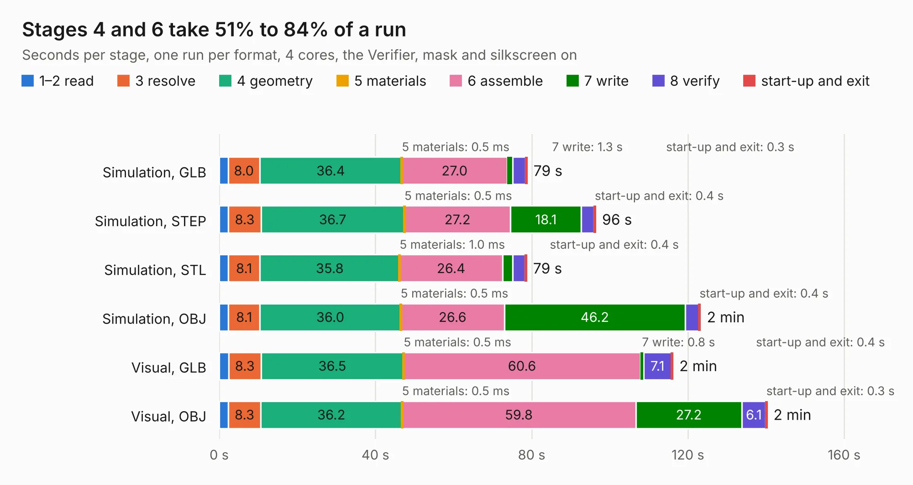

| Mode and format | 1–2 read | 3 resolve | 4 geometry | 5 materials | 6 assemble | 7 write | 8 verify | start-up and exit | Total |
|---|---:|---:|---:|---:|---:|---:|---:|---:|---:|
| Simulation, GLB | 2.3 | 8.0 | 36.4 | 0.5&nbsp;ms | 27.0 | 1.3 | 3.4 | 0.3 | 78.8 |
| Simulation, STEP | 2.4 | 8.3 | 36.7 | 0.5&nbsp;ms | 27.2 | 18.1 | 3.3 | 0.4 | 96.4 |
| Simulation, STL | 2.3 | 8.1 | 35.8 | 1.0&nbsp;ms | 26.4 | 2.6 | 3.2 | 0.4 | 78.7 |
| Simulation, OBJ | 2.3 | 8.1 | 36.0 | 0.5&nbsp;ms | 26.6 | 46.2 | 3.5 | 0.4 | 123.2 |
| Visual, GLB | 2.4 | 8.3 | 36.5 | 0.5&nbsp;ms | 60.6 | 0.8 | 7.1 | 0.4 | 116.1 |
| Visual, OBJ | 2.3 | 8.3 | 36.2 | 0.5&nbsp;ms | 59.8 | 27.2 | 6.1 | 0.3 | 140.2 |

<table align="center"><tr><td valign="top">

| Board | Repo: [sparkfun/sparkfun_gnss_flex_system](https://github.com/sparkfun/sparkfun_gnss_flex_system) Board: `SparkFun_GNSS_Flex_Module_mosaic-X5_panelized.kicad_pcb` |
|---|---|
| Folder | flex_boards / SparkPNT_GNSS_Flex_Module_mosaic-X5 / hardware / production |
| Complexity | 423&nbsp;/&nbsp;1000 (size&nbsp;303, features&nbsp;120) |
| KESE&nbsp;features | through vias, rounded, trapezoid or chamfered pads, arc tracks, filled zones, copper text, knockout text, stack-up, dielectric εr and tanδ, mask and silkscreen colours |
| Tested | 9th November 2026 |
| Copper&nbsp;layers | 4 |
| File&nbsp;format | KiCad 8 (20240108) |
| Parts,&nbsp;tracks,&nbsp;vias | 168, 3,144, 1,272 |
| Triangles,&nbsp;simulation | 7,837,644 in 80 parts |
| Note | panel |
| Verifier | PASS in all six runs |

</td><td valign="top">

<table>
<tr><th>File type</th><th>File size</th><th>Peak memory used</th></tr>
<tr><th colspan="3" align="left">Simulation</th></tr>
<tr><td>GLB</td><td align="right">276&nbsp;MB</td><td align="right">2.6&nbsp;GB</td></tr>
<tr><td>STEP</td><td align="right">1.2&nbsp;GB</td><td align="right">3.3&nbsp;GB</td></tr>
<tr><td>STL</td><td align="right">392&nbsp;MB</td><td align="right">2.5&nbsp;GB</td></tr>
<tr><td>OBJ</td><td align="right">858&nbsp;MB</td><td align="right">5.2&nbsp;GB</td></tr>
<tr><th colspan="3" align="left">Visual</th></tr>
<tr><td>GLB</td><td align="right">173&nbsp;MB</td><td align="right">2.9&nbsp;GB</td></tr>
<tr><td>OBJ</td><td align="right">558&nbsp;MB</td><td align="right">3.6&nbsp;GB</td></tr>
</table>

</td></tr></table>

## 2601. SparkFun_GNSS_Flex_Module_mosaic-X5

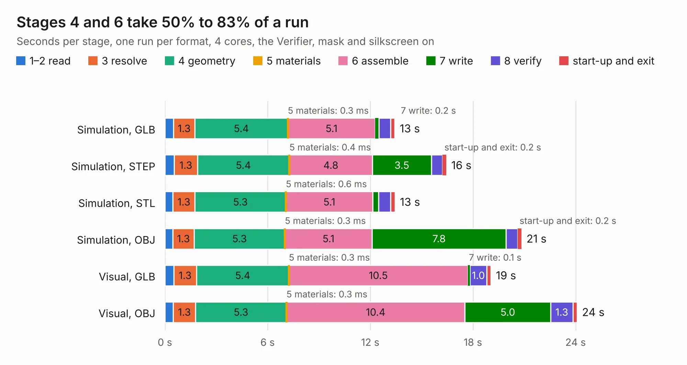

| Mode and format | 1–2 read | 3 resolve | 4 geometry | 5 materials | 6 assemble | 7 write | 8 verify | start-up and exit | Total |
|---|---:|---:|---:|---:|---:|---:|---:|---:|---:|
| Simulation, GLB | 0.5 | 1.3 | 5.4 | 0.3&nbsp;ms | 5.1 | 0.2 | 0.7 | 0.2 | 13.4 |
| Simulation, STEP | 0.5 | 1.3 | 5.4 | 0.4&nbsp;ms | 4.8 | 3.5 | 0.6 | 0.2 | 16.4 |
| Simulation, STL | 0.5 | 1.3 | 5.3 | 0.6&nbsp;ms | 5.1 | 0.3 | 0.7 | 0.3 | 13.4 |
| Simulation, OBJ | 0.5 | 1.3 | 5.3 | 0.3&nbsp;ms | 5.1 | 7.8 | 0.7 | 0.2 | 20.8 |
| Visual, GLB | 0.5 | 1.3 | 5.4 | 0.3&nbsp;ms | 10.5 | 0.1 | 1.0 | 0.3 | 19.1 |
| Visual, OBJ | 0.5 | 1.3 | 5.3 | 0.3&nbsp;ms | 10.4 | 5.0 | 1.3 | 0.2 | 24.1 |

<table align="center"><tr><td valign="top">

| Board | Repo: [sparkfun/sparkfun_gnss_flex_system](https://github.com/sparkfun/sparkfun_gnss_flex_system) Board: `SparkFun_GNSS_Flex_Module_mosaic-X5.kicad_pcb` |
|---|---|
| Folder | flex_boards / SparkPNT_GNSS_Flex_Module_mosaic-X5 / hardware |
| Complexity | 357&nbsp;/&nbsp;1000 (size&nbsp;237, features&nbsp;120) |
| KESE&nbsp;features | through vias, rounded, trapezoid or chamfered pads, arc tracks, filled zones, copper text, knockout text, stack-up, dielectric εr and tanδ, mask and silkscreen colours |
| Tested | 9th November 2026 |
| Copper&nbsp;layers | 4 |
| File&nbsp;format | KiCad 8 (20240108) |
| Parts,&nbsp;tracks,&nbsp;vias | 28, 524, 212 |
| Triangles,&nbsp;simulation | 1,304,334 in 80 parts |
| Verifier | PASS in all six runs |

</td><td valign="top">

<table>
<tr><th>File type</th><th>File size</th><th>Peak memory used</th></tr>
<tr><th colspan="3" align="left">Simulation</th></tr>
<tr><td>GLB</td><td align="right">46&nbsp;MB</td><td align="right">621&nbsp;MB</td></tr>
<tr><td>STEP</td><td align="right">199&nbsp;MB</td><td align="right">660&nbsp;MB</td></tr>
<tr><td>STL</td><td align="right">65&nbsp;MB</td><td align="right">708&nbsp;MB</td></tr>
<tr><td>OBJ</td><td align="right">137&nbsp;MB</td><td align="right">907&nbsp;MB</td></tr>
<tr><th colspan="3" align="left">Visual</th></tr>
<tr><td>GLB</td><td align="right">29&nbsp;MB</td><td align="right">718&nbsp;MB</td></tr>
<tr><td>OBJ</td><td align="right">88&nbsp;MB</td><td align="right">719&nbsp;MB</td></tr>
</table>

</td></tr></table>

## 2602. SparkFun_GNSS_Flex_Module_ZED-X20P_Tilt_panelized

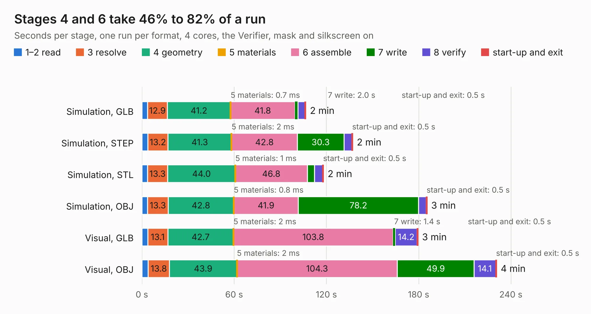

| Mode and format | 1–2 read | 3 resolve | 4 geometry | 5 materials | 6 assemble | 7 write | 8 verify | start-up and exit | Total |
|---|---:|---:|---:|---:|---:|---:|---:|---:|---:|
| Simulation, GLB | 3.7 | 12.9 | 41.2 | 0.7&nbsp;ms | 41.8 | 2.0 | 4.6 | 0.5 | 106.6 |
| Simulation, STEP | 3.8 | 13.2 | 41.3 | 2&nbsp;ms | 42.8 | 30.3 | 5.1 | 0.5 | 137.1 |
| Simulation, STL | 3.6 | 13.3 | 44.0 | 1&nbsp;ms | 46.8 | 4.7 | 5.3 | 0.5 | 118.1 |
| Simulation, OBJ | 3.7 | 13.3 | 42.8 | 0.8&nbsp;ms | 41.9 | 78.2 | 5.0 | 0.5 | 185.4 |
| Visual, GLB | 3.8 | 13.1 | 42.7 | 2&nbsp;ms | 103.8 | 1.4 | 14.2 | 0.5 | 179.5 |
| Visual, OBJ | 4.1 | 13.8 | 43.9 | 2&nbsp;ms | 104.3 | 49.9 | 14.1 | 0.5 | 230.6 |

<table align="center"><tr><td valign="top">

| Board | Repo: [sparkfun/sparkfun_gnss_flex_system](https://github.com/sparkfun/sparkfun_gnss_flex_system) Board: `SparkFun_GNSS_Flex_Module_ZED-X20P_Tilt_panelized.kicad_pcb` |
|---|---|
| Folder | flex_boards / SparkPNT_GNSS_Flex_Module_ZED-X20P-Tilt / hardware / production |
| Complexity | 370&nbsp;/&nbsp;1000 (size&nbsp;250, features&nbsp;120) |
| KESE&nbsp;features | through vias, rounded, trapezoid or chamfered pads, arc tracks, filled zones, copper text, knockout text, stack-up, dielectric εr and tanδ, mask and silkscreen colours |
| Tested | 9th November 2026 |
| Copper&nbsp;layers | 4 |
| File&nbsp;format | KiCad 9 (20241229) |
| Parts,&nbsp;tracks,&nbsp;vias | 345, 5,220, 2,010 |
| Triangles,&nbsp;simulation | 11,566,264 in 86 parts |
| Note | panel |
| Verifier | PASS in all six runs |

</td><td valign="top">

<table>
<tr><th>File type</th><th>File size</th><th>Peak memory used</th></tr>
<tr><th colspan="3" align="left">Simulation</th></tr>
<tr><td>GLB</td><td align="right">410&nbsp;MB</td><td align="right">3.5&nbsp;GB</td></tr>
<tr><td>STEP</td><td align="right">1.8&nbsp;GB</td><td align="right">4.4&nbsp;GB</td></tr>
<tr><td>STL</td><td align="right">578&nbsp;MB</td><td align="right">3.3&nbsp;GB</td></tr>
<tr><td>OBJ</td><td align="right">1.3&nbsp;GB</td><td align="right">7.6&nbsp;GB</td></tr>
<tr><th colspan="3" align="left">Visual</th></tr>
<tr><td>GLB</td><td align="right">284&nbsp;MB</td><td align="right">4.3&nbsp;GB</td></tr>
<tr><td>OBJ</td><td align="right">908&nbsp;MB</td><td align="right">5.7&nbsp;GB</td></tr>
</table>

</td></tr></table>

## 2603. SparkFun_GNSS_Flex_Module_ZED-X20P_Tilt

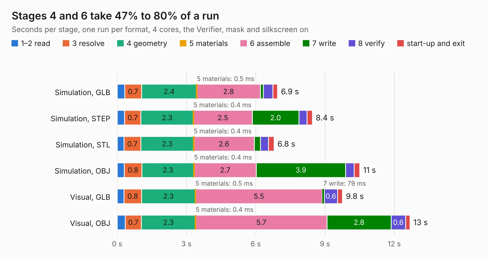

| Mode and format | 1–2 read | 3 resolve | 4 geometry | 5 materials | 6 assemble | 7 write | 8 verify | start-up and exit | Total |
|---|---:|---:|---:|---:|---:|---:|---:|---:|---:|
| Simulation, GLB | 0.3 | 0.7 | 2.4 | 0.5&nbsp;ms | 2.8 | 0.1 | 0.4 | 0.2 | 6.9 |
| Simulation, STEP | 0.3 | 0.7 | 2.3 | 0.4&nbsp;ms | 2.5 | 2.0 | 0.4 | 0.2 | 8.4 |
| Simulation, STL | 0.3 | 0.7 | 2.3 | 0.4&nbsp;ms | 2.6 | 0.3 | 0.4 | 0.2 | 6.8 |
| Simulation, OBJ | 0.3 | 0.8 | 2.3 | 0.4&nbsp;ms | 2.7 | 3.9 | 0.4 | 0.2 | 10.5 |
| Visual, GLB | 0.3 | 0.8 | 2.3 | 0.5&nbsp;ms | 5.5 | 79&nbsp;ms | 0.6 | 0.2 | 9.8 |
| Visual, OBJ | 0.4 | 0.7 | 2.3 | 0.4&nbsp;ms | 5.7 | 2.8 | 0.6 | 0.2 | 12.7 |

<table align="center"><tr><td valign="top">

| Board | Repo: [sparkfun/sparkfun_gnss_flex_system](https://github.com/sparkfun/sparkfun_gnss_flex_system) Board: `SparkFun_GNSS_Flex_Module_ZED-X20P_Tilt.kicad_pcb` |
|---|---|
| Folder | flex_boards / SparkPNT_GNSS_Flex_Module_ZED-X20P-Tilt / hardware |
| Complexity | 296&nbsp;/&nbsp;1000 (size&nbsp;176, features&nbsp;120) |
| KESE&nbsp;features | through vias, rounded, trapezoid or chamfered pads, arc tracks, filled zones, copper text, knockout text, stack-up, dielectric εr and tanδ, mask and silkscreen colours |
| Tested | 9th November 2026 |
| Copper&nbsp;layers | 4 |
| File&nbsp;format | KiCad 9 (20241229) |
| Parts,&nbsp;tracks,&nbsp;vias | 23, 348, 134 |
| Triangles,&nbsp;simulation | 770,344 in 86 parts |
| Verifier | PASS in all six runs |

</td><td valign="top">

<table>
<tr><th>File type</th><th>File size</th><th>Peak memory used</th></tr>
<tr><th colspan="3" align="left">Simulation</th></tr>
<tr><td>GLB</td><td align="right">27&nbsp;MB</td><td align="right">421&nbsp;MB</td></tr>
<tr><td>STEP</td><td align="right">115&nbsp;MB</td><td align="right">478&nbsp;MB</td></tr>
<tr><td>STL</td><td align="right">39&nbsp;MB</td><td align="right">445&nbsp;MB</td></tr>
<tr><td>OBJ</td><td align="right">80&nbsp;MB</td><td align="right">582&nbsp;MB</td></tr>
<tr><th colspan="3" align="left">Visual</th></tr>
<tr><td>GLB</td><td align="right">19&nbsp;MB</td><td align="right">482&nbsp;MB</td></tr>
<tr><td>OBJ</td><td align="right">57&nbsp;MB</td><td align="right">481&nbsp;MB</td></tr>
</table>

</td></tr></table>

## 2604. SparkPNT_GPSDO_panelized

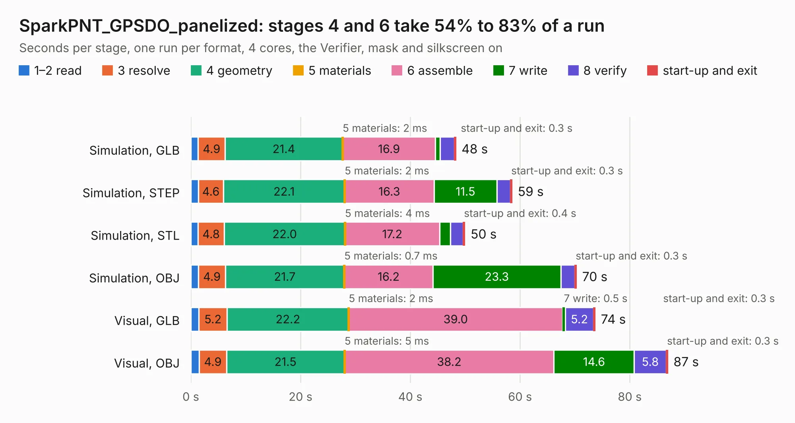

| Mode and format | 1–2 read | 3 resolve | 4 geometry | 5 materials | 6 assemble | 7 write | 8 verify | start-up and exit | Total |
|---|---:|---:|---:|---:|---:|---:|---:|---:|---:|
| Simulation, GLB | 1.3 | 4.9 | 21.4 | 2&nbsp;ms | 16.9 | 0.9 | 2.5 | 0.3 | 48.3 |
| Simulation, STEP | 1.4 | 4.6 | 22.1 | 2&nbsp;ms | 16.3 | 11.5 | 2.4 | 0.3 | 58.5 |
| Simulation, STL | 1.3 | 4.8 | 22.0 | 4&nbsp;ms | 17.2 | 2.0 | 2.3 | 0.4 | 50.0 |
| Simulation, OBJ | 1.4 | 4.9 | 21.7 | 0.7&nbsp;ms | 16.2 | 23.3 | 2.6 | 0.3 | 70.3 |
| Visual, GLB | 1.4 | 5.2 | 22.2 | 2&nbsp;ms | 39.0 | 0.5 | 5.2 | 0.3 | 73.7 |
| Visual, OBJ | 1.5 | 4.9 | 21.5 | 5&nbsp;ms | 38.2 | 14.6 | 5.8 | 0.3 | 86.9 |

<table align="center"><tr><td valign="top">

| Board | Repo: [sparkfun/sparkfun_gnssdo](https://github.com/sparkfun/sparkfun_gnssdo) Board: `SparkPNT_GPSDO_panelized.kicad_pcb` |
|---|---|
| Folder | Hardware / GNSSDO / Production |
| Complexity | 408&nbsp;/&nbsp;1000 (size&nbsp;283, features&nbsp;125) |
| KESE&nbsp;features | through vias, slotted holes, rounded, trapezoid or chamfered pads, filled zones, copper text, curved board outline, knockout text, stack-up, dielectric εr and tanδ, mask and silkscreen colours |
| Tested | 9th November 2026 |
| Copper&nbsp;layers | 4 |
| File&nbsp;format | KiCad 8 (20240108) |
| Parts,&nbsp;tracks,&nbsp;vias | 232, 2,036, 692 |
| Triangles,&nbsp;simulation | 4,628,930 in 261 parts |
| Note | panel |
| Verifier | PASS in all six runs |

</td><td valign="top">

<table>
<tr><th>File type</th><th>File size</th><th>Peak memory used</th></tr>
<tr><th colspan="3" align="left">Simulation</th></tr>
<tr><td>GLB</td><td align="right">160&nbsp;MB</td><td align="right">1.4&nbsp;GB</td></tr>
<tr><td>STEP</td><td align="right">685&nbsp;MB</td><td align="right">1.9&nbsp;GB</td></tr>
<tr><td>STL</td><td align="right">231&nbsp;MB</td><td align="right">1.4&nbsp;GB</td></tr>
<tr><td>OBJ</td><td align="right">496&nbsp;MB</td><td align="right">3.1&nbsp;GB</td></tr>
<tr><th colspan="3" align="left">Visual</th></tr>
<tr><td>GLB</td><td align="right">99&nbsp;MB</td><td align="right">1.7&nbsp;GB</td></tr>
<tr><td>OBJ</td><td align="right">312&nbsp;MB</td><td align="right">2.1&nbsp;GB</td></tr>
</table>

</td></tr></table>

## 2605. SparkPNT_GPSDO

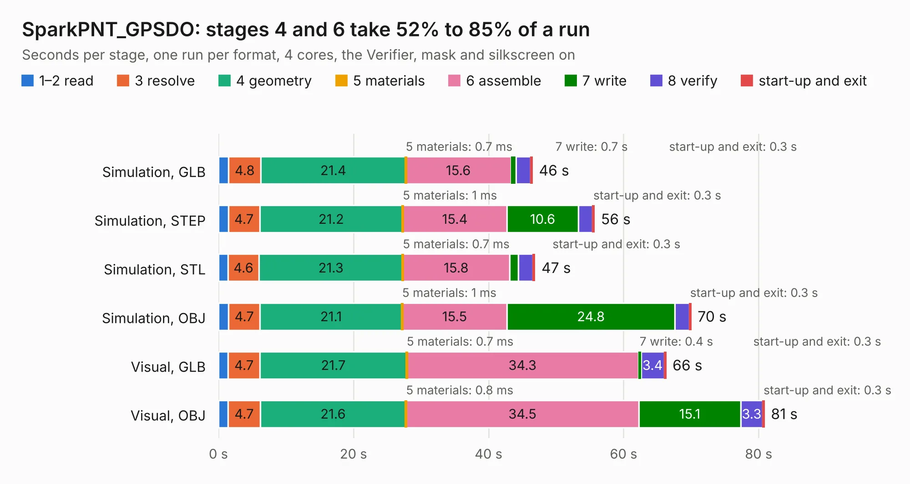

| Mode and format | 1–2 read | 3 resolve | 4 geometry | 5 materials | 6 assemble | 7 write | 8 verify | start-up and exit | Total |
|---|---:|---:|---:|---:|---:|---:|---:|---:|---:|
| Simulation, GLB | 1.5 | 4.8 | 21.4 | 0.7&nbsp;ms | 15.6 | 0.7 | 2.2 | 0.3 | 46.5 |
| Simulation, STEP | 1.5 | 4.7 | 21.2 | 1&nbsp;ms | 15.4 | 10.6 | 2.0 | 0.3 | 55.7 |
| Simulation, STL | 1.4 | 4.6 | 21.3 | 0.7&nbsp;ms | 15.8 | 1.3 | 2.1 | 0.3 | 46.9 |
| Simulation, OBJ | 1.5 | 4.7 | 21.1 | 1&nbsp;ms | 15.5 | 24.8 | 2.1 | 0.3 | 70.0 |
| Visual, GLB | 1.4 | 4.7 | 21.7 | 0.7&nbsp;ms | 34.3 | 0.4 | 3.4 | 0.3 | 66.3 |
| Visual, OBJ | 1.4 | 4.7 | 21.6 | 0.8&nbsp;ms | 34.5 | 15.1 | 3.3 | 0.3 | 80.9 |

<table align="center"><tr><td valign="top">

| Board | Repo: [sparkfun/sparkfun_gnssdo](https://github.com/sparkfun/sparkfun_gnssdo) Board: `SparkPNT_GPSDO.kicad_pcb` |
|---|---|
| Folder | Hardware / GNSSDO |
| Complexity | 408&nbsp;/&nbsp;1000 (size&nbsp;283, features&nbsp;125) |
| KESE&nbsp;features | through vias, slotted holes, rounded, trapezoid or chamfered pads, filled zones, copper text, curved board outline, knockout text, stack-up, dielectric εr and tanδ, mask and silkscreen colours |
| Tested | 9th November 2026 |
| Copper&nbsp;layers | 4 |
| File&nbsp;format | KiCad 8 (20240108) |
| Parts,&nbsp;tracks,&nbsp;vias | 232, 2,036, 692 |
| Triangles,&nbsp;simulation | 4,617,486 in 261 parts |
| Verifier | PASS in all six runs |

</td><td valign="top">

<table>
<tr><th>File type</th><th>File size</th><th>Peak memory used</th></tr>
<tr><th colspan="3" align="left">Simulation</th></tr>
<tr><td>GLB</td><td align="right">160&nbsp;MB</td><td align="right">1.4&nbsp;GB</td></tr>
<tr><td>STEP</td><td align="right">682&nbsp;MB</td><td align="right">1.8&nbsp;GB</td></tr>
<tr><td>STL</td><td align="right">231&nbsp;MB</td><td align="right">1.4&nbsp;GB</td></tr>
<tr><td>OBJ</td><td align="right">494&nbsp;MB</td><td align="right">3.0&nbsp;GB</td></tr>
<tr><th colspan="3" align="left">Visual</th></tr>
<tr><td>GLB</td><td align="right">99&nbsp;MB</td><td align="right">1.7&nbsp;GB</td></tr>
<tr><td>OBJ</td><td align="right">311&nbsp;MB</td><td align="right">2.2&nbsp;GB</td></tr>
</table>

</td></tr></table>

## 2606. SparkPNT_GNSSDO_Plus_panelized

| Mode and format | 1–2 read | 3 resolve | 4 geometry | 5 materials | 6 assemble | 7 write | 8 verify | start-up and exit | Total |
|---|---:|---:|---:|---:|---:|---:|---:|---:|---:|
| Simulation, GLB | 1.6 | 6.2 | 22.1 | 2&nbsp;ms | 26.7 | 0.8 | 2.5 | 0.3 | 60.2 |
| Simulation, STEP | 1.7 | 6.1 | 22.1 | 1&nbsp;ms | 26.6 | 12.6 | 2.5 | 0.3 | 71.9 |
| Simulation, STL | 1.6 | 6.0 | 22.0 | 1&nbsp;ms | 26.2 | 1.5 | 2.4 | 0.3 | 60.2 |
| Simulation, OBJ | 1.6 | 6.0 | 21.4 | 0.9&nbsp;ms | 26.8 | 27.9 | 2.4 | 0.3 | 86.3 |
| Visual, GLB | 1.7 | 6.1 | 21.5 | 2&nbsp;ms | 39.8 | 0.5 | 4.8 | 0.3 | 74.7 |
| Visual, OBJ | 1.7 | 6.2 | 21.8 | 1&nbsp;ms | 40.0 | 17.7 | 4.5 | 0.3 | 92.1 |

<table align="center"><tr><td valign="top">

| Board | Repo: [sparkfun/sparkfun_gnssdo](https://github.com/sparkfun/sparkfun_gnssdo) Board: `SparkPNT_GNSSDO_Plus_panelized.kicad_pcb` |
|---|---|
| Folder | Hardware / GNSSDO_Plus / Production |
| Complexity | 430&nbsp;/&nbsp;1000 (size&nbsp;290, features&nbsp;140) |
| KESE&nbsp;features | through vias, slotted holes, rounded, trapezoid or chamfered pads, arc tracks, filled zones, copper text, curved board outline, knockout text, stack-up, dielectric εr and tanδ, mask and silkscreen colours |
| Tested | 9th November 2026 |
| Copper&nbsp;layers | 4 |
| File&nbsp;format | KiCad 9 (20241229) |
| Parts,&nbsp;tracks,&nbsp;vias | 295, 2,557, 880 |
| Triangles,&nbsp;simulation | 5,206,738 in 314 parts |
| Note | panel |
| Verifier | PASS in all six runs |

</td><td valign="top">

<table>
<tr><th>File type</th><th>File size</th><th>Peak memory used</th></tr>
<tr><th colspan="3" align="left">Simulation</th></tr>
<tr><td>GLB</td><td align="right">178&nbsp;MB</td><td align="right">1.6&nbsp;GB</td></tr>
<tr><td>STEP</td><td align="right">723&nbsp;MB</td><td align="right">2.1&nbsp;GB</td></tr>
<tr><td>STL</td><td align="right">260&nbsp;MB</td><td align="right">1.6&nbsp;GB</td></tr>
<tr><td>OBJ</td><td align="right">552&nbsp;MB</td><td align="right">3.4&nbsp;GB</td></tr>
<tr><th colspan="3" align="left">Visual</th></tr>
<tr><td>GLB</td><td align="right">115&nbsp;MB</td><td align="right">1.9&nbsp;GB</td></tr>
<tr><td>OBJ</td><td align="right">366&nbsp;MB</td><td align="right">2.4&nbsp;GB</td></tr>
</table>

</td></tr></table>

## 2607. SparkPNT_GNSSDO_Plus

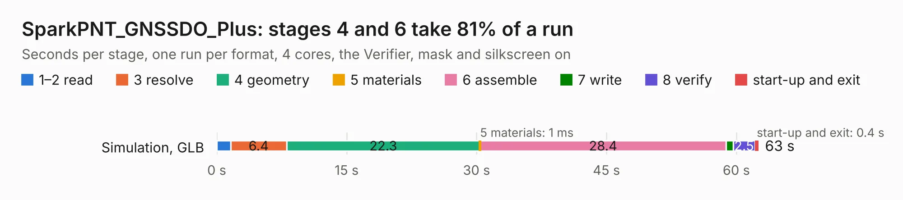

| Mode and format | 1–2 read | 3 resolve | 4 geometry | 5 materials | 6 assemble | 7 write | 8 verify | start-up and exit | Total |
|---|---:|---:|---:|---:|---:|---:|---:|---:|---:|
| Simulation, GLB | 1.6 | 6.4 | 22.3 | 1&nbsp;ms | 28.4 | 0.8 | 2.5 | 0.4 | 62.6 |
| Simulation, STEP | 1.7 | 6.1 | 21.9 | 0.8&nbsp;ms | 29.3 | 13.7 | 2.4 | 0.3 | 75.4 |
| Simulation, STL | 1.7 | 6.5 | 22.2 | 1&nbsp;ms | 30.6 | 1.8 | 2.7 | 0.3 | 65.8 |
| Simulation, OBJ | 1.6 | 6.2 | 22.8 | 2&nbsp;ms | 30.1 | 31.3 | 2.5 | 0.3 | 94.8 |
| Visual, GLB | 1.7 | 5.9 | 21.9 | 0.9&nbsp;ms | 45.8 | 0.5 | 6.0 | 0.3 | 82.1 |
| Visual, OBJ | 1.7 | 6.0 | 21.3 | 1.0&nbsp;ms | 42.3 | 18.0 | 6.4 | 0.3 | 96.0 |

<table align="center"><tr><td valign="top">

| Board | Repo: [sparkfun/sparkfun_gnssdo](https://github.com/sparkfun/sparkfun_gnssdo) Board: `SparkPNT_GNSSDO_Plus.kicad_pcb` |
|---|---|
| Folder | Hardware / GNSSDO_Plus |
| Complexity | 430&nbsp;/&nbsp;1000 (size&nbsp;290, features&nbsp;140) |
| KESE&nbsp;features | through vias, slotted holes, rounded, trapezoid or chamfered pads, arc tracks, filled zones, copper text, curved board outline, knockout text, stack-up, dielectric εr and tanδ, mask and silkscreen colours |
| Tested | 9th November 2026 |
| Copper&nbsp;layers | 4 |
| File&nbsp;format | KiCad 9 (20241229) |
| Parts,&nbsp;tracks,&nbsp;vias | 295, 2,557, 880 |
| Triangles,&nbsp;simulation | 5,196,270 in 314 parts |
| Verifier | PASS in all six runs |

</td><td valign="top">

<table>
<tr><th>File type</th><th>File size</th><th>Peak memory used</th></tr>
<tr><th colspan="3" align="left">Simulation</th></tr>
<tr><td>GLB</td><td align="right">177&nbsp;MB</td><td align="right">1.6&nbsp;GB</td></tr>
<tr><td>STEP</td><td align="right">721&nbsp;MB</td><td align="right">2.1&nbsp;GB</td></tr>
<tr><td>STL</td><td align="right">260&nbsp;MB</td><td align="right">1.6&nbsp;GB</td></tr>
<tr><td>OBJ</td><td align="right">551&nbsp;MB</td><td align="right">3.4&nbsp;GB</td></tr>
<tr><th colspan="3" align="left">Visual</th></tr>
<tr><td>GLB</td><td align="right">114&nbsp;MB</td><td align="right">1.9&nbsp;GB</td></tr>
<tr><td>OBJ</td><td align="right">365&nbsp;MB</td><td align="right">2.4&nbsp;GB</td></tr>
</table>

</td></tr></table>

## 2608. SparkFun_Thing_Plus_ESP32-S3_panelized

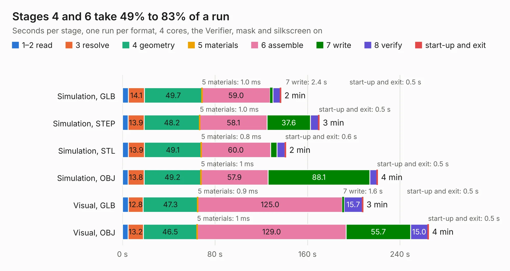

| Mode and format | 1–2 read | 3 resolve | 4 geometry | 5 materials | 6 assemble | 7 write | 8 verify | start-up and exit | Total |
|---|---:|---:|---:|---:|---:|---:|---:|---:|---:|
| Simulation, GLB | 5.0 | 14.1 | 49.7 | 1.0&nbsp;ms | 59.0 | 2.4 | 6.3 | 0.5 | 136.9 |
| Simulation, STEP | 4.9 | 13.9 | 48.2 | 1.0&nbsp;ms | 58.1 | 37.6 | 7.0 | 0.5 | 170.2 |
| Simulation, STL | 5.1 | 13.9 | 49.1 | 0.8&nbsp;ms | 60.0 | 5.6 | 6.9 | 0.6 | 141.1 |
| Simulation, OBJ | 4.9 | 13.8 | 49.2 | 1&nbsp;ms | 57.9 | 88.1 | 6.0 | 0.5 | 220.5 |
| Visual, GLB | 5.0 | 12.8 | 47.3 | 0.9&nbsp;ms | 125.0 | 1.6 | 15.7 | 0.5 | 207.9 |
| Visual, OBJ | 4.9 | 13.2 | 46.5 | 1&nbsp;ms | 129.0 | 55.7 | 15.0 | 0.5 | 264.6 |

<table align="center"><tr><td valign="top">

| Board | Repo: [sparkfun/SparkFun_Thing_Plus_ESP32-S3](https://github.com/sparkfun/SparkFun_Thing_Plus_ESP32-S3) Board: `SparkFun_Thing_Plus_ESP32-S3_panelized.kicad_pcb` |
|---|---|
| Folder | Hardware / Production |
| Complexity | 400&nbsp;/&nbsp;1000 (size&nbsp;260, features&nbsp;140) |
| KESE&nbsp;features | through vias, slotted holes, rounded, trapezoid or chamfered pads, filled zones, copper text, curved board outline, knockout text, stack-up, dielectric εr and tanδ, copper finish, mask and silkscreen colours |
| Tested | 9th November 2026 |
| Copper&nbsp;layers | 4 |
| File&nbsp;format | KiCad 7 (20221018) |
| Parts,&nbsp;tracks,&nbsp;vias | 648, 9,624, 1,560 |
| Triangles,&nbsp;simulation | 13,717,750 in 86 parts |
| Note | panel |
| Verifier | PASS in all six runs |

</td><td valign="top">

<table>
<tr><th>File type</th><th>File size</th><th>Peak memory used</th></tr>
<tr><th colspan="3" align="left">Simulation</th></tr>
<tr><td>GLB</td><td align="right">478&nbsp;MB</td><td align="right">3.4&nbsp;GB</td></tr>
<tr><td>STEP</td><td align="right">2.3&nbsp;GB</td><td align="right">4.9&nbsp;GB</td></tr>
<tr><td>STL</td><td align="right">686&nbsp;MB</td><td align="right">3.5&nbsp;GB</td></tr>
<tr><td>OBJ</td><td align="right">1.5&nbsp;GB</td><td align="right">9.0&nbsp;GB</td></tr>
<tr><th colspan="3" align="left">Visual</th></tr>
<tr><td>GLB</td><td align="right">330&nbsp;MB</td><td align="right">5.0&nbsp;GB</td></tr>
<tr><td>OBJ</td><td align="right">1.1&nbsp;GB</td><td align="right">6.4&nbsp;GB</td></tr>
</table>

</td></tr></table>

## 2609. SparkFun_Thing_Plus_ESP32-S3

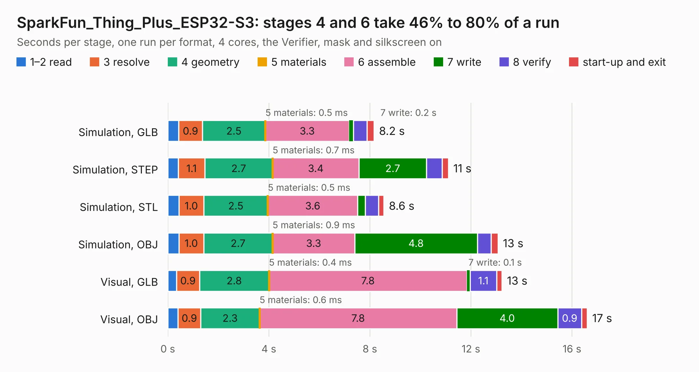

| Mode and format | 1–2 read | 3 resolve | 4 geometry | 5 materials | 6 assemble | 7 write | 8 verify | start-up and exit | Total |
|---|---:|---:|---:|---:|---:|---:|---:|---:|---:|
| Simulation, GLB | 0.4 | 0.9 | 2.5 | 0.5&nbsp;ms | 3.3 | 0.2 | 0.5 | 0.3 | 8.2 |
| Simulation, STEP | 0.4 | 1.1 | 2.7 | 0.7&nbsp;ms | 3.4 | 2.7 | 0.6 | 0.2 | 11.1 |
| Simulation, STL | 0.4 | 1.0 | 2.5 | 0.5&nbsp;ms | 3.6 | 0.3 | 0.5 | 0.2 | 8.6 |
| Simulation, OBJ | 0.4 | 1.0 | 2.7 | 0.9&nbsp;ms | 3.3 | 4.8 | 0.5 | 0.3 | 13.1 |
| Visual, GLB | 0.3 | 0.9 | 2.8 | 0.4&nbsp;ms | 7.8 | 0.1 | 1.1 | 0.2 | 13.2 |
| Visual, OBJ | 0.4 | 0.9 | 2.3 | 0.6&nbsp;ms | 7.8 | 4.0 | 0.9 | 0.2 | 16.6 |

<table align="center"><tr><td valign="top">

| Board | Repo: [sparkfun/SparkFun_Thing_Plus_ESP32-S3](https://github.com/sparkfun/SparkFun_Thing_Plus_ESP32-S3) Board: `SparkFun_Thing_Plus_ESP32-S3.kicad_pcb` |
|---|---|
| Folder | Hardware |
| Complexity | 333&nbsp;/&nbsp;1000 (size&nbsp;193, features&nbsp;140) |
| KESE&nbsp;features | through vias, slotted holes, rounded, trapezoid or chamfered pads, filled zones, copper text, curved board outline, knockout text, stack-up, dielectric εr and tanδ, copper finish, mask and silkscreen colours |
| Tested | 9th November 2026 |
| Copper&nbsp;layers | 4 |
| File&nbsp;format | KiCad 8 (20240108) |
| Parts,&nbsp;tracks,&nbsp;vias | 54, 800, 130 |
| Triangles,&nbsp;simulation | 1,078,334 in 86 parts |
| Verifier | PASS in all six runs |

</td><td valign="top">

<table>
<tr><th>File type</th><th>File size</th><th>Peak memory used</th></tr>
<tr><th colspan="3" align="left">Simulation</th></tr>
<tr><td>GLB</td><td align="right">37&nbsp;MB</td><td align="right">460&nbsp;MB</td></tr>
<tr><td>STEP</td><td align="right">167&nbsp;MB</td><td align="right">552&nbsp;MB</td></tr>
<tr><td>STL</td><td align="right">54&nbsp;MB</td><td align="right">446&nbsp;MB</td></tr>
<tr><td>OBJ</td><td align="right">110&nbsp;MB</td><td align="right">749&nbsp;MB</td></tr>
<tr><th colspan="3" align="left">Visual</th></tr>
<tr><td>GLB</td><td align="right">26&nbsp;MB</td><td align="right">608&nbsp;MB</td></tr>
<tr><td>OBJ</td><td align="right">79&nbsp;MB</td><td align="right">615&nbsp;MB</td></tr>
</table>

</td></tr></table>

## 2610. MAP Card

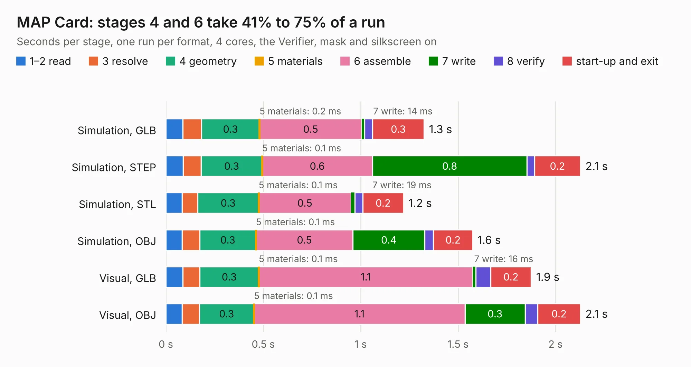

| Mode and format | 1–2 read | 3 resolve | 4 geometry | 5 materials | 6 assemble | 7 write | 8 verify | start-up and exit | Total |
|---|---:|---:|---:|---:|---:|---:|---:|---:|---:|
| Simulation, GLB | 88&nbsp;ms | 95&nbsp;ms | 0.3 | 0.2&nbsp;ms | 0.5 | 14&nbsp;ms | 41&nbsp;ms | 0.3 | 1.3 |
| Simulation, STEP | 89&nbsp;ms | 93&nbsp;ms | 0.3 | 0.1&nbsp;ms | 0.6 | 0.8 | 38&nbsp;ms | 0.2 | 2.1 |
| Simulation, STL | 83&nbsp;ms | 80&nbsp;ms | 0.3 | 0.1&nbsp;ms | 0.5 | 19&nbsp;ms | 41&nbsp;ms | 0.2 | 1.2 |
| Simulation, OBJ | 84&nbsp;ms | 90&nbsp;ms | 0.3 | 0.1&nbsp;ms | 0.5 | 0.4 | 44&nbsp;ms | 0.2 | 1.6 |
| Visual, GLB | 87&nbsp;ms | 86&nbsp;ms | 0.3 | 0.1&nbsp;ms | 1.1 | 16&nbsp;ms | 76&nbsp;ms | 0.2 | 1.9 |
| Visual, OBJ | 84&nbsp;ms | 88&nbsp;ms | 0.3 | 0.1&nbsp;ms | 1.1 | 0.3 | 65&nbsp;ms | 0.2 | 2.1 |

<table align="center"><tr><td valign="top">

| Board | Repo: [speeduino/hardware](https://github.com/speeduino/hardware) Board: `MAP Card.kicad_pcb` |
|---|---|
| Folder | DropBear / MAP Card / v0.2 |
| Complexity | 155&nbsp;/&nbsp;1000 (size&nbsp;100, features&nbsp;55) |
| KESE&nbsp;features | through vias, rounded, trapezoid or chamfered pads, filled zones, curved board outline |
| Tested | 9th November 2026 |
| Copper&nbsp;layers | 2 |
| File&nbsp;format | KiCad 5 (20171130) |
| Parts,&nbsp;tracks,&nbsp;vias | 6, 29, 5 |
| Triangles,&nbsp;simulation | 68,062 in 21 parts |
| Verifier | PASS in all six runs |

</td><td valign="top">

<table>
<tr><th>File type</th><th>File size</th><th>Peak memory used</th></tr>
<tr><th colspan="3" align="left">Simulation</th></tr>
<tr><td>GLB</td><td align="right">2.4&nbsp;MB</td><td align="right">170&nbsp;MB</td></tr>
<tr><td>STEP</td><td align="right">13&nbsp;MB</td><td align="right">181&nbsp;MB</td></tr>
<tr><td>STL</td><td align="right">3.4&nbsp;MB</td><td align="right">177&nbsp;MB</td></tr>
<tr><td>OBJ</td><td align="right">6.7&nbsp;MB</td><td align="right">174&nbsp;MB</td></tr>
<tr><th colspan="3" align="left">Visual</th></tr>
<tr><td>GLB</td><td align="right">2.0&nbsp;MB</td><td align="right">153&nbsp;MB</td></tr>
<tr><td>OBJ</td><td align="right">5.7&nbsp;MB</td><td align="right">154&nbsp;MB</td></tr>
</table>

</td></tr></table>

## 2611. MAP Card

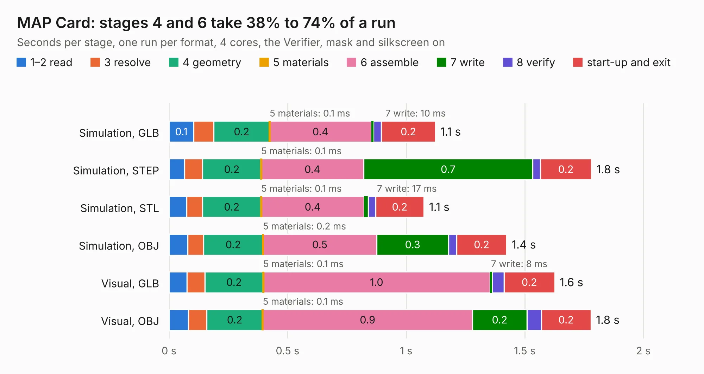

| Mode and format | 1–2 read | 3 resolve | 4 geometry | 5 materials | 6 assemble | 7 write | 8 verify | start-up and exit | Total |
|---|---:|---:|---:|---:|---:|---:|---:|---:|---:|
| Simulation, GLB | 0.1 | 84&nbsp;ms | 0.2 | 0.1&nbsp;ms | 0.4 | 10&nbsp;ms | 33&nbsp;ms | 0.2 | 1.1 |
| Simulation, STEP | 66&nbsp;ms | 75&nbsp;ms | 0.2 | 0.1&nbsp;ms | 0.4 | 0.7 | 32&nbsp;ms | 0.2 | 1.8 |
| Simulation, STL | 74&nbsp;ms | 67&nbsp;ms | 0.2 | 0.1&nbsp;ms | 0.4 | 17&nbsp;ms | 31&nbsp;ms | 0.2 | 1.1 |
| Simulation, OBJ | 78&nbsp;ms | 68&nbsp;ms | 0.2 | 0.2&nbsp;ms | 0.5 | 0.3 | 34&nbsp;ms | 0.2 | 1.4 |
| Visual, GLB | 76&nbsp;ms | 75&nbsp;ms | 0.2 | 0.1&nbsp;ms | 1.0 | 8&nbsp;ms | 51&nbsp;ms | 0.2 | 1.6 |
| Visual, OBJ | 82&nbsp;ms | 77&nbsp;ms | 0.2 | 0.1&nbsp;ms | 0.9 | 0.2 | 60&nbsp;ms | 0.2 | 1.8 |

<table align="center"><tr><td valign="top">

| Board | Repo: [speeduino/hardware](https://github.com/speeduino/hardware) Board: `MAP Card.kicad_pcb` |
|---|---|
| Folder | DropBear / MAP Card / v0.3 |
| Complexity | 184&nbsp;/&nbsp;1000 (size&nbsp;99, features&nbsp;85) |
| KESE&nbsp;features | through vias, rounded, trapezoid or chamfered pads, filled zones, curved board outline, stack-up, dielectric εr and tanδ |
| Tested | 9th November 2026 |
| Copper&nbsp;layers | 2 |
| File&nbsp;format | KiCad 7 (20221018) |
| Parts,&nbsp;tracks,&nbsp;vias | 6, 25, 5 |
| Triangles,&nbsp;simulation | 61,804 in 21 parts |
| Verifier | PASS in all six runs |

</td><td valign="top">

<table>
<tr><th>File type</th><th>File size</th><th>Peak memory used</th></tr>
<tr><th colspan="3" align="left">Simulation</th></tr>
<tr><td>GLB</td><td align="right">2.2&nbsp;MB</td><td align="right">171&nbsp;MB</td></tr>
<tr><td>STEP</td><td align="right">12&nbsp;MB</td><td align="right">175&nbsp;MB</td></tr>
<tr><td>STL</td><td align="right">3.1&nbsp;MB</td><td align="right">174&nbsp;MB</td></tr>
<tr><td>OBJ</td><td align="right">6.2&nbsp;MB</td><td align="right">170&nbsp;MB</td></tr>
<tr><th colspan="3" align="left">Visual</th></tr>
<tr><td>GLB</td><td align="right">1.8&nbsp;MB</td><td align="right">153&nbsp;MB</td></tr>
<tr><td>OBJ</td><td align="right">5.1&nbsp;MB</td><td align="right">152&nbsp;MB</td></tr>
</table>

</td></tr></table>

## 2612. DropBear

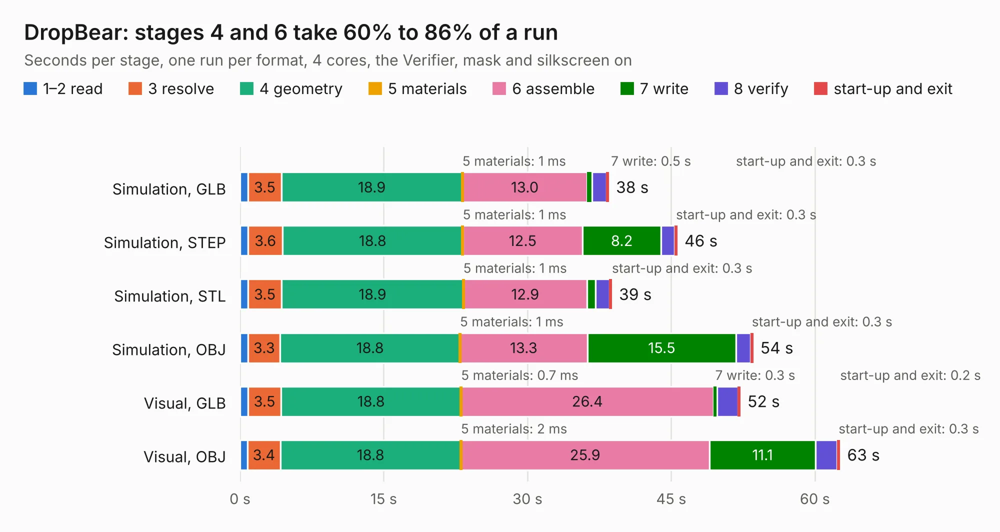

| Mode and format | 1–2 read | 3 resolve | 4 geometry | 5 materials | 6 assemble | 7 write | 8 verify | start-up and exit | Total |
|---|---:|---:|---:|---:|---:|---:|---:|---:|---:|
| Simulation, GLB | 0.8 | 3.5 | 18.9 | 1&nbsp;ms | 13.0 | 0.5 | 1.5 | 0.3 | 38.5 |
| Simulation, STEP | 0.9 | 3.6 | 18.8 | 1&nbsp;ms | 12.5 | 8.2 | 1.4 | 0.3 | 45.6 |
| Simulation, STL | 0.8 | 3.5 | 18.9 | 1&nbsp;ms | 12.9 | 0.9 | 1.5 | 0.3 | 38.8 |
| Simulation, OBJ | 0.8 | 3.3 | 18.8 | 1&nbsp;ms | 13.3 | 15.5 | 1.5 | 0.3 | 53.6 |
| Visual, GLB | 0.8 | 3.5 | 18.8 | 0.7&nbsp;ms | 26.4 | 0.3 | 2.2 | 0.2 | 52.2 |
| Visual, OBJ | 0.8 | 3.4 | 18.8 | 2&nbsp;ms | 25.9 | 11.1 | 2.2 | 0.3 | 62.6 |

<table align="center"><tr><td valign="top">

| Board | Repo: [speeduino/hardware](https://github.com/speeduino/hardware) Board: `DropBear.kicad_pcb` |
|---|---|
| Folder | DropBear / V1.1 |
| Complexity | 367&nbsp;/&nbsp;1000 (size&nbsp;257, features&nbsp;110) |
| KESE&nbsp;features | through vias, custom pads, rounded, trapezoid or chamfered pads, filled zones, copper drawings, curved board outline, stack-up, dielectric εr and tanδ |
| Tested | 9th November 2026 |
| Copper&nbsp;layers | 2 |
| File&nbsp;format | KiCad 7 (20221018) |
| Parts,&nbsp;tracks,&nbsp;vias | 187, 2,130, 417 |
| Triangles,&nbsp;simulation | 2,877,926 in 282 parts |
| Verifier | PASS in all six runs |

</td><td valign="top">

<table>
<tr><th>File type</th><th>File size</th><th>Peak memory used</th></tr>
<tr><th colspan="3" align="left">Simulation</th></tr>
<tr><td>GLB</td><td align="right">101&nbsp;MB</td><td align="right">1.0&nbsp;GB</td></tr>
<tr><td>STEP</td><td align="right">544&nbsp;MB</td><td align="right">1.3&nbsp;GB</td></tr>
<tr><td>STL</td><td align="right">144&nbsp;MB</td><td align="right">993&nbsp;MB</td></tr>
<tr><td>OBJ</td><td align="right">309&nbsp;MB</td><td align="right">2.0&nbsp;GB</td></tr>
<tr><th colspan="3" align="left">Visual</th></tr>
<tr><td>GLB</td><td align="right">72&nbsp;MB</td><td align="right">1.3&nbsp;GB</td></tr>
<tr><td>OBJ</td><td align="right">222&nbsp;MB</td><td align="right">1.6&nbsp;GB</td></tr>
</table>

</td></tr></table>

## 2613. DropBear

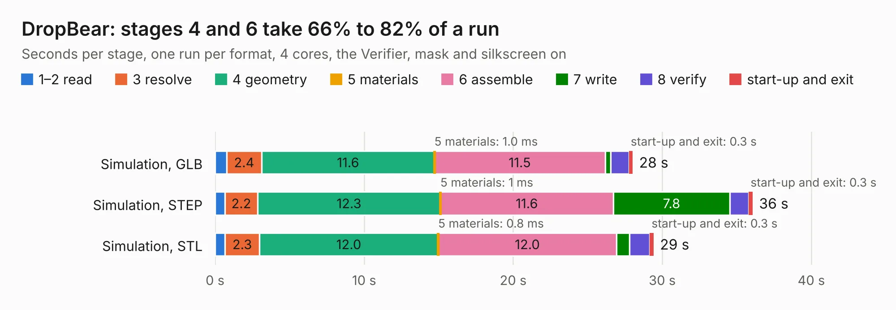

| Mode and format | 1–2 read | 3 resolve | 4 geometry | 5 materials | 6 assemble | 7 write | 8 verify | start-up and exit | Total |
|---|---:|---:|---:|---:|---:|---:|---:|---:|---:|
| Simulation, GLB | 0.8 | 2.4 | 11.6 | 1.0&nbsp;ms | 11.5 | 0.4 | 1.2 | 0.3 | 28.0 |
| Simulation, STEP | 0.7 | 2.2 | 12.3 | 1&nbsp;ms | 11.6 | 7.8 | 1.3 | 0.3 | 36.1 |
| Simulation, STL | 0.7 | 2.3 | 12.0 | 0.8&nbsp;ms | 12.0 | 0.9 | 1.3 | 0.3 | 29.4 |
| Simulation, OBJ | 0.7 | 2.2 | 12.5 | 0.7&nbsp;ms | 11.9 | 12.6 | 1.3 | 0.3 | 41.4 |
| Visual, GLB | 0.9 | 2.5 | 12.4 | 0.9&nbsp;ms | 26.2 | 0.3 | 3.3 | 0.3 | 45.9 |
| Visual, OBJ | 0.8 | 2.4 | 12.8 | 1&nbsp;ms | 26.3 | 9.9 | 4.0 | 0.3 | 56.4 |

<table align="center"><tr><td valign="top">

| Board | Repo: [speeduino/hardware](https://github.com/speeduino/hardware) Board: `DropBear.kicad_pcb` |
|---|---|
| Folder | DropBear / V2 |
| Complexity | 347&nbsp;/&nbsp;1000 (size&nbsp;252, features&nbsp;95) |
| KESE&nbsp;features | through vias, slotted holes, rounded, trapezoid or chamfered pads, filled zones, curved board outline, stack-up, dielectric εr and tanδ |
| Tested | 9th November 2026 |
| Copper&nbsp;layers | 2 |
| File&nbsp;format | KiCad 7 (20221018) |
| Parts,&nbsp;tracks,&nbsp;vias | 196, 1,873, 400 |
| Triangles,&nbsp;simulation | 2,619,384 in 260 parts |
| Verifier | PASS in all six runs |

</td><td valign="top">

<table>
<tr><th>File type</th><th>File size</th><th>Peak memory used</th></tr>
<tr><th colspan="3" align="left">Simulation</th></tr>
<tr><td>GLB</td><td align="right">90&nbsp;MB</td><td align="right">930&nbsp;MB</td></tr>
<tr><td>STEP</td><td align="right">447&nbsp;MB</td><td align="right">1.2&nbsp;GB</td></tr>
<tr><td>STL</td><td align="right">131&nbsp;MB</td><td align="right">926&nbsp;MB</td></tr>
<tr><td>OBJ</td><td align="right">277&nbsp;MB</td><td align="right">1.7&nbsp;GB</td></tr>
<tr><th colspan="3" align="left">Visual</th></tr>
<tr><td>GLB</td><td align="right">71&nbsp;MB</td><td align="right">1.2&nbsp;GB</td></tr>
<tr><td>OBJ</td><td align="right">219&nbsp;MB</td><td align="right">1.5&nbsp;GB</td></tr>
</table>

</td></tr></table>

## 2614. 48-pin breakout

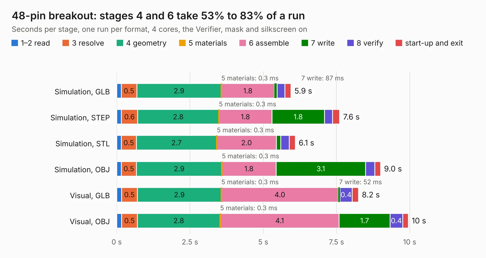

| Mode and format | 1–2 read | 3 resolve | 4 geometry | 5 materials | 6 assemble | 7 write | 8 verify | start-up and exit | Total |
|---|---:|---:|---:|---:|---:|---:|---:|---:|---:|
| Simulation, GLB | 0.2 | 0.5 | 2.9 | 0.3&nbsp;ms | 1.8 | 87&nbsp;ms | 0.3 | 0.2 | 5.9 |
| Simulation, STEP | 0.2 | 0.6 | 2.8 | 0.3&nbsp;ms | 1.8 | 1.8 | 0.3 | 0.2 | 7.6 |
| Simulation, STL | 0.2 | 0.5 | 2.7 | 0.3&nbsp;ms | 2.0 | 0.1 | 0.3 | 0.2 | 6.1 |
| Simulation, OBJ | 0.2 | 0.5 | 2.9 | 0.3&nbsp;ms | 1.8 | 3.1 | 0.3 | 0.2 | 9.0 |
| Visual, GLB | 0.2 | 0.5 | 2.9 | 0.3&nbsp;ms | 4.0 | 52&nbsp;ms | 0.4 | 0.2 | 8.2 |
| Visual, OBJ | 0.2 | 0.5 | 2.8 | 0.3&nbsp;ms | 4.1 | 1.7 | 0.4 | 0.2 | 10.0 |

<table align="center"><tr><td valign="top">

| Board | Repo: [speeduino/hardware](https://github.com/speeduino/hardware) Board: `48-pin breakout.kicad_pcb` |
|---|---|
| Folder | PNPs / Miata NA6 / Latest / 48-pin breakout |
| Complexity | 148&nbsp;/&nbsp;1000 (size&nbsp;113, features&nbsp;35) |
| KESE&nbsp;features | through vias, filled zones |
| Tested | 9th November 2026 |
| Copper&nbsp;layers | 2 |
| File&nbsp;format | KiCad 5 (20171130) |
| Parts,&nbsp;tracks,&nbsp;vias | 4, 111, 4 |
| Triangles,&nbsp;simulation | 609,954 in 56 parts |
| Verifier | PASS in all six runs |

</td><td valign="top">

<table>
<tr><th>File type</th><th>File size</th><th>Peak memory used</th></tr>
<tr><th colspan="3" align="left">Simulation</th></tr>
<tr><td>GLB</td><td align="right">21&nbsp;MB</td><td align="right">315&nbsp;MB</td></tr>
<tr><td>STEP</td><td align="right">99&nbsp;MB</td><td align="right">359&nbsp;MB</td></tr>
<tr><td>STL</td><td align="right">31&nbsp;MB</td><td align="right">311&nbsp;MB</td></tr>
<tr><td>OBJ</td><td align="right">62&nbsp;MB</td><td align="right">446&nbsp;MB</td></tr>
<tr><th colspan="3" align="left">Visual</th></tr>
<tr><td>GLB</td><td align="right">12&nbsp;MB</td><td align="right">356&nbsp;MB</td></tr>
<tr><td>OBJ</td><td align="right">37&nbsp;MB</td><td align="right">355&nbsp;MB</td></tr>
</table>

</td></tr></table>

## 2615. NA6 v1.3

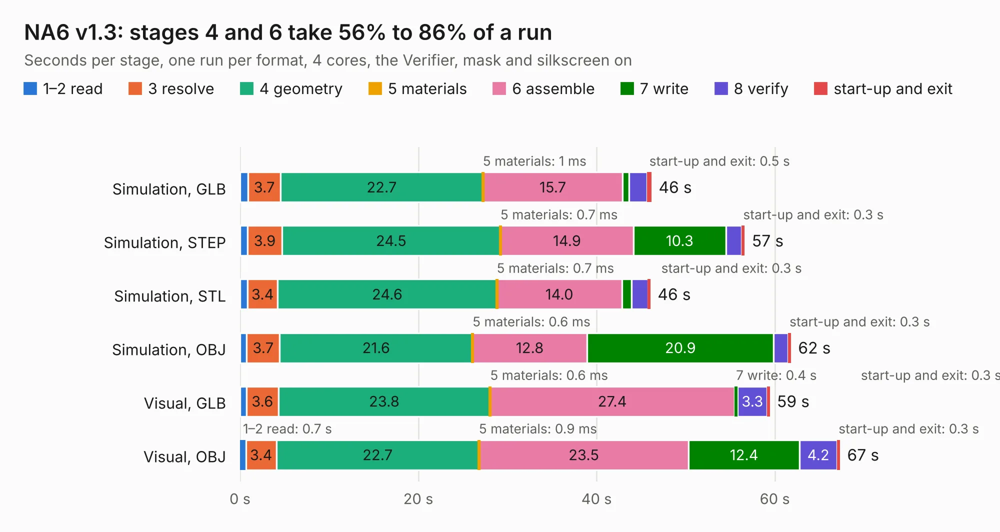

| Mode and format | 1–2 read | 3 resolve | 4 geometry | 5 materials | 6 assemble | 7 write | 8 verify | start-up and exit | Total |
|---|---:|---:|---:|---:|---:|---:|---:|---:|---:|
| Simulation, GLB | 0.9 | 3.7 | 22.7 | 1&nbsp;ms | 15.7 | 0.7 | 2.0 | 0.5 | 46.2 |
| Simulation, STEP | 0.8 | 3.9 | 24.5 | 0.7&nbsp;ms | 14.9 | 10.3 | 1.8 | 0.3 | 56.6 |
| Simulation, STL | 0.8 | 3.4 | 24.6 | 0.7&nbsp;ms | 14.0 | 1.1 | 1.9 | 0.3 | 46.0 |
| Simulation, OBJ | 0.7 | 3.7 | 21.6 | 0.6&nbsp;ms | 12.8 | 20.9 | 1.6 | 0.3 | 61.8 |
| Visual, GLB | 0.7 | 3.6 | 23.8 | 0.6&nbsp;ms | 27.4 | 0.4 | 3.3 | 0.3 | 59.4 |
| Visual, OBJ | 0.7 | 3.4 | 22.7 | 0.9&nbsp;ms | 23.5 | 12.4 | 4.2 | 0.3 | 67.3 |

<table align="center"><tr><td valign="top">

| Board | Repo: [speeduino/hardware](https://github.com/speeduino/hardware) Board: `NA6 v1.3.kicad_pcb` |
|---|---|
| Folder | PNPs / Miata NA6 / Latest |
| Complexity | 300&nbsp;/&nbsp;1000 (size&nbsp;230, features&nbsp;70) |
| KESE&nbsp;features | through vias, custom pads, rounded, trapezoid or chamfered pads, filled zones, copper drawings |
| Tested | 9th November 2026 |
| Copper&nbsp;layers | 2 |
| File&nbsp;format | KiCad 7 (20221018) |
| Parts,&nbsp;tracks,&nbsp;vias | 146, 1,019, 130 |
| Triangles,&nbsp;simulation | 2,797,794 in 233 parts |
| Verifier | PASS in all six runs |

</td><td valign="top">

<table>
<tr><th>File type</th><th>File size</th><th>Peak memory used</th></tr>
<tr><th colspan="3" align="left">Simulation</th></tr>
<tr><td>GLB</td><td align="right">97&nbsp;MB</td><td align="right">880&nbsp;MB</td></tr>
<tr><td>STEP</td><td align="right">517&nbsp;MB</td><td align="right">1.2&nbsp;GB</td></tr>
<tr><td>STL</td><td align="right">140&nbsp;MB</td><td align="right">979&nbsp;MB</td></tr>
<tr><td>OBJ</td><td align="right">298&nbsp;MB</td><td align="right">1.9&nbsp;GB</td></tr>
<tr><th colspan="3" align="left">Visual</th></tr>
<tr><td>GLB</td><td align="right">60&nbsp;MB</td><td align="right">1.0&nbsp;GB</td></tr>
<tr><td>OBJ</td><td align="right">184&nbsp;MB</td><td align="right">1.3&nbsp;GB</td></tr>
</table>

</td></tr></table>

## 2616. NA6

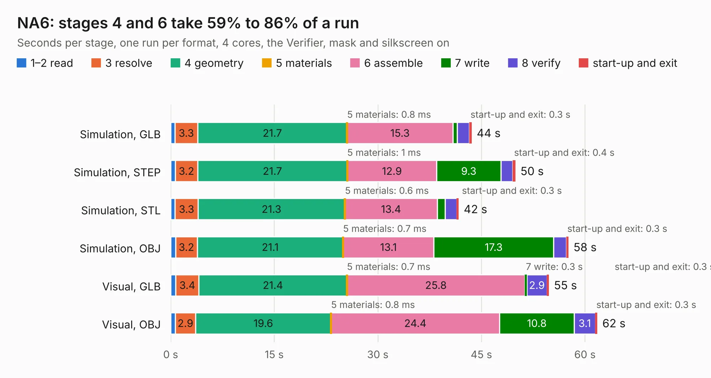

| Mode and format | 1–2 read | 3 resolve | 4 geometry | 5 materials | 6 assemble | 7 write | 8 verify | start-up and exit | Total |
|---|---:|---:|---:|---:|---:|---:|---:|---:|---:|
| Simulation, GLB | 0.6 | 3.3 | 21.7 | 0.8&nbsp;ms | 15.3 | 0.6 | 1.8 | 0.3 | 43.6 |
| Simulation, STEP | 0.7 | 3.2 | 21.7 | 1&nbsp;ms | 12.9 | 9.3 | 1.7 | 0.4 | 49.9 |
| Simulation, STL | 0.6 | 3.3 | 21.3 | 0.6&nbsp;ms | 13.4 | 1.2 | 1.7 | 0.3 | 41.7 |
| Simulation, OBJ | 0.7 | 3.2 | 21.1 | 0.7&nbsp;ms | 13.1 | 17.3 | 1.9 | 0.3 | 57.6 |
| Visual, GLB | 0.7 | 3.4 | 21.4 | 0.7&nbsp;ms | 25.8 | 0.3 | 2.9 | 0.3 | 54.8 |
| Visual, OBJ | 0.7 | 2.9 | 19.6 | 0.8&nbsp;ms | 24.4 | 10.8 | 3.1 | 0.3 | 61.8 |

<table align="center"><tr><td valign="top">

| Board | Repo: [speeduino/hardware](https://github.com/speeduino/hardware) Board: `NA6.kicad_pcb` |
|---|---|
| Folder | PNPs / Miata NA6 / Prior versions / v1.2 |
| Complexity | 298&nbsp;/&nbsp;1000 (size&nbsp;228, features&nbsp;70) |
| KESE&nbsp;features | through vias, custom pads, rounded, trapezoid or chamfered pads, filled zones, copper drawings |
| Tested | 9th November 2026 |
| Copper&nbsp;layers | 2 |
| File&nbsp;format | KiCad 5 (20171130) |
| Parts,&nbsp;tracks,&nbsp;vias | 141, 963, 107 |
| Triangles,&nbsp;simulation | 2,917,634 in 234 parts |
| Verifier | PASS in all six runs |

</td><td valign="top">

<table>
<tr><th>File type</th><th>File size</th><th>Peak memory used</th></tr>
<tr><th colspan="3" align="left">Simulation</th></tr>
<tr><td>GLB</td><td align="right">100&nbsp;MB</td><td align="right">1.1&nbsp;GB</td></tr>
<tr><td>STEP</td><td align="right">516&nbsp;MB</td><td align="right">1.2&nbsp;GB</td></tr>
<tr><td>STL</td><td align="right">146&nbsp;MB</td><td align="right">1.0&nbsp;GB</td></tr>
<tr><td>OBJ</td><td align="right">309&nbsp;MB</td><td align="right">2.0&nbsp;GB</td></tr>
<tr><th colspan="3" align="left">Visual</th></tr>
<tr><td>GLB</td><td align="right">65&nbsp;MB</td><td align="right">1.2&nbsp;GB</td></tr>
<tr><td>OBJ</td><td align="right">199&nbsp;MB</td><td align="right">1.4&nbsp;GB</td></tr>
</table>

</td></tr></table>

## 2617. Screw terminal interface

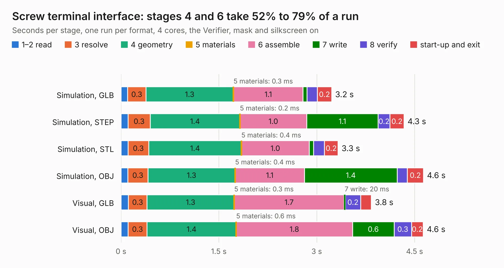

| Mode and format | 1–2 read | 3 resolve | 4 geometry | 5 materials | 6 assemble | 7 write | 8 verify | start-up and exit | Total |
|---|---:|---:|---:|---:|---:|---:|---:|---:|---:|
| Simulation, GLB | 0.1 | 0.3 | 1.3 | 0.3&nbsp;ms | 1.1 | 62&nbsp;ms | 0.2 | 0.2 | 3.2 |
| Simulation, STEP | 0.1 | 0.3 | 1.4 | 0.2&nbsp;ms | 1.0 | 1.1 | 0.2 | 0.2 | 4.3 |
| Simulation, STL | 0.1 | 0.3 | 1.4 | 0.4&nbsp;ms | 1.0 | 66&nbsp;ms | 0.2 | 0.2 | 3.3 |
| Simulation, OBJ | 0.1 | 0.3 | 1.3 | 0.4&nbsp;ms | 1.1 | 1.4 | 0.2 | 0.2 | 4.6 |
| Visual, GLB | 0.1 | 0.3 | 1.3 | 0.3&nbsp;ms | 1.7 | 20&nbsp;ms | 0.2 | 0.2 | 3.8 |
| Visual, OBJ | 0.1 | 0.3 | 1.4 | 0.6&nbsp;ms | 1.8 | 0.6 | 0.3 | 0.2 | 4.6 |

<table align="center"><tr><td valign="top">

| Board | Repo: [speeduino/hardware](https://github.com/speeduino/hardware) Board: `Screw terminal interface.kicad_pcb` |
|---|---|
| Folder | v0.4 / Interface boards / Screw terminals |
| Complexity | 95&nbsp;/&nbsp;1000 (size&nbsp;95, features&nbsp;0) |
| Tested | 9th November 2026 |
| Copper&nbsp;layers | 2 |
| File&nbsp;format | KiCad 4 (4) |
| Parts,&nbsp;tracks,&nbsp;vias | 7, 29, 0 |
| Triangles,&nbsp;simulation | 292,454 in 53 parts |
| Verifier | PASS in all six runs |

</td><td valign="top">

<table>
<tr><th>File type</th><th>File size</th><th>Peak memory used</th></tr>
<tr><th colspan="3" align="left">Simulation</th></tr>
<tr><td>GLB</td><td align="right">9.7&nbsp;MB</td><td align="right">222&nbsp;MB</td></tr>
<tr><td>STEP</td><td align="right">44&nbsp;MB</td><td align="right">256&nbsp;MB</td></tr>
<tr><td>STL</td><td align="right">15&nbsp;MB</td><td align="right">222&nbsp;MB</td></tr>
<tr><td>OBJ</td><td align="right">29&nbsp;MB</td><td align="right">250&nbsp;MB</td></tr>
<tr><th colspan="3" align="left">Visual</th></tr>
<tr><td>GLB</td><td align="right">4.5&nbsp;MB</td><td align="right">255&nbsp;MB</td></tr>
<tr><td>OBJ</td><td align="right">13&nbsp;MB</td><td align="right">276&nbsp;MB</td></tr>
</table>

</td></tr></table>

## 2618. v0.4.4d

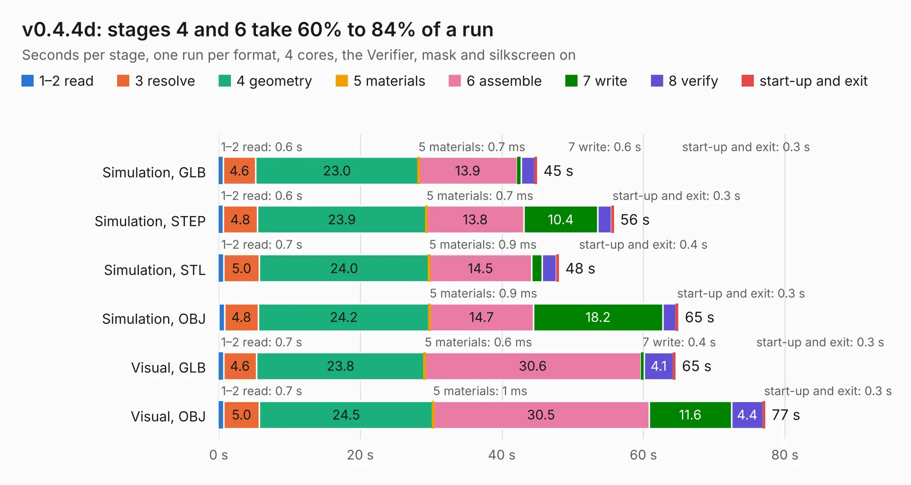

| Mode and format | 1–2 read | 3 resolve | 4 geometry | 5 materials | 6 assemble | 7 write | 8 verify | start-up and exit | Total |
|---|---:|---:|---:|---:|---:|---:|---:|---:|---:|
| Simulation, GLB | 0.6 | 4.6 | 23.0 | 0.7&nbsp;ms | 13.9 | 0.6 | 1.9 | 0.3 | 45.0 |
| Simulation, STEP | 0.6 | 4.8 | 23.9 | 0.7&nbsp;ms | 13.8 | 10.4 | 2.0 | 0.3 | 55.8 |
| Simulation, STL | 0.7 | 5.0 | 24.0 | 0.9&nbsp;ms | 14.5 | 1.4 | 2.0 | 0.4 | 48.0 |
| Simulation, OBJ | 0.8 | 4.8 | 24.2 | 0.9&nbsp;ms | 14.7 | 18.2 | 1.9 | 0.3 | 64.9 |
| Visual, GLB | 0.7 | 4.6 | 23.8 | 0.6&nbsp;ms | 30.6 | 0.4 | 4.1 | 0.3 | 64.5 |
| Visual, OBJ | 0.7 | 5.0 | 24.5 | 1&nbsp;ms | 30.5 | 11.6 | 4.4 | 0.3 | 77.2 |

<table align="center"><tr><td valign="top">

| Board | Repo: [speeduino/hardware](https://github.com/speeduino/hardware) Board: `v0.4.4d.kicad_pcb` |
|---|---|
| Folder | v0.4 / SMD / Latest |
| Complexity | 262&nbsp;/&nbsp;1000 (size&nbsp;192, features&nbsp;70) |
| KESE&nbsp;features | through vias, custom pads, rounded, trapezoid or chamfered pads, filled zones, copper drawings |
| Tested | 9th November 2026 |
| Copper&nbsp;layers | 2 |
| File&nbsp;format | KiCad 5 (20171130) |
| Parts,&nbsp;tracks,&nbsp;vias | 147, 1,055, 178 |
| Triangles,&nbsp;simulation | 3,530,694 in 196 parts |
| Verifier | PASS in all six runs |

</td><td valign="top">

<table>
<tr><th>File type</th><th>File size</th><th>Peak memory used</th></tr>
<tr><th colspan="3" align="left">Simulation</th></tr>
<tr><td>GLB</td><td align="right">122&nbsp;MB</td><td align="right">1.2&nbsp;GB</td></tr>
<tr><td>STEP</td><td align="right">641&nbsp;MB</td><td align="right">1.3&nbsp;GB</td></tr>
<tr><td>STL</td><td align="right">177&nbsp;MB</td><td align="right">1.2&nbsp;GB</td></tr>
<tr><td>OBJ</td><td align="right">376&nbsp;MB</td><td align="right">2.3&nbsp;GB</td></tr>
<tr><th colspan="3" align="left">Visual</th></tr>
<tr><td>GLB</td><td align="right">80&nbsp;MB</td><td align="right">1.3&nbsp;GB</td></tr>
<tr><td>OBJ</td><td align="right">249&nbsp;MB</td><td align="right">1.6&nbsp;GB</td></tr>
</table>

</td></tr></table>

## 2619. v0.4.4b

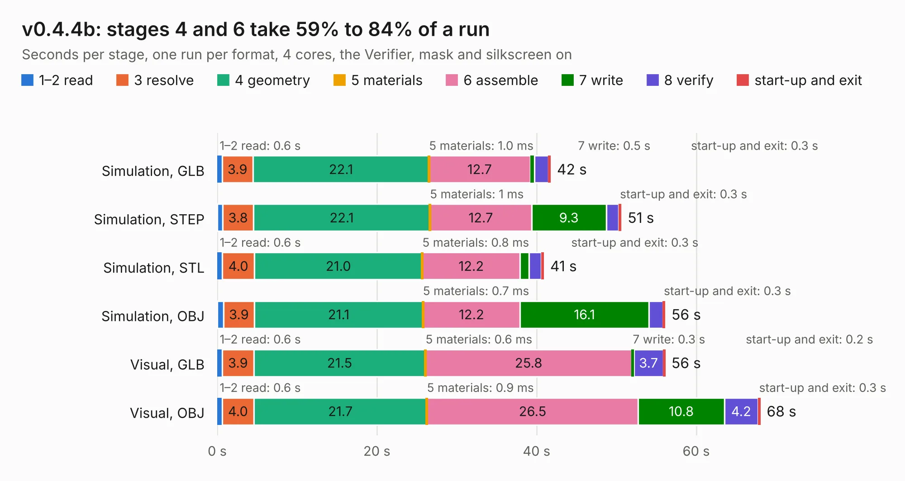

| Mode and format | 1–2 read | 3 resolve | 4 geometry | 5 materials | 6 assemble | 7 write | 8 verify | start-up and exit | Total |
|---|---:|---:|---:|---:|---:|---:|---:|---:|---:|
| Simulation, GLB | 0.6 | 3.9 | 22.1 | 1.0&nbsp;ms | 12.7 | 0.5 | 1.8 | 0.3 | 41.7 |
| Simulation, STEP | 0.7 | 3.8 | 22.1 | 1&nbsp;ms | 12.7 | 9.3 | 1.6 | 0.3 | 50.6 |
| Simulation, STL | 0.6 | 4.0 | 21.0 | 0.8&nbsp;ms | 12.2 | 1.1 | 1.5 | 0.3 | 40.9 |
| Simulation, OBJ | 0.8 | 3.9 | 21.1 | 0.7&nbsp;ms | 12.2 | 16.1 | 1.7 | 0.3 | 56.1 |
| Visual, GLB | 0.6 | 3.9 | 21.5 | 0.6&nbsp;ms | 25.8 | 0.3 | 3.7 | 0.2 | 56.1 |
| Visual, OBJ | 0.6 | 4.0 | 21.7 | 0.9&nbsp;ms | 26.5 | 10.8 | 4.2 | 0.3 | 68.0 |

<table align="center"><tr><td valign="top">

| Board | Repo: [speeduino/hardware](https://github.com/speeduino/hardware) Board: `v0.4.4b.kicad_pcb` |
|---|---|
| Folder | v0.4 / SMD / Prior Versions / 0.4.4b |
| Complexity | 233&nbsp;/&nbsp;1000 (size&nbsp;188, features&nbsp;45) |
| KESE&nbsp;features | through vias, rounded, trapezoid or chamfered pads, filled zones |
| Tested | 9th November 2026 |
| Copper&nbsp;layers | 2 |
| File&nbsp;format | KiCad 5 (20171130) |
| Parts,&nbsp;tracks,&nbsp;vias | 143, 990, 89 |
| Triangles,&nbsp;simulation | 3,391,558 in 194 parts |
| Verifier | PASS in all six runs |

</td><td valign="top">

<table>
<tr><th>File type</th><th>File size</th><th>Peak memory used</th></tr>
<tr><th colspan="3" align="left">Simulation</th></tr>
<tr><td>GLB</td><td align="right">117&nbsp;MB</td><td align="right">1.2&nbsp;GB</td></tr>
<tr><td>STEP</td><td align="right">631&nbsp;MB</td><td align="right">1.4&nbsp;GB</td></tr>
<tr><td>STL</td><td align="right">170&nbsp;MB</td><td align="right">1.1&nbsp;GB</td></tr>
<tr><td>OBJ</td><td align="right">361&nbsp;MB</td><td align="right">2.2&nbsp;GB</td></tr>
<tr><th colspan="3" align="left">Visual</th></tr>
<tr><td>GLB</td><td align="right">76&nbsp;MB</td><td align="right">1.3&nbsp;GB</td></tr>
<tr><td>OBJ</td><td align="right">234&nbsp;MB</td><td align="right">1.6&nbsp;GB</td></tr>
</table>

</td></tr></table>

## 2620. v0.4.4c

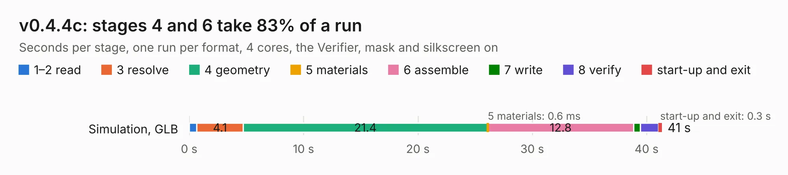

| Mode and format | 1–2 read | 3 resolve | 4 geometry | 5 materials | 6 assemble | 7 write | 8 verify | start-up and exit | Total |
|---|---:|---:|---:|---:|---:|---:|---:|---:|---:|
| Simulation, GLB | 0.7 | 4.1 | 21.4 | 0.6&nbsp;ms | 12.8 | 0.6 | 1.6 | 0.3 | 41.3 |
| Simulation, STEP | 0.7 | 4.1 | 20.9 | 0.6&nbsp;ms | 12.0 | 9.4 | 1.6 | 0.3 | 48.9 |
| Simulation, STL | 0.7 | 4.2 | 22.0 | 0.7&nbsp;ms | 12.9 | 1.3 | 1.7 | 0.3 | 43.1 |
| Simulation, OBJ | 0.7 | 4.2 | 21.4 | 0.9&nbsp;ms | 12.9 | 16.7 | 1.9 | 0.3 | 58.2 |
| Visual, GLB | 0.6 | 4.3 | 22.0 | 0.8&nbsp;ms | 28.2 | 0.3 | 3.9 | 0.3 | 59.7 |
| Visual, OBJ | 0.7 | 4.4 | 21.1 | 0.7&nbsp;ms | 26.2 | 10.1 | 4.0 | 0.3 | 66.8 |

<table align="center"><tr><td valign="top">

| Board | Repo: [speeduino/hardware](https://github.com/speeduino/hardware) Board: `v0.4.4c.kicad_pcb` |
|---|---|
| Folder | v0.4 / SMD / Prior Versions / 0.4.4c |
| Complexity | 259&nbsp;/&nbsp;1000 (size&nbsp;189, features&nbsp;70) |
| KESE&nbsp;features | through vias, custom pads, rounded, trapezoid or chamfered pads, filled zones, copper drawings |
| Tested | 9th November 2026 |
| Copper&nbsp;layers | 2 |
| File&nbsp;format | KiCad 5 (20171130) |
| Parts,&nbsp;tracks,&nbsp;vias | 148, 1,038, 113 |
| Triangles,&nbsp;simulation | 3,484,966 in 196 parts |
| Verifier | PASS in all six runs |

</td><td valign="top">

<table>
<tr><th>File type</th><th>File size</th><th>Peak memory used</th></tr>
<tr><th colspan="3" align="left">Simulation</th></tr>
<tr><td>GLB</td><td align="right">120&nbsp;MB</td><td align="right">1.3&nbsp;GB</td></tr>
<tr><td>STEP</td><td align="right">640&nbsp;MB</td><td align="right">1.4&nbsp;GB</td></tr>
<tr><td>STL</td><td align="right">174&nbsp;MB</td><td align="right">1.3&nbsp;GB</td></tr>
<tr><td>OBJ</td><td align="right">371&nbsp;MB</td><td align="right">2.3&nbsp;GB</td></tr>
<tr><th colspan="3" align="left">Visual</th></tr>
<tr><td>GLB</td><td align="right">78&nbsp;MB</td><td align="right">1.3&nbsp;GB</td></tr>
<tr><td>OBJ</td><td align="right">243&nbsp;MB</td><td align="right">1.7&nbsp;GB</td></tr>
</table>

</td></tr></table>

## 2621. v0.4.3d

| Mode and format | 1–2 read | 3 resolve | 4 geometry | 5 materials | 6 assemble | 7 write | 8 verify | start-up and exit | Total |
|---|---:|---:|---:|---:|---:|---:|---:|---:|---:|
| Simulation, GLB | 0.7 | 3.5 | 20.1 | 0.8&nbsp;ms | 13.2 | 0.6 | 2.0 | 0.3 | 40.4 |
| Simulation, STEP | 0.6 | 3.5 | 19.7 | 0.6&nbsp;ms | 12.9 | 9.7 | 1.9 | 0.3 | 48.6 |
| Simulation, STL | 0.7 | 3.5 | 19.8 | 0.9&nbsp;ms | 13.1 | 1.1 | 2.0 | 0.3 | 40.5 |
| Simulation, OBJ | 0.6 | 3.5 | 19.6 | 0.9&nbsp;ms | 13.2 | 19.7 | 2.0 | 0.3 | 58.8 |
| Visual, GLB | 0.6 | 3.5 | 19.5 | 0.5&nbsp;ms | 27.4 | 0.3 | 2.4 | 0.2 | 53.9 |
| Visual, OBJ | 0.6 | 3.5 | 19.6 | 0.6&nbsp;ms | 28.6 | 12.6 | 3.1 | 0.2 | 68.3 |

<table align="center"><tr><td valign="top">

| Board | Repo: [speeduino/hardware](https://github.com/speeduino/hardware) Board: `v0.4.3d.kicad_pcb` |
|---|---|
| Folder | v0.4 / THT / Latest |
| Complexity | 258&nbsp;/&nbsp;1000 (size&nbsp;188, features&nbsp;70) |
| KESE&nbsp;features | through vias, custom pads, drill offsets, filled zones, copper drawings |
| Tested | 9th November 2026 |
| Copper&nbsp;layers | 2 |
| File&nbsp;format | KiCad 5 (20171130) |
| Parts,&nbsp;tracks,&nbsp;vias | 133, 989, 124 |
| Triangles,&nbsp;simulation | 3,718,100 in 174 parts |
| Verifier | PASS in all six runs |

</td><td valign="top">

<table>
<tr><th>File type</th><th>File size</th><th>Peak memory used</th></tr>
<tr><th colspan="3" align="left">Simulation</th></tr>
<tr><td>GLB</td><td align="right">128&nbsp;MB</td><td align="right">1.1&nbsp;GB</td></tr>
<tr><td>STEP</td><td align="right">622&nbsp;MB</td><td align="right">1.4&nbsp;GB</td></tr>
<tr><td>STL</td><td align="right">186&nbsp;MB</td><td align="right">1.1&nbsp;GB</td></tr>
<tr><td>OBJ</td><td align="right">396&nbsp;MB</td><td align="right">2.4&nbsp;GB</td></tr>
<tr><th colspan="3" align="left">Visual</th></tr>
<tr><td>GLB</td><td align="right">80&nbsp;MB</td><td align="right">1.3&nbsp;GB</td></tr>
<tr><td>OBJ</td><td align="right">250&nbsp;MB</td><td align="right">1.7&nbsp;GB</td></tr>
</table>

</td></tr></table>

## 2622. VR-Conditioner-MAX9926+reg

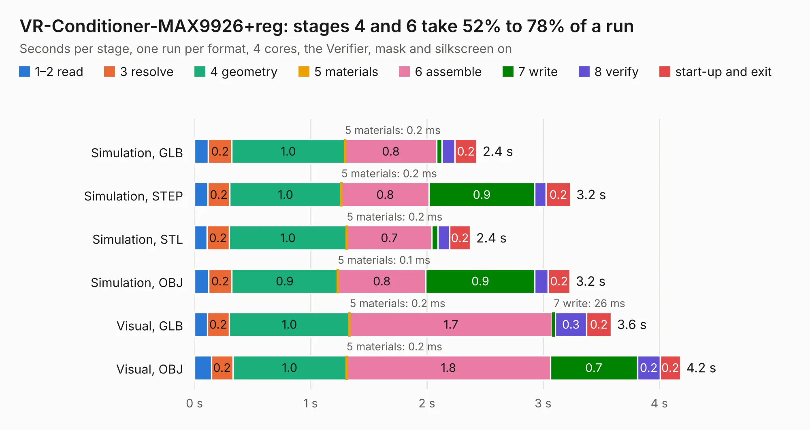

| Mode and format | 1–2 read | 3 resolve | 4 geometry | 5 materials | 6 assemble | 7 write | 8 verify | start-up and exit | Total |
|---|---:|---:|---:|---:|---:|---:|---:|---:|---:|
| Simulation, GLB | 0.1 | 0.2 | 1.0 | 0.2&nbsp;ms | 0.8 | 46&nbsp;ms | 0.1 | 0.2 | 2.4 |
| Simulation, STEP | 0.1 | 0.2 | 1.0 | 0.2&nbsp;ms | 0.8 | 0.9 | 0.1 | 0.2 | 3.2 |
| Simulation, STL | 0.1 | 0.2 | 1.0 | 0.2&nbsp;ms | 0.7 | 51&nbsp;ms | 0.1 | 0.2 | 2.4 |
| Simulation, OBJ | 0.1 | 0.2 | 0.9 | 0.1&nbsp;ms | 0.8 | 0.9 | 0.1 | 0.2 | 3.2 |
| Visual, GLB | 0.1 | 0.2 | 1.0 | 0.2&nbsp;ms | 1.7 | 26&nbsp;ms | 0.3 | 0.2 | 3.6 |
| Visual, OBJ | 0.1 | 0.2 | 1.0 | 0.2&nbsp;ms | 1.8 | 0.7 | 0.2 | 0.2 | 4.2 |

<table align="center"><tr><td valign="top">

| Board | Repo: [speeduino/hardware](https://github.com/speeduino/hardware) Board: `VR-Conditioner-MAX9926+reg.kicad_pcb` |
|---|---|
| Folder | VR Conditioner / Latest |
| Complexity | 193&nbsp;/&nbsp;1000 (size&nbsp;138, features&nbsp;55) |
| KESE&nbsp;features | through vias, rounded, trapezoid or chamfered pads, filled zones, curved board outline |
| Tested | 9th November 2026 |
| Copper&nbsp;layers | 2 |
| File&nbsp;format | KiCad 5 (20171130) |
| Parts,&nbsp;tracks,&nbsp;vias | 18, 209, 6 |
| Triangles,&nbsp;simulation | 241,764 in 28 parts |
| Verifier | PASS in all six runs |

</td><td valign="top">

<table>
<tr><th>File type</th><th>File size</th><th>Peak memory used</th></tr>
<tr><th colspan="3" align="left">Simulation</th></tr>
<tr><td>GLB</td><td align="right">8.6&nbsp;MB</td><td align="right">222&nbsp;MB</td></tr>
<tr><td>STEP</td><td align="right">44&nbsp;MB</td><td align="right">237&nbsp;MB</td></tr>
<tr><td>STL</td><td align="right">12&nbsp;MB</td><td align="right">219&nbsp;MB</td></tr>
<tr><td>OBJ</td><td align="right">25&nbsp;MB</td><td align="right">216&nbsp;MB</td></tr>
<tr><th colspan="3" align="left">Visual</th></tr>
<tr><td>GLB</td><td align="right">6.1&nbsp;MB</td><td align="right">213&nbsp;MB</td></tr>
<tr><td>OBJ</td><td align="right">18&nbsp;MB</td><td align="right">199&nbsp;MB</td></tr>
</table>

</td></tr></table>

## 2623. DubaiXTClone

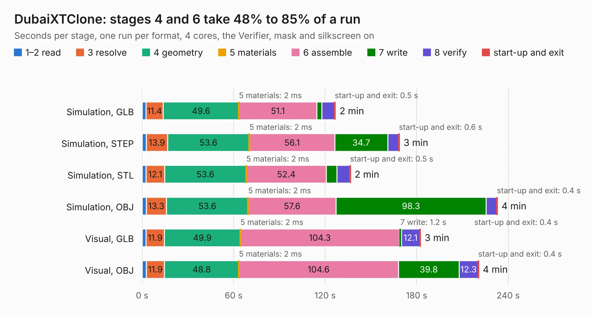

| Mode and format | 1–2 read | 3 resolve | 4 geometry | 5 materials | 6 assemble | 7 write | 8 verify | start-up and exit | Total |
|---|---:|---:|---:|---:|---:|---:|---:|---:|---:|
| Simulation, GLB | 2.5 | 11.4 | 49.6 | 2&nbsp;ms | 51.1 | 3.3 | 8.2 | 0.5 | 126.6 |
| Simulation, STEP | 2.7 | 13.9 | 53.6 | 2&nbsp;ms | 56.1 | 34.7 | 7.0 | 0.6 | 168.7 |
| Simulation, STL | 2.6 | 12.1 | 53.6 | 2&nbsp;ms | 52.4 | 7.0 | 8.4 | 0.5 | 136.6 |
| Simulation, OBJ | 2.7 | 13.3 | 53.6 | 2&nbsp;ms | 57.6 | 98.3 | 7.0 | 0.4 | 232.9 |
| Visual, GLB | 2.6 | 11.9 | 49.9 | 2&nbsp;ms | 104.3 | 1.2 | 12.1 | 0.4 | 182.5 |
| Visual, OBJ | 2.7 | 11.9 | 48.8 | 2&nbsp;ms | 104.6 | 39.8 | 12.3 | 0.4 | 220.6 |

<table align="center"><tr><td valign="top">

| Board | Repo: [spencer-uk/DubaiXTClone](https://github.com/spencer-uk/DubaiXTClone) Board: `DubaiXTClone.kicad_pcb` |
|---|---|
| Complexity | 360&nbsp;/&nbsp;1000 (size&nbsp;240, features&nbsp;120) |
| KESE&nbsp;features | through vias, rounded, trapezoid or chamfered pads, filled zones, copper text, TrueType text, stack-up, dielectric εr and tanδ, copper finish, mask and silkscreen colours |
| Tested | 9th November 2026 |
| Copper&nbsp;layers | 4 |
| File&nbsp;format | KiCad 9 (20241229) |
| Parts,&nbsp;tracks,&nbsp;vias | 144, 9,528, 536 |
| Triangles,&nbsp;simulation | 14,240,612 in 407 parts |
| Verifier | PASS in all six runs |

</td><td valign="top">

<table>
<tr><th>File type</th><th>File size</th><th>Peak memory used</th></tr>
<tr><th colspan="3" align="left">Simulation</th></tr>
<tr><td>GLB</td><td align="right">481&nbsp;MB</td><td align="right">3.1&nbsp;GB</td></tr>
<tr><td>STEP</td><td align="right">1.7&nbsp;GB</td><td align="right">4.3&nbsp;GB</td></tr>
<tr><td>STL</td><td align="right">712&nbsp;MB</td><td align="right">3.1&nbsp;GB</td></tr>
<tr><td>OBJ</td><td align="right">1.5&nbsp;GB</td><td align="right">8.8&nbsp;GB</td></tr>
<tr><th colspan="3" align="left">Visual</th></tr>
<tr><td>GLB</td><td align="right">225&nbsp;MB</td><td align="right">3.7&nbsp;GB</td></tr>
<tr><td>OBJ</td><td align="right">734&nbsp;MB</td><td align="right">4.8&nbsp;GB</td></tr>
</table>

</td></tr></table>

## 2624. cm5-carrier

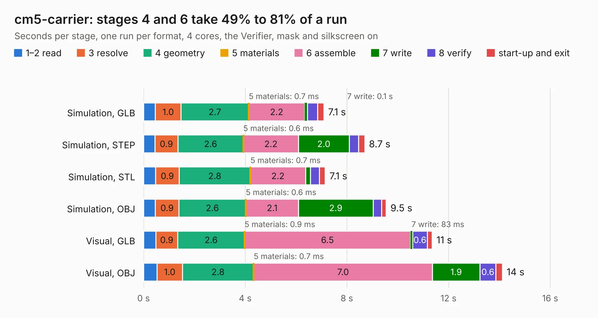

| Mode and format | 1–2 read | 3 resolve | 4 geometry | 5 materials | 6 assemble | 7 write | 8 verify | start-up and exit | Total |
|---|---:|---:|---:|---:|---:|---:|---:|---:|---:|
| Simulation, GLB | 0.5 | 1.0 | 2.7 | 0.7&nbsp;ms | 2.2 | 0.1 | 0.4 | 0.3 | 7.1 |
| Simulation, STEP | 0.4 | 0.9 | 2.6 | 0.6&nbsp;ms | 2.2 | 2.0 | 0.4 | 0.2 | 8.7 |
| Simulation, STL | 0.5 | 0.9 | 2.8 | 0.7&nbsp;ms | 2.2 | 0.2 | 0.3 | 0.2 | 7.1 |
| Simulation, OBJ | 0.5 | 0.9 | 2.6 | 0.6&nbsp;ms | 2.1 | 2.9 | 0.3 | 0.2 | 9.5 |
| Visual, GLB | 0.5 | 0.9 | 2.6 | 0.9&nbsp;ms | 6.5 | 83&nbsp;ms | 0.6 | 0.2 | 11.4 |
| Visual, OBJ | 0.5 | 1.0 | 2.8 | 0.7&nbsp;ms | 7.0 | 1.9 | 0.6 | 0.3 | 14.1 |

<table align="center"><tr><td valign="top">

| Board | Repo: [spirit-org/spirit](https://github.com/spirit-org/spirit) Board: `cm5-carrier.kicad_pcb` |
|---|---|
| Folder | EDA-kicad |
| Complexity | 362&nbsp;/&nbsp;1000 (size&nbsp;232, features&nbsp;130) |
| KESE&nbsp;features | through vias, slotted holes, custom pads, rounded, trapezoid or chamfered pads, filled zones, copper drawings, copper text, curved board outline, stack-up, dielectric εr and tanδ |
| Tested | 9th November 2026 |
| Copper&nbsp;layers | 6 |
| File&nbsp;format | KiCad 9 (20241229) |
| Parts,&nbsp;tracks,&nbsp;vias | 123, 243, 43 |
| Triangles,&nbsp;simulation | 708,064 in 381 parts |
| Verifier | PASS in all six runs |

</td><td valign="top">

<table>
<tr><th>File type</th><th>File size</th><th>Peak memory used</th></tr>
<tr><th colspan="3" align="left">Simulation</th></tr>
<tr><td>GLB</td><td align="right">25&nbsp;MB</td><td align="right">355&nbsp;MB</td></tr>
<tr><td>STEP</td><td align="right">104&nbsp;MB</td><td align="right">425&nbsp;MB</td></tr>
<tr><td>STL</td><td align="right">35&nbsp;MB</td><td align="right">355&nbsp;MB</td></tr>
<tr><td>OBJ</td><td align="right">75&nbsp;MB</td><td align="right">556&nbsp;MB</td></tr>
<tr><th colspan="3" align="left">Visual</th></tr>
<tr><td>GLB</td><td align="right">17&nbsp;MB</td><td align="right">432&nbsp;MB</td></tr>
<tr><td>OBJ</td><td align="right">50&nbsp;MB</td><td align="right">453&nbsp;MB</td></tr>
</table>

</td></tr></table>

## 2625. motherboard

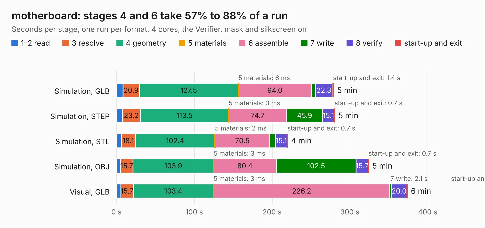

| Mode and format | 1–2 read | 3 resolve | 4 geometry | 5 materials | 6 assemble | 7 write | 8 verify | start-up and exit | Total |
|---|---:|---:|---:|---:|---:|---:|---:|---:|---:|
| Simulation, GLB | 8.3 | 20.9 | 127.5 | 6&nbsp;ms | 94.0 | 4.7 | 22.3 | 1.4 | 279.2 |
| Simulation, STEP | 7.5 | 23.2 | 113.5 | 3&nbsp;ms | 74.7 | 45.9 | 15.1 | 0.7 | 280.6 |
| Simulation, STL | 6.1 | 18.1 | 102.4 | 2&nbsp;ms | 70.5 | 7.1 | 15.1 | 0.7 | 220.0 |
| Simulation, OBJ | 5.4 | 15.7 | 103.9 | 3&nbsp;ms | 80.4 | 102.5 | 15.7 | 0.7 | 324.2 |
| Visual, GLB | 5.7 | 15.7 | 103.4 | 3&nbsp;ms | 226.2 | 2.1 | 20.0 | 0.8 | 373.9 |
| Visual, OBJ | 5.6 | 15.5 | 101.3 | 2&nbsp;ms | 208.6 | 66.1 | 16.7 | 0.4 | 414.2 |

<table align="center"><tr><td valign="top">

| Board | Repo: [sporniket/kicad-conversions--atari-260-520-st-motherboard--c070231](https://github.com/sporniket/kicad-conversions--atari-260-520-st-motherboard--c070231) Board: `motherboard.kicad_pcb` |
|---|---|
| Complexity | 371&nbsp;/&nbsp;1000 (size&nbsp;286, features&nbsp;85) |
| KESE&nbsp;features | through vias, slotted holes, filled zones, curved board outline, stack-up, dielectric εr and tanδ |
| Tested | 9th November 2026 |
| Copper&nbsp;layers | 2 |
| File&nbsp;format | KiCad 7 (20221018) |
| Parts,&nbsp;tracks,&nbsp;vias | 331, 13,570, 1,159 |
| Triangles,&nbsp;simulation | 14,594,790 in 433 parts |
| Verifier | PASS in all six runs |

</td><td valign="top">

<table>
<tr><th>File type</th><th>File size</th><th>Peak memory used</th></tr>
<tr><th colspan="3" align="left">Simulation</th></tr>
<tr><td>GLB</td><td align="right">491&nbsp;MB</td><td align="right">3.9&nbsp;GB</td></tr>
<tr><td>STEP</td><td align="right">2.5&nbsp;GB</td><td align="right">5.4&nbsp;GB</td></tr>
<tr><td>STL</td><td align="right">730&nbsp;MB</td><td align="right">4.1&nbsp;GB</td></tr>
<tr><td>OBJ</td><td align="right">1.6&nbsp;GB</td><td align="right">9.2&nbsp;GB</td></tr>
<tr><th colspan="3" align="left">Visual</th></tr>
<tr><td>GLB</td><td align="right">332&nbsp;MB</td><td align="right">5.2&nbsp;GB</td></tr>
<tr><td>OBJ</td><td align="right">1.1&nbsp;GB</td><td align="right">6.8&nbsp;GB</td></tr>
</table>

</td></tr></table>

## 2626. leaf

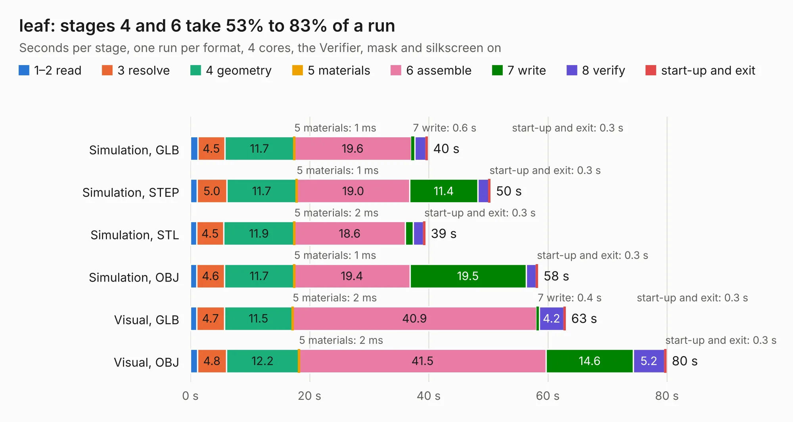

| Mode and format | 1–2 read | 3 resolve | 4 geometry | 5 materials | 6 assemble | 7 write | 8 verify | start-up and exit | Total |
|---|---:|---:|---:|---:|---:|---:|---:|---:|---:|
| Simulation, GLB | 1.3 | 4.5 | 11.7 | 1&nbsp;ms | 19.6 | 0.6 | 1.8 | 0.3 | 39.8 |
| Simulation, STEP | 1.1 | 5.0 | 11.7 | 1&nbsp;ms | 19.0 | 11.4 | 1.8 | 0.3 | 50.3 |
| Simulation, STL | 1.0 | 4.5 | 11.9 | 2&nbsp;ms | 18.6 | 1.3 | 1.7 | 0.3 | 39.4 |
| Simulation, OBJ | 1.1 | 4.6 | 11.7 | 1&nbsp;ms | 19.4 | 19.5 | 1.7 | 0.3 | 58.3 |
| Visual, GLB | 1.0 | 4.7 | 11.5 | 2&nbsp;ms | 40.9 | 0.4 | 4.2 | 0.3 | 63.0 |
| Visual, OBJ | 1.2 | 4.8 | 12.2 | 2&nbsp;ms | 41.5 | 14.6 | 5.2 | 0.3 | 79.9 |

<table align="center"><tr><td valign="top">

| Board | Repo: [sprhawk/leaf-rv1126](https://github.com/sprhawk/leaf-rv1126) Board: `leaf.kicad_pcb` |
|---|---|
| Complexity | 418&nbsp;/&nbsp;1000 (size&nbsp;313, features&nbsp;105) |
| KESE&nbsp;features | through vias, slotted holes, custom pads, rounded, trapezoid or chamfered pads, arc tracks, copper drawings, stack-up, dielectric εr and tanδ |
| Tested | 9th November 2026 |
| Copper&nbsp;layers | 6 |
| File&nbsp;format | KiCad 8 (20240108) |
| Parts,&nbsp;tracks,&nbsp;vias | 285, 4,899, 266 |
| Triangles,&nbsp;simulation | 4,149,684 in 578 parts |
| Verifier | PASS in all six runs |

</td><td valign="top">

<table>
<tr><th>File type</th><th>File size</th><th>Peak memory used</th></tr>
<tr><th colspan="3" align="left">Simulation</th></tr>
<tr><td>GLB</td><td align="right">138&nbsp;MB</td><td align="right">1.3&nbsp;GB</td></tr>
<tr><td>STEP</td><td align="right">661&nbsp;MB</td><td align="right">1.7&nbsp;GB</td></tr>
<tr><td>STL</td><td align="right">208&nbsp;MB</td><td align="right">1.4&nbsp;GB</td></tr>
<tr><td>OBJ</td><td align="right">438&nbsp;MB</td><td align="right">2.7&nbsp;GB</td></tr>
<tr><th colspan="3" align="left">Visual</th></tr>
<tr><td>GLB</td><td align="right">103&nbsp;MB</td><td align="right">1.7&nbsp;GB</td></tr>
<tr><td>OBJ</td><td align="right">327&nbsp;MB</td><td align="right">2.1&nbsp;GB</td></tr>
</table>

</td></tr></table>

## 2627. leaf-minipcie

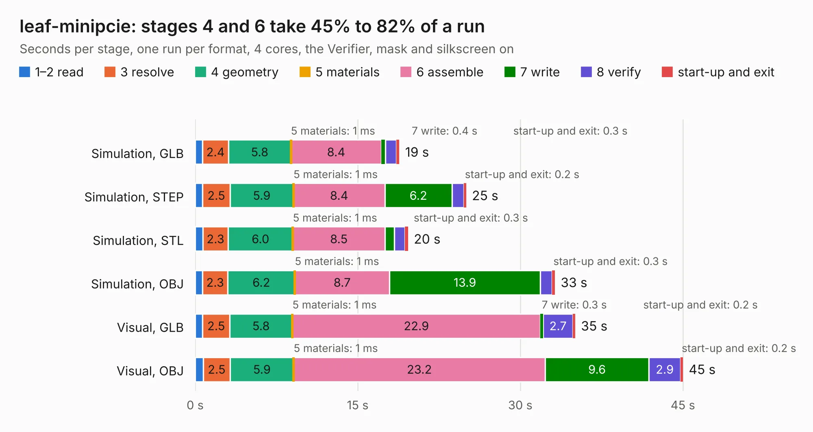

| Mode and format | 1–2 read | 3 resolve | 4 geometry | 5 materials | 6 assemble | 7 write | 8 verify | start-up and exit | Total |
|---|---:|---:|---:|---:|---:|---:|---:|---:|---:|
| Simulation, GLB | 0.7 | 2.4 | 5.8 | 1&nbsp;ms | 8.4 | 0.4 | 1.0 | 0.3 | 18.8 |
| Simulation, STEP | 0.7 | 2.5 | 5.9 | 1&nbsp;ms | 8.4 | 6.2 | 1.1 | 0.2 | 25.0 |
| Simulation, STL | 0.7 | 2.3 | 6.0 | 1&nbsp;ms | 8.5 | 0.9 | 1.0 | 0.3 | 19.6 |
| Simulation, OBJ | 0.7 | 2.3 | 6.2 | 1&nbsp;ms | 8.7 | 13.9 | 1.1 | 0.3 | 33.2 |
| Visual, GLB | 0.7 | 2.5 | 5.8 | 1&nbsp;ms | 22.9 | 0.3 | 2.7 | 0.2 | 35.1 |
| Visual, OBJ | 0.7 | 2.5 | 5.9 | 1&nbsp;ms | 23.2 | 9.6 | 2.9 | 0.2 | 45.0 |

<table align="center"><tr><td valign="top">

| Board | Repo: [sprhawk/leaf-rv1126](https://github.com/sprhawk/leaf-rv1126) Board: `leaf-minipcie.kicad_pcb` |
|---|---|
| Folder | minipcie |
| Complexity | 371&nbsp;/&nbsp;1000 (size&nbsp;281, features&nbsp;90) |
| KESE&nbsp;features | through vias, slotted holes, custom pads, rounded, trapezoid or chamfered pads, copper drawings, stack-up, dielectric εr and tanδ |
| Tested | 9th November 2026 |
| Copper&nbsp;layers | 6 |
| File&nbsp;format | KiCad 7 (20221018) |
| Parts,&nbsp;tracks,&nbsp;vias | 270, 369, 173 |
| Triangles,&nbsp;simulation | 2,581,276 in 515 parts |
| Verifier | PASS in all six runs |

</td><td valign="top">

<table>
<tr><th>File type</th><th>File size</th><th>Peak memory used</th></tr>
<tr><th colspan="3" align="left">Simulation</th></tr>
<tr><td>GLB</td><td align="right">85&nbsp;MB</td><td align="right">922&nbsp;MB</td></tr>
<tr><td>STEP</td><td align="right">374&nbsp;MB</td><td align="right">1.0&nbsp;GB</td></tr>
<tr><td>STL</td><td align="right">129&nbsp;MB</td><td align="right">1.0&nbsp;GB</td></tr>
<tr><td>OBJ</td><td align="right">270&nbsp;MB</td><td align="right">1.7&nbsp;GB</td></tr>
<tr><th colspan="3" align="left">Visual</th></tr>
<tr><td>GLB</td><td align="right">58&nbsp;MB</td><td align="right">1.1&nbsp;GB</td></tr>
<tr><td>OBJ</td><td align="right">183&nbsp;MB</td><td align="right">1.2&nbsp;GB</td></tr>
</table>

</td></tr></table>

## 2628. hadbadge2019

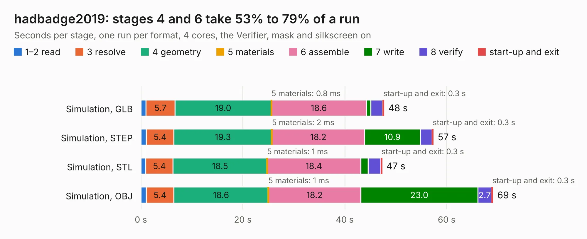

| Mode and format | 1–2 read | 3 resolve | 4 geometry | 5 materials | 6 assemble | 7 write | 8 verify | start-up and exit | Total |
|---|---:|---:|---:|---:|---:|---:|---:|---:|---:|
| Simulation, GLB | 1.0 | 5.7 | 19.0 | 0.8&nbsp;ms | 18.6 | 0.9 | 2.3 | 0.3 | 47.7 |
| Simulation, STEP | 1.1 | 5.4 | 19.3 | 2&nbsp;ms | 18.2 | 10.9 | 2.3 | 0.3 | 57.4 |
| Simulation, STL | 0.9 | 5.4 | 18.5 | 1&nbsp;ms | 18.4 | 1.5 | 2.5 | 0.3 | 47.3 |
| Simulation, OBJ | 1.1 | 5.4 | 18.6 | 1&nbsp;ms | 18.2 | 23.0 | 2.7 | 0.3 | 69.1 |
| Visual, GLB | 1.0 | 5.7 | 19.6 | 1&nbsp;ms | 37.9 | 0.4 | 4.4 | 0.3 | 69.3 |
| Visual, OBJ | 1.0 | 5.5 | 18.9 | 1&nbsp;ms | 35.1 | 15.1 | 4.0 | 0.3 | 79.8 |

<table align="center"><tr><td valign="top">

| Board | Repo: [Spritetm/hadbadge2019_pcb](https://github.com/Spritetm/hadbadge2019_pcb) Board: `hadbadge2019.kicad_pcb` |
|---|---|
| Complexity | 366&nbsp;/&nbsp;1000 (size&nbsp;281, features&nbsp;85) |
| KESE&nbsp;features | through vias, slotted holes, rounded, trapezoid or chamfered pads, drill offsets, filled zones, copper text, curved board outline |
| Tested | 9th November 2026 |
| Copper&nbsp;layers | 4 |
| File&nbsp;format | KiCad 5 (20171130) |
| Parts,&nbsp;tracks,&nbsp;vias | 184, 3,746, 393 |
| Triangles,&nbsp;simulation | 3,996,450 in 324 parts |
| Verifier | PASS in all six runs |

</td><td valign="top">

<table>
<tr><th>File type</th><th>File size</th><th>Peak memory used</th></tr>
<tr><th colspan="3" align="left">Simulation</th></tr>
<tr><td>GLB</td><td align="right">141&nbsp;MB</td><td align="right">1.1&nbsp;GB</td></tr>
<tr><td>STEP</td><td align="right">659&nbsp;MB</td><td align="right">1.5&nbsp;GB</td></tr>
<tr><td>STL</td><td align="right">200&nbsp;MB</td><td align="right">1.1&nbsp;GB</td></tr>
<tr><td>OBJ</td><td align="right">437&nbsp;MB</td><td align="right">2.6&nbsp;GB</td></tr>
<tr><th colspan="3" align="left">Visual</th></tr>
<tr><td>GLB</td><td align="right">90&nbsp;MB</td><td align="right">1.5&nbsp;GB</td></tr>
<tr><td>OBJ</td><td align="right">285&nbsp;MB</td><td align="right">1.9&nbsp;GB</td></tr>
</table>

</td></tr></table>

## 2629. beepy

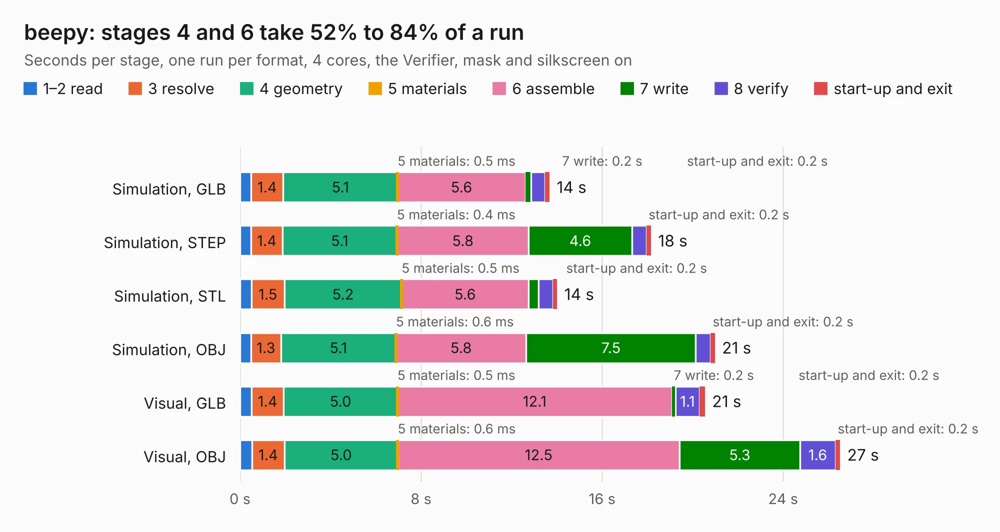

| Mode and format | 1–2 read | 3 resolve | 4 geometry | 5 materials | 6 assemble | 7 write | 8 verify | start-up and exit | Total |
|---|---:|---:|---:|---:|---:|---:|---:|---:|---:|
| Simulation, GLB | 0.5 | 1.4 | 5.1 | 0.5&nbsp;ms | 5.6 | 0.2 | 0.6 | 0.2 | 13.7 |
| Simulation, STEP | 0.5 | 1.4 | 5.1 | 0.4&nbsp;ms | 5.8 | 4.6 | 0.6 | 0.2 | 18.2 |
| Simulation, STL | 0.5 | 1.5 | 5.2 | 0.5&nbsp;ms | 5.6 | 0.4 | 0.6 | 0.2 | 14.0 |
| Simulation, OBJ | 0.5 | 1.3 | 5.1 | 0.6&nbsp;ms | 5.8 | 7.5 | 0.7 | 0.2 | 21.0 |
| Visual, GLB | 0.5 | 1.4 | 5.0 | 0.5&nbsp;ms | 12.1 | 0.2 | 1.1 | 0.2 | 20.5 |
| Visual, OBJ | 0.5 | 1.4 | 5.0 | 0.6&nbsp;ms | 12.5 | 5.3 | 1.6 | 0.2 | 26.5 |

<table align="center"><tr><td valign="top">

| Board | Repo: [sqfmi/beepy-hardware](https://github.com/sqfmi/beepy-hardware) Board: `beepy.kicad_pcb` |
|---|---|
| Folder | KiCad |
| Complexity | 377&nbsp;/&nbsp;1000 (size&nbsp;247, features&nbsp;130) |
| KESE&nbsp;features | through vias, slotted holes, custom pads, rounded, trapezoid or chamfered pads, filled zones, copper drawings, copper text, curved board outline, stack-up, dielectric εr and tanδ |
| Tested | 9th November 2026 |
| Copper&nbsp;layers | 4 |
| File&nbsp;format | KiCad 7 (20221018) |
| Parts,&nbsp;tracks,&nbsp;vias | 95, 1,444, 157 |
| Triangles,&nbsp;simulation | 1,517,110 in 125 parts |
| Verifier | PASS in all six runs |

</td><td valign="top">

<table>
<tr><th>File type</th><th>File size</th><th>Peak memory used</th></tr>
<tr><th colspan="3" align="left">Simulation</th></tr>
<tr><td>GLB</td><td align="right">52&nbsp;MB</td><td align="right">612&nbsp;MB</td></tr>
<tr><td>STEP</td><td align="right">239&nbsp;MB</td><td align="right">685&nbsp;MB</td></tr>
<tr><td>STL</td><td align="right">76&nbsp;MB</td><td align="right">601&nbsp;MB</td></tr>
<tr><td>OBJ</td><td align="right">157&nbsp;MB</td><td align="right">1.0&nbsp;GB</td></tr>
<tr><th colspan="3" align="left">Visual</th></tr>
<tr><td>GLB</td><td align="right">35&nbsp;MB</td><td align="right">749&nbsp;MB</td></tr>
<tr><td>OBJ</td><td align="right">108&nbsp;MB</td><td align="right">828&nbsp;MB</td></tr>
</table>

</td></tr></table>

## 2630. Watchy

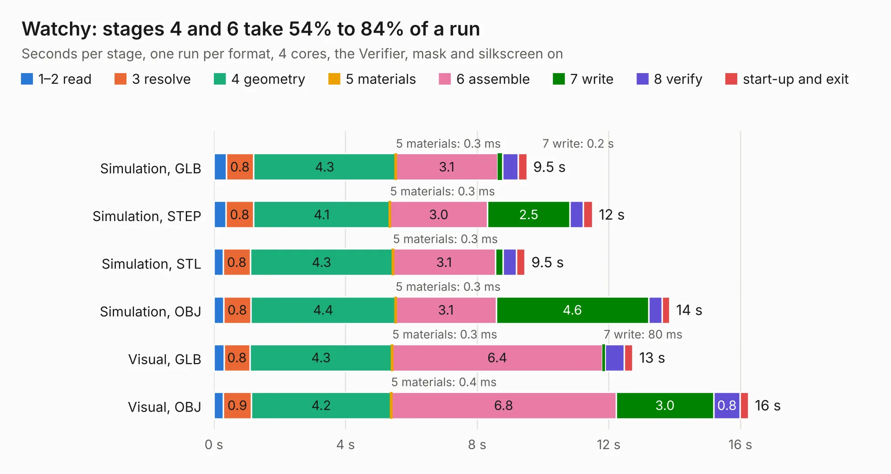

| Mode and format | 1–2 read | 3 resolve | 4 geometry | 5 materials | 6 assemble | 7 write | 8 verify | start-up and exit | Total |
|---|---:|---:|---:|---:|---:|---:|---:|---:|---:|
| Simulation, GLB | 0.4 | 0.8 | 4.3 | 0.3&nbsp;ms | 3.1 | 0.2 | 0.5 | 0.3 | 9.5 |
| Simulation, STEP | 0.4 | 0.8 | 4.1 | 0.3&nbsp;ms | 3.0 | 2.5 | 0.4 | 0.3 | 11.5 |
| Simulation, STL | 0.3 | 0.8 | 4.3 | 0.3&nbsp;ms | 3.1 | 0.2 | 0.4 | 0.3 | 9.5 |
| Simulation, OBJ | 0.3 | 0.8 | 4.4 | 0.3&nbsp;ms | 3.1 | 4.6 | 0.4 | 0.2 | 13.9 |
| Visual, GLB | 0.3 | 0.8 | 4.3 | 0.3&nbsp;ms | 6.4 | 80&nbsp;ms | 0.6 | 0.3 | 12.7 |
| Visual, OBJ | 0.3 | 0.9 | 4.2 | 0.4&nbsp;ms | 6.8 | 3.0 | 0.8 | 0.3 | 16.2 |

<table align="center"><tr><td valign="top">

| Board | Repo: [sqfmi/watchy-hardware](https://github.com/sqfmi/watchy-hardware) Board: `Watchy.kicad_pcb` |
|---|---|
| Complexity | 344&nbsp;/&nbsp;1000 (size&nbsp;234, features&nbsp;110) |
| KESE&nbsp;features | through vias, slotted holes, rounded, trapezoid or chamfered pads, arc tracks, filled zones, curved board outline, stack-up, dielectric εr and tanδ |
| Tested | 9th November 2026 |
| Copper&nbsp;layers | 4 |
| File&nbsp;format | KiCad 7 (20221018) |
| Parts,&nbsp;tracks,&nbsp;vias | 75, 697, 108 |
| Triangles,&nbsp;simulation | 784,726 in 97 parts |
| Verifier | PASS in all six runs |

</td><td valign="top">

<table>
<tr><th>File type</th><th>File size</th><th>Peak memory used</th></tr>
<tr><th colspan="3" align="left">Simulation</th></tr>
<tr><td>GLB</td><td align="right">27&nbsp;MB</td><td align="right">404&nbsp;MB</td></tr>
<tr><td>STEP</td><td align="right">121&nbsp;MB</td><td align="right">471&nbsp;MB</td></tr>
<tr><td>STL</td><td align="right">39&nbsp;MB</td><td align="right">395&nbsp;MB</td></tr>
<tr><td>OBJ</td><td align="right">81&nbsp;MB</td><td align="right">575&nbsp;MB</td></tr>
<tr><th colspan="3" align="left">Visual</th></tr>
<tr><td>GLB</td><td align="right">16&nbsp;MB</td><td align="right">433&nbsp;MB</td></tr>
<tr><td>OBJ</td><td align="right">49&nbsp;MB</td><td align="right">440&nbsp;MB</td></tr>
</table>

</td></tr></table>

## 2631. inteli210AT

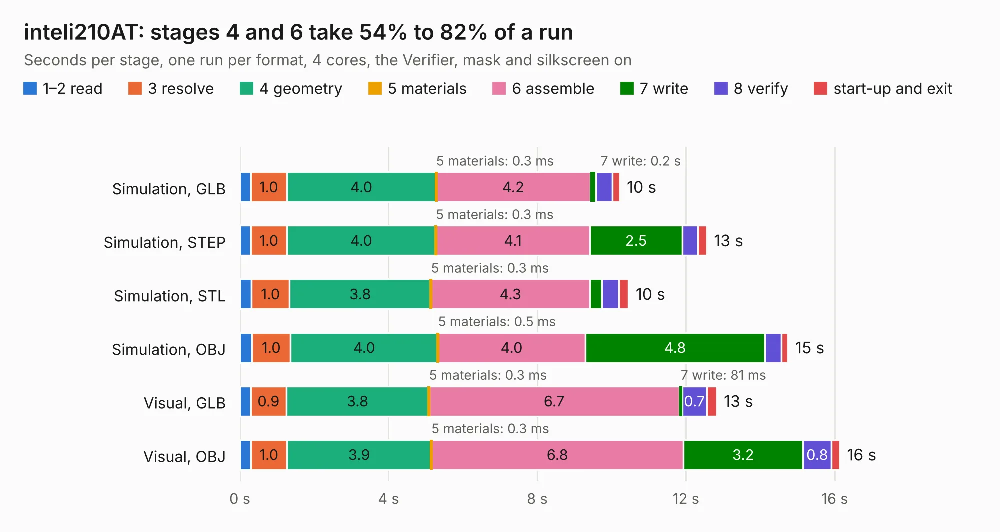

| Mode and format | 1–2 read | 3 resolve | 4 geometry | 5 materials | 6 assemble | 7 write | 8 verify | start-up and exit | Total |
|---|---:|---:|---:|---:|---:|---:|---:|---:|---:|
| Simulation, GLB | 0.3 | 1.0 | 4.0 | 0.3&nbsp;ms | 4.2 | 0.2 | 0.4 | 0.2 | 10.2 |
| Simulation, STEP | 0.3 | 1.0 | 4.0 | 0.3&nbsp;ms | 4.1 | 2.5 | 0.4 | 0.2 | 12.6 |
| Simulation, STL | 0.3 | 1.0 | 3.8 | 0.3&nbsp;ms | 4.3 | 0.3 | 0.5 | 0.3 | 10.5 |
| Simulation, OBJ | 0.3 | 1.0 | 4.0 | 0.5&nbsp;ms | 4.0 | 4.8 | 0.4 | 0.2 | 14.7 |
| Visual, GLB | 0.3 | 0.9 | 3.8 | 0.3&nbsp;ms | 6.7 | 81&nbsp;ms | 0.7 | 0.3 | 12.8 |
| Visual, OBJ | 0.3 | 1.0 | 3.9 | 0.3&nbsp;ms | 6.8 | 3.2 | 0.8 | 0.2 | 16.1 |

<table align="center"><tr><td valign="top">

| Board | Repo: [ssmiao/intel-i210-network-card](https://github.com/ssmiao/intel-i210-network-card) Board: `inteli210AT.kicad_pcb` |
|---|---|
| Folder | PCBV3.0 |
| Complexity | 309&nbsp;/&nbsp;1000 (size&nbsp;244, features&nbsp;65) |
| KESE&nbsp;features | through vias, rounded, trapezoid or chamfered pads, filled zones, copper text, curved board outline |
| Tested | 9th November 2026 |
| Copper&nbsp;layers | 4 |
| File&nbsp;format | KiCad 5 (20171130) |
| Parts,&nbsp;tracks,&nbsp;vias | 52, 2,120, 111 |
| Triangles,&nbsp;simulation | 959,846 in 71 parts |
| Verifier | PASS in all six runs |

</td><td valign="top">

<table>
<tr><th>File type</th><th>File size</th><th>Peak memory used</th></tr>
<tr><th colspan="3" align="left">Simulation</th></tr>
<tr><td>GLB</td><td align="right">33&nbsp;MB</td><td align="right">424&nbsp;MB</td></tr>
<tr><td>STEP</td><td align="right">150&nbsp;MB</td><td align="right">525&nbsp;MB</td></tr>
<tr><td>STL</td><td align="right">48&nbsp;MB</td><td align="right">433&nbsp;MB</td></tr>
<tr><td>OBJ</td><td align="right">98&nbsp;MB</td><td align="right">687&nbsp;MB</td></tr>
<tr><th colspan="3" align="left">Visual</th></tr>
<tr><td>GLB</td><td align="right">20&nbsp;MB</td><td align="right">533&nbsp;MB</td></tr>
<tr><td>OBJ</td><td align="right">59&nbsp;MB</td><td align="right">547&nbsp;MB</td></tr>
</table>

</td></tr></table>

## 2632. V1

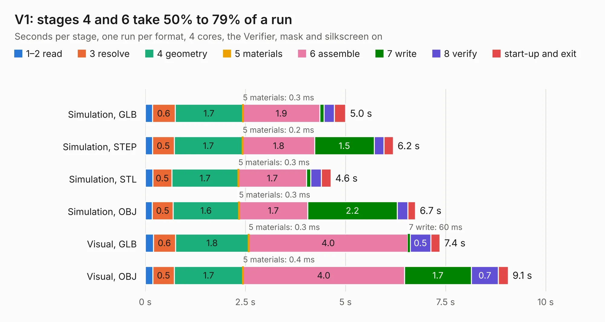

| Mode and format | 1–2 read | 3 resolve | 4 geometry | 5 materials | 6 assemble | 7 write | 8 verify | start-up and exit | Total |
|---|---:|---:|---:|---:|---:|---:|---:|---:|---:|
| Simulation, GLB | 0.2 | 0.6 | 1.7 | 0.3&nbsp;ms | 1.9 | 0.1 | 0.3 | 0.3 | 5.0 |
| Simulation, STEP | 0.2 | 0.5 | 1.7 | 0.2&nbsp;ms | 1.8 | 1.5 | 0.2 | 0.2 | 6.2 |
| Simulation, STL | 0.2 | 0.5 | 1.7 | 0.3&nbsp;ms | 1.7 | 0.1 | 0.3 | 0.2 | 4.6 |
| Simulation, OBJ | 0.2 | 0.5 | 1.6 | 0.3&nbsp;ms | 1.7 | 2.2 | 0.3 | 0.2 | 6.7 |
| Visual, GLB | 0.2 | 0.6 | 1.8 | 0.3&nbsp;ms | 4.0 | 60&nbsp;ms | 0.5 | 0.2 | 7.4 |
| Visual, OBJ | 0.2 | 0.5 | 1.7 | 0.4&nbsp;ms | 4.0 | 1.7 | 0.7 | 0.2 | 9.1 |

<table align="center"><tr><td valign="top">

| Board | Repo: [ssmiao/intel-i210-network-card](https://github.com/ssmiao/intel-i210-network-card) Board: `V1.kicad_pcb` |
|---|---|
| Folder | PCBV3.0 / reference / OCP2PCIe-master / OCP2PCIe-H-F-4 / OCP2PCIe-H-F-4-V0.1Beta |
| Complexity | 214&nbsp;/&nbsp;1000 (size&nbsp;149, features&nbsp;65) |
| KESE&nbsp;features | through vias, rounded, trapezoid or chamfered pads, drill offsets, filled zones, curved board outline |
| Tested | 9th November 2026 |
| Copper&nbsp;layers | 2 |
| File&nbsp;format | KiCad 5 (20171130) |
| Parts,&nbsp;tracks,&nbsp;vias | 12, 286, 95 |
| Triangles,&nbsp;simulation | 483,816 in 79 parts |
| Verifier | PASS in all six runs |

</td><td valign="top">

<table>
<tr><th>File type</th><th>File size</th><th>Peak memory used</th></tr>
<tr><th colspan="3" align="left">Simulation</th></tr>
<tr><td>GLB</td><td align="right">17&nbsp;MB</td><td align="right">288&nbsp;MB</td></tr>
<tr><td>STEP</td><td align="right">72&nbsp;MB</td><td align="right">353&nbsp;MB</td></tr>
<tr><td>STL</td><td align="right">24&nbsp;MB</td><td align="right">299&nbsp;MB</td></tr>
<tr><td>OBJ</td><td align="right">50&nbsp;MB</td><td align="right">385&nbsp;MB</td></tr>
<tr><th colspan="3" align="left">Visual</th></tr>
<tr><td>GLB</td><td align="right">13&nbsp;MB</td><td align="right">348&nbsp;MB</td></tr>
<tr><td>OBJ</td><td align="right">38&nbsp;MB</td><td align="right">357&nbsp;MB</td></tr>
</table>

</td></tr></table>

## 2633. V1

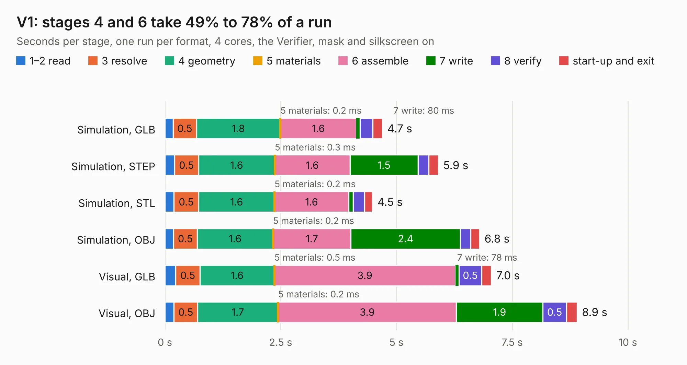

| Mode and format | 1–2 read | 3 resolve | 4 geometry | 5 materials | 6 assemble | 7 write | 8 verify | start-up and exit | Total |
|---|---:|---:|---:|---:|---:|---:|---:|---:|---:|
| Simulation, GLB | 0.2 | 0.5 | 1.8 | 0.2&nbsp;ms | 1.6 | 80&nbsp;ms | 0.3 | 0.2 | 4.7 |
| Simulation, STEP | 0.2 | 0.5 | 1.6 | 0.3&nbsp;ms | 1.6 | 1.5 | 0.2 | 0.2 | 5.9 |
| Simulation, STL | 0.2 | 0.5 | 1.6 | 0.2&nbsp;ms | 1.6 | 0.1 | 0.2 | 0.2 | 4.5 |
| Simulation, OBJ | 0.2 | 0.5 | 1.6 | 0.2&nbsp;ms | 1.7 | 2.4 | 0.2 | 0.2 | 6.8 |
| Visual, GLB | 0.2 | 0.5 | 1.6 | 0.5&nbsp;ms | 3.9 | 78&nbsp;ms | 0.5 | 0.2 | 7.0 |
| Visual, OBJ | 0.2 | 0.5 | 1.7 | 0.2&nbsp;ms | 3.9 | 1.9 | 0.5 | 0.2 | 8.9 |

<table align="center"><tr><td valign="top">

| Board | Repo: [ssmiao/intel-i210-network-card](https://github.com/ssmiao/intel-i210-network-card) Board: `V1.kicad_pcb` |
|---|---|
| Folder | PCBV3.0 / reference / OCP2PCIe-master / OCP2PCIe-H-F-4 / OCP2PCIe-H-F-4-V1.0Beta |
| Complexity | 213&nbsp;/&nbsp;1000 (size&nbsp;148, features&nbsp;65) |
| KESE&nbsp;features | through vias, rounded, trapezoid or chamfered pads, drill offsets, filled zones, curved board outline |
| Tested | 9th November 2026 |
| Copper&nbsp;layers | 2 |
| File&nbsp;format | KiCad 5 (20171130) |
| Parts,&nbsp;tracks,&nbsp;vias | 12, 273, 92 |
| Triangles,&nbsp;simulation | 484,314 in 81 parts |
| Verifier | PASS in all six runs |

</td><td valign="top">

<table>
<tr><th>File type</th><th>File size</th><th>Peak memory used</th></tr>
<tr><th colspan="3" align="left">Simulation</th></tr>
<tr><td>GLB</td><td align="right">17&nbsp;MB</td><td align="right">290&nbsp;MB</td></tr>
<tr><td>STEP</td><td align="right">72&nbsp;MB</td><td align="right">348&nbsp;MB</td></tr>
<tr><td>STL</td><td align="right">24&nbsp;MB</td><td align="right">294&nbsp;MB</td></tr>
<tr><td>OBJ</td><td align="right">50&nbsp;MB</td><td align="right">386&nbsp;MB</td></tr>
<tr><th colspan="3" align="left">Visual</th></tr>
<tr><td>GLB</td><td align="right">13&nbsp;MB</td><td align="right">344&nbsp;MB</td></tr>
<tr><td>OBJ</td><td align="right">38&nbsp;MB</td><td align="right">347&nbsp;MB</td></tr>
</table>

</td></tr></table>

## 2634. v1-cut10x10

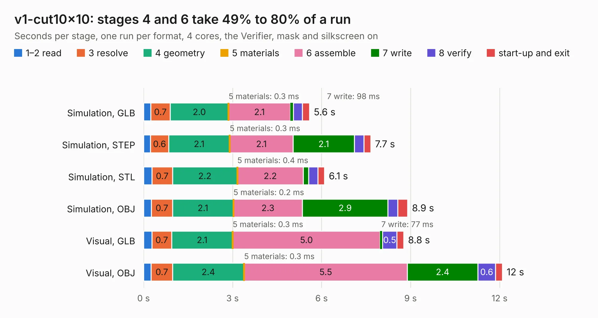

| Mode and format | 1–2 read | 3 resolve | 4 geometry | 5 materials | 6 assemble | 7 write | 8 verify | start-up and exit | Total |
|---|---:|---:|---:|---:|---:|---:|---:|---:|---:|
| Simulation, GLB | 0.2 | 0.7 | 2.0 | 0.3&nbsp;ms | 2.1 | 98&nbsp;ms | 0.3 | 0.2 | 5.6 |
| Simulation, STEP | 0.2 | 0.6 | 2.1 | 0.3&nbsp;ms | 2.1 | 2.1 | 0.3 | 0.2 | 7.7 |
| Simulation, STL | 0.3 | 0.7 | 2.2 | 0.4&nbsp;ms | 2.2 | 0.2 | 0.3 | 0.2 | 6.1 |
| Simulation, OBJ | 0.3 | 0.7 | 2.1 | 0.2&nbsp;ms | 2.3 | 2.9 | 0.3 | 0.3 | 8.9 |
| Visual, GLB | 0.3 | 0.7 | 2.1 | 0.3&nbsp;ms | 5.0 | 77&nbsp;ms | 0.5 | 0.2 | 8.8 |
| Visual, OBJ | 0.3 | 0.7 | 2.4 | 0.3&nbsp;ms | 5.5 | 2.4 | 0.6 | 0.2 | 12.1 |

<table align="center"><tr><td valign="top">

| Board | Repo: [ssmiao/intel-i210-network-card](https://github.com/ssmiao/intel-i210-network-card) Board: `v1-cut10x10.kicad_pcb` |
|---|---|
| Folder | PCBV3.0 / reference / OCP2PCIe-master / OCP2PCIe-H-F-4 / OCP2PCIe-H-F-4-V1.1Beta |
| Complexity | 215&nbsp;/&nbsp;1000 (size&nbsp;150, features&nbsp;65) |
| KESE&nbsp;features | through vias, rounded, trapezoid or chamfered pads, drill offsets, filled zones, curved board outline |
| Tested | 9th November 2026 |
| Copper&nbsp;layers | 2 |
| File&nbsp;format | KiCad 5 (20171130) |
| Parts,&nbsp;tracks,&nbsp;vias | 12, 349, 97 |
| Triangles,&nbsp;simulation | 509,670 in 81 parts |
| Verifier | PASS in all six runs |

</td><td valign="top">

<table>
<tr><th>File type</th><th>File size</th><th>Peak memory used</th></tr>
<tr><th colspan="3" align="left">Simulation</th></tr>
<tr><td>GLB</td><td align="right">18&nbsp;MB</td><td align="right">300&nbsp;MB</td></tr>
<tr><td>STEP</td><td align="right">78&nbsp;MB</td><td align="right">361&nbsp;MB</td></tr>
<tr><td>STL</td><td align="right">25&nbsp;MB</td><td align="right">303&nbsp;MB</td></tr>
<tr><td>OBJ</td><td align="right">52&nbsp;MB</td><td align="right">406&nbsp;MB</td></tr>
<tr><th colspan="3" align="left">Visual</th></tr>
<tr><td>GLB</td><td align="right">14&nbsp;MB</td><td align="right">355&nbsp;MB</td></tr>
<tr><td>OBJ</td><td align="right">41&nbsp;MB</td><td align="right">373&nbsp;MB</td></tr>
</table>

</td></tr></table>

## 2635. V1

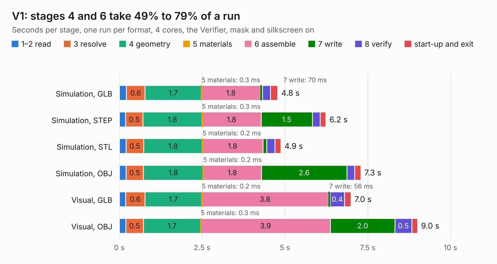

| Mode and format | 1–2 read | 3 resolve | 4 geometry | 5 materials | 6 assemble | 7 write | 8 verify | start-up and exit | Total |
|---|---:|---:|---:|---:|---:|---:|---:|---:|---:|
| Simulation, GLB | 0.2 | 0.6 | 1.7 | 0.3&nbsp;ms | 1.8 | 70&nbsp;ms | 0.2 | 0.2 | 4.8 |
| Simulation, STEP | 0.2 | 0.5 | 1.8 | 0.3&nbsp;ms | 1.8 | 1.5 | 0.2 | 0.2 | 6.2 |
| Simulation, STL | 0.2 | 0.5 | 1.8 | 0.2&nbsp;ms | 1.8 | 0.1 | 0.2 | 0.2 | 4.9 |
| Simulation, OBJ | 0.2 | 0.5 | 1.8 | 0.2&nbsp;ms | 1.8 | 2.6 | 0.2 | 0.2 | 7.3 |
| Visual, GLB | 0.2 | 0.6 | 1.7 | 0.2&nbsp;ms | 3.8 | 56&nbsp;ms | 0.4 | 0.2 | 7.0 |
| Visual, OBJ | 0.2 | 0.5 | 1.7 | 0.3&nbsp;ms | 3.9 | 2.0 | 0.5 | 0.2 | 9.0 |

<table align="center"><tr><td valign="top">

| Board | Repo: [ssmiao/intel-i210-network-card](https://github.com/ssmiao/intel-i210-network-card) Board: `V1.kicad_pcb` |
|---|---|
| Folder | PCBV3.0 / reference / OCP2PCIe-master / OCP2PCIe-H-F-4 / OCP2PCIe-H-F-4-V1.1Beta |
| Complexity | 215&nbsp;/&nbsp;1000 (size&nbsp;150, features&nbsp;65) |
| KESE&nbsp;features | through vias, rounded, trapezoid or chamfered pads, drill offsets, filled zones, curved board outline |
| Tested | 9th November 2026 |
| Copper&nbsp;layers | 2 |
| File&nbsp;format | KiCad 5 (20171130) |
| Parts,&nbsp;tracks,&nbsp;vias | 12, 349, 97 |
| Triangles,&nbsp;simulation | 513,356 in 81 parts |
| Verifier | PASS in all six runs |

</td><td valign="top">

<table>
<tr><th>File type</th><th>File size</th><th>Peak memory used</th></tr>
<tr><th colspan="3" align="left">Simulation</th></tr>
<tr><td>GLB</td><td align="right">18&nbsp;MB</td><td align="right">307&nbsp;MB</td></tr>
<tr><td>STEP</td><td align="right">79&nbsp;MB</td><td align="right">370&nbsp;MB</td></tr>
<tr><td>STL</td><td align="right">26&nbsp;MB</td><td align="right">312&nbsp;MB</td></tr>
<tr><td>OBJ</td><td align="right">53&nbsp;MB</td><td align="right">344&nbsp;MB</td></tr>
<tr><th colspan="3" align="left">Visual</th></tr>
<tr><td>GLB</td><td align="right">14&nbsp;MB</td><td align="right">363&nbsp;MB</td></tr>
<tr><td>OBJ</td><td align="right">41&nbsp;MB</td><td align="right">367&nbsp;MB</td></tr>
</table>

</td></tr></table>

## 2636. V1-cut10x10

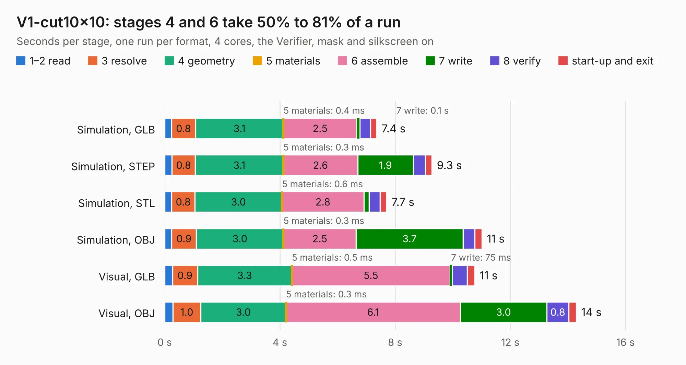

| Mode and format | 1–2 read | 3 resolve | 4 geometry | 5 materials | 6 assemble | 7 write | 8 verify | start-up and exit | Total |
|---|---:|---:|---:|---:|---:|---:|---:|---:|---:|
| Simulation, GLB | 0.2 | 0.8 | 3.1 | 0.4&nbsp;ms | 2.5 | 0.1 | 0.4 | 0.2 | 7.4 |
| Simulation, STEP | 0.3 | 0.8 | 3.1 | 0.3&nbsp;ms | 2.6 | 1.9 | 0.4 | 0.2 | 9.3 |
| Simulation, STL | 0.2 | 0.8 | 3.0 | 0.6&nbsp;ms | 2.8 | 0.2 | 0.4 | 0.2 | 7.7 |
| Simulation, OBJ | 0.2 | 0.9 | 3.0 | 0.3&nbsp;ms | 2.5 | 3.7 | 0.4 | 0.3 | 11.0 |
| Visual, GLB | 0.3 | 0.9 | 3.3 | 0.5&nbsp;ms | 5.5 | 75&nbsp;ms | 0.5 | 0.3 | 10.8 |
| Visual, OBJ | 0.3 | 1.0 | 3.0 | 0.3&nbsp;ms | 6.1 | 3.0 | 0.8 | 0.3 | 14.3 |

<table align="center"><tr><td valign="top">

| Board | Repo: [ssmiao/intel-i210-network-card](https://github.com/ssmiao/intel-i210-network-card) Board: `V1-cut10x10.kicad_pcb` |
|---|---|
| Folder | PCBV3.0 / reference / OCP2PCIe-master / OCP2PCIe-H-F-4 / OCP2PCIe-H-F-4-V2.0Beta |
| Complexity | 230&nbsp;/&nbsp;1000 (size&nbsp;155, features&nbsp;75) |
| KESE&nbsp;features | through vias, slotted holes, rounded, trapezoid or chamfered pads, drill offsets, filled zones, curved board outline |
| Tested | 9th November 2026 |
| Copper&nbsp;layers | 2 |
| File&nbsp;format | KiCad 5 (20171130) |
| Parts,&nbsp;tracks,&nbsp;vias | 10, 361, 195 |
| Triangles,&nbsp;simulation | 599,728 in 82 parts |
| Verifier | PASS in all six runs |

</td><td valign="top">

<table>
<tr><th>File type</th><th>File size</th><th>Peak memory used</th></tr>
<tr><th colspan="3" align="left">Simulation</th></tr>
<tr><td>GLB</td><td align="right">21&nbsp;MB</td><td align="right">330&nbsp;MB</td></tr>
<tr><td>STEP</td><td align="right">82&nbsp;MB</td><td align="right">397&nbsp;MB</td></tr>
<tr><td>STL</td><td align="right">30&nbsp;MB</td><td align="right">327&nbsp;MB</td></tr>
<tr><td>OBJ</td><td align="right">61&nbsp;MB</td><td align="right">456&nbsp;MB</td></tr>
<tr><th colspan="3" align="left">Visual</th></tr>
<tr><td>GLB</td><td align="right">16&nbsp;MB</td><td align="right">388&nbsp;MB</td></tr>
<tr><td>OBJ</td><td align="right">46&nbsp;MB</td><td align="right">399&nbsp;MB</td></tr>
</table>

</td></tr></table>

## 2637. V1

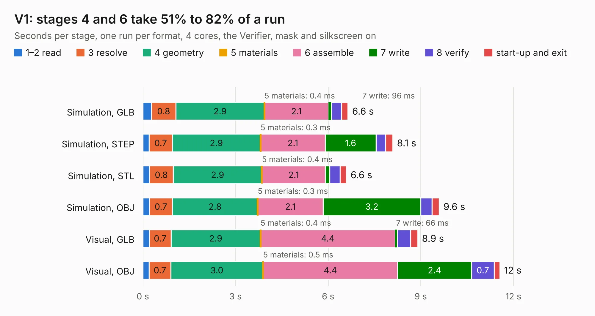

| Mode and format | 1–2 read | 3 resolve | 4 geometry | 5 materials | 6 assemble | 7 write | 8 verify | start-up and exit | Total |
|---|---:|---:|---:|---:|---:|---:|---:|---:|---:|
| Simulation, GLB | 0.3 | 0.8 | 2.9 | 0.4&nbsp;ms | 2.1 | 96&nbsp;ms | 0.3 | 0.2 | 6.6 |
| Simulation, STEP | 0.2 | 0.7 | 2.9 | 0.3&nbsp;ms | 2.1 | 1.6 | 0.3 | 0.2 | 8.1 |
| Simulation, STL | 0.2 | 0.8 | 2.9 | 0.4&nbsp;ms | 2.1 | 0.1 | 0.3 | 0.2 | 6.6 |
| Simulation, OBJ | 0.2 | 0.7 | 2.8 | 0.3&nbsp;ms | 2.1 | 3.2 | 0.4 | 0.2 | 9.6 |
| Visual, GLB | 0.2 | 0.7 | 2.9 | 0.4&nbsp;ms | 4.4 | 66&nbsp;ms | 0.4 | 0.2 | 8.9 |
| Visual, OBJ | 0.2 | 0.7 | 3.0 | 0.5&nbsp;ms | 4.4 | 2.4 | 0.7 | 0.2 | 11.6 |

<table align="center"><tr><td valign="top">

| Board | Repo: [ssmiao/intel-i210-network-card](https://github.com/ssmiao/intel-i210-network-card) Board: `V1.kicad_pcb` |
|---|---|
| Folder | PCBV3.0 / reference / OCP2PCIe-master / OCP2PCIe-H-F-4 / OCP2PCIe-H-F-4-V2.0Beta |
| Complexity | 230&nbsp;/&nbsp;1000 (size&nbsp;155, features&nbsp;75) |
| KESE&nbsp;features | through vias, slotted holes, rounded, trapezoid or chamfered pads, drill offsets, filled zones, curved board outline |
| Tested | 9th November 2026 |
| Copper&nbsp;layers | 2 |
| File&nbsp;format | KiCad 5 (20171130) |
| Parts,&nbsp;tracks,&nbsp;vias | 10, 361, 195 |
| Triangles,&nbsp;simulation | 606,444 in 82 parts |
| Verifier | PASS in all six runs |

</td><td valign="top">

<table>
<tr><th>File type</th><th>File size</th><th>Peak memory used</th></tr>
<tr><th colspan="3" align="left">Simulation</th></tr>
<tr><td>GLB</td><td align="right">21&nbsp;MB</td><td align="right">327&nbsp;MB</td></tr>
<tr><td>STEP</td><td align="right">83&nbsp;MB</td><td align="right">411&nbsp;MB</td></tr>
<tr><td>STL</td><td align="right">30&nbsp;MB</td><td align="right">326&nbsp;MB</td></tr>
<tr><td>OBJ</td><td align="right">62&nbsp;MB</td><td align="right">451&nbsp;MB</td></tr>
<tr><th colspan="3" align="left">Visual</th></tr>
<tr><td>GLB</td><td align="right">16&nbsp;MB</td><td align="right">392&nbsp;MB</td></tr>
<tr><td>OBJ</td><td align="right">47&nbsp;MB</td><td align="right">407&nbsp;MB</td></tr>
</table>

</td></tr></table>

## 2638. m5-pantilt

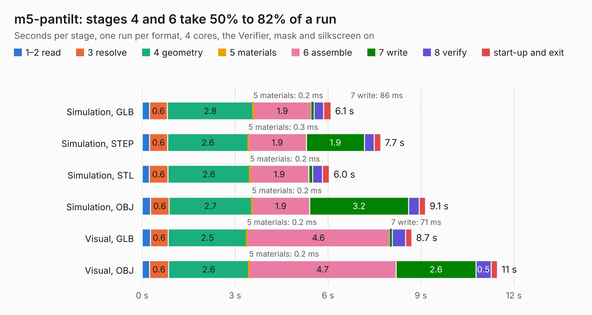

| Mode and format | 1–2 read | 3 resolve | 4 geometry | 5 materials | 6 assemble | 7 write | 8 verify | start-up and exit | Total |
|---|---:|---:|---:|---:|---:|---:|---:|---:|---:|
| Simulation, GLB | 0.2 | 0.6 | 2.8 | 0.2&nbsp;ms | 1.9 | 86&nbsp;ms | 0.3 | 0.2 | 6.1 |
| Simulation, STEP | 0.2 | 0.6 | 2.6 | 0.3&nbsp;ms | 1.9 | 1.9 | 0.3 | 0.2 | 7.7 |
| Simulation, STL | 0.2 | 0.6 | 2.6 | 0.2&nbsp;ms | 1.9 | 0.1 | 0.3 | 0.2 | 6.0 |
| Simulation, OBJ | 0.3 | 0.6 | 2.7 | 0.2&nbsp;ms | 1.9 | 3.2 | 0.3 | 0.2 | 9.1 |
| Visual, GLB | 0.3 | 0.6 | 2.5 | 0.2&nbsp;ms | 4.6 | 71&nbsp;ms | 0.4 | 0.2 | 8.7 |
| Visual, OBJ | 0.2 | 0.6 | 2.6 | 0.2&nbsp;ms | 4.7 | 2.6 | 0.5 | 0.2 | 11.5 |

<table align="center"><tr><td valign="top">

| Board | Repo: [stack-chan/stack-chan](https://github.com/stack-chan/stack-chan) Board: `m5-pantilt.kicad_pcb` |
|---|---|
| Folder | schematics / m5-pantilt |
| Complexity | 217&nbsp;/&nbsp;1000 (size&nbsp;162, features&nbsp;55) |
| KESE&nbsp;features | through vias, rounded, trapezoid or chamfered pads, filled zones, curved board outline |
| Tested | 9th November 2026 |
| Copper&nbsp;layers | 2 |
| File&nbsp;format | KiCad 7 (20221018) |
| Parts,&nbsp;tracks,&nbsp;vias | 37, 285, 114 |
| Triangles,&nbsp;simulation | 565,966 in 53 parts |
| Verifier | PASS in all six runs |

</td><td valign="top">

<table>
<tr><th>File type</th><th>File size</th><th>Peak memory used</th></tr>
<tr><th colspan="3" align="left">Simulation</th></tr>
<tr><td>GLB</td><td align="right">20&nbsp;MB</td><td align="right">343&nbsp;MB</td></tr>
<tr><td>STEP</td><td align="right">101&nbsp;MB</td><td align="right">371&nbsp;MB</td></tr>
<tr><td>STL</td><td align="right">28&nbsp;MB</td><td align="right">359&nbsp;MB</td></tr>
<tr><td>OBJ</td><td align="right">58&nbsp;MB</td><td align="right">379&nbsp;MB</td></tr>
<tr><th colspan="3" align="left">Visual</th></tr>
<tr><td>GLB</td><td align="right">16&nbsp;MB</td><td align="right">399&nbsp;MB</td></tr>
<tr><td>OBJ</td><td align="right">47&nbsp;MB</td><td align="right">412&nbsp;MB</td></tr>
</table>

</td></tr></table>

## 2639. aerolotl_av

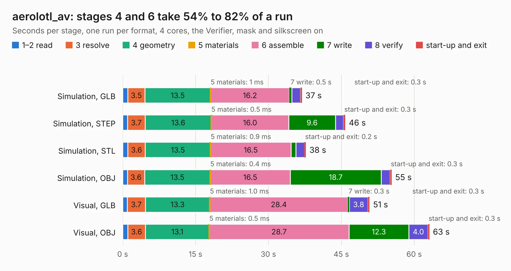

| Mode and format | 1–2 read | 3 resolve | 4 geometry | 5 materials | 6 assemble | 7 write | 8 verify | start-up and exit | Total |
|---|---:|---:|---:|---:|---:|---:|---:|---:|---:|
| Simulation, GLB | 1.1 | 3.5 | 13.5 | 1&nbsp;ms | 16.2 | 0.5 | 1.8 | 0.3 | 36.9 |
| Simulation, STEP | 1.0 | 3.7 | 13.6 | 0.5&nbsp;ms | 16.0 | 9.6 | 1.7 | 0.3 | 45.8 |
| Simulation, STL | 1.1 | 3.6 | 13.5 | 0.9&nbsp;ms | 16.5 | 1.0 | 1.8 | 0.2 | 37.7 |
| Simulation, OBJ | 1.0 | 3.6 | 13.5 | 0.4&nbsp;ms | 16.5 | 18.7 | 1.9 | 0.3 | 55.3 |
| Visual, GLB | 1.0 | 3.7 | 13.3 | 1.0&nbsp;ms | 28.4 | 0.3 | 3.8 | 0.3 | 50.8 |
| Visual, OBJ | 1.0 | 3.6 | 13.1 | 0.5&nbsp;ms | 28.7 | 12.3 | 4.0 | 0.3 | 63.1 |

<table align="center"><tr><td valign="top">

| Board | Repo: [stanford-ssi/aerolotl_av](https://github.com/stanford-ssi/aerolotl_av) Board: `aerolotl_av.kicad_pcb` |
|---|---|
| Complexity | 359&nbsp;/&nbsp;1000 (size&nbsp;264, features&nbsp;95) |
| KESE&nbsp;features | through vias, slotted holes, rounded, trapezoid or chamfered pads, filled zones, curved board outline, stack-up, dielectric εr and tanδ |
| Tested | 9th November 2026 |
| Copper&nbsp;layers | 4 |
| File&nbsp;format | KiCad 10 (20260206) |
| Parts,&nbsp;tracks,&nbsp;vias | 163, 1,889, 639 |
| Triangles,&nbsp;simulation | 3,503,362 in 181 parts |
| Verifier | PASS in all six runs |

</td><td valign="top">

<table>
<tr><th>File type</th><th>File size</th><th>Peak memory used</th></tr>
<tr><th colspan="3" align="left">Simulation</th></tr>
<tr><td>GLB</td><td align="right">119&nbsp;MB</td><td align="right">1.1&nbsp;GB</td></tr>
<tr><td>STEP</td><td align="right">465&nbsp;MB</td><td align="right">1.5&nbsp;GB</td></tr>
<tr><td>STL</td><td align="right">175&nbsp;MB</td><td align="right">1.1&nbsp;GB</td></tr>
<tr><td>OBJ</td><td align="right">375&nbsp;MB</td><td align="right">2.3&nbsp;GB</td></tr>
<tr><th colspan="3" align="left">Visual</th></tr>
<tr><td>GLB</td><td align="right">79&nbsp;MB</td><td align="right">1.4&nbsp;GB</td></tr>
<tr><td>OBJ</td><td align="right">253&nbsp;MB</td><td align="right">1.7&nbsp;GB</td></tr>
</table>

</td></tr></table>

## 2640. aerolotl

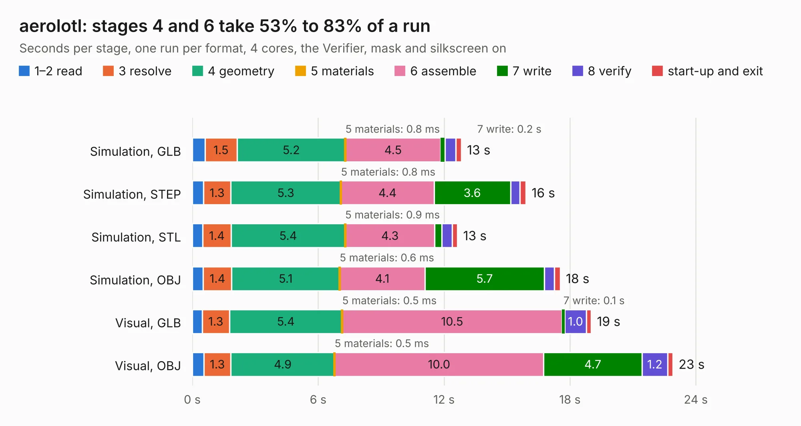

| Mode and format | 1–2 read | 3 resolve | 4 geometry | 5 materials | 6 assemble | 7 write | 8 verify | start-up and exit | Total |
|---|---:|---:|---:|---:|---:|---:|---:|---:|---:|
| Simulation, GLB | 0.6 | 1.5 | 5.2 | 0.8&nbsp;ms | 4.5 | 0.2 | 0.5 | 0.3 | 12.8 |
| Simulation, STEP | 0.5 | 1.3 | 5.3 | 0.8&nbsp;ms | 4.4 | 3.6 | 0.5 | 0.3 | 15.9 |
| Simulation, STL | 0.5 | 1.4 | 5.4 | 0.9&nbsp;ms | 4.3 | 0.3 | 0.5 | 0.3 | 12.6 |
| Simulation, OBJ | 0.5 | 1.4 | 5.1 | 0.6&nbsp;ms | 4.1 | 5.7 | 0.5 | 0.3 | 17.5 |
| Visual, GLB | 0.5 | 1.3 | 5.4 | 0.5&nbsp;ms | 10.5 | 0.1 | 1.0 | 0.2 | 19.0 |
| Visual, OBJ | 0.5 | 1.3 | 4.9 | 0.5&nbsp;ms | 10.0 | 4.7 | 1.2 | 0.2 | 22.9 |

<table align="center"><tr><td valign="top">

| Board | Repo: [stanford-ssi/aerolotl_kicad](https://github.com/stanford-ssi/aerolotl_kicad) Board: `aerolotl.kicad_pcb` |
|---|---|
| Complexity | 189&nbsp;/&nbsp;1000 (size&nbsp;129, features&nbsp;60) |
| KESE&nbsp;features | slotted holes, rounded, trapezoid or chamfered pads, curved board outline, stack-up, dielectric εr and tanδ |
| Tested | 9th November 2026 |
| Copper&nbsp;layers | 4 |
| File&nbsp;format | KiCad 10 (20260206) |
| Parts,&nbsp;tracks,&nbsp;vias | 173, 0, 0 |
| Triangles,&nbsp;simulation | 982,128 in 184 parts |
| Note | mostly unrouted |
| Verifier | PASS in all six runs |

</td><td valign="top">

<table>
<tr><th>File type</th><th>File size</th><th>Peak memory used</th></tr>
<tr><th colspan="3" align="left">Simulation</th></tr>
<tr><td>GLB</td><td align="right">34&nbsp;MB</td><td align="right">476&nbsp;MB</td></tr>
<tr><td>STEP</td><td align="right">140&nbsp;MB</td><td align="right">603&nbsp;MB</td></tr>
<tr><td>STL</td><td align="right">49&nbsp;MB</td><td align="right">474&nbsp;MB</td></tr>
<tr><td>OBJ</td><td align="right">103&nbsp;MB</td><td align="right">747&nbsp;MB</td></tr>
<tr><th colspan="3" align="left">Visual</th></tr>
<tr><td>GLB</td><td align="right">28&nbsp;MB</td><td align="right">600&nbsp;MB</td></tr>
<tr><td>OBJ</td><td align="right">84&nbsp;MB</td><td align="right">684&nbsp;MB</td></tr>
</table>

</td></tr></table>

## 2641. battery_pcb

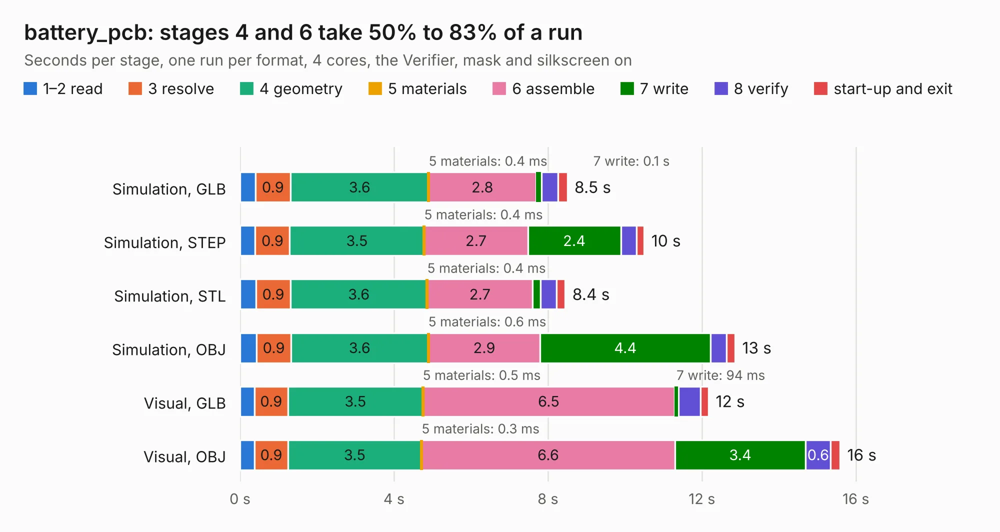

| Mode and format | 1–2 read | 3 resolve | 4 geometry | 5 materials | 6 assemble | 7 write | 8 verify | start-up and exit | Total |
|---|---:|---:|---:|---:|---:|---:|---:|---:|---:|
| Simulation, GLB | 0.4 | 0.9 | 3.6 | 0.4&nbsp;ms | 2.8 | 0.1 | 0.4 | 0.2 | 8.5 |
| Simulation, STEP | 0.4 | 0.9 | 3.5 | 0.4&nbsp;ms | 2.7 | 2.4 | 0.4 | 0.2 | 10.5 |
| Simulation, STL | 0.4 | 0.9 | 3.6 | 0.4&nbsp;ms | 2.7 | 0.2 | 0.4 | 0.2 | 8.4 |
| Simulation, OBJ | 0.4 | 0.9 | 3.6 | 0.6&nbsp;ms | 2.9 | 4.4 | 0.4 | 0.2 | 12.9 |
| Visual, GLB | 0.4 | 0.9 | 3.5 | 0.5&nbsp;ms | 6.5 | 94&nbsp;ms | 0.6 | 0.2 | 12.2 |
| Visual, OBJ | 0.4 | 0.9 | 3.5 | 0.3&nbsp;ms | 6.6 | 3.4 | 0.6 | 0.2 | 15.6 |

<table align="center"><tr><td valign="top">

| Board | Repo: [stanford-ssi/aerolotl_kicad](https://github.com/stanford-ssi/aerolotl_kicad) Board: `battery_pcb.kicad_pcb` |
|---|---|
| Folder | BatteryPCB |
| Complexity | 239&nbsp;/&nbsp;1000 (size&nbsp;159, features&nbsp;80) |
| KESE&nbsp;features | through vias, custom pads, rounded, trapezoid or chamfered pads, filled zones, copper drawings, curved board outline |
| Tested | 9th November 2026 |
| Copper&nbsp;layers | 2 |
| File&nbsp;format | KiCad 10 (20260206) |
| Parts,&nbsp;tracks,&nbsp;vias | 42, 126, 123 |
| Triangles,&nbsp;simulation | 797,334 in 67 parts |
| Verifier | PASS in all six runs |

</td><td valign="top">

<table>
<tr><th>File type</th><th>File size</th><th>Peak memory used</th></tr>
<tr><th colspan="3" align="left">Simulation</th></tr>
<tr><td>GLB</td><td align="right">27&nbsp;MB</td><td align="right">384&nbsp;MB</td></tr>
<tr><td>STEP</td><td align="right">126&nbsp;MB</td><td align="right">470&nbsp;MB</td></tr>
<tr><td>STL</td><td align="right">40&nbsp;MB</td><td align="right">381&nbsp;MB</td></tr>
<tr><td>OBJ</td><td align="right">81&nbsp;MB</td><td align="right">571&nbsp;MB</td></tr>
<tr><th colspan="3" align="left">Visual</th></tr>
<tr><td>GLB</td><td align="right">21&nbsp;MB</td><td align="right">533&nbsp;MB</td></tr>
<tr><td>OBJ</td><td align="right">63&nbsp;MB</td><td align="right">536&nbsp;MB</td></tr>
</table>

</td></tr></table>

## 2642. battery_pcb_30pin

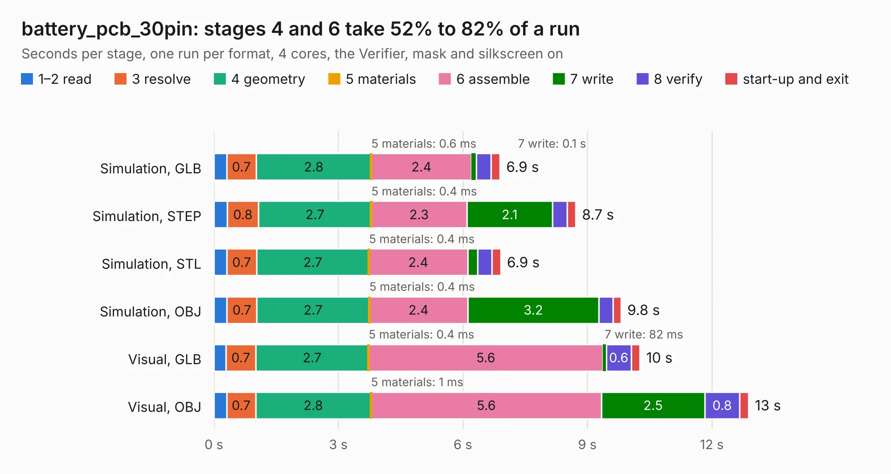

| Mode and format | 1–2 read | 3 resolve | 4 geometry | 5 materials | 6 assemble | 7 write | 8 verify | start-up and exit | Total |
|---|---:|---:|---:|---:|---:|---:|---:|---:|---:|
| Simulation, GLB | 0.3 | 0.7 | 2.8 | 0.6&nbsp;ms | 2.4 | 0.1 | 0.4 | 0.2 | 6.9 |
| Simulation, STEP | 0.3 | 0.8 | 2.7 | 0.4&nbsp;ms | 2.3 | 2.1 | 0.3 | 0.2 | 8.7 |
| Simulation, STL | 0.3 | 0.7 | 2.7 | 0.4&nbsp;ms | 2.4 | 0.2 | 0.3 | 0.2 | 6.9 |
| Simulation, OBJ | 0.3 | 0.7 | 2.7 | 0.4&nbsp;ms | 2.4 | 3.2 | 0.3 | 0.2 | 9.8 |
| Visual, GLB | 0.3 | 0.7 | 2.7 | 0.4&nbsp;ms | 5.6 | 82&nbsp;ms | 0.6 | 0.2 | 10.3 |
| Visual, OBJ | 0.3 | 0.7 | 2.8 | 1&nbsp;ms | 5.6 | 2.5 | 0.8 | 0.2 | 12.9 |

<table align="center"><tr><td valign="top">

| Board | Repo: [stanford-ssi/aerolotl_kicad](https://github.com/stanford-ssi/aerolotl_kicad) Board: `battery_pcb_30pin.kicad_pcb` |
|---|---|
| Folder | BatteryPCB_30pin |
| Complexity | 240&nbsp;/&nbsp;1000 (size&nbsp;160, features&nbsp;80) |
| KESE&nbsp;features | through vias, custom pads, rounded, trapezoid or chamfered pads, filled zones, copper drawings, curved board outline |
| Tested | 9th November 2026 |
| Copper&nbsp;layers | 2 |
| File&nbsp;format | KiCad 10 (20260206) |
| Parts,&nbsp;tracks,&nbsp;vias | 42, 153, 122 |
| Triangles,&nbsp;simulation | 788,398 in 60 parts |
| Verifier | PASS in all six runs |

</td><td valign="top">

<table>
<tr><th>File type</th><th>File size</th><th>Peak memory used</th></tr>
<tr><th colspan="3" align="left">Simulation</th></tr>
<tr><td>GLB</td><td align="right">27&nbsp;MB</td><td align="right">389&nbsp;MB</td></tr>
<tr><td>STEP</td><td align="right">127&nbsp;MB</td><td align="right">464&nbsp;MB</td></tr>
<tr><td>STL</td><td align="right">39&nbsp;MB</td><td align="right">397&nbsp;MB</td></tr>
<tr><td>OBJ</td><td align="right">80&nbsp;MB</td><td align="right">580&nbsp;MB</td></tr>
<tr><th colspan="3" align="left">Visual</th></tr>
<tr><td>GLB</td><td align="right">21&nbsp;MB</td><td align="right">485&nbsp;MB</td></tr>
<tr><td>OBJ</td><td align="right">63&nbsp;MB</td><td align="right">489&nbsp;MB</td></tr>
</table>

</td></tr></table>

## 2643. seed_user_1224

| Mode and format | 1–2 read | 3 resolve | 4 geometry | 5 materials | 6 assemble | 7 write | 8 verify | start-up and exit | Total |
|---|---:|---:|---:|---:|---:|---:|---:|---:|---:|
| Simulation, GLB | 0.2 | 0.6 | 1.9 | 0.4&nbsp;ms | 1.7 | 82&nbsp;ms | 0.3 | 0.2 | 4.9 |
| Simulation, STEP | 0.2 | 0.6 | 2.0 | 0.3&nbsp;ms | 1.8 | 1.6 | 0.3 | 0.2 | 6.5 |
| Simulation, STL | 0.2 | 0.5 | 2.0 | 0.4&nbsp;ms | 1.7 | 0.1 | 0.3 | 0.2 | 5.0 |
| Simulation, OBJ | 0.2 | 0.6 | 2.0 | 0.3&nbsp;ms | 1.8 | 2.6 | 0.3 | 0.2 | 7.5 |
| Visual, GLB | 0.2 | 0.6 | 2.0 | 0.4&nbsp;ms | 4.3 | 61&nbsp;ms | 0.6 | 0.2 | 7.8 |
| Visual, OBJ | 0.2 | 0.5 | 1.9 | 0.6&nbsp;ms | 4.2 | 1.9 | 0.6 | 0.2 | 9.7 |

<table align="center"><tr><td valign="top">

| Board | Repo: [stanford-ssi/aerolotl_kicad](https://github.com/stanford-ssi/aerolotl_kicad) Board: `seed_user_1224.kicad_pcb` |
|---|---|
| Folder | BatteryPCB_30pin / tools / layoutA |
| Complexity | 213&nbsp;/&nbsp;1000 (size&nbsp;158, features&nbsp;55) |
| KESE&nbsp;features | through vias, rounded, trapezoid or chamfered pads, filled zones, curved board outline |
| Tested | 9th November 2026 |
| Copper&nbsp;layers | 2 |
| File&nbsp;format | KiCad 10 (20260206) |
| Parts,&nbsp;tracks,&nbsp;vias | 35, 89, 147 |
| Triangles,&nbsp;simulation | 636,314 in 65 parts |
| Verifier | PASS in all six runs |

</td><td valign="top">

<table>
<tr><th>File type</th><th>File size</th><th>Peak memory used</th></tr>
<tr><th colspan="3" align="left">Simulation</th></tr>
<tr><td>GLB</td><td align="right">21&nbsp;MB</td><td align="right">371&nbsp;MB</td></tr>
<tr><td>STEP</td><td align="right">81&nbsp;MB</td><td align="right">410&nbsp;MB</td></tr>
<tr><td>STL</td><td align="right">32&nbsp;MB</td><td align="right">342&nbsp;MB</td></tr>
<tr><td>OBJ</td><td align="right">63&nbsp;MB</td><td align="right">462&nbsp;MB</td></tr>
<tr><th colspan="3" align="left">Visual</th></tr>
<tr><td>GLB</td><td align="right">16&nbsp;MB</td><td align="right">431&nbsp;MB</td></tr>
<tr><td>OBJ</td><td align="right">49&nbsp;MB</td><td align="right">428&nbsp;MB</td></tr>
</table>

</td></tr></table>

## 2644. motor_board

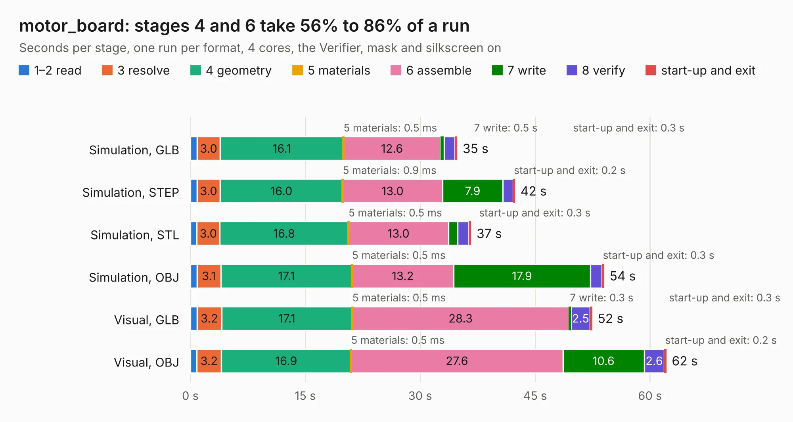

| Mode and format | 1–2 read | 3 resolve | 4 geometry | 5 materials | 6 assemble | 7 write | 8 verify | start-up and exit | Total |
|---|---:|---:|---:|---:|---:|---:|---:|---:|---:|
| Simulation, GLB | 0.9 | 3.0 | 16.1 | 0.5&nbsp;ms | 12.6 | 0.5 | 1.4 | 0.3 | 34.8 |
| Simulation, STEP | 0.9 | 3.0 | 16.0 | 0.9&nbsp;ms | 13.0 | 7.9 | 1.3 | 0.2 | 42.4 |
| Simulation, STL | 0.8 | 3.0 | 16.8 | 0.5&nbsp;ms | 13.0 | 1.2 | 1.4 | 0.3 | 36.6 |
| Simulation, OBJ | 0.9 | 3.1 | 17.1 | 0.5&nbsp;ms | 13.2 | 17.9 | 1.5 | 0.3 | 54.0 |
| Visual, GLB | 0.9 | 3.2 | 17.1 | 0.5&nbsp;ms | 28.3 | 0.3 | 2.5 | 0.3 | 52.4 |
| Visual, OBJ | 0.8 | 3.2 | 16.9 | 0.5&nbsp;ms | 27.6 | 10.6 | 2.6 | 0.2 | 62.1 |

<table align="center"><tr><td valign="top">

| Board | Repo: [stanford-ssi/samwise-avionics](https://github.com/stanford-ssi/samwise-avionics) Board: `motor_board.kicad_pcb` |
|---|---|
| Folder | ADCS / ADCS-motors-v1-samwise |
| Complexity | 359&nbsp;/&nbsp;1000 (size&nbsp;259, features&nbsp;100) |
| KESE&nbsp;features | through vias, slotted holes, rounded, trapezoid or chamfered pads, filled zones, curved board outline, stack-up, dielectric εr and tanδ, mask and silkscreen colours |
| Tested | 9th November 2026 |
| Copper&nbsp;layers | 4 |
| File&nbsp;format | KiCad 9 (20241229) |
| Parts,&nbsp;tracks,&nbsp;vias | 161, 1,571, 412 |
| Triangles,&nbsp;simulation | 3,264,640 in 197 parts |
| Verifier | PASS in all six runs |

</td><td valign="top">

<table>
<tr><th>File type</th><th>File size</th><th>Peak memory used</th></tr>
<tr><th colspan="3" align="left">Simulation</th></tr>
<tr><td>GLB</td><td align="right">114&nbsp;MB</td><td align="right">1.1&nbsp;GB</td></tr>
<tr><td>STEP</td><td align="right">523&nbsp;MB</td><td align="right">1.3&nbsp;GB</td></tr>
<tr><td>STL</td><td align="right">163&nbsp;MB</td><td align="right">1.1&nbsp;GB</td></tr>
<tr><td>OBJ</td><td align="right">356&nbsp;MB</td><td align="right">2.2&nbsp;GB</td></tr>
<tr><th colspan="3" align="left">Visual</th></tr>
<tr><td>GLB</td><td align="right">70&nbsp;MB</td><td align="right">1.3&nbsp;GB</td></tr>
<tr><td>OBJ</td><td align="right">221&nbsp;MB</td><td align="right">1.6&nbsp;GB</td></tr>
</table>

</td></tr></table>

## 2645. ADCS_board

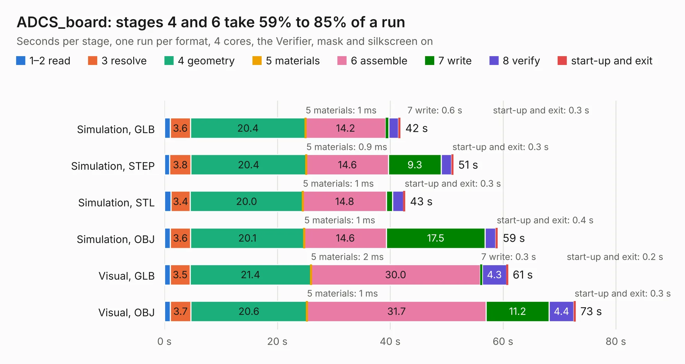

| Mode and format | 1–2 read | 3 resolve | 4 geometry | 5 materials | 6 assemble | 7 write | 8 verify | start-up and exit | Total |
|---|---:|---:|---:|---:|---:|---:|---:|---:|---:|
| Simulation, GLB | 1.0 | 3.6 | 20.4 | 1&nbsp;ms | 14.2 | 0.6 | 1.7 | 0.3 | 41.8 |
| Simulation, STEP | 0.9 | 3.8 | 20.4 | 0.9&nbsp;ms | 14.6 | 9.3 | 1.9 | 0.3 | 51.2 |
| Simulation, STL | 1.1 | 3.4 | 20.0 | 1&nbsp;ms | 14.8 | 1.1 | 1.9 | 0.3 | 42.6 |
| Simulation, OBJ | 1.0 | 3.6 | 20.1 | 1&nbsp;ms | 14.6 | 17.5 | 1.9 | 0.4 | 59.1 |
| Visual, GLB | 1.0 | 3.5 | 21.4 | 2&nbsp;ms | 30.0 | 0.3 | 4.3 | 0.2 | 60.9 |
| Visual, OBJ | 1.0 | 3.7 | 20.6 | 1&nbsp;ms | 31.7 | 11.2 | 4.4 | 0.3 | 72.8 |

<table align="center"><tr><td valign="top">

| Board | Repo: [stanford-ssi/samwise-avionics](https://github.com/stanford-ssi/samwise-avionics) Board: `ADCS_board.kicad_pcb` |
|---|---|
| Folder | ADCS / ADCS-v1-samwise |
| Complexity | 393&nbsp;/&nbsp;1000 (size&nbsp;268, features&nbsp;125) |
| KESE&nbsp;features | through vias, slotted holes, custom pads, rounded, trapezoid or chamfered pads, filled zones, copper drawings, curved board outline, stack-up, dielectric εr and tanδ, mask and silkscreen colours |
| Tested | 9th November 2026 |
| Copper&nbsp;layers | 4 |
| File&nbsp;format | KiCad 9 (20241229) |
| Parts,&nbsp;tracks,&nbsp;vias | 188, 1,511, 471 |
| Triangles,&nbsp;simulation | 3,615,090 in 210 parts |
| Verifier | PASS in all six runs |

</td><td valign="top">

<table>
<tr><th>File type</th><th>File size</th><th>Peak memory used</th></tr>
<tr><th colspan="3" align="left">Simulation</th></tr>
<tr><td>GLB</td><td align="right">128&nbsp;MB</td><td align="right">1.2&nbsp;GB</td></tr>
<tr><td>STEP</td><td align="right">600&nbsp;MB</td><td align="right">1.5&nbsp;GB</td></tr>
<tr><td>STL</td><td align="right">181&nbsp;MB</td><td align="right">1.2&nbsp;GB</td></tr>
<tr><td>OBJ</td><td align="right">397&nbsp;MB</td><td align="right">2.5&nbsp;GB</td></tr>
<tr><th colspan="3" align="left">Visual</th></tr>
<tr><td>GLB</td><td align="right">83&nbsp;MB</td><td align="right">1.4&nbsp;GB</td></tr>
<tr><td>OBJ</td><td align="right">263&nbsp;MB</td><td align="right">1.8&nbsp;GB</td></tr>
</table>

</td></tr></table>

## 2646. batteryboard

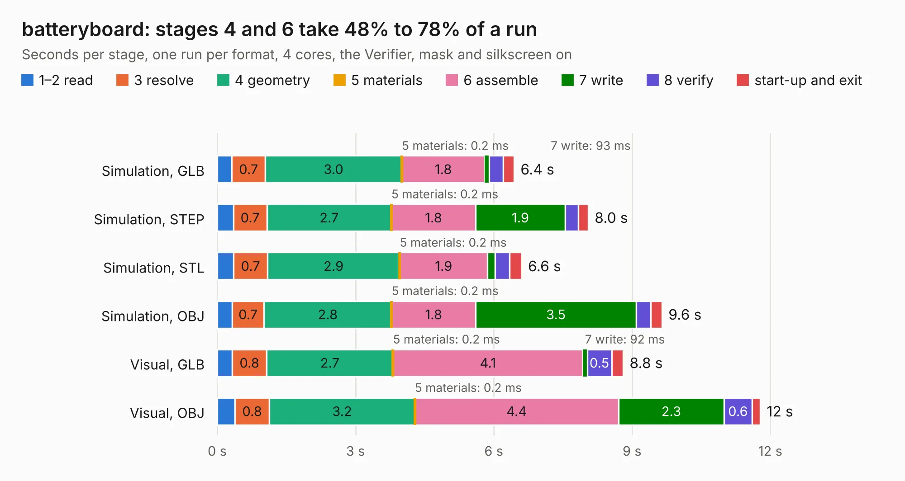

| Mode and format | 1–2 read | 3 resolve | 4 geometry | 5 materials | 6 assemble | 7 write | 8 verify | start-up and exit | Total |
|---|---:|---:|---:|---:|---:|---:|---:|---:|---:|
| Simulation, GLB | 0.3 | 0.7 | 3.0 | 0.2&nbsp;ms | 1.8 | 93&nbsp;ms | 0.3 | 0.2 | 6.4 |
| Simulation, STEP | 0.3 | 0.7 | 2.7 | 0.2&nbsp;ms | 1.8 | 1.9 | 0.3 | 0.2 | 8.0 |
| Simulation, STL | 0.4 | 0.7 | 2.9 | 0.2&nbsp;ms | 1.9 | 0.2 | 0.3 | 0.3 | 6.6 |
| Simulation, OBJ | 0.3 | 0.7 | 2.8 | 0.2&nbsp;ms | 1.8 | 3.5 | 0.3 | 0.2 | 9.6 |
| Visual, GLB | 0.3 | 0.8 | 2.7 | 0.2&nbsp;ms | 4.1 | 92&nbsp;ms | 0.5 | 0.2 | 8.8 |
| Visual, OBJ | 0.4 | 0.8 | 3.2 | 0.2&nbsp;ms | 4.4 | 2.3 | 0.6 | 0.2 | 11.8 |

<table align="center"><tr><td valign="top">

| Board | Repo: [stanford-ssi/samwise-avionics](https://github.com/stanford-ssi/samwise-avionics) Board: `batteryboard.kicad_pcb` |
|---|---|
| Folder | BatteryBoard / batteryboard-v02.3 |
| Complexity | 270&nbsp;/&nbsp;1000 (size&nbsp;180, features&nbsp;90) |
| KESE&nbsp;features | through vias, rounded, trapezoid or chamfered pads, filled zones, curved board outline, stack-up, dielectric εr and tanδ, mask and silkscreen colours |
| Tested | 9th November 2026 |
| Copper&nbsp;layers | 4 |
| File&nbsp;format | KiCad 9 (20241229) |
| Parts,&nbsp;tracks,&nbsp;vias | 30, 596, 61 |
| Triangles,&nbsp;simulation | 635,618 in 36 parts |
| Verifier | PASS in all six runs |

</td><td valign="top">

<table>
<tr><th>File type</th><th>File size</th><th>Peak memory used</th></tr>
<tr><th colspan="3" align="left">Simulation</th></tr>
<tr><td>GLB</td><td align="right">23&nbsp;MB</td><td align="right">369&nbsp;MB</td></tr>
<tr><td>STEP</td><td align="right">109&nbsp;MB</td><td align="right">391&nbsp;MB</td></tr>
<tr><td>STL</td><td align="right">32&nbsp;MB</td><td align="right">368&nbsp;MB</td></tr>
<tr><td>OBJ</td><td align="right">66&nbsp;MB</td><td align="right">497&nbsp;MB</td></tr>
<tr><th colspan="3" align="left">Visual</th></tr>
<tr><td>GLB</td><td align="right">15&nbsp;MB</td><td align="right">392&nbsp;MB</td></tr>
<tr><td>OBJ</td><td align="right">45&nbsp;MB</td><td align="right">407&nbsp;MB</td></tr>
</table>

</td></tr></table>

## 2647. FlexDeploySidePanels

| Mode and format | 1–2 read | 3 resolve | 4 geometry | 5 materials | 6 assemble | 7 write | 8 verify | start-up and exit | Total |
|---|---:|---:|---:|---:|---:|---:|---:|---:|---:|
| Simulation, GLB | 0.8 | 1.6 | 4.6 | 0.4&nbsp;ms | 4.7 | 0.2 | 0.6 | 0.2 | 12.7 |
| Simulation, STEP | 0.8 | 1.6 | 4.5 | 0.4&nbsp;ms | 4.6 | 3.8 | 0.6 | 0.2 | 16.0 |
| Simulation, STL | 0.7 | 1.6 | 4.5 | 0.4&nbsp;ms | 4.4 | 0.3 | 0.6 | 0.2 | 12.4 |
| Simulation, OBJ | 0.7 | 1.6 | 4.5 | 0.4&nbsp;ms | 4.4 | 7.7 | 0.6 | 0.2 | 19.9 |
| Visual, GLB | 0.7 | 1.7 | 4.5 | 0.3&nbsp;ms | 8.3 | 0.1 | 1.0 | 0.3 | 16.6 |
| Visual, OBJ | 0.8 | 1.7 | 4.6 | 0.5&nbsp;ms | 8.6 | 4.2 | 1.3 | 0.2 | 21.4 |

<table align="center"><tr><td valign="top">

| Board | Repo: [stanford-ssi/samwise-avionics](https://github.com/stanford-ssi/samwise-avionics) Board: `FlexDeploySidePanels.kicad_pcb` |
|---|---|
| Folder | FlexDeploySidePanels |
| Complexity | 291&nbsp;/&nbsp;1000 (size&nbsp;186, features&nbsp;105) |
| KESE&nbsp;features | through vias, rounded, trapezoid or chamfered pads, filled zones, curved board outline, stack-up, dielectric εr and tanδ, copper finish, mask and silkscreen colours |
| Tested | 9th November 2026 |
| Copper&nbsp;layers | 4 |
| File&nbsp;format | KiCad 9 (20241229) |
| Parts,&nbsp;tracks,&nbsp;vias | 127, 367, 23 |
| Triangles,&nbsp;simulation | 1,448,826 in 60 parts |
| Note | panel |
| Verifier | PASS in all six runs |

</td><td valign="top">

<table>
<tr><th>File type</th><th>File size</th><th>Peak memory used</th></tr>
<tr><th colspan="3" align="left">Simulation</th></tr>
<tr><td>GLB</td><td align="right">50&nbsp;MB</td><td align="right">578&nbsp;MB</td></tr>
<tr><td>STEP</td><td align="right">162&nbsp;MB</td><td align="right">648&nbsp;MB</td></tr>
<tr><td>STL</td><td align="right">72&nbsp;MB</td><td align="right">587&nbsp;MB</td></tr>
<tr><td>OBJ</td><td align="right">153&nbsp;MB</td><td align="right">993&nbsp;MB</td></tr>
<tr><th colspan="3" align="left">Visual</th></tr>
<tr><td>GLB</td><td align="right">29&nbsp;MB</td><td align="right">701&nbsp;MB</td></tr>
<tr><td>OBJ</td><td align="right">88&nbsp;MB</td><td align="right">668&nbsp;MB</td></tr>
</table>

</td></tr></table>

## 2648. Groundstation_2400_Hat

| Mode and format | 1–2 read | 3 resolve | 4 geometry | 5 materials | 6 assemble | 7 write | 8 verify | start-up and exit | Total |
|---|---:|---:|---:|---:|---:|---:|---:|---:|---:|
| Simulation, GLB | 0.2 | 0.6 | 2.4 | 0.4&nbsp;ms | 1.9 | 92&nbsp;ms | 0.3 | 0.2 | 5.7 |
| Simulation, STEP | 0.2 | 0.6 | 2.3 | 0.3&nbsp;ms | 1.8 | 1.6 | 0.3 | 0.3 | 7.1 |
| Simulation, STL | 0.2 | 0.6 | 2.3 | 0.3&nbsp;ms | 1.8 | 0.1 | 0.3 | 0.2 | 5.6 |
| Simulation, OBJ | 0.2 | 0.6 | 2.3 | 0.4&nbsp;ms | 1.8 | 3.2 | 0.4 | 0.2 | 8.6 |
| Visual, GLB | 0.2 | 0.6 | 2.4 | 0.3&nbsp;ms | 3.9 | 52&nbsp;ms | 0.5 | 0.2 | 7.8 |
| Visual, OBJ | 0.3 | 0.6 | 2.3 | 0.3&nbsp;ms | 4.2 | 1.9 | 0.5 | 0.2 | 9.9 |

<table align="center"><tr><td valign="top">

| Board | Repo: [stanford-ssi/samwise-avionics](https://github.com/stanford-ssi/samwise-avionics) Board: `Groundstation_2400_Hat.kicad_pcb` |
|---|---|
| Folder | Groundstation_2400_Hat |
| Complexity | 237&nbsp;/&nbsp;1000 (size&nbsp;147, features&nbsp;90) |
| KESE&nbsp;features | through vias, rounded, trapezoid or chamfered pads, filled zones, curved board outline, stack-up, dielectric εr and tanδ, mask and silkscreen colours |
| Tested | 9th November 2026 |
| Copper&nbsp;layers | 4 |
| File&nbsp;format | KiCad 9 (20241229) |
| Parts,&nbsp;tracks,&nbsp;vias | 10, 91, 38 |
| Triangles,&nbsp;simulation | 563,868 in 50 parts |
| Verifier | PASS in all six runs |

</td><td valign="top">

<table>
<tr><th>File type</th><th>File size</th><th>Peak memory used</th></tr>
<tr><th colspan="3" align="left">Simulation</th></tr>
<tr><td>GLB</td><td align="right">19&nbsp;MB</td><td align="right">297&nbsp;MB</td></tr>
<tr><td>STEP</td><td align="right">64&nbsp;MB</td><td align="right">342&nbsp;MB</td></tr>
<tr><td>STL</td><td align="right">28&nbsp;MB</td><td align="right">304&nbsp;MB</td></tr>
<tr><td>OBJ</td><td align="right">57&nbsp;MB</td><td align="right">414&nbsp;MB</td></tr>
<tr><th colspan="3" align="left">Visual</th></tr>
<tr><td>GLB</td><td align="right">11&nbsp;MB</td><td align="right">330&nbsp;MB</td></tr>
<tr><td>OBJ</td><td align="right">34&nbsp;MB</td><td align="right">337&nbsp;MB</td></tr>
</table>

</td></tr></table>

## 2649. Groundstation_433_Hat

| Mode and format | 1–2 read | 3 resolve | 4 geometry | 5 materials | 6 assemble | 7 write | 8 verify | start-up and exit | Total |
|---|---:|---:|---:|---:|---:|---:|---:|---:|---:|
| Simulation, GLB | 0.2 | 0.7 | 3.5 | 0.3&nbsp;ms | 2.7 | 0.1 | 0.5 | 0.2 | 8.1 |
| Simulation, STEP | 0.2 | 0.7 | 3.6 | 0.3&nbsp;ms | 2.7 | 2.5 | 0.6 | 0.3 | 10.5 |
| Simulation, STL | 0.2 | 0.8 | 3.5 | 0.4&nbsp;ms | 2.6 | 0.2 | 0.5 | 0.3 | 8.1 |
| Simulation, OBJ | 0.2 | 0.7 | 3.4 | 0.3&nbsp;ms | 2.7 | 4.8 | 0.6 | 0.2 | 12.7 |
| Visual, GLB | 0.2 | 0.7 | 3.6 | 0.3&nbsp;ms | 5.2 | 71&nbsp;ms | 0.6 | 0.3 | 10.7 |
| Visual, OBJ | 0.2 | 0.8 | 3.5 | 0.3&nbsp;ms | 5.5 | 2.2 | 0.6 | 0.2 | 13.1 |

<table align="center"><tr><td valign="top">

| Board | Repo: [stanford-ssi/samwise-avionics](https://github.com/stanford-ssi/samwise-avionics) Board: `Groundstation_433_Hat.kicad_pcb` |
|---|---|
| Folder | Groundstation_433_Hat |
| Complexity | 237&nbsp;/&nbsp;1000 (size&nbsp;147, features&nbsp;90) |
| KESE&nbsp;features | through vias, rounded, trapezoid or chamfered pads, filled zones, curved board outline, stack-up, dielectric εr and tanδ, mask and silkscreen colours |
| Tested | 9th November 2026 |
| Copper&nbsp;layers | 4 |
| File&nbsp;format | KiCad 9 (20241229) |
| Parts,&nbsp;tracks,&nbsp;vias | 14, 149, 8 |
| Triangles,&nbsp;simulation | 759,192 in 48 parts |
| Verifier | PASS in all six runs |

</td><td valign="top">

<table>
<tr><th>File type</th><th>File size</th><th>Peak memory used</th></tr>
<tr><th colspan="3" align="left">Simulation</th></tr>
<tr><td>GLB</td><td align="right">26&nbsp;MB</td><td align="right">341&nbsp;MB</td></tr>
<tr><td>STEP</td><td align="right">112&nbsp;MB</td><td align="right">387&nbsp;MB</td></tr>
<tr><td>STL</td><td align="right">38&nbsp;MB</td><td align="right">347&nbsp;MB</td></tr>
<tr><td>OBJ</td><td align="right">78&nbsp;MB</td><td align="right">540&nbsp;MB</td></tr>
<tr><th colspan="3" align="left">Visual</th></tr>
<tr><td>GLB</td><td align="right">13&nbsp;MB</td><td align="right">378&nbsp;MB</td></tr>
<tr><td>OBJ</td><td align="right">39&nbsp;MB</td><td align="right">381&nbsp;MB</td></tr>
</table>

</td></tr></table>

## 2650. LT8491-mezzanine

| Mode and format | 1–2 read | 3 resolve | 4 geometry | 5 materials | 6 assemble | 7 write | 8 verify | start-up and exit | Total |
|---|---:|---:|---:|---:|---:|---:|---:|---:|---:|
| Simulation, GLB | 0.5 | 1.6 | 4.4 | 0.5&nbsp;ms | 4.8 | 0.2 | 0.7 | 0.2 | 12.4 |
| Simulation, STEP | 0.4 | 1.5 | 4.4 | 0.4&nbsp;ms | 5.0 | 3.6 | 0.7 | 0.2 | 15.9 |
| Simulation, STL | 0.4 | 1.5 | 4.5 | 0.4&nbsp;ms | 4.9 | 0.5 | 0.7 | 0.2 | 12.8 |
| Simulation, OBJ | 0.5 | 1.5 | 4.6 | 0.5&nbsp;ms | 4.9 | 7.6 | 0.7 | 0.2 | 20.0 |
| Visual, GLB | 0.5 | 1.4 | 4.6 | 0.8&nbsp;ms | 9.8 | 0.1 | 1.0 | 0.2 | 17.5 |
| Visual, OBJ | 0.5 | 1.5 | 4.7 | 0.5&nbsp;ms | 9.8 | 4.2 | 1.0 | 0.2 | 21.9 |

<table align="center"><tr><td valign="top">

| Board | Repo: [stanford-ssi/samwise-avionics](https://github.com/stanford-ssi/samwise-avionics) Board: `LT8491-mezzanine.kicad_pcb` |
|---|---|
| Folder | LT8491-mezzanine |
| Complexity | 356&nbsp;/&nbsp;1000 (size&nbsp;211, features&nbsp;145) |
| KESE&nbsp;features | through vias, custom pads, rounded, trapezoid or chamfered pads, filled zones, copper drawings, stack-up, dielectric εr and tanδ, copper finish, mask and silkscreen colours, castellated pads |
| Tested | 9th November 2026 |
| Copper&nbsp;layers | 6 |
| File&nbsp;format | KiCad 9 (20241229) |
| Parts,&nbsp;tracks,&nbsp;vias | 122, 673, 165 |
| Triangles,&nbsp;simulation | 1,503,708 in 105 parts |
| Verifier | PASS in all six runs |

</td><td valign="top">

<table>
<tr><th>File type</th><th>File size</th><th>Peak memory used</th></tr>
<tr><th colspan="3" align="left">Simulation</th></tr>
<tr><td>GLB</td><td align="right">51&nbsp;MB</td><td align="right">525&nbsp;MB</td></tr>
<tr><td>STEP</td><td align="right">196&nbsp;MB</td><td align="right">662&nbsp;MB</td></tr>
<tr><td>STL</td><td align="right">75&nbsp;MB</td><td align="right">553&nbsp;MB</td></tr>
<tr><td>OBJ</td><td align="right">157&nbsp;MB</td><td align="right">1.0&nbsp;GB</td></tr>
<tr><th colspan="3" align="left">Visual</th></tr>
<tr><td>GLB</td><td align="right">28&nbsp;MB</td><td align="right">713&nbsp;MB</td></tr>
<tr><td>OBJ</td><td align="right">85&nbsp;MB</td><td align="right">707&nbsp;MB</td></tr>
</table>

</td></tr></table>

## 2651. magnetometer_extern

| Mode and format | 1–2 read | 3 resolve | 4 geometry | 5 materials | 6 assemble | 7 write | 8 verify | start-up and exit | Total |
|---|---:|---:|---:|---:|---:|---:|---:|---:|---:|
| Simulation, GLB | 89&nbsp;ms | 56&nbsp;ms | 0.3 | 0.1&nbsp;ms | 0.5 | 15&nbsp;ms | 46&nbsp;ms | 0.2 | 1.2 |
| Simulation, STEP | 93&nbsp;ms | 74&nbsp;ms | 0.3 | 0.2&nbsp;ms | 0.5 | 0.8 | 56&nbsp;ms | 0.2 | 2.1 |
| Simulation, STL | 94&nbsp;ms | 64&nbsp;ms | 0.3 | 0.1&nbsp;ms | 0.5 | 21&nbsp;ms | 47&nbsp;ms | 0.2 | 1.3 |
| Simulation, OBJ | 82&nbsp;ms | 57&nbsp;ms | 0.3 | 0.1&nbsp;ms | 0.5 | 0.4 | 54&nbsp;ms | 0.2 | 1.6 |
| Visual, GLB | 85&nbsp;ms | 58&nbsp;ms | 0.3 | 0.2&nbsp;ms | 1.0 | 16&nbsp;ms | 0.1 | 0.3 | 1.8 |
| Visual, OBJ | 88&nbsp;ms | 59&nbsp;ms | 0.3 | 0.1&nbsp;ms | 1.0 | 0.2 | 76&nbsp;ms | 0.3 | 2.0 |

<table align="center"><tr><td valign="top">

| Board | Repo: [stanford-ssi/samwise-avionics](https://github.com/stanford-ssi/samwise-avionics) Board: `magnetometer_extern.kicad_pcb` |
|---|---|
| Folder | magnetometer_extern / magnetometer_extern |
| Complexity | 106&nbsp;/&nbsp;1000 (size&nbsp;76, features&nbsp;30) |
| KESE&nbsp;features | rounded, trapezoid or chamfered pads, filled zones |
| Tested | 9th November 2026 |
| Copper&nbsp;layers | 2 |
| File&nbsp;format | KiCad 9 (20241229) |
| Parts,&nbsp;tracks,&nbsp;vias | 4, 12, 0 |
| Triangles,&nbsp;simulation | 78,032 in 18 parts |
| Verifier | PASS in all six runs |

</td><td valign="top">

<table>
<tr><th>File type</th><th>File size</th><th>Peak memory used</th></tr>
<tr><th colspan="3" align="left">Simulation</th></tr>
<tr><td>GLB</td><td align="right">2.6&nbsp;MB</td><td align="right">173&nbsp;MB</td></tr>
<tr><td>STEP</td><td align="right">11&nbsp;MB</td><td align="right">180&nbsp;MB</td></tr>
<tr><td>STL</td><td align="right">3.9&nbsp;MB</td><td align="right">173&nbsp;MB</td></tr>
<tr><td>OBJ</td><td align="right">7.3&nbsp;MB</td><td align="right">175&nbsp;MB</td></tr>
<tr><th colspan="3" align="left">Visual</th></tr>
<tr><td>GLB</td><td align="right">1.7&nbsp;MB</td><td align="right">150&nbsp;MB</td></tr>
<tr><td>OBJ</td><td align="right">4.6&nbsp;MB</td><td align="right">150&nbsp;MB</td></tr>
</table>

</td></tr></table>

## 2652. MPPT_addon_board

| Mode and format | 1–2 read | 3 resolve | 4 geometry | 5 materials | 6 assemble | 7 write | 8 verify | start-up and exit | Total |
|---|---:|---:|---:|---:|---:|---:|---:|---:|---:|
| Simulation, GLB | 0.4 | 1.4 | 6.4 | 0.5&nbsp;ms | 4.6 | 0.2 | 0.5 | 0.3 | 13.7 |
| Simulation, STEP | 0.4 | 1.2 | 6.6 | 0.4&nbsp;ms | 4.3 | 3.0 | 0.4 | 0.3 | 16.3 |
| Simulation, STL | 0.4 | 1.2 | 6.2 | 0.3&nbsp;ms | 3.6 | 0.2 | 0.4 | 0.3 | 12.3 |
| Simulation, OBJ | 0.4 | 1.3 | 7.2 | 0.6&nbsp;ms | 3.8 | 4.7 | 0.4 | 0.2 | 18.1 |
| Visual, GLB | 0.3 | 1.1 | 6.2 | 0.4&nbsp;ms | 7.6 | 0.1 | 0.8 | 0.2 | 16.4 |
| Visual, OBJ | 0.4 | 1.4 | 6.4 | 0.4&nbsp;ms | 7.4 | 3.9 | 0.9 | 0.3 | 20.8 |

<table align="center"><tr><td valign="top">

| Board | Repo: [stanford-ssi/samwise-avionics](https://github.com/stanford-ssi/samwise-avionics) Board: `MPPT_addon_board.kicad_pcb` |
|---|---|
| Folder | PiCubed / MPPT_addon_board |
| Complexity | 257&nbsp;/&nbsp;1000 (size&nbsp;167, features&nbsp;90) |
| KESE&nbsp;features | through vias, rounded, trapezoid or chamfered pads, filled zones, curved board outline, stack-up, dielectric εr and tanδ, mask and silkscreen colours |
| Tested | 9th November 2026 |
| Copper&nbsp;layers | 2 |
| File&nbsp;format | KiCad 9 (20241229) |
| Parts,&nbsp;tracks,&nbsp;vias | 48, 433, 105 |
| Triangles,&nbsp;simulation | 739,358 in 61 parts |
| Verifier | PASS in all six runs |

</td><td valign="top">

<table>
<tr><th>File type</th><th>File size</th><th>Peak memory used</th></tr>
<tr><th colspan="3" align="left">Simulation</th></tr>
<tr><td>GLB</td><td align="right">27&nbsp;MB</td><td align="right">417&nbsp;MB</td></tr>
<tr><td>STEP</td><td align="right">145&nbsp;MB</td><td align="right">494&nbsp;MB</td></tr>
<tr><td>STL</td><td align="right">37&nbsp;MB</td><td align="right">420&nbsp;MB</td></tr>
<tr><td>OBJ</td><td align="right">78&nbsp;MB</td><td align="right">560&nbsp;MB</td></tr>
<tr><th colspan="3" align="left">Visual</th></tr>
<tr><td>GLB</td><td align="right">22&nbsp;MB</td><td align="right">509&nbsp;MB</td></tr>
<tr><td>OBJ</td><td align="right">64&nbsp;MB</td><td align="right">510&nbsp;MB</td></tr>
</table>

</td></tr></table>

## 2653. picubed_samwise

| Mode and format | 1–2 read | 3 resolve | 4 geometry | 5 materials | 6 assemble | 7 write | 8 verify | start-up and exit | Total |
|---|---:|---:|---:|---:|---:|---:|---:|---:|---:|
| Simulation, GLB | 0.8 | 3.7 | 16.0 | 2&nbsp;ms | 11.6 | 0.5 | 1.9 | 0.3 | 34.9 |
| Simulation, STEP | 0.9 | 3.4 | 16.3 | 1&nbsp;ms | 11.8 | 8.6 | 1.9 | 0.3 | 43.1 |
| Simulation, STL | 1.0 | 3.9 | 16.4 | 2&nbsp;ms | 12.3 | 1.1 | 2.1 | 0.3 | 37.2 |
| Simulation, OBJ | 1.2 | 4.0 | 16.8 | 1&nbsp;ms | 12.4 | 16.9 | 1.9 | 0.3 | 53.6 |
| Visual, GLB | 1.0 | 4.0 | 16.6 | 1&nbsp;ms | 28.9 | 0.3 | 4.0 | 0.3 | 55.1 |
| Visual, OBJ | 1.0 | 4.2 | 17.7 | 1&nbsp;ms | 30.5 | 11.2 | 3.8 | 0.3 | 68.7 |

<table align="center"><tr><td valign="top">

| Board | Repo: [stanford-ssi/samwise-avionics](https://github.com/stanford-ssi/samwise-avionics) Board: `picubed_samwise.kicad_pcb` |
|---|---|
| Folder | PiCubed / picubed_samwise |
| Complexity | 380&nbsp;/&nbsp;1000 (size&nbsp;255, features&nbsp;125) |
| KESE&nbsp;features | through vias, slotted holes, custom pads, rounded, trapezoid or chamfered pads, filled zones, copper drawings, curved board outline, stack-up, dielectric εr and tanδ, mask and silkscreen colours |
| Tested | 9th November 2026 |
| Copper&nbsp;layers | 4 |
| File&nbsp;format | KiCad 9 (20241229) |
| Parts,&nbsp;tracks,&nbsp;vias | 179, 1,266, 289 |
| Triangles,&nbsp;simulation | 3,389,692 in 178 parts |
| Verifier | PASS in all six runs |

</td><td valign="top">

<table>
<tr><th>File type</th><th>File size</th><th>Peak memory used</th></tr>
<tr><th colspan="3" align="left">Simulation</th></tr>
<tr><td>GLB</td><td align="right">119&nbsp;MB</td><td align="right">1.0&nbsp;GB</td></tr>
<tr><td>STEP</td><td align="right">579&nbsp;MB</td><td align="right">1.3&nbsp;GB</td></tr>
<tr><td>STL</td><td align="right">169&nbsp;MB</td><td align="right">1.0&nbsp;GB</td></tr>
<tr><td>OBJ</td><td align="right">371&nbsp;MB</td><td align="right">2.3&nbsp;GB</td></tr>
<tr><th colspan="3" align="left">Visual</th></tr>
<tr><td>GLB</td><td align="right">73&nbsp;MB</td><td align="right">1.3&nbsp;GB</td></tr>
<tr><td>OBJ</td><td align="right">231&nbsp;MB</td><td align="right">1.5&nbsp;GB</td></tr>
</table>

</td></tr></table>

## 2654. RPi_interface

| Mode and format | 1–2 read | 3 resolve | 4 geometry | 5 materials | 6 assemble | 7 write | 8 verify | start-up and exit | Total |
|---|---:|---:|---:|---:|---:|---:|---:|---:|---:|
| Simulation, GLB | 0.7 | 1.7 | 4.6 | 0.4&nbsp;ms | 4.2 | 0.2 | 0.6 | 0.2 | 12.1 |
| Simulation, STEP | 0.7 | 1.7 | 4.7 | 0.3&nbsp;ms | 4.4 | 3.1 | 0.6 | 0.2 | 15.4 |
| Simulation, STL | 0.7 | 1.6 | 4.6 | 0.3&nbsp;ms | 4.2 | 0.3 | 0.6 | 0.2 | 12.3 |
| Simulation, OBJ | 0.7 | 1.6 | 4.6 | 0.5&nbsp;ms | 4.1 | 7.0 | 0.6 | 0.2 | 18.8 |
| Visual, GLB | 0.7 | 1.6 | 4.7 | 1&nbsp;ms | 9.0 | 0.1 | 1.0 | 0.2 | 17.3 |
| Visual, OBJ | 0.7 | 1.7 | 4.7 | 0.3&nbsp;ms | 8.4 | 4.4 | 0.9 | 0.2 | 21.0 |

<table align="center"><tr><td valign="top">

| Board | Repo: [stanford-ssi/samwise-avionics](https://github.com/stanford-ssi/samwise-avionics) Board: `RPi_interface.kicad_pcb` |
|---|---|
| Folder | RPi_Interface |
| Complexity | 272&nbsp;/&nbsp;1000 (size&nbsp;182, features&nbsp;90) |
| KESE&nbsp;features | through vias, rounded, trapezoid or chamfered pads, filled zones, curved board outline, stack-up, dielectric εr and tanδ, mask and silkscreen colours |
| Tested | 9th November 2026 |
| Copper&nbsp;layers | 4 |
| File&nbsp;format | KiCad 9 (20241229) |
| Parts,&nbsp;tracks,&nbsp;vias | 38, 340, 145 |
| Triangles,&nbsp;simulation | 1,287,604 in 63 parts |
| Verifier | PASS in all six runs |

</td><td valign="top">

<table>
<tr><th>File type</th><th>File size</th><th>Peak memory used</th></tr>
<tr><th colspan="3" align="left">Simulation</th></tr>
<tr><td>GLB</td><td align="right">45&nbsp;MB</td><td align="right">548&nbsp;MB</td></tr>
<tr><td>STEP</td><td align="right">175&nbsp;MB</td><td align="right">633&nbsp;MB</td></tr>
<tr><td>STL</td><td align="right">64&nbsp;MB</td><td align="right">578&nbsp;MB</td></tr>
<tr><td>OBJ</td><td align="right">135&nbsp;MB</td><td align="right">908&nbsp;MB</td></tr>
<tr><th colspan="3" align="left">Visual</th></tr>
<tr><td>GLB</td><td align="right">30&nbsp;MB</td><td align="right">631&nbsp;MB</td></tr>
<tr><td>OBJ</td><td align="right">91&nbsp;MB</td><td align="right">698&nbsp;MB</td></tr>
</table>

</td></tr></table>

## 2655. Stationary_X_Panel

| Mode and format | 1–2 read | 3 resolve | 4 geometry | 5 materials | 6 assemble | 7 write | 8 verify | start-up and exit | Total |
|---|---:|---:|---:|---:|---:|---:|---:|---:|---:|
| Simulation, GLB | 0.2 | 0.7 | 2.2 | 0.3&nbsp;ms | 1.3 | 78&nbsp;ms | 0.2 | 0.2 | 4.9 |
| Simulation, STEP | 0.2 | 0.7 | 1.9 | 0.2&nbsp;ms | 1.3 | 1.6 | 0.3 | 0.2 | 6.2 |
| Simulation, STL | 0.2 | 0.6 | 2.0 | 0.3&nbsp;ms | 1.4 | 0.1 | 0.2 | 0.2 | 4.7 |
| Simulation, OBJ | 0.2 | 0.6 | 1.9 | 0.2&nbsp;ms | 1.3 | 2.6 | 0.3 | 0.2 | 7.0 |
| Visual, GLB | 0.3 | 0.7 | 1.9 | 0.2&nbsp;ms | 4.4 | 68&nbsp;ms | 0.5 | 0.3 | 8.1 |
| Visual, OBJ | 0.3 | 0.6 | 2.0 | 0.3&nbsp;ms | 4.1 | 2.3 | 0.5 | 0.2 | 9.9 |

<table align="center"><tr><td valign="top">

| Board | Repo: [stanford-ssi/samwise-avionics](https://github.com/stanford-ssi/samwise-avionics) Board: `Stationary_X_Panel.kicad_pcb` |
|---|---|
| Folder | Stationary_X_Panel |
| Complexity | 245&nbsp;/&nbsp;1000 (size&nbsp;150, features&nbsp;95) |
| KESE&nbsp;features | through vias, filled zones, curved board outline, knockout text, stack-up, dielectric εr and tanδ, mask and silkscreen colours |
| Tested | 9th November 2026 |
| Copper&nbsp;layers | 2 |
| File&nbsp;format | KiCad 9 (20241229) |
| Parts,&nbsp;tracks,&nbsp;vias | 41, 239, 16 |
| Triangles,&nbsp;simulation | 439,218 in 38 parts |
| Note | panel |
| Verifier | PASS in all six runs |

</td><td valign="top">

<table>
<tr><th>File type</th><th>File size</th><th>Peak memory used</th></tr>
<tr><th colspan="3" align="left">Simulation</th></tr>
<tr><td>GLB</td><td align="right">15&nbsp;MB</td><td align="right">287&nbsp;MB</td></tr>
<tr><td>STEP</td><td align="right">66&nbsp;MB</td><td align="right">328&nbsp;MB</td></tr>
<tr><td>STL</td><td align="right">22&nbsp;MB</td><td align="right">291&nbsp;MB</td></tr>
<tr><td>OBJ</td><td align="right">45&nbsp;MB</td><td align="right">333&nbsp;MB</td></tr>
<tr><th colspan="3" align="left">Visual</th></tr>
<tr><td>GLB</td><td align="right">13&nbsp;MB</td><td align="right">358&nbsp;MB</td></tr>
<tr><td>OBJ</td><td align="right">39&nbsp;MB</td><td align="right">360&nbsp;MB</td></tr>
</table>

</td></tr></table>

## 2656. Piramide_Del_Sol

| Mode and format | 1–2 read | 3 resolve | 4 geometry | 5 materials | 6 assemble | 7 write | 8 verify | start-up and exit | Total |
|---|---:|---:|---:|---:|---:|---:|---:|---:|---:|
| Simulation, GLB | 0.1 | 0.2 | 0.7 | 0.1&nbsp;ms | 1.0 | 29&nbsp;ms | 81&nbsp;ms | 0.2 | 2.4 |
| Simulation, STEP | 0.1 | 0.2 | 0.8 | 0.1&nbsp;ms | 1.0 | 0.9 | 82&nbsp;ms | 0.2 | 3.3 |
| Simulation, STL | 0.1 | 0.2 | 0.7 | 0.1&nbsp;ms | 0.9 | 41&nbsp;ms | 76&nbsp;ms | 0.2 | 2.3 |
| Simulation, OBJ | 0.1 | 0.2 | 0.8 | 0.1&nbsp;ms | 1.0 | 0.9 | 79&nbsp;ms | 0.2 | 3.2 |
| Visual, GLB | 0.1 | 0.2 | 0.8 | 0.1&nbsp;ms | 1.7 | 28&nbsp;ms | 0.2 | 0.2 | 3.2 |
| Visual, OBJ | 0.1 | 0.2 | 0.8 | 0.2&nbsp;ms | 1.8 | 0.7 | 0.2 | 0.2 | 4.0 |

<table align="center"><tr><td valign="top">

| Board | Repo: [stanford-ssi/samwise-avionics](https://github.com/stanford-ssi/samwise-avionics) Board: `Piramide_Del_Sol.kicad_pcb` |
|---|---|
| Folder | sun_sensor_pyramid |
| Complexity | 230&nbsp;/&nbsp;1000 (size&nbsp;140, features&nbsp;90) |
| KESE&nbsp;features | through vias, rounded, trapezoid or chamfered pads, filled zones, curved board outline, stack-up, dielectric εr and tanδ, mask and silkscreen colours |
| Tested | 9th November 2026 |
| Copper&nbsp;layers | 2 |
| File&nbsp;format | KiCad 9 (20241229) |
| Parts,&nbsp;tracks,&nbsp;vias | 19, 125, 45 |
| Triangles,&nbsp;simulation | 181,334 in 19 parts |
| Verifier | PASS in all six runs |

</td><td valign="top">

<table>
<tr><th>File type</th><th>File size</th><th>Peak memory used</th></tr>
<tr><th colspan="3" align="left">Simulation</th></tr>
<tr><td>GLB</td><td align="right">6.4&nbsp;MB</td><td align="right">214&nbsp;MB</td></tr>
<tr><td>STEP</td><td align="right">32&nbsp;MB</td><td align="right">239&nbsp;MB</td></tr>
<tr><td>STL</td><td align="right">9.1&nbsp;MB</td><td align="right">215&nbsp;MB</td></tr>
<tr><td>OBJ</td><td align="right">18&nbsp;MB</td><td align="right">214&nbsp;MB</td></tr>
<tr><th colspan="3" align="left">Visual</th></tr>
<tr><td>GLB</td><td align="right">5.7&nbsp;MB</td><td align="right">216&nbsp;MB</td></tr>
<tr><td>OBJ</td><td align="right">16&nbsp;MB</td><td align="right">225&nbsp;MB</td></tr>
</table>

</td></tr></table>

## 2657. Coil_Panel_XY

| Mode and format | 1–2 read | 3 resolve | 4 geometry | 5 materials | 6 assemble | 7 write | 8 verify | start-up and exit | Total |
|---|---:|---:|---:|---:|---:|---:|---:|---:|---:|
| Simulation, GLB | 0.1 | 0.3 | 0.6 | 0.1&nbsp;ms | 0.8 | 38&nbsp;ms | 0.1 | 0.2 | 2.1 |
| Simulation, STEP | 0.1 | 0.3 | 0.6 | 0.1&nbsp;ms | 0.8 | 0.9 | 0.1 | 0.2 | 3.0 |
| Simulation, STL | 0.1 | 0.3 | 0.5 | 0.2&nbsp;ms | 0.8 | 58&nbsp;ms | 0.1 | 0.2 | 2.2 |
| Simulation, OBJ | 0.1 | 0.3 | 0.6 | 0.2&nbsp;ms | 0.8 | 1.2 | 0.1 | 0.2 | 3.3 |
| Visual, GLB | 0.1 | 0.3 | 0.6 | 0.2&nbsp;ms | 1.9 | 27&nbsp;ms | 0.2 | 0.2 | 3.4 |
| Visual, OBJ | 0.1 | 0.3 | 0.5 | 0.2&nbsp;ms | 2.0 | 0.8 | 0.3 | 0.2 | 4.2 |

<table align="center"><tr><td valign="top">

| Board | Repo: [stanford-ssi/samwise-avionics](https://github.com/stanford-ssi/samwise-avionics) Board: `Coil_Panel_XY.kicad_pcb` |
|---|---|
| Folder | Universal_XY_MagTorq |
| Complexity | 245&nbsp;/&nbsp;1000 (size&nbsp;185, features&nbsp;60) |
| KESE&nbsp;features | through vias, curved board outline, stack-up, dielectric εr and tanδ, mask and silkscreen colours |
| Tested | 9th November 2026 |
| Copper&nbsp;layers | 6 |
| File&nbsp;format | KiCad 9 (20241229) |
| Parts,&nbsp;tracks,&nbsp;vias | 9, 1,242, 9 |
| Triangles,&nbsp;simulation | 287,304 in 38 parts |
| Note | panel |
| Verifier | PASS in all six runs |

</td><td valign="top">

<table>
<tr><th>File type</th><th>File size</th><th>Peak memory used</th></tr>
<tr><th colspan="3" align="left">Simulation</th></tr>
<tr><td>GLB</td><td align="right">9.7&nbsp;MB</td><td align="right">227&nbsp;MB</td></tr>
<tr><td>STEP</td><td align="right">40&nbsp;MB</td><td align="right">249&nbsp;MB</td></tr>
<tr><td>STL</td><td align="right">14&nbsp;MB</td><td align="right">230&nbsp;MB</td></tr>
<tr><td>OBJ</td><td align="right">30&nbsp;MB</td><td align="right">237&nbsp;MB</td></tr>
<tr><th colspan="3" align="left">Visual</th></tr>
<tr><td>GLB</td><td align="right">6.5&nbsp;MB</td><td align="right">198&nbsp;MB</td></tr>
<tr><td>OBJ</td><td align="right">19&nbsp;MB</td><td align="right">224&nbsp;MB</td></tr>
</table>

</td></tr></table>

## 2658. Coil_Panel_Z

| Mode and format | 1–2 read | 3 resolve | 4 geometry | 5 materials | 6 assemble | 7 write | 8 verify | start-up and exit | Total |
|---|---:|---:|---:|---:|---:|---:|---:|---:|---:|
| Simulation, GLB | 0.2 | 0.3 | 0.4 | 0.2&nbsp;ms | 1.0 | 40&nbsp;ms | 0.1 | 0.2 | 2.2 |
| Simulation, STEP | 0.2 | 0.3 | 0.4 | 0.2&nbsp;ms | 0.9 | 1.2 | 0.1 | 0.2 | 3.4 |
| Simulation, STL | 0.2 | 0.3 | 0.4 | 0.2&nbsp;ms | 0.9 | 54&nbsp;ms | 0.1 | 0.2 | 2.2 |
| Simulation, OBJ | 0.2 | 0.3 | 0.4 | 0.2&nbsp;ms | 0.9 | 1.0 | 0.1 | 0.2 | 3.1 |
| Visual, GLB | 0.2 | 0.2 | 0.4 | 0.2&nbsp;ms | 1.9 | 29&nbsp;ms | 0.2 | 0.3 | 3.3 |
| Visual, OBJ | 0.2 | 0.3 | 0.4 | 0.2&nbsp;ms | 1.9 | 0.6 | 0.2 | 0.2 | 3.8 |

<table align="center"><tr><td valign="top">

| Board | Repo: [stanford-ssi/samwise-avionics](https://github.com/stanford-ssi/samwise-avionics) Board: `Coil_Panel_Z.kicad_pcb` |
|---|---|
| Folder | Universal_Z_MagTorq / Coil_Panel_Z_v1 |
| Complexity | 229&nbsp;/&nbsp;1000 (size&nbsp;179, features&nbsp;50) |
| KESE&nbsp;features | through vias, stack-up, dielectric εr and tanδ, mask and silkscreen colours |
| Tested | 9th November 2026 |
| Copper&nbsp;layers | 6 |
| File&nbsp;format | KiCad 9 (20241229) |
| Parts,&nbsp;tracks,&nbsp;vias | 7, 987, 9 |
| Triangles,&nbsp;simulation | 201,596 in 32 parts |
| Note | panel |
| Verifier | PASS in all six runs |

</td><td valign="top">

<table>
<tr><th>File type</th><th>File size</th><th>Peak memory used</th></tr>
<tr><th colspan="3" align="left">Simulation</th></tr>
<tr><td>GLB</td><td align="right">7.0&nbsp;MB</td><td align="right">226&nbsp;MB</td></tr>
<tr><td>STEP</td><td align="right">36&nbsp;MB</td><td align="right">222&nbsp;MB</td></tr>
<tr><td>STL</td><td align="right">10&nbsp;MB</td><td align="right">223&nbsp;MB</td></tr>
<tr><td>OBJ</td><td align="right">21&nbsp;MB</td><td align="right">210&nbsp;MB</td></tr>
<tr><th colspan="3" align="left">Visual</th></tr>
<tr><td>GLB</td><td align="right">5.0&nbsp;MB</td><td align="right">198&nbsp;MB</td></tr>
<tr><td>OBJ</td><td align="right">14&nbsp;MB</td><td align="right">198&nbsp;MB</td></tr>
</table>

</td></tr></table>

## 2659. FeatherRadioAdapter

| Mode and format | 1–2 read | 3 resolve | 4 geometry | 5 materials | 6 assemble | 7 write | 8 verify | start-up and exit | Total |
|---|---:|---:|---:|---:|---:|---:|---:|---:|---:|
| Simulation, GLB | 0.1 | 0.4 | 1.3 | 0.2&nbsp;ms | 1.1 | 52&nbsp;ms | 0.2 | 0.2 | 3.3 |
| Simulation, STEP | 0.1 | 0.4 | 1.2 | 0.2&nbsp;ms | 1.0 | 1.2 | 0.2 | 0.2 | 4.3 |
| Simulation, STL | 0.1 | 0.4 | 1.2 | 0.2&nbsp;ms | 1.1 | 69&nbsp;ms | 0.2 | 0.2 | 3.2 |
| Simulation, OBJ | 0.1 | 0.4 | 1.2 | 0.3&nbsp;ms | 1.1 | 1.8 | 0.2 | 0.2 | 5.0 |
| Visual, GLB | 0.1 | 0.4 | 1.3 | 0.2&nbsp;ms | 2.2 | 24&nbsp;ms | 0.1 | 0.2 | 4.4 |
| Visual, OBJ | 0.1 | 0.4 | 1.2 | 0.2&nbsp;ms | 2.2 | 0.8 | 0.2 | 0.2 | 5.1 |

<table align="center"><tr><td valign="top">

| Board | Repo: [stanford-ssi/samwise-avionics](https://github.com/stanford-ssi/samwise-avionics) Board: `FeatherRadioAdapter.kicad_pcb` |
|---|---|
| Folder | unused_boards / FeatherRadioAdapter |
| Complexity | 224&nbsp;/&nbsp;1000 (size&nbsp;139, features&nbsp;85) |
| KESE&nbsp;features | through vias, rounded, trapezoid or chamfered pads, filled zones, curved board outline, stack-up, dielectric εr and tanδ |
| Tested | 9th November 2026 |
| Copper&nbsp;layers | 4 |
| File&nbsp;format | KiCad 8 (20240108) |
| Parts,&nbsp;tracks,&nbsp;vias | 8, 90, 18 |
| Triangles,&nbsp;simulation | 349,674 in 46 parts |
| Verifier | PASS in all six runs |

</td><td valign="top">

<table>
<tr><th>File type</th><th>File size</th><th>Peak memory used</th></tr>
<tr><th colspan="3" align="left">Simulation</th></tr>
<tr><td>GLB</td><td align="right">12&nbsp;MB</td><td align="right">225&nbsp;MB</td></tr>
<tr><td>STEP</td><td align="right">44&nbsp;MB</td><td align="right">248&nbsp;MB</td></tr>
<tr><td>STL</td><td align="right">17&nbsp;MB</td><td align="right">226&nbsp;MB</td></tr>
<tr><td>OBJ</td><td align="right">36&nbsp;MB</td><td align="right">254&nbsp;MB</td></tr>
<tr><th colspan="3" align="left">Visual</th></tr>
<tr><td>GLB</td><td align="right">5.6&nbsp;MB</td><td align="right">211&nbsp;MB</td></tr>
<tr><td>OBJ</td><td align="right">17&nbsp;MB</td><td align="right">208&nbsp;MB</td></tr>
</table>

</td></tr></table>

## 2660. Pete_2400_Mini

| Mode and format | 1–2 read | 3 resolve | 4 geometry | 5 materials | 6 assemble | 7 write | 8 verify | start-up and exit | Total |
|---|---:|---:|---:|---:|---:|---:|---:|---:|---:|
| Simulation, GLB | 0.2 | 0.5 | 2.1 | 0.2&nbsp;ms | 1.8 | 88&nbsp;ms | 0.3 | 0.2 | 5.1 |
| Simulation, STEP | 0.2 | 0.5 | 2.1 | 0.3&nbsp;ms | 1.8 | 1.6 | 0.4 | 0.2 | 6.8 |
| Simulation, STL | 0.2 | 0.6 | 2.2 | 0.2&nbsp;ms | 1.8 | 0.1 | 0.3 | 0.2 | 5.3 |
| Simulation, OBJ | 0.2 | 0.6 | 2.1 | 0.2&nbsp;ms | 1.8 | 3.1 | 0.4 | 0.2 | 8.3 |
| Visual, GLB | 0.2 | 0.5 | 2.2 | 0.4&nbsp;ms | 4.1 | 52&nbsp;ms | 0.4 | 0.2 | 7.8 |
| Visual, OBJ | 0.2 | 0.5 | 2.1 | 0.2&nbsp;ms | 4.0 | 1.9 | 0.6 | 0.2 | 9.5 |

<table align="center"><tr><td valign="top">

| Board | Repo: [stanford-ssi/samwise-avionics](https://github.com/stanford-ssi/samwise-avionics) Board: `Pete_2400_Mini.kicad_pcb` |
|---|---|
| Folder | unused_boards / Pete_2400_Mini |
| Complexity | 261&nbsp;/&nbsp;1000 (size&nbsp;151, features&nbsp;110) |
| KESE&nbsp;features | through vias, custom pads, rounded, trapezoid or chamfered pads, filled zones, copper drawings, curved board outline, stack-up, dielectric εr and tanδ |
| Tested | 9th November 2026 |
| Copper&nbsp;layers | 4 |
| File&nbsp;format | KiCad 8 (20240108) |
| Parts,&nbsp;tracks,&nbsp;vias | 12, 130, 35 |
| Triangles,&nbsp;simulation | 612,166 in 52 parts |
| Verifier | PASS in all six runs |

</td><td valign="top">

<table>
<tr><th>File type</th><th>File size</th><th>Peak memory used</th></tr>
<tr><th colspan="3" align="left">Simulation</th></tr>
<tr><td>GLB</td><td align="right">21&nbsp;MB</td><td align="right">324&nbsp;MB</td></tr>
<tr><td>STEP</td><td align="right">79&nbsp;MB</td><td align="right">341&nbsp;MB</td></tr>
<tr><td>STL</td><td align="right">31&nbsp;MB</td><td align="right">313&nbsp;MB</td></tr>
<tr><td>OBJ</td><td align="right">63&nbsp;MB</td><td align="right">447&nbsp;MB</td></tr>
<tr><th colspan="3" align="left">Visual</th></tr>
<tr><td>GLB</td><td align="right">13&nbsp;MB</td><td align="right">355&nbsp;MB</td></tr>
<tr><td>OBJ</td><td align="right">37&nbsp;MB</td><td align="right">358&nbsp;MB</td></tr>
</table>

</td></tr></table>

## 2661. reaction_wheel

| Mode and format | 1–2 read | 3 resolve | 4 geometry | 5 materials | 6 assemble | 7 write | 8 verify | start-up and exit | Total |
|---|---:|---:|---:|---:|---:|---:|---:|---:|---:|
| Simulation, GLB | 0.2 | 0.3 | 1.4 | 0.2&nbsp;ms | 1.2 | 63&nbsp;ms | 0.2 | 0.2 | 3.5 |
| Simulation, STEP | 0.1 | 0.3 | 1.3 | 1.0&nbsp;ms | 1.2 | 1.5 | 0.2 | 0.2 | 4.8 |
| Simulation, STL | 0.1 | 0.3 | 1.2 | 0.2&nbsp;ms | 1.2 | 70&nbsp;ms | 0.2 | 0.2 | 3.3 |
| Simulation, OBJ | 0.2 | 0.3 | 1.0 | 0.3&nbsp;ms | 1.2 | 1.7 | 0.2 | 0.2 | 4.7 |
| Visual, GLB | 0.1 | 0.3 | 1.1 | 0.2&nbsp;ms | 2.4 | 35&nbsp;ms | 0.3 | 0.2 | 4.4 |
| Visual, OBJ | 0.1 | 0.3 | 1.2 | 0.3&nbsp;ms | 2.4 | 1.0 | 0.3 | 0.2 | 5.4 |

<table align="center"><tr><td valign="top">

| Board | Repo: [stanford-ssi/samwise-avionics](https://github.com/stanford-ssi/samwise-avionics) Board: `reaction_wheel.kicad_pcb` |
|---|---|
| Folder | unused_boards / reaction_wheel_board |
| Complexity | 269&nbsp;/&nbsp;1000 (size&nbsp;184, features&nbsp;85) |
| KESE&nbsp;features | through vias, rounded, trapezoid or chamfered pads, filled zones, curved board outline, stack-up, dielectric εr and tanδ |
| Tested | 9th November 2026 |
| Copper&nbsp;layers | 2 |
| File&nbsp;format | KiCad 8 (20240108) |
| Parts,&nbsp;tracks,&nbsp;vias | 26, 189, 24 |
| Triangles,&nbsp;simulation | 293,658 in 40 parts |
| Verifier | PASS in all six runs |

</td><td valign="top">

<table>
<tr><th>File type</th><th>File size</th><th>Peak memory used</th></tr>
<tr><th colspan="3" align="left">Simulation</th></tr>
<tr><td>GLB</td><td align="right">10&nbsp;MB</td><td align="right">242&nbsp;MB</td></tr>
<tr><td>STEP</td><td align="right">46&nbsp;MB</td><td align="right">269&nbsp;MB</td></tr>
<tr><td>STL</td><td align="right">15&nbsp;MB</td><td align="right">239&nbsp;MB</td></tr>
<tr><td>OBJ</td><td align="right">29&nbsp;MB</td><td align="right">256&nbsp;MB</td></tr>
<tr><th colspan="3" align="left">Visual</th></tr>
<tr><td>GLB</td><td align="right">7.4&nbsp;MB</td><td align="right">242&nbsp;MB</td></tr>
<tr><td>OBJ</td><td align="right">21&nbsp;MB</td><td align="right">247&nbsp;MB</td></tr>
</table>

</td></tr></table>

## 2662. solar_charger

| Mode and format | 1–2 read | 3 resolve | 4 geometry | 5 materials | 6 assemble | 7 write | 8 verify | start-up and exit | Total |
|---|---:|---:|---:|---:|---:|---:|---:|---:|---:|
| Simulation, GLB | 0.2 | 0.7 | 2.3 | 0.3&nbsp;ms | 2.2 | 0.1 | 0.5 | 0.2 | 6.1 |
| Simulation, STEP | 0.2 | 0.7 | 2.3 | 0.4&nbsp;ms | 2.1 | 2.0 | 0.5 | 0.2 | 7.9 |
| Simulation, STL | 0.2 | 0.7 | 2.3 | 0.3&nbsp;ms | 2.2 | 0.2 | 0.5 | 0.2 | 6.2 |
| Simulation, OBJ | 0.2 | 0.6 | 2.2 | 0.3&nbsp;ms | 2.1 | 3.3 | 0.5 | 0.3 | 9.2 |
| Visual, GLB | 0.2 | 0.6 | 2.3 | 0.3&nbsp;ms | 5.3 | 58&nbsp;ms | 0.6 | 0.2 | 9.2 |
| Visual, OBJ | 0.2 | 0.6 | 2.1 | 0.4&nbsp;ms | 5.3 | 1.9 | 0.6 | 0.2 | 10.9 |

<table align="center"><tr><td valign="top">

| Board | Repo: [stanford-ssi/samwise-avionics](https://github.com/stanford-ssi/samwise-avionics) Board: `solar_charger.kicad_pcb` |
|---|---|
| Folder | unused_boards / solar_charger |
| Complexity | 232&nbsp;/&nbsp;1000 (size&nbsp;147, features&nbsp;85) |
| KESE&nbsp;features | through vias, rounded, trapezoid or chamfered pads, drill offsets, filled zones, stack-up, dielectric εr and tanδ |
| Tested | 9th November 2026 |
| Copper&nbsp;layers | 4 |
| File&nbsp;format | KiCad 8 (20240108) |
| Parts,&nbsp;tracks,&nbsp;vias | 15, 117, 15 |
| Triangles,&nbsp;simulation | 675,838 in 80 parts |
| Verifier | PASS in all six runs |

</td><td valign="top">

<table>
<tr><th>File type</th><th>File size</th><th>Peak memory used</th></tr>
<tr><th colspan="3" align="left">Simulation</th></tr>
<tr><td>GLB</td><td align="right">22&nbsp;MB</td><td align="right">336&nbsp;MB</td></tr>
<tr><td>STEP</td><td align="right">85&nbsp;MB</td><td align="right">372&nbsp;MB</td></tr>
<tr><td>STL</td><td align="right">34&nbsp;MB</td><td align="right">352&nbsp;MB</td></tr>
<tr><td>OBJ</td><td align="right">67&nbsp;MB</td><td align="right">485&nbsp;MB</td></tr>
<tr><th colspan="3" align="left">Visual</th></tr>
<tr><td>GLB</td><td align="right">12&nbsp;MB</td><td align="right">385&nbsp;MB</td></tr>
<tr><td>OBJ</td><td align="right">37&nbsp;MB</td><td align="right">387&nbsp;MB</td></tr>
</table>

</td></tr></table>

## 2663. ZPlus_Panel

| Mode and format | 1–2 read | 3 resolve | 4 geometry | 5 materials | 6 assemble | 7 write | 8 verify | start-up and exit | Total |
|---|---:|---:|---:|---:|---:|---:|---:|---:|---:|
| Simulation, GLB | 0.3 | 0.9 | 2.6 | 0.3&nbsp;ms | 2.3 | 0.1 | 0.4 | 0.2 | 6.8 |
| Simulation, STEP | 0.3 | 1.0 | 2.6 | 0.4&nbsp;ms | 2.2 | 2.0 | 0.3 | 0.3 | 8.8 |
| Simulation, STL | 0.3 | 1.0 | 2.6 | 0.4&nbsp;ms | 2.3 | 0.2 | 0.3 | 0.2 | 7.0 |
| Simulation, OBJ | 0.3 | 0.9 | 2.5 | 0.2&nbsp;ms | 2.2 | 3.9 | 0.3 | 0.2 | 10.4 |
| Visual, GLB | 0.3 | 0.8 | 2.5 | 0.2&nbsp;ms | 4.7 | 72&nbsp;ms | 0.5 | 0.2 | 9.2 |
| Visual, OBJ | 0.3 | 0.9 | 2.6 | 0.3&nbsp;ms | 4.4 | 2.6 | 0.6 | 0.2 | 11.5 |

<table align="center"><tr><td valign="top">

| Board | Repo: [stanford-ssi/samwise-avionics](https://github.com/stanford-ssi/samwise-avionics) Board: `ZPlus_Panel.kicad_pcb` |
|---|---|
| Folder | ZPlus_Panel |
| Complexity | 269&nbsp;/&nbsp;1000 (size&nbsp;174, features&nbsp;95) |
| KESE&nbsp;features | through vias, custom pads, rounded, trapezoid or chamfered pads, filled zones, stack-up, dielectric εr and tanδ, mask and silkscreen colours |
| Tested | 9th November 2026 |
| Copper&nbsp;layers | 4 |
| File&nbsp;format | KiCad 9 (20241229) |
| Parts,&nbsp;tracks,&nbsp;vias | 36, 157, 107 |
| Triangles,&nbsp;simulation | 680,728 in 31 parts |
| Note | panel |
| Verifier | PASS in all six runs |

</td><td valign="top">

<table>
<tr><th>File type</th><th>File size</th><th>Peak memory used</th></tr>
<tr><th colspan="3" align="left">Simulation</th></tr>
<tr><td>GLB</td><td align="right">24&nbsp;MB</td><td align="right">363&nbsp;MB</td></tr>
<tr><td>STEP</td><td align="right">84&nbsp;MB</td><td align="right">401&nbsp;MB</td></tr>
<tr><td>STL</td><td align="right">34&nbsp;MB</td><td align="right">370&nbsp;MB</td></tr>
<tr><td>OBJ</td><td align="right">71&nbsp;MB</td><td align="right">498&nbsp;MB</td></tr>
<tr><th colspan="3" align="left">Visual</th></tr>
<tr><td>GLB</td><td align="right">16&nbsp;MB</td><td align="right">393&nbsp;MB</td></tr>
<tr><td>OBJ</td><td align="right">48&nbsp;MB</td><td align="right">396&nbsp;MB</td></tr>
</table>

</td></tr></table>

## 2664. MegaDrive

| Mode and format | 1–2 read | 3 resolve | 4 geometry | 5 materials | 6 assemble | 7 write | 8 verify | start-up and exit | Total |
|---|---:|---:|---:|---:|---:|---:|---:|---:|---:|
| Simulation, GLB | 1.5 | 6.8 | 32.7 | 1&nbsp;ms | 38.3 | 1.2 | 4.4 | 0.3 | 85.2 |
| Simulation, STEP | 1.6 | 6.8 | 33.0 | 1&nbsp;ms | 38.7 | 21.3 | 4.5 | 0.4 | 106.3 |
| Simulation, STL | 1.6 | 6.9 | 32.9 | 1&nbsp;ms | 38.5 | 2.4 | 4.7 | 0.4 | 87.3 |
| Simulation, OBJ | 1.6 | 7.0 | 34.0 | 1&nbsp;ms | 38.9 | 41.8 | 4.7 | 0.3 | 128.5 |
| Visual, GLB | 1.7 | 6.9 | 32.8 | 1&nbsp;ms | 103.0 | 1.0 | 9.1 | 0.3 | 154.7 |
| Visual, OBJ | 1.7 | 7.6 | 40.2 | 2&nbsp;ms | 115.3 | 30.5 | 8.5 | 0.3 | 204.1 |

<table align="center"><tr><td valign="top">

| Board | Repo: [stonedDiscord/MegaDrive](https://github.com/stonedDiscord/MegaDrive) Board: `MegaDrive.kicad_pcb` |
|---|---|
| Complexity | 353&nbsp;/&nbsp;1000 (size&nbsp;278, features&nbsp;75) |
| KESE&nbsp;features | through vias, slotted holes, rounded, trapezoid or chamfered pads, filled zones, copper text, curved board outline |
| Tested | 9th November 2026 |
| Copper&nbsp;layers | 2 |
| File&nbsp;format | KiCad 9 (20241229) |
| Parts,&nbsp;tracks,&nbsp;vias | 267, 9,611, 785 |
| Triangles,&nbsp;simulation | 7,235,902 in 344 parts |
| Verifier | PASS in all six runs |

</td><td valign="top">

<table>
<tr><th>File type</th><th>File size</th><th>Peak memory used</th></tr>
<tr><th colspan="3" align="left">Simulation</th></tr>
<tr><td>GLB</td><td align="right">246&nbsp;MB</td><td align="right">2.4&nbsp;GB</td></tr>
<tr><td>STEP</td><td align="right">1.2&nbsp;GB</td><td align="right">2.8&nbsp;GB</td></tr>
<tr><td>STL</td><td align="right">362&nbsp;MB</td><td align="right">2.5&nbsp;GB</td></tr>
<tr><td>OBJ</td><td align="right">771&nbsp;MB</td><td align="right">4.6&nbsp;GB</td></tr>
<tr><th colspan="3" align="left">Visual</th></tr>
<tr><td>GLB</td><td align="right">183&nbsp;MB</td><td align="right">2.9&nbsp;GB</td></tr>
<tr><td>OBJ</td><td align="right">590&nbsp;MB</td><td align="right">3.6&nbsp;GB</td></tr>
</table>

</td></tr></table>

## 2665. SNSP-CPU-01

| Mode and format | 1–2 read | 3 resolve | 4 geometry | 5 materials | 6 assemble | 7 write | 8 verify | start-up and exit | Total |
|---|---:|---:|---:|---:|---:|---:|---:|---:|---:|
| Simulation, GLB | 1.7 | 6.9 | 27.8 | 1&nbsp;ms | 26.9 | 1.0 | 3.4 | 0.4 | 68.1 |
| Simulation, STEP | 1.8 | 6.8 | 27.8 | 1&nbsp;ms | 26.6 | 17.0 | 3.3 | 0.4 | 83.6 |
| Simulation, STL | 1.8 | 6.7 | 26.3 | 2&nbsp;ms | 27.6 | 2.0 | 3.4 | 0.4 | 68.2 |
| Simulation, OBJ | 1.8 | 6.7 | 26.3 | 2&nbsp;ms | 26.8 | 33.9 | 3.5 | 0.4 | 99.3 |
| Visual, GLB | 1.7 | 6.9 | 26.4 | 1&nbsp;ms | 73.3 | 0.9 | 7.7 | 0.4 | 117.3 |
| Visual, OBJ | 1.7 | 8.0 | 28.6 | 2&nbsp;ms | 74.5 | 29.1 | 7.1 | 0.3 | 149.3 |

<table align="center"><tr><td valign="top">

| Board | Repo: [stonedDiscord/nonSNES](https://github.com/stonedDiscord/nonSNES) Board: `SNSP-CPU-01.kicad_pcb` |
|---|---|
| Folder | SNSP-CPU-01 |
| Complexity | 423&nbsp;/&nbsp;1000 (size&nbsp;288, features&nbsp;135) |
| KESE&nbsp;features | through vias, slotted holes, custom pads, rounded, trapezoid or chamfered pads, filled zones, copper drawings, copper text, curved board outline, stack-up, dielectric εr and tanδ, mask and silkscreen colours |
| Tested | 9th November 2026 |
| Copper&nbsp;layers | 2 |
| File&nbsp;format | KiCad 10 (20260206) |
| Parts,&nbsp;tracks,&nbsp;vias | 291, 8,639, 1,197 |
| Triangles,&nbsp;simulation | 5,578,300 in 446 parts |
| Verifier | PASS in all six runs |

</td><td valign="top">

<table>
<tr><th>File type</th><th>File size</th><th>Peak memory used</th></tr>
<tr><th colspan="3" align="left">Simulation</th></tr>
<tr><td>GLB</td><td align="right">192&nbsp;MB</td><td align="right">2.2&nbsp;GB</td></tr>
<tr><td>STEP</td><td align="right">1.0&nbsp;GB</td><td align="right">2.2&nbsp;GB</td></tr>
<tr><td>STL</td><td align="right">279&nbsp;MB</td><td align="right">2.0&nbsp;GB</td></tr>
<tr><td>OBJ</td><td align="right">597&nbsp;MB</td><td align="right">3.6&nbsp;GB</td></tr>
<tr><th colspan="3" align="left">Visual</th></tr>
<tr><td>GLB</td><td align="right">162&nbsp;MB</td><td align="right">2.6&nbsp;GB</td></tr>
<tr><td>OBJ</td><td align="right">522&nbsp;MB</td><td align="right">3.3&nbsp;GB</td></tr>
</table>

</td></tr></table>

## 2666. SNSP-CPU-1CHIP

| Mode and format | 1–2 read | 3 resolve | 4 geometry | 5 materials | 6 assemble | 7 write | 8 verify | start-up and exit | Total |
|---|---:|---:|---:|---:|---:|---:|---:|---:|---:|
| Simulation, GLB | 1.1 | 4.3 | 15.6 | 0.6&nbsp;ms | 17.0 | 0.5 | 1.9 | 0.3 | 40.7 |
| Simulation, STEP | 1.0 | 4.0 | 14.9 | 0.6&nbsp;ms | 17.3 | 10.6 | 1.9 | 0.3 | 50.0 |
| Simulation, STL | 1.0 | 4.1 | 15.3 | 0.8&nbsp;ms | 16.8 | 1.2 | 1.8 | 0.3 | 40.5 |
| Simulation, OBJ | 1.0 | 4.1 | 14.7 | 0.6&nbsp;ms | 16.4 | 20.8 | 2.1 | 0.3 | 59.3 |
| Visual, GLB | 1.0 | 4.1 | 15.8 | 1&nbsp;ms | 41.9 | 0.5 | 5.2 | 0.3 | 68.8 |
| Visual, OBJ | 1.2 | 4.4 | 16.3 | 1&nbsp;ms | 41.2 | 18.2 | 6.0 | 0.3 | 87.6 |

<table align="center"><tr><td valign="top">

| Board | Repo: [stonedDiscord/nonSNES](https://github.com/stonedDiscord/nonSNES) Board: `SNSP-CPU-1CHIP.kicad_pcb` |
|---|---|
| Folder | SNSP-CPU-1CHIP |
| Complexity | 408&nbsp;/&nbsp;1000 (size&nbsp;263, features&nbsp;145) |
| KESE&nbsp;features | through vias, slotted holes, custom pads, rounded, trapezoid or chamfered pads, filled zones, copper drawings, copper text, curved board outline, knockout text, stack-up, dielectric εr and tanδ |
| Tested | 9th November 2026 |
| Copper&nbsp;layers | 2 |
| File&nbsp;format | KiCad 10 (20260206) |
| Parts,&nbsp;tracks,&nbsp;vias | 178, 4,345, 686 |
| Triangles,&nbsp;simulation | 3,805,256 in 257 parts |
| Verifier | PASS in all six runs |

</td><td valign="top">

<table>
<tr><th>File type</th><th>File size</th><th>Peak memory used</th></tr>
<tr><th colspan="3" align="left">Simulation</th></tr>
<tr><td>GLB</td><td align="right">131&nbsp;MB</td><td align="right">1.4&nbsp;GB</td></tr>
<tr><td>STEP</td><td align="right">696&nbsp;MB</td><td align="right">1.6&nbsp;GB</td></tr>
<tr><td>STL</td><td align="right">190&nbsp;MB</td><td align="right">1.4&nbsp;GB</td></tr>
<tr><td>OBJ</td><td align="right">406&nbsp;MB</td><td align="right">2.5&nbsp;GB</td></tr>
<tr><th colspan="3" align="left">Visual</th></tr>
<tr><td>GLB</td><td align="right">107&nbsp;MB</td><td align="right">2.0&nbsp;GB</td></tr>
<tr><td>OBJ</td><td align="right">341&nbsp;MB</td><td align="right">2.3&nbsp;GB</td></tr>
</table>

</td></tr></table>

## 2667. ControllerCircuit

| Mode and format | 1–2 read | 3 resolve | 4 geometry | 5 materials | 6 assemble | 7 write | 8 verify | start-up and exit | Total |
|---|---:|---:|---:|---:|---:|---:|---:|---:|---:|
| Simulation, GLB | 0.9 | 3.6 | 10.4 | 0.9&nbsp;ms | 8.1 | 0.4 | 1.0 | 0.3 | 24.6 |
| Simulation, STEP | 0.8 | 2.9 | 9.3 | 0.8&nbsp;ms | 7.0 | 5.5 | 0.9 | 0.3 | 26.7 |
| Simulation, STL | 0.8 | 3.1 | 9.7 | 0.9&nbsp;ms | 6.6 | 0.6 | 0.8 | 0.2 | 21.9 |
| Simulation, OBJ | 0.8 | 3.0 | 9.1 | 1&nbsp;ms | 6.8 | 9.7 | 0.9 | 0.3 | 30.6 |
| Visual, GLB | 0.8 | 3.1 | 9.2 | 1&nbsp;ms | 18.9 | 0.3 | 2.2 | 0.3 | 34.8 |
| Visual, OBJ | 0.8 | 3.1 | 9.2 | 1&nbsp;ms | 18.2 | 8.7 | 2.4 | 0.3 | 42.6 |

<table align="center"><tr><td valign="top">

| Board | Repo: [stuartpittaway/diybmsv4](https://github.com/stuartpittaway/diybmsv4) Board: `ControllerCircuit.kicad_pcb` |
|---|---|
| Folder | ControllerCircuit |
| Complexity | 295&nbsp;/&nbsp;1000 (size&nbsp;190, features&nbsp;105) |
| KESE&nbsp;features | through vias, slotted holes, custom pads, rounded, trapezoid or chamfered pads, filled zones, copper drawings, curved board outline, TrueType text |
| Tested | 9th November 2026 |
| Copper&nbsp;layers | 2 |
| File&nbsp;format | KiCad 7 (20221018) |
| Parts,&nbsp;tracks,&nbsp;vias | 87, 925, 379 |
| Triangles,&nbsp;simulation | 2,089,958 in 115 parts |
| Verifier | PASS in all six runs |

</td><td valign="top">

<table>
<tr><th>File type</th><th>File size</th><th>Peak memory used</th></tr>
<tr><th colspan="3" align="left">Simulation</th></tr>
<tr><td>GLB</td><td align="right">73&nbsp;MB</td><td align="right">915&nbsp;MB</td></tr>
<tr><td>STEP</td><td align="right">344&nbsp;MB</td><td align="right">978&nbsp;MB</td></tr>
<tr><td>STL</td><td align="right">105&nbsp;MB</td><td align="right">903&nbsp;MB</td></tr>
<tr><td>OBJ</td><td align="right">222&nbsp;MB</td><td align="right">1.4&nbsp;GB</td></tr>
<tr><th colspan="3" align="left">Visual</th></tr>
<tr><td>GLB</td><td align="right">64&nbsp;MB</td><td align="right">1.1&nbsp;GB</td></tr>
<tr><td>OBJ</td><td align="right">197&nbsp;MB</td><td align="right">1.3&nbsp;GB</td></tr>
</table>

</td></tr></table>

## 2668. ControllerCurrentShuntAddOn

| Mode and format | 1–2 read | 3 resolve | 4 geometry | 5 materials | 6 assemble | 7 write | 8 verify | start-up and exit | Total |
|---|---:|---:|---:|---:|---:|---:|---:|---:|---:|
| Simulation, GLB | 85&nbsp;ms | 0.1 | 0.5 | 0.1&nbsp;ms | 0.7 | 22&nbsp;ms | 72&nbsp;ms | 0.2 | 1.7 |
| Simulation, STEP | 89&nbsp;ms | 0.1 | 0.5 | 0.2&nbsp;ms | 0.6 | 0.8 | 66&nbsp;ms | 0.2 | 2.5 |
| Simulation, STL | 92&nbsp;ms | 0.1 | 0.5 | 0.2&nbsp;ms | 0.7 | 33&nbsp;ms | 62&nbsp;ms | 0.2 | 1.7 |
| Simulation, OBJ | 91&nbsp;ms | 0.2 | 0.5 | 0.1&nbsp;ms | 0.6 | 0.7 | 89&nbsp;ms | 0.2 | 2.4 |
| Visual, GLB | 98&nbsp;ms | 0.1 | 0.6 | 0.1&nbsp;ms | 1.3 | 18&nbsp;ms | 0.1 | 0.2 | 2.4 |
| Visual, OBJ | 90&nbsp;ms | 0.1 | 0.5 | 0.1&nbsp;ms | 1.3 | 0.5 | 0.1 | 0.2 | 2.8 |

<table align="center"><tr><td valign="top">

| Board | Repo: [stuartpittaway/diybmsv4](https://github.com/stuartpittaway/diybmsv4) Board: `ControllerCurrentShuntAddOn.kicad_pcb` |
|---|---|
| Folder | ControllerCurrentShuntAddOn |
| Complexity | 186&nbsp;/&nbsp;1000 (size&nbsp;121, features&nbsp;65) |
| KESE&nbsp;features | through vias, rounded, trapezoid or chamfered pads, drill offsets, filled zones, curved board outline |
| Tested | 9th November 2026 |
| Copper&nbsp;layers | 2 |
| File&nbsp;format | KiCad 5 (20171130) |
| Parts,&nbsp;tracks,&nbsp;vias | 9, 72, 17 |
| Triangles,&nbsp;simulation | 134,582 in 23 parts |
| Verifier | PASS in all six runs |

</td><td valign="top">

<table>
<tr><th>File type</th><th>File size</th><th>Peak memory used</th></tr>
<tr><th colspan="3" align="left">Simulation</th></tr>
<tr><td>GLB</td><td align="right">4.8&nbsp;MB</td><td align="right">192&nbsp;MB</td></tr>
<tr><td>STEP</td><td align="right">22&nbsp;MB</td><td align="right">209&nbsp;MB</td></tr>
<tr><td>STL</td><td align="right">6.7&nbsp;MB</td><td align="right">190&nbsp;MB</td></tr>
<tr><td>OBJ</td><td align="right">13&nbsp;MB</td><td align="right">195&nbsp;MB</td></tr>
<tr><th colspan="3" align="left">Visual</th></tr>
<tr><td>GLB</td><td align="right">3.9&nbsp;MB</td><td align="right">170&nbsp;MB</td></tr>
<tr><td>OBJ</td><td align="right">11&nbsp;MB</td><td align="right">169&nbsp;MB</td></tr>
</table>

</td></tr></table>

## 2669. ESP8266ControllerCircuit

| Mode and format | 1–2 read | 3 resolve | 4 geometry | 5 materials | 6 assemble | 7 write | 8 verify | start-up and exit | Total |
|---|---:|---:|---:|---:|---:|---:|---:|---:|---:|
| Simulation, GLB | 0.1 | 0.5 | 1.8 | 1&nbsp;ms | 1.3 | 59&nbsp;ms | 0.2 | 0.2 | 4.1 |
| Simulation, STEP | 0.1 | 0.4 | 1.8 | 0.2&nbsp;ms | 1.3 | 1.3 | 0.2 | 0.2 | 5.4 |
| Simulation, STL | 0.1 | 0.4 | 1.8 | 0.2&nbsp;ms | 1.3 | 90&nbsp;ms | 0.2 | 0.2 | 4.2 |
| Simulation, OBJ | 0.2 | 0.4 | 1.9 | 0.3&nbsp;ms | 1.3 | 1.8 | 0.2 | 0.2 | 5.9 |
| Visual, GLB | 0.1 | 0.4 | 1.8 | 0.3&nbsp;ms | 3.2 | 45&nbsp;ms | 0.3 | 0.2 | 6.1 |
| Visual, OBJ | 0.1 | 0.4 | 1.8 | 0.3&nbsp;ms | 3.0 | 1.4 | 0.3 | 0.2 | 7.3 |

<table align="center"><tr><td valign="top">

| Board | Repo: [stuartpittaway/diybmsv4](https://github.com/stuartpittaway/diybmsv4) Board: `ESP8266ControllerCircuit.kicad_pcb` |
|---|---|
| Folder | ESP8266ControllerCircuit |
| Complexity | 183&nbsp;/&nbsp;1000 (size&nbsp;138, features&nbsp;45) |
| KESE&nbsp;features | through vias, filled zones, curved board outline |
| Tested | 9th November 2026 |
| Copper&nbsp;layers | 2 |
| File&nbsp;format | KiCad 5 (20171130) |
| Parts,&nbsp;tracks,&nbsp;vias | 20, 176, 16 |
| Triangles,&nbsp;simulation | 453,950 in 37 parts |
| Verifier | PASS in all six runs |

</td><td valign="top">

<table>
<tr><th>File type</th><th>File size</th><th>Peak memory used</th></tr>
<tr><th colspan="3" align="left">Simulation</th></tr>
<tr><td>GLB</td><td align="right">16&nbsp;MB</td><td align="right">280&nbsp;MB</td></tr>
<tr><td>STEP</td><td align="right">78&nbsp;MB</td><td align="right">322&nbsp;MB</td></tr>
<tr><td>STL</td><td align="right">23&nbsp;MB</td><td align="right">288&nbsp;MB</td></tr>
<tr><td>OBJ</td><td align="right">46&nbsp;MB</td><td align="right">328&nbsp;MB</td></tr>
<tr><th colspan="3" align="left">Visual</th></tr>
<tr><td>GLB</td><td align="right">12&nbsp;MB</td><td align="right">321&nbsp;MB</td></tr>
<tr><td>OBJ</td><td align="right">35&nbsp;MB</td><td align="right">326&nbsp;MB</td></tr>
</table>

</td></tr></table>

## 2670. v4

| Mode and format | 1–2 read | 3 resolve | 4 geometry | 5 materials | 6 assemble | 7 write | 8 verify | start-up and exit | Total |
|---|---:|---:|---:|---:|---:|---:|---:|---:|---:|
| Simulation, GLB | 0.1 | 0.4 | 1.6 | 0.2&nbsp;ms | 1.4 | 62&nbsp;ms | 0.2 | 0.2 | 3.9 |
| Simulation, STEP | 0.1 | 0.3 | 1.5 | 0.2&nbsp;ms | 1.2 | 1.2 | 0.2 | 0.2 | 4.8 |
| Simulation, STL | 0.2 | 0.4 | 1.6 | 0.1&nbsp;ms | 1.2 | 93&nbsp;ms | 0.2 | 0.2 | 3.9 |
| Simulation, OBJ | 0.1 | 0.4 | 1.5 | 0.2&nbsp;ms | 1.4 | 1.8 | 0.2 | 0.2 | 5.6 |
| Visual, GLB | 0.1 | 0.3 | 1.5 | 0.1&nbsp;ms | 3.3 | 54&nbsp;ms | 0.5 | 0.2 | 6.0 |
| Visual, OBJ | 0.1 | 0.3 | 1.5 | 0.3&nbsp;ms | 3.2 | 1.6 | 0.6 | 0.2 | 7.6 |

<table align="center"><tr><td valign="top">

| Board | Repo: [stuartpittaway/diybmsv4](https://github.com/stuartpittaway/diybmsv4) Board: `v4.kicad_pcb` |
|---|---|
| Folder | ModuleV400 |
| Complexity | 205&nbsp;/&nbsp;1000 (size&nbsp;160, features&nbsp;45) |
| KESE&nbsp;features | through vias, filled zones, curved board outline |
| Tested | 9th November 2026 |
| Copper&nbsp;layers | 2 |
| File&nbsp;format | KiCad 5 (20171130) |
| Parts,&nbsp;tracks,&nbsp;vias | 38, 401, 54 |
| Triangles,&nbsp;simulation | 446,686 in 40 parts |
| Verifier | PASS in all six runs |

</td><td valign="top">

<table>
<tr><th>File type</th><th>File size</th><th>Peak memory used</th></tr>
<tr><th colspan="3" align="left">Simulation</th></tr>
<tr><td>GLB</td><td align="right">16&nbsp;MB</td><td align="right">276&nbsp;MB</td></tr>
<tr><td>STEP</td><td align="right">80&nbsp;MB</td><td align="right">338&nbsp;MB</td></tr>
<tr><td>STL</td><td align="right">22&nbsp;MB</td><td align="right">288&nbsp;MB</td></tr>
<tr><td>OBJ</td><td align="right">46&nbsp;MB</td><td align="right">359&nbsp;MB</td></tr>
<tr><th colspan="3" align="left">Visual</th></tr>
<tr><td>GLB</td><td align="right">14&nbsp;MB</td><td align="right">355&nbsp;MB</td></tr>
<tr><td>OBJ</td><td align="right">40&nbsp;MB</td><td align="right">344&nbsp;MB</td></tr>
</table>

</td></tr></table>

## 2671. ModuleV421

| Mode and format | 1–2 read | 3 resolve | 4 geometry | 5 materials | 6 assemble | 7 write | 8 verify | start-up and exit | Total |
|---|---:|---:|---:|---:|---:|---:|---:|---:|---:|
| Simulation, GLB | 0.2 | 0.4 | 1.8 | 0.3&nbsp;ms | 1.5 | 71&nbsp;ms | 0.2 | 0.2 | 4.3 |
| Simulation, STEP | 0.2 | 0.4 | 1.8 | 0.2&nbsp;ms | 1.4 | 1.5 | 0.2 | 0.2 | 5.7 |
| Simulation, STL | 0.2 | 0.4 | 1.9 | 0.2&nbsp;ms | 1.6 | 0.1 | 0.3 | 0.3 | 4.7 |
| Simulation, OBJ | 0.2 | 0.4 | 2.0 | 0.6&nbsp;ms | 1.7 | 2.0 | 0.2 | 0.2 | 6.7 |
| Visual, GLB | 0.2 | 0.4 | 2.0 | 0.4&nbsp;ms | 3.9 | 56&nbsp;ms | 0.5 | 0.2 | 7.3 |
| Visual, OBJ | 0.2 | 0.4 | 1.8 | 0.3&nbsp;ms | 3.4 | 1.7 | 0.5 | 0.2 | 8.3 |

<table align="center"><tr><td valign="top">

| Board | Repo: [stuartpittaway/diybmsv4](https://github.com/stuartpittaway/diybmsv4) Board: `ModuleV421.kicad_pcb` |
|---|---|
| Folder | ModuleV421 |
| Complexity | 206&nbsp;/&nbsp;1000 (size&nbsp;161, features&nbsp;45) |
| KESE&nbsp;features | through vias, filled zones, curved board outline |
| Tested | 9th November 2026 |
| Copper&nbsp;layers | 2 |
| File&nbsp;format | KiCad 5 (20171130) |
| Parts,&nbsp;tracks,&nbsp;vias | 49, 333, 55 |
| Triangles,&nbsp;simulation | 466,586 in 48 parts |
| Verifier | PASS in all six runs |

</td><td valign="top">

<table>
<tr><th>File type</th><th>File size</th><th>Peak memory used</th></tr>
<tr><th colspan="3" align="left">Simulation</th></tr>
<tr><td>GLB</td><td align="right">17&nbsp;MB</td><td align="right">304&nbsp;MB</td></tr>
<tr><td>STEP</td><td align="right">84&nbsp;MB</td><td align="right">346&nbsp;MB</td></tr>
<tr><td>STL</td><td align="right">23&nbsp;MB</td><td align="right">289&nbsp;MB</td></tr>
<tr><td>OBJ</td><td align="right">48&nbsp;MB</td><td align="right">377&nbsp;MB</td></tr>
<tr><th colspan="3" align="left">Visual</th></tr>
<tr><td>GLB</td><td align="right">14&nbsp;MB</td><td align="right">355&nbsp;MB</td></tr>
<tr><td>OBJ</td><td align="right">41&nbsp;MB</td><td align="right">356&nbsp;MB</td></tr>
</table>

</td></tr></table>

## 2672. ModuleV440

| Mode and format | 1–2 read | 3 resolve | 4 geometry | 5 materials | 6 assemble | 7 write | 8 verify | start-up and exit | Total |
|---|---:|---:|---:|---:|---:|---:|---:|---:|---:|
| Simulation, GLB | 0.1 | 0.4 | 2.4 | 0.3&nbsp;ms | 1.8 | 71&nbsp;ms | 0.3 | 0.2 | 5.3 |
| Simulation, STEP | 0.2 | 0.4 | 2.1 | 0.2&nbsp;ms | 1.8 | 1.7 | 0.3 | 0.3 | 6.8 |
| Simulation, STL | 0.2 | 0.5 | 2.3 | 0.4&nbsp;ms | 1.9 | 0.1 | 0.2 | 0.2 | 5.4 |
| Simulation, OBJ | 0.2 | 0.5 | 2.2 | 0.2&nbsp;ms | 1.7 | 2.4 | 0.2 | 0.2 | 7.2 |
| Visual, GLB | 0.2 | 0.4 | 2.4 | 0.3&nbsp;ms | 4.0 | 73&nbsp;ms | 0.6 | 0.2 | 7.8 |
| Visual, OBJ | 0.2 | 0.5 | 2.2 | 0.3&nbsp;ms | 4.0 | 1.9 | 0.6 | 0.2 | 9.6 |

<table align="center"><tr><td valign="top">

| Board | Repo: [stuartpittaway/diybmsv4](https://github.com/stuartpittaway/diybmsv4) Board: `ModuleV440.kicad_pcb` |
|---|---|
| Folder | ModuleV440 |
| Complexity | 216&nbsp;/&nbsp;1000 (size&nbsp;161, features&nbsp;55) |
| KESE&nbsp;features | through vias, rounded, trapezoid or chamfered pads, filled zones, curved board outline |
| Tested | 9th November 2026 |
| Copper&nbsp;layers | 2 |
| File&nbsp;format | KiCad 5 (20171130) |
| Parts,&nbsp;tracks,&nbsp;vias | 42, 305, 79 |
| Triangles,&nbsp;simulation | 513,534 in 40 parts |
| Verifier | PASS in all six runs |

</td><td valign="top">

<table>
<tr><th>File type</th><th>File size</th><th>Peak memory used</th></tr>
<tr><th colspan="3" align="left">Simulation</th></tr>
<tr><td>GLB</td><td align="right">18&nbsp;MB</td><td align="right">303&nbsp;MB</td></tr>
<tr><td>STEP</td><td align="right">93&nbsp;MB</td><td align="right">353&nbsp;MB</td></tr>
<tr><td>STL</td><td align="right">26&nbsp;MB</td><td align="right">295&nbsp;MB</td></tr>
<tr><td>OBJ</td><td align="right">53&nbsp;MB</td><td align="right">405&nbsp;MB</td></tr>
<tr><th colspan="3" align="left">Visual</th></tr>
<tr><td>GLB</td><td align="right">14&nbsp;MB</td><td align="right">368&nbsp;MB</td></tr>
<tr><td>OBJ</td><td align="right">43&nbsp;MB</td><td align="right">366&nbsp;MB</td></tr>
</table>

</td></tr></table>

## 2673. ModuleV450

| Mode and format | 1–2 read | 3 resolve | 4 geometry | 5 materials | 6 assemble | 7 write | 8 verify | start-up and exit | Total |
|---|---:|---:|---:|---:|---:|---:|---:|---:|---:|
| Simulation, GLB | 0.2 | 0.5 | 2.7 | 0.2&nbsp;ms | 1.7 | 87&nbsp;ms | 0.3 | 0.2 | 5.8 |
| Simulation, STEP | 0.2 | 0.6 | 2.6 | 0.3&nbsp;ms | 1.7 | 1.6 | 0.3 | 0.2 | 7.2 |
| Simulation, STL | 0.2 | 0.6 | 2.6 | 0.2&nbsp;ms | 1.7 | 0.1 | 0.3 | 0.3 | 5.7 |
| Simulation, OBJ | 0.2 | 0.5 | 2.9 | 0.3&nbsp;ms | 1.8 | 2.8 | 0.3 | 0.2 | 8.7 |
| Visual, GLB | 0.2 | 0.5 | 2.8 | 0.4&nbsp;ms | 4.0 | 72&nbsp;ms | 0.5 | 0.3 | 8.4 |
| Visual, OBJ | 0.2 | 0.6 | 2.9 | 0.2&nbsp;ms | 4.1 | 2.4 | 0.4 | 0.2 | 10.8 |

<table align="center"><tr><td valign="top">

| Board | Repo: [stuartpittaway/diybmsv4](https://github.com/stuartpittaway/diybmsv4) Board: `ModuleV450.kicad_pcb` |
|---|---|
| Folder | ModuleV450 |
| Complexity | 213&nbsp;/&nbsp;1000 (size&nbsp;158, features&nbsp;55) |
| KESE&nbsp;features | through vias, rounded, trapezoid or chamfered pads, filled zones, curved board outline |
| Tested | 9th November 2026 |
| Copper&nbsp;layers | 2 |
| File&nbsp;format | KiCad 5 (20171130) |
| Parts,&nbsp;tracks,&nbsp;vias | 39, 209, 96 |
| Triangles,&nbsp;simulation | 522,076 in 38 parts |
| Verifier | PASS in all six runs |

</td><td valign="top">

<table>
<tr><th>File type</th><th>File size</th><th>Peak memory used</th></tr>
<tr><th colspan="3" align="left">Simulation</th></tr>
<tr><td>GLB</td><td align="right">18&nbsp;MB</td><td align="right">341&nbsp;MB</td></tr>
<tr><td>STEP</td><td align="right">92&nbsp;MB</td><td align="right">355&nbsp;MB</td></tr>
<tr><td>STL</td><td align="right">26&nbsp;MB</td><td align="right">321&nbsp;MB</td></tr>
<tr><td>OBJ</td><td align="right">54&nbsp;MB</td><td align="right">356&nbsp;MB</td></tr>
<tr><th colspan="3" align="left">Visual</th></tr>
<tr><td>GLB</td><td align="right">15&nbsp;MB</td><td align="right">351&nbsp;MB</td></tr>
<tr><td>OBJ</td><td align="right">43&nbsp;MB</td><td align="right">352&nbsp;MB</td></tr>
</table>

</td></tr></table>

## 2674. Module_16S

| Mode and format | 1–2 read | 3 resolve | 4 geometry | 5 materials | 6 assemble | 7 write | 8 verify | start-up and exit | Total |
|---|---:|---:|---:|---:|---:|---:|---:|---:|---:|
| Simulation, GLB | 1.1 | 2.4 | 8.1 | 0.7&nbsp;ms | 8.1 | 0.4 | 1.2 | 0.3 | 21.6 |
| Simulation, STEP | 1.1 | 2.5 | 8.5 | 0.8&nbsp;ms | 8.0 | 6.2 | 1.1 | 0.3 | 27.6 |
| Simulation, STL | 1.0 | 2.5 | 8.2 | 0.7&nbsp;ms | 8.0 | 0.6 | 1.1 | 0.2 | 21.6 |
| Simulation, OBJ | 1.0 | 2.4 | 8.1 | 1&nbsp;ms | 8.3 | 12.1 | 1.1 | 0.2 | 33.3 |
| Visual, GLB | 1.1 | 2.3 | 8.2 | 1&nbsp;ms | 19.6 | 0.3 | 2.3 | 0.2 | 33.9 |
| Visual, OBJ | 1.1 | 2.4 | 8.4 | 0.8&nbsp;ms | 19.4 | 9.3 | 2.6 | 0.3 | 43.4 |

<table align="center"><tr><td valign="top">

| Board | Repo: [stuartpittaway/diybmsv4](https://github.com/stuartpittaway/diybmsv4) Board: `Module_16S.kicad_pcb` |
|---|---|
| Folder | ModuleV490-AllInOne |
| Complexity | 371&nbsp;/&nbsp;1000 (size&nbsp;256, features&nbsp;115) |
| KESE&nbsp;features | through vias, rounded, trapezoid or chamfered pads, filled zones, curved board outline, TrueType text, stack-up, dielectric εr and tanδ, copper finish |
| Tested | 9th November 2026 |
| Copper&nbsp;layers | 4 |
| File&nbsp;format | KiCad 7 (20221018) |
| Parts,&nbsp;tracks,&nbsp;vias | 113, 1,167, 289 |
| Triangles,&nbsp;simulation | 2,358,828 in 154 parts |
| Verifier | PASS in all six runs |

</td><td valign="top">

<table>
<tr><th>File type</th><th>File size</th><th>Peak memory used</th></tr>
<tr><th colspan="3" align="left">Simulation</th></tr>
<tr><td>GLB</td><td align="right">82&nbsp;MB</td><td align="right">753&nbsp;MB</td></tr>
<tr><td>STEP</td><td align="right">320&nbsp;MB</td><td align="right">984&nbsp;MB</td></tr>
<tr><td>STL</td><td align="right">118&nbsp;MB</td><td align="right">770&nbsp;MB</td></tr>
<tr><td>OBJ</td><td align="right">249&nbsp;MB</td><td align="right">1.6&nbsp;GB</td></tr>
<tr><th colspan="3" align="left">Visual</th></tr>
<tr><td>GLB</td><td align="right">59&nbsp;MB</td><td align="right">1.0&nbsp;GB</td></tr>
<tr><td>OBJ</td><td align="right">181&nbsp;MB</td><td align="right">1.3&nbsp;GB</td></tr>
</table>

</td></tr></table>

## 2675. Module_16S_PassiveBalanceAddOn

| Mode and format | 1–2 read | 3 resolve | 4 geometry | 5 materials | 6 assemble | 7 write | 8 verify | start-up and exit | Total |
|---|---:|---:|---:|---:|---:|---:|---:|---:|---:|
| Simulation, GLB | 0.4 | 0.9 | 4.1 | 0.4&nbsp;ms | 4.6 | 0.2 | 0.6 | 0.2 | 11.0 |
| Simulation, STEP | 0.4 | 0.9 | 4.0 | 0.3&nbsp;ms | 4.2 | 3.2 | 0.6 | 0.3 | 13.6 |
| Simulation, STL | 0.4 | 0.9 | 3.8 | 0.3&nbsp;ms | 4.2 | 0.4 | 0.6 | 0.2 | 10.4 |
| Simulation, OBJ | 0.3 | 0.9 | 3.9 | 0.4&nbsp;ms | 4.4 | 5.5 | 0.6 | 0.2 | 15.8 |
| Visual, GLB | 0.3 | 0.9 | 3.9 | 0.5&nbsp;ms | 8.6 | 0.1 | 1.2 | 0.3 | 15.3 |
| Visual, OBJ | 0.4 | 0.9 | 4.1 | 0.4&nbsp;ms | 8.7 | 4.3 | 1.4 | 0.3 | 19.9 |

<table align="center"><tr><td valign="top">

| Board | Repo: [stuartpittaway/diybmsv4](https://github.com/stuartpittaway/diybmsv4) Board: `Module_16S_PassiveBalanceAddOn.kicad_pcb` |
|---|---|
| Folder | ModuleV490-PassiveBal |
| Complexity | 281&nbsp;/&nbsp;1000 (size&nbsp;181, features&nbsp;100) |
| KESE&nbsp;features | through vias, rounded, trapezoid or chamfered pads, filled zones, curved board outline, TrueType text, stack-up, dielectric εr and tanδ |
| Tested | 9th November 2026 |
| Copper&nbsp;layers | 2 |
| File&nbsp;format | KiCad 7 (20221018) |
| Parts,&nbsp;tracks,&nbsp;vias | 86, 623, 173 |
| Triangles,&nbsp;simulation | 984,182 in 102 parts |
| Verifier | PASS in all six runs |

</td><td valign="top">

<table>
<tr><th>File type</th><th>File size</th><th>Peak memory used</th></tr>
<tr><th colspan="3" align="left">Simulation</th></tr>
<tr><td>GLB</td><td align="right">34&nbsp;MB</td><td align="right">452&nbsp;MB</td></tr>
<tr><td>STEP</td><td align="right">167&nbsp;MB</td><td align="right">580&nbsp;MB</td></tr>
<tr><td>STL</td><td align="right">49&nbsp;MB</td><td align="right">453&nbsp;MB</td></tr>
<tr><td>OBJ</td><td align="right">100&nbsp;MB</td><td align="right">725&nbsp;MB</td></tr>
<tr><th colspan="3" align="left">Visual</th></tr>
<tr><td>GLB</td><td align="right">28&nbsp;MB</td><td align="right">659&nbsp;MB</td></tr>
<tr><td>OBJ</td><td align="right">84&nbsp;MB</td><td align="right">701&nbsp;MB</td></tr>
</table>

</td></tr></table>

## 2676. ProgrammingAdapter

| Mode and format | 1–2 read | 3 resolve | 4 geometry | 5 materials | 6 assemble | 7 write | 8 verify | start-up and exit | Total |
|---|---:|---:|---:|---:|---:|---:|---:|---:|---:|
| Simulation, GLB | 88&nbsp;ms | 0.2 | 0.6 | 0.1&nbsp;ms | 0.6 | 23&nbsp;ms | 92&nbsp;ms | 0.2 | 1.9 |
| Simulation, STEP | 84&nbsp;ms | 0.2 | 0.6 | 0.1&nbsp;ms | 0.7 | 0.9 | 70&nbsp;ms | 0.2 | 2.7 |
| Simulation, STL | 82&nbsp;ms | 0.2 | 0.7 | 0.2&nbsp;ms | 0.6 | 32&nbsp;ms | 71&nbsp;ms | 0.2 | 1.9 |
| Simulation, OBJ | 0.1 | 0.2 | 0.7 | 0.1&nbsp;ms | 0.6 | 0.7 | 70&nbsp;ms | 0.2 | 2.6 |
| Visual, GLB | 90&nbsp;ms | 0.2 | 0.6 | 0.1&nbsp;ms | 1.4 | 16&nbsp;ms | 0.1 | 0.2 | 2.6 |
| Visual, OBJ | 87&nbsp;ms | 0.2 | 0.6 | 0.2&nbsp;ms | 1.5 | 0.5 | 0.1 | 0.2 | 3.2 |

<table align="center"><tr><td valign="top">

| Board | Repo: [stuartpittaway/diybmsv4](https://github.com/stuartpittaway/diybmsv4) Board: `ProgrammingAdapter.kicad_pcb` |
|---|---|
| Folder | ProgrammingAdapter |
| Complexity | 145&nbsp;/&nbsp;1000 (size&nbsp;100, features&nbsp;45) |
| KESE&nbsp;features | through vias, filled zones, curved board outline |
| Tested | 9th November 2026 |
| Copper&nbsp;layers | 2 |
| File&nbsp;format | KiCad 5 (20171130) |
| Parts,&nbsp;tracks,&nbsp;vias | 3, 45, 6 |
| Triangles,&nbsp;simulation | 130,918 in 17 parts |
| Verifier | PASS in all six runs |

</td><td valign="top">

<table>
<tr><th>File type</th><th>File size</th><th>Peak memory used</th></tr>
<tr><th colspan="3" align="left">Simulation</th></tr>
<tr><td>GLB</td><td align="right">4.6&nbsp;MB</td><td align="right">187&nbsp;MB</td></tr>
<tr><td>STEP</td><td align="right">22&nbsp;MB</td><td align="right">193&nbsp;MB</td></tr>
<tr><td>STL</td><td align="right">6.5&nbsp;MB</td><td align="right">191&nbsp;MB</td></tr>
<tr><td>OBJ</td><td align="right">13&nbsp;MB</td><td align="right">185&nbsp;MB</td></tr>
<tr><th colspan="3" align="left">Visual</th></tr>
<tr><td>GLB</td><td align="right">3.2&nbsp;MB</td><td align="right">158&nbsp;MB</td></tr>
<tr><td>OBJ</td><td align="right">9.0&nbsp;MB</td><td align="right">157&nbsp;MB</td></tr>
</table>

</td></tr></table>

## 2677. TemperaturePCB

| Mode and format | 1–2 read | 3 resolve | 4 geometry | 5 materials | 6 assemble | 7 write | 8 verify | start-up and exit | Total |
|---|---:|---:|---:|---:|---:|---:|---:|---:|---:|
| Simulation, GLB | 0.1 | 77&nbsp;ms | 0.3 | 0.1&nbsp;ms | 0.5 | 25&nbsp;ms | 56&nbsp;ms | 0.2 | 1.3 |
| Simulation, STEP | 0.2 | 70&nbsp;ms | 0.3 | 0.1&nbsp;ms | 0.5 | 0.8 | 46&nbsp;ms | 0.2 | 2.1 |
| Simulation, STL | 0.1 | 97&nbsp;ms | 0.4 | 0.1&nbsp;ms | 0.5 | 26&nbsp;ms | 56&nbsp;ms | 0.2 | 1.4 |
| Simulation, OBJ | 0.2 | 92&nbsp;ms | 0.4 | 0.1&nbsp;ms | 0.6 | 0.4 | 51&nbsp;ms | 0.2 | 1.8 |
| Visual, GLB | 0.1 | 84&nbsp;ms | 0.4 | 0.1&nbsp;ms | 1.3 | 14&nbsp;ms | 96&nbsp;ms | 0.2 | 2.2 |
| Visual, OBJ | 0.1 | 82&nbsp;ms | 0.3 | 0.1&nbsp;ms | 1.3 | 0.4 | 87&nbsp;ms | 0.2 | 2.4 |

<table align="center"><tr><td valign="top">

| Board | Repo: [stuartpittaway/diybmsv4](https://github.com/stuartpittaway/diybmsv4) Board: `TemperaturePCB.kicad_pcb` |
|---|---|
| Folder | TemperaturePCB |
| Complexity | 121&nbsp;/&nbsp;1000 (size&nbsp;66, features&nbsp;55) |
| KESE&nbsp;features | rounded, trapezoid or chamfered pads, filled zones, curved board outline, TrueType text |
| Tested | 9th November 2026 |
| Copper&nbsp;layers | 2 |
| File&nbsp;format | KiCad 7 (20221018) |
| Parts,&nbsp;tracks,&nbsp;vias | 3, 7, 0 |
| Triangles,&nbsp;simulation | 96,522 in 14 parts |
| Verifier | PASS in all six runs |

</td><td valign="top">

<table>
<tr><th>File type</th><th>File size</th><th>Peak memory used</th></tr>
<tr><th colspan="3" align="left">Simulation</th></tr>
<tr><td>GLB</td><td align="right">3.4&nbsp;MB</td><td align="right">180&nbsp;MB</td></tr>
<tr><td>STEP</td><td align="right">14&nbsp;MB</td><td align="right">187&nbsp;MB</td></tr>
<tr><td>STL</td><td align="right">4.8&nbsp;MB</td><td align="right">185&nbsp;MB</td></tr>
<tr><td>OBJ</td><td align="right">9.5&nbsp;MB</td><td align="right">190&nbsp;MB</td></tr>
<tr><th colspan="3" align="left">Visual</th></tr>
<tr><td>GLB</td><td align="right">2.8&nbsp;MB</td><td align="right">157&nbsp;MB</td></tr>
<tr><td>OBJ</td><td align="right">7.8&nbsp;MB</td><td align="right">157&nbsp;MB</td></tr>
</table>

</td></tr></table>

## 2678. TemperaturePCB_PANEL

| Mode and format | 1–2 read | 3 resolve | 4 geometry | 5 materials | 6 assemble | 7 write | 8 verify | start-up and exit | Total |
|---|---:|---:|---:|---:|---:|---:|---:|---:|---:|
| Simulation, GLB | 0.9 | 1.2 | 3.9 | 0.3&nbsp;ms | 3.7 | 0.2 | 0.4 | 0.2 | 10.5 |
| Simulation, STEP | 0.9 | 1.1 | 3.9 | 0.6&nbsp;ms | 4.0 | 3.2 | 0.4 | 0.2 | 13.8 |
| Simulation, STL | 0.8 | 1.1 | 3.9 | 0.4&nbsp;ms | 3.6 | 0.6 | 0.3 | 0.2 | 10.7 |
| Simulation, OBJ | 0.8 | 1.1 | 3.9 | 0.5&nbsp;ms | 3.7 | 5.5 | 0.4 | 0.2 | 15.6 |
| Visual, GLB | 0.9 | 1.1 | 4.0 | 0.4&nbsp;ms | 9.8 | 0.2 | 1.3 | 0.2 | 17.5 |
| Visual, OBJ | 0.9 | 1.2 | 4.0 | 0.4&nbsp;ms | 9.9 | 4.8 | 1.5 | 0.2 | 22.6 |

<table align="center"><tr><td valign="top">

| Board | Repo: [stuartpittaway/diybmsv4](https://github.com/stuartpittaway/diybmsv4) Board: `TemperaturePCB_PANEL.kicad_pcb` |
|---|---|
| Folder | TemperaturePCB_PANEL |
| Complexity | 174&nbsp;/&nbsp;1000 (size&nbsp;129, features&nbsp;45) |
| KESE&nbsp;features | rounded, trapezoid or chamfered pads, filled zones, TrueType text |
| Tested | 9th November 2026 |
| Copper&nbsp;layers | 2 |
| File&nbsp;format | KiCad 7 (20221018) |
| Parts,&nbsp;tracks,&nbsp;vias | 36, 84, 0 |
| Triangles,&nbsp;simulation | 1,351,064 in 36 parts |
| Note | panel |
| Verifier | PASS in all six runs |

</td><td valign="top">

<table>
<tr><th>File type</th><th>File size</th><th>Peak memory used</th></tr>
<tr><th colspan="3" align="left">Simulation</th></tr>
<tr><td>GLB</td><td align="right">47&nbsp;MB</td><td align="right">721&nbsp;MB</td></tr>
<tr><td>STEP</td><td align="right">199&nbsp;MB</td><td align="right">723&nbsp;MB</td></tr>
<tr><td>STL</td><td align="right">68&nbsp;MB</td><td align="right">714&nbsp;MB</td></tr>
<tr><td>OBJ</td><td align="right">142&nbsp;MB</td><td align="right">952&nbsp;MB</td></tr>
<tr><th colspan="3" align="left">Visual</th></tr>
<tr><td>GLB</td><td align="right">39&nbsp;MB</td><td align="right">746&nbsp;MB</td></tr>
<tr><td>OBJ</td><td align="right">117&nbsp;MB</td><td align="right">874&nbsp;MB</td></tr>
</table>

</td></tr></table>

## 2679. sensors

| Mode and format | 1–2 read | 3 resolve | 4 geometry | 5 materials | 6 assemble | 7 write | 8 verify | start-up and exit | Total |
|---|---:|---:|---:|---:|---:|---:|---:|---:|---:|
| Simulation, GLB | 0.1 | 0.1 | 0.3 | 0.1&nbsp;ms | 0.7 | 19&nbsp;ms | 70&nbsp;ms | 0.3 | 1.6 |
| Simulation, STEP | 0.1 | 0.1 | 0.4 | 0.1&nbsp;ms | 0.8 | 1.1 | 97&nbsp;ms | 0.2 | 2.8 |
| Simulation, STL | 0.2 | 0.2 | 0.5 | 0.2&nbsp;ms | 0.8 | 37&nbsp;ms | 82&nbsp;ms | 0.3 | 2.1 |
| Simulation, OBJ | 0.1 | 0.2 | 0.4 | 0.1&nbsp;ms | 0.9 | 0.6 | 82&nbsp;ms | 0.3 | 2.6 |
| Visual, GLB | 0.1 | 0.1 | 0.4 | 0.2&nbsp;ms | 1.7 | 20&nbsp;ms | 0.1 | 0.3 | 2.8 |
| Visual, OBJ | 0.1 | 0.1 | 0.3 | 0.1&nbsp;ms | 1.4 | 0.4 | 97&nbsp;ms | 0.2 | 2.7 |

<table align="center"><tr><td valign="top">

| Board | Repo: [StuckAtPrototype/Racer](https://github.com/StuckAtPrototype/Racer) Board: `sensors.kicad_pcb` |
|---|---|
| Folder | hardware / racer-sensors |
| Complexity | 185&nbsp;/&nbsp;1000 (size&nbsp;140, features&nbsp;45) |
| KESE&nbsp;features | through vias, rounded, trapezoid or chamfered pads, filled zones |
| Tested | 9th November 2026 |
| Copper&nbsp;layers | 4 |
| File&nbsp;format | KiCad 8 (20240108) |
| Parts,&nbsp;tracks,&nbsp;vias | 14, 75, 12 |
| Triangles,&nbsp;simulation | 106,594 in 21 parts |
| Verifier | PASS in all six runs |

</td><td valign="top">

<table>
<tr><th>File type</th><th>File size</th><th>Peak memory used</th></tr>
<tr><th colspan="3" align="left">Simulation</th></tr>
<tr><td>GLB</td><td align="right">3.7&nbsp;MB</td><td align="right">187&nbsp;MB</td></tr>
<tr><td>STEP</td><td align="right">18&nbsp;MB</td><td align="right">199&nbsp;MB</td></tr>
<tr><td>STL</td><td align="right">5.3&nbsp;MB</td><td align="right">188&nbsp;MB</td></tr>
<tr><td>OBJ</td><td align="right">10&nbsp;MB</td><td align="right">189&nbsp;MB</td></tr>
<tr><th colspan="3" align="left">Visual</th></tr>
<tr><td>GLB</td><td align="right">2.9&nbsp;MB</td><td align="right">153&nbsp;MB</td></tr>
<tr><td>OBJ</td><td align="right">8.2&nbsp;MB</td><td align="right">152&nbsp;MB</td></tr>
</table>

</td></tr></table>

## 2680. racer

| Mode and format | 1–2 read | 3 resolve | 4 geometry | 5 materials | 6 assemble | 7 write | 8 verify | start-up and exit | Total |
|---|---:|---:|---:|---:|---:|---:|---:|---:|---:|
| Simulation, GLB | 0.5 | 1.1 | 5.0 | 0.5&nbsp;ms | 4.7 | 0.2 | 0.6 | 0.3 | 12.4 |
| Simulation, STEP | 0.4 | 1.1 | 4.9 | 0.5&nbsp;ms | 4.8 | 3.8 | 0.6 | 0.3 | 15.8 |
| Simulation, STL | 0.4 | 1.0 | 5.0 | 0.5&nbsp;ms | 4.6 | 0.3 | 0.6 | 0.3 | 12.2 |
| Simulation, OBJ | 0.4 | 1.0 | 4.9 | 0.5&nbsp;ms | 4.6 | 6.1 | 0.6 | 0.3 | 17.9 |
| Visual, GLB | 0.4 | 1.0 | 4.9 | 0.6&nbsp;ms | 8.7 | 0.1 | 0.9 | 0.2 | 16.4 |
| Visual, OBJ | 0.4 | 1.1 | 5.0 | 0.5&nbsp;ms | 8.9 | 4.8 | 1.0 | 0.2 | 21.6 |

<table align="center"><tr><td valign="top">

| Board | Repo: [StuckAtPrototype/Racer](https://github.com/StuckAtPrototype/Racer) Board: `racer.kicad_pcb` |
|---|---|
| Folder | hardware / racer |
| Complexity | 325&nbsp;/&nbsp;1000 (size&nbsp;190, features&nbsp;135) |
| KESE&nbsp;features | through vias, slotted holes, custom pads, rounded, trapezoid or chamfered pads, filled zones, copper drawings, curved board outline, TrueType text, stack-up, dielectric εr and tanδ |
| Tested | 9th November 2026 |
| Copper&nbsp;layers | 4 |
| File&nbsp;format | KiCad 9 (20241229) |
| Parts,&nbsp;tracks,&nbsp;vias | 70, 546, 107 |
| Triangles,&nbsp;simulation | 1,031,612 in 87 parts |
| Verifier | PASS in all six runs |

</td><td valign="top">

<table>
<tr><th>File type</th><th>File size</th><th>Peak memory used</th></tr>
<tr><th colspan="3" align="left">Simulation</th></tr>
<tr><td>GLB</td><td align="right">36&nbsp;MB</td><td align="right">483&nbsp;MB</td></tr>
<tr><td>STEP</td><td align="right">164&nbsp;MB</td><td align="right">571&nbsp;MB</td></tr>
<tr><td>STL</td><td align="right">52&nbsp;MB</td><td align="right">475&nbsp;MB</td></tr>
<tr><td>OBJ</td><td align="right">106&nbsp;MB</td><td align="right">730&nbsp;MB</td></tr>
<tr><th colspan="3" align="left">Visual</th></tr>
<tr><td>GLB</td><td align="right">25&nbsp;MB</td><td align="right">581&nbsp;MB</td></tr>
<tr><td>OBJ</td><td align="right">77&nbsp;MB</td><td align="right">618&nbsp;MB</td></tr>
</table>

</td></tr></table>

## 2681. controller

| Mode and format | 1–2 read | 3 resolve | 4 geometry | 5 materials | 6 assemble | 7 write | 8 verify | start-up and exit | Total |
|---|---:|---:|---:|---:|---:|---:|---:|---:|---:|
| Simulation, GLB | 0.4 | 0.7 | 3.5 | 0.3&nbsp;ms | 3.4 | 0.2 | 0.7 | 0.3 | 9.1 |
| Simulation, STEP | 0.5 | 1.0 | 3.5 | 0.3&nbsp;ms | 3.2 | 2.9 | 0.6 | 0.3 | 12.0 |
| Simulation, STL | 0.4 | 0.8 | 3.6 | 0.2&nbsp;ms | 3.4 | 0.2 | 0.5 | 0.2 | 9.2 |
| Simulation, OBJ | 0.4 | 1.0 | 3.7 | 0.2&nbsp;ms | 3.2 | 5.1 | 0.5 | 0.2 | 14.1 |
| Visual, GLB | 0.3 | 0.7 | 3.3 | 0.2&nbsp;ms | 6.6 | 91&nbsp;ms | 0.8 | 0.3 | 12.2 |
| Visual, OBJ | 0.6 | 1.2 | 3.7 | 0.3&nbsp;ms | 7.0 | 3.3 | 0.8 | 0.3 | 16.8 |

<table align="center"><tr><td valign="top">

| Board | Repo: [StuckAtPrototype/Racer](https://github.com/StuckAtPrototype/Racer) Board: `controller.kicad_pcb` |
|---|---|
| Folder | hardware / thumbtroller |
| Complexity | 318&nbsp;/&nbsp;1000 (size&nbsp;183, features&nbsp;135) |
| KESE&nbsp;features | through vias, slotted holes, custom pads, rounded, trapezoid or chamfered pads, filled zones, copper drawings, curved board outline, TrueType text, stack-up, dielectric εr and tanδ |
| Tested | 9th November 2026 |
| Copper&nbsp;layers | 4 |
| File&nbsp;format | KiCad 8 (20240108) |
| Parts,&nbsp;tracks,&nbsp;vias | 58, 430, 62 |
| Triangles,&nbsp;simulation | 833,932 in 71 parts |
| Verifier | PASS in all six runs |

</td><td valign="top">

<table>
<tr><th>File type</th><th>File size</th><th>Peak memory used</th></tr>
<tr><th colspan="3" align="left">Simulation</th></tr>
<tr><td>GLB</td><td align="right">29&nbsp;MB</td><td align="right">394&nbsp;MB</td></tr>
<tr><td>STEP</td><td align="right">136&nbsp;MB</td><td align="right">490&nbsp;MB</td></tr>
<tr><td>STL</td><td align="right">42&nbsp;MB</td><td align="right">401&nbsp;MB</td></tr>
<tr><td>OBJ</td><td align="right">86&nbsp;MB</td><td align="right">627&nbsp;MB</td></tr>
<tr><th colspan="3" align="left">Visual</th></tr>
<tr><td>GLB</td><td align="right">21&nbsp;MB</td><td align="right">536&nbsp;MB</td></tr>
<tr><td>OBJ</td><td align="right">63&nbsp;MB</td><td align="right">527&nbsp;MB</td></tr>
</table>

</td></tr></table>

## 2682. ail-LED

| Mode and format | 1–2 read | 3 resolve | 4 geometry | 5 materials | 6 assemble | 7 write | 8 verify | start-up and exit | Total |
|---|---:|---:|---:|---:|---:|---:|---:|---:|---:|
| Simulation, GLB | 99&nbsp;ms | 83&nbsp;ms | 0.3 | 0.2&nbsp;ms | 0.6 | 18&nbsp;ms | 43&nbsp;ms | 0.2 | 1.2 |
| Simulation, STEP | 0.1 | 0.1 | 0.2 | 0.1&nbsp;ms | 0.6 | 0.7 | 38&nbsp;ms | 0.2 | 1.9 |
| Simulation, STL | 98&nbsp;ms | 78&nbsp;ms | 0.2 | 0.1&nbsp;ms | 0.5 | 29&nbsp;ms | 38&nbsp;ms | 0.2 | 1.2 |
| Simulation, OBJ | 92&nbsp;ms | 76&nbsp;ms | 0.2 | 0.1&nbsp;ms | 0.5 | 0.4 | 40&nbsp;ms | 0.2 | 1.6 |
| Visual, GLB | 0.1 | 93&nbsp;ms | 0.2 | 0.1&nbsp;ms | 1.0 | 11&nbsp;ms | 66&nbsp;ms | 0.2 | 1.7 |
| Visual, OBJ | 97&nbsp;ms | 77&nbsp;ms | 0.2 | 0.1&nbsp;ms | 1.1 | 0.3 | 63&nbsp;ms | 0.2 | 2.0 |

<table align="center"><tr><td valign="top">

| Board | Repo: [sufst/pcb](https://github.com/sufst/pcb) Board: `ail-LED.kicad_pcb` |
|---|---|
| Folder | ail-LED |
| Complexity | 221&nbsp;/&nbsp;1000 (size&nbsp;96, features&nbsp;125) |
| KESE&nbsp;features | through vias, custom pads, rounded, trapezoid or chamfered pads, filled zones, copper drawings, curved board outline, knockout text, stack-up, dielectric εr and tanδ |
| Tested | 9th November 2026 |
| Copper&nbsp;layers | 2 |
| File&nbsp;format | KiCad 7 (20221018) |
| Parts,&nbsp;tracks,&nbsp;vias | 18, 8, 3 |
| Triangles,&nbsp;simulation | 99,858 in 27 parts |
| Verifier | PASS in all six runs |

</td><td valign="top">

<table>
<tr><th>File type</th><th>File size</th><th>Peak memory used</th></tr>
<tr><th colspan="3" align="left">Simulation</th></tr>
<tr><td>GLB</td><td align="right">3.9&nbsp;MB</td><td align="right">180&nbsp;MB</td></tr>
<tr><td>STEP</td><td align="right">17&nbsp;MB</td><td align="right">196&nbsp;MB</td></tr>
<tr><td>STL</td><td align="right">5.0&nbsp;MB</td><td align="right">183&nbsp;MB</td></tr>
<tr><td>OBJ</td><td align="right">11&nbsp;MB</td><td align="right">185&nbsp;MB</td></tr>
<tr><th colspan="3" align="left">Visual</th></tr>
<tr><td>GLB</td><td align="right">2.4&nbsp;MB</td><td align="right">153&nbsp;MB</td></tr>
<tr><td>OBJ</td><td align="right">6.7&nbsp;MB</td><td align="right">157&nbsp;MB</td></tr>
</table>

</td></tr></table>

## 2683. ail-LED_handsolder

| Mode and format | 1–2 read | 3 resolve | 4 geometry | 5 materials | 6 assemble | 7 write | 8 verify | start-up and exit | Total |
|---|---:|---:|---:|---:|---:|---:|---:|---:|---:|
| Simulation, GLB | 0.1 | 76&nbsp;ms | 0.2 | 0.1&nbsp;ms | 0.5 | 20&nbsp;ms | 44&nbsp;ms | 0.2 | 1.2 |
| Simulation, STEP | 0.1 | 74&nbsp;ms | 0.2 | 0.1&nbsp;ms | 0.6 | 0.8 | 48&nbsp;ms | 0.2 | 2.1 |
| Simulation, STL | 99&nbsp;ms | 84&nbsp;ms | 0.2 | 0.1&nbsp;ms | 0.6 | 32&nbsp;ms | 45&nbsp;ms | 0.2 | 1.3 |
| Simulation, OBJ | 97&nbsp;ms | 79&nbsp;ms | 0.2 | 0.1&nbsp;ms | 0.5 | 0.5 | 75&nbsp;ms | 0.2 | 1.7 |
| Visual, GLB | 0.1 | 89&nbsp;ms | 0.2 | 0.1&nbsp;ms | 1.2 | 14&nbsp;ms | 88&nbsp;ms | 0.2 | 2.0 |
| Visual, OBJ | 0.1 | 0.1 | 0.2 | 0.1&nbsp;ms | 1.2 | 0.3 | 71&nbsp;ms | 0.2 | 2.2 |

<table align="center"><tr><td valign="top">

| Board | Repo: [sufst/pcb](https://github.com/sufst/pcb) Board: `ail-LED_handsolder.kicad_pcb` |
|---|---|
| Folder | ail-LED |
| Complexity | 205&nbsp;/&nbsp;1000 (size&nbsp;95, features&nbsp;110) |
| KESE&nbsp;features | through vias, custom pads, rounded, trapezoid or chamfered pads, filled zones, copper drawings, curved board outline, stack-up, dielectric εr and tanδ |
| Tested | 9th November 2026 |
| Copper&nbsp;layers | 2 |
| File&nbsp;format | KiCad 7 (20221018) |
| Parts,&nbsp;tracks,&nbsp;vias | 18, 7, 3 |
| Triangles,&nbsp;simulation | 96,088 in 27 parts |
| Verifier | PASS in all six runs |

</td><td valign="top">

<table>
<tr><th>File type</th><th>File size</th><th>Peak memory used</th></tr>
<tr><th colspan="3" align="left">Simulation</th></tr>
<tr><td>GLB</td><td align="right">3.8&nbsp;MB</td><td align="right">182&nbsp;MB</td></tr>
<tr><td>STEP</td><td align="right">16&nbsp;MB</td><td align="right">194&nbsp;MB</td></tr>
<tr><td>STL</td><td align="right">4.8&nbsp;MB</td><td align="right">182&nbsp;MB</td></tr>
<tr><td>OBJ</td><td align="right">10&nbsp;MB</td><td align="right">187&nbsp;MB</td></tr>
<tr><th colspan="3" align="left">Visual</th></tr>
<tr><td>GLB</td><td align="right">2.3&nbsp;MB</td><td align="right">153&nbsp;MB</td></tr>
<tr><td>OBJ</td><td align="right">6.2&nbsp;MB</td><td align="right">154&nbsp;MB</td></tr>
</table>

</td></tr></table>

## 2684. ail

| Mode and format | 1–2 read | 3 resolve | 4 geometry | 5 materials | 6 assemble | 7 write | 8 verify | start-up and exit | Total |
|---|---:|---:|---:|---:|---:|---:|---:|---:|---:|
| Simulation, GLB | 0.1 | 0.1 | 0.5 | 0.3&nbsp;ms | 0.8 | 25&nbsp;ms | 68&nbsp;ms | 0.2 | 1.9 |
| Simulation, STEP | 0.2 | 0.1 | 0.5 | 0.1&nbsp;ms | 0.7 | 1.0 | 56&nbsp;ms | 0.2 | 2.8 |
| Simulation, STL | 0.2 | 0.2 | 0.5 | 0.2&nbsp;ms | 0.8 | 37&nbsp;ms | 60&nbsp;ms | 0.2 | 2.0 |
| Simulation, OBJ | 0.1 | 0.1 | 0.5 | 0.2&nbsp;ms | 0.7 | 0.6 | 59&nbsp;ms | 0.2 | 2.3 |
| Visual, GLB | 0.2 | 0.1 | 0.5 | 0.2&nbsp;ms | 1.4 | 18&nbsp;ms | 0.1 | 0.2 | 2.6 |
| Visual, OBJ | 0.2 | 0.2 | 0.6 | 0.2&nbsp;ms | 1.5 | 0.5 | 0.1 | 0.3 | 3.3 |

<table align="center"><tr><td valign="top">

| Board | Repo: [sufst/pcb](https://github.com/sufst/pcb) Board: `ail.kicad_pcb` |
|---|---|
| Folder | ail |
| Complexity | 211&nbsp;/&nbsp;1000 (size&nbsp;126, features&nbsp;85) |
| KESE&nbsp;features | rounded, trapezoid or chamfered pads, filled zones, curved board outline, knockout text, stack-up, dielectric εr and tanδ |
| Tested | 9th November 2026 |
| Copper&nbsp;layers | 2 |
| File&nbsp;format | KiCad 8 (20240108) |
| Parts,&nbsp;tracks,&nbsp;vias | 29, 83, 0 |
| Triangles,&nbsp;simulation | 114,676 in 34 parts |
| Verifier | PASS in all six runs |

</td><td valign="top">

<table>
<tr><th>File type</th><th>File size</th><th>Peak memory used</th></tr>
<tr><th colspan="3" align="left">Simulation</th></tr>
<tr><td>GLB</td><td align="right">4.1&nbsp;MB</td><td align="right">199&nbsp;MB</td></tr>
<tr><td>STEP</td><td align="right">23&nbsp;MB</td><td align="right">212&nbsp;MB</td></tr>
<tr><td>STL</td><td align="right">5.7&nbsp;MB</td><td align="right">198&nbsp;MB</td></tr>
<tr><td>OBJ</td><td align="right">11&nbsp;MB</td><td align="right">198&nbsp;MB</td></tr>
<tr><th colspan="3" align="left">Visual</th></tr>
<tr><td>GLB</td><td align="right">3.5&nbsp;MB</td><td align="right">172&nbsp;MB</td></tr>
<tr><td>OBJ</td><td align="right">9.5&nbsp;MB</td><td align="right">167&nbsp;MB</td></tr>
</table>

</td></tr></table>

## 2685. debug-board

| Mode and format | 1–2 read | 3 resolve | 4 geometry | 5 materials | 6 assemble | 7 write | 8 verify | start-up and exit | Total |
|---|---:|---:|---:|---:|---:|---:|---:|---:|---:|
| Simulation, GLB | 0.2 | 0.4 | 1.6 | 0.2&nbsp;ms | 1.4 | 71&nbsp;ms | 0.2 | 0.2 | 4.1 |
| Simulation, STEP | 0.2 | 0.4 | 1.6 | 0.3&nbsp;ms | 1.4 | 1.7 | 0.3 | 0.2 | 5.8 |
| Simulation, STL | 0.2 | 0.5 | 1.5 | 0.2&nbsp;ms | 1.4 | 0.1 | 0.3 | 0.2 | 4.1 |
| Simulation, OBJ | 0.2 | 0.5 | 1.5 | 0.3&nbsp;ms | 1.4 | 2.1 | 0.2 | 0.2 | 6.1 |
| Visual, GLB | 0.2 | 0.4 | 1.4 | 0.2&nbsp;ms | 3.3 | 49&nbsp;ms | 0.3 | 0.2 | 5.8 |
| Visual, OBJ | 0.2 | 0.4 | 1.5 | 0.3&nbsp;ms | 3.5 | 1.8 | 0.5 | 0.2 | 8.2 |

<table align="center"><tr><td valign="top">

| Board | Repo: [sufst/pcb](https://github.com/sufst/pcb) Board: `debug-board.kicad_pcb` |
|---|---|
| Folder | archive / debug-board |
| Complexity | 311&nbsp;/&nbsp;1000 (size&nbsp;196, features&nbsp;115) |
| KESE&nbsp;features | through vias, rounded, trapezoid or chamfered pads, arc tracks, filled zones, curved board outline, knockout text, stack-up, dielectric εr and tanδ |
| Tested | 9th November 2026 |
| Copper&nbsp;layers | 2 |
| File&nbsp;format | KiCad 8 (20240108) |
| Parts,&nbsp;tracks,&nbsp;vias | 53, 279, 21 |
| Triangles,&nbsp;simulation | 435,016 in 66 parts |
| Verifier | PASS in all six runs |

</td><td valign="top">

<table>
<tr><th>File type</th><th>File size</th><th>Peak memory used</th></tr>
<tr><th colspan="3" align="left">Simulation</th></tr>
<tr><td>GLB</td><td align="right">15&nbsp;MB</td><td align="right">318&nbsp;MB</td></tr>
<tr><td>STEP</td><td align="right">68&nbsp;MB</td><td align="right">318&nbsp;MB</td></tr>
<tr><td>STL</td><td align="right">22&nbsp;MB</td><td align="right">313&nbsp;MB</td></tr>
<tr><td>OBJ</td><td align="right">43&nbsp;MB</td><td align="right">340&nbsp;MB</td></tr>
<tr><th colspan="3" align="left">Visual</th></tr>
<tr><td>GLB</td><td align="right">11&nbsp;MB</td><td align="right">339&nbsp;MB</td></tr>
<tr><td>OBJ</td><td align="right">33&nbsp;MB</td><td align="right">339&nbsp;MB</td></tr>
</table>

</td></tr></table>

## 2686. latching

| Mode and format | 1–2 read | 3 resolve | 4 geometry | 5 materials | 6 assemble | 7 write | 8 verify | start-up and exit | Total |
|---|---:|---:|---:|---:|---:|---:|---:|---:|---:|
| Simulation, GLB | 0.2 | 0.3 | 1.4 | 0.3&nbsp;ms | 1.7 | 74&nbsp;ms | 0.2 | 0.2 | 4.0 |
| Simulation, STEP | 0.2 | 0.3 | 1.3 | 0.4&nbsp;ms | 1.6 | 1.5 | 0.2 | 0.2 | 5.4 |
| Simulation, STL | 0.2 | 0.3 | 1.4 | 0.2&nbsp;ms | 1.6 | 0.1 | 0.2 | 0.2 | 4.0 |
| Simulation, OBJ | 0.2 | 0.4 | 1.4 | 0.3&nbsp;ms | 1.7 | 1.9 | 0.2 | 0.2 | 5.9 |
| Visual, GLB | 0.2 | 0.4 | 1.4 | 0.4&nbsp;ms | 3.3 | 55&nbsp;ms | 0.5 | 0.2 | 6.0 |
| Visual, OBJ | 0.2 | 0.3 | 1.4 | 0.3&nbsp;ms | 3.5 | 1.5 | 0.6 | 0.2 | 7.8 |

<table align="center"><tr><td valign="top">

| Board | Repo: [sufst/pcb](https://github.com/sufst/pcb) Board: `latching.kicad_pcb` |
|---|---|
| Folder | archive / latching |
| Complexity | 257&nbsp;/&nbsp;1000 (size&nbsp;157, features&nbsp;100) |
| KESE&nbsp;features | through vias, rounded, trapezoid or chamfered pads, filled zones, curved board outline, knockout text, stack-up, dielectric εr and tanδ |
| Tested | 9th November 2026 |
| Copper&nbsp;layers | 2 |
| File&nbsp;format | KiCad 8 (20240108) |
| Parts,&nbsp;tracks,&nbsp;vias | 41, 268, 54 |
| Triangles,&nbsp;simulation | 470,068 in 51 parts |
| Verifier | PASS in all six runs |

</td><td valign="top">

<table>
<tr><th>File type</th><th>File size</th><th>Peak memory used</th></tr>
<tr><th colspan="3" align="left">Simulation</th></tr>
<tr><td>GLB</td><td align="right">16&nbsp;MB</td><td align="right">297&nbsp;MB</td></tr>
<tr><td>STEP</td><td align="right">74&nbsp;MB</td><td align="right">350&nbsp;MB</td></tr>
<tr><td>STL</td><td align="right">24&nbsp;MB</td><td align="right">296&nbsp;MB</td></tr>
<tr><td>OBJ</td><td align="right">47&nbsp;MB</td><td align="right">373&nbsp;MB</td></tr>
<tr><th colspan="3" align="left">Visual</th></tr>
<tr><td>GLB</td><td align="right">13&nbsp;MB</td><td align="right">397&nbsp;MB</td></tr>
<tr><td>OBJ</td><td align="right">39&nbsp;MB</td><td align="right">391&nbsp;MB</td></tr>
</table>

</td></tr></table>

## 2687. segment

| Mode and format | 1–2 read | 3 resolve | 4 geometry | 5 materials | 6 assemble | 7 write | 8 verify | start-up and exit | Total |
|---|---:|---:|---:|---:|---:|---:|---:|---:|---:|
| Simulation, GLB | 0.3 | 1.2 | 3.3 | 0.5&nbsp;ms | 3.0 | 0.2 | 0.6 | 0.2 | 8.7 |
| Simulation, STEP | 0.3 | 1.2 | 3.3 | 1&nbsp;ms | 2.9 | 2.4 | 0.6 | 0.3 | 11.0 |
| Simulation, STL | 0.3 | 1.2 | 3.4 | 0.4&nbsp;ms | 3.0 | 0.4 | 0.6 | 0.2 | 9.1 |
| Simulation, OBJ | 0.3 | 1.3 | 3.5 | 0.4&nbsp;ms | 3.0 | 5.4 | 0.6 | 0.2 | 14.2 |
| Visual, GLB | 0.3 | 1.2 | 3.3 | 0.5&nbsp;ms | 7.1 | 83&nbsp;ms | 0.8 | 0.2 | 13.0 |
| Visual, OBJ | 0.3 | 1.3 | 3.4 | 0.4&nbsp;ms | 6.6 | 3.1 | 0.8 | 0.2 | 15.8 |

<table align="center"><tr><td valign="top">

| Board | Repo: [sufst/pcb](https://github.com/sufst/pcb) Board: `segment.kicad_pcb` |
|---|---|
| Folder | archive / segment |
| Complexity | 242&nbsp;/&nbsp;1000 (size&nbsp;157, features&nbsp;85) |
| KESE&nbsp;features | rounded, trapezoid or chamfered pads, filled zones, curved board outline, knockout text, stack-up, dielectric εr and tanδ |
| Tested | 9th November 2026 |
| Copper&nbsp;layers | 4 |
| File&nbsp;format | KiCad 7 (20221018) |
| Parts,&nbsp;tracks,&nbsp;vias | 19, 261, 0 |
| Triangles,&nbsp;simulation | 940,566 in 66 parts |
| Verifier | PASS in all six runs |

</td><td valign="top">

<table>
<tr><th>File type</th><th>File size</th><th>Peak memory used</th></tr>
<tr><th colspan="3" align="left">Simulation</th></tr>
<tr><td>GLB</td><td align="right">32&nbsp;MB</td><td align="right">402&nbsp;MB</td></tr>
<tr><td>STEP</td><td align="right">120&nbsp;MB</td><td align="right">447&nbsp;MB</td></tr>
<tr><td>STL</td><td align="right">47&nbsp;MB</td><td align="right">410&nbsp;MB</td></tr>
<tr><td>OBJ</td><td align="right">95&nbsp;MB</td><td align="right">649&nbsp;MB</td></tr>
<tr><th colspan="3" align="left">Visual</th></tr>
<tr><td>GLB</td><td align="right">18&nbsp;MB</td><td align="right">506&nbsp;MB</td></tr>
<tr><td>OBJ</td><td align="right">54&nbsp;MB</td><td align="right">478&nbsp;MB</td></tr>
</table>

</td></tr></table>

## 2688. sensor-board

| Mode and format | 1–2 read | 3 resolve | 4 geometry | 5 materials | 6 assemble | 7 write | 8 verify | start-up and exit | Total |
|---|---:|---:|---:|---:|---:|---:|---:|---:|---:|
| Simulation, GLB | 0.5 | 1.1 | 4.5 | 0.7&nbsp;ms | 4.9 | 0.2 | 0.6 | 0.3 | 12.1 |
| Simulation, STEP | 0.5 | 1.1 | 4.2 | 0.4&nbsp;ms | 5.0 | 4.1 | 0.6 | 0.3 | 15.8 |
| Simulation, STL | 0.5 | 1.1 | 4.8 | 0.6&nbsp;ms | 5.2 | 0.4 | 0.6 | 0.3 | 13.0 |
| Simulation, OBJ | 0.6 | 1.1 | 4.5 | 0.7&nbsp;ms | 5.4 | 7.0 | 0.6 | 0.2 | 19.5 |
| Visual, GLB | 0.6 | 1.1 | 4.3 | 0.5&nbsp;ms | 9.3 | 0.1 | 1.0 | 0.3 | 16.6 |
| Visual, OBJ | 0.5 | 1.1 | 4.2 | 0.5&nbsp;ms | 9.3 | 4.4 | 1.3 | 0.2 | 21.1 |

<table align="center"><tr><td valign="top">

| Board | Repo: [sufst/pcb](https://github.com/sufst/pcb) Board: `sensor-board.kicad_pcb` |
|---|---|
| Folder | archive / sensor-board |
| Complexity | 319&nbsp;/&nbsp;1000 (size&nbsp;234, features&nbsp;85) |
| KESE&nbsp;features | through vias, rounded, trapezoid or chamfered pads, filled zones, curved board outline, stack-up, dielectric εr and tanδ |
| Tested | 9th November 2026 |
| Copper&nbsp;layers | 4 |
| File&nbsp;format | KiCad 8 (20240108) |
| Parts,&nbsp;tracks,&nbsp;vias | 95, 679, 65 |
| Triangles,&nbsp;simulation | 1,192,408 in 126 parts |
| Verifier | PASS in all six runs |

</td><td valign="top">

<table>
<tr><th>File type</th><th>File size</th><th>Peak memory used</th></tr>
<tr><th colspan="3" align="left">Simulation</th></tr>
<tr><td>GLB</td><td align="right">41&nbsp;MB</td><td align="right">484&nbsp;MB</td></tr>
<tr><td>STEP</td><td align="right">175&nbsp;MB</td><td align="right">570&nbsp;MB</td></tr>
<tr><td>STL</td><td align="right">60&nbsp;MB</td><td align="right">489&nbsp;MB</td></tr>
<tr><td>OBJ</td><td align="right">121&nbsp;MB</td><td align="right">828&nbsp;MB</td></tr>
<tr><th colspan="3" align="left">Visual</th></tr>
<tr><td>GLB</td><td align="right">26&nbsp;MB</td><td align="right">712&nbsp;MB</td></tr>
<tr><td>OBJ</td><td align="right">78&nbsp;MB</td><td align="right">706&nbsp;MB</td></tr>
</table>

</td></tr></table>

## 2689. strain-gauge-amp-breakout

| Mode and format | 1–2 read | 3 resolve | 4 geometry | 5 materials | 6 assemble | 7 write | 8 verify | start-up and exit | Total |
|---|---:|---:|---:|---:|---:|---:|---:|---:|---:|
| Simulation, GLB | 0.1 | 0.2 | 0.5 | 0.1&nbsp;ms | 0.7 | 24&nbsp;ms | 63&nbsp;ms | 0.3 | 1.8 |
| Simulation, STEP | 0.1 | 0.2 | 0.5 | 0.1&nbsp;ms | 0.7 | 0.9 | 61&nbsp;ms | 0.2 | 2.7 |
| Simulation, STL | 0.1 | 0.1 | 0.5 | 0.1&nbsp;ms | 0.7 | 34&nbsp;ms | 65&nbsp;ms | 0.2 | 1.8 |
| Simulation, OBJ | 0.1 | 0.1 | 0.5 | 0.1&nbsp;ms | 0.6 | 0.7 | 69&nbsp;ms | 0.2 | 2.3 |
| Visual, GLB | 0.1 | 0.2 | 0.5 | 0.1&nbsp;ms | 1.4 | 20&nbsp;ms | 0.2 | 0.2 | 2.6 |
| Visual, OBJ | 0.1 | 0.2 | 0.5 | 0.1&nbsp;ms | 1.4 | 0.6 | 0.1 | 0.2 | 3.1 |

<table align="center"><tr><td valign="top">

| Board | Repo: [sufst/pcb](https://github.com/sufst/pcb) Board: `strain-gauge-amp-breakout.kicad_pcb` |
|---|---|
| Folder | archive / sensor-board / strain-gauge-amp-breakout |
| Complexity | 188&nbsp;/&nbsp;1000 (size&nbsp;103, features&nbsp;85) |
| KESE&nbsp;features | through vias, rounded, trapezoid or chamfered pads, filled zones, curved board outline, stack-up, dielectric εr and tanδ |
| Tested | 9th November 2026 |
| Copper&nbsp;layers | 2 |
| File&nbsp;format | KiCad 8 (20240108) |
| Parts,&nbsp;tracks,&nbsp;vias | 10, 30, 3 |
| Triangles,&nbsp;simulation | 127,118 in 21 parts |
| Verifier | PASS in all six runs |

</td><td valign="top">

<table>
<tr><th>File type</th><th>File size</th><th>Peak memory used</th></tr>
<tr><th colspan="3" align="left">Simulation</th></tr>
<tr><td>GLB</td><td align="right">4.5&nbsp;MB</td><td align="right">202&nbsp;MB</td></tr>
<tr><td>STEP</td><td align="right">23&nbsp;MB</td><td align="right">206&nbsp;MB</td></tr>
<tr><td>STL</td><td align="right">6.4&nbsp;MB</td><td align="right">200&nbsp;MB</td></tr>
<tr><td>OBJ</td><td align="right">12&nbsp;MB</td><td align="right">205&nbsp;MB</td></tr>
<tr><th colspan="3" align="left">Visual</th></tr>
<tr><td>GLB</td><td align="right">3.7&nbsp;MB</td><td align="right">161&nbsp;MB</td></tr>
<tr><td>OBJ</td><td align="right">10&nbsp;MB</td><td align="right">160&nbsp;MB</td></tr>
</table>

</td></tr></table>

## 2690. telemetry

| Mode and format | 1–2 read | 3 resolve | 4 geometry | 5 materials | 6 assemble | 7 write | 8 verify | start-up and exit | Total |
|---|---:|---:|---:|---:|---:|---:|---:|---:|---:|
| Simulation, GLB | 0.2 | 0.7 | 3.4 | 0.6&nbsp;ms | 3.4 | 0.2 | 0.5 | 0.2 | 8.6 |
| Simulation, STEP | 0.3 | 0.7 | 3.6 | 1&nbsp;ms | 3.1 | 2.8 | 0.4 | 0.2 | 11.1 |
| Simulation, STL | 0.3 | 0.7 | 3.6 | 0.7&nbsp;ms | 3.5 | 0.3 | 0.5 | 0.2 | 9.1 |
| Simulation, OBJ | 0.3 | 0.7 | 3.7 | 1&nbsp;ms | 3.3 | 4.2 | 0.5 | 0.2 | 12.9 |
| Visual, GLB | 0.2 | 0.7 | 3.5 | 0.6&nbsp;ms | 7.7 | 0.1 | 1.1 | 0.2 | 13.6 |
| Visual, OBJ | 0.3 | 0.7 | 3.8 | 0.8&nbsp;ms | 8.0 | 3.1 | 0.9 | 0.2 | 17.0 |

<table align="center"><tr><td valign="top">

| Board | Repo: [sufst/pcb](https://github.com/sufst/pcb) Board: `telemetry.kicad_pcb` |
|---|---|
| Folder | archive / telemetry |
| Complexity | 246&nbsp;/&nbsp;1000 (size&nbsp;161, features&nbsp;85) |
| KESE&nbsp;features | through vias, rounded, trapezoid or chamfered pads, filled zones, curved board outline, stack-up, dielectric εr and tanδ |
| Tested | 9th November 2026 |
| Copper&nbsp;layers | 2 |
| File&nbsp;format | KiCad 7 (20221018) |
| Parts,&nbsp;tracks,&nbsp;vias | 44, 423, 37 |
| Triangles,&nbsp;simulation | 1,117,864 in 147 parts |
| Verifier | PASS in all six runs |

</td><td valign="top">

<table>
<tr><th>File type</th><th>File size</th><th>Peak memory used</th></tr>
<tr><th colspan="3" align="left">Simulation</th></tr>
<tr><td>GLB</td><td align="right">37&nbsp;MB</td><td align="right">475&nbsp;MB</td></tr>
<tr><td>STEP</td><td align="right">178&nbsp;MB</td><td align="right">595&nbsp;MB</td></tr>
<tr><td>STL</td><td align="right">56&nbsp;MB</td><td align="right">480&nbsp;MB</td></tr>
<tr><td>OBJ</td><td align="right">112&nbsp;MB</td><td align="right">797&nbsp;MB</td></tr>
<tr><th colspan="3" align="left">Visual</th></tr>
<tr><td>GLB</td><td align="right">26&nbsp;MB</td><td align="right">653&nbsp;MB</td></tr>
<tr><td>OBJ</td><td align="right">79&nbsp;MB</td><td align="right">638&nbsp;MB</td></tr>
</table>

</td></tr></table>

## 2691. test-rig

| Mode and format | 1–2 read | 3 resolve | 4 geometry | 5 materials | 6 assemble | 7 write | 8 verify | start-up and exit | Total |
|---|---:|---:|---:|---:|---:|---:|---:|---:|---:|
| Simulation, GLB | 0.4 | 0.9 | 5.1 | 0.5&nbsp;ms | 3.7 | 0.2 | 0.6 | 0.2 | 11.0 |
| Simulation, STEP | 0.3 | 1.0 | 5.2 | 0.4&nbsp;ms | 3.4 | 2.9 | 0.5 | 0.2 | 13.6 |
| Simulation, STL | 0.3 | 0.9 | 5.0 | 0.5&nbsp;ms | 3.5 | 0.3 | 0.5 | 0.2 | 10.7 |
| Simulation, OBJ | 0.3 | 1.0 | 5.2 | 0.6&nbsp;ms | 3.8 | 5.8 | 0.6 | 0.2 | 16.9 |
| Visual, GLB | 0.3 | 1.0 | 5.3 | 0.6&nbsp;ms | 8.0 | 0.1 | 0.9 | 0.2 | 15.8 |
| Visual, OBJ | 0.3 | 0.9 | 5.1 | 0.4&nbsp;ms | 8.1 | 4.1 | 1.0 | 0.2 | 19.7 |

<table align="center"><tr><td valign="top">

| Board | Repo: [sufst/pcb](https://github.com/sufst/pcb) Board: `test-rig.kicad_pcb` |
|---|---|
| Folder | archive / test-rig |
| Complexity | 264&nbsp;/&nbsp;1000 (size&nbsp;154, features&nbsp;110) |
| KESE&nbsp;features | through vias, slotted holes, rounded, trapezoid or chamfered pads, filled zones, curved board outline, knockout text, stack-up, dielectric εr and tanδ |
| Tested | 9th November 2026 |
| Copper&nbsp;layers | 2 |
| File&nbsp;format | KiCad 7 (20221018) |
| Parts,&nbsp;tracks,&nbsp;vias | 60, 259, 6 |
| Triangles,&nbsp;simulation | 1,130,338 in 68 parts |
| Verifier | PASS in all six runs |

</td><td valign="top">

<table>
<tr><th>File type</th><th>File size</th><th>Peak memory used</th></tr>
<tr><th colspan="3" align="left">Simulation</th></tr>
<tr><td>GLB</td><td align="right">38&nbsp;MB</td><td align="right">530&nbsp;MB</td></tr>
<tr><td>STEP</td><td align="right">174&nbsp;MB</td><td align="right">598&nbsp;MB</td></tr>
<tr><td>STL</td><td align="right">57&nbsp;MB</td><td align="right">545&nbsp;MB</td></tr>
<tr><td>OBJ</td><td align="right">114&nbsp;MB</td><td align="right">769&nbsp;MB</td></tr>
<tr><th colspan="3" align="left">Visual</th></tr>
<tr><td>GLB</td><td align="right">27&nbsp;MB</td><td align="right">680&nbsp;MB</td></tr>
<tr><td>OBJ</td><td align="right">82&nbsp;MB</td><td align="right">679&nbsp;MB</td></tr>
</table>

</td></tr></table>

## 2692. tsal

| Mode and format | 1–2 read | 3 resolve | 4 geometry | 5 materials | 6 assemble | 7 write | 8 verify | start-up and exit | Total |
|---|---:|---:|---:|---:|---:|---:|---:|---:|---:|
| Simulation, GLB | 0.3 | 0.9 | 3.7 | 0.5&nbsp;ms | 3.9 | 0.2 | 0.6 | 0.2 | 9.7 |
| Simulation, STEP | 0.3 | 0.9 | 3.5 | 0.5&nbsp;ms | 3.9 | 3.4 | 0.5 | 0.2 | 12.9 |
| Simulation, STL | 0.3 | 0.9 | 3.7 | 0.7&nbsp;ms | 4.6 | 0.4 | 0.5 | 0.2 | 10.6 |
| Simulation, OBJ | 0.3 | 0.9 | 3.6 | 0.5&nbsp;ms | 4.4 | 4.4 | 0.5 | 0.2 | 14.4 |
| Visual, GLB | 0.3 | 0.9 | 3.9 | 0.6&nbsp;ms | 8.3 | 0.2 | 1.4 | 0.2 | 15.1 |
| Visual, OBJ | 0.3 | 0.9 | 3.8 | 0.5&nbsp;ms | 8.2 | 4.2 | 1.2 | 0.3 | 18.9 |

<table align="center"><tr><td valign="top">

| Board | Repo: [sufst/pcb](https://github.com/sufst/pcb) Board: `tsal.kicad_pcb` |
|---|---|
| Folder | archive / tsal |
| Complexity | 281&nbsp;/&nbsp;1000 (size&nbsp;181, features&nbsp;100) |
| KESE&nbsp;features | through vias, rounded, trapezoid or chamfered pads, filled zones, curved board outline, knockout text, stack-up, dielectric εr and tanδ |
| Tested | 9th November 2026 |
| Copper&nbsp;layers | 2 |
| File&nbsp;format | KiCad 8 (20240108) |
| Parts,&nbsp;tracks,&nbsp;vias | 93, 603, 181 |
| Triangles,&nbsp;simulation | 1,101,330 in 93 parts |
| Verifier | PASS in all six runs |

</td><td valign="top">

<table>
<tr><th>File type</th><th>File size</th><th>Peak memory used</th></tr>
<tr><th colspan="3" align="left">Simulation</th></tr>
<tr><td>GLB</td><td align="right">38&nbsp;MB</td><td align="right">522&nbsp;MB</td></tr>
<tr><td>STEP</td><td align="right">182&nbsp;MB</td><td align="right">632&nbsp;MB</td></tr>
<tr><td>STL</td><td align="right">55&nbsp;MB</td><td align="right">529&nbsp;MB</td></tr>
<tr><td>OBJ</td><td align="right">111&nbsp;MB</td><td align="right">753&nbsp;MB</td></tr>
<tr><th colspan="3" align="left">Visual</th></tr>
<tr><td>GLB</td><td align="right">32&nbsp;MB</td><td align="right">618&nbsp;MB</td></tr>
<tr><td>OBJ</td><td align="right">97&nbsp;MB</td><td align="right">707&nbsp;MB</td></tr>
</table>

</td></tr></table>

## 2693. batak

| Mode and format | 1–2 read | 3 resolve | 4 geometry | 5 materials | 6 assemble | 7 write | 8 verify | start-up and exit | Total |
|---|---:|---:|---:|---:|---:|---:|---:|---:|---:|
| Simulation, GLB | 0.8 | 1.1 | 7.4 | 0.4&nbsp;ms | 6.1 | 0.2 | 0.6 | 0.3 | 16.4 |
| Simulation, STEP | 0.6 | 1.2 | 6.6 | 0.7&nbsp;ms | 5.6 | 4.5 | 0.6 | 0.3 | 19.3 |
| Simulation, STL | 0.5 | 1.1 | 6.6 | 0.4&nbsp;ms | 5.7 | 0.4 | 0.7 | 0.3 | 15.1 |
| Simulation, OBJ | 0.5 | 1.0 | 7.1 | 0.5&nbsp;ms | 6.0 | 6.7 | 0.7 | 0.3 | 22.2 |
| Visual, GLB | 0.5 | 1.3 | 6.7 | 0.5&nbsp;ms | 12.6 | 0.1 | 1.4 | 0.3 | 23.0 |
| Visual, OBJ | 0.5 | 1.2 | 6.8 | 0.7&nbsp;ms | 12.5 | 4.7 | 1.6 | 0.2 | 27.6 |

<table align="center"><tr><td valign="top">

| Board | Repo: [sufst/pcb](https://github.com/sufst/pcb) Board: `batak.kicad_pcb` |
|---|---|
| Folder | batak |
| Complexity | 309&nbsp;/&nbsp;1000 (size&nbsp;189, features&nbsp;120) |
| KESE&nbsp;features | through vias, slotted holes, custom pads, rounded, trapezoid or chamfered pads, filled zones, copper drawings, curved board outline, stack-up, dielectric εr and tanδ |
| Tested | 9th November 2026 |
| Copper&nbsp;layers | 2 |
| File&nbsp;format | KiCad 9 (20241229) |
| Parts,&nbsp;tracks,&nbsp;vias | 169, 1,040, 71 |
| Triangles,&nbsp;simulation | 1,324,298 in 178 parts |
| Verifier | PASS in all six runs |

</td><td valign="top">

<table>
<tr><th>File type</th><th>File size</th><th>Peak memory used</th></tr>
<tr><th colspan="3" align="left">Simulation</th></tr>
<tr><td>GLB</td><td align="right">45&nbsp;MB</td><td align="right">568&nbsp;MB</td></tr>
<tr><td>STEP</td><td align="right">225&nbsp;MB</td><td align="right">670&nbsp;MB</td></tr>
<tr><td>STL</td><td align="right">66&nbsp;MB</td><td align="right">567&nbsp;MB</td></tr>
<tr><td>OBJ</td><td align="right">136&nbsp;MB</td><td align="right">915&nbsp;MB</td></tr>
<tr><th colspan="3" align="left">Visual</th></tr>
<tr><td>GLB</td><td align="right">32&nbsp;MB</td><td align="right">754&nbsp;MB</td></tr>
<tr><td>OBJ</td><td align="right">96&nbsp;MB</td><td align="right">731&nbsp;MB</td></tr>
</table>

</td></tr></table>

## 2694. bms-interface

| Mode and format | 1–2 read | 3 resolve | 4 geometry | 5 materials | 6 assemble | 7 write | 8 verify | start-up and exit | Total |
|---|---:|---:|---:|---:|---:|---:|---:|---:|---:|
| Simulation, GLB | 0.2 | 0.3 | 1.5 | 0.2&nbsp;ms | 1.4 | 66&nbsp;ms | 0.2 | 0.3 | 4.0 |
| Simulation, STEP | 0.2 | 0.4 | 1.5 | 0.2&nbsp;ms | 1.3 | 1.5 | 0.2 | 0.3 | 5.5 |
| Simulation, STL | 0.2 | 0.4 | 1.5 | 0.2&nbsp;ms | 1.4 | 0.1 | 0.2 | 0.3 | 4.1 |
| Simulation, OBJ | 0.2 | 0.3 | 1.5 | 0.3&nbsp;ms | 1.4 | 2.1 | 0.2 | 0.3 | 6.0 |
| Visual, GLB | 0.2 | 0.4 | 1.5 | 0.2&nbsp;ms | 3.1 | 51&nbsp;ms | 0.4 | 0.3 | 5.9 |
| Visual, OBJ | 0.2 | 0.4 | 1.5 | 0.3&nbsp;ms | 3.1 | 1.4 | 0.3 | 0.3 | 7.2 |

<table align="center"><tr><td valign="top">

| Board | Repo: [sufst/pcb](https://github.com/sufst/pcb) Board: `bms-interface.kicad_pcb` |
|---|---|
| Folder | bms-interface |
| Complexity | 219&nbsp;/&nbsp;1000 (size&nbsp;129, features&nbsp;90) |
| KESE&nbsp;features | through vias, rounded, trapezoid or chamfered pads, filled zones, curved board outline, stack-up, dielectric εr and tanδ, mask and silkscreen colours |
| Tested | 9th November 2026 |
| Copper&nbsp;layers | 2 |
| File&nbsp;format | KiCad 9 (20241229) |
| Parts,&nbsp;tracks,&nbsp;vias | 11, 88, 32 |
| Triangles,&nbsp;simulation | 350,714 in 15 parts |
| Verifier | PASS in all six runs |

</td><td valign="top">

<table>
<tr><th>File type</th><th>File size</th><th>Peak memory used</th></tr>
<tr><th colspan="3" align="left">Simulation</th></tr>
<tr><td>GLB</td><td align="right">12&nbsp;MB</td><td align="right">270&nbsp;MB</td></tr>
<tr><td>STEP</td><td align="right">44&nbsp;MB</td><td align="right">291&nbsp;MB</td></tr>
<tr><td>STL</td><td align="right">18&nbsp;MB</td><td align="right">253&nbsp;MB</td></tr>
<tr><td>OBJ</td><td align="right">35&nbsp;MB</td><td align="right">280&nbsp;MB</td></tr>
<tr><th colspan="3" align="left">Visual</th></tr>
<tr><td>GLB</td><td align="right">8.4&nbsp;MB</td><td align="right">272&nbsp;MB</td></tr>
<tr><td>OBJ</td><td align="right">24&nbsp;MB</td><td align="right">274&nbsp;MB</td></tr>
</table>

</td></tr></table>

## 2695. brake-light

| Mode and format | 1–2 read | 3 resolve | 4 geometry | 5 materials | 6 assemble | 7 write | 8 verify | start-up and exit | Total |
|---|---:|---:|---:|---:|---:|---:|---:|---:|---:|
| Simulation, GLB | 0.2 | 0.3 | 1.1 | 0.2&nbsp;ms | 1.6 | 60&nbsp;ms | 0.2 | 0.2 | 3.6 |
| Simulation, STEP | 0.2 | 0.3 | 1.1 | 0.2&nbsp;ms | 1.6 | 1.6 | 0.2 | 0.2 | 5.2 |
| Simulation, STL | 0.2 | 0.3 | 1.0 | 0.2&nbsp;ms | 1.6 | 83&nbsp;ms | 0.2 | 0.2 | 3.5 |
| Simulation, OBJ | 0.2 | 0.3 | 1.1 | 0.2&nbsp;ms | 1.6 | 1.9 | 0.2 | 0.2 | 5.5 |
| Visual, GLB | 0.2 | 0.3 | 1.1 | 0.2&nbsp;ms | 3.2 | 50&nbsp;ms | 0.3 | 0.2 | 5.5 |
| Visual, OBJ | 0.2 | 0.3 | 1.1 | 0.2&nbsp;ms | 3.1 | 1.5 | 0.3 | 0.2 | 6.7 |

<table align="center"><tr><td valign="top">

| Board | Repo: [sufst/pcb](https://github.com/sufst/pcb) Board: `brake-light.kicad_pcb` |
|---|---|
| Folder | brake-light |
| Complexity | 247&nbsp;/&nbsp;1000 (size&nbsp;152, features&nbsp;95) |
| KESE&nbsp;features | through vias, custom pads, rounded, trapezoid or chamfered pads, filled zones, copper drawings, curved board outline, knockout text |
| Tested | 9th November 2026 |
| Copper&nbsp;layers | 2 |
| File&nbsp;format | KiCad 8 (20240108) |
| Parts,&nbsp;tracks,&nbsp;vias | 62, 203, 13 |
| Triangles,&nbsp;simulation | 372,316 in 49 parts |
| Verifier | PASS in all six runs |

</td><td valign="top">

<table>
<tr><th>File type</th><th>File size</th><th>Peak memory used</th></tr>
<tr><th colspan="3" align="left">Simulation</th></tr>
<tr><td>GLB</td><td align="right">14&nbsp;MB</td><td align="right">283&nbsp;MB</td></tr>
<tr><td>STEP</td><td align="right">68&nbsp;MB</td><td align="right">318&nbsp;MB</td></tr>
<tr><td>STL</td><td align="right">19&nbsp;MB</td><td align="right">285&nbsp;MB</td></tr>
<tr><td>OBJ</td><td align="right">39&nbsp;MB</td><td align="right">327&nbsp;MB</td></tr>
<tr><th colspan="3" align="left">Visual</th></tr>
<tr><td>GLB</td><td align="right">10&nbsp;MB</td><td align="right">298&nbsp;MB</td></tr>
<tr><td>OBJ</td><td align="right">30&nbsp;MB</td><td align="right">305&nbsp;MB</td></tr>
</table>

</td></tr></table>

## 2696. BSPD

| Mode and format | 1–2 read | 3 resolve | 4 geometry | 5 materials | 6 assemble | 7 write | 8 verify | start-up and exit | Total |
|---|---:|---:|---:|---:|---:|---:|---:|---:|---:|
| Simulation, GLB | 0.4 | 0.8 | 2.8 | 0.3&nbsp;ms | 3.2 | 0.1 | 0.6 | 0.2 | 8.1 |
| Simulation, STEP | 0.4 | 0.7 | 2.7 | 0.2&nbsp;ms | 3.0 | 2.7 | 0.5 | 0.2 | 10.3 |
| Simulation, STL | 0.5 | 0.7 | 2.7 | 0.2&nbsp;ms | 3.1 | 0.2 | 0.5 | 0.2 | 8.0 |
| Simulation, OBJ | 0.4 | 0.8 | 2.8 | 0.3&nbsp;ms | 3.0 | 4.8 | 0.5 | 0.2 | 12.5 |
| Visual, GLB | 0.4 | 0.7 | 2.8 | 0.2&nbsp;ms | 6.8 | 93&nbsp;ms | 0.8 | 0.2 | 11.8 |
| Visual, OBJ | 0.4 | 0.7 | 2.8 | 0.2&nbsp;ms | 6.6 | 3.2 | 0.7 | 0.2 | 14.7 |

<table align="center"><tr><td valign="top">

| Board | Repo: [sufst/pcb](https://github.com/sufst/pcb) Board: `BSPD.kicad_pcb` |
|---|---|
| Folder | bspd |
| Complexity | 321&nbsp;/&nbsp;1000 (size&nbsp;181, features&nbsp;140) |
| KESE&nbsp;features | through vias, custom pads, rounded, trapezoid or chamfered pads, filled zones, copper drawings, curved board outline, knockout text, TrueType text, stack-up, dielectric εr and tanδ |
| Tested | 9th November 2026 |
| Copper&nbsp;layers | 4 |
| File&nbsp;format | KiCad 9 (20241229) |
| Parts,&nbsp;tracks,&nbsp;vias | 68, 363, 41 |
| Triangles,&nbsp;simulation | 986,096 in 70 parts |
| Verifier | PASS in all six runs |

</td><td valign="top">

<table>
<tr><th>File type</th><th>File size</th><th>Peak memory used</th></tr>
<tr><th colspan="3" align="left">Simulation</th></tr>
<tr><td>GLB</td><td align="right">34&nbsp;MB</td><td align="right">415&nbsp;MB</td></tr>
<tr><td>STEP</td><td align="right">160&nbsp;MB</td><td align="right">511&nbsp;MB</td></tr>
<tr><td>STL</td><td align="right">49&nbsp;MB</td><td align="right">452&nbsp;MB</td></tr>
<tr><td>OBJ</td><td align="right">100&nbsp;MB</td><td align="right">672&nbsp;MB</td></tr>
<tr><th colspan="3" align="left">Visual</th></tr>
<tr><td>GLB</td><td align="right">23&nbsp;MB</td><td align="right">562&nbsp;MB</td></tr>
<tr><td>OBJ</td><td align="right">68&nbsp;MB</td><td align="right">552&nbsp;MB</td></tr>
</table>

</td></tr></table>

## 2697. can-repeater

| Mode and format | 1–2 read | 3 resolve | 4 geometry | 5 materials | 6 assemble | 7 write | 8 verify | start-up and exit | Total |
|---|---:|---:|---:|---:|---:|---:|---:|---:|---:|
| Simulation, GLB | 0.5 | 0.7 | 2.6 | 0.3&nbsp;ms | 2.8 | 0.1 | 0.4 | 0.2 | 7.4 |
| Simulation, STEP | 0.4 | 0.7 | 2.6 | 0.3&nbsp;ms | 3.0 | 2.6 | 0.4 | 0.2 | 10.0 |
| Simulation, STL | 0.4 | 0.7 | 2.7 | 0.2&nbsp;ms | 3.2 | 0.2 | 0.4 | 0.2 | 8.0 |
| Simulation, OBJ | 0.4 | 0.8 | 2.6 | 0.2&nbsp;ms | 2.9 | 4.1 | 0.4 | 0.2 | 11.4 |
| Visual, GLB | 0.4 | 0.7 | 2.6 | 0.4&nbsp;ms | 6.0 | 82&nbsp;ms | 0.4 | 0.2 | 10.5 |
| Visual, OBJ | 0.4 | 0.8 | 2.5 | 0.3&nbsp;ms | 5.8 | 2.6 | 0.6 | 0.2 | 12.9 |

<table align="center"><tr><td valign="top">

| Board | Repo: [sufst/pcb](https://github.com/sufst/pcb) Board: `can-repeater.kicad_pcb` |
|---|---|
| Folder | can-repeater |
| Complexity | 362&nbsp;/&nbsp;1000 (size&nbsp;222, features&nbsp;140) |
| KESE&nbsp;features | through vias, custom pads, rounded, trapezoid or chamfered pads, filled zones, copper drawings, curved board outline, knockout text, TrueType text, stack-up, dielectric εr and tanδ |
| Tested | 9th November 2026 |
| Copper&nbsp;layers | 4 |
| File&nbsp;format | KiCad 9 (20241229) |
| Parts,&nbsp;tracks,&nbsp;vias | 61, 338, 74 |
| Triangles,&nbsp;simulation | 787,626 in 94 parts |
| Verifier | PASS in all six runs |

</td><td valign="top">

<table>
<tr><th>File type</th><th>File size</th><th>Peak memory used</th></tr>
<tr><th colspan="3" align="left">Simulation</th></tr>
<tr><td>GLB</td><td align="right">27&nbsp;MB</td><td align="right">370&nbsp;MB</td></tr>
<tr><td>STEP</td><td align="right">130&nbsp;MB</td><td align="right">444&nbsp;MB</td></tr>
<tr><td>STL</td><td align="right">39&nbsp;MB</td><td align="right">379&nbsp;MB</td></tr>
<tr><td>OBJ</td><td align="right">80&nbsp;MB</td><td align="right">554&nbsp;MB</td></tr>
<tr><th colspan="3" align="left">Visual</th></tr>
<tr><td>GLB</td><td align="right">18&nbsp;MB</td><td align="right">499&nbsp;MB</td></tr>
<tr><td>OBJ</td><td align="right">55&nbsp;MB</td><td align="right">497&nbsp;MB</td></tr>
</table>

</td></tr></table>

## 2698. curr-amp

| Mode and format | 1–2 read | 3 resolve | 4 geometry | 5 materials | 6 assemble | 7 write | 8 verify | start-up and exit | Total |
|---|---:|---:|---:|---:|---:|---:|---:|---:|---:|
| Simulation, GLB | 0.2 | 0.3 | 0.9 | 0.4&nbsp;ms | 1.0 | 39&nbsp;ms | 0.1 | 0.2 | 2.8 |
| Simulation, STEP | 0.1 | 0.2 | 0.9 | 0.2&nbsp;ms | 1.0 | 1.2 | 0.1 | 0.2 | 3.7 |
| Simulation, STL | 0.1 | 0.2 | 0.9 | 0.2&nbsp;ms | 1.0 | 54&nbsp;ms | 0.1 | 0.3 | 2.7 |
| Simulation, OBJ | 0.2 | 0.3 | 0.9 | 0.2&nbsp;ms | 1.0 | 1.1 | 0.1 | 0.2 | 3.7 |
| Visual, GLB | 0.1 | 0.2 | 0.9 | 0.1&nbsp;ms | 2.0 | 33&nbsp;ms | 0.2 | 0.2 | 3.8 |
| Visual, OBJ | 0.2 | 0.2 | 1.0 | 0.2&nbsp;ms | 2.0 | 0.9 | 0.2 | 0.2 | 4.6 |

<table align="center"><tr><td valign="top">

| Board | Repo: [sufst/pcb](https://github.com/sufst/pcb) Board: `curr-amp.kicad_pcb` |
|---|---|
| Folder | curr-amp |
| Complexity | 238&nbsp;/&nbsp;1000 (size&nbsp;143, features&nbsp;95) |
| KESE&nbsp;features | through vias, custom pads, rounded, trapezoid or chamfered pads, filled zones, copper drawings, curved board outline, knockout text |
| Tested | 9th November 2026 |
| Copper&nbsp;layers | 2 |
| File&nbsp;format | KiCad 8 (20240108) |
| Parts,&nbsp;tracks,&nbsp;vias | 33, 181, 11 |
| Triangles,&nbsp;simulation | 219,220 in 37 parts |
| Verifier | PASS in all six runs |

</td><td valign="top">

<table>
<tr><th>File type</th><th>File size</th><th>Peak memory used</th></tr>
<tr><th colspan="3" align="left">Simulation</th></tr>
<tr><td>GLB</td><td align="right">7.6&nbsp;MB</td><td align="right">224&nbsp;MB</td></tr>
<tr><td>STEP</td><td align="right">39&nbsp;MB</td><td align="right">248&nbsp;MB</td></tr>
<tr><td>STL</td><td align="right">11&nbsp;MB</td><td align="right">224&nbsp;MB</td></tr>
<tr><td>OBJ</td><td align="right">22&nbsp;MB</td><td align="right">224&nbsp;MB</td></tr>
<tr><th colspan="3" align="left">Visual</th></tr>
<tr><td>GLB</td><td align="right">6.5&nbsp;MB</td><td align="right">225&nbsp;MB</td></tr>
<tr><td>OBJ</td><td align="right">19&nbsp;MB</td><td align="right">226&nbsp;MB</td></tr>
</table>

</td></tr></table>

## 2699. Dash-PCB

| Mode and format | 1–2 read | 3 resolve | 4 geometry | 5 materials | 6 assemble | 7 write | 8 verify | start-up and exit | Total |
|---|---:|---:|---:|---:|---:|---:|---:|---:|---:|
| Simulation, GLB | 0.4 | 1.3 | 5.1 | 0.5&nbsp;ms | 3.9 | 0.2 | 0.6 | 0.2 | 11.7 |
| Simulation, STEP | 0.4 | 1.2 | 5.0 | 0.5&nbsp;ms | 3.9 | 3.2 | 0.5 | 0.3 | 14.5 |
| Simulation, STL | 0.4 | 1.1 | 4.9 | 0.5&nbsp;ms | 3.9 | 0.3 | 0.7 | 0.2 | 11.7 |
| Simulation, OBJ | 0.4 | 1.2 | 4.9 | 0.6&nbsp;ms | 3.8 | 6.0 | 0.5 | 0.2 | 17.0 |
| Visual, GLB | 0.6 | 1.2 | 5.1 | 0.5&nbsp;ms | 9.8 | 0.1 | 0.8 | 0.3 | 18.0 |
| Visual, OBJ | 0.4 | 1.2 | 5.2 | 0.7&nbsp;ms | 10.0 | 4.6 | 0.9 | 0.3 | 22.7 |

<table align="center"><tr><td valign="top">

| Board | Repo: [sufst/pcb](https://github.com/sufst/pcb) Board: `Dash-PCB.kicad_pcb` |
|---|---|
| Folder | dash |
| Complexity | 336&nbsp;/&nbsp;1000 (size&nbsp;211, features&nbsp;125) |
| KESE&nbsp;features | through vias, custom pads, rounded, trapezoid or chamfered pads, filled zones, copper drawings, curved board outline, knockout text, stack-up, dielectric εr and tanδ |
| Tested | 9th November 2026 |
| Copper&nbsp;layers | 2 |
| File&nbsp;format | KiCad 8 (20240108) |
| Parts,&nbsp;tracks,&nbsp;vias | 60, 383, 151 |
| Triangles,&nbsp;simulation | 1,099,544 in 125 parts |
| Verifier | PASS in all six runs |

</td><td valign="top">

<table>
<tr><th>File type</th><th>File size</th><th>Peak memory used</th></tr>
<tr><th colspan="3" align="left">Simulation</th></tr>
<tr><td>GLB</td><td align="right">38&nbsp;MB</td><td align="right">530&nbsp;MB</td></tr>
<tr><td>STEP</td><td align="right">182&nbsp;MB</td><td align="right">584&nbsp;MB</td></tr>
<tr><td>STL</td><td align="right">55&nbsp;MB</td><td align="right">502&nbsp;MB</td></tr>
<tr><td>OBJ</td><td align="right">114&nbsp;MB</td><td align="right">798&nbsp;MB</td></tr>
<tr><th colspan="3" align="left">Visual</th></tr>
<tr><td>GLB</td><td align="right">29&nbsp;MB</td><td align="right">696&nbsp;MB</td></tr>
<tr><td>OBJ</td><td align="right">86&nbsp;MB</td><td align="right">660&nbsp;MB</td></tr>
</table>

</td></tr></table>

## 2700. can-node

| Mode and format | 1–2 read | 3 resolve | 4 geometry | 5 materials | 6 assemble | 7 write | 8 verify | start-up and exit | Total |
|---|---:|---:|---:|---:|---:|---:|---:|---:|---:|
| Simulation, GLB | 0.3 | 0.7 | 2.0 | 0.2&nbsp;ms | 1.8 | 94&nbsp;ms | 0.3 | 0.2 | 5.4 |
| Simulation, STEP | 0.3 | 0.7 | 2.0 | 0.3&nbsp;ms | 1.8 | 1.8 | 0.3 | 0.2 | 7.0 |
| Simulation, STL | 0.3 | 0.6 | 2.0 | 0.2&nbsp;ms | 1.8 | 0.2 | 0.3 | 0.2 | 5.4 |
| Simulation, OBJ | 0.3 | 0.7 | 1.9 | 0.2&nbsp;ms | 1.8 | 2.8 | 0.3 | 0.2 | 7.9 |
| Visual, GLB | 0.3 | 0.7 | 1.9 | 0.2&nbsp;ms | 4.7 | 69&nbsp;ms | 0.6 | 0.2 | 8.4 |
| Visual, OBJ | 0.3 | 0.6 | 2.0 | 0.4&nbsp;ms | 4.7 | 2.4 | 0.6 | 0.2 | 10.8 |

<table align="center"><tr><td valign="top">

| Board | Repo: [sufst/pcb](https://github.com/sufst/pcb) Board: `can-node.kicad_pcb` |
|---|---|
| Folder | debug-board / can-node |
| Complexity | 320&nbsp;/&nbsp;1000 (size&nbsp;205, features&nbsp;115) |
| KESE&nbsp;features | through vias, rounded, trapezoid or chamfered pads, arc tracks, filled zones, curved board outline, knockout text, stack-up, dielectric εr and tanδ |
| Tested | 9th November 2026 |
| Copper&nbsp;layers | 2 |
| File&nbsp;format | KiCad 9 (20241229) |
| Parts,&nbsp;tracks,&nbsp;vias | 86, 337, 35 |
| Triangles,&nbsp;simulation | 565,364 in 78 parts |
| Verifier | PASS in all six runs |

</td><td valign="top">

<table>
<tr><th>File type</th><th>File size</th><th>Peak memory used</th></tr>
<tr><th colspan="3" align="left">Simulation</th></tr>
<tr><td>GLB</td><td align="right">20&nbsp;MB</td><td align="right">337&nbsp;MB</td></tr>
<tr><td>STEP</td><td align="right">91&nbsp;MB</td><td align="right">392&nbsp;MB</td></tr>
<tr><td>STL</td><td align="right">28&nbsp;MB</td><td align="right">315&nbsp;MB</td></tr>
<tr><td>OBJ</td><td align="right">57&nbsp;MB</td><td align="right">437&nbsp;MB</td></tr>
<tr><th colspan="3" align="left">Visual</th></tr>
<tr><td>GLB</td><td align="right">16&nbsp;MB</td><td align="right">444&nbsp;MB</td></tr>
<tr><td>OBJ</td><td align="right">46&nbsp;MB</td><td align="right">403&nbsp;MB</td></tr>
</table>

</td></tr></table>

| Previous | Next |
|:---|---:|
| [Corpus Page 24](Corpus-Testing-24.md) | [Corpus Page 26](Corpus-Testing-26.md) |
