# Corpus Page 26

Part 26 of 29 of [Corpus Testing](../Corpus-Testing.md): boards 2,701 to 2,808, six runs each, one file format a run, as [Corpus Testing](../Corpus-Testing.md) describes.

## 2701. ss-relay

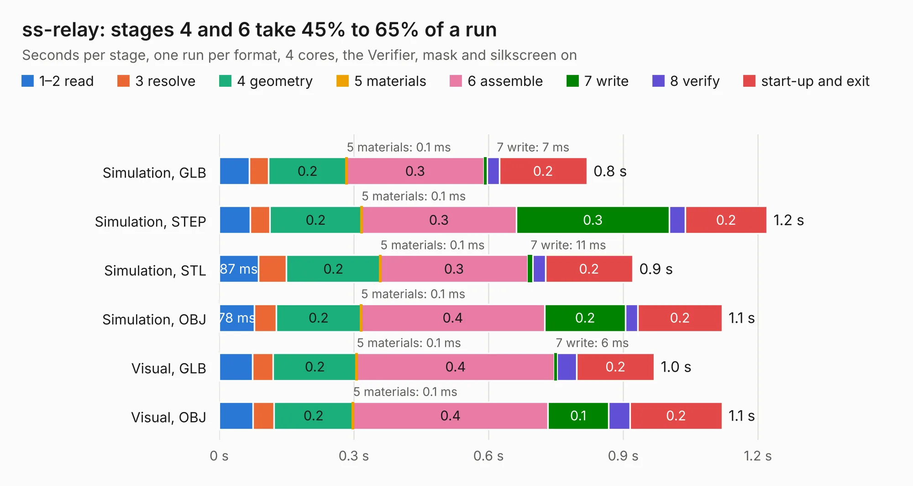

| Mode and format | 1–2 read | 3 resolve | 4 geometry | 5 materials | 6 assemble | 7 write | 8 verify | start-up and exit | Total |
|---|---:|---:|---:|---:|---:|---:|---:|---:|---:|
| Simulation, GLB | 67&nbsp;ms | 43&nbsp;ms | 0.2 | 0.1&nbsp;ms | 0.3 | 7&nbsp;ms | 27&nbsp;ms | 0.2 | 0.8 |
| Simulation, STEP | 69&nbsp;ms | 44&nbsp;ms | 0.2 | 0.1&nbsp;ms | 0.3 | 0.3 | 35&nbsp;ms | 0.2 | 1.2 |
| Simulation, STL | 87&nbsp;ms | 63&nbsp;ms | 0.2 | 0.1&nbsp;ms | 0.3 | 11&nbsp;ms | 29&nbsp;ms | 0.2 | 0.9 |
| Simulation, OBJ | 78&nbsp;ms | 49&nbsp;ms | 0.2 | 0.1&nbsp;ms | 0.4 | 0.2 | 27&nbsp;ms | 0.2 | 1.1 |
| Visual, GLB | 74&nbsp;ms | 46&nbsp;ms | 0.2 | 0.1&nbsp;ms | 0.4 | 6&nbsp;ms | 44&nbsp;ms | 0.2 | 1.0 |
| Visual, OBJ | 76&nbsp;ms | 47&nbsp;ms | 0.2 | 0.1&nbsp;ms | 0.4 | 0.1 | 48&nbsp;ms | 0.2 | 1.1 |

<table align="center"><tr><td valign="top">

| Board | Repo: [sufst/pcb](https://github.com/sufst/pcb) Board: `ss-relay.kicad_pcb` |
|---|---|
| Folder | ss-relay |
| Complexity | 160&nbsp;/&nbsp;1000 (size&nbsp;90, features&nbsp;70) |
| KESE&nbsp;features | custom pads, rounded, trapezoid or chamfered pads, filled zones, copper drawings, knockout text |
| Tested | 9th November 2026 |
| Copper&nbsp;layers | 2 |
| File&nbsp;format | KiCad 7 (20221018) |
| Parts,&nbsp;tracks,&nbsp;vias | 7, 21, 0 |
| Triangles,&nbsp;simulation | 46,626 in 18 parts |
| Verifier | PASS in all six runs |

</td><td valign="top">

<table>
<tr><th>File type</th><th>File size</th><th>Peak memory used</th></tr>
<tr><th colspan="3" align="left">Simulation</th></tr>
<tr><td>GLB</td><td align="right">1.6&nbsp;MB</td><td align="right">69&nbsp;MB</td></tr>
<tr><td>STEP</td><td align="right">7.8&nbsp;MB</td><td align="right">75&nbsp;MB</td></tr>
<tr><td>STL</td><td align="right">2.3&nbsp;MB</td><td align="right">69&nbsp;MB</td></tr>
<tr><td>OBJ</td><td align="right">4.5&nbsp;MB</td><td align="right">79&nbsp;MB</td></tr>
<tr><th colspan="3" align="left">Visual</th></tr>
<tr><td>GLB</td><td align="right">1.2&nbsp;MB</td><td align="right">104&nbsp;MB</td></tr>
<tr><td>OBJ</td><td align="right">3.2&nbsp;MB</td><td align="right">107&nbsp;MB</td></tr>
</table>

</td></tr></table>

## 2702. tem

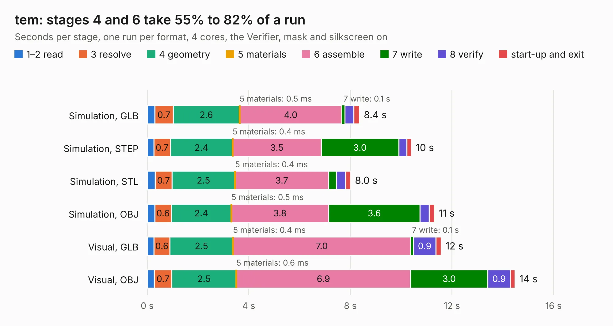

| Mode and format | 1–2 read | 3 resolve | 4 geometry | 5 materials | 6 assemble | 7 write | 8 verify | start-up and exit | Total |
|---|---:|---:|---:|---:|---:|---:|---:|---:|---:|
| Simulation, GLB | 0.3 | 0.7 | 2.6 | 0.5&nbsp;ms | 4.0 | 0.1 | 0.3 | 0.2 | 8.4 |
| Simulation, STEP | 0.3 | 0.7 | 2.4 | 0.4&nbsp;ms | 3.5 | 3.0 | 0.3 | 0.2 | 10.4 |
| Simulation, STL | 0.3 | 0.7 | 2.5 | 0.4&nbsp;ms | 3.7 | 0.3 | 0.4 | 0.2 | 8.0 |
| Simulation, OBJ | 0.3 | 0.6 | 2.4 | 0.5&nbsp;ms | 3.8 | 3.6 | 0.4 | 0.2 | 11.3 |
| Visual, GLB | 0.3 | 0.6 | 2.5 | 0.4&nbsp;ms | 7.0 | 0.1 | 0.9 | 0.2 | 11.6 |
| Visual, OBJ | 0.3 | 0.7 | 2.5 | 0.6&nbsp;ms | 6.9 | 3.0 | 0.9 | 0.2 | 14.5 |

<table align="center"><tr><td valign="top">

| Board | Repo: [sufst/pcb](https://github.com/sufst/pcb) Board: `tem.kicad_pcb` |
|---|---|
| Folder | tem |
| Complexity | 269&nbsp;/&nbsp;1000 (size&nbsp;224, features&nbsp;45) |
| KESE&nbsp;features | through vias, rounded, trapezoid or chamfered pads, filled zones |
| Tested | 9th November 2026 |
| Copper&nbsp;layers | 2 |
| File&nbsp;format | KiCad 7 (20221018) |
| Parts,&nbsp;tracks,&nbsp;vias | 103, 756, 169 |
| Triangles,&nbsp;simulation | 865,058 in 60 parts |
| Verifier | PASS in all six runs |

</td><td valign="top">

<table>
<tr><th>File type</th><th>File size</th><th>Peak memory used</th></tr>
<tr><th colspan="3" align="left">Simulation</th></tr>
<tr><td>GLB</td><td align="right">30&nbsp;MB</td><td align="right">485&nbsp;MB</td></tr>
<tr><td>STEP</td><td align="right">154&nbsp;MB</td><td align="right">519&nbsp;MB</td></tr>
<tr><td>STL</td><td align="right">43&nbsp;MB</td><td align="right">488&nbsp;MB</td></tr>
<tr><td>OBJ</td><td align="right">87&nbsp;MB</td><td align="right">620&nbsp;MB</td></tr>
<tr><th colspan="3" align="left">Visual</th></tr>
<tr><td>GLB</td><td align="right">25&nbsp;MB</td><td align="right">696&nbsp;MB</td></tr>
<tr><td>OBJ</td><td align="right">75&nbsp;MB</td><td align="right">651&nbsp;MB</td></tr>
</table>

</td></tr></table>

## 2703. trc

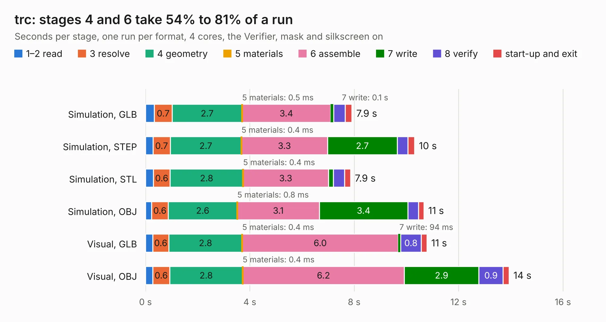

| Mode and format | 1–2 read | 3 resolve | 4 geometry | 5 materials | 6 assemble | 7 write | 8 verify | start-up and exit | Total |
|---|---:|---:|---:|---:|---:|---:|---:|---:|---:|
| Simulation, GLB | 0.3 | 0.7 | 2.7 | 0.5&nbsp;ms | 3.4 | 0.1 | 0.4 | 0.3 | 7.9 |
| Simulation, STEP | 0.3 | 0.7 | 2.7 | 0.4&nbsp;ms | 3.3 | 2.7 | 0.4 | 0.3 | 10.3 |
| Simulation, STL | 0.3 | 0.6 | 2.8 | 0.4&nbsp;ms | 3.3 | 0.2 | 0.4 | 0.2 | 7.9 |
| Simulation, OBJ | 0.2 | 0.6 | 2.6 | 0.8&nbsp;ms | 3.1 | 3.4 | 0.4 | 0.2 | 10.7 |
| Visual, GLB | 0.3 | 0.6 | 2.8 | 0.4&nbsp;ms | 6.0 | 94&nbsp;ms | 0.8 | 0.2 | 10.8 |
| Visual, OBJ | 0.3 | 0.6 | 2.8 | 0.4&nbsp;ms | 6.2 | 2.9 | 0.9 | 0.2 | 13.9 |

<table align="center"><tr><td valign="top">

| Board | Repo: [sufst/pcb](https://github.com/sufst/pcb) Board: `trc.kicad_pcb` |
|---|---|
| Folder | trc |
| Complexity | 266&nbsp;/&nbsp;1000 (size&nbsp;166, features&nbsp;100) |
| KESE&nbsp;features | through vias, rounded, trapezoid or chamfered pads, filled zones, curved board outline, knockout text, stack-up, dielectric εr and tanδ |
| Tested | 9th November 2026 |
| Copper&nbsp;layers | 2 |
| File&nbsp;format | KiCad 7 (20221018) |
| Parts,&nbsp;tracks,&nbsp;vias | 56, 364, 89 |
| Triangles,&nbsp;simulation | 721,698 in 71 parts |
| Verifier | PASS in all six runs |

</td><td valign="top">

<table>
<tr><th>File type</th><th>File size</th><th>Peak memory used</th></tr>
<tr><th colspan="3" align="left">Simulation</th></tr>
<tr><td>GLB</td><td align="right">25&nbsp;MB</td><td align="right">370&nbsp;MB</td></tr>
<tr><td>STEP</td><td align="right">121&nbsp;MB</td><td align="right">435&nbsp;MB</td></tr>
<tr><td>STL</td><td align="right">36&nbsp;MB</td><td align="right">372&nbsp;MB</td></tr>
<tr><td>OBJ</td><td align="right">73&nbsp;MB</td><td align="right">525&nbsp;MB</td></tr>
<tr><th colspan="3" align="left">Visual</th></tr>
<tr><td>GLB</td><td align="right">20&nbsp;MB</td><td align="right">529&nbsp;MB</td></tr>
<tr><td>OBJ</td><td align="right">59&nbsp;MB</td><td align="right">540&nbsp;MB</td></tr>
</table>

</td></tr></table>

## 2704. tsal-latching-integrated

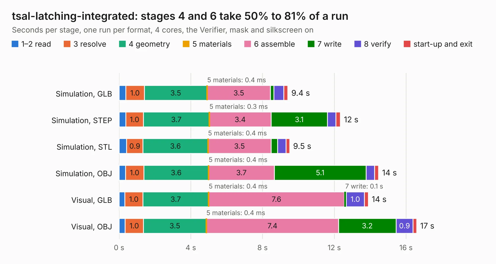

| Mode and format | 1–2 read | 3 resolve | 4 geometry | 5 materials | 6 assemble | 7 write | 8 verify | start-up and exit | Total |
|---|---:|---:|---:|---:|---:|---:|---:|---:|---:|
| Simulation, GLB | 0.4 | 1.0 | 3.5 | 0.4&nbsp;ms | 3.5 | 0.2 | 0.6 | 0.2 | 9.4 |
| Simulation, STEP | 0.4 | 1.0 | 3.7 | 0.3&nbsp;ms | 3.4 | 3.1 | 0.5 | 0.3 | 12.3 |
| Simulation, STL | 0.4 | 0.9 | 3.6 | 0.4&nbsp;ms | 3.5 | 0.4 | 0.5 | 0.2 | 9.5 |
| Simulation, OBJ | 0.4 | 1.0 | 3.6 | 0.4&nbsp;ms | 3.7 | 5.1 | 0.5 | 0.2 | 14.5 |
| Visual, GLB | 0.3 | 1.0 | 3.7 | 0.4&nbsp;ms | 7.6 | 0.1 | 1.0 | 0.2 | 13.9 |
| Visual, OBJ | 0.3 | 1.0 | 3.5 | 0.4&nbsp;ms | 7.4 | 3.2 | 0.9 | 0.2 | 16.6 |

<table align="center"><tr><td valign="top">

| Board | Repo: [sufst/pcb](https://github.com/sufst/pcb) Board: `tsal-latching-integrated.kicad_pcb` |
|---|---|
| Folder | tsal-latching-integrated |
| Complexity | 311&nbsp;/&nbsp;1000 (size&nbsp;186, features&nbsp;125) |
| KESE&nbsp;features | through vias, custom pads, rounded, trapezoid or chamfered pads, filled zones, copper drawings, curved board outline, knockout text, stack-up, dielectric εr and tanδ |
| Tested | 9th November 2026 |
| Copper&nbsp;layers | 4 |
| File&nbsp;format | KiCad 8 (20240108) |
| Parts,&nbsp;tracks,&nbsp;vias | 80, 429, 62 |
| Triangles,&nbsp;simulation | 1,076,692 in 77 parts |
| Verifier | PASS in all six runs |

</td><td valign="top">

<table>
<tr><th>File type</th><th>File size</th><th>Peak memory used</th></tr>
<tr><th colspan="3" align="left">Simulation</th></tr>
<tr><td>GLB</td><td align="right">37&nbsp;MB</td><td align="right">461&nbsp;MB</td></tr>
<tr><td>STEP</td><td align="right">156&nbsp;MB</td><td align="right">536&nbsp;MB</td></tr>
<tr><td>STL</td><td align="right">54&nbsp;MB</td><td align="right">456&nbsp;MB</td></tr>
<tr><td>OBJ</td><td align="right">109&nbsp;MB</td><td align="right">767&nbsp;MB</td></tr>
<tr><th colspan="3" align="left">Visual</th></tr>
<tr><td>GLB</td><td align="right">24&nbsp;MB</td><td align="right">661&nbsp;MB</td></tr>
<tr><td>OBJ</td><td align="right">73&nbsp;MB</td><td align="right">602&nbsp;MB</td></tr>
</table>

</td></tr></table>

## 2705. tsal-led

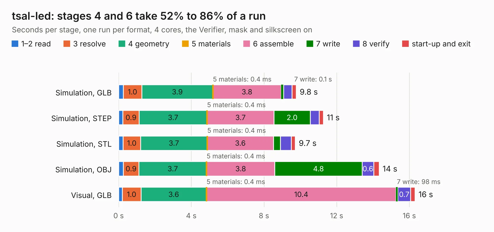

| Mode and format | 1–2 read | 3 resolve | 4 geometry | 5 materials | 6 assemble | 7 write | 8 verify | start-up and exit | Total |
|---|---:|---:|---:|---:|---:|---:|---:|---:|---:|
| Simulation, GLB | 0.3 | 1.0 | 3.9 | 0.4&nbsp;ms | 3.8 | 0.1 | 0.5 | 0.2 | 9.8 |
| Simulation, STEP | 0.2 | 0.9 | 3.7 | 0.4&nbsp;ms | 3.7 | 2.0 | 0.5 | 0.2 | 11.3 |
| Simulation, STL | 0.2 | 1.0 | 3.7 | 0.4&nbsp;ms | 3.6 | 0.4 | 0.6 | 0.2 | 9.7 |
| Simulation, OBJ | 0.3 | 0.9 | 3.7 | 0.4&nbsp;ms | 3.8 | 4.8 | 0.6 | 0.3 | 14.3 |
| Visual, GLB | 0.2 | 1.0 | 3.6 | 0.4&nbsp;ms | 10.4 | 98&nbsp;ms | 0.7 | 0.2 | 16.3 |
| Visual, OBJ | 0.3 | 1.0 | 4.0 | 0.3&nbsp;ms | 9.5 | 3.0 | 0.7 | 0.2 | 18.8 |

<table align="center"><tr><td valign="top">

| Board | Repo: [sufst/pcb](https://github.com/sufst/pcb) Board: `tsal-led.kicad_pcb` |
|---|---|
| Folder | tsal-led |
| Complexity | 321&nbsp;/&nbsp;1000 (size&nbsp;191, features&nbsp;130) |
| KESE&nbsp;features | through vias, custom pads, rounded, trapezoid or chamfered pads, filled zones, copper drawings, curved board outline, knockout text, stack-up, dielectric εr and tanδ, mask and silkscreen colours |
| Tested | 9th November 2026 |
| Copper&nbsp;layers | 4 |
| File&nbsp;format | KiCad 9 (20241229) |
| Parts,&nbsp;tracks,&nbsp;vias | 57, 85, 316 |
| Triangles,&nbsp;simulation | 973,862 in 36 parts |
| Verifier | PASS in all six runs |

</td><td valign="top">

<table>
<tr><th>File type</th><th>File size</th><th>Peak memory used</th></tr>
<tr><th colspan="3" align="left">Simulation</th></tr>
<tr><td>GLB</td><td align="right">33&nbsp;MB</td><td align="right">470&nbsp;MB</td></tr>
<tr><td>STEP</td><td align="right">84&nbsp;MB</td><td align="right">544&nbsp;MB</td></tr>
<tr><td>STL</td><td align="right">49&nbsp;MB</td><td align="right">492&nbsp;MB</td></tr>
<tr><td>OBJ</td><td align="right">96&nbsp;MB</td><td align="right">637&nbsp;MB</td></tr>
<tr><th colspan="3" align="left">Visual</th></tr>
<tr><td>GLB</td><td align="right">18&nbsp;MB</td><td align="right">503&nbsp;MB</td></tr>
<tr><td>OBJ</td><td align="right">54&nbsp;MB</td><td align="right">515&nbsp;MB</td></tr>
</table>

</td></tr></table>

## 2706. vcu

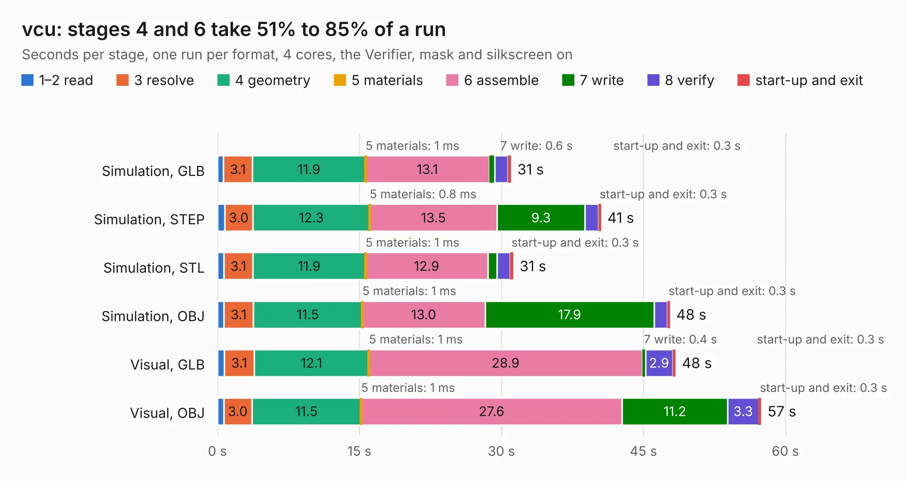

| Mode and format | 1–2 read | 3 resolve | 4 geometry | 5 materials | 6 assemble | 7 write | 8 verify | start-up and exit | Total |
|---|---:|---:|---:|---:|---:|---:|---:|---:|---:|
| Simulation, GLB | 0.6 | 3.1 | 11.9 | 1&nbsp;ms | 13.1 | 0.6 | 1.4 | 0.3 | 31.0 |
| Simulation, STEP | 0.7 | 3.0 | 12.3 | 0.8&nbsp;ms | 13.5 | 9.3 | 1.4 | 0.3 | 40.5 |
| Simulation, STL | 0.7 | 3.1 | 11.9 | 1&nbsp;ms | 12.9 | 1.0 | 1.4 | 0.3 | 31.2 |
| Simulation, OBJ | 0.7 | 3.1 | 11.5 | 1&nbsp;ms | 13.0 | 17.9 | 1.4 | 0.3 | 47.8 |
| Visual, GLB | 0.7 | 3.1 | 12.1 | 1&nbsp;ms | 28.9 | 0.4 | 2.9 | 0.3 | 48.4 |
| Visual, OBJ | 0.6 | 3.0 | 11.5 | 1&nbsp;ms | 27.6 | 11.2 | 3.3 | 0.3 | 57.4 |

<table align="center"><tr><td valign="top">

| Board | Repo: [sufst/pcb](https://github.com/sufst/pcb) Board: `vcu.kicad_pcb` |
|---|---|
| Folder | vcu |
| Complexity | 346&nbsp;/&nbsp;1000 (size&nbsp;266, features&nbsp;80) |
| KESE&nbsp;features | through vias, rounded, trapezoid or chamfered pads, curved board outline, knockout text, stack-up, dielectric εr and tanδ |
| Tested | 9th November 2026 |
| Copper&nbsp;layers | 4 |
| File&nbsp;format | KiCad 9 (20241229) |
| Parts,&nbsp;tracks,&nbsp;vias | 205, 1,711, 293 |
| Triangles,&nbsp;simulation | 3,172,496 in 345 parts |
| Verifier | PASS in all six runs |

</td><td valign="top">

<table>
<tr><th>File type</th><th>File size</th><th>Peak memory used</th></tr>
<tr><th colspan="3" align="left">Simulation</th></tr>
<tr><td>GLB</td><td align="right">109&nbsp;MB</td><td align="right">1.0&nbsp;GB</td></tr>
<tr><td>STEP</td><td align="right">459&nbsp;MB</td><td align="right">1.3&nbsp;GB</td></tr>
<tr><td>STL</td><td align="right">159&nbsp;MB</td><td align="right">1.0&nbsp;GB</td></tr>
<tr><td>OBJ</td><td align="right">338&nbsp;MB</td><td align="right">2.1&nbsp;GB</td></tr>
<tr><th colspan="3" align="left">Visual</th></tr>
<tr><td>GLB</td><td align="right">70&nbsp;MB</td><td align="right">1.3&nbsp;GB</td></tr>
<tr><td>OBJ</td><td align="right">220&nbsp;MB</td><td align="right">1.5&nbsp;GB</td></tr>
</table>

</td></tr></table>

## 2707. LittleSixteen

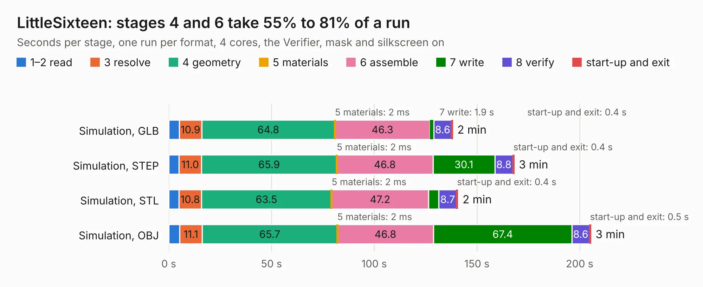

| Mode and format | 1–2 read | 3 resolve | 4 geometry | 5 materials | 6 assemble | 7 write | 8 verify | start-up and exit | Total |
|---|---:|---:|---:|---:|---:|---:|---:|---:|---:|
| Simulation, GLB | 5.1 | 10.9 | 64.8 | 2&nbsp;ms | 46.3 | 1.9 | 8.6 | 0.4 | 138.0 |
| Simulation, STEP | 5.0 | 11.0 | 65.9 | 2&nbsp;ms | 46.8 | 30.1 | 8.8 | 0.4 | 168.0 |
| Simulation, STL | 5.0 | 10.8 | 63.5 | 2&nbsp;ms | 47.2 | 5.0 | 8.7 | 0.4 | 140.6 |
| Simulation, OBJ | 5.3 | 11.1 | 65.7 | 2&nbsp;ms | 46.8 | 67.4 | 8.6 | 0.5 | 205.3 |
| Visual, GLB | 5.2 | 10.8 | 64.8 | 2&nbsp;ms | 134.1 | 1.3 | 11.0 | 0.3 | 227.5 |
| Visual, OBJ | 5.0 | 10.8 | 65.8 | 2&nbsp;ms | 139.1 | 46.5 | 12.3 | 0.4 | 279.9 |

<table align="center"><tr><td valign="top">

| Board | Repo: [SukkoPera/LittleSixteen](https://github.com/SukkoPera/LittleSixteen) Board: `LittleSixteen.kicad_pcb` |
|---|---|
| Complexity | 317&nbsp;/&nbsp;1000 (size&nbsp;227, features&nbsp;90) |
| KESE&nbsp;features | through vias, custom pads, drill offsets, filled zones, copper drawings, copper text, curved board outline |
| Tested | 9th November 2026 to 10th November 2026 |
| Copper&nbsp;layers | 2 |
| File&nbsp;format | KiCad 5 (20171130) |
| Parts,&nbsp;tracks,&nbsp;vias | 339, 5,995, 622 |
| Triangles,&nbsp;simulation | 11,236,742 in 387 parts |
| Verifier | PASS in all six runs |

</td><td valign="top">

<table>
<tr><th>File type</th><th>File size</th><th>Peak memory used</th></tr>
<tr><th colspan="3" align="left">Simulation</th></tr>
<tr><td>GLB</td><td align="right">381&nbsp;MB</td><td align="right">3.3&nbsp;GB</td></tr>
<tr><td>STEP</td><td align="right">1.9&nbsp;GB</td><td align="right">4.2&nbsp;GB</td></tr>
<tr><td>STL</td><td align="right">562&nbsp;MB</td><td align="right">3.5&nbsp;GB</td></tr>
<tr><td>OBJ</td><td align="right">1.2&nbsp;GB</td><td align="right">7.1&nbsp;GB</td></tr>
<tr><th colspan="3" align="left">Visual</th></tr>
<tr><td>GLB</td><td align="right">277&nbsp;MB</td><td align="right">4.2&nbsp;GB</td></tr>
<tr><td>OBJ</td><td align="right">887&nbsp;MB</td><td align="right">5.4&nbsp;GB</td></tr>
</table>

</td></tr></table>

## 2708. Raemixx500

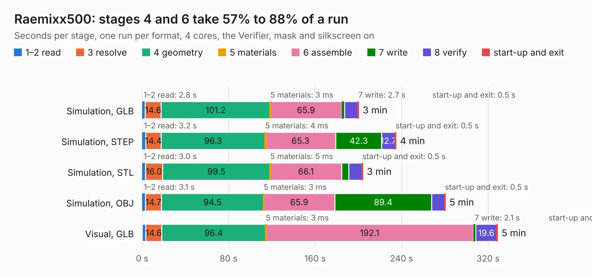

| Mode and format | 1–2 read | 3 resolve | 4 geometry | 5 materials | 6 assemble | 7 write | 8 verify | start-up and exit | Total |
|---|---:|---:|---:|---:|---:|---:|---:|---:|---:|
| Simulation, GLB | 2.8 | 14.6 | 101.2 | 3&nbsp;ms | 65.9 | 2.7 | 12.5 | 0.5 | 200.1 |
| Simulation, STEP | 3.2 | 14.4 | 96.3 | 4&nbsp;ms | 65.3 | 42.3 | 12.7 | 0.5 | 234.7 |
| Simulation, STL | 3.0 | 16.0 | 99.5 | 5&nbsp;ms | 66.1 | 6.5 | 12.4 | 0.5 | 204.0 |
| Simulation, OBJ | 3.1 | 14.7 | 94.5 | 3&nbsp;ms | 65.9 | 89.4 | 12.1 | 0.5 | 280.3 |
| Visual, GLB | 3.3 | 14.6 | 96.4 | 3&nbsp;ms | 192.1 | 2.1 | 19.6 | 0.4 | 328.5 |
| Visual, OBJ | 2.8 | 14.5 | 95.5 | 5&nbsp;ms | 188.1 | 57.8 | 18.5 | 0.4 | 377.6 |

<table align="center"><tr><td valign="top">

| Board | Repo: [sukkopera/raemixx500](https://github.com/sukkopera/raemixx500) Board: `Raemixx500.kicad_pcb` |
|---|---|
| Complexity | 362&nbsp;/&nbsp;1000 (size&nbsp;277, features&nbsp;85) |
| KESE&nbsp;features | through vias, slotted holes, rounded, trapezoid or chamfered pads, drill offsets, filled zones, copper text, curved board outline |
| Tested | 9th November 2026 |
| Copper&nbsp;layers | 2 |
| File&nbsp;format | KiCad 5 (20171130) |
| Parts,&nbsp;tracks,&nbsp;vias | 362, 11,735, 902 |
| Triangles,&nbsp;simulation | 15,351,150 in 483 parts |
| Verifier | PASS in all six runs |

</td><td valign="top">

<table>
<tr><th>File type</th><th>File size</th><th>Peak memory used</th></tr>
<tr><th colspan="3" align="left">Simulation</th></tr>
<tr><td>GLB</td><td align="right">519&nbsp;MB</td><td align="right">4.5&nbsp;GB</td></tr>
<tr><td>STEP</td><td align="right">2.6&nbsp;GB</td><td align="right">5.6&nbsp;GB</td></tr>
<tr><td>STL</td><td align="right">768&nbsp;MB</td><td align="right">4.5&nbsp;GB</td></tr>
<tr><td>OBJ</td><td align="right">1.7&nbsp;GB</td><td align="right">9.5&nbsp;GB</td></tr>
<tr><th colspan="3" align="left">Visual</th></tr>
<tr><td>GLB</td><td align="right">369&nbsp;MB</td><td align="right">5.5&nbsp;GB</td></tr>
<tr><td>OBJ</td><td align="right">1.2&nbsp;GB</td><td align="right">7.3&nbsp;GB</td></tr>
</table>

</td></tr></table>

## 2709. launch-heavy

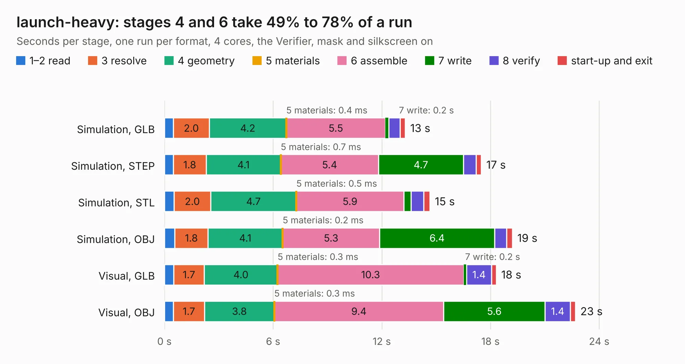

| Mode and format | 1–2 read | 3 resolve | 4 geometry | 5 materials | 6 assemble | 7 write | 8 verify | start-up and exit | Total |
|---|---:|---:|---:|---:|---:|---:|---:|---:|---:|
| Simulation, GLB | 0.5 | 2.0 | 4.2 | 0.4&nbsp;ms | 5.5 | 0.2 | 0.6 | 0.3 | 13.3 |
| Simulation, STEP | 0.5 | 1.8 | 4.1 | 0.7&nbsp;ms | 5.4 | 4.7 | 0.7 | 0.3 | 17.5 |
| Simulation, STL | 0.5 | 2.0 | 4.7 | 0.5&nbsp;ms | 5.9 | 0.4 | 0.7 | 0.3 | 14.7 |
| Simulation, OBJ | 0.6 | 1.8 | 4.1 | 0.2&nbsp;ms | 5.3 | 6.4 | 0.7 | 0.3 | 19.2 |
| Visual, GLB | 0.5 | 1.7 | 4.0 | 0.3&nbsp;ms | 10.3 | 0.2 | 1.4 | 0.3 | 18.3 |
| Visual, OBJ | 0.5 | 1.7 | 3.8 | 0.3&nbsp;ms | 9.4 | 5.6 | 1.4 | 0.3 | 22.7 |

<table align="center"><tr><td valign="top">

| Board | Repo: [system76/launch](https://github.com/system76/launch) Board: `launch-heavy.kicad_pcb` |
|---|---|
| Folder | pcb-heavy |
| Complexity | 285&nbsp;/&nbsp;1000 (size&nbsp;175, features&nbsp;110) |
| KESE&nbsp;features | through vias, rounded, trapezoid or chamfered pads, arc tracks, filled zones, copper text, curved board outline, stack-up, dielectric εr and tanδ |
| Tested | 9th November 2026 |
| Copper&nbsp;layers | 2 |
| File&nbsp;format | KiCad 6 (20211014) |
| Parts,&nbsp;tracks,&nbsp;vias | 64, 390, 202 |
| Triangles,&nbsp;simulation | 1,013,844 in 68 parts |
| Verifier | PASS in all six runs |

</td><td valign="top">

<table>
<tr><th>File type</th><th>File size</th><th>Peak memory used</th></tr>
<tr><th colspan="3" align="left">Simulation</th></tr>
<tr><td>GLB</td><td align="right">36&nbsp;MB</td><td align="right">482&nbsp;MB</td></tr>
<tr><td>STEP</td><td align="right">188&nbsp;MB</td><td align="right">615&nbsp;MB</td></tr>
<tr><td>STL</td><td align="right">51&nbsp;MB</td><td align="right">508&nbsp;MB</td></tr>
<tr><td>OBJ</td><td align="right">105&nbsp;MB</td><td align="right">716&nbsp;MB</td></tr>
<tr><th colspan="3" align="left">Visual</th></tr>
<tr><td>GLB</td><td align="right">30&nbsp;MB</td><td align="right">715&nbsp;MB</td></tr>
<tr><td>OBJ</td><td align="right">91&nbsp;MB</td><td align="right">692&nbsp;MB</td></tr>
</table>

</td></tr></table>

## 2710. launch-iso

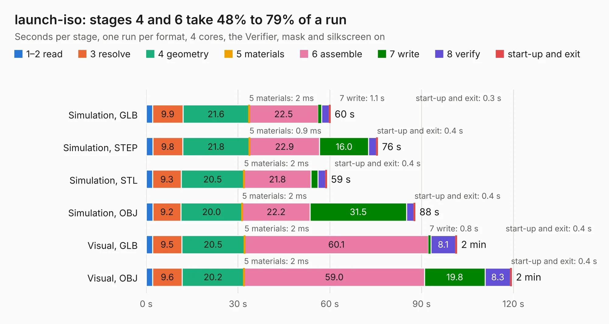

| Mode and format | 1–2 read | 3 resolve | 4 geometry | 5 materials | 6 assemble | 7 write | 8 verify | start-up and exit | Total |
|---|---:|---:|---:|---:|---:|---:|---:|---:|---:|
| Simulation, GLB | 2.1 | 9.9 | 21.6 | 2&nbsp;ms | 22.5 | 1.1 | 2.5 | 0.3 | 60.2 |
| Simulation, STEP | 2.2 | 9.8 | 21.8 | 0.9&nbsp;ms | 22.9 | 16.0 | 2.6 | 0.4 | 75.6 |
| Simulation, STL | 2.1 | 9.3 | 20.5 | 2&nbsp;ms | 21.8 | 2.3 | 2.5 | 0.4 | 58.9 |
| Simulation, OBJ | 2.2 | 9.2 | 20.0 | 2&nbsp;ms | 22.2 | 31.5 | 2.4 | 0.4 | 87.9 |
| Visual, GLB | 2.1 | 9.5 | 20.5 | 2&nbsp;ms | 60.1 | 0.8 | 8.1 | 0.4 | 101.5 |
| Visual, OBJ | 2.1 | 9.6 | 20.2 | 2&nbsp;ms | 59.0 | 19.8 | 8.3 | 0.4 | 119.4 |

<table align="center"><tr><td valign="top">

| Board | Repo: [system76/launch](https://github.com/system76/launch) Board: `launch-iso.kicad_pcb` |
|---|---|
| Folder | pcb-iso |
| Complexity | 430&nbsp;/&nbsp;1000 (size&nbsp;285, features&nbsp;145) |
| KESE&nbsp;features | through vias, slotted holes, custom pads, rounded, trapezoid or chamfered pads, arc tracks, filled zones, copper drawings, copper text, curved board outline, stack-up, dielectric εr and tanδ |
| Tested | 9th November 2026 |
| Copper&nbsp;layers | 4 |
| File&nbsp;format | KiCad 6 (20211014) |
| Parts,&nbsp;tracks,&nbsp;vias | 361, 3,521, 723 |
| Triangles,&nbsp;simulation | 5,928,940 in 419 parts |
| Verifier | PASS in all six runs |

</td><td valign="top">

<table>
<tr><th>File type</th><th>File size</th><th>Peak memory used</th></tr>
<tr><th colspan="3" align="left">Simulation</th></tr>
<tr><td>GLB</td><td align="right">204&nbsp;MB</td><td align="right">1.8&nbsp;GB</td></tr>
<tr><td>STEP</td><td align="right">984&nbsp;MB</td><td align="right">2.3&nbsp;GB</td></tr>
<tr><td>STL</td><td align="right">296&nbsp;MB</td><td align="right">1.9&nbsp;GB</td></tr>
<tr><td>OBJ</td><td align="right">644&nbsp;MB</td><td align="right">3.9&nbsp;GB</td></tr>
<tr><th colspan="3" align="left">Visual</th></tr>
<tr><td>GLB</td><td align="right">134&nbsp;MB</td><td align="right">2.1&nbsp;GB</td></tr>
<tr><td>OBJ</td><td align="right">426&nbsp;MB</td><td align="right">2.9&nbsp;GB</td></tr>
</table>

</td></tr></table>

## 2711. launch-lite-iso

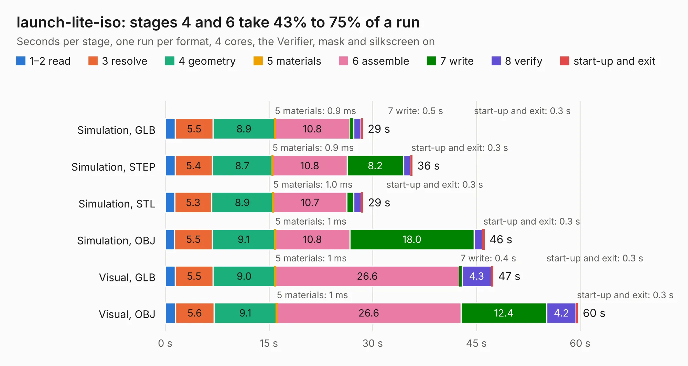

| Mode and format | 1–2 read | 3 resolve | 4 geometry | 5 materials | 6 assemble | 7 write | 8 verify | start-up and exit | Total |
|---|---:|---:|---:|---:|---:|---:|---:|---:|---:|
| Simulation, GLB | 1.5 | 5.5 | 8.9 | 0.9&nbsp;ms | 10.8 | 0.5 | 1.1 | 0.3 | 28.6 |
| Simulation, STEP | 1.4 | 5.4 | 8.7 | 0.9&nbsp;ms | 10.8 | 8.2 | 1.0 | 0.3 | 35.7 |
| Simulation, STL | 1.4 | 5.3 | 8.9 | 1.0&nbsp;ms | 10.7 | 1.0 | 1.1 | 0.3 | 28.6 |
| Simulation, OBJ | 1.3 | 5.5 | 9.1 | 1&nbsp;ms | 10.8 | 18.0 | 1.2 | 0.3 | 46.2 |
| Visual, GLB | 1.5 | 5.5 | 9.0 | 1&nbsp;ms | 26.6 | 0.4 | 4.3 | 0.3 | 47.4 |
| Visual, OBJ | 1.5 | 5.6 | 9.1 | 1&nbsp;ms | 26.6 | 12.4 | 4.2 | 0.3 | 59.7 |

<table align="center"><tr><td valign="top">

| Board | Repo: [system76/launch](https://github.com/system76/launch) Board: `launch-lite-iso.kicad_pcb` |
|---|---|
| Folder | pcb-lite-iso |
| Complexity | 403&nbsp;/&nbsp;1000 (size&nbsp;258, features&nbsp;145) |
| KESE&nbsp;features | through vias, slotted holes, custom pads, rounded, trapezoid or chamfered pads, arc tracks, filled zones, copper drawings, copper text, curved board outline, stack-up, dielectric εr and tanδ |
| Tested | 9th November 2026 |
| Copper&nbsp;layers | 4 |
| File&nbsp;format | KiCad 6 (20211014) |
| Parts,&nbsp;tracks,&nbsp;vias | 214, 1,358, 307 |
| Triangles,&nbsp;simulation | 3,028,702 in 226 parts |
| Verifier | PASS in all six runs |

</td><td valign="top">

<table>
<tr><th>File type</th><th>File size</th><th>Peak memory used</th></tr>
<tr><th colspan="3" align="left">Simulation</th></tr>
<tr><td>GLB</td><td align="right">104&nbsp;MB</td><td align="right">1.1&nbsp;GB</td></tr>
<tr><td>STEP</td><td align="right">436&nbsp;MB</td><td align="right">1.3&nbsp;GB</td></tr>
<tr><td>STL</td><td align="right">151&nbsp;MB</td><td align="right">1.1&nbsp;GB</td></tr>
<tr><td>OBJ</td><td align="right">326&nbsp;MB</td><td align="right">2.0&nbsp;GB</td></tr>
<tr><th colspan="3" align="left">Visual</th></tr>
<tr><td>GLB</td><td align="right">70&nbsp;MB</td><td align="right">1.2&nbsp;GB</td></tr>
<tr><td>OBJ</td><td align="right">218&nbsp;MB</td><td align="right">1.6&nbsp;GB</td></tr>
</table>

</td></tr></table>

## 2712. launch-lite

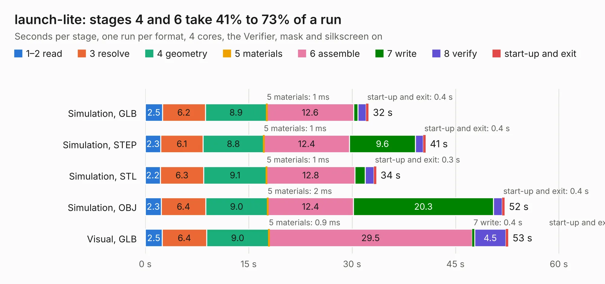

| Mode and format | 1–2 read | 3 resolve | 4 geometry | 5 materials | 6 assemble | 7 write | 8 verify | start-up and exit | Total |
|---|---:|---:|---:|---:|---:|---:|---:|---:|---:|
| Simulation, GLB | 2.5 | 6.2 | 8.9 | 1&nbsp;ms | 12.6 | 0.6 | 1.2 | 0.4 | 32.4 |
| Simulation, STEP | 2.3 | 6.1 | 8.8 | 1&nbsp;ms | 12.4 | 9.6 | 1.1 | 0.4 | 40.7 |
| Simulation, STL | 2.2 | 6.3 | 9.1 | 1&nbsp;ms | 12.8 | 1.5 | 1.3 | 0.3 | 33.5 |
| Simulation, OBJ | 2.3 | 6.4 | 9.0 | 2&nbsp;ms | 12.4 | 20.3 | 1.3 | 0.4 | 52.1 |
| Visual, GLB | 2.5 | 6.4 | 9.0 | 0.9&nbsp;ms | 29.5 | 0.4 | 4.5 | 0.4 | 52.7 |
| Visual, OBJ | 2.4 | 6.3 | 9.1 | 1&nbsp;ms | 28.5 | 12.5 | 5.5 | 0.4 | 64.7 |

<table align="center"><tr><td valign="top">

| Board | Repo: [system76/launch](https://github.com/system76/launch) Board: `launch-lite.kicad_pcb` |
|---|---|
| Folder | pcb-lite |
| Complexity | 388&nbsp;/&nbsp;1000 (size&nbsp;258, features&nbsp;130) |
| KESE&nbsp;features | through vias, slotted holes, custom pads, rounded, trapezoid or chamfered pads, filled zones, copper drawings, copper text, curved board outline, stack-up, dielectric εr and tanδ |
| Tested | 9th November 2026 |
| Copper&nbsp;layers | 4 |
| File&nbsp;format | KiCad 6 (20211014) |
| Parts,&nbsp;tracks,&nbsp;vias | 211, 1,375, 292 |
| Triangles,&nbsp;simulation | 3,642,802 in 223 parts |
| Verifier | PASS in all six runs |

</td><td valign="top">

<table>
<tr><th>File type</th><th>File size</th><th>Peak memory used</th></tr>
<tr><th colspan="3" align="left">Simulation</th></tr>
<tr><td>GLB</td><td align="right">126&nbsp;MB</td><td align="right">1.3&nbsp;GB</td></tr>
<tr><td>STEP</td><td align="right">668&nbsp;MB</td><td align="right">1.6&nbsp;GB</td></tr>
<tr><td>STL</td><td align="right">182&nbsp;MB</td><td align="right">1.3&nbsp;GB</td></tr>
<tr><td>OBJ</td><td align="right">395&nbsp;MB</td><td align="right">2.5&nbsp;GB</td></tr>
<tr><th colspan="3" align="left">Visual</th></tr>
<tr><td>GLB</td><td align="right">74&nbsp;MB</td><td align="right">1.3&nbsp;GB</td></tr>
<tr><td>OBJ</td><td align="right">229&nbsp;MB</td><td align="right">1.7&nbsp;GB</td></tr>
</table>

</td></tr></table>

## 2713. launch

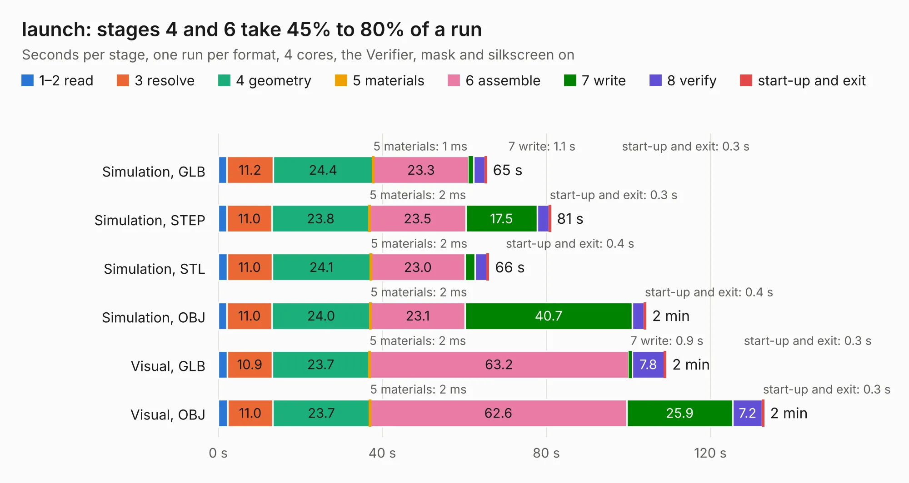

| Mode and format | 1–2 read | 3 resolve | 4 geometry | 5 materials | 6 assemble | 7 write | 8 verify | start-up and exit | Total |
|---|---:|---:|---:|---:|---:|---:|---:|---:|---:|
| Simulation, GLB | 2.1 | 11.2 | 24.4 | 1&nbsp;ms | 23.3 | 1.1 | 2.8 | 0.3 | 65.4 |
| Simulation, STEP | 2.1 | 11.0 | 23.8 | 2&nbsp;ms | 23.5 | 17.5 | 2.9 | 0.3 | 81.0 |
| Simulation, STL | 2.2 | 11.0 | 24.1 | 2&nbsp;ms | 23.0 | 2.5 | 2.9 | 0.4 | 65.9 |
| Simulation, OBJ | 2.1 | 11.0 | 24.0 | 2&nbsp;ms | 23.1 | 40.7 | 2.9 | 0.4 | 104.2 |
| Visual, GLB | 2.2 | 10.9 | 23.7 | 2&nbsp;ms | 63.2 | 0.9 | 7.8 | 0.3 | 109.1 |
| Visual, OBJ | 2.3 | 11.0 | 23.7 | 2&nbsp;ms | 62.6 | 25.9 | 7.2 | 0.3 | 133.0 |

<table align="center"><tr><td valign="top">

| Board | Repo: [system76/launch](https://github.com/system76/launch) Board: `launch.kicad_pcb` |
|---|---|
| Folder | pcb |
| Complexity | 393&nbsp;/&nbsp;1000 (size&nbsp;288, features&nbsp;105) |
| KESE&nbsp;features | through vias, slotted holes, rounded, trapezoid or chamfered pads, filled zones, copper text, curved board outline, stack-up, dielectric εr and tanδ |
| Tested | 9th November 2026 |
| Copper&nbsp;layers | 4 |
| File&nbsp;format | KiCad 7 (20221018) |
| Parts,&nbsp;tracks,&nbsp;vias | 371, 3,494, 959 |
| Triangles,&nbsp;simulation | 7,010,812 in 414 parts |
| Verifier | PASS in all six runs |

</td><td valign="top">

<table>
<tr><th>File type</th><th>File size</th><th>Peak memory used</th></tr>
<tr><th colspan="3" align="left">Simulation</th></tr>
<tr><td>GLB</td><td align="right">239&nbsp;MB</td><td align="right">2.4&nbsp;GB</td></tr>
<tr><td>STEP</td><td align="right">1.0&nbsp;GB</td><td align="right">2.8&nbsp;GB</td></tr>
<tr><td>STL</td><td align="right">351&nbsp;MB</td><td align="right">2.3&nbsp;GB</td></tr>
<tr><td>OBJ</td><td align="right">758&nbsp;MB</td><td align="right">4.5&nbsp;GB</td></tr>
<tr><th colspan="3" align="left">Visual</th></tr>
<tr><td>GLB</td><td align="right">160&nbsp;MB</td><td align="right">2.6&nbsp;GB</td></tr>
<tr><td>OBJ</td><td align="right">511&nbsp;MB</td><td align="right">3.3&nbsp;GB</td></tr>
</table>

</td></tr></table>

## 2714. nebula-io

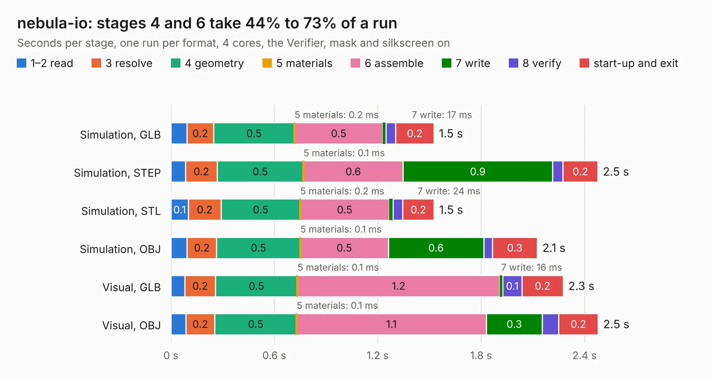

| Mode and format | 1–2 read | 3 resolve | 4 geometry | 5 materials | 6 assemble | 7 write | 8 verify | start-up and exit | Total |
|---|---:|---:|---:|---:|---:|---:|---:|---:|---:|
| Simulation, GLB | 93&nbsp;ms | 0.2 | 0.5 | 0.2&nbsp;ms | 0.5 | 17&nbsp;ms | 58&nbsp;ms | 0.2 | 1.5 |
| Simulation, STEP | 86&nbsp;ms | 0.2 | 0.5 | 0.1&nbsp;ms | 0.6 | 0.9 | 60&nbsp;ms | 0.2 | 2.5 |
| Simulation, STL | 0.1 | 0.2 | 0.5 | 0.2&nbsp;ms | 0.5 | 24&nbsp;ms | 55&nbsp;ms | 0.2 | 1.5 |
| Simulation, OBJ | 94&nbsp;ms | 0.2 | 0.5 | 0.1&nbsp;ms | 0.5 | 0.6 | 49&nbsp;ms | 0.3 | 2.1 |
| Visual, GLB | 82&nbsp;ms | 0.2 | 0.5 | 0.1&nbsp;ms | 1.2 | 16&nbsp;ms | 0.1 | 0.2 | 2.3 |
| Visual, OBJ | 86&nbsp;ms | 0.2 | 0.5 | 0.1&nbsp;ms | 1.1 | 0.3 | 95&nbsp;ms | 0.2 | 2.5 |

<table align="center"><tr><td valign="top">

| Board | Repo: [system76/thelio-io-hardware](https://github.com/system76/thelio-io-hardware) Board: `nebula-io.kicad_pcb` |
|---|---|
| Folder | pcb-nebula-io |
| Complexity | 176&nbsp;/&nbsp;1000 (size&nbsp;96, features&nbsp;80) |
| KESE&nbsp;features | rounded, trapezoid or chamfered pads, filled zones, copper text, curved board outline, stack-up, dielectric εr and tanδ |
| Tested | 9th November 2026 |
| Copper&nbsp;layers | 2 |
| File&nbsp;format | KiCad 7 (20221018) |
| Parts,&nbsp;tracks,&nbsp;vias | 8, 28, 0 |
| Triangles,&nbsp;simulation | 104,494 in 18 parts |
| Verifier | PASS in all six runs |

</td><td valign="top">

<table>
<tr><th>File type</th><th>File size</th><th>Peak memory used</th></tr>
<tr><th colspan="3" align="left">Simulation</th></tr>
<tr><td>GLB</td><td align="right">3.7&nbsp;MB</td><td align="right">183&nbsp;MB</td></tr>
<tr><td>STEP</td><td align="right">19&nbsp;MB</td><td align="right">187&nbsp;MB</td></tr>
<tr><td>STL</td><td align="right">5.2&nbsp;MB</td><td align="right">180&nbsp;MB</td></tr>
<tr><td>OBJ</td><td align="right">10&nbsp;MB</td><td align="right">182&nbsp;MB</td></tr>
<tr><th colspan="3" align="left">Visual</th></tr>
<tr><td>GLB</td><td align="right">2.4&nbsp;MB</td><td align="right">154&nbsp;MB</td></tr>
<tr><td>OBJ</td><td align="right">6.6&nbsp;MB</td><td align="right">153&nbsp;MB</td></tr>
</table>

</td></tr></table>

## 2715. thelio-io-sata

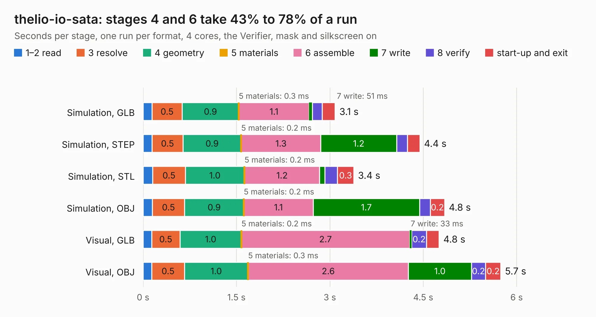

| Mode and format | 1–2 read | 3 resolve | 4 geometry | 5 materials | 6 assemble | 7 write | 8 verify | start-up and exit | Total |
|---|---:|---:|---:|---:|---:|---:|---:|---:|---:|
| Simulation, GLB | 0.1 | 0.5 | 0.9 | 0.3&nbsp;ms | 1.1 | 51&nbsp;ms | 0.2 | 0.2 | 3.1 |
| Simulation, STEP | 0.1 | 0.5 | 0.9 | 0.2&nbsp;ms | 1.3 | 1.2 | 0.2 | 0.2 | 4.4 |
| Simulation, STL | 0.2 | 0.5 | 1.0 | 0.2&nbsp;ms | 1.2 | 85&nbsp;ms | 0.2 | 0.3 | 3.4 |
| Simulation, OBJ | 0.1 | 0.5 | 0.9 | 0.2&nbsp;ms | 1.1 | 1.7 | 0.2 | 0.2 | 4.8 |
| Visual, GLB | 0.1 | 0.5 | 1.0 | 0.2&nbsp;ms | 2.7 | 33&nbsp;ms | 0.2 | 0.2 | 4.8 |
| Visual, OBJ | 0.1 | 0.5 | 1.0 | 0.3&nbsp;ms | 2.6 | 1.0 | 0.2 | 0.2 | 5.7 |

<table align="center"><tr><td valign="top">

| Board | Repo: [system76/thelio-io-hardware](https://github.com/system76/thelio-io-hardware) Board: `thelio-io-sata.kicad_pcb` |
|---|---|
| Folder | pcb-thelio-io-sata |
| Complexity | 244&nbsp;/&nbsp;1000 (size&nbsp;149, features&nbsp;95) |
| KESE&nbsp;features | through vias, rounded, trapezoid or chamfered pads, filled zones, copper text, curved board outline, stack-up, dielectric εr and tanδ |
| Tested | 9th November 2026 |
| Copper&nbsp;layers | 4 |
| File&nbsp;format | KiCad 7 (20221018) |
| Parts,&nbsp;tracks,&nbsp;vias | 9, 61, 65 |
| Triangles,&nbsp;simulation | 326,692 in 31 parts |
| Verifier | PASS in all six runs |

</td><td valign="top">

<table>
<tr><th>File type</th><th>File size</th><th>Peak memory used</th></tr>
<tr><th colspan="3" align="left">Simulation</th></tr>
<tr><td>GLB</td><td align="right">11&nbsp;MB</td><td align="right">239&nbsp;MB</td></tr>
<tr><td>STEP</td><td align="right">35&nbsp;MB</td><td align="right">275&nbsp;MB</td></tr>
<tr><td>STL</td><td align="right">16&nbsp;MB</td><td align="right">239&nbsp;MB</td></tr>
<tr><td>OBJ</td><td align="right">33&nbsp;MB</td><td align="right">249&nbsp;MB</td></tr>
<tr><th colspan="3" align="left">Visual</th></tr>
<tr><td>GLB</td><td align="right">6.6&nbsp;MB</td><td align="right">236&nbsp;MB</td></tr>
<tr><td>OBJ</td><td align="right">20&nbsp;MB</td><td align="right">234&nbsp;MB</td></tr>
</table>

</td></tr></table>

## 2716. thelio-io

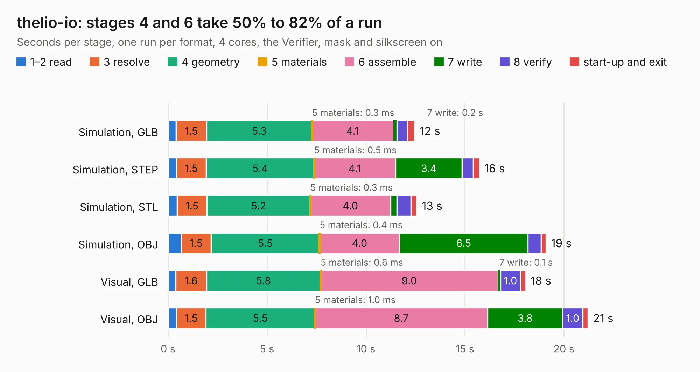

| Mode and format | 1–2 read | 3 resolve | 4 geometry | 5 materials | 6 assemble | 7 write | 8 verify | start-up and exit | Total |
|---|---:|---:|---:|---:|---:|---:|---:|---:|---:|
| Simulation, GLB | 0.4 | 1.5 | 5.3 | 0.3&nbsp;ms | 4.1 | 0.2 | 0.5 | 0.4 | 12.5 |
| Simulation, STEP | 0.4 | 1.5 | 5.4 | 0.5&nbsp;ms | 4.1 | 3.4 | 0.6 | 0.3 | 15.7 |
| Simulation, STL | 0.5 | 1.5 | 5.2 | 0.3&nbsp;ms | 4.0 | 0.3 | 0.7 | 0.3 | 12.6 |
| Simulation, OBJ | 0.7 | 1.5 | 5.5 | 0.4&nbsp;ms | 4.0 | 6.5 | 0.7 | 0.2 | 19.1 |
| Visual, GLB | 0.4 | 1.6 | 5.8 | 0.6&nbsp;ms | 9.0 | 0.1 | 1.0 | 0.3 | 18.1 |
| Visual, OBJ | 0.4 | 1.5 | 5.5 | 1.0&nbsp;ms | 8.7 | 3.8 | 1.0 | 0.3 | 21.2 |

<table align="center"><tr><td valign="top">

| Board | Repo: [system76/thelio-io-hardware](https://github.com/system76/thelio-io-hardware) Board: `thelio-io.kicad_pcb` |
|---|---|
| Folder | pcb-thelio-io |
| Complexity | 326&nbsp;/&nbsp;1000 (size&nbsp;231, features&nbsp;95) |
| KESE&nbsp;features | through vias, rounded, trapezoid or chamfered pads, filled zones, copper text, curved board outline, stack-up, dielectric εr and tanδ |
| Tested | 9th November 2026 |
| Copper&nbsp;layers | 4 |
| File&nbsp;format | KiCad 7 (20221018) |
| Parts,&nbsp;tracks,&nbsp;vias | 77, 543, 93 |
| Triangles,&nbsp;simulation | 1,048,850 in 86 parts |
| Verifier | PASS in all six runs |

</td><td valign="top">

<table>
<tr><th>File type</th><th>File size</th><th>Peak memory used</th></tr>
<tr><th colspan="3" align="left">Simulation</th></tr>
<tr><td>GLB</td><td align="right">37&nbsp;MB</td><td align="right">452&nbsp;MB</td></tr>
<tr><td>STEP</td><td align="right">169&nbsp;MB</td><td align="right">540&nbsp;MB</td></tr>
<tr><td>STL</td><td align="right">52&nbsp;MB</td><td align="right">453&nbsp;MB</td></tr>
<tr><td>OBJ</td><td align="right">108&nbsp;MB</td><td align="right">761&nbsp;MB</td></tr>
<tr><th colspan="3" align="left">Visual</th></tr>
<tr><td>GLB</td><td align="right">22&nbsp;MB</td><td align="right">583&nbsp;MB</td></tr>
<tr><td>OBJ</td><td align="right">67&nbsp;MB</td><td align="right">579&nbsp;MB</td></tr>
</table>

</td></tr></table>

## 2717. virgo-keyboard-test

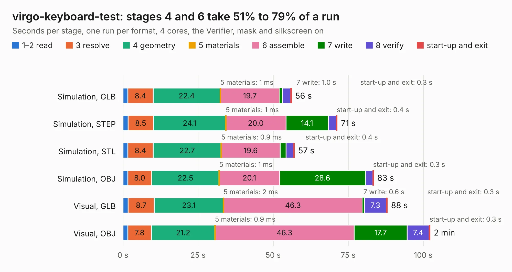

| Mode and format | 1–2 read | 3 resolve | 4 geometry | 5 materials | 6 assemble | 7 write | 8 verify | start-up and exit | Total |
|---|---:|---:|---:|---:|---:|---:|---:|---:|---:|
| Simulation, GLB | 1.6 | 8.4 | 22.4 | 1&nbsp;ms | 19.7 | 1.0 | 2.7 | 0.3 | 56.1 |
| Simulation, STEP | 1.7 | 8.5 | 24.1 | 1&nbsp;ms | 20.0 | 14.1 | 2.6 | 0.4 | 71.4 |
| Simulation, STL | 1.6 | 8.4 | 22.7 | 0.9&nbsp;ms | 19.6 | 1.9 | 2.5 | 0.4 | 57.1 |
| Simulation, OBJ | 1.6 | 8.0 | 22.5 | 1&nbsp;ms | 20.1 | 28.6 | 2.4 | 0.3 | 83.5 |
| Visual, GLB | 1.7 | 8.7 | 23.1 | 2&nbsp;ms | 46.3 | 0.6 | 7.3 | 0.3 | 88.1 |
| Visual, OBJ | 1.6 | 7.8 | 21.2 | 0.9&nbsp;ms | 46.3 | 17.7 | 7.4 | 0.3 | 102.3 |

<table align="center"><tr><td valign="top">

| Board | Repo: [system76/virgo](https://github.com/system76/virgo) Board: `virgo-keyboard-test.kicad_pcb` |
|---|---|
| Folder | pcb-keyboard |
| Complexity | 390&nbsp;/&nbsp;1000 (size&nbsp;265, features&nbsp;125) |
| KESE&nbsp;features | through vias, rounded, trapezoid or chamfered pads, filled zones, copper text, curved board outline, knockout text, stack-up, dielectric εr and tanδ, copper finish |
| Tested | 9th November 2026 |
| Copper&nbsp;layers | 4 |
| File&nbsp;format | KiCad 7 (20221018) |
| Parts,&nbsp;tracks,&nbsp;vias | 261, 1,802, 424 |
| Triangles,&nbsp;simulation | 5,464,548 in 257 parts |
| Verifier | PASS in all six runs |

</td><td valign="top">

<table>
<tr><th>File type</th><th>File size</th><th>Peak memory used</th></tr>
<tr><th colspan="3" align="left">Simulation</th></tr>
<tr><td>GLB</td><td align="right">187&nbsp;MB</td><td align="right">1.6&nbsp;GB</td></tr>
<tr><td>STEP</td><td align="right">835&nbsp;MB</td><td align="right">2.1&nbsp;GB</td></tr>
<tr><td>STL</td><td align="right">273&nbsp;MB</td><td align="right">1.7&nbsp;GB</td></tr>
<tr><td>OBJ</td><td align="right">588&nbsp;MB</td><td align="right">3.6&nbsp;GB</td></tr>
<tr><th colspan="3" align="left">Visual</th></tr>
<tr><td>GLB</td><td align="right">124&nbsp;MB</td><td align="right">2.0&nbsp;GB</td></tr>
<tr><td>OBJ</td><td align="right">395&nbsp;MB</td><td align="right">2.6&nbsp;GB</td></tr>
</table>

</td></tr></table>

## 2718. virgo-rpl-uph

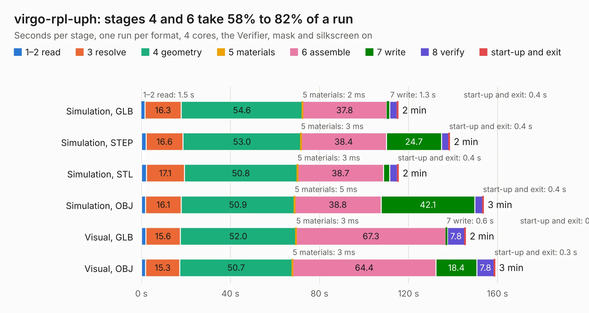

| Mode and format | 1–2 read | 3 resolve | 4 geometry | 5 materials | 6 assemble | 7 write | 8 verify | start-up and exit | Total |
|---|---:|---:|---:|---:|---:|---:|---:|---:|---:|
| Simulation, GLB | 1.5 | 16.3 | 54.6 | 2&nbsp;ms | 37.8 | 1.3 | 3.3 | 0.4 | 115.3 |
| Simulation, STEP | 2.1 | 16.6 | 53.0 | 3&nbsp;ms | 38.4 | 24.7 | 3.3 | 0.4 | 138.5 |
| Simulation, STL | 2.2 | 17.1 | 50.8 | 3&nbsp;ms | 38.7 | 2.8 | 3.4 | 0.4 | 115.5 |
| Simulation, OBJ | 1.8 | 16.1 | 50.9 | 5&nbsp;ms | 38.8 | 42.1 | 3.5 | 0.4 | 153.7 |
| Visual, GLB | 1.9 | 15.6 | 52.0 | 3&nbsp;ms | 67.3 | 0.6 | 7.8 | 0.3 | 145.6 |
| Visual, OBJ | 1.9 | 15.3 | 50.7 | 3&nbsp;ms | 64.4 | 18.4 | 7.8 | 0.3 | 158.8 |

<table align="center"><tr><td valign="top">

| Board | Repo: [system76/virgo](https://github.com/system76/virgo) Board: `virgo-rpl-uph.kicad_pcb` |
|---|---|
| Folder | pcb-rpl-uph |
| Complexity | 429&nbsp;/&nbsp;1000 (size&nbsp;309, features&nbsp;120) |
| KESE&nbsp;features | through vias, slotted holes, custom pads, rounded, trapezoid or chamfered pads, filled zones, copper drawings, copper text, stack-up, dielectric εr and tanδ |
| Tested | 9th November 2026 |
| Copper&nbsp;layers | 10 |
| File&nbsp;format | KiCad 7 (20221018) |
| Parts,&nbsp;tracks,&nbsp;vias | 591, 434, 292 |
| Triangles,&nbsp;simulation | 7,085,540 in 1533 parts |
| Verifier | PASS in all six runs |

</td><td valign="top">

<table>
<tr><th>File type</th><th>File size</th><th>Peak memory used</th></tr>
<tr><th colspan="3" align="left">Simulation</th></tr>
<tr><td>GLB</td><td align="right">242&nbsp;MB</td><td align="right">2.7&nbsp;GB</td></tr>
<tr><td>STEP</td><td align="right">1.4&nbsp;GB</td><td align="right">3.4&nbsp;GB</td></tr>
<tr><td>STL</td><td align="right">354&nbsp;MB</td><td align="right">2.6&nbsp;GB</td></tr>
<tr><td>OBJ</td><td align="right">778&nbsp;MB</td><td align="right">4.7&nbsp;GB</td></tr>
<tr><th colspan="3" align="left">Visual</th></tr>
<tr><td>GLB</td><td align="right">126&nbsp;MB</td><td align="right">2.4&nbsp;GB</td></tr>
<tr><td>OBJ</td><td align="right">404&nbsp;MB</td><td align="right">2.7&nbsp;GB</td></tr>
</table>

</td></tr></table>

## 2719. ZX80_Board

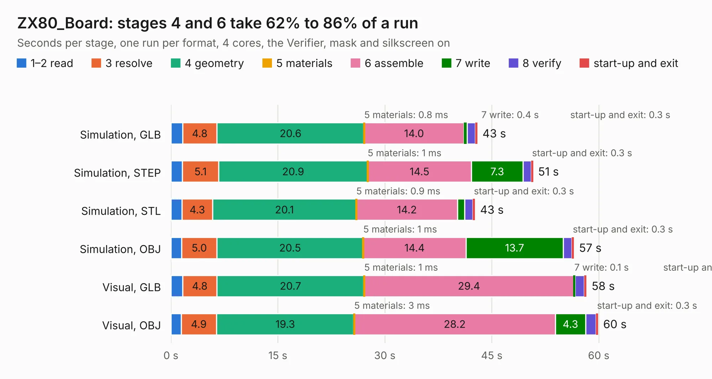

| Mode and format | 1–2 read | 3 resolve | 4 geometry | 5 materials | 6 assemble | 7 write | 8 verify | start-up and exit | Total |
|---|---:|---:|---:|---:|---:|---:|---:|---:|---:|
| Simulation, GLB | 1.6 | 4.8 | 20.6 | 0.8&nbsp;ms | 14.0 | 0.4 | 1.1 | 0.3 | 43.0 |
| Simulation, STEP | 1.6 | 5.1 | 20.9 | 1&nbsp;ms | 14.5 | 7.3 | 1.1 | 0.3 | 50.8 |
| Simulation, STL | 1.6 | 4.3 | 20.1 | 0.9&nbsp;ms | 14.2 | 1.0 | 1.2 | 0.3 | 42.6 |
| Simulation, OBJ | 1.5 | 5.0 | 20.5 | 1&nbsp;ms | 14.4 | 13.7 | 1.2 | 0.3 | 56.5 |
| Visual, GLB | 1.7 | 4.8 | 20.7 | 1&nbsp;ms | 29.4 | 0.1 | 1.3 | 0.3 | 58.3 |
| Visual, OBJ | 1.4 | 4.9 | 19.3 | 3&nbsp;ms | 28.2 | 4.3 | 1.5 | 0.3 | 59.9 |

<table align="center"><tr><td valign="top">

| Board | Repo: [TankedThomas/ZX80](https://github.com/TankedThomas/ZX80) Board: `ZX80_Board.kicad_pcb` |
|---|---|
| Complexity | 243&nbsp;/&nbsp;1000 (size&nbsp;178, features&nbsp;65) |
| KESE&nbsp;features | through vias, filled zones, stack-up, dielectric εr and tanδ |
| Tested | 9th November 2026 |
| Copper&nbsp;layers | 2 |
| File&nbsp;format | KiCad 7 (20221018) |
| Parts,&nbsp;tracks,&nbsp;vias | 124, 703, 30 |
| Triangles,&nbsp;simulation | 2,814,382 in 144 parts |
| Verifier | PASS in all six runs |

</td><td valign="top">

<table>
<tr><th>File type</th><th>File size</th><th>Peak memory used</th></tr>
<tr><th colspan="3" align="left">Simulation</th></tr>
<tr><td>GLB</td><td align="right">99&nbsp;MB</td><td align="right">886&nbsp;MB</td></tr>
<tr><td>STEP</td><td align="right">519&nbsp;MB</td><td align="right">1.2&nbsp;GB</td></tr>
<tr><td>STL</td><td align="right">141&nbsp;MB</td><td align="right">907&nbsp;MB</td></tr>
<tr><td>OBJ</td><td align="right">306&nbsp;MB</td><td align="right">1.9&nbsp;GB</td></tr>
<tr><th colspan="3" align="left">Visual</th></tr>
<tr><td>GLB</td><td align="right">32&nbsp;MB</td><td align="right">836&nbsp;MB</td></tr>
<tr><td>OBJ</td><td align="right">95&nbsp;MB</td><td align="right">835&nbsp;MB</td></tr>
</table>

</td></tr></table>

## 2720. ZX80_Board_Foil

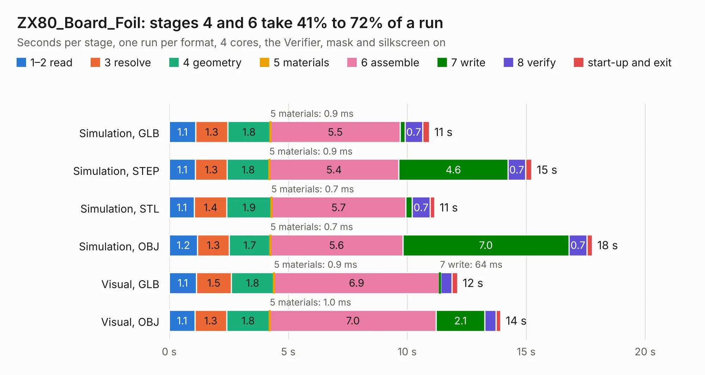

| Mode and format | 1–2 read | 3 resolve | 4 geometry | 5 materials | 6 assemble | 7 write | 8 verify | start-up and exit | Total |
|---|---:|---:|---:|---:|---:|---:|---:|---:|---:|
| Simulation, GLB | 1.1 | 1.3 | 1.8 | 0.9&nbsp;ms | 5.5 | 0.2 | 0.7 | 0.3 | 10.9 |
| Simulation, STEP | 1.1 | 1.3 | 1.8 | 0.9&nbsp;ms | 5.4 | 4.6 | 0.7 | 0.3 | 15.2 |
| Simulation, STL | 1.1 | 1.4 | 1.9 | 0.7&nbsp;ms | 5.7 | 0.3 | 0.7 | 0.2 | 11.1 |
| Simulation, OBJ | 1.2 | 1.3 | 1.7 | 0.7&nbsp;ms | 5.6 | 7.0 | 0.7 | 0.2 | 17.8 |
| Visual, GLB | 1.1 | 1.5 | 1.8 | 0.9&nbsp;ms | 6.9 | 64&nbsp;ms | 0.5 | 0.2 | 12.1 |
| Visual, OBJ | 1.1 | 1.3 | 1.8 | 1.0&nbsp;ms | 7.0 | 2.1 | 0.5 | 0.2 | 13.9 |

<table align="center"><tr><td valign="top">

| Board | Repo: [TankedThomas/ZX80](https://github.com/TankedThomas/ZX80) Board: `ZX80_Board_Foil.kicad_pcb` |
|---|---|
| Complexity | 37&nbsp;/&nbsp;1000 (size&nbsp;17, features&nbsp;20) |
| KESE&nbsp;features | filled zones |
| Tested | 9th November 2026 |
| Copper&nbsp;layers | 2 |
| File&nbsp;format | KiCad 7 (20221018) |
| Parts,&nbsp;tracks,&nbsp;vias | 0, 0, 0 |
| Triangles,&nbsp;simulation | 1,185,784 in 8 parts |
| Note | no components |
| Verifier | PASS in all six runs |

</td><td valign="top">

<table>
<tr><th>File type</th><th>File size</th><th>Peak memory used</th></tr>
<tr><th colspan="3" align="left">Simulation</th></tr>
<tr><td>GLB</td><td align="right">45&nbsp;MB</td><td align="right">600&nbsp;MB</td></tr>
<tr><td>STEP</td><td align="right">359&nbsp;MB</td><td align="right">753&nbsp;MB</td></tr>
<tr><td>STL</td><td align="right">59&nbsp;MB</td><td align="right">605&nbsp;MB</td></tr>
<tr><td>OBJ</td><td align="right">134&nbsp;MB</td><td align="right">912&nbsp;MB</td></tr>
<tr><th colspan="3" align="left">Visual</th></tr>
<tr><td>GLB</td><td align="right">15&nbsp;MB</td><td align="right">463&nbsp;MB</td></tr>
<tr><td>OBJ</td><td align="right">44&nbsp;MB</td><td align="right">449&nbsp;MB</td></tr>
</table>

</td></tr></table>

## 2721. TAPRX-888

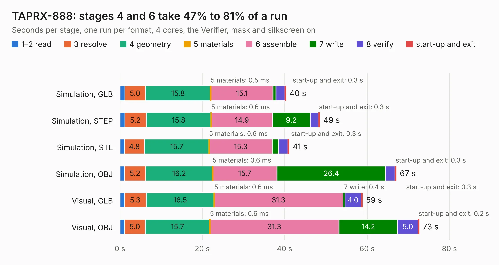

| Mode and format | 1–2 read | 3 resolve | 4 geometry | 5 materials | 6 assemble | 7 write | 8 verify | start-up and exit | Total |
|---|---:|---:|---:|---:|---:|---:|---:|---:|---:|
| Simulation, GLB | 1.2 | 5.0 | 15.8 | 0.5&nbsp;ms | 15.1 | 0.7 | 2.2 | 0.3 | 40.3 |
| Simulation, STEP | 1.2 | 5.2 | 15.8 | 0.6&nbsp;ms | 14.9 | 9.2 | 2.0 | 0.3 | 48.5 |
| Simulation, STL | 1.1 | 4.8 | 15.7 | 0.6&nbsp;ms | 15.3 | 1.5 | 2.3 | 0.3 | 41.1 |
| Simulation, OBJ | 1.1 | 5.2 | 16.2 | 0.6&nbsp;ms | 15.7 | 26.4 | 2.3 | 0.3 | 67.1 |
| Visual, GLB | 1.1 | 5.3 | 16.5 | 0.6&nbsp;ms | 31.3 | 0.4 | 4.0 | 0.3 | 58.9 |
| Visual, OBJ | 1.1 | 5.0 | 15.7 | 0.6&nbsp;ms | 31.3 | 14.2 | 5.0 | 0.2 | 72.7 |

<table align="center"><tr><td valign="top">

| Board | Repo: [TAPR/TAPRx888](https://github.com/TAPR/TAPRx888) Board: `TAPRX-888.kicad_pcb` |
|---|---|
| Complexity | 440&nbsp;/&nbsp;1000 (size&nbsp;290, features&nbsp;150) |
| KESE&nbsp;features | through vias, microvias, rounded, trapezoid or chamfered pads, filled zones, knockout text, stack-up, dielectric εr and tanδ, copper finish, mask and silkscreen colours |
| Tested | 9th November 2026 |
| Copper&nbsp;layers | 6 |
| File&nbsp;format | KiCad 10 (20260206) |
| Parts,&nbsp;tracks,&nbsp;vias | 197, 1,782, 681 |
| Triangles,&nbsp;simulation | 4,663,198 in 225 parts |
| Verifier | PASS in all six runs |

</td><td valign="top">

<table>
<tr><th>File type</th><th>File size</th><th>Peak memory used</th></tr>
<tr><th colspan="3" align="left">Simulation</th></tr>
<tr><td>GLB</td><td align="right">155&nbsp;MB</td><td align="right">1.6&nbsp;GB</td></tr>
<tr><td>STEP</td><td align="right">524&nbsp;MB</td><td align="right">1.8&nbsp;GB</td></tr>
<tr><td>STL</td><td align="right">233&nbsp;MB</td><td align="right">1.6&nbsp;GB</td></tr>
<tr><td>OBJ</td><td align="right">496&nbsp;MB</td><td align="right">3.0&nbsp;GB</td></tr>
<tr><th colspan="3" align="left">Visual</th></tr>
<tr><td>GLB</td><td align="right">86&nbsp;MB</td><td align="right">1.5&nbsp;GB</td></tr>
<tr><td>OBJ</td><td align="right">277&nbsp;MB</td><td align="right">1.9&nbsp;GB</td></tr>
</table>

</td></tr></table>

## 2722. DDR4_SoC

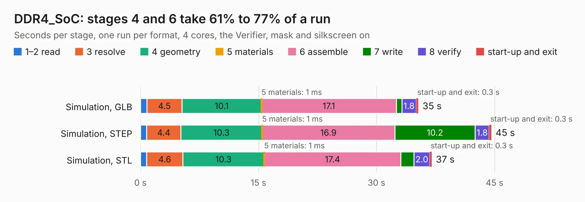

| Mode and format | 1–2 read | 3 resolve | 4 geometry | 5 materials | 6 assemble | 7 write | 8 verify | start-up and exit | Total |
|---|---:|---:|---:|---:|---:|---:|---:|---:|---:|
| Simulation, GLB | 0.8 | 4.5 | 10.1 | 1&nbsp;ms | 17.1 | 0.7 | 1.8 | 0.3 | 35.3 |
| Simulation, STEP | 0.8 | 4.4 | 10.3 | 1&nbsp;ms | 16.9 | 10.2 | 1.8 | 0.3 | 44.6 |
| Simulation, STL | 0.8 | 4.6 | 10.3 | 1&nbsp;ms | 17.4 | 1.7 | 2.0 | 0.3 | 37.0 |
| Simulation, OBJ | 0.9 | 4.5 | 10.6 | 1&nbsp;ms | 17.4 | 21.6 | 2.2 | 0.3 | 57.4 |
| Visual, GLB | 0.9 | 4.9 | 10.6 | 2&nbsp;ms | 36.4 | 0.5 | 5.5 | 0.3 | 59.0 |
| Visual, OBJ | 0.8 | 4.7 | 10.9 | 1&nbsp;ms | 36.7 | 14.3 | 6.1 | 0.3 | 74.0 |

<table align="center"><tr><td valign="top">

| Board | Repo: [tatakimon/lpddr4_w_allwinner_soc](https://github.com/tatakimon/lpddr4_w_allwinner_soc) Board: `DDR4_SoC.kicad_pcb` |
|---|---|
| Folder | DDR4_SoC |
| Complexity | 442&nbsp;/&nbsp;1000 (size&nbsp;307, features&nbsp;135) |
| KESE&nbsp;features | through vias, rounded, trapezoid or chamfered pads, arc tracks, filled zones, copper drawings, copper text, curved board outline, knockout text, stack-up, dielectric εr and tanδ |
| Tested | 9th November 2026 |
| Copper&nbsp;layers | 6 |
| File&nbsp;format | KiCad 9 (20241229) |
| Parts,&nbsp;tracks,&nbsp;vias | 152, 6,210, 715 |
| Triangles,&nbsp;simulation | 4,953,774 in 335 parts |
| Verifier | PASS in all six runs |

</td><td valign="top">

<table>
<tr><th>File type</th><th>File size</th><th>Peak memory used</th></tr>
<tr><th colspan="3" align="left">Simulation</th></tr>
<tr><td>GLB</td><td align="right">164&nbsp;MB</td><td align="right">1.5&nbsp;GB</td></tr>
<tr><td>STEP</td><td align="right">584&nbsp;MB</td><td align="right">2.0&nbsp;GB</td></tr>
<tr><td>STL</td><td align="right">248&nbsp;MB</td><td align="right">1.4&nbsp;GB</td></tr>
<tr><td>OBJ</td><td align="right">519&nbsp;MB</td><td align="right">3.1&nbsp;GB</td></tr>
<tr><th colspan="3" align="left">Visual</th></tr>
<tr><td>GLB</td><td align="right">102&nbsp;MB</td><td align="right">1.7&nbsp;GB</td></tr>
<tr><td>OBJ</td><td align="right">329&nbsp;MB</td><td align="right">2.2&nbsp;GB</td></tr>
</table>

</td></tr></table>

## 2723. OpenInverter_20b

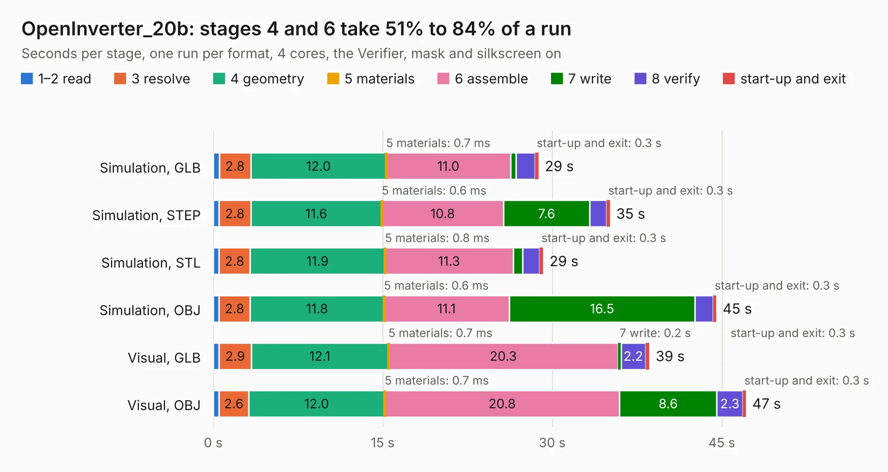

| Mode and format | 1–2 read | 3 resolve | 4 geometry | 5 materials | 6 assemble | 7 write | 8 verify | start-up and exit | Total |
|---|---:|---:|---:|---:|---:|---:|---:|---:|---:|
| Simulation, GLB | 0.5 | 2.8 | 12.0 | 0.7&nbsp;ms | 11.0 | 0.5 | 1.7 | 0.3 | 28.8 |
| Simulation, STEP | 0.5 | 2.8 | 11.6 | 0.6&nbsp;ms | 10.8 | 7.6 | 1.5 | 0.3 | 35.1 |
| Simulation, STL | 0.5 | 2.8 | 11.9 | 0.8&nbsp;ms | 11.3 | 0.8 | 1.5 | 0.3 | 29.2 |
| Simulation, OBJ | 0.5 | 2.8 | 11.8 | 0.6&nbsp;ms | 11.1 | 16.5 | 1.6 | 0.3 | 44.5 |
| Visual, GLB | 0.5 | 2.9 | 12.1 | 0.7&nbsp;ms | 20.3 | 0.2 | 2.2 | 0.3 | 38.6 |
| Visual, OBJ | 0.5 | 2.6 | 12.0 | 0.7&nbsp;ms | 20.8 | 8.6 | 2.3 | 0.3 | 47.1 |

<table align="center"><tr><td valign="top">

| Board | Repo: [teknomadix/Open_Inverter_2.0b_Kicad](https://github.com/teknomadix/Open_Inverter_2.0b_Kicad) Board: `OpenInverter_20b.kicad_pcb` |
|---|---|
| Folder | Hardware |
| Complexity | 223&nbsp;/&nbsp;1000 (size&nbsp;188, features&nbsp;35) |
| KESE&nbsp;features | through vias, filled zones |
| Tested | 10th November 2026 |
| Copper&nbsp;layers | 4 |
| File&nbsp;format | KiCad 5 (20171130) |
| Parts,&nbsp;tracks,&nbsp;vias | 61, 744, 28 |
| Triangles,&nbsp;simulation | 2,691,338 in 98 parts |
| Verifier | PASS in all six runs |

</td><td valign="top">

<table>
<tr><th>File type</th><th>File size</th><th>Peak memory used</th></tr>
<tr><th colspan="3" align="left">Simulation</th></tr>
<tr><td>GLB</td><td align="right">92&nbsp;MB</td><td align="right">832&nbsp;MB</td></tr>
<tr><td>STEP</td><td align="right">405&nbsp;MB</td><td align="right">972&nbsp;MB</td></tr>
<tr><td>STL</td><td align="right">135&nbsp;MB</td><td align="right">791&nbsp;MB</td></tr>
<tr><td>OBJ</td><td align="right">284&nbsp;MB</td><td align="right">1.8&nbsp;GB</td></tr>
<tr><th colspan="3" align="left">Visual</th></tr>
<tr><td>GLB</td><td align="right">49&nbsp;MB</td><td align="right">926&nbsp;MB</td></tr>
<tr><td>OBJ</td><td align="right">150&nbsp;MB</td><td align="right">1.1&nbsp;GB</td></tr>
</table>

</td></tr></table>

## 2724. LVPD-board

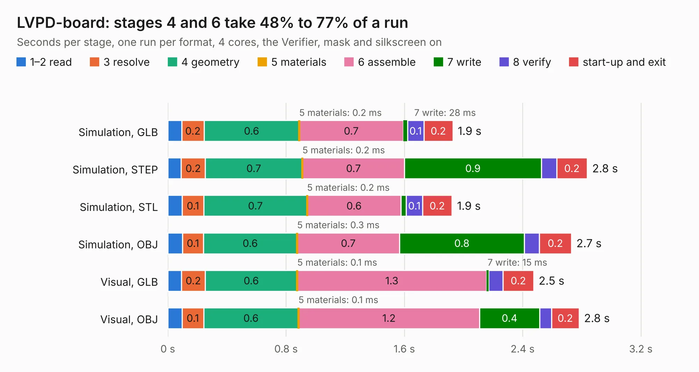

| Mode and format | 1–2 read | 3 resolve | 4 geometry | 5 materials | 6 assemble | 7 write | 8 verify | start-up and exit | Total |
|---|---:|---:|---:|---:|---:|---:|---:|---:|---:|
| Simulation, GLB | 95&nbsp;ms | 0.2 | 0.6 | 0.2&nbsp;ms | 0.7 | 28&nbsp;ms | 0.1 | 0.2 | 1.9 |
| Simulation, STEP | 91&nbsp;ms | 0.2 | 0.7 | 0.2&nbsp;ms | 0.7 | 0.9 | 0.1 | 0.2 | 2.8 |
| Simulation, STL | 97&nbsp;ms | 0.1 | 0.7 | 0.2&nbsp;ms | 0.6 | 36&nbsp;ms | 0.1 | 0.2 | 1.9 |
| Simulation, OBJ | 0.1 | 0.1 | 0.6 | 0.3&nbsp;ms | 0.7 | 0.8 | 0.1 | 0.2 | 2.7 |
| Visual, GLB | 92&nbsp;ms | 0.2 | 0.6 | 0.1&nbsp;ms | 1.3 | 15&nbsp;ms | 97&nbsp;ms | 0.2 | 2.5 |
| Visual, OBJ | 96&nbsp;ms | 0.1 | 0.6 | 0.1&nbsp;ms | 1.2 | 0.4 | 81&nbsp;ms | 0.2 | 2.8 |

<table align="center"><tr><td valign="top">

| Board | Repo: [terrapin-rocket-team/srad-avionics](https://github.com/terrapin-rocket-team/srad-avionics) Board: `LVPD-board.kicad_pcb` |
|---|---|
| Folder | Side_Projects / ARC / PCBs |
| Complexity | 117&nbsp;/&nbsp;1000 (size&nbsp;107, features&nbsp;10) |
| KESE&nbsp;features | rounded, trapezoid or chamfered pads |
| Tested | 9th November 2026 |
| Copper&nbsp;layers | 2 |
| File&nbsp;format | KiCad 7 (20221018) |
| Parts,&nbsp;tracks,&nbsp;vias | 7, 61, 0 |
| Triangles,&nbsp;simulation | 160,928 in 29 parts |
| Verifier | PASS in all six runs |

</td><td valign="top">

<table>
<tr><th>File type</th><th>File size</th><th>Peak memory used</th></tr>
<tr><th colspan="3" align="left">Simulation</th></tr>
<tr><td>GLB</td><td align="right">5.4&nbsp;MB</td><td align="right">201&nbsp;MB</td></tr>
<tr><td>STEP</td><td align="right">20&nbsp;MB</td><td align="right">209&nbsp;MB</td></tr>
<tr><td>STL</td><td align="right">8.0&nbsp;MB</td><td align="right">190&nbsp;MB</td></tr>
<tr><td>OBJ</td><td align="right">15&nbsp;MB</td><td align="right">194&nbsp;MB</td></tr>
<tr><th colspan="3" align="left">Visual</th></tr>
<tr><td>GLB</td><td align="right">3.1&nbsp;MB</td><td align="right">158&nbsp;MB</td></tr>
<tr><td>OBJ</td><td align="right">8.5&nbsp;MB</td><td align="right">159&nbsp;MB</td></tr>
</table>

</td></tr></table>

## 2725. LVPD-board_Payload

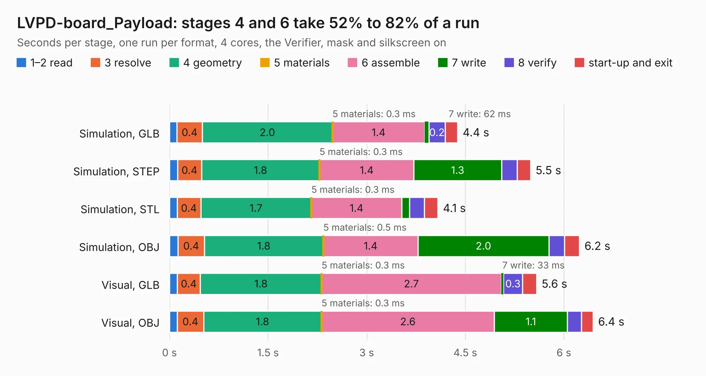

| Mode and format | 1–2 read | 3 resolve | 4 geometry | 5 materials | 6 assemble | 7 write | 8 verify | start-up and exit | Total |
|---|---:|---:|---:|---:|---:|---:|---:|---:|---:|
| Simulation, GLB | 0.1 | 0.4 | 2.0 | 0.3&nbsp;ms | 1.4 | 62&nbsp;ms | 0.2 | 0.2 | 4.4 |
| Simulation, STEP | 0.1 | 0.4 | 1.8 | 0.3&nbsp;ms | 1.4 | 1.3 | 0.2 | 0.2 | 5.5 |
| Simulation, STL | 0.1 | 0.4 | 1.7 | 0.3&nbsp;ms | 1.4 | 0.1 | 0.2 | 0.2 | 4.1 |
| Simulation, OBJ | 0.1 | 0.4 | 1.8 | 0.5&nbsp;ms | 1.4 | 2.0 | 0.2 | 0.2 | 6.2 |
| Visual, GLB | 0.1 | 0.4 | 1.8 | 0.3&nbsp;ms | 2.7 | 33&nbsp;ms | 0.3 | 0.2 | 5.6 |
| Visual, OBJ | 0.1 | 0.4 | 1.8 | 0.3&nbsp;ms | 2.6 | 1.1 | 0.2 | 0.2 | 6.4 |

<table align="center"><tr><td valign="top">

| Board | Repo: [terrapin-rocket-team/srad-avionics](https://github.com/terrapin-rocket-team/srad-avionics) Board: `LVPD-board_Payload.kicad_pcb` |
|---|---|
| Folder | Side_Projects / ARC / PCBs / LVPD-board_Payload |
| Complexity | 145&nbsp;/&nbsp;1000 (size&nbsp;120, features&nbsp;25) |
| KESE&nbsp;features | through vias, rounded, trapezoid or chamfered pads |
| Tested | 9th November 2026 |
| Copper&nbsp;layers | 2 |
| File&nbsp;format | KiCad 7 (20221018) |
| Parts,&nbsp;tracks,&nbsp;vias | 10, 102, 2 |
| Triangles,&nbsp;simulation | 412,926 in 66 parts |
| Verifier | PASS in all six runs |

</td><td valign="top">

<table>
<tr><th>File type</th><th>File size</th><th>Peak memory used</th></tr>
<tr><th colspan="3" align="left">Simulation</th></tr>
<tr><td>GLB</td><td align="right">14&nbsp;MB</td><td align="right">257&nbsp;MB</td></tr>
<tr><td>STEP</td><td align="right">51&nbsp;MB</td><td align="right">299&nbsp;MB</td></tr>
<tr><td>STL</td><td align="right">21&nbsp;MB</td><td align="right">264&nbsp;MB</td></tr>
<tr><td>OBJ</td><td align="right">41&nbsp;MB</td><td align="right">323&nbsp;MB</td></tr>
<tr><th colspan="3" align="left">Visual</th></tr>
<tr><td>GLB</td><td align="right">7.8&nbsp;MB</td><td align="right">277&nbsp;MB</td></tr>
<tr><td>OBJ</td><td align="right">23&nbsp;MB</td><td align="right">280&nbsp;MB</td></tr>
</table>

</td></tr></table>

## 2726. LVPD-board_v2

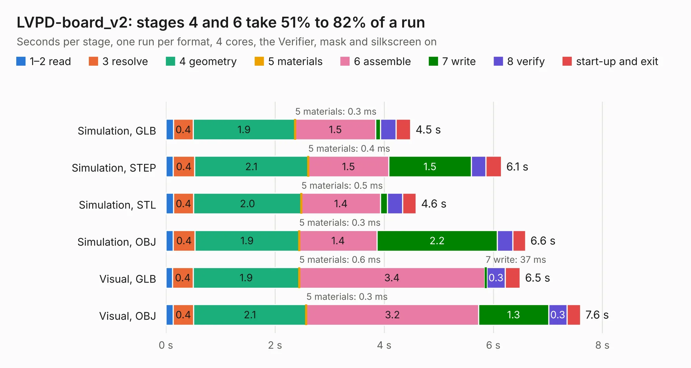

| Mode and format | 1–2 read | 3 resolve | 4 geometry | 5 materials | 6 assemble | 7 write | 8 verify | start-up and exit | Total |
|---|---:|---:|---:|---:|---:|---:|---:|---:|---:|
| Simulation, GLB | 0.1 | 0.4 | 1.9 | 0.3&nbsp;ms | 1.5 | 89&nbsp;ms | 0.3 | 0.3 | 4.5 |
| Simulation, STEP | 0.1 | 0.4 | 2.1 | 0.4&nbsp;ms | 1.5 | 1.5 | 0.3 | 0.3 | 6.1 |
| Simulation, STL | 0.1 | 0.4 | 2.0 | 0.5&nbsp;ms | 1.4 | 0.1 | 0.3 | 0.2 | 4.6 |
| Simulation, OBJ | 0.1 | 0.4 | 1.9 | 0.3&nbsp;ms | 1.4 | 2.2 | 0.3 | 0.2 | 6.6 |
| Visual, GLB | 0.1 | 0.4 | 1.9 | 0.6&nbsp;ms | 3.4 | 37&nbsp;ms | 0.3 | 0.3 | 6.5 |
| Visual, OBJ | 0.1 | 0.4 | 2.1 | 0.3&nbsp;ms | 3.2 | 1.3 | 0.3 | 0.2 | 7.6 |

<table align="center"><tr><td valign="top">

| Board | Repo: [terrapin-rocket-team/srad-avionics](https://github.com/terrapin-rocket-team/srad-avionics) Board: `LVPD-board_v2.kicad_pcb` |
|---|---|
| Folder | Side_Projects / ARC / PCBs / LVPD-board_v2 |
| Complexity | 128&nbsp;/&nbsp;1000 (size&nbsp;118, features&nbsp;10) |
| KESE&nbsp;features | rounded, trapezoid or chamfered pads |
| Tested | 9th November 2026 |
| Copper&nbsp;layers | 2 |
| File&nbsp;format | KiCad 7 (20221018) |
| Parts,&nbsp;tracks,&nbsp;vias | 9, 105, 0 |
| Triangles,&nbsp;simulation | 394,344 in 66 parts |
| Verifier | PASS in all six runs |

</td><td valign="top">

<table>
<tr><th>File type</th><th>File size</th><th>Peak memory used</th></tr>
<tr><th colspan="3" align="left">Simulation</th></tr>
<tr><td>GLB</td><td align="right">13&nbsp;MB</td><td align="right">253&nbsp;MB</td></tr>
<tr><td>STEP</td><td align="right">49&nbsp;MB</td><td align="right">293&nbsp;MB</td></tr>
<tr><td>STL</td><td align="right">20&nbsp;MB</td><td align="right">246&nbsp;MB</td></tr>
<tr><td>OBJ</td><td align="right">39&nbsp;MB</td><td align="right">310&nbsp;MB</td></tr>
<tr><th colspan="3" align="left">Visual</th></tr>
<tr><td>GLB</td><td align="right">7.8&nbsp;MB</td><td align="right">276&nbsp;MB</td></tr>
<tr><td>OBJ</td><td align="right">23&nbsp;MB</td><td align="right">281&nbsp;MB</td></tr>
</table>

</td></tr></table>

## 2727. charge_deployment

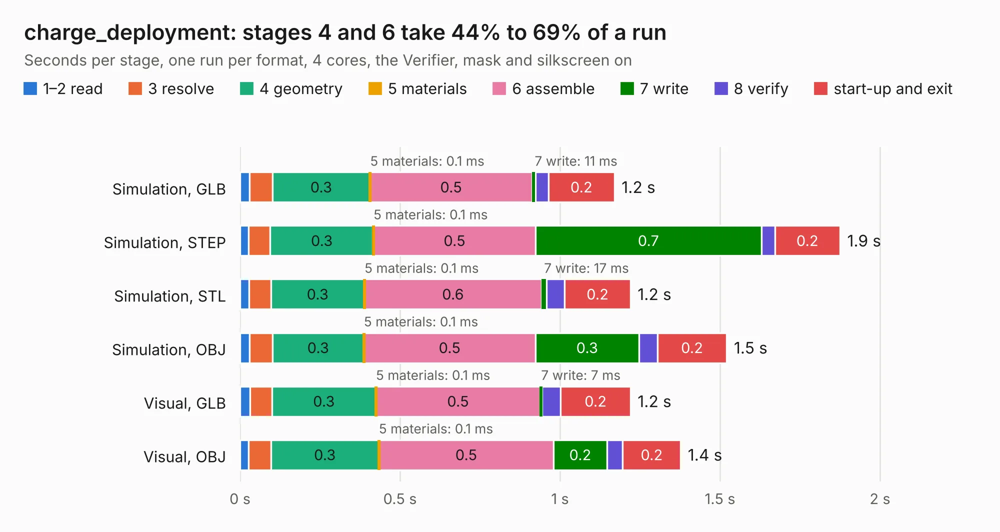

| Mode and format | 1–2 read | 3 resolve | 4 geometry | 5 materials | 6 assemble | 7 write | 8 verify | start-up and exit | Total |
|---|---:|---:|---:|---:|---:|---:|---:|---:|---:|
| Simulation, GLB | 30&nbsp;ms | 70&nbsp;ms | 0.3 | 0.1&nbsp;ms | 0.5 | 11&nbsp;ms | 40&nbsp;ms | 0.2 | 1.2 |
| Simulation, STEP | 27&nbsp;ms | 67&nbsp;ms | 0.3 | 0.1&nbsp;ms | 0.5 | 0.7 | 42&nbsp;ms | 0.2 | 1.9 |
| Simulation, STL | 28&nbsp;ms | 68&nbsp;ms | 0.3 | 0.1&nbsp;ms | 0.6 | 17&nbsp;ms | 56&nbsp;ms | 0.2 | 1.2 |
| Simulation, OBJ | 30&nbsp;ms | 72&nbsp;ms | 0.3 | 0.1&nbsp;ms | 0.5 | 0.3 | 57&nbsp;ms | 0.2 | 1.5 |
| Visual, GLB | 31&nbsp;ms | 69&nbsp;ms | 0.3 | 0.1&nbsp;ms | 0.5 | 7&nbsp;ms | 58&nbsp;ms | 0.2 | 1.2 |
| Visual, OBJ | 26&nbsp;ms | 70&nbsp;ms | 0.3 | 0.1&nbsp;ms | 0.5 | 0.2 | 50&nbsp;ms | 0.2 | 1.4 |

<table align="center"><tr><td valign="top">

| Board | Repo: [terrapin-rocket-team/srad-avionics](https://github.com/terrapin-rocket-team/srad-avionics) Board: `charge_deployment.kicad_pcb` |
|---|---|
| Folder | Side_Projects / Charge Deployment / Circuits |
| Complexity | 119&nbsp;/&nbsp;1000 (size&nbsp;99, features&nbsp;20) |
| KESE&nbsp;features | rounded, trapezoid or chamfered pads, curved board outline |
| Tested | 9th November 2026 |
| Copper&nbsp;layers | 2 |
| File&nbsp;format | KiCad 7 (20221018) |
| Parts,&nbsp;tracks,&nbsp;vias | 8, 35, 0 |
| Triangles,&nbsp;simulation | 58,226 in 16 parts |
| Verifier | PASS in all six runs |

</td><td valign="top">

<table>
<tr><th>File type</th><th>File size</th><th>Peak memory used</th></tr>
<tr><th colspan="3" align="left">Simulation</th></tr>
<tr><td>GLB</td><td align="right">2.0&nbsp;MB</td><td align="right">49&nbsp;MB</td></tr>
<tr><td>STEP</td><td align="right">7.6&nbsp;MB</td><td align="right">156&nbsp;MB</td></tr>
<tr><td>STL</td><td align="right">2.9&nbsp;MB</td><td align="right">52&nbsp;MB</td></tr>
<tr><td>OBJ</td><td align="right">5.5&nbsp;MB</td><td align="right">64&nbsp;MB</td></tr>
<tr><th colspan="3" align="left">Visual</th></tr>
<tr><td>GLB</td><td align="right">1.1&nbsp;MB</td><td align="right">75&nbsp;MB</td></tr>
<tr><td>OBJ</td><td align="right">3.1&nbsp;MB</td><td align="right">67&nbsp;MB</td></tr>
</table>

</td></tr></table>

## 2728. ARCH

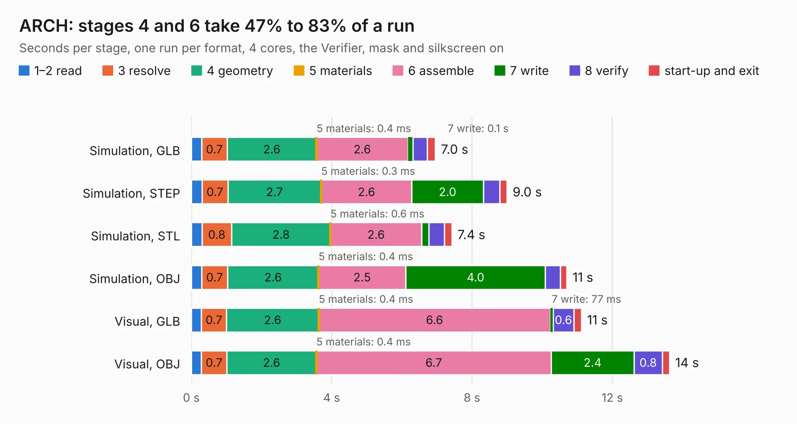

| Mode and format | 1–2 read | 3 resolve | 4 geometry | 5 materials | 6 assemble | 7 write | 8 verify | start-up and exit | Total |
|---|---:|---:|---:|---:|---:|---:|---:|---:|---:|
| Simulation, GLB | 0.3 | 0.7 | 2.6 | 0.4&nbsp;ms | 2.6 | 0.1 | 0.4 | 0.2 | 7.0 |
| Simulation, STEP | 0.3 | 0.7 | 2.7 | 0.3&nbsp;ms | 2.6 | 2.0 | 0.5 | 0.2 | 9.0 |
| Simulation, STL | 0.3 | 0.8 | 2.8 | 0.6&nbsp;ms | 2.6 | 0.2 | 0.4 | 0.2 | 7.4 |
| Simulation, OBJ | 0.3 | 0.7 | 2.6 | 0.4&nbsp;ms | 2.5 | 4.0 | 0.4 | 0.2 | 10.7 |
| Visual, GLB | 0.3 | 0.7 | 2.6 | 0.4&nbsp;ms | 6.6 | 77&nbsp;ms | 0.6 | 0.2 | 11.1 |
| Visual, OBJ | 0.3 | 0.7 | 2.6 | 0.4&nbsp;ms | 6.7 | 2.4 | 0.8 | 0.2 | 13.6 |

<table align="center"><tr><td valign="top">

| Board | Repo: [terrapin-rocket-team/srad-avionics](https://github.com/terrapin-rocket-team/srad-avionics) Board: `ARCH.kicad_pcb` |
|---|---|
| Folder | Spaceport / PCBs / ARCH |
| Complexity | 306&nbsp;/&nbsp;1000 (size&nbsp;186, features&nbsp;120) |
| KESE&nbsp;features | through vias, slotted holes, custom pads, rounded, trapezoid or chamfered pads, filled zones, copper drawings, curved board outline, stack-up, dielectric εr and tanδ |
| Tested | 9th November 2026 |
| Copper&nbsp;layers | 4 |
| File&nbsp;format | KiCad 9 (20241229) |
| Parts,&nbsp;tracks,&nbsp;vias | 69, 402, 90 |
| Triangles,&nbsp;simulation | 1,008,956 in 94 parts |
| Verifier | PASS in all six runs |

</td><td valign="top">

<table>
<tr><th>File type</th><th>File size</th><th>Peak memory used</th></tr>
<tr><th colspan="3" align="left">Simulation</th></tr>
<tr><td>GLB</td><td align="right">34&nbsp;MB</td><td align="right">436&nbsp;MB</td></tr>
<tr><td>STEP</td><td align="right">135&nbsp;MB</td><td align="right">469&nbsp;MB</td></tr>
<tr><td>STL</td><td align="right">50&nbsp;MB</td><td align="right">457&nbsp;MB</td></tr>
<tr><td>OBJ</td><td align="right">102&nbsp;MB</td><td align="right">687&nbsp;MB</td></tr>
<tr><th colspan="3" align="left">Visual</th></tr>
<tr><td>GLB</td><td align="right">20&nbsp;MB</td><td align="right">505&nbsp;MB</td></tr>
<tr><td>OBJ</td><td align="right">61&nbsp;MB</td><td align="right">543&nbsp;MB</td></tr>
</table>

</td></tr></table>

## 2729. BatteryCharger

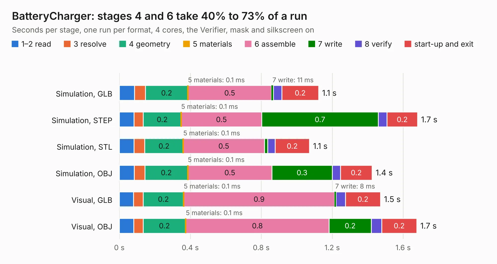

| Mode and format | 1–2 read | 3 resolve | 4 geometry | 5 materials | 6 assemble | 7 write | 8 verify | start-up and exit | Total |
|---|---:|---:|---:|---:|---:|---:|---:|---:|---:|
| Simulation, GLB | 85&nbsp;ms | 61&nbsp;ms | 0.2 | 0.1&nbsp;ms | 0.5 | 11&nbsp;ms | 48&nbsp;ms | 0.2 | 1.1 |
| Simulation, STEP | 82&nbsp;ms | 53&nbsp;ms | 0.2 | 0.1&nbsp;ms | 0.5 | 0.7 | 49&nbsp;ms | 0.2 | 1.7 |
| Simulation, STL | 82&nbsp;ms | 61&nbsp;ms | 0.2 | 0.1&nbsp;ms | 0.5 | 19&nbsp;ms | 42&nbsp;ms | 0.2 | 1.1 |
| Simulation, OBJ | 84&nbsp;ms | 60&nbsp;ms | 0.2 | 0.1&nbsp;ms | 0.5 | 0.3 | 47&nbsp;ms | 0.2 | 1.4 |
| Visual, GLB | 80&nbsp;ms | 54&nbsp;ms | 0.2 | 0.1&nbsp;ms | 0.9 | 8&nbsp;ms | 54&nbsp;ms | 0.2 | 1.5 |
| Visual, OBJ | 81&nbsp;ms | 53&nbsp;ms | 0.2 | 0.1&nbsp;ms | 0.8 | 0.2 | 58&nbsp;ms | 0.2 | 1.7 |

<table align="center"><tr><td valign="top">

| Board | Repo: [terrapin-rocket-team/srad-avionics](https://github.com/terrapin-rocket-team/srad-avionics) Board: `BatteryCharger.kicad_pcb` |
|---|---|
| Folder | Spaceport / PCBs / BatteryCharger / BatteryCharger |
| Complexity | 155&nbsp;/&nbsp;1000 (size&nbsp;110, features&nbsp;45) |
| KESE&nbsp;features | through vias, rounded, trapezoid or chamfered pads, filled zones |
| Tested | 9th November 2026 |
| Copper&nbsp;layers | 2 |
| File&nbsp;format | KiCad 9 (20241229) |
| Parts,&nbsp;tracks,&nbsp;vias | 9, 46, 6 |
| Triangles,&nbsp;simulation | 72,036 in 16 parts |
| Verifier | PASS in all six runs |

</td><td valign="top">

<table>
<tr><th>File type</th><th>File size</th><th>Peak memory used</th></tr>
<tr><th colspan="3" align="left">Simulation</th></tr>
<tr><td>GLB</td><td align="right">2.5&nbsp;MB</td><td align="right">175&nbsp;MB</td></tr>
<tr><td>STEP</td><td align="right">12&nbsp;MB</td><td align="right">179&nbsp;MB</td></tr>
<tr><td>STL</td><td align="right">3.6&nbsp;MB</td><td align="right">174&nbsp;MB</td></tr>
<tr><td>OBJ</td><td align="right">6.9&nbsp;MB</td><td align="right">174&nbsp;MB</td></tr>
<tr><th colspan="3" align="left">Visual</th></tr>
<tr><td>GLB</td><td align="right">1.9&nbsp;MB</td><td align="right">151&nbsp;MB</td></tr>
<tr><td>OBJ</td><td align="right">5.1&nbsp;MB</td><td align="right">151&nbsp;MB</td></tr>
</table>

</td></tr></table>

## 2730. Blue Raven Extension

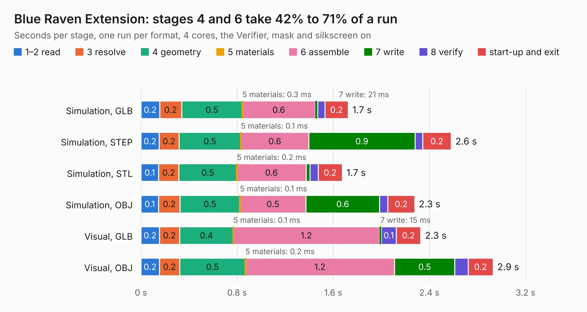

| Mode and format | 1–2 read | 3 resolve | 4 geometry | 5 materials | 6 assemble | 7 write | 8 verify | start-up and exit | Total |
|---|---:|---:|---:|---:|---:|---:|---:|---:|---:|
| Simulation, GLB | 0.2 | 0.2 | 0.5 | 0.3&nbsp;ms | 0.6 | 21&nbsp;ms | 60&nbsp;ms | 0.2 | 1.7 |
| Simulation, STEP | 0.2 | 0.2 | 0.5 | 0.1&nbsp;ms | 0.6 | 0.9 | 64&nbsp;ms | 0.2 | 2.6 |
| Simulation, STL | 0.1 | 0.2 | 0.5 | 0.2&nbsp;ms | 0.6 | 33&nbsp;ms | 67&nbsp;ms | 0.2 | 1.7 |
| Simulation, OBJ | 0.1 | 0.2 | 0.5 | 0.1&nbsp;ms | 0.5 | 0.6 | 69&nbsp;ms | 0.2 | 2.3 |
| Visual, GLB | 0.2 | 0.2 | 0.4 | 0.1&nbsp;ms | 1.2 | 15&nbsp;ms | 0.1 | 0.2 | 2.3 |
| Visual, OBJ | 0.2 | 0.2 | 0.5 | 0.2&nbsp;ms | 1.2 | 0.5 | 0.1 | 0.2 | 2.9 |

<table align="center"><tr><td valign="top">

| Board | Repo: [terrapin-rocket-team/srad-avionics](https://github.com/terrapin-rocket-team/srad-avionics) Board: `Blue Raven Extension.kicad_pcb` |
|---|---|
| Folder | Spaceport / PCBs / Blue Raven Extension |
| Complexity | 147&nbsp;/&nbsp;1000 (size&nbsp;87, features&nbsp;60) |
| KESE&nbsp;features | filled zones, curved board outline, knockout text, TrueType text |
| Tested | 9th November 2026 |
| Copper&nbsp;layers | 2 |
| File&nbsp;format | KiCad 9 (20241229) |
| Parts,&nbsp;tracks,&nbsp;vias | 3, 29, 0 |
| Triangles,&nbsp;simulation | 129,722 in 18 parts |
| Verifier | PASS in all six runs |

</td><td valign="top">

<table>
<tr><th>File type</th><th>File size</th><th>Peak memory used</th></tr>
<tr><th colspan="3" align="left">Simulation</th></tr>
<tr><td>GLB</td><td align="right">4.4&nbsp;MB</td><td align="right">191&nbsp;MB</td></tr>
<tr><td>STEP</td><td align="right">20&nbsp;MB</td><td align="right">199&nbsp;MB</td></tr>
<tr><td>STL</td><td align="right">6.5&nbsp;MB</td><td align="right">191&nbsp;MB</td></tr>
<tr><td>OBJ</td><td align="right">13&nbsp;MB</td><td align="right">187&nbsp;MB</td></tr>
<tr><th colspan="3" align="left">Visual</th></tr>
<tr><td>GLB</td><td align="right">3.3&nbsp;MB</td><td align="right">158&nbsp;MB</td></tr>
<tr><td>OBJ</td><td align="right">9.1&nbsp;MB</td><td align="right">160&nbsp;MB</td></tr>
</table>

</td></tr></table>

## 2731. dipole-breakout

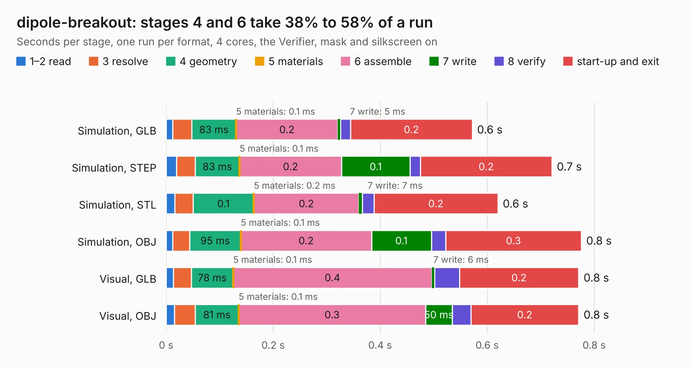

| Mode and format | 1–2 read | 3 resolve | 4 geometry | 5 materials | 6 assemble | 7 write | 8 verify | start-up and exit | Total |
|---|---:|---:|---:|---:|---:|---:|---:|---:|---:|
| Simulation, GLB | 12&nbsp;ms | 36&nbsp;ms | 83&nbsp;ms | 0.1&nbsp;ms | 0.2 | 5&nbsp;ms | 19&nbsp;ms | 0.2 | 0.6 |
| Simulation, STEP | 20&nbsp;ms | 35&nbsp;ms | 83&nbsp;ms | 0.1&nbsp;ms | 0.2 | 0.1 | 20&nbsp;ms | 0.2 | 0.7 |
| Simulation, STL | 16&nbsp;ms | 34&nbsp;ms | 0.1 | 0.2&nbsp;ms | 0.2 | 7&nbsp;ms | 21&nbsp;ms | 0.2 | 0.6 |
| Simulation, OBJ | 12&nbsp;ms | 32&nbsp;ms | 95&nbsp;ms | 0.1&nbsp;ms | 0.2 | 0.1 | 27&nbsp;ms | 0.3 | 0.8 |
| Visual, GLB | 14&nbsp;ms | 34&nbsp;ms | 78&nbsp;ms | 0.1&nbsp;ms | 0.4 | 6&nbsp;ms | 46&nbsp;ms | 0.2 | 0.8 |
| Visual, OBJ | 16&nbsp;ms | 39&nbsp;ms | 81&nbsp;ms | 0.1&nbsp;ms | 0.3 | 50&nbsp;ms | 35&nbsp;ms | 0.2 | 0.8 |

<table align="center"><tr><td valign="top">

| Board | Repo: [terrapin-rocket-team/srad-avionics](https://github.com/terrapin-rocket-team/srad-avionics) Board: `dipole-breakout.kicad_pcb` |
|---|---|
| Folder | Spaceport / PCBs / dipole-breakout |
| Complexity | 135&nbsp;/&nbsp;1000 (size&nbsp;80, features&nbsp;55) |
| KESE&nbsp;features | through vias, rounded, trapezoid or chamfered pads, filled zones, curved board outline |
| Tested | 9th November 2026 |
| Copper&nbsp;layers | 2 |
| File&nbsp;format | KiCad 8 (20240108) |
| Parts,&nbsp;tracks,&nbsp;vias | 3, 12, 2 |
| Triangles,&nbsp;simulation | 14,840 in 12 parts |
| Verifier | PASS in all six runs |

</td><td valign="top">

<table>
<tr><th>File type</th><th>File size</th><th>Peak memory used</th></tr>
<tr><th colspan="3" align="left">Simulation</th></tr>
<tr><td>GLB</td><td align="right">545&nbsp;kB</td><td align="right">41&nbsp;MB</td></tr>
<tr><td>STEP</td><td align="right">1.8&nbsp;MB</td><td align="right">42&nbsp;MB</td></tr>
<tr><td>STL</td><td align="right">743&nbsp;kB</td><td align="right">42&nbsp;MB</td></tr>
<tr><td>OBJ</td><td align="right">1.4&nbsp;MB</td><td align="right">44&nbsp;MB</td></tr>
<tr><th colspan="3" align="left">Visual</th></tr>
<tr><td>GLB</td><td align="right">320&nbsp;kB</td><td align="right">55&nbsp;MB</td></tr>
<tr><td>OBJ</td><td align="right">809&nbsp;kB</td><td align="right">60&nbsp;MB</td></tr>
</table>

</td></tr></table>

## 2732. flight-computer

| Mode and format | 1–2 read | 3 resolve | 4 geometry | 5 materials | 6 assemble | 7 write | 8 verify | start-up and exit | Total |
|---|---:|---:|---:|---:|---:|---:|---:|---:|---:|
| Simulation, GLB | 0.5 | 1.5 | 5.2 | 0.6&nbsp;ms | 4.5 | 0.2 | 0.6 | 0.2 | 12.8 |
| Simulation, STEP | 0.5 | 1.3 | 5.1 | 0.7&nbsp;ms | 4.7 | 3.7 | 0.6 | 0.2 | 16.2 |
| Simulation, STL | 0.4 | 1.4 | 5.1 | 0.6&nbsp;ms | 4.7 | 0.4 | 0.7 | 0.2 | 12.9 |
| Simulation, OBJ | 0.5 | 1.4 | 5.3 | 0.6&nbsp;ms | 4.7 | 6.5 | 0.7 | 0.2 | 19.3 |
| Visual, GLB | 0.5 | 1.4 | 5.3 | 0.6&nbsp;ms | 11.7 | 0.2 | 1.2 | 0.2 | 20.5 |
| Visual, OBJ | 0.4 | 1.4 | 5.4 | 0.5&nbsp;ms | 12.0 | 4.5 | 1.4 | 0.2 | 25.4 |

<table align="center"><tr><td valign="top">

| Board | Repo: [terrapin-rocket-team/srad-avionics](https://github.com/terrapin-rocket-team/srad-avionics) Board: `flight-computer.kicad_pcb` |
|---|---|
| Folder | Spaceport / PCBs / flight-computer / Alternate layout-2025-2026 |
| Complexity | 400&nbsp;/&nbsp;1000 (size&nbsp;250, features&nbsp;150) |
| KESE&nbsp;features | through vias, slotted holes, custom pads, rounded, trapezoid or chamfered pads, filled zones, copper drawings, curved board outline, knockout text, TrueType text, stack-up, dielectric εr and tanδ |
| Tested | 9th November 2026 |
| Copper&nbsp;layers | 4 |
| File&nbsp;format | KiCad 10 (20260206) |
| Parts,&nbsp;tracks,&nbsp;vias | 96, 737, 135 |
| Triangles,&nbsp;simulation | 1,549,962 in 145 parts |
| Verifier | PASS in all six runs |

</td><td valign="top">

<table>
<tr><th>File type</th><th>File size</th><th>Peak memory used</th></tr>
<tr><th colspan="3" align="left">Simulation</th></tr>
<tr><td>GLB</td><td align="right">54&nbsp;MB</td><td align="right">581&nbsp;MB</td></tr>
<tr><td>STEP</td><td align="right">247&nbsp;MB</td><td align="right">692&nbsp;MB</td></tr>
<tr><td>STL</td><td align="right">78&nbsp;MB</td><td align="right">581&nbsp;MB</td></tr>
<tr><td>OBJ</td><td align="right">162&nbsp;MB</td><td align="right">1.1&nbsp;GB</td></tr>
<tr><th colspan="3" align="left">Visual</th></tr>
<tr><td>GLB</td><td align="right">36&nbsp;MB</td><td align="right">770&nbsp;MB</td></tr>
<tr><td>OBJ</td><td align="right">109&nbsp;MB</td><td align="right">786&nbsp;MB</td></tr>
</table>

</td></tr></table>

## 2733. flight-computer

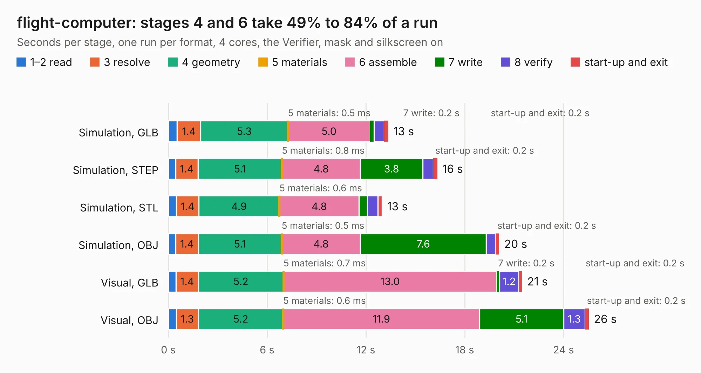

| Mode and format | 1–2 read | 3 resolve | 4 geometry | 5 materials | 6 assemble | 7 write | 8 verify | start-up and exit | Total |
|---|---:|---:|---:|---:|---:|---:|---:|---:|---:|
| Simulation, GLB | 0.5 | 1.4 | 5.3 | 0.5&nbsp;ms | 5.0 | 0.2 | 0.6 | 0.2 | 13.4 |
| Simulation, STEP | 0.4 | 1.4 | 5.1 | 0.8&nbsp;ms | 4.8 | 3.8 | 0.7 | 0.2 | 16.3 |
| Simulation, STL | 0.5 | 1.4 | 4.9 | 0.6&nbsp;ms | 4.8 | 0.5 | 0.6 | 0.3 | 13.0 |
| Simulation, OBJ | 0.4 | 1.4 | 5.1 | 0.5&nbsp;ms | 4.8 | 7.6 | 0.6 | 0.2 | 20.1 |
| Visual, GLB | 0.5 | 1.4 | 5.2 | 0.7&nbsp;ms | 13.0 | 0.2 | 1.2 | 0.2 | 21.5 |
| Visual, OBJ | 0.5 | 1.3 | 5.2 | 0.6&nbsp;ms | 11.9 | 5.1 | 1.3 | 0.2 | 25.5 |

<table align="center"><tr><td valign="top">

| Board | Repo: [terrapin-rocket-team/srad-avionics](https://github.com/terrapin-rocket-team/srad-avionics) Board: `flight-computer.kicad_pcb` |
|---|---|
| Folder | Spaceport / PCBs / flight-computer / flight-computer-2025-2026 |
| Complexity | 376&nbsp;/&nbsp;1000 (size&nbsp;256, features&nbsp;120) |
| KESE&nbsp;features | through vias, slotted holes, custom pads, rounded, trapezoid or chamfered pads, filled zones, copper drawings, curved board outline, stack-up, dielectric εr and tanδ |
| Tested | 9th November 2026 |
| Copper&nbsp;layers | 4 |
| File&nbsp;format | KiCad 9 (20241229) |
| Parts,&nbsp;tracks,&nbsp;vias | 117, 937, 169 |
| Triangles,&nbsp;simulation | 1,443,250 in 215 parts |
| Verifier | PASS in all six runs |

</td><td valign="top">

<table>
<tr><th>File type</th><th>File size</th><th>Peak memory used</th></tr>
<tr><th colspan="3" align="left">Simulation</th></tr>
<tr><td>GLB</td><td align="right">50&nbsp;MB</td><td align="right">546&nbsp;MB</td></tr>
<tr><td>STEP</td><td align="right">213&nbsp;MB</td><td align="right">626&nbsp;MB</td></tr>
<tr><td>STL</td><td align="right">72&nbsp;MB</td><td align="right">544&nbsp;MB</td></tr>
<tr><td>OBJ</td><td align="right">149&nbsp;MB</td><td align="right">992&nbsp;MB</td></tr>
<tr><th colspan="3" align="left">Visual</th></tr>
<tr><td>GLB</td><td align="right">32&nbsp;MB</td><td align="right">691&nbsp;MB</td></tr>
<tr><td>OBJ</td><td align="right">97&nbsp;MB</td><td align="right">753&nbsp;MB</td></tr>
</table>

</td></tr></table>

## 2734. mcu-board v2

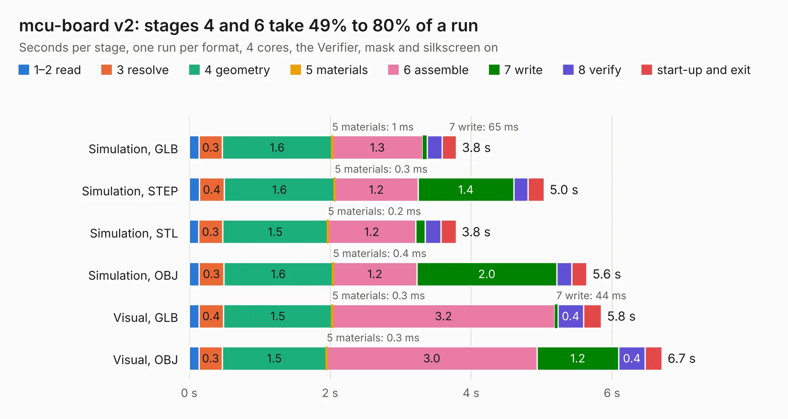

| Mode and format | 1–2 read | 3 resolve | 4 geometry | 5 materials | 6 assemble | 7 write | 8 verify | start-up and exit | Total |
|---|---:|---:|---:|---:|---:|---:|---:|---:|---:|
| Simulation, GLB | 0.1 | 0.3 | 1.6 | 1&nbsp;ms | 1.3 | 65&nbsp;ms | 0.2 | 0.2 | 3.8 |
| Simulation, STEP | 0.1 | 0.4 | 1.6 | 0.3&nbsp;ms | 1.2 | 1.4 | 0.2 | 0.2 | 5.0 |
| Simulation, STL | 0.1 | 0.3 | 1.5 | 0.2&nbsp;ms | 1.2 | 0.1 | 0.2 | 0.2 | 3.8 |
| Simulation, OBJ | 0.1 | 0.3 | 1.6 | 0.4&nbsp;ms | 1.2 | 2.0 | 0.2 | 0.2 | 5.6 |
| Visual, GLB | 0.1 | 0.4 | 1.5 | 0.3&nbsp;ms | 3.2 | 44&nbsp;ms | 0.4 | 0.3 | 5.8 |
| Visual, OBJ | 0.1 | 0.3 | 1.5 | 0.3&nbsp;ms | 3.0 | 1.2 | 0.4 | 0.2 | 6.7 |

<table align="center"><tr><td valign="top">

| Board | Repo: [terrapin-rocket-team/srad-avionics](https://github.com/terrapin-rocket-team/srad-avionics) Board: `mcu-board v2.kicad_pcb` |
|---|---|
| Folder | Spaceport / PCBs / Gerbers / Teensy v3.0 |
| Complexity | 159&nbsp;/&nbsp;1000 (size&nbsp;114, features&nbsp;45) |
| KESE&nbsp;features | through vias, rounded, trapezoid or chamfered pads, filled zones |
| Tested | 9th November 2026 |
| Copper&nbsp;layers | 2 |
| File&nbsp;format | KiCad 8 (20240108) |
| Parts,&nbsp;tracks,&nbsp;vias | 12, 61, 2 |
| Triangles,&nbsp;simulation | 381,418 in 60 parts |
| Verifier | PASS in all six runs |

</td><td valign="top">

<table>
<tr><th>File type</th><th>File size</th><th>Peak memory used</th></tr>
<tr><th colspan="3" align="left">Simulation</th></tr>
<tr><td>GLB</td><td align="right">12&nbsp;MB</td><td align="right">254&nbsp;MB</td></tr>
<tr><td>STEP</td><td align="right">50&nbsp;MB</td><td align="right">292&nbsp;MB</td></tr>
<tr><td>STL</td><td align="right">19&nbsp;MB</td><td align="right">257&nbsp;MB</td></tr>
<tr><td>OBJ</td><td align="right">38&nbsp;MB</td><td align="right">303&nbsp;MB</td></tr>
<tr><th colspan="3" align="left">Visual</th></tr>
<tr><td>GLB</td><td align="right">7.9&nbsp;MB</td><td align="right">278&nbsp;MB</td></tr>
<tr><td>OBJ</td><td align="right">23&nbsp;MB</td><td align="right">272&nbsp;MB</td></tr>
</table>

</td></tr></table>

## 2735. SensorBoardNoMCU

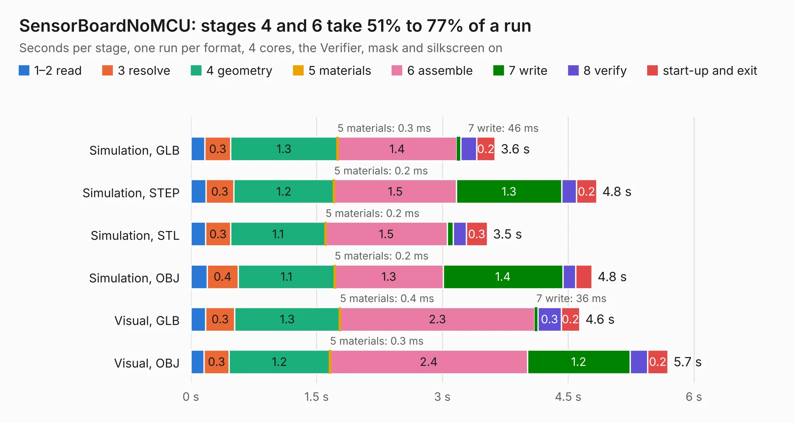

| Mode and format | 1–2 read | 3 resolve | 4 geometry | 5 materials | 6 assemble | 7 write | 8 verify | start-up and exit | Total |
|---|---:|---:|---:|---:|---:|---:|---:|---:|---:|
| Simulation, GLB | 0.2 | 0.3 | 1.3 | 0.3&nbsp;ms | 1.4 | 46&nbsp;ms | 0.2 | 0.2 | 3.6 |
| Simulation, STEP | 0.2 | 0.3 | 1.2 | 0.2&nbsp;ms | 1.5 | 1.3 | 0.2 | 0.2 | 4.8 |
| Simulation, STL | 0.2 | 0.3 | 1.1 | 0.2&nbsp;ms | 1.5 | 74&nbsp;ms | 0.2 | 0.3 | 3.5 |
| Simulation, OBJ | 0.2 | 0.4 | 1.1 | 0.2&nbsp;ms | 1.3 | 1.4 | 0.2 | 0.2 | 4.8 |
| Visual, GLB | 0.2 | 0.3 | 1.3 | 0.4&nbsp;ms | 2.3 | 36&nbsp;ms | 0.3 | 0.2 | 4.6 |
| Visual, OBJ | 0.2 | 0.3 | 1.2 | 0.3&nbsp;ms | 2.4 | 1.2 | 0.2 | 0.2 | 5.7 |

<table align="center"><tr><td valign="top">

| Board | Repo: [terrapin-rocket-team/srad-avionics](https://github.com/terrapin-rocket-team/srad-avionics) Board: `SensorBoardNoMCU.kicad_pcb` |
|---|---|
| Folder | Spaceport / PCBs / Gerbers / Teensy v3.0 |
| Complexity | 266&nbsp;/&nbsp;1000 (size&nbsp;151, features&nbsp;115) |
| KESE&nbsp;features | through vias, rounded, trapezoid or chamfered pads, filled zones, curved board outline, knockout text, TrueType text, stack-up, dielectric εr and tanδ |
| Tested | 9th November 2026 |
| Copper&nbsp;layers | 2 |
| File&nbsp;format | KiCad 8 (20240108) |
| Parts,&nbsp;tracks,&nbsp;vias | 25, 221, 67 |
| Triangles,&nbsp;simulation | 259,862 in 37 parts |
| Verifier | PASS in all six runs |

</td><td valign="top">

<table>
<tr><th>File type</th><th>File size</th><th>Peak memory used</th></tr>
<tr><th colspan="3" align="left">Simulation</th></tr>
<tr><td>GLB</td><td align="right">9.0&nbsp;MB</td><td align="right">239&nbsp;MB</td></tr>
<tr><td>STEP</td><td align="right">39&nbsp;MB</td><td align="right">271&nbsp;MB</td></tr>
<tr><td>STL</td><td align="right">13&nbsp;MB</td><td align="right">241&nbsp;MB</td></tr>
<tr><td>OBJ</td><td align="right">26&nbsp;MB</td><td align="right">242&nbsp;MB</td></tr>
<tr><th colspan="3" align="left">Visual</th></tr>
<tr><td>GLB</td><td align="right">7.5&nbsp;MB</td><td align="right">250&nbsp;MB</td></tr>
<tr><td>OBJ</td><td align="right">22&nbsp;MB</td><td align="right">253&nbsp;MB</td></tr>
</table>

</td></tr></table>

## 2736. Ground Receiver v2

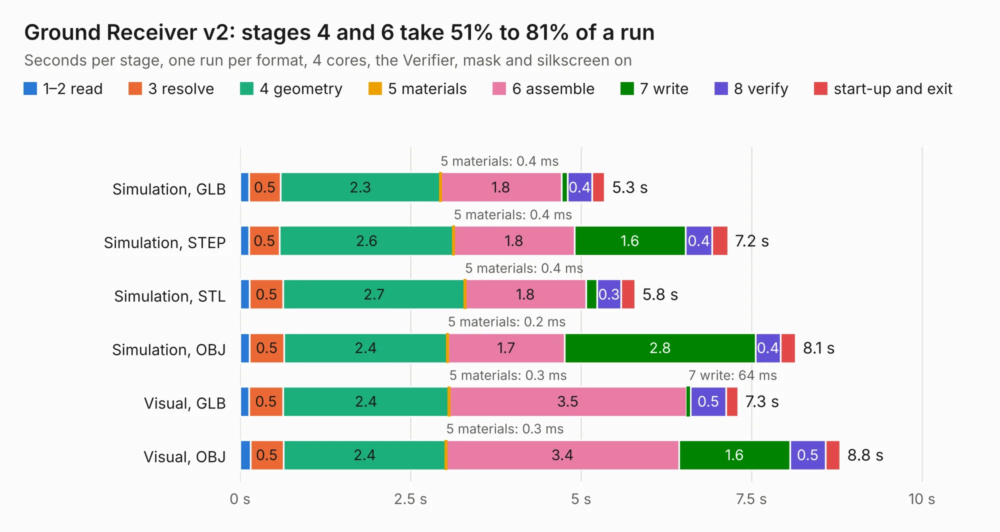

| Mode and format | 1–2 read | 3 resolve | 4 geometry | 5 materials | 6 assemble | 7 write | 8 verify | start-up and exit | Total |
|---|---:|---:|---:|---:|---:|---:|---:|---:|---:|
| Simulation, GLB | 0.1 | 0.5 | 2.3 | 0.4&nbsp;ms | 1.8 | 92&nbsp;ms | 0.4 | 0.2 | 5.3 |
| Simulation, STEP | 0.1 | 0.5 | 2.6 | 0.4&nbsp;ms | 1.8 | 1.6 | 0.4 | 0.2 | 7.2 |
| Simulation, STL | 0.1 | 0.5 | 2.7 | 0.4&nbsp;ms | 1.8 | 0.2 | 0.3 | 0.2 | 5.8 |
| Simulation, OBJ | 0.1 | 0.5 | 2.4 | 0.2&nbsp;ms | 1.7 | 2.8 | 0.4 | 0.2 | 8.1 |
| Visual, GLB | 0.1 | 0.5 | 2.4 | 0.3&nbsp;ms | 3.5 | 64&nbsp;ms | 0.5 | 0.2 | 7.3 |
| Visual, OBJ | 0.2 | 0.5 | 2.4 | 0.3&nbsp;ms | 3.4 | 1.6 | 0.5 | 0.2 | 8.8 |

<table align="center"><tr><td valign="top">

| Board | Repo: [terrapin-rocket-team/srad-avionics](https://github.com/terrapin-rocket-team/srad-avionics) Board: `Ground Receiver v2.kicad_pcb` |
|---|---|
| Folder | Spaceport / PCBs / Ground Reciever / Ground Reciever v2 |
| Complexity | 170&nbsp;/&nbsp;1000 (size&nbsp;145, features&nbsp;25) |
| KESE&nbsp;features | through vias, rounded, trapezoid or chamfered pads |
| Tested | 9th November 2026 |
| Copper&nbsp;layers | 2 |
| File&nbsp;format | KiCad 7 (20221018) |
| Parts,&nbsp;tracks,&nbsp;vias | 19, 293, 16 |
| Triangles,&nbsp;simulation | 560,782 in 72 parts |
| Verifier | PASS in all six runs |

</td><td valign="top">

<table>
<tr><th>File type</th><th>File size</th><th>Peak memory used</th></tr>
<tr><th colspan="3" align="left">Simulation</th></tr>
<tr><td>GLB</td><td align="right">18&nbsp;MB</td><td align="right">298&nbsp;MB</td></tr>
<tr><td>STEP</td><td align="right">74&nbsp;MB</td><td align="right">358&nbsp;MB</td></tr>
<tr><td>STL</td><td align="right">28&nbsp;MB</td><td align="right">289&nbsp;MB</td></tr>
<tr><td>OBJ</td><td align="right">56&nbsp;MB</td><td align="right">412&nbsp;MB</td></tr>
<tr><th colspan="3" align="left">Visual</th></tr>
<tr><td>GLB</td><td align="right">11&nbsp;MB</td><td align="right">371&nbsp;MB</td></tr>
<tr><td>OBJ</td><td align="right">34&nbsp;MB</td><td align="right">355&nbsp;MB</td></tr>
</table>

</td></tr></table>

## 2737. Ground Reciever

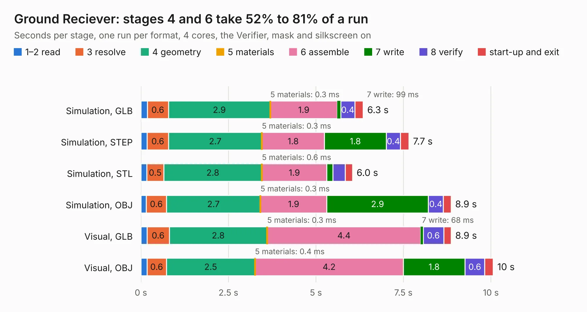

| Mode and format | 1–2 read | 3 resolve | 4 geometry | 5 materials | 6 assemble | 7 write | 8 verify | start-up and exit | Total |
|---|---:|---:|---:|---:|---:|---:|---:|---:|---:|
| Simulation, GLB | 0.2 | 0.6 | 2.9 | 0.3&nbsp;ms | 1.9 | 99&nbsp;ms | 0.4 | 0.2 | 6.3 |
| Simulation, STEP | 0.2 | 0.6 | 2.7 | 0.3&nbsp;ms | 1.8 | 1.8 | 0.4 | 0.2 | 7.7 |
| Simulation, STL | 0.2 | 0.5 | 2.8 | 0.6&nbsp;ms | 1.9 | 0.2 | 0.4 | 0.2 | 6.0 |
| Simulation, OBJ | 0.2 | 0.6 | 2.7 | 0.3&nbsp;ms | 1.9 | 2.9 | 0.4 | 0.2 | 8.9 |
| Visual, GLB | 0.2 | 0.6 | 2.8 | 0.3&nbsp;ms | 4.4 | 68&nbsp;ms | 0.6 | 0.2 | 8.9 |
| Visual, OBJ | 0.2 | 0.6 | 2.5 | 0.4&nbsp;ms | 4.2 | 1.8 | 0.6 | 0.2 | 10.1 |

<table align="center"><tr><td valign="top">

| Board | Repo: [terrapin-rocket-team/srad-avionics](https://github.com/terrapin-rocket-team/srad-avionics) Board: `Ground Reciever.kicad_pcb` |
|---|---|
| Folder | Spaceport / PCBs / Ground Reciever |
| Complexity | 174&nbsp;/&nbsp;1000 (size&nbsp;149, features&nbsp;25) |
| KESE&nbsp;features | through vias, rounded, trapezoid or chamfered pads |
| Tested | 9th November 2026 |
| Copper&nbsp;layers | 2 |
| File&nbsp;format | KiCad 7 (20221018) |
| Parts,&nbsp;tracks,&nbsp;vias | 19, 392, 20 |
| Triangles,&nbsp;simulation | 612,778 in 72 parts |
| Verifier | PASS in all six runs |

</td><td valign="top">

<table>
<tr><th>File type</th><th>File size</th><th>Peak memory used</th></tr>
<tr><th colspan="3" align="left">Simulation</th></tr>
<tr><td>GLB</td><td align="right">20&nbsp;MB</td><td align="right">339&nbsp;MB</td></tr>
<tr><td>STEP</td><td align="right">86&nbsp;MB</td><td align="right">379&nbsp;MB</td></tr>
<tr><td>STL</td><td align="right">31&nbsp;MB</td><td align="right">331&nbsp;MB</td></tr>
<tr><td>OBJ</td><td align="right">61&nbsp;MB</td><td align="right">447&nbsp;MB</td></tr>
<tr><th colspan="3" align="left">Visual</th></tr>
<tr><td>GLB</td><td align="right">13&nbsp;MB</td><td align="right">393&nbsp;MB</td></tr>
<tr><td>OBJ</td><td align="right">40&nbsp;MB</td><td align="right">396&nbsp;MB</td></tr>
</table>

</td></tr></table>

## 2738. ground-receiver

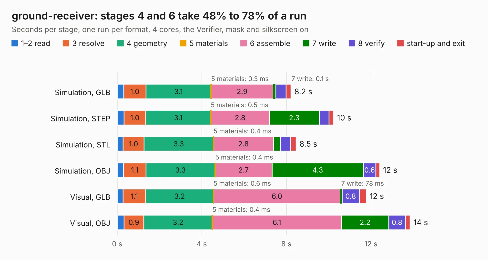

| Mode and format | 1–2 read | 3 resolve | 4 geometry | 5 materials | 6 assemble | 7 write | 8 verify | start-up and exit | Total |
|---|---:|---:|---:|---:|---:|---:|---:|---:|---:|
| Simulation, GLB | 0.3 | 1.0 | 3.1 | 0.3&nbsp;ms | 2.9 | 0.1 | 0.5 | 0.2 | 8.2 |
| Simulation, STEP | 0.3 | 1.0 | 3.1 | 0.5&nbsp;ms | 2.8 | 2.3 | 0.5 | 0.2 | 10.2 |
| Simulation, STL | 0.3 | 1.0 | 3.3 | 0.4&nbsp;ms | 2.8 | 0.3 | 0.5 | 0.3 | 8.5 |
| Simulation, OBJ | 0.3 | 1.1 | 3.3 | 0.4&nbsp;ms | 2.7 | 4.3 | 0.6 | 0.2 | 12.4 |
| Visual, GLB | 0.3 | 1.1 | 3.2 | 0.6&nbsp;ms | 6.0 | 78&nbsp;ms | 0.8 | 0.3 | 11.8 |
| Visual, OBJ | 0.3 | 0.9 | 3.2 | 0.4&nbsp;ms | 6.1 | 2.2 | 0.8 | 0.2 | 13.8 |

<table align="center"><tr><td valign="top">

| Board | Repo: [terrapin-rocket-team/srad-avionics](https://github.com/terrapin-rocket-team/srad-avionics) Board: `ground-receiver.kicad_pcb` |
|---|---|
| Folder | Spaceport / PCBs / ground-receiver |
| Complexity | 276&nbsp;/&nbsp;1000 (size&nbsp;181, features&nbsp;95) |
| KESE&nbsp;features | through vias, slotted holes, rounded, trapezoid or chamfered pads, filled zones, curved board outline, stack-up, dielectric εr and tanδ |
| Tested | 9th November 2026 |
| Copper&nbsp;layers | 4 |
| File&nbsp;format | KiCad 8 (20240108) |
| Parts,&nbsp;tracks,&nbsp;vias | 56, 423, 43 |
| Triangles,&nbsp;simulation | 988,588 in 93 parts |
| Verifier | PASS in all six runs |

</td><td valign="top">

<table>
<tr><th>File type</th><th>File size</th><th>Peak memory used</th></tr>
<tr><th colspan="3" align="left">Simulation</th></tr>
<tr><td>GLB</td><td align="right">34&nbsp;MB</td><td align="right">437&nbsp;MB</td></tr>
<tr><td>STEP</td><td align="right">145&nbsp;MB</td><td align="right">494&nbsp;MB</td></tr>
<tr><td>STL</td><td align="right">49&nbsp;MB</td><td align="right">431&nbsp;MB</td></tr>
<tr><td>OBJ</td><td align="right">101&nbsp;MB</td><td align="right">713&nbsp;MB</td></tr>
<tr><th colspan="3" align="left">Visual</th></tr>
<tr><td>GLB</td><td align="right">18&nbsp;MB</td><td align="right">529&nbsp;MB</td></tr>
<tr><td>OBJ</td><td align="right">54&nbsp;MB</td><td align="right">478&nbsp;MB</td></tr>
</table>

</td></tr></table>

## 2739. high-power-module

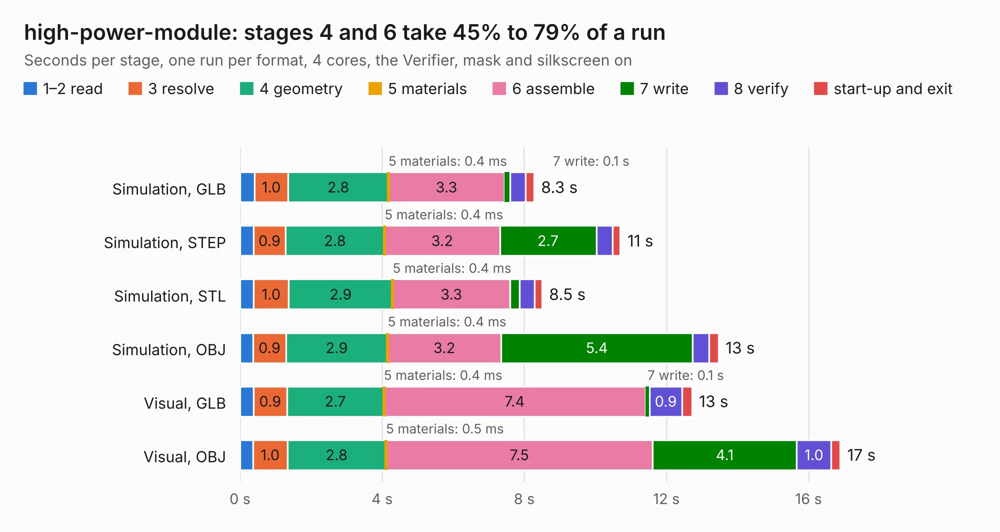

| Mode and format | 1–2 read | 3 resolve | 4 geometry | 5 materials | 6 assemble | 7 write | 8 verify | start-up and exit | Total |
|---|---:|---:|---:|---:|---:|---:|---:|---:|---:|
| Simulation, GLB | 0.4 | 1.0 | 2.8 | 0.4&nbsp;ms | 3.3 | 0.1 | 0.4 | 0.2 | 8.3 |
| Simulation, STEP | 0.4 | 0.9 | 2.8 | 0.4&nbsp;ms | 3.2 | 2.7 | 0.5 | 0.2 | 10.7 |
| Simulation, STL | 0.4 | 1.0 | 2.9 | 0.4&nbsp;ms | 3.3 | 0.3 | 0.4 | 0.2 | 8.5 |
| Simulation, OBJ | 0.4 | 0.9 | 2.9 | 0.4&nbsp;ms | 3.2 | 5.4 | 0.5 | 0.3 | 13.5 |
| Visual, GLB | 0.4 | 0.9 | 2.7 | 0.4&nbsp;ms | 7.4 | 0.1 | 0.9 | 0.3 | 12.7 |
| Visual, OBJ | 0.4 | 1.0 | 2.8 | 0.5&nbsp;ms | 7.5 | 4.1 | 1.0 | 0.2 | 16.9 |

<table align="center"><tr><td valign="top">

| Board | Repo: [terrapin-rocket-team/srad-avionics](https://github.com/terrapin-rocket-team/srad-avionics) Board: `high-power-module.kicad_pcb` |
|---|---|
| Folder | Spaceport / PCBs / high-power-module |
| Complexity | 343&nbsp;/&nbsp;1000 (size&nbsp;233, features&nbsp;110) |
| KESE&nbsp;features | through vias, custom pads, rounded, trapezoid or chamfered pads, filled zones, copper drawings, curved board outline, stack-up, dielectric εr and tanδ |
| Tested | 9th November 2026 |
| Copper&nbsp;layers | 4 |
| File&nbsp;format | KiCad 8 (20240108) |
| Parts,&nbsp;tracks,&nbsp;vias | 83, 566, 107 |
| Triangles,&nbsp;simulation | 972,140 in 95 parts |
| Verifier | PASS in all six runs |

</td><td valign="top">

<table>
<tr><th>File type</th><th>File size</th><th>Peak memory used</th></tr>
<tr><th colspan="3" align="left">Simulation</th></tr>
<tr><td>GLB</td><td align="right">33&nbsp;MB</td><td align="right">443&nbsp;MB</td></tr>
<tr><td>STEP</td><td align="right">139&nbsp;MB</td><td align="right">516&nbsp;MB</td></tr>
<tr><td>STL</td><td align="right">49&nbsp;MB</td><td align="right">438&nbsp;MB</td></tr>
<tr><td>OBJ</td><td align="right">99&nbsp;MB</td><td align="right">666&nbsp;MB</td></tr>
<tr><th colspan="3" align="left">Visual</th></tr>
<tr><td>GLB</td><td align="right">24&nbsp;MB</td><td align="right">535&nbsp;MB</td></tr>
<tr><td>OBJ</td><td align="right">72&nbsp;MB</td><td align="right">601&nbsp;MB</td></tr>
</table>

</td></tr></table>

## 2740. LiBatteryCharger

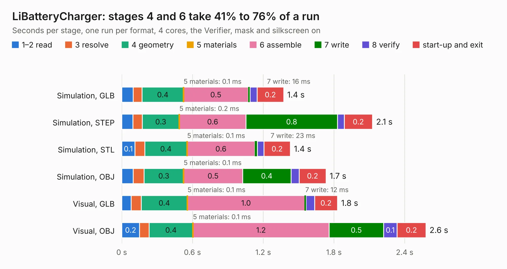

| Mode and format | 1–2 read | 3 resolve | 4 geometry | 5 materials | 6 assemble | 7 write | 8 verify | start-up and exit | Total |
|---|---:|---:|---:|---:|---:|---:|---:|---:|---:|
| Simulation, GLB | 96&nbsp;ms | 76&nbsp;ms | 0.4 | 0.1&nbsp;ms | 0.5 | 16&nbsp;ms | 61&nbsp;ms | 0.2 | 1.4 |
| Simulation, STEP | 94&nbsp;ms | 80&nbsp;ms | 0.3 | 0.2&nbsp;ms | 0.6 | 0.8 | 58&nbsp;ms | 0.2 | 2.1 |
| Simulation, STL | 0.1 | 82&nbsp;ms | 0.4 | 0.1&nbsp;ms | 0.6 | 23&nbsp;ms | 55&nbsp;ms | 0.2 | 1.4 |
| Simulation, OBJ | 97&nbsp;ms | 92&nbsp;ms | 0.3 | 0.1&nbsp;ms | 0.5 | 0.4 | 69&nbsp;ms | 0.2 | 1.7 |
| Visual, GLB | 80&nbsp;ms | 85&nbsp;ms | 0.4 | 0.1&nbsp;ms | 1.0 | 12&nbsp;ms | 73&nbsp;ms | 0.2 | 1.8 |
| Visual, OBJ | 0.2 | 81&nbsp;ms | 0.4 | 0.1&nbsp;ms | 1.2 | 0.5 | 0.1 | 0.2 | 2.6 |

<table align="center"><tr><td valign="top">

| Board | Repo: [terrapin-rocket-team/srad-avionics](https://github.com/terrapin-rocket-team/srad-avionics) Board: `LiBatteryCharger.kicad_pcb` |
|---|---|
| Folder | Spaceport / PCBs / LiBatteryCharger |
| Complexity | 159&nbsp;/&nbsp;1000 (size&nbsp;114, features&nbsp;45) |
| KESE&nbsp;features | through vias, rounded, trapezoid or chamfered pads, filled zones |
| Tested | 9th November 2026 |
| Copper&nbsp;layers | 2 |
| File&nbsp;format | KiCad 9 (20241229) |
| Parts,&nbsp;tracks,&nbsp;vias | 9, 58, 8 |
| Triangles,&nbsp;simulation | 89,894 in 17 parts |
| Verifier | PASS in all six runs |

</td><td valign="top">

<table>
<tr><th>File type</th><th>File size</th><th>Peak memory used</th></tr>
<tr><th colspan="3" align="left">Simulation</th></tr>
<tr><td>GLB</td><td align="right">3.1&nbsp;MB</td><td align="right">178&nbsp;MB</td></tr>
<tr><td>STEP</td><td align="right">15&nbsp;MB</td><td align="right">186&nbsp;MB</td></tr>
<tr><td>STL</td><td align="right">4.5&nbsp;MB</td><td align="right">172&nbsp;MB</td></tr>
<tr><td>OBJ</td><td align="right">8.6&nbsp;MB</td><td align="right">177&nbsp;MB</td></tr>
<tr><th colspan="3" align="left">Visual</th></tr>
<tr><td>GLB</td><td align="right">2.2&nbsp;MB</td><td align="right">152&nbsp;MB</td></tr>
<tr><td>OBJ</td><td align="right">6.0&nbsp;MB</td><td align="right">153&nbsp;MB</td></tr>
</table>

</td></tr></table>

## 2741. live-video-multi-function-board

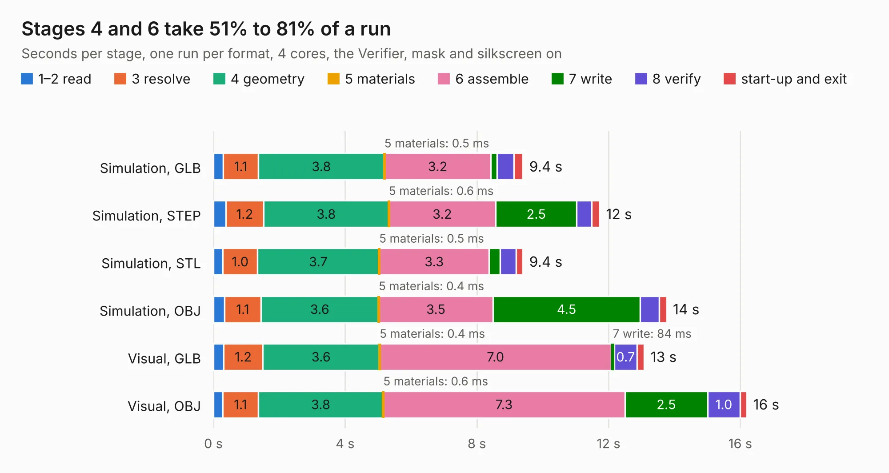

| Mode and format | 1–2 read | 3 resolve | 4 geometry | 5 materials | 6 assemble | 7 write | 8 verify | start-up and exit | Total |
|---|---:|---:|---:|---:|---:|---:|---:|---:|---:|
| Simulation, GLB | 0.3 | 1.1 | 3.8 | 0.5&nbsp;ms | 3.2 | 0.2 | 0.5 | 0.3 | 9.4 |
| Simulation, STEP | 0.4 | 1.2 | 3.8 | 0.6&nbsp;ms | 3.2 | 2.5 | 0.5 | 0.2 | 11.7 |
| Simulation, STL | 0.3 | 1.0 | 3.7 | 0.5&nbsp;ms | 3.3 | 0.3 | 0.5 | 0.2 | 9.4 |
| Simulation, OBJ | 0.3 | 1.1 | 3.6 | 0.4&nbsp;ms | 3.5 | 4.5 | 0.6 | 0.2 | 13.8 |
| Visual, GLB | 0.3 | 1.2 | 3.6 | 0.4&nbsp;ms | 7.0 | 84&nbsp;ms | 0.7 | 0.2 | 13.1 |
| Visual, OBJ | 0.3 | 1.1 | 3.8 | 0.6&nbsp;ms | 7.3 | 2.5 | 1.0 | 0.2 | 16.2 |

<table align="center"><tr><td valign="top">

| Board | Repo: [terrapin-rocket-team/srad-avionics](https://github.com/terrapin-rocket-team/srad-avionics) Board: `live-video-multi-function-board.kicad_pcb` |
|---|---|
| Folder | Spaceport / PCBs / live-video-multi-function-board |
| Complexity | 275&nbsp;/&nbsp;1000 (size&nbsp;180, features&nbsp;95) |
| KESE&nbsp;features | through vias, slotted holes, rounded, trapezoid or chamfered pads, filled zones, curved board outline, stack-up, dielectric εr and tanδ |
| Tested | 9th November 2026 |
| Copper&nbsp;layers | 4 |
| File&nbsp;format | KiCad 8 (20240108) |
| Parts,&nbsp;tracks,&nbsp;vias | 59, 378, 49 |
| Triangles,&nbsp;simulation | 1,147,784 in 132 parts |
| Verifier | PASS in all six runs |

</td><td valign="top">

<table>
<tr><th>File type</th><th>File size</th><th>Peak memory used</th></tr>
<tr><th colspan="3" align="left">Simulation</th></tr>
<tr><td>GLB</td><td align="right">38&nbsp;MB</td><td align="right">476&nbsp;MB</td></tr>
<tr><td>STEP</td><td align="right">149&nbsp;MB</td><td align="right">530&nbsp;MB</td></tr>
<tr><td>STL</td><td align="right">57&nbsp;MB</td><td align="right">481&nbsp;MB</td></tr>
<tr><td>OBJ</td><td align="right">116&nbsp;MB</td><td align="right">795&nbsp;MB</td></tr>
<tr><th colspan="3" align="left">Visual</th></tr>
<tr><td>GLB</td><td align="right">21&nbsp;MB</td><td align="right">588&nbsp;MB</td></tr>
<tr><td>OBJ</td><td align="right">64&nbsp;MB</td><td align="right">593&nbsp;MB</td></tr>
</table>

</td></tr></table>

## 2742. low_power_module

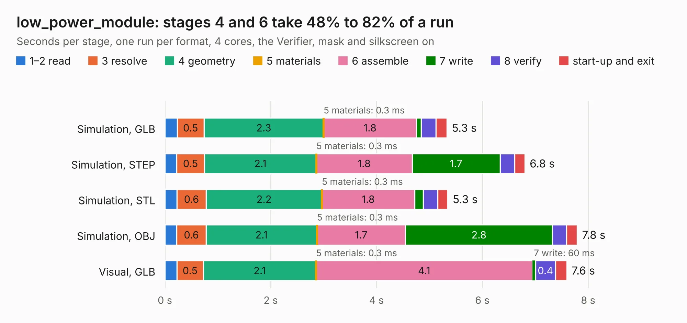

| Mode and format | 1–2 read | 3 resolve | 4 geometry | 5 materials | 6 assemble | 7 write | 8 verify | start-up and exit | Total |
|---|---:|---:|---:|---:|---:|---:|---:|---:|---:|
| Simulation, GLB | 0.2 | 0.5 | 2.3 | 0.3&nbsp;ms | 1.8 | 86&nbsp;ms | 0.3 | 0.2 | 5.3 |
| Simulation, STEP | 0.2 | 0.5 | 2.1 | 0.3&nbsp;ms | 1.8 | 1.7 | 0.3 | 0.2 | 6.8 |
| Simulation, STL | 0.2 | 0.6 | 2.2 | 0.3&nbsp;ms | 1.8 | 0.2 | 0.3 | 0.2 | 5.3 |
| Simulation, OBJ | 0.2 | 0.6 | 2.1 | 0.3&nbsp;ms | 1.7 | 2.8 | 0.3 | 0.2 | 7.8 |
| Visual, GLB | 0.2 | 0.5 | 2.1 | 0.3&nbsp;ms | 4.1 | 60&nbsp;ms | 0.4 | 0.2 | 7.6 |
| Visual, OBJ | 0.2 | 0.5 | 2.2 | 0.2&nbsp;ms | 4.0 | 2.0 | 0.5 | 0.2 | 9.7 |

<table align="center"><tr><td valign="top">

| Board | Repo: [terrapin-rocket-team/srad-avionics](https://github.com/terrapin-rocket-team/srad-avionics) Board: `low_power_module.kicad_pcb` |
|---|---|
| Folder | Spaceport / PCBs / low_power_module |
| Complexity | 200&nbsp;/&nbsp;1000 (size&nbsp;155, features&nbsp;45) |
| KESE&nbsp;features | through vias, rounded, trapezoid or chamfered pads, filled zones |
| Tested | 9th November 2026 |
| Copper&nbsp;layers | 2 |
| File&nbsp;format | KiCad 8 (20240108) |
| Parts,&nbsp;tracks,&nbsp;vias | 49, 230, 36 |
| Triangles,&nbsp;simulation | 593,664 in 84 parts |
| Verifier | PASS in all six runs |

</td><td valign="top">

<table>
<tr><th>File type</th><th>File size</th><th>Peak memory used</th></tr>
<tr><th colspan="3" align="left">Simulation</th></tr>
<tr><td>GLB</td><td align="right">20&nbsp;MB</td><td align="right">320&nbsp;MB</td></tr>
<tr><td>STEP</td><td align="right">90&nbsp;MB</td><td align="right">399&nbsp;MB</td></tr>
<tr><td>STL</td><td align="right">30&nbsp;MB</td><td align="right">340&nbsp;MB</td></tr>
<tr><td>OBJ</td><td align="right">60&nbsp;MB</td><td align="right">428&nbsp;MB</td></tr>
<tr><th colspan="3" align="left">Visual</th></tr>
<tr><td>GLB</td><td align="right">14&nbsp;MB</td><td align="right">399&nbsp;MB</td></tr>
<tr><td>OBJ</td><td align="right">43&nbsp;MB</td><td align="right">440&nbsp;MB</td></tr>
</table>

</td></tr></table>

## 2743. ESP32_BluetoothModule_TerrapinRockets

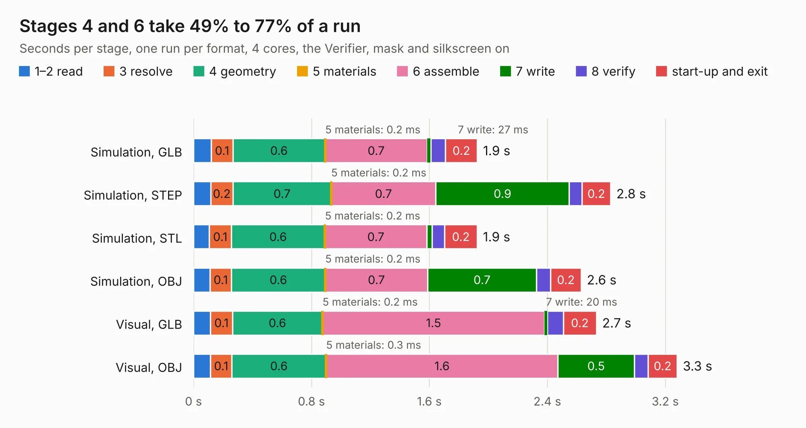

| Mode and format | 1–2 read | 3 resolve | 4 geometry | 5 materials | 6 assemble | 7 write | 8 verify | start-up and exit | Total |
|---|---:|---:|---:|---:|---:|---:|---:|---:|---:|
| Simulation, GLB | 0.1 | 0.1 | 0.6 | 0.2&nbsp;ms | 0.7 | 27&nbsp;ms | 98&nbsp;ms | 0.2 | 1.9 |
| Simulation, STEP | 0.1 | 0.2 | 0.7 | 0.2&nbsp;ms | 0.7 | 0.9 | 87&nbsp;ms | 0.2 | 2.8 |
| Simulation, STL | 0.1 | 0.1 | 0.6 | 0.2&nbsp;ms | 0.7 | 35&nbsp;ms | 87&nbsp;ms | 0.2 | 1.9 |
| Simulation, OBJ | 0.1 | 0.1 | 0.6 | 0.2&nbsp;ms | 0.7 | 0.7 | 96&nbsp;ms | 0.2 | 2.6 |
| Visual, GLB | 0.1 | 0.1 | 0.6 | 0.2&nbsp;ms | 1.5 | 20&nbsp;ms | 0.1 | 0.2 | 2.7 |
| Visual, OBJ | 0.1 | 0.1 | 0.6 | 0.3&nbsp;ms | 1.6 | 0.5 | 94&nbsp;ms | 0.2 | 3.3 |

<table align="center"><tr><td valign="top">

| Board | Repo: [terrapin-rocket-team/srad-avionics](https://github.com/terrapin-rocket-team/srad-avionics) Board: `ESP32_BluetoothModule_TerrapinRockets.kicad_pcb` |
|---|---|
| Folder | Spaceport / PCBs / MCU Boards / ESP32_BluetoothModule_TerrapinRockets |
| Complexity | 163&nbsp;/&nbsp;1000 (size&nbsp;118, features&nbsp;45) |
| KESE&nbsp;features | through vias, rounded, trapezoid or chamfered pads, filled zones |
| Tested | 9th November 2026 |
| Copper&nbsp;layers | 2 |
| File&nbsp;format | KiCad 8 (20240108) |
| Parts,&nbsp;tracks,&nbsp;vias | 12, 68, 7 |
| Triangles,&nbsp;simulation | 138,894 in 54 parts |
| Verifier | PASS in all six runs |

</td><td valign="top">

<table>
<tr><th>File type</th><th>File size</th><th>Peak memory used</th></tr>
<tr><th colspan="3" align="left">Simulation</th></tr>
<tr><td>GLB</td><td align="right">4.8&nbsp;MB</td><td align="right">189&nbsp;MB</td></tr>
<tr><td>STEP</td><td align="right">20&nbsp;MB</td><td align="right">202&nbsp;MB</td></tr>
<tr><td>STL</td><td align="right">6.9&nbsp;MB</td><td align="right">197&nbsp;MB</td></tr>
<tr><td>OBJ</td><td align="right">13&nbsp;MB</td><td align="right">197&nbsp;MB</td></tr>
<tr><th colspan="3" align="left">Visual</th></tr>
<tr><td>GLB</td><td align="right">3.3&nbsp;MB</td><td align="right">157&nbsp;MB</td></tr>
<tr><td>OBJ</td><td align="right">9.3&nbsp;MB</td><td align="right">161&nbsp;MB</td></tr>
</table>

</td></tr></table>

## 2744. Main Board

| Mode and format | 1–2 read | 3 resolve | 4 geometry | 5 materials | 6 assemble | 7 write | 8 verify | start-up and exit | Total |
|---|---:|---:|---:|---:|---:|---:|---:|---:|---:|
| Simulation, GLB | 0.5 | 1.7 | 4.5 | 0.5&nbsp;ms | 4.9 | 0.3 | 0.6 | 0.3 | 12.7 |
| Simulation, STEP | 0.5 | 1.4 | 4.5 | 0.7&nbsp;ms | 5.0 | 3.9 | 0.6 | 0.3 | 16.3 |
| Simulation, STL | 0.5 | 1.4 | 4.5 | 0.8&nbsp;ms | 5.1 | 0.4 | 0.6 | 0.2 | 12.7 |
| Simulation, OBJ | 0.6 | 1.5 | 4.3 | 0.5&nbsp;ms | 4.7 | 6.7 | 0.5 | 0.2 | 18.5 |
| Visual, GLB | 0.5 | 1.4 | 4.4 | 0.6&nbsp;ms | 11.4 | 0.1 | 1.4 | 0.3 | 19.6 |
| Visual, OBJ | 0.5 | 1.6 | 4.7 | 1.0&nbsp;ms | 11.5 | 4.4 | 1.7 | 0.3 | 24.6 |

<table align="center"><tr><td valign="top">

| Board | Repo: [terrapin-rocket-team/srad-avionics](https://github.com/terrapin-rocket-team/srad-avionics) Board: `Main Board.kicad_pcb` |
|---|---|
| Folder | Spaceport / PCBs / MCU Boards / STM32 MCU Large |
| Complexity | 367&nbsp;/&nbsp;1000 (size&nbsp;242, features&nbsp;125) |
| KESE&nbsp;features | through vias, slotted holes, rounded, trapezoid or chamfered pads, filled zones, curved board outline, knockout text, TrueType text, stack-up, dielectric εr and tanδ |
| Tested | 9th November 2026 |
| Copper&nbsp;layers | 4 |
| File&nbsp;format | KiCad 8 (20240108) |
| Parts,&nbsp;tracks,&nbsp;vias | 87, 889, 199 |
| Triangles,&nbsp;simulation | 1,703,898 in 161 parts |
| Verifier | PASS in all six runs |

</td><td valign="top">

<table>
<tr><th>File type</th><th>File size</th><th>Peak memory used</th></tr>
<tr><th colspan="3" align="left">Simulation</th></tr>
<tr><td>GLB</td><td align="right">58&nbsp;MB</td><td align="right">600&nbsp;MB</td></tr>
<tr><td>STEP</td><td align="right">214&nbsp;MB</td><td align="right">741&nbsp;MB</td></tr>
<tr><td>STL</td><td align="right">85&nbsp;MB</td><td align="right">601&nbsp;MB</td></tr>
<tr><td>OBJ</td><td align="right">176&nbsp;MB</td><td align="right">1.2&nbsp;GB</td></tr>
<tr><th colspan="3" align="left">Visual</th></tr>
<tr><td>GLB</td><td align="right">37&nbsp;MB</td><td align="right">711&nbsp;MB</td></tr>
<tr><td>OBJ</td><td align="right">112&nbsp;MB</td><td align="right">879&nbsp;MB</td></tr>
</table>

</td></tr></table>

## 2745. mcu-board

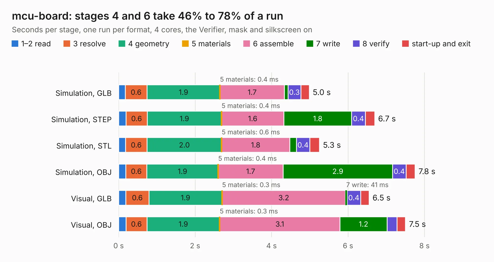

| Mode and format | 1–2 read | 3 resolve | 4 geometry | 5 materials | 6 assemble | 7 write | 8 verify | start-up and exit | Total |
|---|---:|---:|---:|---:|---:|---:|---:|---:|---:|
| Simulation, GLB | 0.2 | 0.6 | 1.9 | 0.4&nbsp;ms | 1.7 | 91&nbsp;ms | 0.3 | 0.2 | 5.0 |
| Simulation, STEP | 0.2 | 0.6 | 1.9 | 0.4&nbsp;ms | 1.6 | 1.8 | 0.4 | 0.2 | 6.7 |
| Simulation, STL | 0.2 | 0.6 | 2.0 | 0.6&nbsp;ms | 1.8 | 0.2 | 0.4 | 0.3 | 5.3 |
| Simulation, OBJ | 0.2 | 0.6 | 1.9 | 0.4&nbsp;ms | 1.7 | 2.9 | 0.4 | 0.2 | 7.8 |
| Visual, GLB | 0.2 | 0.6 | 1.9 | 0.3&nbsp;ms | 3.2 | 41&nbsp;ms | 0.4 | 0.2 | 6.5 |
| Visual, OBJ | 0.2 | 0.6 | 1.9 | 0.3&nbsp;ms | 3.1 | 1.2 | 0.3 | 0.2 | 7.5 |

<table align="center"><tr><td valign="top">

| Board | Repo: [terrapin-rocket-team/srad-avionics](https://github.com/terrapin-rocket-team/srad-avionics) Board: `mcu-board.kicad_pcb` |
|---|---|
| Folder | Spaceport / PCBs / MCU Boards / Teensy MCU Board |
| Complexity | 231&nbsp;/&nbsp;1000 (size&nbsp;146, features&nbsp;85) |
| KESE&nbsp;features | through vias, rounded, trapezoid or chamfered pads, filled zones, curved board outline, stack-up, dielectric εr and tanδ |
| Tested | 9th November 2026 |
| Copper&nbsp;layers | 4 |
| File&nbsp;format | KiCad 8 (20240108) |
| Parts,&nbsp;tracks,&nbsp;vias | 17, 127, 5 |
| Triangles,&nbsp;simulation | 491,834 in 61 parts |
| Verifier | PASS in all six runs |

</td><td valign="top">

<table>
<tr><th>File type</th><th>File size</th><th>Peak memory used</th></tr>
<tr><th colspan="3" align="left">Simulation</th></tr>
<tr><td>GLB</td><td align="right">16&nbsp;MB</td><td align="right">258&nbsp;MB</td></tr>
<tr><td>STEP</td><td align="right">60&nbsp;MB</td><td align="right">292&nbsp;MB</td></tr>
<tr><td>STL</td><td align="right">25&nbsp;MB</td><td align="right">259&nbsp;MB</td></tr>
<tr><td>OBJ</td><td align="right">49&nbsp;MB</td><td align="right">368&nbsp;MB</td></tr>
<tr><th colspan="3" align="left">Visual</th></tr>
<tr><td>GLB</td><td align="right">7.5&nbsp;MB</td><td align="right">277&nbsp;MB</td></tr>
<tr><td>OBJ</td><td align="right">22&nbsp;MB</td><td align="right">282&nbsp;MB</td></tr>
</table>

</td></tr></table>

## 2746. new-pa-test-board

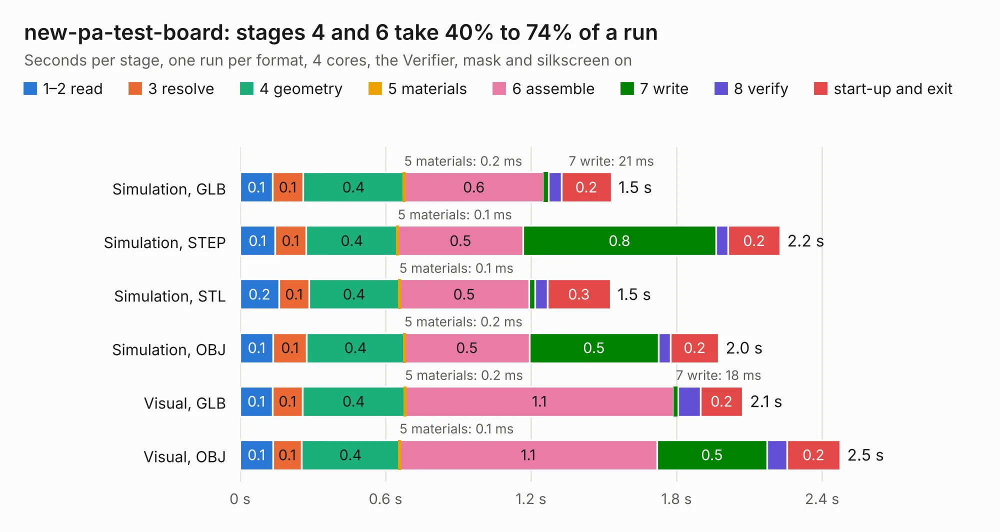

| Mode and format | 1–2 read | 3 resolve | 4 geometry | 5 materials | 6 assemble | 7 write | 8 verify | start-up and exit | Total |
|---|---:|---:|---:|---:|---:|---:|---:|---:|---:|
| Simulation, GLB | 0.1 | 0.1 | 0.4 | 0.2&nbsp;ms | 0.6 | 21&nbsp;ms | 52&nbsp;ms | 0.2 | 1.5 |
| Simulation, STEP | 0.1 | 0.1 | 0.4 | 0.1&nbsp;ms | 0.5 | 0.8 | 51&nbsp;ms | 0.2 | 2.2 |
| Simulation, STL | 0.2 | 0.1 | 0.4 | 0.1&nbsp;ms | 0.5 | 25&nbsp;ms | 51&nbsp;ms | 0.3 | 1.5 |
| Simulation, OBJ | 0.1 | 0.1 | 0.4 | 0.2&nbsp;ms | 0.5 | 0.5 | 50&nbsp;ms | 0.2 | 2.0 |
| Visual, GLB | 0.1 | 0.1 | 0.4 | 0.2&nbsp;ms | 1.1 | 18&nbsp;ms | 92&nbsp;ms | 0.2 | 2.1 |
| Visual, OBJ | 0.1 | 0.1 | 0.4 | 0.1&nbsp;ms | 1.1 | 0.5 | 82&nbsp;ms | 0.2 | 2.5 |

<table align="center"><tr><td valign="top">

| Board | Repo: [terrapin-rocket-team/srad-avionics](https://github.com/terrapin-rocket-team/srad-avionics) Board: `new-pa-test-board.kicad_pcb` |
|---|---|
| Folder | Spaceport / PCBs / new-pa-test-board |
| Complexity | 228&nbsp;/&nbsp;1000 (size&nbsp;118, features&nbsp;110) |
| KESE&nbsp;features | through vias, custom pads, rounded, trapezoid or chamfered pads, filled zones, copper drawings, curved board outline, stack-up, dielectric εr and tanδ |
| Tested | 9th November 2026 |
| Copper&nbsp;layers | 2 |
| File&nbsp;format | KiCad 9 (20241229) |
| Parts,&nbsp;tracks,&nbsp;vias | 15, 27, 16 |
| Triangles,&nbsp;simulation | 113,532 in 21 parts |
| Verifier | PASS in all six runs |

</td><td valign="top">

<table>
<tr><th>File type</th><th>File size</th><th>Peak memory used</th></tr>
<tr><th colspan="3" align="left">Simulation</th></tr>
<tr><td>GLB</td><td align="right">4.0&nbsp;MB</td><td align="right">185&nbsp;MB</td></tr>
<tr><td>STEP</td><td align="right">19&nbsp;MB</td><td align="right">192&nbsp;MB</td></tr>
<tr><td>STL</td><td align="right">5.7&nbsp;MB</td><td align="right">189&nbsp;MB</td></tr>
<tr><td>OBJ</td><td align="right">11&nbsp;MB</td><td align="right">182&nbsp;MB</td></tr>
<tr><th colspan="3" align="left">Visual</th></tr>
<tr><td>GLB</td><td align="right">3.0&nbsp;MB</td><td align="right">158&nbsp;MB</td></tr>
<tr><td>OBJ</td><td align="right">8.3&nbsp;MB</td><td align="right">158&nbsp;MB</td></tr>
</table>

</td></tr></table>

## 2747. pa-test-board

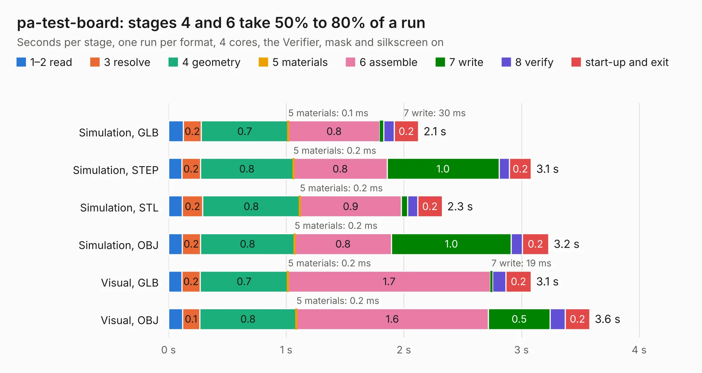

| Mode and format | 1–2 read | 3 resolve | 4 geometry | 5 materials | 6 assemble | 7 write | 8 verify | start-up and exit | Total |
|---|---:|---:|---:|---:|---:|---:|---:|---:|---:|
| Simulation, GLB | 0.1 | 0.2 | 0.7 | 0.1&nbsp;ms | 0.8 | 30&nbsp;ms | 90&nbsp;ms | 0.2 | 2.1 |
| Simulation, STEP | 0.1 | 0.2 | 0.8 | 0.2&nbsp;ms | 0.8 | 1.0 | 88&nbsp;ms | 0.2 | 3.1 |
| Simulation, STL | 0.1 | 0.2 | 0.8 | 0.2&nbsp;ms | 0.9 | 51&nbsp;ms | 88&nbsp;ms | 0.2 | 2.3 |
| Simulation, OBJ | 0.1 | 0.2 | 0.8 | 0.2&nbsp;ms | 0.8 | 1.0 | 94&nbsp;ms | 0.2 | 3.2 |
| Visual, GLB | 0.1 | 0.2 | 0.7 | 0.2&nbsp;ms | 1.7 | 19&nbsp;ms | 0.1 | 0.2 | 3.1 |
| Visual, OBJ | 0.1 | 0.1 | 0.8 | 0.2&nbsp;ms | 1.6 | 0.5 | 0.1 | 0.2 | 3.6 |

<table align="center"><tr><td valign="top">

| Board | Repo: [terrapin-rocket-team/srad-avionics](https://github.com/terrapin-rocket-team/srad-avionics) Board: `pa-test-board.kicad_pcb` |
|---|---|
| Folder | Spaceport / PCBs / pa-test-board |
| Complexity | 212&nbsp;/&nbsp;1000 (size&nbsp;137, features&nbsp;75) |
| KESE&nbsp;features | through vias, rounded, trapezoid or chamfered pads, filled zones, stack-up, dielectric εr and tanδ |
| Tested | 9th November 2026 |
| Copper&nbsp;layers | 2 |
| File&nbsp;format | KiCad 8 (20240108) |
| Parts,&nbsp;tracks,&nbsp;vias | 26, 126, 15 |
| Triangles,&nbsp;simulation | 197,652 in 27 parts |
| Verifier | PASS in all six runs |

</td><td valign="top">

<table>
<tr><th>File type</th><th>File size</th><th>Peak memory used</th></tr>
<tr><th colspan="3" align="left">Simulation</th></tr>
<tr><td>GLB</td><td align="right">7.0&nbsp;MB</td><td align="right">218&nbsp;MB</td></tr>
<tr><td>STEP</td><td align="right">33&nbsp;MB</td><td align="right">228&nbsp;MB</td></tr>
<tr><td>STL</td><td align="right">9.9&nbsp;MB</td><td align="right">212&nbsp;MB</td></tr>
<tr><td>OBJ</td><td align="right">20&nbsp;MB</td><td align="right">213&nbsp;MB</td></tr>
<tr><th colspan="3" align="left">Visual</th></tr>
<tr><td>GLB</td><td align="right">4.6&nbsp;MB</td><td align="right">202&nbsp;MB</td></tr>
<tr><td>OBJ</td><td align="right">13&nbsp;MB</td><td align="right">199&nbsp;MB</td></tr>
</table>

</td></tr></table>

## 2748. power-delivery-board

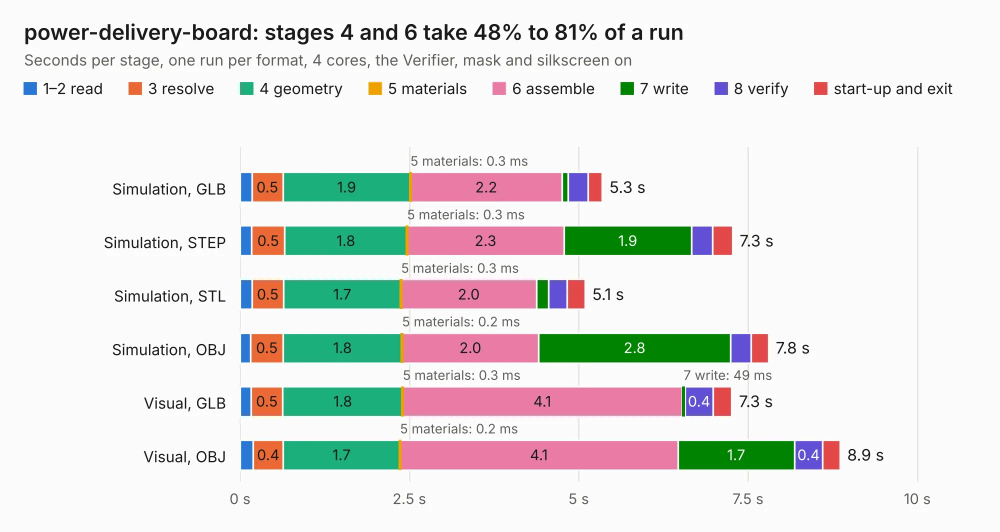

| Mode and format | 1–2 read | 3 resolve | 4 geometry | 5 materials | 6 assemble | 7 write | 8 verify | start-up and exit | Total |
|---|---:|---:|---:|---:|---:|---:|---:|---:|---:|
| Simulation, GLB | 0.2 | 0.5 | 1.9 | 0.3&nbsp;ms | 2.2 | 90&nbsp;ms | 0.3 | 0.2 | 5.3 |
| Simulation, STEP | 0.2 | 0.5 | 1.8 | 0.3&nbsp;ms | 2.3 | 1.9 | 0.3 | 0.3 | 7.3 |
| Simulation, STL | 0.2 | 0.5 | 1.7 | 0.3&nbsp;ms | 2.0 | 0.2 | 0.3 | 0.3 | 5.1 |
| Simulation, OBJ | 0.2 | 0.5 | 1.8 | 0.2&nbsp;ms | 2.0 | 2.8 | 0.3 | 0.3 | 7.8 |
| Visual, GLB | 0.2 | 0.5 | 1.8 | 0.3&nbsp;ms | 4.1 | 49&nbsp;ms | 0.4 | 0.3 | 7.3 |
| Visual, OBJ | 0.2 | 0.4 | 1.7 | 0.2&nbsp;ms | 4.1 | 1.7 | 0.4 | 0.3 | 8.9 |

<table align="center"><tr><td valign="top">

| Board | Repo: [terrapin-rocket-team/srad-avionics](https://github.com/terrapin-rocket-team/srad-avionics) Board: `power-delivery-board.kicad_pcb` |
|---|---|
| Folder | Spaceport / PCBs / power-delivery-board / power-delivery-board |
| Complexity | 273&nbsp;/&nbsp;1000 (size&nbsp;178, features&nbsp;95) |
| KESE&nbsp;features | through vias, slotted holes, rounded, trapezoid or chamfered pads, filled zones, curved board outline, stack-up, dielectric εr and tanδ |
| Tested | 9th November 2026 |
| Copper&nbsp;layers | 4 |
| File&nbsp;format | KiCad 8 (20240108) |
| Parts,&nbsp;tracks,&nbsp;vias | 60, 297, 51 |
| Triangles,&nbsp;simulation | 476,606 in 66 parts |
| Verifier | PASS in all six runs |

</td><td valign="top">

<table>
<tr><th>File type</th><th>File size</th><th>Peak memory used</th></tr>
<tr><th colspan="3" align="left">Simulation</th></tr>
<tr><td>GLB</td><td align="right">16&nbsp;MB</td><td align="right">268&nbsp;MB</td></tr>
<tr><td>STEP</td><td align="right">70&nbsp;MB</td><td align="right">313&nbsp;MB</td></tr>
<tr><td>STL</td><td align="right">24&nbsp;MB</td><td align="right">270&nbsp;MB</td></tr>
<tr><td>OBJ</td><td align="right">48&nbsp;MB</td><td align="right">321&nbsp;MB</td></tr>
<tr><th colspan="3" align="left">Visual</th></tr>
<tr><td>GLB</td><td align="right">9.7&nbsp;MB</td><td align="right">288&nbsp;MB</td></tr>
<tr><td>OBJ</td><td align="right">28&nbsp;MB</td><td align="right">290&nbsp;MB</td></tr>
</table>

</td></tr></table>

## 2749. RF4463F30-test-board

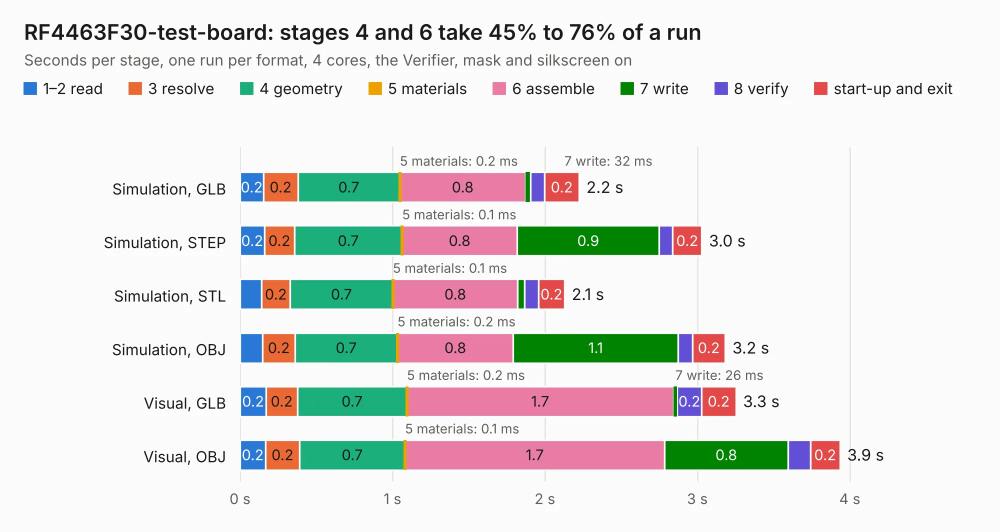

| Mode and format | 1–2 read | 3 resolve | 4 geometry | 5 materials | 6 assemble | 7 write | 8 verify | start-up and exit | Total |
|---|---:|---:|---:|---:|---:|---:|---:|---:|---:|
| Simulation, GLB | 0.2 | 0.2 | 0.7 | 0.2&nbsp;ms | 0.8 | 32&nbsp;ms | 91&nbsp;ms | 0.2 | 2.2 |
| Simulation, STEP | 0.2 | 0.2 | 0.7 | 0.1&nbsp;ms | 0.8 | 0.9 | 88&nbsp;ms | 0.2 | 3.0 |
| Simulation, STL | 0.1 | 0.2 | 0.7 | 0.1&nbsp;ms | 0.8 | 43&nbsp;ms | 92&nbsp;ms | 0.2 | 2.1 |
| Simulation, OBJ | 0.1 | 0.2 | 0.7 | 0.2&nbsp;ms | 0.8 | 1.1 | 94&nbsp;ms | 0.2 | 3.2 |
| Visual, GLB | 0.2 | 0.2 | 0.7 | 0.2&nbsp;ms | 1.7 | 26&nbsp;ms | 0.2 | 0.2 | 3.3 |
| Visual, OBJ | 0.2 | 0.2 | 0.7 | 0.1&nbsp;ms | 1.7 | 0.8 | 0.1 | 0.2 | 3.9 |

<table align="center"><tr><td valign="top">

| Board | Repo: [terrapin-rocket-team/srad-avionics](https://github.com/terrapin-rocket-team/srad-avionics) Board: `RF4463F30-test-board.kicad_pcb` |
|---|---|
| Folder | Spaceport / PCBs / RF4463F30-test-board |
| Complexity | 211&nbsp;/&nbsp;1000 (size&nbsp;126, features&nbsp;85) |
| KESE&nbsp;features | through vias, rounded, trapezoid or chamfered pads, filled zones, curved board outline, stack-up, dielectric εr and tanδ |
| Tested | 9th November 2026 |
| Copper&nbsp;layers | 2 |
| File&nbsp;format | KiCad 8 (20240108) |
| Parts,&nbsp;tracks,&nbsp;vias | 14, 85, 16 |
| Triangles,&nbsp;simulation | 189,326 in 32 parts |
| Verifier | PASS in all six runs |

</td><td valign="top">

<table>
<tr><th>File type</th><th>File size</th><th>Peak memory used</th></tr>
<tr><th colspan="3" align="left">Simulation</th></tr>
<tr><td>GLB</td><td align="right">6.6&nbsp;MB</td><td align="right">208&nbsp;MB</td></tr>
<tr><td>STEP</td><td align="right">32&nbsp;MB</td><td align="right">230&nbsp;MB</td></tr>
<tr><td>STL</td><td align="right">9.5&nbsp;MB</td><td align="right">206&nbsp;MB</td></tr>
<tr><td>OBJ</td><td align="right">19&nbsp;MB</td><td align="right">215&nbsp;MB</td></tr>
<tr><th colspan="3" align="left">Visual</th></tr>
<tr><td>GLB</td><td align="right">5.7&nbsp;MB</td><td align="right">216&nbsp;MB</td></tr>
<tr><td>OBJ</td><td align="right">16&nbsp;MB</td><td align="right">214&nbsp;MB</td></tr>
</table>

</td></tr></table>

## 2750. Screw Switch

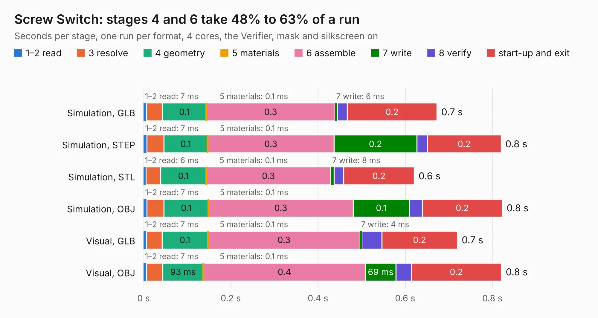

| Mode and format | 1–2 read | 3 resolve | 4 geometry | 5 materials | 6 assemble | 7 write | 8 verify | start-up and exit | Total |
|---|---:|---:|---:|---:|---:|---:|---:|---:|---:|
| Simulation, GLB | 7&nbsp;ms | 37&nbsp;ms | 0.1 | 0.1&nbsp;ms | 0.3 | 6&nbsp;ms | 22&nbsp;ms | 0.2 | 0.7 |
| Simulation, STEP | 7&nbsp;ms | 39&nbsp;ms | 0.1 | 0.1&nbsp;ms | 0.3 | 0.2 | 24&nbsp;ms | 0.2 | 0.8 |
| Simulation, STL | 6&nbsp;ms | 33&nbsp;ms | 0.1 | 0.1&nbsp;ms | 0.3 | 8&nbsp;ms | 22&nbsp;ms | 0.2 | 0.6 |
| Simulation, OBJ | 7&nbsp;ms | 40&nbsp;ms | 0.1 | 0.1&nbsp;ms | 0.3 | 0.1 | 29&nbsp;ms | 0.2 | 0.8 |
| Visual, GLB | 7&nbsp;ms | 35&nbsp;ms | 0.1 | 0.1&nbsp;ms | 0.3 | 4&nbsp;ms | 45&nbsp;ms | 0.2 | 0.7 |
| Visual, OBJ | 7&nbsp;ms | 37&nbsp;ms | 93&nbsp;ms | 0.1&nbsp;ms | 0.4 | 69&nbsp;ms | 36&nbsp;ms | 0.2 | 0.8 |

<table align="center"><tr><td valign="top">

| Board | Repo: [terrapin-rocket-team/srad-avionics](https://github.com/terrapin-rocket-team/srad-avionics) Board: `Screw Switch.kicad_pcb` |
|---|---|
| Folder | Spaceport / PCBs / Screw Switch |
| Complexity | 90&nbsp;/&nbsp;1000 (size&nbsp;70, features&nbsp;20) |
| KESE&nbsp;features | copper drawings, curved board outline |
| Tested | 9th November 2026 |
| Copper&nbsp;layers | 2 |
| File&nbsp;format | KiCad 9 (20241229) |
| Parts,&nbsp;tracks,&nbsp;vias | 4, 8, 0 |
| Triangles,&nbsp;simulation | 33,832 in 12 parts |
| Verifier | PASS in all six runs |

</td><td valign="top">

<table>
<tr><th>File type</th><th>File size</th><th>Peak memory used</th></tr>
<tr><th colspan="3" align="left">Simulation</th></tr>
<tr><td>GLB</td><td align="right">1.2&nbsp;MB</td><td align="right">44&nbsp;MB</td></tr>
<tr><td>STEP</td><td align="right">5.3&nbsp;MB</td><td align="right">47&nbsp;MB</td></tr>
<tr><td>STL</td><td align="right">1.7&nbsp;MB</td><td align="right">45&nbsp;MB</td></tr>
<tr><td>OBJ</td><td align="right">3.1&nbsp;MB</td><td align="right">51&nbsp;MB</td></tr>
<tr><th colspan="3" align="left">Visual</th></tr>
<tr><td>GLB</td><td align="right">597&nbsp;kB</td><td align="right">64&nbsp;MB</td></tr>
<tr><td>OBJ</td><td align="right">1.6&nbsp;MB</td><td align="right">58&nbsp;MB</td></tr>
</table>

</td></tr></table>

## 2751. high-range-IMU

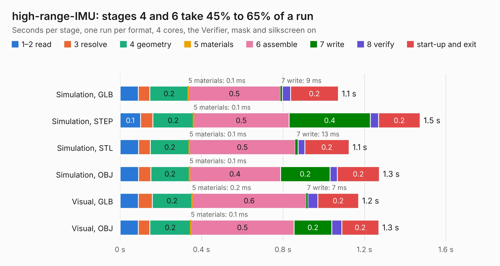

| Mode and format | 1–2 read | 3 resolve | 4 geometry | 5 materials | 6 assemble | 7 write | 8 verify | start-up and exit | Total |
|---|---:|---:|---:|---:|---:|---:|---:|---:|---:|
| Simulation, GLB | 90&nbsp;ms | 57&nbsp;ms | 0.2 | 0.1&nbsp;ms | 0.5 | 9&nbsp;ms | 41&nbsp;ms | 0.2 | 1.1 |
| Simulation, STEP | 0.1 | 61&nbsp;ms | 0.2 | 0.1&nbsp;ms | 0.5 | 0.4 | 39&nbsp;ms | 0.2 | 1.5 |
| Simulation, STL | 91&nbsp;ms | 58&nbsp;ms | 0.2 | 0.1&nbsp;ms | 0.5 | 13&nbsp;ms | 33&nbsp;ms | 0.2 | 1.1 |
| Simulation, OBJ | 91&nbsp;ms | 60&nbsp;ms | 0.2 | 0.1&nbsp;ms | 0.4 | 0.2 | 36&nbsp;ms | 0.2 | 1.3 |
| Visual, GLB | 89&nbsp;ms | 68&nbsp;ms | 0.2 | 0.2&nbsp;ms | 0.6 | 7&nbsp;ms | 49&nbsp;ms | 0.2 | 1.2 |
| Visual, OBJ | 89&nbsp;ms | 57&nbsp;ms | 0.2 | 0.1&nbsp;ms | 0.5 | 0.2 | 49&nbsp;ms | 0.2 | 1.3 |

<table align="center"><tr><td valign="top">

| Board | Repo: [terrapin-rocket-team/srad-avionics](https://github.com/terrapin-rocket-team/srad-avionics) Board: `high-range-IMU.kicad_pcb` |
|---|---|
| Folder | Spaceport / PCBs / Sensor Boards / high-range-IMU |
| Complexity | 156&nbsp;/&nbsp;1000 (size&nbsp;101, features&nbsp;55) |
| KESE&nbsp;features | through vias, rounded, trapezoid or chamfered pads, filled zones, curved board outline |
| Tested | 9th November 2026 |
| Copper&nbsp;layers | 2 |
| File&nbsp;format | KiCad 9 (20241229) |
| Parts,&nbsp;tracks,&nbsp;vias | 5, 44, 2 |
| Triangles,&nbsp;simulation | 45,474 in 19 parts |
| Verifier | PASS in all six runs |

</td><td valign="top">

<table>
<tr><th>File type</th><th>File size</th><th>Peak memory used</th></tr>
<tr><th colspan="3" align="left">Simulation</th></tr>
<tr><td>GLB</td><td align="right">1.6&nbsp;MB</td><td align="right">68&nbsp;MB</td></tr>
<tr><td>STEP</td><td align="right">7.1&nbsp;MB</td><td align="right">72&nbsp;MB</td></tr>
<tr><td>STL</td><td align="right">2.3&nbsp;MB</td><td align="right">69&nbsp;MB</td></tr>
<tr><td>OBJ</td><td align="right">4.4&nbsp;MB</td><td align="right">78&nbsp;MB</td></tr>
<tr><th colspan="3" align="left">Visual</th></tr>
<tr><td>GLB</td><td align="right">1.2&nbsp;MB</td><td align="right">102&nbsp;MB</td></tr>
<tr><td>OBJ</td><td align="right">3.4&nbsp;MB</td><td align="right">96&nbsp;MB</td></tr>
</table>

</td></tr></table>

## 2752. PatchAntennaBreakout

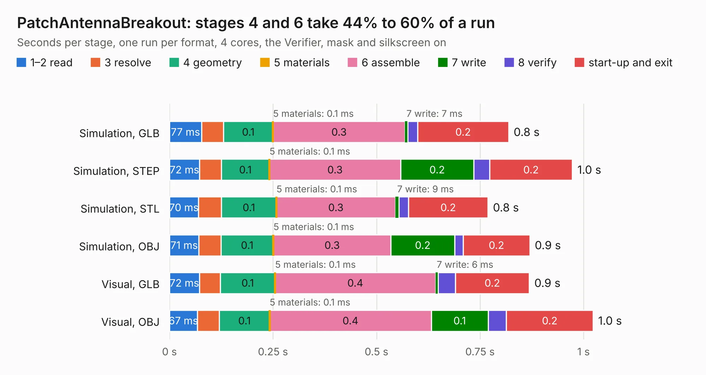

| Mode and format | 1–2 read | 3 resolve | 4 geometry | 5 materials | 6 assemble | 7 write | 8 verify | start-up and exit | Total |
|---|---:|---:|---:|---:|---:|---:|---:|---:|---:|
| Simulation, GLB | 77&nbsp;ms | 53&nbsp;ms | 0.1 | 0.1&nbsp;ms | 0.3 | 7&nbsp;ms | 24&nbsp;ms | 0.2 | 0.8 |
| Simulation, STEP | 72&nbsp;ms | 53&nbsp;ms | 0.1 | 0.1&nbsp;ms | 0.3 | 0.2 | 39&nbsp;ms | 0.2 | 1.0 |
| Simulation, STL | 70&nbsp;ms | 56&nbsp;ms | 0.1 | 0.1&nbsp;ms | 0.3 | 9&nbsp;ms | 23&nbsp;ms | 0.2 | 0.8 |
| Simulation, OBJ | 71&nbsp;ms | 54&nbsp;ms | 0.1 | 0.1&nbsp;ms | 0.3 | 0.2 | 21&nbsp;ms | 0.2 | 0.9 |
| Visual, GLB | 72&nbsp;ms | 51&nbsp;ms | 0.1 | 0.1&nbsp;ms | 0.4 | 6&nbsp;ms | 42&nbsp;ms | 0.2 | 0.9 |
| Visual, OBJ | 67&nbsp;ms | 53&nbsp;ms | 0.1 | 0.1&nbsp;ms | 0.4 | 0.1 | 44&nbsp;ms | 0.2 | 1.0 |

<table align="center"><tr><td valign="top">

| Board | Repo: [terrapin-rocket-team/srad-avionics](https://github.com/terrapin-rocket-team/srad-avionics) Board: `PatchAntennaBreakout.kicad_pcb` |
|---|---|
| Folder | Spaceport / PCBs / Sensor Boards / PatchAntennaBreakout |
| Complexity | 170&nbsp;/&nbsp;1000 (size&nbsp;95, features&nbsp;75) |
| KESE&nbsp;features | through vias, filled zones, curved board outline, stack-up, dielectric εr and tanδ |
| Tested | 9th November 2026 |
| Copper&nbsp;layers | 2 |
| File&nbsp;format | KiCad 8 (20240108) |
| Parts,&nbsp;tracks,&nbsp;vias | 2, 1, 19 |
| Triangles,&nbsp;simulation | 40,898 in 10 parts |
| Verifier | PASS in all six runs |

</td><td valign="top">

<table>
<tr><th>File type</th><th>File size</th><th>Peak memory used</th></tr>
<tr><th colspan="3" align="left">Simulation</th></tr>
<tr><td>GLB</td><td align="right">1.4&nbsp;MB</td><td align="right">69&nbsp;MB</td></tr>
<tr><td>STEP</td><td align="right">4.6&nbsp;MB</td><td align="right">73&nbsp;MB</td></tr>
<tr><td>STL</td><td align="right">2.0&nbsp;MB</td><td align="right">70&nbsp;MB</td></tr>
<tr><td>OBJ</td><td align="right">3.9&nbsp;MB</td><td align="right">80&nbsp;MB</td></tr>
<tr><th colspan="3" align="left">Visual</th></tr>
<tr><td>GLB</td><td align="right">1.2&nbsp;MB</td><td align="right">92&nbsp;MB</td></tr>
<tr><td>OBJ</td><td align="right">3.3&nbsp;MB</td><td align="right">103&nbsp;MB</td></tr>
</table>

</td></tr></table>

## 2753. SensorBoardNoMCU

| Mode and format | 1–2 read | 3 resolve | 4 geometry | 5 materials | 6 assemble | 7 write | 8 verify | start-up and exit | Total |
|---|---:|---:|---:|---:|---:|---:|---:|---:|---:|
| Simulation, GLB | 0.1 | 0.2 | 0.4 | 0.2&nbsp;ms | 0.6 | 24&nbsp;ms | 79&nbsp;ms | 0.2 | 1.7 |
| Simulation, STEP | 0.1 | 0.2 | 0.5 | 0.1&nbsp;ms | 0.6 | 0.8 | 88&nbsp;ms | 0.2 | 2.5 |
| Simulation, STL | 0.1 | 0.2 | 0.5 | 0.1&nbsp;ms | 0.6 | 38&nbsp;ms | 76&nbsp;ms | 0.2 | 1.7 |
| Simulation, OBJ | 0.1 | 0.2 | 0.5 | 0.1&nbsp;ms | 0.6 | 0.7 | 93&nbsp;ms | 0.2 | 2.3 |
| Visual, GLB | 0.1 | 0.2 | 0.4 | 0.1&nbsp;ms | 1.2 | 16&nbsp;ms | 0.1 | 0.2 | 2.3 |
| Visual, OBJ | 0.1 | 0.2 | 0.5 | 0.2&nbsp;ms | 1.3 | 0.5 | 0.1 | 0.2 | 2.8 |

<table align="center"><tr><td valign="top">

| Board | Repo: [terrapin-rocket-team/srad-avionics](https://github.com/terrapin-rocket-team/srad-avionics) Board: `SensorBoardNoMCU.kicad_pcb` |
|---|---|
| Folder | Spaceport / PCBs / Sensor Boards / SensorBoardAirbrake |
| Complexity | 255&nbsp;/&nbsp;1000 (size&nbsp;140, features&nbsp;115) |
| KESE&nbsp;features | through vias, rounded, trapezoid or chamfered pads, filled zones, curved board outline, knockout text, TrueType text, stack-up, dielectric εr and tanδ |
| Tested | 9th November 2026 |
| Copper&nbsp;layers | 4 |
| File&nbsp;format | KiCad 10 (20260206) |
| Parts,&nbsp;tracks,&nbsp;vias | 12, 92, 11 |
| Triangles,&nbsp;simulation | 138,354 in 23 parts |
| Verifier | PASS in all six runs |

</td><td valign="top">

<table>
<tr><th>File type</th><th>File size</th><th>Peak memory used</th></tr>
<tr><th colspan="3" align="left">Simulation</th></tr>
<tr><td>GLB</td><td align="right">4.9&nbsp;MB</td><td align="right">205&nbsp;MB</td></tr>
<tr><td>STEP</td><td align="right">22&nbsp;MB</td><td align="right">213&nbsp;MB</td></tr>
<tr><td>STL</td><td align="right">6.9&nbsp;MB</td><td align="right">203&nbsp;MB</td></tr>
<tr><td>OBJ</td><td align="right">14&nbsp;MB</td><td align="right">206&nbsp;MB</td></tr>
<tr><th colspan="3" align="left">Visual</th></tr>
<tr><td>GLB</td><td align="right">3.5&nbsp;MB</td><td align="right">166&nbsp;MB</td></tr>
<tr><td>OBJ</td><td align="right">9.9&nbsp;MB</td><td align="right">164&nbsp;MB</td></tr>
</table>

</td></tr></table>

## 2754. SensorBoardNoMCU

| Mode and format | 1–2 read | 3 resolve | 4 geometry | 5 materials | 6 assemble | 7 write | 8 verify | start-up and exit | Total |
|---|---:|---:|---:|---:|---:|---:|---:|---:|---:|
| Simulation, GLB | 0.2 | 0.2 | 0.7 | 0.1&nbsp;ms | 0.9 | 31&nbsp;ms | 88&nbsp;ms | 0.2 | 2.3 |
| Simulation, STEP | 0.2 | 0.2 | 0.6 | 0.2&nbsp;ms | 0.9 | 1.0 | 93&nbsp;ms | 0.3 | 3.2 |
| Simulation, STL | 0.2 | 0.2 | 0.6 | 0.2&nbsp;ms | 0.9 | 50&nbsp;ms | 96&nbsp;ms | 0.2 | 2.3 |
| Simulation, OBJ | 0.2 | 0.2 | 0.6 | 0.3&nbsp;ms | 0.9 | 1.0 | 0.1 | 0.2 | 3.2 |
| Visual, GLB | 0.2 | 0.2 | 0.7 | 0.2&nbsp;ms | 1.7 | 27&nbsp;ms | 0.2 | 0.2 | 3.2 |
| Visual, OBJ | 0.2 | 0.2 | 0.6 | 0.2&nbsp;ms | 1.8 | 0.7 | 0.2 | 0.2 | 3.8 |

<table align="center"><tr><td valign="top">

| Board | Repo: [terrapin-rocket-team/srad-avionics](https://github.com/terrapin-rocket-team/srad-avionics) Board: `SensorBoardNoMCU.kicad_pcb` |
|---|---|
| Folder | Spaceport / PCBs / Sensor Boards / SensorBoardPatch |
| Complexity | 260&nbsp;/&nbsp;1000 (size&nbsp;145, features&nbsp;115) |
| KESE&nbsp;features | through vias, rounded, trapezoid or chamfered pads, filled zones, curved board outline, knockout text, TrueType text, stack-up, dielectric εr and tanδ |
| Tested | 9th November 2026 |
| Copper&nbsp;layers | 2 |
| File&nbsp;format | KiCad 8 (20240108) |
| Parts,&nbsp;tracks,&nbsp;vias | 23, 227, 25 |
| Triangles,&nbsp;simulation | 201,870 in 37 parts |
| Verifier | PASS in all six runs |

</td><td valign="top">

<table>
<tr><th>File type</th><th>File size</th><th>Peak memory used</th></tr>
<tr><th colspan="3" align="left">Simulation</th></tr>
<tr><td>GLB</td><td align="right">7.1&nbsp;MB</td><td align="right">231&nbsp;MB</td></tr>
<tr><td>STEP</td><td align="right">36&nbsp;MB</td><td align="right">245&nbsp;MB</td></tr>
<tr><td>STL</td><td align="right">10&nbsp;MB</td><td align="right">229&nbsp;MB</td></tr>
<tr><td>OBJ</td><td align="right">20&nbsp;MB</td><td align="right">232&nbsp;MB</td></tr>
<tr><th colspan="3" align="left">Visual</th></tr>
<tr><td>GLB</td><td align="right">6.3&nbsp;MB</td><td align="right">227&nbsp;MB</td></tr>
<tr><td>OBJ</td><td align="right">18&nbsp;MB</td><td align="right">225&nbsp;MB</td></tr>
</table>

</td></tr></table>

## 2755. SensorBoard

| Mode and format | 1–2 read | 3 resolve | 4 geometry | 5 materials | 6 assemble | 7 write | 8 verify | start-up and exit | Total |
|---|---:|---:|---:|---:|---:|---:|---:|---:|---:|
| Simulation, GLB | 0.5 | 1.0 | 3.1 | 0.4&nbsp;ms | 2.4 | 92&nbsp;ms | 0.4 | 0.3 | 7.8 |
| Simulation, STEP | 0.3 | 0.7 | 2.1 | 0.3&nbsp;ms | 2.3 | 2.1 | 0.3 | 0.3 | 8.2 |
| Simulation, STL | 0.3 | 0.6 | 2.1 | 0.5&nbsp;ms | 2.3 | 0.2 | 0.4 | 0.3 | 6.2 |
| Simulation, OBJ | 0.3 | 0.7 | 2.2 | 0.3&nbsp;ms | 2.3 | 3.8 | 0.3 | 0.2 | 9.8 |
| Visual, GLB | 0.3 | 0.7 | 2.2 | 0.4&nbsp;ms | 4.8 | 75&nbsp;ms | 0.5 | 0.3 | 8.9 |
| Visual, OBJ | 0.3 | 0.7 | 2.1 | 0.3&nbsp;ms | 5.0 | 2.4 | 0.7 | 0.3 | 11.4 |

<table align="center"><tr><td valign="top">

| Board | Repo: [terrapin-rocket-team/srad-avionics](https://github.com/terrapin-rocket-team/srad-avionics) Board: `SensorBoard.kicad_pcb` |
|---|---|
| Folder | Spaceport / PCBs / Sensor Boards / SensorBoardSTM32 |
| Complexity | 306&nbsp;/&nbsp;1000 (size&nbsp;221, features&nbsp;85) |
| KESE&nbsp;features | through vias, rounded, trapezoid or chamfered pads, filled zones, curved board outline, stack-up, dielectric εr and tanδ |
| Tested | 9th November 2026 |
| Copper&nbsp;layers | 4 |
| File&nbsp;format | KiCad 8 (20240108) |
| Parts,&nbsp;tracks,&nbsp;vias | 47, 460, 58 |
| Triangles,&nbsp;simulation | 654,322 in 80 parts |
| Verifier | PASS in all six runs |

</td><td valign="top">

<table>
<tr><th>File type</th><th>File size</th><th>Peak memory used</th></tr>
<tr><th colspan="3" align="left">Simulation</th></tr>
<tr><td>GLB</td><td align="right">22&nbsp;MB</td><td align="right">331&nbsp;MB</td></tr>
<tr><td>STEP</td><td align="right">92&nbsp;MB</td><td align="right">409&nbsp;MB</td></tr>
<tr><td>STL</td><td align="right">33&nbsp;MB</td><td align="right">335&nbsp;MB</td></tr>
<tr><td>OBJ</td><td align="right">66&nbsp;MB</td><td align="right">492&nbsp;MB</td></tr>
<tr><th colspan="3" align="left">Visual</th></tr>
<tr><td>GLB</td><td align="right">16&nbsp;MB</td><td align="right">472&nbsp;MB</td></tr>
<tr><td>OBJ</td><td align="right">48&nbsp;MB</td><td align="right">413&nbsp;MB</td></tr>
</table>

</td></tr></table>

## 2756. Unified_Board

| Mode and format | 1–2 read | 3 resolve | 4 geometry | 5 materials | 6 assemble | 7 write | 8 verify | start-up and exit | Total |
|---|---:|---:|---:|---:|---:|---:|---:|---:|---:|
| Simulation, GLB | 0.3 | 0.9 | 3.1 | 0.5&nbsp;ms | 2.3 | 0.1 | 0.5 | 0.2 | 7.4 |
| Simulation, STEP | 0.3 | 0.9 | 3.6 | 0.6&nbsp;ms | 2.6 | 2.1 | 0.4 | 0.2 | 10.0 |
| Simulation, STL | 0.3 | 0.9 | 3.1 | 0.5&nbsp;ms | 2.4 | 0.2 | 0.4 | 0.2 | 7.4 |
| Simulation, OBJ | 0.3 | 1.0 | 3.2 | 0.7&nbsp;ms | 2.4 | 4.4 | 0.4 | 0.2 | 11.9 |
| Visual, GLB | 0.3 | 0.9 | 3.1 | 0.4&nbsp;ms | 5.6 | 80&nbsp;ms | 0.5 | 0.2 | 10.7 |
| Visual, OBJ | 0.3 | 0.9 | 3.0 | 0.4&nbsp;ms | 5.6 | 2.6 | 0.7 | 0.3 | 13.3 |

<table align="center"><tr><td valign="top">

| Board | Repo: [terrapin-rocket-team/srad-avionics](https://github.com/terrapin-rocket-team/srad-avionics) Board: `Unified_Board.kicad_pcb` |
|---|---|
| Folder | Spaceport / PCBs / Unified Board / Unified_Board |
| Complexity | 300&nbsp;/&nbsp;1000 (size&nbsp;225, features&nbsp;75) |
| KESE&nbsp;features | through vias, rounded, trapezoid or chamfered pads, filled zones, stack-up, dielectric εr and tanδ |
| Tested | 10th November 2026 |
| Copper&nbsp;layers | 4 |
| File&nbsp;format | KiCad 7 (20221018) |
| Parts,&nbsp;tracks,&nbsp;vias | 47, 409, 26 |
| Triangles,&nbsp;simulation | 865,554 in 102 parts |
| Verifier | PASS in all six runs |

</td><td valign="top">

<table>
<tr><th>File type</th><th>File size</th><th>Peak memory used</th></tr>
<tr><th colspan="3" align="left">Simulation</th></tr>
<tr><td>GLB</td><td align="right">29&nbsp;MB</td><td align="right">393&nbsp;MB</td></tr>
<tr><td>STEP</td><td align="right">114&nbsp;MB</td><td align="right">464&nbsp;MB</td></tr>
<tr><td>STL</td><td align="right">43&nbsp;MB</td><td align="right">397&nbsp;MB</td></tr>
<tr><td>OBJ</td><td align="right">88&nbsp;MB</td><td align="right">614&nbsp;MB</td></tr>
<tr><th colspan="3" align="left">Visual</th></tr>
<tr><td>GLB</td><td align="right">18&nbsp;MB</td><td align="right">535&nbsp;MB</td></tr>
<tr><td>OBJ</td><td align="right">55&nbsp;MB</td><td align="right">507&nbsp;MB</td></tr>
</table>

</td></tr></table>

## 2757. CM4_MATX

| Mode and format | 1–2 read | 3 resolve | 4 geometry | 5 materials | 6 assemble | 7 write | 8 verify | start-up and exit | Total |
|---|---:|---:|---:|---:|---:|---:|---:|---:|---:|
| Simulation, GLB | 0.7 | 5.1 | 19.6 | 2&nbsp;ms | 17.0 | 0.9 | 2.0 | 0.3 | 45.6 |
| Simulation, STEP | 0.8 | 4.9 | 18.0 | 2&nbsp;ms | 16.9 | 11.4 | 2.0 | 0.3 | 54.2 |
| Simulation, STL | 0.7 | 4.8 | 18.4 | 2&nbsp;ms | 17.8 | 1.6 | 2.1 | 0.3 | 45.7 |
| Simulation, OBJ | 0.8 | 4.8 | 18.2 | 2&nbsp;ms | 17.9 | 32.9 | 2.2 | 0.3 | 77.1 |
| Visual, GLB | 0.7 | 4.8 | 17.9 | 2&nbsp;ms | 33.5 | 0.4 | 3.4 | 0.2 | 61.0 |
| Visual, OBJ | 0.8 | 4.8 | 17.9 | 2&nbsp;ms | 32.3 | 13.2 | 3.2 | 0.3 | 72.3 |

<table align="center"><tr><td valign="top">

| Board | Repo: [TheGuyDanish/CM4_MATX](https://github.com/TheGuyDanish/CM4_MATX) Board: `CM4_MATX.kicad_pcb` |
|---|---|
| Folder | KiCad |
| Complexity | 178&nbsp;/&nbsp;1000 (size&nbsp;138, features&nbsp;40) |
| KESE&nbsp;features | rounded, trapezoid or chamfered pads, filled zones, curved board outline |
| Tested | 9th November 2026 |
| Copper&nbsp;layers | 4 |
| File&nbsp;format | KiCad 5 (20171130) |
| Parts,&nbsp;tracks,&nbsp;vias | 207, 0, 0 |
| Triangles,&nbsp;simulation | 5,118,422 in 613 parts |
| Note | mostly unrouted |
| Verifier | PASS in all six runs |

</td><td valign="top">

<table>
<tr><th>File type</th><th>File size</th><th>Peak memory used</th></tr>
<tr><th colspan="3" align="left">Simulation</th></tr>
<tr><td>GLB</td><td align="right">169&nbsp;MB</td><td align="right">1.4&nbsp;GB</td></tr>
<tr><td>STEP</td><td align="right">517&nbsp;MB</td><td align="right">1.7&nbsp;GB</td></tr>
<tr><td>STL</td><td align="right">256&nbsp;MB</td><td align="right">1.3&nbsp;GB</td></tr>
<tr><td>OBJ</td><td align="right">550&nbsp;MB</td><td align="right">3.3&nbsp;GB</td></tr>
<tr><th colspan="3" align="left">Visual</th></tr>
<tr><td>GLB</td><td align="right">86&nbsp;MB</td><td align="right">1.5&nbsp;GB</td></tr>
<tr><td>OBJ</td><td align="right">272&nbsp;MB</td><td align="right">1.8&nbsp;GB</td></tr>
</table>

</td></tr></table>

## 2758. cpu030

| Mode and format | 1–2 read | 3 resolve | 4 geometry | 5 materials | 6 assemble | 7 write | 8 verify | start-up and exit | Total |
|---|---:|---:|---:|---:|---:|---:|---:|---:|---:|
| Simulation, GLB | 4.2 | 18.8 | 61.0 | 3&nbsp;ms | 61.8 | 4.4 | 10.7 | 0.6 | 161.4 |
| Simulation, STEP | 4.1 | 18.7 | 61.9 | 3&nbsp;ms | 62.1 | 44.1 | 10.6 | 0.6 | 202.2 |
| Simulation, STL | 4.1 | 19.0 | 64.2 | 2&nbsp;ms | 63.1 | 9.3 | 10.0 | 0.5 | 170.4 |
| Simulation, OBJ | 4.3 | 19.5 | 63.7 | 5&nbsp;ms | 63.9 | 135.9 | 10.5 | 0.7 | 298.6 |
| Visual, GLB | 4.3 | 19.2 | 63.5 | 2&nbsp;ms | 151.6 | 1.6 | 16.4 | 0.5 | 257.1 |
| Visual, OBJ | 4.0 | 18.7 | 63.9 | 4&nbsp;ms | 152.8 | 61.8 | 15.9 | 0.5 | 317.6 |

<table align="center"><tr><td valign="top">

| Board | Repo: [thorpej/pg68k](https://github.com/thorpej/pg68k) Board: `cpu030.kicad_pcb` |
|---|---|
| Folder | cpu030 / design-files |
| Complexity | 403&nbsp;/&nbsp;1000 (size&nbsp;313, features&nbsp;90) |
| KESE&nbsp;features | through vias, rounded, trapezoid or chamfered pads, filled zones, TrueType text, stack-up, dielectric εr and tanδ |
| Tested | 9th November 2026 to 10th November 2026 |
| Copper&nbsp;layers | 6 |
| File&nbsp;format | KiCad 9 (20241229) |
| Parts,&nbsp;tracks,&nbsp;vias | 227, 9,174, 1,472 |
| Triangles,&nbsp;simulation | 18,435,500 in 555 parts |
| Verifier | PASS in all six runs |
| Run&nbsp;again | Simulation, OBJ: failed in the corpus run, run again with the memory cap raised from 11 GB to 14.5 GB, and passed |

</td><td valign="top">

<table>
<tr><th>File type</th><th>File size</th><th>Peak memory used</th></tr>
<tr><th colspan="3" align="left">Simulation</th></tr>
<tr><td>GLB</td><td align="right">616&nbsp;MB</td><td align="right">4.0&nbsp;GB</td></tr>
<tr><td>STEP</td><td align="right">2.1&nbsp;GB</td><td align="right">5.3&nbsp;GB</td></tr>
<tr><td>STL</td><td align="right">922&nbsp;MB</td><td align="right">3.8&nbsp;GB</td></tr>
<tr><td>OBJ</td><td align="right">2.0&nbsp;GB</td><td align="right">12&nbsp;GB</td></tr>
<tr><th colspan="3" align="left">Visual</th></tr>
<tr><td>GLB</td><td align="right">304&nbsp;MB</td><td align="right">5.0&nbsp;GB</td></tr>
<tr><td>OBJ</td><td align="right">994&nbsp;MB</td><td align="right">6.5&nbsp;GB</td></tr>
</table>

</td></tr></table>

## 2759. nqvme_template

| Mode and format | 1–2 read | 3 resolve | 4 geometry | 5 materials | 6 assemble | 7 write | 8 verify | start-up and exit | Total |
|---|---:|---:|---:|---:|---:|---:|---:|---:|---:|
| Simulation, GLB | 0.1 | 0.8 | 2.7 | 0.6&nbsp;ms | 2.4 | 0.1 | 0.5 | 0.3 | 6.8 |
| Simulation, STEP | 0.1 | 0.7 | 2.9 | 0.9&nbsp;ms | 2.3 | 2.0 | 0.5 | 0.3 | 8.8 |
| Simulation, STL | 0.1 | 0.8 | 2.8 | 0.9&nbsp;ms | 2.4 | 0.2 | 0.5 | 0.2 | 7.1 |
| Simulation, OBJ | 0.1 | 0.7 | 2.7 | 0.6&nbsp;ms | 2.3 | 3.8 | 0.4 | 0.2 | 10.2 |
| Visual, GLB | 0.1 | 0.8 | 2.7 | 0.6&nbsp;ms | 5.1 | 56&nbsp;ms | 0.7 | 0.2 | 9.7 |
| Visual, OBJ | 0.1 | 0.9 | 2.8 | 0.6&nbsp;ms | 4.9 | 1.7 | 0.8 | 0.3 | 11.4 |

<table align="center"><tr><td valign="top">

| Board | Repo: [thorpej/pg68k](https://github.com/thorpej/pg68k) Board: `nqvme_template.kicad_pcb` |
|---|---|
| Folder | nqvme_template / design-files |
| Complexity | 98&nbsp;/&nbsp;1000 (size&nbsp;58, features&nbsp;40) |
| KESE&nbsp;features | rounded, trapezoid or chamfered pads, stack-up, dielectric εr and tanδ |
| Tested | 9th November 2026 |
| Copper&nbsp;layers | 4 |
| File&nbsp;format | KiCad 9 (20241229) |
| Parts,&nbsp;tracks,&nbsp;vias | 9, 0, 0 |
| Triangles,&nbsp;simulation | 790,980 in 115 parts |
| Verifier | PASS in all six runs |

</td><td valign="top">

<table>
<tr><th>File type</th><th>File size</th><th>Peak memory used</th></tr>
<tr><th colspan="3" align="left">Simulation</th></tr>
<tr><td>GLB</td><td align="right">25&nbsp;MB</td><td align="right">327&nbsp;MB</td></tr>
<tr><td>STEP</td><td align="right">68&nbsp;MB</td><td align="right">390&nbsp;MB</td></tr>
<tr><td>STL</td><td align="right">40&nbsp;MB</td><td align="right">324&nbsp;MB</td></tr>
<tr><td>OBJ</td><td align="right">80&nbsp;MB</td><td align="right">563&nbsp;MB</td></tr>
<tr><th colspan="3" align="left">Visual</th></tr>
<tr><td>GLB</td><td align="right">13&nbsp;MB</td><td align="right">425&nbsp;MB</td></tr>
<tr><td>OBJ</td><td align="right">38&nbsp;MB</td><td align="right">430&nbsp;MB</td></tr>
</table>

</td></tr></table>

## 2760. Apple2Card

| Mode and format | 1–2 read | 3 resolve | 4 geometry | 5 materials | 6 assemble | 7 write | 8 verify | start-up and exit | Total |
|---|---:|---:|---:|---:|---:|---:|---:|---:|---:|
| Simulation, GLB | 0.5 | 1.9 | 10.0 | 0.8&nbsp;ms | 7.0 | 0.3 | 1.0 | 0.2 | 20.9 |
| Simulation, STEP | 0.5 | 1.9 | 10.0 | 0.7&nbsp;ms | 7.0 | 5.6 | 1.0 | 0.3 | 26.1 |
| Simulation, STL | 0.5 | 1.9 | 10.0 | 1&nbsp;ms | 7.1 | 0.5 | 1.0 | 0.2 | 21.2 |
| Simulation, OBJ | 0.5 | 2.0 | 10.1 | 0.7&nbsp;ms | 7.2 | 11.4 | 1.1 | 0.2 | 32.4 |
| Visual, GLB | 0.5 | 1.9 | 10.2 | 0.7&nbsp;ms | 15.7 | 0.2 | 1.5 | 0.2 | 30.4 |
| Visual, OBJ | 0.5 | 1.9 | 10.5 | 1&nbsp;ms | 16.1 | 7.7 | 1.5 | 0.2 | 38.4 |

<table align="center"><tr><td valign="top">

| Board | Repo: [ThorstenBr/Apple2Card](https://github.com/ThorstenBr/Apple2Card) Board: `Apple2Card.kicad_pcb` |
|---|---|
| Folder | Apple2Card |
| Complexity | 258&nbsp;/&nbsp;1000 (size&nbsp;183, features&nbsp;75) |
| KESE&nbsp;features | through vias, filled zones, curved board outline, stack-up, dielectric εr and tanδ |
| Tested | 9th November 2026 |
| Copper&nbsp;layers | 2 |
| File&nbsp;format | KiCad 6 (20211014) |
| Parts,&nbsp;tracks,&nbsp;vias | 77, 1,251, 48 |
| Triangles,&nbsp;simulation | 2,203,334 in 140 parts |
| Verifier | PASS in all six runs |

</td><td valign="top">

<table>
<tr><th>File type</th><th>File size</th><th>Peak memory used</th></tr>
<tr><th colspan="3" align="left">Simulation</th></tr>
<tr><td>GLB</td><td align="right">75&nbsp;MB</td><td align="right">791&nbsp;MB</td></tr>
<tr><td>STEP</td><td align="right">329&nbsp;MB</td><td align="right">941&nbsp;MB</td></tr>
<tr><td>STL</td><td align="right">110&nbsp;MB</td><td align="right">782&nbsp;MB</td></tr>
<tr><td>OBJ</td><td align="right">229&nbsp;MB</td><td align="right">1.5&nbsp;GB</td></tr>
<tr><th colspan="3" align="left">Visual</th></tr>
<tr><td>GLB</td><td align="right">50&nbsp;MB</td><td align="right">918&nbsp;MB</td></tr>
<tr><td>OBJ</td><td align="right">152&nbsp;MB</td><td align="right">1.1&nbsp;GB</td></tr>
</table>

</td></tr></table>

## 2761. Apple2Card

| Mode and format | 1–2 read | 3 resolve | 4 geometry | 5 materials | 6 assemble | 7 write | 8 verify | start-up and exit | Total |
|---|---:|---:|---:|---:|---:|---:|---:|---:|---:|
| Simulation, GLB | 0.4 | 1.3 | 6.9 | 1&nbsp;ms | 5.4 | 0.2 | 0.7 | 0.2 | 15.1 |
| Simulation, STEP | 0.4 | 1.3 | 6.5 | 0.8&nbsp;ms | 5.8 | 4.7 | 0.7 | 0.2 | 19.6 |
| Simulation, STL | 0.4 | 1.3 | 6.7 | 0.8&nbsp;ms | 5.6 | 0.5 | 0.8 | 0.2 | 15.4 |
| Simulation, OBJ | 0.4 | 1.3 | 6.8 | 1&nbsp;ms | 5.6 | 8.3 | 0.7 | 0.2 | 23.2 |
| Visual, GLB | 0.4 | 1.3 | 6.7 | 0.8&nbsp;ms | 12.2 | 0.2 | 1.2 | 0.3 | 22.2 |
| Visual, OBJ | 0.4 | 1.2 | 6.5 | 1&nbsp;ms | 12.2 | 6.4 | 1.4 | 0.2 | 28.4 |

<table align="center"><tr><td valign="top">

| Board | Repo: [ThorstenBr/Apple2Card](https://github.com/ThorstenBr/Apple2Card) Board: `Apple2Card.kicad_pcb` |
|---|---|
| Folder | Apple2Card_x44 |
| Complexity | 299&nbsp;/&nbsp;1000 (size&nbsp;224, features&nbsp;75) |
| KESE&nbsp;features | through vias, rounded, trapezoid or chamfered pads, filled zones, stack-up, dielectric εr and tanδ |
| Tested | 9th November 2026 |
| Copper&nbsp;layers | 2 |
| File&nbsp;format | KiCad 7 (20221018) |
| Parts,&nbsp;tracks,&nbsp;vias | 75, 977, 184 |
| Triangles,&nbsp;simulation | 1,599,832 in 148 parts |
| Verifier | PASS in all six runs |

</td><td valign="top">

<table>
<tr><th>File type</th><th>File size</th><th>Peak memory used</th></tr>
<tr><th colspan="3" align="left">Simulation</th></tr>
<tr><td>GLB</td><td align="right">54&nbsp;MB</td><td align="right">640&nbsp;MB</td></tr>
<tr><td>STEP</td><td align="right">256&nbsp;MB</td><td align="right">797&nbsp;MB</td></tr>
<tr><td>STL</td><td align="right">80&nbsp;MB</td><td align="right">612&nbsp;MB</td></tr>
<tr><td>OBJ</td><td align="right">164&nbsp;MB</td><td align="right">1.1&nbsp;GB</td></tr>
<tr><th colspan="3" align="left">Visual</th></tr>
<tr><td>GLB</td><td align="right">41&nbsp;MB</td><td align="right">923&nbsp;MB</td></tr>
<tr><td>OBJ</td><td align="right">126&nbsp;MB</td><td align="right">986&nbsp;MB</td></tr>
</table>

</td></tr></table>

## 2762. TFGPS01

| Mode and format | 1–2 read | 3 resolve | 4 geometry | 5 materials | 6 assemble | 7 write | 8 verify | start-up and exit | Total |
|---|---:|---:|---:|---:|---:|---:|---:|---:|---:|
| Simulation, GLB | 0.4 | 1.2 | 5.3 | 0.4&nbsp;ms | 3.8 | 0.2 | 0.5 | 0.2 | 11.5 |
| Simulation, STEP | 0.4 | 1.2 | 5.4 | 0.4&nbsp;ms | 3.9 | 3.1 | 0.5 | 0.3 | 14.8 |
| Simulation, STL | 0.4 | 1.1 | 5.5 | 0.4&nbsp;ms | 4.0 | 0.4 | 0.5 | 0.2 | 12.0 |
| Simulation, OBJ | 0.3 | 1.2 | 5.2 | 0.4&nbsp;ms | 3.8 | 5.9 | 0.5 | 0.3 | 17.2 |
| Visual, GLB | 0.3 | 1.2 | 5.4 | 0.6&nbsp;ms | 7.9 | 0.1 | 0.7 | 0.2 | 15.8 |
| Visual, OBJ | 0.4 | 1.1 | 5.3 | 0.4&nbsp;ms | 7.9 | 4.0 | 0.8 | 0.2 | 19.6 |

<table align="center"><tr><td valign="top">

| Board | Repo: [ThunderFly-aerospace/TFGPS01](https://github.com/ThunderFly-aerospace/TFGPS01) Board: `TFGPS01.kicad_pcb` |
|---|---|
| Folder | hw / sch_pcb |
| Complexity | 350&nbsp;/&nbsp;1000 (size&nbsp;195, features&nbsp;155) |
| KESE&nbsp;features | through vias, microvias, slotted holes, rounded, trapezoid or chamfered pads, filled zones, copper text, knockout text, stack-up, dielectric εr and tanδ, mask and silkscreen colours |
| Tested | 9th November 2026 |
| Copper&nbsp;layers | 4 |
| File&nbsp;format | KiCad 9 (20241229) |
| Parts,&nbsp;tracks,&nbsp;vias | 70, 508, 202 |
| Triangles,&nbsp;simulation | 1,120,590 in 81 parts |
| Verifier | PASS in all six runs |

</td><td valign="top">

<table>
<tr><th>File type</th><th>File size</th><th>Peak memory used</th></tr>
<tr><th colspan="3" align="left">Simulation</th></tr>
<tr><td>GLB</td><td align="right">38&nbsp;MB</td><td align="right">536&nbsp;MB</td></tr>
<tr><td>STEP</td><td align="right">171&nbsp;MB</td><td align="right">610&nbsp;MB</td></tr>
<tr><td>STL</td><td align="right">56&nbsp;MB</td><td align="right">543&nbsp;MB</td></tr>
<tr><td>OBJ</td><td align="right">116&nbsp;MB</td><td align="right">774&nbsp;MB</td></tr>
<tr><th colspan="3" align="left">Visual</th></tr>
<tr><td>GLB</td><td align="right">25&nbsp;MB</td><td align="right">621&nbsp;MB</td></tr>
<tr><td>OBJ</td><td align="right">77&nbsp;MB</td><td align="right">626&nbsp;MB</td></tr>
</table>

</td></tr></table>

## 2763. tigard

| Mode and format | 1–2 read | 3 resolve | 4 geometry | 5 materials | 6 assemble | 7 write | 8 verify | start-up and exit | Total |
|---|---:|---:|---:|---:|---:|---:|---:|---:|---:|
| Simulation, GLB | 0.6 | 1.8 | 10.5 | 0.6&nbsp;ms | 8.1 | 0.3 | 1.0 | 0.2 | 22.6 |
| Simulation, STEP | 0.5 | 1.9 | 10.2 | 0.4&nbsp;ms | 7.8 | 5.5 | 0.9 | 0.3 | 27.1 |
| Simulation, STL | 0.5 | 1.8 | 10.2 | 0.4&nbsp;ms | 7.8 | 0.6 | 0.9 | 0.3 | 22.2 |
| Simulation, OBJ | 0.5 | 1.7 | 9.8 | 0.3&nbsp;ms | 7.5 | 10.7 | 1.0 | 0.2 | 31.4 |
| Visual, GLB | 0.5 | 1.7 | 9.5 | 0.4&nbsp;ms | 13.5 | 0.2 | 1.4 | 0.2 | 27.1 |
| Visual, OBJ | 0.5 | 1.7 | 9.5 | 0.4&nbsp;ms | 13.3 | 7.1 | 1.2 | 0.3 | 33.6 |

<table align="center"><tr><td valign="top">

| Board | Repo: [tigard-tools/tigard](https://github.com/tigard-tools/tigard) Board: `tigard.kicad_pcb` |
|---|---|
| Complexity | 329&nbsp;/&nbsp;1000 (size&nbsp;239, features&nbsp;90) |
| KESE&nbsp;features | through vias, slotted holes, custom pads, rounded, trapezoid or chamfered pads, filled zones, copper drawings, curved board outline |
| Tested | 9th November 2026 |
| Copper&nbsp;layers | 4 |
| File&nbsp;format | KiCad 5 (20171130) |
| Parts,&nbsp;tracks,&nbsp;vias | 84, 823, 148 |
| Triangles,&nbsp;simulation | 2,056,614 in 99 parts |
| Verifier | PASS in all six runs |

</td><td valign="top">

<table>
<tr><th>File type</th><th>File size</th><th>Peak memory used</th></tr>
<tr><th colspan="3" align="left">Simulation</th></tr>
<tr><td>GLB</td><td align="right">72&nbsp;MB</td><td align="right">834&nbsp;MB</td></tr>
<tr><td>STEP</td><td align="right">349&nbsp;MB</td><td align="right">895&nbsp;MB</td></tr>
<tr><td>STL</td><td align="right">103&nbsp;MB</td><td align="right">744&nbsp;MB</td></tr>
<tr><td>OBJ</td><td align="right">218&nbsp;MB</td><td align="right">1.4&nbsp;GB</td></tr>
<tr><th colspan="3" align="left">Visual</th></tr>
<tr><td>GLB</td><td align="right">48&nbsp;MB</td><td align="right">963&nbsp;MB</td></tr>
<tr><td>OBJ</td><td align="right">145&nbsp;MB</td><td align="right">1.0&nbsp;GB</td></tr>
</table>

</td></tr></table>

## 2764. HDMI2USB

| Mode and format | 1–2 read | 3 resolve | 4 geometry | 5 materials | 6 assemble | 7 write | 8 verify | start-up and exit | Total |
|---|---:|---:|---:|---:|---:|---:|---:|---:|---:|
| Simulation, GLB | 2.2 | 15.2 | 59.3 | 2&nbsp;ms | 61.9 | 3.5 | 10.0 | 0.6 | 152.7 |
| Simulation, STEP | 2.1 | 15.2 | 58.8 | 2&nbsp;ms | 62.5 | 30.2 | 10.2 | 0.6 | 179.7 |
| Simulation, STL | 2.1 | 15.8 | 59.3 | 2&nbsp;ms | 61.9 | 7.6 | 10.5 | 0.5 | 157.7 |
| Simulation, OBJ | 3.3 | 20.2 | 73.3 | 1&nbsp;ms | 77.4 | 147.2 | 12.1 | 0.6 | 334.1 |
| Visual, GLB | 2.3 | 16.4 | 62.8 | 2&nbsp;ms | 192.4 | 1.1 | 14.1 | 0.4 | 289.5 |
| Visual, OBJ | 2.1 | 15.5 | 60.2 | 2&nbsp;ms | 196.3 | 34.8 | 13.6 | 0.4 | 322.9 |

<table align="center"><tr><td valign="top">

| Board | Repo: [timvideos/HDMI2USB-numato-opsis-hardware](https://github.com/timvideos/HDMI2USB-numato-opsis-hardware) Board: `HDMI2USB.kicad_pcb` |
|---|---|
| Folder | board |
| Complexity | 395&nbsp;/&nbsp;1000 (size&nbsp;350, features&nbsp;45) |
| KESE&nbsp;features | through vias, slotted holes, filled zones |
| Tested | 9th November 2026 to 10th November 2026 |
| Copper&nbsp;layers | 10 |
| File&nbsp;format | KiCad 3 (3) |
| Parts,&nbsp;tracks,&nbsp;vias | 521, 14,026, 1,490 |
| Triangles,&nbsp;simulation | 17,762,300 in 499 parts |
| Verifier | PASS in all six runs |
| Run&nbsp;again | Simulation, OBJ: failed in the corpus run, run again with the memory cap raised from 11 GB to 14.5 GB, and passed |

</td><td valign="top">

<table>
<tr><th>File type</th><th>File size</th><th>Peak memory used</th></tr>
<tr><th colspan="3" align="left">Simulation</th></tr>
<tr><td>GLB</td><td align="right">610&nbsp;MB</td><td align="right">3.1&nbsp;GB</td></tr>
<tr><td>STEP</td><td align="right">1.9&nbsp;GB</td><td align="right">4.8&nbsp;GB</td></tr>
<tr><td>STL</td><td align="right">888&nbsp;MB</td><td align="right">3.5&nbsp;GB</td></tr>
<tr><td>OBJ</td><td align="right">2.0&nbsp;GB</td><td align="right">11&nbsp;GB</td></tr>
<tr><th colspan="3" align="left">Visual</th></tr>
<tr><td>GLB</td><td align="right">239&nbsp;MB</td><td align="right">4.1&nbsp;GB</td></tr>
<tr><td>OBJ</td><td align="right">800&nbsp;MB</td><td align="right">5.1&nbsp;GB</td></tr>
</table>

</td></tr></table>

## 2765. ethernet-extension-poe

| Mode and format | 1–2 read | 3 resolve | 4 geometry | 5 materials | 6 assemble | 7 write | 8 verify | start-up and exit | Total |
|---|---:|---:|---:|---:|---:|---:|---:|---:|---:|
| Simulation, GLB | 0.5 | 1.3 | 2.8 | 0.7&nbsp;ms | 3.7 | 0.3 | 0.6 | 0.2 | 9.4 |
| Simulation, STEP | 0.5 | 1.3 | 2.5 | 0.6&nbsp;ms | 3.6 | 2.6 | 0.6 | 0.3 | 11.4 |
| Simulation, STL | 0.5 | 1.6 | 2.6 | 0.9&nbsp;ms | 3.9 | 0.4 | 0.5 | 0.2 | 9.7 |
| Simulation, OBJ | 0.5 | 1.4 | 2.5 | 0.6&nbsp;ms | 3.6 | 5.5 | 0.5 | 0.2 | 14.3 |
| Visual, GLB | 0.5 | 1.5 | 2.6 | 0.9&nbsp;ms | 8.8 | 0.1 | 1.0 | 0.2 | 14.7 |
| Visual, OBJ | 0.5 | 1.4 | 2.6 | 0.6&nbsp;ms | 9.2 | 3.5 | 1.0 | 0.3 | 18.4 |

<table align="center"><tr><td valign="top">

| Board | Repo: [Tinkerforge/ethernet-extension](https://github.com/Tinkerforge/ethernet-extension) Board: `ethernet-extension-poe.kicad_pcb` |
|---|---|
| Folder | hardware / poe |
| Complexity | 300&nbsp;/&nbsp;1000 (size&nbsp;255, features&nbsp;45) |
| KESE&nbsp;features | through vias, filled zones, curved board outline |
| Tested | 9th November 2026 |
| Copper&nbsp;layers | 4 |
| File&nbsp;format | KiCad 4 (4) |
| Parts,&nbsp;tracks,&nbsp;vias | 106, 1,924, 345 |
| Triangles,&nbsp;simulation | 1,240,232 in 142 parts |
| Verifier | PASS in all six runs |

</td><td valign="top">

<table>
<tr><th>File type</th><th>File size</th><th>Peak memory used</th></tr>
<tr><th colspan="3" align="left">Simulation</th></tr>
<tr><td>GLB</td><td align="right">42&nbsp;MB</td><td align="right">537&nbsp;MB</td></tr>
<tr><td>STEP</td><td align="right">137&nbsp;MB</td><td align="right">599&nbsp;MB</td></tr>
<tr><td>STL</td><td align="right">62&nbsp;MB</td><td align="right">537&nbsp;MB</td></tr>
<tr><td>OBJ</td><td align="right">130&nbsp;MB</td><td align="right">852&nbsp;MB</td></tr>
<tr><th colspan="3" align="left">Visual</th></tr>
<tr><td>GLB</td><td align="right">27&nbsp;MB</td><td align="right">666&nbsp;MB</td></tr>
<tr><td>OBJ</td><td align="right">86&nbsp;MB</td><td align="right">721&nbsp;MB</td></tr>
</table>

</td></tr></table>

## 2766. ethernet-extension-wopoe

| Mode and format | 1–2 read | 3 resolve | 4 geometry | 5 materials | 6 assemble | 7 write | 8 verify | start-up and exit | Total |
|---|---:|---:|---:|---:|---:|---:|---:|---:|---:|
| Simulation, GLB | 0.6 | 0.7 | 2.0 | 0.5&nbsp;ms | 3.0 | 0.1 | 0.6 | 0.2 | 7.3 |
| Simulation, STEP | 0.6 | 0.8 | 2.0 | 0.5&nbsp;ms | 3.0 | 2.5 | 0.5 | 0.2 | 9.5 |
| Simulation, STL | 0.6 | 0.8 | 2.0 | 0.5&nbsp;ms | 2.8 | 0.2 | 0.5 | 0.2 | 7.0 |
| Simulation, OBJ | 0.5 | 0.7 | 1.9 | 0.5&nbsp;ms | 2.8 | 2.9 | 0.4 | 0.2 | 9.5 |
| Visual, GLB | 0.6 | 0.8 | 1.9 | 0.6&nbsp;ms | 7.2 | 0.1 | 0.9 | 0.2 | 11.7 |
| Visual, OBJ | 0.5 | 0.8 | 1.9 | 0.4&nbsp;ms | 7.1 | 3.1 | 1.0 | 0.2 | 14.6 |

<table align="center"><tr><td valign="top">

| Board | Repo: [Tinkerforge/ethernet-extension](https://github.com/Tinkerforge/ethernet-extension) Board: `ethernet-extension-wopoe.kicad_pcb` |
|---|---|
| Folder | hardware / wo_poe |
| Complexity | 268&nbsp;/&nbsp;1000 (size&nbsp;223, features&nbsp;45) |
| KESE&nbsp;features | through vias, filled zones, curved board outline |
| Tested | 9th November 2026 |
| Copper&nbsp;layers | 2 |
| File&nbsp;format | KiCad 6 (20211014) |
| Parts,&nbsp;tracks,&nbsp;vias | 58, 1,029, 222 |
| Triangles,&nbsp;simulation | 668,918 in 103 parts |
| Verifier | PASS in all six runs |

</td><td valign="top">

<table>
<tr><th>File type</th><th>File size</th><th>Peak memory used</th></tr>
<tr><th colspan="3" align="left">Simulation</th></tr>
<tr><td>GLB</td><td align="right">23&nbsp;MB</td><td align="right">466&nbsp;MB</td></tr>
<tr><td>STEP</td><td align="right">102&nbsp;MB</td><td align="right">475&nbsp;MB</td></tr>
<tr><td>STL</td><td align="right">33&nbsp;MB</td><td align="right">461&nbsp;MB</td></tr>
<tr><td>OBJ</td><td align="right">69&nbsp;MB</td><td align="right">500&nbsp;MB</td></tr>
<tr><th colspan="3" align="left">Visual</th></tr>
<tr><td>GLB</td><td align="right">21&nbsp;MB</td><td align="right">519&nbsp;MB</td></tr>
<tr><td>OBJ</td><td align="right">66&nbsp;MB</td><td align="right">582&nbsp;MB</td></tr>
</table>

</td></tr></table>

## 2767. evse-v4

| Mode and format | 1–2 read | 3 resolve | 4 geometry | 5 materials | 6 assemble | 7 write | 8 verify | start-up and exit | Total |
|---|---:|---:|---:|---:|---:|---:|---:|---:|---:|
| Simulation, GLB | 0.4 | 2.0 | 4.8 | 0.7&nbsp;ms | 5.7 | 0.3 | 0.8 | 0.3 | 14.4 |
| Simulation, STEP | 0.4 | 1.9 | 5.1 | 0.7&nbsp;ms | 5.9 | 3.8 | 0.8 | 0.2 | 18.1 |
| Simulation, STL | 0.4 | 1.9 | 5.4 | 0.7&nbsp;ms | 6.1 | 0.5 | 0.8 | 0.2 | 15.3 |
| Simulation, OBJ | 0.4 | 2.1 | 5.2 | 0.7&nbsp;ms | 5.9 | 9.0 | 0.7 | 0.3 | 23.7 |
| Visual, GLB | 0.5 | 1.9 | 4.9 | 1&nbsp;ms | 12.9 | 0.2 | 1.5 | 0.2 | 22.2 |
| Visual, OBJ | 0.5 | 1.9 | 5.2 | 0.8&nbsp;ms | 13.0 | 5.3 | 1.6 | 0.3 | 27.8 |

<table align="center"><tr><td valign="top">

| Board | Repo: [tinkerforge/evse-v4-bricklet](https://github.com/tinkerforge/evse-v4-bricklet) Board: `evse-v4.kicad_pcb` |
|---|---|
| Folder | hardware |
| Complexity | 353&nbsp;/&nbsp;1000 (size&nbsp;258, features&nbsp;95) |
| KESE&nbsp;features | through vias, rounded, trapezoid or chamfered pads, filled zones, copper drawings, curved board outline, stack-up, dielectric εr and tanδ |
| Tested | 9th November 2026 |
| Copper&nbsp;layers | 4 |
| File&nbsp;format | KiCad 9 (20241229) |
| Parts,&nbsp;tracks,&nbsp;vias | 167, 1,676, 312 |
| Triangles,&nbsp;simulation | 1,930,076 in 136 parts |
| Verifier | PASS in all six runs |

</td><td valign="top">

<table>
<tr><th>File type</th><th>File size</th><th>Peak memory used</th></tr>
<tr><th colspan="3" align="left">Simulation</th></tr>
<tr><td>GLB</td><td align="right">64&nbsp;MB</td><td align="right">661&nbsp;MB</td></tr>
<tr><td>STEP</td><td align="right">220&nbsp;MB</td><td align="right">839&nbsp;MB</td></tr>
<tr><td>STL</td><td align="right">97&nbsp;MB</td><td align="right">660&nbsp;MB</td></tr>
<tr><td>OBJ</td><td align="right">201&nbsp;MB</td><td align="right">1.3&nbsp;GB</td></tr>
<tr><th colspan="3" align="left">Visual</th></tr>
<tr><td>GLB</td><td align="right">38&nbsp;MB</td><td align="right">751&nbsp;MB</td></tr>
<tr><td>OBJ</td><td align="right">118&nbsp;MB</td><td align="right">911&nbsp;MB</td></tr>
</table>

</td></tr></table>

## 2768. evse-v4b

| Mode and format | 1–2 read | 3 resolve | 4 geometry | 5 materials | 6 assemble | 7 write | 8 verify | start-up and exit | Total |
|---|---:|---:|---:|---:|---:|---:|---:|---:|---:|
| Simulation, GLB | 0.5 | 2.2 | 5.3 | 0.8&nbsp;ms | 6.1 | 0.3 | 0.9 | 0.2 | 15.4 |
| Simulation, STEP | 0.5 | 2.3 | 5.0 | 0.6&nbsp;ms | 6.2 | 4.3 | 0.8 | 0.3 | 19.4 |
| Simulation, STL | 0.4 | 2.2 | 5.3 | 0.6&nbsp;ms | 6.3 | 0.6 | 0.9 | 0.3 | 15.9 |
| Simulation, OBJ | 0.5 | 2.1 | 5.1 | 0.6&nbsp;ms | 6.1 | 10.2 | 0.8 | 0.2 | 25.1 |
| Visual, GLB | 0.5 | 2.1 | 5.1 | 0.6&nbsp;ms | 12.7 | 0.2 | 1.5 | 0.2 | 22.3 |
| Visual, OBJ | 0.5 | 2.1 | 5.1 | 0.7&nbsp;ms | 12.9 | 6.1 | 1.6 | 0.2 | 28.5 |

<table align="center"><tr><td valign="top">

| Board | Repo: [tinkerforge/evse-v4-bricklet](https://github.com/tinkerforge/evse-v4-bricklet) Board: `evse-v4b.kicad_pcb` |
|---|---|
| Folder | hardware / variant-b / evse-v4b |
| Complexity | 343&nbsp;/&nbsp;1000 (size&nbsp;258, features&nbsp;85) |
| KESE&nbsp;features | through vias, rounded, trapezoid or chamfered pads, filled zones, curved board outline, stack-up, dielectric εr and tanδ |
| Tested | 9th November 2026 |
| Copper&nbsp;layers | 4 |
| File&nbsp;format | KiCad 9 (20241229) |
| Parts,&nbsp;tracks,&nbsp;vias | 167, 1,682, 308 |
| Triangles,&nbsp;simulation | 1,941,680 in 137 parts |
| Verifier | PASS in all six runs |

</td><td valign="top">

<table>
<tr><th>File type</th><th>File size</th><th>Peak memory used</th></tr>
<tr><th colspan="3" align="left">Simulation</th></tr>
<tr><td>GLB</td><td align="right">65&nbsp;MB</td><td align="right">691&nbsp;MB</td></tr>
<tr><td>STEP</td><td align="right">220&nbsp;MB</td><td align="right">858&nbsp;MB</td></tr>
<tr><td>STL</td><td align="right">97&nbsp;MB</td><td align="right">690&nbsp;MB</td></tr>
<tr><td>OBJ</td><td align="right">202&nbsp;MB</td><td align="right">1.3&nbsp;GB</td></tr>
<tr><th colspan="3" align="left">Visual</th></tr>
<tr><td>GLB</td><td align="right">38&nbsp;MB</td><td align="right">782&nbsp;MB</td></tr>
<tr><td>OBJ</td><td align="right">119&nbsp;MB</td><td align="right">916&nbsp;MB</td></tr>
</table>

</td></tr></table>

## 2769. red

| Mode and format | 1–2 read | 3 resolve | 4 geometry | 5 materials | 6 assemble | 7 write | 8 verify | start-up and exit | Total |
|---|---:|---:|---:|---:|---:|---:|---:|---:|---:|
| Simulation, GLB | 1.1 | 5.7 | 9.2 | 2&nbsp;ms | 14.8 | 0.8 | 2.0 | 0.3 | 33.9 |
| Simulation, STEP | 1.2 | 5.3 | 9.0 | 1&nbsp;ms | 14.1 | 9.3 | 1.9 | 0.3 | 41.0 |
| Simulation, STL | 1.2 | 5.4 | 8.8 | 2&nbsp;ms | 14.0 | 1.4 | 1.8 | 0.3 | 32.8 |
| Simulation, OBJ | 1.2 | 5.7 | 9.2 | 2&nbsp;ms | 14.2 | 24.9 | 2.1 | 0.4 | 57.6 |
| Visual, GLB | 1.1 | 5.4 | 9.0 | 2&nbsp;ms | 29.4 | 0.3 | 3.3 | 0.3 | 48.8 |
| Visual, OBJ | 1.1 | 5.1 | 8.4 | 2&nbsp;ms | 28.2 | 12.4 | 3.7 | 0.3 | 59.2 |

<table align="center"><tr><td valign="top">

| Board | Repo: [Tinkerforge/red-brick](https://github.com/Tinkerforge/red-brick) Board: `red.kicad_pcb` |
|---|---|
| Folder | hardware |
| Complexity | 366&nbsp;/&nbsp;1000 (size&nbsp;311, features&nbsp;55) |
| KESE&nbsp;features | through vias, slotted holes, filled zones, curved board outline |
| Tested | 9th November 2026 |
| Copper&nbsp;layers | 6 |
| File&nbsp;format | KiCad 4 (4) |
| Parts,&nbsp;tracks,&nbsp;vias | 180, 8,041, 754 |
| Triangles,&nbsp;simulation | 4,307,386 in 319 parts |
| Verifier | PASS in all six runs |

</td><td valign="top">

<table>
<tr><th>File type</th><th>File size</th><th>Peak memory used</th></tr>
<tr><th colspan="3" align="left">Simulation</th></tr>
<tr><td>GLB</td><td align="right">147&nbsp;MB</td><td align="right">1.1&nbsp;GB</td></tr>
<tr><td>STEP</td><td align="right">444&nbsp;MB</td><td align="right">1.6&nbsp;GB</td></tr>
<tr><td>STL</td><td align="right">215&nbsp;MB</td><td align="right">1.2&nbsp;GB</td></tr>
<tr><td>OBJ</td><td align="right">465&nbsp;MB</td><td align="right">2.7&nbsp;GB</td></tr>
<tr><th colspan="3" align="left">Visual</th></tr>
<tr><td>GLB</td><td align="right">73&nbsp;MB</td><td align="right">1.4&nbsp;GB</td></tr>
<tr><td>OBJ</td><td align="right">249&nbsp;MB</td><td align="right">1.6&nbsp;GB</td></tr>
</table>

</td></tr></table>

## 2770. TinyFPGA-BX

| Mode and format | 1–2 read | 3 resolve | 4 geometry | 5 materials | 6 assemble | 7 write | 8 verify | start-up and exit | Total |
|---|---:|---:|---:|---:|---:|---:|---:|---:|---:|
| Simulation, GLB | 0.3 | 0.7 | 3.4 | 0.4&nbsp;ms | 2.6 | 0.1 | 0.4 | 0.2 | 7.8 |
| Simulation, STEP | 0.2 | 0.7 | 3.1 | 0.4&nbsp;ms | 2.5 | 2.1 | 0.4 | 0.2 | 9.2 |
| Simulation, STL | 0.2 | 0.7 | 3.2 | 0.4&nbsp;ms | 2.5 | 0.2 | 0.4 | 0.2 | 7.5 |
| Simulation, OBJ | 0.2 | 0.7 | 3.2 | 0.5&nbsp;ms | 2.4 | 4.0 | 0.4 | 0.2 | 11.2 |
| Visual, GLB | 0.2 | 0.7 | 3.1 | 0.3&nbsp;ms | 5.5 | 75&nbsp;ms | 0.5 | 0.2 | 10.3 |
| Visual, OBJ | 0.2 | 0.7 | 3.2 | 0.4&nbsp;ms | 5.7 | 2.6 | 0.7 | 0.3 | 13.4 |

<table align="center"><tr><td valign="top">

| Board | Repo: [tinyfpga/TinyFPGA-BX](https://github.com/tinyfpga/TinyFPGA-BX) Board: `TinyFPGA-BX.kicad_pcb` |
|---|---|
| Folder | board |
| Complexity | 223&nbsp;/&nbsp;1000 (size&nbsp;188, features&nbsp;35) |
| KESE&nbsp;features | through vias, filled zones |
| Tested | 9th November 2026 |
| Copper&nbsp;layers | 4 |
| File&nbsp;format | KiCad 4 (4) |
| Parts,&nbsp;tracks,&nbsp;vias | 41, 822, 77 |
| Triangles,&nbsp;simulation | 723,140 in 83 parts |
| Verifier | PASS in all six runs |

</td><td valign="top">

<table>
<tr><th>File type</th><th>File size</th><th>Peak memory used</th></tr>
<tr><th colspan="3" align="left">Simulation</th></tr>
<tr><td>GLB</td><td align="right">25&nbsp;MB</td><td align="right">360&nbsp;MB</td></tr>
<tr><td>STEP</td><td align="right">104&nbsp;MB</td><td align="right">399&nbsp;MB</td></tr>
<tr><td>STL</td><td align="right">36&nbsp;MB</td><td align="right">352&nbsp;MB</td></tr>
<tr><td>OBJ</td><td align="right">74&nbsp;MB</td><td align="right">525&nbsp;MB</td></tr>
<tr><th colspan="3" align="left">Visual</th></tr>
<tr><td>GLB</td><td align="right">15&nbsp;MB</td><td align="right">391&nbsp;MB</td></tr>
<tr><td>OBJ</td><td align="right">46&nbsp;MB</td><td align="right">383&nbsp;MB</td></tr>
</table>

</td></tr></table>

## 2771. caravel-breakout-fpga-ICE40UP5K-TT3

| Mode and format | 1–2 read | 3 resolve | 4 geometry | 5 materials | 6 assemble | 7 write | 8 verify | start-up and exit | Total |
|---|---:|---:|---:|---:|---:|---:|---:|---:|---:|
| Simulation, GLB | 0.6 | 1.3 | 4.4 | 0.6&nbsp;ms | 5.4 | 0.2 | 0.5 | 0.3 | 12.7 |
| Simulation, STEP | 0.5 | 1.3 | 4.3 | 0.6&nbsp;ms | 4.8 | 3.7 | 0.6 | 0.2 | 15.4 |
| Simulation, STL | 0.5 | 1.4 | 4.2 | 0.7&nbsp;ms | 5.1 | 0.4 | 0.6 | 0.3 | 12.5 |
| Simulation, OBJ | 0.5 | 1.4 | 4.5 | 0.7&nbsp;ms | 4.8 | 5.5 | 0.5 | 0.2 | 17.4 |
| Visual, GLB | 0.5 | 1.3 | 4.4 | 1&nbsp;ms | 10.8 | 0.2 | 1.5 | 0.2 | 19.0 |
| Visual, OBJ | 0.5 | 1.3 | 4.3 | 0.6&nbsp;ms | 10.8 | 5.0 | 1.7 | 0.2 | 24.0 |

<table align="center"><tr><td valign="top">

| Board | Repo: [TinyTapeout/breakout-pcb](https://github.com/TinyTapeout/breakout-pcb) Board: `caravel-breakout-fpga-ICE40UP5K-TT3.kicad_pcb` |
|---|---|
| Folder | ASIC-simulator / tt03-fpga-ICE40UP5k |
| Complexity | 319&nbsp;/&nbsp;1000 (size&nbsp;219, features&nbsp;100) |
| KESE&nbsp;features | through vias, slotted holes, rounded, trapezoid or chamfered pads, filled zones, curved board outline, stack-up, dielectric εr and tanδ, mask and silkscreen colours |
| Tested | 9th November 2026 |
| Copper&nbsp;layers | 2 |
| File&nbsp;format | KiCad 7 (20221018) |
| Parts,&nbsp;tracks,&nbsp;vias | 78, 734, 127 |
| Triangles,&nbsp;simulation | 1,226,884 in 105 parts |
| Verifier | PASS in all six runs |

</td><td valign="top">

<table>
<tr><th>File type</th><th>File size</th><th>Peak memory used</th></tr>
<tr><th colspan="3" align="left">Simulation</th></tr>
<tr><td>GLB</td><td align="right">43&nbsp;MB</td><td align="right">573&nbsp;MB</td></tr>
<tr><td>STEP</td><td align="right">223&nbsp;MB</td><td align="right">684&nbsp;MB</td></tr>
<tr><td>STL</td><td align="right">61&nbsp;MB</td><td align="right">565&nbsp;MB</td></tr>
<tr><td>OBJ</td><td align="right">127&nbsp;MB</td><td align="right">859&nbsp;MB</td></tr>
<tr><th colspan="3" align="left">Visual</th></tr>
<tr><td>GLB</td><td align="right">39&nbsp;MB</td><td align="right">832&nbsp;MB</td></tr>
<tr><td>OBJ</td><td align="right">116&nbsp;MB</td><td align="right">839&nbsp;MB</td></tr>
</table>

</td></tr></table>

## 2772. breakout-fpga-ICE40UP5K

| Mode and format | 1–2 read | 3 resolve | 4 geometry | 5 materials | 6 assemble | 7 write | 8 verify | start-up and exit | Total |
|---|---:|---:|---:|---:|---:|---:|---:|---:|---:|
| Simulation, GLB | 1.0 | 2.1 | 6.5 | 1&nbsp;ms | 7.3 | 0.3 | 0.9 | 0.3 | 18.4 |
| Simulation, STEP | 0.8 | 2.1 | 6.2 | 0.8&nbsp;ms | 6.4 | 4.5 | 0.7 | 0.3 | 21.1 |
| Simulation, STL | 0.8 | 1.9 | 5.4 | 0.8&nbsp;ms | 6.4 | 0.5 | 0.8 | 0.3 | 16.1 |
| Simulation, OBJ | 0.8 | 1.9 | 5.4 | 0.7&nbsp;ms | 6.4 | 7.9 | 0.8 | 0.3 | 23.6 |
| Visual, GLB | 0.7 | 1.9 | 5.6 | 0.8&nbsp;ms | 15.7 | 0.2 | 2.1 | 0.3 | 26.5 |
| Visual, OBJ | 0.8 | 1.8 | 5.6 | 0.9&nbsp;ms | 15.5 | 6.4 | 2.2 | 0.3 | 32.6 |

<table align="center"><tr><td valign="top">

| Board | Repo: [TinyTapeout/breakout-pcb](https://github.com/TinyTapeout/breakout-pcb) Board: `breakout-fpga-ICE40UP5K.kicad_pcb` |
|---|---|
| Folder | ASIC-simulator / tt04-fpga-ICE40UP5k |
| Complexity | 361&nbsp;/&nbsp;1000 (size&nbsp;236, features&nbsp;125) |
| KESE&nbsp;features | through vias, slotted holes, rounded, trapezoid or chamfered pads, filled zones, curved board outline, knockout text, TrueType text, stack-up, dielectric εr and tanδ |
| Tested | 9th November 2026 |
| Copper&nbsp;layers | 4 |
| File&nbsp;format | KiCad 8 (20240108) |
| Parts,&nbsp;tracks,&nbsp;vias | 81, 732, 127 |
| Triangles,&nbsp;simulation | 1,557,710 in 110 parts |
| Verifier | PASS in all six runs |

</td><td valign="top">

<table>
<tr><th>File type</th><th>File size</th><th>Peak memory used</th></tr>
<tr><th colspan="3" align="left">Simulation</th></tr>
<tr><td>GLB</td><td align="right">54&nbsp;MB</td><td align="right">755&nbsp;MB</td></tr>
<tr><td>STEP</td><td align="right">263&nbsp;MB</td><td align="right">806&nbsp;MB</td></tr>
<tr><td>STL</td><td align="right">78&nbsp;MB</td><td align="right">719&nbsp;MB</td></tr>
<tr><td>OBJ</td><td align="right">163&nbsp;MB</td><td align="right">1.1&nbsp;GB</td></tr>
<tr><th colspan="3" align="left">Visual</th></tr>
<tr><td>GLB</td><td align="right">44&nbsp;MB</td><td align="right">756&nbsp;MB</td></tr>
<tr><td>OBJ</td><td align="right">133&nbsp;MB</td><td align="right">950&nbsp;MB</td></tr>
</table>

</td></tr></table>

## 2773. tt06-fpga-ICE40UP5k

| Mode and format | 1–2 read | 3 resolve | 4 geometry | 5 materials | 6 assemble | 7 write | 8 verify | start-up and exit | Total |
|---|---:|---:|---:|---:|---:|---:|---:|---:|---:|
| Simulation, GLB | 0.8 | 2.1 | 7.5 | 0.3&nbsp;ms | 4.6 | 0.2 | 0.7 | 0.2 | 16.0 |
| Simulation, STEP | 0.8 | 2.2 | 7.6 | 0.3&nbsp;ms | 4.5 | 3.8 | 0.6 | 0.2 | 19.7 |
| Simulation, STL | 0.7 | 1.9 | 7.7 | 0.3&nbsp;ms | 4.8 | 0.4 | 0.7 | 0.2 | 16.4 |
| Simulation, OBJ | 0.8 | 2.3 | 7.7 | 0.3&nbsp;ms | 4.6 | 6.1 | 0.7 | 0.2 | 22.5 |
| Visual, GLB | 0.8 | 2.2 | 7.6 | 0.3&nbsp;ms | 11.8 | 0.2 | 1.4 | 0.2 | 24.2 |
| Visual, OBJ | 0.9 | 2.3 | 8.2 | 0.3&nbsp;ms | 12.0 | 5.2 | 1.5 | 0.3 | 30.3 |

<table align="center"><tr><td valign="top">

| Board | Repo: [TinyTapeout/breakout-pcb](https://github.com/TinyTapeout/breakout-pcb) Board: `tt06-fpga-ICE40UP5k.kicad_pcb` |
|---|---|
| Folder | ASIC-simulator / tt06-fpga-ICE40UP5k |
| Complexity | 348&nbsp;/&nbsp;1000 (size&nbsp;228, features&nbsp;120) |
| KESE&nbsp;features | through vias, rounded, trapezoid or chamfered pads, filled zones, curved board outline, knockout text, TrueType text, stack-up, dielectric εr and tanδ, mask and silkscreen colours |
| Tested | 9th November 2026 |
| Copper&nbsp;layers | 4 |
| File&nbsp;format | KiCad 9 (20241229) |
| Parts,&nbsp;tracks,&nbsp;vias | 42, 621, 146 |
| Triangles,&nbsp;simulation | 1,365,290 in 87 parts |
| Verifier | PASS in all six runs |

</td><td valign="top">

<table>
<tr><th>File type</th><th>File size</th><th>Peak memory used</th></tr>
<tr><th colspan="3" align="left">Simulation</th></tr>
<tr><td>GLB</td><td align="right">49&nbsp;MB</td><td align="right">672&nbsp;MB</td></tr>
<tr><td>STEP</td><td align="right">238&nbsp;MB</td><td align="right">779&nbsp;MB</td></tr>
<tr><td>STL</td><td align="right">68&nbsp;MB</td><td align="right">661&nbsp;MB</td></tr>
<tr><td>OBJ</td><td align="right">145&nbsp;MB</td><td align="right">1000&nbsp;MB</td></tr>
<tr><th colspan="3" align="left">Visual</th></tr>
<tr><td>GLB</td><td align="right">40&nbsp;MB</td><td align="right">841&nbsp;MB</td></tr>
<tr><td>OBJ</td><td align="right">121&nbsp;MB</td><td align="right">881&nbsp;MB</td></tr>
</table>

</td></tr></table>

## 2774. ttdbv3-fpga-ICE40UP5k

| Mode and format | 1–2 read | 3 resolve | 4 geometry | 5 materials | 6 assemble | 7 write | 8 verify | start-up and exit | Total |
|---|---:|---:|---:|---:|---:|---:|---:|---:|---:|
| Simulation, GLB | 0.8 | 1.8 | 6.4 | 0.3&nbsp;ms | 4.5 | 0.2 | 0.7 | 0.3 | 14.7 |
| Simulation, STEP | 0.8 | 1.9 | 6.9 | 0.5&nbsp;ms | 4.5 | 3.3 | 0.8 | 0.2 | 18.3 |
| Simulation, STL | 0.8 | 2.0 | 6.5 | 0.3&nbsp;ms | 4.5 | 0.3 | 0.8 | 0.2 | 15.1 |
| Simulation, OBJ | 0.8 | 1.8 | 6.5 | 0.4&nbsp;ms | 4.7 | 6.5 | 0.7 | 0.2 | 21.4 |
| Visual, GLB | 0.8 | 2.1 | 6.6 | 0.4&nbsp;ms | 11.8 | 0.2 | 1.5 | 0.2 | 23.3 |
| Visual, OBJ | 0.8 | 2.2 | 6.6 | 0.3&nbsp;ms | 11.7 | 5.2 | 1.7 | 0.2 | 28.4 |

<table align="center"><tr><td valign="top">

| Board | Repo: [TinyTapeout/breakout-pcb](https://github.com/TinyTapeout/breakout-pcb) Board: `ttdbv3-fpga-ICE40UP5k.kicad_pcb` |
|---|---|
| Folder | ASIC-simulator / ttdbv3-fpga-ICE40UP5k |
| Complexity | 353&nbsp;/&nbsp;1000 (size&nbsp;233, features&nbsp;120) |
| KESE&nbsp;features | through vias, rounded, trapezoid or chamfered pads, filled zones, curved board outline, knockout text, TrueType text, stack-up, dielectric εr and tanδ, mask and silkscreen colours |
| Tested | 9th November 2026 |
| Copper&nbsp;layers | 4 |
| File&nbsp;format | KiCad 9 (20241229) |
| Parts,&nbsp;tracks,&nbsp;vias | 41, 924, 169 |
| Triangles,&nbsp;simulation | 1,380,220 in 92 parts |
| Verifier | PASS in all six runs |

</td><td valign="top">

<table>
<tr><th>File type</th><th>File size</th><th>Peak memory used</th></tr>
<tr><th colspan="3" align="left">Simulation</th></tr>
<tr><td>GLB</td><td align="right">49&nbsp;MB</td><td align="right">670&nbsp;MB</td></tr>
<tr><td>STEP</td><td align="right">233&nbsp;MB</td><td align="right">712&nbsp;MB</td></tr>
<tr><td>STL</td><td align="right">69&nbsp;MB</td><td align="right">690&nbsp;MB</td></tr>
<tr><td>OBJ</td><td align="right">146&nbsp;MB</td><td align="right">992&nbsp;MB</td></tr>
<tr><th colspan="3" align="left">Visual</th></tr>
<tr><td>GLB</td><td align="right">38&nbsp;MB</td><td align="right">797&nbsp;MB</td></tr>
<tr><td>OBJ</td><td align="right">115&nbsp;MB</td><td align="right">863&nbsp;MB</td></tr>
</table>

</td></tr></table>

## 2775. breakout-dip-gf

| Mode and format | 1–2 read | 3 resolve | 4 geometry | 5 materials | 6 assemble | 7 write | 8 verify | start-up and exit | Total |
|---|---:|---:|---:|---:|---:|---:|---:|---:|---:|
| Simulation, GLB | 0.6 | 1.0 | 3.4 | 0.6&nbsp;ms | 3.8 | 0.2 | 0.6 | 0.2 | 9.9 |
| Simulation, STEP | 0.6 | 1.0 | 3.5 | 0.5&nbsp;ms | 3.5 | 2.9 | 0.5 | 0.2 | 12.2 |
| Simulation, STL | 0.5 | 0.9 | 3.2 | 0.5&nbsp;ms | 3.6 | 0.4 | 0.6 | 0.3 | 9.4 |
| Simulation, OBJ | 0.6 | 0.9 | 3.4 | 0.3&nbsp;ms | 3.5 | 4.8 | 0.5 | 0.2 | 13.9 |
| Visual, GLB | 0.6 | 0.9 | 3.5 | 0.6&nbsp;ms | 8.5 | 0.2 | 1.3 | 0.2 | 15.2 |
| Visual, OBJ | 0.6 | 0.9 | 3.5 | 0.5&nbsp;ms | 8.4 | 3.8 | 1.2 | 0.2 | 18.5 |

<table align="center"><tr><td valign="top">

| Board | Repo: [TinyTapeout/breakout-pcb](https://github.com/TinyTapeout/breakout-pcb) Board: `breakout-dip-gf.kicad_pcb` |
|---|---|
| Folder | breakout-dip-gf |
| Complexity | 386&nbsp;/&nbsp;1000 (size&nbsp;231, features&nbsp;155) |
| KESE&nbsp;features | through vias, slotted holes, custom pads, rounded, trapezoid or chamfered pads, filled zones, copper drawings, curved board outline, knockout text, TrueType text, stack-up, dielectric εr and tanδ, mask and silkscreen colours |
| Tested | 9th November 2026 |
| Copper&nbsp;layers | 4 |
| File&nbsp;format | KiCad 10 (20260206) |
| Parts,&nbsp;tracks,&nbsp;vias | 35, 1,067, 104 |
| Triangles,&nbsp;simulation | 1,104,480 in 110 parts |
| Verifier | PASS in all six runs |

</td><td valign="top">

<table>
<tr><th>File type</th><th>File size</th><th>Peak memory used</th></tr>
<tr><th colspan="3" align="left">Simulation</th></tr>
<tr><td>GLB</td><td align="right">38&nbsp;MB</td><td align="right">459&nbsp;MB</td></tr>
<tr><td>STEP</td><td align="right">176&nbsp;MB</td><td align="right">552&nbsp;MB</td></tr>
<tr><td>STL</td><td align="right">55&nbsp;MB</td><td align="right">462&nbsp;MB</td></tr>
<tr><td>OBJ</td><td align="right">113&nbsp;MB</td><td align="right">765&nbsp;MB</td></tr>
<tr><th colspan="3" align="left">Visual</th></tr>
<tr><td>GLB</td><td align="right">27&nbsp;MB</td><td align="right">656&nbsp;MB</td></tr>
<tr><td>OBJ</td><td align="right">81&nbsp;MB</td><td align="right">645&nbsp;MB</td></tr>
</table>

</td></tr></table>

## 2776. breakout-ihp-qfn

| Mode and format | 1–2 read | 3 resolve | 4 geometry | 5 materials | 6 assemble | 7 write | 8 verify | start-up and exit | Total |
|---|---:|---:|---:|---:|---:|---:|---:|---:|---:|
| Simulation, GLB | 0.5 | 1.2 | 3.7 | 0.4&nbsp;ms | 4.2 | 0.2 | 0.6 | 0.2 | 10.7 |
| Simulation, STEP | 0.6 | 1.2 | 3.8 | 0.5&nbsp;ms | 4.1 | 3.0 | 0.5 | 0.3 | 13.5 |
| Simulation, STL | 0.6 | 1.3 | 3.8 | 0.3&nbsp;ms | 4.2 | 0.4 | 0.6 | 0.3 | 11.1 |
| Simulation, OBJ | 0.5 | 1.2 | 4.0 | 0.3&nbsp;ms | 4.3 | 6.0 | 0.6 | 0.3 | 16.9 |
| Visual, GLB | 0.6 | 1.0 | 3.6 | 0.4&nbsp;ms | 10.6 | 0.2 | 1.3 | 0.2 | 17.5 |
| Visual, OBJ | 0.6 | 1.1 | 3.6 | 0.4&nbsp;ms | 10.1 | 4.4 | 1.2 | 0.3 | 21.3 |

<table align="center"><tr><td valign="top">

| Board | Repo: [TinyTapeout/breakout-pcb](https://github.com/TinyTapeout/breakout-pcb) Board: `breakout-ihp-qfn.kicad_pcb` |
|---|---|
| Folder | breakout-ihp-qfn |
| Complexity | 378&nbsp;/&nbsp;1000 (size&nbsp;233, features&nbsp;145) |
| KESE&nbsp;features | through vias, custom pads, rounded, trapezoid or chamfered pads, filled zones, copper drawings, curved board outline, knockout text, TrueType text, stack-up, dielectric εr and tanδ, mask and silkscreen colours |
| Tested | 9th November 2026 |
| Copper&nbsp;layers | 4 |
| File&nbsp;format | KiCad 10 (20260206) |
| Parts,&nbsp;tracks,&nbsp;vias | 37, 1,034, 182 |
| Triangles,&nbsp;simulation | 1,229,514 in 101 parts |
| Verifier | PASS in all six runs |

</td><td valign="top">

<table>
<tr><th>File type</th><th>File size</th><th>Peak memory used</th></tr>
<tr><th colspan="3" align="left">Simulation</th></tr>
<tr><td>GLB</td><td align="right">43&nbsp;MB</td><td align="right">533&nbsp;MB</td></tr>
<tr><td>STEP</td><td align="right">176&nbsp;MB</td><td align="right">628&nbsp;MB</td></tr>
<tr><td>STL</td><td align="right">61&nbsp;MB</td><td align="right">516&nbsp;MB</td></tr>
<tr><td>OBJ</td><td align="right">128&nbsp;MB</td><td align="right">845&nbsp;MB</td></tr>
<tr><th colspan="3" align="left">Visual</th></tr>
<tr><td>GLB</td><td align="right">32&nbsp;MB</td><td align="right">709&nbsp;MB</td></tr>
<tr><td>OBJ</td><td align="right">96&nbsp;MB</td><td align="right">733&nbsp;MB</td></tr>
</table>

</td></tr></table>

## 2777. breakout-qfn

| Mode and format | 1–2 read | 3 resolve | 4 geometry | 5 materials | 6 assemble | 7 write | 8 verify | start-up and exit | Total |
|---|---:|---:|---:|---:|---:|---:|---:|---:|---:|
| Simulation, GLB | 0.7 | 1.4 | 5.4 | 0.8&nbsp;ms | 5.1 | 0.2 | 0.6 | 0.3 | 13.6 |
| Simulation, STEP | 0.7 | 1.4 | 5.5 | 0.5&nbsp;ms | 4.6 | 4.0 | 0.5 | 0.2 | 17.0 |
| Simulation, STL | 0.6 | 1.5 | 5.0 | 0.7&nbsp;ms | 5.1 | 0.4 | 0.6 | 0.2 | 13.3 |
| Simulation, OBJ | 0.6 | 1.5 | 5.2 | 0.5&nbsp;ms | 5.1 | 6.1 | 0.5 | 0.3 | 19.4 |
| Visual, GLB | 0.6 | 1.3 | 5.0 | 0.4&nbsp;ms | 11.3 | 0.2 | 1.1 | 0.2 | 19.7 |
| Visual, OBJ | 0.6 | 1.4 | 4.5 | 0.5&nbsp;ms | 11.3 | 5.0 | 1.1 | 0.2 | 24.1 |

<table align="center"><tr><td valign="top">

| Board | Repo: [TinyTapeout/breakout-pcb](https://github.com/TinyTapeout/breakout-pcb) Board: `breakout-qfn.kicad_pcb` |
|---|---|
| Folder | breakout-qfn |
| Complexity | 323&nbsp;/&nbsp;1000 (size&nbsp;213, features&nbsp;110) |
| KESE&nbsp;features | through vias, custom pads, rounded, trapezoid or chamfered pads, filled zones, copper drawings, curved board outline, knockout text, TrueType text |
| Tested | 9th November 2026 |
| Copper&nbsp;layers | 2 |
| File&nbsp;format | KiCad 8 (20240108) |
| Parts,&nbsp;tracks,&nbsp;vias | 44, 802, 118 |
| Triangles,&nbsp;simulation | 1,272,222 in 77 parts |
| Verifier | PASS in all six runs |

</td><td valign="top">

<table>
<tr><th>File type</th><th>File size</th><th>Peak memory used</th></tr>
<tr><th colspan="3" align="left">Simulation</th></tr>
<tr><td>GLB</td><td align="right">45&nbsp;MB</td><td align="right">617&nbsp;MB</td></tr>
<tr><td>STEP</td><td align="right">254&nbsp;MB</td><td align="right">742&nbsp;MB</td></tr>
<tr><td>STL</td><td align="right">64&nbsp;MB</td><td align="right">604&nbsp;MB</td></tr>
<tr><td>OBJ</td><td align="right">132&nbsp;MB</td><td align="right">871&nbsp;MB</td></tr>
<tr><th colspan="3" align="left">Visual</th></tr>
<tr><td>GLB</td><td align="right">39&nbsp;MB</td><td align="right">823&nbsp;MB</td></tr>
<tr><td>OBJ</td><td align="right">117&nbsp;MB</td><td align="right">840&nbsp;MB</td></tr>
</table>

</td></tr></table>

## 2778. breakout-sky-qfn

| Mode and format | 1–2 read | 3 resolve | 4 geometry | 5 materials | 6 assemble | 7 write | 8 verify | start-up and exit | Total |
|---|---:|---:|---:|---:|---:|---:|---:|---:|---:|
| Simulation, GLB | 0.6 | 1.4 | 4.9 | 0.3&nbsp;ms | 5.2 | 0.3 | 0.8 | 0.3 | 13.6 |
| Simulation, STEP | 0.7 | 1.6 | 5.0 | 0.4&nbsp;ms | 4.9 | 3.9 | 0.8 | 0.2 | 17.1 |
| Simulation, STL | 0.8 | 1.6 | 4.9 | 0.3&nbsp;ms | 5.2 | 0.4 | 0.8 | 0.3 | 14.1 |
| Simulation, OBJ | 0.6 | 1.6 | 5.1 | 0.7&nbsp;ms | 5.1 | 8.4 | 0.9 | 0.2 | 21.9 |
| Visual, GLB | 0.7 | 1.5 | 4.8 | 0.4&nbsp;ms | 11.6 | 0.2 | 1.3 | 0.2 | 20.3 |
| Visual, OBJ | 0.6 | 1.6 | 4.9 | 0.3&nbsp;ms | 11.3 | 7.0 | 2.6 | 0.2 | 28.2 |

<table align="center"><tr><td valign="top">

| Board | Repo: [TinyTapeout/breakout-pcb](https://github.com/TinyTapeout/breakout-pcb) Board: `breakout-sky-qfn.kicad_pcb` |
|---|---|
| Folder | breakout-sky-qfn |
| Complexity | 358&nbsp;/&nbsp;1000 (size&nbsp;238, features&nbsp;120) |
| KESE&nbsp;features | through vias, rounded, trapezoid or chamfered pads, filled zones, curved board outline, knockout text, TrueType text, stack-up, dielectric εr and tanδ, mask and silkscreen colours |
| Tested | 9th November 2026 |
| Copper&nbsp;layers | 4 |
| File&nbsp;format | KiCad 9 (20241229) |
| Parts,&nbsp;tracks,&nbsp;vias | 47, 1,139, 200 |
| Triangles,&nbsp;simulation | 1,409,674 in 97 parts |
| Verifier | PASS in all six runs |

</td><td valign="top">

<table>
<tr><th>File type</th><th>File size</th><th>Peak memory used</th></tr>
<tr><th colspan="3" align="left">Simulation</th></tr>
<tr><td>GLB</td><td align="right">49&nbsp;MB</td><td align="right">555&nbsp;MB</td></tr>
<tr><td>STEP</td><td align="right">193&nbsp;MB</td><td align="right">691&nbsp;MB</td></tr>
<tr><td>STL</td><td align="right">70&nbsp;MB</td><td align="right">525&nbsp;MB</td></tr>
<tr><td>OBJ</td><td align="right">147&nbsp;MB</td><td align="right">1.0&nbsp;GB</td></tr>
<tr><th colspan="3" align="left">Visual</th></tr>
<tr><td>GLB</td><td align="right">34&nbsp;MB</td><td align="right">723&nbsp;MB</td></tr>
<tr><td>OBJ</td><td align="right">105&nbsp;MB</td><td align="right">804&nbsp;MB</td></tr>
</table>

</td></tr></table>

## 2779. breakout-tt04-qfn-socket

| Mode and format | 1–2 read | 3 resolve | 4 geometry | 5 materials | 6 assemble | 7 write | 8 verify | start-up and exit | Total |
|---|---:|---:|---:|---:|---:|---:|---:|---:|---:|
| Simulation, GLB | 0.4 | 1.0 | 4.1 | 0.3&nbsp;ms | 3.7 | 0.2 | 0.5 | 0.3 | 10.1 |
| Simulation, STEP | 0.4 | 1.1 | 4.1 | 0.2&nbsp;ms | 3.6 | 2.7 | 0.5 | 0.3 | 12.6 |
| Simulation, STL | 0.4 | 1.0 | 4.2 | 0.6&nbsp;ms | 3.7 | 0.4 | 0.5 | 0.3 | 10.5 |
| Simulation, OBJ | 0.4 | 1.0 | 4.2 | 0.4&nbsp;ms | 3.5 | 4.8 | 0.5 | 0.3 | 14.8 |
| Visual, GLB | 0.4 | 1.0 | 4.2 | 0.6&nbsp;ms | 10.0 | 0.1 | 1.4 | 0.3 | 17.4 |
| Visual, OBJ | 0.4 | 1.0 | 4.3 | 0.4&nbsp;ms | 9.5 | 4.0 | 1.4 | 0.2 | 20.8 |

<table align="center"><tr><td valign="top">

| Board | Repo: [TinyTapeout/breakout-pcb](https://github.com/TinyTapeout/breakout-pcb) Board: `breakout-tt04-qfn-socket.kicad_pcb` |
|---|---|
| Folder | breakout-tt04-qfn-socket |
| Complexity | 316&nbsp;/&nbsp;1000 (size&nbsp;201, features&nbsp;115) |
| KESE&nbsp;features | through vias, rounded, trapezoid or chamfered pads, filled zones, curved board outline, knockout text, TrueType text, stack-up, dielectric εr and tanδ |
| Tested | 9th November 2026 |
| Copper&nbsp;layers | 2 |
| File&nbsp;format | KiCad 8 (20240108) |
| Parts,&nbsp;tracks,&nbsp;vias | 13, 761, 128 |
| Triangles,&nbsp;simulation | 975,262 in 66 parts |
| Verifier | PASS in all six runs |

</td><td valign="top">

<table>
<tr><th>File type</th><th>File size</th><th>Peak memory used</th></tr>
<tr><th colspan="3" align="left">Simulation</th></tr>
<tr><td>GLB</td><td align="right">34&nbsp;MB</td><td align="right">516&nbsp;MB</td></tr>
<tr><td>STEP</td><td align="right">154&nbsp;MB</td><td align="right">546&nbsp;MB</td></tr>
<tr><td>STL</td><td align="right">49&nbsp;MB</td><td align="right">487&nbsp;MB</td></tr>
<tr><td>OBJ</td><td align="right">99&nbsp;MB</td><td align="right">685&nbsp;MB</td></tr>
<tr><th colspan="3" align="left">Visual</th></tr>
<tr><td>GLB</td><td align="right">27&nbsp;MB</td><td align="right">681&nbsp;MB</td></tr>
<tr><td>OBJ</td><td align="right">82&nbsp;MB</td><td align="right">660&nbsp;MB</td></tr>
</table>

</td></tr></table>

## 2780. breakout-tt06-qfn-socket

| Mode and format | 1–2 read | 3 resolve | 4 geometry | 5 materials | 6 assemble | 7 write | 8 verify | start-up and exit | Total |
|---|---:|---:|---:|---:|---:|---:|---:|---:|---:|
| Simulation, GLB | 0.5 | 1.1 | 5.1 | 0.4&nbsp;ms | 4.3 | 0.2 | 0.7 | 0.2 | 12.1 |
| Simulation, STEP | 0.5 | 1.1 | 4.8 | 0.3&nbsp;ms | 4.2 | 3.5 | 0.7 | 0.2 | 15.0 |
| Simulation, STL | 0.5 | 1.1 | 5.0 | 0.3&nbsp;ms | 4.2 | 0.4 | 0.6 | 0.3 | 11.9 |
| Simulation, OBJ | 0.5 | 1.1 | 4.9 | 0.2&nbsp;ms | 4.4 | 6.1 | 0.7 | 0.2 | 17.8 |
| Visual, GLB | 0.6 | 1.1 | 5.2 | 0.6&nbsp;ms | 10.4 | 0.2 | 1.1 | 0.3 | 18.7 |
| Visual, OBJ | 0.5 | 1.2 | 4.8 | 0.3&nbsp;ms | 9.9 | 5.3 | 1.2 | 0.2 | 23.1 |

<table align="center"><tr><td valign="top">

| Board | Repo: [TinyTapeout/breakout-pcb](https://github.com/TinyTapeout/breakout-pcb) Board: `breakout-tt06-qfn-socket.kicad_pcb` |
|---|---|
| Folder | breakout-tt06-qfn-socket |
| Complexity | 324&nbsp;/&nbsp;1000 (size&nbsp;214, features&nbsp;110) |
| KESE&nbsp;features | through vias, custom pads, rounded, trapezoid or chamfered pads, filled zones, copper drawings, curved board outline, knockout text, TrueType text |
| Tested | 9th November 2026 |
| Copper&nbsp;layers | 2 |
| File&nbsp;format | KiCad 8 (20240108) |
| Parts,&nbsp;tracks,&nbsp;vias | 42, 925, 99 |
| Triangles,&nbsp;simulation | 1,062,926 in 77 parts |
| Verifier | PASS in all six runs |

</td><td valign="top">

<table>
<tr><th>File type</th><th>File size</th><th>Peak memory used</th></tr>
<tr><th colspan="3" align="left">Simulation</th></tr>
<tr><td>GLB</td><td align="right">37&nbsp;MB</td><td align="right">479&nbsp;MB</td></tr>
<tr><td>STEP</td><td align="right">189&nbsp;MB</td><td align="right">599&nbsp;MB</td></tr>
<tr><td>STL</td><td align="right">53&nbsp;MB</td><td align="right">468&nbsp;MB</td></tr>
<tr><td>OBJ</td><td align="right">108&nbsp;MB</td><td align="right">741&nbsp;MB</td></tr>
<tr><th colspan="3" align="left">Visual</th></tr>
<tr><td>GLB</td><td align="right">30&nbsp;MB</td><td align="right">653&nbsp;MB</td></tr>
<tr><td>OBJ</td><td align="right">90&nbsp;MB</td><td align="right">694&nbsp;MB</td></tr>
</table>

</td></tr></table>

## 2781. tinytapeout-demo

| Mode and format | 1–2 read | 3 resolve | 4 geometry | 5 materials | 6 assemble | 7 write | 8 verify | start-up and exit | Total |
|---|---:|---:|---:|---:|---:|---:|---:|---:|---:|
| Simulation, GLB | 1.2 | 3.9 | 14.1 | 1&nbsp;ms | 13.3 | 0.7 | 1.9 | 0.2 | 35.3 |
| Simulation, STEP | 1.2 | 3.9 | 13.7 | 0.5&nbsp;ms | 12.7 | 9.1 | 1.8 | 0.3 | 42.8 |
| Simulation, STL | 1.4 | 3.6 | 13.3 | 0.5&nbsp;ms | 12.9 | 1.1 | 1.8 | 0.3 | 34.4 |
| Simulation, OBJ | 1.3 | 3.6 | 14.0 | 0.5&nbsp;ms | 13.0 | 18.8 | 2.0 | 0.3 | 53.1 |
| Visual, GLB | 1.2 | 3.7 | 13.5 | 1&nbsp;ms | 32.4 | 0.4 | 4.2 | 0.3 | 55.7 |
| Visual, OBJ | 1.3 | 3.9 | 13.6 | 0.6&nbsp;ms | 31.0 | 12.8 | 4.3 | 0.3 | 67.1 |

<table align="center"><tr><td valign="top">

| Board | Repo: [TinyTapeout/tt-demo-pcb](https://github.com/TinyTapeout/tt-demo-pcb) Board: `tinytapeout-demo.kicad_pcb` |
|---|---|
| Complexity | 404&nbsp;/&nbsp;1000 (size&nbsp;264, features&nbsp;140) |
| KESE&nbsp;features | through vias, slotted holes, rounded, trapezoid or chamfered pads, filled zones, copper text, curved board outline, knockout text, TrueType text, stack-up, dielectric εr and tanδ, mask and silkscreen colours |
| Tested | 9th November 2026 |
| Copper&nbsp;layers | 4 |
| File&nbsp;format | KiCad 9 (20241229) |
| Parts,&nbsp;tracks,&nbsp;vias | 158, 2,785, 401 |
| Triangles,&nbsp;simulation | 3,981,250 in 162 parts |
| Verifier | PASS in all six runs |

</td><td valign="top">

<table>
<tr><th>File type</th><th>File size</th><th>Peak memory used</th></tr>
<tr><th colspan="3" align="left">Simulation</th></tr>
<tr><td>GLB</td><td align="right">137&nbsp;MB</td><td align="right">1.2&nbsp;GB</td></tr>
<tr><td>STEP</td><td align="right">608&nbsp;MB</td><td align="right">1.5&nbsp;GB</td></tr>
<tr><td>STL</td><td align="right">199&nbsp;MB</td><td align="right">1.2&nbsp;GB</td></tr>
<tr><td>OBJ</td><td align="right">427&nbsp;MB</td><td align="right">2.6&nbsp;GB</td></tr>
<tr><th colspan="3" align="left">Visual</th></tr>
<tr><td>GLB</td><td align="right">93&nbsp;MB</td><td align="right">1.5&nbsp;GB</td></tr>
<tr><td>OBJ</td><td align="right">294&nbsp;MB</td><td align="right">2.1&nbsp;GB</td></tr>
</table>

</td></tr></table>

## 2782. syzygy-mipi-adapter

| Mode and format | 1–2 read | 3 resolve | 4 geometry | 5 materials | 6 assemble | 7 write | 8 verify | start-up and exit | Total |
|---|---:|---:|---:|---:|---:|---:|---:|---:|---:|
| Simulation, GLB | 0.8 | 1.7 | 4.7 | 0.7&nbsp;ms | 7.7 | 0.3 | 1.1 | 0.3 | 16.5 |
| Simulation, STEP | 0.7 | 1.7 | 4.9 | 1&nbsp;ms | 8.1 | 6.2 | 1.0 | 0.3 | 23.0 |
| Simulation, STL | 0.8 | 1.7 | 4.7 | 0.6&nbsp;ms | 7.7 | 0.6 | 1.0 | 0.3 | 16.7 |
| Simulation, OBJ | 0.8 | 1.8 | 4.7 | 0.7&nbsp;ms | 7.2 | 10.4 | 0.9 | 0.3 | 26.1 |
| Visual, GLB | 0.8 | 1.7 | 4.5 | 0.7&nbsp;ms | 17.6 | 0.2 | 2.0 | 0.3 | 27.1 |
| Visual, OBJ | 0.7 | 1.7 | 4.8 | 0.7&nbsp;ms | 17.2 | 7.9 | 2.1 | 0.3 | 34.7 |

<table align="center"><tr><td valign="top">

| Board | Repo: [tinyvision-ai-inc/oshw-adapters](https://github.com/tinyvision-ai-inc/oshw-adapters) Board: `syzygy-mipi-adapter.kicad_pcb` |
|---|---|
| Folder | syzygy-mipi-adapter / board / Rev0 |
| Complexity | 387&nbsp;/&nbsp;1000 (size&nbsp;252, features&nbsp;135) |
| KESE&nbsp;features | through vias, slotted holes, custom pads, rounded, trapezoid or chamfered pads, arc tracks, filled zones, copper drawings, curved board outline, stack-up, dielectric εr and tanδ |
| Tested | 9th November 2026 |
| Copper&nbsp;layers | 4 |
| File&nbsp;format | KiCad 9 (20241229) |
| Parts,&nbsp;tracks,&nbsp;vias | 77, 2,383, 207 |
| Triangles,&nbsp;simulation | 1,732,038 in 183 parts |
| Verifier | PASS in all six runs |

</td><td valign="top">

<table>
<tr><th>File type</th><th>File size</th><th>Peak memory used</th></tr>
<tr><th colspan="3" align="left">Simulation</th></tr>
<tr><td>GLB</td><td align="right">59&nbsp;MB</td><td align="right">776&nbsp;MB</td></tr>
<tr><td>STEP</td><td align="right">268&nbsp;MB</td><td align="right">864&nbsp;MB</td></tr>
<tr><td>STL</td><td align="right">87&nbsp;MB</td><td align="right">776&nbsp;MB</td></tr>
<tr><td>OBJ</td><td align="right">182&nbsp;MB</td><td align="right">1.2&nbsp;GB</td></tr>
<tr><th colspan="3" align="left">Visual</th></tr>
<tr><td>GLB</td><td align="right">43&nbsp;MB</td><td align="right">781&nbsp;MB</td></tr>
<tr><td>OBJ</td><td align="right">135&nbsp;MB</td><td align="right">950&nbsp;MB</td></tr>
</table>

</td></tr></table>

## 2783. syzygy-mipi-adapter

| Mode and format | 1–2 read | 3 resolve | 4 geometry | 5 materials | 6 assemble | 7 write | 8 verify | start-up and exit | Total |
|---|---:|---:|---:|---:|---:|---:|---:|---:|---:|
| Simulation, GLB | 0.6 | 1.4 | 3.9 | 0.6&nbsp;ms | 6.2 | 0.2 | 0.8 | 0.2 | 13.4 |
| Simulation, STEP | 0.6 | 1.4 | 4.1 | 0.6&nbsp;ms | 6.1 | 4.6 | 0.8 | 0.2 | 17.7 |
| Simulation, STL | 0.6 | 1.4 | 4.0 | 0.8&nbsp;ms | 5.7 | 0.6 | 0.8 | 0.2 | 13.4 |
| Simulation, OBJ | 0.7 | 1.4 | 4.0 | 0.6&nbsp;ms | 6.2 | 8.7 | 0.8 | 0.2 | 21.9 |
| Visual, GLB | 0.7 | 1.4 | 4.1 | 0.5&nbsp;ms | 13.7 | 0.2 | 1.4 | 0.2 | 21.8 |
| Visual, OBJ | 0.6 | 1.5 | 4.1 | 0.5&nbsp;ms | 14.2 | 6.6 | 1.6 | 0.3 | 28.9 |

<table align="center"><tr><td valign="top">

| Board | Repo: [tinyvision-ai-inc/oshw-adapters](https://github.com/tinyvision-ai-inc/oshw-adapters) Board: `syzygy-mipi-adapter.kicad_pcb` |
|---|---|
| Folder | syzygy-mipi-adapter / board / Rev1 |
| Complexity | 386&nbsp;/&nbsp;1000 (size&nbsp;251, features&nbsp;135) |
| KESE&nbsp;features | through vias, slotted holes, custom pads, rounded, trapezoid or chamfered pads, arc tracks, filled zones, copper drawings, curved board outline, stack-up, dielectric εr and tanδ |
| Tested | 9th November 2026 |
| Copper&nbsp;layers | 4 |
| File&nbsp;format | KiCad 9 (20241229) |
| Parts,&nbsp;tracks,&nbsp;vias | 75, 2,381, 204 |
| Triangles,&nbsp;simulation | 1,718,452 in 183 parts |
| Verifier | PASS in all six runs |

</td><td valign="top">

<table>
<tr><th>File type</th><th>File size</th><th>Peak memory used</th></tr>
<tr><th colspan="3" align="left">Simulation</th></tr>
<tr><td>GLB</td><td align="right">59&nbsp;MB</td><td align="right">772&nbsp;MB</td></tr>
<tr><td>STEP</td><td align="right">267&nbsp;MB</td><td align="right">829&nbsp;MB</td></tr>
<tr><td>STL</td><td align="right">86&nbsp;MB</td><td align="right">770&nbsp;MB</td></tr>
<tr><td>OBJ</td><td align="right">181&nbsp;MB</td><td align="right">1.2&nbsp;GB</td></tr>
<tr><th colspan="3" align="left">Visual</th></tr>
<tr><td>GLB</td><td align="right">43&nbsp;MB</td><td align="right">877&nbsp;MB</td></tr>
<tr><td>OBJ</td><td align="right">134&nbsp;MB</td><td align="right">967&nbsp;MB</td></tr>
</table>

</td></tr></table>

## 2784. pico-ice

| Mode and format | 1–2 read | 3 resolve | 4 geometry | 5 materials | 6 assemble | 7 write | 8 verify | start-up and exit | Total |
|---|---:|---:|---:|---:|---:|---:|---:|---:|---:|
| Simulation, GLB | 0.6 | 2.3 | 8.0 | 0.6&nbsp;ms | 7.9 | 0.3 | 1.0 | 0.2 | 20.4 |
| Simulation, STEP | 0.6 | 2.2 | 7.9 | 0.6&nbsp;ms | 7.9 | 5.5 | 1.0 | 0.2 | 25.3 |
| Simulation, STL | 0.6 | 2.3 | 8.6 | 0.5&nbsp;ms | 7.8 | 0.7 | 1.0 | 0.3 | 21.3 |
| Simulation, OBJ | 0.7 | 2.2 | 8.7 | 0.5&nbsp;ms | 8.0 | 13.5 | 1.0 | 0.3 | 34.4 |
| Visual, GLB | 0.7 | 2.5 | 8.1 | 0.8&nbsp;ms | 16.6 | 0.2 | 1.6 | 0.3 | 29.9 |
| Visual, OBJ | 0.6 | 2.3 | 8.1 | 0.6&nbsp;ms | 17.4 | 7.3 | 1.9 | 0.3 | 38.0 |

<table align="center"><tr><td valign="top">

| Board | Repo: [tinyvision-ai-inc/pico-ice](https://github.com/tinyvision-ai-inc/pico-ice) Board: `pico-ice.kicad_pcb` |
|---|---|
| Folder | Board / Rev0 |
| Complexity | 375&nbsp;/&nbsp;1000 (size&nbsp;255, features&nbsp;120) |
| KESE&nbsp;features | through vias, slotted holes, custom pads, rounded, trapezoid or chamfered pads, filled zones, copper drawings, curved board outline, stack-up, dielectric εr and tanδ |
| Tested | 9th November 2026 |
| Copper&nbsp;layers | 4 |
| File&nbsp;format | KiCad 6 (20211014) |
| Parts,&nbsp;tracks,&nbsp;vias | 95, 1,537, 178 |
| Triangles,&nbsp;simulation | 2,230,612 in 110 parts |
| Verifier | PASS in all six runs |

</td><td valign="top">

<table>
<tr><th>File type</th><th>File size</th><th>Peak memory used</th></tr>
<tr><th colspan="3" align="left">Simulation</th></tr>
<tr><td>GLB</td><td align="right">77&nbsp;MB</td><td align="right">749&nbsp;MB</td></tr>
<tr><td>STEP</td><td align="right">401&nbsp;MB</td><td align="right">889&nbsp;MB</td></tr>
<tr><td>STL</td><td align="right">112&nbsp;MB</td><td align="right">779&nbsp;MB</td></tr>
<tr><td>OBJ</td><td align="right">242&nbsp;MB</td><td align="right">1.6&nbsp;GB</td></tr>
<tr><th colspan="3" align="left">Visual</th></tr>
<tr><td>GLB</td><td align="right">48&nbsp;MB</td><td align="right">888&nbsp;MB</td></tr>
<tr><td>OBJ</td><td align="right">149&nbsp;MB</td><td align="right">1.1&nbsp;GB</td></tr>
</table>

</td></tr></table>

## 2785. pico-ice

| Mode and format | 1–2 read | 3 resolve | 4 geometry | 5 materials | 6 assemble | 7 write | 8 verify | start-up and exit | Total |
|---|---:|---:|---:|---:|---:|---:|---:|---:|---:|
| Simulation, GLB | 0.7 | 2.7 | 8.7 | 1.0&nbsp;ms | 9.6 | 0.4 | 1.1 | 0.3 | 23.4 |
| Simulation, STEP | 0.6 | 2.6 | 8.6 | 0.5&nbsp;ms | 9.2 | 6.1 | 1.1 | 0.2 | 28.4 |
| Simulation, STL | 0.6 | 2.6 | 8.7 | 0.7&nbsp;ms | 9.4 | 0.6 | 1.1 | 0.3 | 23.3 |
| Simulation, OBJ | 0.7 | 2.6 | 8.3 | 0.5&nbsp;ms | 9.3 | 13.9 | 1.1 | 0.2 | 36.0 |
| Visual, GLB | 0.7 | 2.6 | 8.5 | 0.6&nbsp;ms | 18.8 | 0.3 | 1.7 | 0.3 | 32.8 |
| Visual, OBJ | 0.6 | 2.7 | 8.8 | 0.8&nbsp;ms | 17.8 | 8.0 | 1.6 | 0.2 | 39.7 |

<table align="center"><tr><td valign="top">

| Board | Repo: [tinyvision-ai-inc/pico-ice](https://github.com/tinyvision-ai-inc/pico-ice) Board: `pico-ice.kicad_pcb` |
|---|---|
| Folder | Board / Rev1 |
| Complexity | 375&nbsp;/&nbsp;1000 (size&nbsp;255, features&nbsp;120) |
| KESE&nbsp;features | through vias, slotted holes, custom pads, rounded, trapezoid or chamfered pads, filled zones, copper drawings, curved board outline, stack-up, dielectric εr and tanδ |
| Tested | 9th November 2026 |
| Copper&nbsp;layers | 4 |
| File&nbsp;format | KiCad 6 (20211014) |
| Parts,&nbsp;tracks,&nbsp;vias | 86, 1,748, 182 |
| Triangles,&nbsp;simulation | 2,332,170 in 113 parts |
| Verifier | PASS in all six runs |

</td><td valign="top">

<table>
<tr><th>File type</th><th>File size</th><th>Peak memory used</th></tr>
<tr><th colspan="3" align="left">Simulation</th></tr>
<tr><td>GLB</td><td align="right">81&nbsp;MB</td><td align="right">752&nbsp;MB</td></tr>
<tr><td>STEP</td><td align="right">423&nbsp;MB</td><td align="right">912&nbsp;MB</td></tr>
<tr><td>STL</td><td align="right">117&nbsp;MB</td><td align="right">793&nbsp;MB</td></tr>
<tr><td>OBJ</td><td align="right">253&nbsp;MB</td><td align="right">1.6&nbsp;GB</td></tr>
<tr><th colspan="3" align="left">Visual</th></tr>
<tr><td>GLB</td><td align="right">51&nbsp;MB</td><td align="right">937&nbsp;MB</td></tr>
<tr><td>OBJ</td><td align="right">157&nbsp;MB</td><td align="right">1.1&nbsp;GB</td></tr>
</table>

</td></tr></table>

## 2786. pico-ice

| Mode and format | 1–2 read | 3 resolve | 4 geometry | 5 materials | 6 assemble | 7 write | 8 verify | start-up and exit | Total |
|---|---:|---:|---:|---:|---:|---:|---:|---:|---:|
| Simulation, GLB | 0.6 | 2.4 | 8.2 | 0.6&nbsp;ms | 8.7 | 0.4 | 1.1 | 0.3 | 21.7 |
| Simulation, STEP | 0.6 | 2.3 | 8.3 | 0.6&nbsp;ms | 8.8 | 5.7 | 1.0 | 0.2 | 26.9 |
| Simulation, STL | 0.5 | 2.6 | 8.3 | 0.6&nbsp;ms | 9.1 | 0.9 | 1.0 | 0.3 | 22.7 |
| Simulation, OBJ | 0.5 | 2.5 | 8.3 | 0.8&nbsp;ms | 9.4 | 11.9 | 1.1 | 0.2 | 33.8 |
| Visual, GLB | 0.6 | 2.6 | 8.2 | 0.5&nbsp;ms | 18.2 | 0.2 | 2.4 | 0.2 | 32.4 |
| Visual, OBJ | 0.5 | 2.3 | 7.8 | 0.7&nbsp;ms | 18.2 | 7.4 | 2.6 | 0.3 | 39.1 |

<table align="center"><tr><td valign="top">

| Board | Repo: [tinyvision-ai-inc/pico-ice](https://github.com/tinyvision-ai-inc/pico-ice) Board: `pico-ice.kicad_pcb` |
|---|---|
| Folder | Board / Rev2 |
| Complexity | 375&nbsp;/&nbsp;1000 (size&nbsp;255, features&nbsp;120) |
| KESE&nbsp;features | through vias, slotted holes, custom pads, rounded, trapezoid or chamfered pads, filled zones, copper drawings, curved board outline, stack-up, dielectric εr and tanδ |
| Tested | 9th November 2026 |
| Copper&nbsp;layers | 4 |
| File&nbsp;format | KiCad 6 (20211014) |
| Parts,&nbsp;tracks,&nbsp;vias | 86, 1,748, 182 |
| Triangles,&nbsp;simulation | 2,341,844 in 113 parts |
| Verifier | PASS in all six runs |

</td><td valign="top">

<table>
<tr><th>File type</th><th>File size</th><th>Peak memory used</th></tr>
<tr><th colspan="3" align="left">Simulation</th></tr>
<tr><td>GLB</td><td align="right">81&nbsp;MB</td><td align="right">814&nbsp;MB</td></tr>
<tr><td>STEP</td><td align="right">425&nbsp;MB</td><td align="right">936&nbsp;MB</td></tr>
<tr><td>STL</td><td align="right">117&nbsp;MB</td><td align="right">742&nbsp;MB</td></tr>
<tr><td>OBJ</td><td align="right">254&nbsp;MB</td><td align="right">1.6&nbsp;GB</td></tr>
<tr><th colspan="3" align="left">Visual</th></tr>
<tr><td>GLB</td><td align="right">51&nbsp;MB</td><td align="right">961&nbsp;MB</td></tr>
<tr><td>OBJ</td><td align="right">158&nbsp;MB</td><td align="right">1.1&nbsp;GB</td></tr>
</table>

</td></tr></table>

## 2787. pico-ice

| Mode and format | 1–2 read | 3 resolve | 4 geometry | 5 materials | 6 assemble | 7 write | 8 verify | start-up and exit | Total |
|---|---:|---:|---:|---:|---:|---:|---:|---:|---:|
| Simulation, GLB | 0.6 | 2.8 | 8.6 | 0.7&nbsp;ms | 9.6 | 0.4 | 1.3 | 0.3 | 23.6 |
| Simulation, STEP | 0.6 | 2.9 | 9.0 | 0.6&nbsp;ms | 9.4 | 6.1 | 1.2 | 0.3 | 29.4 |
| Simulation, STL | 0.6 | 2.8 | 8.8 | 0.6&nbsp;ms | 9.6 | 0.7 | 1.2 | 0.2 | 23.9 |
| Simulation, OBJ | 0.7 | 2.8 | 8.7 | 0.6&nbsp;ms | 9.3 | 12.6 | 1.2 | 0.3 | 35.5 |
| Visual, GLB | 0.6 | 2.8 | 8.8 | 0.8&nbsp;ms | 20.3 | 0.3 | 2.6 | 0.3 | 35.7 |
| Visual, OBJ | 0.6 | 2.7 | 8.7 | 0.7&nbsp;ms | 20.3 | 8.2 | 2.6 | 0.3 | 43.4 |

<table align="center"><tr><td valign="top">

| Board | Repo: [tinyvision-ai-inc/pico-ice](https://github.com/tinyvision-ai-inc/pico-ice) Board: `pico-ice.kicad_pcb` |
|---|---|
| Folder | Board / Rev3 |
| Complexity | 375&nbsp;/&nbsp;1000 (size&nbsp;255, features&nbsp;120) |
| KESE&nbsp;features | through vias, slotted holes, custom pads, rounded, trapezoid or chamfered pads, filled zones, copper drawings, curved board outline, stack-up, dielectric εr and tanδ |
| Tested | 9th November 2026 |
| Copper&nbsp;layers | 4 |
| File&nbsp;format | KiCad 8 (20240108) |
| Parts,&nbsp;tracks,&nbsp;vias | 87, 1,689, 189 |
| Triangles,&nbsp;simulation | 2,375,218 in 111 parts |
| Verifier | PASS in all six runs |

</td><td valign="top">

<table>
<tr><th>File type</th><th>File size</th><th>Peak memory used</th></tr>
<tr><th colspan="3" align="left">Simulation</th></tr>
<tr><td>GLB</td><td align="right">82&nbsp;MB</td><td align="right">809&nbsp;MB</td></tr>
<tr><td>STEP</td><td align="right">429&nbsp;MB</td><td align="right">952&nbsp;MB</td></tr>
<tr><td>STL</td><td align="right">119&nbsp;MB</td><td align="right">853&nbsp;MB</td></tr>
<tr><td>OBJ</td><td align="right">257&nbsp;MB</td><td align="right">1.6&nbsp;GB</td></tr>
<tr><th colspan="3" align="left">Visual</th></tr>
<tr><td>GLB</td><td align="right">51&nbsp;MB</td><td align="right">1.0&nbsp;GB</td></tr>
<tr><td>OBJ</td><td align="right">159&nbsp;MB</td><td align="right">1.1&nbsp;GB</td></tr>
</table>

</td></tr></table>

## 2788. pico2-ice

| Mode and format | 1–2 read | 3 resolve | 4 geometry | 5 materials | 6 assemble | 7 write | 8 verify | start-up and exit | Total |
|---|---:|---:|---:|---:|---:|---:|---:|---:|---:|
| Simulation, GLB | 0.7 | 3.2 | 9.8 | 0.9&nbsp;ms | 9.9 | 0.5 | 1.5 | 0.3 | 25.8 |
| Simulation, STEP | 0.7 | 2.9 | 9.8 | 0.9&nbsp;ms | 10.5 | 6.5 | 1.4 | 0.3 | 32.0 |
| Simulation, STL | 0.7 | 3.0 | 9.6 | 1&nbsp;ms | 10.1 | 0.7 | 1.3 | 0.3 | 25.7 |
| Simulation, OBJ | 0.7 | 3.0 | 9.8 | 0.9&nbsp;ms | 10.0 | 13.8 | 1.4 | 0.3 | 39.1 |
| Visual, GLB | 0.7 | 3.1 | 10.5 | 0.8&nbsp;ms | 21.3 | 0.3 | 2.3 | 0.3 | 38.5 |
| Visual, OBJ | 0.7 | 3.3 | 10.4 | 0.9&nbsp;ms | 20.8 | 10.0 | 2.3 | 0.3 | 47.8 |

<table align="center"><tr><td valign="top">

| Board | Repo: [tinyvision-ai-inc/pico2-ice](https://github.com/tinyvision-ai-inc/pico2-ice) Board: `pico2-ice.kicad_pcb` |
|---|---|
| Folder | Board / Rev0 |
| Complexity | 381&nbsp;/&nbsp;1000 (size&nbsp;261, features&nbsp;120) |
| KESE&nbsp;features | through vias, slotted holes, custom pads, rounded, trapezoid or chamfered pads, filled zones, copper drawings, curved board outline, stack-up, dielectric εr and tanδ |
| Tested | 9th November 2026 to 10th November 2026 |
| Copper&nbsp;layers | 4 |
| File&nbsp;format | KiCad 8 (20240108) |
| Parts,&nbsp;tracks,&nbsp;vias | 108, 2,040, 262 |
| Triangles,&nbsp;simulation | 2,664,998 in 141 parts |
| Verifier | PASS in all six runs |
| Run&nbsp;again | Simulation, GLB; Simulation, STEP; Simulation, STL; Simulation, OBJ: failed in the corpus run, run again with fixes to KESE made after the corpus run, and passed |

</td><td valign="top">

<table>
<tr><th>File type</th><th>File size</th><th>Peak memory used</th></tr>
<tr><th colspan="3" align="left">Simulation</th></tr>
<tr><td>GLB</td><td align="right">92&nbsp;MB</td><td align="right">1.0&nbsp;GB</td></tr>
<tr><td>STEP</td><td align="right">451&nbsp;MB</td><td align="right">1.0&nbsp;GB</td></tr>
<tr><td>STL</td><td align="right">133&nbsp;MB</td><td align="right">988&nbsp;MB</td></tr>
<tr><td>OBJ</td><td align="right">290&nbsp;MB</td><td align="right">1.8&nbsp;GB</td></tr>
<tr><th colspan="3" align="left">Visual</th></tr>
<tr><td>GLB</td><td align="right">58&nbsp;MB</td><td align="right">1.1&nbsp;GB</td></tr>
<tr><td>OBJ</td><td align="right">183&nbsp;MB</td><td align="right">1.3&nbsp;GB</td></tr>
</table>

</td></tr></table>

## 2789. pico2-ice

| Mode and format | 1–2 read | 3 resolve | 4 geometry | 5 materials | 6 assemble | 7 write | 8 verify | start-up and exit | Total |
|---|---:|---:|---:|---:|---:|---:|---:|---:|---:|
| Simulation, GLB | 0.7 | 2.8 | 9.3 | 0.8&nbsp;ms | 9.8 | 0.5 | 1.2 | 0.3 | 24.5 |
| Simulation, STEP | 0.6 | 2.8 | 8.9 | 0.7&nbsp;ms | 9.8 | 6.0 | 1.2 | 0.3 | 29.6 |
| Simulation, STL | 0.5 | 2.7 | 8.9 | 0.9&nbsp;ms | 9.7 | 0.8 | 1.3 | 0.2 | 24.3 |
| Simulation, OBJ | 0.7 | 2.9 | 9.1 | 1&nbsp;ms | 9.9 | 12.8 | 1.5 | 0.3 | 37.2 |
| Visual, GLB | 0.7 | 2.8 | 9.0 | 1&nbsp;ms | 21.1 | 0.3 | 2.8 | 0.2 | 36.9 |
| Visual, OBJ | 0.7 | 2.9 | 9.1 | 0.9&nbsp;ms | 21.6 | 8.3 | 2.9 | 0.3 | 45.9 |

<table align="center"><tr><td valign="top">

| Board | Repo: [tinyvision-ai-inc/pico2-ice](https://github.com/tinyvision-ai-inc/pico2-ice) Board: `pico2-ice.kicad_pcb` |
|---|---|
| Folder | Board / Rev1 |
| Complexity | 382&nbsp;/&nbsp;1000 (size&nbsp;262, features&nbsp;120) |
| KESE&nbsp;features | through vias, slotted holes, custom pads, rounded, trapezoid or chamfered pads, filled zones, copper drawings, curved board outline, stack-up, dielectric εr and tanδ |
| Tested | 9th November 2026 |
| Copper&nbsp;layers | 4 |
| File&nbsp;format | KiCad 8 (20240108) |
| Parts,&nbsp;tracks,&nbsp;vias | 109, 2,181, 270 |
| Triangles,&nbsp;simulation | 2,707,426 in 139 parts |
| Verifier | PASS in all six runs |

</td><td valign="top">

<table>
<tr><th>File type</th><th>File size</th><th>Peak memory used</th></tr>
<tr><th colspan="3" align="left">Simulation</th></tr>
<tr><td>GLB</td><td align="right">94&nbsp;MB</td><td align="right">967&nbsp;MB</td></tr>
<tr><td>STEP</td><td align="right">458&nbsp;MB</td><td align="right">1.0&nbsp;GB</td></tr>
<tr><td>STL</td><td align="right">135&nbsp;MB</td><td align="right">1.0&nbsp;GB</td></tr>
<tr><td>OBJ</td><td align="right">294&nbsp;MB</td><td align="right">1.8&nbsp;GB</td></tr>
<tr><th colspan="3" align="left">Visual</th></tr>
<tr><td>GLB</td><td align="right">59&nbsp;MB</td><td align="right">1.1&nbsp;GB</td></tr>
<tr><td>OBJ</td><td align="right">187&nbsp;MB</td><td align="right">1.4&nbsp;GB</td></tr>
</table>

</td></tr></table>

## 2790. pico2-ice

| Mode and format | 1–2 read | 3 resolve | 4 geometry | 5 materials | 6 assemble | 7 write | 8 verify | start-up and exit | Total |
|---|---:|---:|---:|---:|---:|---:|---:|---:|---:|
| Simulation, GLB | 0.8 | 3.2 | 10.8 | 0.7&nbsp;ms | 11.4 | 0.5 | 1.4 | 0.3 | 28.2 |
| Simulation, STEP | 0.8 | 3.4 | 10.8 | 0.4&nbsp;ms | 11.3 | 7.4 | 1.4 | 0.3 | 35.5 |
| Simulation, STL | 0.8 | 3.3 | 11.1 | 0.8&nbsp;ms | 11.5 | 0.9 | 1.4 | 0.3 | 29.2 |
| Simulation, OBJ | 0.8 | 3.2 | 11.0 | 0.7&nbsp;ms | 11.0 | 15.8 | 1.4 | 0.3 | 43.5 |
| Visual, GLB | 0.9 | 3.2 | 10.8 | 0.7&nbsp;ms | 21.1 | 0.3 | 2.3 | 0.3 | 38.9 |
| Visual, OBJ | 0.8 | 3.2 | 10.6 | 0.8&nbsp;ms | 22.3 | 10.2 | 2.3 | 0.3 | 49.6 |

<table align="center"><tr><td valign="top">

| Board | Repo: [tinyvision-ai-inc/pico2-ice](https://github.com/tinyvision-ai-inc/pico2-ice) Board: `pico2-ice.kicad_pcb` |
|---|---|
| Folder | Board / Rev2 |
| Complexity | 382&nbsp;/&nbsp;1000 (size&nbsp;262, features&nbsp;120) |
| KESE&nbsp;features | through vias, slotted holes, custom pads, rounded, trapezoid or chamfered pads, filled zones, copper drawings, curved board outline, stack-up, dielectric εr and tanδ |
| Tested | 9th November 2026 |
| Copper&nbsp;layers | 4 |
| File&nbsp;format | KiCad 9 (20241229) |
| Parts,&nbsp;tracks,&nbsp;vias | 110, 2,189, 270 |
| Triangles,&nbsp;simulation | 2,736,022 in 139 parts |
| Verifier | PASS in all six runs |

</td><td valign="top">

<table>
<tr><th>File type</th><th>File size</th><th>Peak memory used</th></tr>
<tr><th colspan="3" align="left">Simulation</th></tr>
<tr><td>GLB</td><td align="right">95&nbsp;MB</td><td align="right">980&nbsp;MB</td></tr>
<tr><td>STEP</td><td align="right">463&nbsp;MB</td><td align="right">1.1&nbsp;GB</td></tr>
<tr><td>STL</td><td align="right">137&nbsp;MB</td><td align="right">900&nbsp;MB</td></tr>
<tr><td>OBJ</td><td align="right">298&nbsp;MB</td><td align="right">1.8&nbsp;GB</td></tr>
<tr><th colspan="3" align="left">Visual</th></tr>
<tr><td>GLB</td><td align="right">60&nbsp;MB</td><td align="right">1.1&nbsp;GB</td></tr>
<tr><td>OBJ</td><td align="right">189&nbsp;MB</td><td align="right">1.3&nbsp;GB</td></tr>
</table>

</td></tr></table>

## 2791. pico2-nx-module

| Mode and format | 1–2 read | 3 resolve | 4 geometry | 5 materials | 6 assemble | 7 write | 8 verify | start-up and exit | Total |
|---|---:|---:|---:|---:|---:|---:|---:|---:|---:|
| Simulation, GLB | 0.4 | 1.8 | 3.9 | 0.5&nbsp;ms | 5.7 | 0.3 | 0.8 | 0.2 | 13.1 |
| Simulation, STEP | 0.4 | 1.8 | 3.9 | 0.6&nbsp;ms | 5.7 | 3.5 | 0.8 | 0.2 | 16.3 |
| Simulation, STL | 0.4 | 1.9 | 3.9 | 0.6&nbsp;ms | 5.7 | 0.5 | 0.8 | 0.2 | 13.4 |
| Simulation, OBJ | 0.4 | 1.8 | 3.8 | 0.5&nbsp;ms | 5.6 | 10.4 | 0.9 | 0.2 | 23.1 |
| Visual, GLB | 0.4 | 1.9 | 3.9 | 0.7&nbsp;ms | 12.1 | 0.1 | 1.1 | 0.2 | 19.6 |
| Visual, OBJ | 0.4 | 1.9 | 3.9 | 0.9&nbsp;ms | 11.4 | 5.7 | 1.1 | 0.2 | 24.6 |

<table align="center"><tr><td valign="top">

| Board | Repo: [tinyvision-ai-inc/pico2-nx](https://github.com/tinyvision-ai-inc/pico2-nx) Board: `pico2-nx-module.kicad_pcb` |
|---|---|
| Folder | board / Rev0 / pico2-nx-module |
| Complexity | 347&nbsp;/&nbsp;1000 (size&nbsp;272, features&nbsp;75) |
| KESE&nbsp;features | through vias, rounded, trapezoid or chamfered pads, filled zones, stack-up, dielectric εr and tanδ |
| Tested | 9th November 2026 |
| Copper&nbsp;layers | 6 |
| File&nbsp;format | KiCad 9 (20241229) |
| Parts,&nbsp;tracks,&nbsp;vias | 71, 1,994, 270 |
| Triangles,&nbsp;simulation | 1,969,336 in 138 parts |
| Verifier | PASS in all six runs |

</td><td valign="top">

<table>
<tr><th>File type</th><th>File size</th><th>Peak memory used</th></tr>
<tr><th colspan="3" align="left">Simulation</th></tr>
<tr><td>GLB</td><td align="right">66&nbsp;MB</td><td align="right">642&nbsp;MB</td></tr>
<tr><td>STEP</td><td align="right">223&nbsp;MB</td><td align="right">774&nbsp;MB</td></tr>
<tr><td>STL</td><td align="right">98&nbsp;MB</td><td align="right">655&nbsp;MB</td></tr>
<tr><td>OBJ</td><td align="right">204&nbsp;MB</td><td align="right">1.3&nbsp;GB</td></tr>
<tr><th colspan="3" align="left">Visual</th></tr>
<tr><td>GLB</td><td align="right">36&nbsp;MB</td><td align="right">738&nbsp;MB</td></tr>
<tr><td>OBJ</td><td align="right">112&nbsp;MB</td><td align="right">801&nbsp;MB</td></tr>
</table>

</td></tr></table>

## 2792. pico2-nx

| Mode and format | 1–2 read | 3 resolve | 4 geometry | 5 materials | 6 assemble | 7 write | 8 verify | start-up and exit | Total |
|---|---:|---:|---:|---:|---:|---:|---:|---:|---:|
| Simulation, GLB | 0.8 | 1.9 | 7.7 | 0.9&nbsp;ms | 6.5 | 0.3 | 0.8 | 0.3 | 18.2 |
| Simulation, STEP | 0.8 | 2.0 | 7.6 | 1.0&nbsp;ms | 6.9 | 5.3 | 0.8 | 0.3 | 23.7 |
| Simulation, STL | 0.7 | 2.0 | 7.7 | 0.7&nbsp;ms | 6.7 | 0.5 | 0.8 | 0.3 | 18.8 |
| Simulation, OBJ | 0.8 | 2.0 | 7.4 | 1&nbsp;ms | 6.8 | 10.5 | 0.8 | 0.3 | 28.5 |
| Visual, GLB | 0.7 | 2.1 | 7.7 | 0.9&nbsp;ms | 14.7 | 0.2 | 1.3 | 0.3 | 27.1 |
| Visual, OBJ | 0.8 | 1.9 | 7.5 | 2&nbsp;ms | 14.8 | 6.5 | 1.7 | 0.2 | 33.4 |

<table align="center"><tr><td valign="top">

| Board | Repo: [tinyvision-ai-inc/pico2-nx](https://github.com/tinyvision-ai-inc/pico2-nx) Board: `pico2-nx.kicad_pcb` |
|---|---|
| Folder | board / Rev0 / pico2-nx |
| Complexity | 336&nbsp;/&nbsp;1000 (size&nbsp;221, features&nbsp;115) |
| KESE&nbsp;features | microvias, slotted holes, custom pads, rounded, trapezoid or chamfered pads, copper drawings, stack-up, dielectric εr and tanδ |
| Tested | 9th November 2026 |
| Copper&nbsp;layers | 2 |
| File&nbsp;format | KiCad 9 (20241229) |
| Parts,&nbsp;tracks,&nbsp;vias | 237, 10, 81 |
| Triangles,&nbsp;simulation | 1,634,060 in 259 parts |
| Note | mostly unrouted |
| Verifier | PASS in all six runs |

</td><td valign="top">

<table>
<tr><th>File type</th><th>File size</th><th>Peak memory used</th></tr>
<tr><th colspan="3" align="left">Simulation</th></tr>
<tr><td>GLB</td><td align="right">55&nbsp;MB</td><td align="right">692&nbsp;MB</td></tr>
<tr><td>STEP</td><td align="right">252&nbsp;MB</td><td align="right">780&nbsp;MB</td></tr>
<tr><td>STL</td><td align="right">82&nbsp;MB</td><td align="right">608&nbsp;MB</td></tr>
<tr><td>OBJ</td><td align="right">168&nbsp;MB</td><td align="right">1.1&nbsp;GB</td></tr>
<tr><th colspan="3" align="left">Visual</th></tr>
<tr><td>GLB</td><td align="right">37&nbsp;MB</td><td align="right">907&nbsp;MB</td></tr>
<tr><td>OBJ</td><td align="right">111&nbsp;MB</td><td align="right">821&nbsp;MB</td></tr>
</table>

</td></tr></table>

## 2793. nx-module-breakout

| Mode and format | 1–2 read | 3 resolve | 4 geometry | 5 materials | 6 assemble | 7 write | 8 verify | start-up and exit | Total |
|---|---:|---:|---:|---:|---:|---:|---:|---:|---:|
| Simulation, GLB | 0.4 | 1.4 | 5.9 | 0.4&nbsp;ms | 4.9 | 0.2 | 0.7 | 0.2 | 13.7 |
| Simulation, STEP | 0.4 | 1.3 | 5.5 | 0.4&nbsp;ms | 5.1 | 4.0 | 0.8 | 0.2 | 17.4 |
| Simulation, STL | 0.5 | 1.4 | 5.6 | 0.4&nbsp;ms | 5.0 | 0.4 | 0.7 | 0.3 | 14.0 |
| Simulation, OBJ | 0.4 | 1.3 | 5.8 | 0.9&nbsp;ms | 4.7 | 6.9 | 0.8 | 0.2 | 20.0 |
| Visual, GLB | 0.4 | 1.3 | 5.6 | 0.3&nbsp;ms | 11.8 | 0.2 | 1.4 | 0.2 | 20.9 |
| Visual, OBJ | 0.4 | 1.3 | 6.0 | 0.7&nbsp;ms | 12.0 | 4.7 | 1.5 | 0.2 | 26.1 |

<table align="center"><tr><td valign="top">

| Board | Repo: [tinyvision-ai-inc/pico2-nx](https://github.com/tinyvision-ai-inc/pico2-nx) Board: `nx-module-breakout.kicad_pcb` |
|---|---|
| Folder | board / Rev2 / nx-module-breakout |
| Complexity | 320&nbsp;/&nbsp;1000 (size&nbsp;195, features&nbsp;125) |
| KESE&nbsp;features | through vias, slotted holes, custom pads, rounded, trapezoid or chamfered pads, arc tracks, filled zones, copper drawings, stack-up, dielectric εr and tanδ |
| Tested | 9th November 2026 |
| Copper&nbsp;layers | 4 |
| File&nbsp;format | KiCad 9 (20241229) |
| Parts,&nbsp;tracks,&nbsp;vias | 45, 1,224, 92 |
| Triangles,&nbsp;simulation | 1,514,246 in 139 parts |
| Verifier | PASS in all six runs |

</td><td valign="top">

<table>
<tr><th>File type</th><th>File size</th><th>Peak memory used</th></tr>
<tr><th colspan="3" align="left">Simulation</th></tr>
<tr><td>GLB</td><td align="right">52&nbsp;MB</td><td align="right">547&nbsp;MB</td></tr>
<tr><td>STEP</td><td align="right">228&nbsp;MB</td><td align="right">721&nbsp;MB</td></tr>
<tr><td>STL</td><td align="right">76&nbsp;MB</td><td align="right">586&nbsp;MB</td></tr>
<tr><td>OBJ</td><td align="right">160&nbsp;MB</td><td align="right">1.1&nbsp;GB</td></tr>
<tr><th colspan="3" align="left">Visual</th></tr>
<tr><td>GLB</td><td align="right">35&nbsp;MB</td><td align="right">676&nbsp;MB</td></tr>
<tr><td>OBJ</td><td align="right">107&nbsp;MB</td><td align="right">773&nbsp;MB</td></tr>
</table>

</td></tr></table>

## 2794. pico2-nx-module

| Mode and format | 1–2 read | 3 resolve | 4 geometry | 5 materials | 6 assemble | 7 write | 8 verify | start-up and exit | Total |
|---|---:|---:|---:|---:|---:|---:|---:|---:|---:|
| Simulation, GLB | 0.7 | 1.7 | 4.1 | 1.0&nbsp;ms | 7.8 | 0.3 | 1.0 | 0.3 | 15.8 |
| Simulation, STEP | 0.7 | 1.6 | 4.1 | 0.5&nbsp;ms | 7.3 | 5.6 | 1.0 | 0.3 | 20.6 |
| Simulation, STL | 0.8 | 1.6 | 4.0 | 0.6&nbsp;ms | 7.5 | 0.6 | 1.0 | 0.3 | 15.8 |
| Simulation, OBJ | 0.8 | 1.7 | 4.2 | 0.5&nbsp;ms | 7.3 | 11.3 | 1.1 | 0.3 | 26.5 |
| Visual, GLB | 0.7 | 1.7 | 4.2 | 0.5&nbsp;ms | 16.8 | 0.2 | 1.2 | 0.3 | 25.1 |
| Visual, OBJ | 0.7 | 1.6 | 4.1 | 0.5&nbsp;ms | 17.1 | 7.4 | 1.6 | 0.2 | 32.8 |

<table align="center"><tr><td valign="top">

| Board | Repo: [tinyvision-ai-inc/pico2-nx](https://github.com/tinyvision-ai-inc/pico2-nx) Board: `pico2-nx-module.kicad_pcb` |
|---|---|
| Folder | board / Rev2 / nx-module |
| Complexity | 376&nbsp;/&nbsp;1000 (size&nbsp;276, features&nbsp;100) |
| KESE&nbsp;features | through vias, rounded, trapezoid or chamfered pads, arc tracks, filled zones, curved board outline, stack-up, dielectric εr and tanδ |
| Tested | 9th November 2026 |
| Copper&nbsp;layers | 6 |
| File&nbsp;format | KiCad 9 (20241229) |
| Parts,&nbsp;tracks,&nbsp;vias | 71, 2,995, 254 |
| Triangles,&nbsp;simulation | 1,957,374 in 138 parts |
| Verifier | PASS in all six runs |

</td><td valign="top">

<table>
<tr><th>File type</th><th>File size</th><th>Peak memory used</th></tr>
<tr><th colspan="3" align="left">Simulation</th></tr>
<tr><td>GLB</td><td align="right">66&nbsp;MB</td><td align="right">664&nbsp;MB</td></tr>
<tr><td>STEP</td><td align="right">256&nbsp;MB</td><td align="right">873&nbsp;MB</td></tr>
<tr><td>STL</td><td align="right">98&nbsp;MB</td><td align="right">663&nbsp;MB</td></tr>
<tr><td>OBJ</td><td align="right">204&nbsp;MB</td><td align="right">1.3&nbsp;GB</td></tr>
<tr><th colspan="3" align="left">Visual</th></tr>
<tr><td>GLB</td><td align="right">42&nbsp;MB</td><td align="right">992&nbsp;MB</td></tr>
<tr><td>OBJ</td><td align="right">131&nbsp;MB</td><td align="right">1.0&nbsp;GB</td></tr>
</table>

</td></tr></table>

## 2795. pogo_adapter

| Mode and format | 1–2 read | 3 resolve | 4 geometry | 5 materials | 6 assemble | 7 write | 8 verify | start-up and exit | Total |
|---|---:|---:|---:|---:|---:|---:|---:|---:|---:|
| Simulation, GLB | 97&nbsp;ms | 0.2 | 0.6 | 0.1&nbsp;ms | 0.6 | 22&nbsp;ms | 84&nbsp;ms | 0.2 | 1.8 |
| Simulation, STEP | 0.1 | 0.1 | 0.6 | 0.1&nbsp;ms | 0.6 | 0.8 | 79&nbsp;ms | 0.2 | 2.5 |
| Simulation, STL | 0.1 | 0.1 | 0.6 | 0.1&nbsp;ms | 0.6 | 36&nbsp;ms | 80&nbsp;ms | 0.2 | 1.8 |
| Simulation, OBJ | 0.1 | 0.1 | 0.6 | 0.1&nbsp;ms | 0.6 | 0.7 | 92&nbsp;ms | 0.2 | 2.4 |
| Visual, GLB | 0.1 | 0.1 | 0.6 | 0.1&nbsp;ms | 1.3 | 23&nbsp;ms | 0.1 | 0.2 | 2.4 |
| Visual, OBJ | 0.1 | 0.1 | 0.6 | 0.2&nbsp;ms | 1.3 | 0.5 | 0.1 | 0.2 | 2.9 |

<table align="center"><tr><td valign="top">

| Board | Repo: [tinyvision-ai-inc/upduino-jtag](https://github.com/tinyvision-ai-inc/upduino-jtag) Board: `pogo_adapter.kicad_pcb` |
|---|---|
| Folder | board / pogo_adapter |
| Complexity | 181&nbsp;/&nbsp;1000 (size&nbsp;111, features&nbsp;70) |
| KESE&nbsp;features | through vias, filled zones, stack-up, dielectric εr and tanδ, mask and silkscreen colours |
| Tested | 9th November 2026 |
| Copper&nbsp;layers | 2 |
| File&nbsp;format | KiCad 8 (20240108) |
| Parts,&nbsp;tracks,&nbsp;vias | 2, 55, 32 |
| Triangles,&nbsp;simulation | 139,780 in 20 parts |
| Verifier | PASS in all six runs |

</td><td valign="top">

<table>
<tr><th>File type</th><th>File size</th><th>Peak memory used</th></tr>
<tr><th colspan="3" align="left">Simulation</th></tr>
<tr><td>GLB</td><td align="right">4.8&nbsp;MB</td><td align="right">196&nbsp;MB</td></tr>
<tr><td>STEP</td><td align="right">19&nbsp;MB</td><td align="right">201&nbsp;MB</td></tr>
<tr><td>STL</td><td align="right">7.0&nbsp;MB</td><td align="right">191&nbsp;MB</td></tr>
<tr><td>OBJ</td><td align="right">14&nbsp;MB</td><td align="right">192&nbsp;MB</td></tr>
<tr><th colspan="3" align="left">Visual</th></tr>
<tr><td>GLB</td><td align="right">3.8&nbsp;MB</td><td align="right">160&nbsp;MB</td></tr>
<tr><td>OBJ</td><td align="right">11&nbsp;MB</td><td align="right">165&nbsp;MB</td></tr>
</table>

</td></tr></table>

## 2796. upduino-jtag

| Mode and format | 1–2 read | 3 resolve | 4 geometry | 5 materials | 6 assemble | 7 write | 8 verify | start-up and exit | Total |
|---|---:|---:|---:|---:|---:|---:|---:|---:|---:|
| Simulation, GLB | 0.2 | 0.3 | 1.6 | 0.3&nbsp;ms | 1.3 | 62&nbsp;ms | 0.2 | 0.3 | 3.9 |
| Simulation, STEP | 0.1 | 0.3 | 1.6 | 0.3&nbsp;ms | 1.2 | 1.3 | 0.2 | 0.2 | 5.0 |
| Simulation, STL | 0.1 | 0.3 | 1.6 | 0.2&nbsp;ms | 1.3 | 86&nbsp;ms | 0.3 | 0.2 | 3.8 |
| Simulation, OBJ | 0.1 | 0.3 | 1.7 | 0.3&nbsp;ms | 1.3 | 2.0 | 0.2 | 0.2 | 5.9 |
| Visual, GLB | 0.1 | 0.3 | 1.6 | 0.3&nbsp;ms | 2.9 | 40&nbsp;ms | 0.4 | 0.3 | 5.5 |
| Visual, OBJ | 0.1 | 0.3 | 1.7 | 0.3&nbsp;ms | 2.9 | 1.3 | 0.3 | 0.2 | 6.8 |

<table align="center"><tr><td valign="top">

| Board | Repo: [tinyvision-ai-inc/upduino-jtag](https://github.com/tinyvision-ai-inc/upduino-jtag) Board: `upduino-jtag.kicad_pcb` |
|---|---|
| Folder | board / upduino_adapter |
| Complexity | 208&nbsp;/&nbsp;1000 (size&nbsp;128, features&nbsp;80) |
| KESE&nbsp;features | through vias, rounded, trapezoid or chamfered pads, filled zones, stack-up, dielectric εr and tanδ, mask and silkscreen colours |
| Tested | 9th November 2026 |
| Copper&nbsp;layers | 2 |
| File&nbsp;format | KiCad 8 (20240108) |
| Parts,&nbsp;tracks,&nbsp;vias | 6, 94, 49 |
| Triangles,&nbsp;simulation | 365,398 in 59 parts |
| Verifier | PASS in all six runs |

</td><td valign="top">

<table>
<tr><th>File type</th><th>File size</th><th>Peak memory used</th></tr>
<tr><th colspan="3" align="left">Simulation</th></tr>
<tr><td>GLB</td><td align="right">12&nbsp;MB</td><td align="right">263&nbsp;MB</td></tr>
<tr><td>STEP</td><td align="right">46&nbsp;MB</td><td align="right">284&nbsp;MB</td></tr>
<tr><td>STL</td><td align="right">18&nbsp;MB</td><td align="right">275&nbsp;MB</td></tr>
<tr><td>OBJ</td><td align="right">36&nbsp;MB</td><td align="right">288&nbsp;MB</td></tr>
<tr><th colspan="3" align="left">Visual</th></tr>
<tr><td>GLB</td><td align="right">8.2&nbsp;MB</td><td align="right">265&nbsp;MB</td></tr>
<tr><td>OBJ</td><td align="right">24&nbsp;MB</td><td align="right">268&nbsp;MB</td></tr>
</table>

</td></tr></table>

## 2797. UPduino_v3.0

| Mode and format | 1–2 read | 3 resolve | 4 geometry | 5 materials | 6 assemble | 7 write | 8 verify | start-up and exit | Total |
|---|---:|---:|---:|---:|---:|---:|---:|---:|---:|
| Simulation, GLB | 0.4 | 1.8 | 6.7 | 0.4&nbsp;ms | 5.8 | 0.3 | 0.7 | 0.2 | 15.8 |
| Simulation, STEP | 0.4 | 1.8 | 6.6 | 0.4&nbsp;ms | 5.8 | 4.1 | 0.7 | 0.2 | 19.6 |
| Simulation, STL | 0.4 | 1.8 | 6.6 | 0.4&nbsp;ms | 5.8 | 0.4 | 0.7 | 0.3 | 16.0 |
| Simulation, OBJ | 0.4 | 1.8 | 6.7 | 0.4&nbsp;ms | 5.7 | 8.3 | 0.8 | 0.2 | 23.8 |
| Visual, GLB | 0.4 | 1.9 | 6.5 | 0.5&nbsp;ms | 12.2 | 0.2 | 1.0 | 0.2 | 22.4 |
| Visual, OBJ | 0.4 | 1.8 | 6.7 | 0.5&nbsp;ms | 12.0 | 5.3 | 1.1 | 0.2 | 27.6 |

<table align="center"><tr><td valign="top">

| Board | Repo: [tinyvision-ai-inc/upduino-v3.0](https://github.com/tinyvision-ai-inc/upduino-v3.0) Board: `UPduino_v3.0.kicad_pcb` |
|---|---|
| Folder | Board / v1.0 |
| Complexity | 344&nbsp;/&nbsp;1000 (size&nbsp;254, features&nbsp;90) |
| KESE&nbsp;features | through vias, slotted holes, custom pads, rounded, trapezoid or chamfered pads, filled zones, copper drawings, curved board outline |
| Tested | 9th November 2026 |
| Copper&nbsp;layers | 4 |
| File&nbsp;format | KiCad 5 (20171130) |
| Parts,&nbsp;tracks,&nbsp;vias | 85, 1,713, 127 |
| Triangles,&nbsp;simulation | 1,650,130 in 109 parts |
| Verifier | PASS in all six runs |

</td><td valign="top">

<table>
<tr><th>File type</th><th>File size</th><th>Peak memory used</th></tr>
<tr><th colspan="3" align="left">Simulation</th></tr>
<tr><td>GLB</td><td align="right">58&nbsp;MB</td><td align="right">588&nbsp;MB</td></tr>
<tr><td>STEP</td><td align="right">277&nbsp;MB</td><td align="right">707&nbsp;MB</td></tr>
<tr><td>STL</td><td align="right">83&nbsp;MB</td><td align="right">569&nbsp;MB</td></tr>
<tr><td>OBJ</td><td align="right">174&nbsp;MB</td><td align="right">1.1&nbsp;GB</td></tr>
<tr><th colspan="3" align="left">Visual</th></tr>
<tr><td>GLB</td><td align="right">36&nbsp;MB</td><td align="right">714&nbsp;MB</td></tr>
<tr><td>OBJ</td><td align="right">107&nbsp;MB</td><td align="right">794&nbsp;MB</td></tr>
</table>

</td></tr></table>

## 2798. UPduino_v3.0

| Mode and format | 1–2 read | 3 resolve | 4 geometry | 5 materials | 6 assemble | 7 write | 8 verify | start-up and exit | Total |
|---|---:|---:|---:|---:|---:|---:|---:|---:|---:|
| Simulation, GLB | 0.3 | 1.7 | 5.8 | 0.5&nbsp;ms | 5.1 | 0.3 | 0.7 | 0.2 | 14.1 |
| Simulation, STEP | 0.4 | 1.4 | 5.8 | 0.6&nbsp;ms | 5.5 | 3.8 | 0.8 | 0.3 | 17.9 |
| Simulation, STL | 0.4 | 1.6 | 6.3 | 0.6&nbsp;ms | 5.6 | 0.5 | 0.7 | 0.2 | 15.3 |
| Simulation, OBJ | 0.3 | 1.5 | 5.7 | 0.4&nbsp;ms | 5.4 | 6.7 | 0.7 | 0.2 | 20.4 |
| Visual, GLB | 0.3 | 1.6 | 6.3 | 0.6&nbsp;ms | 12.5 | 0.2 | 1.3 | 0.2 | 22.3 |
| Visual, OBJ | 0.4 | 1.6 | 5.8 | 0.6&nbsp;ms | 11.6 | 4.2 | 1.5 | 0.2 | 25.3 |

<table align="center"><tr><td valign="top">

| Board | Repo: [tinyvision-ai-inc/upduino-v3.0](https://github.com/tinyvision-ai-inc/upduino-v3.0) Board: `UPduino_v3.0.kicad_pcb` |
|---|---|
| Folder | Board / v2.0 |
| Complexity | 342&nbsp;/&nbsp;1000 (size&nbsp;252, features&nbsp;90) |
| KESE&nbsp;features | through vias, slotted holes, custom pads, rounded, trapezoid or chamfered pads, filled zones, copper drawings, curved board outline |
| Tested | 9th November 2026 |
| Copper&nbsp;layers | 4 |
| File&nbsp;format | KiCad 5 (20171130) |
| Parts,&nbsp;tracks,&nbsp;vias | 83, 1,589, 122 |
| Triangles,&nbsp;simulation | 1,625,058 in 105 parts |
| Verifier | PASS in all six runs |

</td><td valign="top">

<table>
<tr><th>File type</th><th>File size</th><th>Peak memory used</th></tr>
<tr><th colspan="3" align="left">Simulation</th></tr>
<tr><td>GLB</td><td align="right">57&nbsp;MB</td><td align="right">587&nbsp;MB</td></tr>
<tr><td>STEP</td><td align="right">272&nbsp;MB</td><td align="right">692&nbsp;MB</td></tr>
<tr><td>STL</td><td align="right">81&nbsp;MB</td><td align="right">602&nbsp;MB</td></tr>
<tr><td>OBJ</td><td align="right">171&nbsp;MB</td><td align="right">1.1&nbsp;GB</td></tr>
<tr><th colspan="3" align="left">Visual</th></tr>
<tr><td>GLB</td><td align="right">35&nbsp;MB</td><td align="right">723&nbsp;MB</td></tr>
<tr><td>OBJ</td><td align="right">106&nbsp;MB</td><td align="right">807&nbsp;MB</td></tr>
</table>

</td></tr></table>

## 2799. UPduino_v3.0

| Mode and format | 1–2 read | 3 resolve | 4 geometry | 5 materials | 6 assemble | 7 write | 8 verify | start-up and exit | Total |
|---|---:|---:|---:|---:|---:|---:|---:|---:|---:|
| Simulation, GLB | 0.4 | 1.8 | 6.0 | 0.5&nbsp;ms | 5.7 | 0.2 | 0.7 | 0.2 | 15.1 |
| Simulation, STEP | 0.4 | 1.7 | 6.3 | 0.4&nbsp;ms | 5.9 | 3.7 | 0.8 | 0.3 | 19.1 |
| Simulation, STL | 0.3 | 1.8 | 6.3 | 0.5&nbsp;ms | 6.0 | 0.6 | 0.7 | 0.2 | 15.9 |
| Simulation, OBJ | 0.4 | 1.8 | 6.4 | 0.5&nbsp;ms | 5.9 | 7.6 | 0.9 | 0.3 | 23.2 |
| Visual, GLB | 0.4 | 1.9 | 6.1 | 0.6&nbsp;ms | 13.0 | 0.2 | 1.3 | 0.2 | 23.1 |
| Visual, OBJ | 0.4 | 1.7 | 6.4 | 0.3&nbsp;ms | 13.4 | 4.9 | 1.7 | 0.2 | 28.6 |

<table align="center"><tr><td valign="top">

| Board | Repo: [tinyvision-ai-inc/upduino-v3.0](https://github.com/tinyvision-ai-inc/upduino-v3.0) Board: `UPduino_v3.0.kicad_pcb` |
|---|---|
| Folder | Board / v3.0 |
| Complexity | 342&nbsp;/&nbsp;1000 (size&nbsp;252, features&nbsp;90) |
| KESE&nbsp;features | through vias, slotted holes, custom pads, rounded, trapezoid or chamfered pads, filled zones, copper drawings, curved board outline |
| Tested | 9th November 2026 |
| Copper&nbsp;layers | 4 |
| File&nbsp;format | KiCad 5 (20171130) |
| Parts,&nbsp;tracks,&nbsp;vias | 83, 1,585, 123 |
| Triangles,&nbsp;simulation | 1,629,942 in 105 parts |
| Verifier | PASS in all six runs |

</td><td valign="top">

<table>
<tr><th>File type</th><th>File size</th><th>Peak memory used</th></tr>
<tr><th colspan="3" align="left">Simulation</th></tr>
<tr><td>GLB</td><td align="right">57&nbsp;MB</td><td align="right">597&nbsp;MB</td></tr>
<tr><td>STEP</td><td align="right">272&nbsp;MB</td><td align="right">690&nbsp;MB</td></tr>
<tr><td>STL</td><td align="right">82&nbsp;MB</td><td align="right">597&nbsp;MB</td></tr>
<tr><td>OBJ</td><td align="right">172&nbsp;MB</td><td align="right">1.1&nbsp;GB</td></tr>
<tr><th colspan="3" align="left">Visual</th></tr>
<tr><td>GLB</td><td align="right">35&nbsp;MB</td><td align="right">770&nbsp;MB</td></tr>
<tr><td>OBJ</td><td align="right">106&nbsp;MB</td><td align="right">811&nbsp;MB</td></tr>
</table>

</td></tr></table>

## 2800. UPduino_v3.01

| Mode and format | 1–2 read | 3 resolve | 4 geometry | 5 materials | 6 assemble | 7 write | 8 verify | start-up and exit | Total |
|---|---:|---:|---:|---:|---:|---:|---:|---:|---:|
| Simulation, GLB | 0.6 | 1.7 | 5.7 | 0.4&nbsp;ms | 5.5 | 0.2 | 0.7 | 0.3 | 14.8 |
| Simulation, STEP | 0.5 | 1.8 | 5.7 | 0.5&nbsp;ms | 5.5 | 4.0 | 0.8 | 0.3 | 18.4 |
| Simulation, STL | 0.5 | 1.9 | 6.1 | 0.5&nbsp;ms | 5.8 | 0.4 | 0.8 | 0.2 | 15.6 |
| Simulation, OBJ | 0.5 | 1.7 | 6.1 | 0.6&nbsp;ms | 5.6 | 9.1 | 0.7 | 0.2 | 23.9 |
| Visual, GLB | 0.6 | 1.7 | 6.0 | 0.4&nbsp;ms | 12.3 | 0.2 | 1.1 | 0.2 | 22.0 |
| Visual, OBJ | 0.5 | 1.7 | 6.1 | 0.7&nbsp;ms | 12.5 | 5.9 | 1.5 | 0.2 | 28.5 |

<table align="center"><tr><td valign="top">

| Board | Repo: [tinyvision-ai-inc/upduino-v3.0](https://github.com/tinyvision-ai-inc/upduino-v3.0) Board: `UPduino_v3.01.kicad_pcb` |
|---|---|
| Folder | Board / v3.01 |
| Complexity | 342&nbsp;/&nbsp;1000 (size&nbsp;252, features&nbsp;90) |
| KESE&nbsp;features | through vias, slotted holes, custom pads, rounded, trapezoid or chamfered pads, filled zones, copper drawings, curved board outline |
| Tested | 9th November 2026 |
| Copper&nbsp;layers | 4 |
| File&nbsp;format | KiCad 8 (20240108) |
| Parts,&nbsp;tracks,&nbsp;vias | 83, 1,585, 123 |
| Triangles,&nbsp;simulation | 1,581,102 in 105 parts |
| Verifier | PASS in all six runs |

</td><td valign="top">

<table>
<tr><th>File type</th><th>File size</th><th>Peak memory used</th></tr>
<tr><th colspan="3" align="left">Simulation</th></tr>
<tr><td>GLB</td><td align="right">56&nbsp;MB</td><td align="right">581&nbsp;MB</td></tr>
<tr><td>STEP</td><td align="right">283&nbsp;MB</td><td align="right">695&nbsp;MB</td></tr>
<tr><td>STL</td><td align="right">79&nbsp;MB</td><td align="right">616&nbsp;MB</td></tr>
<tr><td>OBJ</td><td align="right">167&nbsp;MB</td><td align="right">1.1&nbsp;GB</td></tr>
<tr><th colspan="3" align="left">Visual</th></tr>
<tr><td>GLB</td><td align="right">34&nbsp;MB</td><td align="right">751&nbsp;MB</td></tr>
<tr><td>OBJ</td><td align="right">102&nbsp;MB</td><td align="right">774&nbsp;MB</td></tr>
</table>

</td></tr></table>

## 2801. Speeduino_base

| Mode and format | 1–2 read | 3 resolve | 4 geometry | 5 materials | 6 assemble | 7 write | 8 verify | start-up and exit | Total |
|---|---:|---:|---:|---:|---:|---:|---:|---:|---:|
| Simulation, GLB | 0.6 | 3.0 | 15.8 | 0.6&nbsp;ms | 11.7 | 0.4 | 1.6 | 0.3 | 33.4 |
| Simulation, STEP | 0.6 | 3.0 | 16.4 | 0.6&nbsp;ms | 11.1 | 7.6 | 1.5 | 0.3 | 40.5 |
| Simulation, STL | 0.6 | 3.0 | 16.0 | 0.7&nbsp;ms | 11.7 | 0.7 | 1.5 | 0.3 | 33.8 |
| Simulation, OBJ | 0.6 | 3.1 | 16.0 | 0.6&nbsp;ms | 11.6 | 14.7 | 1.4 | 0.2 | 47.8 |
| Visual, GLB | 0.6 | 3.1 | 16.3 | 0.6&nbsp;ms | 25.4 | 0.3 | 2.3 | 0.2 | 48.3 |
| Visual, OBJ | 0.6 | 3.3 | 16.8 | 0.6&nbsp;ms | 25.7 | 10.1 | 2.2 | 0.3 | 58.8 |

<table align="center"><tr><td valign="top">

| Board | Repo: [tjeerdie/spectre](https://github.com/tjeerdie/spectre) Board: `Speeduino_base.kicad_pcb` |
|---|---|
| Folder | SPECTRE_V0.3 |
| Complexity | 249&nbsp;/&nbsp;1000 (size&nbsp;204, features&nbsp;45) |
| KESE&nbsp;features | through vias, rounded, trapezoid or chamfered pads, filled zones |
| Tested | 9th November 2026 |
| Copper&nbsp;layers | 2 |
| File&nbsp;format | KiCad 5 (20171130) |
| Parts,&nbsp;tracks,&nbsp;vias | 161, 2,568, 227 |
| Triangles,&nbsp;simulation | 2,573,754 in 189 parts |
| Verifier | PASS in all six runs |

</td><td valign="top">

<table>
<tr><th>File type</th><th>File size</th><th>Peak memory used</th></tr>
<tr><th colspan="3" align="left">Simulation</th></tr>
<tr><td>GLB</td><td align="right">89&nbsp;MB</td><td align="right">824&nbsp;MB</td></tr>
<tr><td>STEP</td><td align="right">483&nbsp;MB</td><td align="right">1.1&nbsp;GB</td></tr>
<tr><td>STL</td><td align="right">129&nbsp;MB</td><td align="right">810&nbsp;MB</td></tr>
<tr><td>OBJ</td><td align="right">274&nbsp;MB</td><td align="right">1.7&nbsp;GB</td></tr>
<tr><th colspan="3" align="left">Visual</th></tr>
<tr><td>GLB</td><td align="right">64&nbsp;MB</td><td align="right">1.2&nbsp;GB</td></tr>
<tr><td>OBJ</td><td align="right">199&nbsp;MB</td><td align="right">1.3&nbsp;GB</td></tr>
</table>

</td></tr></table>

## 2802. Speeduino_base

| Mode and format | 1–2 read | 3 resolve | 4 geometry | 5 materials | 6 assemble | 7 write | 8 verify | start-up and exit | Total |
|---|---:|---:|---:|---:|---:|---:|---:|---:|---:|
| Simulation, GLB | 0.9 | 4.4 | 22.3 | 1&nbsp;ms | 16.0 | 0.7 | 2.8 | 0.3 | 47.4 |
| Simulation, STEP | 0.9 | 4.3 | 24.1 | 1&nbsp;ms | 18.3 | 13.1 | 2.5 | 0.4 | 63.6 |
| Simulation, STL | 0.9 | 4.1 | 22.2 | 2&nbsp;ms | 16.5 | 1.3 | 2.4 | 0.3 | 47.7 |
| Simulation, OBJ | 0.9 | 4.4 | 21.6 | 2&nbsp;ms | 15.8 | 22.4 | 2.4 | 0.3 | 67.8 |
| Visual, GLB | 0.8 | 4.1 | 22.0 | 1&nbsp;ms | 42.8 | 0.5 | 4.9 | 0.3 | 75.5 |
| Visual, OBJ | 0.9 | 4.3 | 22.1 | 1&nbsp;ms | 41.3 | 17.6 | 5.7 | 0.3 | 92.2 |

<table align="center"><tr><td valign="top">

| Board | Repo: [tjeerdie/spectre](https://github.com/tjeerdie/spectre) Board: `Speeduino_base.kicad_pcb` |
|---|---|
| Folder | SPECTRE_V0.4 |
| Complexity | 261&nbsp;/&nbsp;1000 (size&nbsp;206, features&nbsp;55) |
| KESE&nbsp;features | through vias, rounded, trapezoid or chamfered pads, filled zones, curved board outline |
| Tested | 9th November 2026 |
| Copper&nbsp;layers | 2 |
| File&nbsp;format | KiCad 5 (20171130) |
| Parts,&nbsp;tracks,&nbsp;vias | 185, 2,262, 308 |
| Triangles,&nbsp;simulation | 3,444,736 in 206 parts |
| Verifier | PASS in all six runs |

</td><td valign="top">

<table>
<tr><th>File type</th><th>File size</th><th>Peak memory used</th></tr>
<tr><th colspan="3" align="left">Simulation</th></tr>
<tr><td>GLB</td><td align="right">119&nbsp;MB</td><td align="right">1.2&nbsp;GB</td></tr>
<tr><td>STEP</td><td align="right">644&nbsp;MB</td><td align="right">1.5&nbsp;GB</td></tr>
<tr><td>STL</td><td align="right">172&nbsp;MB</td><td align="right">1.2&nbsp;GB</td></tr>
<tr><td>OBJ</td><td align="right">367&nbsp;MB</td><td align="right">2.3&nbsp;GB</td></tr>
<tr><th colspan="3" align="left">Visual</th></tr>
<tr><td>GLB</td><td align="right">89&nbsp;MB</td><td align="right">1.5&nbsp;GB</td></tr>
<tr><td>OBJ</td><td align="right">280&nbsp;MB</td><td align="right">1.9&nbsp;GB</td></tr>
</table>

</td></tr></table>

## 2803. Speeduino_base

| Mode and format | 1–2 read | 3 resolve | 4 geometry | 5 materials | 6 assemble | 7 write | 8 verify | start-up and exit | Total |
|---|---:|---:|---:|---:|---:|---:|---:|---:|---:|
| Simulation, GLB | 0.7 | 3.5 | 19.7 | 1&nbsp;ms | 16.1 | 0.6 | 2.1 | 0.3 | 43.0 |
| Simulation, STEP | 0.7 | 3.5 | 20.0 | 1.0&nbsp;ms | 15.5 | 10.1 | 1.9 | 0.3 | 52.0 |
| Simulation, STL | 0.8 | 3.5 | 19.4 | 1.0&nbsp;ms | 15.7 | 1.1 | 2.1 | 0.2 | 42.8 |
| Simulation, OBJ | 0.8 | 3.5 | 20.2 | 0.6&nbsp;ms | 15.8 | 19.2 | 1.9 | 0.3 | 61.7 |
| Visual, GLB | 0.8 | 3.6 | 19.7 | 1.0&nbsp;ms | 34.6 | 0.4 | 3.1 | 0.2 | 62.4 |
| Visual, OBJ | 0.7 | 3.6 | 19.4 | 1&nbsp;ms | 33.2 | 14.2 | 4.5 | 0.3 | 75.9 |

<table align="center"><tr><td valign="top">

| Board | Repo: [tjeerdie/spectre](https://github.com/tjeerdie/spectre) Board: `Speeduino_base.kicad_pcb` |
|---|---|
| Folder | SPECTRE_V0.5.1 |
| Complexity | 264&nbsp;/&nbsp;1000 (size&nbsp;209, features&nbsp;55) |
| KESE&nbsp;features | through vias, rounded, trapezoid or chamfered pads, filled zones, curved board outline |
| Tested | 10th November 2026 |
| Copper&nbsp;layers | 2 |
| File&nbsp;format | KiCad 5 (20171130) |
| Parts,&nbsp;tracks,&nbsp;vias | 204, 2,483, 368 |
| Triangles,&nbsp;simulation | 3,634,522 in 217 parts |
| Verifier | PASS in all six runs |

</td><td valign="top">

<table>
<tr><th>File type</th><th>File size</th><th>Peak memory used</th></tr>
<tr><th colspan="3" align="left">Simulation</th></tr>
<tr><td>GLB</td><td align="right">126&nbsp;MB</td><td align="right">1.1&nbsp;GB</td></tr>
<tr><td>STEP</td><td align="right">687&nbsp;MB</td><td align="right">1.6&nbsp;GB</td></tr>
<tr><td>STL</td><td align="right">182&nbsp;MB</td><td align="right">1.1&nbsp;GB</td></tr>
<tr><td>OBJ</td><td align="right">388&nbsp;MB</td><td align="right">2.4&nbsp;GB</td></tr>
<tr><th colspan="3" align="left">Visual</th></tr>
<tr><td>GLB</td><td align="right">94&nbsp;MB</td><td align="right">1.6&nbsp;GB</td></tr>
<tr><td>OBJ</td><td align="right">295&nbsp;MB</td><td align="right">1.9&nbsp;GB</td></tr>
</table>

</td></tr></table>

## 2804. Speeduino_base

| Mode and format | 1–2 read | 3 resolve | 4 geometry | 5 materials | 6 assemble | 7 write | 8 verify | start-up and exit | Total |
|---|---:|---:|---:|---:|---:|---:|---:|---:|---:|
| Simulation, GLB | 0.9 | 4.5 | 23.4 | 0.8&nbsp;ms | 16.9 | 0.7 | 2.4 | 0.4 | 49.1 |
| Simulation, STEP | 0.8 | 4.2 | 22.9 | 0.8&nbsp;ms | 17.0 | 12.7 | 2.7 | 0.3 | 60.6 |
| Simulation, STL | 0.9 | 4.3 | 22.6 | 0.9&nbsp;ms | 17.1 | 1.5 | 2.7 | 0.3 | 49.4 |
| Simulation, OBJ | 0.9 | 4.2 | 23.0 | 1&nbsp;ms | 16.6 | 22.5 | 2.9 | 0.3 | 70.4 |
| Visual, GLB | 0.8 | 4.4 | 22.9 | 1&nbsp;ms | 47.8 | 0.6 | 7.1 | 0.3 | 83.9 |
| Visual, OBJ | 1.0 | 4.4 | 24.0 | 1&nbsp;ms | 46.7 | 16.2 | 6.8 | 0.3 | 99.4 |

<table align="center"><tr><td valign="top">

| Board | Repo: [tjeerdie/spectre](https://github.com/tjeerdie/spectre) Board: `Speeduino_base.kicad_pcb` |
|---|---|
| Folder | SPECTRE_V0.5.2 |
| Complexity | 267&nbsp;/&nbsp;1000 (size&nbsp;212, features&nbsp;55) |
| KESE&nbsp;features | through vias, rounded, trapezoid or chamfered pads, filled zones, curved board outline |
| Tested | 9th November 2026 |
| Copper&nbsp;layers | 2 |
| File&nbsp;format | KiCad 5 (20171130) |
| Parts,&nbsp;tracks,&nbsp;vias | 211, 3,015, 444 |
| Triangles,&nbsp;simulation | 4,220,042 in 275 parts |
| Verifier | PASS in all six runs |

</td><td valign="top">

<table>
<tr><th>File type</th><th>File size</th><th>Peak memory used</th></tr>
<tr><th colspan="3" align="left">Simulation</th></tr>
<tr><td>GLB</td><td align="right">145&nbsp;MB</td><td align="right">1.4&nbsp;GB</td></tr>
<tr><td>STEP</td><td align="right">789&nbsp;MB</td><td align="right">1.7&nbsp;GB</td></tr>
<tr><td>STL</td><td align="right">211&nbsp;MB</td><td align="right">1.4&nbsp;GB</td></tr>
<tr><td>OBJ</td><td align="right">451&nbsp;MB</td><td align="right">2.7&nbsp;GB</td></tr>
<tr><th colspan="3" align="left">Visual</th></tr>
<tr><td>GLB</td><td align="right">109&nbsp;MB</td><td align="right">1.8&nbsp;GB</td></tr>
<tr><td>OBJ</td><td align="right">341&nbsp;MB</td><td align="right">2.2&nbsp;GB</td></tr>
</table>

</td></tr></table>

## 2805. Speeduino_base

| Mode and format | 1–2 read | 3 resolve | 4 geometry | 5 materials | 6 assemble | 7 write | 8 verify | start-up and exit | Total |
|---|---:|---:|---:|---:|---:|---:|---:|---:|---:|
| Simulation, GLB | 0.6 | 3.8 | 20.8 | 2&nbsp;ms | 15.4 | 0.7 | 2.4 | 0.3 | 44.0 |
| Simulation, STEP | 0.8 | 3.8 | 20.6 | 1&nbsp;ms | 15.4 | 10.2 | 2.3 | 0.3 | 53.3 |
| Simulation, STL | 0.8 | 4.2 | 21.9 | 2&nbsp;ms | 16.0 | 1.3 | 2.5 | 0.3 | 46.9 |
| Simulation, OBJ | 0.7 | 4.0 | 21.5 | 1&nbsp;ms | 15.8 | 19.2 | 2.6 | 0.3 | 64.0 |
| Visual, GLB | 0.7 | 4.1 | 19.9 | 2&nbsp;ms | 42.0 | 0.4 | 5.7 | 0.3 | 73.1 |
| Visual, OBJ | 0.6 | 4.1 | 20.7 | 0.8&nbsp;ms | 42.9 | 13.9 | 5.3 | 0.3 | 87.8 |

<table align="center"><tr><td valign="top">

| Board | Repo: [tjeerdie/spectre](https://github.com/tjeerdie/spectre) Board: `Speeduino_base.kicad_pcb` |
|---|---|
| Folder | SPECTRE_V0.5.3 |
| Complexity | 268&nbsp;/&nbsp;1000 (size&nbsp;213, features&nbsp;55) |
| KESE&nbsp;features | through vias, rounded, trapezoid or chamfered pads, filled zones, curved board outline |
| Tested | 9th November 2026 |
| Copper&nbsp;layers | 2 |
| File&nbsp;format | KiCad 5 (20171130) |
| Parts,&nbsp;tracks,&nbsp;vias | 217, 3,070, 450 |
| Triangles,&nbsp;simulation | 4,263,228 in 282 parts |
| Verifier | PASS in all six runs |

</td><td valign="top">

<table>
<tr><th>File type</th><th>File size</th><th>Peak memory used</th></tr>
<tr><th colspan="3" align="left">Simulation</th></tr>
<tr><td>GLB</td><td align="right">147&nbsp;MB</td><td align="right">1.4&nbsp;GB</td></tr>
<tr><td>STEP</td><td align="right">799&nbsp;MB</td><td align="right">1.7&nbsp;GB</td></tr>
<tr><td>STL</td><td align="right">213&nbsp;MB</td><td align="right">1.4&nbsp;GB</td></tr>
<tr><td>OBJ</td><td align="right">456&nbsp;MB</td><td align="right">2.8&nbsp;GB</td></tr>
<tr><th colspan="3" align="left">Visual</th></tr>
<tr><td>GLB</td><td align="right">110&nbsp;MB</td><td align="right">1.8&nbsp;GB</td></tr>
<tr><td>OBJ</td><td align="right">346&nbsp;MB</td><td align="right">2.3&nbsp;GB</td></tr>
</table>

</td></tr></table>

## 2806. Speeduino_base

| Mode and format | 1–2 read | 3 resolve | 4 geometry | 5 materials | 6 assemble | 7 write | 8 verify | start-up and exit | Total |
|---|---:|---:|---:|---:|---:|---:|---:|---:|---:|
| Simulation, GLB | 0.6 | 3.3 | 17.9 | 1&nbsp;ms | 14.1 | 0.6 | 1.9 | 0.3 | 38.6 |
| Simulation, STEP | 0.6 | 3.5 | 18.5 | 1&nbsp;ms | 13.7 | 9.5 | 2.1 | 0.3 | 48.2 |
| Simulation, STL | 0.6 | 3.4 | 18.7 | 0.6&nbsp;ms | 13.9 | 1.3 | 2.0 | 0.3 | 40.3 |
| Simulation, OBJ | 0.6 | 3.6 | 18.3 | 0.8&nbsp;ms | 14.0 | 16.5 | 2.0 | 0.3 | 55.3 |
| Visual, GLB | 0.6 | 3.3 | 19.2 | 2&nbsp;ms | 32.1 | 0.4 | 3.6 | 0.2 | 59.5 |
| Visual, OBJ | 0.6 | 3.6 | 19.2 | 1&nbsp;ms | 34.0 | 12.0 | 3.3 | 0.3 | 73.0 |

<table align="center"><tr><td valign="top">

| Board | Repo: [tjeerdie/spectre](https://github.com/tjeerdie/spectre) Board: `Speeduino_base.kicad_pcb` |
|---|---|
| Folder | SPECTRE_V0.5.4 |
| Complexity | 262&nbsp;/&nbsp;1000 (size&nbsp;207, features&nbsp;55) |
| KESE&nbsp;features | through vias, rounded, trapezoid or chamfered pads, filled zones, curved board outline |
| Tested | 9th November 2026 |
| Copper&nbsp;layers | 2 |
| File&nbsp;format | KiCad 5 (20171130) |
| Parts,&nbsp;tracks,&nbsp;vias | 197, 1,996, 420 |
| Triangles,&nbsp;simulation | 3,873,032 in 281 parts |
| Verifier | PASS in all six runs |

</td><td valign="top">

<table>
<tr><th>File type</th><th>File size</th><th>Peak memory used</th></tr>
<tr><th colspan="3" align="left">Simulation</th></tr>
<tr><td>GLB</td><td align="right">133&nbsp;MB</td><td align="right">1.3&nbsp;GB</td></tr>
<tr><td>STEP</td><td align="right">709&nbsp;MB</td><td align="right">1.6&nbsp;GB</td></tr>
<tr><td>STL</td><td align="right">194&nbsp;MB</td><td align="right">1.3&nbsp;GB</td></tr>
<tr><td>OBJ</td><td align="right">415&nbsp;MB</td><td align="right">2.5&nbsp;GB</td></tr>
<tr><th colspan="3" align="left">Visual</th></tr>
<tr><td>GLB</td><td align="right">98&nbsp;MB</td><td align="right">1.8&nbsp;GB</td></tr>
<tr><td>OBJ</td><td align="right">306&nbsp;MB</td><td align="right">2.1&nbsp;GB</td></tr>
</table>

</td></tr></table>

## 2807. Speeduino_base

| Mode and format | 1–2 read | 3 resolve | 4 geometry | 5 materials | 6 assemble | 7 write | 8 verify | start-up and exit | Total |
|---|---:|---:|---:|---:|---:|---:|---:|---:|---:|
| Simulation, GLB | 0.7 | 3.8 | 18.1 | 1&nbsp;ms | 15.8 | 0.6 | 2.0 | 0.3 | 41.3 |
| Simulation, STEP | 0.7 | 3.7 | 18.2 | 1&nbsp;ms | 15.8 | 10.3 | 2.0 | 0.3 | 51.0 |
| Simulation, STL | 0.7 | 3.4 | 17.6 | 0.7&nbsp;ms | 14.9 | 1.4 | 1.9 | 0.3 | 40.2 |
| Simulation, OBJ | 0.7 | 3.7 | 18.5 | 0.6&nbsp;ms | 15.5 | 17.7 | 2.0 | 0.3 | 58.3 |
| Visual, GLB | 0.7 | 3.5 | 17.2 | 0.7&nbsp;ms | 34.3 | 0.4 | 4.6 | 0.3 | 61.0 |
| Visual, OBJ | 0.6 | 3.7 | 18.1 | 2&nbsp;ms | 34.9 | 13.1 | 4.6 | 0.2 | 75.2 |

<table align="center"><tr><td valign="top">

| Board | Repo: [tjeerdie/spectre](https://github.com/tjeerdie/spectre) Board: `Speeduino_base.kicad_pcb` |
|---|---|
| Folder | SPECTRE_V0.5 |
| Complexity | 265&nbsp;/&nbsp;1000 (size&nbsp;210, features&nbsp;55) |
| KESE&nbsp;features | through vias, rounded, trapezoid or chamfered pads, filled zones, curved board outline |
| Tested | 9th November 2026 |
| Copper&nbsp;layers | 2 |
| File&nbsp;format | KiCad 5 (20171130) |
| Parts,&nbsp;tracks,&nbsp;vias | 213, 2,582, 407 |
| Triangles,&nbsp;simulation | 3,773,130 in 220 parts |
| Verifier | PASS in all six runs |

</td><td valign="top">

<table>
<tr><th>File type</th><th>File size</th><th>Peak memory used</th></tr>
<tr><th colspan="3" align="left">Simulation</th></tr>
<tr><td>GLB</td><td align="right">130&nbsp;MB</td><td align="right">1.2&nbsp;GB</td></tr>
<tr><td>STEP</td><td align="right">713&nbsp;MB</td><td align="right">1.6&nbsp;GB</td></tr>
<tr><td>STL</td><td align="right">189&nbsp;MB</td><td align="right">1.2&nbsp;GB</td></tr>
<tr><td>OBJ</td><td align="right">403&nbsp;MB</td><td align="right">2.5&nbsp;GB</td></tr>
<tr><th colspan="3" align="left">Visual</th></tr>
<tr><td>GLB</td><td align="right">98&nbsp;MB</td><td align="right">1.6&nbsp;GB</td></tr>
<tr><td>OBJ</td><td align="right">308&nbsp;MB</td><td align="right">2.1&nbsp;GB</td></tr>
</table>

</td></tr></table>

## 2808. upsy-desky

| Mode and format | 1–2 read | 3 resolve | 4 geometry | 5 materials | 6 assemble | 7 write | 8 verify | start-up and exit | Total |
|---|---:|---:|---:|---:|---:|---:|---:|---:|---:|
| Simulation, GLB | 0.3 | 0.4 | 1.3 | 0.3&nbsp;ms | 2.0 | 66&nbsp;ms | 0.2 | 0.3 | 4.6 |
| Simulation, STEP | 0.2 | 0.3 | 1.2 | 0.2&nbsp;ms | 2.3 | 2.0 | 0.2 | 0.2 | 6.4 |
| Simulation, STL | 0.2 | 0.3 | 1.3 | 0.3&nbsp;ms | 2.2 | 0.1 | 0.3 | 0.2 | 4.5 |
| Simulation, OBJ | 0.2 | 0.3 | 1.3 | 0.3&nbsp;ms | 2.1 | 2.1 | 0.2 | 0.2 | 6.4 |
| Visual, GLB | 0.2 | 0.3 | 1.4 | 0.2&nbsp;ms | 3.7 | 57&nbsp;ms | 0.3 | 0.2 | 6.1 |
| Visual, OBJ | 0.2 | 0.3 | 1.3 | 0.4&nbsp;ms | 3.6 | 1.6 | 0.4 | 0.2 | 7.6 |

<table align="center"><tr><td valign="top">

| Board | Repo: [tjhorner/upsy-desky](https://github.com/tjhorner/upsy-desky) Board: `upsy-desky.kicad_pcb` |
|---|---|
| Folder | pcb |
| Complexity | 286&nbsp;/&nbsp;1000 (size&nbsp;201, features&nbsp;85) |
| KESE&nbsp;features | through vias, slotted holes, rounded, trapezoid or chamfered pads, filled zones, stack-up, dielectric εr and tanδ |
| Tested | 9th November 2026 |
| Copper&nbsp;layers | 2 |
| File&nbsp;format | KiCad 8 (20240108) |
| Parts,&nbsp;tracks,&nbsp;vias | 44, 391, 48 |
| Triangles,&nbsp;simulation | 447,552 in 85 parts |
| Verifier | PASS in all six runs |

</td><td valign="top">

<table>
<tr><th>File type</th><th>File size</th><th>Peak memory used</th></tr>
<tr><th colspan="3" align="left">Simulation</th></tr>
<tr><td>GLB</td><td align="right">15&nbsp;MB</td><td align="right">326&nbsp;MB</td></tr>
<tr><td>STEP</td><td align="right">74&nbsp;MB</td><td align="right">351&nbsp;MB</td></tr>
<tr><td>STL</td><td align="right">22&nbsp;MB</td><td align="right">306&nbsp;MB</td></tr>
<tr><td>OBJ</td><td align="right">45&nbsp;MB</td><td align="right">365&nbsp;MB</td></tr>
<tr><th colspan="3" align="left">Visual</th></tr>
<tr><td>GLB</td><td align="right">12&nbsp;MB</td><td align="right">389&nbsp;MB</td></tr>
<tr><td>OBJ</td><td align="right">35&nbsp;MB</td><td align="right">390&nbsp;MB</td></tr>
</table>

</td></tr></table>

| Previous | Next |
|:---|---:|
| [Corpus Page 25](Corpus-Testing-25.md) | [Corpus Page 27](Corpus-Testing-27.md) |
