# Corpus Page 27

Part 27 of 29 of [Corpus Testing](../Corpus-Testing.md): boards 2,809 to 2,916, six runs each, one file format a run, as [Corpus Testing](../Corpus-Testing.md) describes.

## 2809. pico-ice

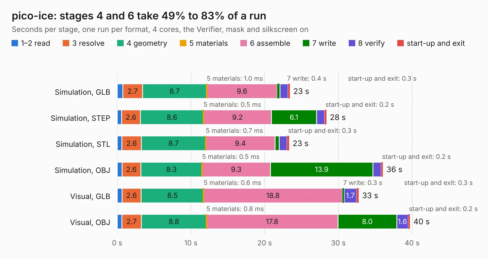

| Mode and format | 1–2 read | 3 resolve | 4 geometry | 5 materials | 6 assemble | 7 write | 8 verify | start-up and exit | Total |
|---|---:|---:|---:|---:|---:|---:|---:|---:|---:|
| Simulation, GLB | 0.7 | 2.7 | 8.7 | 1.0&nbsp;ms | 9.6 | 0.4 | 1.1 | 0.3 | 23.4 |
| Simulation, STEP | 0.6 | 2.6 | 8.6 | 0.5&nbsp;ms | 9.2 | 6.1 | 1.1 | 0.2 | 28.4 |
| Simulation, STL | 0.6 | 2.6 | 8.7 | 0.7&nbsp;ms | 9.4 | 0.6 | 1.1 | 0.3 | 23.3 |
| Simulation, OBJ | 0.7 | 2.6 | 8.3 | 0.5&nbsp;ms | 9.3 | 13.9 | 1.1 | 0.2 | 36.0 |
| Visual, GLB | 0.7 | 2.6 | 8.5 | 0.6&nbsp;ms | 18.8 | 0.3 | 1.7 | 0.3 | 32.8 |
| Visual, OBJ | 0.6 | 2.7 | 8.8 | 0.8&nbsp;ms | 17.8 | 8.0 | 1.6 | 0.2 | 39.7 |

<table align="center"><tr><td valign="top">

| Board | Repo: [tinyvision-ai-inc/pico-ice](https://github.com/tinyvision-ai-inc/pico-ice) Board: `pico-ice.kicad_pcb` |
|---|---|
| Folder | Board / Rev1 |
| Complexity | 375&nbsp;/&nbsp;1000 (size&nbsp;255, features&nbsp;120) |
| KESE&nbsp;features | through vias, slotted holes, custom pads, rounded, trapezoid or chamfered pads, filled zones, copper drawings, curved board outline, stack-up, dielectric εr and tanδ |
| Tested | 9th November 2026 |
| Copper&nbsp;layers | 4 |
| File&nbsp;format | KiCad 6 (20211014) |
| Parts,&nbsp;tracks,&nbsp;vias | 86, 1,748, 182 |
| Triangles,&nbsp;simulation | 2,332,170 in 113 parts |
| Verifier | PASS in all six runs |

</td><td valign="top">

<table>
<tr><th>File type</th><th>File size</th><th>Peak memory used</th></tr>
<tr><th colspan="3" align="left">Simulation</th></tr>
<tr><td>GLB</td><td align="right">81&nbsp;MB</td><td align="right">752&nbsp;MB</td></tr>
<tr><td>STEP</td><td align="right">423&nbsp;MB</td><td align="right">912&nbsp;MB</td></tr>
<tr><td>STL</td><td align="right">117&nbsp;MB</td><td align="right">793&nbsp;MB</td></tr>
<tr><td>OBJ</td><td align="right">253&nbsp;MB</td><td align="right">1.6&nbsp;GB</td></tr>
<tr><th colspan="3" align="left">Visual</th></tr>
<tr><td>GLB</td><td align="right">51&nbsp;MB</td><td align="right">937&nbsp;MB</td></tr>
<tr><td>OBJ</td><td align="right">157&nbsp;MB</td><td align="right">1.1&nbsp;GB</td></tr>
</table>

</td></tr></table>

## 2810. pico-ice

| Mode and format | 1–2 read | 3 resolve | 4 geometry | 5 materials | 6 assemble | 7 write | 8 verify | start-up and exit | Total |
|---|---:|---:|---:|---:|---:|---:|---:|---:|---:|
| Simulation, GLB | 0.6 | 2.4 | 8.2 | 0.6&nbsp;ms | 8.7 | 0.4 | 1.1 | 0.3 | 21.7 |
| Simulation, STEP | 0.6 | 2.3 | 8.3 | 0.6&nbsp;ms | 8.8 | 5.7 | 1.0 | 0.2 | 26.9 |
| Simulation, STL | 0.5 | 2.6 | 8.3 | 0.6&nbsp;ms | 9.1 | 0.9 | 1.0 | 0.3 | 22.7 |
| Simulation, OBJ | 0.5 | 2.5 | 8.3 | 0.8&nbsp;ms | 9.4 | 11.9 | 1.1 | 0.2 | 33.8 |
| Visual, GLB | 0.6 | 2.6 | 8.2 | 0.5&nbsp;ms | 18.2 | 0.2 | 2.4 | 0.2 | 32.4 |
| Visual, OBJ | 0.5 | 2.3 | 7.8 | 0.7&nbsp;ms | 18.2 | 7.4 | 2.6 | 0.3 | 39.1 |

<table align="center"><tr><td valign="top">

| Board | Repo: [tinyvision-ai-inc/pico-ice](https://github.com/tinyvision-ai-inc/pico-ice) Board: `pico-ice.kicad_pcb` |
|---|---|
| Folder | Board / Rev2 |
| Complexity | 375&nbsp;/&nbsp;1000 (size&nbsp;255, features&nbsp;120) |
| KESE&nbsp;features | through vias, slotted holes, custom pads, rounded, trapezoid or chamfered pads, filled zones, copper drawings, curved board outline, stack-up, dielectric εr and tanδ |
| Tested | 9th November 2026 |
| Copper&nbsp;layers | 4 |
| File&nbsp;format | KiCad 6 (20211014) |
| Parts,&nbsp;tracks,&nbsp;vias | 86, 1,748, 182 |
| Triangles,&nbsp;simulation | 2,341,844 in 113 parts |
| Verifier | PASS in all six runs |

</td><td valign="top">

<table>
<tr><th>File type</th><th>File size</th><th>Peak memory used</th></tr>
<tr><th colspan="3" align="left">Simulation</th></tr>
<tr><td>GLB</td><td align="right">81&nbsp;MB</td><td align="right">814&nbsp;MB</td></tr>
<tr><td>STEP</td><td align="right">425&nbsp;MB</td><td align="right">936&nbsp;MB</td></tr>
<tr><td>STL</td><td align="right">117&nbsp;MB</td><td align="right">742&nbsp;MB</td></tr>
<tr><td>OBJ</td><td align="right">254&nbsp;MB</td><td align="right">1.6&nbsp;GB</td></tr>
<tr><th colspan="3" align="left">Visual</th></tr>
<tr><td>GLB</td><td align="right">51&nbsp;MB</td><td align="right">961&nbsp;MB</td></tr>
<tr><td>OBJ</td><td align="right">158&nbsp;MB</td><td align="right">1.1&nbsp;GB</td></tr>
</table>

</td></tr></table>

## 2811. pico-ice

| Mode and format | 1–2 read | 3 resolve | 4 geometry | 5 materials | 6 assemble | 7 write | 8 verify | start-up and exit | Total |
|---|---:|---:|---:|---:|---:|---:|---:|---:|---:|
| Simulation, GLB | 0.6 | 2.8 | 8.6 | 0.7&nbsp;ms | 9.6 | 0.4 | 1.3 | 0.3 | 23.6 |
| Simulation, STEP | 0.6 | 2.9 | 9.0 | 0.6&nbsp;ms | 9.4 | 6.1 | 1.2 | 0.3 | 29.4 |
| Simulation, STL | 0.6 | 2.8 | 8.8 | 0.6&nbsp;ms | 9.6 | 0.7 | 1.2 | 0.2 | 23.9 |
| Simulation, OBJ | 0.7 | 2.8 | 8.7 | 0.6&nbsp;ms | 9.3 | 12.6 | 1.2 | 0.3 | 35.5 |
| Visual, GLB | 0.6 | 2.8 | 8.8 | 0.8&nbsp;ms | 20.3 | 0.3 | 2.6 | 0.3 | 35.7 |
| Visual, OBJ | 0.6 | 2.7 | 8.7 | 0.7&nbsp;ms | 20.3 | 8.2 | 2.6 | 0.3 | 43.4 |

<table align="center"><tr><td valign="top">

| Board | Repo: [tinyvision-ai-inc/pico-ice](https://github.com/tinyvision-ai-inc/pico-ice) Board: `pico-ice.kicad_pcb` |
|---|---|
| Folder | Board / Rev3 |
| Complexity | 375&nbsp;/&nbsp;1000 (size&nbsp;255, features&nbsp;120) |
| KESE&nbsp;features | through vias, slotted holes, custom pads, rounded, trapezoid or chamfered pads, filled zones, copper drawings, curved board outline, stack-up, dielectric εr and tanδ |
| Tested | 9th November 2026 |
| Copper&nbsp;layers | 4 |
| File&nbsp;format | KiCad 8 (20240108) |
| Parts,&nbsp;tracks,&nbsp;vias | 87, 1,689, 189 |
| Triangles,&nbsp;simulation | 2,375,218 in 111 parts |
| Verifier | PASS in all six runs |

</td><td valign="top">

<table>
<tr><th>File type</th><th>File size</th><th>Peak memory used</th></tr>
<tr><th colspan="3" align="left">Simulation</th></tr>
<tr><td>GLB</td><td align="right">82&nbsp;MB</td><td align="right">809&nbsp;MB</td></tr>
<tr><td>STEP</td><td align="right">429&nbsp;MB</td><td align="right">952&nbsp;MB</td></tr>
<tr><td>STL</td><td align="right">119&nbsp;MB</td><td align="right">853&nbsp;MB</td></tr>
<tr><td>OBJ</td><td align="right">257&nbsp;MB</td><td align="right">1.6&nbsp;GB</td></tr>
<tr><th colspan="3" align="left">Visual</th></tr>
<tr><td>GLB</td><td align="right">51&nbsp;MB</td><td align="right">1.0&nbsp;GB</td></tr>
<tr><td>OBJ</td><td align="right">159&nbsp;MB</td><td align="right">1.1&nbsp;GB</td></tr>
</table>

</td></tr></table>

## 2812. pico2-ice

| Mode and format | 1–2 read | 3 resolve | 4 geometry | 5 materials | 6 assemble | 7 write | 8 verify | start-up and exit | Total |
|---|---:|---:|---:|---:|---:|---:|---:|---:|---:|
| Simulation, GLB | 0.7 | 3.2 | 9.8 | 0.9&nbsp;ms | 9.9 | 0.5 | 1.5 | 0.3 | 25.8 |
| Simulation, STEP | 0.7 | 2.9 | 9.8 | 0.9&nbsp;ms | 10.5 | 6.5 | 1.4 | 0.3 | 32.0 |
| Simulation, STL | 0.7 | 3.0 | 9.6 | 1&nbsp;ms | 10.1 | 0.7 | 1.3 | 0.3 | 25.7 |
| Simulation, OBJ | 0.7 | 3.0 | 9.8 | 0.9&nbsp;ms | 10.0 | 13.8 | 1.4 | 0.3 | 39.1 |
| Visual, GLB | 0.7 | 3.1 | 10.5 | 0.8&nbsp;ms | 21.3 | 0.3 | 2.3 | 0.3 | 38.5 |
| Visual, OBJ | 0.7 | 3.3 | 10.4 | 0.9&nbsp;ms | 20.8 | 10.0 | 2.3 | 0.3 | 47.8 |

<table align="center"><tr><td valign="top">

| Board | Repo: [tinyvision-ai-inc/pico2-ice](https://github.com/tinyvision-ai-inc/pico2-ice) Board: `pico2-ice.kicad_pcb` |
|---|---|
| Folder | Board / Rev0 |
| Complexity | 381&nbsp;/&nbsp;1000 (size&nbsp;261, features&nbsp;120) |
| KESE&nbsp;features | through vias, slotted holes, custom pads, rounded, trapezoid or chamfered pads, filled zones, copper drawings, curved board outline, stack-up, dielectric εr and tanδ |
| Tested | 9th November 2026 to 10th November 2026 |
| Copper&nbsp;layers | 4 |
| File&nbsp;format | KiCad 8 (20240108) |
| Parts,&nbsp;tracks,&nbsp;vias | 108, 2,040, 262 |
| Triangles,&nbsp;simulation | 2,664,998 in 141 parts |
| Verifier | PASS in all six runs |
| Run&nbsp;again | Simulation, GLB; Simulation, STEP; Simulation, STL; Simulation, OBJ: failed in the corpus run, run again with fixes to KESE made after the corpus run, and passed |

</td><td valign="top">

<table>
<tr><th>File type</th><th>File size</th><th>Peak memory used</th></tr>
<tr><th colspan="3" align="left">Simulation</th></tr>
<tr><td>GLB</td><td align="right">92&nbsp;MB</td><td align="right">1.0&nbsp;GB</td></tr>
<tr><td>STEP</td><td align="right">451&nbsp;MB</td><td align="right">1.0&nbsp;GB</td></tr>
<tr><td>STL</td><td align="right">133&nbsp;MB</td><td align="right">988&nbsp;MB</td></tr>
<tr><td>OBJ</td><td align="right">290&nbsp;MB</td><td align="right">1.8&nbsp;GB</td></tr>
<tr><th colspan="3" align="left">Visual</th></tr>
<tr><td>GLB</td><td align="right">58&nbsp;MB</td><td align="right">1.1&nbsp;GB</td></tr>
<tr><td>OBJ</td><td align="right">183&nbsp;MB</td><td align="right">1.3&nbsp;GB</td></tr>
</table>

</td></tr></table>

## 2813. pico2-ice

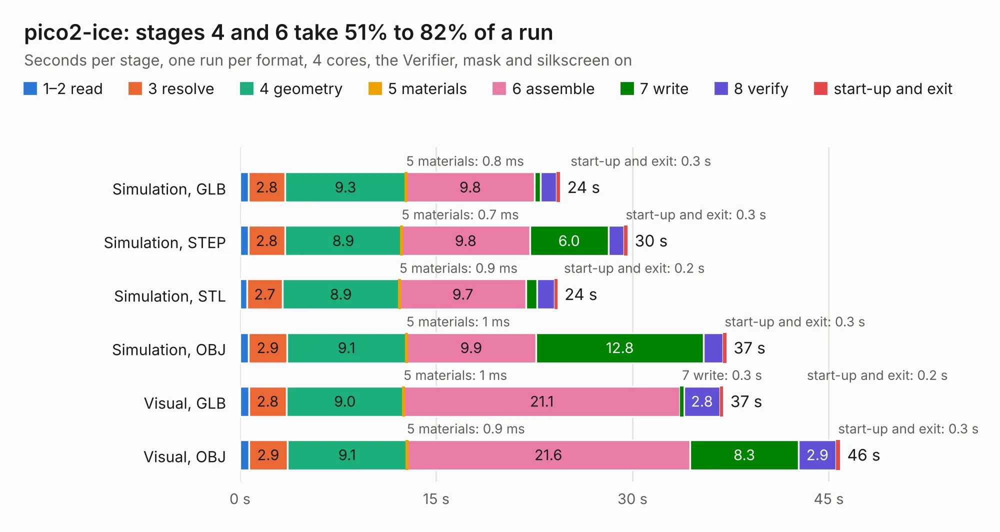

| Mode and format | 1–2 read | 3 resolve | 4 geometry | 5 materials | 6 assemble | 7 write | 8 verify | start-up and exit | Total |
|---|---:|---:|---:|---:|---:|---:|---:|---:|---:|
| Simulation, GLB | 0.7 | 2.8 | 9.3 | 0.8&nbsp;ms | 9.8 | 0.5 | 1.2 | 0.3 | 24.5 |
| Simulation, STEP | 0.6 | 2.8 | 8.9 | 0.7&nbsp;ms | 9.8 | 6.0 | 1.2 | 0.3 | 29.6 |
| Simulation, STL | 0.5 | 2.7 | 8.9 | 0.9&nbsp;ms | 9.7 | 0.8 | 1.3 | 0.2 | 24.3 |
| Simulation, OBJ | 0.7 | 2.9 | 9.1 | 1&nbsp;ms | 9.9 | 12.8 | 1.5 | 0.3 | 37.2 |
| Visual, GLB | 0.7 | 2.8 | 9.0 | 1&nbsp;ms | 21.1 | 0.3 | 2.8 | 0.2 | 36.9 |
| Visual, OBJ | 0.7 | 2.9 | 9.1 | 0.9&nbsp;ms | 21.6 | 8.3 | 2.9 | 0.3 | 45.9 |

<table align="center"><tr><td valign="top">

| Board | Repo: [tinyvision-ai-inc/pico2-ice](https://github.com/tinyvision-ai-inc/pico2-ice) Board: `pico2-ice.kicad_pcb` |
|---|---|
| Folder | Board / Rev1 |
| Complexity | 382&nbsp;/&nbsp;1000 (size&nbsp;262, features&nbsp;120) |
| KESE&nbsp;features | through vias, slotted holes, custom pads, rounded, trapezoid or chamfered pads, filled zones, copper drawings, curved board outline, stack-up, dielectric εr and tanδ |
| Tested | 9th November 2026 |
| Copper&nbsp;layers | 4 |
| File&nbsp;format | KiCad 8 (20240108) |
| Parts,&nbsp;tracks,&nbsp;vias | 109, 2,181, 270 |
| Triangles,&nbsp;simulation | 2,707,426 in 139 parts |
| Verifier | PASS in all six runs |

</td><td valign="top">

<table>
<tr><th>File type</th><th>File size</th><th>Peak memory used</th></tr>
<tr><th colspan="3" align="left">Simulation</th></tr>
<tr><td>GLB</td><td align="right">94&nbsp;MB</td><td align="right">967&nbsp;MB</td></tr>
<tr><td>STEP</td><td align="right">458&nbsp;MB</td><td align="right">1.0&nbsp;GB</td></tr>
<tr><td>STL</td><td align="right">135&nbsp;MB</td><td align="right">1.0&nbsp;GB</td></tr>
<tr><td>OBJ</td><td align="right">294&nbsp;MB</td><td align="right">1.8&nbsp;GB</td></tr>
<tr><th colspan="3" align="left">Visual</th></tr>
<tr><td>GLB</td><td align="right">59&nbsp;MB</td><td align="right">1.1&nbsp;GB</td></tr>
<tr><td>OBJ</td><td align="right">187&nbsp;MB</td><td align="right">1.4&nbsp;GB</td></tr>
</table>

</td></tr></table>

## 2814. pico2-ice

| Mode and format | 1–2 read | 3 resolve | 4 geometry | 5 materials | 6 assemble | 7 write | 8 verify | start-up and exit | Total |
|---|---:|---:|---:|---:|---:|---:|---:|---:|---:|
| Simulation, GLB | 0.8 | 3.2 | 10.8 | 0.7&nbsp;ms | 11.4 | 0.5 | 1.4 | 0.3 | 28.2 |
| Simulation, STEP | 0.8 | 3.4 | 10.8 | 0.4&nbsp;ms | 11.3 | 7.4 | 1.4 | 0.3 | 35.5 |
| Simulation, STL | 0.8 | 3.3 | 11.1 | 0.8&nbsp;ms | 11.5 | 0.9 | 1.4 | 0.3 | 29.2 |
| Simulation, OBJ | 0.8 | 3.2 | 11.0 | 0.7&nbsp;ms | 11.0 | 15.8 | 1.4 | 0.3 | 43.5 |
| Visual, GLB | 0.9 | 3.2 | 10.8 | 0.7&nbsp;ms | 21.1 | 0.3 | 2.3 | 0.3 | 38.9 |
| Visual, OBJ | 0.8 | 3.2 | 10.6 | 0.8&nbsp;ms | 22.3 | 10.2 | 2.3 | 0.3 | 49.6 |

<table align="center"><tr><td valign="top">

| Board | Repo: [tinyvision-ai-inc/pico2-ice](https://github.com/tinyvision-ai-inc/pico2-ice) Board: `pico2-ice.kicad_pcb` |
|---|---|
| Folder | Board / Rev2 |
| Complexity | 382&nbsp;/&nbsp;1000 (size&nbsp;262, features&nbsp;120) |
| KESE&nbsp;features | through vias, slotted holes, custom pads, rounded, trapezoid or chamfered pads, filled zones, copper drawings, curved board outline, stack-up, dielectric εr and tanδ |
| Tested | 9th November 2026 |
| Copper&nbsp;layers | 4 |
| File&nbsp;format | KiCad 9 (20241229) |
| Parts,&nbsp;tracks,&nbsp;vias | 110, 2,189, 270 |
| Triangles,&nbsp;simulation | 2,736,022 in 139 parts |
| Verifier | PASS in all six runs |

</td><td valign="top">

<table>
<tr><th>File type</th><th>File size</th><th>Peak memory used</th></tr>
<tr><th colspan="3" align="left">Simulation</th></tr>
<tr><td>GLB</td><td align="right">95&nbsp;MB</td><td align="right">980&nbsp;MB</td></tr>
<tr><td>STEP</td><td align="right">463&nbsp;MB</td><td align="right">1.1&nbsp;GB</td></tr>
<tr><td>STL</td><td align="right">137&nbsp;MB</td><td align="right">900&nbsp;MB</td></tr>
<tr><td>OBJ</td><td align="right">298&nbsp;MB</td><td align="right">1.8&nbsp;GB</td></tr>
<tr><th colspan="3" align="left">Visual</th></tr>
<tr><td>GLB</td><td align="right">60&nbsp;MB</td><td align="right">1.1&nbsp;GB</td></tr>
<tr><td>OBJ</td><td align="right">189&nbsp;MB</td><td align="right">1.3&nbsp;GB</td></tr>
</table>

</td></tr></table>

## 2815. pico2-nx-module

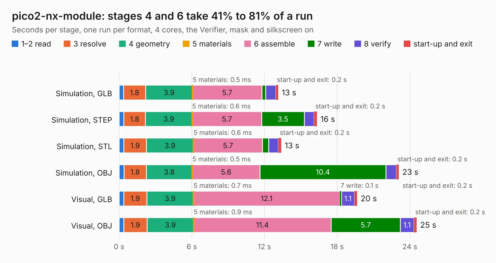

| Mode and format | 1–2 read | 3 resolve | 4 geometry | 5 materials | 6 assemble | 7 write | 8 verify | start-up and exit | Total |
|---|---:|---:|---:|---:|---:|---:|---:|---:|---:|
| Simulation, GLB | 0.4 | 1.8 | 3.9 | 0.5&nbsp;ms | 5.7 | 0.3 | 0.8 | 0.2 | 13.1 |
| Simulation, STEP | 0.4 | 1.8 | 3.9 | 0.6&nbsp;ms | 5.7 | 3.5 | 0.8 | 0.2 | 16.3 |
| Simulation, STL | 0.4 | 1.9 | 3.9 | 0.6&nbsp;ms | 5.7 | 0.5 | 0.8 | 0.2 | 13.4 |
| Simulation, OBJ | 0.4 | 1.8 | 3.8 | 0.5&nbsp;ms | 5.6 | 10.4 | 0.9 | 0.2 | 23.1 |
| Visual, GLB | 0.4 | 1.9 | 3.9 | 0.7&nbsp;ms | 12.1 | 0.1 | 1.1 | 0.2 | 19.6 |
| Visual, OBJ | 0.4 | 1.9 | 3.9 | 0.9&nbsp;ms | 11.4 | 5.7 | 1.1 | 0.2 | 24.6 |

<table align="center"><tr><td valign="top">

| Board | Repo: [tinyvision-ai-inc/pico2-nx](https://github.com/tinyvision-ai-inc/pico2-nx) Board: `pico2-nx-module.kicad_pcb` |
|---|---|
| Folder | board / Rev0 / pico2-nx-module |
| Complexity | 347&nbsp;/&nbsp;1000 (size&nbsp;272, features&nbsp;75) |
| KESE&nbsp;features | through vias, rounded, trapezoid or chamfered pads, filled zones, stack-up, dielectric εr and tanδ |
| Tested | 9th November 2026 |
| Copper&nbsp;layers | 6 |
| File&nbsp;format | KiCad 9 (20241229) |
| Parts,&nbsp;tracks,&nbsp;vias | 71, 1,994, 270 |
| Triangles,&nbsp;simulation | 1,969,336 in 138 parts |
| Verifier | PASS in all six runs |

</td><td valign="top">

<table>
<tr><th>File type</th><th>File size</th><th>Peak memory used</th></tr>
<tr><th colspan="3" align="left">Simulation</th></tr>
<tr><td>GLB</td><td align="right">66&nbsp;MB</td><td align="right">642&nbsp;MB</td></tr>
<tr><td>STEP</td><td align="right">223&nbsp;MB</td><td align="right">774&nbsp;MB</td></tr>
<tr><td>STL</td><td align="right">98&nbsp;MB</td><td align="right">655&nbsp;MB</td></tr>
<tr><td>OBJ</td><td align="right">204&nbsp;MB</td><td align="right">1.3&nbsp;GB</td></tr>
<tr><th colspan="3" align="left">Visual</th></tr>
<tr><td>GLB</td><td align="right">36&nbsp;MB</td><td align="right">738&nbsp;MB</td></tr>
<tr><td>OBJ</td><td align="right">112&nbsp;MB</td><td align="right">801&nbsp;MB</td></tr>
</table>

</td></tr></table>

## 2816. pico2-nx

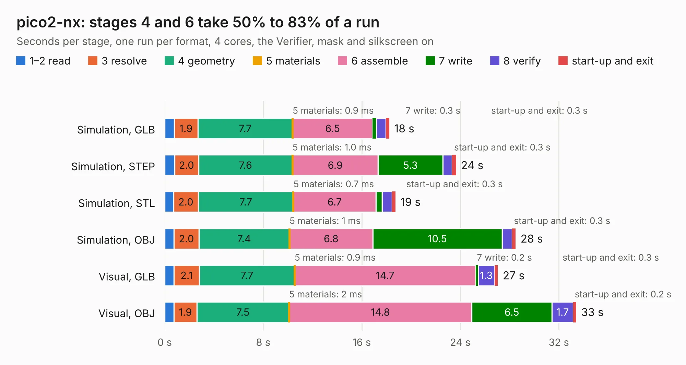

| Mode and format | 1–2 read | 3 resolve | 4 geometry | 5 materials | 6 assemble | 7 write | 8 verify | start-up and exit | Total |
|---|---:|---:|---:|---:|---:|---:|---:|---:|---:|
| Simulation, GLB | 0.8 | 1.9 | 7.7 | 0.9&nbsp;ms | 6.5 | 0.3 | 0.8 | 0.3 | 18.2 |
| Simulation, STEP | 0.8 | 2.0 | 7.6 | 1.0&nbsp;ms | 6.9 | 5.3 | 0.8 | 0.3 | 23.7 |
| Simulation, STL | 0.7 | 2.0 | 7.7 | 0.7&nbsp;ms | 6.7 | 0.5 | 0.8 | 0.3 | 18.8 |
| Simulation, OBJ | 0.8 | 2.0 | 7.4 | 1&nbsp;ms | 6.8 | 10.5 | 0.8 | 0.3 | 28.5 |
| Visual, GLB | 0.7 | 2.1 | 7.7 | 0.9&nbsp;ms | 14.7 | 0.2 | 1.3 | 0.3 | 27.1 |
| Visual, OBJ | 0.8 | 1.9 | 7.5 | 2&nbsp;ms | 14.8 | 6.5 | 1.7 | 0.2 | 33.4 |

<table align="center"><tr><td valign="top">

| Board | Repo: [tinyvision-ai-inc/pico2-nx](https://github.com/tinyvision-ai-inc/pico2-nx) Board: `pico2-nx.kicad_pcb` |
|---|---|
| Folder | board / Rev0 / pico2-nx |
| Complexity | 336&nbsp;/&nbsp;1000 (size&nbsp;221, features&nbsp;115) |
| KESE&nbsp;features | microvias, slotted holes, custom pads, rounded, trapezoid or chamfered pads, copper drawings, stack-up, dielectric εr and tanδ |
| Tested | 9th November 2026 |
| Copper&nbsp;layers | 2 |
| File&nbsp;format | KiCad 9 (20241229) |
| Parts,&nbsp;tracks,&nbsp;vias | 237, 10, 81 |
| Triangles,&nbsp;simulation | 1,634,060 in 259 parts |
| Note | mostly unrouted |
| Verifier | PASS in all six runs |

</td><td valign="top">

<table>
<tr><th>File type</th><th>File size</th><th>Peak memory used</th></tr>
<tr><th colspan="3" align="left">Simulation</th></tr>
<tr><td>GLB</td><td align="right">55&nbsp;MB</td><td align="right">692&nbsp;MB</td></tr>
<tr><td>STEP</td><td align="right">252&nbsp;MB</td><td align="right">780&nbsp;MB</td></tr>
<tr><td>STL</td><td align="right">82&nbsp;MB</td><td align="right">608&nbsp;MB</td></tr>
<tr><td>OBJ</td><td align="right">168&nbsp;MB</td><td align="right">1.1&nbsp;GB</td></tr>
<tr><th colspan="3" align="left">Visual</th></tr>
<tr><td>GLB</td><td align="right">37&nbsp;MB</td><td align="right">907&nbsp;MB</td></tr>
<tr><td>OBJ</td><td align="right">111&nbsp;MB</td><td align="right">821&nbsp;MB</td></tr>
</table>

</td></tr></table>

## 2817. nx-module-breakout

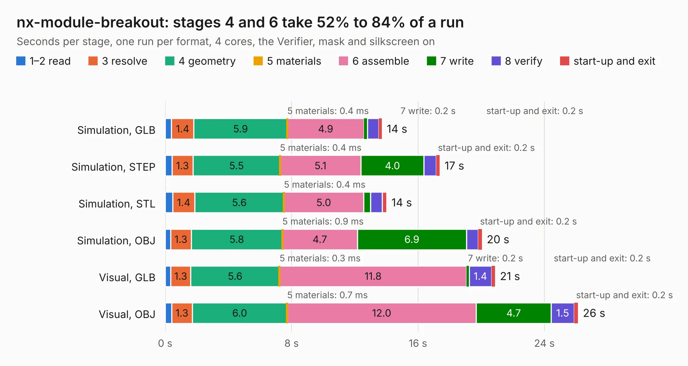

| Mode and format | 1–2 read | 3 resolve | 4 geometry | 5 materials | 6 assemble | 7 write | 8 verify | start-up and exit | Total |
|---|---:|---:|---:|---:|---:|---:|---:|---:|---:|
| Simulation, GLB | 0.4 | 1.4 | 5.9 | 0.4&nbsp;ms | 4.9 | 0.2 | 0.7 | 0.2 | 13.7 |
| Simulation, STEP | 0.4 | 1.3 | 5.5 | 0.4&nbsp;ms | 5.1 | 4.0 | 0.8 | 0.2 | 17.4 |
| Simulation, STL | 0.5 | 1.4 | 5.6 | 0.4&nbsp;ms | 5.0 | 0.4 | 0.7 | 0.3 | 14.0 |
| Simulation, OBJ | 0.4 | 1.3 | 5.8 | 0.9&nbsp;ms | 4.7 | 6.9 | 0.8 | 0.2 | 20.0 |
| Visual, GLB | 0.4 | 1.3 | 5.6 | 0.3&nbsp;ms | 11.8 | 0.2 | 1.4 | 0.2 | 20.9 |
| Visual, OBJ | 0.4 | 1.3 | 6.0 | 0.7&nbsp;ms | 12.0 | 4.7 | 1.5 | 0.2 | 26.1 |

<table align="center"><tr><td valign="top">

| Board | Repo: [tinyvision-ai-inc/pico2-nx](https://github.com/tinyvision-ai-inc/pico2-nx) Board: `nx-module-breakout.kicad_pcb` |
|---|---|
| Folder | board / Rev2 / nx-module-breakout |
| Complexity | 320&nbsp;/&nbsp;1000 (size&nbsp;195, features&nbsp;125) |
| KESE&nbsp;features | through vias, slotted holes, custom pads, rounded, trapezoid or chamfered pads, arc tracks, filled zones, copper drawings, stack-up, dielectric εr and tanδ |
| Tested | 9th November 2026 |
| Copper&nbsp;layers | 4 |
| File&nbsp;format | KiCad 9 (20241229) |
| Parts,&nbsp;tracks,&nbsp;vias | 45, 1,224, 92 |
| Triangles,&nbsp;simulation | 1,514,246 in 139 parts |
| Verifier | PASS in all six runs |

</td><td valign="top">

<table>
<tr><th>File type</th><th>File size</th><th>Peak memory used</th></tr>
<tr><th colspan="3" align="left">Simulation</th></tr>
<tr><td>GLB</td><td align="right">52&nbsp;MB</td><td align="right">547&nbsp;MB</td></tr>
<tr><td>STEP</td><td align="right">228&nbsp;MB</td><td align="right">721&nbsp;MB</td></tr>
<tr><td>STL</td><td align="right">76&nbsp;MB</td><td align="right">586&nbsp;MB</td></tr>
<tr><td>OBJ</td><td align="right">160&nbsp;MB</td><td align="right">1.1&nbsp;GB</td></tr>
<tr><th colspan="3" align="left">Visual</th></tr>
<tr><td>GLB</td><td align="right">35&nbsp;MB</td><td align="right">676&nbsp;MB</td></tr>
<tr><td>OBJ</td><td align="right">107&nbsp;MB</td><td align="right">773&nbsp;MB</td></tr>
</table>

</td></tr></table>

## 2818. pico2-nx-module

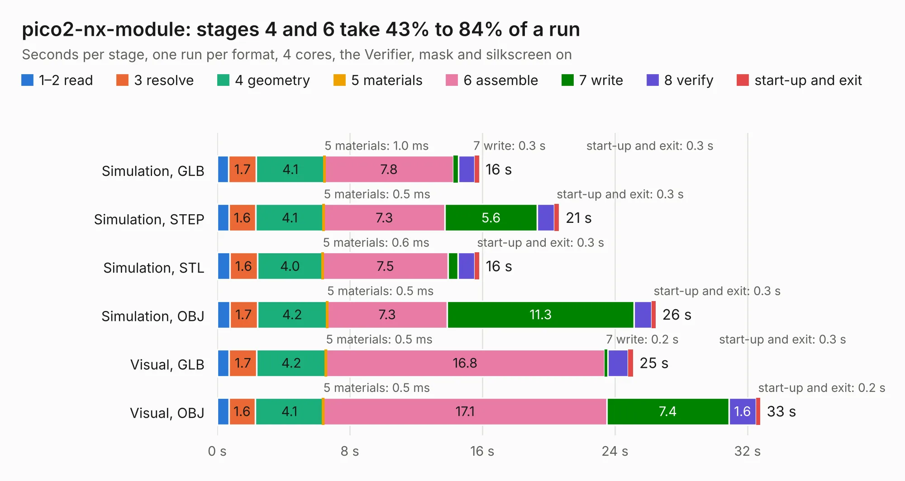

| Mode and format | 1–2 read | 3 resolve | 4 geometry | 5 materials | 6 assemble | 7 write | 8 verify | start-up and exit | Total |
|---|---:|---:|---:|---:|---:|---:|---:|---:|---:|
| Simulation, GLB | 0.7 | 1.7 | 4.1 | 1.0&nbsp;ms | 7.8 | 0.3 | 1.0 | 0.3 | 15.8 |
| Simulation, STEP | 0.7 | 1.6 | 4.1 | 0.5&nbsp;ms | 7.3 | 5.6 | 1.0 | 0.3 | 20.6 |
| Simulation, STL | 0.8 | 1.6 | 4.0 | 0.6&nbsp;ms | 7.5 | 0.6 | 1.0 | 0.3 | 15.8 |
| Simulation, OBJ | 0.8 | 1.7 | 4.2 | 0.5&nbsp;ms | 7.3 | 11.3 | 1.1 | 0.3 | 26.5 |
| Visual, GLB | 0.7 | 1.7 | 4.2 | 0.5&nbsp;ms | 16.8 | 0.2 | 1.2 | 0.3 | 25.1 |
| Visual, OBJ | 0.7 | 1.6 | 4.1 | 0.5&nbsp;ms | 17.1 | 7.4 | 1.6 | 0.2 | 32.8 |

<table align="center"><tr><td valign="top">

| Board | Repo: [tinyvision-ai-inc/pico2-nx](https://github.com/tinyvision-ai-inc/pico2-nx) Board: `pico2-nx-module.kicad_pcb` |
|---|---|
| Folder | board / Rev2 / nx-module |
| Complexity | 376&nbsp;/&nbsp;1000 (size&nbsp;276, features&nbsp;100) |
| KESE&nbsp;features | through vias, rounded, trapezoid or chamfered pads, arc tracks, filled zones, curved board outline, stack-up, dielectric εr and tanδ |
| Tested | 9th November 2026 |
| Copper&nbsp;layers | 6 |
| File&nbsp;format | KiCad 9 (20241229) |
| Parts,&nbsp;tracks,&nbsp;vias | 71, 2,995, 254 |
| Triangles,&nbsp;simulation | 1,957,374 in 138 parts |
| Verifier | PASS in all six runs |

</td><td valign="top">

<table>
<tr><th>File type</th><th>File size</th><th>Peak memory used</th></tr>
<tr><th colspan="3" align="left">Simulation</th></tr>
<tr><td>GLB</td><td align="right">66&nbsp;MB</td><td align="right">664&nbsp;MB</td></tr>
<tr><td>STEP</td><td align="right">256&nbsp;MB</td><td align="right">873&nbsp;MB</td></tr>
<tr><td>STL</td><td align="right">98&nbsp;MB</td><td align="right">663&nbsp;MB</td></tr>
<tr><td>OBJ</td><td align="right">204&nbsp;MB</td><td align="right">1.3&nbsp;GB</td></tr>
<tr><th colspan="3" align="left">Visual</th></tr>
<tr><td>GLB</td><td align="right">42&nbsp;MB</td><td align="right">992&nbsp;MB</td></tr>
<tr><td>OBJ</td><td align="right">131&nbsp;MB</td><td align="right">1.0&nbsp;GB</td></tr>
</table>

</td></tr></table>

## 2819. pogo_adapter

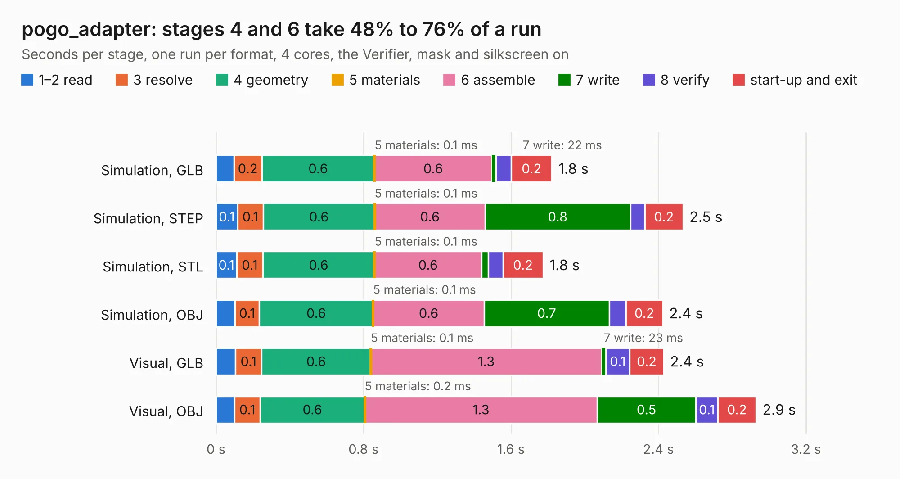

| Mode and format | 1–2 read | 3 resolve | 4 geometry | 5 materials | 6 assemble | 7 write | 8 verify | start-up and exit | Total |
|---|---:|---:|---:|---:|---:|---:|---:|---:|---:|
| Simulation, GLB | 97&nbsp;ms | 0.2 | 0.6 | 0.1&nbsp;ms | 0.6 | 22&nbsp;ms | 84&nbsp;ms | 0.2 | 1.8 |
| Simulation, STEP | 0.1 | 0.1 | 0.6 | 0.1&nbsp;ms | 0.6 | 0.8 | 79&nbsp;ms | 0.2 | 2.5 |
| Simulation, STL | 0.1 | 0.1 | 0.6 | 0.1&nbsp;ms | 0.6 | 36&nbsp;ms | 80&nbsp;ms | 0.2 | 1.8 |
| Simulation, OBJ | 0.1 | 0.1 | 0.6 | 0.1&nbsp;ms | 0.6 | 0.7 | 92&nbsp;ms | 0.2 | 2.4 |
| Visual, GLB | 0.1 | 0.1 | 0.6 | 0.1&nbsp;ms | 1.3 | 23&nbsp;ms | 0.1 | 0.2 | 2.4 |
| Visual, OBJ | 0.1 | 0.1 | 0.6 | 0.2&nbsp;ms | 1.3 | 0.5 | 0.1 | 0.2 | 2.9 |

<table align="center"><tr><td valign="top">

| Board | Repo: [tinyvision-ai-inc/upduino-jtag](https://github.com/tinyvision-ai-inc/upduino-jtag) Board: `pogo_adapter.kicad_pcb` |
|---|---|
| Folder | board / pogo_adapter |
| Complexity | 181&nbsp;/&nbsp;1000 (size&nbsp;111, features&nbsp;70) |
| KESE&nbsp;features | through vias, filled zones, stack-up, dielectric εr and tanδ, mask and silkscreen colours |
| Tested | 9th November 2026 |
| Copper&nbsp;layers | 2 |
| File&nbsp;format | KiCad 8 (20240108) |
| Parts,&nbsp;tracks,&nbsp;vias | 2, 55, 32 |
| Triangles,&nbsp;simulation | 139,780 in 20 parts |
| Verifier | PASS in all six runs |

</td><td valign="top">

<table>
<tr><th>File type</th><th>File size</th><th>Peak memory used</th></tr>
<tr><th colspan="3" align="left">Simulation</th></tr>
<tr><td>GLB</td><td align="right">4.8&nbsp;MB</td><td align="right">196&nbsp;MB</td></tr>
<tr><td>STEP</td><td align="right">19&nbsp;MB</td><td align="right">201&nbsp;MB</td></tr>
<tr><td>STL</td><td align="right">7.0&nbsp;MB</td><td align="right">191&nbsp;MB</td></tr>
<tr><td>OBJ</td><td align="right">14&nbsp;MB</td><td align="right">192&nbsp;MB</td></tr>
<tr><th colspan="3" align="left">Visual</th></tr>
<tr><td>GLB</td><td align="right">3.8&nbsp;MB</td><td align="right">160&nbsp;MB</td></tr>
<tr><td>OBJ</td><td align="right">11&nbsp;MB</td><td align="right">165&nbsp;MB</td></tr>
</table>

</td></tr></table>

## 2820. upduino-jtag

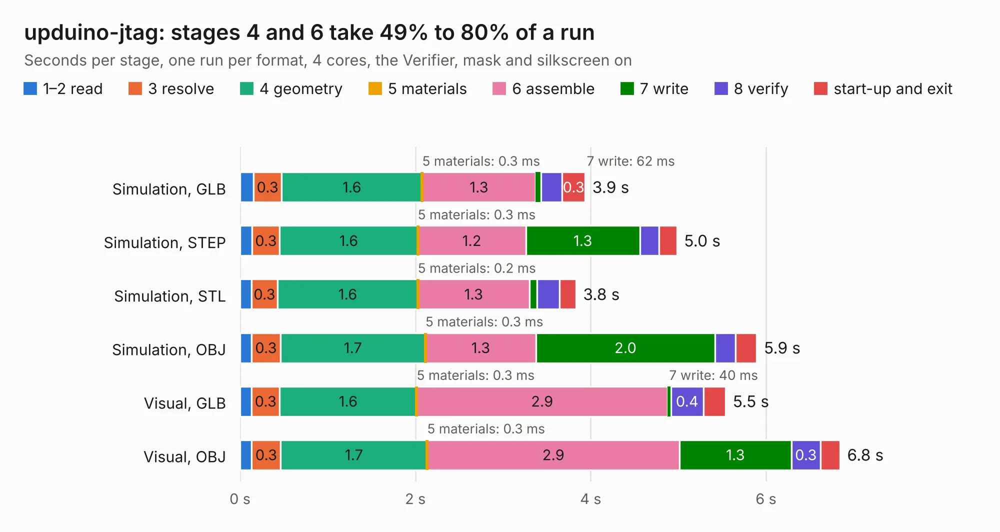

| Mode and format | 1–2 read | 3 resolve | 4 geometry | 5 materials | 6 assemble | 7 write | 8 verify | start-up and exit | Total |
|---|---:|---:|---:|---:|---:|---:|---:|---:|---:|
| Simulation, GLB | 0.2 | 0.3 | 1.6 | 0.3&nbsp;ms | 1.3 | 62&nbsp;ms | 0.2 | 0.3 | 3.9 |
| Simulation, STEP | 0.1 | 0.3 | 1.6 | 0.3&nbsp;ms | 1.2 | 1.3 | 0.2 | 0.2 | 5.0 |
| Simulation, STL | 0.1 | 0.3 | 1.6 | 0.2&nbsp;ms | 1.3 | 86&nbsp;ms | 0.3 | 0.2 | 3.8 |
| Simulation, OBJ | 0.1 | 0.3 | 1.7 | 0.3&nbsp;ms | 1.3 | 2.0 | 0.2 | 0.2 | 5.9 |
| Visual, GLB | 0.1 | 0.3 | 1.6 | 0.3&nbsp;ms | 2.9 | 40&nbsp;ms | 0.4 | 0.3 | 5.5 |
| Visual, OBJ | 0.1 | 0.3 | 1.7 | 0.3&nbsp;ms | 2.9 | 1.3 | 0.3 | 0.2 | 6.8 |

<table align="center"><tr><td valign="top">

| Board | Repo: [tinyvision-ai-inc/upduino-jtag](https://github.com/tinyvision-ai-inc/upduino-jtag) Board: `upduino-jtag.kicad_pcb` |
|---|---|
| Folder | board / upduino_adapter |
| Complexity | 208&nbsp;/&nbsp;1000 (size&nbsp;128, features&nbsp;80) |
| KESE&nbsp;features | through vias, rounded, trapezoid or chamfered pads, filled zones, stack-up, dielectric εr and tanδ, mask and silkscreen colours |
| Tested | 9th November 2026 |
| Copper&nbsp;layers | 2 |
| File&nbsp;format | KiCad 8 (20240108) |
| Parts,&nbsp;tracks,&nbsp;vias | 6, 94, 49 |
| Triangles,&nbsp;simulation | 365,398 in 59 parts |
| Verifier | PASS in all six runs |

</td><td valign="top">

<table>
<tr><th>File type</th><th>File size</th><th>Peak memory used</th></tr>
<tr><th colspan="3" align="left">Simulation</th></tr>
<tr><td>GLB</td><td align="right">12&nbsp;MB</td><td align="right">263&nbsp;MB</td></tr>
<tr><td>STEP</td><td align="right">46&nbsp;MB</td><td align="right">284&nbsp;MB</td></tr>
<tr><td>STL</td><td align="right">18&nbsp;MB</td><td align="right">275&nbsp;MB</td></tr>
<tr><td>OBJ</td><td align="right">36&nbsp;MB</td><td align="right">288&nbsp;MB</td></tr>
<tr><th colspan="3" align="left">Visual</th></tr>
<tr><td>GLB</td><td align="right">8.2&nbsp;MB</td><td align="right">265&nbsp;MB</td></tr>
<tr><td>OBJ</td><td align="right">24&nbsp;MB</td><td align="right">268&nbsp;MB</td></tr>
</table>

</td></tr></table>

## 2821. UPduino_v3.0

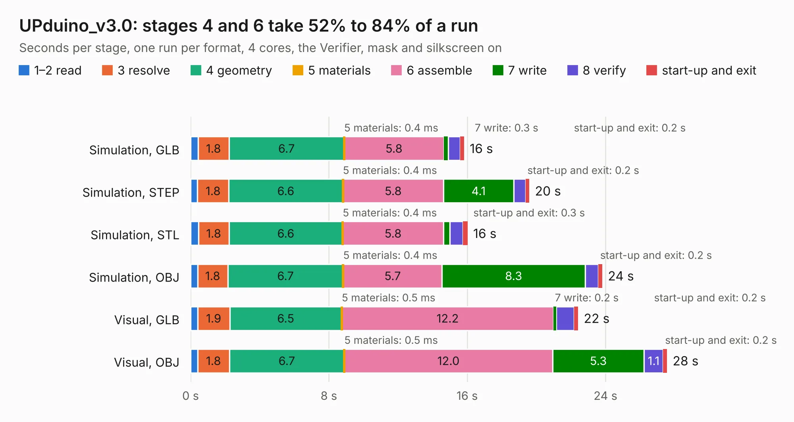

| Mode and format | 1–2 read | 3 resolve | 4 geometry | 5 materials | 6 assemble | 7 write | 8 verify | start-up and exit | Total |
|---|---:|---:|---:|---:|---:|---:|---:|---:|---:|
| Simulation, GLB | 0.4 | 1.8 | 6.7 | 0.4&nbsp;ms | 5.8 | 0.3 | 0.7 | 0.2 | 15.8 |
| Simulation, STEP | 0.4 | 1.8 | 6.6 | 0.4&nbsp;ms | 5.8 | 4.1 | 0.7 | 0.2 | 19.6 |
| Simulation, STL | 0.4 | 1.8 | 6.6 | 0.4&nbsp;ms | 5.8 | 0.4 | 0.7 | 0.3 | 16.0 |
| Simulation, OBJ | 0.4 | 1.8 | 6.7 | 0.4&nbsp;ms | 5.7 | 8.3 | 0.8 | 0.2 | 23.8 |
| Visual, GLB | 0.4 | 1.9 | 6.5 | 0.5&nbsp;ms | 12.2 | 0.2 | 1.0 | 0.2 | 22.4 |
| Visual, OBJ | 0.4 | 1.8 | 6.7 | 0.5&nbsp;ms | 12.0 | 5.3 | 1.1 | 0.2 | 27.6 |

<table align="center"><tr><td valign="top">

| Board | Repo: [tinyvision-ai-inc/upduino-v3.0](https://github.com/tinyvision-ai-inc/upduino-v3.0) Board: `UPduino_v3.0.kicad_pcb` |
|---|---|
| Folder | Board / v1.0 |
| Complexity | 344&nbsp;/&nbsp;1000 (size&nbsp;254, features&nbsp;90) |
| KESE&nbsp;features | through vias, slotted holes, custom pads, rounded, trapezoid or chamfered pads, filled zones, copper drawings, curved board outline |
| Tested | 9th November 2026 |
| Copper&nbsp;layers | 4 |
| File&nbsp;format | KiCad 5 (20171130) |
| Parts,&nbsp;tracks,&nbsp;vias | 85, 1,713, 127 |
| Triangles,&nbsp;simulation | 1,650,130 in 109 parts |
| Verifier | PASS in all six runs |

</td><td valign="top">

<table>
<tr><th>File type</th><th>File size</th><th>Peak memory used</th></tr>
<tr><th colspan="3" align="left">Simulation</th></tr>
<tr><td>GLB</td><td align="right">58&nbsp;MB</td><td align="right">588&nbsp;MB</td></tr>
<tr><td>STEP</td><td align="right">277&nbsp;MB</td><td align="right">707&nbsp;MB</td></tr>
<tr><td>STL</td><td align="right">83&nbsp;MB</td><td align="right">569&nbsp;MB</td></tr>
<tr><td>OBJ</td><td align="right">174&nbsp;MB</td><td align="right">1.1&nbsp;GB</td></tr>
<tr><th colspan="3" align="left">Visual</th></tr>
<tr><td>GLB</td><td align="right">36&nbsp;MB</td><td align="right">714&nbsp;MB</td></tr>
<tr><td>OBJ</td><td align="right">107&nbsp;MB</td><td align="right">794&nbsp;MB</td></tr>
</table>

</td></tr></table>

## 2822. UPduino_v3.0

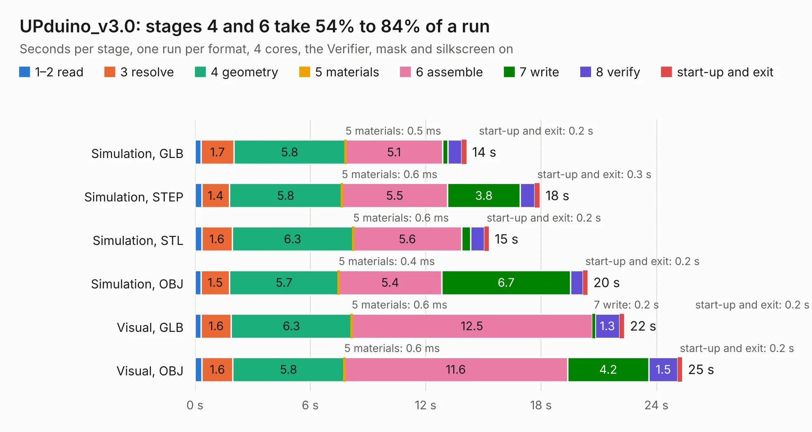

| Mode and format | 1–2 read | 3 resolve | 4 geometry | 5 materials | 6 assemble | 7 write | 8 verify | start-up and exit | Total |
|---|---:|---:|---:|---:|---:|---:|---:|---:|---:|
| Simulation, GLB | 0.3 | 1.7 | 5.8 | 0.5&nbsp;ms | 5.1 | 0.3 | 0.7 | 0.2 | 14.1 |
| Simulation, STEP | 0.4 | 1.4 | 5.8 | 0.6&nbsp;ms | 5.5 | 3.8 | 0.8 | 0.3 | 17.9 |
| Simulation, STL | 0.4 | 1.6 | 6.3 | 0.6&nbsp;ms | 5.6 | 0.5 | 0.7 | 0.2 | 15.3 |
| Simulation, OBJ | 0.3 | 1.5 | 5.7 | 0.4&nbsp;ms | 5.4 | 6.7 | 0.7 | 0.2 | 20.4 |
| Visual, GLB | 0.3 | 1.6 | 6.3 | 0.6&nbsp;ms | 12.5 | 0.2 | 1.3 | 0.2 | 22.3 |
| Visual, OBJ | 0.4 | 1.6 | 5.8 | 0.6&nbsp;ms | 11.6 | 4.2 | 1.5 | 0.2 | 25.3 |

<table align="center"><tr><td valign="top">

| Board | Repo: [tinyvision-ai-inc/upduino-v3.0](https://github.com/tinyvision-ai-inc/upduino-v3.0) Board: `UPduino_v3.0.kicad_pcb` |
|---|---|
| Folder | Board / v2.0 |
| Complexity | 342&nbsp;/&nbsp;1000 (size&nbsp;252, features&nbsp;90) |
| KESE&nbsp;features | through vias, slotted holes, custom pads, rounded, trapezoid or chamfered pads, filled zones, copper drawings, curved board outline |
| Tested | 9th November 2026 |
| Copper&nbsp;layers | 4 |
| File&nbsp;format | KiCad 5 (20171130) |
| Parts,&nbsp;tracks,&nbsp;vias | 83, 1,589, 122 |
| Triangles,&nbsp;simulation | 1,625,058 in 105 parts |
| Verifier | PASS in all six runs |

</td><td valign="top">

<table>
<tr><th>File type</th><th>File size</th><th>Peak memory used</th></tr>
<tr><th colspan="3" align="left">Simulation</th></tr>
<tr><td>GLB</td><td align="right">57&nbsp;MB</td><td align="right">587&nbsp;MB</td></tr>
<tr><td>STEP</td><td align="right">272&nbsp;MB</td><td align="right">692&nbsp;MB</td></tr>
<tr><td>STL</td><td align="right">81&nbsp;MB</td><td align="right">602&nbsp;MB</td></tr>
<tr><td>OBJ</td><td align="right">171&nbsp;MB</td><td align="right">1.1&nbsp;GB</td></tr>
<tr><th colspan="3" align="left">Visual</th></tr>
<tr><td>GLB</td><td align="right">35&nbsp;MB</td><td align="right">723&nbsp;MB</td></tr>
<tr><td>OBJ</td><td align="right">106&nbsp;MB</td><td align="right">807&nbsp;MB</td></tr>
</table>

</td></tr></table>

## 2823. UPduino_v3.0

| Mode and format | 1–2 read | 3 resolve | 4 geometry | 5 materials | 6 assemble | 7 write | 8 verify | start-up and exit | Total |
|---|---:|---:|---:|---:|---:|---:|---:|---:|---:|
| Simulation, GLB | 0.4 | 1.8 | 6.0 | 0.5&nbsp;ms | 5.7 | 0.2 | 0.7 | 0.2 | 15.1 |
| Simulation, STEP | 0.4 | 1.7 | 6.3 | 0.4&nbsp;ms | 5.9 | 3.7 | 0.8 | 0.3 | 19.1 |
| Simulation, STL | 0.3 | 1.8 | 6.3 | 0.5&nbsp;ms | 6.0 | 0.6 | 0.7 | 0.2 | 15.9 |
| Simulation, OBJ | 0.4 | 1.8 | 6.4 | 0.5&nbsp;ms | 5.9 | 7.6 | 0.9 | 0.3 | 23.2 |
| Visual, GLB | 0.4 | 1.9 | 6.1 | 0.6&nbsp;ms | 13.0 | 0.2 | 1.3 | 0.2 | 23.1 |
| Visual, OBJ | 0.4 | 1.7 | 6.4 | 0.3&nbsp;ms | 13.4 | 4.9 | 1.7 | 0.2 | 28.6 |

<table align="center"><tr><td valign="top">

| Board | Repo: [tinyvision-ai-inc/upduino-v3.0](https://github.com/tinyvision-ai-inc/upduino-v3.0) Board: `UPduino_v3.0.kicad_pcb` |
|---|---|
| Folder | Board / v3.0 |
| Complexity | 342&nbsp;/&nbsp;1000 (size&nbsp;252, features&nbsp;90) |
| KESE&nbsp;features | through vias, slotted holes, custom pads, rounded, trapezoid or chamfered pads, filled zones, copper drawings, curved board outline |
| Tested | 9th November 2026 |
| Copper&nbsp;layers | 4 |
| File&nbsp;format | KiCad 5 (20171130) |
| Parts,&nbsp;tracks,&nbsp;vias | 83, 1,585, 123 |
| Triangles,&nbsp;simulation | 1,629,942 in 105 parts |
| Verifier | PASS in all six runs |

</td><td valign="top">

<table>
<tr><th>File type</th><th>File size</th><th>Peak memory used</th></tr>
<tr><th colspan="3" align="left">Simulation</th></tr>
<tr><td>GLB</td><td align="right">57&nbsp;MB</td><td align="right">597&nbsp;MB</td></tr>
<tr><td>STEP</td><td align="right">272&nbsp;MB</td><td align="right">690&nbsp;MB</td></tr>
<tr><td>STL</td><td align="right">82&nbsp;MB</td><td align="right">597&nbsp;MB</td></tr>
<tr><td>OBJ</td><td align="right">172&nbsp;MB</td><td align="right">1.1&nbsp;GB</td></tr>
<tr><th colspan="3" align="left">Visual</th></tr>
<tr><td>GLB</td><td align="right">35&nbsp;MB</td><td align="right">770&nbsp;MB</td></tr>
<tr><td>OBJ</td><td align="right">106&nbsp;MB</td><td align="right">811&nbsp;MB</td></tr>
</table>

</td></tr></table>

## 2824. UPduino_v3.01

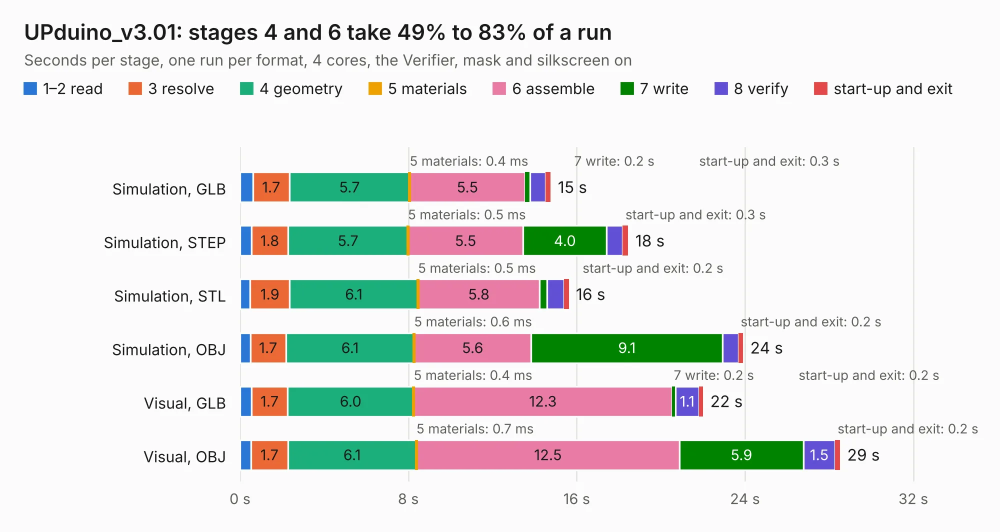

| Mode and format | 1–2 read | 3 resolve | 4 geometry | 5 materials | 6 assemble | 7 write | 8 verify | start-up and exit | Total |
|---|---:|---:|---:|---:|---:|---:|---:|---:|---:|
| Simulation, GLB | 0.6 | 1.7 | 5.7 | 0.4&nbsp;ms | 5.5 | 0.2 | 0.7 | 0.3 | 14.8 |
| Simulation, STEP | 0.5 | 1.8 | 5.7 | 0.5&nbsp;ms | 5.5 | 4.0 | 0.8 | 0.3 | 18.4 |
| Simulation, STL | 0.5 | 1.9 | 6.1 | 0.5&nbsp;ms | 5.8 | 0.4 | 0.8 | 0.2 | 15.6 |
| Simulation, OBJ | 0.5 | 1.7 | 6.1 | 0.6&nbsp;ms | 5.6 | 9.1 | 0.7 | 0.2 | 23.9 |
| Visual, GLB | 0.6 | 1.7 | 6.0 | 0.4&nbsp;ms | 12.3 | 0.2 | 1.1 | 0.2 | 22.0 |
| Visual, OBJ | 0.5 | 1.7 | 6.1 | 0.7&nbsp;ms | 12.5 | 5.9 | 1.5 | 0.2 | 28.5 |

<table align="center"><tr><td valign="top">

| Board | Repo: [tinyvision-ai-inc/upduino-v3.0](https://github.com/tinyvision-ai-inc/upduino-v3.0) Board: `UPduino_v3.01.kicad_pcb` |
|---|---|
| Folder | Board / v3.01 |
| Complexity | 342&nbsp;/&nbsp;1000 (size&nbsp;252, features&nbsp;90) |
| KESE&nbsp;features | through vias, slotted holes, custom pads, rounded, trapezoid or chamfered pads, filled zones, copper drawings, curved board outline |
| Tested | 9th November 2026 |
| Copper&nbsp;layers | 4 |
| File&nbsp;format | KiCad 8 (20240108) |
| Parts,&nbsp;tracks,&nbsp;vias | 83, 1,585, 123 |
| Triangles,&nbsp;simulation | 1,581,102 in 105 parts |
| Verifier | PASS in all six runs |

</td><td valign="top">

<table>
<tr><th>File type</th><th>File size</th><th>Peak memory used</th></tr>
<tr><th colspan="3" align="left">Simulation</th></tr>
<tr><td>GLB</td><td align="right">56&nbsp;MB</td><td align="right">581&nbsp;MB</td></tr>
<tr><td>STEP</td><td align="right">283&nbsp;MB</td><td align="right">695&nbsp;MB</td></tr>
<tr><td>STL</td><td align="right">79&nbsp;MB</td><td align="right">616&nbsp;MB</td></tr>
<tr><td>OBJ</td><td align="right">167&nbsp;MB</td><td align="right">1.1&nbsp;GB</td></tr>
<tr><th colspan="3" align="left">Visual</th></tr>
<tr><td>GLB</td><td align="right">34&nbsp;MB</td><td align="right">751&nbsp;MB</td></tr>
<tr><td>OBJ</td><td align="right">102&nbsp;MB</td><td align="right">774&nbsp;MB</td></tr>
</table>

</td></tr></table>

## 2825. Speeduino_base

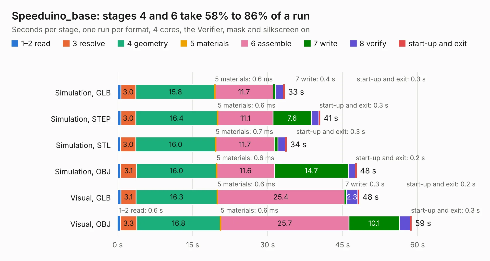

| Mode and format | 1–2 read | 3 resolve | 4 geometry | 5 materials | 6 assemble | 7 write | 8 verify | start-up and exit | Total |
|---|---:|---:|---:|---:|---:|---:|---:|---:|---:|
| Simulation, GLB | 0.6 | 3.0 | 15.8 | 0.6&nbsp;ms | 11.7 | 0.4 | 1.6 | 0.3 | 33.4 |
| Simulation, STEP | 0.6 | 3.0 | 16.4 | 0.6&nbsp;ms | 11.1 | 7.6 | 1.5 | 0.3 | 40.5 |
| Simulation, STL | 0.6 | 3.0 | 16.0 | 0.7&nbsp;ms | 11.7 | 0.7 | 1.5 | 0.3 | 33.8 |
| Simulation, OBJ | 0.6 | 3.1 | 16.0 | 0.6&nbsp;ms | 11.6 | 14.7 | 1.4 | 0.2 | 47.8 |
| Visual, GLB | 0.6 | 3.1 | 16.3 | 0.6&nbsp;ms | 25.4 | 0.3 | 2.3 | 0.2 | 48.3 |
| Visual, OBJ | 0.6 | 3.3 | 16.8 | 0.6&nbsp;ms | 25.7 | 10.1 | 2.2 | 0.3 | 58.8 |

<table align="center"><tr><td valign="top">

| Board | Repo: [tjeerdie/spectre](https://github.com/tjeerdie/spectre) Board: `Speeduino_base.kicad_pcb` |
|---|---|
| Folder | SPECTRE_V0.3 |
| Complexity | 249&nbsp;/&nbsp;1000 (size&nbsp;204, features&nbsp;45) |
| KESE&nbsp;features | through vias, rounded, trapezoid or chamfered pads, filled zones |
| Tested | 9th November 2026 |
| Copper&nbsp;layers | 2 |
| File&nbsp;format | KiCad 5 (20171130) |
| Parts,&nbsp;tracks,&nbsp;vias | 161, 2,568, 227 |
| Triangles,&nbsp;simulation | 2,573,754 in 189 parts |
| Verifier | PASS in all six runs |

</td><td valign="top">

<table>
<tr><th>File type</th><th>File size</th><th>Peak memory used</th></tr>
<tr><th colspan="3" align="left">Simulation</th></tr>
<tr><td>GLB</td><td align="right">89&nbsp;MB</td><td align="right">824&nbsp;MB</td></tr>
<tr><td>STEP</td><td align="right">483&nbsp;MB</td><td align="right">1.1&nbsp;GB</td></tr>
<tr><td>STL</td><td align="right">129&nbsp;MB</td><td align="right">810&nbsp;MB</td></tr>
<tr><td>OBJ</td><td align="right">274&nbsp;MB</td><td align="right">1.7&nbsp;GB</td></tr>
<tr><th colspan="3" align="left">Visual</th></tr>
<tr><td>GLB</td><td align="right">64&nbsp;MB</td><td align="right">1.2&nbsp;GB</td></tr>
<tr><td>OBJ</td><td align="right">199&nbsp;MB</td><td align="right">1.3&nbsp;GB</td></tr>
</table>

</td></tr></table>

## 2826. Speeduino_base

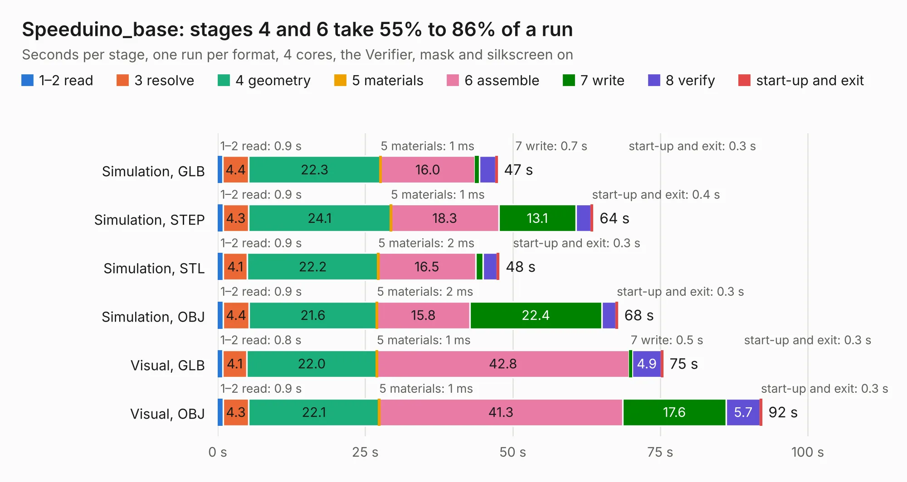

| Mode and format | 1–2 read | 3 resolve | 4 geometry | 5 materials | 6 assemble | 7 write | 8 verify | start-up and exit | Total |
|---|---:|---:|---:|---:|---:|---:|---:|---:|---:|
| Simulation, GLB | 0.9 | 4.4 | 22.3 | 1&nbsp;ms | 16.0 | 0.7 | 2.8 | 0.3 | 47.4 |
| Simulation, STEP | 0.9 | 4.3 | 24.1 | 1&nbsp;ms | 18.3 | 13.1 | 2.5 | 0.4 | 63.6 |
| Simulation, STL | 0.9 | 4.1 | 22.2 | 2&nbsp;ms | 16.5 | 1.3 | 2.4 | 0.3 | 47.7 |
| Simulation, OBJ | 0.9 | 4.4 | 21.6 | 2&nbsp;ms | 15.8 | 22.4 | 2.4 | 0.3 | 67.8 |
| Visual, GLB | 0.8 | 4.1 | 22.0 | 1&nbsp;ms | 42.8 | 0.5 | 4.9 | 0.3 | 75.5 |
| Visual, OBJ | 0.9 | 4.3 | 22.1 | 1&nbsp;ms | 41.3 | 17.6 | 5.7 | 0.3 | 92.2 |

<table align="center"><tr><td valign="top">

| Board | Repo: [tjeerdie/spectre](https://github.com/tjeerdie/spectre) Board: `Speeduino_base.kicad_pcb` |
|---|---|
| Folder | SPECTRE_V0.4 |
| Complexity | 261&nbsp;/&nbsp;1000 (size&nbsp;206, features&nbsp;55) |
| KESE&nbsp;features | through vias, rounded, trapezoid or chamfered pads, filled zones, curved board outline |
| Tested | 9th November 2026 |
| Copper&nbsp;layers | 2 |
| File&nbsp;format | KiCad 5 (20171130) |
| Parts,&nbsp;tracks,&nbsp;vias | 185, 2,262, 308 |
| Triangles,&nbsp;simulation | 3,444,736 in 206 parts |
| Verifier | PASS in all six runs |

</td><td valign="top">

<table>
<tr><th>File type</th><th>File size</th><th>Peak memory used</th></tr>
<tr><th colspan="3" align="left">Simulation</th></tr>
<tr><td>GLB</td><td align="right">119&nbsp;MB</td><td align="right">1.2&nbsp;GB</td></tr>
<tr><td>STEP</td><td align="right">644&nbsp;MB</td><td align="right">1.5&nbsp;GB</td></tr>
<tr><td>STL</td><td align="right">172&nbsp;MB</td><td align="right">1.2&nbsp;GB</td></tr>
<tr><td>OBJ</td><td align="right">367&nbsp;MB</td><td align="right">2.3&nbsp;GB</td></tr>
<tr><th colspan="3" align="left">Visual</th></tr>
<tr><td>GLB</td><td align="right">89&nbsp;MB</td><td align="right">1.5&nbsp;GB</td></tr>
<tr><td>OBJ</td><td align="right">280&nbsp;MB</td><td align="right">1.9&nbsp;GB</td></tr>
</table>

</td></tr></table>

## 2827. Speeduino_base

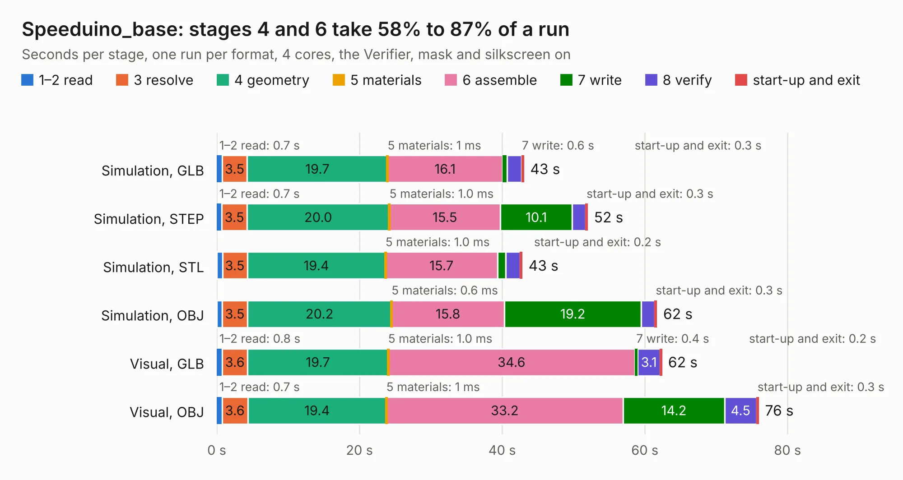

| Mode and format | 1–2 read | 3 resolve | 4 geometry | 5 materials | 6 assemble | 7 write | 8 verify | start-up and exit | Total |
|---|---:|---:|---:|---:|---:|---:|---:|---:|---:|
| Simulation, GLB | 0.7 | 3.5 | 19.7 | 1&nbsp;ms | 16.1 | 0.6 | 2.1 | 0.3 | 43.0 |
| Simulation, STEP | 0.7 | 3.5 | 20.0 | 1.0&nbsp;ms | 15.5 | 10.1 | 1.9 | 0.3 | 52.0 |
| Simulation, STL | 0.8 | 3.5 | 19.4 | 1.0&nbsp;ms | 15.7 | 1.1 | 2.1 | 0.2 | 42.8 |
| Simulation, OBJ | 0.8 | 3.5 | 20.2 | 0.6&nbsp;ms | 15.8 | 19.2 | 1.9 | 0.3 | 61.7 |
| Visual, GLB | 0.8 | 3.6 | 19.7 | 1.0&nbsp;ms | 34.6 | 0.4 | 3.1 | 0.2 | 62.4 |
| Visual, OBJ | 0.7 | 3.6 | 19.4 | 1&nbsp;ms | 33.2 | 14.2 | 4.5 | 0.3 | 75.9 |

<table align="center"><tr><td valign="top">

| Board | Repo: [tjeerdie/spectre](https://github.com/tjeerdie/spectre) Board: `Speeduino_base.kicad_pcb` |
|---|---|
| Folder | SPECTRE_V0.5.1 |
| Complexity | 264&nbsp;/&nbsp;1000 (size&nbsp;209, features&nbsp;55) |
| KESE&nbsp;features | through vias, rounded, trapezoid or chamfered pads, filled zones, curved board outline |
| Tested | 10th November 2026 |
| Copper&nbsp;layers | 2 |
| File&nbsp;format | KiCad 5 (20171130) |
| Parts,&nbsp;tracks,&nbsp;vias | 204, 2,483, 368 |
| Triangles,&nbsp;simulation | 3,634,522 in 217 parts |
| Verifier | PASS in all six runs |

</td><td valign="top">

<table>
<tr><th>File type</th><th>File size</th><th>Peak memory used</th></tr>
<tr><th colspan="3" align="left">Simulation</th></tr>
<tr><td>GLB</td><td align="right">126&nbsp;MB</td><td align="right">1.1&nbsp;GB</td></tr>
<tr><td>STEP</td><td align="right">687&nbsp;MB</td><td align="right">1.6&nbsp;GB</td></tr>
<tr><td>STL</td><td align="right">182&nbsp;MB</td><td align="right">1.1&nbsp;GB</td></tr>
<tr><td>OBJ</td><td align="right">388&nbsp;MB</td><td align="right">2.4&nbsp;GB</td></tr>
<tr><th colspan="3" align="left">Visual</th></tr>
<tr><td>GLB</td><td align="right">94&nbsp;MB</td><td align="right">1.6&nbsp;GB</td></tr>
<tr><td>OBJ</td><td align="right">295&nbsp;MB</td><td align="right">1.9&nbsp;GB</td></tr>
</table>

</td></tr></table>

## 2828. Speeduino_base

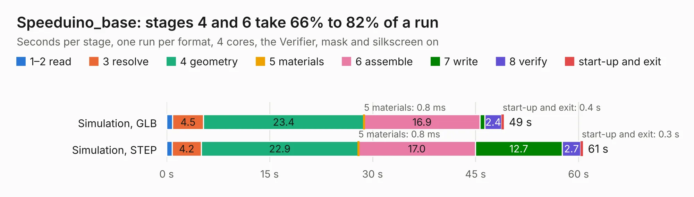

| Mode and format | 1–2 read | 3 resolve | 4 geometry | 5 materials | 6 assemble | 7 write | 8 verify | start-up and exit | Total |
|---|---:|---:|---:|---:|---:|---:|---:|---:|---:|
| Simulation, GLB | 0.9 | 4.5 | 23.4 | 0.8&nbsp;ms | 16.9 | 0.7 | 2.4 | 0.4 | 49.1 |
| Simulation, STEP | 0.8 | 4.2 | 22.9 | 0.8&nbsp;ms | 17.0 | 12.7 | 2.7 | 0.3 | 60.6 |
| Simulation, STL | 0.9 | 4.3 | 22.6 | 0.9&nbsp;ms | 17.1 | 1.5 | 2.7 | 0.3 | 49.4 |
| Simulation, OBJ | 0.9 | 4.2 | 23.0 | 1&nbsp;ms | 16.6 | 22.5 | 2.9 | 0.3 | 70.4 |
| Visual, GLB | 0.8 | 4.4 | 22.9 | 1&nbsp;ms | 47.8 | 0.6 | 7.1 | 0.3 | 83.9 |
| Visual, OBJ | 1.0 | 4.4 | 24.0 | 1&nbsp;ms | 46.7 | 16.2 | 6.8 | 0.3 | 99.4 |

<table align="center"><tr><td valign="top">

| Board | Repo: [tjeerdie/spectre](https://github.com/tjeerdie/spectre) Board: `Speeduino_base.kicad_pcb` |
|---|---|
| Folder | SPECTRE_V0.5.2 |
| Complexity | 267&nbsp;/&nbsp;1000 (size&nbsp;212, features&nbsp;55) |
| KESE&nbsp;features | through vias, rounded, trapezoid or chamfered pads, filled zones, curved board outline |
| Tested | 9th November 2026 |
| Copper&nbsp;layers | 2 |
| File&nbsp;format | KiCad 5 (20171130) |
| Parts,&nbsp;tracks,&nbsp;vias | 211, 3,015, 444 |
| Triangles,&nbsp;simulation | 4,220,042 in 275 parts |
| Verifier | PASS in all six runs |

</td><td valign="top">

<table>
<tr><th>File type</th><th>File size</th><th>Peak memory used</th></tr>
<tr><th colspan="3" align="left">Simulation</th></tr>
<tr><td>GLB</td><td align="right">145&nbsp;MB</td><td align="right">1.4&nbsp;GB</td></tr>
<tr><td>STEP</td><td align="right">789&nbsp;MB</td><td align="right">1.7&nbsp;GB</td></tr>
<tr><td>STL</td><td align="right">211&nbsp;MB</td><td align="right">1.4&nbsp;GB</td></tr>
<tr><td>OBJ</td><td align="right">451&nbsp;MB</td><td align="right">2.7&nbsp;GB</td></tr>
<tr><th colspan="3" align="left">Visual</th></tr>
<tr><td>GLB</td><td align="right">109&nbsp;MB</td><td align="right">1.8&nbsp;GB</td></tr>
<tr><td>OBJ</td><td align="right">341&nbsp;MB</td><td align="right">2.2&nbsp;GB</td></tr>
</table>

</td></tr></table>

## 2829. Speeduino_base

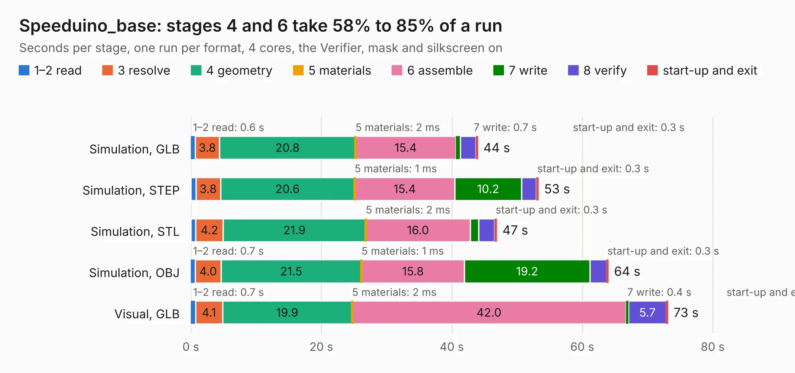

| Mode and format | 1–2 read | 3 resolve | 4 geometry | 5 materials | 6 assemble | 7 write | 8 verify | start-up and exit | Total |
|---|---:|---:|---:|---:|---:|---:|---:|---:|---:|
| Simulation, GLB | 0.6 | 3.8 | 20.8 | 2&nbsp;ms | 15.4 | 0.7 | 2.4 | 0.3 | 44.0 |
| Simulation, STEP | 0.8 | 3.8 | 20.6 | 1&nbsp;ms | 15.4 | 10.2 | 2.3 | 0.3 | 53.3 |
| Simulation, STL | 0.8 | 4.2 | 21.9 | 2&nbsp;ms | 16.0 | 1.3 | 2.5 | 0.3 | 46.9 |
| Simulation, OBJ | 0.7 | 4.0 | 21.5 | 1&nbsp;ms | 15.8 | 19.2 | 2.6 | 0.3 | 64.0 |
| Visual, GLB | 0.7 | 4.1 | 19.9 | 2&nbsp;ms | 42.0 | 0.4 | 5.7 | 0.3 | 73.1 |
| Visual, OBJ | 0.6 | 4.1 | 20.7 | 0.8&nbsp;ms | 42.9 | 13.9 | 5.3 | 0.3 | 87.8 |

<table align="center"><tr><td valign="top">

| Board | Repo: [tjeerdie/spectre](https://github.com/tjeerdie/spectre) Board: `Speeduino_base.kicad_pcb` |
|---|---|
| Folder | SPECTRE_V0.5.3 |
| Complexity | 268&nbsp;/&nbsp;1000 (size&nbsp;213, features&nbsp;55) |
| KESE&nbsp;features | through vias, rounded, trapezoid or chamfered pads, filled zones, curved board outline |
| Tested | 9th November 2026 |
| Copper&nbsp;layers | 2 |
| File&nbsp;format | KiCad 5 (20171130) |
| Parts,&nbsp;tracks,&nbsp;vias | 217, 3,070, 450 |
| Triangles,&nbsp;simulation | 4,263,228 in 282 parts |
| Verifier | PASS in all six runs |

</td><td valign="top">

<table>
<tr><th>File type</th><th>File size</th><th>Peak memory used</th></tr>
<tr><th colspan="3" align="left">Simulation</th></tr>
<tr><td>GLB</td><td align="right">147&nbsp;MB</td><td align="right">1.4&nbsp;GB</td></tr>
<tr><td>STEP</td><td align="right">799&nbsp;MB</td><td align="right">1.7&nbsp;GB</td></tr>
<tr><td>STL</td><td align="right">213&nbsp;MB</td><td align="right">1.4&nbsp;GB</td></tr>
<tr><td>OBJ</td><td align="right">456&nbsp;MB</td><td align="right">2.8&nbsp;GB</td></tr>
<tr><th colspan="3" align="left">Visual</th></tr>
<tr><td>GLB</td><td align="right">110&nbsp;MB</td><td align="right">1.8&nbsp;GB</td></tr>
<tr><td>OBJ</td><td align="right">346&nbsp;MB</td><td align="right">2.3&nbsp;GB</td></tr>
</table>

</td></tr></table>

## 2830. Speeduino_base

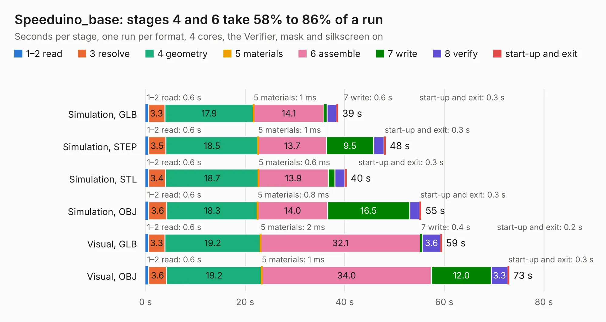

| Mode and format | 1–2 read | 3 resolve | 4 geometry | 5 materials | 6 assemble | 7 write | 8 verify | start-up and exit | Total |
|---|---:|---:|---:|---:|---:|---:|---:|---:|---:|
| Simulation, GLB | 0.6 | 3.3 | 17.9 | 1&nbsp;ms | 14.1 | 0.6 | 1.9 | 0.3 | 38.6 |
| Simulation, STEP | 0.6 | 3.5 | 18.5 | 1&nbsp;ms | 13.7 | 9.5 | 2.1 | 0.3 | 48.2 |
| Simulation, STL | 0.6 | 3.4 | 18.7 | 0.6&nbsp;ms | 13.9 | 1.3 | 2.0 | 0.3 | 40.3 |
| Simulation, OBJ | 0.6 | 3.6 | 18.3 | 0.8&nbsp;ms | 14.0 | 16.5 | 2.0 | 0.3 | 55.3 |
| Visual, GLB | 0.6 | 3.3 | 19.2 | 2&nbsp;ms | 32.1 | 0.4 | 3.6 | 0.2 | 59.5 |
| Visual, OBJ | 0.6 | 3.6 | 19.2 | 1&nbsp;ms | 34.0 | 12.0 | 3.3 | 0.3 | 73.0 |

<table align="center"><tr><td valign="top">

| Board | Repo: [tjeerdie/spectre](https://github.com/tjeerdie/spectre) Board: `Speeduino_base.kicad_pcb` |
|---|---|
| Folder | SPECTRE_V0.5.4 |
| Complexity | 262&nbsp;/&nbsp;1000 (size&nbsp;207, features&nbsp;55) |
| KESE&nbsp;features | through vias, rounded, trapezoid or chamfered pads, filled zones, curved board outline |
| Tested | 9th November 2026 |
| Copper&nbsp;layers | 2 |
| File&nbsp;format | KiCad 5 (20171130) |
| Parts,&nbsp;tracks,&nbsp;vias | 197, 1,996, 420 |
| Triangles,&nbsp;simulation | 3,873,032 in 281 parts |
| Verifier | PASS in all six runs |

</td><td valign="top">

<table>
<tr><th>File type</th><th>File size</th><th>Peak memory used</th></tr>
<tr><th colspan="3" align="left">Simulation</th></tr>
<tr><td>GLB</td><td align="right">133&nbsp;MB</td><td align="right">1.3&nbsp;GB</td></tr>
<tr><td>STEP</td><td align="right">709&nbsp;MB</td><td align="right">1.6&nbsp;GB</td></tr>
<tr><td>STL</td><td align="right">194&nbsp;MB</td><td align="right">1.3&nbsp;GB</td></tr>
<tr><td>OBJ</td><td align="right">415&nbsp;MB</td><td align="right">2.5&nbsp;GB</td></tr>
<tr><th colspan="3" align="left">Visual</th></tr>
<tr><td>GLB</td><td align="right">98&nbsp;MB</td><td align="right">1.8&nbsp;GB</td></tr>
<tr><td>OBJ</td><td align="right">306&nbsp;MB</td><td align="right">2.1&nbsp;GB</td></tr>
</table>

</td></tr></table>

## 2831. Speeduino_base

| Mode and format | 1–2 read | 3 resolve | 4 geometry | 5 materials | 6 assemble | 7 write | 8 verify | start-up and exit | Total |
|---|---:|---:|---:|---:|---:|---:|---:|---:|---:|
| Simulation, GLB | 0.7 | 3.8 | 18.1 | 1&nbsp;ms | 15.8 | 0.6 | 2.0 | 0.3 | 41.3 |
| Simulation, STEP | 0.7 | 3.7 | 18.2 | 1&nbsp;ms | 15.8 | 10.3 | 2.0 | 0.3 | 51.0 |
| Simulation, STL | 0.7 | 3.4 | 17.6 | 0.7&nbsp;ms | 14.9 | 1.4 | 1.9 | 0.3 | 40.2 |
| Simulation, OBJ | 0.7 | 3.7 | 18.5 | 0.6&nbsp;ms | 15.5 | 17.7 | 2.0 | 0.3 | 58.3 |
| Visual, GLB | 0.7 | 3.5 | 17.2 | 0.7&nbsp;ms | 34.3 | 0.4 | 4.6 | 0.3 | 61.0 |
| Visual, OBJ | 0.6 | 3.7 | 18.1 | 2&nbsp;ms | 34.9 | 13.1 | 4.6 | 0.2 | 75.2 |

<table align="center"><tr><td valign="top">

| Board | Repo: [tjeerdie/spectre](https://github.com/tjeerdie/spectre) Board: `Speeduino_base.kicad_pcb` |
|---|---|
| Folder | SPECTRE_V0.5 |
| Complexity | 265&nbsp;/&nbsp;1000 (size&nbsp;210, features&nbsp;55) |
| KESE&nbsp;features | through vias, rounded, trapezoid or chamfered pads, filled zones, curved board outline |
| Tested | 9th November 2026 |
| Copper&nbsp;layers | 2 |
| File&nbsp;format | KiCad 5 (20171130) |
| Parts,&nbsp;tracks,&nbsp;vias | 213, 2,582, 407 |
| Triangles,&nbsp;simulation | 3,773,130 in 220 parts |
| Verifier | PASS in all six runs |

</td><td valign="top">

<table>
<tr><th>File type</th><th>File size</th><th>Peak memory used</th></tr>
<tr><th colspan="3" align="left">Simulation</th></tr>
<tr><td>GLB</td><td align="right">130&nbsp;MB</td><td align="right">1.2&nbsp;GB</td></tr>
<tr><td>STEP</td><td align="right">713&nbsp;MB</td><td align="right">1.6&nbsp;GB</td></tr>
<tr><td>STL</td><td align="right">189&nbsp;MB</td><td align="right">1.2&nbsp;GB</td></tr>
<tr><td>OBJ</td><td align="right">403&nbsp;MB</td><td align="right">2.5&nbsp;GB</td></tr>
<tr><th colspan="3" align="left">Visual</th></tr>
<tr><td>GLB</td><td align="right">98&nbsp;MB</td><td align="right">1.6&nbsp;GB</td></tr>
<tr><td>OBJ</td><td align="right">308&nbsp;MB</td><td align="right">2.1&nbsp;GB</td></tr>
</table>

</td></tr></table>

## 2832. upsy-desky

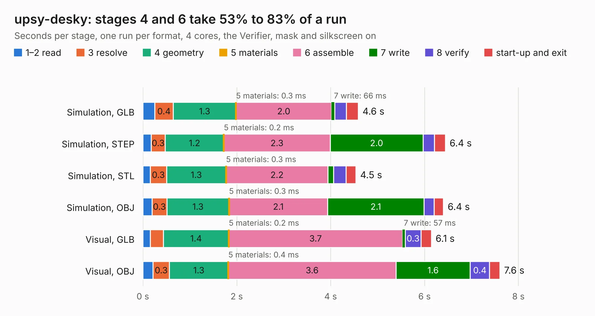

| Mode and format | 1–2 read | 3 resolve | 4 geometry | 5 materials | 6 assemble | 7 write | 8 verify | start-up and exit | Total |
|---|---:|---:|---:|---:|---:|---:|---:|---:|---:|
| Simulation, GLB | 0.3 | 0.4 | 1.3 | 0.3&nbsp;ms | 2.0 | 66&nbsp;ms | 0.2 | 0.3 | 4.6 |
| Simulation, STEP | 0.2 | 0.3 | 1.2 | 0.2&nbsp;ms | 2.3 | 2.0 | 0.2 | 0.2 | 6.4 |
| Simulation, STL | 0.2 | 0.3 | 1.3 | 0.3&nbsp;ms | 2.2 | 0.1 | 0.3 | 0.2 | 4.5 |
| Simulation, OBJ | 0.2 | 0.3 | 1.3 | 0.3&nbsp;ms | 2.1 | 2.1 | 0.2 | 0.2 | 6.4 |
| Visual, GLB | 0.2 | 0.3 | 1.4 | 0.2&nbsp;ms | 3.7 | 57&nbsp;ms | 0.3 | 0.2 | 6.1 |
| Visual, OBJ | 0.2 | 0.3 | 1.3 | 0.4&nbsp;ms | 3.6 | 1.6 | 0.4 | 0.2 | 7.6 |

<table align="center"><tr><td valign="top">

| Board | Repo: [tjhorner/upsy-desky](https://github.com/tjhorner/upsy-desky) Board: `upsy-desky.kicad_pcb` |
|---|---|
| Folder | pcb |
| Complexity | 286&nbsp;/&nbsp;1000 (size&nbsp;201, features&nbsp;85) |
| KESE&nbsp;features | through vias, slotted holes, rounded, trapezoid or chamfered pads, filled zones, stack-up, dielectric εr and tanδ |
| Tested | 9th November 2026 |
| Copper&nbsp;layers | 2 |
| File&nbsp;format | KiCad 8 (20240108) |
| Parts,&nbsp;tracks,&nbsp;vias | 44, 391, 48 |
| Triangles,&nbsp;simulation | 447,552 in 85 parts |
| Verifier | PASS in all six runs |

</td><td valign="top">

<table>
<tr><th>File type</th><th>File size</th><th>Peak memory used</th></tr>
<tr><th colspan="3" align="left">Simulation</th></tr>
<tr><td>GLB</td><td align="right">15&nbsp;MB</td><td align="right">326&nbsp;MB</td></tr>
<tr><td>STEP</td><td align="right">74&nbsp;MB</td><td align="right">351&nbsp;MB</td></tr>
<tr><td>STL</td><td align="right">22&nbsp;MB</td><td align="right">306&nbsp;MB</td></tr>
<tr><td>OBJ</td><td align="right">45&nbsp;MB</td><td align="right">365&nbsp;MB</td></tr>
<tr><th colspan="3" align="left">Visual</th></tr>
<tr><td>GLB</td><td align="right">12&nbsp;MB</td><td align="right">389&nbsp;MB</td></tr>
<tr><td>OBJ</td><td align="right">35&nbsp;MB</td><td align="right">390&nbsp;MB</td></tr>
</table>

</td></tr></table>

## 2833. CM4IOv5

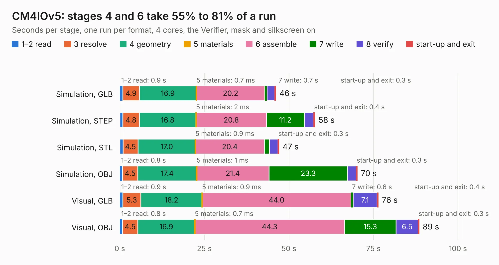

| Mode and format | 1–2 read | 3 resolve | 4 geometry | 5 materials | 6 assemble | 7 write | 8 verify | start-up and exit | Total |
|---|---:|---:|---:|---:|---:|---:|---:|---:|---:|
| Simulation, GLB | 0.9 | 4.9 | 16.9 | 0.7&nbsp;ms | 20.2 | 0.7 | 2.3 | 0.3 | 46.1 |
| Simulation, STEP | 0.9 | 4.8 | 16.8 | 2&nbsp;ms | 20.8 | 11.2 | 2.7 | 0.4 | 57.7 |
| Simulation, STL | 0.9 | 4.5 | 17.0 | 0.9&nbsp;ms | 20.4 | 1.5 | 2.6 | 0.3 | 47.1 |
| Simulation, OBJ | 0.8 | 4.5 | 17.4 | 1&nbsp;ms | 21.4 | 23.3 | 2.6 | 0.3 | 70.2 |
| Visual, GLB | 0.9 | 5.3 | 18.2 | 0.9&nbsp;ms | 44.0 | 0.6 | 7.1 | 0.4 | 76.5 |
| Visual, OBJ | 0.8 | 4.5 | 16.9 | 0.7&nbsp;ms | 44.3 | 15.3 | 6.5 | 0.3 | 88.5 |

<table align="center"><tr><td valign="top">

| Board | Repo: [tlalexander/rpi-cm4-switch-board](https://github.com/tlalexander/rpi-cm4-switch-board) Board: `CM4IOv5.kicad_pcb` |
|---|---|
| Folder | CM4IO |
| Complexity | 409&nbsp;/&nbsp;1000 (size&nbsp;274, features&nbsp;135) |
| KESE&nbsp;features | through vias, slotted holes, custom pads, rounded, trapezoid or chamfered pads, filled zones, copper drawings, copper text, curved board outline, stack-up, dielectric εr and tanδ, mask and silkscreen colours |
| Tested | 9th November 2026 |
| Copper&nbsp;layers | 4 |
| File&nbsp;format | KiCad 6 (20201002) |
| Parts,&nbsp;tracks,&nbsp;vias | 137, 5,669, 782 |
| Triangles,&nbsp;simulation | 4,961,408 in 261 parts |
| Verifier | PASS in all six runs |

</td><td valign="top">

<table>
<tr><th>File type</th><th>File size</th><th>Peak memory used</th></tr>
<tr><th colspan="3" align="left">Simulation</th></tr>
<tr><td>GLB</td><td align="right">166&nbsp;MB</td><td align="right">1.4&nbsp;GB</td></tr>
<tr><td>STEP</td><td align="right">690&nbsp;MB</td><td align="right">2.0&nbsp;GB</td></tr>
<tr><td>STL</td><td align="right">248&nbsp;MB</td><td align="right">1.4&nbsp;GB</td></tr>
<tr><td>OBJ</td><td align="right">523&nbsp;MB</td><td align="right">3.2&nbsp;GB</td></tr>
<tr><th colspan="3" align="left">Visual</th></tr>
<tr><td>GLB</td><td align="right">116&nbsp;MB</td><td align="right">1.9&nbsp;GB</td></tr>
<tr><td>OBJ</td><td align="right">368&nbsp;MB</td><td align="right">2.4&nbsp;GB</td></tr>
</table>

</td></tr></table>

## 2834. rpi-cm4-switch-board

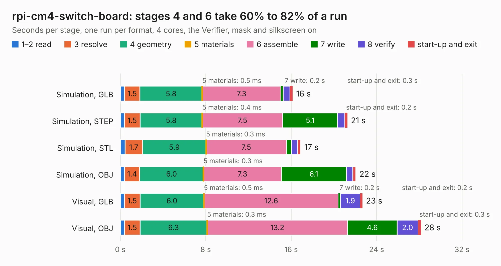

| Mode and format | 1–2 read | 3 resolve | 4 geometry | 5 materials | 6 assemble | 7 write | 8 verify | start-up and exit | Total |
|---|---:|---:|---:|---:|---:|---:|---:|---:|---:|
| Simulation, GLB | 0.4 | 1.5 | 5.8 | 0.5&nbsp;ms | 7.3 | 0.2 | 0.6 | 0.3 | 16.1 |
| Simulation, STEP | 0.4 | 1.5 | 5.8 | 0.4&nbsp;ms | 7.5 | 5.1 | 0.7 | 0.2 | 21.3 |
| Simulation, STL | 0.4 | 1.7 | 5.9 | 0.3&nbsp;ms | 7.5 | 0.5 | 0.6 | 0.3 | 16.9 |
| Simulation, OBJ | 0.4 | 1.4 | 6.0 | 0.3&nbsp;ms | 7.3 | 6.1 | 0.6 | 0.3 | 22.1 |
| Visual, GLB | 0.4 | 1.5 | 6.0 | 0.5&nbsp;ms | 12.6 | 0.2 | 1.9 | 0.2 | 22.7 |
| Visual, OBJ | 0.4 | 1.5 | 6.3 | 0.3&nbsp;ms | 13.2 | 4.6 | 2.0 | 0.3 | 28.1 |

<table align="center"><tr><td valign="top">

| Board | Repo: [tlalexander/rpi-cm4-switch-board](https://github.com/tlalexander/rpi-cm4-switch-board) Board: `rpi-cm4-switch-board.kicad_pcb` |
|---|---|
| Folder | hardware / rpi-cm4-switch-board |
| Complexity | 326&nbsp;/&nbsp;1000 (size&nbsp;221, features&nbsp;105) |
| KESE&nbsp;features | through vias, slotted holes, rounded, trapezoid or chamfered pads, arc tracks, filled zones, stack-up, dielectric εr and tanδ, mask and silkscreen colours |
| Tested | 9th November 2026 |
| Copper&nbsp;layers | 2 |
| File&nbsp;format | KiCad 6 (20210722) |
| Parts,&nbsp;tracks,&nbsp;vias | 94, 1,008, 34 |
| Triangles,&nbsp;simulation | 1,474,964 in 156 parts |
| Verifier | PASS in all six runs |

</td><td valign="top">

<table>
<tr><th>File type</th><th>File size</th><th>Peak memory used</th></tr>
<tr><th colspan="3" align="left">Simulation</th></tr>
<tr><td>GLB</td><td align="right">51&nbsp;MB</td><td align="right">651&nbsp;MB</td></tr>
<tr><td>STEP</td><td align="right">276&nbsp;MB</td><td align="right">738&nbsp;MB</td></tr>
<tr><td>STL</td><td align="right">74&nbsp;MB</td><td align="right">651&nbsp;MB</td></tr>
<tr><td>OBJ</td><td align="right">152&nbsp;MB</td><td align="right">984&nbsp;MB</td></tr>
<tr><th colspan="3" align="left">Visual</th></tr>
<tr><td>GLB</td><td align="right">39&nbsp;MB</td><td align="right">751&nbsp;MB</td></tr>
<tr><td>OBJ</td><td align="right">118&nbsp;MB</td><td align="right">884&nbsp;MB</td></tr>
</table>

</td></tr></table>

## 2835. add_sub

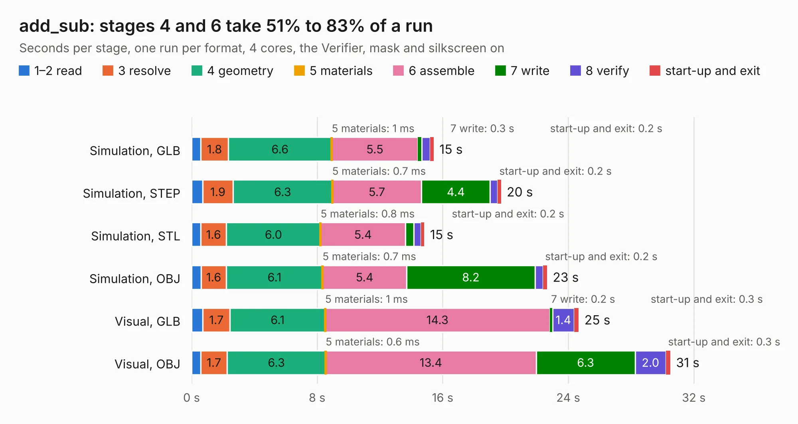

| Mode and format | 1–2 read | 3 resolve | 4 geometry | 5 materials | 6 assemble | 7 write | 8 verify | start-up and exit | Total |
|---|---:|---:|---:|---:|---:|---:|---:|---:|---:|
| Simulation, GLB | 0.6 | 1.8 | 6.6 | 1&nbsp;ms | 5.5 | 0.3 | 0.5 | 0.2 | 15.4 |
| Simulation, STEP | 0.7 | 1.9 | 6.3 | 0.7&nbsp;ms | 5.7 | 4.4 | 0.5 | 0.2 | 19.7 |
| Simulation, STL | 0.6 | 1.6 | 6.0 | 0.8&nbsp;ms | 5.4 | 0.5 | 0.5 | 0.2 | 14.8 |
| Simulation, OBJ | 0.6 | 1.6 | 6.1 | 0.7&nbsp;ms | 5.4 | 8.2 | 0.5 | 0.2 | 22.6 |
| Visual, GLB | 0.7 | 1.7 | 6.1 | 1&nbsp;ms | 14.3 | 0.2 | 1.4 | 0.3 | 24.7 |
| Visual, OBJ | 0.6 | 1.7 | 6.3 | 0.6&nbsp;ms | 13.4 | 6.3 | 2.0 | 0.3 | 30.5 |

<table align="center"><tr><td valign="top">

| Board | Repo: [tmarhguy/alu](https://github.com/tmarhguy/alu) Board: `add_sub.kicad_pcb` |
|---|---|
| Folder | schematics / kicad / boards / add_sub |
| Complexity | 84&nbsp;/&nbsp;1000 (size&nbsp;74, features&nbsp;10) |
| KESE&nbsp;features | rounded, trapezoid or chamfered pads |
| Tested | 9th November 2026 |
| Copper&nbsp;layers | 2 |
| File&nbsp;format | KiCad 9 (20241229) |
| Parts,&nbsp;tracks,&nbsp;vias | 200, 0, 0 |
| Triangles,&nbsp;simulation | 1,454,268 in 244 parts |
| Note | mostly unrouted |
| Verifier | PASS in all six runs |

</td><td valign="top">

<table>
<tr><th>File type</th><th>File size</th><th>Peak memory used</th></tr>
<tr><th colspan="3" align="left">Simulation</th></tr>
<tr><td>GLB</td><td align="right">49&nbsp;MB</td><td align="right">588&nbsp;MB</td></tr>
<tr><td>STEP</td><td align="right">235&nbsp;MB</td><td align="right">784&nbsp;MB</td></tr>
<tr><td>STL</td><td align="right">73&nbsp;MB</td><td align="right">583&nbsp;MB</td></tr>
<tr><td>OBJ</td><td align="right">154&nbsp;MB</td><td align="right">1.0&nbsp;GB</td></tr>
<tr><th colspan="3" align="left">Visual</th></tr>
<tr><td>GLB</td><td align="right">41&nbsp;MB</td><td align="right">992&nbsp;MB</td></tr>
<tr><td>OBJ</td><td align="right">123&nbsp;MB</td><td align="right">849&nbsp;MB</td></tr>
</table>

</td></tr></table>

## 2836. flags

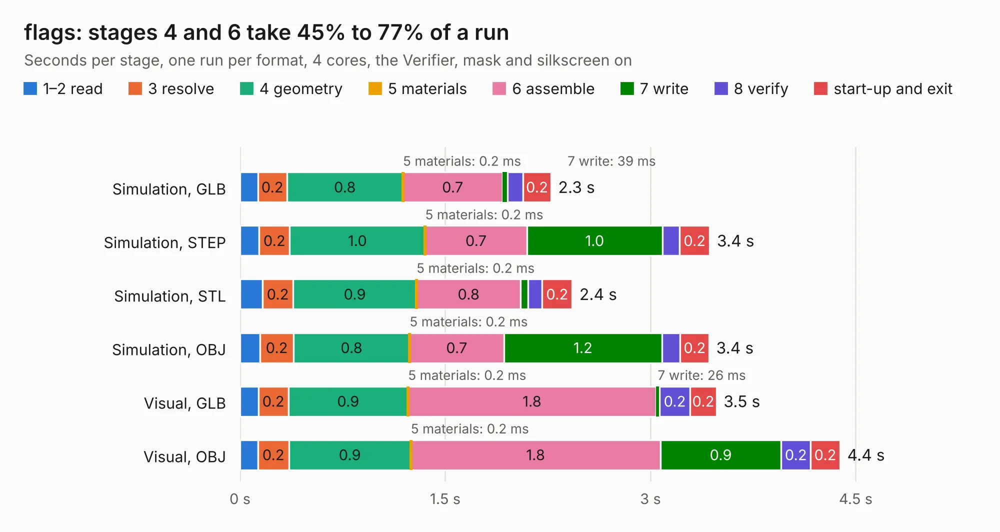

| Mode and format | 1–2 read | 3 resolve | 4 geometry | 5 materials | 6 assemble | 7 write | 8 verify | start-up and exit | Total |
|---|---:|---:|---:|---:|---:|---:|---:|---:|---:|
| Simulation, GLB | 0.1 | 0.2 | 0.8 | 0.2&nbsp;ms | 0.7 | 39&nbsp;ms | 0.1 | 0.2 | 2.3 |
| Simulation, STEP | 0.1 | 0.2 | 1.0 | 0.2&nbsp;ms | 0.7 | 1.0 | 0.1 | 0.2 | 3.4 |
| Simulation, STL | 0.2 | 0.2 | 0.9 | 0.2&nbsp;ms | 0.8 | 53&nbsp;ms | 0.1 | 0.2 | 2.4 |
| Simulation, OBJ | 0.1 | 0.2 | 0.8 | 0.2&nbsp;ms | 0.7 | 1.2 | 0.1 | 0.2 | 3.4 |
| Visual, GLB | 0.1 | 0.2 | 0.9 | 0.2&nbsp;ms | 1.8 | 26&nbsp;ms | 0.2 | 0.2 | 3.5 |
| Visual, OBJ | 0.1 | 0.2 | 0.9 | 0.2&nbsp;ms | 1.8 | 0.9 | 0.2 | 0.2 | 4.4 |

<table align="center"><tr><td valign="top">

| Board | Repo: [tmarhguy/alu](https://github.com/tmarhguy/alu) Board: `flags.kicad_pcb` |
|---|---|
| Folder | schematics / kicad / boards / flags |
| Complexity | 62&nbsp;/&nbsp;1000 (size&nbsp;52, features&nbsp;10) |
| KESE&nbsp;features | rounded, trapezoid or chamfered pads |
| Tested | 9th November 2026 |
| Copper&nbsp;layers | 2 |
| File&nbsp;format | KiCad 9 (20241229) |
| Parts,&nbsp;tracks,&nbsp;vias | 26, 0, 0 |
| Triangles,&nbsp;simulation | 227,560 in 61 parts |
| Verifier | PASS in all six runs |

</td><td valign="top">

<table>
<tr><th>File type</th><th>File size</th><th>Peak memory used</th></tr>
<tr><th colspan="3" align="left">Simulation</th></tr>
<tr><td>GLB</td><td align="right">7.6&nbsp;MB</td><td align="right">216&nbsp;MB</td></tr>
<tr><td>STEP</td><td align="right">32&nbsp;MB</td><td align="right">241&nbsp;MB</td></tr>
<tr><td>STL</td><td align="right">11&nbsp;MB</td><td align="right">222&nbsp;MB</td></tr>
<tr><td>OBJ</td><td align="right">23&nbsp;MB</td><td align="right">216&nbsp;MB</td></tr>
<tr><th colspan="3" align="left">Visual</th></tr>
<tr><td>GLB</td><td align="right">5.7&nbsp;MB</td><td align="right">258&nbsp;MB</td></tr>
<tr><td>OBJ</td><td align="right">16&nbsp;MB</td><td align="right">273&nbsp;MB</td></tr>
</table>

</td></tr></table>

## 2837. led_panel_1

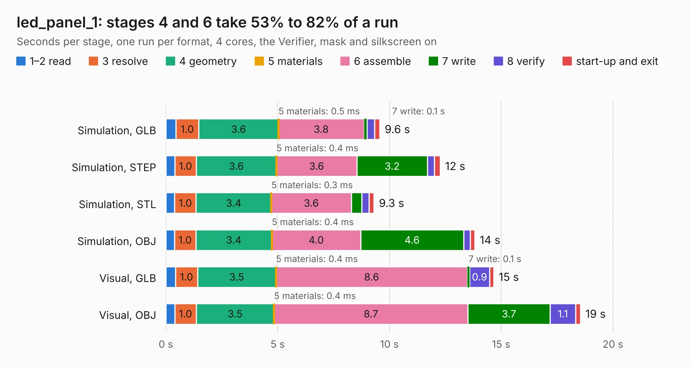

| Mode and format | 1–2 read | 3 resolve | 4 geometry | 5 materials | 6 assemble | 7 write | 8 verify | start-up and exit | Total |
|---|---:|---:|---:|---:|---:|---:|---:|---:|---:|
| Simulation, GLB | 0.4 | 1.0 | 3.6 | 0.5&nbsp;ms | 3.8 | 0.1 | 0.3 | 0.2 | 9.6 |
| Simulation, STEP | 0.4 | 1.0 | 3.6 | 0.4&nbsp;ms | 3.6 | 3.2 | 0.3 | 0.3 | 12.3 |
| Simulation, STL | 0.4 | 1.0 | 3.4 | 0.3&nbsp;ms | 3.6 | 0.5 | 0.3 | 0.2 | 9.3 |
| Simulation, OBJ | 0.4 | 1.0 | 3.4 | 0.4&nbsp;ms | 4.0 | 4.6 | 0.3 | 0.2 | 13.8 |
| Visual, GLB | 0.4 | 1.0 | 3.5 | 0.4&nbsp;ms | 8.6 | 0.1 | 0.9 | 0.2 | 14.7 |
| Visual, OBJ | 0.4 | 1.0 | 3.5 | 0.4&nbsp;ms | 8.7 | 3.7 | 1.1 | 0.2 | 18.5 |

<table align="center"><tr><td valign="top">

| Board | Repo: [tmarhguy/alu](https://github.com/tmarhguy/alu) Board: `led_panel_1.kicad_pcb` |
|---|---|
| Folder | schematics / kicad / boards / led_panel / led_panel_1 |
| Complexity | 208&nbsp;/&nbsp;1000 (size&nbsp;183, features&nbsp;25) |
| KESE&nbsp;features | through vias, rounded, trapezoid or chamfered pads |
| Tested | 9th November 2026 |
| Copper&nbsp;layers | 2 |
| File&nbsp;format | KiCad 9 (20241229) |
| Parts,&nbsp;tracks,&nbsp;vias | 131, 713, 92 |
| Triangles,&nbsp;simulation | 885,558 in 82 parts |
| Note | panel |
| Verifier | PASS in all six runs |

</td><td valign="top">

<table>
<tr><th>File type</th><th>File size</th><th>Peak memory used</th></tr>
<tr><th colspan="3" align="left">Simulation</th></tr>
<tr><td>GLB</td><td align="right">30&nbsp;MB</td><td align="right">492&nbsp;MB</td></tr>
<tr><td>STEP</td><td align="right">167&nbsp;MB</td><td align="right">565&nbsp;MB</td></tr>
<tr><td>STL</td><td align="right">44&nbsp;MB</td><td align="right">493&nbsp;MB</td></tr>
<tr><td>OBJ</td><td align="right">90&nbsp;MB</td><td align="right">631&nbsp;MB</td></tr>
<tr><th colspan="3" align="left">Visual</th></tr>
<tr><td>GLB</td><td align="right">25&nbsp;MB</td><td align="right">564&nbsp;MB</td></tr>
<tr><td>OBJ</td><td align="right">74&nbsp;MB</td><td align="right">703&nbsp;MB</td></tr>
</table>

</td></tr></table>

## 2838. led_panel_2

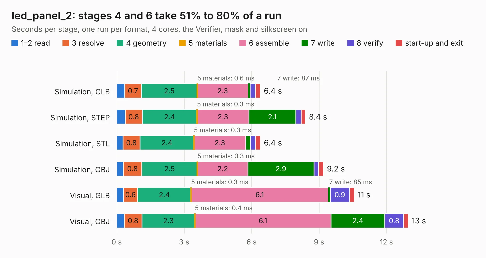

| Mode and format | 1–2 read | 3 resolve | 4 geometry | 5 materials | 6 assemble | 7 write | 8 verify | start-up and exit | Total |
|---|---:|---:|---:|---:|---:|---:|---:|---:|---:|
| Simulation, GLB | 0.4 | 0.7 | 2.5 | 0.6&nbsp;ms | 2.3 | 87&nbsp;ms | 0.2 | 0.2 | 6.4 |
| Simulation, STEP | 0.4 | 0.8 | 2.4 | 0.3&nbsp;ms | 2.3 | 2.1 | 0.2 | 0.2 | 8.4 |
| Simulation, STL | 0.3 | 0.8 | 2.4 | 0.3&nbsp;ms | 2.3 | 0.2 | 0.2 | 0.2 | 6.4 |
| Simulation, OBJ | 0.3 | 0.8 | 2.5 | 0.3&nbsp;ms | 2.2 | 2.9 | 0.2 | 0.2 | 9.2 |
| Visual, GLB | 0.3 | 0.6 | 2.4 | 0.3&nbsp;ms | 6.1 | 85&nbsp;ms | 0.9 | 0.2 | 10.6 |
| Visual, OBJ | 0.3 | 0.8 | 2.3 | 0.4&nbsp;ms | 6.1 | 2.4 | 0.8 | 0.2 | 13.0 |

<table align="center"><tr><td valign="top">

| Board | Repo: [tmarhguy/alu](https://github.com/tmarhguy/alu) Board: `led_panel_2.kicad_pcb` |
|---|---|
| Folder | schematics / kicad / boards / led_panel / led_panel_2 |
| Complexity | 80&nbsp;/&nbsp;1000 (size&nbsp;70, features&nbsp;10) |
| KESE&nbsp;features | rounded, trapezoid or chamfered pads |
| Tested | 9th November 2026 |
| Copper&nbsp;layers | 2 |
| File&nbsp;format | KiCad 9 (20241229) |
| Parts,&nbsp;tracks,&nbsp;vias | 129, 0, 0 |
| Triangles,&nbsp;simulation | 644,854 in 91 parts |
| Note | panel, mostly unrouted |
| Verifier | PASS in all six runs |

</td><td valign="top">

<table>
<tr><th>File type</th><th>File size</th><th>Peak memory used</th></tr>
<tr><th colspan="3" align="left">Simulation</th></tr>
<tr><td>GLB</td><td align="right">22&nbsp;MB</td><td align="right">425&nbsp;MB</td></tr>
<tr><td>STEP</td><td align="right">111&nbsp;MB</td><td align="right">477&nbsp;MB</td></tr>
<tr><td>STL</td><td align="right">32&nbsp;MB</td><td align="right">395&nbsp;MB</td></tr>
<tr><td>OBJ</td><td align="right">67&nbsp;MB</td><td align="right">484&nbsp;MB</td></tr>
<tr><th colspan="3" align="left">Visual</th></tr>
<tr><td>GLB</td><td align="right">20&nbsp;MB</td><td align="right">525&nbsp;MB</td></tr>
<tr><td>OBJ</td><td align="right">59&nbsp;MB</td><td align="right">527&nbsp;MB</td></tr>
</table>

</td></tr></table>

## 2839. led_panel_3

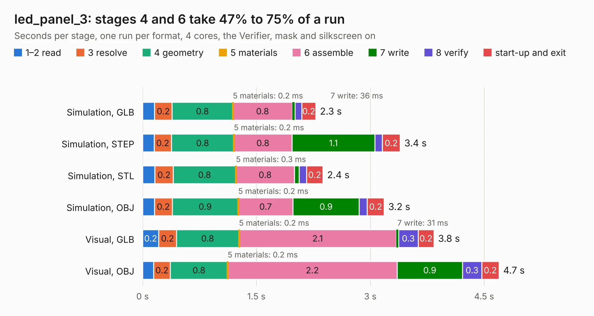

| Mode and format | 1–2 read | 3 resolve | 4 geometry | 5 materials | 6 assemble | 7 write | 8 verify | start-up and exit | Total |
|---|---:|---:|---:|---:|---:|---:|---:|---:|---:|
| Simulation, GLB | 0.2 | 0.2 | 0.8 | 0.2&nbsp;ms | 0.8 | 36&nbsp;ms | 89&nbsp;ms | 0.2 | 2.3 |
| Simulation, STEP | 0.2 | 0.2 | 0.8 | 0.2&nbsp;ms | 0.8 | 1.1 | 96&nbsp;ms | 0.2 | 3.4 |
| Simulation, STL | 0.2 | 0.2 | 0.8 | 0.3&nbsp;ms | 0.8 | 64&nbsp;ms | 96&nbsp;ms | 0.2 | 2.4 |
| Simulation, OBJ | 0.2 | 0.2 | 0.9 | 0.2&nbsp;ms | 0.7 | 0.9 | 0.1 | 0.2 | 3.2 |
| Visual, GLB | 0.2 | 0.2 | 0.8 | 0.2&nbsp;ms | 2.1 | 31&nbsp;ms | 0.3 | 0.2 | 3.8 |
| Visual, OBJ | 0.1 | 0.2 | 0.8 | 0.2&nbsp;ms | 2.2 | 0.9 | 0.3 | 0.2 | 4.7 |

<table align="center"><tr><td valign="top">

| Board | Repo: [tmarhguy/alu](https://github.com/tmarhguy/alu) Board: `led_panel_3.kicad_pcb` |
|---|---|
| Folder | schematics / kicad / boards / led_panel / led_panel_3 |
| Complexity | 66&nbsp;/&nbsp;1000 (size&nbsp;56, features&nbsp;10) |
| KESE&nbsp;features | rounded, trapezoid or chamfered pads |
| Tested | 9th November 2026 |
| Copper&nbsp;layers | 2 |
| File&nbsp;format | KiCad 9 (20241229) |
| Parts,&nbsp;tracks,&nbsp;vias | 35, 0, 0 |
| Triangles,&nbsp;simulation | 209,734 in 47 parts |
| Note | panel |
| Verifier | PASS in all six runs |

</td><td valign="top">

<table>
<tr><th>File type</th><th>File size</th><th>Peak memory used</th></tr>
<tr><th colspan="3" align="left">Simulation</th></tr>
<tr><td>GLB</td><td align="right">7.2&nbsp;MB</td><td align="right">227&nbsp;MB</td></tr>
<tr><td>STEP</td><td align="right">32&nbsp;MB</td><td align="right">238&nbsp;MB</td></tr>
<tr><td>STL</td><td align="right">10&nbsp;MB</td><td align="right">220&nbsp;MB</td></tr>
<tr><td>OBJ</td><td align="right">21&nbsp;MB</td><td align="right">229&nbsp;MB</td></tr>
<tr><th colspan="3" align="left">Visual</th></tr>
<tr><td>GLB</td><td align="right">5.9&nbsp;MB</td><td align="right">229&nbsp;MB</td></tr>
<tr><td>OBJ</td><td align="right">17&nbsp;MB</td><td align="right">238&nbsp;MB</td></tr>
</table>

</td></tr></table>

## 2840. main_control

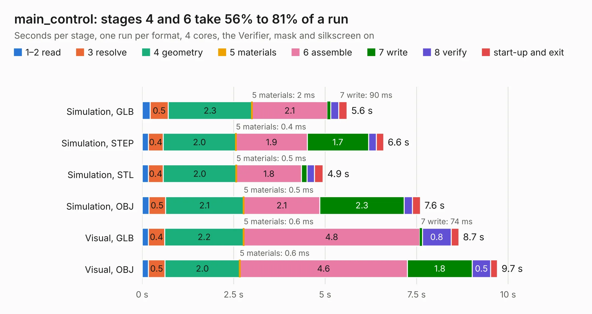

| Mode and format | 1–2 read | 3 resolve | 4 geometry | 5 materials | 6 assemble | 7 write | 8 verify | start-up and exit | Total |
|---|---:|---:|---:|---:|---:|---:|---:|---:|---:|
| Simulation, GLB | 0.2 | 0.5 | 2.3 | 2&nbsp;ms | 2.1 | 90&nbsp;ms | 0.2 | 0.2 | 5.6 |
| Simulation, STEP | 0.2 | 0.4 | 2.0 | 0.4&nbsp;ms | 1.9 | 1.7 | 0.2 | 0.2 | 6.6 |
| Simulation, STL | 0.2 | 0.4 | 2.0 | 0.5&nbsp;ms | 1.8 | 0.2 | 0.2 | 0.2 | 4.9 |
| Simulation, OBJ | 0.2 | 0.5 | 2.1 | 0.5&nbsp;ms | 2.1 | 2.3 | 0.2 | 0.2 | 7.6 |
| Visual, GLB | 0.2 | 0.4 | 2.2 | 0.6&nbsp;ms | 4.8 | 74&nbsp;ms | 0.8 | 0.2 | 8.7 |
| Visual, OBJ | 0.2 | 0.5 | 2.0 | 0.6&nbsp;ms | 4.6 | 1.8 | 0.5 | 0.2 | 9.7 |

<table align="center"><tr><td valign="top">

| Board | Repo: [tmarhguy/alu](https://github.com/tmarhguy/alu) Board: `main_control.kicad_pcb` |
|---|---|
| Folder | schematics / kicad / boards / main_control |
| Complexity | 68&nbsp;/&nbsp;1000 (size&nbsp;58, features&nbsp;10) |
| KESE&nbsp;features | rounded, trapezoid or chamfered pads |
| Tested | 9th November 2026 |
| Copper&nbsp;layers | 2 |
| File&nbsp;format | KiCad 9 (20241229) |
| Parts,&nbsp;tracks,&nbsp;vias | 42, 0, 0 |
| Triangles,&nbsp;simulation | 561,324 in 172 parts |
| Note | mostly unrouted |
| Verifier | PASS in all six runs |

</td><td valign="top">

<table>
<tr><th>File type</th><th>File size</th><th>Peak memory used</th></tr>
<tr><th colspan="3" align="left">Simulation</th></tr>
<tr><td>GLB</td><td align="right">19&nbsp;MB</td><td align="right">317&nbsp;MB</td></tr>
<tr><td>STEP</td><td align="right">88&nbsp;MB</td><td align="right">397&nbsp;MB</td></tr>
<tr><td>STL</td><td align="right">28&nbsp;MB</td><td align="right">317&nbsp;MB</td></tr>
<tr><td>OBJ</td><td align="right">58&nbsp;MB</td><td align="right">431&nbsp;MB</td></tr>
<tr><th colspan="3" align="left">Visual</th></tr>
<tr><td>GLB</td><td align="right">15&nbsp;MB</td><td align="right">468&nbsp;MB</td></tr>
<tr><td>OBJ</td><td align="right">45&nbsp;MB</td><td align="right">509&nbsp;MB</td></tr>
</table>

</td></tr></table>

## 2841. main_logic

| Mode and format | 1–2 read | 3 resolve | 4 geometry | 5 materials | 6 assemble | 7 write | 8 verify | start-up and exit | Total |
|---|---:|---:|---:|---:|---:|---:|---:|---:|---:|
| Simulation, GLB | 0.3 | 1.1 | 4.7 | 2&nbsp;ms | 3.5 | 0.2 | 0.4 | 0.2 | 10.5 |
| Simulation, STEP | 0.3 | 1.1 | 4.6 | 0.9&nbsp;ms | 4.3 | 3.4 | 0.4 | 0.2 | 14.3 |
| Simulation, STL | 0.4 | 1.2 | 4.6 | 0.6&nbsp;ms | 3.6 | 0.3 | 0.4 | 0.3 | 10.8 |
| Simulation, OBJ | 0.4 | 1.2 | 4.8 | 0.7&nbsp;ms | 3.7 | 5.7 | 0.4 | 0.3 | 16.3 |
| Visual, GLB | 0.3 | 1.0 | 4.8 | 1.0&nbsp;ms | 9.8 | 0.1 | 1.1 | 0.2 | 17.5 |
| Visual, OBJ | 0.4 | 1.2 | 5.4 | 1&nbsp;ms | 9.9 | 4.2 | 1.2 | 0.2 | 22.5 |

<table align="center"><tr><td valign="top">

| Board | Repo: [tmarhguy/alu](https://github.com/tmarhguy/alu) Board: `main_logic.kicad_pcb` |
|---|---|
| Folder | schematics / kicad / boards / main_logic |
| Complexity | 79&nbsp;/&nbsp;1000 (size&nbsp;69, features&nbsp;10) |
| KESE&nbsp;features | rounded, trapezoid or chamfered pads |
| Tested | 9th November 2026 |
| Copper&nbsp;layers | 2 |
| File&nbsp;format | KiCad 9 (20241229) |
| Parts,&nbsp;tracks,&nbsp;vias | 122, 0, 0 |
| Triangles,&nbsp;simulation | 1,212,090 in 206 parts |
| Note | mostly unrouted |
| Verifier | PASS in all six runs |

</td><td valign="top">

<table>
<tr><th>File type</th><th>File size</th><th>Peak memory used</th></tr>
<tr><th colspan="3" align="left">Simulation</th></tr>
<tr><td>GLB</td><td align="right">41&nbsp;MB</td><td align="right">503&nbsp;MB</td></tr>
<tr><td>STEP</td><td align="right">194&nbsp;MB</td><td align="right">639&nbsp;MB</td></tr>
<tr><td>STL</td><td align="right">61&nbsp;MB</td><td align="right">533&nbsp;MB</td></tr>
<tr><td>OBJ</td><td align="right">127&nbsp;MB</td><td align="right">843&nbsp;MB</td></tr>
<tr><th colspan="3" align="left">Visual</th></tr>
<tr><td>GLB</td><td align="right">32&nbsp;MB</td><td align="right">633&nbsp;MB</td></tr>
<tr><td>OBJ</td><td align="right">97&nbsp;MB</td><td align="right">744&nbsp;MB</td></tr>
</table>

</td></tr></table>

## 2842. gate_and_2in

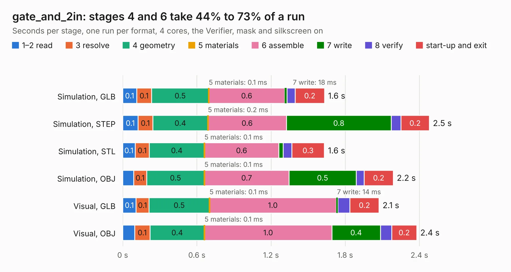

| Mode and format | 1–2 read | 3 resolve | 4 geometry | 5 materials | 6 assemble | 7 write | 8 verify | start-up and exit | Total |
|---|---:|---:|---:|---:|---:|---:|---:|---:|---:|
| Simulation, GLB | 0.1 | 0.1 | 0.5 | 0.1&nbsp;ms | 0.6 | 18&nbsp;ms | 67&nbsp;ms | 0.2 | 1.6 |
| Simulation, STEP | 0.1 | 0.1 | 0.4 | 0.2&nbsp;ms | 0.6 | 0.8 | 78&nbsp;ms | 0.2 | 2.5 |
| Simulation, STL | 0.1 | 0.1 | 0.4 | 0.1&nbsp;ms | 0.6 | 36&nbsp;ms | 70&nbsp;ms | 0.3 | 1.6 |
| Simulation, OBJ | 88&nbsp;ms | 0.1 | 0.5 | 0.1&nbsp;ms | 0.7 | 0.5 | 65&nbsp;ms | 0.2 | 2.2 |
| Visual, GLB | 0.1 | 0.1 | 0.5 | 0.1&nbsp;ms | 1.0 | 14&nbsp;ms | 97&nbsp;ms | 0.2 | 2.1 |
| Visual, OBJ | 96&nbsp;ms | 0.1 | 0.4 | 0.1&nbsp;ms | 1.0 | 0.4 | 91&nbsp;ms | 0.2 | 2.4 |

<table align="center"><tr><td valign="top">

| Board | Repo: [tmarhguy/alu](https://github.com/tmarhguy/alu) Board: `gate_and_2in.kicad_pcb` |
|---|---|
| Folder | schematics / kicad / modules / gates / gate_and / gate_and_2in |
| Complexity | 119&nbsp;/&nbsp;1000 (size&nbsp;104, features&nbsp;15) |
| KESE&nbsp;features | through vias |
| Tested | 9th November 2026 |
| Copper&nbsp;layers | 2 |
| File&nbsp;format | KiCad 9 (20241229) |
| Parts,&nbsp;tracks,&nbsp;vias | 6, 42, 5 |
| Triangles,&nbsp;simulation | 103,594 in 17 parts |
| Verifier | PASS in all six runs |

</td><td valign="top">

<table>
<tr><th>File type</th><th>File size</th><th>Peak memory used</th></tr>
<tr><th colspan="3" align="left">Simulation</th></tr>
<tr><td>GLB</td><td align="right">3.4&nbsp;MB</td><td align="right">174&nbsp;MB</td></tr>
<tr><td>STEP</td><td align="right">13&nbsp;MB</td><td align="right">187&nbsp;MB</td></tr>
<tr><td>STL</td><td align="right">5.2&nbsp;MB</td><td align="right">180&nbsp;MB</td></tr>
<tr><td>OBJ</td><td align="right">9.8&nbsp;MB</td><td align="right">175&nbsp;MB</td></tr>
<tr><th colspan="3" align="left">Visual</th></tr>
<tr><td>GLB</td><td align="right">2.2&nbsp;MB</td><td align="right">151&nbsp;MB</td></tr>
<tr><td>OBJ</td><td align="right">6.2&nbsp;MB</td><td align="right">150&nbsp;MB</td></tr>
</table>

</td></tr></table>

## 2843. gate_and_4in

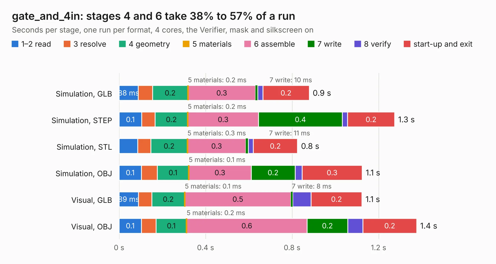

| Mode and format | 1–2 read | 3 resolve | 4 geometry | 5 materials | 6 assemble | 7 write | 8 verify | start-up and exit | Total |
|---|---:|---:|---:|---:|---:|---:|---:|---:|---:|
| Simulation, GLB | 88&nbsp;ms | 67&nbsp;ms | 0.2 | 0.2&nbsp;ms | 0.3 | 10&nbsp;ms | 24&nbsp;ms | 0.2 | 0.9 |
| Simulation, STEP | 0.1 | 62&nbsp;ms | 0.2 | 0.2&nbsp;ms | 0.3 | 0.4 | 24&nbsp;ms | 0.2 | 1.3 |
| Simulation, STL | 86&nbsp;ms | 61&nbsp;ms | 0.2 | 0.3&nbsp;ms | 0.3 | 11&nbsp;ms | 23&nbsp;ms | 0.2 | 0.8 |
| Simulation, OBJ | 0.1 | 74&nbsp;ms | 0.1 | 0.1&nbsp;ms | 0.3 | 0.2 | 32&nbsp;ms | 0.3 | 1.1 |
| Visual, GLB | 89&nbsp;ms | 62&nbsp;ms | 0.2 | 0.1&nbsp;ms | 0.5 | 8&nbsp;ms | 85&nbsp;ms | 0.2 | 1.1 |
| Visual, OBJ | 0.1 | 67&nbsp;ms | 0.1 | 0.2&nbsp;ms | 0.6 | 0.2 | 69&nbsp;ms | 0.2 | 1.4 |

<table align="center"><tr><td valign="top">

| Board | Repo: [tmarhguy/alu](https://github.com/tmarhguy/alu) Board: `gate_and_4in.kicad_pcb` |
|---|---|
| Folder | schematics / kicad / modules / gates / gate_and / gate_and_4in |
| Complexity | 53&nbsp;/&nbsp;1000 (size&nbsp;43, features&nbsp;10) |
| KESE&nbsp;features | rounded, trapezoid or chamfered pads |
| Tested | 9th November 2026 |
| Copper&nbsp;layers | 2 |
| File&nbsp;format | KiCad 9 (20241229) |
| Parts,&nbsp;tracks,&nbsp;vias | 10, 0, 0 |
| Triangles,&nbsp;simulation | 40,752 in 17 parts |
| Verifier | PASS in all six runs |

</td><td valign="top">

<table>
<tr><th>File type</th><th>File size</th><th>Peak memory used</th></tr>
<tr><th colspan="3" align="left">Simulation</th></tr>
<tr><td>GLB</td><td align="right">1.4&nbsp;MB</td><td align="right">69&nbsp;MB</td></tr>
<tr><td>STEP</td><td align="right">6.0&nbsp;MB</td><td align="right">73&nbsp;MB</td></tr>
<tr><td>STL</td><td align="right">2.0&nbsp;MB</td><td align="right">71&nbsp;MB</td></tr>
<tr><td>OBJ</td><td align="right">4.0&nbsp;MB</td><td align="right">79&nbsp;MB</td></tr>
<tr><th colspan="3" align="left">Visual</th></tr>
<tr><td>GLB</td><td align="right">1.4&nbsp;MB</td><td align="right">102&nbsp;MB</td></tr>
<tr><td>OBJ</td><td align="right">3.8&nbsp;MB</td><td align="right">100&nbsp;MB</td></tr>
</table>

</td></tr></table>

## 2844. gate_inv_1bit

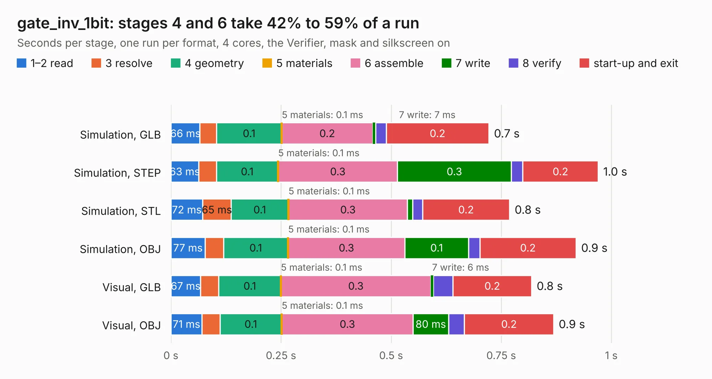

| Mode and format | 1–2 read | 3 resolve | 4 geometry | 5 materials | 6 assemble | 7 write | 8 verify | start-up and exit | Total |
|---|---:|---:|---:|---:|---:|---:|---:|---:|---:|
| Simulation, GLB | 66&nbsp;ms | 38&nbsp;ms | 0.1 | 0.1&nbsp;ms | 0.2 | 7&nbsp;ms | 24&nbsp;ms | 0.2 | 0.7 |
| Simulation, STEP | 63&nbsp;ms | 40&nbsp;ms | 0.1 | 0.1&nbsp;ms | 0.3 | 0.3 | 26&nbsp;ms | 0.2 | 1.0 |
| Simulation, STL | 72&nbsp;ms | 65&nbsp;ms | 0.1 | 0.1&nbsp;ms | 0.3 | 12&nbsp;ms | 22&nbsp;ms | 0.2 | 0.8 |
| Simulation, OBJ | 77&nbsp;ms | 42&nbsp;ms | 0.1 | 0.1&nbsp;ms | 0.3 | 0.1 | 25&nbsp;ms | 0.2 | 0.9 |
| Visual, GLB | 67&nbsp;ms | 42&nbsp;ms | 0.1 | 0.1&nbsp;ms | 0.3 | 6&nbsp;ms | 45&nbsp;ms | 0.2 | 0.8 |
| Visual, OBJ | 71&nbsp;ms | 41&nbsp;ms | 0.1 | 0.1&nbsp;ms | 0.3 | 80&nbsp;ms | 36&nbsp;ms | 0.2 | 0.9 |

<table align="center"><tr><td valign="top">

| Board | Repo: [tmarhguy/alu](https://github.com/tmarhguy/alu) Board: `gate_inv_1bit.kicad_pcb` |
|---|---|
| Folder | schematics / kicad / modules / gates / gate_inv / gate_inv_1bit |
| Complexity | 65&nbsp;/&nbsp;1000 (size&nbsp;65, features&nbsp;0) |
| Tested | 9th November 2026 |
| Copper&nbsp;layers | 2 |
| File&nbsp;format | KiCad 9 (20241229) |
| Parts,&nbsp;tracks,&nbsp;vias | 2, 8, 0 |
| Triangles,&nbsp;simulation | 33,822 in 14 parts |
| Verifier | PASS in all six runs |

</td><td valign="top">

<table>
<tr><th>File type</th><th>File size</th><th>Peak memory used</th></tr>
<tr><th colspan="3" align="left">Simulation</th></tr>
<tr><td>GLB</td><td align="right">1.1&nbsp;MB</td><td align="right">64&nbsp;MB</td></tr>
<tr><td>STEP</td><td align="right">4.2&nbsp;MB</td><td align="right">68&nbsp;MB</td></tr>
<tr><td>STL</td><td align="right">1.7&nbsp;MB</td><td align="right">65&nbsp;MB</td></tr>
<tr><td>OBJ</td><td align="right">3.2&nbsp;MB</td><td align="right">71&nbsp;MB</td></tr>
<tr><th colspan="3" align="left">Visual</th></tr>
<tr><td>GLB</td><td align="right">764&nbsp;kB</td><td align="right">100&nbsp;MB</td></tr>
<tr><td>OBJ</td><td align="right">2.1&nbsp;MB</td><td align="right">100&nbsp;MB</td></tr>
</table>

</td></tr></table>

## 2845. gate_nand_2in

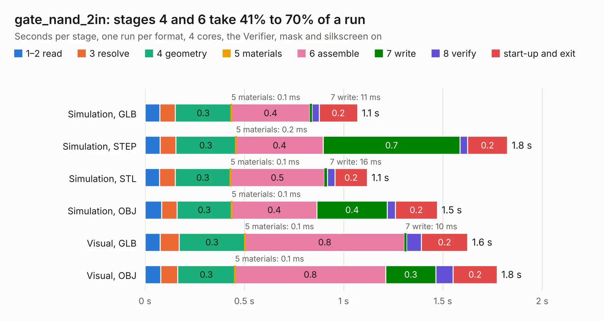

| Mode and format | 1–2 read | 3 resolve | 4 geometry | 5 materials | 6 assemble | 7 write | 8 verify | start-up and exit | Total |
|---|---:|---:|---:|---:|---:|---:|---:|---:|---:|
| Simulation, GLB | 74&nbsp;ms | 78&nbsp;ms | 0.3 | 0.1&nbsp;ms | 0.4 | 11&nbsp;ms | 36&nbsp;ms | 0.2 | 1.1 |
| Simulation, STEP | 75&nbsp;ms | 79&nbsp;ms | 0.3 | 0.2&nbsp;ms | 0.4 | 0.7 | 38&nbsp;ms | 0.2 | 1.8 |
| Simulation, STL | 73&nbsp;ms | 79&nbsp;ms | 0.3 | 0.1&nbsp;ms | 0.5 | 16&nbsp;ms | 38&nbsp;ms | 0.2 | 1.1 |
| Simulation, OBJ | 84&nbsp;ms | 77&nbsp;ms | 0.3 | 0.1&nbsp;ms | 0.4 | 0.4 | 40&nbsp;ms | 0.2 | 1.5 |
| Visual, GLB | 76&nbsp;ms | 96&nbsp;ms | 0.3 | 0.1&nbsp;ms | 0.8 | 10&nbsp;ms | 75&nbsp;ms | 0.2 | 1.6 |
| Visual, OBJ | 79&nbsp;ms | 85&nbsp;ms | 0.3 | 0.1&nbsp;ms | 0.8 | 0.3 | 87&nbsp;ms | 0.2 | 1.8 |

<table align="center"><tr><td valign="top">

| Board | Repo: [tmarhguy/alu](https://github.com/tmarhguy/alu) Board: `gate_nand_2in.kicad_pcb` |
|---|---|
| Folder | schematics / kicad / modules / gates / gate_nand / gate_nand_2in |
| Complexity | 105&nbsp;/&nbsp;1000 (size&nbsp;90, features&nbsp;15) |
| KESE&nbsp;features | through vias |
| Tested | 9th November 2026 |
| Copper&nbsp;layers | 2 |
| File&nbsp;format | KiCad 9 (20241229) |
| Parts,&nbsp;tracks,&nbsp;vias | 4, 24, 2 |
| Triangles,&nbsp;simulation | 71,860 in 16 parts |
| Verifier | PASS in all six runs |

</td><td valign="top">

<table>
<tr><th>File type</th><th>File size</th><th>Peak memory used</th></tr>
<tr><th colspan="3" align="left">Simulation</th></tr>
<tr><td>GLB</td><td align="right">2.4&nbsp;MB</td><td align="right">170&nbsp;MB</td></tr>
<tr><td>STEP</td><td align="right">9.3&nbsp;MB</td><td align="right">174&nbsp;MB</td></tr>
<tr><td>STL</td><td align="right">3.6&nbsp;MB</td><td align="right">172&nbsp;MB</td></tr>
<tr><td>OBJ</td><td align="right">6.8&nbsp;MB</td><td align="right">168&nbsp;MB</td></tr>
<tr><th colspan="3" align="left">Visual</th></tr>
<tr><td>GLB</td><td align="right">1.6&nbsp;MB</td><td align="right">149&nbsp;MB</td></tr>
<tr><td>OBJ</td><td align="right">4.4&nbsp;MB</td><td align="right">150&nbsp;MB</td></tr>
</table>

</td></tr></table>

## 2846. gate_nor_2in

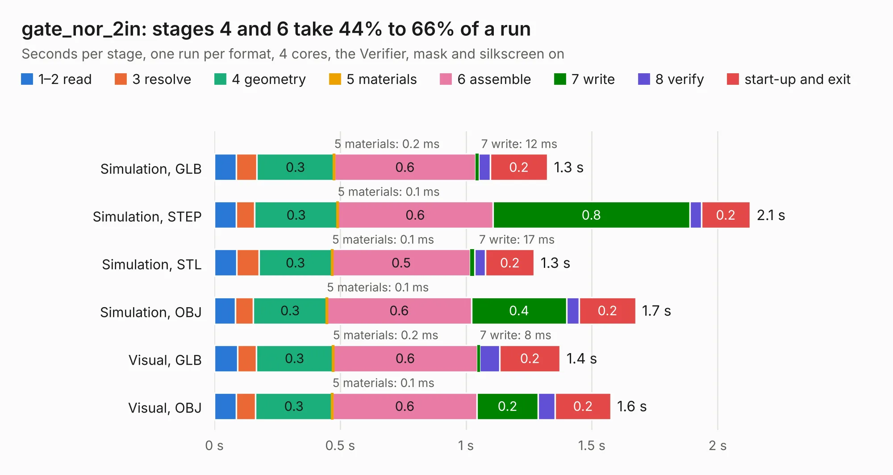

| Mode and format | 1–2 read | 3 resolve | 4 geometry | 5 materials | 6 assemble | 7 write | 8 verify | start-up and exit | Total |
|---|---:|---:|---:|---:|---:|---:|---:|---:|---:|
| Simulation, GLB | 87&nbsp;ms | 81&nbsp;ms | 0.3 | 0.2&nbsp;ms | 0.6 | 12&nbsp;ms | 46&nbsp;ms | 0.2 | 1.3 |
| Simulation, STEP | 86&nbsp;ms | 74&nbsp;ms | 0.3 | 0.1&nbsp;ms | 0.6 | 0.8 | 45&nbsp;ms | 0.2 | 2.1 |
| Simulation, STL | 88&nbsp;ms | 88&nbsp;ms | 0.3 | 0.1&nbsp;ms | 0.5 | 17&nbsp;ms | 43&nbsp;ms | 0.2 | 1.3 |
| Simulation, OBJ | 83&nbsp;ms | 72&nbsp;ms | 0.3 | 0.1&nbsp;ms | 0.6 | 0.4 | 50&nbsp;ms | 0.2 | 1.7 |
| Visual, GLB | 92&nbsp;ms | 75&nbsp;ms | 0.3 | 0.2&nbsp;ms | 0.6 | 8&nbsp;ms | 80&nbsp;ms | 0.2 | 1.4 |
| Visual, OBJ | 87&nbsp;ms | 76&nbsp;ms | 0.3 | 0.1&nbsp;ms | 0.6 | 0.2 | 69&nbsp;ms | 0.2 | 1.6 |

<table align="center"><tr><td valign="top">

| Board | Repo: [tmarhguy/alu](https://github.com/tmarhguy/alu) Board: `gate_nor_2in.kicad_pcb` |
|---|---|
| Folder | schematics / kicad / modules / gates / gate_nor / gate_nor_2in_1bit |
| Complexity | 104&nbsp;/&nbsp;1000 (size&nbsp;89, features&nbsp;15) |
| KESE&nbsp;features | through vias |
| Tested | 9th November 2026 |
| Copper&nbsp;layers | 2 |
| File&nbsp;format | KiCad 9 (20241229) |
| Parts,&nbsp;tracks,&nbsp;vias | 4, 24, 1 |
| Triangles,&nbsp;simulation | 66,598 in 16 parts |
| Verifier | PASS in all six runs |

</td><td valign="top">

<table>
<tr><th>File type</th><th>File size</th><th>Peak memory used</th></tr>
<tr><th colspan="3" align="left">Simulation</th></tr>
<tr><td>GLB</td><td align="right">2.2&nbsp;MB</td><td align="right">71&nbsp;MB</td></tr>
<tr><td>STEP</td><td align="right">8.7&nbsp;MB</td><td align="right">180&nbsp;MB</td></tr>
<tr><td>STL</td><td align="right">3.3&nbsp;MB</td><td align="right">72&nbsp;MB</td></tr>
<tr><td>OBJ</td><td align="right">6.3&nbsp;MB</td><td align="right">97&nbsp;MB</td></tr>
<tr><th colspan="3" align="left">Visual</th></tr>
<tr><td>GLB</td><td align="right">1.4&nbsp;MB</td><td align="right">102&nbsp;MB</td></tr>
<tr><td>OBJ</td><td align="right">3.9&nbsp;MB</td><td align="right">116&nbsp;MB</td></tr>
</table>

</td></tr></table>

## 2847. gate_or_2in

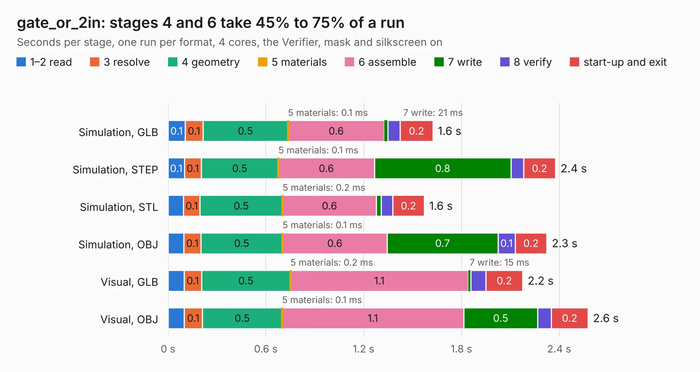

| Mode and format | 1–2 read | 3 resolve | 4 geometry | 5 materials | 6 assemble | 7 write | 8 verify | start-up and exit | Total |
|---|---:|---:|---:|---:|---:|---:|---:|---:|---:|
| Simulation, GLB | 0.1 | 0.1 | 0.5 | 0.1&nbsp;ms | 0.6 | 21&nbsp;ms | 76&nbsp;ms | 0.2 | 1.6 |
| Simulation, STEP | 0.1 | 0.1 | 0.5 | 0.1&nbsp;ms | 0.6 | 0.8 | 77&nbsp;ms | 0.2 | 2.4 |
| Simulation, STL | 96&nbsp;ms | 0.1 | 0.5 | 0.2&nbsp;ms | 0.6 | 28&nbsp;ms | 71&nbsp;ms | 0.2 | 1.6 |
| Simulation, OBJ | 96&nbsp;ms | 0.1 | 0.5 | 0.1&nbsp;ms | 0.6 | 0.7 | 0.1 | 0.2 | 2.3 |
| Visual, GLB | 99&nbsp;ms | 0.1 | 0.5 | 0.2&nbsp;ms | 1.1 | 15&nbsp;ms | 93&nbsp;ms | 0.2 | 2.2 |
| Visual, OBJ | 98&nbsp;ms | 0.1 | 0.5 | 0.1&nbsp;ms | 1.1 | 0.5 | 84&nbsp;ms | 0.2 | 2.6 |

<table align="center"><tr><td valign="top">

| Board | Repo: [tmarhguy/alu](https://github.com/tmarhguy/alu) Board: `gate_or_2in.kicad_pcb` |
|---|---|
| Folder | schematics / kicad / modules / gates / gate_or / gate_or_2in |
| Complexity | 137&nbsp;/&nbsp;1000 (size&nbsp;102, features&nbsp;35) |
| KESE&nbsp;features | through vias, filled zones |
| Tested | 9th November 2026 |
| Copper&nbsp;layers | 2 |
| File&nbsp;format | KiCad 9 (20241229) |
| Parts,&nbsp;tracks,&nbsp;vias | 6, 40, 3 |
| Triangles,&nbsp;simulation | 127,190 in 17 parts |
| Verifier | PASS in all six runs |

</td><td valign="top">

<table>
<tr><th>File type</th><th>File size</th><th>Peak memory used</th></tr>
<tr><th colspan="3" align="left">Simulation</th></tr>
<tr><td>GLB</td><td align="right">4.3&nbsp;MB</td><td align="right">189&nbsp;MB</td></tr>
<tr><td>STEP</td><td align="right">18&nbsp;MB</td><td align="right">197&nbsp;MB</td></tr>
<tr><td>STL</td><td align="right">6.4&nbsp;MB</td><td align="right">183&nbsp;MB</td></tr>
<tr><td>OBJ</td><td align="right">12&nbsp;MB</td><td align="right">186&nbsp;MB</td></tr>
<tr><th colspan="3" align="left">Visual</th></tr>
<tr><td>GLB</td><td align="right">2.9&nbsp;MB</td><td align="right">156&nbsp;MB</td></tr>
<tr><td>OBJ</td><td align="right">8.2&nbsp;MB</td><td align="right">157&nbsp;MB</td></tr>
</table>

</td></tr></table>

## 2848. gate_xnor_2in

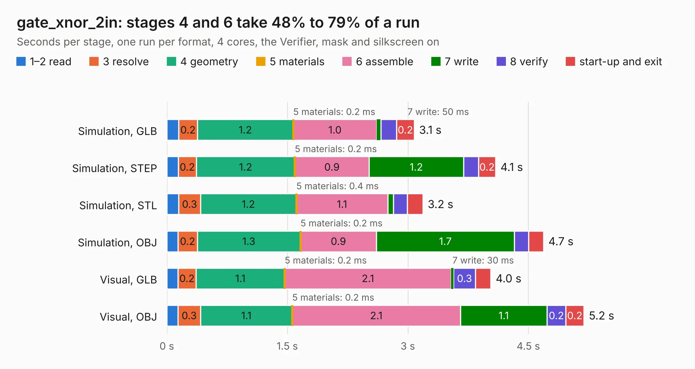

| Mode and format | 1–2 read | 3 resolve | 4 geometry | 5 materials | 6 assemble | 7 write | 8 verify | start-up and exit | Total |
|---|---:|---:|---:|---:|---:|---:|---:|---:|---:|
| Simulation, GLB | 0.1 | 0.2 | 1.2 | 0.2&nbsp;ms | 1.0 | 50&nbsp;ms | 0.2 | 0.2 | 3.1 |
| Simulation, STEP | 0.1 | 0.2 | 1.2 | 0.2&nbsp;ms | 0.9 | 1.2 | 0.2 | 0.2 | 4.1 |
| Simulation, STL | 0.1 | 0.3 | 1.2 | 0.4&nbsp;ms | 1.1 | 71&nbsp;ms | 0.2 | 0.2 | 3.2 |
| Simulation, OBJ | 0.1 | 0.2 | 1.3 | 0.2&nbsp;ms | 0.9 | 1.7 | 0.2 | 0.2 | 4.7 |
| Visual, GLB | 0.1 | 0.2 | 1.1 | 0.2&nbsp;ms | 2.1 | 30&nbsp;ms | 0.3 | 0.2 | 4.0 |
| Visual, OBJ | 0.1 | 0.3 | 1.1 | 0.2&nbsp;ms | 2.1 | 1.1 | 0.2 | 0.2 | 5.2 |

<table align="center"><tr><td valign="top">

| Board | Repo: [tmarhguy/alu](https://github.com/tmarhguy/alu) Board: `gate_xnor_2in.kicad_pcb` |
|---|---|
| Folder | schematics / kicad / modules / gates / gate_xnor / gate_xnor_2in |
| Complexity | 167&nbsp;/&nbsp;1000 (size&nbsp;132, features&nbsp;35) |
| KESE&nbsp;features | through vias, filled zones |
| Tested | 9th November 2026 |
| Copper&nbsp;layers | 2 |
| File&nbsp;format | KiCad 9 (20241229) |
| Parts,&nbsp;tracks,&nbsp;vias | 16, 138, 12 |
| Triangles,&nbsp;simulation | 325,442 in 23 parts |
| Verifier | PASS in all six runs |

</td><td valign="top">

<table>
<tr><th>File type</th><th>File size</th><th>Peak memory used</th></tr>
<tr><th colspan="3" align="left">Simulation</th></tr>
<tr><td>GLB</td><td align="right">11&nbsp;MB</td><td align="right">254&nbsp;MB</td></tr>
<tr><td>STEP</td><td align="right">47&nbsp;MB</td><td align="right">275&nbsp;MB</td></tr>
<tr><td>STL</td><td align="right">16&nbsp;MB</td><td align="right">246&nbsp;MB</td></tr>
<tr><td>OBJ</td><td align="right">32&nbsp;MB</td><td align="right">267&nbsp;MB</td></tr>
<tr><th colspan="3" align="left">Visual</th></tr>
<tr><td>GLB</td><td align="right">7.2&nbsp;MB</td><td align="right">249&nbsp;MB</td></tr>
<tr><td>OBJ</td><td align="right">21&nbsp;MB</td><td align="right">246&nbsp;MB</td></tr>
</table>

</td></tr></table>

## 2849. gate_xor_2in

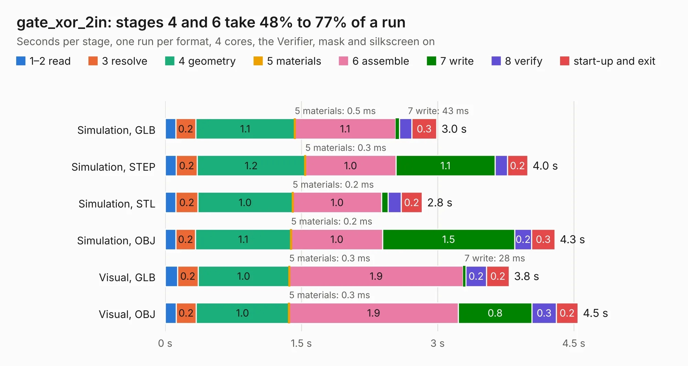

| Mode and format | 1–2 read | 3 resolve | 4 geometry | 5 materials | 6 assemble | 7 write | 8 verify | start-up and exit | Total |
|---|---:|---:|---:|---:|---:|---:|---:|---:|---:|
| Simulation, GLB | 0.1 | 0.2 | 1.1 | 0.5&nbsp;ms | 1.1 | 43&nbsp;ms | 0.1 | 0.3 | 3.0 |
| Simulation, STEP | 0.1 | 0.2 | 1.2 | 0.3&nbsp;ms | 1.0 | 1.1 | 0.1 | 0.2 | 4.0 |
| Simulation, STL | 0.1 | 0.2 | 1.0 | 0.2&nbsp;ms | 1.0 | 69&nbsp;ms | 0.1 | 0.2 | 2.8 |
| Simulation, OBJ | 0.1 | 0.2 | 1.1 | 0.2&nbsp;ms | 1.0 | 1.5 | 0.2 | 0.3 | 4.3 |
| Visual, GLB | 0.1 | 0.2 | 1.0 | 0.3&nbsp;ms | 1.9 | 28&nbsp;ms | 0.2 | 0.2 | 3.8 |
| Visual, OBJ | 0.1 | 0.2 | 1.0 | 0.3&nbsp;ms | 1.9 | 0.8 | 0.3 | 0.2 | 4.5 |

<table align="center"><tr><td valign="top">

| Board | Repo: [tmarhguy/alu](https://github.com/tmarhguy/alu) Board: `gate_xor_2in.kicad_pcb` |
|---|---|
| Folder | schematics / kicad / modules / gates / gate_xor / gate_xor_2in |
| Complexity | 146&nbsp;/&nbsp;1000 (size&nbsp;131, features&nbsp;15) |
| KESE&nbsp;features | through vias |
| Tested | 9th November 2026 |
| Copper&nbsp;layers | 2 |
| File&nbsp;format | KiCad 9 (20241229) |
| Parts,&nbsp;tracks,&nbsp;vias | 16, 120, 16 |
| Triangles,&nbsp;simulation | 269,400 in 22 parts |
| Verifier | PASS in all six runs |

</td><td valign="top">

<table>
<tr><th>File type</th><th>File size</th><th>Peak memory used</th></tr>
<tr><th colspan="3" align="left">Simulation</th></tr>
<tr><td>GLB</td><td align="right">8.9&nbsp;MB</td><td align="right">220&nbsp;MB</td></tr>
<tr><td>STEP</td><td align="right">35&nbsp;MB</td><td align="right">250&nbsp;MB</td></tr>
<tr><td>STL</td><td align="right">13&nbsp;MB</td><td align="right">232&nbsp;MB</td></tr>
<tr><td>OBJ</td><td align="right">26&nbsp;MB</td><td align="right">233&nbsp;MB</td></tr>
<tr><th colspan="3" align="left">Visual</th></tr>
<tr><td>GLB</td><td align="right">5.7&nbsp;MB</td><td align="right">215&nbsp;MB</td></tr>
<tr><td>OBJ</td><td align="right">16&nbsp;MB</td><td align="right">216&nbsp;MB</td></tr>
</table>

</td></tr></table>

## 2850. RASANT2400

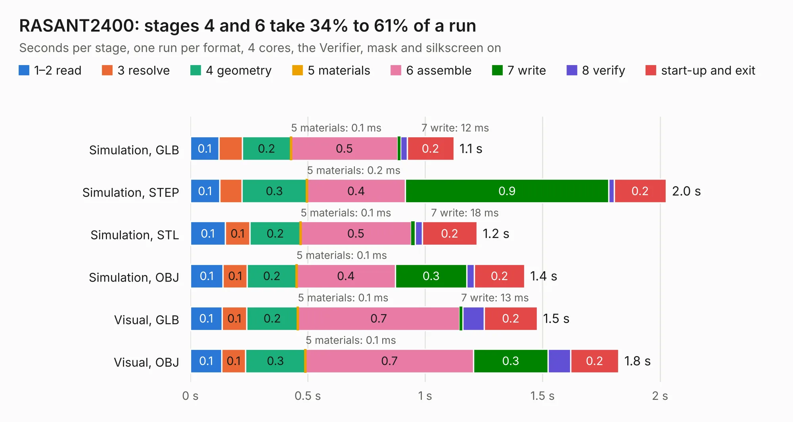

| Mode and format | 1–2 read | 3 resolve | 4 geometry | 5 materials | 6 assemble | 7 write | 8 verify | start-up and exit | Total |
|---|---:|---:|---:|---:|---:|---:|---:|---:|---:|
| Simulation, GLB | 0.1 | 99&nbsp;ms | 0.2 | 0.1&nbsp;ms | 0.5 | 12&nbsp;ms | 28&nbsp;ms | 0.2 | 1.1 |
| Simulation, STEP | 0.1 | 95&nbsp;ms | 0.3 | 0.2&nbsp;ms | 0.4 | 0.9 | 23&nbsp;ms | 0.2 | 2.0 |
| Simulation, STL | 0.1 | 0.1 | 0.2 | 0.1&nbsp;ms | 0.5 | 18&nbsp;ms | 29&nbsp;ms | 0.2 | 1.2 |
| Simulation, OBJ | 0.1 | 0.1 | 0.2 | 0.1&nbsp;ms | 0.4 | 0.3 | 32&nbsp;ms | 0.2 | 1.4 |
| Visual, GLB | 0.1 | 0.1 | 0.2 | 0.1&nbsp;ms | 0.7 | 13&nbsp;ms | 91&nbsp;ms | 0.2 | 1.5 |
| Visual, OBJ | 0.1 | 0.1 | 0.3 | 0.1&nbsp;ms | 0.7 | 0.3 | 96&nbsp;ms | 0.2 | 1.8 |

<table align="center"><tr><td valign="top">

| Board | Repo: [tobias-dg3yev/ra-sentinel](https://github.com/tobias-dg3yev/ra-sentinel) Board: `RASANT2400.kicad_pcb` |
|---|---|
| Folder | RASANT2400 / Hardware / KiCad |
| Complexity | 131&nbsp;/&nbsp;1000 (size&nbsp;91, features&nbsp;40) |
| KESE&nbsp;features | through vias, arc tracks, copper drawings |
| Tested | 9th November 2026 |
| Copper&nbsp;layers | 2 |
| File&nbsp;format | KiCad 10 (20260206) |
| Parts,&nbsp;tracks,&nbsp;vias | 0, 20, 24 |
| Triangles,&nbsp;simulation | 70,964 in 11 parts |
| Note | no components |
| Verifier | PASS in all six runs |

</td><td valign="top">

<table>
<tr><th>File type</th><th>File size</th><th>Peak memory used</th></tr>
<tr><th colspan="3" align="left">Simulation</th></tr>
<tr><td>GLB</td><td align="right">2.6&nbsp;MB</td><td align="right">87&nbsp;MB</td></tr>
<tr><td>STEP</td><td align="right">5.9&nbsp;MB</td><td align="right">200&nbsp;MB</td></tr>
<tr><td>STL</td><td align="right">3.5&nbsp;MB</td><td align="right">88&nbsp;MB</td></tr>
<tr><td>OBJ</td><td align="right">7.0&nbsp;MB</td><td align="right">114&nbsp;MB</td></tr>
<tr><th colspan="3" align="left">Visual</th></tr>
<tr><td>GLB</td><td align="right">2.3&nbsp;MB</td><td align="right">125&nbsp;MB</td></tr>
<tr><td>OBJ</td><td align="right">6.4&nbsp;MB</td><td align="right">125&nbsp;MB</td></tr>
</table>

</td></tr></table>

## 2851. RASBB

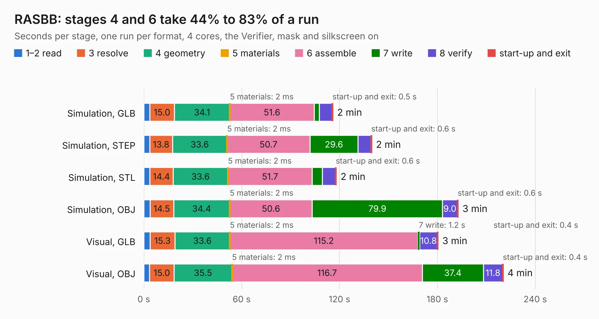

| Mode and format | 1–2 read | 3 resolve | 4 geometry | 5 materials | 6 assemble | 7 write | 8 verify | start-up and exit | Total |
|---|---:|---:|---:|---:|---:|---:|---:|---:|---:|
| Simulation, GLB | 3.7 | 15.0 | 34.1 | 2&nbsp;ms | 51.6 | 3.2 | 7.8 | 0.5 | 115.9 |
| Simulation, STEP | 3.7 | 13.8 | 33.6 | 2&nbsp;ms | 50.7 | 29.6 | 7.8 | 0.6 | 139.8 |
| Simulation, STL | 3.6 | 14.4 | 33.6 | 2&nbsp;ms | 51.7 | 6.2 | 8.0 | 0.6 | 118.0 |
| Simulation, OBJ | 3.8 | 14.5 | 34.4 | 2&nbsp;ms | 50.6 | 79.9 | 9.0 | 0.6 | 192.8 |
| Visual, GLB | 3.8 | 15.3 | 33.6 | 2&nbsp;ms | 115.2 | 1.2 | 10.8 | 0.4 | 180.4 |
| Visual, OBJ | 3.6 | 15.0 | 35.5 | 2&nbsp;ms | 116.7 | 37.4 | 11.8 | 0.4 | 220.4 |

<table align="center"><tr><td valign="top">

| Board | Repo: [tobias-dg3yev/ra-sentinel](https://github.com/tobias-dg3yev/ra-sentinel) Board: `RASBB.kicad_pcb` |
|---|---|
| Folder | RASBB / Hardware / Rev.A / Design |
| Complexity | 481&nbsp;/&nbsp;1000 (size&nbsp;346, features&nbsp;135) |
| KESE&nbsp;features | through vias, slotted holes, custom pads, rounded, trapezoid or chamfered pads, arc tracks, filled zones, copper drawings, copper text, stack-up, dielectric εr and tanδ |
| Tested | 9th November 2026 |
| Copper&nbsp;layers | 8 |
| File&nbsp;format | KiCad 10 (20260206) |
| Parts,&nbsp;tracks,&nbsp;vias | 580, 11,520, 1,908 |
| Triangles,&nbsp;simulation | 16,234,920 in 757 parts |
| Verifier | PASS in all six runs |

</td><td valign="top">

<table>
<tr><th>File type</th><th>File size</th><th>Peak memory used</th></tr>
<tr><th colspan="3" align="left">Simulation</th></tr>
<tr><td>GLB</td><td align="right">539&nbsp;MB</td><td align="right">3.6&nbsp;GB</td></tr>
<tr><td>STEP</td><td align="right">1.7&nbsp;GB</td><td align="right">5.0&nbsp;GB</td></tr>
<tr><td>STL</td><td align="right">812&nbsp;MB</td><td align="right">3.6&nbsp;GB</td></tr>
<tr><td>OBJ</td><td align="right">1.8&nbsp;GB</td><td align="right">10&nbsp;GB</td></tr>
<tr><th colspan="3" align="left">Visual</th></tr>
<tr><td>GLB</td><td align="right">256&nbsp;MB</td><td align="right">4.4&nbsp;GB</td></tr>
<tr><td>OBJ</td><td align="right">860&nbsp;MB</td><td align="right">5.6&nbsp;GB</td></tr>
</table>

</td></tr></table>

## 2852. RASBB

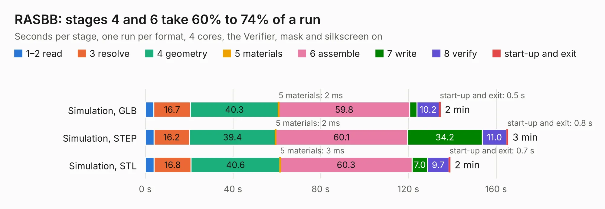

| Mode and format | 1–2 read | 3 resolve | 4 geometry | 5 materials | 6 assemble | 7 write | 8 verify | start-up and exit | Total |
|---|---:|---:|---:|---:|---:|---:|---:|---:|---:|
| Simulation, GLB | 3.9 | 16.7 | 40.3 | 2&nbsp;ms | 59.8 | 3.3 | 10.2 | 0.5 | 134.7 |
| Simulation, STEP | 3.9 | 16.2 | 39.4 | 2&nbsp;ms | 60.1 | 34.2 | 11.0 | 0.8 | 165.6 |
| Simulation, STL | 4.0 | 16.8 | 40.6 | 3&nbsp;ms | 60.3 | 7.0 | 9.7 | 0.7 | 139.2 |
| Simulation, OBJ | 3.6 | 15.6 | 35.9 | 2&nbsp;ms | 56.6 | 97.5 | 9.2 | 0.5 | 219.0 |
| Visual, GLB | 3.8 | 15.7 | 34.6 | 3&nbsp;ms | 128.7 | 1.5 | 14.6 | 0.4 | 199.4 |
| Visual, OBJ | 3.6 | 15.2 | 34.8 | 3&nbsp;ms | 129.3 | 41.0 | 13.8 | 0.4 | 238.2 |

<table align="center"><tr><td valign="top">

| Board | Repo: [tobias-dg3yev/ra-sentinel](https://github.com/tobias-dg3yev/ra-sentinel) Board: `RASBB.kicad_pcb` |
|---|---|
| Folder | RASBB / Hardware / Rev.B / Design |
| Complexity | 482&nbsp;/&nbsp;1000 (size&nbsp;347, features&nbsp;135) |
| KESE&nbsp;features | through vias, slotted holes, custom pads, rounded, trapezoid or chamfered pads, arc tracks, filled zones, copper drawings, copper text, stack-up, dielectric εr and tanδ |
| Tested | 9th November 2026 |
| Copper&nbsp;layers | 8 |
| File&nbsp;format | KiCad 10 (20260206) |
| Parts,&nbsp;tracks,&nbsp;vias | 616, 12,047, 1,915 |
| Triangles,&nbsp;simulation | 16,458,470 in 765 parts |
| Verifier | PASS in all six runs |

</td><td valign="top">

<table>
<tr><th>File type</th><th>File size</th><th>Peak memory used</th></tr>
<tr><th colspan="3" align="left">Simulation</th></tr>
<tr><td>GLB</td><td align="right">547&nbsp;MB</td><td align="right">3.6&nbsp;GB</td></tr>
<tr><td>STEP</td><td align="right">1.7&nbsp;GB</td><td align="right">4.9&nbsp;GB</td></tr>
<tr><td>STL</td><td align="right">823&nbsp;MB</td><td align="right">3.7&nbsp;GB</td></tr>
<tr><td>OBJ</td><td align="right">1.8&nbsp;GB</td><td align="right">10&nbsp;GB</td></tr>
<tr><th colspan="3" align="left">Visual</th></tr>
<tr><td>GLB</td><td align="right">260&nbsp;MB</td><td align="right">4.4&nbsp;GB</td></tr>
<tr><td>OBJ</td><td align="right">875&nbsp;MB</td><td align="right">5.7&nbsp;GB</td></tr>
</table>

</td></tr></table>

## 2853. RASBB

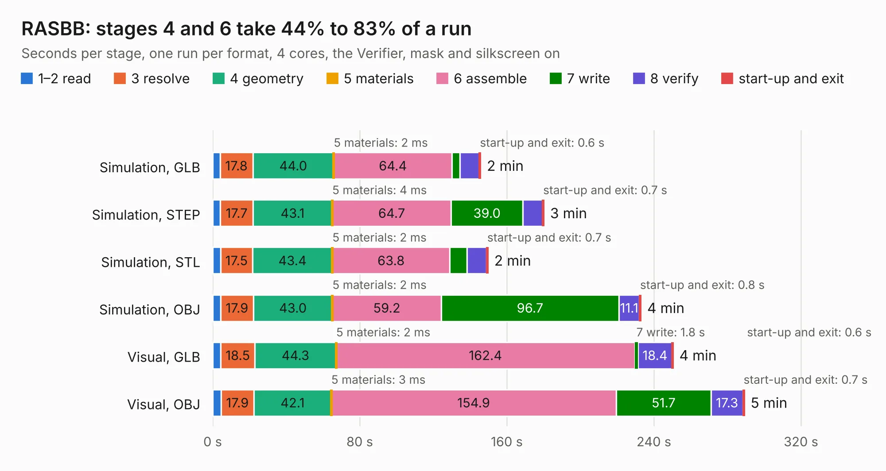

| Mode and format | 1–2 read | 3 resolve | 4 geometry | 5 materials | 6 assemble | 7 write | 8 verify | start-up and exit | Total |
|---|---:|---:|---:|---:|---:|---:|---:|---:|---:|
| Simulation, GLB | 4.0 | 17.8 | 44.0 | 2&nbsp;ms | 64.4 | 4.1 | 10.7 | 0.6 | 145.7 |
| Simulation, STEP | 4.2 | 17.7 | 43.1 | 4&nbsp;ms | 64.7 | 39.0 | 10.7 | 0.7 | 180.1 |
| Simulation, STL | 4.3 | 17.5 | 43.4 | 2&nbsp;ms | 63.8 | 9.3 | 10.7 | 0.7 | 149.7 |
| Simulation, OBJ | 4.3 | 17.9 | 43.0 | 2&nbsp;ms | 59.2 | 96.7 | 11.1 | 0.8 | 232.9 |
| Visual, GLB | 4.4 | 18.5 | 44.3 | 2&nbsp;ms | 162.4 | 1.8 | 18.4 | 0.6 | 250.4 |
| Visual, OBJ | 4.5 | 17.9 | 42.1 | 3&nbsp;ms | 154.9 | 51.7 | 17.3 | 0.7 | 289.1 |

<table align="center"><tr><td valign="top">

| Board | Repo: [tobias-dg3yev/ra-sentinel](https://github.com/tobias-dg3yev/ra-sentinel) Board: `RASBB.kicad_pcb` |
|---|---|
| Folder | RASBB / Hardware / Rev.C / Design |
| Complexity | 485&nbsp;/&nbsp;1000 (size&nbsp;350, features&nbsp;135) |
| KESE&nbsp;features | through vias, slotted holes, custom pads, rounded, trapezoid or chamfered pads, arc tracks, filled zones, copper drawings, copper text, stack-up, dielectric εr and tanδ |
| Tested | 9th November 2026 to 10th November 2026 |
| Copper&nbsp;layers | 8 |
| File&nbsp;format | KiCad 10 (20260206) |
| Parts,&nbsp;tracks,&nbsp;vias | 689, 14,138, 2,078 |
| Triangles,&nbsp;simulation | 17,831,050 in 809 parts |
| Verifier | PASS in all six runs |
| Run&nbsp;again | Simulation, OBJ: failed in the corpus run, run again with the memory cap raised from 11 GB to 14.5 GB, and passed |

</td><td valign="top">

<table>
<tr><th>File type</th><th>File size</th><th>Peak memory used</th></tr>
<tr><th colspan="3" align="left">Simulation</th></tr>
<tr><td>GLB</td><td align="right">594&nbsp;MB</td><td align="right">3.8&nbsp;GB</td></tr>
<tr><td>STEP</td><td align="right">1.9&nbsp;GB</td><td align="right">5.6&nbsp;GB</td></tr>
<tr><td>STL</td><td align="right">892&nbsp;MB</td><td align="right">3.9&nbsp;GB</td></tr>
<tr><td>OBJ</td><td align="right">2.0&nbsp;GB</td><td align="right">11&nbsp;GB</td></tr>
<tr><th colspan="3" align="left">Visual</th></tr>
<tr><td>GLB</td><td align="right">289&nbsp;MB</td><td align="right">4.8&nbsp;GB</td></tr>
<tr><td>OBJ</td><td align="right">968&nbsp;MB</td><td align="right">6.2&nbsp;GB</td></tr>
</table>

</td></tr></table>

## 2854. RASRF

| Mode and format | 1–2 read | 3 resolve | 4 geometry | 5 materials | 6 assemble | 7 write | 8 verify | start-up and exit | Total |
|---|---:|---:|---:|---:|---:|---:|---:|---:|---:|
| Simulation, GLB | 0.9 | 2.1 | 6.5 | 0.9&nbsp;ms | 7.9 | 0.4 | 0.9 | 0.2 | 19.0 |
| Simulation, STEP | 1.0 | 2.3 | 6.5 | 0.8&nbsp;ms | 7.9 | 5.3 | 0.9 | 0.2 | 24.1 |
| Simulation, STL | 0.8 | 2.1 | 6.7 | 1&nbsp;ms | 7.5 | 0.7 | 0.9 | 0.3 | 19.0 |
| Simulation, OBJ | 0.9 | 2.0 | 6.4 | 0.9&nbsp;ms | 7.7 | 10.6 | 0.9 | 0.3 | 28.8 |
| Visual, GLB | 1.0 | 2.3 | 6.5 | 1.0&nbsp;ms | 17.2 | 0.3 | 2.1 | 0.2 | 29.6 |
| Visual, OBJ | 0.9 | 2.0 | 7.0 | 1.0&nbsp;ms | 16.9 | 8.2 | 2.7 | 0.2 | 38.0 |

<table align="center"><tr><td valign="top">

| Board | Repo: [tobias-dg3yev/ra-sentinel](https://github.com/tobias-dg3yev/ra-sentinel) Board: `RASRF.kicad_pcb` |
|---|---|
| Folder | RASRF2400WB / Hardware / PCB_Design |
| Complexity | 337&nbsp;/&nbsp;1000 (size&nbsp;217, features&nbsp;120) |
| KESE&nbsp;features | through vias, custom pads, rounded, trapezoid or chamfered pads, arc tracks, filled zones, copper drawings, stack-up, dielectric εr and tanδ, mask and silkscreen colours |
| Tested | 9th November 2026 |
| Copper&nbsp;layers | 4 |
| File&nbsp;format | KiCad 10 (20260206) |
| Parts,&nbsp;tracks,&nbsp;vias | 147, 1,319, 468 |
| Triangles,&nbsp;simulation | 2,326,330 in 185 parts |
| Verifier | PASS in all six runs |

</td><td valign="top">

<table>
<tr><th>File type</th><th>File size</th><th>Peak memory used</th></tr>
<tr><th colspan="3" align="left">Simulation</th></tr>
<tr><td>GLB</td><td align="right">79&nbsp;MB</td><td align="right">938&nbsp;MB</td></tr>
<tr><td>STEP</td><td align="right">308&nbsp;MB</td><td align="right">1.1&nbsp;GB</td></tr>
<tr><td>STL</td><td align="right">116&nbsp;MB</td><td align="right">956&nbsp;MB</td></tr>
<tr><td>OBJ</td><td align="right">241&nbsp;MB</td><td align="right">1.5&nbsp;GB</td></tr>
<tr><th colspan="3" align="left">Visual</th></tr>
<tr><td>GLB</td><td align="right">56&nbsp;MB</td><td align="right">1.1&nbsp;GB</td></tr>
<tr><td>OBJ</td><td align="right">174&nbsp;MB</td><td align="right">1.2&nbsp;GB</td></tr>
</table>

</td></tr></table>

## 2855. RASRF2400WBMC

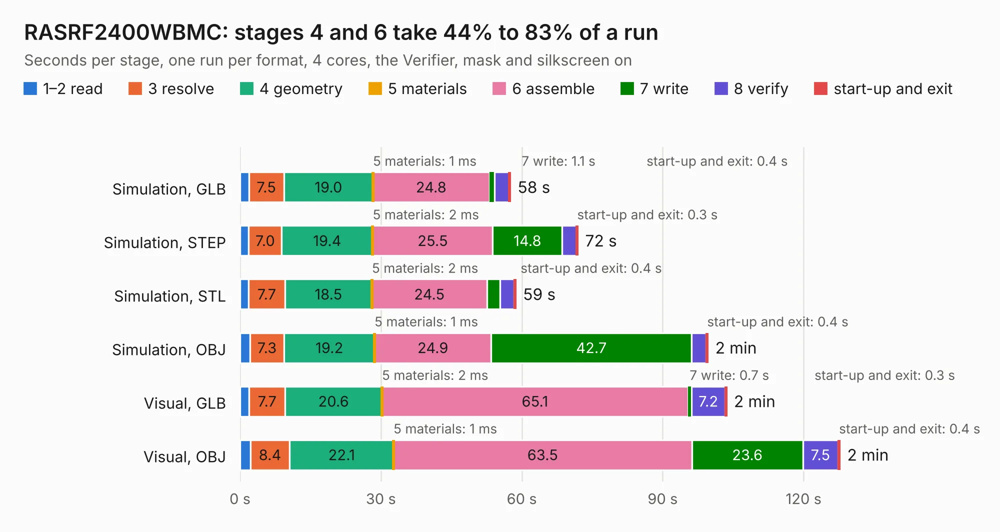

| Mode and format | 1–2 read | 3 resolve | 4 geometry | 5 materials | 6 assemble | 7 write | 8 verify | start-up and exit | Total |
|---|---:|---:|---:|---:|---:|---:|---:|---:|---:|
| Simulation, GLB | 1.9 | 7.5 | 19.0 | 1&nbsp;ms | 24.8 | 1.1 | 3.0 | 0.4 | 57.6 |
| Simulation, STEP | 1.8 | 7.0 | 19.4 | 2&nbsp;ms | 25.5 | 14.8 | 3.0 | 0.3 | 72.0 |
| Simulation, STL | 1.8 | 7.7 | 18.5 | 2&nbsp;ms | 24.5 | 2.8 | 3.0 | 0.4 | 58.7 |
| Simulation, OBJ | 2.1 | 7.3 | 19.2 | 1&nbsp;ms | 24.9 | 42.7 | 3.1 | 0.4 | 99.7 |
| Visual, GLB | 2.0 | 7.7 | 20.6 | 2&nbsp;ms | 65.1 | 0.7 | 7.2 | 0.3 | 103.6 |
| Visual, OBJ | 2.2 | 8.4 | 22.1 | 1&nbsp;ms | 63.5 | 23.6 | 7.5 | 0.4 | 127.8 |

<table align="center"><tr><td valign="top">

| Board | Repo: [tobias-dg3yev/ra-sentinel](https://github.com/tobias-dg3yev/ra-sentinel) Board: `RASRF2400WBMC.kicad_pcb` |
|---|---|
| Folder | RASRF2400WBMC / Hardware / KiCad |
| Complexity | 394&nbsp;/&nbsp;1000 (size&nbsp;304, features&nbsp;90) |
| KESE&nbsp;features | through vias, rounded, trapezoid or chamfered pads, arc tracks, filled zones, stack-up, dielectric εr and tanδ |
| Tested | 10th November 2026 |
| Copper&nbsp;layers | 6 |
| File&nbsp;format | KiCad 10 (20260206) |
| Parts,&nbsp;tracks,&nbsp;vias | 388, 4,374, 921 |
| Triangles,&nbsp;simulation | 6,665,854 in 375 parts |
| Verifier | PASS in all six runs |

</td><td valign="top">

<table>
<tr><th>File type</th><th>File size</th><th>Peak memory used</th></tr>
<tr><th colspan="3" align="left">Simulation</th></tr>
<tr><td>GLB</td><td align="right">223&nbsp;MB</td><td align="right">2.2&nbsp;GB</td></tr>
<tr><td>STEP</td><td align="right">737&nbsp;MB</td><td align="right">2.5&nbsp;GB</td></tr>
<tr><td>STL</td><td align="right">333&nbsp;MB</td><td align="right">2.1&nbsp;GB</td></tr>
<tr><td>OBJ</td><td align="right">723&nbsp;MB</td><td align="right">4.2&nbsp;GB</td></tr>
<tr><th colspan="3" align="left">Visual</th></tr>
<tr><td>GLB</td><td align="right">124&nbsp;MB</td><td align="right">2.1&nbsp;GB</td></tr>
<tr><td>OBJ</td><td align="right">407&nbsp;MB</td><td align="right">2.7&nbsp;GB</td></tr>
</table>

</td></tr></table>

## 2856. pocket_sdr_v2.3

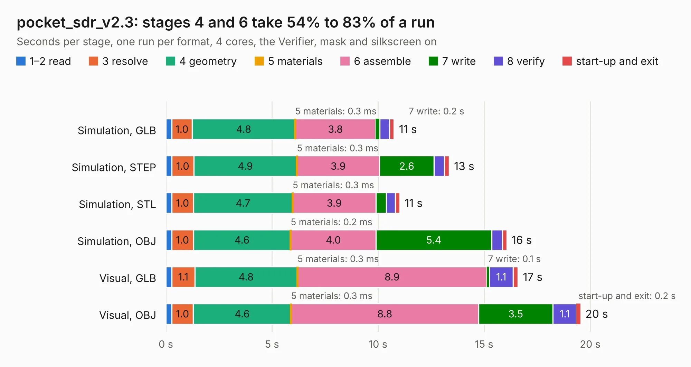

| Mode and format | 1–2 read | 3 resolve | 4 geometry | 5 materials | 6 assemble | 7 write | 8 verify | start-up and exit | Total |
|---|---:|---:|---:|---:|---:|---:|---:|---:|---:|
| Simulation, GLB | 0.3 | 1.0 | 4.8 | 0.3&nbsp;ms | 3.8 | 0.2 | 0.5 | 0.2 | 10.8 |
| Simulation, STEP | 0.3 | 1.0 | 4.9 | 0.3&nbsp;ms | 3.9 | 2.6 | 0.5 | 0.2 | 13.3 |
| Simulation, STL | 0.3 | 1.0 | 4.7 | 0.3&nbsp;ms | 3.9 | 0.5 | 0.4 | 0.2 | 11.0 |
| Simulation, OBJ | 0.3 | 1.0 | 4.6 | 0.2&nbsp;ms | 4.0 | 5.4 | 0.5 | 0.2 | 16.1 |
| Visual, GLB | 0.3 | 1.1 | 4.8 | 0.3&nbsp;ms | 8.9 | 0.1 | 1.1 | 0.2 | 16.6 |
| Visual, OBJ | 0.3 | 1.0 | 4.6 | 0.3&nbsp;ms | 8.8 | 3.5 | 1.1 | 0.2 | 19.5 |

<table align="center"><tr><td valign="top">

| Board | Repo: [tomojitakasu/PocketSDR](https://github.com/tomojitakasu/PocketSDR) Board: `pocket_sdr_v2.3.kicad_pcb` |
|---|---|
| Folder | FE_2CH / HW / v2.3 |
| Complexity | 351&nbsp;/&nbsp;1000 (size&nbsp;251, features&nbsp;100) |
| KESE&nbsp;features | through vias, slotted holes, rounded, trapezoid or chamfered pads, arc tracks, filled zones, stack-up, dielectric εr and tanδ |
| Tested | 9th November 2026 |
| Copper&nbsp;layers | 4 |
| File&nbsp;format | KiCad 7 (20221018) |
| Parts,&nbsp;tracks,&nbsp;vias | 76, 792, 240 |
| Triangles,&nbsp;simulation | 1,335,824 in 94 parts |
| Verifier | PASS in all six runs |

</td><td valign="top">

<table>
<tr><th>File type</th><th>File size</th><th>Peak memory used</th></tr>
<tr><th colspan="3" align="left">Simulation</th></tr>
<tr><td>GLB</td><td align="right">46&nbsp;MB</td><td align="right">583&nbsp;MB</td></tr>
<tr><td>STEP</td><td align="right">187&nbsp;MB</td><td align="right">686&nbsp;MB</td></tr>
<tr><td>STL</td><td align="right">67&nbsp;MB</td><td align="right">523&nbsp;MB</td></tr>
<tr><td>OBJ</td><td align="right">138&nbsp;MB</td><td align="right">910&nbsp;MB</td></tr>
<tr><th colspan="3" align="left">Visual</th></tr>
<tr><td>GLB</td><td align="right">30&nbsp;MB</td><td align="right">670&nbsp;MB</td></tr>
<tr><td>OBJ</td><td align="right">90&nbsp;MB</td><td align="right">688&nbsp;MB</td></tr>
</table>

</td></tr></table>

## 2857. v3.0

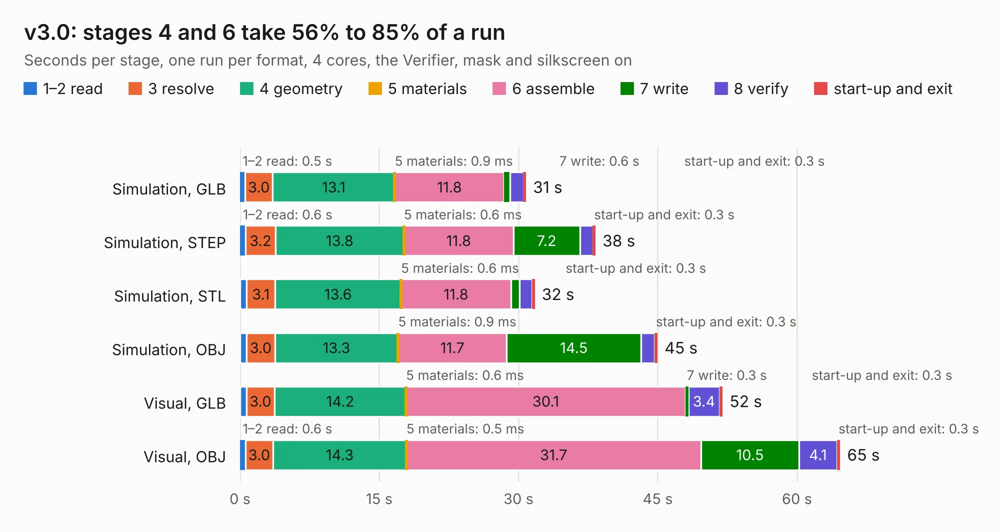

| Mode and format | 1–2 read | 3 resolve | 4 geometry | 5 materials | 6 assemble | 7 write | 8 verify | start-up and exit | Total |
|---|---:|---:|---:|---:|---:|---:|---:|---:|---:|
| Simulation, GLB | 0.5 | 3.0 | 13.1 | 0.9&nbsp;ms | 11.8 | 0.6 | 1.4 | 0.3 | 30.8 |
| Simulation, STEP | 0.6 | 3.2 | 13.8 | 0.6&nbsp;ms | 11.8 | 7.2 | 1.4 | 0.3 | 38.3 |
| Simulation, STL | 0.7 | 3.1 | 13.6 | 0.6&nbsp;ms | 11.8 | 0.9 | 1.4 | 0.3 | 31.7 |
| Simulation, OBJ | 0.7 | 3.0 | 13.3 | 0.9&nbsp;ms | 11.7 | 14.5 | 1.4 | 0.3 | 45.0 |
| Visual, GLB | 0.7 | 3.0 | 14.2 | 0.6&nbsp;ms | 30.1 | 0.3 | 3.4 | 0.3 | 52.0 |
| Visual, OBJ | 0.6 | 3.0 | 14.3 | 0.5&nbsp;ms | 31.7 | 10.5 | 4.1 | 0.3 | 64.6 |

<table align="center"><tr><td valign="top">

| Board | Repo: [tomojitakasu/PocketSDR](https://github.com/tomojitakasu/PocketSDR) Board: `v3.0.kicad_pcb` |
|---|---|
| Folder | FE_4CH / HW / v3.0 |
| Complexity | 384&nbsp;/&nbsp;1000 (size&nbsp;284, features&nbsp;100) |
| KESE&nbsp;features | through vias, slotted holes, arc tracks, filled zones, curved board outline, stack-up, dielectric εr and tanδ |
| Tested | 9th November 2026 |
| Copper&nbsp;layers | 4 |
| File&nbsp;format | KiCad 8 (20240108) |
| Parts,&nbsp;tracks,&nbsp;vias | 149, 2,287, 626 |
| Triangles,&nbsp;simulation | 3,206,818 in 200 parts |
| Verifier | PASS in all six runs |

</td><td valign="top">

<table>
<tr><th>File type</th><th>File size</th><th>Peak memory used</th></tr>
<tr><th colspan="3" align="left">Simulation</th></tr>
<tr><td>GLB</td><td align="right">111&nbsp;MB</td><td align="right">1.1&nbsp;GB</td></tr>
<tr><td>STEP</td><td align="right">459&nbsp;MB</td><td align="right">1.4&nbsp;GB</td></tr>
<tr><td>STL</td><td align="right">160&nbsp;MB</td><td align="right">1.1&nbsp;GB</td></tr>
<tr><td>OBJ</td><td align="right">345&nbsp;MB</td><td align="right">2.1&nbsp;GB</td></tr>
<tr><th colspan="3" align="left">Visual</th></tr>
<tr><td>GLB</td><td align="right">73&nbsp;MB</td><td align="right">1.3&nbsp;GB</td></tr>
<tr><td>OBJ</td><td align="right">232&nbsp;MB</td><td align="right">1.6&nbsp;GB</td></tr>
</table>

</td></tr></table>

## 2858. div_4px2

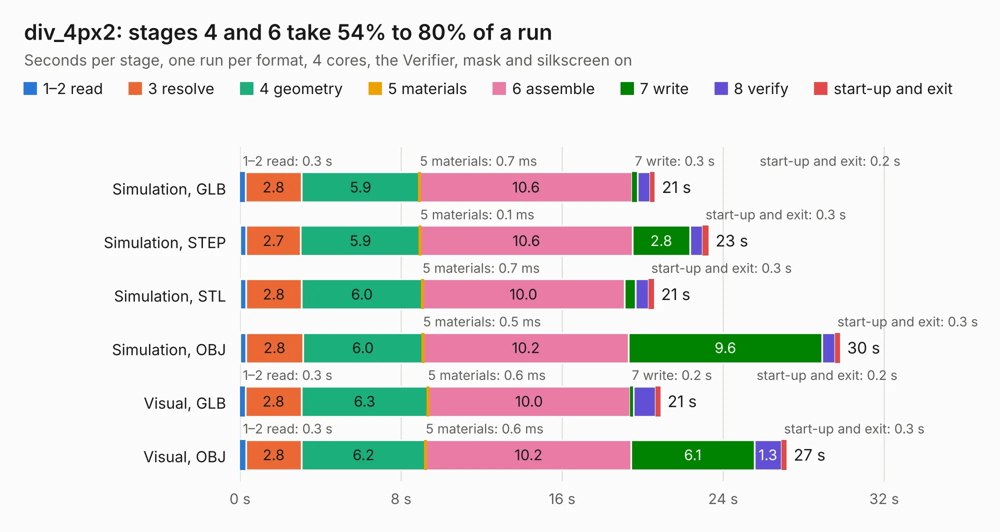

| Mode and format | 1–2 read | 3 resolve | 4 geometry | 5 materials | 6 assemble | 7 write | 8 verify | start-up and exit | Total |
|---|---:|---:|---:|---:|---:|---:|---:|---:|---:|
| Simulation, GLB | 0.3 | 2.8 | 5.9 | 0.7&nbsp;ms | 10.6 | 0.3 | 0.6 | 0.2 | 20.6 |
| Simulation, STEP | 0.3 | 2.7 | 5.9 | 0.1&nbsp;ms | 10.6 | 2.8 | 0.6 | 0.3 | 23.3 |
| Simulation, STL | 0.3 | 2.8 | 6.0 | 0.7&nbsp;ms | 10.0 | 0.6 | 0.6 | 0.3 | 20.6 |
| Simulation, OBJ | 0.3 | 2.8 | 6.0 | 0.5&nbsp;ms | 10.2 | 9.6 | 0.6 | 0.3 | 29.8 |
| Visual, GLB | 0.3 | 2.8 | 6.3 | 0.6&nbsp;ms | 10.0 | 0.2 | 1.1 | 0.2 | 20.9 |
| Visual, OBJ | 0.3 | 2.8 | 6.2 | 0.6&nbsp;ms | 10.2 | 6.1 | 1.3 | 0.3 | 27.2 |

<table align="center"><tr><td valign="top">

| Board | Repo: [tomojitakasu/PocketSDR](https://github.com/tomojitakasu/PocketSDR) Board: `div_4px2.kicad_pcb` |
|---|---|
| Folder | FE_8CH / HW / div_4px2 |
| Complexity | 294&nbsp;/&nbsp;1000 (size&nbsp;204, features&nbsp;90) |
| KESE&nbsp;features | through vias, arc tracks, filled zones, curved board outline, stack-up, dielectric εr and tanδ |
| Tested | 10th November 2026 |
| Copper&nbsp;layers | 4 |
| File&nbsp;format | KiCad 8 (20240108) |
| Parts,&nbsp;tracks,&nbsp;vias | 42, 138, 894 |
| Triangles,&nbsp;simulation | 1,796,100 in 40 parts |
| Verifier | PASS in all six runs |

</td><td valign="top">

<table>
<tr><th>File type</th><th>File size</th><th>Peak memory used</th></tr>
<tr><th colspan="3" align="left">Simulation</th></tr>
<tr><td>GLB</td><td align="right">59&nbsp;MB</td><td align="right">862&nbsp;MB</td></tr>
<tr><td>STEP</td><td align="right">87&nbsp;MB</td><td align="right">956&nbsp;MB</td></tr>
<tr><td>STL</td><td align="right">90&nbsp;MB</td><td align="right">858&nbsp;MB</td></tr>
<tr><td>OBJ</td><td align="right">183&nbsp;MB</td><td align="right">1.2&nbsp;GB</td></tr>
<tr><th colspan="3" align="left">Visual</th></tr>
<tr><td>GLB</td><td align="right">34&nbsp;MB</td><td align="right">703&nbsp;MB</td></tr>
<tr><td>OBJ</td><td align="right">106&nbsp;MB</td><td align="right">843&nbsp;MB</td></tr>
</table>

</td></tr></table>

## 2859. v4.0

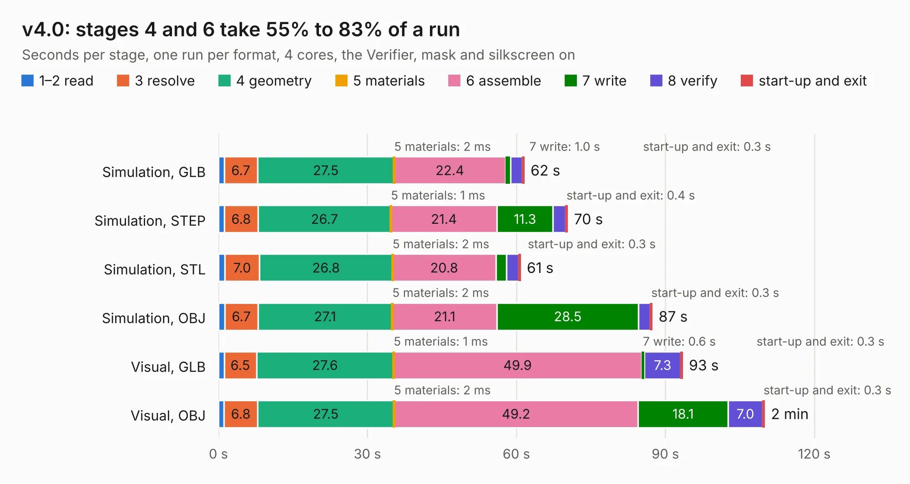

| Mode and format | 1–2 read | 3 resolve | 4 geometry | 5 materials | 6 assemble | 7 write | 8 verify | start-up and exit | Total |
|---|---:|---:|---:|---:|---:|---:|---:|---:|---:|
| Simulation, GLB | 1.1 | 6.7 | 27.5 | 2&nbsp;ms | 22.4 | 1.0 | 2.4 | 0.3 | 61.5 |
| Simulation, STEP | 1.2 | 6.8 | 26.7 | 1&nbsp;ms | 21.4 | 11.3 | 2.5 | 0.4 | 70.3 |
| Simulation, STL | 1.3 | 7.0 | 26.8 | 2&nbsp;ms | 20.8 | 2.1 | 2.5 | 0.3 | 60.8 |
| Simulation, OBJ | 1.3 | 6.7 | 27.1 | 2&nbsp;ms | 21.1 | 28.5 | 2.4 | 0.3 | 87.3 |
| Visual, GLB | 1.1 | 6.5 | 27.6 | 1&nbsp;ms | 49.9 | 0.6 | 7.3 | 0.3 | 93.4 |
| Visual, OBJ | 1.1 | 6.8 | 27.5 | 2&nbsp;ms | 49.2 | 18.1 | 7.0 | 0.3 | 109.9 |

<table align="center"><tr><td valign="top">

| Board | Repo: [tomojitakasu/PocketSDR](https://github.com/tomojitakasu/PocketSDR) Board: `v4.0.kicad_pcb` |
|---|---|
| Folder | FE_8CH / HW / v4.0 |
| Complexity | 402&nbsp;/&nbsp;1000 (size&nbsp;302, features&nbsp;100) |
| KESE&nbsp;features | through vias, slotted holes, arc tracks, filled zones, curved board outline, stack-up, dielectric εr and tanδ |
| Tested | 9th November 2026 |
| Copper&nbsp;layers | 4 |
| File&nbsp;format | KiCad 8 (20240108) |
| Parts,&nbsp;tracks,&nbsp;vias | 233, 3,065, 1,445 |
| Triangles,&nbsp;simulation | 5,577,956 in 260 parts |
| Verifier | PASS in all six runs |

</td><td valign="top">

<table>
<tr><th>File type</th><th>File size</th><th>Peak memory used</th></tr>
<tr><th colspan="3" align="left">Simulation</th></tr>
<tr><td>GLB</td><td align="right">191&nbsp;MB</td><td align="right">1.9&nbsp;GB</td></tr>
<tr><td>STEP</td><td align="right">669&nbsp;MB</td><td align="right">2.2&nbsp;GB</td></tr>
<tr><td>STL</td><td align="right">279&nbsp;MB</td><td align="right">2.0&nbsp;GB</td></tr>
<tr><td>OBJ</td><td align="right">602&nbsp;MB</td><td align="right">3.6&nbsp;GB</td></tr>
<tr><th colspan="3" align="left">Visual</th></tr>
<tr><td>GLB</td><td align="right">120&nbsp;MB</td><td align="right">2.0&nbsp;GB</td></tr>
<tr><td>OBJ</td><td align="right">389&nbsp;MB</td><td align="right">2.6&nbsp;GB</td></tr>
</table>

</td></tr></table>

## 2860. v4.1

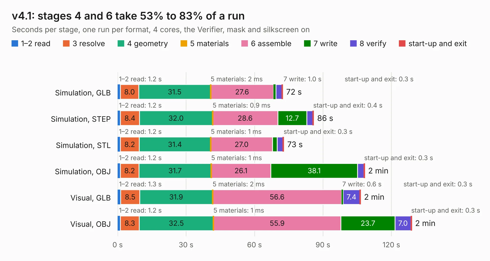

| Mode and format | 1–2 read | 3 resolve | 4 geometry | 5 materials | 6 assemble | 7 write | 8 verify | start-up and exit | Total |
|---|---:|---:|---:|---:|---:|---:|---:|---:|---:|
| Simulation, GLB | 1.2 | 8.0 | 31.5 | 2&nbsp;ms | 27.6 | 1.0 | 2.6 | 0.3 | 72.4 |
| Simulation, STEP | 1.2 | 8.4 | 32.0 | 0.9&nbsp;ms | 28.6 | 12.7 | 2.6 | 0.4 | 85.9 |
| Simulation, STL | 1.2 | 8.2 | 31.4 | 1&nbsp;ms | 27.0 | 2.0 | 2.6 | 0.3 | 72.8 |
| Simulation, OBJ | 1.2 | 8.2 | 31.7 | 1&nbsp;ms | 26.1 | 38.1 | 2.7 | 0.3 | 108.3 |
| Visual, GLB | 1.3 | 8.5 | 31.9 | 2&nbsp;ms | 56.6 | 0.6 | 7.4 | 0.3 | 106.5 |
| Visual, OBJ | 1.2 | 8.3 | 32.5 | 1&nbsp;ms | 55.9 | 23.7 | 7.0 | 0.3 | 128.9 |

<table align="center"><tr><td valign="top">

| Board | Repo: [tomojitakasu/PocketSDR](https://github.com/tomojitakasu/PocketSDR) Board: `v4.1.kicad_pcb` |
|---|---|
| Folder | FE_8CH / HW / v4.1 |
| Complexity | 403&nbsp;/&nbsp;1000 (size&nbsp;303, features&nbsp;100) |
| KESE&nbsp;features | through vias, slotted holes, arc tracks, filled zones, curved board outline, stack-up, dielectric εr and tanδ |
| Tested | 9th November 2026 |
| Copper&nbsp;layers | 4 |
| File&nbsp;format | KiCad 8 (20240108) |
| Parts,&nbsp;tracks,&nbsp;vias | 216, 3,080, 1,765 |
| Triangles,&nbsp;simulation | 6,053,476 in 262 parts |
| Verifier | PASS in all six runs |

</td><td valign="top">

<table>
<tr><th>File type</th><th>File size</th><th>Peak memory used</th></tr>
<tr><th colspan="3" align="left">Simulation</th></tr>
<tr><td>GLB</td><td align="right">206&nbsp;MB</td><td align="right">1.7&nbsp;GB</td></tr>
<tr><td>STEP</td><td align="right">673&nbsp;MB</td><td align="right">2.5&nbsp;GB</td></tr>
<tr><td>STL</td><td align="right">303&nbsp;MB</td><td align="right">1.9&nbsp;GB</td></tr>
<tr><td>OBJ</td><td align="right">651&nbsp;MB</td><td align="right">3.9&nbsp;GB</td></tr>
<tr><th colspan="3" align="left">Visual</th></tr>
<tr><td>GLB</td><td align="right">128&nbsp;MB</td><td align="right">2.1&nbsp;GB</td></tr>
<tr><td>OBJ</td><td align="right">418&nbsp;MB</td><td align="right">2.8&nbsp;GB</td></tr>
</table>

</td></tr></table>

## 2861. Coin_Cell_Tester

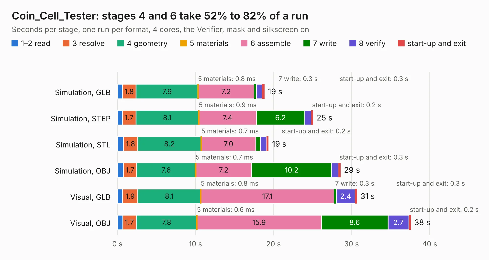

| Mode and format | 1–2 read | 3 resolve | 4 geometry | 5 materials | 6 assemble | 7 write | 8 verify | start-up and exit | Total |
|---|---:|---:|---:|---:|---:|---:|---:|---:|---:|
| Simulation, GLB | 0.6 | 1.8 | 7.9 | 0.8&nbsp;ms | 7.2 | 0.3 | 0.8 | 0.3 | 18.8 |
| Simulation, STEP | 0.6 | 1.7 | 8.1 | 0.9&nbsp;ms | 7.4 | 6.2 | 0.8 | 0.2 | 25.1 |
| Simulation, STL | 0.8 | 1.8 | 8.2 | 0.7&nbsp;ms | 7.0 | 0.6 | 0.8 | 0.2 | 19.4 |
| Simulation, OBJ | 0.8 | 1.7 | 7.6 | 0.7&nbsp;ms | 7.2 | 10.2 | 0.9 | 0.3 | 28.6 |
| Visual, GLB | 0.7 | 1.9 | 8.1 | 0.8&nbsp;ms | 17.1 | 0.3 | 2.4 | 0.3 | 30.7 |
| Visual, OBJ | 0.7 | 1.7 | 7.8 | 0.6&nbsp;ms | 15.9 | 8.6 | 2.7 | 0.2 | 37.6 |

<table align="center"><tr><td valign="top">

| Board | Repo: [tomrodinger/servomotor](https://github.com/tomrodinger/servomotor) Board: `Coin_Cell_Tester.kicad_pcb` |
|---|---|
| Folder | PCB / Coin_Cell_Tester / PCB / V1 |
| Complexity | 322&nbsp;/&nbsp;1000 (size&nbsp;237, features&nbsp;85) |
| KESE&nbsp;features | through vias, slotted holes, rounded, trapezoid or chamfered pads, filled zones, stack-up, dielectric εr and tanδ |
| Tested | 9th November 2026 |
| Copper&nbsp;layers | 2 |
| File&nbsp;format | KiCad 6 (20211014) |
| Parts,&nbsp;tracks,&nbsp;vias | 193, 1,281, 181 |
| Triangles,&nbsp;simulation | 1,879,786 in 102 parts |
| Verifier | PASS in all six runs |

</td><td valign="top">

<table>
<tr><th>File type</th><th>File size</th><th>Peak memory used</th></tr>
<tr><th colspan="3" align="left">Simulation</th></tr>
<tr><td>GLB</td><td align="right">64&nbsp;MB</td><td align="right">730&nbsp;MB</td></tr>
<tr><td>STEP</td><td align="right">339&nbsp;MB</td><td align="right">878&nbsp;MB</td></tr>
<tr><td>STL</td><td align="right">94&nbsp;MB</td><td align="right">671&nbsp;MB</td></tr>
<tr><td>OBJ</td><td align="right">195&nbsp;MB</td><td align="right">1.3&nbsp;GB</td></tr>
<tr><th colspan="3" align="left">Visual</th></tr>
<tr><td>GLB</td><td align="right">52&nbsp;MB</td><td align="right">1.1&nbsp;GB</td></tr>
<tr><td>OBJ</td><td align="right">157&nbsp;MB</td><td align="right">1.2&nbsp;GB</td></tr>
</table>

</td></tr></table>

## 2862. Coin_Cell_Tester

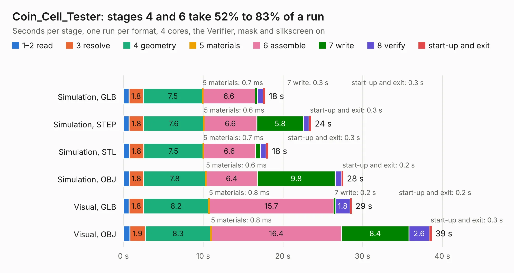

| Mode and format | 1–2 read | 3 resolve | 4 geometry | 5 materials | 6 assemble | 7 write | 8 verify | start-up and exit | Total |
|---|---:|---:|---:|---:|---:|---:|---:|---:|---:|
| Simulation, GLB | 0.7 | 1.8 | 7.5 | 0.7&nbsp;ms | 6.6 | 0.3 | 0.7 | 0.3 | 17.8 |
| Simulation, STEP | 0.7 | 1.8 | 7.6 | 0.6&nbsp;ms | 6.6 | 5.8 | 0.7 | 0.3 | 23.5 |
| Simulation, STL | 0.7 | 1.8 | 7.5 | 0.7&nbsp;ms | 6.6 | 0.6 | 0.7 | 0.3 | 18.2 |
| Simulation, OBJ | 0.7 | 1.8 | 7.8 | 0.6&nbsp;ms | 6.4 | 9.8 | 0.8 | 0.2 | 27.6 |
| Visual, GLB | 0.7 | 1.8 | 8.2 | 0.8&nbsp;ms | 15.7 | 0.2 | 1.8 | 0.2 | 28.6 |
| Visual, OBJ | 0.8 | 1.9 | 8.3 | 0.8&nbsp;ms | 16.4 | 8.4 | 2.6 | 0.3 | 38.7 |

<table align="center"><tr><td valign="top">

| Board | Repo: [tomrodinger/servomotor](https://github.com/tomrodinger/servomotor) Board: `Coin_Cell_Tester.kicad_pcb` |
|---|---|
| Folder | PCB / Coin_Cell_Tester / PCB / V2 |
| Complexity | 322&nbsp;/&nbsp;1000 (size&nbsp;237, features&nbsp;85) |
| KESE&nbsp;features | through vias, slotted holes, rounded, trapezoid or chamfered pads, filled zones, stack-up, dielectric εr and tanδ |
| Tested | 9th November 2026 |
| Copper&nbsp;layers | 2 |
| File&nbsp;format | KiCad 6 (20211014) |
| Parts,&nbsp;tracks,&nbsp;vias | 193, 1,255, 184 |
| Triangles,&nbsp;simulation | 1,916,852 in 102 parts |
| Verifier | PASS in all six runs |

</td><td valign="top">

<table>
<tr><th>File type</th><th>File size</th><th>Peak memory used</th></tr>
<tr><th colspan="3" align="left">Simulation</th></tr>
<tr><td>GLB</td><td align="right">66&nbsp;MB</td><td align="right">687&nbsp;MB</td></tr>
<tr><td>STEP</td><td align="right">349&nbsp;MB</td><td align="right">950&nbsp;MB</td></tr>
<tr><td>STL</td><td align="right">96&nbsp;MB</td><td align="right">717&nbsp;MB</td></tr>
<tr><td>OBJ</td><td align="right">200&nbsp;MB</td><td align="right">1.3&nbsp;GB</td></tr>
<tr><th colspan="3" align="left">Visual</th></tr>
<tr><td>GLB</td><td align="right">53&nbsp;MB</td><td align="right">897&nbsp;MB</td></tr>
<tr><td>OBJ</td><td align="right">162&nbsp;MB</td><td align="right">1.2&nbsp;GB</td></tr>
</table>

</td></tr></table>

## 2863. servo_motor

| Mode and format | 1–2 read | 3 resolve | 4 geometry | 5 materials | 6 assemble | 7 write | 8 verify | start-up and exit | Total |
|---|---:|---:|---:|---:|---:|---:|---:|---:|---:|
| Simulation, GLB | 0.5 | 1.6 | 6.4 | 0.6&nbsp;ms | 5.3 | 0.2 | 0.6 | 0.2 | 14.9 |
| Simulation, STEP | 0.6 | 1.8 | 6.8 | 0.6&nbsp;ms | 5.3 | 4.2 | 0.5 | 0.2 | 19.4 |
| Simulation, STL | 0.5 | 1.6 | 6.5 | 0.8&nbsp;ms | 5.3 | 0.4 | 0.6 | 0.2 | 15.1 |
| Simulation, OBJ | 0.6 | 1.7 | 6.7 | 0.5&nbsp;ms | 5.4 | 6.7 | 0.6 | 0.2 | 22.0 |
| Visual, GLB | 0.6 | 1.7 | 7.2 | 0.7&nbsp;ms | 12.6 | 0.2 | 1.5 | 0.3 | 24.0 |
| Visual, OBJ | 0.6 | 1.6 | 6.7 | 0.5&nbsp;ms | 13.3 | 5.6 | 1.9 | 0.2 | 29.9 |

<table align="center"><tr><td valign="top">

| Board | Repo: [tomrodinger/servomotor](https://github.com/tomrodinger/servomotor) Board: `servo_motor.kicad_pcb` |
|---|---|
| Folder | PCB / Servomotor1 / V26 |
| Complexity | 297&nbsp;/&nbsp;1000 (size&nbsp;187, features&nbsp;110) |
| KESE&nbsp;features | through vias, custom pads, rounded, trapezoid or chamfered pads, filled zones, copper drawings, curved board outline, stack-up, dielectric εr and tanδ |
| Tested | 9th November 2026 |
| Copper&nbsp;layers | 2 |
| File&nbsp;format | KiCad 6 (20211014) |
| Parts,&nbsp;tracks,&nbsp;vias | 99, 812, 233 |
| Triangles,&nbsp;simulation | 1,460,928 in 111 parts |
| Verifier | PASS in all six runs |

</td><td valign="top">

<table>
<tr><th>File type</th><th>File size</th><th>Peak memory used</th></tr>
<tr><th colspan="3" align="left">Simulation</th></tr>
<tr><td>GLB</td><td align="right">51&nbsp;MB</td><td align="right">585&nbsp;MB</td></tr>
<tr><td>STEP</td><td align="right">268&nbsp;MB</td><td align="right">734&nbsp;MB</td></tr>
<tr><td>STL</td><td align="right">73&nbsp;MB</td><td align="right">585&nbsp;MB</td></tr>
<tr><td>OBJ</td><td align="right">153&nbsp;MB</td><td align="right">1.0&nbsp;GB</td></tr>
<tr><th colspan="3" align="left">Visual</th></tr>
<tr><td>GLB</td><td align="right">43&nbsp;MB</td><td align="right">783&nbsp;MB</td></tr>
<tr><td>OBJ</td><td align="right">129&nbsp;MB</td><td align="right">934&nbsp;MB</td></tr>
</table>

</td></tr></table>

## 2864. servo_motor

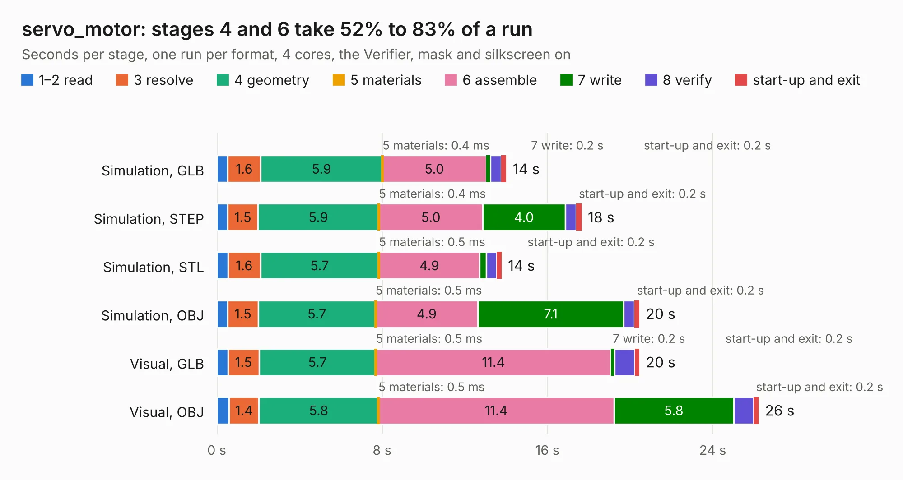

| Mode and format | 1–2 read | 3 resolve | 4 geometry | 5 materials | 6 assemble | 7 write | 8 verify | start-up and exit | Total |
|---|---:|---:|---:|---:|---:|---:|---:|---:|---:|
| Simulation, GLB | 0.5 | 1.6 | 5.9 | 0.4&nbsp;ms | 5.0 | 0.2 | 0.5 | 0.2 | 14.0 |
| Simulation, STEP | 0.5 | 1.5 | 5.9 | 0.4&nbsp;ms | 5.0 | 4.0 | 0.5 | 0.2 | 17.6 |
| Simulation, STL | 0.5 | 1.6 | 5.7 | 0.5&nbsp;ms | 4.9 | 0.3 | 0.5 | 0.2 | 13.8 |
| Simulation, OBJ | 0.5 | 1.5 | 5.7 | 0.5&nbsp;ms | 4.9 | 7.1 | 0.5 | 0.2 | 20.5 |
| Visual, GLB | 0.5 | 1.5 | 5.7 | 0.5&nbsp;ms | 11.4 | 0.2 | 1.0 | 0.2 | 20.5 |
| Visual, OBJ | 0.6 | 1.4 | 5.8 | 0.5&nbsp;ms | 11.4 | 5.8 | 1.0 | 0.2 | 26.2 |

<table align="center"><tr><td valign="top">

| Board | Repo: [tomrodinger/servomotor](https://github.com/tomrodinger/servomotor) Board: `servo_motor.kicad_pcb` |
|---|---|
| Folder | PCB / Servomotor1 / V27 |
| Complexity | 297&nbsp;/&nbsp;1000 (size&nbsp;187, features&nbsp;110) |
| KESE&nbsp;features | through vias, custom pads, rounded, trapezoid or chamfered pads, filled zones, copper drawings, curved board outline, stack-up, dielectric εr and tanδ |
| Tested | 9th November 2026 |
| Copper&nbsp;layers | 2 |
| File&nbsp;format | KiCad 7 (20221018) |
| Parts,&nbsp;tracks,&nbsp;vias | 99, 815, 233 |
| Triangles,&nbsp;simulation | 1,394,996 in 111 parts |
| Verifier | PASS in all six runs |

</td><td valign="top">

<table>
<tr><th>File type</th><th>File size</th><th>Peak memory used</th></tr>
<tr><th colspan="3" align="left">Simulation</th></tr>
<tr><td>GLB</td><td align="right">49&nbsp;MB</td><td align="right">555&nbsp;MB</td></tr>
<tr><td>STEP</td><td align="right">258&nbsp;MB</td><td align="right">704&nbsp;MB</td></tr>
<tr><td>STL</td><td align="right">70&nbsp;MB</td><td align="right">563&nbsp;MB</td></tr>
<tr><td>OBJ</td><td align="right">147&nbsp;MB</td><td align="right">957&nbsp;MB</td></tr>
<tr><th colspan="3" align="left">Visual</th></tr>
<tr><td>GLB</td><td align="right">42&nbsp;MB</td><td align="right">742&nbsp;MB</td></tr>
<tr><td>OBJ</td><td align="right">126&nbsp;MB</td><td align="right">910&nbsp;MB</td></tr>
</table>

</td></tr></table>

## 2865. servo_motor

| Mode and format | 1–2 read | 3 resolve | 4 geometry | 5 materials | 6 assemble | 7 write | 8 verify | start-up and exit | Total |
|---|---:|---:|---:|---:|---:|---:|---:|---:|---:|
| Simulation, GLB | 0.5 | 1.2 | 3.9 | 0.6&nbsp;ms | 4.2 | 0.2 | 0.5 | 0.2 | 10.6 |
| Simulation, STEP | 0.5 | 1.2 | 4.1 | 0.5&nbsp;ms | 3.9 | 3.1 | 0.4 | 0.3 | 13.5 |
| Simulation, STL | 0.5 | 1.2 | 4.1 | 0.7&nbsp;ms | 4.0 | 0.4 | 0.5 | 0.2 | 10.8 |
| Simulation, OBJ | 0.4 | 1.2 | 4.4 | 0.6&nbsp;ms | 4.3 | 5.2 | 0.5 | 0.2 | 16.2 |
| Visual, GLB | 0.5 | 1.2 | 4.3 | 0.7&nbsp;ms | 10.4 | 0.2 | 1.5 | 0.3 | 18.4 |
| Visual, OBJ | 0.4 | 1.2 | 4.3 | 0.7&nbsp;ms | 10.2 | 4.8 | 1.4 | 0.3 | 22.7 |

<table align="center"><tr><td valign="top">

| Board | Repo: [tomrodinger/servomotor](https://github.com/tomrodinger/servomotor) Board: `servo_motor.kicad_pcb` |
|---|---|
| Folder | PCB / Servomotor2 / V4 |
| Complexity | 306&nbsp;/&nbsp;1000 (size&nbsp;186, features&nbsp;120) |
| KESE&nbsp;features | through vias, slotted holes, custom pads, rounded, trapezoid or chamfered pads, filled zones, copper drawings, curved board outline, stack-up, dielectric εr and tanδ |
| Tested | 9th November 2026 |
| Copper&nbsp;layers | 2 |
| File&nbsp;format | KiCad 6 (20211014) |
| Parts,&nbsp;tracks,&nbsp;vias | 94, 834, 225 |
| Triangles,&nbsp;simulation | 1,065,306 in 97 parts |
| Verifier | PASS in all six runs |

</td><td valign="top">

<table>
<tr><th>File type</th><th>File size</th><th>Peak memory used</th></tr>
<tr><th colspan="3" align="left">Simulation</th></tr>
<tr><td>GLB</td><td align="right">38&nbsp;MB</td><td align="right">471&nbsp;MB</td></tr>
<tr><td>STEP</td><td align="right">203&nbsp;MB</td><td align="right">628&nbsp;MB</td></tr>
<tr><td>STL</td><td align="right">53&nbsp;MB</td><td align="right">503&nbsp;MB</td></tr>
<tr><td>OBJ</td><td align="right">110&nbsp;MB</td><td align="right">793&nbsp;MB</td></tr>
<tr><th colspan="3" align="left">Visual</th></tr>
<tr><td>GLB</td><td align="right">33&nbsp;MB</td><td align="right">709&nbsp;MB</td></tr>
<tr><td>OBJ</td><td align="right">99&nbsp;MB</td><td align="right">748&nbsp;MB</td></tr>
</table>

</td></tr></table>

## 2866. servo_motor

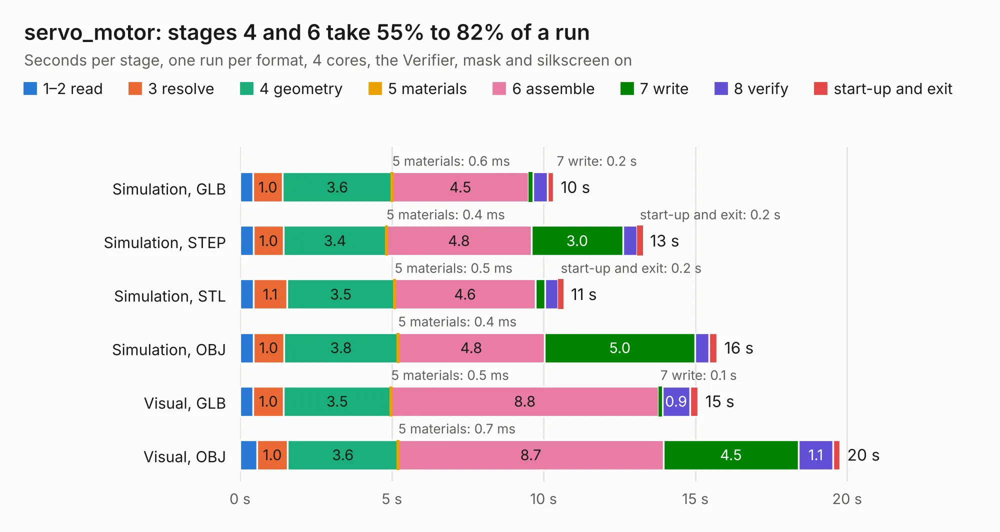

| Mode and format | 1–2 read | 3 resolve | 4 geometry | 5 materials | 6 assemble | 7 write | 8 verify | start-up and exit | Total |
|---|---:|---:|---:|---:|---:|---:|---:|---:|---:|
| Simulation, GLB | 0.4 | 1.0 | 3.6 | 0.6&nbsp;ms | 4.5 | 0.2 | 0.5 | 0.2 | 10.3 |
| Simulation, STEP | 0.4 | 1.0 | 3.4 | 0.4&nbsp;ms | 4.8 | 3.0 | 0.5 | 0.2 | 13.3 |
| Simulation, STL | 0.4 | 1.1 | 3.5 | 0.5&nbsp;ms | 4.6 | 0.3 | 0.4 | 0.2 | 10.7 |
| Simulation, OBJ | 0.4 | 1.0 | 3.8 | 0.4&nbsp;ms | 4.8 | 5.0 | 0.5 | 0.3 | 15.7 |
| Visual, GLB | 0.4 | 1.0 | 3.5 | 0.5&nbsp;ms | 8.8 | 0.1 | 0.9 | 0.3 | 15.1 |
| Visual, OBJ | 0.6 | 1.0 | 3.6 | 0.7&nbsp;ms | 8.7 | 4.5 | 1.1 | 0.2 | 19.8 |

<table align="center"><tr><td valign="top">

| Board | Repo: [tomrodinger/servomotor](https://github.com/tomrodinger/servomotor) Board: `servo_motor.kicad_pcb` |
|---|---|
| Folder | PCB / Servomotor2 / V5 |
| Complexity | 285&nbsp;/&nbsp;1000 (size&nbsp;185, features&nbsp;100) |
| KESE&nbsp;features | through vias, custom pads, rounded, trapezoid or chamfered pads, filled zones, copper drawings, stack-up, dielectric εr and tanδ |
| Tested | 9th November 2026 |
| Copper&nbsp;layers | 2 |
| File&nbsp;format | KiCad 7 (20221018) |
| Parts,&nbsp;tracks,&nbsp;vias | 92, 834, 215 |
| Triangles,&nbsp;simulation | 967,280 in 89 parts |
| Verifier | PASS in all six runs |

</td><td valign="top">

<table>
<tr><th>File type</th><th>File size</th><th>Peak memory used</th></tr>
<tr><th colspan="3" align="left">Simulation</th></tr>
<tr><td>GLB</td><td align="right">34&nbsp;MB</td><td align="right">469&nbsp;MB</td></tr>
<tr><td>STEP</td><td align="right">183&nbsp;MB</td><td align="right">565&nbsp;MB</td></tr>
<tr><td>STL</td><td align="right">48&nbsp;MB</td><td align="right">459&nbsp;MB</td></tr>
<tr><td>OBJ</td><td align="right">99&nbsp;MB</td><td align="right">684&nbsp;MB</td></tr>
<tr><th colspan="3" align="left">Visual</th></tr>
<tr><td>GLB</td><td align="right">30&nbsp;MB</td><td align="right">717&nbsp;MB</td></tr>
<tr><td>OBJ</td><td align="right">91&nbsp;MB</td><td align="right">636&nbsp;MB</td></tr>
</table>

</td></tr></table>

## 2867. servo_motor-V6

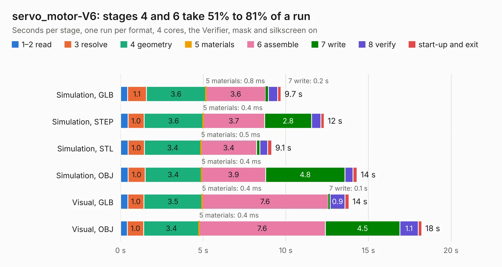

| Mode and format | 1–2 read | 3 resolve | 4 geometry | 5 materials | 6 assemble | 7 write | 8 verify | start-up and exit | Total |
|---|---:|---:|---:|---:|---:|---:|---:|---:|---:|
| Simulation, GLB | 0.4 | 1.1 | 3.6 | 0.8&nbsp;ms | 3.6 | 0.2 | 0.6 | 0.2 | 9.7 |
| Simulation, STEP | 0.5 | 1.0 | 3.6 | 0.4&nbsp;ms | 3.7 | 2.8 | 0.5 | 0.2 | 12.3 |
| Simulation, STL | 0.5 | 1.0 | 3.4 | 0.5&nbsp;ms | 3.4 | 0.2 | 0.5 | 0.2 | 9.1 |
| Simulation, OBJ | 0.5 | 1.0 | 3.4 | 0.4&nbsp;ms | 3.9 | 4.8 | 0.5 | 0.2 | 14.3 |
| Visual, GLB | 0.4 | 1.0 | 3.5 | 0.4&nbsp;ms | 7.6 | 0.1 | 0.9 | 0.2 | 13.8 |
| Visual, OBJ | 0.4 | 1.0 | 3.4 | 0.4&nbsp;ms | 7.6 | 4.5 | 1.1 | 0.2 | 18.2 |

<table align="center"><tr><td valign="top">

| Board | Repo: [tomrodinger/servomotor](https://github.com/tomrodinger/servomotor) Board: `servo_motor-V6.kicad_pcb` |
|---|---|
| Folder | PCB / Servomotor2 / V6 |
| Complexity | 286&nbsp;/&nbsp;1000 (size&nbsp;186, features&nbsp;100) |
| KESE&nbsp;features | through vias, custom pads, rounded, trapezoid or chamfered pads, filled zones, copper drawings, stack-up, dielectric εr and tanδ |
| Tested | 9th November 2026 |
| Copper&nbsp;layers | 2 |
| File&nbsp;format | KiCad 7 (20221018) |
| Parts,&nbsp;tracks,&nbsp;vias | 92, 843, 214 |
| Triangles,&nbsp;simulation | 894,130 in 89 parts |
| Verifier | PASS in all six runs |

</td><td valign="top">

<table>
<tr><th>File type</th><th>File size</th><th>Peak memory used</th></tr>
<tr><th colspan="3" align="left">Simulation</th></tr>
<tr><td>GLB</td><td align="right">31&nbsp;MB</td><td align="right">436&nbsp;MB</td></tr>
<tr><td>STEP</td><td align="right">161&nbsp;MB</td><td align="right">522&nbsp;MB</td></tr>
<tr><td>STL</td><td align="right">45&nbsp;MB</td><td align="right">417&nbsp;MB</td></tr>
<tr><td>OBJ</td><td align="right">92&nbsp;MB</td><td align="right">637&nbsp;MB</td></tr>
<tr><th colspan="3" align="left">Visual</th></tr>
<tr><td>GLB</td><td align="right">29&nbsp;MB</td><td align="right">626&nbsp;MB</td></tr>
<tr><td>OBJ</td><td align="right">86&nbsp;MB</td><td align="right">633&nbsp;MB</td></tr>
</table>

</td></tr></table>

## 2868. 1.0

| Mode and format | 1–2 read | 3 resolve | 4 geometry | 5 materials | 6 assemble | 7 write | 8 verify | start-up and exit | Total |
|---|---:|---:|---:|---:|---:|---:|---:|---:|---:|
| Simulation, GLB | 0.4 | 1.0 | 3.6 | 0.4&nbsp;ms | 3.6 | 0.1 | 0.5 | 0.2 | 9.4 |
| Simulation, STEP | 0.4 | 1.0 | 3.7 | 0.3&nbsp;ms | 3.6 | 2.5 | 0.5 | 0.2 | 11.9 |
| Simulation, STL | 0.4 | 1.0 | 3.6 | 0.3&nbsp;ms | 3.5 | 0.3 | 0.5 | 0.2 | 9.5 |
| Simulation, OBJ | 0.4 | 1.0 | 3.6 | 0.6&nbsp;ms | 3.4 | 4.7 | 0.5 | 0.3 | 13.9 |
| Visual, GLB | 0.4 | 1.0 | 3.7 | 0.3&nbsp;ms | 8.4 | 0.1 | 1.0 | 0.3 | 14.8 |
| Visual, OBJ | 0.4 | 1.1 | 3.5 | 0.4&nbsp;ms | 8.0 | 4.2 | 1.0 | 0.2 | 18.4 |

<table align="center"><tr><td valign="top">

| Board | Repo: [tomrodinger/servomotor](https://github.com/tomrodinger/servomotor) Board: `1.0.kicad_pcb` |
|---|---|
| Folder | PCB / Servomotor3 / 1.0 |
| Complexity | 346&nbsp;/&nbsp;1000 (size&nbsp;221, features&nbsp;125) |
| KESE&nbsp;features | through vias, custom pads, rounded, trapezoid or chamfered pads, filled zones, copper drawings, curved board outline, stack-up, dielectric εr and tanδ, copper finish |
| Tested | 9th November 2026 |
| Copper&nbsp;layers | 2 |
| File&nbsp;format | KiCad 9 (20241229) |
| Parts,&nbsp;tracks,&nbsp;vias | 66, 584, 261 |
| Triangles,&nbsp;simulation | 930,390 in 65 parts |
| Verifier | PASS in all six runs |

</td><td valign="top">

<table>
<tr><th>File type</th><th>File size</th><th>Peak memory used</th></tr>
<tr><th colspan="3" align="left">Simulation</th></tr>
<tr><td>GLB</td><td align="right">32&nbsp;MB</td><td align="right">416&nbsp;MB</td></tr>
<tr><td>STEP</td><td align="right">146&nbsp;MB</td><td align="right">518&nbsp;MB</td></tr>
<tr><td>STL</td><td align="right">47&nbsp;MB</td><td align="right">434&nbsp;MB</td></tr>
<tr><td>OBJ</td><td align="right">94&nbsp;MB</td><td align="right">656&nbsp;MB</td></tr>
<tr><th colspan="3" align="left">Visual</th></tr>
<tr><td>GLB</td><td align="right">27&nbsp;MB</td><td align="right">666&nbsp;MB</td></tr>
<tr><td>OBJ</td><td align="right">81&nbsp;MB</td><td align="right">618&nbsp;MB</td></tr>
</table>

</td></tr></table>

## 2869. 1.2

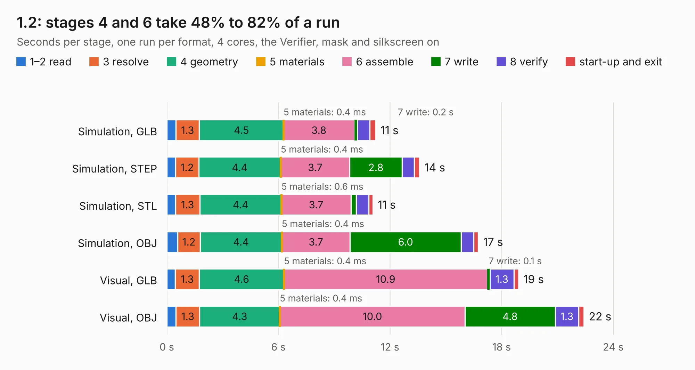

| Mode and format | 1–2 read | 3 resolve | 4 geometry | 5 materials | 6 assemble | 7 write | 8 verify | start-up and exit | Total |
|---|---:|---:|---:|---:|---:|---:|---:|---:|---:|
| Simulation, GLB | 0.5 | 1.3 | 4.5 | 0.4&nbsp;ms | 3.8 | 0.2 | 0.7 | 0.3 | 11.2 |
| Simulation, STEP | 0.5 | 1.2 | 4.4 | 0.4&nbsp;ms | 3.7 | 2.8 | 0.7 | 0.3 | 13.6 |
| Simulation, STL | 0.5 | 1.3 | 4.4 | 0.6&nbsp;ms | 3.7 | 0.3 | 0.7 | 0.2 | 11.1 |
| Simulation, OBJ | 0.6 | 1.2 | 4.4 | 0.4&nbsp;ms | 3.7 | 6.0 | 0.7 | 0.2 | 16.7 |
| Visual, GLB | 0.4 | 1.3 | 4.6 | 0.4&nbsp;ms | 10.9 | 0.1 | 1.3 | 0.2 | 18.9 |
| Visual, OBJ | 0.5 | 1.3 | 4.3 | 0.4&nbsp;ms | 10.0 | 4.8 | 1.3 | 0.3 | 22.4 |

<table align="center"><tr><td valign="top">

| Board | Repo: [tomrodinger/servomotor](https://github.com/tomrodinger/servomotor) Board: `1.2.kicad_pcb` |
|---|---|
| Folder | PCB / Servomotor3 / 1.2 |
| Complexity | 348&nbsp;/&nbsp;1000 (size&nbsp;223, features&nbsp;125) |
| KESE&nbsp;features | through vias, custom pads, rounded, trapezoid or chamfered pads, filled zones, copper drawings, curved board outline, stack-up, dielectric εr and tanδ, copper finish |
| Tested | 9th November 2026 |
| Copper&nbsp;layers | 2 |
| File&nbsp;format | KiCad 8 (20240108) |
| Parts,&nbsp;tracks,&nbsp;vias | 74, 542, 308 |
| Triangles,&nbsp;simulation | 975,320 in 65 parts |
| Verifier | PASS in all six runs |

</td><td valign="top">

<table>
<tr><th>File type</th><th>File size</th><th>Peak memory used</th></tr>
<tr><th colspan="3" align="left">Simulation</th></tr>
<tr><td>GLB</td><td align="right">33&nbsp;MB</td><td align="right">487&nbsp;MB</td></tr>
<tr><td>STEP</td><td align="right">148&nbsp;MB</td><td align="right">558&nbsp;MB</td></tr>
<tr><td>STL</td><td align="right">49&nbsp;MB</td><td align="right">504&nbsp;MB</td></tr>
<tr><td>OBJ</td><td align="right">99&nbsp;MB</td><td align="right">696&nbsp;MB</td></tr>
<tr><th colspan="3" align="left">Visual</th></tr>
<tr><td>GLB</td><td align="right">28&nbsp;MB</td><td align="right">665&nbsp;MB</td></tr>
<tr><td>OBJ</td><td align="right">84&nbsp;MB</td><td align="right">673&nbsp;MB</td></tr>
</table>

</td></tr></table>

## 2870. 1.3

| Mode and format | 1–2 read | 3 resolve | 4 geometry | 5 materials | 6 assemble | 7 write | 8 verify | start-up and exit | Total |
|---|---:|---:|---:|---:|---:|---:|---:|---:|---:|
| Simulation, GLB | 0.4 | 1.0 | 3.8 | 0.4&nbsp;ms | 3.5 | 0.2 | 0.5 | 0.3 | 9.8 |
| Simulation, STEP | 0.4 | 1.1 | 3.8 | 0.5&nbsp;ms | 3.4 | 2.5 | 0.5 | 0.2 | 12.0 |
| Simulation, STL | 0.4 | 1.1 | 3.5 | 0.4&nbsp;ms | 3.2 | 0.3 | 0.5 | 0.2 | 9.3 |
| Simulation, OBJ | 0.4 | 0.9 | 3.9 | 0.2&nbsp;ms | 3.5 | 4.6 | 0.6 | 0.2 | 14.1 |
| Visual, GLB | 0.4 | 0.9 | 3.6 | 0.4&nbsp;ms | 9.0 | 0.1 | 1.0 | 0.2 | 15.3 |
| Visual, OBJ | 0.5 | 1.0 | 3.7 | 0.6&nbsp;ms | 9.2 | 3.3 | 1.3 | 0.3 | 19.3 |

<table align="center"><tr><td valign="top">

| Board | Repo: [tomrodinger/servomotor](https://github.com/tomrodinger/servomotor) Board: `1.3.kicad_pcb` |
|---|---|
| Folder | PCB / Servomotor3 / 1.3 |
| Complexity | 348&nbsp;/&nbsp;1000 (size&nbsp;223, features&nbsp;125) |
| KESE&nbsp;features | through vias, custom pads, rounded, trapezoid or chamfered pads, filled zones, copper drawings, curved board outline, stack-up, dielectric εr and tanδ, copper finish |
| Tested | 9th November 2026 |
| Copper&nbsp;layers | 2 |
| File&nbsp;format | KiCad 8 (20240108) |
| Parts,&nbsp;tracks,&nbsp;vias | 75, 544, 308 |
| Triangles,&nbsp;simulation | 956,536 in 65 parts |
| Verifier | PASS in all six runs |

</td><td valign="top">

<table>
<tr><th>File type</th><th>File size</th><th>Peak memory used</th></tr>
<tr><th colspan="3" align="left">Simulation</th></tr>
<tr><td>GLB</td><td align="right">33&nbsp;MB</td><td align="right">488&nbsp;MB</td></tr>
<tr><td>STEP</td><td align="right">142&nbsp;MB</td><td align="right">549&nbsp;MB</td></tr>
<tr><td>STL</td><td align="right">48&nbsp;MB</td><td align="right">493&nbsp;MB</td></tr>
<tr><td>OBJ</td><td align="right">97&nbsp;MB</td><td align="right">681&nbsp;MB</td></tr>
<tr><th colspan="3" align="left">Visual</th></tr>
<tr><td>GLB</td><td align="right">28&nbsp;MB</td><td align="right">653&nbsp;MB</td></tr>
<tr><td>OBJ</td><td align="right">83&nbsp;MB</td><td align="right">663&nbsp;MB</td></tr>
</table>

</td></tr></table>

## 2871. 1.5

| Mode and format | 1–2 read | 3 resolve | 4 geometry | 5 materials | 6 assemble | 7 write | 8 verify | start-up and exit | Total |
|---|---:|---:|---:|---:|---:|---:|---:|---:|---:|
| Simulation, GLB | 0.6 | 1.4 | 4.5 | 0.4&nbsp;ms | 3.9 | 0.2 | 0.6 | 0.2 | 11.4 |
| Simulation, STEP | 0.6 | 1.4 | 4.5 | 0.4&nbsp;ms | 3.9 | 2.5 | 0.6 | 0.2 | 13.6 |
| Simulation, STL | 0.6 | 1.2 | 4.6 | 0.5&nbsp;ms | 3.9 | 0.3 | 0.6 | 0.2 | 11.4 |
| Simulation, OBJ | 0.5 | 1.2 | 4.5 | 0.4&nbsp;ms | 3.8 | 5.7 | 0.6 | 0.2 | 16.5 |
| Visual, GLB | 0.5 | 1.2 | 4.4 | 0.4&nbsp;ms | 10.5 | 0.2 | 1.0 | 0.2 | 18.0 |
| Visual, OBJ | 0.6 | 1.2 | 4.6 | 0.4&nbsp;ms | 10.1 | 5.5 | 1.1 | 0.2 | 23.4 |

<table align="center"><tr><td valign="top">

| Board | Repo: [tomrodinger/servomotor](https://github.com/tomrodinger/servomotor) Board: `1.5.kicad_pcb` |
|---|---|
| Folder | PCB / Servomotor3 / 1.5 |
| Complexity | 349&nbsp;/&nbsp;1000 (size&nbsp;224, features&nbsp;125) |
| KESE&nbsp;features | through vias, custom pads, rounded, trapezoid or chamfered pads, filled zones, copper drawings, curved board outline, stack-up, dielectric εr and tanδ, copper finish |
| Tested | 9th November 2026 |
| Copper&nbsp;layers | 2 |
| File&nbsp;format | KiCad 9 (20241229) |
| Parts,&nbsp;tracks,&nbsp;vias | 75, 550, 330 |
| Triangles,&nbsp;simulation | 1,145,496 in 65 parts |
| Verifier | PASS in all six runs |

</td><td valign="top">

<table>
<tr><th>File type</th><th>File size</th><th>Peak memory used</th></tr>
<tr><th colspan="3" align="left">Simulation</th></tr>
<tr><td>GLB</td><td align="right">40&nbsp;MB</td><td align="right">630&nbsp;MB</td></tr>
<tr><td>STEP</td><td align="right">142&nbsp;MB</td><td align="right">656&nbsp;MB</td></tr>
<tr><td>STL</td><td align="right">57&nbsp;MB</td><td align="right">662&nbsp;MB</td></tr>
<tr><td>OBJ</td><td align="right">117&nbsp;MB</td><td align="right">824&nbsp;MB</td></tr>
<tr><th colspan="3" align="left">Visual</th></tr>
<tr><td>GLB</td><td align="right">34&nbsp;MB</td><td align="right">704&nbsp;MB</td></tr>
<tr><td>OBJ</td><td align="right">103&nbsp;MB</td><td align="right">749&nbsp;MB</td></tr>
</table>

</td></tr></table>

## 2872. V10

| Mode and format | 1–2 read | 3 resolve | 4 geometry | 5 materials | 6 assemble | 7 write | 8 verify | start-up and exit | Total |
|---|---:|---:|---:|---:|---:|---:|---:|---:|---:|
| Simulation, GLB | 0.3 | 0.9 | 2.9 | 0.3&nbsp;ms | 2.8 | 0.1 | 0.5 | 0.2 | 7.7 |
| Simulation, STEP | 0.3 | 0.8 | 3.0 | 0.3&nbsp;ms | 2.8 | 2.4 | 0.4 | 0.2 | 10.0 |
| Simulation, STL | 0.3 | 0.9 | 3.0 | 0.3&nbsp;ms | 3.1 | 0.2 | 0.4 | 0.2 | 8.2 |
| Simulation, OBJ | 0.4 | 0.8 | 3.0 | 0.3&nbsp;ms | 2.9 | 4.2 | 0.4 | 0.2 | 11.9 |
| Visual, GLB | 0.4 | 0.8 | 3.0 | 0.3&nbsp;ms | 7.0 | 92&nbsp;ms | 0.7 | 0.2 | 12.1 |
| Visual, OBJ | 0.3 | 0.8 | 3.1 | 0.4&nbsp;ms | 6.8 | 3.7 | 0.8 | 0.2 | 15.8 |

<table align="center"><tr><td valign="top">

| Board | Repo: [tomrodinger/servomotor](https://github.com/tomrodinger/servomotor) Board: `V10.kicad_pcb` |
|---|---|
| Folder | PCB / Servomotor3 / V10 |
| Complexity | 344&nbsp;/&nbsp;1000 (size&nbsp;219, features&nbsp;125) |
| KESE&nbsp;features | through vias, custom pads, rounded, trapezoid or chamfered pads, filled zones, copper drawings, curved board outline, stack-up, dielectric εr and tanδ, copper finish |
| Tested | 9th November 2026 |
| Copper&nbsp;layers | 2 |
| File&nbsp;format | KiCad 8 (20240108) |
| Parts,&nbsp;tracks,&nbsp;vias | 64, 576, 226 |
| Triangles,&nbsp;simulation | 822,874 in 60 parts |
| Verifier | PASS in all six runs |

</td><td valign="top">

<table>
<tr><th>File type</th><th>File size</th><th>Peak memory used</th></tr>
<tr><th colspan="3" align="left">Simulation</th></tr>
<tr><td>GLB</td><td align="right">28&nbsp;MB</td><td align="right">394&nbsp;MB</td></tr>
<tr><td>STEP</td><td align="right">129&nbsp;MB</td><td align="right">506&nbsp;MB</td></tr>
<tr><td>STL</td><td align="right">41&nbsp;MB</td><td align="right">407&nbsp;MB</td></tr>
<tr><td>OBJ</td><td align="right">83&nbsp;MB</td><td align="right">582&nbsp;MB</td></tr>
<tr><th colspan="3" align="left">Visual</th></tr>
<tr><td>GLB</td><td align="right">24&nbsp;MB</td><td align="right">600&nbsp;MB</td></tr>
<tr><td>OBJ</td><td align="right">72&nbsp;MB</td><td align="right">601&nbsp;MB</td></tr>
</table>

</td></tr></table>

## 2873. V11

| Mode and format | 1–2 read | 3 resolve | 4 geometry | 5 materials | 6 assemble | 7 write | 8 verify | start-up and exit | Total |
|---|---:|---:|---:|---:|---:|---:|---:|---:|---:|
| Simulation, GLB | 0.4 | 1.0 | 3.9 | 0.4&nbsp;ms | 3.5 | 0.2 | 0.6 | 0.2 | 9.8 |
| Simulation, STEP | 0.4 | 1.1 | 4.0 | 0.3&nbsp;ms | 3.7 | 2.6 | 0.5 | 0.2 | 12.5 |
| Simulation, STL | 0.4 | 1.0 | 3.7 | 0.4&nbsp;ms | 3.5 | 0.3 | 0.5 | 0.2 | 9.8 |
| Simulation, OBJ | 0.4 | 1.0 | 3.8 | 0.4&nbsp;ms | 3.6 | 4.8 | 0.5 | 0.2 | 14.4 |
| Visual, GLB | 0.4 | 1.1 | 4.0 | 0.3&nbsp;ms | 8.4 | 0.1 | 0.8 | 0.2 | 15.0 |
| Visual, OBJ | 0.5 | 1.1 | 3.8 | 0.4&nbsp;ms | 8.3 | 4.4 | 1.0 | 0.2 | 19.3 |

<table align="center"><tr><td valign="top">

| Board | Repo: [tomrodinger/servomotor](https://github.com/tomrodinger/servomotor) Board: `V11.kicad_pcb` |
|---|---|
| Folder | PCB / Servomotor3 / V11 |
| Complexity | 346&nbsp;/&nbsp;1000 (size&nbsp;221, features&nbsp;125) |
| KESE&nbsp;features | through vias, custom pads, rounded, trapezoid or chamfered pads, filled zones, copper drawings, curved board outline, stack-up, dielectric εr and tanδ, copper finish |
| Tested | 9th November 2026 |
| Copper&nbsp;layers | 2 |
| File&nbsp;format | KiCad 8 (20240108) |
| Parts,&nbsp;tracks,&nbsp;vias | 66, 584, 261 |
| Triangles,&nbsp;simulation | 930,538 in 65 parts |
| Verifier | PASS in all six runs |

</td><td valign="top">

<table>
<tr><th>File type</th><th>File size</th><th>Peak memory used</th></tr>
<tr><th colspan="3" align="left">Simulation</th></tr>
<tr><td>GLB</td><td align="right">32&nbsp;MB</td><td align="right">424&nbsp;MB</td></tr>
<tr><td>STEP</td><td align="right">146&nbsp;MB</td><td align="right">532&nbsp;MB</td></tr>
<tr><td>STL</td><td align="right">47&nbsp;MB</td><td align="right">432&nbsp;MB</td></tr>
<tr><td>OBJ</td><td align="right">94&nbsp;MB</td><td align="right">655&nbsp;MB</td></tr>
<tr><th colspan="3" align="left">Visual</th></tr>
<tr><td>GLB</td><td align="right">27&nbsp;MB</td><td align="right">563&nbsp;MB</td></tr>
<tr><td>OBJ</td><td align="right">81&nbsp;MB</td><td align="right">639&nbsp;MB</td></tr>
</table>

</td></tr></table>

## 2874. V11

| Mode and format | 1–2 read | 3 resolve | 4 geometry | 5 materials | 6 assemble | 7 write | 8 verify | start-up and exit | Total |
|---|---:|---:|---:|---:|---:|---:|---:|---:|---:|
| Simulation, GLB | 0.3 | 0.9 | 3.4 | 0.4&nbsp;ms | 3.0 | 0.1 | 0.5 | 0.2 | 8.4 |
| Simulation, STEP | 0.3 | 0.9 | 3.3 | 0.3&nbsp;ms | 3.1 | 2.3 | 0.5 | 0.2 | 10.7 |
| Simulation, STL | 0.3 | 0.9 | 3.2 | 0.5&nbsp;ms | 3.1 | 0.2 | 0.4 | 0.2 | 8.4 |
| Simulation, OBJ | 0.3 | 0.9 | 3.2 | 0.3&nbsp;ms | 3.0 | 4.1 | 0.5 | 0.2 | 12.3 |
| Visual, GLB | 0.3 | 0.9 | 3.3 | 0.3&nbsp;ms | 7.0 | 0.1 | 0.6 | 0.2 | 12.4 |
| Visual, OBJ | 0.3 | 0.9 | 3.3 | 0.3&nbsp;ms | 6.7 | 3.5 | 0.6 | 0.2 | 15.5 |

<table align="center"><tr><td valign="top">

| Board | Repo: [tomrodinger/servomotor](https://github.com/tomrodinger/servomotor) Board: `V11.kicad_pcb` |
|---|---|
| Folder | PCB / Servomotor3 / V11RC1 |
| Complexity | 345&nbsp;/&nbsp;1000 (size&nbsp;220, features&nbsp;125) |
| KESE&nbsp;features | through vias, custom pads, rounded, trapezoid or chamfered pads, filled zones, copper drawings, curved board outline, stack-up, dielectric εr and tanδ, copper finish |
| Tested | 9th November 2026 |
| Copper&nbsp;layers | 2 |
| File&nbsp;format | KiCad 8 (20240108) |
| Parts,&nbsp;tracks,&nbsp;vias | 64, 531, 270 |
| Triangles,&nbsp;simulation | 876,820 in 60 parts |
| Verifier | PASS in all six runs |

</td><td valign="top">

<table>
<tr><th>File type</th><th>File size</th><th>Peak memory used</th></tr>
<tr><th colspan="3" align="left">Simulation</th></tr>
<tr><td>GLB</td><td align="right">30&nbsp;MB</td><td align="right">412&nbsp;MB</td></tr>
<tr><td>STEP</td><td align="right">133&nbsp;MB</td><td align="right">495&nbsp;MB</td></tr>
<tr><td>STL</td><td align="right">44&nbsp;MB</td><td align="right">414&nbsp;MB</td></tr>
<tr><td>OBJ</td><td align="right">89&nbsp;MB</td><td align="right">582&nbsp;MB</td></tr>
<tr><th colspan="3" align="left">Visual</th></tr>
<tr><td>GLB</td><td align="right">25&nbsp;MB</td><td align="right">545&nbsp;MB</td></tr>
<tr><td>OBJ</td><td align="right">76&nbsp;MB</td><td align="right">622&nbsp;MB</td></tr>
</table>

</td></tr></table>

## 2875. V11RC2

| Mode and format | 1–2 read | 3 resolve | 4 geometry | 5 materials | 6 assemble | 7 write | 8 verify | start-up and exit | Total |
|---|---:|---:|---:|---:|---:|---:|---:|---:|---:|
| Simulation, GLB | 0.3 | 1.0 | 3.1 | 0.5&nbsp;ms | 3.4 | 0.2 | 0.4 | 0.2 | 8.6 |
| Simulation, STEP | 0.3 | 0.9 | 3.1 | 0.4&nbsp;ms | 3.3 | 2.4 | 0.4 | 0.3 | 10.8 |
| Simulation, STL | 0.4 | 0.9 | 3.6 | 0.5&nbsp;ms | 3.4 | 0.2 | 0.5 | 0.2 | 9.2 |
| Simulation, OBJ | 0.3 | 0.8 | 3.1 | 0.6&nbsp;ms | 3.4 | 4.2 | 0.5 | 0.3 | 12.8 |
| Visual, GLB | 0.3 | 0.9 | 3.2 | 1&nbsp;ms | 7.6 | 0.1 | 1.0 | 0.3 | 13.3 |
| Visual, OBJ | 0.3 | 0.9 | 3.2 | 0.4&nbsp;ms | 7.7 | 3.6 | 1.0 | 0.2 | 17.0 |

<table align="center"><tr><td valign="top">

| Board | Repo: [tomrodinger/servomotor](https://github.com/tomrodinger/servomotor) Board: `V11RC2.kicad_pcb` |
|---|---|
| Folder | PCB / Servomotor3 / V11RC2 |
| Complexity | 344&nbsp;/&nbsp;1000 (size&nbsp;219, features&nbsp;125) |
| KESE&nbsp;features | through vias, custom pads, rounded, trapezoid or chamfered pads, filled zones, copper drawings, curved board outline, stack-up, dielectric εr and tanδ, copper finish |
| Tested | 9th November 2026 |
| Copper&nbsp;layers | 2 |
| File&nbsp;format | KiCad 8 (20240108) |
| Parts,&nbsp;tracks,&nbsp;vias | 63, 521, 267 |
| Triangles,&nbsp;simulation | 889,910 in 60 parts |
| Verifier | PASS in all six runs |

</td><td valign="top">

<table>
<tr><th>File type</th><th>File size</th><th>Peak memory used</th></tr>
<tr><th colspan="3" align="left">Simulation</th></tr>
<tr><td>GLB</td><td align="right">31&nbsp;MB</td><td align="right">410&nbsp;MB</td></tr>
<tr><td>STEP</td><td align="right">136&nbsp;MB</td><td align="right">520&nbsp;MB</td></tr>
<tr><td>STL</td><td align="right">45&nbsp;MB</td><td align="right">423&nbsp;MB</td></tr>
<tr><td>OBJ</td><td align="right">90&nbsp;MB</td><td align="right">626&nbsp;MB</td></tr>
<tr><th colspan="3" align="left">Visual</th></tr>
<tr><td>GLB</td><td align="right">26&nbsp;MB</td><td align="right">612&nbsp;MB</td></tr>
<tr><td>OBJ</td><td align="right">77&nbsp;MB</td><td align="right">606&nbsp;MB</td></tr>
</table>

</td></tr></table>

## 2876. V11RC3

| Mode and format | 1–2 read | 3 resolve | 4 geometry | 5 materials | 6 assemble | 7 write | 8 verify | start-up and exit | Total |
|---|---:|---:|---:|---:|---:|---:|---:|---:|---:|
| Simulation, GLB | 0.4 | 1.0 | 3.9 | 0.7&nbsp;ms | 3.6 | 0.2 | 0.5 | 0.2 | 9.9 |
| Simulation, STEP | 0.3 | 1.1 | 3.5 | 0.3&nbsp;ms | 3.7 | 2.7 | 0.6 | 0.3 | 12.2 |
| Simulation, STL | 0.4 | 1.0 | 4.1 | 0.4&nbsp;ms | 3.6 | 0.3 | 0.6 | 0.3 | 10.3 |
| Simulation, OBJ | 0.3 | 1.0 | 3.7 | 0.3&nbsp;ms | 3.5 | 4.4 | 0.6 | 0.2 | 13.7 |
| Visual, GLB | 0.4 | 0.9 | 3.8 | 0.4&nbsp;ms | 8.4 | 0.1 | 1.2 | 0.3 | 15.0 |
| Visual, OBJ | 0.4 | 1.0 | 3.9 | 0.4&nbsp;ms | 8.4 | 3.8 | 1.3 | 0.2 | 19.1 |

<table align="center"><tr><td valign="top">

| Board | Repo: [tomrodinger/servomotor](https://github.com/tomrodinger/servomotor) Board: `V11RC3.kicad_pcb` |
|---|---|
| Folder | PCB / Servomotor3 / V11RC3 |
| Complexity | 345&nbsp;/&nbsp;1000 (size&nbsp;220, features&nbsp;125) |
| KESE&nbsp;features | through vias, custom pads, rounded, trapezoid or chamfered pads, filled zones, copper drawings, curved board outline, stack-up, dielectric εr and tanδ, copper finish |
| Tested | 9th November 2026 |
| Copper&nbsp;layers | 2 |
| File&nbsp;format | KiCad 8 (20240108) |
| Parts,&nbsp;tracks,&nbsp;vias | 64, 525, 264 |
| Triangles,&nbsp;simulation | 875,720 in 61 parts |
| Verifier | PASS in all six runs |

</td><td valign="top">

<table>
<tr><th>File type</th><th>File size</th><th>Peak memory used</th></tr>
<tr><th colspan="3" align="left">Simulation</th></tr>
<tr><td>GLB</td><td align="right">30&nbsp;MB</td><td align="right">406&nbsp;MB</td></tr>
<tr><td>STEP</td><td align="right">134&nbsp;MB</td><td align="right">492&nbsp;MB</td></tr>
<tr><td>STL</td><td align="right">44&nbsp;MB</td><td align="right">402&nbsp;MB</td></tr>
<tr><td>OBJ</td><td align="right">89&nbsp;MB</td><td align="right">614&nbsp;MB</td></tr>
<tr><th colspan="3" align="left">Visual</th></tr>
<tr><td>GLB</td><td align="right">25&nbsp;MB</td><td align="right">590&nbsp;MB</td></tr>
<tr><td>OBJ</td><td align="right">76&nbsp;MB</td><td align="right">608&nbsp;MB</td></tr>
</table>

</td></tr></table>

## 2877. V11RC4

| Mode and format | 1–2 read | 3 resolve | 4 geometry | 5 materials | 6 assemble | 7 write | 8 verify | start-up and exit | Total |
|---|---:|---:|---:|---:|---:|---:|---:|---:|---:|
| Simulation, GLB | 0.3 | 0.9 | 3.4 | 0.6&nbsp;ms | 3.3 | 0.1 | 0.5 | 0.3 | 8.8 |
| Simulation, STEP | 0.3 | 0.9 | 3.7 | 0.4&nbsp;ms | 3.5 | 2.6 | 0.4 | 0.2 | 11.7 |
| Simulation, STL | 0.3 | 1.0 | 3.7 | 0.5&nbsp;ms | 3.6 | 0.3 | 0.5 | 0.2 | 9.6 |
| Simulation, OBJ | 0.3 | 0.9 | 3.3 | 0.7&nbsp;ms | 3.5 | 4.2 | 0.5 | 0.2 | 12.9 |
| Visual, GLB | 0.3 | 0.9 | 3.3 | 0.5&nbsp;ms | 7.7 | 0.1 | 1.1 | 0.3 | 13.7 |
| Visual, OBJ | 0.3 | 0.9 | 3.3 | 0.7&nbsp;ms | 8.1 | 3.9 | 1.2 | 0.3 | 18.0 |

<table align="center"><tr><td valign="top">

| Board | Repo: [tomrodinger/servomotor](https://github.com/tomrodinger/servomotor) Board: `V11RC4.kicad_pcb` |
|---|---|
| Folder | PCB / Servomotor3 / V11RC4 |
| Complexity | 346&nbsp;/&nbsp;1000 (size&nbsp;221, features&nbsp;125) |
| KESE&nbsp;features | through vias, custom pads, rounded, trapezoid or chamfered pads, filled zones, copper drawings, curved board outline, stack-up, dielectric εr and tanδ, copper finish |
| Tested | 9th November 2026 |
| Copper&nbsp;layers | 2 |
| File&nbsp;format | KiCad 8 (20240108) |
| Parts,&nbsp;tracks,&nbsp;vias | 66, 584, 261 |
| Triangles,&nbsp;simulation | 899,412 in 65 parts |
| Verifier | PASS in all six runs |

</td><td valign="top">

<table>
<tr><th>File type</th><th>File size</th><th>Peak memory used</th></tr>
<tr><th colspan="3" align="left">Simulation</th></tr>
<tr><td>GLB</td><td align="right">31&nbsp;MB</td><td align="right">404&nbsp;MB</td></tr>
<tr><td>STEP</td><td align="right">140&nbsp;MB</td><td align="right">529&nbsp;MB</td></tr>
<tr><td>STL</td><td align="right">45&nbsp;MB</td><td align="right">419&nbsp;MB</td></tr>
<tr><td>OBJ</td><td align="right">91&nbsp;MB</td><td align="right">630&nbsp;MB</td></tr>
<tr><th colspan="3" align="left">Visual</th></tr>
<tr><td>GLB</td><td align="right">26&nbsp;MB</td><td align="right">564&nbsp;MB</td></tr>
<tr><td>OBJ</td><td align="right">78&nbsp;MB</td><td align="right">634&nbsp;MB</td></tr>
</table>

</td></tr></table>

## 2878. servomotorStepper-V2I1

| Mode and format | 1–2 read | 3 resolve | 4 geometry | 5 materials | 6 assemble | 7 write | 8 verify | start-up and exit | Total |
|---|---:|---:|---:|---:|---:|---:|---:|---:|---:|
| Simulation, GLB | 0.4 | 0.7 | 2.7 | 0.3&nbsp;ms | 3.7 | 0.1 | 0.5 | 0.2 | 8.2 |
| Simulation, STEP | 0.3 | 0.7 | 2.6 | 0.3&nbsp;ms | 3.5 | 2.9 | 0.5 | 0.2 | 10.7 |
| Simulation, STL | 0.3 | 0.7 | 2.6 | 0.3&nbsp;ms | 3.7 | 0.2 | 0.4 | 0.2 | 8.1 |
| Simulation, OBJ | 0.3 | 0.8 | 2.7 | 0.3&nbsp;ms | 3.6 | 4.5 | 0.5 | 0.2 | 12.6 |
| Visual, GLB | 0.3 | 0.7 | 2.5 | 0.3&nbsp;ms | 7.2 | 0.1 | 0.8 | 0.2 | 11.9 |
| Visual, OBJ | 0.3 | 0.7 | 2.6 | 0.3&nbsp;ms | 7.4 | 3.4 | 0.9 | 0.2 | 15.4 |

<table align="center"><tr><td valign="top">

| Board | Repo: [tomrodinger/servomotor](https://github.com/tomrodinger/servomotor) Board: `servomotorStepper-V2I1.kicad_pcb` |
|---|---|
| Folder | PCB / Servomotor3 / V2 |
| Complexity | 346&nbsp;/&nbsp;1000 (size&nbsp;221, features&nbsp;125) |
| KESE&nbsp;features | through vias, custom pads, rounded, trapezoid or chamfered pads, filled zones, copper drawings, curved board outline, stack-up, dielectric εr and tanδ, copper finish |
| Tested | 9th November 2026 |
| Copper&nbsp;layers | 2 |
| File&nbsp;format | KiCad 7 (20221018) |
| Parts,&nbsp;tracks,&nbsp;vias | 65, 973, 144 |
| Triangles,&nbsp;simulation | 792,126 in 62 parts |
| Verifier | PASS in all six runs |

</td><td valign="top">

<table>
<tr><th>File type</th><th>File size</th><th>Peak memory used</th></tr>
<tr><th colspan="3" align="left">Simulation</th></tr>
<tr><td>GLB</td><td align="right">28&nbsp;MB</td><td align="right">433&nbsp;MB</td></tr>
<tr><td>STEP</td><td align="right">147&nbsp;MB</td><td align="right">497&nbsp;MB</td></tr>
<tr><td>STL</td><td align="right">40&nbsp;MB</td><td align="right">418&nbsp;MB</td></tr>
<tr><td>OBJ</td><td align="right">81&nbsp;MB</td><td align="right">573&nbsp;MB</td></tr>
<tr><th colspan="3" align="left">Visual</th></tr>
<tr><td>GLB</td><td align="right">23&nbsp;MB</td><td align="right">591&nbsp;MB</td></tr>
<tr><td>OBJ</td><td align="right">70&nbsp;MB</td><td align="right">601&nbsp;MB</td></tr>
</table>

</td></tr></table>

## 2879. M3-V4

| Mode and format | 1–2 read | 3 resolve | 4 geometry | 5 materials | 6 assemble | 7 write | 8 verify | start-up and exit | Total |
|---|---:|---:|---:|---:|---:|---:|---:|---:|---:|
| Simulation, GLB | 0.4 | 0.8 | 3.0 | 0.2&nbsp;ms | 3.8 | 0.1 | 0.5 | 0.2 | 8.9 |
| Simulation, STEP | 0.4 | 0.8 | 2.9 | 0.2&nbsp;ms | 3.8 | 3.0 | 0.4 | 0.2 | 11.5 |
| Simulation, STL | 0.4 | 0.9 | 3.2 | 0.2&nbsp;ms | 3.8 | 0.2 | 0.5 | 0.3 | 9.4 |
| Simulation, OBJ | 0.4 | 0.9 | 3.0 | 0.4&nbsp;ms | 3.8 | 4.6 | 0.5 | 0.2 | 13.3 |
| Visual, GLB | 0.4 | 0.8 | 2.9 | 0.3&nbsp;ms | 7.4 | 0.1 | 0.8 | 0.2 | 12.7 |
| Visual, OBJ | 0.4 | 0.9 | 2.9 | 0.3&nbsp;ms | 7.2 | 4.0 | 0.8 | 0.2 | 16.2 |

<table align="center"><tr><td valign="top">

| Board | Repo: [tomrodinger/servomotor](https://github.com/tomrodinger/servomotor) Board: `M3-V4.kicad_pcb` |
|---|---|
| Folder | PCB / Servomotor3 / V4 |
| Complexity | 347&nbsp;/&nbsp;1000 (size&nbsp;222, features&nbsp;125) |
| KESE&nbsp;features | through vias, custom pads, rounded, trapezoid or chamfered pads, filled zones, copper drawings, curved board outline, stack-up, dielectric εr and tanδ, copper finish |
| Tested | 9th November 2026 |
| Copper&nbsp;layers | 2 |
| File&nbsp;format | KiCad 7 (20221018) |
| Parts,&nbsp;tracks,&nbsp;vias | 65, 1,027, 159 |
| Triangles,&nbsp;simulation | 872,928 in 62 parts |
| Verifier | PASS in all six runs |

</td><td valign="top">

<table>
<tr><th>File type</th><th>File size</th><th>Peak memory used</th></tr>
<tr><th colspan="3" align="left">Simulation</th></tr>
<tr><td>GLB</td><td align="right">30&nbsp;MB</td><td align="right">462&nbsp;MB</td></tr>
<tr><td>STEP</td><td align="right">158&nbsp;MB</td><td align="right">528&nbsp;MB</td></tr>
<tr><td>STL</td><td align="right">44&nbsp;MB</td><td align="right">451&nbsp;MB</td></tr>
<tr><td>OBJ</td><td align="right">89&nbsp;MB</td><td align="right">620&nbsp;MB</td></tr>
<tr><th colspan="3" align="left">Visual</th></tr>
<tr><td>GLB</td><td align="right">27&nbsp;MB</td><td align="right">654&nbsp;MB</td></tr>
<tr><td>OBJ</td><td align="right">80&nbsp;MB</td><td align="right">641&nbsp;MB</td></tr>
</table>

</td></tr></table>

## 2880. M3-V5

| Mode and format | 1–2 read | 3 resolve | 4 geometry | 5 materials | 6 assemble | 7 write | 8 verify | start-up and exit | Total |
|---|---:|---:|---:|---:|---:|---:|---:|---:|---:|
| Simulation, GLB | 0.3 | 0.7 | 2.5 | 0.3&nbsp;ms | 3.3 | 0.1 | 0.5 | 0.2 | 7.6 |
| Simulation, STEP | 0.3 | 0.7 | 2.4 | 0.5&nbsp;ms | 3.3 | 2.4 | 0.4 | 0.2 | 9.7 |
| Simulation, STL | 0.3 | 0.8 | 2.4 | 0.3&nbsp;ms | 3.2 | 0.2 | 0.4 | 0.2 | 7.4 |
| Simulation, OBJ | 0.3 | 0.7 | 2.4 | 0.4&nbsp;ms | 3.1 | 3.6 | 0.4 | 0.2 | 10.6 |
| Visual, GLB | 0.3 | 0.7 | 2.4 | 0.2&nbsp;ms | 6.7 | 0.1 | 1.2 | 0.2 | 11.5 |
| Visual, OBJ | 0.3 | 0.7 | 2.5 | 0.5&nbsp;ms | 7.0 | 3.0 | 1.0 | 0.2 | 14.7 |

<table align="center"><tr><td valign="top">

| Board | Repo: [tomrodinger/servomotor](https://github.com/tomrodinger/servomotor) Board: `M3-V5.kicad_pcb` |
|---|---|
| Folder | PCB / Servomotor3 / V5 |
| Complexity | 347&nbsp;/&nbsp;1000 (size&nbsp;222, features&nbsp;125) |
| KESE&nbsp;features | through vias, custom pads, rounded, trapezoid or chamfered pads, filled zones, copper drawings, curved board outline, stack-up, dielectric εr and tanδ, copper finish |
| Tested | 9th November 2026 |
| Copper&nbsp;layers | 2 |
| File&nbsp;format | KiCad 7 (20221018) |
| Parts,&nbsp;tracks,&nbsp;vias | 65, 1,035, 165 |
| Triangles,&nbsp;simulation | 886,776 in 62 parts |
| Verifier | PASS in all six runs |

</td><td valign="top">

<table>
<tr><th>File type</th><th>File size</th><th>Peak memory used</th></tr>
<tr><th colspan="3" align="left">Simulation</th></tr>
<tr><td>GLB</td><td align="right">31&nbsp;MB</td><td align="right">461&nbsp;MB</td></tr>
<tr><td>STEP</td><td align="right">162&nbsp;MB</td><td align="right">504&nbsp;MB</td></tr>
<tr><td>STL</td><td align="right">44&nbsp;MB</td><td align="right">457&nbsp;MB</td></tr>
<tr><td>OBJ</td><td align="right">90&nbsp;MB</td><td align="right">626&nbsp;MB</td></tr>
<tr><th colspan="3" align="left">Visual</th></tr>
<tr><td>GLB</td><td align="right">27&nbsp;MB</td><td align="right">660&nbsp;MB</td></tr>
<tr><td>OBJ</td><td align="right">82&nbsp;MB</td><td align="right">673&nbsp;MB</td></tr>
</table>

</td></tr></table>

## 2881. V8

| Mode and format | 1–2 read | 3 resolve | 4 geometry | 5 materials | 6 assemble | 7 write | 8 verify | start-up and exit | Total |
|---|---:|---:|---:|---:|---:|---:|---:|---:|---:|
| Simulation, GLB | 0.3 | 0.8 | 3.0 | 0.3&nbsp;ms | 3.0 | 0.1 | 0.4 | 0.2 | 7.9 |
| Simulation, STEP | 0.3 | 0.9 | 3.1 | 0.3&nbsp;ms | 3.2 | 2.4 | 0.4 | 0.2 | 10.6 |
| Simulation, STL | 0.3 | 0.9 | 3.0 | 0.3&nbsp;ms | 2.9 | 0.2 | 0.4 | 0.3 | 8.0 |
| Simulation, OBJ | 0.3 | 0.9 | 3.1 | 0.3&nbsp;ms | 3.1 | 4.0 | 0.4 | 0.2 | 11.9 |
| Visual, GLB | 0.3 | 0.9 | 3.1 | 0.3&nbsp;ms | 6.6 | 0.1 | 0.7 | 0.2 | 11.9 |
| Visual, OBJ | 0.3 | 0.9 | 3.0 | 0.3&nbsp;ms | 6.4 | 3.6 | 0.6 | 0.2 | 15.1 |

<table align="center"><tr><td valign="top">

| Board | Repo: [tomrodinger/servomotor](https://github.com/tomrodinger/servomotor) Board: `V8.kicad_pcb` |
|---|---|
| Folder | PCB / Servomotor3 / V8 |
| Complexity | 342&nbsp;/&nbsp;1000 (size&nbsp;217, features&nbsp;125) |
| KESE&nbsp;features | through vias, custom pads, rounded, trapezoid or chamfered pads, filled zones, copper drawings, curved board outline, stack-up, dielectric εr and tanδ, copper finish |
| Tested | 9th November 2026 |
| Copper&nbsp;layers | 2 |
| File&nbsp;format | KiCad 8 (20240108) |
| Parts,&nbsp;tracks,&nbsp;vias | 64, 514, 214 |
| Triangles,&nbsp;simulation | 796,890 in 61 parts |
| Verifier | PASS in all six runs |

</td><td valign="top">

<table>
<tr><th>File type</th><th>File size</th><th>Peak memory used</th></tr>
<tr><th colspan="3" align="left">Simulation</th></tr>
<tr><td>GLB</td><td align="right">27&nbsp;MB</td><td align="right">389&nbsp;MB</td></tr>
<tr><td>STEP</td><td align="right">125&nbsp;MB</td><td align="right">471&nbsp;MB</td></tr>
<tr><td>STL</td><td align="right">40&nbsp;MB</td><td align="right">395&nbsp;MB</td></tr>
<tr><td>OBJ</td><td align="right">81&nbsp;MB</td><td align="right">572&nbsp;MB</td></tr>
<tr><th colspan="3" align="left">Visual</th></tr>
<tr><td>GLB</td><td align="right">23&nbsp;MB</td><td align="right">534&nbsp;MB</td></tr>
<tr><td>OBJ</td><td align="right">70&nbsp;MB</td><td align="right">579&nbsp;MB</td></tr>
</table>

</td></tr></table>

## 2882. V9

| Mode and format | 1–2 read | 3 resolve | 4 geometry | 5 materials | 6 assemble | 7 write | 8 verify | start-up and exit | Total |
|---|---:|---:|---:|---:|---:|---:|---:|---:|---:|
| Simulation, GLB | 0.3 | 0.9 | 3.1 | 0.4&nbsp;ms | 3.1 | 0.2 | 0.5 | 0.2 | 8.3 |
| Simulation, STEP | 0.3 | 0.9 | 3.1 | 0.5&nbsp;ms | 3.3 | 2.6 | 0.5 | 0.2 | 10.9 |
| Simulation, STL | 0.3 | 0.8 | 3.0 | 0.4&nbsp;ms | 3.2 | 0.3 | 0.5 | 0.2 | 8.5 |
| Simulation, OBJ | 0.3 | 0.9 | 3.0 | 0.3&nbsp;ms | 3.2 | 3.6 | 0.4 | 0.2 | 11.6 |
| Visual, GLB | 0.3 | 0.9 | 3.2 | 0.4&nbsp;ms | 7.8 | 0.1 | 1.1 | 0.2 | 13.8 |
| Visual, OBJ | 0.3 | 0.9 | 3.0 | 0.3&nbsp;ms | 8.0 | 3.4 | 1.1 | 0.2 | 17.0 |

<table align="center"><tr><td valign="top">

| Board | Repo: [tomrodinger/servomotor](https://github.com/tomrodinger/servomotor) Board: `V9.kicad_pcb` |
|---|---|
| Folder | PCB / Servomotor3 / V9 |
| Complexity | 344&nbsp;/&nbsp;1000 (size&nbsp;219, features&nbsp;125) |
| KESE&nbsp;features | through vias, custom pads, rounded, trapezoid or chamfered pads, filled zones, copper drawings, curved board outline, stack-up, dielectric εr and tanδ, copper finish |
| Tested | 9th November 2026 |
| Copper&nbsp;layers | 2 |
| File&nbsp;format | KiCad 8 (20240108) |
| Parts,&nbsp;tracks,&nbsp;vias | 64, 569, 225 |
| Triangles,&nbsp;simulation | 817,250 in 60 parts |
| Verifier | PASS in all six runs |

</td><td valign="top">

<table>
<tr><th>File type</th><th>File size</th><th>Peak memory used</th></tr>
<tr><th colspan="3" align="left">Simulation</th></tr>
<tr><td>GLB</td><td align="right">28&nbsp;MB</td><td align="right">405&nbsp;MB</td></tr>
<tr><td>STEP</td><td align="right">128&nbsp;MB</td><td align="right">500&nbsp;MB</td></tr>
<tr><td>STL</td><td align="right">41&nbsp;MB</td><td align="right">397&nbsp;MB</td></tr>
<tr><td>OBJ</td><td align="right">83&nbsp;MB</td><td align="right">615&nbsp;MB</td></tr>
<tr><th colspan="3" align="left">Visual</th></tr>
<tr><td>GLB</td><td align="right">24&nbsp;MB</td><td align="right">538&nbsp;MB</td></tr>
<tr><td>OBJ</td><td align="right">72&nbsp;MB</td><td align="right">572&nbsp;MB</td></tr>
</table>

</td></tr></table>

## 2883. pocket-reform-keyboard

| Mode and format | 1–2 read | 3 resolve | 4 geometry | 5 materials | 6 assemble | 7 write | 8 verify | start-up and exit | Total |
|---|---:|---:|---:|---:|---:|---:|---:|---:|---:|
| Simulation, GLB | 0.7 | 1.8 | 10.1 | 1&nbsp;ms | 8.2 | 0.4 | 1.0 | 0.3 | 22.6 |
| Simulation, STEP | 0.6 | 1.9 | 10.1 | 0.3&nbsp;ms | 8.9 | 6.7 | 1.0 | 0.3 | 29.6 |
| Simulation, STL | 0.6 | 1.9 | 9.8 | 0.8&nbsp;ms | 9.0 | 0.8 | 1.0 | 0.3 | 23.3 |
| Simulation, OBJ | 0.6 | 1.7 | 9.7 | 0.8&nbsp;ms | 8.4 | 11.8 | 0.9 | 0.3 | 33.4 |
| Visual, GLB | 0.6 | 1.9 | 9.8 | 0.6&nbsp;ms | 21.1 | 0.3 | 2.7 | 0.2 | 36.7 |
| Visual, OBJ | 0.6 | 1.8 | 9.7 | 0.8&nbsp;ms | 22.1 | 9.6 | 3.2 | 0.2 | 47.1 |

<table align="center"><tr><td valign="top">

| Board | Repo: [torlye/pocket-reform](https://github.com/torlye/pocket-reform) Board: `pocket-reform-keyboard.kicad_pcb` |
|---|---|
| Folder | attic / pocket-reform-keyboard |
| Complexity | 270&nbsp;/&nbsp;1000 (size&nbsp;225, features&nbsp;45) |
| KESE&nbsp;features | through vias, rounded, trapezoid or chamfered pads, filled zones |
| Tested | 9th November 2026 |
| Copper&nbsp;layers | 2 |
| File&nbsp;format | KiCad 5 (20171130) |
| Parts,&nbsp;tracks,&nbsp;vias | 137, 802, 110 |
| Triangles,&nbsp;simulation | 2,474,030 in 109 parts |
| Verifier | PASS in all six runs |

</td><td valign="top">

<table>
<tr><th>File type</th><th>File size</th><th>Peak memory used</th></tr>
<tr><th colspan="3" align="left">Simulation</th></tr>
<tr><td>GLB</td><td align="right">83&nbsp;MB</td><td align="right">1.0&nbsp;GB</td></tr>
<tr><td>STEP</td><td align="right">345&nbsp;MB</td><td align="right">1.1&nbsp;GB</td></tr>
<tr><td>STL</td><td align="right">124&nbsp;MB</td><td align="right">921&nbsp;MB</td></tr>
<tr><td>OBJ</td><td align="right">256&nbsp;MB</td><td align="right">1.6&nbsp;GB</td></tr>
<tr><th colspan="3" align="left">Visual</th></tr>
<tr><td>GLB</td><td align="right">64&nbsp;MB</td><td align="right">1.1&nbsp;GB</td></tr>
<tr><td>OBJ</td><td align="right">197&nbsp;MB</td><td align="right">1.3&nbsp;GB</td></tr>
</table>

</td></tr></table>

## 2884. pref-display-back-d5-gold

| Mode and format | 1–2 read | 3 resolve | 4 geometry | 5 materials | 6 assemble | 7 write | 8 verify | start-up and exit | Total |
|---|---:|---:|---:|---:|---:|---:|---:|---:|---:|
| Simulation, GLB | 13&nbsp;ms | 26&nbsp;ms | 51&nbsp;ms | 0.1&nbsp;ms | 0.2 | 4&nbsp;ms | 25&nbsp;ms | 0.2 | 0.5 |
| Simulation, STEP | 13&nbsp;ms | 23&nbsp;ms | 52&nbsp;ms | 0.1&nbsp;ms | 0.1 | 0.1 | 24&nbsp;ms | 0.2 | 0.6 |
| Simulation, STL | 19&nbsp;ms | 32&nbsp;ms | 65&nbsp;ms | 0.1&nbsp;ms | 0.2 | 7&nbsp;ms | 25&nbsp;ms | 0.2 | 0.5 |
| Simulation, OBJ | 16&nbsp;ms | 26&nbsp;ms | 65&nbsp;ms | 0.1&nbsp;ms | 0.2 | 0.1 | 21&nbsp;ms | 0.2 | 0.6 |
| Visual, GLB | 14&nbsp;ms | 27&nbsp;ms | 65&nbsp;ms | 0.1&nbsp;ms | 0.2 | 5&nbsp;ms | 56&nbsp;ms | 0.2 | 0.6 |
| Visual, OBJ | 13&nbsp;ms | 26&nbsp;ms | 56&nbsp;ms | 0.1&nbsp;ms | 0.2 | 54&nbsp;ms | 42&nbsp;ms | 0.2 | 0.6 |

<table align="center"><tr><td valign="top">

| Board | Repo: [torlye/pocket-reform](https://github.com/torlye/pocket-reform) Board: `pref-display-back-d5-gold.kicad_pcb` |
|---|---|
| Folder | case-plate-pcbs |
| Complexity | 37&nbsp;/&nbsp;1000 (size&nbsp;17, features&nbsp;20) |
| KESE&nbsp;features | filled zones |
| Tested | 9th November 2026 |
| Copper&nbsp;layers | 2 |
| File&nbsp;format | KiCad 6 (20211014) |
| Parts,&nbsp;tracks,&nbsp;vias | 0, 0, 0 |
| Triangles,&nbsp;simulation | 24,692 in 7 parts |
| Note | no components |
| Verifier | PASS in all six runs |

</td><td valign="top">

<table>
<tr><th>File type</th><th>File size</th><th>Peak memory used</th></tr>
<tr><th colspan="3" align="left">Simulation</th></tr>
<tr><td>GLB</td><td align="right">852&nbsp;kB</td><td align="right">44&nbsp;MB</td></tr>
<tr><td>STEP</td><td align="right">4.2&nbsp;MB</td><td align="right">48&nbsp;MB</td></tr>
<tr><td>STL</td><td align="right">1.2&nbsp;MB</td><td align="right">44&nbsp;MB</td></tr>
<tr><td>OBJ</td><td align="right">2.3&nbsp;MB</td><td align="right">49&nbsp;MB</td></tr>
<tr><th colspan="3" align="left">Visual</th></tr>
<tr><td>GLB</td><td align="right">464&nbsp;kB</td><td align="right">78&nbsp;MB</td></tr>
<tr><td>OBJ</td><td align="right">1.2&nbsp;MB</td><td align="right">69&nbsp;MB</td></tr>
</table>

</td></tr></table>

## 2885. pref-display-back-d5

| Mode and format | 1–2 read | 3 resolve | 4 geometry | 5 materials | 6 assemble | 7 write | 8 verify | start-up and exit | Total |
|---|---:|---:|---:|---:|---:|---:|---:|---:|---:|
| Simulation, GLB | 13&nbsp;ms | 21&nbsp;ms | 36&nbsp;ms | 0.1&nbsp;ms | 72&nbsp;ms | 3&nbsp;ms | 17&nbsp;ms | 0.2 | 0.4 |
| Simulation, STEP | 9&nbsp;ms | 23&nbsp;ms | 34&nbsp;ms | 0.1&nbsp;ms | 84&nbsp;ms | 89&nbsp;ms | 15&nbsp;ms | 0.2 | 0.5 |
| Simulation, STL | 13&nbsp;ms | 22&nbsp;ms | 39&nbsp;ms | 0.1&nbsp;ms | 83&nbsp;ms | 3&nbsp;ms | 16&nbsp;ms | 0.2 | 0.4 |
| Simulation, OBJ | 9&nbsp;ms | 21&nbsp;ms | 37&nbsp;ms | 0.0&nbsp;ms | 76&nbsp;ms | 53&nbsp;ms | 18&nbsp;ms | 0.2 | 0.4 |
| Visual, GLB | 14&nbsp;ms | 32&nbsp;ms | 45&nbsp;ms | 0.1&nbsp;ms | 0.1 | 2&nbsp;ms | 34&nbsp;ms | 0.2 | 0.4 |
| Visual, OBJ | 9&nbsp;ms | 24&nbsp;ms | 52&nbsp;ms | 0.1&nbsp;ms | 99&nbsp;ms | 26&nbsp;ms | 47&nbsp;ms | 0.2 | 0.4 |

<table align="center"><tr><td valign="top">

| Board | Repo: [torlye/pocket-reform](https://github.com/torlye/pocket-reform) Board: `pref-display-back-d5.kicad_pcb` |
|---|---|
| Folder | case-plate-pcbs |
| Complexity | 47&nbsp;/&nbsp;1000 (size&nbsp;17, features&nbsp;30) |
| KESE&nbsp;features | filled zones, copper drawings |
| Tested | 9th November 2026 |
| Copper&nbsp;layers | 2 |
| File&nbsp;format | KiCad 6 (20211014) |
| Parts,&nbsp;tracks,&nbsp;vias | 0, 0, 0 |
| Triangles,&nbsp;simulation | 12,644 in 6 parts |
| Note | no components |
| Verifier | PASS in all six runs |

</td><td valign="top">

<table>
<tr><th>File type</th><th>File size</th><th>Peak memory used</th></tr>
<tr><th colspan="3" align="left">Simulation</th></tr>
<tr><td>GLB</td><td align="right">452&nbsp;kB</td><td align="right">41&nbsp;MB</td></tr>
<tr><td>STEP</td><td align="right">2.2&nbsp;MB</td><td align="right">44&nbsp;MB</td></tr>
<tr><td>STL</td><td align="right">633&nbsp;kB</td><td align="right">41&nbsp;MB</td></tr>
<tr><td>OBJ</td><td align="right">1.2&nbsp;MB</td><td align="right">43&nbsp;MB</td></tr>
<tr><th colspan="3" align="left">Visual</th></tr>
<tr><td>GLB</td><td align="right">211&nbsp;kB</td><td align="right">57&nbsp;MB</td></tr>
<tr><td>OBJ</td><td align="right">540&nbsp;kB</td><td align="right">67&nbsp;MB</td></tr>
</table>

</td></tr></table>

## 2886. pref-display-back-d7-gold

| Mode and format | 1–2 read | 3 resolve | 4 geometry | 5 materials | 6 assemble | 7 write | 8 verify | start-up and exit | Total |
|---|---:|---:|---:|---:|---:|---:|---:|---:|---:|
| Simulation, GLB | 11&nbsp;ms | 27&nbsp;ms | 38&nbsp;ms | 0.1&nbsp;ms | 93&nbsp;ms | 3&nbsp;ms | 9&nbsp;ms | 0.2 | 0.4 |
| Simulation, STEP | 11&nbsp;ms | 25&nbsp;ms | 45&nbsp;ms | 0.1&nbsp;ms | 79&nbsp;ms | 89&nbsp;ms | 10&nbsp;ms | 0.2 | 0.4 |
| Simulation, STL | 9&nbsp;ms | 27&nbsp;ms | 41&nbsp;ms | 0.1&nbsp;ms | 80&nbsp;ms | 5&nbsp;ms | 11&nbsp;ms | 0.2 | 0.4 |
| Simulation, OBJ | 11&nbsp;ms | 27&nbsp;ms | 36&nbsp;ms | 0.1&nbsp;ms | 85&nbsp;ms | 45&nbsp;ms | 10&nbsp;ms | 0.2 | 0.4 |
| Visual, GLB | 11&nbsp;ms | 26&nbsp;ms | 39&nbsp;ms | 0.1&nbsp;ms | 0.2 | 3&nbsp;ms | 31&nbsp;ms | 0.2 | 0.5 |
| Visual, OBJ | 12&nbsp;ms | 27&nbsp;ms | 38&nbsp;ms | 0.1&nbsp;ms | 0.2 | 38&nbsp;ms | 36&nbsp;ms | 0.2 | 0.5 |

<table align="center"><tr><td valign="top">

| Board | Repo: [torlye/pocket-reform](https://github.com/torlye/pocket-reform) Board: `pref-display-back-d7-gold.kicad_pcb` |
|---|---|
| Folder | case-plate-pcbs |
| Complexity | 82&nbsp;/&nbsp;1000 (size&nbsp;17, features&nbsp;65) |
| KESE&nbsp;features | filled zones, copper drawings, stack-up, dielectric εr and tanδ, mask and silkscreen colours |
| Tested | 9th November 2026 |
| Copper&nbsp;layers | 2 |
| File&nbsp;format | KiCad 7 (20221018) |
| Parts,&nbsp;tracks,&nbsp;vias | 0, 0, 0 |
| Triangles,&nbsp;simulation | 12,548 in 9 parts |
| Note | no components |
| Verifier | PASS in all six runs |

</td><td valign="top">

<table>
<tr><th>File type</th><th>File size</th><th>Peak memory used</th></tr>
<tr><th colspan="3" align="left">Simulation</th></tr>
<tr><td>GLB</td><td align="right">434&nbsp;kB</td><td align="right">41&nbsp;MB</td></tr>
<tr><td>STEP</td><td align="right">1.2&nbsp;MB</td><td align="right">43&nbsp;MB</td></tr>
<tr><td>STL</td><td align="right">628&nbsp;kB</td><td align="right">41&nbsp;MB</td></tr>
<tr><td>OBJ</td><td align="right">1.1&nbsp;MB</td><td align="right">43&nbsp;MB</td></tr>
<tr><th colspan="3" align="left">Visual</th></tr>
<tr><td>GLB</td><td align="right">284&nbsp;kB</td><td align="right">57&nbsp;MB</td></tr>
<tr><td>OBJ</td><td align="right">733&nbsp;kB</td><td align="right">60&nbsp;MB</td></tr>
</table>

</td></tr></table>

## 2887. pref-display-front-d7

| Mode and format | 1–2 read | 3 resolve | 4 geometry | 5 materials | 6 assemble | 7 write | 8 verify | start-up and exit | Total |
|---|---:|---:|---:|---:|---:|---:|---:|---:|---:|
| Simulation, GLB | 25&nbsp;ms | 0.1 | 6&nbsp;ms | 0.1&nbsp;ms | 0.2 | 6&nbsp;ms | 4&nbsp;ms | 0.2 | 0.6 |
| Simulation, STEP | 22&nbsp;ms | 0.1 | 5&nbsp;ms | 0.1&nbsp;ms | 0.2 | 0.1 | 4&nbsp;ms | 0.2 | 0.7 |
| Simulation, STL | 30&nbsp;ms | 0.1 | 6&nbsp;ms | 0.1&nbsp;ms | 0.2 | 9&nbsp;ms | 4&nbsp;ms | 0.2 | 0.6 |
| Simulation, OBJ | 23&nbsp;ms | 96&nbsp;ms | 6&nbsp;ms | 0.0&nbsp;ms | 0.2 | 0.2 | 5&nbsp;ms | 0.2 | 0.7 |
| Visual, GLB | 25&nbsp;ms | 0.1 | 9&nbsp;ms | 0.1&nbsp;ms | 0.2 | 4&nbsp;ms | 26&nbsp;ms | 0.2 | 0.6 |
| Visual, OBJ | 22&nbsp;ms | 0.1 | 5&nbsp;ms | 0.0&nbsp;ms | 0.2 | 0.1 | 31&nbsp;ms | 0.2 | 0.7 |

<table align="center"><tr><td valign="top">

| Board | Repo: [torlye/pocket-reform](https://github.com/torlye/pocket-reform) Board: `pref-display-front-d7.kicad_pcb` |
|---|---|
| Folder | case-plate-pcbs |
| Complexity | 27&nbsp;/&nbsp;1000 (size&nbsp;17, features&nbsp;10) |
| KESE&nbsp;features | curved board outline |
| Tested | 9th November 2026 |
| Copper&nbsp;layers | 2 |
| File&nbsp;format | KiCad 7 (20221018) |
| Parts,&nbsp;tracks,&nbsp;vias | 0, 0, 0 |
| Triangles,&nbsp;simulation | 34,200 in 3 parts |
| Note | no components |
| Verifier | PASS in all six runs |

</td><td valign="top">

<table>
<tr><th>File type</th><th>File size</th><th>Peak memory used</th></tr>
<tr><th colspan="3" align="left">Simulation</th></tr>
<tr><td>GLB</td><td align="right">939&nbsp;kB</td><td align="right">48&nbsp;MB</td></tr>
<tr><td>STEP</td><td align="right">1.6&nbsp;MB</td><td align="right">49&nbsp;MB</td></tr>
<tr><td>STL</td><td align="right">1.7&nbsp;MB</td><td align="right">48&nbsp;MB</td></tr>
<tr><td>OBJ</td><td align="right">3.4&nbsp;MB</td><td align="right">54&nbsp;MB</td></tr>
<tr><th colspan="3" align="left">Visual</th></tr>
<tr><td>GLB</td><td align="right">889&nbsp;kB</td><td align="right">60&nbsp;MB</td></tr>
<tr><td>OBJ</td><td align="right">2.4&nbsp;MB</td><td align="right">53&nbsp;MB</td></tr>
</table>

</td></tr></table>

## 2888. pref-display-front

| Mode and format | 1–2 read | 3 resolve | 4 geometry | 5 materials | 6 assemble | 7 write | 8 verify | start-up and exit | Total |
|---|---:|---:|---:|---:|---:|---:|---:|---:|---:|
| Simulation, GLB | 22&nbsp;ms | 0.1 | 4&nbsp;ms | 0.0&nbsp;ms | 0.2 | 5&nbsp;ms | 3&nbsp;ms | 0.2 | 0.5 |
| Simulation, STEP | 36&nbsp;ms | 0.1 | 4&nbsp;ms | 0.0&nbsp;ms | 0.2 | 0.2 | 3&nbsp;ms | 0.2 | 0.8 |
| Simulation, STL | 22&nbsp;ms | 0.1 | 5&nbsp;ms | 0.0&nbsp;ms | 0.2 | 7&nbsp;ms | 3&nbsp;ms | 0.2 | 0.6 |
| Simulation, OBJ | 24&nbsp;ms | 0.1 | 5&nbsp;ms | 0.0&nbsp;ms | 0.2 | 0.2 | 3&nbsp;ms | 0.2 | 0.7 |
| Visual, GLB | 21&nbsp;ms | 0.1 | 5&nbsp;ms | 0.0&nbsp;ms | 0.2 | 4&nbsp;ms | 27&nbsp;ms | 0.2 | 0.6 |
| Visual, OBJ | 23&nbsp;ms | 0.1 | 4&nbsp;ms | 0.0&nbsp;ms | 0.2 | 0.1 | 28&nbsp;ms | 0.2 | 0.7 |

<table align="center"><tr><td valign="top">

| Board | Repo: [torlye/pocket-reform](https://github.com/torlye/pocket-reform) Board: `pref-display-front.kicad_pcb` |
|---|---|
| Folder | case-plate-pcbs |
| Complexity | 27&nbsp;/&nbsp;1000 (size&nbsp;17, features&nbsp;10) |
| KESE&nbsp;features | curved board outline |
| Tested | 9th November 2026 |
| Copper&nbsp;layers | 2 |
| File&nbsp;format | KiCad 6 (20211014) |
| Parts,&nbsp;tracks,&nbsp;vias | 0, 0, 0 |
| Triangles,&nbsp;simulation | 34,168 in 3 parts |
| Note | no components |
| Verifier | PASS in all six runs |

</td><td valign="top">

<table>
<tr><th>File type</th><th>File size</th><th>Peak memory used</th></tr>
<tr><th colspan="3" align="left">Simulation</th></tr>
<tr><td>GLB</td><td align="right">938&nbsp;kB</td><td align="right">48&nbsp;MB</td></tr>
<tr><td>STEP</td><td align="right">1.6&nbsp;MB</td><td align="right">49&nbsp;MB</td></tr>
<tr><td>STL</td><td align="right">1.7&nbsp;MB</td><td align="right">48&nbsp;MB</td></tr>
<tr><td>OBJ</td><td align="right">3.4&nbsp;MB</td><td align="right">56&nbsp;MB</td></tr>
<tr><th colspan="3" align="left">Visual</th></tr>
<tr><td>GLB</td><td align="right">888&nbsp;kB</td><td align="right">57&nbsp;MB</td></tr>
<tr><td>OBJ</td><td align="right">2.4&nbsp;MB</td><td align="right">56&nbsp;MB</td></tr>
</table>

</td></tr></table>

## 2889. pref-keyboard-back-d1-fr4

| Mode and format | 1–2 read | 3 resolve | 4 geometry | 5 materials | 6 assemble | 7 write | 8 verify | start-up and exit | Total |
|---|---:|---:|---:|---:|---:|---:|---:|---:|---:|
| Simulation, GLB | 15&nbsp;ms | 37&nbsp;ms | 23&nbsp;ms | 0.0&nbsp;ms | 0.1 | 5&nbsp;ms | 11&nbsp;ms | 0.2 | 0.4 |
| Simulation, STEP | 22&nbsp;ms | 31&nbsp;ms | 25&nbsp;ms | 0.1&nbsp;ms | 0.1 | 0.1 | 10&nbsp;ms | 0.2 | 0.6 |
| Simulation, STL | 22&nbsp;ms | 37&nbsp;ms | 22&nbsp;ms | 0.1&nbsp;ms | 0.1 | 4&nbsp;ms | 10&nbsp;ms | 0.2 | 0.5 |
| Simulation, OBJ | 15&nbsp;ms | 30&nbsp;ms | 26&nbsp;ms | 0.1&nbsp;ms | 0.1 | 0.1 | 10&nbsp;ms | 0.2 | 0.5 |
| Visual, GLB | 13&nbsp;ms | 31&nbsp;ms | 18&nbsp;ms | 0.1&nbsp;ms | 0.1 | 3&nbsp;ms | 47&nbsp;ms | 0.2 | 0.5 |
| Visual, OBJ | 19&nbsp;ms | 30&nbsp;ms | 22&nbsp;ms | 0.1&nbsp;ms | 0.1 | 53&nbsp;ms | 47&nbsp;ms | 0.2 | 0.5 |

<table align="center"><tr><td valign="top">

| Board | Repo: [torlye/pocket-reform](https://github.com/torlye/pocket-reform) Board: `pref-keyboard-back-d1-fr4.kicad_pcb` |
|---|---|
| Folder | case-plate-pcbs |
| Complexity | 37&nbsp;/&nbsp;1000 (size&nbsp;17, features&nbsp;20) |
| KESE&nbsp;features | filled zones |
| Tested | 9th November 2026 |
| Copper&nbsp;layers | 2 |
| File&nbsp;format | KiCad 6 (20211014) |
| Parts,&nbsp;tracks,&nbsp;vias | 0, 0, 0 |
| Triangles,&nbsp;simulation | 18,916 in 4 parts |
| Note | no components |
| Verifier | PASS in all six runs |

</td><td valign="top">

<table>
<tr><th>File type</th><th>File size</th><th>Peak memory used</th></tr>
<tr><th colspan="3" align="left">Simulation</th></tr>
<tr><td>GLB</td><td align="right">637&nbsp;kB</td><td align="right">44&nbsp;MB</td></tr>
<tr><td>STEP</td><td align="right">2.2&nbsp;MB</td><td align="right">45&nbsp;MB</td></tr>
<tr><td>STL</td><td align="right">946&nbsp;kB</td><td align="right">43&nbsp;MB</td></tr>
<tr><td>OBJ</td><td align="right">1.7&nbsp;MB</td><td align="right">47&nbsp;MB</td></tr>
<tr><th colspan="3" align="left">Visual</th></tr>
<tr><td>GLB</td><td align="right">391&nbsp;kB</td><td align="right">63&nbsp;MB</td></tr>
<tr><td>OBJ</td><td align="right">1.0&nbsp;MB</td><td align="right">65&nbsp;MB</td></tr>
</table>

</td></tr></table>

## 2890. pref-keyboard-bezel-d6

| Mode and format | 1–2 read | 3 resolve | 4 geometry | 5 materials | 6 assemble | 7 write | 8 verify | start-up and exit | Total |
|---|---:|---:|---:|---:|---:|---:|---:|---:|---:|
| Simulation, GLB | 14&nbsp;ms | 43&nbsp;ms | 4&nbsp;ms | 0.0&nbsp;ms | 0.2 | 3&nbsp;ms | 4&nbsp;ms | 0.2 | 0.4 |
| Simulation, STEP | 14&nbsp;ms | 41&nbsp;ms | 5&nbsp;ms | 0.0&nbsp;ms | 0.2 | 0.1 | 2&nbsp;ms | 0.2 | 0.6 |
| Simulation, STL | 18&nbsp;ms | 44&nbsp;ms | 5&nbsp;ms | 0.0&nbsp;ms | 0.2 | 6&nbsp;ms | 3&nbsp;ms | 0.2 | 0.4 |
| Simulation, OBJ | 14&nbsp;ms | 39&nbsp;ms | 4&nbsp;ms | 0.0&nbsp;ms | 0.1 | 0.1 | 3&nbsp;ms | 0.2 | 0.5 |
| Visual, GLB | 14&nbsp;ms | 41&nbsp;ms | 5&nbsp;ms | 0.1&nbsp;ms | 0.2 | 5&nbsp;ms | 36&nbsp;ms | 0.2 | 0.5 |
| Visual, OBJ | 15&nbsp;ms | 42&nbsp;ms | 5&nbsp;ms | 0.0&nbsp;ms | 0.2 | 98&nbsp;ms | 32&nbsp;ms | 0.2 | 0.6 |

<table align="center"><tr><td valign="top">

| Board | Repo: [torlye/pocket-reform](https://github.com/torlye/pocket-reform) Board: `pref-keyboard-bezel-d6.kicad_pcb` |
|---|---|
| Folder | case-plate-pcbs |
| Complexity | 57&nbsp;/&nbsp;1000 (size&nbsp;17, features&nbsp;40) |
| KESE&nbsp;features | curved board outline, stack-up, dielectric εr and tanδ |
| Tested | 9th November 2026 |
| Copper&nbsp;layers | 2 |
| File&nbsp;format | KiCad 7 (20221018) |
| Parts,&nbsp;tracks,&nbsp;vias | 0, 0, 0 |
| Triangles,&nbsp;simulation | 17,896 in 3 parts |
| Note | no components |
| Verifier | PASS in all six runs |

</td><td valign="top">

<table>
<tr><th>File type</th><th>File size</th><th>Peak memory used</th></tr>
<tr><th colspan="3" align="left">Simulation</th></tr>
<tr><td>GLB</td><td align="right">485&nbsp;kB</td><td align="right">42&nbsp;MB</td></tr>
<tr><td>STEP</td><td align="right">3.1&nbsp;MB</td><td align="right">45&nbsp;MB</td></tr>
<tr><td>STL</td><td align="right">895&nbsp;kB</td><td align="right">42&nbsp;MB</td></tr>
<tr><td>OBJ</td><td align="right">1.7&nbsp;MB</td><td align="right">45&nbsp;MB</td></tr>
<tr><th colspan="3" align="left">Visual</th></tr>
<tr><td>GLB</td><td align="right">628&nbsp;kB</td><td align="right">57&nbsp;MB</td></tr>
<tr><td>OBJ</td><td align="right">1.7&nbsp;MB</td><td align="right">50&nbsp;MB</td></tr>
</table>

</td></tr></table>

## 2891. pref-keyboard-bezel

| Mode and format | 1–2 read | 3 resolve | 4 geometry | 5 materials | 6 assemble | 7 write | 8 verify | start-up and exit | Total |
|---|---:|---:|---:|---:|---:|---:|---:|---:|---:|
| Simulation, GLB | 24&nbsp;ms | 42&nbsp;ms | 4&nbsp;ms | 0.0&nbsp;ms | 0.1 | 3&nbsp;ms | 2&nbsp;ms | 0.2 | 0.4 |
| Simulation, STEP | 19&nbsp;ms | 46&nbsp;ms | 3&nbsp;ms | 0.0&nbsp;ms | 0.1 | 81&nbsp;ms | 2&nbsp;ms | 0.2 | 0.4 |
| Simulation, STL | 19&nbsp;ms | 34&nbsp;ms | 3&nbsp;ms | 0.0&nbsp;ms | 97&nbsp;ms | 4&nbsp;ms | 2&nbsp;ms | 0.2 | 0.3 |
| Simulation, OBJ | 19&nbsp;ms | 38&nbsp;ms | 4&nbsp;ms | 0.0&nbsp;ms | 97&nbsp;ms | 64&nbsp;ms | 2&nbsp;ms | 0.2 | 0.4 |
| Visual, GLB | 21&nbsp;ms | 35&nbsp;ms | 3&nbsp;ms | 0.0&nbsp;ms | 0.1 | 3&nbsp;ms | 25&nbsp;ms | 0.2 | 0.4 |
| Visual, OBJ | 20&nbsp;ms | 34&nbsp;ms | 4&nbsp;ms | 0.0&nbsp;ms | 0.1 | 62&nbsp;ms | 24&nbsp;ms | 0.2 | 0.5 |

<table align="center"><tr><td valign="top">

| Board | Repo: [torlye/pocket-reform](https://github.com/torlye/pocket-reform) Board: `pref-keyboard-bezel.kicad_pcb` |
|---|---|
| Folder | case-plate-pcbs |
| Complexity | 17&nbsp;/&nbsp;1000 (size&nbsp;17, features&nbsp;0) |
| Tested | 9th November 2026 |
| Copper&nbsp;layers | 2 |
| File&nbsp;format | KiCad 6 (20211014) |
| Parts,&nbsp;tracks,&nbsp;vias | 0, 0, 0 |
| Triangles,&nbsp;simulation | 13,452 in 3 parts |
| Note | no components |
| Verifier | PASS in all six runs |

</td><td valign="top">

<table>
<tr><th>File type</th><th>File size</th><th>Peak memory used</th></tr>
<tr><th colspan="3" align="left">Simulation</th></tr>
<tr><td>GLB</td><td align="right">370&nbsp;kB</td><td align="right">41&nbsp;MB</td></tr>
<tr><td>STEP</td><td align="right">2.0&nbsp;MB</td><td align="right">43&nbsp;MB</td></tr>
<tr><td>STL</td><td align="right">673&nbsp;kB</td><td align="right">42&nbsp;MB</td></tr>
<tr><td>OBJ</td><td align="right">1.3&nbsp;MB</td><td align="right">43&nbsp;MB</td></tr>
<tr><th colspan="3" align="left">Visual</th></tr>
<tr><td>GLB</td><td align="right">470&nbsp;kB</td><td align="right">48&nbsp;MB</td></tr>
<tr><td>OBJ</td><td align="right">1.2&nbsp;MB</td><td align="right">49&nbsp;MB</td></tr>
</table>

</td></tr></table>

## 2892. pref-side-panel-empty

| Mode and format | 1–2 read | 3 resolve | 4 geometry | 5 materials | 6 assemble | 7 write | 8 verify | start-up and exit | Total |
|---|---:|---:|---:|---:|---:|---:|---:|---:|---:|
| Simulation, GLB | 67&nbsp;ms | 17&nbsp;ms | 13&nbsp;ms | 0.0&nbsp;ms | 22&nbsp;ms | 2&nbsp;ms | 3&nbsp;ms | 0.2 | 0.3 |
| Simulation, STEP | 75&nbsp;ms | 17&nbsp;ms | 13&nbsp;ms | 0.0&nbsp;ms | 20&nbsp;ms | 32&nbsp;ms | 3&nbsp;ms | 0.2 | 0.4 |
| Simulation, STL | 64&nbsp;ms | 18&nbsp;ms | 13&nbsp;ms | 0.0&nbsp;ms | 20&nbsp;ms | 2&nbsp;ms | 3&nbsp;ms | 0.2 | 0.3 |
| Simulation, OBJ | 64&nbsp;ms | 19&nbsp;ms | 14&nbsp;ms | 0.1&nbsp;ms | 22&nbsp;ms | 16&nbsp;ms | 3&nbsp;ms | 0.2 | 0.3 |
| Visual, GLB | 64&nbsp;ms | 17&nbsp;ms | 12&nbsp;ms | 0.1&nbsp;ms | 55&nbsp;ms | 2&nbsp;ms | 16&nbsp;ms | 0.2 | 0.4 |
| Visual, OBJ | 66&nbsp;ms | 19&nbsp;ms | 14&nbsp;ms | 0.0&nbsp;ms | 47&nbsp;ms | 15&nbsp;ms | 16&nbsp;ms | 0.2 | 0.4 |

<table align="center"><tr><td valign="top">

| Board | Repo: [torlye/pocket-reform](https://github.com/torlye/pocket-reform) Board: `pref-side-panel-empty.kicad_pcb` |
|---|---|
| Folder | case-plate-pcbs |
| Complexity | 17&nbsp;/&nbsp;1000 (size&nbsp;17, features&nbsp;0) |
| Tested | 9th November 2026 |
| Copper&nbsp;layers | 2 |
| File&nbsp;format | KiCad 6 (20211014) |
| Parts,&nbsp;tracks,&nbsp;vias | 0, 0, 0 |
| Triangles,&nbsp;simulation | 2,732 in 4 parts |
| Note | panel, no components |
| Verifier | PASS in all six runs |

</td><td valign="top">

<table>
<tr><th>File type</th><th>File size</th><th>Peak memory used</th></tr>
<tr><th colspan="3" align="left">Simulation</th></tr>
<tr><td>GLB</td><td align="right">98&nbsp;kB</td><td align="right">61&nbsp;MB</td></tr>
<tr><td>STEP</td><td align="right">225&nbsp;kB</td><td align="right">58&nbsp;MB</td></tr>
<tr><td>STL</td><td align="right">137&nbsp;kB</td><td align="right">57&nbsp;MB</td></tr>
<tr><td>OBJ</td><td align="right">261&nbsp;kB</td><td align="right">58&nbsp;MB</td></tr>
<tr><th colspan="3" align="left">Visual</th></tr>
<tr><td>GLB</td><td align="right">96&nbsp;kB</td><td align="right">69&nbsp;MB</td></tr>
<tr><td>OBJ</td><td align="right">234&nbsp;kB</td><td align="right">69&nbsp;MB</td></tr>
</table>

</td></tr></table>

## 2893. pref-side-panel-headphones-d8

| Mode and format | 1–2 read | 3 resolve | 4 geometry | 5 materials | 6 assemble | 7 write | 8 verify | start-up and exit | Total |
|---|---:|---:|---:|---:|---:|---:|---:|---:|---:|
| Simulation, GLB | 3&nbsp;ms | 20&nbsp;ms | 10&nbsp;ms | 0.0&nbsp;ms | 39&nbsp;ms | 1&nbsp;ms | 2&nbsp;ms | 0.1 | 0.2 |
| Simulation, STEP | 3&nbsp;ms | 16&nbsp;ms | 9&nbsp;ms | 0.0&nbsp;ms | 39&nbsp;ms | 33&nbsp;ms | 2&nbsp;ms | 0.2 | 0.3 |
| Simulation, STL | 3&nbsp;ms | 15&nbsp;ms | 10&nbsp;ms | 0.0&nbsp;ms | 38&nbsp;ms | 2&nbsp;ms | 2&nbsp;ms | 0.1 | 0.2 |
| Simulation, OBJ | 3&nbsp;ms | 17&nbsp;ms | 10&nbsp;ms | 0.0&nbsp;ms | 51&nbsp;ms | 24&nbsp;ms | 2&nbsp;ms | 0.2 | 0.3 |
| Visual, GLB | 3&nbsp;ms | 16&nbsp;ms | 6&nbsp;ms | 0.0&nbsp;ms | 54&nbsp;ms | 2&nbsp;ms | 36&nbsp;ms | 0.2 | 0.3 |
| Visual, OBJ | 3&nbsp;ms | 16&nbsp;ms | 10&nbsp;ms | 0.0&nbsp;ms | 53&nbsp;ms | 23&nbsp;ms | 34&nbsp;ms | 0.2 | 0.3 |

<table align="center"><tr><td valign="top">

| Board | Repo: [torlye/pocket-reform](https://github.com/torlye/pocket-reform) Board: `pref-side-panel-headphones-d8.kicad_pcb` |
|---|---|
| Folder | case-plate-pcbs |
| Complexity | 62&nbsp;/&nbsp;1000 (size&nbsp;17, features&nbsp;45) |
| KESE&nbsp;features | curved board outline, stack-up, dielectric εr and tanδ, mask and silkscreen colours |
| Tested | 9th November 2026 |
| Copper&nbsp;layers | 2 |
| File&nbsp;format | KiCad 7 (20221018) |
| Parts,&nbsp;tracks,&nbsp;vias | 0, 0, 0 |
| Triangles,&nbsp;simulation | 6,036 in 3 parts |
| Note | panel, no components |
| Verifier | PASS in all six runs |

</td><td valign="top">

<table>
<tr><th>File type</th><th>File size</th><th>Peak memory used</th></tr>
<tr><th colspan="3" align="left">Simulation</th></tr>
<tr><td>GLB</td><td align="right">165&nbsp;kB</td><td align="right">38&nbsp;MB</td></tr>
<tr><td>STEP</td><td align="right">780&nbsp;kB</td><td align="right">40&nbsp;MB</td></tr>
<tr><td>STL</td><td align="right">302&nbsp;kB</td><td align="right">38&nbsp;MB</td></tr>
<tr><td>OBJ</td><td align="right">564&nbsp;kB</td><td align="right">39&nbsp;MB</td></tr>
<tr><th colspan="3" align="left">Visual</th></tr>
<tr><td>GLB</td><td align="right">209&nbsp;kB</td><td align="right">55&nbsp;MB</td></tr>
<tr><td>OBJ</td><td align="right">537&nbsp;kB</td><td align="right">56&nbsp;MB</td></tr>
</table>

</td></tr></table>

## 2894. pref-side-panel-ports-d8

| Mode and format | 1–2 read | 3 resolve | 4 geometry | 5 materials | 6 assemble | 7 write | 8 verify | start-up and exit | Total |
|---|---:|---:|---:|---:|---:|---:|---:|---:|---:|
| Simulation, GLB | 13&nbsp;ms | 30&nbsp;ms | 7&nbsp;ms | 0.0&nbsp;ms | 93&nbsp;ms | 2&nbsp;ms | 2&nbsp;ms | 0.2 | 0.3 |
| Simulation, STEP | 14&nbsp;ms | 31&nbsp;ms | 5&nbsp;ms | 0.0&nbsp;ms | 0.1 | 93&nbsp;ms | 2&nbsp;ms | 0.2 | 0.4 |
| Simulation, STL | 19&nbsp;ms | 45&nbsp;ms | 5&nbsp;ms | 0.1&nbsp;ms | 0.1 | 3&nbsp;ms | 2&nbsp;ms | 0.2 | 0.4 |
| Simulation, OBJ | 19&nbsp;ms | 34&nbsp;ms | 4&nbsp;ms | 0.1&nbsp;ms | 0.1 | 68&nbsp;ms | 2&nbsp;ms | 0.2 | 0.4 |
| Visual, GLB | 13&nbsp;ms | 30&nbsp;ms | 11&nbsp;ms | 0.0&nbsp;ms | 0.1 | 3&nbsp;ms | 30&nbsp;ms | 0.2 | 0.4 |
| Visual, OBJ | 14&nbsp;ms | 35&nbsp;ms | 4&nbsp;ms | 0.1&nbsp;ms | 0.1 | 58&nbsp;ms | 32&nbsp;ms | 0.2 | 0.4 |

<table align="center"><tr><td valign="top">

| Board | Repo: [torlye/pocket-reform](https://github.com/torlye/pocket-reform) Board: `pref-side-panel-ports-d8.kicad_pcb` |
|---|---|
| Folder | case-plate-pcbs |
| Complexity | 62&nbsp;/&nbsp;1000 (size&nbsp;17, features&nbsp;45) |
| KESE&nbsp;features | curved board outline, stack-up, dielectric εr and tanδ, mask and silkscreen colours |
| Tested | 9th November 2026 |
| Copper&nbsp;layers | 2 |
| File&nbsp;format | KiCad 7 (20221018) |
| Parts,&nbsp;tracks,&nbsp;vias | 0, 0, 0 |
| Triangles,&nbsp;simulation | 12,548 in 3 parts |
| Note | panel, no components |
| Verifier | PASS in all six runs |

</td><td valign="top">

<table>
<tr><th>File type</th><th>File size</th><th>Peak memory used</th></tr>
<tr><th colspan="3" align="left">Simulation</th></tr>
<tr><td>GLB</td><td align="right">337&nbsp;kB</td><td align="right">41&nbsp;MB</td></tr>
<tr><td>STEP</td><td align="right">2.0&nbsp;MB</td><td align="right">43&nbsp;MB</td></tr>
<tr><td>STL</td><td align="right">628&nbsp;kB</td><td align="right">41&nbsp;MB</td></tr>
<tr><td>OBJ</td><td align="right">1.2&nbsp;MB</td><td align="right">44&nbsp;MB</td></tr>
<tr><th colspan="3" align="left">Visual</th></tr>
<tr><td>GLB</td><td align="right">444&nbsp;kB</td><td align="right">54&nbsp;MB</td></tr>
<tr><td>OBJ</td><td align="right">1.2&nbsp;MB</td><td align="right">56&nbsp;MB</td></tr>
</table>

</td></tr></table>

## 2895. pref-side-panel-ports

| Mode and format | 1–2 read | 3 resolve | 4 geometry | 5 materials | 6 assemble | 7 write | 8 verify | start-up and exit | Total |
|---|---:|---:|---:|---:|---:|---:|---:|---:|---:|
| Simulation, GLB | 70&nbsp;ms | 36&nbsp;ms | 13&nbsp;ms | 0.0&nbsp;ms | 96&nbsp;ms | 3&nbsp;ms | 3&nbsp;ms | 0.2 | 0.4 |
| Simulation, STEP | 75&nbsp;ms | 36&nbsp;ms | 16&nbsp;ms | 0.0&nbsp;ms | 95&nbsp;ms | 83&nbsp;ms | 3&nbsp;ms | 0.2 | 0.5 |
| Simulation, STL | 77&nbsp;ms | 38&nbsp;ms | 12&nbsp;ms | 0.0&nbsp;ms | 0.1 | 4&nbsp;ms | 3&nbsp;ms | 0.2 | 0.4 |
| Simulation, OBJ | 75&nbsp;ms | 42&nbsp;ms | 13&nbsp;ms | 0.0&nbsp;ms | 0.1 | 82&nbsp;ms | 4&nbsp;ms | 0.2 | 0.5 |
| Visual, GLB | 76&nbsp;ms | 38&nbsp;ms | 13&nbsp;ms | 0.0&nbsp;ms | 0.1 | 3&nbsp;ms | 32&nbsp;ms | 0.2 | 0.5 |
| Visual, OBJ | 72&nbsp;ms | 38&nbsp;ms | 14&nbsp;ms | 0.0&nbsp;ms | 0.1 | 95&nbsp;ms | 31&nbsp;ms | 0.2 | 0.6 |

<table align="center"><tr><td valign="top">

| Board | Repo: [torlye/pocket-reform](https://github.com/torlye/pocket-reform) Board: `pref-side-panel-ports.kicad_pcb` |
|---|---|
| Folder | case-plate-pcbs |
| Complexity | 17&nbsp;/&nbsp;1000 (size&nbsp;17, features&nbsp;0) |
| Tested | 9th November 2026 |
| Copper&nbsp;layers | 2 |
| File&nbsp;format | KiCad 6 (20211014) |
| Parts,&nbsp;tracks,&nbsp;vias | 0, 0, 0 |
| Triangles,&nbsp;simulation | 14,848 in 4 parts |
| Note | panel, no components |
| Verifier | PASS in all six runs |

</td><td valign="top">

<table>
<tr><th>File type</th><th>File size</th><th>Peak memory used</th></tr>
<tr><th colspan="3" align="left">Simulation</th></tr>
<tr><td>GLB</td><td align="right">426&nbsp;kB</td><td align="right">61&nbsp;MB</td></tr>
<tr><td>STEP</td><td align="right">2.7&nbsp;MB</td><td align="right">64&nbsp;MB</td></tr>
<tr><td>STL</td><td align="right">743&nbsp;kB</td><td align="right">62&nbsp;MB</td></tr>
<tr><td>OBJ</td><td align="right">1.5&nbsp;MB</td><td align="right">65&nbsp;MB</td></tr>
<tr><th colspan="3" align="left">Visual</th></tr>
<tr><td>GLB</td><td align="right">537&nbsp;kB</td><td align="right">86&nbsp;MB</td></tr>
<tr><td>OBJ</td><td align="right">1.4&nbsp;MB</td><td align="right">90&nbsp;MB</td></tr>
</table>

</td></tr></table>

## 2896. pocket-reform-charger

| Mode and format | 1–2 read | 3 resolve | 4 geometry | 5 materials | 6 assemble | 7 write | 8 verify | start-up and exit | Total |
|---|---:|---:|---:|---:|---:|---:|---:|---:|---:|
| Simulation, GLB | 0.3 | 0.7 | 2.6 | 0.4&nbsp;ms | 2.7 | 96&nbsp;ms | 0.4 | 0.2 | 7.0 |
| Simulation, STEP | 0.3 | 0.7 | 2.8 | 0.3&nbsp;ms | 2.9 | 2.3 | 0.3 | 0.3 | 9.5 |
| Simulation, STL | 0.2 | 0.7 | 2.5 | 0.2&nbsp;ms | 2.8 | 0.3 | 0.4 | 0.2 | 7.2 |
| Simulation, OBJ | 0.3 | 0.6 | 2.6 | 0.2&nbsp;ms | 3.0 | 3.0 | 0.4 | 0.2 | 10.2 |
| Visual, GLB | 0.3 | 0.7 | 2.6 | 0.3&nbsp;ms | 5.4 | 79&nbsp;ms | 0.8 | 0.2 | 10.1 |
| Visual, OBJ | 0.3 | 0.6 | 2.5 | 0.4&nbsp;ms | 5.3 | 2.1 | 0.8 | 0.2 | 11.9 |

<table align="center"><tr><td valign="top">

| Board | Repo: [torlye/pocket-reform](https://github.com/torlye/pocket-reform) Board: `pocket-reform-charger.kicad_pcb` |
|---|---|
| Folder | pocket-reform-charger |
| Complexity | 301&nbsp;/&nbsp;1000 (size&nbsp;226, features&nbsp;75) |
| KESE&nbsp;features | through vias, rounded, trapezoid or chamfered pads, filled zones, stack-up, dielectric εr and tanδ |
| Tested | 9th November 2026 |
| Copper&nbsp;layers | 4 |
| File&nbsp;format | KiCad 9 (20241229) |
| Parts,&nbsp;tracks,&nbsp;vias | 67, 352, 108 |
| Triangles,&nbsp;simulation | 710,712 in 77 parts |
| Verifier | PASS in all six runs |

</td><td valign="top">

<table>
<tr><th>File type</th><th>File size</th><th>Peak memory used</th></tr>
<tr><th colspan="3" align="left">Simulation</th></tr>
<tr><td>GLB</td><td align="right">25&nbsp;MB</td><td align="right">373&nbsp;MB</td></tr>
<tr><td>STEP</td><td align="right">109&nbsp;MB</td><td align="right">432&nbsp;MB</td></tr>
<tr><td>STL</td><td align="right">36&nbsp;MB</td><td align="right">380&nbsp;MB</td></tr>
<tr><td>OBJ</td><td align="right">72&nbsp;MB</td><td align="right">521&nbsp;MB</td></tr>
<tr><th colspan="3" align="left">Visual</th></tr>
<tr><td>GLB</td><td align="right">17&nbsp;MB</td><td align="right">483&nbsp;MB</td></tr>
<tr><td>OBJ</td><td align="right">51&nbsp;MB</td><td align="right">487&nbsp;MB</td></tr>
</table>

</td></tr></table>

## 2897. pocket-reform-headphones

| Mode and format | 1–2 read | 3 resolve | 4 geometry | 5 materials | 6 assemble | 7 write | 8 verify | start-up and exit | Total |
|---|---:|---:|---:|---:|---:|---:|---:|---:|---:|
| Simulation, GLB | 0.1 | 0.2 | 0.5 | 0.2&nbsp;ms | 0.7 | 22&nbsp;ms | 55&nbsp;ms | 0.2 | 1.8 |
| Simulation, STEP | 0.1 | 0.2 | 0.5 | 0.1&nbsp;ms | 0.7 | 0.8 | 58&nbsp;ms | 0.2 | 2.5 |
| Simulation, STL | 0.1 | 0.2 | 0.5 | 0.2&nbsp;ms | 0.7 | 35&nbsp;ms | 54&nbsp;ms | 0.2 | 1.7 |
| Simulation, OBJ | 0.1 | 0.2 | 0.5 | 0.2&nbsp;ms | 0.7 | 0.6 | 64&nbsp;ms | 0.2 | 2.3 |
| Visual, GLB | 0.1 | 0.2 | 0.5 | 0.1&nbsp;ms | 1.3 | 20&nbsp;ms | 0.1 | 0.2 | 2.5 |
| Visual, OBJ | 0.1 | 0.2 | 0.5 | 0.1&nbsp;ms | 1.3 | 0.5 | 0.1 | 0.2 | 2.9 |

<table align="center"><tr><td valign="top">

| Board | Repo: [torlye/pocket-reform](https://github.com/torlye/pocket-reform) Board: `pocket-reform-headphones.kicad_pcb` |
|---|---|
| Folder | pocket-reform-headphones |
| Complexity | 203&nbsp;/&nbsp;1000 (size&nbsp;128, features&nbsp;75) |
| KESE&nbsp;features | through vias, rounded, trapezoid or chamfered pads, filled zones, stack-up, dielectric εr and tanδ |
| Tested | 9th November 2026 |
| Copper&nbsp;layers | 2 |
| File&nbsp;format | KiCad 7 (20221018) |
| Parts,&nbsp;tracks,&nbsp;vias | 12, 71, 31 |
| Triangles,&nbsp;simulation | 126,004 in 25 parts |
| Verifier | PASS in all six runs |

</td><td valign="top">

<table>
<tr><th>File type</th><th>File size</th><th>Peak memory used</th></tr>
<tr><th colspan="3" align="left">Simulation</th></tr>
<tr><td>GLB</td><td align="right">4.5&nbsp;MB</td><td align="right">197&nbsp;MB</td></tr>
<tr><td>STEP</td><td align="right">22&nbsp;MB</td><td align="right">211&nbsp;MB</td></tr>
<tr><td>STL</td><td align="right">6.3&nbsp;MB</td><td align="right">197&nbsp;MB</td></tr>
<tr><td>OBJ</td><td align="right">12&nbsp;MB</td><td align="right">197&nbsp;MB</td></tr>
<tr><th colspan="3" align="left">Visual</th></tr>
<tr><td>GLB</td><td align="right">3.9&nbsp;MB</td><td align="right">175&nbsp;MB</td></tr>
<tr><td>OBJ</td><td align="right">11&nbsp;MB</td><td align="right">178&nbsp;MB</td></tr>
</table>

</td></tr></table>

## 2898. pocket-reform-keyboard-kailh-ortho

| Mode and format | 1–2 read | 3 resolve | 4 geometry | 5 materials | 6 assemble | 7 write | 8 verify | start-up and exit | Total |
|---|---:|---:|---:|---:|---:|---:|---:|---:|---:|
| Simulation, GLB | 1.6 | 5.0 | 13.7 | 0.8&nbsp;ms | 14.8 | 0.8 | 2.0 | 0.3 | 38.2 |
| Simulation, STEP | 1.4 | 4.8 | 13.4 | 0.7&nbsp;ms | 15.0 | 10.9 | 2.0 | 0.3 | 47.7 |
| Simulation, STL | 1.4 | 4.7 | 13.4 | 0.8&nbsp;ms | 15.4 | 1.7 | 2.0 | 0.3 | 38.9 |
| Simulation, OBJ | 1.5 | 4.8 | 13.4 | 2&nbsp;ms | 15.0 | 26.1 | 2.0 | 0.3 | 63.0 |
| Visual, GLB | 1.4 | 4.7 | 13.2 | 0.7&nbsp;ms | 37.7 | 0.4 | 4.4 | 0.3 | 62.2 |
| Visual, OBJ | 1.5 | 4.9 | 13.3 | 0.7&nbsp;ms | 38.4 | 18.1 | 5.3 | 0.3 | 81.7 |

<table align="center"><tr><td valign="top">

| Board | Repo: [torlye/pocket-reform](https://github.com/torlye/pocket-reform) Board: `pocket-reform-keyboard-kailh-ortho.kicad_pcb` |
|---|---|
| Folder | pocket-reform-keyboard-kailh-ortho |
| Complexity | 360&nbsp;/&nbsp;1000 (size&nbsp;270, features&nbsp;90) |
| KESE&nbsp;features | through vias, rounded, trapezoid or chamfered pads, filled zones, curved board outline, stack-up, dielectric εr and tanδ, mask and silkscreen colours |
| Tested | 9th November 2026 |
| Copper&nbsp;layers | 4 |
| File&nbsp;format | KiCad 9 (20241229) |
| Parts,&nbsp;tracks,&nbsp;vias | 297, 2,155, 530 |
| Triangles,&nbsp;simulation | 4,621,726 in 199 parts |
| Verifier | PASS in all six runs |

</td><td valign="top">

<table>
<tr><th>File type</th><th>File size</th><th>Peak memory used</th></tr>
<tr><th colspan="3" align="left">Simulation</th></tr>
<tr><td>GLB</td><td align="right">155&nbsp;MB</td><td align="right">1.6&nbsp;GB</td></tr>
<tr><td>STEP</td><td align="right">575&nbsp;MB</td><td align="right">1.8&nbsp;GB</td></tr>
<tr><td>STL</td><td align="right">231&nbsp;MB</td><td align="right">1.6&nbsp;GB</td></tr>
<tr><td>OBJ</td><td align="right">489&nbsp;MB</td><td align="right">2.9&nbsp;GB</td></tr>
<tr><th colspan="3" align="left">Visual</th></tr>
<tr><td>GLB</td><td align="right">104&nbsp;MB</td><td align="right">1.7&nbsp;GB</td></tr>
<tr><td>OBJ</td><td align="right">330&nbsp;MB</td><td align="right">2.1&nbsp;GB</td></tr>
</table>

</td></tr></table>

## 2899. pocket-reform-motherboard

| Mode and format | 1–2 read | 3 resolve | 4 geometry | 5 materials | 6 assemble | 7 write | 8 verify | start-up and exit | Total |
|---|---:|---:|---:|---:|---:|---:|---:|---:|---:|
| Simulation, GLB | 2.6 | 9.9 | 41.0 | 2&nbsp;ms | 42.7 | 1.7 | 6.8 | 0.5 | 105.2 |
| Simulation, STEP | 2.6 | 10.5 | 42.6 | 2&nbsp;ms | 42.7 | 24.8 | 7.1 | 0.5 | 130.7 |
| Simulation, STL | 3.0 | 10.1 | 41.3 | 3&nbsp;ms | 41.0 | 3.7 | 6.6 | 0.4 | 106.1 |
| Simulation, OBJ | 2.9 | 10.4 | 41.3 | 2&nbsp;ms | 41.2 | 57.7 | 6.4 | 0.4 | 160.3 |
| Visual, GLB | 2.9 | 10.6 | 40.9 | 3&nbsp;ms | 83.1 | 0.8 | 9.0 | 0.4 | 147.7 |
| Visual, OBJ | 2.8 | 9.6 | 38.7 | 2&nbsp;ms | 84.6 | 33.2 | 9.1 | 0.3 | 178.4 |

<table align="center"><tr><td valign="top">

| Board | Repo: [torlye/pocket-reform](https://github.com/torlye/pocket-reform) Board: `pocket-reform-motherboard.kicad_pcb` |
|---|---|
| Folder | pocket-reform-motherboard |
| Complexity | 446&nbsp;/&nbsp;1000 (size&nbsp;316, features&nbsp;130) |
| KESE&nbsp;features | through vias, slotted holes, custom pads, rounded, trapezoid or chamfered pads, filled zones, copper drawings, stack-up, dielectric εr and tanδ, copper finish, mask and silkscreen colours |
| Tested | 9th November 2026 |
| Copper&nbsp;layers | 6 |
| File&nbsp;format | KiCad 10 (20260206) |
| Parts,&nbsp;tracks,&nbsp;vias | 412, 6,707, 1,318 |
| Triangles,&nbsp;simulation | 9,380,390 in 633 parts |
| Verifier | PASS in all six runs |

</td><td valign="top">

<table>
<tr><th>File type</th><th>File size</th><th>Peak memory used</th></tr>
<tr><th colspan="3" align="left">Simulation</th></tr>
<tr><td>GLB</td><td align="right">315&nbsp;MB</td><td align="right">2.4&nbsp;GB</td></tr>
<tr><td>STEP</td><td align="right">1.3&nbsp;GB</td><td align="right">3.4&nbsp;GB</td></tr>
<tr><td>STL</td><td align="right">469&nbsp;MB</td><td align="right">2.4&nbsp;GB</td></tr>
<tr><td>OBJ</td><td align="right">996&nbsp;MB</td><td align="right">5.9&nbsp;GB</td></tr>
<tr><th colspan="3" align="left">Visual</th></tr>
<tr><td>GLB</td><td align="right">182&nbsp;MB</td><td align="right">2.9&nbsp;GB</td></tr>
<tr><td>OBJ</td><td align="right">592&nbsp;MB</td><td align="right">3.8&nbsp;GB</td></tr>
</table>

</td></tr></table>

## 2900. nref-wifi-m2

| Mode and format | 1–2 read | 3 resolve | 4 geometry | 5 materials | 6 assemble | 7 write | 8 verify | start-up and exit | Total |
|---|---:|---:|---:|---:|---:|---:|---:|---:|---:|
| Simulation, GLB | 0.3 | 0.6 | 1.8 | 0.3&nbsp;ms | 2.4 | 0.1 | 0.4 | 0.2 | 5.7 |
| Simulation, STEP | 0.3 | 0.7 | 1.8 | 0.3&nbsp;ms | 2.3 | 1.9 | 0.3 | 0.3 | 7.6 |
| Simulation, STL | 0.3 | 0.6 | 1.8 | 0.3&nbsp;ms | 2.3 | 0.2 | 0.4 | 0.3 | 5.9 |
| Simulation, OBJ | 0.3 | 0.6 | 1.7 | 0.3&nbsp;ms | 2.4 | 3.3 | 0.4 | 0.2 | 8.8 |
| Visual, GLB | 0.3 | 0.7 | 1.8 | 0.3&nbsp;ms | 4.7 | 67&nbsp;ms | 0.5 | 0.3 | 8.3 |
| Visual, OBJ | 0.3 | 0.6 | 1.8 | 0.3&nbsp;ms | 4.9 | 2.4 | 0.6 | 0.2 | 10.9 |

<table align="center"><tr><td valign="top">

| Board | Repo: [torlye/pocket-reform](https://github.com/torlye/pocket-reform) Board: `nref-wifi-m2.kicad_pcb` |
|---|---|
| Folder | pocket-reform-wifi |
| Complexity | 279&nbsp;/&nbsp;1000 (size&nbsp;179, features&nbsp;100) |
| KESE&nbsp;features | through vias, custom pads, rounded, trapezoid or chamfered pads, filled zones, copper drawings, stack-up, dielectric εr and tanδ |
| Tested | 9th November 2026 |
| Copper&nbsp;layers | 4 |
| File&nbsp;format | KiCad 9 (20241229) |
| Parts,&nbsp;tracks,&nbsp;vias | 28, 394, 129 |
| Triangles,&nbsp;simulation | 567,428 in 76 parts |
| Verifier | PASS in all six runs |

</td><td valign="top">

<table>
<tr><th>File type</th><th>File size</th><th>Peak memory used</th></tr>
<tr><th colspan="3" align="left">Simulation</th></tr>
<tr><td>GLB</td><td align="right">20&nbsp;MB</td><td align="right">318&nbsp;MB</td></tr>
<tr><td>STEP</td><td align="right">79&nbsp;MB</td><td align="right">382&nbsp;MB</td></tr>
<tr><td>STL</td><td align="right">28&nbsp;MB</td><td align="right">315&nbsp;MB</td></tr>
<tr><td>OBJ</td><td align="right">57&nbsp;MB</td><td align="right">439&nbsp;MB</td></tr>
<tr><th colspan="3" align="left">Visual</th></tr>
<tr><td>GLB</td><td align="right">14&nbsp;MB</td><td align="right">401&nbsp;MB</td></tr>
<tr><td>OBJ</td><td align="right">42&nbsp;MB</td><td align="right">395&nbsp;MB</td></tr>
</table>

</td></tr></table>

## 2901. pocket-reform-wifi

| Mode and format | 1–2 read | 3 resolve | 4 geometry | 5 materials | 6 assemble | 7 write | 8 verify | start-up and exit | Total |
|---|---:|---:|---:|---:|---:|---:|---:|---:|---:|
| Simulation, GLB | 0.3 | 0.7 | 2.3 | 0.6&nbsp;ms | 2.4 | 0.1 | 0.4 | 0.2 | 6.3 |
| Simulation, STEP | 0.3 | 0.7 | 2.2 | 0.4&nbsp;ms | 2.5 | 2.1 | 0.4 | 0.2 | 8.4 |
| Simulation, STL | 0.3 | 0.7 | 2.3 | 0.3&nbsp;ms | 2.6 | 0.2 | 0.4 | 0.2 | 6.6 |
| Simulation, OBJ | 0.3 | 0.7 | 2.2 | 0.4&nbsp;ms | 2.6 | 3.7 | 0.4 | 0.2 | 10.2 |
| Visual, GLB | 0.3 | 0.7 | 2.2 | 0.4&nbsp;ms | 5.3 | 80&nbsp;ms | 0.5 | 0.2 | 9.3 |
| Visual, OBJ | 0.3 | 0.7 | 2.2 | 0.4&nbsp;ms | 5.0 | 2.5 | 0.7 | 0.2 | 11.6 |

<table align="center"><tr><td valign="top">

| Board | Repo: [torlye/pocket-reform](https://github.com/torlye/pocket-reform) Board: `pocket-reform-wifi.kicad_pcb` |
|---|---|
| Folder | pocket-reform-wifi |
| Complexity | 274&nbsp;/&nbsp;1000 (size&nbsp;184, features&nbsp;90) |
| KESE&nbsp;features | through vias, rounded, trapezoid or chamfered pads, filled zones, knockout text, stack-up, dielectric εr and tanδ |
| Tested | 9th November 2026 |
| Copper&nbsp;layers | 4 |
| File&nbsp;format | KiCad 10 (20260206) |
| Parts,&nbsp;tracks,&nbsp;vias | 33, 457, 161 |
| Triangles,&nbsp;simulation | 719,012 in 87 parts |
| Verifier | PASS in all six runs |

</td><td valign="top">

<table>
<tr><th>File type</th><th>File size</th><th>Peak memory used</th></tr>
<tr><th colspan="3" align="left">Simulation</th></tr>
<tr><td>GLB</td><td align="right">25&nbsp;MB</td><td align="right">368&nbsp;MB</td></tr>
<tr><td>STEP</td><td align="right">102&nbsp;MB</td><td align="right">438&nbsp;MB</td></tr>
<tr><td>STL</td><td align="right">36&nbsp;MB</td><td align="right">359&nbsp;MB</td></tr>
<tr><td>OBJ</td><td align="right">72&nbsp;MB</td><td align="right">522&nbsp;MB</td></tr>
<tr><th colspan="3" align="left">Visual</th></tr>
<tr><td>GLB</td><td align="right">17&nbsp;MB</td><td align="right">435&nbsp;MB</td></tr>
<tr><td>OBJ</td><td align="right">52&nbsp;MB</td><td align="right">467&nbsp;MB</td></tr>
</table>

</td></tr></table>

## 2902. pods_panel

| Mode and format | 1–2 read | 3 resolve | 4 geometry | 5 materials | 6 assemble | 7 write | 8 verify | start-up and exit | Total |
|---|---:|---:|---:|---:|---:|---:|---:|---:|---:|
| Simulation, GLB | 0.3 | 1.8 | 5.7 | 1&nbsp;ms | 4.6 | 0.2 | 0.6 | 0.2 | 13.4 |
| Simulation, STEP | 0.4 | 1.8 | 5.7 | 0.9&nbsp;ms | 4.7 | 3.2 | 0.6 | 0.2 | 16.6 |
| Simulation, STL | 0.3 | 1.6 | 5.8 | 1&nbsp;ms | 4.5 | 0.5 | 0.6 | 0.2 | 13.5 |
| Simulation, OBJ | 0.3 | 1.7 | 5.7 | 0.7&nbsp;ms | 4.1 | 5.9 | 0.6 | 0.2 | 18.5 |
| Visual, GLB | 0.3 | 1.7 | 5.7 | 1&nbsp;ms | 11.0 | 0.2 | 1.3 | 0.3 | 20.5 |
| Visual, OBJ | 0.4 | 1.6 | 5.8 | 1&nbsp;ms | 10.2 | 4.1 | 1.4 | 0.2 | 23.8 |

<table align="center"><tr><td valign="top">

| Board | Repo: [ToyotaInfoTech/RAMN](https://github.com/ToyotaInfoTech/RAMN) Board: `pods_panel.kicad_pcb` |
|---|---|
| Folder | hardware / build |
| Complexity | 233&nbsp;/&nbsp;1000 (size&nbsp;168, features&nbsp;65) |
| KESE&nbsp;features | through vias, slotted holes, rounded, trapezoid or chamfered pads, filled zones, copper text |
| Tested | 9th November 2026 |
| Copper&nbsp;layers | 2 |
| File&nbsp;format | KiCad 7 (20221018) |
| Parts,&nbsp;tracks,&nbsp;vias | 50, 596, 59 |
| Triangles,&nbsp;simulation | 1,424,436 in 146 parts |
| Note | panel |
| Verifier | PASS in all six runs |

</td><td valign="top">

<table>
<tr><th>File type</th><th>File size</th><th>Peak memory used</th></tr>
<tr><th colspan="3" align="left">Simulation</th></tr>
<tr><td>GLB</td><td align="right">48&nbsp;MB</td><td align="right">569&nbsp;MB</td></tr>
<tr><td>STEP</td><td align="right">206&nbsp;MB</td><td align="right">697&nbsp;MB</td></tr>
<tr><td>STL</td><td align="right">71&nbsp;MB</td><td align="right">638&nbsp;MB</td></tr>
<tr><td>OBJ</td><td align="right">146&nbsp;MB</td><td align="right">941&nbsp;MB</td></tr>
<tr><th colspan="3" align="left">Visual</th></tr>
<tr><td>GLB</td><td align="right">32&nbsp;MB</td><td align="right">724&nbsp;MB</td></tr>
<tr><td>OBJ</td><td align="right">96&nbsp;MB</td><td align="right">725&nbsp;MB</td></tr>
</table>

</td></tr></table>

## 2903. ramn

| Mode and format | 1–2 read | 3 resolve | 4 geometry | 5 materials | 6 assemble | 7 write | 8 verify | start-up and exit | Total |
|---|---:|---:|---:|---:|---:|---:|---:|---:|---:|
| Simulation, GLB | 0.3 | 1.2 | 7.5 | 0.8&nbsp;ms | 9.0 | 0.3 | 0.6 | 0.2 | 19.1 |
| Simulation, STEP | 0.3 | 1.2 | 7.4 | 0.9&nbsp;ms | 8.9 | 4.7 | 0.7 | 0.2 | 23.5 |
| Simulation, STL | 0.3 | 1.2 | 7.5 | 2&nbsp;ms | 8.9 | 0.5 | 0.6 | 0.2 | 19.4 |
| Simulation, OBJ | 0.3 | 1.3 | 7.8 | 1.0&nbsp;ms | 8.9 | 7.3 | 0.7 | 0.2 | 26.5 |
| Visual, GLB | 0.4 | 1.3 | 7.4 | 1&nbsp;ms | 13.3 | 0.2 | 1.5 | 0.2 | 24.2 |
| Visual, OBJ | 0.3 | 1.3 | 7.8 | 1.0&nbsp;ms | 14.2 | 5.6 | 1.7 | 0.3 | 31.3 |

<table align="center"><tr><td valign="top">

| Board | Repo: [ToyotaInfoTech/RAMN](https://github.com/ToyotaInfoTech/RAMN) Board: `ramn.kicad_pcb` |
|---|---|
| Folder | hardware / V1_revB / 0_ramn |
| Complexity | 320&nbsp;/&nbsp;1000 (size&nbsp;245, features&nbsp;75) |
| KESE&nbsp;features | through vias, slotted holes, rounded, trapezoid or chamfered pads, filled zones, copper text, curved board outline |
| Tested | 9th November 2026 |
| Copper&nbsp;layers | 2 |
| File&nbsp;format | KiCad 5 (20171130) |
| Parts,&nbsp;tracks,&nbsp;vias | 86, 1,705, 198 |
| Triangles,&nbsp;simulation | 1,779,576 in 184 parts |
| Verifier | PASS in all six runs |

</td><td valign="top">

<table>
<tr><th>File type</th><th>File size</th><th>Peak memory used</th></tr>
<tr><th colspan="3" align="left">Simulation</th></tr>
<tr><td>GLB</td><td align="right">60&nbsp;MB</td><td align="right">689&nbsp;MB</td></tr>
<tr><td>STEP</td><td align="right">285&nbsp;MB</td><td align="right">834&nbsp;MB</td></tr>
<tr><td>STL</td><td align="right">89&nbsp;MB</td><td align="right">708&nbsp;MB</td></tr>
<tr><td>OBJ</td><td align="right">183&nbsp;MB</td><td align="right">1.2&nbsp;GB</td></tr>
<tr><th colspan="3" align="left">Visual</th></tr>
<tr><td>GLB</td><td align="right">47&nbsp;MB</td><td align="right">839&nbsp;MB</td></tr>
<tr><td>OBJ</td><td align="right">143&nbsp;MB</td><td align="right">993&nbsp;MB</td></tr>
</table>

</td></tr></table>

## 2904. screens

| Mode and format | 1–2 read | 3 resolve | 4 geometry | 5 materials | 6 assemble | 7 write | 8 verify | start-up and exit | Total |
|---|---:|---:|---:|---:|---:|---:|---:|---:|---:|
| Simulation, GLB | 0.1 | 0.3 | 1.9 | 0.5&nbsp;ms | 1.4 | 75&nbsp;ms | 0.3 | 0.2 | 4.2 |
| Simulation, STEP | 0.1 | 0.3 | 1.9 | 0.2&nbsp;ms | 1.3 | 1.4 | 0.3 | 0.2 | 5.6 |
| Simulation, STL | 0.1 | 0.3 | 1.8 | 0.4&nbsp;ms | 1.4 | 96&nbsp;ms | 0.3 | 0.2 | 4.2 |
| Simulation, OBJ | 0.1 | 0.3 | 1.8 | 0.5&nbsp;ms | 1.4 | 2.1 | 0.3 | 0.2 | 6.2 |
| Visual, GLB | 0.1 | 0.3 | 1.9 | 0.4&nbsp;ms | 3.4 | 42&nbsp;ms | 0.3 | 0.2 | 6.4 |
| Visual, OBJ | 0.1 | 0.3 | 1.9 | 0.3&nbsp;ms | 3.0 | 1.5 | 0.3 | 0.2 | 7.2 |

<table align="center"><tr><td valign="top">

| Board | Repo: [ToyotaInfoTech/RAMN](https://github.com/ToyotaInfoTech/RAMN) Board: `screens.kicad_pcb` |
|---|---|
| Folder | hardware / V1_revB / 1_screens |
| Complexity | 182&nbsp;/&nbsp;1000 (size&nbsp;127, features&nbsp;55) |
| KESE&nbsp;features | through vias, filled zones, copper text, curved board outline |
| Tested | 9th November 2026 |
| Copper&nbsp;layers | 2 |
| File&nbsp;format | KiCad 5 (20171130) |
| Parts,&nbsp;tracks,&nbsp;vias | 5, 218, 15 |
| Triangles,&nbsp;simulation | 435,086 in 49 parts |
| Verifier | PASS in all six runs |

</td><td valign="top">

<table>
<tr><th>File type</th><th>File size</th><th>Peak memory used</th></tr>
<tr><th colspan="3" align="left">Simulation</th></tr>
<tr><td>GLB</td><td align="right">14&nbsp;MB</td><td align="right">260&nbsp;MB</td></tr>
<tr><td>STEP</td><td align="right">60&nbsp;MB</td><td align="right">314&nbsp;MB</td></tr>
<tr><td>STL</td><td align="right">22&nbsp;MB</td><td align="right">274&nbsp;MB</td></tr>
<tr><td>OBJ</td><td align="right">43&nbsp;MB</td><td align="right">335&nbsp;MB</td></tr>
<tr><th colspan="3" align="left">Visual</th></tr>
<tr><td>GLB</td><td align="right">9.4&nbsp;MB</td><td align="right">305&nbsp;MB</td></tr>
<tr><td>OBJ</td><td align="right">28&nbsp;MB</td><td align="right">309&nbsp;MB</td></tr>
</table>

</td></tr></table>

## 2905. chassis

| Mode and format | 1–2 read | 3 resolve | 4 geometry | 5 materials | 6 assemble | 7 write | 8 verify | start-up and exit | Total |
|---|---:|---:|---:|---:|---:|---:|---:|---:|---:|
| Simulation, GLB | 0.1 | 0.2 | 1.2 | 0.3&nbsp;ms | 1.1 | 43&nbsp;ms | 0.2 | 0.3 | 3.1 |
| Simulation, STEP | 99&nbsp;ms | 0.2 | 1.1 | 0.2&nbsp;ms | 0.9 | 1.1 | 0.2 | 0.2 | 3.8 |
| Simulation, STL | 98&nbsp;ms | 0.2 | 1.1 | 0.2&nbsp;ms | 1.0 | 80&nbsp;ms | 0.2 | 0.2 | 2.8 |
| Simulation, OBJ | 96&nbsp;ms | 0.2 | 1.1 | 0.2&nbsp;ms | 1.0 | 1.2 | 0.2 | 0.2 | 4.0 |
| Visual, GLB | 0.2 | 0.2 | 1.2 | 0.3&nbsp;ms | 2.1 | 31&nbsp;ms | 0.3 | 0.2 | 4.2 |
| Visual, OBJ | 0.1 | 0.2 | 1.2 | 0.3&nbsp;ms | 2.0 | 0.8 | 0.2 | 0.2 | 4.8 |

<table align="center"><tr><td valign="top">

| Board | Repo: [ToyotaInfoTech/RAMN](https://github.com/ToyotaInfoTech/RAMN) Board: `chassis.kicad_pcb` |
|---|---|
| Folder | hardware / V1_revB / 2_chassis |
| Complexity | 200&nbsp;/&nbsp;1000 (size&nbsp;125, features&nbsp;75) |
| KESE&nbsp;features | through vias, slotted holes, rounded, trapezoid or chamfered pads, filled zones, copper text, curved board outline |
| Tested | 9th November 2026 |
| Copper&nbsp;layers | 2 |
| File&nbsp;format | KiCad 5 (20171130) |
| Parts,&nbsp;tracks,&nbsp;vias | 13, 94, 12 |
| Triangles,&nbsp;simulation | 320,112 in 41 parts |
| Verifier | PASS in all six runs |

</td><td valign="top">

<table>
<tr><th>File type</th><th>File size</th><th>Peak memory used</th></tr>
<tr><th colspan="3" align="left">Simulation</th></tr>
<tr><td>GLB</td><td align="right">11&nbsp;MB</td><td align="right">259&nbsp;MB</td></tr>
<tr><td>STEP</td><td align="right">45&nbsp;MB</td><td align="right">270&nbsp;MB</td></tr>
<tr><td>STL</td><td align="right">16&nbsp;MB</td><td align="right">268&nbsp;MB</td></tr>
<tr><td>OBJ</td><td align="right">32&nbsp;MB</td><td align="right">255&nbsp;MB</td></tr>
<tr><th colspan="3" align="left">Visual</th></tr>
<tr><td>GLB</td><td align="right">7.1&nbsp;MB</td><td align="right">250&nbsp;MB</td></tr>
<tr><td>OBJ</td><td align="right">21&nbsp;MB</td><td align="right">246&nbsp;MB</td></tr>
</table>

</td></tr></table>

## 2906. powertrain

| Mode and format | 1–2 read | 3 resolve | 4 geometry | 5 materials | 6 assemble | 7 write | 8 verify | start-up and exit | Total |
|---|---:|---:|---:|---:|---:|---:|---:|---:|---:|
| Simulation, GLB | 0.1 | 0.2 | 1.3 | 0.3&nbsp;ms | 1.3 | 47&nbsp;ms | 0.3 | 0.2 | 3.4 |
| Simulation, STEP | 0.1 | 0.2 | 1.3 | 0.2&nbsp;ms | 1.2 | 1.2 | 0.2 | 0.2 | 4.5 |
| Simulation, STL | 0.1 | 0.2 | 1.3 | 0.2&nbsp;ms | 1.2 | 73&nbsp;ms | 0.2 | 0.2 | 3.2 |
| Simulation, OBJ | 0.1 | 0.2 | 1.4 | 0.2&nbsp;ms | 1.2 | 1.7 | 0.2 | 0.2 | 5.0 |
| Visual, GLB | 0.1 | 0.2 | 1.3 | 0.3&nbsp;ms | 2.3 | 34&nbsp;ms | 0.2 | 0.2 | 4.3 |
| Visual, OBJ | 0.1 | 0.2 | 1.3 | 0.3&nbsp;ms | 2.4 | 1.1 | 0.2 | 0.2 | 5.5 |

<table align="center"><tr><td valign="top">

| Board | Repo: [ToyotaInfoTech/RAMN](https://github.com/ToyotaInfoTech/RAMN) Board: `powertrain.kicad_pcb` |
|---|---|
| Folder | hardware / V1_revB / 3_powertrain |
| Complexity | 190&nbsp;/&nbsp;1000 (size&nbsp;125, features&nbsp;65) |
| KESE&nbsp;features | through vias, rounded, trapezoid or chamfered pads, filled zones, copper text, curved board outline |
| Tested | 9th November 2026 |
| Copper&nbsp;layers | 2 |
| File&nbsp;format | KiCad 7 (20221018) |
| Parts,&nbsp;tracks,&nbsp;vias | 15, 94, 8 |
| Triangles,&nbsp;simulation | 344,580 in 41 parts |
| Verifier | PASS in all six runs |

</td><td valign="top">

<table>
<tr><th>File type</th><th>File size</th><th>Peak memory used</th></tr>
<tr><th colspan="3" align="left">Simulation</th></tr>
<tr><td>GLB</td><td align="right">11&nbsp;MB</td><td align="right">242&nbsp;MB</td></tr>
<tr><td>STEP</td><td align="right">48&nbsp;MB</td><td align="right">284&nbsp;MB</td></tr>
<tr><td>STL</td><td align="right">17&nbsp;MB</td><td align="right">253&nbsp;MB</td></tr>
<tr><td>OBJ</td><td align="right">34&nbsp;MB</td><td align="right">248&nbsp;MB</td></tr>
<tr><th colspan="3" align="left">Visual</th></tr>
<tr><td>GLB</td><td align="right">7.8&nbsp;MB</td><td align="right">265&nbsp;MB</td></tr>
<tr><td>OBJ</td><td align="right">23&nbsp;MB</td><td align="right">262&nbsp;MB</td></tr>
</table>

</td></tr></table>

## 2907. body

| Mode and format | 1–2 read | 3 resolve | 4 geometry | 5 materials | 6 assemble | 7 write | 8 verify | start-up and exit | Total |
|---|---:|---:|---:|---:|---:|---:|---:|---:|---:|
| Simulation, GLB | 0.1 | 0.3 | 1.3 | 0.3&nbsp;ms | 1.2 | 57&nbsp;ms | 0.2 | 0.2 | 3.4 |
| Simulation, STEP | 0.2 | 0.3 | 1.5 | 0.3&nbsp;ms | 1.1 | 1.3 | 0.2 | 0.2 | 4.8 |
| Simulation, STL | 0.1 | 0.3 | 1.3 | 0.4&nbsp;ms | 1.2 | 93&nbsp;ms | 0.2 | 0.2 | 3.4 |
| Simulation, OBJ | 0.1 | 0.3 | 1.5 | 0.3&nbsp;ms | 1.2 | 1.7 | 0.2 | 0.2 | 5.2 |
| Visual, GLB | 0.1 | 0.3 | 1.4 | 0.3&nbsp;ms | 2.7 | 38&nbsp;ms | 0.4 | 0.2 | 5.1 |
| Visual, OBJ | 0.1 | 0.3 | 1.5 | 0.3&nbsp;ms | 2.7 | 1.0 | 0.3 | 0.2 | 6.1 |

<table align="center"><tr><td valign="top">

| Board | Repo: [ToyotaInfoTech/RAMN](https://github.com/ToyotaInfoTech/RAMN) Board: `body.kicad_pcb` |
|---|---|
| Folder | hardware / V1_revB / 4_body |
| Complexity | 204&nbsp;/&nbsp;1000 (size&nbsp;139, features&nbsp;65) |
| KESE&nbsp;features | through vias, rounded, trapezoid or chamfered pads, filled zones, copper text, curved board outline |
| Tested | 9th November 2026 |
| Copper&nbsp;layers | 2 |
| File&nbsp;format | KiCad 5 (20171130) |
| Parts,&nbsp;tracks,&nbsp;vias | 17, 191, 24 |
| Triangles,&nbsp;simulation | 369,154 in 48 parts |
| Verifier | PASS in all six runs |

</td><td valign="top">

<table>
<tr><th>File type</th><th>File size</th><th>Peak memory used</th></tr>
<tr><th colspan="3" align="left">Simulation</th></tr>
<tr><td>GLB</td><td align="right">12&nbsp;MB</td><td align="right">246&nbsp;MB</td></tr>
<tr><td>STEP</td><td align="right">55&nbsp;MB</td><td align="right">295&nbsp;MB</td></tr>
<tr><td>STL</td><td align="right">18&nbsp;MB</td><td align="right">273&nbsp;MB</td></tr>
<tr><td>OBJ</td><td align="right">37&nbsp;MB</td><td align="right">300&nbsp;MB</td></tr>
<tr><th colspan="3" align="left">Visual</th></tr>
<tr><td>GLB</td><td align="right">9.1&nbsp;MB</td><td align="right">287&nbsp;MB</td></tr>
<tr><td>OBJ</td><td align="right">27&nbsp;MB</td><td align="right">293&nbsp;MB</td></tr>
</table>

</td></tr></table>

## 2908. debugger

| Mode and format | 1–2 read | 3 resolve | 4 geometry | 5 materials | 6 assemble | 7 write | 8 verify | start-up and exit | Total |
|---|---:|---:|---:|---:|---:|---:|---:|---:|---:|
| Simulation, GLB | 0.2 | 0.4 | 2.0 | 0.5&nbsp;ms | 1.5 | 69&nbsp;ms | 0.3 | 0.2 | 4.5 |
| Simulation, STEP | 0.1 | 0.4 | 2.0 | 0.3&nbsp;ms | 1.6 | 1.6 | 0.3 | 0.2 | 6.2 |
| Simulation, STL | 0.2 | 0.4 | 1.9 | 0.4&nbsp;ms | 1.4 | 0.1 | 0.3 | 0.2 | 4.5 |
| Simulation, OBJ | 0.2 | 0.4 | 1.9 | 0.4&nbsp;ms | 1.4 | 2.5 | 0.3 | 0.3 | 6.9 |
| Visual, GLB | 0.1 | 0.4 | 2.0 | 0.3&nbsp;ms | 3.2 | 41&nbsp;ms | 0.3 | 0.3 | 6.3 |
| Visual, OBJ | 0.1 | 0.4 | 2.0 | 0.4&nbsp;ms | 3.2 | 1.5 | 0.4 | 0.2 | 7.8 |

<table align="center"><tr><td valign="top">

| Board | Repo: [ToyotaInfoTech/RAMN](https://github.com/ToyotaInfoTech/RAMN) Board: `debugger.kicad_pcb` |
|---|---|
| Folder | hardware / V1_revB / 5_debugger |
| Complexity | 159&nbsp;/&nbsp;1000 (size&nbsp;114, features&nbsp;45) |
| KESE&nbsp;features | through vias, filled zones, copper text |
| Tested | 9th November 2026 |
| Copper&nbsp;layers | 2 |
| File&nbsp;format | KiCad 5 (20171130) |
| Parts,&nbsp;tracks,&nbsp;vias | 2, 164, 7 |
| Triangles,&nbsp;simulation | 430,318 in 40 parts |
| Verifier | PASS in all six runs |

</td><td valign="top">

<table>
<tr><th>File type</th><th>File size</th><th>Peak memory used</th></tr>
<tr><th colspan="3" align="left">Simulation</th></tr>
<tr><td>GLB</td><td align="right">14&nbsp;MB</td><td align="right">267&nbsp;MB</td></tr>
<tr><td>STEP</td><td align="right">57&nbsp;MB</td><td align="right">306&nbsp;MB</td></tr>
<tr><td>STL</td><td align="right">22&nbsp;MB</td><td align="right">269&nbsp;MB</td></tr>
<tr><td>OBJ</td><td align="right">43&nbsp;MB</td><td align="right">323&nbsp;MB</td></tr>
<tr><th colspan="3" align="left">Visual</th></tr>
<tr><td>GLB</td><td align="right">8.7&nbsp;MB</td><td align="right">292&nbsp;MB</td></tr>
<tr><td>OBJ</td><td align="right">26&nbsp;MB</td><td align="right">295&nbsp;MB</td></tr>
</table>

</td></tr></table>

## 2909. 6-Slot-Backplane

| Mode and format | 1–2 read | 3 resolve | 4 geometry | 5 materials | 6 assemble | 7 write | 8 verify | start-up and exit | Total |
|---|---:|---:|---:|---:|---:|---:|---:|---:|---:|
| Simulation, GLB | 0.5 | 7.0 | 27.0 | 2&nbsp;ms | 23.9 | 1.1 | 2.6 | 0.3 | 62.5 |
| Simulation, STEP | 0.5 | 6.7 | 27.3 | 2&nbsp;ms | 23.3 | 14.5 | 2.5 | 0.4 | 75.2 |
| Simulation, STL | 0.6 | 6.8 | 27.6 | 2&nbsp;ms | 24.0 | 2.5 | 2.8 | 0.4 | 64.6 |
| Simulation, OBJ | 0.7 | 7.0 | 27.0 | 2&nbsp;ms | 24.3 | 37.3 | 2.7 | 0.4 | 99.3 |
| Visual, GLB | 0.7 | 7.5 | 29.4 | 3&nbsp;ms | 45.7 | 0.5 | 6.1 | 0.3 | 90.2 |
| Visual, OBJ | 0.8 | 7.4 | 27.0 | 2&nbsp;ms | 44.4 | 15.6 | 7.1 | 0.3 | 102.5 |

<table align="center"><tr><td valign="top">

| Board | Repo: [transistorfet/retroverse](https://github.com/transistorfet/retroverse) Board: `6-Slot-Backplane.kicad_pcb` |
|---|---|
| Folder | components / backplane / 6-Slot-Backplane |
| Complexity | 201&nbsp;/&nbsp;1000 (size&nbsp;151, features&nbsp;50) |
| KESE&nbsp;features | rounded, trapezoid or chamfered pads, copper drawings, stack-up, dielectric εr and tanδ |
| Tested | 9th November 2026 |
| Copper&nbsp;layers | 4 |
| File&nbsp;format | KiCad 8 (20240108) |
| Parts,&nbsp;tracks,&nbsp;vias | 123, 52, 0 |
| Triangles,&nbsp;simulation | 6,834,688 in 155 parts |
| Verifier | PASS in all six runs |

</td><td valign="top">

<table>
<tr><th>File type</th><th>File size</th><th>Peak memory used</th></tr>
<tr><th colspan="3" align="left">Simulation</th></tr>
<tr><td>GLB</td><td align="right">214&nbsp;MB</td><td align="right">1.6&nbsp;GB</td></tr>
<tr><td>STEP</td><td align="right">694&nbsp;MB</td><td align="right">2.2&nbsp;GB</td></tr>
<tr><td>STL</td><td align="right">342&nbsp;MB</td><td align="right">1.6&nbsp;GB</td></tr>
<tr><td>OBJ</td><td align="right">713&nbsp;MB</td><td align="right">4.2&nbsp;GB</td></tr>
<tr><th colspan="3" align="left">Visual</th></tr>
<tr><td>GLB</td><td align="right">103&nbsp;MB</td><td align="right">2.0&nbsp;GB</td></tr>
<tr><td>OBJ</td><td align="right">331&nbsp;MB</td><td align="right">2.2&nbsp;GB</td></tr>
</table>

</td></tr></table>

## 2910. 60mm-Extender

| Mode and format | 1–2 read | 3 resolve | 4 geometry | 5 materials | 6 assemble | 7 write | 8 verify | start-up and exit | Total |
|---|---:|---:|---:|---:|---:|---:|---:|---:|---:|
| Simulation, GLB | 0.2 | 0.6 | 3.8 | 0.9&nbsp;ms | 3.7 | 0.1 | 0.5 | 0.2 | 9.2 |
| Simulation, STEP | 0.2 | 0.7 | 3.9 | 0.8&nbsp;ms | 3.5 | 2.6 | 0.4 | 0.2 | 11.5 |
| Simulation, STL | 0.2 | 0.7 | 3.9 | 0.6&nbsp;ms | 3.7 | 0.3 | 0.5 | 0.2 | 9.4 |
| Simulation, OBJ | 0.1 | 0.7 | 3.8 | 0.6&nbsp;ms | 3.8 | 4.6 | 0.6 | 0.2 | 13.8 |
| Visual, GLB | 0.2 | 0.6 | 4.0 | 0.8&nbsp;ms | 5.8 | 78&nbsp;ms | 0.8 | 0.2 | 11.8 |
| Visual, OBJ | 0.2 | 0.6 | 4.2 | 0.8&nbsp;ms | 6.0 | 2.8 | 0.9 | 0.2 | 14.8 |

<table align="center"><tr><td valign="top">

| Board | Repo: [transistorfet/retroverse](https://github.com/transistorfet/retroverse) Board: `60mm-Extender.kicad_pcb` |
|---|---|
| Folder | components / backplane / 60mm-Extender |
| Complexity | 175&nbsp;/&nbsp;1000 (size&nbsp;130, features&nbsp;45) |
| KESE&nbsp;features | through vias, rounded, trapezoid or chamfered pads, filled zones |
| Tested | 9th November 2026 |
| Copper&nbsp;layers | 2 |
| File&nbsp;format | KiCad 8 (20240108) |
| Parts,&nbsp;tracks,&nbsp;vias | 2, 474, 9 |
| Triangles,&nbsp;simulation | 1,019,032 in 97 parts |
| Verifier | PASS in all six runs |

</td><td valign="top">

<table>
<tr><th>File type</th><th>File size</th><th>Peak memory used</th></tr>
<tr><th colspan="3" align="left">Simulation</th></tr>
<tr><td>GLB</td><td align="right">32&nbsp;MB</td><td align="right">458&nbsp;MB</td></tr>
<tr><td>STEP</td><td align="right">136&nbsp;MB</td><td align="right">538&nbsp;MB</td></tr>
<tr><td>STL</td><td align="right">51&nbsp;MB</td><td align="right">438&nbsp;MB</td></tr>
<tr><td>OBJ</td><td align="right">101&nbsp;MB</td><td align="right">696&nbsp;MB</td></tr>
<tr><th colspan="3" align="left">Visual</th></tr>
<tr><td>GLB</td><td align="right">18&nbsp;MB</td><td align="right">519&nbsp;MB</td></tr>
<tr><td>OBJ</td><td align="right">55&nbsp;MB</td><td align="right">483&nbsp;MB</td></tr>
</table>

</td></tr></table>

## 2911. BigBoy-Frontpanel

| Mode and format | 1–2 read | 3 resolve | 4 geometry | 5 materials | 6 assemble | 7 write | 8 verify | start-up and exit | Total |
|---|---:|---:|---:|---:|---:|---:|---:|---:|---:|
| Simulation, GLB | 74&nbsp;ms | 45&nbsp;ms | 53&nbsp;ms | 0.1&nbsp;ms | 74&nbsp;ms | 3&nbsp;ms | 7&nbsp;ms | 0.2 | 0.5 |
| Simulation, STEP | 98&nbsp;ms | 64&nbsp;ms | 50&nbsp;ms | 0.1&nbsp;ms | 86&nbsp;ms | 0.1 | 4&nbsp;ms | 0.2 | 0.6 |
| Simulation, STL | 67&nbsp;ms | 40&nbsp;ms | 40&nbsp;ms | 0.1&nbsp;ms | 65&nbsp;ms | 3&nbsp;ms | 4&nbsp;ms | 0.2 | 0.4 |
| Simulation, OBJ | 71&nbsp;ms | 49&nbsp;ms | 42&nbsp;ms | 0.1&nbsp;ms | 68&nbsp;ms | 62&nbsp;ms | 4&nbsp;ms | 0.2 | 0.5 |
| Visual, GLB | 0.1 | 45&nbsp;ms | 62&nbsp;ms | 0.1&nbsp;ms | 0.1 | 3&nbsp;ms | 27&nbsp;ms | 0.2 | 0.6 |
| Visual, OBJ | 85&nbsp;ms | 46&nbsp;ms | 47&nbsp;ms | 0.1&nbsp;ms | 0.1 | 53&nbsp;ms | 24&nbsp;ms | 0.2 | 0.6 |

<table align="center"><tr><td valign="top">

| Board | Repo: [transistorfet/retroverse](https://github.com/transistorfet/retroverse) Board: `BigBoy-Frontpanel.kicad_pcb` |
|---|---|
| Folder | components / bigboy / hardware / BigBoy-Frontpanel |
| Complexity | 39&nbsp;/&nbsp;1000 (size&nbsp;29, features&nbsp;10) |
| KESE&nbsp;features | slotted holes |
| Tested | 9th November 2026 |
| Copper&nbsp;layers | 2 |
| File&nbsp;format | KiCad 8 (20240108) |
| Parts,&nbsp;tracks,&nbsp;vias | 2, 0, 0 |
| Triangles,&nbsp;simulation | 12,100 in 4 parts |
| Note | panel |
| Verifier | PASS in all six runs |

</td><td valign="top">

<table>
<tr><th>File type</th><th>File size</th><th>Peak memory used</th></tr>
<tr><th colspan="3" align="left">Simulation</th></tr>
<tr><td>GLB</td><td align="right">415&nbsp;kB</td><td align="right">65&nbsp;MB</td></tr>
<tr><td>STEP</td><td align="right">1.4&nbsp;MB</td><td align="right">62&nbsp;MB</td></tr>
<tr><td>STL</td><td align="right">605&nbsp;kB</td><td align="right">62&nbsp;MB</td></tr>
<tr><td>OBJ</td><td align="right">1.2&nbsp;MB</td><td align="right">63&nbsp;MB</td></tr>
<tr><th colspan="3" align="left">Visual</th></tr>
<tr><td>GLB</td><td align="right">405&nbsp;kB</td><td align="right">79&nbsp;MB</td></tr>
<tr><td>OBJ</td><td align="right">1.0&nbsp;MB</td><td align="right">81&nbsp;MB</td></tr>
</table>

</td></tr></table>

## 2912. BigBoy

| Mode and format | 1–2 read | 3 resolve | 4 geometry | 5 materials | 6 assemble | 7 write | 8 verify | start-up and exit | Total |
|---|---:|---:|---:|---:|---:|---:|---:|---:|---:|
| Simulation, GLB | 1.7 | 5.9 | 23.5 | 2&nbsp;ms | 42.5 | 1.1 | 3.6 | 0.4 | 78.8 |
| Simulation, STEP | 1.6 | 6.2 | 23.5 | 2&nbsp;ms | 44.7 | 16.6 | 3.4 | 0.4 | 96.5 |
| Simulation, STL | 1.6 | 6.3 | 23.2 | 3&nbsp;ms | 42.7 | 2.3 | 3.7 | 0.4 | 80.2 |
| Simulation, OBJ | 1.7 | 6.0 | 24.1 | 2&nbsp;ms | 42.8 | 36.2 | 3.6 | 0.4 | 114.8 |
| Visual, GLB | 1.8 | 6.1 | 24.1 | 3&nbsp;ms | 58.7 | 0.7 | 7.5 | 0.3 | 99.2 |
| Visual, OBJ | 1.8 | 6.7 | 26.0 | 2&nbsp;ms | 60.2 | 26.0 | 8.9 | 0.4 | 130.1 |

<table align="center"><tr><td valign="top">

| Board | Repo: [transistorfet/retroverse](https://github.com/transistorfet/retroverse) Board: `BigBoy.kicad_pcb` |
|---|---|
| Folder | components / bigboy / hardware / BigBoy |
| Complexity | 411&nbsp;/&nbsp;1000 (size&nbsp;286, features&nbsp;125) |
| KESE&nbsp;features | through vias, slotted holes, custom pads, rounded, trapezoid or chamfered pads, arc tracks, filled zones, copper drawings, stack-up, dielectric εr and tanδ |
| Tested | 9th November 2026 |
| Copper&nbsp;layers | 4 |
| File&nbsp;format | KiCad 7 (20221018) |
| Parts,&nbsp;tracks,&nbsp;vias | 118, 3,938, 636 |
| Triangles,&nbsp;simulation | 5,700,846 in 315 parts |
| Verifier | PASS in all six runs |

</td><td valign="top">

<table>
<tr><th>File type</th><th>File size</th><th>Peak memory used</th></tr>
<tr><th colspan="3" align="left">Simulation</th></tr>
<tr><td>GLB</td><td align="right">195&nbsp;MB</td><td align="right">1.6&nbsp;GB</td></tr>
<tr><td>STEP</td><td align="right">764&nbsp;MB</td><td align="right">2.2&nbsp;GB</td></tr>
<tr><td>STL</td><td align="right">285&nbsp;MB</td><td align="right">1.6&nbsp;GB</td></tr>
<tr><td>OBJ</td><td align="right">607&nbsp;MB</td><td align="right">3.6&nbsp;GB</td></tr>
<tr><th colspan="3" align="left">Visual</th></tr>
<tr><td>GLB</td><td align="right">128&nbsp;MB</td><td align="right">2.0&nbsp;GB</td></tr>
<tr><td>OBJ</td><td align="right">409&nbsp;MB</td><td align="right">2.6&nbsp;GB</td></tr>
</table>

</td></tr></table>

## 2913. BigBoy.stretch_bkup

| Mode and format | 1–2 read | 3 resolve | 4 geometry | 5 materials | 6 assemble | 7 write | 8 verify | start-up and exit | Total |
|---|---:|---:|---:|---:|---:|---:|---:|---:|---:|
| Simulation, GLB | 0.5 | 2.5 | 9.9 | 0.8&nbsp;ms | 14.7 | 0.4 | 1.2 | 0.3 | 29.6 |
| Simulation, STEP | 0.4 | 2.6 | 10.5 | 0.8&nbsp;ms | 14.6 | 7.3 | 1.3 | 0.2 | 36.9 |
| Simulation, STL | 0.5 | 2.7 | 9.5 | 1&nbsp;ms | 15.2 | 0.9 | 1.2 | 0.2 | 30.2 |
| Simulation, OBJ | 0.5 | 2.6 | 9.8 | 0.9&nbsp;ms | 15.4 | 16.1 | 1.4 | 0.2 | 46.0 |
| Visual, GLB | 0.5 | 2.9 | 10.1 | 1.0&nbsp;ms | 23.4 | 0.2 | 2.4 | 0.2 | 39.7 |
| Visual, OBJ | 0.6 | 2.8 | 10.0 | 1&nbsp;ms | 23.4 | 10.0 | 3.2 | 0.3 | 50.2 |

<table align="center"><tr><td valign="top">

| Board | Repo: [transistorfet/retroverse](https://github.com/transistorfet/retroverse) Board: `BigBoy.stretch_bkup.kicad_pcb` |
|---|---|
| Folder | components / bigboy / hardware / BigBoy |
| Complexity | 355&nbsp;/&nbsp;1000 (size&nbsp;265, features&nbsp;90) |
| KESE&nbsp;features | through vias, slotted holes, custom pads, rounded, trapezoid or chamfered pads, copper drawings, stack-up, dielectric εr and tanδ |
| Tested | 9th November 2026 |
| Copper&nbsp;layers | 4 |
| File&nbsp;format | KiCad 7 (20221018) |
| Parts,&nbsp;tracks,&nbsp;vias | 117, 1,093, 184 |
| Triangles,&nbsp;simulation | 2,842,700 in 315 parts |
| Verifier | PASS in all six runs |

</td><td valign="top">

<table>
<tr><th>File type</th><th>File size</th><th>Peak memory used</th></tr>
<tr><th colspan="3" align="left">Simulation</th></tr>
<tr><td>GLB</td><td align="right">94&nbsp;MB</td><td align="right">901&nbsp;MB</td></tr>
<tr><td>STEP</td><td align="right">355&nbsp;MB</td><td align="right">1.1&nbsp;GB</td></tr>
<tr><td>STL</td><td align="right">142&nbsp;MB</td><td align="right">909&nbsp;MB</td></tr>
<tr><td>OBJ</td><td align="right">295&nbsp;MB</td><td align="right">1.8&nbsp;GB</td></tr>
<tr><th colspan="3" align="left">Visual</th></tr>
<tr><td>GLB</td><td align="right">58&nbsp;MB</td><td align="right">1.1&nbsp;GB</td></tr>
<tr><td>OBJ</td><td align="right">181&nbsp;MB</td><td align="right">1.2&nbsp;GB</td></tr>
</table>

</td></tr></table>

## 2914. k30p-VME-Frontpanel

| Mode and format | 1–2 read | 3 resolve | 4 geometry | 5 materials | 6 assemble | 7 write | 8 verify | start-up and exit | Total |
|---|---:|---:|---:|---:|---:|---:|---:|---:|---:|
| Simulation, GLB | 80&nbsp;ms | 58&nbsp;ms | 66&nbsp;ms | 0.1&nbsp;ms | 84&nbsp;ms | 4&nbsp;ms | 6&nbsp;ms | 0.2 | 0.5 |
| Simulation, STEP | 87&nbsp;ms | 69&nbsp;ms | 62&nbsp;ms | 0.1&nbsp;ms | 93&nbsp;ms | 0.2 | 7&nbsp;ms | 0.2 | 0.7 |
| Simulation, STL | 89&nbsp;ms | 58&nbsp;ms | 68&nbsp;ms | 0.1&nbsp;ms | 96&nbsp;ms | 6&nbsp;ms | 7&nbsp;ms | 0.2 | 0.5 |
| Simulation, OBJ | 82&nbsp;ms | 60&nbsp;ms | 59&nbsp;ms | 0.1&nbsp;ms | 90&nbsp;ms | 93&nbsp;ms | 8&nbsp;ms | 0.2 | 0.6 |
| Visual, GLB | 78&nbsp;ms | 66&nbsp;ms | 85&nbsp;ms | 0.1&nbsp;ms | 0.2 | 4&nbsp;ms | 48&nbsp;ms | 0.2 | 0.7 |
| Visual, OBJ | 80&nbsp;ms | 62&nbsp;ms | 66&nbsp;ms | 0.1&nbsp;ms | 0.2 | 98&nbsp;ms | 43&nbsp;ms | 0.2 | 0.8 |

<table align="center"><tr><td valign="top">

| Board | Repo: [transistorfet/retroverse](https://github.com/transistorfet/retroverse) Board: `k30p-VME-Frontpanel.kicad_pcb` |
|---|---|
| Folder | components / computie-vme / hardware / k30p-VME-Frontpanel |
| Complexity | 39&nbsp;/&nbsp;1000 (size&nbsp;29, features&nbsp;10) |
| KESE&nbsp;features | slotted holes |
| Tested | 9th November 2026 |
| Copper&nbsp;layers | 2 |
| File&nbsp;format | KiCad 8 (20240108) |
| Parts,&nbsp;tracks,&nbsp;vias | 2, 0, 0 |
| Triangles,&nbsp;simulation | 19,828 in 4 parts |
| Note | panel |
| Verifier | PASS in all six runs |

</td><td valign="top">

<table>
<tr><th>File type</th><th>File size</th><th>Peak memory used</th></tr>
<tr><th colspan="3" align="left">Simulation</th></tr>
<tr><td>GLB</td><td align="right">689&nbsp;kB</td><td align="right">66&nbsp;MB</td></tr>
<tr><td>STEP</td><td align="right">2.5&nbsp;MB</td><td align="right">67&nbsp;MB</td></tr>
<tr><td>STL</td><td align="right">992&nbsp;kB</td><td align="right">66&nbsp;MB</td></tr>
<tr><td>OBJ</td><td align="right">2.0&nbsp;MB</td><td align="right">70&nbsp;MB</td></tr>
<tr><th colspan="3" align="left">Visual</th></tr>
<tr><td>GLB</td><td align="right">668&nbsp;kB</td><td align="right">88&nbsp;MB</td></tr>
<tr><td>OBJ</td><td align="right">1.8&nbsp;MB</td><td align="right">89&nbsp;MB</td></tr>
</table>

</td></tr></table>

## 2915. k30p-VME

| Mode and format | 1–2 read | 3 resolve | 4 geometry | 5 materials | 6 assemble | 7 write | 8 verify | start-up and exit | Total |
|---|---:|---:|---:|---:|---:|---:|---:|---:|---:|
| Simulation, GLB | 1.2 | 5.6 | 21.2 | 0.9&nbsp;ms | 22.7 | 1.0 | 3.4 | 0.3 | 55.4 |
| Simulation, STEP | 1.2 | 5.5 | 21.3 | 2&nbsp;ms | 22.9 | 16.4 | 3.6 | 0.3 | 71.2 |
| Simulation, STL | 1.2 | 5.7 | 21.3 | 2&nbsp;ms | 23.2 | 2.2 | 3.7 | 0.3 | 57.6 |
| Simulation, OBJ | 1.1 | 5.6 | 21.7 | 1&nbsp;ms | 24.1 | 42.0 | 3.7 | 0.3 | 98.5 |
| Visual, GLB | 1.2 | 5.6 | 22.2 | 1&nbsp;ms | 53.7 | 0.7 | 6.4 | 0.3 | 90.3 |
| Visual, OBJ | 1.1 | 6.0 | 22.1 | 2&nbsp;ms | 53.5 | 23.4 | 6.7 | 0.3 | 113.0 |

<table align="center"><tr><td valign="top">

| Board | Repo: [transistorfet/retroverse](https://github.com/transistorfet/retroverse) Board: `k30p-VME.kicad_pcb` |
|---|---|
| Folder | components / computie-vme / hardware / k30p-VME |
| Complexity | 399&nbsp;/&nbsp;1000 (size&nbsp;289, features&nbsp;110) |
| KESE&nbsp;features | through vias, slotted holes, custom pads, rounded, trapezoid or chamfered pads, filled zones, copper drawings, stack-up, dielectric εr and tanδ |
| Tested | 10th November 2026 |
| Copper&nbsp;layers | 4 |
| File&nbsp;format | KiCad 8 (20240108) |
| Parts,&nbsp;tracks,&nbsp;vias | 105, 4,465, 823 |
| Triangles,&nbsp;simulation | 7,066,974 in 318 parts |
| Verifier | PASS in all six runs |

</td><td valign="top">

<table>
<tr><th>File type</th><th>File size</th><th>Peak memory used</th></tr>
<tr><th colspan="3" align="left">Simulation</th></tr>
<tr><td>GLB</td><td align="right">239&nbsp;MB</td><td align="right">1.8&nbsp;GB</td></tr>
<tr><td>STEP</td><td align="right">923&nbsp;MB</td><td align="right">2.4&nbsp;GB</td></tr>
<tr><td>STL</td><td align="right">353&nbsp;MB</td><td align="right">1.8&nbsp;GB</td></tr>
<tr><td>OBJ</td><td align="right">750&nbsp;MB</td><td align="right">4.5&nbsp;GB</td></tr>
<tr><th colspan="3" align="left">Visual</th></tr>
<tr><td>GLB</td><td align="right">145&nbsp;MB</td><td align="right">2.4&nbsp;GB</td></tr>
<tr><td>OBJ</td><td align="right">474&nbsp;MB</td><td align="right">3.1&nbsp;GB</td></tr>
</table>

</td></tr></table>

## 2916. MemBird - Woodcock

| Mode and format | 1–2 read | 3 resolve | 4 geometry | 5 materials | 6 assemble | 7 write | 8 verify | start-up and exit | Total |
|---|---:|---:|---:|---:|---:|---:|---:|---:|---:|
| Simulation, GLB | 0.7 | 3.0 | 10.2 | 2&nbsp;ms | 12.2 | 0.5 | 1.6 | 0.3 | 28.4 |
| Simulation, STEP | 0.7 | 3.1 | 9.7 | 2&nbsp;ms | 12.8 | 8.2 | 1.6 | 0.3 | 36.4 |
| Simulation, STL | 0.7 | 3.4 | 10.1 | 1&nbsp;ms | 11.9 | 1.1 | 1.5 | 0.3 | 28.9 |
| Simulation, OBJ | 0.7 | 3.2 | 9.7 | 2&nbsp;ms | 12.0 | 16.5 | 1.5 | 0.2 | 43.9 |
| Visual, GLB | 0.6 | 3.2 | 9.5 | 2&nbsp;ms | 23.2 | 0.3 | 3.9 | 0.3 | 41.1 |
| Visual, OBJ | 0.7 | 3.2 | 9.8 | 2&nbsp;ms | 23.1 | 10.5 | 4.0 | 0.3 | 51.6 |

<table align="center"><tr><td valign="top">

| Board | Repo: [transistorfet/retroverse](https://github.com/transistorfet/retroverse) Board: `MemBird - Woodcock.kicad_pcb` |
|---|---|
| Folder | components / membird / hardware / MemBird - Woodcock |
| Complexity | 355&nbsp;/&nbsp;1000 (size&nbsp;255, features&nbsp;100) |
| KESE&nbsp;features | through vias, custom pads, rounded, trapezoid or chamfered pads, filled zones, copper drawings, stack-up, dielectric εr and tanδ |
| Tested | 9th November 2026 |
| Copper&nbsp;layers | 4 |
| File&nbsp;format | KiCad 8 (20240108) |
| Parts,&nbsp;tracks,&nbsp;vias | 55, 1,616, 454 |
| Triangles,&nbsp;simulation | 3,422,492 in 195 parts |
| Verifier | PASS in all six runs |

</td><td valign="top">

<table>
<tr><th>File type</th><th>File size</th><th>Peak memory used</th></tr>
<tr><th colspan="3" align="left">Simulation</th></tr>
<tr><td>GLB</td><td align="right">116&nbsp;MB</td><td align="right">1.0&nbsp;GB</td></tr>
<tr><td>STEP</td><td align="right">439&nbsp;MB</td><td align="right">1.3&nbsp;GB</td></tr>
<tr><td>STL</td><td align="right">171&nbsp;MB</td><td align="right">1.1&nbsp;GB</td></tr>
<tr><td>OBJ</td><td align="right">360&nbsp;MB</td><td align="right">2.2&nbsp;GB</td></tr>
<tr><th colspan="3" align="left">Visual</th></tr>
<tr><td>GLB</td><td align="right">73&nbsp;MB</td><td align="right">1.3&nbsp;GB</td></tr>
<tr><td>OBJ</td><td align="right">232&nbsp;MB</td><td align="right">1.5&nbsp;GB</td></tr>
</table>

</td></tr></table>

| Previous | Next |
|:---|---:|
| [Corpus Page 26](Corpus-Testing-26.md) | [Corpus Page 28](Corpus-Testing-28.md) |
