# Corpus Page 28

Part 28 of 29 of [Corpus Testing](../Corpus-Testing.md): boards 2,917 to 3,024, six runs each, one file format a run, as [Corpus Testing](../Corpus-Testing.md) describes.

## 2917. trezor_v1.1

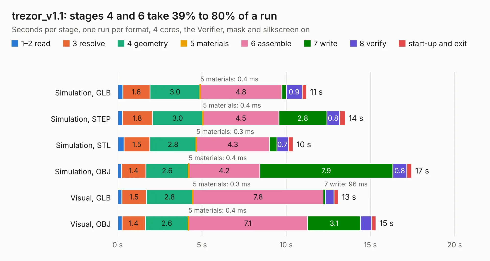

| Mode and format | 1–2 read | 3 resolve | 4 geometry | 5 materials | 6 assemble | 7 write | 8 verify | start-up and exit | Total |
|---|---:|---:|---:|---:|---:|---:|---:|---:|---:|
| Simulation, GLB | 0.3 | 1.6 | 3.0 | 0.4&nbsp;ms | 4.8 | 0.3 | 0.9 | 0.3 | 11.2 |
| Simulation, STEP | 0.3 | 1.8 | 3.0 | 0.4&nbsp;ms | 4.5 | 2.8 | 0.8 | 0.3 | 13.5 |
| Simulation, STL | 0.4 | 1.5 | 2.8 | 0.3&nbsp;ms | 4.3 | 0.4 | 0.7 | 0.3 | 10.4 |
| Simulation, OBJ | 0.2 | 1.4 | 2.6 | 0.4&nbsp;ms | 4.2 | 7.9 | 0.8 | 0.3 | 17.4 |
| Visual, GLB | 0.2 | 1.5 | 2.8 | 0.3&nbsp;ms | 7.8 | 96&nbsp;ms | 0.5 | 0.3 | 13.1 |
| Visual, OBJ | 0.3 | 1.4 | 2.6 | 0.4&nbsp;ms | 7.1 | 3.1 | 0.7 | 0.3 | 15.3 |

<table align="center"><tr><td valign="top">

| Board | Repo: [trezor/trezor-hardware](https://github.com/trezor/trezor-hardware) Board: `trezor_v1.1.kicad_pcb` |
|---|---|
| Folder | electronics / trezor_one / kicad |
| Complexity | 301&nbsp;/&nbsp;1000 (size&nbsp;256, features&nbsp;45) |
| KESE&nbsp;features | through vias, rounded, trapezoid or chamfered pads, filled zones |
| Tested | 9th November 2026 |
| Copper&nbsp;layers | 16 |
| File&nbsp;format | KiCad 5 (20171130) |
| Parts,&nbsp;tracks,&nbsp;vias | 37, 545, 89 |
| Triangles,&nbsp;simulation | 1,305,058 in 88 parts |
| Verifier | PASS in all six runs |

</td><td valign="top">

<table>
<tr><th>File type</th><th>File size</th><th>Peak memory used</th></tr>
<tr><th colspan="3" align="left">Simulation</th></tr>
<tr><td>GLB</td><td align="right">39&nbsp;MB</td><td align="right">480&nbsp;MB</td></tr>
<tr><td>STEP</td><td align="right">99&nbsp;MB</td><td align="right">563&nbsp;MB</td></tr>
<tr><td>STL</td><td align="right">65&nbsp;MB</td><td align="right">470&nbsp;MB</td></tr>
<tr><td>OBJ</td><td align="right">134&nbsp;MB</td><td align="right">854&nbsp;MB</td></tr>
<tr><th colspan="3" align="left">Visual</th></tr>
<tr><td>GLB</td><td align="right">17&nbsp;MB</td><td align="right">446&nbsp;MB</td></tr>
<tr><td>OBJ</td><td align="right">51&nbsp;MB</td><td align="right">439&nbsp;MB</td></tr>
</table>

</td></tr></table>

## 2918. iMX6 Demo Board

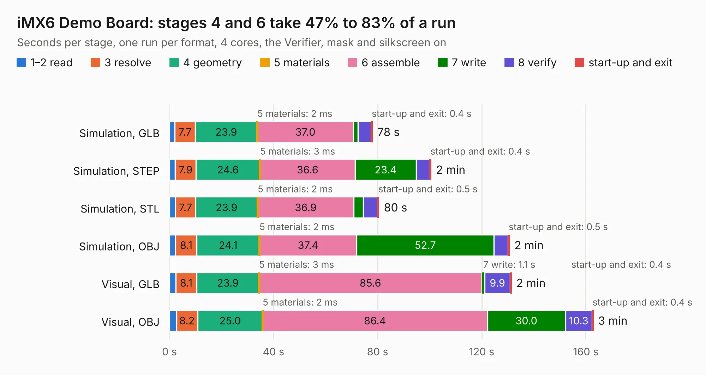

| Mode and format | 1–2 read | 3 resolve | 4 geometry | 5 materials | 6 assemble | 7 write | 8 verify | start-up and exit | Total |
|---|---:|---:|---:|---:|---:|---:|---:|---:|---:|
| Simulation, GLB | 2.1 | 7.7 | 23.9 | 2&nbsp;ms | 37.0 | 1.7 | 5.2 | 0.4 | 78.0 |
| Simulation, STEP | 2.2 | 7.9 | 24.6 | 3&nbsp;ms | 36.6 | 23.4 | 5.3 | 0.4 | 100.5 |
| Simulation, STL | 2.3 | 7.7 | 23.9 | 2&nbsp;ms | 36.9 | 3.6 | 5.5 | 0.5 | 80.5 |
| Simulation, OBJ | 2.4 | 8.1 | 24.1 | 2&nbsp;ms | 37.4 | 52.7 | 5.4 | 0.5 | 130.6 |
| Visual, GLB | 2.4 | 8.1 | 23.9 | 3&nbsp;ms | 85.6 | 1.1 | 9.9 | 0.4 | 131.3 |
| Visual, OBJ | 2.7 | 8.2 | 25.0 | 2&nbsp;ms | 86.4 | 30.0 | 10.3 | 0.4 | 162.8 |

<table align="center"><tr><td valign="top">

| Board | Repo: [ts-manuel/imx6-demo-board](https://github.com/ts-manuel/imx6-demo-board) Board: `iMX6 Demo Board.kicad_pcb` |
|---|---|
| Folder | kicad |
| Complexity | 511&nbsp;/&nbsp;1000 (size&nbsp;326, features&nbsp;185) |
| KESE&nbsp;features | through vias, slotted holes, custom pads, rounded, trapezoid or chamfered pads, arc tracks, filled zones, copper drawings, curved board outline, knockout text, TrueType text, stack-up, dielectric εr and tanδ, copper finish, mask and silkscreen colours |
| Tested | 9th November 2026 |
| Copper&nbsp;layers | 6 |
| File&nbsp;format | KiCad 9 (20241229) |
| Parts,&nbsp;tracks,&nbsp;vias | 458, 7,806, 973 |
| Triangles,&nbsp;simulation | 9,038,324 in 603 parts |
| Verifier | PASS in all six runs |

</td><td valign="top">

<table>
<tr><th>File type</th><th>File size</th><th>Peak memory used</th></tr>
<tr><th colspan="3" align="left">Simulation</th></tr>
<tr><td>GLB</td><td align="right">306&nbsp;MB</td><td align="right">2.4&nbsp;GB</td></tr>
<tr><td>STEP</td><td align="right">1.4&nbsp;GB</td><td align="right">3.2&nbsp;GB</td></tr>
<tr><td>STL</td><td align="right">452&nbsp;MB</td><td align="right">2.5&nbsp;GB</td></tr>
<tr><td>OBJ</td><td align="right">982&nbsp;MB</td><td align="right">5.7&nbsp;GB</td></tr>
<tr><th colspan="3" align="left">Visual</th></tr>
<tr><td>GLB</td><td align="right">179&nbsp;MB</td><td align="right">2.9&nbsp;GB</td></tr>
<tr><td>OBJ</td><td align="right">598&nbsp;MB</td><td align="right">3.7&nbsp;GB</td></tr>
</table>

</td></tr></table>

## 2919. iMX6 Demo Board_from_REF

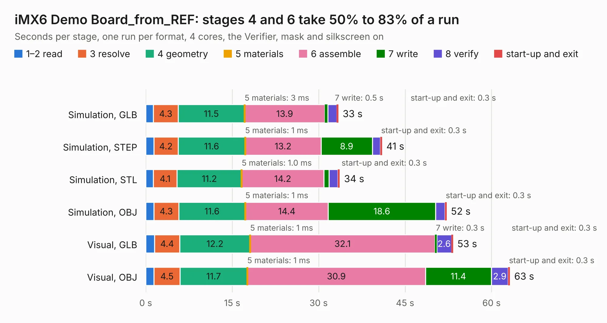

| Mode and format | 1–2 read | 3 resolve | 4 geometry | 5 materials | 6 assemble | 7 write | 8 verify | start-up and exit | Total |
|---|---:|---:|---:|---:|---:|---:|---:|---:|---:|
| Simulation, GLB | 1.3 | 4.3 | 11.5 | 3&nbsp;ms | 13.9 | 0.5 | 1.6 | 0.3 | 33.4 |
| Simulation, STEP | 1.4 | 4.2 | 11.6 | 1&nbsp;ms | 13.2 | 8.9 | 1.4 | 0.3 | 41.0 |
| Simulation, STL | 1.3 | 4.1 | 11.2 | 1.0&nbsp;ms | 14.2 | 0.9 | 1.5 | 0.3 | 33.7 |
| Simulation, OBJ | 1.4 | 4.3 | 11.6 | 1&nbsp;ms | 14.4 | 18.6 | 1.7 | 0.3 | 52.2 |
| Visual, GLB | 1.5 | 4.4 | 12.2 | 1&nbsp;ms | 32.1 | 0.3 | 2.6 | 0.3 | 53.3 |
| Visual, OBJ | 1.4 | 4.5 | 11.7 | 1&nbsp;ms | 30.9 | 11.4 | 2.9 | 0.3 | 63.2 |

<table align="center"><tr><td valign="top">

| Board | Repo: [ts-manuel/imx6-demo-board](https://github.com/ts-manuel/imx6-demo-board) Board: `iMX6 Demo Board_from_REF.kicad_pcb` |
|---|---|
| Folder | kicad |
| Complexity | 433&nbsp;/&nbsp;1000 (size&nbsp;313, features&nbsp;120) |
| KESE&nbsp;features | through vias, slotted holes, custom pads, rounded, trapezoid or chamfered pads, copper drawings, curved board outline, stack-up, dielectric εr and tanδ, copper finish, mask and silkscreen colours |
| Tested | 9th November 2026 |
| Copper&nbsp;layers | 6 |
| File&nbsp;format | KiCad 8 (20240108) |
| Parts,&nbsp;tracks,&nbsp;vias | 468, 3,672, 333 |
| Triangles,&nbsp;simulation | 3,165,490 in 480 parts |
| Verifier | PASS in all six runs |

</td><td valign="top">

<table>
<tr><th>File type</th><th>File size</th><th>Peak memory used</th></tr>
<tr><th colspan="3" align="left">Simulation</th></tr>
<tr><td>GLB</td><td align="right">107&nbsp;MB</td><td align="right">1.0&nbsp;GB</td></tr>
<tr><td>STEP</td><td align="right">465&nbsp;MB</td><td align="right">1.3&nbsp;GB</td></tr>
<tr><td>STL</td><td align="right">158&nbsp;MB</td><td align="right">1.0&nbsp;GB</td></tr>
<tr><td>OBJ</td><td align="right">340&nbsp;MB</td><td align="right">2.1&nbsp;GB</td></tr>
<tr><th colspan="3" align="left">Visual</th></tr>
<tr><td>GLB</td><td align="right">63&nbsp;MB</td><td align="right">1.4&nbsp;GB</td></tr>
<tr><td>OBJ</td><td align="right">209&nbsp;MB</td><td align="right">1.5&nbsp;GB</td></tr>
</table>

</td></tr></table>

## 2920. RP2040_debugger

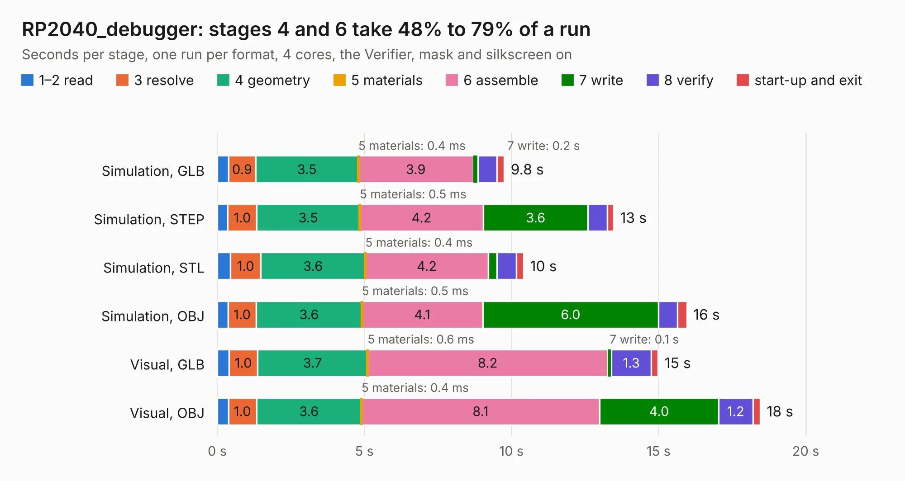

| Mode and format | 1–2 read | 3 resolve | 4 geometry | 5 materials | 6 assemble | 7 write | 8 verify | start-up and exit | Total |
|---|---:|---:|---:|---:|---:|---:|---:|---:|---:|
| Simulation, GLB | 0.4 | 0.9 | 3.5 | 0.4&nbsp;ms | 3.9 | 0.2 | 0.7 | 0.2 | 9.8 |
| Simulation, STEP | 0.4 | 1.0 | 3.5 | 0.5&nbsp;ms | 4.2 | 3.6 | 0.7 | 0.2 | 13.5 |
| Simulation, STL | 0.4 | 1.0 | 3.6 | 0.4&nbsp;ms | 4.2 | 0.3 | 0.7 | 0.2 | 10.4 |
| Simulation, OBJ | 0.4 | 1.0 | 3.6 | 0.5&nbsp;ms | 4.1 | 6.0 | 0.6 | 0.3 | 16.0 |
| Visual, GLB | 0.4 | 1.0 | 3.7 | 0.6&nbsp;ms | 8.2 | 0.1 | 1.3 | 0.2 | 15.0 |
| Visual, OBJ | 0.4 | 1.0 | 3.6 | 0.4&nbsp;ms | 8.1 | 4.0 | 1.2 | 0.3 | 18.5 |

<table align="center"><tr><td valign="top">

| Board | Repo: [twisted-fields/rp2040-motor-controller](https://github.com/twisted-fields/rp2040-motor-controller) Board: `RP2040_debugger.kicad_pcb` |
|---|---|
| Folder | debugger |
| Complexity | 322&nbsp;/&nbsp;1000 (size&nbsp;227, features&nbsp;95) |
| KESE&nbsp;features | through vias, slotted holes, rounded, trapezoid or chamfered pads, filled zones, curved board outline, stack-up, dielectric εr and tanδ |
| Tested | 9th November 2026 |
| Copper&nbsp;layers | 4 |
| File&nbsp;format | KiCad 8 (20240108) |
| Parts,&nbsp;tracks,&nbsp;vias | 57, 560, 87 |
| Triangles,&nbsp;simulation | 1,002,398 in 78 parts |
| Verifier | PASS in all six runs |

</td><td valign="top">

<table>
<tr><th>File type</th><th>File size</th><th>Peak memory used</th></tr>
<tr><th colspan="3" align="left">Simulation</th></tr>
<tr><td>GLB</td><td align="right">34&nbsp;MB</td><td align="right">433&nbsp;MB</td></tr>
<tr><td>STEP</td><td align="right">156&nbsp;MB</td><td align="right">532&nbsp;MB</td></tr>
<tr><td>STL</td><td align="right">50&nbsp;MB</td><td align="right">440&nbsp;MB</td></tr>
<tr><td>OBJ</td><td align="right">101&nbsp;MB</td><td align="right">742&nbsp;MB</td></tr>
<tr><th colspan="3" align="left">Visual</th></tr>
<tr><td>GLB</td><td align="right">24&nbsp;MB</td><td align="right">590&nbsp;MB</td></tr>
<tr><td>OBJ</td><td align="right">72&nbsp;MB</td><td align="right">595&nbsp;MB</td></tr>
</table>

</td></tr></table>

## 2921. driver_module

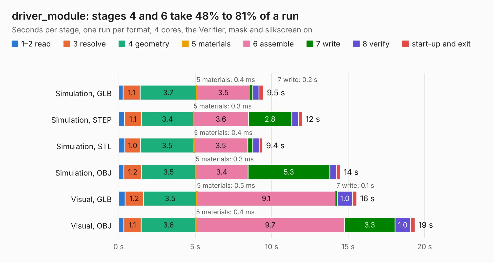

| Mode and format | 1–2 read | 3 resolve | 4 geometry | 5 materials | 6 assemble | 7 write | 8 verify | start-up and exit | Total |
|---|---:|---:|---:|---:|---:|---:|---:|---:|---:|
| Simulation, GLB | 0.3 | 1.1 | 3.7 | 0.4&nbsp;ms | 3.5 | 0.2 | 0.4 | 0.3 | 9.5 |
| Simulation, STEP | 0.4 | 1.1 | 3.4 | 0.3&nbsp;ms | 3.6 | 2.8 | 0.5 | 0.2 | 12.0 |
| Simulation, STL | 0.4 | 1.0 | 3.5 | 0.4&nbsp;ms | 3.5 | 0.3 | 0.4 | 0.2 | 9.4 |
| Simulation, OBJ | 0.3 | 1.2 | 3.5 | 0.3&nbsp;ms | 3.4 | 5.3 | 0.4 | 0.3 | 14.5 |
| Visual, GLB | 0.4 | 1.2 | 3.5 | 0.5&nbsp;ms | 9.1 | 0.1 | 1.0 | 0.3 | 15.6 |
| Visual, OBJ | 0.3 | 1.1 | 3.6 | 0.4&nbsp;ms | 9.7 | 3.3 | 1.0 | 0.3 | 19.4 |

<table align="center"><tr><td valign="top">

| Board | Repo: [twisted-fields/rp2040-motor-controller](https://github.com/twisted-fields/rp2040-motor-controller) Board: `driver_module.kicad_pcb` |
|---|---|
| Folder | driver_module |
| Complexity | 294&nbsp;/&nbsp;1000 (size&nbsp;199, features&nbsp;95) |
| KESE&nbsp;features | through vias, slotted holes, rounded, trapezoid or chamfered pads, filled zones, curved board outline, stack-up, dielectric εr and tanδ |
| Tested | 9th November 2026 |
| Copper&nbsp;layers | 4 |
| File&nbsp;format | KiCad 8 (20240108) |
| Parts,&nbsp;tracks,&nbsp;vias | 106, 640, 162 |
| Triangles,&nbsp;simulation | 1,087,146 in 74 parts |
| Verifier | PASS in all six runs |

</td><td valign="top">

<table>
<tr><th>File type</th><th>File size</th><th>Peak memory used</th></tr>
<tr><th colspan="3" align="left">Simulation</th></tr>
<tr><td>GLB</td><td align="right">37&nbsp;MB</td><td align="right">436&nbsp;MB</td></tr>
<tr><td>STEP</td><td align="right">137&nbsp;MB</td><td align="right">548&nbsp;MB</td></tr>
<tr><td>STL</td><td align="right">54&nbsp;MB</td><td align="right">442&nbsp;MB</td></tr>
<tr><td>OBJ</td><td align="right">111&nbsp;MB</td><td align="right">780&nbsp;MB</td></tr>
<tr><th colspan="3" align="left">Visual</th></tr>
<tr><td>GLB</td><td align="right">24&nbsp;MB</td><td align="right">603&nbsp;MB</td></tr>
<tr><td>OBJ</td><td align="right">73&nbsp;MB</td><td align="right">592&nbsp;MB</td></tr>
</table>

</td></tr></table>

## 2922. RP2040_base

| Mode and format | 1–2 read | 3 resolve | 4 geometry | 5 materials | 6 assemble | 7 write | 8 verify | start-up and exit | Total |
|---|---:|---:|---:|---:|---:|---:|---:|---:|---:|
| Simulation, GLB | 1.2 | 4.1 | 13.9 | 1&nbsp;ms | 14.3 | 0.7 | 1.9 | 0.3 | 36.5 |
| Simulation, STEP | 1.1 | 4.3 | 13.4 | 0.6&nbsp;ms | 14.8 | 11.1 | 1.9 | 0.3 | 46.9 |
| Simulation, STL | 1.1 | 4.2 | 13.7 | 0.8&nbsp;ms | 14.7 | 1.3 | 1.8 | 0.3 | 37.0 |
| Simulation, OBJ | 1.2 | 4.5 | 14.1 | 1&nbsp;ms | 15.3 | 24.1 | 2.1 | 0.3 | 61.7 |
| Visual, GLB | 1.1 | 4.7 | 14.4 | 0.7&nbsp;ms | 42.0 | 0.5 | 4.6 | 0.3 | 67.6 |
| Visual, OBJ | 1.1 | 4.3 | 14.0 | 0.7&nbsp;ms | 42.1 | 16.8 | 4.5 | 0.3 | 83.1 |

<table align="center"><tr><td valign="top">

| Board | Repo: [twisted-fields/rp2040-motor-controller](https://github.com/twisted-fields/rp2040-motor-controller) Board: `RP2040_base.kicad_pcb` |
|---|---|
| Folder | RP2040_base |
| Complexity | 418&nbsp;/&nbsp;1000 (size&nbsp;283, features&nbsp;135) |
| KESE&nbsp;features | through vias, slotted holes, custom pads, rounded, trapezoid or chamfered pads, arc tracks, filled zones, copper drawings, curved board outline, stack-up, dielectric εr and tanδ |
| Tested | 10th November 2026 |
| Copper&nbsp;layers | 4 |
| File&nbsp;format | KiCad 8 (20240108) |
| Parts,&nbsp;tracks,&nbsp;vias | 257, 4,544, 553 |
| Triangles,&nbsp;simulation | 4,250,826 in 226 parts |
| Verifier | PASS in all six runs |

</td><td valign="top">

<table>
<tr><th>File type</th><th>File size</th><th>Peak memory used</th></tr>
<tr><th colspan="3" align="left">Simulation</th></tr>
<tr><td>GLB</td><td align="right">145&nbsp;MB</td><td align="right">1.2&nbsp;GB</td></tr>
<tr><td>STEP</td><td align="right">592&nbsp;MB</td><td align="right">1.6&nbsp;GB</td></tr>
<tr><td>STL</td><td align="right">213&nbsp;MB</td><td align="right">1.2&nbsp;GB</td></tr>
<tr><td>OBJ</td><td align="right">456&nbsp;MB</td><td align="right">2.7&nbsp;GB</td></tr>
<tr><th colspan="3" align="left">Visual</th></tr>
<tr><td>GLB</td><td align="right">100&nbsp;MB</td><td align="right">1.6&nbsp;GB</td></tr>
<tr><td>OBJ</td><td align="right">319&nbsp;MB</td><td align="right">2.0&nbsp;GB</td></tr>
</table>

</td></tr></table>

## 2923. rp2040_encoder

| Mode and format | 1–2 read | 3 resolve | 4 geometry | 5 materials | 6 assemble | 7 write | 8 verify | start-up and exit | Total |
|---|---:|---:|---:|---:|---:|---:|---:|---:|---:|
| Simulation, GLB | 0.1 | 0.1 | 0.4 | 0.1&nbsp;ms | 0.6 | 21&nbsp;ms | 79&nbsp;ms | 0.2 | 1.6 |
| Simulation, STEP | 0.1 | 0.2 | 0.4 | 0.2&nbsp;ms | 0.5 | 0.8 | 59&nbsp;ms | 0.2 | 2.3 |
| Simulation, STL | 0.1 | 0.2 | 0.4 | 0.1&nbsp;ms | 0.6 | 33&nbsp;ms | 73&nbsp;ms | 0.2 | 1.6 |
| Simulation, OBJ | 0.1 | 0.1 | 0.5 | 0.2&nbsp;ms | 0.6 | 0.6 | 72&nbsp;ms | 0.2 | 2.2 |
| Visual, GLB | 0.1 | 0.1 | 0.4 | 0.1&nbsp;ms | 1.3 | 18&nbsp;ms | 0.1 | 0.2 | 2.3 |
| Visual, OBJ | 0.1 | 0.1 | 0.5 | 0.1&nbsp;ms | 1.3 | 0.5 | 0.1 | 0.2 | 2.8 |

<table align="center"><tr><td valign="top">

| Board | Repo: [twisted-fields/rp2040-motor-controller](https://github.com/twisted-fields/rp2040-motor-controller) Board: `rp2040_encoder.kicad_pcb` |
|---|---|
| Folder | rp2040_encoder |
| Complexity | 185&nbsp;/&nbsp;1000 (size&nbsp;110, features&nbsp;75) |
| KESE&nbsp;features | through vias, rounded, trapezoid or chamfered pads, filled zones, stack-up, dielectric εr and tanδ |
| Tested | 9th November 2026 |
| Copper&nbsp;layers | 2 |
| File&nbsp;format | KiCad 8 (20240108) |
| Parts,&nbsp;tracks,&nbsp;vias | 10, 47, 4 |
| Triangles,&nbsp;simulation | 126,086 in 22 parts |
| Verifier | PASS in all six runs |

</td><td valign="top">

<table>
<tr><th>File type</th><th>File size</th><th>Peak memory used</th></tr>
<tr><th colspan="3" align="left">Simulation</th></tr>
<tr><td>GLB</td><td align="right">4.4&nbsp;MB</td><td align="right">188&nbsp;MB</td></tr>
<tr><td>STEP</td><td align="right">22&nbsp;MB</td><td align="right">204&nbsp;MB</td></tr>
<tr><td>STL</td><td align="right">6.3&nbsp;MB</td><td align="right">189&nbsp;MB</td></tr>
<tr><td>OBJ</td><td align="right">12&nbsp;MB</td><td align="right">189&nbsp;MB</td></tr>
<tr><th colspan="3" align="left">Visual</th></tr>
<tr><td>GLB</td><td align="right">3.8&nbsp;MB</td><td align="right">168&nbsp;MB</td></tr>
<tr><td>OBJ</td><td align="right">10&nbsp;MB</td><td align="right">164&nbsp;MB</td></tr>
</table>

</td></tr></table>

## 2924. user_interface

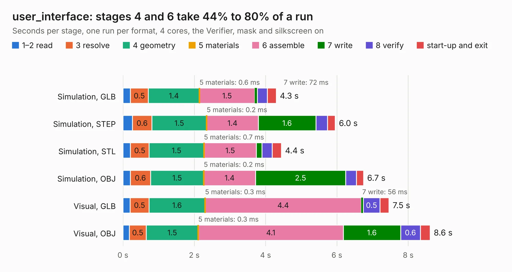

| Mode and format | 1–2 read | 3 resolve | 4 geometry | 5 materials | 6 assemble | 7 write | 8 verify | start-up and exit | Total |
|---|---:|---:|---:|---:|---:|---:|---:|---:|---:|
| Simulation, GLB | 0.2 | 0.5 | 1.4 | 0.6&nbsp;ms | 1.5 | 72&nbsp;ms | 0.3 | 0.3 | 4.3 |
| Simulation, STEP | 0.3 | 0.6 | 1.5 | 0.2&nbsp;ms | 1.4 | 1.6 | 0.3 | 0.2 | 6.0 |
| Simulation, STL | 0.2 | 0.5 | 1.5 | 0.7&nbsp;ms | 1.5 | 0.2 | 0.3 | 0.3 | 4.4 |
| Simulation, OBJ | 0.2 | 0.6 | 1.5 | 0.2&nbsp;ms | 1.4 | 2.5 | 0.3 | 0.2 | 6.7 |
| Visual, GLB | 0.2 | 0.5 | 1.6 | 0.3&nbsp;ms | 4.4 | 56&nbsp;ms | 0.5 | 0.3 | 7.5 |
| Visual, OBJ | 0.2 | 0.5 | 1.5 | 0.3&nbsp;ms | 4.1 | 1.6 | 0.6 | 0.3 | 8.6 |

<table align="center"><tr><td valign="top">

| Board | Repo: [twisted-fields/rp2040-motor-controller](https://github.com/twisted-fields/rp2040-motor-controller) Board: `user_interface.kicad_pcb` |
|---|---|
| Folder | user_interface |
| Complexity | 262&nbsp;/&nbsp;1000 (size&nbsp;177, features&nbsp;85) |
| KESE&nbsp;features | through vias, rounded, trapezoid or chamfered pads, filled zones, curved board outline, stack-up, dielectric εr and tanδ |
| Tested | 9th November 2026 |
| Copper&nbsp;layers | 4 |
| File&nbsp;format | KiCad 7 (20221018) |
| Parts,&nbsp;tracks,&nbsp;vias | 38, 386, 62 |
| Triangles,&nbsp;simulation | 492,310 in 40 parts |
| Verifier | PASS in all six runs |

</td><td valign="top">

<table>
<tr><th>File type</th><th>File size</th><th>Peak memory used</th></tr>
<tr><th colspan="3" align="left">Simulation</th></tr>
<tr><td>GLB</td><td align="right">17&nbsp;MB</td><td align="right">282&nbsp;MB</td></tr>
<tr><td>STEP</td><td align="right">64&nbsp;MB</td><td align="right">336&nbsp;MB</td></tr>
<tr><td>STL</td><td align="right">25&nbsp;MB</td><td align="right">292&nbsp;MB</td></tr>
<tr><td>OBJ</td><td align="right">50&nbsp;MB</td><td align="right">390&nbsp;MB</td></tr>
<tr><th colspan="3" align="left">Visual</th></tr>
<tr><td>GLB</td><td align="right">12&nbsp;MB</td><td align="right">330&nbsp;MB</td></tr>
<tr><td>OBJ</td><td align="right">35&nbsp;MB</td><td align="right">331&nbsp;MB</td></tr>
</table>

</td></tr></table>

## 2925. Board-DjinnBase

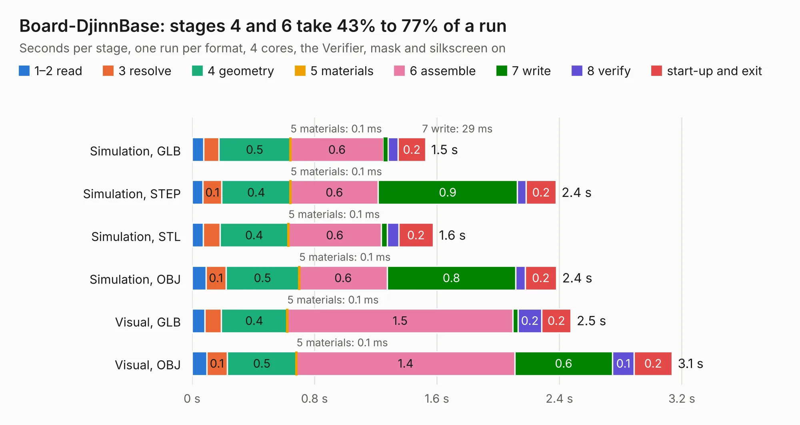

| Mode and format | 1–2 read | 3 resolve | 4 geometry | 5 materials | 6 assemble | 7 write | 8 verify | start-up and exit | Total |
|---|---:|---:|---:|---:|---:|---:|---:|---:|---:|
| Simulation, GLB | 76&nbsp;ms | 0.1 | 0.5 | 0.1&nbsp;ms | 0.6 | 29&nbsp;ms | 65&nbsp;ms | 0.2 | 1.5 |
| Simulation, STEP | 71&nbsp;ms | 0.1 | 0.4 | 0.1&nbsp;ms | 0.6 | 0.9 | 58&nbsp;ms | 0.2 | 2.4 |
| Simulation, STL | 73&nbsp;ms | 0.1 | 0.4 | 0.1&nbsp;ms | 0.6 | 41&nbsp;ms | 74&nbsp;ms | 0.2 | 1.6 |
| Simulation, OBJ | 92&nbsp;ms | 0.1 | 0.5 | 0.1&nbsp;ms | 0.6 | 0.8 | 61&nbsp;ms | 0.2 | 2.4 |
| Visual, GLB | 83&nbsp;ms | 0.1 | 0.4 | 0.1&nbsp;ms | 1.5 | 33&nbsp;ms | 0.2 | 0.2 | 2.5 |
| Visual, OBJ | 96&nbsp;ms | 0.1 | 0.5 | 0.1&nbsp;ms | 1.4 | 0.6 | 0.1 | 0.2 | 3.1 |

<table align="center"><tr><td valign="top">

| Board | Repo: [tzarc/keyboards](https://github.com/tzarc/keyboards) Board: `Board-DjinnBase.kicad_pcb` |
|---|---|
| Folder | Djinn / Rev1 / Board-DjinnBase |
| Complexity | 54&nbsp;/&nbsp;1000 (size&nbsp;24, features&nbsp;30) |
| KESE&nbsp;features | filled zones, curved board outline |
| Tested | 9th November 2026 |
| Copper&nbsp;layers | 2 |
| File&nbsp;format | KiCad 5 (20171130) |
| Parts,&nbsp;tracks,&nbsp;vias | 1, 0, 0 |
| Triangles,&nbsp;simulation | 177,144 in 12 parts |
| Verifier | PASS in all six runs |

</td><td valign="top">

<table>
<tr><th>File type</th><th>File size</th><th>Peak memory used</th></tr>
<tr><th colspan="3" align="left">Simulation</th></tr>
<tr><td>GLB</td><td align="right">5.9&nbsp;MB</td><td align="right">184&nbsp;MB</td></tr>
<tr><td>STEP</td><td align="right">29&nbsp;MB</td><td align="right">197&nbsp;MB</td></tr>
<tr><td>STL</td><td align="right">8.9&nbsp;MB</td><td align="right">187&nbsp;MB</td></tr>
<tr><td>OBJ</td><td align="right">17&nbsp;MB</td><td align="right">191&nbsp;MB</td></tr>
<tr><th colspan="3" align="left">Visual</th></tr>
<tr><td>GLB</td><td align="right">4.5&nbsp;MB</td><td align="right">139&nbsp;MB</td></tr>
<tr><td>OBJ</td><td align="right">13&nbsp;MB</td><td align="right">159&nbsp;MB</td></tr>
</table>

</td></tr></table>

## 2926. Board-DjinnPlate

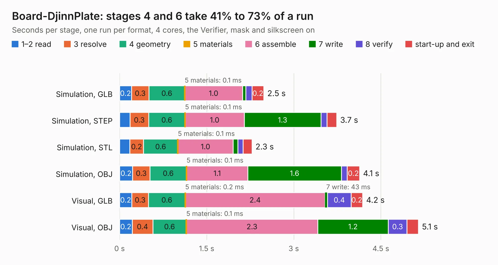

| Mode and format | 1–2 read | 3 resolve | 4 geometry | 5 materials | 6 assemble | 7 write | 8 verify | start-up and exit | Total |
|---|---:|---:|---:|---:|---:|---:|---:|---:|---:|
| Simulation, GLB | 0.2 | 0.3 | 0.6 | 0.1&nbsp;ms | 1.0 | 55&nbsp;ms | 0.1 | 0.2 | 2.5 |
| Simulation, STEP | 0.2 | 0.3 | 0.6 | 0.1&nbsp;ms | 1.0 | 1.3 | 0.1 | 0.2 | 3.7 |
| Simulation, STL | 0.2 | 0.2 | 0.6 | 0.1&nbsp;ms | 1.0 | 80&nbsp;ms | 91&nbsp;ms | 0.2 | 2.3 |
| Simulation, OBJ | 0.2 | 0.3 | 0.6 | 0.1&nbsp;ms | 1.1 | 1.6 | 0.1 | 0.2 | 4.1 |
| Visual, GLB | 0.2 | 0.3 | 0.6 | 0.2&nbsp;ms | 2.4 | 43&nbsp;ms | 0.4 | 0.2 | 4.2 |
| Visual, OBJ | 0.2 | 0.4 | 0.6 | 0.1&nbsp;ms | 2.3 | 1.2 | 0.3 | 0.2 | 5.1 |

<table align="center"><tr><td valign="top">

| Board | Repo: [tzarc/keyboards](https://github.com/tzarc/keyboards) Board: `Board-DjinnPlate.kicad_pcb` |
|---|---|
| Folder | Djinn / Rev1 / Board-DjinnPlate |
| Complexity | 69&nbsp;/&nbsp;1000 (size&nbsp;29, features&nbsp;40) |
| KESE&nbsp;features | slotted holes, filled zones, curved board outline |
| Tested | 9th November 2026 |
| Copper&nbsp;layers | 2 |
| File&nbsp;format | KiCad 5 (20171130) |
| Parts,&nbsp;tracks,&nbsp;vias | 2, 0, 0 |
| Triangles,&nbsp;simulation | 347,412 in 12 parts |
| Verifier | PASS in all six runs |

</td><td valign="top">

<table>
<tr><th>File type</th><th>File size</th><th>Peak memory used</th></tr>
<tr><th colspan="3" align="left">Simulation</th></tr>
<tr><td>GLB</td><td align="right">12&nbsp;MB</td><td align="right">272&nbsp;MB</td></tr>
<tr><td>STEP</td><td align="right">69&nbsp;MB</td><td align="right">314&nbsp;MB</td></tr>
<tr><td>STL</td><td align="right">17&nbsp;MB</td><td align="right">297&nbsp;MB</td></tr>
<tr><td>OBJ</td><td align="right">35&nbsp;MB</td><td align="right">294&nbsp;MB</td></tr>
<tr><th colspan="3" align="left">Visual</th></tr>
<tr><td>GLB</td><td align="right">9.6&nbsp;MB</td><td align="right">272&nbsp;MB</td></tr>
<tr><td>OBJ</td><td align="right">28&nbsp;MB</td><td align="right">281&nbsp;MB</td></tr>
</table>

</td></tr></table>

## 2927. Djinn

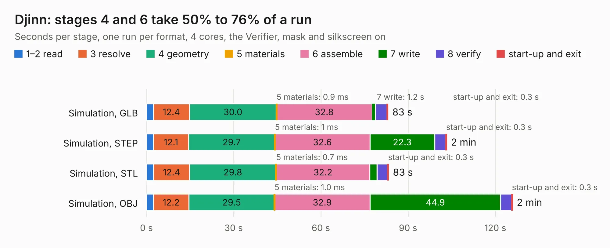

| Mode and format | 1–2 read | 3 resolve | 4 geometry | 5 materials | 6 assemble | 7 write | 8 verify | start-up and exit | Total |
|---|---:|---:|---:|---:|---:|---:|---:|---:|---:|
| Simulation, GLB | 2.4 | 12.4 | 30.0 | 0.9&nbsp;ms | 32.8 | 1.2 | 4.0 | 0.3 | 83.1 |
| Simulation, STEP | 2.4 | 12.1 | 29.7 | 1&nbsp;ms | 32.6 | 22.3 | 3.8 | 0.3 | 103.3 |
| Simulation, STL | 2.4 | 12.4 | 29.8 | 0.7&nbsp;ms | 32.2 | 2.5 | 3.7 | 0.3 | 83.3 |
| Simulation, OBJ | 2.4 | 12.2 | 29.5 | 1.0&nbsp;ms | 32.9 | 44.9 | 3.8 | 0.3 | 125.9 |
| Visual, GLB | 2.4 | 12.0 | 30.4 | 2&nbsp;ms | 91.8 | 1.0 | 10.4 | 0.3 | 148.2 |
| Visual, OBJ | 2.4 | 12.1 | 29.9 | 0.7&nbsp;ms | 89.8 | 38.1 | 9.9 | 0.3 | 182.7 |

<table align="center"><tr><td valign="top">

| Board | Repo: [tzarc/keyboards](https://github.com/tzarc/keyboards) Board: `Djinn.kicad_pcb` |
|---|---|
| Folder | Djinn / Rev1 |
| Complexity | 345&nbsp;/&nbsp;1000 (size&nbsp;255, features&nbsp;90) |
| KESE&nbsp;features | through vias, slotted holes, custom pads, rounded, trapezoid or chamfered pads, filled zones, copper drawings, curved board outline |
| Tested | 9th November 2026 |
| Copper&nbsp;layers | 2 |
| File&nbsp;format | KiCad 5 (20171130) |
| Parts,&nbsp;tracks,&nbsp;vias | 230, 2,956, 630 |
| Triangles,&nbsp;simulation | 7,553,280 in 180 parts |
| Verifier | PASS in all six runs |

</td><td valign="top">

<table>
<tr><th>File type</th><th>File size</th><th>Peak memory used</th></tr>
<tr><th colspan="3" align="left">Simulation</th></tr>
<tr><td>GLB</td><td align="right">258&nbsp;MB</td><td align="right">2.7&nbsp;GB</td></tr>
<tr><td>STEP</td><td align="right">1.4&nbsp;GB</td><td align="right">3.1&nbsp;GB</td></tr>
<tr><td>STL</td><td align="right">378&nbsp;MB</td><td align="right">2.6&nbsp;GB</td></tr>
<tr><td>OBJ</td><td align="right">807&nbsp;MB</td><td align="right">4.8&nbsp;GB</td></tr>
<tr><th colspan="3" align="left">Visual</th></tr>
<tr><td>GLB</td><td align="right">234&nbsp;MB</td><td align="right">3.4&nbsp;GB</td></tr>
<tr><td>OBJ</td><td align="right">749&nbsp;MB</td><td align="right">4.5&nbsp;GB</td></tr>
</table>

</td></tr></table>

## 2928. Djinn

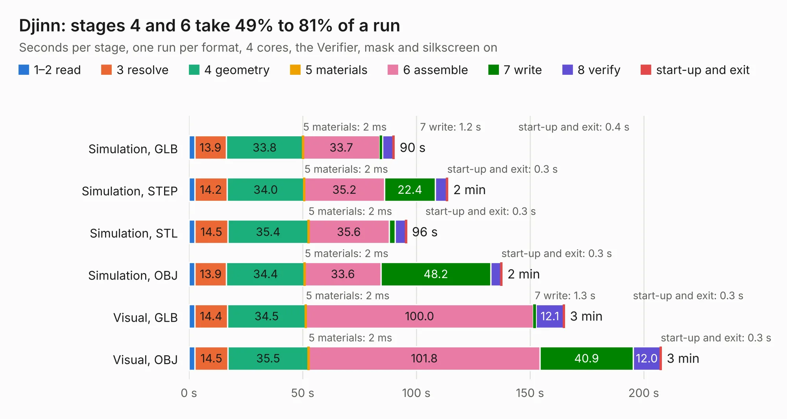

| Mode and format | 1–2 read | 3 resolve | 4 geometry | 5 materials | 6 assemble | 7 write | 8 verify | start-up and exit | Total |
|---|---:|---:|---:|---:|---:|---:|---:|---:|---:|
| Simulation, GLB | 2.5 | 13.9 | 33.8 | 2&nbsp;ms | 33.7 | 1.2 | 4.8 | 0.4 | 90.2 |
| Simulation, STEP | 2.6 | 14.2 | 34.0 | 2&nbsp;ms | 35.2 | 22.4 | 5.1 | 0.3 | 113.8 |
| Simulation, STL | 2.6 | 14.5 | 35.4 | 2&nbsp;ms | 35.6 | 2.6 | 4.6 | 0.3 | 95.6 |
| Simulation, OBJ | 2.7 | 13.9 | 34.4 | 2&nbsp;ms | 33.6 | 48.2 | 4.6 | 0.3 | 137.6 |
| Visual, GLB | 2.6 | 14.4 | 34.5 | 2&nbsp;ms | 100.0 | 1.3 | 12.1 | 0.3 | 165.1 |
| Visual, OBJ | 2.7 | 14.5 | 35.5 | 2&nbsp;ms | 101.8 | 40.9 | 12.0 | 0.3 | 207.6 |

<table align="center"><tr><td valign="top">

| Board | Repo: [tzarc/keyboards](https://github.com/tzarc/keyboards) Board: `Djinn.kicad_pcb` |
|---|---|
| Folder | Djinn / Rev2a |
| Complexity | 353&nbsp;/&nbsp;1000 (size&nbsp;263, features&nbsp;90) |
| KESE&nbsp;features | through vias, slotted holes, custom pads, rounded, trapezoid or chamfered pads, filled zones, copper drawings, curved board outline |
| Tested | 9th November 2026 |
| Copper&nbsp;layers | 2 |
| File&nbsp;format | KiCad 5 (20171130) |
| Parts,&nbsp;tracks,&nbsp;vias | 230, 3,274, 711 |
| Triangles,&nbsp;simulation | 7,974,724 in 196 parts |
| Verifier | PASS in all six runs |

</td><td valign="top">

<table>
<tr><th>File type</th><th>File size</th><th>Peak memory used</th></tr>
<tr><th colspan="3" align="left">Simulation</th></tr>
<tr><td>GLB</td><td align="right">273&nbsp;MB</td><td align="right">2.9&nbsp;GB</td></tr>
<tr><td>STEP</td><td align="right">1.5&nbsp;GB</td><td align="right">3.2&nbsp;GB</td></tr>
<tr><td>STL</td><td align="right">399&nbsp;MB</td><td align="right">2.8&nbsp;GB</td></tr>
<tr><td>OBJ</td><td align="right">856&nbsp;MB</td><td align="right">5.0&nbsp;GB</td></tr>
<tr><th colspan="3" align="left">Visual</th></tr>
<tr><td>GLB</td><td align="right">245&nbsp;MB</td><td align="right">3.6&nbsp;GB</td></tr>
<tr><td>OBJ</td><td align="right">787&nbsp;MB</td><td align="right">4.7&nbsp;GB</td></tr>
</table>

</td></tr></table>

## 2929. ExtraBoard-Base

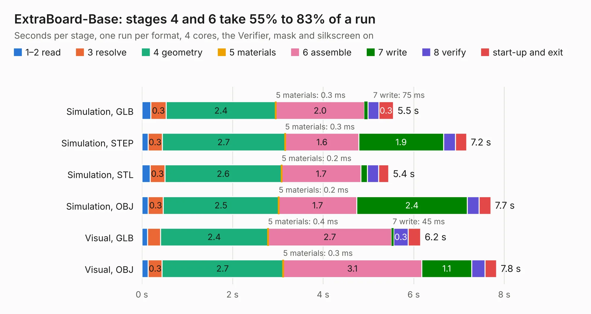

| Mode and format | 1–2 read | 3 resolve | 4 geometry | 5 materials | 6 assemble | 7 write | 8 verify | start-up and exit | Total |
|---|---:|---:|---:|---:|---:|---:|---:|---:|---:|
| Simulation, GLB | 0.2 | 0.3 | 2.4 | 0.3&nbsp;ms | 2.0 | 75&nbsp;ms | 0.2 | 0.3 | 5.5 |
| Simulation, STEP | 0.1 | 0.3 | 2.7 | 0.3&nbsp;ms | 1.6 | 1.9 | 0.3 | 0.2 | 7.2 |
| Simulation, STL | 0.2 | 0.3 | 2.6 | 0.2&nbsp;ms | 1.7 | 0.1 | 0.2 | 0.2 | 5.4 |
| Simulation, OBJ | 0.1 | 0.3 | 2.5 | 0.2&nbsp;ms | 1.7 | 2.4 | 0.3 | 0.3 | 7.7 |
| Visual, GLB | 0.1 | 0.3 | 2.4 | 0.4&nbsp;ms | 2.7 | 45&nbsp;ms | 0.3 | 0.3 | 6.2 |
| Visual, OBJ | 0.1 | 0.3 | 2.7 | 0.3&nbsp;ms | 3.1 | 1.1 | 0.3 | 0.3 | 7.8 |

<table align="center"><tr><td valign="top">

| Board | Repo: [tzarc/keyboards](https://github.com/tzarc/keyboards) Board: `ExtraBoard-Base.kicad_pcb` |
|---|---|
| Folder | Djinn / Rev2a / ExtraBoard-Base |
| Complexity | 74&nbsp;/&nbsp;1000 (size&nbsp;44, features&nbsp;30) |
| KESE&nbsp;features | filled zones, curved board outline |
| Tested | 10th November 2026 |
| Copper&nbsp;layers | 2 |
| File&nbsp;format | KiCad 5 (20171130) |
| Parts,&nbsp;tracks,&nbsp;vias | 11, 0, 0 |
| Triangles,&nbsp;simulation | 382,012 in 12 parts |
| Verifier | PASS in all six runs |

</td><td valign="top">

<table>
<tr><th>File type</th><th>File size</th><th>Peak memory used</th></tr>
<tr><th colspan="3" align="left">Simulation</th></tr>
<tr><td>GLB</td><td align="right">13&nbsp;MB</td><td align="right">249&nbsp;MB</td></tr>
<tr><td>STEP</td><td align="right">57&nbsp;MB</td><td align="right">272&nbsp;MB</td></tr>
<tr><td>STL</td><td align="right">19&nbsp;MB</td><td align="right">250&nbsp;MB</td></tr>
<tr><td>OBJ</td><td align="right">38&nbsp;MB</td><td align="right">283&nbsp;MB</td></tr>
<tr><th colspan="3" align="left">Visual</th></tr>
<tr><td>GLB</td><td align="right">6.2&nbsp;MB</td><td align="right">198&nbsp;MB</td></tr>
<tr><td>OBJ</td><td align="right">18&nbsp;MB</td><td align="right">216&nbsp;MB</td></tr>
</table>

</td></tr></table>

## 2930. ExtraBoard-Plate

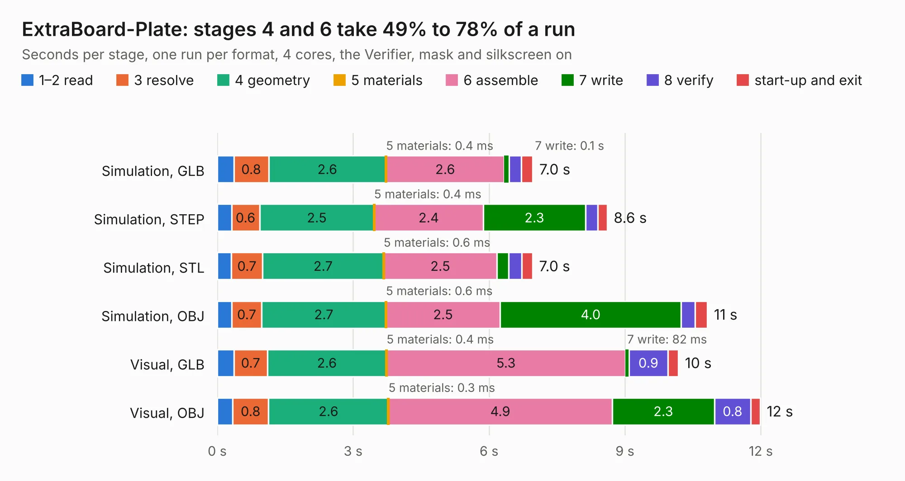

| Mode and format | 1–2 read | 3 resolve | 4 geometry | 5 materials | 6 assemble | 7 write | 8 verify | start-up and exit | Total |
|---|---:|---:|---:|---:|---:|---:|---:|---:|---:|
| Simulation, GLB | 0.4 | 0.8 | 2.6 | 0.4&nbsp;ms | 2.6 | 0.1 | 0.3 | 0.3 | 7.0 |
| Simulation, STEP | 0.3 | 0.6 | 2.5 | 0.4&nbsp;ms | 2.4 | 2.3 | 0.3 | 0.2 | 8.6 |
| Simulation, STL | 0.3 | 0.7 | 2.7 | 0.6&nbsp;ms | 2.5 | 0.3 | 0.3 | 0.2 | 7.0 |
| Simulation, OBJ | 0.3 | 0.7 | 2.7 | 0.6&nbsp;ms | 2.5 | 4.0 | 0.3 | 0.3 | 10.8 |
| Visual, GLB | 0.4 | 0.7 | 2.6 | 0.4&nbsp;ms | 5.3 | 82&nbsp;ms | 0.9 | 0.2 | 10.2 |
| Visual, OBJ | 0.3 | 0.8 | 2.6 | 0.3&nbsp;ms | 4.9 | 2.3 | 0.8 | 0.2 | 12.0 |

<table align="center"><tr><td valign="top">

| Board | Repo: [tzarc/keyboards](https://github.com/tzarc/keyboards) Board: `ExtraBoard-Plate.kicad_pcb` |
|---|---|
| Folder | Djinn / Rev2a / ExtraBoard-Plate |
| Complexity | 85&nbsp;/&nbsp;1000 (size&nbsp;45, features&nbsp;40) |
| KESE&nbsp;features | slotted holes, filled zones, curved board outline |
| Tested | 9th November 2026 |
| Copper&nbsp;layers | 2 |
| File&nbsp;format | KiCad 5 (20171130) |
| Parts,&nbsp;tracks,&nbsp;vias | 13, 0, 0 |
| Triangles,&nbsp;simulation | 743,632 in 12 parts |
| Verifier | PASS in all six runs |

</td><td valign="top">

<table>
<tr><th>File type</th><th>File size</th><th>Peak memory used</th></tr>
<tr><th colspan="3" align="left">Simulation</th></tr>
<tr><td>GLB</td><td align="right">25&nbsp;MB</td><td align="right">442&nbsp;MB</td></tr>
<tr><td>STEP</td><td align="right">141&nbsp;MB</td><td align="right">486&nbsp;MB</td></tr>
<tr><td>STL</td><td align="right">37&nbsp;MB</td><td align="right">445&nbsp;MB</td></tr>
<tr><td>OBJ</td><td align="right">75&nbsp;MB</td><td align="right">560&nbsp;MB</td></tr>
<tr><th colspan="3" align="left">Visual</th></tr>
<tr><td>GLB</td><td align="right">17&nbsp;MB</td><td align="right">432&nbsp;MB</td></tr>
<tr><td>OBJ</td><td align="right">50&nbsp;MB</td><td align="right">432&nbsp;MB</td></tr>
</table>

</td></tr></table>

## 2931. ghoul

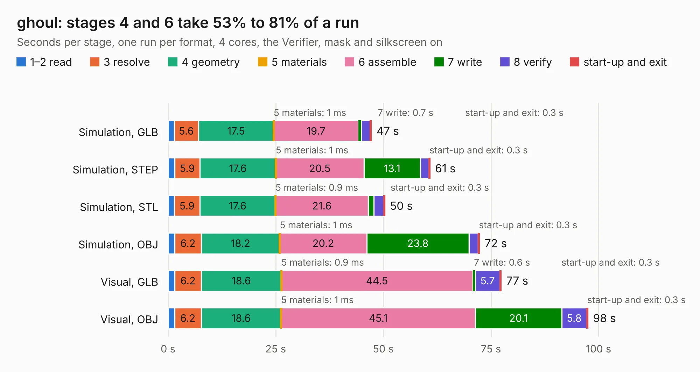

| Mode and format | 1–2 read | 3 resolve | 4 geometry | 5 materials | 6 assemble | 7 write | 8 verify | start-up and exit | Total |
|---|---:|---:|---:|---:|---:|---:|---:|---:|---:|
| Simulation, GLB | 1.4 | 5.6 | 17.5 | 1&nbsp;ms | 19.7 | 0.7 | 2.0 | 0.3 | 47.2 |
| Simulation, STEP | 1.5 | 5.9 | 17.6 | 1&nbsp;ms | 20.5 | 13.1 | 2.0 | 0.3 | 60.9 |
| Simulation, STL | 1.5 | 5.9 | 17.6 | 0.9&nbsp;ms | 21.6 | 1.3 | 2.2 | 0.3 | 50.4 |
| Simulation, OBJ | 1.5 | 6.2 | 18.2 | 1&nbsp;ms | 20.2 | 23.8 | 2.1 | 0.3 | 72.4 |
| Visual, GLB | 1.5 | 6.2 | 18.6 | 0.9&nbsp;ms | 44.5 | 0.6 | 5.7 | 0.3 | 77.4 |
| Visual, OBJ | 1.5 | 6.2 | 18.6 | 1&nbsp;ms | 45.1 | 20.1 | 5.8 | 0.3 | 97.5 |

<table align="center"><tr><td valign="top">

| Board | Repo: [tzarc/keyboards](https://github.com/tzarc/keyboards) Board: `ghoul.kicad_pcb` |
|---|---|
| Folder | Ghoul / v1.0 |
| Complexity | 326&nbsp;/&nbsp;1000 (size&nbsp;206, features&nbsp;120) |
| KESE&nbsp;features | through vias, slotted holes, custom pads, rounded, trapezoid or chamfered pads, filled zones, copper drawings, curved board outline, stack-up, dielectric εr and tanδ |
| Tested | 10th November 2026 |
| Copper&nbsp;layers | 2 |
| File&nbsp;format | KiCad 6 (20211014) |
| Parts,&nbsp;tracks,&nbsp;vias | 166, 2,087, 497 |
| Triangles,&nbsp;simulation | 3,894,076 in 191 parts |
| Verifier | PASS in all six runs |

</td><td valign="top">

<table>
<tr><th>File type</th><th>File size</th><th>Peak memory used</th></tr>
<tr><th colspan="3" align="left">Simulation</th></tr>
<tr><td>GLB</td><td align="right">134&nbsp;MB</td><td align="right">1.5&nbsp;GB</td></tr>
<tr><td>STEP</td><td align="right">737&nbsp;MB</td><td align="right">1.8&nbsp;GB</td></tr>
<tr><td>STL</td><td align="right">195&nbsp;MB</td><td align="right">1.5&nbsp;GB</td></tr>
<tr><td>OBJ</td><td align="right">417&nbsp;MB</td><td align="right">2.6&nbsp;GB</td></tr>
<tr><th colspan="3" align="left">Visual</th></tr>
<tr><td>GLB</td><td align="right">116&nbsp;MB</td><td align="right">1.8&nbsp;GB</td></tr>
<tr><td>OBJ</td><td align="right">371&nbsp;MB</td><td align="right">2.5&nbsp;GB</td></tr>
</table>

</td></tr></table>

## 2932. half-plate

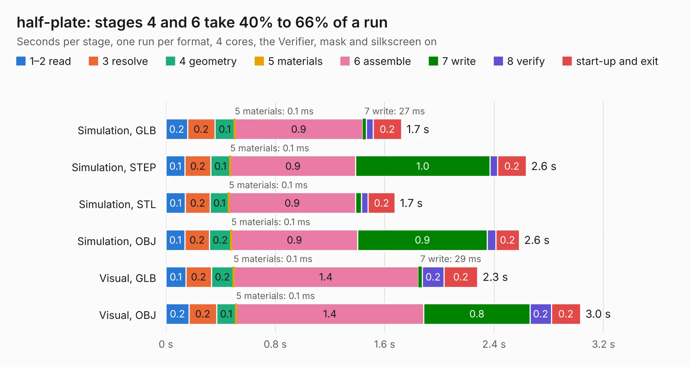

| Mode and format | 1–2 read | 3 resolve | 4 geometry | 5 materials | 6 assemble | 7 write | 8 verify | start-up and exit | Total |
|---|---:|---:|---:|---:|---:|---:|---:|---:|---:|
| Simulation, GLB | 0.2 | 0.2 | 0.1 | 0.1&nbsp;ms | 0.9 | 27&nbsp;ms | 49&nbsp;ms | 0.2 | 1.7 |
| Simulation, STEP | 0.1 | 0.2 | 0.1 | 0.1&nbsp;ms | 0.9 | 1.0 | 56&nbsp;ms | 0.2 | 2.6 |
| Simulation, STL | 0.1 | 0.2 | 0.1 | 0.1&nbsp;ms | 0.9 | 44&nbsp;ms | 48&nbsp;ms | 0.2 | 1.7 |
| Simulation, OBJ | 0.1 | 0.2 | 0.2 | 0.1&nbsp;ms | 0.9 | 0.9 | 63&nbsp;ms | 0.2 | 2.6 |
| Visual, GLB | 0.1 | 0.2 | 0.2 | 0.1&nbsp;ms | 1.4 | 29&nbsp;ms | 0.2 | 0.2 | 2.3 |
| Visual, OBJ | 0.2 | 0.2 | 0.1 | 0.1&nbsp;ms | 1.4 | 0.8 | 0.2 | 0.2 | 3.0 |

<table align="center"><tr><td valign="top">

| Board | Repo: [tzarc/keyboards](https://github.com/tzarc/keyboards) Board: `half-plate.kicad_pcb` |
|---|---|
| Folder | Ghoul / v1.0 / half-plate |
| Complexity | 47&nbsp;/&nbsp;1000 (size&nbsp;17, features&nbsp;30) |
| KESE&nbsp;features | filled zones, curved board outline |
| Tested | 9th November 2026 |
| Copper&nbsp;layers | 2 |
| File&nbsp;format | KiCad 6 (20211014) |
| Parts,&nbsp;tracks,&nbsp;vias | 0, 0, 0 |
| Triangles,&nbsp;simulation | 173,544 in 6 parts |
| Note | no components |
| Verifier | PASS in all six runs |

</td><td valign="top">

<table>
<tr><th>File type</th><th>File size</th><th>Peak memory used</th></tr>
<tr><th colspan="3" align="left">Simulation</th></tr>
<tr><td>GLB</td><td align="right">6.1&nbsp;MB</td><td align="right">230&nbsp;MB</td></tr>
<tr><td>STEP</td><td align="right">32&nbsp;MB</td><td align="right">249&nbsp;MB</td></tr>
<tr><td>STL</td><td align="right">8.7&nbsp;MB</td><td align="right">227&nbsp;MB</td></tr>
<tr><td>OBJ</td><td align="right">17&nbsp;MB</td><td align="right">234&nbsp;MB</td></tr>
<tr><th colspan="3" align="left">Visual</th></tr>
<tr><td>GLB</td><td align="right">5.0&nbsp;MB</td><td align="right">191&nbsp;MB</td></tr>
<tr><td>OBJ</td><td align="right">14&nbsp;MB</td><td align="right">191&nbsp;MB</td></tr>
</table>

</td></tr></table>

## 2933. Kobold

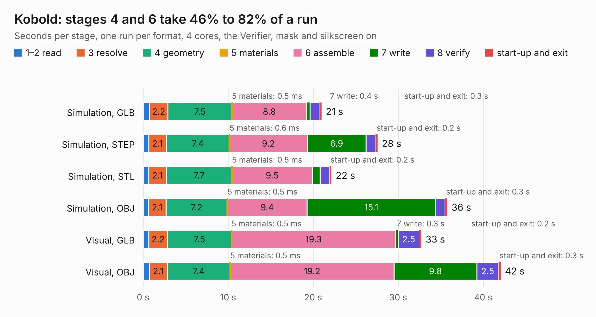

| Mode and format | 1–2 read | 3 resolve | 4 geometry | 5 materials | 6 assemble | 7 write | 8 verify | start-up and exit | Total |
|---|---:|---:|---:|---:|---:|---:|---:|---:|---:|
| Simulation, GLB | 0.7 | 2.2 | 7.5 | 0.5&nbsp;ms | 8.8 | 0.4 | 1.1 | 0.3 | 21.0 |
| Simulation, STEP | 0.7 | 2.1 | 7.4 | 0.6&nbsp;ms | 9.2 | 6.9 | 1.1 | 0.2 | 27.6 |
| Simulation, STL | 0.7 | 2.1 | 7.7 | 0.5&nbsp;ms | 9.5 | 0.9 | 1.1 | 0.2 | 22.2 |
| Simulation, OBJ | 0.6 | 2.1 | 7.2 | 0.5&nbsp;ms | 9.4 | 15.1 | 1.1 | 0.3 | 35.8 |
| Visual, GLB | 0.7 | 2.2 | 7.5 | 0.5&nbsp;ms | 19.3 | 0.3 | 2.5 | 0.2 | 32.7 |
| Visual, OBJ | 0.7 | 2.1 | 7.4 | 0.5&nbsp;ms | 19.2 | 9.8 | 2.5 | 0.3 | 42.1 |

<table align="center"><tr><td valign="top">

| Board | Repo: [tzarc/keyboards](https://github.com/tzarc/keyboards) Board: `Kobold.kicad_pcb` |
|---|---|
| Folder | Kobold / R1 |
| Complexity | 339&nbsp;/&nbsp;1000 (size&nbsp;244, features&nbsp;95) |
| KESE&nbsp;features | through vias, slotted holes, rounded, trapezoid or chamfered pads, filled zones, curved board outline, stack-up, dielectric εr and tanδ |
| Tested | 9th November 2026 |
| Copper&nbsp;layers | 4 |
| File&nbsp;format | KiCad 9 (20241229) |
| Parts,&nbsp;tracks,&nbsp;vias | 95, 971, 220 |
| Triangles,&nbsp;simulation | 2,671,456 in 99 parts |
| Verifier | PASS in all six runs |

</td><td valign="top">

<table>
<tr><th>File type</th><th>File size</th><th>Peak memory used</th></tr>
<tr><th colspan="3" align="left">Simulation</th></tr>
<tr><td>GLB</td><td align="right">92&nbsp;MB</td><td align="right">904&nbsp;MB</td></tr>
<tr><td>STEP</td><td align="right">424&nbsp;MB</td><td align="right">1.1&nbsp;GB</td></tr>
<tr><td>STL</td><td align="right">134&nbsp;MB</td><td align="right">861&nbsp;MB</td></tr>
<tr><td>OBJ</td><td align="right">282&nbsp;MB</td><td align="right">1.7&nbsp;GB</td></tr>
<tr><th colspan="3" align="left">Visual</th></tr>
<tr><td>GLB</td><td align="right">59&nbsp;MB</td><td align="right">1.0&nbsp;GB</td></tr>
<tr><td>OBJ</td><td align="right">183&nbsp;MB</td><td align="right">1.2&nbsp;GB</td></tr>
</table>

</td></tr></table>

## 2934. APPS final

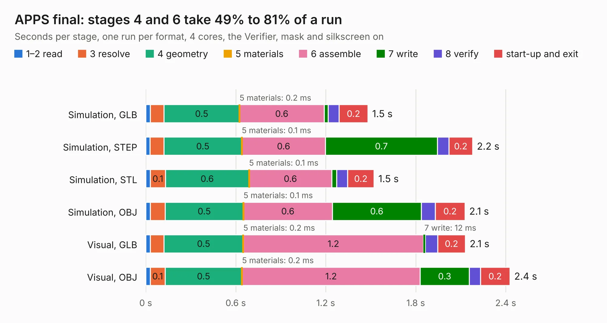

| Mode and format | 1–2 read | 3 resolve | 4 geometry | 5 materials | 6 assemble | 7 write | 8 verify | start-up and exit | Total |
|---|---:|---:|---:|---:|---:|---:|---:|---:|---:|
| Simulation, GLB | 30&nbsp;ms | 91&nbsp;ms | 0.5 | 0.2&nbsp;ms | 0.6 | 26&nbsp;ms | 74&nbsp;ms | 0.2 | 1.5 |
| Simulation, STEP | 28&nbsp;ms | 93&nbsp;ms | 0.5 | 0.1&nbsp;ms | 0.6 | 0.7 | 77&nbsp;ms | 0.2 | 2.2 |
| Simulation, STL | 31&nbsp;ms | 0.1 | 0.6 | 0.1&nbsp;ms | 0.6 | 33&nbsp;ms | 73&nbsp;ms | 0.2 | 1.5 |
| Simulation, OBJ | 30&nbsp;ms | 99&nbsp;ms | 0.5 | 0.1&nbsp;ms | 0.6 | 0.6 | 92&nbsp;ms | 0.2 | 2.1 |
| Visual, GLB | 30&nbsp;ms | 91&nbsp;ms | 0.5 | 0.2&nbsp;ms | 1.2 | 12&nbsp;ms | 82&nbsp;ms | 0.2 | 2.1 |
| Visual, OBJ | 30&nbsp;ms | 0.1 | 0.5 | 0.2&nbsp;ms | 1.2 | 0.3 | 74&nbsp;ms | 0.2 | 2.4 |

<table align="center"><tr><td valign="top">

| Board | Repo: [ucdfs/circuits](https://github.com/ucdfs/circuits) Board: `APPS final.kicad_pcb` |
|---|---|
| Folder | APPS_KR |
| Complexity | 169&nbsp;/&nbsp;1000 (size&nbsp;99, features&nbsp;70) |
| KESE&nbsp;features | rounded, trapezoid or chamfered pads, filled zones, curved board outline, stack-up, dielectric εr and tanδ |
| Tested | 9th November 2026 |
| Copper&nbsp;layers | 2 |
| File&nbsp;format | KiCad 8 (20240108) |
| Parts,&nbsp;tracks,&nbsp;vias | 12, 26, 0 |
| Triangles,&nbsp;simulation | 151,248 in 19 parts |
| Verifier | PASS in all six runs |

</td><td valign="top">

<table>
<tr><th>File type</th><th>File size</th><th>Peak memory used</th></tr>
<tr><th colspan="3" align="left">Simulation</th></tr>
<tr><td>GLB</td><td align="right">5.2&nbsp;MB</td><td align="right">182&nbsp;MB</td></tr>
<tr><td>STEP</td><td align="right">24&nbsp;MB</td><td align="right">184&nbsp;MB</td></tr>
<tr><td>STL</td><td align="right">7.6&nbsp;MB</td><td align="right">182&nbsp;MB</td></tr>
<tr><td>OBJ</td><td align="right">15&nbsp;MB</td><td align="right">180&nbsp;MB</td></tr>
<tr><th colspan="3" align="left">Visual</th></tr>
<tr><td>GLB</td><td align="right">2.8&nbsp;MB</td><td align="right">139&nbsp;MB</td></tr>
<tr><td>OBJ</td><td align="right">7.9&nbsp;MB</td><td align="right">140&nbsp;MB</td></tr>
</table>

</td></tr></table>

## 2935. Battery Temperature Sensor

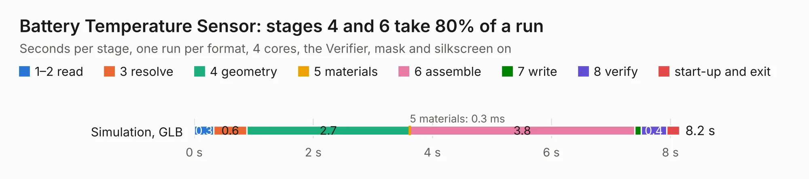

| Mode and format | 1–2 read | 3 resolve | 4 geometry | 5 materials | 6 assemble | 7 write | 8 verify | start-up and exit | Total |
|---|---:|---:|---:|---:|---:|---:|---:|---:|---:|
| Simulation, GLB | 0.3 | 0.6 | 2.7 | 0.3&nbsp;ms | 3.8 | 0.1 | 0.4 | 0.2 | 8.2 |
| Simulation, STEP | 0.3 | 0.6 | 2.9 | 0.2&nbsp;ms | 3.8 | 3.1 | 0.4 | 0.2 | 11.3 |
| Simulation, STL | 0.4 | 0.6 | 2.9 | 0.2&nbsp;ms | 3.9 | 0.4 | 0.4 | 0.2 | 8.9 |
| Simulation, OBJ | 0.3 | 0.6 | 2.9 | 0.3&nbsp;ms | 4.2 | 3.5 | 0.4 | 0.2 | 12.2 |
| Visual, GLB | 0.3 | 0.5 | 2.8 | 0.4&nbsp;ms | 6.2 | 0.1 | 1.0 | 0.2 | 11.2 |
| Visual, OBJ | 0.3 | 0.6 | 2.8 | 0.3&nbsp;ms | 6.2 | 2.6 | 1.0 | 0.3 | 13.8 |

<table align="center"><tr><td valign="top">

| Board | Repo: [ucdfs/circuits](https://github.com/ucdfs/circuits) Board: `Battery Temperature Sensor.kicad_pcb` |
|---|---|
| Folder | Archive / Battery Temperature Sensor_KR |
| Complexity | 257&nbsp;/&nbsp;1000 (size&nbsp;172, features&nbsp;85) |
| KESE&nbsp;features | through vias, rounded, trapezoid or chamfered pads, filled zones, curved board outline, stack-up, dielectric εr and tanδ |
| Tested | 9th November 2026 |
| Copper&nbsp;layers | 2 |
| File&nbsp;format | KiCad 8 (20240108) |
| Parts,&nbsp;tracks,&nbsp;vias | 107, 419, 58 |
| Triangles,&nbsp;simulation | 735,112 in 53 parts |
| Verifier | PASS in all six runs |

</td><td valign="top">

<table>
<tr><th>File type</th><th>File size</th><th>Peak memory used</th></tr>
<tr><th colspan="3" align="left">Simulation</th></tr>
<tr><td>GLB</td><td align="right">25&nbsp;MB</td><td align="right">414&nbsp;MB</td></tr>
<tr><td>STEP</td><td align="right">119&nbsp;MB</td><td align="right">450&nbsp;MB</td></tr>
<tr><td>STL</td><td align="right">37&nbsp;MB</td><td align="right">417&nbsp;MB</td></tr>
<tr><td>OBJ</td><td align="right">73&nbsp;MB</td><td align="right">519&nbsp;MB</td></tr>
<tr><th colspan="3" align="left">Visual</th></tr>
<tr><td>GLB</td><td align="right">19&nbsp;MB</td><td align="right">598&nbsp;MB</td></tr>
<tr><td>OBJ</td><td align="right">56&nbsp;MB</td><td align="right">603&nbsp;MB</td></tr>
</table>

</td></tr></table>

## 2936. LTC6812-15W

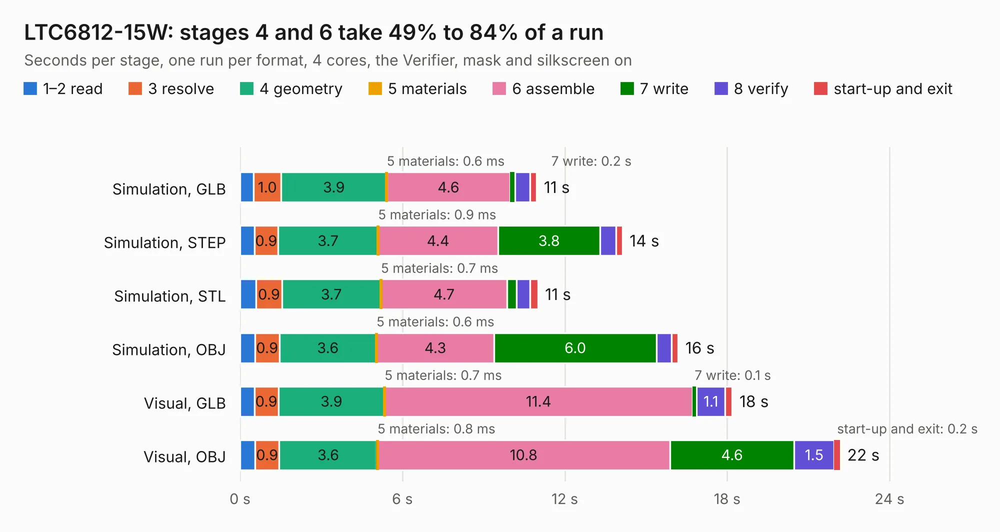

| Mode and format | 1–2 read | 3 resolve | 4 geometry | 5 materials | 6 assemble | 7 write | 8 verify | start-up and exit | Total |
|---|---:|---:|---:|---:|---:|---:|---:|---:|---:|
| Simulation, GLB | 0.5 | 1.0 | 3.9 | 0.6&nbsp;ms | 4.6 | 0.2 | 0.5 | 0.3 | 11.0 |
| Simulation, STEP | 0.5 | 0.9 | 3.7 | 0.9&nbsp;ms | 4.4 | 3.8 | 0.6 | 0.2 | 14.1 |
| Simulation, STL | 0.6 | 0.9 | 3.7 | 0.7&nbsp;ms | 4.7 | 0.4 | 0.5 | 0.3 | 11.0 |
| Simulation, OBJ | 0.5 | 0.9 | 3.6 | 0.6&nbsp;ms | 4.3 | 6.0 | 0.6 | 0.2 | 16.2 |
| Visual, GLB | 0.5 | 0.9 | 3.9 | 0.7&nbsp;ms | 11.4 | 0.1 | 1.1 | 0.3 | 18.2 |
| Visual, OBJ | 0.6 | 0.9 | 3.6 | 0.8&nbsp;ms | 10.8 | 4.6 | 1.5 | 0.2 | 22.2 |

<table align="center"><tr><td valign="top">

| Board | Repo: [ucdfs/circuits](https://github.com/ucdfs/circuits) Board: `LTC6812-15W.kicad_pcb` |
|---|---|
| Folder | ENNOID_BMS / Slave |
| Complexity | 324&nbsp;/&nbsp;1000 (size&nbsp;244, features&nbsp;80) |
| KESE&nbsp;features | through vias, rounded, trapezoid or chamfered pads, arc tracks, curved board outline, stack-up, dielectric εr and tanδ |
| Tested | 9th November 2026 |
| Copper&nbsp;layers | 2 |
| File&nbsp;format | KiCad 9 (20241229) |
| Parts,&nbsp;tracks,&nbsp;vias | 246, 1,418, 64 |
| Triangles,&nbsp;simulation | 1,120,794 in 280 parts |
| Verifier | PASS in all six runs |

</td><td valign="top">

<table>
<tr><th>File type</th><th>File size</th><th>Peak memory used</th></tr>
<tr><th colspan="3" align="left">Simulation</th></tr>
<tr><td>GLB</td><td align="right">38&nbsp;MB</td><td align="right">580&nbsp;MB</td></tr>
<tr><td>STEP</td><td align="right">189&nbsp;MB</td><td align="right">627&nbsp;MB</td></tr>
<tr><td>STL</td><td align="right">56&nbsp;MB</td><td align="right">565&nbsp;MB</td></tr>
<tr><td>OBJ</td><td align="right">113&nbsp;MB</td><td align="right">767&nbsp;MB</td></tr>
<tr><th colspan="3" align="left">Visual</th></tr>
<tr><td>GLB</td><td align="right">30&nbsp;MB</td><td align="right">835&nbsp;MB</td></tr>
<tr><td>OBJ</td><td align="right">92&nbsp;MB</td><td align="right">832&nbsp;MB</td></tr>
</table>

</td></tr></table>

## 2937. (LVE)Shutdown

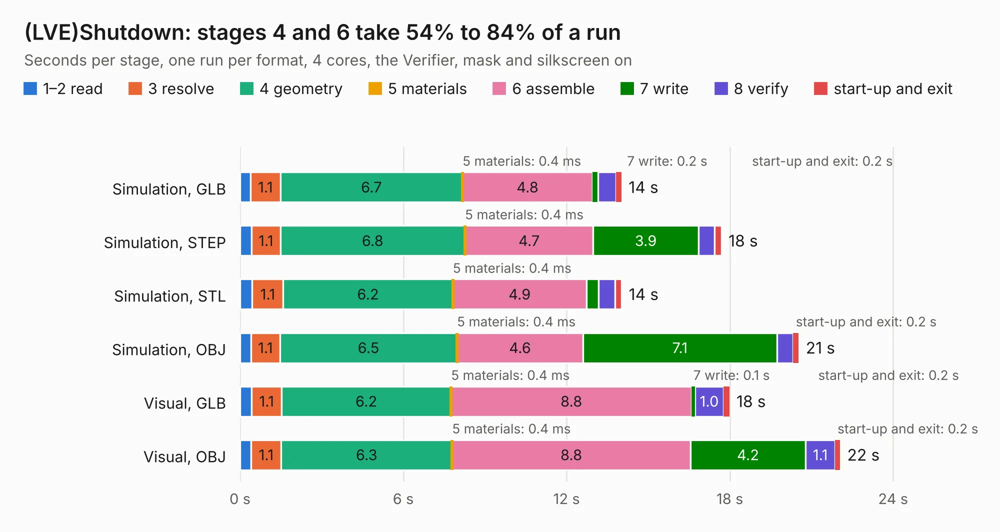

| Mode and format | 1–2 read | 3 resolve | 4 geometry | 5 materials | 6 assemble | 7 write | 8 verify | start-up and exit | Total |
|---|---:|---:|---:|---:|---:|---:|---:|---:|---:|
| Simulation, GLB | 0.4 | 1.1 | 6.7 | 0.4&nbsp;ms | 4.8 | 0.2 | 0.7 | 0.2 | 14.0 |
| Simulation, STEP | 0.4 | 1.1 | 6.8 | 0.4&nbsp;ms | 4.7 | 3.9 | 0.6 | 0.2 | 17.7 |
| Simulation, STL | 0.4 | 1.1 | 6.2 | 0.4&nbsp;ms | 4.9 | 0.4 | 0.6 | 0.2 | 14.0 |
| Simulation, OBJ | 0.4 | 1.1 | 6.5 | 0.4&nbsp;ms | 4.6 | 7.1 | 0.6 | 0.2 | 20.5 |
| Visual, GLB | 0.4 | 1.1 | 6.2 | 0.4&nbsp;ms | 8.8 | 0.1 | 1.0 | 0.2 | 18.0 |
| Visual, OBJ | 0.4 | 1.1 | 6.3 | 0.4&nbsp;ms | 8.8 | 4.2 | 1.1 | 0.2 | 22.0 |

<table align="center"><tr><td valign="top">

| Board | Repo: [ucdfs/circuits](https://github.com/ucdfs/circuits) Board: `(LVE)Shutdown.kicad_pcb` |
|---|---|
| Folder | Kieran Care package / (LVE)Shutdown_KR |
| Complexity | 253&nbsp;/&nbsp;1000 (size&nbsp;168, features&nbsp;85) |
| KESE&nbsp;features | through vias, rounded, trapezoid or chamfered pads, filled zones, curved board outline, stack-up, dielectric εr and tanδ |
| Tested | 9th November 2026 |
| Copper&nbsp;layers | 2 |
| File&nbsp;format | KiCad 9 (20241229) |
| Parts,&nbsp;tracks,&nbsp;vias | 114, 410, 11 |
| Triangles,&nbsp;simulation | 1,386,784 in 81 parts |
| Verifier | PASS in all six runs |

</td><td valign="top">

<table>
<tr><th>File type</th><th>File size</th><th>Peak memory used</th></tr>
<tr><th colspan="3" align="left">Simulation</th></tr>
<tr><td>GLB</td><td align="right">47&nbsp;MB</td><td align="right">599&nbsp;MB</td></tr>
<tr><td>STEP</td><td align="right">202&nbsp;MB</td><td align="right">693&nbsp;MB</td></tr>
<tr><td>STL</td><td align="right">69&nbsp;MB</td><td align="right">608&nbsp;MB</td></tr>
<tr><td>OBJ</td><td align="right">141&nbsp;MB</td><td align="right">965&nbsp;MB</td></tr>
<tr><th colspan="3" align="left">Visual</th></tr>
<tr><td>GLB</td><td align="right">29&nbsp;MB</td><td align="right">730&nbsp;MB</td></tr>
<tr><td>OBJ</td><td align="right">88&nbsp;MB</td><td align="right">728&nbsp;MB</td></tr>
</table>

</td></tr></table>

## 2938. BSPD KiCAD

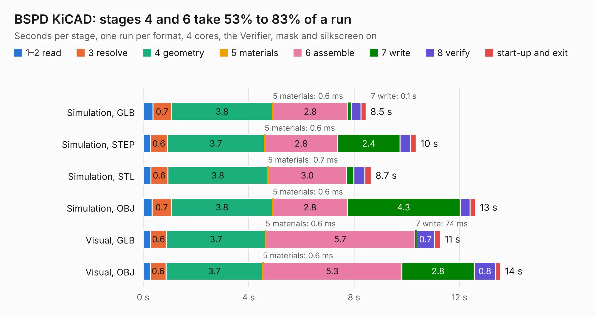

| Mode and format | 1–2 read | 3 resolve | 4 geometry | 5 materials | 6 assemble | 7 write | 8 verify | start-up and exit | Total |
|---|---:|---:|---:|---:|---:|---:|---:|---:|---:|
| Simulation, GLB | 0.4 | 0.7 | 3.8 | 0.6&nbsp;ms | 2.8 | 0.1 | 0.4 | 0.2 | 8.5 |
| Simulation, STEP | 0.3 | 0.6 | 3.7 | 0.6&nbsp;ms | 2.8 | 2.4 | 0.4 | 0.2 | 10.4 |
| Simulation, STL | 0.3 | 0.6 | 3.8 | 0.7&nbsp;ms | 3.0 | 0.3 | 0.4 | 0.2 | 8.7 |
| Simulation, OBJ | 0.3 | 0.7 | 3.8 | 0.6&nbsp;ms | 2.8 | 4.3 | 0.4 | 0.2 | 12.6 |
| Visual, GLB | 0.3 | 0.6 | 3.7 | 0.6&nbsp;ms | 5.7 | 74&nbsp;ms | 0.7 | 0.2 | 11.3 |
| Visual, OBJ | 0.3 | 0.6 | 3.7 | 0.6&nbsp;ms | 5.3 | 2.8 | 0.8 | 0.2 | 13.6 |

<table align="center"><tr><td valign="top">

| Board | Repo: [ucdfs/circuits](https://github.com/ucdfs/circuits) Board: `BSPD KiCAD.kicad_pcb` |
|---|---|
| Folder | Kieran Care package / BSPD_KR |
| Complexity | 239&nbsp;/&nbsp;1000 (size&nbsp;154, features&nbsp;85) |
| KESE&nbsp;features | through vias, rounded, trapezoid or chamfered pads, filled zones, curved board outline, stack-up, dielectric εr and tanδ |
| Tested | 9th November 2026 |
| Copper&nbsp;layers | 2 |
| File&nbsp;format | KiCad 9 (20241229) |
| Parts,&nbsp;tracks,&nbsp;vias | 59, 276, 5 |
| Triangles,&nbsp;simulation | 878,990 in 47 parts |
| Verifier | PASS in all six runs |

</td><td valign="top">

<table>
<tr><th>File type</th><th>File size</th><th>Peak memory used</th></tr>
<tr><th colspan="3" align="left">Simulation</th></tr>
<tr><td>GLB</td><td align="right">30&nbsp;MB</td><td align="right">434&nbsp;MB</td></tr>
<tr><td>STEP</td><td align="right">125&nbsp;MB</td><td align="right">503&nbsp;MB</td></tr>
<tr><td>STL</td><td align="right">44&nbsp;MB</td><td align="right">434&nbsp;MB</td></tr>
<tr><td>OBJ</td><td align="right">88&nbsp;MB</td><td align="right">625&nbsp;MB</td></tr>
<tr><th colspan="3" align="left">Visual</th></tr>
<tr><td>GLB</td><td align="right">18&nbsp;MB</td><td align="right">534&nbsp;MB</td></tr>
<tr><td>OBJ</td><td align="right">55&nbsp;MB</td><td align="right">456&nbsp;MB</td></tr>
</table>

</td></tr></table>

## 2939. Charger_Shutdown_KR

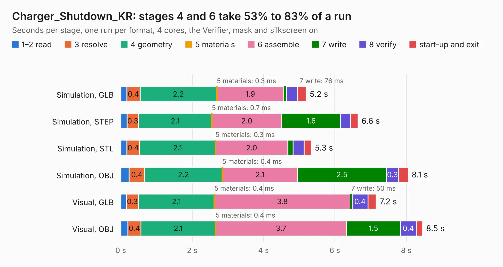

| Mode and format | 1–2 read | 3 resolve | 4 geometry | 5 materials | 6 assemble | 7 write | 8 verify | start-up and exit | Total |
|---|---:|---:|---:|---:|---:|---:|---:|---:|---:|
| Simulation, GLB | 0.2 | 0.4 | 2.2 | 0.3&nbsp;ms | 1.9 | 76&nbsp;ms | 0.3 | 0.2 | 5.2 |
| Simulation, STEP | 0.2 | 0.3 | 2.1 | 0.7&nbsp;ms | 2.0 | 1.6 | 0.3 | 0.2 | 6.6 |
| Simulation, STL | 0.2 | 0.4 | 2.1 | 0.3&nbsp;ms | 2.0 | 0.1 | 0.3 | 0.2 | 5.3 |
| Simulation, OBJ | 0.2 | 0.4 | 2.2 | 0.4&nbsp;ms | 2.1 | 2.5 | 0.3 | 0.3 | 8.1 |
| Visual, GLB | 0.2 | 0.3 | 2.1 | 0.4&nbsp;ms | 3.8 | 50&nbsp;ms | 0.4 | 0.2 | 7.2 |
| Visual, OBJ | 0.2 | 0.4 | 2.1 | 0.4&nbsp;ms | 3.7 | 1.5 | 0.4 | 0.2 | 8.5 |

<table align="center"><tr><td valign="top">

| Board | Repo: [ucdfs/circuits](https://github.com/ucdfs/circuits) Board: `Charger_Shutdown_KR.kicad_pcb` |
|---|---|
| Folder | Kieran Care package / Charger_Shutdown_KR |
| Complexity | 232&nbsp;/&nbsp;1000 (size&nbsp;147, features&nbsp;85) |
| KESE&nbsp;features | through vias, rounded, trapezoid or chamfered pads, filled zones, curved board outline, stack-up, dielectric εr and tanδ |
| Tested | 9th November 2026 |
| Copper&nbsp;layers | 2 |
| File&nbsp;format | KiCad 8 (20240108) |
| Parts,&nbsp;tracks,&nbsp;vias | 41, 209, 10 |
| Triangles,&nbsp;simulation | 524,408 in 45 parts |
| Verifier | PASS in all six runs |

</td><td valign="top">

<table>
<tr><th>File type</th><th>File size</th><th>Peak memory used</th></tr>
<tr><th colspan="3" align="left">Simulation</th></tr>
<tr><td>GLB</td><td align="right">17&nbsp;MB</td><td align="right">318&nbsp;MB</td></tr>
<tr><td>STEP</td><td align="right">77&nbsp;MB</td><td align="right">361&nbsp;MB</td></tr>
<tr><td>STL</td><td align="right">26&nbsp;MB</td><td align="right">307&nbsp;MB</td></tr>
<tr><td>OBJ</td><td align="right">52&nbsp;MB</td><td align="right">389&nbsp;MB</td></tr>
<tr><th colspan="3" align="left">Visual</th></tr>
<tr><td>GLB</td><td align="right">11&nbsp;MB</td><td align="right">343&nbsp;MB</td></tr>
<tr><td>OBJ</td><td align="right">33&nbsp;MB</td><td align="right">351&nbsp;MB</td></tr>
</table>

</td></tr></table>

## 2940. Discharge KiCAD

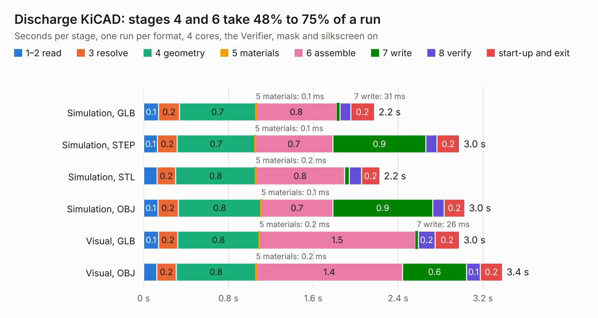

| Mode and format | 1–2 read | 3 resolve | 4 geometry | 5 materials | 6 assemble | 7 write | 8 verify | start-up and exit | Total |
|---|---:|---:|---:|---:|---:|---:|---:|---:|---:|
| Simulation, GLB | 0.1 | 0.2 | 0.7 | 0.1&nbsp;ms | 0.8 | 31&nbsp;ms | 0.1 | 0.2 | 2.2 |
| Simulation, STEP | 0.1 | 0.2 | 0.7 | 0.1&nbsp;ms | 0.7 | 0.9 | 0.1 | 0.2 | 3.0 |
| Simulation, STL | 0.1 | 0.2 | 0.8 | 0.2&nbsp;ms | 0.8 | 43&nbsp;ms | 0.1 | 0.2 | 2.2 |
| Simulation, OBJ | 0.1 | 0.2 | 0.8 | 0.1&nbsp;ms | 0.7 | 0.9 | 0.1 | 0.2 | 3.0 |
| Visual, GLB | 0.1 | 0.2 | 0.8 | 0.2&nbsp;ms | 1.5 | 26&nbsp;ms | 0.2 | 0.2 | 3.0 |
| Visual, OBJ | 0.1 | 0.2 | 0.8 | 0.2&nbsp;ms | 1.4 | 0.6 | 0.1 | 0.2 | 3.4 |

<table align="center"><tr><td valign="top">

| Board | Repo: [ucdfs/circuits](https://github.com/ucdfs/circuits) Board: `Discharge KiCAD.kicad_pcb` |
|---|---|
| Folder | Kieran Care package / Discharge_KR |
| Complexity | 194&nbsp;/&nbsp;1000 (size&nbsp;119, features&nbsp;75) |
| KESE&nbsp;features | custom pads, rounded, trapezoid or chamfered pads, copper drawings, curved board outline, stack-up, dielectric εr and tanδ |
| Tested | 9th November 2026 |
| Copper&nbsp;layers | 2 |
| File&nbsp;format | KiCad 9 (20241229) |
| Parts,&nbsp;tracks,&nbsp;vias | 16, 80, 0 |
| Triangles,&nbsp;simulation | 203,798 in 22 parts |
| Verifier | PASS in all six runs |

</td><td valign="top">

<table>
<tr><th>File type</th><th>File size</th><th>Peak memory used</th></tr>
<tr><th colspan="3" align="left">Simulation</th></tr>
<tr><td>GLB</td><td align="right">6.8&nbsp;MB</td><td align="right">214&nbsp;MB</td></tr>
<tr><td>STEP</td><td align="right">26&nbsp;MB</td><td align="right">228&nbsp;MB</td></tr>
<tr><td>STL</td><td align="right">10&nbsp;MB</td><td align="right">219&nbsp;MB</td></tr>
<tr><td>OBJ</td><td align="right">20&nbsp;MB</td><td align="right">212&nbsp;MB</td></tr>
<tr><th colspan="3" align="left">Visual</th></tr>
<tr><td>GLB</td><td align="right">4.4&nbsp;MB</td><td align="right">188&nbsp;MB</td></tr>
<tr><td>OBJ</td><td align="right">12&nbsp;MB</td><td align="right">192&nbsp;MB</td></tr>
</table>

</td></tr></table>

## 2941. Cell Tap Fuse Board 2x

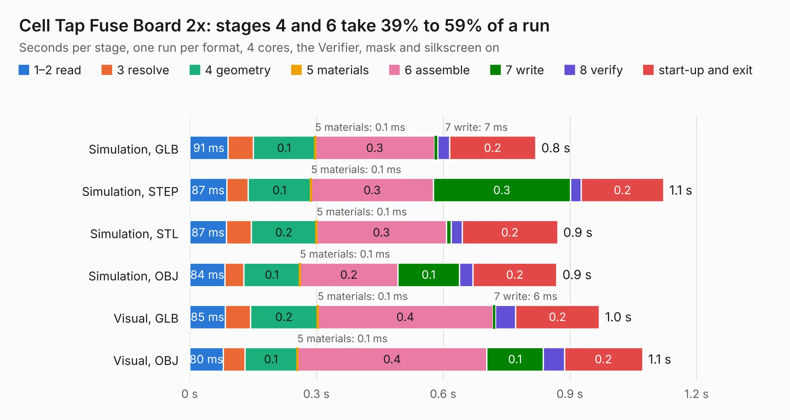

| Mode and format | 1–2 read | 3 resolve | 4 geometry | 5 materials | 6 assemble | 7 write | 8 verify | start-up and exit | Total |
|---|---:|---:|---:|---:|---:|---:|---:|---:|---:|
| Simulation, GLB | 91&nbsp;ms | 60&nbsp;ms | 0.1 | 0.1&nbsp;ms | 0.3 | 7&nbsp;ms | 29&nbsp;ms | 0.2 | 0.8 |
| Simulation, STEP | 87&nbsp;ms | 51&nbsp;ms | 0.1 | 0.1&nbsp;ms | 0.3 | 0.3 | 26&nbsp;ms | 0.2 | 1.1 |
| Simulation, STL | 87&nbsp;ms | 59&nbsp;ms | 0.2 | 0.1&nbsp;ms | 0.3 | 12&nbsp;ms | 26&nbsp;ms | 0.2 | 0.9 |
| Simulation, OBJ | 84&nbsp;ms | 45&nbsp;ms | 0.1 | 0.1&nbsp;ms | 0.2 | 0.1 | 32&nbsp;ms | 0.2 | 0.9 |
| Visual, GLB | 85&nbsp;ms | 59&nbsp;ms | 0.2 | 0.1&nbsp;ms | 0.4 | 6&nbsp;ms | 48&nbsp;ms | 0.2 | 1.0 |
| Visual, OBJ | 80&nbsp;ms | 51&nbsp;ms | 0.1 | 0.1&nbsp;ms | 0.4 | 0.1 | 50&nbsp;ms | 0.2 | 1.1 |

<table align="center"><tr><td valign="top">

| Board | Repo: [ucdfs/circuits](https://github.com/ucdfs/circuits) Board: `Cell Tap Fuse Board 2x.kicad_pcb` |
|---|---|
| Folder | Kieran Care package / ENNOID_BMS - Cell Tap Fuse Board 2x |
| Complexity | 115&nbsp;/&nbsp;1000 (size&nbsp;65, features&nbsp;50) |
| KESE&nbsp;features | rounded, trapezoid or chamfered pads, curved board outline, stack-up, dielectric εr and tanδ |
| Tested | 9th November 2026 |
| Copper&nbsp;layers | 2 |
| File&nbsp;format | KiCad 9 (20241229) |
| Parts,&nbsp;tracks,&nbsp;vias | 2, 8, 0 |
| Triangles,&nbsp;simulation | 41,276 in 13 parts |
| Verifier | PASS in all six runs |

</td><td valign="top">

<table>
<tr><th>File type</th><th>File size</th><th>Peak memory used</th></tr>
<tr><th colspan="3" align="left">Simulation</th></tr>
<tr><td>GLB</td><td align="right">1.4&nbsp;MB</td><td align="right">68&nbsp;MB</td></tr>
<tr><td>STEP</td><td align="right">6.3&nbsp;MB</td><td align="right">73&nbsp;MB</td></tr>
<tr><td>STL</td><td align="right">2.1&nbsp;MB</td><td align="right">68&nbsp;MB</td></tr>
<tr><td>OBJ</td><td align="right">3.9&nbsp;MB</td><td align="right">78&nbsp;MB</td></tr>
<tr><th colspan="3" align="left">Visual</th></tr>
<tr><td>GLB</td><td align="right">1.0&nbsp;MB</td><td align="right">103&nbsp;MB</td></tr>
<tr><td>OBJ</td><td align="right">2.7&nbsp;MB</td><td align="right">103&nbsp;MB</td></tr>
</table>

</td></tr></table>

## 2942. Cell Tap Fuse Board 3x

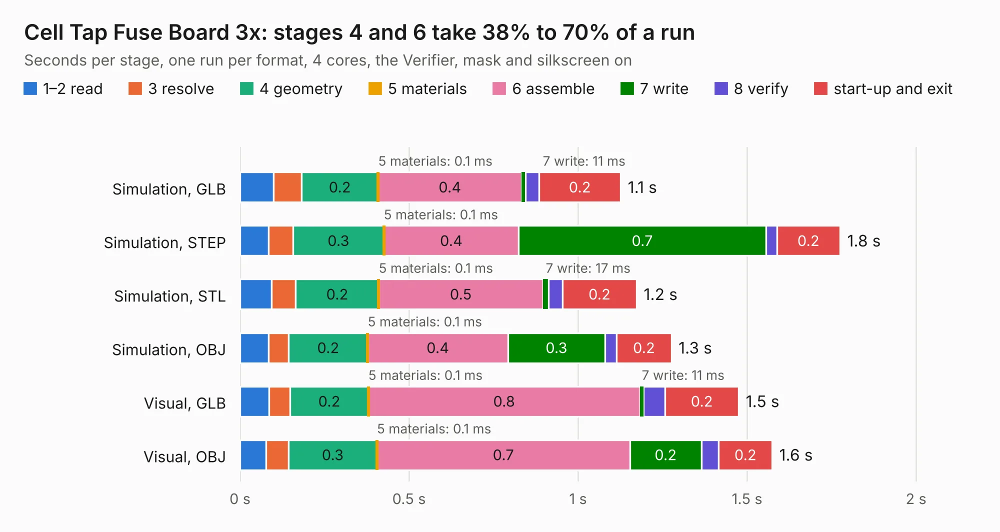

| Mode and format | 1–2 read | 3 resolve | 4 geometry | 5 materials | 6 assemble | 7 write | 8 verify | start-up and exit | Total |
|---|---:|---:|---:|---:|---:|---:|---:|---:|---:|
| Simulation, GLB | 99&nbsp;ms | 83&nbsp;ms | 0.2 | 0.1&nbsp;ms | 0.4 | 11&nbsp;ms | 40&nbsp;ms | 0.2 | 1.1 |
| Simulation, STEP | 84&nbsp;ms | 73&nbsp;ms | 0.3 | 0.1&nbsp;ms | 0.4 | 0.7 | 32&nbsp;ms | 0.2 | 1.8 |
| Simulation, STL | 93&nbsp;ms | 72&nbsp;ms | 0.2 | 0.1&nbsp;ms | 0.5 | 17&nbsp;ms | 41&nbsp;ms | 0.2 | 1.2 |
| Simulation, OBJ | 84&nbsp;ms | 60&nbsp;ms | 0.2 | 0.1&nbsp;ms | 0.4 | 0.3 | 34&nbsp;ms | 0.2 | 1.3 |
| Visual, GLB | 86&nbsp;ms | 62&nbsp;ms | 0.2 | 0.1&nbsp;ms | 0.8 | 11&nbsp;ms | 63&nbsp;ms | 0.2 | 1.5 |
| Visual, OBJ | 77&nbsp;ms | 66&nbsp;ms | 0.3 | 0.1&nbsp;ms | 0.7 | 0.2 | 51&nbsp;ms | 0.2 | 1.6 |

<table align="center"><tr><td valign="top">

| Board | Repo: [ucdfs/circuits](https://github.com/ucdfs/circuits) Board: `Cell Tap Fuse Board 3x.kicad_pcb` |
|---|---|
| Folder | Kieran Care package / ENNOID_BMS - Cell Tap Fuse Board 3x |
| Complexity | 131&nbsp;/&nbsp;1000 (size&nbsp;81, features&nbsp;50) |
| KESE&nbsp;features | rounded, trapezoid or chamfered pads, curved board outline, stack-up, dielectric εr and tanδ |
| Tested | 9th November 2026 |
| Copper&nbsp;layers | 2 |
| File&nbsp;format | KiCad 9 (20241229) |
| Parts,&nbsp;tracks,&nbsp;vias | 4, 16, 0 |
| Triangles,&nbsp;simulation | 69,248 in 16 parts |
| Verifier | PASS in all six runs |

</td><td valign="top">

<table>
<tr><th>File type</th><th>File size</th><th>Peak memory used</th></tr>
<tr><th colspan="3" align="left">Simulation</th></tr>
<tr><td>GLB</td><td align="right">2.2&nbsp;MB</td><td align="right">171&nbsp;MB</td></tr>
<tr><td>STEP</td><td align="right">9.5&nbsp;MB</td><td align="right">173&nbsp;MB</td></tr>
<tr><td>STL</td><td align="right">3.5&nbsp;MB</td><td align="right">170&nbsp;MB</td></tr>
<tr><td>OBJ</td><td align="right">6.6&nbsp;MB</td><td align="right">170&nbsp;MB</td></tr>
<tr><th colspan="3" align="left">Visual</th></tr>
<tr><td>GLB</td><td align="right">1.5&nbsp;MB</td><td align="right">151&nbsp;MB</td></tr>
<tr><td>OBJ</td><td align="right">4.2&nbsp;MB</td><td align="right">150&nbsp;MB</td></tr>
</table>

</td></tr></table>

## 2943. BMS-Master

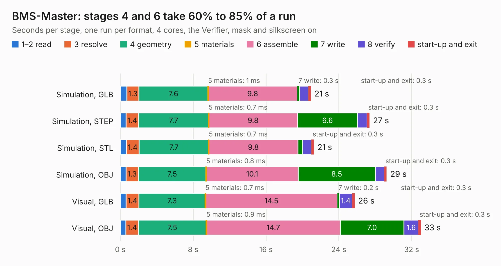

| Mode and format | 1–2 read | 3 resolve | 4 geometry | 5 materials | 6 assemble | 7 write | 8 verify | start-up and exit | Total |
|---|---:|---:|---:|---:|---:|---:|---:|---:|---:|
| Simulation, GLB | 0.7 | 1.3 | 7.6 | 1&nbsp;ms | 9.8 | 0.3 | 1.0 | 0.3 | 20.9 |
| Simulation, STEP | 0.6 | 1.4 | 7.7 | 0.7&nbsp;ms | 9.8 | 6.6 | 1.0 | 0.3 | 27.4 |
| Simulation, STL | 0.7 | 1.4 | 7.7 | 0.7&nbsp;ms | 9.8 | 0.5 | 1.0 | 0.3 | 21.3 |
| Simulation, OBJ | 0.6 | 1.3 | 7.5 | 0.8&nbsp;ms | 10.1 | 8.5 | 1.0 | 0.3 | 29.3 |
| Visual, GLB | 0.6 | 1.4 | 7.3 | 0.7&nbsp;ms | 14.5 | 0.2 | 1.4 | 0.3 | 25.7 |
| Visual, OBJ | 0.6 | 1.4 | 7.5 | 0.9&nbsp;ms | 14.7 | 7.0 | 1.6 | 0.3 | 33.0 |

<table align="center"><tr><td valign="top">

| Board | Repo: [ucdfs/circuits](https://github.com/ucdfs/circuits) Board: `BMS-Master.kicad_pcb` |
|---|---|
| Folder | Kieran Care package / ENNOID_BMS - Master |
| Complexity | 347&nbsp;/&nbsp;1000 (size&nbsp;237, features&nbsp;110) |
| KESE&nbsp;features | through vias, slotted holes, rounded, trapezoid or chamfered pads, arc tracks, filled zones, curved board outline, stack-up, dielectric εr and tanδ |
| Tested | 9th November 2026 |
| Copper&nbsp;layers | 2 |
| File&nbsp;format | KiCad 9 (20241229) |
| Parts,&nbsp;tracks,&nbsp;vias | 218, 1,289, 130 |
| Triangles,&nbsp;simulation | 1,469,656 in 201 parts |
| Verifier | PASS in all six runs |

</td><td valign="top">

<table>
<tr><th>File type</th><th>File size</th><th>Peak memory used</th></tr>
<tr><th colspan="3" align="left">Simulation</th></tr>
<tr><td>GLB</td><td align="right">51&nbsp;MB</td><td align="right">664&nbsp;MB</td></tr>
<tr><td>STEP</td><td align="right">263&nbsp;MB</td><td align="right">774&nbsp;MB</td></tr>
<tr><td>STL</td><td align="right">73&nbsp;MB</td><td align="right">691&nbsp;MB</td></tr>
<tr><td>OBJ</td><td align="right">151&nbsp;MB</td><td align="right">1.0&nbsp;GB</td></tr>
<tr><th colspan="3" align="left">Visual</th></tr>
<tr><td>GLB</td><td align="right">40&nbsp;MB</td><td align="right">869&nbsp;MB</td></tr>
<tr><td>OBJ</td><td align="right">122&nbsp;MB</td><td align="right">926&nbsp;MB</td></tr>
</table>

</td></tr></table>

## 2944. LTC6812-15W

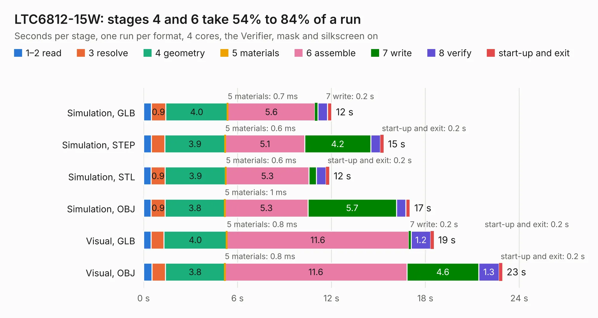

| Mode and format | 1–2 read | 3 resolve | 4 geometry | 5 materials | 6 assemble | 7 write | 8 verify | start-up and exit | Total |
|---|---:|---:|---:|---:|---:|---:|---:|---:|---:|
| Simulation, GLB | 0.5 | 0.9 | 4.0 | 0.7&nbsp;ms | 5.6 | 0.2 | 0.6 | 0.3 | 12.0 |
| Simulation, STEP | 0.5 | 0.9 | 3.9 | 0.6&nbsp;ms | 5.1 | 4.2 | 0.6 | 0.2 | 15.3 |
| Simulation, STL | 0.5 | 0.9 | 3.9 | 0.6&nbsp;ms | 5.3 | 0.5 | 0.6 | 0.2 | 11.9 |
| Simulation, OBJ | 0.5 | 0.9 | 3.8 | 1&nbsp;ms | 5.3 | 5.7 | 0.6 | 0.3 | 17.0 |
| Visual, GLB | 0.5 | 0.8 | 4.0 | 0.8&nbsp;ms | 11.6 | 0.2 | 1.2 | 0.2 | 18.5 |
| Visual, OBJ | 0.5 | 0.9 | 3.8 | 0.8&nbsp;ms | 11.6 | 4.6 | 1.3 | 0.2 | 22.9 |

<table align="center"><tr><td valign="top">

| Board | Repo: [ucdfs/circuits](https://github.com/ucdfs/circuits) Board: `LTC6812-15W.kicad_pcb` |
|---|---|
| Folder | Kieran Care package / ENNOID_BMS - Slave |
| Complexity | 344&nbsp;/&nbsp;1000 (size&nbsp;244, features&nbsp;100) |
| KESE&nbsp;features | through vias, rounded, trapezoid or chamfered pads, arc tracks, filled zones, curved board outline, stack-up, dielectric εr and tanδ |
| Tested | 9th November 2026 |
| Copper&nbsp;layers | 2 |
| File&nbsp;format | KiCad 9 (20241229) |
| Parts,&nbsp;tracks,&nbsp;vias | 246, 1,418, 64 |
| Triangles,&nbsp;simulation | 1,384,100 in 280 parts |
| Verifier | PASS in all six runs |

</td><td valign="top">

<table>
<tr><th>File type</th><th>File size</th><th>Peak memory used</th></tr>
<tr><th colspan="3" align="left">Simulation</th></tr>
<tr><td>GLB</td><td align="right">47&nbsp;MB</td><td align="right">609&nbsp;MB</td></tr>
<tr><td>STEP</td><td align="right">260&nbsp;MB</td><td align="right">713&nbsp;MB</td></tr>
<tr><td>STL</td><td align="right">69&nbsp;MB</td><td align="right">589&nbsp;MB</td></tr>
<tr><td>OBJ</td><td align="right">142&nbsp;MB</td><td align="right">965&nbsp;MB</td></tr>
<tr><th colspan="3" align="left">Visual</th></tr>
<tr><td>GLB</td><td align="right">39&nbsp;MB</td><td align="right">703&nbsp;MB</td></tr>
<tr><td>OBJ</td><td align="right">116&nbsp;MB</td><td align="right">892&nbsp;MB</td></tr>
</table>

</td></tr></table>

## 2945. TSAL

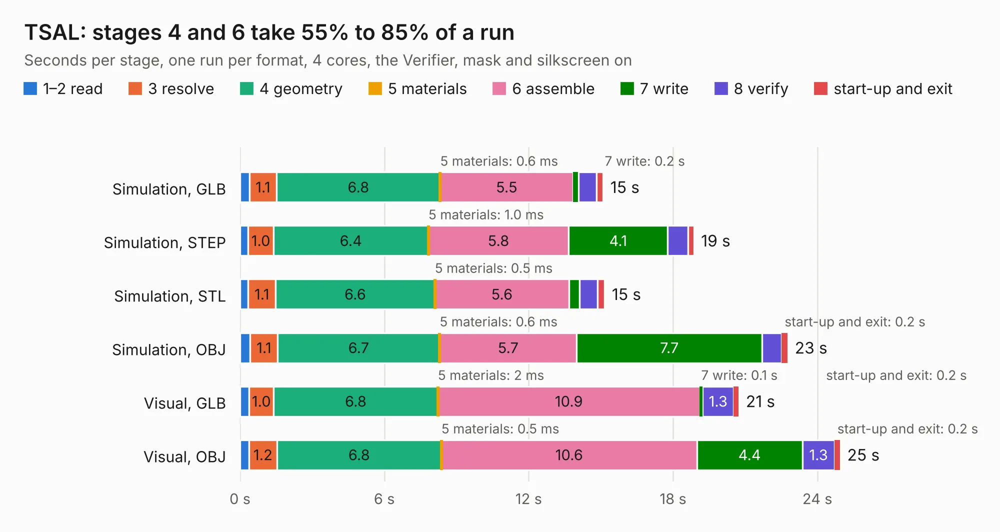

| Mode and format | 1–2 read | 3 resolve | 4 geometry | 5 materials | 6 assemble | 7 write | 8 verify | start-up and exit | Total |
|---|---:|---:|---:|---:|---:|---:|---:|---:|---:|
| Simulation, GLB | 0.4 | 1.1 | 6.8 | 0.6&nbsp;ms | 5.5 | 0.2 | 0.7 | 0.3 | 15.1 |
| Simulation, STEP | 0.3 | 1.0 | 6.4 | 1.0&nbsp;ms | 5.8 | 4.1 | 0.8 | 0.3 | 18.9 |
| Simulation, STL | 0.3 | 1.1 | 6.6 | 0.5&nbsp;ms | 5.6 | 0.4 | 0.8 | 0.3 | 15.2 |
| Simulation, OBJ | 0.4 | 1.1 | 6.7 | 0.6&nbsp;ms | 5.7 | 7.7 | 0.8 | 0.2 | 22.8 |
| Visual, GLB | 0.4 | 1.0 | 6.8 | 2&nbsp;ms | 10.9 | 0.1 | 1.3 | 0.2 | 20.7 |
| Visual, OBJ | 0.4 | 1.2 | 6.8 | 0.5&nbsp;ms | 10.6 | 4.4 | 1.3 | 0.2 | 24.9 |

<table align="center"><tr><td valign="top">

| Board | Repo: [ucdfs/circuits](https://github.com/ucdfs/circuits) Board: `TSAL.kicad_pcb` |
|---|---|
| Folder | Kieran Care package / NEW_TSAL_KR |
| Complexity | 259&nbsp;/&nbsp;1000 (size&nbsp;174, features&nbsp;85) |
| KESE&nbsp;features | through vias, rounded, trapezoid or chamfered pads, filled zones, curved board outline, stack-up, dielectric εr and tanδ |
| Tested | 9th November 2026 |
| Copper&nbsp;layers | 2 |
| File&nbsp;format | KiCad 8 (20240108) |
| Parts,&nbsp;tracks,&nbsp;vias | 99, 613, 23 |
| Triangles,&nbsp;simulation | 1,575,932 in 88 parts |
| Verifier | PASS in all six runs |

</td><td valign="top">

<table>
<tr><th>File type</th><th>File size</th><th>Peak memory used</th></tr>
<tr><th colspan="3" align="left">Simulation</th></tr>
<tr><td>GLB</td><td align="right">53&nbsp;MB</td><td align="right">665&nbsp;MB</td></tr>
<tr><td>STEP</td><td align="right">220&nbsp;MB</td><td align="right">773&nbsp;MB</td></tr>
<tr><td>STL</td><td align="right">79&nbsp;MB</td><td align="right">666&nbsp;MB</td></tr>
<tr><td>OBJ</td><td align="right">160&nbsp;MB</td><td align="right">1.1&nbsp;GB</td></tr>
<tr><th colspan="3" align="left">Visual</th></tr>
<tr><td>GLB</td><td align="right">30&nbsp;MB</td><td align="right">781&nbsp;MB</td></tr>
<tr><td>OBJ</td><td align="right">92&nbsp;MB</td><td align="right">730&nbsp;MB</td></tr>
</table>

</td></tr></table>

## 2946. PDU_KR

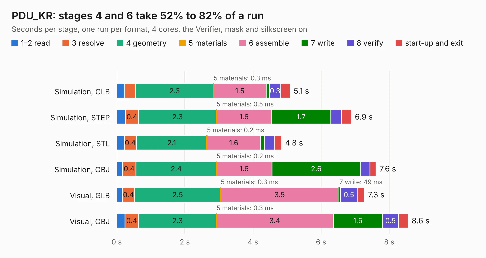

| Mode and format | 1–2 read | 3 resolve | 4 geometry | 5 materials | 6 assemble | 7 write | 8 verify | start-up and exit | Total |
|---|---:|---:|---:|---:|---:|---:|---:|---:|---:|
| Simulation, GLB | 0.2 | 0.3 | 2.3 | 0.3&nbsp;ms | 1.5 | 97&nbsp;ms | 0.3 | 0.3 | 5.1 |
| Simulation, STEP | 0.3 | 0.4 | 2.3 | 0.5&nbsp;ms | 1.6 | 1.7 | 0.3 | 0.3 | 6.9 |
| Simulation, STL | 0.2 | 0.4 | 2.1 | 0.2&nbsp;ms | 1.6 | 0.1 | 0.3 | 0.2 | 4.8 |
| Simulation, OBJ | 0.2 | 0.4 | 2.4 | 0.2&nbsp;ms | 1.6 | 2.6 | 0.3 | 0.2 | 7.6 |
| Visual, GLB | 0.2 | 0.4 | 2.5 | 0.3&nbsp;ms | 3.5 | 49&nbsp;ms | 0.5 | 0.2 | 7.3 |
| Visual, OBJ | 0.2 | 0.4 | 2.3 | 0.3&nbsp;ms | 3.4 | 1.5 | 0.5 | 0.3 | 8.6 |

<table align="center"><tr><td valign="top">

| Board | Repo: [ucdfs/circuits](https://github.com/ucdfs/circuits) Board: `PDU_KR.kicad_pcb` |
|---|---|
| Folder | Kieran Care package / PDU_KR |
| Complexity | 206&nbsp;/&nbsp;1000 (size&nbsp;136, features&nbsp;70) |
| KESE&nbsp;features | rounded, trapezoid or chamfered pads, filled zones, curved board outline, stack-up, dielectric εr and tanδ |
| Tested | 9th November 2026 |
| Copper&nbsp;layers | 2 |
| File&nbsp;format | KiCad 9 (20241229) |
| Parts,&nbsp;tracks,&nbsp;vias | 44, 114, 0 |
| Triangles,&nbsp;simulation | 502,746 in 34 parts |
| Verifier | PASS in all six runs |

</td><td valign="top">

<table>
<tr><th>File type</th><th>File size</th><th>Peak memory used</th></tr>
<tr><th colspan="3" align="left">Simulation</th></tr>
<tr><td>GLB</td><td align="right">17&nbsp;MB</td><td align="right">323&nbsp;MB</td></tr>
<tr><td>STEP</td><td align="right">87&nbsp;MB</td><td align="right">337&nbsp;MB</td></tr>
<tr><td>STL</td><td align="right">25&nbsp;MB</td><td align="right">296&nbsp;MB</td></tr>
<tr><td>OBJ</td><td align="right">51&nbsp;MB</td><td align="right">385&nbsp;MB</td></tr>
<tr><th colspan="3" align="left">Visual</th></tr>
<tr><td>GLB</td><td align="right">10&nbsp;MB</td><td align="right">326&nbsp;MB</td></tr>
<tr><td>OBJ</td><td align="right">30&nbsp;MB</td><td align="right">328&nbsp;MB</td></tr>
</table>

</td></tr></table>

## 2947. Pre-charge KiCAD

| Mode and format | 1–2 read | 3 resolve | 4 geometry | 5 materials | 6 assemble | 7 write | 8 verify | start-up and exit | Total |
|---|---:|---:|---:|---:|---:|---:|---:|---:|---:|
| Simulation, GLB | 0.3 | 0.5 | 3.1 | 0.3&nbsp;ms | 2.2 | 0.1 | 0.4 | 0.2 | 6.9 |
| Simulation, STEP | 0.3 | 0.5 | 3.2 | 0.3&nbsp;ms | 2.1 | 2.0 | 0.4 | 0.2 | 8.8 |
| Simulation, STL | 0.3 | 0.6 | 3.1 | 0.3&nbsp;ms | 2.2 | 0.2 | 0.4 | 0.2 | 7.0 |
| Simulation, OBJ | 0.3 | 0.5 | 3.0 | 0.3&nbsp;ms | 2.2 | 3.7 | 0.5 | 0.2 | 10.4 |
| Visual, GLB | 0.3 | 0.6 | 3.2 | 0.4&nbsp;ms | 5.1 | 76&nbsp;ms | 0.6 | 0.2 | 10.1 |
| Visual, OBJ | 0.3 | 0.6 | 3.2 | 0.3&nbsp;ms | 4.7 | 2.5 | 0.7 | 0.3 | 12.3 |

<table align="center"><tr><td valign="top">

| Board | Repo: [ucdfs/circuits](https://github.com/ucdfs/circuits) Board: `Pre-charge KiCAD.kicad_pcb` |
|---|---|
| Folder | Kieran Care package / Pre-charge_KR |
| Complexity | 264&nbsp;/&nbsp;1000 (size&nbsp;154, features&nbsp;110) |
| KESE&nbsp;features | through vias, custom pads, rounded, trapezoid or chamfered pads, filled zones, copper drawings, curved board outline, stack-up, dielectric εr and tanδ |
| Tested | 9th November 2026 |
| Copper&nbsp;layers | 2 |
| File&nbsp;format | KiCad 9 (20241229) |
| Parts,&nbsp;tracks,&nbsp;vias | 51, 274, 13 |
| Triangles,&nbsp;simulation | 666,692 in 42 parts |
| Verifier | PASS in all six runs |

</td><td valign="top">

<table>
<tr><th>File type</th><th>File size</th><th>Peak memory used</th></tr>
<tr><th colspan="3" align="left">Simulation</th></tr>
<tr><td>GLB</td><td align="right">23&nbsp;MB</td><td align="right">359&nbsp;MB</td></tr>
<tr><td>STEP</td><td align="right">102&nbsp;MB</td><td align="right">419&nbsp;MB</td></tr>
<tr><td>STL</td><td align="right">33&nbsp;MB</td><td align="right">365&nbsp;MB</td></tr>
<tr><td>OBJ</td><td align="right">67&nbsp;MB</td><td align="right">478&nbsp;MB</td></tr>
<tr><th colspan="3" align="left">Visual</th></tr>
<tr><td>GLB</td><td align="right">15&nbsp;MB</td><td align="right">372&nbsp;MB</td></tr>
<tr><td>OBJ</td><td align="right">43&nbsp;MB</td><td align="right">443&nbsp;MB</td></tr>
</table>

</td></tr></table>

## 2948. Breakout

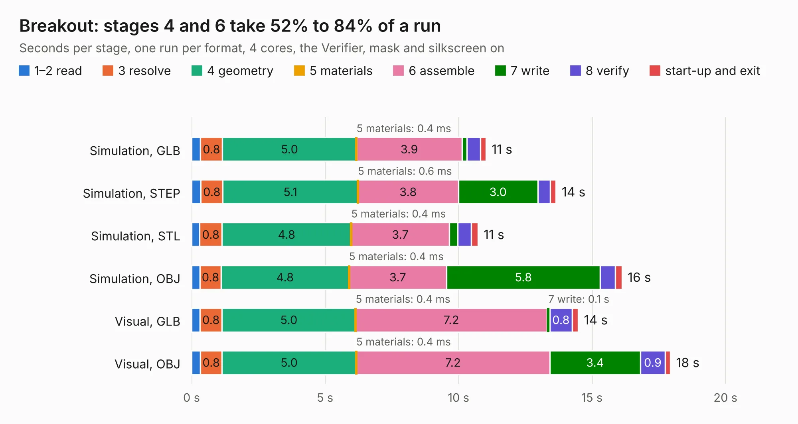

| Mode and format | 1–2 read | 3 resolve | 4 geometry | 5 materials | 6 assemble | 7 write | 8 verify | start-up and exit | Total |
|---|---:|---:|---:|---:|---:|---:|---:|---:|---:|
| Simulation, GLB | 0.3 | 0.8 | 5.0 | 0.4&nbsp;ms | 3.9 | 0.2 | 0.5 | 0.2 | 11.0 |
| Simulation, STEP | 0.3 | 0.8 | 5.1 | 0.6&nbsp;ms | 3.8 | 3.0 | 0.5 | 0.2 | 13.7 |
| Simulation, STL | 0.3 | 0.8 | 4.8 | 0.4&nbsp;ms | 3.7 | 0.3 | 0.5 | 0.2 | 10.7 |
| Simulation, OBJ | 0.3 | 0.8 | 4.8 | 0.4&nbsp;ms | 3.7 | 5.8 | 0.6 | 0.2 | 16.1 |
| Visual, GLB | 0.3 | 0.8 | 5.0 | 0.4&nbsp;ms | 7.2 | 0.1 | 0.8 | 0.2 | 14.5 |
| Visual, OBJ | 0.3 | 0.8 | 5.0 | 0.4&nbsp;ms | 7.2 | 3.4 | 0.9 | 0.2 | 17.9 |

<table align="center"><tr><td valign="top">

| Board | Repo: [ucdfs/circuits](https://github.com/ucdfs/circuits) Board: `Breakout.kicad_pcb` |
|---|---|
| Folder | Kieran Care package / Teensy 4.1 Breakout Board |
| Complexity | 235&nbsp;/&nbsp;1000 (size&nbsp;150, features&nbsp;85) |
| KESE&nbsp;features | through vias, rounded, trapezoid or chamfered pads, filled zones, curved board outline, stack-up, dielectric εr and tanδ |
| Tested | 9th November 2026 |
| Copper&nbsp;layers | 2 |
| File&nbsp;format | KiCad 9 (20241229) |
| Parts,&nbsp;tracks,&nbsp;vias | 53, 218, 6 |
| Triangles,&nbsp;simulation | 1,096,444 in 107 parts |
| Verifier | PASS in all six runs |

</td><td valign="top">

<table>
<tr><th>File type</th><th>File size</th><th>Peak memory used</th></tr>
<tr><th colspan="3" align="left">Simulation</th></tr>
<tr><td>GLB</td><td align="right">37&nbsp;MB</td><td align="right">507&nbsp;MB</td></tr>
<tr><td>STEP</td><td align="right">155&nbsp;MB</td><td align="right">559&nbsp;MB</td></tr>
<tr><td>STL</td><td align="right">55&nbsp;MB</td><td align="right">481&nbsp;MB</td></tr>
<tr><td>OBJ</td><td align="right">110&nbsp;MB</td><td align="right">747&nbsp;MB</td></tr>
<tr><th colspan="3" align="left">Visual</th></tr>
<tr><td>GLB</td><td align="right">22&nbsp;MB</td><td align="right">521&nbsp;MB</td></tr>
<tr><td>OBJ</td><td align="right">67&nbsp;MB</td><td align="right">590&nbsp;MB</td></tr>
</table>

</td></tr></table>

## 2949. Voltage_Measurement_KR

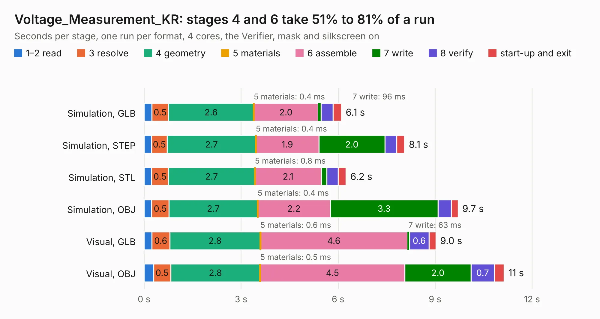

| Mode and format | 1–2 read | 3 resolve | 4 geometry | 5 materials | 6 assemble | 7 write | 8 verify | start-up and exit | Total |
|---|---:|---:|---:|---:|---:|---:|---:|---:|---:|
| Simulation, GLB | 0.2 | 0.5 | 2.6 | 0.4&nbsp;ms | 2.0 | 96&nbsp;ms | 0.4 | 0.3 | 6.1 |
| Simulation, STEP | 0.2 | 0.5 | 2.7 | 0.4&nbsp;ms | 1.9 | 2.0 | 0.4 | 0.2 | 8.1 |
| Simulation, STL | 0.2 | 0.5 | 2.7 | 0.8&nbsp;ms | 2.1 | 0.2 | 0.4 | 0.2 | 6.2 |
| Simulation, OBJ | 0.2 | 0.5 | 2.7 | 0.4&nbsp;ms | 2.2 | 3.3 | 0.4 | 0.2 | 9.7 |
| Visual, GLB | 0.2 | 0.6 | 2.8 | 0.6&nbsp;ms | 4.6 | 63&nbsp;ms | 0.6 | 0.2 | 9.0 |
| Visual, OBJ | 0.3 | 0.5 | 2.8 | 0.5&nbsp;ms | 4.5 | 2.0 | 0.7 | 0.3 | 11.1 |

<table align="center"><tr><td valign="top">

| Board | Repo: [ucdfs/circuits](https://github.com/ucdfs/circuits) Board: `Voltage_Measurement_KR.kicad_pcb` |
|---|---|
| Folder | Kieran Care package / Voltage_Measurement_KR |
| Complexity | 235&nbsp;/&nbsp;1000 (size&nbsp;150, features&nbsp;85) |
| KESE&nbsp;features | through vias, rounded, trapezoid or chamfered pads, filled zones, curved board outline, stack-up, dielectric εr and tanδ |
| Tested | 9th November 2026 |
| Copper&nbsp;layers | 2 |
| File&nbsp;format | KiCad 9 (20241229) |
| Parts,&nbsp;tracks,&nbsp;vias | 52, 225, 7 |
| Triangles,&nbsp;simulation | 638,094 in 38 parts |
| Verifier | PASS in all six runs |

</td><td valign="top">

<table>
<tr><th>File type</th><th>File size</th><th>Peak memory used</th></tr>
<tr><th colspan="3" align="left">Simulation</th></tr>
<tr><td>GLB</td><td align="right">21&nbsp;MB</td><td align="right">361&nbsp;MB</td></tr>
<tr><td>STEP</td><td align="right">92&nbsp;MB</td><td align="right">393&nbsp;MB</td></tr>
<tr><td>STL</td><td align="right">32&nbsp;MB</td><td align="right">367&nbsp;MB</td></tr>
<tr><td>OBJ</td><td align="right">64&nbsp;MB</td><td align="right">457&nbsp;MB</td></tr>
<tr><th colspan="3" align="left">Visual</th></tr>
<tr><td>GLB</td><td align="right">14&nbsp;MB</td><td align="right">421&nbsp;MB</td></tr>
<tr><td>OBJ</td><td align="right">41&nbsp;MB</td><td align="right">431&nbsp;MB</td></tr>
</table>

</td></tr></table>

## 2950. flightcontroller

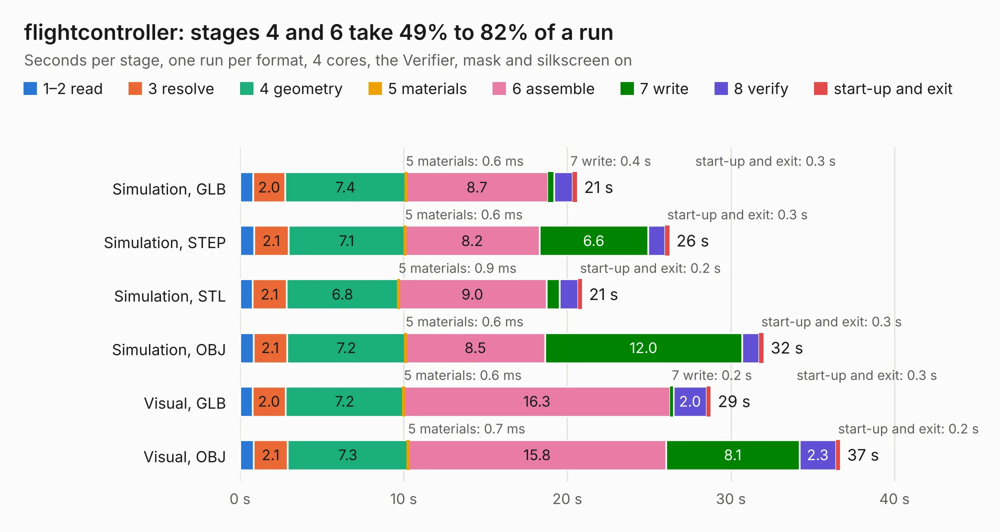

| Mode and format | 1–2 read | 3 resolve | 4 geometry | 5 materials | 6 assemble | 7 write | 8 verify | start-up and exit | Total |
|---|---:|---:|---:|---:|---:|---:|---:|---:|---:|
| Simulation, GLB | 0.8 | 2.0 | 7.4 | 0.6&nbsp;ms | 8.7 | 0.4 | 1.1 | 0.3 | 20.6 |
| Simulation, STEP | 0.9 | 2.1 | 7.1 | 0.6&nbsp;ms | 8.2 | 6.6 | 1.0 | 0.3 | 26.2 |
| Simulation, STL | 0.8 | 2.1 | 6.8 | 0.9&nbsp;ms | 9.0 | 0.8 | 1.1 | 0.2 | 20.9 |
| Simulation, OBJ | 0.8 | 2.1 | 7.2 | 0.6&nbsp;ms | 8.5 | 12.0 | 1.1 | 0.3 | 32.0 |
| Visual, GLB | 0.8 | 2.0 | 7.2 | 0.6&nbsp;ms | 16.3 | 0.2 | 2.0 | 0.3 | 28.8 |
| Visual, OBJ | 0.8 | 2.1 | 7.3 | 0.7&nbsp;ms | 15.8 | 8.1 | 2.3 | 0.2 | 36.7 |

<table align="center"><tr><td valign="top">

| Board | Repo: [ukinori/flightcontroller](https://github.com/ukinori/flightcontroller) Board: `flightcontroller.kicad_pcb` |
|---|---|
| Complexity | 348&nbsp;/&nbsp;1000 (size&nbsp;263, features&nbsp;85) |
| KESE&nbsp;features | through vias, slotted holes, rounded, trapezoid or chamfered pads, filled zones, stack-up, dielectric εr and tanδ |
| Tested | 9th November 2026 |
| Copper&nbsp;layers | 4 |
| File&nbsp;format | KiCad 10 (20260206) |
| Parts,&nbsp;tracks,&nbsp;vias | 129, 3,528, 249 |
| Triangles,&nbsp;simulation | 2,284,130 in 154 parts |
| Verifier | PASS in all six runs |

</td><td valign="top">

<table>
<tr><th>File type</th><th>File size</th><th>Peak memory used</th></tr>
<tr><th colspan="3" align="left">Simulation</th></tr>
<tr><td>GLB</td><td align="right">78&nbsp;MB</td><td align="right">807&nbsp;MB</td></tr>
<tr><td>STEP</td><td align="right">366&nbsp;MB</td><td align="right">1.0&nbsp;GB</td></tr>
<tr><td>STL</td><td align="right">114&nbsp;MB</td><td align="right">811&nbsp;MB</td></tr>
<tr><td>OBJ</td><td align="right">238&nbsp;MB</td><td align="right">1.5&nbsp;GB</td></tr>
<tr><th colspan="3" align="left">Visual</th></tr>
<tr><td>GLB</td><td align="right">52&nbsp;MB</td><td align="right">963&nbsp;MB</td></tr>
<tr><td>OBJ</td><td align="right">162&nbsp;MB</td><td align="right">1.1&nbsp;GB</td></tr>
</table>

</td></tr></table>

## 2951. uECG_v4_5

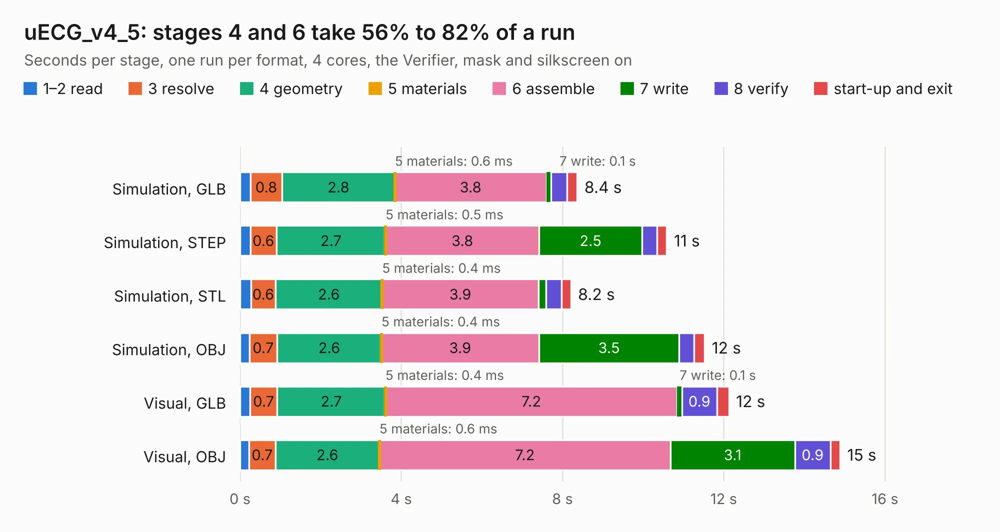

| Mode and format | 1–2 read | 3 resolve | 4 geometry | 5 materials | 6 assemble | 7 write | 8 verify | start-up and exit | Total |
|---|---:|---:|---:|---:|---:|---:|---:|---:|---:|
| Simulation, GLB | 0.3 | 0.8 | 2.8 | 0.6&nbsp;ms | 3.8 | 0.1 | 0.4 | 0.3 | 8.4 |
| Simulation, STEP | 0.3 | 0.6 | 2.7 | 0.5&nbsp;ms | 3.8 | 2.5 | 0.4 | 0.2 | 10.6 |
| Simulation, STL | 0.3 | 0.6 | 2.6 | 0.4&nbsp;ms | 3.9 | 0.2 | 0.4 | 0.2 | 8.2 |
| Simulation, OBJ | 0.2 | 0.7 | 2.6 | 0.4&nbsp;ms | 3.9 | 3.5 | 0.4 | 0.3 | 11.5 |
| Visual, GLB | 0.2 | 0.7 | 2.7 | 0.4&nbsp;ms | 7.2 | 0.1 | 0.9 | 0.3 | 12.1 |
| Visual, OBJ | 0.2 | 0.7 | 2.6 | 0.6&nbsp;ms | 7.2 | 3.1 | 0.9 | 0.2 | 14.9 |

<table align="center"><tr><td valign="top">

| Board | Repo: [ultimaterobotics/uECG_pcb](https://github.com/ultimaterobotics/uECG_pcb) Board: `uECG_v4_5.kicad_pcb` |
|---|---|
| Folder | uECG_v4_5 |
| Complexity | 273&nbsp;/&nbsp;1000 (size&nbsp;218, features&nbsp;55) |
| KESE&nbsp;features | through vias, rounded, trapezoid or chamfered pads, filled zones, curved board outline |
| Tested | 9th November 2026 |
| Copper&nbsp;layers | 2 |
| File&nbsp;format | KiCad 5 (20171130) |
| Parts,&nbsp;tracks,&nbsp;vias | 67, 730, 138 |
| Triangles,&nbsp;simulation | 725,870 in 100 parts |
| Verifier | PASS in all six runs |

</td><td valign="top">

<table>
<tr><th>File type</th><th>File size</th><th>Peak memory used</th></tr>
<tr><th colspan="3" align="left">Simulation</th></tr>
<tr><td>GLB</td><td align="right">25&nbsp;MB</td><td align="right">389&nbsp;MB</td></tr>
<tr><td>STEP</td><td align="right">126&nbsp;MB</td><td align="right">492&nbsp;MB</td></tr>
<tr><td>STL</td><td align="right">36&nbsp;MB</td><td align="right">388&nbsp;MB</td></tr>
<tr><td>OBJ</td><td align="right">73&nbsp;MB</td><td align="right">541&nbsp;MB</td></tr>
<tr><th colspan="3" align="left">Visual</th></tr>
<tr><td>GLB</td><td align="right">23&nbsp;MB</td><td align="right">568&nbsp;MB</td></tr>
<tr><td>OBJ</td><td align="right">68&nbsp;MB</td><td align="right">571&nbsp;MB</td></tr>
</table>

</td></tr></table>

## 2952. uECG_v4_52_lsm_tlv

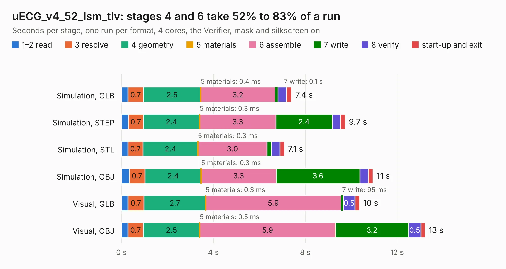

| Mode and format | 1–2 read | 3 resolve | 4 geometry | 5 materials | 6 assemble | 7 write | 8 verify | start-up and exit | Total |
|---|---:|---:|---:|---:|---:|---:|---:|---:|---:|
| Simulation, GLB | 0.3 | 0.7 | 2.5 | 0.4&nbsp;ms | 3.2 | 0.1 | 0.4 | 0.2 | 7.4 |
| Simulation, STEP | 0.3 | 0.7 | 2.4 | 0.3&nbsp;ms | 3.3 | 2.4 | 0.4 | 0.2 | 9.7 |
| Simulation, STL | 0.3 | 0.7 | 2.4 | 0.3&nbsp;ms | 3.0 | 0.2 | 0.4 | 0.2 | 7.1 |
| Simulation, OBJ | 0.3 | 0.7 | 2.4 | 0.3&nbsp;ms | 3.3 | 3.6 | 0.4 | 0.2 | 11.0 |
| Visual, GLB | 0.3 | 0.7 | 2.7 | 0.3&nbsp;ms | 5.9 | 95&nbsp;ms | 0.5 | 0.2 | 10.4 |
| Visual, OBJ | 0.3 | 0.7 | 2.5 | 0.5&nbsp;ms | 5.9 | 3.2 | 0.5 | 0.2 | 13.2 |

<table align="center"><tr><td valign="top">

| Board | Repo: [ultimaterobotics/uECG_pcb](https://github.com/ultimaterobotics/uECG_pcb) Board: `uECG_v4_52_lsm_tlv.kicad_pcb` |
|---|---|
| Folder | uECG_v4_52_lsm_tlv |
| Complexity | 310&nbsp;/&nbsp;1000 (size&nbsp;220, features&nbsp;90) |
| KESE&nbsp;features | through vias, rounded, trapezoid or chamfered pads, filled zones, curved board outline, stack-up, dielectric εr and tanδ, mask and silkscreen colours |
| Tested | 9th November 2026 |
| Copper&nbsp;layers | 2 |
| File&nbsp;format | KiCad 6 (20211014) |
| Parts,&nbsp;tracks,&nbsp;vias | 71, 814, 147 |
| Triangles,&nbsp;simulation | 754,512 in 97 parts |
| Verifier | PASS in all six runs |

</td><td valign="top">

<table>
<tr><th>File type</th><th>File size</th><th>Peak memory used</th></tr>
<tr><th colspan="3" align="left">Simulation</th></tr>
<tr><td>GLB</td><td align="right">26&nbsp;MB</td><td align="right">390&nbsp;MB</td></tr>
<tr><td>STEP</td><td align="right">140&nbsp;MB</td><td align="right">483&nbsp;MB</td></tr>
<tr><td>STL</td><td align="right">38&nbsp;MB</td><td align="right">394&nbsp;MB</td></tr>
<tr><td>OBJ</td><td align="right">77&nbsp;MB</td><td align="right">525&nbsp;MB</td></tr>
<tr><th colspan="3" align="left">Visual</th></tr>
<tr><td>GLB</td><td align="right">23&nbsp;MB</td><td align="right">570&nbsp;MB</td></tr>
<tr><td>OBJ</td><td align="right">69&nbsp;MB</td><td align="right">528&nbsp;MB</td></tr>
</table>

</td></tr></table>

## 2953. NanoS3_Carrier

| Mode and format | 1–2 read | 3 resolve | 4 geometry | 5 materials | 6 assemble | 7 write | 8 verify | start-up and exit | Total |
|---|---:|---:|---:|---:|---:|---:|---:|---:|---:|
| Simulation, GLB | 0.2 | 0.5 | 2.4 | 0.4&nbsp;ms | 2.0 | 0.1 | 0.3 | 0.3 | 5.7 |
| Simulation, STEP | 0.2 | 0.5 | 2.3 | 0.2&nbsp;ms | 1.9 | 1.7 | 0.3 | 0.2 | 7.2 |
| Simulation, STL | 0.2 | 0.5 | 2.3 | 0.3&nbsp;ms | 2.0 | 0.2 | 0.3 | 0.2 | 5.6 |
| Simulation, OBJ | 0.2 | 0.5 | 2.4 | 0.3&nbsp;ms | 2.1 | 2.9 | 0.4 | 0.2 | 8.6 |
| Visual, GLB | 0.2 | 0.5 | 2.4 | 0.3&nbsp;ms | 4.8 | 69&nbsp;ms | 0.6 | 0.3 | 8.8 |
| Visual, OBJ | 0.2 | 0.5 | 2.4 | 0.3&nbsp;ms | 4.5 | 2.1 | 0.6 | 0.2 | 10.6 |

<table align="center"><tr><td valign="top">

| Board | Repo: [UnexpectedMaker/esp32s3](https://github.com/UnexpectedMaker/esp32s3) Board: `NanoS3_Carrier.kicad_pcb` |
|---|---|
| Folder | kicad / NanoS3 Carrier |
| Complexity | 267&nbsp;/&nbsp;1000 (size&nbsp;152, features&nbsp;115) |
| KESE&nbsp;features | through vias, slotted holes, custom pads, rounded, trapezoid or chamfered pads, filled zones, copper drawings, stack-up, dielectric εr and tanδ, mask and silkscreen colours |
| Tested | 9th November 2026 |
| Copper&nbsp;layers | 2 |
| File&nbsp;format | KiCad 7 (20221018) |
| Parts,&nbsp;tracks,&nbsp;vias | 20, 255, 83 |
| Triangles,&nbsp;simulation | 547,766 in 55 parts |
| Verifier | PASS in all six runs |

</td><td valign="top">

<table>
<tr><th>File type</th><th>File size</th><th>Peak memory used</th></tr>
<tr><th colspan="3" align="left">Simulation</th></tr>
<tr><td>GLB</td><td align="right">19&nbsp;MB</td><td align="right">306&nbsp;MB</td></tr>
<tr><td>STEP</td><td align="right">102&nbsp;MB</td><td align="right">347&nbsp;MB</td></tr>
<tr><td>STL</td><td align="right">27&nbsp;MB</td><td align="right">319&nbsp;MB</td></tr>
<tr><td>OBJ</td><td align="right">56&nbsp;MB</td><td align="right">427&nbsp;MB</td></tr>
<tr><th colspan="3" align="left">Visual</th></tr>
<tr><td>GLB</td><td align="right">14&nbsp;MB</td><td align="right">364&nbsp;MB</td></tr>
<tr><td>OBJ</td><td align="right">43&nbsp;MB</td><td align="right">382&nbsp;MB</td></tr>
</table>

</td></tr></table>

## 2954. OMGS3_Carrier_R1

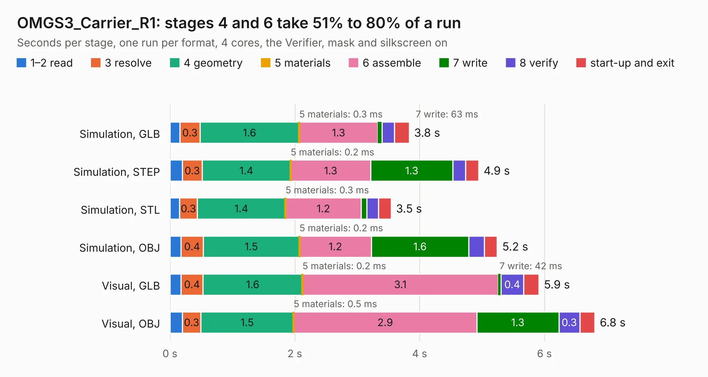

| Mode and format | 1–2 read | 3 resolve | 4 geometry | 5 materials | 6 assemble | 7 write | 8 verify | start-up and exit | Total |
|---|---:|---:|---:|---:|---:|---:|---:|---:|---:|
| Simulation, GLB | 0.2 | 0.3 | 1.6 | 0.3&nbsp;ms | 1.3 | 63&nbsp;ms | 0.2 | 0.2 | 3.8 |
| Simulation, STEP | 0.2 | 0.3 | 1.4 | 0.2&nbsp;ms | 1.3 | 1.3 | 0.2 | 0.2 | 4.9 |
| Simulation, STL | 0.2 | 0.3 | 1.4 | 0.3&nbsp;ms | 1.2 | 87&nbsp;ms | 0.2 | 0.2 | 3.5 |
| Simulation, OBJ | 0.2 | 0.4 | 1.5 | 0.2&nbsp;ms | 1.2 | 1.6 | 0.3 | 0.2 | 5.2 |
| Visual, GLB | 0.2 | 0.4 | 1.6 | 0.2&nbsp;ms | 3.1 | 42&nbsp;ms | 0.4 | 0.2 | 5.9 |
| Visual, OBJ | 0.2 | 0.3 | 1.5 | 0.5&nbsp;ms | 2.9 | 1.3 | 0.3 | 0.2 | 6.8 |

<table align="center"><tr><td valign="top">

| Board | Repo: [UnexpectedMaker/esp32s3](https://github.com/UnexpectedMaker/esp32s3) Board: `OMGS3_Carrier_R1.kicad_pcb` |
|---|---|
| Folder | kicad / OMGS3 Carrier |
| Complexity | 269&nbsp;/&nbsp;1000 (size&nbsp;144, features&nbsp;125) |
| KESE&nbsp;features | through vias, slotted holes, custom pads, rounded, trapezoid or chamfered pads, filled zones, copper drawings, curved board outline, stack-up, dielectric εr and tanδ, mask and silkscreen colours |
| Tested | 9th November 2026 |
| Copper&nbsp;layers | 2 |
| File&nbsp;format | KiCad 8 (20240108) |
| Parts,&nbsp;tracks,&nbsp;vias | 15, 134, 80 |
| Triangles,&nbsp;simulation | 353,816 in 40 parts |
| Verifier | PASS in all six runs |

</td><td valign="top">

<table>
<tr><th>File type</th><th>File size</th><th>Peak memory used</th></tr>
<tr><th colspan="3" align="left">Simulation</th></tr>
<tr><td>GLB</td><td align="right">12&nbsp;MB</td><td align="right">259&nbsp;MB</td></tr>
<tr><td>STEP</td><td align="right">52&nbsp;MB</td><td align="right">290&nbsp;MB</td></tr>
<tr><td>STL</td><td align="right">18&nbsp;MB</td><td align="right">252&nbsp;MB</td></tr>
<tr><td>OBJ</td><td align="right">36&nbsp;MB</td><td align="right">292&nbsp;MB</td></tr>
<tr><th colspan="3" align="left">Visual</th></tr>
<tr><td>GLB</td><td align="right">8.9&nbsp;MB</td><td align="right">278&nbsp;MB</td></tr>
<tr><td>OBJ</td><td align="right">26&nbsp;MB</td><td align="right">279&nbsp;MB</td></tr>
</table>

</td></tr></table>

## 2955. EdgeS3D_Carrier_P1

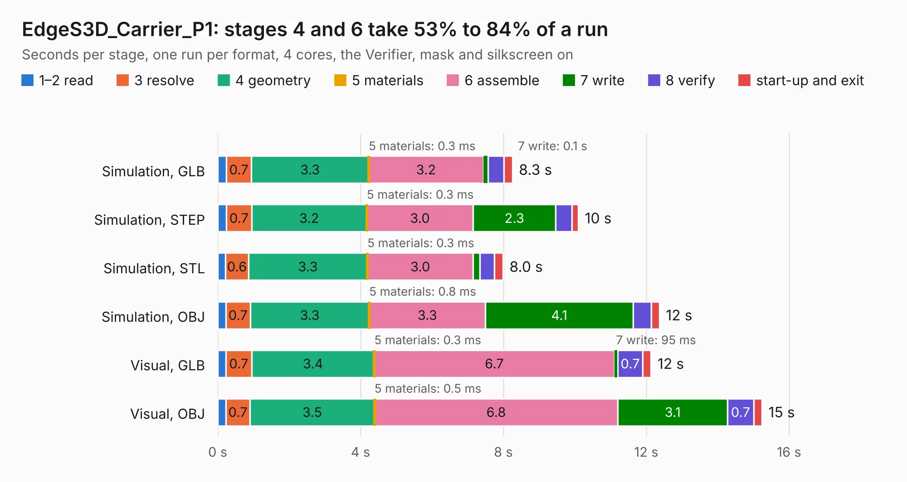

| Mode and format | 1–2 read | 3 resolve | 4 geometry | 5 materials | 6 assemble | 7 write | 8 verify | start-up and exit | Total |
|---|---:|---:|---:|---:|---:|---:|---:|---:|---:|
| Simulation, GLB | 0.2 | 0.7 | 3.3 | 0.3&nbsp;ms | 3.2 | 0.1 | 0.4 | 0.2 | 8.3 |
| Simulation, STEP | 0.2 | 0.7 | 3.2 | 0.3&nbsp;ms | 3.0 | 2.3 | 0.5 | 0.2 | 10.1 |
| Simulation, STL | 0.2 | 0.6 | 3.3 | 0.3&nbsp;ms | 3.0 | 0.2 | 0.4 | 0.2 | 8.0 |
| Simulation, OBJ | 0.2 | 0.7 | 3.3 | 0.8&nbsp;ms | 3.3 | 4.1 | 0.5 | 0.2 | 12.4 |
| Visual, GLB | 0.2 | 0.7 | 3.4 | 0.3&nbsp;ms | 6.7 | 95&nbsp;ms | 0.7 | 0.2 | 12.1 |
| Visual, OBJ | 0.2 | 0.7 | 3.5 | 0.5&nbsp;ms | 6.8 | 3.1 | 0.7 | 0.2 | 15.2 |

<table align="center"><tr><td valign="top">

| Board | Repo: [UnexpectedMaker/esp32s3](https://github.com/UnexpectedMaker/esp32s3) Board: `EdgeS3D_Carrier_P1.kicad_pcb` |
|---|---|
| Folder | series_d / KiCAD / EdgeS3D_Carrier_P1 |
| Complexity | 257&nbsp;/&nbsp;1000 (size&nbsp;157, features&nbsp;100) |
| KESE&nbsp;features | through vias, slotted holes, rounded, trapezoid or chamfered pads, filled zones, curved board outline, stack-up, dielectric εr and tanδ, mask and silkscreen colours |
| Tested | 9th November 2026 |
| Copper&nbsp;layers | 2 |
| File&nbsp;format | KiCad 9 (20241229) |
| Parts,&nbsp;tracks,&nbsp;vias | 15, 338, 160 |
| Triangles,&nbsp;simulation | 769,534 in 70 parts |
| Verifier | PASS in all six runs |

</td><td valign="top">

<table>
<tr><th>File type</th><th>File size</th><th>Peak memory used</th></tr>
<tr><th colspan="3" align="left">Simulation</th></tr>
<tr><td>GLB</td><td align="right">27&nbsp;MB</td><td align="right">378&nbsp;MB</td></tr>
<tr><td>STEP</td><td align="right">126&nbsp;MB</td><td align="right">465&nbsp;MB</td></tr>
<tr><td>STL</td><td align="right">38&nbsp;MB</td><td align="right">398&nbsp;MB</td></tr>
<tr><td>OBJ</td><td align="right">79&nbsp;MB</td><td align="right">556&nbsp;MB</td></tr>
<tr><th colspan="3" align="left">Visual</th></tr>
<tr><td>GLB</td><td align="right">21&nbsp;MB</td><td align="right">527&nbsp;MB</td></tr>
<tr><td>OBJ</td><td align="right">64&nbsp;MB</td><td align="right">529&nbsp;MB</td></tr>
</table>

</td></tr></table>

## 2956. armory

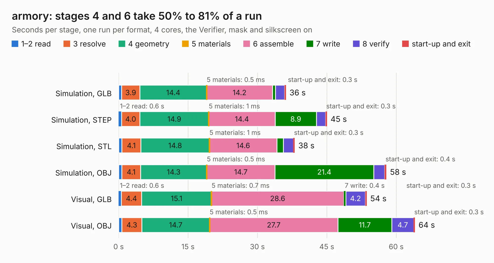

| Mode and format | 1–2 read | 3 resolve | 4 geometry | 5 materials | 6 assemble | 7 write | 8 verify | start-up and exit | Total |
|---|---:|---:|---:|---:|---:|---:|---:|---:|---:|
| Simulation, GLB | 0.7 | 3.9 | 14.4 | 0.5&nbsp;ms | 14.2 | 0.7 | 2.0 | 0.3 | 36.2 |
| Simulation, STEP | 0.6 | 4.0 | 14.9 | 1&nbsp;ms | 14.4 | 8.9 | 2.0 | 0.3 | 45.0 |
| Simulation, STL | 0.7 | 4.1 | 14.8 | 1&nbsp;ms | 14.6 | 1.4 | 2.2 | 0.3 | 38.1 |
| Simulation, OBJ | 0.7 | 4.1 | 14.3 | 0.5&nbsp;ms | 14.7 | 21.4 | 2.4 | 0.4 | 57.9 |
| Visual, GLB | 0.6 | 4.4 | 15.1 | 0.7&nbsp;ms | 28.6 | 0.4 | 4.2 | 0.3 | 53.6 |
| Visual, OBJ | 0.7 | 4.3 | 14.7 | 0.5&nbsp;ms | 27.7 | 11.7 | 4.7 | 0.3 | 64.1 |

<table align="center"><tr><td valign="top">

| Board | Repo: [usbarmory/usbarmory](https://github.com/usbarmory/usbarmory) Board: `armory.kicad_pcb` |
|---|---|
| Folder | hardware / mark-one |
| Complexity | 339&nbsp;/&nbsp;1000 (size&nbsp;294, features&nbsp;45) |
| KESE&nbsp;features | through vias, filled zones, curved board outline |
| Tested | 9th November 2026 |
| Copper&nbsp;layers | 8 |
| File&nbsp;format | KiCad 3 (3) |
| Parts,&nbsp;tracks,&nbsp;vias | 174, 2,408, 337 |
| Triangles,&nbsp;simulation | 4,039,766 in 144 parts |
| Verifier | PASS in all six runs |

</td><td valign="top">

<table>
<tr><th>File type</th><th>File size</th><th>Peak memory used</th></tr>
<tr><th colspan="3" align="left">Simulation</th></tr>
<tr><td>GLB</td><td align="right">140&nbsp;MB</td><td align="right">1.2&nbsp;GB</td></tr>
<tr><td>STEP</td><td align="right">558&nbsp;MB</td><td align="right">1.4&nbsp;GB</td></tr>
<tr><td>STL</td><td align="right">202&nbsp;MB</td><td align="right">1.1&nbsp;GB</td></tr>
<tr><td>OBJ</td><td align="right">443&nbsp;MB</td><td align="right">2.7&nbsp;GB</td></tr>
<tr><th colspan="3" align="left">Visual</th></tr>
<tr><td>GLB</td><td align="right">75&nbsp;MB</td><td align="right">1.4&nbsp;GB</td></tr>
<tr><td>OBJ</td><td align="right">240&nbsp;MB</td><td align="right">1.6&nbsp;GB</td></tr>
</table>

</td></tr></table>

## 2957. armory

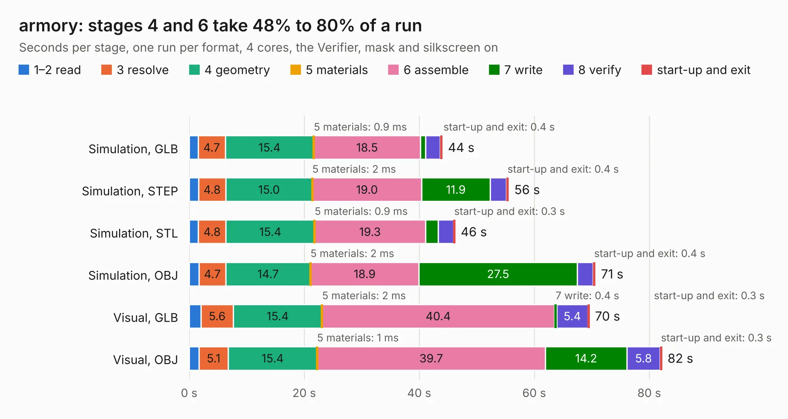

| Mode and format | 1–2 read | 3 resolve | 4 geometry | 5 materials | 6 assemble | 7 write | 8 verify | start-up and exit | Total |
|---|---:|---:|---:|---:|---:|---:|---:|---:|---:|
| Simulation, GLB | 1.5 | 4.7 | 15.4 | 0.9&nbsp;ms | 18.5 | 0.9 | 2.5 | 0.4 | 44.0 |
| Simulation, STEP | 1.6 | 4.8 | 15.0 | 2&nbsp;ms | 19.0 | 11.9 | 2.8 | 0.4 | 55.6 |
| Simulation, STL | 1.6 | 4.8 | 15.4 | 0.9&nbsp;ms | 19.3 | 2.2 | 2.6 | 0.3 | 46.2 |
| Simulation, OBJ | 1.7 | 4.7 | 14.7 | 2&nbsp;ms | 18.9 | 27.5 | 2.7 | 0.4 | 70.6 |
| Visual, GLB | 2.1 | 5.6 | 15.4 | 2&nbsp;ms | 40.4 | 0.4 | 5.4 | 0.3 | 69.6 |
| Visual, OBJ | 1.7 | 5.1 | 15.4 | 1&nbsp;ms | 39.7 | 14.2 | 5.8 | 0.3 | 82.2 |

<table align="center"><tr><td valign="top">

| Board | Repo: [usbarmory/usbarmory](https://github.com/usbarmory/usbarmory) Board: `armory.kicad_pcb` |
|---|---|
| Folder | hardware / mark-two-beta |
| Complexity | 400&nbsp;/&nbsp;1000 (size&nbsp;320, features&nbsp;80) |
| KESE&nbsp;features | through vias, slotted holes, custom pads, rounded, trapezoid or chamfered pads, filled zones, curved board outline |
| Tested | 9th November 2026 |
| Copper&nbsp;layers | 6 |
| File&nbsp;format | KiCad 5 (20171130) |
| Parts,&nbsp;tracks,&nbsp;vias | 180, 18,286, 423 |
| Triangles,&nbsp;simulation | 5,129,354 in 434 parts |
| Verifier | PASS in all six runs |

</td><td valign="top">

<table>
<tr><th>File type</th><th>File size</th><th>Peak memory used</th></tr>
<tr><th colspan="3" align="left">Simulation</th></tr>
<tr><td>GLB</td><td align="right">178&nbsp;MB</td><td align="right">1.5&nbsp;GB</td></tr>
<tr><td>STEP</td><td align="right">738&nbsp;MB</td><td align="right">1.8&nbsp;GB</td></tr>
<tr><td>STL</td><td align="right">257&nbsp;MB</td><td align="right">1.5&nbsp;GB</td></tr>
<tr><td>OBJ</td><td align="right">553&nbsp;MB</td><td align="right">3.3&nbsp;GB</td></tr>
<tr><th colspan="3" align="left">Visual</th></tr>
<tr><td>GLB</td><td align="right">94&nbsp;MB</td><td align="right">1.6&nbsp;GB</td></tr>
<tr><td>OBJ</td><td align="right">302&nbsp;MB</td><td align="right">2.0&nbsp;GB</td></tr>
</table>

</td></tr></table>

## 2958. accessory

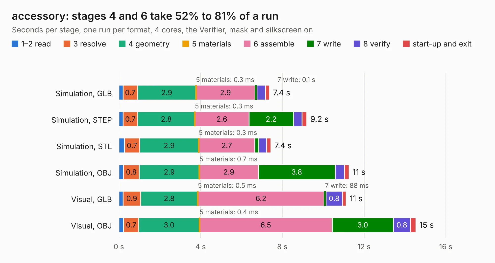

| Mode and format | 1–2 read | 3 resolve | 4 geometry | 5 materials | 6 assemble | 7 write | 8 verify | start-up and exit | Total |
|---|---:|---:|---:|---:|---:|---:|---:|---:|---:|
| Simulation, GLB | 0.2 | 0.7 | 2.9 | 0.3&nbsp;ms | 2.9 | 0.1 | 0.4 | 0.2 | 7.4 |
| Simulation, STEP | 0.2 | 0.7 | 2.8 | 0.3&nbsp;ms | 2.6 | 2.2 | 0.4 | 0.2 | 9.2 |
| Simulation, STL | 0.3 | 0.7 | 2.9 | 0.3&nbsp;ms | 2.7 | 0.2 | 0.4 | 0.2 | 7.4 |
| Simulation, OBJ | 0.2 | 0.8 | 2.9 | 0.7&nbsp;ms | 2.9 | 3.8 | 0.4 | 0.2 | 11.3 |
| Visual, GLB | 0.2 | 0.9 | 2.8 | 0.5&nbsp;ms | 6.2 | 88&nbsp;ms | 0.8 | 0.2 | 11.1 |
| Visual, OBJ | 0.2 | 0.7 | 3.0 | 0.4&nbsp;ms | 6.5 | 3.0 | 0.8 | 0.3 | 14.5 |

<table align="center"><tr><td valign="top">

| Board | Repo: [usbarmory/usbarmory](https://github.com/usbarmory/usbarmory) Board: `accessory.kicad_pcb` |
|---|---|
| Folder | hardware / mark-two-debug-accessory |
| Complexity | 278&nbsp;/&nbsp;1000 (size&nbsp;213, features&nbsp;65) |
| KESE&nbsp;features | through vias, slotted holes, filled zones, copper text, curved board outline |
| Tested | 9th November 2026 |
| Copper&nbsp;layers | 2 |
| File&nbsp;format | KiCad 5 (20171130) |
| Parts,&nbsp;tracks,&nbsp;vias | 37, 609, 80 |
| Triangles,&nbsp;simulation | 714,356 in 80 parts |
| Verifier | PASS in all six runs |

</td><td valign="top">

<table>
<tr><th>File type</th><th>File size</th><th>Peak memory used</th></tr>
<tr><th colspan="3" align="left">Simulation</th></tr>
<tr><td>GLB</td><td align="right">25&nbsp;MB</td><td align="right">388&nbsp;MB</td></tr>
<tr><td>STEP</td><td align="right">122&nbsp;MB</td><td align="right">480&nbsp;MB</td></tr>
<tr><td>STL</td><td align="right">36&nbsp;MB</td><td align="right">397&nbsp;MB</td></tr>
<tr><td>OBJ</td><td align="right">73&nbsp;MB</td><td align="right">517&nbsp;MB</td></tr>
<tr><th colspan="3" align="left">Visual</th></tr>
<tr><td>GLB</td><td align="right">20&nbsp;MB</td><td align="right">493&nbsp;MB</td></tr>
<tr><td>OBJ</td><td align="right">61&nbsp;MB</td><td align="right">496&nbsp;MB</td></tr>
</table>

</td></tr></table>

## 2959. armory

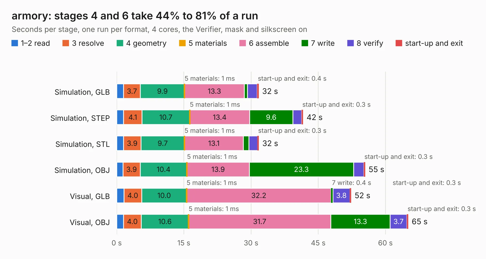

| Mode and format | 1–2 read | 3 resolve | 4 geometry | 5 materials | 6 assemble | 7 write | 8 verify | start-up and exit | Total |
|---|---:|---:|---:|---:|---:|---:|---:|---:|---:|
| Simulation, GLB | 1.5 | 3.7 | 9.9 | 1&nbsp;ms | 13.3 | 0.7 | 2.1 | 0.4 | 31.7 |
| Simulation, STEP | 1.5 | 4.1 | 10.7 | 1&nbsp;ms | 13.4 | 9.6 | 2.0 | 0.3 | 41.6 |
| Simulation, STL | 1.5 | 3.9 | 9.7 | 1&nbsp;ms | 13.1 | 1.2 | 1.9 | 0.3 | 31.7 |
| Simulation, OBJ | 1.4 | 3.9 | 10.4 | 1&nbsp;ms | 13.9 | 23.3 | 2.3 | 0.3 | 55.5 |
| Visual, GLB | 1.6 | 4.0 | 10.0 | 1&nbsp;ms | 32.2 | 0.4 | 3.8 | 0.3 | 52.3 |
| Visual, OBJ | 1.5 | 4.0 | 10.6 | 1&nbsp;ms | 31.7 | 13.3 | 3.7 | 0.3 | 65.1 |

<table align="center"><tr><td valign="top">

| Board | Repo: [usbarmory/usbarmory](https://github.com/usbarmory/usbarmory) Board: `armory.kicad_pcb` |
|---|---|
| Folder | hardware / mark-two-lan |
| Complexity | 445&nbsp;/&nbsp;1000 (size&nbsp;320, features&nbsp;125) |
| KESE&nbsp;features | through vias, slotted holes, rounded, trapezoid or chamfered pads, filled zones, copper text, curved board outline, stack-up, dielectric εr and tanδ, copper finish, mask and silkscreen colours |
| Tested | 9th November 2026 |
| Copper&nbsp;layers | 6 |
| File&nbsp;format | KiCad 7 (20221018) |
| Parts,&nbsp;tracks,&nbsp;vias | 194, 17,001, 371 |
| Triangles,&nbsp;simulation | 3,979,384 in 422 parts |
| Verifier | PASS in all six runs |

</td><td valign="top">

<table>
<tr><th>File type</th><th>File size</th><th>Peak memory used</th></tr>
<tr><th colspan="3" align="left">Simulation</th></tr>
<tr><td>GLB</td><td align="right">136&nbsp;MB</td><td align="right">1.1&nbsp;GB</td></tr>
<tr><td>STEP</td><td align="right">616&nbsp;MB</td><td align="right">1.4&nbsp;GB</td></tr>
<tr><td>STL</td><td align="right">199&nbsp;MB</td><td align="right">1.1&nbsp;GB</td></tr>
<tr><td>OBJ</td><td align="right">426&nbsp;MB</td><td align="right">2.6&nbsp;GB</td></tr>
<tr><th colspan="3" align="left">Visual</th></tr>
<tr><td>GLB</td><td align="right">75&nbsp;MB</td><td align="right">1.4&nbsp;GB</td></tr>
<tr><td>OBJ</td><td align="right">242&nbsp;MB</td><td align="right">1.7&nbsp;GB</td></tr>
</table>

</td></tr></table>

## 2960. armory

| Mode and format | 1–2 read | 3 resolve | 4 geometry | 5 materials | 6 assemble | 7 write | 8 verify | start-up and exit | Total |
|---|---:|---:|---:|---:|---:|---:|---:|---:|---:|
| Simulation, GLB | 1.3 | 4.0 | 13.6 | 0.8&nbsp;ms | 16.6 | 1.0 | 2.4 | 0.3 | 39.2 |
| Simulation, STEP | 1.3 | 4.0 | 13.5 | 1&nbsp;ms | 16.8 | 10.7 | 2.4 | 0.3 | 49.0 |
| Simulation, STL | 1.4 | 4.1 | 13.4 | 1&nbsp;ms | 16.5 | 1.9 | 2.6 | 0.3 | 40.2 |
| Simulation, OBJ | 1.3 | 3.8 | 12.9 | 1.0&nbsp;ms | 16.5 | 22.5 | 2.7 | 0.4 | 60.2 |
| Visual, GLB | 1.4 | 4.0 | 13.0 | 2&nbsp;ms | 34.5 | 0.5 | 5.0 | 0.3 | 58.7 |
| Visual, OBJ | 1.3 | 3.9 | 13.4 | 1&nbsp;ms | 33.8 | 12.2 | 5.2 | 0.3 | 70.0 |

<table align="center"><tr><td valign="top">

| Board | Repo: [usbarmory/usbarmory](https://github.com/usbarmory/usbarmory) Board: `armory.kicad_pcb` |
|---|---|
| Folder | hardware / mark-two |
| Complexity | 400&nbsp;/&nbsp;1000 (size&nbsp;320, features&nbsp;80) |
| KESE&nbsp;features | through vias, slotted holes, custom pads, rounded, trapezoid or chamfered pads, filled zones, curved board outline |
| Tested | 9th November 2026 |
| Copper&nbsp;layers | 6 |
| File&nbsp;format | KiCad 5 (20171130) |
| Parts,&nbsp;tracks,&nbsp;vias | 180, 17,717, 431 |
| Triangles,&nbsp;simulation | 5,187,220 in 436 parts |
| Verifier | PASS in all six runs |

</td><td valign="top">

<table>
<tr><th>File type</th><th>File size</th><th>Peak memory used</th></tr>
<tr><th colspan="3" align="left">Simulation</th></tr>
<tr><td>GLB</td><td align="right">179&nbsp;MB</td><td align="right">1.4&nbsp;GB</td></tr>
<tr><td>STEP</td><td align="right">751&nbsp;MB</td><td align="right">1.7&nbsp;GB</td></tr>
<tr><td>STL</td><td align="right">259&nbsp;MB</td><td align="right">1.7&nbsp;GB</td></tr>
<tr><td>OBJ</td><td align="right">559&nbsp;MB</td><td align="right">3.3&nbsp;GB</td></tr>
<tr><th colspan="3" align="left">Visual</th></tr>
<tr><td>GLB</td><td align="right">94&nbsp;MB</td><td align="right">1.8&nbsp;GB</td></tr>
<tr><td>OBJ</td><td align="right">304&nbsp;MB</td><td align="right">2.0&nbsp;GB</td></tr>
</table>

</td></tr></table>

## 2961. milight-hub-base

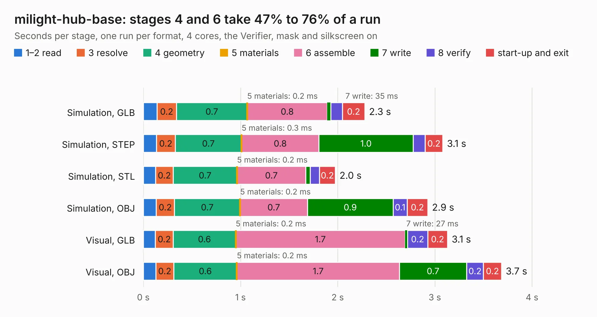

| Mode and format | 1–2 read | 3 resolve | 4 geometry | 5 materials | 6 assemble | 7 write | 8 verify | start-up and exit | Total |
|---|---:|---:|---:|---:|---:|---:|---:|---:|---:|
| Simulation, GLB | 0.1 | 0.2 | 0.7 | 0.2&nbsp;ms | 0.8 | 35&nbsp;ms | 0.1 | 0.2 | 2.3 |
| Simulation, STEP | 0.1 | 0.2 | 0.7 | 0.3&nbsp;ms | 0.8 | 1.0 | 0.1 | 0.2 | 3.1 |
| Simulation, STL | 0.1 | 0.2 | 0.7 | 0.2&nbsp;ms | 0.7 | 47&nbsp;ms | 95&nbsp;ms | 0.2 | 2.0 |
| Simulation, OBJ | 0.1 | 0.2 | 0.7 | 0.2&nbsp;ms | 0.7 | 0.9 | 0.1 | 0.2 | 2.9 |
| Visual, GLB | 0.1 | 0.2 | 0.6 | 0.2&nbsp;ms | 1.7 | 27&nbsp;ms | 0.2 | 0.2 | 3.1 |
| Visual, OBJ | 0.1 | 0.2 | 0.6 | 0.2&nbsp;ms | 1.7 | 0.7 | 0.2 | 0.2 | 3.7 |

<table align="center"><tr><td valign="top">

| Board | Repo: [usimd/milight-hub](https://github.com/usimd/milight-hub) Board: `milight-hub-base.kicad_pcb` |
|---|---|
| Complexity | 248&nbsp;/&nbsp;1000 (size&nbsp;143, features&nbsp;105) |
| KESE&nbsp;features | through vias, rounded, trapezoid or chamfered pads, drill offsets, filled zones, stack-up, dielectric εr and tanδ, copper finish, mask and silkscreen colours |
| Tested | 9th November 2026 |
| Copper&nbsp;layers | 2 |
| File&nbsp;format | KiCad 10 (20260206) |
| Parts,&nbsp;tracks,&nbsp;vias | 23, 110, 55 |
| Triangles,&nbsp;simulation | 233,428 in 36 parts |
| Verifier | PASS in all six runs |

</td><td valign="top">

<table>
<tr><th>File type</th><th>File size</th><th>Peak memory used</th></tr>
<tr><th colspan="3" align="left">Simulation</th></tr>
<tr><td>GLB</td><td align="right">8.1&nbsp;MB</td><td align="right">230&nbsp;MB</td></tr>
<tr><td>STEP</td><td align="right">39&nbsp;MB</td><td align="right">249&nbsp;MB</td></tr>
<tr><td>STL</td><td align="right">12&nbsp;MB</td><td align="right">239&nbsp;MB</td></tr>
<tr><td>OBJ</td><td align="right">24&nbsp;MB</td><td align="right">240&nbsp;MB</td></tr>
<tr><th colspan="3" align="left">Visual</th></tr>
<tr><td>GLB</td><td align="right">6.2&nbsp;MB</td><td align="right">208&nbsp;MB</td></tr>
<tr><td>OBJ</td><td align="right">18&nbsp;MB</td><td align="right">208&nbsp;MB</td></tr>
</table>

</td></tr></table>

## 2962. uCM4

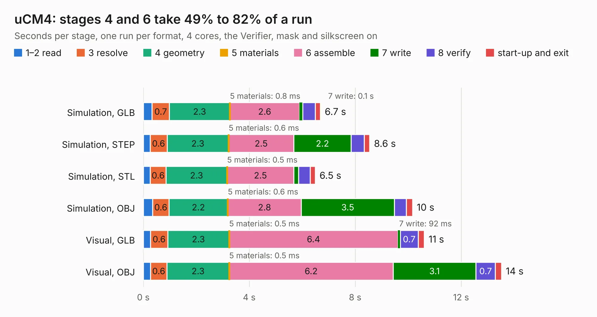

| Mode and format | 1–2 read | 3 resolve | 4 geometry | 5 materials | 6 assemble | 7 write | 8 verify | start-up and exit | Total |
|---|---:|---:|---:|---:|---:|---:|---:|---:|---:|
| Simulation, GLB | 0.3 | 0.7 | 2.3 | 0.8&nbsp;ms | 2.6 | 0.1 | 0.5 | 0.2 | 6.7 |
| Simulation, STEP | 0.3 | 0.6 | 2.3 | 0.6&nbsp;ms | 2.5 | 2.2 | 0.5 | 0.2 | 8.6 |
| Simulation, STL | 0.3 | 0.6 | 2.3 | 0.5&nbsp;ms | 2.5 | 0.2 | 0.4 | 0.2 | 6.5 |
| Simulation, OBJ | 0.4 | 0.6 | 2.2 | 0.6&nbsp;ms | 2.8 | 3.5 | 0.5 | 0.2 | 10.2 |
| Visual, GLB | 0.3 | 0.6 | 2.3 | 0.5&nbsp;ms | 6.4 | 92&nbsp;ms | 0.7 | 0.2 | 10.6 |
| Visual, OBJ | 0.3 | 0.6 | 2.3 | 0.5&nbsp;ms | 6.2 | 3.1 | 0.7 | 0.2 | 13.5 |

<table align="center"><tr><td valign="top">

| Board | Repo: [v3l0c1r4pt0r/ucm4](https://github.com/v3l0c1r4pt0r/ucm4) Board: `uCM4.kicad_pcb` |
|---|---|
| Complexity | 285&nbsp;/&nbsp;1000 (size&nbsp;175, features&nbsp;110) |
| KESE&nbsp;features | through vias, slotted holes, rounded, trapezoid or chamfered pads, drill offsets, filled zones, curved board outline, stack-up, dielectric εr and tanδ, mask and silkscreen colours |
| Tested | 9th November 2026 |
| Copper&nbsp;layers | 2 |
| File&nbsp;format | KiCad 6 (20210228) |
| Parts,&nbsp;tracks,&nbsp;vias | 30, 1,280, 109 |
| Triangles,&nbsp;simulation | 649,970 in 177 parts |
| Verifier | PASS in all six runs |

</td><td valign="top">

<table>
<tr><th>File type</th><th>File size</th><th>Peak memory used</th></tr>
<tr><th colspan="3" align="left">Simulation</th></tr>
<tr><td>GLB</td><td align="right">23&nbsp;MB</td><td align="right">382&nbsp;MB</td></tr>
<tr><td>STEP</td><td align="right">117&nbsp;MB</td><td align="right">417&nbsp;MB</td></tr>
<tr><td>STL</td><td align="right">33&nbsp;MB</td><td align="right">384&nbsp;MB</td></tr>
<tr><td>OBJ</td><td align="right">66&nbsp;MB</td><td align="right">473&nbsp;MB</td></tr>
<tr><th colspan="3" align="left">Visual</th></tr>
<tr><td>GLB</td><td align="right">20&nbsp;MB</td><td align="right">533&nbsp;MB</td></tr>
<tr><td>OBJ</td><td align="right">59&nbsp;MB</td><td align="right">525&nbsp;MB</td></tr>
</table>

</td></tr></table>

## 2963. bus_breakout

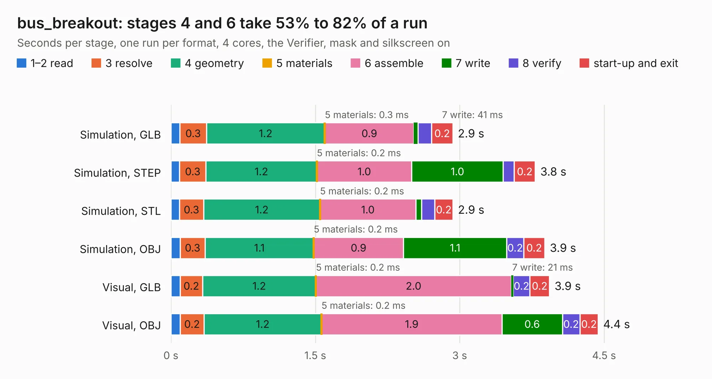

| Mode and format | 1–2 read | 3 resolve | 4 geometry | 5 materials | 6 assemble | 7 write | 8 verify | start-up and exit | Total |
|---|---:|---:|---:|---:|---:|---:|---:|---:|---:|
| Simulation, GLB | 93&nbsp;ms | 0.3 | 1.2 | 0.3&nbsp;ms | 0.9 | 41&nbsp;ms | 0.1 | 0.2 | 2.9 |
| Simulation, STEP | 90&nbsp;ms | 0.3 | 1.2 | 0.2&nbsp;ms | 1.0 | 1.0 | 0.1 | 0.2 | 3.8 |
| Simulation, STL | 89&nbsp;ms | 0.3 | 1.2 | 0.2&nbsp;ms | 1.0 | 59&nbsp;ms | 0.1 | 0.2 | 2.9 |
| Simulation, OBJ | 96&nbsp;ms | 0.3 | 1.1 | 0.2&nbsp;ms | 0.9 | 1.1 | 0.2 | 0.2 | 3.9 |
| Visual, GLB | 97&nbsp;ms | 0.2 | 1.2 | 0.2&nbsp;ms | 2.0 | 21&nbsp;ms | 0.2 | 0.2 | 3.9 |
| Visual, OBJ | 96&nbsp;ms | 0.2 | 1.2 | 0.2&nbsp;ms | 1.9 | 0.6 | 0.2 | 0.2 | 4.4 |

<table align="center"><tr><td valign="top">

| Board | Repo: [vascofazza/8bit-cpu](https://github.com/vascofazza/8bit-cpu) Board: `bus_breakout.kicad_pcb` |
|---|---|
| Folder | bus_breakout |
| Complexity | 124&nbsp;/&nbsp;1000 (size&nbsp;104, features&nbsp;20) |
| KESE&nbsp;features | copper text, curved board outline |
| Tested | 9th November 2026 |
| Copper&nbsp;layers | 2 |
| File&nbsp;format | KiCad 5 (20171130) |
| Parts,&nbsp;tracks,&nbsp;vias | 4, 72, 0 |
| Triangles,&nbsp;simulation | 248,268 in 30 parts |
| Verifier | PASS in all six runs |

</td><td valign="top">

<table>
<tr><th>File type</th><th>File size</th><th>Peak memory used</th></tr>
<tr><th colspan="3" align="left">Simulation</th></tr>
<tr><td>GLB</td><td align="right">8.6&nbsp;MB</td><td align="right">227&nbsp;MB</td></tr>
<tr><td>STEP</td><td align="right">43&nbsp;MB</td><td align="right">235&nbsp;MB</td></tr>
<tr><td>STL</td><td align="right">12&nbsp;MB</td><td align="right">226&nbsp;MB</td></tr>
<tr><td>OBJ</td><td align="right">25&nbsp;MB</td><td align="right">227&nbsp;MB</td></tr>
<tr><th colspan="3" align="left">Visual</th></tr>
<tr><td>GLB</td><td align="right">5.1&nbsp;MB</td><td align="right">203&nbsp;MB</td></tr>
<tr><td>OBJ</td><td align="right">15&nbsp;MB</td><td align="right">202&nbsp;MB</td></tr>
</table>

</td></tr></table>

## 2964. arduino_eeprom_programmer

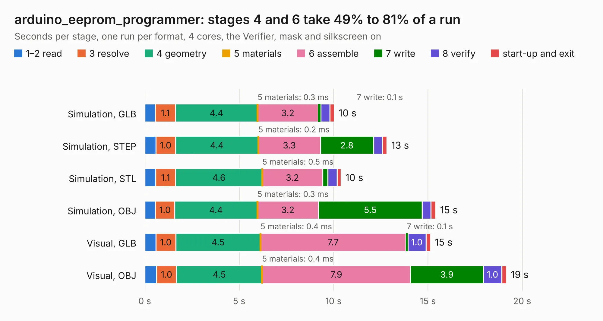

| Mode and format | 1–2 read | 3 resolve | 4 geometry | 5 materials | 6 assemble | 7 write | 8 verify | start-up and exit | Total |
|---|---:|---:|---:|---:|---:|---:|---:|---:|---:|
| Simulation, GLB | 0.6 | 1.1 | 4.4 | 0.3&nbsp;ms | 3.2 | 0.1 | 0.5 | 0.2 | 10.0 |
| Simulation, STEP | 0.6 | 1.0 | 4.4 | 0.2&nbsp;ms | 3.3 | 2.8 | 0.5 | 0.2 | 12.8 |
| Simulation, STL | 0.6 | 1.1 | 4.6 | 0.5&nbsp;ms | 3.2 | 0.3 | 0.5 | 0.2 | 10.4 |
| Simulation, OBJ | 0.6 | 1.0 | 4.4 | 0.3&nbsp;ms | 3.2 | 5.5 | 0.5 | 0.3 | 15.4 |
| Visual, GLB | 0.6 | 1.0 | 4.5 | 0.4&nbsp;ms | 7.7 | 0.1 | 1.0 | 0.2 | 15.1 |
| Visual, OBJ | 0.6 | 1.0 | 4.5 | 0.4&nbsp;ms | 7.9 | 3.9 | 1.0 | 0.3 | 19.2 |

<table align="center"><tr><td valign="top">

| Board | Repo: [vascofazza/8bit-cpu](https://github.com/vascofazza/8bit-cpu) Board: `arduino_eeprom_programmer.kicad_pcb` |
|---|---|
| Folder | eeprom_programmer / arduino_eeprom_programmer |
| Complexity | 191&nbsp;/&nbsp;1000 (size&nbsp;136, features&nbsp;55) |
| KESE&nbsp;features | through vias, filled zones, copper drawings, copper text |
| Tested | 9th November 2026 |
| Copper&nbsp;layers | 2 |
| File&nbsp;format | KiCad 5 (20171130) |
| Parts,&nbsp;tracks,&nbsp;vias | 8, 317, 4 |
| Triangles,&nbsp;simulation | 926,940 in 45 parts |
| Verifier | PASS in all six runs |

</td><td valign="top">

<table>
<tr><th>File type</th><th>File size</th><th>Peak memory used</th></tr>
<tr><th colspan="3" align="left">Simulation</th></tr>
<tr><td>GLB</td><td align="right">32&nbsp;MB</td><td align="right">418&nbsp;MB</td></tr>
<tr><td>STEP</td><td align="right">177&nbsp;MB</td><td align="right">482&nbsp;MB</td></tr>
<tr><td>STL</td><td align="right">46&nbsp;MB</td><td align="right">409&nbsp;MB</td></tr>
<tr><td>OBJ</td><td align="right">95&nbsp;MB</td><td align="right">669&nbsp;MB</td></tr>
<tr><th colspan="3" align="left">Visual</th></tr>
<tr><td>GLB</td><td align="right">22&nbsp;MB</td><td align="right">526&nbsp;MB</td></tr>
<tr><td>OBJ</td><td align="right">64&nbsp;MB</td><td align="right">533&nbsp;MB</td></tr>
</table>

</td></tr></table>

## 2965. display_interface

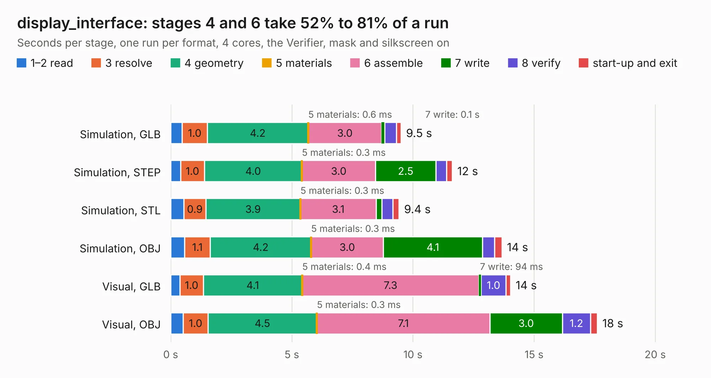

| Mode and format | 1–2 read | 3 resolve | 4 geometry | 5 materials | 6 assemble | 7 write | 8 verify | start-up and exit | Total |
|---|---:|---:|---:|---:|---:|---:|---:|---:|---:|
| Simulation, GLB | 0.5 | 1.0 | 4.2 | 0.6&nbsp;ms | 3.0 | 0.1 | 0.5 | 0.2 | 9.5 |
| Simulation, STEP | 0.4 | 1.0 | 4.0 | 0.3&nbsp;ms | 3.0 | 2.5 | 0.4 | 0.2 | 11.6 |
| Simulation, STL | 0.5 | 0.9 | 3.9 | 0.3&nbsp;ms | 3.1 | 0.2 | 0.5 | 0.3 | 9.4 |
| Simulation, OBJ | 0.6 | 1.1 | 4.2 | 0.3&nbsp;ms | 3.0 | 4.1 | 0.5 | 0.3 | 13.7 |
| Visual, GLB | 0.4 | 1.0 | 4.1 | 0.4&nbsp;ms | 7.3 | 94&nbsp;ms | 1.0 | 0.2 | 14.0 |
| Visual, OBJ | 0.5 | 1.0 | 4.5 | 0.3&nbsp;ms | 7.1 | 3.0 | 1.2 | 0.3 | 17.6 |

<table align="center"><tr><td valign="top">

| Board | Repo: [vascofazza/8bit-cpu](https://github.com/vascofazza/8bit-cpu) Board: `display_interface.kicad_pcb` |
|---|---|
| Folder | helix_display_interface / display_interface |
| Complexity | 227&nbsp;/&nbsp;1000 (size&nbsp;147, features&nbsp;80) |
| KESE&nbsp;features | through vias, custom pads, filled zones, copper drawings, copper text, curved board outline |
| Tested | 9th November 2026 |
| Copper&nbsp;layers | 2 |
| File&nbsp;format | KiCad 5 (20171130) |
| Parts,&nbsp;tracks,&nbsp;vias | 10, 554, 5 |
| Triangles,&nbsp;simulation | 871,560 in 43 parts |
| Verifier | PASS in all six runs |

</td><td valign="top">

<table>
<tr><th>File type</th><th>File size</th><th>Peak memory used</th></tr>
<tr><th colspan="3" align="left">Simulation</th></tr>
<tr><td>GLB</td><td align="right">31&nbsp;MB</td><td align="right">384&nbsp;MB</td></tr>
<tr><td>STEP</td><td align="right">172&nbsp;MB</td><td align="right">461&nbsp;MB</td></tr>
<tr><td>STL</td><td align="right">44&nbsp;MB</td><td align="right">389&nbsp;MB</td></tr>
<tr><td>OBJ</td><td align="right">90&nbsp;MB</td><td align="right">636&nbsp;MB</td></tr>
<tr><th colspan="3" align="left">Visual</th></tr>
<tr><td>GLB</td><td align="right">21&nbsp;MB</td><td align="right">483&nbsp;MB</td></tr>
<tr><td>OBJ</td><td align="right">63&nbsp;MB</td><td align="right">529&nbsp;MB</td></tr>
</table>

</td></tr></table>

## 2966. 8bit-computer

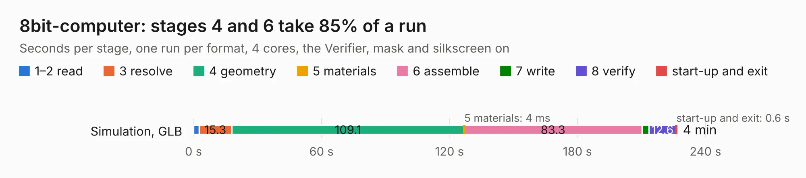

| Mode and format | 1–2 read | 3 resolve | 4 geometry | 5 materials | 6 assemble | 7 write | 8 verify | start-up and exit | Total |
|---|---:|---:|---:|---:|---:|---:|---:|---:|---:|
| Simulation, GLB | 2.6 | 15.3 | 109.1 | 4&nbsp;ms | 83.3 | 3.4 | 12.6 | 0.6 | 226.7 |
| Simulation, STEP | 2.8 | 15.7 | 112.8 | 3&nbsp;ms | 84.7 | 50.1 | 12.8 | 0.6 | 279.4 |
| Simulation, STL | 2.8 | 15.8 | 112.0 | 3&nbsp;ms | 84.4 | 7.6 | 13.0 | 0.6 | 236.3 |
| Simulation, OBJ | 3.0 | 16.3 | 114.0 | 2&nbsp;ms | 84.3 | 110.7 | 12.8 | 0.5 | 341.7 |
| Visual, GLB | 2.8 | 16.0 | 113.4 | 3&nbsp;ms | 192.7 | 1.7 | 17.2 | 0.4 | 344.2 |
| Visual, OBJ | 2.8 | 16.1 | 113.3 | 3&nbsp;ms | 195.3 | 60.9 | 17.3 | 0.5 | 406.1 |

<table align="center"><tr><td valign="top">

| Board | Repo: [vascofazza/8bit-cpu](https://github.com/vascofazza/8bit-cpu) Board: `8bit-computer.kicad_pcb` |
|---|---|
| Folder | MK1_CPU / 8bit-computer |
| Complexity | 387&nbsp;/&nbsp;1000 (size&nbsp;287, features&nbsp;100) |
| KESE&nbsp;features | through vias, slotted holes, custom pads, rounded, trapezoid or chamfered pads, filled zones, copper drawings, copper text, curved board outline |
| Tested | 9th November 2026 |
| Copper&nbsp;layers | 2 |
| File&nbsp;format | KiCad 5 (20171130) |
| Parts,&nbsp;tracks,&nbsp;vias | 328, 11,197, 441 |
| Triangles,&nbsp;simulation | 15,245,230 in 586 parts |
| Verifier | PASS in all six runs |

</td><td valign="top">

<table>
<tr><th>File type</th><th>File size</th><th>Peak memory used</th></tr>
<tr><th colspan="3" align="left">Simulation</th></tr>
<tr><td>GLB</td><td align="right">527&nbsp;MB</td><td align="right">3.5&nbsp;GB</td></tr>
<tr><td>STEP</td><td align="right">2.9&nbsp;GB</td><td align="right">4.9&nbsp;GB</td></tr>
<tr><td>STL</td><td align="right">762&nbsp;MB</td><td align="right">3.3&nbsp;GB</td></tr>
<tr><td>OBJ</td><td align="right">1.7&nbsp;GB</td><td align="right">9.8&nbsp;GB</td></tr>
<tr><th colspan="3" align="left">Visual</th></tr>
<tr><td>GLB</td><td align="right">328&nbsp;MB</td><td align="right">5.1&nbsp;GB</td></tr>
<tr><td>OBJ</td><td align="right">1.0&nbsp;GB</td><td align="right">6.5&nbsp;GB</td></tr>
</table>

</td></tr></table>

## 2967. programming_interface

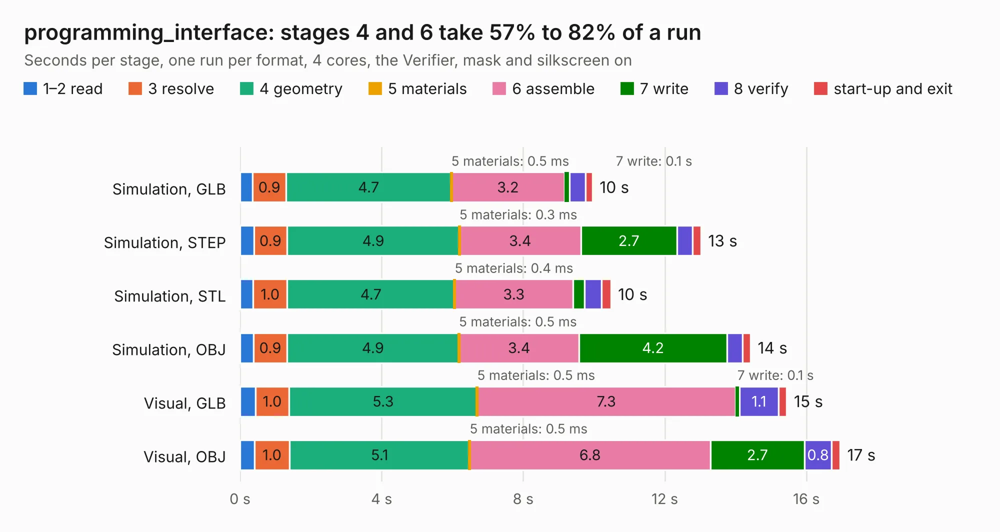

| Mode and format | 1–2 read | 3 resolve | 4 geometry | 5 materials | 6 assemble | 7 write | 8 verify | start-up and exit | Total |
|---|---:|---:|---:|---:|---:|---:|---:|---:|---:|
| Simulation, GLB | 0.4 | 0.9 | 4.7 | 0.5&nbsp;ms | 3.2 | 0.1 | 0.5 | 0.2 | 10.0 |
| Simulation, STEP | 0.4 | 0.9 | 4.9 | 0.3&nbsp;ms | 3.4 | 2.7 | 0.4 | 0.2 | 13.0 |
| Simulation, STL | 0.4 | 1.0 | 4.7 | 0.4&nbsp;ms | 3.3 | 0.3 | 0.5 | 0.3 | 10.5 |
| Simulation, OBJ | 0.4 | 0.9 | 4.9 | 0.5&nbsp;ms | 3.4 | 4.2 | 0.4 | 0.2 | 14.4 |
| Visual, GLB | 0.4 | 1.0 | 5.3 | 0.5&nbsp;ms | 7.3 | 0.1 | 1.1 | 0.2 | 15.4 |
| Visual, OBJ | 0.4 | 1.0 | 5.1 | 0.5&nbsp;ms | 6.8 | 2.7 | 0.8 | 0.2 | 16.9 |

<table align="center"><tr><td valign="top">

| Board | Repo: [vascofazza/8bit-cpu](https://github.com/vascofazza/8bit-cpu) Board: `programming_interface.kicad_pcb` |
|---|---|
| Folder | start9_programming_interface / programming_interface |
| Complexity | 247&nbsp;/&nbsp;1000 (size&nbsp;192, features&nbsp;55) |
| KESE&nbsp;features | through vias, filled zones, copper text, curved board outline |
| Tested | 9th November 2026 |
| Copper&nbsp;layers | 2 |
| File&nbsp;format | KiCad 5 (20171130) |
| Parts,&nbsp;tracks,&nbsp;vias | 13, 631, 11 |
| Triangles,&nbsp;simulation | 1,047,248 in 48 parts |
| Verifier | PASS in all six runs |

</td><td valign="top">

<table>
<tr><th>File type</th><th>File size</th><th>Peak memory used</th></tr>
<tr><th colspan="3" align="left">Simulation</th></tr>
<tr><td>GLB</td><td align="right">36&nbsp;MB</td><td align="right">431&nbsp;MB</td></tr>
<tr><td>STEP</td><td align="right">199&nbsp;MB</td><td align="right">520&nbsp;MB</td></tr>
<tr><td>STL</td><td align="right">52&nbsp;MB</td><td align="right">452&nbsp;MB</td></tr>
<tr><td>OBJ</td><td align="right">108&nbsp;MB</td><td align="right">749&nbsp;MB</td></tr>
<tr><th colspan="3" align="left">Visual</th></tr>
<tr><td>GLB</td><td align="right">23&nbsp;MB</td><td align="right">578&nbsp;MB</td></tr>
<tr><td>OBJ</td><td align="right">69&nbsp;MB</td><td align="right">578&nbsp;MB</td></tr>
</table>

</td></tr></table>

## 2968. omower

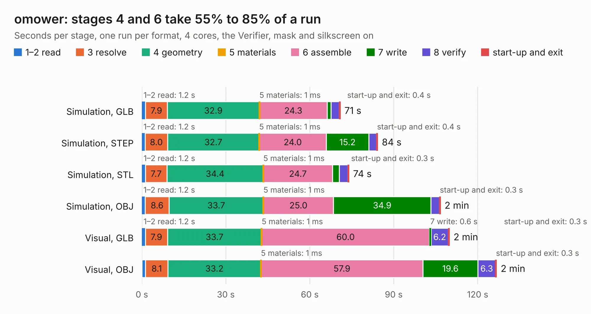

| Mode and format | 1–2 read | 3 resolve | 4 geometry | 5 materials | 6 assemble | 7 write | 8 verify | start-up and exit | Total |
|---|---:|---:|---:|---:|---:|---:|---:|---:|---:|
| Simulation, GLB | 1.2 | 7.9 | 32.9 | 1&nbsp;ms | 24.3 | 1.3 | 2.9 | 0.4 | 70.9 |
| Simulation, STEP | 1.2 | 8.0 | 32.7 | 1&nbsp;ms | 24.0 | 15.2 | 2.8 | 0.4 | 84.3 |
| Simulation, STL | 1.2 | 7.7 | 34.4 | 1&nbsp;ms | 24.7 | 2.4 | 3.1 | 0.3 | 74.0 |
| Simulation, OBJ | 1.2 | 8.6 | 33.7 | 1&nbsp;ms | 25.0 | 34.9 | 3.0 | 0.3 | 106.7 |
| Visual, GLB | 1.2 | 7.9 | 33.7 | 1&nbsp;ms | 60.0 | 0.6 | 6.2 | 0.3 | 109.9 |
| Visual, OBJ | 1.3 | 8.1 | 33.2 | 1&nbsp;ms | 57.9 | 19.6 | 6.3 | 0.3 | 126.7 |

<table align="center"><tr><td valign="top">

| Board | Repo: [vasimv/omower](https://github.com/vasimv/omower) Board: `omower.kicad_pcb` |
|---|---|
| Folder | hardware / OMower |
| Complexity | 337&nbsp;/&nbsp;1000 (size&nbsp;282, features&nbsp;55) |
| KESE&nbsp;features | through vias, slotted holes, rounded, trapezoid or chamfered pads, filled zones |
| Tested | 9th November 2026 |
| Copper&nbsp;layers | 4 |
| File&nbsp;format | KiCad 4 (4) |
| Parts,&nbsp;tracks,&nbsp;vias | 402, 4,619, 537 |
| Triangles,&nbsp;simulation | 5,924,968 in 351 parts |
| Verifier | PASS in all six runs |

</td><td valign="top">

<table>
<tr><th>File type</th><th>File size</th><th>Peak memory used</th></tr>
<tr><th colspan="3" align="left">Simulation</th></tr>
<tr><td>GLB</td><td align="right">207&nbsp;MB</td><td align="right">1.4&nbsp;GB</td></tr>
<tr><td>STEP</td><td align="right">824&nbsp;MB</td><td align="right">1.9&nbsp;GB</td></tr>
<tr><td>STL</td><td align="right">296&nbsp;MB</td><td align="right">1.5&nbsp;GB</td></tr>
<tr><td>OBJ</td><td align="right">642&nbsp;MB</td><td align="right">3.9&nbsp;GB</td></tr>
<tr><th colspan="3" align="left">Visual</th></tr>
<tr><td>GLB</td><td align="right">114&nbsp;MB</td><td align="right">1.8&nbsp;GB</td></tr>
<tr><td>OBJ</td><td align="right">362&nbsp;MB</td><td align="right">2.5&nbsp;GB</td></tr>
</table>

</td></tr></table>

## 2969. BLDC_4

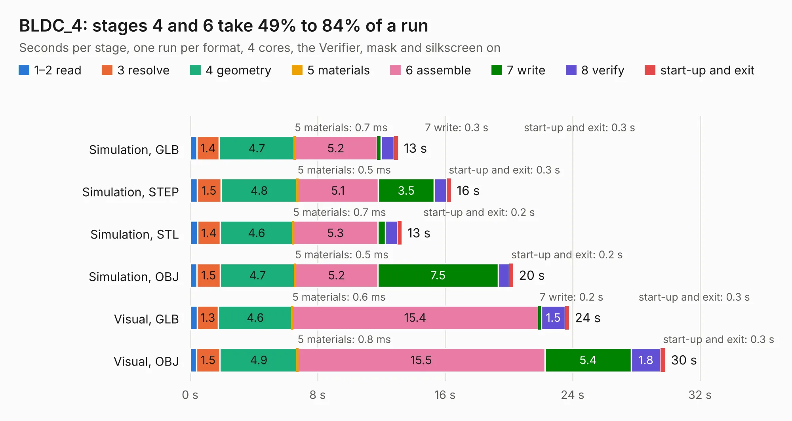

| Mode and format | 1–2 read | 3 resolve | 4 geometry | 5 materials | 6 assemble | 7 write | 8 verify | start-up and exit | Total |
|---|---:|---:|---:|---:|---:|---:|---:|---:|---:|
| Simulation, GLB | 0.4 | 1.4 | 4.7 | 0.7&nbsp;ms | 5.2 | 0.3 | 0.8 | 0.3 | 13.1 |
| Simulation, STEP | 0.4 | 1.5 | 4.8 | 0.5&nbsp;ms | 5.1 | 3.5 | 0.8 | 0.3 | 16.4 |
| Simulation, STL | 0.5 | 1.4 | 4.6 | 0.7&nbsp;ms | 5.3 | 0.5 | 0.8 | 0.2 | 13.3 |
| Simulation, OBJ | 0.4 | 1.5 | 4.7 | 0.5&nbsp;ms | 5.2 | 7.5 | 0.7 | 0.2 | 20.3 |
| Visual, GLB | 0.4 | 1.3 | 4.6 | 0.6&nbsp;ms | 15.4 | 0.2 | 1.5 | 0.3 | 23.8 |
| Visual, OBJ | 0.4 | 1.5 | 4.9 | 0.8&nbsp;ms | 15.5 | 5.4 | 1.8 | 0.3 | 29.8 |

<table align="center"><tr><td valign="top">

| Board | Repo: [vedderb/bldc-hardware](https://github.com/vedderb/bldc-hardware) Board: `BLDC_4.kicad_pcb` |
|---|---|
| Folder | design |
| Complexity | 303&nbsp;/&nbsp;1000 (size&nbsp;258, features&nbsp;45) |
| KESE&nbsp;features | through vias, filled zones, curved board outline |
| Tested | 9th November 2026 |
| Copper&nbsp;layers | 4 |
| File&nbsp;format | KiCad 4 (4) |
| Parts,&nbsp;tracks,&nbsp;vias | 117, 1,671, 187 |
| Triangles,&nbsp;simulation | 1,473,188 in 129 parts |
| Verifier | PASS in all six runs |

</td><td valign="top">

<table>
<tr><th>File type</th><th>File size</th><th>Peak memory used</th></tr>
<tr><th colspan="3" align="left">Simulation</th></tr>
<tr><td>GLB</td><td align="right">51&nbsp;MB</td><td align="right">623&nbsp;MB</td></tr>
<tr><td>STEP</td><td align="right">222&nbsp;MB</td><td align="right">636&nbsp;MB</td></tr>
<tr><td>STL</td><td align="right">74&nbsp;MB</td><td align="right">620&nbsp;MB</td></tr>
<tr><td>OBJ</td><td align="right">153&nbsp;MB</td><td align="right">1.0&nbsp;GB</td></tr>
<tr><th colspan="3" align="left">Visual</th></tr>
<tr><td>GLB</td><td align="right">36&nbsp;MB</td><td align="right">702&nbsp;MB</td></tr>
<tr><td>OBJ</td><td align="right">108&nbsp;MB</td><td align="right">786&nbsp;MB</td></tr>
</table>

</td></tr></table>

## 2970. VB-IoT1_v1

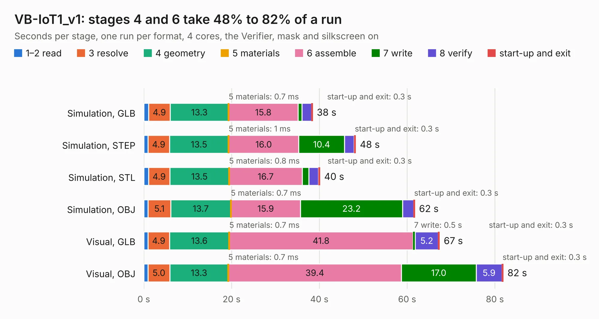

| Mode and format | 1–2 read | 3 resolve | 4 geometry | 5 materials | 6 assemble | 7 write | 8 verify | start-up and exit | Total |
|---|---:|---:|---:|---:|---:|---:|---:|---:|---:|
| Simulation, GLB | 1.1 | 4.9 | 13.3 | 0.7&nbsp;ms | 15.8 | 0.9 | 2.1 | 0.3 | 38.4 |
| Simulation, STEP | 1.0 | 4.9 | 13.5 | 1&nbsp;ms | 16.0 | 10.4 | 2.2 | 0.3 | 48.3 |
| Simulation, STL | 1.1 | 4.9 | 13.5 | 0.8&nbsp;ms | 16.7 | 1.5 | 2.2 | 0.3 | 40.1 |
| Simulation, OBJ | 1.0 | 5.1 | 13.7 | 0.7&nbsp;ms | 15.9 | 23.2 | 2.5 | 0.3 | 61.7 |
| Visual, GLB | 1.0 | 4.9 | 13.6 | 0.7&nbsp;ms | 41.8 | 0.5 | 5.2 | 0.3 | 67.4 |
| Visual, OBJ | 1.0 | 5.0 | 13.3 | 0.7&nbsp;ms | 39.4 | 17.0 | 5.9 | 0.3 | 81.9 |

<table align="center"><tr><td valign="top">

| Board | Repo: [venseytech/VB-IoT1](https://github.com/venseytech/VB-IoT1) Board: `VB-IoT1_v1.kicad_pcb` |
|---|---|
| Folder | VB-IoT1_v1 |
| Complexity | 336&nbsp;/&nbsp;1000 (size&nbsp;281, features&nbsp;55) |
| KESE&nbsp;features | through vias, slotted holes, rounded, trapezoid or chamfered pads, filled zones |
| Tested | 9th November 2026 |
| Copper&nbsp;layers | 4 |
| File&nbsp;format | KiCad 4 (4) |
| Parts,&nbsp;tracks,&nbsp;vias | 175, 5,166, 533 |
| Triangles,&nbsp;simulation | 4,269,758 in 267 parts |
| Verifier | PASS in all six runs |

</td><td valign="top">

<table>
<tr><th>File type</th><th>File size</th><th>Peak memory used</th></tr>
<tr><th colspan="3" align="left">Simulation</th></tr>
<tr><td>GLB</td><td align="right">148&nbsp;MB</td><td align="right">1.3&nbsp;GB</td></tr>
<tr><td>STEP</td><td align="right">710&nbsp;MB</td><td align="right">1.7&nbsp;GB</td></tr>
<tr><td>STL</td><td align="right">214&nbsp;MB</td><td align="right">1.3&nbsp;GB</td></tr>
<tr><td>OBJ</td><td align="right">457&nbsp;MB</td><td align="right">2.7&nbsp;GB</td></tr>
<tr><th colspan="3" align="left">Visual</th></tr>
<tr><td>GLB</td><td align="right">111&nbsp;MB</td><td align="right">1.8&nbsp;GB</td></tr>
<tr><td>OBJ</td><td align="right">350&nbsp;MB</td><td align="right">2.3&nbsp;GB</td></tr>
</table>

</td></tr></table>

## 2971. MicroZed_carrier_board_v4

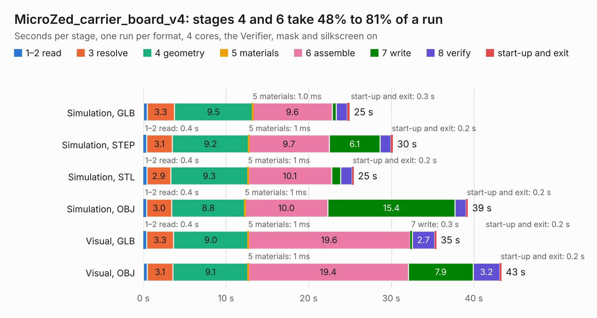

| Mode and format | 1–2 read | 3 resolve | 4 geometry | 5 materials | 6 assemble | 7 write | 8 verify | start-up and exit | Total |
|---|---:|---:|---:|---:|---:|---:|---:|---:|---:|
| Simulation, GLB | 0.5 | 3.3 | 9.5 | 1.0&nbsp;ms | 9.6 | 0.5 | 1.4 | 0.3 | 25.0 |
| Simulation, STEP | 0.4 | 3.1 | 9.2 | 1&nbsp;ms | 9.7 | 6.1 | 1.3 | 0.2 | 30.2 |
| Simulation, STL | 0.4 | 2.9 | 9.3 | 1&nbsp;ms | 10.1 | 1.1 | 1.4 | 0.2 | 25.5 |
| Simulation, OBJ | 0.4 | 3.0 | 8.8 | 1&nbsp;ms | 10.0 | 15.4 | 1.3 | 0.2 | 39.3 |
| Visual, GLB | 0.4 | 3.3 | 9.0 | 1&nbsp;ms | 19.6 | 0.3 | 2.7 | 0.2 | 35.5 |
| Visual, OBJ | 0.5 | 3.1 | 9.1 | 1&nbsp;ms | 19.4 | 7.9 | 3.2 | 0.2 | 43.3 |

<table align="center"><tr><td valign="top">

| Board | Repo: [viktor-nikolov/microzed-carrier-board](https://github.com/viktor-nikolov/microzed-carrier-board) Board: `MicroZed_carrier_board_v4.kicad_pcb` |
|---|---|
| Folder | KiCad_and_production_files |
| Complexity | 312&nbsp;/&nbsp;1000 (size&nbsp;222, features&nbsp;90) |
| KESE&nbsp;features | through vias, slotted holes, rounded, trapezoid or chamfered pads, arc tracks, curved board outline, stack-up, dielectric εr and tanδ |
| Tested | 9th November 2026 |
| Copper&nbsp;layers | 6 |
| File&nbsp;format | KiCad 7 (20221018) |
| Parts,&nbsp;tracks,&nbsp;vias | 91, 1,904, 296 |
| Triangles,&nbsp;simulation | 3,634,492 in 225 parts |
| Verifier | PASS in all six runs |

</td><td valign="top">

<table>
<tr><th>File type</th><th>File size</th><th>Peak memory used</th></tr>
<tr><th colspan="3" align="left">Simulation</th></tr>
<tr><td>GLB</td><td align="right">120&nbsp;MB</td><td align="right">995&nbsp;MB</td></tr>
<tr><td>STEP</td><td align="right">370&nbsp;MB</td><td align="right">1.3&nbsp;GB</td></tr>
<tr><td>STL</td><td align="right">182&nbsp;MB</td><td align="right">1.0&nbsp;GB</td></tr>
<tr><td>OBJ</td><td align="right">379&nbsp;MB</td><td align="right">2.3&nbsp;GB</td></tr>
<tr><th colspan="3" align="left">Visual</th></tr>
<tr><td>GLB</td><td align="right">63&nbsp;MB</td><td align="right">1.3&nbsp;GB</td></tr>
<tr><td>OBJ</td><td align="right">197&nbsp;MB</td><td align="right">1.4&nbsp;GB</td></tr>
</table>

</td></tr></table>

## 2972. vimdrones_esc_development_board

| Mode and format | 1–2 read | 3 resolve | 4 geometry | 5 materials | 6 assemble | 7 write | 8 verify | start-up and exit | Total |
|---|---:|---:|---:|---:|---:|---:|---:|---:|---:|
| Simulation, GLB | 0.5 | 1.6 | 5.4 | 0.6&nbsp;ms | 5.5 | 0.3 | 0.7 | 0.3 | 14.3 |
| Simulation, STEP | 0.8 | 1.6 | 5.7 | 0.5&nbsp;ms | 5.7 | 3.8 | 0.6 | 0.2 | 18.4 |
| Simulation, STL | 0.4 | 1.4 | 5.0 | 0.4&nbsp;ms | 5.6 | 0.6 | 0.7 | 0.3 | 13.9 |
| Simulation, OBJ | 0.4 | 1.5 | 5.2 | 0.4&nbsp;ms | 5.3 | 7.7 | 0.6 | 0.2 | 20.9 |
| Visual, GLB | 0.4 | 1.5 | 5.4 | 0.4&nbsp;ms | 11.3 | 0.1 | 1.2 | 0.2 | 20.1 |
| Visual, OBJ | 0.5 | 1.5 | 5.5 | 0.4&nbsp;ms | 10.1 | 4.7 | 1.6 | 0.3 | 24.1 |

<table align="center"><tr><td valign="top">

| Board | Repo: [VimDrones/AM32_esc_development_board](https://github.com/VimDrones/AM32_esc_development_board) Board: `vimdrones_esc_development_board.kicad_pcb` |
|---|---|
| Complexity | 366&nbsp;/&nbsp;1000 (size&nbsp;241, features&nbsp;125) |
| KESE&nbsp;features | through vias, custom pads, rounded, trapezoid or chamfered pads, filled zones, copper drawings, curved board outline, knockout text, stack-up, dielectric εr and tanδ |
| Tested | 9th November 2026 |
| Copper&nbsp;layers | 4 |
| File&nbsp;format | KiCad 8 (20240108) |
| Parts,&nbsp;tracks,&nbsp;vias | 82, 650, 292 |
| Triangles,&nbsp;simulation | 1,569,380 in 81 parts |
| Verifier | PASS in all six runs |

</td><td valign="top">

<table>
<tr><th>File type</th><th>File size</th><th>Peak memory used</th></tr>
<tr><th colspan="3" align="left">Simulation</th></tr>
<tr><td>GLB</td><td align="right">53&nbsp;MB</td><td align="right">564&nbsp;MB</td></tr>
<tr><td>STEP</td><td align="right">211&nbsp;MB</td><td align="right">712&nbsp;MB</td></tr>
<tr><td>STL</td><td align="right">78&nbsp;MB</td><td align="right">564&nbsp;MB</td></tr>
<tr><td>OBJ</td><td align="right">161&nbsp;MB</td><td align="right">1.0&nbsp;GB</td></tr>
<tr><th colspan="3" align="left">Visual</th></tr>
<tr><td>GLB</td><td align="right">32&nbsp;MB</td><td align="right">682&nbsp;MB</td></tr>
<tr><td>OBJ</td><td align="right">96&nbsp;MB</td><td align="right">740&nbsp;MB</td></tr>
</table>

</td></tr></table>

## 2973. Tangenta

| Mode and format | 1–2 read | 3 resolve | 4 geometry | 5 materials | 6 assemble | 7 write | 8 verify | start-up and exit | Total |
|---|---:|---:|---:|---:|---:|---:|---:|---:|---:|
| Simulation, GLB | 2.2 | 8.9 | 35.3 | 5&nbsp;ms | 63.1 | 1.8 | 4.9 | 0.3 | 116.6 |
| Simulation, STEP | 2.1 | 8.7 | 35.1 | 3&nbsp;ms | 62.5 | 26.2 | 4.9 | 0.4 | 139.7 |
| Simulation, STL | 2.2 | 8.7 | 33.4 | 3&nbsp;ms | 63.8 | 3.7 | 5.3 | 0.4 | 117.6 |
| Simulation, OBJ | 2.2 | 8.9 | 34.8 | 3&nbsp;ms | 62.4 | 62.7 | 5.3 | 0.4 | 176.8 |
| Visual, GLB | 2.3 | 8.9 | 35.0 | 3&nbsp;ms | 89.0 | 1.1 | 10.2 | 0.3 | 146.9 |
| Visual, OBJ | 2.2 | 9.1 | 35.3 | 3&nbsp;ms | 93.0 | 36.1 | 12.0 | 0.3 | 188.0 |

<table align="center"><tr><td valign="top">

| Board | Repo: [vmetodiev/tangenta](https://github.com/vmetodiev/tangenta) Board: `Tangenta.kicad_pcb` |
|---|---|
| Folder | Tangenta |
| Complexity | 395&nbsp;/&nbsp;1000 (size&nbsp;295, features&nbsp;100) |
| KESE&nbsp;features | through vias, slotted holes, rounded, trapezoid or chamfered pads, arc tracks, filled zones, stack-up, dielectric εr and tanδ |
| Tested | 9th November 2026 |
| Copper&nbsp;layers | 4 |
| File&nbsp;format | KiCad 9 (20241229) |
| Parts,&nbsp;tracks,&nbsp;vias | 559, 7,736, 1,128 |
| Triangles,&nbsp;simulation | 10,448,246 in 1043 parts |
| Verifier | PASS in all six runs |

</td><td valign="top">

<table>
<tr><th>File type</th><th>File size</th><th>Peak memory used</th></tr>
<tr><th colspan="3" align="left">Simulation</th></tr>
<tr><td>GLB</td><td align="right">345&nbsp;MB</td><td align="right">2.8&nbsp;GB</td></tr>
<tr><td>STEP</td><td align="right">1.3&nbsp;GB</td><td align="right">3.6&nbsp;GB</td></tr>
<tr><td>STL</td><td align="right">522&nbsp;MB</td><td align="right">2.8&nbsp;GB</td></tr>
<tr><td>OBJ</td><td align="right">1.1&nbsp;GB</td><td align="right">6.5&nbsp;GB</td></tr>
<tr><th colspan="3" align="left">Visual</th></tr>
<tr><td>GLB</td><td align="right">219&nbsp;MB</td><td align="right">3.5&nbsp;GB</td></tr>
<tr><td>OBJ</td><td align="right">719&nbsp;MB</td><td align="right">4.3&nbsp;GB</td></tr>
</table>

</td></tr></table>

## 2974. CM4_MATX

| Mode and format | 1–2 read | 3 resolve | 4 geometry | 5 materials | 6 assemble | 7 write | 8 verify | start-up and exit | Total |
|---|---:|---:|---:|---:|---:|---:|---:|---:|---:|
| Simulation, GLB | 0.4 | 2.2 | 12.2 | 1&nbsp;ms | 11.0 | 0.4 | 1.1 | 0.3 | 27.7 |
| Simulation, STEP | 0.3 | 2.2 | 12.1 | 2&nbsp;ms | 11.4 | 7.4 | 1.2 | 0.3 | 34.9 |
| Simulation, STL | 0.4 | 2.2 | 11.9 | 2&nbsp;ms | 11.7 | 0.9 | 1.1 | 0.3 | 28.4 |
| Simulation, OBJ | 0.3 | 2.2 | 11.6 | 2&nbsp;ms | 11.2 | 13.9 | 1.1 | 0.3 | 40.7 |
| Visual, GLB | 0.3 | 2.1 | 11.8 | 2&nbsp;ms | 19.7 | 0.2 | 1.8 | 0.2 | 36.1 |
| Visual, OBJ | 0.4 | 2.3 | 12.0 | 2&nbsp;ms | 20.1 | 7.6 | 2.1 | 0.2 | 44.8 |

<table align="center"><tr><td valign="top">

| Board | Repo: [volkertb/CM4_MATX](https://github.com/volkertb/CM4_MATX) Board: `CM4_MATX.kicad_pcb` |
|---|---|
| Folder | KiCad |
| Complexity | 111&nbsp;/&nbsp;1000 (size&nbsp;101, features&nbsp;10) |
| KESE&nbsp;features | curved board outline |
| Tested | 9th November 2026 |
| Copper&nbsp;layers | 2 |
| File&nbsp;format | KiCad 5 (20171130) |
| Parts,&nbsp;tracks,&nbsp;vias | 31, 0, 0 |
| Triangles,&nbsp;simulation | 2,451,152 in 596 parts |
| Verifier | PASS in all six runs |

</td><td valign="top">

<table>
<tr><th>File type</th><th>File size</th><th>Peak memory used</th></tr>
<tr><th colspan="3" align="left">Simulation</th></tr>
<tr><td>GLB</td><td align="right">80&nbsp;MB</td><td align="right">747&nbsp;MB</td></tr>
<tr><td>STEP</td><td align="right">273&nbsp;MB</td><td align="right">987&nbsp;MB</td></tr>
<tr><td>STL</td><td align="right">123&nbsp;MB</td><td align="right">741&nbsp;MB</td></tr>
<tr><td>OBJ</td><td align="right">259&nbsp;MB</td><td align="right">1.6&nbsp;GB</td></tr>
<tr><th colspan="3" align="left">Visual</th></tr>
<tr><td>GLB</td><td align="right">46&nbsp;MB</td><td align="right">996&nbsp;MB</td></tr>
<tr><td>OBJ</td><td align="right">142&nbsp;MB</td><td align="right">1.1&nbsp;GB</td></tr>
</table>

</td></tr></table>

## 2975. altair-8800b-cpu-card

| Mode and format | 1–2 read | 3 resolve | 4 geometry | 5 materials | 6 assemble | 7 write | 8 verify | start-up and exit | Total |
|---|---:|---:|---:|---:|---:|---:|---:|---:|---:|
| Simulation, GLB | 0.6 | 3.2 | 14.4 | 2&nbsp;ms | 12.5 | 0.7 | 1.7 | 0.3 | 33.4 |
| Simulation, STEP | 0.6 | 2.9 | 14.4 | 1&nbsp;ms | 12.2 | 8.7 | 1.7 | 0.3 | 40.7 |
| Simulation, STL | 0.6 | 2.9 | 13.6 | 1&nbsp;ms | 12.5 | 1.1 | 1.6 | 0.3 | 32.6 |
| Simulation, OBJ | 0.6 | 2.9 | 14.3 | 1&nbsp;ms | 12.5 | 20.2 | 1.8 | 0.3 | 52.5 |
| Visual, GLB | 0.6 | 3.0 | 14.4 | 1&nbsp;ms | 24.5 | 0.3 | 2.8 | 0.2 | 45.8 |
| Visual, OBJ | 0.6 | 2.9 | 14.1 | 1&nbsp;ms | 24.4 | 11.9 | 3.3 | 0.2 | 57.4 |

<table align="center"><tr><td valign="top">

| Board | Repo: [warmech/altair-8800b-cpu-card](https://github.com/warmech/altair-8800b-cpu-card) Board: `altair-8800b-cpu-card.kicad_pcb` |
|---|---|
| Folder | cad |
| Complexity | 261&nbsp;/&nbsp;1000 (size&nbsp;201, features&nbsp;60) |
| KESE&nbsp;features | through vias, filled zones, curved board outline, TrueType text |
| Tested | 9th November 2026 |
| Copper&nbsp;layers | 2 |
| File&nbsp;format | KiCad 7 (20221018) |
| Parts,&nbsp;tracks,&nbsp;vias | 136, 2,087, 314 |
| Triangles,&nbsp;simulation | 3,660,442 in 245 parts |
| Verifier | PASS in all six runs |

</td><td valign="top">

<table>
<tr><th>File type</th><th>File size</th><th>Peak memory used</th></tr>
<tr><th colspan="3" align="left">Simulation</th></tr>
<tr><td>GLB</td><td align="right">123&nbsp;MB</td><td align="right">1.2&nbsp;GB</td></tr>
<tr><td>STEP</td><td align="right">486&nbsp;MB</td><td align="right">1.5&nbsp;GB</td></tr>
<tr><td>STL</td><td align="right">183&nbsp;MB</td><td align="right">1.2&nbsp;GB</td></tr>
<tr><td>OBJ</td><td align="right">382&nbsp;MB</td><td align="right">3.0&nbsp;GB</td></tr>
<tr><th colspan="3" align="left">Visual</th></tr>
<tr><td>GLB</td><td align="right">75&nbsp;MB</td><td align="right">1.4&nbsp;GB</td></tr>
<tr><td>OBJ</td><td align="right">236&nbsp;MB</td><td align="right">2.0&nbsp;GB</td></tr>
</table>

</td></tr></table>

## 2976. altair-8800b-display-control-pcb

| Mode and format | 1–2 read | 3 resolve | 4 geometry | 5 materials | 6 assemble | 7 write | 8 verify | start-up and exit | Total |
|---|---:|---:|---:|---:|---:|---:|---:|---:|---:|
| Simulation, GLB | 0.7 | 5.4 | 26.3 | 2&nbsp;ms | 23.1 | 0.9 | 4.1 | 0.3 | 60.8 |
| Simulation, STEP | 0.7 | 5.5 | 27.4 | 2&nbsp;ms | 23.2 | 15.3 | 4.2 | 0.3 | 76.6 |
| Simulation, STL | 0.8 | 5.3 | 26.5 | 2&nbsp;ms | 23.2 | 2.1 | 4.7 | 0.4 | 62.9 |
| Simulation, OBJ | 0.8 | 5.6 | 26.7 | 2&nbsp;ms | 23.7 | 31.5 | 3.9 | 0.4 | 92.5 |
| Visual, GLB | 0.8 | 5.2 | 27.1 | 3&nbsp;ms | 51.7 | 0.5 | 7.0 | 0.3 | 92.5 |
| Visual, OBJ | 0.8 | 5.1 | 26.6 | 2&nbsp;ms | 49.0 | 17.2 | 7.5 | 0.3 | 106.7 |

<table align="center"><tr><td valign="top">

| Board | Repo: [warmech/altair-8800b-display-control-pcb](https://github.com/warmech/altair-8800b-display-control-pcb) Board: `altair-8800b-display-control-pcb.kicad_pcb` |
|---|---|
| Folder | cad |
| Complexity | 250&nbsp;/&nbsp;1000 (size&nbsp;215, features&nbsp;35) |
| KESE&nbsp;features | through vias, slotted holes, curved board outline |
| Tested | 9th November 2026 |
| Copper&nbsp;layers | 2 |
| File&nbsp;format | KiCad 7 (20221018) |
| Parts,&nbsp;tracks,&nbsp;vias | 231, 3,782, 372 |
| Triangles,&nbsp;simulation | 5,441,458 in 443 parts |
| Verifier | PASS in all six runs |

</td><td valign="top">

<table>
<tr><th>File type</th><th>File size</th><th>Peak memory used</th></tr>
<tr><th colspan="3" align="left">Simulation</th></tr>
<tr><td>GLB</td><td align="right">182&nbsp;MB</td><td align="right">1.5&nbsp;GB</td></tr>
<tr><td>STEP</td><td align="right">841&nbsp;MB</td><td align="right">2.1&nbsp;GB</td></tr>
<tr><td>STL</td><td align="right">272&nbsp;MB</td><td align="right">1.5&nbsp;GB</td></tr>
<tr><td>OBJ</td><td align="right">572&nbsp;MB</td><td align="right">4.5&nbsp;GB</td></tr>
<tr><th colspan="3" align="left">Visual</th></tr>
<tr><td>GLB</td><td align="right">112&nbsp;MB</td><td align="right">1.9&nbsp;GB</td></tr>
<tr><td>OBJ</td><td align="right">358&nbsp;MB</td><td align="right">2.2&nbsp;GB</td></tr>
</table>

</td></tr></table>

## 2977. lisa-2mb-ram-card

| Mode and format | 1–2 read | 3 resolve | 4 geometry | 5 materials | 6 assemble | 7 write | 8 verify | start-up and exit | Total |
|---|---:|---:|---:|---:|---:|---:|---:|---:|---:|
| Simulation, GLB | 0.9 | 5.9 | 19.6 | 1.0&nbsp;ms | 20.1 | 1.1 | 3.5 | 0.4 | 51.5 |
| Simulation, STEP | 1.0 | 5.9 | 20.2 | 1&nbsp;ms | 21.2 | 13.1 | 3.9 | 0.4 | 65.6 |
| Simulation, STL | 1.0 | 6.2 | 21.1 | 1&nbsp;ms | 20.6 | 2.4 | 3.7 | 0.4 | 55.4 |
| Simulation, OBJ | 0.9 | 6.0 | 20.9 | 2&nbsp;ms | 21.8 | 34.5 | 3.4 | 0.4 | 87.8 |
| Visual, GLB | 0.9 | 5.9 | 20.0 | 2&nbsp;ms | 40.0 | 0.5 | 5.6 | 0.3 | 73.1 |
| Visual, OBJ | 0.9 | 6.1 | 21.1 | 2&nbsp;ms | 38.4 | 13.5 | 5.2 | 0.3 | 85.5 |

<table align="center"><tr><td valign="top">

| Board | Repo: [warmech/lisa-2mb-ram-card](https://github.com/warmech/lisa-2mb-ram-card) Board: `lisa-2mb-ram-card.kicad_pcb` |
|---|---|
| Folder | cad |
| Complexity | 288&nbsp;/&nbsp;1000 (size&nbsp;213, features&nbsp;75) |
| KESE&nbsp;features | through vias, filled zones, curved board outline, stack-up, dielectric εr and tanδ |
| Tested | 9th November 2026 |
| Copper&nbsp;layers | 4 |
| File&nbsp;format | KiCad 7 (20221018) |
| Parts,&nbsp;tracks,&nbsp;vias | 74, 2,945, 150 |
| Triangles,&nbsp;simulation | 5,930,502 in 242 parts |
| Verifier | PASS in all six runs |

</td><td valign="top">

<table>
<tr><th>File type</th><th>File size</th><th>Peak memory used</th></tr>
<tr><th colspan="3" align="left">Simulation</th></tr>
<tr><td>GLB</td><td align="right">200&nbsp;MB</td><td align="right">1.5&nbsp;GB</td></tr>
<tr><td>STEP</td><td align="right">693&nbsp;MB</td><td align="right">1.9&nbsp;GB</td></tr>
<tr><td>STL</td><td align="right">297&nbsp;MB</td><td align="right">1.4&nbsp;GB</td></tr>
<tr><td>OBJ</td><td align="right">632&nbsp;MB</td><td align="right">3.7&nbsp;GB</td></tr>
<tr><th colspan="3" align="left">Visual</th></tr>
<tr><td>GLB</td><td align="right">88&nbsp;MB</td><td align="right">1.6&nbsp;GB</td></tr>
<tr><td>OBJ</td><td align="right">281&nbsp;MB</td><td align="right">2.0&nbsp;GB</td></tr>
</table>

</td></tr></table>

## 2978. cpu-card

| Mode and format | 1–2 read | 3 resolve | 4 geometry | 5 materials | 6 assemble | 7 write | 8 verify | start-up and exit | Total |
|---|---:|---:|---:|---:|---:|---:|---:|---:|---:|
| Simulation, GLB | 3.8 | 12.9 | 51.9 | 2&nbsp;ms | 53.2 | 3.1 | 8.0 | 0.5 | 133.4 |
| Simulation, STEP | 3.9 | 12.5 | 50.7 | 2&nbsp;ms | 53.4 | 37.3 | 7.6 | 0.6 | 166.0 |
| Simulation, STL | 3.9 | 12.5 | 51.5 | 2&nbsp;ms | 53.9 | 5.9 | 7.7 | 0.6 | 136.0 |
| Simulation, OBJ | 3.8 | 13.0 | 52.7 | 3&nbsp;ms | 54.3 | 99.6 | 7.9 | 0.6 | 231.9 |
| Visual, GLB | 4.0 | 12.4 | 51.0 | 2&nbsp;ms | 116.6 | 1.3 | 10.5 | 0.5 | 196.3 |
| Visual, OBJ | 4.6 | 13.8 | 54.2 | 3&nbsp;ms | 124.5 | 46.8 | 11.2 | 0.5 | 255.5 |

<table align="center"><tr><td valign="top">

| Board | Repo: [warmech/lisa-cpu-card](https://github.com/warmech/lisa-cpu-card) Board: `cpu-card.kicad_pcb` |
|---|---|
| Folder | cad |
| Complexity | 397&nbsp;/&nbsp;1000 (size&nbsp;242, features&nbsp;155) |
| KESE&nbsp;features | through vias, custom pads, arc tracks, filled zones, copper drawings, copper text, curved board outline, knockout text, TrueType text, stack-up, dielectric εr and tanδ |
| Tested | 9th November 2026 |
| Copper&nbsp;layers | 4 |
| File&nbsp;format | KiCad 7 (20221018) |
| Parts,&nbsp;tracks,&nbsp;vias | 140, 9,460, 1,038 |
| Triangles,&nbsp;simulation | 14,992,174 in 395 parts |
| Verifier | PASS in all six runs |

</td><td valign="top">

<table>
<tr><th>File type</th><th>File size</th><th>Peak memory used</th></tr>
<tr><th colspan="3" align="left">Simulation</th></tr>
<tr><td>GLB</td><td align="right">515&nbsp;MB</td><td align="right">3.6&nbsp;GB</td></tr>
<tr><td>STEP</td><td align="right">2.1&nbsp;GB</td><td align="right">4.3&nbsp;GB</td></tr>
<tr><td>STL</td><td align="right">750&nbsp;MB</td><td align="right">3.5&nbsp;GB</td></tr>
<tr><td>OBJ</td><td align="right">1.6&nbsp;GB</td><td align="right">9.5&nbsp;GB</td></tr>
<tr><th colspan="3" align="left">Visual</th></tr>
<tr><td>GLB</td><td align="right">252&nbsp;MB</td><td align="right">4.2&nbsp;GB</td></tr>
<tr><td>OBJ</td><td align="right">830&nbsp;MB</td><td align="right">5.4&nbsp;GB</td></tr>
</table>

</td></tr></table>

## 2979. altimeter

| Mode and format | 1–2 read | 3 resolve | 4 geometry | 5 materials | 6 assemble | 7 write | 8 verify | start-up and exit | Total |
|---|---:|---:|---:|---:|---:|---:|---:|---:|---:|
| Simulation, GLB | 0.6 | 1.5 | 5.7 | 0.5&nbsp;ms | 6.6 | 0.3 | 0.9 | 0.2 | 15.9 |
| Simulation, STEP | 0.6 | 1.6 | 5.7 | 0.6&nbsp;ms | 6.6 | 5.5 | 0.9 | 0.2 | 21.0 |
| Simulation, STL | 0.6 | 1.5 | 5.6 | 0.5&nbsp;ms | 6.4 | 0.5 | 0.8 | 0.2 | 15.7 |
| Simulation, OBJ | 0.6 | 1.6 | 5.7 | 0.4&nbsp;ms | 6.7 | 10.6 | 0.9 | 0.2 | 26.3 |
| Visual, GLB | 0.6 | 1.8 | 5.7 | 0.5&nbsp;ms | 15.3 | 0.2 | 1.9 | 0.2 | 25.7 |
| Visual, OBJ | 0.6 | 1.7 | 5.9 | 0.5&nbsp;ms | 14.7 | 7.6 | 1.8 | 0.3 | 32.6 |

<table align="center"><tr><td valign="top">

| Board | Repo: [waterloo-rocketry/canhw](https://github.com/waterloo-rocketry/canhw) Board: `altimeter.kicad_pcb` |
|---|---|
| Folder | altimeter |
| Complexity | 374&nbsp;/&nbsp;1000 (size&nbsp;249, features&nbsp;125) |
| KESE&nbsp;features | through vias, custom pads, rounded, trapezoid or chamfered pads, arc tracks, filled zones, copper drawings, curved board outline, stack-up, dielectric εr and tanδ |
| Tested | 9th November 2026 |
| Copper&nbsp;layers | 4 |
| File&nbsp;format | KiCad 8 (20240108) |
| Parts,&nbsp;tracks,&nbsp;vias | 137, 1,234, 161 |
| Triangles,&nbsp;simulation | 1,893,396 in 162 parts |
| Verifier | PASS in all six runs |

</td><td valign="top">

<table>
<tr><th>File type</th><th>File size</th><th>Peak memory used</th></tr>
<tr><th colspan="3" align="left">Simulation</th></tr>
<tr><td>GLB</td><td align="right">64&nbsp;MB</td><td align="right">731&nbsp;MB</td></tr>
<tr><td>STEP</td><td align="right">283&nbsp;MB</td><td align="right">849&nbsp;MB</td></tr>
<tr><td>STL</td><td align="right">95&nbsp;MB</td><td align="right">705&nbsp;MB</td></tr>
<tr><td>OBJ</td><td align="right">196&nbsp;MB</td><td align="right">1.3&nbsp;GB</td></tr>
<tr><th colspan="3" align="left">Visual</th></tr>
<tr><td>GLB</td><td align="right">46&nbsp;MB</td><td align="right">868&nbsp;MB</td></tr>
<tr><td>OBJ</td><td align="right">140&nbsp;MB</td><td align="right">979&nbsp;MB</td></tr>
</table>

</td></tr></table>

## 2980. camera

| Mode and format | 1–2 read | 3 resolve | 4 geometry | 5 materials | 6 assemble | 7 write | 8 verify | start-up and exit | Total |
|---|---:|---:|---:|---:|---:|---:|---:|---:|---:|
| Simulation, GLB | 0.3 | 0.9 | 2.7 | 0.8&nbsp;ms | 4.0 | 0.2 | 0.7 | 0.3 | 9.0 |
| Simulation, STEP | 0.4 | 1.0 | 2.5 | 0.5&nbsp;ms | 3.9 | 3.1 | 0.6 | 0.2 | 11.7 |
| Simulation, STL | 0.4 | 0.9 | 2.5 | 0.5&nbsp;ms | 3.9 | 0.3 | 0.6 | 0.2 | 8.8 |
| Simulation, OBJ | 0.3 | 0.9 | 2.6 | 0.5&nbsp;ms | 3.9 | 5.9 | 0.6 | 0.2 | 14.5 |
| Visual, GLB | 0.4 | 0.9 | 2.7 | 0.5&nbsp;ms | 8.5 | 0.1 | 1.0 | 0.3 | 13.8 |
| Visual, OBJ | 0.4 | 0.9 | 2.7 | 0.5&nbsp;ms | 8.7 | 4.4 | 1.0 | 0.2 | 18.3 |

<table align="center"><tr><td valign="top">

| Board | Repo: [waterloo-rocketry/canhw](https://github.com/waterloo-rocketry/canhw) Board: `camera.kicad_pcb` |
|---|---|
| Folder | camera |
| Complexity | 334&nbsp;/&nbsp;1000 (size&nbsp;234, features&nbsp;100) |
| KESE&nbsp;features | through vias, rounded, trapezoid or chamfered pads, arc tracks, filled zones, curved board outline, stack-up, dielectric εr and tanδ |
| Tested | 9th November 2026 |
| Copper&nbsp;layers | 4 |
| File&nbsp;format | KiCad 9 (20241229) |
| Parts,&nbsp;tracks,&nbsp;vias | 58, 754, 165 |
| Triangles,&nbsp;simulation | 1,060,698 in 133 parts |
| Verifier | PASS in all six runs |

</td><td valign="top">

<table>
<tr><th>File type</th><th>File size</th><th>Peak memory used</th></tr>
<tr><th colspan="3" align="left">Simulation</th></tr>
<tr><td>GLB</td><td align="right">36&nbsp;MB</td><td align="right">457&nbsp;MB</td></tr>
<tr><td>STEP</td><td align="right">147&nbsp;MB</td><td align="right">576&nbsp;MB</td></tr>
<tr><td>STL</td><td align="right">53&nbsp;MB</td><td align="right">457&nbsp;MB</td></tr>
<tr><td>OBJ</td><td align="right">107&nbsp;MB</td><td align="right">729&nbsp;MB</td></tr>
<tr><th colspan="3" align="left">Visual</th></tr>
<tr><td>GLB</td><td align="right">26&nbsp;MB</td><td align="right">694&nbsp;MB</td></tr>
<tr><td>OBJ</td><td align="right">77&nbsp;MB</td><td align="right">653&nbsp;MB</td></tr>
</table>

</td></tr></table>

## 2981. camera_interface_CAN_board

| Mode and format | 1–2 read | 3 resolve | 4 geometry | 5 materials | 6 assemble | 7 write | 8 verify | start-up and exit | Total |
|---|---:|---:|---:|---:|---:|---:|---:|---:|---:|
| Simulation, GLB | 0.2 | 0.6 | 1.8 | 0.4&nbsp;ms | 2.1 | 97&nbsp;ms | 0.3 | 0.2 | 5.3 |
| Simulation, STEP | 0.3 | 0.5 | 1.7 | 0.3&nbsp;ms | 2.1 | 2.1 | 0.3 | 0.2 | 7.2 |
| Simulation, STL | 0.3 | 0.5 | 1.8 | 0.2&nbsp;ms | 2.2 | 0.2 | 0.4 | 0.3 | 5.5 |
| Simulation, OBJ | 0.3 | 0.5 | 1.8 | 0.3&nbsp;ms | 2.1 | 3.1 | 0.3 | 0.2 | 8.3 |
| Visual, GLB | 0.3 | 0.5 | 1.7 | 0.3&nbsp;ms | 5.3 | 71&nbsp;ms | 0.6 | 0.2 | 8.7 |
| Visual, OBJ | 0.3 | 0.6 | 1.7 | 0.5&nbsp;ms | 5.3 | 2.1 | 0.7 | 0.2 | 10.8 |

<table align="center"><tr><td valign="top">

| Board | Repo: [waterloo-rocketry/canhw](https://github.com/waterloo-rocketry/canhw) Board: `camera_interface_CAN_board.kicad_pcb` |
|---|---|
| Folder | camera_interface_CAN_board |
| Complexity | 275&nbsp;/&nbsp;1000 (size&nbsp;175, features&nbsp;100) |
| KESE&nbsp;features | through vias, rounded, trapezoid or chamfered pads, arc tracks, filled zones, curved board outline, stack-up, dielectric εr and tanδ |
| Tested | 9th November 2026 |
| Copper&nbsp;layers | 4 |
| File&nbsp;format | KiCad 10 (20260206) |
| Parts,&nbsp;tracks,&nbsp;vias | 44, 248, 67 |
| Triangles,&nbsp;simulation | 646,922 in 67 parts |
| Verifier | PASS in all six runs |

</td><td valign="top">

<table>
<tr><th>File type</th><th>File size</th><th>Peak memory used</th></tr>
<tr><th colspan="3" align="left">Simulation</th></tr>
<tr><td>GLB</td><td align="right">22&nbsp;MB</td><td align="right">359&nbsp;MB</td></tr>
<tr><td>STEP</td><td align="right">101&nbsp;MB</td><td align="right">413&nbsp;MB</td></tr>
<tr><td>STL</td><td align="right">32&nbsp;MB</td><td align="right">375&nbsp;MB</td></tr>
<tr><td>OBJ</td><td align="right">65&nbsp;MB</td><td align="right">481&nbsp;MB</td></tr>
<tr><th colspan="3" align="left">Visual</th></tr>
<tr><td>GLB</td><td align="right">16&nbsp;MB</td><td align="right">417&nbsp;MB</td></tr>
<tr><td>OBJ</td><td align="right">47&nbsp;MB</td><td align="right">413&nbsp;MB</td></tr>
</table>

</td></tr></table>

## 2982. CAN_relay

| Mode and format | 1–2 read | 3 resolve | 4 geometry | 5 materials | 6 assemble | 7 write | 8 verify | start-up and exit | Total |
|---|---:|---:|---:|---:|---:|---:|---:|---:|---:|
| Simulation, GLB | 0.3 | 0.6 | 2.1 | 0.4&nbsp;ms | 2.9 | 0.1 | 0.4 | 0.3 | 6.8 |
| Simulation, STEP | 0.2 | 0.6 | 2.1 | 0.4&nbsp;ms | 2.8 | 2.5 | 0.4 | 0.2 | 8.9 |
| Simulation, STL | 0.3 | 0.6 | 2.3 | 0.4&nbsp;ms | 2.8 | 0.3 | 0.4 | 0.2 | 6.9 |
| Simulation, OBJ | 0.2 | 0.6 | 2.1 | 0.4&nbsp;ms | 3.0 | 3.9 | 0.4 | 0.2 | 10.4 |
| Visual, GLB | 0.3 | 0.6 | 2.2 | 0.5&nbsp;ms | 6.4 | 93&nbsp;ms | 0.9 | 0.2 | 10.8 |
| Visual, OBJ | 0.3 | 0.6 | 2.3 | 0.3&nbsp;ms | 6.5 | 2.6 | 0.9 | 0.2 | 13.4 |

<table align="center"><tr><td valign="top">

| Board | Repo: [waterloo-rocketry/canhw](https://github.com/waterloo-rocketry/canhw) Board: `CAN_relay.kicad_pcb` |
|---|---|
| Folder | CAN_relay |
| Complexity | 318&nbsp;/&nbsp;1000 (size&nbsp;218, features&nbsp;100) |
| KESE&nbsp;features | through vias, custom pads, rounded, trapezoid or chamfered pads, filled zones, copper drawings, stack-up, dielectric εr and tanδ |
| Tested | 9th November 2026 |
| Copper&nbsp;layers | 4 |
| File&nbsp;format | KiCad 10 (20260206) |
| Parts,&nbsp;tracks,&nbsp;vias | 46, 314, 79 |
| Triangles,&nbsp;simulation | 820,192 in 132 parts |
| Verifier | PASS in all six runs |

</td><td valign="top">

<table>
<tr><th>File type</th><th>File size</th><th>Peak memory used</th></tr>
<tr><th colspan="3" align="left">Simulation</th></tr>
<tr><td>GLB</td><td align="right">28&nbsp;MB</td><td align="right">389&nbsp;MB</td></tr>
<tr><td>STEP</td><td align="right">122&nbsp;MB</td><td align="right">479&nbsp;MB</td></tr>
<tr><td>STL</td><td align="right">41&nbsp;MB</td><td align="right">393&nbsp;MB</td></tr>
<tr><td>OBJ</td><td align="right">82&nbsp;MB</td><td align="right">612&nbsp;MB</td></tr>
<tr><th colspan="3" align="left">Visual</th></tr>
<tr><td>GLB</td><td align="right">20&nbsp;MB</td><td align="right">520&nbsp;MB</td></tr>
<tr><td>OBJ</td><td align="right">60&nbsp;MB</td><td align="right">526&nbsp;MB</td></tr>
</table>

</td></tr></table>

## 2983. AD_Breakout

| Mode and format | 1–2 read | 3 resolve | 4 geometry | 5 materials | 6 assemble | 7 write | 8 verify | start-up and exit | Total |
|---|---:|---:|---:|---:|---:|---:|---:|---:|---:|
| Simulation, GLB | 0.2 | 0.4 | 1.2 | 0.2&nbsp;ms | 1.6 | 77&nbsp;ms | 0.3 | 0.3 | 4.0 |
| Simulation, STEP | 0.2 | 0.4 | 1.2 | 0.2&nbsp;ms | 1.6 | 1.6 | 0.2 | 0.2 | 5.5 |
| Simulation, STL | 0.2 | 0.4 | 1.2 | 0.3&nbsp;ms | 1.6 | 0.1 | 0.3 | 0.3 | 4.1 |
| Simulation, OBJ | 0.2 | 0.4 | 1.2 | 0.3&nbsp;ms | 1.6 | 2.1 | 0.2 | 0.3 | 6.1 |
| Visual, GLB | 0.2 | 0.4 | 1.2 | 0.2&nbsp;ms | 3.1 | 48&nbsp;ms | 0.3 | 0.3 | 5.5 |
| Visual, OBJ | 0.2 | 0.4 | 1.1 | 0.2&nbsp;ms | 3.3 | 1.5 | 0.3 | 0.3 | 7.1 |

<table align="center"><tr><td valign="top">

| Board | Repo: [waterloo-rocketry/canhw](https://github.com/waterloo-rocketry/canhw) Board: `AD_Breakout.kicad_pcb` |
|---|---|
| Folder | CanardBoard / AD_Breakout_Board |
| Complexity | 259&nbsp;/&nbsp;1000 (size&nbsp;174, features&nbsp;85) |
| KESE&nbsp;features | through vias, rounded, trapezoid or chamfered pads, filled zones, curved board outline, stack-up, dielectric εr and tanδ |
| Tested | 10th November 2026 |
| Copper&nbsp;layers | 4 |
| File&nbsp;format | KiCad 9 (20241229) |
| Parts,&nbsp;tracks,&nbsp;vias | 39, 268, 61 |
| Triangles,&nbsp;simulation | 352,802 in 48 parts |
| Verifier | PASS in all six runs |

</td><td valign="top">

<table>
<tr><th>File type</th><th>File size</th><th>Peak memory used</th></tr>
<tr><th colspan="3" align="left">Simulation</th></tr>
<tr><td>GLB</td><td align="right">12&nbsp;MB</td><td align="right">257&nbsp;MB</td></tr>
<tr><td>STEP</td><td align="right">47&nbsp;MB</td><td align="right">293&nbsp;MB</td></tr>
<tr><td>STL</td><td align="right">18&nbsp;MB</td><td align="right">255&nbsp;MB</td></tr>
<tr><td>OBJ</td><td align="right">35&nbsp;MB</td><td align="right">267&nbsp;MB</td></tr>
<tr><th colspan="3" align="left">Visual</th></tr>
<tr><td>GLB</td><td align="right">8.6&nbsp;MB</td><td align="right">275&nbsp;MB</td></tr>
<tr><td>OBJ</td><td align="right">25&nbsp;MB</td><td align="right">274&nbsp;MB</td></tr>
</table>

</td></tr></table>

## 2984. CanardBoard

| Mode and format | 1–2 read | 3 resolve | 4 geometry | 5 materials | 6 assemble | 7 write | 8 verify | start-up and exit | Total |
|---|---:|---:|---:|---:|---:|---:|---:|---:|---:|
| Simulation, GLB | 1.7 | 6.7 | 18.4 | 0.9&nbsp;ms | 20.6 | 1.1 | 3.0 | 0.3 | 51.9 |
| Simulation, STEP | 1.6 | 6.6 | 17.8 | 0.9&nbsp;ms | 20.0 | 11.7 | 2.8 | 0.3 | 60.9 |
| Simulation, STL | 1.6 | 6.3 | 17.5 | 1&nbsp;ms | 20.7 | 2.1 | 3.0 | 0.3 | 51.6 |
| Simulation, OBJ | 1.6 | 6.0 | 17.8 | 1&nbsp;ms | 20.3 | 36.2 | 2.9 | 0.4 | 85.3 |
| Visual, GLB | 1.5 | 6.1 | 17.7 | 2&nbsp;ms | 57.4 | 0.4 | 3.9 | 0.3 | 87.4 |
| Visual, OBJ | 1.5 | 6.0 | 17.9 | 0.9&nbsp;ms | 60.8 | 16.6 | 3.7 | 0.3 | 106.7 |

<table align="center"><tr><td valign="top">

| Board | Repo: [waterloo-rocketry/canhw](https://github.com/waterloo-rocketry/canhw) Board: `CanardBoard.kicad_pcb` |
|---|---|
| Folder | CanardBoard |
| Complexity | 417&nbsp;/&nbsp;1000 (size&nbsp;282, features&nbsp;135) |
| KESE&nbsp;features | through vias, slotted holes, custom pads, rounded, trapezoid or chamfered pads, arc tracks, filled zones, copper drawings, curved board outline, stack-up, dielectric εr and tanδ |
| Tested | 9th November 2026 |
| Copper&nbsp;layers | 6 |
| File&nbsp;format | KiCad 9 (20241229) |
| Parts,&nbsp;tracks,&nbsp;vias | 253, 2,085, 863 |
| Triangles,&nbsp;simulation | 6,007,234 in 258 parts |
| Verifier | PASS in all six runs |

</td><td valign="top">

<table>
<tr><th>File type</th><th>File size</th><th>Peak memory used</th></tr>
<tr><th colspan="3" align="left">Simulation</th></tr>
<tr><td>GLB</td><td align="right">200&nbsp;MB</td><td align="right">1.4&nbsp;GB</td></tr>
<tr><td>STEP</td><td align="right">567&nbsp;MB</td><td align="right">1.9&nbsp;GB</td></tr>
<tr><td>STL</td><td align="right">300&nbsp;MB</td><td align="right">1.4&nbsp;GB</td></tr>
<tr><td>OBJ</td><td align="right">645&nbsp;MB</td><td align="right">3.8&nbsp;GB</td></tr>
<tr><th colspan="3" align="left">Visual</th></tr>
<tr><td>GLB</td><td align="right">95&nbsp;MB</td><td align="right">1.9&nbsp;GB</td></tr>
<tr><td>OBJ</td><td align="right">309&nbsp;MB</td><td align="right">2.1&nbsp;GB</td></tr>
</table>

</td></tr></table>

## 2985. DAQ CAN support

| Mode and format | 1–2 read | 3 resolve | 4 geometry | 5 materials | 6 assemble | 7 write | 8 verify | start-up and exit | Total |
|---|---:|---:|---:|---:|---:|---:|---:|---:|---:|
| Simulation, GLB | 0.2 | 0.4 | 2.1 | 0.3&nbsp;ms | 2.0 | 81&nbsp;ms | 0.3 | 0.2 | 5.3 |
| Simulation, STEP | 0.2 | 0.4 | 2.1 | 0.2&nbsp;ms | 2.0 | 1.7 | 0.3 | 0.2 | 6.8 |
| Simulation, STL | 0.2 | 0.3 | 2.1 | 0.3&nbsp;ms | 1.9 | 0.1 | 0.3 | 0.2 | 5.1 |
| Simulation, OBJ | 0.2 | 0.4 | 1.9 | 0.4&nbsp;ms | 1.9 | 2.4 | 0.3 | 0.2 | 7.3 |
| Visual, GLB | 0.2 | 0.3 | 1.8 | 0.3&nbsp;ms | 3.4 | 59&nbsp;ms | 0.4 | 0.2 | 6.4 |
| Visual, OBJ | 0.2 | 0.3 | 1.9 | 0.3&nbsp;ms | 3.6 | 1.5 | 0.4 | 0.2 | 8.1 |

<table align="center"><tr><td valign="top">

| Board | Repo: [waterloo-rocketry/canhw](https://github.com/waterloo-rocketry/canhw) Board: `DAQ CAN support.kicad_pcb` |
|---|---|
| Folder | DAQ CAN support |
| Complexity | 219&nbsp;/&nbsp;1000 (size&nbsp;149, features&nbsp;70) |
| KESE&nbsp;features | through vias, rounded, trapezoid or chamfered pads, arc tracks, filled zones, curved board outline |
| Tested | 9th November 2026 |
| Copper&nbsp;layers | 2 |
| File&nbsp;format | KiCad 7 (20221018) |
| Parts,&nbsp;tracks,&nbsp;vias | 33, 247, 20 |
| Triangles,&nbsp;simulation | 506,750 in 46 parts |
| Verifier | PASS in all six runs |

</td><td valign="top">

<table>
<tr><th>File type</th><th>File size</th><th>Peak memory used</th></tr>
<tr><th colspan="3" align="left">Simulation</th></tr>
<tr><td>GLB</td><td align="right">17&nbsp;MB</td><td align="right">305&nbsp;MB</td></tr>
<tr><td>STEP</td><td align="right">82&nbsp;MB</td><td align="right">367&nbsp;MB</td></tr>
<tr><td>STL</td><td align="right">25&nbsp;MB</td><td align="right">305&nbsp;MB</td></tr>
<tr><td>OBJ</td><td align="right">51&nbsp;MB</td><td align="right">396&nbsp;MB</td></tr>
<tr><th colspan="3" align="left">Visual</th></tr>
<tr><td>GLB</td><td align="right">12&nbsp;MB</td><td align="right">388&nbsp;MB</td></tr>
<tr><td>OBJ</td><td align="right">37&nbsp;MB</td><td align="right">353&nbsp;MB</td></tr>
</table>

</td></tr></table>

## 2986. gps_2

| Mode and format | 1–2 read | 3 resolve | 4 geometry | 5 materials | 6 assemble | 7 write | 8 verify | start-up and exit | Total |
|---|---:|---:|---:|---:|---:|---:|---:|---:|---:|
| Simulation, GLB | 0.3 | 0.6 | 2.2 | 0.3&nbsp;ms | 2.3 | 91&nbsp;ms | 0.3 | 0.3 | 6.1 |
| Simulation, STEP | 0.2 | 0.6 | 2.2 | 0.4&nbsp;ms | 2.3 | 2.0 | 0.3 | 0.2 | 7.9 |
| Simulation, STL | 0.2 | 0.6 | 2.2 | 0.4&nbsp;ms | 2.3 | 0.1 | 0.4 | 0.2 | 6.0 |
| Simulation, OBJ | 0.2 | 0.7 | 2.2 | 0.3&nbsp;ms | 2.4 | 3.4 | 0.3 | 0.3 | 9.6 |
| Visual, GLB | 0.3 | 0.6 | 2.2 | 0.4&nbsp;ms | 5.3 | 76&nbsp;ms | 0.6 | 0.3 | 9.3 |
| Visual, OBJ | 0.2 | 0.6 | 2.2 | 0.4&nbsp;ms | 5.2 | 2.7 | 0.6 | 0.2 | 11.8 |

<table align="center"><tr><td valign="top">

| Board | Repo: [waterloo-rocketry/canhw](https://github.com/waterloo-rocketry/canhw) Board: `gps_2.kicad_pcb` |
|---|---|
| Folder | gps |
| Complexity | 254&nbsp;/&nbsp;1000 (size&nbsp;164, features&nbsp;90) |
| KESE&nbsp;features | through vias, rounded, trapezoid or chamfered pads, filled zones, curved board outline, stack-up, dielectric εr and tanδ, mask and silkscreen colours |
| Tested | 9th November 2026 |
| Copper&nbsp;layers | 2 |
| File&nbsp;format | KiCad 9 (20241229) |
| Parts,&nbsp;tracks,&nbsp;vias | 37, 264, 151 |
| Triangles,&nbsp;simulation | 566,746 in 57 parts |
| Verifier | PASS in all six runs |

</td><td valign="top">

<table>
<tr><th>File type</th><th>File size</th><th>Peak memory used</th></tr>
<tr><th colspan="3" align="left">Simulation</th></tr>
<tr><td>GLB</td><td align="right">20&nbsp;MB</td><td align="right">354&nbsp;MB</td></tr>
<tr><td>STEP</td><td align="right">93&nbsp;MB</td><td align="right">410&nbsp;MB</td></tr>
<tr><td>STL</td><td align="right">28&nbsp;MB</td><td align="right">337&nbsp;MB</td></tr>
<tr><td>OBJ</td><td align="right">58&nbsp;MB</td><td align="right">429&nbsp;MB</td></tr>
<tr><th colspan="3" align="left">Visual</th></tr>
<tr><td>GLB</td><td align="right">16&nbsp;MB</td><td align="right">415&nbsp;MB</td></tr>
<tr><td>OBJ</td><td align="right">49&nbsp;MB</td><td align="right">429&nbsp;MB</td></tr>
</table>

</td></tr></table>

## 2987. injector_sensor_hub

| Mode and format | 1–2 read | 3 resolve | 4 geometry | 5 materials | 6 assemble | 7 write | 8 verify | start-up and exit | Total |
|---|---:|---:|---:|---:|---:|---:|---:|---:|---:|
| Simulation, GLB | 0.3 | 0.5 | 2.2 | 0.3&nbsp;ms | 2.3 | 0.1 | 0.4 | 0.2 | 6.0 |
| Simulation, STEP | 0.3 | 0.6 | 2.3 | 0.3&nbsp;ms | 2.2 | 2.2 | 0.4 | 0.2 | 8.2 |
| Simulation, STL | 0.3 | 0.7 | 2.3 | 0.3&nbsp;ms | 2.4 | 0.3 | 0.4 | 0.3 | 6.6 |
| Simulation, OBJ | 0.3 | 0.6 | 2.2 | 0.3&nbsp;ms | 2.4 | 3.3 | 0.4 | 0.3 | 9.4 |
| Visual, GLB | 0.3 | 0.6 | 2.5 | 0.4&nbsp;ms | 5.5 | 75&nbsp;ms | 0.5 | 0.3 | 9.7 |
| Visual, OBJ | 0.3 | 0.5 | 2.6 | 0.5&nbsp;ms | 5.0 | 2.8 | 0.7 | 0.2 | 12.3 |

<table align="center"><tr><td valign="top">

| Board | Repo: [waterloo-rocketry/canhw](https://github.com/waterloo-rocketry/canhw) Board: `injector_sensor_hub.kicad_pcb` |
|---|---|
| Folder | injector_sensor_hub |
| Complexity | 215&nbsp;/&nbsp;1000 (size&nbsp;160, features&nbsp;55) |
| KESE&nbsp;features | through vias, rounded, trapezoid or chamfered pads, filled zones, curved board outline |
| Tested | 9th November 2026 |
| Copper&nbsp;layers | 2 |
| File&nbsp;format | KiCad 8 (20240108) |
| Parts,&nbsp;tracks,&nbsp;vias | 48, 278, 68 |
| Triangles,&nbsp;simulation | 650,724 in 58 parts |
| Verifier | PASS in all six runs |

</td><td valign="top">

<table>
<tr><th>File type</th><th>File size</th><th>Peak memory used</th></tr>
<tr><th colspan="3" align="left">Simulation</th></tr>
<tr><td>GLB</td><td align="right">22&nbsp;MB</td><td align="right">337&nbsp;MB</td></tr>
<tr><td>STEP</td><td align="right">113&nbsp;MB</td><td align="right">401&nbsp;MB</td></tr>
<tr><td>STL</td><td align="right">33&nbsp;MB</td><td align="right">330&nbsp;MB</td></tr>
<tr><td>OBJ</td><td align="right">66&nbsp;MB</td><td align="right">472&nbsp;MB</td></tr>
<tr><th colspan="3" align="left">Visual</th></tr>
<tr><td>GLB</td><td align="right">17&nbsp;MB</td><td align="right">425&nbsp;MB</td></tr>
<tr><td>OBJ</td><td align="right">51&nbsp;MB</td><td align="right">468&nbsp;MB</td></tr>
</table>

</td></tr></table>

## 2988. telemetry_transmitter

| Mode and format | 1–2 read | 3 resolve | 4 geometry | 5 materials | 6 assemble | 7 write | 8 verify | start-up and exit | Total |
|---|---:|---:|---:|---:|---:|---:|---:|---:|---:|
| Simulation, GLB | 0.5 | 0.8 | 4.4 | 0.5&nbsp;ms | 2.9 | 0.2 | 0.4 | 0.3 | 9.5 |
| Simulation, STEP | 0.3 | 0.7 | 4.3 | 0.5&nbsp;ms | 3.1 | 2.8 | 0.4 | 0.3 | 11.9 |
| Simulation, STL | 0.4 | 0.7 | 4.5 | 0.6&nbsp;ms | 2.9 | 0.2 | 0.4 | 0.2 | 9.3 |
| Simulation, OBJ | 0.3 | 0.7 | 4.2 | 0.6&nbsp;ms | 3.0 | 4.9 | 0.5 | 0.3 | 13.9 |
| Visual, GLB | 0.3 | 0.7 | 4.5 | 0.7&nbsp;ms | 7.2 | 0.1 | 0.7 | 0.3 | 13.8 |
| Visual, OBJ | 0.3 | 0.7 | 4.5 | 0.5&nbsp;ms | 6.9 | 3.2 | 0.7 | 0.3 | 16.6 |

<table align="center"><tr><td valign="top">

| Board | Repo: [waterloo-rocketry/canhw](https://github.com/waterloo-rocketry/canhw) Board: `telemetry_transmitter.kicad_pcb` |
|---|---|
| Folder | live_telemetry / ARCHIVE / old_telemetry_transmitter |
| Complexity | 232&nbsp;/&nbsp;1000 (size&nbsp;162, features&nbsp;70) |
| KESE&nbsp;features | through vias, rounded, trapezoid or chamfered pads, arc tracks, filled zones, curved board outline |
| Tested | 10th November 2026 |
| Copper&nbsp;layers | 2 |
| File&nbsp;format | KiCad 9 (20241229) |
| Parts,&nbsp;tracks,&nbsp;vias | 46, 305, 88 |
| Triangles,&nbsp;simulation | 758,176 in 67 parts |
| Verifier | PASS in all six runs |

</td><td valign="top">

<table>
<tr><th>File type</th><th>File size</th><th>Peak memory used</th></tr>
<tr><th colspan="3" align="left">Simulation</th></tr>
<tr><td>GLB</td><td align="right">26&nbsp;MB</td><td align="right">369&nbsp;MB</td></tr>
<tr><td>STEP</td><td align="right">139&nbsp;MB</td><td align="right">431&nbsp;MB</td></tr>
<tr><td>STL</td><td align="right">38&nbsp;MB</td><td align="right">381&nbsp;MB</td></tr>
<tr><td>OBJ</td><td align="right">78&nbsp;MB</td><td align="right">542&nbsp;MB</td></tr>
<tr><th colspan="3" align="left">Visual</th></tr>
<tr><td>GLB</td><td align="right">18&nbsp;MB</td><td align="right">438&nbsp;MB</td></tr>
<tr><td>OBJ</td><td align="right">54&nbsp;MB</td><td align="right">450&nbsp;MB</td></tr>
</table>

</td></tr></table>

## 2989. LTT

| Mode and format | 1–2 read | 3 resolve | 4 geometry | 5 materials | 6 assemble | 7 write | 8 verify | start-up and exit | Total |
|---|---:|---:|---:|---:|---:|---:|---:|---:|---:|
| Simulation, GLB | 0.7 | 3.5 | 9.0 | 0.4&nbsp;ms | 10.6 | 0.5 | 1.2 | 0.3 | 25.7 |
| Simulation, STEP | 0.7 | 3.4 | 8.7 | 0.3&nbsp;ms | 10.8 | 5.4 | 1.1 | 0.4 | 30.5 |
| Simulation, STL | 0.7 | 3.8 | 9.3 | 1.0&nbsp;ms | 11.1 | 1.0 | 1.2 | 0.4 | 27.4 |
| Simulation, OBJ | 0.6 | 3.3 | 8.6 | 0.5&nbsp;ms | 10.6 | 15.4 | 1.2 | 0.4 | 40.1 |
| Visual, GLB | 0.7 | 3.4 | 9.4 | 0.4&nbsp;ms | 21.0 | 0.3 | 2.2 | 0.3 | 37.3 |
| Visual, OBJ | 0.6 | 3.2 | 8.6 | 0.9&nbsp;ms | 20.9 | 8.5 | 2.2 | 0.3 | 44.2 |

<table align="center"><tr><td valign="top">

| Board | Repo: [waterloo-rocketry/canhw](https://github.com/waterloo-rocketry/canhw) Board: `LTT.kicad_pcb` |
|---|---|
| Folder | live_telemetry / LTT |
| Complexity | 353&nbsp;/&nbsp;1000 (size&nbsp;253, features&nbsp;100) |
| KESE&nbsp;features | through vias, rounded, trapezoid or chamfered pads, arc tracks, filled zones, curved board outline, stack-up, dielectric εr and tanδ |
| Tested | 10th November 2026 |
| Copper&nbsp;layers | 4 |
| File&nbsp;format | KiCad 9 (20241229) |
| Parts,&nbsp;tracks,&nbsp;vias | 100, 545, 705 |
| Triangles,&nbsp;simulation | 2,420,870 in 95 parts |
| Verifier | PASS in all six runs |

</td><td valign="top">

<table>
<tr><th>File type</th><th>File size</th><th>Peak memory used</th></tr>
<tr><th colspan="3" align="left">Simulation</th></tr>
<tr><td>GLB</td><td align="right">82&nbsp;MB</td><td align="right">946&nbsp;MB</td></tr>
<tr><td>STEP</td><td align="right">221&nbsp;MB</td><td align="right">1.2&nbsp;GB</td></tr>
<tr><td>STL</td><td align="right">121&nbsp;MB</td><td align="right">1.1&nbsp;GB</td></tr>
<tr><td>OBJ</td><td align="right">252&nbsp;MB</td><td align="right">1.6&nbsp;GB</td></tr>
<tr><th colspan="3" align="left">Visual</th></tr>
<tr><td>GLB</td><td align="right">47&nbsp;MB</td><td align="right">889&nbsp;MB</td></tr>
<tr><td>OBJ</td><td align="right">145&nbsp;MB</td><td align="right">1.0&nbsp;GB</td></tr>
</table>

</td></tr></table>

## 2990. power-splitter

| Mode and format | 1–2 read | 3 resolve | 4 geometry | 5 materials | 6 assemble | 7 write | 8 verify | start-up and exit | Total |
|---|---:|---:|---:|---:|---:|---:|---:|---:|---:|
| Simulation, GLB | 0.1 | 0.3 | 1.2 | 0.1&nbsp;ms | 0.9 | 32&nbsp;ms | 89&nbsp;ms | 0.2 | 2.9 |
| Simulation, STEP | 0.1 | 0.3 | 1.2 | 0.1&nbsp;ms | 0.9 | 0.9 | 90&nbsp;ms | 0.2 | 3.7 |
| Simulation, STL | 0.1 | 0.3 | 1.2 | 0.1&nbsp;ms | 0.8 | 46&nbsp;ms | 86&nbsp;ms | 0.2 | 2.8 |
| Simulation, OBJ | 0.1 | 0.3 | 1.1 | 0.1&nbsp;ms | 0.9 | 1.1 | 94&nbsp;ms | 0.2 | 3.9 |
| Visual, GLB | 0.1 | 0.3 | 1.2 | 0.2&nbsp;ms | 1.7 | 23&nbsp;ms | 0.2 | 0.2 | 3.8 |
| Visual, OBJ | 0.1 | 0.3 | 1.1 | 0.2&nbsp;ms | 1.8 | 0.7 | 0.1 | 0.2 | 4.4 |

<table align="center"><tr><td valign="top">

| Board | Repo: [waterloo-rocketry/canhw](https://github.com/waterloo-rocketry/canhw) Board: `power-splitter.kicad_pcb` |
|---|---|
| Folder | live_telemetry / power-splitter |
| Complexity | 234&nbsp;/&nbsp;1000 (size&nbsp;139, features&nbsp;95) |
| KESE&nbsp;features | through vias, rounded, trapezoid or chamfered pads, filled zones, copper drawings, curved board outline, stack-up, dielectric εr and tanδ |
| Tested | 9th November 2026 |
| Copper&nbsp;layers | 2 |
| File&nbsp;format | KiCad 9 (20241229) |
| Parts,&nbsp;tracks,&nbsp;vias | 7, 9, 140 |
| Triangles,&nbsp;simulation | 198,584 in 14 parts |
| Verifier | PASS in all six runs |

</td><td valign="top">

<table>
<tr><th>File type</th><th>File size</th><th>Peak memory used</th></tr>
<tr><th colspan="3" align="left">Simulation</th></tr>
<tr><td>GLB</td><td align="right">6.8&nbsp;MB</td><td align="right">223&nbsp;MB</td></tr>
<tr><td>STEP</td><td align="right">15&nbsp;MB</td><td align="right">238&nbsp;MB</td></tr>
<tr><td>STL</td><td align="right">9.9&nbsp;MB</td><td align="right">226&nbsp;MB</td></tr>
<tr><td>OBJ</td><td align="right">20&nbsp;MB</td><td align="right">223&nbsp;MB</td></tr>
<tr><th colspan="3" align="left">Visual</th></tr>
<tr><td>GLB</td><td align="right">4.7&nbsp;MB</td><td align="right">201&nbsp;MB</td></tr>
<tr><td>OBJ</td><td align="right">14&nbsp;MB</td><td align="right">205&nbsp;MB</td></tr>
</table>

</td></tr></table>

## 2991. novatel_gps_breakout

| Mode and format | 1–2 read | 3 resolve | 4 geometry | 5 materials | 6 assemble | 7 write | 8 verify | start-up and exit | Total |
|---|---:|---:|---:|---:|---:|---:|---:|---:|---:|
| Simulation, GLB | 0.2 | 0.2 | 1.3 | 0.2&nbsp;ms | 1.1 | 54&nbsp;ms | 0.2 | 0.2 | 3.3 |
| Simulation, STEP | 0.1 | 0.2 | 1.3 | 0.2&nbsp;ms | 1.2 | 1.2 | 0.2 | 0.2 | 4.5 |
| Simulation, STL | 0.2 | 0.3 | 1.3 | 0.3&nbsp;ms | 1.1 | 80&nbsp;ms | 0.2 | 0.3 | 3.4 |
| Simulation, OBJ | 0.2 | 0.3 | 1.3 | 0.2&nbsp;ms | 1.1 | 1.7 | 0.2 | 0.2 | 5.0 |
| Visual, GLB | 0.2 | 0.2 | 1.3 | 0.2&nbsp;ms | 2.6 | 35&nbsp;ms | 0.3 | 0.3 | 4.8 |
| Visual, OBJ | 0.2 | 0.3 | 1.4 | 0.2&nbsp;ms | 2.7 | 1.2 | 0.2 | 0.2 | 6.1 |

<table align="center"><tr><td valign="top">

| Board | Repo: [waterloo-rocketry/canhw](https://github.com/waterloo-rocketry/canhw) Board: `novatel_gps_breakout.kicad_pcb` |
|---|---|
| Folder | novatel_gps_breakout |
| Complexity | 188&nbsp;/&nbsp;1000 (size&nbsp;118, features&nbsp;70) |
| KESE&nbsp;features | through vias, slotted holes, rounded, trapezoid or chamfered pads, arc tracks, filled zones |
| Tested | 10th November 2026 |
| Copper&nbsp;layers | 2 |
| File&nbsp;format | KiCad 8 (20240108) |
| Parts,&nbsp;tracks,&nbsp;vias | 7, 119, 2 |
| Triangles,&nbsp;simulation | 317,818 in 35 parts |
| Verifier | PASS in all six runs |

</td><td valign="top">

<table>
<tr><th>File type</th><th>File size</th><th>Peak memory used</th></tr>
<tr><th colspan="3" align="left">Simulation</th></tr>
<tr><td>GLB</td><td align="right">11&nbsp;MB</td><td align="right">239&nbsp;MB</td></tr>
<tr><td>STEP</td><td align="right">48&nbsp;MB</td><td align="right">268&nbsp;MB</td></tr>
<tr><td>STL</td><td align="right">16&nbsp;MB</td><td align="right">251&nbsp;MB</td></tr>
<tr><td>OBJ</td><td align="right">31&nbsp;MB</td><td align="right">260&nbsp;MB</td></tr>
<tr><th colspan="3" align="left">Visual</th></tr>
<tr><td>GLB</td><td align="right">7.0&nbsp;MB</td><td align="right">238&nbsp;MB</td></tr>
<tr><td>OBJ</td><td align="right">20&nbsp;MB</td><td align="right">235&nbsp;MB</td></tr>
</table>

</td></tr></table>

## 2992. picdev

| Mode and format | 1–2 read | 3 resolve | 4 geometry | 5 materials | 6 assemble | 7 write | 8 verify | start-up and exit | Total |
|---|---:|---:|---:|---:|---:|---:|---:|---:|---:|
| Simulation, GLB | 0.2 | 0.6 | 4.3 | 0.3&nbsp;ms | 3.1 | 0.1 | 0.4 | 0.2 | 8.9 |
| Simulation, STEP | 0.2 | 0.6 | 4.0 | 0.4&nbsp;ms | 3.2 | 2.4 | 0.4 | 0.2 | 11.0 |
| Simulation, STL | 0.2 | 0.6 | 4.2 | 0.3&nbsp;ms | 3.1 | 0.2 | 0.4 | 0.2 | 9.0 |
| Simulation, OBJ | 0.2 | 0.6 | 4.1 | 0.4&nbsp;ms | 3.1 | 4.2 | 0.4 | 0.3 | 12.8 |
| Visual, GLB | 0.2 | 0.6 | 4.1 | 0.5&nbsp;ms | 6.8 | 88&nbsp;ms | 0.9 | 0.2 | 12.9 |
| Visual, OBJ | 0.2 | 0.6 | 4.0 | 0.4&nbsp;ms | 6.8 | 2.8 | 0.8 | 0.2 | 15.3 |

<table align="center"><tr><td valign="top">

| Board | Repo: [waterloo-rocketry/canhw](https://github.com/waterloo-rocketry/canhw) Board: `picdev.kicad_pcb` |
|---|---|
| Folder | picdev / picdev |
| Complexity | 185&nbsp;/&nbsp;1000 (size&nbsp;150, features&nbsp;35) |
| KESE&nbsp;features | through vias, filled zones |
| Tested | 9th November 2026 |
| Copper&nbsp;layers | 2 |
| File&nbsp;format | KiCad 5 (20171130) |
| Parts,&nbsp;tracks,&nbsp;vias | 45, 239, 12 |
| Triangles,&nbsp;simulation | 994,038 in 72 parts |
| Verifier | PASS in all six runs |

</td><td valign="top">

<table>
<tr><th>File type</th><th>File size</th><th>Peak memory used</th></tr>
<tr><th colspan="3" align="left">Simulation</th></tr>
<tr><td>GLB</td><td align="right">34&nbsp;MB</td><td align="right">449&nbsp;MB</td></tr>
<tr><td>STEP</td><td align="right">182&nbsp;MB</td><td align="right">505&nbsp;MB</td></tr>
<tr><td>STL</td><td align="right">50&nbsp;MB</td><td align="right">446&nbsp;MB</td></tr>
<tr><td>OBJ</td><td align="right">102&nbsp;MB</td><td align="right">704&nbsp;MB</td></tr>
<tr><th colspan="3" align="left">Visual</th></tr>
<tr><td>GLB</td><td align="right">22&nbsp;MB</td><td align="right">548&nbsp;MB</td></tr>
<tr><td>OBJ</td><td align="right">64&nbsp;MB</td><td align="right">558&nbsp;MB</td></tr>
</table>

</td></tr></table>

## 2993. processor

| Mode and format | 1–2 read | 3 resolve | 4 geometry | 5 materials | 6 assemble | 7 write | 8 verify | start-up and exit | Total |
|---|---:|---:|---:|---:|---:|---:|---:|---:|---:|
| Simulation, GLB | 0.3 | 1.0 | 3.0 | 0.4&nbsp;ms | 3.6 | 0.2 | 0.5 | 0.2 | 8.9 |
| Simulation, STEP | 0.3 | 0.9 | 2.9 | 0.4&nbsp;ms | 3.6 | 3.0 | 0.4 | 0.2 | 11.5 |
| Simulation, STL | 0.3 | 0.9 | 3.1 | 0.3&nbsp;ms | 3.7 | 0.5 | 0.5 | 0.2 | 9.3 |
| Simulation, OBJ | 0.4 | 0.9 | 3.0 | 0.4&nbsp;ms | 3.6 | 5.2 | 0.5 | 0.3 | 13.9 |
| Visual, GLB | 0.4 | 1.0 | 3.0 | 0.7&nbsp;ms | 8.9 | 0.1 | 1.2 | 0.2 | 14.8 |
| Visual, OBJ | 0.4 | 1.0 | 3.4 | 0.4&nbsp;ms | 8.8 | 3.9 | 1.4 | 0.2 | 19.0 |

<table align="center"><tr><td valign="top">

| Board | Repo: [waterloo-rocketry/canhw](https://github.com/waterloo-rocketry/canhw) Board: `processor.kicad_pcb` |
|---|---|
| Folder | processor |
| Complexity | 352&nbsp;/&nbsp;1000 (size&nbsp;237, features&nbsp;115) |
| KESE&nbsp;features | through vias, rounded, trapezoid or chamfered pads, arc tracks, filled zones, curved board outline, TrueType text, stack-up, dielectric εr and tanδ |
| Tested | 9th November 2026 |
| Copper&nbsp;layers | 4 |
| File&nbsp;format | KiCad 8 (20240108) |
| Parts,&nbsp;tracks,&nbsp;vias | 63, 1,009, 121 |
| Triangles,&nbsp;simulation | 1,275,614 in 130 parts |
| Verifier | PASS in all six runs |

</td><td valign="top">

<table>
<tr><th>File type</th><th>File size</th><th>Peak memory used</th></tr>
<tr><th colspan="3" align="left">Simulation</th></tr>
<tr><td>GLB</td><td align="right">44&nbsp;MB</td><td align="right">489&nbsp;MB</td></tr>
<tr><td>STEP</td><td align="right">183&nbsp;MB</td><td align="right">593&nbsp;MB</td></tr>
<tr><td>STL</td><td align="right">64&nbsp;MB</td><td align="right">521&nbsp;MB</td></tr>
<tr><td>OBJ</td><td align="right">131&nbsp;MB</td><td align="right">902&nbsp;MB</td></tr>
<tr><th colspan="3" align="left">Visual</th></tr>
<tr><td>GLB</td><td align="right">31&nbsp;MB</td><td align="right">680&nbsp;MB</td></tr>
<tr><td>OBJ</td><td align="right">94&nbsp;MB</td><td align="right">722&nbsp;MB</td></tr>
</table>

</td></tr></table>

## 2994. PropulsionBoard

| Mode and format | 1–2 read | 3 resolve | 4 geometry | 5 materials | 6 assemble | 7 write | 8 verify | start-up and exit | Total |
|---|---:|---:|---:|---:|---:|---:|---:|---:|---:|
| Simulation, GLB | 0.4 | 1.0 | 4.4 | 0.4&nbsp;ms | 4.0 | 0.2 | 0.5 | 0.3 | 10.7 |
| Simulation, STEP | 0.4 | 1.0 | 4.3 | 0.3&nbsp;ms | 4.3 | 3.7 | 0.5 | 0.2 | 14.4 |
| Simulation, STL | 0.4 | 1.0 | 4.4 | 0.3&nbsp;ms | 4.0 | 0.4 | 0.5 | 0.3 | 11.0 |
| Simulation, OBJ | 0.4 | 1.0 | 4.4 | 0.4&nbsp;ms | 4.1 | 6.0 | 0.5 | 0.3 | 16.6 |
| Visual, GLB | 0.5 | 1.0 | 4.4 | 0.3&nbsp;ms | 9.3 | 0.1 | 1.0 | 0.3 | 16.7 |
| Visual, OBJ | 0.4 | 1.1 | 4.5 | 0.3&nbsp;ms | 9.4 | 5.0 | 1.3 | 0.2 | 21.8 |

<table align="center"><tr><td valign="top">

| Board | Repo: [waterloo-rocketry/canhw](https://github.com/waterloo-rocketry/canhw) Board: `PropulsionBoard.kicad_pcb` |
|---|---|
| Folder | PropulsionBoard |
| Complexity | 237&nbsp;/&nbsp;1000 (size&nbsp;182, features&nbsp;55) |
| KESE&nbsp;features | through vias, rounded, trapezoid or chamfered pads, filled zones, curved board outline |
| Tested | 10th November 2026 |
| Copper&nbsp;layers | 2 |
| File&nbsp;format | KiCad 7 (20221018) |
| Parts,&nbsp;tracks,&nbsp;vias | 86, 851, 138 |
| Triangles,&nbsp;simulation | 1,003,706 in 76 parts |
| Verifier | PASS in all six runs |

</td><td valign="top">

<table>
<tr><th>File type</th><th>File size</th><th>Peak memory used</th></tr>
<tr><th colspan="3" align="left">Simulation</th></tr>
<tr><td>GLB</td><td align="right">35&nbsp;MB</td><td align="right">480&nbsp;MB</td></tr>
<tr><td>STEP</td><td align="right">178&nbsp;MB</td><td align="right">591&nbsp;MB</td></tr>
<tr><td>STL</td><td align="right">50&nbsp;MB</td><td align="right">496&nbsp;MB</td></tr>
<tr><td>OBJ</td><td align="right">102&nbsp;MB</td><td align="right">693&nbsp;MB</td></tr>
<tr><th colspan="3" align="left">Visual</th></tr>
<tr><td>GLB</td><td align="right">29&nbsp;MB</td><td align="right">696&nbsp;MB</td></tr>
<tr><td>OBJ</td><td align="right">86&nbsp;MB</td><td align="right">758&nbsp;MB</td></tr>
</table>

</td></tr></table>

## 2995. remote_arming

| Mode and format | 1–2 read | 3 resolve | 4 geometry | 5 materials | 6 assemble | 7 write | 8 verify | start-up and exit | Total |
|---|---:|---:|---:|---:|---:|---:|---:|---:|---:|
| Simulation, GLB | 0.3 | 0.9 | 2.6 | 0.4&nbsp;ms | 2.8 | 0.1 | 0.4 | 0.2 | 7.4 |
| Simulation, STEP | 0.3 | 0.8 | 2.5 | 0.4&nbsp;ms | 2.8 | 2.5 | 0.4 | 0.2 | 9.5 |
| Simulation, STL | 0.3 | 0.8 | 2.6 | 0.4&nbsp;ms | 3.0 | 0.3 | 0.4 | 0.2 | 7.7 |
| Simulation, OBJ | 0.3 | 0.8 | 2.6 | 0.4&nbsp;ms | 2.9 | 4.6 | 0.5 | 0.2 | 11.9 |
| Visual, GLB | 0.3 | 0.9 | 2.7 | 0.5&nbsp;ms | 6.8 | 0.1 | 0.7 | 0.2 | 11.7 |
| Visual, OBJ | 0.3 | 0.8 | 2.8 | 0.5&nbsp;ms | 7.2 | 2.8 | 0.7 | 0.2 | 14.8 |

<table align="center"><tr><td valign="top">

| Board | Repo: [waterloo-rocketry/canhw](https://github.com/waterloo-rocketry/canhw) Board: `remote_arming.kicad_pcb` |
|---|---|
| Folder | remote_arming |
| Complexity | 300&nbsp;/&nbsp;1000 (size&nbsp;190, features&nbsp;110) |
| KESE&nbsp;features | through vias, custom pads, rounded, trapezoid or chamfered pads, filled zones, copper drawings, curved board outline, stack-up, dielectric εr and tanδ |
| Tested | 9th November 2026 |
| Copper&nbsp;layers | 4 |
| File&nbsp;format | KiCad 9 (20241229) |
| Parts,&nbsp;tracks,&nbsp;vias | 65, 441, 140 |
| Triangles,&nbsp;simulation | 1,057,408 in 71 parts |
| Verifier | PASS in all six runs |

</td><td valign="top">

<table>
<tr><th>File type</th><th>File size</th><th>Peak memory used</th></tr>
<tr><th colspan="3" align="left">Simulation</th></tr>
<tr><td>GLB</td><td align="right">36&nbsp;MB</td><td align="right">461&nbsp;MB</td></tr>
<tr><td>STEP</td><td align="right">138&nbsp;MB</td><td align="right">531&nbsp;MB</td></tr>
<tr><td>STL</td><td align="right">53&nbsp;MB</td><td align="right">468&nbsp;MB</td></tr>
<tr><td>OBJ</td><td align="right">107&nbsp;MB</td><td align="right">719&nbsp;MB</td></tr>
<tr><th colspan="3" align="left">Visual</th></tr>
<tr><td>GLB</td><td align="right">23&nbsp;MB</td><td align="right">519&nbsp;MB</td></tr>
<tr><td>OBJ</td><td align="right">69&nbsp;MB</td><td align="right">576&nbsp;MB</td></tr>
</table>

</td></tr></table>

## 2996. rocket_power_board

| Mode and format | 1–2 read | 3 resolve | 4 geometry | 5 materials | 6 assemble | 7 write | 8 verify | start-up and exit | Total |
|---|---:|---:|---:|---:|---:|---:|---:|---:|---:|
| Simulation, GLB | 0.3 | 0.8 | 2.9 | 0.4&nbsp;ms | 3.3 | 0.2 | 0.5 | 0.2 | 8.2 |
| Simulation, STEP | 0.3 | 0.8 | 3.0 | 0.4&nbsp;ms | 3.3 | 2.7 | 0.5 | 0.2 | 10.7 |
| Simulation, STL | 0.3 | 0.8 | 2.9 | 0.5&nbsp;ms | 3.3 | 0.2 | 0.5 | 0.2 | 8.3 |
| Simulation, OBJ | 0.3 | 0.9 | 3.0 | 0.3&nbsp;ms | 3.3 | 5.2 | 0.4 | 0.2 | 13.4 |
| Visual, GLB | 0.3 | 0.8 | 2.9 | 0.4&nbsp;ms | 6.7 | 0.1 | 0.6 | 0.2 | 11.7 |
| Visual, OBJ | 0.4 | 0.9 | 2.9 | 0.5&nbsp;ms | 6.6 | 3.6 | 0.6 | 0.2 | 15.2 |

<table align="center"><tr><td valign="top">

| Board | Repo: [waterloo-rocketry/canhw](https://github.com/waterloo-rocketry/canhw) Board: `rocket_power_board.kicad_pcb` |
|---|---|
| Folder | rocket_power_board |
| Complexity | 294&nbsp;/&nbsp;1000 (size&nbsp;194, features&nbsp;100) |
| KESE&nbsp;features | through vias, rounded, trapezoid or chamfered pads, arc tracks, filled zones, curved board outline, stack-up, dielectric εr and tanδ |
| Tested | 9th November 2026 |
| Copper&nbsp;layers | 4 |
| File&nbsp;format | KiCad 9 (20241229) |
| Parts,&nbsp;tracks,&nbsp;vias | 83, 553, 136 |
| Triangles,&nbsp;simulation | 1,134,474 in 71 parts |
| Verifier | PASS in all six runs |

</td><td valign="top">

<table>
<tr><th>File type</th><th>File size</th><th>Peak memory used</th></tr>
<tr><th colspan="3" align="left">Simulation</th></tr>
<tr><td>GLB</td><td align="right">39&nbsp;MB</td><td align="right">472&nbsp;MB</td></tr>
<tr><td>STEP</td><td align="right">167&nbsp;MB</td><td align="right">577&nbsp;MB</td></tr>
<tr><td>STL</td><td align="right">57&nbsp;MB</td><td align="right">487&nbsp;MB</td></tr>
<tr><td>OBJ</td><td align="right">115&nbsp;MB</td><td align="right">805&nbsp;MB</td></tr>
<tr><th colspan="3" align="left">Visual</th></tr>
<tr><td>GLB</td><td align="right">26&nbsp;MB</td><td align="right">616&nbsp;MB</td></tr>
<tr><td>OBJ</td><td align="right">79&nbsp;MB</td><td align="right">637&nbsp;MB</td></tr>
</table>

</td></tr></table>

## 2997. usbdbg

| Mode and format | 1–2 read | 3 resolve | 4 geometry | 5 materials | 6 assemble | 7 write | 8 verify | start-up and exit | Total |
|---|---:|---:|---:|---:|---:|---:|---:|---:|---:|
| Simulation, GLB | 0.3 | 0.4 | 1.6 | 0.2&nbsp;ms | 1.8 | 66&nbsp;ms | 0.3 | 0.3 | 4.7 |
| Simulation, STEP | 0.2 | 0.4 | 1.6 | 0.3&nbsp;ms | 1.8 | 1.8 | 0.2 | 0.2 | 6.3 |
| Simulation, STL | 0.2 | 0.4 | 1.6 | 0.5&nbsp;ms | 1.9 | 0.1 | 0.2 | 0.2 | 4.6 |
| Simulation, OBJ | 0.2 | 0.4 | 1.7 | 0.4&nbsp;ms | 1.9 | 2.4 | 0.2 | 0.2 | 7.0 |
| Visual, GLB | 0.2 | 0.4 | 1.6 | 0.4&nbsp;ms | 4.2 | 73&nbsp;ms | 0.4 | 0.2 | 7.1 |
| Visual, OBJ | 0.2 | 0.4 | 1.6 | 0.2&nbsp;ms | 4.0 | 1.9 | 0.5 | 0.2 | 8.8 |

<table align="center"><tr><td valign="top">

| Board | Repo: [waterloo-rocketry/canhw](https://github.com/waterloo-rocketry/canhw) Board: `usbdbg.kicad_pcb` |
|---|---|
| Folder | usbdbg |
| Complexity | 247&nbsp;/&nbsp;1000 (size&nbsp;152, features&nbsp;95) |
| KESE&nbsp;features | through vias, slotted holes, rounded, trapezoid or chamfered pads, filled zones, curved board outline, stack-up, dielectric εr and tanδ |
| Tested | 9th November 2026 |
| Copper&nbsp;layers | 2 |
| File&nbsp;format | KiCad 10 (20260206) |
| Parts,&nbsp;tracks,&nbsp;vias | 31, 252, 42 |
| Triangles,&nbsp;simulation | 440,540 in 54 parts |
| Verifier | PASS in all six runs |

</td><td valign="top">

<table>
<tr><th>File type</th><th>File size</th><th>Peak memory used</th></tr>
<tr><th colspan="3" align="left">Simulation</th></tr>
<tr><td>GLB</td><td align="right">15&nbsp;MB</td><td align="right">281&nbsp;MB</td></tr>
<tr><td>STEP</td><td align="right">74&nbsp;MB</td><td align="right">327&nbsp;MB</td></tr>
<tr><td>STL</td><td align="right">22&nbsp;MB</td><td align="right">282&nbsp;MB</td></tr>
<tr><td>OBJ</td><td align="right">44&nbsp;MB</td><td align="right">322&nbsp;MB</td></tr>
<tr><th colspan="3" align="left">Visual</th></tr>
<tr><td>GLB</td><td align="right">12&nbsp;MB</td><td align="right">340&nbsp;MB</td></tr>
<tr><td>OBJ</td><td align="right">35&nbsp;MB</td><td align="right">340&nbsp;MB</td></tr>
</table>

</td></tr></table>

## 2998. Driverino-Shield

| Mode and format | 1–2 read | 3 resolve | 4 geometry | 5 materials | 6 assemble | 7 write | 8 verify | start-up and exit | Total |
|---|---:|---:|---:|---:|---:|---:|---:|---:|---:|
| Simulation, GLB | 0.3 | 0.7 | 3.2 | 0.4&nbsp;ms | 2.8 | 0.1 | 0.4 | 0.4 | 7.8 |
| Simulation, STEP | 0.2 | 0.6 | 3.1 | 0.4&nbsp;ms | 2.6 | 2.2 | 0.4 | 0.2 | 9.4 |
| Simulation, STL | 0.3 | 0.5 | 2.8 | 0.4&nbsp;ms | 2.6 | 0.2 | 0.4 | 0.2 | 7.1 |
| Simulation, OBJ | 0.3 | 0.5 | 3.0 | 0.4&nbsp;ms | 2.8 | 3.5 | 0.4 | 0.2 | 10.8 |
| Visual, GLB | 0.3 | 0.6 | 2.9 | 0.4&nbsp;ms | 5.5 | 0.1 | 0.7 | 0.2 | 10.2 |
| Visual, OBJ | 0.3 | 0.6 | 3.0 | 0.5&nbsp;ms | 5.7 | 2.7 | 0.7 | 0.2 | 13.2 |

<table align="center"><tr><td valign="top">

| Board | Repo: [weirdgyn/Driverino-Shield](https://github.com/weirdgyn/Driverino-Shield) Board: `Driverino-Shield.kicad_pcb` |
|---|---|
| Folder | PCB |
| Complexity | 241&nbsp;/&nbsp;1000 (size&nbsp;196, features&nbsp;45) |
| KESE&nbsp;features | through vias, rounded, trapezoid or chamfered pads, filled zones |
| Tested | 9th November 2026 |
| Copper&nbsp;layers | 2 |
| File&nbsp;format | KiCad 8 (20240108) |
| Parts,&nbsp;tracks,&nbsp;vias | 52, 229, 45 |
| Triangles,&nbsp;simulation | 743,350 in 58 parts |
| Verifier | PASS in all six runs |

</td><td valign="top">

<table>
<tr><th>File type</th><th>File size</th><th>Peak memory used</th></tr>
<tr><th colspan="3" align="left">Simulation</th></tr>
<tr><td>GLB</td><td align="right">25&nbsp;MB</td><td align="right">372&nbsp;MB</td></tr>
<tr><td>STEP</td><td align="right">120&nbsp;MB</td><td align="right">455&nbsp;MB</td></tr>
<tr><td>STL</td><td align="right">37&nbsp;MB</td><td align="right">360&nbsp;MB</td></tr>
<tr><td>OBJ</td><td align="right">75&nbsp;MB</td><td align="right">551&nbsp;MB</td></tr>
<tr><th colspan="3" align="left">Visual</th></tr>
<tr><td>GLB</td><td align="right">18&nbsp;MB</td><td align="right">458&nbsp;MB</td></tr>
<tr><td>OBJ</td><td align="right">53&nbsp;MB</td><td align="right">442&nbsp;MB</td></tr>
</table>

</td></tr></table>

## 2999. FourThirdsEye

| Mode and format | 1–2 read | 3 resolve | 4 geometry | 5 materials | 6 assemble | 7 write | 8 verify | start-up and exit | Total |
|---|---:|---:|---:|---:|---:|---:|---:|---:|---:|
| Simulation, GLB | 0.7 | 3.1 | 10.9 | 0.7&nbsp;ms | 9.3 | 0.4 | 1.0 | 0.2 | 25.8 |
| Simulation, STEP | 0.6 | 3.2 | 10.9 | 0.3&nbsp;ms | 9.6 | 4.9 | 1.0 | 0.3 | 30.6 |
| Simulation, STL | 0.7 | 3.1 | 11.3 | 0.8&nbsp;ms | 9.8 | 0.7 | 0.9 | 0.3 | 26.8 |
| Simulation, OBJ | 0.6 | 2.9 | 10.8 | 0.3&nbsp;ms | 9.9 | 14.9 | 0.9 | 0.3 | 40.3 |
| Visual, GLB | 0.6 | 3.1 | 10.7 | 0.4&nbsp;ms | 24.5 | 0.2 | 2.1 | 0.3 | 41.4 |
| Visual, OBJ | 0.7 | 3.2 | 10.5 | 0.4&nbsp;ms | 23.8 | 8.9 | 2.6 | 0.3 | 49.9 |

<table align="center"><tr><td valign="top">

| Board | Repo: [will127534/FourThirdsEye](https://github.com/will127534/FourThirdsEye) Board: `FourThirdsEye.kicad_pcb` |
|---|---|
| Complexity | 341&nbsp;/&nbsp;1000 (size&nbsp;216, features&nbsp;125) |
| KESE&nbsp;features | through vias, custom pads, rounded, trapezoid or chamfered pads, arc tracks, filled zones, copper drawings, curved board outline, stack-up, dielectric εr and tanδ |
| Tested | 9th November 2026 |
| Copper&nbsp;layers | 4 |
| File&nbsp;format | KiCad 8 (20240108) |
| Parts,&nbsp;tracks,&nbsp;vias | 107, 634, 836 |
| Triangles,&nbsp;simulation | 2,604,862 in 89 parts |
| Verifier | PASS in all six runs |

</td><td valign="top">

<table>
<tr><th>File type</th><th>File size</th><th>Peak memory used</th></tr>
<tr><th colspan="3" align="left">Simulation</th></tr>
<tr><td>GLB</td><td align="right">85&nbsp;MB</td><td align="right">1.0&nbsp;GB</td></tr>
<tr><td>STEP</td><td align="right">244&nbsp;MB</td><td align="right">1.2&nbsp;GB</td></tr>
<tr><td>STL</td><td align="right">130&nbsp;MB</td><td align="right">961&nbsp;MB</td></tr>
<tr><td>OBJ</td><td align="right">269&nbsp;MB</td><td align="right">1.7&nbsp;GB</td></tr>
<tr><th colspan="3" align="left">Visual</th></tr>
<tr><td>GLB</td><td align="right">54&nbsp;MB</td><td align="right">1.0&nbsp;GB</td></tr>
<tr><td>OBJ</td><td align="right">166&nbsp;MB</td><td align="right">1.2&nbsp;GB</td></tr>
</table>

</td></tr></table>

## 3000. IMUArray_BreakoutBoard

| Mode and format | 1–2 read | 3 resolve | 4 geometry | 5 materials | 6 assemble | 7 write | 8 verify | start-up and exit | Total |
|---|---:|---:|---:|---:|---:|---:|---:|---:|---:|
| Simulation, GLB | 0.1 | 0.3 | 0.9 | 0.3&nbsp;ms | 1.0 | 47&nbsp;ms | 0.1 | 0.2 | 2.8 |
| Simulation, STEP | 0.2 | 0.4 | 0.9 | 0.2&nbsp;ms | 0.9 | 1.0 | 0.1 | 0.2 | 3.8 |
| Simulation, STL | 0.1 | 0.4 | 1.0 | 0.2&nbsp;ms | 0.9 | 68&nbsp;ms | 0.2 | 0.2 | 2.8 |
| Simulation, OBJ | 0.1 | 0.3 | 0.9 | 0.2&nbsp;ms | 1.0 | 1.5 | 0.2 | 0.2 | 4.1 |
| Visual, GLB | 0.1 | 0.3 | 1.0 | 0.2&nbsp;ms | 2.1 | 29&nbsp;ms | 0.3 | 0.2 | 4.0 |
| Visual, OBJ | 0.1 | 0.3 | 1.0 | 0.2&nbsp;ms | 2.1 | 1.0 | 0.2 | 0.2 | 4.9 |

<table align="center"><tr><td valign="top">

| Board | Repo: [will127534/IMU_Array](https://github.com/will127534/IMU_Array) Board: `IMUArray_BreakoutBoard.kicad_pcb` |
|---|---|
| Folder | IMUArray_BreakoutBoard |
| Complexity | 240&nbsp;/&nbsp;1000 (size&nbsp;145, features&nbsp;95) |
| KESE&nbsp;features | through vias, rounded, trapezoid or chamfered pads, drill offsets, filled zones, curved board outline, stack-up, dielectric εr and tanδ |
| Tested | 9th November 2026 |
| Copper&nbsp;layers | 4 |
| File&nbsp;format | KiCad 6 (20211014) |
| Parts,&nbsp;tracks,&nbsp;vias | 6, 54, 65 |
| Triangles,&nbsp;simulation | 316,704 in 48 parts |
| Note | panel |
| Verifier | PASS in all six runs |

</td><td valign="top">

<table>
<tr><th>File type</th><th>File size</th><th>Peak memory used</th></tr>
<tr><th colspan="3" align="left">Simulation</th></tr>
<tr><td>GLB</td><td align="right">11&nbsp;MB</td><td align="right">269&nbsp;MB</td></tr>
<tr><td>STEP</td><td align="right">39&nbsp;MB</td><td align="right">278&nbsp;MB</td></tr>
<tr><td>STL</td><td align="right">16&nbsp;MB</td><td align="right">262&nbsp;MB</td></tr>
<tr><td>OBJ</td><td align="right">32&nbsp;MB</td><td align="right">266&nbsp;MB</td></tr>
<tr><th colspan="3" align="left">Visual</th></tr>
<tr><td>GLB</td><td align="right">7.0&nbsp;MB</td><td align="right">235&nbsp;MB</td></tr>
<tr><td>OBJ</td><td align="right">20&nbsp;MB</td><td align="right">234&nbsp;MB</td></tr>
</table>

</td></tr></table>

## 3001. IMUArray_ProcessingBoard

| Mode and format | 1–2 read | 3 resolve | 4 geometry | 5 materials | 6 assemble | 7 write | 8 verify | start-up and exit | Total |
|---|---:|---:|---:|---:|---:|---:|---:|---:|---:|
| Simulation, GLB | 0.5 | 2.7 | 7.1 | 0.4&nbsp;ms | 9.3 | 0.3 | 0.8 | 0.3 | 21.0 |
| Simulation, STEP | 0.5 | 2.7 | 6.9 | 0.5&nbsp;ms | 9.2 | 3.7 | 0.8 | 0.2 | 24.0 |
| Simulation, STL | 0.4 | 2.7 | 6.7 | 0.3&nbsp;ms | 8.3 | 0.6 | 0.8 | 0.3 | 19.9 |
| Simulation, OBJ | 0.4 | 2.6 | 6.9 | 0.3&nbsp;ms | 8.5 | 11.2 | 0.7 | 0.3 | 30.6 |
| Visual, GLB | 0.5 | 2.6 | 6.6 | 0.5&nbsp;ms | 12.5 | 0.2 | 1.5 | 0.2 | 24.0 |
| Visual, OBJ | 0.4 | 2.5 | 6.5 | 0.8&nbsp;ms | 12.8 | 6.7 | 1.6 | 0.2 | 30.7 |

<table align="center"><tr><td valign="top">

| Board | Repo: [will127534/IMU_Array](https://github.com/will127534/IMU_Array) Board: `IMUArray_ProcessingBoard.kicad_pcb` |
|---|---|
| Folder | IMUArray_ProcessingBoard / IMUArray_ProcessingBoard |
| Complexity | 338&nbsp;/&nbsp;1000 (size&nbsp;253, features&nbsp;85) |
| KESE&nbsp;features | through vias, rounded, trapezoid or chamfered pads, filled zones, curved board outline, stack-up, dielectric εr and tanδ |
| Tested | 9th November 2026 |
| Copper&nbsp;layers | 4 |
| File&nbsp;format | KiCad 8 (20240108) |
| Parts,&nbsp;tracks,&nbsp;vias | 85, 390, 880 |
| Triangles,&nbsp;simulation | 2,049,144 in 124 parts |
| Note | panel |
| Verifier | PASS in all six runs |

</td><td valign="top">

<table>
<tr><th>File type</th><th>File size</th><th>Peak memory used</th></tr>
<tr><th colspan="3" align="left">Simulation</th></tr>
<tr><td>GLB</td><td align="right">65&nbsp;MB</td><td align="right">868&nbsp;MB</td></tr>
<tr><td>STEP</td><td align="right">147&nbsp;MB</td><td align="right">988&nbsp;MB</td></tr>
<tr><td>STL</td><td align="right">102&nbsp;MB</td><td align="right">887&nbsp;MB</td></tr>
<tr><td>OBJ</td><td align="right">208&nbsp;MB</td><td align="right">1.4&nbsp;GB</td></tr>
<tr><th colspan="3" align="left">Visual</th></tr>
<tr><td>GLB</td><td align="right">44&nbsp;MB</td><td align="right">827&nbsp;MB</td></tr>
<tr><td>OBJ</td><td align="right">134&nbsp;MB</td><td align="right">942&nbsp;MB</td></tr>
</table>

</td></tr></table>

## 3002. IMUArray_SensorBoard

| Mode and format | 1–2 read | 3 resolve | 4 geometry | 5 materials | 6 assemble | 7 write | 8 verify | start-up and exit | Total |
|---|---:|---:|---:|---:|---:|---:|---:|---:|---:|
| Simulation, GLB | 1.2 | 3.4 | 10.9 | 2&nbsp;ms | 13.3 | 0.9 | 1.7 | 0.3 | 31.7 |
| Simulation, STEP | 1.2 | 3.5 | 10.6 | 0.5&nbsp;ms | 13.5 | 8.0 | 1.4 | 0.3 | 38.5 |
| Simulation, STL | 1.0 | 3.1 | 10.8 | 0.5&nbsp;ms | 13.5 | 1.0 | 1.5 | 0.3 | 31.1 |
| Simulation, OBJ | 1.0 | 3.2 | 10.6 | 0.9&nbsp;ms | 14.1 | 19.4 | 1.5 | 0.3 | 50.2 |
| Visual, GLB | 1.0 | 3.0 | 11.1 | 1&nbsp;ms | 34.0 | 0.2 | 2.8 | 0.3 | 52.4 |
| Visual, OBJ | 1.1 | 3.2 | 11.4 | 0.5&nbsp;ms | 35.0 | 8.4 | 3.5 | 0.3 | 62.8 |

<table align="center"><tr><td valign="top">

| Board | Repo: [will127534/IMU_Array](https://github.com/will127534/IMU_Array) Board: `IMUArray_SensorBoard.kicad_pcb` |
|---|---|
| Folder | IMUArray_SensorBoard |
| Complexity | 353&nbsp;/&nbsp;1000 (size&nbsp;268, features&nbsp;85) |
| KESE&nbsp;features | through vias, rounded, trapezoid or chamfered pads, filled zones, curved board outline, stack-up, dielectric εr and tanδ |
| Tested | 9th November 2026 |
| Copper&nbsp;layers | 6 |
| File&nbsp;format | KiCad 6 (20211014) |
| Parts,&nbsp;tracks,&nbsp;vias | 148, 1,177, 558 |
| Triangles,&nbsp;simulation | 3,916,240 in 97 parts |
| Note | panel |
| Verifier | PASS in all six runs |

</td><td valign="top">

<table>
<tr><th>File type</th><th>File size</th><th>Peak memory used</th></tr>
<tr><th colspan="3" align="left">Simulation</th></tr>
<tr><td>GLB</td><td align="right">132&nbsp;MB</td><td align="right">1.1&nbsp;GB</td></tr>
<tr><td>STEP</td><td align="right">509&nbsp;MB</td><td align="right">1.3&nbsp;GB</td></tr>
<tr><td>STL</td><td align="right">196&nbsp;MB</td><td align="right">1.0&nbsp;GB</td></tr>
<tr><td>OBJ</td><td align="right">429&nbsp;MB</td><td align="right">2.6&nbsp;GB</td></tr>
<tr><th colspan="3" align="left">Visual</th></tr>
<tr><td>GLB</td><td align="right">62&nbsp;MB</td><td align="right">1.3&nbsp;GB</td></tr>
<tr><td>OBJ</td><td align="right">200&nbsp;MB</td><td align="right">1.5&nbsp;GB</td></tr>
</table>

</td></tr></table>

## 3003. CM4ClusterHat

| Mode and format | 1–2 read | 3 resolve | 4 geometry | 5 materials | 6 assemble | 7 write | 8 verify | start-up and exit | Total |
|---|---:|---:|---:|---:|---:|---:|---:|---:|---:|
| Simulation, GLB | 1.1 | 4.4 | 13.6 | 2&nbsp;ms | 19.5 | 0.7 | 2.0 | 0.3 | 41.5 |
| Simulation, STEP | 1.2 | 4.4 | 13.4 | 2&nbsp;ms | 19.6 | 9.7 | 1.9 | 0.3 | 50.6 |
| Simulation, STL | 1.2 | 4.5 | 13.2 | 2&nbsp;ms | 19.1 | 1.3 | 1.9 | 0.3 | 41.6 |
| Simulation, OBJ | 1.1 | 4.5 | 13.4 | 1&nbsp;ms | 19.2 | 17.6 | 1.8 | 0.3 | 57.8 |
| Visual, GLB | 1.2 | 4.5 | 12.9 | 0.9&nbsp;ms | 34.7 | 0.5 | 4.6 | 0.2 | 58.5 |
| Visual, OBJ | 1.2 | 4.1 | 13.3 | 0.9&nbsp;ms | 35.2 | 12.7 | 5.0 | 0.3 | 71.6 |

<table align="center"><tr><td valign="top">

| Board | Repo: [will127534/Miniature-CM4-Cluster](https://github.com/will127534/Miniature-CM4-Cluster) Board: `CM4ClusterHat.kicad_pcb` |
|---|---|
| Folder | ClusterHat |
| Complexity | 377&nbsp;/&nbsp;1000 (size&nbsp;277, features&nbsp;100) |
| KESE&nbsp;features | through vias, slotted holes, rounded, trapezoid or chamfered pads, filled zones, curved board outline, stack-up, dielectric εr and tanδ, mask and silkscreen colours |
| Tested | 9th November 2026 |
| Copper&nbsp;layers | 4 |
| File&nbsp;format | KiCad 6 (20210925) |
| Parts,&nbsp;tracks,&nbsp;vias | 236, 2,332, 758 |
| Triangles,&nbsp;simulation | 3,694,372 in 401 parts |
| Verifier | PASS in all six runs |

</td><td valign="top">

<table>
<tr><th>File type</th><th>File size</th><th>Peak memory used</th></tr>
<tr><th colspan="3" align="left">Simulation</th></tr>
<tr><td>GLB</td><td align="right">125&nbsp;MB</td><td align="right">1.2&nbsp;GB</td></tr>
<tr><td>STEP</td><td align="right">514&nbsp;MB</td><td align="right">1.6&nbsp;GB</td></tr>
<tr><td>STL</td><td align="right">185&nbsp;MB</td><td align="right">1.1&nbsp;GB</td></tr>
<tr><td>OBJ</td><td align="right">393&nbsp;MB</td><td align="right">2.4&nbsp;GB</td></tr>
<tr><th colspan="3" align="left">Visual</th></tr>
<tr><td>GLB</td><td align="right">88&nbsp;MB</td><td align="right">1.4&nbsp;GB</td></tr>
<tr><td>OBJ</td><td align="right">278&nbsp;MB</td><td align="right">1.8&nbsp;GB</td></tr>
</table>

</td></tr></table>

## 3004. CM4Card

| Mode and format | 1–2 read | 3 resolve | 4 geometry | 5 materials | 6 assemble | 7 write | 8 verify | start-up and exit | Total |
|---|---:|---:|---:|---:|---:|---:|---:|---:|---:|
| Simulation, GLB | 0.4 | 1.2 | 4.5 | 0.8&nbsp;ms | 5.0 | 0.2 | 0.8 | 0.2 | 12.4 |
| Simulation, STEP | 0.5 | 1.4 | 4.5 | 0.8&nbsp;ms | 4.6 | 3.3 | 0.6 | 0.2 | 15.0 |
| Simulation, STL | 0.4 | 1.2 | 4.4 | 0.7&nbsp;ms | 4.5 | 0.3 | 0.6 | 0.2 | 11.8 |
| Simulation, OBJ | 0.5 | 1.2 | 4.4 | 0.8&nbsp;ms | 4.4 | 5.4 | 0.6 | 0.2 | 16.7 |
| Visual, GLB | 0.4 | 1.1 | 4.4 | 0.7&nbsp;ms | 10.5 | 0.1 | 1.3 | 0.2 | 18.0 |
| Visual, OBJ | 0.4 | 1.2 | 4.7 | 0.8&nbsp;ms | 10.7 | 4.2 | 1.4 | 0.3 | 22.9 |

<table align="center"><tr><td valign="top">

| Board | Repo: [will127534/Miniature-CM4-Cluster](https://github.com/will127534/Miniature-CM4-Cluster) Board: `CM4Card.kicad_pcb` |
|---|---|
| Folder | CM4Card |
| Complexity | 288&nbsp;/&nbsp;1000 (size&nbsp;198, features&nbsp;90) |
| KESE&nbsp;features | through vias, rounded, trapezoid or chamfered pads, filled zones, curved board outline, stack-up, dielectric εr and tanδ, mask and silkscreen colours |
| Tested | 9th November 2026 |
| Copper&nbsp;layers | 4 |
| File&nbsp;format | KiCad 6 (20210925) |
| Parts,&nbsp;tracks,&nbsp;vias | 54, 822, 252 |
| Triangles,&nbsp;simulation | 1,208,432 in 246 parts |
| Verifier | PASS in all six runs |

</td><td valign="top">

<table>
<tr><th>File type</th><th>File size</th><th>Peak memory used</th></tr>
<tr><th colspan="3" align="left">Simulation</th></tr>
<tr><td>GLB</td><td align="right">41&nbsp;MB</td><td align="right">516&nbsp;MB</td></tr>
<tr><td>STEP</td><td align="right">190&nbsp;MB</td><td align="right">629&nbsp;MB</td></tr>
<tr><td>STL</td><td align="right">60&nbsp;MB</td><td align="right">504&nbsp;MB</td></tr>
<tr><td>OBJ</td><td align="right">124&nbsp;MB</td><td align="right">831&nbsp;MB</td></tr>
<tr><th colspan="3" align="left">Visual</th></tr>
<tr><td>GLB</td><td align="right">30&nbsp;MB</td><td align="right">643&nbsp;MB</td></tr>
<tr><td>OBJ</td><td align="right">91&nbsp;MB</td><td align="right">733&nbsp;MB</td></tr>
</table>

</td></tr></table>

## 3005. OneInchEye

| Mode and format | 1–2 read | 3 resolve | 4 geometry | 5 materials | 6 assemble | 7 write | 8 verify | start-up and exit | Total |
|---|---:|---:|---:|---:|---:|---:|---:|---:|---:|
| Simulation, GLB | 0.4 | 1.8 | 5.8 | 0.8&nbsp;ms | 5.3 | 0.3 | 0.6 | 0.2 | 14.5 |
| Simulation, STEP | 0.4 | 1.8 | 6.1 | 0.3&nbsp;ms | 5.9 | 3.5 | 0.6 | 0.2 | 18.4 |
| Simulation, STL | 0.4 | 2.0 | 5.7 | 0.7&nbsp;ms | 5.6 | 0.5 | 0.7 | 0.3 | 14.9 |
| Simulation, OBJ | 0.4 | 1.9 | 5.9 | 0.3&nbsp;ms | 5.6 | 8.3 | 0.6 | 0.2 | 23.0 |
| Visual, GLB | 0.4 | 1.8 | 6.0 | 0.7&nbsp;ms | 15.5 | 0.2 | 1.3 | 0.3 | 25.5 |
| Visual, OBJ | 0.4 | 1.8 | 6.2 | 0.5&nbsp;ms | 15.1 | 4.7 | 1.5 | 0.2 | 30.1 |

<table align="center"><tr><td valign="top">

| Board | Repo: [will127534/OneInchEye](https://github.com/will127534/OneInchEye) Board: `OneInchEye.kicad_pcb` |
|---|---|
| Complexity | 307&nbsp;/&nbsp;1000 (size&nbsp;207, features&nbsp;100) |
| KESE&nbsp;features | through vias, rounded, trapezoid or chamfered pads, arc tracks, filled zones, curved board outline, stack-up, dielectric εr and tanδ |
| Tested | 9th November 2026 |
| Copper&nbsp;layers | 4 |
| File&nbsp;format | KiCad 8 (20240108) |
| Parts,&nbsp;tracks,&nbsp;vias | 80, 624, 531 |
| Triangles,&nbsp;simulation | 1,868,154 in 74 parts |
| Verifier | PASS in all six runs |

</td><td valign="top">

<table>
<tr><th>File type</th><th>File size</th><th>Peak memory used</th></tr>
<tr><th colspan="3" align="left">Simulation</th></tr>
<tr><td>GLB</td><td align="right">62&nbsp;MB</td><td align="right">762&nbsp;MB</td></tr>
<tr><td>STEP</td><td align="right">191&nbsp;MB</td><td align="right">835&nbsp;MB</td></tr>
<tr><td>STL</td><td align="right">93&nbsp;MB</td><td align="right">730&nbsp;MB</td></tr>
<tr><td>OBJ</td><td align="right">192&nbsp;MB</td><td align="right">1.2&nbsp;GB</td></tr>
<tr><th colspan="3" align="left">Visual</th></tr>
<tr><td>GLB</td><td align="right">37&nbsp;MB</td><td align="right">750&nbsp;MB</td></tr>
<tr><td>OBJ</td><td align="right">113&nbsp;MB</td><td align="right">840&nbsp;MB</td></tr>
</table>

</td></tr></table>

## 3006. NixieAtomicClock

| Mode and format | 1–2 read | 3 resolve | 4 geometry | 5 materials | 6 assemble | 7 write | 8 verify | start-up and exit | Total |
|---|---:|---:|---:|---:|---:|---:|---:|---:|---:|
| Simulation, GLB | 1.2 | 7.5 | 33.8 | 1&nbsp;ms | 23.8 | 1.0 | 2.8 | 0.4 | 70.4 |
| Simulation, STEP | 1.1 | 7.5 | 34.4 | 0.9&nbsp;ms | 24.0 | 11.6 | 2.8 | 0.3 | 81.8 |
| Simulation, STL | 1.2 | 7.6 | 33.8 | 1&nbsp;ms | 24.5 | 2.3 | 2.9 | 0.4 | 72.6 |
| Simulation, OBJ | 1.2 | 7.6 | 33.3 | 2&nbsp;ms | 25.0 | 30.8 | 2.7 | 0.3 | 100.8 |
| Visual, GLB | 1.1 | 7.6 | 33.1 | 1&nbsp;ms | 69.3 | 0.5 | 5.7 | 0.3 | 117.5 |
| Visual, OBJ | 1.2 | 8.1 | 35.4 | 3&nbsp;ms | 68.5 | 17.7 | 6.0 | 0.3 | 137.1 |

<table align="center"><tr><td valign="top">

| Board | Repo: [will127534/RaspberryPiAtomicNixieClock](https://github.com/will127534/RaspberryPiAtomicNixieClock) Board: `NixieAtomicClock.kicad_pcb` |
|---|---|
| Folder | PCB |
| Complexity | 397&nbsp;/&nbsp;1000 (size&nbsp;282, features&nbsp;115) |
| KESE&nbsp;features | through vias, slotted holes, rounded, trapezoid or chamfered pads, filled zones, curved board outline, stack-up, dielectric εr and tanδ, copper finish, mask and silkscreen colours |
| Tested | 9th November 2026 |
| Copper&nbsp;layers | 4 |
| File&nbsp;format | KiCad 6 (20201002) |
| Parts,&nbsp;tracks,&nbsp;vias | 256, 2,400, 2,132 |
| Triangles,&nbsp;simulation | 6,889,714 in 363 parts |
| Verifier | PASS in all six runs |

</td><td valign="top">

<table>
<tr><th>File type</th><th>File size</th><th>Peak memory used</th></tr>
<tr><th colspan="3" align="left">Simulation</th></tr>
<tr><td>GLB</td><td align="right">225&nbsp;MB</td><td align="right">2.5&nbsp;GB</td></tr>
<tr><td>STEP</td><td align="right">718&nbsp;MB</td><td align="right">2.6&nbsp;GB</td></tr>
<tr><td>STL</td><td align="right">345&nbsp;MB</td><td align="right">2.3&nbsp;GB</td></tr>
<tr><td>OBJ</td><td align="right">728&nbsp;MB</td><td align="right">4.3&nbsp;GB</td></tr>
<tr><th colspan="3" align="left">Visual</th></tr>
<tr><td>GLB</td><td align="right">135&nbsp;MB</td><td align="right">2.3&nbsp;GB</td></tr>
<tr><td>OBJ</td><td align="right">436&nbsp;MB</td><td align="right">2.8&nbsp;GB</td></tr>
</table>

</td></tr></table>

## 3007. StarlightEye

| Mode and format | 1–2 read | 3 resolve | 4 geometry | 5 materials | 6 assemble | 7 write | 8 verify | start-up and exit | Total |
|---|---:|---:|---:|---:|---:|---:|---:|---:|---:|
| Simulation, GLB | 0.4 | 1.8 | 7.0 | 0.6&nbsp;ms | 5.9 | 0.2 | 0.5 | 0.2 | 16.1 |
| Simulation, STEP | 0.4 | 1.7 | 6.7 | 0.8&nbsp;ms | 5.7 | 3.4 | 0.6 | 0.2 | 18.7 |
| Simulation, STL | 0.4 | 1.7 | 6.9 | 0.6&nbsp;ms | 5.9 | 0.7 | 0.6 | 0.3 | 16.4 |
| Simulation, OBJ | 0.4 | 1.8 | 7.0 | 0.8&nbsp;ms | 6.0 | 8.5 | 0.5 | 0.2 | 24.5 |
| Visual, GLB | 0.4 | 1.7 | 6.9 | 0.8&nbsp;ms | 17.1 | 0.2 | 1.6 | 0.2 | 28.2 |
| Visual, OBJ | 0.4 | 1.7 | 6.7 | 1.0&nbsp;ms | 16.7 | 5.1 | 1.3 | 0.2 | 32.0 |

<table align="center"><tr><td valign="top">

| Board | Repo: [will127534/StarlightEye](https://github.com/will127534/StarlightEye) Board: `StarlightEye.kicad_pcb` |
|---|---|
| Complexity | 335&nbsp;/&nbsp;1000 (size&nbsp;210, features&nbsp;125) |
| KESE&nbsp;features | through vias, custom pads, rounded, trapezoid or chamfered pads, arc tracks, filled zones, copper drawings, curved board outline, stack-up, dielectric εr and tanδ |
| Tested | 9th November 2026 |
| Copper&nbsp;layers | 4 |
| File&nbsp;format | KiCad 8 (20240108) |
| Parts,&nbsp;tracks,&nbsp;vias | 111, 601, 524 |
| Triangles,&nbsp;simulation | 2,043,226 in 113 parts |
| Verifier | PASS in all six runs |

</td><td valign="top">

<table>
<tr><th>File type</th><th>File size</th><th>Peak memory used</th></tr>
<tr><th colspan="3" align="left">Simulation</th></tr>
<tr><td>GLB</td><td align="right">69&nbsp;MB</td><td align="right">806&nbsp;MB</td></tr>
<tr><td>STEP</td><td align="right">223&nbsp;MB</td><td align="right">899&nbsp;MB</td></tr>
<tr><td>STL</td><td align="right">102&nbsp;MB</td><td align="right">808&nbsp;MB</td></tr>
<tr><td>OBJ</td><td align="right">211&nbsp;MB</td><td align="right">1.4&nbsp;GB</td></tr>
<tr><th colspan="3" align="left">Visual</th></tr>
<tr><td>GLB</td><td align="right">43&nbsp;MB</td><td align="right">820&nbsp;MB</td></tr>
<tr><td>OBJ</td><td align="right">131&nbsp;MB</td><td align="right">933&nbsp;MB</td></tr>
</table>

</td></tr></table>

## 3008. macpro62_am5

| Mode and format | 1–2 read | 3 resolve | 4 geometry | 5 materials | 6 assemble | 7 write | 8 verify | start-up and exit | Total |
|---|---:|---:|---:|---:|---:|---:|---:|---:|---:|
| Simulation, GLB | 0.5 | 1.7 | 10.9 | 0.1&nbsp;ms | 13.5 | 0.4 | 0.7 | 0.2 | 28.0 |
| Simulation, STEP | 0.5 | 1.7 | 11.0 | 0.1&nbsp;ms | 14.1 | 7.2 | 0.7 | 0.2 | 35.3 |
| Simulation, STL | 0.4 | 1.9 | 10.5 | 0.2&nbsp;ms | 13.4 | 0.8 | 0.6 | 0.2 | 27.9 |
| Simulation, OBJ | 0.5 | 1.9 | 10.6 | 0.1&nbsp;ms | 13.7 | 11.8 | 0.7 | 0.3 | 39.4 |
| Visual, GLB | 0.5 | 1.7 | 10.9 | 0.2&nbsp;ms | 24.7 | 0.3 | 3.4 | 0.3 | 41.7 |
| Visual, OBJ | 0.5 | 2.0 | 10.6 | 0.1&nbsp;ms | 26.1 | 10.3 | 4.2 | 0.2 | 53.9 |

<table align="center"><tr><td valign="top">

| Board | Repo: [winkleplex10-bit/the-mac-pro-project](https://github.com/winkleplex10-bit/the-mac-pro-project) Board: `macpro62_am5.kicad_pcb` |
|---|---|
| Folder | kicad / macpro62-am5-v3 |
| Complexity | 209&nbsp;/&nbsp;1000 (size&nbsp;154, features&nbsp;55) |
| KESE&nbsp;features | curved board outline, stack-up, dielectric εr and tanδ, copper finish |
| Tested | 9th November 2026 |
| Copper&nbsp;layers | 10 |
| File&nbsp;format | KiCad 9 (20241229) |
| Parts,&nbsp;tracks,&nbsp;vias | 26, 0, 0 |
| Triangles,&nbsp;simulation | 2,490,472 in 26 parts |
| Verifier | PASS in all six runs |

</td><td valign="top">

<table>
<tr><th>File type</th><th>File size</th><th>Peak memory used</th></tr>
<tr><th colspan="3" align="left">Simulation</th></tr>
<tr><td>GLB</td><td align="right">88&nbsp;MB</td><td align="right">1.1&nbsp;GB</td></tr>
<tr><td>STEP</td><td align="right">374&nbsp;MB</td><td align="right">1.4&nbsp;GB</td></tr>
<tr><td>STL</td><td align="right">125&nbsp;MB</td><td align="right">1.1&nbsp;GB</td></tr>
<tr><td>OBJ</td><td align="right">272&nbsp;MB</td><td align="right">1.7&nbsp;GB</td></tr>
<tr><th colspan="3" align="left">Visual</th></tr>
<tr><td>GLB</td><td align="right">77&nbsp;MB</td><td align="right">1.6&nbsp;GB</td></tr>
<tr><td>OBJ</td><td align="right">241&nbsp;MB</td><td align="right">1.6&nbsp;GB</td></tr>
</table>

</td></tr></table>

## 3009. macpro62_am5

| Mode and format | 1–2 read | 3 resolve | 4 geometry | 5 materials | 6 assemble | 7 write | 8 verify | start-up and exit | Total |
|---|---:|---:|---:|---:|---:|---:|---:|---:|---:|
| Simulation, GLB | 0.6 | 2.1 | 12.6 | 0.2&nbsp;ms | 15.8 | 0.4 | 0.9 | 0.3 | 32.8 |
| Simulation, STEP | 0.6 | 2.2 | 12.8 | 0.1&nbsp;ms | 14.8 | 8.4 | 0.8 | 0.2 | 39.8 |
| Simulation, STL | 0.6 | 2.1 | 12.5 | 0.1&nbsp;ms | 15.3 | 0.8 | 0.8 | 0.3 | 32.4 |
| Simulation, OBJ | 0.6 | 2.1 | 12.1 | 0.1&nbsp;ms | 14.5 | 15.3 | 0.9 | 0.3 | 45.9 |
| Visual, GLB | 0.6 | 2.2 | 13.0 | 0.1&nbsp;ms | 26.4 | 0.4 | 3.2 | 0.2 | 46.0 |
| Visual, OBJ | 0.6 | 2.2 | 13.0 | 0.2&nbsp;ms | 26.2 | 13.9 | 3.3 | 0.3 | 59.5 |

<table align="center"><tr><td valign="top">

| Board | Repo: [winkleplex10-bit/the-mac-pro-project](https://github.com/winkleplex10-bit/the-mac-pro-project) Board: `macpro62_am5.kicad_pcb` |
|---|---|
| Folder | kicad / macpro62-am5 |
| Complexity | 209&nbsp;/&nbsp;1000 (size&nbsp;154, features&nbsp;55) |
| KESE&nbsp;features | curved board outline, stack-up, dielectric εr and tanδ, copper finish |
| Tested | 9th November 2026 |
| Copper&nbsp;layers | 10 |
| File&nbsp;format | KiCad 9 (20241229) |
| Parts,&nbsp;tracks,&nbsp;vias | 26, 0, 0 |
| Triangles,&nbsp;simulation | 2,490,472 in 26 parts |
| Verifier | PASS in all six runs |

</td><td valign="top">

<table>
<tr><th>File type</th><th>File size</th><th>Peak memory used</th></tr>
<tr><th colspan="3" align="left">Simulation</th></tr>
<tr><td>GLB</td><td align="right">88&nbsp;MB</td><td align="right">1.1&nbsp;GB</td></tr>
<tr><td>STEP</td><td align="right">374&nbsp;MB</td><td align="right">1.4&nbsp;GB</td></tr>
<tr><td>STL</td><td align="right">125&nbsp;MB</td><td align="right">1.1&nbsp;GB</td></tr>
<tr><td>OBJ</td><td align="right">272&nbsp;MB</td><td align="right">1.8&nbsp;GB</td></tr>
<tr><th colspan="3" align="left">Visual</th></tr>
<tr><td>GLB</td><td align="right">77&nbsp;MB</td><td align="right">1.5&nbsp;GB</td></tr>
<tr><td>OBJ</td><td align="right">241&nbsp;MB</td><td align="right">1.7&nbsp;GB</td></tr>
</table>

</td></tr></table>

## 3010. backplane

| Mode and format | 1–2 read | 3 resolve | 4 geometry | 5 materials | 6 assemble | 7 write | 8 verify | start-up and exit | Total |
|---|---:|---:|---:|---:|---:|---:|---:|---:|---:|
| Simulation, GLB | 1.2 | 7.0 | 17.0 | 2&nbsp;ms | 30.8 | 0.9 | 2.8 | 0.3 | 60.0 |
| Simulation, STEP | 1.3 | 6.7 | 16.9 | 0.9&nbsp;ms | 30.8 | 15.9 | 3.1 | 0.4 | 75.0 |
| Simulation, STL | 1.2 | 6.8 | 17.0 | 0.9&nbsp;ms | 31.6 | 2.2 | 3.1 | 0.3 | 62.1 |
| Simulation, OBJ | 1.3 | 6.9 | 17.5 | 0.8&nbsp;ms | 32.1 | 35.3 | 2.9 | 0.4 | 96.4 |
| Visual, GLB | 1.3 | 6.9 | 17.0 | 1.0&nbsp;ms | 47.4 | 0.5 | 6.1 | 0.3 | 79.5 |
| Visual, OBJ | 1.4 | 7.2 | 18.2 | 2&nbsp;ms | 47.8 | 20.8 | 6.3 | 0.3 | 102.0 |

<table align="center"><tr><td valign="top">

| Board | Repo: [winkleplex10-bit/the-mac-pro-project](https://github.com/winkleplex10-bit/the-mac-pro-project) Board: `backplane.kicad_pcb` |
|---|---|
| Folder | kicad / macpro62-backplane-v2 |
| Complexity | 370&nbsp;/&nbsp;1000 (size&nbsp;280, features&nbsp;90) |
| KESE&nbsp;features | through vias, slotted holes, custom pads, rounded, trapezoid or chamfered pads, filled zones, copper drawings, curved board outline |
| Tested | 9th November 2026 |
| Copper&nbsp;layers | 4 |
| File&nbsp;format | KiCad 9 (20241229) |
| Parts,&nbsp;tracks,&nbsp;vias | 149, 6,925, 1,336 |
| Triangles,&nbsp;simulation | 5,498,640 in 349 parts |
| Verifier | PASS in all six runs |

</td><td valign="top">

<table>
<tr><th>File type</th><th>File size</th><th>Peak memory used</th></tr>
<tr><th colspan="3" align="left">Simulation</th></tr>
<tr><td>GLB</td><td align="right">186&nbsp;MB</td><td align="right">1.6&nbsp;GB</td></tr>
<tr><td>STEP</td><td align="right">690&nbsp;MB</td><td align="right">2.3&nbsp;GB</td></tr>
<tr><td>STL</td><td align="right">275&nbsp;MB</td><td align="right">1.5&nbsp;GB</td></tr>
<tr><td>OBJ</td><td align="right">582&nbsp;MB</td><td align="right">3.4&nbsp;GB</td></tr>
<tr><th colspan="3" align="left">Visual</th></tr>
<tr><td>GLB</td><td align="right">108&nbsp;MB</td><td align="right">1.8&nbsp;GB</td></tr>
<tr><td>OBJ</td><td align="right">348&nbsp;MB</td><td align="right">2.3&nbsp;GB</td></tr>
</table>

</td></tr></table>

## 3011. backplane

| Mode and format | 1–2 read | 3 resolve | 4 geometry | 5 materials | 6 assemble | 7 write | 8 verify | start-up and exit | Total |
|---|---:|---:|---:|---:|---:|---:|---:|---:|---:|
| Simulation, GLB | 1.5 | 6.8 | 15.5 | 0.9&nbsp;ms | 28.7 | 1.2 | 3.6 | 0.3 | 57.6 |
| Simulation, STEP | 1.4 | 7.2 | 15.8 | 1&nbsp;ms | 29.1 | 16.6 | 3.8 | 0.4 | 74.3 |
| Simulation, STL | 1.6 | 7.5 | 16.7 | 0.9&nbsp;ms | 28.8 | 3.0 | 3.5 | 0.3 | 61.4 |
| Simulation, OBJ | 1.3 | 7.0 | 16.1 | 0.9&nbsp;ms | 29.4 | 41.0 | 3.8 | 0.4 | 99.0 |
| Visual, GLB | 1.4 | 7.1 | 16.2 | 1&nbsp;ms | 51.9 | 0.5 | 7.2 | 0.4 | 84.7 |
| Visual, OBJ | 1.5 | 7.1 | 16.4 | 2&nbsp;ms | 50.2 | 18.8 | 6.8 | 0.3 | 101.2 |

<table align="center"><tr><td valign="top">

| Board | Repo: [winkleplex10-bit/the-mac-pro-project](https://github.com/winkleplex10-bit/the-mac-pro-project) Board: `backplane.kicad_pcb` |
|---|---|
| Folder | kicad / macpro62-backplane-v3 |
| Complexity | 427&nbsp;/&nbsp;1000 (size&nbsp;292, features&nbsp;135) |
| KESE&nbsp;features | through vias, slotted holes, custom pads, rounded, trapezoid or chamfered pads, filled zones, copper drawings, curved board outline, stack-up, dielectric εr and tanδ, copper finish |
| Tested | 9th November 2026 |
| Copper&nbsp;layers | 6 |
| File&nbsp;format | KiCad 9 (20241229) |
| Parts,&nbsp;tracks,&nbsp;vias | 152, 8,103, 1,423 |
| Triangles,&nbsp;simulation | 7,763,616 in 333 parts |
| Verifier | PASS in all six runs |

</td><td valign="top">

<table>
<tr><th>File type</th><th>File size</th><th>Peak memory used</th></tr>
<tr><th colspan="3" align="left">Simulation</th></tr>
<tr><td>GLB</td><td align="right">258&nbsp;MB</td><td align="right">2.0&nbsp;GB</td></tr>
<tr><td>STEP</td><td align="right">837&nbsp;MB</td><td align="right">2.9&nbsp;GB</td></tr>
<tr><td>STL</td><td align="right">388&nbsp;MB</td><td align="right">2.1&nbsp;GB</td></tr>
<tr><td>OBJ</td><td align="right">834&nbsp;MB</td><td align="right">4.8&nbsp;GB</td></tr>
<tr><th colspan="3" align="left">Visual</th></tr>
<tr><td>GLB</td><td align="right">124&nbsp;MB</td><td align="right">2.1&nbsp;GB</td></tr>
<tr><td>OBJ</td><td align="right">410&nbsp;MB</td><td align="right">2.7&nbsp;GB</td></tr>
</table>

</td></tr></table>

## 3012. backplane

| Mode and format | 1–2 read | 3 resolve | 4 geometry | 5 materials | 6 assemble | 7 write | 8 verify | start-up and exit | Total |
|---|---:|---:|---:|---:|---:|---:|---:|---:|---:|
| Simulation, GLB | 1.3 | 7.1 | 17.3 | 0.9&nbsp;ms | 32.3 | 1.0 | 3.1 | 0.3 | 62.6 |
| Simulation, STEP | 1.3 | 7.3 | 17.0 | 2&nbsp;ms | 30.7 | 16.5 | 3.0 | 0.4 | 76.2 |
| Simulation, STL | 1.4 | 6.9 | 16.8 | 2&nbsp;ms | 32.1 | 2.4 | 3.1 | 0.3 | 63.0 |
| Simulation, OBJ | 1.3 | 7.0 | 17.5 | 0.9&nbsp;ms | 31.1 | 32.7 | 3.1 | 0.4 | 93.1 |
| Visual, GLB | 1.3 | 7.0 | 17.1 | 0.9&nbsp;ms | 47.0 | 0.5 | 5.6 | 0.3 | 78.8 |
| Visual, OBJ | 1.3 | 6.9 | 17.0 | 2&nbsp;ms | 46.4 | 20.1 | 5.7 | 0.3 | 97.7 |

<table align="center"><tr><td valign="top">

| Board | Repo: [winkleplex10-bit/the-mac-pro-project](https://github.com/winkleplex10-bit/the-mac-pro-project) Board: `backplane.kicad_pcb` |
|---|---|
| Folder | kicad / macpro62-backplane |
| Complexity | 370&nbsp;/&nbsp;1000 (size&nbsp;280, features&nbsp;90) |
| KESE&nbsp;features | through vias, slotted holes, custom pads, rounded, trapezoid or chamfered pads, filled zones, copper drawings, curved board outline |
| Tested | 9th November 2026 |
| Copper&nbsp;layers | 4 |
| File&nbsp;format | KiCad 9 (20241229) |
| Parts,&nbsp;tracks,&nbsp;vias | 149, 6,925, 1,336 |
| Triangles,&nbsp;simulation | 5,498,650 in 349 parts |
| Verifier | PASS in all six runs |

</td><td valign="top">

<table>
<tr><th>File type</th><th>File size</th><th>Peak memory used</th></tr>
<tr><th colspan="3" align="left">Simulation</th></tr>
<tr><td>GLB</td><td align="right">186&nbsp;MB</td><td align="right">1.5&nbsp;GB</td></tr>
<tr><td>STEP</td><td align="right">690&nbsp;MB</td><td align="right">2.3&nbsp;GB</td></tr>
<tr><td>STL</td><td align="right">275&nbsp;MB</td><td align="right">1.6&nbsp;GB</td></tr>
<tr><td>OBJ</td><td align="right">582&nbsp;MB</td><td align="right">3.4&nbsp;GB</td></tr>
<tr><th colspan="3" align="left">Visual</th></tr>
<tr><td>GLB</td><td align="right">108&nbsp;MB</td><td align="right">1.8&nbsp;GB</td></tr>
<tr><td>OBJ</td><td align="right">348&nbsp;MB</td><td align="right">2.2&nbsp;GB</td></tr>
</table>

</td></tr></table>

## 3013. backplane_direct

| Mode and format | 1–2 read | 3 resolve | 4 geometry | 5 materials | 6 assemble | 7 write | 8 verify | start-up and exit | Total |
|---|---:|---:|---:|---:|---:|---:|---:|---:|---:|
| Simulation, GLB | 0.1 | 0.2 | 1.0 | 0.2&nbsp;ms | 1.1 | 44&nbsp;ms | 86&nbsp;ms | 0.2 | 2.7 |
| Simulation, STEP | 0.1 | 0.2 | 0.9 | 0.1&nbsp;ms | 1.1 | 1.2 | 85&nbsp;ms | 0.2 | 3.7 |
| Simulation, STL | 0.1 | 0.2 | 0.9 | 0.1&nbsp;ms | 1.1 | 71&nbsp;ms | 93&nbsp;ms | 0.2 | 2.7 |
| Simulation, OBJ | 0.1 | 0.2 | 1.0 | 0.1&nbsp;ms | 1.2 | 1.2 | 0.1 | 0.2 | 3.9 |
| Visual, GLB | 0.1 | 0.2 | 0.9 | 0.1&nbsp;ms | 2.1 | 32&nbsp;ms | 0.2 | 0.2 | 3.7 |
| Visual, OBJ | 0.1 | 0.2 | 0.9 | 0.1&nbsp;ms | 2.1 | 1.0 | 0.2 | 0.2 | 4.7 |

<table align="center"><tr><td valign="top">

| Board | Repo: [winkleplex10-bit/the-mac-pro-project](https://github.com/winkleplex10-bit/the-mac-pro-project) Board: `backplane_direct.kicad_pcb` |
|---|---|
| Folder | kicad / macpro62-backplane |
| Complexity | 171&nbsp;/&nbsp;1000 (size&nbsp;106, features&nbsp;65) |
| KESE&nbsp;features | rounded, trapezoid or chamfered pads, curved board outline, stack-up, dielectric εr and tanδ, copper finish |
| Tested | 9th November 2026 |
| Copper&nbsp;layers | 4 |
| File&nbsp;format | KiCad 9 (20241229) |
| Parts,&nbsp;tracks,&nbsp;vias | 19, 0, 0 |
| Triangles,&nbsp;simulation | 280,020 in 13 parts |
| Verifier | PASS in all six runs |

</td><td valign="top">

<table>
<tr><th>File type</th><th>File size</th><th>Peak memory used</th></tr>
<tr><th colspan="3" align="left">Simulation</th></tr>
<tr><td>GLB</td><td align="right">10.0&nbsp;MB</td><td align="right">255&nbsp;MB</td></tr>
<tr><td>STEP</td><td align="right">42&nbsp;MB</td><td align="right">293&nbsp;MB</td></tr>
<tr><td>STL</td><td align="right">14&nbsp;MB</td><td align="right">257&nbsp;MB</td></tr>
<tr><td>OBJ</td><td align="right">29&nbsp;MB</td><td align="right">258&nbsp;MB</td></tr>
<tr><th colspan="3" align="left">Visual</th></tr>
<tr><td>GLB</td><td align="right">8.1&nbsp;MB</td><td align="right">268&nbsp;MB</td></tr>
<tr><td>OBJ</td><td align="right">24&nbsp;MB</td><td align="right">276&nbsp;MB</td></tr>
</table>

</td></tr></table>

## 3014. hub_fitcheck

| Mode and format | 1–2 read | 3 resolve | 4 geometry | 5 materials | 6 assemble | 7 write | 8 verify | start-up and exit | Total |
|---|---:|---:|---:|---:|---:|---:|---:|---:|---:|
| Simulation, GLB | 0.2 | 0.3 | 1.8 | 0.2&nbsp;ms | 1.2 | 39&nbsp;ms | 0.2 | 0.2 | 4.0 |
| Simulation, STEP | 0.1 | 0.3 | 1.6 | 0.2&nbsp;ms | 1.2 | 1.3 | 0.2 | 0.2 | 4.9 |
| Simulation, STL | 0.1 | 0.3 | 1.8 | 0.2&nbsp;ms | 1.2 | 91&nbsp;ms | 0.2 | 0.2 | 4.0 |
| Simulation, OBJ | 0.1 | 0.3 | 1.7 | 0.2&nbsp;ms | 1.2 | 1.6 | 0.2 | 0.2 | 5.4 |
| Visual, GLB | 0.1 | 0.3 | 1.7 | 0.2&nbsp;ms | 3.3 | 39&nbsp;ms | 0.4 | 0.2 | 6.0 |
| Visual, OBJ | 0.1 | 0.3 | 1.8 | 0.2&nbsp;ms | 3.0 | 1.3 | 0.3 | 0.3 | 7.2 |

<table align="center"><tr><td valign="top">

| Board | Repo: [winkleplex10-bit/the-mac-pro-project](https://github.com/winkleplex10-bit/the-mac-pro-project) Board: `hub_fitcheck.kicad_pcb` |
|---|---|
| Folder | kicad / macpro62-backplane / variants / fitcheck_hub_allMCIO_cable_variant |
| Complexity | 126&nbsp;/&nbsp;1000 (size&nbsp;96, features&nbsp;30) |
| KESE&nbsp;features | slotted holes, rounded, trapezoid or chamfered pads, curved board outline |
| Tested | 9th November 2026 |
| Copper&nbsp;layers | 4 |
| File&nbsp;format | KiCad 9 (20241229) |
| Parts,&nbsp;tracks,&nbsp;vias | 7, 0, 0 |
| Triangles,&nbsp;simulation | 298,708 in 13 parts |
| Verifier | PASS in all six runs |

</td><td valign="top">

<table>
<tr><th>File type</th><th>File size</th><th>Peak memory used</th></tr>
<tr><th colspan="3" align="left">Simulation</th></tr>
<tr><td>GLB</td><td align="right">11&nbsp;MB</td><td align="right">266&nbsp;MB</td></tr>
<tr><td>STEP</td><td align="right">45&nbsp;MB</td><td align="right">296&nbsp;MB</td></tr>
<tr><td>STL</td><td align="right">15&nbsp;MB</td><td align="right">269&nbsp;MB</td></tr>
<tr><td>OBJ</td><td align="right">31&nbsp;MB</td><td align="right">267&nbsp;MB</td></tr>
<tr><th colspan="3" align="left">Visual</th></tr>
<tr><td>GLB</td><td align="right">8.8&nbsp;MB</td><td align="right">285&nbsp;MB</td></tr>
<tr><td>OBJ</td><td align="right">26&nbsp;MB</td><td align="right">291&nbsp;MB</td></tr>
</table>

</td></tr></table>

## 3015. backplane_fp6

| Mode and format | 1–2 read | 3 resolve | 4 geometry | 5 materials | 6 assemble | 7 write | 8 verify | start-up and exit | Total |
|---|---:|---:|---:|---:|---:|---:|---:|---:|---:|
| Simulation, GLB | 0.2 | 0.3 | 1.8 | 0.2&nbsp;ms | 1.9 | 64&nbsp;ms | 0.2 | 0.2 | 4.7 |
| Simulation, STEP | 0.2 | 0.4 | 1.7 | 0.2&nbsp;ms | 1.8 | 1.6 | 0.2 | 0.2 | 6.0 |
| Simulation, STL | 0.2 | 0.3 | 1.7 | 0.1&nbsp;ms | 1.6 | 0.1 | 0.2 | 0.2 | 4.4 |
| Simulation, OBJ | 0.2 | 0.4 | 1.8 | 0.1&nbsp;ms | 1.7 | 1.7 | 0.2 | 0.2 | 6.1 |
| Visual, GLB | 0.2 | 0.3 | 1.8 | 0.2&nbsp;ms | 3.4 | 48&nbsp;ms | 0.3 | 0.2 | 6.2 |
| Visual, OBJ | 0.2 | 0.3 | 1.8 | 0.2&nbsp;ms | 3.5 | 1.4 | 0.4 | 0.2 | 7.7 |

<table align="center"><tr><td valign="top">

| Board | Repo: [winkleplex10-bit/the-mac-pro-project](https://github.com/winkleplex10-bit/the-mac-pro-project) Board: `backplane_fp6.kicad_pcb` |
|---|---|
| Folder | kicad / macpro62-backplane / variants / fp6_floorplan_6L |
| Complexity | 191&nbsp;/&nbsp;1000 (size&nbsp;116, features&nbsp;75) |
| KESE&nbsp;features | slotted holes, rounded, trapezoid or chamfered pads, curved board outline, stack-up, dielectric εr and tanδ, copper finish |
| Tested | 9th November 2026 |
| Copper&nbsp;layers | 6 |
| File&nbsp;format | KiCad 9 (20241229) |
| Parts,&nbsp;tracks,&nbsp;vias | 20, 0, 0 |
| Triangles,&nbsp;simulation | 418,448 in 15 parts |
| Verifier | PASS in all six runs |

</td><td valign="top">

<table>
<tr><th>File type</th><th>File size</th><th>Peak memory used</th></tr>
<tr><th colspan="3" align="left">Simulation</th></tr>
<tr><td>GLB</td><td align="right">15&nbsp;MB</td><td align="right">307&nbsp;MB</td></tr>
<tr><td>STEP</td><td align="right">61&nbsp;MB</td><td align="right">355&nbsp;MB</td></tr>
<tr><td>STL</td><td align="right">21&nbsp;MB</td><td align="right">306&nbsp;MB</td></tr>
<tr><td>OBJ</td><td align="right">44&nbsp;MB</td><td align="right">357&nbsp;MB</td></tr>
<tr><th colspan="3" align="left">Visual</th></tr>
<tr><td>GLB</td><td align="right">12&nbsp;MB</td><td align="right">363&nbsp;MB</td></tr>
<tr><td>OBJ</td><td align="right">36&nbsp;MB</td><td align="right">411&nbsp;MB</td></tr>
</table>

</td></tr></table>

## 3016. backplane_hub_fp2

| Mode and format | 1–2 read | 3 resolve | 4 geometry | 5 materials | 6 assemble | 7 write | 8 verify | start-up and exit | Total |
|---|---:|---:|---:|---:|---:|---:|---:|---:|---:|
| Simulation, GLB | 0.3 | 0.4 | 2.4 | 0.1&nbsp;ms | 2.1 | 76&nbsp;ms | 0.3 | 0.2 | 5.8 |
| Simulation, STEP | 0.2 | 0.4 | 2.6 | 0.2&nbsp;ms | 2.1 | 2.0 | 0.3 | 0.2 | 7.9 |
| Simulation, STL | 0.2 | 0.5 | 2.6 | 0.2&nbsp;ms | 2.2 | 0.1 | 0.2 | 0.2 | 6.0 |
| Simulation, OBJ | 0.2 | 0.5 | 2.5 | 0.2&nbsp;ms | 2.2 | 2.8 | 0.2 | 0.2 | 8.8 |
| Visual, GLB | 0.2 | 0.4 | 2.4 | 0.2&nbsp;ms | 4.2 | 54&nbsp;ms | 0.3 | 0.2 | 7.9 |
| Visual, OBJ | 0.3 | 0.5 | 2.4 | 0.2&nbsp;ms | 3.8 | 1.9 | 0.4 | 0.3 | 9.7 |

<table align="center"><tr><td valign="top">

| Board | Repo: [winkleplex10-bit/the-mac-pro-project](https://github.com/winkleplex10-bit/the-mac-pro-project) Board: `backplane_hub_fp2.kicad_pcb` |
|---|---|
| Folder | kicad / macpro62-backplane / variants / hub_fp2_d30_assumed |
| Complexity | 192&nbsp;/&nbsp;1000 (size&nbsp;117, features&nbsp;75) |
| KESE&nbsp;features | slotted holes, rounded, trapezoid or chamfered pads, curved board outline, stack-up, dielectric εr and tanδ, copper finish |
| Tested | 9th November 2026 |
| Copper&nbsp;layers | 6 |
| File&nbsp;format | KiCad 9 (20241229) |
| Parts,&nbsp;tracks,&nbsp;vias | 21, 0, 0 |
| Triangles,&nbsp;simulation | 429,260 in 15 parts |
| Verifier | PASS in all six runs |

</td><td valign="top">

<table>
<tr><th>File type</th><th>File size</th><th>Peak memory used</th></tr>
<tr><th colspan="3" align="left">Simulation</th></tr>
<tr><td>GLB</td><td align="right">15&nbsp;MB</td><td align="right">315&nbsp;MB</td></tr>
<tr><td>STEP</td><td align="right">62&nbsp;MB</td><td align="right">352&nbsp;MB</td></tr>
<tr><td>STL</td><td align="right">21&nbsp;MB</td><td align="right">311&nbsp;MB</td></tr>
<tr><td>OBJ</td><td align="right">46&nbsp;MB</td><td align="right">358&nbsp;MB</td></tr>
<tr><th colspan="3" align="left">Visual</th></tr>
<tr><td>GLB</td><td align="right">12&nbsp;MB</td><td align="right">418&nbsp;MB</td></tr>
<tr><td>OBJ</td><td align="right">37&nbsp;MB</td><td align="right">413&nbsp;MB</td></tr>
</table>

</td></tr></table>

## 3017. macpro62-io-board

| Mode and format | 1–2 read | 3 resolve | 4 geometry | 5 materials | 6 assemble | 7 write | 8 verify | start-up and exit | Total |
|---|---:|---:|---:|---:|---:|---:|---:|---:|---:|
| Simulation, GLB | 0.5 | 1.2 | 7.1 | 0.2&nbsp;ms | 7.5 | 0.3 | 0.5 | 0.3 | 17.4 |
| Simulation, STEP | 0.5 | 1.1 | 7.4 | 0.3&nbsp;ms | 7.8 | 5.0 | 0.5 | 0.2 | 22.5 |
| Simulation, STL | 0.5 | 1.3 | 7.5 | 0.2&nbsp;ms | 7.7 | 0.6 | 0.5 | 0.2 | 18.2 |
| Simulation, OBJ | 0.5 | 1.2 | 7.6 | 0.3&nbsp;ms | 8.1 | 7.0 | 0.5 | 0.2 | 25.1 |
| Visual, GLB | 0.5 | 1.2 | 7.5 | 0.1&nbsp;ms | 16.2 | 0.2 | 1.5 | 0.2 | 27.3 |
| Visual, OBJ | 0.5 | 1.2 | 7.4 | 0.4&nbsp;ms | 15.8 | 6.0 | 2.2 | 0.2 | 33.4 |

<table align="center"><tr><td valign="top">

| Board | Repo: [winkleplex10-bit/the-mac-pro-project](https://github.com/winkleplex10-bit/the-mac-pro-project) Board: `macpro62-io-board.kicad_pcb` |
|---|---|
| Folder | kicad / macpro62-io-board |
| Complexity | 237&nbsp;/&nbsp;1000 (size&nbsp;162, features&nbsp;75) |
| KESE&nbsp;features | slotted holes, rounded, trapezoid or chamfered pads, curved board outline, stack-up, dielectric εr and tanδ, copper finish |
| Tested | 9th November 2026 |
| Copper&nbsp;layers | 6 |
| File&nbsp;format | KiCad 9 (20241229) |
| Parts,&nbsp;tracks,&nbsp;vias | 143, 0, 0 |
| Triangles,&nbsp;simulation | 1,595,010 in 16 parts |
| Note | mostly unrouted |
| Verifier | PASS in all six runs |

</td><td valign="top">

<table>
<tr><th>File type</th><th>File size</th><th>Peak memory used</th></tr>
<tr><th colspan="3" align="left">Simulation</th></tr>
<tr><td>GLB</td><td align="right">59&nbsp;MB</td><td align="right">735&nbsp;MB</td></tr>
<tr><td>STEP</td><td align="right">284&nbsp;MB</td><td align="right">919&nbsp;MB</td></tr>
<tr><td>STL</td><td align="right">80&nbsp;MB</td><td align="right">752&nbsp;MB</td></tr>
<tr><td>OBJ</td><td align="right">180&nbsp;MB</td><td align="right">1.2&nbsp;GB</td></tr>
<tr><th colspan="3" align="left">Visual</th></tr>
<tr><td>GLB</td><td align="right">47&nbsp;MB</td><td align="right">1.1&nbsp;GB</td></tr>
<tr><td>OBJ</td><td align="right">147&nbsp;MB</td><td align="right">1.1&nbsp;GB</td></tr>
</table>

</td></tr></table>

## 3018. mod_hdmi

| Mode and format | 1–2 read | 3 resolve | 4 geometry | 5 materials | 6 assemble | 7 write | 8 verify | start-up and exit | Total |
|---|---:|---:|---:|---:|---:|---:|---:|---:|---:|
| Simulation, GLB | 56&nbsp;ms | 0.1 | 0.5 | 0.1&nbsp;ms | 1.1 | 30&nbsp;ms | 0.1 | 0.2 | 2.2 |
| Simulation, STEP | 56&nbsp;ms | 0.2 | 0.5 | 0.1&nbsp;ms | 1.2 | 0.9 | 0.1 | 0.2 | 3.1 |
| Simulation, STL | 55&nbsp;ms | 0.1 | 0.5 | 0.1&nbsp;ms | 1.1 | 46&nbsp;ms | 0.1 | 0.2 | 2.2 |
| Simulation, OBJ | 84&nbsp;ms | 0.1 | 0.5 | 0.2&nbsp;ms | 1.1 | 0.8 | 0.1 | 0.2 | 2.9 |
| Visual, GLB | 60&nbsp;ms | 0.1 | 0.5 | 2&nbsp;ms | 1.7 | 21&nbsp;ms | 0.2 | 0.2 | 2.8 |
| Visual, OBJ | 74&nbsp;ms | 0.2 | 0.5 | 0.1&nbsp;ms | 1.8 | 0.6 | 0.2 | 0.2 | 3.4 |

<table align="center"><tr><td valign="top">

| Board | Repo: [winkleplex10-bit/the-mac-pro-project](https://github.com/winkleplex10-bit/the-mac-pro-project) Board: `mod_hdmi.kicad_pcb` |
|---|---|
| Folder | kicad / macpro62-io-modules / mod_hdmi |
| Complexity | 196&nbsp;/&nbsp;1000 (size&nbsp;131, features&nbsp;65) |
| KESE&nbsp;features | through vias, rounded, trapezoid or chamfered pads, filled zones, copper drawings, curved board outline |
| Tested | 9th November 2026 |
| Copper&nbsp;layers | 2 |
| File&nbsp;format | KiCad 9 (20241229) |
| Parts,&nbsp;tracks,&nbsp;vias | 4, 291, 24 |
| Triangles,&nbsp;simulation | 168,642 in 27 parts |
| Verifier | PASS in all six runs |

</td><td valign="top">

<table>
<tr><th>File type</th><th>File size</th><th>Peak memory used</th></tr>
<tr><th colspan="3" align="left">Simulation</th></tr>
<tr><td>GLB</td><td align="right">6.3&nbsp;MB</td><td align="right">211&nbsp;MB</td></tr>
<tr><td>STEP</td><td align="right">36&nbsp;MB</td><td align="right">223&nbsp;MB</td></tr>
<tr><td>STL</td><td align="right">8.4&nbsp;MB</td><td align="right">205&nbsp;MB</td></tr>
<tr><td>OBJ</td><td align="right">18&nbsp;MB</td><td align="right">207&nbsp;MB</td></tr>
<tr><th colspan="3" align="left">Visual</th></tr>
<tr><td>GLB</td><td align="right">5.0&nbsp;MB</td><td align="right">175&nbsp;MB</td></tr>
<tr><td>OBJ</td><td align="right">14&nbsp;MB</td><td align="right">175&nbsp;MB</td></tr>
</table>

</td></tr></table>

## 3019. mod_usba

| Mode and format | 1–2 read | 3 resolve | 4 geometry | 5 materials | 6 assemble | 7 write | 8 verify | start-up and exit | Total |
|---|---:|---:|---:|---:|---:|---:|---:|---:|---:|
| Simulation, GLB | 99&nbsp;ms | 0.3 | 1.6 | 0.3&nbsp;ms | 2.2 | 48&nbsp;ms | 0.3 | 0.2 | 4.8 |
| Simulation, STEP | 98&nbsp;ms | 0.3 | 1.6 | 0.2&nbsp;ms | 2.4 | 1.5 | 0.3 | 0.2 | 6.5 |
| Simulation, STL | 0.1 | 0.4 | 1.6 | 0.2&nbsp;ms | 2.2 | 69&nbsp;ms | 0.3 | 0.3 | 4.9 |
| Simulation, OBJ | 94&nbsp;ms | 0.3 | 1.6 | 0.2&nbsp;ms | 2.2 | 1.3 | 0.3 | 0.3 | 6.1 |
| Visual, GLB | 0.1 | 0.4 | 1.5 | 0.1&nbsp;ms | 2.8 | 36&nbsp;ms | 0.3 | 0.2 | 5.2 |
| Visual, OBJ | 96&nbsp;ms | 0.3 | 1.5 | 0.2&nbsp;ms | 2.7 | 1.0 | 0.2 | 0.2 | 6.0 |

<table align="center"><tr><td valign="top">

| Board | Repo: [winkleplex10-bit/the-mac-pro-project](https://github.com/winkleplex10-bit/the-mac-pro-project) Board: `mod_usba.kicad_pcb` |
|---|---|
| Folder | kicad / macpro62-io-modules / mod_usba |
| Complexity | 190&nbsp;/&nbsp;1000 (size&nbsp;125, features&nbsp;65) |
| KESE&nbsp;features | through vias, rounded, trapezoid or chamfered pads, filled zones, copper drawings, curved board outline |
| Tested | 9th November 2026 |
| Copper&nbsp;layers | 2 |
| File&nbsp;format | KiCad 9 (20241229) |
| Parts,&nbsp;tracks,&nbsp;vias | 4, 198, 19 |
| Triangles,&nbsp;simulation | 264,738 in 22 parts |
| Verifier | PASS in all six runs |

</td><td valign="top">

<table>
<tr><th>File type</th><th>File size</th><th>Peak memory used</th></tr>
<tr><th colspan="3" align="left">Simulation</th></tr>
<tr><td>GLB</td><td align="right">10&nbsp;MB</td><td align="right">263&nbsp;MB</td></tr>
<tr><td>STEP</td><td align="right">57&nbsp;MB</td><td align="right">273&nbsp;MB</td></tr>
<tr><td>STL</td><td align="right">13&nbsp;MB</td><td align="right">262&nbsp;MB</td></tr>
<tr><td>OBJ</td><td align="right">29&nbsp;MB</td><td align="right">257&nbsp;MB</td></tr>
<tr><th colspan="3" align="left">Visual</th></tr>
<tr><td>GLB</td><td align="right">7.1&nbsp;MB</td><td align="right">236&nbsp;MB</td></tr>
<tr><td>OBJ</td><td align="right">20&nbsp;MB</td><td align="right">237&nbsp;MB</td></tr>
</table>

</td></tr></table>

## 3020. mod_usbc

| Mode and format | 1–2 read | 3 resolve | 4 geometry | 5 materials | 6 assemble | 7 write | 8 verify | start-up and exit | Total |
|---|---:|---:|---:|---:|---:|---:|---:|---:|---:|
| Simulation, GLB | 92&nbsp;ms | 0.2 | 0.5 | 0.1&nbsp;ms | 1.4 | 39&nbsp;ms | 0.2 | 0.2 | 2.7 |
| Simulation, STEP | 91&nbsp;ms | 0.2 | 0.6 | 0.2&nbsp;ms | 1.3 | 1.1 | 0.2 | 0.2 | 3.7 |
| Simulation, STL | 76&nbsp;ms | 0.2 | 0.5 | 0.2&nbsp;ms | 1.2 | 45&nbsp;ms | 0.2 | 0.2 | 2.5 |
| Simulation, OBJ | 77&nbsp;ms | 0.2 | 0.6 | 0.1&nbsp;ms | 1.2 | 1.0 | 0.2 | 0.2 | 3.4 |
| Visual, GLB | 76&nbsp;ms | 0.2 | 0.5 | 0.2&nbsp;ms | 2.0 | 26&nbsp;ms | 0.2 | 0.2 | 3.3 |
| Visual, OBJ | 73&nbsp;ms | 0.2 | 0.5 | 0.1&nbsp;ms | 1.9 | 0.9 | 0.2 | 0.2 | 4.0 |

<table align="center"><tr><td valign="top">

| Board | Repo: [winkleplex10-bit/the-mac-pro-project](https://github.com/winkleplex10-bit/the-mac-pro-project) Board: `mod_usbc.kicad_pcb` |
|---|---|
| Folder | kicad / macpro62-io-modules / mod_usbc |
| Complexity | 209&nbsp;/&nbsp;1000 (size&nbsp;134, features&nbsp;75) |
| KESE&nbsp;features | through vias, slotted holes, rounded, trapezoid or chamfered pads, filled zones, copper drawings, curved board outline |
| Tested | 9th November 2026 |
| Copper&nbsp;layers | 2 |
| File&nbsp;format | KiCad 9 (20241229) |
| Parts,&nbsp;tracks,&nbsp;vias | 4, 361, 29 |
| Triangles,&nbsp;simulation | 184,304 in 30 parts |
| Verifier | PASS in all six runs |

</td><td valign="top">

<table>
<tr><th>File type</th><th>File size</th><th>Peak memory used</th></tr>
<tr><th colspan="3" align="left">Simulation</th></tr>
<tr><td>GLB</td><td align="right">6.9&nbsp;MB</td><td align="right">208&nbsp;MB</td></tr>
<tr><td>STEP</td><td align="right">39&nbsp;MB</td><td align="right">232&nbsp;MB</td></tr>
<tr><td>STL</td><td align="right">9.2&nbsp;MB</td><td align="right">206&nbsp;MB</td></tr>
<tr><td>OBJ</td><td align="right">19&nbsp;MB</td><td align="right">209&nbsp;MB</td></tr>
<tr><th colspan="3" align="left">Visual</th></tr>
<tr><td>GLB</td><td align="right">5.5&nbsp;MB</td><td align="right">192&nbsp;MB</td></tr>
<tr><td>OBJ</td><td align="right">15&nbsp;MB</td><td align="right">188&nbsp;MB</td></tr>
</table>

</td></tr></table>

## 3021. panel_a25

| Mode and format | 1–2 read | 3 resolve | 4 geometry | 5 materials | 6 assemble | 7 write | 8 verify | start-up and exit | Total |
|---|---:|---:|---:|---:|---:|---:|---:|---:|---:|
| Simulation, GLB | 0.8 | 2.8 | 18.7 | 0.6&nbsp;ms | 51.1 | 0.3 | 2.5 | 0.3 | 76.4 |
| Simulation, STEP | 0.7 | 2.6 | 18.5 | 0.4&nbsp;ms | 50.3 | 8.7 | 2.5 | 0.3 | 83.8 |
| Simulation, STL | 0.8 | 2.7 | 18.2 | 0.4&nbsp;ms | 50.9 | 0.5 | 2.4 | 0.3 | 75.9 |
| Simulation, OBJ | 0.8 | 2.7 | 19.2 | 0.3&nbsp;ms | 50.9 | 10.9 | 2.7 | 0.3 | 87.5 |
| Visual, GLB | 0.8 | 2.8 | 19.1 | 0.5&nbsp;ms | 25.2 | 0.2 | 1.7 | 0.3 | 50.1 |
| Visual, OBJ | 0.8 | 2.9 | 19.9 | 0.4&nbsp;ms | 25.4 | 8.1 | 2.1 | 0.3 | 59.5 |

<table align="center"><tr><td valign="top">

| Board | Repo: [winkleplex10-bit/the-mac-pro-project](https://github.com/winkleplex10-bit/the-mac-pro-project) Board: `panel_a25.kicad_pcb` |
|---|---|
| Folder | kicad / macpro62-io-modules / panel / panel_a25 |
| Complexity | 220&nbsp;/&nbsp;1000 (size&nbsp;165, features&nbsp;55) |
| KESE&nbsp;features | through vias, rounded, trapezoid or chamfered pads, filled zones, copper drawings |
| Tested | 9th November 2026 |
| Copper&nbsp;layers | 2 |
| File&nbsp;format | KiCad 9 (20241229) |
| Parts,&nbsp;tracks,&nbsp;vias | 22, 825, 88 |
| Triangles,&nbsp;simulation | 1,738,244 in 61 parts |
| Note | panel |
| Verifier | PASS in all six runs |

</td><td valign="top">

<table>
<tr><th>File type</th><th>File size</th><th>Peak memory used</th></tr>
<tr><th colspan="3" align="left">Simulation</th></tr>
<tr><td>GLB</td><td align="right">68&nbsp;MB</td><td align="right">969&nbsp;MB</td></tr>
<tr><td>STEP</td><td align="right">418&nbsp;MB</td><td align="right">1.0&nbsp;GB</td></tr>
<tr><td>STL</td><td align="right">87&nbsp;MB</td><td align="right">945&nbsp;MB</td></tr>
<tr><td>OBJ</td><td align="right">202&nbsp;MB</td><td align="right">1.4&nbsp;GB</td></tr>
<tr><th colspan="3" align="left">Visual</th></tr>
<tr><td>GLB</td><td align="right">48&nbsp;MB</td><td align="right">1.2&nbsp;GB</td></tr>
<tr><td>OBJ</td><td align="right">142&nbsp;MB</td><td align="right">1.1&nbsp;GB</td></tr>
</table>

</td></tr></table>

## 3022. panel_c50

| Mode and format | 1–2 read | 3 resolve | 4 geometry | 5 materials | 6 assemble | 7 write | 8 verify | start-up and exit | Total |
|---|---:|---:|---:|---:|---:|---:|---:|---:|---:|
| Simulation, GLB | 1.1 | 3.3 | 20.3 | 1.0&nbsp;ms | 24.2 | 0.5 | 3.0 | 0.3 | 52.8 |
| Simulation, STEP | 1.2 | 3.4 | 21.1 | 0.7&nbsp;ms | 23.4 | 8.9 | 2.7 | 0.4 | 61.1 |
| Simulation, STL | 1.2 | 3.2 | 21.4 | 0.8&nbsp;ms | 25.1 | 0.7 | 3.0 | 0.4 | 55.1 |
| Simulation, OBJ | 1.1 | 3.3 | 21.4 | 0.8&nbsp;ms | 25.4 | 13.8 | 3.4 | 0.4 | 68.7 |
| Visual, GLB | 1.2 | 3.6 | 21.4 | 1&nbsp;ms | 29.0 | 0.3 | 3.0 | 0.3 | 58.8 |
| Visual, OBJ | 1.1 | 3.4 | 21.2 | 0.8&nbsp;ms | 29.4 | 10.3 | 3.2 | 0.3 | 68.9 |

<table align="center"><tr><td valign="top">

| Board | Repo: [winkleplex10-bit/the-mac-pro-project](https://github.com/winkleplex10-bit/the-mac-pro-project) Board: `panel_c50.kicad_pcb` |
|---|---|
| Folder | kicad / macpro62-io-modules / panel / panel_c50 |
| Complexity | 254&nbsp;/&nbsp;1000 (size&nbsp;189, features&nbsp;65) |
| KESE&nbsp;features | through vias, slotted holes, rounded, trapezoid or chamfered pads, filled zones, copper drawings |
| Tested | 9th November 2026 |
| Copper&nbsp;layers | 2 |
| File&nbsp;format | KiCad 9 (20241229) |
| Parts,&nbsp;tracks,&nbsp;vias | 40, 2,532, 222 |
| Triangles,&nbsp;simulation | 2,001,402 in 153 parts |
| Note | panel |
| Verifier | PASS in all six runs |

</td><td valign="top">

<table>
<tr><th>File type</th><th>File size</th><th>Peak memory used</th></tr>
<tr><th colspan="3" align="left">Simulation</th></tr>
<tr><td>GLB</td><td align="right">76&nbsp;MB</td><td align="right">985&nbsp;MB</td></tr>
<tr><td>STEP</td><td align="right">471&nbsp;MB</td><td align="right">1.1&nbsp;GB</td></tr>
<tr><td>STL</td><td align="right">100&nbsp;MB</td><td align="right">960&nbsp;MB</td></tr>
<tr><td>OBJ</td><td align="right">228&nbsp;MB</td><td align="right">1.5&nbsp;GB</td></tr>
<tr><th colspan="3" align="left">Visual</th></tr>
<tr><td>GLB</td><td align="right">58&nbsp;MB</td><td align="right">1.2&nbsp;GB</td></tr>
<tr><td>OBJ</td><td align="right">177&nbsp;MB</td><td align="right">1.3&nbsp;GB</td></tr>
</table>

</td></tr></table>

## 3023. tdr_coupon_a25

| Mode and format | 1–2 read | 3 resolve | 4 geometry | 5 materials | 6 assemble | 7 write | 8 verify | start-up and exit | Total |
|---|---:|---:|---:|---:|---:|---:|---:|---:|---:|
| Simulation, GLB | 0.3 | 1.2 | 8.0 | 0.1&nbsp;ms | 10.4 | 0.1 | 1.6 | 0.2 | 22.0 |
| Simulation, STEP | 0.3 | 1.2 | 8.3 | 0.1&nbsp;ms | 10.9 | 3.9 | 1.6 | 0.2 | 26.6 |
| Simulation, STL | 0.3 | 1.2 | 8.1 | 0.1&nbsp;ms | 11.0 | 0.2 | 1.7 | 0.2 | 22.7 |
| Simulation, OBJ | 0.3 | 1.2 | 8.3 | 0.1&nbsp;ms | 10.8 | 3.9 | 1.6 | 0.3 | 26.5 |
| Visual, GLB | 0.3 | 1.2 | 8.2 | 0.1&nbsp;ms | 7.8 | 59&nbsp;ms | 0.6 | 0.2 | 18.4 |
| Visual, OBJ | 0.3 | 1.3 | 8.1 | 0.1&nbsp;ms | 7.8 | 1.9 | 0.5 | 0.2 | 20.1 |

<table align="center"><tr><td valign="top">

| Board | Repo: [winkleplex10-bit/the-mac-pro-project](https://github.com/winkleplex10-bit/the-mac-pro-project) Board: `tdr_coupon_a25.kicad_pcb` |
|---|---|
| Folder | kicad / macpro62-io-modules / tdr / tdr_coupon_a25 |
| Complexity | 142&nbsp;/&nbsp;1000 (size&nbsp;107, features&nbsp;35) |
| KESE&nbsp;features | through vias, filled zones |
| Tested | 9th November 2026 |
| Copper&nbsp;layers | 2 |
| File&nbsp;format | KiCad 9 (20241229) |
| Parts,&nbsp;tracks,&nbsp;vias | 6, 33, 12 |
| Triangles,&nbsp;simulation | 610,764 in 12 parts |
| Verifier | PASS in all six runs |

</td><td valign="top">

<table>
<tr><th>File type</th><th>File size</th><th>Peak memory used</th></tr>
<tr><th colspan="3" align="left">Simulation</th></tr>
<tr><td>GLB</td><td align="right">26&nbsp;MB</td><td align="right">561&nbsp;MB</td></tr>
<tr><td>STEP</td><td align="right">166&nbsp;MB</td><td align="right">550&nbsp;MB</td></tr>
<tr><td>STL</td><td align="right">31&nbsp;MB</td><td align="right">558&nbsp;MB</td></tr>
<tr><td>OBJ</td><td align="right">74&nbsp;MB</td><td align="right">571&nbsp;MB</td></tr>
<tr><th colspan="3" align="left">Visual</th></tr>
<tr><td>GLB</td><td align="right">13&nbsp;MB</td><td align="right">379&nbsp;MB</td></tr>
<tr><td>OBJ</td><td align="right">37&nbsp;MB</td><td align="right">434&nbsp;MB</td></tr>
</table>

</td></tr></table>

## 3024. tdr_coupon_c50

| Mode and format | 1–2 read | 3 resolve | 4 geometry | 5 materials | 6 assemble | 7 write | 8 verify | start-up and exit | Total |
|---|---:|---:|---:|---:|---:|---:|---:|---:|---:|
| Simulation, GLB | 0.4 | 1.6 | 9.1 | 0.1&nbsp;ms | 9.5 | 0.2 | 1.8 | 0.2 | 22.8 |
| Simulation, STEP | 0.4 | 1.6 | 9.4 | 0.2&nbsp;ms | 9.5 | 4.3 | 1.7 | 0.2 | 27.1 |
| Simulation, STL | 0.4 | 1.5 | 8.9 | 0.2&nbsp;ms | 9.3 | 0.2 | 1.8 | 0.3 | 22.5 |
| Simulation, OBJ | 0.4 | 1.6 | 9.3 | 0.1&nbsp;ms | 9.3 | 4.7 | 1.9 | 0.3 | 27.4 |
| Visual, GLB | 0.4 | 1.5 | 9.4 | 0.1&nbsp;ms | 8.0 | 83&nbsp;ms | 0.5 | 0.3 | 20.3 |
| Visual, OBJ | 0.5 | 1.6 | 9.3 | 0.1&nbsp;ms | 7.8 | 2.6 | 0.7 | 0.3 | 22.7 |

<table align="center"><tr><td valign="top">

| Board | Repo: [winkleplex10-bit/the-mac-pro-project](https://github.com/winkleplex10-bit/the-mac-pro-project) Board: `tdr_coupon_c50.kicad_pcb` |
|---|---|
| Folder | kicad / macpro62-io-modules / tdr / tdr_coupon_c50 |
| Complexity | 161&nbsp;/&nbsp;1000 (size&nbsp;126, features&nbsp;35) |
| KESE&nbsp;features | through vias, filled zones |
| Tested | 9th November 2026 |
| Copper&nbsp;layers | 2 |
| File&nbsp;format | KiCad 9 (20241229) |
| Parts,&nbsp;tracks,&nbsp;vias | 12, 75, 24 |
| Triangles,&nbsp;simulation | 639,392 in 18 parts |
| Verifier | PASS in all six runs |

</td><td valign="top">

<table>
<tr><th>File type</th><th>File size</th><th>Peak memory used</th></tr>
<tr><th colspan="3" align="left">Simulation</th></tr>
<tr><td>GLB</td><td align="right">27&nbsp;MB</td><td align="right">543&nbsp;MB</td></tr>
<tr><td>STEP</td><td align="right">167&nbsp;MB</td><td align="right">550&nbsp;MB</td></tr>
<tr><td>STL</td><td align="right">32&nbsp;MB</td><td align="right">556&nbsp;MB</td></tr>
<tr><td>OBJ</td><td align="right">76&nbsp;MB</td><td align="right">599&nbsp;MB</td></tr>
<tr><th colspan="3" align="left">Visual</th></tr>
<tr><td>GLB</td><td align="right">15&nbsp;MB</td><td align="right">435&nbsp;MB</td></tr>
<tr><td>OBJ</td><td align="right">41&nbsp;MB</td><td align="right">418&nbsp;MB</td></tr>
</table>

</td></tr></table>

| Previous | Next |
|:---|---:|
| [Corpus Page 27](Corpus-Testing-27.md) | [Corpus Page 29](Corpus-Testing-29.md) |
