# Corpus Page 29

Part 29 of 29 of [Corpus Testing](../Corpus-Testing.md): boards 3,025 to 3,120, six runs each, one file format a run, as [Corpus Testing](../Corpus-Testing.md) describes.

## 3025. riser_hdmi

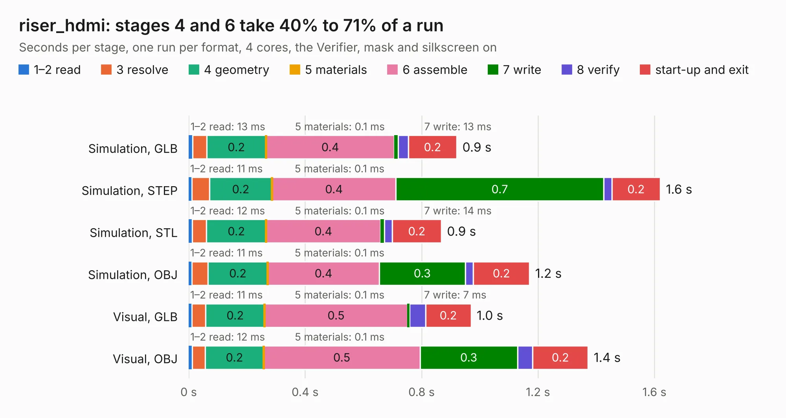

| Mode and format | 1–2 read | 3 resolve | 4 geometry | 5 materials | 6 assemble | 7 write | 8 verify | start-up and exit | Total |
|---|---:|---:|---:|---:|---:|---:|---:|---:|---:|
| Simulation, GLB | 13&nbsp;ms | 49&nbsp;ms | 0.2 | 0.1&nbsp;ms | 0.4 | 13&nbsp;ms | 35&nbsp;ms | 0.2 | 0.9 |
| Simulation, STEP | 11&nbsp;ms | 61&nbsp;ms | 0.2 | 0.1&nbsp;ms | 0.4 | 0.7 | 29&nbsp;ms | 0.2 | 1.6 |
| Simulation, STL | 12&nbsp;ms | 49&nbsp;ms | 0.2 | 0.1&nbsp;ms | 0.4 | 14&nbsp;ms | 26&nbsp;ms | 0.2 | 0.9 |
| Simulation, OBJ | 11&nbsp;ms | 56&nbsp;ms | 0.2 | 0.1&nbsp;ms | 0.4 | 0.3 | 28&nbsp;ms | 0.2 | 1.2 |
| Visual, GLB | 11&nbsp;ms | 48&nbsp;ms | 0.2 | 0.1&nbsp;ms | 0.5 | 7&nbsp;ms | 55&nbsp;ms | 0.2 | 1.0 |
| Visual, OBJ | 12&nbsp;ms | 46&nbsp;ms | 0.2 | 0.1&nbsp;ms | 0.5 | 0.3 | 52&nbsp;ms | 0.2 | 1.4 |

<table align="center"><tr><td valign="top">

| Board | Repo: [winkleplex10-bit/the-mac-pro-project](https://github.com/winkleplex10-bit/the-mac-pro-project) Board: `riser_hdmi.kicad_pcb` |
|---|---|
| Folder | kicad / macpro62-io-risers / riser_hdmi |
| Complexity | 65&nbsp;/&nbsp;1000 (size&nbsp;45, features&nbsp;20) |
| KESE&nbsp;features | slotted holes, rounded, trapezoid or chamfered pads |
| Tested | 9th November 2026 |
| Copper&nbsp;layers | 4 |
| File&nbsp;format | KiCad 9 (20241229) |
| Parts,&nbsp;tracks,&nbsp;vias | 2, 0, 0 |
| Triangles,&nbsp;simulation | 64,084 in 12 parts |
| Verifier | PASS in all six runs |

</td><td valign="top">

<table>
<tr><th>File type</th><th>File size</th><th>Peak memory used</th></tr>
<tr><th colspan="3" align="left">Simulation</th></tr>
<tr><td>GLB</td><td align="right">2.3&nbsp;MB</td><td align="right">53&nbsp;MB</td></tr>
<tr><td>STEP</td><td align="right">11&nbsp;MB</td><td align="right">166&nbsp;MB</td></tr>
<tr><td>STL</td><td align="right">3.2&nbsp;MB</td><td align="right">53&nbsp;MB</td></tr>
<tr><td>OBJ</td><td align="right">6.3&nbsp;MB</td><td align="right">68&nbsp;MB</td></tr>
<tr><th colspan="3" align="left">Visual</th></tr>
<tr><td>GLB</td><td align="right">1.6&nbsp;MB</td><td align="right">89&nbsp;MB</td></tr>
<tr><td>OBJ</td><td align="right">4.5&nbsp;MB</td><td align="right">82&nbsp;MB</td></tr>
</table>

</td></tr></table>

## 3026. macpro62_lga1700

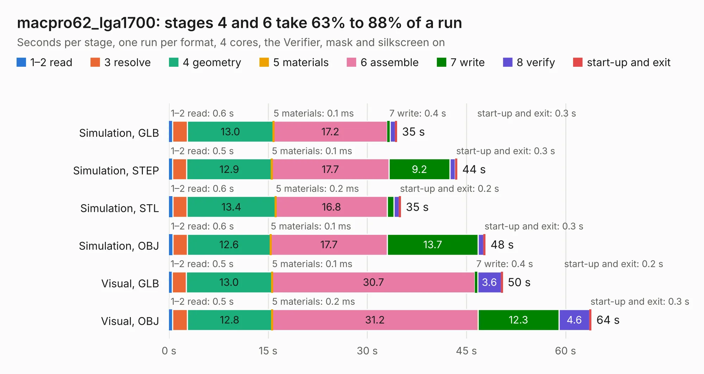

| Mode and format | 1–2 read | 3 resolve | 4 geometry | 5 materials | 6 assemble | 7 write | 8 verify | start-up and exit | Total |
|---|---:|---:|---:|---:|---:|---:|---:|---:|---:|
| Simulation, GLB | 0.6 | 2.2 | 13.0 | 0.1&nbsp;ms | 17.2 | 0.4 | 0.8 | 0.3 | 34.5 |
| Simulation, STEP | 0.5 | 2.2 | 12.9 | 0.1&nbsp;ms | 17.7 | 9.2 | 0.8 | 0.3 | 43.6 |
| Simulation, STL | 0.6 | 2.1 | 13.4 | 0.2&nbsp;ms | 16.8 | 1.0 | 0.8 | 0.2 | 35.1 |
| Simulation, OBJ | 0.6 | 2.2 | 12.6 | 0.1&nbsp;ms | 17.7 | 13.7 | 0.8 | 0.3 | 47.9 |
| Visual, GLB | 0.5 | 2.1 | 13.0 | 0.1&nbsp;ms | 30.7 | 0.4 | 3.6 | 0.2 | 50.5 |
| Visual, OBJ | 0.5 | 2.2 | 12.8 | 0.2&nbsp;ms | 31.2 | 12.3 | 4.6 | 0.3 | 63.9 |

<table align="center"><tr><td valign="top">

| Board | Repo: [winkleplex10-bit/the-mac-pro-project](https://github.com/winkleplex10-bit/the-mac-pro-project) Board: `macpro62_lga1700.kicad_pcb` |
|---|---|
| Folder | kicad / macpro62-lga1700-v2 |
| Complexity | 217&nbsp;/&nbsp;1000 (size&nbsp;162, features&nbsp;55) |
| KESE&nbsp;features | curved board outline, stack-up, dielectric εr and tanδ, copper finish |
| Tested | 9th November 2026 |
| Copper&nbsp;layers | 10 |
| File&nbsp;format | KiCad 9 (20241229) |
| Parts,&nbsp;tracks,&nbsp;vias | 24, 0, 0 |
| Triangles,&nbsp;simulation | 2,922,588 in 26 parts |
| Verifier | PASS in all six runs |

</td><td valign="top">

<table>
<tr><th>File type</th><th>File size</th><th>Peak memory used</th></tr>
<tr><th colspan="3" align="left">Simulation</th></tr>
<tr><td>GLB</td><td align="right">103&nbsp;MB</td><td align="right">1.2&nbsp;GB</td></tr>
<tr><td>STEP</td><td align="right">402&nbsp;MB</td><td align="right">1.6&nbsp;GB</td></tr>
<tr><td>STL</td><td align="right">146&nbsp;MB</td><td align="right">1.2&nbsp;GB</td></tr>
<tr><td>OBJ</td><td align="right">319&nbsp;MB</td><td align="right">2.0&nbsp;GB</td></tr>
<tr><th colspan="3" align="left">Visual</th></tr>
<tr><td>GLB</td><td align="right">90&nbsp;MB</td><td align="right">1.9&nbsp;GB</td></tr>
<tr><td>OBJ</td><td align="right">287&nbsp;MB</td><td align="right">1.9&nbsp;GB</td></tr>
</table>

</td></tr></table>

## 3027. macpro62-storage-face-2x

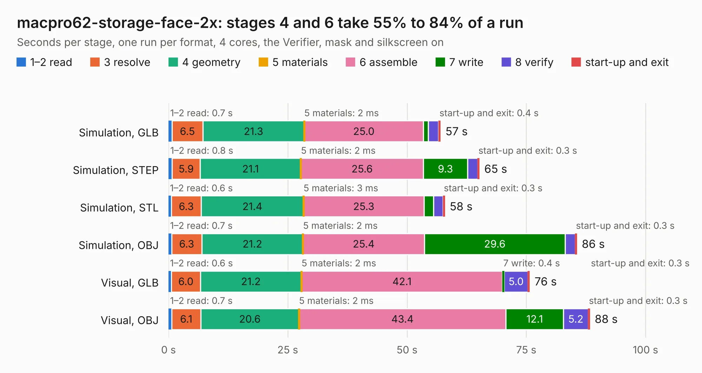

| Mode and format | 1–2 read | 3 resolve | 4 geometry | 5 materials | 6 assemble | 7 write | 8 verify | start-up and exit | Total |
|---|---:|---:|---:|---:|---:|---:|---:|---:|---:|
| Simulation, GLB | 0.7 | 6.5 | 21.3 | 2&nbsp;ms | 25.0 | 1.0 | 2.2 | 0.4 | 57.0 |
| Simulation, STEP | 0.8 | 5.9 | 21.1 | 2&nbsp;ms | 25.6 | 9.3 | 2.1 | 0.3 | 65.1 |
| Simulation, STL | 0.6 | 6.3 | 21.4 | 3&nbsp;ms | 25.3 | 2.0 | 2.0 | 0.3 | 57.9 |
| Simulation, OBJ | 0.7 | 6.3 | 21.2 | 2&nbsp;ms | 25.4 | 29.6 | 2.1 | 0.3 | 85.6 |
| Visual, GLB | 0.6 | 6.0 | 21.2 | 2&nbsp;ms | 42.1 | 0.4 | 5.0 | 0.3 | 75.7 |
| Visual, OBJ | 0.7 | 6.1 | 20.6 | 2&nbsp;ms | 43.4 | 12.1 | 5.2 | 0.3 | 88.3 |

<table align="center"><tr><td valign="top">

| Board | Repo: [winkleplex10-bit/the-mac-pro-project](https://github.com/winkleplex10-bit/the-mac-pro-project) Board: `macpro62-storage-face-2x.kicad_pcb` |
|---|---|
| Folder | kicad / macpro62-storage-face-2x |
| Complexity | 363&nbsp;/&nbsp;1000 (size&nbsp;228, features&nbsp;135) |
| KESE&nbsp;features | through vias, slotted holes, custom pads, rounded, trapezoid or chamfered pads, filled zones, copper drawings, curved board outline, stack-up, dielectric εr and tanδ, copper finish |
| Tested | 9th November 2026 |
| Copper&nbsp;layers | 4 |
| File&nbsp;format | KiCad 9 (20241229) |
| Parts,&nbsp;tracks,&nbsp;vias | 85, 1,215, 2,048 |
| Triangles,&nbsp;simulation | 5,621,626 in 180 parts |
| Verifier | PASS in all six runs |

</td><td valign="top">

<table>
<tr><th>File type</th><th>File size</th><th>Peak memory used</th></tr>
<tr><th colspan="3" align="left">Simulation</th></tr>
<tr><td>GLB</td><td align="right">186&nbsp;MB</td><td align="right">1.8&nbsp;GB</td></tr>
<tr><td>STEP</td><td align="right">439&nbsp;MB</td><td align="right">2.4&nbsp;GB</td></tr>
<tr><td>STL</td><td align="right">281&nbsp;MB</td><td align="right">1.8&nbsp;GB</td></tr>
<tr><td>OBJ</td><td align="right">593&nbsp;MB</td><td align="right">3.6&nbsp;GB</td></tr>
<tr><th colspan="3" align="left">Visual</th></tr>
<tr><td>GLB</td><td align="right">85&nbsp;MB</td><td align="right">1.6&nbsp;GB</td></tr>
<tr><td>OBJ</td><td align="right">274&nbsp;MB</td><td align="right">1.8&nbsp;GB</td></tr>
</table>

</td></tr></table>

## 3028. macpro62-storage-face

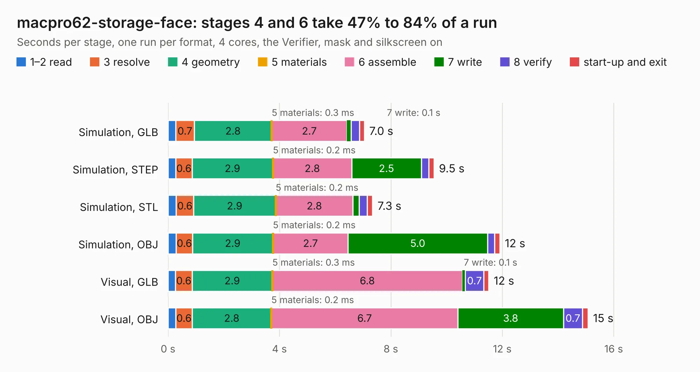

| Mode and format | 1–2 read | 3 resolve | 4 geometry | 5 materials | 6 assemble | 7 write | 8 verify | start-up and exit | Total |
|---|---:|---:|---:|---:|---:|---:|---:|---:|---:|
| Simulation, GLB | 0.3 | 0.7 | 2.8 | 0.3&nbsp;ms | 2.7 | 0.1 | 0.3 | 0.2 | 7.0 |
| Simulation, STEP | 0.3 | 0.6 | 2.9 | 0.2&nbsp;ms | 2.8 | 2.5 | 0.3 | 0.2 | 9.5 |
| Simulation, STL | 0.3 | 0.6 | 2.9 | 0.2&nbsp;ms | 2.8 | 0.2 | 0.3 | 0.2 | 7.3 |
| Simulation, OBJ | 0.3 | 0.6 | 2.9 | 0.2&nbsp;ms | 2.7 | 5.0 | 0.3 | 0.2 | 11.9 |
| Visual, GLB | 0.3 | 0.6 | 2.9 | 0.3&nbsp;ms | 6.8 | 0.1 | 0.7 | 0.2 | 11.5 |
| Visual, OBJ | 0.3 | 0.6 | 2.8 | 0.2&nbsp;ms | 6.7 | 3.8 | 0.7 | 0.2 | 15.1 |

<table align="center"><tr><td valign="top">

| Board | Repo: [winkleplex10-bit/the-mac-pro-project](https://github.com/winkleplex10-bit/the-mac-pro-project) Board: `macpro62-storage-face.kicad_pcb` |
|---|---|
| Folder | kicad / macpro62-storage-face |
| Complexity | 261&nbsp;/&nbsp;1000 (size&nbsp;171, features&nbsp;90) |
| KESE&nbsp;features | slotted holes, custom pads, rounded, trapezoid or chamfered pads, curved board outline, stack-up, dielectric εr and tanδ, copper finish |
| Tested | 9th November 2026 |
| Copper&nbsp;layers | 6 |
| File&nbsp;format | KiCad 9 (20241229) |
| Parts,&nbsp;tracks,&nbsp;vias | 58, 6, 0 |
| Triangles,&nbsp;simulation | 1,066,172 in 18 parts |
| Note | mostly unrouted |
| Verifier | PASS in all six runs |

</td><td valign="top">

<table>
<tr><th>File type</th><th>File size</th><th>Peak memory used</th></tr>
<tr><th colspan="3" align="left">Simulation</th></tr>
<tr><td>GLB</td><td align="right">37&nbsp;MB</td><td align="right">545&nbsp;MB</td></tr>
<tr><td>STEP</td><td align="right">166&nbsp;MB</td><td align="right">603&nbsp;MB</td></tr>
<tr><td>STL</td><td align="right">53&nbsp;MB</td><td align="right">533&nbsp;MB</td></tr>
<tr><td>OBJ</td><td align="right">111&nbsp;MB</td><td align="right">734&nbsp;MB</td></tr>
<tr><th colspan="3" align="left">Visual</th></tr>
<tr><td>GLB</td><td align="right">28&nbsp;MB</td><td align="right">824&nbsp;MB</td></tr>
<tr><td>OBJ</td><td align="right">84&nbsp;MB</td><td align="right">744&nbsp;MB</td></tr>
</table>

</td></tr></table>

## 3029. fpga_hat

| Mode and format | 1–2 read | 3 resolve | 4 geometry | 5 materials | 6 assemble | 7 write | 8 verify | start-up and exit | Total |
|---|---:|---:|---:|---:|---:|---:|---:|---:|---:|
| Simulation, GLB | 0.5 | 2.2 | 9.4 | 0.7&nbsp;ms | 7.7 | 0.3 | 1.0 | 0.3 | 21.4 |
| Simulation, STEP | 0.4 | 2.1 | 9.4 | 0.4&nbsp;ms | 7.2 | 5.5 | 1.0 | 0.2 | 25.7 |
| Simulation, STL | 0.5 | 2.1 | 9.1 | 0.5&nbsp;ms | 7.1 | 0.8 | 1.0 | 0.3 | 20.9 |
| Simulation, OBJ | 0.5 | 2.2 | 9.4 | 0.7&nbsp;ms | 7.5 | 11.1 | 1.1 | 0.2 | 31.9 |
| Visual, GLB | 0.4 | 2.1 | 9.4 | 0.5&nbsp;ms | 15.1 | 0.2 | 1.6 | 0.2 | 29.1 |
| Visual, OBJ | 0.4 | 2.0 | 9.5 | 0.5&nbsp;ms | 14.9 | 6.7 | 1.9 | 0.2 | 35.7 |

<table align="center"><tr><td valign="top">

| Board | Repo: [Wren6991/Snowflake-FPGA](https://github.com/Wren6991/Snowflake-FPGA) Board: `fpga_hat.kicad_pcb` |
|---|---|
| Folder | board |
| Complexity | 316&nbsp;/&nbsp;1000 (size&nbsp;261, features&nbsp;55) |
| KESE&nbsp;features | through vias, rounded, trapezoid or chamfered pads, filled zones, curved board outline |
| Tested | 9th November 2026 |
| Copper&nbsp;layers | 4 |
| File&nbsp;format | KiCad 5 (20171130) |
| Parts,&nbsp;tracks,&nbsp;vias | 82, 1,081, 164 |
| Triangles,&nbsp;simulation | 2,069,882 in 150 parts |
| Verifier | PASS in all six runs |

</td><td valign="top">

<table>
<tr><th>File type</th><th>File size</th><th>Peak memory used</th></tr>
<tr><th colspan="3" align="left">Simulation</th></tr>
<tr><td>GLB</td><td align="right">72&nbsp;MB</td><td align="right">768&nbsp;MB</td></tr>
<tr><td>STEP</td><td align="right">320&nbsp;MB</td><td align="right">901&nbsp;MB</td></tr>
<tr><td>STL</td><td align="right">104&nbsp;MB</td><td align="right">794&nbsp;MB</td></tr>
<tr><td>OBJ</td><td align="right">219&nbsp;MB</td><td align="right">1.4&nbsp;GB</td></tr>
<tr><th colspan="3" align="left">Visual</th></tr>
<tr><td>GLB</td><td align="right">43&nbsp;MB</td><td align="right">873&nbsp;MB</td></tr>
<tr><td>OBJ</td><td align="right">131&nbsp;MB</td><td align="right">982&nbsp;MB</td></tr>
</table>

</td></tr></table>

## 3030. 2019-07-02_12:26:12_fpga_hat

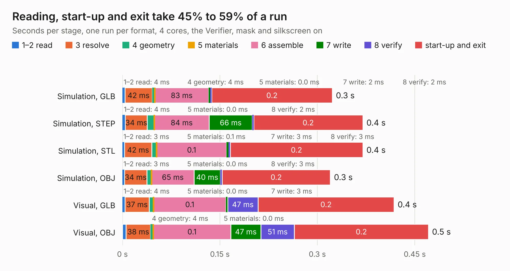

| Mode and format | 1–2 read | 3 resolve | 4 geometry | 5 materials | 6 assemble | 7 write | 8 verify | start-up and exit | Total |
|---|---:|---:|---:|---:|---:|---:|---:|---:|---:|
| Simulation, GLB | 4&nbsp;ms | 42&nbsp;ms | 4&nbsp;ms | 0.0&nbsp;ms | 83&nbsp;ms | 2&nbsp;ms | 2&nbsp;ms | 0.2 | 0.3 |
| Simulation, STEP | 4&nbsp;ms | 34&nbsp;ms | 11&nbsp;ms | 0.0&nbsp;ms | 84&nbsp;ms | 66&nbsp;ms | 2&nbsp;ms | 0.2 | 0.4 |
| Simulation, STL | 3&nbsp;ms | 42&nbsp;ms | 8&nbsp;ms | 0.1&nbsp;ms | 0.1 | 3&nbsp;ms | 3&nbsp;ms | 0.2 | 0.4 |
| Simulation, OBJ | 3&nbsp;ms | 34&nbsp;ms | 7&nbsp;ms | 0.0&nbsp;ms | 65&nbsp;ms | 40&nbsp;ms | 3&nbsp;ms | 0.2 | 0.3 |
| Visual, GLB | 4&nbsp;ms | 37&nbsp;ms | 7&nbsp;ms | 0.0&nbsp;ms | 0.1 | 3&nbsp;ms | 47&nbsp;ms | 0.2 | 0.4 |
| Visual, OBJ | 5&nbsp;ms | 38&nbsp;ms | 4&nbsp;ms | 0.0&nbsp;ms | 0.1 | 47&nbsp;ms | 51&nbsp;ms | 0.2 | 0.5 |

<table align="center"><tr><td valign="top">

| Board | Repo: [Wren6991/Snowflake-FPGA](https://github.com/Wren6991/Snowflake-FPGA) Board: `2019-07-02_12:26:12_fpga_hat.kicad_pcb` |
|---|---|
| Folder | timelapse |
| Complexity | 27&nbsp;/&nbsp;1000 (size&nbsp;17, features&nbsp;10) |
| KESE&nbsp;features | curved board outline |
| Tested | 9th November 2026 |
| Copper&nbsp;layers | 2 |
| File&nbsp;format | KiCad 5 (20171130) |
| Parts,&nbsp;tracks,&nbsp;vias | 0, 0, 0 |
| Triangles,&nbsp;simulation | 10,440 in 3 parts |
| Note | no components |
| Verifier | PASS in all six runs |

</td><td valign="top">

<table>
<tr><th>File type</th><th>File size</th><th>Peak memory used</th></tr>
<tr><th colspan="3" align="left">Simulation</th></tr>
<tr><td>GLB</td><td align="right">278&nbsp;kB</td><td align="right">41&nbsp;MB</td></tr>
<tr><td>STEP</td><td align="right">1.7&nbsp;MB</td><td align="right">42&nbsp;MB</td></tr>
<tr><td>STL</td><td align="right">522&nbsp;kB</td><td align="right">41&nbsp;MB</td></tr>
<tr><td>OBJ</td><td align="right">984&nbsp;kB</td><td align="right">43&nbsp;MB</td></tr>
<tr><th colspan="3" align="left">Visual</th></tr>
<tr><td>GLB</td><td align="right">378&nbsp;kB</td><td align="right">61&nbsp;MB</td></tr>
<tr><td>OBJ</td><td align="right">984&nbsp;kB</td><td align="right">77&nbsp;MB</td></tr>
</table>

</td></tr></table>

## 3031. 2019-07-02_12:31:57_fpga_hat

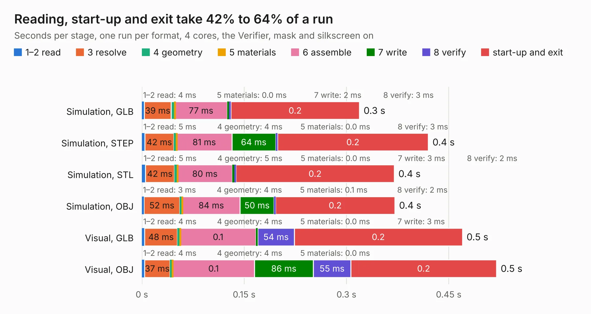

| Mode and format | 1–2 read | 3 resolve | 4 geometry | 5 materials | 6 assemble | 7 write | 8 verify | start-up and exit | Total |
|---|---:|---:|---:|---:|---:|---:|---:|---:|---:|
| Simulation, GLB | 4&nbsp;ms | 39&nbsp;ms | 5&nbsp;ms | 0.0&nbsp;ms | 77&nbsp;ms | 2&nbsp;ms | 3&nbsp;ms | 0.2 | 0.3 |
| Simulation, STEP | 5&nbsp;ms | 42&nbsp;ms | 4&nbsp;ms | 0.0&nbsp;ms | 81&nbsp;ms | 64&nbsp;ms | 3&nbsp;ms | 0.2 | 0.4 |
| Simulation, STL | 5&nbsp;ms | 42&nbsp;ms | 5&nbsp;ms | 0.0&nbsp;ms | 80&nbsp;ms | 3&nbsp;ms | 2&nbsp;ms | 0.2 | 0.4 |
| Simulation, OBJ | 3&nbsp;ms | 52&nbsp;ms | 4&nbsp;ms | 0.1&nbsp;ms | 84&nbsp;ms | 50&nbsp;ms | 2&nbsp;ms | 0.2 | 0.4 |
| Visual, GLB | 4&nbsp;ms | 48&nbsp;ms | 4&nbsp;ms | 0.0&nbsp;ms | 0.1 | 3&nbsp;ms | 54&nbsp;ms | 0.2 | 0.5 |
| Visual, OBJ | 4&nbsp;ms | 37&nbsp;ms | 4&nbsp;ms | 0.0&nbsp;ms | 0.1 | 86&nbsp;ms | 55&nbsp;ms | 0.2 | 0.5 |

<table align="center"><tr><td valign="top">

| Board | Repo: [Wren6991/Snowflake-FPGA](https://github.com/Wren6991/Snowflake-FPGA) Board: `2019-07-02_12:31:57_fpga_hat.kicad_pcb` |
|---|---|
| Folder | timelapse |
| Complexity | 27&nbsp;/&nbsp;1000 (size&nbsp;17, features&nbsp;10) |
| KESE&nbsp;features | curved board outline |
| Tested | 9th November 2026 |
| Copper&nbsp;layers | 2 |
| File&nbsp;format | KiCad 5 (20171130) |
| Parts,&nbsp;tracks,&nbsp;vias | 0, 0, 0 |
| Triangles,&nbsp;simulation | 10,440 in 3 parts |
| Note | no components |
| Verifier | PASS in all six runs |

</td><td valign="top">

<table>
<tr><th>File type</th><th>File size</th><th>Peak memory used</th></tr>
<tr><th colspan="3" align="left">Simulation</th></tr>
<tr><td>GLB</td><td align="right">278&nbsp;kB</td><td align="right">41&nbsp;MB</td></tr>
<tr><td>STEP</td><td align="right">1.7&nbsp;MB</td><td align="right">42&nbsp;MB</td></tr>
<tr><td>STL</td><td align="right">522&nbsp;kB</td><td align="right">41&nbsp;MB</td></tr>
<tr><td>OBJ</td><td align="right">984&nbsp;kB</td><td align="right">41&nbsp;MB</td></tr>
<tr><th colspan="3" align="left">Visual</th></tr>
<tr><td>GLB</td><td align="right">378&nbsp;kB</td><td align="right">67&nbsp;MB</td></tr>
<tr><td>OBJ</td><td align="right">984&nbsp;kB</td><td align="right">62&nbsp;MB</td></tr>
</table>

</td></tr></table>

## 3032. 2019-07-02_12:40:42_fpga_hat

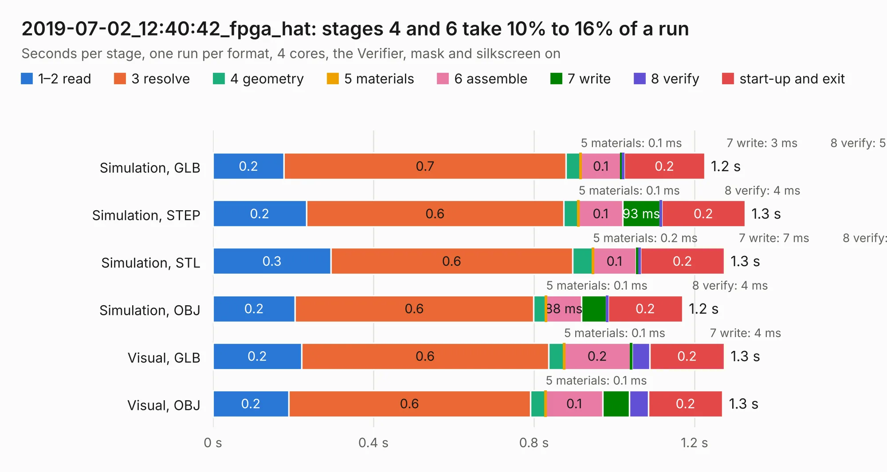

| Mode and format | 1–2 read | 3 resolve | 4 geometry | 5 materials | 6 assemble | 7 write | 8 verify | start-up and exit | Total |
|---|---:|---:|---:|---:|---:|---:|---:|---:|---:|
| Simulation, GLB | 0.2 | 0.7 | 36&nbsp;ms | 0.1&nbsp;ms | 0.1 | 3&nbsp;ms | 5&nbsp;ms | 0.2 | 1.2 |
| Simulation, STEP | 0.2 | 0.6 | 37&nbsp;ms | 0.1&nbsp;ms | 0.1 | 93&nbsp;ms | 4&nbsp;ms | 0.2 | 1.3 |
| Simulation, STL | 0.3 | 0.6 | 51&nbsp;ms | 0.2&nbsp;ms | 0.1 | 7&nbsp;ms | 5&nbsp;ms | 0.2 | 1.3 |
| Simulation, OBJ | 0.2 | 0.6 | 31&nbsp;ms | 0.1&nbsp;ms | 88&nbsp;ms | 62&nbsp;ms | 4&nbsp;ms | 0.2 | 1.2 |
| Visual, GLB | 0.2 | 0.6 | 38&nbsp;ms | 0.1&nbsp;ms | 0.2 | 4&nbsp;ms | 44&nbsp;ms | 0.2 | 1.3 |
| Visual, OBJ | 0.2 | 0.6 | 38&nbsp;ms | 0.1&nbsp;ms | 0.1 | 66&nbsp;ms | 47&nbsp;ms | 0.2 | 1.3 |

<table align="center"><tr><td valign="top">

| Board | Repo: [Wren6991/Snowflake-FPGA](https://github.com/Wren6991/Snowflake-FPGA) Board: `2019-07-02_12:40:42_fpga_hat.kicad_pcb` |
|---|---|
| Folder | timelapse |
| Complexity | 160&nbsp;/&nbsp;1000 (size&nbsp;140, features&nbsp;20) |
| KESE&nbsp;features | rounded, trapezoid or chamfered pads, curved board outline |
| Tested | 9th November 2026 |
| Copper&nbsp;layers | 4 |
| File&nbsp;format | KiCad 5 (20171130) |
| Parts,&nbsp;tracks,&nbsp;vias | 81, 0, 0 |
| Triangles,&nbsp;simulation | 16,832 in 5 parts |
| Note | mostly unrouted |
| Verifier | PASS in all six runs |

</td><td valign="top">

<table>
<tr><th>File type</th><th>File size</th><th>Peak memory used</th></tr>
<tr><th colspan="3" align="left">Simulation</th></tr>
<tr><td>GLB</td><td align="right">463&nbsp;kB</td><td align="right">79&nbsp;MB</td></tr>
<tr><td>STEP</td><td align="right">1.8&nbsp;MB</td><td align="right">79&nbsp;MB</td></tr>
<tr><td>STL</td><td align="right">842&nbsp;kB</td><td align="right">78&nbsp;MB</td></tr>
<tr><td>OBJ</td><td align="right">1.6&nbsp;MB</td><td align="right">77&nbsp;MB</td></tr>
<tr><th colspan="3" align="left">Visual</th></tr>
<tr><td>GLB</td><td align="right">507&nbsp;kB</td><td align="right">105&nbsp;MB</td></tr>
<tr><td>OBJ</td><td align="right">1.3&nbsp;MB</td><td align="right">111&nbsp;MB</td></tr>
</table>

</td></tr></table>

## 3033. 2019-07-02_12:48:58_fpga_hat

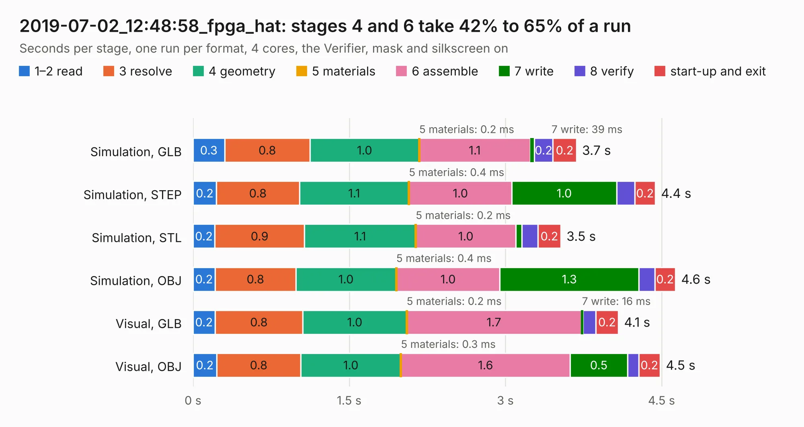

| Mode and format | 1–2 read | 3 resolve | 4 geometry | 5 materials | 6 assemble | 7 write | 8 verify | start-up and exit | Total |
|---|---:|---:|---:|---:|---:|---:|---:|---:|---:|
| Simulation, GLB | 0.3 | 0.8 | 1.0 | 0.2&nbsp;ms | 1.1 | 39&nbsp;ms | 0.2 | 0.2 | 3.7 |
| Simulation, STEP | 0.2 | 0.8 | 1.1 | 0.4&nbsp;ms | 1.0 | 1.0 | 0.2 | 0.2 | 4.4 |
| Simulation, STL | 0.2 | 0.9 | 1.1 | 0.2&nbsp;ms | 1.0 | 58&nbsp;ms | 0.2 | 0.2 | 3.5 |
| Simulation, OBJ | 0.2 | 0.8 | 1.0 | 0.4&nbsp;ms | 1.0 | 1.3 | 0.2 | 0.2 | 4.6 |
| Visual, GLB | 0.2 | 0.8 | 1.0 | 0.2&nbsp;ms | 1.7 | 16&nbsp;ms | 0.1 | 0.2 | 4.1 |
| Visual, OBJ | 0.2 | 0.8 | 1.0 | 0.3&nbsp;ms | 1.6 | 0.5 | 0.1 | 0.2 | 4.5 |

<table align="center"><tr><td valign="top">

| Board | Repo: [Wren6991/Snowflake-FPGA](https://github.com/Wren6991/Snowflake-FPGA) Board: `2019-07-02_12:48:58_fpga_hat.kicad_pcb` |
|---|---|
| Folder | timelapse |
| Complexity | 160&nbsp;/&nbsp;1000 (size&nbsp;140, features&nbsp;20) |
| KESE&nbsp;features | rounded, trapezoid or chamfered pads, curved board outline |
| Tested | 9th November 2026 |
| Copper&nbsp;layers | 4 |
| File&nbsp;format | KiCad 5 (20171130) |
| Parts,&nbsp;tracks,&nbsp;vias | 81, 0, 0 |
| Triangles,&nbsp;simulation | 268,520 in 43 parts |
| Note | mostly unrouted |
| Verifier | PASS in all six runs |

</td><td valign="top">

<table>
<tr><th>File type</th><th>File size</th><th>Peak memory used</th></tr>
<tr><th colspan="3" align="left">Simulation</th></tr>
<tr><td>GLB</td><td align="right">8.4&nbsp;MB</td><td align="right">226&nbsp;MB</td></tr>
<tr><td>STEP</td><td align="right">32&nbsp;MB</td><td align="right">236&nbsp;MB</td></tr>
<tr><td>STL</td><td align="right">13&nbsp;MB</td><td align="right">224&nbsp;MB</td></tr>
<tr><td>OBJ</td><td align="right">26&nbsp;MB</td><td align="right">235&nbsp;MB</td></tr>
<tr><th colspan="3" align="left">Visual</th></tr>
<tr><td>GLB</td><td align="right">3.6&nbsp;MB</td><td align="right">173&nbsp;MB</td></tr>
<tr><td>OBJ</td><td align="right">10&nbsp;MB</td><td align="right">179&nbsp;MB</td></tr>
</table>

</td></tr></table>

## 3034. 2019-07-02_13:01:55_fpga_hat

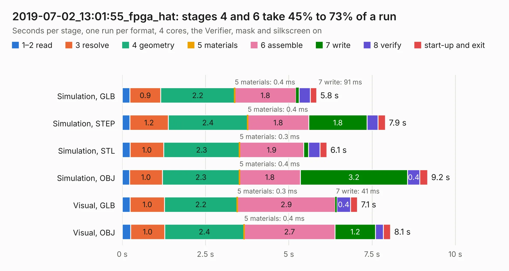

| Mode and format | 1–2 read | 3 resolve | 4 geometry | 5 materials | 6 assemble | 7 write | 8 verify | start-up and exit | Total |
|---|---:|---:|---:|---:|---:|---:|---:|---:|---:|
| Simulation, GLB | 0.2 | 0.9 | 2.2 | 0.4&nbsp;ms | 1.8 | 91&nbsp;ms | 0.3 | 0.2 | 5.8 |
| Simulation, STEP | 0.2 | 1.2 | 2.4 | 0.4&nbsp;ms | 1.8 | 1.8 | 0.3 | 0.2 | 7.9 |
| Simulation, STL | 0.2 | 1.0 | 2.3 | 0.3&nbsp;ms | 1.9 | 0.1 | 0.3 | 0.2 | 6.1 |
| Simulation, OBJ | 0.2 | 1.0 | 2.3 | 0.4&nbsp;ms | 1.8 | 3.2 | 0.4 | 0.2 | 9.2 |
| Visual, GLB | 0.2 | 1.0 | 2.2 | 0.3&nbsp;ms | 2.9 | 41&nbsp;ms | 0.4 | 0.2 | 7.1 |
| Visual, OBJ | 0.3 | 1.0 | 2.4 | 0.4&nbsp;ms | 2.7 | 1.2 | 0.2 | 0.2 | 8.1 |

<table align="center"><tr><td valign="top">

| Board | Repo: [Wren6991/Snowflake-FPGA](https://github.com/Wren6991/Snowflake-FPGA) Board: `2019-07-02_13:01:55_fpga_hat.kicad_pcb` |
|---|---|
| Folder | timelapse |
| Complexity | 160&nbsp;/&nbsp;1000 (size&nbsp;140, features&nbsp;20) |
| KESE&nbsp;features | rounded, trapezoid or chamfered pads, curved board outline |
| Tested | 9th November 2026 |
| Copper&nbsp;layers | 4 |
| File&nbsp;format | KiCad 5 (20171130) |
| Parts,&nbsp;tracks,&nbsp;vias | 81, 0, 0 |
| Triangles,&nbsp;simulation | 568,796 in 82 parts |
| Note | mostly unrouted |
| Verifier | PASS in all six runs |

</td><td valign="top">

<table>
<tr><th>File type</th><th>File size</th><th>Peak memory used</th></tr>
<tr><th colspan="3" align="left">Simulation</th></tr>
<tr><td>GLB</td><td align="right">18&nbsp;MB</td><td align="right">275&nbsp;MB</td></tr>
<tr><td>STEP</td><td align="right">70&nbsp;MB</td><td align="right">327&nbsp;MB</td></tr>
<tr><td>STL</td><td align="right">28&nbsp;MB</td><td align="right">284&nbsp;MB</td></tr>
<tr><td>OBJ</td><td align="right">57&nbsp;MB</td><td align="right">421&nbsp;MB</td></tr>
<tr><th colspan="3" align="left">Visual</th></tr>
<tr><td>GLB</td><td align="right">8.1&nbsp;MB</td><td align="right">298&nbsp;MB</td></tr>
<tr><td>OBJ</td><td align="right">24&nbsp;MB</td><td align="right">288&nbsp;MB</td></tr>
</table>

</td></tr></table>

## 3035. 2019-07-02_13:07:01_fpga_hat

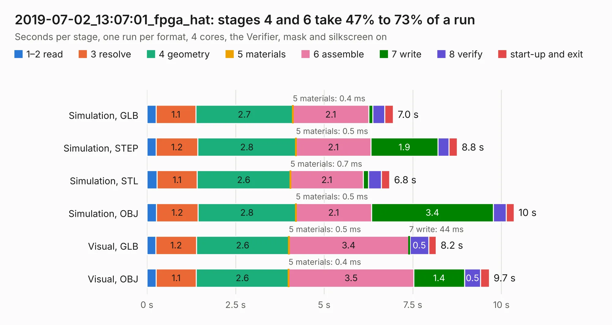

| Mode and format | 1–2 read | 3 resolve | 4 geometry | 5 materials | 6 assemble | 7 write | 8 verify | start-up and exit | Total |
|---|---:|---:|---:|---:|---:|---:|---:|---:|---:|
| Simulation, GLB | 0.3 | 1.1 | 2.7 | 0.4&nbsp;ms | 2.1 | 0.1 | 0.3 | 0.2 | 7.0 |
| Simulation, STEP | 0.3 | 1.2 | 2.8 | 0.5&nbsp;ms | 2.1 | 1.9 | 0.3 | 0.2 | 8.8 |
| Simulation, STL | 0.3 | 1.1 | 2.6 | 0.7&nbsp;ms | 2.1 | 0.1 | 0.4 | 0.2 | 6.8 |
| Simulation, OBJ | 0.3 | 1.2 | 2.8 | 0.5&nbsp;ms | 2.1 | 3.4 | 0.4 | 0.2 | 10.4 |
| Visual, GLB | 0.2 | 1.2 | 2.6 | 0.5&nbsp;ms | 3.4 | 44&nbsp;ms | 0.5 | 0.2 | 8.2 |
| Visual, OBJ | 0.3 | 1.1 | 2.6 | 0.4&nbsp;ms | 3.5 | 1.4 | 0.5 | 0.2 | 9.7 |

<table align="center"><tr><td valign="top">

| Board | Repo: [Wren6991/Snowflake-FPGA](https://github.com/Wren6991/Snowflake-FPGA) Board: `2019-07-02_13:07:01_fpga_hat.kicad_pcb` |
|---|---|
| Folder | timelapse |
| Complexity | 160&nbsp;/&nbsp;1000 (size&nbsp;140, features&nbsp;20) |
| KESE&nbsp;features | rounded, trapezoid or chamfered pads, curved board outline |
| Tested | 9th November 2026 |
| Copper&nbsp;layers | 4 |
| File&nbsp;format | KiCad 5 (20171130) |
| Parts,&nbsp;tracks,&nbsp;vias | 81, 0, 0 |
| Triangles,&nbsp;simulation | 594,544 in 95 parts |
| Note | mostly unrouted |
| Verifier | PASS in all six runs |

</td><td valign="top">

<table>
<tr><th>File type</th><th>File size</th><th>Peak memory used</th></tr>
<tr><th colspan="3" align="left">Simulation</th></tr>
<tr><td>GLB</td><td align="right">19&nbsp;MB</td><td align="right">304&nbsp;MB</td></tr>
<tr><td>STEP</td><td align="right">75&nbsp;MB</td><td align="right">333&nbsp;MB</td></tr>
<tr><td>STL</td><td align="right">30&nbsp;MB</td><td align="right">312&nbsp;MB</td></tr>
<tr><td>OBJ</td><td align="right">60&nbsp;MB</td><td align="right">436&nbsp;MB</td></tr>
<tr><th colspan="3" align="left">Visual</th></tr>
<tr><td>GLB</td><td align="right">8.7&nbsp;MB</td><td align="right">317&nbsp;MB</td></tr>
<tr><td>OBJ</td><td align="right">26&nbsp;MB</td><td align="right">291&nbsp;MB</td></tr>
</table>

</td></tr></table>

## 3036. 2019-07-02_13:19:55_fpga_hat

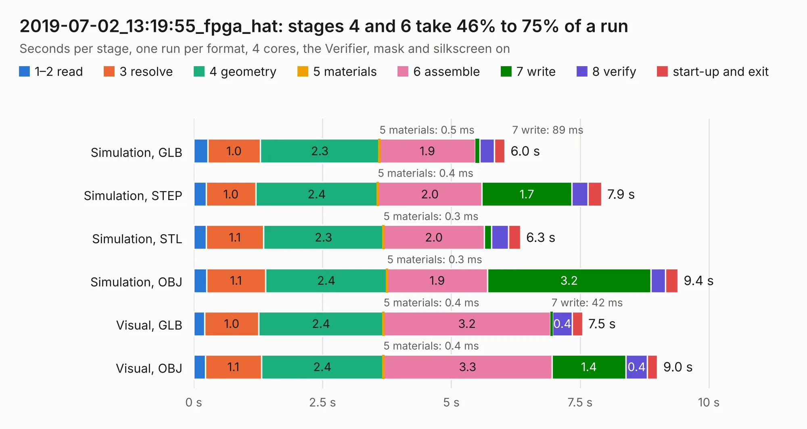

| Mode and format | 1–2 read | 3 resolve | 4 geometry | 5 materials | 6 assemble | 7 write | 8 verify | start-up and exit | Total |
|---|---:|---:|---:|---:|---:|---:|---:|---:|---:|
| Simulation, GLB | 0.3 | 1.0 | 2.3 | 0.5&nbsp;ms | 1.9 | 89&nbsp;ms | 0.3 | 0.2 | 6.0 |
| Simulation, STEP | 0.2 | 1.0 | 2.4 | 0.4&nbsp;ms | 2.0 | 1.7 | 0.3 | 0.3 | 7.9 |
| Simulation, STL | 0.2 | 1.1 | 2.3 | 0.3&nbsp;ms | 2.0 | 0.1 | 0.3 | 0.2 | 6.3 |
| Simulation, OBJ | 0.2 | 1.1 | 2.4 | 0.3&nbsp;ms | 1.9 | 3.2 | 0.3 | 0.2 | 9.4 |
| Visual, GLB | 0.2 | 1.0 | 2.4 | 0.4&nbsp;ms | 3.2 | 42&nbsp;ms | 0.4 | 0.2 | 7.5 |
| Visual, OBJ | 0.2 | 1.1 | 2.4 | 0.4&nbsp;ms | 3.3 | 1.4 | 0.4 | 0.2 | 9.0 |

<table align="center"><tr><td valign="top">

| Board | Repo: [Wren6991/Snowflake-FPGA](https://github.com/Wren6991/Snowflake-FPGA) Board: `2019-07-02_13:19:55_fpga_hat.kicad_pcb` |
|---|---|
| Folder | timelapse |
| Complexity | 160&nbsp;/&nbsp;1000 (size&nbsp;140, features&nbsp;20) |
| KESE&nbsp;features | rounded, trapezoid or chamfered pads, curved board outline |
| Tested | 9th November 2026 |
| Copper&nbsp;layers | 4 |
| File&nbsp;format | KiCad 5 (20171130) |
| Parts,&nbsp;tracks,&nbsp;vias | 81, 0, 0 |
| Triangles,&nbsp;simulation | 632,078 in 102 parts |
| Note | mostly unrouted |
| Verifier | PASS in all six runs |

</td><td valign="top">

<table>
<tr><th>File type</th><th>File size</th><th>Peak memory used</th></tr>
<tr><th colspan="3" align="left">Simulation</th></tr>
<tr><td>GLB</td><td align="right">20&nbsp;MB</td><td align="right">308&nbsp;MB</td></tr>
<tr><td>STEP</td><td align="right">83&nbsp;MB</td><td align="right">347&nbsp;MB</td></tr>
<tr><td>STL</td><td align="right">32&nbsp;MB</td><td align="right">316&nbsp;MB</td></tr>
<tr><td>OBJ</td><td align="right">64&nbsp;MB</td><td align="right">458&nbsp;MB</td></tr>
<tr><th colspan="3" align="left">Visual</th></tr>
<tr><td>GLB</td><td align="right">9.8&nbsp;MB</td><td align="right">315&nbsp;MB</td></tr>
<tr><td>OBJ</td><td align="right">29&nbsp;MB</td><td align="right">316&nbsp;MB</td></tr>
</table>

</td></tr></table>

## 3037. 2019-07-02_13:30:37_fpga_hat

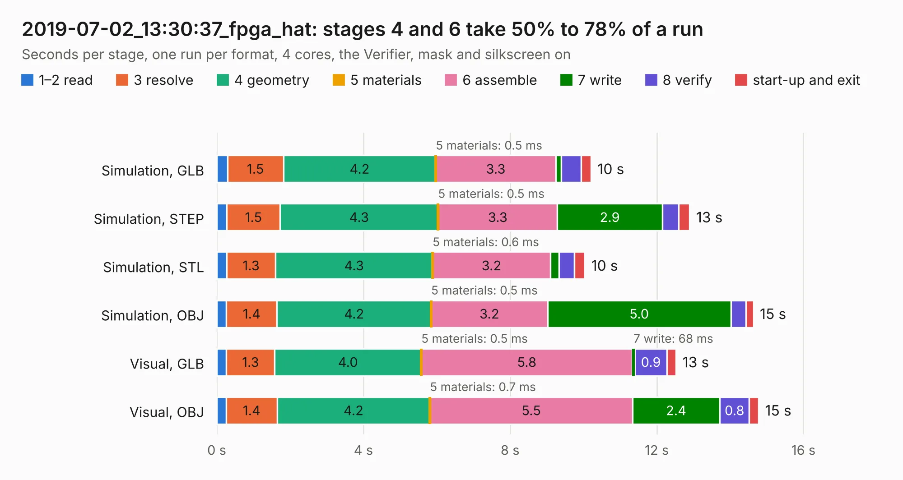

| Mode and format | 1–2 read | 3 resolve | 4 geometry | 5 materials | 6 assemble | 7 write | 8 verify | start-up and exit | Total |
|---|---:|---:|---:|---:|---:|---:|---:|---:|---:|
| Simulation, GLB | 0.3 | 1.5 | 4.2 | 0.5&nbsp;ms | 3.3 | 0.1 | 0.5 | 0.3 | 10.2 |
| Simulation, STEP | 0.3 | 1.5 | 4.3 | 0.5&nbsp;ms | 3.3 | 2.9 | 0.5 | 0.3 | 12.9 |
| Simulation, STL | 0.3 | 1.3 | 4.3 | 0.6&nbsp;ms | 3.2 | 0.2 | 0.4 | 0.3 | 10.0 |
| Simulation, OBJ | 0.3 | 1.4 | 4.2 | 0.5&nbsp;ms | 3.2 | 5.0 | 0.4 | 0.2 | 14.6 |
| Visual, GLB | 0.3 | 1.3 | 4.0 | 0.5&nbsp;ms | 5.8 | 68&nbsp;ms | 0.9 | 0.2 | 12.5 |
| Visual, OBJ | 0.3 | 1.4 | 4.2 | 0.7&nbsp;ms | 5.5 | 2.4 | 0.8 | 0.3 | 14.8 |

<table align="center"><tr><td valign="top">

| Board | Repo: [Wren6991/Snowflake-FPGA](https://github.com/Wren6991/Snowflake-FPGA) Board: `2019-07-02_13:30:37_fpga_hat.kicad_pcb` |
|---|---|
| Folder | timelapse |
| Complexity | 160&nbsp;/&nbsp;1000 (size&nbsp;140, features&nbsp;20) |
| KESE&nbsp;features | rounded, trapezoid or chamfered pads, curved board outline |
| Tested | 9th November 2026 |
| Copper&nbsp;layers | 4 |
| File&nbsp;format | KiCad 5 (20171130) |
| Parts,&nbsp;tracks,&nbsp;vias | 81, 0, 0 |
| Triangles,&nbsp;simulation | 853,966 in 148 parts |
| Note | mostly unrouted |
| Verifier | PASS in all six runs |

</td><td valign="top">

<table>
<tr><th>File type</th><th>File size</th><th>Peak memory used</th></tr>
<tr><th colspan="3" align="left">Simulation</th></tr>
<tr><td>GLB</td><td align="right">28&nbsp;MB</td><td align="right">355&nbsp;MB</td></tr>
<tr><td>STEP</td><td align="right">128&nbsp;MB</td><td align="right">474&nbsp;MB</td></tr>
<tr><td>STL</td><td align="right">43&nbsp;MB</td><td align="right">363&nbsp;MB</td></tr>
<tr><td>OBJ</td><td align="right">87&nbsp;MB</td><td align="right">617&nbsp;MB</td></tr>
<tr><th colspan="3" align="left">Visual</th></tr>
<tr><td>GLB</td><td align="right">14&nbsp;MB</td><td align="right">422&nbsp;MB</td></tr>
<tr><td>OBJ</td><td align="right">42&nbsp;MB</td><td align="right">427&nbsp;MB</td></tr>
</table>

</td></tr></table>

## 3038. 2019-07-02_13:46:31_fpga_hat

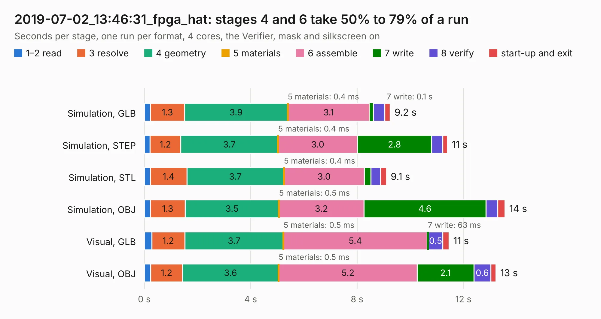

| Mode and format | 1–2 read | 3 resolve | 4 geometry | 5 materials | 6 assemble | 7 write | 8 verify | start-up and exit | Total |
|---|---:|---:|---:|---:|---:|---:|---:|---:|---:|
| Simulation, GLB | 0.2 | 1.3 | 3.9 | 0.4&nbsp;ms | 3.1 | 0.1 | 0.4 | 0.2 | 9.2 |
| Simulation, STEP | 0.2 | 1.2 | 3.7 | 0.4&nbsp;ms | 3.0 | 2.8 | 0.4 | 0.2 | 11.4 |
| Simulation, STL | 0.2 | 1.4 | 3.7 | 0.4&nbsp;ms | 3.0 | 0.2 | 0.4 | 0.2 | 9.1 |
| Simulation, OBJ | 0.2 | 1.3 | 3.5 | 0.5&nbsp;ms | 3.2 | 4.6 | 0.4 | 0.3 | 13.6 |
| Visual, GLB | 0.3 | 1.2 | 3.7 | 0.5&nbsp;ms | 5.4 | 63&nbsp;ms | 0.5 | 0.2 | 11.5 |
| Visual, OBJ | 0.2 | 1.2 | 3.6 | 0.5&nbsp;ms | 5.2 | 2.1 | 0.6 | 0.2 | 13.2 |

<table align="center"><tr><td valign="top">

| Board | Repo: [Wren6991/Snowflake-FPGA](https://github.com/Wren6991/Snowflake-FPGA) Board: `2019-07-02_13:46:31_fpga_hat.kicad_pcb` |
|---|---|
| Folder | timelapse |
| Complexity | 160&nbsp;/&nbsp;1000 (size&nbsp;140, features&nbsp;20) |
| KESE&nbsp;features | rounded, trapezoid or chamfered pads, curved board outline |
| Tested | 9th November 2026 |
| Copper&nbsp;layers | 4 |
| File&nbsp;format | KiCad 5 (20171130) |
| Parts,&nbsp;tracks,&nbsp;vias | 81, 0, 0 |
| Triangles,&nbsp;simulation | 902,386 in 150 parts |
| Note | mostly unrouted |
| Verifier | PASS in all six runs |

</td><td valign="top">

<table>
<tr><th>File type</th><th>File size</th><th>Peak memory used</th></tr>
<tr><th colspan="3" align="left">Simulation</th></tr>
<tr><td>GLB</td><td align="right">30&nbsp;MB</td><td align="right">377&nbsp;MB</td></tr>
<tr><td>STEP</td><td align="right">138&nbsp;MB</td><td align="right">481&nbsp;MB</td></tr>
<tr><td>STL</td><td align="right">45&nbsp;MB</td><td align="right">367&nbsp;MB</td></tr>
<tr><td>OBJ</td><td align="right">92&nbsp;MB</td><td align="right">670&nbsp;MB</td></tr>
<tr><th colspan="3" align="left">Visual</th></tr>
<tr><td>GLB</td><td align="right">15&nbsp;MB</td><td align="right">432&nbsp;MB</td></tr>
<tr><td>OBJ</td><td align="right">45&nbsp;MB</td><td align="right">426&nbsp;MB</td></tr>
</table>

</td></tr></table>

## 3039. 2019-07-02_13:56:17_fpga_hat

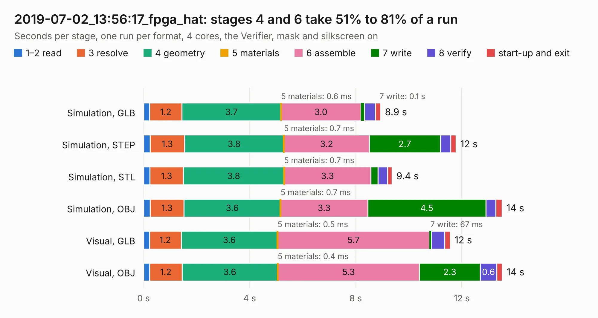

| Mode and format | 1–2 read | 3 resolve | 4 geometry | 5 materials | 6 assemble | 7 write | 8 verify | start-up and exit | Total |
|---|---:|---:|---:|---:|---:|---:|---:|---:|---:|
| Simulation, GLB | 0.2 | 1.2 | 3.7 | 0.6&nbsp;ms | 3.0 | 0.1 | 0.4 | 0.2 | 8.9 |
| Simulation, STEP | 0.3 | 1.3 | 3.8 | 0.7&nbsp;ms | 3.2 | 2.7 | 0.4 | 0.2 | 11.8 |
| Simulation, STL | 0.2 | 1.3 | 3.8 | 0.7&nbsp;ms | 3.3 | 0.3 | 0.4 | 0.2 | 9.4 |
| Simulation, OBJ | 0.2 | 1.3 | 3.6 | 0.7&nbsp;ms | 3.3 | 4.5 | 0.4 | 0.2 | 13.5 |
| Visual, GLB | 0.2 | 1.2 | 3.6 | 0.5&nbsp;ms | 5.7 | 67&nbsp;ms | 0.5 | 0.2 | 11.6 |
| Visual, OBJ | 0.2 | 1.2 | 3.6 | 0.4&nbsp;ms | 5.3 | 2.3 | 0.6 | 0.2 | 13.5 |

<table align="center"><tr><td valign="top">

| Board | Repo: [Wren6991/Snowflake-FPGA](https://github.com/Wren6991/Snowflake-FPGA) Board: `2019-07-02_13:56:17_fpga_hat.kicad_pcb` |
|---|---|
| Folder | timelapse |
| Complexity | 160&nbsp;/&nbsp;1000 (size&nbsp;140, features&nbsp;20) |
| KESE&nbsp;features | rounded, trapezoid or chamfered pads, curved board outline |
| Tested | 9th November 2026 |
| Copper&nbsp;layers | 4 |
| File&nbsp;format | KiCad 5 (20171130) |
| Parts,&nbsp;tracks,&nbsp;vias | 81, 0, 0 |
| Triangles,&nbsp;simulation | 920,616 in 150 parts |
| Note | mostly unrouted |
| Verifier | PASS in all six runs |

</td><td valign="top">

<table>
<tr><th>File type</th><th>File size</th><th>Peak memory used</th></tr>
<tr><th colspan="3" align="left">Simulation</th></tr>
<tr><td>GLB</td><td align="right">30&nbsp;MB</td><td align="right">377&nbsp;MB</td></tr>
<tr><td>STEP</td><td align="right">141&nbsp;MB</td><td align="right">500&nbsp;MB</td></tr>
<tr><td>STL</td><td align="right">46&nbsp;MB</td><td align="right">379&nbsp;MB</td></tr>
<tr><td>OBJ</td><td align="right">94&nbsp;MB</td><td align="right">654&nbsp;MB</td></tr>
<tr><th colspan="3" align="left">Visual</th></tr>
<tr><td>GLB</td><td align="right">16&nbsp;MB</td><td align="right">470&nbsp;MB</td></tr>
<tr><td>OBJ</td><td align="right">47&nbsp;MB</td><td align="right">445&nbsp;MB</td></tr>
</table>

</td></tr></table>

## 3040. 2019-07-02_14:01:06_fpga_hat

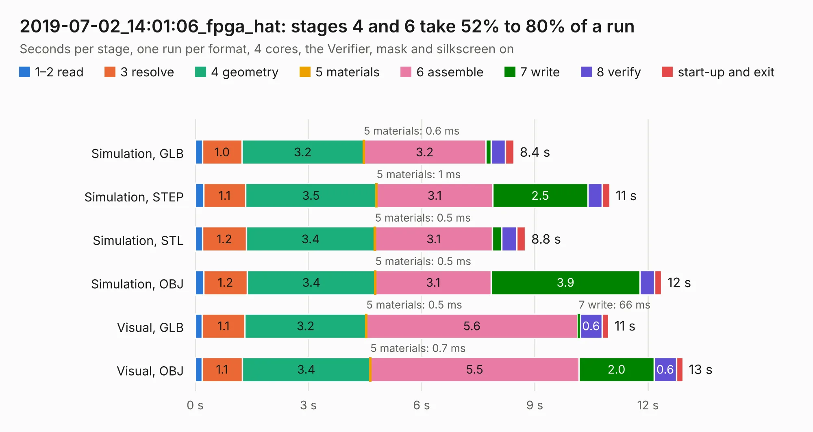

| Mode and format | 1–2 read | 3 resolve | 4 geometry | 5 materials | 6 assemble | 7 write | 8 verify | start-up and exit | Total |
|---|---:|---:|---:|---:|---:|---:|---:|---:|---:|
| Simulation, GLB | 0.2 | 1.0 | 3.2 | 0.6&nbsp;ms | 3.2 | 0.1 | 0.4 | 0.2 | 8.4 |
| Simulation, STEP | 0.2 | 1.1 | 3.5 | 1&nbsp;ms | 3.1 | 2.5 | 0.4 | 0.2 | 11.0 |
| Simulation, STL | 0.2 | 1.2 | 3.4 | 0.5&nbsp;ms | 3.1 | 0.2 | 0.4 | 0.2 | 8.8 |
| Simulation, OBJ | 0.2 | 1.2 | 3.4 | 0.5&nbsp;ms | 3.1 | 3.9 | 0.4 | 0.2 | 12.4 |
| Visual, GLB | 0.2 | 1.1 | 3.2 | 0.5&nbsp;ms | 5.6 | 66&nbsp;ms | 0.6 | 0.2 | 11.0 |
| Visual, OBJ | 0.2 | 1.1 | 3.4 | 0.7&nbsp;ms | 5.5 | 2.0 | 0.6 | 0.2 | 12.9 |

<table align="center"><tr><td valign="top">

| Board | Repo: [Wren6991/Snowflake-FPGA](https://github.com/Wren6991/Snowflake-FPGA) Board: `2019-07-02_14:01:06_fpga_hat.kicad_pcb` |
|---|---|
| Folder | timelapse |
| Complexity | 160&nbsp;/&nbsp;1000 (size&nbsp;140, features&nbsp;20) |
| KESE&nbsp;features | rounded, trapezoid or chamfered pads, curved board outline |
| Tested | 9th November 2026 |
| Copper&nbsp;layers | 4 |
| File&nbsp;format | KiCad 5 (20171130) |
| Parts,&nbsp;tracks,&nbsp;vias | 81, 0, 0 |
| Triangles,&nbsp;simulation | 957,960 in 150 parts |
| Note | mostly unrouted |
| Verifier | PASS in all six runs |

</td><td valign="top">

<table>
<tr><th>File type</th><th>File size</th><th>Peak memory used</th></tr>
<tr><th colspan="3" align="left">Simulation</th></tr>
<tr><td>GLB</td><td align="right">32&nbsp;MB</td><td align="right">395&nbsp;MB</td></tr>
<tr><td>STEP</td><td align="right">150&nbsp;MB</td><td align="right">497&nbsp;MB</td></tr>
<tr><td>STL</td><td align="right">48&nbsp;MB</td><td align="right">398&nbsp;MB</td></tr>
<tr><td>OBJ</td><td align="right">97&nbsp;MB</td><td align="right">695&nbsp;MB</td></tr>
<tr><th colspan="3" align="left">Visual</th></tr>
<tr><td>GLB</td><td align="right">17&nbsp;MB</td><td align="right">483&nbsp;MB</td></tr>
<tr><td>OBJ</td><td align="right">49&nbsp;MB</td><td align="right">458&nbsp;MB</td></tr>
</table>

</td></tr></table>

## 3041. 2019-07-02_14:14:35_fpga_hat

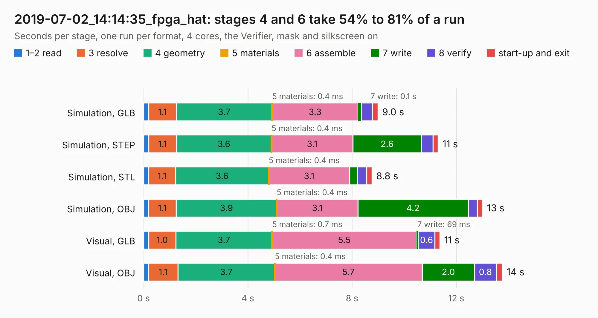

| Mode and format | 1–2 read | 3 resolve | 4 geometry | 5 materials | 6 assemble | 7 write | 8 verify | start-up and exit | Total |
|---|---:|---:|---:|---:|---:|---:|---:|---:|---:|
| Simulation, GLB | 0.2 | 1.1 | 3.7 | 0.4&nbsp;ms | 3.3 | 0.1 | 0.4 | 0.2 | 9.0 |
| Simulation, STEP | 0.2 | 1.1 | 3.6 | 0.4&nbsp;ms | 3.1 | 2.6 | 0.4 | 0.2 | 11.3 |
| Simulation, STL | 0.2 | 1.1 | 3.6 | 0.4&nbsp;ms | 3.1 | 0.3 | 0.4 | 0.2 | 8.8 |
| Simulation, OBJ | 0.2 | 1.1 | 3.9 | 0.4&nbsp;ms | 3.1 | 4.2 | 0.3 | 0.2 | 13.0 |
| Visual, GLB | 0.2 | 1.0 | 3.7 | 0.7&nbsp;ms | 5.5 | 69&nbsp;ms | 0.6 | 0.2 | 11.4 |
| Visual, OBJ | 0.2 | 1.1 | 3.7 | 0.4&nbsp;ms | 5.7 | 2.0 | 0.8 | 0.2 | 13.8 |

<table align="center"><tr><td valign="top">

| Board | Repo: [Wren6991/Snowflake-FPGA](https://github.com/Wren6991/Snowflake-FPGA) Board: `2019-07-02_14:14:35_fpga_hat.kicad_pcb` |
|---|---|
| Folder | timelapse |
| Complexity | 160&nbsp;/&nbsp;1000 (size&nbsp;140, features&nbsp;20) |
| KESE&nbsp;features | rounded, trapezoid or chamfered pads, curved board outline |
| Tested | 9th November 2026 |
| Copper&nbsp;layers | 4 |
| File&nbsp;format | KiCad 5 (20171130) |
| Parts,&nbsp;tracks,&nbsp;vias | 81, 0, 0 |
| Triangles,&nbsp;simulation | 1,005,282 in 150 parts |
| Note | mostly unrouted |
| Verifier | PASS in all six runs |

</td><td valign="top">

<table>
<tr><th>File type</th><th>File size</th><th>Peak memory used</th></tr>
<tr><th colspan="3" align="left">Simulation</th></tr>
<tr><td>GLB</td><td align="right">33&nbsp;MB</td><td align="right">402&nbsp;MB</td></tr>
<tr><td>STEP</td><td align="right">160&nbsp;MB</td><td align="right">527&nbsp;MB</td></tr>
<tr><td>STL</td><td align="right">50&nbsp;MB</td><td align="right">408&nbsp;MB</td></tr>
<tr><td>OBJ</td><td align="right">102&nbsp;MB</td><td align="right">729&nbsp;MB</td></tr>
<tr><th colspan="3" align="left">Visual</th></tr>
<tr><td>GLB</td><td align="right">18&nbsp;MB</td><td align="right">479&nbsp;MB</td></tr>
<tr><td>OBJ</td><td align="right">52&nbsp;MB</td><td align="right">470&nbsp;MB</td></tr>
</table>

</td></tr></table>

## 3042. 2019-07-02_15:12:10_fpga_hat

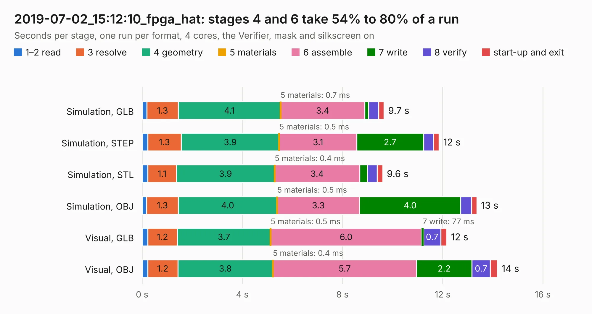

| Mode and format | 1–2 read | 3 resolve | 4 geometry | 5 materials | 6 assemble | 7 write | 8 verify | start-up and exit | Total |
|---|---:|---:|---:|---:|---:|---:|---:|---:|---:|
| Simulation, GLB | 0.2 | 1.3 | 4.1 | 0.7&nbsp;ms | 3.4 | 0.2 | 0.4 | 0.2 | 9.7 |
| Simulation, STEP | 0.2 | 1.3 | 3.9 | 0.5&nbsp;ms | 3.1 | 2.7 | 0.4 | 0.2 | 11.9 |
| Simulation, STL | 0.2 | 1.1 | 3.9 | 0.4&nbsp;ms | 3.4 | 0.3 | 0.4 | 0.2 | 9.6 |
| Simulation, OBJ | 0.2 | 1.3 | 4.0 | 0.5&nbsp;ms | 3.3 | 4.0 | 0.4 | 0.2 | 13.4 |
| Visual, GLB | 0.2 | 1.2 | 3.7 | 0.5&nbsp;ms | 6.0 | 77&nbsp;ms | 0.7 | 0.2 | 12.2 |
| Visual, OBJ | 0.2 | 1.2 | 3.8 | 0.4&nbsp;ms | 5.7 | 2.2 | 0.7 | 0.3 | 14.2 |

<table align="center"><tr><td valign="top">

| Board | Repo: [Wren6991/Snowflake-FPGA](https://github.com/Wren6991/Snowflake-FPGA) Board: `2019-07-02_15:12:10_fpga_hat.kicad_pcb` |
|---|---|
| Folder | timelapse |
| Complexity | 160&nbsp;/&nbsp;1000 (size&nbsp;140, features&nbsp;20) |
| KESE&nbsp;features | rounded, trapezoid or chamfered pads, curved board outline |
| Tested | 9th November 2026 |
| Copper&nbsp;layers | 4 |
| File&nbsp;format | KiCad 5 (20171130) |
| Parts,&nbsp;tracks,&nbsp;vias | 81, 0, 0 |
| Triangles,&nbsp;simulation | 1,005,282 in 150 parts |
| Note | mostly unrouted |
| Verifier | PASS in all six runs |

</td><td valign="top">

<table>
<tr><th>File type</th><th>File size</th><th>Peak memory used</th></tr>
<tr><th colspan="3" align="left">Simulation</th></tr>
<tr><td>GLB</td><td align="right">33&nbsp;MB</td><td align="right">409&nbsp;MB</td></tr>
<tr><td>STEP</td><td align="right">160&nbsp;MB</td><td align="right">514&nbsp;MB</td></tr>
<tr><td>STL</td><td align="right">50&nbsp;MB</td><td align="right">402&nbsp;MB</td></tr>
<tr><td>OBJ</td><td align="right">102&nbsp;MB</td><td align="right">727&nbsp;MB</td></tr>
<tr><th colspan="3" align="left">Visual</th></tr>
<tr><td>GLB</td><td align="right">18&nbsp;MB</td><td align="right">471&nbsp;MB</td></tr>
<tr><td>OBJ</td><td align="right">52&nbsp;MB</td><td align="right">505&nbsp;MB</td></tr>
</table>

</td></tr></table>

## 3043. 2019-07-02_15:26:14_fpga_hat

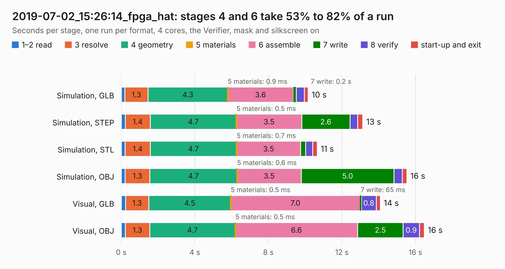

| Mode and format | 1–2 read | 3 resolve | 4 geometry | 5 materials | 6 assemble | 7 write | 8 verify | start-up and exit | Total |
|---|---:|---:|---:|---:|---:|---:|---:|---:|---:|
| Simulation, GLB | 0.2 | 1.3 | 4.3 | 0.9&nbsp;ms | 3.6 | 0.2 | 0.4 | 0.2 | 10.2 |
| Simulation, STEP | 0.2 | 1.4 | 4.7 | 0.5&nbsp;ms | 3.5 | 2.6 | 0.4 | 0.3 | 13.1 |
| Simulation, STL | 0.2 | 1.4 | 4.7 | 0.7&nbsp;ms | 3.5 | 0.3 | 0.4 | 0.2 | 10.7 |
| Simulation, OBJ | 0.2 | 1.3 | 4.7 | 0.6&nbsp;ms | 3.5 | 5.0 | 0.5 | 0.2 | 15.5 |
| Visual, GLB | 0.2 | 1.3 | 4.5 | 0.5&nbsp;ms | 7.0 | 65&nbsp;ms | 0.8 | 0.2 | 14.1 |
| Visual, OBJ | 0.2 | 1.3 | 4.7 | 0.5&nbsp;ms | 6.6 | 2.5 | 0.9 | 0.3 | 16.5 |

<table align="center"><tr><td valign="top">

| Board | Repo: [Wren6991/Snowflake-FPGA](https://github.com/Wren6991/Snowflake-FPGA) Board: `2019-07-02_15:26:14_fpga_hat.kicad_pcb` |
|---|---|
| Folder | timelapse |
| Complexity | 243&nbsp;/&nbsp;1000 (size&nbsp;208, features&nbsp;35) |
| KESE&nbsp;features | through vias, rounded, trapezoid or chamfered pads, curved board outline |
| Tested | 9th November 2026 |
| Copper&nbsp;layers | 4 |
| File&nbsp;format | KiCad 5 (20171130) |
| Parts,&nbsp;tracks,&nbsp;vias | 81, 25, 13 |
| Triangles,&nbsp;simulation | 1,049,378 in 150 parts |
| Verifier | PASS in all six runs |

</td><td valign="top">

<table>
<tr><th>File type</th><th>File size</th><th>Peak memory used</th></tr>
<tr><th colspan="3" align="left">Simulation</th></tr>
<tr><td>GLB</td><td align="right">35&nbsp;MB</td><td align="right">405&nbsp;MB</td></tr>
<tr><td>STEP</td><td align="right">165&nbsp;MB</td><td align="right">517&nbsp;MB</td></tr>
<tr><td>STL</td><td align="right">52&nbsp;MB</td><td align="right">411&nbsp;MB</td></tr>
<tr><td>OBJ</td><td align="right">107&nbsp;MB</td><td align="right">730&nbsp;MB</td></tr>
<tr><th colspan="3" align="left">Visual</th></tr>
<tr><td>GLB</td><td align="right">19&nbsp;MB</td><td align="right">475&nbsp;MB</td></tr>
<tr><td>OBJ</td><td align="right">55&nbsp;MB</td><td align="right">476&nbsp;MB</td></tr>
</table>

</td></tr></table>

## 3044. 2019-07-02_15:37:58_fpga_hat

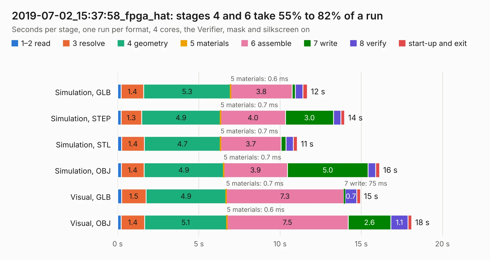

| Mode and format | 1–2 read | 3 resolve | 4 geometry | 5 materials | 6 assemble | 7 write | 8 verify | start-up and exit | Total |
|---|---:|---:|---:|---:|---:|---:|---:|---:|---:|
| Simulation, GLB | 0.2 | 1.4 | 5.3 | 0.6&nbsp;ms | 3.8 | 0.2 | 0.5 | 0.3 | 11.7 |
| Simulation, STEP | 0.2 | 1.3 | 4.9 | 0.7&nbsp;ms | 4.0 | 3.0 | 0.5 | 0.2 | 14.0 |
| Simulation, STL | 0.2 | 1.4 | 4.7 | 0.7&nbsp;ms | 3.7 | 0.3 | 0.5 | 0.2 | 11.1 |
| Simulation, OBJ | 0.2 | 1.4 | 4.9 | 0.7&nbsp;ms | 3.9 | 5.0 | 0.5 | 0.2 | 16.1 |
| Visual, GLB | 0.2 | 1.5 | 4.9 | 0.7&nbsp;ms | 7.3 | 75&nbsp;ms | 0.7 | 0.2 | 14.9 |
| Visual, OBJ | 0.2 | 1.4 | 5.1 | 0.6&nbsp;ms | 7.5 | 2.6 | 1.1 | 0.2 | 18.1 |

<table align="center"><tr><td valign="top">

| Board | Repo: [Wren6991/Snowflake-FPGA](https://github.com/Wren6991/Snowflake-FPGA) Board: `2019-07-02_15:37:58_fpga_hat.kicad_pcb` |
|---|---|
| Folder | timelapse |
| Complexity | 244&nbsp;/&nbsp;1000 (size&nbsp;209, features&nbsp;35) |
| KESE&nbsp;features | through vias, rounded, trapezoid or chamfered pads, curved board outline |
| Tested | 9th November 2026 |
| Copper&nbsp;layers | 4 |
| File&nbsp;format | KiCad 5 (20171130) |
| Parts,&nbsp;tracks,&nbsp;vias | 81, 28, 13 |
| Triangles,&nbsp;simulation | 1,051,284 in 150 parts |
| Verifier | PASS in all six runs |

</td><td valign="top">

<table>
<tr><th>File type</th><th>File size</th><th>Peak memory used</th></tr>
<tr><th colspan="3" align="left">Simulation</th></tr>
<tr><td>GLB</td><td align="right">35&nbsp;MB</td><td align="right">413&nbsp;MB</td></tr>
<tr><td>STEP</td><td align="right">165&nbsp;MB</td><td align="right">529&nbsp;MB</td></tr>
<tr><td>STL</td><td align="right">53&nbsp;MB</td><td align="right">451&nbsp;MB</td></tr>
<tr><td>OBJ</td><td align="right">107&nbsp;MB</td><td align="right">754&nbsp;MB</td></tr>
<tr><th colspan="3" align="left">Visual</th></tr>
<tr><td>GLB</td><td align="right">19&nbsp;MB</td><td align="right">495&nbsp;MB</td></tr>
<tr><td>OBJ</td><td align="right">55&nbsp;MB</td><td align="right">491&nbsp;MB</td></tr>
</table>

</td></tr></table>

## 3045. 2019-07-02_15:42:42_fpga_hat

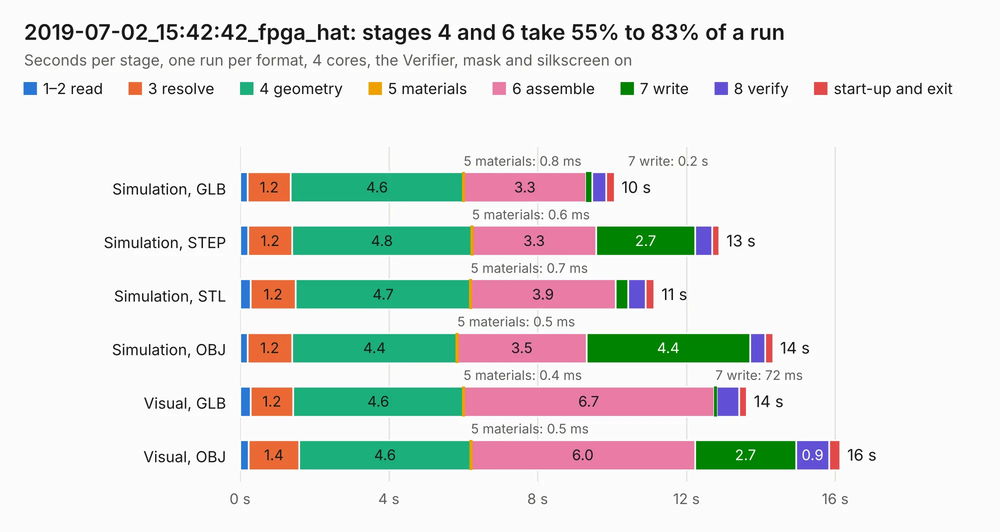

| Mode and format | 1–2 read | 3 resolve | 4 geometry | 5 materials | 6 assemble | 7 write | 8 verify | start-up and exit | Total |
|---|---:|---:|---:|---:|---:|---:|---:|---:|---:|
| Simulation, GLB | 0.2 | 1.2 | 4.6 | 0.8&nbsp;ms | 3.3 | 0.2 | 0.4 | 0.2 | 10.1 |
| Simulation, STEP | 0.2 | 1.2 | 4.8 | 0.6&nbsp;ms | 3.3 | 2.7 | 0.5 | 0.2 | 12.9 |
| Simulation, STL | 0.3 | 1.2 | 4.7 | 0.7&nbsp;ms | 3.9 | 0.3 | 0.5 | 0.2 | 11.1 |
| Simulation, OBJ | 0.2 | 1.2 | 4.4 | 0.5&nbsp;ms | 3.5 | 4.4 | 0.4 | 0.2 | 14.3 |
| Visual, GLB | 0.3 | 1.2 | 4.6 | 0.4&nbsp;ms | 6.7 | 72&nbsp;ms | 0.6 | 0.2 | 13.6 |
| Visual, OBJ | 0.2 | 1.4 | 4.6 | 0.5&nbsp;ms | 6.0 | 2.7 | 0.9 | 0.3 | 16.1 |

<table align="center"><tr><td valign="top">

| Board | Repo: [Wren6991/Snowflake-FPGA](https://github.com/Wren6991/Snowflake-FPGA) Board: `2019-07-02_15:42:42_fpga_hat.kicad_pcb` |
|---|---|
| Folder | timelapse |
| Complexity | 264&nbsp;/&nbsp;1000 (size&nbsp;209, features&nbsp;55) |
| KESE&nbsp;features | through vias, rounded, trapezoid or chamfered pads, filled zones, curved board outline |
| Tested | 9th November 2026 |
| Copper&nbsp;layers | 4 |
| File&nbsp;format | KiCad 5 (20171130) |
| Parts,&nbsp;tracks,&nbsp;vias | 81, 28, 13 |
| Triangles,&nbsp;simulation | 1,080,820 in 150 parts |
| Verifier | PASS in all six runs |

</td><td valign="top">

<table>
<tr><th>File type</th><th>File size</th><th>Peak memory used</th></tr>
<tr><th colspan="3" align="left">Simulation</th></tr>
<tr><td>GLB</td><td align="right">36&nbsp;MB</td><td align="right">414&nbsp;MB</td></tr>
<tr><td>STEP</td><td align="right">169&nbsp;MB</td><td align="right">521&nbsp;MB</td></tr>
<tr><td>STL</td><td align="right">54&nbsp;MB</td><td align="right">414&nbsp;MB</td></tr>
<tr><td>OBJ</td><td align="right">110&nbsp;MB</td><td align="right">783&nbsp;MB</td></tr>
<tr><th colspan="3" align="left">Visual</th></tr>
<tr><td>GLB</td><td align="right">19&nbsp;MB</td><td align="right">475&nbsp;MB</td></tr>
<tr><td>OBJ</td><td align="right">55&nbsp;MB</td><td align="right">492&nbsp;MB</td></tr>
</table>

</td></tr></table>

## 3046. 2019-07-02_15:44:50_fpga_hat

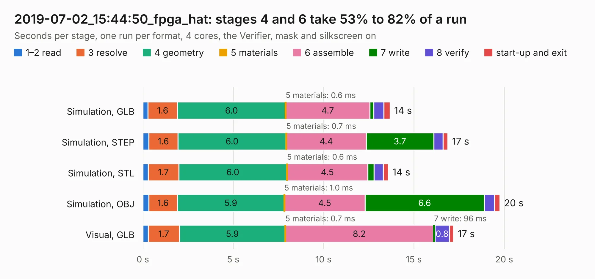

| Mode and format | 1–2 read | 3 resolve | 4 geometry | 5 materials | 6 assemble | 7 write | 8 verify | start-up and exit | Total |
|---|---:|---:|---:|---:|---:|---:|---:|---:|---:|
| Simulation, GLB | 0.3 | 1.6 | 6.0 | 0.6&nbsp;ms | 4.7 | 0.2 | 0.6 | 0.3 | 13.7 |
| Simulation, STEP | 0.3 | 1.6 | 6.0 | 0.7&nbsp;ms | 4.4 | 3.7 | 0.5 | 0.3 | 16.9 |
| Simulation, STL | 0.3 | 1.7 | 6.0 | 0.6&nbsp;ms | 4.5 | 0.3 | 0.5 | 0.3 | 13.6 |
| Simulation, OBJ | 0.3 | 1.6 | 5.9 | 1.0&nbsp;ms | 4.5 | 6.6 | 0.6 | 0.3 | 19.8 |
| Visual, GLB | 0.3 | 1.7 | 5.9 | 0.7&nbsp;ms | 8.2 | 96&nbsp;ms | 0.8 | 0.2 | 17.2 |
| Visual, OBJ | 0.3 | 1.6 | 6.1 | 0.8&nbsp;ms | 8.1 | 3.2 | 0.8 | 0.3 | 20.3 |

<table align="center"><tr><td valign="top">

| Board | Repo: [Wren6991/Snowflake-FPGA](https://github.com/Wren6991/Snowflake-FPGA) Board: `2019-07-02_15:44:50_fpga_hat.kicad_pcb` |
|---|---|
| Folder | timelapse |
| Complexity | 244&nbsp;/&nbsp;1000 (size&nbsp;209, features&nbsp;35) |
| KESE&nbsp;features | through vias, rounded, trapezoid or chamfered pads, curved board outline |
| Tested | 10th November 2026 |
| Copper&nbsp;layers | 4 |
| File&nbsp;format | KiCad 5 (20171130) |
| Parts,&nbsp;tracks,&nbsp;vias | 81, 28, 13 |
| Triangles,&nbsp;simulation | 1,051,284 in 150 parts |
| Verifier | PASS in all six runs |

</td><td valign="top">

<table>
<tr><th>File type</th><th>File size</th><th>Peak memory used</th></tr>
<tr><th colspan="3" align="left">Simulation</th></tr>
<tr><td>GLB</td><td align="right">35&nbsp;MB</td><td align="right">404&nbsp;MB</td></tr>
<tr><td>STEP</td><td align="right">165&nbsp;MB</td><td align="right">530&nbsp;MB</td></tr>
<tr><td>STL</td><td align="right">53&nbsp;MB</td><td align="right">411&nbsp;MB</td></tr>
<tr><td>OBJ</td><td align="right">107&nbsp;MB</td><td align="right">747&nbsp;MB</td></tr>
<tr><th colspan="3" align="left">Visual</th></tr>
<tr><td>GLB</td><td align="right">19&nbsp;MB</td><td align="right">484&nbsp;MB</td></tr>
<tr><td>OBJ</td><td align="right">55&nbsp;MB</td><td align="right">494&nbsp;MB</td></tr>
</table>

</td></tr></table>

## 3047. 2019-07-02_15:48:31_fpga_hat

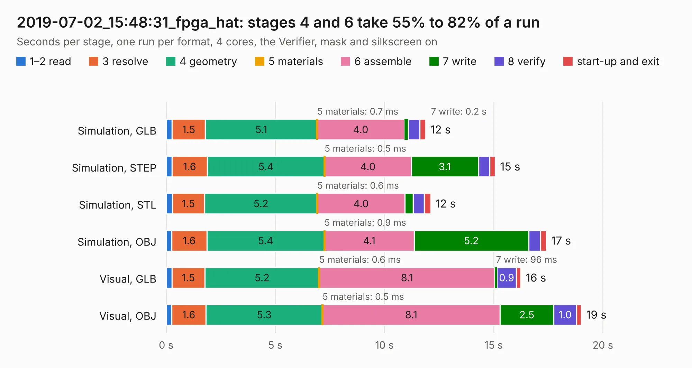

| Mode and format | 1–2 read | 3 resolve | 4 geometry | 5 materials | 6 assemble | 7 write | 8 verify | start-up and exit | Total |
|---|---:|---:|---:|---:|---:|---:|---:|---:|---:|
| Simulation, GLB | 0.3 | 1.5 | 5.1 | 0.7&nbsp;ms | 4.0 | 0.2 | 0.5 | 0.3 | 11.9 |
| Simulation, STEP | 0.3 | 1.6 | 5.4 | 0.5&nbsp;ms | 4.0 | 3.1 | 0.5 | 0.2 | 15.1 |
| Simulation, STL | 0.3 | 1.5 | 5.2 | 0.6&nbsp;ms | 4.0 | 0.4 | 0.5 | 0.3 | 12.1 |
| Simulation, OBJ | 0.2 | 1.6 | 5.4 | 0.9&nbsp;ms | 4.1 | 5.2 | 0.6 | 0.3 | 17.4 |
| Visual, GLB | 0.3 | 1.5 | 5.2 | 0.6&nbsp;ms | 8.1 | 96&nbsp;ms | 0.9 | 0.2 | 16.2 |
| Visual, OBJ | 0.3 | 1.6 | 5.3 | 0.5&nbsp;ms | 8.1 | 2.5 | 1.0 | 0.2 | 19.0 |

<table align="center"><tr><td valign="top">

| Board | Repo: [Wren6991/Snowflake-FPGA](https://github.com/Wren6991/Snowflake-FPGA) Board: `2019-07-02_15:48:31_fpga_hat.kicad_pcb` |
|---|---|
| Folder | timelapse |
| Complexity | 264&nbsp;/&nbsp;1000 (size&nbsp;209, features&nbsp;55) |
| KESE&nbsp;features | through vias, rounded, trapezoid or chamfered pads, filled zones, curved board outline |
| Tested | 9th November 2026 |
| Copper&nbsp;layers | 4 |
| File&nbsp;format | KiCad 5 (20171130) |
| Parts,&nbsp;tracks,&nbsp;vias | 81, 28, 13 |
| Triangles,&nbsp;simulation | 1,080,488 in 150 parts |
| Verifier | PASS in all six runs |

</td><td valign="top">

<table>
<tr><th>File type</th><th>File size</th><th>Peak memory used</th></tr>
<tr><th colspan="3" align="left">Simulation</th></tr>
<tr><td>GLB</td><td align="right">36&nbsp;MB</td><td align="right">415&nbsp;MB</td></tr>
<tr><td>STEP</td><td align="right">169&nbsp;MB</td><td align="right">517&nbsp;MB</td></tr>
<tr><td>STL</td><td align="right">54&nbsp;MB</td><td align="right">406&nbsp;MB</td></tr>
<tr><td>OBJ</td><td align="right">110&nbsp;MB</td><td align="right">784&nbsp;MB</td></tr>
<tr><th colspan="3" align="left">Visual</th></tr>
<tr><td>GLB</td><td align="right">19&nbsp;MB</td><td align="right">479&nbsp;MB</td></tr>
<tr><td>OBJ</td><td align="right">55&nbsp;MB</td><td align="right">493&nbsp;MB</td></tr>
</table>

</td></tr></table>

## 3048. 2019-07-02_17:02:16_fpga_hat

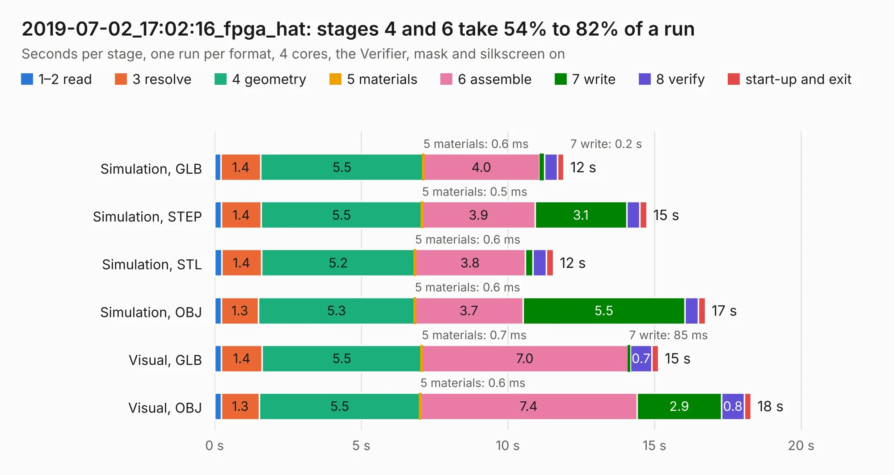

| Mode and format | 1–2 read | 3 resolve | 4 geometry | 5 materials | 6 assemble | 7 write | 8 verify | start-up and exit | Total |
|---|---:|---:|---:|---:|---:|---:|---:|---:|---:|
| Simulation, GLB | 0.2 | 1.4 | 5.5 | 0.6&nbsp;ms | 4.0 | 0.2 | 0.4 | 0.2 | 11.9 |
| Simulation, STEP | 0.2 | 1.4 | 5.5 | 0.5&nbsp;ms | 3.9 | 3.1 | 0.4 | 0.2 | 14.7 |
| Simulation, STL | 0.2 | 1.4 | 5.2 | 0.6&nbsp;ms | 3.8 | 0.3 | 0.5 | 0.2 | 11.6 |
| Simulation, OBJ | 0.2 | 1.3 | 5.3 | 0.6&nbsp;ms | 3.7 | 5.5 | 0.5 | 0.2 | 16.7 |
| Visual, GLB | 0.2 | 1.4 | 5.5 | 0.7&nbsp;ms | 7.0 | 85&nbsp;ms | 0.7 | 0.2 | 15.1 |
| Visual, OBJ | 0.2 | 1.3 | 5.5 | 0.6&nbsp;ms | 7.4 | 2.9 | 0.8 | 0.2 | 18.3 |

<table align="center"><tr><td valign="top">

| Board | Repo: [Wren6991/Snowflake-FPGA](https://github.com/Wren6991/Snowflake-FPGA) Board: `2019-07-02_17:02:16_fpga_hat.kicad_pcb` |
|---|---|
| Folder | timelapse |
| Complexity | 271&nbsp;/&nbsp;1000 (size&nbsp;236, features&nbsp;35) |
| KESE&nbsp;features | through vias, rounded, trapezoid or chamfered pads, curved board outline |
| Tested | 9th November 2026 |
| Copper&nbsp;layers | 4 |
| File&nbsp;format | KiCad 5 (20171130) |
| Parts,&nbsp;tracks,&nbsp;vias | 81, 314, 15 |
| Triangles,&nbsp;simulation | 1,104,480 in 150 parts |
| Verifier | PASS in all six runs |

</td><td valign="top">

<table>
<tr><th>File type</th><th>File size</th><th>Peak memory used</th></tr>
<tr><th colspan="3" align="left">Simulation</th></tr>
<tr><td>GLB</td><td align="right">37&nbsp;MB</td><td align="right">445&nbsp;MB</td></tr>
<tr><td>STEP</td><td align="right">181&nbsp;MB</td><td align="right">560&nbsp;MB</td></tr>
<tr><td>STL</td><td align="right">55&nbsp;MB</td><td align="right">429&nbsp;MB</td></tr>
<tr><td>OBJ</td><td align="right">113&nbsp;MB</td><td align="right">798&nbsp;MB</td></tr>
<tr><th colspan="3" align="left">Visual</th></tr>
<tr><td>GLB</td><td align="right">20&nbsp;MB</td><td align="right">562&nbsp;MB</td></tr>
<tr><td>OBJ</td><td align="right">60&nbsp;MB</td><td align="right">526&nbsp;MB</td></tr>
</table>

</td></tr></table>

## 3049. 2019-07-02_17:04:43_fpga_hat

| Mode and format | 1–2 read | 3 resolve | 4 geometry | 5 materials | 6 assemble | 7 write | 8 verify | start-up and exit | Total |
|---|---:|---:|---:|---:|---:|---:|---:|---:|---:|
| Simulation, GLB | 0.3 | 1.6 | 6.2 | 0.6&nbsp;ms | 4.3 | 0.2 | 0.5 | 0.3 | 13.4 |
| Simulation, STEP | 0.3 | 1.6 | 6.3 | 0.7&nbsp;ms | 4.1 | 3.6 | 0.6 | 0.3 | 16.7 |
| Simulation, STL | 0.3 | 1.5 | 6.4 | 0.6&nbsp;ms | 4.2 | 0.4 | 0.5 | 0.3 | 13.7 |
| Simulation, OBJ | 0.3 | 1.6 | 6.4 | 0.6&nbsp;ms | 4.3 | 6.8 | 0.6 | 0.2 | 20.2 |
| Visual, GLB | 0.3 | 1.6 | 6.2 | 0.6&nbsp;ms | 8.3 | 0.1 | 1.0 | 0.3 | 17.8 |
| Visual, OBJ | 0.3 | 1.5 | 6.3 | 1.0&nbsp;ms | 8.3 | 3.4 | 1.0 | 0.2 | 21.1 |

<table align="center"><tr><td valign="top">

| Board | Repo: [Wren6991/Snowflake-FPGA](https://github.com/Wren6991/Snowflake-FPGA) Board: `2019-07-02_17:04:43_fpga_hat.kicad_pcb` |
|---|---|
| Folder | timelapse |
| Complexity | 271&nbsp;/&nbsp;1000 (size&nbsp;236, features&nbsp;35) |
| KESE&nbsp;features | through vias, rounded, trapezoid or chamfered pads, curved board outline |
| Tested | 9th November 2026 |
| Copper&nbsp;layers | 4 |
| File&nbsp;format | KiCad 5 (20171130) |
| Parts,&nbsp;tracks,&nbsp;vias | 81, 314, 15 |
| Triangles,&nbsp;simulation | 1,105,008 in 150 parts |
| Verifier | PASS in all six runs |

</td><td valign="top">

<table>
<tr><th>File type</th><th>File size</th><th>Peak memory used</th></tr>
<tr><th colspan="3" align="left">Simulation</th></tr>
<tr><td>GLB</td><td align="right">37&nbsp;MB</td><td align="right">423&nbsp;MB</td></tr>
<tr><td>STEP</td><td align="right">181&nbsp;MB</td><td align="right">549&nbsp;MB</td></tr>
<tr><td>STL</td><td align="right">55&nbsp;MB</td><td align="right">449&nbsp;MB</td></tr>
<tr><td>OBJ</td><td align="right">113&nbsp;MB</td><td align="right">783&nbsp;MB</td></tr>
<tr><th colspan="3" align="left">Visual</th></tr>
<tr><td>GLB</td><td align="right">20&nbsp;MB</td><td align="right">513&nbsp;MB</td></tr>
<tr><td>OBJ</td><td align="right">61&nbsp;MB</td><td align="right">526&nbsp;MB</td></tr>
</table>

</td></tr></table>

## 3050. 2019-07-02_17:57:29_fpga_hat

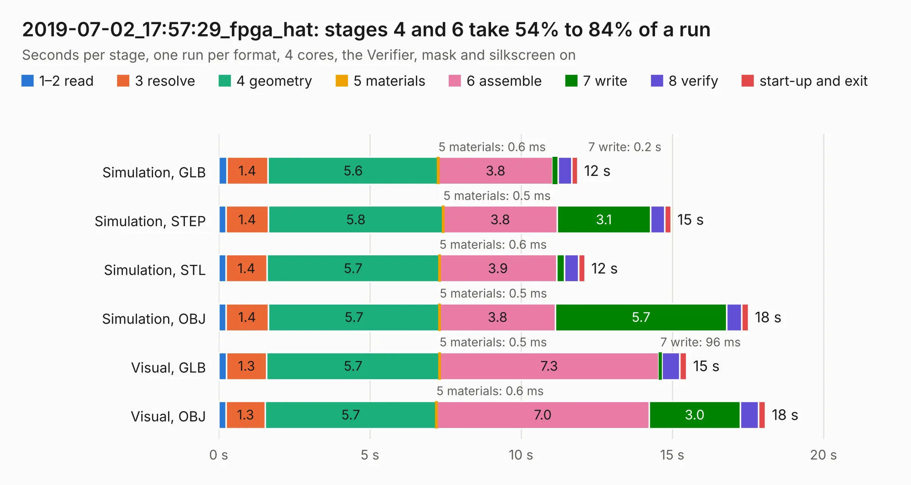

| Mode and format | 1–2 read | 3 resolve | 4 geometry | 5 materials | 6 assemble | 7 write | 8 verify | start-up and exit | Total |
|---|---:|---:|---:|---:|---:|---:|---:|---:|---:|
| Simulation, GLB | 0.3 | 1.4 | 5.6 | 0.6&nbsp;ms | 3.8 | 0.2 | 0.5 | 0.2 | 11.9 |
| Simulation, STEP | 0.2 | 1.4 | 5.8 | 0.5&nbsp;ms | 3.8 | 3.1 | 0.5 | 0.2 | 15.0 |
| Simulation, STL | 0.2 | 1.4 | 5.7 | 0.6&nbsp;ms | 3.9 | 0.3 | 0.5 | 0.2 | 12.1 |
| Simulation, OBJ | 0.2 | 1.4 | 5.7 | 0.5&nbsp;ms | 3.8 | 5.7 | 0.5 | 0.2 | 17.5 |
| Visual, GLB | 0.3 | 1.3 | 5.7 | 0.5&nbsp;ms | 7.3 | 96&nbsp;ms | 0.6 | 0.2 | 15.5 |
| Visual, OBJ | 0.2 | 1.3 | 5.7 | 0.6&nbsp;ms | 7.0 | 3.0 | 0.6 | 0.2 | 18.1 |

<table align="center"><tr><td valign="top">

| Board | Repo: [Wren6991/Snowflake-FPGA](https://github.com/Wren6991/Snowflake-FPGA) Board: `2019-07-02_17:57:29_fpga_hat.kicad_pcb` |
|---|---|
| Folder | timelapse |
| Complexity | 274&nbsp;/&nbsp;1000 (size&nbsp;239, features&nbsp;35) |
| KESE&nbsp;features | through vias, rounded, trapezoid or chamfered pads, curved board outline |
| Tested | 9th November 2026 |
| Copper&nbsp;layers | 4 |
| File&nbsp;format | KiCad 5 (20171130) |
| Parts,&nbsp;tracks,&nbsp;vias | 81, 369, 15 |
| Triangles,&nbsp;simulation | 1,111,608 in 150 parts |
| Verifier | PASS in all six runs |

</td><td valign="top">

<table>
<tr><th>File type</th><th>File size</th><th>Peak memory used</th></tr>
<tr><th colspan="3" align="left">Simulation</th></tr>
<tr><td>GLB</td><td align="right">38&nbsp;MB</td><td align="right">424&nbsp;MB</td></tr>
<tr><td>STEP</td><td align="right">183&nbsp;MB</td><td align="right">577&nbsp;MB</td></tr>
<tr><td>STL</td><td align="right">56&nbsp;MB</td><td align="right">439&nbsp;MB</td></tr>
<tr><td>OBJ</td><td align="right">114&nbsp;MB</td><td align="right">779&nbsp;MB</td></tr>
<tr><th colspan="3" align="left">Visual</th></tr>
<tr><td>GLB</td><td align="right">21&nbsp;MB</td><td align="right">548&nbsp;MB</td></tr>
<tr><td>OBJ</td><td align="right">61&nbsp;MB</td><td align="right">553&nbsp;MB</td></tr>
</table>

</td></tr></table>

## 3051. 2019-07-02_18:04:43_fpga_hat

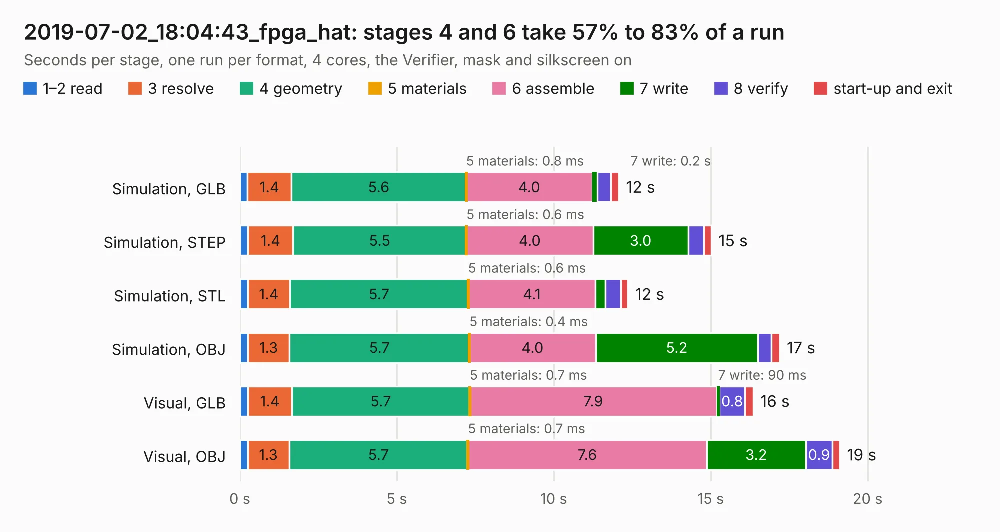

| Mode and format | 1–2 read | 3 resolve | 4 geometry | 5 materials | 6 assemble | 7 write | 8 verify | start-up and exit | Total |
|---|---:|---:|---:|---:|---:|---:|---:|---:|---:|
| Simulation, GLB | 0.2 | 1.4 | 5.6 | 0.8&nbsp;ms | 4.0 | 0.2 | 0.4 | 0.3 | 12.1 |
| Simulation, STEP | 0.3 | 1.4 | 5.5 | 0.6&nbsp;ms | 4.0 | 3.0 | 0.5 | 0.2 | 15.0 |
| Simulation, STL | 0.2 | 1.4 | 5.7 | 0.6&nbsp;ms | 4.1 | 0.3 | 0.5 | 0.2 | 12.4 |
| Simulation, OBJ | 0.2 | 1.3 | 5.7 | 0.4&nbsp;ms | 4.0 | 5.2 | 0.4 | 0.3 | 17.2 |
| Visual, GLB | 0.3 | 1.4 | 5.7 | 0.7&nbsp;ms | 7.9 | 90&nbsp;ms | 0.8 | 0.3 | 16.4 |
| Visual, OBJ | 0.2 | 1.3 | 5.7 | 0.7&nbsp;ms | 7.6 | 3.2 | 0.9 | 0.2 | 19.1 |

<table align="center"><tr><td valign="top">

| Board | Repo: [Wren6991/Snowflake-FPGA](https://github.com/Wren6991/Snowflake-FPGA) Board: `2019-07-02_18:04:43_fpga_hat.kicad_pcb` |
|---|---|
| Folder | timelapse |
| Complexity | 275&nbsp;/&nbsp;1000 (size&nbsp;240, features&nbsp;35) |
| KESE&nbsp;features | through vias, rounded, trapezoid or chamfered pads, curved board outline |
| Tested | 9th November 2026 |
| Copper&nbsp;layers | 4 |
| File&nbsp;format | KiCad 5 (20171130) |
| Parts,&nbsp;tracks,&nbsp;vias | 81, 403, 16 |
| Triangles,&nbsp;simulation | 1,121,362 in 150 parts |
| Verifier | PASS in all six runs |

</td><td valign="top">

<table>
<tr><th>File type</th><th>File size</th><th>Peak memory used</th></tr>
<tr><th colspan="3" align="left">Simulation</th></tr>
<tr><td>GLB</td><td align="right">38&nbsp;MB</td><td align="right">461&nbsp;MB</td></tr>
<tr><td>STEP</td><td align="right">185&nbsp;MB</td><td align="right">561&nbsp;MB</td></tr>
<tr><td>STL</td><td align="right">56&nbsp;MB</td><td align="right">471&nbsp;MB</td></tr>
<tr><td>OBJ</td><td align="right">115&nbsp;MB</td><td align="right">795&nbsp;MB</td></tr>
<tr><th colspan="3" align="left">Visual</th></tr>
<tr><td>GLB</td><td align="right">21&nbsp;MB</td><td align="right">506&nbsp;MB</td></tr>
<tr><td>OBJ</td><td align="right">62&nbsp;MB</td><td align="right">538&nbsp;MB</td></tr>
</table>

</td></tr></table>

## 3052. 2019-07-02_18:08:42_fpga_hat

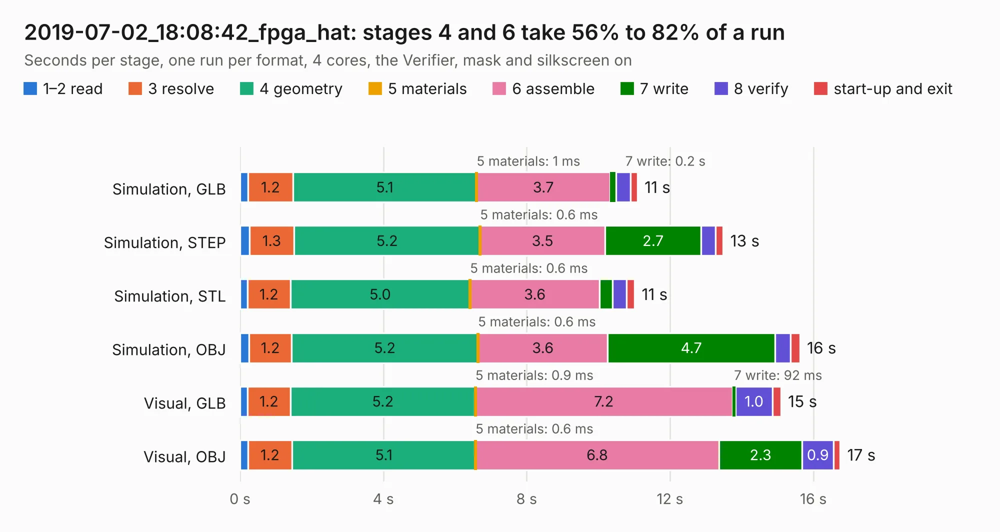

| Mode and format | 1–2 read | 3 resolve | 4 geometry | 5 materials | 6 assemble | 7 write | 8 verify | start-up and exit | Total |
|---|---:|---:|---:|---:|---:|---:|---:|---:|---:|
| Simulation, GLB | 0.2 | 1.2 | 5.1 | 1&nbsp;ms | 3.7 | 0.2 | 0.4 | 0.2 | 11.1 |
| Simulation, STEP | 0.3 | 1.3 | 5.2 | 0.6&nbsp;ms | 3.5 | 2.7 | 0.4 | 0.2 | 13.5 |
| Simulation, STL | 0.2 | 1.2 | 5.0 | 0.6&nbsp;ms | 3.6 | 0.4 | 0.4 | 0.2 | 11.0 |
| Simulation, OBJ | 0.3 | 1.2 | 5.2 | 0.6&nbsp;ms | 3.6 | 4.7 | 0.4 | 0.3 | 15.6 |
| Visual, GLB | 0.2 | 1.2 | 5.2 | 0.9&nbsp;ms | 7.2 | 92&nbsp;ms | 1.0 | 0.2 | 15.1 |
| Visual, OBJ | 0.2 | 1.2 | 5.1 | 0.6&nbsp;ms | 6.8 | 2.3 | 0.9 | 0.2 | 16.7 |

<table align="center"><tr><td valign="top">

| Board | Repo: [Wren6991/Snowflake-FPGA](https://github.com/Wren6991/Snowflake-FPGA) Board: `2019-07-02_18:08:42_fpga_hat.kicad_pcb` |
|---|---|
| Folder | timelapse |
| Complexity | 275&nbsp;/&nbsp;1000 (size&nbsp;240, features&nbsp;35) |
| KESE&nbsp;features | through vias, rounded, trapezoid or chamfered pads, curved board outline |
| Tested | 9th November 2026 |
| Copper&nbsp;layers | 4 |
| File&nbsp;format | KiCad 5 (20171130) |
| Parts,&nbsp;tracks,&nbsp;vias | 81, 413, 16 |
| Triangles,&nbsp;simulation | 1,122,554 in 150 parts |
| Verifier | PASS in all six runs |

</td><td valign="top">

<table>
<tr><th>File type</th><th>File size</th><th>Peak memory used</th></tr>
<tr><th colspan="3" align="left">Simulation</th></tr>
<tr><td>GLB</td><td align="right">38&nbsp;MB</td><td align="right">443&nbsp;MB</td></tr>
<tr><td>STEP</td><td align="right">185&nbsp;MB</td><td align="right">563&nbsp;MB</td></tr>
<tr><td>STL</td><td align="right">56&nbsp;MB</td><td align="right">457&nbsp;MB</td></tr>
<tr><td>OBJ</td><td align="right">115&nbsp;MB</td><td align="right">790&nbsp;MB</td></tr>
<tr><th colspan="3" align="left">Visual</th></tr>
<tr><td>GLB</td><td align="right">21&nbsp;MB</td><td align="right">554&nbsp;MB</td></tr>
<tr><td>OBJ</td><td align="right">62&nbsp;MB</td><td align="right">560&nbsp;MB</td></tr>
</table>

</td></tr></table>

## 3053. 2019-07-02_18:15:30_fpga_hat

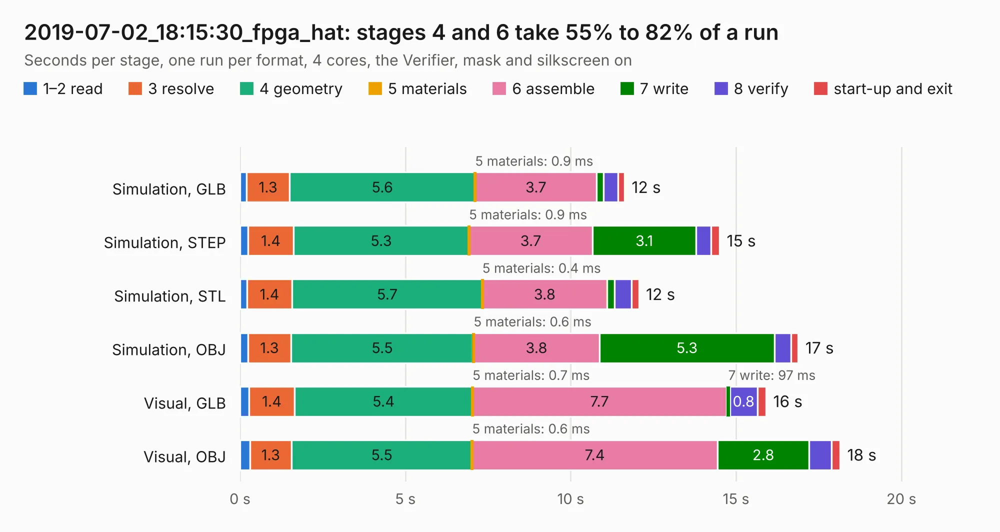

| Mode and format | 1–2 read | 3 resolve | 4 geometry | 5 materials | 6 assemble | 7 write | 8 verify | start-up and exit | Total |
|---|---:|---:|---:|---:|---:|---:|---:|---:|---:|
| Simulation, GLB | 0.2 | 1.3 | 5.6 | 0.9&nbsp;ms | 3.7 | 0.2 | 0.4 | 0.2 | 11.6 |
| Simulation, STEP | 0.2 | 1.4 | 5.3 | 0.9&nbsp;ms | 3.7 | 3.1 | 0.5 | 0.3 | 14.5 |
| Simulation, STL | 0.2 | 1.4 | 5.7 | 0.4&nbsp;ms | 3.8 | 0.2 | 0.5 | 0.2 | 12.1 |
| Simulation, OBJ | 0.2 | 1.3 | 5.5 | 0.6&nbsp;ms | 3.8 | 5.3 | 0.5 | 0.2 | 16.9 |
| Visual, GLB | 0.3 | 1.4 | 5.4 | 0.7&nbsp;ms | 7.7 | 97&nbsp;ms | 0.8 | 0.3 | 15.9 |
| Visual, OBJ | 0.3 | 1.3 | 5.5 | 0.6&nbsp;ms | 7.4 | 2.8 | 0.7 | 0.3 | 18.1 |

<table align="center"><tr><td valign="top">

| Board | Repo: [Wren6991/Snowflake-FPGA](https://github.com/Wren6991/Snowflake-FPGA) Board: `2019-07-02_18:15:30_fpga_hat.kicad_pcb` |
|---|---|
| Folder | timelapse |
| Complexity | 277&nbsp;/&nbsp;1000 (size&nbsp;242, features&nbsp;35) |
| KESE&nbsp;features | through vias, rounded, trapezoid or chamfered pads, curved board outline |
| Tested | 9th November 2026 |
| Copper&nbsp;layers | 4 |
| File&nbsp;format | KiCad 5 (20171130) |
| Parts,&nbsp;tracks,&nbsp;vias | 81, 472, 16 |
| Triangles,&nbsp;simulation | 1,131,028 in 150 parts |
| Verifier | PASS in all six runs |

</td><td valign="top">

<table>
<tr><th>File type</th><th>File size</th><th>Peak memory used</th></tr>
<tr><th colspan="3" align="left">Simulation</th></tr>
<tr><td>GLB</td><td align="right">38&nbsp;MB</td><td align="right">456&nbsp;MB</td></tr>
<tr><td>STEP</td><td align="right">188&nbsp;MB</td><td align="right">580&nbsp;MB</td></tr>
<tr><td>STL</td><td align="right">57&nbsp;MB</td><td align="right">471&nbsp;MB</td></tr>
<tr><td>OBJ</td><td align="right">116&nbsp;MB</td><td align="right">800&nbsp;MB</td></tr>
<tr><th colspan="3" align="left">Visual</th></tr>
<tr><td>GLB</td><td align="right">21&nbsp;MB</td><td align="right">560&nbsp;MB</td></tr>
<tr><td>OBJ</td><td align="right">63&nbsp;MB</td><td align="right">531&nbsp;MB</td></tr>
</table>

</td></tr></table>

## 3054. 2019-07-02_18:19:44_fpga_hat

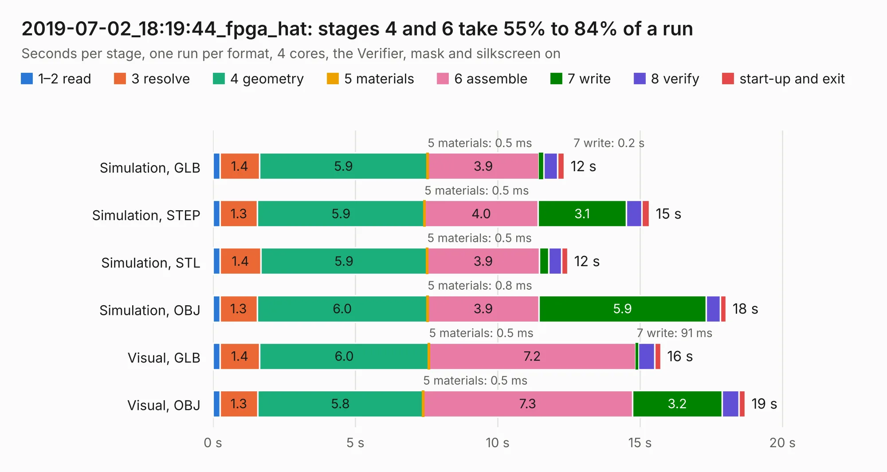

| Mode and format | 1–2 read | 3 resolve | 4 geometry | 5 materials | 6 assemble | 7 write | 8 verify | start-up and exit | Total |
|---|---:|---:|---:|---:|---:|---:|---:|---:|---:|
| Simulation, GLB | 0.3 | 1.4 | 5.9 | 0.5&nbsp;ms | 3.9 | 0.2 | 0.5 | 0.2 | 12.3 |
| Simulation, STEP | 0.3 | 1.3 | 5.9 | 0.5&nbsp;ms | 4.0 | 3.1 | 0.5 | 0.3 | 15.3 |
| Simulation, STL | 0.3 | 1.4 | 5.9 | 0.5&nbsp;ms | 3.9 | 0.3 | 0.5 | 0.2 | 12.5 |
| Simulation, OBJ | 0.2 | 1.3 | 6.0 | 0.8&nbsp;ms | 3.9 | 5.9 | 0.5 | 0.2 | 18.0 |
| Visual, GLB | 0.2 | 1.4 | 6.0 | 0.5&nbsp;ms | 7.2 | 91&nbsp;ms | 0.6 | 0.2 | 15.7 |
| Visual, OBJ | 0.2 | 1.3 | 5.8 | 0.5&nbsp;ms | 7.3 | 3.2 | 0.6 | 0.2 | 18.7 |

<table align="center"><tr><td valign="top">

| Board | Repo: [Wren6991/Snowflake-FPGA](https://github.com/Wren6991/Snowflake-FPGA) Board: `2019-07-02_18:19:44_fpga_hat.kicad_pcb` |
|---|---|
| Folder | timelapse |
| Complexity | 278&nbsp;/&nbsp;1000 (size&nbsp;243, features&nbsp;35) |
| KESE&nbsp;features | through vias, rounded, trapezoid or chamfered pads, curved board outline |
| Tested | 9th November 2026 |
| Copper&nbsp;layers | 4 |
| File&nbsp;format | KiCad 5 (20171130) |
| Parts,&nbsp;tracks,&nbsp;vias | 81, 493, 16 |
| Triangles,&nbsp;simulation | 1,133,566 in 150 parts |
| Verifier | PASS in all six runs |

</td><td valign="top">

<table>
<tr><th>File type</th><th>File size</th><th>Peak memory used</th></tr>
<tr><th colspan="3" align="left">Simulation</th></tr>
<tr><td>GLB</td><td align="right">38&nbsp;MB</td><td align="right">481&nbsp;MB</td></tr>
<tr><td>STEP</td><td align="right">189&nbsp;MB</td><td align="right">586&nbsp;MB</td></tr>
<tr><td>STL</td><td align="right">57&nbsp;MB</td><td align="right">436&nbsp;MB</td></tr>
<tr><td>OBJ</td><td align="right">116&nbsp;MB</td><td align="right">805&nbsp;MB</td></tr>
<tr><th colspan="3" align="left">Visual</th></tr>
<tr><td>GLB</td><td align="right">21&nbsp;MB</td><td align="right">528&nbsp;MB</td></tr>
<tr><td>OBJ</td><td align="right">63&nbsp;MB</td><td align="right">532&nbsp;MB</td></tr>
</table>

</td></tr></table>

## 3055. 2019-07-02_18:26:57_fpga_hat

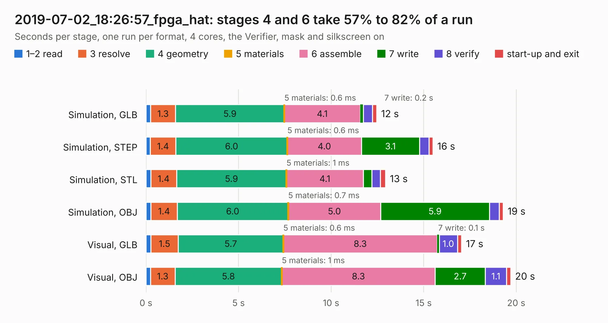

| Mode and format | 1–2 read | 3 resolve | 4 geometry | 5 materials | 6 assemble | 7 write | 8 verify | start-up and exit | Total |
|---|---:|---:|---:|---:|---:|---:|---:|---:|---:|
| Simulation, GLB | 0.2 | 1.3 | 5.9 | 0.6&nbsp;ms | 4.1 | 0.2 | 0.5 | 0.2 | 12.5 |
| Simulation, STEP | 0.2 | 1.4 | 6.0 | 0.6&nbsp;ms | 4.0 | 3.1 | 0.5 | 0.2 | 15.5 |
| Simulation, STL | 0.3 | 1.4 | 5.9 | 1&nbsp;ms | 4.1 | 0.5 | 0.5 | 0.3 | 12.9 |
| Simulation, OBJ | 0.3 | 1.4 | 6.0 | 0.7&nbsp;ms | 5.0 | 5.9 | 0.5 | 0.2 | 19.3 |
| Visual, GLB | 0.3 | 1.5 | 5.7 | 0.6&nbsp;ms | 8.3 | 0.1 | 1.0 | 0.2 | 17.1 |
| Visual, OBJ | 0.2 | 1.3 | 5.8 | 1&nbsp;ms | 8.3 | 2.7 | 1.1 | 0.2 | 19.7 |

<table align="center"><tr><td valign="top">

| Board | Repo: [Wren6991/Snowflake-FPGA](https://github.com/Wren6991/Snowflake-FPGA) Board: `2019-07-02_18:26:57_fpga_hat.kicad_pcb` |
|---|---|
| Folder | timelapse |
| Complexity | 279&nbsp;/&nbsp;1000 (size&nbsp;244, features&nbsp;35) |
| KESE&nbsp;features | through vias, rounded, trapezoid or chamfered pads, curved board outline |
| Tested | 9th November 2026 |
| Copper&nbsp;layers | 4 |
| File&nbsp;format | KiCad 5 (20171130) |
| Parts,&nbsp;tracks,&nbsp;vias | 81, 516, 16 |
| Triangles,&nbsp;simulation | 1,136,668 in 150 parts |
| Verifier | PASS in all six runs |

</td><td valign="top">

<table>
<tr><th>File type</th><th>File size</th><th>Peak memory used</th></tr>
<tr><th colspan="3" align="left">Simulation</th></tr>
<tr><td>GLB</td><td align="right">39&nbsp;MB</td><td align="right">436&nbsp;MB</td></tr>
<tr><td>STEP</td><td align="right">189&nbsp;MB</td><td align="right">559&nbsp;MB</td></tr>
<tr><td>STL</td><td align="right">57&nbsp;MB</td><td align="right">471&nbsp;MB</td></tr>
<tr><td>OBJ</td><td align="right">117&nbsp;MB</td><td align="right">812&nbsp;MB</td></tr>
<tr><th colspan="3" align="left">Visual</th></tr>
<tr><td>GLB</td><td align="right">21&nbsp;MB</td><td align="right">598&nbsp;MB</td></tr>
<tr><td>OBJ</td><td align="right">64&nbsp;MB</td><td align="right">564&nbsp;MB</td></tr>
</table>

</td></tr></table>

## 3056. 2019-07-02_18:32:13_fpga_hat

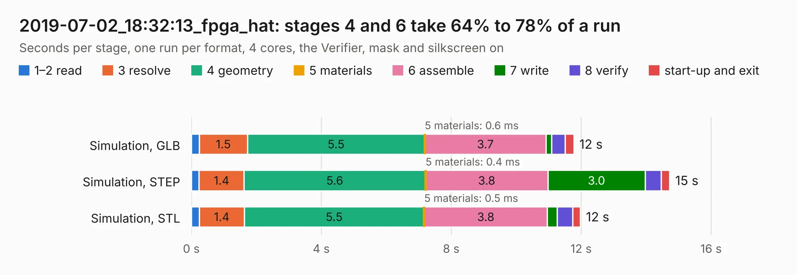

| Mode and format | 1–2 read | 3 resolve | 4 geometry | 5 materials | 6 assemble | 7 write | 8 verify | start-up and exit | Total |
|---|---:|---:|---:|---:|---:|---:|---:|---:|---:|
| Simulation, GLB | 0.2 | 1.5 | 5.5 | 0.6&nbsp;ms | 3.7 | 0.2 | 0.4 | 0.3 | 11.8 |
| Simulation, STEP | 0.2 | 1.4 | 5.6 | 0.4&nbsp;ms | 3.8 | 3.0 | 0.5 | 0.3 | 14.7 |
| Simulation, STL | 0.2 | 1.4 | 5.5 | 0.5&nbsp;ms | 3.8 | 0.3 | 0.5 | 0.2 | 12.0 |
| Simulation, OBJ | 0.3 | 1.4 | 5.7 | 0.6&nbsp;ms | 3.7 | 5.4 | 0.5 | 0.2 | 17.1 |
| Visual, GLB | 0.2 | 1.3 | 5.4 | 0.6&nbsp;ms | 7.6 | 94&nbsp;ms | 0.7 | 0.2 | 15.5 |
| Visual, OBJ | 0.2 | 1.3 | 5.6 | 0.6&nbsp;ms | 8.0 | 2.5 | 1.0 | 0.2 | 18.8 |

<table align="center"><tr><td valign="top">

| Board | Repo: [Wren6991/Snowflake-FPGA](https://github.com/Wren6991/Snowflake-FPGA) Board: `2019-07-02_18:32:13_fpga_hat.kicad_pcb` |
|---|---|
| Folder | timelapse |
| Complexity | 279&nbsp;/&nbsp;1000 (size&nbsp;244, features&nbsp;35) |
| KESE&nbsp;features | through vias, rounded, trapezoid or chamfered pads, curved board outline |
| Tested | 9th November 2026 |
| Copper&nbsp;layers | 4 |
| File&nbsp;format | KiCad 5 (20171130) |
| Parts,&nbsp;tracks,&nbsp;vias | 81, 528, 16 |
| Triangles,&nbsp;simulation | 1,137,620 in 150 parts |
| Verifier | PASS in all six runs |

</td><td valign="top">

<table>
<tr><th>File type</th><th>File size</th><th>Peak memory used</th></tr>
<tr><th colspan="3" align="left">Simulation</th></tr>
<tr><td>GLB</td><td align="right">39&nbsp;MB</td><td align="right">468&nbsp;MB</td></tr>
<tr><td>STEP</td><td align="right">190&nbsp;MB</td><td align="right">587&nbsp;MB</td></tr>
<tr><td>STL</td><td align="right">57&nbsp;MB</td><td align="right">470&nbsp;MB</td></tr>
<tr><td>OBJ</td><td align="right">117&nbsp;MB</td><td align="right">827&nbsp;MB</td></tr>
<tr><th colspan="3" align="left">Visual</th></tr>
<tr><td>GLB</td><td align="right">21&nbsp;MB</td><td align="right">555&nbsp;MB</td></tr>
<tr><td>OBJ</td><td align="right">64&nbsp;MB</td><td align="right">565&nbsp;MB</td></tr>
</table>

</td></tr></table>

## 3057. 2019-07-02_18:37:57_fpga_hat

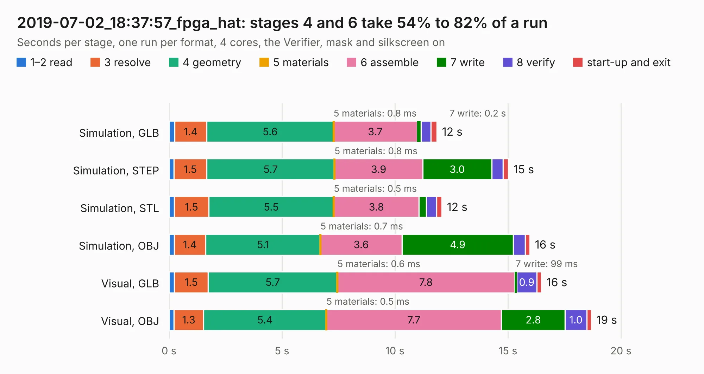

| Mode and format | 1–2 read | 3 resolve | 4 geometry | 5 materials | 6 assemble | 7 write | 8 verify | start-up and exit | Total |
|---|---:|---:|---:|---:|---:|---:|---:|---:|---:|
| Simulation, GLB | 0.3 | 1.4 | 5.6 | 0.8&nbsp;ms | 3.7 | 0.2 | 0.4 | 0.3 | 11.9 |
| Simulation, STEP | 0.2 | 1.5 | 5.7 | 0.8&nbsp;ms | 3.9 | 3.0 | 0.5 | 0.2 | 15.0 |
| Simulation, STL | 0.2 | 1.5 | 5.5 | 0.5&nbsp;ms | 3.8 | 0.3 | 0.5 | 0.2 | 12.1 |
| Simulation, OBJ | 0.2 | 1.4 | 5.1 | 0.7&nbsp;ms | 3.6 | 4.9 | 0.5 | 0.2 | 16.0 |
| Visual, GLB | 0.2 | 1.5 | 5.7 | 0.6&nbsp;ms | 7.8 | 99&nbsp;ms | 0.9 | 0.2 | 16.5 |
| Visual, OBJ | 0.2 | 1.3 | 5.4 | 0.5&nbsp;ms | 7.7 | 2.8 | 1.0 | 0.2 | 18.7 |

<table align="center"><tr><td valign="top">

| Board | Repo: [Wren6991/Snowflake-FPGA](https://github.com/Wren6991/Snowflake-FPGA) Board: `2019-07-02_18:37:57_fpga_hat.kicad_pcb` |
|---|---|
| Folder | timelapse |
| Complexity | 280&nbsp;/&nbsp;1000 (size&nbsp;245, features&nbsp;35) |
| KESE&nbsp;features | through vias, rounded, trapezoid or chamfered pads, curved board outline |
| Tested | 9th November 2026 |
| Copper&nbsp;layers | 4 |
| File&nbsp;format | KiCad 5 (20171130) |
| Parts,&nbsp;tracks,&nbsp;vias | 81, 555, 16 |
| Triangles,&nbsp;simulation | 1,138,788 in 150 parts |
| Verifier | PASS in all six runs |

</td><td valign="top">

<table>
<tr><th>File type</th><th>File size</th><th>Peak memory used</th></tr>
<tr><th colspan="3" align="left">Simulation</th></tr>
<tr><td>GLB</td><td align="right">39&nbsp;MB</td><td align="right">454&nbsp;MB</td></tr>
<tr><td>STEP</td><td align="right">190&nbsp;MB</td><td align="right">591&nbsp;MB</td></tr>
<tr><td>STL</td><td align="right">57&nbsp;MB</td><td align="right">464&nbsp;MB</td></tr>
<tr><td>OBJ</td><td align="right">117&nbsp;MB</td><td align="right">811&nbsp;MB</td></tr>
<tr><th colspan="3" align="left">Visual</th></tr>
<tr><td>GLB</td><td align="right">21&nbsp;MB</td><td align="right">569&nbsp;MB</td></tr>
<tr><td>OBJ</td><td align="right">64&nbsp;MB</td><td align="right">554&nbsp;MB</td></tr>
</table>

</td></tr></table>

## 3058. 2019-07-02_19:05:24_fpga_hat

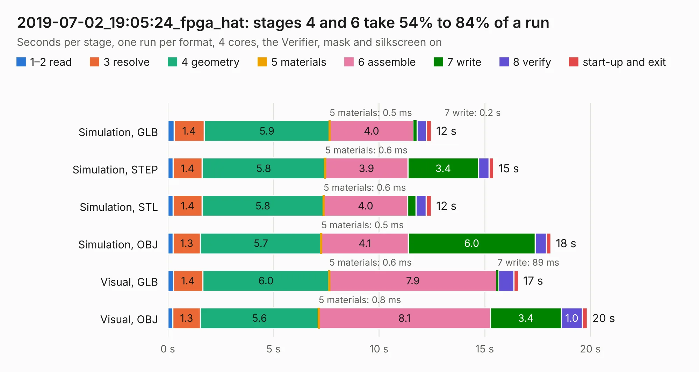

| Mode and format | 1–2 read | 3 resolve | 4 geometry | 5 materials | 6 assemble | 7 write | 8 verify | start-up and exit | Total |
|---|---:|---:|---:|---:|---:|---:|---:|---:|---:|
| Simulation, GLB | 0.3 | 1.4 | 5.9 | 0.5&nbsp;ms | 4.0 | 0.2 | 0.4 | 0.2 | 12.5 |
| Simulation, STEP | 0.2 | 1.4 | 5.8 | 0.6&nbsp;ms | 3.9 | 3.4 | 0.5 | 0.2 | 15.4 |
| Simulation, STL | 0.2 | 1.4 | 5.8 | 0.6&nbsp;ms | 4.0 | 0.4 | 0.5 | 0.2 | 12.5 |
| Simulation, OBJ | 0.2 | 1.3 | 5.7 | 0.5&nbsp;ms | 4.1 | 6.0 | 0.5 | 0.2 | 18.1 |
| Visual, GLB | 0.3 | 1.4 | 6.0 | 0.6&nbsp;ms | 7.9 | 89&nbsp;ms | 0.7 | 0.2 | 16.6 |
| Visual, OBJ | 0.2 | 1.3 | 5.6 | 0.8&nbsp;ms | 8.1 | 3.4 | 1.0 | 0.2 | 19.9 |

<table align="center"><tr><td valign="top">

| Board | Repo: [Wren6991/Snowflake-FPGA](https://github.com/Wren6991/Snowflake-FPGA) Board: `2019-07-02_19:05:24_fpga_hat.kicad_pcb` |
|---|---|
| Folder | timelapse |
| Complexity | 280&nbsp;/&nbsp;1000 (size&nbsp;245, features&nbsp;35) |
| KESE&nbsp;features | through vias, rounded, trapezoid or chamfered pads, curved board outline |
| Tested | 9th November 2026 |
| Copper&nbsp;layers | 4 |
| File&nbsp;format | KiCad 5 (20171130) |
| Parts,&nbsp;tracks,&nbsp;vias | 81, 552, 16 |
| Triangles,&nbsp;simulation | 1,136,098 in 150 parts |
| Verifier | PASS in all six runs |

</td><td valign="top">

<table>
<tr><th>File type</th><th>File size</th><th>Peak memory used</th></tr>
<tr><th colspan="3" align="left">Simulation</th></tr>
<tr><td>GLB</td><td align="right">39&nbsp;MB</td><td align="right">484&nbsp;MB</td></tr>
<tr><td>STEP</td><td align="right">190&nbsp;MB</td><td align="right">590&nbsp;MB</td></tr>
<tr><td>STL</td><td align="right">57&nbsp;MB</td><td align="right">469&nbsp;MB</td></tr>
<tr><td>OBJ</td><td align="right">117&nbsp;MB</td><td align="right">831&nbsp;MB</td></tr>
<tr><th colspan="3" align="left">Visual</th></tr>
<tr><td>GLB</td><td align="right">21&nbsp;MB</td><td align="right">509&nbsp;MB</td></tr>
<tr><td>OBJ</td><td align="right">64&nbsp;MB</td><td align="right">561&nbsp;MB</td></tr>
</table>

</td></tr></table>

## 3059. 2019-07-02_19:17:13_fpga_hat

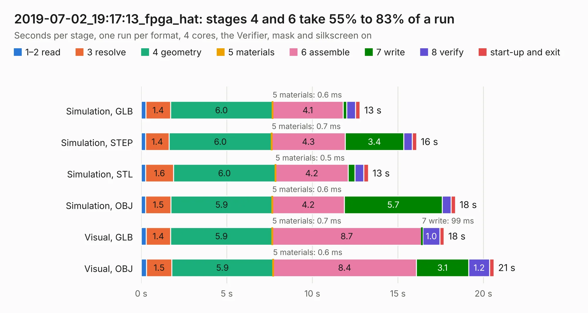

| Mode and format | 1–2 read | 3 resolve | 4 geometry | 5 materials | 6 assemble | 7 write | 8 verify | start-up and exit | Total |
|---|---:|---:|---:|---:|---:|---:|---:|---:|---:|
| Simulation, GLB | 0.3 | 1.4 | 6.0 | 0.6&nbsp;ms | 4.1 | 0.2 | 0.5 | 0.3 | 12.8 |
| Simulation, STEP | 0.3 | 1.4 | 6.0 | 0.7&nbsp;ms | 4.3 | 3.4 | 0.5 | 0.2 | 16.1 |
| Simulation, STL | 0.3 | 1.6 | 6.0 | 0.5&nbsp;ms | 4.2 | 0.4 | 0.5 | 0.3 | 13.3 |
| Simulation, OBJ | 0.3 | 1.5 | 5.9 | 0.6&nbsp;ms | 4.2 | 5.7 | 0.5 | 0.2 | 18.4 |
| Visual, GLB | 0.3 | 1.4 | 5.9 | 0.7&nbsp;ms | 8.7 | 99&nbsp;ms | 1.0 | 0.2 | 17.7 |
| Visual, OBJ | 0.3 | 1.5 | 5.9 | 0.6&nbsp;ms | 8.4 | 3.1 | 1.2 | 0.3 | 20.6 |

<table align="center"><tr><td valign="top">

| Board | Repo: [Wren6991/Snowflake-FPGA](https://github.com/Wren6991/Snowflake-FPGA) Board: `2019-07-02_19:17:13_fpga_hat.kicad_pcb` |
|---|---|
| Folder | timelapse |
| Complexity | 279&nbsp;/&nbsp;1000 (size&nbsp;244, features&nbsp;35) |
| KESE&nbsp;features | through vias, rounded, trapezoid or chamfered pads, curved board outline |
| Tested | 9th November 2026 |
| Copper&nbsp;layers | 4 |
| File&nbsp;format | KiCad 5 (20171130) |
| Parts,&nbsp;tracks,&nbsp;vias | 81, 547, 16 |
| Triangles,&nbsp;simulation | 1,133,988 in 150 parts |
| Verifier | PASS in all six runs |

</td><td valign="top">

<table>
<tr><th>File type</th><th>File size</th><th>Peak memory used</th></tr>
<tr><th colspan="3" align="left">Simulation</th></tr>
<tr><td>GLB</td><td align="right">38&nbsp;MB</td><td align="right">452&nbsp;MB</td></tr>
<tr><td>STEP</td><td align="right">189&nbsp;MB</td><td align="right">574&nbsp;MB</td></tr>
<tr><td>STL</td><td align="right">57&nbsp;MB</td><td align="right">472&nbsp;MB</td></tr>
<tr><td>OBJ</td><td align="right">117&nbsp;MB</td><td align="right">808&nbsp;MB</td></tr>
<tr><th colspan="3" align="left">Visual</th></tr>
<tr><td>GLB</td><td align="right">21&nbsp;MB</td><td align="right">581&nbsp;MB</td></tr>
<tr><td>OBJ</td><td align="right">63&nbsp;MB</td><td align="right">531&nbsp;MB</td></tr>
</table>

</td></tr></table>

## 3060. 2019-07-02_19:35:16_fpga_hat

| Mode and format | 1–2 read | 3 resolve | 4 geometry | 5 materials | 6 assemble | 7 write | 8 verify | start-up and exit | Total |
|---|---:|---:|---:|---:|---:|---:|---:|---:|---:|
| Simulation, GLB | 0.3 | 1.6 | 6.7 | 0.7&nbsp;ms | 4.4 | 0.2 | 0.6 | 0.2 | 13.9 |
| Simulation, STEP | 0.3 | 1.6 | 6.5 | 0.7&nbsp;ms | 4.4 | 3.5 | 0.5 | 0.2 | 17.0 |
| Simulation, STL | 0.3 | 1.5 | 6.6 | 0.6&nbsp;ms | 4.5 | 0.4 | 0.6 | 0.2 | 14.2 |
| Simulation, OBJ | 0.3 | 1.6 | 6.6 | 0.7&nbsp;ms | 4.3 | 6.7 | 0.6 | 0.3 | 20.3 |
| Visual, GLB | 0.3 | 1.7 | 6.8 | 0.6&nbsp;ms | 8.7 | 0.1 | 1.1 | 0.2 | 18.9 |
| Visual, OBJ | 0.3 | 1.6 | 6.6 | 0.8&nbsp;ms | 8.8 | 3.7 | 1.1 | 0.2 | 22.4 |

<table align="center"><tr><td valign="top">

| Board | Repo: [Wren6991/Snowflake-FPGA](https://github.com/Wren6991/Snowflake-FPGA) Board: `2019-07-02_19:35:16_fpga_hat.kicad_pcb` |
|---|---|
| Folder | timelapse |
| Complexity | 279&nbsp;/&nbsp;1000 (size&nbsp;244, features&nbsp;35) |
| KESE&nbsp;features | through vias, rounded, trapezoid or chamfered pads, curved board outline |
| Tested | 9th November 2026 |
| Copper&nbsp;layers | 4 |
| File&nbsp;format | KiCad 5 (20171130) |
| Parts,&nbsp;tracks,&nbsp;vias | 81, 536, 16 |
| Triangles,&nbsp;simulation | 1,130,672 in 150 parts |
| Verifier | PASS in all six runs |

</td><td valign="top">

<table>
<tr><th>File type</th><th>File size</th><th>Peak memory used</th></tr>
<tr><th colspan="3" align="left">Simulation</th></tr>
<tr><td>GLB</td><td align="right">38&nbsp;MB</td><td align="right">475&nbsp;MB</td></tr>
<tr><td>STEP</td><td align="right">188&nbsp;MB</td><td align="right">569&nbsp;MB</td></tr>
<tr><td>STL</td><td align="right">57&nbsp;MB</td><td align="right">464&nbsp;MB</td></tr>
<tr><td>OBJ</td><td align="right">116&nbsp;MB</td><td align="right">813&nbsp;MB</td></tr>
<tr><th colspan="3" align="left">Visual</th></tr>
<tr><td>GLB</td><td align="right">21&nbsp;MB</td><td align="right">559&nbsp;MB</td></tr>
<tr><td>OBJ</td><td align="right">63&nbsp;MB</td><td align="right">560&nbsp;MB</td></tr>
</table>

</td></tr></table>

## 3061. 2019-07-02_19:45:35_fpga_hat

| Mode and format | 1–2 read | 3 resolve | 4 geometry | 5 materials | 6 assemble | 7 write | 8 verify | start-up and exit | Total |
|---|---:|---:|---:|---:|---:|---:|---:|---:|---:|
| Simulation, GLB | 0.2 | 1.4 | 5.4 | 0.9&nbsp;ms | 3.7 | 0.2 | 0.5 | 0.3 | 11.7 |
| Simulation, STEP | 0.2 | 1.2 | 5.4 | 0.7&nbsp;ms | 3.8 | 3.0 | 0.5 | 0.2 | 14.2 |
| Simulation, STL | 0.2 | 1.3 | 5.2 | 0.6&nbsp;ms | 3.8 | 0.3 | 0.4 | 0.2 | 11.5 |
| Simulation, OBJ | 0.2 | 1.3 | 5.2 | 0.9&nbsp;ms | 3.7 | 5.2 | 0.5 | 0.2 | 16.3 |
| Visual, GLB | 0.3 | 1.4 | 5.3 | 0.7&nbsp;ms | 7.4 | 79&nbsp;ms | 0.7 | 0.2 | 15.4 |
| Visual, OBJ | 0.2 | 1.3 | 5.4 | 0.6&nbsp;ms | 7.8 | 2.9 | 1.1 | 0.2 | 18.9 |

<table align="center"><tr><td valign="top">

| Board | Repo: [Wren6991/Snowflake-FPGA](https://github.com/Wren6991/Snowflake-FPGA) Board: `2019-07-02_19:45:35_fpga_hat.kicad_pcb` |
|---|---|
| Folder | timelapse |
| Complexity | 279&nbsp;/&nbsp;1000 (size&nbsp;244, features&nbsp;35) |
| KESE&nbsp;features | through vias, rounded, trapezoid or chamfered pads, curved board outline |
| Tested | 9th November 2026 |
| Copper&nbsp;layers | 4 |
| File&nbsp;format | KiCad 5 (20171130) |
| Parts,&nbsp;tracks,&nbsp;vias | 81, 534, 16 |
| Triangles,&nbsp;simulation | 1,129,370 in 150 parts |
| Verifier | PASS in all six runs |

</td><td valign="top">

<table>
<tr><th>File type</th><th>File size</th><th>Peak memory used</th></tr>
<tr><th colspan="3" align="left">Simulation</th></tr>
<tr><td>GLB</td><td align="right">38&nbsp;MB</td><td align="right">451&nbsp;MB</td></tr>
<tr><td>STEP</td><td align="right">188&nbsp;MB</td><td align="right">561&nbsp;MB</td></tr>
<tr><td>STL</td><td align="right">56&nbsp;MB</td><td align="right">464&nbsp;MB</td></tr>
<tr><td>OBJ</td><td align="right">116&nbsp;MB</td><td align="right">802&nbsp;MB</td></tr>
<tr><th colspan="3" align="left">Visual</th></tr>
<tr><td>GLB</td><td align="right">21&nbsp;MB</td><td align="right">562&nbsp;MB</td></tr>
<tr><td>OBJ</td><td align="right">63&nbsp;MB</td><td align="right">524&nbsp;MB</td></tr>
</table>

</td></tr></table>

## 3062. 2019-07-02_20:01:46_fpga_hat

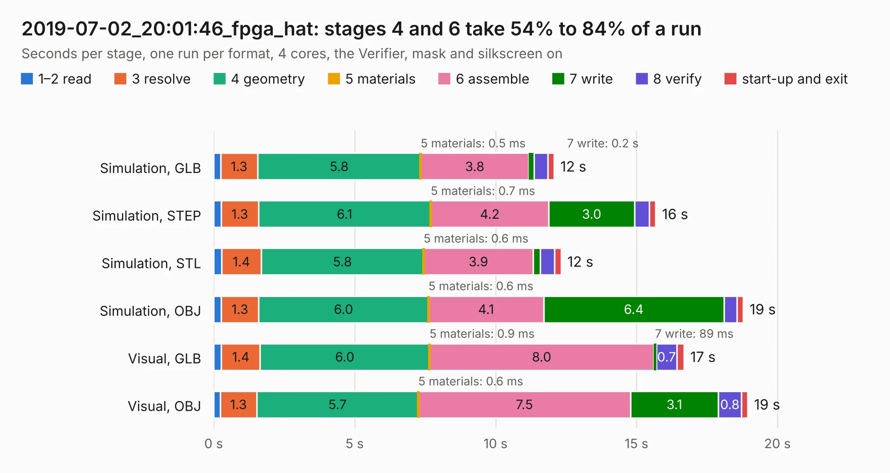

| Mode and format | 1–2 read | 3 resolve | 4 geometry | 5 materials | 6 assemble | 7 write | 8 verify | start-up and exit | Total |
|---|---:|---:|---:|---:|---:|---:|---:|---:|---:|
| Simulation, GLB | 0.2 | 1.3 | 5.8 | 0.5&nbsp;ms | 3.8 | 0.2 | 0.5 | 0.2 | 12.1 |
| Simulation, STEP | 0.3 | 1.3 | 6.1 | 0.7&nbsp;ms | 4.2 | 3.0 | 0.5 | 0.2 | 15.7 |
| Simulation, STL | 0.3 | 1.4 | 5.8 | 0.6&nbsp;ms | 3.9 | 0.3 | 0.5 | 0.2 | 12.3 |
| Simulation, OBJ | 0.3 | 1.3 | 6.0 | 0.6&nbsp;ms | 4.1 | 6.4 | 0.5 | 0.2 | 18.8 |
| Visual, GLB | 0.3 | 1.4 | 6.0 | 0.9&nbsp;ms | 8.0 | 89&nbsp;ms | 0.7 | 0.2 | 16.7 |
| Visual, OBJ | 0.2 | 1.3 | 5.7 | 0.6&nbsp;ms | 7.5 | 3.1 | 0.8 | 0.2 | 18.9 |

<table align="center"><tr><td valign="top">

| Board | Repo: [Wren6991/Snowflake-FPGA](https://github.com/Wren6991/Snowflake-FPGA) Board: `2019-07-02_20:01:46_fpga_hat.kicad_pcb` |
|---|---|
| Folder | timelapse |
| Complexity | 280&nbsp;/&nbsp;1000 (size&nbsp;245, features&nbsp;35) |
| KESE&nbsp;features | through vias, rounded, trapezoid or chamfered pads, curved board outline |
| Tested | 9th November 2026 |
| Copper&nbsp;layers | 4 |
| File&nbsp;format | KiCad 5 (20171130) |
| Parts,&nbsp;tracks,&nbsp;vias | 81, 545, 20 |
| Triangles,&nbsp;simulation | 1,141,196 in 150 parts |
| Verifier | PASS in all six runs |

</td><td valign="top">

<table>
<tr><th>File type</th><th>File size</th><th>Peak memory used</th></tr>
<tr><th colspan="3" align="left">Simulation</th></tr>
<tr><td>GLB</td><td align="right">39&nbsp;MB</td><td align="right">419&nbsp;MB</td></tr>
<tr><td>STEP</td><td align="right">189&nbsp;MB</td><td align="right">581&nbsp;MB</td></tr>
<tr><td>STL</td><td align="right">57&nbsp;MB</td><td align="right">438&nbsp;MB</td></tr>
<tr><td>OBJ</td><td align="right">117&nbsp;MB</td><td align="right">804&nbsp;MB</td></tr>
<tr><th colspan="3" align="left">Visual</th></tr>
<tr><td>GLB</td><td align="right">21&nbsp;MB</td><td align="right">589&nbsp;MB</td></tr>
<tr><td>OBJ</td><td align="right">64&nbsp;MB</td><td align="right">515&nbsp;MB</td></tr>
</table>

</td></tr></table>

## 3063. 2019-07-02_20:17:06_fpga_hat

| Mode and format | 1–2 read | 3 resolve | 4 geometry | 5 materials | 6 assemble | 7 write | 8 verify | start-up and exit | Total |
|---|---:|---:|---:|---:|---:|---:|---:|---:|---:|
| Simulation, GLB | 0.2 | 1.3 | 5.6 | 0.5&nbsp;ms | 3.8 | 0.2 | 0.5 | 0.2 | 11.8 |
| Simulation, STEP | 0.2 | 1.3 | 5.9 | 0.8&nbsp;ms | 3.7 | 3.2 | 0.5 | 0.2 | 15.1 |
| Simulation, STL | 0.3 | 1.3 | 6.0 | 0.5&nbsp;ms | 4.1 | 0.3 | 0.5 | 0.2 | 12.6 |
| Simulation, OBJ | 0.2 | 1.3 | 5.6 | 0.5&nbsp;ms | 3.9 | 5.7 | 0.4 | 0.2 | 17.4 |
| Visual, GLB | 0.2 | 1.4 | 5.8 | 0.5&nbsp;ms | 7.4 | 92&nbsp;ms | 0.7 | 0.2 | 15.8 |
| Visual, OBJ | 0.3 | 1.3 | 5.7 | 0.5&nbsp;ms | 7.5 | 3.2 | 0.9 | 0.2 | 19.0 |

<table align="center"><tr><td valign="top">

| Board | Repo: [Wren6991/Snowflake-FPGA](https://github.com/Wren6991/Snowflake-FPGA) Board: `2019-07-02_20:17:06_fpga_hat.kicad_pcb` |
|---|---|
| Folder | timelapse |
| Complexity | 280&nbsp;/&nbsp;1000 (size&nbsp;245, features&nbsp;35) |
| KESE&nbsp;features | through vias, rounded, trapezoid or chamfered pads, curved board outline |
| Tested | 9th November 2026 |
| Copper&nbsp;layers | 4 |
| File&nbsp;format | KiCad 5 (20171130) |
| Parts,&nbsp;tracks,&nbsp;vias | 81, 559, 20 |
| Triangles,&nbsp;simulation | 1,141,628 in 150 parts |
| Verifier | PASS in all six runs |

</td><td valign="top">

<table>
<tr><th>File type</th><th>File size</th><th>Peak memory used</th></tr>
<tr><th colspan="3" align="left">Simulation</th></tr>
<tr><td>GLB</td><td align="right">39&nbsp;MB</td><td align="right">437&nbsp;MB</td></tr>
<tr><td>STEP</td><td align="right">190&nbsp;MB</td><td align="right">566&nbsp;MB</td></tr>
<tr><td>STL</td><td align="right">57&nbsp;MB</td><td align="right">472&nbsp;MB</td></tr>
<tr><td>OBJ</td><td align="right">117&nbsp;MB</td><td align="right">829&nbsp;MB</td></tr>
<tr><th colspan="3" align="left">Visual</th></tr>
<tr><td>GLB</td><td align="right">21&nbsp;MB</td><td align="right">559&nbsp;MB</td></tr>
<tr><td>OBJ</td><td align="right">64&nbsp;MB</td><td align="right">535&nbsp;MB</td></tr>
</table>

</td></tr></table>

## 3064. 2019-07-02_20:28:54_fpga_hat

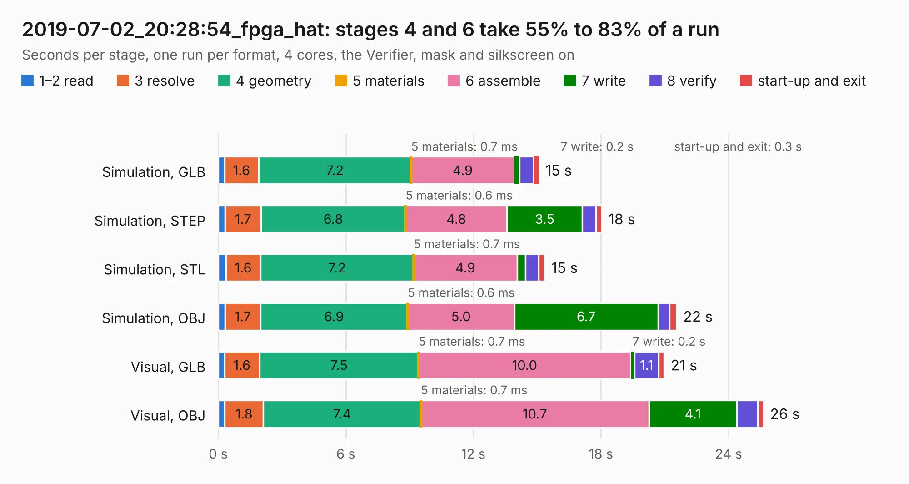

| Mode and format | 1–2 read | 3 resolve | 4 geometry | 5 materials | 6 assemble | 7 write | 8 verify | start-up and exit | Total |
|---|---:|---:|---:|---:|---:|---:|---:|---:|---:|
| Simulation, GLB | 0.3 | 1.6 | 7.2 | 0.7&nbsp;ms | 4.9 | 0.2 | 0.7 | 0.3 | 15.1 |
| Simulation, STEP | 0.3 | 1.7 | 6.8 | 0.6&nbsp;ms | 4.8 | 3.5 | 0.6 | 0.3 | 18.0 |
| Simulation, STL | 0.4 | 1.6 | 7.2 | 0.7&nbsp;ms | 4.9 | 0.4 | 0.6 | 0.3 | 15.4 |
| Simulation, OBJ | 0.3 | 1.7 | 6.9 | 0.6&nbsp;ms | 5.0 | 6.7 | 0.6 | 0.3 | 21.6 |
| Visual, GLB | 0.3 | 1.6 | 7.5 | 0.7&nbsp;ms | 10.0 | 0.2 | 1.1 | 0.3 | 21.0 |
| Visual, OBJ | 0.3 | 1.8 | 7.4 | 0.7&nbsp;ms | 10.7 | 4.1 | 1.0 | 0.3 | 25.6 |

<table align="center"><tr><td valign="top">

| Board | Repo: [Wren6991/Snowflake-FPGA](https://github.com/Wren6991/Snowflake-FPGA) Board: `2019-07-02_20:28:54_fpga_hat.kicad_pcb` |
|---|---|
| Folder | timelapse |
| Complexity | 281&nbsp;/&nbsp;1000 (size&nbsp;246, features&nbsp;35) |
| KESE&nbsp;features | through vias, rounded, trapezoid or chamfered pads, curved board outline |
| Tested | 10th November 2026 |
| Copper&nbsp;layers | 4 |
| File&nbsp;format | KiCad 5 (20171130) |
| Parts,&nbsp;tracks,&nbsp;vias | 81, 594, 25 |
| Triangles,&nbsp;simulation | 1,161,144 in 150 parts |
| Verifier | PASS in all six runs |

</td><td valign="top">

<table>
<tr><th>File type</th><th>File size</th><th>Peak memory used</th></tr>
<tr><th colspan="3" align="left">Simulation</th></tr>
<tr><td>GLB</td><td align="right">39&nbsp;MB</td><td align="right">450&nbsp;MB</td></tr>
<tr><td>STEP</td><td align="right">192&nbsp;MB</td><td align="right">595&nbsp;MB</td></tr>
<tr><td>STL</td><td align="right">58&nbsp;MB</td><td align="right">473&nbsp;MB</td></tr>
<tr><td>OBJ</td><td align="right">120&nbsp;MB</td><td align="right">839&nbsp;MB</td></tr>
<tr><th colspan="3" align="left">Visual</th></tr>
<tr><td>GLB</td><td align="right">22&nbsp;MB</td><td align="right">563&nbsp;MB</td></tr>
<tr><td>OBJ</td><td align="right">65&nbsp;MB</td><td align="right">563&nbsp;MB</td></tr>
</table>

</td></tr></table>

## 3065. 2019-07-02_20:54:50_fpga_hat

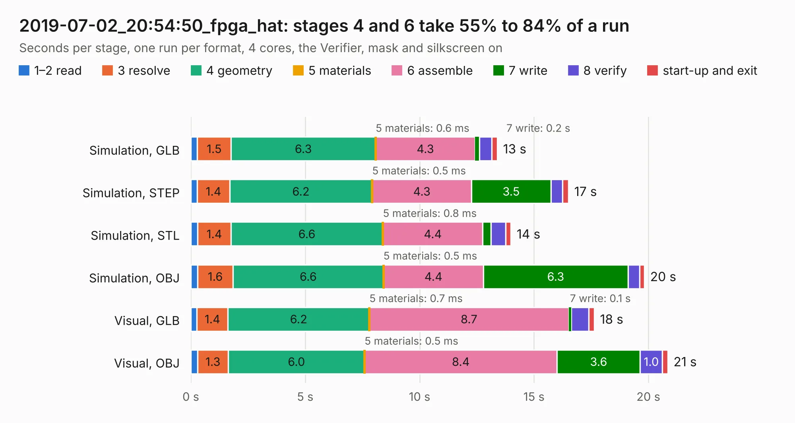

| Mode and format | 1–2 read | 3 resolve | 4 geometry | 5 materials | 6 assemble | 7 write | 8 verify | start-up and exit | Total |
|---|---:|---:|---:|---:|---:|---:|---:|---:|---:|
| Simulation, GLB | 0.3 | 1.5 | 6.3 | 0.6&nbsp;ms | 4.3 | 0.2 | 0.5 | 0.2 | 13.4 |
| Simulation, STEP | 0.3 | 1.4 | 6.2 | 0.5&nbsp;ms | 4.3 | 3.5 | 0.5 | 0.3 | 16.5 |
| Simulation, STL | 0.3 | 1.4 | 6.6 | 0.8&nbsp;ms | 4.4 | 0.4 | 0.6 | 0.2 | 14.0 |
| Simulation, OBJ | 0.3 | 1.6 | 6.6 | 0.5&nbsp;ms | 4.4 | 6.3 | 0.5 | 0.2 | 19.8 |
| Visual, GLB | 0.3 | 1.4 | 6.2 | 0.7&nbsp;ms | 8.7 | 0.1 | 0.8 | 0.2 | 17.6 |
| Visual, OBJ | 0.3 | 1.3 | 6.0 | 0.5&nbsp;ms | 8.4 | 3.6 | 1.0 | 0.2 | 20.9 |

<table align="center"><tr><td valign="top">

| Board | Repo: [Wren6991/Snowflake-FPGA](https://github.com/Wren6991/Snowflake-FPGA) Board: `2019-07-02_20:54:50_fpga_hat.kicad_pcb` |
|---|---|
| Folder | timelapse |
| Complexity | 283&nbsp;/&nbsp;1000 (size&nbsp;248, features&nbsp;35) |
| KESE&nbsp;features | through vias, rounded, trapezoid or chamfered pads, curved board outline |
| Tested | 9th November 2026 |
| Copper&nbsp;layers | 4 |
| File&nbsp;format | KiCad 5 (20171130) |
| Parts,&nbsp;tracks,&nbsp;vias | 81, 637, 29 |
| Triangles,&nbsp;simulation | 1,179,866 in 150 parts |
| Verifier | PASS in all six runs |

</td><td valign="top">

<table>
<tr><th>File type</th><th>File size</th><th>Peak memory used</th></tr>
<tr><th colspan="3" align="left">Simulation</th></tr>
<tr><td>GLB</td><td align="right">40&nbsp;MB</td><td align="right">476&nbsp;MB</td></tr>
<tr><td>STEP</td><td align="right">195&nbsp;MB</td><td align="right">587&nbsp;MB</td></tr>
<tr><td>STL</td><td align="right">59&nbsp;MB</td><td align="right">449&nbsp;MB</td></tr>
<tr><td>OBJ</td><td align="right">122&nbsp;MB</td><td align="right">847&nbsp;MB</td></tr>
<tr><th colspan="3" align="left">Visual</th></tr>
<tr><td>GLB</td><td align="right">22&nbsp;MB</td><td align="right">575&nbsp;MB</td></tr>
<tr><td>OBJ</td><td align="right">66&nbsp;MB</td><td align="right">560&nbsp;MB</td></tr>
</table>

</td></tr></table>

## 3066. 2019-07-02_21:04:22_fpga_hat

| Mode and format | 1–2 read | 3 resolve | 4 geometry | 5 materials | 6 assemble | 7 write | 8 verify | start-up and exit | Total |
|---|---:|---:|---:|---:|---:|---:|---:|---:|---:|
| Simulation, GLB | 0.3 | 1.7 | 7.0 | 0.7&nbsp;ms | 4.7 | 0.3 | 0.7 | 0.3 | 14.9 |
| Simulation, STEP | 0.3 | 1.7 | 7.0 | 0.7&nbsp;ms | 4.7 | 3.4 | 0.6 | 0.3 | 17.9 |
| Simulation, STL | 0.3 | 1.5 | 6.8 | 0.6&nbsp;ms | 4.6 | 0.4 | 0.6 | 0.3 | 14.5 |
| Simulation, OBJ | 0.3 | 1.6 | 6.8 | 0.5&nbsp;ms | 4.5 | 7.2 | 0.6 | 0.2 | 21.3 |
| Visual, GLB | 0.3 | 1.5 | 6.9 | 0.9&nbsp;ms | 9.1 | 0.1 | 0.9 | 0.3 | 19.1 |
| Visual, OBJ | 0.3 | 1.6 | 6.8 | 0.5&nbsp;ms | 9.0 | 3.9 | 0.8 | 0.3 | 22.7 |

<table align="center"><tr><td valign="top">

| Board | Repo: [Wren6991/Snowflake-FPGA](https://github.com/Wren6991/Snowflake-FPGA) Board: `2019-07-02_21:04:22_fpga_hat.kicad_pcb` |
|---|---|
| Folder | timelapse |
| Complexity | 283&nbsp;/&nbsp;1000 (size&nbsp;248, features&nbsp;35) |
| KESE&nbsp;features | through vias, rounded, trapezoid or chamfered pads, curved board outline |
| Tested | 9th November 2026 |
| Copper&nbsp;layers | 4 |
| File&nbsp;format | KiCad 5 (20171130) |
| Parts,&nbsp;tracks,&nbsp;vias | 81, 629, 29 |
| Triangles,&nbsp;simulation | 1,179,118 in 150 parts |
| Verifier | PASS in all six runs |

</td><td valign="top">

<table>
<tr><th>File type</th><th>File size</th><th>Peak memory used</th></tr>
<tr><th colspan="3" align="left">Simulation</th></tr>
<tr><td>GLB</td><td align="right">40&nbsp;MB</td><td align="right">481&nbsp;MB</td></tr>
<tr><td>STEP</td><td align="right">195&nbsp;MB</td><td align="right">580&nbsp;MB</td></tr>
<tr><td>STL</td><td align="right">59&nbsp;MB</td><td align="right">489&nbsp;MB</td></tr>
<tr><td>OBJ</td><td align="right">122&nbsp;MB</td><td align="right">836&nbsp;MB</td></tr>
<tr><th colspan="3" align="left">Visual</th></tr>
<tr><td>GLB</td><td align="right">22&nbsp;MB</td><td align="right">532&nbsp;MB</td></tr>
<tr><td>OBJ</td><td align="right">66&nbsp;MB</td><td align="right">563&nbsp;MB</td></tr>
</table>

</td></tr></table>

## 3067. 2019-07-02_21:45:21_fpga_hat

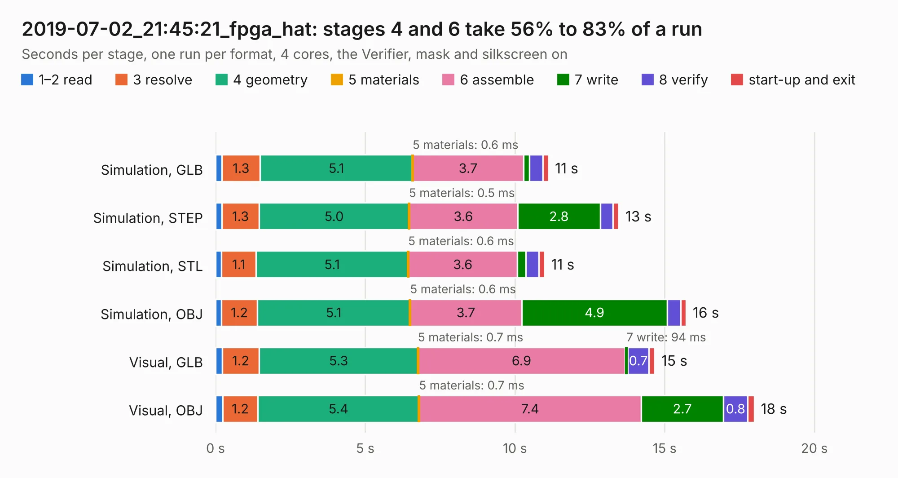

| Mode and format | 1–2 read | 3 resolve | 4 geometry | 5 materials | 6 assemble | 7 write | 8 verify | start-up and exit | Total |
|---|---:|---:|---:|---:|---:|---:|---:|---:|---:|
| Simulation, GLB | 0.2 | 1.3 | 5.1 | 0.6&nbsp;ms | 3.7 | 0.2 | 0.4 | 0.2 | 11.1 |
| Simulation, STEP | 0.2 | 1.3 | 5.0 | 0.5&nbsp;ms | 3.6 | 2.8 | 0.4 | 0.2 | 13.5 |
| Simulation, STL | 0.2 | 1.1 | 5.1 | 0.6&nbsp;ms | 3.6 | 0.3 | 0.4 | 0.2 | 11.0 |
| Simulation, OBJ | 0.2 | 1.2 | 5.1 | 0.6&nbsp;ms | 3.7 | 4.9 | 0.4 | 0.2 | 15.7 |
| Visual, GLB | 0.2 | 1.2 | 5.3 | 0.7&nbsp;ms | 6.9 | 94&nbsp;ms | 0.7 | 0.2 | 14.7 |
| Visual, OBJ | 0.2 | 1.2 | 5.4 | 0.7&nbsp;ms | 7.4 | 2.7 | 0.8 | 0.2 | 18.0 |

<table align="center"><tr><td valign="top">

| Board | Repo: [Wren6991/Snowflake-FPGA](https://github.com/Wren6991/Snowflake-FPGA) Board: `2019-07-02_21:45:21_fpga_hat.kicad_pcb` |
|---|---|
| Folder | timelapse |
| Complexity | 285&nbsp;/&nbsp;1000 (size&nbsp;250, features&nbsp;35) |
| KESE&nbsp;features | through vias, rounded, trapezoid or chamfered pads, curved board outline |
| Tested | 9th November 2026 |
| Copper&nbsp;layers | 4 |
| File&nbsp;format | KiCad 5 (20171130) |
| Parts,&nbsp;tracks,&nbsp;vias | 81, 722, 30 |
| Triangles,&nbsp;simulation | 1,197,164 in 150 parts |
| Verifier | PASS in all six runs |

</td><td valign="top">

<table>
<tr><th>File type</th><th>File size</th><th>Peak memory used</th></tr>
<tr><th colspan="3" align="left">Simulation</th></tr>
<tr><td>GLB</td><td align="right">41&nbsp;MB</td><td align="right">453&nbsp;MB</td></tr>
<tr><td>STEP</td><td align="right">200&nbsp;MB</td><td align="right">570&nbsp;MB</td></tr>
<tr><td>STL</td><td align="right">60&nbsp;MB</td><td align="right">485&nbsp;MB</td></tr>
<tr><td>OBJ</td><td align="right">124&nbsp;MB</td><td align="right">840&nbsp;MB</td></tr>
<tr><th colspan="3" align="left">Visual</th></tr>
<tr><td>GLB</td><td align="right">23&nbsp;MB</td><td align="right">582&nbsp;MB</td></tr>
<tr><td>OBJ</td><td align="right">68&nbsp;MB</td><td align="right">612&nbsp;MB</td></tr>
</table>

</td></tr></table>

## 3068. 2019-07-03_06:45:34_fpga_hat

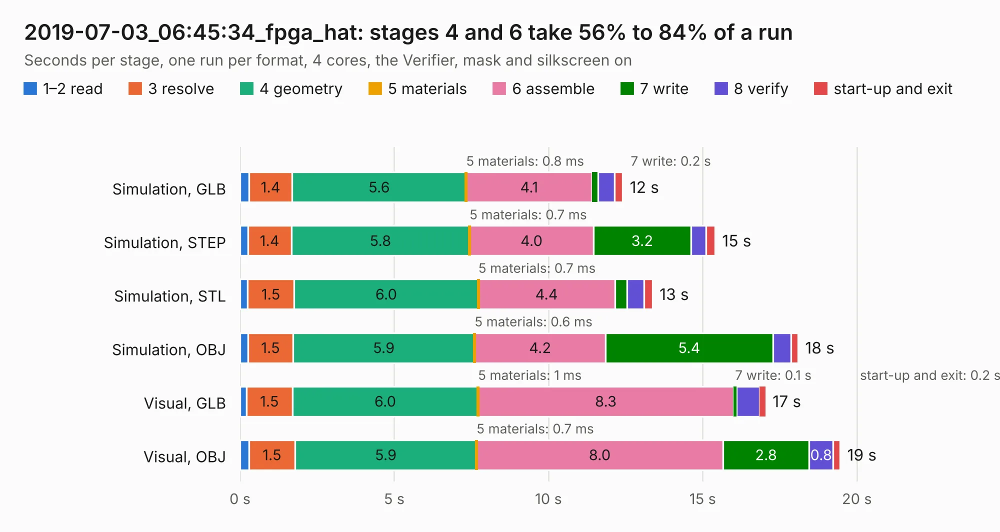

| Mode and format | 1–2 read | 3 resolve | 4 geometry | 5 materials | 6 assemble | 7 write | 8 verify | start-up and exit | Total |
|---|---:|---:|---:|---:|---:|---:|---:|---:|---:|
| Simulation, GLB | 0.3 | 1.4 | 5.6 | 0.8&nbsp;ms | 4.1 | 0.2 | 0.5 | 0.3 | 12.4 |
| Simulation, STEP | 0.3 | 1.4 | 5.8 | 0.7&nbsp;ms | 4.0 | 3.2 | 0.5 | 0.3 | 15.4 |
| Simulation, STL | 0.2 | 1.5 | 6.0 | 0.7&nbsp;ms | 4.4 | 0.4 | 0.6 | 0.3 | 13.4 |
| Simulation, OBJ | 0.3 | 1.5 | 5.9 | 0.6&nbsp;ms | 4.2 | 5.4 | 0.6 | 0.2 | 18.1 |
| Visual, GLB | 0.2 | 1.5 | 6.0 | 1&nbsp;ms | 8.3 | 0.1 | 0.7 | 0.2 | 17.0 |
| Visual, OBJ | 0.3 | 1.5 | 5.9 | 0.7&nbsp;ms | 8.0 | 2.8 | 0.8 | 0.2 | 19.5 |

<table align="center"><tr><td valign="top">

| Board | Repo: [Wren6991/Snowflake-FPGA](https://github.com/Wren6991/Snowflake-FPGA) Board: `2019-07-03_06:45:34_fpga_hat.kicad_pcb` |
|---|---|
| Folder | timelapse |
| Complexity | 285&nbsp;/&nbsp;1000 (size&nbsp;250, features&nbsp;35) |
| KESE&nbsp;features | through vias, rounded, trapezoid or chamfered pads, curved board outline |
| Tested | 9th November 2026 |
| Copper&nbsp;layers | 4 |
| File&nbsp;format | KiCad 5 (20171130) |
| Parts,&nbsp;tracks,&nbsp;vias | 81, 742, 30 |
| Triangles,&nbsp;simulation | 1,197,162 in 150 parts |
| Verifier | PASS in all six runs |

</td><td valign="top">

<table>
<tr><th>File type</th><th>File size</th><th>Peak memory used</th></tr>
<tr><th colspan="3" align="left">Simulation</th></tr>
<tr><td>GLB</td><td align="right">41&nbsp;MB</td><td align="right">482&nbsp;MB</td></tr>
<tr><td>STEP</td><td align="right">200&nbsp;MB</td><td align="right">573&nbsp;MB</td></tr>
<tr><td>STL</td><td align="right">60&nbsp;MB</td><td align="right">446&nbsp;MB</td></tr>
<tr><td>OBJ</td><td align="right">124&nbsp;MB</td><td align="right">846&nbsp;MB</td></tr>
<tr><th colspan="3" align="left">Visual</th></tr>
<tr><td>GLB</td><td align="right">23&nbsp;MB</td><td align="right">537&nbsp;MB</td></tr>
<tr><td>OBJ</td><td align="right">68&nbsp;MB</td><td align="right">576&nbsp;MB</td></tr>
</table>

</td></tr></table>

## 3069. 2019-07-03_06:50:23_fpga_hat

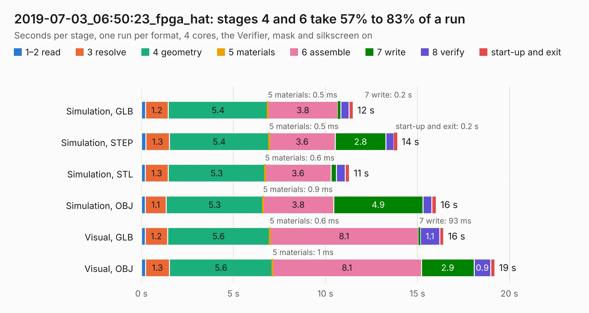

| Mode and format | 1–2 read | 3 resolve | 4 geometry | 5 materials | 6 assemble | 7 write | 8 verify | start-up and exit | Total |
|---|---:|---:|---:|---:|---:|---:|---:|---:|---:|
| Simulation, GLB | 0.2 | 1.2 | 5.4 | 0.5&nbsp;ms | 3.8 | 0.2 | 0.4 | 0.2 | 11.5 |
| Simulation, STEP | 0.2 | 1.3 | 5.4 | 0.5&nbsp;ms | 3.6 | 2.8 | 0.4 | 0.2 | 13.9 |
| Simulation, STL | 0.2 | 1.3 | 5.3 | 0.6&nbsp;ms | 3.6 | 0.3 | 0.5 | 0.2 | 11.3 |
| Simulation, OBJ | 0.2 | 1.1 | 5.3 | 0.9&nbsp;ms | 3.8 | 4.9 | 0.5 | 0.2 | 16.0 |
| Visual, GLB | 0.2 | 1.2 | 5.6 | 0.6&nbsp;ms | 8.1 | 93&nbsp;ms | 1.1 | 0.2 | 16.4 |
| Visual, OBJ | 0.2 | 1.3 | 5.6 | 1&nbsp;ms | 8.1 | 2.9 | 0.9 | 0.2 | 19.2 |

<table align="center"><tr><td valign="top">

| Board | Repo: [Wren6991/Snowflake-FPGA](https://github.com/Wren6991/Snowflake-FPGA) Board: `2019-07-03_06:50:23_fpga_hat.kicad_pcb` |
|---|---|
| Folder | timelapse |
| Complexity | 285&nbsp;/&nbsp;1000 (size&nbsp;250, features&nbsp;35) |
| KESE&nbsp;features | through vias, rounded, trapezoid or chamfered pads, curved board outline |
| Tested | 9th November 2026 |
| Copper&nbsp;layers | 4 |
| File&nbsp;format | KiCad 5 (20171130) |
| Parts,&nbsp;tracks,&nbsp;vias | 81, 721, 30 |
| Triangles,&nbsp;simulation | 1,195,974 in 150 parts |
| Verifier | PASS in all six runs |

</td><td valign="top">

<table>
<tr><th>File type</th><th>File size</th><th>Peak memory used</th></tr>
<tr><th colspan="3" align="left">Simulation</th></tr>
<tr><td>GLB</td><td align="right">41&nbsp;MB</td><td align="right">475&nbsp;MB</td></tr>
<tr><td>STEP</td><td align="right">200&nbsp;MB</td><td align="right">571&nbsp;MB</td></tr>
<tr><td>STL</td><td align="right">60&nbsp;MB</td><td align="right">483&nbsp;MB</td></tr>
<tr><td>OBJ</td><td align="right">124&nbsp;MB</td><td align="right">861&nbsp;MB</td></tr>
<tr><th colspan="3" align="left">Visual</th></tr>
<tr><td>GLB</td><td align="right">23&nbsp;MB</td><td align="right">515&nbsp;MB</td></tr>
<tr><td>OBJ</td><td align="right">68&nbsp;MB</td><td align="right">587&nbsp;MB</td></tr>
</table>

</td></tr></table>

## 3070. 2019-07-03_07:08:37_fpga_hat

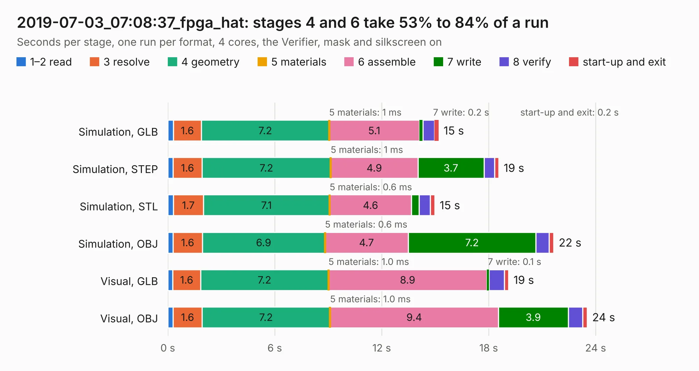

| Mode and format | 1–2 read | 3 resolve | 4 geometry | 5 materials | 6 assemble | 7 write | 8 verify | start-up and exit | Total |
|---|---:|---:|---:|---:|---:|---:|---:|---:|---:|
| Simulation, GLB | 0.3 | 1.6 | 7.2 | 1&nbsp;ms | 5.1 | 0.2 | 0.6 | 0.2 | 15.2 |
| Simulation, STEP | 0.3 | 1.6 | 7.2 | 1&nbsp;ms | 4.9 | 3.7 | 0.6 | 0.2 | 18.6 |
| Simulation, STL | 0.3 | 1.7 | 7.1 | 0.6&nbsp;ms | 4.6 | 0.4 | 0.6 | 0.3 | 15.0 |
| Simulation, OBJ | 0.3 | 1.6 | 6.9 | 0.6&nbsp;ms | 4.7 | 7.2 | 0.7 | 0.3 | 21.6 |
| Visual, GLB | 0.3 | 1.6 | 7.2 | 1.0&nbsp;ms | 8.9 | 0.1 | 0.9 | 0.2 | 19.1 |
| Visual, OBJ | 0.3 | 1.6 | 7.2 | 1.0&nbsp;ms | 9.4 | 3.9 | 0.8 | 0.3 | 23.5 |

<table align="center"><tr><td valign="top">

| Board | Repo: [Wren6991/Snowflake-FPGA](https://github.com/Wren6991/Snowflake-FPGA) Board: `2019-07-03_07:08:37_fpga_hat.kicad_pcb` |
|---|---|
| Folder | timelapse |
| Complexity | 285&nbsp;/&nbsp;1000 (size&nbsp;250, features&nbsp;35) |
| KESE&nbsp;features | through vias, rounded, trapezoid or chamfered pads, curved board outline |
| Tested | 9th November 2026 |
| Copper&nbsp;layers | 4 |
| File&nbsp;format | KiCad 5 (20171130) |
| Parts,&nbsp;tracks,&nbsp;vias | 81, 755, 30 |
| Triangles,&nbsp;simulation | 1,199,370 in 150 parts |
| Verifier | PASS in all six runs |

</td><td valign="top">

<table>
<tr><th>File type</th><th>File size</th><th>Peak memory used</th></tr>
<tr><th colspan="3" align="left">Simulation</th></tr>
<tr><td>GLB</td><td align="right">41&nbsp;MB</td><td align="right">502&nbsp;MB</td></tr>
<tr><td>STEP</td><td align="right">201&nbsp;MB</td><td align="right">580&nbsp;MB</td></tr>
<tr><td>STL</td><td align="right">60&nbsp;MB</td><td align="right">462&nbsp;MB</td></tr>
<tr><td>OBJ</td><td align="right">124&nbsp;MB</td><td align="right">852&nbsp;MB</td></tr>
<tr><th colspan="3" align="left">Visual</th></tr>
<tr><td>GLB</td><td align="right">23&nbsp;MB</td><td align="right">585&nbsp;MB</td></tr>
<tr><td>OBJ</td><td align="right">69&nbsp;MB</td><td align="right">585&nbsp;MB</td></tr>
</table>

</td></tr></table>

## 3071. 2019-07-03_07:15:18_fpga_hat

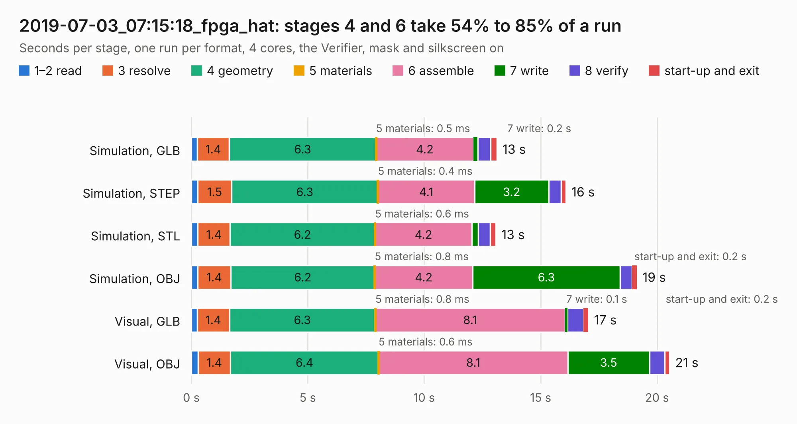

| Mode and format | 1–2 read | 3 resolve | 4 geometry | 5 materials | 6 assemble | 7 write | 8 verify | start-up and exit | Total |
|---|---:|---:|---:|---:|---:|---:|---:|---:|---:|
| Simulation, GLB | 0.3 | 1.4 | 6.3 | 0.5&nbsp;ms | 4.2 | 0.2 | 0.5 | 0.3 | 13.1 |
| Simulation, STEP | 0.3 | 1.5 | 6.3 | 0.4&nbsp;ms | 4.1 | 3.2 | 0.5 | 0.2 | 16.1 |
| Simulation, STL | 0.3 | 1.4 | 6.2 | 0.6&nbsp;ms | 4.2 | 0.3 | 0.5 | 0.2 | 13.1 |
| Simulation, OBJ | 0.3 | 1.4 | 6.2 | 0.8&nbsp;ms | 4.2 | 6.3 | 0.5 | 0.2 | 19.1 |
| Visual, GLB | 0.3 | 1.4 | 6.3 | 0.8&nbsp;ms | 8.1 | 0.1 | 0.7 | 0.2 | 17.0 |
| Visual, OBJ | 0.3 | 1.4 | 6.4 | 0.6&nbsp;ms | 8.1 | 3.5 | 0.7 | 0.2 | 20.5 |

<table align="center"><tr><td valign="top">

| Board | Repo: [Wren6991/Snowflake-FPGA](https://github.com/Wren6991/Snowflake-FPGA) Board: `2019-07-03_07:15:18_fpga_hat.kicad_pcb` |
|---|---|
| Folder | timelapse |
| Complexity | 285&nbsp;/&nbsp;1000 (size&nbsp;250, features&nbsp;35) |
| KESE&nbsp;features | through vias, rounded, trapezoid or chamfered pads, curved board outline |
| Tested | 9th November 2026 |
| Copper&nbsp;layers | 4 |
| File&nbsp;format | KiCad 5 (20171130) |
| Parts,&nbsp;tracks,&nbsp;vias | 81, 761, 30 |
| Triangles,&nbsp;simulation | 1,199,694 in 150 parts |
| Verifier | PASS in all six runs |

</td><td valign="top">

<table>
<tr><th>File type</th><th>File size</th><th>Peak memory used</th></tr>
<tr><th colspan="3" align="left">Simulation</th></tr>
<tr><td>GLB</td><td align="right">41&nbsp;MB</td><td align="right">490&nbsp;MB</td></tr>
<tr><td>STEP</td><td align="right">201&nbsp;MB</td><td align="right">583&nbsp;MB</td></tr>
<tr><td>STL</td><td align="right">60&nbsp;MB</td><td align="right">507&nbsp;MB</td></tr>
<tr><td>OBJ</td><td align="right">124&nbsp;MB</td><td align="right">851&nbsp;MB</td></tr>
<tr><th colspan="3" align="left">Visual</th></tr>
<tr><td>GLB</td><td align="right">23&nbsp;MB</td><td align="right">592&nbsp;MB</td></tr>
<tr><td>OBJ</td><td align="right">69&nbsp;MB</td><td align="right">536&nbsp;MB</td></tr>
</table>

</td></tr></table>

## 3072. 2019-07-03_17:28:54_fpga_hat

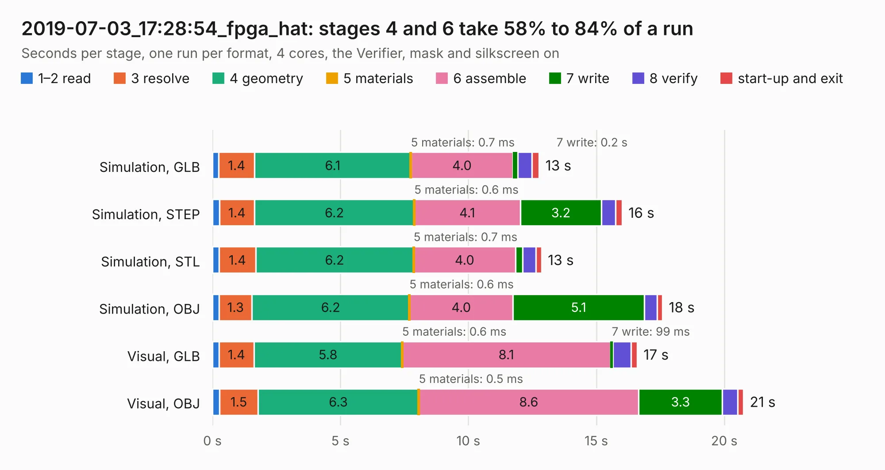

| Mode and format | 1–2 read | 3 resolve | 4 geometry | 5 materials | 6 assemble | 7 write | 8 verify | start-up and exit | Total |
|---|---:|---:|---:|---:|---:|---:|---:|---:|---:|
| Simulation, GLB | 0.2 | 1.4 | 6.1 | 0.7&nbsp;ms | 4.0 | 0.2 | 0.5 | 0.3 | 12.8 |
| Simulation, STEP | 0.3 | 1.4 | 6.2 | 0.6&nbsp;ms | 4.1 | 3.2 | 0.5 | 0.3 | 16.0 |
| Simulation, STL | 0.3 | 1.4 | 6.2 | 0.7&nbsp;ms | 4.0 | 0.3 | 0.5 | 0.2 | 12.9 |
| Simulation, OBJ | 0.3 | 1.3 | 6.2 | 0.6&nbsp;ms | 4.0 | 5.1 | 0.5 | 0.2 | 17.6 |
| Visual, GLB | 0.3 | 1.4 | 5.8 | 0.6&nbsp;ms | 8.1 | 99&nbsp;ms | 0.7 | 0.2 | 16.6 |
| Visual, OBJ | 0.3 | 1.5 | 6.3 | 0.5&nbsp;ms | 8.6 | 3.3 | 0.6 | 0.2 | 20.7 |

<table align="center"><tr><td valign="top">

| Board | Repo: [Wren6991/Snowflake-FPGA](https://github.com/Wren6991/Snowflake-FPGA) Board: `2019-07-03_17:28:54_fpga_hat.kicad_pcb` |
|---|---|
| Folder | timelapse |
| Complexity | 286&nbsp;/&nbsp;1000 (size&nbsp;251, features&nbsp;35) |
| KESE&nbsp;features | through vias, rounded, trapezoid or chamfered pads, curved board outline |
| Tested | 9th November 2026 |
| Copper&nbsp;layers | 4 |
| File&nbsp;format | KiCad 5 (20171130) |
| Parts,&nbsp;tracks,&nbsp;vias | 81, 783, 30 |
| Triangles,&nbsp;simulation | 1,200,172 in 150 parts |
| Verifier | PASS in all six runs |

</td><td valign="top">

<table>
<tr><th>File type</th><th>File size</th><th>Peak memory used</th></tr>
<tr><th colspan="3" align="left">Simulation</th></tr>
<tr><td>GLB</td><td align="right">41&nbsp;MB</td><td align="right">519&nbsp;MB</td></tr>
<tr><td>STEP</td><td align="right">202&nbsp;MB</td><td align="right">576&nbsp;MB</td></tr>
<tr><td>STL</td><td align="right">60&nbsp;MB</td><td align="right">496&nbsp;MB</td></tr>
<tr><td>OBJ</td><td align="right">124&nbsp;MB</td><td align="right">854&nbsp;MB</td></tr>
<tr><th colspan="3" align="left">Visual</th></tr>
<tr><td>GLB</td><td align="right">23&nbsp;MB</td><td align="right">568&nbsp;MB</td></tr>
<tr><td>OBJ</td><td align="right">69&nbsp;MB</td><td align="right">556&nbsp;MB</td></tr>
</table>

</td></tr></table>

## 3073. 2019-07-03_17:47:28_fpga_hat

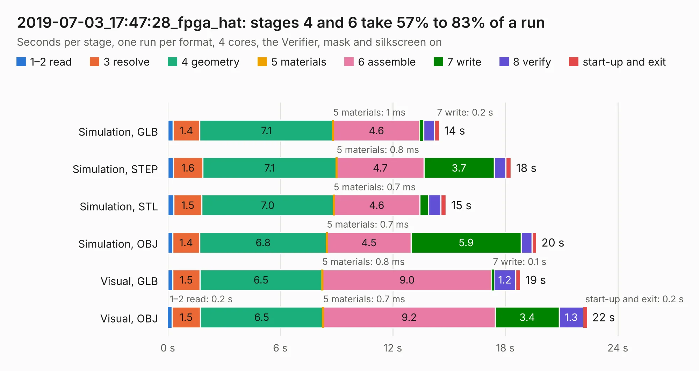

| Mode and format | 1–2 read | 3 resolve | 4 geometry | 5 materials | 6 assemble | 7 write | 8 verify | start-up and exit | Total |
|---|---:|---:|---:|---:|---:|---:|---:|---:|---:|
| Simulation, GLB | 0.3 | 1.4 | 7.1 | 1&nbsp;ms | 4.6 | 0.2 | 0.6 | 0.3 | 14.5 |
| Simulation, STEP | 0.3 | 1.6 | 7.1 | 0.8&nbsp;ms | 4.7 | 3.7 | 0.6 | 0.3 | 18.3 |
| Simulation, STL | 0.3 | 1.5 | 7.0 | 0.7&nbsp;ms | 4.6 | 0.5 | 0.6 | 0.3 | 14.8 |
| Simulation, OBJ | 0.3 | 1.4 | 6.8 | 0.7&nbsp;ms | 4.5 | 5.9 | 0.6 | 0.2 | 19.7 |
| Visual, GLB | 0.3 | 1.5 | 6.5 | 0.8&nbsp;ms | 9.0 | 0.1 | 1.2 | 0.3 | 18.8 |
| Visual, OBJ | 0.2 | 1.5 | 6.5 | 0.7&nbsp;ms | 9.2 | 3.4 | 1.3 | 0.2 | 22.4 |

<table align="center"><tr><td valign="top">

| Board | Repo: [Wren6991/Snowflake-FPGA](https://github.com/Wren6991/Snowflake-FPGA) Board: `2019-07-03_17:47:28_fpga_hat.kicad_pcb` |
|---|---|
| Folder | timelapse |
| Complexity | 286&nbsp;/&nbsp;1000 (size&nbsp;251, features&nbsp;35) |
| KESE&nbsp;features | through vias, rounded, trapezoid or chamfered pads, curved board outline |
| Tested | 9th November 2026 |
| Copper&nbsp;layers | 4 |
| File&nbsp;format | KiCad 5 (20171130) |
| Parts,&nbsp;tracks,&nbsp;vias | 81, 813, 32 |
| Triangles,&nbsp;simulation | 1,209,494 in 150 parts |
| Verifier | PASS in all six runs |

</td><td valign="top">

<table>
<tr><th>File type</th><th>File size</th><th>Peak memory used</th></tr>
<tr><th colspan="3" align="left">Simulation</th></tr>
<tr><td>GLB</td><td align="right">41&nbsp;MB</td><td align="right">495&nbsp;MB</td></tr>
<tr><td>STEP</td><td align="right">204&nbsp;MB</td><td align="right">576&nbsp;MB</td></tr>
<tr><td>STL</td><td align="right">60&nbsp;MB</td><td align="right">495&nbsp;MB</td></tr>
<tr><td>OBJ</td><td align="right">125&nbsp;MB</td><td align="right">851&nbsp;MB</td></tr>
<tr><th colspan="3" align="left">Visual</th></tr>
<tr><td>GLB</td><td align="right">23&nbsp;MB</td><td align="right">531&nbsp;MB</td></tr>
<tr><td>OBJ</td><td align="right">69&nbsp;MB</td><td align="right">593&nbsp;MB</td></tr>
</table>

</td></tr></table>

## 3074. 2019-07-03_17:57:53_fpga_hat

| Mode and format | 1–2 read | 3 resolve | 4 geometry | 5 materials | 6 assemble | 7 write | 8 verify | start-up and exit | Total |
|---|---:|---:|---:|---:|---:|---:|---:|---:|---:|
| Simulation, GLB | 0.2 | 1.3 | 5.7 | 0.8&nbsp;ms | 3.9 | 0.2 | 0.4 | 0.3 | 12.0 |
| Simulation, STEP | 0.2 | 1.2 | 5.5 | 0.6&nbsp;ms | 3.8 | 2.8 | 0.5 | 0.2 | 14.3 |
| Simulation, STL | 0.3 | 1.3 | 5.7 | 0.7&nbsp;ms | 3.8 | 0.3 | 0.5 | 0.2 | 12.0 |
| Simulation, OBJ | 0.2 | 1.2 | 5.8 | 0.6&nbsp;ms | 3.6 | 4.7 | 0.5 | 0.2 | 16.3 |
| Visual, GLB | 0.2 | 1.2 | 5.8 | 0.5&nbsp;ms | 7.5 | 95&nbsp;ms | 0.9 | 0.2 | 15.9 |
| Visual, OBJ | 0.2 | 1.2 | 5.8 | 0.6&nbsp;ms | 7.5 | 2.7 | 0.9 | 0.2 | 18.5 |

<table align="center"><tr><td valign="top">

| Board | Repo: [Wren6991/Snowflake-FPGA](https://github.com/Wren6991/Snowflake-FPGA) Board: `2019-07-03_17:57:53_fpga_hat.kicad_pcb` |
|---|---|
| Folder | timelapse |
| Complexity | 287&nbsp;/&nbsp;1000 (size&nbsp;252, features&nbsp;35) |
| KESE&nbsp;features | through vias, rounded, trapezoid or chamfered pads, curved board outline |
| Tested | 9th November 2026 |
| Copper&nbsp;layers | 4 |
| File&nbsp;format | KiCad 5 (20171130) |
| Parts,&nbsp;tracks,&nbsp;vias | 81, 826, 32 |
| Triangles,&nbsp;simulation | 1,212,256 in 150 parts |
| Verifier | PASS in all six runs |

</td><td valign="top">

<table>
<tr><th>File type</th><th>File size</th><th>Peak memory used</th></tr>
<tr><th colspan="3" align="left">Simulation</th></tr>
<tr><td>GLB</td><td align="right">41&nbsp;MB</td><td align="right">540&nbsp;MB</td></tr>
<tr><td>STEP</td><td align="right">205&nbsp;MB</td><td align="right">570&nbsp;MB</td></tr>
<tr><td>STL</td><td align="right">61&nbsp;MB</td><td align="right">489&nbsp;MB</td></tr>
<tr><td>OBJ</td><td align="right">126&nbsp;MB</td><td align="right">864&nbsp;MB</td></tr>
<tr><th colspan="3" align="left">Visual</th></tr>
<tr><td>GLB</td><td align="right">23&nbsp;MB</td><td align="right">560&nbsp;MB</td></tr>
<tr><td>OBJ</td><td align="right">70&nbsp;MB</td><td align="right">600&nbsp;MB</td></tr>
</table>

</td></tr></table>

## 3075. 2019-07-03_18:11:15_fpga_hat

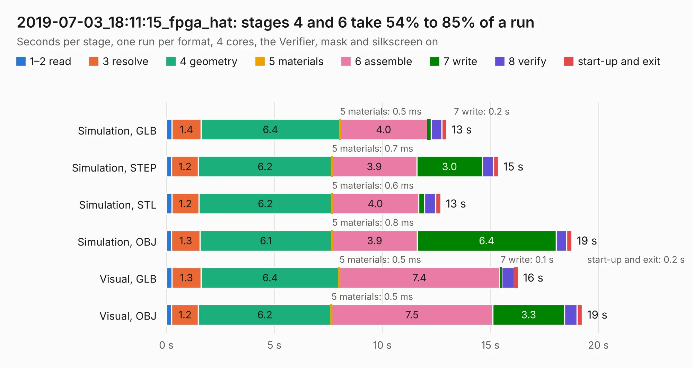

| Mode and format | 1–2 read | 3 resolve | 4 geometry | 5 materials | 6 assemble | 7 write | 8 verify | start-up and exit | Total |
|---|---:|---:|---:|---:|---:|---:|---:|---:|---:|
| Simulation, GLB | 0.3 | 1.4 | 6.4 | 0.5&nbsp;ms | 4.0 | 0.2 | 0.5 | 0.2 | 13.0 |
| Simulation, STEP | 0.2 | 1.2 | 6.2 | 0.7&nbsp;ms | 3.9 | 3.0 | 0.5 | 0.2 | 15.4 |
| Simulation, STL | 0.3 | 1.2 | 6.2 | 0.6&nbsp;ms | 4.0 | 0.3 | 0.5 | 0.2 | 12.7 |
| Simulation, OBJ | 0.2 | 1.3 | 6.1 | 0.8&nbsp;ms | 3.9 | 6.4 | 0.5 | 0.2 | 18.8 |
| Visual, GLB | 0.3 | 1.3 | 6.4 | 0.5&nbsp;ms | 7.4 | 0.1 | 0.6 | 0.2 | 16.3 |
| Visual, OBJ | 0.2 | 1.2 | 6.2 | 0.5&nbsp;ms | 7.5 | 3.3 | 0.6 | 0.2 | 19.2 |

<table align="center"><tr><td valign="top">

| Board | Repo: [Wren6991/Snowflake-FPGA](https://github.com/Wren6991/Snowflake-FPGA) Board: `2019-07-03_18:11:15_fpga_hat.kicad_pcb` |
|---|---|
| Folder | timelapse |
| Complexity | 287&nbsp;/&nbsp;1000 (size&nbsp;252, features&nbsp;35) |
| KESE&nbsp;features | through vias, rounded, trapezoid or chamfered pads, curved board outline |
| Tested | 9th November 2026 |
| Copper&nbsp;layers | 4 |
| File&nbsp;format | KiCad 5 (20171130) |
| Parts,&nbsp;tracks,&nbsp;vias | 81, 842, 32 |
| Triangles,&nbsp;simulation | 1,214,866 in 150 parts |
| Verifier | PASS in all six runs |

</td><td valign="top">

<table>
<tr><th>File type</th><th>File size</th><th>Peak memory used</th></tr>
<tr><th colspan="3" align="left">Simulation</th></tr>
<tr><td>GLB</td><td align="right">41&nbsp;MB</td><td align="right">475&nbsp;MB</td></tr>
<tr><td>STEP</td><td align="right">206&nbsp;MB</td><td align="right">591&nbsp;MB</td></tr>
<tr><td>STL</td><td align="right">61&nbsp;MB</td><td align="right">490&nbsp;MB</td></tr>
<tr><td>OBJ</td><td align="right">126&nbsp;MB</td><td align="right">851&nbsp;MB</td></tr>
<tr><th colspan="3" align="left">Visual</th></tr>
<tr><td>GLB</td><td align="right">23&nbsp;MB</td><td align="right">550&nbsp;MB</td></tr>
<tr><td>OBJ</td><td align="right">70&nbsp;MB</td><td align="right">613&nbsp;MB</td></tr>
</table>

</td></tr></table>

## 3076. 2019-07-03_18:30:05_fpga_hat

| Mode and format | 1–2 read | 3 resolve | 4 geometry | 5 materials | 6 assemble | 7 write | 8 verify | start-up and exit | Total |
|---|---:|---:|---:|---:|---:|---:|---:|---:|---:|
| Simulation, GLB | 0.3 | 1.7 | 8.1 | 0.8&nbsp;ms | 5.3 | 0.2 | 0.7 | 0.3 | 16.6 |
| Simulation, STEP | 0.3 | 1.8 | 7.9 | 0.6&nbsp;ms | 5.4 | 4.0 | 0.6 | 0.3 | 20.3 |
| Simulation, STL | 0.3 | 1.8 | 8.0 | 0.8&nbsp;ms | 5.1 | 0.5 | 0.6 | 0.2 | 16.6 |
| Simulation, OBJ | 0.3 | 1.6 | 7.4 | 0.6&nbsp;ms | 5.0 | 7.5 | 0.7 | 0.3 | 22.8 |
| Visual, GLB | 0.3 | 1.7 | 7.5 | 0.6&nbsp;ms | 10.0 | 0.1 | 1.1 | 0.2 | 21.0 |
| Visual, OBJ | 0.3 | 1.6 | 8.1 | 1.0&nbsp;ms | 10.3 | 4.2 | 1.3 | 0.2 | 26.1 |

<table align="center"><tr><td valign="top">

| Board | Repo: [Wren6991/Snowflake-FPGA](https://github.com/Wren6991/Snowflake-FPGA) Board: `2019-07-03_18:30:05_fpga_hat.kicad_pcb` |
|---|---|
| Folder | timelapse |
| Complexity | 287&nbsp;/&nbsp;1000 (size&nbsp;252, features&nbsp;35) |
| KESE&nbsp;features | through vias, rounded, trapezoid or chamfered pads, curved board outline |
| Tested | 9th November 2026 |
| Copper&nbsp;layers | 4 |
| File&nbsp;format | KiCad 5 (20171130) |
| Parts,&nbsp;tracks,&nbsp;vias | 81, 853, 32 |
| Triangles,&nbsp;simulation | 1,216,442 in 150 parts |
| Verifier | PASS in all six runs |

</td><td valign="top">

<table>
<tr><th>File type</th><th>File size</th><th>Peak memory used</th></tr>
<tr><th colspan="3" align="left">Simulation</th></tr>
<tr><td>GLB</td><td align="right">41&nbsp;MB</td><td align="right">484&nbsp;MB</td></tr>
<tr><td>STEP</td><td align="right">206&nbsp;MB</td><td align="right">595&nbsp;MB</td></tr>
<tr><td>STL</td><td align="right">61&nbsp;MB</td><td align="right">507&nbsp;MB</td></tr>
<tr><td>OBJ</td><td align="right">126&nbsp;MB</td><td align="right">880&nbsp;MB</td></tr>
<tr><th colspan="3" align="left">Visual</th></tr>
<tr><td>GLB</td><td align="right">24&nbsp;MB</td><td align="right">608&nbsp;MB</td></tr>
<tr><td>OBJ</td><td align="right">70&nbsp;MB</td><td align="right">589&nbsp;MB</td></tr>
</table>

</td></tr></table>

## 3077. 2019-07-03_18:34:30_fpga_hat

| Mode and format | 1–2 read | 3 resolve | 4 geometry | 5 materials | 6 assemble | 7 write | 8 verify | start-up and exit | Total |
|---|---:|---:|---:|---:|---:|---:|---:|---:|---:|
| Simulation, GLB | 0.3 | 1.3 | 6.0 | 0.7&nbsp;ms | 4.2 | 0.2 | 0.5 | 0.2 | 12.8 |
| Simulation, STEP | 0.3 | 1.4 | 5.8 | 0.6&nbsp;ms | 4.1 | 3.3 | 0.6 | 0.2 | 15.6 |
| Simulation, STL | 0.2 | 1.4 | 6.0 | 0.6&nbsp;ms | 4.2 | 0.4 | 0.6 | 0.2 | 12.9 |
| Simulation, OBJ | 0.3 | 1.3 | 6.1 | 0.6&nbsp;ms | 4.3 | 5.4 | 0.6 | 0.3 | 18.2 |
| Visual, GLB | 0.3 | 1.3 | 6.3 | 0.9&nbsp;ms | 9.5 | 99&nbsp;ms | 1.0 | 0.3 | 18.7 |
| Visual, OBJ | 0.2 | 1.4 | 6.8 | 0.9&nbsp;ms | 8.6 | 3.1 | 1.1 | 0.2 | 21.4 |

<table align="center"><tr><td valign="top">

| Board | Repo: [Wren6991/Snowflake-FPGA](https://github.com/Wren6991/Snowflake-FPGA) Board: `2019-07-03_18:34:30_fpga_hat.kicad_pcb` |
|---|---|
| Folder | timelapse |
| Complexity | 287&nbsp;/&nbsp;1000 (size&nbsp;252, features&nbsp;35) |
| KESE&nbsp;features | through vias, rounded, trapezoid or chamfered pads, curved board outline |
| Tested | 9th November 2026 |
| Copper&nbsp;layers | 4 |
| File&nbsp;format | KiCad 5 (20171130) |
| Parts,&nbsp;tracks,&nbsp;vias | 81, 853, 32 |
| Triangles,&nbsp;simulation | 1,216,442 in 150 parts |
| Verifier | PASS in all six runs |

</td><td valign="top">

<table>
<tr><th>File type</th><th>File size</th><th>Peak memory used</th></tr>
<tr><th colspan="3" align="left">Simulation</th></tr>
<tr><td>GLB</td><td align="right">41&nbsp;MB</td><td align="right">502&nbsp;MB</td></tr>
<tr><td>STEP</td><td align="right">206&nbsp;MB</td><td align="right">576&nbsp;MB</td></tr>
<tr><td>STL</td><td align="right">61&nbsp;MB</td><td align="right">487&nbsp;MB</td></tr>
<tr><td>OBJ</td><td align="right">126&nbsp;MB</td><td align="right">839&nbsp;MB</td></tr>
<tr><th colspan="3" align="left">Visual</th></tr>
<tr><td>GLB</td><td align="right">24&nbsp;MB</td><td align="right">542&nbsp;MB</td></tr>
<tr><td>OBJ</td><td align="right">70&nbsp;MB</td><td align="right">579&nbsp;MB</td></tr>
</table>

</td></tr></table>

## 3078. 2019-07-05_20:45:15_fpga_hat

| Mode and format | 1–2 read | 3 resolve | 4 geometry | 5 materials | 6 assemble | 7 write | 8 verify | start-up and exit | Total |
|---|---:|---:|---:|---:|---:|---:|---:|---:|---:|
| Simulation, GLB | 0.3 | 1.2 | 5.9 | 0.5&nbsp;ms | 4.1 | 0.2 | 0.6 | 0.2 | 12.4 |
| Simulation, STEP | 0.3 | 1.3 | 5.9 | 0.6&nbsp;ms | 4.1 | 3.1 | 0.5 | 0.2 | 15.5 |
| Simulation, STL | 0.3 | 1.3 | 6.3 | 0.9&nbsp;ms | 4.4 | 0.4 | 0.5 | 0.2 | 13.4 |
| Simulation, OBJ | 0.2 | 1.4 | 5.8 | 0.6&nbsp;ms | 3.9 | 5.3 | 0.6 | 0.2 | 17.5 |
| Visual, GLB | 0.3 | 1.2 | 6.6 | 0.5&nbsp;ms | 7.6 | 92&nbsp;ms | 0.7 | 0.2 | 16.6 |
| Visual, OBJ | 0.2 | 1.3 | 6.0 | 0.6&nbsp;ms | 7.6 | 2.8 | 0.9 | 0.2 | 19.2 |

<table align="center"><tr><td valign="top">

| Board | Repo: [Wren6991/Snowflake-FPGA](https://github.com/Wren6991/Snowflake-FPGA) Board: `2019-07-05_20:45:15_fpga_hat.kicad_pcb` |
|---|---|
| Folder | timelapse |
| Complexity | 307&nbsp;/&nbsp;1000 (size&nbsp;252, features&nbsp;55) |
| KESE&nbsp;features | through vias, rounded, trapezoid or chamfered pads, filled zones, curved board outline |
| Tested | 9th November 2026 |
| Copper&nbsp;layers | 4 |
| File&nbsp;format | KiCad 5 (20171130) |
| Parts,&nbsp;tracks,&nbsp;vias | 81, 856, 32 |
| Triangles,&nbsp;simulation | 1,277,596 in 150 parts |
| Verifier | PASS in all six runs |

</td><td valign="top">

<table>
<tr><th>File type</th><th>File size</th><th>Peak memory used</th></tr>
<tr><th colspan="3" align="left">Simulation</th></tr>
<tr><td>GLB</td><td align="right">44&nbsp;MB</td><td align="right">505&nbsp;MB</td></tr>
<tr><td>STEP</td><td align="right">214&nbsp;MB</td><td align="right">581&nbsp;MB</td></tr>
<tr><td>STL</td><td align="right">64&nbsp;MB</td><td align="right">487&nbsp;MB</td></tr>
<tr><td>OBJ</td><td align="right">133&nbsp;MB</td><td align="right">881&nbsp;MB</td></tr>
<tr><th colspan="3" align="left">Visual</th></tr>
<tr><td>GLB</td><td align="right">24&nbsp;MB</td><td align="right">594&nbsp;MB</td></tr>
<tr><td>OBJ</td><td align="right">70&nbsp;MB</td><td align="right">591&nbsp;MB</td></tr>
</table>

</td></tr></table>

## 3079. 2019-07-05_21:08:22_fpga_hat

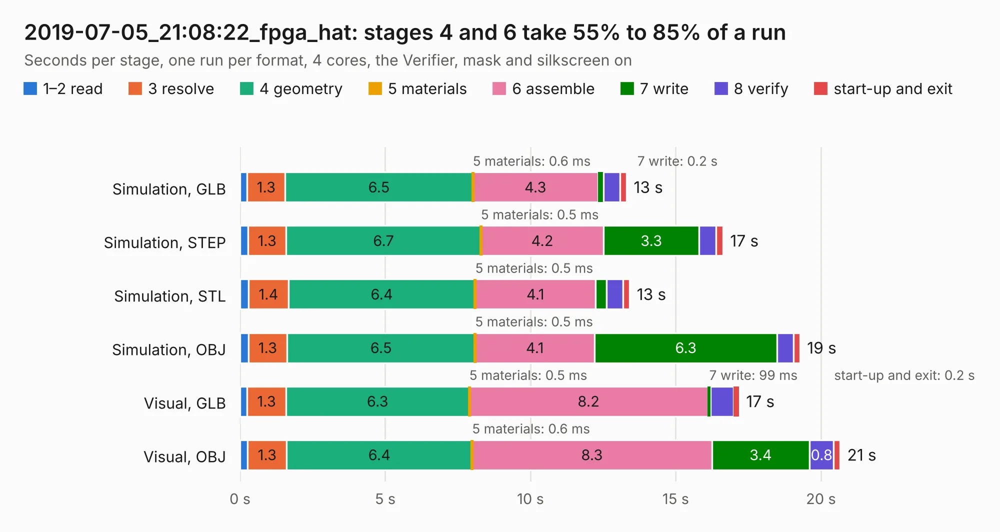

| Mode and format | 1–2 read | 3 resolve | 4 geometry | 5 materials | 6 assemble | 7 write | 8 verify | start-up and exit | Total |
|---|---:|---:|---:|---:|---:|---:|---:|---:|---:|
| Simulation, GLB | 0.2 | 1.3 | 6.5 | 0.6&nbsp;ms | 4.3 | 0.2 | 0.6 | 0.2 | 13.3 |
| Simulation, STEP | 0.3 | 1.3 | 6.7 | 0.5&nbsp;ms | 4.2 | 3.3 | 0.6 | 0.2 | 16.6 |
| Simulation, STL | 0.3 | 1.4 | 6.4 | 0.5&nbsp;ms | 4.1 | 0.4 | 0.6 | 0.2 | 13.4 |
| Simulation, OBJ | 0.3 | 1.3 | 6.5 | 0.5&nbsp;ms | 4.1 | 6.3 | 0.6 | 0.2 | 19.3 |
| Visual, GLB | 0.2 | 1.3 | 6.3 | 0.5&nbsp;ms | 8.2 | 99&nbsp;ms | 0.8 | 0.2 | 17.2 |
| Visual, OBJ | 0.3 | 1.3 | 6.4 | 0.6&nbsp;ms | 8.3 | 3.4 | 0.8 | 0.2 | 20.7 |

<table align="center"><tr><td valign="top">

| Board | Repo: [Wren6991/Snowflake-FPGA](https://github.com/Wren6991/Snowflake-FPGA) Board: `2019-07-05_21:08:22_fpga_hat.kicad_pcb` |
|---|---|
| Folder | timelapse |
| Complexity | 287&nbsp;/&nbsp;1000 (size&nbsp;252, features&nbsp;35) |
| KESE&nbsp;features | through vias, rounded, trapezoid or chamfered pads, curved board outline |
| Tested | 9th November 2026 |
| Copper&nbsp;layers | 4 |
| File&nbsp;format | KiCad 5 (20171130) |
| Parts,&nbsp;tracks,&nbsp;vias | 81, 867, 32 |
| Triangles,&nbsp;simulation | 1,206,662 in 150 parts |
| Verifier | PASS in all six runs |

</td><td valign="top">

<table>
<tr><th>File type</th><th>File size</th><th>Peak memory used</th></tr>
<tr><th colspan="3" align="left">Simulation</th></tr>
<tr><td>GLB</td><td align="right">41&nbsp;MB</td><td align="right">509&nbsp;MB</td></tr>
<tr><td>STEP</td><td align="right">205&nbsp;MB</td><td align="right">582&nbsp;MB</td></tr>
<tr><td>STL</td><td align="right">60&nbsp;MB</td><td align="right">471&nbsp;MB</td></tr>
<tr><td>OBJ</td><td align="right">125&nbsp;MB</td><td align="right">874&nbsp;MB</td></tr>
<tr><th colspan="3" align="left">Visual</th></tr>
<tr><td>GLB</td><td align="right">23&nbsp;MB</td><td align="right">591&nbsp;MB</td></tr>
<tr><td>OBJ</td><td align="right">69&nbsp;MB</td><td align="right">555&nbsp;MB</td></tr>
</table>

</td></tr></table>

## 3080. 2019-07-05_21:29:37_fpga_hat

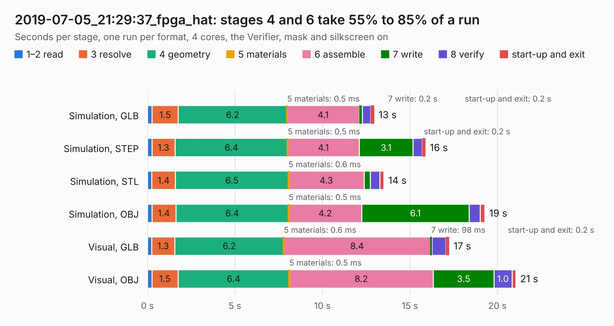

| Mode and format | 1–2 read | 3 resolve | 4 geometry | 5 materials | 6 assemble | 7 write | 8 verify | start-up and exit | Total |
|---|---:|---:|---:|---:|---:|---:|---:|---:|---:|
| Simulation, GLB | 0.3 | 1.5 | 6.2 | 0.5&nbsp;ms | 4.1 | 0.2 | 0.5 | 0.2 | 13.0 |
| Simulation, STEP | 0.3 | 1.3 | 6.4 | 0.5&nbsp;ms | 4.1 | 3.1 | 0.5 | 0.2 | 15.9 |
| Simulation, STL | 0.3 | 1.4 | 6.5 | 0.6&nbsp;ms | 4.3 | 0.4 | 0.6 | 0.2 | 13.5 |
| Simulation, OBJ | 0.3 | 1.4 | 6.4 | 0.5&nbsp;ms | 4.2 | 6.1 | 0.6 | 0.3 | 19.3 |
| Visual, GLB | 0.2 | 1.3 | 6.2 | 0.6&nbsp;ms | 8.4 | 98&nbsp;ms | 0.8 | 0.2 | 17.2 |
| Visual, OBJ | 0.3 | 1.5 | 6.4 | 0.5&nbsp;ms | 8.2 | 3.5 | 1.0 | 0.2 | 21.0 |

<table align="center"><tr><td valign="top">

| Board | Repo: [Wren6991/Snowflake-FPGA](https://github.com/Wren6991/Snowflake-FPGA) Board: `2019-07-05_21:29:37_fpga_hat.kicad_pcb` |
|---|---|
| Folder | timelapse |
| Complexity | 287&nbsp;/&nbsp;1000 (size&nbsp;252, features&nbsp;35) |
| KESE&nbsp;features | through vias, rounded, trapezoid or chamfered pads, curved board outline |
| Tested | 9th November 2026 |
| Copper&nbsp;layers | 4 |
| File&nbsp;format | KiCad 5 (20171130) |
| Parts,&nbsp;tracks,&nbsp;vias | 81, 858, 32 |
| Triangles,&nbsp;simulation | 1,204,912 in 150 parts |
| Verifier | PASS in all six runs |

</td><td valign="top">

<table>
<tr><th>File type</th><th>File size</th><th>Peak memory used</th></tr>
<tr><th colspan="3" align="left">Simulation</th></tr>
<tr><td>GLB</td><td align="right">41&nbsp;MB</td><td align="right">490&nbsp;MB</td></tr>
<tr><td>STEP</td><td align="right">204&nbsp;MB</td><td align="right">592&nbsp;MB</td></tr>
<tr><td>STL</td><td align="right">60&nbsp;MB</td><td align="right">485&nbsp;MB</td></tr>
<tr><td>OBJ</td><td align="right">125&nbsp;MB</td><td align="right">854&nbsp;MB</td></tr>
<tr><th colspan="3" align="left">Visual</th></tr>
<tr><td>GLB</td><td align="right">23&nbsp;MB</td><td align="right">596&nbsp;MB</td></tr>
<tr><td>OBJ</td><td align="right">69&nbsp;MB</td><td align="right">595&nbsp;MB</td></tr>
</table>

</td></tr></table>

## 3081. 2019-07-05_21:40:20_fpga_hat

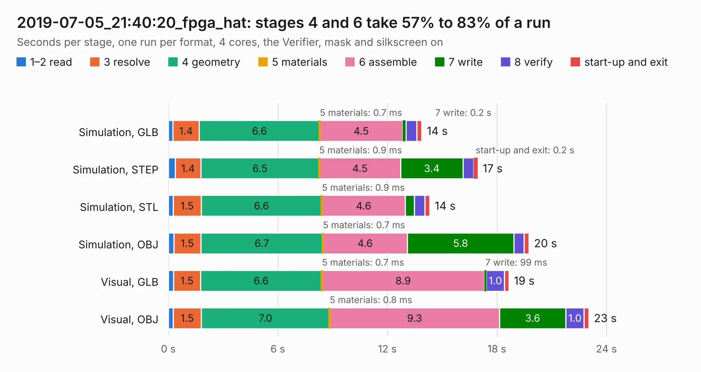

| Mode and format | 1–2 read | 3 resolve | 4 geometry | 5 materials | 6 assemble | 7 write | 8 verify | start-up and exit | Total |
|---|---:|---:|---:|---:|---:|---:|---:|---:|---:|
| Simulation, GLB | 0.2 | 1.4 | 6.6 | 0.7&nbsp;ms | 4.5 | 0.2 | 0.6 | 0.3 | 13.9 |
| Simulation, STEP | 0.4 | 1.4 | 6.5 | 0.9&nbsp;ms | 4.5 | 3.4 | 0.6 | 0.2 | 16.9 |
| Simulation, STL | 0.3 | 1.5 | 6.6 | 0.9&nbsp;ms | 4.6 | 0.5 | 0.6 | 0.3 | 14.3 |
| Simulation, OBJ | 0.3 | 1.5 | 6.7 | 0.7&nbsp;ms | 4.6 | 5.8 | 0.6 | 0.3 | 19.8 |
| Visual, GLB | 0.3 | 1.5 | 6.6 | 0.7&nbsp;ms | 8.9 | 99&nbsp;ms | 1.0 | 0.2 | 18.7 |
| Visual, OBJ | 0.3 | 1.5 | 7.0 | 0.8&nbsp;ms | 9.3 | 3.6 | 1.0 | 0.3 | 23.0 |

<table align="center"><tr><td valign="top">

| Board | Repo: [Wren6991/Snowflake-FPGA](https://github.com/Wren6991/Snowflake-FPGA) Board: `2019-07-05_21:40:20_fpga_hat.kicad_pcb` |
|---|---|
| Folder | timelapse |
| Complexity | 287&nbsp;/&nbsp;1000 (size&nbsp;252, features&nbsp;35) |
| KESE&nbsp;features | through vias, rounded, trapezoid or chamfered pads, curved board outline |
| Tested | 9th November 2026 |
| Copper&nbsp;layers | 4 |
| File&nbsp;format | KiCad 5 (20171130) |
| Parts,&nbsp;tracks,&nbsp;vias | 82, 858, 32 |
| Triangles,&nbsp;simulation | 1,208,428 in 150 parts |
| Verifier | PASS in all six runs |

</td><td valign="top">

<table>
<tr><th>File type</th><th>File size</th><th>Peak memory used</th></tr>
<tr><th colspan="3" align="left">Simulation</th></tr>
<tr><td>GLB</td><td align="right">41&nbsp;MB</td><td align="right">498&nbsp;MB</td></tr>
<tr><td>STEP</td><td align="right">205&nbsp;MB</td><td align="right">572&nbsp;MB</td></tr>
<tr><td>STL</td><td align="right">60&nbsp;MB</td><td align="right">486&nbsp;MB</td></tr>
<tr><td>OBJ</td><td align="right">125&nbsp;MB</td><td align="right">859&nbsp;MB</td></tr>
<tr><th colspan="3" align="left">Visual</th></tr>
<tr><td>GLB</td><td align="right">23&nbsp;MB</td><td align="right">553&nbsp;MB</td></tr>
<tr><td>OBJ</td><td align="right">69&nbsp;MB</td><td align="right">592&nbsp;MB</td></tr>
</table>

</td></tr></table>

## 3082. 2019-07-05_22:03:31_fpga_hat

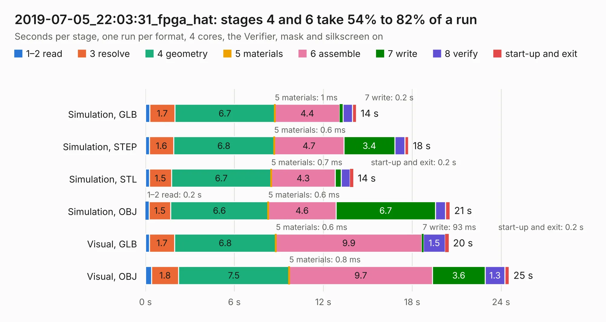

| Mode and format | 1–2 read | 3 resolve | 4 geometry | 5 materials | 6 assemble | 7 write | 8 verify | start-up and exit | Total |
|---|---:|---:|---:|---:|---:|---:|---:|---:|---:|
| Simulation, GLB | 0.3 | 1.7 | 6.7 | 1&nbsp;ms | 4.4 | 0.2 | 0.6 | 0.3 | 14.2 |
| Simulation, STEP | 0.3 | 1.6 | 6.8 | 0.6&nbsp;ms | 4.7 | 3.4 | 0.7 | 0.2 | 17.8 |
| Simulation, STL | 0.3 | 1.5 | 6.7 | 0.7&nbsp;ms | 4.3 | 0.4 | 0.6 | 0.2 | 14.0 |
| Simulation, OBJ | 0.2 | 1.5 | 6.6 | 0.6&nbsp;ms | 4.6 | 6.7 | 0.7 | 0.3 | 20.5 |
| Visual, GLB | 0.3 | 1.7 | 6.8 | 0.6&nbsp;ms | 9.9 | 93&nbsp;ms | 1.5 | 0.2 | 20.5 |
| Visual, OBJ | 0.4 | 1.8 | 7.5 | 0.8&nbsp;ms | 9.7 | 3.6 | 1.3 | 0.3 | 24.5 |

<table align="center"><tr><td valign="top">

| Board | Repo: [Wren6991/Snowflake-FPGA](https://github.com/Wren6991/Snowflake-FPGA) Board: `2019-07-05_22:03:31_fpga_hat.kicad_pcb` |
|---|---|
| Folder | timelapse |
| Complexity | 289&nbsp;/&nbsp;1000 (size&nbsp;254, features&nbsp;35) |
| KESE&nbsp;features | through vias, rounded, trapezoid or chamfered pads, curved board outline |
| Tested | 9th November 2026 |
| Copper&nbsp;layers | 4 |
| File&nbsp;format | KiCad 5 (20171130) |
| Parts,&nbsp;tracks,&nbsp;vias | 82, 937, 48 |
| Triangles,&nbsp;simulation | 1,267,728 in 150 parts |
| Verifier | PASS in all six runs |

</td><td valign="top">

<table>
<tr><th>File type</th><th>File size</th><th>Peak memory used</th></tr>
<tr><th colspan="3" align="left">Simulation</th></tr>
<tr><td>GLB</td><td align="right">43&nbsp;MB</td><td align="right">505&nbsp;MB</td></tr>
<tr><td>STEP</td><td align="right">212&nbsp;MB</td><td align="right">600&nbsp;MB</td></tr>
<tr><td>STL</td><td align="right">63&nbsp;MB</td><td align="right">504&nbsp;MB</td></tr>
<tr><td>OBJ</td><td align="right">132&nbsp;MB</td><td align="right">893&nbsp;MB</td></tr>
<tr><th colspan="3" align="left">Visual</th></tr>
<tr><td>GLB</td><td align="right">24&nbsp;MB</td><td align="right">592&nbsp;MB</td></tr>
<tr><td>OBJ</td><td align="right">73&nbsp;MB</td><td align="right">607&nbsp;MB</td></tr>
</table>

</td></tr></table>

## 3083. 2019-07-05_22:15:17_fpga_hat

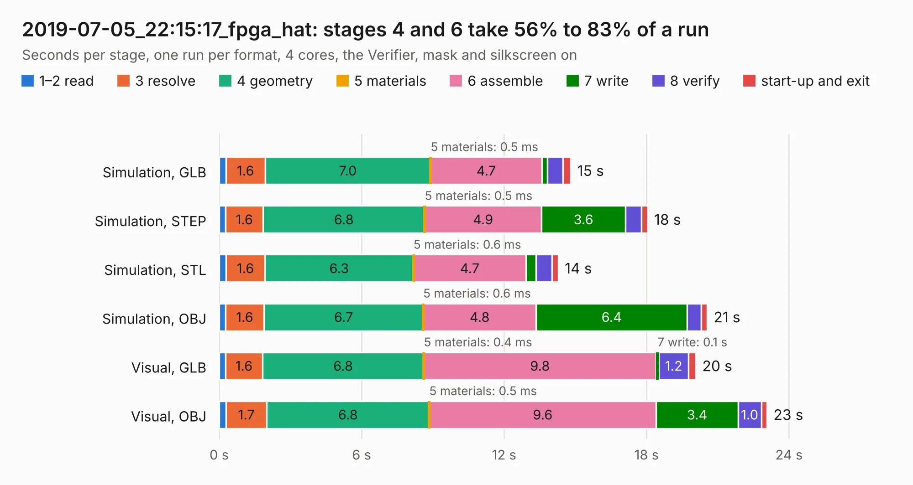

| Mode and format | 1–2 read | 3 resolve | 4 geometry | 5 materials | 6 assemble | 7 write | 8 verify | start-up and exit | Total |
|---|---:|---:|---:|---:|---:|---:|---:|---:|---:|
| Simulation, GLB | 0.3 | 1.6 | 7.0 | 0.5&nbsp;ms | 4.7 | 0.2 | 0.7 | 0.3 | 14.8 |
| Simulation, STEP | 0.3 | 1.6 | 6.8 | 0.5&nbsp;ms | 4.9 | 3.6 | 0.7 | 0.3 | 18.0 |
| Simulation, STL | 0.3 | 1.6 | 6.3 | 0.6&nbsp;ms | 4.7 | 0.4 | 0.7 | 0.3 | 14.3 |
| Simulation, OBJ | 0.3 | 1.6 | 6.7 | 0.6&nbsp;ms | 4.8 | 6.4 | 0.6 | 0.2 | 20.6 |
| Visual, GLB | 0.3 | 1.6 | 6.8 | 0.4&nbsp;ms | 9.8 | 0.1 | 1.2 | 0.3 | 20.1 |
| Visual, OBJ | 0.3 | 1.7 | 6.8 | 0.5&nbsp;ms | 9.6 | 3.4 | 1.0 | 0.2 | 23.1 |

<table align="center"><tr><td valign="top">

| Board | Repo: [Wren6991/Snowflake-FPGA](https://github.com/Wren6991/Snowflake-FPGA) Board: `2019-07-05_22:15:17_fpga_hat.kicad_pcb` |
|---|---|
| Folder | timelapse |
| Complexity | 291&nbsp;/&nbsp;1000 (size&nbsp;256, features&nbsp;35) |
| KESE&nbsp;features | through vias, rounded, trapezoid or chamfered pads, curved board outline |
| Tested | 9th November 2026 |
| Copper&nbsp;layers | 4 |
| File&nbsp;format | KiCad 5 (20171130) |
| Parts,&nbsp;tracks,&nbsp;vias | 82, 996, 57 |
| Triangles,&nbsp;simulation | 1,303,642 in 150 parts |
| Verifier | PASS in all six runs |

</td><td valign="top">

<table>
<tr><th>File type</th><th>File size</th><th>Peak memory used</th></tr>
<tr><th colspan="3" align="left">Simulation</th></tr>
<tr><td>GLB</td><td align="right">44&nbsp;MB</td><td align="right">555&nbsp;MB</td></tr>
<tr><td>STEP</td><td align="right">216&nbsp;MB</td><td align="right">610&nbsp;MB</td></tr>
<tr><td>STL</td><td align="right">65&nbsp;MB</td><td align="right">527&nbsp;MB</td></tr>
<tr><td>OBJ</td><td align="right">135&nbsp;MB</td><td align="right">914&nbsp;MB</td></tr>
<tr><th colspan="3" align="left">Visual</th></tr>
<tr><td>GLB</td><td align="right">25&nbsp;MB</td><td align="right">617&nbsp;MB</td></tr>
<tr><td>OBJ</td><td align="right">76&nbsp;MB</td><td align="right">595&nbsp;MB</td></tr>
</table>

</td></tr></table>

## 3084. 2019-07-05_22:26:53_fpga_hat

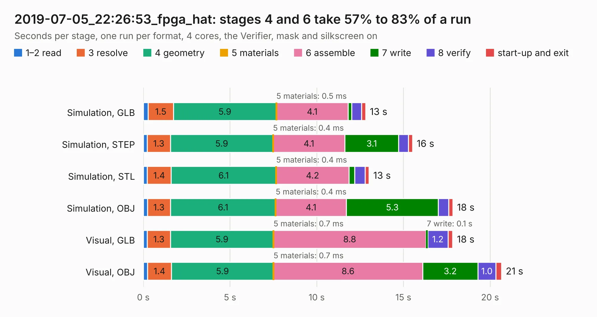

| Mode and format | 1–2 read | 3 resolve | 4 geometry | 5 materials | 6 assemble | 7 write | 8 verify | start-up and exit | Total |
|---|---:|---:|---:|---:|---:|---:|---:|---:|---:|
| Simulation, GLB | 0.3 | 1.5 | 5.9 | 0.5&nbsp;ms | 4.1 | 0.2 | 0.6 | 0.2 | 12.8 |
| Simulation, STEP | 0.2 | 1.3 | 5.9 | 0.4&nbsp;ms | 4.1 | 3.1 | 0.6 | 0.2 | 15.5 |
| Simulation, STL | 0.2 | 1.4 | 6.1 | 0.4&nbsp;ms | 4.2 | 0.3 | 0.6 | 0.2 | 13.0 |
| Simulation, OBJ | 0.2 | 1.3 | 6.1 | 0.4&nbsp;ms | 4.1 | 5.3 | 0.6 | 0.2 | 17.8 |
| Visual, GLB | 0.2 | 1.3 | 5.9 | 0.7&nbsp;ms | 8.8 | 0.1 | 1.2 | 0.3 | 17.8 |
| Visual, OBJ | 0.2 | 1.4 | 5.9 | 0.7&nbsp;ms | 8.6 | 3.2 | 1.0 | 0.3 | 20.7 |

<table align="center"><tr><td valign="top">

| Board | Repo: [Wren6991/Snowflake-FPGA](https://github.com/Wren6991/Snowflake-FPGA) Board: `2019-07-05_22:26:53_fpga_hat.kicad_pcb` |
|---|---|
| Folder | timelapse |
| Complexity | 291&nbsp;/&nbsp;1000 (size&nbsp;256, features&nbsp;35) |
| KESE&nbsp;features | through vias, rounded, trapezoid or chamfered pads, curved board outline |
| Tested | 9th November 2026 |
| Copper&nbsp;layers | 4 |
| File&nbsp;format | KiCad 5 (20171130) |
| Parts,&nbsp;tracks,&nbsp;vias | 82, 1,011, 58 |
| Triangles,&nbsp;simulation | 1,310,084 in 150 parts |
| Verifier | PASS in all six runs |

</td><td valign="top">

<table>
<tr><th>File type</th><th>File size</th><th>Peak memory used</th></tr>
<tr><th colspan="3" align="left">Simulation</th></tr>
<tr><td>GLB</td><td align="right">44&nbsp;MB</td><td align="right">555&nbsp;MB</td></tr>
<tr><td>STEP</td><td align="right">217&nbsp;MB</td><td align="right">606&nbsp;MB</td></tr>
<tr><td>STL</td><td align="right">66&nbsp;MB</td><td align="right">525&nbsp;MB</td></tr>
<tr><td>OBJ</td><td align="right">136&nbsp;MB</td><td align="right">923&nbsp;MB</td></tr>
<tr><th colspan="3" align="left">Visual</th></tr>
<tr><td>GLB</td><td align="right">25&nbsp;MB</td><td align="right">601&nbsp;MB</td></tr>
<tr><td>OBJ</td><td align="right">76&nbsp;MB</td><td align="right">587&nbsp;MB</td></tr>
</table>

</td></tr></table>

## 3085. 2019-07-06_11:05:02_fpga_hat

| Mode and format | 1–2 read | 3 resolve | 4 geometry | 5 materials | 6 assemble | 7 write | 8 verify | start-up and exit | Total |
|---|---:|---:|---:|---:|---:|---:|---:|---:|---:|
| Simulation, GLB | 0.4 | 2.0 | 9.3 | 0.9&nbsp;ms | 7.1 | 0.3 | 1.1 | 0.3 | 20.5 |
| Simulation, STEP | 0.4 | 1.9 | 9.3 | 0.5&nbsp;ms | 7.2 | 5.3 | 1.0 | 0.3 | 25.4 |
| Simulation, STL | 0.4 | 1.9 | 9.4 | 0.8&nbsp;ms | 7.3 | 0.5 | 1.0 | 0.3 | 20.8 |
| Simulation, OBJ | 0.4 | 1.9 | 9.3 | 0.5&nbsp;ms | 7.5 | 10.0 | 1.1 | 0.2 | 30.5 |
| Visual, GLB | 0.4 | 1.9 | 9.0 | 0.8&nbsp;ms | 14.3 | 0.2 | 1.8 | 0.3 | 27.9 |
| Visual, OBJ | 0.5 | 2.0 | 9.2 | 0.5&nbsp;ms | 15.0 | 5.7 | 1.9 | 0.3 | 34.4 |

<table align="center"><tr><td valign="top">

| Board | Repo: [Wren6991/Snowflake-FPGA](https://github.com/Wren6991/Snowflake-FPGA) Board: `2019-07-06_11:05:02_fpga_hat.kicad_pcb` |
|---|---|
| Folder | timelapse |
| Complexity | 312&nbsp;/&nbsp;1000 (size&nbsp;257, features&nbsp;55) |
| KESE&nbsp;features | through vias, rounded, trapezoid or chamfered pads, filled zones, curved board outline |
| Tested | 9th November 2026 |
| Copper&nbsp;layers | 4 |
| File&nbsp;format | KiCad 5 (20171130) |
| Parts,&nbsp;tracks,&nbsp;vias | 82, 1,020, 89 |
| Triangles,&nbsp;simulation | 1,864,436 in 150 parts |
| Verifier | PASS in all six runs |

</td><td valign="top">

<table>
<tr><th>File type</th><th>File size</th><th>Peak memory used</th></tr>
<tr><th colspan="3" align="left">Simulation</th></tr>
<tr><td>GLB</td><td align="right">65&nbsp;MB</td><td align="right">673&nbsp;MB</td></tr>
<tr><td>STEP</td><td align="right">308&nbsp;MB</td><td align="right">812&nbsp;MB</td></tr>
<tr><td>STL</td><td align="right">93&nbsp;MB</td><td align="right">703&nbsp;MB</td></tr>
<tr><td>OBJ</td><td align="right">196&nbsp;MB</td><td align="right">1.3&nbsp;GB</td></tr>
<tr><th colspan="3" align="left">Visual</th></tr>
<tr><td>GLB</td><td align="right">38&nbsp;MB</td><td align="right">775&nbsp;MB</td></tr>
<tr><td>OBJ</td><td align="right">115&nbsp;MB</td><td align="right">924&nbsp;MB</td></tr>
</table>

</td></tr></table>

## 3086. 2019-07-06_11:24:12_fpga_hat

| Mode and format | 1–2 read | 3 resolve | 4 geometry | 5 materials | 6 assemble | 7 write | 8 verify | start-up and exit | Total |
|---|---:|---:|---:|---:|---:|---:|---:|---:|---:|
| Simulation, GLB | 0.3 | 1.6 | 7.5 | 0.5&nbsp;ms | 6.4 | 0.3 | 0.9 | 0.2 | 17.3 |
| Simulation, STEP | 0.4 | 1.6 | 7.9 | 0.4&nbsp;ms | 6.5 | 4.4 | 0.9 | 0.3 | 22.0 |
| Simulation, STL | 0.3 | 1.6 | 7.6 | 0.4&nbsp;ms | 6.1 | 0.6 | 0.8 | 0.2 | 17.3 |
| Simulation, OBJ | 0.3 | 1.6 | 7.5 | 0.5&nbsp;ms | 6.2 | 8.0 | 0.8 | 0.2 | 24.7 |
| Visual, GLB | 0.3 | 1.6 | 7.8 | 0.4&nbsp;ms | 12.5 | 0.2 | 1.6 | 0.2 | 24.1 |
| Visual, OBJ | 0.3 | 1.6 | 7.8 | 0.5&nbsp;ms | 12.8 | 5.0 | 1.7 | 0.2 | 29.5 |

<table align="center"><tr><td valign="top">

| Board | Repo: [Wren6991/Snowflake-FPGA](https://github.com/Wren6991/Snowflake-FPGA) Board: `2019-07-06_11:24:12_fpga_hat.kicad_pcb` |
|---|---|
| Folder | timelapse |
| Complexity | 314&nbsp;/&nbsp;1000 (size&nbsp;259, features&nbsp;55) |
| KESE&nbsp;features | through vias, rounded, trapezoid or chamfered pads, filled zones, curved board outline |
| Tested | 9th November 2026 |
| Copper&nbsp;layers | 4 |
| File&nbsp;format | KiCad 5 (20171130) |
| Parts,&nbsp;tracks,&nbsp;vias | 82, 1,065, 110 |
| Triangles,&nbsp;simulation | 1,938,966 in 150 parts |
| Verifier | PASS in all six runs |

</td><td valign="top">

<table>
<tr><th>File type</th><th>File size</th><th>Peak memory used</th></tr>
<tr><th colspan="3" align="left">Simulation</th></tr>
<tr><td>GLB</td><td align="right">67&nbsp;MB</td><td align="right">739&nbsp;MB</td></tr>
<tr><td>STEP</td><td align="right">317&nbsp;MB</td><td align="right">853&nbsp;MB</td></tr>
<tr><td>STL</td><td align="right">97&nbsp;MB</td><td align="right">754&nbsp;MB</td></tr>
<tr><td>OBJ</td><td align="right">204&nbsp;MB</td><td align="right">1.3&nbsp;GB</td></tr>
<tr><th colspan="3" align="left">Visual</th></tr>
<tr><td>GLB</td><td align="right">40&nbsp;MB</td><td align="right">760&nbsp;MB</td></tr>
<tr><td>OBJ</td><td align="right">121&nbsp;MB</td><td align="right">935&nbsp;MB</td></tr>
</table>

</td></tr></table>

## 3087. 2019-07-06_11:30:20_fpga_hat

| Mode and format | 1–2 read | 3 resolve | 4 geometry | 5 materials | 6 assemble | 7 write | 8 verify | start-up and exit | Total |
|---|---:|---:|---:|---:|---:|---:|---:|---:|---:|
| Simulation, GLB | 0.4 | 2.0 | 8.7 | 1&nbsp;ms | 7.5 | 0.3 | 1.1 | 0.3 | 20.3 |
| Simulation, STEP | 0.4 | 2.0 | 9.3 | 0.7&nbsp;ms | 7.5 | 5.6 | 1.0 | 0.3 | 26.1 |
| Simulation, STL | 0.4 | 2.0 | 9.9 | 0.5&nbsp;ms | 7.6 | 0.5 | 1.0 | 0.3 | 21.8 |
| Simulation, OBJ | 0.4 | 2.0 | 9.6 | 0.9&nbsp;ms | 7.5 | 10.6 | 1.0 | 0.2 | 31.3 |
| Visual, GLB | 0.4 | 2.1 | 9.6 | 0.9&nbsp;ms | 15.6 | 0.2 | 1.9 | 0.3 | 29.9 |
| Visual, OBJ | 0.5 | 2.0 | 9.5 | 0.6&nbsp;ms | 15.2 | 5.7 | 2.2 | 0.3 | 35.4 |

<table align="center"><tr><td valign="top">

| Board | Repo: [Wren6991/Snowflake-FPGA](https://github.com/Wren6991/Snowflake-FPGA) Board: `2019-07-06_11:30:20_fpga_hat.kicad_pcb` |
|---|---|
| Folder | timelapse |
| Complexity | 314&nbsp;/&nbsp;1000 (size&nbsp;259, features&nbsp;55) |
| KESE&nbsp;features | through vias, rounded, trapezoid or chamfered pads, filled zones, curved board outline |
| Tested | 9th November 2026 |
| Copper&nbsp;layers | 4 |
| File&nbsp;format | KiCad 5 (20171130) |
| Parts,&nbsp;tracks,&nbsp;vias | 82, 1,082, 113 |
| Triangles,&nbsp;simulation | 1,942,906 in 150 parts |
| Verifier | PASS in all six runs |

</td><td valign="top">

<table>
<tr><th>File type</th><th>File size</th><th>Peak memory used</th></tr>
<tr><th colspan="3" align="left">Simulation</th></tr>
<tr><td>GLB</td><td align="right">67&nbsp;MB</td><td align="right">716&nbsp;MB</td></tr>
<tr><td>STEP</td><td align="right">317&nbsp;MB</td><td align="right">846&nbsp;MB</td></tr>
<tr><td>STL</td><td align="right">97&nbsp;MB</td><td align="right">737&nbsp;MB</td></tr>
<tr><td>OBJ</td><td align="right">205&nbsp;MB</td><td align="right">1.3&nbsp;GB</td></tr>
<tr><th colspan="3" align="left">Visual</th></tr>
<tr><td>GLB</td><td align="right">40&nbsp;MB</td><td align="right">955&nbsp;MB</td></tr>
<tr><td>OBJ</td><td align="right">121&nbsp;MB</td><td align="right">949&nbsp;MB</td></tr>
</table>

</td></tr></table>

## 3088. 2019-07-06_11:52:16_fpga_hat

| Mode and format | 1–2 read | 3 resolve | 4 geometry | 5 materials | 6 assemble | 7 write | 8 verify | start-up and exit | Total |
|---|---:|---:|---:|---:|---:|---:|---:|---:|---:|
| Simulation, GLB | 0.4 | 1.9 | 8.6 | 0.6&nbsp;ms | 7.9 | 0.3 | 0.9 | 0.2 | 20.2 |
| Simulation, STEP | 0.4 | 1.7 | 8.7 | 0.6&nbsp;ms | 6.8 | 5.3 | 0.9 | 0.2 | 24.0 |
| Simulation, STL | 0.4 | 1.9 | 8.9 | 0.6&nbsp;ms | 6.9 | 0.7 | 0.9 | 0.2 | 19.8 |
| Simulation, OBJ | 0.4 | 1.7 | 8.4 | 0.6&nbsp;ms | 6.7 | 10.2 | 0.9 | 0.2 | 28.5 |
| Visual, GLB | 0.4 | 1.8 | 8.4 | 0.6&nbsp;ms | 13.2 | 0.2 | 1.4 | 0.2 | 25.6 |
| Visual, OBJ | 0.4 | 1.8 | 8.9 | 0.8&nbsp;ms | 13.2 | 7.5 | 1.4 | 0.3 | 33.4 |

<table align="center"><tr><td valign="top">

| Board | Repo: [Wren6991/Snowflake-FPGA](https://github.com/Wren6991/Snowflake-FPGA) Board: `2019-07-06_11:52:16_fpga_hat.kicad_pcb` |
|---|---|
| Folder | timelapse |
| Complexity | 314&nbsp;/&nbsp;1000 (size&nbsp;259, features&nbsp;55) |
| KESE&nbsp;features | through vias, rounded, trapezoid or chamfered pads, filled zones, curved board outline |
| Tested | 9th November 2026 |
| Copper&nbsp;layers | 4 |
| File&nbsp;format | KiCad 5 (20171130) |
| Parts,&nbsp;tracks,&nbsp;vias | 82, 1,099, 117 |
| Triangles,&nbsp;simulation | 1,963,140 in 150 parts |
| Verifier | PASS in all six runs |

</td><td valign="top">

<table>
<tr><th>File type</th><th>File size</th><th>Peak memory used</th></tr>
<tr><th colspan="3" align="left">Simulation</th></tr>
<tr><td>GLB</td><td align="right">68&nbsp;MB</td><td align="right">733&nbsp;MB</td></tr>
<tr><td>STEP</td><td align="right">320&nbsp;MB</td><td align="right">846&nbsp;MB</td></tr>
<tr><td>STL</td><td align="right">98&nbsp;MB</td><td align="right">764&nbsp;MB</td></tr>
<tr><td>OBJ</td><td align="right">207&nbsp;MB</td><td align="right">1.4&nbsp;GB</td></tr>
<tr><th colspan="3" align="left">Visual</th></tr>
<tr><td>GLB</td><td align="right">41&nbsp;MB</td><td align="right">753&nbsp;MB</td></tr>
<tr><td>OBJ</td><td align="right">123&nbsp;MB</td><td align="right">949&nbsp;MB</td></tr>
</table>

</td></tr></table>

## 3089. 2019-07-06_12:26:53_fpga_hat

| Mode and format | 1–2 read | 3 resolve | 4 geometry | 5 materials | 6 assemble | 7 write | 8 verify | start-up and exit | Total |
|---|---:|---:|---:|---:|---:|---:|---:|---:|---:|
| Simulation, GLB | 0.4 | 1.8 | 8.3 | 0.6&nbsp;ms | 6.7 | 0.3 | 0.9 | 0.2 | 18.6 |
| Simulation, STEP | 0.4 | 1.8 | 8.4 | 0.6&nbsp;ms | 6.8 | 5.3 | 1.0 | 0.2 | 23.9 |
| Simulation, STL | 0.4 | 1.8 | 8.4 | 0.6&nbsp;ms | 7.0 | 0.5 | 1.0 | 0.3 | 19.3 |
| Simulation, OBJ | 0.3 | 1.9 | 8.4 | 0.8&nbsp;ms | 6.8 | 9.6 | 1.1 | 0.2 | 28.4 |
| Visual, GLB | 0.4 | 1.9 | 8.3 | 0.9&nbsp;ms | 13.6 | 0.2 | 1.7 | 0.2 | 26.4 |
| Visual, OBJ | 0.4 | 1.8 | 8.6 | 0.8&nbsp;ms | 13.9 | 5.6 | 1.7 | 0.2 | 32.2 |

<table align="center"><tr><td valign="top">

| Board | Repo: [Wren6991/Snowflake-FPGA](https://github.com/Wren6991/Snowflake-FPGA) Board: `2019-07-06_12:26:53_fpga_hat.kicad_pcb` |
|---|---|
| Folder | timelapse |
| Complexity | 314&nbsp;/&nbsp;1000 (size&nbsp;259, features&nbsp;55) |
| KESE&nbsp;features | through vias, rounded, trapezoid or chamfered pads, filled zones, curved board outline |
| Tested | 9th November 2026 |
| Copper&nbsp;layers | 4 |
| File&nbsp;format | KiCad 5 (20171130) |
| Parts,&nbsp;tracks,&nbsp;vias | 82, 1,098, 119 |
| Triangles,&nbsp;simulation | 1,966,700 in 150 parts |
| Verifier | PASS in all six runs |

</td><td valign="top">

<table>
<tr><th>File type</th><th>File size</th><th>Peak memory used</th></tr>
<tr><th colspan="3" align="left">Simulation</th></tr>
<tr><td>GLB</td><td align="right">68&nbsp;MB</td><td align="right">699&nbsp;MB</td></tr>
<tr><td>STEP</td><td align="right">320&nbsp;MB</td><td align="right">816&nbsp;MB</td></tr>
<tr><td>STL</td><td align="right">98&nbsp;MB</td><td align="right">721&nbsp;MB</td></tr>
<tr><td>OBJ</td><td align="right">207&nbsp;MB</td><td align="right">1.3&nbsp;GB</td></tr>
<tr><th colspan="3" align="left">Visual</th></tr>
<tr><td>GLB</td><td align="right">41&nbsp;MB</td><td align="right">793&nbsp;MB</td></tr>
<tr><td>OBJ</td><td align="right">122&nbsp;MB</td><td align="right">928&nbsp;MB</td></tr>
</table>

</td></tr></table>

## 3090. 2019-07-06_12:29:23_fpga_hat

| Mode and format | 1–2 read | 3 resolve | 4 geometry | 5 materials | 6 assemble | 7 write | 8 verify | start-up and exit | Total |
|---|---:|---:|---:|---:|---:|---:|---:|---:|---:|
| Simulation, GLB | 0.4 | 1.7 | 7.9 | 0.6&nbsp;ms | 6.3 | 0.3 | 0.9 | 0.3 | 17.7 |
| Simulation, STEP | 0.3 | 1.6 | 7.6 | 0.9&nbsp;ms | 6.1 | 4.4 | 0.8 | 0.2 | 21.1 |
| Simulation, STL | 0.3 | 1.8 | 7.6 | 0.6&nbsp;ms | 6.0 | 0.4 | 0.8 | 0.2 | 17.1 |
| Simulation, OBJ | 0.3 | 1.5 | 7.3 | 0.5&nbsp;ms | 6.1 | 8.0 | 0.8 | 0.2 | 24.2 |
| Visual, GLB | 0.3 | 1.7 | 7.3 | 0.8&nbsp;ms | 12.3 | 0.2 | 1.3 | 0.2 | 23.3 |
| Visual, OBJ | 0.4 | 1.6 | 7.5 | 0.8&nbsp;ms | 12.4 | 5.0 | 1.6 | 0.3 | 28.7 |

<table align="center"><tr><td valign="top">

| Board | Repo: [Wren6991/Snowflake-FPGA](https://github.com/Wren6991/Snowflake-FPGA) Board: `2019-07-06_12:29:23_fpga_hat.kicad_pcb` |
|---|---|
| Folder | timelapse |
| Complexity | 314&nbsp;/&nbsp;1000 (size&nbsp;259, features&nbsp;55) |
| KESE&nbsp;features | through vias, rounded, trapezoid or chamfered pads, filled zones, curved board outline |
| Tested | 9th November 2026 |
| Copper&nbsp;layers | 4 |
| File&nbsp;format | KiCad 5 (20171130) |
| Parts,&nbsp;tracks,&nbsp;vias | 82, 1,098, 122 |
| Triangles,&nbsp;simulation | 1,968,922 in 150 parts |
| Verifier | PASS in all six runs |

</td><td valign="top">

<table>
<tr><th>File type</th><th>File size</th><th>Peak memory used</th></tr>
<tr><th colspan="3" align="left">Simulation</th></tr>
<tr><td>GLB</td><td align="right">68&nbsp;MB</td><td align="right">704&nbsp;MB</td></tr>
<tr><td>STEP</td><td align="right">320&nbsp;MB</td><td align="right">848&nbsp;MB</td></tr>
<tr><td>STL</td><td align="right">98&nbsp;MB</td><td align="right">713&nbsp;MB</td></tr>
<tr><td>OBJ</td><td align="right">208&nbsp;MB</td><td align="right">1.3&nbsp;GB</td></tr>
<tr><th colspan="3" align="left">Visual</th></tr>
<tr><td>GLB</td><td align="right">41&nbsp;MB</td><td align="right">857&nbsp;MB</td></tr>
<tr><td>OBJ</td><td align="right">123&nbsp;MB</td><td align="right">877&nbsp;MB</td></tr>
</table>

</td></tr></table>

## 3091. 2019-07-06_12:41:44_fpga_hat

| Mode and format | 1–2 read | 3 resolve | 4 geometry | 5 materials | 6 assemble | 7 write | 8 verify | start-up and exit | Total |
|---|---:|---:|---:|---:|---:|---:|---:|---:|---:|
| Simulation, GLB | 0.4 | 2.0 | 8.7 | 0.7&nbsp;ms | 6.1 | 0.3 | 0.9 | 0.3 | 18.6 |
| Simulation, STEP | 0.3 | 2.2 | 9.0 | 0.8&nbsp;ms | 6.3 | 4.6 | 0.8 | 0.3 | 23.5 |
| Simulation, STL | 0.4 | 2.1 | 8.9 | 0.8&nbsp;ms | 6.6 | 0.5 | 0.9 | 0.3 | 19.5 |
| Simulation, OBJ | 0.4 | 2.1 | 9.1 | 0.9&nbsp;ms | 6.3 | 10.2 | 0.9 | 0.3 | 29.2 |
| Visual, GLB | 0.3 | 2.1 | 9.1 | 0.8&nbsp;ms | 12.8 | 0.2 | 1.2 | 0.3 | 26.0 |
| Visual, OBJ | 0.3 | 2.2 | 8.8 | 1.0&nbsp;ms | 13.0 | 6.0 | 1.4 | 0.3 | 32.0 |

<table align="center"><tr><td valign="top">

| Board | Repo: [Wren6991/Snowflake-FPGA](https://github.com/Wren6991/Snowflake-FPGA) Board: `2019-07-06_12:41:44_fpga_hat.kicad_pcb` |
|---|---|
| Folder | timelapse |
| Complexity | 294&nbsp;/&nbsp;1000 (size&nbsp;259, features&nbsp;35) |
| KESE&nbsp;features | through vias, rounded, trapezoid or chamfered pads, curved board outline |
| Tested | 9th November 2026 |
| Copper&nbsp;layers | 4 |
| File&nbsp;format | KiCad 5 (20171130) |
| Parts,&nbsp;tracks,&nbsp;vias | 82, 1,098, 122 |
| Triangles,&nbsp;simulation | 1,596,396 in 150 parts |
| Verifier | PASS in all six runs |

</td><td valign="top">

<table>
<tr><th>File type</th><th>File size</th><th>Peak memory used</th></tr>
<tr><th colspan="3" align="left">Simulation</th></tr>
<tr><td>GLB</td><td align="right">55&nbsp;MB</td><td align="right">617&nbsp;MB</td></tr>
<tr><td>STEP</td><td align="right">255&nbsp;MB</td><td align="right">681&nbsp;MB</td></tr>
<tr><td>STL</td><td align="right">80&nbsp;MB</td><td align="right">647&nbsp;MB</td></tr>
<tr><td>OBJ</td><td align="right">167&nbsp;MB</td><td align="right">1.1&nbsp;GB</td></tr>
<tr><th colspan="3" align="left">Visual</th></tr>
<tr><td>GLB</td><td align="right">32&nbsp;MB</td><td align="right">721&nbsp;MB</td></tr>
<tr><td>OBJ</td><td align="right">98&nbsp;MB</td><td align="right">721&nbsp;MB</td></tr>
</table>

</td></tr></table>

## 3092. 2019-07-06_12:52:32_fpga_hat

| Mode and format | 1–2 read | 3 resolve | 4 geometry | 5 materials | 6 assemble | 7 write | 8 verify | start-up and exit | Total |
|---|---:|---:|---:|---:|---:|---:|---:|---:|---:|
| Simulation, GLB | 0.4 | 2.0 | 8.4 | 0.8&nbsp;ms | 6.6 | 0.3 | 0.8 | 0.3 | 18.7 |
| Simulation, STEP | 0.3 | 1.9 | 8.0 | 0.9&nbsp;ms | 6.3 | 4.2 | 0.8 | 0.3 | 21.9 |
| Simulation, STL | 0.3 | 1.8 | 8.2 | 0.8&nbsp;ms | 6.2 | 0.5 | 0.8 | 0.2 | 18.1 |
| Simulation, OBJ | 0.3 | 1.9 | 8.3 | 1.0&nbsp;ms | 6.1 | 8.2 | 0.9 | 0.3 | 26.0 |
| Visual, GLB | 0.3 | 1.9 | 8.2 | 0.8&nbsp;ms | 12.9 | 0.1 | 1.8 | 0.3 | 25.5 |
| Visual, OBJ | 0.3 | 1.8 | 8.2 | 0.9&nbsp;ms | 13.1 | 4.6 | 1.6 | 0.2 | 29.8 |

<table align="center"><tr><td valign="top">

| Board | Repo: [Wren6991/Snowflake-FPGA](https://github.com/Wren6991/Snowflake-FPGA) Board: `2019-07-06_12:52:32_fpga_hat.kicad_pcb` |
|---|---|
| Folder | timelapse |
| Complexity | 294&nbsp;/&nbsp;1000 (size&nbsp;259, features&nbsp;35) |
| KESE&nbsp;features | through vias, rounded, trapezoid or chamfered pads, curved board outline |
| Tested | 9th November 2026 |
| Copper&nbsp;layers | 4 |
| File&nbsp;format | KiCad 5 (20171130) |
| Parts,&nbsp;tracks,&nbsp;vias | 82, 1,098, 122 |
| Triangles,&nbsp;simulation | 1,583,024 in 150 parts |
| Verifier | PASS in all six runs |

</td><td valign="top">

<table>
<tr><th>File type</th><th>File size</th><th>Peak memory used</th></tr>
<tr><th colspan="3" align="left">Simulation</th></tr>
<tr><td>GLB</td><td align="right">55&nbsp;MB</td><td align="right">624&nbsp;MB</td></tr>
<tr><td>STEP</td><td align="right">252&nbsp;MB</td><td align="right">670&nbsp;MB</td></tr>
<tr><td>STL</td><td align="right">79&nbsp;MB</td><td align="right">633&nbsp;MB</td></tr>
<tr><td>OBJ</td><td align="right">165&nbsp;MB</td><td align="right">1.0&nbsp;GB</td></tr>
<tr><th colspan="3" align="left">Visual</th></tr>
<tr><td>GLB</td><td align="right">32&nbsp;MB</td><td align="right">729&nbsp;MB</td></tr>
<tr><td>OBJ</td><td align="right">96&nbsp;MB</td><td align="right">729&nbsp;MB</td></tr>
</table>

</td></tr></table>

## 3093. 2019-07-06_12:56:05_fpga_hat

| Mode and format | 1–2 read | 3 resolve | 4 geometry | 5 materials | 6 assemble | 7 write | 8 verify | start-up and exit | Total |
|---|---:|---:|---:|---:|---:|---:|---:|---:|---:|
| Simulation, GLB | 0.3 | 1.7 | 7.5 | 0.7&nbsp;ms | 5.9 | 0.2 | 0.7 | 0.2 | 16.6 |
| Simulation, STEP | 0.3 | 1.7 | 8.0 | 0.8&nbsp;ms | 6.0 | 3.9 | 0.8 | 0.2 | 20.9 |
| Simulation, STL | 0.3 | 1.8 | 7.9 | 1.0&nbsp;ms | 5.8 | 0.5 | 0.8 | 0.3 | 17.3 |
| Simulation, OBJ | 0.3 | 2.0 | 8.1 | 1.0&nbsp;ms | 6.0 | 8.1 | 0.8 | 0.2 | 25.6 |
| Visual, GLB | 0.3 | 1.8 | 7.5 | 0.7&nbsp;ms | 11.8 | 0.1 | 1.4 | 0.2 | 23.2 |
| Visual, OBJ | 0.3 | 1.7 | 7.4 | 0.7&nbsp;ms | 12.0 | 5.2 | 1.3 | 0.2 | 28.2 |

<table align="center"><tr><td valign="top">

| Board | Repo: [Wren6991/Snowflake-FPGA](https://github.com/Wren6991/Snowflake-FPGA) Board: `2019-07-06_12:56:05_fpga_hat.kicad_pcb` |
|---|---|
| Folder | timelapse |
| Complexity | 294&nbsp;/&nbsp;1000 (size&nbsp;259, features&nbsp;35) |
| KESE&nbsp;features | through vias, rounded, trapezoid or chamfered pads, curved board outline |
| Tested | 9th November 2026 |
| Copper&nbsp;layers | 4 |
| File&nbsp;format | KiCad 5 (20171130) |
| Parts,&nbsp;tracks,&nbsp;vias | 82, 1,098, 122 |
| Triangles,&nbsp;simulation | 1,577,382 in 150 parts |
| Verifier | PASS in all six runs |

</td><td valign="top">

<table>
<tr><th>File type</th><th>File size</th><th>Peak memory used</th></tr>
<tr><th colspan="3" align="left">Simulation</th></tr>
<tr><td>GLB</td><td align="right">55&nbsp;MB</td><td align="right">551&nbsp;MB</td></tr>
<tr><td>STEP</td><td align="right">250&nbsp;MB</td><td align="right">672&nbsp;MB</td></tr>
<tr><td>STL</td><td align="right">79&nbsp;MB</td><td align="right">567&nbsp;MB</td></tr>
<tr><td>OBJ</td><td align="right">165&nbsp;MB</td><td align="right">1.1&nbsp;GB</td></tr>
<tr><th colspan="3" align="left">Visual</th></tr>
<tr><td>GLB</td><td align="right">32&nbsp;MB</td><td align="right">676&nbsp;MB</td></tr>
<tr><td>OBJ</td><td align="right">96&nbsp;MB</td><td align="right">728&nbsp;MB</td></tr>
</table>

</td></tr></table>

## 3094. 2019-07-06_13:01:21_fpga_hat

| Mode and format | 1–2 read | 3 resolve | 4 geometry | 5 materials | 6 assemble | 7 write | 8 verify | start-up and exit | Total |
|---|---:|---:|---:|---:|---:|---:|---:|---:|---:|
| Simulation, GLB | 0.3 | 1.6 | 7.0 | 0.7&nbsp;ms | 5.2 | 0.2 | 0.6 | 0.3 | 15.2 |
| Simulation, STEP | 0.2 | 1.6 | 6.7 | 0.8&nbsp;ms | 5.1 | 3.7 | 0.7 | 0.2 | 18.3 |
| Simulation, STL | 0.2 | 1.5 | 6.5 | 0.7&nbsp;ms | 5.0 | 0.5 | 0.7 | 0.3 | 14.7 |
| Simulation, OBJ | 0.3 | 1.6 | 6.6 | 0.8&nbsp;ms | 5.1 | 7.2 | 0.6 | 0.3 | 21.7 |
| Visual, GLB | 0.2 | 1.8 | 6.9 | 0.7&nbsp;ms | 10.4 | 0.1 | 1.1 | 0.3 | 20.8 |
| Visual, OBJ | 0.2 | 1.7 | 6.5 | 0.7&nbsp;ms | 10.7 | 3.9 | 1.5 | 0.2 | 24.7 |

<table align="center"><tr><td valign="top">

| Board | Repo: [Wren6991/Snowflake-FPGA](https://github.com/Wren6991/Snowflake-FPGA) Board: `2019-07-06_13:01:21_fpga_hat.kicad_pcb` |
|---|---|
| Folder | timelapse |
| Complexity | 294&nbsp;/&nbsp;1000 (size&nbsp;259, features&nbsp;35) |
| KESE&nbsp;features | through vias, rounded, trapezoid or chamfered pads, curved board outline |
| Tested | 9th November 2026 |
| Copper&nbsp;layers | 4 |
| File&nbsp;format | KiCad 5 (20171130) |
| Parts,&nbsp;tracks,&nbsp;vias | 82, 1,098, 122 |
| Triangles,&nbsp;simulation | 1,545,620 in 150 parts |
| Verifier | PASS in all six runs |

</td><td valign="top">

<table>
<tr><th>File type</th><th>File size</th><th>Peak memory used</th></tr>
<tr><th colspan="3" align="left">Simulation</th></tr>
<tr><td>GLB</td><td align="right">53&nbsp;MB</td><td align="right">644&nbsp;MB</td></tr>
<tr><td>STEP</td><td align="right">240&nbsp;MB</td><td align="right">681&nbsp;MB</td></tr>
<tr><td>STL</td><td align="right">77&nbsp;MB</td><td align="right">617&nbsp;MB</td></tr>
<tr><td>OBJ</td><td align="right">161&nbsp;MB</td><td align="right">1.1&nbsp;GB</td></tr>
<tr><th colspan="3" align="left">Visual</th></tr>
<tr><td>GLB</td><td align="right">31&nbsp;MB</td><td align="right">698&nbsp;MB</td></tr>
<tr><td>OBJ</td><td align="right">93&nbsp;MB</td><td align="right">683&nbsp;MB</td></tr>
</table>

</td></tr></table>

## 3095. 2019-07-06_13:25:29_fpga_hat

| Mode and format | 1–2 read | 3 resolve | 4 geometry | 5 materials | 6 assemble | 7 write | 8 verify | start-up and exit | Total |
|---|---:|---:|---:|---:|---:|---:|---:|---:|---:|
| Simulation, GLB | 0.4 | 1.9 | 8.8 | 1&nbsp;ms | 7.1 | 0.3 | 0.9 | 0.3 | 19.6 |
| Simulation, STEP | 0.4 | 1.9 | 8.7 | 1&nbsp;ms | 6.8 | 5.4 | 1.0 | 0.3 | 24.5 |
| Simulation, STL | 0.4 | 1.8 | 8.0 | 1&nbsp;ms | 7.1 | 0.5 | 1.0 | 0.2 | 19.0 |
| Simulation, OBJ | 0.4 | 1.8 | 8.1 | 0.6&nbsp;ms | 7.1 | 9.6 | 1.1 | 0.2 | 28.3 |
| Visual, GLB | 0.4 | 1.9 | 8.2 | 0.9&nbsp;ms | 14.7 | 0.2 | 1.8 | 0.3 | 27.6 |
| Visual, OBJ | 0.4 | 2.0 | 8.6 | 0.7&nbsp;ms | 14.9 | 5.9 | 2.1 | 0.2 | 34.2 |

<table align="center"><tr><td valign="top">

| Board | Repo: [Wren6991/Snowflake-FPGA](https://github.com/Wren6991/Snowflake-FPGA) Board: `2019-07-06_13:25:29_fpga_hat.kicad_pcb` |
|---|---|
| Folder | timelapse |
| Complexity | 314&nbsp;/&nbsp;1000 (size&nbsp;259, features&nbsp;55) |
| KESE&nbsp;features | through vias, rounded, trapezoid or chamfered pads, filled zones, curved board outline |
| Tested | 9th November 2026 |
| Copper&nbsp;layers | 4 |
| File&nbsp;format | KiCad 5 (20171130) |
| Parts,&nbsp;tracks,&nbsp;vias | 82, 1,098, 122 |
| Triangles,&nbsp;simulation | 1,959,772 in 150 parts |
| Verifier | PASS in all six runs |

</td><td valign="top">

<table>
<tr><th>File type</th><th>File size</th><th>Peak memory used</th></tr>
<tr><th colspan="3" align="left">Simulation</th></tr>
<tr><td>GLB</td><td align="right">68&nbsp;MB</td><td align="right">745&nbsp;MB</td></tr>
<tr><td>STEP</td><td align="right">315&nbsp;MB</td><td align="right">842&nbsp;MB</td></tr>
<tr><td>STL</td><td align="right">98&nbsp;MB</td><td align="right">715&nbsp;MB</td></tr>
<tr><td>OBJ</td><td align="right">207&nbsp;MB</td><td align="right">1.4&nbsp;GB</td></tr>
<tr><th colspan="3" align="left">Visual</th></tr>
<tr><td>GLB</td><td align="right">41&nbsp;MB</td><td align="right">809&nbsp;MB</td></tr>
<tr><td>OBJ</td><td align="right">123&nbsp;MB</td><td align="right">932&nbsp;MB</td></tr>
</table>

</td></tr></table>

## 3096. 2019-07-06_13:40:41_fpga_hat

| Mode and format | 1–2 read | 3 resolve | 4 geometry | 5 materials | 6 assemble | 7 write | 8 verify | start-up and exit | Total |
|---|---:|---:|---:|---:|---:|---:|---:|---:|---:|
| Simulation, GLB | 0.5 | 2.2 | 9.8 | 0.9&nbsp;ms | 7.8 | 0.3 | 1.2 | 0.3 | 22.1 |
| Simulation, STEP | 0.5 | 2.2 | 9.8 | 0.5&nbsp;ms | 7.8 | 6.0 | 1.2 | 0.3 | 27.7 |
| Simulation, STL | 0.5 | 2.1 | 9.8 | 0.7&nbsp;ms | 7.7 | 0.8 | 1.1 | 0.2 | 22.3 |
| Simulation, OBJ | 0.5 | 2.1 | 9.8 | 1.0&nbsp;ms | 7.8 | 11.7 | 1.1 | 0.3 | 33.4 |
| Visual, GLB | 0.4 | 2.1 | 9.6 | 1.0&nbsp;ms | 14.9 | 0.2 | 1.6 | 0.2 | 29.0 |
| Visual, OBJ | 0.5 | 2.1 | 9.8 | 1&nbsp;ms | 15.3 | 6.9 | 1.8 | 0.3 | 36.7 |

<table align="center"><tr><td valign="top">

| Board | Repo: [Wren6991/Snowflake-FPGA](https://github.com/Wren6991/Snowflake-FPGA) Board: `2019-07-06_13:40:41_fpga_hat.kicad_pcb` |
|---|---|
| Folder | timelapse |
| Complexity | 314&nbsp;/&nbsp;1000 (size&nbsp;259, features&nbsp;55) |
| KESE&nbsp;features | through vias, rounded, trapezoid or chamfered pads, filled zones, curved board outline |
| Tested | 9th November 2026 |
| Copper&nbsp;layers | 4 |
| File&nbsp;format | KiCad 5 (20171130) |
| Parts,&nbsp;tracks,&nbsp;vias | 82, 1,098, 122 |
| Triangles,&nbsp;simulation | 1,951,140 in 150 parts |
| Verifier | PASS in all six runs |

</td><td valign="top">

<table>
<tr><th>File type</th><th>File size</th><th>Peak memory used</th></tr>
<tr><th colspan="3" align="left">Simulation</th></tr>
<tr><td>GLB</td><td align="right">68&nbsp;MB</td><td align="right">757&nbsp;MB</td></tr>
<tr><td>STEP</td><td align="right">312&nbsp;MB</td><td align="right">842&nbsp;MB</td></tr>
<tr><td>STL</td><td align="right">98&nbsp;MB</td><td align="right">729&nbsp;MB</td></tr>
<tr><td>OBJ</td><td align="right">206&nbsp;MB</td><td align="right">1.3&nbsp;GB</td></tr>
<tr><th colspan="3" align="left">Visual</th></tr>
<tr><td>GLB</td><td align="right">41&nbsp;MB</td><td align="right">907&nbsp;MB</td></tr>
<tr><td>OBJ</td><td align="right">122&nbsp;MB</td><td align="right">929&nbsp;MB</td></tr>
</table>

</td></tr></table>

## 3097. 2019-07-06_13:40:48_fpga_hat

| Mode and format | 1–2 read | 3 resolve | 4 geometry | 5 materials | 6 assemble | 7 write | 8 verify | start-up and exit | Total |
|---|---:|---:|---:|---:|---:|---:|---:|---:|---:|
| Simulation, GLB | 0.5 | 2.3 | 10.7 | 0.8&nbsp;ms | 8.8 | 0.5 | 1.2 | 0.3 | 24.3 |
| Simulation, STEP | 0.5 | 2.4 | 10.6 | 1&nbsp;ms | 8.4 | 6.4 | 1.3 | 0.3 | 29.9 |
| Simulation, STL | 0.5 | 2.4 | 11.0 | 1&nbsp;ms | 8.6 | 0.8 | 1.3 | 0.3 | 24.9 |
| Simulation, OBJ | 0.6 | 2.3 | 10.5 | 2&nbsp;ms | 8.4 | 12.4 | 1.3 | 0.3 | 35.8 |
| Visual, GLB | 0.6 | 2.4 | 10.5 | 0.8&nbsp;ms | 17.4 | 0.2 | 1.7 | 0.3 | 33.1 |
| Visual, OBJ | 0.5 | 2.3 | 10.4 | 0.8&nbsp;ms | 15.7 | 7.3 | 1.7 | 0.3 | 38.1 |

<table align="center"><tr><td valign="top">

| Board | Repo: [Wren6991/Snowflake-FPGA](https://github.com/Wren6991/Snowflake-FPGA) Board: `2019-07-06_13:40:48_fpga_hat.kicad_pcb` |
|---|---|
| Folder | timelapse |
| Complexity | 314&nbsp;/&nbsp;1000 (size&nbsp;259, features&nbsp;55) |
| KESE&nbsp;features | through vias, rounded, trapezoid or chamfered pads, filled zones, curved board outline |
| Tested | 10th November 2026 |
| Copper&nbsp;layers | 4 |
| File&nbsp;format | KiCad 5 (20171130) |
| Parts,&nbsp;tracks,&nbsp;vias | 82, 1,098, 122 |
| Triangles,&nbsp;simulation | 1,951,140 in 150 parts |
| Verifier | PASS in all six runs |

</td><td valign="top">

<table>
<tr><th>File type</th><th>File size</th><th>Peak memory used</th></tr>
<tr><th colspan="3" align="left">Simulation</th></tr>
<tr><td>GLB</td><td align="right">68&nbsp;MB</td><td align="right">737&nbsp;MB</td></tr>
<tr><td>STEP</td><td align="right">312&nbsp;MB</td><td align="right">841&nbsp;MB</td></tr>
<tr><td>STL</td><td align="right">98&nbsp;MB</td><td align="right">723&nbsp;MB</td></tr>
<tr><td>OBJ</td><td align="right">206&nbsp;MB</td><td align="right">1.3&nbsp;GB</td></tr>
<tr><th colspan="3" align="left">Visual</th></tr>
<tr><td>GLB</td><td align="right">41&nbsp;MB</td><td align="right">770&nbsp;MB</td></tr>
<tr><td>OBJ</td><td align="right">122&nbsp;MB</td><td align="right">861&nbsp;MB</td></tr>
</table>

</td></tr></table>

## 3098. 2019-07-07_12:53:39_fpga_hat

| Mode and format | 1–2 read | 3 resolve | 4 geometry | 5 materials | 6 assemble | 7 write | 8 verify | start-up and exit | Total |
|---|---:|---:|---:|---:|---:|---:|---:|---:|---:|
| Simulation, GLB | 0.3 | 2.0 | 7.4 | 0.9&nbsp;ms | 5.5 | 0.2 | 0.8 | 0.3 | 16.5 |
| Simulation, STEP | 0.3 | 1.9 | 7.6 | 1&nbsp;ms | 5.7 | 4.2 | 0.8 | 0.3 | 20.8 |
| Simulation, STL | 0.3 | 1.9 | 7.5 | 0.9&nbsp;ms | 5.7 | 0.7 | 0.8 | 0.3 | 17.1 |
| Simulation, OBJ | 0.3 | 2.0 | 7.5 | 0.9&nbsp;ms | 5.6 | 7.7 | 0.7 | 0.3 | 24.1 |
| Visual, GLB | 0.3 | 1.9 | 7.3 | 1&nbsp;ms | 12.7 | 0.1 | 1.6 | 0.2 | 24.2 |
| Visual, OBJ | 0.3 | 1.9 | 7.7 | 1&nbsp;ms | 12.9 | 4.4 | 1.6 | 0.3 | 29.1 |

<table align="center"><tr><td valign="top">

| Board | Repo: [Wren6991/Snowflake-FPGA](https://github.com/Wren6991/Snowflake-FPGA) Board: `2019-07-07_12:53:39_fpga_hat.kicad_pcb` |
|---|---|
| Folder | timelapse |
| Complexity | 294&nbsp;/&nbsp;1000 (size&nbsp;259, features&nbsp;35) |
| KESE&nbsp;features | through vias, rounded, trapezoid or chamfered pads, curved board outline |
| Tested | 9th November 2026 |
| Copper&nbsp;layers | 4 |
| File&nbsp;format | KiCad 5 (20171130) |
| Parts,&nbsp;tracks,&nbsp;vias | 82, 1,101, 122 |
| Triangles,&nbsp;simulation | 1,560,228 in 150 parts |
| Verifier | PASS in all six runs |

</td><td valign="top">

<table>
<tr><th>File type</th><th>File size</th><th>Peak memory used</th></tr>
<tr><th colspan="3" align="left">Simulation</th></tr>
<tr><td>GLB</td><td align="right">54&nbsp;MB</td><td align="right">643&nbsp;MB</td></tr>
<tr><td>STEP</td><td align="right">243&nbsp;MB</td><td align="right">656&nbsp;MB</td></tr>
<tr><td>STL</td><td align="right">78&nbsp;MB</td><td align="right">596&nbsp;MB</td></tr>
<tr><td>OBJ</td><td align="right">163&nbsp;MB</td><td align="right">1.1&nbsp;GB</td></tr>
<tr><th colspan="3" align="left">Visual</th></tr>
<tr><td>GLB</td><td align="right">32&nbsp;MB</td><td align="right">667&nbsp;MB</td></tr>
<tr><td>OBJ</td><td align="right">95&nbsp;MB</td><td align="right">713&nbsp;MB</td></tr>
</table>

</td></tr></table>

## 3099. 2019-07-07_13:11:04_fpga_hat

| Mode and format | 1–2 read | 3 resolve | 4 geometry | 5 materials | 6 assemble | 7 write | 8 verify | start-up and exit | Total |
|---|---:|---:|---:|---:|---:|---:|---:|---:|---:|
| Simulation, GLB | 0.3 | 1.8 | 8.1 | 1&nbsp;ms | 5.9 | 0.3 | 0.9 | 0.3 | 17.7 |
| Simulation, STEP | 0.3 | 2.1 | 8.7 | 0.7&nbsp;ms | 5.8 | 4.5 | 0.9 | 0.3 | 22.6 |
| Simulation, STL | 0.4 | 1.9 | 9.0 | 1.0&nbsp;ms | 6.6 | 0.4 | 0.8 | 0.3 | 19.4 |
| Simulation, OBJ | 0.3 | 1.9 | 8.1 | 1&nbsp;ms | 6.2 | 9.0 | 0.8 | 0.3 | 26.6 |
| Visual, GLB | 0.3 | 2.0 | 8.0 | 0.9&nbsp;ms | 12.4 | 0.1 | 1.2 | 0.2 | 24.2 |
| Visual, OBJ | 0.3 | 1.9 | 8.2 | 0.7&nbsp;ms | 12.5 | 5.1 | 1.4 | 0.2 | 29.7 |

<table align="center"><tr><td valign="top">

| Board | Repo: [Wren6991/Snowflake-FPGA](https://github.com/Wren6991/Snowflake-FPGA) Board: `2019-07-07_13:11:04_fpga_hat.kicad_pcb` |
|---|---|
| Folder | timelapse |
| Complexity | 294&nbsp;/&nbsp;1000 (size&nbsp;259, features&nbsp;35) |
| KESE&nbsp;features | through vias, rounded, trapezoid or chamfered pads, curved board outline |
| Tested | 9th November 2026 |
| Copper&nbsp;layers | 4 |
| File&nbsp;format | KiCad 5 (20171130) |
| Parts,&nbsp;tracks,&nbsp;vias | 82, 1,101, 122 |
| Triangles,&nbsp;simulation | 1,573,622 in 150 parts |
| Verifier | PASS in all six runs |

</td><td valign="top">

<table>
<tr><th>File type</th><th>File size</th><th>Peak memory used</th></tr>
<tr><th colspan="3" align="left">Simulation</th></tr>
<tr><td>GLB</td><td align="right">54&nbsp;MB</td><td align="right">601&nbsp;MB</td></tr>
<tr><td>STEP</td><td align="right">246&nbsp;MB</td><td align="right">680&nbsp;MB</td></tr>
<tr><td>STL</td><td align="right">79&nbsp;MB</td><td align="right">620&nbsp;MB</td></tr>
<tr><td>OBJ</td><td align="right">164&nbsp;MB</td><td align="right">1.1&nbsp;GB</td></tr>
<tr><th colspan="3" align="left">Visual</th></tr>
<tr><td>GLB</td><td align="right">32&nbsp;MB</td><td align="right">700&nbsp;MB</td></tr>
<tr><td>OBJ</td><td align="right">97&nbsp;MB</td><td align="right">780&nbsp;MB</td></tr>
</table>

</td></tr></table>

## 3100. 2019-07-07_13:19:32_fpga_hat

| Mode and format | 1–2 read | 3 resolve | 4 geometry | 5 materials | 6 assemble | 7 write | 8 verify | start-up and exit | Total |
|---|---:|---:|---:|---:|---:|---:|---:|---:|---:|
| Simulation, GLB | 0.4 | 2.0 | 9.2 | 0.9&nbsp;ms | 7.4 | 0.3 | 1.1 | 0.3 | 20.8 |
| Simulation, STEP | 0.4 | 2.2 | 9.6 | 0.8&nbsp;ms | 7.6 | 5.4 | 1.0 | 0.3 | 26.6 |
| Simulation, STL | 0.4 | 2.1 | 9.2 | 0.9&nbsp;ms | 7.5 | 0.6 | 1.0 | 0.3 | 21.2 |
| Simulation, OBJ | 0.4 | 2.2 | 9.5 | 0.9&nbsp;ms | 7.5 | 10.7 | 1.2 | 0.3 | 31.8 |
| Visual, GLB | 0.5 | 2.2 | 9.3 | 0.8&nbsp;ms | 16.0 | 0.2 | 1.7 | 0.3 | 30.1 |
| Visual, OBJ | 0.4 | 2.0 | 9.1 | 0.8&nbsp;ms | 16.5 | 6.4 | 2.2 | 0.2 | 36.9 |

<table align="center"><tr><td valign="top">

| Board | Repo: [Wren6991/Snowflake-FPGA](https://github.com/Wren6991/Snowflake-FPGA) Board: `2019-07-07_13:19:32_fpga_hat.kicad_pcb` |
|---|---|
| Folder | timelapse |
| Complexity | 314&nbsp;/&nbsp;1000 (size&nbsp;259, features&nbsp;55) |
| KESE&nbsp;features | through vias, rounded, trapezoid or chamfered pads, filled zones, curved board outline |
| Tested | 9th November 2026 |
| Copper&nbsp;layers | 4 |
| File&nbsp;format | KiCad 5 (20171130) |
| Parts,&nbsp;tracks,&nbsp;vias | 82, 1,098, 122 |
| Triangles,&nbsp;simulation | 1,972,848 in 150 parts |
| Verifier | PASS in all six runs |

</td><td valign="top">

<table>
<tr><th>File type</th><th>File size</th><th>Peak memory used</th></tr>
<tr><th colspan="3" align="left">Simulation</th></tr>
<tr><td>GLB</td><td align="right">69&nbsp;MB</td><td align="right">693&nbsp;MB</td></tr>
<tr><td>STEP</td><td align="right">317&nbsp;MB</td><td align="right">851&nbsp;MB</td></tr>
<tr><td>STL</td><td align="right">99&nbsp;MB</td><td align="right">732&nbsp;MB</td></tr>
<tr><td>OBJ</td><td align="right">208&nbsp;MB</td><td align="right">1.3&nbsp;GB</td></tr>
<tr><th colspan="3" align="left">Visual</th></tr>
<tr><td>GLB</td><td align="right">42&nbsp;MB</td><td align="right">904&nbsp;MB</td></tr>
<tr><td>OBJ</td><td align="right">126&nbsp;MB</td><td align="right">937&nbsp;MB</td></tr>
</table>

</td></tr></table>

## 3101. 2019-07-07_13:36:48_fpga_hat

| Mode and format | 1–2 read | 3 resolve | 4 geometry | 5 materials | 6 assemble | 7 write | 8 verify | start-up and exit | Total |
|---|---:|---:|---:|---:|---:|---:|---:|---:|---:|
| Simulation, GLB | 0.4 | 1.7 | 8.0 | 0.7&nbsp;ms | 6.8 | 0.3 | 0.9 | 0.2 | 18.3 |
| Simulation, STEP | 0.4 | 1.8 | 8.3 | 0.7&nbsp;ms | 6.5 | 5.0 | 0.9 | 0.2 | 23.3 |
| Simulation, STL | 0.4 | 1.8 | 7.7 | 0.8&nbsp;ms | 6.6 | 0.6 | 0.8 | 0.3 | 18.2 |
| Simulation, OBJ | 0.4 | 1.7 | 7.8 | 0.7&nbsp;ms | 6.7 | 9.2 | 0.9 | 0.3 | 26.9 |
| Visual, GLB | 0.4 | 1.7 | 7.8 | 0.8&nbsp;ms | 13.9 | 0.2 | 1.5 | 0.2 | 25.7 |
| Visual, OBJ | 0.3 | 1.7 | 7.5 | 0.6&nbsp;ms | 14.1 | 5.9 | 1.8 | 0.2 | 31.5 |

<table align="center"><tr><td valign="top">

| Board | Repo: [Wren6991/Snowflake-FPGA](https://github.com/Wren6991/Snowflake-FPGA) Board: `2019-07-07_13:36:48_fpga_hat.kicad_pcb` |
|---|---|
| Folder | timelapse |
| Complexity | 314&nbsp;/&nbsp;1000 (size&nbsp;259, features&nbsp;55) |
| KESE&nbsp;features | through vias, rounded, trapezoid or chamfered pads, filled zones, curved board outline |
| Tested | 9th November 2026 |
| Copper&nbsp;layers | 4 |
| File&nbsp;format | KiCad 5 (20171130) |
| Parts,&nbsp;tracks,&nbsp;vias | 82, 1,081, 122 |
| Triangles,&nbsp;simulation | 1,969,958 in 150 parts |
| Verifier | PASS in all six runs |

</td><td valign="top">

<table>
<tr><th>File type</th><th>File size</th><th>Peak memory used</th></tr>
<tr><th colspan="3" align="left">Simulation</th></tr>
<tr><td>GLB</td><td align="right">69&nbsp;MB</td><td align="right">738&nbsp;MB</td></tr>
<tr><td>STEP</td><td align="right">316&nbsp;MB</td><td align="right">851&nbsp;MB</td></tr>
<tr><td>STL</td><td align="right">99&nbsp;MB</td><td align="right">731&nbsp;MB</td></tr>
<tr><td>OBJ</td><td align="right">208&nbsp;MB</td><td align="right">1.3&nbsp;GB</td></tr>
<tr><th colspan="3" align="left">Visual</th></tr>
<tr><td>GLB</td><td align="right">42&nbsp;MB</td><td align="right">893&nbsp;MB</td></tr>
<tr><td>OBJ</td><td align="right">125&nbsp;MB</td><td align="right">975&nbsp;MB</td></tr>
</table>

</td></tr></table>

## 3102. 2019-07-07_17:06:09_fpga_hat

| Mode and format | 1–2 read | 3 resolve | 4 geometry | 5 materials | 6 assemble | 7 write | 8 verify | start-up and exit | Total |
|---|---:|---:|---:|---:|---:|---:|---:|---:|---:|
| Simulation, GLB | 0.4 | 1.7 | 8.0 | 1.0&nbsp;ms | 6.4 | 0.3 | 1.0 | 0.3 | 18.2 |
| Simulation, STEP | 0.3 | 1.7 | 8.1 | 0.5&nbsp;ms | 6.7 | 4.7 | 0.9 | 0.2 | 22.7 |
| Simulation, STL | 0.5 | 1.8 | 8.6 | 0.5&nbsp;ms | 6.8 | 0.7 | 1.0 | 0.3 | 19.6 |
| Simulation, OBJ | 0.4 | 1.9 | 8.0 | 0.5&nbsp;ms | 6.5 | 8.6 | 1.0 | 0.3 | 26.6 |
| Visual, GLB | 0.4 | 1.9 | 8.3 | 0.4&nbsp;ms | 13.1 | 0.2 | 1.4 | 0.2 | 25.5 |
| Visual, OBJ | 0.4 | 1.8 | 8.0 | 0.4&nbsp;ms | 13.3 | 5.1 | 1.4 | 0.2 | 30.2 |

<table align="center"><tr><td valign="top">

| Board | Repo: [Wren6991/Snowflake-FPGA](https://github.com/Wren6991/Snowflake-FPGA) Board: `2019-07-07_17:06:09_fpga_hat.kicad_pcb` |
|---|---|
| Folder | timelapse |
| Complexity | 315&nbsp;/&nbsp;1000 (size&nbsp;260, features&nbsp;55) |
| KESE&nbsp;features | through vias, rounded, trapezoid or chamfered pads, filled zones, curved board outline |
| Tested | 9th November 2026 |
| Copper&nbsp;layers | 4 |
| File&nbsp;format | KiCad 5 (20171130) |
| Parts,&nbsp;tracks,&nbsp;vias | 82, 1,080, 157 |
| Triangles,&nbsp;simulation | 2,050,632 in 150 parts |
| Verifier | PASS in all six runs |

</td><td valign="top">

<table>
<tr><th>File type</th><th>File size</th><th>Peak memory used</th></tr>
<tr><th colspan="3" align="left">Simulation</th></tr>
<tr><td>GLB</td><td align="right">71&nbsp;MB</td><td align="right">768&nbsp;MB</td></tr>
<tr><td>STEP</td><td align="right">319&nbsp;MB</td><td align="right">875&nbsp;MB</td></tr>
<tr><td>STL</td><td align="right">103&nbsp;MB</td><td align="right">772&nbsp;MB</td></tr>
<tr><td>OBJ</td><td align="right">216&nbsp;MB</td><td align="right">1.4&nbsp;GB</td></tr>
<tr><th colspan="3" align="left">Visual</th></tr>
<tr><td>GLB</td><td align="right">43&nbsp;MB</td><td align="right">774&nbsp;MB</td></tr>
<tr><td>OBJ</td><td align="right">129&nbsp;MB</td><td align="right">945&nbsp;MB</td></tr>
</table>

</td></tr></table>

## 3103. 2019-07-07_17:15:58_fpga_hat

| Mode and format | 1–2 read | 3 resolve | 4 geometry | 5 materials | 6 assemble | 7 write | 8 verify | start-up and exit | Total |
|---|---:|---:|---:|---:|---:|---:|---:|---:|---:|
| Simulation, GLB | 0.5 | 2.2 | 9.5 | 0.7&nbsp;ms | 7.5 | 0.3 | 1.2 | 0.3 | 21.4 |
| Simulation, STEP | 0.4 | 2.0 | 9.5 | 0.5&nbsp;ms | 7.6 | 5.8 | 1.1 | 0.3 | 26.7 |
| Simulation, STL | 0.4 | 2.1 | 8.8 | 0.6&nbsp;ms | 7.5 | 0.6 | 1.2 | 0.2 | 20.8 |
| Simulation, OBJ | 0.5 | 2.1 | 9.3 | 0.4&nbsp;ms | 7.4 | 10.0 | 1.1 | 0.3 | 30.7 |
| Visual, GLB | 0.4 | 2.0 | 9.2 | 1&nbsp;ms | 15.8 | 0.2 | 1.8 | 0.2 | 29.7 |
| Visual, OBJ | 0.4 | 2.2 | 9.8 | 0.5&nbsp;ms | 15.6 | 6.2 | 2.1 | 0.3 | 36.6 |

<table align="center"><tr><td valign="top">

| Board | Repo: [Wren6991/Snowflake-FPGA](https://github.com/Wren6991/Snowflake-FPGA) Board: `2019-07-07_17:15:58_fpga_hat.kicad_pcb` |
|---|---|
| Folder | timelapse |
| Complexity | 316&nbsp;/&nbsp;1000 (size&nbsp;261, features&nbsp;55) |
| KESE&nbsp;features | through vias, rounded, trapezoid or chamfered pads, filled zones, curved board outline |
| Tested | 9th November 2026 |
| Copper&nbsp;layers | 4 |
| File&nbsp;format | KiCad 5 (20171130) |
| Parts,&nbsp;tracks,&nbsp;vias | 82, 1,080, 164 |
| Triangles,&nbsp;simulation | 2,064,160 in 150 parts |
| Verifier | PASS in all six runs |

</td><td valign="top">

<table>
<tr><th>File type</th><th>File size</th><th>Peak memory used</th></tr>
<tr><th colspan="3" align="left">Simulation</th></tr>
<tr><td>GLB</td><td align="right">72&nbsp;MB</td><td align="right">786&nbsp;MB</td></tr>
<tr><td>STEP</td><td align="right">319&nbsp;MB</td><td align="right">897&nbsp;MB</td></tr>
<tr><td>STL</td><td align="right">103&nbsp;MB</td><td align="right">767&nbsp;MB</td></tr>
<tr><td>OBJ</td><td align="right">218&nbsp;MB</td><td align="right">1.4&nbsp;GB</td></tr>
<tr><th colspan="3" align="left">Visual</th></tr>
<tr><td>GLB</td><td align="right">43&nbsp;MB</td><td align="right">861&nbsp;MB</td></tr>
<tr><td>OBJ</td><td align="right">130&nbsp;MB</td><td align="right">963&nbsp;MB</td></tr>
</table>

</td></tr></table>

## 3104. 2019-07-07_18:08:38_fpga_hat

| Mode and format | 1–2 read | 3 resolve | 4 geometry | 5 materials | 6 assemble | 7 write | 8 verify | start-up and exit | Total |
|---|---:|---:|---:|---:|---:|---:|---:|---:|---:|
| Simulation, GLB | 0.4 | 2.0 | 9.3 | 0.4&nbsp;ms | 7.1 | 0.4 | 1.0 | 0.2 | 20.4 |
| Simulation, STEP | 0.5 | 2.0 | 8.8 | 0.7&nbsp;ms | 7.4 | 5.6 | 1.1 | 0.2 | 25.6 |
| Simulation, STL | 0.4 | 2.0 | 9.0 | 0.5&nbsp;ms | 7.3 | 0.5 | 0.9 | 0.2 | 20.4 |
| Simulation, OBJ | 0.4 | 2.0 | 9.2 | 0.4&nbsp;ms | 7.2 | 10.6 | 1.0 | 0.2 | 30.6 |
| Visual, GLB | 0.4 | 2.1 | 9.5 | 0.6&nbsp;ms | 13.9 | 0.2 | 1.4 | 0.2 | 27.8 |
| Visual, OBJ | 0.4 | 1.9 | 8.9 | 0.4&nbsp;ms | 14.4 | 6.6 | 1.6 | 0.3 | 34.2 |

<table align="center"><tr><td valign="top">

| Board | Repo: [Wren6991/Snowflake-FPGA](https://github.com/Wren6991/Snowflake-FPGA) Board: `2019-07-07_18:08:38_fpga_hat.kicad_pcb` |
|---|---|
| Folder | timelapse |
| Complexity | 316&nbsp;/&nbsp;1000 (size&nbsp;261, features&nbsp;55) |
| KESE&nbsp;features | through vias, rounded, trapezoid or chamfered pads, filled zones, curved board outline |
| Tested | 9th November 2026 |
| Copper&nbsp;layers | 4 |
| File&nbsp;format | KiCad 5 (20171130) |
| Parts,&nbsp;tracks,&nbsp;vias | 82, 1,080, 164 |
| Triangles,&nbsp;simulation | 2,069,672 in 150 parts |
| Verifier | PASS in all six runs |

</td><td valign="top">

<table>
<tr><th>File type</th><th>File size</th><th>Peak memory used</th></tr>
<tr><th colspan="3" align="left">Simulation</th></tr>
<tr><td>GLB</td><td align="right">72&nbsp;MB</td><td align="right">811&nbsp;MB</td></tr>
<tr><td>STEP</td><td align="right">320&nbsp;MB</td><td align="right">860&nbsp;MB</td></tr>
<tr><td>STL</td><td align="right">103&nbsp;MB</td><td align="right">778&nbsp;MB</td></tr>
<tr><td>OBJ</td><td align="right">219&nbsp;MB</td><td align="right">1.4&nbsp;GB</td></tr>
<tr><th colspan="3" align="left">Visual</th></tr>
<tr><td>GLB</td><td align="right">43&nbsp;MB</td><td align="right">788&nbsp;MB</td></tr>
<tr><td>OBJ</td><td align="right">131&nbsp;MB</td><td align="right">952&nbsp;MB</td></tr>
</table>

</td></tr></table>

## 3105. CAT

| Mode and format | 1–2 read | 3 resolve | 4 geometry | 5 materials | 6 assemble | 7 write | 8 verify | start-up and exit | Total |
|---|---:|---:|---:|---:|---:|---:|---:|---:|---:|
| Simulation, GLB | 0.7 | 2.6 | 12.0 | 2&nbsp;ms | 10.2 | 0.5 | 1.4 | 0.3 | 27.7 |
| Simulation, STEP | 0.7 | 2.6 | 12.1 | 0.9&nbsp;ms | 10.0 | 7.2 | 1.5 | 0.2 | 34.3 |
| Simulation, STL | 0.7 | 2.7 | 12.4 | 0.9&nbsp;ms | 10.4 | 1.1 | 1.6 | 0.3 | 29.2 |
| Simulation, OBJ | 0.7 | 2.8 | 12.3 | 1&nbsp;ms | 10.3 | 16.6 | 1.6 | 0.2 | 44.4 |
| Visual, GLB | 0.7 | 2.7 | 12.1 | 1&nbsp;ms | 21.3 | 0.3 | 2.3 | 0.3 | 39.6 |
| Visual, OBJ | 0.7 | 2.8 | 12.8 | 2&nbsp;ms | 21.7 | 9.9 | 2.9 | 0.2 | 51.0 |

<table align="center"><tr><td valign="top">

| Board | Repo: [xesscorp/CAT-Board](https://github.com/xesscorp/CAT-Board) Board: `CAT.kicad_pcb` |
|---|---|
| Folder | pcb |
| Complexity | 319&nbsp;/&nbsp;1000 (size&nbsp;264, features&nbsp;55) |
| KESE&nbsp;features | through vias, drill offsets, filled zones, curved board outline |
| Tested | 9th November 2026 |
| Copper&nbsp;layers | 4 |
| File&nbsp;format | KiCad 5 (20171130) |
| Parts,&nbsp;tracks,&nbsp;vias | 107, 1,919, 174 |
| Triangles,&nbsp;simulation | 2,714,340 in 182 parts |
| Verifier | PASS in all six runs |

</td><td valign="top">

<table>
<tr><th>File type</th><th>File size</th><th>Peak memory used</th></tr>
<tr><th colspan="3" align="left">Simulation</th></tr>
<tr><td>GLB</td><td align="right">94&nbsp;MB</td><td align="right">908&nbsp;MB</td></tr>
<tr><td>STEP</td><td align="right">426&nbsp;MB</td><td align="right">998&nbsp;MB</td></tr>
<tr><td>STL</td><td align="right">136&nbsp;MB</td><td align="right">893&nbsp;MB</td></tr>
<tr><td>OBJ</td><td align="right">288&nbsp;MB</td><td align="right">1.8&nbsp;GB</td></tr>
<tr><th colspan="3" align="left">Visual</th></tr>
<tr><td>GLB</td><td align="right">59&nbsp;MB</td><td align="right">1.1&nbsp;GB</td></tr>
<tr><td>OBJ</td><td align="right">181&nbsp;MB</td><td align="right">1.3&nbsp;GB</td></tr>
</table>

</td></tr></table>

## 3106. hw-openmower-sabo

| Mode and format | 1–2 read | 3 resolve | 4 geometry | 5 materials | 6 assemble | 7 write | 8 verify | start-up and exit | Total |
|---|---:|---:|---:|---:|---:|---:|---:|---:|---:|
| Simulation, GLB | 3.4 | 13.2 | 50.2 | 3&nbsp;ms | 53.2 | 2.8 | 7.4 | 0.7 | 131.0 |
| Simulation, STEP | 3.7 | 13.0 | 50.0 | 2&nbsp;ms | 48.3 | 27.4 | 7.2 | 0.5 | 150.1 |
| Simulation, STL | 3.7 | 12.8 | 48.9 | 3&nbsp;ms | 47.3 | 5.4 | 8.1 | 0.5 | 126.7 |
| Simulation, OBJ | 3.7 | 13.3 | 52.9 | 3&nbsp;ms | 53.4 | 86.0 | 6.8 | 0.5 | 216.6 |
| Visual, GLB | 3.6 | 13.5 | 49.5 | 2&nbsp;ms | 112.5 | 0.9 | 10.1 | 0.4 | 190.3 |
| Visual, OBJ | 3.7 | 13.1 | 48.6 | 4&nbsp;ms | 106.9 | 31.9 | 10.2 | 0.4 | 214.7 |

<table align="center"><tr><td valign="top">

| Board | Repo: [xtech/hw-openmower-sabo](https://github.com/xtech/hw-openmower-sabo) Board: `hw-openmower-sabo.kicad_pcb` |
|---|---|
| Complexity | 419&nbsp;/&nbsp;1000 (size&nbsp;249, features&nbsp;170) |
| KESE&nbsp;features | through vias, slotted holes, custom pads, rounded, trapezoid or chamfered pads, drill offsets, filled zones, copper drawings, knockout text, TrueType text, stack-up, dielectric εr and tanδ, copper finish, mask and silkscreen colours |
| Tested | 9th November 2026 |
| Copper&nbsp;layers | 6 |
| File&nbsp;format | KiCad 10 (20260206) |
| Parts,&nbsp;tracks,&nbsp;vias | 324, 2,730, 1,177 |
| Triangles,&nbsp;simulation | 11,081,862 in 442 parts |
| Verifier | PASS in all six runs |

</td><td valign="top">

<table>
<tr><th>File type</th><th>File size</th><th>Peak memory used</th></tr>
<tr><th colspan="3" align="left">Simulation</th></tr>
<tr><td>GLB</td><td align="right">368&nbsp;MB</td><td align="right">3.1&nbsp;GB</td></tr>
<tr><td>STEP</td><td align="right">1.4&nbsp;GB</td><td align="right">3.8&nbsp;GB</td></tr>
<tr><td>STL</td><td align="right">554&nbsp;MB</td><td align="right">3.1&nbsp;GB</td></tr>
<tr><td>OBJ</td><td align="right">1.2&nbsp;GB</td><td align="right">6.9&nbsp;GB</td></tr>
<tr><th colspan="3" align="left">Visual</th></tr>
<tr><td>GLB</td><td align="right">179&nbsp;MB</td><td align="right">3.1&nbsp;GB</td></tr>
<tr><td>OBJ</td><td align="right">582&nbsp;MB</td><td align="right">3.8&nbsp;GB</td></tr>
</table>

</td></tr></table>

## 3107. hw-openmower-universal

| Mode and format | 1–2 read | 3 resolve | 4 geometry | 5 materials | 6 assemble | 7 write | 8 verify | start-up and exit | Total |
|---|---:|---:|---:|---:|---:|---:|---:|---:|---:|
| Simulation, GLB | 2.8 | 9.9 | 37.0 | 1&nbsp;ms | 29.8 | 1.7 | 4.4 | 0.4 | 85.9 |
| Simulation, STEP | 2.7 | 9.3 | 36.0 | 1&nbsp;ms | 29.1 | 18.6 | 4.2 | 0.3 | 100.3 |
| Simulation, STL | 2.7 | 9.5 | 38.4 | 1&nbsp;ms | 29.6 | 3.4 | 5.1 | 0.4 | 89.1 |
| Simulation, OBJ | 2.5 | 9.5 | 36.6 | 2&nbsp;ms | 29.3 | 53.9 | 4.6 | 0.4 | 136.8 |
| Visual, GLB | 2.7 | 10.1 | 37.2 | 2&nbsp;ms | 70.2 | 0.7 | 7.9 | 0.3 | 129.1 |
| Visual, OBJ | 2.7 | 9.7 | 36.6 | 1&nbsp;ms | 68.3 | 24.2 | 8.2 | 0.3 | 149.9 |

<table align="center"><tr><td valign="top">

| Board | Repo: [xtech/hw-openmower-universal](https://github.com/xtech/hw-openmower-universal) Board: `hw-openmower-universal.kicad_pcb` |
|---|---|
| Complexity | 358&nbsp;/&nbsp;1000 (size&nbsp;238, features&nbsp;120) |
| KESE&nbsp;features | through vias, slotted holes, custom pads, rounded, trapezoid or chamfered pads, drill offsets, filled zones, curved board outline, stack-up, dielectric εr and tanδ |
| Tested | 9th November 2026 |
| Copper&nbsp;layers | 4 |
| File&nbsp;format | KiCad 8 (20240108) |
| Parts,&nbsp;tracks,&nbsp;vias | 382, 2,241, 928 |
| Triangles,&nbsp;simulation | 8,494,312 in 357 parts |
| Verifier | PASS in all six runs |

</td><td valign="top">

<table>
<tr><th>File type</th><th>File size</th><th>Peak memory used</th></tr>
<tr><th colspan="3" align="left">Simulation</th></tr>
<tr><td>GLB</td><td align="right">286&nbsp;MB</td><td align="right">2.3&nbsp;GB</td></tr>
<tr><td>STEP</td><td align="right">993&nbsp;MB</td><td align="right">3.0&nbsp;GB</td></tr>
<tr><td>STL</td><td align="right">425&nbsp;MB</td><td align="right">2.4&nbsp;GB</td></tr>
<tr><td>OBJ</td><td align="right">899&nbsp;MB</td><td align="right">5.4&nbsp;GB</td></tr>
<tr><th colspan="3" align="left">Visual</th></tr>
<tr><td>GLB</td><td align="right">149&nbsp;MB</td><td align="right">2.6&nbsp;GB</td></tr>
<tr><td>OBJ</td><td align="right">479&nbsp;MB</td><td align="right">3.1&nbsp;GB</td></tr>
</table>

</td></tr></table>

## 3108. hw-openmower-yardforce

| Mode and format | 1–2 read | 3 resolve | 4 geometry | 5 materials | 6 assemble | 7 write | 8 verify | start-up and exit | Total |
|---|---:|---:|---:|---:|---:|---:|---:|---:|---:|
| Simulation, GLB | 1.8 | 5.3 | 21.8 | 1&nbsp;ms | 20.0 | 0.9 | 2.8 | 0.3 | 52.9 |
| Simulation, STEP | 1.8 | 5.1 | 22.0 | 1&nbsp;ms | 21.1 | 13.3 | 2.9 | 0.4 | 66.5 |
| Simulation, STL | 1.8 | 5.2 | 21.5 | 2&nbsp;ms | 20.3 | 2.0 | 3.0 | 0.4 | 54.3 |
| Simulation, OBJ | 1.7 | 5.4 | 21.9 | 1&nbsp;ms | 21.3 | 28.3 | 2.9 | 0.4 | 81.9 |
| Visual, GLB | 2.0 | 5.4 | 21.9 | 3&nbsp;ms | 47.3 | 0.5 | 6.7 | 0.3 | 84.0 |
| Visual, OBJ | 1.8 | 5.0 | 22.1 | 1&nbsp;ms | 47.4 | 15.9 | 6.9 | 0.3 | 99.4 |

<table align="center"><tr><td valign="top">

| Board | Repo: [xtech/hw-openmower-yardforce](https://github.com/xtech/hw-openmower-yardforce) Board: `hw-openmower-yardforce.kicad_pcb` |
|---|---|
| Complexity | 356&nbsp;/&nbsp;1000 (size&nbsp;231, features&nbsp;125) |
| KESE&nbsp;features | through vias, slotted holes, custom pads, rounded, trapezoid or chamfered pads, drill offsets, filled zones, knockout text, stack-up, dielectric εr and tanδ |
| Tested | 9th November 2026 |
| Copper&nbsp;layers | 4 |
| File&nbsp;format | KiCad 9 (20241229) |
| Parts,&nbsp;tracks,&nbsp;vias | 253, 2,513, 641 |
| Triangles,&nbsp;simulation | 6,269,352 in 356 parts |
| Verifier | PASS in all six runs |

</td><td valign="top">

<table>
<tr><th>File type</th><th>File size</th><th>Peak memory used</th></tr>
<tr><th colspan="3" align="left">Simulation</th></tr>
<tr><td>GLB</td><td align="right">213&nbsp;MB</td><td align="right">1.8&nbsp;GB</td></tr>
<tr><td>STEP</td><td align="right">804&nbsp;MB</td><td align="right">2.3&nbsp;GB</td></tr>
<tr><td>STL</td><td align="right">313&nbsp;MB</td><td align="right">1.8&nbsp;GB</td></tr>
<tr><td>OBJ</td><td align="right">667&nbsp;MB</td><td align="right">4.0&nbsp;GB</td></tr>
<tr><th colspan="3" align="left">Visual</th></tr>
<tr><td>GLB</td><td align="right">119&nbsp;MB</td><td align="right">2.1&nbsp;GB</td></tr>
<tr><td>OBJ</td><td align="right">381&nbsp;MB</td><td align="right">2.6&nbsp;GB</td></tr>
</table>

</td></tr></table>

## 3109. Prism

| Mode and format | 1–2 read | 3 resolve | 4 geometry | 5 materials | 6 assemble | 7 write | 8 verify | start-up and exit | Total |
|---|---:|---:|---:|---:|---:|---:|---:|---:|---:|
| Simulation, GLB | 2.2 | 6.1 | 21.0 | 1&nbsp;ms | 22.9 | 1.2 | 3.3 | 0.3 | 57.1 |
| Simulation, STEP | 2.4 | 6.6 | 21.1 | 0.9&nbsp;ms | 22.4 | 13.0 | 3.1 | 0.4 | 69.0 |
| Simulation, STL | 2.2 | 6.4 | 21.5 | 1&nbsp;ms | 22.5 | 2.8 | 3.3 | 0.4 | 59.1 |
| Simulation, OBJ | 2.3 | 6.6 | 21.1 | 1.0&nbsp;ms | 22.2 | 31.0 | 2.8 | 0.4 | 86.4 |
| Visual, GLB | 2.1 | 6.1 | 20.9 | 1&nbsp;ms | 52.7 | 0.5 | 6.2 | 0.3 | 88.7 |
| Visual, OBJ | 2.1 | 6.3 | 20.2 | 1&nbsp;ms | 51.9 | 16.6 | 6.3 | 0.3 | 103.7 |

<table align="center"><tr><td valign="top">

| Board | Repo: [y10-labs/prism-pcb](https://github.com/y10-labs/prism-pcb) Board: `Prism.kicad_pcb` |
|---|---|
| Complexity | 422&nbsp;/&nbsp;1000 (size&nbsp;322, features&nbsp;100) |
| KESE&nbsp;features | through vias, custom pads, rounded, trapezoid or chamfered pads, filled zones, copper drawings, stack-up, dielectric εr and tanδ |
| Tested | 9th November 2026 |
| Copper&nbsp;layers | 8 |
| File&nbsp;format | KiCad 8 (20240108) |
| Parts,&nbsp;tracks,&nbsp;vias | 229, 8,893, 833 |
| Triangles,&nbsp;simulation | 6,877,892 in 355 parts |
| Verifier | PASS in all six runs |

</td><td valign="top">

<table>
<tr><th>File type</th><th>File size</th><th>Peak memory used</th></tr>
<tr><th colspan="3" align="left">Simulation</th></tr>
<tr><td>GLB</td><td align="right">226&nbsp;MB</td><td align="right">1.6&nbsp;GB</td></tr>
<tr><td>STEP</td><td align="right">992&nbsp;MB</td><td align="right">2.2&nbsp;GB</td></tr>
<tr><td>STL</td><td align="right">344&nbsp;MB</td><td align="right">1.6&nbsp;GB</td></tr>
<tr><td>OBJ</td><td align="right">753&nbsp;MB</td><td align="right">4.4&nbsp;GB</td></tr>
<tr><th colspan="3" align="left">Visual</th></tr>
<tr><td>GLB</td><td align="right">127&nbsp;MB</td><td align="right">2.2&nbsp;GB</td></tr>
<tr><td>OBJ</td><td align="right">426&nbsp;MB</td><td align="right">2.8&nbsp;GB</td></tr>
</table>

</td></tr></table>

## 3110. 2063-Z80

| Mode and format | 1–2 read | 3 resolve | 4 geometry | 5 materials | 6 assemble | 7 write | 8 verify | start-up and exit | Total |
|---|---:|---:|---:|---:|---:|---:|---:|---:|---:|
| Simulation, GLB | 1.2 | 6.7 | 29.5 | 1&nbsp;ms | 23.0 | 1.2 | 3.5 | 0.3 | 65.6 |
| Simulation, STEP | 1.2 | 6.4 | 28.4 | 0.7&nbsp;ms | 22.5 | 15.5 | 3.3 | 0.3 | 77.7 |
| Simulation, STL | 1.3 | 6.7 | 29.0 | 0.9&nbsp;ms | 23.6 | 2.7 | 3.4 | 0.3 | 67.0 |
| Simulation, OBJ | 1.3 | 6.9 | 29.6 | 0.8&nbsp;ms | 24.5 | 43.4 | 3.6 | 0.3 | 109.6 |
| Visual, GLB | 1.2 | 6.7 | 28.7 | 1&nbsp;ms | 49.6 | 0.5 | 5.3 | 0.3 | 92.5 |
| Visual, OBJ | 1.2 | 6.7 | 29.6 | 0.7&nbsp;ms | 50.5 | 21.1 | 4.9 | 0.3 | 114.2 |

<table align="center"><tr><td valign="top">

| Board | Repo: [Z80-Retro/2063-Z80](https://github.com/Z80-Retro/2063-Z80) Board: `2063-Z80.kicad_pcb` |
|---|---|
| Complexity | 286&nbsp;/&nbsp;1000 (size&nbsp;211, features&nbsp;75) |
| KESE&nbsp;features | through vias, slotted holes, rounded, trapezoid or chamfered pads, drill offsets, filled zones, curved board outline |
| Tested | 9th November 2026 |
| Copper&nbsp;layers | 4 |
| File&nbsp;format | KiCad 5 (20171130) |
| Parts,&nbsp;tracks,&nbsp;vias | 80, 1,997, 244 |
| Triangles,&nbsp;simulation | 6,315,170 in 166 parts |
| Verifier | PASS in all six runs |

</td><td valign="top">

<table>
<tr><th>File type</th><th>File size</th><th>Peak memory used</th></tr>
<tr><th colspan="3" align="left">Simulation</th></tr>
<tr><td>GLB</td><td align="right">216&nbsp;MB</td><td align="right">1.6&nbsp;GB</td></tr>
<tr><td>STEP</td><td align="right">878&nbsp;MB</td><td align="right">2.0&nbsp;GB</td></tr>
<tr><td>STL</td><td align="right">316&nbsp;MB</td><td align="right">1.6&nbsp;GB</td></tr>
<tr><td>OBJ</td><td align="right">677&nbsp;MB</td><td align="right">4.1&nbsp;GB</td></tr>
<tr><th colspan="3" align="left">Visual</th></tr>
<tr><td>GLB</td><td align="right">117&nbsp;MB</td><td align="right">1.9&nbsp;GB</td></tr>
<tr><td>OBJ</td><td align="right">373&nbsp;MB</td><td align="right">2.4&nbsp;GB</td></tr>
</table>

</td></tr></table>

## 3111. pcb

| Mode and format | 1–2 read | 3 resolve | 4 geometry | 5 materials | 6 assemble | 7 write | 8 verify | start-up and exit | Total |
|---|---:|---:|---:|---:|---:|---:|---:|---:|---:|
| Simulation, GLB | 1.4 | 6.3 | 16.7 | 1&nbsp;ms | 25.5 | 1.1 | 3.0 | 0.4 | 54.4 |
| Simulation, STEP | 1.3 | 6.4 | 18.2 | 3&nbsp;ms | 27.0 | 15.6 | 3.2 | 0.4 | 72.0 |
| Simulation, STL | 1.3 | 6.2 | 16.7 | 1&nbsp;ms | 25.8 | 2.3 | 3.6 | 0.3 | 56.2 |
| Simulation, OBJ | 1.3 | 6.2 | 17.8 | 2&nbsp;ms | 26.8 | 40.7 | 3.3 | 0.3 | 96.4 |
| Visual, GLB | 1.3 | 6.7 | 17.2 | 2&nbsp;ms | 53.8 | 0.8 | 6.8 | 0.3 | 86.8 |
| Visual, OBJ | 1.4 | 6.2 | 16.5 | 2&nbsp;ms | 54.2 | 23.2 | 7.2 | 0.3 | 109.0 |

<table align="center"><tr><td valign="top">

| Board | Repo: [zephray/Fobu](https://github.com/zephray/Fobu) Board: `pcb.kicad_pcb` |
|---|---|
| Folder | hardware / pcb |
| Complexity | 465&nbsp;/&nbsp;1000 (size&nbsp;325, features&nbsp;140) |
| KESE&nbsp;features | through vias, slotted holes, custom pads, rounded, trapezoid or chamfered pads, filled zones, copper drawings, curved board outline, stack-up, dielectric εr and tanδ, copper finish, mask and silkscreen colours |
| Tested | 9th November 2026 |
| Copper&nbsp;layers | 6 |
| File&nbsp;format | KiCad 6 (20211014) |
| Parts,&nbsp;tracks,&nbsp;vias | 255, 6,378, 920 |
| Triangles,&nbsp;simulation | 7,037,632 in 519 parts |
| Verifier | PASS in all six runs |

</td><td valign="top">

<table>
<tr><th>File type</th><th>File size</th><th>Peak memory used</th></tr>
<tr><th colspan="3" align="left">Simulation</th></tr>
<tr><td>GLB</td><td align="right">236&nbsp;MB</td><td align="right">1.8&nbsp;GB</td></tr>
<tr><td>STEP</td><td align="right">827&nbsp;MB</td><td align="right">2.4&nbsp;GB</td></tr>
<tr><td>STL</td><td align="right">352&nbsp;MB</td><td align="right">1.8&nbsp;GB</td></tr>
<tr><td>OBJ</td><td align="right">754&nbsp;MB</td><td align="right">4.5&nbsp;GB</td></tr>
<tr><th colspan="3" align="left">Visual</th></tr>
<tr><td>GLB</td><td align="right">136&nbsp;MB</td><td align="right">2.3&nbsp;GB</td></tr>
<tr><td>OBJ</td><td align="right">456&nbsp;MB</td><td align="right">2.9&nbsp;GB</td></tr>
</table>

</td></tr></table>

## 3112. adapter

| Mode and format | 1–2 read | 3 resolve | 4 geometry | 5 materials | 6 assemble | 7 write | 8 verify | start-up and exit | Total |
|---|---:|---:|---:|---:|---:|---:|---:|---:|---:|
| Simulation, GLB | 0.1 | 0.2 | 0.5 | 0.2&nbsp;ms | 1.1 | 40&nbsp;ms | 0.1 | 0.2 | 2.3 |
| Simulation, STEP | 0.2 | 0.2 | 0.5 | 0.2&nbsp;ms | 1.1 | 1.2 | 0.1 | 0.3 | 3.6 |
| Simulation, STL | 0.1 | 0.2 | 0.6 | 0.3&nbsp;ms | 1.1 | 57&nbsp;ms | 0.1 | 0.2 | 2.3 |
| Simulation, OBJ | 0.1 | 0.2 | 0.6 | 0.2&nbsp;ms | 1.1 | 0.9 | 0.1 | 0.2 | 3.2 |
| Visual, GLB | 0.1 | 0.2 | 0.5 | 0.2&nbsp;ms | 1.8 | 24&nbsp;ms | 0.1 | 0.2 | 3.0 |
| Visual, OBJ | 0.1 | 0.2 | 0.5 | 0.2&nbsp;ms | 1.8 | 0.7 | 0.1 | 0.2 | 3.7 |

<table align="center"><tr><td valign="top">

| Board | Repo: [zephray/nekoink](https://github.com/zephray/nekoink) Board: `adapter.kicad_pcb` |
|---|---|
| Folder | pcb / 34p-a-adapter |
| Complexity | 211&nbsp;/&nbsp;1000 (size&nbsp;136, features&nbsp;75) |
| KESE&nbsp;features | through vias, rounded, trapezoid or chamfered pads, filled zones, stack-up, dielectric εr and tanδ |
| Tested | 9th November 2026 |
| Copper&nbsp;layers | 2 |
| File&nbsp;format | KiCad 6 (20211014) |
| Parts,&nbsp;tracks,&nbsp;vias | 9, 186, 43 |
| Triangles,&nbsp;simulation | 151,366 in 49 parts |
| Verifier | PASS in all six runs |

</td><td valign="top">

<table>
<tr><th>File type</th><th>File size</th><th>Peak memory used</th></tr>
<tr><th colspan="3" align="left">Simulation</th></tr>
<tr><td>GLB</td><td align="right">5.3&nbsp;MB</td><td align="right">212&nbsp;MB</td></tr>
<tr><td>STEP</td><td align="right">27&nbsp;MB</td><td align="right">226&nbsp;MB</td></tr>
<tr><td>STL</td><td align="right">7.6&nbsp;MB</td><td align="right">213&nbsp;MB</td></tr>
<tr><td>OBJ</td><td align="right">15&nbsp;MB</td><td align="right">211&nbsp;MB</td></tr>
<tr><th colspan="3" align="left">Visual</th></tr>
<tr><td>GLB</td><td align="right">4.4&nbsp;MB</td><td align="right">198&nbsp;MB</td></tr>
<tr><td>OBJ</td><td align="right">12&nbsp;MB</td><td align="right">195&nbsp;MB</td></tr>
</table>

</td></tr></table>

## 3113. pcb

| Mode and format | 1–2 read | 3 resolve | 4 geometry | 5 materials | 6 assemble | 7 write | 8 verify | start-up and exit | Total |
|---|---:|---:|---:|---:|---:|---:|---:|---:|---:|
| Simulation, GLB | 1.3 | 5.2 | 15.1 | 2&nbsp;ms | 19.8 | 0.6 | 2.4 | 0.3 | 44.7 |
| Simulation, STEP | 1.3 | 5.4 | 14.8 | 0.9&nbsp;ms | 20.1 | 12.4 | 2.3 | 0.4 | 56.6 |
| Simulation, STL | 1.4 | 5.1 | 14.8 | 2&nbsp;ms | 19.4 | 1.5 | 2.6 | 0.3 | 45.2 |
| Simulation, OBJ | 1.3 | 5.4 | 15.6 | 2&nbsp;ms | 20.6 | 23.8 | 2.5 | 0.4 | 69.6 |
| Visual, GLB | 1.3 | 5.3 | 15.7 | 2&nbsp;ms | 41.3 | 0.5 | 5.5 | 0.3 | 69.8 |
| Visual, OBJ | 1.3 | 5.2 | 15.8 | 2&nbsp;ms | 40.4 | 15.3 | 5.9 | 0.3 | 84.2 |

<table align="center"><tr><td valign="top">

| Board | Repo: [zephray/nekoink](https://github.com/zephray/nekoink) Board: `pcb.kicad_pcb` |
|---|---|
| Folder | pcb / mainboard_gen1 |
| Complexity | 441&nbsp;/&nbsp;1000 (size&nbsp;301, features&nbsp;140) |
| KESE&nbsp;features | through vias, slotted holes, custom pads, rounded, trapezoid or chamfered pads, arc tracks, filled zones, copper drawings, curved board outline, stack-up, dielectric εr and tanδ, mask and silkscreen colours |
| Tested | 9th November 2026 |
| Copper&nbsp;layers | 4 |
| File&nbsp;format | KiCad 6 (20211014) |
| Parts,&nbsp;tracks,&nbsp;vias | 231, 6,227, 606 |
| Triangles,&nbsp;simulation | 4,542,078 in 352 parts |
| Verifier | PASS in all six runs |

</td><td valign="top">

<table>
<tr><th>File type</th><th>File size</th><th>Peak memory used</th></tr>
<tr><th colspan="3" align="left">Simulation</th></tr>
<tr><td>GLB</td><td align="right">154&nbsp;MB</td><td align="right">1.4&nbsp;GB</td></tr>
<tr><td>STEP</td><td align="right">721&nbsp;MB</td><td align="right">1.8&nbsp;GB</td></tr>
<tr><td>STL</td><td align="right">227&nbsp;MB</td><td align="right">1.4&nbsp;GB</td></tr>
<tr><td>OBJ</td><td align="right">482&nbsp;MB</td><td align="right">2.9&nbsp;GB</td></tr>
<tr><th colspan="3" align="left">Visual</th></tr>
<tr><td>GLB</td><td align="right">100&nbsp;MB</td><td align="right">1.7&nbsp;GB</td></tr>
<tr><td>OBJ</td><td align="right">318&nbsp;MB</td><td align="right">2.1&nbsp;GB</td></tr>
</table>

</td></tr></table>

## 3114. pcb

| Mode and format | 1–2 read | 3 resolve | 4 geometry | 5 materials | 6 assemble | 7 write | 8 verify | start-up and exit | Total |
|---|---:|---:|---:|---:|---:|---:|---:|---:|---:|
| Simulation, GLB | 0.8 | 5.1 | 19.0 | 1&nbsp;ms | 19.0 | 0.8 | 1.8 | 0.3 | 46.7 |
| Simulation, STEP | 0.9 | 5.1 | 18.1 | 1&nbsp;ms | 18.9 | 10.7 | 1.8 | 0.3 | 55.7 |
| Simulation, STL | 0.9 | 5.0 | 18.7 | 2&nbsp;ms | 19.8 | 1.7 | 1.8 | 0.3 | 48.2 |
| Simulation, OBJ | 0.9 | 5.4 | 19.7 | 1&nbsp;ms | 19.7 | 25.7 | 1.9 | 0.3 | 73.5 |
| Visual, GLB | 0.9 | 5.0 | 19.6 | 1&nbsp;ms | 38.6 | 0.4 | 4.0 | 0.3 | 68.8 |
| Visual, OBJ | 1.0 | 5.4 | 18.8 | 1&nbsp;ms | 37.7 | 14.1 | 4.5 | 0.3 | 81.9 |

<table align="center"><tr><td valign="top">

| Board | Repo: [zephray/nekoink](https://github.com/zephray/nekoink) Board: `pcb.kicad_pcb` |
|---|---|
| Folder | pcb / mainboard_gen2 |
| Complexity | 398&nbsp;/&nbsp;1000 (size&nbsp;308, features&nbsp;90) |
| KESE&nbsp;features | through vias, slotted holes, custom pads, rounded, trapezoid or chamfered pads, copper drawings, stack-up, dielectric εr and tanδ |
| Tested | 9th November 2026 |
| Copper&nbsp;layers | 6 |
| File&nbsp;format | KiCad 7 (20221018) |
| Parts,&nbsp;tracks,&nbsp;vias | 241, 4,190, 464 |
| Triangles,&nbsp;simulation | 4,419,766 in 427 parts |
| Verifier | PASS in all six runs |

</td><td valign="top">

<table>
<tr><th>File type</th><th>File size</th><th>Peak memory used</th></tr>
<tr><th colspan="3" align="left">Simulation</th></tr>
<tr><td>GLB</td><td align="right">150&nbsp;MB</td><td align="right">1.2&nbsp;GB</td></tr>
<tr><td>STEP</td><td align="right">623&nbsp;MB</td><td align="right">1.5&nbsp;GB</td></tr>
<tr><td>STL</td><td align="right">221&nbsp;MB</td><td align="right">1.2&nbsp;GB</td></tr>
<tr><td>OBJ</td><td align="right">469&nbsp;MB</td><td align="right">2.8&nbsp;GB</td></tr>
<tr><th colspan="3" align="left">Visual</th></tr>
<tr><td>GLB</td><td align="right">83&nbsp;MB</td><td align="right">1.7&nbsp;GB</td></tr>
<tr><td>OBJ</td><td align="right">266&nbsp;MB</td><td align="right">1.9&nbsp;GB</td></tr>
</table>

</td></tr></table>

## 3115. 18650_pcb

| Mode and format | 1–2 read | 3 resolve | 4 geometry | 5 materials | 6 assemble | 7 write | 8 verify | start-up and exit | Total |
|---|---:|---:|---:|---:|---:|---:|---:|---:|---:|
| Simulation, GLB | 0.2 | 0.4 | 0.8 | 0.1&nbsp;ms | 0.8 | 29&nbsp;ms | 60&nbsp;ms | 0.3 | 2.5 |
| Simulation, STEP | 0.2 | 0.4 | 0.7 | 0.1&nbsp;ms | 0.8 | 1.5 | 74&nbsp;ms | 0.2 | 3.8 |
| Simulation, STL | 0.2 | 0.4 | 0.7 | 0.1&nbsp;ms | 0.8 | 43&nbsp;ms | 65&nbsp;ms | 0.3 | 2.4 |
| Simulation, OBJ | 0.2 | 0.4 | 0.8 | 0.2&nbsp;ms | 0.8 | 0.8 | 94&nbsp;ms | 0.2 | 3.2 |
| Visual, GLB | 0.2 | 0.3 | 0.8 | 0.1&nbsp;ms | 1.7 | 25&nbsp;ms | 0.2 | 0.3 | 3.4 |
| Visual, OBJ | 0.2 | 0.4 | 0.7 | 0.1&nbsp;ms | 1.7 | 0.8 | 0.2 | 0.3 | 4.2 |

<table align="center"><tr><td valign="top">

| Board | Repo: [ZeroPhone/ZeroPhone-PCBs](https://github.com/ZeroPhone/ZeroPhone-PCBs) Board: `18650_pcb.kicad_pcb` |
|---|---|
| Folder | 18650_pcb |
| Complexity | 118&nbsp;/&nbsp;1000 (size&nbsp;88, features&nbsp;30) |
| KESE&nbsp;features | filled zones, curved board outline |
| Tested | 10th November 2026 |
| Copper&nbsp;layers | 2 |
| File&nbsp;format | KiCad 4 (4) |
| Parts,&nbsp;tracks,&nbsp;vias | 4, 26, 0 |
| Triangles,&nbsp;simulation | 141,022 in 14 parts |
| Verifier | PASS in all six runs |

</td><td valign="top">

<table>
<tr><th>File type</th><th>File size</th><th>Peak memory used</th></tr>
<tr><th colspan="3" align="left">Simulation</th></tr>
<tr><td>GLB</td><td align="right">5.3&nbsp;MB</td><td align="right">211&nbsp;MB</td></tr>
<tr><td>STEP</td><td align="right">26&nbsp;MB</td><td align="right">224&nbsp;MB</td></tr>
<tr><td>STL</td><td align="right">7.1&nbsp;MB</td><td align="right">212&nbsp;MB</td></tr>
<tr><td>OBJ</td><td align="right">15&nbsp;MB</td><td align="right">211&nbsp;MB</td></tr>
<tr><th colspan="3" align="left">Visual</th></tr>
<tr><td>GLB</td><td align="right">4.6&nbsp;MB</td><td align="right">183&nbsp;MB</td></tr>
<tr><td>OBJ</td><td align="right">13&nbsp;MB</td><td align="right">181&nbsp;MB</td></tr>
</table>

</td></tr></table>

## 3116. 6p_separator

| Mode and format | 1–2 read | 3 resolve | 4 geometry | 5 materials | 6 assemble | 7 write | 8 verify | start-up and exit | Total |
|---|---:|---:|---:|---:|---:|---:|---:|---:|---:|
| Simulation, GLB | 3&nbsp;ms | 17&nbsp;ms | 50&nbsp;ms | 0.1&nbsp;ms | 0.1 | 4&nbsp;ms | 13&nbsp;ms | 0.2 | 0.4 |
| Simulation, STEP | 5&nbsp;ms | 26&nbsp;ms | 37&nbsp;ms | 0.1&nbsp;ms | 0.1 | 0.2 | 13&nbsp;ms | 0.2 | 0.6 |
| Simulation, STL | 3&nbsp;ms | 24&nbsp;ms | 49&nbsp;ms | 0.1&nbsp;ms | 0.1 | 6&nbsp;ms | 12&nbsp;ms | 0.2 | 0.4 |
| Simulation, OBJ | 4&nbsp;ms | 26&nbsp;ms | 40&nbsp;ms | 0.1&nbsp;ms | 0.1 | 91&nbsp;ms | 13&nbsp;ms | 0.2 | 0.5 |
| Visual, GLB | 3&nbsp;ms | 23&nbsp;ms | 47&nbsp;ms | 0.1&nbsp;ms | 0.2 | 3&nbsp;ms | 38&nbsp;ms | 0.2 | 0.5 |
| Visual, OBJ | 3&nbsp;ms | 28&nbsp;ms | 46&nbsp;ms | 0.1&nbsp;ms | 0.2 | 54&nbsp;ms | 39&nbsp;ms | 0.2 | 0.6 |

<table align="center"><tr><td valign="top">

| Board | Repo: [ZeroPhone/ZeroPhone-PCBs](https://github.com/ZeroPhone/ZeroPhone-PCBs) Board: `6p_separator.kicad_pcb` |
|---|---|
| Folder | 6p_separator |
| Complexity | 24&nbsp;/&nbsp;1000 (size&nbsp;24, features&nbsp;0) |
| Tested | 9th November 2026 |
| Copper&nbsp;layers | 2 |
| File&nbsp;format | KiCad 4 (4) |
| Parts,&nbsp;tracks,&nbsp;vias | 1, 0, 0 |
| Triangles,&nbsp;simulation | 18,436 in 9 parts |
| Verifier | PASS in all six runs |

</td><td valign="top">

<table>
<tr><th>File type</th><th>File size</th><th>Peak memory used</th></tr>
<tr><th colspan="3" align="left">Simulation</th></tr>
<tr><td>GLB</td><td align="right">598&nbsp;kB</td><td align="right">41&nbsp;MB</td></tr>
<tr><td>STEP</td><td align="right">2.3&nbsp;MB</td><td align="right">43&nbsp;MB</td></tr>
<tr><td>STL</td><td align="right">923&nbsp;kB</td><td align="right">41&nbsp;MB</td></tr>
<tr><td>OBJ</td><td align="right">1.7&nbsp;MB</td><td align="right">44&nbsp;MB</td></tr>
<tr><th colspan="3" align="left">Visual</th></tr>
<tr><td>GLB</td><td align="right">410&nbsp;kB</td><td align="right">69&nbsp;MB</td></tr>
<tr><td>OBJ</td><td align="right">1.1&nbsp;MB</td><td align="right">58&nbsp;MB</td></tr>
</table>

</td></tr></table>

## 3117. back_pcb

| Mode and format | 1–2 read | 3 resolve | 4 geometry | 5 materials | 6 assemble | 7 write | 8 verify | start-up and exit | Total |
|---|---:|---:|---:|---:|---:|---:|---:|---:|---:|
| Simulation, GLB | 0.4 | 1.5 | 7.3 | 0.3&nbsp;ms | 6.9 | 0.3 | 0.8 | 0.2 | 17.3 |
| Simulation, STEP | 0.4 | 1.6 | 7.1 | 0.5&nbsp;ms | 6.4 | 4.2 | 0.8 | 0.3 | 20.9 |
| Simulation, STL | 0.4 | 1.6 | 7.7 | 0.4&nbsp;ms | 6.6 | 0.5 | 0.8 | 0.3 | 17.8 |
| Simulation, OBJ | 0.5 | 1.4 | 7.6 | 0.4&nbsp;ms | 6.9 | 7.5 | 0.8 | 0.2 | 24.8 |
| Visual, GLB | 0.4 | 1.6 | 7.5 | 0.3&nbsp;ms | 16.3 | 0.2 | 1.8 | 0.2 | 28.1 |
| Visual, OBJ | 0.3 | 1.3 | 7.4 | 0.4&nbsp;ms | 16.9 | 5.7 | 2.0 | 0.3 | 33.9 |

<table align="center"><tr><td valign="top">

| Board | Repo: [ZeroPhone/ZeroPhone-PCBs](https://github.com/ZeroPhone/ZeroPhone-PCBs) Board: `back_pcb.kicad_pcb` |
|---|---|
| Folder | back_pcb |
| Complexity | 248&nbsp;/&nbsp;1000 (size&nbsp;193, features&nbsp;55) |
| KESE&nbsp;features | through vias, drill offsets, filled zones, curved board outline |
| Tested | 9th November 2026 |
| Copper&nbsp;layers | 2 |
| File&nbsp;format | KiCad 4 (4) |
| Parts,&nbsp;tracks,&nbsp;vias | 94, 1,491, 252 |
| Triangles,&nbsp;simulation | 1,666,214 in 94 parts |
| Verifier | PASS in all six runs |

</td><td valign="top">

<table>
<tr><th>File type</th><th>File size</th><th>Peak memory used</th></tr>
<tr><th colspan="3" align="left">Simulation</th></tr>
<tr><td>GLB</td><td align="right">59&nbsp;MB</td><td align="right">724&nbsp;MB</td></tr>
<tr><td>STEP</td><td align="right">309&nbsp;MB</td><td align="right">758&nbsp;MB</td></tr>
<tr><td>STL</td><td align="right">83&nbsp;MB</td><td align="right">724&nbsp;MB</td></tr>
<tr><td>OBJ</td><td align="right">176&nbsp;MB</td><td align="right">1.2&nbsp;GB</td></tr>
<tr><th colspan="3" align="left">Visual</th></tr>
<tr><td>GLB</td><td align="right">46&nbsp;MB</td><td align="right">820&nbsp;MB</td></tr>
<tr><td>OBJ</td><td align="right">139&nbsp;MB</td><td align="right">984&nbsp;MB</td></tr>
</table>

</td></tr></table>

## 3118. front_prototype

| Mode and format | 1–2 read | 3 resolve | 4 geometry | 5 materials | 6 assemble | 7 write | 8 verify | start-up and exit | Total |
|---|---:|---:|---:|---:|---:|---:|---:|---:|---:|
| Simulation, GLB | 0.4 | 1.8 | 11.7 | 0.9&nbsp;ms | 11.9 | 0.4 | 1.3 | 0.3 | 27.8 |
| Simulation, STEP | 0.4 | 1.7 | 11.8 | 0.8&nbsp;ms | 12.3 | 5.5 | 1.3 | 0.2 | 33.2 |
| Simulation, STL | 0.4 | 1.7 | 11.8 | 0.7&nbsp;ms | 12.1 | 0.8 | 1.4 | 0.3 | 28.4 |
| Simulation, OBJ | 0.4 | 1.7 | 11.8 | 0.7&nbsp;ms | 12.5 | 11.6 | 1.3 | 0.3 | 39.5 |
| Visual, GLB | 0.4 | 1.7 | 11.8 | 0.7&nbsp;ms | 23.9 | 0.2 | 2.4 | 0.3 | 40.6 |
| Visual, OBJ | 0.4 | 1.7 | 12.1 | 0.7&nbsp;ms | 24.2 | 8.1 | 2.5 | 0.3 | 49.3 |

<table align="center"><tr><td valign="top">

| Board | Repo: [ZeroPhone/ZeroPhone-PCBs](https://github.com/ZeroPhone/ZeroPhone-PCBs) Board: `front_prototype.kicad_pcb` |
|---|---|
| Folder | front_pcb |
| Complexity | 289&nbsp;/&nbsp;1000 (size&nbsp;234, features&nbsp;55) |
| KESE&nbsp;features | through vias, drill offsets, filled zones, curved board outline |
| Tested | 9th November 2026 |
| Copper&nbsp;layers | 2 |
| File&nbsp;format | KiCad 4 (4) |
| Parts,&nbsp;tracks,&nbsp;vias | 82, 1,522, 402 |
| Triangles,&nbsp;simulation | 2,078,644 in 97 parts |
| Verifier | PASS in all six runs |

</td><td valign="top">

<table>
<tr><th>File type</th><th>File size</th><th>Peak memory used</th></tr>
<tr><th colspan="3" align="left">Simulation</th></tr>
<tr><td>GLB</td><td align="right">75&nbsp;MB</td><td align="right">753&nbsp;MB</td></tr>
<tr><td>STEP</td><td align="right">401&nbsp;MB</td><td align="right">905&nbsp;MB</td></tr>
<tr><td>STL</td><td align="right">104&nbsp;MB</td><td align="right">795&nbsp;MB</td></tr>
<tr><td>OBJ</td><td align="right">226&nbsp;MB</td><td align="right">1.5&nbsp;GB</td></tr>
<tr><th colspan="3" align="left">Visual</th></tr>
<tr><td>GLB</td><td align="right">53&nbsp;MB</td><td align="right">999&nbsp;MB</td></tr>
<tr><td>OBJ</td><td align="right">162&nbsp;MB</td><td align="right">1.1&nbsp;GB</td></tr>
</table>

</td></tr></table>

## 3119. keypad_pcb

| Mode and format | 1–2 read | 3 resolve | 4 geometry | 5 materials | 6 assemble | 7 write | 8 verify | start-up and exit | Total |
|---|---:|---:|---:|---:|---:|---:|---:|---:|---:|
| Simulation, GLB | 0.2 | 0.7 | 2.5 | 0.3&nbsp;ms | 1.7 | 97&nbsp;ms | 0.3 | 0.2 | 5.7 |
| Simulation, STEP | 0.3 | 0.8 | 2.8 | 0.2&nbsp;ms | 1.7 | 1.8 | 0.3 | 0.3 | 7.9 |
| Simulation, STL | 0.3 | 0.8 | 2.4 | 0.2&nbsp;ms | 1.8 | 0.2 | 0.3 | 0.3 | 6.1 |
| Simulation, OBJ | 0.2 | 0.7 | 2.7 | 0.4&nbsp;ms | 1.7 | 3.2 | 0.3 | 0.3 | 9.2 |
| Visual, GLB | 0.3 | 0.8 | 2.7 | 0.2&nbsp;ms | 5.1 | 96&nbsp;ms | 0.7 | 0.3 | 10.0 |
| Visual, OBJ | 0.2 | 0.7 | 2.4 | 0.5&nbsp;ms | 5.0 | 2.8 | 0.8 | 0.2 | 12.2 |

<table align="center"><tr><td valign="top">

| Board | Repo: [ZeroPhone/ZeroPhone-PCBs](https://github.com/ZeroPhone/ZeroPhone-PCBs) Board: `keypad_pcb.kicad_pcb` |
|---|---|
| Folder | keypad_pcb |
| Complexity | 189&nbsp;/&nbsp;1000 (size&nbsp;164, features&nbsp;25) |
| KESE&nbsp;features | through vias, curved board outline |
| Tested | 9th November 2026 |
| Copper&nbsp;layers | 2 |
| File&nbsp;format | KiCad 4 (4) |
| Parts,&nbsp;tracks,&nbsp;vias | 31, 472, 104 |
| Triangles,&nbsp;simulation | 514,642 in 30 parts |
| Verifier | PASS in all six runs |

</td><td valign="top">

<table>
<tr><th>File type</th><th>File size</th><th>Peak memory used</th></tr>
<tr><th colspan="3" align="left">Simulation</th></tr>
<tr><td>GLB</td><td align="right">18&nbsp;MB</td><td align="right">330&nbsp;MB</td></tr>
<tr><td>STEP</td><td align="right">87&nbsp;MB</td><td align="right">353&nbsp;MB</td></tr>
<tr><td>STL</td><td align="right">26&nbsp;MB</td><td align="right">348&nbsp;MB</td></tr>
<tr><td>OBJ</td><td align="right">54&nbsp;MB</td><td align="right">397&nbsp;MB</td></tr>
<tr><th colspan="3" align="left">Visual</th></tr>
<tr><td>GLB</td><td align="right">16&nbsp;MB</td><td align="right">393&nbsp;MB</td></tr>
<tr><td>OBJ</td><td align="right">47&nbsp;MB</td><td align="right">400&nbsp;MB</td></tr>
</table>

</td></tr></table>

## 3120. speaker_adapter

| Mode and format | 1–2 read | 3 resolve | 4 geometry | 5 materials | 6 assemble | 7 write | 8 verify | start-up and exit | Total |
|---|---:|---:|---:|---:|---:|---:|---:|---:|---:|
| Simulation, GLB | 83&nbsp;ms | 33&nbsp;ms | 0.1 | 0.1&nbsp;ms | 0.2 | 5&nbsp;ms | 20&nbsp;ms | 0.2 | 0.7 |
| Simulation, STEP | 77&nbsp;ms | 34&nbsp;ms | 0.1 | 0.1&nbsp;ms | 0.2 | 0.2 | 26&nbsp;ms | 0.2 | 0.9 |
| Simulation, STL | 76&nbsp;ms | 36&nbsp;ms | 0.1 | 0.1&nbsp;ms | 0.2 | 6&nbsp;ms | 25&nbsp;ms | 0.2 | 0.7 |
| Simulation, OBJ | 76&nbsp;ms | 35&nbsp;ms | 0.1 | 0.1&nbsp;ms | 0.2 | 90&nbsp;ms | 27&nbsp;ms | 0.3 | 0.8 |
| Visual, GLB | 75&nbsp;ms | 34&nbsp;ms | 0.1 | 0.1&nbsp;ms | 0.3 | 4&nbsp;ms | 34&nbsp;ms | 0.3 | 0.9 |
| Visual, OBJ | 74&nbsp;ms | 36&nbsp;ms | 0.1 | 0.1&nbsp;ms | 0.3 | 79&nbsp;ms | 32&nbsp;ms | 0.2 | 0.9 |

<table align="center"><tr><td valign="top">

| Board | Repo: [ZeroPhone/ZeroPhone-PCBs](https://github.com/ZeroPhone/ZeroPhone-PCBs) Board: `speaker_adapter.kicad_pcb` |
|---|---|
| Folder | speaker_adapter |
| Complexity | 98&nbsp;/&nbsp;1000 (size&nbsp;63, features&nbsp;35) |
| KESE&nbsp;features | through vias, filled zones |
| Tested | 9th November 2026 |
| Copper&nbsp;layers | 2 |
| File&nbsp;format | KiCad 4 (4) |
| Parts,&nbsp;tracks,&nbsp;vias | 0, 10, 2 |
| Triangles,&nbsp;simulation | 15,552 in 13 parts |
| Note | no components |
| Verifier | PASS in all six runs |

</td><td valign="top">

<table>
<tr><th>File type</th><th>File size</th><th>Peak memory used</th></tr>
<tr><th colspan="3" align="left">Simulation</th></tr>
<tr><td>GLB</td><td align="right">573&nbsp;kB</td><td align="right">61&nbsp;MB</td></tr>
<tr><td>STEP</td><td align="right">2.5&nbsp;MB</td><td align="right">65&nbsp;MB</td></tr>
<tr><td>STL</td><td align="right">779&nbsp;kB</td><td align="right">62&nbsp;MB</td></tr>
<tr><td>OBJ</td><td align="right">1.5&nbsp;MB</td><td align="right">64&nbsp;MB</td></tr>
<tr><th colspan="3" align="left">Visual</th></tr>
<tr><td>GLB</td><td align="right">425&nbsp;kB</td><td align="right">76&nbsp;MB</td></tr>
<tr><td>OBJ</td><td align="right">1.1&nbsp;MB</td><td align="right">81&nbsp;MB</td></tr>
</table>

</td></tr></table>

| Previous | Next |
|:---|---:|
| [Corpus Page 28](Corpus-Testing-28.md) | [Corpus Testing](../Corpus-Testing.md) |
