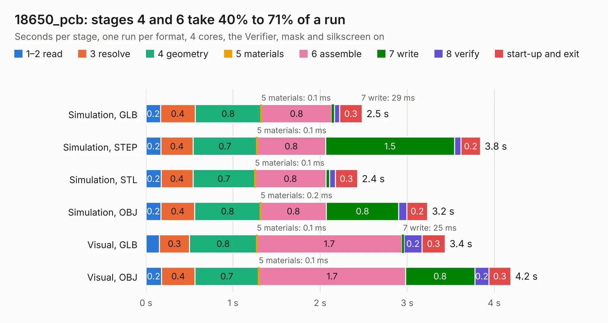
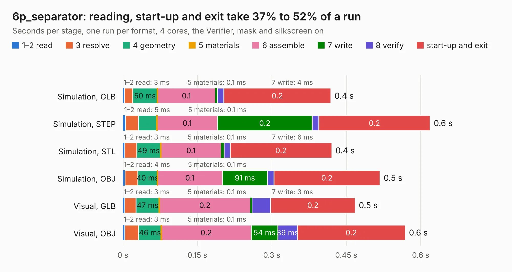
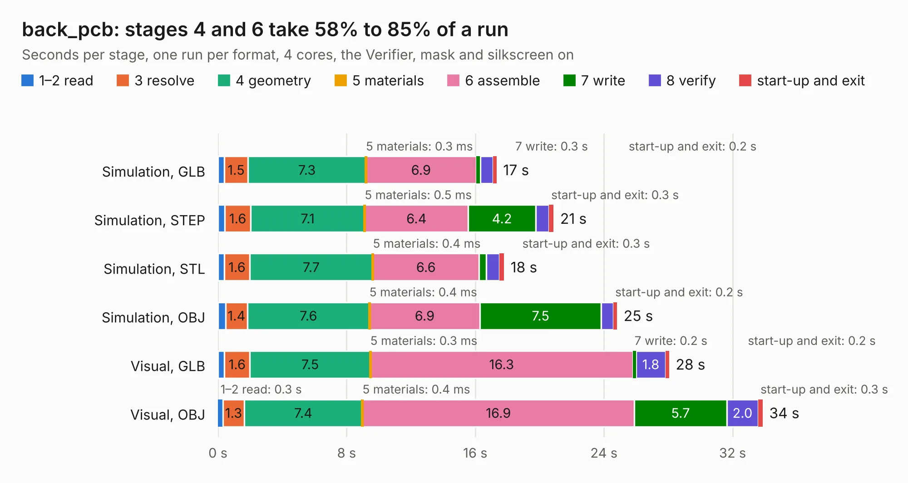
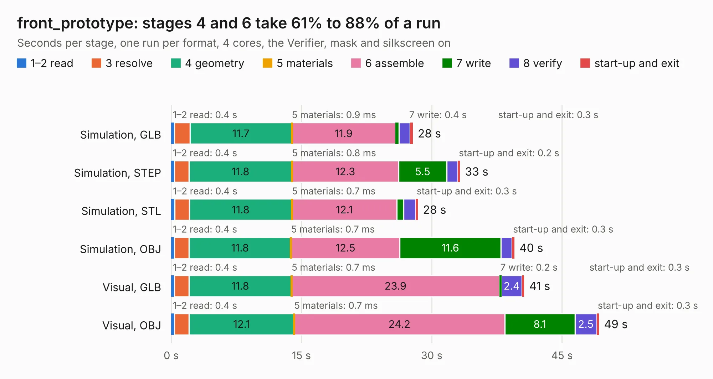
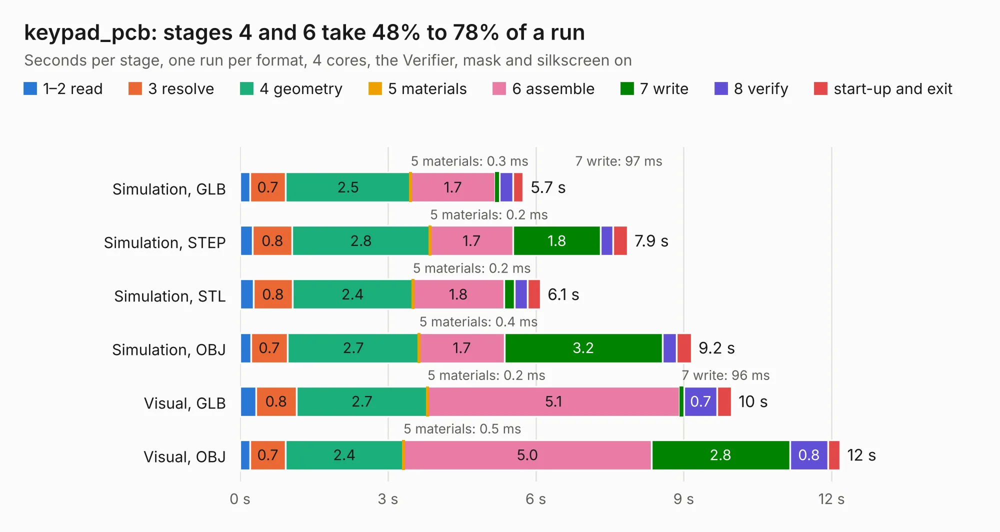
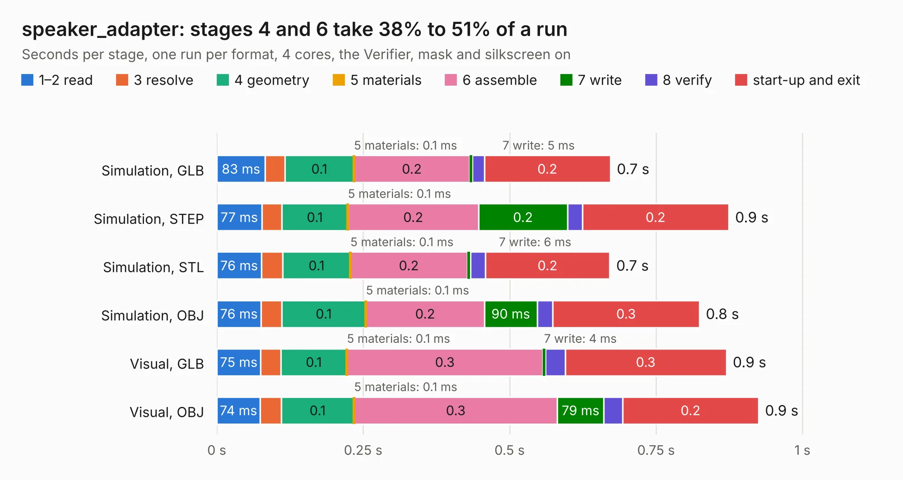

# Corpus Page 30

Part 30 of 30 of [Corpus Testing](../Corpus-Testing.md): boards 3,133 to 3,138, six runs each, one file format a run, as [Corpus Testing](../Corpus-Testing.md) describes.

## 3133. 18650_pcb

| Mode and format | 1–2 read | 3 resolve | 4 geometry | 5 materials | 6 assemble | 7 write | 8 verify | start-up and exit | Total |
|---|---:|---:|---:|---:|---:|---:|---:|---:|---:|
| Simulation, GLB | 0.2 | 0.4 | 0.8 | 0.1&nbsp;ms | 0.8 | 29&nbsp;ms | 60&nbsp;ms | 0.3 | 2.5 |
| Simulation, STEP | 0.2 | 0.4 | 0.7 | 0.1&nbsp;ms | 0.8 | 1.5 | 74&nbsp;ms | 0.2 | 3.8 |
| Simulation, STL | 0.2 | 0.4 | 0.7 | 0.1&nbsp;ms | 0.8 | 43&nbsp;ms | 65&nbsp;ms | 0.3 | 2.4 |
| Simulation, OBJ | 0.2 | 0.4 | 0.8 | 0.2&nbsp;ms | 0.8 | 0.8 | 94&nbsp;ms | 0.2 | 3.2 |
| Visual, GLB | 0.2 | 0.3 | 0.8 | 0.1&nbsp;ms | 1.7 | 25&nbsp;ms | 0.2 | 0.3 | 3.4 |
| Visual, OBJ | 0.2 | 0.4 | 0.7 | 0.1&nbsp;ms | 1.7 | 0.8 | 0.2 | 0.3 | 4.2 |

<table align="center"><tr><td valign="top">

| Board | Repo: [ZeroPhone/ZeroPhone-PCBs](https://github.com/ZeroPhone/ZeroPhone-PCBs) Board: `18650_pcb.kicad_pcb` |
|---|---|
| Folder | 18650_pcb |
| Complexity | 118&nbsp;/&nbsp;1000 (size&nbsp;88, features&nbsp;30) |
| KESE&nbsp;features | filled zones, curved board outline |
| Tested | 10th November 2026 |
| Copper&nbsp;layers | 2 |
| File&nbsp;format | KiCad 4 (4) |
| Parts,&nbsp;tracks,&nbsp;vias | 4, 26, 0 |
| Triangles,&nbsp;simulation | 141,022 in 14 parts |
| Verifier | PASS in all six runs |

</td><td valign="top">

<table>
<tr><th>File type</th><th>File size</th><th>Peak memory used</th></tr>
<tr><th colspan="3" align="left">Simulation</th></tr>
<tr><td>GLB</td><td align="right">5.3&nbsp;MB</td><td align="right">211&nbsp;MB</td></tr>
<tr><td>STEP</td><td align="right">26&nbsp;MB</td><td align="right">224&nbsp;MB</td></tr>
<tr><td>STL</td><td align="right">7.1&nbsp;MB</td><td align="right">212&nbsp;MB</td></tr>
<tr><td>OBJ</td><td align="right">15&nbsp;MB</td><td align="right">211&nbsp;MB</td></tr>
<tr><th colspan="3" align="left">Visual</th></tr>
<tr><td>GLB</td><td align="right">4.6&nbsp;MB</td><td align="right">183&nbsp;MB</td></tr>
<tr><td>OBJ</td><td align="right">13&nbsp;MB</td><td align="right">181&nbsp;MB</td></tr>
</table>

</td></tr></table>

## 3134. 6p_separator

| Mode and format | 1–2 read | 3 resolve | 4 geometry | 5 materials | 6 assemble | 7 write | 8 verify | start-up and exit | Total |
|---|---:|---:|---:|---:|---:|---:|---:|---:|---:|
| Simulation, GLB | 3&nbsp;ms | 17&nbsp;ms | 50&nbsp;ms | 0.1&nbsp;ms | 0.1 | 4&nbsp;ms | 13&nbsp;ms | 0.2 | 0.4 |
| Simulation, STEP | 5&nbsp;ms | 26&nbsp;ms | 37&nbsp;ms | 0.1&nbsp;ms | 0.1 | 0.2 | 13&nbsp;ms | 0.2 | 0.6 |
| Simulation, STL | 3&nbsp;ms | 24&nbsp;ms | 49&nbsp;ms | 0.1&nbsp;ms | 0.1 | 6&nbsp;ms | 12&nbsp;ms | 0.2 | 0.4 |
| Simulation, OBJ | 4&nbsp;ms | 26&nbsp;ms | 40&nbsp;ms | 0.1&nbsp;ms | 0.1 | 91&nbsp;ms | 13&nbsp;ms | 0.2 | 0.5 |
| Visual, GLB | 3&nbsp;ms | 23&nbsp;ms | 47&nbsp;ms | 0.1&nbsp;ms | 0.2 | 3&nbsp;ms | 38&nbsp;ms | 0.2 | 0.5 |
| Visual, OBJ | 3&nbsp;ms | 28&nbsp;ms | 46&nbsp;ms | 0.1&nbsp;ms | 0.2 | 54&nbsp;ms | 39&nbsp;ms | 0.2 | 0.6 |

<table align="center"><tr><td valign="top">

| Board | Repo: [ZeroPhone/ZeroPhone-PCBs](https://github.com/ZeroPhone/ZeroPhone-PCBs) Board: `6p_separator.kicad_pcb` |
|---|---|
| Folder | 6p_separator |
| Complexity | 24&nbsp;/&nbsp;1000 (size&nbsp;24, features&nbsp;0) |
| Tested | 9th November 2026 |
| Copper&nbsp;layers | 2 |
| File&nbsp;format | KiCad 4 (4) |
| Parts,&nbsp;tracks,&nbsp;vias | 1, 0, 0 |
| Triangles,&nbsp;simulation | 18,436 in 9 parts |
| Verifier | PASS in all six runs |

</td><td valign="top">

<table>
<tr><th>File type</th><th>File size</th><th>Peak memory used</th></tr>
<tr><th colspan="3" align="left">Simulation</th></tr>
<tr><td>GLB</td><td align="right">598&nbsp;kB</td><td align="right">41&nbsp;MB</td></tr>
<tr><td>STEP</td><td align="right">2.3&nbsp;MB</td><td align="right">43&nbsp;MB</td></tr>
<tr><td>STL</td><td align="right">923&nbsp;kB</td><td align="right">41&nbsp;MB</td></tr>
<tr><td>OBJ</td><td align="right">1.7&nbsp;MB</td><td align="right">44&nbsp;MB</td></tr>
<tr><th colspan="3" align="left">Visual</th></tr>
<tr><td>GLB</td><td align="right">410&nbsp;kB</td><td align="right">69&nbsp;MB</td></tr>
<tr><td>OBJ</td><td align="right">1.1&nbsp;MB</td><td align="right">58&nbsp;MB</td></tr>
</table>

</td></tr></table>

## 3135. back_pcb

| Mode and format | 1–2 read | 3 resolve | 4 geometry | 5 materials | 6 assemble | 7 write | 8 verify | start-up and exit | Total |
|---|---:|---:|---:|---:|---:|---:|---:|---:|---:|
| Simulation, GLB | 0.4 | 1.5 | 7.3 | 0.3&nbsp;ms | 6.9 | 0.3 | 0.8 | 0.2 | 17.3 |
| Simulation, STEP | 0.4 | 1.6 | 7.1 | 0.5&nbsp;ms | 6.4 | 4.2 | 0.8 | 0.3 | 20.9 |
| Simulation, STL | 0.4 | 1.6 | 7.7 | 0.4&nbsp;ms | 6.6 | 0.5 | 0.8 | 0.3 | 17.8 |
| Simulation, OBJ | 0.5 | 1.4 | 7.6 | 0.4&nbsp;ms | 6.9 | 7.5 | 0.8 | 0.2 | 24.8 |
| Visual, GLB | 0.4 | 1.6 | 7.5 | 0.3&nbsp;ms | 16.3 | 0.2 | 1.8 | 0.2 | 28.1 |
| Visual, OBJ | 0.3 | 1.3 | 7.4 | 0.4&nbsp;ms | 16.9 | 5.7 | 2.0 | 0.3 | 33.9 |

<table align="center"><tr><td valign="top">

| Board | Repo: [ZeroPhone/ZeroPhone-PCBs](https://github.com/ZeroPhone/ZeroPhone-PCBs) Board: `back_pcb.kicad_pcb` |
|---|---|
| Folder | back_pcb |
| Complexity | 248&nbsp;/&nbsp;1000 (size&nbsp;193, features&nbsp;55) |
| KESE&nbsp;features | through vias, drill offsets, filled zones, curved board outline |
| Tested | 9th November 2026 |
| Copper&nbsp;layers | 2 |
| File&nbsp;format | KiCad 4 (4) |
| Parts,&nbsp;tracks,&nbsp;vias | 94, 1,491, 252 |
| Triangles,&nbsp;simulation | 1,666,214 in 94 parts |
| Verifier | PASS in all six runs |

</td><td valign="top">

<table>
<tr><th>File type</th><th>File size</th><th>Peak memory used</th></tr>
<tr><th colspan="3" align="left">Simulation</th></tr>
<tr><td>GLB</td><td align="right">59&nbsp;MB</td><td align="right">724&nbsp;MB</td></tr>
<tr><td>STEP</td><td align="right">309&nbsp;MB</td><td align="right">758&nbsp;MB</td></tr>
<tr><td>STL</td><td align="right">83&nbsp;MB</td><td align="right">724&nbsp;MB</td></tr>
<tr><td>OBJ</td><td align="right">176&nbsp;MB</td><td align="right">1.2&nbsp;GB</td></tr>
<tr><th colspan="3" align="left">Visual</th></tr>
<tr><td>GLB</td><td align="right">46&nbsp;MB</td><td align="right">820&nbsp;MB</td></tr>
<tr><td>OBJ</td><td align="right">139&nbsp;MB</td><td align="right">984&nbsp;MB</td></tr>
</table>

</td></tr></table>

## 3136. front_prototype

| Mode and format | 1–2 read | 3 resolve | 4 geometry | 5 materials | 6 assemble | 7 write | 8 verify | start-up and exit | Total |
|---|---:|---:|---:|---:|---:|---:|---:|---:|---:|
| Simulation, GLB | 0.4 | 1.8 | 11.7 | 0.9&nbsp;ms | 11.9 | 0.4 | 1.3 | 0.3 | 27.8 |
| Simulation, STEP | 0.4 | 1.7 | 11.8 | 0.8&nbsp;ms | 12.3 | 5.5 | 1.3 | 0.2 | 33.2 |
| Simulation, STL | 0.4 | 1.7 | 11.8 | 0.7&nbsp;ms | 12.1 | 0.8 | 1.4 | 0.3 | 28.4 |
| Simulation, OBJ | 0.4 | 1.7 | 11.8 | 0.7&nbsp;ms | 12.5 | 11.6 | 1.3 | 0.3 | 39.5 |
| Visual, GLB | 0.4 | 1.7 | 11.8 | 0.7&nbsp;ms | 23.9 | 0.2 | 2.4 | 0.3 | 40.6 |
| Visual, OBJ | 0.4 | 1.7 | 12.1 | 0.7&nbsp;ms | 24.2 | 8.1 | 2.5 | 0.3 | 49.3 |

<table align="center"><tr><td valign="top">

| Board | Repo: [ZeroPhone/ZeroPhone-PCBs](https://github.com/ZeroPhone/ZeroPhone-PCBs) Board: `front_prototype.kicad_pcb` |
|---|---|
| Folder | front_pcb |
| Complexity | 289&nbsp;/&nbsp;1000 (size&nbsp;234, features&nbsp;55) |
| KESE&nbsp;features | through vias, drill offsets, filled zones, curved board outline |
| Tested | 9th November 2026 |
| Copper&nbsp;layers | 2 |
| File&nbsp;format | KiCad 4 (4) |
| Parts,&nbsp;tracks,&nbsp;vias | 82, 1,522, 402 |
| Triangles,&nbsp;simulation | 2,078,644 in 97 parts |
| Verifier | PASS in all six runs |

</td><td valign="top">

<table>
<tr><th>File type</th><th>File size</th><th>Peak memory used</th></tr>
<tr><th colspan="3" align="left">Simulation</th></tr>
<tr><td>GLB</td><td align="right">75&nbsp;MB</td><td align="right">753&nbsp;MB</td></tr>
<tr><td>STEP</td><td align="right">401&nbsp;MB</td><td align="right">905&nbsp;MB</td></tr>
<tr><td>STL</td><td align="right">104&nbsp;MB</td><td align="right">795&nbsp;MB</td></tr>
<tr><td>OBJ</td><td align="right">226&nbsp;MB</td><td align="right">1.5&nbsp;GB</td></tr>
<tr><th colspan="3" align="left">Visual</th></tr>
<tr><td>GLB</td><td align="right">53&nbsp;MB</td><td align="right">999&nbsp;MB</td></tr>
<tr><td>OBJ</td><td align="right">162&nbsp;MB</td><td align="right">1.1&nbsp;GB</td></tr>
</table>

</td></tr></table>

## 3137. keypad_pcb

| Mode and format | 1–2 read | 3 resolve | 4 geometry | 5 materials | 6 assemble | 7 write | 8 verify | start-up and exit | Total |
|---|---:|---:|---:|---:|---:|---:|---:|---:|---:|
| Simulation, GLB | 0.2 | 0.7 | 2.5 | 0.3&nbsp;ms | 1.7 | 97&nbsp;ms | 0.3 | 0.2 | 5.7 |
| Simulation, STEP | 0.3 | 0.8 | 2.8 | 0.2&nbsp;ms | 1.7 | 1.8 | 0.3 | 0.3 | 7.9 |
| Simulation, STL | 0.3 | 0.8 | 2.4 | 0.2&nbsp;ms | 1.8 | 0.2 | 0.3 | 0.3 | 6.1 |
| Simulation, OBJ | 0.2 | 0.7 | 2.7 | 0.4&nbsp;ms | 1.7 | 3.2 | 0.3 | 0.3 | 9.2 |
| Visual, GLB | 0.3 | 0.8 | 2.7 | 0.2&nbsp;ms | 5.1 | 96&nbsp;ms | 0.7 | 0.3 | 10.0 |
| Visual, OBJ | 0.2 | 0.7 | 2.4 | 0.5&nbsp;ms | 5.0 | 2.8 | 0.8 | 0.2 | 12.2 |

<table align="center"><tr><td valign="top">

| Board | Repo: [ZeroPhone/ZeroPhone-PCBs](https://github.com/ZeroPhone/ZeroPhone-PCBs) Board: `keypad_pcb.kicad_pcb` |
|---|---|
| Folder | keypad_pcb |
| Complexity | 189&nbsp;/&nbsp;1000 (size&nbsp;164, features&nbsp;25) |
| KESE&nbsp;features | through vias, curved board outline |
| Tested | 9th November 2026 |
| Copper&nbsp;layers | 2 |
| File&nbsp;format | KiCad 4 (4) |
| Parts,&nbsp;tracks,&nbsp;vias | 31, 472, 104 |
| Triangles,&nbsp;simulation | 514,642 in 30 parts |
| Verifier | PASS in all six runs |

</td><td valign="top">

<table>
<tr><th>File type</th><th>File size</th><th>Peak memory used</th></tr>
<tr><th colspan="3" align="left">Simulation</th></tr>
<tr><td>GLB</td><td align="right">18&nbsp;MB</td><td align="right">330&nbsp;MB</td></tr>
<tr><td>STEP</td><td align="right">87&nbsp;MB</td><td align="right">353&nbsp;MB</td></tr>
<tr><td>STL</td><td align="right">26&nbsp;MB</td><td align="right">348&nbsp;MB</td></tr>
<tr><td>OBJ</td><td align="right">54&nbsp;MB</td><td align="right">397&nbsp;MB</td></tr>
<tr><th colspan="3" align="left">Visual</th></tr>
<tr><td>GLB</td><td align="right">16&nbsp;MB</td><td align="right">393&nbsp;MB</td></tr>
<tr><td>OBJ</td><td align="right">47&nbsp;MB</td><td align="right">400&nbsp;MB</td></tr>
</table>

</td></tr></table>

## 3138. speaker_adapter

| Mode and format | 1–2 read | 3 resolve | 4 geometry | 5 materials | 6 assemble | 7 write | 8 verify | start-up and exit | Total |
|---|---:|---:|---:|---:|---:|---:|---:|---:|---:|
| Simulation, GLB | 83&nbsp;ms | 33&nbsp;ms | 0.1 | 0.1&nbsp;ms | 0.2 | 5&nbsp;ms | 20&nbsp;ms | 0.2 | 0.7 |
| Simulation, STEP | 77&nbsp;ms | 34&nbsp;ms | 0.1 | 0.1&nbsp;ms | 0.2 | 0.2 | 26&nbsp;ms | 0.2 | 0.9 |
| Simulation, STL | 76&nbsp;ms | 36&nbsp;ms | 0.1 | 0.1&nbsp;ms | 0.2 | 6&nbsp;ms | 25&nbsp;ms | 0.2 | 0.7 |
| Simulation, OBJ | 76&nbsp;ms | 35&nbsp;ms | 0.1 | 0.1&nbsp;ms | 0.2 | 90&nbsp;ms | 27&nbsp;ms | 0.3 | 0.8 |
| Visual, GLB | 75&nbsp;ms | 34&nbsp;ms | 0.1 | 0.1&nbsp;ms | 0.3 | 4&nbsp;ms | 34&nbsp;ms | 0.3 | 0.9 |
| Visual, OBJ | 74&nbsp;ms | 36&nbsp;ms | 0.1 | 0.1&nbsp;ms | 0.3 | 79&nbsp;ms | 32&nbsp;ms | 0.2 | 0.9 |

<table align="center"><tr><td valign="top">

| Board | Repo: [ZeroPhone/ZeroPhone-PCBs](https://github.com/ZeroPhone/ZeroPhone-PCBs) Board: `speaker_adapter.kicad_pcb` |
|---|---|
| Folder | speaker_adapter |
| Complexity | 98&nbsp;/&nbsp;1000 (size&nbsp;63, features&nbsp;35) |
| KESE&nbsp;features | through vias, filled zones |
| Tested | 9th November 2026 |
| Copper&nbsp;layers | 2 |
| File&nbsp;format | KiCad 4 (4) |
| Parts,&nbsp;tracks,&nbsp;vias | 0, 10, 2 |
| Triangles,&nbsp;simulation | 15,552 in 13 parts |
| Note | no components |
| Verifier | PASS in all six runs |

</td><td valign="top">

<table>
<tr><th>File type</th><th>File size</th><th>Peak memory used</th></tr>
<tr><th colspan="3" align="left">Simulation</th></tr>
<tr><td>GLB</td><td align="right">573&nbsp;kB</td><td align="right">61&nbsp;MB</td></tr>
<tr><td>STEP</td><td align="right">2.5&nbsp;MB</td><td align="right">65&nbsp;MB</td></tr>
<tr><td>STL</td><td align="right">779&nbsp;kB</td><td align="right">62&nbsp;MB</td></tr>
<tr><td>OBJ</td><td align="right">1.5&nbsp;MB</td><td align="right">64&nbsp;MB</td></tr>
<tr><th colspan="3" align="left">Visual</th></tr>
<tr><td>GLB</td><td align="right">425&nbsp;kB</td><td align="right">76&nbsp;MB</td></tr>
<tr><td>OBJ</td><td align="right">1.1&nbsp;MB</td><td align="right">81&nbsp;MB</td></tr>
</table>

</td></tr></table>

| Previous | Next |
|:---|---:|
| [Corpus Page 29](Corpus-Testing-29.md) | [Corpus Testing](../Corpus-Testing.md) |
