# 24. Elmer FEM Introduction

[Elmer](https://github.com/ElmerCSC/elmerfem) is an open-source finite element solver from CSC in
Finland. The **Elmer bridge** turns a KiCad board into an Elmer simulation: KESE exports the board's
3D geometry, the bridge meshes it, writes Elmer's case, runs ElmerSolver and reads the answer back.
The bridge lives on the `Elmer_Integration` branch of the repository; KESE itself stays what it is,
a geometry exporter, and is never changed by the bridge.

> [!NOTE]
> Three boards are shown in this category. The two proof boards, **E01** (one loop) and **E02** (two
> coaxial loops), check the bridge against textbook formulas. The inductive encoder coil
> **S0d2_1x_OD23_2L_tiny_TX3top_Cut** is a whole sensor, a stator and a rotor, solved at 16 rotor angles
> and 5 air gaps: 81 Elmer solves, every one of which passed its two checks. All three have run; their
> results are on [Elmer FEM Test Board Results](Elmer-FEM-Test-Board-Results.md).

## 24.1 What Elmer Is Used For Here

At the frequencies of inductive position sensors and planar coils (kHz to a few MHz) a board is a
tiny fraction of a wavelength across: a 40 mm coil at 3.5 MHz is about 1/2000 of a wavelength. The
physics is then **magneto-quasi-static**: currents and magnetic fields, eddy currents in nearby
copper, and no wave propagation. Elmer's time-harmonic A-V solver with edge elements
(`WhitneyAVHarmonicSolver`) solves exactly this, so it is the main solver for:

| Quantity | How the bridge gets it |
|---|---|
| Inductance L of a coil | the imaginary part of the coil's impedance V / I, over ω |
| AC resistance R of a coil, with skin and proximity effect | the real part of V / I |
| DC resistance | from the potential that sets each coil's current direction |
| Mutual inductance M between two coils | the open-circuit voltage of the undriven coil over the driving current |
| The field energy, as a check on L | Elmer's field energy W gives L = 2W / I² |
| The eddy power, as a check on R | Elmer's eddy current power P gives R = 2P / I² |
| The effect of a conducting target (a rotor, a plate) | the same quantities with the conductor present and away |
| An encoder's SIN and COS curves and its angle error | M from the TX to each receiver at a series of rotor angles, fitted with a sine |

What Elmer does **not** give here: the coils' capacitance and self-resonance. An eddy-current
solve has no displacement current, so those need another solver; how the solvers of this project
divide the work is on [Solvers Comparison](Solvers-Comparison.md).

## 24.2 How It Fits Together

```mermaid
flowchart LR
    A[KiCad board<br>.kicad_pcb] -->|run_KESE.py --for elmer| B[STL per net<br>+ materials.json]
    B -->|bridge/mesh25d.py| C[2.5D mesh<br>wedges + tetrahedra]
    C -->|bridge/ports.py| D[coil electrodes<br>and port sheets]
    D -->|bridge/elmer_case.py| E[Elmer case<br>.sif + circuits]
    E -->|ElmerSolver| F[V and I of every coil]
    F -->|bridge/study.py| G[L, R, M<br>results.json]
```

Each step is described on [Elmer FEM Workflow](Elmer-FEM-Workflow.md).

## 24.3 The Pages Of This Category

| Page | What it covers |
|---|---|
| [Elmer FEM Installation](Elmer-FEM-Installation.md) | The committed Elmer build, building it yourself, and the bridge's Python on Linux and Windows |
| [Elmer FEM Workflow](Elmer-FEM-Workflow.md) | Every step from the board file to the numbers |
| [Elmer FEM Simulating Your Own Board](Elmer-FEM-Simulating-Your-Own-Board.md) | Every setting of an example's `simulation.py`, and how to start a new one |
| [Elmer FEM Test Boards](Elmer-FEM-Test-Boards.md) | E01, E02 and the coil board, and what Elmer checks on each |
| [Elmer FEM Test Board Results](Elmer-FEM-Test-Board-Results.md) | What came out, against the references, with charts |
| [Elmer FEM Accuracy](Elmer-FEM-Accuracy.md) | Where the errors come from and how big they are |
| [Elmer FEM Hardware](Elmer-FEM-Hardware.md) | Memory and time, measured, and what a board needs |
| [Elmer FEM Troubleshooting](Elmer-FEM-Troubleshooting.md) | What went wrong while building the bridge, and the fixes |

How Elmer sits beside the project's other solvers is on [Solvers Comparison](Solvers-Comparison.md).

## 24.4 Where The Code Is

| Folder on `Elmer_Integration` | What it holds |
|---|---|
| `bridge/` | The bridge, in Python: `geometry.py`, `mesh25d.py`, `ports.py`, `elmer_case.py`, `study.py`, and `setup_machine.sh`, which sets up a fresh Ubuntu 24.04 machine |
| `Examples/E01_circular_loop/`, `Examples/E02_coaxial_loops/` | The proof boards, each with its board, `make_board.py`, `simulation.py`, `README.md` and `results.md` |
| `Examples/Inductive Coils/S0d2_1x_OD23_2L_tiny_TX3top_Cut/` | The coil board: `Boards/` (from the generator), `3D_Geometry/` (KESE's export), `Elmer Simulation/` (`test_spec.json`, `simulation.py` and the chart scripts) and `Results/` (non-commercial licence, see that folder's `LICENSE.md`) |
| `Examples/Inductive Coils/new_coil.py` | Sets up any single coil set from the generator as a folder like the coil board's |
| `Solver_Elmer/install/` | The Elmer 26.2.1 build every example ran on, for Ubuntu 24.04 (see [Elmer FEM Installation](Elmer-FEM-Installation.md)) |
| `3D_Geometry/` | Empty on purpose: KESE's `Generator/` is copied here from `main`, or `KESE_PATH` points at it |

The branch also solves five more coil boards made from the same small coil set; they are in
[`Examples/Inductive Coils/`](https://github.com/RolandThsive/KiCad-EM-Stackup-Exporter-KESE/tree/Elmer_Integration/Examples/Inductive%20Coils).

| Previous | Next |
|:---|---:|
| [openEMS Workflow](OpenEMS-Workflow.md) | [Elmer FEM Installation](Elmer-FEM-Installation.md) |
