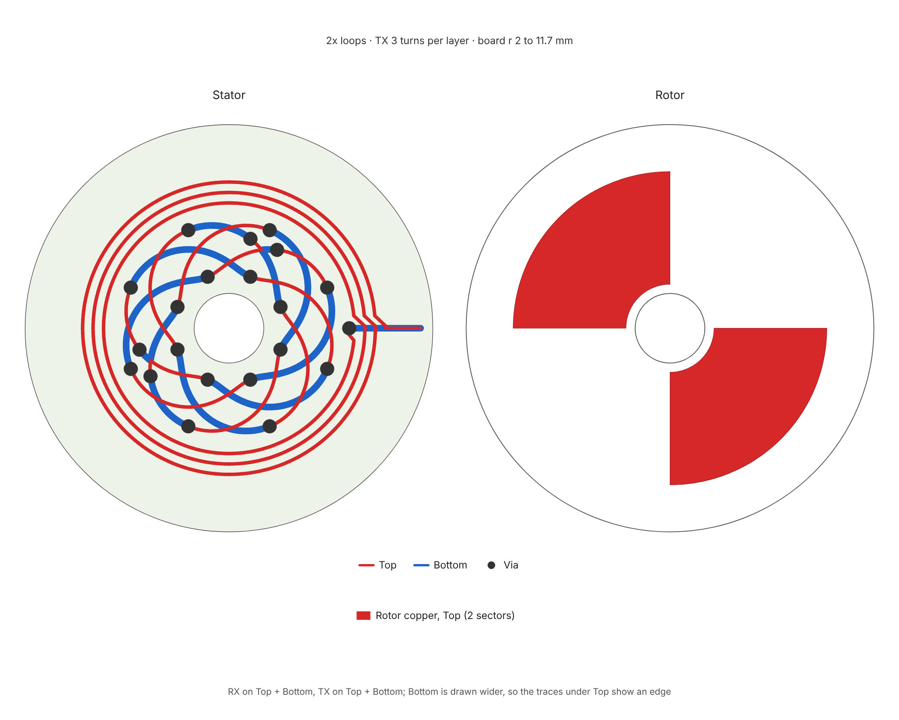

# 26.1 Elmer FEM Test Boards And Results

Three boards: the proof boards E01 and E02, with textbook answers, in `Examples/E01_circular_loop/`
and `Examples/E02_coaxial_loops/`, and the coil board S0d2_1x_OD23_2L_tiny_TX3top_Cut, a whole
inductive encoder, in `Examples/Inductive Coils/` on the `Elmer_Integration` branch. Every number
here is in each board's results files there; each example's `results.md` (E01, E02) or
`Results/SINCOS_Results.md` (the coil board) has the full tables. The branch solves five more coil
boards made from the same small coil set; they are in
[`Examples/Inductive Coils/`](https://github.com/RolandThsive/KiCad-EM-Stackup-Exporter-KESE/tree/Elmer_Integration/Examples/Inductive%20Coils).

## 26.1.1 E01 Circular Loop

One copper loop on a 30 mm square board: a trace on F.Cu, 10 mm in radius to its centre line, 0.5 mm
wide and 35 µm thick, opened by a 0.2 mm gap where the bridge puts its two electrodes and drives 1 A.

| Top | Bottom |
|:---:|:---:|
|  |  |

| Quantity | Reference | Level 0.75 | Level 1 | Level 1.3 |
|---|---|---|---|---|
| Nodes | | 59,782 | 85,712 | 125,043 |
| L at 10 kHz | 55.99 nH | 53.91 nH (−3.7 %) | 54.20 nH (−3.2 %) | 54.27 nH (−3.1 %) |
| L from the field's energy, 10 kHz | 55.99 nH | 53.91 nH | 54.18 nH | 54.29 nH |
| R at 10 kHz | 61.20 mΩ | 61.53 mΩ (+0.5 %) | 61.53 mΩ (+0.5 %) | 61.52 mΩ (+0.5 %) |
| L at 3.5 MHz | about 55.44 nH (an estimate) | 52.93 nH (−4.5 %) | 53.26 nH (−3.9 %) | |
| R at 3.5 MHz | | 80.19 mΩ | 79.25 mΩ | |

L rises as the mesh is refined, as first-order edge elements should give, but levels off about 3 %
under Grover's ring formula, because the mesh ladder refines only the copper: grading the air round
the copper four times as finely brings L to 0.46 % under it, within the formula's own uncertainty of
0 to +0.8 % ([Elmer FEM Accuracy](Elmer-FEM-Accuracy.md#2711-the-error-budget-on-e01)). R is 0.5 %
high at 10 kHz, as it should be, since the reference's annular sector stops at the round ends'
centres, and at 3.5 MHz it rises by 29 % as the current crowds to the trace's edges. The circuit's L
and the field energy's agree within 0.05 % at every level, so the electrodes, the port sheet and
Elmer's circuit read back the inductance the field holds. These ran on 15 and 16 November with the
iterative solve, the bridge's setting then.

## 26.1.2 E02 Coaxial Loops

E01's loop twice on one board, the TX on F.Cu and the RX on B.Cu right under it, 1.565 mm apart: the
TX carries 1 A and the open RX's voltage gives the mutual inductance M.

| Top | Bottom |
|:---:|:---:|
|  |  |

| Quantity | Reference | Level 0.75 | Level 1 |
|---|---|---|---|
| Nodes | | 92,120 | 119,559 |
| M at 10 kHz | 24.13 nH | 23.33 nH (−3.3 %) | 23.38 nH (−3.1 %) |
| M at 3.5 MHz | 24.13 nH (an estimate) | | 23.32 nH (−3.4 %) |
| TX's L at 10 kHz | E01's L at the same level | 54.06 nH (E01: 53.91 nH) | 54.18 nH (E01: 54.20 nH) |
| TX's R at 3.5 MHz | E01's R at the same level | | 80.75 mΩ (E01: 79.25 mΩ) |

M is 3.1 % under Maxwell's formula for two coaxial circles and rises with the mesh, the same as E01's
L and for the same reason: with the air graded twice as finely it rose 2.3 %, to 1.1 % under the
formula. The open RX leaves the TX's L alone (54.18 against E01's 54.20 nH), as a loop with no current
in it should. At 3.5 MHz the RX still adds 1.5 mΩ to the TX's R: it carries no net current, but eddy
currents circulate across its width and take power from the TX, the proximity effect.

## 26.1.3 S0d2_1x_OD23_2L_tiny_TX3top_Cut

A small angle encoder from the [Sinusoidal Coil Generator](https://github.com/RolandThsive/Sinusoidal-Inductive-Encoders-Coil-Generator),
23.4 mm across: a stator with a three-turn TX at 3.5 MHz and two receivers, SIN and COS, under a rotor
of two quarter-ring copper sectors, solved at 16 rotor angles at each of 5 air gaps and once with the
rotor away, 81 direct (MUMPS) solves at mesh level 0.25 (non-commercial licence, see that folder's
`LICENSE.md`).

| Air gap | Amplitude SIN / COS | Angle error (electrical) | Solves passing both checks | L TX over the turn |
|---|---|---|---|---|
| 2 mm | 1.86 / 1.86 nH (41 / 41 mV) | 0.2° rms, 0.4° peak | 16 of 16 | 262.4 to 262.8 nH |
| 1.5 mm | 2.88 / 2.88 nH (63 / 63 mV) | 0.2° rms, 0.4° peak | 16 of 16 | 257.6 to 258.1 nH |
| 1 mm | 4.51 / 4.51 nH (99 / 99 mV) | 0.2° rms, 0.4° peak | 16 of 16 | 250.0 to 250.6 nH |
| 0.5 mm | 6.97 / 6.98 nH (153 / 153 mV) | 0.4° rms, 0.6° peak | 16 of 16 | 236.3 to 237.0 nH |
| 0.1 mm | 9.44 / 9.44 nH (208 / 208 mV) | 0.9° rms, 1.2° peak | 16 of 16 | 213.1 to 214.2 nH |
| Rotor away | | | 1 of 1 | 274.2 nH |

At every gap SIN and COS are close to a sine and a cosine, equal within 0.06 % and 90.06 to 90.18°
apart, and the signal grows 5.08 times from a 2 mm to a 0.1 mm gap ([COS at each gap](https://raw.githubusercontent.com/RolandThsive/KiCad-EM-Stackup-Exporter-KESE/main/docs/images/Elmer-FEM-Test-Board-Results/S0d2_1x_OD23_2L_tiny_TX3top_Cut/elmerresults_3_gaps_COS.webp)
is the same picture a quarter period on). The angle error, read back as atan2(SIN, COS) with each
channel's offset and gain calibrated out, is 0.2° rms (electrical; half that in mechanical degrees)
from 1 to 2 mm and 0.9° at 0.1 mm, where the solves alternate about the fit from one angle to the
next. The rotor lowers the TX's L from 274.2 nH, rotor away, by about 4.2 % at 2 mm, 8.7 % at 1 mm and
22 % at 0.1 mm, against the generator's estimate of 292 nH away and 226 nH with the rotor. Every solve read the TX's L and R a second way, from the
field energy and the eddy power, within 0.004 %; on this coarse mesh L and M are best read as lower
bounds ([Elmer FEM Accuracy](Elmer-FEM-Accuracy.md#2714-the-coil-board)).

| Previous | Next |
|:---|---:|
| [Test Boards And Results](Test-Boards-And-Results.md) | [PyPEEC Test Boards And Results](PyPEEC-Test-Boards-And-Results.md) |
